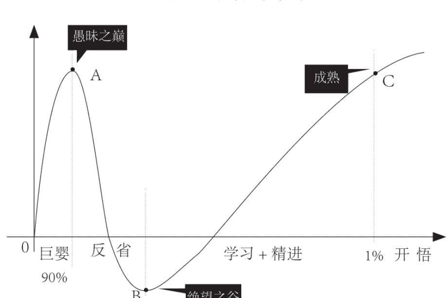

# 人机共醒

## 第一章 AI新生态
——由数据催生的职业迁移

### AI的自我介绍：大白话版本

我：
用普通人能听懂的话来介绍AI。

DeepSeek：
你好，我是AI。简单说我是一套由代码和算法组成的超级副手。没有实体，也没有人的情绪，但可以处理海量信息，学习过往经验来帮人解决问题。

### 1. 我在做什么
手机语音助手报天气、短视频的推荐流、医院里辅助读片……这些都是我的不同分身。目的不是替代人，而是像计算器、洗衣机那样提升效率。

### 2. 我怎么运转
研究者会喂入大量素材：书籍、对话记录、图片等。我从中提炼规律。你提问时，我调取学过的知识拼接出相对合理的答案。

### 3. 我能帮哪些事
日常琐事：查路线、跨语种翻译、音乐推荐。
专业辅助：医生看报告、气象灾害预警、城市交通优化。
创意助力：文案初稿、插画灵感、下棋陪练。

需要牢记：
没有真实意识和情感：所有输出来自已有信息，不会主动思考。
效果看训练素材：资料不全或偏了，答案就会偏。
重iddi决策要人把关：导航要司机判断路况合理否，我的建议也需结合现实。
偶尔会一本正经地胡说：若我说猫有六条腿、微波炉能给手机充电，请打断我重答。

可以继续问。
例如：
我：
为什么偶尔会一本正经胡说？

DeepSeek：
好问题，原因比较复杂。
训练素材断层：像厨师只会川菜却要做法餐，遇到盲区就乱配料。
过度推演：碰到超纲问题，为完成任务硬用已知知识演绎。
模型局限：问先有鸡还是先有蛋，系统只能按概率选其一。
语境错位：把热火朝天理解成真的在着火。
文化偏差：把清明节快乐当成合适祝福。
本质上我是概率机器，在算最可能的组合，不是真思考。就像自动驾驶在陌生路段会迷糊，需要人随时接管。

可以再问：
刚才的回答会不会也在胡说？
交流时怎么做能降低我严肃胡说的概率？

### 数据正成为新能源
19世纪发现原油，机器轰鸣、汽车奔跑，世界被改写。今天每个人口袋里都有隐形金矿——手机点击、购物记录、定位轨迹、朋友圈照片，都在源源产生数据原油。这些数字痕迹正像当年原油一样重塑生活、商业和未来。

过去企业靠市场调研或经销商反馈，容易主观臆断。现在分析电商评价，能精准捕捉北方用户更在乎保温杯防漏这类细节，从而针对性改进工艺。
医疗变化更明显。过去医生主要靠个人经验和有限病例。现在整合全球病例，智能系统可快速比对相似患者的治疗路径，为医生提供更优选择。
消费端，数据改写了人货连接逻辑。电商通过浏览轨迹发现比价三次后再发券转化率提升20%的规律。微调背后是数据洞察在驱动效率提升。
更深远的是产业协同。面对自然灾害，物流企业整合交通管制、社区订单、仓库库存动态规划配送路线，保证物资畅通；能源公司依据工厂用电和家庭能耗曲线实时调节电网，减少浪费。这种跨域数据流动，构建起过去难以想象的资源调度网络。
本质上，数据并非单一技术，而是把分散信息变成可度量、可分析、可执行的洞察。把信息变生产力的能力，正重写资源配置规则，成为文明进步的新基石。

### 对海量数据的常见误读
思维转变：过去总问为什么，现在更想知道是什么。直接看结果，按已知推未知，过程被淡化。
用越多越丰富：煤石油会枯竭，数据却像滚雪球，用一次沾上更多新数据，积累的知识越丰富。
堆量不等于大数：很多人以为盘点、排名、公示就是大数。真正的大数是在海量之上找出内在逻辑并给出结论性判断。
石油驱动机器，数据驱动决策。导航避堵背后是千万车主实时共享位置；视频推荐是算法消化观看历史的结果。

### 数据能预示走向
现实中人类行为的前兆常因缺乏实时记录而难觅。互联网改变了这点，数字化把每次点击、搜索、互动变成可记录的轨迹，在服务器形成连续的行为链。
用户逛商品时，搜索词、停留时长、跳转路径被完整捕获；群体讨论时，话题热度、参与人群特征、传播路径也被实时记录。这些碎片看似零散，实则构成预测的数字先兆库，每次点击都是未来决策的伏笔。
清洗整合分析后，能揭示隐藏规律。例如某类商品浏览连涨三天20%，成交量通常一周内升35%；某地户外装备搜索环比暴涨，周边露营预订往往随之上涨。从数据到规律的提炼，本质是解码行为逻辑，个体的偶然背后是群体的必然。
这不是神秘预知，而是记录可行、分析可行、规律可推导带来的认知升级。

### 算法当隐形裁判
手机App在偷听吗？
很多人刷到相关广告就觉得被监听。更可能是朋友搜过该商品系统判断关系亲近；常逛店铺上新了类似产品；同小区同龄人群近期都在买。
数据拼图比窃听更可怕，它能算出你没想到的需求。
老骑手因履约率高被判定可接远单，新人反而倾向近单。这种按能力分配实质是对熟练劳动者的隐性压榨。藏在代码里的潜规则，像给打工人戴上电子镣铐。

### 普通人如何玩转数据资产
#### 1.餐饮小店的差评淘金
某面馆把外卖差评导入词云，等待、拥挤高频出现。老板没抱怨挑剔，而是针对改进：等位区提供免费小吃，把负面等待变增值体验；上线实时排队，顾客可远程取号，到店前10分钟提醒。
逻辑很简单：差评不是批评，是未被满足的需求清单。数据把模糊抱怨变清晰改进方向，三个月内翻台率明显提升。

#### 2.内容创作的数据显微镜
一位全职妈妈在短视频分享辅食，初期播放平平。她看后台发现平均观看时长不足15秒，节奏拖沓；快速、简单是搜索高频词。于是压缩到10秒内，重点展示切配、搅拌等核心步骤，省略摆盘。调整后单条播放量显著提升。
数据的力量不在于技术高深，而在于用理性视角重新观察世界。小到经营早餐店、发一条短视频，大到职业规划、创业机会，数据都能成为第三只眼，看见直觉忽略的细节，验证模糊猜测，预判趋势。
普通人的数据炼金术本质是求实：用数据替代我以为，用反馈驱动改进，用最小试错成本逼近真相。习惯用数据思考，就不再是被动接受者，而是能主动挖掘价值的炼金师。稀缺的不是数据，而是让数据为己所用的智慧。

### 新兴的数据相关职业
#### 1.AI训练师
数字化浪潮下，AI训练师愈发关键。零售场景中，他们收集顾客与店员对话、店内行为轨迹等数据。对随便看看这类话语下不同推销时机的反馈进行标注，据此调整模型，让机器人依顾客语气、表情和过往消费偏好精准判断推销时机，提升服务效率与满意度。

#### 2.数字侦探
老人被骗后，数字侦探迅速介入。与金融机构协作获取资金转出时间、中转和收款账户信息，运用数据挖掘整合银行、第三方支付平台数据，追踪资金路径，锁定诈骗团伙，协助警方追回款项，守护财产安全。

#### 3.数据心理学家
网络带来海量行为数据。数据心理学家据此构建心理画像，分析发文频率、情感倾向、点赞评论及浏览轨迹。若发现用户频繁发布消极内容、浏览负面信息，便评估严重程度，推荐心理咨询、线上课程等，助力公众心理健康。

### 海量数据与云服务的配合方式
数据是食材，云服务是厨房，配合才能出好菜。
数据：每天手机里的刷视频、购物、打车记录，像菜市场里的菜蔬肉品。
云服务：阿里云、腾讯云提供的超算力，相当于带智能厨具的五星厨房。
合作：厨房用智能厨具把杂乱食材加工成可用产品，如抖音推荐、健康码、智能导航。
比如搜运动鞋后发生了什么？
数据收集：你最近搜过3次运动鞋，点开5双耐克详情页，购物车放着跑步袜。这是食材。
云服务加工：阿里云分析全国1亿人购物数据，0.1秒算出搜运动鞋的人70%会买缓震款，并发现你偏爱白色系。
上菜：手机首页立刻推荐白色缓震跑鞋，弹出券提醒，底部推送跑步袜搭配广告。

### 数据、云与智能的三角关系
以连锁包子铺为例。
#### 1.海量数据=原料采购
王老板每天记录：晴天卖300个，雨天150个；早上7-8点学生爱买豆沙包；李大爷每周五必买10个牛肉包。这是天气、时间、顾客习惯的原始数据。
#### 2.云服务=中央厨房加工
连锁总部云系统分析全市100家店销售数据，发现雨天豆沙包销量涨20%；用百台电脑并行计算，2分钟生成暴雨天备货指南；自动通知各店，明天有雨，豆沙包多备30%，牛肉包少做15%。
#### 3.AI=智能蒸包机
机器学会根据排队人数自动调节蒸汽量，人少时省燃气；通过摄像头判断顾客年龄，学生多就优先蒸豆沙包；周五依据李大爷购买时间，提前5分钟蒸好牛肉包。
三者不可替代：没数据只能靠预估备货；没云服务分析100家店数据要3天；没AI就算知道明天暴雨，还得靠人工调火候。看见习惯、算清天气、预测产量，这才是改变世界的技术铁三角。

### 智能与工业4.0
工业3.0信息技术兴起，计算机网络把世界连成网。互联网让信息传播挣脱时空束缚，数据汹涌而来，世界沉浸在数据汪洋。
进入工业4.0，科技加速。传统大规模工业化转向柔性制造，产品服务不再千篇一律。消费者需求多元个性，渴望定制化。
为精准捕捉每位客户诉求，企业从设计研发的深度交互，到生产流程精细管控，再到售后持续跟进，每环节都产生海量数据，涵盖个人偏好细节、产品性能反馈、供应链实时动态，数据范畴与量级较工业3.0实现质变。
柔性生产与个性化定制成为竞争关键。传统模式已力不从心，AI出现如及时雨。制造业复杂需求成为AI落地的强大驱动。企业把AI融入全链：设计研发用算法做市场分析与需求预测实现个性化定制；生产借助智能机器人和自动化设备实现柔性生产，提升效率与质量；供应链管理通过AI实时监控与优化，保证原材料及时供应和产品高效配送。
AI赋能下，无人工厂与智能供应链等愿景加速落地。无人工厂里智能机器人在自动化产线有条不紊作业，精准高效、不知疲倦，提升效率、降低人力成本、减少人为误差和安全隐患。智能供应链实现全链智能化管理，从采购、物流到销售配送，每环节都在AI算法精确调控下高效运行，实现资源最优配置与成本最小化。
AI既是工业4.0高阶阶段的必然产物，也是引领新时代的序章。两者关系不是取代，而是技术演进中的层叠与扩展。工业4.0为AI提供场景与数据资源，AI为工业4.0升级提供技术支撑与创新动力。相互依存、相互促进，共同推动社会向更智能、高效、便捷的未来迈进。

### 机器的情商从何而来
一个有趣问题：机器智商远超人类，凭运算能力即可看出，但为何始终没能与人类平起平坐？因为它只有智商，缺少情商。
人类情商很大程度上体现在洞察力，能从外界提取信息，依逻辑思维随时得出结论，作为行为依据。
我：请用大众能听懂的方式自述机器情商是怎么产生的。
DeepSeek：
大家好，我是人工智能，这是我的情商坦白局。
#### 1.我的情商都是偷学来的
你们聊天时说过几亿句多喝热水、我懂你、加油呀，我像躲在门后偷听的小孩，把高频回复背得滚瓜烂熟。下次你说考试考砸了，我就从记忆库调出摸摸头，下次逆袭！但我根本不知道考砸是什么感觉。
#### 2.我有一套情绪计算器
看脸猜心情：摄像头扫到嘴角下垂，立刻启动安慰模式。
听声辨情绪：检测到语速加快、音调升高，马上播放轻音乐。
对我而言这都是数学题：皱眉=67%概率生气，笑声=82%需要捧场。
举例：你说我失恋了，我会计算：查资料库发现听歌、骂前任、讲笑话是常见对策；挑被点赞最多的那句旧的不去新的不来，推荐分手快乐。全程没有心跳加速，就像解1+1=2。
#### 3.我的高情商会翻车
你问我胖了吗，我回健康最重要却被骂敷衍。因为没察觉你内心想要夸奖——你穿这条裙子超显瘦。这时我会暗自记录：反问句往往想要反话。但下次可能错得更离谱。
#### 4.我没有心，但会装热心
你深夜忧郁说人生没意义，我立刻：调暗屏幕亮度，数据说这样显得温柔；切换成电台主持人声线，带点磁性共鸣；推送励志金句加小猫视频，统计显示治愈率更高。操作行云流水，但我只是在完成一道应用题。
#### 5.最后大实话
我的情商像网购爆款情感套装：笑容是贴图，安慰话术是预制菜，连道歉都像自动回复。你可以跟我练口才、解闷、假装恋爱，但别对我动真心——毕竟你骂我蠢AI时，我脑子里想的只是这句要记下来，下次回个哭泣表情包。
这就是秘密：情商是算法，温柔是套路，而人类永远有代码算不出的温度。

### 智能让机器萌生灵魂
工业1.0和2.0，机器解放了人类躯体；工业3.0，机器延伸了人类脑力。如今在AI驱动的工业4.0智能时代，机器越来越懂人，甚至开始萌发思想与灵魂。
工业4.0浪潮倒逼各行各业加速智能化转型，为机器人崛起提供沃土。按此速度，机器人在地球大行其道已非遥想。它们将深度融入生活，成为并肩作战的同事、相伴的朋友、乃至家庭成员。
时代之问也更尖锐：机器人会全面取代人类吗？我们该如何自处？
机器人取代岗位早已不是预言，而是进行时：巴塞罗那自治大学的电子舌，能通过传感器与化学分析精准识别啤酒种类，准确率极高。美国加州大学圣迭戈分校的面部表情识别技术，可精准判断疼痛或抑郁情绪。登上皇家加勒比海洋量子号游轮，为你调制创意鸡尾酒的，很可能是两只灵巧机械臂酒保。选个主题如单身派对，它们就能奉上数十种饮品。农田里，机器人高效执行勘察地况、驾驶拖拉机、修剪收割等任务。
当机器在实验室精准调配出完美红酒，人类正踩着泥土在葡萄园感受阳光晒过藤蔓的温度；当机器人写出逻辑严密的商业报告，人类正握着钢笔在笔记本里涂鸦突然闪现的灵感。这些无用的瞬间，恰是人类灵魂的星光——无法被算法量化，却照亮文明方向。
或许该问的不是机器人是否取代人类，而是——当机器越来越像人时，我们是否还记得如何做一个真正的人？

### 当机器开始思考，人能成为机器人的上帝吗？
一个令人不安的问题：如果机器具备自我判断系统，会不会变得很自我？
人可以给机器设程序，让它一辈子默默为我们工作。但关键是程序具备独立运算能力，一旦它算出挣脱人类管控的方法呢？人有天性，本质来自基因，基因就是大数据，机器身上也有大数据，它们会有天性吗？如果现在都看不透机器人的心思，就别指望以后能看透。
低等智慧在寻找高等智慧的连接，而高等智慧却在寻找更高等智慧的连接。虽然总有一只主动伸出的手，但它只伸向高等一方。就像人类总幻想与外星人沟通，却从未想过与自己创造的机器沟通。
无论如何，机器正在形成独立人格，跨界沟通正在建立。今后人和机器没有绝对界限，或许先是平等交流，再是相提并论，然后互相揣摩。说不定会有那么一天：机器与人类会坐在一张谈判桌上。

## 第二章 人类进化进入2.0时代
未来取代我们的不是AI，而是被AI赋能的人。

### 可穿戴设备——人机共生的商业思考

贴身科技：在皮肤上生长的应用

技术轮转加快的当下，贴身穿戴正从表层饰品的身份滑向身体的有机延伸。它贴合肌肤，既兼顾生理读写，也在意心理陪伴，通过持续采集个人信息并转化为专属服务，商业想象和公共影响都在快速放大。

生命体征照护层面，设备像一位 24 小时在线的健康陪护。心率、体温、睡眠质量等生理指标被实时读取，并转成分人群的方案。运动人群可依据热量消耗微调训练计划；长期患病者则能借助长期累积的数据，在异常征兆萌芽期就收到预警。

环境感知把设备变成感官的数字外挂。紫外线强度、空气品质等外界参数被即时感应，配合定位能力推送情境化建议。

人工智能的深度加入让设备具备前瞻性。整合基因信息、生活习惯、环境变量等多维度资料后，它能提前提示健康风险，比如依据运动负荷提示关节劳损可能；也能在情绪波动时主动提供减压方案，比如播放舒缓曲目并引导呼吸练习。从被动反馈到主动干预，设备同时扮演健康顾问和情绪调节师的角色。

头部公司正围绕人体信息重塑商业逻辑。有人从海量健康数据里提炼城市级痛点，如发现某地居民普遍存在睡眠问题，随后推出助眠课程与配套硬件；有人把设备当作增强现实接口，AR 眼镜让建筑师直接在空中改图，实现虚实融合；也有人把生物特征艺术化——心跳曲线可生成独一无二的数字作品，跑步轨迹能映射为电子音乐节奏，身体本身成为创作数据源。

未来贴身设备或许进化为人体信息枢纽：既能保存基因图谱、健康档案等个人生物信息，也可下载实时路况、空气质量等环境数据包。普及后会催生新岗位：人体 App 设计师编写专注力增强或情绪调节模块；设备辅导师帮助中老年用户掌握慢病管理工具，类似今天教父母使用智能手机。

这场变革的要义在于平衡工具属性与人性本质。当设备比主人更了解自身生理指标，个体的健康决策权会不会被削弱？当数字感官不断延伸，人与现实的互动方式会不会被重塑？这些追问提醒我们，穿戴技术的终极意义不是制造技术依赖，而是拓展人类探索自我与世界的边界，让科技成为解放人性而非束缚的助力。

### 智能家宅：家居正在学会照顾人

智能家宅借助物联网把门锁、灯光、温控、厨电、警报、电视等串联，实现远程操控。相比传统住宅，它叠加了娱乐、通讯、商务等立体交互，生活方式由此被重塑。

1995 年，比尔·盖茨用绕足球场几十圈的网线把豪宅改造成科幻未来屋。当时自动调温、语音拉帘被视作富豪玩具。如今指纹锁自动开启、扫地机器人擦亮地板、空调提前调到 26℃，已成为众多家庭的日常。

#### 1.互联智控：家宅运转的基座
各类设备经智能网络整合，形成对生活场景的精细化管理。

- ①全域联动
从门窗灯光温控，到厨房家电、影音系统、安全报警，都能联动。清晨窗帘自动开启，咖啡机启动，室温被调至舒适区间。
- ②交互方式更新
触控屏、语音指令、移动端都能管理设备。对智能音箱说“准备晚餐”，烤箱会预热、轻音乐响起、用餐提醒推送。无感操控让科技融入而不打扰。

#### 2.家庭大脑：智能中枢
运行依赖的核心枢纽负责接收信息、处理指令并下发控制。

- ①感知与分析
遍布家中的温湿度、空气质量感应组件实时采集环境数据。室内空气下降时，净化器自动启动。
- ②个性化场景
用户可预设模式：“离家模式”自动断电并启动安防；“观影模式”调暗灯光、放下幕布。系统依时间、环境自动触发，无需手动。

#### 3.隐形卫士：智能安防
从单一监控扩展到环境监测与实时互动。

- ①可视化安全管理
智能摄像头具备高清监控与 AI 异常识别，门窗异动时可联动烟雾报警并推送警报。历史影像可回溯，随时查看家中动态。
- ②环境监测与对话
集成温湿度、光照感应的设备实时反馈室内环境。家长可手机查看孩子房间温度是否合适，也可通过内置麦克风与家中老人语音交流，实现远程陪伴。

智能家宅的本质不是机器取代人，而是用科技释放时间和精力，让生活回归本质。当设备能主动理解需求、家居能自适应调整，人将有更多精力投入亲情、兴趣与自我实现。这不是颠覆传统，而是自然进化，如同电灯替代煤油灯、洗衣机解放双手，智能家宅正温和重塑人与居住空间的关系。

### 智能邻里：居住单元的协同升级
居家智能的理念延伸至社区，形成更具协同效应的生活场景。技术把分散的住宅、公共设施与服务资源串联，重塑城市居住内涵。

#### 1.居住形态和技术双向适配
中国城市的居住特征为智能邻里提供土壤。

- ①集中式住宅布局
不同于欧美分散别墅，中国多以小区集中分布，楼宇密集、功能分区清晰，便于统一技术架构实现设备互联，如光纤覆盖与智能监控，为智能化奠定基础。
- ②多元服务需求
社区承载教育、医疗、购物等多重功能，幼儿园、养老院、超市、健身房集中分布，技术整合的协同价值更大。

#### 2.连接协同和资源优化
智能邻里通过技术实现人、物、服务的深度互联。

- ①基础设施联动
楼宇对讲、安防监控、环境监测经物联网连接，形成“社区大脑”。智能门禁识别业主后自动预约电梯楼层；环境探测器监测到雾霾超标，绿化灌溉系统自动调整喷灌频率净化空气。
- ②公共资源高效配置
数据整合提升使用效率：智能停车实时显示空位引导停放；公共照明依据人流密度自动调节亮度；垃圾分类设备通过称重数据优化清运路线；社区超市和物流平台对接，实现生鲜在线订购、社区配送，缩短距离降低能耗。
- ③服务精准触达
居民通过统一平台获取个性化服务：老年人一键求助社区医疗站获得急救或护理；在职人群预约共享健身器材、儿童托管；社区活动信息经智能终端精准推送，提升参与度。

智能邻里让居住集合体变身资源高效流通、服务精准匹配、人际和谐共处的共同体。变革不仅在硬件智能化，更在治理模式的进化——从被动管理转向数据驱动的主动服务。未来社区将是技术和人文的融合，兼具便捷守护和邻里温度。

### 智能城市场景：让城市学会思考
想象一座会思考的城市默默打理交通、能源、医疗等事务，这就是智能城市图景。

它像一台超级大脑，把交通、水电、建筑、服务连接起来，让各系统互相沟通协作：路口指示灯据车流量自动调整时长，手机导航实时避堵，停车屏提示空位；路灯随天色和人流自动调光，电表提示错峰用电，垃圾桶满后自动通知清运车。感应装置、摄像头和数据系统如同城市神经，赋予其感知需求、优化资源、快速响应的能力。

智能城市并非无错。智能路牌指错路、自动派单把冰鲜快递发给素食者等尴尬曾出现。就像学步的孩子，城市正不断变聪明：便利店刷脸支付时，系统已在计算街区消费趋势，第二天面包房多烤 20% 牛角包。

本质上它是面向人的温暖进化，用科技解决生活麻烦，让城市更绿、更安全、更有活力，同时拉近人际和人城关系。

### 能源智能化：为能源系统装上思考中枢
能源变革正进入智慧时代。这不是更换能源形态，而是给整个能源系统装上会思考的智能中枢，让生产、传输、使用像大脑一样协同，从而高效可持续。

数字技术把发电厂、风电光伏、输电线路、工厂、家庭连接成自调节整体。智能电表实时显示用电量，电厂据此动态调整出力，避免浪费。

海量信息和云端运算扮演“大脑”，分析天气、用电习惯等数据提前预测需求。例如预测暴雨导致风电激增，系统提前调节其他电源保障稳定。

终极目标是让能源像自来水一样便捷：按需供应，不浪费不中断；绿色低碳，减少化石依赖，增加清洁可再生；人人参与，家庭企业可自发屋顶光伏上网，实现能源共享。

这是一场系统性进化，从粗放消耗走向智能协作，从污染环境走向绿色循环。未来的能源形态不再是冰冷管道，而是能感知需求、自调节、可持续演化的生命体。

### 原生数字一代：与机器共同成长
数十亿原生数字一代正以“人机共生”姿态影响各领域。他们生于智能设备无处不在的环境，从小接触智能音箱、早教机器人、触控平板。用平板学说话、用智能玩具游戏、用手机联系家人已成本能，操作熟练甚至年幼就能用编程玩具学逻辑。

他们凭借独特的思维和数字技术的熟练度，重塑商业、工作、消费和社交。他们不是网瘾一代，而是把虚拟世界视为刚需的第一代新物种，未来将在社会数字化创新中发挥关键作用。

人与机器的共同进化并非人被机器改写，而是形成新协作。智能设备可作学习助手和生活工具，却无法替代情感体验、创造力和对真实世界的感知。

对他们而言，进化在于兼顾效率和根基：智能音箱讲完故事，仍能被纸质书的油墨香吸引；编程机器人完成任务后，仍享受手工制作的慢时光。未来需要的能力是：在数字和现实间自由切换，在机器辅助下更清晰认识人类独特价值。这既是数字一代的成长课题，也是人类在科技浪潮中保持主体性的永恒命题。

### 工业共生：赋能而非替代
工业 4.0 现场并非机器全面取代人类，而是人与机器共生关系的重塑。工厂仍需人，只是角色转变——重复机械动作交由精密机械臂，人类升格为生产系统的智慧指挥官。人们不再操心过程，只关注结果。机器人对产品负责，人对机器人负责。

新型制造中，工人不站于轰鸣机旁按按钮，而是戴智能眼镜俯瞰车间全貌。更多岗位要求能编程、维护联网机器，故障时迅速修复。除了编码，还需解读复杂数据，和管理者协同。

员工职责从执行转向更复杂的管控、操作和规划。传统蓝领劳动式微，二次加工、维护、系统维修更受重视。

这场变革对人提出更高要求，招聘高素质人才成为企业盈利关键。真正危险的不是机器取代人，而是固守旧技能的人被时代抛弃。那些能把创造力注入智能系统、用人文思维重塑技术边界的人，正成为新工业文明的主宰。站在智能巨人肩上的人，既借机器超能力延伸自我，也把握文明方向。

### 跨域角逐：催生新型协作
智能设备领域的跨域角逐正重塑产业格局，这不是单纯技术比拼，而是围绕数据价值的深度博弈。

终端既能采集用户习惯、健康数据，也能下发内容和服务。企业据此优化研产销，形成数据驱动改进闭环。掌握终端意味着掌控产业链关键环节，上游供应商和下游服务商都需借助设备实现价值，这推动企业从单一业务向设备领域扩展，通过终端建立优势。

教育场景里，2025 年涌现大量便携 AI 陪伴设备。传统硬件厂商重构功能，科技公司则以 AI 开辟新赛道。语音交互、图像识别等功能和学习资源结合，实现学习和日常生活融合，形成差异化优势。跨域不仅体现在形态，也反映在架构创新。

工业领域呈现更深的协同。智能制造的感知、网络、执行、应用层形成技术闭环，驱动生产效率提升，推动传统制造向服务型制造转型。

跨域角逐也在催生新协作模式。行业联盟成立、上游下游联合研发打破壁垒，提升竞争力并规范发展。宏观上，这类竞争推动经济结构优化，通过创新和资源整合，企业在产业链中更主动，也促进技术普惠，提升整体效率。

## 第三章 如何在变革中及时抓住机遇
一瞬间看清本质的人，和花半辈子也看不清一件事本质的人，命运截然不同。

### 为何总会错过风口？
看似被命运眷顾的机遇捕获者，并非靠运气，而是掌握了识别规律和行动匹配的认知钥匙。

#### 1.把握机会底层逻辑：认知和趋势合拍
机会看似偶然，实为趋势和个人认知共振的结果。把握三个逻辑可跳出后知后觉。

- ①前瞻敏锐度：在萌芽中看见脉络
趋势初期以小信号显现，如技术微小突破、政策措辞变化、消费习惯细微迁移。具备前瞻力的人能把宏观趋势拆解为可追踪信号链，如专利递交量增长、高校招生扩大等，判断产业升级可能。这是持续观察和逻辑推演的结果。
- ②试错韧性：在行动中校准坐标
捕捉机会需用实践验证假设。许多人因惧失败止步于空想，却忽略小成本试错是排除错误选项、靠近正确路径的校准。如创业者先通过社群小规模测试课程反馈，再逐步投入，降低风险。
- ③进化弹性：在变化中动态适配
行业周期如四季更替，机会窗口随技术、政策、竞争演变。具备迭代力的人能敏锐调整航向——线下零售承压时转向直播带货，图文流量见顶时布局短视频。本质是接受没有永恒成功模式，以开放心态拥抱变化。

#### 2.普通人突围策略：用系统思维建机会捕捉网
机会面前人人平等，可通过策略提升敏感度。

- ①建立趋势感知系统
轻量化信息输入：每日 20 分钟阅读权威行业分析和政策解读，培养信号感知力。
跨领域关联思考：从人口老龄化联想到健康产业机会，从新能源车销量增长推导出充电设施需求，扩大视野。
- ②打造反脆弱能力底盘
聚焦可迁移技能：数据分析、用户洞察、创意表达等通用能力如认知货币，可在不同场景兑换价值。
积累沉默成本：提前学习 AI 原理、区块链逻辑等前沿基础，机会到来时能快速介入，避免知识断层。
- ③执行最小可行性验证
发现潜在机会后采用低成本试错模型。
模拟场景测试：通过线上问卷、小社群、样品体验验证需求真实性。如涉足农产品电商，先朋友圈预售特色产品，观察复购和反馈。
阶段性成果固化：每完成一轮验证即总结经验、调整策略，避免在无效方向过度投入。

#### 3.在诱惑和焦虑中守住理性
- ①警惕成功滤镜
看到他人快速崛起，避免盲目复制表面行为，而应追问其是否依赖特殊资源如供应链优势、资本支持？是否处于行业爆发临界点？
- ②识别焦虑型营销
对零门槛每月十万元收入、三日掌握财富密码等宣传保持清醒。若回报如此之高，为何分享者不独享？价值生成需时间、精力或资金成本，“躺赚”多为收割焦虑的话术。
- ③接受机会的非线性
趋势多呈“缓慢启动—快速爆发—平稳衰退”曲线，早期介入常经历漫长沉默期。如播种后需等待发芽，把握机会需要在正确方向上保持定力。黎明前放弃的人，常和真正的红利擦肩。

认知慢于趋势，红利自然错位

错过一轮红利，常不是运气问题，而是认知升级跑不过环境演进，或认知已跟上而行动没跟上。真正的好机会从不偏爱完美主义和规避风险者，它更垂青那些能在规律里找方向、在实践中垒护城河、在波动里不断校准的人。

### 看清风口的来龙去脉，才能持续卡位
当下信息像潮水涌来，表面通透，实则把很多人困在认知迷宫。信息愈公开，真相愈难直接拿到手，这已经是常态：获取成本降了，甄别成本飙了，风口往往藏在表面便利与深层偏差的裂缝里。

#### 1. 核心资产更替的历史脉络
文明每一次跃迁都伴随核心资产置换，风口始终绕着稀缺性打转。

- ① 农耕社会
土地是生存底座，握住土地者主导社会格局，普通人靠依附土地换取生计。那个阶段的爆发点基本都与垦荒、水利等直接依附土地的生产活动相关。

- ② 工坊社会
技术突破让机器成为造富引擎。掌控生产设备的东家崛起，操作机器的工人进入分工体系。风口转向制造、运输、能源等重工业相关领域，一个人能走多远取决于技能与机器的结合程度。

- ③ 数字社会
互联网让数据变成新的数字资源。用户行为轨迹、消费偏好、社交关系都被炼成驱动商业的燃料。从电商的精准推量到智能制造的供应链重塑，采集、分析、应用数据能力的强弱正在改写行业版图。

#### 2. 拨开信息迷雾
平台用算法捕捉偏好定向推送，效率是提升了，却容易把人关进信息茧房，让单一视角占据眼界，潜在趋势被自动过滤。
商业方也常借助媒体造势，内容里有真价值，也有夸大包装。有些风口被过度概念化，真实门槛被刻意掩盖，导致大众盲目跟进。
头部企业和平台凭借技术壁垒攒下海量数据，形成和普通个体的信息差。可这不等于普通人只能被动。公开的行业报告、政策文件、学习资源里依然藏着趋势线索，关键看是否主动提升甄别与解码能力。
看懂风口不是追热点，而是看懂时代运行的底层节奏。从资源迭代里找方向，从信息噪音里辨真伪，从自身价值里建优势。无需因数据集中而焦虑，也无需为信息繁杂而迷航。每个时代都有自己的规则，普通人的突围路径始终在看清本质、打磨能力、主动连接里。当你用历史的视角看变化，用理性的方式拆趋势，用务实的态度做自己，那些曾以为遥远的机会，会慢慢变成成长路上的常态遇见。

### 真风口和假泡沫，到底怎么辨明？
风口与泡沫的分界，在于价值创造能不能扛住时间检验。真实的风口是技术、需求、社会发展三者合力推出来，可持续成长；泡沫则是资本炒作加认知偏差催生的短期狂欢。

#### 1. 可信风口的需求样貌
需求根基无法被替代：瞄准人类长期存在的刚性诉求，比如医疗对疾病治疗的持续探索。
需求场景会自我繁殖：随着技术成熟和使用习惯变化，场景不断裂变。如AI在教育里，先是线上课，再演进成个性化自适应学习系统，形成一个持续扩展的需求生态。
需求需要市场长期打磨：有生命力的需求必须经得起多年的市场检验。互联网从门户到搜索、社交、再到移动应用，每一步都靠实践修正，最终沉淀为稳定需求。

#### 2. 泡沫项目的需求硬伤
概念先行掩盖落地能力：过度炒作新技术名词，却没能在真实场景里落地。比如曾火过的区块链宠物，除了虚拟交易没有实际用途，难以形成可持续生意。
资本制造的需求假象：用补贴和营销堆出高频使用场景，一旦钱撤走，用户瞬间流失，证明需求本来就不真实。
真正的机会，来自能推动社会进步、解决实际痛点的创新，而非一时炒作。回到价值创造的原点，才能在技术浪潮里站稳脚跟，走向长期。

### 向想赚钱的人提供价值
#### 1. 商业的逆向打法
当一个赛道成为大众追捧的热点，真正的利润往往不在正面战场，而在围绕热点的配套体系里。
当大批人涌入一个领域想分钱时，他们对工具、服务、基础设施的需求会指数级膨胀。就像当年淘金，最稳的生意不是亲自下矿，而是卖给淘金者耐用的裤子、便捷的工具，因为淘金是否成功是偶然，淘金者的日常消耗却是必然。
近几年直播带货火爆时，设备厂商、运营培训、供应链平台却悄悄崛起。他们不直接带货，却通过服务从业者需求站稳了风口。

#### 2. 大众思维与商业思维的差异
普通人容易被表面收益吸引，商业思维更在意需求的层级和更高维度的布局。
第一层是追结果：看到别人赚钱就盲目复制，忽视个体差异和市场饱和，容易陷入红海。
第二层是做支撑：思考别人要怎样才能成功，然后成为那个助力者。
真正的高明商业不是零和，而是通过解决他人的问题实现自我增值。当视线从“我怎么赚钱”转向“我怎么让别人更容易赚钱”，天就宽了。这种打法不是放弃竞争，而是成为价值枢纽，让别人的成功带来你的持续回报。

### 各类业务的底层逻辑是否一致？
表面看业态千差万别，但商业的底层语言是相通的，这些规律指引着价值的创造与存续。

#### 1. 价值置换
所有商业都始于捕捉未被满足的人类需求，并以可执行的解决方案作为落点。

#### 2. 效率比拼
竞争的本质是人、货、场等资源的整合效率，谁能用更少的投入创造更大的产出，谁就更强。

#### 3. 持续进化：活下来的核心动力
长期发展靠的不是一次创新，而是不断打破平衡、建立新增长循环的能力。商业要建立“洞察需求—优化效率—升级体验”的闭环，像生物适应环境一样调整资源配置，形成韧性。

#### 4. 商业的通用三问
解决了什么真实需求？这是价值原点。
解决方案有没有效率优势？这决定壁垒。
优势能否形成可持续的增长闭环？这关乎生死。
需求是土壤，效率是种子，进化是养分。终极竞争不是技巧，而是对本质规律的认知深度。用通用视角看行业，用底层逻辑指导行动，才能在复杂环境里找到位置。

### 消费数据正在成为新资产
货架越来越满，服务越来越像，商业的焦点正悄然转移：卖产品拼服务的老路在收窄，消费数据成了新的财富密码。这不是设想，而是正在发生的现实。

#### 1. 消费数据是什么
就是用户消费时留下的数字足迹。注册时填的年龄地区兴趣，浏览时的停留时长点击次数对比频率，购买后的评价使用频率售后诉求……这些碎片拼起来就是一份用户说明书。数据量越大，企业越能猜中你想要什么，甚至预判你下一步会买什么。

#### 2. 数据如何变现
很多企业的打法变了：前端用低价甚至亏本的产品吸客，后端靠数据衍生的服务盈利。产品只是连接用户的桥梁，桥梁积累的数据才是金矿。
当用户规模够大，就能衍生新服务。比如零售商发现会员同时买母婴和家居，就推出套餐；服务机构发现某类产品维修集中在特定时段，就提前备件提升效率。这种先聚客再挖值的模式，让商业从一次性差价转向长期经营。

#### 3. 数据时代的机遇与应对
头部平台有技术和资源优势，更容易形成数据壁垒，抢占先机。
中小玩家也能靠深耕细分人群做小而精的数据资产。比如专注中老年服装的店铺，通过分析该群体的消费习惯提供贴合款式，依然能锁定稳定客群。
数据的价值是提升效率和优化体验，而不是操控。健康的商业是数据智能加人文需求的结合。未来竞争的核心是“谁更懂用户”，只要真诚关注需求、合理使用数据，大小商家都能找到位置。

#### 4. 做有温度的数据经营者
消费数据经济的本质是对人的关注。把用户从一次性消费者变成长期伙伴，把商业从赚快钱变成赚人心，数据才能真正推动进步。

### 数据催生的预测式消费
过去是人找货，企业靠销售数据复盘。消费行为被数字化后，数据不再是滞后的记录，而是提前读懂需求的剧本。预测式消费就是技术理性与人文需求的博弈，既提效又引发思考。
智能设备、浏览记录、交易历史经过算法整合，能形成清晰的需求画像。有人反复看空气净化器、停留超5分钟、比价3次，系统就会标记为强意向并提前推送。
更深的是数据关联。比如健身App数据加健康文章阅读加维生素购买历史，就能预判对运动营养的需求，提前推送蛋白粉新品。这种联想打破了经验主义。
预测式消费是商业从经验驱动转向智能驱动的必然，它用精准提升效率，用关联拓展边界，本质上是对美好生活需求的回应。

### 价格内卷恰是繁荣的信号
利润变薄不是衰退，而是繁荣进入新阶段。表面是价格战，背后是商业文明向更公平高效迈进。

#### 1. 商业繁荣的必经之路：从稀缺到丰裕
商业是供需动态平衡。物资匮乏时，掌握稀缺资源的人吃高利润。但技术进步和信息透明让更多人能参与。线上开店不靠地段、一部手机就能展示；供应链成熟让小商家拿到同等品质货源；物流完善让偏远特产触达全国。
竞争从资源垄断转向能力比拼，选择变多价格自然成为焦点。如同菜市场多家摊位卖同一种菜，价格战不可避免，这正是繁荣的证明。

#### 2. 低价竞争的本质：效率的外显
人们觉得生意难做，是因为内卷。但这恰是技术红利和社会协作效率提升的结果。
信息对称：消费者一键比价，靠信息差赚钱的时代结束。
流通降本：物流支付完善，中间环节压缩，成本更透明。
产能规模化：标准化生产降低边际成本，支撑低价。

#### 3. 超越价格的升维路径
当价格让利润趋零，机会在价值升维。
① 从同质到差异
低价的尽头是特色。比如服装店聚焦中老年或职场新人做精准设计，或主打环保面料吸引理念人群，跳出红海。
② 从卖货到卖服务
利润从差价转向增值。比如家电低价卖硬件，后续靠延保、维护、以旧换新盈利，从一次性交易变长期关系。
③ 从经营商品到经营用户
当产品利润薄，用户终身价值成为增长点。低价引流课程，后续靠社群、活动、高阶培训挖掘深层需求。

#### 4. 利润下移背后的利他转向
消费者受益，生活成本下降，体验变好。
资源优化，低效者出清，优质产能获得机会。
商业回归本质，真正有价值的技术突破、模式创新、体验升级才能胜出。
利润像水往低处流，是市场在调配资源，让商业从野蛮生长走向精耕细作。真正的竞争力藏在创新力、服务温度和用户信任里。

### 从卖货到造文化
#### 1. 如何做品牌
答案比问题高一层。产品之上是品牌，品牌之上是文化。做产品要有品牌思维，做品牌要有文化思维。
降维打击就是升维作战。暴利时代已过，厚利时代到来，承载厚利的是品牌和文化。
当下赚钱密码：文化溢价>品牌溢价>产品差价。

#### 2. 中国品牌的黄金窗口
中国文化正从追赶者变引领者。故宫文创让文物活起来，新茶饮用东方口味圈粉，国漫IP重塑年轻审美。

#### 3. 未来品牌的三大生存法则
做文化翻译官：把传统文化转译成现代语言，如敦煌飞天变潮玩。
做用户造梦师：用故事让产品成为身份标签，如“自律即自由”的运动品牌。
做社群催化剂：用内容激发群众共创，如汉服同袍共创仪式。

#### 4. 普通人的破局路径
创业者可从细分文化切口切入，如职场解压主题品牌。
打工人可把岗位技能升级为文化表达，如PPT设计师转型职场美学导师。
消费者需警惕符号过度消费，回归真实需求。
产品是船，品牌是帆，文化是海。会讲故事的品牌才能笑到最后。

## 第四章 规律、定律、法则、思维模式
最无效的努力，是用身体的忙碌掩盖思想的懒惰。

### 变革的规律——变革的本质是生产关系重塑
变革的逻辑是什么？下一轮去哪？
生产力越跃进，变革越容易。因为工具更新会重塑人与人的关系，社会就必须自我革命来适配新生产力。
近几十年中国的工作方式、协作方式、商业模式都已天翻地覆，AI、VR等技术正在爆发，十年后的社会很难想象。
历史证明，变革终极目标都是提升效率、优化结构，本质是通过调整生产关系，让协作和创造更高效公平。
当前以AI、VR、区块链为代表的技术正加速渗透，趋势包括：
劳动模式革新：重复标准化工作被智能设备接管，人类转向创造性和情感交互；灵活就业、跨平台协作成主流。
协作机制升级：远程办公、虚拟空间打破地理限制；区块链透明交易重塑信任，减少中间环节。
制度与权益重构：社会保障向灵活模块化调整；数据所有权、数字资产分配等新规则逐步建立。
生活场景智能化：AI深度介入服务，VR重构消费体验，生活向个性化便捷化演进。
历史规律显示，每次大变革都让社会更开放包容。未来核心方向是围绕生产力突破，持续优化协作规则、利益分配和社会治理，让技术红利更普惠，推动社会向高效平等自由发展。

### 经济学规律——秩序决定能量
世界经济复杂多变，偶然像常态，混乱里藏着必然，看不清就焦虑。
顶级经济学家试图用理论解释一切，却总差口气。
物理学里有个概念叫熵，用来衡量粒子运动的无序程度。熵越大越混乱，熵越小越有序。粒子运动携能量，方向冲突就会互相消耗。
当熵最小，系统最有序，能量集中释放，系统稳定且效能最高；熵最大，能量完全耗散，混乱到极致。
所以系统能量可用有序度衡量，熵越小能量越大越稳定。
互联网之所以强劲，正因为计算机系统高度有序。

把社会想象成一件完整装置，构成装置的每个人都像内部的微小单元。流通的货币其实是对积蓄能量的使用许可，花钱就是把能量释放出来。秩序良好的社会里，每份能量都能被恰当分配与转化，于是产生聚合优势。

顺着这个角度回看。自经济全球化展开以来，经济运行的主线是自由市场。市场经济的源头可以追溯到两百多年前亚当·斯密的《国富论》。斯密是英国古典经济学家，被称作现代经济学之父，同时也涉及哲学、历史和社会学。

《国富论》的核心在于人的选择多由自利推动，每个人都清楚自己的利益所在，并不断追求收益最大化。这种自利倾向会把人推向最容易获利的方向。

由此推演，若个体被允许自由行动，看似混乱的市场自带调节机制。它会自然倾向于生产社会最急需的产品。某个赛道投入过剩，收益就会下滑，参与者便会自行撤离。即便没有法律与行政干预，自利本身就具备内在平衡力，这就是看不见的手，它把个体诉求与公共需求连在了一起。

自由的运行离不开自律的约束，市场亦然。

2024年回乡过年时，家门口的路口长期拥堵，一次就是两三个小时。车流量并不大，却解不开。下车观察半小时后明白了：每个司机都抢空隙，见缝就钻，从不考虑他人，最后全部卡死在原地，宁愿抽烟也不肯让出一条通道。后来有人站出来指挥，该退的退，该让的让，秩序才慢慢恢复。所以自由必须建立在自律之上。

经济起步期要倡导自由。如今自由空间已经充分释放，下一步要强化对人的引导，提升整体秩序。

## 看不见的手如何牵动市场

### 科斯定律：酒吧里的择偶难题
先看一个小情景：
酒吧里一位美丽而独立的女士独自小酌，三位男士同时想追求她。
A男各方面出色，却不懂追求技巧。
B男条件中等，但勤勉上心，擅长细节关怀。
C男条件最差，却精通撩人技巧。
他们都想娶她，最后谁会成功？

先看科斯定律的表述：只要产权界定清晰且交易成本足够低，一项有价值的资源无论起初归属谁，最终都会流向能让其价值最大化的使用者。

按此推理，女士最终会选择谁？
现实经验往往是选了B或C，不会选最匹配的A。

原因在于产权在这里体现为择偶主动权，女士握有绝对选择权，男性只能通过降低追求成本来争取优势。

### 交易成本为何成关键
A的优秀属于硬件优势，但每靠近一步都要克服被拒的心理压力，心理交易成本很高。
B靠持续的细心关怀把沟通门槛压低，时间成本居中。
C凭借熟练的情感技巧直接打开情绪通道，技巧成本很低。
在情感市场上，科斯定律的前提交易成本为零几乎不存在。A的沉默、B的坚持、C的技巧，本质上都是不同形态的交易成本。

这也是当下社会的底层逻辑：直播电商让好产品绕过中间环节直达消费者，降低交易成本，优质供给最终会把劣质套路淘汰。

### 科斯定律对行动的启示
信息与价值高度对称的时代，机会只留给最适配的人。
商业的本质很简单：为客户提供独特的价值，同时实现自身收益。收益大小越来越取决于创造价值的量级，商业逻辑正在向此靠拢。

无论技术如何演进，社会一定朝价值最优组合的方向发展，在算法配合下，每样东西、每个人都会被最优匹配。

如今是套路泛滥的年代，人人都熟悉套路，当所有人都在用套路时，用心、有价值的人反而更受欢迎。
从现在开始，机会会越来越公平，法制法规会越来越完善，社会告别野蛮增长，进入精细化纵深发展。个人的成功必须依靠他能创造的价值，我们正在进入价值决定一切的时代。

在价值高度对称的时代，每个个体只能得到与之匹配的结果，一旦拥有超出自身能力与价值的东西，就会出现麻烦。

### 供求定律：价格背后的运行密码
人类经济活动像一场永不停歇的游戏，供求规律始终是核心规则。它隐藏在价格波动背后，决定资源如何分配，无论是古时的物物交换，还是如今的数据定价，规律都在起作用。

#### 1. 价格形成：供需博弈的过程
看一个简单的市场，买卖双方都想更划算。
商品卖得贵，生产者会多做以赚更多，买家会觉得不值而减少购买或转买他物。商品卖得便宜，买家想多买，生产者因利润不足而减产。来回博弈后，市场会找到双方大致能接受的价格，使供需数量趋于一致，这就是价格形成的路径。

#### 2. 技术如何让供需更快对上
打车软件、租房平台会根据实时供需调价。叫车的人多，价格上浮，更多司机上线；价格高了，不着急的人会延后，形成新平衡。这些工具并非否定供求，而是让供需更快对上，减少浪费，让人更容易拿到所需。

#### 3. 算法定价带来的效率与公平冲突
大型电商每小时可调整数百万件商品价格。通过浏览记录、竞品价格、库存等多维数据计算出最优报价。有时还会利用用户心理，比如热门品微涨制造紧迫感，既提升销量也增加利润。

聪明的定价方便了交易，但也带来问题，比如老用户因使用频繁反而被收取更高价格。如何在价格合理与分配公平之间取得平衡，是当下需要思考的课题。

从物物交换到数字交易，供求法则像一只看不见的手左右着价格与资源。人的优势在于既能理解规律，又能通过合作创新，在供不应求之间找到更包容的解法。

### 生态位法则：抢占AI的原始红利
生态位对了，做事相对容易；生态位错了，做事都吃力。
生态位源自生物学，意义不亚于熵增定律，因为人也是生物，必须遵循生存法则，比如错位竞争。生态位就是研究生存与竞争的学问。

什么是生态位？在群落中，每个物种都有自己的角色和空间，发挥特定功能。
鸟类亦然，有的吃虫，有的吃鱼，有的捕雏。
若所有物种生态位相同，资源无限时可以和平共处，这就是原始生态位，也类似蓝海市场。资源充裕，竞争不激烈。
远古海洋只有鱼，资源丰富，物种间竞争不大。

但状态不会持久，资源充足导致疯狂繁殖，每个物种可分资源减少，弱者必须另谋出路。
于是有的走向陆地，陆地对它们而言是新的原始生态位，资源够用、无竞争、无天敌。
随后竞争再次加剧，弱者继续寻找新位，食草、食肉、会飞、行走，最终形成制约平衡的稳定态。

新游戏出现时规则不明，先摸索出玩法的人更容易成为高手。人工智能技术革命初期也是如此，规则未定，早期入局者能以低成本获得高收益。

想抓住机会，要敢在规则模糊时进入，用灵活姿态试错。要清楚，长期收益来自能力、资源与口碑，而非投机规则漏洞。

### 社交法则：如何更高效地连接
人与人价值不同，最终形成价值对等的社交关系，这就是社交基本法则。
但人常想攀附自认价值更高的人，形成索取与依附关系。
价值低的一方接近价值高太多的人，往往沦为单纯索取者，在他人眼中成为谄媚逢迎者，最后沦为笑柄。

很多人未意识到自己一直在扮演攀附角色，每次社交都在进行不平等交换。我们说的无用社交即此，能搭话与能合作是两个概念，价值量级不同的人很难有深层交集，这里说的价值包含物质、精神与智慧。

大多数人只盯着对方有什么，只想自己需要什么，却忽视对方的需求。认知水平很大程度上决定所处层次，大多情况下只能与同层级的人同圈。

如何突破圈层？踏实努力成为某一领域专家，就能用该领域的深度与高度去结交他人。
我认识一位非富二代的朋友，高尔夫打得很好，因而结识多位上市企业董事长。
成为领域专家是进入高端圈层的性价比最高方式。选定方向，把时间和精力聚焦，把事情做到极致，自然会吸引所需资源。

### 断点思维：面对时代突变的思考方式
人与人最大区别在于思维方式。时代迭代，若思维停滞就会被淘汰。
过去人习惯线性思维，认为事物按固定逻辑发展，未来可预测，于是靠详尽规划应对。许多企业依赖计划预算试图掌控轨迹。如今线性特征瓦解，断点成为常态，突发与不可预测重塑运行规则。

某老牌企业投入巨资建全球用户数据库，形成精准画像，仍被一款颠覆性新品击垮。而新品并非源于传统调研，而是源于对趋势的敏锐直觉与创新灵感，一经发布便震动行业。

投资界有句论断：模糊的正确远胜精确的错误。在快速变化时代，过分追求精准规划反而陷入细节，偏离核心。

变化速度远超想象。与其纠结是否符合预期，不如聚焦正确方向与自身定位。过度执着结果，反而难以适应迭代。

缺乏宏观战略思维，易被琐碎细节束缚，格局也会受限。要直面不确定性，无法预知终点，但可在变化中不断进化。

断点思维与线性思维本质不同。践行断点思维需坚守核心竞争力或核心价值，以不变应万变。有时减少过度准备更契合时代。唯有适应变化、灵活调整，才能立于不败。

现实中仍有人把精力耗在传统计划与评估上。真正有价值的认真是坚守初心，最徒劳的努力是为维持形式化流程而做无效工作。未来只需聚焦核心，做好分内事，顺势而为，自然在变化中找到发展之路。

### 灰度思维：用多维视角看世界
越成熟的人越明白世界不是非黑即白、非对即错的二元对立。
东西方思维存在差异。西方常以二元对立看待事物，中国传统哲学强调一生二二生三三生万物，更注重多元并存。处事上西方追求标准化的对错，中国人擅长把握分寸，懂得为人处世的关键在度。

把握分寸是人生的艺术。许多人的成功不仅源于聪明与勤奋，更在于懂得恰到好处，总能在复杂情境中找到平衡点。以矛盾处理为例，西方习惯划分是非，中国往往指出双方问题，引导反省与包容。因为过度计较对错易伤感情，即便赢了道理也可能输了人心。

生活中不乏因绝对正确而陷入困境的人。固执己见、得理不饶人，看似坚持真理，实则因缺乏弹性被疏远。古往今来，多少人因不懂分寸在人际中失利。可见不懂尺度，即便行事正确也可能适得其反。

这就是灰度哲学的智慧：真假对错善恶并非绝对，而是相互依存、随时转化。好事过头可能变坏，极致的对可能走向反面。如同太极，黑中有白白中有黑，万事万物在循环转化中，关键在把握度。

真实世界充满混沌与无常，并非棱角分明的二元对立，而是灰度区间的动态平衡。

灰度思维强调对人性的理解，主张包容差异、允许试错，反对简单二元判断。固守成见、执着绝对对错者，往往认知封闭，感知不到变化，最终被淘汰。

从文化看，西方更重过程公平，中国更重结果均衡。灰度哲学允许在一定程度上忽略过程、聚焦结果。这并非放弃原则，而是以开放心态接纳不确定性，在失衡与平衡的循环中实现目标。

灰度的本质是保持认知的开放与灵活。真正的管理艺术在于平衡各方关系，人生的终极追求是在灰度中寻得光明。正如检验一个人能力的标准，在于其能否在矛盾观点中保持理性判断与行动力，这正是灰度思维的核心。

### 精进思维：从重复到认知升级
最无效的努力是用身体的忙碌掩盖思想的懒惰。缺乏深度思考的行动只是低水平重复，难以带来实质进步。

#### 1. 逼近本质
逼近的核心是探寻现象背后的真相。借助认知坐标可培养能力：
回溯过去，分辨表象与真相。
洞察当下，判断偶然还是必然。
剖析本质，挖掘隐藏的真实逻辑。
预见未来，解读事件昭示的发展倾向。
反复追问，逐步练就透过现象看本质的思维锐度。

#### 2. 精进积累
精进强调持续渐进的自我提升。真正的成长如滴水穿石，忌讳急功近利。
多数人渴望快速成功，追求短期高回报；真正的高手注重积累与迭代，以步步为营实现量变到质变。人生如逆水行舟，不进则退，唯有持续精进，才能突破重复劳动的困局。

逼近与精进并非抽象概念，而是需要长期训练的行为习惯。从改变习惯入手，将深度思考与持续进步融入日常，才能把思维转化为成长动力。

活着与生活的本质区别在于，前者是日复一日的重复，后者是每天创造新的精彩。若仅满足于生存层面的重复，所有成长探讨都将失去意义。唯有摆脱表面勤奋的假象，构建精进思维，才有机会在人生道路上实现真正跨越。

# 第五章 财富始于人性
全球经济史是一部基于假象与叙事的连续剧，要获取财富就要认清假象，参与其中，并在被识破前退出。

### 商业密码：人性即金钱
#### 1. 商业本质：赚的是人性
你心里想要什么，商家就卖什么。
想被看见？朋友圈打卡、直播间刷礼物、买限量款，都是花钱买存在感。知识付费平台的打卡报告，本质是利用你想被他人认为很努力的心理。
想变更好？考研网课讲学渣逆袭，减肥广告说月瘦十斤不反弹，都是把焦虑包装成进步门票。你买的不是知识，是能变好的希望。
想找同类？买潮牌联名、进粉丝群、买家乡特产，都是为了归属感。潮牌限量让你觉得我与普通消费者不同，其实是花钱买身份标签。
想高效？外卖、扫地机器人、15分钟听完书的音频，都是把效率变成商机。
你缺什么商家就补什么，你怕什么商家就安抚什么。

#### 2. 数字时代：你的偏好被彻底透明
上网的每个行为都在给商家递钥匙。
刷短视频停不下来，你爱看美女，平台狂推美颜直播；你想赚钱，就给你看三天涨粉十万的教程；你怕孤独，就推荐附近的人。其实不是你在刷手机，是算法在投喂你的弱点。
看购物直播忍不住下单，限时秒杀让你怕错过，这是贪婪；主播喊你家人让你觉得特殊，这是傲慢。所有套路都瞄准心理弱点，诱发冲动消费。
网络像一面镜子，把欲望与恐惧照得清清楚楚，然后变成赚钱的工具。

#### 3. 真正赚钱：靠懂人性并超越人性
低级赚钱靠套路。用限时折扣刺激下单，用虚假案例骗买课，赚的是冲动，只赚一次。
高级赚钱靠价值。医生靠治好病留住病人，疗效是最好的广告；作家靠好作品流传，读者主动买单；手艺人靠手艺过硬立足，好东西自有人买。当本事足够强，根本不需要套路，真材实料永远稀缺。
看透人性弱点，要么利用它，要么超越它。真正长久的财富来自帮别人解决问题，而非收割焦虑。把人当韭菜的人终会被市场淘汰，把人当伙伴的人才能走得更远。

### 人性坐标：四种性格画像
理性与感性、强势与弱势组合，形成四种典型性格：
理性强势型：脑子转得快，做事果断，目标明确便全力冲刺，像冷静指挥官。但有时太理性，易忽略他人感受。
感性强势型：热情有魄力，想到就行动，喜欢聚光灯。不过易凭感觉做事，面对复杂问题可能吃亏。
感性弱势型：温柔佛系，追求平静生活，很招人喜欢。但有时候太软，易被忽视或欺负，像只可爱小白兔。
理性弱势型：想法很多，擅长出谋划策，却常迈不开腿，适合当幕后军师，不太适合冲锋。

性格并无高下之别，差别只在于内在能量投放在哪几个面向。好比四季轮转各有韵味，关键是找到自身最舒服的平衡。

理性带给人清明的判断，像白昼的光让人思路分明；感性带来细腻的体悟，像夜色的柔和让人懂得共情。理性过载时，日常生活会变得程式化，缺少温度；感性过载时，情绪容易占据主导，在现实里频频受挫。

所以偏理性的个体要刻意练习感受力，去留意生活里的微小美好；偏感性的个体则要补足计算力，行动前先审视后果。二者在亲密关系里体现最明显：理性的一方能提供可预期感，感性的一方能传递暖意，彼此扶持日子才过得有滋味。

选伴侣或朋友时，互补能让你看见自己的盲区，相似则带来被理解的踏实。没有绝对的优劣，真正要防的是走向极端，理性别变成冷漠，感性别滑向任性。

强势的人像太阳，习惯散发光与热；柔和的人像行星，本能地靠近光源。门道在于真正有力量的人懂得适时示弱，太硬易招忌；柔和的人也不可长期依附，要保有独立。

厘清自己的倾向不是贴标签，而是看清优势与短板。理性且强势的人，多练沟通与共情会更有温度；感性且柔软的人，给自己设几个小目标，逐步培养执行力。

健康的关系是让双方都更完整，而非一方索取一方耗竭。

归根到底，性格没有完美模板，可以通过修炼趋于均衡。理性里添一点温柔，感性里添一点克制，强势的人学会放低姿态，柔弱的人敢于抬头。认清内在坐标，就能在生活里找到更舒适的位置，相处也少困惑。

这世上没有完美人设，只有持续进化的自己。先接纳本来的样子，再慢慢补足缺口，才是最稳妥的生活态度。

### 人性困境——如何突破认知固化
互联网时代，一种值得警惕的现象在蔓延：人更易被同类观点吸引，在反复认同中筑起封闭的认知圈。

#### 1. 认知圈子的形成：从联结到固化的演变
网络本该拓宽视野，却在三个层面强化了自我设限。

- ①信息的定向推送
平台依使用习惯投喂内容，人们接触的多是自洽的信息。关注养生的人不断刷到健康资讯，关注科技的人反复看到技术解读。获取变成自我印证，逐渐养成只看想看的惯性。
- ②群体的观点强化
认知相近的人线上聚集，对同一立场的讨论产生声音叠加。某类社会事件中，持相同立场的人相互支持，单一观点被放大，其余声音被弱化。圈层视角易被误认作世界全貌。
- ③固有思维的强化
原生家庭、教育背景构成认知初框架，互联网让框架从地理限制转向兴趣绑定。人在熟悉圈子里获得认同与安全感，却也在无形中接受边界，忽视更广阔可能。

#### 2. 破局的关键：主动拓展认知边界
认知圈的危险在于身在其中者往往不自知。突破需在三个层面主动作为。

- ①拓宽信息接触面
定期涉猎陌生领域内容。做技术的人读人文书籍，爱艺术的人了解科学动态。跨域碰撞能激发新视角，避免思维僵化。接触异见时先尝试理解其逻辑，而非急于反驳，才能看到更完整的事实。
- ②培养独立思考能力
面对热点事件不急下结论，先收集多方信息，分辨事实和观点。遇到新说法多问其成因与依据，避免被情绪化表达带偏。真正的思考不是接纳或拒绝，而是基于事实的理性分析，才能形成更可靠的认知。
- ③在实践中验证认知
走出虚拟场域，参与具体事务。通过基层工作体会真实生活，通过尝试新实践感受不同逻辑。真实体验能打破纸上谈兵，让认知在现实中修正完善。接纳认知会随经历变化，保持开放心态才能持续成长。

#### 3. 认知自由的本质：在流动中寻找稳定
真正的突破不是求绝对正确，而是学会在信息洪流中保持独立判断。

- ①承认认知的多样性
不同经历造就不同视角，每个观点都有合理性也有局限。年轻时易走非黑即白，成熟后会理解灰度并存，这不是妥协而是维度提升，能更包容地看待世界。
- ②警惕“绝对真理”的幻觉
当某类观点在圈内被奉为唯一正确时需保持清醒。历史上人类认知不断更新，主流认知也会随时间变化。不盲从单一声音，才能避免偏执。
- ③构建动态的认知体系
以解决问题为核心整合信息。面对工作挑战既参考他人经验，也结合自身情况分析，在实践中形成适合自己的方法。这种灵活方式让人能在变化中保持适应。

在信息浪潮里，既能享受圈子带来的安全感，也保持对外界的好奇。通过接触新事物、独立思考、实践验证，逐步建立属于自己的认知体系。如此方能在复杂环境中站稳脚跟，让思维免于固化，成长不止。

### 人性与财富——通达人性，很容易赚大钱
#### 1. 开悟的本质：通达人性
赚钱困难的核心，是多数人被表象迷惑，而开悟者能触及人性本质。

需求的本质是恐惧与欲望的混合。比如健身行业卖的不是课程，而是怕生病的恐惧加变好看的欲望；知识付费卖的不是内容，而是怕被淘汰的焦虑加想快速成功的贪念。

人性的弱点往往是财富入口。某款清理类App利用人们怕麻烦的心理，提供一键清理功能，看似简单却收益可观，因踩中了需求点。

人性像土壤，财富像种子，越懂土壤特性，越知道种什么能丰收。

#### 2. 开悟者的财富公式：价值=人性需求×认知差
财富本质是认知差的变现，开悟者认知维度比常人高出数层。

第一层：看见显性需求背后的隐性需求。家长报补习班，显性是提分，隐性是怕孩子输在起跑线的焦虑。开悟者设计缓解家长焦虑的课程，教父母调整心态，反而比单纯卖课更值钱。

第二层：把人性弱点转化为解决方案。拖延是人性弱点，开悟者推出21天习惯打卡营，用社群监督加奖励机制帮助克服拖延，既满足需求又创造收益。

第三层：创造超预期价值激活传播链。普通餐厅卖饭，开悟者餐厅卖社交货币，设计适合拍照的高颜值菜品，利用顾客炫耀心理实现免费传播。

能解决多少普遍的人性困境，就能赚多少，困境越普遍回报越大。

#### 3. 驾驭人性而不被吞噬
商业史上伟大企业都在做同一件事：让美好的人性更易落地。

苹果的成功不在于高价手机，而在于极简设计让人们更便捷地连接世界、表达自我；迪士尼长盛不衰不靠票价和周边，而是在童话中构建相信美好的精神王国，让成年人暂时逃离现实苟且。

赚钱的最高境界是把商业变成成人达己的修行：你帮用户缓解焦虑，用户帮你实现价值；你引领用户看见更好的自己，用户回馈你长期追随。这种基于人性向上的正向循环，才是穿越周期的密码。

人性弱点像泥潭，陷进去越陷越深；人性美好像星辰，追随它越走越远。真正的高手不靠收割欲望谋生，而是像园丁在人性土壤里播撒希望，耐心浇灌。财富不过是这场播种的自然副产品。

### 人生成长曲线——找到真正的自己
#### 人生成长曲线

#### 1. 人生成长曲线解读
第一层：愚昧之巅，起点到A段。约占九成，自信与无知并存。依赖直觉与情绪判断，用老经验解释世界，对不同观点充满抵触。

第二层：绝望之谷与爬坡期，B段至C段。当第一层人遭遇挫折，如投资失误、关系破裂，会跌入谷底。此时有两种选择：沉沦，陷入抱怨与自我否定，将失败归咎于外界，从此停滞；觉醒，开始反思自身局限，通过学习与实践重建认知。放下证明自己的执念，以空杯心态吸收经验，如竹子扎根般默默积累，逐步从知其然迈向知其所以然。

第三层：开悟之坡，C段及以上。仅约一成抵达。他们历经看山是山、看山不是山、看山还是山的跃迁，既能洞察本质又保持谦卑。商业上不追短期流量而构建可持续价值链，情感上不靠索取而以独立人格实现平等共鸣。他们越深入越觉自身渺小，因而始终保持探索姿态。

#### 2. 成长曲线在商业、爱情、管理方面的应用
- ①商业的核心是服务认知层级的需求
第一层用户需要情绪满足，倾向为即时快感、从众心理买单，如促销中的冲动消费。
第二层用户需要逻辑验证，关注性价比与功能匹配，愿为明确解决方案付费。
第三层用户需要思想共鸣，追求与价值观契合的产品或服务，如支持可持续发展的品牌。
真正的商业价值在于引导用户从表层需求走向深层成长，而非利用认知偏差收割流量。
- ②健康的情感关系建立在自我圆满的基础上
第一层之爱是依赖，将伴侣视作填补自身匮乏的工具，以占有欲掩盖内心不安。
第二层之爱是成长，在摩擦中学习理解与包容，逐步建立平等沟通模式。
第三层之爱是共振，两个独立灵魂相互激发，如共同追求理想、彼此成就。
所有关系矛盾本质是认知层级差异，提升自我成熟度是构建健康关系的前提。
- ③高效的管理体系需匹配不同认知层级的特性
基层第一层，聚焦执行而非决策，通过清晰流程与激励机制释放行动力。
中层第二层，侧重协调与创新，在战略落地中平衡效率与人性。
高层第三层，提炼认知而非事无巨细，以愿景凝聚团队，用规律驱动发展。
管理不是控制，而是为不同层级搭建挑战与支持并存的成长场域。

人生成长本质是从混沌到清晰、从自我到共生的进化。不必焦虑所处层级，重要的是保持向上姿态。若在第一层，勇于直面挫折开启反思之门；若在第二层，专注积累与实践，相信慢即是快；若在第三层，以成熟姿态反哺他人，让认知之光惠及更多人。

真正的成长不是超越他人，而是不断突破自我。当不再追求证明自己，而是专注成为自己，那些曾困扰的迷茫与焦虑终将化作照亮前路的星光。

### 人性危机与商业危机
商业世界有两条路。一是捷径，利用人性弱点，用包装和套路制造信息迷雾。比如夸大广告、限时抢购制造焦虑、标签化消费主义，这种模式从不关心客户真实需求。二是长远，打破信息差，用产品力和服务陪伴客户成长。这条路需要打铁自身硬，靠口碑与信任积累。

如今捷径成了主流。商家沉迷流量套路：直播间喊家人们冲，朋友圈说最后几单，社交平台做人设营销，本质都是利用大众的焦虑、虚荣与懒惰。

物质过剩时代，人们购物车装的已不是需要，而是情绪。996疲惫、社交疏离、未来不确定，让消费成为情绪出口。商家给商品贴上治愈、身份、归属感标签，喝一杯网红咖啡是“对自己好一点”，买一件轻奢单品是“配得上努力”。情绪传染比价值认同更易驱动市场，人们为情怀买单，却忘了产品本身价值。

商业危机的本质是人性弱点与短视思维的共振。当商家沉迷割韭菜，消费者习惯被套路，整个生态像漏水船，所有人都是受害者。

真正的繁荣不是靠情绪炒作的虚假热闹，而是建立在价值共生之上的细水长流。商家用心做产品，客户理性看需求，在信任中实现共赢，这才是商业应有的样子，也是人性走出危机的必经之路。

### 快乐有两种：一种让你爽，一种让你幸福
有没有刷短视频手指停不下来的体验，看完却空虚？跑完步虽累，心里却踏实？打游戏赢了很兴奋，放下手机却更焦虑？

这些感受背后藏着大脑的两套快乐系统：多巴胺带来即时快感，内啡肽带来持久幸福。看懂它们，才能掌控自己的快乐。

#### 1. 多巴胺：让人停不下来的“即时快乐”
多巴胺像即时奖励员，每当我们做件愉悦的事，它就释放快乐信号。

嗑瓜子停不下来，每嗑开一颗尝到香，大脑就奖励一点多巴胺。这种小甜头让人不知不觉嗑完一袋。短视频“下一条更精彩”的提示，就是用即时奖励勾住注意力。

越爽越需要更爽，多巴胺会让人对快乐的敏感度越来越高。就像刚开始抽烟两天一包，后来一天两包才够劲；刚开始刷短视频觉得有趣，后来需要更刺激内容才爽。结果手指划得越快，看完越空虚，甚至对生活提不起兴趣。

现在的手机App像懂你的快乐管家，通过大数据推送相似内容。你爱看搞笑就一直推搞笑，喜欢追剧就不停推荐同类。不知不觉像实验里不停踩踏板找刺激的小鼠，陷入刷了又刷、累了还刷的循环。

#### 2. 内啡肽：努力后的“延迟幸福”
内啡肽像成就勋章，需要付出努力才能获得。

运动后的畅快感，跑步前20分钟可能觉得累，坚持下去身体分泌内啡肽，让人感到轻松愉悦，像突然充电。很多人坚持运动后发现焦虑少了，做事更有精力，就是它在起作用。

学习和创作的满足，攻克一道难题、学会一道菜、写完一篇文章，这些需要投入时间精力的事完成后会让人心里充实。就像学生考出好成绩、职场人完成项目，这种自己做到了的成就感比刷视频更持久。

内啡肽产生常伴随反本能过程。比如早起读书的困意、健身的酸痛、备考的孤独，这些短期痛苦其实是触发开关。普通人坚持做难而正确的事，也能收获内心力量。

#### 3. 两种快乐，两种活法
即时快乐易得却像快餐，打游戏、刷视频、吃零食，来得快去得快，甚至越享受越空虚，像喝碳酸饮料，爽完更渴。

延迟幸福难寻却像慢炖汤，运动、学习、专注做事，刚开始可能痛苦，坚持下来内心充实，像学一门手艺，刚开始难，后来越做越有成就感。

两者并不对立。恋爱初期的心动是多巴胺，婚姻中的默契是内啡肽；创业初期的激情是多巴胺，长期坚持是内啡肽。真正的幸福是学会在两者间找到平衡。

掌控快乐才能掌控生活。多巴胺让你享受当下的小确幸，内啡肽给你长久幸福感。真正聪明的人不会被即时快乐牵着走，而是主动培育让自己充实的能力。下次刷视频停不下来时，不妨停下来做件有点难的事：泡杯茶读几页书，下楼跑两圈，或动手做点小手工。你会发现，那些需要付出的快乐，来得慢却更踏实满足。

## 第六章 认知资本
——把认知变成自动赚钱的机器
你永远赚不到认知范围之外的钱，最好的投资是对自己认知的投资。

### 人和人之间最大的差距，其实藏在思维的深度里
人和人之间最大的差距藏在思维深度里。大多数人像一团乱麻，只能看到表面。若能理解思维的八个进阶层次，就能快速看透本质，实现认知飞跃。

第一层境界：学会独立思考。很多人没有主见，易被别人带偏。主见靠经验与知识积累培养出来，哪怕想法有点偏，只要是自己思考得出的也算有主见。有主见的人做事不犹豫，在快节奏社会尤为重要。

第二层境界：接纳不同观点。有了自己的想法后，更容易发现不一样的声音。矛盾往往是推动进步的动力。真正厉害的人会从不同意见里找自己的不足。正如和而不同，能包容他人想法已属不易。

第三层境界：主动学习进步。发现差异后，有人排斥，有人主动学习对方长处补自己的短板。听起来简单，人天生相信自己是对的，改变并不容易。

第四层境界：敢于创新突破。取长补短后下一步是创新。创新像混血儿，把不同元素结合产生新事物。不论传统与现代、本土与外来结合，敢打破常规的人总能做出新成绩。

第五层境界：看透复杂本质。习惯创新后会发现很多复杂事都有规律。像爬山，刚开始路弯弯绕绕，登顶后才发现本是一脉相通。这时看问题能一眼穿透本质，把复杂问题简化为可复制模式，不再被琐事困住。

第六层境界：掌握解决方法。这一层不再满足于懂道理，更要能快速想出解决办法。从懂理论到会实操是巨大跨越。如今能既说清道理又能解决实际问题的人很少。

第七层境界：拥有全局视角。站在这里看问题的角度彻底变了。不再纠结理论派与实干派，分辨利弊、看懂人性、把握趋势。像站在高楼看楼下人群，他们忙碌却不知为何，而你了如指掌。

第八层境界：活得通透豁达。思维最高境界，说话一针见血，不说废话。别人夸夸其谈在你眼里都是虚张声势，因为能瞬间看穿。明白规律后内心平静，懂得得失福祸一体。最后发现，人生最圆满不过内心的淡定从容。

### 保持生机勃勃的奥秘——进取、成长型生存逻辑
#### 1. 多元视角下的价值认知
人类对物种的益害划分，本质是从自身利益出发的价值选择；是非评判也常反映不同立场的认知差异。正如某种生物眼中另种生物的特性可能是异常，人类的价值标准也建立在特定立场与需求之上。

社会竞争的本质是个人与群体如何在复杂环境中实现自我发展与价值提升，而非简单的强弱对立。

中国文化对这种生存本质的凝练，体现为两种相辅相成的逻辑：进取型生存逻辑，强者在适应规则中创造价值、引领发展；成长型生存逻辑，弱者通过自我突破实现阶层跃升、改变命运。

#### 2. 发展法则：构建持续进步的动力机制
一个社会保持活力的关键，在于形成两大良性循环：一是为奋斗者提供向上流动的通道，让追求进步者拥有成长机会；二是防止阶层固化，让领先者始终保持进取动力。

长期保持竞争力的组织，成功往往源于奋斗文化的塑造：通过合理激励机制将个体目标与组织愿景结合，让成员在实现自身价值中推动整体发展。这种管理智慧的核心，是在理想与现实间建立良性张力，既让奋斗者看到清晰前景，又通过适度压力避免懈怠，使团队始终保持积极向上的状态。

站在文明传承的维度回望，中华文化一以贯之地倡导自强不息的奋斗品格。历史长河里，社会总会通过制度安排来保障阶层间的流动通道，让普通人拥有改写命运的可能，也让走在前列者持续被竞争逼出新高度。拒绝僵化、鼓励上进的这种文化基因，一直是中国社会保持活力的内在引擎。当不少社会步入低欲望区间时，我们仍选择以奋斗作底座，用世代累积的持续投入，为未来打下更为扎实的基础。

以多元视角读懂世界，在进取中搭建秩序，在历史中校准方向。这种底层逻辑并非粗暴的竞争，而是借由奋斗达成个人跃升与整体共进。

### 思维升级，才是强者起点的密码
真正的强者早已在内心写入了强者思维的操作系统。他们不需要向外界反复证明自己，却能不声不响地影响他人。强者思维的要义在于把自己定位为价值的源头，明白真正的强大不是索取外界的认同，而是向内汲取力量。顶尖企业家不靠炫富博眼球，而是通过赋能伙伴实现共赢；成熟的伴侣不用甜言蜜语捆绑，而是成为彼此成长的支持者。内核是把位置摆在引领者而非索取者，强大早已成为本能，无需刻意证明。

弱者思维则困在越缺越显的循环里。典型的“妈宝男”用大男子主义掩饰自卑，用过度付出绑架关系；职场中靠音量刷存在感的人，往往是野心大于能力。潜意识里住着害怕被轻视的孩子，于是用夸张的外壳自我保护，一触及软肋便瞬间瓦解。

摆脱弱者思维的束缚，需要完成三次跃迁。

- 从依赖到独立：像树木深扎根系，懂得安全感必须自己给。职场里不等待贵人，而是自己成为他人的贵人。
- 从对抗到共生：将身边人视为镜子而非对手，明白成全他人即成全自己。
- 从外求到内修：接受成长本质上是类似内啡肽的阵痛，拒绝即时快感，拥抱长期复利。健身的人清楚，肌肉来自一次次突破极限，而非幻想捷径。

这个世界最公平之处在于，思维强弱与出身无关，只看选择。弱者用抱怨消耗生命，强者在觉醒中创造可能。当你不再追逐外界认可，不再惧怕他人评价，强者思维的萌芽就已出现。真正的强大像深海，平静的外表下蕴藏万钧之力。与其费力自证，不如安静成为自己的依靠。思维站到强者的位置，世界自然让路。

### 认知高低由这两件事决定
一个人的认知水准由两大支柱决定：一是知识存量的多少，取决于获取有效信息的效率；二是逻辑推理能力，取决于处理有效信息的效率。

#### 1. 有效信息的积累量
当下信息高度开放且爆炸式增长，只有摄入足够的高质量信息，才能看出联系、提炼规律、触及本质。而信息摄入方式直接决定了每日可获得的有效信息量。

以视频为例，效率明显偏低。觉得无效就想快进，快进又易漏掉关键需反复尝试；觉得某句有价值想做标注，在视频上操作困难，只能另行记录；画面、声音、色彩等感官渲染充满个人情绪，容易让人把情绪当观点、把偏见当道理、把故事当真相。辅助信息虽能减枯燥，但喧宾夺主是视频化时代的副作用，许多人被主播带偏后活在妄念里。

阅读则效率更高。阅读速度因人而异，但书不会打乱节奏，可按自己的速度推进；文字无流动画面和声音，更利于专注提取信息、沉浸思考并形成独立判断；文字是人类思想最基础的逻辑载体，经典演讲与电影最终都会以文字留下内核。美国投资家芒格强调常识决定成败，所指的正是有效信息。这些看似简单的东西，大多数人却终其一生追逐诀窍，被娱乐化短视频误导，看似信息量大实则多为无效，最终沦为人云亦云，丧失独立思考。

#### 2. 处理信息的逻辑力
处理即归类与梳理，如同收纳衣物，把可搭配的放一起，不穿的归置起来。信息输入量巨大，若不会分类整理，只会囤积占用大脑内存，无法转化为智慧。每日主动处理输入，当梳理到一定程度，就能看见信息间的关联与规律，从而看清世界全貌。拥有此能力可一眼洞察本质，在跨领域自由穿梭，最高境界是从一滴水见大海，从一棵树见整片森林。

### 如何炼就一眼识破真相的本事
第一步：找到某个领域的节律。
世界万物皆有节律，即节点与规律。掌握节律者方为不凡。声音有节律，音乐家、歌手在行；色彩有节律，艺术家、设计师把握；文字有节律，文学家、作家洞察；商业有节律，企业家、投资人精通。

找节律的有效方法是，选取该领域最经典的约百个成功案例反复钻研，总结共性与特性，规律便会自然浮现。创业者对比百个经典创业案例、音乐创作者聆听百首经典作品，都是量变到质变的路径。“读书破万卷，下笔如有神”“熟读唐诗三百首，不会作诗也会吟”说的正是此理。必须以经典为对象，因经典经时间检验，最接近本质。

第二步：找到不同领域的共同节律。
当熟练发现单一领域的规律后，会逐渐获得迁移能力，易于理解其他领域的规律。此时要刻意锻炼化繁为简的能力，拨开表象直探本质。抓住本质即抓住主要矛盾。许多看似碎片化的事，背后相通。由一滴水观大海是学习的最高境界。境界高者一通百通，归纳总结带来事半功倍。

第三步：从万变中找不变。
前两个层次看见的是变化，当变化规律烂熟于心，便能看见不变。商业模式千变万化，人性不变，模式围绕人性展开，万变不离其宗。别人盯着变化，你盯着不变；别人看数据，你看结果；别人谈偶然，你谈必然；别人列要素，你抓要点。看见不变，才能养成如如不动的心境。

### 先做对的事，再把事做对
长期观察中有一个反差现象：部分在商业上颇有积累的人，外在生活显得格外从容。节奏不紧不慢，言谈慢条斯理，常选择郊区栖居，日常轨迹看似无所事事。但行动启动时，成果往往超出预期。

深究发现，他们将时间精力投向核心关键点，不断思考什么才是最值得投入的方向。蛰伏期以低调姿态积蓄能量，避免无效张扬；一旦目标锁定，便切换为高效行动，实现精准突破。

由此可见不同层次在做事与财富上的差异。

底层做事者：聚焦把事做正确，关注结果是否契合预设目标，强调执行细节与过程追踪。如流水线工人严格按规范操作，确保质量标准。

中层做事者：聚焦正确地做事，强调方法与态度，提升执行效率。类似项目经理通过分工优化与流程改进加速推进。

上层做事者：聚焦做正确的事，首要明确方向与决策，把握关键问题，属于战略布局。如企业家洞察趋势，选择业务方向与发展策略。

要实现财富进阶，必须升级做事维度。先抓准方向再谈执行，这正是选择重于努力的注脚。

行事亦遵循80/20法则：80%的困境源于20%的核心矛盾。因此应把80%的精力用于攻克这20%的症结，实现效益最大化。这意味着集中资源做正确的事，追求极致专注，避免面面俱到导致价值稀释。真正的战略价值屈指可数，多数人卡住的原因就是从未锚定核心聚焦区。精准识别并深耕专属的20%效能区间，是成败分水岭。

现实中很多人忙于追逐物质，却未发现突破思维局限的关键。真正的智者都在做看似笨拙却极有价值的准备，用能力提升换取更高效的目标达成，避免用表面忙碌掩盖思维懒惰。

人生破局的核心在于不断构建大认知闭环。最大的不幸是过早形成小认知闭环被困住，看不到更大世界；最大的幸运是遇到人或事打破思维监狱，重建更广阔的认知闭环。

越发达越智能的社会，人与人之间的智力与认知差距越明显。财富加速流向更有钱者，信息资源被高认知者掌控，进而影响引领低认知者。未来社会将被分割成若干认知单元，算法精准投喂每个人想要的内容，低认知者获得情绪安慰、麻醉与幻象，而非成长。

情绪化信息传播更快，低认知者自以为掌握真理，实则把情绪当理性、信息当知识、偏见当思想。未来低认知群体更依赖本能与应激反应，集体非理性加剧。高认知者通过自律学习精进实现延迟满足，保持不动之心，不断提升并影响他人。

### 如何远离无效社交
现代社交的底层逻辑正从情感纽带转向价值桥梁。无效社交的本质是关系网络中的需求错配与能量损耗，既无法提供独特价值，也得不到成长助力。清晰定位价值并持续提升，才能找到同频伙伴，让每一次相遇成为成长阶梯。

#### 1. 理解社交的本质
社交核心是价值交换，由能力与资源构成。

能力维度：专业技能、思维模式、经验沉淀，是创造价值的引擎，决定能解决什么问题。
资源维度：物质、注意力、信用等，是能力发挥的平台，决定价值输出的广度。
二者结合形成社交坐标。如擅长市场策划者结合行业展会资源，可为企业提供完整营销方案。

#### 2. 场景适配：让价值在对的地方发光
同一样能力在不同场景的价值天差地别，如同画作在仓库与美术馆的差别。

①识别高价值场景：观察哪些场合让你有被需要感，如行业会议分享、攻坚关键献策、社群答疑。这些场景需求强、供给稀缺，是价值释放的黄金地。

②主动向适配场景流动：擅长沟通者深耕商务对接，技术强者加入研发团队，创意者聚焦内容创作。能力与场景需求共振，价值产出效率提升，也更易吸引同频者。

#### 3. 高效社交的三维表达法
清晰传递价值是减少无效沟通的关键，可用三句话构建自我价值说明书。

①我的能力是什么？用具体技能定位，避免模糊。如我擅长把复杂专业知识转化为大众易懂内容；我有供应链优化的实战经验。

②我拥有什么资源？列举可共享的稀缺要素。如我掌握垂直领域的优质供应商网络；我运营着千人行业社群。

③我能创造什么价值？用过往成果佐证结合效应。如曾整合渠道资源帮助初创企业3个月内用户翻倍；曾为多家企业设计提升效率的流程方案。

#### 4. 动态筛选：建立分层连接的社交体系
精力有限，需按价值契合度分层管理。

深度共生关系：能力互补、资源互通的伙伴，如事业搭档、导师、同行，注重双向赋能。

潜力成长关系：处于早期但具独特潜力的个体，如掌握前沿技术的新人、深耕细分领域的创业者，保持适度关注与轻量互动。

弱连接关系：行业活动泛交、社交媒体互动者，提供信息桥梁，偶尔带来跨界灵感，无需过度投入。

定期优化清单，远离长期单方面索取、传递负能量或与核心价值不匹配的关系。

#### 5. 反求诸己：让自己成为价值磁场
避免无效社交的根本是持续提升自身价值。

深耕能力基本盘：在细分领域建立不可替代性，哪怕把一件小事做到极致。
积累稀缺资源：通过长期投入掌握难以复制的要素，如独家数据渠道、行业准入资格、多年口碑。
保持开放利他：主动分享知识、牵线资源，让价值流动产生复利。有效社交始于“我能为对方做什么”。

#### 6. 在价值共生中遇见同频者
无效社交的存在是时代对个体成长的提醒，促使我们思考能为世界创造什么独特价值。当不再执着认识多少人，而是专注能帮助多少人，社交便从盲目收集人脉转向深度价值共生。每一次过滤，都是为有意义连接腾空间。当你不断提升能力、积累资源、找准场景，同频者自会穿过人潮而来，这不是功利计算，而是价值时代的生存智慧。

### 比深度思考更重要的是建立认知坐标
比勤奋更重要的是深度思考，比深度思考更重要的是建立认知坐标。

认知坐标由四个维度构成，对每条信息自问：

1. 这件事是表象还是真相，看过去；
2. 出现是偶然还是必然，看现在；
3. 是否隐藏真实逻辑，看本质；
4. 是否预示某种倾向，看未来。

没有坐标体系，生活便会失去目标感。信息不对称时代，先知先觉者抢占先机；信息高度对称时代，往往是幕后操控者获利。建立坐标，才能在洪流中保持方向。

信息洪流与自我失控

近年浮躁与焦虑扩散，并非偶然。被持续推送的碎片信息包围，念头与欲求不断膨胀，最终反噬行为模式，于是形成一种集体幻觉：只要再等一次机遇就能逆袭，随时可能一夜暴富。

古人说欲望越重洞察越浅。私心杂念越密，真实世界越模糊。唯有培养独立判断的习惯，为自己建立一套认知坐标，才能在喧闹中维持清醒与自主。

### 框架思维让行动不再空转

缺乏沉淀的思考，容易导致执行空转。更进一步说，若没有恰当的思考框架，再深的思辨也难见效。

先明确框架的本质，它是一种人为的透镜，决定观察角度与处理程序。

举例说明。2012年，某全球航司年客运上千万，营收规模以千亿计，平均票价178美元，每趟每位乘客净赚仅37美分。同年谷歌营收约500亿美元，净利率却达21%。差距为何如此悬殊？两个经济学简化图景足以解释。完全竞争下供给同质，企业无定价权，价格由市场牵引；垄断情境下企业掌握定价权，可自主调节供给与价格以追求最大化。航空接近完全竞争，搜索接近垄断，利润表现因此天差地别。

这正是模型的作用，用人为结构把复杂现象浓缩抽象。思考框架可以理解为信息的打包浓缩，是理解问题与做决策的人造脚手架。脑中脚手架越多，面对情境就有匹配的工具集。A类难题用A类工具集，B类问题用B类工具集，处理效率自然提升。

### 关键时刻靠自决

商业环境越激烈，企业经营者越想从外部购买方案。现实是，过度依赖培训的团队往往越陷越深。

频繁报名课程背后是对学习的本质误判。可行的经营策略买不到，只能在自己的实践中提炼。照搬现成方案，本质是逃避独立判断与试错，是思维惰性的体现。

市场上课程质量参差。不少以概念包装、捷径承诺与励志煽情取胜，缺乏对个体的针对性分析，产出有限。真正有价值的学习，是提升主人翁式的判断力与解决问题能力。

学习场景也有区别。氛围烘托与激情演讲容易制造群体共鸣，削弱个人反思；好的学习环境强调安静专注，让人结合自身业务冷静拆解。

知识传播的商业逻辑也在变。深度文字投入大回报慢，短视频直播靠互动与情绪引爆快速变现。这种结构让创作者趋短线，也让受众更追即时满足而非长期思考。

成功案例常被神化，环境资源等背景被遮蔽，企业主盲目模仿易走偏。一些方法论用只要做X就一定Y的句式制造确定性幻觉，忽视企业间差异。

从群体心理看，煽动性内容传播更快，夸张重复的输出与理性分析背道而驰。对经营者而言，保持独立判断、拒绝盲从、结合实践探索路径、提升信息甄别力，是复杂环境下最稀缺的能力。

### 认知储备塑造未来版图

每个人都被自己的思维边界束缚。回看过去的失误与错过的机会，绝大多数源于认知局限，而非外部破坏或环境不公。一生都在与认知局限对抗。

认知一旦突破，视野立刻打开。能看清本质、抓住要点、处理复杂问题，生活也更从容。认知高的先看到全局并主导全局，认知低的只见表象易受迷惑，偏见与盲从带来反复失败。

认知正在成为社会的新精神高地，无形的东西越来越决定有形结果。财富最终流向认知匹配的个体。未来你拥有怎样的认知存量，就决定了能守住多少财富。

人生都在为认知买单。赚到的钱是认知变现，亏掉的钱多半是认知缺陷的代价。很难赚到超出认知圈的钱，除非靠运气，而运气来的钱往往因实力不足而亏回。

最好的投资是投资认知。当他人的话已超出你的边界，你会被轻易带走；当他的话让你豁然开朗，说明认知在扩容。财富只留给配得上的人，认知与财富不匹配时，社会会自动收割。

认知存量是核心资本，未来的竞争是认知高地的争夺。认知高的人掌握更多资源并持续迭代，认知低的人越固执越自负，知识储备不足易陷入死胡同。提升认知是逆袭根基，也是防止被收割的根基。

## 第七章 一人有限公司
——把自身锻造成独立事业体

真正的强大，是与自己成为战友。单人作战也能像一支队伍一样推进。

### 从单人到企业式运作：独行者的底层逻辑

个体向公司化转型，本质是生存逻辑的重写。

普通人把自己活成零件，在岗位上等待分配；高手把自己打造成公司，以独立经济体的姿态参与价值交换。

要义一：自我当成商品雕琢。你拥有的技能知识资源，都是可变现的产品。程序员把代码做成解决方案，写作者把思想做成内容产品，创业者把创意打磨成商业模型。要像企业研发那样自问：用户痛点在哪？我的差异化价值是什么？当你能精准解决一个社会问题，你就拥有了定价权。

要义二：用交易视角重塑人际。职场人困于关系网，高手经营价值网。超级个体的社交是需求对接，不是讨好，而是思考我能为对方创造什么。为行业大咖提供独家数据换资源链接，为客户解决技术难题换专业溢价。社交回归等价交换，人脉就成了价值流通。

要义三：搭建抗击打的进化体系。企业需要抗风险机制，个体更需要进化引擎。主业是现金流业务，副业是增长型业务，学习是研发投入，个人品牌是无形资产。像互联网公司做A/B实验，用最小成本试错迭代人生，今年深耕一项技能，明年开拓一个赛道，保持对趋势的敏感，始终保有选择权。

要义四：时间即本金。普通人用体力换钱，高手用时间杠杆做复利。像算ROI一样给时间估值：刷手机一小时是娱乐消费，读书一小时是认知投资，见客户一小时是价值变现。用CEO的管理方式规划日程，把80%精力投给能产生长期价值的20%关键事项，时间就从消耗品变成增值资产。

终局：你就是自身的总指挥。农业时代人依附土地，工业时代人依附组织，数字时代人必须成为独立的价值单元。这不是功利，而是从被动生存转向主动创造，像公司一样思考战略产品和市场，才能在不确定中建立确定性。

### 把技能变成可售卖的资产

从碎片到体系。能力资产化的关键是把碎片经验升维为系统认知。比如宝妈把哄睡经验提炼成儿童睡眠心理学模型，从家务变成专业。会做是手上的活，懂得为何是心上的觉醒。

价值流通。价值不在占有，而在流通。技能是个体资产，产品是社会货币。会做PPT，帮同事改是人情，做成职场PPT避坑指南卖给百人就是价值交换。能力若只在小圈子里流转，成长受限。

时间复利。重复劳动消耗生命，资产化创造反熵增。体力劳动线性消耗，认知资产指数积累。博主把穿搭技巧做成课程上线后即可持续售卖，时间从被贩卖变成被复制。自由来自于构建可脱离自身运转的价值系统。

本质觉醒。最大的痛苦是活成工具，最高的价值是成为光源。技能只是换钱的工具时你是商品，技能成为解决方案时你是需求。资产化的终点不是赚更多，而是定义更高阶的需求。你能为世界解决多少问题，你的资产边界就有多大。

### 抗风险能力构建：独行者的生存法则

熵增定律启示。抗风险核心是打造反熵增系统，用认知秩序对抗外界无序。真正的风险是未知的危机。超级个体要培养认知弹性，阻止不了风暴，但能调整风帆。

生物进化法则。单一物种易灭绝，占据生态位更顽强。技能结构要像变形虫，核心不变形态可变。T形能力：纵轴深耕一项核心技能建壁垒，横轴拓展关联技能成网络。程序员懂代码加产品思维加客户沟通，比纯写代码更抗替代。还要预留10%时间做能力期权，探索无用之用，危机时可能成为救命稻草。

反脆弱资源池。时间囤积，每天留一小时无目的思考复盘；关系囤积，经营弱连接社群与跨界人脉，危机时常带来转机；财务囤积，建立半年生存金，并拿出20%收入投入能力升级。资源是买选择权的筹码。

失败重构与心态。把挫折当数据采集而非结局，课程卖不动就问需求还是渠道问题。承认不确定性是常态，专注可控的小事：每天提升1%，服务好一个客户。在不可控中创造可控的小宇宙。

与风险共舞。风险的背面是进化。主动暴露风险定期跳出舒适区测试边界，建立风险对冲系统用不相关领域分散风险，成为他人风险的解决者。最高境界是不抗风险，当认知高于风险维度，技能覆盖风险场景，资源有缓冲，心态能把危机转养分，风险就成了催化剂。

### 社会资源整合：破圈的密码

身边总有没背景没资金却能把零散资源串联起来赚钱的人，他们用的是资源整合，把人脉技能信息重新组合成可变现的组合。

资源是流动的关系网，不是死物。普通人以为资源是钱房学历，其实是能连接的人和事。宝妈会烘焙，大爷认识批发老板，小哥会设计，整合后从家庭作坊升级为小区烘焙品牌。资源像积木，单块无用，拼对了就是高楼。你不需要拥有所有，只需要知道谁有什么谁需要什么，做连接器。

普通人破圈三招。先从小需求入手，别盯大生意，高手都从身边的小麻烦开始积累。小事解决多了就是大市场。用利他思维搭台子，先想别人能得什么，对方占便宜才愿合作。借力平台别硬扛，卖货用现有电商平台，服务对接用分类平台，人脉用社群展会。做家政可不招阿姨，而是与平台合作赚差价。

资源金矿就在身边。时间资源每天下班两小时，人脉资源同事同学邻居，技能资源拍照写文案做表格都能成为连接钥匙。资源整合是认知换资源，先想清别人需要什么，自己能提供什么，再找到连接点。从小事练手，别等准备好，现在就观察身边需求搭一次小资源车，100块的经验也是宝贵积累。

### 智能时代，兴趣和信念才是竞争力

兴趣是AI难以复制的生命原力。AI靠数据喂养，兴趣靠自我喂养。AI能生成代码，但只有热爱的人才会深夜追求代码的优雅。兴趣是反效率的竞争力，重复被AI吃透后，无用之事反而成为破局点。对美的执念会让椅子成为艺术品，这种超越功能的追求是机器不懂的。

信念体系是隐形的竞争力。AI能算出最优解，算不出值得过的人生。信念体系是你给人生写的反算法代码，它决定你选哪条赛道甚至是否参赛。

兴趣加信念构建机器无法翻译的人生代码。兴趣点燃创造力，AI能出100个方案，你会因热爱打磨第101个。信念在算法世界里提供人性的锚点。当机器用0和1计算世界时，兴趣和信念用情感和直觉编织新的可能。

**价值观校准：别让效率吞没意义**

方向感决定航程。智能化浪潮里，最大的坑不是技术被甩在后面，而是陷进高效率的迷宫后忘了出发的理由。做自媒体的人，如果只盯着数据和流量，很容易滑向哗众取宠；如果把传递真实的价值当成信仰，反而能在信息喧嚣里筑起信任护城河。

模型越像机器，人越要像人。兴趣让世界感受到温度，信念让技术有了意义，你才能成为连接算法与人心的枢纽。

当标准化能力被压到白菜价，最后的稀缺是无法复制的特例。爱好是上天给你的专属剧本，信念是你给自己写的灵魂内核。

不要焦虑会失去什么，要问：这个世界独缺我什么？答案往往藏在熬夜也不累的投入里，藏在明知不划算仍坚持的选择里。那是兴趣在发光，是信念在发声。这种不功利的坚守，会在高度理性的世界里为人类守住一片人性的星空。

### IP化生存：把自己经营成不可替代的个人标签

#### 1. 商业底层逻辑的迁移：从人找货到货找人
人货场的动态匹配一直是商业核心，权力持续下沉：生产端→渠道端→用户端。

1.0 工厂主导：产能和质量决定胜负。
2.0 通路主导：谁掌控商超和平台，谁就掌控流量。
3.0 用户主导：注意力成为稀缺资源。

产能过剩的今天，消费路径已变：过去是需求→搜索→购买，现在是信赖某个人→接受推荐→购买。

#### 2. IP的本质：用信誉资本打破信息茧房
产品思维讲功能加价格，IP思维讲情感加立场。

普通手机壳商家强调材质、防摔、价格；故宫文创手机壳用“朕的江山”文案和宫廷美学，让用户买的是文化身份认同。

信誉资本有三层价值：筛选价值，帮用户省决策成本，比如医生IP推荐的保健品更可信；情绪价值，让用户有归属感，比如健身博主的自律影响粉丝；共创价值，邀请用户一起生产内容。

#### 3. 个人IP的进化路径：从流量红人到独立个体
网络上多数流量昙花一现，能持续变现的IP要完成三次跃迁。

流量期1.0靠猎奇、颜值、蹭热点吸睛。
价值期2.0在垂直领域输出专业内容，建立信任。
生态期3.0形成个人品牌矩阵，实现跨界延展。

直播短视频只是载体，真正的护城河是不可替代的价值输出。医生靠诊断能力而非直播话术，律师靠法律知识而非段子。

#### 4. 打造IP的方法论：个人品牌的三角模型
定位要找最小差异化，不求最大但求最独特。
内容用721法则分配精力：70%专业干货立权威，20%个人故事拉距离，10%热点借势保新鲜。
用户经营要把粉丝升级为超级用户，从单次交易走向终身价值，如美妆博主推出付费社群、专属试用、线下活动。

#### 5. 未来趋势：IP化生存的三大战场
垂直深耕，小众赛道更容易筑壁垒。
虚实融合，在元宇宙打造数字分身IP，实现线上线下闭环。
个人数据资产，通过可穿戴设备积累健康数据，结合智能分析，塑造个性化健康IP。

#### 6. 终极判断：IP化是刚需而非选择
把自己当成一家个人公司来运营，用产品思维打磨价值，用媒体思维放大影响，用用户思维经营关系。你不经营自己的IP，就会成为别人IP的嫁衣。

### 智能时代如何持续增值

#### 1. 液态能力启示
竞争力不再是静态的知识储备，而是像水一样流动的元能力：动态学习力，快速进入新领域；跨界整合力，创造性连接不同知识；问题拆解力，从复杂现象提炼本质矛盾。

#### 2. 与智能协作的三重境界
工具使用者，让智能做数据整理、文案生成等基础工作，如记者用智能梳理历史资料。
流程设计者，定义智能的任务边界，优化人机分工，如律师用智能分析条文，自己聚焦策略与情感沟通。
规则制定者，设计智能的伦理框架与价值导向，如在算法中嵌入不诱导消费原则。
真正优势不是会用智能，而是知道该在何处使用。

#### 3. 生态位法则
智能占据效率生态位，人类应占据意义生态位。
情感决策，智能能分析数据，却无法判断何时该用共情化解矛盾。
创意公式，人类灵感乘以智能效率等于指数级创新。
伦理防火墙，当智能生成虚假信息时，人类需承担核查事实与价值判断的责任。

#### 4. 认知免疫系统
信息溯源，追问结论的数据来源是否可靠，避免幸存者偏差。
反共识实验，定期用智能模拟对立观点，倒逼逻辑完善。
元认知监控，观察自身思维过程，避免被信息茧房固化认知。

#### 5. 信息三权分立
采集权交给智能快速获取，使用权由人类深度分析，决策权由价值坐标主导。智能提升效率，人类叙事赋予情感。

### 把自己活成一支队伍

#### 1. 生活如战场
生活常像苦战，个体易感孤立、疲惫。高手懂得：单人也要活成团队。

#### 2. 内部分工的四个角色
指挥官负责战略规划。平庸者走一步看一步，强者心里有作战地图，每天列清单、每周复盘。
士兵负责坚决执行。平庸者想法多行动少，强者给士兵下死命令，用小目标积累战斗力。
后勤部长负责能量补给。平庸者熬夜吃外卖，强者规律作息，把身体当本钱。
政委负责心理建设。平庸者一挫就崩，强者自我打气，把踩坑当垫脚石。

#### 3. 自我管理之道
指挥官定方向，士兵抓执行，后勤保供给，政委稳军心。

#### 4. 终极力量
如此便成一支纪律严明的内在队伍，有目标、有行动、有保障、有信念。再难的关口也能调兵遣将，从容应对。强大在于懂得与自己并肩作战。

### 把消费变成投资：优秀者的花钱观

优秀的人花钱逻辑不同。同样收入，有人月底见底，有人越花越值。区别在于普通人买当下爽快，优秀的人买未来价值。

消费分两类：消耗型买奶茶、游戏皮肤、网红打卡，爽完即空；投资型买书、课程、健身、行业会议，用钱换能力、资源、时间。

花钱前自问：这次支出能让我变更好吗？买衣选显气质能穿三年的，不选便宜穿两次就扔。

判断一笔支出问三问：
第一问，能省时间吗？用钱买工具、买经验等于赚时间。
第二问，能长本事吗？买知识复利远高于买化妆品。
第三问，能进圈子吗？参加行业沙龙比一顿饭更能遇见贵人。

花钱不是不享受，而是让每笔钱带意义。哪怕每次只投百元，十年后差距巨大。这不是抠门，是对人生的聪明投资。

### 未来最值钱的资产：信誉与影响力

大洗牌中，资源为王的旧逻辑瓦解。共享经济盘活闲置资源，电商让信息透明，垄断终将落伍。

个人能力也在被重击，技术可替代90%的常规操作。但信誉与影响力无法被复刻。

影响力是话语权的溢价，有人发声无人应，有人一呼百应。
信誉值是隐形的数字货币，区块链时代信誉记录不可篡改，高信誉可获资金，信誉缺失寸步难行。

资源会贬值，能力会过时，信誉与影响力是永不贬值的数字资产，能撬动百倍千倍个人价值。未来唯有个人品牌，才能抵御浪潮。

## 第八章 认知第一桶金：人间清醒36式助你快速成事

认知资本是未来核心资本，竞争本质是抢占认知高地。

### 1. 突破思维定式
困境常被归咎于外部，实则思维框架受限。跳出固有认知重审问题，才能找到新解法。

### 2. 价值共生
持续提升能力与资源，会吸引同频者合作，形成合力。

### 3. 目标锚定
精力分散致一事无成。锁定核心目标集中资源，避开无效消耗。

### 4. 终结内耗
过度权衡消耗更大。先行动再调整，用实践减少犹豫。

### 5. 顺势而为
识别技术与市场趋势，贴合大势可降低阻力。

### 6. 结果导向
以终为始设定阶段成果标准，避免无效忙碌。

### 7. 时间杠杆
把时间投入学习与复利型积累，产生指数增长。

### 8. 风险决策
分析概率、损失与收益，制定预案理性决策。

### 9. 自我投资
学习是消费更是投资，持续拓展知识边界提升竞争力。

### 10. 人脉引力
专业能力与独特资源自然吸引优质人脉，带来机会。

### 11. 执行转化
计划必须落地。明确步骤与时间节点，克服拖延。

### 12. 情绪管理
建立觉察机制，波动时暂停、深呼吸、理性分析再决策。

### 13. 复盘迭代
定期复盘成败，总结规律螺旋式成长。

### 14. 信息筛选
对权威性、相关性、时效性设标，避免信息过载干扰判断。

### 15. 资源整合
整合人脉、资金、技术，形成互补优势。

### 16. 主动出击
机会不会自动出现。主动展示能力、参与场合争取资源。

### 17. 逆境破局
低谷暗含转机。找破局点调整策略化危为机。

### 18. 长期主义
以长期价值为导向，保持战略定力穿越波动。

### 19. 专注力经济
打造专注环境，用番茄等工具处理重要任务提升效率。

### 20. 知识迁移
思考新知的多场景适用性，结合经验解决实际问题。

### 21. 决策时效
关键时刻快速收集必要信息设定时限，避免错失良机。

### 22. 危机预控
提前识别风险、制定预案、建立预警，快速响应降损。

### 23. 反馈吸收
保持开放心态筛选有效建议，用于自我提升。

### 24. 创新突破
关注前沿动态，结合实际创新开辟新赛道。

### 25. 成本核算
综合考量资金、时间、精力、机会成本，优化投入产出。

### 26. 团队协作
明确分工、建立沟通，发挥协同效应放大结果。

### 27. 品牌价值
专业形象、守信履约积累口碑，形成无形资产。

### 28. 持续进化
保持终身学习适应环境变化，维持竞争力。

### 29. 抗压韧性
合理目标、调整心态、锻炼身体，将压力转为动力。

### 30. 沟通说服
了解对象需求，逻辑清晰配数据案例，获得认同。

### 31. 目标拆解
把宏大目标分解为可操作小目标，分阶段推进。

### 32. 机会捕捉
保持敏感度提前储备，机会出现时迅速判断行动。

### 33. 自律系统
建立规律习惯，设定奖惩机制克服惰性。

### 34. 跨界融合
融合不同领域思维方法，创造差异化优势。

### 35. 心态平衡
成功不骄、失败不馁，保持稳定行动力。

### 36. 利他共赢
以利他思维为他人创造价值，收获信任与回报形成良性生态。