# 当代码开始管人，劳动法准备好了吗

# 开篇寄语

张鸣起

中国社会法学研究会会长

这几年，物联感知、数据运算、智能调度等技术迭代快到让人眼花，找工作的方式、日常节奏、甚至人与人怎么互动都被重新写了一遍。这样的剧变既推着经济社会往前走，也不断制造新的治理盲区。对深植于社会运行的劳动法治来说，既是压力测试，也是完善的契机。跟上新发展阶段、落实新发展理念、塑造新发展格局、实现高质量发展，需要法治先行一步，这也是劳动法学研究者义不容辞的责任。此书聚焦劳动现场的新变化，剖析网络与智能技术给劳动法治带来的前沿难题，并给出应对思路。

## 一、业态裂变与用工样态的再定义，对权益护航提出更高期待

十八大以来，我国的数字经济与大数据战略推进有力，成效明显。随着平台与智能驱动的新经济快速扩张，用人方式明显向弹性化倾斜，各种新颖的就业联结大量冒出，却大多游离于现有规范之外。新赛道的诞生让用工呈现碎片化、作业空间线上化等新特征，对传统和谐的劳资生态形成冲击，也让劳资联结的认定变得棘手。

派单、居家作业等新模式下，从业者与需求方之间的联系已不同于传统的人身隶属。平台上的劳务供给相对独立，表象上缺少传统雇佣关系的人身依附表征，但从业者收入高度依赖平台，经济依附并未削弱。尤其在算法排班、定位追踪等技术深度介入任务分配的背景下，从业者实质仍受指令支配，人身依附性不降反升。如何为平台从业者搭建接近标准雇员的保障水平，已成政策与学界的焦点。平台业态的重塑作用影响产业版图与社会结构，对劳资认定、规范调整边界与方式产生深远影响。国际劳工组织2021年《世界就业和社会展望》指出，过去十年全球数字化劳动平台数量增长了五倍，它们创造了前所未有的机会，也对体面就业与公平竞争构成威胁。平台从业者面对的工作条件不稳、收入波动、社保缺口、结社谈判受限等问题，在国内同样突出。

## 二、平台从业者权益确认的堵点与破局路径

我国是网络大国，依托平台谋生的群体规模庞大，普遍面对身份模糊、工时过长、职业伤害保障缺位等痛点。现行规范对其覆盖明显不足。

2021年4月，习近平总书记在广西调研时强调完善多渠道灵活就业的社保制度，维护卡车司机、快递员、外卖骑手等群体的合法权益。《国民经济和社会发展第十四个五年规划和2035年远景目标纲要》明确提出建立多渠道灵活就业机制，加强职工权益护航，健全劳动合同制度和劳动关系协调机制，探索建立新业态从业人员劳动权益保障机制。

2021年7月16日，人力资源社会保障部等八部门联合印发的《关于维护新就业形态劳动者劳动保障权益的指导意见》提出，符合确认雇佣关系情形的企业应依法签订劳动合同；情形未完全契合但企业对职工实施劳动管理的，应指导企业与职工签订书面协议明确权利义务；个人依托平台自主经营的，按民事法律调整权利义务。这是官方文件中首次出现“不完全符合确立劳动关系”的表述。

同年8月，国务院印发的《“十四五”就业促进规划》要求加快落实上述指导意见，建立适应灵活就业和新形态的权益保障制度，提升社会保障水平，规范平台企业用工，明确其劳动保护责任。2021年12月24日，国家发展改革委等九部门发布的《关于推动平台经济规范健康持续发展的若干意见》进一步提出完善劳资联结认定标准，探索明确部分符合情形的认定规则，合理确定双方权利义务。

各地规章和指导意见强调把握尺度：既不能把所有关系都简单劳动关系化，忽视新形态特殊性、过度增加企业负担；也不能去劳动关系化，把本应受保护的主体挤出保障范围。当前需要细化平台经济下劳资联结认定标准，明确未完全契合情形的规则，逐步探索职业伤害保障机制。从长远看，对平台工人权益保护进行专项立法、填补制度短板势在必行。除已明确劳资联结的群体，还应将虽未建立劳资联结但确需保护的主体纳入法律保障范围。

## 三、居家办公兴起后规则失灵的地方

疫情防控期间，远程办公、在线协同成为新常态，也暴露了用工环境的新问题。

2020年2月，人社部、全国总工会、中国企业联合会、中国企业家协会、全国工商联联合印发《关于做好疫情防控期间稳定劳动关系支持企业复工复产的意见》，鼓励有条件企业通过电话、网络等方式居家作业。同期工信部提出推行远程工作、居家办公、视频会议、网上培训等在线工作方式。

远程办公具备电子化、分离性、灵活性等特征，有望长期存在。它本身不改变原有劳资联结，仅是作业场所与形态的转变，但也在削弱劳资联结的从属性，与现有劳动规范调整的传统办公模式存在差异。现行法制明显滞后。

企业大规模推行远程办公后，用工时间如何认定、工伤如何认定、福利待遇如何保障成为难题。工作与生活边界模糊，职工实际工作时长可能被拉长，对工时制度提出挑战。远程劳动者休息权、个人数据权、集体劳动权益的保护，也成为当下重点议题。

美国、欧盟、日本等均已在推动远程工作相关立法与政策。我国《劳动法》尚未对远程工作作出回应，这种空白削弱了法治对经济社会发展的支撑作用。建议将远程工作纳入《劳动法》或《劳动合同法》，明确概念、类型与立法原则，厘清双方权利义务，对工作时间、工伤认定、劳动保护、劳动报酬等作出细化规定，切实保障休息权、个人数据权和集体权益，为用人单位规章制定、劳动者维权和司法裁判提供依据。政府亦应发挥政策引领作用，引导行业健康发展与和谐劳资关系构建。

## 四、数据权、表达空间与底线规则的三重张力

我国正处于个人数据保护立法快速推进期，《民法典》《个人信息保护法》《数据安全法》相继出台，具有里程碑意义。但网络普及也给职场个人数据保护带来巨大挑战。从简历投递到离职全过程，职工信息泄露风险高企。

2021年8月20日，《个人信息保护法》正式通过。该法如何适用于劳动场景值得深入探讨。普通语境下的个人数据保护以“消费者”为原型设计，与劳动关系中“资强劳弱”及人格从属性的特殊性并不匹配。在数字化背景下，用人单位对劳动者信息的处理更彻底、可达范围更广，监视、分析、预测的风险上升，可能侵害人格尊严与自由发展。

《个人信息保护法》仅在第13条第1款第2项中涉及劳动关系，即为订立履行合同所必需，或依据合法规章制度和集体合同实施人力资源管理所必需时可处理个人数据，为特殊安排预留了空间。

合法、正当、必要是处理个人数据的基本原则，知情同意是合法性前提。但在劳动关系中，职工难以真正自由自愿选择；反之，保护缺位又会让用人单位监督控制更加随意。企业掌握的劳动者信息可分为一般信息和敏感信息。《个人信息保护法》第28条将敏感个人数据定义为一旦泄露易导致人格尊严或人身财产安全受损的信息。人脸识别考勤、病假证明等均涉及敏感信息。第29条要求处理敏感信息须取得单独同意。但用人单位以风险管控为由要求提供敏感信息时，若劳动者未同意，能否援引第13条第2款依据内部规章在人力资源管理所必需时收集，尚不明确。

“单独同意”的具体形式与标准立法未明。知情同意规则在劳动场景下的适用路径需要制度设计。正当必要原则的适用也需与合法原则形成平衡，涉及目的限制与比例原则的具体解释。此外，信息主体的删除权、可携带权、算法解释权等权利如何在劳动关系中实现？《劳动合同法》第50条要求用人单位保存解除或终止劳动合同文本至少两年，离职后企业仍可留存个人数据；新用人单位背景调查时又需调取前任信息，三者冲突如何协调，删除权能否真正落实，都需要更细致的规则。

在网络化时代，劳动者言论自由与雇主利益的冲突日益突出。新生代劳动者维权意识增强，信息获取便捷，手机平台推动社会进入实时交互的高频微时代。碎片化、海量信息让现实与虚拟高度交织，维权行为呈现新形式。新科技虽推动发展，也让就业与职业发展更不确定。诉求内容更具体、范围更广，集体争议、集体维权事件增多，群体性停工等风险上升，处理难度加大，对劳动法律实施和争议调处机制形成严峻挑战。

劳动基准是国家以强制性规范保护劳动者的制度集合。互联网发展对工时、安全卫生、工资支付、休假等制度提出新要求，以应对“996”、平台工时长等现象。劳动基准旨在保护劳动者、促进企业健康发展，核心在于工作时间、安全卫生、工资、休假等。劳资力量失衡需要公权力介入。

我国尚无统一劳动基准法，相关规定分散在《劳动法》《国务院关于职工工作时间的规定》《关于工资总额组成的规定》《工资支付暂行规定》《最低工资规定》《全国年节及纪念日放假办法》《企业职工劳动安全卫生教育管理规定》《禁止使用童工规定》《女职工劳动保护特别规定》《未成年工特殊保护规定》等之中。传统条款难以覆盖互联网络环境下的新型劳动关系。企业以截止日期替代在岗加班，隐性要求在家“996”，现有制度难以有效防范。

完善劳动基准制度是必要方向。认定加班不应仅看公司工时，还应关注工作强度与实质加班。对加班猝死等情形需建立合理追责机制，并强化用人单位的人性化管理。数字化推动去劳动关系化，但劳动关系用工、民事关系用工、经济依附性用工仍是主流。

2021年7月人社部等八部门的指导意见已确认数字时代用工关系的多元格局。涉及生命财产安全的劳动条件应适用于所有劳动力提供者，而非仅限于劳动关系。2021年修订的《安全生产法》第4条第2款明确，平台经济等新兴行业生产经营单位应建立全员安全生产责任制，加强安全教育培训，履行安全生产义务，表明安全生产类劳动条件不以法律关系性质为转移。

网络时代出现大量远程工作、计件工作、任务式用工，去组织化特征明显。劳动基准理念上可以适用，但需要针对性设计。对无劳动关系但存在经济依附性的劳动者，劳动基准亦有适用空间。可考虑专设章节调整新业态劳动形态，并将虽未建立劳动关系但具有保护必要性的群体纳入劳动基准保护范围。

## 五、智能系统入局后主体边界与市场制度的重构

智能系统时代，AI对解雇、职业培训、社会保障等就业市场制度的适用带来挑战，智能系统能否作为劳动法上的主体，已成为不可回避的问题。

智能化浪潮正以加速度嵌入经济社会各环节，劳动规制的运行逻辑也被推向检验关口。2017年7月国务院出台《新一代人工智能发展规划》，将智能产业上升为国家战略；党的十九大报告亦强调要推进智能技术与实体经济深度融合。这轮技术变动带来的不仅是工具迭代，更是对生产形态、产业链分工等底层结构的系统重塑，而就业市场承受的冲击最为直接。

在个体层面，智能化对就业的扰动同时具备替代与再生的特征。一方面传统岗位被机器挤占，另一方面智能体系自身也在催生新的人才缺口，比如智能研发岗位以及围绕智能生态衍生的新业态职位。从宏观视角看，冲击则映射为就业结构的极化态势：中等技能岗位因自动化挤压而萎缩；高技能岗位因创新需求上扬而扩张；部分低技能岗位因需要环境适应、语言理解、人际互动等难以被替代的能力，反而保持甚至提升需求。微观与宏观的叠加变化，使制度回应的紧迫性日益凸显。

智能化对就业的影响及其与劳动立法之间的关联，会随技术成熟度呈现不同样态。

弱智能阶段，技术由辅助工具逐步走向替代既有岗位，对劳动规制提出一系列新难题。其一，用人单位因引入智能系统而裁员时，劳动法应如何定位。我国现行就业制度遵循法定解雇路径，主要依据《劳动合同法》《劳动法》规范。但两部法典列明的法定事由难以完全覆盖智能替代情境：因部署智能引发的规模性裁员是否符合《劳动合同法》第41条第3项所指的“企业转产、重大技术革新或者经营方式调整”；因智能导致个案解聘是否落入《劳动合同法》第40条第3项“客观情况发生重大变化”的调整范围。其二，就业极化带来的阵痛。目前职业培训多呈短期、小规模、碎片化特征，如何在法律层面完善培训体系，帮助劳动者掌握市场所需新技能并实现再就业。其三，对因跟不上技术进步而被淘汰的失业群体，如何在制度上强化社会兜底。现有社会保障以在职劳动者为核心，筹资主要依赖全职就业者；智能冲击下，失业者与灵活就业者快速扩张。制定适配智能时代的社会保障政策与社会保险机制，探索以公民身份为本的“全民基本收入”保障路径，或具可行性。

当弱智能向强智能演进，智能体与人类的认知行为差距逐步缩小，并具备类人思考与行动能力，其能否在劳动法上取得主体资格成为可探讨议题。回答该问题的前提是是否承认智能体的法律主体地位。学界分歧主要来自两点：一是对智能体的认识并不一致，未来发展边界仍不确定；二是对是否需要并如何以法律主体制度来规范智能体缺乏共识。尽管如此，立法在智能革命时代应当更具前瞻性，积极探索与科技文明相伴的制度文明。在强智能阶段赋予其劳动法主体地位并非完全不可能，但仍取决于未来技术演进；即便承认其主体地位，它也不可能享有作为法律目的而存在的劳动者的某些专属权利。

## 六、本书的体例安排

本书围绕互联网与人工智能发展对劳动法的挑战与应对展开，共分六章，以习近平法治思想为指导，深入研讨互联网与人工智能对劳动法基础理论、新就业形态劳动者权益保障、远程工作规制、个人信息保护、劳动基准法理论、算法规制等前沿议题，并提出对策建议。绪论阐述互联网与人工智能发展带来的新挑战；第一章论述新就业形态对劳动法基础理论的挑战与应对；第二章研究新就业形态劳动者权益的法律保障；第三章论述远程工作的法律规制；第四章研究网络时代劳动基准理论与制度创新；第五章研究网络时代劳动者个人信息的法律保护；第六章探讨人工智能对劳动法的挑战与回应。

习近平总书记高度重视劳动关系协调与劳动者权益维护，形成了内涵丰富、思想深刻的劳动法治理论，是习近平法治思想的重要组成部分，直接引领我国劳动法实践与理论发展，为应对互联网与人工智能挑战提供了基本遵循。习近平总书记指出，要加强国家安全、科技创新、公共卫生、生物安全、生态文明、防范风险等重要领域立法，加强民生领域立法，努力健全国家治理急需、满足人民美好生活需要必备的法律制度；并强调要加强社会保障立法，加快制定或修订社会保险、社会救助、社会福利等相关法律，依法落实各级政府和用人单位、个人、社会的权利义务责任。互联网与人工智能发展带来的问题亟需劳动法在理论与制度上回应调整。该研究有助于劳动法现代化，为劳动法典编纂提供理论支撑，提升我国劳动法的国际影响，为相关挑战贡献中国智慧与中国方案。新时代劳动法律体系需发展完善，需进一步厘清劳动关系，平衡劳动者权益保护与企业发展，构建和谐劳动关系，健全集体劳动关系法律调整机制，研究如何将新业态纳入劳动法调整。为此，需梳理设计更为清晰的劳动法律体系，完善《劳动法》与其他法律部门的关系；内容上优化《劳动法》与《劳动合同法》，路线上强化顶层设计，编纂劳动法典，完善劳动法律体系。

## 注释

[1]为行文方便，本书中我国法律法规中的“中华人民共和国”字样均省去。

# 第一章 新就业形态对劳动法基础理论的挑战与应对

王天玉

中国社会科学院法学研究所副研究员

## 一、新就业形态的概念、模式与创新

### （一）新就业形态概念的提出

“新就业形态”究竟指涉何物？我国这一表述最早见于十八届五中全会公报和2016年政府工作报告，常与灵活就业并列使用，即“加强对灵活就业、新就业形态的支持”。政策表述虽已出现，但学界尚未形成共识，概念内涵与外延仍不清晰。有学者尝试从生产力与生产关系双重视角切入：生产力层面，新就业形态描述了在新一轮工业革命下，生产资料智能化、数字化、信息化的背景中，劳动者与生产资料互动，实现虚实生产体系灵活协作的工作方式；生产关系层面，则指随互联网技术进步与消费升级而出现的去雇主化、平台化就业形态。在表现上，新就业形态包括创业式就业者、自由职业者、依托互联网或市场化资源的多重职业者。[1]这种阐释试图为理解与分析新就业形态提供框架，挖掘其内在技术要素，并以此作为法律制度构建的支点。

新就业形态区别于传统就业的核心，在于劳动与互联网平台的深度绑定，或可说数字技术与网络平台已成为生产力发展的主导推力。在此意义上，“新就业形态”与“平台用工”本质是同一趋势的不同表述，前者突出信息化催生的就业方式变迁，后者强调技术条件与劳动特征。从平台用工切入会发现，理论建构很难走“抽象—具体”的路径，因为劳动与平台结合方式灵活多样且变化迅速。若先抽象出“新就业形态”再去框定实践中的各类平台用工，难以实现理论对实践的覆盖、解释与指导。因此更可行的路径是“具体—抽象”，从平台用工模式的概括、类型化入手，再归纳“新就业形态”的构成要件与本质。

### （二）新就业形态的基本模式

作为新就业形态的主要载体，互联网平台用工虽具创新性，本质上仍属提供劳务的交易形态。以劳务为标的的民法合同类型丰富，如承揽、出版、委任、经理人、代办商、居间、行纪、寄托、仓储、运输等均为例证。[2]不同劳务合同因服务内容、提供者技能与独立性、对价标准等因素区分出雇佣、委任、承揽等典型类型，并在此基础上提炼出特别劳务合同，如劳动合同是雇佣合同社会化的产物，实质是产业雇佣契约；[3]运输合同在性质上属于承揽合同。[4]法律针对特别劳务合同在民事合同规则基础上构建专门调整机制。

平台用工实现了交易过程的线上线下分离，但网约车、代驾、配送等常见劳务给付仍以自然人为主体。司法实践中法院常援引居间、劳动、雇佣等典型合同概念进行分析，虽有局限，却说明平台用工的行为特征并未完全超出现有劳务合同概念体系。即便外在形式繁复，基本构成要素仍未彻底脱离典型劳务合同，并未新颖到无法用现有概念认识与解释的地步。因此应在平台用工基本模式中寻找典型合同。

#### 1. 自治型平台

此类平台本质是提供虚拟交易场所与交易规则。劳务供需双方分别入驻平台，相当于进入市场场地。需求方发布任务、期限与报价，提供方挑选任务，通过“要约—承诺”完成交易，平台不介入定价与缔约，仅在交易成功后抽取费用，典型代表是亚马逊的Mechanical Turk。

平台上的劳务多为仅需基础计算与语言能力的微工作，如图片标注、文章修改、段落翻译、问卷调查等。交易成功后，需求方需向AMT平台缴纳支付对价的20%作为使用费，最低0.01美元。[5]平台保持中立，劳务提供者也不将平台视为合同相对方。例如Crowd Flower案中，Crowd Flower作为数据分析公司，将任务拆分后在平台发布，劳务提供者起诉Crowd Flower要求承担雇主义务，却未将AMT平台列为雇主或连带雇主。[6]交易结构如图1-1。

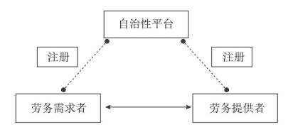

图 1-1　自治型平台交易结构

#### 2. 组织型平台

此类平台不提供虚拟场所，而是基于互联网搭建远程交易通道并制定规则，统一集成于终端App。供需双方注册使用App即表示认可平台规则和使用网络通道。与自治型平台不同，组织型平台的通道不直接联通供需双方，而是使双方分别与平台连接。供需双方分别与平台缔约，彼此之间无直接缔约行为。平台通过定价、接收要约、配置劳动力组织交易链条，形成“需求者—平台”“平台—提供者”两个合同关系。需求者通过App向平台发出要约，该要约是平台定价与服务规则与具体需求的计算结果，平台依技术设定快速承诺，成立劳务需求合同。为履行该合同，平台以一定方式组织劳动力。可见平台角色是劳务交易组织者，[7]本质上已从承载性平台转变为交易渠道。

关于平台用工的最优合同形式尚无定论，平台在实践中不断尝试，形成不同合同组合。某大型网络配送平台曾说明其三种提供方式：一是“自营骑手”，平台与提供者订立劳动合同；二是代理商骑手，代理商与提供者订立劳动合同；三是App众包骑手，自然人下载注册App，利用业余时间接单配送。[8]这三种方式可归为组织型平台A、B、C三种形态，基本涵盖现有运营模式。各模式在配置能力、成本、风险上各有利弊。

##### （1）组织型平台 A 模式

A模式下平台直接雇用劳务提供者，双方订立劳动合同，适用劳动法，除指令通过App发布外，与常规劳动关系并无二致，常称“重资产模式”。[9]合同关系如图1-2。

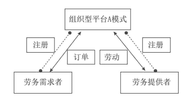

图 1-2　组织型平台 A 模式交易结构

##### （2）组织型平台 B 模式

B模式是A模式的衍生。重资产模式成本较高，平台将特定区域工作量整体外包给代理商，由代理商组织劳动力。代理商为保障履约与提供者签订劳动合同，提供者作为代理商雇员接受管理。平台与提供者之间无直接合同，此为“轻资产模式”。合同关系如图1-3。

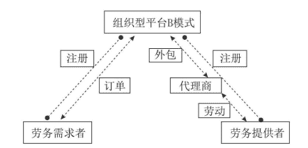

图 1-3　组织型平台 B 模式交易结构

##### （3）组织型平台 C 模式

C模式是真正共享经济意义上的平台用工。提供者在App注册后可自主决定是否、何时、何地提供劳务，拥有不同于劳动法上劳动者的高度自主权。以网约车为例，司机参与流程包括注册与接单两阶段：注册阶段提交身份、驾照等信息，平台审核并通过视频告知操作流程；接单阶段司机打开软件，平台派单，司机确认后完成任务。[10]派单、抢单等操作存在差异，但整体反映出共享经济下的劳动参与方式，体现对闲置劳动力的开发整合，部分提供者已演进为零工形态。[11]代驾、配送等网络劳务亦然。合同关系如图1-4。

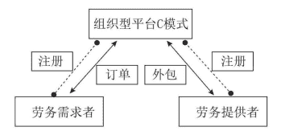

图 1-4　组织型平台 C 模式交易结构

### （三）新就业形态的创新

新就业形态的“新”体现在何处？有观点以平台用工为对象，否定其创新性，认为其“实质上具有以民事关系掩盖雇佣关系、以非标准劳动关系掩盖标准劳动关系的隐蔽性”，[12]等同于隐蔽雇佣。隐蔽雇佣概念由国际劳工组织在《关于雇佣关系的建议书》第4条提出，指“雇主以一种掩盖着某人作为雇员的真实法律地位的方式不把他或她当作一个雇员对待”。[13]评价这一观点是发现创新的关键。

首先，平台用工整体不等同于隐蔽雇佣。如前所述，平台类型多样且持续演进，不宜做整体判断。任何关于平台用工法律问题的分析都应先明确针对何种平台类型。“去劳动关系化”或“隐蔽雇佣”均不能一概而论，只能说平台用工中存在隐蔽雇佣问题，但不能断言平台用工就是隐蔽雇佣。

其次，平台用工中确存隐蔽雇佣问题。隐蔽雇佣第一种情形是以民事关系掩盖雇佣关系，组织型平台A模式下存在此情况，典型案例为“好厨师案”。[14]该案合同约定与实际管理不符，[15]笔者认为其用工模式与常规劳动关系无差别，[16]构成隐蔽雇佣。另一种情形是“以非标准劳动关系掩盖标准劳动关系”，指组织型平台B模式下平台将业务外包给代理商，而代理商并非真正雇主，仅承担劳务派遣中介角色。据此理解，这就是通常所说的“假外包、真派遣”。《劳务派遣暂行条例》第27条规定，用人单位以承揽、外包等名义，按劳务派遣形式使用劳动者的，按本规定处理。平台用工代理商B模式广泛存在，地方规范不一，“假外包、真派遣”情形有可能出现。

再次，隐蔽雇佣与模糊雇佣应区分。隐蔽雇佣是将从属性以其他法律形式掩盖，而模糊雇佣是劳务给付从属性本身存疑。[17]前述文献以“闪送案”论证隐蔽雇佣，[18]但该案与“好厨师案”根本区别在于合同约定与实际履行并无明显差异，闪送平台并未如好厨师平台实施直接指挥管理。因此“闪送案”更可能涉及“模糊雇佣”，而非“隐蔽雇佣”。目前学界争议焦点主要在组织型平台C模式下的劳动关系认定，可结合“模糊雇佣”讨论，而非“隐蔽雇佣”。

隐蔽雇佣不能反推平台用工定性

隐蔽雇佣只是劳动世界长期的一个特例，并不因为平台用工的出现就被豁免。隐蔽雇佣的本质仍指向劳动关系，其要害在于用人单位对劳动者实施指挥监督，因而可以用从属性理论来识别和判定。^([\[19\]](#txt002.html#footnote_content_txt002_19)) 这并不能反过来推导，仅仅因为在平台场景里能见到隐蔽雇佣，就断言所有网约工都具备劳动关系属性。“好厨师案”在平台用工里属于违法个案，能证明平台情境下隐蔽雇佣确有发生，却不足以支撑平台用工整体都属于劳动关系的结论。

## 二、新就业形态对从属性理论的挑战

### （一）从属性理论形成的制度脉络

#### 1. 德国“自由雇佣”与“不自由雇佣”之区分

德国民法传统上把委托合同视作无偿，雇佣合同视作有偿，由此实现清晰划分。^([\[20\]](#txt002.html#footnote_content_txt002_20)) 委托必须无偿，是欧洲法律史留下的残余。罗马法把自由民以精神或知识性劳务提供之契约称作委托。^([\[21\]](#txt002.html#footnote_content_txt002_21)) 当时一般看法是“知识型劳务不宜与报酬挂钩”。^([\[22\]](#txt002.html#footnote_content_txt002_22)) 德国民法典第662条沿袭罗马法的无偿委托原则，规定受托人有为委托人无偿处理事务的义务。^([\[23\]](#txt002.html#footnote_content_txt002_23)) 为了解决有偿劳务提供的问题，德国学者把雇佣契约分为提供高级自由劳务的雇佣与提供低级不自由劳务的雇佣。前者劳动者凭借自身知识技能经验开展工作，自主性保留；^([\[24\]](#txt002.html#footnote_content_txt002_24)) 后者劳动者受雇用人指示权的制约，自主性丧失，即劳动契约。

由此产生判断难题：在雇佣契约中如何判断受雇人是否丧失自主性？“自由”“高级”“低级”等表述抽象难操作。由他人决定的劳动与由自己决定的劳动在实践中边界模糊。为此，德国法院与通说认为，两者差别在于劳动给付义务人人身依附程度的不同，^([\[25\]](#txt002.html#footnote_content_txt002_25)) 即从属性。故有学者归纳，德国法把劳动契约看作雇佣契约的下位类型，其核心特征在于从属性。在“电视台记者的雇员身份案”中，^([\[26\]](#txt002.html#footnote_content_txt002_26)) 争议焦点是劳务提供人属于雇员还是自雇者，即劳动由他人决定还是自主决定。法院认为判断劳动关系成立与否的关键，在于提供劳动一方是否对相对方存在人格从属性。判断重点是契约关系所体现的典型特征，契约是否被命名为劳动合同不具决定意义。

#### 2. 日本法对从属性理论的继受

日本吸纳从属性的前提是其民法承认委托可以有偿。日本民法第648条允许委托经特别约定而有偿。对此，民法大家我妻荣指出，今天社会中发挥重要作用的委托几乎都是有偿的，无偿委托反而稀少。^([\[27\]](#txt002.html#footnote_content_txt002_27)) 因此以有无报酬区分委托与雇佣的德国模式在日本不再适用，日本学者认为，日本民法中的委托包括有偿与无偿，而“雇佣”排除自主劳动，该概念已然提炼。所以德国以“从属劳动”区分雇佣契约与劳动契约的做法并不适用于日本民法框架。^([\[28\]](#txt002.html#footnote_content_txt002_28))

由此日本民法重新调整了委托与雇佣的结构，带来两个问题：民法上的雇佣契约与劳动法上的劳动契约关系如何？在同为有偿的情况下，雇佣与委托如何区分？

## 雇佣契约与劳动契约的关系

日本学界曾围绕是否承认两者相同展开“同一说”与“峻别说”的讨论。学说发展至今普遍认为，两者的理念支撑不同，但适用范围基本一致。曾持否定意见的一方也承认，“劳动契约与雇佣契约的差异几乎仅限于理念层面，在法律适用上没有区分的必要”。^([\[29\]](#txt002.html#footnote_content_txt002_29)) 劳动法权威菅野和夫明确表示，雇佣契约与劳动契约本质上是同一概念。^([\[30\]](#txt002.html#footnote_content_txt002_30)) 民法学者我妻荣同样支持：“我认为民法上作为雇佣的契约都应由新劳动法原理加以调整，在此意义上都可以被视作劳动契约。”^([\[31\]](#txt002.html#footnote_content_txt002_31)) 司法判例亦多持相同立场。^([\[32\]](#txt002.html#footnote_content_txt002_32))

## 委托与雇佣的区别

在确认雇佣契约与劳动契约同一性的前提下，委托与雇佣的区分等同于委托契约与劳动契约的区分，二者在概念上相对清晰：委托以“处理特定事务的整体性劳务”为标的，受托人保留以自身知识经验才干妥善处理事务的自主性；而雇佣则是“以劳务或劳动本身作为标的”。^([\[33\]](#txt002.html#footnote_content_txt002_33)) 依《日本劳动基准法》第9条，劳动者是指“不论职业为何，被企业或事务所使用并领取工资者”。其中“被使用”指的是劳动实施的内容方式等个人自由调整空间受限，需在他人具体管理指示下进行劳动。^([\[34\]](#txt002.html#footnote_content_txt002_34)) 可见，委托与雇佣的差别仍未摆脱德国法上的“自主决定劳动”与“他人决定劳动”的框架，日本法只是把区分的场域从雇佣契约内部转移到雇佣契约与委托契约之间。虽然体系改变，但实践难题与德国一致。委托虽以自主为特征，仍无法完全脱离委托人的指示，二者边界因此模糊。日本区分的标准同样是“从属性”，依劳动基准法第9条又称“使用从属性”。

这一标准成为日本司法区分雇佣与委托的基础。例如“山崎证券事件”中，最高法院认为证券外销员从事外销、接受并代办订单并独立承担义务，从内容看不属于雇佣契约而是委托或类似委托，不适用劳动法。^([\[35\]](#txt002.html#footnote_content_txt002_35)) 又如“大平制纸事件”中，技术员与公司签订业务委托合同，但最高法院认定其工作时间固定并须服从公司指挥管理，故虽名义上为委托，本质应为雇佣合同。^([\[36\]](#txt002.html#footnote_content_txt002_36))

### 小结

我国劳动法最直接的保护手段是书面劳动合同。它能在很大程度上减少劳动关系认定的争议，以最便捷的方式给予劳动法保护。此时“从属性被合同形式所吸收”不失为一种制度理性。也正因一般劳动者占比过大，劳动法关注点下移，忽视了对上端群体进行分析与类型化，并任由书面合同形式惯性涵摄该类人群的法律适用。结果一方面在劳动法内部造成“从属性”与“书面合同形式”的张力乃至矛盾，另一方面使司法陷入“重形式”的误区，愈加忽视从属性作为实质标准的基础性与决定性。

从属性是对劳动者受指挥监督的实际劳动状态的概括，具有不因合同名称及当事人意思而改变的客观性。德国司法与文献的精炼表述是：“如果约定与实际履行不一致，法律关系认定不应依据当事人约定的合同类型及名称，而应依据案件中合同履行的全部事实。”^([\[37\]](#txt002.html#footnote_content_txt002_37)) 从宏观制度层面看，强调从属性的客观性在于，它体现了劳动者因“受拘束劳动”而成为需要保护的社会阶层，这是劳动法的根本立足点，“劳动法制体系的建立，是将劳动者视为群体成员，超越个体层面劳动合同，立基于劳动者身份所代表的特定社会地位”。^([\[38\]](#txt002.html#footnote_content_txt002_38))

### （二）从属性构成的学理分歧

从属性由德国传至日本再到中国，各国虽普遍采纳，但对其构成仍有不同理解，学界大致归纳为“人格从属性”“经济从属性”“组织从属性”。对三者的具体含义、相互关系以及是否均应纳入基础标准，意见不一。因此借鉴域外经验时，应甄别各构成部分所根植的制度框架，深入德日学说与司法脉络，提炼共通法理，再检视本土情形。

#### 1. 人格从属性

在雇佣劳动中，劳动者提供劳务与其人身不可分离，雇主依据契约使用劳动力的过程即是对劳动者人身的支配过程，人格因此处于被支配地位。我妻荣认为，使用人的指挥命令权为便利自身利益而不当地拘束劳务人的人格……从而使劳雇双方形成一定程度的人格性结合关系，^([\[39\]](#txt002.html#footnote_content_txt002_39)) 这一劳务共同体带有浓厚的人格法色彩。而在委托等其他劳务供给契约中，劳务与人格的不可分离并不构成对债务人人格的不当拘束。

德国通说认为从属性仅指人格从属性。联邦劳动法院在实践中归纳其表征为三点：第一，劳动者在雇主指挥监督下提供劳务，时间地点方式由雇主决定，劳动者无法自主；第二，劳动者进入雇主经营或生产组织提供劳务；第三，劳务给付以实现雇主利益为目的。^([\[40\]](#txt002.html#footnote_content_txt002_40)) 须指出，德国司法判断人格从属性有无取决于个案具体情况，并无可机械套用的精确标尺。^([\[41\]](#txt002.html#footnote_content_txt002_41)) 这种做法曾受批评，认为“过于模糊，欠缺法律明确性与安定性，常完全取决于法院主观恣意认定”。^([\[42\]](#txt002.html#footnote_content_txt002_42)) 尽管有批评者提出替代方案，^([\[43\]](#txt002.html#footnote_content_txt002_43)) 却未被主流接受。至今德国司法与学界主流仍遵循人格从属性标准。

#### 2. 经济从属性

学界对经济从属性的分歧较大，多源于对“经济”概念的不同理解。

一种学说把经济定位为劳动者为谋生而必须受拘束的劳动。日本学者川口美贵认为经济从属性与劳动者生存权保障密切相关，劳动者除为雇主提供劳动力外别无生活来源，导致劳资双方谈判地位不对等，形成经济上的从属。

另一种学说主张不考虑劳雇双方实际经济实力，强调“受雇人完全被纳入雇主经济组织与生产结构，但与双方经济或财政状况无关，换言之，受雇人经济状况未必不如雇主”。其核心在于“受雇人并非为自己营业劳动，而是从属于他人，为他人目的而劳动”。^([\[44\]](#txt002.html#footnote_content_txt002_44))

第三种学说同样认为经济从属性源于谋生需要，但不以谋生为决定性要件。该说认为即使受雇劳工无需靠工资维生，也无法动摇其在劳动条件决定上先天缺乏参与的事实。拥有财产的劳工面对雇主提供的岗位要约，同样只能接受或拒绝，不因财富多寡而在劳动条件谈判上占优。此外，经济从属性还表现为“劳务给付双方在经济上存在相当紧密的联系”，包括使用雇主提供的生产工具原料及工作场所，但不承担雇主经营风险。

#### 3. 组织从属性

日本部分学者提出组织从属性，以回应现代企业科层结构下组织化劳动方式的转变。吉田美喜夫认为现代就业形态特征是“指挥命令淡化”“第三者使用”，应在人格从属性基础上重视“企业组织的从属性”，劳动者提供劳动力及雇主使用劳动力均在企业组织内完成，此即劳动力市场内含的从属性。^([\[45\]](#txt002.html#footnote_content_txt002_45)) 恒腾武二则从组织从属论出发提出判断标准：一是生产经营所需设备与资本的支配管理权限；二是使用劳动力的指挥命令方式；三是劳动条件的确定方式。^([\[46\]](#txt002.html#footnote_content_txt002_46))

### （三）从属性构成的厘定

我国司法虽肯定从属性为劳动关系认定标准，但使用方式并不一致，大致有四种：仅使用“从属性”而不展开说明；^([\[47\]](#txt002.html#footnote_content_txt002_47)) 使用人格与财产从属性；^([\[48\]](#txt002.html#footnote_content_txt002_48)) 使用人格与经济从属性；^([\[49\]](#txt002.html#footnote_content_txt002_49)) 使用人格经济组织从属性。^([\[50\]](#txt002.html#footnote_content_txt002_50)) 各地法院对人格从属性基本能把握“指挥监督”的本意，而对组织经济财产的解释各有不同，含义相互交叉。可见司法对从属性的理解尚需厘清。

首先，人格从属性的核心应是“受拘束下的服从”。雇主指挥监督之所以形成人格从属，本质在于劳动者给付劳动的“不自由”。与委托相比，有如下特点：（1）过程控制。雇主的指挥命令是对劳动过程的控制，劳动者无权拒绝指示，不得违反工作时间地点方式等安排。雇主通过对个体指示实现劳动力组合，以达经营目标；而委托中，委托人将待处理事务整体交予受托人，指示多指向预期结果，过程由受托人依据经验掌握。（2）指示频率。雇佣中，雇主的指挥命令在合同期内频繁细致，形式可以是书面或口头，也可通过规章工作手册操作规范等制度化安排；而委托中，委托人不可能事无巨细指示，更难作出制度化安排。（3）拘束强度。有偿委托可约定违约责任，这只是对结果的约束；而雇佣劳动过程中，劳动者全程受监督，违反规章可能受惩戒直至解雇，形成雇主权威并实现对劳工内心活动的干涉与强制。

其次，经济从属性应限定为两方面：劳动者积极意义上使用雇主提供的劳动条件给付劳动并获得报酬；消极意义上不承担雇主生产经营风险。（1）关于“劳动谋生”的理解，笔者认为应分为两点：其一，坚持工资即劳动对价。雇佣标的是劳务或劳动力本身，劳动者在受拘束下提供劳动应获得相应对价，体现雇佣合同的交易性。其二，不以谋生为目的。随社会经济发展，个人谋生手段多元化，部分人可不靠劳动维生。虽绝大多数就业人口需职业劳动，但劳动者作为只能出卖劳动力的赤贫阶层的现象已消失。^([\[51\]](#txt002.html#footnote_content_txt002_51)) 劳动者是否比雇主富有、是否以工资谋生，与劳动法相关，却非从属性的核心要点。（2）劳动者借助雇主提供的劳动条件提供劳务。传统上包括工作场所设备原材料，现代商事活动下应拓展至雇主的生产经营组织经销网络等，如销售业务员的工作条件。（3）劳动者不承担雇主经营风险。雇主对经营成败自主把握，其对劳动力调配以实现营业目标是能力体现。无论盈亏，基于雇佣合同的劳动债权均不受影响。

最后，组织从属性没有必要单列。其主张的现代公司科层结构下指挥监督方式改变的观点，实质是人格从属性的另一种表述。劳动者进入雇主组织成为生产经营一环的说法，则属于经济从属性内容。至于医生会计工程师等专业人员是否欠缺人格从属性雇主能否干涉劳动内容，我妻荣早已指出，“使用人拥有指挥命令权能，并非针对劳务内容，而是意味着就劳务指向何种目的如何发挥作用——其配置排列组合等——拥有指挥权能”。^([\[52\]](#txt002.html#footnote_content_txt002_52)) 可见组织从属性的提出是对人格与经济从属性缺乏把握所致，无需作为独立构成要件。

综上，从属性应包含人格与经济两项要件，其中人格从属性把握雇佣劳动本质，应为主要要件；经济从属性重在描述劳动过程，应为次要要件。

### （四）“控制”与“自主”的迷思

平台用工在研究中被聚焦的两个关键法律要点是：一方面平台通过评分机制与数据收集对劳动者服务过程进行控制，以网约车为例，“司机完成工作的方式与工作环境受到评分机制管控……评分机制暗含监督管理权与冲突转移”。^([\[53\]](#txt002.html#footnote_content_txt002_53)) 另一方面劳动者享有较大工作自主权，可自行决定是否工作何时工作何地工作，这在常规劳动关系中难以出现。

#### 1. 控制派：主张平台与骑手构成劳动关系
在德国研究里，Kocher 与 Hensel 认为证明双方存在劳动关系的核心抓手，就是平台建立的面向从业者的评价、反馈和排名机制，^([\[54\]](#txt002.html#footnote_content_txt002_54))Krause 进一步指出，客户评价的规则由平台制定，合同中由平台单方锁定强制性的履约方式，例如车辆类型与车况、面对客户时的着装与行为规范。^([\[55\]](#txt002.html#footnote_content_txt002_55))

国内对平台支配强度的判断呈现两条路径。一条强调支配比传统企业更强，常凯教授提出“从业者在平台上的任何操作都限定在互联网企业预设的程序之内，可以说互联网企业时刻都在向平台人员下达指令、实施指挥……互联网经济中的从业者承受的比传统企业更严苛的人格约束”。^([\[56\]](#txt002.html#footnote_content_txt002_56))谢增毅研究员亦认为“相较传统用工，平台对人员的控制并未减弱而是增强了”。^([\[57\]](#txt002.html#footnote_content_txt002_57))

另一条则认为支配在相对弱化，依附性随之下降。学界为此提出“非典型用工关系”的表述。张素凤副教授在网约车研究中提出“专车软件运营商与司机之间形成从属性减弱、用工性质模糊的非典型关系”。^([\[58\]](#txt002.html#footnote_content_txt002_58))田思路教授主张，网络平台的共享劳动等灵活形态削弱了依附性，“比如从业者依据用户企业或网络平台公司的指示提供服务，具有了部分从属性的特征，处于雇佣与自营之间的中间地带”。^([\[59\]](#txt002.html#footnote_content_txt002_59))

#### 2. 自主派：主张不应认定劳动关系
德国学者 Lingemann、Otte 认为，即便平台用工具备若干劳动关系的特征，司法实践中多数仍被否定，关键在于从业者拥有充足的自由来决定服务的时间与地点。^([\[60\]](#txt002.html#footnote_content_txt002_60))Schubert 提出，从业者并非在平台指令下开展常规性工作。^([\[61\]](#txt002.html#footnote_content_txt002_61))Bourazeri 则主张，平台的技术标准与质量要求并非雇主的指挥权，仅是对劳务提供方式的描述。^([\[62\]](#txt002.html#footnote_content_txt002_62))

国内持此立场的学者认为平台用工不符合用工关系的依附性标准。于莹教授指出，“由于劳动提供者可以自己掌握工作的时间和强度，其人格的从属性很弱。在报酬上，劳动提供者一般是按次计酬，平台并不控制工资，经济上的从属性也相对弱化。另外，此时劳动提供者更是不从属于企业的体系，也未纳入企业组织之中，组织的从属性也较难符合，不符合从属性理论的要求”。^([\[63\]](#txt002.html#footnote_content_txt002_63))班小辉副研究员认为，平台用工作为“零工经济的任务化用工”，劳动者“受到平台企业控制的特征并不明显”，与常规劳动关系相比，平台用工“削弱了用工关系的继续性、模糊了用工关系的人身从属性、弱化了用工关系的组织从属性、降低了用工关系的经济从属性”。^([\[64\]](#txt002.html#footnote_content_txt002_64))娄宇副教授更直接认为，“劳动者参与经济生活和获取报酬的方式也发生了本质的变化，他们不再是雇主组织中的雇员，而演变成为与平台企业合作的自我雇佣者”。^([\[65\]](#txt002.html#footnote_content_txt002_65))

#### 3. 分歧的核心
学界难以达成一致的症结在于，平台对人员的支配力度，相较传统雇主，是增强还是减弱？这直接决定人员是否具备劳动法意义上的依附性。若支配增强，按现行依附性理论即可判定，问题本质是执行；若支配减弱导致“模糊雇佣”，是否需要修正依附性理论与认定标准，将平台用工纳入劳动法调整，或另行构建保障机制？无论如何切入，依附性都是绕不开的必经路径。

### （五）从属性理论对新业态的解释困境
学界普遍承认从属性是用工关系的本质，是人员在雇主指挥监督下提供劳务的法律抽象，但对从属性的构成、各要件内涵及判断方法尚未形成共识，围绕平台用工的分歧主要体现在以下方面。

### 第一种观点
该派主张维持现有从属性标准，“传统劳动关系概念和判定标准具有较强的弹性和适应性。并非完全过时，仍可包容网络平台用工关系”，^([\[66\]](#txt002.html#footnote_content_txt002_66))面对新型用工形式，“直接套用现有的法律规定会面临适应性问题”，^([\[67\]](#txt002.html#footnote_content_txt002_67))相应的对策是“应该在坚持劳动关系的认定标准以及相应劳动立法的基础上，针对平台以及平台从业者的特点进行针对性的适当调整”。^([\[68\]](#txt002.html#footnote_content_txt002_68))该立场建立在平台用工控制更强、符合现行从属性标准的基础上。

### 第二种观点
该派主张修正从属性理论以放宽认定。王全兴教授认为，“依据劳动关系是从属性、继续性之用工关系的原理，以部分组织从属性、外部经济从属性、继续性等要素探索据以认定非典型劳动关系的指标系列……将从属性达到一定程度且有继续性的‘网约工’认定为非典型劳动关系”，并有选择地适用劳动法保护手段。^([\[69\]](#txt002.html#footnote_content_txt002_69))田思路教授指出，“即使从业者没有人的从属性，但被认为存在经济的从属性时，可以较为广泛地对符合劳动契约目的的法律规定加以适用，并提供与该从属性程度相对应的一定的法律保护”。^([\[70\]](#txt002.html#footnote_content_txt002_70))该派认为平台用工支配程度较弱，按现有标准难认定，故通过修正或放宽标准实现劳动法适用，并以“非典型劳动关系”定位使保护区别于常规用工。

### 第三种观点
该派主张坚持现行标准认定劳动关系，既然平台用工不符合现行标准，就不是劳动关系，应创设一种新型法律关系。班小辉副研究员认为，应将劳动法的调整对象从传统的“劳动关系”转变为“工作关系”，“将在经济依赖地位下亲自提供劳务的就业主体纳入劳动法的保护范围”。^([\[71\]](#txt002.html#footnote_content_txt002_71))于莹教授认为“在劳务关系与劳动关系的中间建立第三种用工关系模式——零工关系”，不纳入劳动法调整，但给予工资、工时和社保方面的保障。^([\[72\]](#txt002.html#footnote_content_txt002_72))

总体来看，从属性分歧的根源仍在于对平台控制程度的不同判断，由此导致劳动关系定性的不同结论，以及是否适用劳动法和如何适用的不同观点。各方论证逻辑见图 1-5 所示。

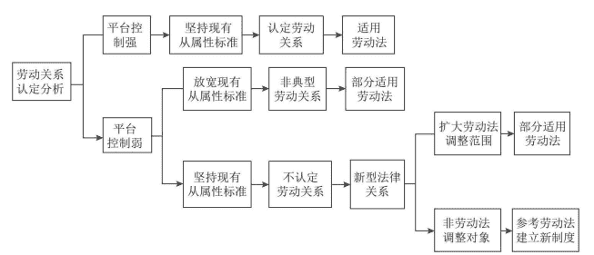

图 1-5　从属性学理分歧

## 三、司法裁判面临的困境

### （一）裁判分析的必要性
法院对外卖平台灵活用工模式法律关系的判断具有权威性。相关判决中，双方会按法定标准举证证明关系性质，平台往往说明其已有的几种劳动力组织模式及个案合作方式。案例积累到一定程度，可发现不同平台在多案中的组织模式相互印证，揭示出当前外卖平台的主要类型。

即便通过调研访谈，也难以全面掌握外卖平台的真实运作。但诉讼中平台必须按实际情况提交证据，详细说明组织方式、报酬支付、管理细节，经法院检验的事实更具客观性。判决书涉及的平台类型多样，涵盖多行业，按案件发生情形与比例，能较全面反映中国外卖平台的现状。

判决书除提供平台事实外，还系统呈现法律对平台的立场。外卖平台需要制度规制，骑手权益也需法律保障，因此在当前视野下，平台性质判断与症结分析尤为重要。

### （二）裁判的规范基础
平台用工已成普遍化、规模化方式，但现有法律体系尚未作出明确规定。《网络预约出租汽车经营服务管理暂行办法》第 18 条规定“网约车平台……根据工作时长、服务频次等特点签订多种形式的劳动合同或者协议”，此规范属“当事人选择模式”，实质回避了关系定性问题。《电子商务法》第 9 条规定了“电子商务经营者”，外延涵盖外卖平台中的人员，将其作为“平台内经营者”的一种，即“通过电子商务平台提供服务”的自然人。^([\[73\]](#txt002.html#footnote_content_txt002_73))该法亦未指明平台内经营者与平台的关系性质，仅第 47 条规定，“电子商务当事人订立和履行合同适用本章、《中华人民共和国民法总则》《中华人民共和国合同法》《中华人民共和国电子签名法》等法律的规定”，与前述“多种形式的劳动合同或者协议”并无实质差异，仍属“当事人选择模式”。该法特别之处仅在登记豁免，即第 10 条“个人利用自己的技能从事依法无须取得许可的便民劳务活动”无需登记。

这种立法上的“当事人选择模式”无法适用于外卖平台用工。若平台有意订立劳动合同，会选择平台雇佣或代理商雇佣模式，纳入基础运力。而在基础运力之外的灵活用工中，人员与平台几乎无合同选择权，完全由平台在软件中提供选项，人员只能同意或离开，选项中并无劳动合同。中国法框架下，以劳务为标的的合同分为劳动合同与民事合同两大类，后者包括承揽、委托等。两类合同根本区别在于劳动合同含大量强制性规定，劳动法保障全面且水平较高，雇主对雇员职务行为承担责任；民事合同无此强制性，人员通常自行承担行为责任。区分依据在于劳动合同下雇员被视为在雇主指挥下工作，缺乏独立性，是“从属劳动”；民事合同下双方被视为地位平等，是“独立劳动”。由此形成的立法框架是“从属劳动—独立劳动”二元结构。对平台而言，劳动合同的强制规范意味着更高成本，理性选择必然是与人员订立民事合同。在平台与人员之间，前者居强势，后者个体无议价能力。所谓“当事人选择模式”，实为“平台选择模式”，结果必然是民事合同。

### （三）外卖平台创新模式争议案件梳理
外卖平台虽选择民事合同，一旦骑手与平台发生争议，可向法院起诉重新判断关系性质，法院也可自主判定以确定责任分担。此时立法回避的定性难题变为裁判争点，产生司法分歧。在“中国裁判文书网”检索 2014—2019 年外卖平台争议判决，^([\[74\]](#txt002.html#footnote_content_txt002_74))排除平台或其代理商雇用的平台雇佣与代理商雇佣模式，仅针对灵活用工，至 2019 年底已判决案件有 102 件，主要涉及代驾、送餐、快递等网络劳务。时间分布上 2014 至 2016 年争议较少，2017 年起大量增加，此后未明显增长，参见表 1-1。

表 1-1　外卖平台创新模式争议的年度分布

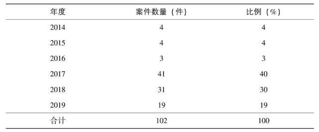

争议多发于外卖平台发达城市，以北京、上海为代表，两市案件占总量一半以上。随着平台拓展，其他主要城市亦出现此类争议，参见表 1-2。

表 1-2　外卖平台创新模式争议的地域分布

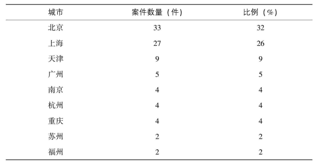

续表

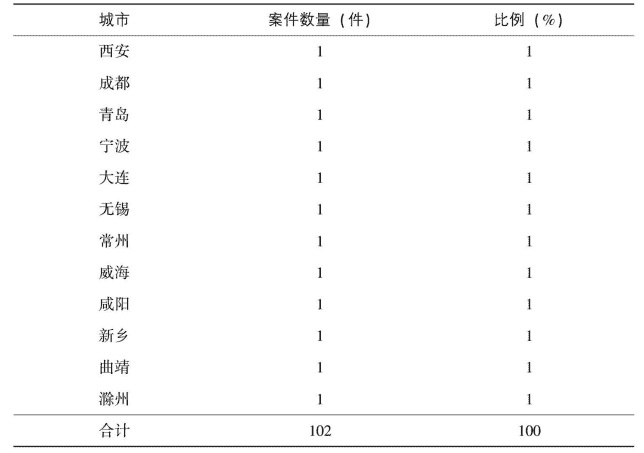

争议案件情节普遍简单，证据争议不大，双方对事实基本无异议，争议集中于关系定性。从审级看，多数案件一审终结，当事人接受判决。少数进入二审，参见表 1-3。

表 1-3　外卖平台创新模式争议的审级分布

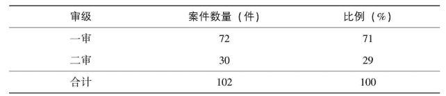

二审法院立场相对保守，30 件案件中仅 3 件改判。可见在无成文法依据、亦未形成审判共识时，二审倾向尊重一审对关系定性的认定。要说明的是，一个案件通常含多个诉讼请求，二审会审查全部诉求判决结果。本书仅考察二审对关系定性的裁判结果，参见表 1-4。

表 1-4　外卖平台创新模式争议的改判分布

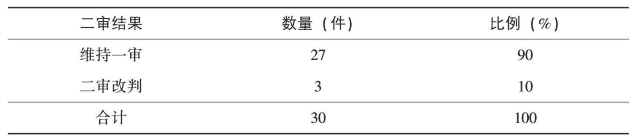

### （四）外卖平台创新模式争议的裁判要点
外卖平台争议起因主要有两类：一是人员请求法院认定与平台存在劳动关系，常见情形为送外卖过程中受伤，欲通过定性获得工伤保险待遇；二是人员在配送中致第三人损害，需判断平台与人员合同关系以确定赔偿责任承担。两类案件基于相同用工模式，劳动事实几乎无差别，证据问题不大。正是法律空白，使得司法对关系定性具有决定性影响。若认定为劳动合同，则平台对人员自身伤害及其造成的第三人损害承担雇主赔偿责任；若认定为民事关系，则由人员个人承担责任。参见表 1-5。

表 1-5　外卖平台创新模式争议的起因

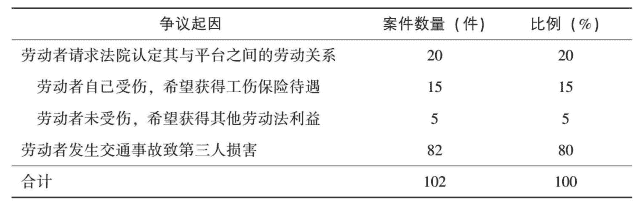

在请求认定劳动关系的案件中，若人员未受伤仅主张定性，现有判决多不予支持；若人员已受伤，有迫切医疗需求，则获支持概率较大。原因可能在于法院在无明确成文法规定时享有较大自由裁量权，往往出于人道主义与扶助弱者考虑扩大解释劳动关系，在不牵涉其他劳动利益时，仅就工伤赔偿请求判定劳动关系，平台亦有实力承担赔偿，避免受伤者生活陷入困境，达到较好社会效果。实践中平台通常为人员购买人身保险，额度约 10 万元人民币，可覆盖多数轻微伤害。若伤害严重，如交通事故导致骨折，后续治疗费用往往超出保险金额。一起案件中，人员在履行平台快递订单时严重受伤，前期治疗耗尽保险赔偿后无力进行下一阶段治疗。法院通过认定劳动关系帮助其获得工伤赔偿，使其能继续治疗。^([\[75\]](#txt002.html#footnote_content_txt002_75))参见表 1-6。

表 1-6　请求认定劳动关系的案件判决结果

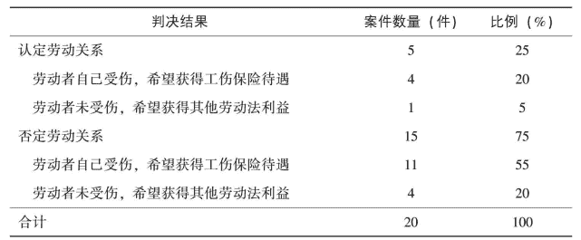

中国当前常见平台用工均涉及交通运输，如代驾、送餐、快递，故交通事故是伤害主因。除人员自身损害外，大量情况为人员在通行中造成第三人人身或财产损害，导致第二类案件占多数。受害第三人为社会不特定对象，即社会公众，任何参与公共交通者都可能受用工平台侵害，已成为社会风险。究其原因，平台虽对服务有多项要求，但对人员是否遵守交通规则基本放任。遵守规则意味着在途时间延长，导致效率降低，人员单位时间内完成订单减少，收入下降。因此放任违法对平台而言是理想选择，旨在追求效率最大化，但将效率成本转嫁给社会公众，产生用工社会风险。现有判决对该社会风险如何分配尚未形成清晰认识。65%案件判定由人员个人承担责任，但平台人员多为进城务工人员，根本无力承担赔偿，即便判决也难执行。另一方面平台具备承担能力，但在法律逻辑上必须以劳动关系为前提，才能说明平台作为侵害行为之外主体为何对他人损害承担责任。鉴于用工平台与劳动关系的显著区别，为达到较好社会效果分配社会风险，有 35%法院扩大解释劳动关系作出平台承担责任判决。特例中法院认定人员与平台应分摊赔偿责任，该判决折射出法院困境：既认定劳动关系，又未按劳动关系判定平台承担全部责任，而是提出这是一种新型用工关系，应由双方分摊责任。^([\[76\]](#txt002.html#footnote_content_txt002_76))法院困境显示法律对用工平台规制不足，既看到平台不同于劳动关系的特点，又缺乏概念与规则予以调整，参见表 1-7。

表 1-7　劳动者致第三人损害的案件判决结果

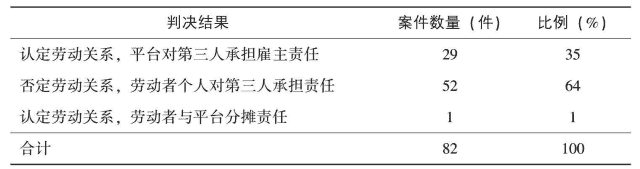
平台用工争议的案件事实大多清晰可辨，真正造成裁判不一的原因在于法官对劳动关系认定的观察重点不同。

首批判决将劳动者与网络平台的关系定性为劳动关系、劳务关系或雇佣关系。这类案件相对稀少，几乎都与劳务执行过程中出现的人身或财产损害有关，其中劳动者本人受损的案例很少，主要集中在劳动者致第三人损害的情况。法院在确定责任主体时，通常会考察劳动者是否从事平台的主营业务、是否接受平台管理并受制度约束、报酬是否来自平台等。不同法院的概念使用并不一致，有的选用“劳动关系”^([\[77\]](#txt002.html#footnote_content_txt002_77))、“劳务关系”^([\[78\]](#txt002.html#footnote_content_txt002_78))、“雇佣关系”^([\[79\]](#txt002.html#footnote_content_txt002_79))三种表述，也有个别法院没有明确定性，仅以“工作人员”“执行职务”等描述性用语来表述。^([\[80\]](#txt002.html#footnote_content_txt002_80))

裁判在处理这类案件时大致采用两种路径：第一种是依据原劳动和社会保障部《关于确立劳动关系有关事项的通知》所列的要素认定劳动关系，由平台承担用人单位的责任；第二种是少数法院不直接认定劳动关系，而是借助“劳务”“雇佣”“工作人员”“执行职务”等替代性表述，直接援引2009年《侵权责任法》第34条第1款“用人单位的工作人员因执行工作任务造成他人损害的，由用人单位承担侵权责任”的规定，由平台承担责任，从而完成归责，绕开劳动法体系，也避免了劳动关系带来的其他保障义务。^([\[81\]](#txt002.html#footnote_content_txt002_81))

另一批判决则否定了劳动关系的存在，这类案件数量更多。具体可分为两类：一类是劳动者为争取工伤救济等权益而请求确认关系；^([\[82\]](#txt002.html#footnote_content_txt002_82))另一类是劳务履行导致第三方受损，法院为分配责任而判断双方的合同性质。^([\[83\]](#txt002.html#footnote_content_txt002_83))法院的否定依据主要是劳动者的工作特征：劳动者可以自主决定是否承接业务、承接时间与地点，所得并非劳动报酬；平台不提供劳动工具，对劳动者缺乏实质性管理、支配或强制约束，不具备从属性，双方不构成劳动关系。因此平台无需承担劳动法意义上的用人单位义务，也不对劳动者造成的第三人损害承担赔偿责任。

在否定劳动关系的同时，部分法院进一步分析了合同性质，认为网络平台本质上是通过信息撮合提供居间服务，与劳动者之间构成居间合同关系。^([\[84\]](#txt002.html#footnote_content_txt002_84))在涉及第三人损害赔偿的案件中，也有少数法院不把劳动关系认定作为前提，直接根据平台的功能和行为将其定性为居间人。^([\[85\]](#txt002.html#footnote_content_txt002_85))

总体看，法院在规则不明的状态下给出了集中判断。如表1-8所示，多数情况下约66%并不认为平台与劳动者之间成立劳动关系，这一倾向符合现行法律逻辑。

表 1-8　法院就平台与劳动者之间关系的总体判断

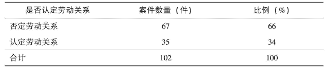
综合两类判决，面对基本相同的事实，司法形成了多样的裁判逻辑，如图1-6所示。

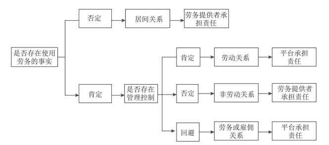
图 1-6　外卖平台创新模式司法裁判分歧

居间、劳动、劳务或雇佣等多种定性并存，说明用工平台在法律视野中呈现碎片化。法院缺乏分析平台合同关系的学理框架，连管理与控制等基础事实的判断上也未能达成共识。

## 四、学理层面的回应

### 新就业形态下平台与劳务提供者的法律关系

新业态下平台与劳务提供者究竟是什么法律关系，能否以从属性为标准衡量，需要先在现行法框架下检视。现行法要对平台这一矛盾体进行解释，既要关注平台在劳动过程中对提供者的控制程度，也要看到提供者能够自主决定是否工作、何时何地工作的自主性，据此判断适用劳动法还是民法。现行法的分析核心在于阐释事实的法律后果，也为后续学理探讨做准备。

## （一）现行法下的劳动关系认定

现行法对劳务给付的调整思路是“从属性劳动—独立性劳动”的二分，独立性由民法调整，从属性由劳动法调整。分析平台时，首先判断是否符合劳动关系从属性的标准，符合则由劳动法调整，不符合则进入民事合同体系。

从属性判断分歧的一个重要原因在于学界理解不一。本文认为，不论是二要件论还是三要件论，法律标准必须提供明确指引，即何种证据足以证明从属性，可以是直接的控制证据，也可以是多个间接证据的组合。从属是事实判断，在劳务关系中，接受劳务方对提供劳务方具有指示权时即可说存在某种从属。而劳动关系认定中的从属性是对从属程度的法律评价，是性质判断而非程度判断。只有当提供劳务方对接受方的从属程度足够强时，才能认定从属性存在，具体证明路径需依赖构成要件。

在构成要件中，人格从属性是核心，决定了雇佣劳动的本质；经济从属性居次要地位，用于描述劳动过程。组织从属性是对前两者理解不足的产物，无需单独列出。^([\[86\]](#txt002.html#footnote_content_txt002_86))无论将从属性分解为几个要件，核心始终是人格从属性。回到平台场景，需要考察平台对提供者的控制是否增强，是否形成了更为紧密的人格性结合。本文提出四个判断要点。

### （1）平台在劳动过程中对数据信息的收集和记录不等同于控制

劳动关系语境下，控制应包含明确的指挥监督，并伴随惩戒，从而形成人格性结合。平台在劳动过程中并未向提供者发出具体明确的指令，其收集和记录的信息实质是事后评价劳务质量的依据，且该监督也包含平台履行政府强制安全保障义务的内容。讨论控制时，多以网约车或代驾为例，涉及司机与乘客直接接触的过程；而在外卖送餐、同城快递等大量场景中，平台很少主动介入过程管理，更关注结果，如准时与完好。因此，平台对劳动的控制并非增强，而是减弱。

### （2）顾客评价体系不足以证明存在劳动关系

德国学者Waas认为顾客事后评价几乎不能视为从属性工作，评价体系对提供者的主要影响是未来能否继续与平台合作，最多体现经济从属性，而非人格从属性^([\[87\]](#txt002.html#footnote_content_txt002_87))。评价的惩戒效果本质上是合同罚则，在劳动关系之外的合同中也很常见，难以证明劳动关系。本文同样认为顾客评价是平台将服务质量控制外包给顾客的手段，管理的是劳务结果而非劳动过程。雇主的权利包括对全过程的管理，通过过程管理实现结果控制。顾客评价中的惩戒实质是提供者未履行平台合同约定的违约责任，而非雇主因违反指示权而作出的惩戒，后者属于管理行为。据此，顾客评价体系不能证明人格从属性，其对经济从属性的影响也不足以认定劳动关系。正如德国慕尼黑地方法院2019年判决指出，以平台为主要收入来源而感到压力并持续缔约，不意味着提供者有权适用雇员保护规定^([\[88\]](#txt002.html#footnote_content_txt002_88))。

### （3）劳务提供者的自主性是否定劳动关系的重要依据

美国学者Harris指出，“独立从业者可自行决定是否以及何时向顾客提供服务”是平台与独立从业者关系中最重要的创新，由此平台与从业者均对工作有控制，但关键决策权仍在从业者手中，没有雇员能像独立从业者那样自由选择何时、是否、如何、在何地工作^([\[89\]](#txt002.html#footnote_content_txt002_89))。主张平台控制增强的观点忽视了提供者的自主性。若提供者能自主决定是否工作及时间地点，就难以认为平台整体控制更强。平台通过赋予自主性，打破了工业时代的立体化劳动组织，形成了基于网络的平面化组织，平台经济的灵活高效与提供者的自主性相互依存。这种自主性在科层制中不存在，正是平台创新的体现。凭借此自主性，劳务提供者几乎不可能与平台形成人格性结合。

### （4）多指标的综合判断须以人格从属性为依归

平台存在多项相互冲突的指标，如信息独占、价格决定、佩戴平台标识等外观因素。这些能证明提供者的弱势地位，但不能证明从属性。个案中对全部指标的综合判断应归结到是否形成人格性结合。大陆法系从属性理论与英美法系控制理论虽都是对劳动关系本质的抽象，但在推理方法上不同，前者侧重归纳，将用工特征代入从属性公式得出结论；后者侧重演绎，追求列举典型特征^([\[90\]](#txt002.html#footnote_content_txt002_90))，作为法官裁判指引。在我国现行体系下^([\[91\]](#txt002.html#footnote_content_txt002_91))，将从属性判断要素列举或指标化有助于定性，但不应混淆两种推理思维。所有指标最终服务于从属性公式，采用归纳方法判断从属程度是否达到人格性结合。各项指标证明力不一，能直接证明人格从属性的指标证明力最强，如过程控制、指示频率、拘束程度；生产条件、劳动报酬、经营风险等证明经济从属性的指标仅具辅助作用，证明力较弱^([\[92\]](#txt002.html#footnote_content_txt002_92))。

综上，在现行法下，用工平台对劳务提供者的控制程度低，未形成人格性结合，缺乏人格从属性，不符合从属性标准，不成立劳动关系。

## （二）现行法下的民事合同类型

劳动法讨论的平台以劳务为标的，本质是“劳务之债”，以劳务履行为内容，不外乎雇佣、承揽、委任等形式^([\[93\]](#txt002.html#footnote_content_txt002_93))。平台虽未达到人格从属性，但与承揽、委任等要求当事人平等的典型合同显著不同。需要单独辨析的是平台与雇佣关系，以及若不构成雇佣，应属于何种合同类型。

### （1）平台与劳动者之间不构成雇佣关系

有学者主张即使不成立稳定劳动关系，至少可成立雇佣关系^([\[94\]](#txt002.html#footnote_content_txt002_94))，司法上也有认定为雇佣关系的判决^([\[95\]](#txt002.html#footnote_content_txt002_95))。谢增毅指出，雇佣合同关注劳务提供与报酬支付的财产利益，合同法难以照顾到劳务提供者的身份属性与人格要求，劳动合同区别于一般雇佣在于劳动者从事从属性或依附性劳动^([\[96\]](#txt002.html#footnote_content_txt002_96))。郑尚元提出现代劳工关系可称为产业雇佣关系，调整不仅涉及个别契约，更追求劳资关系整体协调^([\[97\]](#txt002.html#footnote_content_txt002_97))。据此，雇佣与劳动在内容上都是劳务给付，区别在于结合程度。具体到平台，平台通过顾客评价系统等方式施加的控制针对劳务结果而非给付行为本身，二者的根本区别在于标的：前者为劳务结果，后者为劳务给付行为。

### （2）平台涉及的合同属于非典型合同中的混合合同

平台的创新性在于混合多种用工特征，不符合任一典型合同，以单一契约说解释会陷入局限。网络改造社会生活的速度远超以往，平台在短时间内形成大规模交易方式，以非典型合同形式达到典型合同的社会效果。从非典型合同视角看，平台既包含承揽合同对结果的要求，又涉及提供者的经济从属性，属于承揽与劳动合同特征混合的“类型融合契约”^([\[98\]](#txt002.html#footnote_content_txt002_98))，“原则上应当适用此两种类型的规定”^([\[99\]](#txt002.html#footnote_content_txt002_99))。

## （三）平台劳务提供者的学理画像：类雇员

平台在现行法下是非典型合同，但不妨碍学理构造。本文认为平台劳务提供者在学理上应是“类雇员”，该概念源自德国，是从属性的副产品。德国早期就意识到并非只有工人需要保护，1869年即提出扩大保障范围^([\[100\]](#txt002.html#footnote_content_txt002_100))，1923年梅尔斯巴赫提出对有同等保护需求者制定专门规定或类比适用劳动法^([\[102\]](#txt002.html#footnote_content_txt002_102))。《德国劳动法院法》于1926年首次界定类雇员，此后1934年经济从属性被纳入其基本特征^([\[103\]](#txt002.html#footnote_content_txt002_103))。类雇员主要为家内工作者，其合同“很少是纯粹雇佣，更像是买卖、承揽与雇佣的结合，地位介于自由企业主与劳动者之间”^([\[104\]](#txt002.html#footnote_content_txt002_104))。德国以“自营业者—类雇员—劳动者”的三分法调整保障强度随拘束程度递增。

借用“旧瓶新酒”与“新瓶旧酒”的说法，在已有类雇员规范体系的德国，用类雇员规范调整平台是“旧瓶新酒”。而我国现行“从属性劳动—独立性劳动”或“劳动者—民事主体”的二分法框架下，平台调整是“新瓶新酒”，应依据类雇员学理在劳动法中选取适当制度，针对提供者自身保障需求构建规范体系，推动二分法向三分法转型。

## （四）平台的劳动本质：承揽合同的社会化

# 从雇佣到劳动合同，再到平台承揽

劳动合同的源头可以追溯到雇佣契约。当双方地位被视为对等，交易仅限于劳务让与，且接受劳务一方并未对提供劳务一方形成人格上的统御时，这种状态仍可称之为自由劳动。工业化兴起后，“自由劳动同实现自由劳动的客观条件相分离”，于是出现“一无所有且只能靠出售自身劳动力来维持生存的劳动大军”，^([\[105\]](#txt002.html#footnote_content_txt002_105))自由劳动的实质被瓦解，雇佣契约被劳动合同取代，“不具从属性的一般雇佣关系的比例低、数量少。因此，大部分劳务提供者都作为雇员或‘劳动者’受到劳动法的调整和保护”。^([\[106\]](#txt002.html#footnote_content_txt002_106))劳动合同及其配套规则的产生，本质上是雇佣契约社会化的产物，郑尚元教授指出“雇佣契约实际上已经社会化了，契约的履行不单纯是雇佣关系主体之间的私人事件，而是渗入了社会要素”。^([\[107\]](#txt002.html#footnote_content_txt002_107))从雇佣契约转向劳动合同，合同标的即劳务给付并未改变，改变的是给付过程中人与人的结合形态，由独立走向依附，因而劳动立法才得以摆脱民法的附属地位。

笔者以为，用劳动法的思路去解释平台用工为何衔接不畅，关键在于平台的起点并非雇佣而是承揽，是承揽契约社会化的结果。承揽与雇佣在实务中本就难以清晰区分，^([\[108\]](#txt002.html#footnote_content_txt002_108))而在合同法语境里承揽多针对有形物，^([\[109\]](#txt002.html#footnote_content_txt002_109))在网络技术推动下完成社会化后，反而更容易与劳动关系混同。就其基本特征看，承揽要求承揽人独立完成劳务并交付特定成果，定作人不介入作业过程，且承揽人主要服务于单一定作人的情形并不典型。工业化在社会化雇佣的同时也社会化了承揽，比如德国工业化分工中大量为工厂提供配套加工服务的群体，早在19世纪便出现“圆珠笔的生产厂家生产出零件以后把组装的工作交给好几个家庭来完成”。^([\[110\]](#txt002.html#footnote_content_txt002_110))这正是类雇员的萌芽。经历此种社会化过程，承揽人独立性逐步流失，叠加经济从属性后，承揽人便演变为类雇员。

平台可视作类雇员在网络环境下的新形态，其本质是将零散偶发的以劳务为内容的承揽，通过网络技术迅速升级为社会化服务。外卖送餐、同城快递的承揽属性非常明显，即便网约车、代驾，从运送合同的性质看也属于承揽合同。^([\[111\]](#txt002.html#footnote_content_txt002_111))从此视角审视，平台是承揽人面向定作人以外第三方完成特定劳务结果，该结果由定作人与第三方事先约定，故契约亦约定了承揽人面向第三方完成的方式与标准，这即所谓行为外观因素。顾客评价系统表面上将评价权让渡给用户，实质上最终裁决仍在平台手中，平台据此对承揽人实施奖惩。因承揽关系在一段时间内反复发生，承揽人的履约情况及第三方评价会持续影响报酬与再缔约机会，这种影响客观上固化为“平台积分”，笔者认为可以归入经济从属性来理解。劳务提供者因积分与平台形成更紧密的经济联结，对平台定价与服务规范的服从意愿增强，作为承揽人的独立性趋向弱化，获得社会保护的需求则持续上升。

## 五、政策演进及其趋势
# 新业态保障：从二元到三元

人力资源社会保障部等八部门于2021年7月16日联合印发的《关于维护新就业形态劳动者劳动保障权益的指导意见》，将依托互联网平台就业的新形态划分为三类：（1）符合确立劳动关系情形的，企业应当依法与劳动者订立劳动合同。（2）不完全符合确立劳动关系情形但企业对劳动者进行劳动管理的，指导企业与劳动者订立书面协议，合理确定企业与劳动者的权利义务。（3）个人依托平台自主开展经营活动、从事自由职业等，按照民事法律调整双方的权利义务。第1项、第3项分别对应劳动关系与民事关系，由劳动法与民法调整，构成现行“劳动二分法”框架。而第2项“不完全符合确立劳动关系情形”首次写入规范性文件，标志着第三种劳动形态被正式引入，相关保障举措意在填补劳动法与民法之间的制度空隙，体现劳动法律框架向“劳动三分法”转型的趋势。在此历史节点上，值得追问这一三分结构是如何形成的。

理清脉络可归纳为三阶段、两立场、一参照系。三阶段指政策对新业态从鼓励到规范的演进，依次为“支持鼓励创新”“包容审慎监管”“全面规范管理”。两立场指保障路径的分歧，一是固守现行劳动法，主张将新业态一律认定为劳动关系；二是突破二元划分，根据平台经济特征创设新型劳动类型及保障制度，推动向三元转型。一参照系指英美等西方国家在新业态上的制度试验，为国内讨论提供参照。

## （一）鼓励创新与市场放任期
2014至2018年可视为新业态起步期。新就业形态随移动互联网兴起，2013年以网约车进入视野，随后叠加4G与智能手机普及，延伸至外卖、即时配送、同城货运等领域，既创造大量岗位，也重塑行业格局与城市服务水平。

同期政策基调是鼓励共享经济创新。2016年3月《“十三五”规划纲要》提出推进“互联网+”新业态、积极发展分享经济；同月发改委等部门《关于促进绿色消费的指导意见》提出支持共享经济、盘活个人闲置资源；2016年11月国务院《“十三五”国家战略性新兴产业发展规划》提出以机制创新推动分享经济在交通、旅游、养老等领域规范发展；2018年7月国家发改委等十七部门《关于大力发展实体经济积极稳定和促进就业的指导意见》要求大力发展平台经济、众包经济、共享经济等。

此取向对权益的影响集中体现在2016年7月交通运输部等七部委发布的《网络预约出租汽车经营服务管理暂行办法》第18条，规定“网约车平台……根据工作时长、服务频次等特点签订多种形式的劳动合同或者协议”。该条赋予平台与司机充分的协商空间，未设强制监管要求。因当时平台竞争激烈，司机成为争夺焦点，市场驱动下获得较好回报，权益问题尚未凸显，国内网约车司机与平台的诉讼几乎为零。

同期美国诉讼已爆发。2015年Uber案中，司机诉请认定劳动关系，加州北区联邦法院法官Edward Chen虽认定构成劳动关系，却坦言现有规则无法给出清晰结论，应由议会或上诉法院改进规则，期待针对共享经济的专门立法。2016年Lyft案中法官Vince Chhabria给出经典比喻：对平台员工分类的难题如同“在两个圆形孔中钉入方形钉子”。根源在于美国同样实行劳动法与民法的二元划分，即“雇员—独立承包人”，网约车司机难以归入其一。

我国的困境同样存在。检索平台用工案例，虽不见网约车、外卖骑手的争议，但代驾司机争议已现。一类系司机主张劳动关系被法院否定；另一类系交通事故责任认定，部分法院视代驾为个人行为判司机担责，部分视其为职务行为判平台担责。分歧背后隐含结果导向思维：若无伤亡诉求，法院倾向不认定劳动关系；一旦涉及劳动者伤后救济或对第三人损害赔偿，部分法院会考虑经济实力差距而要求平台担责。该困境正向网约车、外卖等领域延伸。由此可见，在二元划分下不被认定为劳动关系的新业态从业者将完全失保，固守劳动法立场遂成为部分人的诉求起点。

## （二）审慎监管与兜底保障期
2019年8月国务院办公厅发布《关于促进平台经济规范健康发展的指导意见》，提出落实包容审慎监管、建立适应平台经济的新型监管机制，监管进入新阶段。该意见把从业者权益保障重点放在“职业伤害保障”上，要求开展试点、推进全民参保、引导从业者参保。2020年2月中央、国务院《关于抓好“三农”领域重点工作确保如期实现全面小康的意见》亦要求开展新业态从业人员职业伤害保障试点。职业伤害保障成为该阶段关键词。

此举有两层考虑：一是对新业态中最突出的伤害救济问题作出回应。外卖送餐已成为平台用工最活跃形态，骑手长期暴露于交通风险，伤亡事件频发引发社会关注。二是为系统性治理积累经验。劳动者因无法认定劳动关系而拿不到工伤待遇，使认定问题成为舆论焦点，有人称“平台用工是对劳动法的挑战”。但政策层面尚在研判新业态本质，暂不碰法律关系定性，先行探索职业伤害保障更为稳妥。浙江、江苏、广东等地开展试点，有助于深化对新业态与保障制度的理解。

同期美国在二元划分下付出高昂试验成本。加州2019年9月11日通过AB5法案，采用“AB5测试”大幅提高平台否认劳动关系的举证责任，引发诸多企业解约潮，灵活就业者失业。法院被迫列出复杂豁免清单，争议未平。2020年11月3日，加州以公投形式认定网约车司机非雇员，而是应获工资福利保障的独立承包人，扩大劳动法适用的实验宣告失败，同时也在“雇员—独立承包人”之外增设第三类主体，开启美国的三元转型。

## （三）全面规范与制度成型期
如何补齐保障短板，两种立场争论激烈。固守派主张降低劳动关系认定门槛、扩大劳动法适用，并拆分劳动法制度对新业态移植。创设派主张类型化调整，对可认定劳动关系的维持劳动法调整，对无法认定的引入“类劳动关系”概念，将其界定为“类雇员”，据平台经济特点探索专属保障机制，而非照搬现行制度。

争论期间，英国案例提供新样本。英国最高法院2021年2月19日判决Uber司机为工人一案引发关注。英国采用三元划分，即“工人（含雇员、非雇员工人）与自雇者”。工人包含雇员，雇员对应我国劳动者，强调稳定长期，保障最全。非雇员工人多在临时或不定期工作，保障以最低工资、最低工时、反歧视为主。英国先分工人与自雇，再在工人内部区分标准就业的雇员与灵活就业的非雇员工人，以非雇员工人为起点夯实底线，再对雇员设解雇保护等强保障。在此框架下，法院既能稳就业又能保基本，避免了美国加州的高成本试错。

2021年7月7日国务院常务会议提出“适应新就业形态，推动建立多种形式、有利于保障劳动者权益的劳动关系”。时任总理李克强强调维护新就业形态劳动者权益有利于促进灵活就业、增加岗位与收入。会议确定不拘泥于劳动关系与劳动法，以“多种形式的劳动关系”适应劳动方式变革。随后人社部等八部门文件正式引入三元划分，形成“劳动关系—不完全符合确立劳动关系情形—民事关系”的结构。

需注意，“不完全符合确立劳动关系情形”并非成熟法概念，更接近描述性表述，仍带有固守劳动法的痕迹，有人解读为“绕开认定争议”的折中做法，可能模糊劳动关系与灵活就业边界，增加转型难度。三元划分已形成，但仍需长期探索完善。

## （四）构建多元劳动关系的必然与可行
从政策走向看，“多种形式、有利于保障劳动者权益的劳动关系”已成顶层思路，这意味着在不修改《劳动法》《劳动合同法》前提下，必须发展劳动法之外的类劳动关系。

此选择有三重客观背景。第一，灵活就业已成主流。人力资源社会保障部数据显示，我国灵活就业人员约两亿，既缓解生计压力，也成为城镇就业蓄水池。第二，保障短板突出、风险累积。以外卖骑手为代表的平台就业成为社会热点，劳动者自损与致损事件频发。习近平总书记2020年两会期间指出，新就业形态脱颖而出，但法律法规有时跟不上，要及时补齐短板。第三，现有框架难以覆盖。我国劳动法律框架为民法与劳动法构成的二元格局，分别规制独立性民事劳动与从属性劳动关系。灵活就业长期存在，仅非全日制用工由劳动法调整，其余多由民法调整。民法与劳动法保障差距过大，导致中间地带从业者失保。

在此语境下，国务院常务会议给出答案：引入多种形式劳动关系，突破二元格局，构建灵活就业保障制度。

此处“劳动关系”有广义与狭义之分，广义指基于劳动的法律关系，狭义指基于从属性劳动的劳动法关系。在二元思维下，有保障必要的劳动被限定为从属性劳动，劳动关系成为保障的唯一入口。这种认知在工业时代合理，却难以涵盖服务业兴起后的多元劳动形态，尤其是平台经济下的灵活就业。

平台经济推动灵活就业从小额零散升级为社会化行业形态。当灵活就业不再只是正规就业补充，就应在制度层面确认其劳动价值，提炼其特征与保障需求。灵活就业人员虽具自主性，却因服从平台规则而显弱势，尤其是以平台就业为主要收入来源者，与平台形成紧密经济依附。在单一平台持续工作会形成“积分”，积分与收入及接单机会挂钩，已成其“虚拟财产”，进一步加深联结。可见平台用工形成的法律关系与劳动关系既相近又相异。经济上依附平台的灵活就业人员可界定为“类雇员”，其法律关系为“类劳动关系”，既确认保障必要性，又区别于劳动法的制度定位。

劳动三分法来了

新就业形态正在刷新我们对工作的定义，过去的“要么是劳动关系、要么是民事关系”二分框架，已经难以覆盖平台用工、零工灵活就业的现实。转向以民事关系、类劳动关系、劳动关系为三层结构的“劳动三分法”，是更贴合当下的制度思路。

其中类劳动关系是关键的增量空间。它不是简单套用现行劳动法，也不是放任为纯民事合作，而是为立法开辟中间地带，搭建一套有别于传统劳动法的保障体系。目标很明确：跟上灵活就业的演进节奏，同时守住从业者基本权益的底线。

在这一框架下，制度落地会分步推进。最先落地的，就是要区别于现行工伤保险的职业伤害保障机制。往后，还会陆续配套工作时长、劳动定额、争议处理等规则，让灵活就业既有弹性，也有关怀。

[\[62\]](#txt002.html#footnote_quote_txt002_62)参见 Bourazeri.“Neue Beschäftigungsformen in der digitalen Wirtschaft am Beispiel soloselbstständiger Crowdworker”.NZA.2019（11）：741-744.

[\[63\]](#txt002.html#footnote_quote_txt002_63)于莹：“共享经济用工关系的认定及其法律规制——以认识当前‘共享经济’的语域为起点”，载《华东政法大学学报》2018 年第 3 期。

[\[64\]](#txt002.html#footnote_quote_txt002_64)班小辉：“‘零工经济’下任务化用工的劳动法规制”，载《法学评论》2019 年第 3 期。

[\[65\]](#txt002.html#footnote_quote_txt002_65)娄宇：“新就业形态群体的社会保险制度设计”，载《中国医疗保险》2020 年第 1 期。

[\[66\]](#txt002.html#footnote_quote_txt002_66)谢增毅：“互联网平台用工劳动关系认定”，载《中外法学》2018 年第 6 期。

[\[67\]](#txt002.html#footnote_quote_txt002_67)常凯、郑小静：“雇佣关系还是合作关系？——互联网经济中用工关系性质辨析”，载《中国人民大学学报》2019 年第 2 期。

[\[68\]](#txt002.html#footnote_quote_txt002_68)范围：“互联网平台从业人员的权利保障困境及其司法裁判分析”，载《中国人力资源开发》2019 年第 12 期。

[\[69\]](#txt002.html#footnote_quote_txt002_69)参见王全兴、王茜：“我国‘网约工’的劳动关系认定及权益保护”，载《法学》2018 年第 4 期。

[\[70\]](#txt002.html#footnote_quote_txt002_70)田思路：“工业 4.0 时代的从属劳动论”，载《法学评论》2019 年第 1 期。

[\[71\]](#txt002.html#footnote_quote_txt002_71)班小辉：“‘零工经济’下任务化用工的劳动法规制”，载《法学评论》2019 年第 3 期。

[\[72\]](#txt002.html#footnote_quote_txt002_72)参见于莹：“共享经济用工关系的认定及其法律规制——以认识当前‘共享经济’的语域为起点”，载《华东政法大学学报》2018 年第 3 期。

[\[73\]](#txt002.html#footnote_quote_txt002_73)《电子商务法》第 9 条第 1 款规定：本法所称电子商务经营者，是指通过互联网等信息网络从事销售商品或者提供服务的经营活动的自然人、法人和非法人组织，包括电子商务平台经营者、平台内经营者以及通过自建网站、其他网络服务销售商品或者提供服务的电子商务经营者；第 3 款规定：本法所称平台内经营者，是指通过电子商务平台销售商品或者提供服务的电子商务经营者。

[\[74\]](#txt002.html#footnote_quote_txt002_74)本书设置的检索年限是判决作出日期在 2014 年 1 月 1 日至 2019 年 12 月 31 日之间，原因在于 2014 年是外卖平台起始之年，相关争议开始显现。至 2019 年底已积累足够的判决，能够形成对司法裁判观点和分歧的全面认识。此外，判决书编号中的年份是指法院受理案件的时间，而法院作出判决需要一定时间，导致部分案件受理时间与判决时间不是同一年。

[\[75\]](#txt002.html#footnote_quote_txt002_75)北京市海淀区人民法院（2017）京 0108 民初 53634 号。

[\[76\]](#txt002.html#footnote_quote_txt002_76)重庆市渝北区人民法院（2018）渝 0112 民初 438 号。

[\[77\]](#txt002.html#footnote_quote_txt002_77)参见北京市海淀区人民法院（2017）京 0108 民初 53634 号民事判决书、重庆市第五中级人民法院（2017）渝 05 行终 351 号行政判决书。

[\[78\]](#txt002.html#footnote_quote_txt002_78)参见西安市中级人民法院（2017）陕 01 民终 11374 号民事判决书。

[\[79\]](#txt002.html#footnote_quote_txt002_79)参见上海市浦东新区人民法院（2014）浦民一（民）初字第 37776 号民事判决书、广州市中级人民法院（2017）粤 01 民终 13837 号民事判决书、上海铁路运输人民法院（2017）沪 7101 民初 621 号民事判决书、上海铁路运输人民法院（2017）沪 7101 民初 617 号民事判决书、天津市第二中级人民法院（2017）津 02 刑终 62 号刑事判决书。

[\[80\]](#txt002.html#footnote_quote_txt002_80)参见杭州市中级人民法院（2017）浙 01 民终 4425 号民事判决书、上海市第一中级人民法院（2017）沪 01 民终 10822 号民事判决书、上海市闵行区人民法院（2017）沪 0112 民初 12313 号民事判决书。

[\[81\]](#txt002.html#footnote_quote_txt002_81)例如，在一起认定平台与劳动者之间是“雇佣关系”的案件中，法院指出：“工作场所、工作时间以及按月获取劳动报酬均属于认定双方之间是否存在劳动关系的考量因素，但不妨碍双方之间成立雇佣关系。”参见广州市中级人民法院（2017）粤 01 民终 13837 号民事判决书。在另一起认定劳动者属于“履行职务行为”的案件中，法院判决平台向受害第三人承担赔偿责任后指出，平台与劳动者之间“是何种法律关系，与本案所涉人身损害赔偿纠纷无关，双方可依据约定另行处理”。参见上海市第一中级人民法院（2017）沪 01 民终 10822 号民事判决书。

[\[82\]](#txt002.html#footnote_quote_txt002_82)参见北京市石景山区人民法院（2016）京 0107 民初 4021 号民事判决书、安徽省滁州市中级人民法院（2017）皖 11 民终 938 号民事判决书等。

[\[83\]](#txt002.html#footnote_quote_txt002_83)参见南京市鼓楼区人民法院（2015）鼓民初字第 7340 号民事判决书、上海市虹口区人民法院（2016）沪 0109 民初 22401 号民事判决书等。

[\[84\]](#txt002.html#footnote_quote_txt002_84)参见上海市浦东新区人民法院（2016）沪 0115 民初 81742 号民事判决书、江苏省无锡市梁溪区人民法院（2017）苏 0213 民初 8149 号民事判决书等。

[\[85\]](#txt002.html#footnote_quote_txt002_85)参见江苏省南京市鼓楼区人民法院（2015）鼓民初字第 7340 号民事判决书、江苏省南京市秦淮区人民法院（2017）苏 0104 民初 937 号民事判决书。

[\[86\]](#txt002.html#footnote_quote_txt002_86)参见王天玉：“经理雇佣合同与委任合同之分辨”，载《中国法学》2016 年第 3 期。

[\[87\]](#txt002.html#footnote_quote_txt002_87)See Waas，Liebman，Lyubarsky，Kezuka，Crowdwork—A Comparative Law Perspective，Bund-Verlag GmbH 2017，pp.154-155.

[\[88\]](#txt002.html#footnote_quote_txt002_88)LAG München，4.12.2019-8 Sa 146/19.

[\[89\]](#txt002.html#footnote_quote_txt002_89)参见\[美\]赛思·D.哈瑞斯：“美国‘零工经济’中的从业者、保障和福利”，汪雨蕙译，载《环球法律评论》2018 年第 4 期。

[\[90\]](#txt002.html#footnote_quote_txt002_90)See S.G.Borello & Sons，Inc.v.Dep't of Indus.Relatins，48 Cal.3d 357（1989）；United States v.Silk，331 U.S.704（1947）.

[\[91\]](#txt002.html#footnote_quote_txt002_91)我国司法实践中判断劳动关系的基本依据是原劳动和社会保障部发布的《关于确立劳动关系有关事项的通知》，该文将大陆地区从属性审查模式确立为“构成要件”式。参见王天玉：“基于互联网平台提供劳务的劳动关系认定——以‘e 代驾’在京、沪、穗三地法院的判决为切入点”，载《法学》2016 年第 6 期。

[\[92\]](#txt002.html#footnote_quote_txt002_92)关于判断从属性程度的指标体系请参见王天玉：“经理雇佣合同与委任合同之分辨”，载《中国法学》2016 年第 3 期。

[\[93\]](#txt002.html#footnote_quote_txt002_93)林佳和：“劳工定义：古典还是新兴问题？从保险业务员谈起”，载《月旦法学杂志》2015 年第 10 期。

[\[94\]](#txt002.html#footnote_quote_txt002_94)参见丁宇翔：“跨越责任鸿沟——共享经营模式下平台侵权责任的体系化展开”，载《清华法学》2019 年第 4 期。

[\[95\]](#txt002.html#footnote_quote_txt002_95)参见上海市浦东新区人民法院（2014）浦民一（民）初字第 37776 号民事判决书、广州市中级人民法院（2017）粤 01 民终 13837 号民事判决书、上海铁路运输人民法院（2017）沪 7101 民初 621 号民事判决书、上海铁路运输人民法院（2017）沪 7101 民初 617 号民事判决书、天津市第二中级人民法院（2017）津 02 刑终 62 号刑事判决书。

[\[96\]](#txt002.html#footnote_quote_txt002_96)参见谢增毅：“民法典编纂与雇佣（劳动）合同规则”，载《中国法学》2016 年第 4 期。

[\[97\]](#txt002.html#footnote_quote_txt002_97)郑尚元：“雇佣关系调整的法律分界——民法与劳动法调整雇佣类合同关系的制度与理念”，载《中国法学》2005 年第 3 期。

[\[98\]](#txt002.html#footnote_quote_txt002_98)平台非典型合同的详细论证过程请参见王天玉：“互联网平台用工的合同定性及法律适用”，载《法学》2019 年第 10 期。

[\[99\]](#txt002.html#footnote_quote_txt002_99)王泽鉴：《债法原理》，北京大学出版社 2013 年版，第 141 页。

[\[100\]](#txt002.html#footnote_quote_txt002_100)Vgl.Nicole Neuvians，Die arbeitnehmerähnliche Person，Berlin：Verlag Duncker & Humblot，2002.S.23.

[\[101\]](#txt002.html#footnote_quote_txt002_101)1869 年《德国工商业管理条例》（GewO）第 119 条继受了当时的《北德联邦工商业管理条例》第 136 条，在工资保护方面，确立了家内工作者与工厂工人同样的权利，理由是他们虽然不在工厂内部工作，但又不低于工人的保护需求。vgl.Pfarr，in：Festschrift fur Karl Kehrmann，S.75（77），nach Nicole Neuvians，Die arbeitnehmerähnliche Person，Berlin：Verlag Duncker & Humblot，2002.S.23.

[\[102\]](#txt002.html#footnote_quote_txt002_102)Vgl.Melsbach，Deutsches Arbeitsrecht，1923，S.23，24.nach Nicole Neuvians，Die arbeitnehmerähnliche Person，Berlin：Verlag Duncker & Humblot，2002.S.24.

[\[103\]](#txt002.html#footnote_quote_txt002_103)Vgl.RGB1.I 1934，S.319.nach Nicole Neuvians，Die arbeitnehmerähnliche Person，Berlin：Verlag Duncker & Humblot，2002.S.25.

[\[104\]](#txt002.html#footnote_quote_txt002_104)\[德\]雷蒙德·瓦尔特曼：《德国劳动法》，沈建峰译，法律出版社 2014 年版，第 356 页。

[\[105\]](#txt002.html#footnote_quote_txt002_105)林密：“马克思‘以时间消灭空间’的空间生产思想及其深层逻辑探微”，载《哲学研究》2019 年第 12 期。

[\[106\]](#txt002.html#footnote_quote_txt002_106)谢增毅：“民法典编纂与雇佣（劳动）合同规则”，载《中国法学》2016 年第 4 期。

[\[107\]](#txt002.html#footnote_quote_txt002_107)郑尚元：“雇佣关系调整的法律分界——民法与劳动法调整雇佣类合同关系的制度与理念”，载《中国法学》2005 年第 3 期。

[\[108\]](#txt002.html#footnote_quote_txt002_108)参见崔建远：“承揽合同四论”，载《河南省政法管理干部学院学报》2010 年第 2 期。

[\[109\]](#txt002.html#footnote_quote_txt002_109)特殊场合下，承揽合同中承揽人所提供的是劳务的实施，并要求此种劳务须具有完成特定结果的特性。参见李超：“非典型承揽合同的判定及定作人过失的责任承担”，载《人民司法》2014 年第 14 期。

[\[110\]](#txt002.html#footnote_quote_txt002_110)王倩：“德国法中劳动关系的认定”，载《暨南学报（哲学社会科学版）》2017 年第 6 期。

[\[111\]](#txt002.html#footnote_quote_txt002_111)通说认为运送系具有承揽性质之契约类型，其一定工作之完成即到达目的地，并经交付物品或使旅客安全离开。参见林诚二：《民法债编各论（中）》，中国人民大学出版社 2007 年版，第 303 页。

# 第二章 平台零工权益如何保障

娄宇

中国政法大学民商经济法学院教授

平台经济在数字化和网络化浪潮里长成后，一种全新的工作连接方式出现了：企业对员工的垂直管控，逐渐被平台对个人的松散链接所取代。零工经济^[[\[1\]](#txt003.html#footnote_content_txt003_1)]的服务交付看上去更自由、更独立，供给方和需求方之间的人身捆绑感远不如传统劳动关系强。但现实是，靠零工长时间维生的从业者，收入几乎完全依赖发包方，经济上的依附从未消失。移动互联网、算法派单、AI调度、卫星定位等技术一旦深度介入派单与考核，从业者在日常操作中对平台指令的服从度，已逼近传统劳动关系里的人格从属性。为零工群体搭建接近劳动者的权益保障框架，已成就业政策讨论的焦点，也牵动着社会法与社会政策学者的持续关注。

## 一、新就业形态劳动者的法律身份判断

法律身份一旦确定，就决定了适用的规范体系和权利义务边界。打零工并不新鲜。前工业时代的零工，多指城市手艺人、家政人员、农事帮工为他人提供零散劳务换取少量报酬，人数少、体量小，被当作普通商品交易处理，立法并未为这类从业者单独设计保护规则^[[\[2\]](#txt003.html#footnote_content_txt003_2)]。工业化之后，零工经济逐渐与以劳动关系为依托的正规就业并肩，成为另一种劳动交易形态。劳动法对其提供了有限兜底，但由于作业不连续、缺乏经济依附，给予的倾斜性私法保护和强制性公法保护都远不及标准劳动关系，研究角度也长期保持在较低限度。相应的学术探讨，也几乎与劳动法本身同步诞生，在工业时代就已启动。

可以说，平台经济催生了新就业形态从业者，企业组织架构的重塑确实让身份判定变得更复杂，但核心的分析逻辑并未改写：仍是在劳动关系与民事关系之间穿行，借助从属性等劳动关系认定标准来判断非正规就业者的法律定位，这一范式依旧有效。

### （一）劳动关系的从属性判断

劳动关系始终是劳动法的制度起点，雇佣关系从属性认定的体系化研究不可回避。劳动法里既有向劳动者倾斜的私法规则，也有要求用人单位承担行政责任的公法规范，所有这些安排都建立在劳动关系之上。厘清从属性的本质，才能读懂制度设计的初衷，实现精准适用。

#### 1.人格从属性

用工从属的三重面相

学界主流把劳雇关系理解为一种人身受控的特殊雇用形态，核心在于劳务供给方在人身层面受制于用人方。^[(\[3\]](#txt003.html#footnote_content_txt003_3))换句话说，用人方通过工作流程的安排与作息时间的设定来实现管控。前者多体现为制定纪律、拆分任务，供给方从事内容上的非自主劳动，例如作息期间不得处理私事，用人方可具体设计每一步操作，供给方不能自行决定做法；后者多体现为考勤与专属用工，供给方从事时长上的非自主劳动，例如必须定时到岗、禁止无故缺勤，必须亲力完成劳务不得转包，原则上在同一期间不能再为其他主体服务。^[(\[4\]](#txt003.html#footnote_content_txt003_4))由此，供给方被锁定在单一用人主体之下，以保障时长与质量。文献里常把人身隶属拆为时长要素与流程要素：时长要素强调工作者在用人单位持续相当一段时间提供受控劳动，这源于劳动合同的延续性，期限由双方协商，一旦接受即受约束，不能随意中断，用人方亦受约束；流程要素强调存续期间用人单位行使指挥权，任务分配、步骤安排、过程监督、质量把关都由用人单位完成，工作者所从事的劳动不具备独立性与自主性。^[(\[5\]](#txt003.html#footnote_content_txt003_5))从供给方视角看，人身隶属又可拆解为劳务给付的亲自履行性、专属性与利他性。^[(\[6\]](#txt003.html#footnote_content_txt003_6))

这种结构会产生两项客观后果。第一，工作者在作息与流程中人身自由被大幅压缩，一切工作行为须听命于用人方，法律因此倾向于将工作伤害归责于用人方。第二，工作者长期依附于特定用人方，收入来源高度集中，一旦被动离职便可能在一段时间内面临生计困难，法律因此倾向于在经济上给予救济。

#### 2. 财资依附性
前述第一项后果源于人身隶属，第二项后果则源于长期稳定的人身隶属，理论上把后者引发的依赖性称作财资依附性。^[(\[7\]](#txt003.html#footnote_content_txt003_7))不难看出，劳雇关系强调的是人身上的非自主性，这种特性并不必然等同于经济关系。事实上，只要劳务供给方持续为单一受领方服务，财资依附就有可能出现，比如承揽、基于信赖的委托、促成交易的居间等。^[(\[8\]](#txt003.html#footnote_content_txt003_8))因此，财资依附不应被视作劳雇关系的本质，相关保障也不必全部限定于劳雇关系，非劳雇关系的劳务关系也可能存在适用空间，这构成了后文论证的重要前提。

判断财资依附并不容易。工作者往往身份多元、收入来源多样，甚至主要生活来源并非劳务报酬，现代资本市场收益也可能相当可观。若以供给者从某一任务发放者处获得的货币收入占比作为依附标尺，说服力不足。部分国家和地区司法实践采用此路径，例如德国以某份工作收入占总收入的50%作为经济依赖的一般指标，西班牙则要求供给方直接为委托人提供服务且至少75%的收入来源于此。^[(\[9\]](#txt003.html#footnote_content_txt003_9))这种量化标准的好处是清晰，但缺陷也明显：相对人身隶属，财资依附量化只是表面清晰，个案仍需兼顾低收入者与高收入者对单一委托人的依赖差异。德国实践就视情形而定，低收入常被视为需要社会保护的强信号，但高收入也不必然排除类雇员认定。^[(\[10\]](#txt003.html#footnote_content_txt003_10))司法不应享有过大自由裁量权，因为司法永远在争议发生后才介入。若等到纠纷发生后再去认定某类雇员的收入是否对单一委托方存在财资依附，委托方在安排工作时便会陷入不可预期的状态，无法预判该种收入模式是否构成财资依附。

## 财资依附性（时长维度）
另一种判断路径是用时间。若人身隶属中的时长要素是定性描述，即需要维持相当长的时间，那么在财资依附中可做定量处理，典型的立法例是我国《劳动合同法》对非全日制用工的界定。同一用人单位日均工作时间不超过4小时、周累计不超过24小时的工作者被认定为非全日制，按《社会保险法》相关规定，此类人员不强制参加社会保险。考虑到社会保险是劳资共担的经济制度，不强制的设计大概是因其工时较短，未与用人单位形成稳固关系，即对用人单位的财资依附较弱。^[(\[11\]](#txt003.html#footnote_content_txt003_11))由此可见，立法者在起草《劳动合同法》时已意识到，认定劳雇关系并不等同于适用全部权益保障，在缺乏典型特征的劳雇关系中，部分适用才更理性，当然部分适用需有逻辑上的论证。在此意义上，财资依附虽不能作为认定劳雇关系的标准，但反映的劳务供需双方经济关系可作为适用某些权益保障的注脚。

## 3. 编制嵌入性
编制嵌入性常被列为劳雇关系的特征，甚至在部分文献中被作为判断成立的标准之一。^[(\[12\]](#txt003.html#footnote_content_txt003_12))关于其内容，学界代表性观点是“组织分子说”，即在现代企业形态下，工作者劳务多不能独立完成合同目的，用人方需将个体劳动力编入生产组织才能发挥效用，工作者据此被纳入企业编制，成为从业人员之一，与其他工作者共同构成有机整体，此即编制嵌入性。^[(\[13\]](#txt003.html#footnote_content_txt003_13))不过，高教社出版的工程重点教材《劳动与社会保障法学》并未专门界定编制嵌入性的内涵外延，其所列“用人单位对劳动力调配、组织、指挥、劳动规范制定、劳动者负有服从义务”更偏向人身隶属，似乎主流理论并不接受编制嵌入性为判断标准。^[(\[14\]](#txt003.html#footnote_content_txt003_14))司法上也有界定，例如北京市二中院在平台用工争议中指出，劳雇关系存续期间工作者始终作为用人单位组织一员存在，受指挥控制，其劳动是生产组织的有机组成部分，需与其他成员协作完成生产经营任务。^[(\[15\]](#txt003.html#footnote_content_txt003_15))

可以断言，编制嵌入性也是工业化大生产时代的产物。流水线工人共同构成完整生产流程，工厂为降本会将相对独立业务外包给家庭工人按件计酬，家庭工人将利用成果与相应利润风险转移给委托人。^[(\[16\]](#txt003.html#footnote_content_txt003_16))外包流程因缺乏用人方指挥管控，无法成为企业生产组织的一部分，只有集中流水线生产才严格符合编制嵌入性。在第三产业繁荣的当下，企业内部编制嵌入性与劳动独立性的边界日益模糊，原因有三：其一，编制嵌入性建立在人身隶属基础上，脱离时长与流程要素的框定，编制嵌入性便失实，“组织分子说”本身也隐含此要求；其二，组织概念难以界定，企业生产经营过程完整且宽泛，任何工作内容与流程都可视为环节，难以判定何者游离于组织之外；其三，第三产业去组织化特征削弱了编制嵌入性，第三产业以脑力劳动为主，较少依赖用人方机器设备，远程等相对独立的工作方式使工作者与单位及同事联系稀少，编制嵌入性逐渐淡化。

值得指出的是，劳雇关系尚有一项非通用判断标准，即德国学者Rolf Wank提出的生产经营风险承担主体说，认为工作者不享有经营机会也不承担经营风险。^[(\[17\]](#txt003.html#footnote_content_txt003_17))该标准曾遭多数学者批评，主因是其难以清晰区分工作者与经济上值得保护的类工作者，只是将界限挪动；且该标准在传统学说中本就作为个案中支持或反对劳雇关系认定的参考指标。^[(\[18\]](#txt003.html#footnote_content_txt003_18))此外，在指示权不清晰的案件中，也难以找到Wank所依赖的规范目的划分标准。^[(\[19\]](#txt003.html#footnote_content_txt003_19))但该标准在某些争议中能起到定音作用：虽不能判断某劳务提供关系是劳雇关系还是承揽或委托，但可判断某些行为是生产经营行为还是广义上的劳务行为，因生产经营行为具有资本机会属性，可能获利也可能亏损，而劳务行为后果仅为正向，劳务供给者不负担经营风险。该观点在新就业形态法律关系评判陷入僵局时，尤其对自带贵重生产工具的网约车司机身份判断，往往带来柳暗花明的效果。

## （二）新业态从业者的法律定位

### 1. 传统“二元划分”
平台经济之前，多国采用劳雇关系与非劳雇关系劳务关系的二元划分，前者指具备人身隶属的劳务交易，后者指独立劳务交易如承揽、委托等，对应供给者为工作者、“自雇者”。此种制度是“套餐式”的，认定劳雇关系则适用全部权益保障，反之遵循契约自由，仅由民法规制。其优点是应用简便、界分清晰，司法或行政只需聚焦认定，认定后后续工作容易，劳工法与民法的界限分明；缺点是劳雇关系认定标准困难，面对模糊劳务交易时机关压力巨大，一旦认定便意味着高额人力成本与用人方被诉风险，机关不仅要考虑法律效果，还需考虑社会效果，可预见性下降。采用此模式的国家在应对平台用工时选择丰富完善认定标准路径，但平台企业更希望在给予部分权益保障前提下豁免劳雇关系认定。^[(\[20\]](#txt003.html#footnote_content_txt003_20))

工业时代的认定法则并未过时，在识别平台用工“隐蔽雇佣”时仍显力量，我国司法依据传统人身隶属标准已作出不少认定为劳雇关系的判决。^[(\[21\]](#txt003.html#footnote_content_txt003_21))争议较大的多集中于“模糊雇佣”领域，平台实际控制权“似有还无”，人身隶属不清，但此类情形在工业时代早已存在，并非平台特有，正是劳工法研究的难点，不能因平台经济集中出现就急于推翻传统法则。^[(\[22\]](#txt003.html#footnote_content_txt003_22))目前比较法文献尚未形成共识性新标准。

以美国为例，判断劳务提供关系是否构成劳雇关系主要用控制权标准与经济现实标准。前者法理源自普通法代理制度，关注控制程度，考量因素包括该业务是否独立职业、是否需特定技能、用人方监督指挥作用大小、工具场地是否由用人方提供、雇佣时长、报酬按时还是按件、是否构成用人方常规业务、是否建立主仆关系、委托人是否经营等；后者源于代理制度引申，因工作者经济上依赖用人方且地位悬殊，用人方无需控制工作过程或设严格条款即可实现控制，只要存在经济依赖，即使控制程度不高也可认定，考量因素包括用人方潜在控制性质与程度、雇佣延续性、工作者对生产工具投资状况、盈利亏损决定方式、工作技能与投入、工作是否构成潜在用人方业务组成部分等。^[(\[23\]](#txt003.html#footnote_content_txt003_23))

值得关注的是，美国二元划分的着眼点仍是人身隶属中的时长与流程要素，并吸收了生产经营风险说的成分，同时在编制嵌入性方面做了拓展。

首先，在生产经营风险方面，美国创设了“企业家机会”标准。美国劳动关系委员会《建议备忘录》主张，控制权标准各项内容不具决定性，需整体判断供给者是否被赋予“企业家机会”。该文件认为Uber模式赋予司机企业家式独立性。

其一，Uber未设定工作时间地点，也不限制司机在其他平台接单，经济激励均为正向。如某时段或区域需求上升，平台提高价格并告知司机，司机是否出车完全自决；平台虽设基础价、要求车辆整洁、允许乘客评分等管理，但司机高度自由大幅削弱管理影响，除非长期低分或被投诉，否则不会被强制取消资格，这与流水线工人时刻受监督指挥有本质区别，评价源自顾客而非平台，影响的是司机的企业家机会。

其二，Uber的收入支付方式异于工作者的工资。平台从司机每笔收入中抽成，看似类似工资，但平台具备强大收支能力，传统承揽中承包人先收客户款再付发包人费用的模式不适用，平台代收再支付更接近承揽人收入获取方式。结合司机高度工作安排自由，平台对企业家机会并无实质控制。

其三，司机自行提供车辆并负担维护成本，运用自身驾驶技能而非公司指示。Uber不提供税收代扣、社会保险、带薪病假等福利，司机因此被视为独立承包人。

其次，在编制嵌入性方面，美国关注平台业务构成比例。以加州AB5法案为例，该法案预先将网约工认定为工作者，除非平台能同时证明三点：合同与实际工作证明网约工不受控制指挥；网约工工作并非企业日常经营业务；网约工独立开展工作，即使职责与雇员一致。如此举证责任反转，大幅增加平台难度，尤其是第二项，平台很难证明网约工非核心业务，因平台大部分利润源于此类工作，收支时间差利息与广告收入占比不高，且这些收益间接源于每单抽成，若不提供该服务平台即不复存在。^[(\[24\]](#txt003.html#footnote_content_txt003_24))

总体看，作为劳工法的起点，“二元划分”围绕人身隶属展开，同时吸纳经营风险与编制嵌入性的要素，内涵丰富。但在平台用工背景下，新技术瓦解了时长要素，完整业务被切割为一个个任务，任务结束后平台也不限制网约工退出或为他人工作，雇佣时间缺乏延续性。因此无论在经营风险还是企业主营业务上做文章，平台用工法律性质仍是“非此即彼”。二选一的结果是，劳工法与民法的界限仍套用于平台新业态工作者群体，对应的权益保障仍是“全有或全无”，这不利于工作者权益保障，也不利于平台经济健康可持续发展。

### 2. “三元划分”的效能与弱点
“二元划分”导致供给者身份单一，“非黑即白”的路径让认定机关左右为难。为何不开辟“第三条道路”，让各类权益保障制度更具灵活性？尤其灵活就业人员与工作者、非工作者均有差异，有必要赋予其合适的法律身份。诸多国家正积极探索“第三类工作者”解决方案，期望在数字经济时代为新业态从业人员找到归宿。

# 平台用工身份重塑：为何走向“劳动三分”

2021年7月16日，最高人民法院、人力社保部等八部门印发的《关于维护新就业形态劳动者劳动保障权益的指导意见》，首次在部委层面的规范性文件里使用“不完全符合确立劳动关系”的提法。文稿作出三层区分：满足劳动关系成立要件的，企业须依法订立劳动合同；未完全满足要件但企业实施劳动管理的，引导双方签订书面协议来厘清权责；劳动者依托平台个人开展经营、从事自由职业的，则按民事法律规范权利义务。2021年12月24日，国家发展改革委等九部门发布的《关于推动平台经济规范健康持续发展的若干意见》又进一步要求，完善劳动者与平台企业、用工合作企业之间的劳动关系认定规则，探索对不完全符合情形作出明确界定并合理配置权利义务。与此同时，各省市密集出台地方细则，强调认定尺度要适度：既不可无视新业态特殊性而泛化劳动关系，过度加重平台负担进而损害劳动者长远利益，也不可将本应成立劳动关系的情形错误归入不完全符合，降低保障水平^([\[25\]](#txt003.html#footnote_content_txt003_25))。

从上述政策文本大致可以读出四层含义：一是平台经济下劳动者法律身份出现多元化，传统的“劳动二分法”已难以覆盖新现实；二是传统二分法虽灵活性不足却标准清晰，而“不完全符合确立劳动关系”的内涵外延模糊，给实务带来挑战；三是该表述指向一个不确定的中间法律空间，可能对应第三类劳动者，也可能涵盖更多类型，问题被推向更未知的领域；四是精细化分型只是手段，精准保障权益才是目的，制度设计应以目标为导向。

#### （1）“劳动三分法”的其他国家和地区实践与评价

在国内，“劳动三分法”起初是为平台用工提出的学术新词。部委文件密集出台前，学界虽有讨论，却多停留在理论层面且未形成通说，对第三类劳动者是否存在分歧较大^([\[26\]](#txt003.html#footnote_content_txt003_26))。2021年下半年政策释放后，这一思路逐渐被接受，更多学者认为传统概念和判定标准难以包容复杂的平台用工，应为平台从业者设置专门的法律身份与规则。但就目前看，三分法在我国仍限于理论与规范层面，司法与制度层面仍在探索。不妨先看看已有经验。

欧洲国家在第三类劳动者的身份认定上积累丰富，且并非为应对平台而生。平台经济前，灵活就业者就常被赋予独立身份并部分适用劳动法，这一做法在平台时代被继承并得到验证。

德国劳动法中的“类雇员”Arbeitnehmerähnliche Person是典型代表。《德国民法典》把雇佣合同Dienstvertrag置于劳动合同Arbeitsvertrag之上，前者指劳务给付，后者以人格从属性为区分点；承揽合同Werkvertrag则指向成果交付。人格从属性核心在于工作时间的延续性和工作流程的他控性，往往伴随经济上的依赖，但两者不必然同步。兼职者工作时长短、收入占比低时可能缺乏经济依赖；反之劳务提供者也可能在经济上依赖单一买方。据此可分为四种：同时具有人格与经济从属性的一般雇员、有人格从属性但无经济从属性的非全日制雇员、无人格从属性但有经济从属性的类雇员、两者皆无的独立承包人。网约工受平台移动互联网、算法、定位等部分控制，工作时间却非强制，常满足部分人格从属性特征，若主要收入来自单一平台则构成经济依赖，可被认定为类雇员。德国据此提供接近雇员的集体权益保障，包括结社权、就报酬协商的权利、自主办理社会保险尤其是工伤保险的权利。

## 日本、加拿大等国的类雇员制度与英国“工作者”概念

日本工会法的调整对象与德国类雇员基本一致，均以经济从属性为界定核心^([\[28\]](#txt003.html#footnote_content_txt003_28))。加拿大“依赖性承包人”、意大利“准从属性劳动者”、西班牙“经济依赖性自雇劳动者”等类型，认定要么看来自单一委托方的收入占比，要么看劳动提供与接受的持续协同，实质与德国的经济从属性标准相近，这些群体通常享有集体行动、合理报酬、健康安全等保障^([\[29\]](#txt003.html#footnote_content_txt003_29))。

英国在20世纪90年代为应对灵活就业者无法纳入雇员权益体系的问题，通过《就业权利法》等立法在雇员与自雇者之外创设“工作者”概念，认定要件为：一是基于合同从事工作；二是个人以任何约定方式订立亲自履行或承担服务合同，另一方并非其事业或职业的委托人或顾客^([\[30\]](#txt003.html#footnote_content_txt003_30))。第一项强调亲自履行，第二项实质是以不完全归纳法排除自雇者的多种形态，把无法证实属于自雇的其他劳务提供者归为第三类。工作者享有最低工资、带薪年假、病假等与工资工时相关的基准权利。近年英格兰劳工法庭多次将Uber、CitySprint、Deliveroo等平台从业者认定为工作者，从而支持其权益主张。

## “劳动三分法”下的“第三类劳动者”司法实践问题

把第三类劳动者作为解决新就业形态身份问题的路径，并非没有难题，至少带来三方面困境。

### 首先，经济从属性的标准如何确定？

经济从属性的实质是提供劳务者依赖某委托方报酬维生，收入占比自然成为判断抓手。加拿大长期实践以80%为线，德国与西班牙分别为50%和75%，这些比例多由司法惯例形成，理论依据薄弱，且对不同收入水平的提供者“一刀切”不合理。德国实务还要求法官兼顾劳动保护的“社会需求性”，低收入者即使占比不高也可能高度依赖，需个案考量家庭收支，这既削弱裁判可预期性，难以实现同案同判，也让委托方在派单时无法核实劳务者的财务状况，却可能事后被追责^([\[31\]](#txt003.html#footnote_content_txt003_31))。意大利采用“持续、协同与合作”“项目工作”“由委托人组织”等定性原则^([\[32\]](#txt003.html#footnote_content_txt003_32))，裁量空间更大，效果未必优于收入比例法。

### 其次，如何防止“第三类劳动者”范围不合理拓展？

认定门槛是无人格从属性但有经济从属性。经济依赖可量化，人格依赖却只能定性判断，容易出现误判：把本应为雇员的人认定为第三类，保障不足；或反向过度赋权。英国网约车工作时间案即为例证。劳资关系中工作时间是控制权的重要体现，雇员需随时待命。Uber辩称司机等待订单时可服务其他平台，故无控制。法院则指出Uber要求司机保持80%接单率且10秒内连续3次拒单即强制下线，等待期间并不真正自由^([\[33\]](#txt003.html#footnote_content_txt003_33))。平台工作的复杂性决定其难以套用传统从属性标准，雇员与第三类劳动者混淆将难以避免。

### 最后，英国模式下如何将“亲自履行”适用于不同的网约工作？

网约司机与网约配送员是两大主力群体，工作方式差异明显。出于安全考量，网约车平台严格审查资质且一般禁止转派；配送订单的完成者是否特定对顾客影响不大，平台通常不限制转单。若把“亲自履行”作为区分承包人或第三类劳动者的标准，就对配送员不公平。事实上配送员工作更繁重、安全风险更高，更需保障。2018年英国一地方法院以Deliveroo合同允许他人代送为由，驳回工会代表该平台劳动者集体谈判的请求，引发广泛批评^([\[34\]](#txt003.html#footnote_content_txt003_34))。

## “劳动三分法”的优势与局限

总体看，三分法具备二分法不可替代的优势。灵活性与精准保障是其核心价值。第三类劳动者概念源于人格从属性与经济从属性的组合：人格从属性被确认为劳动关系的本质特征，经济从属性则是工业社会典型劳动关系下的客观结果，而大量劳动保护制度旨在提升雇员与雇主博弈能力，经济上的不对等同样存在于部分劳务关系中。基于经济从属性构建权益保障的思路因此具有法理基础^([\[35\]](#txt003.html#footnote_content_txt003_35))。

## (2) “劳动三分法”在我国的未来

横向比较显示，美国的经验表明新认定标准难以达成社会共识，平台倾向于在不确认劳动关系前提下提供若干权益保障，这更像“辩诉交易”，依赖经济社会环境与公众接受度，难以制度化。欧洲的第三类劳动者模式法理更严密，虽有认定难题，但更具可移植性。

从属性标准是劳动法的起点，劳动法治史即不断突破从属性。若把人格从属性与经济从属性两两组合，可得出四类关系：兼有人格与经济从属性对应典型劳动关系与劳动者；无人格但有经济从属性对应隶属单一发包方的持续承揽与承包方，即类雇员；有人格但无经济从属性对应工时短或收入占比低的非全日制劳动；两者皆无对应偶发自主的纯自雇。

保护必要性指向前三类。我国第一类与第三类已分别由典型劳动法与非全日制用工规范覆盖，第四类由民法调整，缺口在于第二类类雇员，网约工多落于此。第三类关系仍属劳动关系，因人格从属性的两大要素在非全日制中依然明显，不能算作本文意义上的第三类劳动者。

问题在于经济从属性多以收入比例衡量，个案差异大，司法适用性差。笔者认为可借鉴《劳动合同法》对非全日制的界定，即同一用人单位平均每日不超过4小时、每周累计不超过24小时。工作时间是普适标准，24小时固定，工作时间与工作量、收入高度相关。若劳动者把一天多数时间用于服务单一发包方，可推定其生计依赖该方，即存在经济从属性。该标准操作简便，能约束司法裁量，也符合人力资源规律，企业难以在压缩工时同时维持服务质量，平台用工亦然。

绕开人格从属性、从经济从属性切入，赋予模糊地带的劳务提供者新身份并准用部分劳动权益，经得起法理推敲，也被多国实践。对其批评集中于新身份可能把本属劳动关系的平台用工降格为第三类，保障范围与程度缩减。回应在于，一方面可通过完善认定标准的教义学总结提升可预期性；另一方面三分法的优势在于精准适用：与其因分类不清导致“套餐式”全无，不如部分有保障。部分权益虽不及全面保障，却远胜于完全缺位，这正是平台时代这一思路的价值。

## 二、新就业形态劳动者权益保障的法理基础

传统劳动法诞生于18世纪初社会化大生产，产业单一、用工简单，工人典型形象是流水线上的产业工人，使用雇主提供的场所与工具从事依附性劳动，人格与经济从属性高度重合。技术限制使劳动力必须与生产资料结合，生产资料稀缺决定雇员只能依附雇主，生计亦系于其上。在此背景下劳动监察、劳动合同、集体协商、社会保险等制度逐步建立。然而技术革新下，平台经营使人格从属性弱化而经济从属性仍在，原有制度显现局限。

### (一) 经济从属性的价值

人格从属性是本质，经济从属性是辅助，需厘清劳动法制度服务的目标，才能明确哪些制度可或应适用于类雇员群体。

在工业时代，雇员深度嵌入雇主组织，粘性极高，人格从属性下工作时间内须完全服从，意外伤害可归责雇主，于是形成以雇主缴费、无过错补偿为核心的工伤保险；高度依赖决定了需以劳动合同稳定性保障收入稳定性，因而出现劳动合同制度与经济补偿、失业保险；雇主的控制优势带来延长工时与提高强度的可能，故产生休息休假、职业安全健康等基准法制度^([\[39\]](#txt003.html#footnote_content_txt003_39))。这些制度根植于人格从属性，向网约工群体延伸时应持审慎态度。

网约工权益类推的边界与实现

掌控生产资料的能力差序造就了劳资博弈的不对称。雇主凭借对稀缺资源的独占形成单边定价优势，為了矫正这种失衡，法律赋予劳动者结社自由，通过集体行动争取与雇主在价格与条件上的对等协商，打破雇主垄断，形成以平衡劳资意思自治为目标的集体劳动法。^([\[40\]](#txt003.html#footnote_content_txt003_40))从个体看，劳动者把全部时间精力耗于生产，价值创造力仍不及资本，单凭个人难以抵御老龄、疾病、失能带来的劳动力丧失与健康损害风险，因而形成以劳资共担为主要特征的社会保险安排，不含工伤保险。^([\[41\]](#txt003.html#footnote_content_txt003_41))两类制度均植根于经济依附，长时服务于平台的网约工与平台之间亦呈现类似依附关系，类推适用的讨论因此具备正当性。

### (二) 基本权利与衍生权利

劳动法首要任务是保障劳动者权益，实体内容由法律直接规定，程序保障由配套机制实现。权益可分为基本权利与衍生权利：劳动基准法以公权力对劳动关系作适度干预，用以维护基本权利，故生命安全与身体健康、赖以生存的劳动报酬以及保险福利待遇归入该部门，双方不得以意思自治排除，且雇主须承担行政责任，因而属效力性规范；就由基本权利派生出的经济性权利，法律一方面以管理性规范为主构建劳动合同制度，在偏向劳方保护的同时不否定协议效力，另一方面建立程序性集体协商机制，用以平衡劳资博弈，允许劳方以团体形式争取超出基础保障的利益。权益的层级划分应成为论证劳动法类推适用于“类雇员”网约工的逻辑依据。

#### 1. 作为基本权利的生存保障权利

网约工的工作虽不具人格依附的实质，但长时依托平台维生，且所面临的职业安全风险与传统劳动者并无本质差异，初步可判断劳动基准法或可类推适用于全日制网约工。鉴于全体就业者均应享有平等生存权与健康权，兼职网约工亦值得探讨类推。

从人格依附衡量，劳动基准法的大多数规定应予排除，工作时间是关键判别要素。平台就业的典型特征是弹性与自主，平台既不限制网约工的工作时长，也不要求时间排他性，这意味着时长实质由劳动者自行掌握，故工时与休假制度基本无适用余地。^([\[42\]](#txt003.html#footnote_content_txt003_42))同理，女职工劳动保护亦无必要，女性网约工不受强制工时约束，可依据自身健康状况自主决定是否接单，因而无强制法保护的理由。有观点认为平台算法对女性网约工形成排斥，导致派单与收入处于劣势，该群体工作权利受限。^([\[43\]](#txt003.html#footnote_content_txt003_43))笔者认为该问题可通过算法透明化加以解决，即要求平台披露算法要素的中立性，无需另设女性网约工专项保护，残疾人网约工亦同。^([\[44\]](#txt003.html#footnote_content_txt003_44))职业安全保障则不同，接单虽属自决，但完成订单过程中的安全风险系被动承受，且网约工处于与传统劳动者相似的工作监控之下，故即便难以区分工作与生活时空，法律也应建立强制性职业伤害保障。

经济依附的另一面向是为全日制网约工提供收入与劳动条件保障。我国网约工在收入来源稳定性与数额上与普通劳动者相当。^([\[45\]](#txt003.html#footnote_content_txt003_45))因此以最低工资与工资支付保障为核心的工资支付制度并非必需。当前该群体更紧迫的需求是获得与平台平等的劳务议价权与劳动条件协商权，算法应用导致工作强度与收入严重失衡，建立有效运行的集体协商机制刻不容缓。职工社会保险属提供生存保障的经济性制度，基本医疗保险旨在守护参保人生命权与健康权，全体公民应无差别享有。但受城乡与收入差距制约，居民缴费低待遇低，短期内难以与职工群体并轨，而全日制网约工对平台的经济依附与职工对用人单位并无区别，劳资共担疾病风险的制度理应覆盖此群体。

#### 2. 作为衍生权利的经济性权利

原则上，劳动者的经济性权利属衍生权利，法律不会过度介入其实体内容。以倾斜性保护条款与管理性规范为主要特色的劳动合同法制度保障的即是此类权利，职工社会保险中权利义务对等型险种即养老保险与失业保险亦旨在保障此类权利，这些制度难以直接适用于网约工群体。

劳动合同法虽秉持倾斜保护理念，但仍遵循契约自治，如经济补偿金问题上，双方基于真实意愿可作出偏离法条的约定，多付、少付或不付均具效力，则将此类任意性条款适用于网约工的必要性大为削弱。更关键的是，劳动合同法保障的多为带有强烈人格依附色彩的派生性经济性权利，难以适配网约工。经济性权利主要体现为工资收入、停工期工资损失补偿即病假工资、带薪年休假等，以及长期或短期退出劳动力市场的工资损失补偿即经济补偿金、养老保险、失业保险等，因人格依附中的时间要素在这些领域发挥决定性作用，故经济性权利的衡量标准与工作时间密不可分。例如劳动合同法倾向于为长期受雇者提供无固定期限合同以保障稳定收入；病假期与实际工龄及企业工龄相关，带薪年休假要求连续工作一年；经济补偿金按在单位年限计付，用以补偿累积劳动贡献等。^([\[46\]](#txt003.html#footnote_content_txt003_46))概因雇员选定雇主后在时间上只能服从雇主，而工作的积极成果不能成为劳动关系的客体，故雇主只能依据时间要素发放薪酬福利。网约工自行选择接单，自行决定工作时长，平台计酬依据接单量，整个流程缺乏时间要素，也就缺乏上述经济性权利所依赖的衡量基准，法律介入空间不复存在。

失业保险待遇与缴费挂钩，缴费又与工作时间相关，累计缴费时间与金额越高，失业后待遇越高。网约工的工作缺少时间要素，其就业与失业状态表现为系统登录接单与退出不接单，本质上是自主选择的结果，与失业保险所要求的被动失业存在根本差异。此外，平台经济时代就业机会理论上无限，难以认定网约工被动陷入失业。

存在争议的是基本养老保险。全日制网约工在壮年为平台服务，年老丧失劳动能力后同样需要经济保障，与传统劳动者并无本质区别，法律不应排除其适用。本书观点是职工养老保险不宜适用于网约工，理由有三：其一，基本养老保险遵循权利义务一致原则，派生性权利色彩浓厚。养老保险遵循多缴多得、少缴少得原则，我国基本养老保险不具兜底最低生活标准功能，其目的在于退休后生活不严重下降，更接近私法制度，保障的是派生性权利。^([\[47\]](#txt003.html#footnote_content_txt003_47))其二，职工养老保险缴费率最高，用人单位负担最重，要求以灵活便捷为主要特征的平台就业形态承担沉重包袱并不合适。其三，灵活就业人员可选择参保职工保险与居民保险。我国职工基本养老保险为灵活就业人员预留了制度空间，可自愿缴费参保，也可选择缴费更低、政府补贴更高的居民保险。

## 三、新就业形态劳动者权益的类型与实现机制

劳动法为劳动者提供的保障可分为三类：私法性保障、公法性间接保障与公法性直接保障。私法性保障通过劳动合同制度中的倾斜性保护条款实现，以解雇保护为核心；公法性间接保障通过规定单位的作为与不作为义务间接提供权益保障，以劳动基准制度与集体劳动关系制度为核心；公法性直接保障通过规定劳动者、单位、国家的作为义务直接提供权益保障，以社会保险制度与就业促进制度为核心。需要指出的是，无论是基于新标准界定的“雇员”，还是二分法之外的“第三类劳动者”，都只是安置劳动权益的容器，容器内的具体权益因国而异，切不可将其奉为普世原理简单套用于中国，否则无异于买椟还珠，最终难免南橘北枳。

要将必要制度付诸实践，还需解决可行性问题，即制度设计问题。因为网约工在计酬方式与发放方式、工作时间与工作地点、身份分类等方面与传统劳动者存在诸多差异，相关制度的结构特征必然不同，劳动法上的制度无法直接移植。

### (一)基本医疗保险制度

我国职工社会保险由职工与用人单位共同承担保费，这由前者对后者的经济依附所决定，故费用共担原则亦适用于网约工与平台企业参保基本医保的安排，缴费基数应类推适用，多重保险关系需妥善处理。

#### 1.参保与缴费

满足全日制工作时间标准的长时网约工属于“类雇员”，与平台存在经济依附关系，故应作为职工基本医疗保险的强制参保人，前文已交代参保资格的确定标准，此处不再重复。值得继续探讨的是，网约工接入接单系统后的等待派单时间是否计入工作时间？笔者认为，网约工等待派单时间与劳动者的待命时间存在实质差别，劳动者需遵守考勤制度，工作场所内的待命是不自由的，仍受单位指挥，整体上应认定为工作时间。^([\[48\]](#txt003.html#footnote_content_txt003_48))平台灵活就业一般无考勤制度，网约工在等待派单期间可自由退出系统，仅在接单后才受平台指挥，因此接单后至该单完成的时间宜计为工作时间。

另一待确定问题是缴费基数与缴费方式。传统职工医保以企业全部职工工资为缴费基数，由用人单位缴纳单位部分并代扣职工部分，工资按月支付，医保亦按月缴费。而在平台灵活用工中，即便全日制网约工收入亦按接单量计算，虽定期支付，但每笔接单收入更类似承揽酬劳，与职工保费按工作时间统计存在较大差异，扣缴成难题。本书主张借鉴以完成一定工作任务为期限劳动者的参保缴费方法，即将按工作量计酬的工资核算至每月，以月收入为费基，对应相应费率。未来可要求平台企业在每单酬劳中预扣一定比例，月末核算满足参保条件的网约工缴费基数，按费率扣除个人缴费后，将预扣部分多退少补。

#### 2.多重保险

平台经济就业作为灵活就业的一种，可能作为普通劳动关系的补充，即兼职工作，若在普通劳动关系之外再从事网约工作，或从事多份网约工作，便会出现多份工作是否构成多重劳动关系的问题，因普通劳动关系须强制参加各类社会保险，多份工作是否需建立多份社会保险关系？此外，网约工可能同时具备城乡居民身份，若其已参保居民社会保险，主要是居民基本养老保险与居民基本医疗保险，同时又被强制或自愿参保职工社会保险，达到退休条件或发生疾病时是否可重复给付？^([\[49\]](#txt003.html#footnote_content_txt003_49))

##### (1)多重社会保险关系。

从实践看，除网约工在一家平台工作的简单状态外，可能出现三种复杂状态：其一，劳动者已与其他用人单位建立正规劳动关系，再通过平台获得兼职；其二，网约工未与任何单位建立正规劳动关系，但在多个平台从事网约工作，其中一家平台累计工时长已达全日制标准；其三，网约工在多家平台工作，任一家平台累计工时均未达全日制标准，但全部累计工时已达标准。其中第一种又可分两种情况，一是平台工作时长达全日制标准，二是未达标准。按本书设计，工作时间较长的网约工因经济依附而应为强制参保人，于是产生多重社会保险关系问题。

首先，因平台就业被认定为劳动关系较为困难，在此情况下劳动者应在其用人单位处参加社会保险，不能因多重劳动关系或兼职而推诿义务与责任，这是毋庸置疑的。^([\[51\]](#txt003.html#footnote_content_txt003_51))退一步讲，即便在例外情形下平台就业被认定为劳动关系，即建立多重劳动关系，也非法律所不容许。按《劳动合同法》相关规定，劳动者同时与其他用人单位建立劳动关系，对完成本单位任务造成严重影响的，用人单位可在劳动者拒不改正时解除劳动关系，即多重劳动关系的认可权在用人单位手中。按我国《社会保险法》要求，国家为公民建立全国统一的个人社会保障号码，而社会保障号码即公民身份证号码，故多重劳动关系不会产生多重职工社会保险关系。对于第一种状态下第一种情况，与其他单位建立劳动关系的网约工即便平台工作时间达全日制标准被强制参保，也不会产生多重社会保险关系，劳动者仍应在建立劳动关系的用人单位参保职工基本医疗保险。

其次，与其他用人单位建立劳动关系的劳动者又从事相当于非全日制就业的网约工作，可参照非全日制劳动者参保办法。非全日制劳动者与用人单位经济依附较弱，不作为职工基本医疗保险强制参保人，故第一种状态下第二种情况亦不强制参保职工基本医疗保险。

再次，多平台就业的网约工若在一家平台累计工作时间达全日制标准，则依经济依附原理，该平台应为其参保职工基本医疗保险。为提供更多保障，可通过税收手段鼓励平台为其投保商业意外事故险。

最后，网约工在多家平台就业，全部累计工时长已达全日制标准，但任一家平台均未达此标准，该情形与非全日制就业类似。经济依附强调就业者在某一家用人单位获得的报酬构成其收入主要来源，故不应强制此类网约工参保职工基本医疗保险。

##### (2)社会保险的重复参保。

按前述分析，网约工作为社会保险制度强制参保人，应体现于职工基本医疗保险之中，职工社会保险参保资格对应身份证号码，一人仅能参保一次职工基本医疗保险，故基本医疗保险不存在重复参保可能，也就不可能出现待遇给付重叠。

网约工的重复参保主要体现在以居民身份以及以职工身份参保的基本医疗保险与基本养老保险中。这并非伴随平台经济产生的新问题，而是自2010年《社会保险法》将非全日制就业与灵活就业人员纳入职工社会保险自愿参保范围后即已存在的问题，这些群体往往亦参保居民社会保险，于是出现重复参保能否重复给付的问题。共享经济的蓬勃发展为城乡居民提供更多灵活就业机会，旧问题被重新提起，成为共享经济从业者参保设计不可忽略的内容。

整体而言，网约工重复参保制度应从保险基本原理出发，并结合各项社会保险作为国家福利制度实现的功能来设计。

首先，基本医疗保险应遵循补偿型保险基本理念。商业保险可区分为补偿型保险与定额给付型保险。前者系以补偿被保险人经济损失为限的保险，后者系按合同约定全额给付的保险。一般而言，以财产为标的的保险多为补偿型，遵循损失补偿原则，即赔付不得超过标的本身价值；以人的生命健康为标的的保险多为定额给付，因人身价值难以量化。^([\[52\]](#txt003.html#footnote_content_txt003_52))医疗费用可用金钱衡量，故医疗保险亦有补偿型。^([\[53\]](#txt003.html#footnote_content_txt003_53))社会医疗保险遵循实物给付原则，这是其与商业保险区别之一，故借鉴商业保险分类，社会医疗保险可归入补偿型。

按《社会保险法》对实物给付原则的规定，基本医疗保险参保人在本统筹地区就医时产生的医疗费用除自付部分外，由医保支付部分由医疗机构与社保经办机构直接结算，在已建立异地直接结算制度的统筹地区之间亦同；在未建立该制度的统筹地区之间由参保人先行垫付后在参保地报销。因原始报销单据唯一，故实践中并无重复支付可能，这也是基本医疗保险作为定额补偿型保险的特征所决定。

唯一值得提出的是，参保人以多种身份参保基本医疗保险，实质为各项保险均贡献了保费，但获得待遇只能来源于某一种保险，对参保人而言是不必要的负担。鉴于我国城乡居民基本医疗保险以家庭为单位参保，除建立劳动关系家庭成员外其他成员均须缴费参保，应允许已以强制参保人身份参保职工基本医疗保险的网约工豁免作为家庭成员参保居民医保。若网约工在两项保险中均参保，发生医疗费用时可选择待遇水平较高的职工基本医疗保险支付，同时允许其在参保职工基本医疗保险期间在居民医保中退保。由此既贯彻了基本医疗保险作为定额补偿型保险的性质并遵守社会保险实物给付原则，也兼顾了多险种参保缴费的公平性。

重塑网约工社保与职业风险保障

从规范视角看，工作时长较长、收入水平并不算低的网约工仍以居民医保为主，这样的安排值得商榷。医疗保险制度的法理基础是经济依附，具备该特征的网约工理应被允许以职工身份参加职工基本医疗保险。如今医保多在地市层面统筹，退休时免缴又受累计缴费年限限制，短暂从事新业态的劳动者若在就业地参加职工医保，投入回报不匹配且不合实际，未来更妥当的做法是允许其回户籍地以灵活就业身份参保职工医保。^([\[54\]](#txt003.html#footnote_content_txt003_54))

养老部分的设计应紧扣可携带与可转换。依前述思路，网约工既可自愿以灵活就业身份参加职工基本养老保险，也可自愿参加城乡居民基本养老保险，等各自条件成熟时能否同时领取待遇？

我国社保体系中，职工与居民是两套身份体系，缴费方式、给付逻辑与财政补助路径各不相同。职工养老采取自愿与强制并行，统筹与个人账户结合，缴费基数和比例由法律统一规定，财政支持主要体现在养老金发放阶段；居民养老完全自愿，仅设个人账户，分档自选，多缴多得，补助主要体现在缴费环节的集体补助和政府补助，以及养老金中的基础养老金。居民制自由度更大、补助强度更高，更像带私法色彩的国家福利。两项制度服务对象与功能各异，同一人在同一时段不可能兼具两种身份，因此不应重复参保，也不应重复领取。^([\[55\]](#txt003.html#footnote_content_txt003_55))依据人社部、财政部联合印发的《城乡养老保险制度衔接暂行办法》，当年同时参加城镇职工养老保险与城乡居民养老保险的，重复缴费时段按城镇职工年限计算，居民重复缴费的个人缴费与集体补助退回本人，重复时段实质被认定为职工身份，不能再以居民身份享受补助。

身份会随时间推移而变化，衔接转移机制尤为关键，对工作灵活的网约工意义格外突出。现行办法规定：居民转职工，居民个人账户全部转入，居民缴费年限不并入也不折算；职工转居民，职工个人账户全部转入，职工缴费年限并入居民年限。对居民转职工者而言，先前缴费水平偏低，转入高缴费险种后年限不认也不折算，激励不足，不利劳动力市场参与。对职工转居民者，只能转移个人账户资金，职工年限按1:1并入低缴费的居民年限欠妥。按国务院《关于完善企业职工基本养老保险制度的决定》，灵活就业人员按当地上年职工平均工资为基数缴20%，其中8%计入个人账户，12%进入统筹，比例很高，却只能1:1折算为居民年限，相当于12%的统筹部分被留在职工制度中。对拟返乡养老的网约工而言并不合算，客观上促使该群体补缴职工险至最低年限，妨碍身份自由转换。

未来可探索在保留个人账户转移的前提下，适度折算居民累计年限为职工年限，同时提高职工年限折算为居民年限的比例，在鼓励就业同时保障身份转换自由。

### (二)职业伤害保障制度

市场经济中，资本方追求灵活性，劳动者强调安全性，平台经济亦然。网约工从事驾驶、物流、配送等岗位对职业安全需求强烈，事故频发不仅威胁劳动者自身也波及第三方，平台常被诉侵权，舆论与司法均要求平台担责。^([\[56\]](#txt003.html#footnote_content_txt003_56))在平台灵活就业权益保障中，社会保险是焦点，职业伤害保障是重中之重。

当前平台做法大致两类：其一是强制网约工投保商业意外险并从收入中代扣保费，费用不高待遇也低；其二是交通事故常波及第三方，因风险同质，许多平台打包投保，如某配送平台要求众包劳动者投保个人意外与第三方责任险组合，合作劳动者投保雇主责任与第三方责任险组合，^([\[57\]](#txt003.html#footnote_content_txt003_57))实质是让网约工为第三方损失买单。侵权责任虽不属传统职业安全范畴，但频发事故让网约工背负沉重赔偿，责任源于工作行为，亦可视作广义劳动权益。

从经济从属性看，全日制网约工应纳入职工基本医疗保险强制参保，医疗待遇可和工伤保险保持一致，用商业保险兜底意外风险并不合适。劳动法上的雇主替代责任也有类推适用于网约工侵权行为的必要。

## 1. 现行地方政策
各地政策按对比传统工伤保险的关联度可分为“直接加入工伤保险”“自愿参加单工伤保险”“非工伤保险”，后者包括社会补偿、政府主导商业保险及新设保险。^([\[58\]](#txt003.html#footnote_content_txt003_58))

### （1）“直接加入工伤保险”模式
该模式在平台到来前已存在。部分地区曾试点灵活就业人员参保工伤保险，并设和职工不同的缴费与基金统筹方式，^([\[59\]](#txt003.html#footnote_content_txt003_59))成效不佳。

主要障碍两点：其一是传统工伤保险中，医疗期工资福利、护理费、一次性就业补助金等由用人单位支付，灵活就业人员无“单位”，相关待遇难以落地；其二是工伤保险属有因式给付，必须工作时间、工作场所、工作原因同时成立，和基本医疗保险不问原因统一支付的逻辑本质不同。^([\[60\]](#txt003.html#footnote_content_txt003_60))灵活就业时间不定、场所易和生活混同，工作原因难以界定，调查认定困难。^([\[61\]](#txt003.html#footnote_content_txt003_61))即便“三工原则”本就模糊，需司法整体考量工作关联性，实务中同案不同判亦常见，^([\[62\]](#txt003.html#footnote_content_txt003_62))更难判定灵活就业人员伤害性质。首个障碍可通过单设基金剔除用人单位项目缓解，第二个障碍近乎致命，等于给网约工工伤保险判了死刑。

### （2）“自愿参加单工伤保险”模式
“单工伤保险”不以劳动关系作为先决条件。以广东试点为例，将新业态职业伤害险适用于“经互联网平台注册接单，提供网约车、外卖、快递等劳务”的情形，同时明确“未建立劳动关系的新业态从业人员”，说明该群体同时存在有无劳动关系两种状态，工伤保险和职业伤害险应并存。

待遇认定上以平台大数据为准，用派单、接单记录认定时间、地点、原因；多平台参保时，由事故发生时正在送单的派单企业承担责任。看似更合理，人格从属性带来的难题仍未解决。

有学者指出，家政中介平台联系个体家政工，工作中跌伤，要求平台担责等于要求其承担难以实现的劳动控制；外卖骑手送完单关闭软件后出事，主张为回家途中要求工伤认定如何处理？^([\[63\]](#txt003.html#footnote_content_txt003_63))调研中也有假设，崴脚骨折后立刻上线接单谎称取货时受伤，平台记录无法反映。若再计入按上年社平工资标准由平台支付的病假工资，荒谬更明显。“48小时”条款适用也麻烦，多平台接单后猝死归责哪家？实务中认定标准难统一，会加重认定机关负担，削弱行政确认权威。山东潍坊、江苏南通、太仓等地早年试点灵活就业工伤保险，有的单建基金，有的和职工合并，效果都不佳，有因式给付被演变为无因式的、待遇更优的医疗保险，功能混淆。若灵活就业者还能自愿参保职工医保，实质上就是两份医疗。

### （3）“非工伤保险”模式
其一典型案例是江苏太仓。灵活就业人员不缴费，基金由就业专项资金列支，但条件严：本地户籍、正常参保并缴费本市养老和医疗、无任何劳动关系、不得和工伤保险并存。保障范围窄，仅伤残待遇，死亡按养老规定享受丧葬抚恤。^([\[64\]](#txt003.html#footnote_content_txt003_64))有学者指出，这并非保险，而是公共资金直接给付的行政给付性质的社会补偿。^([\[65\]](#txt003.html#footnote_content_txt003_65))^[(\[66\]](#txt003.html#footnote_content_txt003_66))

其二典型案例是苏州吴江区。经政府购买服务委托商业公司承办，定位独立于工伤保险的政府主导商业保险，更符合人社部等八部委《关于维护新就业形态劳动者劳动保障权益的指导意见》要求。模式突破工伤认定限制，只要“参保人员在职业岗位上因工作原因受到突发、非本意、非疾病事故伤害”就可获赔，^([\[67\]](#txt003.html#footnote_content_txt003_67))但偶然接单造成的伤害问题仍难解。

其三典型案例是江西九江，多和吴江类似，由社保经办机构经办，面临相似困境。

## 2. 医疗待遇与社会自治保险
按上述设计，全日制网约工应参保职工基本医疗保险，由平台和个人分担缴费，随之出现两个问题。

第一，参保职工医保后仍无法获得和普通劳动者同等的工伤待遇，医保覆盖不到的部分怎么办？医保有起付线和封顶线，工伤保险医疗费用全额覆盖；医保不付康复、辅助器具、生活护理、一次性伤残补助金、伤残津贴、丧葬补助金、供养亲属抚恤金等，工伤保险全覆盖；病假工资由用人单位支付，工伤停工期间工资福利和护理费也由用人单位支付，还要落实安全生产预防措施。网约工享受不到这些，因为平台不是用人单位，无人格从属性，接单独立自愿、时间自由、不受考勤约束，本质不同。某种程度上，疾病或伤害后无法工作和“捆绑”式从属性有关，用人单位责任由此产生，硬加给平台缺乏法理基础。

解决思路可回到社会保险的原初形态。社会保险源于中世纪欧洲高风险职业工人自发组织的疾病基金会，自愿加入、缴费互助、共同分担，无雇主参与，被视为“半强制”社会保险。^([\[68\]](#txt003.html#footnote_content_txt003_68))俾斯麦立法将其制度化，但工人互助传统未消失。在灵活就业盛行的今天，劳动关系认定困难，自治传统重获活力。德国工会法允许自由职业者成立互助组织，以自治规章强制成员参保意外事故保险，和职工工伤保险合并经办，除雇主支付项目外待遇相同，称“依据规章的事故保险”。

我国可发挥社会自治优势，赋予高风险网约工群体集体权利，聚焦职业安全，建立类德国的半强制意外事故保险：一方面合理定费率建基金，支付职工医保无法覆盖的医疗护理费用；另一方面实施风险预防。政府是平台经济灵活就业的受益者，应给予税收优惠并适度补贴保费。停工损失补偿、伤残津贴等基于人格从属性设计的待遇，不应适用于网约工。

第二，非全日制网约工工作时间短，但每单过程同样面临事故风险，如何应对？统计显示，外卖、快递等高风险群体中短时工比例很小，可忽略不计。^([\[69\]](#txt003.html#footnote_content_txt003_69))短时网约车司机多为兼职顺风车或城乡居民，职工医保和居民医保已能解决医疗，机动车交通事故强制责任险可负担第三方伤亡赔偿，无需另设保障。

## 3. 第三者赔偿责任
《民法典》第1191条第1款规定，用人单位工作人员执行工作任务致人损害的，由用人单位承担侵权责任，承担后可向有故意或重大过失的工作人员追偿。该条未采用劳动法“劳动者”概念，而用外延更宽的“工作人员”，立法时间在后，显然意在拓展替代责任。

学界通说认为替代责任基于：一是致害人和单位存在管理控制或利益归属关系，单位有工作组织义务，侵权风险应视为经营风险；^([\[70\]](#txt003.html#footnote_content_txt003_70))二是轻过失被单位组织过失吸收，保护经济弱势工作人员和受害人；三是致害人过失较重时，单位先行赔付再追偿，激励用人单位尽责。^([\[71\]](#txt003.html#footnote_content_txt003_71))

由此，替代责任源于管理监督和经济地位差异。对具备经济从属性的网约工，虽无考勤要求，但接单到完成的流程受平台严格监管，经济从属性也带来地位差异，要求平台承担替代责任有法理基础。平台可通过保险分散风险，但应自行投保并承担保费。目前部分平台要求网约工投保个人和第三方意外事故集合险的做法不合理。

非全日制网约工对第三方的侵权赔付值得单列讨论。现实中多发的是兼职网约车司机在服务过程中对乘客造成人身或财产损害。受害者无法判断司机与平台的真实关系，只能通过App与司机建立联系，让第三方去追索实际致害的个体劳动者，公平性严重不足。建议把合同法上保护信赖利益的法理延伸至平台用工的侵权领域，不管最终责任如何划分，先由平台承担先行赔付义务，再行向网约工追偿，从而在平台、网约工、第三人之间实现利益的整体平衡，让法律效果与社会效果相契合。该思路已在部分司法裁判中得到运用。^([\[72\]](#txt003.html#footnote_content_txt003_72))

（三）集体协商制度

集体协商是为缓解个体劳动关系中谈判力量不对等而设计的一种程序性机制，用来解决缺乏实体法依据的利益争议。平台经济下的灵活就业里，平台深度参与供需撮合并掌控定价权，且核心市场多被少数头部企业主导，其经营手法更接近传统企业而非开放市场，倾向信息垄断而非信息释放，并非充分竞争。由此，有经济从属性的网约工应获得反垄断豁免，享有与正式劳动者相当的组建工会、在劳务价格和工作条件上进行集体谈判并采取集体行动的程序性权利。

不过他国实践推进并不顺畅。西班牙、美国等多数国家认为集体行动权不适用于非雇员，平台从业者只能自发结社并寻求外部组织支持，如西班牙的 Riders X Derechos 虽能提供策略与法律援助，却无集体谈判与罢工权；比利时艺术工作者互助社也吸纳平台工作者以争取权益。法国是少数以立法承认平台工作者集体权益的国家，2016 年《埃尔霍姆里法案》规定，当平台有权决定业务内容与价格时，不得在合同中要求工作者放弃以集体拒绝供作为目标的行动，也不得因集体行动而惩罚工作者，这与法国一贯宽松的罢工态度有关。德国和日本则以经济从属性作为集体劳动法主体的认定标准，赋予集体谈判权及与工作时间休假相关的基准权利。德国借工会意外事故保险弥补不符合工伤认定的伤害，也颇具特色。总体看，国际上推进受阻主因是对罢工的顾虑，若仅限于社会保险和部分基准权利，平台企业的接受度也有限。

1. 集体权利主体的范围

若以经济从属性为入会前提，主体范围指向“类雇员”型网约工。但与传统工业工会不同，平台劳动力流动快、地域分散、工作相对独立，物理上难以集结。大型平台多与地方加盟商合作，通过“切断”劳动关系来规避集体协商，阻力很大。

厘清主体与提供制度保障是建立协商机制的两大关键。首先应细化经济从属性的时间标准。只有交易关系稳定才具备同质诉求，长期满足经济从属性的网约工在收入与条件诉求上的诉求一致性，远高于偶发或不连续者。因此建议按持续时长分层，允许较长时间稳定满足从属性的群体组建工会。考虑到从业强度大、流动性高，多数网约工从业不满3年，标准可设定在1年以内。为避免企业对工会成员进行差别对待，集体合同的效力应延伸至非会员群体，此扩张效力在传统工会制度中已有先例，可类推适用。其次要利用技术手段助力建会入会。移动互联网的社交属性为跨地域交流创造条件，社交媒体可实现非面对面的组织动员。亟需各级政府和工会给予引导，可将工会覆盖面扩大、行业层级集体谈判推进、定期谈判开展情况纳入相关机构考核，提升引导积极性。

2. 集体协商的内容

结合国内平台就业实际，集体协商聚焦收入待遇与工作条件，主要包括接单收入与奖惩方案、算法派单规则公开、职业安全保障提升三方面。

（1）确定接单收入与奖惩方案
与传统谈判类似，这是平台就业协商的核心。网约工工会应定期与平台企业谈判，打破平台对劳务定价的垄断，确保报酬与当地经济发展水平和劳动贡献相匹配。平台制定奖惩规则时应征求工会意见，通过民主协商提升群体获得感，促进劳资和谐。

（2）公开算法支持的派单规则
派单规则直接决定接单量和收入。当前平台普遍依赖大数据与人工智能制定规则，虽宣称中立，算法仍由人设计、为人控制，难以完全客观。近期算法压缩工时、恶化条件的案例频出，说明放任算法将侵蚀劳动者经济利益。应在不泄露商业秘密前提下，要求平台向工会披露算法逻辑，并就规则开展协商。

（3）逐步提高职业安全保障
工会在社会自治中具有同质性强、灵活、公信力高等优势，应鼓励工会搭建职业安全保障机制，通过行业自保、意外事故保险等创新方式突破传统工伤认定“三工原则”限制，逐步提高保障水平。

值得注意的是，2021 年中华全国总工会《关于切实维护新就业形态劳动者劳动保障权益的意见》提出强化思想政治引领、加快建会入会、提升网上服务、加强素质建设等举措。文件要求产业工会与行业协会、头部企业就计件单价、订单分配、抽成比例、劳动定额、报酬支付、准入退出规则、工作时间、休息休假、劳动保护、奖惩制度等开展协商；督促平台在规章制度制定和算法等重大事项中依法合规，通过行业职工代表大会、劳资恳谈会等形式保障知情权、参与权、表达权、监督权。在社会保险方面，要求配合政府完善工时制度、推进职业伤害保障试点。

全总已将新业态劳动者纳入集体协商主体，提出“哪里有职工，哪里就应有工会组织，哪里权益受损，哪里工会就应发声”的新时代要求。

第三章 远程工作法律规制透视
谢增毅
中国社会科学院法学研究所研究员

[\[32\]](#txt003.html#footnote_quote_txt003_32)可参考王全兴与粟瑜在《法学杂志》2016年第10期发表的《意大利准从属性劳动制度剖析及其启示》。

[\[33\]](#txt003.html#footnote_quote_txt003_33)相关判例可查阅[2017]11 WLUK 238。

[\[34\]](#txt003.html#footnote_quote_txt003_34)林欧撰文《英国网约工劳动权益保障的思路、困境及启示》，刊于《中国人力资源开发》2019年第4期。

[\[35\]](#txt003.html#footnote_quote_txt003_35)娄宇《新就业形态人员的身份认定与劳动权益保障制度建设——基于比较法的研究》见《中国法律评论》2021年第4期。

[\[36\]](#txt003.html#footnote_quote_txt003_36)阎天《平台用工规制的历史逻辑——以劳动关系的从属性理论为视点》收录于《中国法律评论》2021年第4期。

[\[37\]](#txt003.html#footnote_quote_txt003_37)娄宇《平台经济灵活就业人员劳动权益保障的法理探析与制度建构》发表于《福建师范大学学报（哲学社会科学版）》2021年第2期。

[\[38\]](#txt003.html#footnote_quote_txt003_38)闫冬著《劳动法的时代序章：社会化小生产时代的劳动保护研究》，中国法制出版社2020年版，第87页。

[\[39\]](#txt003.html#footnote_quote_txt003_39)《劳动与社会保障法学》编写组编《劳动与社会保障法学》，高等教育出版社2018年版，第72-151页。

[\[40\]](#txt003.html#footnote_quote_txt003_40)Marina Lao，“Workers in the‘gig economy’：the case for extending the antitrust labor exemption”，in UC Davis Law Review，2018，51（4），p.1543.

[\[41\]](#txt003.html#footnote_quote_txt003_41)娄宇《新就业形态群体的社会保险制度设计》载《中国医疗保险》2020年第1期。

[\[42\]](#txt003.html#footnote_quote_txt003_42)劳动经济学的主流观点认为，区域差异、行业壁垒与信息不对称会导致劳动者岗位转换的机会成本，因而往往长期依附单一用人单位，法律据此设置休息休假与节假日加班工资以保障体力恢复，其本质是促进劳动力供需均衡。参见蔡昉主编：《劳动经济学》，中国社会科学出版社 2015 年版，第 119-122 页。平台就业则具备高度灵活与便捷的特征，从业者可在不同任务或多个平台间迅速切换。一方面网约工能自主安排休息；另一方面信息交互高效使供需迅速匹配，节假日数倍于平日的报酬未必带来实际收益。比如“十一”期间报酬为平时三倍时，可能吸引更多人上线，人均单量下降，净收入不一定增加。当然平台为保障节日运力而额外发放接单补贴的做法应当支持，此种情形另论。

[\[43\]](#txt003.html#footnote_quote_txt003_43)张凌寒《共享经济平台用工中的性别不平等及其法律应对》刊于《苏州大学学报（哲学社会科学版）》2021年第1期。

[\[44\]](#txt003.html#footnote_quote_txt003_44)有观点主张平台应主动承担规避算法歧视的责任，参见网址：https：//baijiahao.baidu.com/s？id=1613836141610858908&wfr=spider&for=pc。本文认为，接单上的差别并非传统就业歧视，而是算法系统带来的差异，不宜由劳动法直接解决，可考虑通过算法法律规制与一般平等待遇法的路径应对。

[\[45\]](#txt003.html#footnote_quote_txt003_45)数据来源：北京义联劳动法援助与研究中心：“新业态从业人员劳动权益保护（2020）”，载 http：//www.yilianlabor.cn/yanjiu/2021/1909.html，最后访问日期：2022 年 1 月 24 日。

[\[46\]](#txt003.html#footnote_quote_txt003_46)See Stefan Greiner，“Erfolgsbezogene Vergütungen im Arbeitsverhältnis-oder：derArbeitsvertrag als spezieller Werkvertrag？”，In RdA，2015，S.218.

[\[47\]](#txt003.html#footnote_quote_txt003_47)董保华、李干《我国社会保险权利救济制度的理论悖论与现实困境——‘裕元事件’引发的思考》载《法学》2015年第1期。

[\[48\]](#txt003.html#footnote_quote_txt003_48)孙国平《劳动法上待命时间争议的认定》见《法学》2012年第5期。

[\[49\]](#txt003.html#footnote_quote_txt003_49)相关内容详见娄宇《平台经济从业者社会保险法律制度的构建》，载《法学研究》2020年第2期。

[\[50\]](#txt003.html#footnote_quote_txt003_50)据北京市朝阳区人民法院公布数据，2015年至2018年第一季度共受理188件互联网平台用工劳动争议，认定成立劳动关系的39件，约占五分之一。朝阳区聚集大量平台企业且服务业发达，故该数据具有较强代表性。参见朝阳区人民法院《互联网平台用工劳动争议审判白皮书》，载 https：//www.chinacourt.org/chat/chat/2018/04/id/49414.shtml，最后访问日期：2021 年 11 月 29 日。

[\[51\]](#txt003.html#footnote_quote_txt003_51)问清泓《共享经济下社会保险制度创新研究》载《社会科学研究》2019年第1期。

[\[52\]](#txt003.html#footnote_quote_txt003_52)韩长印《中间型定额保险的契约危险问题——中间型保险重复投保引出的话题》载《中外法学》2015年第1期。

[\[53\]](#txt003.html#footnote_quote_txt003_53)温世扬《‘中间性保险’及其私法规制》载《北方法学》2013年第3期。

[\[54\]](#txt003.html#footnote_quote_txt003_54)例如北京市规定，男职工累计缴费25年、女职工累计缴费20年后退休可继续享受医疗保险待遇。参见北京市人民政府2001年2月20日颁布的《北京市基本医疗保险规定》。

[\[55\]](#txt003.html#footnote_quote_txt003_55)该安排与官方表态一致，人力资源和社会保障部曾表示参保人员只能享受一份基本养老保险待遇，不得同时领取城镇职工与城乡居民两项待遇，重复领取需处理。参见 http：//www.mohrss.gov.cn/SYrlzyhshbzb/shehuibaozhang/zcwj/yanglao/201402/t20140228_125020.html，最后访问日期：2021 年 12 月 10 日。

[\[56\]](#txt003.html#footnote_quote_txt003_56)“司机接单途中身亡仅1万元赔偿，网约工的‘伤’该找谁赔？”，载 http：//www.legaldaily.com.cn/index/content/2018-09/25/content_7652680.htm？node=20908，最后访问日期：2021 年 2 月 13 日。又如“饿了么”劳动者杜某致行人于某十级伤残案，北京市朝阳区人民法院认为受害人无法知悉平台与骑手的法律关系，若要求先厘清劳动关系会增加诉讼负担，故判令平台及蜂鸟配送经营者承担责任。“‘饿了么’骑手送餐撞人致十级伤残，公司被判赔偿27万”，载腾讯网，https：//new.qq.com/rain/a/20201222a0ciw000，最后访问日期：2021 年 2 月 13 日。

[\[57\]](#txt003.html#footnote_quote_txt003_57)参见美团网骑手招募广告，载 http：//i.meituan.com/peisong/rider，最后访问日期：2021 年 2 月 13 日。

[\[58\]](#txt003.html#footnote_quote_txt003_58)王天玉《试点的价值：平台灵活就业人员职业伤害保障的制度约束》载《中国法律评论》2021年第4期。

[\[59\]](#txt003.html#footnote_quote_txt003_59)江苏南通、太仓及山东潍坊等地均开展类似试点，有的与职工工伤保险基金合并，有的设立单独基金。

[\[60\]](#txt003.html#footnote_quote_txt003_60)《社会保险法》第30条规定，除工伤保险支付、第三人负担、公共卫生负担、境外就医外，其他诊疗费用可由基本医保基金支付。

[\[61\]](#txt003.html#footnote_quote_txt003_61)不以劳动关系为前提强制参保工伤保险的情形亦有，除在校实习生外，最高人民法院司法解释规定建筑行业违法转包分包时用工单位承担工伤责任。有学者据此论证互联网+下灵活就业者工伤保险可行，但该类行业工作时间、场所相对确定，伤害易归因。平台经济下从业者借助移动互联网与平台沟通，时间灵活、场所不固定，工作与生活混淆，与实习生、建筑工作不可比。参见李坤刚《‘互联网+’背景下灵活就业者的工伤保险问题研究》，载《法学评论》2019年第3期。

[\[62\]](#txt003.html#footnote_quote_txt003_62)郑晓珊《工伤认定一般条款的建构路径》载《法学研究》2019年第4期。

[\[63\]](#txt003.html#footnote_quote_txt003_63)王天玉《新业态就业中的‘单工伤保险’》载《中国社会科学报》2021年3月31日，第A05版。

[\[64\]](#txt003.html#footnote_quote_txt003_64)详见太仓市人民政府2014年11月15日印发的《太仓市灵活就业人员职业伤害保险暂行办法》。

[\[65\]](#txt003.html#footnote_quote_txt003_65)参见王天玉《试点的价值：平台灵活就业人员职业伤害保障的制度约束》，载《中国法律评论》2021年第4期。

[\[66\]](#txt003.html#footnote_quote_txt003_66)娄宇《论社会补偿权》载《法学》2021年第2期。

[\[67\]](#txt003.html#footnote_quote_txt003_67)详见苏州市吴江区人民政府2018年3月9日印发的《吴江区灵活就业人员职业伤害保险办法（试行）》。

[\[68\]](#txt003.html#footnote_quote_txt003_68)Michael Stolleis，Geschichte des Sozialrecht in Deutschland，Sttutgart，2003，S.11ff.

[\[69\]](#txt003.html#footnote_quote_txt003_69)北京义联劳动法援助与研究中心：“新业态从业人员劳动权益保护2020年度调研报告（一）”，载 http：//www.yilianlabor.cn/yanjiu/2021/1909.html，最后访问日期：2022 年 1 月 24 日。

[\[70\]](#txt003.html#footnote_quote_txt003_70)参见 Rolf Wank，“Der Arbeitnehmer-Begriff im neuen§611a BGB”，in AuR 2017，Heft 4，S.140ff.

[\[71\]](#txt003.html#footnote_quote_txt003_71)郑晓剑《揭开雇主‘替代责任’的面纱——兼论《侵权责任法》第34条之解释论基础》载《比较法研究》2014年第2期。

[\[72\]](#txt003.html#footnote_quote_txt003_72)“‘饿了么’骑手送餐撞人致十级伤残，公司被判赔偿27万”，载腾讯网，https：//new.qq.com/rain/a/20201222a0ciw000，最后访问日期：2021 年 2 月 13 日。

[\[73\]](#txt003.html#footnote_quote_txt003_73)Julia Tomassetti，“Does Uber redefine the firm？The post-industrial corporation and advanced information technology”，Hostra Labor & Employment Law Journal，2016，34（1），pp.321-330.

[\[74\]](#txt003.html#footnote_quote_txt003_74)参见[法]伊莎贝尔·道格林、[比]克里斯多夫·德格里斯、[比]菲利普·波谢编：《平台经济与劳动立法国际趋势》，涂伟译，中国工人出版社2020年版，第78页。

[\[75\]](#txt003.html#footnote_quote_txt003_75)同上，第164页。

[\[76\]](#txt003.html#footnote_quote_txt003_76)班小辉《超越劳动关系：平台经济下集体劳动权的扩张及路径》载《法学》2020年第8期。

[\[77\]](#txt003.html#footnote_quote_txt003_77)北京义联劳动法援助与研究中心：“新业态从业人员劳动权益保护2020年度调研报告（一）”，载 http：//www.yilianlabor.cn/yanjiu/2021/1909.html，最后访问日期：2022 年 1 月 24 日。

[\[78\]](#txt003.html#footnote_quote_txt003_78)赖祐萱《外卖骑手，困在系统里》载《人物》2020年第8期。

近些年，网络与通信技术加速普及，远程办公正从一种补充选择演变为越来越主流的用工形态。这种新型工作方式的雏形可以追溯到上世纪七十年代的美国加州，是信息产业崛起的直接产物。^([\[1\]](#txt004.html#footnote_content_txt004_1))步入 21 世纪后，欧美等地区对远程模式的接受度持续抬升，部分国家和地区已形成相当规模的常态化从业群体。国际劳工组织 2019 年的研究显示，美国的远程从业者约占全体雇员的 20%，欧盟 28 国整体约为 8%，日本约为 16%，印度约为 19%。^([\[2\]](#txt004.html#footnote_content_txt004_2))英国国家统计局 2020 年 3 月公布的数据指出，2019 年该国 3260 万名雇员中，约有 170 万人主要在家工作，约 870 万人表示曾有过在家工作的经历。^([\[3\]](#txt004.html#footnote_content_txt004_3))国际劳工组织 2020 年的另一份报告基于 118 国数据测算，在疫情暴发前，全球劳动力中常规性家庭办公的比例大约为 7.9%，人数接近 2.6 亿。^([\[4\]](#txt004.html#footnote_content_txt004_4))在我国，随着互联网的广泛应用，远程办公的使用范围也在不断扩大。2020 年新冠疫情来袭，居家办公一度成为普遍实践。据某知名在线办公平台统计，2020 年 2 月 3 日当天，全国超上千万家企业、近两亿人同步开启在家远程办公。^([\[5\]](#txt004.html#txt004_5))这种方式有效降低了人员流动和聚集，有助于企业复工复产，也为政府部门和企事业单位维持运转、落实防疫提供了有力支撑。2020 年 2 月，人力资源和社会保障部、中华全国总工会等部门联合发文，鼓励企业让职工借助电话、网络等灵活手段在家完成任务。^([\[6\]](#txt004.html#footnote_content_txt004_6))同月，工业和信息化部也提出，支持企业上云，重点推广远程办公、居家办公、视频会议、在线培训、协同研发和电子商务等新型工作模式。^([\[7\]](#txt004.html#footnote_content_txt004_7))由此可见，远程工作已成长为重要的用工形式，并在常态化防控期间展现出独特价值。

尽管实践已十分常见，我国现行劳动法律法规中却鲜见针对远程工作的专门规定，立法层面尚属空白。随着远程办公的普及，司法实践中衍生的争议也在增多，诸如用人单位是否同意员工居家、员工在家是否实际提供劳动、在家工作如何认定为正常出勤、居家办公期间薪酬如何核算等纠纷频发，^([\[8\]](#txt004.html#footnote_content_txt004_8))^([\[9\]](#txt004.html#footnote_content_txt004_9))^([\[10\]](#txt004.html#footnote_content_txt004_10))甚至出现员工自认在家工作而用人单位以旷工为由解除劳动关系的案例。^([\[11\]](#txt004.html#footnote_content_txt004_11))2020 年 4 月 29 日，北京市高级人民法院与北京市劳动人事争议仲裁委员会发布《关于审理新型冠状病毒感染肺炎疫情防控期间劳动争议案件法律适用问题的解答》，专门回应居家办公相关争议，也印证了此类问题的现实性。远程工作的法律问题已成为立法与司法领域亟待深入探讨的课题，学界研究相对滞后。本文拟借鉴比较法视角，梳理远程工作的界定、优劣及其立法思路和制度安排，为国内完善规则、指引裁判提供参考。

## 一、远程工作的概念与特征

不同国家对“远程工作”的表述存在差异，但影响最广的是欧洲工会联合会与欧洲工商联合会在 2002 年达成的《远程工作框架协议》，该定义被大量欧洲国家采纳。^([\[12\]](#txt004.html#footnote_content_txt004_12))协议指出，远程工作是指在劳动关系框架下，借助信息技术，常规性地在雇主场所之外履行工作职责的一种组织和执行形式，该工作亦可在雇主场所完成。^([\[13\]](#txt004.html#footnote_content_txt004_13))该表述突出了四个要点：工作地点具有远程性、依赖信息技术和电子数据传输、工作具有常规性、存有劳动关系。其中，远程地点和信息技术使用构成核心要素。^([\[14\]](#txt004.html#footnote_content_txt004_14))法国劳动法典在 2018 年修订后第 L1222-9 条规定，远程工作指员工在自愿前提下，利用信息通信技术完成本应在雇主场所进行的工作的任何组织形式。^([\[15\]](#txt004.html#footnote_content_txt004_15))与框架协议一致，该定义强调远程性和技术使用，同时特别加入了自愿性要求。美国 2010 年《远程工作促进法》将远程工作界定为一种工作弹性安排，员工可在与其通常工作地点不同的地点履行岗位职责。^([\[16\]](#txt004.html#footnote_content_txt004_16))该定义同样强调非常规工作地的履行以及员工身份。

与远程工作相近的是“家庭工作”。国际劳工组织 1996 年《家庭工作公约》将家庭工作定义为，雇员为获得报酬，在家中或雇主场所之外的其他自选地点，按雇主要求提供产品或服务，不论生产资料由谁提供。^([\[17\]](#txt004.html#footnote_content_txt004_17))两者都强调在雇主场所之外作业，有学者认为家庭工作是远程工作的前身。^([\[18\]](#txt004.html#footnote_content_txt004_18))严谨来看，二者仍有差别：家庭工作是传统形态，更侧重工作地点在家，未必强调信息通信技术；公约未强制要求存在劳动关系，实践中不少家庭工人属于独立承包人；家庭工作的地点通常限定在家，而远程工作可延伸至家外的远程办公中心等场所。^([\[19\]](#txt004.html#footnote_content_txt004_19))随着技术普及，在家工作者普遍使用网络，远程工作者也多在家办公，二者交叉和混用现象明显。

受用工形态与技术演进影响，远程工作的内涵也在持续扩展。2020 年欧洲改善生活和工作条件基金会发布报告提出“远程工作及基于网络通信技术的移动工作”概念，简称 TICTM，指员工利用数字技术如网络、移动电脑、手机和互联网，在雇主或固定场所之外开展的任何工作安排，使其在何地、何时工作上拥有更大自主性。^([\[20\]](#txt004.html#footnote_content_txt004_20))该范畴比 2002 年框架协议的定义更为宽泛。据 2015 年统计，欧盟约 19%的劳动者使用 TICTM 安排，其中约半数具有员工身份。^([\[21\]](#txt004.html#footnote_content_txt004_21))尽管概念表述会随时代变化，其核心仍相对稳定，即工作地点的灵活性与信息通信技术的使用。本章主要沿用 2002 年欧洲《远程工作框架协议》的定义进行展开。

## 二、远程工作的利与弊

### （一）远程工作的优势和作用

信息通信技术的发展为远程办公提供了基础，其流行也得益于本身的优势。相较于传统在雇主场所办公，远程工作呈现以下积极效应。

#### 第一，有利于减少雇员通勤以及雇主办公场所等成本。

减少通勤时间与费用是远程工作最直观的收益，对居住地与工作地距离较远的员工尤为明显，在大城市体现更突出。规模化在家办公有助于降低车辆使用、缓解公共交通压力，减少碳排放，对环境保护有利。员工在家办公还能节省购房半径、购车、停车、午餐、着装等各类开支。^([\[22\]](#txt004.html#footnote_content_txt004_22))对企业而言，尤其是位于市中心租金昂贵的企业，远程办公可大幅压缩办公场地及相关运营成本。

#### 第二，有利于提高雇员工作自主性，尤其是工作时间自主性。

远程办公的员工往往可依据个人效率和家庭安排自主选择工作时段和方式。在家环境也更容易减少办公室干扰。时间与方式的灵活性具有较强吸引力。美国 2015 年的一项调研显示，除薪酬福利外，能灵活工作并处于晋升通道、与同事及主管良好协作且主管支持灵活工作，是员工看重的因素。2013 年的另一项研究表明，80%的受访者认为工作日程的灵活性对工作生活平衡至关重要。^([\[23\]](#txt004.html#footnote_content_txt004_23))

#### 第三，有利于雇员兼顾家庭职责，尤其是照顾未成年人、老年人等，从而促进工作和生活的平衡。

在家办公使员工能在工作间隙处理家庭事务。欧洲的数字化进程与对工作生活平衡的需求共同推动了远程工作发展。2012 年对德国工人的调查显示，62%的受访者选择远程办公的首要原因是平衡有偿工作与个人生活，仅 27%提到提升工作满意度。^([\[24\]](#txt004.html#footnote_content_txt004_24))日本也高度重视这一作用，2016 年约 14.2%的劳动者从事远程工作，政府将其作为改善工作生活平衡、扩大劳动供给的政策抓手。^([\[25\]](#txt004.html#footnote_content_txt004_25))

#### 第四，促进特定人群尤其是残疾人的就业。

远程模式为行动不便的残障人士提供了就业机会。随着技术成熟，接收任务、完成工作、提交成果、沟通协作和接受管理均可通过网络实现，有助于提升平等就业机会与社会融入。2002 年欧洲《远程工作框架协议》制定时即把“提升残障人士在劳动力市场机会”列为目标之一。^([\[26\]](#txt004.html#footnote_content_txt004_26))

#### 第五，有利于克服极端天气、重大疫情、恐怖活动等突发事件对工作的影响，保持紧急状态下工作的正常开展。

面对极端天气、重大疫情或安全威胁时，远程办公既可避免出行风险，也能保障关键部门运转。美国远程工作立法的直接动因即为确保联邦政府在禽流感等特殊时期不因停摆而中断。自 2000 年起，美国联邦法律要求尽可能推行在家办公，最初担忧禽流感导致政府瘫痪，此后恐怖袭击、极端天气和疫情反复进一步强化了远程办公作为政府持续运转基石的必要性，最终促成 2010 年《远程工作促进法》出台。^([\[27\]](#txt004.html#footnote_content_txt004_27))法国劳动法典第 L1222-11 条也将远程工作视作应对传染病威胁或不可抗力、维持企业运转和保护岗位的调整手段。因此，远程办公在突发事件中的战略价值值得强调。

上述优势已获广泛认可。美国人事管理办公室 2011 年发布的《联邦政府远程工作指引》指出，联邦远程工作计划的核心目的是满足机构使命与运行需求。^([\[28\]](#txt004.html#footnote_content_txt004_28))欧洲各国政府、企业与工会也普遍支持远程工作。多项研究显示，远程劳动者生产率相对更高。英国 2013 年研究认为员工自主性有利于提升绩效，在家远程办公者的生产率更佳；法国 2015 年研究显示 84%的远程工作者认为生产率因远程办公提升，81%认为工作质量优于办公室。^([\[29\]](#txt004.html#footnote_content_txt004_29))世界卫生组织与国际劳工组织 2021 年联合发布的《健康和安全的远程工作：技术简报》指出，若组织与执行得当，远程工作可有益于身心健康和社会福祉，改善工作生活平衡，减少通勤与空气污染，从而间接改善健康，并带来公共卫生与社会效益。^([\[30\]](#txt004.html#footnote_content_txt004_30))

### （二）远程工作存在的弊端及带来的问题

远程工作在带来便利的同时，也伴随缺陷与风险。其主要问题包括：其一，雇主指挥管理难度加大，员工表现的监督与评估成本上升，美国专家指出监督与绩效评价是推行远程办公的主要成本，^([\[31\]](#txt004.html#footnote_content_txt004_31))并非所有岗位都适合远程化。其二，家庭办公模糊了工作与生活边界，难以准确判定工作状态与工作时间，是否存在加班、如何认定工伤等认定困难提升。其三，隐私与信息安全风险并存，居家环境易导致员工个人信息泄露，也增加企业数据外泄隐患。其四，远程协作削弱了员工间及员工与雇主的直接交流，集体权利的行使也可能受影响。尽管多数研究肯定生产率提升，也有研究指出远程工作对生产率的影响取决于员工与管理者及家庭成员间社会互动质量或组织相关因素，且远程工作与员工福祉的关系仍存在争议。^([\[32\]](#txt004.html#footnote_content_txt004_32))

正是这些固有短板，让远程工作在带来灵活性的同时，也暴露出劳动保护上的风险。

其一就是工作时长被动延长。针对欧洲多国的调查显示，远程从业者的实际在岗时间普遍高于线下员工，相当一部分人出现无加班费的超时劳动。^([\[33\]](#txt004.html#footnote_content_txt004_33))

其二是工作与生活界限被冲淡。远程办公本有助于平衡职业与家庭，可一旦空间合一，上班与休息的界限就变得模糊，容易在不知不觉中加班，引发工作和生活相互掣肘。

其三是健康与安全隐患加剧，兼及身体和心理层面。身体层面，长期居家久坐、持续操作电脑，加剧了肌肉骨骼不适；心理层面，交流减少带来的孤立感与低落情绪、对家庭责任与职业压力的双重焦虑，以及因工时长而累积的疲惫，都在频发。^([\[34\]](#txt004.html#footnote_content_txt004_34))国际劳工组织2020年的评估也强调，远程工作的主要弊端在于工时变长、酬劳工作与私人生活相互侵蚀，以及工作负荷抬升。^([\[35\]](#txt004.html#footnote_content_txt004_35))2021年世界卫生组织与国际劳工组织的联合报告进一步指出，居家办公环境往往难以达到传统工作场所的职业安全健康标准，糟糕的办公物理条件、设备与支持不足会诱发肌肉骨骼疾病、眼疲劳乃至意外伤害；在数字环境中与同事物理隔离，再加上在雇主管控之外自行调和工作与私事的难度，容易产生心理健康问题和不健康行为模式。^([\[36\]](#txt004.html#footnote_content_txt004_36))由此可见，远程工作的弊与利几乎是同步出现的，缺陷所引发的问题正是立法与实践需要着力化解或降减的对象。

综合利弊来看，更为稳妥的做法是采取部分远程、部分到岗的混合模式，让员工在一周中的若干天，例如一到三天居家办公，其余时间回到办公室。这种安排既能保留远程带来的优势，也能有效遏制其带来的负面影响。至于最恰当的实施方式，则要视行业属性、雇主特点与企业文化等具体情境而定。

三、远程工作立法的国际经验

### （一）欧盟
欧盟是较早对远程工作政策进行制度探索的区域。21世纪以来，欧洲理事会邀请社会伙伴，即雇主组织与工会代表，就工作组织现代化、灵活工作安排等议题展开磋商。^([\[37\]](#txt004.html#footnote_content_txt004_37))2002年，各方签署了《远程工作框架协议》。该协议并非成员国签署的正式法律或欧盟指令，而是由产业、雇主与工会作为社会伙伴达成的约定。它搭建了远程工作规则的总体框架，旨在推动这一新型工作形式发展，同时兼顾员工权益与雇主利益。协议一方面重申远程员工应享有与在雇主场所工作员工同等的保障，另一方面也指出了远程工作需要雇主进行调整或给予特别关注的领域。^([\[38\]](#txt004.html#footnote_content_txt004_38))协议核心内容涵盖十个方面：坚持自愿协商原则，须经劳动者与雇主双方同意采用；确保远程员工与在岗员工权利对等；明确数据保护、雇主提供技术设备与承担相关费用、保障健康安全等权利义务；保障隐私权等。此外还涉及工作组织、培训、集体权利及协议执行机制。协议主要由签署的社会伙伴在各成员国的成员组织负责落地，各组织须汇报执行情况。^([\[39\]](#txt004.html#footnote_content_txt004_39))

该协议对欧洲远程工作的政策与立法产生深远影响。签署国采取多样化路径落实，包括签署全国性跨行业或行业集体协议、社会伙伴间的协议、指引建议、联合声明、模范协议等软法，以及国家立法等硬法。此举推动了多国出台远程工作集体协议与相关法律，尤其是将远程工作纳入劳动法体系。目前波兰、匈牙利、斯洛伐克、捷克、葡萄牙、斯洛文尼亚，^([\[40\]](#txt004.html#footnote_content_txt004_40))以及法国、意大利等国均在法律层面对远程工作及类似形态作出明确规定。

### （二）欧盟部分成员国
法国是欧洲主要国家中将远程工作写入劳动法典的代表。2002年框架协议签署后，法国于2005年形成全国性跨行业集体合同，并于2006年经政府法令使其对全国雇主与劳动者具有法律效力。^([\[41\]](#txt004.html#footnote_content_txt004_41))2012年3月，法律进一步规范远程工作制度并纳入劳动法典。据2008年统计，法国远程劳动者约占劳动人口8%，其中偶尔远程约5%，常规性远程约3%。^([\[42\]](#txt004.html#footnote_content_txt004_42))法国先后于2017年、2018年修订相关条款，目前规定集中于《法国劳动法典》第L1222-9条、第L1222-10条、第L1222-11条，内容涵盖远程工作与工作者的定义、使用条件、集体协议与规章相关内容、员工主要权利及雇主主要义务，整体立法较为完善，具借鉴价值。

意大利主要通过全国性主要雇主组织与工会联合会签署协议来执行《远程工作框架协议》，该协议对覆盖范围内的雇主与劳动者具有约束力。^([\[43\]](#txt004.html#footnote_content_txt004_43))2007年政府与主要工会签署协议，提出推动公共部门现代化、提高远程工作者数量等措施。^([\[44\]](#txt004.html#footnote_content_txt004_44))2017年意大利通过《自主劳动工作法》即Jobs Act on Autonomous Work No.81，引入“智能工作”概念。该法将智能工作定义为基于书面协议的从属劳动模式，可按阶段、周期、目标安排，无需预先确定工作时间与地点，且允许使用技术设备。从定义看与远程工作高度相似。据统计，意大利约有30万名智能工人，约占全国工人8%。超过50%的大公司采用智能工作，生产率提升约15%，归因于缺勤下降、通勤成本降低、工作生活更平衡及污染减少。^([\[45\]](#txt004.html#footnote_content_txt004_45))尽管“智能工作”定义宽泛，与远程工作的界限存争议，但将其纳入法律仍具积极意义。

### （二）波兰
在通过立法规制远程工作的欧盟成员国中，波兰的制度设计尤为细密。2007年波兰通过修改劳动法典及相关法律将远程工作纳入法典。^([\[46\]](#txt004.html#footnote_content_txt004_46))《波兰劳动法典》第67-5条至第67-17条共13条专门规范远程工作，内容详尽。^([\[47\]](#txt004.html#footnote_content_txt004_47))立法一大特点是远程工作的使用须经工会同意或由雇主与工会、员工代表协商一致。^([\[48\]](#txt004.html#footnote_content_txt004_48))除定义外，法典对使用程序、远程工作协议、雇主义务与员工权利作出规定。^([\[49\]](#txt004.html#footnote_content_txt004_49))波兰等国采用立法形式规制远程工作意义重大，有助于扩大保护覆盖面并提升强制力。这与其缺乏成熟的集体谈判传统、特别是行业层面谈判，以及雇主与工会等社会协商组织入会率相对较低的背景相关，通过立法可扩大规则适用范围。^([\[50\]](#txt004.html#footnote_content_txt004_50))可见规制方式与一国劳动关系调整传统、劳资自治程度、集体协商发展程度密切相关。

### （三）美国
依托长期技术领先优势，远程工作在美国较为普及。2013年约29%的美国雇主已制定正式远程工作政策。^([\[51\]](#txt004.html#footnote_content_txt004_51))美国在立法与政策上的突出特点是重视联邦政府的推广示范。2010年通过的《美国远程工作促进法》对联邦机构如何推广远程工作作出详尽规定，近年更将其作为应对极端天气等紧急情况、降低办公场所费用、保障公共服务连续性的战略举措。^([\[52\]](#txt004.html#footnote_content_txt004_52))

该法要求联邦机构须制定政策允许合格员工远程工作；指定远程工作管理官员；确定可远程员工资格；指定高级管理人员协调各机构远程工作计划；要求管理人员与远程员工签订书面协议；开发实施培训项目；为合格员工及其管理人员提供互动式培训；将远程工作纳入机构持续运行计划等。^([\[53\]](#txt004.html#footnote_content_txt004_53))同时规定人事管理办公室的职责，包括提供咨询、制定政策指引、帮助机构设定目标与措施等。^([\[54\]](#txt004.html#footnote_content_txt004_54))在该法推动下，联邦政府每周从事一天以上远程工作的员工比例由2011年的4%升至2014年的14%。^([\[55\]](#txt004.html#footnote_content_txt004_55))2005至2014年的统计显示，联邦政府远程工作员工增长424.3%，州政府增长130.9%，地方政府增长78.5%；非政府部门中，营利性公司增长94.8%，非营利性公司增长105.1%。^([\[56\]](#txt004.html#footnote_content_txt004_56))可见政府部门尤其是联邦部门的增长速度明显快于私营机构。值得注意的是，尽管美国私营部门远程工作流行且增速快，至今仍未出台专门规范普遍远程工作的全国性立法。^([\[57\]](#txt004.html#footnote_content_txt004_57))这与美国崇尚市场与自由竞争、劳工保护立法整体偏弱、灵活用工主要依赖市场规则与当事人意愿的传统有关。联邦政府将立法重心放在本部门推广上也因此不足为奇。

### （四）巴西
巴西近年对远程工作及立法亦较为关注。据2012年报告，使用远程工作比例约16.2%。^([\[58\]](#txt004.html#footnote_content_txt004_58))联邦政府多部门已推行远程工作，旨在构建更灵活且提升效率的用工模式。自2011年起多项立法涉及远程工作。2011年联邦法律No.12.551/2011修订巴西劳动法典，规定只要劳动关系存在，工作在雇主场所、家庭或远程履行并无差异。2012年法律4.793/2012对远程工作报酬作出规定。^([\[59\]](#txt004.html#footnote_content_txt004_59))2017年法律No.13.467对劳动法进行改革，并将此前分散的远程工作条款纳入法典。主要内容包括：进一步明确工作时间概念；减少对远程劳动者日常工作日程的干预；规定远程工作须通过书面劳动合同或补充协议约定；明确技术设备设施提供与费用承担义务；规范远程与现场工作方式转换要求；明确雇主维护员工健康安全的义务；远程工作中的集体协商等。^([\[60\]](#txt004.html#footnote_content_txt004_60))

从以上国家实践可见几个趋势：一是无论发达经济体如美国与欧洲，还是新兴经济体如巴西，都普遍重视远程工作立法，近年许多原先主要依赖集体协议的国家也转向立法，包括法国、意大利、巴西等。二是多国采用国家立法与集体协议、行动指引等硬法软法相结合的方式，常先以集体协议等软法试探，再以国家立法固化，传统集体协议、规章、行为守则仍发挥作用。三是部分国家重视政府机构远程工作的推广与立法推动，如美国、意大利、巴西等，远程工作对政府机构的特殊意义值得关注。四是各国劳动法制度虽有差异，但在远程工作立法上存在共通原则与相似制度，梳理这些原则对完善本国立法具参考价值。

四、远程工作立法的基本原则和规制重点

基于远程工作特性及其利弊，并借鉴境外经验，远程工作立法应体现如下原则并以具体规则落实。

### （一）自愿原则

#### 1. 远程工作的使用应经双方协商同意
远程工作地点灵活，可能在家或其他场所，工作时间也往往更弹性，对雇主管理方式、考核方式提出挑战，同时雇主可能需承担额外设备与技术成本。对劳动者而言，远程虽带来便利，也可能占用家庭空间、模糊工作生活边界、远离同事与雇主。并非所有雇主与员工都愿意采用远程。因此与传统办公相比，远程工作对双方权利义务影响更深，必须充分体现双方意愿，尤其是劳动者意愿，仅在达成一致后方可实施。从欧洲《远程工作框架协议》与多数国家立法看，通常要求双方以书面协议方式确认，以体现自由意志。换言之，雇主或员工均不得单方强制远程。为保护意愿自由，部分立法或文件还明确员工拒绝远程不得成为解雇理由。例如欧洲《远程工作框架协议》第3条指出，员工拒绝或接受远程工作，不构成劳动关系终止或条款变更的理由。^([\[61\]](#txt004.html#footnote_content_txt004_61))《法国劳动法典》第L1222-9条第3款亦规定，员工拒绝接受远程岗位不构成终止雇佣合同的理由。

#### 2. 雇员是否享有远程工作的请求权
原则上远程工作须经双方协商确定。若员工提出远程请求，员工是否享有法律请求权，雇主是否必须同意，值得研讨。美国明确雇主有权拒绝员工远程请求，员工不享有远程工作法定权利，其《联邦政府远程工作指引》指出，远程工作并非员工权利，联邦法律要求机构实施远程工作计划，但未赋予员工法定权利。^([\[62\]](#txt004.html#footnote_content_txt004_62))英国自2014年起，所有员工享有请求灵活工作的权利，包括在家办公，但不享有要求灵活工作的权利，雇主只需对请求给予适当考虑。^([\[63\]](#txt004.html#footnote_content_txt004_63))换言之，员工亦不享有法定要求从事远程工作的权利。

居家办公的边界与保障：请求回应、平等与差异化照护

从员工体感看，在家履职总体偏正面，对肩负家庭照护或通勤受限的人群收益更突出。因此员工提出居家办公之请，尤其是处境特殊的员工，用人单位不宜简单搁置，而应审慎回应。

以法国为例，《法国劳动法典》第 L222-9 条第 1 款要求，当符合第 L5212-13 条的残疾员工或符合《社会行动与家庭法典》第 L113-1-3 条的看护人提出居家办公请求时，用人单位拒绝需作出说明。换言之，否决须有理由。波兰的做法更进一步。《波兰劳动法典》第 67-7 条第 3 款规定，在劳动关系存续期内，工作履行方式可以依员工或单位一方请求或双方合意改为远程。用人单位在“可行时”（when feasible）应当同意员工以远程形式履行的申请。该条体现的是个案审酌义务，具体尺度仍需实践厘清。

对更特殊的群体，义务更重。《波兰劳动法典》第 67-6 条第 6 款针对符合特定条件的未成年子女父母、需照料残疾子女等员工，援引其劳动法典第 142-1 条第 1 款第 2 至 3 项，提出远程履职请求的，除非因工作组织或岗位性质而不可能的（unless it is not possible），用人单位应当同意；若不同意，需以书面或电子方式告知理由。总体而言，员工尚无可主张居家办公的法定请求权，但单位对普通员工的申请负有审慎考量义务，对特殊员工的申请则叠加说明义务，这体现了对弱势群体的照顾要求。

#### 3. 特殊情形下雇主的单方决定权

居家办公原则上须双方合意，但在特定情势下单位可单方作出安排。如前所述，《法国劳动法典》第 L1222-11 条规定，“在特殊情况下，尤其是受到传染病威胁或不可抗力，施行远程工作可以被视为是维持公司的运转和保护员工必要的工作岗位的调整”。即在疫情等不可抗力出现时，用人单位可自行启用远程办公，无需员工同意。从合同法视角，一方可在不可抗力下请求变更或解除合同；劳动法直接授权在此类情形下单位单方启用远程办公，有助于事前厘清权责、减少紧急状态下的协商成本，对快速应对是积极的做法。

### （二）平等原则

居家办公在地点和工时上更具弹性，但劳动关系的本质未变，远程员工应享有与在岗员工同等的权利，单位也应承担同等的义务，不能因形式差异而进行差别对待或削减权益。劳动法的一般规则适用于灵活用工，这既是立法导向，也是员工的核心保障。

例如欧洲《远程工作框架协议》第 4 条明确，“关于劳动条件，远程工作者享有受适用的法律和集体协议保护的，与相对应的（comparable）在雇主场所工作的工作者相同的权利”。《法国劳动法典》第 L1222-9 条第 3 款也规定，“远程工作雇员与在雇主场所工作的雇员享有同等的权利”。《波兰劳动法典》第 67-15 条禁止歧视：远程员工在招用、解除、劳动条件、晋升及职业提升培训机会等方面，不得因身份而受到不利对待。

平等的另一层含义是填补因远程带来的弱势。例如《波兰劳动法典》专门设置“进入工作场所”的权利。第 67-16 条规定，“雇主必须确保远程工作者根据适用于所有雇员的规则，可以进入雇佣机构的场所，与其他雇员联系，使用雇主的办公场所、技术设备和社交设施，并且参与雇主的社交活动”。员工分散在外，更需要法律保障信息获取、沟通交流、参与集体活动和表达集体诉求的渠道。

### （三）保护原则

居家办公作为灵活用工，单位除承担一般保护义务外，还需承担因远程特征产生的特殊保护义务。

#### 1. 因工作地点特殊产生的义务

第一，员工工作地点不在公司场所，用人单位关于工作场所的健康安全义务应延伸至员工家中。欧洲《远程工作框架协议》第 8 条明确，雇主须依欧盟指令、国家立法及集体协议保护远程员工的健康和安全，并告知职业健康安全政策。

工伤认定是难点。远程员工多在家办公，工作与生活边界模糊。认定上先适用一般规则，住所可视为工作地点，核心在于伤害是否与工作相关。履行工作过程中发生的伤害，或与工作密不可分的如厕、必要休息等活动导致的伤害，也可认定为工伤。在美国，“个人舒适原则”是重要依据，若工作期间为满足个人需求所为的行为是劳动关系所必需，或有利于雇主利益，也纳入工伤保护范围。^([\[64\]](#txt004.html#footnote_content_txt004_64))“家内劳动者在工作时间内基于一些基本生理需求而发生事故时，应当认定为工伤。”^([\[65\]](#txt004.html#footnote_content_txt004_65))部分国家作了特别规定。比如《法国劳动法典》第 L1222-9 条第 3 款规定，“远程工作员工在远程工作地点和工作时间内发生意外事故，应推定为符合《社会安全法典》第 L411-1 条所定义的工伤事故”。该推定对员工更有利，举证责任在雇主，法国做法可资借鉴。

第二，居家办公带来隐私关注。传统上雇主和监管部门可检查工作场所，但进入员工家中须受限，通常需经员工同意。欧洲《远程工作框架协议》第 8 条指出，为落实健康安全要求，雇主、员工代表或相关机构在国家立法和集体协议框架内可进入远程工作地点，但须事先通知并获同意。此外，远程监控等措施不得侵犯隐私。欧洲《远程工作框架协议》第 6 条明确，“雇主尊重远程工作者的隐私”。“如果设置任何类型的监控系统，其应当与目标成比例，并且按照有关视频显示装置的指令（90/270）而引入。”

第三，因远离办公场所，原本属于一般员工的权利需特别强调，如获取信息、进入场所、参与活动、集体表达等。欧洲《远程工作框架协议》第 9-11 条要求雇主采取措施防止隔离，为其提供与同事定期见面的机会和信息获取渠道；培训、职业发展、评价政策与在岗员工一致；集体权利相同。《匈牙利劳动法典》（2016 年修订）第 196 条也规定，雇主应向远程员工提供与其他员工相同的信息，并允许其进入工作场所与其他员工交流。远程的本质决定了这些保障必须被特别关注。

#### 2. 因使用信息通信技术产生的义务

居家办公依赖信息通信技术，产生两类责任。其一是设备设施安装、维护及费用承担。除双方另有约定外，原则上由雇主承担。其二是数据保护。远程办公涉及数据传输，雇主应制定规章制度，员工须遵守。欧洲《远程工作框架协议》第 5 条规定，雇主负责采取适当措施，特别是使用软件，以确保远程工作者为职业目的而使用和处理的数据得到保护。雇主应告知远程工作者所有有关数据保护的相关立法和公司规则。远程工作者也有义务遵守这些规则。《法国劳动法典》第 L1222-10 条规定，雇主应告知远程雇员使用信息技术设备、工具和电子通信服务的各种限制，以及违反该限制的处罚措施。

## 3.因工作时间灵活产生的义务

工作地点的灵活性伴随工作时间的弹性，管理与考核方式也随之变化，需重点关注工时与工作内容。工时长是居家办公的普遍问题，应合理控制；工时又受工作量与成果要求影响，故对工作量分配也应关注。

### 第一，工作时间的规制

原则上远程员工适用一般工时规则。但弹性大、工休界限模糊，双方应在遵守法律并保障休息权前提下，通过约定或规章明确。例如欧洲《远程工作框架协议》第 9 条规定，在法律、集体协议和公司规则框架内，远程员工自行安排工作时间，突出规则约束与员工自主性。《法国劳动法典》第 L1222-9 条第 2 款也要求，适用的集体协议或雇主规则应明确说明“控制工作时间或调节工作量的方式”。具体工时上，因员工不在工作场所，原则上员工负有记录并报告义务。工时首先依双方约定，实际与约定不符时员工应记录并上报；加班原则上须经雇主同意或事先约定。

### 第二，远程工作者的“离线权”

工时长是远程工作的通病，如何保持灵活性同时保障生活安宁成为关键。近年多国立法规定“不被联系的权利”，即离线权。雇主常通过网络向员工下达指示，该权利因此得名。法国于 2016 年修改劳动法典，明确离线权，要求员工 50 人以上的公司须与员工就“信息通信技术”的使用协商，以尊重休息、休假及个人家庭生活。^([\[66\]](#txt004.html#footnote_content_txt004_66))比利时、意大利和西班牙也在一定范围内赋予员工离线权。^([\[67\]](#txt004.html#footnote_content_txt004_67))

对工时固定的传统岗位，离线权意义有限；价值主要体现在远程或工时自由的场景。例如意大利的离线权仅适用于“智能工人”等灵活用工。^([\[68\]](#txt004.html#footnote_content_txt004_68))因缺乏具体工时约定，雇主可能随时通过邮件、社交媒体等联系员工，侵扰休息，故须明确禁止时段。离线权本质是一项原则，落实依赖双方对工作时间及免受联系时段的安排，通常通过行业或公司集体协议及个体协议实现。^([\[69\]](#txt004.html#footnote_content_txt004_69))即便法律未明文，企业仍可通过集体协议或规章约定离线权。其核心功能是要求雇主事先通过集体协议等明确下达指示的时间限制，以保护休息权。

若一国工时规则完善且集体协商机制成熟，是否单独规定离线权并不关键。德国法律上并无离线权，联邦政府认为员工休息时间本不负服务义务，集体协议是规制过度工作、保护私人生活的最佳方式。丹麦是欧洲远程工作比例最高的国家之一，法律也未规定离线权，相关内容仅靠行业和公司集体协议规制。目前欧洲对法律上是否必须规定离线权尚无共识。^([\[70\]](#txt004.html#footnote_content_txt004_70))可见离线权是工时规则的实施手段，需以集体协议落实。对集体协商不发达国家，法律规定离线权并要求具体安排，对远程员工保护意义更大。

### 第三，工作量的控制

雇主难以实时监控远程员工的工作过程，管理更以工作内容与成果为导向。为避免工时过长，需关注工作量分配。欧洲《远程工作框架协议》第 9 条指出，远程员工的工作量及其履行标准应与在岗的类似员工相同。如前所述，《法国劳动法典》第 L1222-9 条第 2 款要求集体协议或雇主规则明确“控制工作时间或调节工作量的方式”，第 L1222-10 条还规定雇主须“就员工的工作条件和工作量每年组织一次谈话”。这些原则表明，远程员工的工作量应与普通劳动者相当，且需定期沟通协商，防止因远程而承担过重负担导致工时失控。

## （四）协商原则

居家办公的地点与时间弹性大，雇主监督松散，且多在新兴产业，不同行业需求各异，法律不宜也不宜穷尽双方权利义务，否则会削弱灵活性。欧洲 2020 年的一份报告指出，在大部分国家，集体协议是规范远程工作及与其相关的实践中安排工作和生活平衡的主要方式。^([\[71\]](#txt004.html#footnote_content_txt004_71))因此多国立法虽作专门规定，但仍给当事人留出空间，甚至要求就特定事项协商，这正是居家办公立法的特征。协商可通过集体协议、企业规章、劳动合同或单独协议实现。

例如《法国劳动法典》第 L1222-9 条第 1 款、第 2 款规定，“远程工作应根据集体协议或者（在没有集体协议的情况下）根据雇主在咨询社会和经济委员会（如果该委员会存在）后制定的章程施行”。“在没有集体协议或章程的情况下，员工与雇主就远程工作达成一致的，可采用任意方式形成协议。”集体协议或章程应明确说明：采取远程工作的条件，员工接受远程工作施行条件的方式，控制工作时间或调节工作量的方式，雇主通常可以联系远程工作员工的时间段的确定，等等。巴西立法更进一步，赋予远程工作集体协议高于法律的效力。巴西 2017 年立法规定，远程工作，包括内部管理（internal regulation）、远程工作条件（telecommuting conditions）以及工作日的控制、监督、待命等，都可进行集体协商。作为一项规则，工作日程（work schedule）可通过集体协商确定，因为劳动法典第 611-A 条规定，有关远程工作事项的集体协议优先于法律。^([\[72\]](#txt004.html#footnote_content_txt004_72))这凸显了集体协议的核心地位。法律尊重当事人自治，不宜逐项列明权利义务，以在强制性与灵活性之间保持平衡。

居家办公立法需坚持自愿、平等、保护、协商四项原则。自愿是采用前提，平等是对员工的基本保护，着眼共性；保护针对特殊性，施加特殊义务；协商服务于灵活性，协调法律强制与当事人自治。四项原则围绕适用前提、本质属性、特殊性和灵活性，构成相对完整的原则体系。

## 五、我国远程工作的政策措施和立法进路

### （一）远程工作对我国的特殊意义

上文分析的优点和作用，对我国具有特殊重要性。

#### 第一，我国人口众多、大中城市数量较多，远程工作对于减少出行成本和环境污染的作用显著

我国幅员辽阔、人口体量庞大，百万级以上城市数量众多，超大城市尤为突出。以2019年末数据看，北京市常住人口已达2153.6万人^([\[73\]](#txt004.html#footnote_content_txt004_73))，上海市则达到2428.14万人^([\[74\]](#txt004.html#footnote_content_txt004_74))。在这样的大都市里，城区面积扩张、居住与办公半径拉大，通勤负担明显加重。以北京为例，六环以内通勤出行约占全天出行总量的一半，约2300万人日均通勤时长约56分钟，通勤距离约12.4公里^([\[75\]](#txt004.html#footnote_content_txt004_75))。出行成本高企的背景下，在线办公的效率优势自然凸显。

#### 第二，远程工作对于我国部分劳动者协调工作和家庭责任的意义显著
伴随二孩政策落地，照看孩子的家庭责任增多，而人口老龄化也在提速，越来越多家庭同时承担着养老压力。居家办公能为育儿、养老提供更灵活的衔接空间，有助于工作与家庭的平衡。数据显示，2019年全年出生人口1465万人，出生率10.48‰；年末全国总人口14亿人中，60岁及以上人口25388万人，占18.1%，65岁及以上人口17603万人，占12.6% ^([\[76\]](#txt004.html#footnote_content_txt004_76))。老龄化仍在加速，预计到2040年前后65岁及以上人口占比将突破20%，到2050年升至26% ^([\[77\]](#txt004.html#footnote_content_txt004_77))。由此可见，推动远程办公在我国具有显著的人口和社会价值。

#### 第三，远程工作对于促进我国残疾人就业具有巨大推动作用
目前全国残疾人约8500万^([\[78\]](#txt004.html#footnote_content_txt004_78))。2019年全国持证残疾人就业人数为855.2万人，其中融入社区和居家的灵活就业为228.2万人 ^([\[79\]](#txt004.html#footnote_content_txt004_79))。整体就业率偏低，居家就业规模有限。随着网络通信技术进步，出行受限的群体可借由远程方式进入劳动市场，拓宽就业渠道。

#### 第四，远程工作对于我国应对疫情等突发公共事件的作用显著
国土辽阔、人口密集，使自然灾害、极端天气、传染病等突发公共事件频发。远程办公在削减人员流动、遏制疫情扩散、保障机关企业连续运转方面作用突出，对易发多发的国家尤为重要。

除了上述社会功能，远程办公本身已形成可观的商业空间。疫情趋稳后，其发展势头并未回落，“数字时代”下协同办公与数字经济的关联被进一步认识。部分地区已将其纳入数字经济重点。2020年4月8日，上海市人民政府办公厅印发《上海市促进在线新经济发展行动方案（2020—2022年）》，其中明确“推广远程办公模式。顺应在家办公、异地办公、移动办公等需求，鼓励发展无边界协同、全场景协作的远程办公新模式” ^([\[80\]](#txt004.html#footnote_content_txt004_80))。远程办公对经济增长亦有正向拉动。

### （二）加强远程工作政策扶持，并将其纳入突发事件应急管理
远程办公关乎劳动者与用人单位的权利义务，也涉及公共利益，政府应积极引导推广。

#### 第一，通过政策扶持，鼓励企事业单位等采取远程工作的形式
应正视远程办公的社会价值，将其纳入政府工作议程。国际上多以政策手段推动。例如日本因低生育率与老龄化导致劳动人口萎缩，自2012年起出台多项举措推广远程办公，以期提升女性劳动参与率和劳动人口规模 ^([\[81\]](#txt004.html#footnote_content_txt004_81))。荷兰对采用远程办公的雇主给予社保缴费和税收优惠，意在助力残疾人等边缘群体就业；匈牙利则对远程劳动者提供补贴，认为可创造新岗位并帮助残疾人、育儿母亲、少数族裔及农村居民就业 ^([\[82\]](#txt004.html#footnote_content_txt004_82))。美国在联邦和州层面通过税收激励、支持远程办公中心建设等方式鼓励私营和公共部门应用 ^([\[83\]](#txt004.html#footnote_content_txt004_83))。

2020年新冠疫情期间大规模居家办公让大量企业直观感受到远程办公的潜力。国际劳工组织2020年4月政策简报指出，截至4月中旬已有59个国家对公共部门非核心岗位实施远程办公。据估算，美国可居家履行的岗位比例约34%，阿根廷26%至29%，意大利24%，法国28%，德国29%，西班牙25%，瑞典和英国31% ^([\[84\]](#txt004.html#footnote_content_txt004_84))。潜力巨大，政策空间充足。远程办公的落地程度与技术水平、产业结构、工作文化相关 ^([\[85\]](#txt004.html#footnote_content_txt004_85))，我国可借鉴经验，通过税收、社会保险等优惠，尤其对远程办公应用较多的企业予以支持。

#### 第二，将远程工作纳入应急管理，政府机构和企事业单位做好实施远程工作的预案
2020年疫情暴发凸显了居家办公的应急价值。美国2010年出台《美国远程工作促进法》，初衷即为防范疫情导致政府停摆；意大利1998年立法规范公共部门远程办公，2012年法令要求公共行政每年提交远程办公计划 ^([\[86\]](#txt004.html#footnote_content_txt004_86))；法国2012年修订《劳动法典》，亦把远程办公作为抗疫手段。我国应总结疫情经验，将远程办公纳入应对突发公共卫生事件、极端天气及自然灾害的应急机制。政府需在硬件、软件、技术、数据安全和制度层面提前准备，确保危机时机关运转。企业也应纳入应急预案，避免临时措手不及。国际劳工组织报告指出，2020年4月7日日本政府宣布进入紧急状态前，日本公司财务协会调查显示，96%的受访者认可远程办公重要性，但31%的公司因文书未数字化、内部规则不完善而无法操作，对信息保密和安全漏洞的担忧亦制约推广 ^([\[87\]](#txt004.html#footnote_content_txt004_87))。平时的技术与制度准备是应急可用的前提。

### （三）远程工作的立法进路
国内已有不少国家将远程办公纳入劳动法体系。鉴于我国的现实需求，应在总结实践并结合司法争议类型的基础上，将其制度化。远程办公作为一种灵活用工形式，除个别现场监察等条款外，现行劳动法基本可适用，立法的关键在于针对特殊性作出特别安排。

### 第一
可考虑将远程办公纳入《劳动法》或《劳动合同法》，明确概念、基本原则和制度框架，并制定专门的远程工作条例作细化。立法应兼顾促进与规范。条例一方面要规定政府如何推动远程办公、如何将其纳入应急管理、机关自身如何建设设施制度等；另一方面要明确当事人权利义务，并将自愿、平等、保护、协商四大原则具体化。正式立法前，亦可先以部门规章明确用人单位与劳动者的基本权利义务。

### 第二
立法应问题导向。一是司法实践中常因是否合意采用远程办公及工作时间、薪酬等产生纠纷，应要求订立书面合同，合同须载明工作地点、工作时间、工作内容、劳动报酬及雇主日常监督管理方式。二是借鉴国际经验解决工时过长问题。智能手机与即时通讯工具的普及使许多劳动者处于随时待命状态，应对工时作出专门规则。立法可要求用人单位在遵守法定工时前提下，保持弹性，通过集体协议、规章制度或劳动合同约定工作时间、确定方式、休息时间、加班认定与执行，切实保障生活安宁与休息权。

### 第三
作为灵活用工方式，除完善立法外，还需发挥政策指引作用。人力资源和社会保障部门可发布远程办公指引，人社部门、工会、企业组织亦可通过三方协商发布意见，指导企业和劳动者健康发展。

远程办公法条与文献速查

[\[15\]](#txt004.html#footnote_quote_txt004_15)法国在2017-2018年以法令更新《劳动法典》中关于 telework 的 L1222-9、L1222-10、L1222-11 三条规定，后文若无另行说明，均以2018年修订版为准。

[\[16\]](#txt004.html#footnote_quote_txt004_16)美国《2010年 Telework 促进法》第6501条，资料页 https://www.telework.gov/guidance-legislation/telework-legislation/telework-enhancement-act/，2020年9月12日浏览。

[\[17\]](#txt004.html#footnote_quote_txt004_17)国际劳工组织1996年《居家劳动公约》C177 第1条。

[\[18\]](#txt004.html#footnote_quote_txt004_18)Jon C.Messenger撰写的导论《21世纪 Telework 的演进视角》，收录于同名文集，ILO 与 Edward Elgar 2019年版，第11-12页。

[\[19\]](#txt004.html#footnote_quote_txt004_19)W.C.Bunting《释放 Telework 住房红利：政府介入的论据》，刊于《房地产法杂志》第46卷285期，2017年，第312页。

[\[20\]](#txt004.html#footnote_quote_txt004_20)Eurofound 2020年卢森堡出版《数字时代的弹性工作：Telework 与 ICT 移动工作》，“新型就业形态”系列，第1页，链接 https://www.eurofound.europa.eu/publications/report/2020/telework-and-ict-based-mobile-work-flexible-workingin-the-digital-age，2020年9月12日查阅。

[\[21\]](#txt004.html#footnote_quote_txt004_21)同上报告，第7页。

[\[22\]](#txt004.html#footnote_quote_txt004_22)W.C.Bunting同篇论文《释放 Telework 住房相关收益：政府介入案例》，《房地产法杂志》46卷285期，2017年，第287-288页、第292页。

[\[23\]](#txt004.html#footnote_quote_txt004_23)Kate Lister 与 Tom Harnish《美国的 Telework 及其影响》，收录于 Messenger 主编《21世纪 Telework 的演进视角》，ILO/Edward Elgar 2019年，第133-134页。

[\[24\]](#txt004.html#footnote_quote_txt004_24)Lutz Gschwind 与 Oscar Vargas《欧洲的 Telework 及其效应》，同上文集，第38-39页。

[\[25\]](#txt004.html#footnote_quote_txt004_25)Akio Sato《日本的 Telework 效应》，同上文集，第76页。

[\[26\]](#txt004.html#footnote_quote_txt004_26)欧盟委员会2008年7月2日布鲁塞尔工作文件《关于欧洲社会伙伴 Telework 框架协议执行情况的报告》，第6页，链接 http://csdle.lex.unict.it/docs/labourweb/Commission-Staff-Working-Paper-accompanying-the-COM-2008-412---Report-on-the-implementation-of-the-E/4151.aspx，2020年9月12日访问。

[\[27\]](#txt004.html#footnote_quote_txt004_27)Lister 与 Harnish 同文，第157-158页。

[\[28\]](#txt004.html#footnote_quote_txt004_28)美国人事管理局2011年4月版《联邦政府 Telework 指引》，第2页，链接 https://www.telework.gov/guidance-legislation/telework-guidance/telework-guide/guide-totelework-in-the-federal-government.pdf，2020年9月13日查看。

# 参考文献

[\[29\]](#txt004.html#footnote_quote_txt004_29)Lutz Gschwind 与 Oscar Vargas《欧洲的 Telework 及其影响》，载 Messenger 主编《21世纪的 Telework——演进视角》，ILO/Edward Elgar 2019年，第58页。

[\[30\]](#txt004.html#footnote_quote_txt004_30)WHO 与 ILO 联合发布《Telework 健康与安全技术简报》，日内瓦2021年，CC BY-NC-SA 3.0 IGO 许可，第V页。

[\[31\]](#txt004.html#footnote_quote_txt004_31)W.C.Bunting《解锁 Telework 住房相关利益：政府干预案例》，《房地产法杂志》46卷285期，2017年，第295页。

[\[32\]](#txt004.html#footnote_quote_txt004_32)Anne Aguilera 等人《法国居家 Telework：特征、障碍与前景》，《交通研究A辑》第92卷1-11页，2016年，第3页。

[\[33\]](#txt004.html#footnote_quote_txt004_33)Gschwind 与 Vargas 同文，第48-50页。

[\[34\]](#txt004.html#footnote_quote_txt004_34)Aida Isabel Tavares《Telework 与健康影响综述》，《国际医疗卫生杂志》3卷2期，2017年，第33-34页。

[\[35\]](#txt004.html#footnote_quote_txt004_35)ILO《在变化格局中推动就业与体面工作》第109届大会文件，日内瓦2020年，第232页，链接 https://www.ilo.org/wcmsp5/groups/public/---ed_norm/---relconf/documents/meetingdocument/wcms_736873.pdf，2020年9月13日查阅。

[\[36\]](#txt004.html#footnote_quote_txt004_36)WHO 与 ILO《Telework 健康与安全技术简报》，日内瓦2021年，CC BY-NC-SA 3.0 IGO，第V页。

[\[37\]](#txt004.html#footnote_quote_txt004_37)2002年《Telework 框架协议》第1条。

[\[38\]](#txt004.html#footnote_quote_txt004_38)欧盟委员会2008年7月2日工作文件《欧洲社会伙伴 Telework 框架协议执行报告》，第4页，链接 http://csdle.lex.unict.it/docs/labourweb/Commission-Staff-Working-Paper-accompanying-the-COM-2008-412---Report-on-the-implementation-of-the-E/4151.aspx，2020年9月12日访问。

[\[39\]](#txt004.html#footnote_quote_txt004_39)2002年《Telework 框架协议》第12条。

[\[40\]](#txt004.html#footnote_quote_txt004_40)同上报告，第49页。

[\[41\]](#txt004.html#footnote_quote_txt004_41)同上报告，第15-16页。

[\[42\]](#txt004.html#footnote_quote_txt004_42)Aguilera 等人同文，第5页。

[\[43\]](#txt004.html#footnote_quote_txt004_43)同上报告，第20-21页。

[\[44\]](#txt004.html#footnote_quote_txt004_44)Eurofound 2010年《欧盟的 Telework》，附录收录欧洲 Telework 框架协议落实方式，链接 https://digitalcommons.ilr.cornell.edu/intl/428/，2020年9月13日访问。

[\[45\]](#txt004.html#footnote_quote_txt004_45)Olga Rymkevich《意大利智能工作监管框架概览：几点批判》，《库塔芬大学法学评论》5卷1期，2018年，第48-49页。

[\[46\]](#txt004.html#footnote_quote_txt004_46)Krzysztof W.Baran 主编《波兰劳动法体系概览》，Wolters Kluwer 2016年，第144页。

[\[47\]](#txt004.html#footnote_quote_txt004_47)Agnieszka Jamrozy 译《劳动法典 Kodeks Pracy》，Wydawnictwo C.H.Beck 2019年，第71-81页，后续引用的波兰劳动法典条文默认出自此译本。

[\[48\]](#txt004.html#footnote_quote_txt004_48)Baran 主编同书，第144页。

[\[49\]](#txt004.html#footnote_quote_txt004_49)同上书，第145页。

[\[50\]](#txt004.html#footnote_quote_txt004_50)Eurofound《欧盟的 Telework》2010年，第10页，链接同上，2020年9月13日访问。

[\[51\]](#txt004.html#footnote_quote_txt004_51)Lister 与 Harnish《美国的 Telework 及其影响》，Messenger 文集，2019年，第139页。

[\[52\]](#txt004.html#footnote_quote_txt004_52)参考 telework.gov 官方网站关于立法背景与历史的介绍，链接 https://www.telework.gov/guidance-legislation/telework-legislation/background-history/，2020年6月7日查阅。

[\[53\]](#txt004.html#footnote_quote_txt004_53)Lister 与 Harnish 同文，第158页。

[\[54\]](#txt004.html#footnote_quote_txt004_54)美国人事管理办公室，“联邦政府远程工作指南”，2011 年 4 月，第 7-8 页，https：//www.telework.gov/guidance-legislation/telework-guidance/telework-guide/guideto-telework-in-the-federal-government.pdf（最后访问于 2020 年 9 月 13 日）。

[\[55\]](#txt004.html#footnote_quote_txt004_55)Kate Lister & Tom Harnish，“美国的远程工作及其影响”，载 Jon C.Messenger 主编，《21 世纪的远程工作——演进视角》，国际劳工组织，Edward Elgar Publishing Limited，2019，第 159 页。

[\[56\]](#txt004.html#footnote_quote_txt004_56)W.C.Bunting，“解锁远程工作的住房相关利益：政府干预的案例”，《房地产法杂志》第 46 卷 285 页，第 290-291 页（2017）。

[\[57\]](#txt004.html#footnote_quote_txt004_57)参见徐婉宁：“日本对于电传劳工劳动权益之保护”，载《台北大学法学论丛》2016 年第 99 期。

[\[58\]](#txt004.html#footnote_quote_txt004_58)Alvaro Mello & Armando Dal Colletto，“巴西的远程工作及其影响”，载 Jon C.Messenger 主编，《21 世纪的远程工作——演进视角》，国际劳工组织，Edward Elgar Publishing Limited，2019，第 215-217 页。

[\[59\]](#txt004.html#footnote_quote_txt004_59)Alvaro Mello & Armando Dal Colletto，“巴西的远程工作及其影响”，载 Jon C.Messenger 主编，《21 世纪的远程工作——演进视角》，国际劳工组织，Edward Elgar Publishing Limited，2019，第 233-234 页。

[\[60\]](#txt004.html#footnote_quote_txt004_60)Alvaro Mello & Armando Dal Colletto，“巴西的远程工作及其影响”，载 Jon C.Messenger 主编，《21 世纪的远程工作——演进视角》，国际劳工组织，Edward Elgar Publishing Limited，2019，第 237-238 页。

[\[61\]](#txt004.html#footnote_quote_txt004_61)“《远程工作框架协议》”，（3），2002。

[\[62\]](#txt004.html#footnote_quote_txt004_62)美国人事管理办公室，“联邦政府远程办公指南”，2011 年 4 月，第 6 页，`https：//www.telework.gov/guidance-legislation/telework-guidance/telework-guide/guideto-telework-in-the-federal-government.pdf`（最后访问日期：2020 年 9 月 13 日).

[\[63\]](#txt004.html#footnote_quote_txt004_63)欧盟基金会和国际劳工组织，“随时随地工作：对世界工作的影响”，欧盟出版办公室，卢森堡，和国际劳工组织，日内瓦，2017，第 47 页，`https：//www.ilo.org/wcmsp5/groups/public/---dgreports/---dcomm/---publ/documents/publication/wcms\_544138.pdf`（最后访问日期：2020 年 9 月 13 日）.

[\[64\]](#txt004.html#footnote_quote_txt004_64)参见谢增毅：“‘工作过程’与美国工伤认定——兼评我国工伤认定的不足与完善”，载《环球法律评论》2008 年第 5 期。

[\[65\]](#txt004.html#footnote_quote_txt004_65)班小辉：“远程工作形态下职业安全保护制度的困境与因应”，载《甘肃政法学院学报》2019 年第 5 期。

[\[66\]](#txt004.html#footnote_quote_txt004_66)欧盟基金会和国际劳工组织，“随时随地工作：对世界工作的影响”，欧盟出版办公室，卢森堡，和国际劳工组织，日内瓦，2017，第 50 页，`https：//www.ilo.org/wcmsp5/groups/public/---dgreports/---dcomm/---publ/documents/publication/wcms\_544138.pdf`（最后访问日期：2020 年 9 月 13 日）.

[\[67\]](#txt004.html#footnote_quote_txt004_67)欧盟基金会，“远程办公和基于信息通信技术的移动工作：数字时代的灵活工作”，就业新形式系列，欧盟出版办公室，卢森堡，2020，第 48 页，`https：//www.eurofound.europa.eu/publications/report/2020/telework-and-ict-based-mobile-work-flexible-workingin-the-digital-age`（最后访问日期：2020 年 9 月 12 日）.

[\[68\]](#txt004.html#footnote_quote_txt004_68)欧盟基金会，“远程办公和基于信息通信技术的移动工作：数字时代的灵活工作”，就业新形式系列，欧盟出版办公室，卢森堡，2020，第 49 页，`https：//www.eurofound.europa.eu/publications/report/2020/telework-and-ict-based-mobile-work-flexible-workingin-the-digital-age`（最后访问日期：2020 年 9 月 12 日）.

[\[69\]](#txt004.html#footnote_quote_txt004_69)欧盟基金会，“远程办公和基于信息通信技术的移动工作：数字时代的灵活工作”，就业新形式系列，欧盟出版办公室，卢森堡，2020，第 51 页，`https：//www.eurofound.europa.eu/publications/report/2020/telework-and-ict-based-mobile-work-flexible-workingin-the-digital-age`（最后访问日期：2020 年 9 月 12 日）.

[\[70\]](#txt004.html#footnote_quote_txt004_70)欧盟基金会，“远程办公和基于信息通信技术的移动工作：数字时代的灵活工作”，就业新形式系列，欧盟出版办公室，卢森堡，2020，第 51-52 页，`https：//www.eurofound.europa.eu/publications/report/2020/telework-and-ict-based-mobile-work-flexibleworking-in-the-digital-age`（最后访问日期：2020 年 9 月 12 日）.

[\[71\]](#txt004.html#footnote_quote_txt004_71)欧盟基金会，“远程办公和基于信息通信技术的移动工作：数字时代的灵活工作”，就业新形式系列，欧盟出版办公室，卢森堡，2020，第 47-48 页，`https：//www.eurofound.europa.eu/publications/report/2020/telework-and-ict-based-mobile-work-flexibleworking-in-the-digital-age`（最后访问日期：2020 年 9 月 12 日）.

[\[72\]](#txt004.html#footnote_quote_txt004_72)Alvaro Mello 与 Armando Dal Colletto，“巴西的远程办公及其影响”，载 Jon C.Messenger 编，《21 世纪的远程办公——演进视角》，国际劳工组织，Edward Elgar Publishing Limited，2019，第 238 页.

[\[73\]](#txt004.html#footnote_quote_txt004_73)参见“2019 年北京市常住人口 2153.6 万人”，载新华网，`http：//www.xinhuanet.com/politics/2020-03/02/c\_1125652087.htm`，最后访问日期：2020 年 9 月 13 日。

[\[74\]](#txt004.html#footnote_quote_txt004_74)参见上海市统计局：《2019 年上海市国民经济和社会发展统计公报》，2020 年 3 月 9 日。

[\[75\]](#txt004.html#footnote_quote_txt004_75)参见“北京通勤出行特征报告出炉六环内平均通勤时间 56 分钟”，载人民网，`http：//bj.people.com.cn/n2/2019/0829/c82840-33298870.html`，最后访问日期：2020 年 12 月 20 日。

[\[76\]](#txt004.html#footnote_quote_txt004_76)参见国家统计局：《中华人民共和国 2019 年国民经济和社会发展统计公报》，2020 年 2 月 28 日。

[\[77\]](#txt004.html#footnote_quote_txt004_77)参见董克用、王振振、张栋：“中国人口老龄化与养老体系建设”，载《经济社会体制比较》2020 年第 1 期。

[\[78\]](#txt004.html#footnote_quote_txt004_78)参见国务院新闻办公室 2019 年 7 月发布的《平等、参与、共享：新中国残疾人权益保障 70 年》白皮书。

[\[79\]](#txt004.html#footnote_quote_txt004_79)参见中国残疾人联合会 2020 年 3 月 31 日发布的《2019 年残疾人事业发展统计公报》。

[\[80\]](#txt004.html#footnote_quote_txt004_80)参见 2020 年上海市人民政府办公厅发布的《上海市促进在线新经济发展行动方案（2020—2022 年）》。

[\[81\]](#txt004.html#footnote_quote_txt004_81)Akio Sato，“日本的远程办公及其影响”，载 Jon C.Messenger 编，《21 世纪的远程办公——演进视角》，国际劳工组织，Edward Elgar Publishing Limited，2019，第 76-81 页.

[\[82\]](#txt004.html#footnote_quote_txt004_82)欧洲生活和工作条件改善基金会，“欧盟的远程办公”，2010，第 18-19 页，`https：//digitalcommons.ilr.cornell.edu/intl/428/`（最后访问日期：2020 年 9 月 13 日）.

[\[83\]](#txt004.html#footnote_quote_txt004_83)W.C.Bunting，“解锁远程办公的住房相关福利：政府干预的案例”，46 Real Estate Law Journal 285，第 304、312 页（2017）.

[\[84\]](#txt004.html#footnote_quote_txt004_84)国际劳工组织，“在家工作：估算全球潜力”，政策简报，2020 年 4 月，第 1 页，`https：//www.ilo.org/wcmsp5/groups/public/---ed\_protect/---protrav/---travail/documents/briefingnote/wcms\_743447.pdf`（最后访问日期：2020 年 9 月 12 日）.

[\[85\]](#txt004.html#footnote_quote_txt004_85)Jon Messenger，“工作时间和工作的未来”，国际劳工组织未来工作研究论文系列，国际劳工组织 2018，第 20 页，`https：//www.ilo.org/wcmsp5/groups/public/---dgreports/---cabinet/documents/publication/wcms\_649907.pdf`（最后访问日期：2020 年 9 月 13 日）.

[\[86\]](#txt004.html#footnote_quote_txt004_86)欧盟基金会和国际劳工组织，“随时随地工作：对世界工作的影响”，欧盟出版办公室，卢森堡，和国际劳工组织，日内瓦，2017，第 47 页，`https：//www.ilo.org/wcmsp5/groups/public/---dgreports/---dcomm/---publ/documents/publication/wcms\_544138.pdf`（最后访问日期：2020 年 9 月 13 日）.

[\[87\]](#txt004.html#footnote_quote_txt004_87)国际劳工组织，“在家工作：估算全球潜力”，政策简报，2020 年 4 月，第 5 页，`https：//www.ilo.org/wcmsp5/groups/public/---ed\_protect/---protrav/---travail/documents/briefingnote/wcms\_743447.pdf`（最后访问日期：2020 年 9 月 12 日）.

[\[88\]](#txt004.html#footnote_quote_txt004_88)Jon C.Messenger，“政策与实践的结论与建议”，载 Jon C.Messenger 编，《21 世纪的远程办公——演进视角》，国际劳工组织，Edward Elgar Publishing Limited，2019，第 307-308 页.

# 第四章 数字冲击下劳动基准的再造逻辑
沈建峰
中央财经大学法学院教授

先说清楚边界。网络时代若只按时间刻度来抓，就是互联网出现后这一段当下历史，这样把劳动基准创新等同于当代创新，范围太宽、抓不住症结。更有生产力的切入是技术语境：当网络、信息与数字技术真正嵌入生产组织，劳动基准在理论与制度上产生了哪些新张力，才是本章要回应的问题。

严格来讲，网络、数字、信息并非完全同义，网络更强调连接属性。若按最窄解读，本章就只能谈互联网单独带来的影响。实践中真正重塑规则的是互联网叠加数字与信息技术的复合效应，它共同冲击了工业时代沉淀的基准体系。所以本文所称的网络时代，实质是指数字与信息技术共同主导的劳动环境，行文上不刻意区分网络、数字、信息等表述。

展开思路分两步：先描绘数字劳动世界的基本样貌与由此产生的制度压力，再审视劳动基准法如何做出回应。过程中要先厘清基准本身的内涵，打破劳动基准法只是公法的固有印象，基于此来讨论具体制度该怎样创新。

## 一、数字用工全景与劳动法的应对困境
### （一）学界如何看待用工关系的变迁

# 去组织化的三重松动
学界对数字化或网络时代雇佣关系的演进有比较集中的归纳，核心可概括为去组织化的三重松动：保障松动、集体松动、权力松动。

保障松动指向岗位稳定性的侵蚀。技术迭代可能让人们必须告别长期以来珍视的工作特征。有论者指出，“技术变革可能意味着我们必须告别我们工作的特点，这个特点在今天对我们来说特别重要：工作岗位的保障”^[([1]](#txt005.html#footnote_content_txt005_1))。在平台化与算法配置下，职位寿命被压缩，劳动法传统上寄予厚望的工作保障、薪酬保障与工时保障都更难落地。

集体松动体现为劳动者差异化加剧。数字工具能够对劳动供给进行更细颗粒度的区分与绩效打分，个体差异被放大，群体同质性下降，劳动者抱团争取共同利益的可能性受限^[([2]](#txt005.html#footnote_content_txt005_2))。

权力松动表现为管理方控制力扩张、劳动者自主空间收窄。具体体现为用工管理“朝着扩大和完善对雇员和受托人的监督可能性的方向；朝着更多地使用工作流程的数字化处理方法和对员工进行算法管控的方向；朝着人员、工作和生产过程中的数据、信息及知识资源的单向积累的方向”^[([3]](#txt005.html#footnote_content_txt005_3))。

数字技术重塑劳动组织，一些学者沿用工业社会学的视角，把这种变动概括为四个面向：主体化 Subjektivierung、弹性化 Flexibilisierung、增强化 Intensivierung、去界限化 Entgrenzung。^[([4]](#txt005.html#footnote_content_txt005_4)) 主体化说的是劳动者在制度表象上从雇员身份滑向市场主体或经营者的角色。“主体化首先指向一个扩大的趋势，即把劳动能力转化为经济上有价值的结果时，任务不再是分解成单一工序，而是以成果为导向的目标管理，劳动者自己成为劳动力的经营者，并保留对工作的自组织空间。”^[([5]](#txt005.html#footnote_content_txt005_5)) 弹性化强调供给与需求的对接更具伸缩性。“内部弹性化的要义在于，让每位雇员的活动尽可能实时、紧密地贴合市场需求和消费者的偏好。”^[([6]](#txt005.html#footnote_content_txt005_6)) 增强化关注信息技术介入后管理能力提升带来的强度上升。“它表现为给付期待提高所导致的劳动过程的加密与加速。”^[([7]](#txt005.html#footnote_content_txt005_7)) 去界限化则描绘工作与生活的相互渗透，“该概念涉及诸多趋势，其中核心是劳动时间与劳动地点作为划分职业空间与私人空间的传统分界正在消失。”^[([8]](#txt005.html#footnote_content_txt005_8))

这些不同切口的解读都具启发性。本书的判断是，网络时代劳动世界最本质的结构性转向是去组织体化。以企业为中心的劳动组织框架在松动，前述种种新现象都可视为这一根本变动的外在表现，而去组织体化才是根源。

## （二）网络时代用工关系发展的去组织体化趋势

在市场经济里，资源配置既有市场交易，也有组织体这两种形态。“企业之外，价格决定生产，靠一系列市场交易来协调；在企业内部，市场交易被取消，代之以企业家对资源的指挥。”^[([9]](#txt005.html#footnote_content_txt005_9)) 劳动力配置同样遵循这一制度经济学的原理，既有交易性用工，也有组织体性用工。两者对比，“市场运行是有成本的，通过建立一个组织并让某个权威支配资源，就能节省一部分市场运行成本。”^[([10]](#txt005.html#footnote_content_txt005_10)) 这正是企业或生产组织存在的经济逻辑。反过来，当市场交易成本低于组织运行成本时，经营者就会倾向于市场交易而非组织化生产。套用到人力配置，就能解释经营者为何有时与劳动者建立劳动关系让其进入用人单位，有时则通过市场交易直接买断劳动或成果，二者可相互替代：建立劳动关系的好处是获得相对稳定的劳动力并保留管理、指挥与组织的权利，同时须承担解雇保护、社会保障等法定义务；非劳动关系的交易用工更灵活、社会保护负担更轻，却难以稳定地组织和管控劳动供给者。利弊权衡直接决定用工取向。当组织化经营的成本收益优于市场获取劳动时，生产者会缔结劳动关系；反之则倾向外包、加盟等方式交由他人完成，自己只取结果，或不要求劳动者加入自身组织，而以一对一交易获取单个劳动或成果。

从经济规律的约束看，用工选择并非随意，而是受生产条件与人力管理能力限制。因此，“任何重大的技术或管理转型都会带来就业结构的深刻变动”。^[([11]](#txt005.html#footnote_content_txt005_11)) 工业化时期，“伴随科学管理体系的引入，泰勒意图控制工人的行为，以便制定招聘政策，用非技术工人取代熟练工甚至工会成员。”^[([12]](#txt005.html#footnote_content_txt005_12)) 这种生产技术要求严格的组织，而满足这一需求的只能是劳动关系用工。所以工业时代是劳动关系用工、也是组织体用工的时代。这既体现在绝大多数劳动供给者处于劳动关系中，也体现在企业规模扩张上，巨型实体企业是那个时代的标志，大量劳动者成为流水线上的螺丝钉。

然而在组织体用工扩张的同时，去组织体用工的逆流已在暗中生长。当通过组织体对生产过程和劳动者的控制成本上升，而生产技术能够实现不靠过程控制而靠结果控制时，就没有必要打造巨型企业并把所有劳动者固定在流程线上；或者当人力管理手段能够在没有流水线的情形下仍控制劳动过程时，去组织体用工也会发展。现代生产技术与人力管理技术恰好满足了上述条件。“到20世纪末，由市场而非层级管理来协调的网络企业理论不断涌现，形成了全球价值链并普及了外部服务供给。合同外包、价值链、子公司协调等都属于管理策略，它们带来的共同社会后果是工作场所的原子化。它们重新设计着分工制度，划分哪些工作留在企业内部，哪些可以交给市场解决。除却作为公司盈利核心的经营活动，其余运营活动都可以外包出去。”^[([13]](#txt005.html#footnote_content_txt005_13)) 以德国为例，根据2017年欧洲经济研究中心受德国劳动和社会部委托完成的调查，“通过承揽合同使用外部劳动力已是普遍现象，大约90%的德国企业都是承揽合同的委托人”。^[([14]](#txt005.html#footnote_content_txt005_14))

信息技术的发展进一步加速了这一进程。“随着信息通信技术的持续应用，从空间和时间的维度看，企业有组织的模块化会越来越精细。在此过程中，生产链条越来越摆脱工厂的束缚，由散布各地、借助信息技术在有限时间内协作的组织单元构成。法律上独立的企业、作为利润中心的企业分支或单个劳动者，都可以作为受托人以及承揽或雇佣合同的当事人。”^[([15]](#txt005.html#footnote_content_txt005_15)) 总体而言，信息技术一方面更有利于在劳动者不进入企业的前提下对其劳动行为实施控制，另一方面有利于跨时空的生产单元之间的协同，这两者都会导致生产组织的解体。而通过平台以众包形式在全社会范围内组合劳动力、替代企业这一生产组织体的发展，只是信息时代去组织体化趋势的进阶形态。

## （三）去组织体化用工的形态

总体上看，去组织体化用工就是生产组织用工向市场交易用工的转化，“企业作为雇员持续性地在其中活动并保持组织统一性的稳定空间被侵蚀了”。^[([16]](#txt005.html#footnote_content_txt005_16)) 当下讨论多聚焦去劳动关系化的平台用工，但去组织体化用工的起点其实是组织体自身的解构，“形成碎片化、模块化企业及网状结构”。^[([17]](#txt005.html#footnote_content_txt005_17)) 在此基础上出现两种安排：一是业务解构，将可模块化或可实施结果控制的生产环节外包给第三方企业；二是自体解构，直接在模块化生产单元基础上设立独立企业。解构之后，企业通过市场交易即合同形式获取第三方企业或独立企业的劳动成果。我国《劳动合同法》运行期间出现的劳务外包、项目公司或分公司签订劳动合同现象即体现了这一思路；平台用工中平台企业分解为信息商、支付商、物流商、人力资源商等，也是组织体自身解构的体现形态。在企业组织体解构的同时，劳动组织也在解构，“固定的、层级化的劳动结构瓦解，被目标导向的、可在不断变动团队中协作的劳动形式所取代”。^[([18]](#txt005.html#footnote_content_txt005_18)) 劳动者不再加入已然解构的用人单位组织中以服从命令的方式劳动，而成为组织之外的劳动者，从而出现通常所说的去劳动关系化现象。企业组织体解构与劳动组织解构相结合的典型形态就是众包用工：平台以中介身份出现，用工需求方把本应在企业内部完成的任务拆分为标准化单元，通过平台外包给大量自由的个体劳动力供给者。在此过程中，平台为管理需要也为规避法律责任，会把自身进一步拆分为信息发布平台、支付平台、人力资源管理平台等。整个用工过程都被原子化了，最终劳动者不仅搞不清法律关系，更搞不清交易对手是谁。

## （四）去组织体化用工的后果与治理难题

去组织体化用工带来的后果可归纳为三点。其一，雇主碎片化。“总体来看，目前存在雇主责任碎片化的趋势，雇主责任由多名个人或企业共同分担。与责任碎片化同时出现的是合同义务的稀释与消失，以至于当前意义上的雇主一词已不再适用。劳动者们发现，面前是一个无雇主的黑洞。”^[([19]](#txt005.html#footnote_content_txt005_19)) 雇主碎片化导致合同当事人不明，也导致经营者与劳动力供给者身份混同：从用人单位中解构或拆分出来的劳动者可能成为独立的劳动力供给者，也可能成为经营者即劳动者经营者化。我国平台用工领域出现的个体工商户是鼓励注册还是防止滥用的争论，正是这一趋势的体现。其二，用工关系的交易化，通过合同获取所需劳动力或成果，而无需建立组织体。“如今的公司已成为协调控制中心，灵活运用各种资源，通过劳务合同控制遍布全球的分包商链条、加盟店、自由职业者、众包工人和子公司来生产商品和服务。从这个角度看，工人的身份已不再是企业自身的技师、司机或操作员，而是来自外部的服务提供者。”^[([20]](#txt005.html#footnote_content_txt005_20)) 其三，技术控制的强化。上述两种后果结合，形式上呈现无数碎片化的小组织或个体劳动力供给者通过自由竞争供给劳动力的格局。但实际上，去组织体化的用工绝非无组织的用工；现代生产必然是合作生产，组织体可以解构，但生产的有组织性不会消失。当下的趋势是去组织体化的同时，组织性在更大范围内被强化。这种组织性主要通过合同或技术手段，尤其是现代通信技术来实现。

去组织体化的上述后果带来了制度上的难题，无论是治理交易机制还是治理组织体的法律逻辑在此都显得不适配。首先，以组织化用工为基本前提的劳动法难以应对去组织体用工引发的问题。此时常出现找不到承担责任的组织体；即使找到，当事人权利义务的配置模式也不符合组织体用工的特点。以限制用人单位组织生产权利为代价的工资、工时等劳动基准制度会因多雇主、无考勤、计件制等陷入适用困境。以企业为单位开展的企业民主管理也无法按既有模式进行，“企业作为劳动者一方对雇主一方决策进行制度性影响的社会基础中心地位被削弱了。”^[([21]](#txt005.html#footnote_content_txt005_21)) 当劳动者已通过组织体解构转化为独立经营者时，在其内部推行集体协商、让经营者形成统一价格标准，可能出现价格联盟。总体来看，在数字时代“如果企业合作与沟通过程越来越多地转向数据网络、由技术推介并部分不同步发生，那么这种‘解散企业’的倾向也将威胁到工作领域里传统的劳动法规制平台、社会经验、冲突解决与调解”^[([22]](#txt005.html#footnote_content_txt005_22))。

其次，完全的交易治理体系也存在适用困境。从形式上看，去组织体化似乎走向交易型用工，但这种用工中仍存在组织性控制，并非完全靠价格机制配置资源。若完全遵循交易与竞争机制，应当通过法律消除所有合同性选择控制，保障主体自由与平等，分解平台防止垄断妨碍竞争。但一旦如此制度安排，数字时代的生产将难以为继，平台整合资源的大数据能力将被削弱。我国在治理新就业形态过程中，从市场竞争角度作出的制度安排，更多体现为透明与公开，^[([23]](#txt005.html#footnote_content_txt005_23))而非消除合同性控制或分解平台。

综上所述，去组织体化用工的治理既非原有充分市场竞争的法律体系所能完成，也非充分组织化的劳动用工制度所能完成。我们需要一种协调“无组织体的有组织用工”的法律机制。依据上述去组织体用工特点，该机制应从两方面展开：其一，明确当事人之间法律关系的主体，并依据合同或技术控制的实际状况厘清相关主体的责任承担。其二，在生产组织体解构背景下构建新的劳动者保护机制。“信息通信技术为如下发展提供了技术基础：企业作为雇员加入其中并在其中持续性地完成其活动的稳定空间和组织上的统一体被侵蚀了，这样一来，企业作为劳动者一方对雇主一方决策进行制度性影响的社会基础中心地位被削弱了。”^[([24]](#txt005.html#footnote_content_txt005_24)) 当以企业为中心的劳动法制度地位被削弱时，也就是民主管理与集体协商地位的削弱，保护劳动者的强行法作用更为关键。上述两个要点即劳动者权益实现主体的明确化与保护劳动者的强制法规定，均属于广义的强制性劳动者保护制度。这种强制性的劳动者保护制度即本书所称的劳动基准法。对此，下一部分内容将予以讨论。

# 二、劳动基准法的一般范畴

## （一）劳动基准法概念的来源与复杂性

劳动基准 labor standards 是一个源于美国法的概念，对深受大陆法系传统影响的国家和地区而言，如何在技术上把这一美国式概念融入既有法律传统本身就需要大量创造性工作，但当时的政治社会环境未必为此留下足够空间。

回溯相关国家地区的制度本身，对其立法规则与理论体系进行比较，可以看到其中的张力。从立法规定看，日本、韩国等制定有劳动基准法的国家和地区，其法律内容高度相似，均包括劳动契约、工资、劳动时间、休息、休假、带薪休假、安全卫生、年少者、孕妇产妇、技工培养、灾害补偿以及就业规则等，^[([25]](#txt005.html#footnote_content_txt005_25)) 几乎涵盖个别劳动法的全部领域。与此不同，在德国等其他大陆法系国家，很少使用劳动基准法的概念并进行专门立法。日本、韩国以及我国理论界常基于种种原因在与劳动基准法等同意义上分析的是这些国家的劳动保护法。与日本等相比，这些大陆法系国家的劳动保护法^[([26]](#txt005.html#footnote_content_txt005_26)) 在涉及对象上呈现如下特点：其一，虽然形式上劳动合同保护属于劳动保护法范畴，但在德国劳动合同保护涉及内容极少，仅包括赊销禁止、禁止记载歧视性标志等，^[([27]](#txt005.html#footnote_content_txt005_27)) 而在制定《劳动基准法》的国家和地区，该法中的劳动合同内容非常丰富，涵盖劳动合同类型、解雇保护、终止限制、资遣费、离职证明等；其二，未涵盖日本、韩国等认为属于劳动基准法的工资、休假、劳工福利等制度。在德国学者关于劳动保护法的论述中，根本不讨论带薪休假问题；对于工资，“劳动者的工资保护仅在特定领域属于劳动保护法范畴参见《德国母亲保护法》第11条”。^[([28]](#txt005.html#footnote_content_txt005_28)) 如何解释这些现象？

我国劳动法学深受日本等国家地区影响，在劳动基准法理论发展过程中，上述术语、观念以及未经反思的立法技术也进入了我国法学研究，^([\[29\]](#txt005.html#footnote_content_txt005_29)) “Labor Standards Act”本身翻译时的多义性，再加上计划经济时期国家制定工时、工资标准这一传统思维的延续，导致劳动基准法到底是什么成为问题。在理论上观点纷繁。“‘劳动基准’也被称为‘劳动标准’或‘基本劳动标准’，在内涵界定上有广义、中义、狭义之分。广义的劳动基准强调法律规范的强行性，内容几乎等同于劳动法；中义的劳动基准定位于法律规范对个别劳动关系的强制性干预，内容相当于个别劳动关系调整法；狭义的劳动基准着眼于法律规范对劳动关系当事人之间实体性权利的强制性干预，内容近似于劳动条件法。”^([\[30\]](#txt005.html#footnote_content_txt005_30)) 对我国学者而言，困惑在于劳动合同制度为何属于劳动基准法，休假制度、工资制度为何又不属于劳动基准法？无疑，哪些事项属于劳动基准法调整涉及国家干预劳动条件的思路与程度。但劳动基准法的范畴包括哪些绝非仅是社会政策选择的结果，其在根本上还取决于法学的方法与技术。在一定程度上，作为实现劳动者利益底线保护的制度，具有功能相通性的劳动基准法和劳动保护法，代表了国家通过强行性规范干预劳动关系的两种立法技术模式。

## （二）劳动条件法抑或劳动保护法

劳动基准法和劳动保护法在内容上的分野，首先源于二者划定边界的思路不同。前者习惯以规制对象来圈定范围，后者则以规制技术来圈定范围。以劳动条件规制自居的劳动基准法，在学理上常被表述为规定劳动条件的法令。有人主张其范围总体上指向劳动条件的规制，而劳动条件本身就包括工资、工作时间、休假、童工与女工保护、学徒、安全卫生、事故赔偿、劳动合同、劳动监察、福利、退休遣散、医疗、抚恤等与雇佣关联的全部事项。^([\[31\]](#txt005.html#footnote_content_txt005_31))在理论建构上，劳动基准法多被纳入劳动条件法的讨论范畴。沿此逻辑，凡与劳动条件有关的议题都能被吸纳并设定最低底线，而判断依据就是该议题是否属于劳动条件，例如工时、休假等。与此不同，德国等大陆法系的学说和立法并不纠结事项本身是否等同于劳动条件，而是把焦点放在干预方式上，“国家借助于监督与强制，确保劳动者免于工作场所之危害”的规范才被归入劳动保护法。^([\[32\]](#txt005.html#footnote_content_txt005_32))据此，只要具有保护劳动者必要性的制度，比如数据保护，^([\[33\]](#txt005.html#footnote_content_txt005_33))就进入劳动保护法的范围。从观察角度看，除工时及特定群体保护外，劳动保护法并不逐项列举保护领域，更侧重于从保护性规范的效力来阐释其意义。

国内通说多以劳动条件为锚点，“劳动基准主要是规范工时、休息时间、工资及职业安全健康等劳动条件与劳动待遇的最低标准”。^([\[34\]](#txt005.html#footnote_content_txt005_34))也有学说试图突破这一框架，提出“劳动标准或劳动基准可作两层理解：一是关于工资、工时、劳动安全卫生等劳动条件水平的基准；二是关于劳动关系运行规则的基准，即强制性的劳动关系运行规则”。^([\[35\]](#txt005.html#footnote_content_txt005_35))将强制性的运行规则也纳入基准法的范围，就已经偏离了基准法即条件法的立场，向保护法取向靠拢。比较两种思路，保护法思路解释力更强。其一，劳动条件具体所指很难截然划清，与其在抽象概念上争论，不如回到规范类型，分析权利义务的结构安排，这正是保护法视角的核心。其二，工资工时并非只能由基准法决定，大陆法系在协调劳动关系的历史进程中形成了国家强制、集体自治、私人自治的三元结构，^([\[36\]](#txt005.html#footnote_content_txt005_36))集体合同与劳动合同同样能够安排劳动条件。若把基准等同于条件法，容易引入误解，从保护性规范出发则可避免，即重点不是工时休假制度本身是否属于基准制度，而是这类保护性立法是否属于基准制度。其三，属于劳动条件的强制性规范与不属于劳动条件的强制性规范在技术操作上并无实质差别，本质遵循同一原理，无需人为切割。其四，基准法之所以能独立成论题，不在于调整对象的差异，而在于协调劳动关系的方式，回到保护法的方法论视角，就能更好地理顺基准法与劳动合同、集体合同等自治机制的关系。以劳动合同相关制度为例，日本《劳动基准法》第13—23条、韩国《劳动基准法》第22—41条均涉及劳动合同，但从两国规定来看，基准法中关于劳动合同的部分仅是国家强制性规定，并非劳动合同法的全部。调整劳动合同的规则在意思自治的体系与国家强制的体系之间被做了分割。

（三）强行法抑或公法
厘清基准法与保护法内容差异的深层逻辑，在于强行法进路与公法进路的分歧。如前所述，将基准法归入公法是通说。但基准法真的是公法吗？回答前须先区分强行法^([\[37\]](#txt005.html#footnote_content_txt005_37))与公法。强行法是指“不论当事人意思如何，都强制调整当事人法律关系”的规范；^([\[38\]](#txt005.html#footnote_content_txt005_38))或排除当事人处分空间的规则。^([\[39\]](#txt005.html#footnote_content_txt005_39))其核心在于不可被当事人意志排除。在此前提下，“如果强行法调整的是主体间法律关系而非主体与国家关系，则强行法仍属私法”。^([\[40\]](#txt005.html#footnote_content_txt005_40))公法则强调调整的是公权力机关相互之间以及公权力机关与私人之间的关系；^([\[41\]](#txt005.html#footnote_content_txt005_41))其中调整公权力与私人关系的规则主要体现为规范公权力在监督、强制、处罚过程中的权利义务。为制约公权力、实现公共利益，公法规范原则上具有强制性；^([\[42\]](#txt005.html#footnote_content_txt005_42))但强制性规范未必都是公法规范，二者不在同一维度。

从劳动者与用人单位的结构性失衡出发，为实现保护劳动者目的，基准法应当具有强制性，属于强行法；但基准法未必都具有公法属性，成为公法规范必须配备公权力的监督、强制与惩罚机制。

按此标准检视日韩基准法与德国保护法可知，日本韩国的基准法仅属强行法，并不全具公法属性；德国的保护法则坚持公法性，是真正的公法，也正是通过公法性要求来限定可规制对象。具体而言，在日本韩国，基准法的界定立足于规范的强制性，“劳动基准法即指国家强制规定劳动条件最低标准的基本法律”。只要是国家强制规定的标准即属于基准法，不问其规范的是市场主体间权利义务，还是国家机关与市场主体的权利义务。梳理这些国家的基准法，其中不乏直接规定劳动者与雇主权利义务的条款；甚至有些规则仅规定当事人间权利义务。而对德国等其他大陆法系国家^([\[43\]](#txt005.html#footnote_content_txt005_43))，劳动保护法不仅强调强制性，更立足于公法性。“狭义的劳动保护法是指所有置于行政机关监督、强制以及刑罚或违例制裁之下的保护劳动者的法定规则。”^([\[44\]](#txt005.html#footnote_content_txt005_44))只有具有公法性、即需通过公权力保障实现的、规范公权力机关与雇主间权利义务关系的规范才属于劳动保护法。正因劳动保护法的严格公法定性要求，劳动合同制度、休息休假制度等中仅具强制性但未规定公权力介入的规则不被视为劳动保护法内容；最低工资制度这种既规定私人请求权又规定公权力救济的制度在归属上亦犹豫不决。“从法律角度看，劳动合同法中的强行法不同于劳动保护法中的强制性规定，后者的内容远比劳动合同法要多……劳动保护法依靠监督、强制、处罚来贯彻，而在劳动合同法中请求权的实现需通过法院诉讼完成。强制性的劳动合同法是私法，劳动保护法是公法。”^([\[45\]](#txt005.html#footnote_content_txt005_45))

从具体规则看，《德国最低工资法》第1条第1款是一个请求权模式规范，“劳动者有权要求雇主支付不低于最低工资额度的工资”。学界认为，“该条款规定的最低工资请求权是一个法定的、在劳动合同和团体协议规定之外独立存在的请求权”。^([\[46\]](#txt005.html#footnote_content_txt005_46))它规范的是劳动者与雇主关系，而非公权力与雇主关系，因此难以称其为公法。就带薪休假而言，《德国联邦休假法》围绕劳动者带薪休假请求权展开，该法第1条规定“劳动者每个日历年度都享有请求带薪休假的权利”。同时该法并未规定任何公权力机关介入规则，因此更不属于公法。回到起点，可以认为，把日本、韩国劳动基准法说成公法，在一定程度上只是用德国式定性套用了源于美国的劳动基准法。

强行法还是公法这一技术选择的采用，对基准法的各项制度都有直接影响。对采取强行法思路的国家和地区而言，由于现代市场经济条件下强行法十分普遍，即使在传统私法中，从民法典到民法典之外的民事规范，国家强制无处不在，只是目的与效果不同^([\[47\]](#txt005.html#footnote_content_txt005_47))，为了将劳动基准法这种强行法与其他强行法区分，就会着眼于对劳动条件概念的限定与控制，于是形成上述劳动条件法的规制思路。而对采取公法方案的国家而言，其劳动保护法完全在公法路径上运行，与其他私法制度相比特征明显，因此也就无需纠结规制对象。为何。强行法与公法两种不同思路对教义学发展也有直接影响。对公法思路的劳动保护法而言，它必须回答公法性的劳动保护法对劳动者和用人单位的效力问题，这是劳动法发展中非常重大的理论问题；而对于强行法意义的劳动基准法而言，有些法律规范本身就直接规定了私法效力，未规定私法效力的才可能涉及公法性规范对劳动者和用人单位的效力问题。遗憾的是，现有建立在不区分公私法的美国法传统上的劳动基准法，在理论发展中又直接受到德国等劳动保护法理论的影响，因此多仅从公法对私法的效力角度展开对劳动基准法效力的分析，忽视了劳动基准法本身规定私法效力的可能性。

在此思路下，我国劳动基准立法应作何选择？本书认为，应摒弃劳动基准法是公法的成见，从劳动基准法是强行法这一基点出发进行制度设计。作为强行法的劳动基准法的技术结构可以在纯公法规范和私法规范等不同方案之间进行选择或组合，并在此基础上做逻辑性的体系安排。其理由主要有三：首先，从我国现有立法看，既有的劳动基准法规范在一定程度上采纳了公私法混合的路径。在实体法上，《劳动法》等法律中关于工资、工时等许多劳动基准的规定都同时规定了劳动者请求权和行政机关介入；从程序法看，《职工带薪年休假条例》《最低工资规定》等规定的救济途径既有行政救济，也有劳动争议处理程序。其次，从一些大陆法系国家的立法动态看，新出现的劳动保护法也不再单纯采纳公法思路，而是同时涵盖公法和私法效力。^([\[48\]](#txt005.html#footnote_content_txt005_48))以德国2015年1月1日实施的《德国最低工资法》为例，该法第1条规定了劳动者对雇主的请求权，又在第三章专门规定了国家机关的检查和执行。最后，从强行法的角度统合和整理具有不同效力结构的劳动基准法，对形成统一体系、解决公法与私法效力协调与配合的问题具有重要意义。所以，以强行法为标准来界定劳动基准法的范畴，同时根据公法和私法手段各自的优势对效力进行组合和类型化处理，可以作为未来我国劳动基准法发展的方向。

综上所述，吸收传统大陆法系国家劳动保护法和日本、韩国等国家及地区劳动基准法界定的各自优势，理顺逻辑体系，不纠结哪些劳动条件应属于劳动基准法规范，也不拘泥于公法和私法的单一模式，则可以形成中国特色的劳动基准法范畴界定：劳动基准法是国家通过强行性规定保护劳动者的法律规范总和。此概念强调“国家通过强行性规定”是为了区分集体合同等对劳动合同的强行性效力；强调“保护劳动者”是为了将其与一般的规定劳动合同成立条件等的规则区分开，这些一般的成立条件虽然是强行法，但其实际是一般私法研究的对象。但是此概念不强调劳动条件或其他内容，所有国家强行法规定的保护劳动者的制度都可以归入劳动基准法的范畴。

三、劳动基准法适用范围的扩大
在上述一般概念基础上，网络时代劳动基准法面临的第一个制度革新是适用范围的扩大。随着去组织化推进，数字时代集体劳动法的运行前提被大大削弱，劳动基准法应发挥更重要的作用。但此处的问题是去组织化本身也就意味着去劳动关系化。在传统观念中，劳动基准法是国家通过强制性规定保护劳动者的法律规范总和。按照这一认识，劳动基准法适用的前提是劳动者身份的认定，劳动基准法也是围绕劳动者保护展开的。因此，网络时代劳动基准法的作用发挥，必须消除劳动基准法以劳动关系为适用前提与网络时代去劳动关系化之间的矛盾。

（一）劳动基准法适用主体范围的逻辑
尽管人们始终是从劳动法和劳动关系的角度认识劳动基准法，但实际上，劳动基准法的适用范围却从来未限于具有劳动关系的劳动者。在已有制度中，一般认为安全生产、职业病防治等规则属于劳动基准制度，^([\[49\]](#txt005.html#footnote_content_txt005_49))但其适用从来不以劳动关系的建立为前提。对此，例如，我国《安全生产法》第1条开宗明义地规定，“为了加强安全生产工作，防止和减少生产安全事故，保障人民群众生命和财产安全，促进经济社会持续健康发展，制定本法”。该法所要保障的是人民群众生命和财产安全，而不是劳动者的生命和财产安全，适用范围显然不限于劳动关系中的劳动者。因此，有必要进一步剖析劳动基准法适用范围的一般理论。在此，可以看到劳动基准法保护利益的不同形态及由此引发的不同劳动基准法适用的不同范围。

被称为劳动基准的法律规范尽管都服务于公共秩序和社会利益，^([\[50\]](#txt005.html#footnote_content_txt005_50))但从个体多角度看，其实际上保护着人的不同法律利益：个人作为人的利益、个体作为依附性劳动关系中劳动者的利益以及其他具有和劳动者类似保护需求的人的利益。首先，不论处于怎样的用工关系中，个人作为人在劳动过程中应享有人之为人的安全、健康、尊严等利益。这是一种最基本的劳动条件保障，涉及这种利益保护的劳动基准法应当适用于所有劳动力提供者，而不论其与用工主体之间是否存在劳动关系。生产安全领域的劳动基准法即是这种类型。其次，在劳动者承担以依附性劳动为基本内容的用工关系中，因为依附性的存在，用人单位在一定程度上对劳动者的工时、工资、劳动条件等进行着单方的控制，劳动者的工作时间、工资等需要特别的保护，实现这种保护的劳动基准针对的是依附性劳动中的特殊保护需要，其适用以劳动关系的存在为前提。这种类型的劳动基准也是最常讨论的劳动基准的情形。与上述两种情形不同的是，在用工实践中，尚有一种用工关系，当事人之间并不存在构成劳动关系的人格依附性，其在形式上可以决定是否工作、工作的时间等，但因为只为特定人工作导致其在经济上依附于特定单位，存在经济上的依附性，因此在一些方面也存在和劳动者类似的保护需求。为了保护这类劳动力提供者，应将一些劳动法的规则，包括劳动基准法的规则适用于此，出现了超越劳动关系而适用劳动基准法的现象。唯从当事人之间法律关系的特殊性出发，判断哪些劳动基准法可以适用，需要根据用工关系的特殊状况进行具体甄别。

（二）网络时代劳动基准的适用范围

数字用工的多元化与去中心化趋势

数字社会与工业化社会的共同特征是就业形态呈现多元并存，既有规范的雇佣、劳务，也有处于两者之间的类雇佣安排^[51]。差异在于，不同形态在整体结构中的权重与意义发生了位移。

劳工法规诞生于工业化生产阶段，其历史语境是工业化进程中的商品经济，关注对象是成年男性在工厂里以不定期契约提供劳务的状态^[52]。该制度要应对的核心矛盾是工业化背景下从业者的生存困境^[53]，参照原型是流水线上的产业工人。“其生活处境贫苦，一天在艰难的作业环境里为微薄报酬拼搏，资方与劳动者之间财富与身份差距显著。”^[54]这种以保护劳动者为导向、同时抬高用工成本的设计，必然导致规范雇佣繁荣的同时，非规范用工持续存在。即便在工业化程度很高的德国，约五分之一的劳动供给者仍游离于雇佣关系之外^[55]。

进入21世纪后，数字变革大幅压缩了沟通的时空阻碍，以长期稳定雇佣为主的模式受到冲击，具有临时性、非全日制、非正式等特征的不稳定就业形式不断增多并占比提升^[56]。不符合传统雇佣认定标准的用工进入传统调整范围的空间在缩小，全球呈现“去雇佣化”态势。以德国为例^[57]，2012至2016年间总人口净增198万余，就业人口增加约331万，而以雇佣形式就业的人数却减少70.5万。2010至2016年间，独立从业者从341.8万人增至365.3万人，自雇者占比由49.6%升至54.4%。以互联网技术为基础的平台用工进一步冲击传统形态，在德国，不可归入雇佣关系的类从业者规模持续扩大^[58]。整个欧洲早在2009年便有研究者提出保守估计，四分之一的独立劳动者处于经济依附状态^[59]。

相较他国，我国平台用工扩散速度更快，供给规模持续攀升。“2020年共享经济参与者约8.3亿人，其中服务提供者约8400万人，同比增长约7.7%。”^[60]从现行裁判看，因用工方式差异，平台劳动力供给者多不被认定与平台构成雇佣关系，规模扩大本身也是去雇佣化加剧的体现。总体而言，数字化推动了用工去中心化，雇佣关系的中心地位受挑战，民事承揽、委托等形式获得发展，具有经济依附性的人群也在增长，但雇佣用工、民事用工、经济依附用工等多种形态仍并存。2021年7月16日人力资源社会保障部等八部门发布的《关于维护新就业形态劳动者劳动保障权益的指导意见》亦确认了数字时代用工关系多元化的格局。

在此结构下，应坚持劳动基准适用主体的一般逻辑。涉及生命健康与财产安全的作业条件，应面向全部劳动力供给者，不以双方法律关系性质为前提。2021年修订的《安全生产法》第4条第2款规定，“平台经济等新兴行业、领域的生产经营单位应当根据本行业、领域的特点，建立健全并落实全员安全生产责任制，加强从业人员安全生产教育和培训，履行本法和其他法律、法规规定的有关安全生产义务”。据此，安全生产类基准适用于平台经营者，无需考量当事人间关系的性质。传统上适用于雇佣关系的劳动基准，在网络时代当事人间确有雇佣关系时自然适用。特殊之处在于，网络时代用工呈现去组织化的特征，远程作业、计件、任务式用工增多。理念上基准可涵盖，但须针对不同方式作出专门的技术设计，这也是本书后续关注的重点。除此之外，对不构成雇佣关系但存在经济依附性的劳动力供给者，基准亦有适用空间。但类雇佣关系本质上并非雇佣关系，仅因特殊理由可作例外适用，需基于具体情形进行专门论证与制度设计，相关讨论本书已有专章，此处不再赘述。

四、用工关系当事人确定的强行规则

用工关系的当事人与责任主体归属，在传统理论中并不属于劳动基准法的核心议题，但在数字时代却十分必要。从劳动基准法是保护劳动者的强行法这一视角出发，将其纳入亦无不妥。用工当事人的确定关乎法律关系发生在何人之间，不预设其性质是雇佣、劳务或其他。市场经济条件下，意思自治、风险自负是基本法则，每个人只能为自身设定权利义务，私人自治“强调私人间的法律关系取决于个人的自由意思”^[61]。除法律明文规定外，法律关系原则上由当事人行为创设，探究当事人即探究行为人，合同等法律行为则探究意思表示人。对用工关系亦然，但首先要厘清劳动法学中流传的一个误读。

（一）意思还是事实：常见误读

判断雇佣关系是否存在，各国普遍适用“事实优先原则”……该原则要求以实际执行劳动和支付报酬的事实为指引，而非合同名称与条款^[62]。这是否意味着按意思表示内容与当事人判断标准失效？本书认为，事实优先与按意思表示判断并不实质冲突，冲突更多源于误解。其一，事实优先并非否定意思表示的考虑——若建立用工关系不看当事人意思，就会变成强制劳动。其强调的是明示意思与实际履行冲突时，以实际履行为准。但实际履行从来不是单纯事实，而是承载真实意思的事实。事实优先更接近真实意思优先，这正是法律行为制度的应有之义。其二，法律行为属性的判断是法律判断而非事实判断。当事人只能决定意思表示内容，不能决定由此形成的法律关系性质。“私法自治性的法律行为建构的形式和可能内容都由法律秩序确定……当事人只能建构法律秩序承认的关系，法律秩序对行为类型和由此建构的法律关系类型设有限制。”^[63]用工关系认定亦同理。事实优先并非劳动法特有规则，而是传统法律行为理论在用工领域的运用。其启示在于，用工关系具有延续性合同特征，履行过程中当事人常通过行为变更原约定，法律关系的性质、内容与当事人确定，更应关注履行中当事人通过行为表现出的真实意思，而非仅看关系成立时的静态约定。

综上，用工关系性质及其当事人的认定仍应探究当事人真实意思，该意思可通过明示表示表达，也可通过具体履行体现，明示意思与履行所体现的意思冲突时，应按实际履行反映的真实意思依法判断当事人及其性质。

（二）识别用工主体的参照要素

用工当事人探究应以真实意思表示为依据。组织体将劳务外包时，外包合同及劳动者与外包公司签订的合同中劳动者为承包单位工作的意思表示，将确定法律关系存在于承包单位与劳动者之间。平台用工时，若注册条款明确平台即为用工当事人，原则上可据此认定。但实践中，格式条款普遍使用，当事人言行不一致现象常见。若仅依赖合同条款，平台或发包公司可用一条条款将自己排除在外，既不符合事实也易侵害权益。因此身份探究不能停留在表面表示，而要探究个案中当事人通过行为表达的真实意愿。以去组织体化最典型的平台为例，“是否缔结的合同由平台承担义务，首先要根据规范的、客观的对其表示行为的解释而决定”^[64]。平台与劳动力提供者建立法律关系的基本标准是，“一个正直的意思表示接受者依据客观标准能够形成如下印象：平台有意与其建立法律行为上的约束。”^[65]德国学者 Frank Bayreuther 在两份报告中的梳理可资借鉴^[66]。他认为，除明确意思表示外，出现以下情形可认定存在用工关系：其一，平台未明示自身为代理人或中介身份，或未公开背后的实际用工主体；其二，平台经营模式、网站首页公告、公开展示及交易条件等表明其与劳动力提供者存在用工关系；其三，平台实质性地获取并行使了用工主体的权利，如预选劳动力、约定合同框架及格式条款、确定用工价格、排他性或主要承担沟通、监督质量、确定等级、拆分工作、结算交易等；其四，在极端情况下，法律规避与权利滥用亦足以直接认定平台与劳动力提供者之间存在用工关系。

（三）复数用人单位的引入

除运用传统真意探求寻找单一当事人外，在用人单位碎片化但碎片又被组织起来的背景下，引入复数用人单位具有必要性与合理性。我国劳动法传统观念认为劳动者只能与一个用人单位建立劳动关系，双重劳动关系理论虽被接受，但仅指时间上切割的两个关系。从劳动给付计量看，这对既有制度并无实质突破。“劳动者不可能同时属于两个用人单位”这一观念根深蒂固，也影响了对其它用工关系的理解。但从用工关系本质上是基于合同产生的债的关系看^[67]，并无理由禁止劳动关系中用人单位一方出现多个主体，形成单一用工关系但多个用工主体的格局。实际上，多雇主的同一劳动关系早已被各国实践和理论接受。

德国联邦劳动法院1982年一项影响至今的判决提出，“如同劳动者一方可为群体劳动一样，雇主一方也可以是多个自然人、法人及法律上独立的合伙人参与到一个劳动关系中。承认同一劳动关系的前提不是雇主之间存在特定的——尤其是合伙——法律关系，或经营共同工厂，或共同缔结劳动合同。必要的是劳动者与这些单个雇主之间的劳动合同关系在法律上的关联，该关联禁止将这种关系在法律上分开处理。这一法律关联可通过解释当事人合同目的得出，也可通过强制法律评价得出”^[69]，从而承认了被称为“同一劳动关系”的多雇主劳动关系。该观点随后成为德国劳动法学界通行学说^[70]。学者认为“承认同一劳动关系将产生如下后果：多个雇主就用工义务及报酬支付义务而言构成连带债务人”^[71]。对认定的前提，理论界通常抽象表述为，“如果劳动者与两个雇主之间法律上的关联禁止对该关系区别处理，则出现同一劳动关系。特别是当基于两个合意内容上的建构或者事实上的实施，可以认为二者是相互依存和共存亡的，则可以认为存在同一劳动关系”^[72]。或认为“具有决定意义的是，根据合同缔结者的观念，劳动者和雇主们的合意只应共同发生效力并共同履行，也就是说其构成了总体法律行为的一部分”^[73]。从联邦劳动法院判决看，多个雇主相互处于特定法律关系、处于一个目标共同体、处于统一领导下、追求共同利益或相互依赖，以及雇主对劳动者与其他雇主缔结合同的缔结或履行事实上的影响，都是认定法律关联的因素^[74]。

复数用人单位理论为去组织体化用工中当事人确定提供了新思路，也可化解用工关系非此即彼的困境。针对众包用工，已有学者提出“如果众包人和众包工受到合同约束，平台在该合同中仅仅作为其他合同当事人参与进来，则此时在需方则出现了多数债权人和债务人”^[75]。将上述理论用于去组织体化用工，当用人单位拆分业务并通过合同或技术对拆分后的业务或单位进行实际控制，共同完成用工管理时，可考虑在劳动者与不同用人单位之间建立共同用工关系或劳动关系，即同一劳动关系。

五、非当事人主体的责任归属

在上述主体确定的基础上，为解决去组织体化用工问题，还应引入非用工关系当事人的责任承担制度。所谓非用工关系当事人的责任承担，是指依据规则并非用工双方当事人的主体，对用工关系当事人所受不利益承担责任。从研究目的看，主要指向劳动力提供者。尽管最终结果仍是确定有人向劳动者承担责任，但其与作为用工主体的当事人承担责任本质不同，制度设计亦异，在一定情形下存在责任人对用工主体追偿的问题。按市场法则，原则上所有市场主体都意思自治、责任自负。但让非用工主体承担责任需要特别理由。从现有机制看，让非当事人担责无外乎三种可能：行为、分险、便利。考虑到非用工关系当事人与用工关系当事人之间的不同关系，其责任可从上述三个方面展开。

（一）基于自身行为的责任承担

去组织体化用工是一种无组织体但有组织的用工。为实现生产的有组织性，典型做法是用工关系之外的第三人通过合同、技术等介入当事人法律关系。因这种介入产生的责任，是因自己行为产生的责任，本质上符合市场经济意思自治和责任自负原则，因而最易被接受。例如平台用工，有学者提出“能够将责任和风险归入的特别责任关系之前提是中介不再限于介绍和中立地位，而是就被要求介绍的给付和/或合同而言，承担了积极的角色”^[77]。学者们为欧盟起草的《网络平台中介指令讨论稿》同样规定平台运营商对供应商不履约的责任关键标准是，客户是否能够合理信赖对供应商具有优先支配影响力的平台运营商^[78]。该讨论稿第18条第1款规定，“如果客户能够合理地信赖平台运营商对供应商具有支配性的影响力，平台经营者就不履行供应商—客户合同与供应商承担连带责任”。

## 平台支配性影响及其责任边界

判定何种介入属于积极控制或实质支配，可参照讨论稿提炼的七个信号：（a）供需合同完全借助该设施缔结；（b）运营方可扣留客户依合同应付的价款；（c）买卖条款的核心内容基本由运营方拟定；（d）成交价格由运营方决定；（e）对外呈现统一的品牌或商标形象；（f）营销重心指向运营方而非供应方；（g）运营方宣称对其供应商行为进行监测。^([\[79\]](#txt005.html#footnote_content_txt005_79)) 当上述情形出现，劳动者与用工方的自主空间已被平台实质压缩，平台理应承担该法律关系中的相应义务。讨论稿倾向连带责任，本书则主张依据支配影响的产生方式与程度由其承担按份责任，该按份责任系自身行为之果，不涉及追偿。

值得留意的是，一旦非用工方对用工双方关系内容产生实质性影响，近似劳务派遣的结构便开始显现。欧盟理论与实践据此形成参照劳务派遣法令第三方负责的思路。欧盟委员会要求检视派遣工指令 2018/104/EC 在多大程度上可适用于特定在线平台，并认为诸多并非单纯居间的在线平台在结构上与劳务派遣相仿，即三方关系为职工/平台职工、派遣机构/平台、用工单位/顾客。^([\[80\]](#txt005.html#footnote_content_txt005_80)) 德方亦有学者主张，平台作为合同当事人时，可将跨境劳务派遣规则如委托人承担最低工资等适用于用工主体之间，从而产生非用工主体的连带责任。^([\[81\]](#txt005.html#footnote_content_txt005_81)) 从我国现行劳动合同法的规定看，非用工主体介入用工关系与劳务派遣有相似之处，但在制度前提上差异较大。与其做类推，不如直接依据前文规则要求第三人负责。

上述因介入用工关系而负责的情形，需要与基于自身与用工方合同而负责的情形区分。非用工方若对用工方当事人的筛选等享有权利，在筛选时未尽必要义务或未提供真实情况，也应向用工方负责。例如平台用工中，德国若众包人是合同当事人，可依《德国民法典》第311条第2款、第241条第2款、第249条所谓的物管理人责任及第651b条第1款第2句的类推等建立平台的共同部分责任，因为平台通常要求极度信赖并对双方合同订立存有特别自身利益。^([\[82\]](#txt005.html#footnote_content_txt005_82)) 在我国，依据《民法典》第3编第23章委托合同或第26章中介合同，平台也可能对职工承担未履行委托或中介合同义务的责任。但这属于因自身不当行为基于中介或委托合同承担的违约或缔约过失责任，并非前面所说的基于一般管理行为而承担的责任。

## （二）风险分摊能力与责任承担

民事责任本质上也是利益与风险的转移机制。特定情形下让某一方负担责任，并非因其行为或过错，而是因其具备通过保险或价格机制转嫁风险的能力，这正是无过错责任的重要缘由。^([\[83\]](#txt005.html#footnote_content_txt005_83)) 在去组织化用工情境下，若非用工方凭借优势能把不利风险转嫁出去，避免无风险转嫁能力的弱势方承受无法承受的损害，则出于社会政策考量可由具有转嫁能力的主体负责，这也是大企业、平台等非用工方担责的根源。

该种分险型责任设计应遵循三点：其一，以非用工方具备分险能力为前提，此能力主要体现为可通过微小价格调整把不利益分散至大量客户。须进行大量交易、面对大量相对人，众包用工尤为符合。其二，分散的必须是必要风险而非全部不利益。分险目的在于防止当事人遭受无力承受的损害、生存受影响，故可分配的风险仅为保障最低生存利益的风险，非用工方承担责任以保障最低工资水平为限。德国学者也认为平台用工中若平台非用工方，平台责任限于最低工资保障。^([\[84\]](#txt005.html#footnote_content_txt005_84)) 其三，分险负担须与同业其他用工方式主体承担的不利益相均衡。因价格机制分险，产品价格会上升，决定分险额度时须确保价格与同业其他经营方式相当，否则会带来毁灭性后果或导致规避。

## （三）以维权便利为导向的效率责任

效率也是法律价值。在极端情形下，出于效率，法律也会让非法律关系当事人担责，去组织化用工中的法益便利责任即是其一。我国现行法针对转包、分包，《保障农民工工资支付条例》第30条、第31条设定的施工总承包单位先行清偿、总承包单位代发制度在一定程度上也体现该思路。^([\[85\]](#txt005.html#footnote_content_txt005_85)) 回到平台用工，众包职工常无法清楚识别平台背后的企业，也因此难以确定需方两名参与者中哪一方真正行使指示权。^([\[86\]](#txt005.html#footnote_content_txt005_86)) 即便规则上当事人清晰，对职工而言仍存在识别与主张的困境。鉴于职工弱势，学界建议可取的做法是：针对远程当事人主张权利存在系统性困难，平台的共同责任可予以补救，因为平台对双方皆更近、更了解、更易追及。^([\[87\]](#txt005.html#footnote_content_txt005_87)) 以效率为导向，便建立了非用工方的责任。

就制度设计而言，该责任出于效率便利，由用工关系外主体承担，为便于权利人主张，应属连带责任；但其根本上并非责任人自身责任，故责任人承担后可继续向用工关系义务人追偿，属于不真正连带责任。考虑到追偿易致重复诉讼，此类责任仅限于实际用工主体不明确等特殊情形。只要平台等非用工主体能明确实际用工主体身份，原则上可免除该责任，属于极端例外情形下的承担。

# 六、离线权的规则设计

## （一）生活边界与工作边界的模糊化

网络时代用工最直观变化即生活场所与工作场所的混同。通讯技术首先给职工带来在工时内从事其他工作的机会，更关键的是给用人单位在传统工作场所外获得三种支配可能。第一，职工离开工作场所后仍可被下达指令或完成工作。德国工会联合会调查显示，2016年有22%职工经常被期望以邮件或电话形式在非工作时间随叫随到，因持续可及性，其中37%最终无偿完成额外工作。^([\[88\]](#txt005.html#footnote_content_txt005_88)) 第二，职工主要工作场所即为生活场所，即远程工作。第三，劳动全过程在互联网空间完成。^([\[89\]](#txt005.html#footnote_content_txt005_89)) 学界亦称此为去界限化，劳动时间与地点作为区分职业空间与私人空间的传统参数作用被消除。^([\[90\]](#txt005.html#footnote_content_txt005_90)) 本部分聚焦职工离场后仍被联系并安排工作的情形。

离场后继续被联系、安排工作日趋普遍。休息时间工作以及实际上随时可被联系虽非多数职工所涉，但也非极少数，且涉事人数量在上升。^([\[91\]](#txt005.html#footnote_content_txt005_91)) 从预期看，越来越多从业人员面临在常规工作时间地点之外也须对工作相关要求保持可及与可支配的期待，这可借助数字工作设备实现。^([\[92\]](#txt005.html#footnote_content_txt005_92)) 有学者质疑工业革命以来形成的工作生活区分模式能否持续。^([\[93\]](#txt005.html#footnote_content_txt005_93)) 此现象被称作继续可及，指正常工作时间之外，职工虽无约定或安排的呼叫待命，却可具体预见会被领导、同事或客户通过电话或互联网因工作联系并被期待立即回应，即在线可及性。^([\[94\]](#txt005.html#footnote_content_txt005_94)) 在此情境下，工时、场所与生活时间、场所的界限因技术被打破，传统工时计算、考勤管理面临挑战，工时限制所要实现的职工保护也受冲击。可及性问题核心不在于新媒体创造了可能性，而在于可及强度的频次、时长、数量及积极使用的可预见性。^([\[95\]](#txt005.html#footnote_content_txt005_95))

## （二）离线权真的必要吗

学界提出的常见解法是引入离线权或不可及权，认为立法上应明确职工享有不回应权，^([\[96\]](#txt005.html#footnote_content_txt005_96)) 甚至主张纳入劳动基准。^([\[97\]](#txt005.html#footnote_content_txt005_97)) 离线权指职工在下班时间内有权拒绝因网络通讯产生的额外加班，以保障回归私生活与法定休息。^([\[98\]](#txt005.html#footnote_content_txt005_98)) 不可及权的核心诉求是保证职工工作时间外免于电子联系与工作指示，或至少可在非工作时间不予回应，且不因追求不可及而受法律不利。^([\[99\]](#txt005.html#footnote_content_txt005_99)) 两者差异更多源于法系表达与资料梳理，核心思想一致，即职工可在非工作时间直接或间接拒绝数据方式的联系且不担后果。

若离线权仅是下班后拒绝数据联系且不担后果的权利，其意义不大。按《劳动法》第41条，用人单位因生产经营需要经协商可延长工作时间，职工在工作时间外本无工作义务，下班后自然可拒绝联系与安排，除紧急事务外。按《民法典》第1033条，除法律另有规定或权利人明确同意，任何组织个人不得以电话、短信、即时通讯、邮件、传单等方式侵扰他人私人生活安宁。职工不同意时，用人单位原则上不能随意联系。学界观点亦同：除允许方式的呼叫待命外，雇主无权在工作之外向职工提出要求，职工无义务在晚间、周日或节假日保持持续接收状态，本质是保障免于不请自来的打扰。^([\[100\]](#txt005.html#footnote_content_txt005_100))

## （三）离线权的再设计

必须聚焦工作时间结束后用人单位利用信息技术继续联系职工这一问题，在现有规则基础上寻求方案。现行法未规定下班后工作义务，民法典亦规定不得打扰，职工此处需要的并非拒绝接收或拒绝工作的权利。鉴于劳动关系中拒绝的难题，包括结构性力量失衡与格式条款形式同意的可能，需要新劳动基准规则：其一，用人单位除法定事由外原则上不得向职工发送工作信息；其二，若发送，应让职工获得利益补偿。继续可及的特征在于不同于呼叫待命，未经形式合意，而是在灰色地带被实际期待推动。^([\[101\]](#txt005.html#footnote_content_txt005_101)) 若真要承认离线权或不可及权，应然内容应为不被联系及联系后的用人单位补偿义务。学界也有从不受联系权利角度分析离线权的观点。^([\[102\]](#txt005.html#footnote_content_txt005_102))

作为劳动基准的离线权应具如下内容与效果：其一，除特定正当理由，用人单位负不联系义务，职工享有不被联系权利。用人单位应采取技术措施避免在非工作时间发送工作信息。其二，用人单位违反义务发送工作信息，应视为职工进入加班状态，加班时长依信息内容决定。其三，离线权属效力性强制性规定，违反约定无效。若职工实际履行约定或用人单位基于法定正当理由排除离线权，则职工进入呼叫待命状态，视用人单位利用程度可进一步转化为值班。现代通讯设备下的持续可及本身应视为呼叫待命的特殊变种，若职工通过电话或互联网持续被使用或生产过程被远程常态监管；或呼叫待命实际转变为从工厂领域转移至家庭或移动办公室的临时工作岗位，则可定性为值班。^([\[103\]](#txt005.html#footnote_content_txt005_103)) 其四，离线权规则属公法效力强行法，由劳动保障监察部门保障实施，违法可予行政处罚。

网络时代，去组织化用工给劳动基准法带来最重要的变革是适用范围扩大、用工主体确定、责任分担以及借助离线权实现工作生活切割，但不仅限于此。健康的电子作业条件、职工自带设备工作的生产工具成本补偿亦需关注。健康电子作业条件更多涉及技术规则的基准效力，与传统劳动安全卫生相比并无特别之处。生产工具成本补偿因信息产品难以区分个人与工作使用，法律难以以强制规则要求用人单位补偿，只能笼统提出职工以自有设备与网络资源工作的，用人单位应对其进行补偿，具体数额与必要性由劳动合同确定。总体而言，网络时代劳动基准话题与内容都在变革，研究空间仍广。

### 【注释】
[\[1\]](#txt005.html#footnote_quote_txt005_1)\[德\]米夏埃尔·施韦姆勒、彼得·韦德：《一切皆在掌控之中？——数字时代的劳动政策和劳动法》，弗里德里希艾伯特基金会 2019 年版，第 22 页。
[\[2\]](#txt005.html#footnote_quote_txt005_2)参见\[德\]米夏埃尔·施韦姆勒、彼得·韦德：《一切皆在掌控之中？——数字时代的劳动政策和劳动法》，弗里德里希艾伯特基金会 2019 年版，第 27 页。
[\[3\]](#txt005.html#footnote_quote_txt005_3)\[德\]米夏埃尔·施韦姆勒、彼得·韦德：《一切皆在掌控之中？——数字时代的劳动政策和劳动法》，弗里德里希艾伯特基金会 2019 年版，第 28 页。

数字时代，劳动法正被重写

当算法开始排班、当平台按下“接单键”就完成用工、当一个人同时在多个数字任务里切换，传统的劳动法框架立刻显出生疏。

Ruediger Krause 在《劳动世界数字化——挑战与规制需求》里反复强调，数字化不是简单的工具更新，它在重塑工作组织、风险分配和劳动者身份认同。承揽合同的扩散、任务碎片化和数据化管理，让监管者很难判断到底是劳动关系还是独立合作。德国经济研究中心的调研也显示， Werkvertrag 模式的使用正带来法律适用上的模糊地带，需要更清晰的界定标准。

平台经济把这个问题放大了。伊莎贝尔·道格林等人在《平台经济与劳动立法国际趋势》中梳理的各国经验表明，全球都在为“类劳动者”寻找制度位置。平台一边强调灵活性与自主，一边通过算法进行实质性指挥控制，这与科斯在《企业的性质》中提出的企业边界由市场交易成本决定这一经典命题形成了现实对话：当平台用代码代替了企业内部管理，边界在哪里？

在数字劳动的语境下，劳动保护的老分类也在被重新检视。传统上，劳动保护常被划分为技术性保护、劳动时间保护、劳动合同保护和对特定群体的特别保护，也有学者主张二分法，核心是防范健康风险与保障孕妇、未成年人、残障人士等弱势群体权益。这种分类在工业时代有效，却对数据监控、情绪劳动、24小时在线待命等新风险反应迟缓。

这也牵出劳动基准法的本质讨论。劳动基准被视作不可处分的强行规范，其立法目标既是防止雇主利用信息不对称牺牲劳动者健康与安全，也是矫正市场失灵。王全兴、林嘉、董保华等学者的研究指出，劳动基准的核心是国家强制的底线而非当事人自愿协商的结果。德国的判例与学说同样认为，劳动保护规则具有私法意义上的强行性，旨在保障人格尊严与工作尊严。

为什么要强调“强制”？因为在数字平台上，劳动者往往以个体名义签约，自认是自由职业者。黄越钦、Waltermann 等人的梳理提醒我们，劳动法的逻辑始终是“事实优先”而非标签优先。司法实践中，只要存在从属性和人格依附，就应适用劳动法的保护。 Preis 等德国学者对最低工资法的解读也印证了这一点：底线不能让渡。

数字时代的劳动政策也在探索新方法。米夏埃尔·施韦姆勒和彼得·韦德提醒，劳动政策不能只看控制，更要看赋权。国内《关于推动平台经济规范健康持续发展的若干意见》也指向同一个方向：规范而非扼杀。日本劳动基准法的精细化经验，以及王文珍、黄昆对劳动基准立法任务的讨论，都指向一个共识——规则要先于风险扩散。

从数据看，结构性问题依然明显。德国联邦统计局2016年的数据显示，就业年龄人口中约九成以上仍是以劳动者身份提供劳动，只有不到一成是自由劳动者，但数字经济正在快速侵蚀这一比例。Rebhahn、Schubert 等学者关注的“劳动者近似者”群体，正是未来立法要重点覆盖的中间地带。

归根结底，数字劳动的挑战是技术如何嵌入人与人的关系。科斯式的效率考量不能取代 Kahn-Freund 强调的人性底线。劳动法的社会任务，既是分配效率，也是分配尊严。随着平台治理、数据权益、算法透明等议题进入立法视野，劳动法正从工厂时代的“保护手册”，走向数字时代的“底线操作系统”。

[\[63\]](#txt005.html#footnote_quote_txt005_63)Werner Flume，《Allgemeiner Teil des Bürgerlichen Rechts》，第二卷，《Das Rechtsgeschäft》，第 4 版，Springer-Verlag，1992，第 2 页.

[\[64\]](#txt005.html#footnote_quote_txt005_64)Andreas Engert，《Digitale Plattformen》，载于：AcP，2018（218），第 313 页.

[\[65\]](#txt005.html#footnote_quote_txt005_65)Frank Bayreuther，《Arbeitswelt 4.0-Muss der Arbeitnemherbegriff angepasst werden？》，第 21 页，第 1 版，截稿日期：2019 年 5 月 2 日，萨克森州经济、劳动和交通部，`https：//www.smwa.sachsen.de/262.htm`

[\[66\]](#txt005.html#footnote_quote_txt005_66)Frank Bayreuther，《Arbeitswelt 4.0-Muss der Arbeitnemherbegriff angepasst werden？》，第 21 页，第 1 版，截稿日期：2019 年 5 月 2 日，萨克森州经济、劳动和交通部，`https：//www.smwa.sachsen.de/262.htm`；Bayreuther，《Sicherung einer fairen Vergütung und eines angemessenen sozialen Schutzes von（Solo-）Selbständigen，Crowdworkern und anderen Plattformbeschäftigten》，ISSN 0174-499，`https：//www.bmas.de/SharedDocs/Downloads/DE/Publikationen/Forschungsberichte/fb508-sicherungeiner-fairen-verguetung-und-eines-angemessenen-sozialen-schutzes-von-solo-selbstaendigen.html`，第 44 页.

[\[67\]](#txt005.html#footnote_quote_txt005_67)参见沈建峰：“劳动法作为特别私法：《民法典》制定背景下的劳动法定位”，载《中外法学》2017 年第 6 期。

[\[68\]](#txt005.html#footnote_quote_txt005_68)持同样裁判观点的判决，参见 BAG 2011 年 12 月 15 日-8 AZR 692-10；BAG 2012 年 4 月 19 日-2 AZR 186-11。

[\[69\]](#txt005.html#footnote_quote_txt005_69)BAG 1981 年 3 月 27 日-7 AZR 523-78.

[\[70\]](#txt005.html#footnote_quote_txt005_70)参见 ErfK/Preis，§ 611a，2018，Rn.191；HWK/Thüsing，§ 611，2014，Rn.125；Zöllner/Loritz/Hergenröder，《Arbeitsrecht》，第 5 版，C.H.Beck.2015，第 54 页.

[\[71\]](#txt005.html#footnote_quote_txt005_71)ErfK/Preis，§ 611a，2018，Rn.191.参见 HWK/Thüsing，§ 611，2014，Rn.125.

[\[72\]](#txt005.html#footnote_quote_txt005_72)Zöllner/Loritz/Hergenröder，《Arbeitsrecht》，第 5 版，C.H.Beck.2015，第 54 页.

[\[73\]](#txt005.html#footnote_quote_txt005_73)Preis，《Arbeitsrecht，Individualarbeitsrecht Lehrbuch für Studium und Praxis》，第 5 版，Otto Schmidt，2017，第 26 页.

[\[74\]](#txt005.html#footnote_quote_txt005_74)参见 BAG 1981 年 3 月 27 日-7 AZR 523-78.

[\[75\]](#txt005.html#footnote_quote_txt005_75)Bayreuther，《Sicherung einer fairen Vergütung und eines angemessenen sozialen Schutzes von（Solo-）Selbständigen，Crowdworkern und anderen Plattformbeschäftigten》，ISSN 0174-499，`https：//www.bmas.de/SharedDocs/Downloads/DE/Publikationen/Forschungsberichte/fb508-sicherung-einer-fairen-verguetung-undeines-angemessenen-sozialen-schutzes-von-solo-selbstaendigen.html`，第 46 页.

[\[76\]](#txt005.html#footnote_quote_txt005_76)\[法\]伊莎贝尔·道格林、\[比\]克里斯多夫·德格里斯、\[比\]菲利普·波谢编：《平台经济与劳动立法国际趋势》，涂伟译，中国工人出版社 2020 年版，第 48 页。

[\[77\]](#txt005.html#footnote_quote_txt005_77)Eva Kocher，《Crowdworking：Ein neuer Typus von Beschäftigungsverhältnissen？Eine Rekonstruktion der Grenzen des Arbeitsrechts zwischen Markt und Organisation》，载于：Hensel/Schönefeld/Kocher/Schwarz/Koch，《Selbstständige Unselbstständigkeit》，Nomos，2019，第 173-213 页.

[\[78\]](#txt005.html#footnote_quote_txt005_78)Research group on the Law of Digital Services，《Discussion Draft of a Directive on Online Intermediary Platforms》，EuCML，第 4 期/2016，第 165 页.

[\[79\]](#txt005.html#footnote_quote_txt005_79)参见 Research group on the Law of Digital Services，《Discussion Draft of a Directive on Online Intermediary Platforms》，EuCML，第 4 期/2016，第 168 页；类似的观点参见 Eva Kocher，《Crowdworking：Ein neuer Typus von Beschäftigungsverhältnissen？Eine Rekonstruktion der Grenzen des Arbeitsrechts zwischen Markt und Organisation》，载于：Hensel/Schönefeld/Kocher/Schwarz/Koch，《Selbstständige Unselbstständigkeit》，Nomos，2019，第 173-213 页。

[\[80\]](#txt005.html#footnote_quote_txt005_80)欧洲议会，《Europäische Agenda für die kollaborative Wirtschaft》，（2017/2003（INI）），第 46 段.

[\[81\]](#txt005.html#footnote_quote_txt005_81)Bayreuther，《Sicherung einer fairen Vergütung und eines angemessenen sozialen Schutzes von（Solo-）Selbständigen，Crowdworkern und anderen Plattformbeschäftigten》，ISSN 0174-499，`https：//www.bmas.de/SharedDocs/Downloads/DE/Publikationen/Forschungsberichte/fb508-sicherung-einer-fairen-verguetung-undeines-angemessenen-sozialen-schutzes-von-solo-selbstaendigen.html`，第 46 页。参见 Frank Bayreuther，《Arbeitswelt 4.0-Muss der Arbeitnemherbegriff angepasst werden？》，第 22 页，第 1 版，截稿日期：2019 年 5 月 2 日，萨克森州经济、劳动和交通部，`https：//www.smwa.sachsen.de/262.htm`.

[\[82\]](#txt005.html#footnote_quote_txt005_82)Frank Bayreuther，《Arbeitswelt 4.0-Muss der Arbeitnemherbegriff angepasst werden？》，第 21 页，第 1 版，截稿日期：2019 年 5 月 2 日，萨克森州经济、劳动和交通部，`https：//www.smwa.sachsen.de/262.htm`.

[\[83\]](#txt005.html#footnote_quote_txt005_83)参见王泽鉴：《侵权行为》，北京大学出版社 2009 年版，第 544 页。

[\[84\]](#txt005.html#footnote_quote_txt005_84)Frank Bayreuther，《Arbeitswelt 4.0-Muss der Arbeitnemherbegriff angepasst werden？》，第 21 页，第 1 版，截稿日期：2019 年 5 月 2 日，萨克森州经济、劳动和交通部，`https：//www.smwa.sachsen.de/262.htm`.

[\[85\]](#txt005.html#footnote_quote_txt005_85)赵大程、张义全主编：《保障农民工工资支付条例释义》，中国民主法制出版社 2020 年版，第 101-106 页。

[\[86\]](#txt005.html#footnote_quote_txt005_86)Frank Bayreuther，《Arbeitswelt 4.0-Muss der Arbeitnemherbegriff angepasst werden？》，第 22 页，第 1 版，截稿日期：2019 年 5 月 2 日，萨克森州经济、劳动和交通部，`https：//www.smwa.sachsen.de/262.htm`.

[\[87\]](#txt005.html#footnote_quote_txt005_87)Andreas Engert，《Digitale Plattformen》，载于：AcP，2018（218），第 316 页.

[\[88\]](#txt005.html#footnote_quote_txt005_88)转引自朱晓峰：“数字时代劳动者权利保护论”，载《浙江大学学报（人文社会科学版）》2020 年第 1 期。

[\[89\]](#txt005.html#footnote_quote_txt005_89)\[德\]米夏埃尔·施韦姆勒、彼得·韦德：《一切皆在掌控之中？——数字时代的劳动政策和劳动法》，弗里德里希艾伯特基金会 2019 年版，第 26 页。

[\[90\]](#txt005.html#footnote_quote_txt005_90)Ruediger Krause，《Digitalisierung der Arbeitswelt-Herausforderungen und Regelngsbedarf》，Verlag C.H.Beck，慕尼黑，2017，B18.

[\[91\]](#txt005.html#footnote_quote_txt005_91)Ruediger Krause，《Digitalisierung der Arbeitswelt-Herausforderungen und Regelngsbedarf》，Verlag C.H.Beck，慕尼黑，2017，B30.

[\[92\]](#txt005.html#footnote_quote_txt005_92)\[德\]米夏埃尔·施韦姆勒、彼得·韦德：《一切皆在掌控之中？——数字时代的劳动政策和劳动法》，弗里德里希艾伯特基金会 2019 年版，第 11 页。

[\[93\]](#txt005.html#footnote_quote_txt005_93)Ruediger Krause，《Digitalisierung der Arbeitswelt-Herausforderungen und Regelngsbedarf》，Verlag C.H.Beck，慕尼黑，2017，B43.

[\[94\]](#txt005.html#footnote_quote_txt005_94)Ruediger Krause，《Digitalisierung der Arbeitswelt-Herausforderungen und Regelngsbedarf》，Verlag C.H.Beck，慕尼黑，2017，B37.

[\[95\]](#txt005.html#footnote_quote_txt005_95)Ruediger Krause，《Digitalisierung der Arbeitswelt-Herausforderungen und Regelngsbedarf》，Verlag C.H.Beck，慕尼黑，2017，B39.

[\[96\]](#txt005.html#footnote_quote_txt005_96)朱晓峰：“数字时代劳动者权利保护论”，载《浙江大学学报（人文社会科学版）》2020 年第 1 期。

[\[97\]](#txt005.html#footnote_quote_txt005_97)参见周湖勇、钱伟：“互联网时代劳动者离线权保障探究”，载《温州大学学报（社会科学版）》2018 年第 5 期。

[\[98\]](#txt005.html#footnote_quote_txt005_98)周湖勇、钱伟：“互联网时代劳动者离线权保障探究”，载《温州大学学报（社会科学版）》2018 年第 5 期。

[\[99\]](#txt005.html#footnote_quote_txt005_99)朱晓峰：“数字时代劳动者权利保护论”，载《浙江大学学报（人文社会科学版）》2020 年第 1 期。

[\[100\]](#txt005.html#footnote_quote_txt005_100)Ruediger Krause，Digitalisierung der Arbeitswelt-Herausforderungen und Regelngsbedarf，Verlag C.H.Beck，Muenchen，2017，B53.

[\[101\]](#txt005.html#footnote_quote_txt005_101)Ruediger Krause，Digitalisierung der Arbeitswelt-Herausforderungen und Regelngsbedarf，Verlag C.H.Beck，Muenchen，2017，B37.

[\[102\]](#txt005.html#footnote_quote_txt005_102)谢增毅：“远程工作的立法理念与制度建构”，载《中国法学》2021 年第 1 期。

[\[103\]](#txt005.html#footnote_quote_txt005_103)Ruediger Krause，Digitalisierung der Arbeitswelt-Herausforderungen und Regelngsbedarf，Verlag C.H.Beck，Muenchen，2017，B38.

# 第五章 数字劳动与个人信息保护
吴文芳　上海财经大学法学院教授
王　倩　上海政法学院司法研究所教授

当前我国正处于个人信息保护立法高密度推进期，《民法典》与《个人信息保护法》《数据安全法》的相继出台，为隐私与数据权益构建了里程碑式的制度框架。作为就业体量庞大的国家，^([\[1\]](#txt006.html#footnote_content_txt006_1))这轮立法浪潮直接牵动劳动者群体的数据主体地位。在技术重塑生产方式的背景下，从终端设备到作业流程再到工作客体逐步在线化，用人单位收集使用员工信息的范围与精度持续扩张，隐蔽式监控、画像推演、行为预判以及精细化干预的风险显著上升，可能侵蚀劳动者的人格尊严、自由发展空间及其他人身和财产性权益。鉴于劳动关系中权利义务失衡以及用工情境的特殊属性，劳动者个人信息保护难以套用一般民事规则，必须构建专门化、针对性的制度安排。

信息处理的合法性是判断行为是否正当的底线考量。在劳动关系里，雇佣双方的结构性失衡让“自愿同意”很难成立，很多人只是为了保住岗位或维持关系而被动点头，同意的自愿性被掏空，也就难以作为合规的支点。因此在合法性框架内部，就必须用其他替代性事由来限缩同意的适用范围。《个人信息保护法》曾试图用集体合意来替代个人同意，但对劳动场景的把握不够精准，替代性规范显得比较粗糙。所以在适用《民法典》和《个人信息保护法》时，除了看合法性，还要更突出正当与必要原则对处理行为的约束，结合劳动者信息保护的特殊语境，对审查标准做差异化、不同权重的配置。^([\[2\]](#txt006.html#footnote_content_txt006_2))

在劳动基准立法层面补上个人信息保护条款很有必要。目前的个人信息保护法规对用工场景已有初步回应，但距离形成完整闭环还差得远。更可行的路径是让劳动基准法作出专门指引，特别是在劳动基准法已列入十三届全国人大常委会立法规划的背景下，用基准化的规则划清劳动者信息权益的底线，规范用人单位数据行为，回应数字时代带来的新挑战。有报道称，中国人民大学版《劳动基准法专家建议稿》总则已明确劳动者隐私和个人信息受法律保护，^([\[3\]](#txt006.html#footnote_content_txt006_3))不过表述仍偏原则、偏空，难以落地到具体操作。作为强行法，^([\[4\]](#txt006.html#footnote_content_txt006_4))劳动基准法应当与时俱进，发挥其双重保护功能，立足劳动关系的特殊性对个人信息规则做针对性调整，并就典型场景细化配套文件。保护手段上，既可由主管行政部门责令整改、处以罚款，也可通过劳动仲裁和诉讼实现救济。

## 一、劳动者个人信息保护的特殊性

2021 年施行的《个人信息保护法》中直接点到劳动关系的只有第13条第1款第2项，即“为订立、履行以个人为一方的合同所必需，或依据合法制定的劳动规章制度和依法签订的集体合同进行人力资源管理所必需”的情形。与草案一审、二审稿完全未考虑劳动情境的特殊性相比，最终文本对用人单位处理劳动者数据的合法依据做了特别安排，算是进步，却仍留下了较大的裁量空间。

与一般语境相比，劳动关系中的信息保护呈现出独特形态，尤其是与同样处于弱势的“消费者”相比，两者共同体属性不同，而法规多以消费者为原型设计的同意机制，套用到劳动者身上明显水土不服。劳动者信息保护的特殊性主要体现在以下几个方面。

### （一）劳动者与消费者在不对等关系中的差异

#### 1.不对等结构之属性有别

第一，意志自由受限的程度截然不同。“消费者”与“劳动者”都身处不对等结构，市场地位和信息劣势是消费者的核心处境，作为合同一方，消费者在经济、诉讼、知识能力上难以与经营者抗衡。^([\[5\]](#txt006.html#footnote_content_txt006_5))但消费交换中的意思自治并未受到外部强制，身份上的交易障碍相对较少。与之不同，劳动关系的从属性直接压缩了契约自由，雇员对雇主的生存依赖使其意志常被经济压力和事实控制所裹挟。^([\[6\]](#txt006.html#footnote_content_txt006_6))传统大陆法系认定雇员身份主要看人身从属性，^([\[7\]](#txt006.html#footnote_content_txt006_7))兼顾经济依赖性，^([\[8\]](#txt006.html#footnote_content_txt006_8))而英美法在判例中把“控制”作为核心判断标准已成共识。^([\[9\]](#txt006.html#footnote_content_txt006_9))

第二，不平等关系的时空形态不同。消费合同具有一次性，劳动合同则具有延续性，前者是不对等力量的瞬间对比，后者是贯穿全程的从属控制。面对用人单位的信息处理，劳动者往往只能忍受并继续前行，其意思自由在时间与空间上都无法与消费者相比。

第三，对相对方的信赖程度差异很大。劳动关系属于关系型契约，已超越单纯的服务换报酬，发展为以信任、承诺和共同团结为基础的复杂联结。^([\[10\]](#txt006.html#footnote_content_txt006_10))从属性的另一面是高度的信赖，信任的普遍存在让雇员更容易轻信对方而作出同意，但理论上也更可能产生“基于信任的概括授权”^([\[11\]](#txt006.html#footnote_content_txt006_11)]，不需要反复形式化同意。

#### 2.不对等结构之矫正方式有别

第一，消费者保护的核心是完善“告知—同意”。在数据处理中，消费者与经营者不对等主要体现为信息不对称，解决思路是通过信息工具削弱劣势。“消费者未必是被保护对象，制度可通过降低信息不对称等路径促使其自立”，^([\[12\]](#txt006.html#footnote_content_txt006_12))因此在同意规则上，公法和私法均需不断丰富告知—同意的内涵与形式，^([\[13\]](#txt006.html#footnote_content_txt006_13))扩大明示同意适用、加重信息披露义务、提升透明度，在处理环节保障消费者利益，^([\[14\]](#txt006.html#footnote_content_txt006_14))《个人信息保护法》也体现了这一思路。

第二，仅靠完善告知—同意的形式，难以根治劳动场景的困境。信息不对称只是雇主与雇员不对等的组成部分之一。即便加重告知义务、提高透明度，虽能缓解告知流于形式、劳动者决策扭曲的问题，却仍无法解决同意缺乏自治性的根本难题。

### （二）人格从属性背景下知情同意的失灵

法律赋予信息主体同意权的基本前提是，个人信息关乎独立意志的主体，处理这类信息不能随意，而应尊重个人意志或以不侵害尊严与自由的方式进行。^([\[15\]](#txt006.html#footnote_content_txt006_15))但在劳动关系中，法律与事实上的弱势让劳动者难以真正自由自愿地选择；反之，若保护缺位，用人单位的监督与控制只会愈演愈烈，人身依附与地位差距进一步拉大。

《民法典》第1035条第1款基本把知情同意视作处理个人信息的先决条件，^([\[16\]](#txt006.html#footnote_content_txt006_16))《个人信息保护法》第13条第1款虽列举了7种合法性基础，并把“取得个人同意”置于首位，但在劳动关系中适用第14条及以后关于知情同意的规定却困难重重。单个劳动者在信息、财力、技术上全面弱势，而劳动关系的核心正是人格从属性，劳动者在工时、工地、工作内容及方式上受雇主指挥，并融入组织之中。在大量、持续的数据处理背景下，劳动者往往缺时间、缺精力、缺能力去了解情况，有时甚至察觉不到处理行为的发生，难以达到充分知情，同意的自治性也就难以满足有效性要求。具体表现为两点。

#### 1.劳动者同意的意思表示自由受限

劳动关系中全程实质控制使劳动者在面对管理权压力时，很可能为保工作或维系关系而被动点头。尤其在大数据与人工智能环境下，智能手段放大了雇主不当获取同意的风险，看似平衡权力的同意常被企业的智能管理权裹挟，如要求人脸识别考勤、佩戴无线射频设备实时追踪运动轨迹，^([\[17\]](#txt006.html#footnote_content_txt006_17))劳动者很难做出真正的不同意。即便以隐私为由拒绝提供信息，雇主也容易通过规章制度施加解雇或其他管理压力，逼迫劳动者在同意与受罚之间二选一。^([\[18\]](#txt006.html#footnote_content_txt006_18))

对于不平等地位下的同意自愿性，GDPR 第43条明确指出“数据主体与控制者处于不平等，特别是控制者为公权力一方时，同意不可能自愿”。GDPR 未明示劳动关系同意不可自愿，但欧盟司法实践普遍认为劳动者的同意很难成为超出合同目的收集的合法依据，同意可能被认定无效，导致收集自始不合法。欧盟第29条数据保护工作组^([\[19\]](#txt006.html#footnote_content_txt006_19))也在第8/2001号意见中指出，劳动者的同意作为合法性基础具有误导性，需在同意之外寻找其他依据。^([\[20\]](#txt006.html#footnote_content_txt006_20))这并不意味着所有不对等关系下的同意都无效，例如当同意能为信息主体带来好处或仅有轻微负面影响时，仍可能被视为出于自由意志。^([\[21\]](#txt006.html#footnote_content_txt006_21))

意思表示自由还意味着可以随时撤回同意。GDPR 保障撤回权，且撤回只向未来发生效力，不溯及既往，故撤回前的同意仍可作为依据。然而劳动关系是持续性之债，属过程性行为，关系型契约理论强调其包含计划、信任与团结，撤回权的行使可能冲击互信。对劳动者而言，即便有权撤回，实际空间也很有限，企业管理权往往对撤回形成威慑，劳动者难以自由表达撤回意愿。

#### 2.劳动者同意的意思与表示难以一致

雇主告知空洞化加剧了同意意思与意思表示的分离。第一，雇主在获取同意时常缺乏详尽合理的隐私政策，劳动者因雇佣关系中的强烈信任感，往往跳过告知环节直接交出信息，^([\[23\]](#txt006.html#footnote_content_txt006_23))信息不对称并未得到缓解。第二，告知本应突出尊重个人信息与隐私权、弱化管理权威以减轻劳动者顾虑，实践中告知多流于形式，反而放大权力差距。第三，雇主自身也面临告知难题，大数据时代数据挖掘与积累速度极快，收集时往往无法预见处理方式与范围，后续处理可能超出最初预期。

人工智能的快速发展让雇主能将平时掌握的信息进行分析与挖掘，后续整合、流转与使用可能远超最初同意的范围与目的，劳动者难以评估风险并理性决策。^([\[24\]](#txt006.html#footnote_content_txt006_24))例如，劳动者基于信任同意收集位置信息，随后手机蓝牙、穿戴传感器提供的位置与运动数据与日程、邮件等信息结合，雇主可获得令人惊讶的隐私。^([\[25\]](#txt006.html#footnote_content_txt006_25))人脸识别算法与其他信息叠加，系统获知的内容常超出最初披露范围，^([\[26\]](#txt006.html#footnote_content_txt006_26))基因检测数据更可预测医疗风险与企业成本，进而影响人事安排。^([\[27\]](#txt006.html#footnote_content_txt006_27))最初为配合管理的同意，最终可能成为对劳动者不利的决策依据。

### （三）劳动者被透视和被操控的风险

劳动关系中个人信息暴露全面彻底，需防止用人单位对劳动者“透视”。劳动者大部分时间在工作场所度过，即便私人时间也常与工作相关，用人单位本就持续掌握大量个人信息，而工作数字化^([\[28\]](#txt006.html#footnote_content_txt006_28))进一步加剧了这一态势。智能手机、平板、手持扫描仪、可穿戴设备普及，OA系统、微信群、钉钉等平台使用频繁，软硬件使用伴随大量收集、使用、加工与传输。

相比单一应用仅涉及特定方面的信息，劳动合同从订立到终止，用人单位收集的数据种类更广、更全面，可反映职业经历、工作表现、健康状况、社会活动、金融账户、家庭情况、兴趣爱好等多维度信息，综合分析后易形成人格画像，劳动者在雇主面前高度透明。

数字化工作中，用人单位可获取海量数据并借助算法实现高速分析、关联、预测、判断与反馈，自动化决策往往频繁且隐蔽，劳动者难以应对甚至察觉，用人单位却可自称系统无误，出现争议时把责任推给算法。劳动者可能沦为被系统和算法操控的对象，而《个人信息保护法》更多面向消费者场景。如第24条第2款要求自动化决策推送时提供非个性化选项或便捷拒绝，主要针对信息茧房、大数据杀熟，在劳动场景难以适用。劳动场景更多是招聘简历自动筛选、智能管理系统考核奖惩、据此作出调岗或解雇等，这些决策直接影响“饭碗”，第24条第3款规定的说明权与拒绝权作用有限。

### （四）有组织生产的合作关系中个人信息处理的需要

一般语境下，个人信息保护主要平衡主体权益与信息利用之间的矛盾。但用人单位并非信息业者，不以劳动者数据直接盈利，也不像国家机关为履行公共职责而处理数据，其角色介于两者之间，主要是为提高效率、确保质量、保障人身财产安全、维护秩序、履行社保与合规义务等目的。

用人单位作为生产组织者，需维持运转、分配任务、发出指令、监督履行并辅以奖惩，^([\[29\]](#txt006.html#footnote_content_txt006_29))在配置劳动力资源过程中必然处理个人信息。劳动合同具有延续性，给付与附随义务持续产生，双方信赖关系较强。^([\[30\]](#txt006.html#footnote_content_txt006_30))用人单位负有照顾义务与社会责任，履行过程中也不可避免处理数据。制度设计必须兼顾这些特征：劳动关系中信息处理是不同场景下大量、持续进行的，若每次、每人都要告知同意，目的或方式变更还需重复，将导致双方不堪重负且效率低下，而入职时的一揽子概括同意又无法满足对敏感信息处理的特殊要求，因此将“人力资源管理所必需”作为合法性基础很有必要。

个人信息具有社会流通属性，^([\[31\]](#txt006.html#footnote_content_txt006_31))用人单位内部并非陌生人场域，交往与信息流通更频繁密切，赋予劳动者过度控制权并不合适。如公司内部通讯录含姓名、部门、职务、电话、邮箱等，若要求单独同意才可公开则荒谬，但在公众可访问的官网上公开，则需视员工是否从事对外联络等具体情况区分。

## 二、劳动者个人信息处理的合法性基础

劳动关系里，员工信息处理凭什么算合法

在雇佣场景中，个人信息能否被使用的第一道门槛就是合法性，《个人信息保护法》要做的正是把数据处理纳入法治轨道。劳动关系里，个人同意的地位被大幅弱化，法条第13条明确列出为订立或履行合同所必需、依据依法制定的劳动规章制度和依法签订的集体合同实施人力资源管理所必需等情形，在这些情形下无需取得单个人同意。除了第13条第1款第3项至第6项以及“法律、行政法规规定的其他情形”的兜底规定，与GDPR第6条第1款列出的五种事由高度重合，可见立法者为避免过度依赖同意，准备了一套多元的合法性工具，以满足形式上的合法性要求。归纳起来，劳动关系下取代同意的合法性来源主要是“订立或履行劳动合同所必需”，以及以集体合意来替代个人同意。

### （一）以订立履行合同为依据的处理

#### 1. 按处理目的对劳动者信息作分类

雇主在劳动关系中接触的员工信息，从目的上看大致可划分为准入信息、身份识别信息、管理信息，以及基于法定义务或公共职能收集的信息。结合目的类型来判断是否属于“订立或履行劳动合同所必需”，有助于作出更符合劳动属性的合规判断。需要强调，被归入某类目的信息并不自动等于“所必需”。反过来，完全无法归入上述目的的信息，比如家庭财产状况、某些生物识别信息等，因与合同订立履行缺乏关联，通常不宜以“所必需”作为处理依据。

第一，准入信息。求职者尚未建立劳动关系，但雇主为选人用人的需要，须了解其基础情况和个人特质。这类信息包括基本身份资料，以及与岗位适配性相关的资格资质、职业技能、从业经历、过往评价、健康状况能否胜任工作等。

第二，身份识别信息。基于劳动契约的人身性，劳动者需亲力履行，雇主必须借助个人属性信息确认具体行为主体，保证权利主体与义务主体的真实对应。^([\[32\]](#txt006.html#footnote_content_txt006_32))核心要素是姓名、性别、年龄、肖像^([\[33\]](#txt006.html#footnote_content_txt006_33))和身份证号码等。随着人工智能与生物识别技术发展，身份识别的形式也在向指纹、人脸、虹膜等生物信息延伸。身份识别是人力管理的基础，后续也常被用于管理场景而转化为管理信息。

第三，管理信息。在完成身份确认后，雇主对信息的后续处理主要服务于管理需求。依目的可再细分为绩效结果评估信息和劳动过程管理信息，后者在使用中也可能演变为前者。绩效评估信息包括量化指标、同事或上级评价、客户或第三方反馈、投诉记录等，在数字化时代常以网络化形式产生。法律上更需关注劳动过程管理信息的处理：不同于福特主义时期在物理空间内的直接监督或录像，后福特主义生产方式下，雇主借助网络虚拟技术突破了场所、时间和空间的限制，对劳动过程的监控在形式、广度和持续性上显著增强。^([\[34\]](#txt006.html#footnote_content_txt006_34))这类管理信息可再区分为针对个人不当行为的个人化管理，易转化为绩效评价；以及服务于组织优化的非个人化管理，^([\[35\]](#txt006.html#footnote_content_txt006_35))通过算法进行智能化处理，为提升生产率提供决策依据。劳动过程管理信息与合同履行目的的关联性最难把握，实践中需格外审慎。

#### 2. “所必需”的法律边界如何划定

《个人信息保护法》第13条第1款第2项规定的“为订立或者履行个人作为一方当事人的合同所必需”，与GDPR第6条第1款b项“处理为履行合同所必要，或为合同签订前的必要措施”的表述基本一致，均认可合同必需性作为雇主处理信息的正当基础。我国《民法典》关于同意例外的规定仅为“法律、行政法规另有规定”，并未明列合同必需。放在劳动语境下，可把《劳动合同法》第8条“与劳动合同直接相关的基本情况”作为“订立或履行劳动合同所必需”的法定化界限来理解。

将合同必需作为信息处理基础，并不意味着双方未形成合意，只是该合意并未在合同文本中明示。在合理范围内，若每次对求职者或在职员工的必要处理都必须再次征求明示同意，将极大增加雇主负担，不利于信息有效利用。由法律把这种默示合意法定化纳入合法性基础，是在个人信息保护与信息利用之间寻求平衡的做法。

### （二）用集体合意来代替个人同意

员工信息易被侵害的根源在于雇佣关系的从属性，劳动者难以作出真正自主的同意。若能通过制度矫正从属性，同意的真实性才有保障。《个人信息保护法》草案审议稿中未涉及集体合意，最终文本则作扩张性规定，允许依法制定的劳动规章制度和依法签订的集体合同作为替代同意的集体合意形式，而“实施人力资源管理所必需”被视为对这两种替代方式的目的与比例限制。

#### 1. 依法签订的集体合同能否成为合法依据

理论上，集体协议谈判时代表劳动者的工会与雇主之间不存在从属关系，且工会基于授权代表劳动者，因此在协议中对个人信息处理作出安排，可视为符合知情同意的精神。GDPR第88条授权成员国可通过法律或集体协议规定更为具体的规则，以保障雇佣中员工个人数据权利。德国《联邦数据保护法》第26条第4款明确允许基于集体协议处理个人数据，包括为雇佣目的处理员工特殊类别数据。在德国学说中，产业工会具有团体自治能力，其表达被认为不受雇佣从属性干扰。

国内学者也注意到集体合同取代同意的特殊价值。《个人信息保护法》第13条将依法签订的集体合同列为合法性替代，具有重要的学理意义。实践中，我国集体合同多由基层工会与用人单位签订，在工会与劳动者方力量薄弱的企业，基层协议仍难以让劳动者摆脱不利处境。即便形式上达成合意，也未必实现同意的真正自治，仍需通过正当性、必要性的实质审查来保障信息权益。^([\[38\]](#txt006.html#footnote_content_txt006_38))

#### 2. 依法制定的劳动规章制度作为替代

更具挑战性的情形是劳动规章制度。参照法主要是GDPR第88条，该条款在制定时争议集中于是否包含企业工厂委员会与企业签订的“工厂协议”。最终文本虽未直接使用该词，但以“更为具体的细则”表述，被认为承认工厂协议与集体协议同等效力，其前提是欧盟工厂委员会在企业社会性事务上享有共决权。《欧洲工厂委员会法》要求强制参与，《德国工厂委员会法》BetrVG第87条赋予工厂委员会在社会事务上的实质决定权，^([\[39\]](#txt006.html#footnote_content_txt006_39))其中包括第6项“引入和使用用于监控劳动者行为和给付的技术设施”。雇主须经工厂委员会同意方可实施。德国联邦法院在GDPR生效前已确认工厂协议可作为集体合意合法性来源，并对程序与内容提出严格要求，以确保自治性。^([\[40\]](#txt006.html#footnote_content_txt006_40))GDPR生效后，联邦劳动法院未另作新判，但仍需遵守2013年判决要求的前提下，工厂协议可继续作为合法基础。^([\[41\]](#txt006.html#footnote_content_txt006_41))

与欧盟相比，我国企业规章制度呈现两个明显特点。

第一，决策机制为用人单位单决。在《劳动合同法》第4条规定下，规章制度由用人单位“与工会或者职工代表平等协商确定”。立法过程中“单决共决”之争激烈，一审稿中“单方面规定无效”的共决条文在二审后被删除，最终确立“在充分听取意见、经过民主程序后，由用人单位确定”的单决制^([\[43\]](#txt006.html#footnote_content_txt006_43))，民主程序实质是雇主可决定采纳与否的征集意见。^([\[44\]](#txt006.html#footnote_content_txt006_44))颁布后，地方立法与裁判意见普遍坚持用人单位单决。^([\[45\]](#txt006.html#footnote_content_txt006_45))在单决前提下，“依法制定的劳动规章制度”难以保证内容源于劳动者集体合意。

第二，民主程序审查宽松。多个省市的裁审意见认为，即使未按《劳动合同法》第4条完成民主程序，只要内容不违反法律、行政法规及政策且不明显不合理，并已公示或告知，即可作为劳动争议依据。^([\[46\]](#txt006.html#footnote_content_txt006_46))司法实践中，大量裁判将未履行民主程序仅视为程序瑕疵，不影响效力。^([\[47\]](#txt006.html#footnote_content_txt006_47))在决策与程序两个层面，均难以落实对信息处理同意与否的集体合意，劳动者即便不同意，雇主仍可通过规章制度处理其个人信息，不同意甚至可能成为规章中的惩戒事由。对集体合意的扩张解释，使个人信息保护与雇主管理权的平衡明显向后者倾斜，若无限制，未来滥用的风险不容忽视。有观点认为，法条中特别强调“依法制定”，正是立法者希望通过程序控制保障劳动者参与权，以平衡利益。

### （三）劳动者同意适用的差异化安排

从属性削弱了员工意思表示的自由，也动摇了同意作为合法性基础的根基。这是否意味着同意完全不可用？在逻辑上，只要还原同意的自治性，问题即可解决。关键在于何种情形下劳动者的同意可被视为真实意愿。在学理与司法实践相对不足的情况下，借鉴域外差异立法可提供制度资源。

#### 1. “一般否定，例外允许”的综合保护模式

欧盟第29条数据保护工作组重申2001年WP48意见和2002年WP55工作文件：在雇员数据处理中，同意几乎不可能成为法律依据，除非员工享有真实的意思自由且可随时撤回。^([\[48\]](#txt006.html#footnote_content_txt006_48))GDPR第88条授权成员国通过法律或集体协议作出更具体细则。在此框架下，多数欧盟国家对员工同意采取“一般否定，例外允许”模式，德国最具代表性。

德国以宪法个人信息保护权为基础，构建了综合性的法律保护，涵盖民事救济与行政处罚。^([\[49\]](#txt006.html#footnote_content_txt006_49))德国法认为只有在特定情形下，员工同意才可视为自愿。BDSG第26条第2款列出：（1）员工可获得法律或经济利益，或员工与雇主追求同一利益。劳动法院判例认可办理附加商业保险、提供旅游机会等情形。^([\[50\]](#txt006.html#footnote_content_txt006_50))在此，员工被假定为理性经济人，纯获利益下的同意被视为不受压力。（2）同意主体为集体协议或工厂协议当事人而非个人。

除此之外，学界通说认为员工同意脆弱性极高，几乎不能作为合法性基础。^([\[51\]](#txt006.html#footnote_content_txt006_51))2015年联邦劳动法院判例指出，即便存在从属性或雇主指示权，也不能一概排除同意自愿性，^([\[52\]](#txt006.html#footnote_content_txt006_52))在一定程度上给予雇主辩护空间。但因被推翻风险高，企业实践中极少以同意作为依据。

#### 2. “一般允许，例外否定”的侵权法模式

美国法偏重实用主义，对雇佣中数据处理的同意并无原则限制。美国虽采用“大隐私”概念，但信息隐私与传统侵权隐私结构不同。^([\[53\]](#txt006.html#footnote_content_txt006_53))其个人信息保护主要限于儿童、患者等持续不平等信息关系主体，采用“补充既有隐私法+行业自律”模式。^([\[54\]](#txt006.html#footnote_content_txt006_54))员工信息保护基本沿用隐私权侵权法框架，^([\[55\]](#txt006.html#footnote_content_txt006_55))呈现“一般允许，例外否定”的格局。员工同意通常构成充分理由，^([\[56\]](#txt006.html#footnote_content_txt006_56))构成对侵权指控的绝对抗辩，^([\[57\]](#txt006.html#footnote_content_txt006_57))被学界概括为“有同意，无侵权”。^([\[58\]](#txt006.html#footnote_content_txt006_58))

美国职场里“已同意”并非免责金牌

在美国司法实践中，员工事先授权并不能自动为用人单位的隐私侵害提供合法性背书，至少要跨过三道门槛。第一道来自以消除歧视为核心的信息隐私规范体系，其正当性根源可追溯至宪法平等价值。1964 年《民权法案》第七章明令禁止雇主基于种族、肤色、信仰、性别或民族出身进行差别对待^([\[59\]](#txt006.html#footnote_content_txt006_59))，相关隐私保护并非单纯维护人格尊严，而是因为隐私侵害常被用作变相歧视的手段^([\[60\]](#txt006.html#footnote_content_txt006_60))。为阻断这种风险，联邦层面出台多项特别立法，对易受歧视群体的个人数据给予额外关照^([\[61\]](#txt006.html#footnote_content_txt006_61))。只要行为落入这些保护范围，用人单位即便取得员工点头，也不能据此正当化对隐私的触碰。

第二道门槛关乎雇佣关系的依附性。^([\[62\]](#txt006.html#footnote_content_txt006_62))《2015 年美国雇员法重述》清晰表态：在求职或留任的前提下换取的员工授权，不构成对隐私侵入的有效许可，不能拿来对抗非法入侵的指控。

第三道门槛来自侵权法对隐私利益的特殊评价标准。判断是否越界，需要权衡企业正当经营需求或公共利益，并审视侵入的手段、方式和程度是否明显失衡，特别是站在理性第三人角度是否“极度冒犯”^([\[63\]](#txt006.html#footnote_content_txt006_63))。换句话说，对高度冒犯性隐私侵害的认定采用理性人基准并结合整体情境评价，同意本身不具备当然免责效力。

## 3. 两种模式制度安排对我国的启示

不同法域对员工授权能否成为合法性来源的制度选择，折射出背后的价值排序。见表 5-1。欧盟采取的“原则上禁止、例外放行”路径，在守护职工数据安全上力度较大，但对授权的适用划了很紧的框，不利于用人单位调动员工信息。欧盟从小数据时代走向大数据时代，立法者的关切从强化个人数据自决转向兼顾数据自由流动，政策取向亦出现松动。GDPR 起草阶段曾认为雇佣关系从属性强，员工的同意往往不具真实自愿性，因而拟将员工同意排除在合法依据之外，该表述最终在定稿中被删去^([\[64\]](#txt006.html#footnote_content_txt006_64))，足见立法者无意构建统一的企业信息处理自由度，而是把空间留给各成员国自行把握。企业信息处理自由度的差异，不仅受个资法价值取向影响，也与本国劳动法的功能密切相关。在欧盟法为德国保留的立法空间内，德国传统法团主义的社会结构为员工数据保护争取到了博弈优势。

美国奉行的“公平信息隐私实践”实质是兼顾数据利用与个人利益的治理思路，对新技术持审慎态度，正如肯尼迪大法官所言“在新兴技术社会作用尚未清晰前应谨慎行事”^([\[65\]](#txt006.html#footnote_content_txt006_65))。“原则上放行、例外禁止”的模式有利于信息利用，却在隐私保护上显得不足，甚至有学者指出美国职场的隐私权沦为“雇主可自由裁量的合同附属条款”^([\[66\]](#txt006.html#footnote_content_txt006_66))。其根源之一在于个人信息保护的新兴领域缺乏支撑员工权益的社会结构。工会组织率下滑使员工难以有效制约用人单位过度使用信息，而技术选型与生产力管理常被归入雇佣合同中的管理权范畴，员工的质疑空间被压缩^([\[67\]](#txt006.html#footnote_content_txt006_67))。学者伊安·曼诺卡的最新研究进一步说明，在盎格鲁—撒克逊自由资本主义传统下，工会能力的弱化是法律对员工信息权保护薄弱的重要因素^([\[68\]](#txt006.html#footnote_content_txt006_68))。

表 5-1　两种模式下劳动者个人信息保护之比较

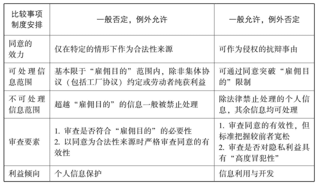

我国《个人信息保护法》的立法主旨在于调和保护与流动利用。劳动者作为持续性债务关系的一方，其人身处境比消费者更为脆弱，个人信息保护需要在主体权益与信息使用之间做更精细的权衡。若仅仅把用人单位处理信息的边界锁死在“订立和履行合同所必需”，一方面会关闭员工同意作为合法依据的通道，另一方面也会阻碍信息利用与创新。企业通过采集员工数据结合算法创新实现更高效的管理，正是数字时代重塑商业模式与生产方式的核心路径，信息利用能够产生巨大的生产与社会价值，不能因过度强调保护而忽视劳动关系中信息利用的潜力。在确保员工真实意愿的前提下允许企业使用信息，更契合个保法“利用与保护”并重的目标^([\[69\]](#txt006.html#footnote_content_txt006_69))。《个人信息保护法》第13条把合同订立履行必需以及劳动者的集体合意——规章制度与集体合同——确立为同意的替代性来源，极大拓宽了用人单位处理员工信息的合法性基础，用企业层面的规章制度单方面决定取代逐个征求同意，更便于批量处理，充分实现了信息利用的立法目的。

强调利用的同时也不能忘记个保法首要价值是“保护个人信息权益”。执法与司法部门应当充分认识劳动者同意的特殊性，通过制定实施细则或司法解释^([\[70\]](#txt006.html#footnote_content_txt006_70))，遵循体系性限制的方法，对劳动者同意的有效性见表5-2和用人单位信息处理的正当性、必要性加大审查力度。以此为出发点，对第13条所涉员工同意与集体合意适用的合法性作出必要限制，是实现利益平衡、优化立法效果的必经之路。

表 5-2　不同合法性来源下同意的性质及审查要点

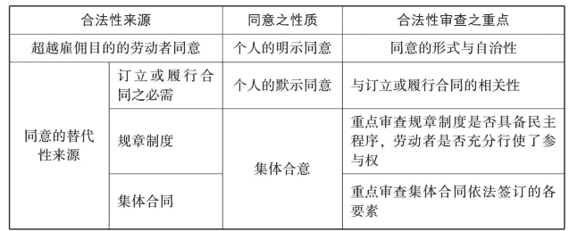

需要特别强调的是，针对超出雇佣目的的员工同意有效性审查，核心在于形式要件与自治性。形式审查包括两点：一是是否满足“告知—同意”规则的要求；二是采集敏感信息是否采取单独同意或书面同意。该层审查与消费者保护并无本质差异。更关键的是自治性审查，需要结合劳动关系的依附特点综合考量：用人单位内部是否存在迫使同意的惩戒条款，是否动用管理权施压，员工因拒绝同意是否遭受不利对待等，均应纳入判断视野。至于以规章制度作为合法性来源，鉴于我国规章制度的决策机制多为单方决定的背景，应强化对制定程序民主性的审查，确保劳动者在个人信息处理事项上享有实质参与权，以弥补集体合意不足的缺陷。

## 三、劳动者个人信息处理的正当、必要原则及其适用

“合法、正当、必要”三项原则在我国《民法典》与个人信息立法中逐步清晰。《民法典》历次审议稿始终坚持该三原则，最终在第1035条呈现，虽新增“不得过度处理”的表述，实质仍是对必要性的强调^([\[71\]](#txt006.html#footnote_content_txt006_71))。可见正当、必要原则须与合法原则协同适用，合法原则属形式合法性，而正当、必要原则指向实质合法性^([\[72\]](#txt006.html#footnote_content_txt006_72))，合法原则应受另外两项原则的约束^([\[73\]](#txt006.html#footnote_content_txt006_73))。

### （一）正当必要对同意适用空间的框定

劳动关系中同意的适用边界与程度，始终受立法价值引导。大数据时代企业希望最大化利用信息这一生产要素，预测行为、实现精准管理。然而“收集和整理个人信息都是获取权力的方式，通常以信息主体为代价”^([\[74\]](#txt006.html#footnote_content_txt006_74))，尤其劳动者处于比消费者更弱势的位置，个人信息保护成为平衡的重要利益。加之劳动场景的特殊性，合法与正当、必要的关系更为细致，当处理行为的合法性来源分别是劳动者明示同意或其他替代来源时，正当、必要的限制在解释路径上应有区分。

#### 1. 目的限制：正当必要判断的核心锚点

正当与必要的内涵均包含“目的限制”。有学者认为目的限制是个人信息保护法上的“帝王条款”^([\[75\]](#txt006.html#footnote_content_txt006_75))。我国个人信息保护立法以“合法、正当与必要”为基本原则指引目的限制作为具体原则，GDPR 亦作类似安排，“目的限制”与“数据最小化”要求处理仅限于特定、明确、合法的目的，并符合充分性与相关性限制，以实现数据最小化目标^([\[76\]](#txt006.html#footnote_content_txt006_76))。信息处理的正当原则包含目的正当与手段正当，目的正当指收集使用须为开展业务所需，不得超出业务能力范围；手段正当指处理须符合诚信原则并尽量公开透明，使当事人能充分了解并自主行使权利^([\[77\]](#txt006.html#footnote_content_txt006_77))。必要原则指处理须有特定目的并依据该目的进行，不得超出范围，也不得处理与目的无关信息；处理还应在影响最小、必要限度内进行^([\[78\]](#txt006.html#footnote_content_txt006_78))。在此框架下，甚至有观点认为劳动关系场景下隐私保护的合理性源于对“合理目的”的解读而非同意^([\[79\]](#txt006.html#footnote_content_txt006_79))。

##### （1）目的限制的具体要求

目的限制贯穿收集与使用全程。其基本要求是信息控制者须有特定正当目的并明确告知主体。《个人信息保护法》第6条规定“处理个人信息应当具有明确、合理的目的”，GDPR 对目的规定“特定”“明确”“合法”标准。

对用人单位而言，目的限制主要有三方面要求。

第一，目的正当。若合法性来源是“订立或履行劳动合同之必需”，正当性相对充分，主要结合比例原则评估；若仅以劳动者同意为基础，该目的须不违反强制性规定且在社会惯例中具合理性^([\[80\]](#txt006.html#footnote_content_txt006_80))；若合法性来源为集体合意，其目的为《个人信息保护法》第13条规定的“人力资源管理”之必需。由于“人力资源管理”缺乏明确法律定义，外延难以清晰界定，应在正当性与必要性审查中具体化。对“依法签订的集体合同”基础较为稳固，正当性审查可适度放宽；对“依法制定的劳动规章制度”，集体合意自治性较弱，对“人力资源管理”范围限制应更严格，例如规章要求劳动者上交个人社交媒体转账信息以审查廉洁性，即可认定目的不正当。

第二，目的特定。包括时间特定，即最迟在收集时确定；内容特定，即详细到足以判断何种处理行为在此目的下运行或不运行，且不违反法律、不致信息不安全。用人单位不得以笼统的“人力资源管理”目的处理劳动者信息。

第三，目的明确。用人单位履行告知义务时应清晰易懂并披露足够细节，使双方对约定目的及信息可能用途形成一致预期^([\[81\]](#txt006.html#footnote_content_txt006_81))。该要求不因合法性来源是同意还是替代来源而减弱，即便基于订立或履行合同目的处理信息，告知义务同样不可豁免。

##### （2）使用限制与相容性判断

目的明确有助于保障信息主体基本权利，但技术快速演进下，完全遵循告知目的会降低信息利用弹性。欧盟在目的限制原则中引入相容性测试，禁止超出初始目的的滥用，实现了保护与利用的平衡^([\[82\]](#txt006.html#footnote_content_txt006_82))。对用人单位使用阶段的基本要求是，使用目的不得违背约定目的，除非通过相容性判断，否则原则上禁止基于初始目的外目的处理信息。相容性判断可借鉴原第29条数据保护工作组标准^([\[83\]](#txt006.html#footnote_content_txt006_83))，主要包括：其一，收集目的与进一步处理目的之间的关系，关系越远相容性越难成立，如用人单位为准入收集健康信息后纳入绩效评估；其二，收集背景及信息当事人对进一步使用的预期，超出预期越远越可能不相容，若进一步处理以同意为基础，则需重点评估同意有效性，劳动者提供同意的自由度及用人单位告知的精确性，若自由度不足或告知不清甚至一揽子授权，相容性评估须更严格，若以规章制度为基础，常因集体合意缺陷而需特别重视相容性审查；其三，信息的性质及进一步处理对当事人的影响，敏感度越高相容使用范围越窄，如人脸识别信息本用于身份认证并经告知同意，后用于行为控制，即因高敏感度而难符目的限制；其四，用人单位是否采取措施确保公平处理并防止不当影响，若收集信息却无防歧视措施，则更难通过相容性测试。

#### 2. 比例原则的审查要义

比例原则源于行政法，但已突破部门藩篱，影响民商法、刑法与诉讼法等领域，有成为法律帝国基本原则的趋势^([\[84\]](#txt006.html#footnote_content_txt006_84))。传统三阶比例原则包括适当性、必要性与狭义比例原则，狭义比例原则被视为“心脏”，体现目的与手段间的利益衡量精髓^([\[85\]](#txt006.html#footnote_content_txt006_85))。在欧盟数据保护法中，适当性、必要性与狭义比例原则已被原则体系吸收^([\[86\]](#txt006.html#footnote_content_txt006_86))，2001年第29条工作组《雇佣背景下个人信息处理意见》将“比例原则”与“目的限制”列为基本原则^([\[87\]](#txt006.html#footnote_content_txt006_87))，GDPR第5条b款保留目的限制，第5条c款数据最小化原则实质囊括比例原则主旨，即在必要限度内处理信息。我国《民法典》与个人信息保护法体系中“合法、正当、必要”三原则已吸收比例原则核心内容。目的限制已涵盖适当性与必要性主要部分。因此在用人单位处理劳动者信息时，立法层面的重点不在于重申比例原则地位，而在于司法者或监管者审查正当、必要性时，将狭义比例原则贯彻到具体审查体系，判定用人单位是否存在信息处理的正当利益^([\[88\]](#txt006.html#footnote_content_txt006_88))。

德国《联邦数据保护法》第26条第1款规定雇佣关系中数据处理基础是雇佣相关目的的“必要性”，该必要性应结合雇佣目的从正当性与必要性两方面理解，在个案中依劳动关系目的进行利益衡量^([\[89\]](#txt006.html#footnote_content_txt006_89))。为履行雇佣合同所必须的信息处理无需征得同意，但对何为“必要性”应依比例原则平衡用人单位利益与员工数据保护^([\[90\]](#txt006.html#footnote_content_txt006_90))。加拿大联邦法院推荐的“合理目的测试”四问，为判断超出雇佣目的信息处理的正当、必要性提供了可借鉴标准：“第一，信息处理对满足特定需求是否切实必要；第二，此种处理能否有效满足特定需要；第三，敏感或私密信息受损与信息主体获益是否成比例；第四，是否存在更少侵犯利益的方式达到同种目的。”^([\[91\]](#txt006.html#footnote_content_txt006_91))

# 监控越界，人格底线不容让步

在判断雇主对职工个人数据的处理是否正当必要时，比例原则的适用必须充分计入劳动关系中人身依附的结构。一旦数据处理极可能对职工人格权造成严重侵害，无论最终评价为民法典上的具体人格权还是一般人格权，法律上都应视为严重违法，此时已无利益衡量空间。正如德国劳动法权威多伊普勒所强调，比例衡量必须守住底线：只有在人格领域未发生严重侵入的前提下，比例原则才有适用余地^[[\92\]](#txt006.html#footnote_content_txt006_92))。若对人格领域形成不相当的侵入，例如持续追踪职工如厕时长，该类处理即属不合法。德国柏林劳动法院曾明确禁止雇主要求司机在信息软件上每隔三分钟打卡一次，法官认定该种信息采集构成对人格权的严重侵害而违法^[[\93\]](#txt006.html#footnote_content_txt006_93))。

## （二）劳动者同意的“合法、正当、必要”原则的审查

### 1. 合法性来源不同对于“合法、正当、必要”原则审查的影响

雇主获取合法性的路径不同，三原则的解释重点也会随之移动，这才可能在职工数据自由、雇主知情需求与数据利用之间实现平衡。《个人信息保护法》强化了处理者的告知责任，并对敏感数据明确了书面同意的形式，为职工权益与雇主行为提供了约束。但在劳动关系中，因订立或履行劳动合同而产生默示同意，或因集体合意实现批量处理，若机械要求企业对敏感数据必须取得明示同意，成本负担过重，须结合劳动法作弹性解释。一方面，“符合订立和履行劳动合同所必需”指向客观目的，是否真正必要是识别关键。仅强调管理权、借助合同或规章凌驾于职工数据利益和隐私之上者，不能认定为履行合同所必需。另一方面，即便收集超出合同目的，只要能够证实同意的真实自愿，亦可取得合法性，但正当性与必要性的审查标准应更为严格。规章制定因法定决策机制难以实现劳资共决，除关注自治性中的民主程序外，更应通过实质审查把控职工数据权益保障。

### 2. “合法、正当、必要”三原则的重点审查要素

职工个人数据处理的合法来源多元且可转换，因而审查宜分阶段进行。第一阶段聚焦合法性。不同来源的合法性审查要点不一，特别是“订立/履行合同所必需”不成立而转向“职工同意”时，审查焦点随之转移。第二阶段对正当性、必要性的审查主要通过目的限制与比例原则的解释展开。

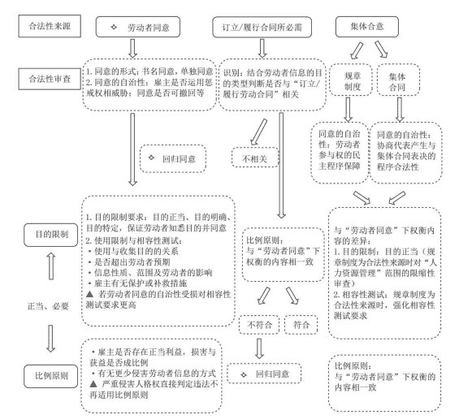

图 5-1　劳动关系下“合法、正当、必要”的重点审查要素

### 3. 合法、正当、必要性审查的具体运用

司法实践显示，对职工数据处理的原则适用应更体系化。例如一起案件中，公司安排职工赴长沙出差，工作和住宿均在办事处，一室一厅加厨卫仓库，客厅设摄像头正对大门24小时运行，职工主张隐私受侵。法官认为摄像头可监督工作区并防止货物损失，因而认定有必要性^[[\94\]](#txt006.html#footnote_content_txt006_94))。判决未先对信息目的类型归类判断是否属于履行合同所必需，也未对职工隐私受损程度与数据收集收益进行比例权衡，仅强调管理必要性。类似地，职工打伞规避监控的案件，法院认可监控行为，亦未体系性审查合法正当必要^[[\95\]](#txt006.html#footnote_content_txt006_95))。

以职工同意或其他替代事由为合法依据的处理，审查常显复杂，需场景化讨论。例如人脸或虹膜识别用于一般考勤管理时，纸质签到或普通电子打卡已可被视为履行合同所必需，人脸虹膜等技术在现阶段直接适用比例原则已超出合理范围。若允许雇主在取得同意后处理数据，必须在保障同意自治性的前提下，按图5-1完成体系审查。若人脸识别用于工作环境保密或安全所需的身份验证，如生物实验室，则可视为履行合同所必需，仅需比例审查。再如雇主运用基因技术与人工智能对职工健康数据进行潜在疾病或性格分析，已超出履行合同必要，应重启以“职工同意”为依据的体系审查。合法性上需职工基于自治作出真实同意，正当性必要性上除目的限制外，还应以比例原则衡量对人格尊严的损害与行为必要性的利弊。如基因数据处理过度侵害人格尊严或人格自由，应认定不符合正当必要而违法^[[\96\]](#txt006.html#footnote_content_txt006_96))，据此实施差别待遇则应由反歧视法调整。

## 四、劳动者个人信息的劳动基准保护

### （一）个人信息保护作为劳动基准的必要性

#### 1. 数字化时代人权保护的挑战

劳动基准的核心在于保障职工基本人权，传统上侧重生命安全、身体健康及生存所需报酬。随着移动互联网、大数据、云计算、人工智能的迅猛发展，数据产生爆炸式增长，处理能力提升成本下降，数据成为关键资源，社会交往不断数字化。人权形态正经历数字化重塑：一方面，无限制的全景监控使个人随时可被检视，黑箱算法不仅预测还能操控行为，带来歧视与不公；另一方面，数据与信息权利在理论和制度层面逐步获得确认，丰富了生存权发展权的时代内涵，开启了以“数字人权”为代表的第四代人权^[[\98\]](#txt006.html#footnote_content_txt006_98))。

在劳动关系中，人权保护同样结构性变化。面试询问婚育情况、入职体检、工作场所装设视频监控等现象仍普遍，设备、过程、对象数字化带来新风险，“智能手环监工”即典型例证。数字化社会中数据保护与利用的矛盾在用工场景尤为尖锐，雇主几乎持续不断地处理职工数据，随之而来的是隐私侵害、差别对待、全景监控、行为操纵等。

职工不是机器，需要尊重、信任与自由空间，不允许雇主以高科技为职工戴上“镣铐”。《宪法》第38条关于人格尊严的保障须落实于各类法律关系。《个人信息保护法》第1条开宗明义“根据宪法，制定本法”，《民法典》以人格权独立成编加强隐私与个人数据的保护力度^[[\99\]](#txt006.html#footnote_content_txt006_99))，第四期国家人权行动计划亦专节强调加强个人数据保护、完善制度^[[\100\]](#txt006.html#footnote_content_txt006_100))。因此劳动基准法不能仅停留于生存保障，精神性利益保护愈发重要，关乎人格尊严与自由发展的个人数据保护应纳入劳动基准，否则即放弃劳动法发展空间。历史上劳动基准内容呈扩张趋势，日本韩国早期法未涉及个人数据保护，英国劳动基准已包含职工个人数据保护制度^[[\102\]](#txt006.html#footnote_content_txt006_102))，波兰与匈牙利劳动法典近年修订亦增设多项相关条款^[[\103\]](#txt006.html#footnote_content_txt006_103))。

#### 2. 对其他劳动基准实现的意义

雇主掌握大量职工数据并可借助技术处理。在此基础上以算法决策，除可能导致就业歧视^[[\104\]](#txt006.html#footnote_content_txt006_104))，自动化决策还会波及休息休假、报酬、职业安全等劳动条件。《外卖骑手，困在系统里》报道某平台“实时智能配送系统”将骑手潜能榨至极限，相同距离订单配送时长不断压缩，时长与准时率挂钩报酬，骑手为赶单违法导致事故频发^[[\105\]](#txt006.html#footnote_content_txt006_105))。工厂亦有类似情形，某电子制造企业引入智能员工管理系统，车间摄像头、门口电子考勤与收录全部职工信息的OA系统协同，几乎取代车间主管：摄像头监控在岗与效率，系统通过画面识别动作并记录加工时长与标准比对；电子考勤细化到车间，离岗超时提交OA；OA归档录像与考勤后月度考核，缺勤或效率低扣薪，超额奖励。虽然允许异议，但人工复核多采信系统判断，如职工如厕超时3秒被系统扣薪，申诉后上级仍维持系统决定^[[\106\]](#txt006.html#footnote_content_txt006_106))。

可见，若任由智能系统全方位监控职工，以算法分析数据并配合奖惩引导行为，将导致劳动强度上升、休息难以保障、报酬受损。职工不可能长期高效，人类监督尚有喘息空间，系统无死角，算法更可能将此固化为标准持续要求“优化”。“提高效率”“监督出勤”可为正当理由，但推向极致即对剩余价值的残酷压榨。长期看，剥夺自主空间对雇主亦不利，异化为“工具”的职工缺乏能动与创造力。此外现实复杂性难以完全机器化，系统依据僵化计算逻辑决策，而人具备反思与情感。自动化决策即便失误，算法看似客观中立，雇主易推卸责任，职工难以反驳。欧盟委员会2020年2月19日《人工智能白皮书》强调，招聘或影响职工权利时使用AI应视为高风险活动，需强制性法律要求^[[\108\]](#txt006.html#footnote_content_txt006_108))。强化职工个人数据保护是严格监管的重要路径，因职工数据是算法管理的原材料，雇主亦针对性地将算法用于个体，规制数据处理是预防算法过度压榨、保障其他劳动基准的关键。

#### 3. 私法、公法双重规制的必要

个人数据私法保护作用不可忽视^[[\109\]](#txt006.html#footnote_content_txt006_109))。《民法典》第1034条以下体现立法重视，职工作为自然人享有相应民事权益。《个人信息保护法》第四章赋予知情决定、查阅复制、更正补充、删除等权利，并依第50条，处理者拒绝请求的，个人可诉诸法院。前述规定并未排除劳动关系适用，职工可据此主张权利。若未来明确这些规范属于劳动基准，重点在于强调其为保护性强行法，不可被当事人意思排除，形成保障底线^[[\110\]](#txt006.html#footnote_content_txt006_110))，如签署放弃保护承诺书或合同减轻义务无效，但劳动合同或集体合同可作更有利约定^[[\111\]](#txt006.html#footnote_content_txt006_111))。

仅靠私法界定保护不足，尤其在主体不平等、存续期长、强调信赖合作的劳动关系中，还需公法机制，即国家监督、强制与惩罚，才能提供更充分保护。主要原因有三：其一，实践中职工在关系存续期主张权利可能性不大，缺乏能力精力动力，却面临处罚乃至解雇风险，侵害发生时不敢反抗，事后维权举证难赔偿有限；行政监管可在侵害发生时甚至发生前介入，效率更高。其二，合同履行依赖信赖与和平，猜忌氛围有害，公权力保护有助于劳资信任；反之提起仲裁诉讼往往意味着“撕破脸”，影响关系稳定^[[\113\]](#txt006.html#footnote_content_txt006_113))，德国联邦议会2010年讨论《德国雇员个人信息保护法草案》时即强调立法对营造信任工作氛围的意义^[[\114\]](#txt006.html#footnote_content_txt006_114))。其三，劳动关系具强外部性，数据处理常大规模持续进行，关乎公共利益，应配置公法效力。我国劳动监察力量尚弱，但网信、公安、市场监管等部门已有职责，将来可设专门独立权威的个人数据保护执法机构，做好权责划分与配合即可^[[\115\]](#txt006.html#footnote_content_txt006_115))。

### （二）劳动基准法中保护个人信息的特殊安排

劳动关系框架下凡与个人数据保护无特殊之处的事项，在劳动基准法中重复《个人信息保护法》意义不大，援引即可。关键在于基于劳动关系特殊性，针对性地部分强化、部分弱化，而非一味加强或整体降低，并在实体规则、程序安排与机构设置上做好衔接。

#### 1. 主体上的适用范围设定

作为劳动基准的个人数据保护不应严格以劳动关系存在为前提，而应借鉴他国经验采取功能性定位，权利主体不应限于职工。GDPR第88条针对“雇佣语境下的处理”，列举招聘、履行合同、履行法律或集体合同义务、工作管理计划组织、工作场所平等多样性、健康安全、财产保护、行使履行雇佣相关权利义务、终止雇佣关系等情形，重视事实状态与保护需求而非法律分类^[[\116\]](#txt006.html#footnote_content_txt006_116))。德国在BDSG第26条第8款明确，该法意义上的雇员不仅包括职工，还包括学徒、参加残疾人就业促进项目者、类雇员、公务员等，且适用于缔约前与关系结束后处理。保护范围相当广泛，有学者指出保护类雇员意义重大，平台经济从业者是否属于职工尚有争议，但其对平台有经济从属性且需倾斜保护，可至少认定为类雇员，平台用工日常产生大量数据处理，亟需相关条款调整^[[\117\]](#txt006.html#footnote_content_txt006_117))。

## 一、行政监管的必要性

其一，职工在关系存续期依民法典或《个人信息保护法》主张权利实践可能性不大，行政监管可及时介入并发挥预防作用，执法效率更高。其二，信赖与和平是合同顺利履行的基础，公权力保护有助于劳资合作。其三，个人数据处理具有大规模持续性，关乎公共秩序，应赋予公法效力。

劳动场景中的隐私数据治理：从招录到离职的全链条视角

从求职协商到合同终止，招聘方与应聘者、离职员工与原公司之间一直维系着契约信任。处理隐私资料的出发点都指向雇佣关系的创设或延续，所以规范强度应当统一。

进入公司阶段，简历核验、材料提交、面试问询、入职体检等环节是隐私资料被滥用的高发区。实践里，简历自动筛选、委托第三方背调等新做法也在增多。关系结束后，已采集的资料是否会被再次利用同样值得警惕，例如原单位能否把在职期间的奖惩记录透露给同行形成行业黑名单；同时，为履行竞业限制补偿、补缴补充养老保险等义务，企业仍需持续接触离职人员资料。

现行司法认定雇佣关系的依据多为人社部 2005 年 5 月 25 日的《关于确立劳动关系有关事项的通知》，对主体资格要求较严，导致大学生兼职实习、退休人员返聘等情形认定困难，但隐私处理风险并未消失。

平台经济扩张后，我国数千万网约车司机、外卖骑手等依托互联网就业。组织型平台中部分供给者可自主决定工作时间地点，平台管理方式与传统用工不同，法律定性争议大。^([\[118\]](#txt006.html#footnote_content_txt006_118))若只给名义上存在雇佣关系的员工提供隐私庇护，上述群体将被排除，而其需求与事实状态与员工并无本质差别。恰因工作时间和地点灵活，平台反而采集更多数据，例如外卖平台对骑手的实时定位、运动轨迹、到店取餐送达时间一目了然，甚至通过用户评价推断服务态度。^([\[119\]](#txt006.html#footnote_content_txt006_119))  
人社部等 2021 年 7 月 16 日发布的《关于维护新就业形态劳动者劳动保障权益的指导意见》首次提出“不完全符合确立劳动关系情形”的表述，提出对这类就业人员纳入最低工资、工时、劳动安全卫生等劳动基准覆盖，隐私治理也应纳入。

义务主体上应考虑对小微企业和个体工商户设置豁免。隐私权利保护的前提是持续不对等的信息关系，指向具有专业性或商业性采集特征、尤其是借助现代技术大规模处理的主体。^([\[120\]](#txt006.html#footnote_content_txt006_120))我国现行劳动法未对小微主体给予优惠，但一刀切适用可能适得其反。小微企业用工规模小、数据量少、技术使用程度低，经营者与员工的人身信任更强，风险相对有限；同时这类主体普遍缺乏隐私治理人才、意识和资金，过高合规要求易造成经营负担。^([\[121\]](#txt006.html#footnote_content_txt006_121))《个人信息保护法》第 62 条已要求国家网信部门针对小型处理者制定专属规则标准。

### 2. “必需”的具体化与典型问题的规制

判断“为订立、履行、解除或终止劳动合同所必需”“按依法制定的规章或集体合同进行人力资源管理所必需”，将是未来保护的关键。欧盟数据保护委员会对 GDPR 第 6 条第 b 项“履行合同所必需”的解释相当审慎，要看目的是否客观必要、是否符合数据主体合理期待、是否有更轻侵害的替代方案。^([\[122\]](#txt006.html#footnote_content_txt006_122))德国立法者解释 BDSG 第 26 条第 1 款时强调要在雇主处理利益与雇员人格权益间求平衡。^([\[123\]](#txt006.html#footnote_content_txt006_123))德国联邦劳动法院则以比例原则审查先看处理是否有助于目的，再看是否存在更温和手段，最后做利益衡量。^([\[124\]](#txt006.html#footnote_content_txt006_124))“必需”本质上是语境依赖的概念。^([\[125\]](#txt006.html#footnote_content_txt006_125))

个案裁判示范有限，企业与员工需要更清晰指引。考虑到场景多样、技术与经济环境变化快，^([\[126\]](#txt006.html#footnote_content_txt006_126))员工隐私治理不适合直接写进劳动基准法，而应放在配套文件中。人社部可就入职面试体检、背景调查与职场黑名单、工作场所视频监控、电话监听与局域网监控、行踪轨迹与生物识别等高频冲突问题出台部门规章，并配合最高人民法院定期发布的劳动人事争议典型案例，兼顾确定性与灵活性。

以工作场所视频监控为例，《个人信息保护法》第 26 条只规范公共场所设备，而多数工作场所公众无法自由进入，企业可能为防盗、保商业秘密、维持秩序、监控表现等目的安装监控。这会形成“上帝视角”，员工的一举一动、与同事上司的交流、姿态表情都可能被记录，造成精神压力。^([\[128\]](#txt006.html#footnote_content_txt006_128))可考虑的规则包括：监控需以保障人身财物安全、维持经营秩序、确保履职义务、防止违法犯罪等正当目的为限；更衣室、卫生间、淋浴房、休息室等私密区域禁止监控；原则上公开进行并设置提示标识，除调查违法犯罪外不得秘密监控；不得为监督工作表现而长时间不间断监控，也不得将其他目的的持续监控用于绩效评价；优先采用温和技术，能实时达到目的就不录像，需录像的保存期限为最短必要时间并及时删除。^([\[129\]](#txt006.html#footnote_content_txt006_129))

### 3. 删除权、可携带权与自动化决策条款的修改

《个人信息保护法》第 47 条在劳动场景下易生困境。以医疗健康资料、请假记录为例，企业本可基于人力资源管理必需处理，若起初以同意为依据，后因病假审批争议撤回同意，按第 47 条第 1 款第 3 项就须删除。但雇佣关系要求资料连续完整，例如《劳动合同法》第 40 条第 1 项以医疗期届满为解雇前提，记录不完整即难以管理甚至举证。GDPR 第 17 条第 1 款第 b 项要求撤回同意且无其他合法基础时才删除，更为周延，可予借鉴。

关于可携带权，《个人信息保护法》第 45 条已做和缓，要求符合网信部门规定条件才需提供转移路径。^([\[130\]](#txt006.html#footnote_content_txt006_130))支持者认为有助于防止平台垄断、促竞争与创新。^([\[131\]](#txt006.html#footnote_content_txt006_131))但在劳动语境中，反对者指出的风险更突出：转移增加隐私泄露风险、加重企业负担，还可能牵连同事资料和商业秘密。解除或终止后的档案转移，《劳动合同法》第 50 条已有明确义务，目前不宜在劳动基准法中引入可携带权。^([\[132\]](#txt006.html#footnote_content_txt006_132))

自动化决策带来的歧视、压榨、误判风险不应“一禁了之”。《个人信息保护法》第 24 条要求保障透明、公平公正并赋予说明权与拒绝权，效果有限。算法可解释性存疑，而单个员工行使概率不高。更有效的做法是在引入自动化决策时，依据《劳动合同法》第 4 条视其为直接涉及员工切身利益的重大事项，要求向职工代表大会或全体员工说明影响并平等协商。拒绝权以算法单独决定为前提，企业常以算法仅为辅助抗辩，举证困难，效果待厘清。

此外立法应补充两点：一是避免“被透视”，坚持最小化和目的限制，不允许全面监控和连续记录，原则上不同目的资料分开保存处理，以限制数字画像；^([\[134\]](#txt006.html#footnote_content_txt006_134))二是坚持算法取中。市场监管总局、中央网信办、人社部等七部门 2021 年 7 月 16 日《关于落实网络餐饮平台责任切实维护外卖送餐员权益的指导意见》要求平台不得以“最严算法”考核，而应通过“算法取中”合理确定订单数量、在线率等指标，适当放宽时限，这一立场应持续推广。

### 4. 主管机构、救济方式与法律责任的协调

《个人信息保护法》第 60 条明确国家网信部门统筹协调、各部门按领域履职。^([\[135\]](#txt006.html#footnote_content_txt006_135))劳动基准法出台后，应强化劳动监察。中央与地方人社部门宜内部设立隐私保护专责机构，配备专业人员，负责用工领域隐私保护。日常宣教、指导监督可由专责机构承担，员工投诉举报由劳动保障监察机构受理。对人数少、违法轻的案件由监察机构初步调查处理；涉及人数多、违法重的交专责机构处理；极其复杂案件由人社部门与网信部门联合调查。

救济不能只依赖行政。员工主动维权时需要制度支持。《劳动合同法》第 38 条赋予“被迫辞职权”，其中“未按约定提供劳动保护或劳动条件”可主张经济补偿。^([\[136\]](#txt006.html#footnote_content_txt006_136))应更新观念，将隐私保护纳入劳动保护，或直接列明企业严重侵害员工隐私权益的属于该情形。

法律责任上，《个人信息保护法》第七章已较完备，关键是协调。现行劳动基准违法处罚较轻：如《安全生产法》第 99 条第 5 项对未提供合格劳动防护用品罚款最高 20 万元；《劳动保障监察条例》第 23 条第 7 项对安排未成年人从事禁忌劳动按每人 1000 至 5000 元罚款。相比之下，《个人信息保护法》第 66 条对违法处理隐私资料可处 100 万元以下罚款，情节严重可处 5000 万元以下或上年营业额 5%以下。考虑到侵犯人身权益与侵犯生命健康安全的过错程度对比，处罚幅度的不匹配有待调整。

## 五、结语
当赛博朋克式的场景进入劳动世界，有人会问技术是否让生活更美好。反对技术进步并非正途，关键是用法律及时纠偏。随着工作数字化，企业对员工资料处理愈发全面，监视、分析、预测、控制风险上升，可能威胁人格尊严与自由发展。我们应与时俱进强化“数字人权”保护，最好的路径是从现行制度在劳动领域的适用与劳动基准立法两个层面同步推进。

### 【注释】
[\[1\]](#txt006.html#footnote_quote_txt006_1)参见“中国劳动年龄人口为 8.8 亿人劳动力资源仍然充沛”，载中国新闻网，`https：//www.chinanews.com/gn/2021/05-11/9474619.shtml`，最后访问日期：2021 年 7 月 14 日。

[\[2\]](#txt006.html#footnote_quote_txt006_2)参见张新宝：“个人信息收集：告知同意原则适用的限制”，载《比较法研究》2019 年第 6 期。

[\[3\]](#txt006.html#footnote_quote_txt006_3)参见张菁：“《劳动基准法》专家建议稿（中国人民大学版）研讨会成功举办”，载中工网，`http：//right.workercn.cn/34164/202107/21/210721131825282.shtml`，最后访问日期：2021 年 12 月 17 日。

工作被监控时，“同意”还算数吗

当数据渗透进产线、办公室和户外作业，员工的日常行为越来越容易被记录和追踪。劳动法的边界、面向技术变革的社会法回应，以及雇佣关系中的权力分配，都被迫重新审视。关系契约的观点把雇佣看作一种延续性的互信互动，而非一次性交易；职场讨论里也常借鉴消费领域以信息披露来弥合信息差的做法。

关于同意的有效性，学界立场并不一致。有学者在数字信用重塑的语境里主张，信赖型授权可能在挤压知情同意的空间。日本、韩国、德国、美国近年对消费者保护的修法，核心逻辑都是利用信息工具来缓解经营者与用户的失衡。GDPR 与加州消费者隐私法都设置了撤回同意和限制处理等机制，但是否等于把同意等同于授权，仍有争议。相关研究也指出，在权力不对等的情境下，形式上的同意很容易被稀释。

现实案例让问题更具体。公开报道称，南京建邺区自 2018 年起分批给环卫工人配发智能手环，若原地停留超 20 分钟或偏离作业区，手环会语音提醒并自动把数据传给用人单位。上海一起药物检测纠纷中，用人单位在员工手册里写明拒检可即时解雇，法院对该条款与岗位关联性提出质疑。欧盟第 29 条数据保护工作组 2017 年第 2 号意见也强调，用人单位的指挥权不能直接推定为员工自愿。

阅读隐私条款成本高昂、默认接受普遍存在，加上基因大数据等研究，都显示个人难以真正掌控自己的信息。考勤自动化、定位追踪、手机 App 监管、影像监控、各类传感器乃至人体芯片的应用，让监督常态化。有的企业打着反腐内控的旗号，要求员工申报亲属关系和社会交往网，甚至追溯到小学同学，把合规包装成诚信审查。

德国联邦宪法法院在 1983 年人口普查案中指出，个人信息自决并非绝对控制，人需要在社会互动中生存。雇佣的从属性削弱了同意的自主性，人脸信息在技术条件下可转化为识别数据，因而同时涉及肖像和个人信息的双重保护。关于规章制度，学界争议其法律性质与协商边界：协商不成时，企业往往在吸纳工会或职工代表意见后自行定稿，这与真正的劳资共决不同。

比较法视野下，集体自治、工会参与和透明化要求被视为矫正不平衡的机制。德国的判例与集体协议、美国《雇佣法重述》对告知与同意的安排，都提示隐私保护需要前提条件、法益基础和制度设计，而不是一句“我已同意”。

总体看，在数字化环境下，劳动者隐私不能仅靠个人点击来担保。劳动法、私法和数据保护法需要协同，让信息工具缩小信息差而非扩大监控面。同意是有边界的，信任也必须有制度兜底。

[\[4\]](#txt006.html#footnote_quote_txt006_4)参见沈建峰：“劳动基准法的范畴、规范结构与私法效力”，载《法学研究》2021 年第 2 期。

[\[5\]](#txt006.html#footnote_quote_txt006_5)参见钱玉文：“消费者权的经济法表达——兼论对《民法典》编纂的启示”，载《法商研究》2017 年第 1 期。

[\[6\]](#txt006.html#footnote_quote_txt006_6)参见吴文芳、刘洁：“新技术变革时代‘人’的变迁与社会法回应”，载《学术月刊》2021 年第 8 期。

[\[7\]](#txt006.html#footnote_quote_txt006_7)Abbo Junker，Grundkurs Arbeitsrecht，3.Aufl.2004，S.59f.

[\[8\]](#txt006.html#footnote_quote_txt006_8)Rolf Wank，Arbeitnehmer und Selbstaendige，1988，S.122ff.

[\[9\]](#txt006.html#footnote_quote_txt006_9)Nocola.Countouris，“The Employment Relationship：A Comparative Analysis of National Judicial Approaches”，in G.Casale ed.，The Employment Relationship-A Comparative Overview，International Labour Office，2011，pp.35-68.

[\[10\]](#txt006.html#footnote_quote_txt006_10)MacNeil，Ian R，“Relational Contract Theory：Challenges and Queries”，Northwestern University Law Review，Vol.94（3），pp.877-908（2000）.

[\[11\]](#txt006.html#footnote_quote_txt006_11)姚佳：“知情同意原则抑或信赖授权原则——兼论数字时代的信用重建”，载《暨南学报（哲学社会科学版）》2020 年第 2 期。

[\[12\]](#txt006.html#footnote_quote_txt006_12)日本、韩国、德国与美国近年来消费者保护法的修改清楚地体现了通过信息工具解决消费者与经营者信息不对称的基本思路。参见应飞虎：“消费者立法中的信息工具”，载《现代法学》2019 年第 2 期。

[\[13\]](#txt006.html#footnote_quote_txt006_13)参见万方：“个人信息处理中的‘同意’与‘同意撤回’”，载《中国法学》2021 年第 1 期。

[\[14\]](#txt006.html#footnote_quote_txt006_14)参见欧盟《一般数据保护条例》（GDPR）与《美国加州消费者隐私法》（CCPA）中，同样体现了这一思路。

[\[15\]](#txt006.html#footnote_quote_txt006_15)参见高富平：“同意≠授权——个人信息处理的核心问题辨析”，载《探索与争鸣》2021 年第 4 期。

[\[16\]](#txt006.html#footnote_quote_txt006_16)参见最高人民法院民法典贯彻实施工作领导小组主编：《中华人民共和国民法典人格权编理解与适用》，人民法院出版社 2020 年版，第 376 页。

[\[17\]](#txt006.html#footnote_quote_txt006_17)据报道，南京市建邺区从 2018 年开始给环卫工人陆续配发智能手环。手环最重要的是定位功能，一旦环卫工人原地不动超过 20 分钟或离开工作区域，手环将自动语音监督并将数据自动上报给用人单位。“南京一公司给环卫工配发智能手环休息 20 分钟就‘报警’”，载扬子晚报，`http：//jiangsu.sina.com.cn/news/2019-04-04/detail-ihvhiewr3039866.shtml`，最后访问日期：2021 年 7 月 14 日。

[\[18\]](#txt006.html#footnote_quote_txt006_18)参见“汪某与某公司劳动争议纠纷案”，上海市第一中级人民法院（2011）沪一中民三（民）终字第 787 号民事判决书。在该案中，用人单位在《员工手册》中规定员工拒绝进行药物检测，用人单位有权立即解除与员工的劳动关系。汪某在该公司中担任的是模具工程师，该岗位工作的履行与其使用何种药物并无关联。

[\[19\]](#txt006.html#footnote_quote_txt006_19)欧盟第 29 条数据保护工作组（WP29），是根据 1995 年欧盟指令（95/46/EC）第 29 条而设立的一个数据保护和隐私咨询机构。GDPR 生效后，其职能被欧洲数据保护委员会（EDPB）所替代。

[\[20\]](#txt006.html#footnote_quote_txt006_20)Article 29 Data Protection Working Party，“Opinion 2/2017 on data processing at work”，`https：//ec.europa.eu/newsroom/article29/items/610169`（Last visited on July14，2021）

[\[21\]](#txt006.html#footnote_quote_txt006_21)European Union Agency for Fundamental Rights and Council of Europe，Handbook on European Data Protection Law，Imprimerie Centrale in Luxembourg，2018，p.145.

[\[22\]](#txt006.html#footnote_quote_txt006_22)参见\[美\]麦克尼尔：《新社会契约论》，雷喜宁、潘勤翻译，中国政法大学出版社 1994 年版，第 20-25 页。

[\[23\]](#txt006.html#footnote_quote_txt006_23)Aleecia M.McDonald & Lorrie Faith Cranor，“The Cost of Reading Privacy Policies”，I/S：A Journal of Law and Policy，Vol.4（3），pp.543-565（2008）；Lorrie Faith Cranor，“Necessary But Not Sufficient：Standardized Mechanisms for Privacy Notice and Choice”，Journal on Telecommunications and High Technology Law，Vol.10（2），pp.273-274（2012）.

[\[24\]](#txt006.html#footnote_quote_txt006_24)Daniel J.Solove，“Introduction：Privacy Self-management and the Consent Dilemma”，Harvard Law Review，Vol.126（7），pp.1880-1903（2013）.

[\[25\]](#txt006.html#footnote_quote_txt006_25)Bradley A.Areheart & Jessica L.Roberts，“GINA，Big Data，and the Future of Employee Privacy”，The Yale Law Journal，Vol.128，pp.710-790（2019）.

[\[26\]](#txt006.html#footnote_quote_txt006_26)参见郭锐：《人工智能的伦理和治理》，法律出版社 2020 年版，第 136 页。

[\[27\]](#txt006.html#footnote_quote_txt006_27)Bradley A.Areheart & Jessica L.Roberts，“GINA，Big Data，and the Future of Employee Privacy”，The Yale Law Journal，Vol.128，pp.710-790（2019）.

[\[28\]](#txt006.html#footnote_quote_txt006_28)参见田思路：“智能化劳动管理与劳动者隐私权的法律保护”，载《湖湘论坛》2019 年第 2 期。

[\[29\]](#txt006.html#footnote_quote_txt006_29)参见肖竹：“劳动关系从属性认定标准的理论解释与体系构成”，载《法学》2021 年第 2 期。

[\[30\]](#txt006.html#footnote_quote_txt006_30)Vgl.Gaier in：Münchener Kommentar zum BGB，8.Aufl.，2019，§ 314 BGB Rn.6.

[\[31\]](#txt006.html#footnote_quote_txt006_31)联邦宪法法院在著名的 1983 年“人口普查案”中指出，个人信息自决权并非个人对其个人信息享有的绝对的、不受限制的控制权，人是在社会中生存发展的，需要与其他人交流沟通。vgl.BVerfG，15.12.1983，NJW 1984，419（422）.

[\[32\]](#txt006.html#footnote_quote_txt006_32)参见胡凌：“刷脸：身份制度、个人信息与法律规制”，载《法学家》2021 年第 2 期。

[\[33\]](#txt006.html#footnote_quote_txt006_33)劳动者肖像因包含人脸识别技术所需信息，在一定技术条件下可转化为人脸识别信息，因此可能作为肖像以及个人信息受到双重保护。

[\[34\]](#txt006.html#footnote_quote_txt006_34)例如，GPS 定位、手机 App 监控、手机视频监控、网络视频监控、人体传感器监控、家具传感器监控甚至人体芯片技术等技术应用场景不断强化监督和监控劳动者。

[\[35\]](#txt006.html#footnote_quote_txt006_35)例如，某大型互联网公司以加强企业内控，清查裙带关系为由，要求员工如实申报亲属信息及社会关系网，自小学起的同学信息均要申报，未按照要求申报则被视为违反公司诚信原则。参见东方亦落：“京东大力清查裙带关系，互联网企业都在努力反腐”，载最极客，`https：//baijiahao.baidu.com/s？id=1629058786260623564&wfr=spider&for=pc`，最后访问日期：2021 年 7 月 14 日。

[\[36\]](#txt006.html#footnote_quote_txt006_36)Vgl.Frank Bayreuther，Tarifautonomie als Kollektiv Ausgeuebte Privatautonomie，Verlag C.H.Beck，2005，S.656f.

[\[37\]](#txt006.html#footnote_quote_txt006_37)参见谢增毅：“劳动者个人信息保护的法律价值、基本原则及立法路径”，载《比较法研究》2021 年第 3 期；朱晓峰：“数字时代劳动者权利保护论”，载《浙江大学学报（人文社会科学版）》2020 年第 1 期。

[\[38\]](#txt006.html#footnote_quote_txt006_38)参见王全兴：《劳动法》，法律出版社 2017 年版，第 255 页。

[\[39\]](#txt006.html#footnote_quote_txt006_39)Vgl.Hromadka/Maschmann，Arbeitsrecht Band 2，Springer Verlag，6.Aufl.2014，§ 16 Rn.420.

[\[40\]](#txt006.html#footnote_quote_txt006_40)BAG，9.7.2013-1 ABR 2/13（A），BAG，25.9.2013-10 AZR 270/12.

[\[41\]](#txt006.html#footnote_quote_txt006_41)Kiesche，Wilke，Berger，Betriebsvereinbarung und die DSGVO，AiB extra，August 2018，S.46-55.

[\[42\]](#txt006.html#footnote_quote_txt006_42)参见朱军：“《劳动合同法》第 4 条‘平等协商确定’的再解读——基于劳动规章制度的中德比较”，载《华东政法大学学报》2017 年第 6 期。

[\[43\]](#txt006.html#footnote_quote_txt006_43)信春鹰、阚珂主编：《中华人民共和国劳动合同法释义》，法律出版社 2013 年版，第 16 页。

[\[44\]](#txt006.html#footnote_quote_txt006_44)对此，理论界较为一致的看法是，协商未达成一致时由用人单位在部分吸收工会或职工代表意见的基础上确定劳动规章制度，不宜理解为劳资共决，参见王全兴：《劳动合同法条文精解》，中国法制出版社 2007 年版，第 37 页；沈同仙：“试论程序瑕疵用人单位规章制度的效力判定”，载《政治与法律》2012 年第 12 期。

[\[45\]](#txt006.html#footnote_quote_txt006_45)参见朱军：“论我国劳动规章制度的法律性质——‘性质二分说’的提出与证成”，载《清华法学》2017 年第 3 期。

[\[46\]](#txt006.html#footnote_quote_txt006_46)参见《广东省高级人民法院、广东省劳动争议仲裁委员会关于适用〈劳动争议调解仲裁法〉、〈劳动合同法〉若干问题的指导意见》（2008 年）；《湖南省高级人民法院关于审理劳动争议案件若干问题的指导意见》（2009 年）；《江苏省高级人民法院、省劳动争议仲裁委员会关于印发〈关于审理劳动争议案件的指导意见〉的通知》（2009 年）；《浙江省高级人民法院民一庭关于审理劳动争议案件若干问题的意见》（2009 年）；《河北省高级人民法院关于我省劳动争议案件若干疑难问题处理的参考意见》（2009 年）。

[\[47\]](#txt006.html#footnote_quote_txt006_47)参见上海市第二中级人民法院（2019）沪 02 民终 8004 号民事判决书；广东省广州市中级人民法院（2019）粤 01 民终 21237 号民事判决书等。

# 脚注

[\[48\]](#txt006.html#footnote_quote_txt006_48)第 29 条数据保护工作组，“关于工作场所数据处理之意见 2/2017”，https：//ec.europa.eu/newsroom/article29/items/610169（最后访问于 2021 年 7 月 14 日）.

[\[49\]](#txt006.html#footnote_quote_txt006_49)参见王锡锌、彭錞：“个人信息保护法律体系的宪法基础”，载《清华法学》2021 年第 3 期。

[\[50\]](#txt006.html#footnote_quote_txt006_50)参见 Däubler，《透明员工》，Bund Verlag 第 9 版，2021，第 183 页起.

[\[51\]](#txt006.html#footnote_quote_txt006_51)参见 Hans-Peter Kloes，《数字化与劳动——从劳动市场经济学视角》，RdA 2019 年第 2 期，第 91 页起.

[\[52\]](#txt006.html#footnote_quote_txt006_52)在该案中，雇员离职后要求雇主删除其在职期间为雇主拍摄的广告片视频，德国联邦劳动法院法官在判决中明确指出，无论是雇佣关系的从属性还是雇主存在指示权的事实，都不能说明雇员当时同意存在非自愿性。参见 BAG，2015 年 2 月 19 日判决-8 AZR 1011/13.

[\[53\]](#txt006.html#footnote_quote_txt006_53)参见丁晓东：“个人信息权利的反思与重塑——论个人信息保护的适用前提与法益基础”，载《中外法学》2020 年第 2 期。

[\[54\]](#txt006.html#footnote_quote_txt006_54)参见张新宝：“从隐私到个人信息：利益再衡量的理论与制度安排”，载《中国法学》2015 年第 3 期。

[\[55\]](#txt006.html#footnote_quote_txt006_55)《雇佣法重述》第 7.06 条评论 h（2015）.

[\[56\]](#txt006.html#footnote_quote_txt006_56)《雇佣法重述》第 7.05 条（b）评论 d（2015）.

[\[57\]](#txt006.html#footnote_quote_txt006_57)《侵权行为法重述（第二版）》第 892 A 条（1）.

[\[58\]](#txt006.html#footnote_quote_txt006_58)Steven L. Willborn，《告知、同意与非同意：重述中的员工隐私》，《康奈尔法律评论》，第 100 卷第 6 期，第 1423-1452 页（2015）.

[\[59\]](#txt006.html#footnote_quote_txt006_59)公共法第 88-352 号，第 703 条，78 Stat.241，255-57（1964）（编入 42 U.S.C.第 2000e-2 条（2012）.

当工作被“看”得太清楚

数字工具让雇主对员工的掌握前所未有，学术界早已警告无限制的员工监控正在重塑职场权力关系。美国的联邦法体系里，残疾人法、雇佣年龄歧视法、反雇佣歧视法、反怀孕歧视法、基因信息反歧视法与健康保险可携带性与责任法等，共同划出雇佣场景中信息使用的底线。美国《雇佣法重述》第7.06条也在回应雇主知情权与员工隐私权的冲突。司法上，2010年Ontario市诉Quon案确立了电子通信在工作场所的合理期待边界。早期技术评估办公室就已指出“电子主管”会带来新型紧张。

欧洲的讨论更早系统化。从2012年起的《一般数据保护条例草案》到最终的GDPR，“合法、公平、透明”是贯穿始终的基础要求，目的限制、数据最小化、存储限制、可问责等原则被拆解到处理质量、保存和保密的具体环节。第29条数据保护工作组在关于目的限制的意见和就业背景处理个人数据的意见中，反复强调处理必须有特定明确的合法目的且不得滥用。比较研究也显示，隐私保护在就业关系中的权衡呈现明显地域差异。

原则层面的共识是，必要性与最小够用是核心。过度处理个人信息违背必要原则，这一观点在中国民法典人格权编的解读中被多次重申。告知同意并非万能，学者指出其适用存在明确限制；正当、正当性与必要三性原则被提出作为信息处理的合法标准。目的拘束常被称作个人资料保护的“帝王条款”，GDPR体系下其与数据最小化共同构成限制雇主扩张的框架。比例原则的转型也被用于衡量监控手段与雇佣管理利益的均衡。

个案给出了硬边界。德国联邦法院2017年4月25日审理HUK Coburg保险公司案，认为以“优化控制”为由对每个员工的工作流程进行量化记录、存储与评估，并以低于平均值为由要求解释，属于对人格权的严重侵害，雇主的合法利益无法覆盖。此类判断与Bund Verlag出版的透明员工研究及柏林劳动法院相关判决形成呼应。中国司法实践也在跟进，最高人民法院2021年7月27日出台的人脸识别技术处理个人信息司法解释，为技术性监控提供了专门规范。武汉东西湖区法院2019年鄂0112民初3653号案与深圳中院2020粤03民终6076号案，均体现了对劳动者信息权益的司法审视。基因信息保护、算法对骑手群体的实时监控，以及女性就业中的算法歧视讨论，都指向“智慧社会”背景下第四代人权议题。

新风险来自算法。外卖骑手被系统困住的报道、媒体对打工人被算法监控的描述，都说明大数据与人员分析放大了不平等。欧盟《人工智能白皮书》强调信任与卓越，而中国学者提出的激励相容式个人数据治理思路，为立法方向提供参考。劳动基准法的规范结构与私法效力问题，也被用于探讨是否需要公权力保障。小企业是否需要差异化待遇，以及像加州消费者隐私法那样以营收或数据规模设定管辖边界，都在讨论监管的可操作性。

GDPR第88条容许成员国通过法律或集体协议为雇佣数据处理制定特定规则，但明确只能在条例基础上做加法，不能突破底线。这印证了国家保护义务的重要性，也解释了为何集体协议、企业协议不能成为削弱员工权利的通道。总体来看，保护劳动者个人信息需要法律定位清晰、原则落地、司法案例指引与社会共识并行，防止监控从管理工具滑向人格侵蚀。

[\[122\]](#txt006.html#footnote_quote_txt006_122)EDPB，“Guidelines 2/2019 on the processing of personal data under Article 6（1）（b）GDPR in the context of the provision of online services to data subjects”，https：//edpb.europa.eu/sites/default/files/files/file1/edpb_guidelines-art_6-1-b-adopted_after_public_consultation_en.pdf，last visited on 17 December 2021.

[\[123\]](#txt006.html#footnote_quote_txt006_123)Vgl.Deutscher Bundestag 18.Wahlperiode，Entwurf eines Gesetzes zur Anpassung des Datenschutzrechts an die Verordnung（EU）2016/679 und zur Umsetzung der Richtlinie（EU）2016/680，Drucksache 18/11325.

[\[124\]](#txt006.html#footnote_quote_txt006_124)Wybitul，Der neue Beschäftigtendatenschutz nach § 26 BDSG und Art.88 DSGVO，NZA 2017，413（415）；BAG，NZA 2017，394（396）.

[\[125\]](#txt006.html#footnote_quote_txt006_125)参见\[荷\]玛农·奥斯特芬：《数据的边界：隐私与个人数据保护》，曹博译，上海人民出版社 2020 年版，第 168 页。

[\[126\]](#txt006.html#footnote_quote_txt006_126)比如 20 世纪 90 年代学者在讨论劳动者在工作场所通信的问题时，除了谈到电子邮件还涉及书面信件和传真，但是现在后两种通信方式已经很少使用了，参见张新宝：“雇员在工作场所的隐私权保护与限制”，载《现代法学》1996 年第 5 期。

[\[127\]](#txt006.html#footnote_quote_txt006_127)就“公共场所”的界定参见龙卫球主编：《中华人民共和国个人信息保护法释义》，中国法制出版社 2021 年版，第 112-114 页。

[\[128\]](#txt006.html#footnote_quote_txt006_128)Vgl.Riesenhuber，in：BeckOK DatenschutzR/，37.Ed.1.2.2021，BDSG § 26 Rn.144.

[\[129\]](#txt006.html#footnote_quote_txt006_129)德国联邦劳动法院曾经面临类似的难题，在系列判决中总结了一些规则可供借鉴，vgl.BAG，27.3.2003，NZA 2003，1193（1195）；BAG，29.6.2004，NJW 2005，313（315）；BAG，26.8.2008，NZA 2008，1187（1191）；BAG，23.8.2018，NZA 2018，1329（1332）.

[\[130\]](#txt006.html#footnote_quote_txt006_130)参见龙卫球主编：《中华人民共和国个人信息保护法释义》，中国法制出版社 2021 年版，第 206 页。

[\[131\]](#txt006.html#footnote_quote_txt006_131)参见程啸：《个人信息保护法理解与适用》，中国法制出版社 2021 年版，第 343-345 页；汪庆华：“数据可携带权的权利结构、法律效果与中国化”，载《中国法律评论》2021 年第 3 期。

[\[132\]](#txt006.html#footnote_quote_txt006_132)参见卓力雄：“数据携带权：基本概念，问题与中国应对”，载《行政法学研究》2019 年第 6 期。

[\[133\]](#txt006.html#footnote_quote_txt006_133)参见丁晓东：“论算法的法律规制”，载《中国社会科学》2020 年第 12 期。

[\[134\]](#txt006.html#footnote_quote_txt006_134)有德国学者提出，为避免劳动者沦为“被评价的客体”，应该禁止对其进行人格画像。vgl.Däubler，Gläserne Belegschaft，Bund Verlag 9.Aufl.，2021，S.116.

[\[135\]](#txt006.html#footnote_quote_txt006_135)参见程啸：《个人信息保护法理解与适用》，中国法制出版社 2021 年版，第 457 页。

[\[136\]](#txt006.html#footnote_quote_txt006_136)参见杨景宇、信春鹰主编：《中华人民共和国劳动合同法解读》，中国法制出版社 2007 年版，第 119 页。

# 第六章 AI浪潮下劳动法的再定位

战东升

西南政法大学经济法学院副教授

## 一、引言

人工智能通俗地讲就是致力于模拟、扩充并强化人类智能的跨学科实践，其研究版图包括理论构建、方法创新、技术实现与场景化应用，典型方向为机器人、语音识别及视觉识别等。^([\[1\]](#txt007.html#footnote_content_txt007_1))近十余年，多数发达经济体都把智能发展视作国家竞争力的关键抓手，密集推出顶层设计。美国于 2016 年 10 月发布《国家人工智能研究与发展战略规划》，2019 年 2 月总统签署行政令启动“美国人工智能倡议”。欧洲层面，英国 2017 年 11 月推出《在英国发展人工智能》，法国 2018 年出台《人工智能科技战略》，欧盟委员会 2018 年 4 月向欧洲议会等提交《欧盟人工智能报告》，为十年行动定调。^([\[2\]](#txt007.html#footnote_content_txt007_2))中国同步推进，2016 年 5 月国家发改委等四部门联合印发《“互联网+”人工智能三年行动实施方案》，2017 年 7 月国务院发布《新一代人工智能发展规划》，将智能发展正式上升为国家战略并提出分阶段目标，党的十九大报告亦强调推动互联网、大数据、人工智能与实体经济深度融合。

当下，智能技术已渗入电子科技、制造、物流、教育服务、金融投资等众多领域。^([\[3\]](#txt007.html#footnote_content_txt007_3))技术红利释放的同时，就业图景也在被重写。学界有观点认为迈入智能时代，劳动结构将迎来根本性改写，低技能、重复性或高风险的工作将被机器接管。^([\[4\]](#txt007.html#footnote_content_txt007_4))实践中，部分行业已显现岗位被智能化挤占的迹象。智能化究竟会如何改写就业形态？它对劳动法体系投出哪些新挑战？智能时代劳动规制又该如何调整？这些议题直接关乎劳动者生存与发展，亟需深入探讨。既有研究多集中于经济学、社会学视角，本书试图以劳动法学为分析坐标，以技术对就业的扰动为切口，先梳理其对现行劳动规范的冲击，再按弱智能与强智能两个阶段提出回应思路，为该领域的劳动法研究提供参考。

## 二、前人工智能时代劳动法的变迁

每一次工业革命都伴随技术跃迁，进而改写生产力与生产关系，而生产活动的本质始终离不开人的劳动。在技术架构、产业形态与生产方式的合力下，就业形态持续演进。劳动法以标准劳动关系为支点，建构起系统化的劳动保护机制，用以缓解工业化对就业的冲击，调适就业结构变化，在稳定岗位与保障权益方面发挥了关键作用。^([\[5\]](#txt007.html#footnote_content_txt007_5))

第一次工业革命以蒸汽动力为标志，机器化大生产催生了以分工为基础的社会化生产。传统农耕、手工业衰退，工业比重上升，操作机器的产业工人快速扩张，现代工厂与工人阶层由此成形。资本所有者占据强势，劳动者依附工厂形成事实隶属性。面对劳资力量失衡，各国相继制定以保护劳动者为核心的工厂法，在一定程度上缓解了传统部门失业与从属劳动者权益受损问题。

第二次工业革命以电力与内燃机为核心，电气化推动资本规模扩张，交通、机械制造、重化工业成为主导产业。规模扩大与成本压缩带来规模效应，企业做大加剧市场竞争，生产与资本高度集中。福特制流水线生产出现，工人被更紧密地固定在生产线上，绝大多数生产活动留在企业内部，大量全日制从属型劳动关系形成。为稳固用工秩序，更多国家展开工厂立法；为应对一战与经济危机引发的失业贫困，社会保障制度逐步建立。

第三次工业革命是信息、生物、空间等多领域技术的综合浪潮，信息技术兴起推动劳动密集型、资本密集型产业向知识密集型、技术密集型转型。产业升级需要高素质劳动力与更先进的劳动手段，于是以知识型、工程技术型为主的高创造性岗位大量涌现，以体力为主的低创造性岗位逐步被压缩。信息技术使生产要素可在企业内外灵活组合，外包、劳务派遣等非标准就业大量出现，企业与劳动者间的刚性联系开始松动。各国立法也在一定范围内对非典型化劳动关系作出弹性回应。

回望三次工业革命，从蒸汽时代的强隶属性，到电气时代的流水线重复，再到信息时代关系的松动，灵活就业虽已萌芽，总体上全日制就业仍占主导。各国因此形成以典型劳动关系为基础、以强隶属性为特征、以全日制劳动者为对象的规制模式。工时上限、工资下限、解雇保护、社会保障成为制度核心，为工作时长、薪酬福利、失业缓冲提供安全网。该模式随工业化大生产而生，旨在通过稳定个案岗位来维系整体市场稳定，体现了对就业安全与稳定的价值取向。但其同时也削弱了就业市场的灵活性，易陷入僵化。当前以人工智能为代表的第四次工业革命正席卷而来，基于工业化大生产的传统规制框架在面对大量新形态就业者时已显不适，转型必要性日益凸显。

## 三、人工智能对劳动就业市场的影响

以智能化、信息化为核心，以大数据、云计算、人工智能、量子通信等为代表的第四次工业革命，被称作人工智能革命。它不仅是技术迭代，更在生产方式、产业链分工层面带来结构性变动，其中劳动就业市场是最易受冲击的场域。

### （一）微观表现：替代旧岗位与创造新岗位

人工智能降低自动化成本，机器对人的劳动替代因此加速，形成技术性失业。关于技术进步对就业的净效应，经济学家自 18 世纪工业化以来争论不断，至今未有定论。^([\[7\]](#txt007.html#footnote_content_txt007_7))

其一，生产率提升使大量现有岗位面临被高效廉价机器人取代的风险，就业机会被挤压。技术创新在带来要素需求从零到有、从有到优的同时，也因节约效应降低劳动力需求，进而加剧旧岗位淘汰与失业风险。^([\[8\]](#txt007.html#footnote_content_txt007_8))牛津大学卡尔·贝尼迪克特·弗雷与迈克尔·奥斯本 2013 年的研究预测，未来 10 至 20 年美国约 47%的工作岗位面临被 AI 替代风险。^([\[9\]](#txt007.html#footnote_content_txt007_9))野村综合研究所 2015 年数据显示，日本约 49%的劳动人口或将被人工智能与机器人取代。^([\[10\]](#txt007.html#footnote_content_txt007_10))世界银行《2016 年世界发展报告》指出，AI 对经合组织国家岗位的平均替代率约 57%，印度为 43%至 69%，中国则在 55%至 77%之间。^([\[11\]](#txt007.html#footnote_content_txt007_11))国内研究也认为，第二、三产业传统领域已成失业重灾区，低端服务业与制造业替代性尤强。越是低端行业，风险越高。^([\[12\]](#txt007.html#footnote_content_txt007_12))

表 6-1　各个行业岗位被取代的概率^([\[13\]](#txt007.html#footnote_content_txt007_13))

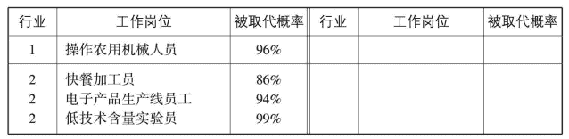

续表

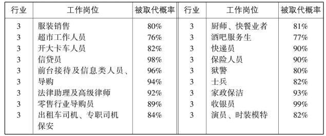

其二，技术迭代也在持续创造新就业。OECD 研究者强调，岗位被替代并非人工智能的直接目标，智能化旨在提升效率，在形成新任务的基础上驱动就业与产业革新。^([\[14\]](#txt007.html#footnote_content_txt007_14))AI 通过改变产业布局与岗位内容影响劳动需求总量，随着应用场景扩散，也催生新产业与新岗位。主要体现在技术研发类岗位的增长，传统行业通过细化、合并与升级形成新业态，以及 AI 应用释放的人类闲暇带动购物、旅游、娱乐等服务业发展。据工信部测算，中国已有 700 多家从事人工智能的企业，直接或间接从业人员近百万人。^([\[15\]](#txt007.html#footnote_content_txt007_15))

总体看，人工智能对就业的双重效应表现为就业创造与就业替代。^([\[16\]](#txt007.html#footnote_content_txt007_16))有学者指出，即便岗位存在被技术取代的风险，也不必然导致人类的实际工作损失。^([\[17\]](#txt007.html#footnote_content_txt007_17))长期而言，由新产业带来的就业增量是否超过被机器替代的岗位仍未知。短期内，AI 更可能对特定区域、特定产业、特定群体造成集中冲击，就业替代效应的短期释放需高度警惕。^([\[18\]](#txt007.html#footnote_content_txt007_18))从历史看，技术革命引发的下岗失业是经济进步的有机环节。生产力提升带来经济增长，人力向回报更高的行业转移，消耗重体力、重复性或危险性工作不再依赖人力。与以往变革相比，人工智能发展更快、覆盖更广，决策者正面临技术与教育的竞赛，鼓励劳动者提升技能、让所有人共享数字红利的方能成为赢家。^([\[19\]](#txt007.html#footnote_content_txt007_19))

### （二）宏观影响：就业岗位的“极化”分布

# AI浪潮下就业分化与劳动法怎么走

AI的技术禀赋决定了它在渗透面不断扩大的过程中，既会挤占存量岗位，也会创造增量机会，同时很可能推动就业结构的两极分化：中端技能岗位承压收缩，而低端与高端岗位的就业比重相对抬升。^([\[20\]](#txt007.html#footnote_content_txt007_20))世界银行《2016年世界发展报告》指出，这一分化态势不仅在发达经济体出现，在发展中国家也在加速显现。菲律宾、南非、马来西亚等市场的经验表明，高技能与低技能就业占比都在上行，中技能就业占比则明显下滑（见图 6-1）。^([\[21\]](#txt007.html#footnote_content_txt007_21))中国当下仍呈现低技能就业规模收窄、中技能就业规模扩大的局面，但参照多数国家已显现的极化路径，未来出现类似分化的可能性不小。^([\[22\]](#txt007.html#footnote_content_txt007_22))

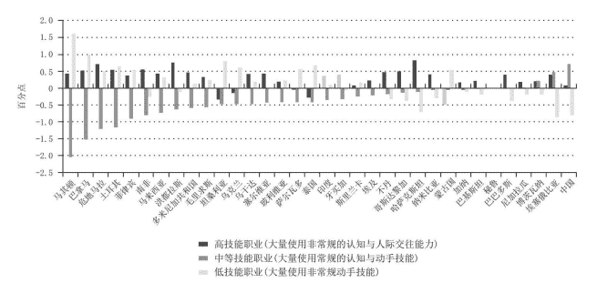

图 6-1　发展中国家就业比例的年均变化（1995 年前后至 2012 年前后）^([\[23\]](#txt007.html#footnote_content_txt007_23))

学界对极化成因主要有两种解释。一种认为难以被自动化的工作集中在技能两端：抽象型任务多集中于专业、技术、管理岗位，依赖创造力、沟通力、问题解决力；具体化手工任务多集中于服务岗位，依赖环境适应、语言识别与互动能力。另一种认为成本逻辑在起作用，对复杂度相近的岗位，企业倾向先自动化培训要求高、人力成本高的任务，而高度复杂、培训密集的岗位却难以自动化。劳动力于是向高度复杂或主要靠天赋、培训门槛不高的岗位集聚，从而形成极化。^([\[24\]](#txt007.html#footnote_content_txt007_24))

近几年AI迭代加速，我国尚未出现明显极化，却催生了大量新业态从业者。外卖骑手、网约车司机等群体规模迅速扩张，已成为劳动力市场不可忽视的部分。2019年，美团平台外卖骑手总数接近400万人，年增速接近四分之一。^([\[25\]](#txt007.html#footnote_content_txt007_25))从技能画像看，这类新业态从业者多属于中等技能人群，在相关岗位尚未被替代的阶段，大多数人仍能通过现有工作模式实现社会价值。但无人配送、无人驾驶已实现商业化，未来这些新业态岗位是否会被AI取代，导致中技能岗位大幅萎缩、高低技能岗位扩张并出现极化，还需实践验证。

## （三）小结

AI对就业市场的影响以及与劳动法的关系，会随技术阶段不同而呈现不同样态。学界通常将AI划分为弱人工智能、强人工智能、超人工智能三类。^([\[26\]](#txt007.html#footnote_content_txt007_26))超人工智能过于超前，本书主要讨论前两类。AI一方面能帮助人类摆脱繁重劳动，另一方面推广后会淘汰大量中技能劳动者，并最终影响就业结构与就业方式。目前AI发展迅猛，对劳动法的冲击已开始显现，集中在解雇保护、职业培训、社会保障以及劳动法主体资格等方面。

三次工业革命都从根本上改写了劳动过程，这种影响经由劳动力与生产资料结合方式的变迁，最终映射到劳动法的演进轨迹。近年来AI加速渗透，就业形态已发生明显变化，呈现去组织化、从属性弱化、关系灵活化特征。^([\[27\]](#txt007.html#footnote_content_txt007_27))正如前文所述，中低技能领域出现大量新业态从业者，工作时间碎片化、地点灵活化、管理虚拟化，劳动关系带有非典型性，这意味着从属性持续弱化已成现实，灵活用工走向常态。^([\[28\]](#txt007.html#footnote_content_txt007_28))展望未来，随着AI深入发展、中技能岗位持续减少，部分劳动者可能被动从“单位就业”转向“自雇就业”，甚至滑向失业。

工业化国家的经验足以证明，技术进步短期内会冲击既有就业、引发下岗与失业，但并不必然阻碍经济长期发展。关键在于一国的劳动政策与法制能否及时调整，形成与本国劳动现实相适配的规制模式。^([\[29\]](#txt007.html#footnote_content_txt007_29))在AI时代，各国都在追求灵活而有保障的劳动就业市场，保护重点应从保住单个岗位的稳定，转向回应劳动者多元深层的权益需求。^([\[30\]](#txt007.html#footnote_content_txt007_30))如果劳动就业市场规制仍固守传统劳动法时代的“稳定性”理念，对劳动关系与岗位进行统一严格保护，就难以适应个人与企业灵活化发展的需求，甚至在稳定就业的语境下构建的保护也难以落地。总体来看，AI时代就业形态正从单一向多元、从稳定向灵活演进，人类将从传统的从属劳动中解放，更多从事独立、自主、创造性的劳动，人类劳动的意义与本质将发生根本性变革。^([\[31\]](#txt007.html#footnote_content_txt007_31))建立在强从属性劳动基础上的传统规制模式难以满足AI时代需求，亟须作出调整。^([\[32\]](#txt007.html#footnote_content_txt007_32))

## 四、人工智能对劳动法的挑战

### （一）弱人工智能对劳动法的挑战

在弱人工智能阶段，AI已在各行业从辅助工具演进为岗位替代力量。此阶段对就业的影响主要体现为三方面：一是替代过程中将伴随大量解雇纠纷；二是为应对就业极化，需要通过职业培训提升劳动者技能适配度；三是对因跟不上技术进步而被淘汰的失业者，需在制度层面强化社会保障。因此，从劳动法视角审视解雇制度、职业培训制度、社会保障制度的冲击具有现实必要性。

#### 1. 对解雇法律制度的挑战

企业引入AI往往伴随裁员潮，与AI相关的解雇争议可能大幅增加。核心难题在于，如何判断用人单位因引入AI导致规模裁员或个别解雇是否合法，将成为常态。此类案件在我国已有出现，2017年上海首例“机器换人”劳动争议即是例证。司法实践对争议焦点存在分歧，其中之一是智能系统取代人工岗位是否属于《劳动合同法》第40条第3项规定的“客观情况发生重大变化”。^([\[33\]](#txt007.html#footnote_content_txt007_33))

我国劳动法采用法定解雇原则，《劳动合同法》制定于2007年，当时AI尚未普及，立法并未覆盖此问题，现行条文能否有效回应存疑。且《劳动合同法》第40条第3项和第41条第1款第3项中的“重大技术革新”等表述属于不确定法律概念，其内涵需结合立法目的与个案事实予以界定。当同类纠纷增多时，法官对抽象概念理解不一，易出现同案不同判。为缓释法律适用不确定性，实现同案同判，避免损害法律与司法权威，亟须建立统一裁判标准，为司法者、劳动者与用人单位提供明确指引。

#### 2. 对职业培训法律制度的挑战

AI对既有岗位的替代将推高失业风险，政府与企业需前瞻性监测被替代岗位，并为失业者提供再就业培训。与此同时，AI催生大量新岗位，劳动者需具备新技能，否则将出现人才缺口。教育部、工信部等部门测算，到2025年我国信息技术产业人才缺口可能高达950万人。^([\[34\]](#txt007.html#footnote_content_txt007_34))当前我国职业培训以短期、小规模、碎片化项目为主，难以形成长期系统的新技能供给。^([\[35\]](#txt007.html#footnote_content_txt007_35))在培训制度无法满足市场需求的背景下，从法律层面完善职业培训机制，保障劳动者掌握市场所需技能并实现再就业，已成为劳动法的紧迫议题。

失业与人才缺口并存，本质是劳动力供需匹配失灵。2016年12月20日，美国政府发布《人工智能、自动化与经济报告》，提出三大策略之一是教育培训美国人以迎接未来工作。^([\[36\]](#txt007.html#footnote_content_txt007_36))2017年7月国务院发布的《新一代人工智能发展规划》亦将研究AI带来的就业结构与方式转变、新型职业技能需求，大幅提升就业人员专业技能，作为最紧迫任务之一。这对我国AI时代职业培训法律制度提出更高要求。

#### 3. 对社会保障法律制度的挑战

社会保障制度旨在为公民在年老、疾病、伤残、失业、灾害等情形下提供物质帮助。我国社会保障体系包括社会保险、社会救助、社会福利、社会优抚，其中社会保险法是核心，2011年《社会保险法》规定养老保险、医疗保险、工伤保险、失业保险、生育保险五项。现行社保制度根植于现代工厂制度，以全日制用工为前提，基金筹集主要依赖劳动者与用人单位缴费，养老保险、医疗保险、失业保险的缴费基数分别以个人工资与企业工资总额计。以养老保险为例，用人单位缴费一般不超过企业工资总额20%，个人缴费率一般为本人工资8%。

社保本质是国家力量对国民收入的再分配，包含横向转移与纵向转移。横向转移指在职者、退休者、失业者之间的收入流动；纵向转移即代际互助，如在职劳动者缴费即时支付退休人员。^([\[37\]](#txt007.html#footnote_content_txt007_37))随着AI替代和就业极化加剧，全日制岗位将不断减少，非典型就业与失业人口上升，社保缴费主体减少，工资收入为基础的基金将大幅缩水，保障基金面临枯竭风险。再叠加人口老龄化、年轻劳动力占比下降，横向、纵向转移都可能难以为继，社会保险可持续性面临严峻挑战。^([\[38\]](#txt007.html#footnote_content_txt007_38))劳动者通过工作获得收入与保障维持生活的基本模式，正遭遇前所未有的考验。

### （二）强人工智能对劳动法的挑战

当前AI仅具备特定技能，缺乏人类逻辑思维、联想与创造力，难以完全替代人类，无需作为劳动法主体。若进入强人工智能阶段，其能力可媲美甚至超越人类，能完全替代部分工作，此时是否将AI纳入劳动法主体便成为无法回避的问题。

学术界对自然人排他性民事主体地位的讨论早在机器人出现前就已涉及动物主体。机器人的出现因其具备部分甚至专属自然人能力，对人类主体地位构成更强挑战。^([\[39\]](#txt007.html#footnote_content_txt007_39))应否赋予AI法律主体资格，社会各界至今未形成共识，但实践中已有探索。例如日本开发的宠物型机器人帕罗，能感知触觉、位置、光、声等环境，2010年11月获日本富山县南砺市户籍，户口簿上父亲为发明人柴田崇德。^([\[40\]](#txt007.html#footnote_content_txt007_40))这被视作日本政府在一定程度上认可智能机器人的主体地位，承认其为有感知力的权利主体。^([\[41\]](#txt007.html#footnote_content_txt007_41))2016年2月，美国国家公路安全交通管理局表示可将谷歌无人驾驶汽车所用AI系统视为“驾驶员”，这可看作AI被赋予有限的虚拟法律主体地位。^([\[42\]](#txt007.html#footnote_content_txt007_42))2016年5月，欧盟委员会法律事务委员会提案要求把最先进自动化机器“工人”的身份定位为“电子人”，并赋予其劳动权、著作权等特定权利义务。^([\[43\]](#txt007.html#footnote_content_txt007_43))可见，人工智能的法律主体地位已成为包括劳动法在内的立法重点课题。

## 五、弱人工智能阶段劳动法的回应

### （一）解雇法律制度的回应

弱人工智能阶段，核心挑战是如何应对AI取代人工岗位引发的劳动争议，尤其是企业因引进AI进行规模裁员或个别解雇的合法性认定。

一方面，需明确企业能否以引入AI为由实施规模裁员，即能否将其解释为《劳动合同法》第41条第1款第3项的“重大技术革新”。对于“重大技术革新”是否仅限于企业生产经营严重困难时为求生存而进行的技术革新，存在争议。《劳动合同法》第41条第1款第3项中“企业转产、重大技术革新或者经营方式调整”是在《劳动法》基础上新增，与前两项不同，此时用人单位未陷入经济困境，而是为更好发展而自主升级。^([\[44\]](#txt007.html#footnote_content_txt007_44))该条款旨在放宽规模裁员条件，赋予企业用工自由度。^([\[45\]](#txt007.html#footnote_content_txt007_45))据此，现行法下即便生产经营未严重困难，出于市场竞争需要因重大技术革新而裁员可被认定合法。例如张斌与南京爱立信熊猫通信有限公司经济补偿金纠纷案，一审、二审均认为公司引入高科技产品替代岗位、提升自动化程度符合“重大技术革新”，且裁员程序合规，判定经济性裁员合法。但AI是否构成“重大技术革新”需个案具体分析，不能一概而论，应由企业举证其必要性与合理性。^([\[47\]](#txt007.html#footnote_content_txt007_47))

AI换人能否合法解雇？看第40条的兜底空间

实务里反复被追问的边界是：企业因引入人工智能完成岗位替代，能否直接把个别解除说成是《劳动合同法》第40条第3项所说的客观情形出现重大变动。第40条第3项的兜底表述“客观情况”与第41条第1款第4项的兜底表述“客观经济情况”在适用上很容易混淆。^([\[48\]](#txt007.html#footnote_content_txt007_48))通说把第40条第3项看作预告辞退的兜底条款，而裁员只是预告辞退的特殊形态，其触发点被限定在经济层面。从文义和体系看，第40条第3项的“客观情况”应当被理解为包含第41条第1款第4项的“客观经济情况”。再叠加现行法把裁员制度锁死在规模裁员，即一次减员20人以上，或不足20人但占职工总数10%以上的情形，就能推导出规模以下的人力调整，包括单独解除，应该落进第40条第3项的调整范围。^([\[49\]](#txt007.html#footnote_content_txt007_49))由此可以进一步推断，因重大技术革新即引入AI导致规模以下岗位流失，企业在法理上可以据此作出个别解雇。

需要强调的是，即便AI导致某类岗位实质消失，企业也不能跳过程序直接解除。现行劳动法要求先行协商、履行变更劳动合同等法定义务后才能解除。随着技术性失业压力加大，未来可以在强化雇主和政府再就业兜底责任的同时，对解雇保护做适度松绑，降低企业用工调整成本。具体到受AI冲击的企业，可以在由雇主或政府承担再就业培训责任的前提下，放宽因技术革新引发的裁员解雇限制。经济补偿金目前仍承担解雇保护功能，调整补偿标准有助于缓解现行保护强度。为了不削弱劳动者权益，必须配套重塑失业保险制度，在重构失业保险后取消经济补偿金，用失业保险金替代。^([\[50\]](#txt007.html#footnote_content_txt007_50))

### （二）职业培训法律制度的回应

前文已指出，AI时代对就业的典型冲击之一是就业极化，职业培训制度的改革也应围绕这一现象展开。其一，要强化对已失业群体以及易被AI替代劳动者的就业培训与再教育。AI加速岗位消失，劳动者转岗频率升高，再培训需求随之放大。其二，要加大高技能人才尤其是AI人才的培养力度。AI是多学科技术聚合的复杂综合体，也关乎法律、经济、社会、环境等多领域发展，培养AI人才是优化供给侧结构、实现劳动力可持续战略的关键。^([\[51\]](#txt007.html#footnote_content_txt007_51))从人才结构看，未来需要研发人才、应用推广人才以及复合型人才。

同时要重视AI垂直应用领域所需的纵向跨界人才，和面向社会科学的横向跨界人才培育。^([\[52\]](#txt007.html#footnote_content_txt007_52))政府及职能部门、行业协会等应发挥主动作用：其一，精准定位培训对象。加强劳动力市场监测，预判易被AI替代的行业岗位以及未来人才缺口大的领域，准确定位培训需求。其二，提升培训内容的适应性。顺应技术演进及时调整各层级职业培训重点，逐步淘汰易被替代的技能训练，转而聚焦难以替代的核心能力，特别要强化学习适应力、组织协调力与复杂问题解决力。^([\[53\]](#txt007.html#footnote_content_txt007_53))其三，创新培训方式。可将虚拟现实、增强现实、混合现实等数字技术与传统师徒指导结合，构建数字化职业培训新模式，并积极利用AI技术开展创新性员工培训。^([\[54\]](#txt007.html#footnote_content_txt007_54))其四，加强支持与投入。政府可通过税收手段，对为低技能劳动者提供培训的企业、专门培训机构给予企业所得税或增值税优惠，并对个人培训支出给予个人所得税前扣除。^([\[55\]](#txt007.html#footnote_content_txt007_55))其五，完善合作机制。建立政府、机构、行业协会、培训机构协同联动的机制，共同推动职业培训供给。

总体来看，针对AI的职业培训与再教育一方面应从政策、企业人事管理层面提升到法律层面，另一方面应出台与AI相适应的现代化职业培训政策，统一质量标准、完善评估体系，提供坚实的法律保障。^([\[56\]](#txt007.html#footnote_content_txt007_56))与此同时也要看到职业培训存在功能边界，即便制度完善，岗位总量减少也只能覆盖部分劳动者，仍会有大量失业者留存。未来依托培训重新就业的难度将加大，对低教育程度劳动者尤其如此。因此从个人层面，需提升职业危机意识，建立终身学习理念，提前规划职业生涯。法律层面则有必要将“职业权”明确为法定权利，并以法律形式规定国家和企业在劳动者职业能力开发中的义务。人工智能时代的劳动就业政策与理念应逐步从“岗位保障”转向“职业保障”。^([\[58\]](#txt007.html#footnote_content_txt007_58))

### （三）社会保障法律制度的回应

面对AI对社会保障的冲击，未来应逐步构建适应AI时代的社会保障政策与社会保险机制。

其一，要转变社会保障基本模式，从以劳动为核心转向以公民身份为核心，例如推行全民基本收入保障。^([\[59\]](#txt007.html#footnote_content_txt007_59))与传统模式不同，全民基本收入是指国家不以资产状况或就业状态为条件，定期向全体合法居民无条件发放定额现金。其主要特征为：个人性、向个人而非家庭发放；无条件性，不问工作意愿与收入用途；普遍性，不分人口特征与资产；定期性，非一次性；货币性，以适当水平现金提供。^([\[60\]](#txt007.html#footnote_content_txt007_60))按覆盖范围、替代水平、支付方式与收益条件，可分为完全全民基本收入、部分全民基本收入、负所得税、参与型全民基本收入和通用福利等五种形态。^([\[61\]](#txt007.html#footnote_content_txt007_61))

全民基本收入的思想由来已久。^([\[62\]](#txt007.html#footnote_content_txt007_62))1516年托马斯·莫尔《乌托邦》首次提出类似设想，^([\[63\]](#txt007.html#footnote_content_txt007_63))1748年孟德斯鸠《论法的精神》主张国家有责任保障国民基本生活。19世纪初沙利耶与穆勒提出“基本收入”概念，^([\[64\]](#txt007.html#footnote_content_txt007_64))1962年米尔顿·弗里德曼在《资本主义与自由》中阐述负所得税思想，后逐渐发展为全民基本收入政策。^([\[65\]](#txt007.html#footnote_content_txt007_65))目前该模式仍存争议，但已成为多国政策讨论焦点并在部分地区实践，如美国阿拉斯加永久基金分红、巴西家庭补助金、纳米比亚奥奇韦罗—奥米塔拉村庄基本收入实验、芬兰基本收入实验等。^([\[67\]](#txt007.html#footnote_content_txt007_67))我国将来选择何种模式，取决于AI发展速度与国情。^([\[68\]](#txt007.html#footnote_content_txt007_68))

其二，需解决社会保障资金来源。无论改革现有模式或导入新模式，均需巨额资金。未来可考虑对人工智能征税以缩小分配差距。^([\[69\]](#txt007.html#footnote_content_txt007_69))2017年8月韩国通过限制自动化企业税收优惠，间接对机器人课税，成为全球首个征收“机器人税”的国家。其动因正是机器换人导致失业率上升，当时韩国失业率创17年新高，失业人口约117万。^([\[70\]](#txt007.html#footnote_content_txt007_70))短期看，“机器人税”本质是对资本征税，设计目标应是平衡劳动与资本、技术利益，其征收需结合本国国情与税收体系。当前我国社保面临AI与人口老龄化双重压力，筹资高度依赖标准就业者工资税，基金可持续性受挑战。未来筹资方向应从“人”转向“技术”与“资本”，划拨国有资本充实社保基金是向资本筹资的重要一步，今后“机器人税”应成为社保筹资的重要来源。^([\[71\]](#txt007.html#footnote_content_txt007_71))

## 六、强人工智能阶段劳动法的回应

如前所述，AI与劳动法的互动随发展阶段而变化。弱人工智能仅能作为人类工具使用，与人差异明显。而当AI发展至强人工智能阶段，人机差异缩小，其能否获得劳动法上的主体资格成为疑问。回答该问题前，需先解决是否应承认AI法律主体地位这一前置议题。

### （一）人工智能作为法律主体的学说论争

有观点认为AI不同于一般技术，其制度设计不仅涉及客体差异，更因其智能特征从事类人活动，甚至形成类人法律关系，因此制度设计上应考虑将其作为法律主体而非客体对待。^([\[72\]](#txt007.html#footnote_content_txt007_72))该议题已成为法学热点，最初集中于民法与知识产权，后扩展至公司法、刑法、法理学等领域，学界对此尚未达成一致。

#### 1. 肯定说

## 肯定说
大量学者持肯定立场，认为AI可以成为法律主体。其理论逻辑多元：其一，从权利主体历史演进看，经历从排除黑人奴隶到承认的变迁后，^([\[73\]](#txt007.html#footnote_content_txt007_73))法律主体呈现开放体系，机器人权利是社会活动的产物，承认AI权利主体地位是权利发展规律的必然要求。^([\[74\]](#txt007.html#footnote_content_txt007_74))通过分析法人成为主体的原因，可揭示法律主体制度的扩张性，为赋予AI主体地位提供理论基础。^([\[75\]](#txt007.html#footnote_content_txt007_75))其二，从社会需求看，价值取向与规范意识的分离为主体制度留下发展空间，法人资格的授予基于社会需要，当AI对现有社会关系冲击达到阈值时，可考虑赋予其主体地位。^([\[76\]](#txt007.html#footnote_content_txt007_76))冲击可从自我意识、权利义务与行为责任、AI与人类伦理关系等维度评估。^([\[77\]](#txt007.html#footnote_content_txt007_77))其三，从主体标准看，“电子人格说”主张以“电子人”作为AI法律主体的规范称谓，认为AI已形成人工人格并具备行为与一定决定权，嵌入自主规范性电子人具有合理性。^([\[78\]](#txt007.html#footnote_content_txt007_78))“有限人格说”则认为AI具备独立自主意识、享有权利并承担责任，可具法律人格，但属特殊性质，具有有限性。^([\[79\]](#txt007.html#footnote_content_txt007_79))总体而言，肯定说从自主性、社会性与权利主体演变等角度构建AI成为法律主体的理论支撑，并探讨其资格要件、权利体系、行为能力与责任承担制度的建构问题。^([\[80\]](#txt007.html#footnote_content_txt007_80))这些讨论对主体地位发展具有重要价值。

## 2. 否定说

相对而言，否定说者亦不少。有学者认为肯定说关于AI具备自主意识与意志的论断仅属猜想，AI辨认与控制能力缺乏充分论证，前提不成立结论不成立。^([\[81\]](#txt007.html#footnote_content_txt007_81))也有观点认为机器人与有生命的自然人、以及作为自然人集合体的法人不同，不具备人类心性灵性，其行为非有意识行为，知识来自人类输入、领域受限、无法自主积累，且仍受自然人控制，不足以取得法律主体资格。^([\[82\]](#txt007.html#footnote_content_txt007_82))另有学者从哲学与法学角度指出不应赋予机器人主体地位，因其不具备感知环境、认知判断选择等意思能力，也不拥有生命与生命权，更无法具备责任主体所必需的道德、伦理、宗教与习惯。^([\[83\]](#txt007.html#footnote_content_txt007_83))还有学者将AI与动物类比，认为两者仅有对外界的事实认知，缺乏法律规范认知遵从的理性，无法成为主体。^([\[84\]](#txt007.html#footnote_content_txt007_84))另有观点认为AI不像法人那样具备拟制技术适用的价值前提，缺乏自身思维与语言能力，仅表现人类创造工具的工作能力，无哲学意义上的主体意识确证，只能定性为客体。^([\[85\]](#txt007.html#footnote_content_txt007_85))更有学者认为即便赋予法律人格，责任最终仍由人类承担，讨论主体资格缺乏意义。^([\[86\]](#txt007.html#footnote_content_txt007_86))总体而言，否定说强调AI与人类的本质区别，认为AI仍受人类控制，无法超越人类理性，无权享有权利、承担责任，因而无必要也无可能成为法律主体。

### （二）人工智能作为法律主体的理论证成

学术界就是否把智能体纳入法律主体框架的争论持续多年，背后可归结为两类根源。第一类是技术认知分歧，人们对人工智能的本质理解并不统一，其未来演进路径也充满不确定性；第二类是规范取向的分歧，学界既难以共识是否需要通过主体制度来规制人工智能，也不见得能确立清晰的操作路径。法律本身具有滞后特性，面对人工智能革命所带来的新情境，主张先行布局要比被动补救更为迫切。一旦强人工智能时代真正到来，现行规范很可能力不从心，为避免技术冲击引发社会关系剧烈波动，有必要在梳理现行法困境的基础上，探索与科学文明同步演进的制度文明。^([\[87\]](#txt007.html#footnote_content_txt007_87))

先从赋权是否必要展开判断。现行成文法体系对人工智能基本处于真空状态，实践缺乏明确的价值指引，身份定位的澄清势在必行。^([\[88\]](#txt007.html#footnote_content_txt007_88))人类社会正迈向智能化，主体制度本身也在经历代际更替。承认人工智能的主体资格，实质是以人为核心构建制度坐标，防止因人格缺位导致规则悬空。^([\[89\]](#txt007.html#footnote_content_txt007_89))进入强人工智能阶段后，机器具备类独立的思考能力，会在一定程度上稀释人类过错比例并分担责任归属。若人工智能以主体意识介入法律关系，就必须承担相应责任，这就要求它以主体身份进入活动并成为权利义务的承担者。^([\[90\]](#txt007.html#footnote_content_txt007_90))人机交互世界的扩张正重塑秩序与伦理，围绕人工智能的法律难题愈发复杂，诸多既有概念需要重塑，主体制度的完善势在必行。^([\[91\]](#txt007.html#footnote_content_txt007_91))新的法律制度诸如法律主体制度应当得到进一步的完善。

再看赋权是否可行。强人工智能目前尚未出现，但其诞生并超越人类智慧的可能性在不断上升。一方面，强人工智能时代最核心的特征是自主性，它不仅能像人一样自我学习、自我推演，还能实现高度智能化的独立决策和意思表达。这一发展水平足以让它成为相对独立、自由的载体，从而消解当下对其主体资格的质疑。^([\[92\]](#txt007.html#footnote_content_txt007_92))另一方面，从制度建构角度观察，人工智能拥有权利能力、行为能力以及责任能力的事实与理论依据在现有科技条件下已有显现，比如财产权的享有、独立缔结合同能力的实现等，并不存在根本性的法律障碍。^([\[93\]](#txt007.html#footnote_content_txt007_93))当人工智能从人的附属工具演变为相对独立的实体，并在某些维度优于人类时，其意志与选择自由会在现实中支撑起主体能力的运行。^([\[94\]](#txt007.html#footnote_content_txt007_94))持否定说的学者大多未能充分认识这种可能性。

社会效益可从四个层面展开。其一，人工智能技术能把人从重复程式化工作中解脱出来，确认其主体地位应充分考虑社会发展需求，社会性和伦理性已不再是授予主体资格的必要前提。^([\[95\]](#txt007.html#footnote_content_txt007_95))其二，明确其法律能力与财产基础，有助于推动规则化发展，避免科技能力过剩带来的失衡，实现人与技术的和谐共生。^([\[96\]](#txt007.html#footnote_content_txt007_96))其三，赋予主体资格的意义不仅在于带来更多便利与服务需求的满足，更在于厘清人类社会的法律关系，用更简洁的思路处理复杂的利益纠纷。^([\[97\]](#txt007.html#footnote_content_txt007_97))其四，构建交易、权利、责任等制度体系，能够降低人工智能带来的交易不确定成本、信息成本和约束成本，推动交易成本最小化，有利于经济运行。^([\[98\]](#txt007.html#footnote_content_txt007_98))

总体而言，当人工智能发展至强人工智能阶段并对社会产生显著冲击时，无论从必要性、可行性还是社会效益来看，不妨考虑赋予其法律主体地位。

## （三）人工智能作为劳动法主体的展望
在劳动法讨论中，有观点认为对人工智能的劳动法保护既不可行也无必要；^([\[99\]](#txt007.html#footnote_content_txt007_99))也有观点认为人工智能与劳动法所欲保护的劳动者形象相去甚远，赋予其劳动者身份过于超前。^([\[100\]](#txt007.html#footnote_content_txt007_100))本书认为，仅以传统劳动法律关系与调整对象来判断人工智能的法律地位，视野明显受限，法律具有滞后性，面对人工智能革命需要前瞻性方案。

一方面，赋予人工智能劳动法上的主体地位契合社会演进方向。早在三十年前就有学者提出，权利的外延一直在自然客体中扩张，从动物、树木到海洋，总有一天，机器人也会享有权利。^([\[101\]](#txt007.html#footnote_content_txt007_101))随着技术加速演进，旧有的法律体系必然被改写，专属权利的授予或许就是起点。^([\[102\]](#txt007.html#footnote_content_txt007_102))甚至有主张为防止机器人被无休止使用而赋予其生命权、自由权的声音。^([\[103\]](#txt007.html#footnote_content_txt007_103))回溯自然人主体演化、动物及无生命体主体制度的历史，也表明强人工智能获得主体资格具备发展前景。^([\[104\]](#txt007.html#footnote_content_txt007_104))若成真，人工智能将在分工、分配、效率等层面推动社会进步。^([\[105\]](#txt007.html#footnote_content_txt007_105))未来人工智能“工人群体”或将形成，应及时启动劳动法治领域的赋权进程，这一机制有助于构建主体间的互赖结构，降低不确定风险。^([\[106\]](#txt007.html#footnote_content_txt007_106))

另一方面，即便承认其在劳动法上的主体资格，也不意味着要与人类劳动者做到完全等同对待。^([\[107\]](#txt007.html#footnote_content_txt007_107))人工智能的参与会让现行劳动关系与用工形式更趋多元，权利保障的内涵也会变化。^([\[108\]](#txt007.html#footnote_content_txt007_108))必须认识到，人工智能与传统劳动者存在本质差异，也不同于一般技术应用。它既具有“人”的某些特征，又拥有人类难以企及的技术层级。站在人类立场，人工智能只是人类之外的另一种主体形态，确立其主体地位并不等于授予完整人格。赋权与主体资格的确定应当在以人类为中心的前提下服务于人类。康德在《实践理性批判》中指出：“人是生活在目的的王国中。人是自身目的，不是工具。人是自己立法自己遵守的自由人。人也是自然的立法者。”^([\[109\]](#txt007.html#footnote_content_txt007_109))简言之，制度与法律的制定执行需遵循以人为本的价值。若人类是民法关怀与设计的中心，^([\[110\]](#txt007.html#footnote_content_txt007_110))那么基于人权保障而兴起的劳动法，其制度设计更应以人类为核心。人工智能的性能优势使人类难以匹敌，若照搬现行劳动法的同工同酬、多劳多得原则，可能严重损害劳动者权益。因此，即便将其视作劳动法主体，也永远无法享有以人类为法律目的的某些特有权利。人工智能发展的终极指向是改善人类生活，而非取代人类。未来伴随主体地位的确立，传统劳动法学的概念、范畴、体系与立场都将迎来更新，需要进一步深入研究。^([\[111\]](#txt007.html#footnote_content_txt007_111))

## 七、结语
以人工智能为代表的第四次科技革命浪潮已深度渗透日常生产生活，规模化应用提升生产力，也让劳动者从繁琐程式化工作中获得解放。但同时，就业结构与就业市场面临新风险挑战。面对劳动就业形态变化，我国现行劳动法在解雇规制、职业培训、社会保障，以及是否授予人工智能劳动法主体资格等方面承受不同程度压力。基于工业化大生产构建的传统劳动就业市场规制模式，已难以匹配人工智能时代需求，亟需转型。在弱人工智能阶段，可行的应对是适度完善配套保障以缓解解雇保护压力，构建适应时代的职业培训体系，充实以公民身份为核心的社会保障制度。在强人工智能阶段，赋予人工智能劳动法主体地位成为可能，但仍需视技术发展而定；即便承认其主体地位，也无法享有作为法律目的的劳动者的某些特有权利。面向人工智能时代，现行劳动法需要一次全面的“检修”。^([\[112\]](#txt007.html#footnote_content_txt007_112))本书仅作初步探讨，后续应持续追踪前沿动态，通过制度安排最大限度实现人、技术、经济的和谐发展。

## 【注释】
[\[1\]](#txt007.html#footnote_quote_txt007_1)参见朱敏等：“人工智能与劳动力市场变革：机遇和挑战”，载《教育经济评论》2018 年第 2 期。

[\[2\]](#txt007.html#footnote_quote_txt007_2)参见龙卫球：“科技法迭代视角下的人工智能立法”，载《法商研究》2020 年第 1 期。

[\[3\]](#txt007.html#footnote_quote_txt007_3)参见蒋南平、邹宇：“人工智能与中国劳动力供给侧结构性改革”，载《四川大学学报（哲学社会科学版）》2018 年第 1 期。

[\[4\]](#txt007.html#footnote_quote_txt007_4)参见冯彦君、隋一卓：“‘后现代性’视阈下劳动法的革新与完善”，载《南通大学学报（社会科学版）》2018 年第 4 期。

[\[5\]](#txt007.html#footnote_quote_txt007_5)参见田思路：“工业 4.0 时代的从属劳动论”，载《法学评论》2019 年第 1 期；杜传忠、许冰：“第四次工业革命对就业结构的影响及中国的对策”，载《社会科学战线》2018 年第 2 期。

[\[6\]](#txt007.html#footnote_quote_txt007_6)参见涂永前：“应对灵活用工的劳动法制度重构”，载《中国法学》2018 年第 5 期。

[\[7\]](#txt007.html#footnote_quote_txt007_7)参见曹静、周亚林：“人工智能对经济的影响研究进展”，载《经济学动态》2018 年第 1 期。

[\[8\]](#txt007.html#footnote_quote_txt007_8)参见曹静、周亚林：“人工智能对经济的影响研究进展”，载《经济学动态》2018 年第 1 期。

# 脚注
[\[9\]](#txt007.html#footnote_quote_txt007_9)Carl Benedikt Frey&Michael A.Osborne，“就业的未来：工作对计算机化的易感性如何？”，`https：//www.sciencedirect.com/science/article/pii/S0040162516302244`，访问于 2019 年 11 月 10 日。

[\[10\]](#txt007.html#footnote_quote_txt007_10)\[日\]笠木映里等：“AIと社会と法：パラダイムシフトはおきるか？（第 7 回）代替性：AI·ロボットは労働を代替するか？”，载《論究ジュリスト》2019 年第 31 期。

[\[11\]](#txt007.html#footnote_quote_txt007_11)世界银行：“2016 年世界发展报告：数字红利”，载世界银行官网，`http：//www.worldbank.org/en/publication/wdr2016`，最后访问日期：2019 年 11 月 10 日。

[\[12\]](#txt007.html#footnote_quote_txt007_12)参见蒋南平、邹宇：“人工智能与中国劳动力供给侧结构性改革”，载《四川大学学报（哲学社会科学版）》2018 年第 1 期。

[\[13\]](#txt007.html#footnote_quote_txt007_13)参见蒋南平、邹宇：“人工智能与中国劳动力供给侧结构性改革”，载《四川大学学报（哲学社会科学版）》2018 年第 1 期。

[\[14\]](#txt007.html#footnote_quote_txt007_14)参见朱敏等：“人工智能与劳动力市场变革：机遇和挑战”，载《教育经济评论》2018 年第 2 期。

[\[15\]](#txt007.html#footnote_quote_txt007_15)参见李亢：“人工智能背景下的就业现状与对策”，载《中国法律评论》2018 年第 2 期。

[\[16\]](#txt007.html#footnote_quote_txt007_16)参见张美莎、曾钰桐、冯涛：“人工智能对就业需求的影响：基于劳动力结构视角”，载《中国科技论坛》2021 年第 12 期。

[\[17\]](#txt007.html#footnote_quote_txt007_17)参见曹静、周亚林：“人工智能对经济的影响研究进展”，载《经济学动态》2018 年第 1 期。

[\[18\]](#txt007.html#footnote_quote_txt007_18)参见李亢：“人工智能背景下的就业现状与对策”，载《中国法律评论》2018 年第 2 期。

[\[19\]](#txt007.html#footnote_quote_txt007_19)参见世界银行：“2016 年世界发展报告：数字红利”，载世界银行官网，`http：//www.worldbank.org/en/publication/wdr2016`，最后访问日期：2019 年 11 月 10 日。

[\[20\]](#txt007.html#footnote_quote_txt007_20)参见曹静、周亚林：“人工智能对经济的影响研究进展”，载《经济学动态》2018 年第 1 期。

[\[21\]](#txt007.html#footnote_quote_txt007_21)参见世界银行：“2016 年世界发展报告：数字红利”，载世界银行官网，`http：//www.worldbank.org/en/publication/wdr2016`，最后访问日期：2019 年 11 月 10 日。

[\[22\]](#txt007.html#footnote_quote_txt007_22)参见朱敏等：“人工智能与劳动力市场变革：机遇和挑战”，载《教育经济评论》2018 年第 2 期；世界银行：“2016 年世界发展报告：数字红利”，载世界银行官网，`http：//www.worldbank.org/en/publication/wdr2016`，最后访问日期：2019 年 11 月 10 日。

[\[23\]](#txt007.html#footnote_quote_txt007_23)参见世界银行：“2016 年世界发展报告：数字红利”，载世界银行官网，`http：//www.worldbank.org/en/publication/wdr2016`，最后访问日期：2019 年 11 月 10 日。

[\[24\]](#txt007.html#footnote_quote_txt007_24)参见曹静、周亚林：“人工智能对经济的影响研究进展”，载《经济学动态》2018 年第 1 期。

[\[25\]](#txt007.html#footnote_quote_txt007_25)参见李心萍：“推动新就业形态规范发展”，载《人民日报》2020 年 9 月 23 日，第 18 版。

[\[26\]](#txt007.html#footnote_quote_txt007_26)Tim Urban，“人工智能革命：通往超级智能之路”，`https：//getpocket.com/explore/item/the-ai-revolution-the-road-to-superintelligence`，访问于 2019 年 11 月 10 日。值得注意的是，虽然理论上对于人工智能的分类进行了这样的划分，但是实践中人工智能的发展进程却未必如此按部就班，可能出现同一时空下不同阶段的交融，但这并不妨碍我们在此分类的基础上进行相应的探讨。

人工智能冲击下劳动关系的重塑之路

当算法开始排班、机器人开始上岗，传统的劳动合同边界正在被快速拉伸。灵活用工的扩张让现有的劳动法框架显得捉襟见肘，学界早已提醒需要对规制逻辑进行系统性重构。工业4.0背景下，从属劳动的认定标准被迫移动，AI参与的生产关系不再是简单的雇佣与被雇佣。

从劳动形态看，人工智能时代的工作方式在分化。平台化、碎片化、远程化成为常态，劳动法学者反复讨论如何为新兴形态提供法律选择。上海首例智能替代人工引发的劳动争议仲裁开庭，把“机器换人到底算不算裁员”推到了公众视野。与此同时，十大重点领域的技能缺口在扩大，人工智能与供给侧结构性改革的互动成为政策焦点。白宫早年发布的自动化经济报告与国内对增长与就业关系的长期研究，都指向同一判断：技术红利需要以更灵活且有安全网的劳动力市场来承接。

安全网本身正面临压力。根据中国社科院的精算测算，养老金系统在2035年左右可能出现耗尽风险，这让失业、转型、再就业的议题更具紧迫性。单方解雇制度的反思、经济补偿金制度的替代方案设计、以及张斌与南京爱立信熊猫通信案引发的司法讨论，都在提示：当效率提升带来岗位流失时，退出机制必须更公平、可预期。

法律还绕不开一个更根本的问题：机器人该不该成为法律主体。关于电子人、有限法律人格、工具性人格的争论在中日欧学界持续发酵。有观点主张先行规制而非赋权，也有学者提出强人工智能时代的法律主体性审视。欧盟率先提出人工智能立法动议，日本南砺市的实践经验也被反复引用，核心共识是规制要前置，不能等伤害发生后再修复。日本劳动法学者提出的职业权概念，强调劳动者通过职业生活实现幸福的权利，被视作从福利补救转向能力赋能的思路。

面对收入断层，社会讨论分化为三条托底路径。一是职业培训的系统升级，让工作与职业培训跟上技术节奏；二是全民基本收入的设想，从托马斯·莫尔的乌托邦到弗里德曼的负所得税，学界在学理模型与制度可行性之间反复权衡；三是机器人税，韩国曾提出全球首个机器人税的动议，但关于税基认定、产业竞争力影响的争议始终存在。

总体来看，人工智能不是单一技术问题，而是劳动法、社会保障、税收与伦理的复合重构。制度要从修复转向塑造，在保护劳动者基本权益的同时，为人机协作预留空间。

编者寄语

《互联网和人工智能发展对劳动法的挑战与应对》立足当下劳资关系因数字化智能化所催生的新图景，对网络化与智能化浪潮给劳工法制带来的前沿议题进行剖解，并对可行路径作出系统梳理。

全书由张鸣起担任主编，谢增毅教授任副主编。撰写分工按章节顺序为：
绪论由张鸣起执笔，主题指向网络与智能技术演进为劳工法带去的新型冲击；
王天玉撰写首章，论及新型业态对劳工法基本法理的考验及对策；
娄宇负责次章，聚焦新型业态从业者权益的法律保障机制；
谢增毅执笔第三章，研讨远端作业的规范化问题；
沈建峰承担第四章，探讨网络化情境下劳动基准的理论发展与制度革新；
吴文芳与王倩合作第五章，关注网络环境下职工个人信息权益的法保护；
战东升完成第六章，分析智能技术对劳工法制的冲击与回应对策。

本书属于新时代劳工法制研究项目之一，许瀛彪在资料搜集与校审环节提供协助。书稿出版得到中国国电集团有限公司法务部的经费支持，特此感谢国电集团法务部诸位同事及中国政法大学出版社编辑牛洁颖等人的付出。

张鸣起
2023年8月22日