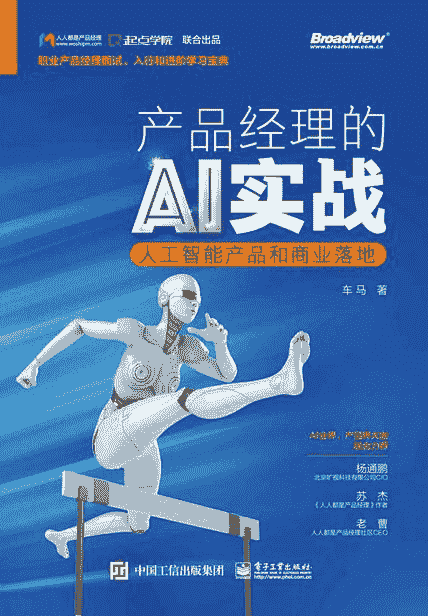

# AI产品落地与商业实战指南

\[https://t.me/+WwC4dCWvXRdhOTNh\] © 未经授权禁止转载 [获取更多电子书：https://t.me/+WwC4dCWvXRdhOTNh](https://t.me/+WwC4dCWvXRdhOTNh) | ID：`EPUB_20260428160408`

# 作者简介

车马，担任高管、写作与咨询工作，是国内最早一批互联网产品经理。曾出任电商第一股慧聪网唯一产品负责人，也参与过周鸿祎早期项目3721网络实名的产品工作。职业经历包括捷银支付产品总监、中国平安集团移动互联网事业部总经理、北京房斯达克电子商务CEO兼CPO、北京车托帮移动科技COO等。长期深耕产品与商业实战后形成“车马能力增长体系”，为从业者提供互联网职业发展辅导，也为多家企业提供技术商业方面的咨询。

\[https://t.me/+WwC4dCWvXRdhOTNh\] © 未经授权禁止转载 [获取更多电子书：https://t.me/+WwC4dCWvXRdhOTNh](https://t.me/+WwC4dCWvXRdhOTNh) | ID：`EPUB_20260428160408`

# 内容简介

市面上关于人工智能的著作大致分两类：一类面向大众做科普，一类面向技术人员做专业讲解。产品经理都能阅读，但更缺第三类：从商业视角拆解AI，以产品方式推动落地的著作。本书就属于这一类。

书的特点在于针对性强、体系化强、可操作性强、原创度高。全书分三篇，第一篇为基础篇，第二篇为合格AI产品经理篇，第三篇为高级AI产品经理篇，三篇均以商业视角切入AI。

适合互联网产品经理、希望转岗AI产品经理的技术人员阅读，也适合关注AI应用场景、产品形态、商业模式的企业家与创业者系统学习。

\[https://t.me/+WwC4dCWvXRdhOTNh\] © 未经授权禁止转载 [获取更多电子书：https://t.me/+WwC4dCWvXRdhOTNh](https://t.me/+WwC4dCWvXRdhOTNh) | ID：`EPUB_20260428160408`

本书献给我的儿子“至尊宝”。

你是我最核心的“产品”，希望你在人工智能时代活成人生赢家。

\[https://t.me/+WwC4dCWvXRdhOTNh\] © 未经授权禁止转载 [获取更多电子书：https://t.me/+WwC4dCWvXRdhOTNh](https://t.me/+WwC4dCWvXRdhOTNh) | ID：`EPUB_20260428160408`

### 读者服务

扫码回复：（38779）

• 领取博文视点学院20元付费内容抵扣券

• 获取免费增值资料

• 获取精选书单推荐

• 加入读者交流群，与读者及作者互动

### 本书配套视频课程说明

• 本书配有车马老师录制的在线视频课程，扫码学习

• 课程包含线上教学+社群答疑+学员互助

• 帮助读者更轻松吸收知识点

\[https://t.me/+WwC4dCWvXRdhOTNh\] © 未经授权禁止转载 [获取更多电子书：https://t.me/+WwC4dCWvXRdhOTNh](https://t.me/+WwC4dCWvXRdhOTNh) | ID：`EPUB_20260428160408`

# 前言

简而言之，人工智能就是人类制造的机器所展现出的智能形态。

## 三盘棋，两种结果

从诞生至今AI已走过六十余年，比互联网历史更久，20世纪曾掀起两次短暂热潮，随后都进入漫长寒冬。AI与棋类似乎有缘，机器在不同棋种上取胜，公众热情便被点燃一次。

西洋跳棋、国际象棋、围棋

“机器学习”一词由阿瑟·萨缪尔提出。他开发的会学习的西洋跳棋程序在1962年击败美国冠军尼雷，让大众开始关注AI。

1997年，IBM的Deep Blue击败国际象棋世界冠军卡斯帕罗夫，再度点燃关注。但多数人认为机器并不具备真正智能，只是靠不眠不休的算力取胜，卡斯帕罗夫事后要求再战可见心有不甘。

围棋长期被视为人类智慧的高峰，算力在它面前显得单薄。2017年AlphaGo Zero击败世界第一柯洁，随后AlphaGo宣布不再与人类对弈。与卡斯帕罗夫的未甘不同，柯洁感叹人类于AlphaGo进步而言显得多余。

这次对弈同样点燃热情，但与前两次不同，AI真正走出棋盘，开始落地到各行业。

2016到2018年，AI热潮在学界、资本、产业、政策层面几乎同步爆发，技术史上少见。相关部门在安防等社会治理领域大规模投入应用，为发展提供土壤。互联网巨头规模化应用AI并取得明显效果，为推广树立样板。医疗、金融、制造、教育、农业等领域亦掀起应用浪潮。

## 寒冬中，对春天的信心

表面顺利，实际并不理想。除少数领域进展快外，多数领域低于预期。从2018年底开始，创业、投资、估值、应用热度明显下滑，2019年不少AI技术公司面临的已不是估值而是生存。有声音担忧“第三个冬天来了”。我却认为春天已在路上，信心来自：

1. 技术本身趋于成熟。前两次寒冬源于技术不成熟，当前AI在多个细分领域达到较高水平并经大规模验证。
2. 配套条件大幅改善。算力更强更便宜，大数据持续积累，为AI提供强健体魄与充足粮食，有利于广泛应用。
3. 大规模商用已在进行。苹果、华为等把AI集成进手机，辅助拍照、精准检索照片、无感解锁、安全支付等；安防、城市治理、客服等行业也已成功落地。这些案例提供了信心，任务转向如何把AI用到更多场景。

## 这一次，真的不同！

AI同样遵循技术应用规律

跳出AI看技术应用，我总结出一个周期规律。

技术应用的周期规律

一项新技术落地大致经历四个阶段。

第一阶段——应用迷茫期。用大问号表示，大多数人尚不了解该技术有何用途。互联网刚进入中国时亦然。

第二阶段——应用启蒙期。用一盏灯表示，技术在某个单点被验证可行，让人意识到其价值并启发联想。若启蒙案例社会影响力强，便会迅速迈向狂想期。互联网与2016-2018年的AI即如此。

第三阶段——应用狂想期。众多灯在想象中亮起，大家认为技术无所不能，各行各业都去尝试。互联网+、AI+皆是表现。

第四阶段——应用常态期。灯的形态发生分化：有的熄灭，表示并不适配；有的微弱，表示成果低于预期；有的更亮，表示成果超预期；有的全新出现，表示当初未曾预见的应用。互联网已清晰呈现这一规律，AI刚走完狂想期，正进入常态期。因此对AI应用而言，当下既是最坏时代也是最好时代。

## AI 的落地应用呼唤健全的人才组合

起初聚焦AI科学家与工程师。进入启蒙与狂想期后，业界普遍认为“AI技术人才+行业专家”是理想组合。医疗影像AI招影像科医生，安防AI招公安技防专家，行业专家能指明方向，但作用常未达预期。

1. AI是全新技术，需深入理解本质才能发挥价值，行业专家不擅长此。
2. 行业专家受行业局限，而技术应用常颠覆行业，专家可能正是被颠覆对象，能小改难大变。
3. 从技术与行业经验到产品需强规划力，行业专家能指出痛点，却不善专业产品规划。

现实倒逼业界补齐短板，除技术人才与行业专家，还需AI产品经理和AI商业人才。健全的AI应用人才组合由此形成。

[EPUB...](https://t.me/+WwC4dCWvXRdhOTNh)6679_7"/>

AI应用需要的人才组合

互联网技术应用已完整展现这一演变。DeepMind早期技术背景浓厚，2018年引入首位COO，才补齐产品运营顶层。

相信AI产品经理等角色加入，将让人才组合更完备，推动AI应用长期繁荣。

## 本书的目标读者

与科普或通识书不同，本书定位更清晰。

1. 未来人工智能产品经理。可能是现有互联网产品经理、对AI产品感兴趣的大学生或新人，也可能是希望转型的技术人员。
2. 关注AI应用场景、产品形态、商业模式，想系统了解的人士。

## 本书的内容结构

本书聚焦当下人工智能，讨论的是落地应用而非技术本身，共安排三篇。

第一篇AI技术与AI商业篇，讲技术商业基本规律、AI技术实质与边界、商业格局与应用现状。后两篇以此为基础展开。

第二篇合格AI产品经理篇，讲合格AI产品经理能力体系、AI技术—场景的匹配与产品规划，占篇幅最大。

第三篇高级AI产品经理篇，讲高级AI产品经理能力体系、AI技术—场景洞察与AI商业模式设计。

若本书能帮助读者建立系统认知，具备AI技术—场景识别与洞察、产品规划、商业模式设计能力，我将十分欣慰。让我们从大趋势出发，从具体场景入手，以成功应用迎接AI春天！

\[https://t.me/+WwC4dCWvXRdhOTNh\] © 未经授权禁止转载 [获取更多电子书：https://t.me/+WwC4dCWvXRdhOTNh](https://t.me/+WwC4dCWvXRdhOTNh) | ID：`EPUB_20260428160408`

# AI 技术与 AI 商业篇

后文多用AI指代人工智能。本篇讲产品经理需掌握的技术与商业知识，为后两篇奠基。

第1章，跳出AI圈层，站在技术商业高度探讨技术商业化与落地基本规律，从历史汲取养分。

第2章，从产品经理视角理解当前AI技术的本质与边界。

第3章，介绍当前AI商业格局与应用现状，形成整体认知。

\[https://t.me/+WwC4dCWvXRdhOTNh\] © 未经授权禁止转载 [获取更多电子书：https://t.me/+WwC4dCWvXRdhOTNh](https://t.me/+WwC4dCWvXRdhOTNh) | ID：`EPUB_20260428160408`

## 第 1 章 技术商业的特点和成功要素

“你能看到多远的过去，就能看到多远的未来。”丘吉尔此话我深表认同。人类智慧源于过往，用于将来。

世界每天诞生新事物，处其中易感慨日日更新，站高看则会发现太阳底下并无新事。因此先跳出AI，站在技术商业高度研究规律，再对AI形成更深认知。

\[https://t.me/+WwC4dCWvXRdhOTNh\] © 未经授权禁止转载 [获取更多电子书：https://t.me/+WwC4dCWvXRdhOTNh](https://t.me/+WwC4dCWvXRdhOTNh) | ID：`EPUB_20260428160408`

### 1.1 技术应用与技术商业

#### 1.1.1 技术应用与技术商业的一体两面关系

技术蕴含巨大价值，各国普遍共识。为推动应用，探索出两条路径：一是政府主导行政推进，二是企业主导商业推进。经多项技术检验，商业力量更强更持久。当代社会技术应用依赖商业成功。

商业有狭义广义之分。狭义对应commerce指商贸；本书所指为广义business，指基于自愿交易的人类活动与制度。主体是企业，典型组织为公司。

当代商业作用日益增大，技术应用成功依赖商业成功。集成电路、计算机、互联网广泛应用，正因技术商业成功。因此探讨AI落地，从另一面看就是探讨技术商业健康发展。技术应用与技术商业成功是一体两面。

AI公司是AI技术落地的核心主体。AI公司商业成功，AI技术落地便更顺畅。互联网应用已证明这一点。蚂蚁金服、腾讯通过支付宝、微信支付取得商业大成，我国才享受到全球领先的安全便捷低成本支付服务。

解决复杂问题可转化为更易解的问题。深度学习把复杂感知转为数值计算，AI落地难题亦可转化为AI公司如何取得商业成功。脱离商业推应用，两者皆难；以商业方式推进，往往兼得。

#### 1.1.2 技术商业发展的共性与个性

技术商业领域知名模型是Gartner光环曲线，由高德纳咨询公司提出，因成功预言2000年互联网泡沫而知名。它以简洁图形总结新兴技术发展规律，多年来常被引用。示意如下。

## Gartner 光环曲线示意图

横轴为时间，纵轴为期望值。新技术诞生后按时间顺序经历五个阶段。

技术萌动：新技术引起注意，媒体开始宣传。

期望巅峰：宣传推高公众预期，直至不切实际的顶峰。

跌至谷底：不切实际预期破灭，技术随之降至低谷。

逐渐恢复：技术价值逐步显现，公众预期也随之回升。

技术进入常态产出期
当一种技术被广泛采用并走向成熟，它已失去“新技术”的光环，进入长期稳定产出的阶段。

不同技术的演进往往比理想曲线更曲折。基于多年在技术和经营一线的实践、创业与咨询经验，我发现绝大多数技术在前三个阶段的走势高度趋同，但跌到谷底之后的分化很明显，整体规律可以概括为先猛升后陡降，低谷各自走路。

### 急升急降，分化低谷

触底后，技术的后续走向大致可分为三种。

（1）走向平缓的常态线。技术经调整后缓慢回暖并获得一定应用，但始终难以回到预期高峰。这是多数技术的归宿。

（2）偏向衰退的沉沦线。实践表明该技术远未达预期，适用范围远小于当初判断，逐渐边缘化。

（3）令人振奋的超常线。技术在谷底后强势反弹，实际成效甚至超出最初设想的顶峰。互联网是最典型的例证。互联网在1999到2000年达到预期顶点，2000年末跌至谷底，随后几年逐步修复，如今已进入常态产出期，现实成果比当初想象更高。我亲历了互联网光环曲线的五个完整阶段，感受尤深。

我判断人工智能会走出超常线。正基于此判断，近几年我把主要精力投向人工智能领域，研究人工智能产品与人工智能经营框架并展开咨询，希望借本书分享心得。

### 1.1.3 X 型技术与 X 型经营的定义
以技术为底座的经营即为技术型经营。能够走出超常线的极少数技术，我称之为X技术，以之为底座的经营即为X型经营。

X蕴含三层含义。

（1）X为未知数，意味着该技术想象空间极大。
（2）X为乘法符号，意味着该技术影响力极强，会对关联的经营要素产生重大冲击。
（3）X为向四面延伸的图形，意味着X技术应用场景极广。

技术种类繁多，多数影响面狭窄，少数影响面宽广。如化工领域制造某种化合物的工艺，仅影响化工行业乃至该行业的部分产品，便不属于X技术。总体而言，X技术只是少数。

集成电路、计算机、移动通信、互联网是二战后出现的少数X技术。它们影响深远，几乎波及所有行业，颠覆了一些行业，甚至催生全新行业。这些X技术彼此关联、相互促进。人工智能是近期出现的一项X技术，且影响力较大。以之为底座的人工智能经营也将成为全新行业。

本章聚焦于X型经营的特质，这也是全书的基础。

### 1.1.4 X 型技术的高度不确定
X型经营要素众多，其中X技术既是影响最大也是最不确定的因素。不确定性体现在三方面。

（1）技术本身的不确定。从科学到工程，从实验室到真实应用，充满不确定。
（2）技术间竞争的不确定。技术源源不断涌现，不同技术间可能竞争甚至相互取代。如显示技术的王者CRT已被LCD、OLED取代，模拟移动通信被数字移动通信取代，数字移动通信又经历了2G、3G到4G、5G的快速迭代。目前尚无明确技术能取代人工智能，但在人工智能内部不同路线和方向间可能存在竞争甚至相互替代。深度学习目前强势，基于它的公司估值很高，但未来是否会出现新的人工智能技术，无人能断定。
（3）技术对其他要素影响方式与程度的不确定。总体看，我国原创性更多体现在产品和经营框架上，而非技术本身。

X技术的高度不确定，让X型经营同样充满不确定，这恰恰是其魅力所在。正如互联网经营中占据优势的公司，其成功多带有“意外”色彩。

正是这种高度不确定，打破了资源型公司长期占据优势的局面，也给新玩家创造了机会，让经营和社会更具活力。中国的人工智能经营既有百度、阿里巴巴、腾讯等互联网时代的巨头，也有科大讯飞等老牌企业，还有旷视、商汤、依图、云从、云知声等大量新面孔，并且会持续产出新机会。创业者、企业家、互联网公司和传统公司都有机会。

### 1.1.5 X 型经营的特征
X技术的高度不确定，造就了X型经营的一系列特质。

1. 高难度拼图
拼图游戏中我们知道最终效果，也拥有全部图块，只需正确拼合。若把经营比作拼图，X型经营就是高难度拼图。初始阶段既看不到最终效果，也不知道图块有多少，但必须立刻开拼。因为只有开拼才有可能完成，等待只会被淘汰。

以移动互联网的拼图为例。诺基亚在中国推出支持WAP上网的手机，开启了移动互联网的希望。最初功能机上通过手机浏览器WAP上网，费用高、应用少、体验差。随后K-JAVA、Symbian、Windows Mobile应用等新图块加入，有所改善但仍不完整。业界把希望寄托在3G上，甚至出现“3G门户”这类产品。

3G到来后拼图仍未完成。直到iPhone 4进入中国，以小米为代表的安卓性价比手机出现，市场迅速从功能机转向智能机，所有图块才齐备，移动互联网拼图在极短时间内完成。

我2004年第一次创业定位3G内容平台，到平安，再到2010年第二次创业，跨度6年，移动互联网的图块才集齐，确实是高难度拼图。

当前人工智能遇到的问题与当年移动互联网很像。2016至2018年人工智能热潮中很多图块缺失，应用不理想。技术和资本是重要图块，但缺了人工智能产品和经营框架等图块，拼图无法完成。人工智能产品和人工智能经营框架正是本书讨论的核心。

2. 初期物种爆发，后期赢家通吃
物种爆发指企业、产品、经营框架在短时间内大量涌现。经营界无法容纳过多物种，如同自然界一样。

人工智能经营领域也已开始物种淘汰。曾经成立的互联网公司，大多数很快消失。当物种过多时，自然界会淘汰。

经过大爆发、大淘汰后就会出现赢家通吃，一些物种胜出成为优势物种。经营界同样如此，中国互联网最终只有少数公司占据了行业大部分价值。

3. 叠浪连击
X型经营另一个重要特质是叠浪连击，第一波浪潮未退，第二波浪潮已叠加。

以零售为例，在线零售、移动零售、社交零售、无人零售多重浪潮叠加形成连环冲击。多数零售企业还没应付好前一波，下一波已到来。能扛住一波已不容易，能扛住叠浪连击更难。

人工智能技术正形成一股巨浪，它会与哪些浪叠加，叠加后冲击如何，很难预料。

4. 变化无处不在，意外频发
赢家通吃后，行业格局常相对稳定，像化学制药、燃油汽车数十年难有新玩家。但X型经营不同，变化无处不在，意外频繁，赢家名单也会变动。

以电商为例，淘宝加天猫占据大半江山时，格局看似已定，京东靠自建物流颠覆认知崛起；当阿里巴巴加京东格局看似已定时，拼多多借助移动互联网新机会，以难以想象的速度崛起。电商又进化为新零售，持续变化，意外不断。

与传统经营相比，X型经营看似大局已定，实则暗流涌动。人工智能大规模商业化时间尚短，更需借鉴其他X技术的商业化经验。人工智能产品经理在做产品规划和经营框架设计时，应充分考虑这些特质，在迷茫时从中寻找灵感和突破口。

## 1.2 X 型经营的要素及其关系
1.1节从宏观层面讲了X型经营的特质，本节从企业视角理解其要素与关系。

### 1.2.1 X 型经营的要素与结构
X型经营的要素与结构如下图所示。图中三角形的核心是技术—场景，围绕其外是资源、产品及经营框架，为它们提供支撑的是组织能力。

X 型经营的要素与结构

这是我长期从事X型经营并不断迭代精简的原创框架。因篇幅所限，仅介绍要点。

1. 技术—场景
中心是技术—场景，二者用连字符组合。技术只有与合适的场景结合才能持续应用并产生经营价值。同一技术在不同场景下价值不同，同一场景用不同技术价值也不同。

场景源自戏剧术语，指特定的情境。结合技术经营理解，场景就是用户所处环境与用户自身状态的汇总。

场景包含用户与需求，脱离场景需求就难以把握。需求就是产品的机会，而用户时刻处于某种场景中。将用户经历的场景按时间串联，就能勾勒用户特征。需求深受场景影响，某种需求在特定场景强烈，在另一些场景微弱。

技术经营要实现技术与场景的适配，找到适配关系就找到了技术产品和技术经营的生长土壤。

人工智能产品经理需要将合适的人工智能技术与合适场景适配，发现技术—场景中的经营价值，识别经营阻力，据此规划产品、设计经营框架。

2. 资源
从事经营离不开各种资源，传统经营和X型经营皆然。

X型经营在资源获取上具有独特性，它用未来可能产生的重大收益换取当下的稀缺资源，如通过VC获取发展早中期的资金。VC让很多技术产品和经营框架得以实现。

3. 产品
X型经营高度重视产品。产品是价值挖掘机，没有产品机会也无法兑现。产品是经营框架的基础，经营框架必须建立在产品之上。

2016至2018年人工智能应用遇阻，很大程度上不是领域选错，而是产品不够成熟。很多产品借人工智能光环上市，但用户实际体验很差，既无法让技术持续应用，也难以经营成功。

4. 经营框架
经营框架是企业经营运作的顶层方式。

管理学大师彼得·德鲁克说：“当今企业之间的竞争，是经营框架之间的竞争。”经营框架的重要性由此可见。它也是我研究的重点，我在两次创业中都做了经营框架创新，近年的咨询项目核心内容也是经营框架。

下面简要介绍一种理论。下图是北京大学汇丰商学院魏炜、朱武祥教授对经营框架的理解。

魏朱经营框架图

魏炜、朱武祥将经营框架分为六大要素：定位、业务系统、关键资源能力、盈利模式、现金流结构和企业价值。上图不仅列出六要素，还用箭头表示它们的关系。理解企业的经营框架，就是理解这六要素及其关系；设计经营框架就是设计这六要素及其关系。

传统经营框架创新难度很大，导致企业同质化竞争激烈，行业利润被压缩。X型经营更有可能实现经营框架创新，相关企业可享受创新红利，互联网经营就是典型案例。

5. 组织能力
实现价值不仅靠个人能力，更靠组织能力。

很多有优势的传统企业进入X型经营却未获预期成功，重要原因就是组织能力不足。传统企业的组织能力适配原有业务，并不适合新的X型经营，需要快速提升和调整。

知名风险投资数据公司CB Insights调研上百家技术创业公司，总结出失败主因，与X型经营要素结构高度吻合。

技术创业公司失败的主要原因

导致失败前七个原因中，“没有市场需求”排第一，本质是技术—场景适配问题。第二位“资金耗尽”是结果，本质是资源问题。第三位“没有合适的团队”对应组织能力。此外“被对手超越”“定价/成本问题”“不好的产品”“缺乏经营框架”也是重要原因。

### 1.2.2 理解 X 型经营要素及其关系的例子
1. 支付业务的五大要素及其关系
用支付业务说明X型经营五大要素关系。

（1）技术—场景。长期以来国内支付主体是银行和银联，第三方支付仅为辅助。支付对银行只是基础业务，并非战略业务。互联网技术改变了局面，其与支付场景结合形成新技术—场景，蕴藏的巨大价值首先被蚂蚁金服等互联网公司发现。

（2）资源。支付宝一方面借助资本市场资金，另一方面充分利用阿里巴巴电商平台的用户和场景资源，起步就提供适合电商的担保交易，解决早期信任问题。此举带来海量用户和资金积累，为余额宝等产品创新奠定基础。银行则严重忽视了场景资源的价值。

（3）产品。银行长期认为支付产品无需改进，用户只需正确使用。支付宝却持续对支付做产品创新，使用更便利、安全系数提升，更受用户欢迎。银行卡等原本属于银行的资源，逐渐被用户后置为支付宝的资金来源。

（4）经营框架。很长一段时间内支付宝不向收付双方收费，开创支付领域新模式。该模式威力逐步显现，银行意识到时已难扭转。

用户绑定银行卡后，银行卡常被放在钱包里不再使用。支付宝通过一次次支付与用户关联越来越强，银行与用户关联越来越弱。银行最初认为用户仍需从银行卡扣钱，价值还在，直到支付宝推出花呗。

花呗是消费信贷产品，给用户额度先消费后还款。支付宝的花呗比信用卡更实用便捷，无需实体卡和高昂发卡成本，只需App即可使用。很多用户将花呗扣款优先级设高于信用卡，导致信用卡出现双降，已开卡支付额下降和新卡申请量下降，直接抢了信用卡生意。银行这才意识到价值空间被侵蚀，但已难以阻止。

随着支付宝用户增长和账户余额增加，支付宝推出余额宝，带动支付宝做大并催生互联网金融行业。

支付宝的价值不仅来自银行的转移，还有新价值来源。它依靠支付积累海量高价值数据，构建覆盖更广质量更高的信用评价体系芝麻信用。芝麻信用分可供用户使用，也可赋能合作企业，如免押金骑行、租用电子产品、入住酒店，既方便用户又增加合作企业业务量。至此，支付新技术—场景展现的价值已远超银行当初的理解。

（5）组织能力
做这么多新事需要强大组织能力。阿里巴巴的组织能力建设处于国内乃至全球领先，有系统方法构建组织能力。这是商业版图不断扩张的组织基础，只是相对产品和市场关注较少。

## 1.2.3 AI 经营的五大要素及其关系
`AI`经营与互联网经营同样是`X 型经营`，互联网行业验证的规律已在`AI`行业初步显现。

### (1) 技术—场景
`AI`应用在一些场景受阻，但在人脸识别安防、语音技术智能音箱等场景已获初步认可。

### (2) 资源
起步阶段，`AI`技术公司获取资源能力比互联网公司更强，优秀公司拥有充足资源去发展和试错。

### (3) 产品

AI 创业的起步阶段，技术派创始人的比例很高，他们往往先把研发当成唯一主线，产品被放在很后面，于是很快撞墙。最近几年风向在转，大多数团队已经开始正视产品问题，少数头部玩家已经能系统化建设产品能力。

### (4) 商业模式
经营打法在多数智能技术公司里仍是短板。但参照新技术商业的演进规律和互联网的经验，这块绕不过去。智能技术既在为商业打法注入新动能，也在打开新的可能性。更关键的是，打法会决定组织该往哪儿长、怎么长，起到指引和牵引的作用。

### (5) 组织能力
眼下不少公司对外展示的仍是技术硬实力和人才学历结构，组织能力很少被整体审视。组织能力不是高学历人才的简单叠加。技术实力当然是组织能力的重要部分，却不是全部。很多企业尚未意识到整体组织能力的价值，也没有往这个方向投入。随着智能商业化推进，竞争很快会从比技术转向多维度比拼，到那时组织能力的分量会凸显。反应慢的公司，即便技术领先，也极易因组织跟不上而被淘汰。

把新技术商业的五大要素拆开来讲篇幅会很长，资源获取、客户占领、政府关系搭建，以及如何搭建与商业要素匹配的组织能力，本质上是企业家要反复琢磨的问题。本书面向产品经理，所以把焦点收窄到三个环节：技术对场景的匹配、产品、经营打法。

### 1.3 技术对场景、产品与经营打法
弄清五大要素的整体脉络后，下面聚焦产品经理最相关的三个部分：技术如何与使用情境对齐、如何做产品、如何设计打法。

#### 1.3.1 三者的关系
这三者的互动可以用两端、一座桥梁和双重拱形来比喻，具体见下图。

技术—场景、产品与商业模式的关系

两端：一端是技术端，一端是场景端。技术产生价值的本质，就是从技术端走到场景端。

桥梁：两端之间隔着鸿沟。技术落地就是在两端之间搭起应用桥梁。搭桥首先要选址，选址要看地质、成本、工期等。选对了桥才好建，选错了桥就难建。对应到智能领域，产品经理要把合适的细分技术和合适的细分情境精准对齐，只有高度匹配才可能落地成功。

拱形：应用桥梁是一座双拱桥梁，分别是产品拱和经营打法拱。两个拱都立起来，桥才通。

历史一再证明，技术端与场景端之间的距离比想象中远。很多发明家花一辈子做出伟大发明，拿到专利后满怀期待，却往往等到专利过期，发明仍在岸上，没有产生价值。企业里也不例外，即便在技术转化相对成熟的美国，大量成果也停留在实验室。

互联网给智能领域提供了借鉴。早期人们以为做个网站或 App 就能变现，结果发现做是容易，做出来却不产生价值。症结在于产品拱和经营打法拱没搭好。行业随后开始补齐这两块，CEO 们纷纷以产品经理自居，产品经理迎来高光。经营打法上，中国互联网从简单复制走向改造再到原创，产品拱和经营打法拱依次成形，技术应用的桥才打通。

智能产品经理要学这一套，先做到技术与情境的精准匹配，再做出好产品、配出合适的经营打法，技术落地才有希望。

#### 1.3.2 新技术产品与商业打法的特质
（1）超越显性需求并引领需求，是新技术产品的重要特质。
传统生意以用户显性需求为导向，用户基本清楚自己要什么，企业很少提供超出需求的东西。新技术产品则不同，产品出现前用户觉得够用，产品出现后购买欲却被点燃。
iPod 推出前没人想到口袋里放 1000 首歌的播放器，出来后却席卷全球。我自己一直用 2012 款 MacBook Air 很满意，直到用过 2018 款视网膜屏后，Retina 屏就成了下一台电脑的硬指标。手机摄像头也是，先从双摄到三摄再到四摄，不断把用户的预期拔高。华为的四摄手机 P30 Pro 如下图所示。

对新技术产品来说，传统调研作用有限，智能产品经理在规划时需要适度超前，用好产品牵引需求。

（2）新技术有可能催生全新产品形态和经营打法。
这是新技术商业最迷人的地方。互联网早期，大企业把原有产品搬上网，结果不理想；真正成功的是那些用技术创造新产品、启用新打法的公司。
智能技术完全具备创造全新产品形态和经营打法的潜力，智能产品经理要在其中发挥关键作用。

（3）新技术商业更容易出现高度集中的市场，对擅长利用规律的公司是利好。
高度集中能持续带来高利润。传统重资产行业如石油、化工、汽车，也会集中，但往往需要长期竞争演化。新技术商业则能在很短时间里从充分竞争走向高度集中，且集中程度更高。
原因有二：一是规模效应极强，前期投入大，边际成本极低，领先者能低成本获取大量用户；二是地域壁垒几乎不存在。中国互联网几乎没有区域性玩家，细分赛道常被前两名占据。
优秀的智能产品经理会尊重这些特点，规划好产品、设计好经营打法。

#### 1.3.3 技术与场景的适配
技术很多，情境也很多，能把某项技术和适配的情境找准并实现精准对接，是极难却也是产品经理的第一要务。做错了，后续再怎么补救也偏离方向；做对了，即便后面有波折也能调整。

以二维码为例。技术层面只有显示和扫描两个动作，成本低、易用，随智能手机普及后，访问网址、加好友、关注公众号、支付、打开小程序等情境纷纷适配。

反过来从情境找技术。以公交无卡乘车为例。手机双界面 SIM 卡曾被推过，把感应天线贴在手机后盖上，早期功能机、塞班机能用，但 iPhone 重新定义手机后，后盖一体化、金属材质、SIM 卡变小，导致方案失效，情境变化让技术不再适配。

手机 NFC 能实现近场计费，但需要手机硬件支持，不具备条件的用户无法使用，适配度不完全。手机二维码门槛最低，可联网智能手机基本可用，安装 App 后就能支付，与公交无卡情境高度匹配，所以全国大多数城市最终选择了它。

左为手机双界面 SIM 卡实物图，右为手机 NFC 示意图

Eink 电子墨水屏色彩少、刷新慢，不适合电视、手机，却因极低功耗和视觉舒适，与电子阅读器高度契合，Kindle 长年使用它。

使用 Eink 显示技术的亚马逊 Kindle 阅读器

新零售情境需要价签频繁更新，纸质价签人力成本高，LCD 耗电高需常换电池。由 Eink 屏加无线传输模块组成的电子价签，低功耗、可远程更新，非常适配，永辉超级物种、盒马、便利蜂等大量采用。

永辉“超级物种”店内大量使用的电子价签，车马拍摄

技术商业化容易陷入手拿锤子找钉子的陷阱。智能技术很容易被认为万能，但情境多是多维的，很多时候更简单的古老技术反而更合适。锤子适合钉子，不适合自攻螺钉，强行改造只会失败。

锤子、自攻螺钉和螺丝刀

#### 1.3.4 产品拱
技术与场景匹配好相当于选址完成，接下来要造产品拱。
以数字音乐为例，技术与随时听音乐的场景适配，但早期 MP3 播放器吸引力不足，市场平淡。直到 iPod 加 iTunes 推出，才点燃用户热情，改变了音乐产业。苹果的强项不是最先发现适配，而是总能做出更好的产品。
再看短信，2G 时代通信能力有限，但零售企业需要当日营业数据上报。通过短信上报、系统自动汇总再短信推送给高管，功能手机就能实现及时管理。技术必须通过产品才能释放价值，智能技术也一样，没有好产品，优势发挥不出来。

#### 1.3.5 经营打法拱
产品拱旁边是经营打法拱，两个拱都建成，应用桥梁才畅通。新技术商业里经营打法的重要性比传统行业更高。
百度有优秀的中文搜索产品，若没有竞价排名的打法，就难以取得后来地位。字节跳动的崛起，既靠今日头条、抖音等适配移动用户的产品，也靠第三方内容生产加信息流广告的双平台模式。门户模式衰落的根源也在打法。
产品与打法相互依存，产品需要打法支撑价值，打法需要好产品托底。
反思 2016 年至 2018 年的智能应用，最深刻的启示是不能只重技术、轻产品与打法。智能公司在技术迭代的同时，必须补上产品和经营打法这两块短板。

#### 1.3.6 技术、产品与经营打法互相助力

三者合力，才能跑通落地

技术、产品和商业模式并不是单打独斗的关系，它们可以互相抬轿、形成协同。

技术不够强就能束之高阁吗？其实不然。技术本身就在不断演进，越早推向市场使用，演进就越快。一个长期找不到应用场景的技术，往往很快就会停滞。

产品从稚嫩到成熟是需要时间的，在产品实力尚弱的阶段，AI 公司可以借助商业模式去补位。亚马逊、Google、苹果都曾推出摆脱电脑独立使用的智能音箱，那国内厂商该如何竞争呢？更强悍的技术、更完善的产品需要长期打磨，国产智能音箱企业一边持续迭代产品，一边用商业模式打开局面。

美国三家企业的智能音箱定价都偏高，这种模式的优势是出货即盈利。国产品牌则换了打法，把价格大幅拉低。如今智能音箱的实际表现与宣传存在差距，主要只能承担点歌、查信息等有限功能，但便宜的价格让用户容忍度提高。这种做法换来了海量用户和持续使用，而海量持续使用正在为模型训练提供数据。正是靠这套打法，我国智能音箱市场基本被本土品牌占据，美国三家的保有量则非常有限。

技术、产品、商业模式如何互相加持，有个经典故事——静电复印。现行的静电复印技术在上世纪五十年代进入市场。当时主流是光影湿法和热干法，复印质量差、速度慢、保存不易。静电复印在质量、速度、保存性上全面碾压旧方案。发明者切斯特·卡尔森和合作公司曾去找柯达、通用电气、IBM 合作，均被拒。原因很简单：静电复印机成本高达2000美元，而当时主流机型售价仅约300美元，成本差距难以接受。

降低成本需要技术进步，但技术进步也需要规模化应用来倒逼。这时商业模式站了出来。合作公司没有放弃，而是设计了租赁模式。企业用户不必一次性支付高额购机款，只需按期付租金。成本门槛下降后，新技术的优势立刻显现。这个推行租赁模式的公司是施乐。依靠技术、产品和商业模式的相互助推[EPUB...](https://t.me/+WwC4dCWvXRdhOTNh)，施乐收入实现飞跃，并迅速跻身财富500强。

再看数字音乐播放器。韩国公司最先发明，但在相当长时间里销量平平。苹果的iPod后来居上，成功不止于产品本身，更在于商业模式。苹果用封闭的iTunes音乐商店同时解决两大痛点：让用户便捷获得高品质正版音乐，让唱片公司从数字化中获益。第一代iPod如下图所示。

第一代 iPod

数字化浪潮中，唱片公司利益受损，诉讼不断，数字音乐市场难以做大。

苹果的模式充分兼顾了唱片公司。iTunes以99美分单曲的价格销售正版，由用户买单，其中大部分收益归唱片公司。有了iPod和iTunes的组合，用户能以极低成本持续享用正版音乐。“优秀产品+匹配商业模式”让苹果大获全胜。之后的“iPhone+App Store”复制了这一逻辑，同样取得巨大成功。

当前AI业界普遍重技术、轻产品、缺商业模式，难以形成三者的良性互动。AI产品经理只有把技术、产品、商业模式放在一起看，才能帮助AI应用走出困局。

[https://t.me/+WwC4dCWvXRdhOTNh] © 未经授权禁止转载 [获取更多电子书：https://t.me/+WwC4dCWvXRdhOTNh](https://t.me/+WwC4dCWvXRdhOTNh) | ID：EPUB_20260428160408

## 1.4 技术—场景、产品与商业模式的对比案例

互联网案例讲了不少，我们来看看AI领域的横向对比。场景选定同一个技术赛道，比较不同厂商的产品和商业模式差异。

实时翻译涉及三大核心技术：语音识别、机器翻译、语音合成。即便技术底座相同，面向同一需求，不同公司的产品形态和商业化路径也可能天差地别。从技术到产品再到商业模式，中间存在诸多可能性。

先看Google。2017年推出了翻译产品Pixel Buds，配套手机和耳机如下图所示。

Pixel Buds 耳机和 Pixel 手机

这款耳机必须通过蓝牙连接Google自研的Pixel手机，并配合手机App使用，支持40种语言的实时同声传译。两人各戴一副，开启手机翻译软件后，说话内容会被即时翻译并通过耳机播放，沟通更流畅，也解放了双手。

耳机设计精美、佩戴舒适，左右耳之间有实体连接线不易丢失。商业化上，定价159美元，直指苹果AirPods。但Pixel Buds仅能与自家Pixel手机联动。Pixel手机2016年10月发布，未在中国正式上市，但在美国保有量不低。

同样用AI实时翻译解决跨语言沟通，科大讯飞走了另一条路。它推出的是独立设备——手持翻译机。对话时一方对着机器说话，机器即时译成对方语言播放，再轮换即可完成多轮对话。科大讯飞翻译机3.0如下图所示。

科大讯飞翻译机 3.0，来自科大讯飞官网

值得一提的是，该机离线翻译能力很强[EPUB...](https://t.me/+WwC4dCWvXRdhOTNh)。身处异地常会遇到网络中断，手机App无法工作，而离线翻译机能保持沟通连续性。比如在国外迷路、看不懂路标无法求助时，离线功能就至关重要。

用Google方案，双方必须都拥有Pixel手机和Pixel Buds才能交流。而科大讯飞方案，只要一方拥有翻译机即可对话，适用场景明显更广。

产品差异之外，商业模式也不同。科大讯飞没有手机业务，无需考虑手机生态，可以直接售卖独立设备，与用户手机无关。

再看深圳时空壶公司。该公司也有蓝牙耳机版翻译机，其特点是一个耳机盒里有两副耳机，一主一客。使用时使用者戴主耳机，对方戴客耳机即可对话，对话结束收回客耳机。形态与前两者都不同。

公司还有一个更特别的产品ZERO。如下图所示，插在手机底部的小设备就是ZERO，手机屏幕上显示的是配套App。

插在手机底部的 ZERO

ZERO体积极小，可直接插入手机配合App实现实时翻译。该产品在众筹平台Indiegogo发起众筹后获得全球用户热捧。

可见在同一个技术场景下，产品形态和商业模式可以有多种演绎，技术单独存在并不足以推动落地。落地需要技术、产品与商业模式共同发力，这正是AI行业必须重视的问题。

只有选准技术-场景，搭好产品之拱和商业模式之拱，应用之桥才能畅通。这些案例提供了丰富经验，本书正是为了帮助AI产品经理做好这三件事。只有三者兼顾，AI应用才能顺畅，AI企业才有商业成功可能。

[https://t.me/+WwC4dCWvXRdhOTNh] © 未经授权禁止转载 [获取更多电子书：https://t.me/+WwC4dCWvXRdhOTNh](https://t.me/+WwC4dCWvXRdhOTNh) | ID：EPUB_20260428160408

## 第 2 章 快速理解 AI 技术的实质和边界

## 2.1 产品经理要真正地懂技术

AI技术能力是AI产品经理核心能力体系中不可或缺的一环。

### 2.1.1 从事技术商业必须懂技术

做技术商业的人都应该懂技术，产品经理也不例外。

1. 技术是产品的约束条件

技术商业中的产品建立在技术之上，技术因此成为产品的边界。产品规划和商业模式设计不是无约束的创意，而是带着镣铐跳舞。其中一副镣铐就是技术，要考虑技术是否能实现、实现成本几何。

产品经理在规划产品时，需要先判断这项技术是否可行、难度如何、成本大概多少。不懂技术就难以判断，容易规划完成后才发现技术不可行，被迫返工。

非技术人员常对技术存在误解，认为技术很简单，从而与技术团队产生冲突。比如图像识别类产品，一些不熟悉技术的产品经理会认为图像识别已很成熟，落地会很快。图像识别技术整体成熟，但针对具体场景，技术团队仍需大量适配工作，才能真正服务产品。

以工业质检为例，产品经理设想用AI质检替代人工，需要图像识别找出产品缺陷。技术本身虽成熟，但落地并不简单，主要体现在两点：

（1）每种工业产品的缺陷类型不同。机器要正确识别，需采用监督学习方式“教”会机器。需要配套的训练系统供质检工使用，让工人上传大量缺陷样本并标注，教会机器识别各种缺陷类型。

（2）复杂的光学问题。部分缺陷只有在特定角度和光照强度下才能显现。如手机背部的轻微划痕，只有特定角度可见。这就涉及光学系统设计，技术团队需结合产品特性设计光路，选定光源和摄像头位置，如下图所示。只有摄像头捕捉到缺陷，机器才可能识别。

图中AI质检系统的光学系统是定制开发的，车马拍摄

以上是相对易懂的例子，实际场景更复杂。所以产品经理不懂技术，很难规划出好产品。

2. 技术是与技术团队顺畅沟通的必要条件

产品规划最终要靠技术实现，必须与技术团队有效交流。领先的产品规划往往接近技术边界，对技术团队是挑战。产品经理懂技术，才能有效沟通。

交流中技术团队常说：

（1）“需求表述不清晰，我们看不懂，无法推进。”
（2）“这个需求在技术上不可行。”
（3）“技术难度大，人手和时间都不够。”

如果产品经理不懂技术，规划要么在技术压力下妥协，产品竞争力下降；要么陷入无意义争吵。若懂技术，可这样回应：

（1）“是不清楚功能点还是整体逻辑？你觉得怎样表述更清晰？细化原型、典型用例，还是我演示同类功能？”
（2）“技术上具体不可行在哪？缺数据还是缺算法？”
（3）“难在哪个环节、哪个功能？为什么难？如果调整XX处，能否显著降低难度？”

如此回应，便能与技术团队平等对话，争取支持。

### 2.1.2 掌握 AI 技术的层次

技术专业性很强，达到专业技术人员水平极难。如今技术细分极细，图像识别与语音识别差异很大。即便是专职AI工程师也难兼顾多项，更何况产品经理。所以[EPUB...](https://t.me/+WwC4dCWvXRdhOTNh)产品经理掌握AI技术是一个渐进过程，可分层级提升。

1. 最低层次，留意其他产品实现的功能和效果

与技术人员交流时若被告知做不到，产品经理可以演示其他产品已实现的功能和效果。若需上级拍板，演示也有助于获得支持。

这要求产品经理有心持续体验各类AI产品，平时多积累，工作中才能从容。

2. 较高层次，懂技术原理

AI基本原理并不复杂。规划功能时需思考：数据从哪来？需要哪些传感器？大概用何种算法？是否需要监督学习？能回答这些问题，基本可判断技术可行性。

3. 更高层次，能写代码、创建模型、训练模型

当前写代码环境已大幅改善，在AI开放平台上创建模型、训练模型也不难。产品经理只要放下心理障碍、付诸行动，就能达到这一层次。我建议有志成为高阶产品经理的人，都应努力达到此层次。

目前关于AI技术的课程、图书、视频很多，但普遍过于专业，不适合非计算机背景者快速入门。我也读过不少书籍、视频，还参加过线下培训，发现内容太“技术化”，非科班出身者学习困难。因此，用非专业人士能懂的方式系统介绍AI技术很有必要。

本章不涉及复杂数学和公式，用通俗语言讲解AI技术，帮助读者快速提升理解，为做好AI产品规划打基础。

[https://t.me/+WwC4dCWvXRdhOTNh] © 未经授权禁止转载 [获取更多电子书：https://t.me/+WwC4dCWvXRdhOTNh](https://t.me/+WwC4dCWvXRdhOTNh) | ID：EPUB_20260428160408

## 2.2 基于机器学习的当代人工“智能”

1956年达特茅斯会议标志着人工智能的诞生。AI技术在长期发展中已发生实质变化，尽管名字未变。

### 2.2.1 人工智能 3 个阶段的比较

人工智能可分为过去、当前、未来三个阶段，既是时间顺序，也是含义的本质差异。

1. 过去的“人工智能？”

这一阶段基于人类预设规则，以模式识别、专家系统为主，在多数应用场景表现明显弱于人类，所以“智能”后加问号。过去的人工智能只是计算机科学的一个边缘小分支。

2. 当前的人工“智能”

“当前”指2012年左右至今，持续时间尚不确定。这一阶段主要基于机器学习尤其是深度学习，并在多个单项能力上超越人类。从结果看似乎具备智能，但本质仍是数值计算，与人类智能机理有本质区别，所以“智能”加引号。

当前的人工“智能”仍属计算机科学分支，但已成为最热门方向。

### 未来的“人工智能！”

未来可能实现的通用人工智能和强人工智能。若实现，将是人类历史的重大事件，对社会乃至人类存在意义产生根本影响。这一阶段才是真正的智能，“智能”后的感叹号表达这种震撼。

从学术看，未来通用人工智能、强人工智能将成为独立科学，甚至可能凌驾于其他科学之上，因其拥有真正的“智能”，可研究其他学科。

人工智能三要素是算法、算力和数据。算法为算力指路，数据为算力提供“原材料”。2006年，杰弗里·辛顿提出深度学习算法，这是历史性突破，算法由此成为AI技术的主导因素。借助该算法，AI在多领域快速进步，并在多项任务上击败人类，如ImageNet图像识别大赛、击败德州扑克高手赢得奖金，均基于深度学习。

目前规模化应用的AI技术大多采用深度学习算法。若为AI第三次热潮确定起点，我认为是2006年，即辛顿提出深度学习的那一年。

[EPUB...](https://t.me/+WwC4dCWvXRdhOTNh)"Google、微软、百度等互联网巨头，以及众多初创科技公司纷纷进入AI产品“战场”，掀起2016至2018年的AI发展热潮。

用一张表简单对比过去、当前、未来的人工智能。

### 过去、当前、未来的人工智能对比

下文提到的人工智能，若无特别说明，均指当前的人工“智能”。

### 2.2.2 人工智能涉及的基本概念及其关系

人工智能涉及大量概念，部分概念在AI科学家和工程师间也未统一。要理解人工智能，需花时间厘清关键概念，才能用同一套语言讨论。

人工智能，是通过人工方式实现部分原本只有人类才能实现的智能。

机器学习若按字面拆解，就是让设备自行习得规律。具备这种自主获取的能力后，系统能够持续自我完善，这正是它与传统依赖手工规则、硬编码的人工智能产生的本质差异。

业界常提到构建人工智能的三根支柱：算法、计算资源与数据，其中大数据尤为关键。那么这三者如何配合机器学习？机器学习又在人工智能中处在什么位置？模型承担怎样的功能？为帮助理解，下图把相关概念做了可视化。

人工智能涉及的概念及其关系

基于此图，可做如下拆解。

1. 算法、算力与数据

三者协同驱动机器学习，最终“孵化”人工智能。若以人类作比喻，算法近似大脑，算力近似肌肉，数据近似养分。

2. 机器学习与人工智能

人工智能是机器学习的结果。刚开始的机器如白纸般的婴儿，通过学习逐步获得智能。图中箭头从机器学习指向人工智能，正体现这种递进。通俗说，人工智能源于机器的学习过程。

3. 模型

模型是智能的载体，与上述概念紧密关联。

要让AI落地解决实际问题，必须先设计并搭建模型。

[EPUB...](https://t.me/+WwC4dCWvXRdhOTNh)（1）模型与算法。搭建模型实质是用代码把结构实现，把算法写进程序。

（2）模型与算力。训练模型本质是海量计算，需要算力支撑。

（3）模型与数据。初建的模型并无智能，必须用数据训练，让其快速进化出能力。

（4）模型与机器学习。从人的视角叫模型训练，从机器视角即机器学习。

（5）模型与人工智能。训练完毕的模型具备某种智能，可用于解决问题、创造价值。可理解为模型承载了人造智能。

算法、算力、数据三者缺一不可。若要比较重要性，算法往往被视为核心。以AlphaGo系列为例，版本升级后对弈能力不断增强，而能耗却在下降，关键在于算法演进。各代AlphaGo的算力与能耗对比如下图所示。

各代`AlphaGo`的算力和能量消耗对比

图中 `Power Consumption` 代表用电量，`TDP` 代表散热设计功耗。横轴为不同时期AlphaGo版本，`Lee` 是击败韩国棋手李世石的版本，`Zero` 是击败中国棋手柯洁的版本。自 `Lee` 起，芯片由 `GPU` 换为 Google 自研的 `TPU`。短时间内，能力提升，算力与电力消耗反而降低，主要得益于算法进步。算力像蛮力，算法像巧力。

算法的重大突破极其困难，往往需要十年以上积累，因而能有所建树的科学家稀少。相对而言，算力持续稳定增长，数据也在不断累积，两者带来的收益更直接。

\[https://t.me/+WwC4dCWvXRdhOTNh\] © 未经授权禁止转载 [获取更多电子书：https://t.me/+WwC4dCWvXRdhOTNh](https://t.me/+WwC4dCWvXRdhOTNh)  | ID：`EPUB_20260428160408`

### 2.3 理解机器学习的类型及其算法

#### 2.3.1 机器学习的类型

机器学习体系庞大，分类方法多样，容易混淆。产品经理把握关键分类即可。机器学习的类型及其关系如下图所示。

机器学习的类型及其关系

大致可分为五类。

1. 监督学习

学习过程中有人类监督。人类准备带标签的训练数据，用标签给出正确答案，再用这些数据训练。

例如让机器区分汽车与马匹，需要大量图像并逐张标注：编号0016为车、9302为马等，通过标注数据训练后机器才具备识别能力。

监督学习应用广泛。以反垃圾邮件为例，人类标注大量邮件是否垃圾，用这些数据训练，机器能总结规律并识别。

2. 无监督学习

人类提供数据但不做标注，让机器自行挖掘隐藏的模式与规律。

不标注原因主要有两点：一是对部分数据缺乏先验知识难以标注，二是标注成本过高。

3. 半监督学习

介于监督与无监督之间，数据同时包含有标签与无标签样本。实践中无标签样本通常远多于有标签样本。

[EPUB...](https://t.me/+WwC4dCWvXRdhOTNh)102">4. 强化学习

与监督、无监督不同，强化学习不需要预先给定数据集。其核心是机器不断尝试行为、计算回报，从中探索整体回报最大的策略。

击败柯洁的 `AlphaGo Zero` 即基于强化学习。人只输入围棋基本规则，未教下棋套路，而是让其自行摸索。没有人类干预，因而探索出一些人类未尝试的招法。

由于全程无人类监督，强化学习易与无监督混淆。实质区别在于，无监督寻找数据模式，强化学习寻找最优策略。

5. 深度学习

深度学习与前四类部分重叠。“深”指模型层次多、深度大。

常见结构有 `CNN` 卷积神经网络、`RNN` 循环神经网络等。`CNN` 是计算机视觉主流方案。`RNN` 衍生出 `LSTM` 长短期记忆网络和 `GRU` 门控循环单元等，适合语音识别、机器翻译等场景。

不同类型适用场景不同，同场景使用不同类型效果也不同。

以金融反欺诈为例，最初多用监督学习，本质是用风控人员教机器识别欺诈。依赖人工监督，机器难以超越人，且新骗术尤其是团伙作案常被延迟发现，等人工标注再训练时损失已产生。此时改用无监督学习，让机器从海量数据中自行找规律，反而能揪出更多欺诈行为。

不同机器学习类型对产品工作影响也不同。产品经理应关注其对产品的影响，而非技术细节。例如选用监督学习，就意味着要规划标注：训练数据从何而来、标注哪些内容、谁来执行等。

#### 2.3.2 机器学习的算法

前述五类各包含众多具体算法，算法总数以百计，即使技术人员也难以全盘掌握，产品经理把握整体即可。下面用一个实例帮助理解。

设想马术俱乐部停车场停了几辆车，马好奇走进停车场，车马混在一起。我们从空中拍摄照片，要求机器把车和马分开。人一眼可辨，机器则需要算法。这是一个分类问题，下图展示了逻辑回归、支持向量机、决策树三种分类算法的效果。

机器学[EPUB...](https://t.me/+WwC4dCWvXRdhOTNh)习的部分算法

逻辑回归、支持向量机、决策树的算法及结果

图中矩形框代表停车场，图标代表车和马，虚线为算法划分边界。

第一种算法：逻辑回归只能用直线分割，效果不佳，有两辆车一匹马被误分。

第二种算法：支持向量机无直线限制，本例中完美区分车和马。

第三种算法：决策树基于自动生成的规则分类，本例中同样完美区分。

AI的智能源于算法，它用数值计算解决问题，与人类方式差异很大。同一个问题可同时用多个算法，一个算法也可解决多个问题。

\[https://t.me/+WwC4dCWvXRdhOTNh\] © 未经授权禁止转载 [获取更多电子书：https://t.me/+WwC4dCWvXRdhOTNh](https://t.me/+WwC4dCWvXRdhOTNh)  | ID：`EPUB_20260428160408`

### 2.4 从卷积神经网络理解深度学习

神经网络与深度学习当前影响巨大，值得系统理解。

#### 2.4.1 神经网络与深度学习的概念关系

先厘清两者关系。神经网络与深度学习的概念关系如下图所示。

神经网络与深度学习的概念关系

机器学习中有两个核心概念——深度学习与神经网络，两者的交集是深度神经网络，其中包含深度卷积神经网络。理解深度卷积神经网络，基本就掌握了当前人工智能的主线。

#### 2.4.2 从生物神经元到人工神经元

生物神经元是神经系统的基本结构与功能单元，由细胞体、树突、轴突等构成。一端树突接收其他神经元突触传来的刺激，刺激沿轴突单向传递到突触，再以化学或电方式传给下一个神经元的树突。无数神经元连接形成生物的神经系统，产生智能。下图为生物神经元示意图。

生物神经元示意图

生物神经元可视为基本信息编码单元，其结构为人工神经元提供了借鉴。人工神经元模型如下图所示。

人工神经元模型

人工神经元接收来自多个神经元的输入值，用`X1`、`X2`…`Xn`表示。输入值乘以对应权重`W1`、`W2`…`Wn`后求和，再与阈值比较，若超过阈值则经激励函数输出数值。

激励函数也称激活函数，常见有`Sigmoid`函数、`ReLU`函数等。入门阶段无需深究数学细节，只需知道存在多种类型即可。

下文所述神经元均指人工神经元。

神经元功能看似简单，与智能似乎无关联。类比晶体管：单个晶体管能力有限，上亿个晶体管集成后可构成强大的`CPU`或`GPU`。同理，大量简单神经元有机组合成神经网络后即可实现人工智能。

#### 2.4.3 神经网络

把大量神经元按一定结构连接起来就得到神经网络。下图是一种常见结构，为三层网络，输入层不计入层数。

一种神经网络结构的示意图

从左到右，输入层接收数据，经两层隐藏层处理后由输出层给出结果，箭头表示数据流向。图中隐藏层有两层，简单网络可能只有一层，复杂网络可达数十层甚至上百层。

神经网络按组织与训练方式可分多种。上面这种三层网络功能有限，更复杂的功能需要更复杂的网络。当层数较多时即称深度学习神经网络。当前多数人工智能成果都基于此。

#### 2.4.4 卷积运算

卷积神经网络是重要分支。2012年 `AlexNet` 在 `ImageNet` 图像识别大赛夺冠后，卷积神经网络迅速发展并广泛应用。

卷积神经网络以卷积运算为核心。卷积是两种函数的数学运算，结合图像识别来解释。图像识别示例如下图所示。

[EPUB...](https://t.me/+WwC4dCWvXRdhOTNh)qrbodyPic"> 

图片识别的例子

为便于理解，示例原图很小，只有5像素×8像素，每个方格是一个像素，取值只有0或1。卷积核取3像素×3像素，用灰色区分。

卷积过程如下图所示。

卷积运算的过程

卷积核从左上角开始，灰色表示覆盖区域，每次做一次内积，按顺序滑动卷积核直至遍历整张图，完成卷积并得到结果。

形象理解“卷积”：卷是用卷积核从第一像素开始席卷整图，积是内积，即对应位置相乘再求和。

卷积计算并不复杂，只是量大。其目的是从复杂原图中提取特征。卷积处理后的图像如下图所示，左为原图，右为卷积结果。

经过卷积处理之后的图像

卷积把原图的细节丢弃了，却凸显了物体的轮廓，而轮廓是判断内容的重要依据。

不同卷积核可提取不同特征，特征越多识别越准。例如机器识别出嘴像鸭嘴、脖像鸭脖、翅像鸭翅、腿像鸭腿，就能判断是鸭子。

#### 2.4.5 卷积神经网络的结构和处理过程

人识别图像时，先获取颜色亮度，再获取边角等局部特征，再到纹理等复杂信息，最后形成整体概念。卷积神经网络模拟了这一过程。

卷积神经网络

卷积神经网络以卷积运算为核心，卷积层是核心。但除此之外还有其他层类，与卷积层协同提取、归纳图像特征，最后在输出层给出结果。

以一个可识别0~9共10个阿拉伯数字的卷积神经网络为例。模型实例如下图所示。

[EPUB...](https://t.me/+WwC4dCWvXRdhOTNh)ve="true" alt="" class="width80" data-ratio="0.286" data-w="1155px" data-w-new="330px" src="https://res.weread.qq.com/wrepub/epub_31486679_37"/>

卷积神经网络模型的实例

该模型输入层与输出层之间有6个隐藏层：2个卷积层、2个池化层、2个全连接层。

结构组成

### 1. 卷积层

卷积的目的是提取特征，为最终判断奠定基础。上例有2个卷积层，可提取更多、更细的特征。

### 2. 池化层

池化层也称下采样层，对卷积后的图像做进一步特征提取与模糊处理，可理解为一次有损压缩，减少数据量。

池化常取区域内的最大值或平均值。取最大值叫最大池化，取平均值叫均值池化。池化还能缩小图像尺寸，大幅降低计算量。最大池化示意图如下。

最大池化示意图

左侧为池化前，包含4个2×2区域；采用最大池化后每个区域取最大值，右侧为结果，数据量明显减少。

卷积层与池化层交替出现，逐步提取特征、降低数据量。

### 3. 全连接层

全连接层的每个节点都与上一层所有节点相连，故名。全连接层把卷积层提取的局部特征组合起来，供输出层做最终判断。

可把卷积神经网络比作代表大会运作：每个卷积核像一个领域的代表，众多卷积核构成全体代表。议案的不同内容由相应代表理解，这相当于卷积；分组讨论、投票、计票相当于池化；最后合并投票相当于全连接。最后由输出层输出结果。

卷积神经网络除卷积外还涉及最大池化等算法，因卷积为核心才以此命名。

#### 2.4.6 神经网络智能的形成过程

结构本身不产生智能，需要一个形成过程。

### 1. 设计、创建模型

依据问题设计模型并用代码实现。刚创建的神经网络如同刚出生的婴儿大脑，并无智能，智能还需后续环节塑造。

### 2. 导入训练数据集，训练模型并检验

经过训练的模型才具备智能。智能相当于婴儿通过学习积累的知识。

要让模型学会一项任务，先得准备好用于训练的样本库。这些样本通常是海量手写数字照片，书写风格千差万别。光把图片堆给模型看是没用的，模型本身不懂得图里对应哪个数字。必须人工给每张图打上标签，明确告诉它这张是几。在人类的监督下，模型慢慢摸索出不同数字的共性规律。

训练结束能不能用，还得用和训练集完全不同的测试集来实战检验。测试集的作用就是评估模型对未见过数据的泛化能力。训练样本、人工标注与测试样本之间的关系示意图如下，真实项目里数据量远大于图示，但原理已经讲清楚了。

训练集、标签与测试集的对应关系

测试集和训练集的来源要分开。比如我们用大量手写“3”的照片去训练，目的是让模型识别出各种写法。真正的目标是，当它遇到训练时从未出现过、刚刚写出来的“3”时，依然能正确判断。

能够做到这点，才算训练成功。测试表现不佳，就得回到模型结构、训练数据质量等方面排查并调整，循环直到效果达标。这个过程既有理论依据，也大量依赖经验。

### 3. 从训练到落地解决实际问题
这是最终目的，让具备“智能”特征的模型真正为业务解决问题。

#### 2.4.7 当神经网络变得很深
随着问题复杂度提升，神经网络的层数也在不断叠加，层数达到一定程度就被称作深度神经网络。

斯坦福李飞飞教授发起的 ImageNet 图像识别大赛常被叫做“计算机视觉世界杯”，早期参赛模型的层数随时间推移变化如下表。

从数据看，网络层数的增长非常迅猛，层数增加的同时计算量也在同步膨胀。这里明显存在边际效益递减，而且衰减很严重。层数按算术级增长，计算量却接近指数级增长，带来的精度提升越来越有限。

到 2019 年底，最深的模型大约有 107 层人工神经元，即便如此仍远不及青蛙神经系统，和人类更是相差多个数量级。人工神经网络规模大约每 2.4 年翻一倍，按此速度推算到 2045 年会接近人类大脑规模。2045 年被视作技术奇点的时间点，依据也在于此。

深度神经网络和卷积神经网络是从不同维度对网络进行划分，存在重叠。深度指层数多、层次深；卷积指一种特有的计算方式。工程实践中，大多数卷积神经网络都是深度神经网络。

前面讲的卷积网络很简单，只能区分 10 个阿拉伯数字。对于更复杂的任务，比如从彩色照片里分辨出是车还是马，就需要深度卷积神经网络了。

以 VGG 为例，它有 22 层。训练完成后，给它一张彩色图，它就能标出图里是什么物体。

深度卷积神经网络 VGG 的结构示意如下。每层底部的序号表示层序，顶部的数字表示该层的神经元规模。从数据角度看向右流动，顶部的数值即神经元数量。输入层是 224×224×3，前两个数对应图像像素，3 代表 RGB 三通道，每通道一个神经元。隐藏层的第 1 层是卷积层，顶部的 224×224×64 表示该层有 224×224×64 个神经元。第 22 层是输出层，变成一维的 1000 个神经元，意味着它能区分 1000 种物体。

深度卷积神经网络 VGG 的结构概览

从数据变化看，原图像一个又大又扁的纸箱，经过多层处理后在输出层被“拉”成一条窄长的纸条，共 1000 个格子，每个格子对应一类物体。模型提取特征后把结果写进对应格子。更准确地说，它在每个格子里写下一个概率值。

最终概率由 Softmax 函数归一化得到。产品经理不必深究其数学定义，只需知道它把分类结果以概率形式呈现即可。VGG 最后一层既叫输出层也叫 Softmax 层，前者指位置和作用，后者指执行的算法，是同一事物的不同表述。比如输出层在“车”格子里写 0.9025，在“马”格子里写 0.0872，就能判断图里是车。

我花了很长时间才真正吃透深度卷积神经网络的原理，也由此感受到发明者的智慧和数学的力量。这更坚定了我的判断：当前人工智能里的“智能”源头仍是人类。人类把智能问题转化为计算问题，计算机本身只会计算，在人类的引导下才表现出智能。

#### 2.4.8 深度卷积神经网络如何改变行业
以深度神经网络为代表的技术，为人工“智能”带来了革命性变化。以 ImageNet 大赛的部分数据为例，如下图所示。

ImageNet 图像识别大赛的部分数据

人类错误率大约 5%，长期稳定。到 2011 年，人工智能表现很差，错误率高达 25%，基本无法商用。2012 年深度学习登场，错误率骤降到约 15%。赛道风向彻底改变。此后错误率逐年下降，最终跌破人类水平，从而掀起人工智能应用热潮。

深度学习的应用非常广，人脸识别是典型之一。2016 至 2018 年间，人脸识别是热门赛道。

人脸识别是通过人脸图像判断身份，在身份识别和验证中广泛使用。如今手机普遍支持人脸解锁，系统能“认出”操作者是不是主人，既安全又便捷。

人脸识别分两步：人脸检测与人脸特征提取。其他工作围绕这两步展开。先从画面里找出人脸，再提取该人脸的特征值。检测与提取示意如下。把特征信息和姓名保存，就形成人脸库。基于人脸库可实现身份核验、比对、搜索等。

人脸检测、人脸特征提取，来自商汤公司官网

人脸比对只给出一个适配数值，如下图所示。

人脸比对给出适配数值，来自虹软科技官网

在某些场景 86.14% 的适配度就够用了，但在门禁、金融等领域要求更高。如何使用模型输出，仍需人类根据场景决定。

深度学习大幅提升了人脸识别准确度，成为行业主流，也催生了旷视、商汤等独角兽公司。这也是我着墨较多的原因。

[https://t.me/+WwC4dCWvXRdhOTNh] © 未经授权禁止转载 [获取更多电子书：https://t.me/+WwC4dCWvXRdhOTNh] | ID：EPUB_20260428160408

### 2.5 人工智能的本质局限与机器学习痛点

#### 2.5.1 人机环境交互的五步链路
为帮助读者理解人工智能与环境和人交互的全流程，我画了一张示意图，如下所示。

人工智能与环境和人交互的全过程示意图

图中包含 5 个环节。

（1）传感。由传感器完成。AI 用到的传感器大致两类：一类是传统传感器如普通摄像头、麦克风；另一类是为 AI 需求而生的新型 AI 传感器。AI 推动了传感器领域的爆发，新型传感器让 AI“长”出更敏锐的“眼睛”。

（2）感知。这是智能开始显现的环节，也是当前比较成熟的环节。图像识别、人脸识别、语音识别都属于此。

（3）认知。严格来说，真正的智能在此。当前 AI 在认知环节仍处于初级阶段，实现通用人工智能和强人工智能必须在此大幅提升。

（4）生成。系统需要把“想法”表达出来，可能是一个决策、指令、句子或图像。

（5）表达。以环境可接收、人可理解的方式输出。例如把指令发给机械臂取物，或用语音播报：“明天您的车辆限行，为赶地铁建议提前 15 分钟出门，已为您调早闹钟。”

严格说，传感与表达本身不属于人工智能，但它们是系统与外界交互的必要环节。

现在的 AI 实际是“多传感、强感知、弱认知”，并没有真正的“智能”。做产品规划时要充分利用“多传感、强感知”的优势，同时规避“弱认知”的短板。

以道路驾驶为例。人类看到视频边缘的一个车轮和车门，就能推断路边有一辆汽车。自动驾驶系统看到同样画面却很难识别整车。它装了多个摄像头、激光雷达，感知能力已超人类，但在认知上仍弱于人类。同样是一大片白色，人类能快速判断是白色的货车厢，自动驾驶却可能误判为空。

#### 2.5.2 机器学习常见的四大短板
当前机器学习虽强，但问题不少，产品经理需在规划执行中加以考虑。

### 1. 易过拟合
过拟合也叫过学习，指模型在训练集上表现好、在测试集上表现差。

直观例子是学英语。学英语是为了在真实语境中交流。大量做练习题和考试，若非英语专业，能过六级就会觉得水平很高。遇到以英语为母语的人，却连简单交流都困难。长期习惯国内老师的脱离语境的测试，就能在考试中高分，却无法应对真实环境。这就是过拟合。

解决根本在于精心构建训练数据，让训练集尽量覆盖各种情况，避免偏向。例如用大量含羊的图片训练，希望新图也能正确判断是否有羊。但当输入一张只有草坡没有羊的图片时，模型却误判有羊。有羊的草坡和无羊的草坡如下图所示。

有羊的草坡图片和没有羊的草坡图片

为何会错？训练样本里有羊时多半也伴随草坡。机器并不认识羊，只是总结出相关规律。多数训练图里羊和草坡同时出现，机器就错误地把草坡当成线索。训练集中羊和草坡高度绑定，模型在新图同时出现时判断正确，只有草坡时就出错。

找到根源，改进就简单：提供多样化的羊图，让模型学到正确规律，避免把草坡误认为羊。

只要人类智能少一点，机器“智能”就会差一点。现在的 AI 只是人类智能的外化。

### 2. 机械、难变通
机器没有真正智能，只是组合规律，所以无法像人一样灵活变通。

例子：用数百万张耳朵竖立的兔子训练模型，当它看到耳朵不竖立的兔子时，会认为是别的动物；人类即便从未见过，也能认出是兔子。

黑天鹅道理相同。17 世纪前欧洲人认为天鹅都是白的。后来到澳洲看到黑天鹅，仍能立刻确认这是天鹅。若用全是白天鹅的数据训练 AI，它会固化认知，看到黑天鹅只会判断成“黑鸟”，而非天鹅。

### 3. 难解释、不可信
现在机器学习算法越来越复杂，数据量庞大，人类无法逐一检查，导致模型极难解释。

我们用海量数据、复杂算法和算力训练出模型，认为它具备某种智能。它能对 10000 张图正确识别，但第 10001 张能否正确，无法保证。

### 4. 难识别
一张特殊贴纸、人眼几乎察觉不到的噪点、一点涂改，都不影响人类识别，却可能让 AI 做出完全不同的判断。

稍微涂改路边交通标志，人类仍能识别，自动驾驶系统却可能视而不见，导致事故。未涂改与涂改后的标志如下图所示。

未涂改及涂改后的交通标志

二维图像如此，三维物体也会让激光雷达误判为行人，甚至“看不见”。

以人脸识别为例，配合与否影响很大。人脸考勤、闸机是配合场景，识别率已很高。而安防是不配合场景，再加环境复杂，真实识别率低于宣传值。

我们知道人脸识别已在安保大量使用，但仍需保留人工保安，否则可能出现窃贼穿特定图案 T 恤大摇大摆通过，AI 根本没认出他是“人”，而人类保安只要没睡着就能识别。

在《碟中谍》系列里，主角多次利用 AI 漏洞。下一部可加入自动驾驶战车对抗：敌方战车智能躲避弹药，眼看要撞毁，团队用 3D 打印机打印特殊形状物体装手雷扔出，战车未识别而被炸。依靠对 AI 缺陷的理解成功脱险。

了解这些问题，才能对人工智能有立体认知，并指导产品规划与商业模式。例如在数据喂给机器前先检查数据，从源头避免过拟合。这不仅需要 AI 科学家和工程师，AI 产品经理也必须参与。

切记，人工智能的“智能”来自人工。有多少人工，就有多少“智能”。规划 AI 产品时要清楚当前局限，充分发挥长处，回避或弥补短板。

[https://t.me/+WwC4dCWvXRdhOTNh] © 未经授权禁止转载 [获取更多电子书：https://t.me/+WwC4dCWvXRdhOTNh](https://t.me/+WwC4dCWvXRdhOTNh)  | ID：EPUB_20260428160408

## 第 3 章 AI 商业版图与应用落地

### 3.1 AI 商业格局全景
理解 AI 商业格局比理解技术更复杂。就像 20 年前互联网兴起时，很少有人能准确预见今天的格局。

AI 商业格局如下图所示，共 4 层，自下而上为底层硬件、基础技术、平台/支持服务和应用。越靠近底层竞争越激烈，残酷性接近格斗场。可参考 PC 整机、CPU、GPU、操作系统、办公软件的历史，最终大多数领域只剩少数幸存者。

AI 商业格局图

1. 底层硬件
主要包括 AI 芯片、传感器，尤其是为 AI 而生的新型传感器。该领域技术与商业难度都极高，注定只有极少数公司能成为赢家。

按部署位置，AI 芯片分为云端 AI 芯片与终端 AI 芯片。云端指数据中心，终端指手机、安防摄像头等。按任务分，又分为训练芯片与推理芯片。结合起来可表述如下。

深度学习的训练阶段需要极大数据量和运算量，只能在云端实现，因此不存在终端训练芯片。

按技术路线，AI 芯片可分为 GPU、FPGA、ASIC。在 AI 芯片领域，美国巨头凭借多年积累处于领先，尤其是 GPU 和 FPGA。国内 AI 芯片公司除华为海思外，多集中于终端 AI ASIC 开发。

AI 芯片可能是最困难的领域，全球只有屈指可数的赢家。

2. 基础技术
基础技术包括机器视觉、语音识别、自然语言处理、知识图谱等，可进一步细分。基础技术是学术研究的重点，很多应用瓶颈要靠这一层突破。这一层可容纳的公司比底层硬件多，但每个细分领域同样只能有少数公司生存。

3. 平台与服务支撑层
平台主要指 AI 开放平台，例如 Google 的 TensorFlow、Facebook 的 PyTorch、百度的飞桨等。支持服务则品类丰富，多围绕数据展开，像数据整理、数据标注这类工作。
这一层能让 AI 技术更好地落地，所以分量越来越重。开放平台的准入门槛极高，能站稳脚跟的公司只有个位数，而支持服务赛道相对宽松，能容纳更多参与者。

4. 应用层
应用处在最上层，按使用者可以大致分为消费者、企业和政府三大类，再往下还能做更细的切分。细分场景数量众多，每个场景都有自身壁垒，因此这一层容纳的企业最广。同样，这里也是 AI 产品经理价值最集中的地方，也是本书重点讨论的范围。

### 3.1.2 AI 商业格局的特征
对 AI 商业版图，目前可以确认的规律有：
（1）AI 技术公司的竞争残酷度堪比互联网，最终存活者很少，很快会形成“底层巨头加领域细分巨头”的结构，出现与互联网相似的双金字塔格局。
（2）竞争不仅限于技术高低，而是综合实力的对抗。
（3）格局的形成极度依赖资本支持，资本作用非常明显。
AI 商业世界从诞生就很凶险。互联网巨头迅速进入并占据了比较稳固的市场份额，新玩家的机会被大大挤压。百度、阿里巴巴、腾讯都已快速成为 AI 巨头。
除巨头之外的公司，都要面对被碾压的现实。少数能依靠技术领先突围，更多公司必须依靠对 AI 技术与场景的精准洞察，以及优秀的产品和商业模式，才可能存活下来。

## 3.2 AI 应用的经验教训

### 3.2.1 AI 应用的阶段
AI 规模化落地呈现明显的行业差异，大致可分三步走。
第一阶段：在 2016 年前，互联网大公司就已经开始大规模使用 AI。
第二阶段：2016 到 2018 年间，在热潮推动下各行各业在大量场景里试水，但真正达到预期的很少，大多数落地效果与预期差距很大。
第三阶段：2019 年后进入务实期，推进更看重 AI 技术与场景的匹配度，有先后、有节奏、有深浅地推进。

### 3.2.2 互联网大公司成功应用 AI 技术的启发
在我国内外，最早大规模用好 AI 并取得明显效果的几乎都是互联网大公司，它们引领了应用方向。原因值得借鉴。
（1）互联网大公司拥有数据优势，非常适配 AI。
它们本身就是数据公司，源源不断产生大数据，而大数据正是 AI 的养分。优势不仅在体量，更在质量。互联网公司长期投入数据治理，数据既大又干净，这恰好是 AI 能发挥的前提。很多公司虽然也有大数据，但量大质差，很难用好。
其他行业若想效仿，首先要把数据质量提上来，这需要投入和耐心。
（2）对技术有天然亲近感，更倾向用技术解决业务问题。
互联网公司多为技术型企业，过去的成功来自于对技术的有效使用。遇到问题时，它们优先考虑技术方案。
应用初期也并非一帆风顺，但凭借对技术的亲近感，最终克服了困难并探索出方法。其他行业也应慢慢培养技术亲和力，让 AI 发挥更大作用。
（3）体量大，微小改进也能带来可观回报。
大体量是技术优势的放大器。
例如一家年交易额 5000 亿元的电商，若推荐系统用好 AI，销售额提升 2%，对应金额就是 100 亿元，利润足以覆盖投入。再如一个亿级用户的资讯产品，推荐优化让日均使用时间增加 15 秒，一年广告增量就可达数亿元。
除腾讯、阿里外，其他互联网大公司也在大规模使用 AI。字节跳动起初的推荐依赖人工规则，由产品经理写规则、工程师实现，规则越多效率越差。后来转向量化 AI，核心数据和估值随之快速攀升。
互联网公司的成功至少说明一点：当下的 AI 技术是可以规模化应用的。其他行业也应利用自身规模优势，充分释放 AI 价值。

### 3.2.3 AI 在众多行业应用不顺的原因
与互联网相比，很多行业推进并不顺利，甚至部分原本被看好的领域也遇阻。
1. 成本高
行业兴起带来人才争夺，薪资水涨船高。AI 科学家、AI 工程师的高薪连互联网、金融都觉得吃力。
算力成本同样惊人，不少中小公司感叹在为 NVIDIA 打工，GPU 尤其是云端 GPU 昂贵，而深度学习对算力需求旺盛。
成本短期难降，只能优先选择高价值场景，用价值覆盖成本。
2. 过度宣传甚至造假
技术不成熟就高调宣传，会短期吸睛却伤客户也伤自己。更严重的是造假。
2016 年 Hanson Robotics 的机器人索菲亚出道，外形近似人类女性，上过诸多知名节目，还登上 ELLE 封面。2017 年 10 月索菲亚获沙特公民身份引发轰动，后来公司承认对话全是人工编程。神话至此破灭。

机器人索菲亚成为 ELLE 杂志的封面“人物”
Engineer.AI 2016 年成立，宣称用 AI 实现 App 开发自动化，2018 年拿到近 3000 万美元 A 轮。2019 年《华尔街日报》曝光其 App 实际由人类工程师开发。2019 年 3 月风投 MMC 称欧洲约 40% 的 AI 初创公司是假 AI。国内也有服务机器人背后是真人对话、加变声的情况。
3. 没找准应用场景，尤其是切入点
行业粒度太粗，不适合直接操作。AI 公司应在行业内先细分场景，从适配的切入点做起，再逐步扩展。
很多公司一上来就想做行业整体方案、替代岗位、颠覆行业，结果必然碰壁。
普遍存在锤子心态：手握技术就觉得所有行业都需要，然后撒网打击。力量分散，砸不深也难见效。若真只有锤子，就先挑一两个钉子砸透，积累价值与经验再复制。
宣传上也常见“一试就宣”，但砸钉子本身无价值，只有砸出结果才有意义。
4. 缺乏好产品
选对场景只是定方向，还需要好产品配合。合格 AI 产品经理稀缺，导致产品力不足。即便技术可用，体验不佳也谈不上好产品。
当前 AI 产品整体水平偏弱，能提供完整好体验的很少。
例如 Hover Camera 小黑侠跟拍无人机，可人脸识别、可手势拍照、可自动跟拍，初期吸引了用户，但抗风差、下降易翻、续航极短，刚进入拍摄状态就没电。

小黑侠跟拍无人机
基本功能不稳是常见问题。我曾在出门问问展位看手表智能助手演示，环境安静却唤醒失败，最后工作人员把嘴贴到表上才唤醒，现场非常尴尬。用户买回家只剩失望。
5. 商业模式问题
业界对商业模式重视不足。一是商业模式探索本就难，二是很多创始人技术背景强，对商业创新力不从心。两者叠加导致进化缓慢。
大多数企业仍用卖产品、做工程的老套路，同质化竞争激烈。
新公司做新生意却用旧模式，风险很大。放弃商业模式探索等于丢掉一大块价值。
以医疗影像 AI 为例，很多公司做单一病种辅助诊断系统，挤进顶尖医院试用后期待付费。更合理的模式是让顶尖医院贡献专业能力，向普通医院收费并分成。模式领先后，医生配合、标注数据等难题会大幅缓解。模式的力量是更高层次的力量。

### 3.2.4 推进 AI 应用的正确做法
在总结教训后，推进应遵循以下路径：
1. AI 技术—场景适配，选定目标场景
行业落地太宽泛，需要细化到具体场景。只有一个个场景吃透，才能发挥技术价值。明确场景后才能做产品。
2. 针对优选场景，打造优秀产品
匹配场景后必须做出好产品。医疗影像 AI 有不少产品进入影像科后被医生弃用，就是产品没发挥作用。
产品不受欢迎，先反思产品本身。AI 要规模化，好产品是必要条件。
2016-2018 年出现的问题产品值得警醒，产品水平要整体提升。互联网 20 多年产品能力在进化，AI 应用应借鉴此经验，引入优秀产品经理是最快的办法。
3. 在初步成功产品上叠加有力商业模式
一次性付费在某些场景仍有效，如 AI 自动泊车需预装硬件整机厂一次性买断，后续升级难以持续收费。
AI 也存在更多可能，按使用量付费易被接受，有利于开拓市场，产品好时随用量增长带来增收。
AI 也可隐形收费，融入更大系统里。例如金融机构、公用事业、政府等拥有海量数据但价值挖掘不足，数据堆积、质量差、孤岛严重。AI 公司可成为大数据赋能解决方案商，提供数据治理、分级存储、成本优化、孤岛连接等服务，AI 能力内置其中，客户为已理解的服务付费。壁垒高且价值持续。

## 4. 改革团队结构，增强组织能力
把前面的三件事做好，需要匹配组织能力，而组织能力的基础是人才结构加组织方式。
人才结构：除了 AI 科学家和 AI 工程师，还需要 AI 产品经理来解决产品与商业模式问题，这样 AI 应用之桥才能搭起来，技术才能产生价值。
组织方式：通过组织方式把人才组合并协同发挥。
有些公司已重视产品商业人才，但发挥不出来，往往是组织方式出了问题。选行业选场景时产品经理没有前置介入，创始人特别是技术背景创始人不知如何发挥产品经理作用。
合格 AI 产品经理主要负责 AI 技术—场景适配和产品规划，高级 AI 产品经理则要参与商业模式设计。

# 合格 AI 产品经理篇
AI 产品经理是专职负责 AI 产品管理的专业角色，需要成体系的能力。
合格 AI 产品经理是中坚力量，不能参与商业模式设计，但能承担 AI 技术—场景适配与 AI 产品规划，是技术落地不可或缺的人才。
本篇将介绍 AI 产品、AI 产品经理的定义及能力体系的杠铃模型，在此基础上详细讲解 AI 技术—场景适配，随后分三章介绍互联网公司、AI 技术公司、传统行业的 AI 产品，再基于此讲解 AI 产品规划流程与方法，最后讲如何快速成长为 AI 产品经理。

\[https://t.me/+WwC4dCWvXRdhOTNh\] © 未经授权禁止转载 [获取更多电子书：https://t.me/+WwC4dCWvXRdhOTNh](https://t.me/+WwC4dCWvXRdhOTNh)  | ID：EPUB\_20260428160408

## 第4章 AI产品经理的核心职责与能力框架

### 4.1 AI产品

#### 4.1.1 一个好用的定义

“AI产品到底是什么？”这个问题被问过很多次。起初我给出的答案都很规范，引用别人的也有自己总结的，但听完之后大家仍然懵懂。

后来我换了一种更落地的说法，推向市场后反响不错，大多数人觉得好理解。

简单讲，AI产品就是搭载了AI技术并且能让AI技术真正产生价值的产品。

这个说法里有两层意思。

1. 产品里真的有AI技术

如果压根没用AI，那也谈不上是AI产品。

2. AI技术要发挥实效

这一点更关键。不能为了蹭概念、跟热点就生硬地往产品上贴一个AI标签，而是要让技术真的起作用，给产品赋能、给用户创造价值。AI的作用可以是核心驱动，也可以是辅助增强。

智能硬件的岁月里就有过类似的教训。当年所谓的“智能”其实指能上网，只要能连网的硬件都被叫做智能硬件。比如给普通插座加个无线模块就能叫智能插座。大量同类产品涌入市场后很快发现，它们脱离了真实场景和真实需求，联网只是抬高了成本，并没有带来实际体验提升。用户使用率低，很快被淘汰。产品经理对此难辞其咎。

希望AI产品经理能吸取教训，让合适的AI技术在合适的场景里发挥作用，让用户真切感受到价值，才会持续使用。

#### 4.1.2 AI产品的组成要素

产品是一个有机整体，技术只是众多构成之一。产品经理要做整体规划，技术和设计团队要整体落地，最终交付价值。

AI产品的构成可以拆成以下几部分。一个AI产品既有AI技术，也有传统信息技术、其他工程技术，还包含大量非技术要素。所以非技术背景的产品经理不必焦虑。把AI技术用好并结合其他要素做出好产品，才是产品经理最大的技术—场景价值空间。还在死磕算法细节的人，建议回到正确的方向上来。

AI产品的诸多构成要素

便于理解，用天猫精灵智能音箱来举例，天猫精灵智能音箱如下图所示。

天猫精灵智能音箱，车马拍摄

天猫精灵毫无疑问是AI产品，并且取得了阶段性成功，出货量、保有量和日活都很高。

图里的是天猫精灵里价格更亲民的方糖。手里的这小盒子并不是完整产品，它只是用户端设备。断网后喊多少次“天猫精灵，来一段B-box”，它只会回“网络连接失败”，一点智能都不剩。完整的产品是用户端设备+云端智能+配套资源一起构成的。

对照构成要素拆一下：

1. AI技术
能听懂人话、语音交互，背后离不开语音识别、自然语言理解、语音合成等AI技术。

2. 传统信息技术
数据传输、存储等传统IT能力是基础，没它们产品跑不起来。

3. 其他技术
机身的电源、麦克风、扬声器涉及电气、电声等技术。这些看起来“老”，却不可或缺。就算云端调来歌曲，声音浑浊难听，体验也会崩。

4. 大量非技术要素
工业设计、内容资源等非技术要素同样重要，有时影响还更大。
我自己体验过多款智能音箱，最终选天猫精灵方糖，原因有两个：工业设计在线、价格友好，这两点都和AI技术无关。方糖材质普通但设计出色，还拿过不少设计奖；价格亲民也拉高了购买意愿。

对其他AI产品，也可以用这个框架拆一拆，多练几次理解会上升一个层次。

#### 4.1.3 这些认知对产品经理的意义

通俗定义和构成要素给产品经理带来三方面价值。

1. 破除神秘感，扩大视野
很多传统产品经理把AI产品想得很窄，觉得只有AI公司才玩得转、有神秘感。
其实AI产品形态很多。不仅AI技术公司有，互联网公司同样有。AI已融入互联网产品，传统产品经理应尽早把合适的AI融入自家产品，为产品增值，也为自己增值。

2. 指明对待AI技术的正确姿势
很多人以为做AI产品要花大量时间去学算法。
AI技术和产品经理的关系，好比核弹和政治家、军事家。核弹是强大能力，决策者不需要懂制造细节，只需明白威力、杀伤、污染等关键特质即可合理运用。
同样，产品经理没必要把算法细节吃透，只需理解现有AI的能力、边界和限制，更重要的是尽快让它在产品里发挥作用。

3. 找到技术—场景价值空间，重建信心
不少人担心AI时代产品经理会被技术架空。
实际上，成功的AI产品是AI技术、其他技术和众多非技术要素的组合，靠技术人员单打独斗做不起来，产品经理不可或缺。非技术背景的产品经理依然能发挥核心价值。

#### 4.1.4 AI产品的类型与供给方

按AI技术与产品的关系，AI产品可分为三类，如下图所示。

AI产品的3种类型

<[EPUB...](https://t.me/+WwC4dCWvXRdhOTNh)/div>

供给主体主要有两类：

1. AI研发公司，可能做AI技术中间产品，也可能做基于AI技术的新品；
2. AI应用公司，可能做AI赋能产品，也可能做基于AI技术的新品。

AI研发公司技术研发能力强，能“生产”AI技术，比如科大讯飞、商汤、寒武纪、云知声等。
AI应用公司不能生产AI技术，但需要应用AI技术，各行各业的大多数公司都属于这一类，只是需求紧迫度和节奏不同。

从数量级看，应用公司远多于研发公司，长期来看AI产品经理岗位会大量集中在应用公司。
基于AI技术的新品是两类公司都可能涉足的方向。因此做技术中间产品的公司若想做新品，就要面对新的竞争对手。

#### 4.1.5 AI能力在云端与终端的分布

AI产品必含AI能力，能力可放在云端、终端或两者都有。基本有三种模式，下图为示意。

AI产品中AI能力分布的3种基本模式

“云+端”是最常见模式，云端和终端都有AI能力协同工作，目前大多数产品都用这种方式。

纯云模式下终端几乎无AI能力，只负责收发信息，能力全在云端。断网基本不可用，典型就是天猫精灵、小度等智能音箱。我的天猫精灵断网后无论怎么唤醒都只说“网络连接失败”。纯云模式的一种常见形态是AI公司封装的能力型中间产品，以SaaS形式供客户远程调用。

纯端模式下AI能力存在于终端，终端带AI芯片本地推理。云端通常做离线模型训练，训练完再离线升级终端能力。部分工业检测、医疗AI产品采用此模式。

产品规划时云端与终端的配合是关键，三种模式各有适用场景。以人脸识别为例：

人脸考勤一体机多用纯端模式，本地芯片直接解析人脸，不需实时连云，成本低、速度快。

普通摄像机+云端识别是纯云模式。摄像机只传画面到云端识别，数据量大、算力要求高。

新一代人脸抓拍机+云端识别则是云端和终端都具备AI能力。相机内置AI芯片自动捕获人脸输出图片流，减少传输并提升响应，但会增加终端成本。

文安智能“明镜”智能人脸抓拍相机及设备内置AI芯片

海康威视的AI人脸抓拍相机

\[https://t.me/+WwC4dCWvXRdhOTNh\] © 未经授权禁止转载 [获取更多电子书：https://t.me/+WwC4dCWvXRdhOTNh](https://t.me/+WwC4dCWvXRdhOTNh)  | ID：EPUB\_20260428160408

### 4.2 AI产品经理

#### 4.2.1 市场现状

AI产品经理负责对AI产品做全盘管理，核心是产品规划，高级岗位还需设计商业模式。

公开招聘中职位名多为“AI产品经理”，也有“人工智能产品经理”。从大量招聘信息提炼出三点：

1. 招聘面广
阿里、京东、爱奇艺、字节、 gratuita、小米、汽车之家等互联网公司很早就招。旷视、商汤、科大讯飞等AI公司也在招。更明显的是越来越多传统企业开始招。
需求很大。

2. 薪酬可观
平均月薪在3万元左右，超过5万的不少，低于2万的很少，对传统产品经理吸引力很强。

3. 技术要求普遍不高
少数岗位要求AI技术很高，多数岗位要求并不高。AI产品经理是产品专家，不是技术专家。

#### 4.2.2 两类企业的需求差异

AI产品经理岗位主要来自AI研发公司和AI应用公司，两者需求不同。

看一个研发公司的例子：某科技公司招聘AI产品经理，美颜/互娱。
工作包括负责云服务平台美颜业务，服务数亿爱美用户；负责互娱业务，做让用户尖叫的视觉产品。
很明显，该岗位要把公司自有的机器视觉等AI技术产品化、商业化，实现技术价值。

再看一个应用公司的例子：某酒店管理公司招聘人工智能产品经理。
工作包括整理AI客服所需的语料和知识库，写需求文档，推动进度。
主营酒店服务，不会重金自研AI，只需用AI降本增效。客服工作量大，AI替代部分人工可降低成本。用好AI往往需要用户侧做大量产品工作，甚至配套技术开发。

补充说明，研发公司和应用公司的划分只是为了便于理解。部分技术实力强的公司既是研发也是应用，比如字节跳动的内容推荐、滴滴的运力调度都是自研自用。也有外购+自研的模式，按需选择。这样公司兼具两类属性，互联网大厂多为此类。

\[https://t.me/+WwC4dCWvXRdhOTNh\] © 未经授权禁止转载 [获取更多电子书：https://t.me/+WwC4dCWvXRdhOTNh](https://t.me/+WwC4dCWvXRdhOTNh) | ID：EPUB\_20260428160408

## 4.3 合格AI产品经理的能力体系——AI能力杠铃模型

AI产品经理岗位出现不久，业界和从业者对能力体系都不够清晰。想成为合格的AI产品经理，先要弄清能力地图，才能瞄准目标。

### 4.3.1 能力杠铃模型解析

目前该岗位缺乏标准和体系指导。我基于多年的观察、研究和咨询实践，提炼出合格AI产品经理的能力杠铃模型，希望为有兴趣的人提供清晰成长路径。

AI产品经理分层，本书提到合格和高级两个层次。大多数人通过正确学习一段时间后即可入行，2~3年工作磨炼就能达到合格水平，有互联网产品经验可更快。
合格里只有少数能晋升为高级，高级是公司的稀缺财富。本篇聚焦合格层级的能力模型。

能力体系可用杠铃模型来表达。模型由三部分构成：中间的杠铃杆、与杠铃平行的两个能力项和顶部的两个能力项，共8项。

杠铃杆对应需求管理和AI产品规划，是抓手能力，无论杠铃多重，举重都靠握住杆。杠铃两端是AI技术—场景适配和实施管理。整体从左到右对应日常流程：先把合适技术适配到合适场景，再做需求管理和产品规划，最后推动技术落地。

合格AI产品经理的能力杠铃模型如下图所示。

[EPUB...](https://t.me/+WwC4dCWvXRdhOTNh)ve="true" alt="" class="width60" data-ratio="0.798" data-w="1280px" data-w-new="1021px" src="https://res.weread.qq.com/wrepub/epub_31486679_58"/>

合格AI产品经理的能力杠铃模型

人工智能能力杠铃框架里，并没有把绘制产品原型、撰写产品文档这类常规动作单独拎出来做能力项。真实的工作中这两件事每天都在发生，但杠铃模型要做的不是把所有事项盘点一遍，而是把真正关键的能力提炼出来。凡是未被列出的能力，大致可以归为两类情况。

第一类是被核心能力涵盖的辅助技能。以原型绘制为例，它本质上是人工智能产品规划落地的表达方式。规划需要被呈现，原型就是呈现的载体，这类技能可学性高、难度有限，不必单独成项列出。

第二类是次要的衍生性技能。以产品文档撰写为例，写不好通常不是文笔或格式的问题，而是对需求、规划的理解不到位。需求管理、产品规划本身薄弱，文档质量自然会受拖累。把这类衍生项拿掉，一方面让模型更简洁好记，另一方面逼从业者抓住根本。

### 4.3.2 AI 能力杠铃模型的优势
这个模型经过长时间打磨和多次迭代，和市场上其它能力体系相比差别明显。

1. 形象直观，便于理解
把模型当作一个产品来看，它的界面很友好。杠铃中间细、两端粗，和实体杠铃一致。它传递的信息很清晰：入门从中间开始，后续提升靠两端发力。杠铃的重量，也大致对应薪酬水平。

2. 能力杠铃模型与工作流程高度对应
杠铃从左到右的排列顺序，和产品实际工作顺序基本吻合。把模型和流程对齐学习，记忆和迁移效率都会提高。

3. 兼容性强、适用性强
无论产品垂类如何变化，还是公司规模大小，模型都能兼容、能套用。

4. 简洁扼要
没有人会觉得能力项太多，针对一个岗位的能力清单可以列出上百条。我的经验是，唬人的体系往往项多让人泄气，实用的体系往往精简让人有信心。

5. 能更好地服务于 AI 产品经理的终身能力增长
模型的使命就是服务产品经理的长期成长。合格级和高级级的杠铃紧密衔接、过渡顺畅。

先把模型用起来，在使用中加深理解是最快的路径。

### 4.3.3 合格 AI 产品经理篇的内容安排
把合格人工智能产品经理杠铃上的八项能力全部展开，篇幅会很大。考虑到大部分读者来自互联网产品背景，而人工智能杠铃和互联网杠铃在整体结构上基本一致、部分项也重合，本篇只挑选人工智能特色最鲜明的两项重点展开：人工智能技术与场景的适配，以及人工智能产品规划。

其余能力项如果想系统补齐，可以参考我关于互联网产品经理的两本著作《首席产品官1——从新手到行家》《首席产品官2——从白领到金领》，书中对杠铃的每一项都做了详细讲解，并结合实战案例给出落地指导。

### 4.3.4 AI 技术、场景与 AI 产品之间的关系
技术、场景与产品之间关联非常紧密，可以借助一个火箭模型来建立顶层认知。

AI 产品火箭模型图

在模型里，人工智能技术对应燃料，场景对应氧化剂，人工智能产品对应发动机，商业价值对应载荷。燃料和氧化剂只有在发动机中才能稳定燃烧产生推力，火箭才能把载荷送到目标轨道。同理，合适的技术配上合适的场景，还必须规划出好的产品，才能兑现商业价值。

模型很简单，却点出了本质。哪怕技术和场景匹配度很高，产品设计不足也做不成生意。

以协作机器人为例。Rethink Robotics 在2008年成立，获得多家知名风投支持，联合创始人之一 Rodney Brooks 曾任麻省理工计算机科学和人工智能实验室主任。公司推出的 Sawyer 主打人与人协同作业，理论上适用于制造、物流等场景。

Rethink Robotics 公司推出的协作机器人 Sawyer

实际产品不够成熟，第一批客户使用后问题频出，公司最终倒闭。

同一赛道，丹麦优傲机器人推出的 UR5 更简洁可靠安全，贴合客户预期，成为行业领头羊。

丹麦优傲机器人贸易公司的 UR5 协作机器人

这说明好的产品需要好的规划。人工智能产品规划是人工智能产品经理的核心抓手，它决定了产品的价值上限，也决定了产品经理的价值上限。

## 第 5 章 AI 技术—场景适配

### 5.1 AI 技术—场景适配的基本方法

#### 5.1.1 AI 技术—场景的适配前提
要把技术和场景配起来，先要对两者都有足够深的理解。这是适配最难的地方。接触过的产品经理里，多数人对技术和场景的认知都不够深入，只能等上级定方向自己执行，价值很难显现。

技术有明确的学习路径，努力就能入门。场景的学习则模糊得多，现实场景数量庞大、内容丰富，还在持续变化。没有人能通晓所有场景，能吃透的往往只有少数几个。

提升场景理解可以从三方面入手：从身边的商业场景开始观察；阅读优秀的商业场景书籍借力；求精不求多，持续深耕一两个场景，比泛泛了解十几个更有用。

理解零售场景为例。你每天都在购物，但作为顾客只关注商品和体验。作为产品经理需要切换视角。去盒马鲜生、超级物种这类新零售店，可以留意面积、主打品类、店员数量、顾客是单人还是家庭、促销形式、有何差异化。看到地铁自动售货机，可以思考选品逻辑，如果自己运营会怎么挑品。养成这种观察习惯，就能从顾客视角切换到行家视角。

#### 5.1.2 AI 技术—场景的适配矩阵
适配问题可以用一个矩阵来判断，维度是作业对象是人还是物、内容是否标准化，共形成四个象限。

AI 技术—场景适配矩阵

对人的典型场景是客服、接待、销售；对物的典型场景是单据录入、仓储管理。划分是为了便于理解，真实场景往往混合。以医疗为例，面对的是人，但实际处理大量的是影像、化验等物，属于偏物的场景。

标准化程度也好判断。标准化高的场景适合人工智能替代，比如经济型酒店的前台接待，重在快速办理手续，降低人力成本提升效率。高档酒店接待的个性化强，是体现品牌价值的环节，人工智能更适合辅助而非替代。

自动驾驶也同理，园区、封闭场地标准化高，先行落地；开放道路非标准多，难度极大。

军事领域，战争决策依赖民心、军力、国际态度等难以量化的因素，是典型的非标准场景，必须由人主导。而战后庞大的后勤调度高度标准、可数字化，非常适合人工智能加速。

产品经理要放弃全面开花的思路，选对场景再下手。

#### 5.1.3 AI 技术—场景适配的适度原则
技术不等于越先进越好，合适才是最好的，这是产品思维和技术思维的分界。

93%的识别准确率在零售、安防场景可能不够，但在公交上下客统计场景已经足够。北京公交集团用人工智能统计各站上下车人数，准确率约93%，足以据此调配运力。300路某站高峰上客明显增多，就可即时增加班次。93%和98%在实际运营感受上差别不大，而人群拥挤导致把准确率拉到98%成本极高。

再看96.7%，这是北京朝阳、西城区路边停车自动计费的车牌识别准确率。车主停车离开后系统自动计费，识别出错会错扣费用。但停车费金额有限，错扣可事后申诉纠正，96.7%在该场景可接受。

适配时要把握度，不要过度追求完美。

#### 5.1.4 AI 技术—场景适配的失败案例——3D 整容效果预览
失败案例比成功案例更有借鉴价值，但往往不被公开。

一家机构的工程院投入重金做了一个3D人脸建模App，用户做几个动作后10秒左右就能生成高逼真3D面部模型，并可对鼻子、下巴等部位进行调整，用于整容方案预览。技术含量高，产品完成度也不错。

但在向整容机构推销时被拒绝。机构在讲解效果时会用模糊美化的话语，客户想象、机构描述、最终实现三者存在弹性空间，这对机构有利，对客户则不利。

有了这个App，三种效果的模糊性被压缩，机构的话术等于客户的预期，预期又被3D模型固化，便于事后对比。因为医生水平和个体差异，最终效果总有偏差，模型一旦确定，纠纷风险上升。机构自然抵触。

### 5.2 AI 技术—场景适配中的微机会

#### 5.2.1 由小到大做适配
互联网对零售的渗透也是逐步完成的。早期从边缘场景切入，只服务少数人少数品类，份额很小。2000年左右传统零售如日中天，没人想到互联网会颠覆。十多年后才全面渗透，2016年新零售、2017年无界零售提出后变革加速。

人工智能也可以照搬这条路径，先在单点局部站稳，积累势能，再扩展到全行业。

#### 5.2.2 微场景、微产品的特别机会
合格的产品经理很难洞察大场景，但可以从微场景里找机会。微场景有三重优势：公司高层容易忽略，产品经理有独特价值；理解难度低，适配能力模型；产品规划简单、技术实现容易，落地更快。

弹幕挡脸就是典型微场景。网红视频直播中脸部占据大部分画面，密集弹幕飘过时经常遮挡。

密集的弹幕挡住了网红的脸

用人工智能实时检测人脸，让弹幕遇到脸部区域时暂时隐藏，飘过去后再显示，视觉上像是弹幕从背后穿过。

弹幕从网红后面“穿”过去

实现并不难。人脸检测算法成熟，弹幕显示状态的动态控制也简单；该场景对人工智能容错度高，偶尔检错也不会让用户反感。用户在弹幕里直接表达认可，价值很实在。

产品经理应结合自身公司和产品特点，选择合适的微场景作为切入点。

## 第 6 章 互联网公司的 AI 产品
互联网在人工智能技术应用上处于领先，且人工智能产品经理岗位迅速增多。

互联网产品与人工智能产品的交集越来越大。按人工智能技术在产品中的作用，可以粗略分为两类：人工智能技术增强型互联网产品和人工智能技术原生型互联网产品。

在 AI 席卷互联网的当下，产品经理会遇到两种典型走向。

一种是给存量产品“加装 AI”。这类互联网产品起初完全不依赖人工智能，后期把 AI 能力嵌入进去，功能因此被放大，但产品原本的核心用途并未被改写，AI 更多是背后的支撑力量。随着赋能案例增多，这类增强型产品已成为行业常态。

另一种是“为 AI 而生”的产品。它的核心价值从诞生之初就建立在 AI 能力之上，没有相应的人工智能技术支撑，产品本身就不存在。AI 对这类产品而言不是插件，而是底座。随着从业者对 AI 的熟练度提升，此类原生型产品正快速冒头，需要产品经理高度关注。

对互联网产品经理来说，先从增强型入手门槛更低。在既有产品里成功落地 AI 并让功能更强，原来传统互联网产品就进化成 AI 产品，经过这个过程，原来的互联网产品经理也自然成长为 AI 产品经理，对产品和个人发展都意义重大。

### 6.1 AI 技术增强型互联网产品

#### 6.1.1 产品案例

用一个真实案例来对照更直观。我们选的是 Google 的 Arts & Culture。

选择它主要有三点考量。

（1）它起初就是一个纯互联网产品，没有牵涉 AI，经过几轮迭代后才引入人工智能升级。

对大多数互联网产品经理而言，把手上已有的产品升级为 AI 产品成功率更高，而从零造一个全新的 AI 产品难度更大。这个案例更贴近现实，借鉴性更强。

（2）在这个产品里，AI 只是辅助角色，并未触及核心。

这点很关键。我的建议是，先让 AI 渗透而非取代核心功能。因为产品经理对 AI 的理解和把控需要时间，渐进式的渗透能把规划、执行、运营风险都降下来。Arts & Culture 正是这种思路的代表。

（3）产品知名度高，AI 加入后效果明显，说服力强。

Arts & Culture 本质是一座数字美术馆，把全球众多美术馆博物馆的藏品搬到线上，让用户随时浏览艺术品。核心是查找和欣赏数字化作品。早期它只是普通互联网产品，后来加上 AI 后功能明显增强。该产品的 App 画面如下图所示。

Arts & Culture 的 App 界面

左侧界面提示“你的肖像在博物馆里吗”，引导用户上传自拍。中间是一位女士的自拍，右侧则是 AI 根据这张自拍在馆藏里匹配到的一幅伦勃朗画作，两者相似度被判定为 66%。需要说明的是，该功能并非全球全量开放。

背后用到的技术是人脸比对，即在指定人脸库中为一张给定人脸寻找最相似的面孔并给出相似度。这个案例的特殊之处在于，比对对象不是真人面孔，而是艺术品里的人物。

下面把这个案例对照火箭模型拆解。

#### 6.1.2 案例中的 AI 技术、场景、产品及商业价值

1\. AI 技术

案例里用的是人脸比对技术——输入一张人脸，在限定集合里检索最相近的面孔并给出分数。

技术本身只是手段，真正的问题是产品怎么用。很多人第一反应会把人脸比对想到门禁安防等常规场景。我很欣赏 Arts & Culture 团队的创造力，把用户脸与艺术品人脸做关联，这就是产品思维对技术的再定义。

2\. 场景

下图中的老人、女士站在油画前合影，特意摆出与画中人物相似的姿势。能看出他们潜意识里想寻求相似感，这是很普遍的心理。产品经理善于观察这种真实场景，就能发现机会点。

用户摆出相似姿势与油画合影

3\. 产品

技术与场景匹配只是第一步，如何设计成易用产品更重要。这个案例做得很好。AI 的价值被充分释放，同时普通用户也能零门槛上手；AI 没抢戏，而是服务于“欣赏艺术”这一核心。

4\. 商业价值

功能上线后，在没有加大市场投入的前提下，App 下载量出现明显跃升。名人的自发传播起了关键作用。

下图是美国某喜剧演员在 Twitter 上晒出的使用截图，他主演的 HBO 剧集《硅谷》在中国互联网圈知名度很高。他把自己的匹配结果分享出去后，大量粉丝跟进下载，体验后再转发到自己的社交圈，产品由此实现快速裂变。

美国某喜剧演员在 Twitter 上发布的该 App 截图

如果没有这种简单有趣的产品设计，就不会有名人自发帮忙带量，也不会有粉丝的二次传播。靠付费投放或传统推广要达到同等效果，成本会高出许多。用产品做市场、用产品做运营，才是更聪明的打法。

我讲 AI 产品时常拿它举例，因为案例简单易懂，又能清晰说明传统产品如何迈出第一步。

### 6.2 AI 技术原生型互联网产品

再看一个完全依赖 AI 的例子。

这款产品的宣传语是“只需一张照片，出演天下好戏”。核心流程如下图所示。

主要操作步骤

用户上传一张清晰的正面照，选择喜欢的视频片段和想替换的角色，点击“制造视频”，云端 AI 就会生成换脸视频。体验下来自然度很高。

技术层面比上一例复杂，但仍以人脸识别为基础，主要要完成三件事。

（1）识别用户本人面部，提取关键特征点。
（2）识别所选视频片段中的所有人脸，提供可供替换的目标。
（3）把用户特征逐帧映射到目标人脸上。视频是动态变化的，角度和表情都在变，实现自然替换难度较大。

之所以归为原生型，是因为核心功能完全离不开 AI。没有人脸识别和人脸替换技术，这个产品就无法成立。

值得一提的是，这款产品虽然核心靠 AI，但亮点也来自分享设计。它内置了社交裂变机制，如下图所示。

该产品的分享功能

左侧是分享页，底部有一个“还有空位，支持合演”的开关。打开后界面变成右侧样式。选中的视频有两个角色，用户已替换其一，另一个仍空着。用户只需复制合演码发给朋友，朋友打开 App 就能直达该视频并把剩下一个角色换成自己的脸。这种设计极大促进了传播。

产品把传统 IT 能力与 AI 能力融合得很好，说明 AI 是为价值服务的，而价值不完全等同于 AI 本身。

## 第 7 章 AI 技术公司的 AI 产品

### 7.1 AI 技术公司的项目与产品

#### 7.1.1 AI 项目与 AI 产品

产品可规模化复制，通过量产摊薄成本进而扩大使用量。与之对应的是项目。项目往往是为单个客户定制的，单价高、周期长、可复用性差。目前面向企业的许多 AI 应用仍以项目形式交付。

项目方式可能是早期不得不走的路，但企业要清楚其局限，在做项目的同时就要为产品化准备，让项目尽快转向产品。

#### 7.1.2 AI 技术公司的产品类型

对 AI 技术公司来说，AI 是核心竞争力之一。按使用对象和形态，其 AI 产品可分为两大类。

1\. 中间产品

中间产品本质是封装好的 AI 能力，多以 SaaS 形式提供，也有本地模型交付。它不直接面向终端用户，而是被中间用户集成到自己的产品中再交付给终端用户。

类比传统行业，德国采埃孚造变速箱卖给宝马、上海通用、一汽等整车厂，整车厂再把整车卖给消费者。采埃孚相当于 AI 技术公司，变速箱相当于中间产品，整车厂是中间用户。

2\. 最终用户产品

最终用户产品由 AI 技术公司直接面向终端用户交付，按对象可分为 2B 和 2C。

AI 技术公司的产品类型可以用下表来表述。

### 7.2 AI 技术公司的中间产品

#### 7.2.1 AI 技术公司的中间产品的特点

典型中间产品以 SaaS 方式提供可远程调用的 AI 能力。

例如旷视科技的 FaceID 就是典型代表。FaceID 如下图所示。

FaceID

旷视将人脸识别技术和云端能力打包，提供给金融、在线直播等中间用户，帮助他们完成用户认证。若没有这样的中间产品，中间用户就得自行投入大量资源建设。

为方便接入，中间产品通常提供多种接入方式。FaceID 提供了功能强但复杂度高的 SDK，也有移动端 H5、PC 端 H5、微信小程序等轻量方案，适配不同场景。经过封装和多接口设计，即使没有 AI 背景的普通 IT 人员也能使用。

收费模式与 SaaS 类似，一般按调用量计费。

#### 7.2.2 产品经理在中间产品中的作用

中间产品技术含量高，竞争看似是技术比拼，但产品经理仍有发挥空间。

例如需要身份核验的企业众多，不同机构需求各异。平安科技推出的平安π综合身份核验产品就针对这种差异。金融机构的业务场景丰富，不同业务对核验等级要求不同。并非所有场景都需要最高等级，过度安全会损害体验。平安π率先采用 3 档 10 级活体方案，实现分场景分级别核验，具体如下图所示。

平安π综合身份核验产品

左侧是技术，中间是安全等级，右侧是对应场景。

比如银行对私账户分级管理，二类账户限额低只用于小额支付，开户时核验达到专业级即可。而保险理赔金额较大，就需要增强级核验。这种贴合需求的设计让产品即便推出较晚仍获得不少金融客户，包括平安集团旗下陆金所、平安证券，以及泰国汇商银行、南非 Discovery 旗下银行等。

再看平安科技的声纹核身。声纹识别使用频率低于人脸，但非常适配电话语音场景。电话渠道仍是金融机构重要服务通道，人脸无法使用，声纹却很合适。下图对比了传统核身与声纹核身的差异。

电话语音场景中的传统核身与声纹核身的对比，来自平安金科

电话核验传统流程繁琐，用户需用注册手机号拨打、输入卡号、查询密码，有时还要回答客服额外问题，且每次都要重复。声纹核身只需注册一次，之后用声音即可完成认证，体验更流畅，也减少占线和运营成本。

AI 技术公司的中间产品技术实现靠工程师，产品规划靠产品经理。只要是产品，就涉及用户、场景、需求，这正是产品经理的价值所在。

### 7.2.3 中间产品的文档

中间产品面向的是中间用户，需要配套文档。总体可分为技术文档和产品文档。

技术文档以 API 文档为代表，由技术团队撰写，供中间用户的技术人员阅读，包含函数、参数、返回类型等细节，通常附带示例教程。

产品文档是从产品视角写的，帮助中间用户的产品经理理解中间产品。AI 技术公司的产品经理应重视这部分内容，它能起到推广和获客作用。文档应从场景出发，列举多个最终用户产品的案例，让潜在客户明白如何把中间产品整合进自己的方案。用 PPT 等演示形式呈现，往往比常规 PDF 更有效。

\[https://t.me/+WwC4dCWvXRdhOTNh\] © 未经授权禁止转载 [获取更多电子书：https://t.me/+WwC4dCWvXRdhOTNh](https://t.me/+WwC4dCWvXRdhOTNh)  | ID：EPUB\_20260428160408

## 7.3 AI 技术公司的最终用户产品

近几年，越来越多的 AI 技术公司开始直接面向终端用户推出产品，覆盖企业客户和个人消费者。

### 7.3.1 中间产品的风险

最终用户产品兴起的主因之一，是中间产品存在的被替代风险。中间产品对 AI 技术公司很重要，多数公司起步靠它，但容易被下游客户绕过。

国内影响较大的案例是支付宝。支付宝广泛使用人脸识别，手机 App 和实体店铺的刷脸支付设备如下图所示。

支持支付宝刷脸支付的自助点餐设备，车马拍摄

早期支付宝的人脸识别技术与旷视科技 Face++合作，后期旷视成为其核心算法提供方。旷视获得蚂蚁金服这样的大客户后，发展迅速。但随着人脸识别普及，尤其是 iPhone X 的 Face ID 推动行业成熟，蚂蚁金服出于成本和战略考虑，开始自建能力。2017 年 11 月，蚂蚁佐罗成立，支付宝及蚂蚁金服平台的人脸识别逐步切换至自家方案，旷视的产品被替代。

类似情况也发生在语音领域。Nuance 曾是全球领先的语音技术供应商，为苹果、Google、亚马逊、三星等提供服务，巅峰时期占据约 70% 市场份额。但随着语音技术从边缘走向核心，巨头客户纷纷自研，技术壁垒被拉低，Nuance 失去多个大客户后被迫转型，市值大幅下滑。

### 7.3.2 最终用户产品的价值

为规避被替代风险，直接面对终端用户成为顺理成章的选择。例如科大讯飞在 2016 年底成立消费者业务部门，推出讯飞翻译机等产品。

旷视也在 B 端推出最终用户产品，如物流机器人 MegMaster T800。这是一款软硬一体的产品，结合 AI 和机器人技术，通过地面二维码导航，可实现搬运、分拣、托举、存储等功能，适用于物流、制造等场景。MegMaster T800 机器人如下图所示。

MegMaster T800（最大承载力 800kg）机器人，来自旷视科技官网

AI 技术公司纷纷推出最终用户产品，主要看重以下优势。

（1）最终用户产品更加综合，避免了中间产品单一的技术指标和价格比拼。

面向终端用户的AI产品，大多数都是软硬件一体化的综合方案，不只是堆算法，而是把专用硬件和AI能力打包在一起。除了模型本身，还要兼顾工业设计、价格锚点、品牌包装等一系列要素。正因为变量多，技术型公司很容易找到切入点，抓住一两个差异化点就能在市场上站稳脚跟。反观中游的AI中间件，维度就很单纯，基本就是核心指标和价格的硬碰硬，竞争更直接也更残酷。

（2）终端型产品能直接连上用户，形成持续的价值挖掘路径。

一家AI公司先靠一款终端产品拿下直接触达用户，后续再不断推出新品，就能持续盘活用户价值。小米系的实践已经验证了这套打法的可行性，行业里不少AI公司也在模仿，所以纷纷开始做面向最终用户的产品。

不过和中间件相比，终端产品的问题也不少。AI公司只有把这些坑填平，才能真正发挥终端产品的长处。

### 7.3.3 实战拆解：最终用户产品怎么打

2B终端产品和2C终端产品在打法上差异很明显。下面先看两个2B案例。

1\. 2B案例一：为细分场景做深度定制

语音转文字今天已经很常见，输入法就能免费实现，通用场景基本没有空间了。但一旦聚焦到细分场景，机会就出来了。因为细分场景的需求很特殊，通用方案很难覆盖，这就给了专用方案生存空间。

典型的代表是云知声在医疗领域的语音录入产品。公司公布的数据显示，识别准确率能稳定超过97%。做到这点，关键在于对医疗场景的理解够深，并给出针对性的设计，主要集中在两方面。

（1）解决海量医疗术语问题。
医疗场景术语繁多，且各科室差异很大。云知声采用分科室训练语言模型的方式，提升了专科名词的识别效果。尤其是医疗专用符号、专用计量单位，识别表现尤其突出。

（2）解决嘈杂环境问题。
医院环境普遍嘈杂。云知声用“专用硬件+配套软件”的组合来应对。硬件是医疗语音录入专用麦克风，如下图所示。

医疗语音录入专业麦克风

这是飞利浦为医疗语音录入系统定制的麦克风，在欧美市场占有率很高。该麦克风具备定向音频增强能力，适合嘈杂环境。配合语音增强、信道归一化及说话人归一化技术，能有效压制噪音干扰，让嘈杂环境下的识别率显著提升。

正是因为对医疗场景特性的透彻把握，产品才切中了用户痛点，最终获得协和医院等知名医疗机构的认可。

做终端产品规划的AI产品经理，可以从这个案例学到：先把目标场景的特殊性吃透，再围绕特性设计针对性方案。

2\. 2B案例二：从小场景起步

有些AI公司起步就直接做终端产品，没走中间件路线，美国的蓝河科技就是典型。它是农业AI领域的标杆，服务对象是农场主这类B端用户。

蓝河科技值得学习的地方是小场景切入策略。公司技术很强，选的也是农业这个大赛道，但没有一上来就做“农场AI整体解决方案”，而是从一个个小场景切入，先做小而美的单品，再逐步铺开。

公司2011年成立，当年就推出了首款产品Lettuce Bot，生菜机器人。该机器人能用AI精准判断每株生菜状态，并完成田间整理。官方数据显示，一台机器一天能整理40亩生菜地，1亩≈666.67平方米。

从名字就能看出，它只服务生菜这一种作物。正因为作物单一，模型训练更聚焦，产品化速度更快，第一款产品就取得了成功。

之后公司沿着同一逻辑推出多款产品，每款只锁定一个小场景。用众多单品的集合来实现更广的用户覆盖，而不是靠一个大而全的产品。

公司的另一款代表作是See & Spray。这是一款整体设备，由拖拉机拖挂在田间行驶。其工作逻辑如下图所示。

[EPUB...](https://t.me/+WwC4dCWvXRdhOTNh)"1109px" data-w-new="677px" src="https://res.weread.qq.com/wrepub/epub_31486679_77"/>

See & Spray 的工作原理

图示中，摄像头采集植株图像，AI系统判断是作物还是杂草，然后驱动喷头精准对准杂草喷洒除草剂。传统喷洒非常粗放，既打在杂草上，也浪费在作物和土地上。AI化后既保证除草效果，又能大幅削减药剂用量。公司数据表明，在同等效果下，除草剂用量仅为传统方式的十分之一。应用后的实际喷洒效果如下图所示。

利用 AI 技术后的实际喷洒效果，只有杂草被喷洒了除草剂（土地上的深色部分）

产品精准解决了喷药难题，上线后迅速获得客户认可。2017年，蓝河科技被全球知名农机企业John Deere以3.05亿美元收购。下图是John Deere公司的一款农机设备。

John Deere 公司的一款农机设备

收购后，蓝河科技继续深耕小场景，陆续推出适配大豆、大麦、玉米等作物的产品。John Deere方面也表示，收购的重要原因之一，就是该公司的单品可以平滑扩展到多种作物。

3\. 2C终端产品案例

AI公司的终端产品既有2B也有2C。上文讲了两个2B案例，下面聊聊2C。

2C产品可以触达海量用户，但在商业化上往往更难。门槛低不代表容易成功，反而成功门槛极高。今天市场已经产品过剩、品牌过剩，有好技术还不够，还得砸渠道、做推广、扛价格战。

想在2C端活下来，除了AI能力，还需要一大堆配套能力。以华为手机为例，很多人以为华为靠技术取胜。实际上手机是综合战，华为在工业设计、产品定位、价格策略、渠道建设、市场传播上都做到了顶尖，才拿下市场。AI公司如果学华为，先要问自己能不能把技术以外的事也做好。一旦决定做2C终端产品，基本等于要脱胎换骨，补齐技术之外的全部能力。

有用户和渠道优势的互联网大厂也开始发力2C终端。比如智能音箱，阿里、腾讯、百度都在做，靠极致低价和强推广占据了大部分份额。AI公司想做智能音箱，就必须硬碰硬。2C竞争牵涉因素太多，单靠AI技术很难形成壁垒。而且在巨头面前，技术壁垒能撑多久也是问号。

即便想靠开创新品类绕开巨头，情况也不乐观。

（1）新品类起量期，市场规模小，大厂按兵不动，小厂要独自烧钱教育市场。
（2）规模扩大后，大厂可能看不上，但同赛道的AI公司会跟进，一个不大的市场就会变得很拥挤。
（3）当市场足够大时，大厂很可能直接杀入，用价格战快速收割。

科大讯飞的翻译机目前处在第二阶段。靠语音技术领先，还能保持高价高利润，但市场还没大到让巨头心动。若我是讯飞CEO，会很矛盾：既希望市场做大，又怕做大了。

在这一赛道，AI公司的出路大致有三条。

（1）开创一个2C新品类，并且长期占据主导地位。例如苹果用iPhone开创触屏智能手机品类，至今仍是标杆。
（2）开创新品类，品牌做到一定体量但不至于引来巨头，足以支撑公司生存发展。
（3）开创新品类，等规模起来后被巨头看上，以合适价格被并购，可以是整公司也可以是业务板块。

所以2C终端产品对AI公司来说是难啃的骨头，需要极度谨慎。真要做，就要准备好人才、资金和足够长的耐心。

第 8 章 传统企业如何做AI产品

8.1 AI在传统企业的落地全景：以金融业为例

8.1.1 金融业应用AI的整体情况

金融是拥抱新技术的先行者，从“IT+金融”“互联网+金融”一路走到“AI+金融”。据统计，财富500强金融机构中近90%已开始应用AI，自2014年起应用规模稳步增长。以国内银行为例，截至2019年5月，兴业、平安、招商、光大、建设、民生、工商共7家银行已成立金融科技子公司。AI最初集中在反欺诈、投资信息分析等少数场景，随后渗透到全业态。

银行、保险机构对AI的应用概况具体如下表所示。

银行、保险机构对 AI 的应用概况，来自机器之心报告《被 AI 占领的金融业》

表中可见，AI已深入金融核心业务，成为关键生产力。继互联网之后，金融成为AI大规模深度落地的又一行业，AI应用能力正在成为金融企业的核心竞争力。

除了业务专属应用，还有一类通用应用，如智能客服、流程自动化平台等，它们能在不损满意度的前提下大幅降低人力成本。

8.1.2 中国平安的AI规模化实践

在金融行业，中国平安是AI落地的典型案例。下图概括了公司近年在AI领域的进展。

中国平安近年在 AI 领域的进展摘要，来自平安科技官网

这些能力既服务于平安内部成员，也通过平安科技对外输出，形成了新的业务线。从互联网技术起步，平安沉淀了一套用技术扩展业务的组织能力，这套能力在AI时代再次得到放大。公司也从“保险 银行 投资”进化为“金融 科技”，logo的改变正是这种转型的外在体现，既值得金融机构借鉴，也对所有传统企业有参考意义。

因为AI具有战略价值，平安既是应用者也是创造者。2019年，平安科技凭借自研AI实力，在斯坦福发起的机器阅读理解和深度学习推理两项赛事中夺冠。想要做AI应用的传统企业，值得系统研究平安的经验。

8.2 传统企业做AI产品的原因及分类

8.2.1 传统企业做AI产品的逻辑

互联网公司是AI应用的先驱，但传统企业的AI实践也在加速。招聘市场上，来自传统企业的AI产品经理岗位持续增加，值得关注。

传统企业对业务场景极度熟悉，也逐渐意识到AI可以解决真实问题。AI不是传统企业的强项，所以初期多选择采购现成产品或外包开发。在很长一段时间内，外包业务就是不少AI公司的主要收入来源。

外购和外包只能满足部分需求。当需求更深、更定制化时，一些领先的传统企业开始自建AI产品能力。于是出现企业内部招聘AI产品经理和AI工程师的趋势，目标是既能规划产品，也能落地交付。

“传统企业”其实是相对于AI公司和互联网公司的一个统称。它们也在不断演化，逐步向互联网化、科技化迈进。以金融为例，平安等大型集团纷纷孵化科技公司，最初服务集团内部，后来逐渐向外部输出。

8.2.2 传统企业AI产品的两大类型

传统企业自研的AI产品大致分两类。

1. 用AI改造、升级原有的IT或互联网产品
华住酒店集团旗下有汉庭、全季等品牌，曾招聘AI方向高级产品经理。呼叫中心和门店前台是酒店运营的关键，集团希望用AI把这两个系统做得更好。比如订房身份核验，过去要报身份证、会员卡，用声纹识别就能实现无感核验，加快预订；前台引入AI可实现自助办理，缓解高峰排队。落地这些场景离不开专业的AI产品经理来设计。

教育机构也是典型。好未来、新东方、VIPKID等都曾招聘AI产品经理，用AI提升既有的用户端和后台产品，让它们更好地支撑教学业务。

2. 用AI打造新产品，但服务仍围绕原有业务
比如泰康健投招聘AI硬件产品经理，要做AI护理机器人。公司主营医养业务，机器人服务对象是老年人，主要部署在自营养老院里。

比亚迪也曾招聘AI语音生态产品经理，负责DiLink AI语音助手。公司主业是汽车，AI助手也是为汽车业务服务的。

8.3 在传统企业做AI产品的实操

8.3.1 传统企业对AI产品经理的能力要求

在传统企业做AI产品，和在互联网或AI公司有明显区别。

可以概括为：传统企业的AI产品经理=互联网产品经理+AI技术+垂直行业知识。

既要懂技术，也要懂行业，才能把AI和真实场景匹配起来，做出能用的产品。这门槛很高，但传统企业体量大、数量多，提供了大量岗位，值得投入。

8.3.2 在传统企业做AI产品的关键点

1. 先吃透行业场景，实现技术与场景的适配
场景理解是第一步，没有理解就谈不上适配。平安小贷的客服机器人就是例子。客户在线提交申请后，客服外呼核实。机器人问：“请问您今年多少岁？”客户沉默，机器人提示“对不起，没听清，能再说一遍吗？”客户略不耐烦：“30岁！”机器人回复：“喔！好的，30岁。这次听清了！”

流程顺畅，既满足核实需求，又大幅降低人力成本。背后是因为贷款核实场景用户配合度高、对话内容明确、流程短，和机器人高度适配。

2. 单点切入，从简单产品起步
做AI产品不要一上来就想“行业解决方案”，先从单点做起。平安的AI全面应用是积累的结果，最初也是从单点开始。2016年“6分钟刷脸放贷”，只是在放贷身份认证环节用了一项成熟AI技术。价值清晰、面小、难度可控。单点成功能让组织快速感受到AI价值，逐步接纳并扩展到全场景。

3. 选择重点场景，做出复杂产品

从简单场景切入，逐步聚焦高价值战场

企业经营拆解后会露出众多流程和情境，不同情境的战略权重完全不同。先把相对轻量的情境跑通，再在合适节点集中火力深耕关键情境，往往能做出更复杂的方案，平安的车险智能定损理赔就是典型案例。

在财险体系里，车险贡献了最大的保费盘子。定损直接决定赔付金额，是车险业务里最核心的环节之一。传统车险定损要走报案、查勘、资料整理、估损、复核等一套冗长流程，客户体验差、运营成本高、欺诈风险高，一直是行业的痛点。

平安集团旗下平安科技自研的平安脑智能引擎，用智能技术解析车险图像信息，实现线上自动定损。引擎依据现场照片进行分析，提供查勘与定损、零件配型、车型识别、同车检测等一体化服务，跳过了多道传统环节。简单说，在智能技术加持下，大多数车险定损无需定损员到场，远程即可完成。车险智能定损的示意如下所示。

AI 车险定损的示意，来自深智科技

这类方案本身很复杂，规划难、落地更难，但因情境足够重要，价值依然突出。平安借助智能定损理赔，提升了客户满意度，降低了人工成本，同时压低了理赔环节的欺诈风险，三方面收益兼得。

## 第 9 章 智能方案的规划路径与方法

研究他人的方案，归根到底是为了更好地规划自身的方向。下面聊聊智能方案的规划思路。

### 9.1 智能规划入门

#### 9.1.1 基本方法——借鉴出好方案

对合格的智能方案负责人而言，规划时既做不到原创，也不需要原创。直白讲，成熟的负责人做规划的核心动作就是借鉴。借鉴也分层次。要选对参考对象，用专业的视角拆解被借鉴的方案，再把学到的知识和能力迁移到自己的智能规划中。

前三章梳理了三类公司的智能实践，并从多个维度做了解读，本质上是在帮读者筛选借鉴对象。真正理解这些方案的背景、定位、功能与流程，弄懂门道后，自己才有规划的底气。

#### 9.1.2 详细规划前的自检

进入详细规划前，先做一次自检。通过则说明底层逻辑已清晰，大方向没问题，可以继续；未通过就先停下来校正方向。

自检本质是回答几个基础但关键的问题，大致包括：

1. 方案的目标用户
（1）目标用户是谁？方案满足了他们的什么需求？
（2）若不用我们的方案，他们有哪些替代选择？

2. 智能方案的价值
（1）核心功能点是什么？尽量用一句话概括。
（2）方案采用了哪些智能技术？在方案里起什么作用？给客户带来什么价值？最后一问必须从客户视角回答。

3. 智能方案的实现
（1）方案形态相关。方案形式是什么？是否需要专用硬件？智能能力如何分配在云端和终端？
（2）技术相关。需要哪些智能技术？如何获取？是采购中间件、外包开发还是自主研发？成本几何？
（3）数据相关。是否有相关数据？质量与数量如何？如何获取？获取成本多少？如何标注？

4. 其他问题
例如方案如何变现？预计收入多少？

以上仅作参考，负责人要结合具体情境和方案特点拟定自检清单。

自检相当于远征前确认目标、看清方向、核对路径，能让出发更坚定。价值不言而喻，务必认真对待。

#### 9.1.3 软件规划的层次和流程

纯软件型的智能方案不涉及专用硬件，其规划思路、方法与工具和标准的互联网方案基本一致。这一点对有互联网经验的人是好消息。

互联网公司方案规划可分为两个大层次：整体规划和版本规划，内部还能再细分。现有方案的版本规划是在整体规划指导下进行的。每次迭代，尤其是大版本迭代，都要回到源头梳理整体规划，再规划新版本。迭代不仅指版本递进，也隐含整体规划的迭代。

互联网智能方案基本沿用互联网方案的流程，通常沿用原型工具和需求文档。只要找准智能应用的微情境，合格的互联网负责人基本都能做好智能方案的规划。

由于读者大多熟悉互联网方案规划流程，这里不再展开。没有经验的读者可参考《首席产品官 1——从新手到行家》《首席产品官 2——从白领到金领》。

互联网公司产品规划的分层和流程

如图所示，互联网公司的规划可分为整体规划和版本规划两个大层次，内部还可以再细分。现有方案的规划是在整体规划指导下进行每个版本的规划。每次版本迭代尤其是较大版本的迭代，都要先回到源头梳理整体规划，然后再进行新版本的规划。方案迭代不仅是指版本递进，也隐含了整体规划的迭代。

#### 9.1.4 硬件规划流程

多数互联网负责人缺乏硬件经验。对硬件，先建立两个认知：硬件规划很难；硬件规划与软件规划差别很大。

硬件规划大致可分为以下几步。

（1）需求与市场分析。所有方案都源于需求与市场，起步阶段必须做分析。出错一步，规划就失根。仅有需求分析不够，市场分析可能更关键。比如人脸抓拍机需求看似很大，但市场上已有安防巨头占据供应链、品牌、渠道优势，自己贸然进入未必正确。

（2）整体方案设计。确定方向后进行整体方案设计，包括系统架构、核心元器件选型等。环节关键，需多部门评审：设计、采购、工艺制造等都要参与。负责人带着评审问题反复修改，直到通过。

（3）硬件设计、工业设计。将整体方案细化为具体设计，要出大量图纸。工业设计已独立为专业工种。大公司自有部门，中小公司常外包。硬件设计和工业设计同样要多部门评审，看似慢，实则必要。

（4）制作样板。用真实设备、物料、工艺制造少量方案。

（5）测试、改进。对样板测试并针对问题改进，可能涉及工艺等多方面。

（6）定型、批量生产。

以上是简化流程，可继续细分。

#### 9.1.5 软硬规划工作的组织形式

规划含硬件的智能方案，基本有两种组织方式：软硬兼管的全能负责人制、软硬分工的联席负责人制。

全能制由一名负责人同时负责软硬两方面规划。符合条件的人极少，能精通一端已难，两端融合更难。硬件规划要考虑可制造性、物料与制造成本、可靠性、可维护性，还要遵守法规。知识和经验不足，稍有失误后果严重。勉强胜任的人必然偏科，方案竞争力往往不强，竞争中难存活。

联席制由两位负责人担任联席负责人，紧密协作，各自分担软硬规划。更贴合人才结构，实践性更强。

软硬因素是整合的不是割裂的。起步阶段软硬边界常不清晰，需两位负责人共同研讨初步方案，分头推进后再沟通调整。

例如某公司要规划老年人专用智能音箱，采用联席制。初期考虑“云智能+端智能”，让终端具备更强智能能力以提升体验。偏硬件的负责人测算后发现成本超 800 元，两位判断在当时市场缺乏竞争力，于是取消终端智能能力，大幅降本，最终给出可行的低成本硬件方案。

我在为企业做智能方案咨询时也遇到软硬规划难题。起初想快速培养全能人才，不现实。后来设计联席制，聘请硬件经验丰富和互联网方案经验丰富的负责人共同担任联席负责人，很快解决规划难题，实践证明有效。

### 9.2 互联网负责人上手智能规划

本节面向互联网负责人，指导如何向智能负责人升级。

#### 9.2.1 从极简智能方案入手

极简智能方案仅涉及一项智能技术或仅触及一个功能模块，通常不是核心模块。

为什么从这里入手？对传统负责人而言智能是全新技术，负责人和技术团队都还在适应期，引入风险大，失败案例很多。极简起步正是降风险，和互联网创业的 MVP、灰度发布的思想本质相通。

## 9.2 极简智能方案

极简智能方案更容易成功——规划容易、说服高管容易、技术实现容易、用户接受度高，即便失败损失也小。传统负责人最好从这里开始。

### 9.2.2 极简智能方案的例子

从非核心模块切入引入智能，做第一个极简智能方案规划。下面是一个参考。

1. 合适的切入情境

很多互联网方案都有签到功能。有的只是点一下完成，有的加入翻牌、转盘、摇一摇等游戏化设计。下图就是带游戏感的签到界面。

略带游戏成分的签到界面

签到普遍的问题是枯燥、易流失。图示虽有趣些，使用数据也只好一点。靠奖励刺激能提升使用量，但受成本限制不可持续。

智能技术或许能在这一模块里发挥作用。

[EPUB...](https://t.me/+WwC4dCWvXRdhOTNh)2. 相应的智能技术

能用的技术是人脸情绪识别。它能根据摄像头影像判断用户表情和情绪。作为负责人，用好这项技术要先了解原理，如下图所示。

人脸情绪识别技术原理图

如图所示，情绪不同时，眉毛、眼睛、脸颊、嘴唇的形态会发生变化。智能技术通过检测这些部位判断用户情绪。

用户上传照片后，智能云端先识别人脸，再识别情绪。

3. 方案规划要点

规划要点如下。

（1）整体结构不动，签到模块界面和原有方式保留，老用户保持习惯。
（2）只在签到模块增加一个新功能点——情绪签到。界面出现新按钮“笑一笑，就签到”，配简短说明。
（3）点击按钮调出自拍界面，提示“发自内心的微笑，可以得高分哟”。用户微笑自拍后，智能云端识别情绪给出分值，并提示“您今天心情不错，快乐指数 80 分，获得积分 15 分！祝您一天都有好心情”。
（4）随后出现按钮生成心情海报，分享到朋友圈。

根据之前的定义，这个规划包含智能技术吗？包含。智能有没有起作用？有，它能让更多用户更频繁签到。这就是一个智能方案，一个极简的智能方案。

4. 智能方案的交互原型

方案规划必然涉及需求表达。负责人要把实施需求清晰表达给设计、技术团队。这里的需求表达基础是“原型+文档”，智能方案同样如此。特别要注意原型。极简智能方案规划的原型最好是真机高保真交互原型。三点关键词：真机、高保真、交互。

（1）真机演示。原型在电脑上制作，但终端原型必须能在真实目标机器上演示，手机最典型。
（2）要高保真。这里的高保真指操作环节和交互的高保真，而非视觉高保真。
（3）交互演示。点击可进入不同界面，能最大限度模拟真实体验。

现在大多数公司高层、设计师、工程师对智能方案陌生，很难靠文字想象。负责人在真机上演示的高保真交互原型最直观。

互联网负责人常用的交互原型工具：Axure RP、Mockplus、墨刀，都能做出可真机演示的高保真交互原型。

### 9.2.3 不同类型方案的智能化

在规模较大的互联网公司，方案划分已很细，负责人更专。互联网方案有两种划分方法，如下图所示。

互联网产品的划分方法

左侧按服务对象身份划分：内部方案服务于企业内部，外部方案服务于企业外部用户、商户；外部方案再分为用户方案和商业方案，用户方案按性质分为 2C 个人用户方案和 2B 企业用户方案。

右侧按负责人工作对象划分：功能方案和策略方案。早期只有功能方案，后来随着用户规模和方案复杂度提升，策略也日益复杂，于是分离出策略方案，由专职策略负责人负责。

各类互联网方案都有智能化机会，各有特点。负责人要结合自己方案的特点选定切入点和路径。前面极简智能方案的例子是 2C 用户方案，下面简要介绍其他类型思路。

1. 2B 用户方案的智能化

相比 2C，2B 更强调功能、流程和可衡量的价值，这正是智能化的好切入点。

例如报销管理类 2B 方案可借助智能明显提升整体价值。过去员工要手工填写大量票据信息，耗时很长。智能化后，员工只需拍照上传票据，方案用智能识别并提取关键信息，大幅缩短报销时间。员工无需理解智能，也能通过直观对比感受到价值。

2. 商业方案的智能化

[EPUB...](https://t.me/+WwC4dCWvXRdhOTNh)商业方案直接获取收入，指标体系围绕收入，所以智能化要服务于收入获取。

例如广告方案可利用智能挖掘被浪费、被低估的广告资源，包括广告位、广告机会等。这些资源可主动推送给潜在的现有广告客户，或提供给销售用于开拓新客户，均能直接服务收入。

3. 策略方案的智能化

策略方案智能化趋势明显，很多已实现智能化。

一般只有大公司才有独立的策略方案。早期策略方案是标签、画像、规则的组合。方案复杂到一定程度，人工难以有效管理。例如某公司策略方案在智能化前包含超过两万条规则。这时要想健康可控地成长，就必须引入智能。

策略方案的智能化非常复杂，需要负责人既懂策略方案又懂智能，还要和策略算法、智能技术人员共同探索。

### 9.2.4 获得公司高管的认可，推动技术团队实施

做出第一个极简智能方案规划，用真机高保真交互原型和文档清晰表达后，还要获得公司高管认可，推动技术团队实施。

高管和技术团队互相影响。高管是否支持，要看技术团队的看法：能否实现？需要多少人力时间？技术团队是否支持，也要看高管态度。

要取得双方支持，可按以下步骤进行。

1. 先和技术负责人进行非正式沟通

先和技术负责人非正式聊聊智能。

对新技术，技术负责人通常有两种态度：有兴趣想上手；有点畏惧不敢尝试。

如果是第一种态度，可以试探着说近期考虑在方案中加入智能成分，他通常会支持。再告诉他是情绪识别，请他研究相关公司和 API。这样的技术负责人能帮助你获得公司高管的认可。

当技术负责人展现出明显的不情愿时，硬拽是没用的，关键是先把他的不安降下来。让他感受到，落地 AI 并没有想象中那么高不可攀。

技术负责人抵触 AI 规划，往往背后还有很现实的压力：需求池已经堆成山了，再加一个陌生的 AI 需求，团队会崩。碰到这种状况，先学会站在对方位置想问题，别一上来就争。比较管用的做法是带入交易式的思路，和他达成一个交换：只要他配合首个极简版的 AI 规划落地，下个迭代的整体需求体量会刻意压小，让研发团队有喘息空间。这种利益对等的方式，比单纯讲愿景更容易打动人。

2. 找公司高管谈，但不指望一次谈成

有了技术侧的铺垫后，可以去找对应的公司高管。为什么高管会不买账？常见原因大致有四类。

（1）高管觉得公司业务和 AI 关联不大，跟风没必要。
这种想法很常见，就像 2000 年左右很多人想不到业务会和互联网挂钩。对新技术不敏感是常态。

（2）不熟悉所以担心——上 AI 会不会太难、成本会不会失控。
面对陌生的东西产生顾虑，完全可以理解。

（3）需求已经太多，AI 又要占资源，积压的需求怎么办。
开发 AI 意味着新增投入，而排期本就紧张。

（4）就算前面都同意了，最后落到执行力上——现有团队能不能快速上线。

跳出产品经理视角，用高管的脑子想这些问题很正常。要获得认可，就得把问题逐项拆开解。

先把 AI 定位成一种能力，别一上来就聊技术细节，要讲清楚 AI 能为业务带来什么具体的好处。

接着要破除误解，打消顾虑。如果能让高管现场体验一个可用原型，说服力会强很多。

明确告知已经和技术团队做过初步沟通，技术侧具备交付能力。正是前面和技术负责人的沟通，让这句话有了底气。

高管仍有疑问就让他提，别急着一次谈妥。谈不拢就回去复盘，再找机会沟通。

拿到高管的背书后，再去找技术负责人会顺畅很多。沟通前最好制造一个场景，让高管当面表达支持。比如可以说“X 总，我刚看到技术总监在，要不让他一起进来聊几分钟”，把技术负责人叫进来，让他亲耳听到高层的态度。没有高层的明确认可，技术团队很难真正动起来。

3\. 推动技术团队积极准备、实施上线

和研发一起想办法落地。你可以想办法请一位有实战经验的开发者来给团队做一次分享，讲清楚整个实现路径，既能消除顾虑，也能少走弯路。

我见过一个 AI 产品经理，技术负责人拖着不推进，因为他谨慎，怕做砸担责，也怕做不出来丢面子，于是选择拖延。

这时候产品经理要坚决走极简路线。不要让自家团队从零写算法、训模型，[EPUB...](https://t.me/+WwC4dCWvXRdhOTNh)也不要给公司增加算力负担，尽量压缩研发工作量。能用 API 解决的，就别上更重的 SDK 方案。

### 9.2.5 AI 产品经理与 AI 技术人员的协作关系

互联网产品经理大多是功能型产品经理。他们习惯用细致的交互原型和产品文档把需求讲透，流程图、界面图都很清晰。因此规划与开发的边界很分明，验收标准也好定。

AI 产品的情况就完全不同，规划和开发高度重叠，交集很大。甚至可以说，AI 产品的规划很大程度上是产品经理和研发人员一起完成的。

互联网产品、AI 的产品规划与开发的界限对比

互联网产品的规划开发交集随着行业成熟已经很小了，评审通过后直接按文档开发交付。AI 产品则相反，规划与开发的交集非常大，详尽的文档往往不现实，尤其是新品类，更需要产品经理和研发共同探索才能提高成功率。随着团队能力提升，边界会逐渐清晰，但在当下，必须紧密配合，在持续互动中一起把规划做实。

[https://t.me/+WwC4dCWvXRdhOTNh] © 未经授权禁止转载 [获取更多电子书：https://t.me/+WwC4dCWvXRdhOTNh](https://t.me/+WwC4dCWvXRdhOTNh)  | ID：EPUB_20260428160408

## 9.3 AI 产品的数据机制和指标体系规划

做 AI 产品规划时，要同时关注两件事：数据机制如何设计、指标体系怎么搭建。

### 9.3.1 AI 产品经理对数据机制的规划

对 AI 来说，算法和数据缺一不可。数据机制是产品有机组成，获取高质量数据是产品经理必须考虑的。

数据分未标注和已标注。以工业产品图片为例，原图是未标注，标注出缺陷位置后才是标注数据，用它训练模型属于监督学习。高质量标注数据的重要性，有时甚至超过模型本身。

数据机制大致包括：

1\. 数据的获取方式和来源

是批量采购还是合作获取，要结合产品特性和数据特点来定。优秀的产品经理要非常清楚细分领域的数据面貌。

比如医疗影像有公开数据集，但竞争对手也能拿到，难以形成壁垒。想要独家数据，就需要和医院深度合作。

有些数据个性太强，只能自己产。工业缺陷数据就是典型，不同产品缺陷差异很大，公开数据基本没用。比如给烟草企业做包装缺陷检测，最合适的办法就是由质检部门提供典型缺陷品拍照，再由质检员标注。

2\. 数据标注的规划

标注质量直接决定模型质量。人工标注容易出错，所以通常设置标注员和审核员两道关。标注员负责打标，审核员负责质检。

先标注后复核，能在一定程度上保证质量，虽然成本增加，但值得。标注工具也要规划，比如快捷键、边标边存等效率功能。

还可以统计每位标注人员的正确率和审核通过率，形成质量追踪，并用末位淘汰提升整体水平。

数据机制、工具、检验流程都需要为产品单独规划，有共性也有个性。

3\. AI 模型检测的规划

研发用数据训练模型后，需要检测是否达标，这通常离不开人工参与。以烟草包装缺陷检测为例，最好用真实产线产品同时让模型和人工检测，对比结果找出问题。

4\. 从数据角度参与 AI 模型的改进

对产品经理来说模型是黑箱，但可以从数据侧介入改进。

比如车险定损 AI 需要准确识别车型。技术部门训练的模型对一汽大众某系识别率很低。初步分析发现该系和上汽大众某系外观高度相似，容易混淆。产品经理怀疑训练数据有问题，抽查发现外包标注公司对车型标注错误很多，导致模型“学错”。

找到原因后可以采取：针对相似车型补充数据、要求外包公司修正标注错误、提供修正后数据重新训练。测试后问题基本解决。

### 9.3.2 AI 产品经理对指标体系的规划

AI 产品上线前要规划开发测试，产品经理需要用指标体系整体掌控。产品只有达标才能验收，否则返工。

指标不是越高越好。过高会导致成本周期失控，过低则产品吸引力下降甚至有安全风险。指标之间需要微妙平衡，这正是产品经理要把关的。

以人脸识别和语音唤醒为例：

1\. 人脸识别相关指标举例

（1）识别率指标，包括准确率、召回率、拒识率、误识率。

① 准确率：模型正确识别结果占全部结果的比例。
② 召回率：所有正样本中被正确识别为正的比例，也叫命中率。

拒识率与召回率相反，指正样本被错判为负的比例。比如用自己的脸解锁被拒。

误识率是指把他人误判为指定个人的比例。

召回率影响易用性，误识率影响安全性，后者风险更高，所以人脸识别要求误识率极低，准确率和召回率要很高。

识别速度指标：从图像采集到检测完成的时间，常以帧率衡量，受图像尺寸、人脸大小数量、背景复杂度影响。

语音唤醒相关指标举例

唤醒率：用户说出正确唤醒词后被成功唤醒的比例，越高越好。

误唤醒率：用户没说唤醒词系统却醒了。误唤醒率高会严重影响体验，比如深夜翻身触发音箱说话。降低误唤醒率的方法之一是加长唤醒词，例如“天猫精灵”“小度，小度”。

唤醒响应时间：从说出唤醒词到系统响应的时长，理论上可无限优化，但用户感知不到明显等待即可。

不同产品、不同阶段的指标体系不同。产品经理要结合实际情况制定并动态调整，让指标真正起到指挥棒作用。

例如工业零件 AI 质检有两个核心指标：识别率和误费率。识别率是把有缺陷零件正确检出的比例；误费率是把无缺陷零件误判为有缺陷的比例。

理想状态是识别率 100%、误费率 0%，但不现实。两者常存在冲突，提升识别率可能提高误费率。产品经理要综合场景和技术现实做取舍。一般识别率更重要，因为漏检会带来严重后果；误费率过高可用人工复检补救，比如对高价值零件安排人工二次筛选。随着模型进化，误费率降到一定程度后可取消人工复检。

[https://t.me/+WwC4dCWvXRdhOTNh] © 未经授权禁止转载 [获取更多电子书：https://t.me/+WwC4dCWvXRdhOTNh](https://t.me/+WwC4dCWvXRdhOTNh)  | ID：EPUB_20260428160408

## 第 10 章 快速获得 AI 产品经理职位

本章不能保证人人都能拿到offer，但能提高获得机会。

### 10.1 互联网产品经理快速成为 AI 产品经理

#### 10.1.1 互联网产品经理和 AI 产品经理的亲缘关系

AI 产品经理是近几年兴起的新岗位，从业者多为转岗。其中互联网产品经理和 AI 产品经理血缘很近，转岗可能性很大。

上海某科技公司招聘 AI 产品经理，要求多集中在互联网产品：8 年以上产品经验并有成功上线案例、完整产品能力、沟通协调、团队管理等。对 AI 的要求仅是“对人工智能充满热情，有相关经验优先”。

北京某科技公司招聘要求更是直接写“2 年以上互联网产品经验，有语音或内容工具经验优先”，对 AI 只是“对人工智能技术有深刻认识，能快速适应业务变化”。

总体来看，互联网产品经理是离 AI 产品经理最近的人群。

#### 10.1.2 注意互联网产品与 AI 产品的区别

互联网产品经验能迁移很多能力，但要注意差异。

1. 互联网产品几乎都是纯软产品，很多 AI 产品是软硬一体
互联网产品的载体是网页、小程序，通过网络交付。很多 AI 产品要在专用硬件上运行 AI 模型，软硬一起交付，如人脸抓拍机、智能音箱、手持翻译机等。
纯软产品边际成本低，常免费获客。软硬件一体产品因硬件成本存在，第一版质量要求就很高，硬件出厂后基本无法升级，只能模型迭代。

2. 实施周期不同
互联网产品可快速做最小可行产品上线迭代。AI 硬件产品涉及方案、供应链、制造，周期长很多。

3. 商业模式不同
软硬一体产品极少免费，需要定价。定价太低亏损，太高则影响销量和竞争力。

4. 用户尝试门槛和使用心态不同
用户下载 App 试错成本低。软硬一体产品需要付费且等物流，体验门槛高，很难出爆款。
互联网产品迭代快，每个版本都有漏洞，用户容忍度高。软硬一体产品尤其是硬件部分，用户对缺陷容忍度很低，要求更谨慎，避免严重问题。

互联网产品经理转 AI 产品经理时，必须警惕这些差异，并在管理中积极应对。

智能产品形态分层与切入建议

智能产品的形态并不单一，其中纯软件形态占比较大，典型代表是以 SaaS 交付的智能中间件。这类方案不需要专用硬件，和常规互联网产品的差异不大，迭代节奏也更快。若有选择余地，建议互联网背景的从业者优先从纯软件智能产品切入积累经验，再逐步过渡到软硬结合的智能产品。

#### 10.1.3 构建成长闭环，提前准备智能产品经理岗位

机会往往留给准备充分的人。若想真正把握时机拿到目标职位，互联网产品经理需要提前系统准备。我建议按四步推进。

（1）对照合格智能产品经理的能力杠铃模型进行自评打分。这样可以全面把握当下的能力画像。

（2）找准短板并列出改进清单。打分后弱项会清晰暴露，接下来要针对这些点制定提升方案。

（3）按计划执行，补齐能力缺口。好机会需要行动来兑现。

（4）定期复盘。每隔 1~2 个月，再次对照杠铃模型重新自评，用来检验阶段性进展。

当杠铃模型中的各项能力均衡提升到一定水位时，互联网产品经理就具备了合格智能产品经理的能力结构。

#### 10.1.4 匹配合适的智能产品经理岗位

能力达到一定水位后即可主动寻找契合的岗位。

尽管很多职位都叫“AI 产品经理”，但所属行业、职责边界与门槛差别很大。互联网产品经理应结合自身背景选准方向集中突破。下面以常见岗位为例。

1. 明确要求智能产品经验的岗位

部分岗位对智能产品经验有硬性要求，例如某公司人工智能创新部招聘智能产品经理，任职要求中包括主导过智能产品从 0 到 1 的规划与应用架构设计。

对这类岗位，纯互联网产品背景可以尝试，但不建议作为主攻方向。

2. 不要求智能产品经验的岗位

某教育集团招聘智能产品经理，要求 3 年以上移动互联网产品经验，对智能产品经验没有门槛。这类机会更适合互联网背景的人争取，尤其是熟悉教育行业的从业者。

某科技公司招聘智能产品经理，对智能能力要求较宽松：对智能行业保持浓厚热情与好奇心，有相关经验者优先。某保险公司招聘的智能产品经理，仅要求对智能感兴趣。这类岗位也比较适合互联网产品经理，特别是对行业已有了解的人。

3. 强调技术背景的岗位

并非所有智能产品经理岗位门槛都低。有的岗位技术要求很高，例如某实验室招聘明确要求：计算机、自动化、数学等相关专业硕士及以上学历；机器学习、人工智能、计算机视觉等专业博士优先；熟悉计算机视觉基础算法并理解落地场景；对人工智能保持强烈热情与好奇心。

这类对智能技术提出明确高要求的岗位，大多数互联网背景的产品经理应果断放弃，把精力放在胜算更大的方向上。

[https://t.me/+WwC4dCWvXRdhOTNh] © 未经授权禁止转载 [获取更多电子书：https://t.me/+WwC4dCWvXRdhOTNh](https://t.me/+WwC4dCWvXRdhOTNh) | ID：EPUB_20260428160408

### 10.2 应届生快速成长为智能产品经理

应届生进入智能产品经理有两条路线：直达与迂回。直达是直接进入智能产品经理序列；迂回是先做互联网产品经理，再转岗升级。

无论哪条路线，应届生入职时通常达不到经理层级，常见的是产品助理、产品专员、助理产品经理等初级岗位。这没关系，先拿到初级岗位，经过 2~3 年积累，就有可能成长为独当一面的负责人。

#### 10.2.1 直接进入人工智能技术公司

1. 计算机专业应届生进入人工智能技术公司

计算机专业应届生适合进入智能技术公司，从事技术偏重的产品工作。例如某科技公司的校招职位“技术产品经理”，招聘人数若干，要求包括：

（1）计算机或相关专业本科及以上，有扎实技术基础；
（2）学习能力突出，对人工智能有强烈兴趣，有计算机视觉、机器学习相关学习或科研经历者优先；
（3）熟练掌握计算机体系结构、操作系统原理、网络原理等基础知识；
（4）逻辑感强，能快速梳理产品流程。

这类岗位偏技术，计算机专业的应届生可作为重点目标；非计算机专业的则不必强求。

2. 非计算机专业应届生进入人工智能技术公司

即使是非计算机专业，也有机会进入智能技术公司成为智能产品经理。主要两条路径：先做产品实习生；直接应聘正式产品岗。实际来看，实习生的机会更多。

以某医疗公司为例，曾招聘产品实习生，面向应届生，未强制计算机专业，仅提示计算机相关或用户体验相关专业优先。

某科技公司招聘 AI 产品实习生，不强调专业背景而是要求：熟练使用 SQL、Excel 做数据处理，会 Python 加分；逻辑思维强，有数据分析与快速学习能力；具备产品思维，沟通表达、项目推进和文字功底良好。

这些条件非计算机专业的应届生也能满足。

产品实习生离正式岗位尚有距离，但入场机会较大。应届生若能争取到实习，在期间认真学习表现，仍有机会转正。

对智能技术公司而言，非计算机专业的应届生处于尴尬地带：既没有计算机专业生的系统技术背景，也没有产品经理的实操经验，所以提供的正式产品岗很少。正因稀缺，一旦遇到就要全力争取。

#### 10.2.2 先进入互联网公司成为互联网产品经理

若无法直接进入智能技术公司，可以先进入互联网公司做互联网产品。

互联网在中国已有 20 多年历史，公司数量和产品经理需求远大于智能行业。互联网公司是智能技术的早期应用者，越来越多的产品正在智能化。互联网产品经理可以在产品中逐步融入智能技术，实现自身升级。具备该能力后，既可留在互联网公司，也可跳槽到智能技术公司或传统企业担任智能产品经理。

对非计算机专业的应届生来说，这可能是一条更宽的路径。

[https://t.me/+WwC4dCWvXRdhOTNh] © 未经授权禁止转载 [获取更多电子书：https://t.me/+WwC4dCWvXRdhOTNh](https://t.me/+WwC4dCWvXRdhOTNh) | ID：EPUB_20260428160408

### 10.3 快速、系统地提升人工智能技术能力

想拿到智能产品经理岗位，把时间花在快速系统提升智能技术能力上非常必要。

对互联网产品经理而言，技术常是短板，补上后在竞争中优势明显。对应届生而言，工作经验难拉开差距，技术能力提升则能在面试中脱颖而出，且比经验积累更容易实现。

因此有志于该岗位的人，都建议多花时间和精力系统提升智能技术能力，入职后也能更快上手。

我建议按以下步骤推进。

#### 10.3.1 快速掌握基础 Python 编码能力

Python 已成为智能领域的通用语言，除 Web 开发、数据分析外，在深度学习框架中广泛使用，TensorFlow 的大部分代码就是 Python 写的。学会 Python 就等于拿到进入智能的钥匙。

学语言最好的方式就是写代码。建议直接用在线编程平台学习，效率远高于只看书。我推荐中文平台实验楼。

注册后可选择课程学习。实验楼界面分左右两部分，左侧讲解，右侧代码输入区。按讲解输入代码，运行出错会提示原因，修正后再运行，通过后进入下一步。

实验楼典型的学习界面

这种即学即练的方式利于理解和记忆，加上 Python 本身门槛不高，基本编码能力能较快建立。除了实验楼，还有其他类似平台可供选择。

#### 10.3.2 在本地搭建真实 Python 环境并掌握配套技能

第一步在云端模拟环境练习，破除了代码神秘感。第二步要在自己的电脑上搭建真实环境，为后续打基础。

以 Mac 为例，系统自带 Python 2.7 版本偏旧，需升级到 Python 3.6 以上，再安装 IDE Pycharm 即可编码。

同时要熟悉配套工具，如 Linux Shell 和包管理工具 pip。

网上有大量环境搭建教程，遇到问题很容易找到答案。顺序不能颠倒：从未写过代码的人若先搭环境，容易因问题太多而放弃。

#### 10.3.3 上手 TensorFlow

先用 pip 安装 TensorFlow CPU 版，再安装 NumPy、Matplotlib 等依赖库。

按入门教程逐步操作，逐行写代码，理解框架结构和操作思路，遇到问题就查。先从拟合线性函数这类简单任务开始，再过渡到构建和训练神经网络。

TensorFlow 让建模和训练变得简单，好的教程拆解细致，非计算机专业的人放下畏难情绪也能上手。

每天投入 1 小时，约 3 个月可完成以上三步；每天 3 小时，约 1 个月即可。完成这一过程后，对智能技术的认知会明显提升，获得智能产品经理岗位的概率也会提高。

[https://t.me/+WwC4dCWvXRdhOTNh] © 未经授权禁止转载 [获取更多电子书：https://t.me/+WwC4dCWvXRdhOTNh](https://t.me/+WwC4dCWvXRdhOTNh) | ID：EPUB_20260428160408

# 高级 AI 产品经理篇

相比合格智能产品经理，高级智能产品经理需要更完善的能力体系，才能在企业中发挥更大作用。对智能技术公司和传统企业的智能应用来说，高级智能产品经理是稀缺资源。

高级智能产品经理是一个层级，而非具体头衔。达到该层级的人，头衔往往已是产品总监、产品副总裁甚至首席产品官。

本篇更精简，主要讲三点：
（1）高级智能产品经理的能力杠铃模型，即高级智能杠铃；
（2）智能技术—场景洞察。合格者做到适配即可，高级者要达到洞察。只有洞察技术与场景的结合，才能做出好产品；
（3）智能商业模式设计。商业模式设计主要由创业家、企业家承担，但高级智能产品经理应积极参与。商业模式与产品紧密相关，深度参与能让模式更贴合产品，也能加深对商业逻辑的理解，从而更好通过产品落地。

[https://t.me/+WwC4dCWvXRdhOTNh] © 未经授权禁止转载 [获取更多电子书：https://t.me/+WwC4dCWvXRdhOTNh](https://t.me/+WwC4dCWvXRdhOTNh) | ID：EPUB_20260428160408

## 第 11 章 高级 AI 产品经理的能力体系

### 11.1 高级 AI 产品经理的能力杠铃模型

#### 11.1.1 高级 AI 产品经理的能力杠铃模型的整体结构

与合格智能产品经理相比，高级智能产品经理的能力杠铃模型全面升级，不仅能力项增多，原有项的内涵也提升了。

模型由三部分构成。

1. 位于中心的杠铃，由杠铃杆和两端杠铃片组成
从左到右依次是商业理解、智能技术—场景洞察、需求管理、智能产品规划、商业模式设计、运营互动。运动员举重都是抓杠铃杆，所以高级智能产品经理必须做好需求管理和智能产品规划。前面的商业理解和技术场景洞察能提升这两个核心环节的含金量；后面的商业模式设计和运营互动能帮助更好落地并实现价值。

2. 与杠铃平行的跨域产品借鉴和数据布局
这两项能力与杠铃平行，表明它们能支撑核心工作。做好跨域借鉴和数据布局，不仅能强化商业理解与技术场景洞察，也能指导商业模式设计和运营互动。

3. 顶部的思维、影响
思维和影响居于顶层，对下方能力产生深远作用。理解、洞察、设计、互动、借鉴、布局都建立在思维能力之上，思维决定能力上限。影响力即影响他人的能力，高级智能产品经理在每个环节都需要争取支持，影响力强弱直接决定其他能力的发挥。

高级 AI 产品经理的能力杠铃模型如下图所示。

[EPUB...](https://t.me/+WwC4dCWvXRdhOTNh)ata-w-new="1026px" src="https://res.weread.qq.com/wrepub/epub_31486679_89"/>

高级 AI 产品经理的能力杠铃模型

#### 11.1.2 高级 AI 产品经理的能力杠铃模型的 10 个关键能力项

三部分共 10 个关键能力项，简述如下。

1. 商业理解
高级智能产品经理属于商业理解较强的一群人。要站在商业前沿思考技术前沿，找到智能技术的商业场景和商业模式，释放更大商业价值。产品是商业的核心要素，脱离商业谈产品无意义。智能产品的不确定性更高，更需要从商业层面审视产品。

2. AI 技术—场景洞察
合格者做到适配，高级者要达到洞察。第 12 章会详细展开。

3. 需求管理
需求管理是产品工作的必做项，高级智能产品经理要做得更好。

4. AI 产品规划
智能产品规划是工作落点和重要产出。高层不必亲自画原型写文档，但一定要亲自把控规划，掌舵产品方向。

5. 商业模式设计
高级智能产品经理不仅要规划产品，还要参与商业模式设计。好的商业模式能让产品和业务以更优方式运转，创造更高价值。

6. 运营互动
不应止步于规划，要向下游延伸，与运营形成良性互动。产品只有运营才能发挥价值，运营直接接触用户和场景，互动能加深对场景的理解。

7. 跨域产品借鉴
指突破智能产品边界，借鉴互联网产品、传统产品等更广领域经验。不跨域借鉴，思路容易变窄同质化。高级者要善于跨界学习。

8. 数据布局
数据对智能产品意义重大，既是源头也是结果。高级互联网产品经理从数据分析升级到数据驱动，高级智能产品经理则要再升级为数据布局。

9. 思维
易被忽视却影响深远。思维境界决定能力边界，成为高级者必须系统强化思维。

10. 影响
同样重要且易被忽视。影响力与高级岗位互为因果：具备足够影响力会自然上升到高级岗位；获得高级岗位后必须产生相应影响力，否则难以保住位置。

高级 AI 产品经理的杠铃模型里，并没有列出工具使用、产品团队管理这些条目。这并不是说做到高级就不用工具、不管人了，而是把它们归为基础配套能力。若把这类相对底层的能力也塞进模型，模型会变得庞杂，重点就被稀释了。

#### 11.1.3 本篇讲解范围怎么定
把高级 AI 产品经理杠铃模型的十项能力全部展开，篇幅会非常大。本书的读者里互联网产品经理占比较多，他们的能力杠铃与高级 AI 产品经理在整体结构上是共通的，部分项也重合。因此本篇只挑出最具 AI 特色、区别度最强的两项深入讲：AI 技术与场景洞察、AI 商业模式设计。

其余能力项如果想系统提升，可以参考我已出版的《首席产品官 2——从白领到金领》，书中对每一项能力都有详细拆解、案例和实操指引。虽然成书面向高级互联网产品经理，但多数能力对高级 AI 产品经理同样适用。

\[https://t.me/+WwC4dCWvXRdhOTNh\] © 未经授权禁止转载 [获取更多电子书：https://t.me/+WwC4dCWvXRdhOTNh](https://t.me/+WwC4dCWvXRdhOTNh) | ID：EPUB_20260428160408

### 11.2 跳出 AI 思维做产品
高级 AI 产品经理和合格 AI 产品经理的关键差别在于能否跳出 AI 圈子。下面用具体例子说明。

#### 11.2.1 先看问题本质
产品用 AI 的根本目的是解决问题，AI 只是可选手段之一。高级从业者要先跳出 AI 本身。

比如一家食品企业用的自动充气包装线，会出现少量空包，包装看着完整里面却空了。包装材料不透明，肉眼也分辨不出，这是产线固有的局限，虽然比例很低，但一旦流向市场客户体验会受重创。

如果思维局限在 AI，就会想到在末端加装重力感应称重，用 AI 驱动的机械臂把低于阈值的包装挑出。如今不少 AI 公司就是这样做的。

更直接的解法是放一台工业风扇对着产线吹，风力调到正常包装不受影响、空包会被吹落的程度。这个方案与 AI 无关，成本极低。

产品只有被使用才有价值。面对两种方案，企业绝不会因为技术更炫就选 AI，而是会选更简单有效、成本更低的风扇方案。

#### 11.2.2 跳出圈子的两个案例
1. 智能音箱控制家电
智能音箱多在家庭场景，控制家电是厂商关注点。亚马逊的做法是和家电厂合作，让家电出厂即支持音箱。思路很 AI 化，但进展慢成本高，已购家电也无法覆盖。

百度小度的处理更务实。小度智能音箱大金刚内置多颗红外发射器和红外编码库。用户说“小度小度，连接空调”，音箱就能发出对应的红外遥控信号。对话环节用了 AI，发信号环节不需要。家电无需改动，新旧设备都能被控制。

高级 AI 产品经理要清楚 AI 只是构成要素之一，不能让 AI 束缚思路。

2. 医疗影像的更大视野
医疗影像领域的 AI 应用多把自己局限在算法本身，导致同质化严重，很多公司做出来的辅助诊断系统差别很小。

跳出 AI 圈子，就要看到更广的场景。中国医院影像正在从实体胶片向数字化迁移，大型医院基本已有影像系统，这属于医疗信息化范畴。

对已建系统的医院，AI 公司可以把能力集成进现有影像系统，让 AI 无缝嵌入。涉及系统互通、集成甚至特殊硬件，难度高于做单一诊断产品，但一旦落地地位更稳固。

对正在数字化的医院，可以提供影像云服务，用云手段满足成本和隐私需求，同时把 AI 内置。医院用上云服务就等于 AI 落地，壁垒更高。

\[https://t.me/+WwC4dCWvXRdhOTNh\] © 未经授权禁止转载 [获取更多电子书：https://t.me/+WwC4dCWvXRdhOTNh](https://t.me/+WwC4dCWvXRdhOTNh) | ID：EPUB_20260428160408

## 第 12 章 AI 与场景的洞察力
上篇对合格产品经理讲的是 AI 技术—场景适配。高级产品经理要把适配升级为洞察，包含适配度洞察、价值洞察、障碍洞察和商业风险洞察。

\[https://t.me/+WwC4dCWvXRdhOTNh\] © 未经授权禁止转载 [获取更多电子书：https://t.me/+WwC4dCWvXRdhOTNh](https://t.me/+WwC4dCWvXRdhOTNh) | ID：EPUB_20260428160408

### 12.1 看透技术与场景的匹配度

#### 12.1.1 从人与 AI 的能力边界看匹配
AI 是人造智能，分析 AI 与人的关系有助于判断匹配度。人与 AI 的能力关系及 AI 产品的生存空间如下图所示。

人与 AI 的能力关系及 AI 产品的生存空间

图下部是相对固定的人的能力圈，上部是快速扩张的 AI 能力圈，二者已出现交集，并有继续侵入的趋势。交集可细分为斜线代表的 AI 取代人区域和灰色代表的 AI 与人协作区域，后者有扩大的趋势。

右侧图里黑色圆内的三个区域代表适配场景。

区域 1 是 AI 取代人的空间，2016-2018 年热潮的重点，也是入门产品经理的主战场。

区域 2 是人机协作空间，潜力很大。

区域 3 是人之外 AI 之内的空间，常被忽略。

高级产品经理要在区域 1 找机会，更要关注区域 2 和区域 3。

#### 12.1.2 预判场景的未来走向
合格产品经理实现适配就去做产品，高级产品经理会先判断场景会不会消失。

产业转移下大量低端制造正向东南亚迁移。如果判断目标行业正处在迁移期，就不该投入。AI 落地需要时间，等方案成熟客户可能已搬走。

#### 12.1.3 别忽略更简单的替代方案
大部分客户并不迷恋 AI，他们只想解决问题。AI 只是众多解法之一，有时还不是最好。AI 公司容易犯“到处找钉子”的错误。

AI 热潮中曾出现咨询量不大的场景硬配接待机器人，结果知识库跟不上成了“傻瓜”。人才中心大厅门口写清业务、材料、楼层，绝大多数人不需要咨询，前台一人即可应对。强行上机器人，需要不断维护知识，改动频繁时几乎不可持续。

另外 AI 方案常需持续付费，依赖云端学习和算力，和企业习惯的一次性买断不同。客户担心涨价，也担心供应商倒闭导致云端不可用。而买设备即使厂商倒闭也能继续用。

多站在客户立场沟通，才能真正跳出 AI 圈子。

在前台无人问津的接待机器人，车马拍摄

\[https://t.me/+WwC4dCWvXRdhOTNh\] © 未经授权禁止转载 [获取更多电子书：https://t.me/+WwC4dCWvXRdhOTNh](https://t.me/+WwC4dCWvXRdhOTNh) | ID：EPUB_20260428160408

### 12.2 评估技术—场景的真实价值
适配只解决了可行性，还要判断价值有多大。高价值场景应该优先切入。

以自动驾驶为例，L5 全自动驾驶关注度高价值也大，但实现难度极高，普遍认为 15 年以上才可能。相比之下 AI 自动泊车需求大、技术门槛低，售价也更亲民，可成为中高端车的标配，近期的商业价值更实。

商业价值不等于技术难度。高级产品经理应多找价值高、难度不高的场景先立足，再向更难的场景推进。

### 12.2.1 价值洞察的案例
1. 电梯轿厢的广告价值
电梯轿厢商业价值很高。分众传媒用印刷挂板占据三个面，技术很简单。

电梯门所在的那一面价值更大，但侧滑门无法挂厚板。后来用超薄强力贴纸贴在门上，不影响开关。随后又发现门两侧约 30 厘米的窄空间，用定制竖屏液晶开发，宽高比约 1:5，技术复杂度提升。

一个轿厢里相框挂板、竖屏、门贴共存的场景如下图所示。

[EPUB...](https://t.me/+WwC4dCWvXRdhOTNh)lt="" class="width80" data-ratio="0.748" data-w="1280px" data-w-new="958px" src="https://res.weread.qq.com/wrepub/epub_31486679_93"/>
一个电梯轿厢中 3 种广告媒体形式并存，车马拍摄

进一步还能做投影广告：门内侧贴投影布，顶部吊挂微型投影机，关门时投放静态或视频广告，开门时暂停，避免眩目。

2. 视频节目植入广告
过去节目想植入广告需在拍摄前确定，播出后难以更改，蕴含很大价值。影谱科技的“植入易”用 AI 解决了拍摄后植入问题。可在任意时间通过即时贴、道具、动态视窗、神字幕、Logo 等形式植入。

以道具为例，拍摄时桌面空着，后期可用 AI 把果汁、牛奶、酱油瓶等“放”上去，光影逼真如实拍。技术已用于《我是歌手第四季》《声临其境》等。

影谱科技将快手短视频的水晶牌植入《声临其境》嘉宾的桌面

AI 还能让广告与环境融合，成为内容的一部分，已在《亲爱的客栈》等真人秀中应用。

[EPUB...](https://t.me/+WwC4dCWvXRdhOTNh) data-w="554px" data-w-new="311px" src="https://res.weread.qq.com/wrepub/epub_31486679_95"/>
影谱科技将碧浪的广告招贴植入《亲爱的客栈》真人秀节目场景中

动态植入技术在商业上意义很大。过去的广告植入都是先谈好再拍，招商节奏直接卡住拍摄进度。万一拍摄时没拿到植入，播出后节目爆了，这段商业价值就白白流失了。借助这项技术，招商和拍摄的耦合度被大幅削弱。节目可以先播一段时间，等口碑起来、广告主主动关注了再谈植入，议价空间自然更高。对广告主来说也更友好，可以先看样片、甚至等一两期真实反馈再决定是否投放，投入风险明显下降。

高级 AI 产品经理最好从商业价值高、技术确定性强的场景切入，而不是一直固守这些场景，而是先利用它们站稳脚跟、活下来，再去啃更难的题。

3\. 矿场的例子

再看矿场这个场景。西安主函数智能科技有限公司对矿场尤其是露天矿场很熟，他们发现这里的核心痛点是矿车运营成本居高不下。成本主要落在两块：司机的人力成本和油耗。

矿车体量庞大，必须经过专门培训才能驾驶。司机人力远高于普通司机，且露天矿常年 24 小时运转，一台车往往要配 3~4 班司机，一年下来人力开销巨大。矿车自重与载重都极大，矿区又多坡路，油耗因此非常惊人。

矿车与露天矿场环境

从 AI 角度出发，最先想到的就是矿车自动驾驶。市场上确实有公司在做，主函数智能也有相关业务，给矿车做约 50 万元的自动驾驶改造，跑一年左右就能回本。但他们没有只盯自动驾驶，还深挖了油耗这条线，推出了专门针对矿车的混联系统，如下图所示。

针对矿车的混联系统，适合下坡工况

乍看像已经普及的燃油-电混动，靠电池电机辅助让发动机始终工作在经济区间来省油，但它非常贴合矿区工况。矿区很少有平路，下坡很多。该方案让矿车在下坡时通过发电机回收能量。正因为把矿区的下坡特征算进去，用了有针对性的技术，节油效果才明显。矿车油耗高、运转时间长，跑一段时间省下的油费就能覆盖改造成本。

同一个客户、同一个场景，AI 产品和非 AI 产品组合起来就能形成整体方案，竞争力会更强。把自动驾驶和混联系统打包，供应商数量变少，交付与维护也更省心，客户更愿意选择。

### 12.2.2 洞察问题中潜藏的商业价值

技术往往是双刃剑，带来收益的同时也带来问题，而问题里常藏着生意。

互联网带来巨大利好，也带来了互联网安全问题。病毒泛滥、隐私泄露、金钱损失层出不穷。以 360 为代表的公司抓住这个痛点，推出安全卫士、杀毒等产品，配合免费策略，最终做成全球知名的互联网公司。

AI 领域也有类似例子。人脸识别带来便利，也带来隐私焦虑，用户担心照片被滥用。D-ID 看准了这点，推出照片隐私保护产品，做反 AI 处理。人眼看处理后的照片完全正常，不影响使用，但 AI 系统无法识别，从而规避潜在风险。原始照片与处理后照片对比如下。

左侧是原始照片，右侧是经过反 AI 处理的照片

能从 AI 问题里嗅出商业机会，是高级 AI 产品经理高级的重要体现。

## 12.3 对 AI 技术—场景障碍的洞察

识别场景价值时，高级 AI 产品经理还必须审视障碍。技术落地会碰到大量障碍，有些肉眼看得见，有些隐形。只有洞察障碍，才能提前准备应对，和风险识别与风险管理同理。

### 12.3.1 价值—障碍矩阵

很多看似被一致看好的场景，AI 落地并不顺畅，根源就在于只放大了价值，忽略了障碍。

为了便于判断，我画了一个价值—障碍矩阵。AI 技术—场景的价值—障碍矩阵如下图所示。

AI 技术—场景的价值—障碍矩阵

按价值大小和障碍大小，场景可划为四类。

1）价值大、障碍小的区域，是商业的黄金场景，优先做。
2）价值大、障碍大的区域，是硬骨头，但价值很高，属于白银场景。
3）价值小、障碍小的区域，是紫铜场景。AI 成熟后黄金白银被挖掘完，紫铜仍有价值，也适合初创公司避开激烈竞争。
4）价值小、障碍大的区域，是黑铁场景。单位价值低，但可做成低成本标准化产品靠规模取胜，像可口可乐单瓶利润薄却靠销量赚钱。

障碍来源很多，如人力成本、数据、法律等。有些明显，有些需要深挖。

### 12.3.2 AI 技术—场景障碍的例子

1\. 面包店的自助结算台

我亲身体验过的一个例子，是某公司放在原麦山丘面包店的自助结算台，如下图所示。

原麦山丘面包店中的 AI 自助结算台，车马拍摄

把装面包的托盘放上去，机器用机器视觉识别品种和数量，屏幕显示供核对，再用支付宝、微信支付即可，全程无需店员。体验很流畅，但细看会发现隐藏的障碍。

第一个障碍来自商品特性。原麦山丘主打正宗欧式大面包，收银台旁专门有店员负责切面包，会问“要切吗”。我通常都会切。自助台出于安全无法放刀让客户自己切。装袋也是个问题，熟练店员又快又好，客户自己就未必。配专人服务会增加人力成本，违背自助初衷；让柜台外店员兼顾，又很难及时，客户需求得不到满足就会产生负面感受。这不是 AI 的错，也很难用 AI 解决，却是真实存在的阻力。

第二个障碍更隐蔽，是店员抵触。原麦山丘管理不错，店员礼貌周到。但我多次观察发现，店员几乎从不主动推荐自助结算台，即便人工台排起长队，如下图所示。

原麦山丘店内场景，车马拍摄

上图左侧人工结算台前面排了好几位，右侧玻璃门附近店员身后自助台空着很久没人用。

原来公司演示时对高层说自助台将来可取代店员，这话被在场店员听到了并传播开来，于是产生抵触。设备本身也不显眼，没有店员引导，使用率自然上不去。我曾坐店里观察两小时，人工台排到十几人时，店员仍未推荐过一次。只要告知存在会有尝试，加以引导使用量才会上去。

技术产品被看好，落地却不理想。占用宝贵面积还要耗电，商业模式难以展开。

2\. AI 选址服务

实体零售和服务业选址至关重要。传统选址靠店主考察或连锁公司的专业团队，方式较传统。

AI 可以形成有效组合：在候选地附近架设多台隐藏摄像头，分工拍摄广域或窄域画面，用图像识别全天统计人流，如马路两侧经过人数、进店人数、是否购买等。连续采集一周甚至更久，绘制 24 小时流量表，再结合产品和人群特色做决策。数据量更大、更准，优于人工采集。

目前多数 AI 选址服务就是这样，但障碍明显。

技术上可以用现有 AI 实现，只需工程师搭建。但商业化很难。

小店主买不起也不愿买。数据上小店主选址水平低于连锁专业团队，但个体店主对自己很自信，更愿意多花钱装修，不愿为选址买单。

连锁公司有专业团队，可并行验证 AI 价值，但也不乐观。决策层只看结果不看技术，而选址好坏要 3~6 个月运营后才能评估，价值难以直观呈现。

更大的阻力来自选址团队。AI 的价值在于前期数据获取，几乎取代了团队多数人的日常工作，只有少数资深人员做最终决策。AI 应用会让多数人失去价值，触动利益。

即使资深负责人，支持的概率也不高。选址涉及很大操作空间，AI 在前期数据环节难以操作，后期空间被压缩，利益受损。

从决策层到基层都有阻力，效果对比又不立竿见影，创业公司不适合把 AI 选址作为主攻方向。

## 12.4 对 AI 技术—场景商业风险的洞察

### 12.4.1 技术商业的普遍风险

AI 前景广阔，风险也不小。金融被说成经营风险的行业，其实每个行业都在经营风险，只是风险形态不同。

技术带来的价值和风险始终相伴。电有触电风险，高频交易用先进技术提升收益，却也因系统故障触发连锁反应导致市场闪崩，自损巨额。

高级 AI 产品经理必须识别风险，尤其在商业化时提前布局，避免损失。

### 12.4.2 AI 商业的风险识别

风险管理的第一步是识别，知道哪里有什么风险，再制定策略、执行，并循环进行。

AI 商业风险可分两大类：技术风险和非技术风险。技术风险书中已述。此处看非技术风险，包括社会舆论、政策、竞争等。

我认为自动驾驶是 AI 应用里最难的，技术和商业化都难。原因之一是社会舆论风险极大，企业自身难以化解。

人类驾驶事故常有，媒体不会大肆报道，公众关注度也有限。自动驾驶不同，作为新事物，一起事故就会被放大。公众不会看精确数据，即便万车致死率、百万公里致死率都优于人类驾驶，舆论压力依然存在。

设想政府放开自动驾驶上路，试点后事故率低于人类驾驶，遵守规则更好。但某天发生一起致死事故，三天后又一起，再过几天再一起。随着上路车辆增多，概率会上升。第一起可能是两难决策的最小伤害，第二起是酒驾撞上自动驾驶车，第三起是连环追尾自动驾驶车不幸在中间。

公众情绪解读可能变成：自动驾驶太可怕，说不定哪天撞到我。政府可能因舆情暂缓发证、暂停涉事车型、调查企业。

如果准确识别风险，可采取应对：

1）对场景风险做判断，必要时回避。自动驾驶风险极高，风险回避有时是相对好的选择。
2）内部和外部容错。知道机器会犯错，就要提前设计容错。安防场景在 AI 外保留人手是外部容错。人脸识别置信度低于阈值时启用密码或验证码是内部容错。同时要做公关和风险教育，改变过去只宣传能力不谈风险的激进做法，建立合理预期。
3）通过产品创新化解风险。如平行驾驶方案。慧拓智能机器公司提出的平行驾驶系统如下图所示。

慧拓智能机器公司提出的平行驾驶系统

平行驾驶架构由三块核心模块组成：装在车上的自动驾驶系统、负责远程监控的平行管控中心，以及作为后援的平行应急系统。遇到特定工况时，管控中心的操作人员能够对车辆进行远程接管干预，如图所示。

平行管控中心与远程接管司机的示意，素材来源于慧拓智能机器人官网

这套方案并不能覆盖所有风险，却在风险的感知和处置能力上带来了实质提升。

\[https://t.me/+WwC4dCWvXRdhOTNh\] © 未经授权禁止转载 [获取更多电子书：https://t.me/+WwC4dCWvXRdhOTNh](https://t.me/+WwC4dCWvXRdhOTNh)  | ID：EPUB\_20260428160408

## 第 13 章 设计 AI 商业模式

## 13.1 AI 商业模式

### 13.1.1 在 AI 商业五要素全局中构建商业模式

搭建商业模式要兼顾诸多约束，而技术的不确定性让面向技术的商业设计更具挑战。

先看传统行业的典型案例。利乐的模式家喻户晓：乳企几乎零成本甚至免费用其灌装包装设备，但设备只能配套利乐自家的包装材料，无法兼容他牌。如此一来，乳品总成本中有三成到四成被利乐包装占据。采用利乐纸包装的中国乳品如下图所示。

国内使用利乐纸包装的乳品品牌

模式令人艳羡，却难以复制，因为它需要强资源、好产品和强执行力共同支撑。乳业做大后完全有实力更换更便宜的设备与耗材，市场上供应商也很多，为何鲜少改换？核心在于利乐提供的设备与材料质量过硬，有不良包率、保质期等可量化数据支撑；同时公司握有五千余项专利，另有大量专利在研申请中，形成了坚实的专利壁垒。

可见优秀的商业模式必须建立在优秀的产品之上。客户对利乐既有依赖也有不满，若仅靠模式，很快会被同行模仿超越。

AI 行业亦然，商业模式的设计必须考虑配套要素。若是体量、实力相对薄弱的公司，更应聚焦更小更垂直的场景，避开正面厮杀，在相对安全的赛道里凭借模式逐步成长。

商业模式本身也是动态演化的，利乐的打法也是逐步打磨出来的。若能做到“好产品+好模式”，即便体量不大的 AI 技术公司，成功概率也会显著提升。

### 13.1.2 AI 商业模式的层次

AI 商业模式大致可分为三个层级，如下图所示。

AI 商业模式的分层示意

最基础的一层是已有的成熟模式，商业模式应为产品赋能，而不是拖累。定价合理、渠道得当、推广适度、运营扎实，每一项做到位都不易，但做到就能获得不错的应用效果。

更高一层是创新模式，即以新玩法运营业务，往往带来更强竞争力。高级 AI 产品经理需要洞察技术与场景的结合点，先打造产品，再在此基础上设计商业模式，三步兼备成功率会大幅提升。

再往上则是开创全新商业空间，开发此前从未被触及的市场空间。

### 13.1.3 产品与商业模式的配合关系

本书第一章提到 X 技术商业成功的五大要素，其中产品与商业模式的配合尤为关键。

其一，产品是商业模式的根基，没有产品支撑，模式就是空中楼阁。其二，商业模式是产品的舞台，为产品发挥价值提供空间，没有配套模式，价值难以完全释放。其三，二者互动强烈。企业通过产品探索市场与客户，深化对技术场景的理解，进而反哺模式优化；反之，模式也会倒逼产品形态。以往取得重大商业突破的模式，都不是一次成型，而是反复试错、迭代进化，同时产品也在同步演进以更好适配。

以 AI 芯片为例，NVIDIA 与 Google 的关系差异明显。

NVIDIA 的 GPU 目前仍是主流 AI 芯片，其主打就是 GPU 与整卡。商业打法偏传统：一次性卖给企业客户，收款即完成。客户拿到硬件后自行部署到数据中心，自行承担高额电费。这种模式下 NVIDIA 现金流充沛，卖出即回款，于是长期将提升算力作为重点，而单位功耗的优化相对滞后。因为设备售出后，运行期间的电费由客户承担，NVIDIA 缺乏动力在能效上发力。这正是模式影响产品的典型。

Google 的路径不同。2016 年其推出面向深度学习的 TPU，后续迭代到 TPU 2.0、TPU 3.0。

Google 并未对外售卖芯片，而是以“TensorFlow 平台+TPU”服务的形式运营，只租不卖，按服务时长计费。Google 的 TPU 如图所示。

Google 自研的 TPU 算力模块

该模式显著降低了用户的首期投入，使用门槛下降，用户无需自建机房考虑能耗。长期看，也增强了 Google 在 AI 市场的竞争壁垒。用户一旦习惯按需付费，即便对手芯片更快更省电更便宜，也很难轻易撬动存量客户。

模式同样塑造产品。NVIDIA GPU 功耗居高不下，而 Google TPU 功耗明显更低，因为在 Google 的云端算力模式下，TPU 运行产生的电费由 Google 自担，低功耗直接等于低成本，有利于盈利最大化。

### 13.1.4 商业模式优先于产品

零售一直是人工智能重点渗透的领域，除无人店外，AI 售货机也成为热点。与传统自动售货机不同，AI 售货机主要靠外部摄像头做人脸识别，内部摄像头做商品识别，部分还会结合重力感应等技术。AI 售货机外观与内部货架特写如下图。

左侧为 AI 售货机整体外观，右侧为内部货架近景，摄影车马

从特写可看出，每层货架顶部均设摄像头，通过对比顾客取货前后的画面，判断品种与数量。

即便用户体验尚可，自动售货场景在现阶段并非人工智能的理想落点，短板主要在商业模式。

当前主流仍是移动支付自动售货机：顾客在屏幕上选品，通过手机支付，货道落下取货。该模式之所以能运转，广告贡献了关键力量。以友宝为例，其财报显示，仅靠商品毛利无法覆盖运营成本，正是售货机广告收入实现了整体盈利。这一点与日本等市场的打法差异很大，由中国商业环境决定，短期难改。地铁内播放广告的自动售货机如下图。

地铁站内屏幕正在播放广告的自动售货机，摄影车马

友宝的机器屏幕体量大且置于视线齐平位置。闲置时播放广告，顾客触屏选购时广告暂停并切换至购物界面；支付界面同样承载广告。顾客在购物前后都会被动接触广告，广告价值因此很高。

AI 售货机主打的是便利：注册用户靠近后，人脸识别即解锁，用户直接拉开柜门取货再关门，系统通过画面对比自动识别商品并绑卡扣费。尽管机器仍有屏幕播放广告，但顾客接触广告的时间大幅压缩，广告价值随之下降，收入也大为减少。如此一来，AI 售货机很难与传统自动售货机抗衡。

\[https://t.me/+WwC4dCWvXRdhOTNh\] © 未经授权禁止转载 [获取更多电子书：https://t.me/+WwC4dCWvXRdhOTNh](https://t.me/+WwC4dCWvXRdhOTNh)  | ID：EPUB\_20260428160408

## 13.2 AI 工业质检的商业模式设计

工业质检位于价值—障碍矩阵的黄金区，价值高且障碍相对小，是 AI 行业普遍看好的方向，部分产品已在企业落地并逐步推广，意味着该阶段需要开始系统设计商业模式。

### 13.2.1 AI 工业质检中的商业特点和商业机会

商业模式要建立在商业环境之上，了解行业特性和机会窗口是前提。AI 工业质检目前存在一个典型痛点：需要一次性支付可观的前期费用。

主流方案多为“云+端”架构。云端可为私有云或公有云，均需投入大量算力建设；端侧则要在产线部署检测设备。二者通过网络协同完成质检。下图为手机盖板 AI 检测系统 T3400，属于端侧设备。

图麟科技官网展示的手机盖板 AI 检测系统 T3400

云端与端侧基本都需要全新购置，初始投入很高。企业选用 AI 质检方案，往往面临一次性大额支付。若是信誉优良的大企业，可通过分期或融资租赁缓解，但中小企业多难以获得此类条件。大额预付款成为产品放量的阻碍。而分期或按需付费虽能缓解客户压力，却对供应商构成较大风险。

### 13.2.2 AI 工业质检商业模式——按月、按量付费

AI 技术在工业质检的成熟度已在部分品类得到数据验证，但实际使用者仍以少数大厂为主，整体规模远未达预期。沿用做项目、卖设备的旧模式难以根本解决问题，必须探索新模式。

绝大多数工业设备投用后脱离供应商管控，而 AI 质检设备则不同。其核心能力来自供应商掌控的云端，能力升级也依赖云端。供应商拥有掌控力后，分期收款的风险得到显著降低。用户未按时付费即无法正常使用，也难以转卖，这为新模式提供了可行性。面向 AI 工业质检设备，按月按量付费，即“给机器人发工资”，是较为适配的方案。

在该模式下，客户首期投入大幅下降，后续按月结算。传统模式相当于买设备，新模式相当于买生产力，本质不同。

优势体现在三点：

其一，契合客户习惯，易于接受。过去质检靠人工，按月发工资是企业惯有做法；现在换成 AI 设备，仍可保持“按月发工资”的习惯，只是对象从人变为机器人。

其二，改变决策属性，更易落地。传统模式属固定资产投资，决策门槛高、周期长；新模式属管理优化，把“给人发工资”换成“给机器人发工资”，决策难度和周期均明显下降。

其三，灵活性强，更利客户。客户用量大则多付，用量小则少付，而一次性买断无法实现弹性匹配。

### 13.2.3 AI 工业质检模式的升级

1. AI 工业质检模式的升级之一——质检外包服务

上述模式契合客户侧特点，有利于市场开拓，但也带来现金流压力。传统模式下供应商可一次性回款，新模式下只能逐步回收。为缓解这一缺陷，可对模式进行改进，或多模式并行。

除一次性付费和按月按需付费外，还有一种做法：企业不再采购设备，而是直接采购质检服务，按检测量结算。服务商负责提供设备、维护甚至少量配套人力。

只要检测效果可靠且成本可控，该模式可快速扩张。客户一旦习惯按量付费，就很难再接受一次性大额投入。实体设备与累积的云端经验构成迁移门槛，客户满意后更难流失，竞争对手也难以轻易抢夺。

2. 商业模式的升级之二——基于质检数据的金融化

采用新模式后，AI 质检服务商可获得相对稳定的现金流，这为金融化提供了基础。华尔街有句名言，稳定现金流即可证券化。当现金流规模达到一定程度，可通过证券化向金融机构融资，支撑业务发展。

这些业务量可被数据证实，且金融机构可实时审计，风险可控后利率也会下降。公司 thereby 不必过度依赖 VC、PE、IPO，可直接获取大额低成本资金。

金融化的另一路径是为客户提供金融增信。银行放贷传统上看抵押资产，对企业真实经营状况了解有限。而 AI 质检系统本质上也是生产状态监测系统，可为金融机构提供直接、实时、远程可查的生产经营信息，经客户授权后即构成有效的增信。服务商可向金融机构或企业客户收取费用，而此举几乎不增加成本，只是开放数据接口。

其逻辑与支付宝芝麻信用类似。芝麻分帮助合作机构在控制风险的前提下决定是否放贷、贷款额度或是否免押租用，成本低、效率高，适用于众多场景。

上述模式并非空想，已有工业客户开始采用按月付费的方式使用 AI 工业质检服务，实践在逐步验证。

\[https://t.me/+WwC4dCWvXRdhOTNh\] © 未经授权禁止转载 [获取更多电子书：https://t.me/+WwC4dCWvXRdhOTNh](https://t.me/+WwC4dCWvXRdhOTNh)  | ID：EPUB_20260428160408

## 13.3 医疗影像 AI 的商业模式设计

医疗属于价值—障碍矩阵的白银区，价值高但障碍也高。正是多种有形无形壁垒导致 AI 在此被寄予厚望却进展缓慢。该领域既呼唤好产品，也呼唤商业模式创新。

### 13.3.1 医疗行业概要和 AI 应用现状

疾病诊断大致可分为五步：收集症状病史、体格检查、按疾病谱开展相应辅助检查、分析判断形成拟诊、病理确诊。AI 无法改变流程，只能嵌入其中发挥作用。

在医院全流程——诊前、就诊、检测诊断、治疗康复、医院管理——AI 公司均有介入。其中医疗影像辅助诊断的玩家最多，竞争也最激烈。

目前大致可分为四类。

第一类是 AI 技术公司，多以与医院合作研究为主，如依图、图玛深维、汇医慧影、深睿、推想等。

第二类是医疗影像硬件厂商，通过合作切入全流程。例如万东医疗旗下万里云，与美联健康、阿里健康等合作，以 SaaS 服务为患者、医院、医生提供影像云存储、诊断、分享、质控、培训及大数据服务等。

第三类是互联网巨头。2017 年阿里、腾讯等相继发布医疗 AI 产品或通过投资参与，凭借影响力、流量、技术、资金等综合优势进入赛道。

第四类是影像设备巨头。GE、飞利浦、西门子等占据国内中高端影像设备大部分市场，依托品牌、技术、客户优势进入 AI 影像领域。

聚焦到医疗影像辅助诊断场景，可更清晰地看到问题与对应的商业模式设计空间。

### 13.3.2 医疗影像 AI 应用的现状

竞争格局让采购方占据主动。部分头部医疗机构的影像科里同时挂着十余家厂商的智能读片工具，且多以免费试用形式进入。真实使用后的医师反馈显示，这些工具的实用短板比较明显。

1. 漏检少但误报多，助益有限

先说诊断评估中的两个基本概念：检出能力与判别能力。前者常被理解为少漏诊，后者对应少误报。

使用过肺部影像智能工具的医生普遍提到，当前产品的检出能力偏强、判别能力偏弱。检出强意味着结节会被大量揪出，包括常被人工忽略的小结节，这部分价值存在；判别弱意味着工具难以区分良恶性，而良恶性判断正是影像科的核心工作。刚开始使用时医生常会惊讶，系统标记出大量结节，复核后多为良性小结节。

这种表现并不奇怪。机器擅长不疲劳、逐像素扫描，把可疑点找全，这是人难以企及的。判断结节性质时机器明显不如人，医生的判断来自长期临床积累，很多依据难以完全形式化。现有的人工智能并不具备真正的智能。若要让良恶性判断达到医生平均水平，需要大样本的监督学习，由医生对大量病例进行良恶性标注，且标注量需足够高质量。现实更复杂，影像来自不同厂商、不同型号设备，同样的病人在不同设备下图像差异很大。若训练数据主要来自某品牌新机，系统会过拟合，对该品牌图像很准，对其他品牌则偏差显著。大多数产品的训练不足，判别能力不理想也就情理之中。

目前进入医院的影像智能工具，基本只能充当初级阅片者的助手，在初筛环节提供辅助，短期内难以替代影像医生。

2. 病种与功能高度趋同

适应病种高度集中。多数人工智能公司只做单一病种，且都聚焦肺部结节智能分析。一方面我国肺癌发病率高、肺部数据丰富，另一方面全球范围内肺结节识别的研究更成熟。

产品功能也高度雷同。各家针对同一病种的指标略有差异，使用体感却差别很小，导致产品极易被同行替代，医院几乎没有付费意愿。

影像科部署智能辅助工具的现状示意如下图所示。

### 13.3.3 医疗影像人工智能的商业化路径

从上文可看出，影像人工智能普遍仍不成熟，改进空间很大。此时讨论商业化是否过早？并不。产品迭代是渐进的，等不起；产品与商业模式可以互相推动，部分产品问题甚至必须靠商业模式来解决。所以要同步打磨产品、设计商业化路径。

设计要点大致如下。

（1）与顶尖医院的顶尖医生长期紧密协作，逐病种培育人工智能产品。
（2）将经数据验证的产品下沉到县域及社区医疗机构、二级医院，并向其收取费用。
（3）除软件外，可通过创新设备或将人工智能整合到设备中，为基层提供即用型能力。基层人员只负责基础操作，专业判断由系统承担。
（4）把握影像从胶片向数字化的转型，将影像云与人工智能整合，提供给基层、二级医院。
（5）引入金融工具，提供租赁等非一次性付款方式，降低使用门槛。

医生参与数据标注与随访也关乎商业。眼科诊断若由知名眼科医院专家标注，可信度更高，更易被其他机构和患者接受。

向三级甲等医院收费是过去多数公司的误区。顶尖医院长期强势，很难接受新付费项目。商业模式应把三级甲等医院真正变为合作伙伴。关系建立后会产生较强排他性，也能发挥其优势：高成本培养，低成本复用，让医生抵触减小。

向基层、二级医院收费，是因为它们的需求恰好可被人工智能解决。当多数公司挤向顶尖医院时，已有公司把目光投向县域。2019 年，推想科技深入县域医院，助力河北省某医院成立“肺结节智能联合早筛中心”，这是河北省首个引入人工智能辅助肺结节筛查的项目。

基层单点影响力看似不大，但全国基层机构数量庞大，覆盖人群极广。一个基层试点成功后复制难度会大幅下降；三级甲等医院试点成功对同类机构的示范有限，推广仍需逐个突破。三级甲等只能逐点攻克，基层则有望批量铺开。

目前国内影像正从胶片转向数字化。大型医院大多已建影像归档与通信系统，可将核磁、CT、超声、X 光、红外、显微等各种影像以数字形式保存并授权调用。得益于分级诊疗、区域医疗联合体等政策，第三方独立影像中心大量出现。除一脉阳光、东软等老牌机构，联影医疗等也在布局。该领域属医疗信息化而非人工智能，但人工智能企业可跳出技术边界自研或合作融合，更好获取客户。这是一个阶段性窗口，一旦大多数医院完成数字化，机会将关闭。

[https://t.me/+WwC4dCWvXRdhOTNh] © 未经授权禁止转载 [获取更多电子书：https://t.me/+WwC4dCWvXRdhOTNh](https://t.me/+WwC4dCWvXRdhOTNh)  | ID：EPUB_20260428160408

## 13.4 智能音箱的商业模式设计

### 13.4.1 智能音箱商业化现状

智能音箱一直是市场看好的赛道，国内外巨头扎堆。据 Canalys 数据，2019 年第一季度我国智能音箱销量达 1060 万台，同比增近 500%，占全球总销量的 51%。

爆发主因是巨头强推。阿里巴巴、百度、小米三大巨头以保本甚至亏损方式铺量。云知声、出门问问等技术公司也有自家音箱，但面对巨头全面优势，突围难度极大。

阿里凭借电商渠道和低价策略率先领先。第一款天猫精灵 X1 于 2017 年 7 月 5 日发布，售价 499 元，当时是最低价但销量平平。双 11 其把价格降至 99 元，当天卖出 100 万台，成为国内首个销量破百万的智能音箱。此前国内销量最大的机型 3 年总销量仅约 30 万台。

百度、小米走相似路线。2018 年 6 月百度推出补贴后 89 元的小度智能音箱，发售 90 秒售出 1 万台。据互联网数据中心统计，2018 年第三季度小度系列份额从上一季度的 7%跃升至 24%。如此低价，多人愿意尝鲜，其中不少会长期使用。其他品牌若想抢用户，必须提供更好产品，但在低价下极难实现。

2019 年 8 月，小度音箱 Play 青春版上市，设计新颖价格亲民，我毫不犹豫入手一台。小度音箱 Play 青春版外观如下图所示。

小度音箱 Play 青春版外观，来自小度商城官网

2015 年京东叮咚就已布局，曾占市场超 60%份额。但在阿里、百度、小米的攻势下，京东音箱很快被挤到边缘。

当下智能音箱商业模式大致两类。

（1）用户一次付费买硬件，后续免费使用。
（2）以 Amazon Alexa 为代表，授权家电厂商使用服务，初期可不收费，培养期过后可收费。

目前音箱提供的服务仍偏初级，长对话体验差，且前提是用户未故意刁难。技术团队持续改进，但产品、商业团队不能等技术成熟才行动。

### 13.4.2 创新方向：广告赞助

探讨可持续模式。作为用户我厌恶广告，但不得不承认广告支撑了互联网半壁江山。处理得当可双赢。以谷歌为例，上亿用户免费搜索，谷歌在全球建数据中心、购服务器、雇员工持续改进，成本巨额，主要由广告客户付费覆盖。谷歌将自然结果与广告分区展示，自然结果优先，用户可忽略广告区，实现低干扰。

同理，国内主流智能音箱越做越便宜、质量越好，一次性购买费不可能盈利。广告必然是供应商要考虑的方向。借鉴谷歌模式，智能音箱广告有了新场景，需要创新。思路是干扰小的广告冠名模式。

用户常通过音箱点播音频。版权环境改善后，用户已能接受为优质内容付费。如说“播放王力宏的《龙的传人》”，合作源免费可直接播。若说“播放王力宏的《XXXX 的事》”，该曲受限需单独购买或开会员，即可触发语音赞助广告：“XXX 酸奶为您播放付费内容——王力宏的《XXXX 的事》”，随后播放。这就是一种干扰小的广告赞助，广告主付费，用户免费用。

模式类似搜索引擎的赞助广告，时长很短，仅品牌露出，最多一两秒。用户容易接受，点播内容无需自费。

例如，“播放郭德纲的相声”可无广告；“播放郭德纲最新的相声段子”则可能需要赞助广告。

在当下版权环境下，此模式时机成熟。广告支持的免费模式天然适配海量用户。音箱保有量已具基础。像互联网广告一样，音箱可结合用户标签做精准推送，在相同播放次数下提升广告总价值。

### 13.4.3 创新方向：语音电商

智能音箱电商模式是全新挑战，可用商品远少于传统电商。想象用语音买衣服很不现实。“我要一件 POLO 衫”，音箱列出七个品牌多款式供选。

但很多商品适合语音购买，尤其是重复购买、用户已充分了解的商品。就像拼多多商品数远少于天猫，却能快速发展，因其开拓了新场景、新用户。例如家庭主妇收拾房间时可边收拾边下单：

“买两瓶蓝月亮洗手液，买一大包湿厕纸，再来一瓶衣领净。”

音箱直接下单并支付。没有音箱则需记住清单，收拾完再用手机电脑下单，容易遗忘。

易描述的服务类商品也适合。如“后天在深圳有活动，给我订票。”

音箱会给出选项，“今晚 8 点 XX 航班，到酒店直接休息”或“明天下午 3 点 XXX 航班，晚上可放松一下”。选择后即可订票。智能音箱或将成为重要机票销售渠道。在互联网环境下航空公司可通过官网 App 直销掌控部分用户，在智能语音环境下可能沦为标品。当然语音市场的门槛远高于互联网。若航空公司要推自有音箱，可不计成本先，但需先考虑用户接受度。用户可接受手机多装一个 App，但未必乐意家中多放一个音箱。

### 13.4.4 创新方向：优质内容付费

“凯叔讲故事”抓住了父母睡前讲故事场景，通过专业付费内容挖掘新价值。

智能音箱可借鉴此模式，如推出“爸爸讲故事”。由专业人员创作内容，采集每个爸爸的声音，用其音色、习惯用语讲给孩子听。

最好不要在睡前故事中插入广告，可直接收费。996 的爸爸和长期出差的爸爸会愿意为此付费。

[https://t.me/+WwC4dCWvXRdhOTNh] © 未经授权禁止转载 [获取更多电子书：https://t.me/+WwC4dCWvXRdhOTNh](https://t.me/+WwC4dCWvXRdhOTNh)  | ID：EPUB_20260428160408

# 后记

关于人工智能的书籍已很多，大致分两类：面向公众的科普通识书，讲解 AI 知识及其社会影响；面向技术人员的专业书，深入技术工程细节。从商业应用角度讲 AI 的书却很少。AI 快速发展后，人们从产品、商业模式视角理解 AI 的需求越来越强，尤其是产品经理。产品与商业模式正是我的擅长领域，于是写下此书。

本书素材扎实，既有业界前沿探索，也有咨询客户实战案例，还有我个人体验。在此基础上提炼出关于 AI 产品、AI 商业模式及 AI 产品经理的原创理论、模型和方法，希望对产品经理有实质帮助。

若本书能推动 AI 产品、商业模式创新，对产品经理在人工智能时代的能力构建与职业发展有所助益，作为一名用理论武装的实战者，我便心满意足了。

[https://t.me/+WwC4dCWvXRdhOTNh] © 未经授权禁止转载 [获取更多电子书：https://t.me/+WwC4dCWvXRdhOTNh](https://t.me/+WwC4dCWvXRdhOTNh)  | ID：EPUB_20260428160408