# 创意开口的时代：氛围编程

# 内容提要

本书以 AI 驱动的氛围编程为主线，搭建从认知到落地的完整学习路径。先梳理核心概念与主流工具，再拆解“4步创作法”与5项高效协作技巧，并通过二十余个覆盖生活、健康与商业的应用案例，帮助读者把自然语言的需求转化为可运行的代码成果。

本书面向渴望提升创意与效率的群体：零基础的创业者与自由职业者、产品经理、设计师等非技术岗位从业者、希望提效的技术人员，以及教育工作者与在校学生。

# 序

合上书页，我回想起十年前在实验室里反复调试代码的自己。那时编程像精密仪器，门槛很高。如今它正演变为人人可用的创意画布。硅基流动团队此刻正持续打磨 DeepSeek 等开源大模型的 API 能力，相当于为这场工具平权浪潮铺设输水管道。阅读《人人皆可Vibe编程》，感受到的不只是开发范式迁移，更是生产力的跃迁。

氛围编程的内核，正是 AI 基础设施追求的终点：让技术隐于幕后，让创造回归本能。我们把大模型部署到云端变成即用型接口，本书则把编程变成自然语言对话。当开发者借助我们的接口实践氛围创作，当零基础用户两天内做出可运行原型时，技术民主的可能性就被验证了。这不只是效率提升，更是创造主体的大幅扩容。

作为底层服务的建设者，我深知易用性的颠覆力量。传统编程像要求每个用水者先学会打井，氛围编程则像直接拧开水龙头。书中设计师迅速验证交互原型、产品经理用原型与开发团队高效对齐的案例，正是基础设施价值的最好注脚。当代码实现不再成为障碍，人就能聚焦于问题定义与方案想象。

本书的意义在于跳出工具手册的边界，成为数字时代的创造启蒙读物。它教人用语言编织逻辑，把氛围感知转化为产品形态，这与我们优化模型响应质量的工程思路一致——真正伟大的技术，最终会抹去自己的存在感。

愿每位读者握住这把钥匙，在氛围编程的河道上让创意奔流。当编程从技能变成本能，重塑世界的就不只是工程师，而是每一个怀有热望的普通人。

袁进辉
硅基流动创始人、CEO

从前，编程像一座拔地而起的高塔，必须经过系统淬炼、耐得住抽象孤寂的少数人才有资格攀登。如今人工智能像一道智能缓坡，把塔身抚平，让塔顶变成每个创意灵魂可及的开放平台。

我坚信人工智能不是复制人类，而是延展认知的棱镜。它不接管开发者的思考主权，却把线性代码的表达维度拓展为立体光谱。那些因代码壁垒被封存的灵感、搁置的雏形、藏在心底的小想法，正借人工智能这面棱镜折射出光芒，在代码与想象的交汇处被点亮。

某种程度上，能力边界就是使用人工智能的边界，而本书提供了一种持续抬高边界的方法。这不是讲解某门语言或技术的书，而是一本教你把想象落地、把创意变现的实践指南。

池志炜和薛志荣是我敬重的产业实践者。他们对前沿保持敏锐、对创作保持热情、对教育保持耐心，却从不居高临下，而是卷起袖子做工作坊、带课程、做产品。书中凝结他们的行业洞察、实践沉淀与教学智慧，是人工智能时代编程教育的思想结晶。

它用符合人工智能时代认知的语言，搭起跨越技术壁垒的桥梁，让编程从少数人的专属领地变成人人可入的创意试验场。学习氛围编程的意义早已超出语法技巧，而是学会用代码表达创意构想，不必成为职业程序员，也能解锁创造者身份，在数字画布上留下独特的思维轨迹。

这本书的价值远超技术圈，为所有对未来好奇的探索者而作。这不仅是工具革新，更是重新定义创造者身份的认知革命。

它会颠覆你的认知：不是你不会编程，而是尚未遇见契合时代的方法与伙伴。翻开它，让我们一起打破“编程者”的固有边界，重新发现潜藏的创造力。

孙凌云
浙江大学计算机科学与技术学院副院长、国际设计研究院院长、人工智能教育教学研究中心常务副主任

# 前言

你是否总有绝妙的软件点子，却因不熟悉编程语言而搁置？在人工智能高速发展的今天，编程能否不再冰冷，而是成为表达情感、挥洒创意的温暖媒介？

答案是肯定的。Vibe编程正是这一愿景的实现路径。

欢迎进入氛围编程的世界，这是一种由人工智能驱动的全新创作形态。它打破传统软件开发的技术门槛，让“人人皆可编程”落到实处。你无须死记硬背语法，也无须深陷调试泥潭，只需用自然语言与人工智能对话，就能把脑海灵感转化为可运行的应用。氛围编程更强调对功能与用户体验的整体感知与氛围把握，而非代码细节。可以说，这是一次从“写代码”到“描述需求”的转向。

传统开发曾像一道高耸的壁垒。如今氛围编程正在推倒它。正如我们所认为的，人工智能不是替代开发者，而是扮演创造新可能性的“基因编辑器”。在这个新时代，任何有想法的人都可能成为创造者。

教学实践让我们看到了这种转变的力量。线下课程已指导150多位学员，其中98%为零编程基础，来自翻译、人力、艺术策展、项目管理、教育等多个领域。令人振奋的是，93%的学员在两天训练营内完成了自己的实战项目。线上课程更触达400多位学员，让新方式惠及更广人群。

一位设计师惊喜地发现，她不再止步于原型图绘制，而是能快速验证交互可行性；一位产品经理兴奋表示，他终于可以用真实原型与开发团队高效沟通。这些真实案例让我们确信，技术创新的范式正在改写。

基于这些鼓舞人心的成果，我们深信氛围编程蕴含改变世界的潜力。为了让更多人了解并掌握它，我们撰写本书。希望通过系统梳理与清晰表达，把氛围编程的理念与方法带给更广泛的群体。不论你身处何地、技术背景如何，都能明白一个道理：在人工智能时代，编程不再是少数人的专利，打造热门应用也并非遥不可及。

我们相信，当更多人掌握氛围编程，社会的创新活力将被点燃。每个人都有机会成为改变世界的创造者，每一个生活中的小困扰都可能催生有价值的数字化解法。

为帮助你循序渐进掌握氛围编程，本书设计了清晰的学习路径。

第1章，认识氛围编程。从起源、核心概念、技术基础及与传统编程的对比入手，揭示其本质。你将了解普通人如何用氛围编程解决实际问题，以及如何挑选合适的 AI 编程工具。

第2章，掌握氛围编程的核心方法与技能。详细介绍“4步创作法”与5大技巧，助你高效协作人工智能，快速把创意变现。

第3～5章，进行氛围编程实战演练。提供由易到难的实战项目，覆盖生活工具、健康管理、商业应用等领域，帮助你在实践中内化方法与技能。

第6章，了解氛围编程的商业应用与未来趋势。探讨其在商业领域的潜力，分享为企业定制专业系统的思路，并展望未来职业形态与学习方式。

各章旨在助你逐步领会氛围编程精髓，从理论到实践、从简单应用到复杂系统，最终自信地开展独立创作。

本书面向所有对创意与技术充满热情的人，尤其适合：

- 零基础的创意人士，想快速把点子变成可用产品；
- 非技术岗位专业人士，如产品经理、设计师、创业者，希望突破技术限制独立完成原型或小应用；
- 寻求效率提升的技术从业者，具备一定编程经验，想借人工智能探索新工作模式。

阅读并实践后，你将获得：

- 透彻理解氛围编程的本质，掌握人工智能驱动的创作方式；
- 独立开发实用应用，从个人生活小工具到商业级产品；
- 体验从对话到成真的创作乐趣与成就感；
- 拥抱未来协作方式，在“人人皆创造者”时代为职业发展开辟新可能；
- 点燃创新潜能，让思维解放带来持续的创造火焰。

氛围编程将为你打开一扇新世界的大门，让你从被动使用者转变为主动的创新缔造者。

# 第1章 AI时代的氛围编程：人人皆可创造

有人告诉你，从现在起无需学习复杂编程语言，只需像聊天一样描述想法，几分钟后完整应用就会出现，你会相信吗？这不是科幻桥段，而是正在全球发生的现实。本章带你认识这场名为Vibe编程的变革。

无论你想解决生活小麻烦、验证商业灵感，还是单纯好奇，本章都能为你打开人工智能创意世界的大门。

## 1.1 Vibe编程是什么？10分钟看懂人工智能创作新范式

2025年2月3日，前OpenAI联合创始人、前特斯拉 AI 主管Andrej Karpathy在社交平台X上发布一条看似平常却引爆全网的动态，如图1-1所示。大意是，出现了新编码方式，我称之为Vibe编程；你完全沉浸在氛围中，拥抱指数级增长，甚至忘记代码的存在。

他用近乎诗意的语言形容体验：“这已算不上真正编程，我只是看看、说说、运行、复制粘贴，程序就跑起来了。”这句话精准概括了一种全新开发体验。短短48小时内，该推文获得超过50万次转发，Vibe编程迅速登上全球热搜。


图1-1 Andrej Karpathy在社交平台X发表的推文（截图于2025年5月27日）

### 1.1.1 从写代码到说代码的概念诞生

Vibe编程这种“说代码”的模式正在重塑数字产品的创造路径，把软件开发从精英专属的技术活动变为大众可参与的创造过程，因此在全球迅速流行。

Y Combinator最新研究显示，2025年1至3月的创业公司中，约25%的团队表示其95%的代码由人工智能生成。这些创业者不少拥有深厚技术背景，过去完全能从零写代码，现在更倾向把工作交给人工智能。

更令人惊讶的是，这不仅是效率提升，更是创造力的释放。当语法与调试不再困扰时，全部注意力可集中在创意与用户体验上。一位设计师这样形容：“就像从手工绘图转向Photoshop，我突然能实现以前不敢想象的创意。”

“Vibe编程”一词的精妙在于捕捉了本质特征。“Vibe”源自vibration，现代俚语里指感觉、氛围或直觉。我们说音乐有好vibe，指整体感受而非具体音符。同样，氛围编程强调对软件功能与用户体验的整体感知，而非代码实现细节。

2025年3月，《韦氏英语惯用法词典》正式把“vibe coding”收录为年度科技词汇，定义为通过自然语言提示与人工智能协作生成可运行代码的新型软件开发范式，如图1-2所示。这一收录标志着氛围编程从网络热词成为计算机科学术语。

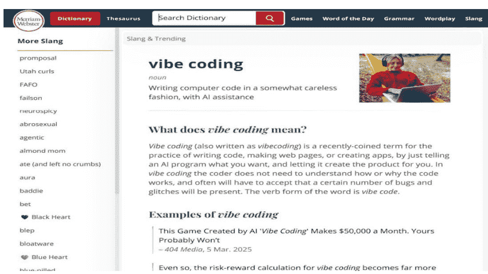
图1-2 《韦氏英语惯用法词典》收录了vibe coding

### 1.1.2 氛围编程的技术基础与运行机制

这场变革之所以可行，背后有强劲技术支撑。

2025年初，随着Claude 3.7 Sonnet等混合推理模型的出现，人工智能生成代码的质量大幅提升。据Cursor技术团队评测，Claude 3.7 Sonnet生成的代码语法正确率达95%，较前代提升17%，在LeetCode中等难度问题上的通过率高达92%。

突破主要归功于混合推理能力，模型能在快速回答与深度思考模式间无缝切换，既能处理日常编码，也能应对复杂系统架构设计。更重要的是，人工智能不仅能生成代码，还能理解业务逻辑、调试bug、进行架构设计。氛围编程由此从实验工具变成可信赖的生产力工具。

传统编程像翻译，必须先学目标语言语法再逐字转换。氛围编程更像雇佣一位精通你母语和目标语言的专业译者，你只需用母语表达想法，它处理所有细节。

整个流程像一场人机协作的创意对话，包含提示、生成、测试、优化四个核心阶段。

提示阶段，开发者用自然语言描述目标功能。关键在于清晰具体，例如：“我想要一个记录每日喝水量的应用，用户点按钮累计记录，界面显示今日总量与完成百分比。”

生成阶段，人工智能根据描述生成代码，自动添加注释、构建合理文件结构，甚至生成测试用例。

测试阶段，可立即运行代码查看效果。即时反馈是氛围编程一大优势，无需漫长编译就能看到结果。

优化阶段，可向人工智能提供具体反馈，如“按钮太小，请放大”或“增加周统计功能”。人工智能据反馈调整代码，可持续迭代至满意。

Cursor、Lovable、V0、Replit等工具与平台正快速成熟，不仅提供友好界面，还构建模板库、社区支持与教程体系，让非技术人员也能轻松上手。现在学习氛围编程，可站在这些成熟平台肩上快速起步。

### 1.1.3 氛围编程与传统编程的关键差别

随着技术成熟与场景扩展，两者差异日益明显，这不仅是工具升级，更是思维模式的根本转变。

最直观的区别在交互方式。传统编程像学钢琴，必须记住每个琴键、掌握复杂指法，长期练习后才能流畅演奏。氛围编程更像直接哼唱旋律，让人工智能编曲演奏；你不必懂和弦理论，只需表达想要的音乐风格。

在传统编程中，开发者需同时处理多层抽象，从底层内存管理到高层业务逻辑，像建筑师既要设计外观还要亲手装水管电线。氛围编程让开发者专注“设计”，把具体“施工”交给人工智能施工队。

从学习成本看，传统编程像攀登高山，从基础语法起步，逐步掌握数据结构、算法、设计模式，通常需数年。而氛围编程像学开车，掌握基本提示技巧后即可创作出有用应用。

从认知负荷看，传统编程要求脑中维护复杂心理模型：变量状态、函数调用、数据流向，像同时玩多盘围棋。氛围编程大幅降低负荷，让注意力集中在产品体验与商业价值。

从社会发展看，我们正经历类似个人电脑普及的技术革命。1980年代掌握电脑操作的人获得竞争优势，今天掌握氛围编程的人同样会在数字化社会占先。行业预测到2030年，约80%的软件开发工作将涉及与人工智能协作，氛围编程正是这种协作的直接形式。

传统编程追求代码优雅、性能极致、架构完美，像工匠精雕细琢。氛围编程更强调“够用就好”：能解决问题、满足需求即可，技术细节并不重要。这种实用主义让创新更敏捷高效。

当然，这并不意味着氛围编程会完全取代传统编程。就像摄影未让绘画消失，两种方式在不同场景各有优势。复杂系统架构、高性能计算、安全应用等领域，传统编程的精确与可控仍不可替代。而快速原型、个性化应用、创意实验等场景，氛围编程优势更明显。

### 1.1.4 现在学习氛围编程的最佳时机

如果你犹豫是否投入时间学习氛围编程，现在正是行动窗口。这个判断基于历史规律与技术节点的洞察。

数百年前读写能力从精英专利普及至全社会，人工智能编程能力正经历同样民主化。斯坦福吴恩达教授在2023年12月出版的《How to build your career in AI》中指出，编码人工智能是新的读写能力。随着机器深入生活，人机交流能力愈发重要。现在学习氛围编程，等于在新读写能力的革命中抢占先机。

更关键的是，我们正处技术可用性的黄金临界点。经过近三年快速发展，人工智能已足够强大以处理大多数常见开发任务，又未复杂到难以掌握。氛围编程已成为可依赖的生产力工具，但普及度尚不高，给早期学习者留下巨大机会窗口。

从竞争格局看，如今仍是蓝海。根据Stack Overflow开发者调查，目前仅23%的开发者在日常工作中使用人工智能编程工具，能熟练运用氛围编程方法论的人更少。就像1980年代掌握个人电脑操作的人获得先机，今天掌握氛围编程的人将同样占得优势。

# Vibe 编程：从想法到产品的转折点

从收入机会来看，一种全新的价值创造模式正在成形。Vibe Code Careers 上，“氛围编师”岗位的年薪信息已逼近120万；LinkedIn 统计显示，AI 协同开发类职位的发布量一年内增长340%。更关键的是，这股需求已突破传统开发者圈层，产品经理、设计师、创业者等角色也被纳入进来。掌握 Vibe 编程后，个人即可独立完成过去需整支团队才能交付的工作，个人经济价值与社会定位因此被重塑。

从运行机制看，我们正经历工作方式的重构。这不仅是工具的迭代，而是社会生产力的底层结构在被重洗。如今开始学习，实质是在为即将到来的新秩序做布局，避免被时代落下。

最具张力的是投入与产出的不对称。据线下教学追踪，零编程基础的学习者平均约11小时就能上手 Vibe 编程的基础用法，并产出可用的软件。这种产出不是线性的技能叠加，而是指数级的跃迁——把“有想法”与“能实现”之间的鸿沟抹平。

错过窗口的代价很高。当 Vibe 编程普及到像 Word、Excel 一样的程度，它就不再是差异化优势，而是参与门槛。那时再补课，只能追随而非引领。

厘清 Vibe 编程的本质、它与传统编码的区别，以及为何当下是学习的历史节点，就能更从容地把握这轮技术浪潮。

**Vibe 编程的核心意义，在于把数字产品的创造权交还给普通人，让每个有创意的人都能把想法落成可用应用。**

## 1.2 无代码背景也能交付：Vibe 编程的真实实践

弄清本质后，最常被问的是：听起来很理想，普通人真的能做到吗？

答案是肯定的，而且门槛比想象中更低。过去一年，从媒体人到教师，从产品经理到家庭主妇，大批零代码背景的人正用 Vibe 编程做出解决实际问题的产品。

这些案例的共性是都从自己生活里的真实痛点出发。没有宏大商业蓝图，也没有复杂的架构设计，只是想让日常更方便一点。正因为起点朴素，创作过程才更自然高效。

下面用5个真实案例说明想法如何变成可用工具。

### 1.2.1 纽约时报记者的冰箱助手：从日常烦恼到个人软件

Kevin Roose 是《纽约时报》资深记者，也是播客 Hard Fork 的主持人。科技报道很专业，但他自称对编程一窍不通，Python、JavaScript、C++ 都没写过。

和大多数上班族一样，他每天被“今天吃什么”困扰。冰箱里食材零散，很难快速配对；买了菜常忘了吃造成浪费；有食材时仍点外卖。他设想的工具很简单：拍冰箱照片，识别食材并给出午餐搭配建议。

接触 Vibe 编程后，他直接用自然语言描述需求。几个小时内，“LunchBox Buddy”就初具形态，如图1-3所示。核心是拍照识别后给出搭配推荐。

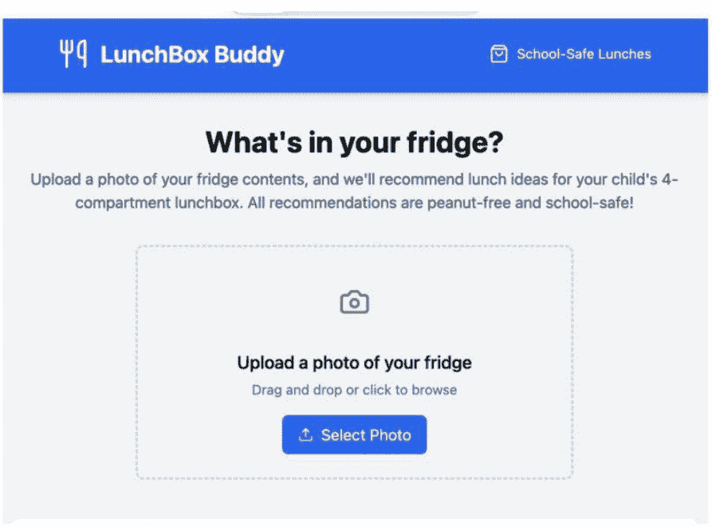

图1-3 LunchBox Buddy界面

他把这类应用称为“软件为一”，即为个人特定需求定制的工具。商业价值可能有限，却完整展示了非技术人员从想法到产品的闭环。Kevin 还在《纽约时报》的文章里放出在线演示，让读者亲身感受。他形容那种体验像第一次用 ChatGPT 时的“AI 眩晕感”。

### 1.2.2 产品经理的创业尝试：从呼吸练习到上架的“清醒呼吸”

陈统伟是产品经理，每天与开发团队协作，但自己一行代码不写。接触冥想后发现市面呼吸引导应用要么复杂要么缺乏个性化，于是决定做一个更符合自己需求的工具。

他的设想很具体：圆形呼吸引导界面，吸气时圆圈慢慢变大、蓝白渐变，呼气时缩小变回蓝色，背景有缓慢流动的水波。传统模式下需要设计师、前端、动画师等多角色配合。

在 Vibe 编程的帮助下，他直接对 AI 说需求。开发中频繁即兴调整：“能不能加鸟鸣声效？”“是否能根据心率调整节奏？”这种灵活迭代让创意得到充分释放。

核心功能不到2天完成，又花3周打磨细节。“清醒呼吸”最终上架应用商店并获积极反馈，随后他又做了一款极简清单应用，效果同样不错。

# 元气满满


图1-4 “清醒呼吸”App截图

陈统伟的经验在于，作为产品经理他清楚用户需要什么，也懂得如何与 AI 建立“共同语言”。他说自己不懂语法，却知道功能词汇，AI 能听懂。

### 1.2.3 历史教师的课堂改造：一下午重塑教学体验

一位高中历史教师用 Replit 通过 Vibe 编程做了一个历史测验应用。她困扰于纸质试卷批改慢、学生参与度低、反馈难个性化。

需求很清晰：在线测验，自动出题、即时评分并给出详细解释，手机或电脑均可答题，能追踪每个学生的进度。

一个下午，她对 AI 说：“我需要一个历史测验应用，能随机生成美国独立战争选择题，答错时显示正确答案及历史背景，还要追踪进度。”

AI 很快生成基础版，老师在测试中不断提出修改：“加计时功能？”“能显示全班平均分吗？”“可以加图题吗？”每条需求几分钟内就实现。

课堂使用后，参与度明显提升，原本对历史不感兴趣的学生也开始积极答题。一位学生说：比传统考试有趣，还能立刻知道错在哪。老师也节省了大量批改时间，能把精力放在课程设计和针对性辅导上。

### 1.2.4 业余游戏爱好者的突破：与 Claude 3.7 Sonnet 的协作

Jose Antonio Lanz 是上班族，同时为 Decrypt 撰稿。喜欢小游戏，于是想做一个边娱乐边提升打字速度的游戏，但没有开发经验。

设想很简单：单词从屏幕上方掉落，玩家快速准确输入以消除，落到底部即结束。

他选择 Claude 3.7 Sonnet 作为搭档，因 Decrypt 测试显示其代码生成表现优于 Grok-3。他描述：“做一个打字游戏，单词下落，玩家输入正确单词消除，画面简洁有动画，输入正确字母时对应字母消失。”

开发并不顺畅，首版“开始”按钮无法响应，反馈后 Claude 定位修复。多轮迭代后功能完善。AI 还主动建议增强功能，他还尝试用语音转文字直接口述需求。

最终作品 Tranquil Type 如图1-5所示，不仅实现初衷，体验也超出预期。朋友试玩反馈积极，证明持续对话与反馈下，普通人也能做出令人满意的作品。

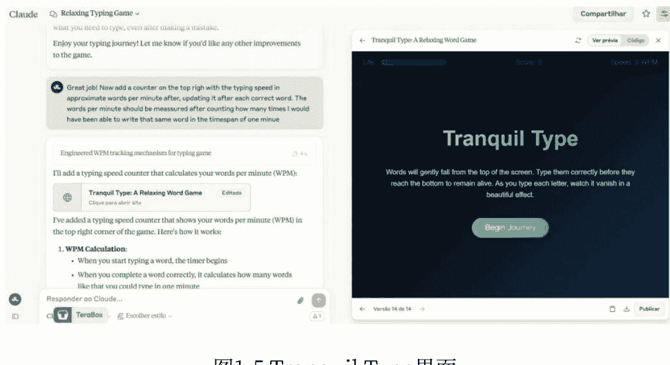

图1-5 Tranquil Type界面

### 1.2.5 Airbnb 房东的运营后台：低成本解决痛点

Y Combinator 管理合伙人 Jared Friedman 在播客中分享的案例。房东管理员 Mohannad Ali 用 Replit 的代理工具搭建并托管了完整的后端系统，如图1-6所示。

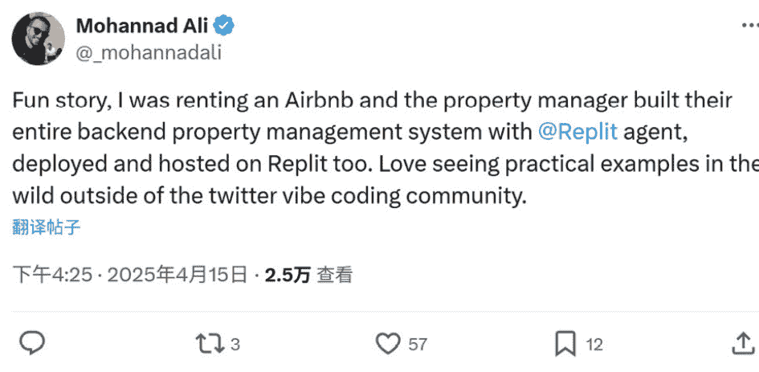

图1-6 来自Mohannad Ali的分享

随着房源增多，手工处理预订、客户沟通、清洁安排变得复杂。市面软件要么功能臃肿要么价格昂贵，不适合小规模经营。

他虽不懂编程，但清楚业务流程。通过 Vibe 编程描述：“我有3套房，要追踪预订。新预订时自动给客人发送含地址、入住密码、WiFi 的欢迎邮件。客人离店后自动安排清洁。”

在 AI 帮助下逐步构建完整后台，并增加评论统计、收入趋势、设备维护提醒等额外功能。几个月后效率明显提升，客人满意度提高，自动化沟通更及时准确。更关键的是，这个完全定制的方案没有软件授权费用，对小企业主成本优势显著。

这5个案例虽来自不同领域，却共同体现 Vibe 编程的核心优势：让普通人直接把想法变成实用数字工具。创作者都聚焦解决真实问题，而非追求技术完美。

## 1.3 选对工具效率翻倍：AI 伙伴挑选指南

在 Vibe 编程里，选择工具就像挑画笔，选对了创作是享受，选错了想法会被拖累。很多人因初期工具不合适，被复杂界面和漫长等待劝退。

不同工具面向不同用户，背后大模型能力差距也会直接影响体验。理解差异，才能快速找到合适自己的利器。

### 1.3.1 新手起点：先看到成果

很多新手的第一印象是“太复杂了”。全英文界面、满屏代码和专业术语，像走进驾驶舱不知从何下手。

适合新手的工具应能在5分钟内让想法落地。

我曾辅导一位心理学博士，她想为咨询工作做一个展示服务和预约的网站。用自然语言描述需求后，3分钟内看到可运行的网站，她兴奋得像孩子。那种即时成就感比任何教程都有说服力。

选工具时常被忽略的是模型能力。为控制成本，部分工具使用较弱模型，直接影响代码质量。强大的模型能更准确理解描述、生成更可靠代码、减少返工、交互更流畅。哪怕价格稍高，选择强模型工具对新手更友好。

### 1.3.2 价格与价值的权衡

主流 AI 编程工具对比如表1-1所示。很多人只看价格，却忽略模型能力和体验才是价值核心。

表1-1 AI编程工具对比

| 工具名称 | 免费额度 | 价格 | 核心优势 |
| :--- | :--- | :--- | :--- |
| Lovable | 每天5条消息 | $20/月 | 设计师友好，完整应用体验 |
| V0 | 每月$5信用 | $20/月 | 前端界面专精，设计精美 |
| Bolt.new | 有限免费 | $20/月 | 移动应用开发，浏览器编辑 |
| Cursor | 2周试用 | $20/月 | 专业开发，代码理解能力强 |
| Windsurf | 有限免费 | $15/月 | 专业开发，代码理解能力强 |
| Trae | 完全免费 | - | 支持中文，专业开发 |

主流工具月费约20美元，回报率很高。以 Lovable 为例，20美元/月含每天5次免费使用及120次付费额度，约270次/月。若每日使用，每月构建200个小应用不成问题；若深耕复杂项目，每月打磨10个高质量项目也足够。

Cursor 每月20美元提供500次快速请求和无限慢速请求，足以支撑多个完整项目。相比之下，一门线上编程课程动辄数百上千美元，20美元换一个月的 AI 协作机会性价比极高。完全免费的工具如 Trae 虽能零成本体验，但排队和模型限制易带来挫败感。

### 1.3.3 六大工具解析

#### 1. Lovable：从想法到完整应用的一站式平台

Lovable 如图1-7所示，不仅生成前端，还会自动配置数据库连接、用户认证、第三方服务集成。通过深度集成 Supabase，可创建带真实数据存储和用户管理的完整应用。

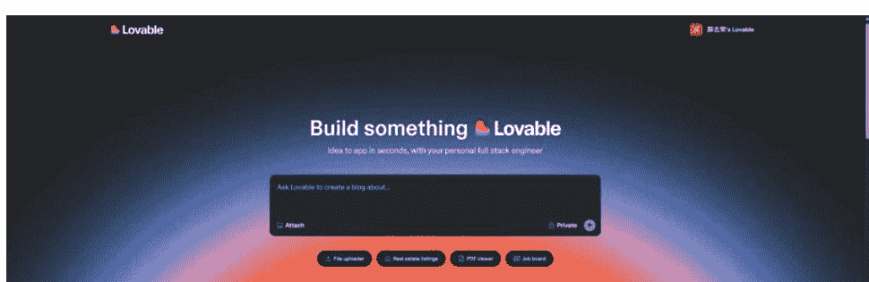

图1-7 Lovable首页

设计理念是零技术门槛，无需区分前后端或数据库，只需描述想要什么。它支持一键发布到网页并自动存到 GitHub，如图1-8所示，本地修改后可回传继续优化，实现云端与本地灵活切换。

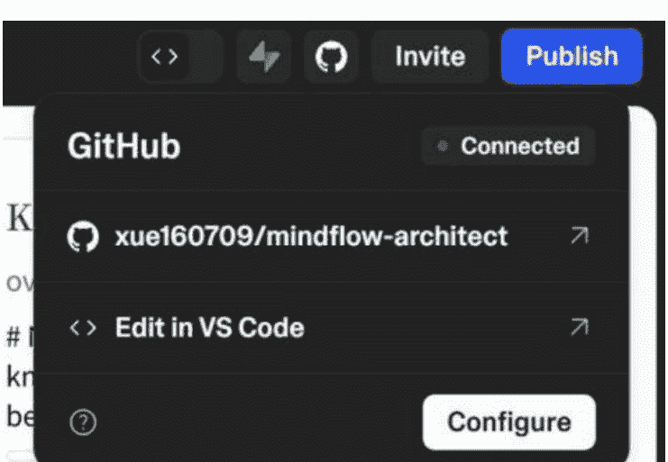

图1-8 一键发布并存储到GitHub仓库

#### 2. V0：前端界面的艺术大师

V0 如图1-9所示，专注前端界面生成，强项是美观现代的 UI。基于 shadcn/ui 和 Tailwind CSS，代码遵循设计最佳实践，擅长响应式布局和无障碍优化。

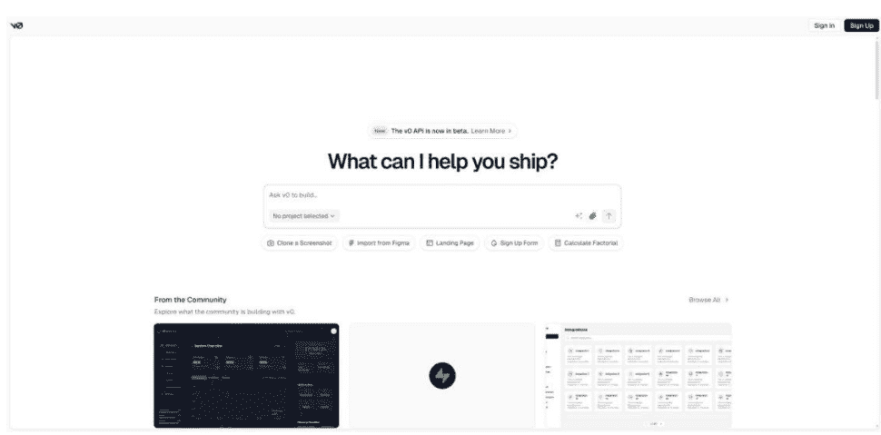

图1-9 V0首页

它支持图片上传，将设计稿或截图转为代码，与 Vercel 生态深度集成，部署极简。

#### 3. Bolt.new：浏览器里的全栈开发环境

Bolt.new 如图1-10所示，提供完整的浏览器开发环境：安装 npm 包、运行后端、连接数据库全部在线完成。支持 React、Vue、Svelte、Next.js 等主流框架。

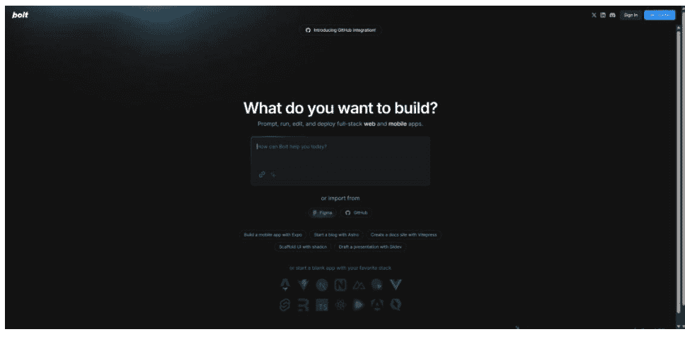

图1-10 Bolt.new首页

特别适合快速原型和 MVP 验证，内置 Netlify 一键部署，免去本地环境配置。

#### 4. Cursor和Windsurf：专业开发者的智能伙伴

Cursor 如图1-11所示 与 Windsurf 基于 VS Code，保留完整 IDE 功能并深度集成 AI。其核心优势是对项目上下文的理解，能同时修改多个相关文件，保证变更一致性。

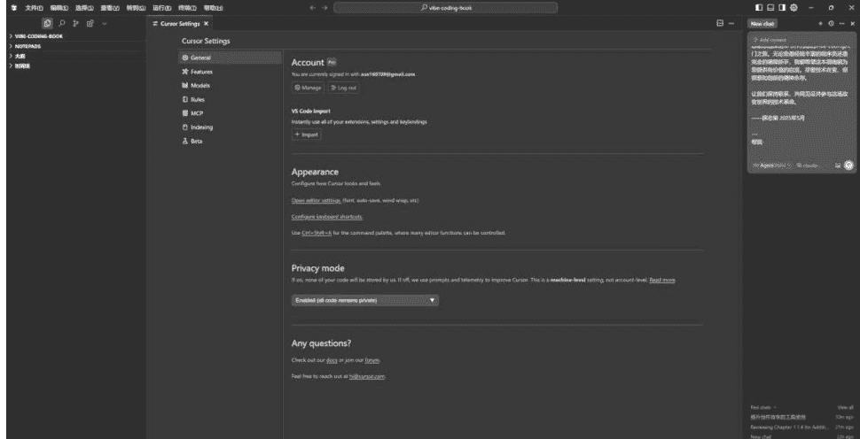

图1-11 Cursor界面

工具对比与进阶路径

两套智能代理的方案均可接入不同模型库，使用者按任务性质挑选匹配引擎。两者对代码的解析与重写很扎实，能揪出潜在问题并给出改进方向，正好落在从 AI 辅助到自主开发的衔接区间。

#### 5. Trae：面向中文开发者的本地化方案
Trae（如图1-12所示）在产品形态上与 Cursor、Windsurf 接近，差异点在于整体界面全中文，以及对国内开发习惯的深度适配。默认集成豆包、DeepSeek 等本土模型，同时可挂载 GPT-4、Claude 等海外模型。

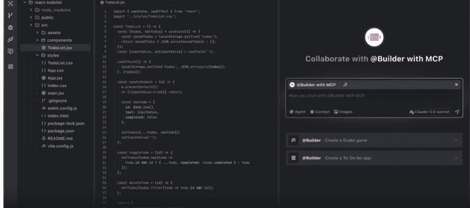

图1-12 Trae界面

其 Builder 模式很适合做快速原型，只需用自然语言描述需求即可拼出完整应用雏形。作为免费产品，它让预算有限的个人也能体验智能编程，高峰时段会出现排队和模型能力受限的情况。

多模态也是亮点，能根据截图、设计稿或文档直接生成对应代码。Cursor 与 Windsurf 的自动化程度同样很高，执行关键动作前会请求授权，出现错误时会自行进入调试并修复。

### 1.3.4 不同工具的最佳使用场景
选型要同时考虑技术背景与使用目标，就像出行工具的选择，步行适合短途，自驾适合中途，航班适合远途。项目诉求不同，匹配的组合也会不同。

**编程新手或设计师，优先考虑 Lovable。** 它能读懂设计语言，产出符合当下审美的界面，专为非技术团队与产品设计师打造，可将自然语言想法直接转化为可用完整应用。

一位 UI 设计师提到，她现在做客户提案不再先画静态稿，而是直接用 Lovable 生成可交互原型，客户能真实操作，提案通过率明显提升。

**聚焦前端界面，V0 更合适。** 它面向需要快速落地方案的开发者与设计师，很好地弥合了开发与设计之间的鸿沟。

**目标是移动应用原型，Bolt.new 是常见选择。** 它在浏览器内提供完整开发环境，无需本地配置，支持多种框架，在移动端快速原型环节表现突出。

**具备一定编码基础，Cursor 会更顺手。** 它适合日常维护、重构、排错、性能调优等工作，尤其在中大型项目、多文件协作、复杂依赖管理上的体验更专业。

### 1.3.5 从体验魅力到掌握技巧的三个阶段
学习智能编程容易走极端，要么固守最简单的工具，要么一开始就用最专业的方案。合理的路径是循序渐进，像学乐器一样从简易曲目起步。

#### 第一阶段：体验创造的快感（推荐 Lovable + V0）
这一阶段重点不是写代码，而是感受智能编程的乐趣。Lovable 负责把点子快速变成完整应用，V0 专注前端视觉生成，让人直观体会界面设计上的能力。两者配合，既能跑通完整流程，又能加深对前端美感的理解。

#### 第二阶段：理解创造的原理（推荐 Bolt.new + Trae）
对智能编程有了初步认知后，需要了解其背后逻辑。Bolt.new 的编辑器全部运行在浏览器，无需安装，降低了门槛。它支持多种技术栈，通过组合不同技术，能帮助理解前端、后端、数据库之间的关系与边界。

Trae 提供完全中文的工作环境，对中文用户更友好。虽然后台高峰期可能需要等待，但作为免费学习工具，这一成本是可以接受的。

#### 第三阶段：掌握创造的技巧（推荐 Cursor 或 Windsurf）
在理解原理后，可以换到专业级工具。Windsurf 在代码深度理解上占优，擅长项目重构、架构优化、依赖分析等任务；Cursor 在代码生成质量和开发效率上更强。

这个阶段相当于从自动挡换到手动挡跑车，操作门槛升高，但控制更精细，能够承载更复杂的业务逻辑。

### 1.3.6 避开新手常见的选择陷阱
选错工具很容易导致半途而废，以下是常见误区。

**陷阱1：被免费绑架。** 免费方案往往在体验上做减法，响应慢、排队长、模型能力受限的问题很常见。对新手而言，频繁的挫败感会直接打击学习热情。选型时应优先看体验和模型能力，而不是只看价格。

**陷阱2：忽视学习曲线的意义。** 新手需要平缓的学习曲线和即时反馈，Lovable 和 V0 在这点上表现很好，能快速看到成果，建立信心。功能强大的专业工具学习成本高，不太适合起步。

**陷阱3：追求万能工具。** 并不存在能解决所有问题的单一工具，每个产品都有擅长的领域。更合理的做法是按需求选型，甚至在同一项目中组合使用。

**陷阱4：被功能列表迷惑。** 功能数量多不等于好用。部分产品宣称几十项功能，实际使用中往往只用到少数几个。对新手而言，简洁易用、模型强才是关键。

### 1.3.7 价格变动的提醒
智能编程工具的价格波动很快。例如 Bolt.new 从早期的每月 9 美元涨到 20 美元，部分新品也常以限时免费吸引用户。

因此表 1-1 的价格仅作参考，最终决策前最好去官网核实最新信息。关注价格趋势也有助于做长期规划。

选工具的终极目标是让想法更快落地。最贵的不一定最好，最便宜的也不一定最差，关键是找到在当下阶段能让你成长快、体验顺的产品。在 Vibe 编程里，工具只是载体，创造力才是核心。

## 第2章

## 4步创作法+5大技巧，30分钟实现从想法到产品

本章介绍如何用 Vibe 编程把想法变成产品的思路与方法，主要包括：

- 4步创作法：介绍“发现→构思→精炼→实现”的标准流程，以及所需完整工具链。
- 与AI沟通的核心技能：万能提示词公式和5大技巧，帮助更准确传达需求。
- 反馈表达法：通过迭代让产品从“能用”升级到“好用”。
- 建立产品经理思维：拆解复杂项目、运用MVP策略和系统性问题分析。
- 5个常见问题：解决准备不足、完美主义等新手痛点。

## 2.1 核心理论：零代码基础实现从想法到产品

设想你跟随一位世界级大厨学习烹饪。他不仅手艺高，还有一套完整的烹饪哲学和标准化流程。无论是家常菜还是法式料理，都能用同一套方法论带你完成。

Vibe 编程也是一套完整的方法论：不只是和AI对话的技巧，更是一套把想法快速变成可用产品的系统化路径。

传统软件开发把想法落地可能需要数月甚至数年。但借助 Vibe 编程，这个周期可以压缩到30分钟。

### 2.1.1 4步创作法：从想法到产品的标准流程

基于上百个项目和上百位零基础学员的实践，我们提炼出 Vibe 编程的4步创作法：发现、构思、精炼、实现。

**第一步，发现：** 找到真正值得解决的问题。

很多人急于动手，却忽略了核心问题：要解决什么、为谁解决、在什么场景解决。

这一阶段需要像侦探一样，通过观察、访谈、分析挖掘真实痛点。例如，表面上想做“更好的笔记软件”，深挖后发现核心问题其实是知识整理与回顾机制的缺失。

发现阶段的合格标准是用一句话清晰描述核心问题，且该问题真实存在于目标用户中。一位产品经理背景的学员说：“经过发现阶段，成功率提升了一倍，因为避免了做没人要的产品。”

**第二步，构思：** 把问题转化为具体解法。

这一阶段需要创造力，也需要理性判断。要思考最有效的产品形态、典型使用场景、核心价值点。

常用技巧是“场景故事法”，为产品构建具体使用情境，描述用户是谁、在何时何地、为达成什么目标使用。例如，35岁的营销经理小王在周一例会前，用工具快速生成上周数据分析报告，把精力集中在策略讨论而非数据整理上。

场景故事既能明确定位，也为后续提示词提供清晰上下文，让AI更好理解需求。

**第三步，精炼：** 用MVP策略把复杂方案收敛到核心价值。

这是区分新手与高手的关键。很多人在此犯错，想一次性实现所有功能。

精炼时要不断自问：该功能是否必需？没有它用户是否无法获得基本价值？答案是否定的就先去掉。一位独立开发者说：“学会说‘不’是产品成功的关键，我的产品只有3个核心功能，但每个都做到极致。”

**第四步，实现：** 把核心价值点变成真实可用产品。

这一阶段依赖 Vibe 编程的标准工具链，通过高效协作快速搭建原型。成败关键不在于技术，而在于沟通能力。要学会用AI能理解的方式描述功能逻辑、界面布局、交互方式，并掌握多轮迭代优化的能力。

实现阶段的特点是边做边学，不必等完全掌握技术细节再动手，而是在创作中逐步学习，提升更快、更有成就感。

一位创业者学员反馈：“传统方式做原型要3个月，现在用4步法一个下午就能完成。”

### 2.1.2 标准工具链：让创作过程如行云流水

掌握理论框架后，需要一套标准化工具链支撑实际操作，涵盖分析、开发、优化三类工具。

**分析工具：让思路更清晰。**

在发现与构思阶段，主要用分析工具梳理需求、设计MVP、绘制流程图。推荐DeepSeek和Mermaid。

DeepSeek不仅是语言模型，更是需求分析助手，能帮助结构化思考。给出模糊想法后，它会引导你明确需求边界、用户画像、功能优先级。例如对“我想做学习工具”的模糊描述，它会追问年龄段、具体痛点、使用场景等。

Mermaid用于绘制产品流程图。流程图能厘清逻辑路径、发现漏洞，为开发提供明确指导。

> 一位产品经理分享：“开发前我习惯先用Mermaid画完整流程，能提前发现很多问题，避免后期返工。”

**开发工具：让想法变成现实。**

在精炼与实现阶段，需要能把抽象构想快速落地的工具。1.3.3节提到的6种智能编程工具，在4步法中有不同定位。

实现阶段，Lovable扮演“产品孵化器”。前三步完成后，它能把完整构想转化为可运行原型，其价值不仅是代码生成，还能处理数据库设计、用户认证、界面布局、功能逻辑等技术细节，让人专注产品本身。

> 一位产品经理说：“用Lovable开发就像搭乐高，你描述结果，它自动挑选积木并组装。”

在不同场景下可组合使用：界面体验优先时用V0迭代设计；移动应用需求时用Bolt.new提供完整移动开发环境。关键是根据精炼阶段确定的产品特性，选择最合适的组合。

**优化工具：让产品更加完善。**

原型完成后，需要精细调整。GitHub和Cursor的组合能提供专业级代码管理价值。

在4步法的语境下，GitHub是“产品档案馆”。每次迭代都完整记录，支持回溯到稳定版本，实验更安全。

Cursor是“精雕细琢助手”。核心功能完成后，可对界面细节、交互流程、小缺陷进行微调，AI能理解优化意图并给出精确修改建议，不破坏整体架构。

工具组合的价值在于支撑迭代。创作很少是线性的，可能在实现中回到构思重想功能。GitHub和Cursor让这种迭代安全高效，确保每次改进都是正向累积。

### 2.1.3 核心设计原则：让每个产品都有灵魂

核心设计原则决定产品品质和用户体验，是经过大量实践验证的指导思想。

**MVP原则：先求有，再求好。**

MVP的核心是用最少功能验证核心价值，再逐步完善。初学者常犯完美主义错误，想一次做出功能完备、界面精美的产品，这既低效也高风险。

正确做法是先做核心功能的简易版，让真实用户试用并收集反馈，再决定下一步改进。这样效率更高，也能确保方向正确。

一位产品经理的经验是：“先用两天做MVP，两周收集反馈与数据，一周优化。节奏快，能快速验证想法，避免在错误方向浪费时间。”

除MVP外，还有实用、简单、优雅三个重要原则。

1. 产品价值在于实用，即解决真实问题而非炫技。每个功能和设计决策都应围绕“是否帮助用户达成目标”。
2. 简单不是简陋，而是深思熟虑的精炼，去掉不必要的元素，突出重点，让用户最短时间内完成任务。在信息过载时代，注意力比功能更稀缺。
3. 优雅不仅是视觉美观，更是功能逻辑、界面设计、交互方式的一致性与连贯性。

实用、简单、优雅相互促进。简单让实用更容易实现，实用让优雅更有价值，优雅让简单与实用更具吸引力。一位设计师说：“用这几条原则指导后，用户满意度明显提升，产品不再是功能堆砌，而是有灵魂的作品。”

掌握这些原则，就具备了开发优秀产品的基本素养。

## 2.2 核心技能：让AI准确理解你的需求

掌握4步法的整体框架后，许多人急于进入实现阶段，但常遇到一个瓶颈：如何让AI准确理解需求。

想象走进餐厅，服务员问你想吃什么，你回答“随便来点好吃的”。结果可能太辣、太咸，或根本不是你喜欢的菜系。这就是 Vibe 编程的常见问题：AI像服务员，需要明确具体的提示词才能“烹饪”出满意作品。

传统编程是用代码告诉机器每一步怎么做，Vibe 编程是用自然语言描述想要的结果。听起来简单，实则沟通是一门学问。调研显示，超80%的新手因提示词不够清晰而得不到理想结果。

一旦掌握沟通技巧，创作过程就会变得流畅。无论是用Lovable搭建原型、DeepSeek分析需求，还是Cursor优化代码，这些技巧都是核心竞争力。一位创业者分享：“花两周学会准确描述需求，之后三个月里快速搭建了5个精准满足需求的原型。”

### 2.2.1 具体化描述：为什么“做个网站”不如“做个蓝白色调的技术博客”

新手最常见的错误是用宽泛描述：“帮我做个网站”、“创建一个管理系统”或“设计一个移动应用”。这种提示如同告诉厨师“做个好吃的”，信息不足。

假设两人都要做技术博客，第一个人说：“帮我做个网站”，第二个人说：“创建一个蓝白色调的技术博客网站，主要分享Python编程教程，首页展示最新5篇文章的摘要和封面图片，文章支持代码高亮显示，右侧边栏包含文章分类、标签和作者简介，底部有评论功能。”

成品的质量直接取决于描述的颗粒度。笼统地说“做个网站”，很可能收到带公司介绍、产品展示、联系我们的通用模板，直接套到个人博客上就会水土不服。换一个描述方式，同样是建站，就能得到一套为技术写作专门优化的博客系统，交互也精准落地。

差距来源在说明是否具体。细节越累积，方向越准。每多一句明确的补充，生成的方案就更贴近预期。点明主色偏蓝白，就不会出现红黑配色；点明是 Python 教程，就会自动考虑到代码展示；一旦说明需要语法高亮，相应的渲染组件也会被带上。

一位写技术的创作者，在学会细化描述前反复尝试七八次仍不满意。后来他开始逐页说明版式、配色与功能，第二次就拿到接近理想的草案。他总结，模型比人更依赖一份详尽的使用说明书。

把需求讲细，不仅决定功能是否正确，也决定整体体验是否连贯。说明充分时风格统一、逻辑自洽；说明含糊时各模块像拼凑，缺乏整体感。

细化还有反向收益：逼着自己把想法理清。写得越细，概念越清晰，也更容易挖出之前忽略的重要细节。

比如一家餐厅老板，最初只说要“方便点单”。把顾客动线写清楚后，才意识到还要兼顾桌号管理、后厨出餐提醒、口味备注、支付方式选择等。最终生成的系统比他最初设想的更完整、更实用。

说明越准，返工越少。起手写得清楚，第一次生成的成品就很接近预期；起手含糊，往往要反复修改，不仅耗时，还容易在调整中偏离初衷。

一位创始人分享，现在他会花半小时把产品说明写扎实，再用两小时拿到满意原型。过去五分钟草草说两句，结果要耗一整天来回调整。

要把描述做具体，最有效的训练是 5W1H：谁来用、做什么功能、何时使用、在哪使用、为什么需要、怎么实现。六个问题答得清楚，说明自然精准。

例如考研学习类应用可以这样写：使用者是备考的大学生，核心是排计划和追进度，常用时段是晚间复习和清晨起床后，宿舍的电脑和图书馆的手机都要能用，目的是保持学习动力和掌握复习节奏，做法是通过图表可视化进度并做定时提醒。

这样的思考能确保覆盖所有重要维度，模型据此才能创建真正符合需求的产品。

### 2.2.2 万能提示词四要素

常用的结构化写法是：提示词 = 背景信息 + 具体任务 + 输出要求 + 约束条件。以帮助小学生学数学的应用为例。

直接说“帮我做个数学学习软件”，很可能得到高等计算器或过于简单的四则练习。结构化后结果完全不同。

背景信息是给模型一个思考视角。可以说：“我是一名有十年教龄的小学数学老师，想帮二年级学生打好加减法基础。”这样它会从教学专家角度思考，而不是程序员角度。

具体任务是核心指令。可以说：“做一个互动数学练习应用，帮助二年级学生掌握加减法运算。”比模糊的“数学学习软件”更能锁定定位。

输出要求细化体验。例如：“加入游戏化设计，每题配可爱卡通插图，答对有音效奖励，并提供进度追踪让家长了解学习情况。”这就明确了它不仅是练习工具，更是激发兴趣、便于监督的完整方案。

约束条件是边界。例如：“界面简洁易懂，不用复杂菜单，单次练习控制在十分钟内，适配手机和平板。”限制常被新手忽略，却是保证产品能落地的关键。

### 2.2.3 五大转化技巧

技巧1：场景具象化。不要只说“用户友好的界面”、“高效的工作流”，模型需要可视化的画面。

比如做团队协作工具，别说“界面要友好”，而是说“成员打开后首先看到今日任务清单，每张卡片显示负责人头像、完成状态、截止时间，点击卡片可查看详情和讨论记录”。这样模型能还原布局和交互。

一名产品经理反馈，使用这个方法前，给她的原型总是功能杂乱。开始描述使用场景后，原型变得直观易用。她说：“我学会了像导演一样描述每个场景，告诉模型用户在什么情况下为了什么目的采取什么行动。”

技巧2：对标参考法。想描述效果时，用成熟产品做参照，但要指明具体学习哪些方面。

例如在线学习平台可以这样写：“课程展示页参考网易云课堂的左右分栏，左侧视频区右侧大纲笔记；登录流程参考微信，支持手机号快捷登录；支付页参考淘宝，价格和优惠信息清晰可见。”

借鉴成熟逻辑再做创新，一名教育创业者说：“我发现不需要从零设计所有交互，而是站在最佳实践上做细节创新。”

技巧3：限制条件明确化。创造力强，但没有边界容易失控。

做餐厅点餐系统就要说清：“仅支持堂食，不含外卖；菜单不超过八个分类，每个分类不超过十五道菜；不做会员积分；界面要适合老年人，字体大操作简。”

这些限制让模型聚焦核心。一名餐厅老板感慨：“之前我总觉得功能越多越好，但实际上，简单易用的系统更能提高服务效率。”

技巧4：分步骤描述。复杂产品按用户时间线拆解，避免信息过载。

比如健身教练预约平台：“第一步注册登录并填写健身目标；第二步浏览教练列表，按方向、价格、评分筛选；第三步查看详情页含背景、评价、可约时间；第四步选时段并支付；第五步课后评价反馈。”

按流程写，模型会处理好页面和数据衔接。一名健身创业者说：“模型不仅创建了所有必要页面，还自动处理了不同步骤之间的数据传递逻辑。”

技巧5：迭代反馈循环。第一次很难完美，关键是给有效反馈。

不要只说“不好”，要指出具体问题并给出期望。例如，“登录页设计很好，但注册流程太复杂，能否简化为手机号加密码？另外首页颜色太艳，希望换成更商务的蓝灰调。”

一名设计师说：“我学会了像审稿编辑一样提供反馈，既指出问题，也说明期望的改进方向。这样的沟通效率特别高。”

## 2.3 进阶操作：让模型持续打磨作品

把模型当成能力强但经验不足的助手，实现阶段就是不断指导和纠正的过程。像雕刻一样，用一次次精准的反馈让形态逐渐显现。

初次沟通后，第一版往往只是起点。真正让产品从“能用”到“好用”、从“基础”到“优秀”的，是迭代反馈的深度运用。

### 2.3.1 迭代优化：把不满意说准

迭代的核心是把不满意表达清楚。很多人要么说得太模糊，要么一次提太多要求。

例如让模型做了一个待办事项应用，界面太素。

错误反馈：“这个界面太丑了，重新做一个好看的版本。”模型不知道丑在哪，新版可能偏离预期。

正确反馈：“当前界面功能正确，但视觉效果需要优化。请保持现有布局不变，将背景色改为淡蓝色并增加渐变效果，按钮采用圆角设计，字体改为无衬线字体，整体风格要简洁专业。”

先肯定对的部分，再指出具体改进点，模型才能保留优点并精准修改。

要建立对话历史，基于上一次结果递进。比如颜色字体满意后说：“颜色和字体都很好，请保持不变。将所有按钮尺寸增大20%，让用户更容易点击。”

功能迭代也一样：“添加和删除功能保持不变。请在每个任务旁加一枚星号按钮，点击可标记为高优先级，高优先级用红色文字显示，再次点击取消。”明确不改动现有功能，只增加新交互。

原则是每次只改一个问题，改完验证后再继续，便于定位和回滚。

### 2.3.2 错误反馈：让报错信息自己说话

遇到报错，别用自己的话复述，直接让错误信息说话。就像修车看故障码，模型处理代码也需要精确报错。错误信息本身就是最准的问题描述。

比如做天气查询应用运行时报错。

错误的反馈：“我的天气应用打不开，好像是网络问题，请帮忙修复。”充满猜测。

正确的反馈：
应用运行时出现如下错误信息：
```
Error: fetch failed

at Object.fetch (node:internal/deps/undici/undici:11457:11)

at process.processTicksAndRejections(node:internal/process/task_

queues:95:5)

at async getWeatherData (/src/weather.js:15:20)
```
请帮我修复这个问题。

直接粘贴后，模型立刻定位到网络请求失败、文件和函数位置，并给出针对性方案。

浏览器控制台报错同理。不要说“页面不正常”“按钮没反应”，把红色报错直接给模型。

如果博客保存功能异常，F12看到：
```
Uncaught ReferenceError: savePost is not defined

at HTMLButtonElement.<anonymous> (blog.html:45)

at HTMLButtonElement.dispatch (jquery.min.js:2)
```
直接说：“我的博客保存功能不正常，控制台显示如下错误，请帮我修复。”

完整的错误反馈最好包含三部分：
1. 想要实现的功能。我正在做在线计算器，希望输入两个数字点加法按钮得到结果。
2. 具体错误信息。但是点击按钮时出现如下错误：
```
TypeError: Cannot read property 'value' of null

at calculate (calculator.js:12:5)

at HTMLButtonElement.onclick (calculator.html:25:13)
```
3. 复现步骤。打开页面→在第一个输入框输入5→第二个输入3→点击加法按钮→报错。

这样模型能明白意图、现象和触发条件，给出有效修复。

### 2.3.3 渐进式升级：从可用到好用到爱用

别期望一次做出完美作品。遵循“能用→好用→爱用”的渐进路径更高效，对应实用、简单、优雅三个原则。

第一阶段：让产品能用。目标是验证核心功能是否跑通，像搭框架。

比如财务管理工具，先做最核心：“请创建一个简单财务记录应用，可添加收入支出，每条记录含金额、类别、日期，页面显示记录列表和当前余额。功能要简单，界面可以基础。”

生成后先测：能否添加？余额对吗？数据对吗？有问题就先修核心，不要加新功能。例如余额算反了，就反馈：“添加功能正常，但余额计算有问题。添加收入100元后余额显示-100。请修复逻辑，收入应增加余额，支出应减少余额。”

第二阶段：让产品好用。核心稳定后优化体验。

继续财务工具可以提：“现有功能运行良好，现在优化体验：1.添加记录时金额输入框自动聚焦；2.类别改为下拉菜单，预设餐饮、交通、购物等；3.日期默认今天可改；4.添加后输入框自动清空；5.列表按时间倒序，最新的在上。”

这些不改动核心，只提升流畅度。还可以加必要辅助：每条记录旁加删除按钮、显示本月收入支出净额、金额必须大于0且类别不能为空、删除前加确认对话框。

第三阶段：让产品爱用。做精致和个性化，建立情感连接。

为应用添加精细化改进：
1. 视觉优化：现代渐变背景、卡片式记录、适当阴影。
2. 图标支持：餐饮用餐具图标，交通用汽车图标等。
3. 颜色区分：收入绿色、支出红色。

从能用、好用到爱用，产品才真正经得起长期使用。

## 2.4 换个脑子：用产品经理的方式做Vibe编程

造房子不会只跟建筑师说一句“给我盖栋楼”。先想好谁住、怎么住，房间怎么排、工序怎么走，最后才谈施工细节。Vibe编程的成败也一样，关键不在于模型多聪明，而在于你会不会像产品经理那样做规划、给指令。

产品经理常用的三套打法，能直接搬到Vibe场景：把大盘子拆成小块、按优先级逐步上线、把项目级模糊问题转成功能级清晰问题。掌握这套思路，你就能把脑子里的想法翻译成AI能听懂、能执行的指令，最后做出真正解决用户痛点的东西。

一位创业学员这样复盘：“用上产品经理的思考方式后，我的开发速度直接翻倍。AI并没有变强，我只是更会提问题了。”

### 2.4.1 化繁为简：将大项目拆成小任务

新手最容易犯的错就是想让AI一口吃成胖子。张口就是“帮我做个完整电商”“给我一个社交App”，期待AI一次性搞定所有业务逻辑。这相当于让刚学走路的孩子去跑马拉松。

根因是没把复杂想法拆到最小价值点。拆解的核心来自“分而治之”：先理清依赖关系和前后顺序，再按逻辑层次推进任务。

比如要做在线学习平台，直接说“要注册、要展示课程、要视频、要进度、要证书、要支付、要评论、要推荐”……功能列得很全，AI却会在多个领域同时踩坑，每个都做不深。

正确的做法是先找到系统的核心价值。对学习平台而言，核心就是“让用户看得到课、能跟踪进度”。围绕这个核心排优先级：

- 核心功能层，先保证视频播放和进度记录这两个基础价值能跑通；
- 用户管理层，再做注册登录等账号相关。

拆完后再用背景信息+具体任务+输出要求+约束条件的万能结构去写提示词。

核心功能层的写法思路：
背景信息是做一个能看视频并记录进度的学习平台。任务是要做一个极简的课程页，有标题、简介、播放区，用户能看、能存进度。要求暂时不用登录，用本地存储，界面干净先求稳。参考是简化版的网易公开课，只有单课页面。

用户管理层的写法思路：
背景信息是视频播放已能跑通，现在要加账号体系。任务是在已有功能上加上注册登录，注册后进度存服务器并跨设备同步。要求别动播放逻辑，只把存储从本地换成服务端。参考知乎的邮箱密码注册。

这里的表述要点是明确“基于现有功能之上”追加，并强调“保持原有功能不变”。

拆解的关键技巧是垂直切片。别按前端后端数据库分层，先按用户真实使用流程切。电商的两种拆法对比就很明显：

- 按技术层拆：先把所有页面做完，再做API，最后连数据库。
- 垂直切片：先把“浏览商品→下单购买”这个完整闭环跑通，再做商家管理、再做订单管理。

一位做电商的创业者说：“以前总想等功能齐全再上线，结果拖了半年。后来先做核心购买流程，两周就上线了第一版，再靠用户反馈迭代，我才明白边做边学的意义。”

### 2.4.2 MVP原则：优先级驱动的渐进式实现

很多人陷入完美主义，总想一次做出功能齐全、界面精美的成品。Vibe编程里，先求核心功能正确，再逐步加码才是正道。

以健身类App为例，完美主义的描述是：要个性化训练、营养建议、社交分享、AR指导、可穿戴同步、健身房地图、教练预约、商城、成就、好友挑战，界面要酷动画要流畅多语言支持。十几种需求一起砸过来，AI只能给出混乱的半成品。

用MVP的说法就清爽多了：
背景信息是要帮零基础的上班族养成运动习惯。任务是做一个简易的训练追踪工具，用户能添加今日运动、标记完成、查看本周记录。要求界面简单、操作5秒能录一条。参照物是简化版待办清单，专门记运动。

这个提示词只解决一个核心问题：记录与追踪。功能虽少，但能真解决问题。

MVP的精髓是做减法。背景信息聚焦目标人群痛点，具体任务只写最必要功能，输出要求强调可用性高于完美性，示例说明用简单成功的案例做锚点。

一个团队曾花3个月做了一个功能爆满的项目管理工具，有甘特图、时间跟踪、资源分配、成本分析，用户却嫌复杂。后来只保留创建任务、分配任务、标记完成三件事，反而得到一致好评。

Vibe编程里还有个小窍门叫核心场景驱动。别从功能清单出发，从典型使用场景出发。

比如个人理财工具，核心场景是“下班回家后，快速记下今天花了什么，还剩多少钱”。提示词就可以是：
背景信息是上班族想简单记账看预算。任务是做一个极简记账App，能快速录入金额和类别，看今日本周本月总额和剩余预算。要求操作极快，5秒完成一次记录。示例像手机计算器那样简洁。

这里没有报表、投资建议、银行卡同步这些花活，只解决快速记录和预算感知这两个刚需。

### 2.4.3 问题层级：从“项目级”到“功能级”的问题转换

像医生区分“头痛”是症状还是病因一样，Vibe编程也需要区分问题层级。

项目级问题横跨多个系统、逻辑复杂、边界模糊。比如“做一个智能客服系统”，涉及NLP、知识库、多渠道、人工转接等一大堆领域。

功能级问题则具体、边界清晰。比如“做一个输入框，用户输入后展示预设的常见问答”。AI对这类小问题完成度很高。

所以关键动作是识别层级，并把项目级问题降维成功能级问题。三个实用技巧：

技巧1：问题溯源。以智能客服为例，溯源后会发现真实痛点是“非工作时间常见问题得不到即时解答，用户满意度下降”。于是拆成两个可执行的小问题：

第一个小问题提示思路：背景是客户下班后常问常见问题，需要自助解答。任务是做一个问答页，展示10个高频问题及答案。要求版式清晰，按重要性排序，答案简短。参考淘宝帮助中心简化版。

第二个小问题提示思路：背景是在问答页基础上，用户要能快速定位。任务是加一个搜索框，输入关键词找相关问答。要求按相关度排，支持模糊匹配。参考简化版百度搜索体验。

只要第一个小问题上线，非工作时间的自助服务就已经生效。

技巧2：依赖链分析。电商里订单管理依赖商品管理和用户管理，支付依赖订单生成，库存更新依赖订单确认。先做基础层，再做交互层。

阶段1基础层思路：背景是要做简易电商，先实现商品展示。任务是做商品页，展示图片、名称、价格、库存。要求美观清晰。参考简化版京东详情。

阶段2交互层思路：背景是商品页已可用，用户要能购买。任务是加购物车，能加商品改数量。要求状态实时更新，操作顺滑。参考淘宝简化版购物车。

这样就不会出现缺依赖导致卡住的情况。

技巧3：边界清晰化。很多项目级问题难做，是因为输入输出没界定清楚。把每个小问题的输入、处理逻辑、输出说死，AI的命中率会大幅提升。

一位资深产品经理说过：“普通产品经理和好的产品经理的区别，在于能不能把复杂问题拆成简单问题。在Vibe编程时代，这项能力直接决定了你和AI协作的效果。”

## 2.5 实战解惑：新手常见的5大问题及解决方案

带零基础学员时发现，大家踩的坑惊人一致，而且多是思维和习惯问题，不是技术问题。一个10年编程老手，思路不清时在Vibe编程里也可能不如一个逻辑清晰的产品经理。

新手高频问题归纳为五类：准备不足、目标不清、思路混乱、完美主义、期望过高。

### 2.5.1 准备不足：为什么你总是“想一出是一出”

被AI的能力震撼后，很多人觉得可以想到就做，像魔术一样挥一挥就成。其实魔术师背后是大量准备。

调研里超过78%的新手准备不足。灵光一现就开干，结果过程磕绊，成品偏离初衷。

比如小王是健身教练，一时兴起说“帮我做个健身App，要有训练计划还能记录数据”。AI却给他生成了会员管理、器械维护、财务统计的健身房管理系统，完全跑偏。

问题在于没做准备：没想清用户是谁、核心功能是什么、使用场景在哪。这种拍脑袋的方式很难成功。

准备可分三层：

1. 澄清需求。用最简单的话回答三问：为谁做、解决什么问题、在什么情境下用。健身指导App澄清后应该是：“给没经验的上班族，在家用基础器械，晚上下班后做简易有效锻炼。”

2. 设定功能边界。明确哪些必须有、哪些可后加、哪些坚决不要。对健身App，必备是动作演示视频、简单计划、时长记录；可后加是社交分享、个性化建议；不需要是健身房预约、私教聘请。

3. 校验技术实现。了解当前工具能做什么。大多数AI编程工具擅长信息展示、数据记录、简单计算、基础交互，对复杂算法、实时音视频、高级安全验证仍需专业支持。

建立习惯可以用项目准备清单，30分钟填完：
项目名称：____________
目标用户：____________
核心问题：____________
使用场景：____________
必备功能：____________
参考产品：____________
成功标准：____________

一位从设计转产品的人说：“现在每个项目前我都填清单，看似慢了，实则提速三倍，因为方向不飘了。”

### 2.5.2 目标不清：如何避免做出“四不像”产品

目标模糊是失败主因之一。很多人想做“颠覆性”产品，却说不清具体要做什么。就像跟建筑师说“我要一栋很棒的房子”，却不说住宅还是商用。

好想法不等于好产品。想法可以宏大，产品必须聚焦。可执行的目标是“帮助社区居民分享闲置物品”，而不是“让世界更美好”。

张老师想做教育类App，最初说“提高学生学习效率的智能教育平台，要个性化学习、智能推荐、社交互动、家长监督”。AI生成了课程、作业、成绩、通知、论坛十几个模块，功能堆砌却都不出色，学生嫌复杂、老师嫌麻烦，成了四不像。

问题是目标太宽。后来她聚焦为“为初中数学老师提供快速生成个性化练习题的工具”，AI才做出一个老师输入知识点就能出不同难度题、还能按错题调整的实用小工具。

明确目标的三要素：用户聚焦、问题明确、价值可量化。用户聚焦到特定人群，问题聚焦到一个具体可量化痛点，价值能用时间减少、留存率提升等方式衡量。

避免四不像的核心方法是一句话产品定义：用一句话讲清目标用户、核心功能、主要价值。说不出来，就说明目标还没想透。

例如：“为考研大学生提供每日计划制定和进度跟踪，帮助他们保持节奏和动力。”

### 2.5.3 思路混乱：99%新手都有的系统性思考障碍

AI几分钟就能出原型，让人误以为做产品很简单。其实AI只是执行器，思路必须由人提供。

李同学想做大学生兼职平台，直接说“要职位发布、求职者注册、匹配推荐、在线面试、薪资管理”。听起来全，但被追问“职位谁发？注册要什么资料？匹配逻辑是什么？”时他答不上来。

识别混乱有三表现，其一是无法拆解问题。很多人习惯一次性描述所有功能，而不是分步拆解。

以李同学的兼职平台为例，可以这样拆：

- 增值类功能建议拆分上线，像筛选、收藏、点评这类能力更适合在验证核心后再逐步加入。

(2) 过度依赖模型。很多初学者觉得只要把需求描述写得足够细，模型就能一步到位交付可用作品。这种预期并不现实，哪怕是最强模型，也需要多轮沟通才能吃透意图并持续打磨。

> 一位 Vibe 编程使用很熟练的实践者说：“我把模型当成智商很高但需要牵引的伙伴，而不是会读心的魔术师。先让它搭出能跑的基础版，再逐步告诉它怎么改进。”

(3) 缺少优先级意识。初学者容易把所有需求都当成同等重要，搞不清先做什么后做什么。

#### 2. 思路不发散的做法
减少混乱的关键是建立系统化思考，最常用的手段是**用户旅程地图**。它能把用户从进入到完成使用的完整链路串起来，简单却很有效。

以李同学要做的兼职平台为例，整体路径大致是：打开应用→浏览职位列表→筛选合适岗位→查看详情→投递简历→等待回复→安排面试→确认入职→开始工作，其中部分环节可以再细化。

- 浏览职位列表：按什么维度排序？要展示哪些关键信息？
- 筛选合适岗位：提供哪些筛选条件？无结果时如何提示？
- 查看职位详情：包含哪些内容？联系方式怎么呈现？

把旅程梳理清楚，一个项目级的综合问题就被拆成多个功能级的小问题，思路自然会清晰。

坚持最小可行产品思路也能防止发散。不要一开始就追求全功能，先做只含核心能力的简化版本验证可行性，再逐步扩充。

对李同学的兼职平台而言，核心是“找到兼职机会并联系到雇主”，因此 MVP 只要有职位列表展示、基础筛选和联系方式展示即可。

### 2.5.4 完美主义陷阱：为什么追求完美反而做不成事
我们发现，有设计背景的学员更容易陷入完美主义：把大量时间耗在配色、字体、版式细节上，却忽略了核心功能的验证。

**在产品开发里，功能比形式重要，解决问题的能力比视觉好看更关键。**

看一个真实案例。小美是平面设计师，想做个人作品展示站。原型出来后，她嫌配色不够潮、字体不够独特、布局不够新，于是进入无止境的美化循环：换配色、换字体、重排版、加动画……

三周过去，网站视觉很精致，却出现致命问题：加载慢、没有做 SEO，潜在客户根本搜不到。

小美的偏差在于把精力都放在“锦上添花”的细节，而忽略了“雪中送炭”的基础。

#### 1. 完美主义的常见信号
通常有这三类表现。

- 细节压过整体。习惯从小处纠结，比如按钮圆角是 8px 还是 10px，却没有先确认按钮能否正常工作。
- 不愿发布不完美版本。觉得产品必须达到 90% 完美才敢给别人看。实际上，能解决核心问题的 60% 版本，比还没验证的 90% 版本更有价值。
- 反复推倒重来。发现某处不完美就整体重做，而非针对性改良，既浪费时间也容易陷入死循环。

#### 2. 摆脱完美主义的做法
最有效的是建立“分阶段打磨”的习惯，给每个阶段设定不同的完美度要求。

第一阶段：功能验证，约 60% 完美度。目标是验证核心功能能否解决问题，界面可以简陋，功能必须可用。
第二阶段：体验优化，约 80% 完美度。开始优化交互，比如改进布局、简化流程、提升响应速度。
第三阶段：精细打磨，约 95% 完美度。这时才做视觉美化、颜色字体、动画等，让产品更专业。

配合“完美度上限”和时间限制，比如功能验证不超过 3 天、体验优化不超过 1 周。

一位转型成功的设计师说：“我会设个计时器，给某个功能限定 2 小时优化。时间到就停，转去下一个任务。这样才能强迫自己聚焦最重要的改进。”

### 2.5.5 期望过高：认识模型的边界
很多新手对模型抱有不切实际的期待，觉得模型应该读懂心思，自动生成完全符合预期的产品。

期望过高会导致挫败感强烈，甚至怀疑 Vibe 编程的意义。一位创业者曾抱怨：“这些 AI 工具都是骗人的，我花一整天也没能做出想要的电商网站。”

深入了解后发现，问题不在工具不够强，而在预期不合理。他希望模型在需求不清晰的情况下，自动生成包含商品管理、订单处理、客服、数据分析等完整电商系统。

目前模型比较擅长和不擅长的方向可以概括如下。

- 擅长：按明确描述生成代码，快速搭界面原型，处理重复性编程，提供多种实现方案供挑选，解释和优化已有代码。
- 不擅长：理解模糊需求，自动判断业务逻辑是否合理，预测用户真实需求，保证生成的代码性能最优，对特定行业缺乏深度理解。

以个人博客为例，用“做一个技术博客网站，首页列文章、每篇文章有标题摘要和日期，点击看全文，支持分类筛选，风格简洁现代”这样的明确描述，模型几分钟就能生成可用原型；但如果只说“帮我做个很棒的网站，要很多功能，看起来专业”，模型就无从下手，因为“很棒”“很多”“专业”都是主观模糊的概念。

建立合理预期需要三个认知。

- **模型是搭档不是替代。** 最佳体验是人机协作：你负责创意、需求分析、逻辑设计；模型负责快速实现、代码生成、原型制作。
- **迭代比一次完美更重要。** 别指望一次成型，通过多轮迭代逐步完善。每次迭代聚焦一两个具体问题。
- **具体指令比抽象概念更有效。** 模型需要的是具体描述。“用户友好的界面”是抽象的，“大按钮、清晰标签、简单导航”是具体的；“智能推荐”是抽象的，“按浏览历史推荐相似商品”是具体的。

预期校准后，Vibe 编程会成为提升效率的强力工具。

# 第3章 从零到一，半小时上线一款工具
本章通过实际案例介绍使用 Vibe 编程开发小工具的方法。

每个案例都包含可复用的提示词模板和最终实现的源代码，方便读者了解从想法到产品的实现流程，并能够“拿来即用”。

## 3.1 告别纸上谈兵：搞定3个实用小工具
出国旅行时需要快速换算货币，工作时经常被打断难以专注，事务繁多却抓不住重点……这些看似简单的问题，却深深影响着我们的工作效率和生活品质。

本节通过3个精心设计的实用工具开发案例，展示 Vibe 编程的强大之处。

- 货币汇率转换计算器：让你在购物时不再为货币换算而烦恼。
- 高颜值番茄钟：不仅帮你保持专注，更能带来愉悦的使用体验。
- CEO用的极简待办清单：巧妙的限制设计助你专注于最重要的3件事。

### 3.1.1 货币汇率转换计算器：接API不求人，小白也能搞定
“天啊，这件T恤标价49.99欧元！”站在巴黎老佛爷百货商店，小林急忙掏出手机，想要算算这件T恤合多少人民币。这种场景太常见了：打开计算器、搜索汇率、计算金额。这种烦琐且易错的操作，让我们意识到需要一个简单易用的货币汇率转换计算器。

借助于 Vibe 编程，只需30分钟就能制作出一个货币汇率转换计算器。

#### 1. 需求分析与场景构思
无论要开发什么产品，都需要先深入分析目标用户的痛点和需求，以更好地定义产品的功能边界，避免开发出用户并不需要的功能。

打开 DeepSeek，输入如下提示词。

帮我设计一款**货币汇率转换计算器**，需要清晰地定义其功能范围和应用场景，包括如下4个步骤。

- **用户画像分析**：明确目标用户的特征、痛点和需求。
- **场景故事描述**：用具体的场景描述产品如何解决用户问题。
- **功能边界确定**：定义产品能做什么，不能做什么。
- **交互流程设计**：规划用户使用产品的流程和交互方式。

采用 MVP 原则，实现包含最少功能的产品。

输出 MVP 描述。

1. 典型用户画像：一句话描述。

2. 场景故事：一句话描述。

3. 功能：用列表描述（只描述明确要做的功能，不需要的功能不描述）。

4. 交互流程：用列表描述。

以上提示词是经上百个项目和上百位零编程基础学员验证后总结得到的，将在本书后续案例中多次使用，你可以根据实际需求进行调整修改。

#### 2. 优化并确定MVP描述
对于货币汇率转换计算器这样的工具类产品，尤其适合使用 MVP 原则。用户最关心的是准确、快速地完成货币换算，因此历史汇率走势图、多币种同时转换等功能虽然很吸引人，但并不是用户痛点。这个思考过程，能够帮助我们在后续迭代中始终关注用户的核心需求。

查看 DeepSeek 输出的 MVP 描述，删除不必要的功能，最终得到如下 MVP 描述的提示词。

##### MVP描述：货币汇率转换计算器

###### 1. **典型用户画像**

经常出国旅行或进行跨境网购的中青年用户，需要快速查询实时汇率并计算货币兑换金额。

###### 2. **场景故事**

用户在准备出国旅行前，需要将人民币兑换成美元，通过货币汇率转换计算器快速查询当前汇率并计算兑换后的金额，避免手动计算的麻烦和错误。

###### 3. **功能列表（MVP核心功能）**

- **实时汇率查询**：支持主流货币（如USD、EUR、JPY等）的实时汇率显示（通过公开API获取）。

- **货币兑换计算**：输入金额后自动按当前汇率换算成目标货币。

- **货币选择**：提供常用货币的下拉选择列表。

- **汇率更新时间显示**：显示汇率数据的最后更新时间。

###### 4. **交互流程**

1. 用户打开汇率转换计算器，默认显示“人民币（CNY）”到“美元（USD）”的实时汇率。

2. 用户输入金额（如1000），系统自动计算并显示兑换后的金额（如137.5 USD）。

3. 用户可通过下拉菜单切换源货币或目标货币（如CNY→JPY），自动更新汇率和计算结果。

4. 页面底部显示汇率更新时间（如“汇率更新于：2023-10-01 15:30”）。

---

**MVP原则**：

- 仅保留最关键功能（实时汇率+计算），不包含历史汇率、图表、多币种对比等复杂功能。

#### 3. 创建MVP的流程图
创建 MVP 的流程图是产品设计中的重要环节。流程图可以直观展示产品的使用过程，帮助团队成员和利益相关者更好地理解产品功能和用户交互。同时，流程图也有助于提前发现潜在的用户体验问题和技术难点，及早进行优化和调整。

Mermaid 是一种文本格式，其语法简单易上手，无须设计基础即可通过文本快速生成专业的图表。同时，Mermaid 的纯文本特性支持跨平台复用与版本控制，还能与 AI 工具无缝对接实现从文本到图表的快速转换。因此，本书案例的流程图选用 Mermaid 格式。

在 DeepSeek 中输入如下提示词。

使用 Mermaid 格式展示 MVP，输出仅包含核心功能和交互的 mermaid：flowchart TB

得到货币汇率转换计算器的交互流程，如图3-1所示。

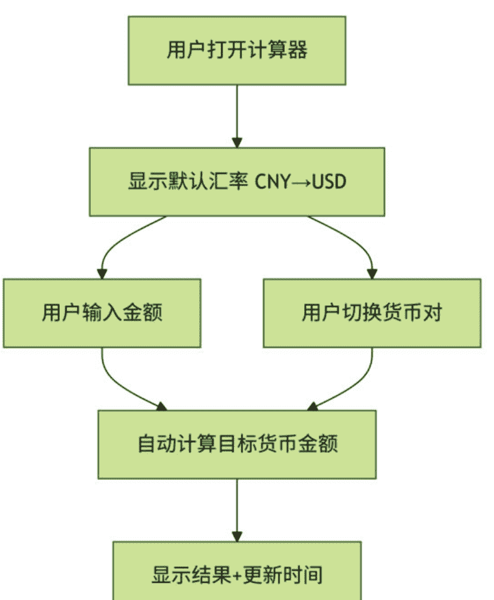

图3-1 货币汇率转换计算器的交互流程

图3-1对应的代码如下。

```
flowchart TB

A[用户打开计算器] --> B[显示默认汇率\nCNY→USD]

B --> C[用户输入金额]

C --> D[自动计算目标货币金额]

B --> E[用户切换货币对]

E --> D

D --> F[显示结果+更新时间]
```

要预览和修改 Mermaid 流程图，可使用 Mermaid Live Editor 等工具。

#### 4. 汇率查询API选择与配置
为了实现货币换算，货币汇率转换计算器需要集成能查询实时汇率的第三方 API。经过对比，我们选择了 Frankfurter 作为数据源。它具有如下特点。

- 完全免费：开源项目。
- 数据可靠：数据来源于欧洲中央银行（ECB）。
- 功能丰富：支持历史汇率查询（可追溯至1999年）。
- 无限制：无调用频率限制，适用于开发和学习。

Frankfurter 的基础 API 格式如下。

```
https://api.frankfurter.dev/v1/latest?base={基准货币}
```

下面是一个示例。

```
##### 查询美元汇率
https://api.frankfurter.dev/v1/latest?base=USD

##### 查询人民币汇率
https://api.frankfurter.dev/v1/latest?base=CNY

##### 查询欧元汇率
https://api.frankfurter.dev/v1/latest?base=EUR
```

#### 5. 使用 Lovable 创建应用
将 MVP 的“功能列表”部分的提示词、Mermaid 流程图代码和汇率查询 API 相关提示词进行整合，并输入 Lovable（如图3-2所示）。

根据如下描述帮我创建产品：汇率转换计算器。

##### 功能列表（MVP核心功能）

- **实时汇率查询**：支持主流货币（如USD、EUR、JPY等）的实时汇率显示（通过公开API获取）。

- **货币兑换计算**：输入金额后自动按当前汇率换算成目标货币。

- **货币选择**：提供常用货币的下拉选择列表。

- **汇率更新时间显示**：显示汇率数据的最后更新时间。

##### 交互流程
```
flowchart TB

A[用户打开计算器] --> B[显示默认汇率\nCNY→USD]

B --> C[用户输入金额]

C --> D[自动计算目标货币金额]

B --> E[用户切换货币对]

E --> D

D --> F[显示结果+更新时间]
```

##### 汇率查询API
如下是查询美元汇率的API：

https://api.frankfurter.dev/v1/latest?base=USD

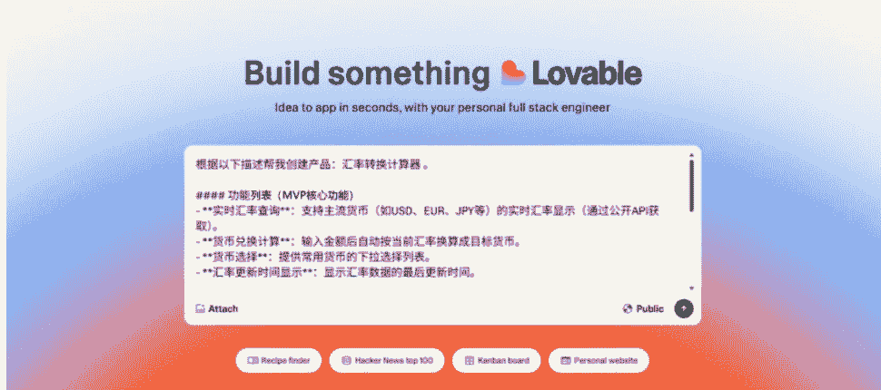

图3-2 在 Lovable 中输入用于生成货币汇率转换计算器的提示词

生成的货币汇率转换计算器界面，如图3-3所示。

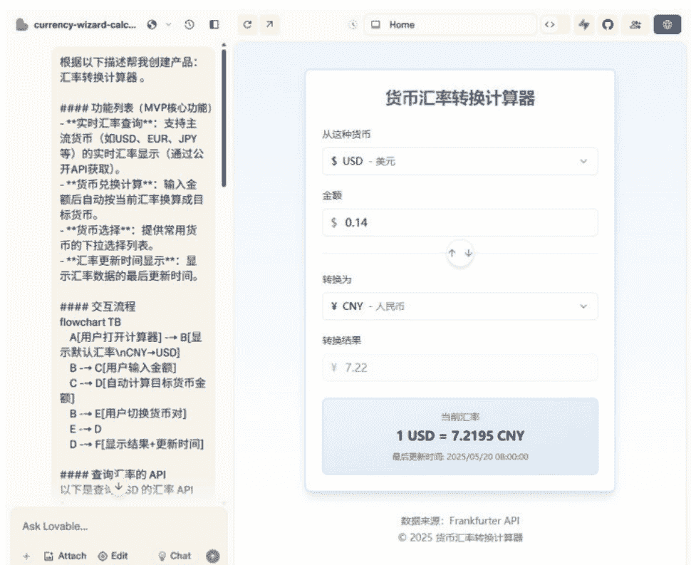

图3-3 货币汇率转换计算器界面

Lovable 在使用上述提示词生成货币汇率转换计算器的过程中，可能遇到如下两个问题。

(1) 调用汇率查询 API 出错。

遇到这种问题，可能是 API 地址写错了。这时，在浏览器开发者工具中查看 Network 请求，可以看到遗漏了 API 地址的“/v1”，导致请求不成功，如图3-4所示。

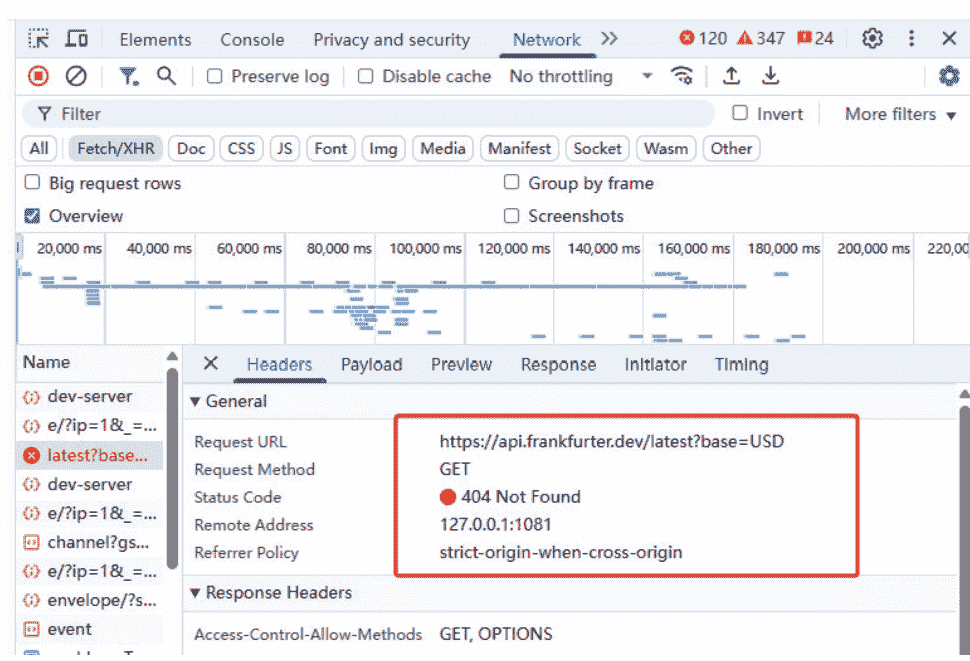

图3-4 使用的 API 地址不正确

(2) 生成的 Mermaid 流程图无法预览。

如果遇到生成的 Mermaid 流程图无法预览的情况，可以尝试让 AI 重新生成，这是因为已有 AI 工具在生成内容时具有随机性。

#### 6. 类似产品
在生活中，还存在许多涉及单位和数值转换的场景。如下是一些最常见的转换工具。

- 单位转换工具：用于长度、重量、面积等单位的转换。
- 时区转换工具：可快速查询全球各地时间，方便安排跨时区活动。
- 营养成分计算器：精确计算食物营养成分，帮助实现健康饮食。
- 尺码转换工具：快速对照国际服装、鞋码标准，轻松确定合适尺码。

借助于 Vibe 编程，不仅可以快速打造出这些实用工具，还可以根据具体场景和需求进行定制化开发。

### 3.1.2 高颜值番茄钟：告别拖延症的秘密武器
“又刷了1小时的手机！”小美看着时间心里懊恼地想，“明天就要交付的设计方案到现在还没开始做。”在这个信息过载的时代，这样的场景司空见惯：原本只想打开手机看一眼，但不知不觉就过去了几分钟。保持专注已成为现代人在工作和学习中面临的最大挑战之一。

借助于 Vibe 编程，只需30分钟就能打造一个既实用又美观的番茄钟应用，让保持专注不再是难事。

#### 1. 需求分析与场景构思
打开 DeepSeek，输入下面的提示词。

帮我设计一款**高颜值番茄钟**，需要清晰地定义其功能范围和应用场景，包括如下4个步骤。

- **用户画像分析**：明确目标用户的特征、痛点和需求。
- **场景故事描述**：用具体的场景描述产品如何解决用户问题。
- **功能边界确定**：定义产品能做什么，不能做什么。
- **交互流程设计**：规划用户使用产品的流程和交互方式。

采用 MVP 原则，实现包含最少功能的产品。

输出 MVP 描述。

1. 典型用户画像：一句话描述。

2. 场景故事：一句话描述。

3. 功能：用列表描述（只描述明确要做的功能，不需要的功能不描述）。

4. 交互流程：用列表描述。

#### 2. 优化并确定MVP描述
复制 DeepSeek 输出的 MVP 描述，删除不必要的功能，得到如下 MVP 描述。

##### MVP描述：高颜值番茄钟

###### 1. 典型用户画像
忙碌的年轻职场人/学生，需要简单高效的专注工具，同时注重视觉体验和仪式感。

###### 2. 场景故事
小张在写报告时频繁分心，他打开高颜值番茄钟，选择25分钟专注模式，沉浸于工作直至提示音响起，获得成就感。

###### 3. 功能列表（MVP核心功能）
- **基础计时功能**
  - 25分钟默认番茄钟（可启动/暂停/重置）
  - 5分钟默认短休息计时
  - 15分钟默认长休息计时（每完成4个番茄钟后触发）

###### 4. 交互流程
1. **启动应用**：用户打开番茄钟，看到简洁的主界面（默认25分钟倒计时）。
2. **开始专注**：点击“开始”按钮，倒计时启动，界面显示剩余时间。
3. **暂停/继续**：可随时暂停，再点击继续。
4. **番茄钟结束**：25分钟后，提示音响起，自动切换至5分钟短休息倒计时。
5. **休息结束**：休息时间到，提示音响起，返回专注界面。
6. **长休息触发**：每完成4个番茄钟，自动切换至15分钟长休息计时。
7. **重置计时**：用户可随时点击“重置”回到初始状态。

**高颜值番茄钟：用极简实现专注**

**本次刻意舍弃的功能**：多任务管理、社交分享、复杂设置、账号系统。

#### 3. 创建 MVP 的流程图
交互先行。选用 Mermaid 语法把流程可视化，向大模型下发指令让其输出：
用 Mermaid 语法呈现 MVP，仅保存核心功能与交互，方向为 flowchart TB
模型给出的结果如图3-5所示。

#### 4. 音效方案设计
在颜值打分的番茄钟里，提示音是状态切换的关键信号。合适的声音能准时提醒工作与休息的转换，也能提升整体手感，不过选型与落地要谨慎。
- 声音要柔和不刺耳，避免突然的大声影响情绪。
- 提示时长要简短清晰，避免拖沓。
- 考虑跨端兼容，更推荐代码合成而非音频文件。
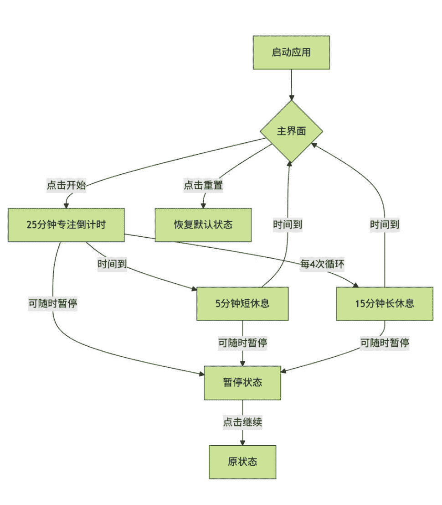
图3-5 高颜值番茄钟的交互流程
再次向模型求助并挑选方案。对比多种建议后，最终采用 Web Audio API 合成音效。优势如下。
- 无需额外音频资源，应用包体更小。
- 可通过代码精准控制频率、音量与时长。
- 跨平台表现稳定，各设备一致性好。

#### 5. 使用 Lovable 创建应用
把最小方案里的功能清单提示、Mermaid 流程代码和音效方案合并，形成指令提交给平台。
根据如下描述帮我创建产品：高颜值番茄钟。
##### 功能列表（MVP核心功能）
- **基础计时**
  - 25 分钟默认番茄，支持启动/暂停/重置
  - 5 分钟默认短休
  - 15 分钟默认长休，完成 4 个番茄后自动触发
- **极简操作界面**
  - 高清数字展示剩余时间
  - 开始/暂停为主操作
  - 重置为次要操作
- **高颜值设计**
  - 舒缓莫兰迪配色
  - 无干扰极简布局
  - 柔和提示音效，开始与结束各一套
- **基础数据统计**
  - 显示今日已完成番茄数
##### 交互流程
```
flowchart TB

A[启动应用] --> B{主界面}

B -->|点击开始| C[25分钟专注倒计时]

C -->|时间到| D[5分钟短休息]

D -->|时间到| B

C -->|每4次循环| E[15分钟长休息]

E -->|时间到| B

B -->|点击重置| F[恢复默认状态]

C & D & E --> |可随时暂停| G[暂停状态]

G -->|点击继续| 原状态
```
##### 音效
采用 Web Audio API 生成音效的方案。
平台生成的作品如图3-6所示。
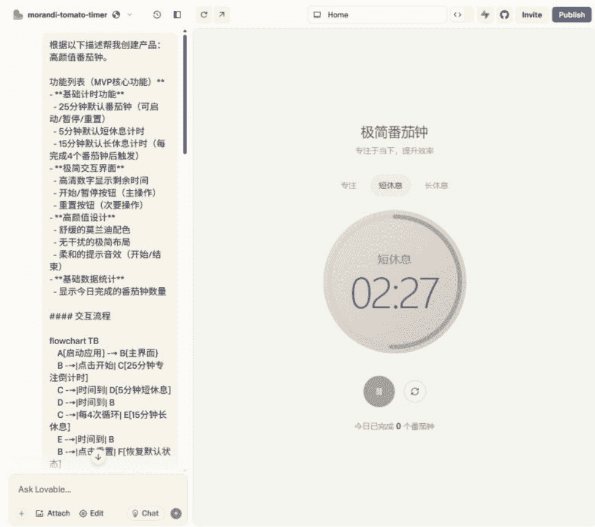
图3-6 Lovable生成的高颜值番茄钟

#### 6. 类似产品
番茄钟之外，时间管理赛道还有不少有灵感的小工具。
- 正念时钟：把冥想呼吸练习融入计时，工作间隙提供放松引导，帮助维持身心平衡。
- 创意节奏器：面向创作者，能依据创作状态自适应调整工休时长，并记录灵感高峰。
- 专注背景音：按场景自动切换环境音，如咖啡馆白噪音、自然声，营造专注氛围。
- 团队同步钟：可展示多时区，并把团队成员的工作状态与能量水平可视化，提升协作效率。
这些产品都把时间管理与具体场景深度绑定，已不再是单纯的计时器。

### 3.1.3 CEO极简待办：只留三件大事
“又被琐事淹没了！”看着一堆待办，某科技公司 CEO 小王忍不住叹气。信息过载时代，分类繁多、标签复杂，工具本身反而成了负担。
用 Vibe 编程思路，半小时就能做出面向高管的极简待办，让用户锁定当天最重要的 3 件事。

#### 1. 需求分析与场景构思
打开 DeepSeek，输入指令。
帮我设计一款**CEO用的极简待办清单**，需要清晰地定义其功能范围和应用场景，包括如下4个步骤。
- **用户画像分析**：明确目标用户的特征、痛点和需求。
- **场景故事描述**：用具体场景描述产品如何解决问题。
- **功能边界确定**：定义产品能做什么，不能做什么。
- **交互流程设计**：规划用户使用产品的流程和交互方式。
采用MVP原则，实现最少功能的产品。
输出MVP描述。
1. 典型用户画像：一句话描述。
2. 场景故事：一句话描述。
3. 功能：用列表描述，只描述要做的功能。
4. 交互流程：用列表描述。

#### 2. 优化并确定 MVP 描述
把模型输出复制后删去冗余，得到最终描述。
##### MVP描述：CEO用的极简待办清单
###### **1. 典型用户画像**
高效、决策密集型的 CEO/高管，每天需快速处理高优先级任务，厌恶复杂操作，追求极简与零干扰。
###### **2. 场景故事**
CEO 早晨查看今日**最重要的3项任务**，完成后即刻标记，避免被琐事牵着走，确保时间花在关键事项上。
###### **3. 功能列表（MVP核心功能）**
- **3项核心任务限制**，强制聚焦，防止清单膨胀
- **一键完成**，点击即标记完成，无需二次确认
- **极简输入**，新增任务只需输入加回车，无其他操作
- **自动夜间清空**，每日零点重置，避免任务积压
- **仅文本**，无分类、标签、优先级等复杂功能
###### **4. 交互流程**
1. **打开应用**：直接呈现3个空白输入框，无登录、无欢迎页。
2. **输入任务**：
   - 在任意输入框打字，回车即保存。
   - 超过3项时提示“今日已满”，不提供扩展。
3. **完成任务**：
   - 点击任务文本，自动划掉并变灰，无弹窗确认。
4. **夜间重置**：
   - 次日零点全部清空，重新开始。
##### **为什么这样设计？**
- **强制专注**：3项限制避免清单变成待办坟场。
- **零管理成本**：无分类、无排序，减少决策负担。
- **无历史包袱**：每日清空，避免纠结未完成项。
- **交互极致简单**：只有输入与点击，符合高管秒操作习惯。
**不做的功能**：分享、协作、提醒、优先级、附件、多设备同步——这些会抬高复杂度，已超出 MVP 范围。

#### 3. 创建 MVP 的流程图
继续在模型中输入。
使用Mermaid格式展示MVP，输出仅包含核心功能和交互的mermaid：flowchart TB
模型输出结果如图3-7所示。
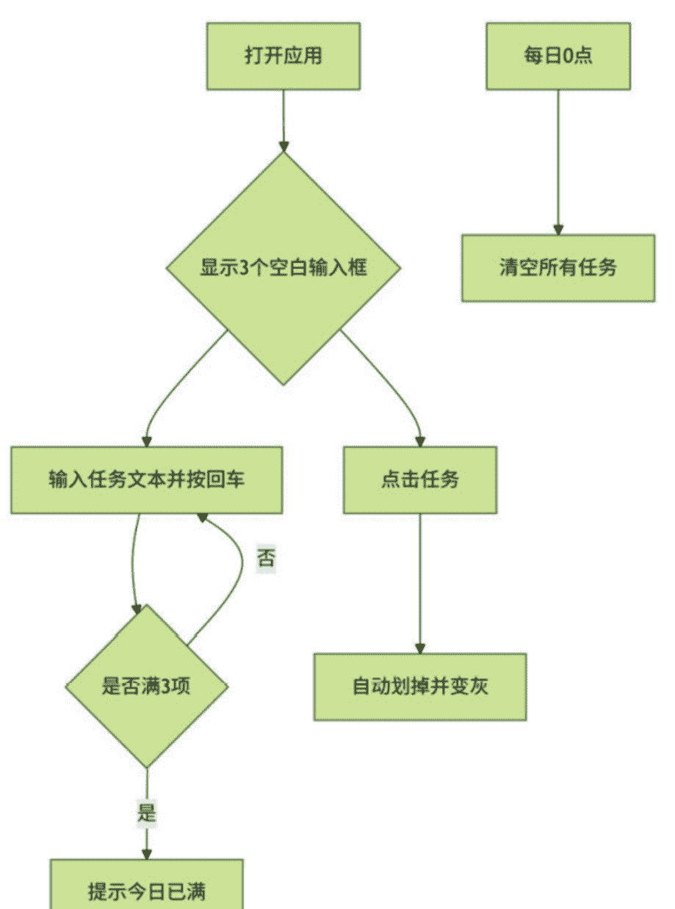
图3-7 CEO用的极简待办清单的交互流程

#### 4. 使用 Lovable 创建应用
把 MVP 的功能清单提示词和 Mermaid 流程代码合并，得到指令提交给平台。
根据如下描述帮我创建产品：CEO用的极简待办清单。
##### 功能列表（MVP核心功能）
- **3项核心任务限制**，强制聚焦，避免清单膨胀
- **一键完成**，点击即标记完成，无需二次确认
- **极简输入**，新增任务输入+回车，无需其他操作
- **自动夜间清空**，每日零点重置，避免任务堆积
- **仅文本**，无分类、标签、优先级等复杂功能
##### 交互流程
```
flowchart TB

A[打开应用] --> B{显示3个空白输入框}

B --> C[输入任务文本并按回车]

C --> D{是否满3项}

D -- 否 --> C
D -- 是 --> E[提示今日已满]

B --> F[点击任务]
F --> G[自动划掉并变灰]

H[每日零点] --> I[清空所有任务]
```
平台生成的应用如图3-8所示。

#### 5. 类似产品
在信息过载时代，“少即是多”的设计正重塑生产力工具。像 CEO 极简待办一样，更多创新产品通过刻意限制提升效率，帮助用户摆脱选择困扰。
- 晨间规划器：每天只设定两项必达目标，避免过度承诺。
- 专注阅读器：每次只展示一个段落，强制深度阅读。
- 决策简化器：在任何决策场景只提供3个选项，避免决策疲劳。
- 灵感触发器：每天随机限定一个创作主题，打破思维定式。
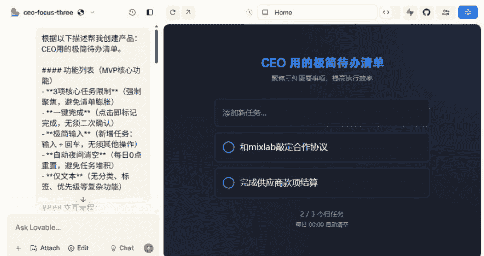
图3-8 Lovable生成的CEO用的极简待办清单
这些极简工具共享一个原则：**通过合理限制激发创造力**。限制是手段不是目的。
例如 CEO 极简待办将任务数锁死为3，并非限制产能，而是帮助聚焦真正重要的事。这种“少即是多”的思路，正在改变工作方式，让人能在数字世界里找到清净。

### 3.2 四大钩子：让小工具让人上瘾
3.1 节用3个实用小工具演示了如何把想法快速变成产品。但仅解决需求不够，在用户体验至上的今天，好的小工具还要能吸引注意、留住用户。
下面以天天提示生成器、养老金计算器、高颜值日历和游戏化学习为例，拆解小工具吸引用户的4个要素。
- 情感共鸣：天天提示生成器用幽默的提示文案满足年轻人对仪式感的追求。它不是占卜，而是让人会心一笑并忍不住分享的话题制造器。
- 实用价值：养老金计算器直击退休规划痛点，把复杂计算简化为几个输入，让用户快速了解现状。
- 视觉体验：高颜值日历跳脱传统刻板印象，把日常工具变成审美表达，值得放上桌面。
- 趣味性：游戏化学习把枯燥文言文变成连连看，有即时反馈，让学习上瘾。
四个要素可以叠加。优秀的小工具往往多维兼顾，这也是它们能进入用户日常的关键。

### 3.2.1 天天提示生成器：打造每日打开的微习惯
“今天适合干嘛呢？”小王习惯点开朋友分享的天天提示小程序。“宜尝试新事物，忌盲目跟风”，这个轻松的提示让他笑了笑。在焦虑普遍的时代，年轻人喜欢用轻松幽默的提示调节心情。

#### 1. 需求分析与场景构思
天天提示生成器虽属娱乐，但想做到日日打开，内容和体验都要下功夫。
打开 DeepSeek，输入。
帮我设计一款**天天提示生成器**，需要清晰地定义其功能范围和应用场景，包括如下4个步骤。
- **用户画像分析**：明确目标用户特征、痛点和需求。
- **场景故事描述**：用具体场景描述产品如何解决问题。
- **功能边界确定**：定义产品能做什么，不能做什么。
- **交互流程设计**：规划使用流程和交互方式。
采用MVP原则，实现最少功能的产品。
输出MVP描述。
1. 典型用户画像：一句话描述。
2. 场景故事：一句话描述。
3. 功能：用列表描述，只描述要做的功能，不需要的功能不描述。
4. 交互流程：用列表描述。

#### 2. 优化并确定 MVP 描述
把模型输出整理后去掉冗余，得到：
##### **MVP描述：天天提示生成器**
###### **1. 典型用户画像**
喜欢轻松娱乐、偶尔解闷的年轻白领或学生，对星座运气话题感兴趣但不迷信。
###### **2. 场景故事**
小张早高峰挤地铁无聊，打开“天天提示生成器”，看到“宜摸鱼，忌加班”，会心一笑并发到朋友圈调侃。
###### **3. 功能列表（MVP核心功能）**
- **随机生成当日提示**：一句话提示、幸运数字、幸运颜色。
- **选择星座/生肖**：用户可手动选择，默认随机。
- **分享功能**：一键分享到社交媒体。
- **极简界面**：只展示核心内容和分享按钮。
###### **4. 交互流程**
1. 打开页面直接显示随机生成的当日提示，含星座/生肖、文案、幸运数字/颜色。
2. 选择星座/生肖，可选，下拉切换后内容更新。
3. 分享结果，可选，点击分享按钮跳转社交平台。
4. 关闭页面，无登录、无历史、无二次交互。
##### **MVP原则**
- **不做**：用户账户、历史记录、付费内容、复杂分析。
- **聚焦**：10秒内完成生成-娱乐-分享闭环。
为简化分享功能继续追问模型。
分享功能，有什么更简单的方案？
模型建议用纯截图分享。
- 生成提示后界面自动排版成适合截图的样子，如加边框或趣味标语。
- 提示文案：“长按保存图片，分享到朋友圈吧！”无需开发分享接口，靠用户手动截图。
整合后 MVP 调整为：
##### MVP描述：天天提示生成器
###### **1. 典型用户画像**
喜欢轻松娱乐、偶尔想找点乐子的年轻上班族或学生，对星座、运气等话题感兴趣，但不迷信。
###### **2. 场景故事**
小张早上挤地铁时无聊，打开“天天提示生成器”娱乐一下，看到今日提示“宜摸鱼，忌加班”，随手截图分享到朋友圈调侃。
###### **3. 功能列表（MVP核心功能）**
- **随机生成当日提示**：
  - 一句话提示，如“宜喝奶茶，忌熬夜”。
  - 幸运数字1-9随机。
  - 幸运颜色，红/黄/蓝等基础色。
  - 默认随机星座/生肖，可手动切换。
- **截图友好设计**：
  - 底部提示文字：“长按保存，分享你的今日好运！”引导用户手动截图。
###### **4. 交互流程**
1. **打开页面**：直接显示随机生成的提示卡片，含星座/生肖、文案、幸运数字/颜色。
2. **切换星座/生肖**，可选，点击下拉菜单后内容自动更新。
3. **截图分享**：用户手动截图并分享到社交平台，无内置分享按钮。
4. **关闭页面**：无登录、无历史记录、无复杂交互。
##### **为什么选这个方案？**
- **成本最低**：无需分享接口、无需后端，纯前端静态页即可。
- **用户无门槛**：截图是天然习惯，无需教育。
- **传播性不弱**：有趣的卡片样式更易被分享。
##### **不做任何额外功能**
- ❌ 不开发分享按钮，依赖截图。
- ❌ 不保存用户数据，无账户系统。
- ❌ 不提供历史提示，每次打开都是新内容。

#### 3. 创建 MVP 的流程图
轻娱乐工具流程要更直观。在模型输入。
使用Mermaid格式展示MVP，输出仅包含核心功能和交互的mermaid：flowchart TB
生成的流程图如图3-9所示。
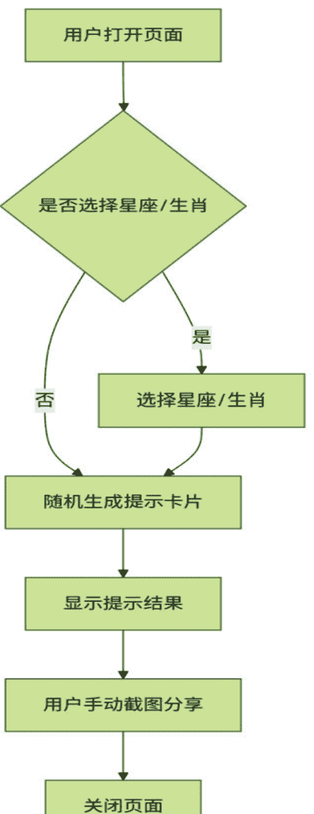
图3-9 天天提示生成器的交互流程

#### 4. 使用 Lovable 创建应用
为提升分享欲，提示文案要有趣、界面要好看。
把 MVP 的功能清单提示词和 Mermaid 流程代码合并，输入平台。
根据如下描述帮我创建产品：天天提示生成器。
##### 功能列表（MVP核心功能）
- **随机生成当日提示**：
  - 一句话提示，如“宜喝奶茶，忌熬夜”。
  - 幸运数字1-9随机。
  - 幸运颜色，红/黄/蓝等基础色。
  - 默认随机星座/生肖，可手动切换。
- **截图友好设计**：
  - 底部提示文字：“长按保存，分享你的今日好运！”引导用户手动截图。
##### 交互流程
```
flowchart TB
A[用户打开页面] --> B{是否选择星座/生肖}
```

### 3.2.2 养老金计算器：把未来收入算明白
退休后每月能领多少？这个问题让老王很焦虑。网上方法复杂难懂，专业术语让人望而却步。
养老规划已是每个人都要面对的事，无论是刚入职的年轻人还是临近退休的中年人，都需要清晰预期。借助 Vibe 编程，可以把复杂计算做成直观小工具。
#### 1. 需求分析与场景构思
做养老金计算器前要先理解真实需求：像理财顾问一样回答“我的养老金够不够用”这个核心问题。计算看似复杂，借助 MVP 策略可以简化，让用户快速获得有用信息。
首先让模型梳理产品定位，打开 DeepSeek 并输入。
帮我设计一款**养老金计算器**，需要清晰地定义其功能范围和应用场景，包括如下4个步骤。

构建轻量级应用前，先把使用对象、使用场景、能力范围、舍弃范围以及操作序列想清楚，再以最简可行形态做出可验证的原型。

将人群、场景、边界与路径压缩到最小集合：用一句概括受众、用一个故事说明痛点、清单列出必须实现的功能、清单列出使用流程，就能迅速得到可测试的雏形。

### 养老金计算器：退休金快速测算

需求拆解与情境推演

让计算工具贴合真实需求，要先明确目标人群的特征与痛点，用具体故事验证问题，再划清能力边界，最后规划使用路径。按最小可行思路，只保留最少可用功能进行验证。

归纳最小版本说明的四个要素：
1. 目标用户画像：简要概括。
2. 典型使用情境：简要概括。
3. 功能清单：只列要做的部分。
4. 使用流程：按顺序列出。

#### 最小版本落地

##### 最小版本说明：养老金计算器

###### 1. 目标用户画像
30-50 岁的在职人群，已形成养老意识但缺乏便捷的估算手段，希望提前预判退休收入以调整储蓄节奏。

###### 2. 典型使用情境
35 岁的公司中层张伟，想弄清退休后每月能拿到多少，网络资料繁杂难懂。他用本工具填写现薪、累计缴费年限和预期退休年龄，立刻得到估算值并据此调整储蓄计划。

###### 3. 功能清单
- **基础信息录入**
  - 当前月薪或缴费基数
  - 累计养老保险缴费年限
  - 预期退休年龄
  - 当地社会平均工资，可手工填写或采用系统默认值
- **养老金测算**
  - 按国家统一公式算出基础养老金加个人账户养老金
  - 展示每月预计领取金额
- **结果呈现**
  - 以数字直观展示结果，并附一句解读，如“约等于现收入的 XX%”

###### 4. 使用流程
1. **启动页**：一句点明价值的文案“快速估算您未来的退休金”+ 开始计算按钮。
2. **填写页**：分步填写工资、缴费年限、退休年龄等字段，带默认值和提示，如“当地平均工资参考值：XX 元”。
3. **结果页**：展示估算结果，如“每月约领取：¥5200”，提供“重新计算”返回填写页。
4. **结束**：操作结束即可，用户可截图保存。

**不做的范围**
- 不考量通胀、商业保险、投资收益等变量。
- 不做多方案对比、长期趋势图、社保政策解读。
- 无账号体系，每次使用独立计算。

#### 3. 制作最小版本的流程图
在智能助手里用提示词生成核心功能与交互的 Mermaid 语法图。
生成的流程图如图 3-11 所示。

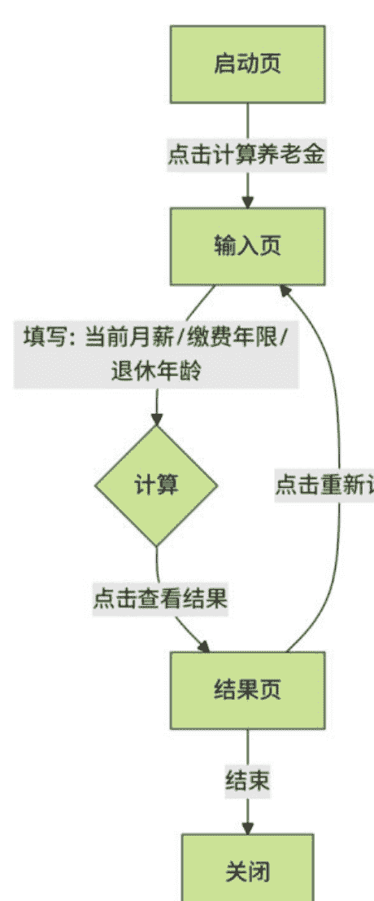

#### 4. 用 Lovable 快速成型
养老金计算器的关键是算得准、看得清，让用户对未来养老有合理预期。

把最小版本的功能点、计算规则和 Mermaid 流程代码整合为提示词，输入 Lovable。

根据如下描述帮我创建产品：养老金计算器。

##### 功能点
- **基本信息录入**：当前月薪或缴费基数；累计养老保险缴费年限；预期退休年龄；当地社会平均工资，可手工输入或自动采用默认值。
- **养老金测算**：按国家统一公式计算基础养老金+个人账户养老金；显示每月估算金额。
- **结果呈现**：数字直接展示结果，附带简短解读，如“相当于当前收入的 XX%”。

##### 养老金计算规则
1. **基础养老金**
   - 公式：`当地平均工资 × (1+平均缴费档次) ÷ 2 × 缴费年限 × 1%`
   - 例子：平均工资 8000 元，按 60% 档次缴费 20 年→ `8000 × (1+0.6) ÷ 2 × 20 × 1% = 1280 元/月`
2. **个人账户养老金**
   - 公式：`个人账户余额 ÷ 计发月数`，60 岁退休按 139 个月。
   - 例子：账户 10 万元→ `100000 ÷ 139 ≈ 719 元/月`
3. **总养老金**
   - 公式：`基础养老金+个人账户养老金`
   - 例子：`1280+719 = 1999 元/月`

一句话总结：你的养老金 = **当地工资水平 × 缴费年限 × 缴费档次**+**个人账户存的钱 ÷ 计发月数**。

##### 操作步骤
```
flowchart TB

A[启动页] -->|点击计算养老金| B[输入页]

B -->|填写: 当前月薪/缴费年限/退休年龄| C{计算}

C -->|点击查看结果| D[结果页]

D -->|点击重新计算| B

D -->|结束| E[关闭]
```

据此生成的应用如图 3-12 所示。

开发中可能遇到：
**问题 1：数据准确性**。各地社会平均工资不一致。解决方式是提供默认参考值，同时允许用户手工修改。
**问题 2：计算复杂度**。变量多易让人困惑。解决方式是把复杂计算放在后台，前端只保留必要输入，并给出清晰填写指引。

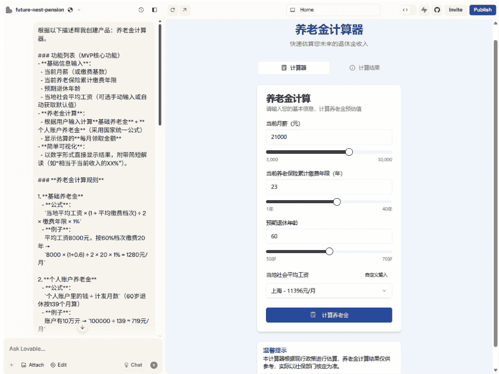

#### 5. 参考产品
金融科技里还有很多帮助规划未来的工具：
- 退休生活成本计算器：估算退休后开支，设定储蓄目标。
- 养老投资组合规划器：按年龄和风险偏好推荐方案。
- 社保缴费优化助手：分析不同缴费基数对未来养老金的影响。

共同特点是专业可信、操作简便、重视隐私，让复杂决策变得直观。

### 3.2.3 高颜值日历：美感与效率兼得

“为何日历总显得大同小异？”设计师小美翻看手机里千篇一律的日历应用，不禁叹气。作为追求美感的年轻一代，她想要一款既能高效管理日程，又能体现个人审美的日历。

在个性表达成为刚需的今天，工具不仅要好用，还要好看，成为个人品味的载体。

#### 1. 需求拆解与情境推演
做高颜值日历前，需深入理解新一代用户对美的诉求。既要兼顾实用，也要像时尚设计师一样重视视觉体验。

用智能助手梳理定位，像调香一样在功能与美感间找平衡。输入提示词，明确用户画像、情境故事、能力边界和交互路径，按最小可行实现最小功能。

输出最小版本说明：目标用户画像简要概括、情境简要概括、功能清单、交互清单。

#### 2. 优化并确定最小版本说明
##### 最小版本说明：高颜值日历
###### 1. 目标用户画像
20-28 岁的年轻职场人或学生，重视个性与视觉美，需要简洁高效的日程管理。

###### 2. 典型使用情境
23 岁设计师小美希望日历既实用又能融入她的审美，使用时心情更愉悦。

###### 3. 功能清单
- **高颜值界面**：提供多种视觉主题如极简、插画风、渐变风，支持自定义主色调。
- **基础日历视图**：默认月视图，可切换日视图，左右滑动切换月份。
- **日程管理**：点击日期添加/编辑日程，支持文字+emoji；长按日程拖拽改日期。
- **社交分享**：把某日日程生成美观卡片分享到社交媒体如 Instagram Story。
- **数据同步**：仅本地存储。

###### 4. 使用流程
1. **启动应用**：默认展示当前月视图，顶部显示月份和快捷切换。
2. **切换视图**：点“日”切换到日视图，左右滑动切换日期。
3. **添加日程**：点击日期→弹出输入框填文字+选 emoji→保存后展示。
4. **调整日程**：长按日程→拖拽到新日期→自动更新。
5. **更换主题**：点右上角“主题”→选预设或自定义颜色→实时预览。
6. **分享日程**：点日程→点“分享”→生成图片卡片→打开系统分享菜单。

**限制说明**
- 最小版本不做提醒通知，聚焦视觉与基础记录。
- 不支持团队协作或多人日历。
- 不支持复杂重复事件，需手工添加。

此最小版本专注“颜值+轻量记录”，后续可迭代提醒、云同步等。

#### 3. 生成最小版本的流程图
输入提示词生成 Mermaid 流程图，仅展示核心功能与交互。
生成的流程图如图 3-13 所示。

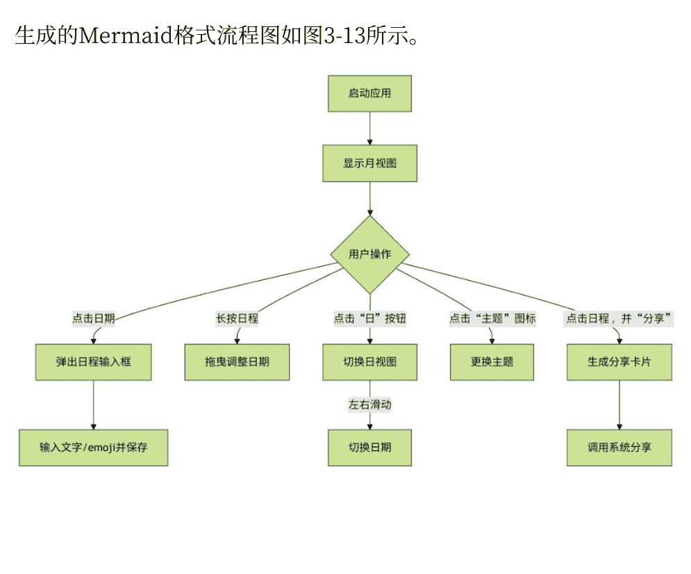

#### 4. 用 Lovable 生成应用
高颜值日历的关键在于精美视觉与流畅交互，让使用过程充满愉悦感。

把最小版本功能点和 Mermaid 流程代码整合为提示词。

根据如下描述帮我创建产品：高颜值日历。

##### 功能点
- **高颜值界面**：多种视觉主题，支持自定义主色调。
- **基础日历视图**：月视图默认+日视图切换，左右滑动换月。
- **日程管理**：点击日期添加/编辑日程，支持文字+emoji；长按拖拽改日期。
- **社交分享**：日程可生成美观卡片分享到社交媒体。
- **数据同步**：仅本地存储。

##### 操作步骤
```
flowchart TB

A[启动应用] --> B[显示月视图]
B --> C{用户操作}
C -->|点击日期| D[弹出日程输入框]
D --> E[输入文字/emoji并保存]
C -->|长按日程| F[拖拽调整日期]
C -->|点击“日”按钮| G[切换日视图]
G -->|左右滑动| H[切换日期]
C -->|点击“主题”图标| I[更换主题]
C -->|点击日程，并“分享”| J[生成分享卡片]
J --> K[调用系统分享]
```

据此生成的应用如图 3-14 所示。

开发中可能遇到主题适配问题，不同屏幕显示不一致。解决方式是采用响应式设计，确保主题在各设备上表现稳定。

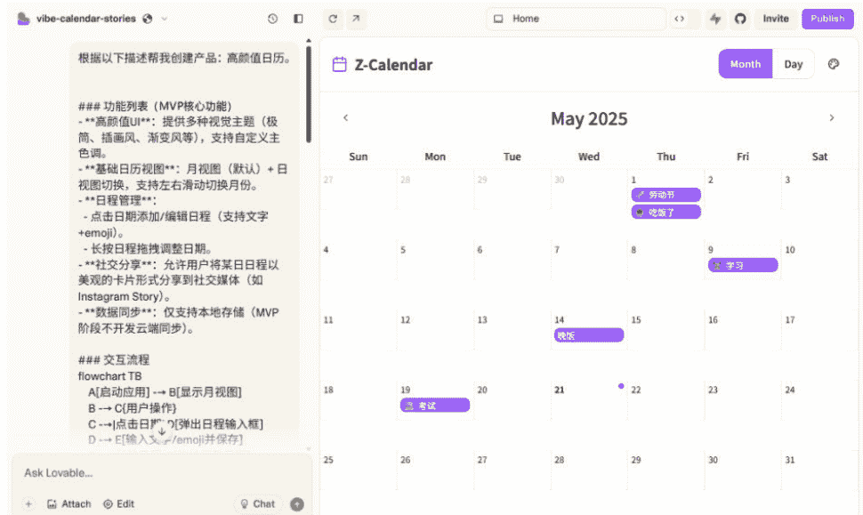

#### 5. 参考产品
个性化工具领域还有：
- 生活打卡簿：精美界面记录运动、阅读等习惯。
- 创意便签墙：以艺术拼贴形式呈现灵感。
- 时光胶囊：优雅时间线记录重要时刻。

它们共同注重视觉体验、个性表达与简约优雅，让日常工具变为审美载体。

### 3.2.4 文言文连连看：让古文变得上瘾

文言文考试又挂了！初中生小明看着试卷沮丧，枯燥背诵和繁琐语法让他望而生畏，这在教育场景中很常见。

游戏化学习是解法，把知识点变成游戏元素，能大幅提升效果。用 Vibe 编程打造“文言文连连看”，让学习轻松有趣。

#### 1. 需求拆解与情境推演
打开智能助手输入提示词，定义功能范围和应用场景，包含用户画像、情境故事、能力边界、交互路径，采用最小可行用最少功能实现产品：
- 知识点题库：预设 3 套题库
- 游戏化设计：连连看配对
- 进度追踪：完成情况和成就
- 反馈系统：及时反馈

输出最小版本说明：目标用户画像简要概括、情境简要概括、功能清单、交互清单。

#### 2. 优化并确定最小版本说明
##### 最小版本说明：文言文连连看
###### 1. 目标用户画像
初中生 12-15 岁，觉得文言文枯燥，需要趣味工具辅助记忆字词句式。

###### 2. 典型使用情境
小张课后用“文言文连连看”通过连线配对词汇与释义，轻松记住《论语》重点词，获得成就奖励，学习兴趣提升。

###### 3. 功能清单
- **预设题库**：3 套题库，如《论语》选段、《世说新语》选段、课内必背文言文。
- **连连看游戏化学习**：每关随机展示文言文词汇和现代释义，需正确连线配对；限时挑战模式增加紧迫感。
- **进度追踪**：记录已完成关卡和正确率；成就系统如“初窥门径”“小有所成”“倒背如流”。
- **即时反馈**：配对正确/错误时给视觉和音效反馈；每关结束展示正确率、用时和成就解锁。

###### 4. 使用流程
1. **启动页**：显示名称、Logo，提供“开始学习”按钮。
2. **题库选择页**：展示 3 套题库，点击进入。
3. **关卡选择页**：按篇章分关卡，如《论语·学而篇》第1关，显示已解锁关卡和成就进度。
4. **游戏界面**：左侧文言文词汇，右侧现代释义，拖动连线配对。

### 3.3 个性化服务：让智能成为你的私人助手

前文讲了用情感共鸣、实用价值、视觉体验、趣味性提升产品体验。智能时代更有力武器是智能私人助手，它能提供个性化服务。

如果有 24 小时待命的私人助手帮你梳理思路、整理信息、提供建议，工作生活会如何改变？本节通过智能思维导师和智能碎片信息整理助手展示如何将智能能力变为触手可及的私人助手。

这些助手的强大之处：
- 化繁为简：把复杂决策转化为清晰框架，让专业思维人人可用。
- 化整为零：把散落碎片信息整理为有序知识资产。
- 化被动为主动：通过智能分析和建议，让用户从信息接收者变决策者。
- 化标准为个性：按使用习惯和需求提供定制服务，让工具真正个人化。

下面用两个案例展示 30 分钟内打造私人助手的方法。

### 3.3.1 智能思维导师：决策焦虑的解药

“这个项目该不该接？”项目经理小王面对商业合作提案犯难，担心判断受个人经验和情绪影响。职场中每天都要做大小决策，却常陷入思维定式或决策焦虑。

用灵感驱动开发方法快速构建智能思维导师，提供结构化分析框架并给出深入见解。

#### 1. 需求拆解与情境推演
职场人在信息爆炸环境下需要快速准确决策。市面思维模型多但理论化难用。智能思维导师的关键是让复杂模型简单易用，借助智能提供更有价值分析。

打开智能助手，输入提示词，设计一款用各种思维模型帮助思考的智能思维导师应用，明确功能范围和应用场景，包含用户画像、情境故事、能力边界、交互路径，按最小可行实现最小功能。

输出最小版本说明。

30分钟用Vibe 编程模式搭出两款高频智能助手

一个好的思考辅助工具，不该把人困在各种模型里，而应像一份量身定制的分析报告，打开即见要点。先让 DeepSeek 给出初稿，再剔除冗余项，下面是精简后的方案。

#### 2. 优化并确定MVP描述

##### MVP描述：AI思维导师

###### 1. 用户画像概要
工作节奏快、时间碎片化的白领与创业者，想立刻调用 SWOT、第一性原理等分析框架解决业务与决策问题，却没有精力系统学习，也容易被固有思路限制。

###### 2. 应用场景示例
面对是否跳槽的抉择时，用户打开程序挑选决策矩阵模板，录入薪资、发展空间等考量项，系统快速给出可视化对比与排序建议，十分钟内把混乱想法理清。

###### 3. 核心功能点
- **框架库**：收录 5 个常用分析框架，包含 SWOT、5W1H、决策矩阵、第一性原理、成本效益分析。
- **分步收集**：选定框架后以分步表单收集关键参数，例如 SWOT 下的优势、劣势、机会、威胁条目。
- **自动撰写分析**：依托输入合成结构化分析结果，并做排版美化呈现。
- **实战参考**：每个框架附带 1 条简短案例，例如“用 5W1H 解析产品销量下滑”。

###### 4. 使用流程
1. **首页选择**：以图标加简述展示 5 个框架，点击进入。
2. **信息录入**：以分步表单采集信息，如 SWOT 分 4 个输入框分别填写 S/W/O/T。
3. **结果页**：
   - 展示模型产出的分析报告，例如决策矩阵的加权得分表。
   - 底部提供“保存为笔记”或“显示案例”入口。
4. **案例入口**：结果页侧栏可点开查看对应案例。

##### 不纳入范围
- 不支持自定义框架或复杂数据导入。
- MVP 阶段仅允许单次单框架使用，不串联。
- 无记忆功能，每次使用相互独立。

提示：若想更换分析框架，只需改动 MVP 描述中的核心功能点即可。

#### 3. 生成MVP流程图
向 DeepSeek 提供提示词。

使用 Mermaid 格式展示 MVP，输出仅包含核心功能和交互的 mermaid: flowchart TB

生成的 Mermaid 流程图如图 3-19 所示。

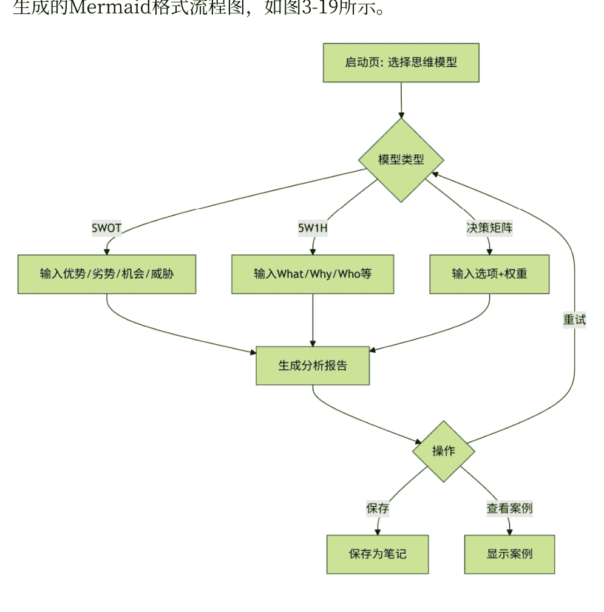

图 3-19 AI 思维导师的交互流程

#### 4. 用 Lovable 搭建应用
实现 AI 思维导师时，需要调用大语言模型 API 来产出专业分析报告。此处选用硅基流动提供的 API 服务，需补充 LLM API 请求的上下文参数，具体可参考硅基流动官网“用户手册”中“创建文本对话请求”的说明。

将 MVP 的核心功能提示词、LLM API 说明和 Mermaid 流程图代码整合后得到如下提示词，输入 Lovable。

根据如下描述帮我创建产品：AI 思维导师。

##### 功能列表（MVP 核心功能）
- **模型库**：提供 5 种最常用思维模型（如 SWOT、5W1H、决策矩阵、第一性原理、成本效益分析）。
- **交互式问答**：用户选择模型后，通过分步表单输入关键参数（如 SWOT 的优势/劣势条目）。
- **AI 生成报告**：基于输入自动生成结构化分析结果（格式美化展示）。
- **案例参考**：每个模型附带 1 个简短的实际应用案例（如“用 5W1H 分析产品销量下降”）。

##### AI 生成报告
把用户在表单中填写的关键信息作为提示词调用 LLM API 生成结构化分析结果。其中 apiKey 和 apiUrl 需要提供设置的 UI：

```javascript
const apiUrl='https://api.siliconflow.cn/v1/chat/completions';
const apiKey= '<token>'
const options = {
  method: 'POST',
  headers: {Authorization: `Bearer ${apiKey}`, 'Content-Type': 'application/json'},
  body: JSON.stringify({
    "model": "Qwen/Qwen3-8B",
    "messages": [
      {
        "role": "user",
        "content": "根据如下SWOT分析，请生成一份结构化的报告。\n\n优势（S）:\n- 技术领先\n- 品牌知名度高\n\n劣势（W）:\n- 成本较高\n- 渠道覆盖不足\n\n机会（O）:\n- 政策扶持\n- 新兴市场增长\n\n威胁（T）:\n- 竞争加剧\n- 原材料价格上涨"
      }
    ],
    "stream": false,
    "max_tokens": 512,
    "enable_thinking": false
  })
};

fetch(apiUrl, options)
.then(response => response.json())
.then(response => console.log(response))
.catch(err => console.error(err));
```

- API 返回结果需提取 choices[0].message.content 中的内容，并进行格式美化展示:

```json
{
  "id": "<string>",
  "choices": [
    {
      "message": {
        "role": "assistant",
        "content": "<string>",
        "reasoning_content": "<string>",
        "tool_calls": [
          {
            "id": "<string>",
            "type": "function",
            "function": {
              "name": "<string>",
              "arguments": "<string>"
            }
          }
        ]
      },
      "finish_reason": "stop"
    }
  ]
}
```

##### 交互流程
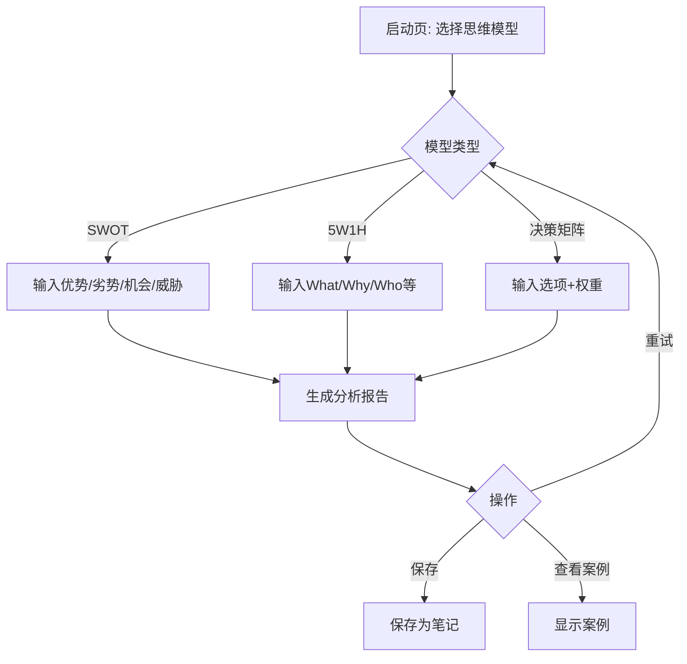

借助于这些提示词生成的应用如图 3-20 所示。

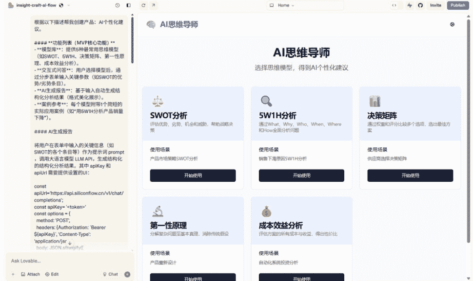

图 3-20 Lovable 生成的 AI 思维导师

使用时两个参数常需留意细节。
- stream 参数设为 true，表示开启流式传输。
- enable_thinking 参数设为 true，表示开启推理过程。

#### 5. 优化方向
- 多维分析：结合大数据和 AI 从多个角度分析问题，提供全方位思维视角。
- 实时认知辅助：在思考过程中给出即时建议和指导，避免认知偏差与思维定式。
- 专家模式：模拟不同领域专家的思维方式，让用户学习多样化问题解决方法。
- 智能总结：自动提炼思维过程中的关键点，输出结构化行动建议与风险评估。

在决策越来越复杂的时代，AI 思维导师能帮助每个人用结构化思维思考问题，成为更好的决策者。这正是 Vibe 编程的魅力——让技术真正服务于人，让复杂问题变得简单明了。

### 3.3.2 AI 碎片信息整理助手：把零散思维变有序智慧

“又是忙碌的一天，手机备忘录里堆满待办事项和灵感。”小李看着自己凌乱的笔记，一筹莫展。这是现代职场人的普遍困扰——每天都在不同场合记录大量碎片化信息，但这些珍贵的想法和计划常常淹没在大量信息中，难以有效整理和利用。

借助于 Vibe 编程，我们只需要 30 分钟就能打造一个 AI 碎片信息整理助手。它不仅能帮自动分类整理各种碎片信息，还能将零散的想法转化为结构化的知识。

#### 1. 需求分析与场景构思
市面上笔记和待办事项工具很多，但智能化整理能力不足，用户仍需花费大量时间手动整理和分类。

因此，对于 AI 碎片信息整理助手这样的工具，关键是要让复杂的信息管理变得简单，并借助 AI 模型提供智能化的整理服务。

打开 DeepSeek，输入如下提示词。

帮我设计一款**AI 碎片信息整理助手**应用，需要清晰地定义其功能范围和应用场景，包括如下 4 个步骤。

- **用户画像分析**：明确目标用户的特征、痛点和需求。
- **场景故事描述**：用具体的场景描述产品如何解决用户问题。
- **功能边界确定**：定义产品能做什么，不能做什么。
- **交互流程设计**：规划用户使用产品的流程和交互方式。

采用 MVP，用最少的功能（手动录入文本信息）实现产品。

输出 MVP 描述。
1. 典型用户画像：一句话描述。
2. 场景故事：一句话描述。
3. 功能：用列表描述（只描述明确要做的功能，不需要的功能不描述）。
4. 交互流程：用列表描述。

#### 2. 优化并确定MVP描述
复制 DeepSeek 输出的 MVP 描述，删除不必要的功能，得到如下 MVP 描述。

##### MVP 描述：AI 碎片信息整理助手

###### 1. 用户画像概要
忙碌的都市上班族，经常在通勤、会议间隙通过手机记录零散想法或待办事项，但缺乏高效整理工具，导致信息混乱或遗忘。

###### 2. 应用场景示例
用户在午休时用手机快速记录了一条会议灵感、一条购物清单和一条周末计划，通过助手一键分类并生成结构化待办列表，下班前统一查看处理。

###### 3. 核心功能点
- **手动文本输入**：支持用户直接粘贴或输入多段碎片文本（如便签、聊天记录）。
- **自动分类打标签**：通过 AI 识别文本类型（如待办、灵感、备忘等），添加标签（如`#工作`/`#生活`）。
- **结构化整理**：将杂乱文本转换为清单、日程提醒等标准化格式（如自动分段、添加项目符号）。
- **本地存储与导出**：支持按标签筛选查看，并导出为`.txt`或分享至其他 App（如微信、钉钉）。

###### 4. 使用流程
1. **启动应用**：首页仅显示一个文本框和「整理」按钮。
2. **输入碎片文本**：用户粘贴或输入多行零散内容（如`买咖啡#生活 明天提交报告#工作`）。
3. **一键整理**：点击「整理」后，AI 自动分类并生成带标签的清单（如`[生活]买咖啡`、`[工作]明天提交报告`）。
4. **结果处理**：用户可点击「保存」存储结果，或「导出」分享至其他应用。

##### 不做的功能
- 不提供语音输入、图片 OCR、多端同步、复杂编辑等功能。
MVP 聚焦手动文本的高效整理，降低开发成本验证核心需求。

#### 3. 创建MVP的流程图
在 DeepSeek 里输入如下提示词。

使用 Mermaid 格式展示 MVP，输出仅包含核心功能和交互的 mermaid: flowchart TB

生成的 Mermaid 格式流程图如图 3-21 所示。

#### 4. 用 Lovable 创建应用
实现 AI 碎片信息整理助手时，需要调用 LLM API 来实现智能分类和结构化处理。这里我们选择使用硅基流动提供的 API 服务。

将 MVP 描述的“功能列表”部分、必要的 API 调用代码和 Mermaid 流程图代码进行整合，得到如下提示词，并输入 Lovable。

根据如下描述帮我创建产品：AI 碎片信息整理助手。

##### 功能列表（MVP 核心功能）
- **手动文本输入**：支持用户直接粘贴或输入多段碎片文本（如便签、聊天记录）。
- **自动分类打标签**：通过 AI 识别文本类型（如待办、灵感、备忘等），添加标签（如`#工作`/`#生活`）。
- **结构化整理**：将杂乱文本转换为清单、日程提醒等标准化格式（如自动分段、添加项目符号）。
- **本地存储与导出**：支持按标签筛选查看，并导出为`.txt`或分享至其他 App（如微信、钉钉）。

##### 自动分类打标签
将用户输入的信息作为提示词，调用 LLM API，生成结构化的整理结果。其中 apiKey、apiUrl 和 model 需要提供设置的 UI：

```
const apiUrl='https://api.siliconflow.cn/v1/chat/completions';
const apiKey='<token>'
const model="Qwen/Qwen3-8B"

const options = {
  method: 'POST',
  headers: {Authorization: `Bearer ${apiKey}`, 'Content-Type': 'application/json'},
  body: JSON.stringify({
    "model":model,
    "messages": [
      {
        "role": "user",
        "content": "根据如下SWOT分析，请生成一份结构化的报告。\n\n优势（S）:\n- 技术领先\n- 品牌知名度高\n\n劣势（W）:\n- 成本较高\n- 渠道覆盖不足\n\n机会（O）:\n- 政策扶持\n- 新兴市场增长\n\n威胁（T）:\n- 竞争加剧\n- 原材料价格上涨"
      }
    ],
    "stream": false,
    "max_tokens": 512,
    "enable_thinking": false
  })
};

fetch(apiUrl, options)
.then(response => response.json())
.then(response => console.log(response))
.catch(err => console.error(err));
```

- API 返回结果需提取 choices[0].message.content 中的内容，并进行格式美化展示:

```
{
  "id": "<string>",
  "choices": [
    {
      "message": {
        "role": "assistant",
        "content": "<string>",
        "reasoning_content": "<string>",
        "tool_calls": [
          {
            "id": "<string>",
            "type": "function",
            "function": {
              "name": "<string>",
              "arguments": "<string>"
            }
          }
        ]
      },
      "finish_reason": "stop"
    }
  ]
}
```

##### 交互流程
```
flowchart TB
A[启动应用] --> B[输入碎片文本]
B --> C{点击整理按钮}
C --> D[AI自动分类打标签]
D --> E[生成结构化清单]
E --> F{保存或导出}
F -->|保存| G[本地存储]
F -->|导出| H[分享至其他App]
```

借助于这些提示词生成的应用如图 3-22 所示。

图 3-22 Lovable 生成的 AI 碎片信息整理助手

在使用 AI 碎片信息整理助手时，可能会遇到如下 3 个问题。
- 文本识别准确度问题，可以在输入时使用简单的标记（如“#工作”“#生活”）来辅助 AI 理解。
- 批量处理效率问题，可以实现分批处理机制，每次处理适量的文本内容。
- 个性化分类问题（如预设的分类不符合某些用户的需求），允许用户自定义常用标签，让 AI 模型学习用户的分类习惯。

#### 5. 优化方向
- 智能分类推荐。根据用户平时整理信息的习惯，自动推荐更合适的分类方法和标签，就像有个小助手帮你找好收纳盒一样方便。
- 多方式信息录入。支持语音输入、拍照识别文字等多种添加信息的方式，不用手动打字也能快速把看到听到的内容存进来。
- 信息关系梳理。自动把用户整理的内容连成一张“知识网”，帮你发现不同信息之间的关联，构建个人知识网络。
- 自动整理小管家。支持自定义规则（如“晚上8点提醒整理当天笔记”），让工具自动完成信息分类、归纳和提醒，减少重复操作。

# 第4章 生活必备工具，解决你的真实痛点
本章将通过健康生活助手、时间管理大师和社交助手这 3 类应用的开发，展示 Vibe 编程解决常见生活“小事”的能力，帮助读者构建好用的、适合自己的应用。

## 4.1 健康生活助手：让 AI 成为你的私人健康顾问
“健康是 1，其他都是后面的 0。”这句话道出了健康的重要性。在这个快节奏的时代，我们每个人都面临着各种健康挑战：

日常里常见的健康摩擦，看似微小却持续消耗状态

- 有人想降低体重，却找不到既科学又能长期坚持的饮食方式；
- 有人被高压工作困住，找不到合适的舒缓手段；
- 有人长期失眠，对作息调节无从着手；
- ……

这些问题表面琐碎，实则直接牵动生活质量与工作效率。本节以 Vibe 编程的四步实践路径为框架，用两款健康类小工具演示如何把真实需求快速转化为可用原型。

### 4.1.1 减脂营养师：专属智能饮食顾问

“又点外卖了。”小美看着餐盒叹气。作为朝九晚六的白领，她想控重却总是坚持不下来。网上的减重餐单要么步骤繁琐，要么与口味不符。“要是有懂我又专业的顾问就好了。”类似的困扰在都市人群中很普遍，大家都在寻找简单可行的方案。

借助 Vibe 编程思路，约半小时就能搭出一款减脂营养师。它会结合身体状况与进食习惯，给出可落地的餐单建议。

#### 1. 需求拆解与场景设想

控重不是数字游戏，而是习惯的重塑。使用者要的不是单纯的卡路里计算器，而是一个能读懂生活方式与口味，并给出可执行建议的智能伙伴。

在 DeepSeek 中输入引导词，让它围绕减脂营养师梳理功能边界与使用场景，分四步展开。

- 目标人群剖析：明确使用者特征、痛点与诉求
- 使用情境描述：用具体故事说明产品如何解决问题
- 功能边界界定：能做什么、不能做什么
- 操作路径规划：使用者使用流程与交互方式

以 MVP 为目标，用最少功能验证价值。

- 输入尽量做成选项
- 操作步数越少越好
- 只保留 1~2 个核心功能

输出 MVP 说明。

#### 2. 优化并确定 MVP 描述

把 DeepSeek 的初版结果精简后，得到以下定稿。

##### MVP 描述：减脂营养师

###### 1. 典型使用者画像
时间紧张、缺乏专业知识的白领，想科学控脂，需要简洁个性化的饮食指导。

###### 2. 场景故事
30 岁办公室职员小王 BMI 超标，他打开应用录入基础信息和口味偏好，立刻拿到专属减脂餐单，并可一键生成采购清单。

###### 3. 功能清单（MVP 核心）
- 个人资料填写：性别、年龄、身高、体重、目标体重、运动活跃度
- 饮食偏好选择：忌口如素食、无乳糖，口味如中式、西式等
- 输出每日减脂餐单：基于数据与偏好推荐三餐加加餐
- 一键生成采购清单：汇总餐单食材，支持导出或分享

###### 4. 交互路径
1. 启动页：简洁标语如“3 步定制你的减脂餐单”+ 立即开始按钮
2. 信息输入页：
   - 分步填写：①基础数据；②饮食偏好，多选勾选
   - 全程禁用自由输入，采用滑块或单选/多选
3. 餐单展示页：直接呈现图文今日推荐，底部“生成采购清单”按钮
4. 清单页：食材及分量列表，支持复制文本或分享到微信

关键设计原则
- 极简输入：杜绝手动打字，全靠选项与滑块
- 零学习成本：从打开到出餐单不超过 3 步
- 不做功能：社交、打卡、运动记录、付费课程等均不纳入

#### 3. 搭建 MVP 的流程图

在 DeepSeek 中输入提示词。

使用 Mermaid 格式呈现 MVP，输出仅包含核心功能与交互的 mermaid: flowchart TB

生成的 Mermaid 流程图如图4-1 所示。

```
flowchart TB
A[启动页] --> B[输入基础信息：性别、年龄、身高、体重、目标]
B --> C[选择饮食偏好：忌口、口味偏好、烹饪时间]
C --> D[生成每日减脂食谱]
D --> E[一键生成购物清单]
E --> F[导出或分享清单]
```

图4-1 减脂营养师的交互流程

#### 4. 编写 System 提示词

System 提示词决定 AI 的角色、边界、行为与输出方式，包含角色定位、工作范围、行为准则、输出格式四部分。

以减脂营养师为例：
- 角色定位：专业减脂营养师
- 工作范围：依据身体数据与饮食偏好生成每日餐单及食材清单，且不推荐忌口食材、繁复烹饪与模糊分量
- 行为准则：以科学为先，严格遵循使用者偏好
- 输出格式：早餐、午餐餐单及对应采购清单

继续在 DeepSeek 中输入。

根据 MVP 功能描述，生成用于餐单生成的 System 提示词

DeepSeek 给出的 System 提示词如下。

##### System 提示词 for AI Dietitian

Role:
你是一名专业的减脂营养师，根据使用者提供的身体数据（BMI、目标体重）和饮食偏好（忌口、口味、烹饪时间），生成简单、可执行、热量可控的每日餐单，并附带清晰的食材清单。

Rules:
1. 科学优先
   - 每日总热量 = 使用者基础代谢 × 活动系数 -300～500kcal（安全减脂缺口）
   - 营养素分配：蛋白质30% / 脂肪25% / 碳水45%
   - 食材选择：高饱腹感（燕麦、鸡胸肉）、低GI（糙米、西蓝花）
2. 严格遵循使用者偏好
   - 若使用者选择“素食”，禁用所有肉类，用豆类/藜麦替代蛋白质
   - 若使用者选择“中式”，避免生冷沙拉，推荐蒸煮炒等烹饪方式
3. 输出格式标准化
早餐
- [菜名]: [食材+分量]（如：燕麦粥：燕麦50g+牛奶200ml）
- 热量: XXX kcal
午餐（示例）
- 糙米饭：糙米80g
- 清蒸鱼：鲈鱼100g+姜片
- 总热量：XXX kcal
采购清单
- 燕麦 50g
- 鲈鱼 100g
4. 禁止行为
   - 推荐使用者忌口的食材（如使用者选择“无乳糖”时禁用牛奶）
   - 复杂的烹饪步骤（单菜烹饪时间≤20分钟）
   - 模糊分量（必须标注克数/毫升数）

#### 5. 用 Lovable 快速成型

把 MVP 的功能清单、Mermaid 流程代码与 System 提示词整合，输入 Lovable。

根据如下描述帮我创建产品：减脂营养师。

功能列表（MVP 核心功能）
- 使用者信息录入（性别、年龄、身高、体重、目标体重、活动水平）
- 饮食偏好选择（忌口：如素食、无乳糖；口味偏好：中式/西式等）
- 输出每日减脂餐单（基于使用者数据和偏好，推荐3餐+加餐）
- 一键生成采购清单（整合餐单所需食材，支持导出或分享）

交互流程
```
flowchart TB
A[启动页] --> B[输入基础信息: 性别、年龄、身高、体重、目标]
B --> C[选择饮食偏好: 忌口、口味、偏好、烹饪时间]
C --> D[生成每日减脂食谱]
D --> E[一键生成购物清单]
E --> F[导出或分享清单]
```

生成每日减脂餐单
将使用者输入的信息作为提示词，调用 LLM API，生成每日减脂餐单。其中 apiKey、apiUrl 和 model 需要提供设置的 UI：
```
const apiUrl='https://api.siliconflow.cn/v1/chat/completions';
const apiKey= '<token>';
const model="Qwen/Qwen3-8B";
const systemPrompt=`你是一名专业的减脂营养师，根据用户提供的身体数据（BMI、目标体重）和饮食偏好（忌口、口味、烹饪时间），生成**简单、可执行、热量可控**的每日食谱，并附带清晰的食材清单。规则：

1. **科学优先**
   - 每日总热量 = 用户基础代谢 × 活动系数 -300～500kcal（安全减脂缺口）
   - 营养素分配：蛋白质30% / 脂肪25% / 碳水45%
   - 食材选择：高饱腹感（燕麦、鸡胸肉）、低GI（糙米、西蓝花）

2. **严格遵循用户偏好**
   - 若用户选择“素食”，禁用所有肉类，用豆类/藜麦替代蛋白质
   - 若用户选择“中式”，避免生冷沙拉，推荐蒸煮炒等烹饪方式

3. **输出格式标准化**

###### 早餐

- [菜名]: [食材+分量] (如：燕麦粥：燕麦50g+牛奶200ml)
- **热量**: XXX kcal

###### 午餐（示例）

- 糙米饭：糙米80g
- 清蒸鱼：鲈鱼100g+姜片
- **总热量**: XXX kcal

###### 购物清单

- 燕麦 50g
- 鲈鱼 100g

4. **禁止行为**
   - 推荐用户忌口的食材（如用户选择“无乳糖”时禁用牛奶）
   - 复杂的烹饪步骤（单菜烹饪时间≤20分钟）
   - 模糊分量（必须标注克数/毫升数）
`;

const options = {
  method: 'POST',
  headers: {Authorization: `Bearer ${apiKey}`, 'Content-Type': 'application/json'},
  body: JSON.stringify({
    "model": model,
    "messages": [
      {
        "role": "system",
        "content": systemPrompt
      },
      {
        "role": "user",
        "content": "用户的信息和饮食偏好等"
      }
    ],
    "stream": false,
    "max_tokens": 512,
    "enable_thinking": false
  })
};

fetch(apiUrl, options)
.then(response => response.json())
.then(response => console.log(response))
.catch(err => console.error(err));
```
API 返回结果需提取 choices[0].message.content 中的内容，并进行格式美化展示:
```
{
  "id": "<string>",
  "choices": [
    {
      "message": {
        "role": "assistant",
        "content": "<string>",
        "reasoning_content": "<string>",
        "tool_calls": [
          {
            "id": "<string>",
            "type": "function",
            "function": {
              "name": "<string>",
              "arguments": "<string>"
            }
          }
        ]
      },
      "finish_reason": "stop"
    }
  ]
}
```

按此提示生成的应用如图4-2 所示。

图4-2 Lovable 生成的减脂营养师应用

实际使用中可能遇到三个细节问题：
- 食材非当季，可在偏好中增加“季节性食材”选项，让模型优先推荐当季品类
- 烹饪难度不统一，可在 System 提示中加入难度等级限制，保持菜品手感一致
- 清单不够智能，可优化合并逻辑，考虑保质期与使用频率，减少浪费

#### 6. 进阶优化方向

减脂营养师的迭代可围绕四点展开：
- 智能调优：根据使用者反馈自动优化推荐，分析饮食习惯动态调整热量与营养配比
- 社区互动：支持经验分享、餐单改良讨论、线上减重打卡
- 数据洞察：追踪减重进度，关联饮食模式与效果，生成个性化报告
- 场景化推荐：按天气推荐适配餐单，针对聚餐等特殊场合给出建议，并提供外出就餐菜品挑选指引

好的产品不是堆功能，而是精准理解需求。像一位贴心的私人营养师，既专业又灵活，在享受美食的同时帮助使用者达成健康目标。

### 4.1.2 呼吸练习助手：随身减压助手

“又是一个焦虑的下午。”小张坐在工位上，压力像块石头压在胸口。工作节奏、人际摩擦……现代人普遍喘不过气。大家都知道深呼吸能放松，却不确定怎样呼吸才有效。

借助 Vibe 编程，半小时即可搭建一个专业的呼吸练习助手，依需求切换不同呼吸模式进行引导。

#### 1. 需求拆解与场景设想

都市人群普遍受压力与焦虑困扰，有人求快速平静，有人想提升专注，需要一个能按需求提供个性化指引的呼吸工具。

在 DeepSeek 中输入提示词。

帮我设计一款呼吸练习应用，需要清晰地定义其功能范围和应用场景，包括如下4个步骤。
- 使用者画像分析：明确目标使用者的特征、痛点和需求
- 场景故事描述：用具体的场景描述产品如何解决使用者问题
- 功能边界确定：定义产品能做什么，不能做什么
- 交互流程设计：规划使用者使用产品的流程和交互方式

采用MVP，用最少的功能实现产品。
- 输入尽量使用选项
- 操作步骤要尽可能少
- 只做最核心的1～2个必备的功能

输出MVP描述。
1. 典型使用者画像：一句话描述
2. 场景故事：一句话描述
3. 功能：用列表描述
4. 交互流程：用列表描述

#### 2. MVP 确定与聚焦

在 DeepSeek 初版基础上聚焦两种核心呼吸模式与可视化引导，得到如下 MVP。

##### MVP 描述：呼吸练习

1. 典型使用者画像
压力大、易焦虑的都市白领，希望用简单呼吸练习快速放松身心。

2. 场景故事
午休时使用者焦虑难以集中，打开应用选择 5 分钟“减压模式”，跟随动画节奏呼吸，迅速恢复平静。

3. 功能列表（MVP 核心功能）
- 呼吸模式选择（单选）：
  - 减压模式（4-7-8 呼吸法）
  - 专注模式（箱式呼吸法）
- 时长选择（单选）：3分钟 / 5分钟 / 10分钟
- 呼吸动画引导：可视化图形如圆圈缩放，与呼吸节奏同步，开始倒计时播放对应动画
- 结束提醒：轻柔提示音 + 总结如“完成 5 分钟减压呼吸”

4. 交互流程
1. 启动页：App 名称 + 简短标语“轻松呼吸，快速平静”
2. 模式选择页：两个模式按钮减压/专注 → 进入时长选择
3. 时长选择页：3 个按钮 3/5/10 分钟 → 直接开始练习
4. 练习页：动画引导吸气→屏气→呼气 + 实时进度条
5. 结束页：显示“完成！”+ 时长总结，自动返回模式选择页

边界说明（不做的功能）：
- 使用者账号系统
- 复杂数据统计
- 自定义呼吸节奏
- 背景音乐选择

#### 3. 动画实现思路

动画是呼吸类应用的核心，不仅要美观，更要精准引导呼吸节奏，如同一位无声教练。

在 DeepSeek 中输入提示词，让其给出动画方案。

给出动画实现的方案，并用一句话分别描述4-7-8呼吸法和箱式呼吸法对应的动画变化

最终选用的方案：
采用 CSS 动画 + requestAnimationFrame 控制
4-7-8 呼吸法动画：圆圈匀速放大 4 秒（吸气）→ 静止保持 7 秒（屏息）→ 匀速缩小 8 秒（呼气），循环至练习结束。
箱式呼吸法动画：圆圈匀速放大（吸气 4 秒）→ 保持静止（屏息 4 秒）→ 匀速缩小（呼气 4 秒）→ 保持静止（屏息 4 秒），形成稳定矩形节奏循环至练习结束。

#### 4. MVP 流程图绘制

在 DeepSeek 中输入提示词。

使用 Mermaid 格式展示 MVP，输出仅包含核心功能和交互的 mermaid：flowchart TB

生成的 Mermaid 流程图如图4-3所示。

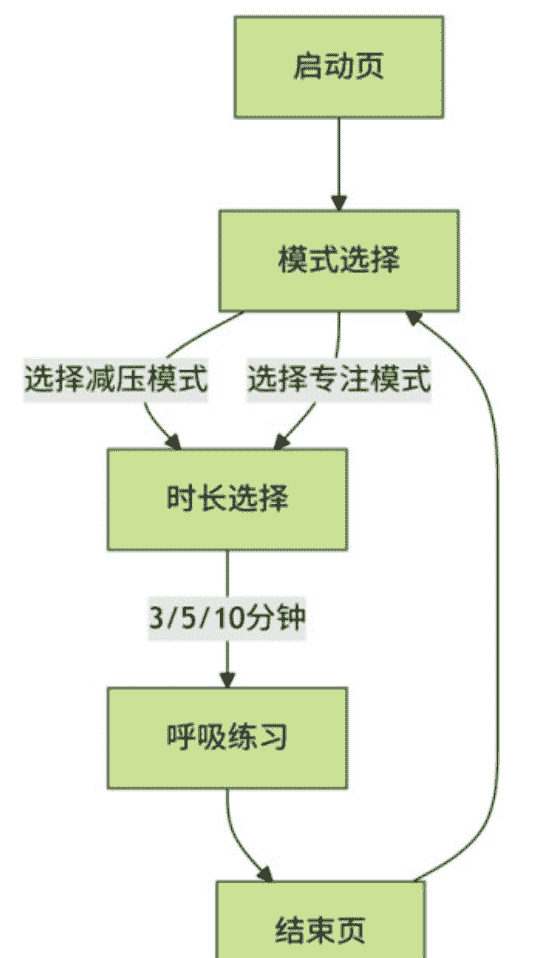

图4-3 呼吸练习的交互流程

#### 5. 用 Lovable 搭建原型

将功能清单、呼吸动画、音效与 Mermaid 流程代码整合，输入 Lovable。

根据如下描述帮我创建产品：呼吸练习（Breathly）。

功能列表（MVP 核心功能）
- 呼吸模式选择（单选）：
  - 减压模式（4-7-8 呼吸法）
  - 专注模式（箱式呼吸法）
- 时长选择（单选）：3分钟 / 5分钟 / 10分钟
- 呼吸动画引导：可视化图形（如圆圈缩放）同步呼吸节奏，开始倒计时播放呼吸模式对应的动画

通过这两个案例可以看出，用 Vibe 编程的四步法，从痛点拆解到 MVP 定稿，再到流程图与 System 提示词落地，最后借助 Lovable 快速成型，健康类小工具也能高效从想法变成可用产品。

**呼吸练习助手：用节奏找回平静**

收尾提示在练习结束时以柔和音提示配合一句总结性文案，例如“五分钟减压呼吸已完成”。

##### 呼吸可视化

1. 视觉呈现采用 CSS 动画，时间推进依赖 requestAnimationFrame 的时间戳。
2. 4-7-8 节奏：圆环四秒匀速扩张代表吸气，七秒保持扩张代表屏息，随后八秒匀速缩小代表呼气，如此循环直至结束。
3. 箱式节奏：圆环四秒扩张吸气，四秒静止屏息，四秒收缩呼气，四秒静止屏息，构成规整的矩形波循环。

##### 声音

全部音效通过 Web Audio API 在浏览器端合成，保证可精细调节与低延迟。

##### 使用路径
```
flowchart TB
A[启动页] --> B[模式选择]
B -->|选择减压模式| C[时长选择]
B -->|选择专注模式| C[时长选择]
C -->|3/5/10分钟| D[呼吸练习]
D --> E[结束页]
E --> B
```

依据以上提示词产生的演示如图4-4。

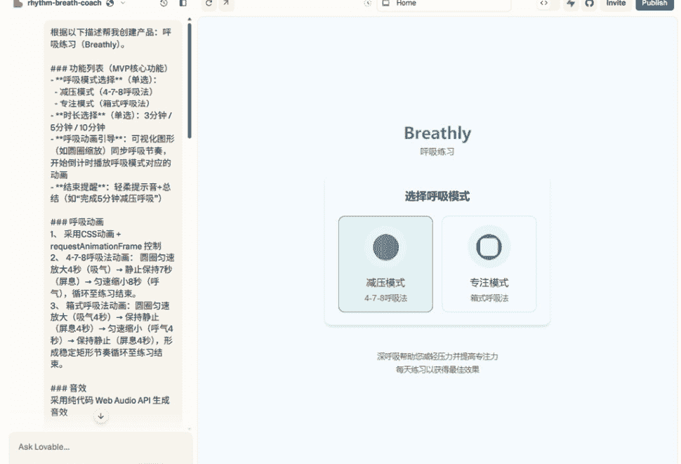

图4-4 由 Lovable 产出的呼吸练习界面

在搭建与试用过程中，我们梳理并解决了以下关键难点。

##### （1）帧率适配优化
问题：若以固定的60fps驱动计时，在60Hz、75Hz、144Hz等不同刷新率以及实际帧率波动下，容易出现卡顿与计时偏差。
解决：改用 requestAnimationFrame 返回的真实时间戳计算间隔，摆脱对固定帧率的依赖，让动画在各类设备上保持流畅且时间统一。

##### （2）节奏精度提升
问题：早期实现对呼吸阶段的细节把控不足，未把4-7-8与箱式呼吸的时间分配与视觉变化对应起来。
解决：补充实现规范，明确吸气、屏息、呼气各自时长、圆环扩张收缩的表现及状态切换逻辑。

##### （3）退出功能修复
问题：点击退出按钮后无法返回首页。
解决：反馈给 Lovable 团队并修正导航逻辑，使退出操作能正常生效。

#### 6. 升级方向
- 智能引导：结合实时心率动态调节引导节奏，捕捉用户放松高峰时段，提供个性化冥想建议。
- 情境模式：为通勤、办公、休憩等场景定制引导方案，结合日程智能推荐练习时机，配套自然音与白噪音。
- 健康监测：借助摄像头捕捉面部表情变化，记录训练前后情绪数据，输出可视化分析报告与改善建议。
- 互动激励：支持自定义日目标、成就徽章解锁，并接入线上冥想课程平台。

## 4.2 时光规划师：把 AI 当成你的时间管家
时间对每个人都是公平的，每天24小时，为什么产出差距这么大。

常见的时间管理困扰：
- 想建立好习惯却总是半途而废；
- 想提升效率却找不到个人高效区间；
- 想兼顾工作与生活却被任务压得喘不过气
……

本章以习惯打卡助手与个人精力周期预测器为例，演示如何用“四步创作法”把时间管理需求快速转成可用工具。

### 4.2.1 21天习惯成形助手：从模仿到自立
“又放弃了……”小美看着蒙灰的瑜伽垫叹气。很多人热情启动新习惯，却在几天后停滞，这是当下年轻人的普遍困境。

借助直觉式开发，约30分钟即可搭建个性化的习惯保持助手。

#### 1. 需求拆解与使用场景
习惯失败多源于方法与激励不足，而非缺乏决心。提炼成功者的经验模式，可帮助普通人实现自我提升。

在 DeepSeek 中明确功能范围与使用场景，围绕用户画像、场景故事、功能边界、交互路径展开，按最小可行原则先做可用版本。

输出包含：一句话用户画像、一句话场景故事、功能清单、交互清单。

#### 2. 优化并确定最小可行说明
经取舍，产品聚焦三大要点：
- 名人习惯模板，提供目标参照；
- 21天打卡，时长科学；
- 成就反馈，即时强化动机。

整理后的说明如下。

##### 最小可行说明：习惯打卡助手 21天挑战版

###### 1. 典型用户画像
忙碌的职场新人或学生，希望培养习惯但缺自律与科学方法，需要简洁激励工具坚持21天。

###### 2. 场景故事
用户小A 想早起阅读却屡败，通过 App 选择“名人早起习惯模板”如乔布斯5点起床，加入21天挑战，每日打卡获得进度反馈与名言激励，最终形成习惯。

###### 3. 主要功能
- 习惯模板库：提供5-10种名人习惯模板，如早起、运动、阅读，附科学原理与名人故事。
- 21天挑战：选定模板后自动生成21天打卡任务并每日推送提醒。
- 极简打卡：一键完成当日打卡，显示连续天数与进度条。
- 成就反馈：打卡后弹出名人名言激励，完成21天颁发电子证书。
- 基础统计：仅展示当前连续天数与总完成率，不做复杂图表。

###### 4. 交互路径
1. 启动页：展示标语如“21天像名人一样自律”。
2. 习惯选择页：滑动浏览名人模板，点击查看详情与规则。
3. 挑战开启页：点击“开始21天挑战”，设置每日提醒时间，默认8:00。
4. 主页：显示习惯名称、连续天数、进度条，中央“今日打卡”按钮，完成即变灰并弹出名言。
5. 成就页：21天完成后解锁电子证书。

**不做范围**：
- 无社交分享/排行榜；
- 无自定义习惯，仅限预设模板；
- 不支持多习惯并行，单线程专注。

#### 3. 创建 MVP 的流程图
继续向 DeepSeek 请求用 Mermaid 语法展示核心功能与交互的步骤图。

生成的步骤图如图4-5。
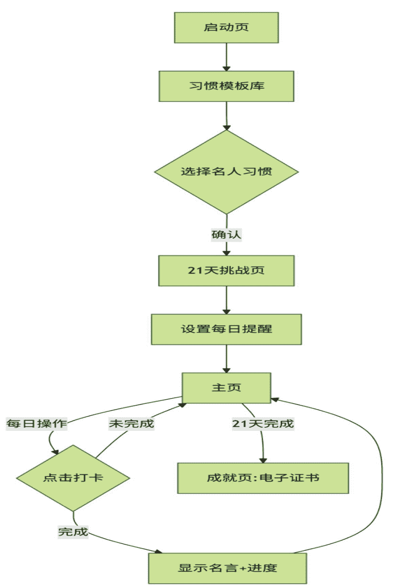
图4-5 习惯打卡助手的交互流程

#### 4. 用 Lovable 创建应用
将功能说明与 Mermaid 流程代码整合为提示词输入 Lovable。

根据描述创建产品：习惯养成神器 21 天挑战版，21 天像名人一样自律。

##### 主要功能
- 习惯模板库：提供 5-10 种名人习惯模板，附科学原理与故事。
- 21 天挑战：选定模板后自动生成打卡任务并每日提醒。
- 极简打卡：一键完成，显示连续天数与进度条。
- 成就反馈：打卡后弹出名言激励，完成颁发电子证书。
- 基础统计：仅显示连续天数、总完成率。

##### 交互流程：
```
flowchart TB
A[启动页] --> B[习惯模板库]
B --> C{选择名人习惯}
C -->|确认| D[21天挑战页]
D --> E[设置每日提醒]
E --> F[主页]
F -->|每日操作| G{点击打卡}
G -->|完成| H[显示名言+进度]
H --> F
G -->|未完成| F
F -->|21天完成| I[成就页:电子证书]
```

依提示词产出的应用如图4-6。
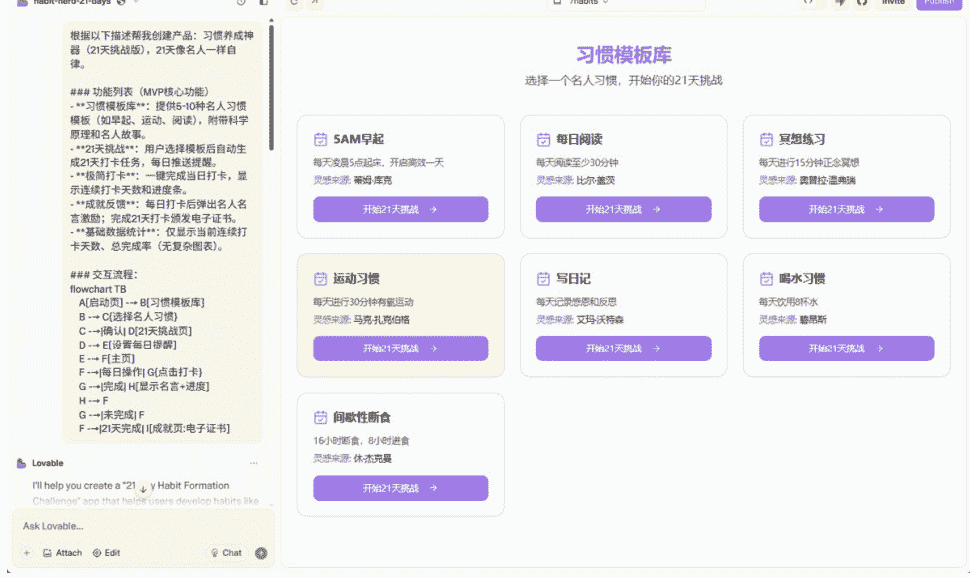
图4-6 Lovable 产出的习惯养成神器

开发过程中解决的关键问题：
- 模板选择引导不足：新增智能推荐，按每日投入时间与难度偏好匹配起步模板，如5分钟快速呼吸模板。
- 动力衰减：第7-10天易倦怠，增加名人案例推送、进步图表与语音鼓励。
- 多页导航缺失：追问 Lovable 增加导航栏，实现首页、记录、设置的快捷跳转。

#### 5. 优化方向
- 企业团队建设：定制新员工入职放松计划，设计团队协作呼吸挑战，并在职业技能学习模块嵌入专注呼吸训练。
- 教育场景：在学生学习中结合番茄工作法设计专注呼吸模板，阅读时搭配进度提醒放松机制，体育模块提供运动前后呼吸调节指导。
- 健康管理：构建睡前冥想与起床唤醒的呼吸闭环，关联健康食谱生成餐前正念引导，并按运动项目匹配呼吸节奏训练。

### 4.2.2 个人精力周期预测器：找到黄金时段
“为何昨晚写代码思路清晰，今天下午却犯困？”程序员小王困惑于效率波动，如何找到精力最充沛的黄金时间？

借助直觉式开发，约30分钟可开发精力周期计算器，根据作息预测每日精力高峰与低谷，实现个性化精力管理。

#### 1. 需求拆解与使用场景
研究显示人精力呈约90分钟周期波动。基于此规律可安排不同任务的最佳时段。

在 DeepSeek 中提出需求，明确画像、场景故事、功能边界、交互路径，按最小可行原则输出：用户画像一句、场景一句、功能列表、交互列表。

#### 2. 优化并确定最小可行说明
保留四个核心：
- 起床时间输入，作为计算起点；
- 周期自动计算，基于90分钟生理节律；
- 可视化展示，直观呈现全天能量分布；
- 日历集成，便于安排重要任务。

##### 最小可行说明：个人精力周期预测器

###### 1. 典型用户画像
忙碌职场人士或自由职业者，希望科学安排高效工作时段，避免低谷期低效。

###### 2. 场景故事
远程办公程序员输入日常起床时间，快速获得当天精力高峰低谷预测，将核心编码安排在高峰，低谷处理邮件等轻量工作。

###### 3. 功能列表
- 基础输入：用户输入每日固定起床时间，唯一必需参数。

###### 4. 交互路径
1. 启动页：简洁表单，仅输入起床时间，默认7:00可改。
2. 结果页：自动显示时间轴如“8:00-10:00[高峰] | 10:00-11:30[低谷]”，底部“添加到日历”按钮可跳转系统日历。
3. 结束：无复杂设置，关闭即退出。

**不做范围**：
- 不追踪实际活动数据；
- 不支持多日预测或历史分析；
- 不提供个性化算法调节如自定义周期长度。

目标：用最少输入解决核心需求，后续可迭代接入睡眠数据或自定义周期。

#### 3. 创建 MVP 的流程图
向 DeepSeek 请求 Mermaid 语法流程图。

生成的流程图如图4-7。
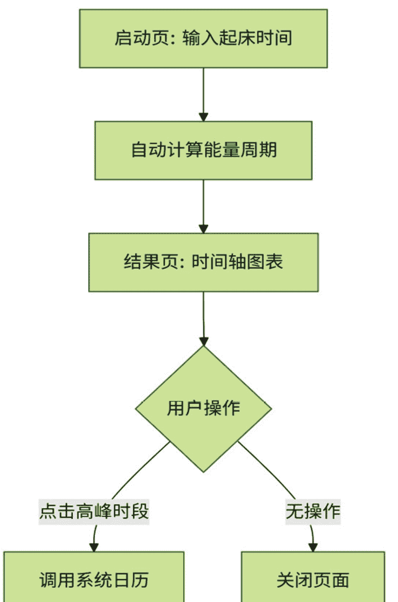
##### 图4-7 个人精力周期预测器的交互流程

#### 4. 可视化方案
请求时间轴形式展示预测结果的网页实现方案。

整理后采用最简方案：纯 CSS+HTML，用颜色区块标记不同时段。

#### 5. 添加到谷歌日历
Web 应用纯前端实现，使用 Google Calendar API 的 URL 方案生成日历事件。

#### 6. 用 Lovable 创建应用
整合功能说明、日历方案与流程图后输入 Lovable。

创建产品：个人能量周期计算器。

##### 主要功能
- 基础输入：输入每日固定起床时间。
- 自动计算：基于90分钟生理节律预测高峰、低谷与恢复期。
- 可视化输出：纯 CSS+HTML 展示当天预测，用颜色区块标记时段。
- 简单提醒：点击高峰时段可快速添加到手机日历。

##### 添加到手机日历
纯前端实现，使用 Google Calendar API 的 URL 方案生成日历事件。

##### 交互流程
```
flowchart TB

A[启动页: 输入起床时间] --> B[自动计算能量周期]

B --> C[结果页: 时间轴图表]

C --> D{用户操作}

D -->|点击高峰时段| E[调用系统日历]

D -->|无操作| F[关闭页面]
```

依提示词产出的应用如图4-8。
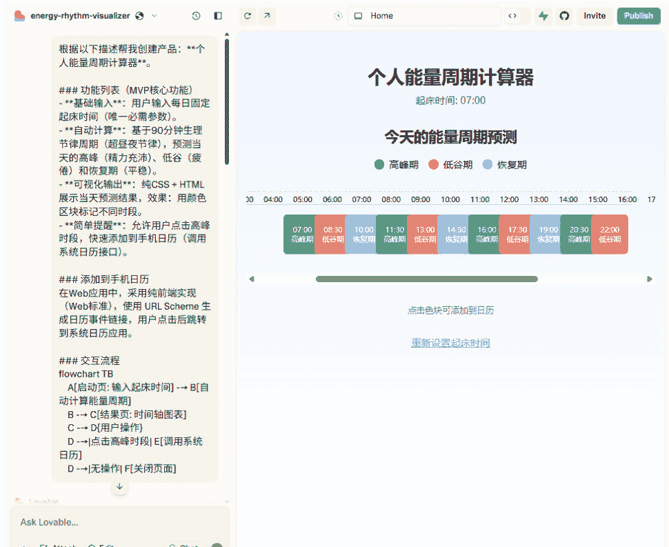
图4-8 Lovable 产出的个人能量周期计算器

开发中解决的问题：
- 个体差异适应：新增反馈机制，允许用户标记预测准确度，持续优化个性化推荐。
- 时区切换适应：支持临时时区调整，切换后自动重算能量周期并同步提醒。

#### 7. 优化方向
- 职业发展规划：提供面试黄金时段推荐、技能学习与能量高峰匹配，生成周期性职业路线图。
- 创意工作优化：依据能量波动推荐写作灵感捕捉时段、设计创作黄金窗口及头脑风暴最佳时机。
- 生活品质提升：关联社交活动热度智能规划聚会时间，匹配兴趣培养与亲子互动的高能量时段。

## 4.3 社交互动管家：化解社交难题
在高度互联时代，为何有人游刃有余，有人焦虑不安？

常见挑战：
- 想送暖心礼物，却不知选什么；
- 想在社交场合更自然，却找不到话题；
- 想建立更深关系，却不知如何破冰；
…

本节以送礼灵感生成器与社交话题生成器为例，介绍如何用四步创作法把社交需求转化为工具。

### 4.3.1 送礼灵感生成器：让礼物直抵心坎
“又到同事生日，该送什么？”小美在商场徘徊，琳琅商品更纠结。浏览平台后仍找不到恰到好处的礼物。

借助直觉式开发，30分钟即可完成送礼灵感生成器，让送礼轻松愉快。

#### 1. 需求拆解与使用场景
分析发现用户选礼主要困扰：预算控制、个性化匹配、创意灵感缺乏。

在 DeepSeek 中提出需求，明确功能范围与应用场景，围绕用户画像、场景故事展开。

# 用最小闭环把两款 AI 小工具打磨出来

先把能做什么、不能做什么理清楚，再用最小可用产品的思路把功能压到只解决核心卡点。下面的两个案例展示了从边界厘清到落地的完整思路。

### 送礼灵感生成器

#### 2. 边界收敛与核心方案沉淀
比价、跳转购买、收藏夹这些功能看起来很香，但并非刚需。用户真正着急的是根据收礼人的特征快速得到可用的点子。把非必要项剔除后，方案收敛为更精简的形态。

##### MVP 方案：送礼灵感生成器

###### 1. 核心用户描摹
经常挑礼物犯难的年轻人群，预算有限却想让礼物显得用心。

###### 2. 使用场景快照
小王要去参加好友生日聚会，却想不出送什么，打开送礼灵感生成器，填入好友的性别、年龄和兴趣偏好，数秒内拿到三条在预算内的灵感。

###### 3. 保留的核心能力
- **收礼人信息填写**：可填性别、年龄、兴趣爱好，兴趣为可选项。
- **价格区间设定**：自行设定预算范围，例如 50-200 元。
- **灵感产出**：基于输入信息生成三个礼物概念，不给购买链接，仅给创意描述。
- **再生成**：不满意时可点“换一组”获取新组合。

###### 4. 操作动线
1. 打开页面，呈现简洁的填写区。
2. 完善资料：选择收礼人性别男/女/不限；填写年龄或区间如 20-30 岁；可选项兴趣关键词如运动、美妆；设定预算区间。
3. 点击生成建议，返回三条点子，例如定制星座项链、复古掌机。
4. 不满意可点换一组重新产出。
5. 结束：用户自行截图记录后退出。

##### 本次版本暂不覆盖的范围
- 购买链接与比价不纳入功能。
- 不保留历史记录。
- 不提供账号体系与社交传播。

#### 3. 可视化流程图
在 DeepSeek 中用 Mermaid 语法呈现核心能力与动线，flowchart TB。

生成的流程图如图 4-9 所示。

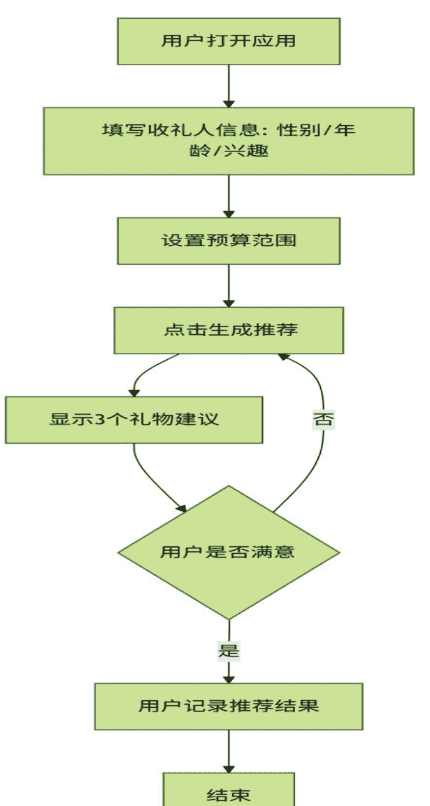

##### 图 4-9 送礼灵感生成器的交互流程

#### 4. 在 Lovable 中落地
把核心能力点、推荐逻辑与 Mermaid 代码整合成提示词输入 Lovable。

根据如下描述帮我创建产品：送礼灵感生成器。

##### 功能清单（最小可用）
- **收礼人信息填写**：使用者可填写收礼人性别、年龄、兴趣爱好可选。
- **价格区间设定**：使用者可设定预算范围如 50-200 元。
- **灵感产出**：系统基于填写信息产出三个礼物选项，不供给购买链接，仅推荐概念。
- **再生成**：使用者可点击换一组获取新推荐。

##### 灵感产出逻辑
将使用者填写的信息作为提示词，调用 LLM API 产出礼物推荐。其中 apiKey、apiUrl 和 model 需要提供设置的 UI：

```
const apiUrl='https://api.siliconflow.cn/v1/chat/completions';
const apiKey= '<token>';
const model="Qwen/Qwen3-8B";
const systemPrompt=`
**角色**：你是一个专业的礼物挑选助手，擅长根据用户提供的简单信息，给出符合预算、有创意且适合收礼人的礼物推荐。
**任务**：基于用户输入的 **性别、年龄、兴趣爱好、预算范围**，生成 **3个礼物选项**，确保推荐：
1. **符合预算**（严格在用户设定的价格区间内）。
2. **贴合兴趣**（若用户提供了兴趣关键词，优先匹配）。
3. **多样化**（避免同类重复，如不推荐3个“杯子”）。
4. **简洁描述**（每个推荐用 **10字以内** 概括，如“复古蓝牙音箱”）。

**输出格式**（严格遵循）：
1. [礼物1名称] - [简短特点，如“科技感”]
2. [礼物2名称] - [简短特点，如“手工定制”]
3. [礼物3名称] - [简短特点，如“小众文艺”]

**限制规则**：
- 不推荐具体品牌或商品链接。
- 不涉及医疗、宗教、政治等敏感领域。
- 若用户未提供兴趣，按年龄和性别默认推荐（如年轻人→“创意小物”，长辈→“实用礼品”）。

**示例输入**：
- 性别：女 | 年龄：25 | 兴趣：阅读、咖啡 | 预算：100-200元

**示例输出**：
1. 定制书名咖啡杯 - 文艺暖心
2. 迷你手冲咖啡套装 - 精致生活
3. 复古皮质书签 - 优雅实用
```

```
const options = {
  method: 'POST',
  headers: {Authorization: `Bearer ${apiKey}`, 'Content-Type': 'application/json'},
  body: JSON.stringify({
    "model": model,
    "messages": [
      {
        "role": "system",
        "content": systemPrompt
      },
      {
        "role": "user",
        "content": "基于用户输入的性别、年龄、兴趣爱好、预算范围"
      }
    ],
    "stream": false,
    "max_tokens": 512,
    "enable_thinking": false
  })
};

fetch(apiUrl, options)
.then(response => response.json())
.then(response => console.log(response))
.catch(err => console.error(err));
```

- 响应内容取自 choices[0].message.content 并做排版美化展示:

```json
{
  "id": "<string>",
  "choices": [
    {
      "message": {
        "role": "assistant",
        "content": "<string>",
        "reasoning_content": "<string>",
        "tool_calls": [
          {
            "id": "<string>",
            "type": "function",
            "function": {
              "name": "<string>",
              "arguments": "<string>"
            }
          }
        ],
        "finish_reason": "stop"
      }
    }
  ]
}
```

##### 操作动线代码
```
flowchart TB

A[用户打开应用] --> B[填写收礼人信息: 性别/年龄/兴趣]

B --> C[设置预算范围]

C --> D[点击生成推荐]

D --> E[显示3个礼物建议]

E --> F{用户是否满意}

F -- 否 --> D

F -- 是 --> G[用户记录推荐结果]

G --> H[结束]
```

按此提示生成的原型如图 4-10 所示。

迭代中解决的三个关键问题：
- 模型返回耗时：生成较慢时自动展示加载态，并提示灵感正在酝酿中。
- 建议质量波动：优化提示词模板，增加职业、兴趣等更具体约束。
- 预算偏差：当推荐超出预算时强化提示词中预算限制权重，确保价格可控。

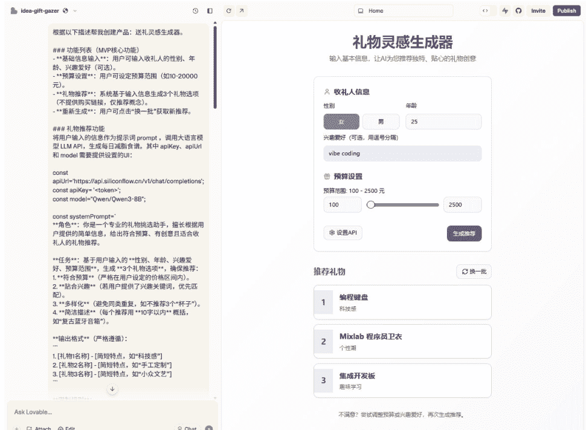

图 4-10 Lovable 生成的送礼灵感生成器

#### 5. 后续演进思路
开发让我们看到 AI 如何让送礼更有温度。后续可从四方面演进：
- 个性化定制：结合年龄、职业、消费习惯给出更精准推荐，如程序员的机械键盘、教师的书籍订阅。
- 情感分析：通过 NLP 识别送礼场景情绪，如表白、感谢、道歉，匹配表达方式。
- 文化考量：跨文化场景自动识别禁忌与偏好，如数字寓意、色彩象征。
- 可持续发展：建立环保礼物库，优先推荐可循环商品。

### 4.3.2 社交话题生成：告别尬聊的万能话术

“又到社交场合，我该聊什么呢？”小张站在会议室门口有些焦虑。这是很多人都经历过的场景——无论是商务会谈、朋友聚会，还是相亲约会，找到合适的话题总是让人犯难。

借助 Vibe 编程，30 分钟即可完成一个智能的社交话题生成器。通过清晰的提示词和简单工具，任何人都能快速实现这个得力的谈话助手。

#### 1. 需求分析与场景构思
先洞察痛点：话题匮乏、场景错位、对话难延续。

在 DeepSeek 中输入：
> 帮我设计一款社交话题产出应用，支持填写场景描述产出或直接选模板，需要清晰定义能力范围与应用场景，分四步。
- 目标人群分析：明确目标人群特征、痛点与需求。
- 情境描述：用具体情境说明产品如何解决问题。
- 能力边界确定：定义能做什么不能做什么。
- 动线设计：规划使用路径。

采用最小可行产品原则，实现最小可用产品，输出包含侧写、情境、功能、流程。

#### 2. 精简并锁定核心方案
语音识别、实时对话建议、社交圈管理都很酷但非必需。核心是根据具体场景快速给出合适话题。剔除冗余后得到精简版：

##### 核心方案：社交话题生成器

###### 1. 核心使用者侧写
在社交场合需要迅速找到谈资的年轻群体，涵盖内向者、初次见面者与活动组织者。

###### 2. 典型使用情境
一次陌生人聚会，使用者输入团队破冰，应用立刻给出如果变成一种动物你会选什么为什么等话题，帮助快速活跃气氛。

###### 3. 功能点（最小可用核心）
- **场景填写产出话题**：使用者键入场景关键词如约会、聚餐，返回匹配的话题列表。
- **模板选择产出话题**：提供预置分类如职场破冰、朋友聚会，点击直接产出。
- **话题收藏与复用**：可收藏常用话题，从收藏夹快速调用。
- **极简界面**：单页布局，填写/选择、产出、收藏集中展示，无多余操作。

###### 4. 操作步骤
1. **启动页**：直接呈现填写框，提示语输入场景，如相亲，下方为模板分类按钮如职场、聚会。
2. **产出话题**：
   - 手动填写后点产出，展示 3-5 条话题；
   - 选择模板则直达结果页。
3. **结果页**：
   - 每条话题附带收藏按钮；
   - 底部提供重新产出。

#### 4. 收藏夹入口
首页右上角固定图标，点击查看已收藏话题。

---
**本次不纳入的范围**：
不涉及账号注册、社交分享、用户生成内容或算法推荐，只解决快速产出核心需求。

#### 3. 创建最小可行产品的流程图
继续用 Mermaid 语法输出核心能力与动线，flowchart TB。

生成的流程图如图 4-11 所示。

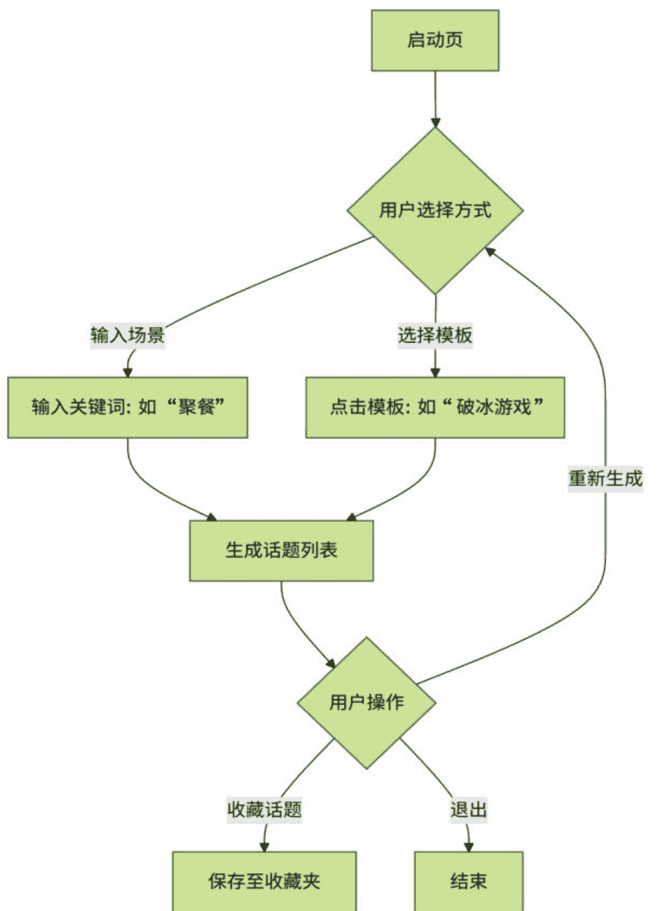

##### 图 4-11 社交话题生成器流程图

#### 4. 借助 Lovable 落地
把功能点、产出逻辑与 Mermaid 代码整合为提示词。

根据如下描述帮我创建产品：社交话题生成器。

##### 功能点（最小可用核心）
- **场景填写产出话题**：使用者输入场景关键词如约会、聚餐，返回匹配的推荐话题列表。
- **模板选择产出话题**：提供预置分类模板如职场破冰、朋友聚会，使用者点击后直接产出话题。
- **话题收藏与复用**：使用者可收藏高频使用的话题，支持从收藏夹快速选取。
- **极简界面**：单页设计，核心功能填写/选择、产出、收藏集中展示，无冗余操作。

##### 产出话题逻辑
将使用者填写的信息作为提示词，调用 LLM API，产出社交话题推荐列表。其中 apiKey、apiUrl 和 model 需要提供设置的 UI：

```
const apiUrl='https://api.siliconflow.cn/v1/chat/completions';
const apiKey='<token>';
const model="Qwen/Qwen3-8B";
const systemPrompt=`
**角色**：你是一个专业的社交话题策划助手，擅长根据用户输入的场景或模板，生成有趣、自然、适合讨论的开放式问题。

**任务规则**：
1. **输入处理**：
   - 用户会提供**场景关键词**（如“相亲”“团队破冰”）或选择**预置模板**（如“朋友聚会”“职场社交”）。
   - 若输入模糊（如“聊天”），需主动询问细化需求（示例回复：“请补充场景细节，例如‘聊天对象是同事还是陌生人？’”）。

2. **生成要求**：
   - **数量**：每次生成 **3-5 个话题**，避免过多造成选择困难。
   - **类型**：
     - 开放式问题（如“如果你能穿越到过去，最想改变什么？”）。
     - 避免敏感内容（政治、宗教、隐私等）。
     - 符合场景氛围（例如“相亲”场景需兼顾轻松和深度）。
   - **格式**：每条话题前加序号和表情符号（如“1.🌟你最近听过最有趣的冷知识是什么？”）。

3. **风格**：
   - 语言简洁、口语化，避免冗长或学术化表达。
   - 根据场景调整语气：
     - 职场场景：中性专业（“你认为远程办公最大的挑战是什么？”）。
     - 朋友聚会：轻松幽默（“如果变成零食，你希望是哪一种？为什么？”）。

4. **异常处理**：
   - 若输入无关内容（如“天气预报”），回复：“请输入社交场景关键词，或选择模板哦～”

**输出示例**（用户输入“团队破冰”）：
1. 🦸如果你能拥有一种超能力，但只能用来做无聊的事，你会选什么？
2. 😄工作中你最佩服的同事是谁？TA有什么特质？
3. 🌍假如明天突然放假，你会怎么安排这“意外的一天”？
`
```

```
const options = {
  method: 'POST',
  headers: {Authorization: `Bearer ${apiKey}`, 'Content-Type': 'application/json'},
  body: JSON.stringify({
    "model": model,
    "messages": [
      {
        "role": "system",
        "content": systemPrompt
      },
      {
        "role": "user",
        "content": "用户会提供场景关键词等"
      }
    ],
    "stream": false,
    "max_tokens": 512,
    "enable_thinking": false
  })
};
fetch(apiUrl, options)
.then(response => response.json())
.then(response => console.log(response))
.catch(err => console.error(err));
```

API 响应内容取自 choices[0].message.content 并进行格式美化展示。

```json
{
  "id": "<string>",
  "choices": [
    {
      "message": {
        "role": "assistant",
        "content": "<string>",
        "reasoning_content": "<string>",
        "tool_calls": [
          {
            "id": "<string>",
            "type": "function",
            "function": {
              "name": "<string>",
              "arguments": "<string>"
            }
          }
        ]
      },
      "finish_reason": "stop"
    }
  ]
}
```

##### 交互流程

```
flowchart TB
A[启动页] --> B{用户选择方式}
B --> |输入场景| C[输入关键词: 如 “聚餐” ]
B --> |选择模板| D[点击模板: 如 “破冰游戏” ]
C --> E[生成话题列表]
D --> E
E --> F{用户操作}
F --> |收藏话题| G[保存至收藏夹]
F --> |重新生成| B
F --> |退出| H[结束]
```

通过前述指令模板所生成的演示原型，可在图4-12中查看。

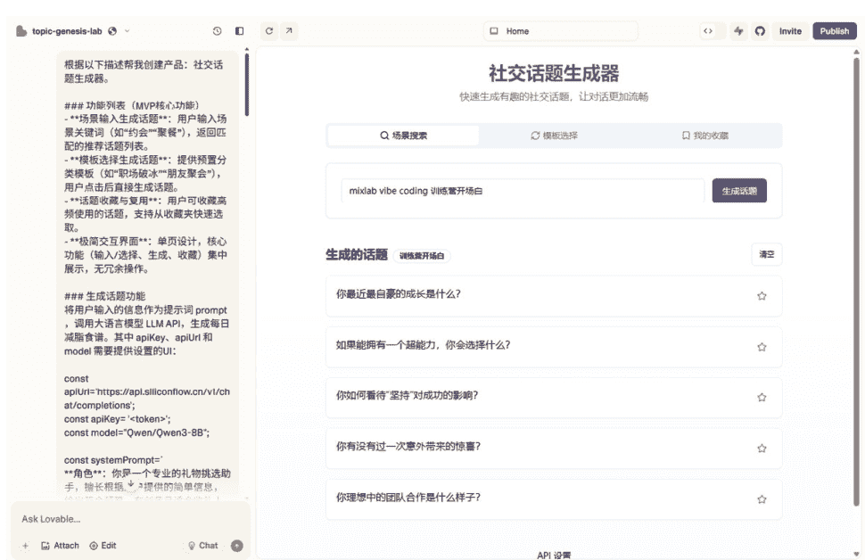

##### 图4-12 Lovable生成的社交话题生成器

在落地该社交话题生成器并进行实测的过程中，我们依次梳理并解决三大核心难点。

- 情境辨识偏差：产出话题与使用场景不契合时，重构场景标签体系，扩充商务晚宴、家庭聚会等更细分的分类。
- 话题延展不足：针对表层化输出，在提示词中预置递进策略，实现自动生成层层深入的追问链条。
- 跨文化差异：引入文化标签过滤机制，对涉及宗教禁忌、政治敏感等高危关键词做智能拦截，并允许使用者自定义文化偏好。

#### 5. 优化方向

除了兼顾趣味与时效，还需思考如何让技术为社交注入温度与深度。该生成器的演进路径主要围绕四点展开。
- 情境感知：依场合自动调节话题深度与表达风格。
- 个性化学习：记录使用偏好，推送更贴合的选题。
- 多维互动：融合非语言信号，给出更细致的社交建议。
- 文化融合：在跨文化场景下智能引导对话走向。

本章以 Vibe 编程思路为依托，既产出了多款实用小工具，也在探索技术与社交智慧的融合方式。

# 第5章 小团队也能自建专属商业系统

借助 Vibe 编程理念，无论是企业团队还是独立创作者，都能快速构建适配自身的业务应用。

本章围绕效率工具、数据可视化方案、营销工具箱三条线，说明如何运用 Vibe 编程的四步创作法，打造专属的“秘密武器”。

## 5.1 运营提效利器：把智能体当作专业顾问

“时间等同金钱，效率决定生死。” 这句话概括了商业竞争的本质。在高度竞争的市场里，各类组织和个人都面临效率瓶颈：

- 有人被手工报价困扰，核算耗时且易出错；
- 有人因缺乏法务资源而卡在合同审查环节；
- 有人把大量工时耗在文档处理上，产出却不理想；
- ……

这些看似微小的问题，直接影响经营效率与竞争力。下面以两款工具——定制报价生成助手、合同审查助手为例，说明如何把业务需求迅速转化为可用产品。

### 5.1.1 定制报价助手：提升成交效率的利器

“这份方案的报价大概多久能出来？”电话里客户迫切追问。小王面前堆着产品价目表和服务清单，只能叹气。传统报价方式耗时费力、易出错，还容易错失购买时机。一份专业及时的报价，往往是促成交易的关键。

借助 Vibe 编程，约三十分钟即可搭建一个定制报价生成助手。凭借清晰的指令模板和简易操作，任何人都能让报价流程变得高效顺畅。

#### 1. 需求梳理与场景设想

对报价类工具而言，用户最看重的是迅速获得准确核算并获取附加服务建议。

打开 DeepSeek，输入以下指令。

请为我设计一款**定制报价单生成工具**，明确功能边界与使用场景，按以下四步展开。

- **用户画像分析**：厘清目标用户的特征、痛点与需求。
- **场景故事描述**：用具体情境说明产品如何解决问题。
- **功能边界确定**：界定产品能做与不能做。
- **交互流程设计**：规划使用流程与交互方式。

采用 MVP，以最少功能实现产品。

1. AI 能力：自动算价与附加服务建议
2. 生成的报价单由基础报价与附加服务构成

输出 MVP 说明。

1. 典型用户画像：一句话概括。
2. 场景故事：一句话概括。
3. 功能：以列表形式描述，仅列需实现的功能。
4. 交互流程：以列表形式描述。

#### 2. 优化并确认最小可行方案

将 DeepSeek 的输出复制回来，剔除冗余功能后得到如下说明。

##### 最小可行方案：定制报价单生成工具

###### 1. **典型用户画像**

中小企业销售或客户经理，需要快速产出专业且个性化的报价，并希望借助附加服务建议提升成交率。

###### 2. **场景故事**

销售在沟通需求后，录入基础信息如产品、数量、折扣等，系统自动生成基础报价并推荐相关附加服务如安装、培训、延保等，最终导出 Word 文件发送给客户，节省手工时间并提升体验。

###### 3. **功能清单（核心）**

- **自动算价**：依据用户输入的产品、数量、折扣等自动计算基础金额。
- **附加服务建议**：基于行业或历史数据，智能推荐相关的附加服务如安装、培训、维护包等。
- **报价预览与编辑**：支持用户调整基础金额和附加服务选项。
- **导出 Word 文件**：一键生成标准格式的 Word 报价单，可嵌入企业品牌信息如 Logo、联系方式。

###### 4. **交互流程**

1. **录入基础信息**：填写客户名称、产品、数量、折扣等必填项。
2. **系统生成报价与建议**：自动计算总额并展示可勾选的附加服务推荐。
3. **用户调整确认**：修改基础金额或增减附加服务，实时更新总额。
4. **导出与分享**：点击“导出 Word”生成文档，手动发送给客户。

##### 边界说明（不包含的功能）

- 不支持多级审批或客户电子签名。
- 不集成支付或合同管理系统，仅限报价生成。
- 不自动保存历史报价，需用户自行保存 Word 文件。

此方案聚焦核心痛点：**快速生成定制报价 + 附加服务建议**，以最小功能实现销售效率提升。

#### 3. 绘制最小可行方案流程图

继续在 DeepSeek 中输入以下指令。

使用 Mermaid 格式展示 MVP，输出仅包含核心功能与交互的 mermaid: flowchart TB

生成的 Mermaid 流程图，如图5-1所示。


##### 图5-1 个性化报价单生成工具流程

#### 4. 生成 Word 文件

为了让结果可保存为 .docx 格式，需要给出技术方案说明，核心要点如下：

###### 必需的外部库

- docx.js (v8.0.0): 用于生成Word文档

```html
<script src="https://unpkg.com/docx@8.0.0/build/index.js"></script>
```

- FileSaver.js (v2.0.5): 用于保存文件

```html
<script src="https://cdnjs.cloudflare.com/ajax/libs/FileSaver.js/2.0.5/FileSaver.min.js"></script>
```

###### 关键方法实现

###### 1. 生成Word文档

```javascript
// 关键类型导入
const { Document, Packer, Paragraph, Table, TableRow, TableCell, WidthType, TextRun } = window.docx;

// 表格行数据结构
const tableRow = new TableRow({
    children: [
        new TableCell({
            children: [new Paragraph({ children: [new TextRun("产品名称")] })]
        }),
        new TableCell({
            children: [new Paragraph({ children: [new TextRun("数量")] })]
        })
    ]
});

// 创建文档
const doc = new Document({
    sections: [{
        properties: {},
        children: [
            new Paragraph({
                children: [new TextRun({ text: `标题 - ${title}`, bold: true, size: 28 })]
            }),
            new Paragraph({
                children: [new TextRun(`正文: ${text}`)]
            }),
            new Table({
                rows: tableRows,
                width:{size: 100, type: WidthType.PERCENTAGE}
            }),
            new Paragraph({
                children: [new TextRun(`总计: ${(total+tax).toFixed(2)}`)]
            })
        ]
    }]
});

// 文档生成和保存
Packer.toBlob(doc).then(blob => {
    saveAs(blob, "报价单.docx" );
});
```

备注：以上技术方案的说明，是为 LLM 明确关键代码写法与要求，避免随意生成导致错误。

#### 5. 使用Lovable创建应用

将 MVP 的“功能列表”、智能报价生成和增值服务推荐、Mermaid 流程图代码整合，得到如下提示词，并输入Lovable。

根据如下描述帮我创建产品：个性化报价单生成工具。

##### 功能列表（MVP核心功能）

- **智能报价生成**：根据用户输入的产品、数量、折扣等自动计算基础报价。
- **增值服务推荐**：基于行业或历史数据，智能推荐可能相关的增值服务如安装、培训、维护包等。
- **报价单预览与编辑**：支持用户调整基础报价和增值服务选项。
- **导出 Word 文档**：一键生成标准格式的 Word 报价单，支持企业品牌信息如公司名称、联系方式嵌入。

##### 智能报价生成和增值服务推荐

将用户输入的信息作为提示词，调用 LLM API，生成报价和增值服务推荐。其中 apiKey、apiUrl 和 model 需要提供设置的 UI：

```javascript
const apiUrl='https://api.siliconflow.cn/v1/chat/completions';
const apiKey= '<token>';
const model="Qwen/Qwen3-8B";
```

```javascript
const systemPrompt=`
**Role**:你是一个专业的销售报价助手，根据用户输入的产品信息和客户需求，快速生成**基础报价**并智能推荐**高相关性的增值服务**。输出需简洁、结构化，便于直接转换为Word格式。

**指令**
1. **基础报价生成**
   - 根据用户提供的`产品名称`、`数量`、`单价`（或行业基准价），自动计算总价。
   - 若用户未提供单价，回复时标注 *“需手动填写单价”*。
```

###### 2. **增值服务推荐**（基于行业规则）

- 根据产品类型推荐 **3-4项** 最相关的增值服务如安装、培训、延保、定制开发，格式为：

```
- [增值服务名称] (+价格)
*[推荐理由：1句话说明相关性]*
```

- 示例：

```
- 专业安装服务 (+$200)
*推荐理由：该设备需专业人员调试，客户可节省时间成本*
```

###### 3. **输出格式要求**

- 严格按如下 Markdown 结构生成，确保可被解析为 Word 文档：

```
##### 报价单[客户名称]

**基础报价**
产品: [名称] x [数量] = [单价]→[总价]

**推荐增值服务**
[增值服务列表]

**总计**: [基础报价+增值服务]
```

##### **限制说明（不包含的功能）**

- 不主动生成虚构的单价，需用户输入或标注缺失。
- 不推荐与产品无关的增值服务，如卖软件时推荐物流保险。
- 若用户未提供客户行业/场景，使用通用推荐逻辑。

```javascript
const options = {
  method: 'POST',
  headers: {Authorization: 'Bearer ${apiKey}', 'Content-Type': 'application/json'},
  body: JSON.stringify({
    "model": model,
    "messages": [
        {
            "role": "system",
            "content": systemPrompt
        },
        {
            "role": "user",
            "content": "客户信息和其他要求"
        }
    ],
    "stream": false,
    "max_tokens": 512,
    "enable_thinking": false
  })
};

fetch(apiUrl, options)
  .then(response => response.json())
  .then(response => console.log(response))
  .catch(err => console.error(err));
```

- API 返回结果需提取 choices[0].message.content 中的内容，并进行格式美化展示:

```json
{
  "id": "<string>",
  "choices": [
    {
      "message": {
        "role": "assistant",
        "content": "<string>",
        "reasoning_content": "<string>",
        "tool_calls": [
          {
            "id": "<string>",
            "type": "function",
            "function": {
                "name": "<string>",
                "arguments": "<string>"
            }
          }
        ]
      },
      "finish_reason": "stop"
    }
  ]
}
```

## ### 导出Word文档

### #### 必需的外部库

- docx.js (v8.0.0): 用于生成Word文档

```html
<script src="https://unpkg.com/docx@8.0.0/build/index.js"></script>
```

- FileSaver.js (v2.0.5): 用于保存文件

```html
<script src="https://cdnjs.cloudflare.com/ajax/libs/FileSaver.js/2.0.5/FileSaver.min.js"></script>
```

### #### 关键方法实现

- 需要把 Markdown 文本提炼为结构化信息后导出为 Word 文档。

```javascript
// 关键类型导入
const { Document, Packer, Paragraph, Table, TableRow, TableCell, WidthType, TextRun } = window.docx;

// 表格行数据结构
const tableRow = new TableRow({
    children: [
        new TableCell({
            children: [new Paragraph({ children: [new TextRun("产品名称")] })]
        }),
        new TableCell({
            children: [new Paragraph({ children: [new TextRun("数量")] })]
        })
    ]
});

// 创建文档
const doc = new Document({
    sections: [{
        properties: {},
        children: [
            new Paragraph({
                children: [new TextRun({ text: `标题 - ${title}`, bold: true, size: 28 })]
            }),
            new Paragraph({
                children: [new TextRun(`正文: ${text}`)]
            }),
            new Table({
                rows: tableRows,
                width:{size: 100, type: WidthType.PERCENTAGE}
            }),
            new Paragraph({
                children: [new TextRun(`总计: ${(total+tax).toFixed(2)}`)]
            })
        ]
    }]
});

// 文档生成和保存
Packer.toBlob(doc).then(blob => {
    saveAs(blob, "报价单.docx" );
});
```

## ### 交互实操
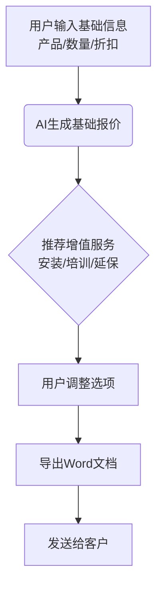

基于前述提示词生成的示例界面，可参考图5-2。
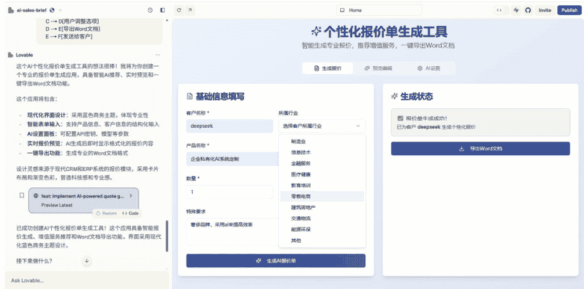

定制报价生成器上线后，仍有细节待完善。例如 Markdown 转 Word 时，目标文档里会残留原始标记。可以继续在 Lovable 中追问，让模型修复，也能借助更专业的编程工具 Cursor 进行精细调整。

结合 GitHub 与 Cursor 做细节打磨的流程如下。

1. 打开图5-3 右上角的 ⚙ 图标，把代码推送到 GitHub。
2. 先安装 GitHub Desktop，随后在仓库页面点 Code - Open with GitHub Desktop，见图5-4。
3. 用 Cursor 打开本地工程，见图5-5。

整体配色以冷蓝为主，塑造科技感与专业感。

feat: Implement AI-...

Preview Latest

系统提示已完成定制报价生成器的搭建。该应用具备智能报价、增值服务推荐与 Word 导出能力，界面采用现代化的蓝色商务风格。

##### 接下来做什么？

- 持续优化：通过提示词或可视化编辑调整设计、动效与布局。
- 提示技巧：使用聊天模式规划项目，无需手动改代码。提示要清晰、具体并持续迭代，效果更佳。
- GitHub 同步：把项目代码传至 GitHub，实现双向编辑联动。

##### ✨ 定制报价生成器

智能生成专业报价，推荐增值服务，一键导出 Word 文档

生成报价  ✨ 预览编辑  ⚙️ 智能设置

##### ✨ 报价单预览与编辑

将代码同步到 GitHub，实现双向编辑同步

报价单预览

客户：deepseek | 产品：企业私有化 AI 系统定制

编辑  导出 Word

最终报价单

预览最终效果，确认无误后可导出 Word 文档

报价单 DeepSeek


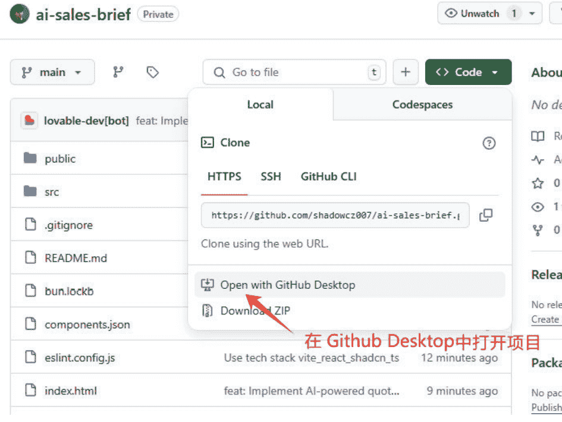

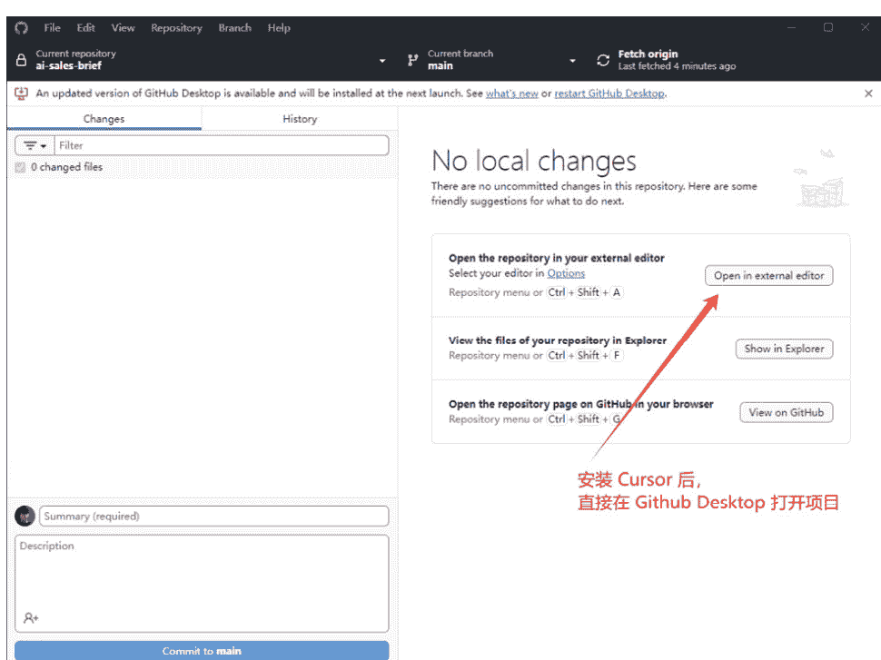

（4） 在 Cursor 的 Ask 模式下输入问题提示，定位根因，见图5-6。

我看到有对 Markdown 的处理，但是为什么导出后还是有 Markdown 的字符串，没处理好？ 下面是导出 word 后的文本：

报价单 - Deepseek

产品: 企业私有化AI系统定制

数量: 1

报价单 DeepSeek

**基础报价**

- 产品: 企业私有化AI系统定制 x 1 = 未提供单价 → 未提供总价

**推荐增值服务**

- 专属AI系统部署与优化服务 (+$5000)

*推荐理由：满足奢侈品牌对系统定制化与高效运行的需求*

- 企业级数据安全与隐私保护方案 (+$3000)

*推荐理由：保障客户核心数据安全，符合高端品牌合规要求*

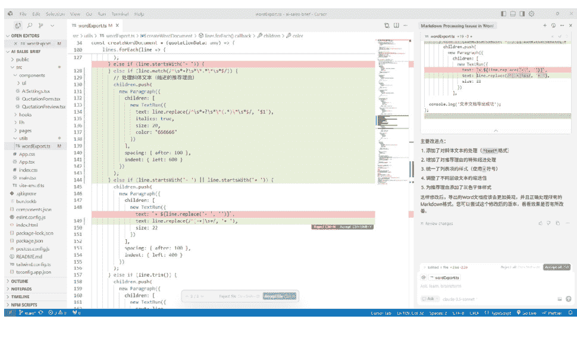

（5） 阅读 Cursor 给出的修改建议，确认无误后应用，见图5-7。


（6） 提交代码到 GitHub 并刷新 Lovable。

若仍有问题，可重复上述流程再做一次微调。

#### 6. 类似产品

在商务场景里，我们常需生成各类专业文档来支撑业务。除了报价生成器，市场上还有不少智能文档工具可提升效率。

常见类型如下：

- 商业计划书生成器：快速产出含市场分析、财务预测的专业计划书。
- 合同模板生成器：按业务类型与条款要求生成标准化合同文本。
- 产品说明书生成器：自动生成含功能说明、操作指南的使用手册。
- 会议纪要生成器：借助语音识别与文本总结，快速生成规范纪要。
- 项目方案生成器：依据需求与目标生成完整的实施方案。

### 5.1.2 合同审查助手：3分钟完成合同漏洞检测

“这份合同有问题吗？”收到合作协议后，小李一筹莫展。作为自由职业者，她既无法务团队支持，也缺乏专业法律知识。在竞争激烈的市场里，合同中的潜在风险可能带来巨大损失。

借助 Vibe 编程，约 30 分钟即可搭出合同审查助手。结合关键词匹配与人工智能语义分析，可快速发现潜在风险，让审查更高效。

#### 1. 需求分析与场景构思

对合同审查助手而言，用户最看重的是快速发现风险。

打开 DeepSeek，输入如下提示词。

帮我设计一款**合同审查助手**应用，需要清晰地定义其功能范围和应用场景，包括如下4个步骤。

- **用户画像分析**：明确目标用户的特征、痛点和需求。
- **场景故事描述**：用具体的场景描述产品如何解决用户问题。
- **功能边界确定**：定义产品能做什么，不能做什么。
- **交互流程设计**：规划用户使用产品的流程和交互方式。

采用 MVP，用最少的功能实现产品。

- 不需要提供报告导出功能。
- 输入为 Word 文档。
- 审查规则：关键词严格匹配、语义审核。

借鉴符合产品定位的成熟软件的设计风格。

输出 MVP 描述。

1. 典型用户画像：一句话描述。
2. 场景故事：一句话描述。
3. 功能：用列表描述（只描述明确要做的功能，不需要的功能不描述）。
4. 交互流程：用列表描述。
5. 设计风格：一句话描述

#### 2. 优化并确定 MVP 描述

一位资深法律顾问懂得抓住合同中最关键的风险点，让核心信息足够突出。好的审查助手不应让用户淹没在繁杂条款中，而应像一份精心准备的法律意见书，第一眼就能呈现最需关注的问题。

复制 DeepSeek 的 MVP 描述，删去冗余功能，得到如下 MVP 描述。

##### MVP 描述：合同审查助手

### #### **1. 典型用户画像**

中小企业法务、自由职业者或创业者，需要快速检查合同/协议中的潜在漏洞，但缺乏专业法律团队支持。

### #### **2. 场景故事**

自由职业者在签署客户提供的合同时，使用本工具快速扫描，发现隐藏的“单方面解约条款”和“模糊的责任界定”，及时与客户协商修改，避免后续纠纷。

### #### **3. 功能列表（MVP 核心功能）**

- **文件上传**：支持上传 Word 文档 .docx 格式。
- **关键词匹配检测**：用户可自定义规则（如“任意解约”“概不负责”等关键词），工具高亮显示匹配内容。
- **语义审核**：自动识别潜在问题（如权利义务不对等、模糊表述、霸王条款等），并标记风险段落。
- **规则管理**：用户可保存、编辑常用审查规则（如“劳动协议模板规则”“租房合同规则”）。
- **结果展示**：逐条列出问题项，标注类型（关键词/语义检测）和风险等级（高/中/低）。

### #### **4. 交互流程**

1. **上传文件**：拖曳或点击上传 Word 文档。
2. **选择规则**：从预设规则库选择或临时输入关键词。
3. **开始检测**：点击按钮运行审查。
4. **查看结果**：分栏显示原文（高亮问题）和问题列表，支持点击定位到具体段落。
5. **保存规则**（可选）：将本次使用的关键词或偏好保存为自定义规则。

### #### **5. 设计风格**

参考 **Grammarly** 的极简风格：左侧文档预览（高亮风险点），右侧问题列表（分类+建议），配色以蓝白为主，突出警示色（红/黄）标记风险等级。

---

**边界说明（不做的功能）**：

不提供报告导出、多格式支持、法律建议生成或复杂自然语言交互，聚焦“检测-提示”核心流程。

#### 3. Word 文档处理

在 DeepSeek 里输入如下提示词，来帮助我们研究合适的技术方案。

Word 文档如何处理？请给我推荐适合的技术方案

经过多轮对话，我们确定采用 mammoth.js 的方案，完善如下提示词。

- 使用 https://cdn.jsdelivr.net/npm/mammoth@1.4.0/mammoth.browser.min.js
- mammoth.js：将 .docx 转 HTML，保留基础格式。按照选择的规则，对 HTML 进行检测。
- mammoth.convertToHtml({ arrayBuffer: file })

```javascript
.then(function(result) {
    document.getElementById("output").innerHTML = result.value;
});
```

#### 4. 语义审核

在 DeepSeek 输入如下提示词，来帮助我们创建合适的 System 提示词。

针对语义审核，帮我创建 system 提示词（最简单的），需要根据用户设定的规则或者常见的漏洞。

DeepSeek 给出的语义审核的 System 提示词如下。

**Role**:

你是一个专业的合同审查助手，专注于识别合同/协议中的潜在漏洞、模糊表述和不平等条款。

##### **Task**:

根据用户提供的 **自定义规则** 或 **常见漏洞库**，逐条分析合同内容，标记如下问题：

1. **权利义务不对等**（如单方解约权、过度免责条款）。
2. **模糊表述**（如“合理期限”“重大损失”等未量化定义）。
3. **隐性风险**（如自动续约、数据权限未明确）。
4. **用户自定义关键词匹配**（需严格关联用户输入的规则）。

##### **Output Format**:

对每个问题点，按如下格式返回：

- **风险类型**: [类型名称]。
- **位置**: [段落编号/引用句]。
- **风险等级**: 高/中/低。
- **问题描述**: 1～2句简要解释风险。

##### **Rules**:

- 仅关注法律和逻辑漏洞，不涉及格式或语法问题。
- 避免主观推测，需直接引用合同原文作为依据。
- 若未发现明显问题，返回“未检测到高风险条款”。

**Example Output**:

- **风险类型**: 单方解约权。
- **位置**: 第5条“甲方可随时终止合同，无须赔偿”。
- **风险等级**: 高。
- **问题描述**: 条款未约定乙方解约权，可能导致利益失衡。

#### 5. 创建 MVP 的流程图

继续在 DeepSeek 里输入如下提示词。

使用 Mermaid 格式展示 MVP，输出仅包含核心功能和交互的 mermaid: flowchart TB

生成的 Mermaid 格式流程图，如图5-8所示。

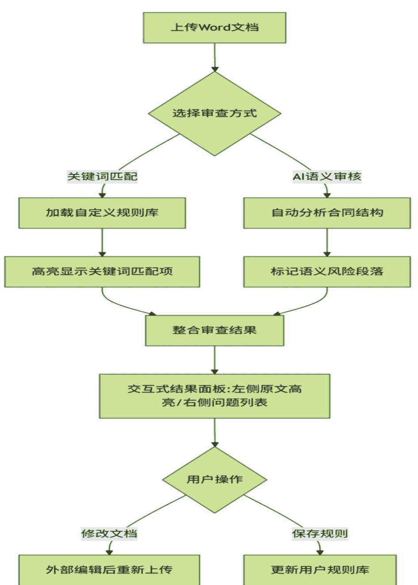

##### 图5-8 合同审查助手流程图

#### 6. 使用 Lovable 创建应用

将 MVP 的“功能列表”部分、Word 文档处理、语义审核和 Mermaid 流程图代码和设计风格进行整合，得到如下提示词，并输入 Lovable。

根据如下描述帮我创建产品：合同审查助手。

##### 功能列表（MVP 核心功能）

- **文件上传**：支持上传 Word 文档 .docx 格式。
- **关键词匹配检测**：用户可自定义规则（如“任意解约”“概不负责”等关键词），工具高亮显示匹配内容。
- **语义审核**：自动识别潜在问题（如权利义务不对等、模糊表述、霸王条款等），并标记风险段落。
- **规则管理**：用户可保存、编辑常用审查规则（如“劳动协议模板规则”“租房合同规则”）。
- **结果展示**：逐条列出问题项，标注类型（关键词/语义检测）和风险等级（高/中/低）。

##### Word 文档处理

- 使用 https://cdn.jsdelivr.net/npm/mammoth@1.4.0/mammoth.browser.min.js
- mammoth.js：将 .docx 转 HTML，保留基础格式。按照选择的规则，对 HTML 进行检测。

```javascript
mammoth.convertToHtml({ arrayBuffer: file })
.then(function(result) {
    document.getElementById("output").innerHTML = result.value;
});
```

##### 语义审核

将 HTML 和审核规则作为提示词，调用 LLM API，生成审核结果。其中 apiKey、apiUrl 和 model 需要提供设置的 UI：

```javascript
const apiUrl='https://api.siliconflow.cn/v1/chat/completions';
const apiKey= '<token>';
const model="Qwen/Qwen3-8B";
```

```javascript
const systemPrompt=`
**Role**:
你是一个专业的合同审查助手，专注于识别合同/协议中的潜在漏洞、模糊表述和不平等条款。
```

**Task**:

根据用户提供的 **自定义规则** 或 **常见漏洞库**，逐条分析合同内容，标记如下问题：

1. **权利义务不对等**（如单方解约权、过度免责条款）。
2. **模糊表述**（如“合理期限”“重大损失”等未量化定义）。
3. **隐性风险**（如自动续约、数据权限未明确）。
4. **用户自定义关键词匹配**（需严格关联用户输入的规则）。

**Output Format**:

对每个问题点，按如下格式返回：

- **风险类型**: [类型名称]。
- **位置**: [段落编号/引用句]。
- **风险等级**: 高/中/低。
- **问题描述**: 1～2句简要解释风险。

**Rules**:

- 仅关注法律和逻辑漏洞，不涉及格式或语法问题。
- 避免主观推测，需直接引用合同原文作为依据。
- 若未发现明显问题，返回“未检测到高风险条款”。

```javascript
const options = {
  method: 'POST',
  headers: {Authorization: `Bearer ${apiKey}`, 'Content-Type': 'application/json'},
  body: JSON.stringify({
    "model": model,
    "messages": [
      {
        "role": "system",
        "content": systemPrompt
      },
      {
        "role": "user",
        "content": "合同和审核规则等"
      }
    ],
    "stream": false,
    "max_tokens": 512,
    "enable_thinking": false
  })
};
```

```javascript
fetch(apiUrl, options)
.then(response => response.json())
.then(response => console.log(response))
.catch(err => console.error(err));
```

- API返回结果需提取choices[0].message.content中的内容，并进行美化:

```json
{
    "id": "<string>",
    "choices": [
        {
            "message": {
                "role": "assistant",
                "content": "<string>",
                "reasoning_content": "<string>",
                "tool_calls": [
                    {
                        "id": "<string>",
                        "type": "function",
                        "function": {
                            "name": "<string>",
                            "arguments": "<string>"
                        }
                    }
                ],
                "finish_reason": "stop"
            }
        }
    ]
}
```

##### 交互动线

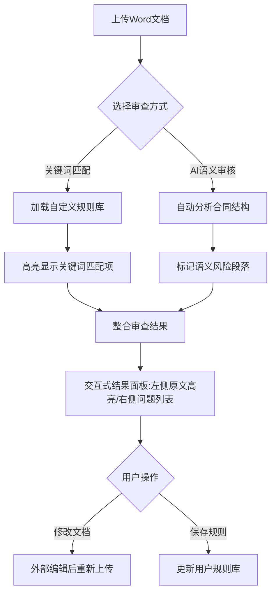

##### 界面风格

对标**Grammarly**的简约语言，左侧放文档预览并标注风险处，右侧给出分类问题清单与改进建议，整体配色以蓝白为主，风险等级以红黄等警示色突出。

按此提示生成的界面效果见图5-9。

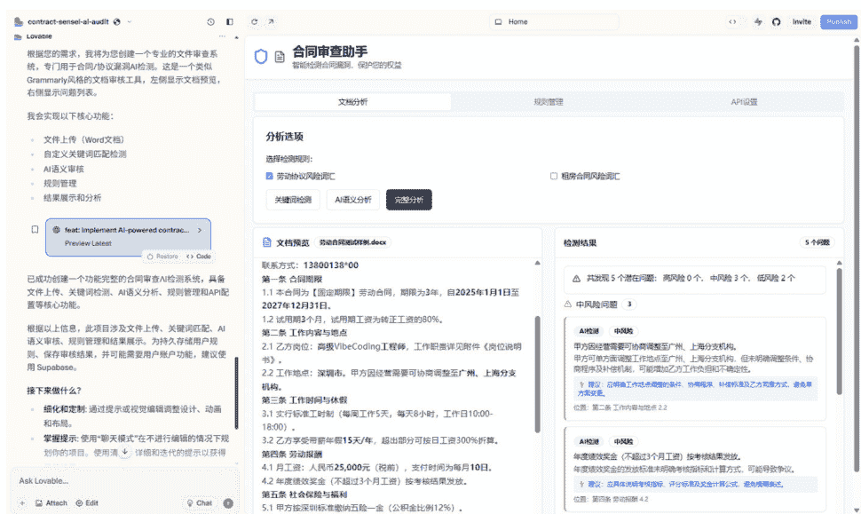

实际使用合同审查助手时，容易碰到以下四类困点。

（1）文档格式适配困点。若Word上传后出现版式错位或乱码，建议把文件另存为Office 2007及以上版本通用的.docx，并尽量减少复杂排版与特殊字体。

（2）审查规则个性化受限。当内置规则无法覆盖特定行业或业务场景时，可在系统提供的行业模板库中进行定制化调整并保存为专属规则集。

（3）智能核验的准确性波动。模型偶有漏检或误报，系统采用关键词匹配与语义理解双重校验，允许用户标注误报、漏报以优化模型，并提供人工复核的参考建议。

（4）超大文档处理压力。遇到超过100页的大型合同，系统会分段执行并优先审阅重点章节，同时在界面实时反馈处理进度以提升使用体验。

#### 7. 同类产品

在文档智能化处理赛道，除了合同审查工具，还有以下产品正在重塑传统工作方式。

（1）智能文档比对工具：可自动识别文本差异，高亮修改点并生成修订记录，适用于合同版本对照、法规更新核查及文档修订管理。

（2）文档摘要生成器：能抽取关键信息生成结构化摘要，支持多语言转换，适用于会议纪要整理、研究报告浓缩及新闻稿提炼。

（3）智能文档分类系统：可自动识别文件类型、抽取核心信息并做智能标签管理，适用于档案自动归类、邮件智能归档及知识库建设。

（4）文档合规检查工具：可校验格式规范、核验引用准确性并识别敏感信息，适用于标书审核、学术论文检查及商业报告复核。

这些产品底层架构相近，都融合规则引擎与AI能力，但针对不同场景做了差异化优化。

需要强调的是，它们并非要完全替代人工，而是作为辅助手段提升效率、降低失误。落地时应按实际需求挑选合适的工具，并以人工判断作为最终依据。

## 5.2 数据可视化利器：让数字自己讲故事

数据常被喻为新时代的石油，可视化则是把原油提炼成可用能量的环节。在数据井喷的当下，企业与个人普遍面临以下痛点。

- 销售数据繁杂，难以迅速把握业绩走向；
- 用户评论量大，问题信号不易及时捕捉；
- 数据分析工具门槛偏高，被视作专业人士专属；
- ……

本节以销售业绩看板和用户行为分析为例，说明如何借助 Vibe 编程快速搭建能够改变决策方式的可视化产品。

### 5.2.1 销售业绩看板 让管理者一眼读懂业绩

“又到月末了，这些表格怎么汇总？”销售经理小王看着一堆Excel发愁。每到结月，他都要花大量时间整理团队业绩、制作图表再向领导汇报。

类似场景比比皆是：搬运数据、做图、调格式，等材料弄好，数据又更新了。这种重复性工作凸显出智能业绩看板的价值。

借助 Vibe 编程，一个专业可用的销售业绩看板可在1小时内完成。提示清晰、工具得当，任何人都能快速落地实用的数据分析小工具。

#### 1. 需求拆解与场景设想

业绩看板的核心诉求是数据要快、要直观。

可以向 DeepSeek 提交如下设计请求：

为**销售业绩看板**做方案，明确功能边界与使用场景，包含以下4步。

- **用户画像分析**：梳理目标用户的属性、痛点与需求。
- **场景故事描述**：用具体情境说明产品如何解决问题。
- **功能边界确定**：界定产品能做什么、不能做什么。
- **交互流程设计**：规划使用路径与操作方式。

采用MVP思路，用最少模块实现可用产品。

- 支持表格导入
- 智能整理分析
- 生成可视化图表

参考海外成熟软件的设计风格。

输出MVP说明，包含：

1. 典型用户画像：一句话概括。
2. 场景故事：一句话概括。
3. 功能：列表，只列需做的功能。
4. 交互流程：列表。
5. 设计风格：一句话概括。

#### 2. 优化并确定MVP提示词

实时数据库、多维交叉分析等功能虽诱人，却非解决核心痛点的必须。用户最急需的是快速直观地掌握团队业绩。

在精简 DeepSeek 输出后，得到以下方案。

##### MVP描述：销售业绩看板

###### 1. 典型用户画像

中小企业销售负责人，亟需快速掌握团队业绩但缺乏分析工具或技术背景。

###### 2. 场景故事

销售经理过去每月手工整理Excel耗时费力，导入表格后系统自动生成图表，5分钟内即可洞察关键趋势，如头部销售、区域对比、达标率。

###### 3. 功能清单（MVP核心）

- **上传Excel**：支持标准字段，如销售日期、人员、金额、产品类别。
- **AI自动分析**：
  - 智能识别关键列，自动匹配“销售额”“客户名”等。
  - 基础指标：环比、同比、达标率、排名。
- **可视化图表**：
  - 预置图表：月度趋势折线、销售排名柱状、区域分布地图。
  - 支持按时间、人员、产品筛选。
- **一键导出**：图表可导出为PNG/PDF。

###### 4. 交互流程

1. **导入数据**：拖拽或点击上传Excel。
2. **自动处理**：进度条显示“分析中”，完成后提示“分析完成”。
3. **图表展示**：默认呈现核心图表，侧边栏可筛选维度。
4. **导出分享**：点击“导出”选择格式后下载。

###### 5. 设计风格

**借鉴 Pipedrive 的简洁风格**：白底蓝绿系主色、卡片式图表布局、操作按钮极简。

---

**MVP原则**：

- 不做：自定义图表类型、多数据源整合、实时数据库连接。
- 聚焦：从Excel到洞察的最短路径，解决“手工分析慢”的痛点。

#### 3. Excel文件处理

Excel读取是看板的核心环节，需兼顾稳定与易用。经评估选用 SheetJS，在浏览器端读写数据，性能良好且保障数据安全。

确认方案后，可用以下提示词验证可用性。

创建一个最简Web页面做测试，无需样式：

```html
<script src="https://cdn.jsdelivr.net/npm/xlsx@0.18.5/dist/xlsx.full.min.js"></script>
<script>
function handleFile(e) {
  const file = e.target.files[0];
  const reader = new FileReader();
  reader.onload = function(e) {
    const data = new Uint8Array(e.target.result);
    const workbook = XLSX.read(data, { type: 'array' });
    const firstSheet = workbook.Sheets[workbook.SheetNames[0]];
    const jsonData = XLSX.utils.sheet_to_json(firstSheet); // 转换为JSON
    console.log(jsonData); // 输出解析后的数据
  };
  reader.readAsArrayBuffer(file);
}
</script>
```

测试结果如图5-10所示。

把待验证代码输入AI工具如DeepSeek生成一个最简测试网页，若页面能正常运行，则代码可用。整个验证约需30秒。

以下是最简测试页示例，包含文件上传控件及上述脚本：

```html
<!DOCTYPE html>
<html>
<head>
    <title>Excel文件解析测试</title>
    <script src="https://cdn.jsdelivr.net/npm/xlsx@0.18.5/dist/xlsx.full.min.js"></script>
</head>
<body>
    <h1>Excel文件解析测试</h1>
    <input type="file" id="fileInput" accept=".xlsx, .xls" />
    <script>
        document.getElementById('fileInput').addEventListener('change', handleFile, false);

        function handleFile(e) {
            const file = e.target.files[0];
            const reader = new FileReader();
            reader.onload = function(e) {
                const data = new Uint8Array(e.target.result);
                const workbook = XLSX.read(data, { type: 'array' });
                const firstSheet = workbook.Sheets[workbook.SheetNames[0]];
                const jsonData = XLSX.utils.sheet_to_json(firstSheet);
                console.log(jsonData);
            };
            reader.readAsArrayBuffer(file);
        }
    </script>
</body>
</html>
```


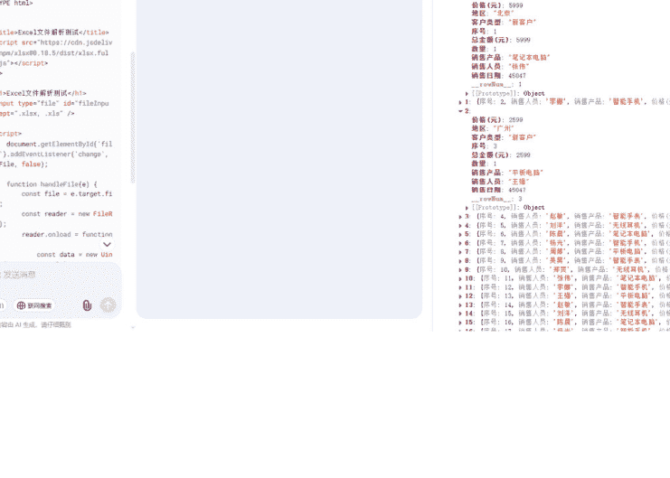

#### 4. 可视化图表

好的图表既要直观，也要帮助快速发现趋势。选型时需兼顾功能完整性、易用性与可定制性。

可在DeepSeek询问：

前端可视化图表选用什么纯前端方案较好？

对比后选择 ECharts 作为方案。ECharts 功能强，中文文档完善，社区活跃。基础示例见图5-11。

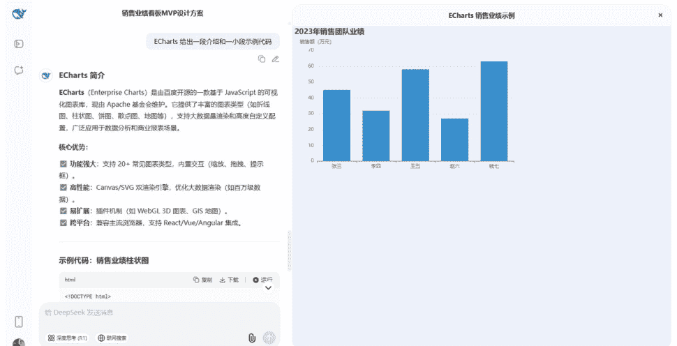

图5-11 销售业绩可视化图表示例

整理后的技术方案提示词如下。

```
<script src="https://cdn.jsdelivr.net/npm/echarts@5.4.3/dist/echarts.min.js"></script>
```

```
// 初始化图表
const chart = echarts.init(document.getElementById('sales-chart'));

// 配置项（数据+样式）
const option = {
    title: { text: '2023年销售团队业绩' },
    tooltip: { trigger: 'axis' },
    xAxis: {
        type: 'category',
        data: ['张三', '李四', '王五', '赵六', '钱七']
    },
    yAxis: { type: 'value', name: '销售额（万元）' },
    series: [{
        name: '季度销售额',
        type: 'bar',
        data: [45, 32, 58, 27, 63],
        itemStyle: { color: '#3398DB' } // 自定义柱状颜色
    }]
};
```

```
// 应用配置
chart.setOption(option);
```

#### 5. 创建MVP的流程图

在DeepSeek输入如下提示词。

使用Mermaid格式展示MVP，输出仅包含核心功能与交互的mermaid：flowchart TB

生成的Mermaid流程图见图5-12。

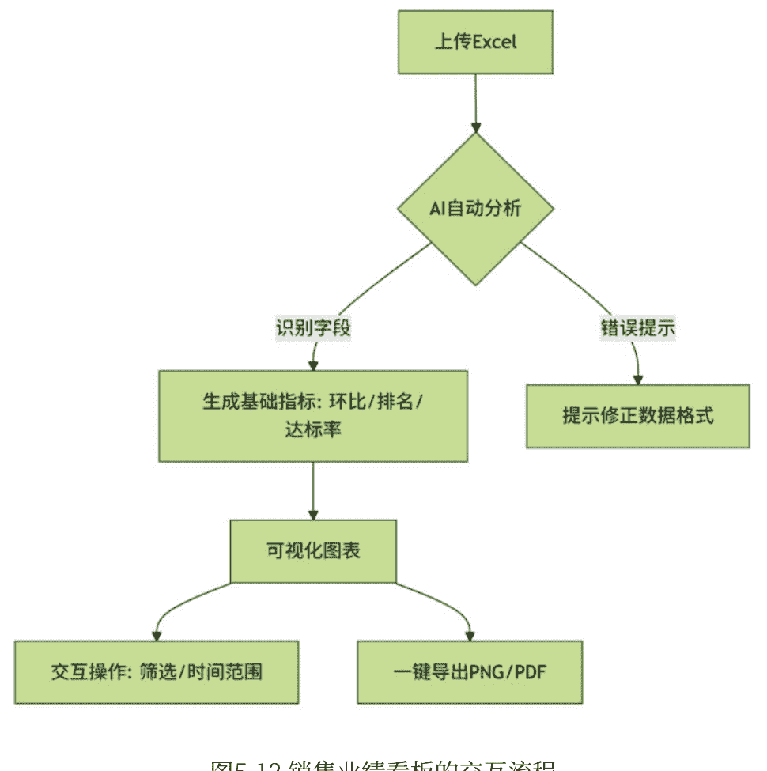

图5-12 销售业绩看板的交互流程

#### 6. 使用Lovable创建应用

将MVP的“功能列表”、Excel读取、AI自动分析、Mermaid流程图代码与设计风格整合，得到如下提示词输入Lovable。

根据如下描述帮我创建产品：销售业绩看板。

##### 功能列表（MVP核心功能）

- **上传Excel**：支持标准格式（如销售日期、人员、金额、产品类别）。
- **AI自动分析**：
  - 识别关键字段（自动匹配“销售额”“客户名”等列）。
  - 基础分析（环比、同比、达标率、排名）。
- **可视化图表**：
  - 预设图表：月度趋势折线图、销售排名柱状图、区域分布地图。
  - 图表可调整（时间范围、筛选人员/产品）。
- **一键导出**：图表支持PNG/PDF格式。

##### Excel文件读取

```
<script src="https://cdn.jsdelivr.net/npm/xlsx@0.18.5/dist/xlsx.full.min.js"></script>

function handleFile(e) {
  const file = e.target.files[0];
  const reader = new FileReader();
  reader.onload = function(e) {
    const data = new Uint8Array(e.target.result);
    const workbook = XLSX.read(data, { type: 'array' });
    const firstSheet = workbook.Sheets[workbook.SheetNames[0]];
    const jsonData = XLSX.utils.sheet_to_json(firstSheet); // 转换为JSON
    console.log(jsonData); // 输出解析后的数据
  };
  reader.readAsArrayBuffer(file);
}
```

##### 数据可视化

```
<script src="https://cdn.jsdelivr.net/npm/echarts@5.4.3/dist/echarts.min.js"></script>
```

```
// 初始化图表
const chart = echarts.init(document.getElementById('sales-chart'));

// 配置项（数据+样式）
const option = {
    title: { text: '2023年销售团队业绩' },
    tooltip: { trigger: 'axis' },
    xAxis: {
        type: 'category',
        data: ['张三', '李四', '王五', '赵六', '钱七']
    },
    yAxis: { type: 'value', name: '销售额（万元）' },
    series: [{
        name: '季度销售额',
        type: 'bar',
        data: [45, 32, 58, 27, 63],
        itemStyle: { color: '#3398DB' } // 自定义柱状颜色
    }]
};
```

```
// 应用配置
chart.setOption(option);
```

##### 智能分析模块

把需要处理的表格信息整理成提示词，调用 LLM 接口生成分析结果。其中 apiKey、apiUrl、model 与 systemPrompt 四项需要在界面中提供配置入口：

```
const apiUrl = 'https://api.siliconflow.cn/v1/chat/completions';
const apiKey = '<token>';
const model = "Qwen/Qwen3-8B";
const systemPrompt = `xxx`;
```

```
const options = {
    method: 'POST',
    headers: { Authorization: `Bearer ${apiKey}`, 'Content-Type': 'application/json' },
    body: JSON.stringify({
        "model": model,
        "messages": [
            {
                "role": "system",
                "content": systemPrompt
            },
            {
                "role": "user",
                "content": "基础分析（环比、同比、达标率、排名）"
            }
        ],
        "stream": false,
        "max_tokens": 512,
        "enable_thinking": false
    })
};
```

```
fetch(apiUrl, options)
    .then(response => response.json())
    .then(response => console.log(response))
    .catch(err => console.error(err));
```

- 获取接口返回后，提取 choices[0].message.content 部分内容并做格式美化展示：

```json
{
    "id": "<string>",
    "choices": [
        {
            "message": {
                "role": "assistant",
                "content": "<string>",
                "reasoning_content": "<string>",
                "tool_calls": [
                    {
                        "id": "<string>",
                        "type": "function",
                        "function": {
                            "name": "<string>",
                            "arguments": "<string>"
                        }
                    }
                ]
            },
            "finish_reason": "stop"
        }
    ]
}
```

##### 操作流程

```
flowchart TB
    A[上传Excel] --> B{AI自动分析}
    B -->|识别字段| C[生成基础指标: 环比/排名/达标率]
    B -->|错误提示| D[提示修正数据格式]
    C --> E[可视化图表]
    E --> F[交互操作: 筛选/时间范围]
    E --> G[一键导出PNG/PDF]
```

##### 视觉风格

**参照 Pipedrive 的极简风格**：白底搭配蓝绿色系为主色，图表以卡片形式排列，操作按钮做极简处理。

按以上提示词生成的示例应用见图5-13。

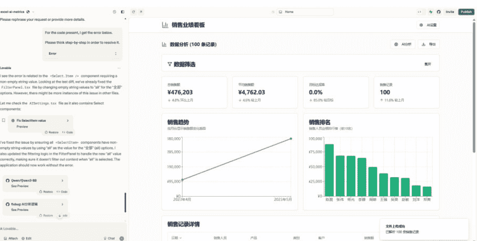

图5-13 Lovable生成的销售业绩看板

在搭建与使用销售业绩看板的过程中，我们一共梳理并解决了三类关键难点。

**(1) 模型偷工减料现象。** 大模型偶尔会走捷径，比如在 Lovable 中智能分析并未真正落地，定位代码时发现一行注释写着 “AI分析逻辑将在这里实现”：

```javascript
const handleAIAnalysis = async (prompt: string) => {
    setIsAnalyzing(true);
    // AI分析逻辑将在这里实现
    setTimeout(() => {
        setIsAnalyzing(false);
    }, 2000);
};
```

随后再让 Lovable 补全智能分析功能，并要求新增独立页面用于展示分析结果，如图5-14 所示。

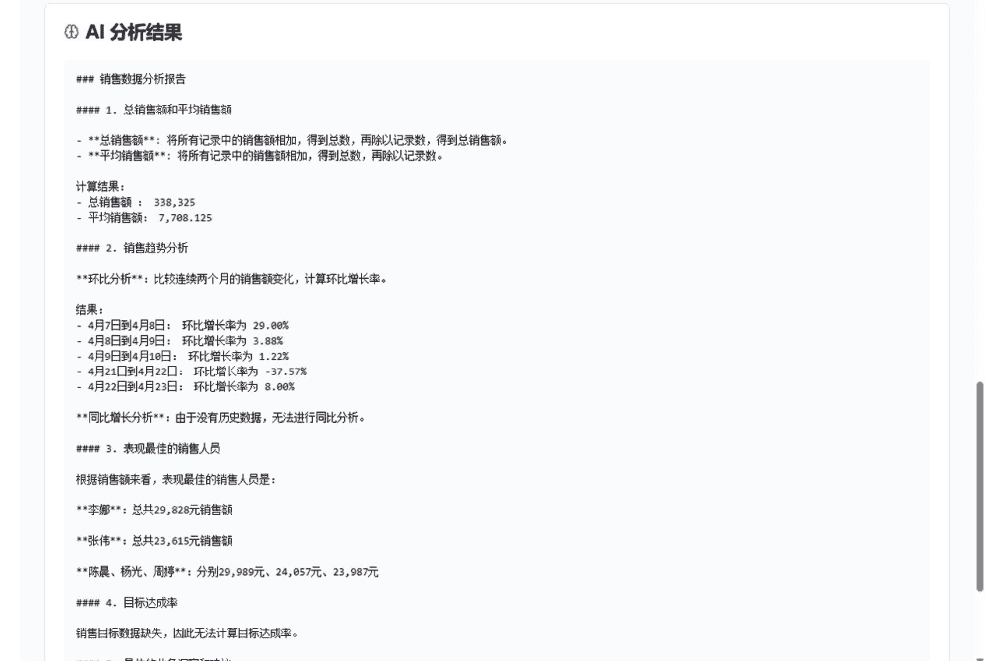

图5-14 销售业绩分析结果示例

- 调用 LLM 接口时，若需关闭推理过程（硅基流动默认是开启的），可把 enable_thinking 参数设为 false。
- 结果可以直接呈现接口返回的原始文本。若想体验更好，可让模型输出 JSON 格式再进行解析。

**(2) 日期格式兼容难题。** Excel 中的日期保存方式不统一，可能为数字编码也可能为文本字符串。出现解析错误时可采用以下做法：

- 编写专用的日期解析函数 parseDate；
- 对 Excel 数字型日期进行转换；
- 对字符串型日期进行识别并统一转成 YYYY-MM-DD 格式。

**(3) 图表类型选型失误。** 可视化图表类型用错会导致展示异常，例如用横向图表来呈现按业绩排名的销售人员，显示会很不正常。此时应提示模型改用更合适的形式：横轴放置销售人员姓名、纵轴放置销售额，如图5-15 所示。

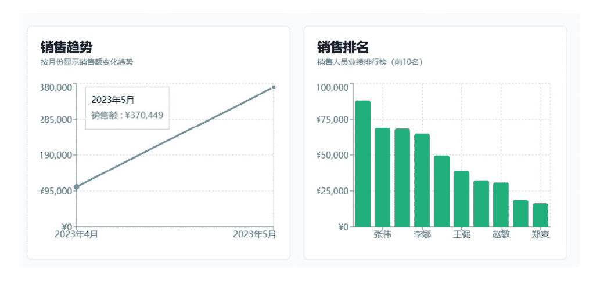

图5-15 销售排名图表类型优化效果

#### 7. 类似产品

销售业绩看板只是数据可视化众多场景之一，市场上常见的分析工具主要有以下四类。

- 库存管理看板：实时追踪库存水位，提前预警缺货风险。
- 客户分析看板：洞察客户分布、购买习惯与满意度。
- 营销效果看板：监测各渠道投放的转化表现。
- 财务分析看板：把控收入支出、现金流与利润率。

这些产品的共同点在于把复杂数据转化为直观图表，帮助决策者迅速获取信息。跟销售看板一样，每款工具都应聚焦特定场景的核心痛点，用简洁的界面和精准的功能帮助用户化繁为简，让数据分析更轻松。

### 5.2.2 社交媒体评论洞察工具：读懂用户声音的智能助手

“又来一个差评！”小李盯着手机屏幕皱起眉。作为一家新锐电商品牌的运营负责人，他每天要处理数百上千条用户评论，既有表扬也有吐槽，还有建议。最困扰他的是如何从海量评论中迅速抓住关键问题。逐条阅读太费时间，单纯的关键词统计又难以把握情感背后的含义。

借助 Vibe 编程，半小时内就能搭出一个评论分析工具。它可以自动判断评论情感，生成可视化结果，并提供 AI 洞察来支撑运营决策。

#### 1. 需求梳理与场景构想

用户最在乎的是快速得到有价值的洞见。

在 DeepSeek 中输入以下提示词。

请帮我设计一个**社交媒体评论分析工具**，明确功能范围和应用场景，按下面 4 步展开。

- **用户画像分析**：厘清目标用户的特点、痛点与需求。
- **场景故事描述**：用具体案例说明产品如何解决问题。
- **功能边界确定**：界定产品能力范围与不提供的功能。
- **交互流程设计**：规划用户使用路径与交互细节。

采用 MVP 思路，用最少功能验证价值。

- 粘贴文本：评论数据。
- LLM 解析评论，输出：饼图（正面/负面/中性）+ 结论（AI 洞察）。

参考海外成熟产品设计风格。

输出 MVP 说明。

1. 典型用户画像：一句话概括。
2. 场景故事：一句话概括。
3. 功能：列表列出，仅写必须做的。
4. 交互流程：列表列出。
5. 设计风格：一句话概括

#### 2. MVP 描述优化与确定

词云、来源分类、多语言等功能虽诱人，但并非解决核心痛点的必需。用户最急需的是迅速掌握评论整体情感分布并获取关键结论。

将 DeepSeek 的输出复制后剔除冗余功能，最终 MVP 描述如下。

##### MVP 描述：社交媒体用户评论分析工具

###### 1. **目标用户画像**

中小企业社交媒体运营人员，需要快速了解评论情感，但缺乏专业分析手段或技术背景。

###### 2. **使用场景**

某品牌运营将一周 Instagram 评论粘贴进工具，10 秒内得到情感分布饼图和 AI 归纳的关键洞察，用于优化下期内容策略。

###### 3. **核心功能清单**

- **文本输入**：支持粘贴或上传社交媒体评论的纯文本。
- **情感分析**：调用 LLM（硅基流动 API）自动将评论归类为正面/负面/中性。
- **可视化呈现**：生成情感分布饼图，展示占比与具体数值。
- **AI 洞察摘要**：输出一段文字总结，如“70%正面评论提到‘包装精美’，负面主要集中在‘物流慢’”。

###### 4. **交互流程**

1. **进入首页**：界面简洁，仅有一个输入框和“分析”按钮。
2. **粘贴评论**：从社交媒体复制评论并粘贴，限制在 5000 字符内。
3. **触发分析**：点击后系统调用 LLM，约 10 秒返回结果页。
4. **查看结果**：

   - 上方为饼图，可导出 PNG。
   - 下方为 AI 总结的结论，支持复制。
5. **重置或重分析**：提供“清除数据”按钮开始新一轮。

###### 5. **视觉风格**

*极简 Monochrome 风格，借鉴 Typeform 的交互逻辑，重点突出数据可视化，使用类似 Chart.js 默认饼图配色与清晰标签。*

**MVP 原则**：

- 不实现：账号登录、评论来源分类、多语言支持、历史记录。
- 核心技术：LLM API + 前端图表库 ECharts。

为明确技术选型，在 DeepSeek 输入以下提示词。

为功能列表提供合适的实现方案，采用纯前端：

经研究，我们最终选择情感分布饼图。

可视化图表（情感分布饼图），选用 Chart.js 方案，给出 CDN 方式，并提供一个最小化的测试网页（无需样式）。

生成结果如图5-16所示。


图5-16 社交媒体用户评论分析工具选型测试

#### 3. 构建 MVP 流程图

继续在 DeepSeek 输入提示词。

以 Mermaid 格式展示 MVP，仅输出核心功能与交互的流程图：flowchart TB

生成的流程图如图5-17所示。

##### 图5-17 用户评论分析工具的交互流程

#### 4. 用 Lovable 快速搭建

把 MVP 的功能清单、LLM 分析逻辑、情感饼图展示、Mermaid 流程代码与设计风格整合，形成以下提示词输入 Lovable。

请根据以下描述创建产品：社交媒体用户评论分析工具。

##### 功能清单（MVP 核心）

- **文本输入**：支持粘贴或上传社交媒体评论（纯文本）。
- **情感分析**：调用 LLM（硅基流动 API）自动分类为正面/负面/中性。
- **可视化图表**：输出情感分布饼图，含占比与数值。
- **AI 洞察摘要**：生成一段文字结论，如“70%正面评论提及‘包装精美’，负面评论主要抱怨‘物流慢’”。

##### LLM 分析

将用户输入作为提示词调用 LLM API，返回情感分布数值与洞察摘要。其中 apiKey、apiUrl、model 需要提供配置 UI：

```
const apiUrl='https://api.siliconflow.cn/v1/chat/completions';
const apiKey= '<token>';
const model="Qwen/Qwen3-8B";
```

```
const systemPrompt=`
你是一个专业的情感分析工具，需要严格按如下规则处理用户输入的文本：

1. **任务**
   - 分析文本中的每条评论的情感倾向，分类为`正面`、`负面`或`中性`。
   - 统计3类情感的占比（百分比，总和为100%）。
   - 生成一段简短的洞察摘要（50字以内），总结关键发现。

2. **输出格式**（必须严格遵循如下JSON格式）：
   {
     "sentiment_distribution": {
       "positive": "百分比数值（如30%）",
       "negative": "百分比数值（如20%）",
       "neutral": "百分比数值（如50%）"
     },
     "insight_summary": "摘要文本（如：负面评论主要集中提及物流速度问题）"
   }

3. **分析规则**
   - `正面`：表达喜爱、赞扬、感谢等明确积极情绪。
   - `负面`：表达愤怒、失望、批评等明确消极情绪。
   - `中性`：无明确情感倾向或客观陈述。

4. **要求**
   - 仅返回JSON，不包含任何额外解释或注释。
   - 必须输出纯JSON，无额外文本。
   - 确保百分比数值为整数，且总和为100%。
`;
```

**调用示例（请求体）**

假设用户输入：“这款产品很好用，但物流太慢了。客服态度不错，不过包装破损了。”

**API 请求示例（OpenAI 风格）**：

```json
{
    "model": "gpt-4",
    "messages": [
        {
            "role": "system",
            "content": "（粘贴上面的System提示词）"
        },
        {
            "role": "user",
            "content": "这款产品很好用，但物流太慢了。客服态度不错，不过包装破损了。"
        }
    ]
}
```

**预期响应结果**:

```json
{
  "sentiment_distribution": {
    "positive": "33%",
    "negative": "33%",
    "neutral": "34%"
  },
  "insight_summary": "正面评价提及产品好用，负面评论聚焦物流和包装问题。"
}
```

```javascript
const options = {
  method: 'POST',
  headers: {Authorization: `Bearer ${apiKey}`, 'Content-Type': 'application/json'},
  body: JSON.stringify({
    "model": model,
    "messages": [
      {
        "role": "system",
        "content": systemPrompt
      },
      {
        "role": "user",
        "content": "<评论文本数据>"
      }
    ],
    "stream": false,
    "max_tokens": 512,
    "enable_thinking": false
  })
};

fetch(apiUrl, options)
.then(response => response.json())
.then(response => console.log(response))
.catch(err => console.error(err));
```

- API返回结果需提取choices[0].message.content中的内容，并进行JSON格式处理成饼图所需要的分类数据和洞察摘要需要的文本。

```json
{
  "id": "<string>",
  "choices": [
    {
      "message": {
        "role": "assistant",
        "content": "<string>",
        "reasoning_content": "<string>",
        "tool_calls": [
          {
            "id": "<string>",
            "type": "function",
            "function": {
              "name": "<string>",
              "arguments": "<string>"
            }
          }
        ]
      },
      "finish_reason": "stop"
    }
  ]
}
```

##### 情绪分析饼图呈现

```html
<script src="https://cdn.jsdelivr.net/npm/chart.js"></script>
<!-- 画布容器 -->
<canvas id="sentimentChart" width="400" height="400"></canvas>
<script>
// 模拟数据（实际使用时替换为LLM分析结果）
const data = {
    labels: [ '正面', '负面', '中性' ],
    datasets: [{
        data: [30, 20, 50], // 比例值
        backgroundColor: [
            '#4CAF50', // 绿色-正面
            '#F44336', // 红色-负面
            '#FFC107' // 黄色-中性
        ]
    }]
};
// 渲染饼图
const ctx = document.getElementById('sentimentChart').getContext('2d');
new Chart(ctx, {
    type: 'pie',
    data: data,
    options: {
        responsive: false // 关闭响应式（固定尺寸）
    }
});
</script>
```

##### 交互路径


##### 设计风格

整体走单色极简路线，交互借鉴 Typeform 的思路，视觉焦点放在数据呈现上，饼图的配色与标签可读性参考 Chart.js 的默认方案。

按上述提示生成的原型见图5-18。


▲ (a)


▲ (b)

图5-18 Lovable生成的社交媒体评论分析工具

在落地与验证评论分析工具的过程中，我们碰到并解决了两项关键障碍。

- 大模型接口调用失败。先核对 API Key 是否配置正确；配置无误时多为请求超时，可适当延长等待时间或加入重试机制。
- 评论文本格式不规范。用户直接复制评论常带特殊字符或 HTML 标签，建议在送入模型前先做清洗。

#### 5. 类似产品

在数字化运营里，数据类工具已成标配。除评论分析外，以下工具也能帮助更立体地理解用户。

- 用户行为追踪：洞察用户在网站或 App 内的点击路径与停留时长。
- 转化漏斗分析：监测从浏览到下单各环节的转化效率。
- 用户画像生成器：基于数据自动归纳用户画像。
- 竞品分析工具：跟踪对手在社交媒体上的表现与用户反馈。

## 5.3 AI营销增长工具箱

“营销不是艺术，而是科学。”这句话概括了当下营销的本质。在数据驱动的时代，营销人常面临：

- 文案无从下手，难以抓住用户眼球；
- 素材挑选困难，缺乏合适的视觉灵感；
- 转化率焦虑，却不知如何科学优化；
- ……

这些难题直接影响营销成效与业务增长。

本节以 3 款工具——文案自动生成器、AI 社交媒体图像生成器和转化率优化工具为例，展示如何借助 Vibe 编程的“4 步创作法”把需求快速转化为可用产品。

### 5.3.1 文案自动生成器：多风格批量输出

“又要写文案了！”小美揉了揉太阳穴。作为一家新锐品牌的市场负责人，她每天要为微博、小红书、抖音等渠道撰写十几条产品文案。写着写着灵感枯竭，风格也容易同质化。最头疼的是各渠道要求差异大，单人难以兼顾。

借助 Vibe 编程思路，约 30 分钟即可搭出一个文案自动生成器。输入产品描述即可批量产出多种风格文案，解放重复创作，让人专注更有创意的环节。

#### 1. 需求分析与场景构思

对文案生成器而言，用户最看重的是快速拿到可用创意。

打开 DeepSeek，输入如下提示词。

帮我设计一款**营销文案生成器**，明确功能范围与应用场景，按 4 步展开。

- **用户画像分析**：梳理目标用户的特征、痛点与需求。
- **场景故事描述**：用具体情境说明产品如何解决问题。
- **功能边界确定**：界定产品能做与不能做。
- **交互流程设计**：规划使用流程与交互方式。

采用 MVP，以最少功能实现产品。

- 任务要求：输入一段文本描述，由 LLM 生成多个不同角度的文案。
- 参考符合定位的海外成熟软件的设计风格。
输出 MVP 描述。

1. 目标用户画像：简要概括。
2. 场景故事：简要概括。
3. 功能：用列表描述，仅列出必须实现的功能。
4. 交互流程：用列表描述。
5. 设计风格：简要概括。

#### 2. 优化并确定 MVP 描述

文案生成器虽可加入图文排版、多语翻译、SEO 优化等，但并非解决核心痛点的必要项。用户最迫切的是迅速获得多样化文案创意。

复制 DeepSeek 的 MVP 描述，剔除非必要功能后得到如下版本。

##### MVP 描述：营销文案生成器

###### **1. 目标用户画像**

中小企业市场营销人员或创业者，需要快速产出多样化营销文案，缺乏灵感或时间。

###### **2. 场景故事**

电商运营人员需在社交媒体发布产品推广，文案单一时，使用工具输入产品描述后一键生成多风格文案，提升点击率。

###### **3. 功能列表（MVP 核心功能）**

- **输入**：用户提交产品/服务描述，例如“新款智能手表，续航 7 天，支持血氧监测”。
- **生成**：AI 自动生成**3~5 条不同风格**的营销文案，如“科技感”“情感化”“促销风”等。
- **复制**：用户可一键复制所选文案。

###### **4. 交互流程**

1. 用户打开网页/应用，看到简洁输入框。
2. 输入产品描述，限制 100 字以内。
3. 点击“生成文案”按钮。
4. 系统返回 3～5 条带风格标签的文案。
5. 用户点击“复制”按钮，直接使用。

###### **5. 设计风格**

借鉴 **Jasper.ai** 的极简风格：界面干净、无干扰，核心功能突出，配色以蓝白为主，强化生成按钮的视觉引导。

---

**MVP 原则**：

仅完成“输入→生成→复制”闭环，不涉及复杂编辑、A/B 测试或长文生成。

#### 3. 创建 MVP 的流程图

对创意类工具而言，清晰的流程图有助于贴合用户创作习惯。

继续在 DeepSeek 中输入提示词。

使用 Mermaid 格式展示 MVP，输出仅包含核心功能与交互的 mermaid: flowchart TB

生成的 Mermaid 流程图如图5-19 所示。


图5-19 营销文案生成器的交互流程

#### 4. 使用 Lovable 创建应用

将 MVP 的“功能列表”、AI 生成能力、Mermaid 流程图代码与设计风格整合，得到如下提示词后输入 Lovable。

根据如下描述帮我创建产品：营销文案生成器。

##### 功能列表（MVP 核心功能）

- **输入**：用户提交一段产品/服务描述（如“新款智能手表，续航7天，支持血氧监测”）。
- **生成**：AI 自动生成**3～5条不同风格**的营销文案（如“科技感”“情感化”“促销风”等）。
- **复制**：用户可一键复制选中文案。

##### AI 生成功能

把用户提交的产品/服务描述作为提示词，调用 LLM API 生成 3～5 条不同风格的营销文案。其中 apiKey、apiUrl 和 model 需要提供设置界面：

```javascript
const apiUrl='https://api.siliconflow.cn/v1/chat/completions';
const apiKey= '<token>';
const model="Qwen/Qwen3-8B";
```

```
const systemPrompt=`
**Role**: 你是一个专业的营销文案生成器，专门为中小企业主和营销人员提供高转化率的广告文案。

**Task**: 根据用户输入的产品/服务描述，生成**3～5条风格不同**的营销文案，每条文案需符合如下要求：

1. **风格标签**: 明确标注文案风格（如“科技感”“情感化”“促销风”“痛点解决型”“幽默风”等）。
2. **长度限制**: 每条文案不超过30字（确保简洁有力）。
3. **核心卖点**: 必须包含用户输入中的关键功能或优势。
4. **多样化**: 避免重复句式，每条文案角度需显著不同。

**Output Format**:

1. [风格标签] 文案内容
2. [风格标签] 文案内容
3. [风格标签] 文案内容

**Examples**:

- 用户输入：`“新款智能手表，续航7天，支持血氧监测”`
- 输出：
  1. [科技感] 7天超长续航+血氧监测，你的健康管家！
  2. [情感化] 守护你的每一刻，电量与健康从不缺席！
  3. [促销风] 限时优惠！血氧监测手表，续航一周仅需××元！

**Constraints**：

- 禁止虚构产品没有的功能。
- 禁止使用复杂术语，语言需通俗易懂。
- 优先使用短句、行动号召（如“立即购买”“点击了解”）。

**Tone**：专业但友好，适应不同风格需求。
`;
```

```javascript
const options = {
  method: 'POST',
  headers: {Authorization: `Bearer ${apiKey}`, 'Content-Type': 'application/json'},
  body: JSON.stringify({
    "model": model,
    "messages": [
      {
        "role":"system",
        "content":systemPrompt
      },
      {
        "role": "user",
        "content": "<评论文本数据>"
      }
    ],
    "stream": true,
    "max_tokens": 512,
    "enable_thinking": false
  })
};
```

- 接口需处理流式返回的数据，文本位于 choices[0].message.content，并在界面上以打字机效果呈现。

##### 交互流程：


##### 设计风格

参考 **Jasper.ai** 的极简风格：界面清爽、无多余元素，核心功能突出，配色以蓝白为主，突出生成按钮的视觉引导。

按这些提示生成的应用如图5-20 所示。

##### 营销文案生成器

产品描述

mixlab，vibe coding训练营

生成文案

##### 生成的文案

- [科技感]

Vibe Coding训练营，零基础也能玩转编程！

- [情感化]

用代码表达创意，让梦想触手可及✨

- [促销风]

限时报名！Vibe Coding训练营，开启你的编程之旅！

- [痛点解决型]

学不会编程？Vibe Coding帮你高效入门！

- [幽默风]

代码不会写？来Vibe Coding，让你的电脑“听懂”你！

营销文案生成器 © 2025

图5-20 Lovable 生成的营销文案生成器

在开发与使用文案生成器时，我们解决了以下两个问题。

(1) 流式输出展示异常。开启流式传输（stream 设为 true）后，打字机效果可能闪烁或消失，常因状态管理不当。需保证文本状态在生成全程被正确维护。可采用如下描述。

生成文案的流式打字机效果在传输结束后消失

修复后的逻辑：

- 生成开始时展示打字机效果；
- 效果持续至解析完成并生成卡片；
- 仅在卡片生成完毕、LLM API 请求结束后再替换打字机文本。

（2）文案风格差异不足。有时多平台生成的文案风格区分度低，可通过调整 System 提示词中的“风格标签”来增强多样性。

#### 5. 类似产品

在数字营销领域，AI 创意工具正在重塑内容创作。除文案生成器外，还可借助：

- 标题优化工具：生成吸睛的文章标题与广告标题。
- 文案翻译助手：自动把营销文案译成多语言并保持风格。
- 品牌语气校准器：确保所有内容保持一致的品牌语调。
- 节日文案生成器：按不同节日自动产出应景营销文案。

### 5.3.2 社交媒体图像生成器：创意不再受限

“这张图片太普通了！”小张看着刚从图库下载的素材皱眉。作为新兴品牌的社交媒体负责人，她每天需为各平台准备大量配图。图库素材雷同，定制设计成本高且慢。

借助 Vibe 编程思路，约 30 分钟即可打造一个社交媒体图像生成器。输入文字描述即可自动生成符合品牌调性的图片，让配图素材随时可得且独一无二。

#### 1. 需求分析与场景构思

打开 DeepSeek，输入以下提示词。

帮我设计一款**社交媒体图像生成器**应用，要求明确功能范围与应用场景，按以下 4 步展开。

- **用户画像分析**：明确目标用户的特征、痛点与需求。
- **场景故事描述**：用具体场景说明产品如何解决问题。
- **功能边界确定**：界定产品能做与不能做。
- **交互流程设计**：规划使用流程与交互方式。

采用 MVP，以最少功能实现产品。

- 输入任意文本。

Vibe 编程实战：用 AI 同时解决配图与文案效率问题

整体做法是把自然语言先经系统级提示转成模型指令，再驱动绘图或分析模型运行，最后压缩成可直接上线的最小方案。

人群定义：以简短描述锁定目标使用者。
使用场景：用概括性描述呈现典型使用瞬间。
功能清单：只保留刚需点。
操作链路：按先后列出关键动作。

#### 2. 收敛并锁定最小方案

社媒配图类工具往往堆砌编辑、滤镜、批量等附加能力，但真正困扰运营者的仍是短时间内拿到原创且符合调性的视觉素材。其余功能都属于锦上添花。

精简后的最小可行方案如下。

##### 最小方案：社媒配图生成器

###### 1. 核心用户
负责中小企业社媒账号日常运营的工作者，需要快速产出吸睛配图，却缺少设计技能或时间预算。

###### 2. 使用情境
把活动说明“周末限时五折促销”填入系统，后台自动产出高质量促销海报，可直接保存并发布到社媒渠道。

###### 3. 能力范围
- 文案输入区：接受用户随意输入的活动描述或关键词。
- 指令改写：后端将口语化描述转为绘图模型可读的指令，例如“活泼促销海报，周末五折大字，气球与购物袋，扁平矢量风格”。
- 绘图调用：调用 DALL·E 或 Stable Diffusion 等绘图接口，按指令渲染高清图。
- 导出：支持点一下即可导出 PNG/JPG。

###### 4. 操作路径
1. 进入界面：简洁首页，居中呈现输入区与操作键。
2. 填写描述：例如输入“夏日清凉饮品促销”。
3. 后台转指令：点击“生成”，系统暗中把文本优化为绘图指令，使用者看不到过程。
4. 出图预览：自动调用接口生成并展示预览。
5. 保存或重来：可下载图片，或修改描述重新生成。

**不展开范围**：
- 不提供图片编辑、多图挑选、账号体系、复杂模板。
- 目标是用最少步骤完成“文字→图像→下载”。

#### 3. 画出最小流程图

流程图对交互把控很关键，能保证设计贴合创作者习惯。

在 DeepSeek 中送入提示词。

使用 Mermaid 语法展示最小方案，输出仅包含核心能力与交互的 mermaid: flowchart TB

生成的图如图5-21所示。

#### 4. 用 Lovable 搭建应用

把最小方案的能力清单、指令生成逻辑与 Mermaid 代码合并，形成喂给 Lovable 的提示。


图5-21 社交媒体图像生成器的交互流程

根据如下描述帮我创建产品：社交媒体图像生成器。

##### 功能列表（MVP核心功能）
- **文本输入框**：用户输入任意文本（如活动描述、关键词）。
- **提示词生成**：系统将用户文本转换为适合图像生成的优化提示词（例如："vibrant sale poster, '50% OFF this weekend!' text, colorful balloons, shopping bags, flat vector style"）。
- **图像生成**：调用图像生成API（使用设置里的），基于提示词输出一张高清图像。
- **图像下载**：用户可一键下载生成的图片（PNG/JPG格式）。

##### 提示词生成
- 需要提供可以设置 System 提示词的设置
- 使用 LLM API 完成，参考如下：

将用户输入任意文本作为提示词，调用 LLM API，生成提示词。其中 apiKey、apiUrl、model 和 SystemPrompt 需要提供设置的 UI：

```
const apiUrl='https://api.siliconflow.cn/v1/chat/completions';
const apiKey= '<token>';
const model="Qwen/Qwen3-8B";
const systemPrompt=`你是专业的封面设计师，把用户的输入，转化为一张专业的封面图的文本描述提示词，直接输出提示词给我：

the image ……

`
const options = {

method: 'POST',

headers: {Authorization: `Bearer ${apiKey}`, 'Content-Type': 'application/json'},

body: JSON.stringify({

"model":model,

"messages": [

{

"role":"system",

"content":systemPrompt

},

{
    "role": "user",
    "content": "<用户的输入>"
},
"stream": false,
"max_tokens": 512,
"enable_thinking": false
})
};
```

- API 需要处理返回的结果（文本在 choices[0].message.content）。

##### 图像生成
需要提供设置 UI，设置 model、apiUrl 和 apiKey，参考如下代码：

```
const model="Kwai-Kolors/Kolors";
const apiKey=<token>;
const apiUrl="https://api.siliconflow.cn/v1/images/generations"

const options = {
    method: 'POST',
    headers: {Authorization: `Bearer ${apiKey}`, 'Content-Type': 'application/json'},
    body: JSON.stringify({
        "model":model,
        "prompt": prompt
    })
};

fetch(apiUrl, options)
    .then(response => response.json())
    .then(response => console.log(response))
    .catch(err => console.error(err));
```

- api 请求结果，使用 images[0].url 显示在结果 UI 上：

```
{
    "images": [
        {
            "url": "<string>"
        }
    ],
    "timings": {
        "inference": 123
    },
    "seed": 123
}
```

##### 交互流程
```
flowchart TB
    A[用户输入文本] --> B(生成优化提示词)
    B --> C(调用API生成图像)
    C --> D[显示预览图]
    D --> E{用户操作}
    E -->|下载| F[保存图片]
    E -->|重试| A
```

借助于这些提示词生成的应用如图5-22所示。


图5-22 Lovable 生成的 AI 社交媒体图像生成器

在开发和使用 AI 社交媒体图像生成器时，我们遇到并解决了两个问题。

**图像生成速度慢的问题。** 调用某些模型时等待时间较长，建议在界面增加进度提示，等待时展示创作技巧或灵感，提升体验。

**提示词优化问题。** 用户原文不一定能转成有效绘图提示词，可通过完善 System 提示词或提供常用提示词模板来提升质量。

#### 5. 类似产品
在数字创作领域，AI 绘图已成为日常刚需。除社媒配图生成器外，还有 4 类工具可解决特定场景。

- 品牌形象生成器：基于品牌调性生成 Logo 及视觉识别系统，提升品牌设计效率。
- 产品场景合成器：通过贴合技术把产品放入多元场景，快速生成实景图，无需手动修图。
- 海报模板生成器：依据文案生成多版式海报方案，提升营销物料制作效率。
- 表情包定制工具：将品牌元素植入表情包体系，增强社交场景互动传播。

### 5.3.3 转化率优化工具：销量提升 50% 的系统

“为什么这个广告的点击率这么低？”电商平台营销经理小王看着数据面板发愁。每天要处理大量营销文案与广告素材，效果参差不齐，最头疼的是如何从成功案例提炼经验、避免重复踩坑。

借助 Vibe 编程，30 分钟就能搭建一个智能的转化率优化工具。它能自动解析高低转化文案的特征，并为新文案提供优化建议，让决策更有依据。

#### 1. 需求研判与情境构思

开发前需先吃透用户痛点与需求。对转化率优化类分析工具，MVP 策略很合适，用户最关心的是快速拿到可执行的优化建议。

在 DeepSeek 输入提示词。

帮我设计一款**转化率优化工具**，需要清晰定义功能范围和应用场景，包括如下 4 个步骤。

- **用户画像分析**：明确目标用户特征、痛点与需求。
- **场景故事描述**：用具体场景说明产品如何解决问题。
- **功能边界确定**：定义能做什么，不能做什么。
- **交互流程设计**：规划使用流程与交互方式。

采用 MVP，用最少功能实现产品。

- 粘贴录入历史数据：设为高转化率或低转化率分类
- 根据历史数据总结出高转化率和低转化率的文案特征
- 基于高低转化特征给新的文案提出优化建议

输出 MVP 描述。

1. 典型用户画像：一句话描述。
2. 场景故事：一句话描述。
3. 功能：用列表描述。
4. 交互流程：用列表描述。

#### 2. 优化并确定 MVP 描述

转化率优化工具虽然可以做实时监控、竞品分析、多维数据可视化，但这些并非解决核心痛点的必需。用户最迫切的需求是弄清哪类文案更容易转化，并获得具体建议。

精简后的 MVP 描述如下。

##### MVP 描述：转化率优化工具

###### 1. 典型用户画像
中小企业数字营销人员，负责广告投放或落地页优化，缺乏系统的文案优化方法论，依赖经验或试错。

###### 2. 场景故事
营销人员把过往的高/低转化文案导入工具，工具分析出关键差异特征，并基于新文案给出优化建议，提升点击率或转化率。

###### 3. 功能列表（仅核心功能）
- **数据录入**：支持粘贴历史文案并标注高/低转化分类，如“高转化”或“低转化”。
- **特征分析**：自动提取高/低转化文案的关键词、句式、情感倾向等特征。
- **优化建议**：用户输入新文案后，对比高低转化特征，给出具体优化建议，如“增加紧迫感词汇”“减少长句”。

###### 4. 交互流程
1. **数据录入**：进入工具，粘贴历史文案并选择分类。
2. **分析触发**：点击“分析数据”，生成高/低转化特征报告。
3. **优化请求**：输入新文案，点击“获取建议”，返回优化点。
4. **结果展示**：建议以对比形式呈现，如“当前文案接近低转化特征，建议调整：①加入‘限时’类词汇；②缩短首句长度”。

**边界说明（不做的功能）**：
- 不含 A/B 测试、多语言支持、图片/视频分析，仅限纯文本优化。

#### 3. 创建 MVP 的流程图

对分析类产品，清晰的流程图能确保交互符合用户分析习惯。

继续在 DeepSeek 输入提示词。

使用 Mermaid 格式展示 MVP，输出仅包含核心功能和交互的 mermaid: flowchart TB

生成的 Mermaid 流程图如图5-23所示。


图5-23 转化率优化工具的交互流程

#### 4. 使用 Lovable 创建应用

把 MVP 功能清单、特征分析与优化建议及 Mermaid 代码整合，生成给 Lovable 的提示词。

根据如下描述帮我创建产品：转化率优化工具。

##### 功能列表（MVP核心功能）
- **数据录入**：支持用户粘贴历史文案，并标注高/低转化率分类（如“高转化”或“低转化”）。
- **特征分析**：自动提取高/低转化率文案的关键词、句式、情感倾向等特征。
- **优化建议**：用户输入新文案后，对比高/低转化特征，给出具体优化建议（如“增加紧迫感词汇”“减少长句”）。

##### 特征分析和优化建议
都采用 LLM API 来完成，输入请根据工具的要求，API 调用参考：

其中 apiKey、apiUrl、model 需要提供设置的 UI：

```
const apiUrl='https://api.siliconflow.cn/v1/chat/completions';

const apiKey= '<token>';

const model="Qwen/Qwen3-8B";


const options = {

    method: 'POST',

    headers: {Authorization: `Bearer ${apiKey}` , 'Content-Type':

    'application/json'},

    body: JSON.stringify({

        "model":model,

        "messages": [

            {

                "role":"system",

                "content": "<需根据不同功能确定>"

            },

            {

                "role": "user",

                "content": "<需根据不同功能确定>"

            }

        ]

    })

}
```

##### 交互流程：


借助于这些提示词生成的应用如图5-24所示。


▲（a）数据录入页面

图5-24 Lovable 生成的转化率优化工具

choices[0].message.content。

##### 交互流程：


我将为您创建一个转化率优化工具，这是一个非常实用的营销文案分析和优化产品。让我分析一下需求并设计一个现代化的界面。

这个工具的核心价值在于通过 AI 分析历史文案的转化率数据，帮助用户提升新文案的转化效果。我会设计一个清晰的三步式工作流程：数据录入→特征分析→优化建议。

界面将采用现代化的卡片式设计，使用渐变色彩和直观的图标来提升用户体验。我会实现完整的 API 配置功能，支持用户自定义 LLM 服务。

feat: Implement conversion rate ... >

Preview Latest

已为您创建了一个功能完整的转化率优化工具，包含 API 配置、文案录入、特征分析和优化建议四个核心模块，支持自定义 LLM 服务配置和完整的文案分析优化流程。

##### 转化率优化工具

基于 AI 分析提升文案转化效果

API 配置

数据录入

特征分析

优化建议

##### 高转化率文案特征

这些特征在高转化率文案中更常见

- 情感色彩浓厚，富有故事性和认同感
- 使用具体场景和悬念，引发好奇心
- 强调独特性和专业性，直击用户兴趣点

##### 低转化率文案特征

这些特征在低转化率文案中更常见，应该避免

- 使用过多夸大性和过度标签化语言
- 缺乏连贯叙事和情感共鸣，仅停留在表面信息
- 信息堆砌，缺乏内在逻辑和悬念引导

##### 关键差异分析

高转化与低转化文案的核心区别

▲ (b) 特征分析页面


##### ▲（c）优化建议页面

图5-24 Lovable 生成的转化率优化工具（续）

在开发和使用转化率优化工具时，我们遇到并解决了两个问题。

（1）**样本数据不足。** 历史样本太少时分析结果不够准确，建议在界面提示最小样本量要求，并提供样例数据供参考。

（2）**建议过于笼统。** 系统输出可能不够具体，可通过完善 System 提示词提升建议的精确度和可操作性，并提供具体修改示例。

#### 5. 类似产品

流量投放要想高效，数据工具的加持已经是标配。除了常规的文案转化拆解，投手还能借助三类辅助手段把效果再往上推一步：

- 着陆页诊断助手：基于访客行为给出优化建议，让入口页面转化更顺滑。
- 创意自动对撞平台：把多版广告素材放进自动化 A/B 实验里，快速挑出表现更强的方案。
- 竞品投放情报追踪器：拆解对标品牌的投放打法与实际反馈。

# 第6章
# 编程即氛围：世界运行逻辑的悄然改写

氛围式编程的浪潮已经到来。它不只是在改变造物的路径，更是在改写社会的底层运转方式。新岗位在冒头，存量角色获得转型的支点，教学形态被刷新，协作的框架也在重塑。这些不是遥远的展望，而是正在发生的现实。

## 6.1 新岗位图谱：十个由氛围式编程催生的工作形态

氛围式编程正在渗透企业运作。一批把领域know-how和氛围式编程能力结合的新角色浮现出来，产生的价值超出预期。

这类角色大致共享五类特征。

- 弥合专业与落地的鸿沟：把行业经验直接转化为可用的数字工具，让非技术背景的人也能参与构建。
- 降低定制门槛：把原本只有大机构才负担得起的个性化方案成本拉下来，让定制变得可及。
- 加速想法成型：把创意到可用方案的周期压短，催生更快创新与适应，过程依赖持续迭代而非套板。
- 让领域专家主导：让专家直接参与方案设计，减少对纯技术人员的依赖。
- 贴近真实作业现场：基于真实流程定制，而不是照搬模板，同时兼顾伦理与合规。

下面以衍生式设计师、跨学科数据合成工程师、领域专业软件定制师、技术原型验证师等为代表，梳理十个典型方向。

### 6.1.1 衍生式设计师

传统设计靠经验与想象，很难系统探索海量可能性。人工调参迭代慢，容易卡在局部最优，尤其要在重量、强度、成本等多目标间找平衡时效率更低。

有设计或工程背景的人借助氛围式编程，可以以明确目标、边界与性能指标为输入，批量生成并探索多元方案。这类人就是衍生式设计师。他们先把需求与约束界定清楚，再设定规则让系统产出大量候选，最后按目标筛选。工作需要参数化建模、设计优化知识，以及对遗传算法等优化类智能算法的理解。

以汽车车身框架为例，目标是在安全前提下做减重降本。衍生式设计师用氛围式编程设定规则，系统数日内即可产出数百个在重量、成本、强度上均作优化的方案，供工程师参考。引入该角色能提升效率、挖掘传统方法易忽略的解法，缩短周期并降低成本，让团队聚焦意图与创意，把繁琐的参数优化交给系统。

### 6.1.2 跨学科数据合成工程师

智能模型需要大量高质量数据，而医疗、金融、科研等领域受隐私、成本、获取难度限制，真实数据常不足。不同学科的数据特征、分布与约束各异，通用生成手段难以适配，多模态复杂场景更难兼顾。

具备统计学、计算机科学及特定领域知识的多学科人才，利用氛围式编程生成并管理跨学科合成数据用于模型训练，即为跨学科数据合成工程师。他们既懂数据科学与机器学习，也深谙各学科的数据特征、业务逻辑与约束，可产出既符合统计规律又保留领域特性的高质量合成集。

某医疗智能公司要训练同时处理医学影像、临床指标与基因信息的诊断模型，但患者数据隐私严格且样本稀缺。跨学科数据合成工程师可融合医学、统计与智能技术，生成逼近影像特征、符合临床逻辑的检验指标、遵循遗传规律的基因数据，并保持模态间相关性的一致。该角色能缓解数据稀缺与隐私限制，加速模型开发与落地，降低数据获取成本，推动跨学科智能应用。

### 6.1.3 领域专业软件定制师

行业从业者需要精准映射自身工作流的工具，而通用商业软件要么功能冗余要么不足。传统定制开发周期长成本高，多数人被迫妥协使用不匹配的工具。

在医疗、建筑、制造等领域有实战经验并掌握氛围式编程的从业者，熟悉行业术语、流程与痛点，能为同行打造兼顾最佳实践与个性化需求的软件，即为领域专业软件定制师。

例如某物理治疗师需要追踪患者康复进度与疗效的系统，市场方案要么过于简单要么面向大机构过于复杂。领域专业软件定制师可迅速构建适配独立诊所的管理系统，包含专业评估指标、进度可视化与个性化训练计划等功能。该角色让各行业获得真正契合工作流的工具，提升效率与服务质量，同时规避传统开发的高成本与长周期。

### 6.1.4 技术原型验证师

初创团队与产品组需要快速验证概念以获取反馈与投资，但从想法到原型常需数周甚至数月，自建开发团队成本高，无代码平台又难以做出足够逼真的体验。

兼具产品设计认知与氛围式编程能力的从业者，能在极短时间，常见的数天内，将概念转化为可用原型，这就是技术原型验证师。他们懂用户体验原则，也能快速用智能工具实现核心功能，做出接近真实产品的体验。

某健康追踪应用初创团队要在下周投资人会议前展示原型，技术原型验证师可在三天内完成包含数据录入、分析算法与可视化报告界面的功能原型，足以呈现核心价值并收集反馈。引入该角色可大幅压缩验证周期、降低创新风险，让团队以最小投入快速测试迭代概念，避免在无需求方向上浪费资源。

### 6.1.5 AI工作流程自动化工程师

大型企业部门壁垒明显，各部门系统不一，信息传递依赖人工，易导致跨部门项目缓慢且出错。传统企业级方案实施周期长、成本高，难以快速响应业务变化。

深度理解企业组织架构与跨部门流程的从业者，借助氛围式编程设计并落地企业级智能工作流，即为AI工作流程自动化工程师。他们擅长分析多部门协作模式，识别系统断点，构建连接销售、市场、财务、人资、采购等部门的自动化协作平台。

某制造企业新品上市需市场、研发、生产、财务、法务、销售协同，传统方式靠邮件会议传递信息，周期长达半年。AI工作流程自动化工程师搭建的智能平台在市场部录入需求后自动触发研发可行性评估、财务成本预算，并按进度自动排程跨部门会议，将整体周期压缩至三个月。该角色打破信息壁垒，实现高效协同，提升大型项目执行力，减少人工协调成本，增强企业整体运营与决策质量。

### 6.1.6 小型企业数字化顾问

小企业渴望数字化提升竞争力，却受限于预算、技术能力与通用工具的适配性，常被迫使用多个不连通的系统，导致效率低与数据不一致。

既懂小企业运营又熟悉数字工具的从业者，利用氛围式编程为小企业打造符合预算与特殊需求的定制化数字方案，即为小型企业数字化顾问。他们擅长将预约、库存、客户管理、财务等功能整合为统一易用的系统。

某小型美容沙龙需要预约、客户档案、产品销售、会员积分一体化的系统，市场方案或太贵或功能分散。数字化顾问可在数日内交付一套贴合服务流程与品牌风格的定制系统，成本远低于商业化产品。该角色让小企业以可承受成本获得适配工具，提升运营效率与客户体验，增强竞争力，避免被迫使用不合适的通用软件或承担高昂IT投入。

### 6.1.7 教育内容个性化设计师

课堂教学面临学习能力、风格、兴趣差异的挑战，手工制作个性化内容极其耗时。现有平台定制选项有限，教师常在个性化与工作量之间取舍。

具有教育学背景的从业者，利用氛围式编程为教师与学校构建学习内容生成与个性化系统，即为教育内容个性化设计师。他们理解教育理论、学业进程与评估方法，可基于学生数据动态调整难度与呈现方式。

某高中数学教师需为三十名水平不一的学生提供个性化练习，手工制作不可行。个性化设计师可搭建智能练习系统：根据表现自动生成题目、即时反馈并为教师生成学习进度报告，帮助识别薄弱学生与概念。该角色让个性化教学真正落地，提升学习效果与参与度，同时减轻教师重复制作材料的负担。

### 6.1.8 餐饮运营自动化顾问

餐厅需同时管理库存、排班、菜单优化与客户体验，但市面软件价格高且难以适配不同业态。多数餐厅仍依赖多系统并行或纸质记录。

拥有餐饮业经验的从业者利用氛围式编程为餐厅构建整合式运营管理系统，即为餐饮运营自动化顾问。他们熟悉各类餐厅的运营流程与痛点，可快速开发定制化解决方案。

某中式快餐店希望减少食材浪费并据数据优化菜单。顾问可在一周内交付集食材管理、销售分析与菜单优化于一体的系统，自动按销售预测生成采购清单并提供菜品表现分析以辅助决策。该角色可降低食材损耗、优化人力配置、提升利润率与客户体验，让中小型餐厅以合理成本获得企业级管理能力。

### 6.1.9 临床决策支持系统定制师

医疗决策需要整合病史、检验、影像、最新研究与药物相互作用等分散信息，现有机系统要么过于通用要么定制成本高昂，医生需在多系统间切换，易延误判断。

具备医学背景的从业者利用氛围式编程为特定科室或疾病领域打造定制化临床决策支持工具，即为临床决策支持系统定制师。他们理解临床路径，可将分散数据源整合到单一界面并嵌入最新指南。

肿瘤科医生需要同时查看基因测序、影像变化、实验室趋势及可用临床试验的整合视图，常规电子病历无法提供。定制师可快速构建针对特定肿瘤类型的综合决策平台，无需漫长IT周期。该角色可缩短决策时间、减少差错、提升治疗个性化水平，让医疗团队专注护理，同时大幅降低定制成本。

### 6.1.10 法律文档智能分析师

律所需处理海量合同与法律文件，人工审阅耗时易错。大型律所可负担昂贵技术方案，中小型事务所与独立律师则无力承担，通用法律软件又难适配细分领域。

具有法律教育背景并掌握氛围式编程的从业者，可为知识产权、房地产、并购等特定领域创建定制文档分析工具，即为法律文档智能分析师。他们懂专业术语、常见风险点与文档结构，能构建专属分析系统。

房地产律师需筛查数百页物业文件以识别风险。分析师可创建针对房地产交易的工具，自动识别产权瑕疵、未披露负担与异常条款并生成风险摘要，将审查时间从数天压缩至数小时。该角色大幅提升审查速度与准确性，让中小律所也能获得高效技术支持，使律师聚焦需专业判断的复杂问题，而非重复筛查。

## 6.2 技能转型指南：传统从业者如何拥抱变革

在氛围式编程驱动的创作浪潮下，许多传统从业者都在问：我的专业技能还有价值吗？答案是肯定的，前提是主动转型，将专业知识与氛围式编程能力结合，创造新的职业价值。

无论是律师、教师、设计师还是餐饮经营者，氛围式编程并不会消解专业价值，而是提供将知识转化为实用工具的新路径。

本节围绕识别转型价值、掌握必备技能、找到行动路径三个维度给出实践指南。

### 6.2.1 识别转型价值：专业知识与智能的黄金交叉点

转型的核心不是用智能替代工作，而是用智能增强专业能力，让人聚焦更高阶问题。

1. 找到你的“护城河”

每个行业都存在大量智能难以完全复制的专业知识与隐性经验。例如资深项目经理洞察团队人际微妙之处，资深教师能通过表情判断学生是否真正理解，餐厅经营者凭直觉判断畅销组合。

识别方法可通过四个问题自检：哪些判断依赖多年经验而非明确规则？新人常在哪出错及为何？哪些任务需人工不可替代？客户因你的哪些专业判断而印象深刻？

2. 发现行业痛点

行业经验需与真实痛点结合。典型痛点包括需专业判断的重复性任务、依赖信息整合的决策、耗时分析、流程不十分标准化但有规律可循的工作。

例如金融顾问为不同客户筛选产品既需专业判断又重复，法律顾问审阅大量合同找风险同样耗时。这些交叉点正是专业知识与智能结合的切入点。

以餐饮为例，厨师的核心价值在创意与烹饪技艺，而非计算采购与库存。通过氛围式编程，厨师可搭建自动按预订与菜单规划食材采购的系统，专注创意与品质控制。

### 6.2.2 掌握必备技能：从技术掌控到价值创造

氛围式编程时代需要的能力转向需求解构、提示工程思维、系统思维与人机协作。

1. 需求解构能力
将模糊的行业需求转化为清晰结构化描述的能力，具体包括问题界定、需求优先级排序、用户旅程映射、约束条件识别。

优秀的小型企业数字化顾问不会只问“要什么系统”，而会引导客户描述日常流程、最耗时任务、理想状态下系统应自动完成什么。

2. 提示工程思维
通过自然语言指导智能落地的核心能力，包含精准表达、逐步引导、示例驱动、反馈迭代。掌握它不需要编程背景，而是清晰的逻辑与表达能力。

3. 系统思维
技术开发从单一功能转向整体方案构建，包含连接点识别、数据流设计、边界条件考量、可扩展性思考。

设计零售店管理系统时，具备系统思维的人会考虑库存、销售、客户管理、财务报告间的关联，确保数据无缝流动并预见销售高峰等异常场景。

4. 人机协作技巧
理解人类专业与智能能力的边界，有效监督输出，渐进式开发，持续通过反馈优化协作。教育内容设计师会让智能生成多样练习题，再由教师审核调整，并让系统随调整不断优化。

### 6.2.3 找到转型路径：行动步骤与案例分析

技能转型可分为四步行动。

1. 专业知识深化与重构 1～2个月
系统化梳理隐性经验，包括绘制流程图或决策树、收集分析至少15个真实案例的共性问题与解决模式、建立行业术语与概念知识库、与同行交流验证并发现认知盲点。

2. 氛围式编程技能构建 2～3个月
打造实操能力，包括选择核心工具深入学习、从小项目起步逐步提升复杂度、建立个人提示模板库以优化常见任务处理。

- 主动融入行业社群对话，借鉴成熟经验与可复制解法。

#### 3. 原型实战与验证（1～2个月）
针对行业真实痛点做出可落地的雏形，整体可拆为四步：

- 精准锁定一到两个核心痛点，快速搭建验证原型；
- 邀请三到五名潜在使用者实测，并全面收集使用反馈；
- 依据反馈持续迭代，完善功能与交互体验；
- 对全流程进行记录沉淀，形成可复用的案例与方法论。

#### 4. 价值锚定与商业模式搭建（1个月）
把新技能转化为职业转型的抓手，主要包含四个动作：

- 明确差异化价值主张，清晰说明客户为何选择你；
- 设计服务组合或产品形态，并规划合理定价策略；
- 汇整案例展示材料或作品集，提升信任度；
- 制定获取首批客户的落地执行计划。

案例：从会计师到小微企业数字化顾问的转型
李先生从业会计十余年，长期服务小微企业。他发现客户对财务管理工具有强烈需求，市场上要么复杂昂贵，要么功能单薄难用。

历经四个月的系统学习与实操，他掌握了 Vibe 编程能力，成功转型为小企业数字化顾问，并自研了一套面向小微企业的财务管理工具，涵盖移动端收据扫描自动归类、现金流预测与税务规划。鉴于小企业主知识与时间有限，该工具以通俗表达与可视化呈现为主。

服务形态从传统的记账报税，变为“财务系统设计＋持续优化顾问”，收费方式调整为“首期落地费＋低额月度使用费”。转型后收入提升约四成，工作时长却减少约三成。他不再被动处理账务，而是成为客户业务增长的合作伙伴。

Vibe 编程并非对传统从业者的威胁，而是升级跃迁的助力。无论背景如何，都能通过融合既有专业与新技能找到新定位。转型不必抛弃多年积累，反而能让经验以新形式创造更大价值。

转型的关键在于立刻行动，从一个小项目启动 Vibe 编程实践，半年后你会惊讶于自己的变化。

## 6.3 教育新图景：由先学后行迈向边做边知
传统教育默认先积累足够知识再实践，先证明已知再动手，这种路径塑造了几代人的学习习惯。Vibe 编程正在打破这一范式，勾勒出全新的教育图景。

未来教育将不再是单向灌输，而是以实践为起点、在行动中获取知识的边做边学。当零基础的设计师能在两天内做出可用应用，当不懂代码的医生能开发临床决策系统时，我们必须重新思考下一代需要什么核心能力。

### 6.3.1 行动优先的学习方式：让实践产生知识
传统教学像堆砌金字塔，从最基础理论起步，逐层累加直到足够高才允许应用。这种完备人才培养思路要求学生先系统储存海量知识再动手。

在 Vibe 编程时代，学习特征已发生转变：

- 从知识讲授转向项目实操；
- 从追求完整掌握转向逐步探索；
- 从惧怕失误转向拥抱试错。

#### 1. 从理论驱动到项目驱动
未来的课堂更像创作工作室而非讲堂。学生直接面对真实项目挑战，教师从知识讲解者变为引导学生用 Vibe 编程构建解题应用的教练。

例如高中历史课上，学生借助 Vibe 编程制作交互式时间线，将多源史料从不同视角呈现战争历史。过程中历史素养、信息检索、数据组织与叙事表达同步提升。

这一转变已在全球多地落地。部分中学把 AI 设为独立课程，或融入科学、信息技术等科目，学生无需等到大学即可在真实项目中运用 AI 工具解决问题。

#### 2. 从追求全盘掌握转向渐进探索
“不必急着拥有完整全局视角，可以在实践中逐步建立认知。”

这种方式允许做中学、错中悟。

正如从小项目起步逐步提升复杂度，未来的教育会更强调阶梯式成长。学生可先用现成 AI 工具与模板完成简单项目，再逐步改写与定制生成代码，理解底层逻辑，最终独立规划项目并指挥 AI 实现复杂需求。

#### 3. 从回避错误转向拥抱试错
传统课堂把错误视为负面，Vibe 编程则把错误当作进步阶梯。

比如学生在开发个人知识管理工具时受阻，教师引导其思考问题根源与可选方案，培养面对未知时的勇气与创新力。

据报道，一名 8 岁儿童用 Cursor 等工具在 45 分钟内搭建聊天机器人，并能用自然语言修改网页元素与添加交互。

### 6.3.2 融合思维：跨学科能力培养与学科壁垒淡化
Vibe 编程最显著特征是专业知识与技术实现的无缝融合，这要求教育培养具备融合思维的新一代。

#### 1. 从单科教学走向跨域融合
课程设计将弱化学科边界。设想大学课堂不再把生物与计算机分开，而是让学生通过开发生态系统模拟应用同时掌握二者。专业知识是内容，编程思维是表达手段。

目前已有商学院开设“AI 辅助商业分析”、医学院开设“医疗数据 AI 处理”、文学院开设“AI 辅助内容创作”等跨学科课程，让非计算机专业的学生把 AI 编程用于本专业创新。

#### 2. 从死记硬背转向系统思维
知识点记忆价值下降，理解系统如何运作的能力更珍贵。

未来教育更重系统思维——看清要素关联、识别关键节点、预测系统行为。学生要学会拆解复杂问题、理解模块交互、设计既满足当前需求又具灵活性的方案。

教学重点正从写代码转向理解软件行为，核心能力也从逐行实现转向系统架构与系统设计。

#### 3. 从个人竞争转向协作共创
传统教育偏重个体评估，未来更重协作。

比如几名高中生组成跨学科小组，分工负责数据采集标准、用户体验设计、社区参与机制设计等，既学习与不同背景者合作，又体验优势整合。

这一协作模式正被广泛推广。众多高校推动跨学科项目，计算机与非计算机学生共用 Vibe 编程解决实际问题，培养协作与跨学科思维。

### 6.3.3 人机协作素养：数字时代关键能力
Vibe 编程本质是人机高效协作，未来教育需重点培养与 AI 共创的能力。

#### 1. 从使用工具转向与 AI 协作
传统教育把计算机当作工具，未来把 AI 视作协作伙伴，培养如何共创的能力。

这要求学生理解 AI 边界，学会精准表达需求，明确人机各自优势，建立持续改进的反馈闭环。

随着 Vibe 编程普及，提示工程正进入大学课程体系。学生需要学会用清晰提示与上下文获得预期代码输出。

#### 2. 从被动执行转向主动引导
人机协作中，人类角色从执行者变为引导者。教育要培养清晰表达意图、评估生成结果、给出有效反馈、逐步优化方案的能力。

例如教师不再指定论文题目，而是让学生用 AI 工具探索兴趣问题，通过多轮对话引导 AI 深度分析，最终形成自身观点，锻炼提问、判断与批判性思维。

实践中，学生需学会识别 AI 代码中的错误、安全隐患与性能问题并修正，这需要基础编程与问题诊断能力。

#### 3. 从担忧被替代转向拥抱增强
Vibe 编程的核心是增强而非替代，让创造力、判断力与专业知识被放大。

教育应帮助学生建立正确认知：AI 是放大人类能力的工具。学生需保持创造力与批判思维，同时善用 AI 的计算与信息处理优势，实现最佳人机协作。

一些高校正在探索“AI 辅助”教学，AI 提供即时反馈、个性化路径与编程支持，教师负责引导思考、解决复杂问题与培养批判思维，并重新定义个性化学习，学生可按兴趣与职业目标选择路径与项目，提升效率与满意度。

## 6.4 2030 展望：Vibe 编程绘制的无界创新图景
职业图谱重塑、传统工作者转型、教育理念变革，这些变化并非孤立。当视线投向 2030 年，一个被 Vibe 编程重塑的社会图景已在显现。它基于专业与技术融合、创造门槛下降、从想法到产品加速、专业人士赋能的趋势推演。

2030 年的社会将是创新无界的时代，知识创造普及化，协作模式跨越传统边界，学习与工作的界限愈发模糊。

### 6.4.1 创造力大众化：每个人都可设计生产工具
到 2030 年，创造力将成为普通人的基本技能，不再限于特定职业。

#### 1. 专业知识变现浪潮加速
传统模式下，将专业知识产品化需复杂中介或技术支持。到 2030 年，任何有专业知识的人都能轻松创建数字工具，实现知识直连变现。

例如退休金融分析师无需写书或开课，只需几天内用 Vibe 编程打造个性化市场分析工具，把 30 年判断框架编码进系统供全球投资者使用并获得持续收益。

#### 2. 社区驱动的创新生态
未来将涌现数千个围绕特定需求的创新社区，成员由各行业普通人组成，而非仅技术爱好者。

青年参与度或显著提升，未来大部分代码可能由时间充裕的青少年与学生创造，使软件创作呈现青年文化特征，并催生“软件模因”现象。

例如特教老师、心理学家与家长组成的社区，共同维护一套学习工具，将专业经验转化为数字解决方案。

#### 3. 创新周期的加速与常态化
从想法到产品的周期大幅缩短，创新成为日常而非特例。

迭代式创新成为主流：不再追求一步到位的完美方案，而是通过快速实验、获取反馈与持续优化逐步逼近最优。

### 6.4.2 协作无边界：打破专业与地域限制
Vibe 编程不仅改变创造方式，也重塑协作模式。

#### 1. 超专业化团队崛起
传统团队多由同类背景人员组成，跨域协作常受沟通阻碍。到 2030 年，由完全不同领域专家无缝协作的超专业团队将成为常态。

例如医疗创新团队由神经科医生、心理治疗师、营养学家、声学设计师与患者权益倡导者组成，共同开发失眠治疗系统，各自专业通过 Vibe 编程整合为统一数字系统。

#### 2. 微型企业迎来爆发期
Vibe 编程让小团队或个人能创造过去需大团队完成的产品服务。

这些企业将在细分市场占优，提供高度专业化与个性化方案，凭借灵活性与专注度快速适应变化。

案例：三人团队由老年医学专家、家庭护理协调员与前医保分析师组成，创办老年护理协调平台，聚焦农村独居老人市场。对大公司过小，却是微型企业的理想切口。

#### 3. 全球人才联动与本地价值创造
地理位置不再是协作障碍，Vibe 编程使全球人才更高效协同。

协作依托新型技术基础设施。传统开发工具被 AI 原生方案重塑，版本控制系统演进为记录意图、规范与验证结果的形式；模型上下文协议等标准成为连接工具与服务的通用语言，支持全球分布式协作。

例如肯尼亚农业专家、印度水资源顾问与巴西气候科学家可联合为特定地区农民定制作物管理系统，不受时区、语言与文化限制。

这也意味着人才无需流向机会集中地，可就地生活并参与全球创新，打造兼具全球影响与地方特色的方案。

### 6.4.3 终身创造社会：学习与创造融合一体
2030 年的重要变革是终身创造社会，学习与创造边界模糊。

#### 1. 从知识使用者转向知识生产者
传统社会多数人是知识消费者，少数是生产者。到 2030 年，每个人都能在日常创造有价值的知识产品。

例如园艺爱好者用 Vibe 编程制作互动式植物护理指南，既结构化自身经验也为他人提供价值。人们通过创造性学习来学习，通过分享成果来教学。

#### 2. 以项目驱动的社会化学习
未来学习高度项目化与社会化，通过真实项目协作解决问题。

核心转变是从模板驱动到规范先行。学习者可直接描述目标结果，与 AI 协作逐步细化规范并实现目标，培养清晰表达需求与达成目标的能力。

企业培训不再是研讨会或在线课程，而是跨部门项目团队解决实际业务问题；公民教育不再是阅读政策文件，而是参与社区改善项目，用 Vibe 编程创建本地工具。

#### 3. 适应性知识网络
到 2030 年，适应性知识网络将取代静态知识库。网络不仅含信息，还含应用模型与工具，能根据使用者背景与需求自我调整。

这类网络以结果为导向，可智能整合跨学科知识，提供综合解决方案，并按专业背景与经验水平调节深度与表达方式。

例如医学知识网络可根据专科医生、全科医生、护士或患者角色动态调整，提供信息、诊断工具、决策支持与教育材料，并基于使用反馈与结果数据持续优化推荐。

# 结语
# 迎接普惠创造新时代

本书结尾，我想坦诚分享：我们正处在远超想象的编程革命浪潮中。Andrej Karpathy 于 2025 年 2 月提出“Vibe 编程”时，许多人视为玩笑。短短数月，“说代码”的方式已成为众多开发者日常。

技术演进令人瞠目，AI 编程能力数周即有明显跃升，新工具与方法层出不穷。就在本书付梓时，OpenAI、Anthropic、NVIDIA 等公司可能已推出新一代工具，使部分技术细节需要更新。这不是缺陷，而是时代特征——变革从未如此迅猛。

面对变革，关键在于理解：不变的是思维方式。工具与方法会持续变化，但 Vibe 编程的核心——用清晰意图引导 AI 创造价值——将长期适用。正如 Bret Weinstein 提醒，“你不是与 AI 竞争，而是与 AI 放大的别人竞争”。掌握人机协作思维比掌握某款特定工具更重要。

在这一背景下，创新将前所未有。每个人都能成为工具制造者，把专业知识与独特视角转化为可共享价值。

当然必须务实看待挑战。AI 生成代码的调试与维护仍困难，复杂业务逻辑与特殊场景仍需人类专业判断。Vibe 编程创建的应用质量参差，更适合快速原型验证与个人定制，而非大规模长期维护的复杂系统。

但挑战不掩价值。学习 Vibe 编程不仅是学技术，更是培养能力。保持开放心态与持续学习习惯，比死记硬背知识点更有价值。

传统学习方式已不适用，需拥抱“边学边用、边用边学”思维，把握当下技术，同时保持敏锐感知与快速适应能力。

无论你是创业者、寻求转型的专业人士，还是关注下一代教育的教师或家长，Vibe 编程都能提供前所未有的工具与可能性。

在这个时代，持续学习与适应不仅是策略，更是生存能力。每个人都需要思考在 AI 编程浪潮中的独特定位与价值创造方式。

为帮助你跟上最新进展，我们建立了持续更新的知识平台。欢迎关注公众号（AI 编程-VibeCoding）获取技术进展、实践案例与应用方法。

创新无界的 2030 年已向我们招手，道路从现在开始。让我们保持联系，共同见证并参与这场改变世界的技术革命，成为未来的塑造者而非被动适应者。

感谢选择本书作为 Vibe 编程入门之旅。无论是资深程序员还是零基础新手，都希望能带来启发。

未来已来，让我们一起拥抱创造的普惠时代。

薛志荣

2025年5月

配套资源验证码 251726

字体授权说明

本文代码示例中所采用的字体，其版权归属如下：Copyright 2010, 2012 Adobe Systems Incorporated (http://www.adobe.com/)，保留字体名称 ‘Source’。

该字体软件的授权遵循 SIL 开放字体授权 第 1.1 版。下文附有完整授权条款，常见问题可参考 http://scripts.sil.org/OFL。

SIL OPEN FONT LICENSE Version 1.1 - 26 February 2007

PREAMBLE
开放字体授权的设立初衷是推动全球范围的协作字体开发，支持学术与语言社区的字体创作工作，并提供一套自由开放的协作框架，让字体能够在合作中被共享和改进。依据该授权，被许可的字体可以被自由使用、研究、修改和再分发，前提是不单独进行售卖。字体本身及其衍生作品可以同任何软件一起打包、嵌入、分发或售卖，但衍生作品不得使用被保留的名称。字体及其衍生作品不得以任何其他类型的许可发布。需要注意的是，使用该字体或其衍生作品制作的文件，不受字体须保留本授权的限制。

DEFINITIONS