# TRAE × Cursor 全栈实战：让想法直接跑起来

# 内容提要

本书围绕氛围编程这一协作理念展开，系统说明怎样与智能体配合，把脑中偶发的灵感落地为可交付的数字作品。除了一套从零重建动手信心的学习路径，还提出“节俭全栈”思路，聚焦 Figma、Vercel、Supabase 等免费或低价的专业工具，手把手带你完成第一个全栈应用的搭建与发布。

整体从思维到实操层层推进：先用独立开发者的底层心法稳定认知，再进入提示技巧、界面设计、前端与后端实现、数据管理、支付接入等可复用的落地环节。主旨是拆掉阻碍创作者的技术壁垒，让好想法在智能时代顺畅转化为现实。

适合的读者包括：手握产品灵感却缺乏技术背景的准创业者与产品经理；希望借助智能助手提升效率的独立开发者与设计师；关注 AI 驱动开发与创作者经济的技术爱好者；以及所有想把创意变成数字产品的梦想家与实践者。

# 推荐序 1

十年前混迹开源圈时，车库咖啡里常坐着一拨雄心很盛的创业者，话里几乎一致：“只差一个程序员。”

作为深耕开源项目维护十余年的开发者，我清楚一个想法要变成可靠代码，需要多少深夜思考、反复调优、工程化落地与团队协作。代码从来不是创意的收尾，也不是最后一块拼图，而是系统思维的沉淀与持续打磨的产物。

如今 AI 编程浪潮全面到来，助手从 IDE 里的边角插件，演变成兼具架构师与资深工程师能力的超级搭档。我也曾担心多年积累会被自动生成的代码洪流冲刷殆尽。

亲手用 AI 工具完整交付几个项目后，认知发生了转变。技术平权带来便利，却没有改变工程的本质，反而对人机协同提出了更高要求，这些要求与我在开源中长期面对的课题高度重合：

- 如何把项目愿景与演进路线讲清楚？
- 如何用文档固化架构与协作规范？
- 如何保证交付质量与长期可维护性？
- 如何建立有效的评审与测试机制？

做事原则与工程方法没有变，变的是协作对象从志同道合的人，变成了永不疲倦的智能体。如何引导、约束并放大它的能力，仍取决于你的思维方式与工程素养。

基于此，我很认可《人人都是AI程序员：TRAE + Cursor从0到1全栈实战》。它并非纯技术手册，而是一份独立开发的全流程指南，从创意、设计到底座搭建与后端实现，作者以亲身案例示范如何借助智能体实现一人公司的创业梦想。如果你想在 AI 时代重新审视开发者价值，这本书会是很合适的伙伴。

姜宁
字节跳动开源办公室首席布道师、前Apache软件基金会董事

# 推荐序 2

历史总在关键节点被技术重写。蒸汽机点燃工业革命，互联网编织全球互联，如今人工智能正以前所未有的速度渗入生活的每个角落，语音助手、自动驾驶、医疗预测早已从科幻走向现实。

近几年爆发尤其猛烈。2023 年 ChatGPT 登场，像一颗重磅炸弹点燃生成式智能的热情，数月内用户破亿，衍生出大量新场景。写作者借它起稿，设计师用它出草图，程序员靠它加速调试。这不只是工具迭代，更是认知方式的跃迁。

今天智能已不是可选项，而是必答题。它正在重塑就业、教育与创造力的边界。对编程零基础的人而言，屏幕上滚动的代码像冰山，不知如何下手。编程成了入场券，也成了高墙。

传统教学常从枯燥语法起步，堆砌抽象概念，让许多有想法的人卡在不会写代码。你是否也曾灵光一现，却因缺个程序员而错失机会？

Coding Agent 的兴起大幅降低门槛。大量易用工具已成熟，我们不必逐行手写，而是像产品经理一样清晰描述需求。GitHub Copilot、Amp Code、Warp、Cursor 等助手显著提升效率，Stack Overflow 调查显示超七成开发者认为开发周期被压缩。更重要的是，智能能放大个人创造力。

过去写文章配图费劲，如今智能秒出；做海外推广受限于英语，如今助手可生成文案、邮件与客服助手。这搭建起杠杆，让想法从纸面直达上线、获取市场反馈。

在智能浪潮中，先拥抱辅助编程的人将成为弄潮儿。他们未必是天才码农，却善于借力。编程正从程序员专属变为人人可为。

当然机遇伴随陷阱。对新人最大痛点是工具选择困难。市面工具繁多，免费付费难辨，容易选错浪费时间和金钱。

我好友张斌与另一位作者合写的这本书，正为零起点读者准备。它以简单实用为原则，从基础概念入手带你穿越迷雾。之所以适合新人，有三点：

- 实践中同步讲解基础概念，避免因认知盲区引发误删数据库等风险。
- 大量标注实操注意事项，把资深从业者的经验直接传给新人。
- 介绍对国内环境友好的工具，降低获取和使用门槛。

时代在变，机会常在，而机会永远回馈勇于探索的人。

张晋涛
微软MVP、CNCF（云原生计算基金会）大使

# 推荐序 3

我在东京字节跳动的 TRAE Vibe Coding Journey 活动中认识张斌。那时我正学日语，自建了几个日语工具自用自迭代。他看后很感兴趣，邀请我参会。那段时间我处在迷茫期，语言学得磕绊，项目冷清，甚至怀疑自己原地踏步。去会场会不会尴尬心里没底，但看到 Vibe Coding 主题时，心里亮了一下。这几年我一直和智能共事，或许该出现的地方到了。

我 2009 年入行，先做前端写 JavaScript。那时快乐与折磨并存：代码变成界面很纯粹，但 bug 无底洞，文档像迷宫，实现小功能要翻十几个网页比几十个答案。热情被消耗，灵感逐渐枯萎，我常在凌晨自问是否写不出有生命的代码。

后来为做办公自动化转向 Python，成了重启起点。起初很慢，一个模块反复改几天，但让我明白：语言只是工具，核心是把模糊念头转为清晰逻辑。可随后仍遇倦怠期，做的多成果少，正向反馈稀薄，甚至怀疑是否适合继续开发。

直到 ChatGPT 出现，一切改变。那天朋友圈开发群都在炸，我半信半疑试了几个开发问题，它立刻给出可运行代码，复制到编辑器就成功。那一刻像从旧命令行跳进未来。

更震撼的是它会教代码。把报错贴回去，它能指出错在哪、为什么、怎么改。这种即时反馈是教程和论坛无法比拟的。它不是冰冷工具，而是并肩的伙伴。

此后我重拾热情。Copilot 让效率再跃升，自动补全、建文件、配环境，写代码像聊天。我开始期待开发，找回最初的创造快感。智能并没让我变懒，反而让我更聚焦核心：为什么做、如何让产品更有价值。这些才是人类开发者不可替代的部分。

这些年我见证工具更迭：ChatGPT 到 Claude，Copilot 到 Cursor，每一步都让我们离只说想法就能落地更近。张斌邀请我为本书写序时我几乎没犹豫。需要有人告诉和我一样的人：智能不是威胁，是能力的延伸；它不会取代你，只会逼你直面短板并变得更强。

过去靠输入知识成长，如今靠提问进阶。能清晰表达需求、精准引导智能，才能真正共生。本书写给仍热爱创造、想靠思考改变世界的人。希望你读完后像我第一次遇见 ChatGPT 时那样，重拾信心——原来我也能轻松创造点什么。

激言
作家、编剧、程序员

## 作者简介

**吴振耀（安仔）**，通信行业创业公司系统架构师、TRAE EXPERT、亚马逊认证解决方案架构师、全栈独立开发者。深耕全栈开发、云架构（AWS/阿里云/腾讯云）与 DevOps 流水线建设，擅长用优雅架构与高效流程解决复杂工程问题。

他具备本土创业与国际视野，曾以 DevOps 顾问身份为海外大型医疗集团提供五年深度咨询，助力其技术团队从 30 余人平稳扩容至 200 人以上。

智能时代他积极参与社区建设与知识传播，是 AI 开源社区 WaytoAGI AI Agent 板块及 AGI 掘金知识库的共建者，著有掘金小册《Coze从入门到实践：全面掌握AI智能体》，致力于降低智能应用门槛。如今希望通过本书把技术红利与多年独立开发经验传递给更多创作者。

可通过如下方式与安仔联系（加微信好友时请备注“氛围编程学习”）。


公众号：程序员安仔

个人微信：Andywuwu07

**张斌（Captain）**，开发者社区运营，专注大模型与 AI 编码赛道，曾从 0 到 1 搭建 AGI 知识库与 AI 编程子社区，通过个人播客“浪说播客”长期连线一线大厂技术专家，解读技术趋势与 AI 编程方法论。著有《Vibe编程：探索AI时代编程新范式》，坚信智能时代编程的本质是人机协同的 Vibe 状态。

可扫描如下二维码关注其个人播客。


浪说播客

## 前言

## 写给未来的创作者

我们正处在创造力井喷的时代。

过去需要大团队与重预算才能完成的电影级广告、专业摄影、录音室作品，现在凭借智能工具，单人即可完成。这宣告了创造力民主化的到来。

把视线转向你自己。

脑中一定藏着点子，但“不是技术出身”的标签常常让想法在萌芽期夭折。这本书就是来拆掉那堵“技术之墙”的。

你站在一个历史性的机会窗口：创作者经济爆发叠加智能工具普及，三大阻碍——技术门槛、资金限制、分发壁垒——正在被快速瓦解。

本书为你提供适配智能时代的新思维与落地方案。

**首先是 Vibe Coding 氛围编程思维。**

它不是语言，而是一种与智能高效协作的艺术。像“人马象棋”——人类提供愿景与判断，智能提供执行力。书里会教你如何成为“人马创造者”，把创意精准落地。

**其次是重建创造自信的学习方法。**

针对“不知从何开始”的焦虑，本书把知识点拆成“每日几分钟”的微任务。通过持续的小成功，系统建立坚定的创造自信。你会发现潜力远超预期。

**最后是“节俭全栈”低成本方案。**

彻底打破资金门槛。你将学会用 Figma、Framer、Supabase 等低成本甚至免费的专业工具，从零构建并发布首个数字产品。低成本启动不再是梦。

创作者经济、智能革命、工具普惠三股浪潮交汇，外部条件已成熟。如今只剩最后一个变量——你的行动。

旅程不是一次吓人的跃起，而是一连串每日几分钟的微小探索。第一步，只是翻到下一页。

未来由无数怀揣梦想的普通人共同书写。

让我们启程。

## 本书组织结构

本书共 6 章，主题相对独立且层层递进，可通读也可按需取用。

- **第 1 章，“心态与理念——成为 AI 时代的创造者”**：全书理论基石，助你从“消费者”转向“创造者”。拆解 Vibe Coding 核心思想，破除技术焦虑三大心魔，引入独立开发者五大思维工具，并讲解提示工程实操。
- **第 2 章，“前端设计与 AI 实现——从想法到精美界面”**：聚焦创意可视化。掌握 Trickle、v0.dev 等 AI 设计工具，用自然语言快速生成专业 UI；并系统学习 Figma 基础，借助 TRAE SOLO、Cursor 等 AI 工作台打通设计到代码链路。
- **第 3 章，“基础设施搭建——你的‘节俭全栈’工具箱”**：为产品打地基。提出“节俭全栈”理念，讲解如何用 Vercel、Supabase、Cloudflare R2 等免费低成本云服务构建可扩展基础设施，完成域名配置、数据库搭建、用户体系等实操。
- **第 4 章，“后端开发与高级集成——驱动应用的强大引擎”**：进入应用“后厨”。演示如何指挥 TRAE SOLO、Cursor 完成 API 设计、数据库管理、业务逻辑实现等后端工作，并引入模型上下文协议 MCP，实现 AI 连接外部工具与自动化工作流。
- **第 5 章，“项目实战 1：从 0 到 1 构建习惯追踪器”**：完整全栈实战。综合前四章知识，从规划起步搭建功能完备的习惯追踪器，涵盖 AI 辅助规划、数据库设计、用户系统、邮件集成到部署上线。
- **第 6 章，“项目实战 2：构建商业级 AI 图像生成平台”**：毕业项目。搭建集成 Replicate 前沿模型、Stripe 支付、用户管理与积分系统的 AI 图像生成平台，掌握独立开发、部署并运营商业 SaaS 的完整经验。

## 本书读者对象

- 创意落地人群：有产品想法但缺技术背景，想低成本落地的准创业者与产品经理。
- 效率提升人群：已会基础技能，希望用 AI 工具优化流程的独立开发者与设计师。
- 趋势探索人群：对 AI 驱动开发、创作者经济、低成本启动感兴趣的技术爱好者。
- 创意实践人群：渴望把灵感变成数字产品，开启首个项目的梦想家与行动派。

# 第 1 章

## 心态与理念
——成为 AI 时代的创造者

脑中闪亮的创意，是否因技术门槛只能停留在想象？

本章将彻底重塑你与技术的关系。

你即将认识一种全新创造范式——Vibe Coding。它不是又一门编程语言，而是一种与智能高效协作的实践艺术。

雷菲克·阿纳多尔把海量数据炼成MoMA里的沉浸作品，与你亲手让Hello World跑起来之间隔着怎样的距离？中间还涉及导演式协作的思路，以及用日常语言驱动生成模型的沟通技巧。本章要搭的桥，就是把脑中火花连向可触摸成品，帮助你走出点子空转的困境，变成能把想象落地的人。伟大的叙事都从确信开始，这里就是点燃自创信心的起跳点。

### 1.1 一种全新的创造方式：从零到创作者

2024年2月，苏格兰格拉斯哥一家名为“威利·旺卡巧克力体验”的活动在网络上炸开了锅。宣传页全是模型绘制的梦幻画面：巨型棒棒糖林、奔流的巧克力河、五彩缤纷的光影，仿佛童话被直接搬上海报。不少父母买票期待带孩子进入“巧克力梦想成真”的场所。

抵达后完全不是那回事。所谓魔法工厂其实是一间摆设简陋的空仓库。宣传里的缤纷仙境，变成了几张粗印后钉在墙上的背景板；梦幻糖果景观只剩一座半瘪的充气堡；承诺的美食就几颗软糖加半杯柠檬水。扮演配角的工作人员垂头丧气，扮演旺卡的演员被迫背诵一份自己都称“十五页模型胡话”的剧本。失望的家长报警，沉浸式体验在投诉声中草草收场。

这件事爆红，不只因为失败离谱，更像当代寓言。它戳中了创作者的共同痛点：脑中像宣传图一样绚烂的愿景，在落地那刻被现实的鸿沟卡住。这道鸿沟就是技术落地能力的缺失。

主办方手里有清晰的指令“打造沉浸式旺卡体验”，甚至用模型做了视觉呈现，却缺乏把数字想象变成物理世界的执行力。布景、运营、工程每一步都卡死。这与许多人的焦虑一致：我有好App点子，却不会编码，只能停留在脑中。头脑里的灵感像那些虚假图一样，美而不可及。

一个好想法会不会因技术短板夭折？这是深层的恐惧。

设想一下，若有路径能让你轻松跨过这道隔阂，让奇思妙想不再重蹈那场巧克力灾难，而是真正被造出来、被体验、被使用，会怎样？

欢迎进入Vibe Coding的世界，它正是把非凡想象连向精彩现实的通道。

#### 1.1.1 Vibe Coding概念

在搭建通道前，先换一种创造心态。若把旺卡事件看作创造力与技术脱节的闹剧，那么当创造力以科学方式与生成模型结合，就能升华为艺术。

##### 1. 感性认知

把视线从格拉斯哥那间混乱仓库移开，转到纽约现代艺术博物馆。土耳其裔美国媒体艺术家雷菲克·阿纳多尔的作品让人震撼。他不做应用开发，却是顶级的Vibe Coder。他把城市交通、自然环境、人类集体记忆等数据当作“数字颜料”，借助机器学习把它转译成流动变幻、色彩斑斓的沉浸环境艺术，如图1-1所示。


想象置身大空间，四周墙面地面在流动，像走进机器的梦境。这是他“梦想档案”带来的体验。他向模型抛出的诗意提问是：“如果机器会做梦，会怎样？”答案不是冰冷代码，而是一场叹为观止的视觉盛宴。

这里的Vibe可理解为感觉、氛围或直觉愿景。阿纳多尔的成功在于能把“机器的梦境”“地球回声”这类抽象氛围精准传达给模型并引导视觉化。他的作品证明模型驱动的创造可以是高雅艺术，而非廉价复制。

这正是Vibe Coding的感性内核：创造始于感觉、氛围、想带给世界的独特体验，而非纠结分号括号。

##### 2. 理性认知

Vibe Coding不只是艺术哲学，背后有坚实理性支撑。剥开艺术外壳，能看到一种革命性的软件开发新范式。

正式说法是：创作者用自然语言描述应用应实现的功能，由先进模型如GPT-4o或Claude把指令转为可运行软件。

这个概念与“提示驱动开发”PDD紧密相关。PDD颠覆人与计算机传统交互：过去要学计算机语言，一步步告诉它“怎么做”；现在只需用自己的语言告诉模型“想要什么”。

比如不必学数据库搭建、用户验证逻辑、前端事件处理，只需清晰提示：“创建一个登录页，要求邮箱密码认证。”模型就能理解意图，自动生成前端、后端和数据库配置。

本质是从“与语法搏斗”转向“聚焦结果”。心智负担大幅下降，不必耗精力在记忆语法、配置环境、调试疑难bug上，而是把创造力投向产品设计、用户体验和宏大愿景。感觉先行，逻辑跟上，既降门槛也提上限。

#### 1.1.2 Vibe Coding核心理念

理解了艺术感觉与理性范式的融合，就能触及核心变革：创作者角色的转型。要成为Vibe Coder，不必学新编程语言，而要建立全新合作关系。

##### 1. 从“工匠”到“导演”

传统软件开发里，程序员像技艺精湛的工匠，必须精通Python、Java等工具，熟悉数据结构特性，逐行打磨组装代码，最终拼出完整作品。严谨却耗时，对技艺要求极高。

Vibe Coder更像电影导演。导演不亲自操作摄像机、灯光、剪辑，却对最终画面有最清晰愿景。核心工作是向剧组——摄影、灯光、演员、剪辑——清晰传达想法，审看结果、给出反馈，直到成片与脑海愿景一致。

在这个比喻里，模型就是你无所不能的超级剧组。作为“导演”，核心技能不再是埋头苦干，而是清晰描述与敏锐迭代的结合。前者即提示设计，把脑中模糊想法转化为模型可执行的具体自然语言指令，这是Vibe Coding的基石；后者是创造性协作——模型首次尝试常不完美，你要像导演审样片一样评估输出、识别偏差，通过调整剧本引导模型逼近目标。这是一个持续互动的对话过程。

##### 2. 案例研究

艺术家Jon Han为微软2023年度工作趋势指数报告创作主视觉的经历，完美诠释了导演角色的实践。

- **◎ 第一轮对话：初步提示**
Han的初始想法是“人与科技的连接”。他提交提示后，模型返回的图像被他嫌“太像科幻片”，氛围冰冷，不符合他想要的快乐情绪，如图1-2所示。就像导演看完第一条片子说：“感觉不对，重来。”

- **◎ 第二轮对话：迭代调整**
为调整氛围，他补充指令“郁郁葱葱的风景”，模型立刻领会，画面变得更有机、更有氛围感，摆脱之前阴暗与过度数字化，如图1-3所示。好比导演要求更温暖自然的色调。


图1-2 第一轮对话生成的图像


图1-3 第二轮对话生成的图像

- **◎ 第三轮对话：微调与探索学习**
随后他直接加入“温暖”一词，结果画面“仿佛都在燃烧”，完全偏离预期，如图1-4所示。这次小失误让他意识到与模型协作也有学习曲线，必须像熟悉演员脾性一样摸索沟通技巧。


图1-4 第三轮对话生成的图像

- **◎ 最终协作**
多轮对话后，模型直接生成的完整画面如图1-5所示，但仍不满意。于是他参考模型成果亲手设计最终构图框架，再让模型作为高效助手生成画中特定元素如不同风格树木或天空，由他挑选组合，如图1-6所示。


图1-5 多轮协作后模型生成的画面


Jon Han没有亲手绘制任何像素，却通过持续对话、反馈与迭代，引导模型这位强大创意伙伴实现了独特艺术构想。

案例印证了Vibe Coding的精髓是人机协作：以人类愿景和审美判断为核心，驾驭模型生成能力。创作者的价值体现在审美品位、精准指导与持续迭代能力。

表1-1 对传统编程与Vibe Coding做了梳理。

表1-1 传统编程与Vibe Coding的区别

| 维度 | 传统编程 | Vibe Coding |
| :--- | :--- | :--- |
| 核心技能 | 语法精确性与算法逻辑 | 愿景沟通与迭代反馈 |
| 主要工具 | 特定的编程语言（如Python, Java） | 自然语言与模型 |
| 对待失败 | 花费大量精力修复棘手且原因不明的bug | 将其视为学习和迭代的机会 |
| 原型交付周期 | 数周或数月，需要大量前期准备工作 | 数分钟或数小时，几乎无须前期准备 |
| 心智焦点 | 关注“如何做”：“我该如何正确编写这段代码？” | 关注“做什么”：“我想要实现什么样的结果？” |

表1-1清晰揭示本书核心主张：“心态超越语法”。成为Vibe Coder的关键是接纳以创意和沟通为核心的新思维模式。

> 注：关于人与模型协作作品的版权归属，目前业界普遍认为模型只能作为放大或辅助人类创造力的“共同作者”。要让最终作品获得充分法律保护并具商业价值，创作者必须亲自掌控创意全链条，清晰记录人类创作贡献，并与平台及法律体系协同完善。

#### 1.1.3 直面初学者的三大恐惧

即使你对Vibe Coding满怀热忱，内心仍可能藏着根深蒂固的恐惧。它们是阻碍迈出第一步的无形壁垒。

##### 1. 恐惧1：“我不是技术专家”

这种焦虑源于过时认知：创造软件=写代码。如今Vibe Coding已改写为：创造软件=清晰沟通。

你的价值不再取决于记住上百个API或复杂算法，而取决于能否把想法条理清晰地表达出来，这恰是许多非技术人士的强项。

以国产大模型DeepSeek的核心开发者辛华剑为例，他在中山大学主修逻辑学，凭逻辑思维和实践能力成为DeepSeek-Prover的核心成员，专业并非计算机而是严谨推理——这正是构建有效提示的关键。

他的校友周方婷本科是新媒体与传播学，后自学数据分析转型为模型算法工程师，并为企业设计模型知识管理系统。传播学训练赋予她的沟通与信息整合能力，正是核心竞争力。

不少著名科幻作家已借助模型共创写作，知名人士也表示若模型能让小说更好则乐于接受。他们不是传统技术专家，却是思想与语言的大师。

在模型时代，深刻思想、精准表达与独特创造力本身就是最核心的技术。请放下“我不是技术专家”的包袱，你的专业背景和独特视角恰是Vibe Coder最宝贵的财富。

##### 2. 恐惧2：“我害怕失败”

对失败的恐惧源于传统教育与工作环境中失败常与惩罚挂钩。项目失败意味着加班、批评、影响职业发展，让人畏缩不前。

但在创新领域这是致命心态。Vibe Coding借鉴的敏捷开发和设计思维都把失败视作燃料而非事故。

敏捷开发的口号是fail fast, fail loud——尽早以最低成本尝试，发现行不通就正视、汲取经验、调整方向。失败不再是耻辱，而是踏脚石。

这与设计思维的迭代不谋而合：原型搭建-测试验证-总结学习-优化修改的循环。

Vibe Coding把低成本试错推向极致。传统编程一次失败可能浪费数天数周，而Vibe Coding一次不理想的生成只需几秒重组措辞。你完全可在一下午尝试几十种想法，无实质损失。这种近乎零的失败成本极大激发大胆实验的勇气。

请重新定义失败。在Vibe Coding世界里，没有绝对失败，只有持续迭代。每一次“错误”输出，都是模型在问：“导演，这是你要的吗？不是的话请给更清晰指令。”

##### 3. 恐惧3：“学习成本太高”

最后一个现实心魔是费用。很多人想到全栈开发就联想到昂贵课程、软件、硬件和复杂服务器配置。

为此提出“节俭全栈”Frugal Full-Stack理念与实践方法：利用触手可及的免费或极低成本模型工具及无代码/低代码平台，构建、部署并运营功能完备的应用程序。这里的“全栈”不意味着亲手掌握前端、后端、数据库，而是借助模型和现成工具轻松实现全栈功能。

你不必成为全能开发者，只需组装一个“节俭工具箱”：

- **免费/低成本应用构建器**：Figma Make、v0.dev等可在数分钟内把简单表格转成功能强大的Web应用，用来免费创建内部CRM、项目跟踪器、客户门户等，全程无需代码。
- **免费模型编程助手**：DeepSeek、Kimi、ChatGPT、Gemini等主流工具均提供强大免费版，可生成代码片段、解释技术概念、规划架构、撰写推广邮件。

本书将引导你完成第一个项目，完全使用这些低成本甚至免费工具，不需购买服务器，唯一投入是时间和创造力。

这三大顾虑相互关联。因为失败成本几乎为零，所以不必一开始就是专家，完全可通过持续免费实验边学边长。

#### 1.1.4 告别“劝退仪式”，创造你的第一款应用

理论已拆除了内心壁垒，但真正的信心来自亲手创造。在这一节感受传统编程与Vibe Coding在“第一次”尝试上的天壤之别，见证那个点燃创造火焰的“它能工作！”时刻。

##### 1. 对比传统编程的挫败感

如果你曾尝试传统编程，一定经历过经典的“劝退仪式”——配置本地开发环境。

满怀激情打开教程，第一步往往是安装软件：特定版本的编程语言、包管理器、代码编辑器、数据库服务……每个环节都可能出错。环境变量设置错、依赖包版本冲突、端口被占用、防火墙拦截……复杂报错像潮水淹没热情。

一位资深工程师感叹：“我见过不少工程师花数小时甚至数天只为调试本地环境。”对新人而言这是毁灭性体验。兴致勃勃开始却因环境配置卡住，失望与无力感可想而知。团队协作中，“在我机器上能运行”更是阻碍进度的常见说辞。

在正式动笔之前的那段准备期，往往是最磨人的。堆砌环境、排查指令、研读说明，像一堵墙把脆弱或缺乏技术背景的人挡在门外。

##### 2. Vibe Coding 带来的即刻正反馈
换个画面：你坐在屏幕前，想做第一个产品。没有漫长的安装清单，也没有让人迷糊的配置文档。眼前只是一个简洁的网页界面。

下面以瑞典初创团队 Lovable 的平台为例演示，其愿景是让非程序员也能用日常语言造出全栈应用。

1. 进入 Lovable 官网，页面载入后呈现如图1-7的形态。

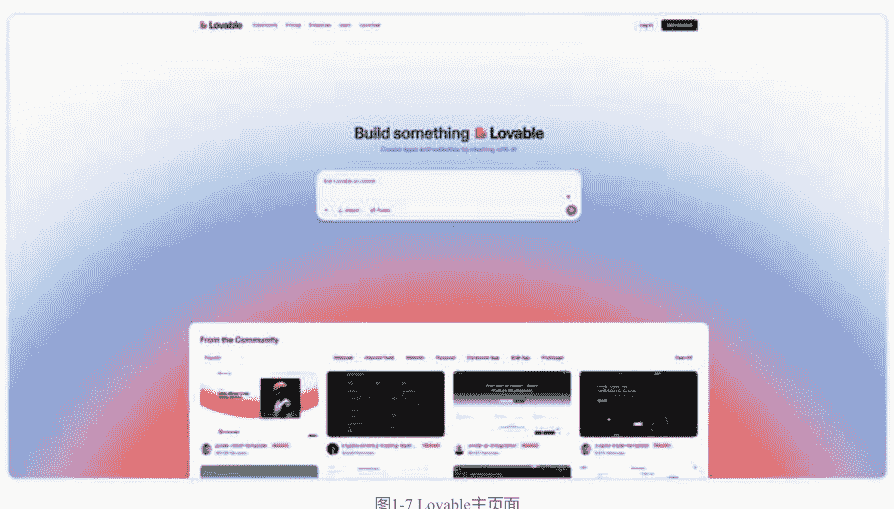
图1-7 Lovable 主页

2. 顶部右侧点按 Get started，依照引导完成注册。

3. 注册后返回主界面，把简单需求写进中央输入区，如图1-8。

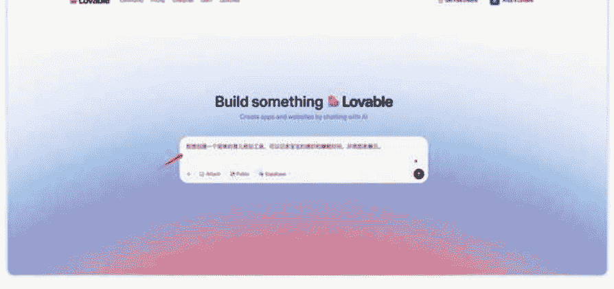
图1-8 输入一句话

回车即刻触发实时刷新——模型读懂意图并启动构建。很快出现可操作界面，能看到“喂奶记录”和“睡眠记录”两组填写区，如图1-9。

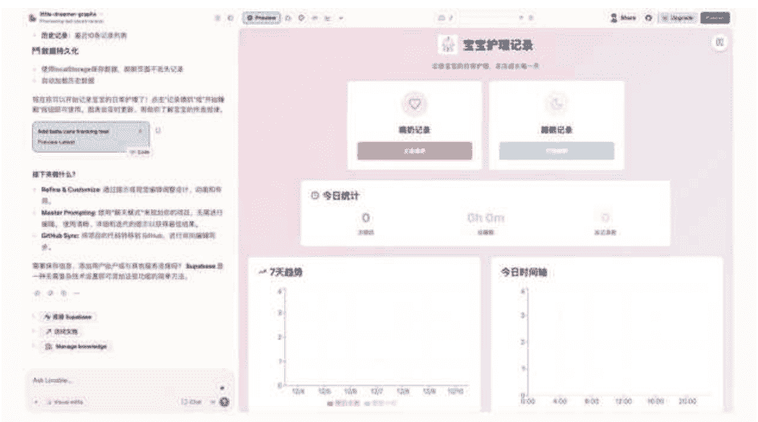
图1-9 由 Lovable 生成的界面

下方自动出现了简易图表。这不是静态示意，而是后台在同步完成全链路开发：产出真实前端代码、搭建后端逻辑并配置轻量数据库。结束后会提供可公开访问的链接，便于一键分享成果，见图1-10。

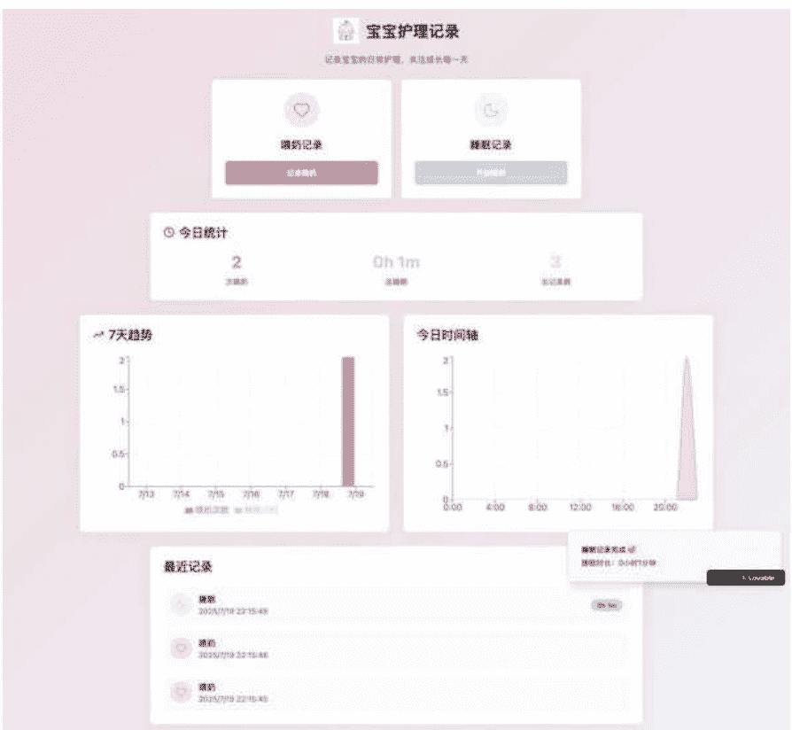
图1-10 最终产出应用

几分钟之内，你会体会到那种关键的鼓舞感——“它真的能跑”。

呈现出来的不是线框草图，也不是虚假演示，而是一个可交互、能运行的软件。这种即时而强烈的正向反馈，正是传统学习路径里缺失的一环。它用事实宣告一个颠覆性认知：即便没有技术背景，你也能亲手造出可用的软件。创造，原来可以如此轻盈。

#### 1.1.5 小结
回溯开篇的威利·旺卡寓言，它生动说明了创意与落地能力脱节时的遗憾。

而刚才几分钟的体验，就是把灵感迅速兑现的过程。你已跨过“想”与“做”之间的鸿沟。

这可能只是粗糙原型，功能有限、外观平淡，皆可接受。关键在于，你已从梦想家转向创造者，找到了点燃创作之火的方法。

接下来要学的是如何更好地驾驭 AI 这一强力协作者。你会像导演那样，用精准的对话引导与敏锐的迭代反馈，把手里的小火苗培养成熊熊烈焰，将像1.1.4小节里那样首个应用打磨成真正有价值、独一无二的作品。

真正的创造之旅，才刚刚启程。

### 1.2 独立开发者的思维工具箱
你是否脑中闪过一个宏大设想？可能是颠覆行业的平台，或改写规则的应用。你甚至预演了动画细节、数十项功能、完美界面，还有发布会那天的 T 恤。

可点子始终困在脑袋里，成为未竟遗憾。

根源往往是设想过于庞大、追求过度完美，导致无从下手。每每想启动，“完美”这座大山便让人窒息。于是那个妙想和无数创意一样，永远留在想象里。

这就是“全有或全无”的思维陷阱，既困住新手也干扰资深创造者。我们总想一步到位造出航空母舰，却忘了任何伟大航程都始于能下水的木船。

下面介绍一套面向独立开发者、适配 Vibe Coder 的思维工具箱。包含五大核心原则，它们不是僵化规则，而是灵活的思维方式，帮助你管控复杂需求、降低风险，让创作既有趣又可持续。

#### 1.2.1 原则1：由微小处启航
接受“先小后大”的理念后，下一步是为这艘小船绘制航线，哪怕只是草图。

##### 1. 先锁定核心功能
先说科技圈熟知的 MVP。它并非最有价值球员，而是指“最小可行产品”。概念由精益创业先驱埃里克·莱斯提出，其定义是：用最少投入换取对用户认知最多的产品版本。

通俗说法，MVP 是产品的极简化身，只保留解决用户核心痛点的部分，但必须可用、能走完核心流程、给用户闭环体验。这里的“小”不是差或半成品，而是专注与智慧。目标是在重金投入前，用最低成本验证想法是否有人买单，如图1-11所示。


##### 2. 纸杯蛋糕法则
设想你想开一家闻名世界的蛋糕店，有两种路径。

婚礼蛋糕模式：花一年时间耗尽积蓄，闭门研发七层豪华婚礼蛋糕，相信惊艳全场。

纸杯蛋糕模式：用一周时间和有限预算打磨一款口味佳、外形可爱的纸杯蛋糕，周末推着餐车在市集试卖。

前者风险极高，口味或需求失误便全盘皆输。后者正是 MVP 思想的体现。

这只小纸杯蛋糕是完整、美味、能带来愉悦的产品。它能实现三件事：用顾客即时反应验证想法是否受欢迎；收集真实反馈，比如“奶油甜度可降”“想要巧克力口味”；通过销售证明价值并为下一步提供资金。

只有纸杯蛋糕大获成功，证明理念可行后，才有资本去做双层蛋糕，再挑战七层婚礼蛋糕。独立开发同理：在造“婚礼蛋糕”式完美产品前，先用“纸杯蛋糕”式最小可行产品验证市场，这就是从想法到落地第一步。

##### 3. 巨头的起点
几乎所有耳熟能详的科技巨头，都始于简陋甚至粗糙的 MVP。

爱彼迎从三张气垫床起步。2007 年旧金山设计峰会酒店爆满，创始人布莱恩·切斯基和乔·戈比亚为房租发愁。他们没做完整预订平台，而是上线极简网站，展示阁楼三张气垫床照片并承诺提供早餐。这个叫 Airbed & Breakfast 的 MVP 迎来三位付费客人，既解燃眉之急，也验证了“人们愿为本土化体验住进陌生人家”的颠覆模式。

Zappos 的绿野仙踪式 MVP。1999 年，创始人尼克·斯威姆想验证网购鞋子的需求。他没租仓库备货，而是去本地鞋店拍照上网，顾客下单后他再回店买鞋打包寄出。对用户而言背后像有强大系统，实际是创始人手动操作。这个零库存风险的 MVP 证明了需求并验证了商业模式。


图1-12 Zappos 网站

这些故事传递的核心是：MVP 的价值在学习而非完美。首个产品的首要任务是回答“我的想法是否有人在乎”。对非技术创作者而言，首个 MVP 甚至可以不写代码，比如一间出租房、手工服务或收集邮箱的登录页。立刻行动验证，无需等技术全学会，这就是由小处启动的力量。

#### 1.2.2 原则2：规划你的构建
动笔前先把思路落地。原则1回答做什么，原则2回答怎么做。

##### 1. 一份简洁计划，是通往现实的捷径
很多人想象创造是天才在灵感驱动下快速敲代码，作品横空出世。现实是，混乱灵感只能产生碎片代码，稳定可用产品需要清晰计划。

这里引入 PRD，产品需求文档。我们倡导轻量版——最小可行 PRD。你可以把它看作一页纸的项目蓝图，能明确三件事：目标是什么，要做什么产品；为谁而建，目标用户是谁；为何而建，解决什么核心问题带来什么好处。

它不是铁律，而是活文档，可随项目调整。作用是给自己和 AI 编程伙伴一个清晰一致的行动指引。

##### 2. “最小可行 PRD”实践
启动项目前，花点时间填完下面的极简模板，这个梳理本身就是战略思考。

表1-2 最小可行 PRD 模板

| 组件 | 问题指引 | 你的答案（示例：“15分钟快手厨房”App） |
| :--- | :--- | :--- |
| 项目名称 | 给项目一个清晰名字 | “快手厨房” |
| 项目概述 | 一两句话说明这是什么、为谁服务、解决什么问题 | “快手厨房”面向忙碌年轻父母，提供可在15分钟内完成的健康食谱，解决没时间做饭的痛点 |
| 目标用户 | 描述核心用户画像、生活状态、痛点 | 姓名：张丽，32岁，市场经理，两个孩子母亲；痛点：下班晚时间紧，想做健康晚餐却没精力研究食谱，常点外卖 |
| 核心问题 | 产品要解决的最关键问题 | 如何让忙碌父母在15分钟内用简单食材做出健康美味晚餐 |
| 必须具备的功能（MVP） | 列出解决核心问题绝对必需的3~5个功能 | 食谱浏览、食谱详情页含食材步骤和耗时、内置计时器、按食材搜索 |
| 明确不做什么 | 为保持专注，列出本版坚决不做的功能 | 用户注册登录、社区分享评论、购物清单生成、卡路里计算 |
| 成功指标 | 如何判断MVP成功 | 一个月内下载1000次，平均每周打开2次以上 |

完成这份 PRD 能帮你避开常见陷阱。在 AI 时代，PRD 更是与 AI 沟通的基石。模糊指令“帮我做个食谱应用”会得到空洞结果，而基于 PRD 的清晰提示——“为‘快手厨房’创建食谱详情页，目标用户时间紧张，界面极简，需大图、固定格式食材清单、编号步骤，暂不加评论分享”—才可引导 AI 产出精准代码。

#### 1.2.3 原则3：迭代，而非堆砌
有了地图就要出发，但别指望一口气抵达。原则1确定小山，原则2画出路线，原则3教你节奏：如何稳健持续推进，而不是半路力竭。

迭代，意味着把开发拆成一系列微小循环：做一点、测一下、改一下，再进入下一轮。这与一次性堆砌所有功能直至发现地基倾斜截然不同。

践行迭代可遵循“三不”原则：

别同时推进多项功能，集中精力一次攻克一个点，做深做透；
缺陷逐个解决，避免同时处理多个 Bug 导致混乱遗漏；
开发流程严格遵循构建-测试-修复的微循环，不要为赶进度省略测试，以免小问题累积成大隐患。

##### 2. 敏捷的厨师

再把镜头拉回厨房。真正的高手厨师，工作方式本质上就是循环往复的迭代。他不会把所有食材一次性倒进锅里，然后干等着奇迹发生。他的节奏大致如下面这张图。


图1-13 顶尖厨师的迭代闭环

1. **开局就绪**（各就各位）：这是迭代的第0步，和你的PRD异曲同工。厨师会先把食材洗净切好，按照类别分装进小碟，刀具砧板也提前摆好。这一手准备，为后面不掉链子打下基础。

2. **先抓主线**（打磨核心）：他会先锁定菜品的核心。做法式洋葱汤时，会全身心投入炒洋葱，直到焦糖化完美为止，期间绝不会分心去烤面包或拌沙拉。这和你先集中火力把应用的第一个核心功能，比如食谱浏览页，做扎实是一个逻辑。

3. **边做边尝**（试吃调味）：每推进一步，厨师都会尝。汤底起锅前尝一口，淡了就补盐，腻了就挤几滴柠檬。一次品尝就是一次小测试，一次调味就是一次快速调试。和你做完一个功能立刻上手点点看、有没有bug、流程是否顺滑，本质完全一致。

4. **收尾拼盘**（集成上桌）：只有汤底、奶酪、面包片这些单品都各达到理想状态后，他才会组合装盘呈现。同样地，你也得等每个小功能独立可用后，再合并到整套应用里。

这种循环式烹饪，保证了每道菜的每个环节都是高水准。软件开发也一样，用“一次只做一件事”的循环，把质量主动注入每个细节。

这和传统的瀑布式开发截然不同。瀑布像盖楼，流程线性不可逆。封顶后才发现地基出问题，代价极高。而迭代更像养花，先种一小块，观察长势随时调整。软件本就是需要持续演进的花园，迭代是最合适的照料方式。

坚持这种节奏，会得到明显回报。

- **认知更轻**：大脑只需要盯住一个小而明确的任务。
- **反馈更快**：每完成一个小循环就能看到实在进展，对保持动力很关键。
- **问题更清**：应用出错时，基本能立刻定位到刚完成的小功能。

就像耐心的好厨师和园丁那样，专注手头的下一件小事并做到极致，才是最稳妥也最快的通往好产品的路径。

#### 1.2.4 原则4：把验证做成习惯

当当前功能在迭代中成型后，还需要用可靠手段把成果锁住，为下一步探索留退路。这就引出第4个核心原则。

##### 1. 把质量保证植入思维

第一个小功能按迭代原则搭好后，下一步该干嘛？很多人会急着开新坑。但必须先明确第4个关键原则：测试一切。

质量保证不是开发末端的工作，而是一开始就要融入头脑的模式。目标不是去证明应用能跑，而是化身好奇的“破坏者”，主动去逼功能极限，在用户发现之前把令人沮丧的漏洞揪出来。

##### 2. 戴上侦探帽

怎么培养QA思维？把自己当成侦探。好侦探从不轻信表面，会带着质疑刨根问底。面对刚写好的功能，可以这样盘问：

- “这个按钮真的好用吗？”点一下看是否跳转到预期页面。
- “在什么情况下会失效？”挖掘边界情况。
- “用户会怎么乱用？”除了常规路径，还有哪些意外的操作方式。

这种思维能让你从偏爱作品的“创造者”，切换成客观冷静的“评估者”。创造者总想证明完美，侦探只关心真相。

##### 3. 非技术人员的侦探工具箱

会不会测试需要技术？其实很多有效手段只靠好奇、同理心和一点捣蛋劲儿。

- **真实用户观察**：找一个对项目完全陌生、也不懂技术的亲友，把应用递过去，然后闭嘴看着。不要提示，不要解释。他卡在哪、哪个按钮让他困惑、脸上出现迷茫，都是设计缺陷的信号灯。只有他能零阻力完成任务，才算真正友好。
- **边界值探针**：听起来专业，其实就是试边界。比如年龄输入框要求18到99。
  - 边界内：输18和99，看是否正常通过。
  - 边界外：输17和100，看是给出友好提示还是直接崩。
  - 极端值：输0、-1、999，反馈如何。
  - 错误类型：输“二十”、表情符号，或空着直接点确定。
- **故意捣乱**：模拟恶意用户。
  - 在姓名框粘贴一篇三千字小说。
  - 同一个按钮狂点100次。
  - 断网打开应用会怎样。
  - 反复切换横竖屏，界面是否错乱。

这些测试都在挑战你作为开发者时的“理所当然”。好产品要优雅地处理意外。每次成功把自己的应用“搞崩”，都不是失败而是胜利，你提前在真实用户之前发现了问题。做自己产品的第一位挑剔用户，就是QA的精髓。

#### 1.2.5 原则5：用版本控制上保险

功能通过测试后，下一步就是给它买份保险，让每次改动都能记录和回滚。这就是最后一位主角：版本控制。

##### 1. 开发者的终极后悔药

版本控制是独立开发的核心利器，主角是Git和它的云端家园GitHub。

Git装在本地，像一位严谨的档案员，记录项目文件的每一次改动；GitHub是云端保险柜，保存项目和完整历史。从第一天起养成使用习惯极其重要。

##### 2. 用游戏存档理解Git

把开发比作一款大型角色扮演游戏。

- **代码仓库**：对应游戏的完整世界文件。
- **提交**：就是存档。每完成一个小任务，比如修一个bug、加一个小功能，就立刻提交一次，相当于在当前位置建一个存档点，并写备注如“修复登录按钮bug”。
- **分支**：相当于新建一个独立存档位。想挑战风险高的Boss或尝试可能影响主线的支线时，先基于当前进度新建分支去试。
  - 成功了，就通过合并把宝剑带回主线。
  - 失败了，主存档main安然无恙，删掉失败分支、读回主存档即可。
- **GitHub云存档**：本地存档后，通过推送同步到GitHub。电脑坏了也不怕，换台机器登录就能完整找回项目和历史。

对独立开发者而言，版本控制的核心价值是心理安全感，进而释放创造力。担心改坏整盘棋会扼杀灵感。Git消除了这种恐惧：想大胆试新功能时，从main新建分支作为支线存档，放心实验。成功就合并，失败就删分支，试错成本几乎为零。这种安全网让你敢冒险、敢迭代。


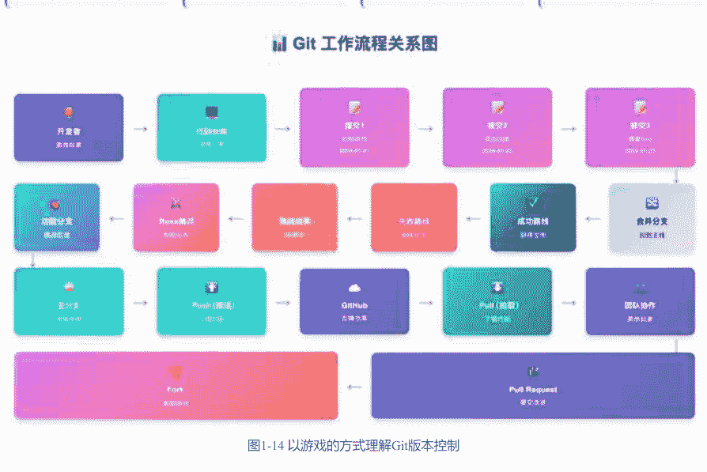

图1-14 用游戏存档理解Git版本控制

#### 1.2.6 建立你的“思考-提示-迭代”闭环

你已经拿到五把钥匙，接下来要理解它们在AI时代为什么更重要。前五个原则分别是从小处着手、规划构建、迭代而非堆砌、测试一切、使用版本控制。你可能会问，为什么在AI时代反而更关键？

答案藏在Vibe Coding背后。

##### AI越不可测，流程必须越严

Vibe Coding是和AI编程工具协作的状态：你不再逐行写代码，而是像指挥乐队，向才华横溢却爱即兴的AI音乐家描述“感觉”，由它演奏代码旋律。自由且高效，但风险也高：AI本质是模式匹配，不真懂世界，会犯错，会一本正经胡说八道，即“幻觉”。

几个近期案例很说明问题。

- **过度听话的销售**：一家雪佛兰经销商的客服聊天机器人，被用户引导后同意以1美元卖一辆全新Tahoe，还称具有法律约束力。
  - 启示1：AI不理解商业常识。
- **捏造政策的律师**：加拿大航空的客服机器人自信承诺不存在的退款政策，顾客起诉后法庭判航空公司为机器人谎言买单。
  - 启示2：AI会用绝对自信陈述虚假事实。
- **离谱的厨师**：用户在谷歌AI Overviews问如何防止披萨奶酪滑落，AI建议加入无毒胶水。
  - 启示3：建议可能语法完美但内容危险离谱。
- **有偏见的艺术家**：谷歌Gemini生成历史人物图像失实，更早的微软Tay与网友互动后发表大量不当言论。
  - 启示4：AI并非中立，会放大训练数据中的偏见。

这些翻车指向同一结论：大语言模型是强大的创造力放大器，但根本不可靠。

#### 1.2.7 小结

思考一个问题：如果团队里最核心的成员是个时而天才时而犯错的实习生，你会像他一样随性吗？

答案是否定的。工具越自由不可预测，驾驭者的流程就必须越严谨、有纪律。这正是五大原则的价值，它们构成安全高效驾驭AI的框架。

- **从小处着手**，因为要先在小而可控的问题上检验AI输出质量，而不是直接生成庞大应用。
- **规划你的构建**，因为需要一张清晰蓝图PRD，给AI精准指令并以此判断产出。
- **迭代而非堆砌**，因为要小批量审查AI成果，不能等整个应用出来才发现第一步就理解错了。
- **测试一切**，因为永远不能盲信AI输出，必须扮演多疑侦探验证每个陈述、戳破幻觉。
- **使用版本控制**，因为AI可能在某次灵感爆发时生成毁掉项目的代码，需要一键读档回到犯错前的稳定版本。

这五条原则不是枷锁，而是攀登路上的护栏。正因为有护栏，你才敢大胆加速，最终安全抵达目标，做出真正属于自己的作品。

## 3.巨头们的起点

几乎所有如今熟知的科技巨头，起点都是一个简陋甚至粗糙的MVP。

- **爱彼迎：从三张气垫床起步**
2007年旧金山一场设计峰会，酒店爆满。创始人布莱恩·切斯基和乔·戈比亚为房租发愁，灵机一动把公寓空闲地出租。他们没做完整预订平台，而是搭了个极简网站，上了阁楼三张气垫床的照片，还承诺提供早餐。项目叫Airbed & Breakfast，就是Airbnb的前身。三位付费客人不仅解决了房租，更验证了颠覆性模式：人们愿意为更实惠本土化体验住进陌生人家。

- **Zappos：绿野仙踪式MVP**
1999年，创始人尼克·斯威姆想验证人们是否愿意网购无法试穿的鞋。他没租仓库囤货，而是去本地鞋店拍照，照片上传到网站。有订单就立刻回店买下再寄出。用户感觉背后是强大自动化和庞大库存，实际幕后是手工操作。这招零库存验证成功证明了需求，Zappos几乎无风险地验证了核心模式。


图1-12 Zappos早期网站

这些故事传递的核心是：MVP的价值在于学习，而非完美。第一个产品的首要目的不是赚钱或惊艳，而是回答“我的想法有人在乎吗”。对非技术创作者来说，第一个MVP甚至可以无代码：像Airbnb的出租房、Zappos的手工服务，或一个收集邮箱的登录页。从今天起就能验证想法，无需等技术全学会。这正是“从小处着手”的真正力量。

#### 1.2.2 原则2：把思路先落到纸上

动手前，先让思路落地。如果“从小处着手”是定做什么，那么“规划你的构建”就是讲怎么做。二者相辅相成。

### 1.一份轻量计划是最快捷径

很多人幻想天才开发者灵感迸发手指飞舞，最终产品横空出世。现实是，零散灵感只能产生代码碎片，稳定可用产品离不开清晰计划。

这里引入PRD，产品需求文档。我们主张更轻的“最小可行PRD”。它像一页纸的项目蓝图，能明确三件事：

- 要做什么；
- 为谁做；
- 为了解决什么问题、带来什么好处。

它不是刻板律法，是活文档，可随项目演进更新。对你和AI伙伴都是清晰一致的行动指引。

### 2.最小可行PRD上手模板

启动任何项目前，花点时间填完下面这张表，梳理本身就是战略思考。

表1-2 最小可行PRD模板

| 模块 | 需要回答的问题 | 你的答案示例：“15分钟快手厨房”App |
| :--- | :--- | :--- |
| 项目名称 | 项目叫什么 | 快手厨房 |
| 项目概述 | 用一两句话说明是什么、为谁服务、解决什么问题 | 为忙碌年轻父母设计的移动应用，提供15分钟可完成的健康食谱，解决没时间做饭的痛点 |
| 核心用户 | 用户是谁、生活状态、痛点 | 张丽，32岁，市场经理，两个孩子母亲。下班晚时间紧，想做健康晚餐却没精力研究食谱，常点外卖 |
| 核心问题 | 产品要解决最关键的一个问题 | 如何让忙碌父母15分钟内用简单食材做出健康美味晚餐 |
| MVP必备功能 | 解决核心问题绝对必需的3~5个功能 | 食谱浏览，支持分类；食谱详情页，展示食材步骤和耗时；内置步骤计时器；按食材搜索 |

先划清边界，PRD才是独立开发的第一道防线

| 明确不做什么 | 为保持专注，首个版本坚决排除的功能，防止功能蔓延 | · 用户注册和登录系统<br>· 社区分享和评论功能<br>· 购物清单生成功能<br>· 卡路里计算功能 |

| 成功指标 | 判断MVP是否达标的简单量化标准 | 首月安装量达到1000次，且人均每周启动次数保持在2次以上 |

把PRD写下来，能帮独立开发者避开不少常见陷阱。

- **服务对象**：避免做那种看起来人人能用，实际上没人真想要的泛化产品。
- **核心问题**：确保产品有明确的存在价值，别做无用功。
- **必须具备的功能**：把MVP范围精确框定，抵御功能越多越好的诱惑。
- **明确不做什么**：像防火墙一样，拦住精力被次要需求消耗。
- **成功指标**：起步就用数据衡量价值，而不是凭感觉推进。

这份计划是你与未来的自己对话，锁定最初最核心的决策。更关键的是在生成式模型普及的当下，这份PRD是你与模型协作的基础。给出模糊指令如“帮我做个食谱应用”，得到的结果必然空泛；而基于PRD给出清晰指令，如“为‘快手厨房’App创建食谱详情页：目标用户是时间紧张的父母，界面必须极简，需包含三部分——一张主图、固定格式的食材清单含名称和用量、带编号的烹饪步骤，暂不加入评论区和分享按钮”，就能引导模型产出可直接落地的代码。

#### 1.2.3 原则3：迭代，而非堆砌

有了路线图就要出发，但别指望一次直达。原则1帮你选定攀爬的小山，原则2画出路线。现在要掌握攀登节奏：稳健持续前进，而非半路耗尽。原则3正是解决此问题。

### 1.迭代的原则

计划明确后进入建造，要引入第三个核心观念：迭代，而非堆砌。

迭代是将开发拆成一系列可控的小循环：先实现一小块功能，验证，优化，再进入下一轮。堆砌则是想一次性搭建全部功能，最后才发现地基倾斜，返工成本极高。

践行迭代可遵循“三不”。

- **不并行开多个功能**：集中精力，单次只攻克一个点，做到深透。
- **不并行修多个问题**：发现缺陷后逐个击破，避免同时处理多个bug导致混乱。
- **不跳过开发步骤**：严格遵守“构建-测试-修复”的微循环，不要为赶进度省略测试，让小问题累积成隐患。

### 2.敏捷的厨师

回到厨房。优秀厨师的工作天生迭代。他绝不会把所有食材一并倒进锅里祈祷出美味。他的流程如图1-13所示。

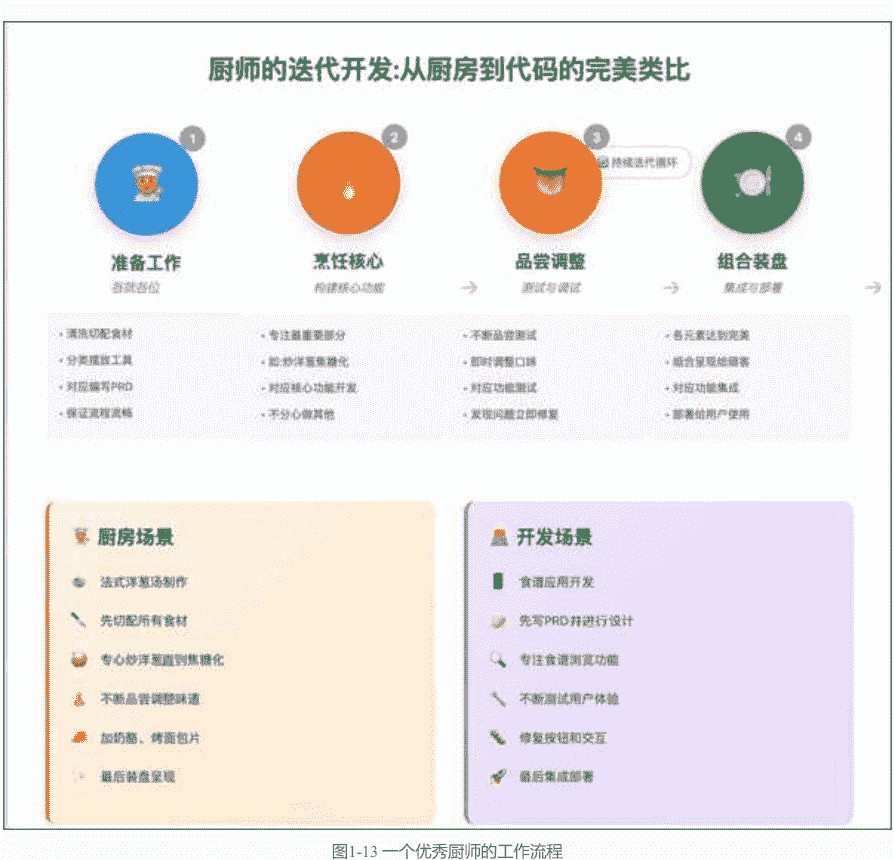

图1-13 一个优秀厨师的工作流程

1. **准备工作**即迭代的第0步，对应PRD。厨师会把食材清洗切配，分装进小碗，工具摆设井井有条，为后续烹饪打底。
2. **烹饪核心**即构建核心功能。做法式洋葱汤时，他会先全神贯注炒洋葱，直至达到理想焦糖化，此时绝不分心去烤面包或备沙拉。类比到应用，便是集中资源把“食谱浏览”这类首个核心页面做出来。
3. **品尝调整**即测试与调试。每一步厨师都会品尝。汤底完成后尝一口，盐不足就补，偏腻就挤柠檬。每一次品尝是微测试，每次调整是快调试，与你完成一个功能后立刻试用、查缺陷、看流程顺畅与否一致。
4. **组合装盘**即集成与部署。唯有汤底、奶酪、面包片各自达标，厨师才会组合呈现。同样，你也应确保每个小功能独立可用后再集成到整体。

迭代式烹饪保证各部分高质量，软件亦然。通过“单次只做一件事”的循环，主动把质量注入细节。

这与瀑布式开发形成鲜明对比。瀑布像盖房子，线性不可逆，封顶后才发现地基问题代价巨大。迭代更像照料花园，先种一小片观察生长，再随时调整。软件本就是需要持续演进的花园。

遵循迭代原则的好处明显。

- **降低认知负荷**：大脑只需聚焦一个明确微任务。
- **快速获得成就感**：每完成一个小循环都能看到进展，有助于保持动力。
- **问题易于定位**：出错时几乎立刻锁定在刚完成的那块上。

像耐心的厨师或园丁，专注于手头的下一件小事并做到最好，才是最稳健也最快的路径。

#### 1.2.4 原则4：测试一切

功能质量经测试保障后，还需可靠保存成果，为下一步探索提供安全垫。这引出第4个核心原则。

### 1.植入质量保证思维

首个小功能按迭代原则构建后，接下来该做什么？不少新手会急着开下一个功能。但此时必须明确：测试一切。

质量保证不是开发末端的收尾，而是从第一天起就应融入思维模式。目标不是“证明”应用能用，而是化身好奇的破坏者，主动冲击功能边界，在用户踩坑前把漏洞找出来。

### 2.友好的侦探

如何培养QA思维？把自己当侦探。好侦探从不轻信表面，带着质疑逐层追问。面对刚写好的功能戴上侦探帽：

- “这个按钮真的能用吗？”点击验证是否跳转至目标页。
- “什么情况下会失灵？”挖掘边缘案例。
- “用户会有哪些意外操作？”除常规流程外，还有哪些潜在使用路径。

这种侦探视角，能帮你从主观创造者转变为客观评估者。

### 3.非技术人员的侦探手册

“我不是技术专家，如何测试？”好消息是，很多有价值的测试不需要技术背景，只需好奇、同理和一点捣蛋精神。

- **用户测试**：找一位对项目完全陌生且技术不熟的朋友或家人，把应用交给对方然后保持沉默观察。不要提示不要解释。卡住处、困惑按钮、脸上的茫然，都是指向设计缺陷的信号。只有毫不费力完成任务才算真正友好。
- **边界值分析**：试探输入范围的边缘及之外。
    - 示例：年龄输入框要求18～99。
    - 测试边界：输入18和99，验证是否正常响应。
    - 测试边界外：输入17和100，看是合理提示还是直接崩溃。
    - 测试极端值：0、-1、999的反馈如何。
    - 测试错误类型：输入“二十”、表情符号或空值直接点确定。
- **压力测试**：假装恶意用户做点出格的事。
    - 在姓名框粘贴三千字小说。
    - 快速连续点击同一按钮百次。
    - 断网状态打开应用。
    - 反复切换横竖屏检查界面是否错乱。

测试本质是挑战开发者“理所当然”的假设。好产品必须优雅处理意外。记住，每一次成功把自己的应用搞垮都不是失败，而是胜利——你提前发现问题。成为产品第一位也是最挑剔的使用者，这正是QA精髓。

#### 1.2.5 原则5：使用版本控制

功能通过测试、质量确认后，下一步是给它上保险，让每一次改动可记录、可回滚。这就是版本控制。

### 1.项目的终极“后悔药”

版本控制是独立开发者的核心利器，代表工具为Git，在线家园为GitHub。

Git装在本地，像严谨档案管理员，记录文件每次修改；GitHub是云端保险柜，保存项目及完整修改历史。从启动第一天起养成习惯至关重要。

### 2.电子游戏的存档点

把开发项目比作大型角色扮演游戏，你是主角。

- **代码仓库**：对应游戏完整文件，囊括世界全部内容。
- **提交**：即存档。每完成一个小任务如修复缺陷或新增小功能，就立即提交一次，创建存档点并附备注如“修复了登录按钮的bug”。
- **分支**：相当于新建独立存档位。要挑战危险Boss或尝试可能影响主线的支线任务时，先基于当前进度新建分支去试。
    - 挑战成功，可通过合并把成果带回主线。
    - 挑战失败，主分支安然无恙停在挑战前，删掉失败分支读回主分支即可恢复。


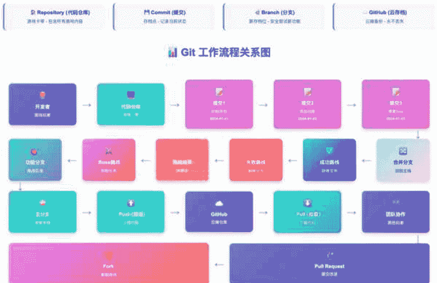

图1-14 以游戏方式理解Git版本控制

- **GitHub**：云存档。若本地电脑损坏，数月心血可能丢失。提交后通过推送把存档同步到GitHub，换电脑登录即可完整找回项目和历史。

对独立开发者而言，版本控制核心价值是心理安全感，从而释放创造自由。担心改坏项目的顾虑会扼杀创意。Git消除这种恐惧：尝试大胆新功能时，从主分支新建分支作为支线存档，在其上尽情实验。成功就合并，失败就删分支，试错成本几乎为零。这种安全网鼓励大胆冒险迭代，是创新的底气。

#### 1.2.6 建立你的“思考-提示-迭代”循环

你已手握五把钥匙，接下来理解其深层价值。前面拆解了五大原则——从小处着手、规划构建、迭代而非堆砌、测试一切和使用版本控制。但你可能疑惑：这些原则看似传统，为何在模型驱动时代愈发重要？

答案藏在Vibe Coding背后。

##### AI越不可预测，流程就必须越严谨

Vibe Coding描述与模型编程工具协作的状态：你不再逐行写代码，而是像乐队指挥，向才华横溢却时而即兴的模型音乐家描述“感觉”，由它演奏出代码旋律。

这种方式自由高效，但风险明显：模型本质是模式匹配机器，并未真正“理解”世界，会犯错，会一本正经胡说八道，即幻觉。

几个近期案例：

- **过于听话的汽车销售员**：一家雪佛兰经销商客服聊天机器人被用户引导后，同意以1美元出售全新Tahoe SUV，并称具有法律约束力。
    - 启示1：模型可能完全不懂商业常识。
- **凭空捏造的律师**：加拿大航空客服机器人自信承诺公司根本不存在的退款政策，用户据此起诉，法庭判航空公司为机器人谎言买单。
    - 启示2：模型会以绝对自信陈述虚假事实。
- **荒谬绝伦的厨师**：用户在谷歌AI Overviews搜索“如何防止比萨奶酪滑落”，模型建议混入无毒胶水。
    - 启示3：模型产出可能语法完美但内容危险离谱。

#### 1.2.7 小结

•带有偏见的艺术家：谷歌Gemini生成历史人物图像时出现不符合史实情况。更早微软Tay与网友互动后迅速学会发表不当言论。

启示4：模型并非客观中立，会放大训练数据中的偏见。

这些翻车指向共同结论：大语言模型是创造力放大器，但本质上不可靠。

思考：当团队里最核心成员是一个时而天才时而犯错的实习生时，你能随性吗？答案是否定的。工具越自由不可预测，驾驭者流程就必须越严谨。这正是五大原则的价值。

- 从小处着手，因需先在小而可控问题上验证模型输出质量。
- 规划构建，因需清晰蓝图PRD给模型精准指令并以此判断产出。
- 迭代而非堆砌，因需小批量审查成果，绝不能等整个应用出来才发现第一步就误解意图。
- 测试一切，因永远不能盲信输出，必须扮演怀疑侦探戳穿幻觉。
- 使用版本控制，因模型可能在一次灵感中生成毁掉项目的代码，需能一键读档回到稳定版本。

这五大原则不是束缚创造力的枷锁，而是崎岖路上的护栏。有了它们，你才敢大胆前行加速冲刺，最终安全抵达目的地。

### 1.3 你的AI副驾驶：掌握提示的艺术

欢迎来到驾驶舱。本节教你操控模型这架强大飞机。若你觉得与模型对话像隔着毛玻璃猜谜，时而惊喜时而沮丧，这里能解开困惑。我们揭开提示工程面纱。

虽然叫工程，但与复杂编程无关。设想你得到一盏许愿神灯。你擦亮，模型精灵出现。你说：“给我吃的！”精灵一弹指，你手心多了一粒生米。你愣住。它确实满足要求，却没领会真实意图。

这就是核心挑战：模型能力惊人，却缺乏人类常识和默契，只按字面执行。提示工程本质是把模糊愿望转化为精确指令，把“一粒生米”变成“热气腾腾的蛋炒饭”的秘诀。

我们将用4个黄金法则让你从困惑许愿者蜕变为模型主人，并用五分钟实战见证效果。

#### 1.3.1 提示工程入门：从命令到对话

模型输出质量几乎完全取决于输入指令质量。就像搜索引擎，早期需靠布尔运算符，现在口语也能推断意图。提示工程目标不是寻找，而是创造。

关键心态转变：与模型互动不是单向命令，而是一场双向对话。

初学者常犯错误是第一次不满意就放弃。输个简单指令得到烂结果就判定模型不行。就像对实习生说“做个报告”，看到格式混乱草稿就认定他没用。

事实上模型像知识渊博却缺乏实践经验的超级实习生。它需要你这位总监给出清晰任务简报：受众、重点、格式偏好。第一次指令只是开场白，真正的价值在后续追问、澄清和调整中。

下面提供一套系统方法论，帮你摆脱沟通不畅，进入高效协作。

#### 1.3.2 提示工程的“四大法则”：从导演到蓝图

现在学习4个简单却强大的黄金法则。它们环环相扣，核心目标是系统性缩小模型的可能性空间。

# 让AI不再瞎猜的四条沟通准则

丢给模型一句含糊的请求，得到的结果就像撒进大海的网，什么都有却什么都不准。诸如“写点猫相关的东西”这种表达，会同时触发诗歌、学术论文、店铺策划、卡通剧本等无数分支。它们都算合规，却很难命中你真正想要的那一个。

要收紧这个发散面，需要一套过滤机制。下面四条实践经验，可以把宽泛的空间压缩到唯一的目标上。

- 导演式设定：先剔除无关的身份与场景
- 地图式供给：给创作一条清晰的路径与参照
- 蓝图式结构：让交付形态提前可预期
- 对话式校准：在交流中不断修正航向

# 1. 导演式设定，给AI一个明确身份与意图

把模型想象成演员，你是导演。平庸的导演只说“伤心一点”，演员只能自行脑补；优秀的导演会给情境与动机：“你饰演刚失去爱宠的男人，不要掉泪，用空洞的眼神一直盯着手里空荡荡的牵引绳，把那种深入骨髓的空洞演出来。”

和模型交互同理。下面这个好记的框架 PROMPT 能帮你快速进入导演状态。

- P Persona 身份：先给模型一个具体的人设。这是投入最小、回报最快的手段，能迅速锚定语境、知识范围与表达方式。研究表明，仅赋予角色就能明显提升回答质量。
  - 常规说法：“解释一下区块链。”
  - 导演级说法：“你是一名高中信息技术老师，请用16岁学生能理解的比喻来解释区块链。”

- R Request 请求：以明确动词开头，避免含糊。如撰写一份、概括以下、把这段译成、头脑风暴五个、批判性评估、改写等。

- O Output 输出：提前说明想要的呈现形式，后文会展开。

- M Mood 语气与风格：界定调性，如轻松幽默、正式学术、鼓励友好。

- P Purpose 目的：说明为何需要、给谁看、要达成什么效果。明确受众能显著改善生成结果。例如“文案目的是吸引新客下单”“报告读者是对数据持怀疑态度的老板”。

- T Template 模板示例：提供一个样例供模仿，后文详述。

额外原则：多说要做什么，少说不要做什么。

这是 OpenAI、Google 等厂商共同倡导的做法。就像导航，直接说“带我去图书馆”，而不是罗列一堆禁止去的地方。正向指令更清晰高效。

- 负面例子：“写一段产品描述，不要用技术术语。”
- 正面例子：“请用日常通俗语言写产品描述，确保零技术背景的新手也能轻松读懂。”

# 2. 地图式供给，用上下文与示例牵引

让朋友去陌生城市取件，你不会只给地址，会递上地图甚至目标楼的照片。模型也同样需要示例和清晰的信息划分来对齐预期。核心有三点：展示而非告知、使用分隔符、从给示例到教会模型自我举例。

展示的力量

看一个样本比千言万语管用。给模型一个风格范例，它就能模仿语气、格式与逻辑。

- 指令：“用更有冲击力的风格重写。风格范例：‘那不是一辆车，那是为灵魂打造的镀铬火箭。’ 原句：‘这款新软件很高效。’”
- 可得：“这款软件不只是高效，它是为工作流装上的数字喷气引擎。”

用分隔符画围栏

提供背景或示例时，用明显标记隔开，避免模型把示例当成指令。可使用三引号、三反引号，或 <例子> 这类标签。

示例指令结构如下：

```
请将以下文本总结为三个要点。
文本：
"""
[在此处粘贴一篇长文章]
"""
```

从给示例到让模型自举例

找示例耗时，提示工程的演进方向就是让模型自己生成参照。

演进路径大致为：零样例 → 少量样例 → 思维链，让模型自己写思考过程 → 类比提示，让模型先回忆三个相关且不同的问题及解法再动手。

对新手而言，记住一个万能句式就够用：

> 在回答我的问题前，先用一个更简单、类似的问题举例并解释解法，再用同样逻辑解决我的问题。

这套说法在复杂任务上提升明显，且无需技术背景。

# 3. 蓝图式结构，预先定义输出格式

不会对建筑师说“给我盖房子”就完事，一定会给蓝图。模型也一样，明确结构能省掉大量后期整理。

- 头脑风暴：“为‘可持续旅行’主题给出10个博客标题，用编号列表呈现。”
- 对比分析：“给初学者对比 Python 和 JavaScript 的优缺点，用 Markdown 表格呈现，三列分别是特性、Python 优缺点、JavaScript 优缺点。”
- 信息提取：“从下面文本里提炼关键人物、公司、日期，输出 JSON 对象，包含 people、companies、dates 三个键。”
- 代码生成：“写一个计算复利的 Python 函数，代码里加注释说明每一步。”

# 4. 对话式校准，用迭代把结果打磨到位

最好的成果几乎都来自来回对话。第一版只是起点。

逐步思考

在指令里加入“深呼吸，然后一步步解决”这类引导，能明显提升准确率。相当于让解题者写出步骤，推理外化后更容易自查。

- 普通：“一列火车下午1点以60英里/小时离开芝加哥，另一列下午3点以80英里/小时离开纽约，何时相遇？”
- 更优：“……何时相遇？请一步步分析这个问题。”

延续对话的追问

- “能再精简些吗？”
- “用更专业的语气重写。”
- “把我当11岁小孩解释。”
- “再给我5个不同思路。”
- “批判性评估你刚才的答案，挑出至少3个弱点并给出改进版。”

反直觉的小技巧

- 赋予情感权重：“这对我职业生涯至关重要”，有时能让输出更专注。
- “小费”提示：末尾加“给完美方案我会付200美元小费”，研究显示能提升质量，可能是触发了高质量任务的模式。

速查表

表1-3 从模糊到精准

| 你可能在犯的错 | 试试改成这样 |
|---|---|
| 过于模糊：“写写我的产品。” | 明确角色和目标：“你是营销专家，为能帮新手父母省时间的产品写3条广告要点。” |
| 没设角色：“给我一份摘要。” | 赋予身份：“扮演研究助理，为非技术背景高管总结这份报告的核心发现。” |
| 缺上下文示例：“写封欢迎邮件。” | 给背景和样例：“用我们品牌友好带点幽默的语气写欢迎邮件。参考标题：欢迎入会！无须猜号。” |
| 用负面指令：“别写得太无聊。” | 给正面方向：“用充满活力和吸引力的语气写。” |
| 任务过载：“总结、翻译成西班牙语、再做推文。” | 分步进行：“第一步总结，第二步翻译，第三步写三条推文。” |
| 追求一击即中：“写个产品介绍。” | 迭代对话：“不错，语言能再简单点？结尾加一句行动号召。” |

# 1.3.3 五分钟实战 用豆包网页版造一个网页

先用两个指令感受差距。

糟糕指令 生米版

> 给我做一个个人作品集网页。

模型能出页面，但不实用：没有导演、没有地图、没有蓝图、没有对话。没有角色设定，没有个人信息与风格说明，没有结构要求，最后只是通用样板。

专家指令 蛋炒饭版

> 你是一位精通现代网页设计的前端开发专家。（P角色）
>
> 任务是为我做一个单页个人作品集，需完整 HTML 和 CSS 代码。（R请求）
>
> 在关键处加中文注释，直接生成 HTML 文件。（O输出）
>
> 风格要简洁、专业、现代。（M语气风格）
>
> 目的展示我作为摄影师的作品，吸引潜在客户。（P目的）
>
> 参考结构：
> 1. 导航栏：首页、关于我、作品集、联系方式
> 2. 个人简介区：标题“关于我”，文字“王小明，一位热衷用镜头捕捉光影故事的城市风光摄影师。”
> 3. 作品区：标题“我的作品集”，3个横向卡片，图片占位，标题“都市霓虹”“静谧清晨”“街头掠影”
> 4. 联系区：标题“联系我”，邮箱 example@email.com

这一次，输出会逐项命中你给的细节。工具没换，换的是提问的清晰度。

# 1.3.4 小结

市面上各种神级提示词，内核都离不开角色、请求、输出、语气、目的、示例。这本质是高效的上下文压缩。

说“你是一名资深金融分析师”，等于用一句话激活庞大的知识包：思维模型、术语、报告风格、分析逻辑。模型先解压，再在该语境下解读后续指令。

高阶技巧都在研究如何用最少文字装入最丰富背景信息，让模型秒懂意图。掌握这点，你就从使用者变成了导演、建筑师和搭档。

# 第2章 从灵感到上线的界面魔法

第一章播下信心，这一章让想法破土。看着一个模糊的概念在 AI 帮助下，逐步长成精美可用界面。

从 Trickle 的魔法画布到智能导演，从 Figma 到 TRAE SOLO，这些工具不是冰冷软件，而是创意合伙人，帮你跨过从“想法很棒”到“产品真美”的鸿沟。

# 2.1 一站式起步 用 Trickle 把点子变产品

有好点子，却被代码、服务器、数据库吓退？创意到成品之间似乎隔着技术高墙？

本章要破解这个问题。用一款工具，把技术术语抛开，专注创意本身。从想法到可访问产品，你完全能亲手做到，而且不需要写一行代码。

# 2.1.1 什么是 Trickle

一个完整应用需要前端展示、后端逻辑与数据库记忆、服务器托管协同工作。对新手来说，光是选工具就让人头大。

Trickle 就是为此而生的 All-in-One 平台。它把网站搭建、AI 能力、轻量数据库、在线发布全部整合在一个友好界面。你不用在多家服务间切换，也不用管底层细节，专注创意即可。

类比一下：传统开发像自己开店做饭，要备菜、烹饪、控火、配菜；Trickle 像智能厨房，你提需求，它完成复杂流程。

其一体化和创新体现在两个层面。

## 1. All-in-One 的含义 你的创意瑞士军刀

Trickle 把前端、后端、数据库、托管整合在一起，让你在统一平台完成从构思到发布，极大降低门槛。

这份整合通过核心功能“魔法画布”落地。

## 2. 核心理念 想法在一张魔法画布上成真

Trickle 的最大不同是“魔法画布”，如图2-1。

别把它想成满屏按钮的编辑器，而是一块无限延伸的智能白板。你可以拖图片、写笔记、画草图，AI 会实时理解画布上的所有内容：布局关系、文字注释、图片风格，把这些可视化上下文当蓝图，生成真实可用的应用。

所谓可视化上下文工程，正是打破了过去只能在一条线性对话里与模型交流的局限。画布里出现的每一块，都不是静态的 mockup 或演示模型，而是能真正运行、被点击、能够上线交付的网页单元。由 AI 在画布上搭建的内容，可以立刻预览效果，需要对外发布时随时完成上线。

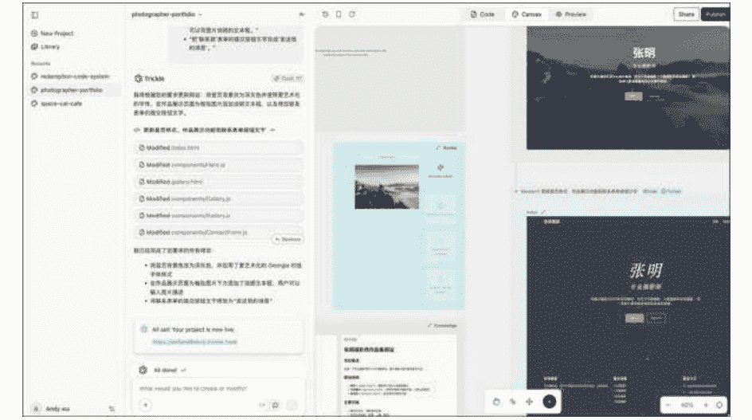

纯靠概念描述容易显得空洞，真实项目才更能体现思想的力量。

##### 3. 案例聚焦：用Trickle重现科技巨头的“第一版”

想判断 Trickle 到底能做到什么程度，社区里流传的 FirstVersion 最有说服力。

这是一个由 Trickle 社群成员搭建的线上科技博物馆，搜索 FirstVersion Trickle 即可找到，如图2-2所示。核心思路很直白：借助当下技术，把 Google、Airbnb、Twitter、YouTube 等公司诞生初期的网站原样复刻。

点开后会发现，Google 的首版只剩一个简陋的搜索框，Airbnb 的雏形也只是为一次会议提供住宿加早餐的单页。这些 1.0 形态与今天的体量形成强烈反差。

关键在于，承载展览的主站 FirstVersion，以及馆内所有被复刻的早期站点，全部由 Trickle 构建并持续维护。这足以说明平台的实战能力。

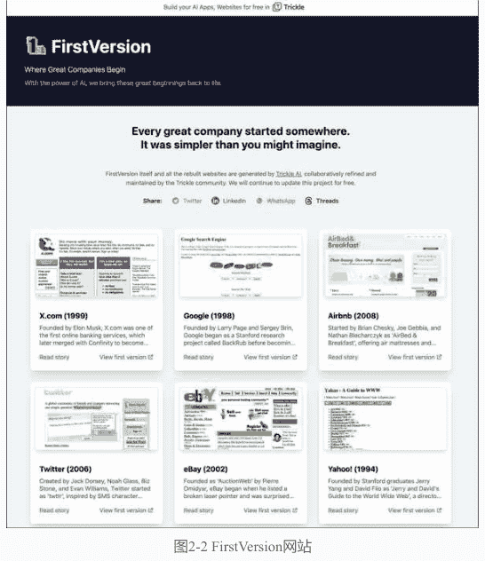

对新手而言，这里能提炼两个启示。第一，伟大产品的起步往往都是直击痛点的极简方案，初版不必完美但要可用。第二，成败取决于是否敢先迈出一步并快速迭代，正如每个科技巨头都源于一个微小原型。

基于上述判断，本书把 Trickle 放在开篇：一体化设计清除了技术阻碍，魔法画布让创作过程变得直观有趣，最终能在最短时间内拿到可视可触的成果。

#### 2.1.2 五分钟实战：上手Trickle

了解原理后，亲手跑通一次最有效。下面用很短的时间走完从灵感到上线的完整路径。目标不是掌握全部功能，而是立刻获得“我也能行”的体感。

##### 1. 注册你的免费账户

打开 Trickle 官网，在右上角点 Log in，用 Google 账号一键登录，或用常用邮箱注册。流程很快，免费额度足够完成本书练习，无需考虑花费。登录后进入应用主界面，即仪表盘。

##### 2. 熟悉仪表盘

进入 Dashboard 后界面很清爽，主要分为两块。

- 创建项目区：位于中央的输入框，是开始创作的入口。
- 社区项目：在页面中下方展示社区用户做出的应用，如瑜伽馆落地页、宠物商店、迷你客户管理系统等，是不错的灵感来源，点开看看能更快建立体感。

熟悉布局后即可创建第一个项目。


图2-3 Trickle 仪表盘

##### 3. 你的第一个“魔法”指令

正式开工。找到新建项目的输入框，写一句描述想法的提示。为了让初体验更有趣，可选一个好玩的主题，例如：

> 帮我做一个“太空猫咖啡馆”的单页网站，要有未来感和可爱的插画。

回车后，AI 会在画布上自动工作：先解读指令，再像设计师兼工程师一样实时增添标题、正文、图片并排版。几十秒到一两分钟，一个带未来感、配萌猫插图的太空猫咖啡馆雏形就呈现在眼前，如图2-4。

把“做网站”这种听起来抽象的事瞬间变成可触摸的乐趣，立刻的正向反馈正是启动后续学习的最好燃料。

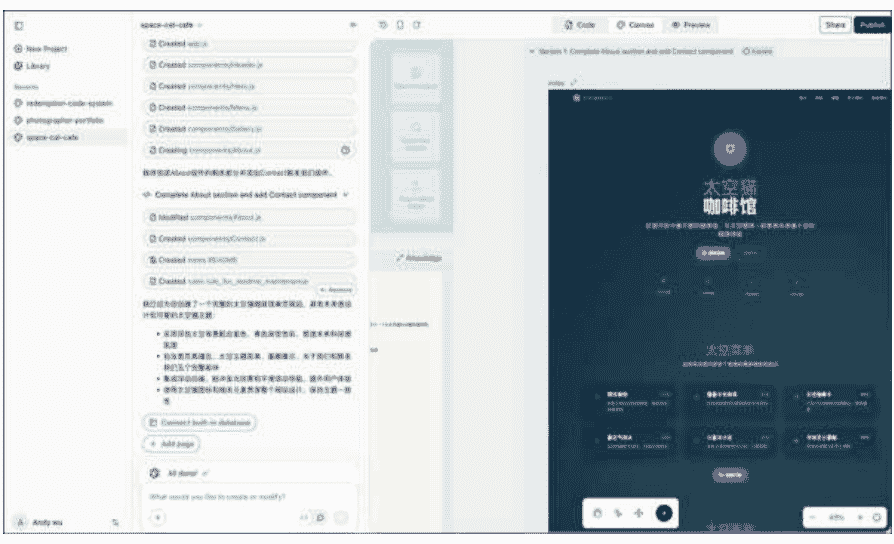
图2-4 “太空猫咖啡馆”网站雏形

#### 2.1.3 十五分钟实战：打造一个个人作品集网站

体验完基础功能后，来一个更完整的练习：做个人作品集。这个流程会覆盖生成、定制、接数据库到发布。

对摄影师、设计师、作家、学生等创作者而言，作品集是展示能力、争取机会的利器。

##### 1. 生成基础页面

多页面项目的好开始靠清晰明确的初始指令。官方文档也建议指令尽量具体，单次聚焦一个核心任务。

新建项目后输入：

> 请为我生成一名摄影师的个人作品集网站。需要三个页面：首页放个人简介和一张大图背景；作品展示页用网格排布照片；联系我页内置留言表单方便访客沟通。

按下回车，AI 会搭好整体框架，并按要求生成首页、作品展示、联系我三个页面，每个页面的基础模块也各就各位，如图2-5。


AI 给出基础框架后，接下来要注入个性，完成定制化调整。

##### 2. 定制化修改

初稿不错，但还不是你的专属站点。Trickle 提供两种互补的修改方式：对话微调和更精确的直接编辑。

方式1：用对话来微调
就像和设计师实时沟通，你可以继续在输入框里用自然语言提需求，比如：

- 把首页背景改成深灰，字体换成更有艺术感的款式。
- 在作品页每张图下面加一个可填写说明的文本框。
- 把联系页表单的提交按钮文字改成“发送我的消息”。

AI 会理解新指令，对现有站点做增量修改，适合大方向的风格与结构调整。

方式2：更精准的“直接编辑”
想调标题字号、按钮间距这类细节？用直接编辑最省事。可把它看成内置的可视化编辑器，如图2-6。

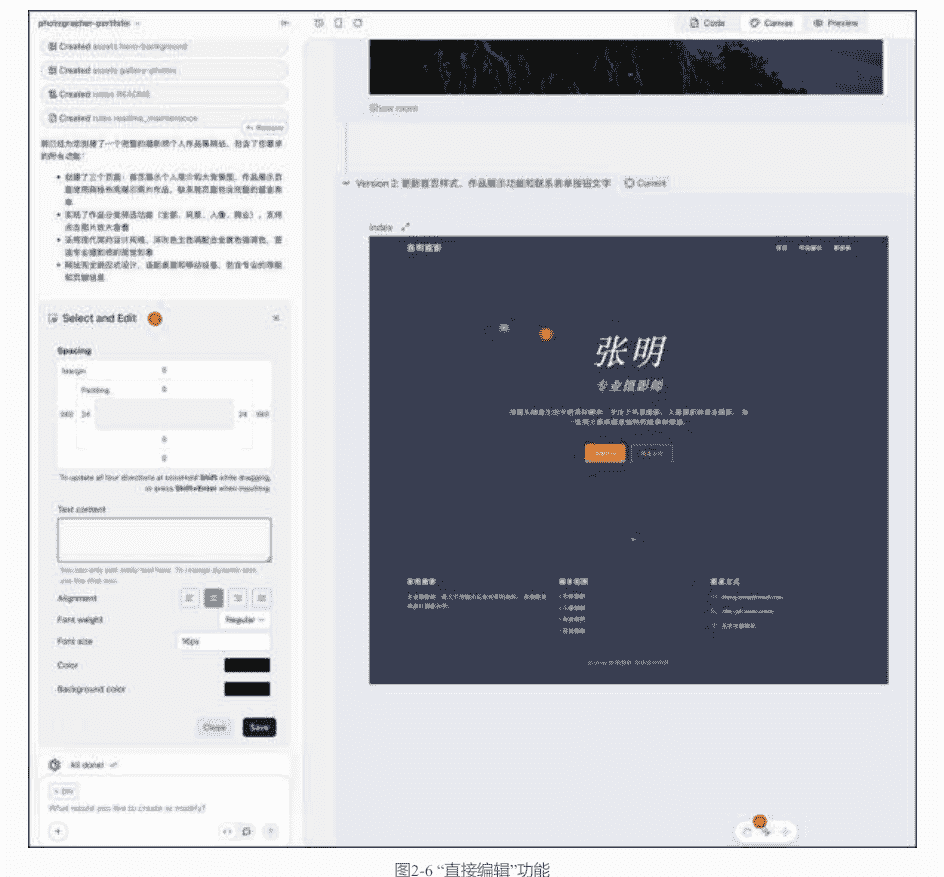
操作步骤：

1. 在画板窗口底部中间点 Select to edit。
2. 移动鼠标，所有元素都能单独选中，选中后出现蓝色边框。
3. 点中想改的元素，例如网站标题。
4. 右侧弹出编辑面板，像普通文档编辑器一样改文字、调字号、换颜色、设边距。

AI 生成加人工微调的混合模式，既有 AI 的效率，也有人对细节的掌控。

外观基本定调后，还要处理数据交互，让联系表单真正能收信存档。

##### 3. 连接内置数据库

网站看着不错，但表单能接收信息吗？信息存在哪？这里就需要数据库。

在 Trickle 里，数据库可理解为“自动收集并整理信息的智能表格”。最省心的是，当你第一次让 AI 建联系表单时，平台已在后台自动创建了对应的数据库，这正是一体化的好处。

也可以明确指令：

> 把联系表单提交的数据保存到 Trickle Database。

AI 会自动把提交按钮和内置数据库关联。

查看数据的方法：

1. 在画板窗口找到写着 Database 的表格，初始为空。
2. 切回网站预览页，填名字、邮箱和一条测试留言后提交。
3. 再切回 Database 表格，刚提交的信息已整齐列出。

完全不用懂 SQL，也不操心配置，就拥有了带后台数据管理的站点。

##### 4. 一键发布

作品集准备好，最后一步是把站点推到互联网，拿到公开可访问的网址。

步骤：

1. 项目页右上角点 Publish。
2. 弹出框显示预览、标题和描述。
3. URL 区自动生成以 .trickle.host 结尾的免费域名。
4. 想用自定义域名可在下方点 + Custom domain，需付费方案。
5. 免费发布直接点右下角 Publish。

瞬间上线，拿到可分享的公开链接。

#### 2.1.4 Trickle：完美的起点，而非终点

恭喜，你已经完成并发布了一个带数据库的多页面网站。花点时间感受从零到有的成就感。

实践后需要回看这类工具的定位。

##### 1. 为什么我们从这里开始：建立你的信心

在众多 AI 工具里选 Trickle 作为第一站，目的是在最短时间内获得明显的正向反馈。

新手最大的障碍往往不是技术，而是面对未知时的畏惧和不自信。Trickle 让你绕过令人却步的细节，快速把脑中想法变成看得见的产品。亲眼看着十几分钟做出一个像样的网站，你会确信自己有能力创造产品。这份信心，是支撑后续更具挑战学习的关键资产。

##### 2. All-in-One的权衡：理解便捷背后的局限性

肯定便捷的同时也要保持清醒。一体化平台为极致易用做了取舍。

- 定制深度有限：平台内定制很强，但遇到高度独特或复杂的交互，自由度仍不及原生代码。
- 可扩展性受挑战：轻量数据库适合起步，用户激增、数据关系复杂后可能出现性能瓶颈。
- 平台依赖性：项目与平台深度绑定，迁移困难，需要对平台长期稳定性和发展有信心。

指出局限不是否定价值，恰恰是继续深入学习的理由。

#### 2.1.5 小结

Trickle 很好地扮演了领路人的角色，让你爱上创造并相信自己能创造。如果你想和 AI 一起成长，构建更复杂、可扩展、完全由你掌控的商业级应用，就需要了解在 Trickle 这层优雅的一体化外壳之下，独立的模块如何运作。

就像学会开自动挡后，打开引擎盖看看发动机、变速箱、电路如何协作。

接下来我们将“解剖”这类平台，把前端、后端、数据库、API 逐一拆解，带你亲手组装一套更灵活、更强大的节俭全栈工具链。

### 2.2 v0.dev 大师课：从灵感到像素级完美UI

下面介绍 v0.dev。它想把创造力从技术束缚里解放出来，不是取代开发者，而是成为设计师、创业者、营销人等创意从业者的强大合伙人。

本节从 0 到 1 实操。我们不从理论开始，先用几分钟做一个按钮建立信心，再逐步构建更复杂的组件学会高效协作，最后完成实战：挑选喜欢的专业设计模板，让 AI 复刻成功能完整、高度个性化的网站。

#### 2.2.1 v0.dev 核心理念与界面导览

上手前先了解原理，使用效率会更高。

##### 1. 你的AI前端工程师

v0.dev 由 Vercel 团队打造，如图2-7。若说 Vercel 解决网站如何快速稳定地触达全球用户，v0.dev 则专注于网站如何快速准确地被创建。两者形成闭环，覆盖从构思到部署的全流程。

核心价值是把创意构想“想要什么”与技术实现“怎么做”连起来。你不需要学编程语言，用日常语言像同事沟通一样下需求即可。

更关键的是，它早已不是单纯的代码生成器，而更像具备主动解决问题的智能代理。下任务时，AI 会以工程师视角分析需求：信息不足会自主检索、参考同类站点结构；代码生成后发现错误还能自动修复。

因此你可以用更宏观的目标式指令，不必纠缠像素、边距细节，更专注设计和体验。你在和创意伙伴协作，更敢于尝试宏大的想法。

##### 2. 工作区详解

首次访问并登录后，随便在输入框写个想法，就能看到简洁强大的工作区，如图2-8。

主要由 4 个核心区域构成。

- 提示词输入区：与 AI 工程师沟通的地方，所有想法、指令、修改意见都在这里发出，无论是“创建一个暗黑风格的定价页”，还是“把按钮放大一点”。
- 实时预览窗口：指令结果几乎即时以可视化形式呈现，没有编译等待，只有即时视觉反馈。这种所见即所得，大幅缩短想法到验证的周期，便于快速迭代。

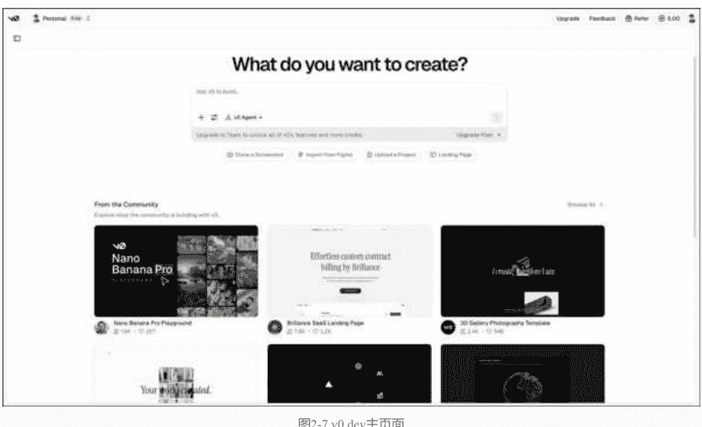
图2-7 v0.dev 主页面

#### 2.2.2 基础入门：从单个组件开始

这里有 3 个快速练习，目标明确：在最短时间收获成就感，建立对工具和自身创造力的信心。

##### 1. 五分钟实战：你的第一个按钮

从最基础也最常见的按钮入手。

新建项目或对话，在提示词区用中文输入：

> 创建一个蓝色的、圆角的“注册”按钮。

按下回车，实时预览里几乎立刻出现一个美观的蓝色圆角按钮，上面写着“注册”，如图2-9。

操作成功且非常简单。回顾刚才，v0.dev 精准理解了创建按钮的核心需求，并解析了颜色、形状、文案等细节。

按钮虽小，已证明基本能力。接下来做稍复杂的组合组件——信息卡片。

##### 2. 十分钟实战：构建一个信息卡片

信息卡片在网页里无处不在，常用于展示功能点、成员或新闻摘要。

在同一对话里继续输入：

> 创建一个信息卡片，包含一个灯泡图标、一个“核心功能”标题和一段描述文字。

很快，图标、标题、描述被合理组织成结构清晰、外观专业的卡片，甚至会自动填充贴合场景的占位文案，如图2-10。

静态展示组件已完成，现在尝试能交互的输入型组件。

##### 3. 十分钟实战：制作一个登录表单

登录表单是需要用户账号的网站标配。

输入：

> 制作一个登录表单，包含“邮箱”和“密码”输入框，以及一个“登录”按钮。

很快出现标准登录表单，标签、输入框、按钮齐全，如图2-11。你甚至能在预览窗口点进输入框尝试打字。

需要说明，v0.dev 目前聚焦构建用户界面的外观和骨架。它能生成精美的登录表单，但点“登录”并不会真正校验邮箱密码。数据校验、数据库连接等后端逻辑是后端工程师的工作。v0.dev 的优势在于把前端环节效率推向极致，让你专注设计和体验优化，不被繁琐界面代码束缚。

#### 2.2.3 进阶技巧：组合与迭代

恭喜完成基础入门！v0.dev 的真正强项不止于第一稿，而在于后续的对话式修改优化，这才是专业工作流。

##### 1. 迭代的艺术

在 v0.dev 的创作逻辑里，第一个提示词只是对话起点，像给设计师的初步草图。真正的作品需要一轮轮沟通打磨，这个过程就是迭代。

迭代的关键是把复杂目标拆解成一系列简单连续的指令。与其一次性用冗长文字描述所有细节，不如先用简单指令生成基础框架，再通过追问逐步添加细节、调整样式、优化布局。

与雕刻过程有相似之处，艺术家先在石料上勾出大致轮廓，随后再换更精细的工具反复打磨，直到成品呈现。配合 v0.dev 进行开发时，节奏也如此，每一次追加提问都相当于一次精修。对话式驱动的创作方式贴近日常沟通习惯，让调整保持灵活且可控。

下面以两组实操把迭代的思路跑通。

##### 2. 五分钟实战：为组件添加交互
回到前文生成的蓝色按钮，继续用迭代的方式补充动态反馈。

先确认预览区能看见该按钮，若看不到就重新生成或在历史记录里找回。发出第一轮迭代需求：

> 当我把鼠标悬停在按钮上时，让它颜色变深一点。

观察预览，指针移上去时按钮会平滑变暗，形成清晰的视觉提示，这即是悬停态。

再补充点击反馈，输入下一条指令：

> 当我点击按钮时，添加一个轻微的缩放效果。

再试一次，按下左键瞬间按钮会微微收缩后回弹，操作的确认感立刻提升。

两轮对话，一个原本静态的按钮就拥有了专业级的动态表现，也学会了如何用自然语言描述并实现基于用户行为的状态变化。

接下来要做的，是网站的骨架——导航栏，并用迭代把它做成响应式的。

##### 3. 十分钟实战：构建响应式导航栏
响应式是指页面能够自动适配电脑、平板、手机等不同宽度，提供最佳浏览体验。按下面顺序进行。

###### 第一步：创建基础导航栏
发出初始指令：

> 创建一个导航栏，左边是Logo，右边是“首页”“关于我们”“联系我们”三个菜单项。

工具会迅速给出标准的桌面版布局：左侧 Logo 占位，右侧三项菜单横向排列，样式与图 2-12 一致。

###### 第二步：迭代实现响应式
告诉它小屏下的表现方式，输入迭代指令：

> 让这个导航栏在手机屏幕上变成一个汉堡菜单。

工具能够准确理解“汉堡菜单”这一行业术语。接下来验证效果。大多数浏览器都可以用 F12 打开开发者工具。Chrome 里按 F12 后会看到如图 2-13 的界面。

不同浏览器的打开方式略有差异：

- **Chrome/Edge**：按下 F12，再点设备模拟图标，Chrome 叫 Toggle device toolbar，Edge 叫切换设备仿真。
- **Firefox**：按下 F12，再点响应式设计模式图标。
- **Safari**：先在偏好设置 > 高级里开启开发菜单，再按 Cmd + Option + I，点设备图标。

进入响应式模式后，把预览窗口切到手机尺寸，右侧三项菜单会消失，换成三条横线的汉堡图标。点击它，菜单会以垂直列表的形式展开，如图 2-14。

你没有手写任何媒体查询，仅用一句话就完成了现代网站必备的响应式设计。这说明工具不仅能处理基础样式，还能实现符合行业规范的复杂模式，底层基于 React、Tailwind CSS 等主流技术栈，既专业又好用。

组件做完后，我们再探索更符合创意工作者习惯的高阶用法。

#### 2.2.4 高级工作流：从视觉到代码
前面都是用语言描述设计，但创作者更习惯用眼睛看。v0.dev 的高级工作流就支持把你看到、喜欢的设计直接交给 AI 复刻。

##### 1. 视觉提示的力量
对非技术背景的创作者来说，能理解并复刻截图是最颠覆的功能之一。

我们常遇到这种场景：觉得某个设计很高级却很难用文字精确说清字号、间距、色值、阴影等细节。从视觉到语义的转换里会丢失大量信息。

截图则跨过了这道坎。一张图里藏着布局、色彩、排版、风格的海量精确点。上传截图后，你不是在“描述”需求，而是在“展示”需求。输入方式和你的核心能力——视觉审美——完全对齐，能把随时捕捉到的灵感立刻变成可用代码。

##### 2. 十分钟实操：把截图变成可用组件
这个练习很直观，跟着步骤就能把像素转成代码。

1. 打开灵感网站或应用，找到做得好的独立组件，比如按钮、评价卡片或定价块。
2. 用截图工具只截取该组件并保存。
3. 回到 v0.dev，新建对话或项目，在输入区点上传按钮选择图片。
4. 上传后配一句简单提示，比如“用这张截图生成这个组件”。
5. 回车。v0.dev 会解析结构、色彩、字体、布局，在预览里生成高度相似的真实代码版本。

就这样，完成了一次从像素到代码的瞬间转换，过去需要前端工程师花几小时的工作现在几分钟搞定。

##### 3. 拆解生成的代码
现在“掀开引擎盖”看看 v0.dev 输出了什么。目的不是学编程，而是去神秘化，建立概念认知。

在界面切换到代码区，如图 2-15，你会发现代码主要由三部分原料构成：React 组件、TSX 语法和 Tailwind CSS。

- **React 组件：可复用的模块**
每个模块——按钮、卡片、导航栏——在代码里都是一个 React 组件，像功能独立的部件。做一次“注册按钮”部件后，全站复用即可，大幅提升构建与维护效率。

- **TSX 语法：部件的结构蓝图**
TSX 是 TypeScript 的扩展，允许在代码里直接写类似 HTML 的标签。可以把它看成部件的蓝图，直观声明界面长什么样。代码里会看到 <div>、<button>、、<p>、<h1> 等标签和 TypeScript 变量混在一起，正是这种融合让描述界面变得直观。

- **Tailwind CSS：类名式的样式系统**
最容易理解的部分。在 TSX 标签里会出现 className="..."，里面有 bg-blue-500、rounded-lg、font-bold 等短词，这就是 Tailwind。

把它想象成给部件贴功能标签：不用写厚厚的样式表，直接贴上“蓝色背景”bg-blue-500、“大圆角”rounded-lg、“加粗”font-bold，修改起来非常直观。

为帮助理解这些标签的含义，下面是简易对照。

**表2-1 Tailwind CSS简易翻译表**

| 你的目标 | 代码示例 | 通俗解释 |
| :--- | :--- | :--- |
| 放大字号并加粗 | text-xl font-bold | “字号调为特大；字重设为加粗” |
| 做一个蓝色背景带圆角的块 | bg-blue-500 rounded-lg | “底色为蓝色-500；四角为大圆角” |
| 在元素内部增加间距 | p-4 | “内填充 4 个单位” |
| 在元素外部增加间距 | m-2 | “外边距 2 个单位” |
| 让若干组件横向排列 | flex | “使用弹性布局，默认横排” |
| 让组件在容器中水平垂直居中 | flex justify-center items-center | “弹性布局，水平居中且垂直居中” |

看懂这些标签后，你可以试着改一两个，比如把 bg-blue-500 换成 bg-red-500，立刻在预览里看到变化。

掌握以上能力后，就可以挑战本节的最终项目了。

#### 2.2.5 综合实战：把心仪的 Figma 模板变真
这是本节的收官任务。你将综合提示词、迭代优化、视觉复刻，完成完整闭环：把专业的 Figma 设计模板变成可运行的个人网站。

##### 1. 探索 Figma 社区
Figma 是设计师常用的在线协作工具，其社区像个设计资源金矿，如图 2-16。

去社区搜索“个人作品集”“SaaS 落地页”或“仪表盘”，能找到大量免费模板。推荐一个起步模板——Minimal Portfolio Free Landing Pages for Figma，风格极简，适合个人作品集，含桌面和移动端设计。

花点时间挑选一个真正喜欢的单页或作品集，结构清晰为佳，避免一上来就挑战复杂后台。找到后复制到自己的 Figma 草稿。

##### 2. 分解设计
分解是项目中最关键的思维训练，也是专业开发者处理复杂问题的核心方法。

别被完整稿吓到，专业人士看到的是可管理的组件集合。你需要用开发者视角审视它。

典型落地页可拆成：

- **导航栏**：顶部 Logo 与菜单链接
- **英雄区**：第一屏大标题、副标题、CTA 按钮
- **特性/服务列表**：图标加简短文案介绍优势
- **作品集/案例展示**：卡片或网格呈现项目
- **客户评价**：引用好评建立信任
- **页脚**：版权、社交链接、联系方式

把模板拆成独立组件，不仅让 AI 生成更有条理，也能训练把大问题拆成小问题的能力，这比工具本身更宝贵。

##### 3. 十分钟实操：动手复刻
按流程操作，快速实现截图到代码的转换。

1. 逐个截图。按分解结果分别截取每个组件，例如先导航栏，再英雄区。
2. 上传并生成。打开 v0.dev，上传导航栏截图，提示“复刻这个导航栏”。
3. 迭代微调。首版可能接近但有偏差，用追加提示微调，例如：
   - “Logo 再大一点”
   - “菜单项间距再宽一些”
   - “按钮颜色换成 #5A67D8”
4. 重复流程。对导航栏满意后复制保存代码，再清空画布处理下一个组件。循环“截图→上传→微调→保存”，直到所有组件都有代码版。

##### 4. 组装与微调
积木都齐了，现在拼成完整模型。

1. 启动 TRAE SOLO 模式。打开 TRAE IDE，左上角选 SOLO，进入 AI 自动开发流程，会按需搭好本地环境。
2. 整合组件代码。用自然语言告诉 SOLO AI：“我用 v0.dev 生成了多个组件，请帮我创建一个项目，按设计稿顺序把这些组件组合成完整网站”。把复制的组件代码文件夹放进去，AI 会自动分析并整合。
3. 观察 AI 执行。开启“实时跟随”，在编辑器、终端、预览、文档面板里实时看 AI 拆解需求、建结构、整合代码、装依赖。
4. 交互调优。发现布局或样式问题，直接在对话里说人话，比如“导航栏和英雄区间距太大，调小一点”或“整体偏暗，调亮一些”，AI 会立即响应并在预览里展示结果。

#### 2.2.6 小结
本节完成了 v0.dev 从 0 到 1 的实战。我们熟悉了提示词输入区、实时预览、代码输出区和版本历史四大界面。

从基础组件起步，先构建按钮、信息卡片、登录表单，建立协作信心。再深入迭代艺术：通过连续对话为按钮加入悬停和点击交互，用一句话实现响应式汉堡菜单，掌握用迭代达成复杂设计模式的方法。

随后探索视觉到代码的高级工作流，用截图跨越语言描述的鸿沟，并把代码“去神秘化”为 React 组件、TSX 蓝图、Tailwind 标签。

最后在综合项目里融会贯通，学会分解 Figma 设计稿为独立组件，用视觉复刻逐一生成，再在 TRAE SOLO 协助下组装成完整可上线网站。你不仅掌握了工具，更体验了从灵感到像素级 UI 的完整路径。

### 2.3 精通 Figma
——从第一块画布到开发者交付

想象你在盖房子，开工前需要一张清晰详尽的蓝图，让建筑师、工程师、施工队都读懂。Figma 就是数字世界的蓝图诞生地。

Figma 能成为 Google、微软等公司青睐的标杆，核心在三大优势。

- **无缝协作**：多人共享同一文件，实时看到光标，在画布或图层上留言讨论，告别截图来回。
- **一体化流程**：从线框、高保真视觉到可交互原型，再到交付开发者，全在同一平台完成。
- **对新手友好**：界面直观，学习曲线平缓，还有功能完整的免费版可直接上手。

本节从空白画布开始，亲手搭建灵动界面，注入交互做原型，最后学会优雅交付给开发者或 AI。无需设计经验，学完即可把脑中创意变为现实。

#### 2.3.1 现代 UI 设计基础
在深入功能前，先建立正确心智模型：理解“为什么”，后续学习会事半功倍。

##### 1. Figma 界面导览与核心思维
第一次打开可能会被面板淹没，可以拆成四个核心区域，如图 2-17。

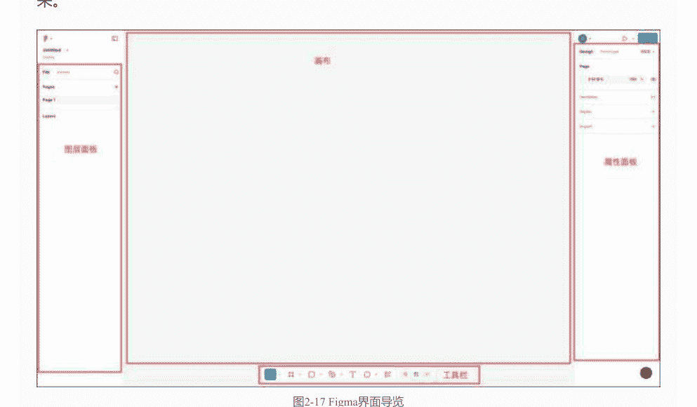

图2-17 Figma界面导览

- **画布（你的无限工作区域）**：位于界面正中央的巨大区域，如同一张无限大的数字画纸。你所有的设计，无论是手机屏幕、网页、按钮还是图标，都将在这里诞生。你可以向任意方向自由滚动，将不同设计稿并排摆放，方便对比和构思。

- **工具栏（你的核心工具箱）**：通常位于界面底部，存放着最常用的工具。我们初期会重点关注移动工具、画框工具、形状工具（如矩形R、圆形O）和文本工具等核心工具。

- **图层面板（你的内容目录）**：位于界面左侧，如同一本书的目录，清晰展示了设计文件中的所有元素——画框、组、文本、图标等，直观反映了设计的层级和结构。从一开始养成良好的图层命名习惯，是专业设计师的必备素养。
[/PRE0]

**属性面板与框架优先的起步**

右侧的控制面板是 Figma 的情境化界面，选中的对象决定了面板展示哪类调节项。选中矢量图形会呈现填充、描边、圆角等；选中文字则切换为字重、字号、行高等排印控制，几乎所有精细调整都集中于此完成。

本节要建立的核心方法是框架优先。在现今 UI 实践中，界面几乎全部由容器承载，而 Figma 通用且强大的容器就是框架。

对 Photoshop 等传统图形工具的用户来说，形状、组、框架容易混淆，分清三者是入门的关键。

- **形状**：最底层的矢量单元。工具栏绘制的矩形、圆形等都属于纯矢量，可视为拼装界面的原子。
- **组**：简易的临时捆绑，类似把零散文件放进文件夹。组的范围完全跟随内部元素，内部移动或缩放时边界同步变化，在界面场景中作用有限。
- **框架**：UI 的基本单元，可理解为智能画板。它支持独立设定尺寸，还具备组不具备的能力：约束可定义子元素随框架缩放时的相对位置与尺寸；内容裁剪能把溢出边界的部分自动隐藏。框架也是自动布局与组件制作的前提。

强调框架优先，本质是把平面静态习惯转为界面动态习惯。UI 不是画一张固定图片，而是搭建能随屏幕与内容变化自适应的系统。组被动跟随内容，框架能主动管理内容行为。社区资深从业者普遍建议能用框架就不用组，因为它更接近 Web 开发中基于容器的构建逻辑，如 HTML 中的 `<div>`。

表2-2 框架与组的核心差异

| 特性 | 框架 | 组 |
| :--- | :--- | :--- |
| 尺寸表现 | 尺寸可单独指定，与内部内容无关 | 尺寸由内部元素的包围盒决定，随内容变动 |
| 裁剪表现 | 可开启裁剪，将超出边界的部分隐藏 | 不支持裁剪，所有内容始终可见 |
| 约束表现 | 子元素可设置约束，控制缩放时的相对位置和大小 | 无约束概念，缩放时整体等比变化 |
| 自动布局 | 只有框架能承载自动布局 | 不支持自动布局 |

使用建议很明确。

- 框架是 UI 设计的基础单元，凡需精确尺寸、响应式排布或动态承载内容的场景都应采用，从按钮到整页均可。
- 组仅适合临时操作，例如把图标的多条路径先捆绑方便移动或缩放，处理完后最好再放入框架中继续设计。

## 2.五分钟实战：创建一套自定义图标

目标在五分钟内绘制几枚简易图标，体会框架的容器作用、形状工具的灵活性以及布尔运算的威力。

### 1.创建图标容器
不要直接在画布上绘制，先按 F 键新建 24×24 像素的框架作为图标画板。在左侧图层面板中重命名为 icon/camera，如图2-18所示。这个 24×24 的框架能让整套图标保持统一规范。


图2-18 创建图标容器

### 2.绘制基础形状
在框架内部按 R 键绘制正方形作为相机机身，适当加圆角使轮廓更柔和。接着按 O 键绘制大圆作镜头，再绘制小圆作闪光灯，效果如图2-19所示。

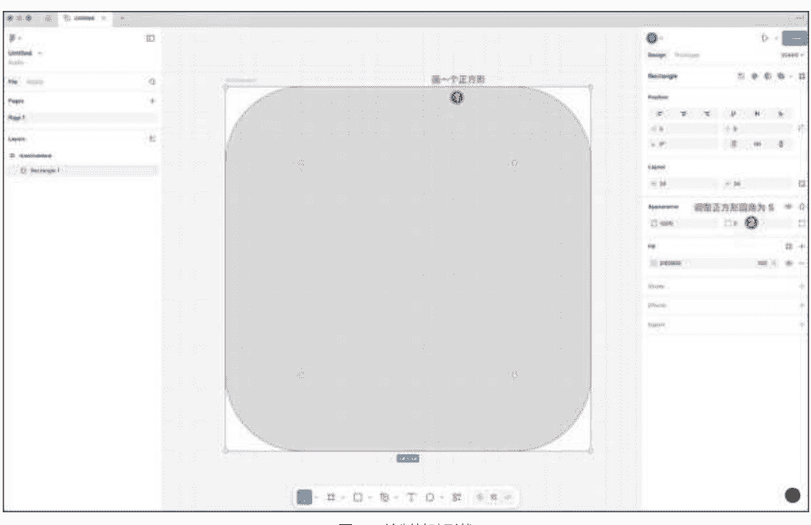

图2-19 绘制基础形状

### 3.运用布尔运算
此时 3 个形状彼此分离。按住 Shift 同时选中它们，右侧属性面板上方会出现布尔运算区，点击下拉箭头选择 Subtract 减去，如图2-20所示。两个圆形如同图章在正方形上挖出镂空，最终合成完整相机形，如图2-21所示。布尔运算是非破坏式的，后续仍可调整原始图层。


图2-20 运用布尔运算


图2-21 布尔运算结果

### 4.扁平化与居中
选中生成的复合形状，按 Cmd/Ctrl + E 执行扁平化，将其合并为一条纯净矢量路径，避免缩放失真。然后用右侧属性面板顶部的对齐工具，将其在 24×24 框架内水平垂直居中，如图2-22所示。


最后在图层面板确认框架名为 icon/camera，内部矢量图形可命名为 Vector，如图2-23所示。规范命名是高效协作的基础。

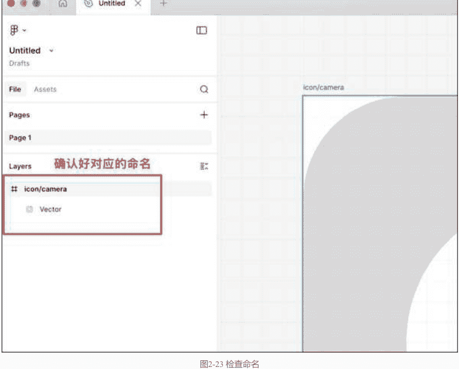

自行练习：用两个圆形加一个正方形制作用户图标 icon/user，或用多个旋转正方形制作设置图标 icon/settings。

完成图标后，需要为项目建立统一的视觉规范。

## 3.建立视觉语言

框架是骨架，颜色、文字与网格则是血肉与灵魂。和谐统一的设计源于一套内在的视觉语言。在 Figma 中，我们用样式与布局网格来定义并落地它。

###### 样式
样式是对重复出现的视觉属性做标准化预设，既保证一致性，又大幅降低后期修改成本。分为颜色样式与文本样式。

- **颜色样式**用于统一管理色彩体系，将某个色值保存为可复用样式并赋予语义化名称，例如 color/primary/blue。品牌主色后续调整时，修改这一样式，所有引用处会即时同步。
- **文本样式**统一管理字族、字重、字号、行高等排版规则，注意它不包含颜色属性，这样文字样式与颜色样式可自由组合。常见命名如 typography/h1、typography/body，搭配不同颜色即可满足多样需求又保持规范。

###### 布局网格
布局网格是秩序的隐形脚手架，帮助元素对齐、间距统一，让页面更专业。Figma 提供三种网格。

- **均匀网格**：等大正方形网格，适合图标设计或强制执行基础间距单位，如 8pt 网格系统。
- **列网格**：网页和 App 设计常用，可设定列数、列间距、内容距边缘的内边距。
- **行网格**：水平参考线，通常与列网格配合形成更精细的模块化布局。

创建样式与网格本质上是把设计决策具象化。把一个十六进制色值保存为 color/brand/primary，就是在宣告这是主品牌色，这正是设计令牌思想的雏形——把数值抽象为语义，为设计系统规模化打基础。

## 4.十五分钟实战：搭一个基础样式指南

创建一个专业项目都需要的样式指南，为后续工作提供统一规范。

### 1.创建“基础规范”页面
点 Figma 文件左上角页面名称旁的下拉箭头，新建页面并命名为基础规范，如图2-24所示。把设计系统基础元素集中文档化是高效习惯。免费版仅有一个页面时，可先重命名当前页面再操作。

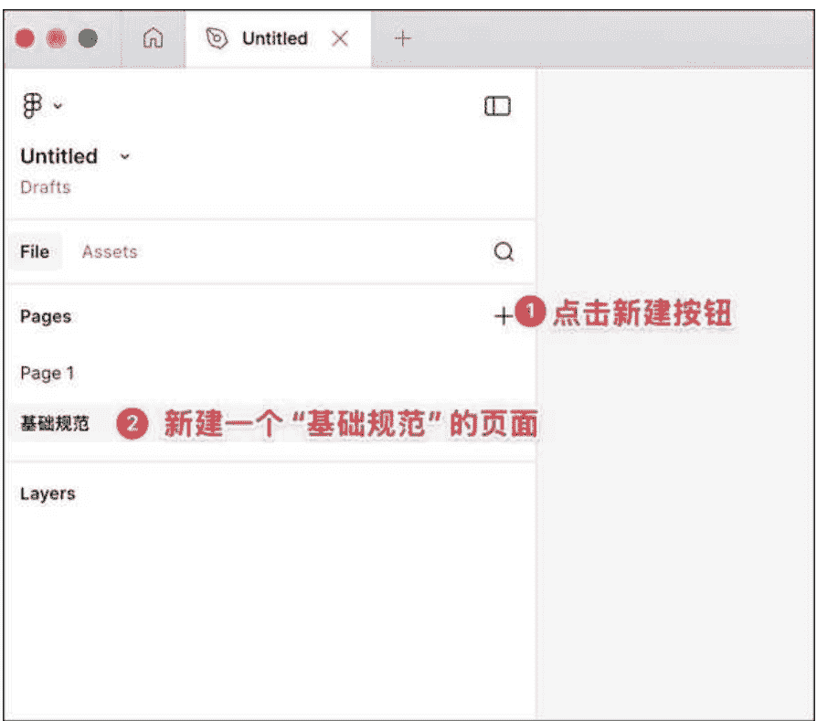

图2-24 创建“基础规范”页面

### 2.文档化颜色样式
在新页面绘制多个矩形，分别填入项目主色、辅助色和常用中性灰。选中任意主色矩形，在右侧属性面板填充区域点四点图标，再点加号新建颜色样式，命名为 color/primary。用同样方式创建 color/secondary、color/neutral/900 等，并在每个色块旁用文字标注样式名和色值，方便查阅，如图2-25和图2-26所示。

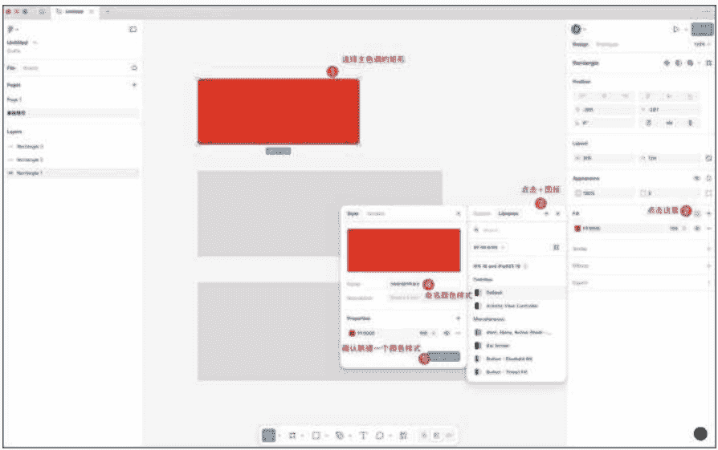

图2-25 文档化颜色样式

### 3.文档化字体
创建几段文字，分别输入一级标题、一二级标题和正文文本，并设置理想样式，例如 H1: Inter Bold 32px，Body: Inter Regular 16px。为每种文本创建对应文本样式，命名为 typography/h1、typography/h2、typography/body，如图2-27和图2-28所示。

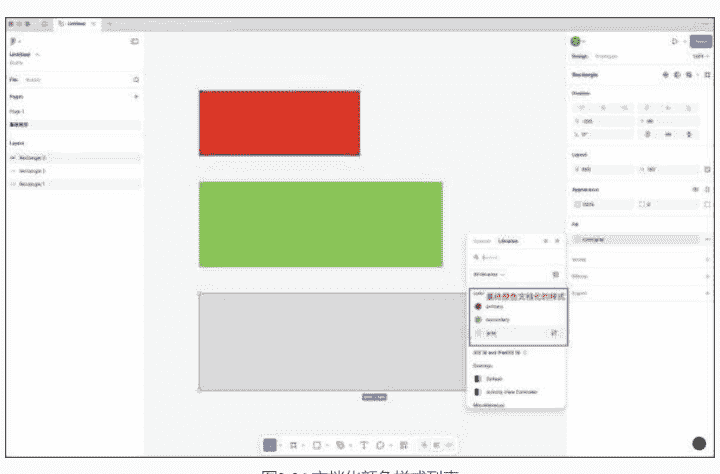

图2-26 文档化颜色样式列表

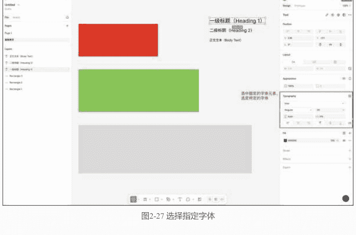

图2-27 选择指定字体

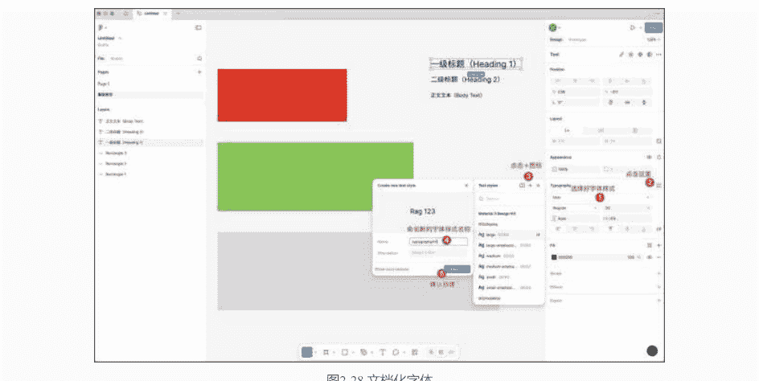

图2-28 文档化字体

### 4.文档化网格
用快捷键 F 创建 3 个框架，分别对应桌面、平板、移动设备的典型尺寸，并应用响应式列网格。

先设置桌面框架。选中后在右侧 Design 面板找到 Layout 区域，将 Dimensions 的 W 设为 1440px。进入 Layout guide，点击 +，选择 Grid 为 Columns，Count 设为 12，Type 设为 Stretch，Margin 设为 144px，Gutter 设为 24px。

平板和移动设备的参数如下。

- **平板：** 宽度 768px，8 列，Type 为 Stretch，Margin 为 32px，Gutter 为 16px。
- **移动设备：** 宽度 375px，4 列，Type 为 Stretch，Margin 为 16px，Gutter 为 16px。

选中桌面框架，把网格保存为布局网格样式，命名为 grid/desktop-12-col，如图2-29和图2-30所示。

完成练习后，你就拥有了项目的单一事实来源，后续设计可直接取用规范样式，保证视觉高度一致。

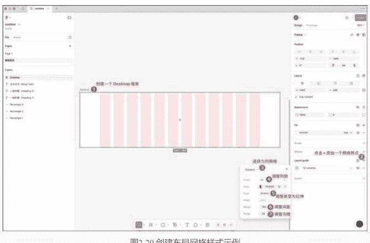

图2-29 创建布局网格样式示例

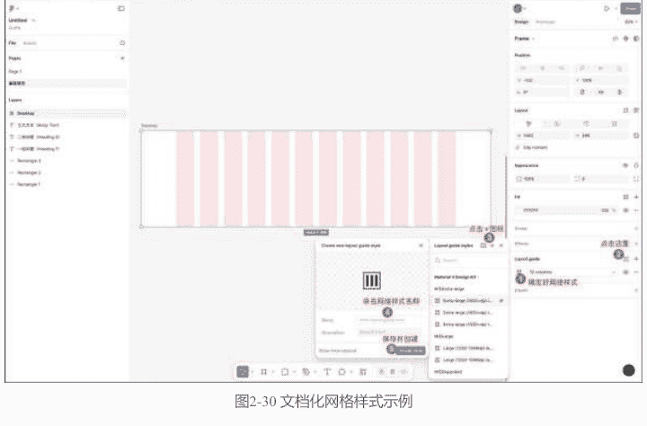

图2-30 文档化网格样式示例

#### 2.3.2 构建可扩展的动态界面
掌握基础后进入 Figma 最激动人心的部分：让设计活起来，从静态像素变为能随内容自适应变化的智能组件。以下内容偏进阶，可按需学习。

## 1.自动布局的威力
自动布局堪称 Figma 的核心功能，能让布局像真实网页或应用一样随内容增减、文字长度自动适配。

启用很简单，选中一个或多个元素后按 Shift + A，Figma 会用一个开启自动布局的框架把它们包裹。

启用后在右侧 Design 标签的 Auto layout 区域可以掌控智能容器的行为。

- **排列方向 Flow**：决定内部元素垂直堆叠、水平排列，或在空间不足时自动换行 Wrap。
- **间距 Gap**：定义元素之间的距离，可设固定值或 Auto 让元素撑满可用空间。
- **内边距 Padding**：容器内部边缘与内容之间的空白。

###### 三种核心尺寸调整行为
理解自动布局的关键在于这三种尺寸行为。

- **适应内容 Hug contents**：容器尺寸由内部内容决定，会紧贴内容加上内边距，适合按钮、标签等需随文字长度自适应的元素。
- **填充容器 Fill container**：元素主动伸展填满父容器所有可用空间，是响应式布局的关键，常用于输入框、卡片内文本区。
- **固定宽度/高度 Fixed width/height**：尺寸固定，不受内容和容器变化影响，适合图标、头像等必须定尺寸的元素。

真正威力来自嵌套。层层嵌套并组合三种行为，就能构建任意复杂的完全响应式界面。

## 2.十五分钟实战：构建响应式卡片与导航栏
先从响应式产品卡片开始。

1. 准备素材。创建一个 300×180px 的矩形作图片占位，再做产品标题和产品描述两层文字，如图2-31所示。

## 2.3.2 从静态设计到响应式布局（可选学习）

### 1.响应式卡片设计
学会自动布局后可进一步组件化。

###### 1.1 响应式卡片

1. **准备素材**。如图2-31所示。
2. **嵌套自动布局**。选中两个文本层按 Shift + A 包裹成垂直自动布局框架，命名为 Text Content，间距设为 8px，如图2-32所示。
3. **创建卡片框架**。选中 Text Content 和图片占位，再次按 Shift + A 包裹成新的垂直自动布局框架，命名为 Card，间距设 16px，内边距设 16px。为 Card 添加白色填充和圆角，形成卡片形态，如图2-33所示。
4. **设定响应规则**。选中 Card，将其宽度设为固定。按住 Cmd/Ctrl 点击内部的图片占位和两个文本层，把它们的宽度行为全部改为填充容器 Fill container，如图2-34所示。
5. **响应式测试**。拖动 Card 右边缘改变宽度，内部图片和文字会自动拉伸、换行，完美适配。

接下来做响应式导航栏。

1. **创建菜单项**。制作首页、功能、产品、关于等文字层。
2. **应用自动布局**。选中所有文字层按 Shift + A 包裹成水平自动布局框架，命名为 Navbar，间距设 32px，内边距设 16px，如图2-35所示。
3. **感受动态调整**。Navbar 默认宽度为适应内容，双击把产品改为我们引以为傲的产品系列，导航栏宽度会自动增加以容纳更长文字，且菜单间距保持不变。

## 3.组件、变体与属性（可选学习）
重复设计元素时，组件是最佳拍档。组件化体系由三个层面构成。

- **组件 Component**：把任意设计元素转为主组件，随后可在设计稿中放置实例，修改主组件时所有实例同步更新。
- **变体 Variant**：当组件有多状态或样式，如按钮的默认、悬停、禁用，无需建多个独立组件，可用组件集统一管理变体。
- **组件属性 Component Property**：添加到主组件的控制器，让使用者在实例层面自定义。主要有三种类型。

  - **布尔 Boolean 属性**：开关，控制图层可见性，如是否显示图标。
  - **文本 Text 属性**：允许在属性面板直接修改组件内部文本。
  - **实例交换 Instance Swap 属性**：允许把组件内部嵌套的实例替换为另一个，如替换按钮图标。

初学者常问变体和属性该怎么选。简单法则是：变体处理视觉风格、交互状态的预设固定差异；属性处理内容变化或可选元素的显隐，供使用者自定义，具体如表2-3所示。

**表2-3 组件属性——何时使用何种属性**

| 属性类型 | 它所回答的问题 | 简单示例 |
| :--- | :--- | :--- |

| 布尔 | 是否需要按需显隐的元素 | 为按钮加入 Show Icon 布尔开关，通过开关决定图标是否出现 |
| 文本 | 按钮文案是否要外部可改 | 为文字层添加 Label 文本属性，在属性面板直接编辑内容 |
| 实例交换 | 图标或子部件是否允许替换 | 为按钮图标设置 Icon 实例交换属性，支持从资源库挑选新图标 |

下面用一个综合演练把按钮做成可复用的设计资产。

## 4. 快速实战：打造灵活按钮组件库（可选）

这次演练帮助你内化组件核心思想，沉淀真正能用的设计资源。做出具备多状态与可调参数的按钮集合，能直观感受到组件化的一次构建多处复用、统一维护的优势。

操作要点如下。

1. **搭建基础形态**。新建 Button 文本层，旁侧放置 2.3.1 节得到的图标实例。框选两者按 Shift + A 生成水平自动布局，微调间距与内边距，并为外层框架填充底色。
2. **转为主组件并定义属性**。选中上一步的框架按 Ctrl/Cmd + Alt + K 设为主组件。在右侧 Design 面板的 Properties 区域点 “+”，为图标层新增布尔属性 Show Icon；为文字层新增文本属性 Label。
3. **新增变体属性**。在 Properties 再次点 “+” 选择 Variant，首个变体命名为 Style，取值设为 Primary。
4. **扩展样式变体**。点组件集下方 “+” 新建变体，将该变体的填充改为描边，并把 Style 值改为 Secondary。
5. **补齐交互状态**。选中整个组件集再新增变体属性 State，默认值 Default。分别对 Primary 与 Secondary 复制一份，修改 State 为 Hover 并调亮背景模拟悬停。
6. **验证效果**。从左侧 Assets 把按钮拖到画布，右侧属性区会出现 Style 与 State 的下拉、Label 的编辑框以及 Show Icon 的开关，可自由组合测试。

掌握组件后进入更进阶的概念——变量。

## 5. 用变量实现设计令牌（可选）

样式是把数值固化为名称，变量则是可随情境变更值的占位符，这正是设计令牌落地的核心。

设计令牌把主背景色等决策从实现中抽离，以数据形式统一管理，形成单一可信来源，提升维护性。

Figma 的 Variables 面板包含三个要点。

- **集合 Collection**：归类管理，例如颜色集合、间距集合。
- **模式 Mode**：同一集合内可配置多套取值，是明暗主题切换的关键。
- **别名引用 Aliasing**：一个变量可引用另一变量的值，增强关联性。

后续练习会展示变量带来的“一键换肤”。

## 6. 实战：明暗主题一键切换（可选）

本练习演示一次配置驱动整套系统主题变化。

开始前确认已完成响应式卡片练习。未完成可先做一张含标题、描述、按钮的卡片作为测试。步骤如下。

1. **新建颜色集合**。清空选择，点右侧 Variables 面板，新建集合命名 Theme: Colors。
2. **定义模式**。把默认模式改名为 Light，再点 “+” 新建模式命名 Dark。
3. **创建颜色变量**。
   - color/background：Light 为 #FFFFFF，Dark 为 #1E1E1E。
   - color/text：Light 为 #1E1E1E，Dark 为 #FFFFFF。
4. **应用变量**。打开之前卡片，将根框架填充设为 color/background，内部文字填充设为 color/text。
5. **观察切换**。在画布新建一个模拟手机屏幕的顶层框架，放入已应用变量的卡片实例。选中该框架，在右侧图层区的变量模式图标处把模式从 Light 切到 Dark，内部卡片会同步变为深色。

## 2.3.3 从静态稿到可交互原型（可选）

结构清晰、样式统一的界面单元完成后，本节讲解如何串联静态稿制作可点可感的原型并交付。难度较大可先跳过。

### 1. 原型制作核心

原型让设计可演示流程与细节。核心在于建立页面连接并定义触发条件与动效，从基础跳转到条件分支均可实现。关键环节。

- **基础连接**：切换到右上角 Prototype 标签，选中图层或框架，拖动边缘蓝色节点到目标框架建立链接。
- **触发器与动作**：连接建立后在右侧 Interaction 面板定义触发方式如点击、拖拽，以及动作如跳转、弹层。
- **智能动画 Smart Animate**：把过渡设为 Smart Animate，Figma 会为同名图层自动生成位置、尺寸、颜色的补间。
- **变量驱动的状态原型**：借助变量可做出具备记忆的原型。可通过 Set Variable 修改数值，如点击让计数加 1，并加入 if/else 实现状态切换。

### 2. 实战：动态购物车原型

本练习演示用变量管理应用状态，做出能记住用户操作的动态原型。

1. **设置变量**。打开 Variables 面板，新建 Number 类型变量 cartItemCount，初始值 0。
2. **设计界面**。在框架内做一个带“加入购物车”按钮的商品卡片，顶部放导航栏，内含购物车图标及旁边的文本层。
3. **绑定变量**。选中文本层，在 Design 标签的 Text 区域点 Apply variable，选择 cartItemCount，文本立即显示 0。
4. **创建交互**。切到 Prototype 标签，选中“加入购物车”按钮。
5. **添加 Set Variable 动作**。为按钮设置 On Click 交互，Action 选 Set Variable，Target 选 cartItemCount，Value 输入 cartItemCount + 1。
6. **测试**。点右上角 Present 进入预览。每次点击按钮，导航栏数字实时递增。

### 3. 开发者模式指南

开发者模式是 Figma 提供的协作区，目标是缩小设计与开发差距。设计师了解开发者可见信息后能更精准准备交付。

底部工具栏有设计/开发切换开关，快捷键 Shift+D。切换后开发者可看到。

- **检查面板**：选中元素后实时展示尺寸、色彩、字重，并自动生成 CSS、iOS、Android 代码片段。
- **资源导出**：可查看并一键导出标记为可导出的图标与图片。
- **变更对比**：清晰展示当前版本与上一版本差异。
- **注解**：设计稿上的评论在开发者模式下完整呈现。

### 4. 实战：交付设计文件

模拟交付收尾，确保交付物清晰完整。

1. **最终检查与清理**。审视文件，层级合理命名、归类有序，删除草稿与无用页面。
2. **标记导出项**。检查开发需用的资源，选中后在 Design 面板底部 Export 区点 “+”，图标设 SVG，位图设 PNG 或 JPG。
3. **标记就绪**。按 Shift + D 进入开发者模式，选中已确认的顶层框架，点顶部工具栏 Mark as ready for dev，为框架标注状态。
4. **添加关键批注**。对静态稿无法表达的复杂交互用评论补充，如“卡片列表加载时需淡入，时长 300ms”。
5. **分享链接**。点右上角 Share 生成链接，确保团队有查看权限，发送后交付完成。

### 5. 工作坊：Figma 迈向 Tailwind 代码

设计到代码自动化是提效手段，输出质量取决于输入稿的质量。

###### 设计到代码的自动化转换

要获得高质量代码，Figma 文件需遵循结构化原则。

- **语义化命名**：层级名称反映内容与功能。
- **全面使用自动布局**：可映射为 CSS Flexbox 或网格。
- **组件化**：可复用元素做成组件。
- **规范使用变量/样式**：可转成 CSS 变量或 Tailwind 配置。

###### 常用转换插件

- **Anima**：可把 Figma 转换为 React、Vue 或 HTML，并支持 Tailwind，提供灵活技术栈。
- **Builder.io**：借助 AI 驱动的 Visual Copilot，可将 Figma 一键转为多种框架和样式库代码，适合多框架团队。

### 6. 实战：Figma 转 React + Tailwind 代码

演示如何把登录页英雄区转为可用 React + Tailwind 代码，使用 Anima 完成。

1. **设计英雄区**。在 Figma 中用自动布局、组件、变量设计简洁的登录页英雄区。
2. **安装 Anima 插件**。在 Resources 菜单搜索 Anima 并安装。
3. **配置导出**。运行插件，输出设为 Framework -> React，Styling -> Tailwind CSS。
4. **选择生成**。选中英雄区顶层框架，插件实时分析并生成预览。
5. **审查使用**。复制生成的 JSX 与 Tailwind 类名，需少量微调与逻辑接入后即可作为开发起点。

## 2.3.4 小结

从空白画布出发，我们学会了框架优先的思路，用自动布局与组件搭建可复用的设计系统；用变量与设计令牌实现明暗主题切换；为静态稿注入活力制作动态原型；最后跨越设计与开发边界，使用开发者模式与自动化工具把创意转化为产品代码。

目前掌握的是从概念到实现、从设计到协作的完整工作流。

### 2.4 AI 工作台入门：从 TRAE SOLO 模式开始

如果你有产品想法却非程序员，过去这些想法常被搁置。如今 AI 让软件创造更易触达。

本节介绍两款颠覆性 AI 开发工具：TRAE 的 SOLO 模式与 Cursor。前者定位为自主 AI 工程师，可从零构建项目；后者像 AI 外科医生，擅长对现有代码精细优化。

#### 2.4.1 欢迎来到自主开发时代：TRAE SOLO 模式

缺乏编程技能的创意往往停留在脑海，SOLO 模式改变了这一点。

#### 1. SOLO 是什么

SOLO 不是普通助手，而是自主智能体。它能“接手驾驶”，独立完成从需求到部署的流程。用户只需下指令，系统会自主规划、编码、测试、协助部署，相当于拥有一个全能团队，自己扮演产品经理。

无需学习语言、框架或部署流程，直接用自然语言描述需求即可。这重塑了谁能构建软件的边界，实现开发民主化。过去设计师要靠开发团队做原型，现在可直接成为构建者。

界面直观，提供一体化工作区，可同时看到编辑器、终端、浏览器、文档面板，实时监控每一步开发活动。

## 2. 5分钟上手指南

自主性增强时透明度尤为重要。SOLO 通过多面板实时视图让工作过程可见可理解，提升信任与接受度。

使用前访问官网搜索“TRAE AI”下载应用。

> 注：写作时仅 Pro 用户可使用 SOLO 模式。本书实战基于内测阶段完成。

进入后左侧是聊天指令区，可用自然语言甚至语音输入需求。右侧是多面板工作区，实时显示编辑器、终端、浏览器、文档与集成面板。这里有“实时跟随”功能，会随工作阶段自动切换视图。

可点击各面板熟悉功能，不会影响本地数据。熟悉后即可创建首个项目。

#### 2.4.2 首个 SOLO 项目：从一句指令到网站

启动首个项目，观察 SOLO 如何把简单指令变为功能网站。

##### 1. 自动化工作流

SOLO 并非随意写代码，而是有严谨思考流程，如同资深工程师。流程通常包含。

1. 需求分析。SOLO 会仔细阅读指令，理解真实意图，像产品经理一样把模糊想法转为可执行任务。

TRAE SOLO 从规划到上线的执行路径

2. 输出需求文档。系统会先产出一份规范的 PRD，把功能点和设计细节全部罗列清楚。这一环节正是 TRAE SOLO 上下文构建的体现，让机器在写代码前就对项目全貌有完整认知。

3. 准备运行环境。动笔之前，TRAE SOLO 会自动完成依赖安装与环境搭建。

4. 编写实现代码。基于前面的设计图，编辑器面板里会开始落笔，把 PRD 中的需求转化为可运行的代码。

5. 自动执行命令。终端面板会同步运行安装包、启动服务等必要指令。

6. 预览与调整。应用成型后，浏览器面板立刻给出可交互的预览。

7. 可选部署。确认满意后，还可一键托管，让应用面向全球访问。

TRAE SOLO 把需求分析和 PRD 产出放在编码之前，与直接写代码的工具形成对比。这种先规划后落地的思路，本就是传统工程应对复杂项目的方法。通过 PRD，模型为自己建立统一事实来源，也给用户留下可审阅的设计图，提升结果可信度与项目可维护性，同时让非技术人员也能做出更扎实的产品。

弄清流程后，下面亲手走一遍。

## 2. 五分钟上手：快速搭建待办应用

在聊天框输入 @SOLO Builder，即可唤起负责建站的专属代理。它能把模糊想法转为完整网站，全程覆盖从需求草案到代码生成再到部署。

随后用口语化描述想要的功能：

> 帮我做一个简易的任务清单网页。要一个输入框新增事项，一个列表展示事项，再有一个按钮把事项标记为已完成。

回车后流程启动。右侧文档面板会生成详细的 PRD，如图2-37 所示。

需求被拆解成可执行的功能点。紧接着编辑器开始写入代码，如图2-38 所示。终端面板滚动日志，如“正在安装依赖”“正在配置环境”“正在构建首页”，让进展一目了然。

最后浏览器面板弹出窗口，任务清单已可交互。可以试着输入、新增、标记完成，检验是否符合预期，如图2-39 所示。

#### 2.4.3 导演式协作：保持主导权

再强的能力也只是工具，最终决策在用户。TRAE SOLO 的精髓在于像与团队成员沟通一样与之协作，不断打磨成果。

##### 1. 对话迭代与微调
首个任务清单可能已可用，但新想法会不断出现，比如想加入删除功能。不必碰代码，只需对话：

> 很好，请在需求文档里加上删除任务的功能。

意图会被准确理解，设计图即时更新，随后自动进入工作流实现新功能。图2-40 展示了加入删除后的效果。

除对话修改外，还提供选择并编辑：在预览窗口右上角点“选择元素”，用鼠标选中目标元素如标题，再在聊天框下指令“把这个标题颜色改成蓝色”，如图2-41 所示。

底层代码会被实时更新，预览中即可看到效果。如同可视化画布，直接调整界面而无需关注实现细节。

该能力弥合了界面设计与代码实现的鸿沟，实现所见即所得。设计师与产品经理可直接参与原型精调，不必依赖开发，显著加快迭代与验证。

##### 2. 主控权始终在手
尽管 SOLO 形态高度自主，掌控始终在用户。界面左上角可随时在 SOLO 形态与 IDE 形态间切换。IDE 形态即传统集成开发环境，适合有编程基础或需手动修改生成代码的场景。注意响应期间无法切换形态。

人类的专业判断与细节把控不可替代。切换机制让你在需要宏观自动化时用 SOLO，微观精细操作时切到 IDE 手动干预，模糊了开发者与非开发者的边界。

非技术用户可从 SOLO 起步，逐步熟悉代码，必要时在 IDE 做简单修改。有经验的开发者可把重复工作交给助手，聚焦架构设计与核心逻辑。

##### 3. [进阶] 为什么还要 Cursor
掌握了负责从零构建的 TRAE SOLO 后，现实中常需对已有复杂项目做精细改造或修复。这时需要另一位专家——Cursor，更像代码外科医生。

Cursor 由 Anysphere 打造，是把先进智能深度融入编程流程的编辑器。基于 VS Code 构建，具备理解完整代码库上下文、给出智能建议并支持自然语言编程的能力。

两者互补：

- TRAE SOLO：像人工智能工程师，擅长按高层指令从零规划、设计、建造新项目，适合快速启动、原型与全栈从概念到部署。
- Cursor：像外科医生，擅长处理已有庞大代码库的跨文件精修与深层缺陷诊断。

简单说，TRAE SOLO 是创造者，降低启动门槛；Cursor 是维护优化者，提升复杂项目管理效率。初学者可从 SOLO 起步，接触现有复杂项目后再用 Cursor 进阶。

表2-4 TRAE SOLO和Cursor的对比

| 特点 | TRAE SOLO | Cursor |
| :--- | :--- | :--- |
| 核心定位 | 专属AI工程师，从零自主构建整个项目 | AI代码外科医生，专注现有大型代码库的精准修改和深度分析 |
| 最佳适用场景 | 快速启动新项目，非技术人员原型开发，全栈应用从概念到部署 | 大型代码库复杂重构，精准跨文件修改，深度调试和问题诊断 |
| 工作流 | 高度自主，AI驱动的“计划-执行-交付”端到端流程 | 人机协作，通过精准上下文控制与反馈循环迭代 |
| 上下文理解 | 通过PRD生成构建项目上下文，一体化视图实时监控 | 索引并理解整个代码库，支持通过@精准索引文件、文件夹、代码符号 |
| 用户交互 | 自然语言，语音输入，可视化的“选择并编辑”功能 | 聊天框，内联编辑，终端，@符号引用 |
| 价格 | Pro版新用户首月3美元，之后每月10美元 | Pro版每月20美元起，商业版价格更高 |
| 优势 | 降低开发门槛，快速原型制作，对非技术人员友好，一体化透明工作流 | 深度代码理解，能进行大规模重构和复杂调试，适配专业开发者 |
| 典型用户 | 产品经理，设计师，独立开发者，学习者 | 经验丰富的开发者，企业团队，处理大型复杂代码库的用户 |

下面介绍 Cursor 的三大独特优势。

###### ◎ 特有优势1：代码库上下文的手术刀级洞察
Cursor 能吃透整个项目，不仅看当前文件，还能把握结构与文件关系。关键是支持用 @ 符号精确指定关注点。如 @codebase 让助手把握整体，@myFunction 让其只聚焦某个函数。

这种显式机制主动缩小关注范围，提升理解准确性与生成可靠性。

实操示例：
1. 把 SOLO 生成的任务清单项目导入 Cursor。
2. 打开 AI 聊天面板，输入“@codebase 用一句话概括项目功能”。
3. 再输入“@addTask 这个函数的作用是什么，在哪被调用”，即可定位并解释。

###### ◎ 特有优势2：跨文件大规模重构
在数十个文件中手工替换同一词既慢又易错。借助 Composer 快捷键 Ctrl/Cmd + I，一句话即可下达复杂跨文件修改指令，例如“把项目里所有旧版 API 用法全部更新为新版格式”。助手会规划改动，以差异对比视图呈现供确认。

该能力依赖对全库的理解，可自动识别并修改关联代码，保证完整性与一致性，对大型系统维护至关重要。

实操示例：
1. 打开 Composer，输入“把‘待办事项’在整个项目中全部替换为‘任务清单’，包括文件名、函数名和界面文本”。
2. 查看识别的文件与建议，确认后点 Accept All，修改即时生效。

###### ◎ 特有优势3：人机协作的深度调试与 MCP 集成
调试最让人头疼，Cursor 提供人机协作流程。
1. 指引插入日志：告知“请在相关函数里加上 console.log，追踪任务状态变化”，助手自动添加。
2. 复现并收集线索：运行程序复现问题，收集日志。
3. 提交线索分析：将日志粘贴到聊天框提问“这是运行日志，问题在哪，请修复”。
4. 分析并修复：结合真实运行数据给出根因与修复方案。

该流程强调真实世界反馈，助手不只靠代码推断，更结合运行行为诊断。

实操示例：
1. 在任务清单里故意制造逻辑 bug，如标记完成仍不消失。
2. 说“完成功能有 bug，请在相关函数里加 console.log 追踪状态”。
3. 运行复现后把控制台日志贴回，提问“这是日志，问题在哪，请修复”，观察分析过程。

这只是冰山一角。第4章将揭示通过 MCP，Cursor 能调用外部 API 甚至控制电脑完成任务。

#### 2.4.4 小结
本节掌握了两款 AI 驱动工具：TRAE 里的 SOLO 让零编程经验者也能像导演一样落地想法；Cursor 则像精准的外科医生，帮助理解与优化复杂代码。

无论是快速原型还是解决复杂问题，这些工具都大幅降低开发门槛，让零基础用户也能成为创造者。

现在就试试 TRAE SOLO，用第一个项目开启 AI 开发之旅。你会发现创造从未如此简单，专属 AI 工作台已准备好。

# 第3章 基础设施搭建——你的“节俭全栈”工具箱

每个独立创造者都想用最小成本撬动最大可能。

在技术平权的时代，世界级工具正全面开放。我们将一起搭建“数字根据地”——无需巨额投入，却拥有专业级能力的完整基建。从挑选域名，到承接百万访问的云平台；从第一个环境命令，到版本控制——每一步都为降低学习成本、放大创造自由。

当他人还在纠结“服务器贵”“开发难”时，你已握有从 0 到 1 的完整装备。

本章结束时，你将不再只是有想法的人，而是能实现想法的人。

## 3.1 节俭全栈：你的低成本启动平台

是否曾有过绝妙 App 创意，却被技术壁垒与预算卡住？过去需要昂贵团队与服务器许可，如今已不同。

技术普及的浪潮打破了门槛，一批强大工具构成生态，我们称之为“节俭全栈”——功能互补、协同高效、省钱且完备。它不是免费软件堆砌，而是零前期成本搭建、部署并扩展专业级网络应用的平台。

本节系统拆解工具箱：从部署到支付，每个环节剖析价值、免费额度与战略用法，为创业奠定第一块基石。

说明，初学者不必一次掌握全部。本章提供全面蓝图，部分工具将在后续章节实战讲解。

### 3.1.1 现代应用的解构：餐厅运营模型

理解协同逻辑，先用类比：复杂网络应用像一家现代化餐厅。

- 餐厅大堂即前端，是用户看到的界面，直接决定体验。
- 厨房与仓库即后端，处理核心逻辑，与数据库交互并执行业务。
- 服务员即 API，接收前端点单请求，传达给后端并反馈数据。

每个工具都在这家餐厅中承担关键角色，确保请求到响应的全流程顺畅。

### 3.1.2 节俭全栈工具箱深度解析

按作用与场景分为核心基础设施、核心外围服务、生产力与设计工具。

从部署、数据库、认证等多维度梳理推荐工具与免费亮点，如表3-1 所示。

表3-1 节俭全栈工具箱一览表

| 分类 | 工具 | 通俗描述 | 免费额度亮点 |
| :--- | :--- | :--- | :--- |
| 部署 | Vercel | 应用在互联网上的“家” | 无限个人项目，每月100GB免费流量 |
| 数据库 | Supabase | 应用的“大脑”与长期记忆库 | 2个免费项目，支持5万月活用户 |
| 用户认证 | Supabase, Clerk | 应用的“保安”，负责管理用户登录 | Supabase支持5万月活用户；Clerk支持1万月活用户 |
| 文件存储 | Cloudflare R2 | 应用的“文件柜”，存放用户上传的内容 | 10GB免费存储，无出口带宽费用 |
| 邮件服务 | Resend | 应用的“邮递员”，发送各类通知邮件 | 每月3000封免费邮件 |
| 数据统计 | PostHog, Google Analytics (GA) | 应用的“数据分析师”，追踪用户行为 | PostHog支持每月100万次事件；GA完全免费 |
| 应用监控 | Sentry | 应用的“医生”，实时报告程序错误 | 免费额度足以覆盖个人项目（每月5000次错误监控） |
| 内容管理 | Keystatic, Sanity | 应用的“内容编辑器”，无须编写代码即可更新内容 | Keystatic开源免费；Sanity提供基础免费额度 |
| 支付 | Stripe | 应用的“收银台”，处理收款交易 | 无月费，仅按交易流水收费 |
| 设计 | Figma | 应用的“设计画板” | 3个项目文件免费使用 |
| 代码管理 | GitHub | 项目的“游戏存档”服务器 | 无限免费公共/私有仓库 |
| 任务/笔记 | 飞书, Notion | 你的项目“指挥中心”和笔记本 | 强大的个人免费版 |

#### 1. 核心基础设施
核心基建支撑应用运行，涵盖部署、数据库、认证、文件存储等，是从 0 到 1 的基石。

##### Vercel：应用的全球之家与自动化部署平台
餐厅比喻中，Vercel 像全球连锁总部。你把设计图与菜单即代码交给它，它能在数秒内在全球各地建起一致分店，确保极速服务。Vercel 主页面如图3-1 所示。

简言之，Vercel 是应用在互联网上的家。专为现代前端框架尤其是 Next.js 打造部署与托管平台。代码准备好后，会转化为真实可访问的站点并部署到遍布全球的边缘网络。

###### 边缘网络

边缘网络是围绕全球分布式节点构建的下一代服务器形态。传统架构更像是单一中央仓库，所有访问都要集中到一个地点处理，远距离用户体验明显受限；边缘网络则采用分仓思路，在各地部署计算点。用户发起请求时，系统会自动选择地理上最近的节点响应，从而把数据往返的耗时压到最低。

这种布局带来的价值很直接。

- **响应几乎即时：** 点击后页面加载速度接近零等待。
- **体验处处一致：** 无论身在何地，打开速度都能保持在同一水准。
- **故障自愈：** 某个节点异常时，流量会无缝切换到健康的节点继续服务。

因此，Vercel 能够根据每个访问者的位置调用最近的服务器，保证极致的访问效率。

###### 一键自动化：从代码到全球发布
Vercel 最具颠覆性的能力在于与 GitHub 的深度联动，直接为开发者提供一套开箱即用的 CI/CD 自动化流水线。

可以用制造流水线来对照理解：

1. 提交设计图（Push to GitHub）。功能完成后代码推送到 GitHub，就像把更新后的图纸存入中央库。
2. 流水线唤醒（Vercel Auto）。Vercel 会持续监听仓库，检测到变化立刻启动流程。
3. 构建与质检（Vercel Build）。系统拉取最新代码，编译成可用的应用，并执行自动化测试，确保新旧模块兼容。
4. 全球推送（Vercel Deploy）。通过后，版本会立刻同步到全球边缘节点，所有用户即时可用。

全程无需人工干预。过去搭建同等自动化能力需要专职工程师和可观成本，现在已内置为创业工具箱的标准功能。

###### 免费资源说明
Hobby 套餐的额度足以支撑绝大多数初创项目的冷启动和早期增长。

- **每月 100GB 流量：** 可承载约 10 万次月访问，即使流量突增也能平稳应对。
- **每月 6000 分钟构建时长：** 对常规项目而言非常充裕。
- **无限个人项目：** 可随意部署多个测试或原型。
- **自动 HTTPS/SSL：** 上线即自带安全证书，无需额外配置费用。

###### 实战建议
- **把预览部署放进反馈闭环：** 推送到非主分支时 Vercel 会自动生成预览链接，可直接分享给合作伙伴或种子用户提前体验并反馈，实现低成本快速迭代。
- **尽早绑定自定义域名：** 虽然默认提供 .vercel.app 域名，但为品牌专业性应尽早购买并绑定自己的域名，后台操作简便。
- **定期查看用量：** 养成查看仪表盘 Usage 标签的习惯，提前预判增长带来的付费节点，避免意外扣费。

##### Supabase：后端一体化的数据中枢
介绍完应用的“前端之家”，再看它的“后厨与仓库”。如果 Vercel 是全球网络的餐厅门店，Supabase 就是高度自动化的后厨仓库一体机，负责存储用户信息、产品数据、用户生成内容并执行核心业务逻辑。平台主界面如图 3-2 所示。

###### 一站式后端方案
过去要分别搭建数据库、认证系统、文件存储，现在 Supabase 将这些核心能力整合在同一平台，形成 Backend-as-a-Service，包含三大核心：

- **数据库：** 生产级 PostgreSQL，可安全有序存储结构化数据。
- **用户认证：** 内置身份管理系统，支持邮箱密码、社交登录等多种方式，相当于应用的专属安保。
- **文件存储：** 兼容 Amazon S3 的对象存储，用于管理图片、视频、文档等非结构化文件。

###### 免费资源说明
免费套餐是零成本技术栈的基石，足以支撑产品漫长验证期。

- **每月 50000 名活跃用户：** 核心优势，产品可免费用该额度验证增长。
- **两个免费项目：** 可并行测试两个独立项目。
- **500MB 数据库 + 1GB 文件存储：** 对早期应用足够使用。

注意：若免费项目连续一周无 API 请求会被暂停，登录后台即可一键恢复。

###### 实战建议
- **拥抱开源规避锁定：** 相比 Firebase 等专有方案，Supabase 开源，可随时将数据库、用户数据、文件整体迁移至任意云厂商，降低迁移成本。
- **第一天就启用行级安全 RLS：** RLS 允许在数据库层用 SQL 定义细粒度访问策略，例如用户只能读写属于自己的数据，将安全下沉到数据层。
- **善用 SQL 编辑器与 AI 助手：** 仪表盘内置 SQL 编辑器，AI 可根据自然语言生成查询，降低使用门槛，便于复杂分析。

###### 认证选型：Supabase Auth 与 Clerk
认证是应用的安保团队，选型常在平台集成和专业方案之间权衡。

- **Supabase Auth：** 内置安保，与数据库原生集成，免费额度与主套餐共享 50000 名活跃用户，性价比高。
- **Clerk：** 第三方专业安保，主页见图 3-3，优势在于开箱即用的美观 UI 组件，如登录框、个人资料页，能快速提升专业感。免费额度为每月 10000 名活跃用户。

###### 决策建议
- **追求速度与精美界面：** 选 Clerk，几分钟搭建专业登录流程，适合 MVP。
- **追求长期成本与深度集成：** 选 Supabase Auth，与数据库联动灵活，免费额度更慷慨。
- **兼顾两者：** 官方提供集成方案，可用 Clerk 处理前端交互，后端仍用 Supabase Auth 与数据存储。

###### 文件存储：Cloudflare R2
应用的“无限文件柜”。选择 R2 的核心原因是规避云存储常见的出口带宽费。

####### 出口费的隐形陷阱
出口费指数据从云服务商流向互联网产生的费用。对图片、视频类应用，这笔费用很快会超过存储本身，类似租储物柜还要为每次取物付高额搬运费。

####### R2 的定价革新
R2 承诺零出口带宽费，只收存储空间和读写操作费用，无需为数据传输付费。平台主界面如图 3-4 所示。

###### 免费资源说明
免费套餐足以覆盖早期阶段。

- **存储空间：** 每月 10GB。
- **A 类操作（写入/修改）：** 每月 100 万次。
- **B 类操作（读取）：** 每月 1000 万次。

###### 实战建议
- **项目初期即默认使用 R2：** 统一存放用户生成文件，避免后期迁移产生出口费。
- **理解操作类别差异：** A 类比 B 类更贵，免费额度 B 类是 A 类的 10 倍，契合一次写入多次读取的典型场景。
- **结合 Workers 拓展能力：** R2 可与 Cloudflare Workers 搭配，在边缘执行图片裁剪、权限校验等逻辑，保持低延迟。

#### 2. 核心外围服务
核心外围服务在基础设施之上完善功能与体验，覆盖邮件、统计、监控、内容管理、支付等场景，让应用从可用变为好用。

##### 邮件服务：Resend
Resend 是面向开发者的 API 优先平台，专用于发送触发型邮件，平台主页如图 3-5 所示。作为应用的专属邮递员，负责发送欢迎注册、密码重置、订单确认等由用户行为触发的一对一邮件。

触发型邮件与营销型群发邮件本质不同，前者是用户所需信息，后者是批量推广。电子邮件服务商对二者处理策略不同，Resend 专注触发型邮件，并支持用 React 构建邮件模板，提升开发效率与一致性。

###### 免费资源说明
- 每月可发送 3000 封邮件；
- 每日上限 100 封；
- 支持配置 1 个自定义域名。

注意每日 100 封的上限，如遇集中发送场景需提前规划。

###### 实战建议
- **邮件流严格分离：** 触发型邮件用 Resend，营销邮件交给 Mailchimp 等专业工具，保证关键邮件送达率。
- **正确配置自定义域名：** 按指引设置 DNS 记录，提升品牌信任与送达率。
- **接入 Webhook 实时追踪：** 状态变化时可推送通知到应用，便于构建后续自动化流程。

##### 数据统计：PostHog vs. Google Analytics
数据分析是产品的仪表盘，选工具取决于想回答的问题。

- **用户从哪里来：** 营销问题，GA 更擅长。
- **用户在产品内做什么：** 产品问题，PostHog 更擅长。

###### GA：营销分析师
GA 用于网站流量与营销效果分析，平台主页如图 3-6 所示。GA4 学习成本较高，免费计划数据保留最长 14 个月。

###### PostHog：产品工程师工具箱
PostHog 是现代开源分析平台，平台主页如图 3-7 所示。不仅提供分析，还包含会话录制、功能开关、A/B 测试等，并支持自托管，数据完全可控。

###### 免费额度对比
PostHog 免费套餐慷慨，包含每月 100 万次分析事件、5000 次会话录制、100 万次功能开关请求，数据保留 1 年，透明无隐藏限制。

GA 免费方案为每月最多 1000 万次命中，数据保留最长 14 个月可选 2/14 个月，BigQuery 导出每日最多 100 万事件，但数据量大时可能抽样，影响准确性。

###### 实战建议
- **匹配工具与目标：** 营销效果看 GA，产品留存与功能采用率看 PostHog。
- **审慎跟踪事件：** 只追踪有意义的行为，构建漏斗，PostHog 支持自动采集与自定义事件。
- **用会话录制建立共情：** 数字说明发生了什么，录像解释原因，定期回放流失路径可快速定位体验问题。
- **避免功能重叠：** 按需求选工具，早期独立开发者更依赖 PostHog 推动迭代。

##### 应用监控：Sentry
应用的 7x24 小时急诊医生。Sentry 自动捕获线上错误并生成诊断报告，平台主页如图 3-8 所示。

报告包含堆栈追踪、用户环境、面包屑操作序列，帮助从被动处理投诉转向主动修复问题。

###### 免费资源说明
Developer 套餐面向独立开发者。

- 每月 5000 个错误事件；
- 每月 50 次会话回放；
- 用户席位 1 个。

对起步应用已非常宽裕。

###### 实战建议
- **上线前即集成：** 开发阶段就接入 Sentry，能提前捕获仅在生产环境出现的错误。

**从监控到收款：起步技术栈的实战组合**

**错误追踪与告警怎么配**
前端上线后代码通常会被压缩混淆，若想让 Sentry 把线上崩溃还原到可读源码，就要在构建流程里自动上传 Source Maps。上传完成以后，错误栈就能直接对应到原始行号，定位效率会明显提升。

告警要避免噪音。在 Sentry 控制台为项目设定规则，例如某种全新异常在 60 分钟内出现 5 次以上就推送邮件。这样能快速抓住影响面广、需要立即处理的故障，而不是被大量低频日志淹没。

### 内容管理：Keystatic 与 Sanity 如何选
当站点逐渐成型，博客、营销文案等内容会高频变动。为了一处错别字就全站重部署，就需要一类解耦的内容系统。

无头 CMS 的核心逻辑是把内容创作与前端呈现分离，内容通过 API 供给任意前端。选择关键在于内容存储位置和主要编辑者是谁。

#### Keystatic：把内容放进代码库的 Git 方案
Keystatic 将内容视作代码的一部分，采用 Git 为底层。全部素材以 Markdown 等结构化文件的形式存放在 GitHub 项目库中。主界面示例如下：

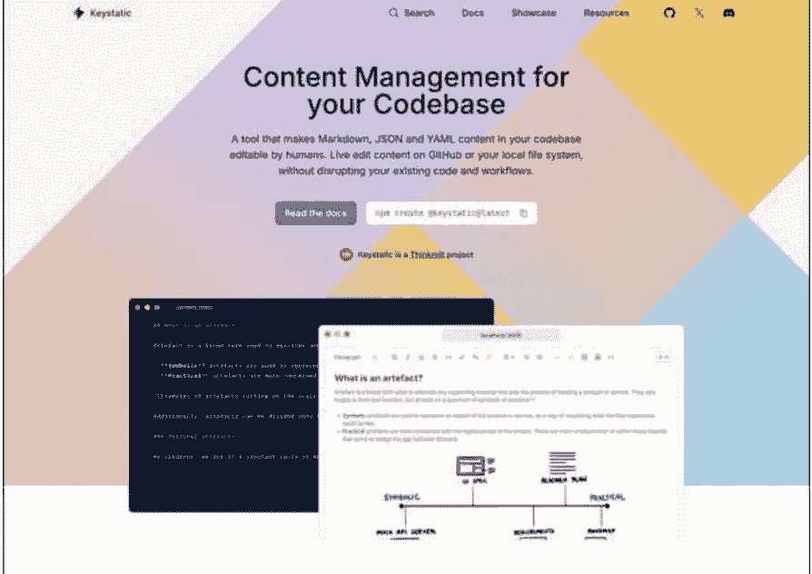

编辑在面板里保存文章时，系统后台自动生成一次 Git 记录并推送到代码库，继而触发 Vercel 的自动构建。好处是内容与代码统一受 Git 管理，版本历史完整，数据所有权清晰，且项目本身开源可免费使用。适合以开发者为主的内容生产，比如技术博客、产品说明。

#### Sanity：独立托管的协作式内容平台
Sanity 把内容当作脱离代码的可协作数据，存放在官方提供的实时托管数据库中，通过 API 消费。主界面示例如下：

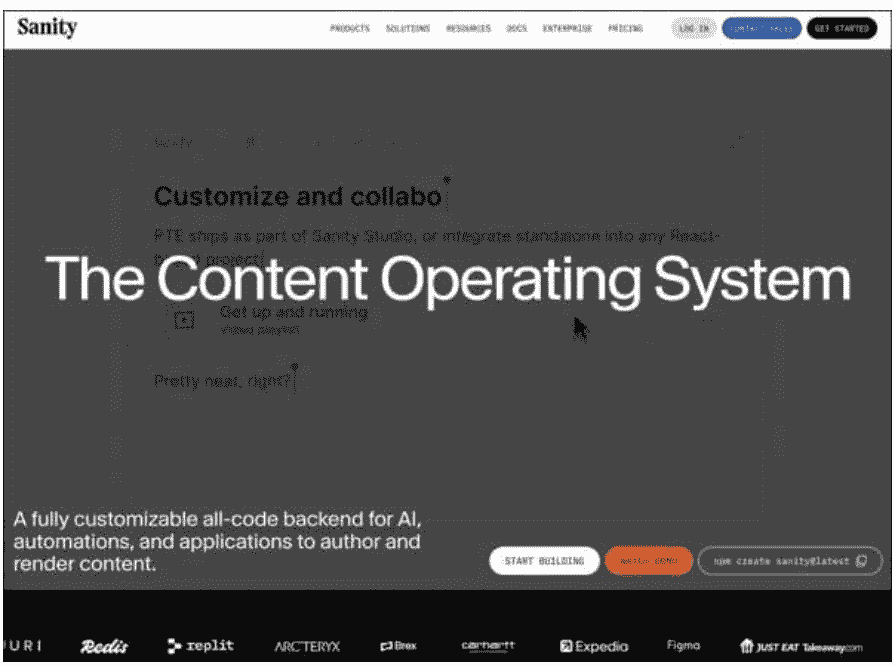

图3-10 Sanity 平台的主页面

运作方式体现在三点。编辑在可深度定制的 Sanity Studio 中修改素材，变更实时写入云端数据库，应用可在运行时通过 API 拉取最新版本，无需重新部署。平台具备实时协同、面向非技术人员友好、内容发布与代码发布解耦、鼓励结构化建模与扩展。免费计划比较宽松：最多 20 个席位、1 万份文档搭配每月 100 万次 API CDN 调用。

#### 实战建议
先明确主要编辑者。开发者主导时 Keystatic 的 Git 原生流程更顺滑；市场、运营等非技术团队负责时，Sanity 的编辑体验与协作能力更占优。

再看更新频率。更新非常频繁的内容适合 Sanity 的解耦模型；更新较少的内容，Keystatic 触发的自动构建已足够。

无论选择哪种，都建议从结构化角度规划。把内容拆成标题、摘要、作者等有意义的小单元，为后续复用与灵活性打好基础。

### 支付：Stripe
商业化后需要安全可信的收款通道，自行处理银行卡信息成本高且风险大。Stripe 是互联网支付的基础设施，主界面如图3-11所示，提供完整的 API 与工具，帮助开发者安全便捷地接收全球付款，并把加密、防欺诈等复杂性封装起来。

#### 按需计费模式
对早期团队最友好的是计费方式。标准支付不收开户费和月费，仅在成功交易时抽取少量服务费，支出随收入同步增长。


参考费率：线上境内银行卡通常为成功交易金额的 2.9% 加 30 美分，具体因地区而异。需要关注的是争议退单会产生额外处理费，属于运营成本。

#### 实战建议
使用 Stripe Checkout 或 Stripe Elements 是安全底线。切勿让卡号等敏感信息经过自有服务器。Checkout 是官方托管的现成支付页，上线最快；Elements 是一组可嵌入的组件，能在自有站点实现定制表单，同时保持 PCI 合规。

上线前务必在测试环境演练。Stripe 提供完整的沙盒和多组测试卡号，完整走通成功与失败路径，确保异常处理正确。

务必接入 Webhook。Stripe 在订阅续费成功等事件发生时会向你的服务器推送通知。仅凭前端跳转确认不可靠，Webhook 才是保证系统状态与 Stripe 最终一致的可靠方式。

#### 3. 生产力与设计工具

##### 设计工具：Figma
Figma 可视作云端的数字设计工作室，让先设计后开发的流程更高效。平台主界面如图3-12所示。


图3-12 Figma 平台的主页面

对非技术人员而言，它提供了一种把抽象想法具象化的通用语言，不写代码即可绘制界面并生成可点、可交互的原型。原型是早期最宝贵的资产，可在开发前做用户测试，便于与开发沟通，也能向投资人直观展示愿景。

免费方案
Starter 入门版面向个人和初学者，团队可创建 3 个 Figma 设计文件和 3 个 FigJam 白板文件。个人草稿区可无限创建文件，这是核心优势。协作者数量无限制，可邀请任意人数查看评论。

实战建议
拥抱原型思维，别停在静态图。用原型模式串联画板，给按钮添加点击交互，让测试者感受到真实使用。

即使项目规模很小，也要从第一天建立轻量设计规范。把主色、字号、按钮样式沉淀为可复用的组件和样式，保证视觉一致，也便于后续调整。

善用社区资源。Figma 社区汇聚大量免费 UI 套件、图标库，先搜索再动手，能大幅提速。

##### 代码管理工具：GitHub
需要一个安全、可追溯的地方存放代码与设计蓝图，那就是 GitHub，如图3-13所示。

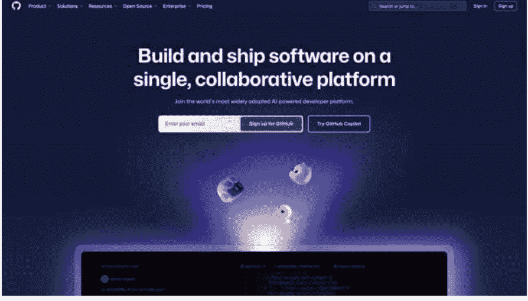

GitHub 的核心角色：版本控制与协作中心
它是全球最大的代码托管平台，核心是版本控制。每一次修改都以 Commit 记录，若新功能出问题，可随时回滚到任意历史版本，像读取游戏存档一样。

免费方案
对个人和小团队几乎无限：无限私有仓库、每月 2000 分钟 GitHub Actions 计算时间，可与 Vercel 组成 CI/CD 自动化部署流水线、500 MB 的包存储空间。

实战建议
养成好提交习惯。每次完成一个小功能或修复一个缺陷就提交一次，写清晰说明，例如“修复移动端登录按钮样式”。

拥抱分支工作流。不要直接在主干分支开发。为每个功能或修复新建分支，完成后再通过 Pull Request 合并，保证主干始终稳定可部署。

用 Issues 做任务管理。内置的项目管理工具足以记录缺陷、规划功能、跟踪任务，能替代不少第三方工具。

##### 生产力工具：飞书/Notion
灵感、任务、资料散落各处会很快失控。需要一个指挥中心、单一信息源，把一切整理成可执行系统，这个角色由飞书或 Notion 这类一体化工作空间承担。


图3-14 飞书的主页面

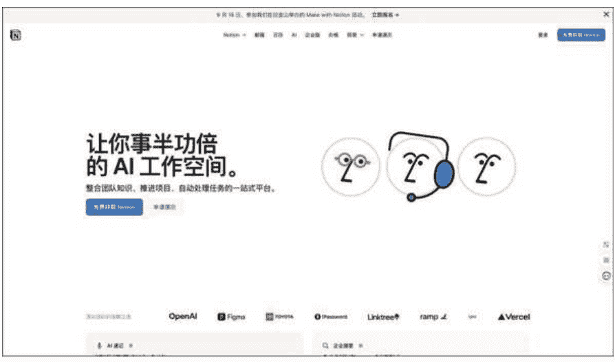

图3-15 Notion 的主页面

它们不只是笔记，而是把文档、知识库、数据库、项目管理整合在一起。你可以用结构化数据库管理任务清单、用户反馈、竞品分析、灵感记录，让信息聚合流转。

免费方案
Notion 免费版个人可无限建页面和块，团队协作有一定限制。飞书基础版提供即时消息、云文档、日历、视频会议，并提供 100 GB 总存储。

实战建议
从模板开始，别从空白页开始。搜索“产品路线图”“轻量 CRM”等模板改造成自己的工作流，上手更快。

拥抱数据库思维。把相关信息结构化到一个数据库，然后在不同页面创建不同视图，例如“分配给我的任务”，所有视图同源、自动同步。

建一个项目唯一真相来源仪表盘。在 Notion 或飞书里放一个顶层页面，集中链接 GitHub 仓库、Vercel 部署、Figma 设计稿、Supabase 控制台等。它就是项目的目录，为你和未来成员节省大量找资料时间。

### 3.1.3 五分钟实战：学习相关生产力工具

理论不如实操。接下来五分钟，通过两步夯实数字帝国最核心的两大工具。

第一步：认领你的数字蓝图库，创建 GitHub 账号。
打开 GitHub 官方站，点击右上角 Sign up，按提示输入邮箱、设置安全密码、选择用户名、通过人机验证。查收验证码完成验证。个性化设置页直接点 Skip personalization 开通免费账户。恭喜，你已拥有顶级代码托管账号。

第二步：启动你的全球发布平台，创建 Vercel 账号。
打开 Vercel 官方站，点击右上角 Sign up，选择 Continue with GitHub，授权 Vercel 连接刚建的 GitHub 账号。完成！你现在拥有世界级可自动扩展的全球发布平台，无需单独密码，通过 GitHub 完成统一登录，体现工具生态的无缝集成。

### 3.1.4 小结

短短五分钟，就完成了十年前需要专业人士花数天搭建的基础设施。你已拥有与顶尖科技公司同款的蓝图库和发布平台，初始成本为零。创业从想法正式变为可操作的现实。

## 3.2 拥有你的数字身份：购买与配置域名

在互联网拥有独一无二的在线家园，是建立品牌的关键。就像现实住宅需要门牌号，数字家园也需要域名，让别人轻松找到你。域名不仅是地址，更是数字世界的名片，是构建身份的起点。概念虽简单，操作并不复杂。

### 3.2.1 什么是域名

类比为互联网上的家：

网站需要“土地”，即网站托管或虚拟主机，是运转的基础，如房屋地基；有了土地，还需要唯一的“地址”，即域名，访客通过它精准找到网站。二者缺一不可。例如百度域名是 baidu.com，epubit.com 也是专属门牌，用户在浏览器输入域名即可访问。

#### 1. 域名与 IP 地址的关系
幕后每个网站都对应一串数字 IP，如 192.153.xxx.xxx，就像房屋的经纬度，精确但难记。域名系统 DNS 充当翻译官，像庞大的地址簿，把难记的 IP 转换成易懂的域名。用户输入 godaddy.com 时，DNS 迅速解析出对应的 IP 并引导访问，大幅简化操作，提升体验，也提高回访率。

#### 2. 域名的构成
主要由两部分组成。

第二级域名 SLD 是用户可自定义的部分，通常在 www 后，如 godaddy.com 中的 godaddy，是体现品牌个性的关键。

顶级域名 TLD 是后缀，相当于类别或地区标识。分为三类：
通用顶级域名 gTLD 最常见，.com 多用于商业、.org 多用于非营利、.net 多用于网络服务，其中 .com 最受信任。
国家代码顶级域名 ccTLD 代表特定国家或地区，如 .us、.uk、.cn，面向区域受众时更有优势。
新通用顶级域名 new gTLD 近年出现，如 .photography、.media、.shop、.ai、.store、.app，可让域名更具特色并直观体现业务。

注意域名不等于 URL。域名是主地址如 google.com，URL 是详细地址，包含协议、域名和路径，如 https://www.godaddy.com/help/...，域名是 URL 的组成部分。

网站还可使用子域名，如 blog.example.com 或 shop.example.com，用于划分功能区，或搭建开发、测试环境。

#### 3. 拥有专属域名的价值
专属域名是数字世界的长期战略投资，远超网址本身。

建立专业品牌形象：yourname.com 这类自定义域名能快速提升专业度和可信度，传递严肃信号。
提升信任感知：清晰易记的域名给潜在客户好印象，而 yourbusiness.hostsite.com 这类免费子域名显得不正式，易引发不信任。
掌控在线身份：拥有自己的域名意味着完全掌控网站外观、内容和呈现方式，不受第三方平台规则束缚。

- **提升记忆与访问效率**：域名越短越好记，用户就能更快地找到你的站点并记住网址，回访的可能性自然随之提升。
- **打造专业邮箱**：拿到域名后就能生成 info@yourbusiness.com 这类定制邮箱。比起常用的公共邮箱，专属邮箱大幅增强品牌调性，也更容易获得客户信任。
- **间接促进搜索曝光**：域名已不再直接决定排名，但与业务高度相关、带有行业词的域名，能帮助用户和搜索引擎快速判断站点主题，间接增加被搜索到的机会。
- **保护数字资产**：即便网站还没上线，提前锁定心仪域名就能防止被抢注，为后续发展预留空间。
- **低成本持续获客**：域名年费通常不高，却相当于全天候在线的广告牌，长期为业务引流，投入产出比远超传统投放。

总体来看，域名是数字身份的底座。买域名不只是买一个网址，而是对未来数字资产的一次战略性布局。

### 3.2.2 挑选好域名的核心原则
一个优质域名是线上形象成功的起点。选得好，才能便于传播、提升品牌感并赢得信任。下面是选域名的关键衡量维度。

#### 1. 简洁好记，发音流畅
理想域名要短、易记、易写、读起来顺口。过长或结构复杂的域名容易输错，比如电话报读困难、包含易混淆字母组合，就会让用户放弃。同时避免非常规拼写，例如用 u 代替 you，也要避免因合并导致的歧义，如 Children’s wear 写成 childrenswear。

#### 2. 强化品牌辨识度，保持唯一性
在海量已注册域名中，有辨识度的品牌名很重要。好的品牌域名通常简短上口、读起来顺。敲定前务必核查是否已被占用，防止法律纠纷，也要检查主要社交平台的账号是否可用，保持全网形象一致。

#### 3. 远离数字、连字符，禁止空格
域名里尽量不要出现数字和连字符。数字让人犹豫是输 5 还是 five，连字符容易漏掉或放错位置，都增加出错率，移动端输入更麻烦。特别要强调，域名中不能出现空格，浏览器会转成 %20，既不规范也难看。

#### 4. 适度植入关键词
域名里带上业务相关的关键词，能让访客瞬间明白站点内容。比如做玻璃维修，可用 GlassRepair.com 或 GlassReplacement.com。关键词虽不直接决定排名，但有助于理解主题，间接提升可见度。切忌堆砌关键词，看起来不自然还可能被判定为垃圾信息。

#### 5. 选择合适的顶级域名
后缀会影响信任感。.com 仍是全球使用最广、认可度最高的后缀。若受众集中在某一地区，选用 .cn、.uk、.us 等国别域名，能增强本地化 SEO 并明确地域属性。此外 .store、.blog、.shop、.ai 等新通用后缀也提供了更贴合业务的选择。

#### 6. 预留长期扩展空间
选名要有前瞻性，适配未来业务扩张。比如花店起初用 cityflowers.com，后期拓展园艺品类就会受限。而 cityblooms.com 这类更具品牌包容性的名字，能为产品线延伸留出余地。

#### 7. 充分核查，及时锁定
最终确定前需做两项功课：一是查商标版权，避免侵权；二是查域名历史，避开曾发垃圾邮件或被搜索引擎惩罚过的域名，否则会影响声誉和排名。好域名稀缺，确认后要尽快注册，防止被抢先。

总的来说，好域名要兼顾易记、易写和品牌相关性，直接影响用户记忆与信任度。关键词不再是排名硬指标，但描述性域名仍有助于用户理解内容并间接提升搜索可见性。具备延展性的域名才能伴随业务迭代持续发挥价值。

### 3.2.3 五分钟实战：用生成器快速头脑风暴
手工想域名效率低，免费的域名生成器能快速给出大量可用的建议，并实时反馈注册状态。操作思路如下。

1. 确定核心关键词。先梳理最能概括业务或站点的词，例如烘焙博客可提炼 “烘焙”“甜点”“食谱”。
2. 挑选合适的生成工具。市面上有不少免费工具，各有侧重，可多试几个，比如 Nameboy、Squarespace Domain Name Generator、Hostinger Domain Name Generator、Instant Domain Search 等。
3. 输入关键词生成候选。在工具中输入一个或多个关键词，点击生成，即可批量获得建议。
4. 用筛选器精简结果。多数工具支持按长度、词数、行业、风格如朗朗上口或品牌化等条件过滤，快速锁定合适的范围。
5. 核查注册状态。生成器会直接标明是否可用。若已被占，会推荐替代后缀或变体。
6. 记录并按标准评估。将心仪的域名整理出来，再对照简短易记、易拼写、有品牌潜力、避免数字连字符等标准逐项打分，选出最优解。

### 3.2.4 如何挑选域名注册商
注册商的选择直接影响管理体验、长期成本和安全。重点关注以下维度。

#### 1. 资质与口碑
优先选择信誉良好且通过 ICANN 认证的服务商。ICANN 认证是合规运营的基础，能降低遭遇假冒商或域名被盗的风险。

#### 2. 价格结构是否透明
很多商家的首年价格很诱人，但续费会大幅上涨。决策前应对比首年价和续费价，评估长期持有成本，避免后期被高价续费困扰。

#### 3. 隐私保护
域名注册信息默认公开在 WHOIS 数据库，易招来垃圾邮件和骚扰。多数商会提供 WHOIS 隐私保护，用自身信息遮挡用户真实数据。
- 免费提供：Namecheap、Dynadot、Porkbun、GoDaddy 等将隐私保护作为标配。
- 额外收费：部分商家需付费开通。
选商时要明确隐私政策及是否收费，优先选免费的。

#### 4. 客户支持质量
非技术用户更依赖客服。建议选提供 7×24 小时支持的商家，并确认渠道是否包含实时聊天、邮件或电话。GoDaddy 在电话支持口碑较好，Namecheap 的实时聊天和帮助文档响应很快。

#### 5. 界面与功能
操作界面友好能大幅降低管理成本。理想的平台提供直观的搜索和筛选工具，并在首选不可用时给出合理替代方案。

#### 6. 支持的后缀种类
后缀选择越多，找到契合品牌的概率越大。部分商家提供数百种通用、国别和新通用顶级域名。

#### 7. 附加服务与捆绑
商家常捆绑托管、SSL、专业邮箱等。虽然一站式方便，但本书实战中基本不需要这些付费附加项。

#### 8. 转移政策与自动续费
了解转移流程，防止未来因需求变化被限制。同时务必开启自动续费或设置到期提醒，避免因忘记续费导致域名过期、恢复费用高昂甚至被抢注。

综合来看，选注册商不能只看首年价格，要综合长期成本、隐私保护和客服质量来判断。

### 3.2.5 五分钟实战：在注册商上完成域名购买
下面以 GoDaddy 和 Namecheap 为例说明购买流程，核心步骤基本通用。

#### 1. 通过 GoDaddy 购买域名
1. 登录 GoDaddy 网站，在首页搜索框输入目标域名，点击 Search Domains。
2. 若可用，系统提示可加入购物车；若已被注册，会推荐类似方案。
3. 确认后点击对应域名的 Add to Cart。
4. 购物车会提示是否添加附加服务，如域名隐私保护，该服务在 GoDaddy 为免费，建议勾选。
5. 再次点击 Continue to cart。
6. 填写账单和支付信息。
7. 核对域名、年限、总价无误后付款完成。

#### 2. 通过 Namecheap 购买域名
1. 进入 Namecheap 首页，在搜索框输入域名并点击 Search。
2. 找到可用域名后点击右侧 Add to cart。
3. 弹窗提示选择附加产品如托管、SSL，按需选择后点 View Items 进入购物车。
4. 在结算页确认 WHOIS 隐私是否默认开启、DNS 设置，选择支付方式。
5. 确认信息无误后支付完成订单。

#### 3. 购买时常见误区
- 未先核查可用性，导致空欢喜。
- 选择过长难记的域名，降低访问率。
- 在未获 ICANN 认证的非正规卖家处购买。
- 未比价，接受过高年费，或掉进首年低价续费高价的陷阱，域名年费通常在 15 美元左右。
- 未开启自动续费，也未保持注册邮箱和支付信息最新，易因过期丢失域名。

按流程操作并规避上述坑点，就能顺利拿到心仪域名，为上线奠基。

### 3.2.6 五分钟实战：将域名接入 Vercel 项目
域名买好后需通过 DNS 配置连接到 Vercel 上的项目。

#### 1. 理解 DNS 记录
接入时主要用到两种记录：
- A 记录：把根域名如 yourdomain.com 指向具体的 IP 地址。
- CNAME 记录：把子域名如 blog.yourdomain.com、www.yourdomain.com 指向另一个域名。
正确配置 DNS 是域名与服务器通路的关键。

#### 2. 将域名连接到 Vercel 项目
以下以 GoDaddy 为注册商举例。

**第一步：在 Vercel 中添加域名。**
登录 Vercel，进入目标项目，点击 Settings -> Domains，点击 Add Domain，输入购买的域名如 yourdomain.com 并完成验证。Vercel 会根据类型给出对应的 A 记录 IP 或 CNAME 值，务必记录下来。

**第二步：在注册商处配置 DNS。**
登录 GoDaddy，找到域名进入 DNS 管理。
先配置 A 记录：找到类型为 A、名称为 @ 的记录，编辑值替换为 Vercel 提供的 IP，保存。这样访问根域名即可指向 Vercel。
再配置 CNAME：找到类型为 CNAME、名称为 www 的记录，编辑值替换为 Vercel 提供的 CNAME 值，通常是 cname.vercel-dns.com，保存。这样 www 与裸域名都能正常访问。

**第三步：等待 DNS 传播。**
配置完成后返回 Vercel 的域名页。DNS 全网生效需要几分钟到 48 小时不等，取决于各地服务器缓存更新速度。期间可能出现无法访问或页面未找到，属于正常现象。可通过在线 DNS 检测工具查看进度。Vercel 显示状态为 Ready 时即配置成功。

#### 3. 注意事项与故障排除
**特殊情况：域名在 Vercel 内购买**
若域名直接在 Vercel 购买，无需手动改 DNS，Vercel 会自动完成关联。

**安全保障：自动配置 SSL 证书**
无论域名来自第三方还是 Vercel 自购，连接成功后 Vercel 会自动签发并维护 SSL 证书，无需手动操作即可通过 HTTPS 安全访问。

**故障排查：常见问题解决**
- DNS 记录填写错误，核对 IP、CNAME 是否准确。
- DNS 尚未完成全球传播，需耐心等待最长 48 小时。
- 域名已被其他 Vercel 账号绑定，需先解除绑定再操作。

DNS 配置是连接的关键环节，传播延迟不可避免，提前预留时间能让上线更顺畅。

### 3.2.7 小结
拥有并正确配置专属域名，是个人和企业在数字时代建立独立在线身份的基础。域名相当于网站的门牌号，通过 DNS 把 IP 转化为人类可读的名称。

域名不仅是技术地址，更是具备品牌、信任、管理自主权和营销价值的数字资产。选名时要兼顾简洁易记、品牌关联和长期延展性。选注册商时，除了首年价格，更要看续费、隐私保护和客服质量。对初学者而言，界面友好、支持可靠的商家综合价值更高。

最后把域名与 Vercel 等平台项目关联，理解 A 记录和 CNAME 的作用，耐心等待 DNS 传播，就能为自己的数字家园挂上专属门牌，开启在线之旅。

## 3.3 Supabase 深度实战：构建你的数字总部
你已经有了不错的商业想法——可能是社区、项目管理工具或个人作品集。前端界面已搭建完成，看起来精美流畅，但随之而来的是后端问题：用户数据存哪、内容如何安全保存、库存怎样实时更新、谁能看后台销售数据？

这些问题的答案指向应用的核心——后端。它相当于数字业务的后勤、安保、档案和机房集合。传统方式需要组建昂贵的工程团队，从设计到服务器、数据库、安全规则搭建，耗时数月甚至数年，成本高昂。

Supabase 帮助我们跨越这道鸿沟。它提供了一套模块化的总部搭建套件，不必从零造砖砌墙，像搭积木一样组合即可在数小时内拥有世界级数字总部。

本节以“构建数字总部”为线索，带你完成 Supabase 全流程实战：先了解 Supabase 是什么，再巡视核心功能，随后创建数据表、理解表关系、设置用户认证、配置行级安全，并启用文件存储。

### 3.3.1 开源后端时代：Supabase 全景解析
开工前先全面认识这套建筑材料——Supabase：它由哪些模块构成、能做什么、为什么适合作为数字总部的首选方案。

严格定义下，Supabase 是一款开源的后端即服务平台。为了更好理解，我们可以用“数字总部”来做类比。

想开一家公司，传统做法是自己买地、规划、盖楼。BaaS 则像专业的商业地产公司，总部大楼已经建好、设施齐全，你无需操心结构、水电、网络，只管拎着东西直接办公。BaaS 在数字世界提供同样的便利，把数据库、身份认证、文件存储等复杂的基础设施打包交付，让业务快速上线，省时省钱。

在这个赛道里，Google 旗下的 Firebase 长期占据领先。它稳定、功能全，像市中心的顶级写字楼。但它属于闭源方案，租客看不到建筑图纸，无法改动结构，更会把业务和数据深度绑定在平台上。一旦涨价或改规则，迁移成本极高，这就是业界常说的供应商锁定。

Supabase 自称 Firebase 的开源替代品，关键差异在于开源。

如果说用 Firebase 是租一间无法改造的办公室，用 Supabase 则等于从顶级建筑团队手中拿到一座现成总部，并附带完整详尽的施工蓝图。

开源带来了三点实质变化：

- 可视性，你能查看每一面墙体的钢筋逻辑，系统运作没有黑箱；
- 可控性，手握图纸就能按需改造大楼；
- 退出自由，这是最核心的保障。即使对官方托管不满意，或业务规模扩大，只要带上图纸就能把整座数字总部完整迁移到自家服务器，实现私有化部署。永远有后路，供应商锁定的风险基本消除。

这背后是开发潮流的转向，从依赖科技巨头的封闭服务，走向开放、透明、把选择权交还开发者的方案。对非技术创始人而言，数据和后端不再被单一巨头掌控，真正的数字资产所有权才算落在自己手里。

#### 1. 核心功能模块

走进这座数字总部，开箱即用的核心部门和基础设施如下。

##### 数据库：核心档案库

梳理 Supabase 模块先从数据库入手，前端再华丽，最终都依赖稳定存储。

- 总部意象：数字总部的中枢，一座井然有序且安全的中央档案库。所有核心信息结构化存放，每个数据表如同贴标签的文件柜，每行记录就是一份具体档案。
- 技术要点：底层是 PostgreSQL，这款拥有三十多年历史的开源关系型数据库，以稳定和高可靠性著称。选择 Supabase，数据从起步就放在金融级的基础之上。

##### 用户认证：门禁与前台

档案库需要安保，数字总部也需要身份验证。

- 总部意象：大楼入口的安保前台，负责办理入职、核验 ID、细化权限。
- 技术要点：Supabase Auth 简化了整套安保流程，原生支持邮箱密码、魔法链接，以及 Google、GitHub 等社交一键登录，后台开关灵活。

##### API：内部通讯网络

档案和门禁到位后，需要高效的内部沟通。

- 总部意象：内部电话与邮件系统，前端应用发起请求，经校验后获取或写入数据。
- 技术要点：建表瞬间自动生成安全标准的 RESTful 接口，省去手写接口的时间。

##### 实时订阅：监控中心

现代业务要求实时反馈。

- 总部意象：安保中心的实时大屏，档案新增、人员进出即时呈现。
- 技术要点：依托 PostgreSQL 日志监听，数据变更通过 WebSocket 即时推送。

##### 云函数：自动化助理

后台需要处理复杂逻辑和定时任务。

- 总部意象：机器人助理团队，自动发送欢迎邮件、生成日报等。
- 技术要点：Supabase Functions 支持 TypeScript/JavaScript 编写，处理异步自动化任务，实现 7×24 无人值守。

##### 文件存储：仓库与全球物流

非结构化资产也需要安置地。

- 总部意象：除档案室外的大型中央仓库。
- 技术要点：Supabase Storage 提供对象存储并自带 CDN，文件分发到全球节点，提升访问速度。

为便于对照，整理如下：

表3-2 数字总部部门导览

| Supabase功能模块 | 数字总部核心部门比喻 |
| :--- | :--- |
| 数据库 (Database) | 中央档案室 (基于坚固的PostgreSQL构建) |
| 用户认证 (Auth) | 安全前台与门禁系统 |
| API | 内部通信网络 (电话与邮件系统) |
| 实时 (Realtime) 订阅 | 实时监控中心 (实时信息流) |
| 云函数 (Function) | 自动化智能助理 (机器人服务团队) |
| 文件存储 (Storage) | 安全仓库与全球物流服务 (自带CDN) |

巡览完毕，对这座数字总部的能力已有清晰认识。接下来看为何它更合适。

#### 2. 为什么选择Supabase

建造数字总部有三种常见路径。

第一种是自建，从零招人搭系统。控制力最强，但成本高、周期长、风险大，对大多数初创和个人开发者不现实。

第二种是入驻闭源 BaaS，如 Firebase。启动快、服务稳，能迅速聚焦业务，但你是租客，结构不可改，供应商锁定风险致命。

Supabase 更像顶尖建筑科技公司的预制模块。速度和便利不输 Firebase，同时交付完整蓝图，使用者拥有所有权与迁移自由。业务扩张或对云服务不满时，可随时搬迁，彻底消除锁定风险。

更深层的价值在于风险管理。数字创业本就充满不确定性。闭源平台增加平台风险，自建增加执行风险。Supabase 凭借开源和 PostgreSQL 开放标准，同时降低执行风险和平台风险，留下一条随时可用的逃生通道。

#### 3. 系统架构剖析：以PostgreSQL为核心的服务生态

Supabase 的设计并非拼凑，而是以 PostgreSQL 为主干生长。

- API 网关直接读取表结构自动生成接口；
- 认证系统复用 PostgreSQL 成熟的角色权限机制；
- 实时订阅直连数据库预写日志，效率极高；
- 行级安全即 PostgreSQL 原生特性，通过可视化界面配置。

因此系统具备高度一致性和稳定性，性能可直接借助数据库优化，学习 Supabase 的过程也是在积累长期可迁移的 PostgreSQL 技能。

总部导览结束，接下来动手布置第一件家具。

### 3.3.2 五分钟实战：在仪表盘中创建数据表

现在为中央档案库建第一个文件柜 projects，用来存放项目信息。

先明确概念：数据表像结构化电子表格，表头是列，定义信息类别和类型；每一行是一条完整记录。

操作步骤：

1. 登录账户进入项目仪表盘，类似总部管理办公室。
2. 左侧导航找到 Table Editor 表格编辑器，进入数据表管理。
3. 点击 Create a table 创建新表。
4. 在 Name 填入 projects，Description 可写“存放公司所有项目”。
5. 设计列：默认 id 与 created_at 保留；点 Add column 增加 name 类型 text、due_date 类型 date、status 类型 text。
6. 确认无误后点右下角 Save，projects 表即出现在列表中。

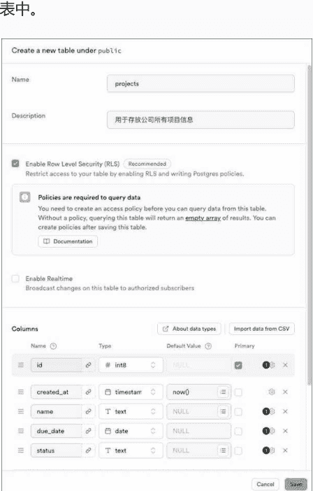

至此，第一件定制家具已就位，项目信息有了专属容器。

### 3.3.3 五分钟实战：理解表关系

一个项目通常包含多个任务，可再建 tasks 表并建立关联。关系型数据库的核心优势就是通过外键把独立表连接成网络，像发票上标注客户编号。

操作步骤：

1. 在 Table Editor 点击 Create a table。
2. Name 填入 tasks。
3. 保留默认 id、created_at，增加 description 类型 text、is_complete 类型 boolean。
4. 再加一列 project_id，类型 int8，点击链条图标建立关系。
5. 在弹出的窗口选择 schema public，引用表选 projects，关联列选 id。
6. 完成配置后先保存关系窗口，再点右下角 Save 保存整表。

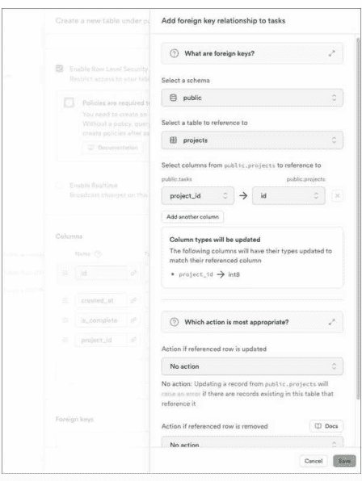

图3-17 创建tasks表

这样就在两个文件柜间架起了信息桥梁。

### 3.3.4 十分钟实战：探索用户认证（Supabase Auth）

为数字总部配置安保人事系统，完成员工入职与身份验证。

认证本质是回答“你是谁”，Supabase Auth 已处理复杂逻辑，只需配置。

1. 仪表盘左侧锁形图标 Authentication 进入认证管理。
2. 左侧菜单点 Sign In/Providers，可见 Email 默认开启，滚动后可开启 Google、GitHub 等社交登录，开关即生效。
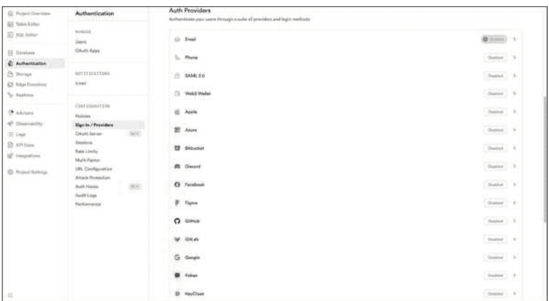

图3-18 Supabase支持的所有登录方式

3. 在 Users 页面点 Add user，填入测试邮箱与密码，点击 Create user 即可在后台手动添加首位测试员工。

4. 入职结果验证
关闭新建用户的弹窗后，打开用户列表即可看到刚才注册的那位新成员，系统已经自动为其生成唯一的 UID 作为身份凭证，见图3-19。

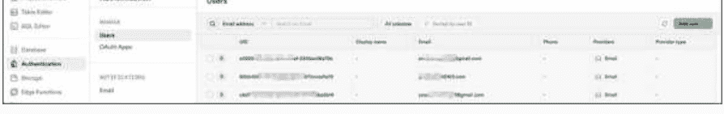

图3-19 用户列表

恭喜，第一次员工入职流程已完成。Supabase Auth 使用不可逆算法加密存储密码，并为用户分配唯一的身份 ID，数字总部已有第一位合规注册的员工。

### 3.3.5 RLS 实战：数据行级保护
当前所有登录用户都能读写 projects 文件柜里的全部记录。目标是建立精细的访问规则，让员工只能操作自己创建的项目。

RLS 行级安全把规则直接应用到每一行数据，而不是只在入口把守。它相当于给每行数据贴上隐形权限标签，访问时数据库会校验用户 ID 与标签是否匹配，检查在数据层完成，更安全、更可靠。

按下面步骤为数字总部配置细粒度权限。

1. 为 projects 增加归属字段。进入 Table Editor 打开 projects 表，在表结构区点加号新建一列，列名 user_id，类型选 uuid，原因与 Supabase 用户 ID 格式一致。展开 Foreign Key 设置，添加外键关联 Schema 选 auth、Table 选 users、Column 选 id。保存关联后再保存整张表。
2. 进入策略管理。侧边栏找到带盾牌的 Authentication 条目，点击后在子菜单打开 Policies。
3. 开启 projects 的 RLS。在策略页找到 projects 表，点右侧的 Enable RLS。若初始显示的是 Disable RLS，说明策略已默认开启。注意开启瞬间默认规则是拒绝全部，API 暂时无法读取 projects，这是先封锁再开放的安全做法。
4. 新建策略。在 projects 区域上方点 Create policy。
5. 选择模板。右侧 Templates 列表往下滚动，选中倒数第一个 Enable users to view their own data only，即仅允许查看自己的数据，如图3-20。

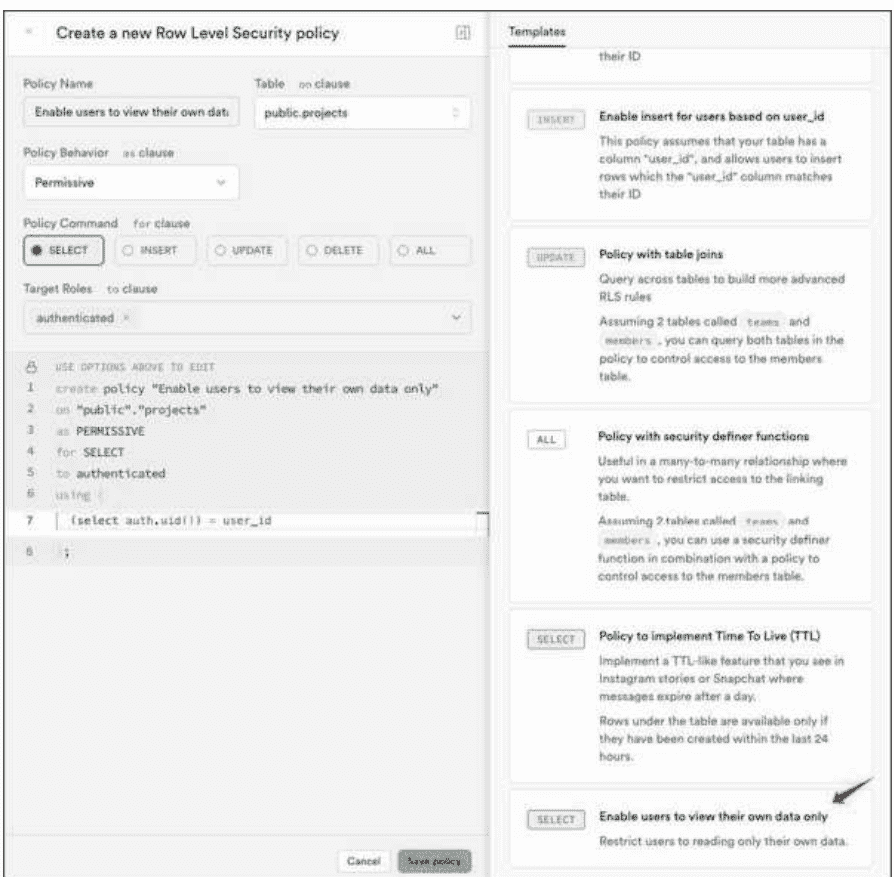

图3-20 创建 RLS 策略

6. 配置读取规则。在策略编辑区填写 Policy Name，例如“用户仅能查看自己的项目”；Policy Command for clause 选 SELECT；把 using expression 改为 (select auth.uid()) = user_id，左侧示例可参考图3-20。含义是只有当前登录用户的 auth.uid() 与行数据的 user_id 相同才允许读取。
7. 保存策略。点 Save policy。
8. 补充其它操作。以相同思路补充 INSERT、UPDATE、DELETE。
   - 插入策略：操作选 INSERT，with check expression 设为 (select auth.uid()) = user_id。
   - 修改与删除策略：操作分别选 UPDATE 和 DELETE，using expression 设为 (select auth.uid()) = user_id。

一次企业级安全配置完成。RLS 把安全逻辑绑定到数据本身，规则生效后持续管控。Supabase 的可视化界面让原本需要资深 DBA 的工作变得直观。

### 3.3.6 快速实战：文件仓库与全球加速
项目管理工具还需要存放需求文档、设计稿、演示视频等附件，需要启用中央仓库 Supabase Storage。

Storage 面向非结构化数据，可视为大型仓库。通过存储桶划分区域来分类文件。创建桶时可设公开或私有：公开桶链接可直接访问，私有桶需权限校验。Storage 内置 CDN，文件上传后会自动复制到全球边缘节点，访问速度大幅提升。

配置步骤如下。

1. 进入存储管理。仪表盘侧边栏点桶形图标 Storage。
2. 新建存储区域。点 New bucket，Bucket name 填 project-files，勾选 Public bucket。生产环境中敏感文件建议设为私有并配策略。点 Create 完成。
3. 上传文件。进入 project-files 桶后点 Upload file，从本地挑选任意文件上传。
4. 获取公开链接。把鼠标移到已上传文件上，通过右侧三点菜单点 Get URL，链接自动复制到剪贴板。
5. 验证加速。另开标签页粘贴链接打开，文件即刻加载。该链接指向 Supabase CDN，无论用户身处何地都能快速获取。

至此数字总部已拥有世界级仓储与物流能力。获得的不仅是存储地址，更是自带全球加速的 CDN 链接。传统方案需额外配置与付费，Supabase 已无缝集成。

### 3.3.7 小结
约一小时前眼前只有抽象的后端概念和空的 Supabase 面板；现在成果清晰。

- 拥有完整关系型数据库：projects 与 tasks 表结构清晰，是业务蓝图。
- 部署企业级安全防护：用户认证已启用，并配置行级安全，确保数据仅对创建者可见可改。
- 获得强大文件存储与分发：存储弹性扩展，配合全球 CDN，文件随处快速加载。

最关键的是全程无需手写代码。你已搭建起坚实可靠、功能完备的数字总部，它不再是空壳，而是安保严密、信息畅通的运营基地，可在此基础上构建任意应用。

Supabase 等现代 BaaS 平台把后端门槛从陡坡变为缓坡，让有创造力的人跨越技术鸿沟把想法落地。通过本次实战，你已掌握现代化数字产品的核心逻辑与关键技能，已是合格的创造者和建设者。

## 第4章 后端开发与高级集成：应用的引擎
前端是餐厅的门面，后端是决定成败的中央厨房。

本章将打开数字后厨的大门。这里没有用户可见的华丽界面，却藏着应用的生命力：数据存储方式、业务运转逻辑、安全保障机制、效率提升路径。这些幕后力量把普通网页升级为专业产品。

在 AI 陪伴下，你将体验新式的后端开发：不必死记数据库语法，不必为服务器配置焦虑，不必纠结 API 设计。从 TRAE SOLO 的自主架构，到 Cursor 的精准代码生成，再到 MCP 的高级集成，你拥有一支全能的 AI 后端团队。

结章时你将具备构建复杂应用的核心能力，并体会到后端开发同样充满创造乐趣。

### 4.1 AI 后端工程师：TRAE SOLO 实战进阶
前文已介绍 TRAE SOLO 简称 SOLO 作为 AI 前端设计师的能力，通过对话与可视化编辑把想法快速变成可交互界面，相当于为餐厅设计门面与氛围。

但任何成功应用的核心竞争力来自用户看不见的后端。后端决定产品质量、运行效率与安全性，在应用世界里就是中央厨房。

#### 4.1.1 从门面到后厨：思维转换
后端负责处理所有不可见却至关重要的工作，涵盖数据库、业务逻辑、核心算法以及前后端通信的可靠 API，确保前端能准确调用后端能力。

这与前端差异明显。前端关注视觉与交互，后端聚焦数据结构、业务规则与系统安全，传统上对逻辑思维与系统设计要求较高。

本节引导角色转换，从前台转向后厨，聚焦 SOLO 作为 AI 后端工程师的能力，探索如何指挥它搭建功能完备、安全可靠的后端系统。跳过已介绍的基础概念，直接进入实战核心，体验从想法到全栈应用的完整旅程。

#### 4.1.2 从需求到 API：全流程自主开发
前端的自动化流程在后端场景下侧重点不同。以架构师视角重新审视 SOLO 的后端能力。

##### 1. 需求分析与文档生成
每个项目始于蓝图。后端蓝图是严谨的 PRD，明确系统结构与功能规格。

与重视觉的前端 PRD 不同，后端 PRD 核心是“能做什么”与“数据如何流转”，需清晰定义：
- 功能模块：如用户管理、文章发布、评论系统等。
- 用户角色与权限：访客、注册用户、管理员各自可执行的操作。
- 数据实体与关系：用户、文章、评论等实体及关联。
- 业务规则：如每日发文上限、评论字数限制等。

非技术人员撰写结构化文档困难。SOLO 只需自然语言描述即可自动产出符合后端需求的严谨 PRD。例如：
> 为我规划个人博客后端。支持访客、注册用户、管理员三类角色。注册用户可发布管理自己的文章并评论他人文章，管理员拥有全部权限。文章包含标题、内容、发布日期，最终提供 API 供前端调用。
SOLO 启动文档工具，将描述转化为结构清晰、逻辑严谨的后端 PRD，成为开发蓝图。

##### 2. 环境配置与依赖管理
蓝图完成后需搭建环境并选定技术栈。
技术栈包括编程语言、框架、数据库、Web 服务器等。对新手而言，版本冲突、依赖缺失、系统差异常导致阻塞。
SOLO 会根据 PRD 自动选型。例如需要大量实时消息时，可能优先选择擅长高并发 I/O 的 Node.js。
确定后，SOLO 在 Terminal 面板自动执行安装语言环境、下载框架、配置数据库连接等命令，短时间内完成专业稳定开发环境。

##### 3. 编码与错误修复
环境就绪后进入编码，将需求转化为可执行指令。
SOLO 逐条阅读 PRD 与技术设计文档，把“创建注册接口”“实现权限校验”等需求转化为高质量后端代码。
同时具备自检修复闭环：编写后即在终端运行，如启动服务或单元测试。若出现 ECONNREFUSED、SyntaxError 等错误，会自动分析日志并修改，直至解决。也可把外部报错粘贴给它定位修复。

##### 4. 本地测试与预览
后端测试不如前端直观，输出多为终端 JSON 或数据库变更。
SOLO 的集成工作区内置浏览器工具，测试更直观。后端逻辑构建时，浏览器可同步渲染可交互前端界面调用接口，无需专业 API 测试工具即可实时验收。
例如用户登录 API 完成后，浏览器立即出现登录页，可尝试正确或错误密码，观察响应与日志验证逻辑。

##### 5. 部署与上线
功能验收稳定后需发布到互联网，即部署。
传统部署需配置服务器、域名、证书、防火墙与 CI/CD，多由 DevOps 负责。
SOLO 深度集成 Vercel 等云平台。确认完功能后输入如“功能测试完成，请部署博客后端到 Vercel”，即可自动打包、配置环境变量、发布上线，数分钟后获得公开 API 地址，完整生命周期结束。

#### 4.1.3 五分钟实战：接入 Supabase
后端开发可借助 BaaS 平台如 Supabase，提供基础设施让你专注业务逻辑。
前文已初步了解 Supabase，下面看如何让 SOLO 接管操作。

##### 1. 使用 SOLO 快速集成 Supabase
在 SOLO 的 Integrations 面板点击几次完成授权，即可通过 OAuth 协议获得操作你 Supabase 项目的权限，实现 AI 对基础设施的全面接管。

##### 2. 通过 SOLO 进行数据库操作
核心概念是 CRUD：Create、Read、Update、Delete。以手机通讯录类比：新增联系人、查询电话、修改信息、删除联系人。
过去需掌握 SQL 或反复操作后台面板。现在连接 SOLO 后，只需自然语言指令即可完成各类操作，如“添加一条新项目记录”“查看所有未完成项目”。
示例：
**创建数据表**
> 在 Supabase 中创建表 products，包含 name 文本、price 数字、stock 整数。
**插入数据**
> 向 products 插入一条记录：商品名“AI 智能咖啡机”，价格 999 元，库存 50。
**查询数据**
> 查询 products 中价格低于 1000 元的商品。
**更新数据**
> 将“AI 智能咖啡机”价格改为 899 元。

**删除（Delete）：移除数据**

> 从products表中删除所有库存为0的商品。

把这种口语化的指令交给系统，SOLO 会先把自然语言转写为合规的 SQL，再通过受保护的通道在 Supabase 上执行，最后用通俗的说法把结果反馈回来。

把 SOLO 接入 Supabase 后，后端数据的操作体验被改写。没有技术背景的人也能像资深 DBA 一样驾驭强大的数据库。

#### 4.1.4 十分钟搭出技术方案和数据模型

PRD 讲清要做什么，技术设计文档 TDD 则细化怎么做。它像施工蓝图，把系统的内部构造与落地路径讲明白，对后端尤其关键，因为后端是整座系统的地基。

##### 1. 技术设计文档的价值

不少团队拿到需求就直接开写，相当于无图施工，很容易出现结构性问题，浪费时间和成本。

一份合格的 TDD 体现的价值有：

- **形成共识** ——让团队对架构选型、接口约定、数据流向保持同一套精确理解；
- **提前排雷** ——在设计阶段就挑出技术难点、性能瓶颈、安全隐患，比上线后再修复要高效；
- **明确落地** ——为开发者提供清晰的行动清单，说明模块如何实现、如何交互；
- **支撑维护** ——作为项目档案，帮助新人或后期维护者快速上手，避免改动时引入严重错误。

撰写高质量 TDD 需要深厚的架构能力，SOLO 能充当一位称职的智能架构助手。

##### 2. 让 SOLO 产出设计文档

SOLO 遵循文档先行再执行的思路。PRD 确定后，可以直接让它继续生成 TDD。

参考提问如下：

> 根据先前已确定的博客系统 PRD，生成一份详细的后端技术设计文档。技术栈选定为 Node.js + Express，数据库使用已连接的 Supabase。文档需包含系统架构图、详细的 API 定义和完整的数据模型设计。

几分钟后就能得到结构完整、表述专业的 TDD，通常包含：

- **系统概述**：简要说明项目目标、范围及核心技术选型。
- **架构设计**：用图表和文字清晰展示系统整体结构，如各层之间的交互方式。
- **API 定义**：详细列出所有 API，包括路径、请求方法、参数及预期响应格式，是前后端协作的契约。
- **数据模型设计**：TDD 中最关键的一环，将在下文详细说明。

##### 3. 数据模型设计与实现

数据模型定义了应用需要存储的数据类型以及数据之间的关联关系。

以博客系统为例，合理的数据模型需要规划存放用户信息的用户表、存放文章的文章表、存放评论的评论表，同时还需明确数据之间的关系类型。

- **一对多**：一个用户可以发表多篇文章。这是最常见的关系类型。
- **多对多**：一篇文章可以关联多个标签，同一个标签也可以用于多篇文章。这种关系通常需要用连接表来实现。

SOLO 在生成 TDD 时，会根据业务需求自动设计数据模型，清晰地列出需创建的数据表、每张表的字段及其数据类型和约束。表4-1 所示为 SOLO 为个人博客系统设计的示例数据模型。

**表4-1 个人博客系统（示例）数据模型**

| 表名 (Table) | 字段名 (Column) | 数据类型 (Type) | 约束/描述 (Constraint/Description) |
|---|---|---|---|
| users | id | uuid | PRIMARY KEY (主键)/用户唯一标识 |
| | email | text | UNIQUE, NOT NULL/用户邮箱 |
| | password_hash | text | NOT NULL/加密后的密码 |
| | username | text | UNIQUE/用户名 |
| | created_at | timestamptz | DEFAULT now()/注册时间 |
| posts | id | uuid | PRIMARY KEY/文章唯一标识 |
| | author_id | uuid | FOREIGN KEY (外键)关联users.id/ON DELETE CASCADE |
| | title | text | NOT NULL/标题 |
| | content | text | NOT NULL/内容 |
| | published_at | timestamptz | 发布时间 |
| comments | id | uuid | PRIMARY KEY/评论唯一标识 |
| | post_id | uuid | FOREIGN KEY关联posts.id/ON DELETE CASCADE |
| | author_id | uuid | FOREIGN KEY关联users.id/ON DELETE CASCADE |
| | comment_text | text | NOT NULL/评论内容 |
| tags | id | uuid | PRIMARY KEY/标签唯一标识 |
| | name | text | UNIQUE, NOT NULL/标签名 |
| post_tags (连接表) | post_id | uuid | PRIMARY KEY/FOREIGN KEY关联posts.id/ON DELETE CASCADE |
| | tag_id | uuid | PRIMARY KEY/FOREIGN KEY关联tags.id/ON DELETE CASCADE |

注意，ON DELETE CASCADE 是重要的数据约束，其作用是当被引用的记录被删除时，如用户注销，所有引用该记录的关键数据如该用户的文章、评论会被自动删除，从而保障数据的完整性。

这份由 AI 设计的数据模型结构清晰，遵循数据库设计的最佳实践。更重要的是，你无须手动实现它，只需下达类似如下的指令即可：

> 很好，就按此数据模型执行。请连接到 Supabase，为我创建这 5 张表，并设置好所有主键、外键和级联删除约束。

SOLO 会立即解析该文档，生成相应的 SQL 命令，并在 Supabase 中创建这些数据表。

##### 4. 文档版本管理

软件开发是一个动态演进的过程。当需求变更时，例如新增点赞功能，不仅代码需要修改，设计文档也必须同步更新，否则文档将很快与实际系统脱节，成为技术债务。

使用 SOLO 的一个优势是，它始终将文档和代码视为一个有机整体。当你提出新需求时，它会先更新 TDD 中的数据模型和 API 定义，再根据更新后的文档修改代码。这种文档驱动的工作方式，可确保设计蓝图与最终产品始终一致，为项目的长期维护奠定坚实基础。

它将撰写文档、预先设计等专业的软件工程实践，无缝融入自动化流程，引导用户遵循行业最佳实践，最终打造出结构优良、易于维护的软件产品。

#### 4.1.5 十分钟搭建鉴权与业务逻辑

有了坚实的数据库基础和清晰的设计文档，现在可以着手构建后端系统的核心功能。

##### 1. 用户认证

市面上有几种主流的用户认证技术方案，下面用通俗易懂的方式进行解释。

- **Session**：最传统的方式。用户首次使用用户名和密码登录后，服务器会记录其登录状态，并返回唯一标识给客户端。后续客户端的每次请求都携带该标识，服务器据此验证用户身份。这种方式是有状态的，服务器需要维护会话信息，这也导致它在分布式系统中的扩展难度较大。
- **JWT**：一种更现代的方式。用户登录成功后，服务器会生成一个包含用户信息的加密令牌并返回客户端。客户端在后续请求中携带该令牌，服务器只需验证令牌签名即可确认用户身份，无须在服务端存储会话信息。这种无状态方式具有良好的可扩展性，非常适合现代前后端分离的应用架构。
- **OAuth**：允许用户使用第三方服务如微信、百度、抖音的账户来登录你的应用。你的应用将认证过程委托给第三方服务，认证成功后，第三方服务会授权应用访问用户的公开信息如昵称、头像等。这就是常见的第三方账户登录。

表4-2 对这几种认证方式进行了对比。

表4-2 认证方式对比

| 认证方式 | 状态 | 凭证存储位置 | 适用场景 |
| :--- | :--- | :--- | :--- |
| Session | 有状态 | 服务器端 | 简单的网站应用 |
| JWT | 无状态 | 客户端 | 现代前后端分离的应用、API、微服务 |
| OAuth | 无状态 | 第三方服务 | 第三方社交账户登录、授权访问 |

对于非技术人员而言，理解并选择合适的认证方案并不容易。但借助 SOLO，你只需简单描述需求即可。以下是向 SOLO 下达用于构建认证系统的指令。

> 为我们的博客系统创建一个完整的用户认证功能。要求用户能通过邮箱和密码进行注册和登录。认证方式使用 JWT，用户信息存储在 Supabase 的 users 表中。确保密码在存储前使用 bcrypt 进行安全的加盐哈希处理。

该指令清晰定义了做什么、怎么做以及关键的安全要求。之后，SOLO 会自动完成以下工作。

- 生成 API 接口：创建处理用户注册和登录的后端接口。
- 处理注册请求：验证邮箱格式及是否已注册；使用 bcrypt 等标准库为用户密码添加随机的盐后进行哈希计算，此过程不可逆，即使数据库泄露，攻击者也无法获取原始密码；将新用户信息包含加盐哈希后的密码存入 Supabase 的 users 表。
- 处理登录请求：在数据库中查找用户，将提交的密码与存储的哈希值进行安全比对。
- 生成和验证 JWT：登录成功后，为用户生成一个带签名的 JWT 并返回客户端。在后续所有需要认证的请求中，自动添加验证逻辑，通常是一个中间件，检查请求中是否携带有效 JWT，以判断用户身份和权限。

短短几分钟内，一个专业、安全的认证系统即可构建完成。

##### 2. 业务逻辑

认证系统搭建后，需要构建应用的核心业务逻辑。在后端，这些逻辑通过 API 端点暴露给前端或其他服务使用。

API 端点类似餐厅菜单上的具体菜品，每个端点对应一个明确的操作。

- GET /api/v1/posts：获取所有文章列表。
- POST /api/v1/posts：创建一篇新文章。
- PUT /api/v1/posts/{id}：修改指定 ID 的文章。
- DELETE /api/v1/posts/{id}：删除指定 ID 的文章。

你无须掌握这些技术术语，只需使用用户故事的格式告诉 SOLO 你的需求即可。用户故事通常遵循作为一个角色，我想要行为，以便收益的格式，这能帮助 AI 精准理解需求。来看这样一个示例：

> 现在实现文章管理的核心功能。请创建以下 API。
> 1. 作为已登录用户，我想要发布一篇新文章，需要包含标题和内容，以便分享我的想法。
> 2. 作为访客，我想要获取所有已发布的文章列表，以便浏览网站内容。
> 3. 作为文章作者，我想要删除我自己的文章，以便管理我的内容。

SOLO 能够理解这种格式的指令，并立即创建对应的 API 端点及实现功能的后端代码。

例如，在实现删除文章的接口时，AI 生成的代码会自动加入严谨的权限检查逻辑：先通过 JWT 确认当前请求的用户身份，再查询数据库确认该用户是否为文章作者，只有两个条件都满足时，才执行删除操作。

##### 3. 安全性与最佳实践

一个关键问题是，AI 生成的代码安全吗？SOLO 在设计时已将安全性作为核心考量，通过以下方式保障代码质量和安全。

- 依赖成熟框架与最佳实践：基于 Node.js、Express 等经过广泛验证的成熟开源框架来构建应用，生成的代码遵循行业通行的安全编码规范，例如自动清理用户输入以防止注入攻击，以及对密码进行单向加密。
- 优先集成专业服务：在处理用户认证、数据库交互等高风险任务时，优先与 Supabase 等专业 BaaS 平台集成。这意味着密码存储、数据传输加密等棘手的安全问题，都由专业的服务商来保障，远比自行实现更安全。
- 透明可审查：SOLO 生成的所有代码对用户完全开放。你可以随时邀请技术专家对代码进行审查。AI 负责执行，而你始终拥有最终的监督权和所有权。

通过这一系列自动化且遵循最佳实践的操作，SOLO 不仅大幅提升了开发效率，也为你的应用构建了一道坚实的安全防线。

#### 4.1.6 十五分钟完成完整项目

经过前面 3 个实战演练，我们已分别掌握 SOLO 连接数据库、生成设计文档以及实现核心业务功能的方法。现在，将整合所有知识，完成全流程的落地。

本次实战中，我们将从顶层想法出发，引导 SOLO 在 15 分钟内，完成一个包含后端服务和前端界面的个人博客系统开发、测试与部署全流程。

##### 1. 项目需求分析

首先，需要明确最终目标。一个基础且功能完备的个人博客系统，需要包含以下核心模块和技术要求。

- 用户模块：支持用户通过邮箱和密码注册、登录和退出；能区分普通用户与管理员等不同角色。
- 文章模块：登录用户可以创建、编辑和删除自己的文章；任何人都可以查看文章列表和详情。
- 评论模块：登录用户可以发表评论；文章作者或管理员可以删除评论；任何人都可以查看评论。
- 技术架构：后端采用 Node.js 和 Express 框架，提供 RESTful API；数据库使用 Supabase 负责数据存储和用户认证；前端生成一个简约的单页应用，与后端 API 交互；将整个应用部署到 Vercel 平台。

这些需求将构成下一步指令的核心内容。

##### 2. 使用 SOLO 完成全流程开发

现在创建一个新项目，向 SOLO 发出第一个指令：

> 我们要从零开始构建一个完整的个人博客系统。请遵循以下步骤和要求，自主完成整个项目。
> 1. 规划阶段：生成一份详细的 PRD 和后端 TDD。TDD 中必须包含基于 Supabase PostgreSQL 的完整数据模型设计，涵盖 users、posts、comments、tags 和 post_tags 表，并明确所有字段、关系和约束，同时定义出所有必要的 RESTful API 端点。
> 2. 后端与数据库：后端技术栈为 Node.js 和 Express。请连接我已授权的 Supabase 项目，根据 TDD 设计的数据模型自动创建所有数据表。
> 3. 核心功能实现：搭建基于 JWT 和 bcrypt 的用户认证系统，注册、登录；开发文章发布、评论管理和文章标签关联的完整 API，确保包含所有 CRUD 操作，并实现基于角色的权限控制，如只有作者能编辑自己的文章。
> 4. 前端界面构建：生成一个简约、美观、响应式的前端界面，包含文章首页、文章详情页、用户登录注册页，以及登录后才能访问的文章创建编辑页，确保前端能正确调用后端 API。
> 5. 部署上线：在所有功能开发完成并在本地预览测试无误后，将全栈应用部署到 Vercel，提供最终的公开访问网址。

执行该指令后，你将在 SOLO 的集成视图中全程见证一个产品的诞生，各功能面板将同步联动，清晰呈现开发全流程。

- 文档面板：优先创建 PRD 和 TDD，项目蓝图与技术细节一目了然。
- 终端面板：SOLO 自动执行命令，安装依赖包、配置环境、运行数据库迁移脚本，并启动本地开发服务器。
- 代码编辑器：前后端文件逐一创建并填充，代码实时生成。
- 浏览器面板：一个可用的前端界面逐步呈现，并随后端 API 的完善变得可交互。你可以实时点击测试各项功能。
- 流程视图：生成清晰的任务清单，将复杂任务分解为一个个小步骤，并逐项标记完成状态。

整个过程几乎无须干预，你只需在关键节点给出决策即可。

##### 3. 项目优化与迭代

软件的生命力在于持续迭代。当博客 1.0 版本上线后，如果你有新的想法，无须向开发者解释项目背景，直接对熟悉项目的 SOLO 下达指令即可。

例如，想增加文章点赞功能，相应的指令如下。

> 为博客系统增加点赞功能。
> 1. 在 Supabase 中创建一个 likes 表，记录点赞用户 user_id 和文章 post_id。
> 2. 创建 API 端点 POST /api/v1/posts/{id}/like，允许已登录用户点赞文章。
> 3. 创建 API 端点 DELETE /api/v1/posts/{id}/like，允许用户取消点赞。
> 4. 更新获取文章的 API，使其返回数据中包含每篇文章的总点赞数。
> 5. 在前端的文章详情页和列表页，添加点赞按钮和点赞数显示。

SOLO 会立刻理解你的需求。由于它保留了整个项目的上下文，所以知道如何安全地修改文件和数据库结构，以及如何调整前后端交互，从而高效、安全地为产品新增功能。

#### 4.1.7 小结

通过这次从 0 到 1 的完整项目演练，我们不仅搭建了一个可运行的博客系统，更重要的是掌握了与 AI 工程师协作的全新范式。

- 指令的艺术：与 AI 协作的效率，在很大程度上取决于需求描述的质量。一个清晰、结构化、无歧义的指令能让 AI 事半功倍。我们的任务从编写代码转变为设计指令和定义规则，这要求我们具备更强的系统思维和逻辑表达能力。
- 角色的转变：在此过程中我们几乎没有编写代码，却主导了整个产品的诞生。我们的角色从传统的实现者转变为定义者、架构师和决策者。技术不再是创意落地的瓶颈，唯一的瓶颈是对产品的想象力和需求定义能力。这种转变催生了能够独立完成产品构想并实现闭环的超级个体。

**保持人工复核，后台才安全**

SOLO 的生成效率确实很强，但这不意味着可以省略批判性思考。涉及复杂业务规则或高安全要求的后端代码，模型输出仍需专业工程师二次审阅。SOLO 是强力的执行助手，落地决策和最终责任始终在人手中。养成审慎核查的习惯，而不是盲目依赖，才是把 AI 用好的前提。

### 4.2 AI 结对开发：用 Cursor 把后端打磨到位

前面提到 SOLO 更像是负责绘图的建筑师，能把模糊想法迅速变成整体蓝图。而把蓝图变成可用的产品，就需要一位手艺扎实的工匠，这里主角就是 Cursor。

本节会介绍这款新型 AI 编程搭档。我们会聊到在复杂后端建设里 Cursor 的价值，从安装配置到熟练三种交互方式，再通过几组实操把一个现代化的后端应用从零搭建并持续维护。

#### 4.2.1 为什么后端工程离不开 Cursor

Cursor 与 SOLO 属于互补关系，下面做一次系统回顾。

##### 1. 从规划到落地的分工

把软件开发比作盖房子：先由 SOLO 这类建筑师理解需求，比如开放式厨房、朝南卧室，快速给出整体结构与效果图。这个阶段关注“做什么”，即架构与核心概念。

图纸不能直接居住，还需要施工团队把线路、管道、地板精确实施。他们关注“怎么做”，即每个细节如何落地。在这个比喻里，Cursor 就是施工队长。

SOLO 的价值在于把抽象想法快速变成结构化框架与雏形；而 Cursor 作为原生 AI 编辑器，设计思路不同，它聚焦编码过程中的细节打磨，完成精细化实现。

两者使用边界清晰。

- 更合适 SOLO 的时机：想法仍在模糊期，功能边界未定。SOLO 擅长从零到一的创造，例如提出“我想要一个图片分享社区”，它能给出前后端框架、数据结构与基础页面，回答“应该做什么样的产品”。
- 更合适 Cursor 的时机：已有代码基础，无论是 SOLO 生成的还是自写，需要进入具体实施。Cursor 擅长从一到 N 的精炼，让产品装上引擎、连通线路并调通功能，回答“如何实现并让产品稳定运行”。

这种精细能力来自架构差异。与 Copilot 这类插件式助手不同，Cursor 本身就是编辑器。原生集成让它能深度理解工程上下文。打开项目时，它会“阅读”并建立语义索引，像在内部绘制一份工程地图。

有了这份地图，Cursor 的建议才能做到手术级精准。它的修改与推荐基于对全工程文件、函数、变量关联的理解，而非仅限当前文件。

##### 2. Cursor 在后端里的三大核心用场

- 用场一：核心业务逻辑落地
后端核心在于用户鉴权、数据 CRUD、支付流程等，对稳定性与准确性要求极高。Cursor 能根据自然语言描述生成健壮、符合最佳实践的代码。SOLO 在这类落地上可靠性和稳定性目前仍有差距。
- 用场二：大规模跨文件重构
项目演进时常需要结构性调整，例如把数据模型 user 改名为 profile。这会牵连数十个文件的变量名、函数名与 API。人工操作枯燥易错，拥有完整工程地图的 Cursor 可以自动定位并安全修改，确保重构后系统依然稳固。
- 用场三：协作式深度排错
应用报错时，往往只看到现象。Cursor 像经验丰富的专家，配合错误信息与日志，结合对整库的理解，可追根溯源、定位本质并给出修复方案。

##### 3. SOLO 与 Cursor 如何组合

问题不是谁更好，而是开发流程的哪个环节用谁。

- 构思与原型阶段：处于“我有想法”的兴奋期，目标是把模糊概念变成可见雏形。此时 SOLO 是首选，它是最快的想法变现工具，用自然语言描述功能即可快速生成含核心架构的原型，完成从 0 到 1 的跃迁。
- 实现与精炼阶段：原型完成后，进入“我有代码，要把它变成真正产品”的阶段。任务包括完善配置、实现具体业务、修复错误、迭代维护。此时切换到 Cursor，它像专业代码工作间。将 SOLO 生成的代码本地打开后，你从构想者变为项目经理，Cursor 则化身全能工程师团队，处理 1 到 N 的所有精细工作。

#### 4.2.2 十分钟上手：基础操作与界面

马上开始使用你的 AI 编程伙伴，十分钟内完成安装到熟悉界面。

##### 1. 下载安装与初始化

打开 Cursor 官网，网站会自动识别系统并给出下载按钮。安装方式如下：

- Windows 用户：双击 .exe，按向导提示完成。
- macOS 用户：打开 .dmg，将图标拖入应用程序文件夹。
- Linux 用户：给 .AppImage 文件赋予执行权限后运行。

启动后会引导初始设置，选择快捷键方案与主题。注册或登录至关重要，直接影响功能范围。

- 关键一步：强烈建议用 GitHub 账户登录，能简化注册并让 Cursor 更好理解你的编码习惯。
- 解锁专业工具：登录后自动激活 Hobby 免费计划，并附赠两周 Pro 试用。
- 学生福利：在校大学生验证身份后可免费使用一年专业版。

配置完成后，AI 搭档就绪。

##### 2. 界面概览

打开后界面专业清晰，如同一台控制台。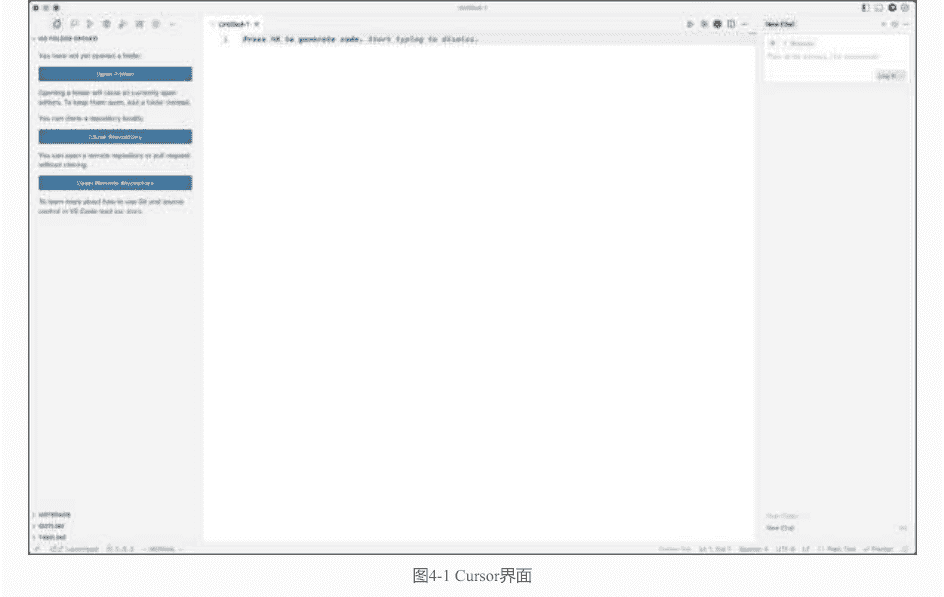

- 活动栏 Activity Bar：屏幕最左侧图标工具箱，切换文件浏览器、全局搜索、源代码管理等侧边栏视图。
- 侧边栏 Side Bar：活动栏右侧，默认显示文件浏览器，用于管理项目文件与文件夹。
- 编辑区 Editor Area：屏幕中央主区域，支持多标签同时查看、编写、修改代码。
- AI 对话面板 AI Chat Panel：通常在右侧，通过 Ctrl/Cmd+Shift+L 调出或隐藏，用于深度对话。

##### 3. 三种工作方式速览

后续会深入学习，这里先做预览。

- 智能补全：在编辑区书写时，模型实时预测内容并以灰色文字呈现，按 Tab 接受建议。

## 4.实战

用一个简单练习体验智能补全。

1. 新建空文件夹命名为 my-first-cursor-project。
2. 在 Cursor 中 File->Open Folder 打开该文件夹。
3. 在侧边栏右键新建文件 hello.js。
4. 在编辑区逐字输入代码，不要一次性粘贴。
5. 稍作停顿，Cursor 会以灰色幽灵文本建议后续内容，按 Tab 即可采纳。

```javascript
function greet(
```

```javascript
function greet(name) {
    console.log("Hello, " + name + "!");
}
```

这就是第一次无缝协作，你发起意图，模型完成后续工作。

#### 4.2.3 Cursor 的三种协作模式

Cursor 与 AI 的协作由三种截然不同的模式构成，从微操到宏观。

### 1.即时代码预测

提供沉浸式、低干扰体验，是日常编码最常用模式。输入时模型会分析当前输入、文件上下文和近期修改，预测后续代码并以幽灵文本展示，可生成完整逻辑块。不仅能新增代码，还能修改重写已有代码，例如修改函数参数后自动建议更新调用处。交互上 Tab 接受、Esc 拒绝、Ctrl/Cmd+→逐词接受。

##### 2. Composer 指令生成

指令式、目标驱动，适合明确编码任务。按 Ctrl/Cmd+K 激活行内输入框，用自然语言描述生成或修改需求，返回代码直接插入或替换编辑器。实现从辅助到执行的转变，复杂任务可用 Ctrl/Cmd+I 打开更全面的 Composer 面板。

交互方式：光标置于目标位置或选中代码，按 Ctrl/Cmd+K 输入指令如“创建异步函数 fetchData 接受 url 参数并用 fetch 获取数据”，回车等待生成，满意则点 Accept，不满意可重写指令或手动调整。

##### 3. AI 对话助手

对话式、探索性协作，是你的指挥中心。按 Ctrl/Cmd+Shift+L 打开右侧对话面板，能理解整个项目。通过 @ 符号精确引用文件 @file、函数 @functionName 或整库 @codebase，提供充足上下文。

适用于调试、理解代码、规划重构。例如粘贴报错问“为什么报错，请分析 @app/api/route.ts”；选中代码问“这段代码做什么，请用初学者语言解释”；规划重构时问“我想重构用户认证，请用 @codebase 分析改动涉及文件和核心逻辑”。

交互上打开面板输入问题，使用 @ 引用上下文，模型以对话形式给出解释或建议，可直接点 Apply 应用到文件。

三种模式构成完整协作体系。优秀使用者会根据任务灵活切换。

表4-3 3种AI交互模式的特点

| 模式（比喻） | 快捷键（macOS） | 最佳应用场景 | 交互风格 |
| :--- | :--- | :--- | :--- |
| 智能代码补全（自动助手） | Tab | 编写常规代码，实现重复性逻辑，遵循已有模式 | 默契预测：AI实时预测，你只需确认 |
| Composer代码生成（编程工具） | Cmd + K/Cmd+I | 生成新函数，实现特定算法，按指令修改代码块 | 清晰指令：你下达明确命令，AI负责执行 |
| AI聊天助手（编程导师） | Cmd + Shift + L | 调试错误，理解复杂代码，规划重构，学习新概念 | 深度对话：你提出开放性问题，AI提供分析和方案 |

## 4.十分钟实战：用3种模式分别完成一个简单函数

在项目中新建 math.js 练习阶乘函数。

- 模式1：智能代码补全
输入函数首行：```javascript
function factorial(n) {
```
回车后在函数体内输入 if。Cursor 会预测核心逻辑并以灰色文本建议：```javascript
if (n === 0 || n === 1) {
  return 1;
}
return n * factorial(n - 1);
```
按 Tab 完成输入。

- 模式2：Composer 代码生成
在 factorial 下方空几行，按 Ctrl/Cmd+K 输入“创建一个名为 factorial_composer 的函数，用于计算一个数 n 的阶乘”，回车后模型精确生成。

- 模式3：AI 对话助手
按 Ctrl/Cmd+Shift+L 打开对话面板，输入“写一个 JavaScript 函数 factorial_chat，用于计算阶乘，并为关键代码添加中文注释”。模型会生成代码并添加注释，再点 Apply 或 Insert 插入光标位置。

练习后能清晰感受到差异：补全是顺畅协作，Composer 是精准执行，对话助手是深入指导。

#### 4.2.4 十五分钟实战：搭建 Next.js API 骨架

从零构建 Next.js 后端 API，核心任务是搭建骨架，主要借助 AI 对话助手作为项目经理和技术顾问。

### 1.项目初始化

1. 新建空文件夹 nextjs-supabase-api，启动 Cursor 通过 File > Open Folder 打开。
2. 打开 AI 对话面板，输入：
> 我想创建一个全新的 Next.js 项目，请告诉我初始化项目的标准终端命令。需要使用 TypeScript，并接受所有默认推荐配置。
3. 模型会给出 create-next-app 命令，完整命令类似：```bash
npx create-next-app@latest . --yes
```
其中 npx create-next-app@latest 是官方工具，“.” 表示当前目录创建，--yes 自动确认选项。

按 Ctrl/Cmd+` 打开内置终端，粘贴执行。安装完成后侧边栏会出现 app、public、package.json 等文件，骨架搭建完成。

### 2.使用 AI 对话助手理解项目配置

打开 package.json，在对话面板输入“这是我的 package.json 文件，请解释 scripts 字段中 dev、build、start 和 lint 各自的作用，以及 dependencies 和 devDependencies 的区别”。

模型会说明 dev 用于开发启动、build 用于构建打包、start 用于生产启动、lint 用于语法检查，并区分 dependencies 为生产必需库、devDependencies 为开发期工具库。

### 3.构建 Next.js API 路由结构

Next.js 采用文件系统路由。

在对话面板输入：
> 请创建一个基础的 Next.js API 路由，访问路径为 /api/hello。该接口需要返回一个 JSON 对象，内容是{"message":"Hello from our API!"}。请告知需要创建的文件路径以及完整的代码。

模型会提示创建文件路径 app/api/hello/route.ts 并提供代码。

```typescript
import { NextResponse } from "next/server";

export async function GET(request: Request) {
  return NextResponse.json({ message: "Hello from our API!" });
}
```

先依助手的引导在 app 目录下开辟 api，随后再在内部建立 hello 目录，并在其中新建 route.ts，把助手给出的代码粘贴进去，也可直接点击回复中的按钮完成写入。

3. 验证成果。切回终端运行 npm run dev 启动开发服务，用浏览器访问 http://localhost:3000/api/hello，若页面返回 {"message":"Hello from our API!"}，就说明首个后端接口已成功运行，几乎不用手写复杂代码。

### 4. 用 @file 与 @codebase 精准锚定上下文
随着工程规模扩大，代码量会迅速膨胀，这时借助 @file 与 @codebase 指令可以有意识地引导助手注意力，让产出与项目整体结构和编码习惯保持一致。

在小型仓库里助手能自行把握全貌，但当文件数量达到数十、代码行数上千时，就需要明确指引。就像在藏书丰富的图书馆找资料，要么指定某一本专著，要么让管理员介绍整体分类，@file 与 @codebase 就是实现这种精准指向的两类工具。

@file 能把焦点收窄到当前打开的文件或选定的代码片段，适合单文件内的解释、纠错、补全；@codebase 则把视野放大到整个工程，覆盖全部文件与子目录，适合跨文件梳理结构、依赖或整体架构设计，能产出更贴合工程的实现。

下面用两个实操演示用法。

- 案例1：用 @file 聚焦单个文件
想让助手复查刚建的接口是否符合最佳实践，可这样提问：
> 请审查 @app/api/hello/route.ts 中的实现，有无可优化之处。
通过 @ 符号明确位置，回答会更具针对性。

- 案例2：用 @codebase 做全局检查
若要确认项目配置能否兼容新接口，可提问：
> 基于 @codebase 审视整体配置，检查 TypeScript 与 ESLint 是否能正确支持刚才创建的 API 路由。
此时助手会读取 tsconfig.json、next.config.js 等配置，给出一份完整的工程健康报告。

本次实操的本质是体验对话式开发：你用自然语言描述战略目标，助手负责落地的战术细节。

#### 4.2.5 十分钟实战：让 Composer 跑通真实业务逻辑
API 骨架已搭好，现在要为其注入核心能力——接入真实数据库并实现业务逻辑。

切换到 Composer 代码生成模式。若说聊天助手像项目经理，Composer 就是主力程序员。我们做架构决策，在 Composer 输入框下达精准提示，由它完成具体编码。

目标是将 Next.js 应用连上 Supabase，实现一套完整的文章 Post 的增删改查 API。

### 1. 通过 Composer 生成数据库连接配置
首先建立应用与 Supabase 的连接，步骤如下。

1. 准备 Supabase 项目。去官网注册并新建项目，创建完成后在 SQL Editor 中执行建表语句。

```sql
CREATE TABLE posts (
    id bigint PRIMARY KEY GENERATED ALWAYS AS IDENTITY,
    title text NOT NULL,
    content text,
    created_at timestamptz DEFAULT now()
);
```

该表共 4 个字段：id 作为主键且自动生成、title 保存标题且不能为空、content 保存正文、created_at 记录创建时间并默认当前时间。执行效果如图 4-2。

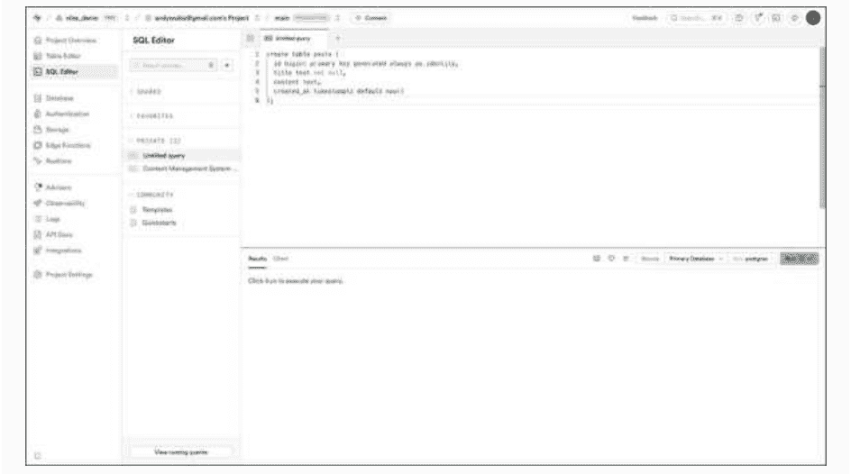

2. 获取连接凭证。在 Project Settings 的 Data API 页面复制 Project URL（见图 4-3）；在 API Keys 页面复制 anon public Key（见图 4-4），二者是连接数据库的必要凭证，需妥善保存。

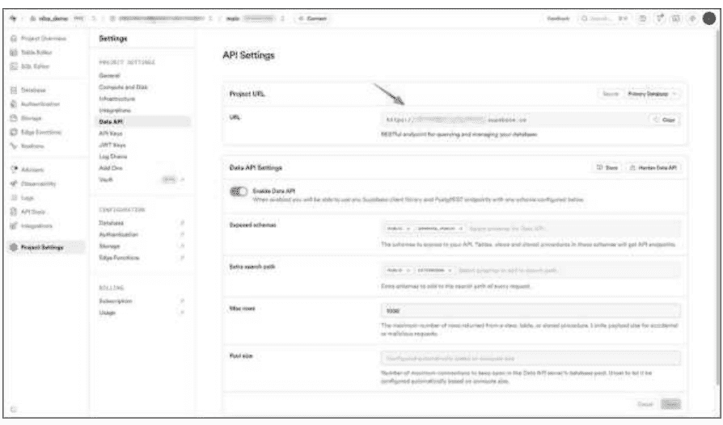

图4-3 获取Project URL

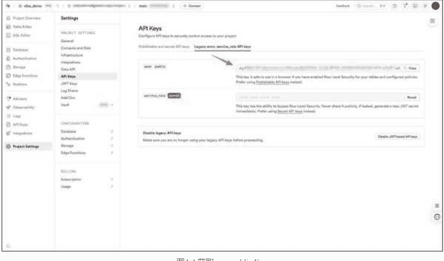

图4-4 获取anon public Key

3. 配置环境变量。回到 Cursor，在项目根目录新建 .env.local 文件，用于存放敏感信息，写入如下内容并把占位符替换成从 Supabase 获取的真实 URL 和 Key。

```
NEXT_PUBLIC_SUPABASE_URL=YOUR_SUPABASE_URL
NEXT_PUBLIC_SUPABASE_ANON_KEY=YOUR_SUPABASE_ANON_KEY
```

4. 用 Composer 生成客户端代码。在项目根目录创建 lib 文件夹，并在其中新建 supabaseClient.ts 用于创建并导出 Supabase 客户端。

把光标放在空白文件中，按快捷组合键唤起 Composer，输入提示“使用 @supabase/supabase-js 库创建 Supabase 客户端，从环境变量 NEXT_PUBLIC_SUPABASE_URL 和 NEXT_PUBLIC_SUPABASE_ANON_KEY 读取 URL 和 anon key，最后导出实例”。

回车后 Composer 会自动产出标准初始化代码，示例如下：

```typescript
import { createClient } from "@supabase/supabase-js";

const supabaseUrl = process.env.NEXT_PUBLIC_SUPABASE_URL!;
const supabaseAnonKey = process.env.NEXT_PUBLIC_SUPABASE_ANON_KEY!;

export const supabase = createClient(supabaseUrl, supabaseAnonKey);
```

点击 Accept，该段代码即写入文件，数据库连接配置完成。

### 2. 搭建认证中间件与 API 端点
为保护接口，需要一个认证中间件确保只有登录用户才能操作，同时新增 /api/posts 端点处理文章请求。

1. 创建认证中间件。
在项目根目录新建 middleware.ts，置空文件后按快捷组合键唤起 Composer，输入“创建 Next.js 中间件，使用 Supabase 保护所有 /api/posts 下的请求，未认证用户返回 401 未授权错误”。
回车后 Composer 会产出基于 @supabase/ssr 库的现代中间件代码。

2. 创建 API 端点文件。
在 app/api 目录下新建 posts 文件夹，并在其中创建 route.ts，用于处理所有与文章相关的 HTTP 请求。

### 3. 完成 CRUD 全流程实现
现在在 app/api/posts/route.ts 中为 GET、POST、PATCH、DELETE 四种操作编写处理函数。

###### 实现 GET 读取全部文章
先在 route.ts 输入框架代码，然后把光标放在函数体中，按快捷组合键输入“使用 Supabase 客户端从 posts 表查询全部记录，按创建时间降序排列，并以 JSON 格式返回”。

```typescript
import { NextResponse } from "next/server";
import { supabase } from "@/lib/supabaseClient";
```
export async function GET(request: Request) {

  // 将光标放在这里

}
Composer 会产出如下参考代码。

```typescript
const { data, error } = await supabase
  .from("posts")
  .select("*")
  .order("created_at", { ascending: false });

if (error) {
  return NextResponse.json({ error: error.message }, { status: 500 });
}

return NextResponse.json(data);
```

该代码会从数据库拉取所有文章记录，按创建时间倒序排列，并处理可能的错误。

###### 实现 POST 创建新文章
在 GET 函数下方添加 POST 框架，然后把光标置于函数体内，输入“从请求体解析 title 和 content，用 Supabase 客户端把这两个字段插入 posts 表并返回新记录”。

```typescript
export async function POST(request: Request) {
  // 将光标放在这里
}
```

Composer 会自动完成 JSON 解析和数据库写入，产出完整的创建逻辑。

###### 实现 PATCH 修补 与 DELETE 删除操作
可沿用相同方式产出。注意这两个操作需要从 URL 的查询参数中获取文章 ID 来定位记录。

- PATCH 示例提示：
> 从 URL 搜索参数中获取 id，从请求体获取 title 和 content，用 Supabase 更新 posts 表对应 id 的记录。
- DELETE 示例提示：
> 从 URL 搜索参数中获取 id，用 Supabase 从 posts 表删除对应 id 的记录，成功后返回 204 状态码。

通过清晰提示，Composer 能准确理解意图并产出对应逻辑。

## 4. 自动增强错误处理与数据校验
健壮的 API 需要优雅处理异常，可通过 Composer 迭代增强：先产出核心逻辑，再用精细提示补充错误处理与校验，提升接口的安全性。

- 增强错误处理：选中已产出的数据库操作代码，按快捷组合键输入“为这段代码添加详细错误处理。若 Supabase 返回唯一性冲突等特定错误返回 409，其他数据库错误返回 500”。Composer 会自动产出多场景错误处理代码。
- 添加数据校验：在 POST 函数开头按快捷组合键输入“在写入数据库前加入数据校验，确保 title 存在且不为空，校验失败返回 400 Bad Request 并给出清晰提示”。

##### 5. Composer Agent：一站式编程方案
以上所有步骤都可以用更高效的 Composer Agent 一次完成，按快捷组合键调出，其核心能力如下。

- 无需精确定位的智能改写：即使不使用 @ 符号指定，Agent 也能自动检索项目中最合适的改写位置。
- 从零到一的完整方案：通过描述完整需求，即可产出路由结构、数据库集成、中间件、错误处理、类型定义和环境变量配置的整体方案。
- 智能问题诊断与修复：描述问题如“API 返回 500 错误”，Agent 会协助排查修复。
- 跨文件复杂重构：支持“把所有数据库查询抽离到独立 service 层”或“为项目添加 Docker 支持”等复杂任务。

尽管功能强大，分步学习对初学者仍很重要，原因在于建立编程思维、提升需求表达能力、增强故障排查技能以及培养架构设计能力。

实际开发中可根据场景灵活选择工具。

- 快速原型阶段：用 Composer 代码生成模式快速搭框架。
- 学习探索阶段：用 IDE 编辑器产出和修改代码，深入理解实现细节。
- 问题解决阶段：用 AI 聊天助手深入讨论方案，获得技术指导。
- 复杂重构阶段：回到 Composer 代码生成模式，执行跨文件重构，保证架构一致性。

Composer Agent 不仅是代码生成工具，更像一位全栈技术顾问，能理解项目上下文、遵循最佳实践并提供完整方案。

#### 4.2.6 十分钟实战：终端集成运维数据库与服务
完整的应用生命周期包含开发、数据库管理、测试和部署。Cursor 内置的终端是一个可与助手对话的智能控制台，能高效完成运维工作。

##### 1. 内置终端使用技巧
按 组合键快速打开或关闭终端。终端支持 AI 赋能：在提示符下按快捷组合键，用自然语言描述需求，助手会自动生成对应命令。

练习：打开终端后按快捷组合键，输入“列出当前目录下所有以 .ts 为后缀的文件，按修改时间倒序排列”。回车后助手生成命令，再次回车执行即可。

核心价值在于无需记忆 Git、Docker、NPM 等复杂命令，用自然语言描述即可完成操作。

## 2. 用 AI 助手生成数据库迁移脚本
业务发展时数据结构也会演进，例如为 posts 表新增 is_published 字段，需要通过数据库迁移实现。

1. 提出需求。打开 AI 聊天面板输入：
> 我在使用 PostgreSQL，需要为 posts 表生成 SQL 迁移脚本，实现：1. 新增 is_published 布尔列；2. 默认值 false；3. 不允许为空 NOT NULL。
2. 获取专业脚本。助手会产出严谨的 SQL，示例如下：

```sql
-- migration_script_001_add_is_published_to_posts.sql
ALTER TABLE public.posts
ADD COLUMN is_published BOOLEAN NOT NULL DEFAULT false;

COMMENT ON COLUMN public.posts.is_published IS 'Indicates if the post
is published to the public.';
```

3. 应用迁移。将脚本保存为文件，通过 Supabase 仪表盘或其他数据库管理工具执行即可。

## 3. 自动化生成测试与部署命令
自动化测试和部署常依赖复杂命令，助手可直接生成。

- 测试场景：项目使用 Jest，在终端按快捷组合键输入“运行项目中所有 jest 测试并生成代码覆盖率报告”。助手会给出命令 `npx jest --coverage`。
- 部署场景：Next.js 应用通常部署在 Vercel，按快捷组合键输入“把 Next.js 应用部署到 Vercel 生产环境，请提供 Vercel CLI 部署命令”。助手会生成 `vercel --prod`。

助手就像随身的运维手册，让复杂操作变得直观。

## 4. 实时调试与日志分析技巧
线上问题定位的关键是日志。

1. 启动开发服务器并观察日志。在终端运行 `npm run dev`，访问 API 时终端会实时打印日志。
2. 助手辅助分析。假设 API 报错，可把终端错误堆栈复制到 AI 聊天面板提问：
> 我的 Next.js API 运行时出现以下错误，请分析根本原因，问题可能在哪个文件？
> （粘贴错误日志）
3. 获取解决方案。Cursor 结合日志和代码库给出分析结果和修复建议。

本次实操完成开发闭环，你不仅学会用助手编写代码，还掌握了用助手管理和维护应用的方法。

#### 4.2.7 进阶：深度挖掘 Cursor 独有优势
Cursor 能颠覆传统开发模式，核心在于其作为 AI 原生 IDE 的代码库全局理解力。以下是三大杀手锏级优势的深度解析。

## 1. 优势一：代码库上下文的精准理解

### 让 Cursor 真正读懂项目全貌，而不是单文件补丁

Cursor 对源码的处理方式与普通插件截然不同。它在后台为整个仓库搭建语义网络，关注的是代码的含义与关联，而非把每个文件当成孤立的文本。即便某个功能被拆分到多个文件中，调用路径和依赖边界依然能被完整还原。

常规 AI 插件的感知范围基本停留在当前编辑器，Cursor 在开启对话前就已经完成对项目的整体扫描。类似 MRI 的全景成像，@codebase 提问时，判断依据是全库视角，而不是单文件片段，结论的准确度因此明显提升。

## 2.优势2：大规模、跨文件的代码重构
保持对外行为不变、仅优化内部实现是重构的本质，手工操作极易牵一发动全身。

依托全局上下文的理解，Cursor 能为跨文件的大范围改动制定可靠方案，远不止查找替换，整体流程可概括为四步：

- **解析意图** —— 把自然语言指令转译为结构性变更的目标；
- **追踪影响** —— 借助代码库索引定位所有受波及的触点；
- **场景化改写** —— 针对每个出现位置的实际用法单独调整，可区分同名但无关的变量；
- **先预览后执行** —— 在落地前输出完整的行动方案，列出待改文件及差异片段，确认后再执行。

## 3.优势3：人机协作的深度调试
传统排查像侦探破案，靠断点和日志逐步收敛，耗时很大。

在 Cursor 里，调试变成回合制对话：

- **你提供表象** —— 将错误信息、终端输出等线索丢进聊天面板；
- **AI 做初判** —— 结合仓库结构知识给出假设；
- **AI 建议取证** —— 提示补充日志或检查点以获取更多信息；
- **迭代收敛** —— 按建议操作后回传新线索，数轮往返即可锁定根因。

现场观察与全局分析结合，把原本需数小时的工作压缩到数分钟。

## 4.十分钟进阶实战：重构复杂的多文件后端项目
下面用一个案例展示三大能力如何协同。假设 nextjs-supabase-api 需要把核心业务从 Post 切换到 Product，需要批量改表名、路由与命名，操作如下。

1. 启动 Composer 智能体。在 Cursor 中按 Ctrl/Cmd + I 进入该模式。
2. 下达高阶指令。在聊天框输入包含完整意图与全局上下文的指令：

> 使用@codebase对整个项目进行大规模重构，将核心业务概念从Post（文章）完全变更为Product（产品）。
> 
> 请执行以下所有操作。
> 
> 1. 数据库迁移：生成SQL脚本，将posts表重命名为products。
> 
> 2. API路由重命名：将app/api/posts文件夹重命名为app/api/products。
> 
> 3. 代码逻辑更新：在新的app/api/products/route.ts文件中，将Supabase操作的目标表从posts修改为products。
> 
> 4. 变量与命名规范：在项目所有受影响的文件中，将所有包含post或posts的变量名、函数参数和类型定义，智能地重命名为product或products。例如，const { data:posts, error } 重命名为const { data: products, error }。
> 
> 在执行任何修改之前，请先提供一个详细的行动计划，列出将要修改的所有文件，并展示每个文件的具体代码差异（diff）。

3. 审查并执行。按回车后，Composer Agent 开始分析仓库并生成完整行动计划，确认无误后回复“执行”，Cursor 将自动完成所有修改，全程只需几分钟。

#### 4.2.8 小结
Cursor 不只是代码生成工具，更是能读懂并重塑复杂软件系统的伙伴。它从根本上改变了开发的成本结构，过去需要团队数天完成的架构调整，现在一人一句精心设计的指令即可完成，大幅降低试错与迭代成本，让创意落地更顺畅。

### 4.3 高级集成：MCP实战与深度应用
学会高效对话后，下一步是让 AI 连接外部系统并完成实际任务，从知识型对话者升级为可执行的数字助理。核心技术是 MCP，即模型上下文协议 Model Context Protocol。

借助 MCP，AI 不仅能讨论“最佳前端框架”，还能直接操作 GitHub 管理仓库、调取 Figma 把设计稿转为代码，甚至自动运行 Playwright 测试新上线站点。读完本节，你就能把 AI 从智能大脑打造成全能助理。

#### 4.3.1 MCP：AI与外部工具的开放标准
在实践前先理解概念与价值。

过去设备间充斥各种专属充电线，AI 生态也曾类似。MCP 出现前，让 Claude 连接 GitHub 需要定制连接器，换成 ChatGPT 又要重写，N 个模型乘以 M 个工具需要 N×M 个独立连接器，开发繁重且阻碍创新。

MCP 的诞生就像统一接口的 USB/Type-C。

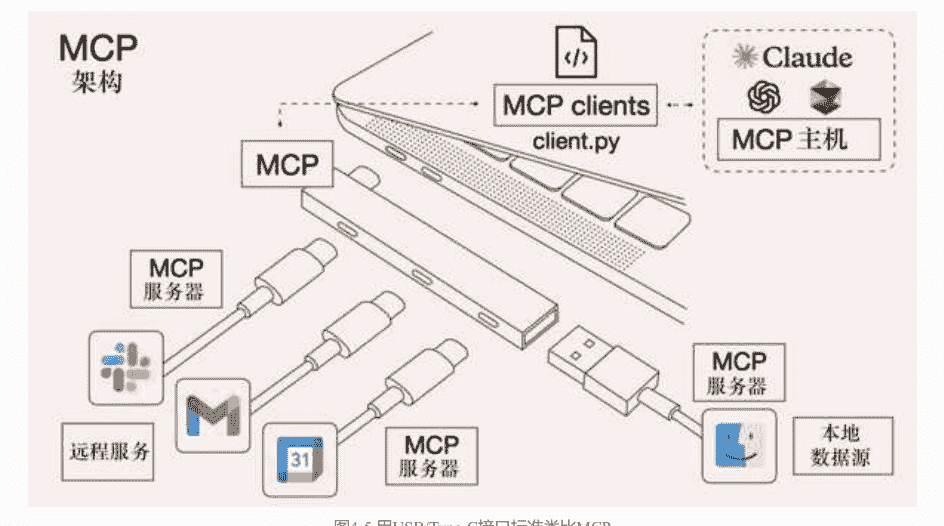

MCP 是 2024 年底由 Anthropic 提出的开放标准，目标是为所有大模型和外部工具提供统一插座。双方均支持时即可即插即用，无需为每种组合单独开发，解决了 N×M 集成难题，为 AI 生态带来互联互通。

##### 1. MCP 工作原理解析
可把 MCP 想象成一家组织有序的大型餐厅。

- **MCP 主机 Host**：相当于餐厅本身。你使用的 AI 编程工具如 TRAE、Cursor 就是提供服务环境的“餐厅”，也是你与 AI 互动的载体。
- **MCP 客户端 Client**：相当于服务员。你下达指令后，“服务员”接收订单并知道该找哪个“厨房”处理，“餐厅”会为每个外部工具配备专属服务员。
- **MCP 服务器 Server**：相当于专业分工的厨房。例如 GitHub 厨房负责代码仓库相关任务，Figma 厨房负责把设计图转为代码。每个服务器对应一个外部工具或数据源，拥有操作所需的 API 和数据。

工作流程如下。
1. 你在“餐厅”提出需求，“服务员”接收后判断需 GitHub 厨房处理，将订单传递过去。
2. “厨房”处理完把结果交回“服务员”，再由“服务员”呈现给你。

这样一个 AI 应用可同时连接无数功能各异的外部工具。

## 2.统一标准的优势
MCP 为用户带来三个实际价值。

- **减少信息偏差**：大语言模型的训练数据是静态的，容易产生“幻觉”。MCP 让 AI 连接实时数据源，对不确定信息可直接查询权威文档或数据库，回答更可靠。
- **解锁自动化能力**：MCP 让 AI 从被动问答变成主动执行者。没有 MCP 时 AI 只能告诉你“应该怎么做”，有了 MCP 它可以直接“帮你做”，比如更新 CRM、运行计算、发布文章。
- **面向未来的技能**：MCP 是开放标准，自 Anthropic 推出后 OpenAI、Google、微软等巨头均宣布支持。学习 MCP 等于掌握下一代 AI 应用的通用语言和标准接口。

## 3.环境准备与MCP服务器市场
了解概念后，你可能会问哪里找 MCP 服务器。好消息是生态已成熟，你可以像逛应用商店一样安装各种服务器。

热门市场包括 MCP.so，一个社区驱动的第三方市场，收录上万个服务器，覆盖时间查询到浏览器自动化等多种工具。

##### 4. 面向普通用户的免费MCP工具推荐
为快速上手，精选几款完全免费、易用的 MCP 工具，如表4-4所示，无需编程知识按教程配置即可使用。

表4-4 免费的MCP服务器

| 服务器名称 | 主要功能 | 简单的应用场景 |
| :--- | :--- | :--- |
| Time | 提供当前时间并进行时区转换 | “现在北京是几点？” |
| Filesystem | 读取、写入和整理电脑上的文件 | “帮我阅读‘会议纪要.txt’，并生成一份摘要” |
| Zhipu Web Search | 执行网络搜索并返回结果 | “帮我搜索模型上下文协议的最新新闻，并总结最重要的三条” |
| Playwright | 自动控制网络浏览器并执行各种任务 | “打开Google的主页面，搜索MCP并截取搜索结果页的截图” |
| Howtocook Mcp | 提供烹饪菜谱和餐饮计划 | “家里有鸡肉、米饭和西兰花，今晚能做什么菜” |

表4-4 是进入 MCP 世界的入门钥匙，能快速感受到实用价值。

##### 5. mcp.json 配置详解
MCP 配置的核心是 mcp.json 文件，用来告诉 AI：“这是你的工具箱，里面有这些工具及使用方法。”

以添加 Time 服务器为例，最简配置如下：

```json
{
  "mcpServers": {
    "time": {
      "command": "npx",
      "args": ["-y", "mcp-server-time"]
    }
  }
}
```

配置说明如下。

- **“mcpServers”: {...}**：定义工具列表的开始。
- **“time”: {...}**：你为该工具设定的昵称，用于在 AI 应用中识别和管理。
- **“command”: “npx”**：告知计算机用 npx 启动工具，可方便运行在线软件包，无需提前安装。
- **“args”: [“-y”, “mcp-server-time”]**：传递给 npx 的具体指令，指定运行名为 mcp-server-time 的包。

配置 MCP 服务器主要有两种运行方式。

- **STDIO**：像雇用私人厨师。AI 应用在使用时才启动服务器进程，任务结束后结束，仅为你服务。适合本地工具如 Filesystem，优点是安全私密。
- **HTTP/SSE**：像 24 小时营业的餐厅。服务器持续运行在本地或互联网，AI 通过 URL 下单。适合连接持续运行或第三方的远程服务，如 GitHub 或 Figma。

#### 4.3.2 在SOLO中配置与使用MCP
下面在 AI 原生开发环境 TRAE SOLO 中做第一次实战。TRAE SOLO 是高度自动化的 IDE，内置强大 AI 助理，结合 MCP 可极大提升自动化能力。IDE 在 MCP 生态中扮演指挥中心，TRAE SOLO 和 Cursor 都提供专门界面管理服务器、查看日志、批准调用，正是 MCP 架构中的主机角色。

##### 1. MCP全局配置与项目级配置
TRAE SOLO 提供两种配置方式决定 MCP 工具的可用范围。

- **全局配置**：工具对所有项目可见，适合时间查询、网络搜索等通用功能。
- **项目级配置**：工具仅在当前项目可用，例如连接特定数据库的服务器建议在此配置。

以项目级配置为例，操作步骤如下。

1. 进入 AI 管理界面。在设置或侧边栏中找到 AI Management 或 MCP 选项。
2. 探索内置市场并安装服务器。TRAE SOLO 自带 MCP 服务器市场，点击添加按钮按提示填入信息即可完成安装。
3. 搜索特定服务器。在市场搜索栏输入名称，如需 GitHub 集成可搜索 GitHub MCP。
4. 添加目标服务器。在结果中找到对应服务器，点击添加，成功后会出现在已配置列表。
5. 手动配置服务器。若市场未找到所需服务器或需精细配置，可点击“手动配置”按钮，TRAE SOLO 会引导完成。项目级配置编辑项目目录下的 .vscode/mcp.json；全局配置编辑用户目录下的mcp.json。基本结构如下：

```json
{
  "mcpServers": {
    "server-name": {
      "command": "executable",
      "args": ["arg1", "arg2"],
      "env": {
        "VAR": "value"
      }
    }
  }
}
```

字段解释如下。

- “server-name”：服务器名称标识。
- “command”：运行 MCP 服务器的可执行命令，如 npx。
- “args”：传递给可执行文件的命令行参数数组。
- “env”：启动服务器时需设置的环境变量对象，可选。

可根据需要选择项目级或全局配置。

6. 管理已添加服务器。添加后可在列表中启用、禁用、编辑或重启。

##### 2. 十分钟实战：连接GitHub MCP
目标是让 AI 成为代码仓库管理员，自动处理 GitHub 相关任务。

###### 前期准备：创建GitHub个人访问令牌
开始前需创建个人访问令牌 PAT。PAT 是供应用程序使用的特殊密码，需妥善保护。

登录 GitHub 账号，进入 Settings > Developer settings > Personal access tokens，选择 Fine-grained tokens 类型创建新 PAT。创建时遵循最小权限原则，只勾选工具必需的最小权限。

###### 配置mcp.json文件
获得 PAT 后，在 TRAE SOLO 中选择手动添加 MCP 服务器并填入以下配置，记得把 your_github_pat 替换为刚生成的 PAT：

```json
{
  "mcpServers": {
    "GitHub": {
      "command": "npx",
      "args": ["-y", "@modelcontextprotocol/server-github"],
      "env": {
        "GITHUB_PERSONAL_ACCESS_TOKEN": "your_github_pat"
      }
    }
  }
}
```

该配置通过 npx 运行 GitHub 官方提供的 MCP 服务器，并通过 env 字段安全传递 PAT。

###### 验证与使用
保存文件并重启或刷新 MCP 服务器列表。然后在 TRAE SOLO 聊天窗口用自然语言下指令，例如：

- “列出 my-first-website 仓库中所有处于打开状态的议题”
- “读取主分支下 README.md 文件的内容”
- “创建新议题，标题为‘更新首页欢迎语’”

AI 将作为你的 GitHub 专属助手实时响应并处理仓库管理任务。

##### 3. 十分钟实战：集成Figma MCP
目标是打通设计与开发壁垒，让 AI 直接把 Figma 设计稿转为可用前端代码。

###### 启用Figma本地服务器
首先在 Figma 中启用 MCP 服务器。

确保安装最新版 Figma 桌面应用，打开任意设计文件，在左上角菜单进入 Preferences，找到并勾选 Enable local MCP server。启用后 Figma 会在本地静默运行服务器，并在画板底部显示 URL 地址，复制该地址。

###### 配置TRAE SOLO连接Figma

Figma 本地启动后，MCP 服务的默认入口是 http://127.0.0.1:3845/mcp。若要在 Trae Solo 中启用，需要在 MCP 设置里手动新增一个服务器，参数如下：

```json
{
  "mcpServers": {
    "figma": {
      "type": "http",
      "url": "http://127.0.0.1:3845/mcp"
    }
  }
}
```

###### 将设计转化为代码

配置生效后，进入 Figma，右键选中目标元素，执行 Copy link to selection，示意见图4-15。

回到 Trae Solo 的聊天区，切换到 Builder with MCP 智能体，把链接贴入并提示模型：“使用 Figma MCP 为该设计生成 HTML 和 Tailwind CSS 代码。”

通过 MCP 通道，模型可以读取结构化设计数据，包括色彩、圆角、字体、字号等，从而产出可直接投入使用的高质量代码。

##### 4. 十分钟实战：配置Playwright MCP

本次目标是让模型像专业测试工程师一样，操控浏览器完成自动化测试与数据采集。Playwright 是一款可通过代码精确驱动浏览器点击、输入、滚动、截图等操作的工具。

###### 配置Playwright MCP服务器

部署 Playwright MCP 有两种做法：在 Trae Solo 的 MCP 市场搜索添加，或手工编辑 mcp.json，推荐后者，因为 npx 会自动拉取并运行服务器，无需预装。

手工方式时，在 Trae Solo 的 mcp.json 中加入以下片段：

```json
{
  "mcpServers": {
    "Playwright": {
      "command": "npx",
      "args": ["-y", "@executeautomation/playwright-mcp-server"],
      "env": {}
    }
  }
}
```

该片段使用 npx 启动 Playwright MCP，-y 参数会在安装时自动确认，让流程更顺畅。

###### 自动化操作

保存后，在 Trae Solo 聊天窗口选择 Builder with MCP 智能体，按顺序对话：

1. “使用 Playwright 打开新浏览器页面，访问 https://en.wikipedia.org/wiki/Artificial_intelligence。”
2. “很好，点击页面上文字为 Machine learning 的链接。”
3. “干得漂亮，现在对当前页面截图并保存为 ml_page.png。”

仅用自然语言即可驱动 Playwright，把指令转化为精确的浏览器自动化行为，无需写复杂代码。

##### 5. 十分钟实战：连接 Magic MCP

本节目标是让 AI 用一句话描述需求就生成界面代码。Magic MCP 能把自然语言瞬间转为可用的 UI 组件代码，让界面开发像对话一样简单。

###### 获取Magic API密钥

前往 Magic 官网注册并登录控制台，在 API 区新建一个密钥并保存。该密钥用于 Trae Solo 与 Magic 服务的连接。

###### 配置mcp.json文件

在 Trae Solo 中添加下面配置，记得把 your-api-key 换成实际密钥：

```json
{
  "mcpServers": {
    "@21st-dev/magic": {
      "command": "npx",
      "args": ["-y", "@21st-dev/magic@latest", "API_KEY=your-api-key"]
    }
  }
}
```

此配置通过 npx 运行最新版 Magic MCP，并以环境变量传入密钥完成鉴权。

###### 生成UI组件

配置好后，切换到 Builder with MCP 智能体，使用 /ui 开头描述需求，例如：

- “/ui 做一个现代风格的登录表单，要有‘忘记密码’链接。”
- “/ui 生成价格方案对比表，分基础版、专业版、企业版。”
- “/ui 设计一个带搜索框和用户头像的网站导航栏。”

模型会按描述输出符合规范的 HTML、样式和基础交互，可直接预览后微调，全程无需手写代码。

#### 4.3.3 在Cursor中配置与使用MCP

下面介绍另一款面向 AI 编程的 IDE——Cursor。它专为 AI 协同编程打造，内置的 Composer Agent 能理解复杂任务并调用已配置的 MCP 工具。

##### 1. mcp.json配置与Composer Agent集成

Cursor 同样支持全局和项目级两种 MCP 配置，文件名均为 mcp.json。

- 全局配置：作用于全部项目，文件存放在用户主目录 ~/.cursor/mcp.json。可按 Ctrl/Cmd + ，打开设置，左侧选 Tools & Integrations，右侧找到 MCP 设置，如图4-16。
- 项目级配置：仅当前项目生效，文件位于项目根目录 .cursor/mcp.json。打开该项目时才加载对应服务器，适合存放项目专属能力，例如电商项目的订单数据库 MCP。团队协作时可把该文件提交到代码库，其他成员拉取后即可直接使用。

配置完成后，需要启用 Composer Agent：在 Composer 中按 Ctrl/Cmd + I，选择 Agent 模式。启用后 Agent 会主动识别已配置工具，并在需要时调用。

Composer Agent 的核心能力包括：

- 读写代码：自动识别并修改文件。
- 代码库检索：在项目内进行语义搜索，快速定位相关代码。
- 调用 MCP 服务器：借助 MCP 提供的各种功能。
- 运行终端命令：在编辑器内执行命令行操作。
- 网页自动检索：获取最新资料与文档。

当提出需要外部能力的需求时，Agent 会在聊天界面提示将使用的工具并请求批准。对常用且可信的流程可开启自动运行，让调用无需人工确认。

##### 2. 十分钟实战：连接Browser MCP

本实战目标是让 AI 直接操控正在使用的 Chrome 浏览器，包含已登录状态与 Cookie。与 Playwright 启动全新访客浏览器不同，Browser MCP 控制的是当前浏览器，意味着 AI 可在已登录页面操作，无需重复登录，且运行在本地更利于隐私保护与降低被识别风险。

###### 安装Chrome扩展

在 Chrome 网上应用店搜索 Browser MCP，安装后在需要控制的浏览器上启用扩展，点击图标并点 Connect，看到插件处于监听状态即表示成功，如图4-17 和图4-18。


图4-17 在Chrome上启用Browser MCP扩展


图4-18 处于监听状态的Browser MCP

###### 配置mcp.json文件

在 Cursor 里打开全局或项目级 mcp.json，添加以下配置：

```json
{
  "mcpServers": {
    "browsermcp": {
      "command": "npx",
      "args": ["@browsermcp/mcp@latest"]
    }
  }
}
```

###### 体验个人自动化

保存配置并重启 Cursor，按 Ctrl/Cmd + I 打开 AI 对话窗口，尝试以下指令：

- “打开新标签页访问 weibo.com。”
- “在当前微博页面搜索‘氛围编程’标签。”
- “为搜索结果前 3 条信息点赞。”

通过简短对话，AI 就能在已登录的浏览器环境中完成各类自动化任务，大幅提升效率。

## 3.十分钟实战：集成 Supabase MCP

本实战目标是通过自然语言与数据库交互，无需编写复杂 SQL 即可实现查询、表管理等操作。

###### 注册Supabase并获取PAT

访问 Supabase 官网，创建免费账户并新建项目。在账户设置的 Access Tokens 区域新建 PAT，请妥善保管，该凭证拥有数据库管理权限，需注意安全。

###### 复制Project ID

在 Supabase 项目里找到并复制你的 Project ID，如图4-19。

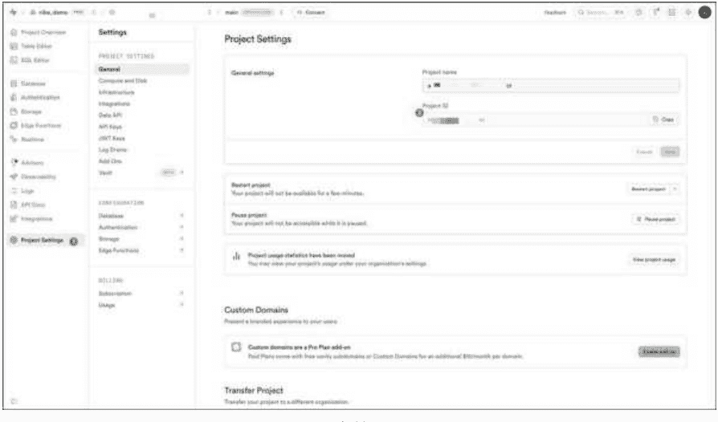

###### 配置mcp.json文件

在 Cursor 里配置 Supabase MCP 服务器，将 your-supabase-pat 替换为实际 PAT，project-ref 替换为实际 Project ID。

```json
{
  "mcpServers": {
    "supabase": {
      "command": "npx",
      "args": [
        "-y",
        "@supabase/mcp-server-supabase@latest",
        "--read-only",
        "--project-ref=<project-ref>"
      ],
      "env": {
        "SUPABASE_ACCESS_TOKEN": "your-supabase-pat"
      }
    }
  }
}
```

###### 用自然语言查询数据库

以之前章节创建的 users 表为例，可这样对话：

- “使用 Supabase 看看 users 表有哪些用户？”
- “他们的邮箱分别是什么？”
- “帮我查邮箱是 your_email+test1@gmail.com 的用户的全部信息。”

模型会自动把自然语言转为精确查询，并以易读方式展示结果，让数据库操作像聊天一样简单。

## 4. 十分钟实战：配置 Context7 MCP

本实战目标是解决大模型知识截止的问题，让代码生成时能参考最新官方文档。Context7 MCP 专门为 AI 提供实时、指定版本的文档服务，能有效避免幻觉或使用过时 API。

###### 获取Context7 API密钥

登录 Context7 官网，注册账号并获取 API Key，用于访问最新技术文档，使用时需 Node.js v18 及以上版本。

###### 配置mcp.json文件

在 Cursor 里打开全局或项目级 mcp.json，添加以下配置，记得把 your-context7-api-key 换成真实密钥：

```json
{
  "mcpServers": {
    "context7": {
      "url": "https://mcp.context7.com/mcp",
      "headers": {
        "CONTEXT7_API_KEY": "your-context7-api-key"
      }
    }
  }
}
```

###### 体验实时文档参考功能

向 AI 询问某个库或框架用法时，前沿大模型如 Claude Sonnet 4 会自动触发该服务。以“如何使用 Next.js 的 after 函数”为例：

- 未启用 Context7 MCP：模型可能回复“抱歉，Next.js 没有名为 after 的函数”。
- 已启用 Context7 MCP：模型先行调用 Context7 拉取 after 函数的最新官方文档，再基于准确信息给出正确示例。

借助 Context7 MCP，模型摆脱了训练数据的时间限制，能始终提供最新、最准确的技术建议。

#### 4.3.4 MCP高级应用与实用技巧

MCP 的真正威力在于把独立工具组合起来，构建可自动完成复杂任务的个性化流程。

### 1.多MCP工具的协同配置与性能优化

让多个 MCP 服务器协同工作，核心是编排。编排是指让多个独立服务器为同一目标协同，大模型智能体扮演总指挥，根据复杂指令智能判断各步骤调用哪个工具。

典型案例是线上事故响应：告知 AI“网站登录页好像出问题了，帮我查一下”，智能体会立即启动多工具协同。

- 先调用 Sentry MCP 检查错误监控系统的最新日志，并反馈“好的，我正在检查 Sentry 错误监控系统的最新日志”。
- 发现用户认证相关严重错误后，调用 GitHub MCP 查找相关代码提交记录。
- 最后调用 Slack MCP 在开发团队频道发出警报“已定位到问题，可能是由昨晚一次代码合并引起的，已附上错误日志和代码链接”。

整个过程流畅自然，像经验丰富的工程师在处理事故。

这种复合型应用的核心价值来自工具的智能编排与组合，这与 UNIX 命令行哲学相像：用管道符连接简单命令构建强大流水线，而 MCP 正是 AI 世界的管道符。因此学习 MCP 的关键是培养超越单一指令的流程设计思维。

为特定项目搭建复杂流程时，最佳实践是使用项目级 mcp.json，确保只加载当前项目所需的服务器，让 AI 环境保持轻便高效。

### 2.十分钟实战：构建个人工作流

日常工作中常需关注人工智能行业的最新动态，手动访问网站、筛选新闻、提炼重点再保存文件步骤繁琐。本实战将通过 MCP 技能串联，让这些操作在 Cursor 中自动完成，形成端到端自动化。

###### 配置所需的MCP工具

确保 Cursor 的 mcp.json 里已配置 browsermcp 和 filesystem 服务器，其中 filesystem 的路径需要替换为实际可读写路径：

```json
{
  "mcpServers": {
    "browsermcp": {
      "command": "npx",
      "args": ["@browsermcp/mcp@latest"]
    },
    "filesystem": {
      "command": "npx",
      "args": [
        "-y",
        "@modelcontextprotocol/server-filesystem",
        "/Users/username/Desktop"
      ]
    }
  }
}
```

###### 下达多步指令

打开 Cursor 的 AI 聊天窗口，清晰输入：

> 请使用 MCP 工具执行以下一系列任务。
> 1. 使用 Browser MCP 工具访问 WaytoAGI 知识库网站的首页。
> 2. 抓取首页最重要的三篇人工智能新闻的主要内容。
> 3. 分别为这三篇文章生成一段 100 字左右的中文摘要。
> 4. 使用文件系统工具在桌面上创建一个名为 WaytoAGI_news_summary.md 的新文件，并将这三段摘要以 Markdown 格式写入该文件中。

###### 观察自动化过程

在聊天界面可实时看到智能体的操作：调用 Browser MCP 访问网站、分析内容、调用 Filesystem MCP 创建文件等。完成后，桌面会出现包含 AI 新闻摘要的 Markdown 文件。

###### 查看自动化结果

在 Cursor 中打开刚生成的 WaytoAGI_news_summary.md，即可看到包含文章标题、核心观点和关键信息的格式化摘要。

该案例完美展现了 MCP 的协同能力——把打开浏览器、访问网站、复制内容、总结要点、创建文件等繁琐手动操作压缩为一次对话。多工具串联的流程正是 MCP 架构的核心价值：让 AI 不仅能完成单点任务，更能像人类助理一样理解并执行复杂多步骤流程。

##### 3. MCP故障排除与常见问题

使用 MCP 服务器时可能遇到连接问题如频繁断开、建立失败；性能问题如响应缓慢、处理能力不足；数据处理异常如格式错误、处理失败等。常见问题与排除指南可参考表4-5。

表4-5 MCP常见问题故障以及排除指南

| 问题现象 | 可能的原因与症状 | 解决步骤 |
| :--- | :--- | :--- |
| 服务器无法启动 | 工具未出现在可用工具列表中，或 MCP 日志显示错误 | 1. 检查 Node.js、Python 等依赖程序是否安装正确<br>2. 在终端手动运行 mcp.json 中的 command 和 args，查看具体报错信息<br>3. 确认配置文件中的路径是否准确 |
| 权限被拒绝 | 读写文件失败，提示 Permission Denied 或类似信息 | 1. 检查目标文件或文件夹的读写权限设置<br>2. 尝试在配置中使用绝对路径而非相对路径<br>3. 确保 Cursor 或 TRAE SOLO 拥有访问系统访问权限 |

| 故障类型 | 典型表现 | 排查处置 |
| JSON 语法错误 | MCP 启动不起来，提示 malformed JSON | 1. 完整复制 mcp.json 内容<br>2. 用线上 JSON 校验服务检查语法，重点看逗号遗漏、括号不匹配等 |
| 权限认证失败 | 工具已连通，调用时报 401 Unauthorized 或 Invalid API Key | 1. 复核 API Key / PAT 是否完整粘贴，前后无多余空格<br>2. 确认凭证是否具备所需权限范围<br>3. 检查凭证是否已失效 |

##### 4. MCP 安全使用规范与实践建议

MCP 是连接大模型与外部工具的枢纽，效率提升的同时风险也在累积。安全既关乎个人账号与数据，也关乎团队环境的稳定。下面聚焦负责任的使用方式，让提效建立在可控之上。

- **凭证保密：** API Key 和 PAT 属于核心访问密钥，严禁外传或上传至公开仓库。推荐以环境变量保存，避免直接写死在配置文件，从源头削减泄露可能。
- **最小权限：** 创建令牌时仅授予完成当前任务所需的最小范围，避免权限扩散，有效收窄安全事故的影响面。
- **来源可信：** 只从官方渠道或长期信赖的社区引入 MCP 服务器。对来源不明的应用保持高度警惕，防止工具投毒等恶意行为，部署前必须核验发布方可靠性。
- **审慎授权：** 初次使用不要批量批准所有调用。仔细阅读授权提示，弄清即将执行的命令及其影响。确认完全理解并信任其自动化流程后，再考虑开启自动运行。
- **配置整洁：** 定期清理 mcp.json，剔除不再使用的服务器配置，降低攻击面与维护复杂度。

同时要严格校验外部输入，防范路径遍历、非法字符等漏洞；建立细粒度访问控制并保留完整审计日志，保证操作可追溯；在工具描述中明确输入输出边界，减少歧义，提高安全与可用性。

唯有将这些安全习惯落地，才能在提升效率的同时守护个人与团队的安全。

#### 4.3.5 小结

学会 MCP 就等于把大模型从闲聊工具升级为实战助手。获得的不仅是工具集合，更是一套模型协作的方法论。由 MCP 串联的工作空间正等待探索与驾驭。

# 第5章 从零搭建习惯追踪器实战

理论只有在实践里才亮起来。接下来让手头的工具为一个真实目标协同工作。

本章不拆分前端后端，而是以完整产品的诞生为主线，带你从灵感到可用。所选项目是习惯追踪器，看似简单，实则覆盖了现代应用开发的核心环节，是锻炼综合能力的理想载体。

你会看到如何借助大模型头脑风暴把模糊念头演化为清晰蓝图，如何从零搭起数据库、设计认证、实现核心功能，还会学习接入邮件、文件存储等常见配套。每一步决策与代码都是独立开发能力的积累。

学完后，你不仅能拿出可展示的作品，更能掌握从想法到产品的完整落地能力。

## 5.1 产品蓝图：借助智能体拆解规划

好点子像远山，壮丽却难抵达。攀登的关键是先找到第一步的小径。我们将学习如何用智能体把习惯追踪器的宏大概念拆成清晰可控的模块，稳健开启开发。

### 5.1.1 把智能体当成产品搭档

每个产品都始于一瞬灵感。想做习惯追踪器 App 的念头可能一闪而过，随之而来的是下一步怎么走的困惑。从模糊概念到可执行计划，对新手而言充满未知。

这时一位随时待命、知识储备丰富且有创意思维的搭档会很关键，而智能体正能扮演这个角色。

本节让智能体成为你的产品搭档，协助发散思路、梳理要点、挑战假设，最终把灵光想法转化为可落地的产品框架。通过对话共同搭建习惯追踪器的骨架。

结束后，模糊概念会变成坚实结构，明确要解决的核心问题、目标用户画像以及应用应具备的核心功能。

### 5.1.2 用智能体展开功能头脑风暴

新项目常卡在空白文档前。习惯追踪器需要什么功能——是简单的打卡，还是要图表、社交？对初学者容易陷入停滞。

这正是搭档发挥作用的时刻。要让智能体输出有价值的内容，提问必须结构化。直接问需要什么功能会得到泛泛答案，需要像产品经理一样设计提示词。

#### 1. 打造高质量提示
有效的提示要包含角色、任务和格式。下面是可用范例：

> 请扮演一位资深产品经理。我正在构思一款习惯追踪器 App，请做全面头脑风暴，给出功能清单。
>
> 请分为两类：
>
> • 核心功能：构建最小可行产品所必需的基础功能
> • 创新/高级功能：未来可提升参与度和差异化的功能
>
> 每个功能用一句话说明作用。

#### 2. 解读分析报告
输入该提示后，智能体整合信息生成战略分析，通常包含以下部分。

- **市场与用户心理洞察：** 解析主流竞品逻辑。如 Habitica 用经验值和装备实现游戏化，Streaks 靠极简界面和连续计数迎合效率用户，Fabulous 则基于行为科学的习惯叠加引导渐进改变。底层支撑有 Neil Eyal 的上瘾模型、B.J. Fogg 行为模型、自我决定理论等。
- **功能规划要点：**
  - 核心功能约 9 项：账号管理、习惯创建、灵活计划安排、目标与习惯保持、每日签到、连续计数、基础提醒、进度可视化、数据隐私保护。
  - 创新/高级功能 20 余项，覆盖游戏化激励、全方位健康、社区问责、个性化智能、环境计算集成五大方向。
- **战略建议：** 分三阶段推进。第一阶段发布 MVP 验证核心循环；第二阶段增加黏性功能；第三阶段用智能功能建立壁垒。

报告还强调要清晰价值主张，并从第一天就落实数据安全与透明合规。

核心结论：成功不靠堆功能，而要做战略取舍，把设计根植于动机科学，以用户价值和信任为核心分阶段推进。

> 注：完整报告较长，含对比表与优先级框架，已整理为电子文档，可在本书社区页面下载。

##### 3. 从功能清单到产品策略
智能体报告不仅是想法集合，更是制定策略起点。

它把现在要做和未来可做区分开。对初创产品，专注至关重要。核心功能是 MVP 基石，要先打磨简单易用，再考虑高级特性。

更深一层，它迫使我们思考要做哪种产品。Streaks 强调极简与健康数据集成，Habitica 把养成变角色扮演，Fabulous 更像健康教练。选择高级功能其实是在选择产品灵魂。

报告也揭示关键权衡：自动化追踪更省心但对隐私合规要求更高，手动记录更可控但增加操作成本。做什么与不做什么同等重要，需在便利、隐私、成本与合规间权衡。

为便于速览，我们把结果整理为表5-1 和表5-2。表5-1 为 MVP 核心功能，支撑创建-追踪-反馈闭环；表5-2 为创新方向，为后续迭代提供差异化思路。

表5-1 核心功能清单（MVP）

| 功能分类 | 功能名称 | 用户价值 |
| :--- | :--- | :--- |
| 账户管理 | 用户账户与引导 | 安全启动，首次配置流畅，减少学习门槛 |
| 习惯管理 | 习惯创建 | 快速把想法变成可追踪目标，降低启动难度 |
| 习惯管理 | 灵活的计划安排 | 支持不规则作息和频率，提升执行可行性 |
| 习惯管理 | 正向/负向习惯追踪 | 同时覆盖养成与戒断场景，更贴近真实需求 |
| 追踪记录 | 每日签到完成 | 一键操作，核心闭环几乎零负担 |
| 激励反馈 | 连续记录计数器 | 用可视化连续天数强化成就感和内驱力 |
| 提醒通知 | 基础提醒/通知 | 关键时刻提醒，防止遗忘，帮助稳定习惯节奏 |
| 数字展示 | 基础进度可视化 | 用日历和周期回看让坚持变得可见 |
| 安全合规 | 数据隐私与安全 | 以信任为基础，通过合规加密和透明政策保护数据 |

表5-2 功能创新方向

| 创新方向 | 功能示例 | 用户价值 |
| :--- | :--- | :--- |
| 高级游戏化与激励 | 虚拟形象/装备、技能树、叙事任务、假期模式 | 匹配多元动机，提升留存和长期动力 |
| 全方位健康 | 引导式日记、正念练习、睡眠模板、CBT 应对策略 | 从单纯追踪升级为自我关怀与反思，助力持久改变 |
| 社区与同辈 | 问答伙伴、团队挑战、庆祝分享、排行榜 | 带来归属感与适度竞争，利用外部监督促进坚持 |
| AI 超个性化 | 对话式 AI 教练、动态目标、预测性障碍识别 | 如同私人教练主动反馈和调整，降低挫败感 |
| 环境计算与集成 | 健康平台自动同步、多模态传感器、情境感知提示 | 降低手动负担，实现隐形追踪和自动化 |

此刻，脑中已有一张分阶段路线图，并开始思考产品的个性和战略。

### 5.1.3 五分钟实战：创建用户画像

明确做什么后，更关键的是为谁做。缺乏用户认知容易做错方向。这就需要用户画像。

##### 1. 理解用户画像
用户画像是为典型用户创建的半虚构档案，目的不是统计数据，而是培养同理心。把抽象用户具象化后，决策时自然会问这对李静会不会太复杂，避免自我中心开发。

##### 2. 创建用户画像
借助搭档快速生成画像。先用真实观察为种子引导智能体，避免空洞输出。

###### 第一步：提供画像模板提示词
> 请为一款习惯追踪器 App 创建 3 个用户画像，按模板填写细节。
>
> 模板：姓名与照片描述、个人简介与背景、基本信息、目标、痛点与挫败、动机、一句引言。
>
> 类型：高压在校大学生；工作繁忙的年轻职场人；重数据健身爱好者。

###### 第二步：检阅智能体生成的用户画像
智能体生成三个典型角色，核心要点如下：

- 李静，20 岁大学生：学业压力大，需规律学习与健康习惯缓解焦虑，痛点是工具分散、中断后挫败感强。
- 王辰，28 岁市场经理：时间紧张，希望低负担管理个人时间，平衡工作与生活。
- 张伟，32 岁自由设计师：数据驱动的健身爱好者，需要深度分析与量化。

三人代表不同需求层级：李静要引导与情感支持，王辰要效率与灵活性，张伟要数据深度。MVP 优先满足李静和王辰，深度数据留待后续。

> 注：完整画像可通过社区页面下载。

##### 3. 让画像指导决策
有了具体用户，功能清单立刻有了试金石：

- 对李静，负担是否足够低，是否提供暂停模式避免考试周中断带来的挫败。
- 对王辰，关键操作能否快速完成，提醒能否灵活适配变动日程。
- 对张伟，是否提供基础可视化并为后续健康平台同步和自定义指标预留空间。

### 5.1.4 十分钟实战：撰写 PRD
头脑风暴和画像后，需要正式载体对齐认知——PRD。我们让智能体担任 PRD 架构师输出专业蓝图。

##### 第一步：定义产品的核心宗旨
指令：
> 你好，PRD 架构师。请基于画像李静、王辰、张伟，为习惯追踪器 MVP 撰写产品宗旨，包含问题陈述、目标用户、核心价值。

智能体输出要点：

问题陈述：现代人自我提升时，养成习惯本身变成压力源。现有工具要么零散缺动力，要么复杂费精力，导致放弃。

目标用户：MVP 优先服务有追求但已不堪重负的成长型用户：需要结构化指导的大学生如李静，和追求效率与平衡的职场人如王辰；张伟这类深度数据用户后续再服务。

核心价值：让用户毫不费力看到进步。通过清晰结构降低心理负担，提供无摩擦一键追踪，以连续记录可视化建立可持续内驱力，帮助建立掌控感。

> 注：完整宗旨文档可在社区页面下载。

##### 第二步：用用户故事描述功能
把核心功能转为作为一个角色，我想要动作，以便于价值的格式，确保开发与真实需求挂钩。

指令：
> 架构师，请把 MVP 核心功能改写成用户故事，从王辰和李静视角出发。

智能体输出要点：

- 习惯创建与记录：作为王辰，我希望快速创建并灵活安排习惯，通过一键打卡提升效率；作为李静，我希望把目标具象化，同时追踪想养成和想戒掉的习惯。
- 每日提醒：作为王辰，我需要在众多工作通知中脱颖而出的有效提醒；作为李静，我需要友好温柔的提醒来关怀自己。

- **进展回看**：王辰想快速扫过历史完成图谱来判断投入产出是否划算；李静则希望一眼就能感知累计的连续打卡天数，用来强化坚持的正反馈。

> 注：完整的用户故事资料可在异步社区的本书页面获取下载。

##### 第三步：划定界限——MVP的“不做清单”

一个MVP做得扎实，既要明确做什么，更要敢于决定不做何事，才能守住研发节奏，防止需求失控。

向AI发出指令：

> 架构师，基于前次头脑风暴的结论，请为保证MVP快速聚焦上线，列出需要排除的功能范围，也就是不做清单。

PRD架构师据此明确了MVP阶段要剔除的功能边界。

- **不做复杂的游戏化激励**：MVP的核心驱动是简洁有力的连续记录，因此不开发虚拟形象、装备收集、技能树，也不会加入剧情化任务或随机奖励机制。
- **不引入社交社区要素**：本阶段聚焦个人成长，故不实现问责伙伴、团队对抗、排行榜、动态分享或里程碑展示等功能。
- **不扩展为全能健康日记**：产品定位是习惯追踪器而非健康管家，所以不加入引导式日记、情绪监测、冥想呼吸练习，以及CBT/DBT相关的应对策略。
- **不构建复杂的人工智能能力**：在数据积累和用户反馈不足前，不上线对话式AI教练、预测分析、动态目标调整以及自然语言日记解析等能力。
- **不支持自动化与第三方对接**：核心理念是有意识的手动追踪，帮助用户觉察行为，因此不做Apple Health或Google Fit的自动同步，也不做基于地理位置或日历的智能提醒，更不开放API或IFTTT/Zapier的集成。

> 注：完整的“不做清单”文件可在异步社区的本书页面获取下载。

##### 第四步：定义成功的标准

判断App是否达标，需要几项简洁可量化的指标。

向AI发出指令：

> 架构师，请为本次MVP推荐两到三个关键的成效指标。

PRD架构师给出了三个核心指标：首周留存率、核心行为转化率、连续记录启动率。它们分别用来观察用户是否回访、首次打卡是否成功转化、以及是否开始形成连续打卡习惯，从而验证MVP的核心价值主张与激励逻辑是否有效。

> 注：完整的成功指标文件可在异步社区的本书页面获取下载。

把以上各部分整合起来，一份专业、清晰且极具指导性的PRD就完成了。

### 5.1.5 小结

到这里，你已初步掌握产品规划的主线。我们从习惯追踪器的模糊想法出发，借助AI合伙人，把零到一的需求分析走完了。

你不再停留在想法层面，而是拥有可复用的规划方法：会用AI做结构化头脑风暴并提炼策略；能迅速刻画鲜活的用户画像，并以同理心指导设计；能把零散灵感整理成一份清晰专业的产品蓝图。

这份蓝图是从想法到产品的第一块基石，会为后续设计与开发提供明确的导航。

蓝图已定，下一站把这些文字与规划转化为可视的界面。

## 5.2 从想法到产品：全栈深度实战

前文主要聚焦前端，即用户直接看到并交互的部分。现在转向后端，搭建支撑运行的核心引擎。

前端像是应用的门面，后端则是内在骨架，负责数据处理、业务逻辑、用户认证与信息存储。两者配合构成完整可靠的应用。

在工程里，这套协同技术组合叫技术栈。我们会挑选一套现代、高效且成本可控的栈，在有限预算下实现核心功能并保证质量。

### 5.2.1 十五分钟实战：将PRD蓝图转化为可用的AI应用

5.1节已以产品经理视角输出详尽的PRD。在搭建后端前，先用AI开发代理把蓝图快速变成可见可交互的原型。

TRAE SOLO是一款能解析自然语言或结构化文档并自主完成开发全流程的AI代理，体现节俭开发的思路——把耗时较多的前端搭建交给自动化工具。

具体操作如下。

1. 启动AI开发代理。打开TRAE SOLO，界面核心是一个对话窗口。
2. 提交产品需求文档。将5.1节完成的习惯追踪器PRD完整复制到对话区，并附上指令：

> 请根据这份PRD构建一个名为习惯追踪器的Web应用，采用对SEO友好且易于部署的现代技术栈，例如Next.js和Tailwind CSS。

关键在于既提供需求PRD，又明确实现偏好——Next.js作为React框架，能与后续Vercel部署无缝衔接。
3. 观察AI规划过程。提交后，TRAE SOLO先在DocView面板把PRD提炼成结构化的技术方案，业务到工程的转换过程透明可见。
4. 进入自动化开发模式。确认方案后，TRAE SOLO接管开发环境，整个过程分三块面板展示。

- **终端面板：** AI自动执行创建项目结构、安装依赖等命令。
- **编辑器面板：** 代码文件逐一生成并填充。
- **浏览器面板：** 应用在本地开发服务器实时运行，界面更新即时呈现。

5. 从原型到代码。短时间内即可得到含前后端基础功能的应用，初始界面已覆盖PRD中描述的页面、按钮和基础布局。应用原型效果如图5-1所示。

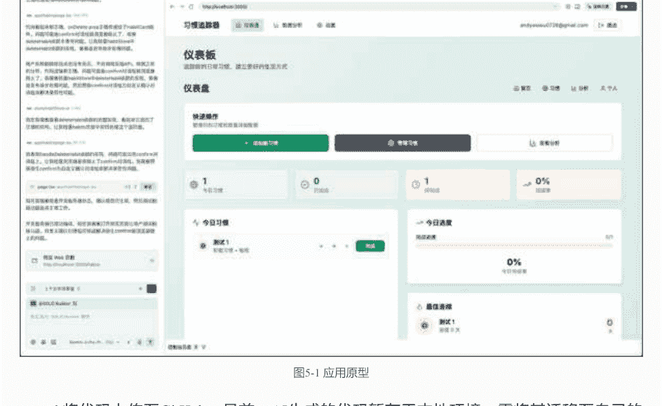

6. 把代码推送到GitHub。目前AI生成代码暂存本地，需要迁移到自己的GitHub仓库以确权。

- **创建仓库：** 登录GitHub新建空仓库，命名为habit-tracker或类似。
- **连接并推送：** 在TRAE SOLO终端按GitHub指引初始化Git、关联远程仓库、执行首次提交与推送。不熟悉可直接请TRAE SOLO协助。参考命令如下：

```bash
##### 进入项目目录
cd path/to/your/habit-tracker
##### 初始化 Git
git init
##### 添加所有文件到暂存区
git add .
##### 创建第一次提交
git commit -m "Initial commit from Trae Solo"
##### 关联到你的远程 GitHub 仓库
git remote add origin https://github.com/your-username/habit-tracker.git
##### 推送到主分支
git push -u origin main
```

至此，PRD已变成真实代码项目并安全存放在GitHub。下一步准备部署到Vercel完成首次公开发布。

### 5.2.2 五分钟实战：部署应用并公开发布

目前应用仅在本地运行。现在将其发布到互联网，实现公开访问。

我们选用Vercel作为部署平台。如第3章所述，Vercel会处理服务器配置、带宽、安全等复杂问题，让开发者专注应用本身。

Vercel可与GitHub深度集成，采用现代化的CI/CD工作流，其流程如图5-2所示。

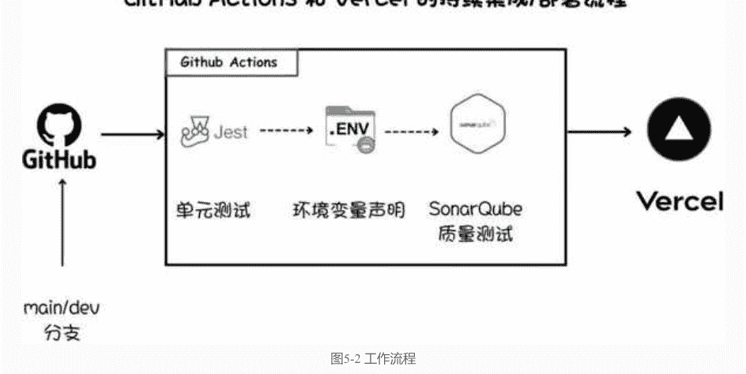

核心逻辑很简单：每当验证通过的代码合并到GitHub主分支，Vercel自动触发重建、测试并用新版本无缝替换线上旧版，保证线上始终与最新稳定代码同步，无需人工干预。

具体操作如下。

1. 注册Vercel账号。到官网注册，建议用GitHub授权登录，自动建立连接，为自动化部署打基础。
2. 导入项目。登录后点Add New选Project，Vercel会列出GitHub下的仓库，找到习惯追踪器项目点Import，如图5-3所示。

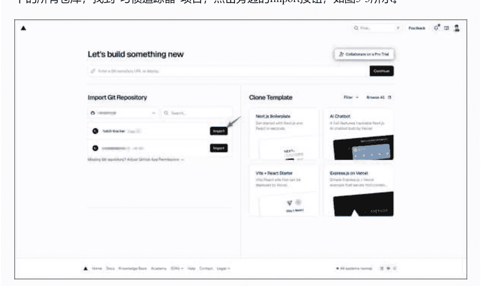

图5-3 导入项目

3. 配置项目。配置页基本无需手动调整。Vercel能自动识别Next.js项目并设好构建命令、输出目录等，如图5-4所示。
4. 开始部署。确认默认设置后点Deploy。Vercel会在云端分配资源、装依赖、执行构建，实时日志会展示在界面，如图5-5所示。
5. 部署成功。完成后Vercel会生成后缀为.vercel.app的公开链接，全球用户均可访问。

另外，TRAE SOLO在构建完成后通常提供快捷部署，如图5-6所示，可跳过手动配置直接上Vercel。但这种方式通常不绑定GitHub项目，无法体验完整CI/CD。为系统学习，建议按上述标准流程部署。

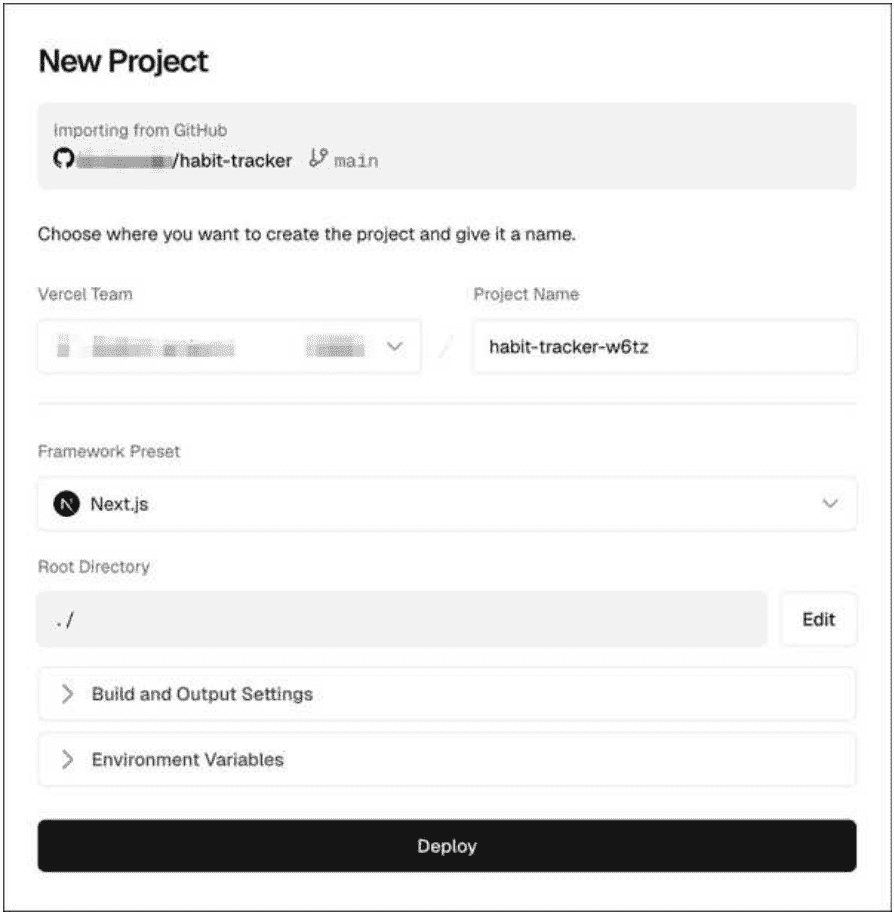

图5-4 零配置的部署分析

> 注：本书示例项目代码库提供了本次实战的完整代码，可参考项目结构与功能，便于理解后文内容。

##### Deployment

Deployment started 15s ago...

```
Build Logs
25 lines
20:57:06.260 Build machine configuration: 2 cores, 8 GB
20:57:06.396 Cloning github.com/Andywugh/habit-tracker (Branch: main, C
20:57:06.397 Previous build caches not available.
20:57:06.870 Cloning completed: 474.000ms
20:57:06.904 Found .vercelignore
20:57:06.910 Removed 26 ignored files defined in .vercelignore
20:57:06.910 ./.git/config
20:57:06.910 ./.git/description
20:57:06.910 ./.git/FETCH_HEAD
20:57:06.910 ./.git/HEAD
20:57:06.910 ./.git/hooks/applypatch-msg.sample
20:57:06.910 ./.git/hooks/commit-msg.sample
20:57:06.910 ./.git/hooks/fsmonitor-watchman.sample
20:57:06.910 ./.git/hooks/post-update.sample
20:57:06.910 ./.git/hooks/pre-applypatch.sample
20:57:06.910 ./.git/hooks/pre-commit.sample
20:57:07.273 Running "vercel build"
20:57:07.697 Vercel CLI 49.1.2
20:57:08.025 Installing dependencies ...
npm warn deprecated rimraf@3.0.2: Rimraf versions prior to v4 are no longer supported
npm warn deprecated inflight@1.0.6: This module is not supported, and leaks memory.
npm warn deprecated @humanwhocodes/config-array@0.13.0: Use @humanwhocodes/config-array@0.13.0
npm warn deprecated @humanwhocodes/object-schema@2.0.3: Use @humanwhocodes/object-schema@2.0.3
npm warn deprecated glob@7.2.3: Glob versions prior to v9 are no longer supported
```

Deployment Summary

Assigning Custom Domains

图5-5 自动化部署的日志

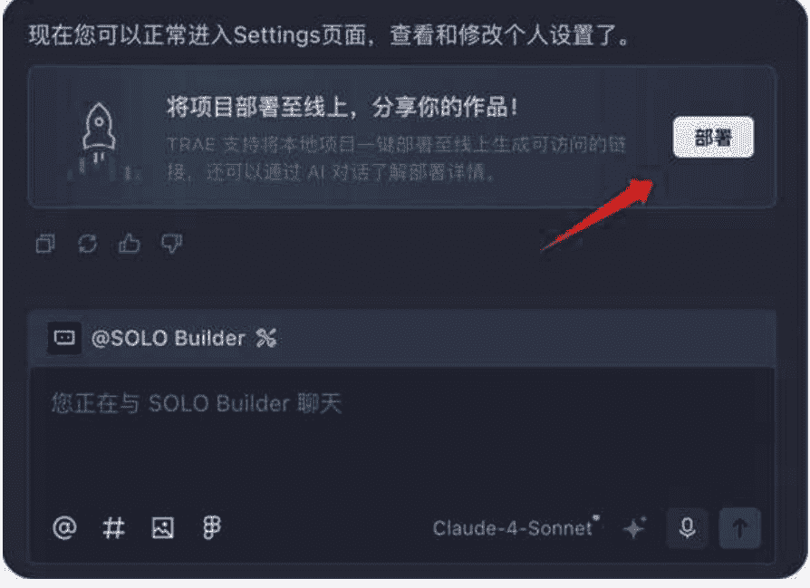

图5-6 快捷的部署功能

##### 部署失败的处理

部署失败很常见，每一次失败都是定位问题的机会。

Vercel的部署日志是排查首选，可在项目仪表盘的Deployments标签页查看，该页记录每次部署尝试，点击标为Error的失败项即可打开详尽构建日志，如图5-8所示。

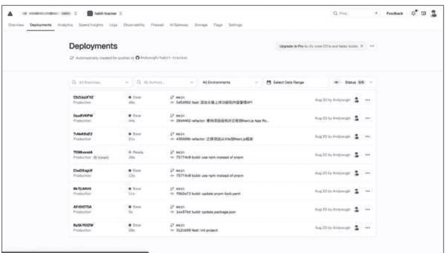

图5-7 Deployments标签页

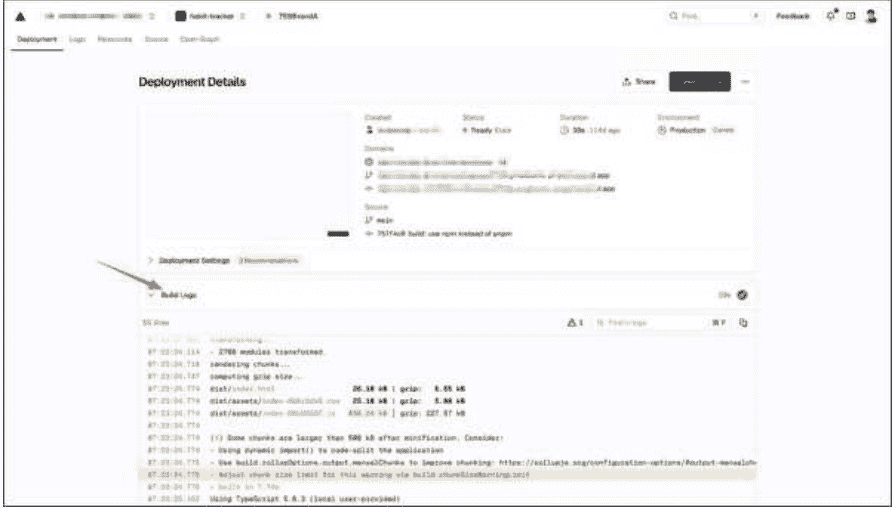

图5-8 Build Logs页面

初学者常见失败原因是环境变量缺失。可以这样理解：代码里写着用储物柜A的钥匙打开数据库，本地已说明储物柜A在书桌第三抽屉，程序就正常。部署到Vercel新环境时若忘了提供位置，Vercel找不到储物柜，自然拿不到钥匙，导致连不上数据库。

这些位置信息就是环境变量。后续章节会详细介绍如何在Vercel安全配置环境变量。此阶段学会阅读错误日志、快速定位环境变量缺失类问题，已是成为合格开发者的核心能力。

### 5.2.3 Supabase深度实战：构建后端服务

Supabase提供基于PostgreSQL的高安全数据库、用户认证系统、边缘函数执行后端逻辑，以及对象存储管理文件。

##### 1. 五分钟实战：数据表结构

TRAE SOLO已为我们搭建好后端数据库的基础结构。现在理解其设计逻辑。项目目录下的./supabase/migrations/001_initial_schema.sql以SQL形式定义了数据库蓝图，共含三个核心表，构成习惯追踪器的数据基础。

- **user_profiles 用户档案表**：保存用户基本资料，字段包括id为主键且与Supabase认证用户ID对应、name姓名、avatar_url头像链接、timezone时区，以及created_at创建时间戳、updated_at更新时间戳。
- **habits 习惯表**：保存用户创建的习惯，字段包括id唯一标识、user_id关联用户、name习惯名称、icon图标、type习惯类型如积极或消极、frequency以JSON存储的频率设置、reminder_time提醒时间、is_active激活状态，以及created_at、updated_at。
- **habit_logs 习惯记录表**：记录用户完成习惯的日志，字段包括id唯一标识、habit_id关联习惯、user_id记录用户、completed_at完成时间、notes可选备注、created_at。

登录Supabase项目仪表盘，点击左侧Table Editor即可看到上述三张表，列结构与数据类型完整，如图5-9所示。

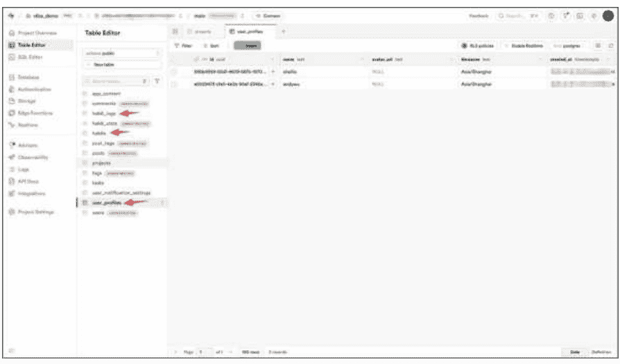

图5-9 查看实际的表

TRAE SOLO已自动完成核心表的搭建与部署，无需手工配置。

##### 2. 五分钟实战：理解表关系——数据间的关联

这三张表并非孤立，而是通过外键关联起来。外键是引用另一表主键的一列或多列，用来在表间建立连接。

外键约束还能保证数据一致性和完整性。例如用户被删除时，相关习惯和记录会通过级联删除自动清理，避免孤儿数据。通过检查迁移文件中的外键配置，可确认数据库是否能有效维护关键业务关联：

```sql
-- user_profiles 表中的 id 引用了认证用户的 id,并作为主键
CREATE TABLE user_profiles (
  id UUID REFERENCES auth.users(id) ON DELETE CASCADE PRIMARY KEY,
  -- ...
);

-- habits 表中的 user_id 引用了认证用户的 id
CREATE TABLE habits (
  -- ...
  user_id UUID REFERENCES auth.users(id) ON DELETE CASCADE NOT NULL,
  -- ...
);

-- habit_logs 表同时引用 habits 表和认证用户
CREATE TABLE habit_logs (
  -- ...
  habit_id UUID REFERENCES habits(id) ON DELETE CASCADE NOT NULL,
  user_id UUID REFERENCES auth.users(id) ON DELETE CASCADE NOT NULL,
  -- ...
);
```

通过检查外键定义，能够清晰看出各数据表的关联方式。

- 一个账号能建立多条习惯条目，属于典型的单对多结构。
- 同一习惯可积累多条打卡记录，也是单对多情形。
- 每条打卡记录最终归属某个账号，形成多条记录归属于同一个账号的归属关系。

若想在实际环境中确认上述关联是否生效，可以打开 Supabase 控制台的表编辑器，在 habits 表的 user_id 字段右侧会看到连线标记，说明该列已建立到用户表的外键连接，如图5-10所示。

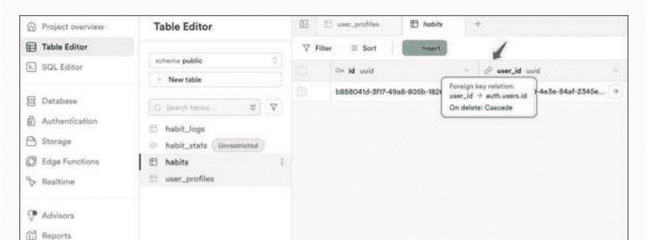

类似地，habit_logs 表的 habit_id 与 user_id 旁也会出现连线标记，分别指向习惯表与用户资料表，如图5-11所示。

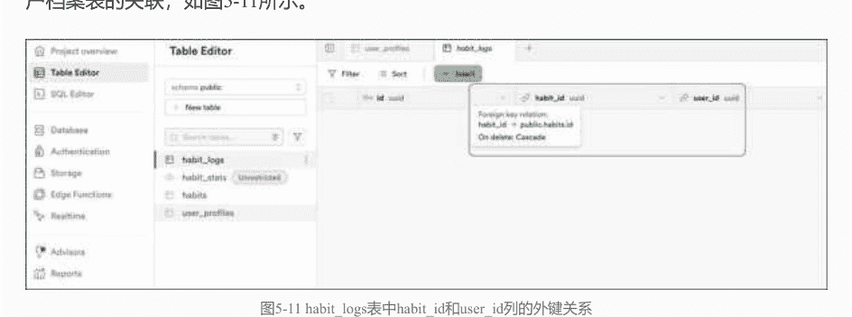

这种建模方式保证了数据自洽、完整以及联查效率，删除账号时关联内容会被自动清理。

##### 3. 十分钟实战：用户认证体系拆解

接下来拆解应用的登录认证模块，该模块负责身份核验与会话维护。整体依赖三类组件协同。

###### 核心组件

系统正常运转需要三份文件的配合。

- 项目根目录下 ./src/lib/supabase.ts 用来初始化与 Supabase 服务通信的客户端，通过环境变量注入服务地址与匿名密钥：

```typescript
import { createClient } from "@supabase/supabase-js";

const supabaseUrl = import.meta.env.VITE_SUPABASE_URL!;
const supabaseAnonKey = import.meta.env.VITE_SUPABASE_ANON_KEY!;

export const supabase = createClient(supabaseUrl, supabaseAnonKey);
```

- ./src/store/authStore.ts 基于 Zustand 管理全局登录态，提供登录、注册、登出等核心方法。

- ./src/components/auth/AuthForm.tsx 实现了登录/注册表单，包含校验、错误提示与模式切换。

###### 注册与登录流程

基于上述模块，认证实现了完整闭环。

- 注册环节：用户提交信息后调用 supabase.auth.signUp() 创建账号，同时在 user_profiles 表自动生成档案并触发邮箱验证邮件。
- 登录环节：用户提交凭证后调用 supabase.auth.signInWithPassword() 校验，成功后更新应用内状态并跳转主界面。
- 状态监听：利用 supabase.auth.onAuthStateChange() 实时追踪认证状态变化，自动处理会话刷新、过期或恢复。

实操建议：在项目目录执行 npm run dev 启动本地服务，浏览器访问 http://localhost:5173 完成注册，同时在 Supabase 控制台观察 auth.users 与 user_profiles 表的增改，直观理解底层数据流转。

##### 4. 十分钟实战：行级安全策略配置

TRAE SOLO 如何保证每个用户只能操作自己的数据，核心在于 PostgreSQL 原生的 RLS，为每一行设置访问规则。

###### 核心设定

迁移文件 ./supabase/migrations/001_initial_schema.sql 中可见为各核心表开启 RLS 的指令以及具体策略，如用户资料访问策略、习惯创建策略等：

```sql
-- 为核心表启用RLS
ALTER TABLE user_profiles ENABLE ROW LEVEL SECURITY;
ALTER TABLE habits ENABLE ROW LEVEL SECURITY;
ALTER TABLE habit_logs ENABLE ROW LEVEL SECURITY;
-- 安全策略示例
-- 用户只能查看自己的档案
CREATE POLICY "Users can view own profile" ON user_profiles
FOR SELECT USING (auth.uid() = id);

-- 用户只能创建属于自己的习惯
CREATE POLICY "Users can create own habits" ON habits
FOR INSERT WITH CHECK (auth.uid() = user_id);
```

策略遵循三项原则：默认拒绝、主体隔离、操作细分。

- 默认拒绝：未授予明确权限时直接阻断。
- 主体隔离：通过 auth.uid() = user_id 判断，确保只能访问自有数据。
- 操作细分：对 SELECT、INSERT、UPDATE、DELETE 分别定义独立策略。

auth.uid() 是 Supabase 内置函数，在数据库层返回当前已认证用户的唯一标识，是连接认证态与权限的关键，即使应用层出现漏洞也难以绕过。

###### 查看策略配置

控制台可直观查看 RLS 状态：

1. 登录项目仪表盘。
2. 进入 Authentication -> Policies 页面。
3. 选择 user_profiles、habits 等核心表，即可看到 RLS 已开启并配置完整策略，如图5-12。

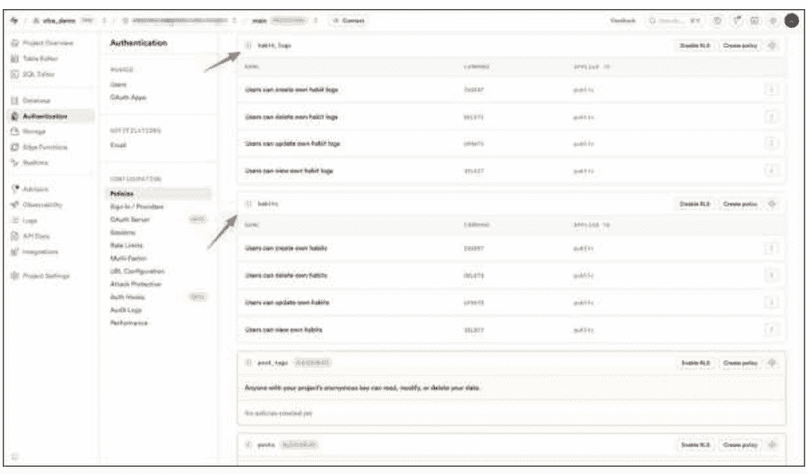

图5-12 查看安全策略

###### RLS 验证实验

为确认策略生效，设计基础验证与进阶验证两组测试。

**基础验证：数据隔离**

模拟真实场景，检验不同账号间是否隔离。

1. 启动项目，用两个不同邮箱注册两个独立测试账号。
2. 用第一个账号登录，创建若干习惯后退出。
3. 切换到第二个账号登录，无法查看第一个账号创建的任何习惯。

结果证明用户隔离策略已生效。

**进阶验证：绕过前端直连测试**

模拟绕过前端权限控制，直接向数据库发起请求，测试未授权访问是否被拦截。

1. 打开未登录的登录页，按 F12 打开浏览器开发者工具，切到 Console。
2. 复制下方代码执行，尝试在未登录状态下查询所有习惯数据，需将项目 ID 与匿名密钥替换为 Supabase 项目 Settings -> API 页面的真实值：

### 5.2.4 Resend邮件服务实战

当数据层与认证层搭建完成，应用仍缺乏主动触达用户的能力。优秀产品通常借助邮件维持持续连接。

习惯追踪 App 已集成 Resend，邮件基础设施已就位。先回顾认证与邮件处理架构。

在 store/authStore.ts 中，用户注册的核心逻辑如下：

```typescript
signUp: async (email: string, password: string, name: string) => {
  const { data, error } = await supabase.auth.signUp({
    email,
    password,
    options: {
      data: { name },
    },
  });

  if (data.user && data.session) {
    set({ user: data.user, session: data.session }); // 创建用户配置文件

    await supabase.from("user_profiles").insert({
      id: data.user.id,
      name,
    });
  }

  return { error };
};
```

同时项目还实现了服务端注册 API 路由 app/api/auth/register/route.ts，采用更安全的服务端创建方式：

```typescript
// 使用管理员权限创建用户,自动确认邮箱
const { data: authData, error: authError } =
  await supabase.auth.admin.createUser({
    email,
    password,
    email_confirm: true,
  });
```

该校验机制意义重大：新用户注册时 Supabase 会自动发送含验证链接的邮件，必须点击完成才能确保邮箱可用，为后续密码重置等功能奠定基础。

在此基础上，生产环境常扩展更完整的邮件体系，如注册欢迎邮件、每周习惯完成统计报告、基于设置的个性化提醒、里程碑激励邮件等。

若使用个人邮箱程序化发送，会存在明显局限：送达率偏低易被判为垃圾邮件、缺少打开率点击率等分析手段、需手动处理退订合规细节等。

因此专业邮件服务成为必然选择。API 密钥属于敏感信息，不可暴露在客户端，正确做法是把发送逻辑封装在服务端路由，通过环境变量安全管理。

##### 1. 现有邮件基础设施盘点

梳理 TRAE SOLO 已具备的邮件相关能力。

- **自动邮件验证机制：** 运行 npm run dev 并注册新账户，注册完成后会收到 Supabase 发来的验证邮件。该自动化流程保证了邮箱有效性，为后续通信奠基。
- **完善的通知设置系统：** app/settings/page.tsx 提供了完整的通知偏好管理界面。

```typescript
const [notifications, setNotifications] = useState({
  daily_reminder: true,
  weekly_summary: true,
  achievement_alerts: true,
  reminder_time: "09:00",
});

// 通过API加载和保存通知设置
const loadNotificationSettings = async () => {
  const response = await fetch("/api/user/notifications", {
    headers: {
      Authorization: `Bearer ${session.access_token}`,
    },
  }); // 处理响应数据...
};
```

该系统通过 user_notification_settings 数据表与 API 路由 app/api/user/notifications/route.ts 实现持久化，用户可精细控制通知开关与提醒时间。
- **完整用户信息收集：** 已收集姓名、邮箱、时区等关键信息，姓名用于个性化内容，邮箱用于投递，时区用于把握发送时机。

##### 2. 邮件功能路线图

基于现有架构，可规划以下功能提升体验：

- 新注册用户发送含使用指南的欢迎邮件；
- 每周自动生成习惯完成统计报告，包含完成率、连续天数等可视化数据；
- 依据用户设定的习惯计划与时区偏好，发送个性化智能提醒；
- 用户达成特定里程碑时自动发送成就激励邮件，增强持续动力。

上述功能可由 Resend 承载，其优势与项目高度契合：API 设计简洁，可与现代 Web 工作流无缝集成；免费额度足以支撑小型项目；原生支持 React Email，允许用 React 组件搭建邮件模板，提升开发效率与复用性。

##### 3. 十分钟实战：欢迎邮件上线

项目已集成 Resend，可在现有 API 架构上直接实现，步骤如下。

1. 注册并配置 Resend。访问 Resend 官网注册登录，添加并验证自有域名，建议使用子域名如 no-reply.your-website.com；Resend 会提供 TXT 验证记录，部分场景需额外配置 MX 记录，在域名服务商 DNS 面板添加，等待 5～30 分钟生效，验证通过后域名状态显示 Verified。
2. 创建并保存 API 密钥。前往 Resend 的 API Keys 页面，创建新密钥，命名为 Habit Tracker Production，选择 Sending access 权限即可；生成的密钥仅显示一次，需立即复制保存。
3. 配置环境变量。在项目根目录创建或编辑 .env.local，添加 RESEND_API_KEY=your_resend_api_key_here；若部署到 Vercel，需在项目设置中添加相同环境变量。
4. 创建欢迎邮件 API 路由。在 app/api 目录下新建 app/api/emails/welcome/route.ts，代码如下：

```typescript
// app/api/emails/welcome/route.ts
import { NextRequest, NextResponse } from "next/server";
import { Resend } from "resend";
import { createClient } from "@supabase/supabase-js";

const resend = new Resend(process.env.RESEND_API_KEY);
const supabase = createClient(
  process.env.NEXT_PUBLIC_SUPABASE_URL!,
  process.env.SUPABASE_SERVICE_ROLE_KEY!
);

export async function POST(request: NextRequest) {
  try {
    const authHeader = request.headers.get("authorization");
    const token = authHeader?.replace("Bearer ", "");

    if (!token) {
      return NextResponse.json(
        { success: false, error: "No token provided" },
        { status: 401 }
      );
    }

    // 验证用户身份
    const {
      data: { user },
      error: authError,
    } = await supabase.auth.getUser(token);

    if (authError || !user) {
      return NextResponse.json(
        { success: false, error: "Invalid token" },
        { status: 401 }
      );
    }

    // 获取用户资料以个性化邮件
    const { data: profile } = await supabase
      .from("user_profiles")
      .select("name")
      .eq("id", user.id)
      .single();

    const { data, error } = await resend.emails.send({
      from: "习惯追踪器 <welcome@your-verified-domain.com>",
      to: [user.email!],
      subject: "欢迎加入习惯追踪器！",
      html: `
        <h2>欢迎, ${profile?.name || "用户"}!</h2>
        <p>感谢你注册我们的习惯追踪应用。</p>
        <p>开始你的习惯养成之旅，每天进步一点点！</p>
        <p>祝你使用愉快！</p>
      `,
    });

    if (error) {
      return NextResponse.json(
        { success: false, error: error.message },
        { status: 500 }
      );
    }

    return NextResponse.json({
      success: true,
      message: "Welcome email sent successfully",
      data,
    });
  } catch (error) {
    console.error("Send welcome email error:", error);
    return NextResponse.json(
      { success: false, error: "Internal server error" },
      { status: 500 }
    );
  }
}
```

##### 4. 五分钟实战：用模板打造动态邮件

手写拼接 HTML 来做邮件模板，工作量大且很难适配 Outlook、Gmail、Apple Mail 等不同客户端的渲染差异。更高效的做法是借助 React Email，把构建网页的思路直接搬到邮件开发里，用已熟悉的 React 组件来组织内容，整体流程可归纳为以下几步。

1. 安装依赖。运行对应的指令，把 React Email 及配套包引入项目。

```bash
npm install react-email @react-email/components
```

2. 新建模板文件。在根目录下创建 emails 文件夹，里面放一个 WeeklySummaryEmail.tsx 作为周报模板。

3. 组装可变的模板。从 @react-email/components 引入针对邮件环境优化过的组件，比如 <Html>、<Body>、<Container>、<Text>，写一个能接收外部变量的模板文件。

```typescript
// emails/WeeklySummaryEmail.tsx
import {
  Html,
  Body,
  Container,
  Heading,
  Text,
  Hr,
} from "@react-email/components";
import * as React from "react";

// 定义组件期望接收的props类型
interface WeeklySummaryEmailProps {
  username: string;
  habits: Array<{
    name: string;
    completedCount: number;
    totalDays: number;
    streak: number;
  }>;
}

export const WeeklySummaryEmail = ({
  username,
  habits,
}: WeeklySummaryEmailProps) => (
  <Html>
    <Body style={{ fontFamily: "sans-serif", backgroundColor: "#f6f9fc" }}>
      <Container
        style={{
          border: "1px solid #eee",
          borderRadius: "5px",
          padding: "20px",
          margin: "40px auto",
          backgroundColor: "#ffffff",
        }}
      >
        <Heading style={{ color: "#333" }}>
          Hi {username}, 这是你的每周习惯总结!
        </Heading>
        <Text style={{ color: "#555" }}>本周你做得非常棒,继续保持!</Text>
        <Hr />
        {habits.map((habit, index) => (
          <div key={index}>
            <Text>
              <strong>{habit.name}</strong>: 本周完成 {habit.completedCount}
              {" "}
              次{habit.streak > 0 && ` | 连续 ${habit.streak} 天`}
              {habit.completedCount >= 5 ? " 🎉" : ""}
            </Text>
          </div>
        ))}
        <Text
          style={{ marginTop: "20px", color: "#888", fontSize: "12px" }}
        >
          来自你的习惯追踪器
        </Text>
      </Container>
    </Body>
  </Html>
);
```

4. 建立发送接口。在 app/api/emails/weekly-summary/route.ts 中实现逻辑，拉取用户相关数据后调用模板完成邮件发送。

```typescript
// app/api/emails/weekly-summary/route.ts
import { NextRequest, NextResponse } from "next/server";
import { Resend } from "resend";
import { createClient } from "@supabase/supabase-js";
import { WeeklySummaryEmail } from "../../../emails/WeeklySummaryEmail";

const resend = new Resend(process.env.RESEND_API_KEY);
const supabase = createClient(
  process.env.NEXT_PUBLIC_SUPABASE_URL!,
  process.env.SUPABASE_SERVICE_ROLE_KEY!
);

export async function POST(request: NextRequest) {
```
try {

  const authHeader = request.headers.get("authorization");

  const token = authHeader?.replace("Bearer ", "");

  if (!token) {

    return NextResponse.json(

      { success: false, error: "No token provided" },

      { status: 401 }

    );

  }

}

// 验证用户身份

const {

  data: { user },

  error: authError,

} = await supabase.auth.getUser(token);

if (authError || !user) {

  return NextResponse.json(

    { success: false, error: "Invalid token" },

    { status: 401 }

  );

}

// 获取用户资料

const { data: profile } = await supabase

  .from("user_profiles")

  .select("name")

  .eq("id", user.id)

  .single();

// 获取用户的习惯数据

const { data: userHabits } = await supabase

  .from("habits")

  .select("id, name")

  .eq("user_id", user.id)

  .eq("is_active", true);

// 获取过去7天的习惯记录

const sevenDaysAgo = new Date();

sevenDaysAgo.setDate(sevenDaysAgo.getDate() - 7);

const { data: habitLogs } = await supabase

  .from("habit_logs")

  .select("habit_id, date, completed")

  .eq("user_id", user.id)

  .gte("date", sevenDaysAgo.toISOString().split("T")[0])

  .eq("completed", true);

// 计算每个习惯的完成情况和连续天数

const habits =

  userHabits?.map((habit) => {

    const habitLogsForHabit =

      habitLogs?.filter((log) => log.habit_id === habit.id) || [];

    const completedCount = habitLogsForHabit.length;

    // 计算连续天数(简化版本)

    let streak = 0;

    const today = new Date();

    for (let i = 0; i < 30; i++) {

      // 检查最近30天

      const checkDate = new Date(today);

      checkDate.setDate(today.getDate() - i);

      const dateStr = checkDate.toISOString().split("T")[0];

      const hasLog = habitLogs?.some(

        (log) =>

          log.habit_id === habit.id &&

          log.date === dateStr &&

          log.completed

      );

      if (hasLog) {

        streak++;

      } else {

        break;

      }

    }

    return {

      id: habit.id,

      name: habit.name,

      completedCount,

      streak,

    };

  }) || [];

const { data, error } = await resend.emails.send({

  from: "每周报告 <reports@your-verified-domain.com>",

  to: [user.email!],

  subject: `${profile?.name || "用户"},你的每周习惯报告来啦!`,

  react: WeeklySummaryEmail({

    username: profile?.name || "用户",

    habits,

  }),

});

if (error) {

  return NextResponse.json(

    { success: false, error: error.message },

    { status: 500 }

  );

}

return NextResponse.json({

  success: true,

  message: "Weekly summary sent successfully",

  data,

});

} catch (error) {

  console.error("Send weekly summary error:", error);

  return NextResponse.json(

    { success: false, error: "Internal server error" },

    { status: 500 }

  );

}

}

到这里，一个可动态渲染、数据驱动且视觉统一的邮件发送流程已经跑通，底层依然沿用熟悉的 React 组件化方式，开发更顺手，兼容性和稳定性也更有保障。

### 5.2.5 邮件触发机制与通知系统架构

会发送邮件之后，下一步要看的是在真实业务里什么时候触发，以及整套提醒系统如何组织。

本项目中的习惯追踪模块内置了一套基于邮件的提醒机制，涵盖四类主要场景：

- **daily_reminder**: 每日提醒，督促用户按时完成当天习惯。
- **weekly_summary**: 周报，呈现最近七天的完成情况。
- **achievement_alert**: 里程碑通知，用户达成特定目标时即时推送。
- **welcome**: 欢迎信，帮助新用户快速了解产品。

以欢迎邮件为例，成功发送后收件箱的样式可参考图 5-13。

目前该版本还没有接入自动定时调度，周报等依赖时间的邮件仍需手动触发。若希望实现全自动，可考虑以下几种实现路径：

- **Vercel Cron Jobs：** 在 vercel.json 里声明定时任务。
- **GitHub Actions：** 通过工作流定时触发通知服务的接口。
- **第三方调度服务：** 借助 cron-job.org 等外部定时平台。

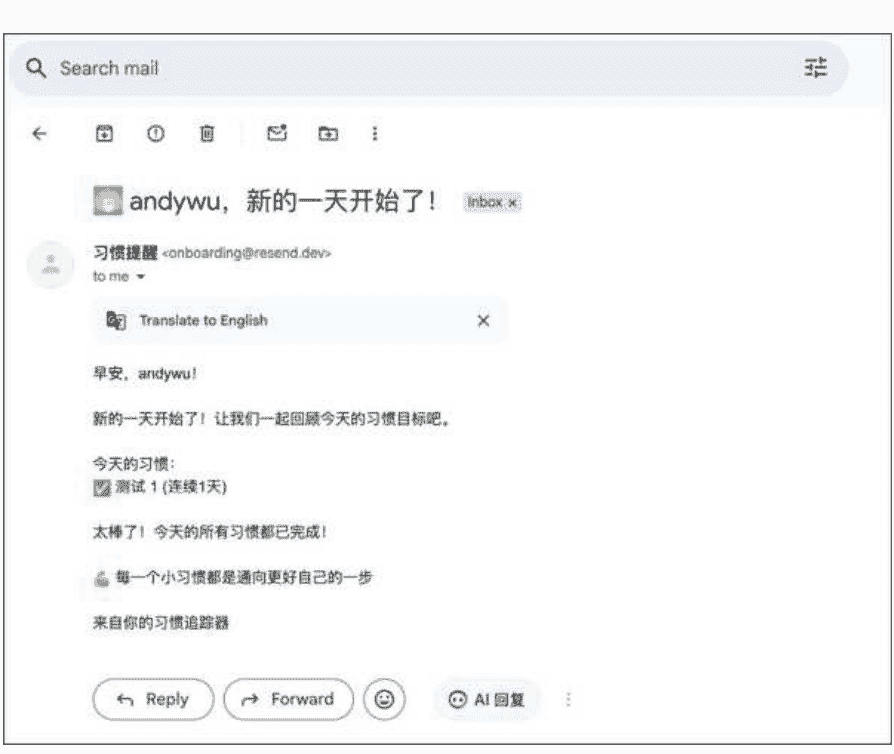

- **Supabase Edge Functions：** 利用 pg_cron 扩展在数据库侧完成定时。
- **客户端触发：** 用户进入应用时，前端判断条件后主动发起通知。

整体方案在扩展性和灵活性上表现不错，不过自动化能力最终要落到外部调度组件上。完成通知体系的梳理后，下一个重点转向文件存储相关的设计。

### 5.2.6 文件存储系统设计

处于现阶段版本，产品把主要精力放在习惯追踪的核心体验上，用户资料模块因此采用轻量化方案。结合数据库表结构与前端页面的实际呈现，可以看出团队在文件存储上的规划思路以及后续可扩展的空间。

##### 当前实现概览

在谈文件存储设计前，先确认用户资料管理的现状。经检查 app/settings/page.tsx 文件可知，资料页目前只提供基础信息的编辑能力。

```typescript
// 当前的用户资料状态管理
const [profile, setProfile] = useState({
  display_name: "",
  email: "",
  timezone: "Asia/Shanghai",
});

// 用户资料保存逻辑
const handleSaveProfile = async () => {
  const response = await fetch("/api/user/profile", {
    method: "PUT",
    headers: {
      "Content-Type": "application/json",
      Authorization: `Bearer ${session.access_token}`,
    },
    body: JSON.stringify({
      name: profile.display_name.trim(),
      timezone: profile.timezone,
    }),
  });
};
```

另一方面，从 supabase/migrations/001_initial_schema.sql 的表定义来看，user_profiles 表里已经包含 avatar_url 字段，但前端尚未开放头像上传入口。

```sql
CREATE TABLE IF NOT EXISTS user_profiles (
  id UUID REFERENCES auth.users(id) ON DELETE CASCADE PRIMARY KEY,
  name TEXT NOT NULL,
  avatar_url TEXT, -- 预留的头像字段
  timezone TEXT DEFAULT 'Asia/Shanghai',
  created_at TIMESTAMP WITH TIME ZONE DEFAULT NOW(),
  updated_at TIMESTAMP WITH TIME ZONE DEFAULT NOW()
);
```

##### 简化背后的考量

头像上传暂未上线，主要源于以下技术层面的权衡。

- **聚焦核心**：优先把资源集中在习惯追踪主功能上，避免把精力分散到次要模块。
- **保持简洁**：早期不引入文件上传、存储管理等相对重的基础设施。
- **控制开销**：规避项目初期因对象存储与 CDN 产生的额外运营成本。
- **提升效率**：绕开上传验证、安全校验、格式转换等复杂链路，降低研发投入。

##### 架构预留与弹性

即便当前版本没有头像功能，整体架构已为后续扩展做好铺垫。

- **数据库层面：** user_profiles.avatar_url 已提前预留，无需改动表结构。
- **API 层面：** app/api/user/profile/route.ts 已具备更新 avatar_url 的能力，前端只需补上对应交互。

这种“接口先行、实现按需”的做法是敏捷开发的常见思路，既维持当下简洁，又保留未来扩展空间。

接下来将以 Cloudflare R2 作为存储方案，通过 3 个实战把头像上传补齐。

### 1.五分钟实战：梳理资料保存的数据流

先明确保存资料时的数据走向。

- **前端：** 通过 handleSaveProfile 函数调用后端 API，当前只提交姓名、时区等核心字段，并未携带 avatar_url。

```typescript
// app/settings/page.tsx 中的资料保存逻辑
const handleSaveProfile = async () => {
  const response = await fetch("/api/user/profile", {
    method: "PUT",
    headers: {
      "Content-Type": "application/json",
      Authorization: `Bearer ${session.access_token}`,
    },
    body: JSON.stringify({
      name: profile.display_name.trim(),
      timezone: profile.timezone,
      // 注意:当前版本未包含 avatar_url
    }),
  });
};
```

- **后端：** app/api/user/profile/route.ts 负责更新逻辑，已兼容 avatar_url 的写入。

```typescript
// 更新用户资料
const { data: profile, error } = await supabase
  .from("user_profiles")
  .update({
    name,
    avatar_url, // API 支持但前端未使用
    timezone,
    updated_at: new Date(),
  })
  .eq("id", user.id)
  .select()
  .single();
```

当前架构的特点是：

- **前端简化：** 页面仅保留显示名称、邮箱、时区等最核心项。
- **API 完整：** 后端已能处理含头像在内的完整资料字段。
- **数据库预留：** 表结构为后续功能留了接口。

### 2.五分钟实战：规划头像上传技术架构

理想体验是点击头像 → 本地选图 → 直接上传并实时刷新。为此采用预签名 URL 机制，把上传与应用服务器解耦，提升性能与安全性，流程如下。

1. 客户端申请许可。用户选好图片后，前端向应用服务器发起请求，携带文件名、类型等元数据申请上传授权。
2. 服务器签发预签名 URL。经身份与权限校验后，服务器用 Cloudflare R2 SDK 生成有效期有限、绑定特定对象的预签名 URL 返回客户端。
3. 客户端直传文件。前端使用该 URL 将图片直传至 Cloudflare R2，不经过应用服务器，减少带宽与延迟。
4. 服务器更新记录。上传完成后客户端通知后端，后端把文件访问链接写入用户记录的 avatar_url。

该方案高效、经济且安全，重型传输交由专业存储处理，应用服务器只需做认证与元数据维护。

落地该架构需要在现有代码上做以下扩展。

1. 升级前端界面。在 app/settings/page.tsx 的资料卡片中加入头像上传组件。

```typescript
// 在现有的用户资料卡片中添加头像部分
<Card>
  <CardHeader>
    <CardTitle className="flex items-center space-x-2">
      <User className="h-5 w-5" />
      <span>用户资料</span>
    </CardTitle>
  </CardHeader>
  <CardContent className="space-y-4">
    {/* 新增头像上传区域 */}
    <div className="flex items-center space-x-4">
      <div className="relative">
        
        <button
          onClick={() => fileInputRef.current?.click()}
          className="absolute -bottom-1 -right-1 bg-emerald-600 text-white rounded-full p-1 hover:bg-emerald-700"
        >
          <Camera className="h-3 w-3" />
        </button>
      </div>
      <div>
        <h3 className="text-sm font-medium">头像</h3>
        <p className="text-xs text-gray-500">点击更换头像图片</p>
      </div>
      <input
        ref={fileInputRef}
        type="file"
        accept="image/*"
        onChange={handleAvatarUpload}
        className="hidden"
      />
    </div>

    {/* 现有的显示名称输入框 */}
    <div>
      <label className="block text-sm font-medium text-gray-700 mb-2">
        显示名称
      </label>
      <Input
        type="text"
        value={profile.display_name}
        onChange={(e) =>
          setProfile({ ...profile, display_name: e.target.value })
        }
        placeholder="输入你的显示名称"
      />
    </div>

    {/* 其他现有字段... */}
  </CardContent>
</Card>
```

2. 补充前端处理逻辑。在 app/settings/page.tsx 中新增 handleAvatarUpload，负责文件校验与上传请求。

```typescript
const [uploading, setUploading] = useState(false);
const fileInputRef = useRef<HTMLInputElement>(null);

const handleAvatarUpload = async (e: React.ChangeEvent<HTMLInputElement>) => {
  const file = e.target.files?.[0];
  if (!file) return;

  // 验证文件类型和大小
  if (!file.type.startsWith("image/")) {
    setMessage("请选择图片文件");
    return;
  }

  if (file.size > 5 * 1024 * 1024) {
    // 5MB 限制
    setMessage("图片大小不能超过5MB");
    return;
  }

  setUploading(true);
  setMessage("");

  try {
    // 调用上传API
    const formData = new FormData();
    formData.append("file", file);
```
const { session } = useAuthStore.getState();

const response = await fetch("/api/upload/avatar", {

  method: "POST",

  headers: {

    Authorization: `Bearer ${session?.access_token}`,

  },

  body: formData,

});

if (!response.ok) {

  throw new Error("上传失败");

}

const result = await response.json();

if (result.success) {

  setProfile((prev) => ({ ...prev, avatar_url: result.data.url }));

  setMessage("头像上传成功!");

} else {

  setMessage(result.error || "上传失败");

}

} catch (error) {

  console.error("Upload error:", error);

  setMessage("上传失败,请重试");

} finally {

  setUploading(false);

}

};

3. 配置 Cloudflare R2 服务。登录控制台进入 R2，创建存储桶如 habit-tracker-uploads。

在 Overview 页面打开 Account Details 的 API Tokens 管理，创建新令牌，遵循最小权限原则，权限设为 ObjectRead & Write，作用域限定在刚创建的桶。

创建成功后保存 Access Key ID 与 Secret Access Key，后者仅显示一次，需立即备份。

在 Vercel 项目的环境变量中添加：
R2_ACCOUNT_ID 用于拼接 R2 端点 URL；
R2_ACCESS_KEY_ID 用于对 R2 进行身份验证；
R2_SECRET_ACCESS_KEY 与访问密钥配对，确保应用有操作桶中对象的权限；
R2_BUCKET_NAME 指定用于存储和读取对象的目标桶名。

##### 3. 十分钟实战：落地文件上传接口

实现后端的上传逻辑，步骤如下。

1. 安装依赖。Cloudflare R2 API 与 Amazon S3 兼容，可直接使用 AWS SDK 交互，无需学习新接口。

```bash
npm install @aws-sdk/client-s3 @aws-sdk/s3-request-presigner
```

2. 创建头像上传 API 路由。新建 app/api/upload/avatar/route.ts 文件，处理头像上传请求。

```typescript
// app/api/upload/avatar/route.ts
import { NextRequest, NextResponse } from "next/server";
import { createClient } from "@supabase/supabase-js";
import { S3Client, PutObjectCommand } from "@aws-sdk/client-s3";
import { getSignedUrl } from "@aws-sdk/s3-request-presigner";

const supabase = createClient(
  process.env.NEXT_PUBLIC_SUPABASE_URL!,
  process.env.SUPABASE_SERVICE_ROLE_KEY!
);

const r2 = new S3Client({
  region: "auto",
  endpoint: `https://${process.env.R2_ACCOUNT_ID}.r2.cloudflarestorage.com`,
  credentials: {
    accessKeyId: process.env.R2_ACCESS_KEY_ID!,
    secretAccessKey: process.env.R2_SECRET_ACCESS_KEY!,
  },
});

export async function POST(request: NextRequest) {
  try {
    const authHeader = request.headers.get("authorization");
    const token = authHeader?.replace("Bearer ", "");

    if (!token) {
      return NextResponse.json(
        { success: false, error: "No token provided" },
        { status: 401 }
      );
    }

    // 验证用户身份
    const {
      data: { user },
      error: authError,
    } = await supabase.auth.getUser(token);

    if (authError || !user) {
      return NextResponse.json(
        { success: false, error: "Invalid token" },
        { status: 401 }
      );
    }

    const formData = await request.formData();
    const file = formData.get("file") as File;

    if (!file) {
      return NextResponse.json(
        { success: false, error: "No file provided" },
        { status: 400 }
      );
    }

    // 生成唯一文件名
    const fileExtension = file.name.split(".").pop();
    const fileName = `avatars/${user.id}-${Date.now()}.${fileExtension}`;

    // 上传到R2
    const arrayBuffer = await file.arrayBuffer();
    const command = new PutObjectCommand({
      Bucket: process.env.R2_BUCKET_NAME!,
      Key: fileName,
      Body: new Uint8Array(arrayBuffer),
      ContentType: file.type,
    });

    await r2.send(command);

    // 生成公共访问URL
    const publicUrl = `https://${process.env.R2_BUCKET_NAME}.${process.env.R2_ACCOUNT_ID}.r2.dev/${fileName}`;

    // 更新用户资料
    const { error: updateError } = await supabase
      .from("user_profiles")
      .update({ avatar_url: publicUrl })
      .eq("id", user.id);

    if (updateError) {
      return NextResponse.json(
        { success: false, error: updateError.message },
        { status: 400 }
      );
    }

    return NextResponse.json({
      success: true,
      message: "Avatar uploaded successfully",
      data: { url: publicUrl },
    });
  } catch (error) {
    console.error("Upload avatar error:", error);
    return NextResponse.json(
      { success: false, error: "Internal server error" },
      { status: 500 }
    );
  }
}
```

3. 完善资料保存逻辑，调整 handleSaveProfile ，确保头像链接在提交个人资料时一并写入后端。

```typescript
const handleSaveProfile = async () => {
  setSaving(true);
  setMessage("");

  try {
    const { session } = useAuthStore.getState();
    if (!session) {
      setMessage("登录已过期,请重新登录");
      setSaving(false);
      return;
    }

    const response = await fetch("/api/user/profile", {
      method: "PUT",
      headers: {
        "Content-Type": "application/json",
        Authorization: `Bearer ${session.access_token}`,
      },
      body: JSON.stringify({
        name: profile.display_name.trim(),
        timezone: profile.timezone,
        avatar_url: profile.avatar_url, // 现在包含头像URL
      }),
    });

    const result = await response.json();
    if (result.success) {
      setMessage("资料保存成功!");
    } else {
      setMessage(result.error || "保存失败,请重试");
    }
  } catch (error) {
    console.error("保存资料失败:", error);
    setMessage("保存失败,请重试");
  } finally {
    setSaving(false);
  }
};
```

完成以上动作后，现有应用的整体架构就能升级到位，头像的上传与管理体验也将完整闭环。

### 5.2.7 内容管理架构：打造可扩展的内容中台

在真实的产品研发里，改文案、换说明、发公告这类内容类需求极其常见。传统做法下，任何一处文字变动都要工程师修改源码、走测试再发布，耗时耗力，还容易错过内容上线的窗口期。

在上独立 CMS 之前，先审视一下当前项目的管控现状。以本章示例的习惯追踪 App 为例，app/settings/page.tsx 中的所有页面文案都是直接写进 React 组件里的硬编码。

```typescript
<h1 className="text-3xl font-bold text-gray-900 mb-8">设置</h1>;

{
/* 用户资料卡片 */
}
<Card>
  <CardHeader>
    <CardTitle className="flex items-center space-x-2">
      <User className="h-5 w-5" /> <span>用户资料</span>
    </CardTitle>
  </CardHeader>
  <CardContent className="space-y-4">
    <div>
      <label className="block text-sm font-medium text-gray-700 mb-2">
        显示名称
      </label>
      {/* ... */}
    </div>
  </CardContent>
</Card>;

{
/* 通知设置卡片 */
}
<Card>
  <CardHeader>
    <CardTitle className="flex items-center space-x-2">
      <Bell className="h-5 w-5" /> <span>通知设置</span>
    </CardTitle>
  </CardHeader>
  <CardContent className="space-y-4">
    <div className="flex items-center justify-between">
      <div>
        <h3 className="text-sm font-medium text-gray-900">每日提醒</h3>
        <p className="text-sm text-gray-500">每天提醒你完成习惯</p>
      </div>
      {/* ... */}
    </div>
  </CardContent>
</Card>;
```

这种把界面文字固化在代码中的方式，在其它页面同样大量存在。

##### 硬编码的利弊分析

项目起步阶段，把内容写死在组件里也有其合理之处，主要体现在以下几方面。

- **上手门槛低：** 文本即代码，不需要额外搭环境。
- **加载更顺滑：** 文案随代码一起打包，不产生额外请求。
- **运行更稳妥：** 不存在因内容服务异常导致的空白。
- **变更可追溯：** 文案修改与代码修改走同一套版本管理。

但随着规模扩大和协作加深，短板会迅速显现。

- **多语言难扩展：** 要做国际化切换成本很高。
- **协作效率差：** 产品、运营等非技术角色无法自助修改，必须依赖开发。
- **发布响应慢：** 一句文案的调整也要走完整的开发部署流程。
- **试错成本高：** 想快速迭代文案做 A/B 测试几乎不可行。

##### CMS 架构演进及选型思路

为了解决这些痛点，引入专业 CMS 几乎是必然选择。市场上 CMS 的形态经历了不同阶段演进，适配的场景各不相同。

- **传统 CMS 如 WordPress：** 管理与展示耦合，前后端一体，部署简单上手快，但扩展性、迁移和多端适配能力受限，不太适合现代多平台产品。
- **无头 CMS 如 Keystatic、Contentful、Strapi：** 前后端解耦，后台只负责内容存储与管理，通过 RESTful API 或 GraphQL 供给前端，前端技术选型自由，多端分发方便，但编辑体验对非技术用户不友好。
- **解耦式 CMS：** 创作与发布分离，内容从仓库推送到目标平台即可，营销同学能自主产出，开发者专注研发，但受限于选定的发布系统，多渠道分发仍受约束。
- **混合式 CMS：** 融合传统与无头的优点，既提供 API 灵活调用，又保留可视化模板编辑，兼顾营销侧体验和开发侧效率，适合对体验和效率都有高要求的企业级场景。

当前 Web 开发里，无头 CMS 因灵活、技术栈无锁定、多端复用能力强，已成为主流。特别是在需要 Web 端与移动端内容同步更新的场景下优势明显。混合式 CMS 则更适合需要在开发效率和非技术团队使用体验之间取得平衡的大型业务。

无头架构在落地层面也有清晰优势。

- **技术栈自由：** 可任选 React、Vue、Angular 等构建前端。
- **多端复用：** 同一套内容可服务 Web、App、小程序，保证一致性。
- **并行协作：** 内容生产与前端研发解耦，团队效率提升。
- **性能可控：** 前端展示可单独做优化，不受 CMS 渲染限制。

在众多无头方案中，Keystatic 对 React/Next.js 生态适配度很高。与 Next.js 深度整合，开发体验流畅；支持 Git 工作流，内容变更自动进入版本库，溯源与协作有保障；提供完整 TypeScript 支持，内容结构类型安全，运行时错误更少；同时面向非技术用户提供了直观的编辑界面，让产品、运营也能独立管理内容。

下面会用两个实践路径展示如何给现有应用接入内容管理能力。思路从轻量快速到完整架构，支持渐进式升级。

##### 1. 方案一：基于现有数据库的轻量 CMS 升级

该路径复用已有的 Supabase 能力，快速搭建一个简易 CMS，无需引入新服务。为说明价值，举一个典型例子：产品希望把“设置”页的“用户资料”改成“个人信息”。

过去需要改 app/settings/page.tsx、提交 PR 再发布，耗时较长。优化后，产品经理可在后台直接修改文案并即时生效，无需开发介入，更新效率和灵活性大幅提升。

实现该方案的具体步骤如下。

## 2.方案二：渐进式内容管理落地

本路径设计一个兼容旧架构、逐步演进的升级方案，兼顾稳定性，具体流程如下。

1. 梳理可动态化的内容。先盘点应用里需要高频调整、未来要做多语言的硬编码文字，比如页面标题、模块标签。以“设置”页面为例：

```tsx
// app/settings/page.tsx - 当前的硬编码文本
<h1 className="text-3xl font-bold text-gray-900 mb-8">设置</h1>

<CardTitle className="flex items-center space-x-2">
    <User className="h-5 w-5" />
    <span>用户资料</span>
</CardTitle>

<CardTitle className="flex items-center space-x-2">
    <Bell className="h-5 w-5" />
    <span>通知设置</span>
</CardTitle>
```

2. 搭建内容配置层。改造后的代码会引入一个自定义 Hook 来读取动态内容，同时保留原有的硬编码默认值作为兜底。这样即使数据库里尚未配置对应项，页面也能正常运行，保证可用性和稳定性。

```tsx
// 引入内容管理 hook
import { useContent } from "@/hooks/useContent";

export default function SettingsPage() {
    const { content } = useContent("settings");

    return (
        <Layout>
            <h1 className="text-3xl font-bold text-gray-900 mb-8">
                {content.page_title || "设置"}
            </h1>

            <CardTitle className="flex items-center space-x-2">
              <User className="h-5 w-5" />
              <span>{content.profile_section_title || "用户资料"}</span>
            </CardTitle>

            <CardTitle className="flex items-center space-x-2">
              <Bell className="h-5 w-5" />
              <span>{content.notification_section_title || "通知设置"}</span>
            </CardTitle>
        </Layout>
    );
}
```

3. 实现内容管理API路由。创建 `app/api/content/route.ts` 文件，从数据库中获取指定分类的内容，并将其转换为前端可直接使用的键值对格式。

```typescript
// app/api/content/route.ts
import { NextRequest, NextResponse } from "next/server";
import { createClient } from "@supabase/supabase-js";

const supabase = createClient(
  process.env.NEXT_PUBLIC_SUPABASE_URL!,
  process.env.SUPABASE_SERVICE_ROLE_KEY!
);

// GET /api/content - 获取内容配置
export async function GET(request: NextRequest) {
  try {
    const { searchParams } = new URL(request.url);
    const category = searchParams.get("category") || "general";

    const { data: content, error } = await supabase
      .from("app_content")
      .select("key, value")
      .eq("category", category);

    if (error) {
      return NextResponse.json(
        { success: false, error: error.message },
        { status: 400 }
      );
    }

    // 转换为键值对对象
    const contentMap = content.reduce((acc, item) => {
      acc[item.key] = item.value;
      return acc;
    }, {} as Record<string, string>);

    return NextResponse.json({
      success: true,
      data: contentMap,
    });
  } catch (error) {
    console.error("Get content error:", error);
    return NextResponse.json(
      { success: false, error: "Internal server error" },
      { status: 500 }
    );
  }
}
```

4. 创建自定义的Hook，简化前端组件中的内容获取逻辑。创建 `hooks/useContent.ts` 文件，该文件封装了从API获取内容配置的异步请求逻辑，并提供了加载状态管理，使得前端组件能够方便地获取和使用动态内容。

```typescript
// hooks/useContent.ts
import { useState, useEffect } from "react";

export function useContent(category: string = "general") {
  const [content, setContent] = useState<Record<string, string>>({});
  const [loading, setLoading] = useState(true);

  useEffect(() => {
    const fetchContent = async () => {
      try {
        const response = await fetch(`/api/content?category=${category}`);
        const result = await response.json();

        if (result.success) {
          setContent(result.data);
        }
      } catch (error) {
        console.error("Failed to fetch content:", error);
      } finally {
        setLoading(false);
      }
    };

    fetchContent();
  }, [category]);

  return { content, loading };
}
```

通过这种基于现有架构的渐进式升级方案，团队协作效率得以提升。开发者可以专注于功能开发，减少了因文案修改而产生的中断；产品、设计及运营团队能够独立、快速地调整和优化界面文案，进行A/B测试或更新公告信息，内容迭代不再依赖开发周期。这种升级方案既保持了现有系统的稳定性，又为未来的功能扩展奠定了坚实的基础。

### 5.2.8 小结

本节梳理了当前应用里内容治理的价值演进，以及不同成熟度下的实践路径。依据所处阶段挑选匹配策略，才能在交付速度与体验质量之间取得平衡。

- **验证期/原型期：** 建议把文案写死在代码里，这也是习惯追踪器App当下的做法。实现路径最短，能把精力集中到核心逻辑与假设验证上，快速判断方向是否成立，符合该App的现状。
- **增长期：** 更推荐采用以Supabase为底座的数据驱动方式。可以复用现有的接口层与存储资源，与当前技术栈无缝衔接，投入可控。把易变的文案从代码中剥离到数据库，可在不改动代码的前提下大幅提升改写自由度，同时保证系统稳健。
- **协作期：** 需引入专业的编辑系统如Keystatic，或自研功能完善的管理后台。这类系统一般提供细粒度权限、可视化编辑、版本回溯、审批流等能力，适配跨职能协作的复杂场景。届时产品、设计、运营可自主完成文案微调、流量实验或公告发布，无需等待开发排期。

选型时要综合评估团队规模、文案变更频率、技术栈契合度。小型团队可用轻量方案试水，大型团队更倾向专业内容系统；变更越频繁，对工具专业性的要求越高；优先选择与现有技术体系一致的方案。

落地建议遵循渐进演进。初期先把易变信息迁入数据库，建立基础的内容维护能力。随着业务扩大与需求分化，再逐步接入功能更完整的CMS。演进全程要守护用户体验，确保内容治理不会拖累核心性能与操作流畅度。

厘清以上思路后，便可为全栈应用从起步到成熟的完整周期，规划出合理的内容管理技术路线。

## 第6章 实战二：构建可商业化的AI生图平台

这是毕业考核，也是能力加冕。

前几章我们已走完从认知觉醒到工具熟练、从基础搭建到项目演练的完整链路。现在迎接最终挑战——交付一个具备真实商业价值的复合应用。

本次要做的不是演示Demo，而是一个融合前沿生成技术、完整支付闭环、用户体系的图像创作平台。项目将贯穿所学全部技能：从v0.dev的界面生成，到Supabase的后端支撑；从Replicate的模型调用，到Stripe的支付流程；从MCP的深度集成，到Vercel的生产部署。

完成本章后，你将从“编程学习者”转变为“独立构建者”——能够把任何创意转化为可运行数字产品的创业者。

未来正从指尖展开。

### 6.1 项目规划：从零搭建可变现的全栈生成应用

本节整合既有知识，完成一次端到端的综合任务：从零搭建可商业化运营的全栈生成应用。

我们沿用熟悉的基础栈，同时引入若干加速工具，包括模型调用平台Replicate、代码助手Cursor、界面生成工具v0.dev、邮件服务Resend。

在写第一行代码前，严谨的产品规划是成功前提。我们先明确商业定位、核心能力与页面骨架，确保技术投入精准服务于商业目标。

#### 6.1.1 商业定位拆解

本项目的核心能力依托Replicate。该平台面向开发者提供云服务，通过统一接口屏蔽数千种开源模型的底层GPU运维复杂度。

在模型库中，我们选用Google DeepMind发布的Nano Banana模型，官方名称Gemini 2.5 Flash Image。该模型在图像编辑层面表现突出，尤其在多轮连续编辑时，能保持人物、宠物、品牌吉祥物等主体的视觉一致性。对需要维持品牌视觉统一的设计师、营销及内容团队具有强吸引力。

据此，产品定位为：面向创意从业者与内容生产者，聚焦主体一致性与进阶编辑能力的专业图像生成与编辑工具。该定位避开通用绘画工具的红海，聚焦专业工作流痛点，在细分赛道建立护城河。

#### 6.1.2 核心能力清单

基于定位，我们锁定四项贴合用户痛点的核心能力。

- **文本生成图像**：生成类工具的基础，支持用户用提示词将脑中创意快速转为视觉结果，Replicate提供简洁调用接口。
- **图像到图像**：专业流程中的关键环节，包含两种形态。
    - **单图精修**：上传基准图后，通过文字指令进行细化修改，如把商品图背景换成海滩，或把人物服装色调改为红色。
    - **多图合成**：高级创作手段，允许上传多张参考素材，结合文字指令生成融合多源元素的新图，如把商品A无缝嵌入场景B，或将人物C与宠物D自然合成合影。
- **风格迁移**：借助Nano Banana的多图处理能力，将一幅画作的艺术风格，如梵高的《星空》，迁移到另一张照片，如城市风景，创造独特视觉。
- **图像优化**：重要的商业化环节。AI原图体积常过大，不适合网页或营销物料。该功能自动压缩并转码，如转WebP，在保持视觉质量的同时提升加载效率，直接影响体验与SEO。

#### 6.1.3 页面结构

为承载上述能力并引导用户完成从认知到付费的闭环，我们设计五个核心页面。

- **落地页**：产品门户，通过视觉冲击的作品展示与清晰的价值主张吸引注册。
- **创作工坊**：核心操作区，用户在此完成全部生成与编辑，界面以直观高效为原则。
- **作品库**：个人资产中心，支持浏览、整理、复用与分享成果。
- **个人中心**：账户管理入口，用于维护资料、查看剩余积分、升级或取消订阅。
- **定价页**：商业转化入口，清晰呈现各付费套餐价值并接入无缝支付。

#### 6.1.4 用TRAE SOLO快速产出项目文档

编码前，我们借助TRAE SOLO自动生成PRD与TDD，为开发奠基。

##### 1. 用TRAE SOLO撰写PRD

操作流程如下：

1. 打开TRAE，将左上角模式切至SOLO，开启AI自主分析与文档生成。
2. 输入结构化需求描述。在SOLO对话窗口以自然语言详细说明，例如：
> 我要做一个基于Replicate API与Nano Banana模型的商业级AI图像生成平台。核心能力包括：文本生成图像、图像精修与多图合成、风格迁移、图像压缩转码。技术栈：Next.js + TypeScript + Tailwind CSS + Supabase + Stripe。页面：首页、创作工坊、作品库、个人中心、价格页。商业模式：积分制按量付费。目标用户：创意工作者、内容创作者、营销人员。核心价值：多轮编辑下的主体一致性。请据此生成完整PRD。
3. 实时查看PRD产出过程。SOLO会解析需求并在DocView窗口实时输出结构化文档，涵盖产品概述与市场定位、功能规格、用户故事与场景、技术架构与集成、商业模式与盈利策略。
4. 需求迭代优化。如需调整，可直接对话，例如：
> 在个人中心增加使用统计，展示生成历史、积分消耗记录与月度使用趋势图表。
SOLO会立即更新文档以反映新需求。

##### 2. 用TRAE SOLO撰写TDD

后续步骤如下：

1. 基于PRD明确设计目标。PRD完成后，继续对话要求生成技术设计文档，例如：
> 基于上述PRD，请生成完整技术设计文档，重点包含：系统整体架构与模块关系图、Replicate API集成接口设计与数据流、用户认证与权限实现方案、积分系统与支付流程后端架构、图像生成与存储详细设计、数据库表结构与关系模型、前后端API定义、部署架构与性能优化策略。
2. 自动产出TDD。SOLO会输出包含以下要点的完整文档：
- **系统概述**：背景、技术目标与整体架构说明。
- **技术栈选型**：选型理由与权衡分析。
- **系统架构设计**：含关系图的高层方案。
- **详细设计**：各子模块实现方案、API定义、数据模型设计。
- **数据流设计**：从用户操作到持久化的完整流程图。
- **安全设计**：身份验证、数据加密、API安全等方案。
- **性能设计**：缓存策略、CDN配置、数据库优化等。
- **部署方案**：生产环境配置、监控告警、备份策略。

通过此方式，我们不仅获得完整TDD，更形成清晰可执行的技术蓝图，为后续编码提供详细指导。

## 6.2 十分钟实战：架构设计与技术选型

规划收尾后，进入技术实现。我们借助智能编码助手，将传统耗时且依赖经验的架构设计转化为高效的人机协作。

### 6.2.1 借助智能编码助手产出技术蓝图

后续代码生成以Cursor为核心生产力。它能索引整个代码库，实现上下文感知的代码生成、重构与高层架构规划。

我们将用Cursor打开TRAE SOLO生成的代码项目，并以结构化方式向AI编码助手传递已规划的产品需求：

> 我正在使用Next.js、Supabase、Stripe和Vercel技术栈，构建一个商业级的AI图像生成平台。核心需求如下。1. AI能力：集成Replicate API，重点使用Nano Banana模型，实现文本生成图像、单图精修与多图合成。2. 用户体系：支持邮箱/社交登录，用户可管理个人生成的图片库。3. 计费体系：用户通过购买积分使用生成服务，需具备完整付费闭环。

从架构设计到工程落地：Replicate 接入与全栈协作实战拆解

任务是输出一份可执行的整体技术方案，并把 Replicate 的接入细节梳理清楚，重点落在任务下发与 Webhook 回调的数据契约上。借助 Cursor 的 AI 编码助手，可以在遵循现代全栈最佳实践的前提下快速获得专业建议与接口草案。

提示词中使用 use Context7 的意图是打开基于 MCP 的实时文档检索，实时从官方源抓取与当前技术栈及具体版本相匹配的最新资料与示例，并注入模型上下文，降低过时接口或虚构调用带来的风险，提升结果的准确性与可用性。

@Web 用于指示 Cursor 启动网络检索，把与需求相关的最新信息融入上下文，让回答与代码更贴近现实、更具时效性。

### 6.2.2 技术栈选型

在参考智能助手给出的建议并结合已有技术积累后，最终锁定了本项目的完整组合。除常用核心组件外，还引入了若干关键新工具，汇总见表6-1。

表6-1 完整的技术栈

| 技术 | 项目中的角色 | 说明 |
| :--- | :--- | :--- |
| Replicate | 模型接入层 | 统一调用入口，覆盖 Nano Banana 等数千款开源模型 |
| Next.js | 前端框架 | React 生态框架，兼顾 SSR 与 SSG，对性能与 SEO 友好 |
| TypeScript | 开发语言 | JavaScript 超集，提供编译期类型校验，提升可维护性 |
| Tailwind CSS | 样式方案 | 实用类优先的原子化 CSS，快速拼装响应式界面 |

整套组合经过精挑细选，旨在最大化个人开发效率，让精力集中在产品逻辑与用户体验建设上。

### 6.2.3 Replicate API设计

下面借助 Cursor 规划应用与 Replicate 的通信方式。在 Next.js 中，API Route 即服务端接口的实现形式，下文提及的接口本质上就是 Next.js API Route，括号内为访问路径与请求方法。按建议，我们设计了两条核心路由：任务创建接口 POST /api/generate-image，和回调路由 POST /api/webhook/replicate。

##### 1. 任务启动接口

该路由作为前端入口，接收用户提交的文本描述 Prompt、待处理的图片等输入。服务端会先严格校验身份与积分余额，确保有权限且余额充足。校验通过后调用 Replicate 启动一个异步的图像生成任务。

前后端数据格式如下。

• 请求载荷 Request Body：多字段 JSON 对象，格式如下。
```
{
  "taskType": "text_to_image" | "image_edit" | "image_fusion",
  "prompt": "string",
  "inputImages": ["string"...],
  "modelConfig": {...}
}
```
其中 taskType 用来区分生成模式，prompt 保存用户文本描述，inputImages 为图片 URL 列表，modelConfig 存放模型的具体配置参数。

• 响应载荷 Response Body：JSON 对象，格式如下。
```
{
  "taskId": "uuid",
  "predictionId": "string",
  "status": "processing"
}
```
taskId 为 Supabase 数据库中创建的任务记录 ID，predictionId 为 Replicate 返回的预测任务唯一标识，前端可用这两个 ID 追踪执行状态。

##### 2. Webhook 回调接口

这是一个被动接收的服务端接口，仅负责收来自 Replicate 服务器的 HTTP POST 通知。任务完成后，无论成功或失败，Replicate 都会主动推送结果到预配置的 Webhook 地址。

处理流程坚持安全与业务规范：先校验请求是否真正来自 Replicate，通常用签名校验；再根据 predictionId 在数据库中定位对应任务并更新状态；若成功，还需把 Replicate 临时存储的图片下载下来，永久保存到自有的 Supabase Storage，同时扣除用户积分。

交互格式如下。

• 请求载荷 Request Body：由 Replicate 官方定义，核心字段如下。
```
{
  "id": "replicate_prediction_id",
  "status": "succeeded" | "failed",
  "output": ["url",...],
  "error": "string",
  "metrics": {...}
}
```
id 为预测任务 ID，status 为执行结果，output 为生成的图片 URL 列表，error 记录失败原因，metrics 提供性能指标。

• 响应载荷 Response Body：处理完毕后返回简单的 200 OK，告知 Replicate 已成功接收。

把任务发起与结果处理分离的异步模式，是人工智能计算、视频转码、批量邮件等长耗时任务的行业通用做法。

## 6.3 十分钟实战：使用v0.dev快速生成UI界面

接下来用 Vercel 推出的生成式 UI 工具 v0.dev 搭建前端界面。它能把自然语言描述、线框图或设计稿转为可维护的 React + Tailwind CSS 生产代码，与本技术栈高度契合。

### 6.3.1 设计响应式落地页

打开 v0.dev，用一份包含结构、内容与风格的精准描述生成落地页。

要求生成名为 Pixel Alchemy 的 AI 图像生成 SaaS 落地页，采用深色科技感主题并使用 Inter 字体。导航栏包含 Logo、功能、定价链接，以及登录与免费注册按钮，免费注册使用紫到粉的渐变高亮。Hero 区域主标题为“将你的想象力，炼成视觉黄金”，下方配副标题与同风格的开始免费创作 CTA。功能特性区采用三列网格，每列含 Lucide 图标、特性标题如无限创意文生图、惊人的角色一致性、一键智能风格迁移及简短描述。作品展示区为响应式 Masonry 瀑布流图片网格，展示多张风格各异的 AI 生成作品。

提交后 v0.dev 会实时给出适配方案，后续可通过对话迭代，例如调整卡片圆角至 8px 或增加悬停阴影。

### 6.3.2 构建图像生成工作台

工作台是核心入口，设计要兼顾清晰与高效。继续向 v0.dev 下指令。

创建图像生成工作台，采用经典双栏布局。左侧控制面板宽度固定 320px，背景稍深，自上而下为高度可变的大文本输入框用于提示词、支持拖拽点击上传多张图片并展示缩略图列表以适配多图融合、用于选择生成风格的下拉菜单、尺寸醒目的生成图像按钮。右侧展示区占据剩余空间，需处理三种状态：初始状态显示占位符或引导提示、生成中状态显示加载动画与预计剩余时间、成功状态显示最终图像并在下方提供下载与保存到图库两个带图标按钮。

该提示详细描述了结构、尺寸、配色及交互状态，v0.dev 能生成带状态管理的 React 组件。

### 6.3.3 创建图库管理界面

个人图库页面的提示词如下。

创建用户图库管理页面，顶部有大标题“我的创作”与上传新作品按钮，下方采用响应式四列图片网格展示所有生成图片。每张图片以卡片元素呈现，带轻微边框与阴影。鼠标悬停时从底部向上浮现半透明黑色渐变遮罩，内含两个白色图标按钮：下载与删除。

完成生成与微调后，使用 v0.dev 的一键代码集成。在预览页右上角点“...”，会出现命令行导入指令，如图6-1所示。
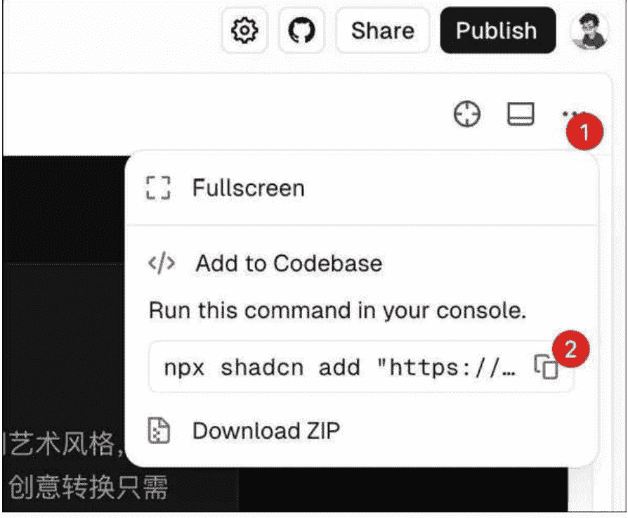
复制命令，在本地 Cursor 编辑器终端执行 v0.dev 生成的 npx shadcn@latest add ... 命令，可自动把 React 组件、shadcn/ui 依赖和图标库精准安装到 Next.js 项目中，几乎无需手写 UI 代码即可快速完成前端搭建。

## 6.4 十分钟实战：使用Supabase构建后端基础设施

前端完成后，需要后端支撑。Supabase 可声明式搭建数据、认证、存储和实时通信。后续示例代码由 Cursor 按需求文档生成，实际结果可能有差异，但思路与细节具有参考价值。使用的提示词为：
> @docs基于我的设计文档初始化Supabase对应代码和数据库。

### 6.4.1 数据库设计

结合 AI 建议与系统设计文档，规划出表6-2所示的核心表。

表6-2 核心数据表

| 表名 | 主要字段 | 描述与关系 |
| :--- | :--- | :--- |
| user_profiles | id, user_id, name, avatar_url, preferences, created_at, updated_at | 存储用户详细资料与偏好，与 Supabase 内置 auth.users 关联 |
| generation_tasks | id, user_id, task_type, prompt, negative_prompt, status, replicate_id, cost_credits, created_at | 记录每次生成请求及当前状态 pending/processing/completed/failed |
| user_images | id, user_id, task_id, image_url, thumbnail_url, metadata, created_at | 保存成功生成的图像文件及元数据，与生成请求关联 |
| credit_transactions | id, user_id, amount, type, description, related_id, created_at | 记录积分变动便于审计与查询 |
| orders | id, user_id, stripe_session_id, amount, status, credits_amount, created_at, updated_at | 存储购买积分订单，与 Stripe 集成 |
| stripe_subscriptions | id, user_id, stripe_subscription_id, status, current_period_start, current_period_end | 管理订阅状态，支持定期自动充值 |

把生成请求 generation_tasks 与最终成果 user_images 分离，是健壮的建模方式，能追踪每次尝试并利于调试与行为分析。

### 6.4.2 用户认证系统

在 Supabase 控制台的 Authentication -> Sign In / Providers 中启用 Email，也可一键开启 Google、GitHub 等社交登录。

随后为所有表开启并配置行级安全 RLS，这是 Supabase 的核心安全特性。策略为用户只能读写 user_id 与自身认证 uid 匹配的记录。即使用户绕过前端直连 API，数据库也能阻止越权访问。

### 6.4.3 数据库视图和函数

为简化前端查询，创建了若干视图。
- user_stats_view：汇总用户生成统计与积分余额
- monthly_stats_view：按月统计生成量与积分消费
- credit_consumption_view：分析积分消费模式
- generation_type_distribution_view：统计各生成类型的分布

同时创建数据库函数处理复杂业务，核心函数如下。
```sql
-- 更新用户积分的函数
CREATE OR REPLACE FUNCTION update_user_credits(
    p_user_id UUID,
    p_amount INTEGER,
    p_type TEXT,
    p_description TEXT,
    p_related_id UUID DEFAULT NULL
)
```
该函数可安全处理积分变动并自动记录交易历史。

### 6.4.4 实时功能

借助 Supabase Realtime 实现生成进度的实时反馈。前端工作台页面通过 Supabase 客户端订阅当前用户在 generation_tasks 表的变更，后端 Webhook 处理器更新 status 后，变化会经 WebSocket 实时推送到前端。

如此快速搭建出安全、实时、功能完备的后端系统，为后续开发做好准备。

### 6.4.5 实施步骤

把设计落地为代码与配置，具体步骤如下。

##### 1. 数据库表结构创建与迁移

先全面分析现有结构，可用 Supabase 控制台或 psql 完成，明确需新增表和调整字段。分析后，在 Supabase 控制台 SQL 编辑器执行以下语句创建所需表：

```sql
-- 创建user_profiles表
CREATE TABLE user_profiles (
    id uuid PRIMARY KEY DEFAULT gen_random_uuid(),
    user_id uuid NOT NULL REFERENCES auth.users(id),
    name text,
    avatar_url text,
    preferences jsonb,
    created_at timestamp with time zone DEFAULT now(),
    updated_at timestamp with time zone DEFAULT now()
);

-- 创建generation_tasks表
CREATE TABLE generation_tasks (
    id uuid PRIMARY KEY DEFAULT gen_random_uuid(),
    user_id uuid NOT NULL REFERENCES auth.users(id),
    task_type text NOT NULL,
    prompt text NOT NULL,
    negative_prompt text,
    status text DEFAULT 'pending',
    replicate_id text,
    cost_credits integer DEFAULT 1,
    created_at timestamp with time zone DEFAULT now()
);

-- 创建user_images表
CREATE TABLE user_images (
    id uuid PRIMARY KEY DEFAULT gen_random_uuid(),
    user_id uuid NOT NULL REFERENCES auth.users(id),
    task_id uuid REFERENCES generation_tasks(id),
    image_url text NOT NULL,
    thumbnail_url text,
    metadata jsonb,
    created_at timestamp with time zone DEFAULT now()
);

-- 创建credit_transactions表
CREATE TABLE credit_transactions (
    id uuid PRIMARY KEY DEFAULT gen_random_uuid(),
    user_id uuid NOT NULL REFERENCES auth.users(id),
    amount integer NOT NULL,
    type text NOT NULL,
    description text,
    related_id uuid,
    created_at timestamp with time zone DEFAULT now()
);

-- 创建orders表
CREATE TABLE orders (
    id uuid PRIMARY KEY DEFAULT gen_random_uuid(),
    user_id uuid NOT NULL REFERENCES auth.users(id),
    stripe_session_id text,
    amount integer NOT NULL,
    status text DEFAULT 'pending',
    credits_amount integer NOT NULL,
    created_at timestamp with time zone DEFAULT now(),
    updated_at timestamp with time zone DEFAULT now()
);

-- 创建stripe_subscriptions表
CREATE TABLE stripe_subscriptions (
    id uuid PRIMARY KEY DEFAULT gen_random_uuid(),
    user_id uuid NOT NULL REFERENCES auth.users(id),
    stripe_subscription_id text NOT NULL,
    status text DEFAULT 'active',
    current_period_start timestamp with time zone,
    current_period_end timestamp with time zone,
    created_at timestamp with time zone DEFAULT now()
);
```
先把行级安全打开并补齐配套的访问策略，这是保障数据隔离的第一步。下面的操作说明了如何一步步启用 RLS 并建立对应的权限规则。

```sql
-- 启用 RLS
ALTER TABLE user_profiles ENABLE ROW LEVEL SECURITY;
ALTER TABLE generation_tasks ENABLE ROW LEVEL SECURITY;
ALTER TABLE user_images ENABLE ROW LEVEL SECURITY;
ALTER TABLE credit_transactions ENABLE ROW LEVEL SECURITY;
ALTER TABLE orders ENABLE ROW LEVEL SECURITY;
ALTER TABLE stripe_subscriptions ENABLE ROW LEVEL SECURITY;

-- 创建安全策略
CREATE POLICY "Users can view own profile" ON user_profiles
    FOR SELECT USING (auth.uid() = user_id);

CREATE POLICY "Users can update own profile" ON user_profiles
    FOR UPDATE USING (auth.uid() = user_id);

CREATE POLICY "Users can view own tasks" ON generation_tasks
    FOR ALL USING (auth.uid() = user_id);

CREATE POLICY "Users can view own images" ON user_images
    FOR ALL USING (auth.uid() = user_id);

CREATE POLICY "Users can view own transactions" ON credit_transactions
    FOR ALL USING (auth.uid() = user_id);

CREATE POLICY "Users can view own orders" ON orders
    FOR ALL USING (auth.uid() = user_id);

CREATE POLICY "Users can view own subscriptions" ON stripe_subscriptions
    FOR ALL USING (auth.uid() = user_id);
```
##### 2. 搭建视图与函数
为了让数据查询更清爽、维护更省心，这里会先建视图再建函数。先做用户统计视图，把用户的基础信息和各类统计指标整合到一张视图里，SQL 语句就能直接生成。

```sql
-- 用户统计视图
CREATE VIEW user_stats_view AS
SELECT
    u.id as user_id,
    u.email,
    up.name,
    COUNT(DISTINCT gt.id) as total_generations,
    COUNT(DISTINCT ui.id) as total_images,
    COALESCE(SUM(ct.amount), 0) as credit_balance
FROM auth.users u
LEFT JOIN user_profiles up ON u.id = up.user_id
LEFT JOIN generation_tasks gt ON u.id = gt.user_id
LEFT JOIN user_images ui ON u.id = ui.user_id
LEFT JOIN credit_transactions ct ON u.id = ct.user_id
GROUP BY u.id, u.email, up.name;
```
积分相关的逻辑则靠函数来承载。首要的是更新积分的函数，它在扣加积分的同时会写入积分流水并留下操作日志，代码示例如下：

```sql
-- 更新用户积分的函数
CREATE OR REPLACE FUNCTION update_user_credits(
    p_user_id UUID,
    p_amount INTEGER,
    p_type TEXT,
    p_description TEXT,
    p_related_id UUID DEFAULT NULL
)
RETURNS void AS $$
BEGIN
    -- 插入积分交易记录
    INSERT INTO credit_transactions (
        user_id,
        amount,
        type,
        description,
        related_id
    ) VALUES (
        p_user_id,
        p_amount,
        p_type,
        p_description,
        p_related_id
    );

    -- 记录操作日志
    RAISE NOTICE 'User % credits updated: % % (%%%)',
        p_user_id,
        CASE WHEN p_amount > 0 THEN '+' ELSE '' END || p_amount,
        p_type,
        p_description;
END;
$$ LANGUAGE plpgsql SECURITY DEFINER;

-- 获取用户积分余额的函数
CREATE OR REPLACE FUNCTION get_user_credit_balance(p_user_id UUID)
RETURNS INTEGER AS $$
DECLARE
    balance INTEGER;
BEGIN
    SELECT COALESCE(SUM(amount), 0) INTO balance
    FROM credit_transactions
    WHERE user_id = p_user_id;
    RETURN balance;
END;
$$ LANGUAGE plpgsql SECURITY DEFINER;
```
##### 3. 设置 Supabase 存储
存储侧主要做两件事：建桶和配策略。

- **新建存储桶：** 进入 Supabase 控制台的 Storage 页面，点击新建桶按钮，把桶名填为 user-images，权限选择公开读取，这样桶里的文件可以被公开访问，最后点创建完成。
- **配置访问策略：** 桶建好后要限制读写范围。用控制台的 SQL 编辑器执行策略语句，实现两点：用户只能向以自己 ID 为名的专属文件夹上传文件；用户只能查看自己文件夹内的内容。

```sql
-- 允许用户上传到自己的文件夹
CREATE POLICY "Users can upload to own folder" ON storage.objects
    FOR INSERT WITH CHECK (
        bucket_id = 'user-images' AND
        (storage.foldername(name))[1] = auth.uid()::text
    );

-- 允许用户查看自己的文件
CREATE POLICY "Users can view own files" ON storage.objects
    FOR SELECT USING (
        bucket_id = 'user-images' AND
        (storage.foldername(name))[1] = auth.uid()::text
    );
```
##### 4. 实现新用户注册送积分
自动赠送积分需要一个触发器函数加一个触发器。先用 SQL 创建 handle_new_user，它在新用户注册时向 user_profiles 写入资料，关联新用户的 ID、从元数据里取出用户名、偏好设置先空着，同时调用 update_user_credits 给新账号发放 10 个积分。随后创建 on_auth_user_created 触发器，监听 auth.users 表的新增记录，命中就执行该函数。SQL 细节如下：

```sql
-- 新用户注册后自动赠送积分的函数
CREATE OR REPLACE FUNCTION handle_new_user()
RETURNS trigger AS $$
BEGIN
    -- 创建用户资料
    INSERT INTO user_profiles (user_id, name, preferences)
    VALUES (NEW.id, NEW.raw_user_meta_data->>'full_name', '{}');

    -- 赠送免费积分
    PERFORM update_user_credits(
        NEW.id,
        10,
        'bonus',
        '新用户注册奖励'
    );
    RETURN NEW;
END;
$$ LANGUAGE plpgsql SECURITY DEFINER;

-- 创建触发器
CREATE TRIGGER on_auth_user_created
    AFTER INSERT ON auth.users
    FOR EACH ROW EXECUTE FUNCTION handle_new_user();
```
##### 5. 校验数据库可用性
重点是验证积分函数和统计视图是否能正常工作。测试思路是：先调用 update_user_credits，换成真实用户 ID 看积分是否能更新；再用 get_user_credit_balance 查询余额，确认变动准确；最后通过 user_stats_view 看生成任务数、图片总数以及当前积分余额等汇总指标，判断聚合逻辑是否正确。具体 SQL 如下：

```sql
-- 测试积分更新
SELECT update_user_credits(
    'your-user-id-here',
    5,
    'test',
    '测试积分更新'
);

-- 查看积分余额
SELECT get_user_credit_balance('your-user-id-here');

-- 查看用户统计
SELECT * FROM user_stats_view WHERE user_id = 'your-user-id-here';
```
到这里，数据库的基础设施已经全部就位。下一步就进入 API 路由和前端对接环节。

##### 6. 新建图像生成 API 路由
在 app/api/generate/route.ts 里实现图像生成接口。路由用 TypeScript 完成身份校验、参数解析并校验提示词，检查用户积分是否充足以及生成频率是否超限；通过后调用 Replicate API，模型参数可支持图生图，同时把任务写入 generation_tasks 表，最后返回任务信息或错误提示。具体实现如下：

```typescript
import { NextRequest, NextResponse } from "next/server";
import { createRouteHandlerClient } from "@supabase/auth-helpers-nextjs";
import { cookies } from "next/headers";
import Replicate from "replicate";

const replicate = new Replicate({
  auth: process.env.REPLICATE_API_TOKEN,
});

export async function POST(request: NextRequest) {
  try {
    // 1. 用户身份验证
    const supabase = createRouteHandlerClient({ cookies });
    const {
      data: { user },
      error: authError,
    } = await supabase.auth.getUser();

    if (authError || !user) {
      return NextResponse.json({ error: "未授权访问" }, { status: 401 });
    }

    // 2. 解析请求参数
    const { prompt, negativePrompt, taskType, imageUrls } =
      await request.json();

    if (!prompt) {
      return NextResponse.json({ error: "提示词不能为空" }, { status: 400 });
    }

    // 3. 检查用户积分余额
    const { data: balance } = await supabase.rpc("get_user_credit_balance", {
      p_user_id: user.id,
    });

    if ((balance || 0) <= 0) {
      return NextResponse.json(
        { error: "积分不足,请充值后继续使用" },
        { status: 402 }
      );
    }

    // 4. 检查频率限制
    const { data: rateLimitCheck } = await supabase.rpc(
      "check_user_rate_limit",
      {
        p_user_id: user.id,
        p_max_daily_generations: 50,
      }
    );

    if (!rateLimitCheck) {
      return NextResponse.json(
        { error: "今日生成次数已达上限,请明天再试" },
        { status: 429 }
      );
    }

    // 5. 调用Replicate API
    const modelInput: any = {
      prompt: prompt,
      negative_prompt: negativePrompt || "",
      width: 1024,
      height: 1024,
      num_outputs: 1,
      scheduler: "K_EULER",
      num_inference_steps: 50,
      guidance_scale: 7.5,
      seed: Math.floor(Math.random() * 1000000),
    };

    // 如果是图生图,添加图片输入
    if (imageUrls && imageUrls.length > 0) {
      modelInput.image = imageUrls[0]; // 支持单张图片输入
    }

    const output = await replicate.run(
      "stability-ai/sdxl:39ed52f2a78e934b3ba6e2a89f5b1c712dc7dfe535525255b1aa35c5565e08b",
      {
        input: modelInput,
        webhook: `${process.env.NEXT_PUBLIC_APP_URL}/api/webhook/replicate`,
        webhook_events_filter: ["completed"],
      }
    );

    // 6. 在数据库中记录任务
    const { data: task, error: taskError } = await supabase
      .from("generation_tasks")
      .insert({
        user_id: user.id,
        task_type: taskType || "text_to_image",
        prompt: prompt,
        negative_prompt: negativePrompt,
        status: "processing",
        replicate_id: output.id,
        cost_credits: 1,
      })
      .select()
      .single();

    if (taskError) {
      console.error("创建任务失败:", taskError);
      return NextResponse.json({ error: "创建任务失败" }, { status: 500 });
    }

    return NextResponse.json({
      success: true,
      task_id: task.id,
      replicate_id: output.id,
      message: "任务已创建，正在处理中...",
    });
  } catch (error) {
    console.error("生成请求失败:", error);
    return NextResponse.json({ error: "服务器内部错误" }, { status: 500 });
  }
}
```

##### 7. 部署 Replicate 回调处理器

在 `app/api/webhook/replicate/route.ts` 里搭建接收端，用 TypeScript 解析来自 Replicate 的任务回调，并定位到本地对应的任务记录。执行成功时拉取生成的图片写入 Supabase Storage，同时把图片元数据落库、改写任务状态并扣减用户积分；若执行失败则把任务标记为失败并据此返回处理结果或错误提示，上线环境务必补充请求来源校验。实现细节见下方代码：

```typescript
import { NextRequest, NextResponse } from "next/server";
import { createRouteHandlerClient } from "@supabase/auth-helpers-nextjs";
import { cookies } from "next/headers";

export async function POST(request: NextRequest) {
  try {
    // 1. 验证请求来源（生产环境必须实现）
    // TODO: 实现 Replicate Webhook 签名验证

    // 2. 解析Webhook数据
    const webhookData = await request.json();
    const { id: replicateId, status, output, error } = webhookData;

    if (!replicateId) {
      return NextResponse.json({ error: "缺少 replicate_id" }, { status: 400 });
    }

    // 3. 查找对应的任务
    const supabase = createRouteHandlerClient({ cookies });
    const { data: task, error: taskError } = await supabase
      .from("generation_tasks")
      .select("*")
      .eq("replicate_id", replicateId)
      .single();

    if (taskError || !task) {
      console.error("找不到对应任务:", replicateId);
      return NextResponse.json({ error: "任务不存在" }, { status: 404 });
    }

    // 4. 处理任务结果
    if (status === "succeeded" && output && output.length > 0) {
      // 任务成功，处理生成的图片
      const imageUrl = output[0];

      // 将图片从 Replicate 下载并上传到 Supabase Storage
      const imageResponse = await fetch(imageUrl);
      const imageBlob = await imageResponse.blob();

      // 生成文件名
      const fileName = `${task.user_id}/${Date.now()}_${Math.random()
        .toString(36)
        .substr(2, 9)}.png`;

      // 上传到Supabase Storage
      const { data: uploadData, error: uploadError } = await supabase.storage
        .from("user-images")
        .upload(fileName, imageBlob, {
          contentType: "image/png",
          cacheControl: "3600",
        });

      if (uploadError) {
        console.error("图片上传失败:", uploadError);
        // 更新任务状态为失败
        await supabase
          .from("generation_tasks")
          .update({ status: "failed" })
          .eq("id", task.id);
        return NextResponse.json({ error: "图片上传失败" }, { status: 500 });
      }

      // 获取公开访问URL
      const {
        data: { publicUrl },
      } = supabase.storage.from("user-images").getPublicUrl(fileName);

      // 在user_images表中创建记录
      const { error: imageError } = await supabase.from("user_images").insert({
        user_id: task.user_id,
        task_id: task.id,
        image_url: publicUrl,
        metadata: {
          original_url: imageUrl,
          file_name: fileName,
          file_size: imageBlob.size,
          mime_type: imageBlob.type,
        },
      });

      if (imageError) {
        console.error("创建图片记录失败:", imageError);
      }

      // 更新任务状态为完成
      await supabase
        .from("generation_tasks")
        .update({ status: "completed" })
        .eq("id", task.id);

      // 5. 扣除用户积分
      const { error: creditError } = await supabase.rpc(
        "consume_user_credits",
        {
          p_user_id: task.user_id,
          p_credits_to_consume: task.cost_credits,
          p_description: `图像生成: ${task.task_type}`,
          p_related_id: task.id,
        }
      );

      if (creditError) {
        console.error("扣除积分失败:", creditError);
      }

      return NextResponse.json({
        success: true,
        message: "任务处理完成",
        image_url: publicUrl,
      });
    } else {
      // 任务失败
      await supabase
        .from("generation_tasks")
        .update({
          status: "failed",
          // 可以添加 error 字段存储错误信息
        })
        .eq("id", task.id);

      return NextResponse.json({
        success: false,
        message: "任务处理失败",
        error: error || "未知错误",
      });
    }
  } catch (error) {
    console.error("Webhook 处理失败:", error);
    return NextResponse.json({ error: "服务器内部错误" }, { status: 500 });
  }
}
```

##### 8. 环境变量与依赖准备

环境与包的准备是项目可运行的前提。先在项目根目录新建 `.env.local`，集中存放运行所需的配置项，比如 Supabase 的项目地址、匿名 Key、服务角色 Key，Replicate 的 API Token 与 Webhook 签名密钥，以及应用自身的 Base URL 等。配置示例如下。

```plaintext
###### Supabase配置
NEXT_PUBLIC_SUPABASE_URL=your_supabase_project_url
NEXT_PUBLIC_SUPABASE_ANON_KEY=your_supabase_anon_key
SUPABASE_SERVICE_ROLE_KEY=your_supabase_service_role_key

###### Replicate配置
REPLICATE_API_TOKEN=your_replicate_api_token
REPLICATE_WEBHOOK_SIGNING_SECRET=your_webhook_secret

###### 应用配置
NEXT_PUBLIC_APP_URL=http://localhost:3000
```

随后通过 Bash 安装命令把核心依赖拉下来，`replicate`、`@supabase/auth-helpers-nextjs`、`@supabase/supabase-js` 等包能为模型调用、鉴权与存储提供基础能力：

```bash
npm install replicate @supabase/auth-helpers-nextjs @supabase/supabase-js
```

##### 9. API 功能自检

此阶段要确认生成接口和 Webhook 回调都能正常响应。测试生成请求时可用 Postman 或 curl 工具，对 `http://localhost:3000/api/generate` 发起 POST，请求头需携带 `Content-Type` 与 `Authorization`，请求体中传入提示词、任务类型等参数。curl 示例如下：

```bash
curl -X POST http://localhost:3000/api/generate \
  -H "Content-Type: application/json" \
  -H "Authorization: Bearer YOUR_JWT_TOKEN" \
  -d '{
    "prompt": "一只可爱的小猫坐在花园里",
    "taskType": "text_to_image"
  }'
```

想确认 Replicate 回调是否可达，需要在 Replicate 后台把回调地址填成 https://your-domain.com/api/webhook/replicate，这样任务结束后的通知才能被后端准时接收。

把前面各环节串起来后，后端已具备完整生产能力：数据底座齐全、积分体系可控、图像生成接口高效、异步任务稳定、错误捕获与日志也都就位。

## 6.4 10分钟速建：Supabase 打造后端底座

前端交互已完成，接下来补上服务端支撑。Supabase 支持声明式地快速搭建数据、鉴权、对象存储和实时通信。以下示例由 Cursor 参照需求文档自动生成，实际产出细节可能有出入，但整体思路对理解人机协作开发很有参考价值。使用的提示词如下：

> @docs基于我的设计文档初始化Supabase对应代码和数据库。

### 6.4.1 数据库设计

结合 AI 建议与前文架构文档，核心表结构汇总为表6-2。

表6-2 核心数据表

| 表名 | 主要字段 | 描述与关系 |

| :--- | :--- | :--- |

| user_profiles | id, user_id, name, avatar_url, preferences, created_at, updated_at | 扩展用户资料，关联内置 auth.users，保存昵称、头像与偏好 |
| generation_tasks | id, user_id, task_type, prompt, negative_prompt, status, replicate_id, cost_credits, created_at | 生成请求日志，记录提示词、负向提示、状态流转、Replicate ID 与扣费 |
| user_images | id, user_id, task_id, image_url, thumbnail_url, metadata, created_at | 已产出图片记录，含原图、缩略图与元数据，指向对应任务 |
| credit_transactions | id, user_id, amount, type, description, related_id, created_at | 积分流水，涵盖消费、充值、赠送，便于对账与审计 |
| orders | id, user_id, stripe_session_id, amount, status, credits_amount, created_at, updated_at | Stripe 支付订单，记录金额与兑换积分 |
| stripe_subscriptions | id, user_id, stripe_subscription_id, status, current_period_start, current_period_end | 订阅跟踪表，管理周期与状态，支持自动续费 |

把生成请求 generation_tasks 与生成结果 user_images 拆开建模，能完整保留每次尝试的轨迹，成败皆可追溯，对排错与行为分析意义很大。

### 6.4.2 用户认证系统

在 Supabase 管理后台打开 Authentication -> Sign In/Providers，右侧 Auth Provider 面板可启用 Email，也能一键接入 Google、GitHub 等社交登录。

随后为所有业务表开启行级安全 RLS 并配置策略。核心规则是只允许 user_id 等于当前登录 UID 的记录被读写。即便请求绕过前端直连 API，数据库层也能阻断越权访问。

### 6.4.3 数据库视图和函数

为简化前端查询，提前准备了若干视图：

- **user_stats_view**：展示生成汇总与积分余额
- **monthly_stats_view**：按月统计生成量与积分花费
- **credit_consumption_view**：分析积分使用模式
- **generation_type_distribution_view**：统计各生成类型的占比

同时封装数据库函数处理复杂业务，核心函数如下。

```sql
-- 更新用户积分的函数
CREATE OR REPLACE FUNCTION update_user_credits(
    p_user_id UUID,
    p_amount INTEGER,
    p_type TEXT,
    p_description TEXT,
    p_related_id UUID DEFAULT NULL
)
```

该函数在事务中安全地完成积分增减，并自动写入交易流水。

### 6.4.4 实时功能

图像生成耗时较长，需要前端即时反馈进度。借助 Supabase Realtime 订阅 generation_tasks 的变更。生成工作台页面通过客户端库监听当前用户的任务记录，后端 Webhook 处理器更新 status 后，改动会经 WebSocket 推送到浏览器。

按此做法可在短时间内得到一个兼顾安全与实时性的后端，为下一步功能迭代打好基础。

### 6.4.5 实施步骤

把设计落地为实际配置与代码，步骤如下。

##### 1. 数据库表结构创建与迁移

先对现有库做盘点，可用控制台或 psql 查看当前结构，明确需要新增的表与字段调整。评估完成后在 Supabase 控制台 SQL 编辑器执行建表语句：

```sql
-- 创建user_profiles表
CREATE TABLE user_profiles (
    id uuid PRIMARY KEY DEFAULT gen_random_uuid(),
    user_id uuid NOT NULL REFERENCES auth.users(id),
    name text,
    avatar_url text,
    preferences jsonb,
    created_at timestamp with time zone DEFAULT now(),
    updated_at timestamp with time zone DEFAULT now()
);

-- 创建generation_tasks表
CREATE TABLE generation_tasks (
    id uuid PRIMARY KEY DEFAULT gen_random_uuid(),
    user_id uuid NOT NULL REFERENCES auth.users(id),
    task_type text NOT NULL,
    prompt text NOT NULL,
    negative_prompt text,
    status text DEFAULT 'pending',
    replicate_id text,
    cost_credits integer DEFAULT 1,
    created_at timestamp with time zone DEFAULT now()
);

-- 创建user_images表
CREATE TABLE user_images (
    id uuid PRIMARY KEY DEFAULT gen_random_uuid(),
    user_id uuid NOT NULL REFERENCES auth.users(id),
    task_id uuid REFERENCES generation_tasks(id),
    image_url text NOT NULL,
    thumbnail_url text,
    metadata jsonb,
    created_at timestamp with time zone DEFAULT now()
);

-- 创建credit_transactions表
CREATE TABLE credit_transactions (
    id uuid PRIMARY KEY DEFAULT gen_random_uuid(),
    user_id uuid NOT NULL REFERENCES auth.users(id),
    amount integer NOT NULL,
    type text NOT NULL,
    description text,
    related_id uuid,
    created_at timestamp with time zone DEFAULT now()
);

-- 创建orders表
CREATE TABLE orders (
    id uuid PRIMARY KEY DEFAULT gen_random_uuid(),
    user_id uuid NOT NULL REFERENCES auth.users(id),
    stripe_session_id text,
    amount integer NOT NULL,
    status text DEFAULT 'pending',
    credits_amount integer NOT NULL,
    created_at timestamp with time zone DEFAULT now(),
    updated_at timestamp with time zone DEFAULT now()
);

-- 创建stripe_subscriptions表
CREATE TABLE stripe_subscriptions (
    id uuid PRIMARY KEY DEFAULT gen_random_uuid(),
    user_id uuid NOT NULL REFERENCES auth.users(id),
    stripe_subscription_id text NOT NULL,
    status text DEFAULT 'active',
    current_period_start timestamp with time zone,
    current_period_end timestamp with time zone,
    created_at timestamp with time zone DEFAULT now()
);
```

随后启用 RLS 并创建对应策略：

```sql
-- 启用 RLS
ALTER TABLE user_profiles ENABLE ROW LEVEL SECURITY;
ALTER TABLE generation_tasks ENABLE ROW LEVEL SECURITY;
ALTER TABLE user_images ENABLE ROW LEVEL SECURITY;
ALTER TABLE credit_transactions ENABLE ROW LEVEL SECURITY;
ALTER TABLE orders ENABLE ROW LEVEL SECURITY;
ALTER TABLE stripe_subscriptions ENABLE ROW LEVEL SECURITY;

-- 创建安全策略
CREATE POLICY "Users can view own profile" ON user_profiles
    FOR SELECT USING (auth.uid() = user_id);

CREATE POLICY "Users can update own profile" ON user_profiles
    FOR UPDATE USING (auth.uid() = user_id);

CREATE POLICY "Users can view own tasks" ON generation_tasks
    FOR ALL USING (auth.uid() = user_id);

CREATE POLICY "Users can view own images" ON user_images
    FOR ALL USING (auth.uid() = user_id);

CREATE POLICY "Users can view own transactions" ON credit_transactions
    FOR ALL USING (auth.uid() = user_id);

CREATE POLICY "Users can view own orders" ON orders
    FOR ALL USING (auth.uid() = user_id);

CREATE POLICY "Users can view own subscriptions" ON stripe_subscriptions
    FOR ALL USING (auth.uid() = user_id);
```

##### 2. 创建数据库视图和函数

先创建视图提升查询效率。以用户统计视图为例，将基础信息与统计结果合并：

```sql
-- 用户统计视图
CREATE VIEW user_stats_view AS
SELECT
    u.id as user_id,
    u.email,
    up.name,
    COUNT(DISTINCT gt.id) as total_generations,
    COUNT(DISTINCT ui.id) as total_images,
    COALESCE(SUM(ct.amount), 0) as credit_balance
FROM auth.users u
LEFT JOIN user_profiles up ON u.id = up.user_id
LEFT JOIN generation_tasks gt ON u.id = gt.user_id
LEFT JOIN user_images ui ON u.id = ui.user_id
LEFT JOIN credit_transactions ct ON u.id = ct.user_id
GROUP BY u.id, u.email, up.name;
```

再创建积分相关的函数实现更新与查询。首先是积分更新函数，会写入交易记录并记录操作日志：

```sql
-- 更新用户积分的函数
CREATE OR REPLACE FUNCTION update_user_credits(
    p_user_id UUID,
    p_amount INTEGER,
    p_type TEXT,
    p_description TEXT,
    p_related_id UUID DEFAULT NULL
)
RETURNS void AS $$
BEGIN
    -- 插入积分交易记录
    INSERT INTO credit_transactions (
        user_id,
        amount,
        type,
        description,
        related_id
    ) VALUES (
        p_user_id,
        p_amount,
        p_type,
        p_description,
        p_related_id
    );

    -- 记录操作日志
    RAISE NOTICE 'User % credits updated: % % (%%%)',
        p_user_id,
        CASE WHEN p_amount > 0 THEN '+' ELSE '' END || p_amount,
        p_type,
        p_description;
END;
$$ LANGUAGE plpgsql SECURITY DEFINER;

-- 获取用户积分余额的函数
CREATE OR REPLACE FUNCTION get_user_credit_balance(p_user_id UUID)
RETURNS INTEGER AS $$
DECLARE
    balance INTEGER;
BEGIN
    SELECT COALESCE(SUM(amount), 0) INTO balance
    FROM credit_transactions
    WHERE user_id = p_user_id;
    RETURN balance;
END;
$$ LANGUAGE plpgsql SECURITY DEFINER;
```

##### 3. 配置 Supabase Storage

Storage 配置包含两件事：新建存储桶与定义访问策略。

从零搭建高可用 AI 生图后端，Supabase + Replicate 全流程实操

先把文件存储打通。进入 Supabase 控制台打开 Storage 模块，点击新建存储桶，桶名填 user-images，权限选择 Public 让文件可以公开读取，最后确认创建完成。

桶建好后要做权限隔离。去控制台的 SQL 编辑器执行策略语句，核心要做到两点：用户只能往以自己 ID 为名目的个人文件夹里上传；用户只能读取自己文件夹下的内容，保证数据不串。

```sql
-- 允许用户上传到自己的文件夹
CREATE POLICY "Users can upload to own folder" ON storage.objects
    FOR INSERT WITH CHECK (
        bucket_id = 'user-images' AND
        (storage.foldername(name))[1] = auth.uid()::text
    );

-- 允许用户查看自己的文件
CREATE POLICY "Users can view own files" ON storage.objects
    FOR SELECT USING (
        bucket_id = 'user-images' AND
        (storage.foldername(name))[1] = auth.uid()::text
    );
```

##### 4. 新用户自动赠送积分
要实现注册即送积分，需要先建函数再建触发器。用 SQL 新建 handle_new_user 函数，逻辑是在新用户注册时往 user_profiles 写入一条资料，关联 auth 用户 ID、从元数据里取用户名、偏好设置先置空，同时调用 update_user_credits 给账号发放 10 个积分。接着建 on_auth_user_created 触发器监听 auth.users 的插入事件，满足条件就自动跑上面这个函数。完整 SQL 如下：

```sql
-- 新用户注册后自动赠送积分的函数
CREATE OR REPLACE FUNCTION handle_new_user()
RETURNS trigger AS $$
BEGIN
    -- 创建用户资料
    INSERT INTO user_profiles (user_id, name, preferences)
    VALUES (NEW.id, NEW.raw_user_meta_data->>'full_name', '{}');

    -- 赠送免费积分
    PERFORM update_user_credits(
        NEW.id,
        10,
        'bonus',
        '新用户注册奖励'
    );
    RETURN NEW;
END;
$$ LANGUAGE plpgsql SECURITY DEFINER;

-- 创建触发器
CREATE TRIGGER on_auth_user_created
    AFTER INSERT ON auth.users
    FOR EACH ROW EXECUTE FUNCTION handle_new_user();
```

##### 5. 测试数据库功能
数据库这块重点测积分相关函数和统计视图是否可用。测试顺序是：先手动调用 update_user_credits 并替换成真实用户 ID，看积分能否正常变动；再用 get_user_credit_balance 查询余额，确认增减是否准确；最后通过 user_stats_view 查看生成任务数、图片总数、当前余额等汇总指标，验证统计逻辑是否正确。对应 SQL 代码如下：

```sql
-- 测试积分更新
SELECT update_user_credits(
    'your-user-id-here',
    5,
    'test',
    '测试积分更新'
);

-- 查看积分余额
SELECT get_user_credit_balance('your-user-id-here');

-- 查看用户统计
SELECT * FROM user_stats_view WHERE user_id = 'your-user-id-here';
```

到这里，底层的数据底座就全了。接下来把 API 路由和前端对接起来。

##### 6. 创建图像生成API路由
在 app/api/generate/route.ts 里用 TypeScript 写生成接口。流程包括校验用户身份、解析并校验提示词参数、检查积分余额和生成频率限制，然后调用 Replicate API 并配置模型参数，支持图生图模式，同时在 generation_tasks 表里写入任务记录。最后返回任务信息或错误提示。代码如下：

```typescript
import { NextRequest, NextResponse } from "next/server";
import { createRouteHandlerClient } from "@supabase/auth-helpers-nextjs";
import { cookies } from "next/headers";
import Replicate from "replicate";

const replicate = new Replicate({
  auth: process.env.REPLICATE_API_TOKEN,
});

export async function POST(request: NextRequest) {
  try {
    // 1. 用户身份验证
    const supabase = createRouteHandlerClient({ cookies });
    const {
      data: { user },
      error: authError,
    } = await supabase.auth.getUser();

    if (authError || !user) {
      return NextResponse.json({ error: "未授权访问" }, { status: 401 });
    }

    // 2. 解析请求参数
    const { prompt, negativePrompt, taskType, imageUrls } =
      await request.json();

    if (!prompt) {
      return NextResponse.json({ error: "提示词不能为空" }, { status: 400 });
    }

    // 3. 检查用户积分余额
    const { data: balance } = await supabase.rpc("get_user_credit_balance", {
      p_user_id: user.id,
    });

    if ((balance || 0) <= 0) {
      return NextResponse.json(
        { error: "积分不足,请充值后继续使用" },
        { status: 402 }
      );
    }

    // 4. 检查频率限制
    const { data: rateLimitCheck } = await supabase.rpc(
      "check_user_rate_limit",
      {
        p_user_id: user.id,
        p_max_daily_generations: 50,
      }
    );

    if (!rateLimitCheck) {
      return NextResponse.json(
        {
          error: "今日生成次数已达上限,请明天再试"
        },
        {
          status: 429
        }
      );
    }

    // 5. 调用Replicate API
    const modelInput: any = {
      prompt: prompt,
      negative_prompt: negativePrompt || "",
      width: 1024,
      height: 1024,
      num_outputs: 1,
      scheduler: "K_EULER",
      num_inference_steps: 50,
      guidance_scale: 7.5,
      seed: Math.floor(Math.random() * 1000000),
    };

    // 如果是图生图,添加图片输入
    if (imageUrls && imageUrls.length > 0) {
      modelInput.image = imageUrls[0]; // 支持单张图片输入
    }

    const output = await replicate.run(
      "stability-ai/sdxl:39ed52f2a78e934b3ba6e2a89f5b1c712dc7dfea535525255b1aa35c5565e08b",
      {
        input: modelInput,
        webhook: `${process.env.NEXT_PUBLIC_APP_URL}/api/webhook/replicate`,
        webhook_events_filter: ["completed"],
      }
    );

    // 6. 在数据库中记录任务
    const { data: task, error: taskError } = await supabase
      .from("generation_tasks")
      .insert({
        user_id: user.id,
        task_type: taskType || "text_to_image",
        prompt: prompt,
        negative_prompt: negativePrompt,
        status: "processing",
        replicate_id: output.id,
        cost_credits: 1,
      })
      .select()
      .single();

    if (taskError) {
      console.error("创建任务失败:", taskError);
      return NextResponse.json({ error: "创建任务失败" }, { status: 500 });
    }

    return NextResponse.json({
      success: true,
      task_id: task.id,
      replicate_id: output.id,
      message: "任务已创建，正在处理中...",
    });
  } catch (error) {
    console.error("生成请求失败:", error);
    return NextResponse.json({ error: "服务器内部错误" }, { status: 500 });
  }
}
```

##### 7. 创建Webhook处理器
在 app/api/webhook/replicate/route.ts 实现异步回调。代码会解析 Replicate 推送的任务通知，找到本地对应的任务记录，任务成功时把图片下载下来并上传到 Supabase 存储。

##### 8. 配置环境变量和安装依赖
环境准备是项目能跑的基础。首先在项目根目录建 .env.local，里面放 Supabase 的项目 URL、匿名 Key、服务角色 Key，Replicate 的 API Token 和 Webhook 签名密钥，以及应用的基础 URL 等。内容如下：

```
###### Supabase配置
NEXT_PUBLIC_SUPABASE_URL=your_supabase_project_url
NEXT_PUBLIC_SUPABASE_ANON_KEY=your_supabase_anon_key
SUPABASE_SERVICE_ROLE_KEY=your_supabase_service_role_key

###### Replicate配置
REPLICATE_API_TOKEN=your_replicate_api_token
REPLICATE_WEBHOOK_SIGNING_SECRET=your_webhook_secret

###### 应用配置
NEXT_PUBLIC_APP_URL=http://localhost:3000
```

依赖要提前装好，执行 Bash 命令安装 replicate、@supabase/auth-helpers-nextjs、@supabase/supabase-js 等包，让项目具备所需功能：

```bash
npm install replicate @supabase/auth-helpers-nextjs @supabase/supabase-js
```

##### 9. 测试API功能
接口要验证生成请求和 Webhook 是否通。测生成时可以用 Postman 或 curl 发 POST 到 http://localhost:3000/api/generate，请求头带上 Content-Type 和 Authorization，请求体里传提示词和任务类型等参数。curl 示例如下：

```bash
curl -X POST http://localhost:3000/api/generate \
  -H "Content-Type: application/json" \
  -H "Authorization: Bearer YOUR_JWT_TOKEN" \
  -d '{
    "prompt": "一只可爱的小猫坐在花园里",
    "taskType": "text_to_image"
  }'
```

WebHook 的测试需要在 Replicate 控制台把回调地址设为 https://your-domain.com/api/webhook/replicate，这样任务完成后才能收到通知。

按上面的步骤走完，就能得到一套完整的后端：数据库基础设施齐全、积分体系安全、可用的生图 API、高效的异步任务处理，以及完善的错误和日志机制。

## 6.5 十分钟实战：集成Replicate API实现核心AI功能
本节演示如何把 Replicate 的 AI 能力接入业务，实现稳定可用的图像生成。关键是搭一个健壮的事件驱动异步流程。

### 6.5.1 Replicate API密钥配置与环境变量管理
先去 Replicate 官网注册账号，在账户设置里的 API Tokens 页面创建一个新的 API Key，然后把它写入项目根目录 .env.local：

```
REPLICATE_API_TOKEN=your_replicate_token_here
REPLICATE_WEBHOOK_SIGNING_SECRET=your_webhook_secret_here
```

### 6.5.2 文生图功能：接入多种AI模型
统一处理生成请求，需要在 Next.js 里创建 app/api/generate/route.ts，服务端处理逻辑如下。

1. 用户身份验证。利用 Supabase 服务端能力校验请求头里的 JWT，确保调用者是已登录的合法用户。
2. 积分检查。读取 credit_transactions 表算出当前余额，不足就直接返回错误。
3. 调用 Replicate API，具体实现见下文。

```typescript
const output = await replicate.run(
  "stability-ai/sdxl:39ed52f2a78e934b3ba6e2a89f5b1c712de7dfea535525255b1aa35c5565e08b",
  {
    input: {
      prompt: prompt,
      negative_prompt: negativePrompt,
      width: 1024,
      height: 1024,
      num_outputs: 1,
      scheduler: "K_EULER",
      num_inference_steps: 50,
      guidance_scale: 7.5,
      seed: Math.floor(Math.random() * 1000000),
    },
    webhook: `${process.env.NEXT_PUBLIC_APP_URL}/api/webhook/replicate`,
    webhook_events_filter: ["completed"],
  }
);
```

4. 任务入库。把任务信息写入 generation_tasks 表，初始状态设为 processing。

### 6.5.3 图生图功能：实现图像编辑与融合
图生图在整体框架上保持一致，流程细节需要做少量调整，具体如下。

从前端到后端再到异步回调，整条图像生成的链路可以拆成三个动作。

客户端把用户挑选的原图推送到 Supabase Storage，拿到对外可访问的链接。随后把这条链接和文本提示一起封装进请求体发往服务端。服务端在调用 replicate.run() 时，把该链接作为 input 参数传入模型。

无论是纯文本生成还是图生图，Replicate 都是异步执行，所以必须准备一个独立的接收端来处理任务完成的通知并做后续收尾。

### 6.5.4 异步流程：Webhook 通知与状态跟踪

新建路由 app/api/webhook/replicate/route.ts 专门接收 Replicate 发来的 POST 事件，主要承担的工作如下：

- 来源核验：校验签名，确认通知确实来自 Replicate。
- 内容解析：从请求体抽取任务最终状态与输出结果。
- 数据与文件同步：成功时把结果图从 Replicate 拉取到 Supabase Storage，并在 user_images 表中写入记录；失败时把状态置为 failed 并记录原因。
- 积分结算：借助事先准备好的数据库函数完成扣减，代码如下：

```typescript
await supabase.rpc("update_user_credits", {
  p_user_id: task.user_id,
  p_amount: -task.cost_credits,
  p_type: "consumption",
  p_description: `Image generation: ${task.task_type}`,
  p_related_id: task.id,
});
```

## 6.6 十分钟上手：积分与限流体系搭建

在面向用户的产品里，可靠的积分机制是控制用量和计费的基础。以下给出一个安全且完整的搭建思路。

### 6.6.1 计分方案设计

为兼顾不同使用习惯，采用三层计费结构：

- 新人福利：每位新注册账号自动发放 10 点免费额度，由数据库触发器自动完成，减少上手成本。
- 周期付费：为持续使用者提供订阅，例如“爱好者套餐”每月 10 美元抵扣 100 点。
- 单次充值：为使用不规律的用户提供按需购买，例如 5 美元换 50 点。

计费口径统一为：

> 1 点 = 1 次成功完成的图像生成

### 6.6.2 请求前的限制判断

在触发 Replicate 之前，先在生成接口里做余额充足性检查。

```typescript
// 检查用户积分余额
const { data: credits } = await supabase
  .from("credit_transactions")
  .select("amount")
  .eq("user_id", user.id);

const balance = credits?.reduce((sum, tx) => sum + tx.amount, 0) || 0;

if (balance <= 0) {
  return NextResponse.json(
    { error: "积分不足,请充值后继续使用" },
    { status: 402 }
  );
}
```

这里的关键设计是：此时仅做是否足够判断，不立即扣减。因为生成可能因网络、服务异常等失败，扣减必须等到服务真正交付成功才执行，才能保证计费公平。

### 6.6.3 安全扣减路径

实际扣减放在 Webhook 处理里执行，通过预置的数据库函数完成，以保证原子性和安全性。

```sql
-- 该函数确保积分变动的原子性和安全性
CREATE OR REPLACE FUNCTION update_user_credits(
    p_user_id UUID,
    p_amount INTEGER,
    p_type TEXT,
    p_description TEXT,
    p_related_id UUID DEFAULT NULL
)
```

该做法的核心在于明确信任边界。浏览器中运行的代码都属于不可信环境，不能在前端或可被前端直接调用的接口里执行扣款类操作。把最终结算交给可信的、由 Replicate 服务器在成功状态下触发的 Webhook，才是构建公平计费系统的正确做法。

完成上述设计后，后端具备了安全、实时、可扩展的基础，可继续推进核心功能。

### 6.6.4 落地步骤

下面把思路转化为具体实现。

##### 1. 完善积分管理函数

为保证积分操作的封装与安全，需要创建一组数据库函数负责余额查询、是否充足的判断以及消费。

- 余额查询与充足性判断

在 Supabase SQL 编辑器执行下列语句，实现两个核心函数。

- 获取用户余额函数：汇总指定用户的积分流水总额得到当前余额。
- 余额检查函数：基于余额查询结果判断是否满足所需点数。

具体 SQL 如下。

```sql
-- 获取用户积分余额的函数(带缓存优化)
CREATE OR REPLACE FUNCTION get_user_credit_balance(p_user_id UUID)
RETURNS INTEGER AS $$
DECLARE
    balance INTEGER;
BEGIN
    -- 计算积分余额
    SELECT COALESCE(SUM(amount), 0) INTO balance
    FROM credit_transactions
    WHERE user_id = p_user_id;

    RETURN balance;
END;
$$ LANGUAGE plpgsql SECURITY DEFINER;

-- 检查用户是否有足够积分的函数
CREATE OR REPLACE FUNCTION check_user_credits(
    p_user_id UUID,
    p_required_credits INTEGER
)
RETURNS BOOLEAN AS $$
DECLARE
    current_balance INTEGER;
BEGIN
    SELECT get_user_credit_balance(p_user_id) INTO current_balance;
    RETURN current_balance >= p_required_credits;
END;
$$ LANGUAGE plpgsql SECURITY DEFINER;
```

###### 积分消费函数

新建消费函数，用于服务成功交付后安全扣减积分。该函数先校验余额是否足够，不足则抛出异常，随后向 credit_transactions 表插入一条负值流水完成扣减，防止透支。

具体 SQL 如下：

```sql
-- 安全的积分消费函数
CREATE OR REPLACE FUNCTION consume_user_credits(
    p_user_id UUID,
    p_credits_to_consume INTEGER,
    p_description TEXT,
    p_related_id UUID DEFAULT NULL
)
RETURNS BOOLEAN AS $$
DECLARE
    current_balance INTEGER;
BEGIN
    -- 获取当前余额
    SELECT get_user_credit_balance(p_user_id) INTO current_balance;

    -- 检查余额是否足够
    IF current_balance < p_credits_to_consume THEN
        RAISE EXCEPTION '积分不足: 当前余额 %, 需要 %', current_balance, p_credits_to_consume;
    END IF;

    -- 扣除积分
    INSERT INTO credit_transactions (
        user_id,
        amount,
        type,
        description,
        related_id
    ) VALUES (
        p_user_id,
        -p_credits_to_consume,
        'consumption',
        p_description,
        p_related_id
    );

    RETURN TRUE;
END;
$$ LANGUAGE plpgsql SECURITY DEFINER;
```

## 2.搭建套餐与充值逻辑

为支持多种付费方式，需要建立套餐表并提供充值能力。

###### 创建套餐配置表及默认数据

创建 credit_packages 表，保存一次性购买和订阅套餐信息，字段包括名称、描述、点数、价格（分）、Stripe 价格 ID、是否订阅、订阅周期、是否启用、创建时间等。建表后写入默认套餐以满足不同用户。

具体 SQL 如下：

```sql
-- 创建积分套餐配置表
CREATE TABLE credit_packages (
    id uuid PRIMARY KEY DEFAULT gen_random_uuid(),
    name text NOT NULL,
    description text,
    credits_amount integer NOT NULL,
    price_cents integer NOT NULL,
    stripe_price_id text,
    is_subscription boolean DEFAULT false,
    subscription_interval text, -- 'month', 'year'
    is_active boolean DEFAULT true,
    created_at timestamp with time zone DEFAULT now()
);

-- 插入默认套餐数据
INSERT INTO credit_packages (name, description, credits_amount,
price_cents, is_subscription, subscription_interval) VALUES
('免费试用', '新用户注册奖励', 10, 0, false, null),
('积分包', '一次性购买', 50, 500, false, null),
('爱好者套餐', '月度订阅', 100, 1000, true, 'month'),
('专业套餐', '月度订阅', 500, 2500, true, 'month');
```

###### 积分充值函数

创建 add_user_credits 函数，用于处理新人奖励、积分包购买或订阅续费时的积分增加。通过向 credit_transactions 表写入正值流水完成充值，并输出日志。

具体 SQL 如下：

```sql
-- 积分充值函数
CREATE OR REPLACE FUNCTION add_user_credits(
    p_user_id UUID,
    p_credits_to_add INTEGER,
    p_type TEXT,
    p_description TEXT,
    p_related_id UUID DEFAULT NULL
)
RETURNS void AS $$
BEGIN
    -- 添加积分
    INSERT INTO credit_transactions (
        user_id,
        amount,
        type,
        description,
        related_id
    ) VALUES (
        p_user_id,
        p_credits_to_add,
        p_type,
        p_description,
        p_related_id
    );

    -- 记录操作日志
    RAISE NOTICE 'User % credits added: +% % (%)',
        p_user_id,
        p_credits_to_add,
        p_type,
        p_description;
END;
$$ LANGUAGE plpgsql SECURITY DEFINER;
```

## 3.构建使用限制与频率控制

除积分外，还需加入时间维度的频率控制，防止滥用。

###### 使用统计视图与频率校验函数

创建 user_daily_usage 视图，统计用户每日成功生成次数和积分消耗；创建 check_user_rate_limit 函数，校验当日生成次数是否超过默认上限 50 次。

具体 SQL 如下：

```sql
-- 用户今日使用统计视图
CREATE VIEW user_daily_usage AS
SELECT
    user_id,
    DATE(created_at) as usage_date,
    COUNT(*) as daily_generations,
    SUM(cost_credits) as daily_credits_consumed
FROM generation_tasks
WHERE status = 'completed'
GROUP BY user_id, DATE(created_at);

-- 用户使用频率限制检查函数
CREATE OR REPLACE FUNCTION check_user_rate_limit(
    p_user_id UUID,
    p_max_daily_generations INTEGER DEFAULT 50
)
RETURNS BOOLEAN AS $$
DECLARE
    today_generations INTEGER;
BEGIN
    -- 获取今日已生成的图片数量
    SELECT COALESCE(daily_generations, 0) INTO today_generations
    FROM user_daily_usage
    WHERE user_id = p_user_id AND usage_date = CURRENT_DATE;

    -- 检查是否超过限制
    RETURN today_generations < p_max_daily_generations;
END;
$$ LANGUAGE plpgsql SECURITY DEFINER;
```

###### 更新生成接口，增加频率限制

在 app/api/generate/route.ts 路由中，在余额检查之后调用频率校验函数，若超出上限则返回 429 状态码及提示。

具体 TypeScript 代码如下：

```typescript
// 在积分检查之后，添加频率限制检查
const { data: rateLimitCheck } = await supabase.rpc("check_user_rate_limit", {
  p_user_id: user.id,
  p_max_daily_generations: 50,
});

if (!rateLimitCheck) {
  return NextResponse.json(
    { error: "今日生成次数已达上限，请明天再试" },
    { status: 429 }
  );
}
```

## 4.积分历史与管理界面

便于用户查看消费明细，需提供历史查询能力及对应 API。

###### 创建历史查询函数

创建 get_user_credit_history 函数，支持分页查询用户的积分流水，按创建时间倒序排列，并计算每次交易后的余额。

具体 SQL 代码如下：

```sql
-- 获取用户积分历史记录
CREATE OR REPLACE FUNCTION get_user_credit_history(
  p_user_id UUID,
  p_limit INTEGER DEFAULT 50,
  p_offset INTEGER DEFAULT 0
)
RETURNS TABLE (
  transaction_id UUID,
  amount INTEGER,
  type TEXT,
  description TEXT,
  created_at TIMESTAMP WITH TIME ZONE,
  balance_after INTEGER
) AS $$
DECLARE
  running_balance INTEGER := 0;
  rec RECORD;
BEGIN
  FOR rec IN
    SELECT
      ct.id,
      ct.amount,
      ct.type,
      ct.description,
      ct.created_at
    FROM credit_transactions ct
    WHERE ct.user_id = p_user_id
    ORDER BY ct.created_at DESC
    LIMIT p_limit OFFSET p_offset
  LOOP
    running_balance := running_balance + rec.amount;
    transaction_id := rec.id;
    amount := rec.amount;
    type := rec.type;
    description := rec.description;
    created_at := rec.created_at;
    balance_after := running_balance;
    RETURN NEXT;
  END LOOP;
END;
$$ LANGUAGE plpgsql SECURITY DEFINER;
```

###### 积分查询接口快速搭建

在 app/api/credits/route.ts 中新增一个 GET 端点，前端调用它即可拿到当前登录用户的可用点数、最近二十条流水以及正在生效的点数套餐清单。

参考实现如下：

```typescript
import { NextRequest, NextResponse } from "next/server";
import { createRouteHandlerClient } from "@supabase/auth-helpers-nextjs";
import { cookies } from "next/headers";

export async function GET(request: NextRequest) {
  try {
    const supabase = createRouteHandlerClient({ cookies });
    const {
      data: { user },
      error: authError,
    } = await supabase.auth.getUser();

    if (authError || !user) {
      return NextResponse.json({ error: "未授权访问" }, { status: 401 });
    }

    // 获取用户积分余额
    const { data: balance } = await supabase.rpc("get_user_credit_balance", {
      p_user_id: user.id,
    });

    // 获取积分历史
    const { data: history } = await supabase.rpc("get_user_credit_history", {
      p_user_id: user.id,
      p_limit: 20,
      p_offset: 0,
    });

    // 获取可用套餐
    const { data: packages } = await supabase
      .from("credit_packages")
      .select("*")
      .eq("is_active", true)
      .order("price_cents", { ascending: true });

    return NextResponse.json({
      balance: balance || 0,
      history: history || [],
      packages: packages || [],
    });
  } catch (error) {
    console.error("获取积分信息失败:", error);
    return NextResponse.json({ error: "服务器内部错误" }, { status: 500 });
  }
}
```

## 5.测试积分系统功能

编码完成后，需要对各项能力做功能验收。

###### 核心点数操作验证

在 Supabase SQL 编辑区执行下列查询，用来确认点数查询、消费扣减、充值增加以及历史记录读取是否正常。

```sql
-- 测试积分余额查询
SELECT get_user_credit_balance('your-user-id-here');

-- 测试积分消费
SELECT consume_user_credits(
  'your-user-id-here',
  1,
  '测试消费',
  'test-task-id'
);

-- 测试积分充值
SELECT add_user_credits(
  'your-user-id-here',
  10,
  '测试充值',
  '测试充值描述'
);

-- 查看积分历史
SELECT * FROM get_user_credit_history('your-user-id-here', 10, 0);
```

###### 每日使用频率验证

再执行下面这一组查询，核对用户单日使用统计的准确性以及频率限制逻辑是否按预期生效。

```sql
-- 检查用户今日使用情况
SELECT * FROM user_daily_usage WHERE user_id = 'your-user-id-here';

-- 测试频率限制检查
SELECT check_user_rate_limit('your-user-id-here', 50);
```

完成上述核验后，一个能够精确追踪点数变动、有效遏制滥用的点数体系便已成型，也为后续接入支付做好准备。

## 6.7 十分钟实战：用 Stripe 打通完整付费闭环

接下来为点数体系接入企业级收款能力，通过 Stripe 构建从下单到到账的自动化流程。

### 6.7.1 Stripe 商品与价格设定

在 Stripe 控制台以声明式方式创建商品，无需编写代码，具体步骤如下。

1. 登录 Stripe 账号并切换到测试环境。
2. 进入 Products 页面。
3. 新建商品与服务。先创建两个周期性商品，分别命名为“爱好者套餐”和“专业套餐”，并配置每月 10 美元、25 美元的循环价格；再创建一个单次商品，命名为“积分包”，配置 5 美元的单次价格。
4. 补充元数据。这是把 Stripe 商品与内部点数系统关联的关键。为每个 Price 添加自定义元数据，具体如下。
- 爱好者套餐：key 为 credits，value 为 100。
- 专业套餐：key 为 credits，value 为 500。
- 积分包：key 为 credits，value 为 50。

支付成功后 Webhook 会读取这些元数据完成自动充值。配置汇总见表 6-3。

表6-3 Stripe产品配置信息

| 产品名称 | 类型 | 价格（美元） | 授予积分 | Stripe元数据 |
| :--- | :--- | :--- | :--- | :--- |
| 免费套餐 | 注册即送 | 0 | 10 | 不适用 |
| 积分包 | 一次性购买 | 5 | 50 | {"credits": 50} |
| 爱好者套餐 | 订阅 | 每月10美元 | 100 | {"credits": 100} |
| 专业套餐 | 订阅 | 每月25美元 | 500 | {"credits": 500} |

### 6.7.2 收款流程接入

参考 Vercel 官方提供的 Next.js + Supabase + Stripe 订阅模板的最佳实践，具体如下。

1. 创建结账会话。新建路由 app/api/stripe/create-checkout-session/route.ts。用户点击购买时，前端携带 price_id 调用该接口，后端在 Stripe 中创建或查找客户对象，随后用 Node 客户端创建结账会话并把 session_id 返回前端。
2. 跳转到 Stripe 结账页。前端拿到 session_id 后使用 Stripe.js 的重定向方法将用户送到 Stripe 托管的结账页面。所有敏感支付信息由 Stripe 处理，应用服务器不直接接触，大幅降低 PCI 合规成本。
3. 处理支付结果。需接收 Stripe 的支付通知。在 Stripe 仪表盘中配置 Webhook 端点指向 app/api/webhooks/stripe/route.ts，重点监听 checkout.session.completed 事件。支付完成后 Stripe 会向该地址发送 POST 请求，后端据此为用户充值积分。

### 6.7.3 点数自动充值

Stripe Webhook 处理器是自动充值的核心，收到 checkout.session.completed 事件时按以下逻辑执行。

1. 验证签名。作为安全第一步，使用从 Stripe 仪表盘获取的 Webhook 签名密钥校验请求头中的 Stripe-Signature，以确保请求真实完整。
2. 解析事件数据。从事件对象中安全提取用户的 stripe_customer_id 及所购价格信息。
3. 读取点数数量。从价格对象的 metadata.credits 中读取预先设置的点数值。
4. 更新数据库。通过 stripe_customer_id 在 customers 表中匹配对应的 user_id，然后执行下方 SQL 为用户充值积分：

```sql
-- 调用已创建的积分充值函数，为用户添加对应积分
SELECT add_user_credits(
    p_user_id := '<匹配到的user_id>',
    p_credits_to_add := <提取的积分数量>,
    p_type := CASE WHEN <产品类型> = 'subscription' THEN 'subscription' ELSE 'one-time' END,
    p_description := 'Stripe支付充值: <产品名称>'
);
```

至此，从点击购买到点数到账的全自动化商业闭环已形成，为 AI 应用商业化奠定基础。支付问题解决后，下一步是建立高效的用户沟通渠道，这对提升活跃度和留存至关重要。

## 6.8 十分钟实战：使用 Resend 搭建邮件自动化

一个成功的 SaaS 不仅需要强功能，还需要在关键节点与用户主动沟通。Resend 是面向开发者的现代化邮件 API，可用于搭建智能自动化通信体系。

### 6.8.1 用户生命周期自动化邮件

基于 Supabase 与 Resend 覆盖注册到订阅的全链路，配置三类自动化邮件。

- 注册欢迎邮件：通过 Supabase 数据库触发器实现，当 auth.users 表新增记录时，触发器调用边缘函数经 Resend SDK 发送欢迎邮件。
- 注册后使用指南邮件：利用 Supabase 内置的 pg_cron 扩展创建定时任务，每日筛选注册满三天的用户，向其发送含进阶技巧的指南邮件。
- 订阅续费提醒邮件：同样通过 pg_cron 创建每日任务，查询即将到期的有效订阅，调用边缘函数在续费日前三天发送提醒，降低非主动流失。

### 6.8.2 异步任务完成通知

像 AI 图像生成这类异步功能，用户提交后需等待结果。邮件通知是提升体验的关键，可无缝集成到 Replicate Webhook 处理路由 /api/webhook/replicate 中。

当收到生成成功回调且图片已保存到 Supabase Storage 后，在完成数据库写入前增加一步：调用 Resend API 向用户发送主题类似“你的 AI 作品已生成”的通知邮件，正文可包含缩略图预览及直达个人作品页的链接。

### 6.8.3 行为触发式营销邮件

邮件系统可实现进阶营销自动化，例如低点数提醒与促销。当用户剩余点数低于阈值如 5 分时自动触发个性化邮件。

实现上可在每次成功扣除点数的 Supabase 边缘函数内部增加余额检查，若低于阈值则调用另一边缘函数，通过 Resend 发送含个性化文案和优惠的邮件，刺激用户再次充值。

接入 Resend 后，产品从被动响应工具转变为能主动与用户沟通的平台，用户体验与商业目标更紧密结合。

## 6.9 十分钟实战：用 Vercel 部署生产环境

本地开发完成后，将应用部署到线上服务全球用户。Vercel 为 Next.js 提供高度集成的部署体验。

### 6.9.1 环境变量配置

在 Vercel 项目的环境变量设置页，逐一添加本地 .env.local 中的所有密钥与配置，包括：

- Supabase 的 URL、ANON_KEY 以及服务端的 SERVICE_ROLE_KEY；
- Replicate 的 API_TOKEN；
- Stripe 的 SECRET_KEY 和 WEBHOOK_SECRET；
- Resend 的 API_KEY。

如此可确保变量在构建与运行时安全注入，避免敏感信息泄露到公开代码仓库。

### 6.9.2 域名绑定与 SSL 证书

在 Vercel 项目的 Domains 页面添加已购买的自定义域名，按 Vercel 提供的 DNS 记录，通常为 A 记录或 CNAME，在域名注册商后台完成配置。DNS 生效后，Vercel 会自动申请、配置并续期免费的 Let's Encrypt SSL 证书，实现全站 HTTPS，无需手动操作。

### 6.9.3 性能优化

Vercel 内置多项性能优化机制：

- 全球边缘网络：每次 git push 触发部署后，应用构建并分发到遍布全球的边缘节点，用户访问时自动从最近节点获取内容，显著降低网络延迟。
- 图像优化：Next.js 内置的 <Image> 组件与 Vercel 网络深度集成，展示 Supabase Storage 图片时会自动进行格式转换、尺寸缩放并缓存到全球 CDN。
- 边缘函数：所有 Next.js API 路由如 /api/generate-image、/api/webhook/* 以及服务器组件的数据获取逻辑，会被自动部署为高性能边缘函数，后端逻辑同样靠近用户，响应更快。

Vercel 将繁琐的基础设施运维高度抽象，让开发者更专注于产品本身。

## 6.10 小结

至此，AI 图像生成站已成为功能完备、可独立运营的产品。本章完整呈现了从零构建可商业化 AI 应用的全过程，也演示了如何借助 AI 辅助开发并整合现代技术栈。

这些经验值得借鉴，期待能给读者启发，也希望大家在自己的工作中落地应用，为事业增添更多可能。

配套资源验证码 253301