# 人人都是AI程序员：TRAE+Cursor从0到1全栈实战 

# 目 录

- 版权信息
- 内容提要
- 推荐序1
- 推荐序2
- 推荐序3
- 作者简介
- 前言
- 资源与支持

## 第1章 心态与理念——成为AI时代的创造者

- 1.1 一种全新的创造方式：从零到创作者
  - 1.1.1 Vibe Coding概念
  - 1.1.2 Vibe Coding核心理念
  - 1.1.3 直面初学者的三大恐惧
  - 1.1.4 告别“劝退仪式”，创造你的第一款应用
  - 1.1.5 小结
- 1.2 独立开发者的思维工具箱
  - 1.2.1 原则1：从小处着手
  - 1.2.2 原则2：规划你的构建
  - 1.2.3 原则3：迭代，而非堆砌
  - 1.2.4 原则4：测试一切
  - 1.2.5 原则5：使用版本控制
  - 1.2.6 建立你的“思考-提示-迭代”循环
  - 1.2.7 小结
- 1.3 你的AI副驾驶：掌握提示的艺术
  - 1.3.1 提示工程入门：从命令到对话
  - 1.3.2 提示工程的“四大法则”：从导演到蓝图
  - 1.3.3 五分钟实战：用豆包网页版创造一个网页
  - 1.3.4 小结

## 第2章 前端设计与AI实现——从想法到精美界面

- 2.1 你的完美起点：用Trickle一站式构建应用
  - 2.1.1 什么是Trickle
  - 2.1.2 五分钟实战：上手Trickle
  - 2.1.3 十五分钟实战：打造一个个人作品集网站
  - 2.1.4 Trickle：完美的起点，而非终点
  - 2.1.5 小结
- 2.2 v0.dev大师课：从灵感到像素级完美UI
  - 2.2.1 v0.dev核心理念与界面导览
  - 2.2.2 基础入门：从单个组件开始
  - 2.2.3 进阶技巧：组合与迭代
  - 2.2.4 高级工作流：从视觉到代码
  - 2.2.5 实战项目：复刻你最爱的Figma模板
  - 2.2.6 小结
- 2.3 精通Figma——从第一块画布到开发者交付
  - 2.3.1 现代UI设计基础
  - 2.3.2 构建可扩展的动态界面
  - 2.3.3 从静态设计到交互式产品（可选学习）
  - 2.3.4 小结
- 2.4 你的AI工作台：从TRAE SOLO模式入门
  - 2.4.1 欢迎来到自主开发时代：TRAE SOLO模式
  - 2.4.2 你的第一个TRAE SOLO项目：从一句话到一个网站
  - 2.4.3 你是导演，不是乘客：如何与SOLO协作
  - 2.4.4 小结

# 第3章 基础设施搭建——你的“节俭全栈”工具箱

- 3.1 节俭全栈：你的低成本启动平台
  - 3.1.1 现代应用的解构：餐厅运营模型
  - 3.1.2 节俭全栈工具箱深度解析
  - 3.1.3 五分钟实战：学习相关生产力工具
  - 3.1.4 小结
- 3.2 拥有你的数字身份：购买与配置域名
  - 3.2.1 什么是域名
  - 3.2.2 如何选择一个好域名
  - 3.2.3 五分钟实战：使用域名生成器进行头脑风暴
  - 3.2.6 五分钟实战：将域名连接到Vercel项目
  - 3.2.7 小结
- 3.3 Supabase深度实战：构建你的数字总部
  - 3.3.1 开源后端时代：Supabase全景解析
  - 3.3.2 五分钟实战：在仪表盘中创建数据表
  - 3.3.3 五分钟实战：理解表关系
  - 3.3.4 十分钟实战：探索用户认证（Supabase Auth）
  - 3.3.5 十分钟实战：用RLS保护数据
  - 3.3.6 十分钟实战：文件存储与CDN分发
  - 3.3.7 小结

## 第4章 后端开发与高级集成——驱动应用的强大引擎

- 4.1 AI后端工程师：TRAE SOLO深度实战
  - 4.1.1 从“门面”到“后厨”：后端开发的思维转变
  - 4.1.2 从需求到API：自主后端开发全流程
  - 4.1.3 五分钟实战：集成Supabase
  - 4.1.4 十分钟实战：生成技术设计文档与数据模型
  - 4.1.5 十分钟实战：实现用户认证与业务逻辑
  - 4.1.6 十五分钟实战：完成完整项目
  - 4.1.7 小结
- 4.2 AI结对程序员：使用Cursor实现精细化后端开发
  - 4.2.1 后端开发为何需要Cursor
  - 4.2.2 十分钟入门：Cursor基础操作与界面导航
  - 4.2.3 Cursor的三大工作模式
  - 4.2.4 十五分钟实战：搭建Next.js API骨架
  - 4.2.5 十分钟实战：用Composer实现具体业务逻辑
  - 4.2.6 十分钟实战：用终端集成管理数据库与服务
  - 4.2.7 进阶：Cursor特有优势的深度应用
  - 4.2.8 小结
- 4.3 高级集成：MCP实战与深度应用
  - 4.3.1 MCP：AI与外部工具的开放标准
  - 4.3.2 在SOLO中配置与使用MCP
  - 4.3.3 在Cursor中配置与使用MCP
  - 4.3.4 MCP高级应用与实用技巧
  - 4.3.5 小结

# 第5章 项目实战1：从0到1构建习惯追踪器

- 5.1 蓝图：运用AI规划产品
  - 5.1.1 将AI作为产品合伙人
  - 5.1.2 运用AI开展产品功能头脑风暴
  - 5.1.3 五分钟实战：创建用户画像
  - 5.1.4 十分钟实战：撰写PRD
  - 5.1.5 小结
- 5.2 从想法到产品：全栈深度实战
  - 5.2.1 十五分钟实战：将PRD蓝图转化为可用的AI应用
  - 5.2.2 五分钟实战：部署应用并公开发布
  - 5.2.3 Supabase深度实战：构建后端服务
  - 5.2.4 Resend邮件服务实战
  - 5.2.5 邮件推送的触发机制与通知提醒系统架构
  - 5.2.6 文件存储系统设计
  - 5.2.7 内容管理系统设计：构建可扩展的内容管理架构
  - 5.2.8 小结

## 第6章 项目实战2：构建商业级AI图像生成平台

- 6.1 项目规划：构建商业级图像生成平台
  - 6.1.1 产品商业定位分析
  - 6.1.2 核心功能规划
  - 6.1.3 页面架构设计
  - 6.1.4 利用TRAE SOLO快速起草项目文档
- 6.2 十分钟实战：项目架构设计与技术选型
  - 6.2.1 利用AI助手生成技术架构
  - 6.2.2 技术栈选型
  - 6.2.3 Replicate API设计
- 6.3 十分钟实战：使用v0.dev快速生成UI界面
  - 6.3.1 设计响应式落地页
  - 6.3.2 构建图像生成工作台
- 6.4 十分钟实战：使用Supabase构建后端服务
  - 6.4.1 数据库设计
  - 6.4.2 用户认证系统
  - 6.4.3 数据库视图和函数
  - 6.4.4 实时功能
  - 6.4.5 实施步骤
- 6.5 十分钟实战：集成Replicate API实现核心AI功能
  - 6.5.1 Replicate API密钥配置与环境变量管理
  - 6.5.2 文生图功能：接入多种AI模型
  - 6.5.3 图生图功能：实现图像编辑与融合
  - 6.5.4 异步处理：Webhook回调和生成状态管理
- 6.6 十分钟实战：实现用户积分与使用限制系统
  - 6.6.1 积分模型设计
  - 6.6.2 使用限制逻辑
  - 6.6.3 安全的积分扣除机制
  - 6.6.4 实施步骤
- 6.7 十分钟实战：集成Stripe实现完整的付费流程
  - 6.7.1 Stripe产品与价格配置
  - 6.7.2 支付流程集成
  - 6.7.3 积分自动充值系统
- 6.8 十分钟实战：使用Resend构建邮件营销系统
  - 6.8.1 自动化用户生命周期邮件
  - 6.8.2 异步任务完成通知邮件
  - 6.8.3 用户行为触发式营销邮件
- 6.9 十分钟实战：用Vercel部署并配置生产环境
  - 6.9.1 环境变量配置
  - 6.9.2 域名绑定与SSL证书
  - 6.9.3 性能优化
- 6.10 小结

# 版权信息

书名：人人都是AI程序员：TRAE+Cursor从0到1全栈实战
作者：吴振耀（@安仔） 张斌（@Captain）
排版：小阅
出版社：人民邮电出版社
出版时间：2026-01-01
ISBN：9787115687500

# 内容提要

本书以Vibe Coding（氛围编程）这一理念为核心，系统阐述如何与AI进行高效协作，将脑海中闪光的想法转化为真实、可运行的数字产品。本书不仅涵盖从零开始建立数字产品实践自信的科学学习方法，更创新性地提出一套名为“节俭全栈”的低成本实践方案，手把手引导读者使用Figma、Vercel、Supabase等免费或极低成本的专业级工具，亲手构建并成功发布自己的第一款全栈应用。

本书内容深入浅出，构建了从“心法”到“实操”的完整体系：从“独立开发者的哲学”等认知层面筑牢基础，再到提示工程、UI设计、前后端开发、数据库管理、支付集成等具体实操环节提供详尽的实战指引，旨在拆掉阻碍创造者前行的“技术之墙”，让每一个好想法都能在AI时代顺利变为现实。

本书适合怀揣产品想法却缺乏技术背景的准创业者与产品经理、希望借AI工具提升效率的独立开发者和设计师、对AI驱动应用开发及创作者经济感兴趣的技术爱好者，以及渴望将创意转化为数字产品的所有梦想家和行动派阅读。

# 推荐序1

十多年前，当我还是一名在开源圈摸爬滚打的程序员时，常在车库咖啡遇到一些雄心勃勃的创业者。他们总是信心满满地说：“万事俱备，只差一个程序员了。”

而作为拥有十多年开源项目维护经验的开发者，我深知从最初的创意到可靠的代码落地，中间横亘的是无数个深夜的潜心思考、反复的调试优化、工程化的落地方案，以及团队成员的共同协作与不懈坚持。代码从不是创意落地的“最后一块砖”，而是系统思维的沉淀，更是持续迭代打磨的产物。

如今，AI技术浪潮呼啸而至。AI编程工具早已从IDE中默默无闻的辅助角色，迅速演进为堪比资深架构师与软件工程师合体的“超级智能体”。一时间，我也不禁自问：我这十多年积累的开发经验，会不会在瞬间被自动生成的代码洪流所淹没，会不会就此付诸东流？

直到最近，我亲自使用AI编程工具完整开发了几个项目后，才生出了新的认知。技术平权的确带来了前所未有的便利，但它并未消解“如何进行工程开发”的本质问题，反而对“人如何与机器协同”提出了更深刻的挑战——而这些挑战，恰恰与我在开源项目中长期面临的课题如出一辙：

- 如何清晰传递项目愿景与发展路线？
- 如何用文档规范架构设计与协作流程？
- 如何保障代码质量与长期可维护性？
- 如何建立有效的代码审查与测试机制？

做事的原则和工程方法，其实从未改变。变化的只是，你的协作者从一群志同道合的伙伴，变成了不知疲倦的AI。而如何引导、管控并放大它的能力，依然取决于你的思维模式和工程素养。

正是在这样的背景下，我特别推荐《人人都是AI程序员：TRAE + Cursor从0到1全栈实战》这本书。它绝非一本单纯的技术手册，更是一份独立开发者的全流程实践指南——从创意设计、前端开发，到基础设施搭建、后端实现，作者以亲身经历示范了如何借助AI工具实现“一人公司”的创业梦想。如果你也渴望在AI时代重新审视开发者的定位与价值，那么这本书或许正是你前行路上需要的“超级协作者”。

姜宁
字节跳动开源办公室首席布道师、前Apache软件基金会董事

# 推荐序2

在人类历史的长河中，总有一些技术革命如惊涛骇浪般席卷而来，彻底重塑我们的生活方式、生产模式和社会结构。从蒸汽机点燃工业革命的火种，到互联网织就全球互联的巨网，每一次变革都伴随着机遇与挑战，而当下，我们正站在AI浪潮的前沿——这股浪潮已是不可逆转的时代潮流。

它正以指数级的速度渗透到生活中的每一个角落，从智能手机的语音助手，到自动驾驶的智能算法，再到医疗诊断的预测……AI已不再是科幻小说中的遥远梦想，而是触手可及的现实力量。

回想过去几年，AI的崛起堪称迅猛。2023年，ChatGPT的横空出世如同一枚重磅炸弹，瞬间点燃全球对生成式AI的热情。短短数月，它的用户规模就突破亿级，衍生出无数应用场景：作家用它辅助创作小说，设计师借助它生成创意草图，程序员靠它加速代码调试……这不仅仅是工具的迭代，更是人类认知方式的跃迁。

如今，AI早已不是选择题，而是每个人都要面对的必答题。它将重塑就业市场、颠覆教育体系，甚至重新定义“创造力”的边界。但在这汹涌的浪潮中，许多人陷入迷茫与焦虑——尤其是那些对编程一无所知的新手，他们望着屏幕上闪烁的代码行，犹如面对一座高耸的冰山，不知从何下手。编程，似乎是AI世界的“入场券”，却也常被视为高不可攀的门槛。

传统编程教育往往从枯燥的语法切入，层层堆砌抽象概念，让初学者望而却步，结果导致许多有想法的人止步于“不会写代码”，眼睁睁看着机会溜走。你是否也有过这样的经历：脑中闪现出的绝妙创意，屡屡陷入“就差一位程序员”的困境，最终看着机会白白流失？

好在AI的发展，尤其是Coding Agent的兴起，已大幅降低了这道门槛。现在有许多好用、易用的工具触手可及，借助它们，我们不再需要从零编写每一行代码，反而能像产品经理一样，聚焦于清晰描述需求。GitHub Copilot、Amp Code、Warp、Cursor等AI工具，已将编程效率提升数倍。根据Stack Overflow的开发者调查，超过70%的程序员表示，AI工具显著缩短了他们的开发周期。更妙的是，这种辅助不只限于效率提升，它还能放大个人的价值创造潜力。

想想我们曾经的困扰：写公众号文章时苦于找不到配图？现在AI可以快速生成。想拓展海外市场却受限于英文水平？如今AI能便捷地生成英文内容、营销邮件，甚至定制客服助手。这不仅节省时间，更搭建了强大的杠杆——让你的想法从“停留在纸上”直接跃升为“快速上线，验证市场反馈”。

在AI浪潮中，那些率先拥抱辅助编程的人，终将成为变革的弄潮儿。他们未必是天才程序员，却一定是善于借力的普通人。AI让编程从“程序员专属”转为“人人皆可”，让每个人都能在这个时代中充分释放自己的创意。

当然，机遇往往伴随陷阱。对于零基础新人而言，最大的痛点莫过于“工具选择困境”。市面上的AI编程工具五花八门，免费与付费版本应有尽有，初学者常常一头雾水：该选哪个？该怎么学？万一选错，不仅浪费时间，还可能浪费钱。最终，许多人尚未动手，便已选择放弃。

恰好，我的好友张斌和另一位作者共同编写了这本著作。这不是一本高深的学术专著，而是专为零起点读者量身打造的实战指南，它以“简单、实用”为核心原则，从最基础的概念入手，一步步引领你穿越AI编程的迷雾，直达实际应用。之所以说它特别适合新人，原因有下面3个。

- 本书在讲实践操作的同时，会同步介绍基础概念，帮你规避认知盲区——即便AI带来了便利，但若完全缺乏相关概念认知，很可能引发不可预估的后果，就像网上曾经出现的使用某工具误删数据库等案例。
- 本书标注了大量实践注意事项，直接将资深从业者的经验分享给新人。
- 本书还介绍了很多对国内环境友好的工具，让大家在学习过程中轻松获取工具，无须为使用门槛费心。

最后，我想用一句话收尾：时代在变，但机会永存。而机会，永远会回馈那些勇于探索、敢于尝试的人。

张晋涛
微软MVP、CNCF（云原生计算基金会）大使

# 推荐序3

我是在字节跳动于东京举行的TRAE Vibe Coding Journey活动上认识张斌的。那时我正在学日语，苦于没有好用的日语工具，便自己开发了几个，一边开发迭代，一边运营。他看了我的项目后觉得很好，邀请我参加他们公司的活动。起初我并没有太多信心——毕竟，我不是那种“大厂型”的开发者，技术也算不上多强。那段时间我正处于一个迷茫期：语言学得不顺，项目无人问津，甚至怀疑自己一直在“原地踏步”。去参加活动会不会出糗？我心里没底。然而，当看到主题是Vibe Coding时，心底忽然亮了一下。这几年，我一直和AI打交道，或许，那是我该出现的地方。

我从2009年开始工作，最初是前端开发，主要编写JavaScript代码。那时的日子充满矛盾：一方面，看着一行行代码变成可视化界面，创造带来的快乐直接又纯粹；另一方面，过程又极其折磨——bug像无底洞般难以捉摸，技术文档又像迷宫一样复杂。想实现一个小功能，往往要翻阅十几个网页，对比几十个答案。

那是一种又爱又恨的状态。你热爱创造，却被创造过程中的重重困难折磨得精疲力尽。久而久之，热情被消耗，灵感也逐渐枯萎。我记得那时常常在凌晨的屏幕前发呆：是不是自己已经写不出“有生命的代码”了？

后来，因为要开发一些办公自动化工具，我转向了Python编程语言，这成了我重新出发的起点。起初写得很慢，一个小模块要反复修改好几天，但那段经历让我豁然开朗：编程语言只是工具，核心在于思考。编程不是堆砌语法，而是训练自己将模糊的念头转化成清晰逻辑的能力。可即便如此，我还是陷入过一次真正的“倦怠期”——那段时间项目做得多，成果却寥寥，写代码带给我的正向反馈太少，成就感日渐稀薄，我甚至怀疑自己是否真的适合继续做开发。

直到ChatGPT的出现，彻底改变了这一切。那天我至今记忆犹新：朋友圈、开发群都炸开了锅，所有人都在讨论这个能写代码的AI。我半信半疑地点进去，随便提了几个开发问题，它立刻给出了代码。我复制粘贴到编辑器里运行——竟然成功了！那一刻，我仿佛从陈旧的命令行直接跳进了未来。

最让我震撼的，不是它会写代码，而是它会“教”代码。你把报错信息贴回去，它会清晰地告诉你哪里错了、为什么错、该怎么改。那种即时反馈，是任何教程、任何技术论坛都无法比拟的。我突然明白：这不是一个冰冷的工具，而是一个能并肩前行的开发伙伴。

从那之后，我重新找回了写代码的热情。Copilot的出现，让开发效率又一次实现飞跃——自动补全、创建文件、配置环境，写代码变得像和朋友聊天一样轻松。我开始期待每天的开发工作，甚至重新体会到了最初那种纯粹的“创造”快感。后来我渐渐发现，AI并没有让我变懒，反而让我更专注于核心问题。它帮我节省了处理重复工作的时间，让我有更多精力去思考“为什么要做这个功能”“如何让产品更有价值”。而这些，才是人类开发者真正不可替代的核心价值。

这些年，我经历了AI开发工具的不断更迭：从ChatGPT到Claude，从Copilot到Cursor。每一个新工具的出现，都让我们离“只需表达想法，就能落地实现”的理想更进一步。所以，当张斌找到我，邀请我为他这本关于AI开发的图书写推荐序时，我几乎没有犹豫就答应了。我觉得必须有人来做这件事情——不是为了吹捧AI，而是告诉更多像我一样的开发者：AI不是威胁，而是人类能力的延伸；它不会取代你，只会逼你更诚实地面对自己的短板，然后帮助你成为更好、更强的创造者。

如果说过去的时代，我们靠不断输入（Input）知识在成长，那么在AI时代，我们要学会靠“提问”来进阶。懂得如何清晰表达需求、如何精准引导AI，才能真正与AI共生共长。本书是为那些依然热爱创造、依然想靠思考改变世界的人而写作的。希望你读完它后，能像我第一次遇见ChatGPT时那样，重新找回那份久违的信心——“原来我也可以轻松创造点什么”。

激言
作家、编剧、程序员

## 作者简介

**吴振耀（安仔）**，通信领域创业公司系统架构师、TRAE EXPERT、亚马逊认证解决方案架构师、全栈独立开发者。他在全栈开发、云解决方案架构（AWS/阿里云/腾讯云）以及DevOps流水线搭建等领域具有丰富的经验，热衷于探索实践前沿技术，致力于以优雅的架构设计与高效的开发流程破解复杂的工程难题。

他兼具丰富的本土创业经验与广阔的国际视野，曾以DevOps顾问的身份为国外某大型医疗集团提供长达5年的深度技术咨询服务，成功助力其技术团队从30余人平稳扩容至200人以上的规模。

在AI浪潮下，他积极投身于技术社区的建设与知识传播——不仅是AI开源社区WaytoAGI AI Agent板块以及AGI掘金知识库的共建者，更著有掘金小册《Coze从入门到实践：全面掌握AI智能体》，以实操内容助力降低AI技术的应用门槛。如今，他希望通过本书，将AI时代的技术红利与自身多年的独立开发实践经验，传递给每一位怀揣梦想的创造者。

可通过如下方式与安仔联系（加微信好友时请备注“氛围编程学习”）。


公众号：程序员安仔

个人微信：Andywuwu07

**张斌（Captain）**，开发者社区运营，深耕大模型与AI编码赛道，曾从0到1搭建AGI知识库与AI编程子社区，更通过个人播客“浪说播客”长期联动一线大厂技术专家，持续解读技术趋势、AI编程方法论与行业观察。著有《Vibe编程：探索AI时代编程新范式》一书，并坚信在AI时代，编程的本质是人机协同协作的状态（即Vibe）。

可扫描如下二维码关注其个人播客。


浪说播客

## 前言

## 写给未来的创作者

我们正处在一个创造力迸发的非凡时代。

曾几何时，电影级广告、专业摄影作品、录音室级作品这类需要庞大团队与巨额预算才能落地的成果，如今借助AI工具，一个创作者便可独立完成。这场深刻的革命，正式宣告了创造力民主化浪潮的到来。

现在，让我们把目光聚焦于你。

你的脑海中，一定藏着某个闪闪发光的创意。但或许有个声音让你犹豫：“可是，我不是技术出身。”这个标签宛如一道无形的壁垒，让无数极具潜力的想法在萌芽阶段便悄然凋零。

而这本书，正是为拆掉这堵“技术之墙”而作。

你正站在一个前所未有的历史机遇面前：创作者经济的爆发式增长，叠加AI工具的革命性普及，为你打开了一扇短暂却珍贵的机会窗口。过去横亘在创意与实现之间的三大核心障碍——技术门槛、资金限制与分发渠道壁垒，正在被AI浪潮快速瓦解。

为了帮助你牢牢抓住这一机遇，本书将为你提供一套与这个AI时代适配的全新思维模式与可落地的行动方案。

**首先，是一种名为Vibe Coding（氛围编程）的思维。**

它并非一门编程语言，而是一种与AI高效协作的实践艺术。不妨想象“人马象棋”的模式——人类棋手与AI组队协作，其表现能超越最顶尖的人类大师与最强大的计算机。这正是Vibe Coding的精髓：你提供愿景、直觉和判断力，AI则提供无可比拟的执行力。本书将手把手教你如何成为一名“人马创造者”，精准引导AI将你的创意落地为现实。

**其次，是一套帮你重建创造自信的科学学习方法。**

我们深知“不知如何起步”的迷茫与恐惧。因此，本书将所有知识点都拆分为“每日几分钟”的微小任务。这种设计旨在通过持续积累“小成功”，帮你系统性地建立起坚不可摧的创造自信。你终将发现，自己的创造潜力远超想象。

**最后，是一个名为“节俭全栈”的低成本实践方案。**

我们将彻底打破最重要的一道障碍：资金门槛。你将学会运用Figma、Framer、Supabase等一系列低成本甚至免费的专业级工具，从零开始构建并发布你的第一个数字产品。低成本启动数字项目，从此不再是梦想。

创作者经济、AI革命与工具普惠三大历史性浪潮在此交汇，所有外部条件均已成熟。如今，整个等式中只剩下最后一个变量——你的行动。

你即将开启的旅程，并非令人胆怯地纵身一跃，而是一连串每天只需几分钟的微小探索。你的第一步，仅仅是翻开本书的下一页。

未来，正在由无数像你一样怀揣梦想的普通人共同构建。

让我们即刻启程。

## 本书组织结构

本书共分为6章，各章主题相对独立且逻辑层层递进。读者既可按顺序通读，以系统性构建完整的知识体系；也可根据兴趣与实际需求精准挑选特定章节阅读，快速解决实际问题。

- **第1章，“心态与理念——成为AI时代的创造者”**：作为全书的理论基石，本章的核心目标是帮助读者完成从“消费者”到“创造者”的心态蜕变。本章将详细拆解Vibe Coding的核心理念，破除初学者面对技术时的三大心魔，并引入独立开发者必备的五大思维工具箱。最后，本章将深入讲解与AI高效协作的关键技能——提示工程的实操技巧。
- **第2章，“前端设计与AI实现——从想法到精美界面”**：本章聚焦于创意“可视化”的落地过程。读者将掌握Trickle、v0.dev等前沿AI驱动工具的使用方法，通过自然语言与简单指令，快速将脑海中的创意转换为专业美观的用户界面（UI）。同时，本章还将系统讲解行业标准设计工具Figma的核心基础知识，并介绍TRAE SOLO、Cursor等AI编程工作台，助力读者打通从设计到代码的完整落地链路。
- **第3章，“基础设施搭建——你的‘节俭全栈’工具箱”**：本章将为读者的数字产品搭建坚实的技术“地基”。本章首创性地提出“节俭全栈”概念，详细介绍如何利用Vercel、Supabase、Cloudflare R2等免费或低成本的云服务，构建一套专业、可扩展的现代化技术基础设施。学完本章后，读者能够独立完成域名购买配置、数据库搭建、用户认证系统搭建等关键实操步骤。
- **第4章，“后端开发与高级集成——驱动应用的强大引擎”**：本章将带领读者进入应用的“后厨”，探索驱动应用运行的核心逻辑。本章将展示如何指挥TRAE SOLO、Cursor等AI编程工具，完成传统开发中最为复杂的后端开发工作，包括API设计、数据库管理、业务逻辑实现等。同时，本章还将引入模型上下文协议（MCP）这一前沿技术，教读者如何让AI连接外部工具，实现高级自动化工作流。
- **第5章，“项目实战1：从0到1构建习惯追踪器”**：本章是一个完整的全栈项目实战内容。读者将综合运用前4章所学知识，从产品规划起步，逐步搭建一个功能完备的“习惯追踪器”应用，全程涵盖AI辅助规划、数据库设计、用户系统开发、邮件服务集成以及最终部署上线等全流程。
- **第6章，“项目实战2：构建商业级AI图像生成平台”**：作为本书的“毕业项目”，本章聚焦于一个具备真实商业价值的复杂应用开发。读者将搭建一个集成了前沿AI模型（Replicate）、完整支付体系（Stripe）、用户管理和积分系统的AI图像生成平台。通过这个项目，读者将全面掌握独立开发、部署并运营商业级SaaS产品的完整经验。

## 本书读者对象

- 创意落地核心人群：怀揣产品创意但缺乏技术背景，希望低成本实现商业目标的准创业者和产品经理。
- 技术效率提升人群：已掌握基础技能，希望通过AI工具优化工作流程、提升开发/设计效率的独立开发者和设计师。
- 技术趋势探索人群：对AI驱动的应用开发、创作者经济和低成本启动模式抱有学习兴趣的技术爱好者。
- 泛化创意实践人群：渴望将创意转化为实际数字产品，开启自己首个项目的所有梦想家和行动派。

# 第1章
## 心态与理念
——成为AI时代的创造者

脑海中闪闪发光的创意，会不会因技术门槛的阻隔，永远只能停留在想象的彼岸？

这一章，将彻底重塑你与技术的关系。

你即将邂逅一种全新的创造范式——Vibe Coding。它并非又一门需要埋头苦学的编程语言，而是一种与AI高效协作的实践艺术。

从雷菲克·阿纳多尔（Refik Anadol）将数据转化为艺术并亮相MoMA殿堂的经典案例，到你亲手实现的第一个可运行的“Hello World”项目；从理解“导演与演员”般的全新协作模式逻辑，到掌握与AI对话的黄金法则——这一章将为你搭建一座坚实的桥梁，助你从“想法的囚徒”蜕变为“现实的创造者”。

所有伟大的故事都始于相信。这一章，正是让你坚信自我创造力的起点。

### 1.1 一种全新的创造方式：从零到创作者

2024年2月，在苏格兰格拉斯哥举行的一场活动，意外发酵为一场轰动全网的事件。这场名为“威利·旺卡巧克力体验”的活动，其宣传材料堪称视觉盛宴：由人工智能（AI）生成的画面构建出一个充满魔幻色彩的世界——郁郁葱葱的巨型棒棒糖森林、奔流不息的巧克力河、炫彩夺目的奇妙灯光，仿佛将童话世界照进了现实。无数家长被这些梦幻场景吸引，纷纷购票，期盼带孩子踏入一个“巧克力梦想成真之地”。

然而，当满怀期待的家庭抵达现场时，眼前的景象却让他们瞠目结舌。所谓的“魔法工厂”，不过是一间装饰简陋的空旷仓库。宣传中色彩斑斓的仙境，沦为几张潦草打印后钉在墙上的AI背景板；奇幻的糖果景观，仅剩一个孤零零、半泄气的充气城堡；至于承诺的“美味佳肴”，最终只是分给孩子们的几颗软糖和半杯柠檬水。现场扮演“奥柏伦柏人”的工作人员垂头丧气，而扮演威利·旺卡的演员，则被迫背诵一份连他自己都坦言是“15页AI生成的胡言乱语”的剧本。失望透顶的家长们愤怒报警，这场“沉浸式体验”最终在一片混乱和投诉中草草收场。

这场“威利·旺卡事件”之所以迅速传播，不仅因其是一场彻底失败的商业活动，更因其像一则精准的现代寓言——它精准戳中了无数创意人士所面临的核心困境：我们脑海中想象的如AI宣传画般美好的绝妙愿景（Vision），却在将其转化为现实的巨大鸿沟前束手无策。这道鸿沟，就是传统意义上的“技术壁垒”。

活动组织者手握清晰的“提示”（Prompt）——“创造一个沉浸式的威利·旺卡体验”，甚至借助AI生成了视觉化的“成果输出”，却缺乏将数字愿景落地为物理现实的核心能力——从布景设计、活动管理到实体工程，每一项都成为了无法跨越的障碍。这与许多人的焦虑不谋而合：“我有一个绝妙的应用（App）构想，但不会写代码，只能让它停留在脑海里，无法变为现实。”我们头脑中的创意，正如那些虚假的AI图片，美丽却遥不可及。

这个故事触碰了我们内心深处的恐惧：一个伟大的想法，会不会因为缺乏技术能力而胎死腹中？

现在，请大胆想象：如果有一种方法，能让你轻松跨越这道技术鸿沟，让你的奇思妙想不再重蹈那场灾难性巧克力工厂体验的覆辙——不再只停留在虚幻的画面中，而是真正被创造、被体验、被使用，那会怎样？

欢迎来到Vibe Coding的世界。它，就是连接你非凡想象与精彩现实的桥梁。

#### 1.1.1 Vibe Coding概念

在深入探讨如何构建这座连接想象与现实的桥梁之前，我们首先需要建立一种全新的创造心态。如果说“威利·旺卡事件”是创造力与技术脱节导致的失控闹剧，那么我们将见证，当创造力与AI以科学的方式结合时，便能升华为真正的艺术。

##### 1. 感性认知

让我们将目光从格拉斯哥那间混乱的仓库移开，转向纽约现代艺术博物馆（MoMA）的殿堂。在这里，土耳其裔美国媒体艺术家雷菲克·阿纳多尔的作品让无数观众为之震撼。阿纳多尔虽然不做应用开发，但却是一位顶级的Vibe Coder。他将我们周围无处不在的数据——城市交通数据、自然环境数据，甚至是人类的集体记忆——都视作专属的“数字颜料”。借助先进的机器学习算法，他将这些冰冷的数据“翻译”为流动变换、抽象灵动且色彩斑斓的沉浸式环境艺术，如图1-1所示。


想象一下，你置身于一个巨大的空间，四周的墙壁和地面都在流动变幻，仿佛踏入了一台机器的梦境之中。这就是阿纳多尔的著名项目“梦想档案”（Archive Dreaming）所带来的体验。他向AI抛出了一个极具诗意的问题：“如果机器能做梦，会发生什么？”而这个问题的答案，不是一行行冰冷的代码，而是一场令人叹为观止的视觉盛宴。

Vibe这个词，在这里可以理解为一种感觉、一种氛围，或是一种直觉的愿景。阿纳多尔的成功之处，在于他能将“机器的梦境”或“地球的回声”这类抽象的Vibe精准地传递给AI，并通过协作引导它将这份“感觉”视觉化。他的作品证明，AI驱动的创造可以不是廉价的复制品，而是货真价实的高雅艺术。

这正是Vibe Coding的感性核心：创造始于一种感觉，一种氛围，始于你想要带给世界的独特体验，而非对分号与括号的纠结。

##### 2. 理性认知

当然，Vibe Coding并不仅仅是一种单纯的艺术哲学，在其感性表达的背后，是坚实的理性基础在提供支撑。当我们剥开艺术的外壳，深入其技术内核时，便会发现一种革命性的软件开发新范式。

Vibe Coding的正式定义是：一种现代编程方法，开发者或创作者使用自然语言（如日常沟通用的中文或英文）描述希望应用程序实现的功能，然后由先进的AI模型（如OpenAI的GPT-4o或Anthropic的Claude）将这些指令（即自然语言）转化为可实际运行的软件。

这个概念与“提示驱动开发”（Prompt-Driven Development，PDD）这一专业术语紧密相连。作为一种创新的软件工程方法，PDD的核心是颠覆人与计算机的传统交互模式。过去，我们必须学习计算机的语言（编程语言），一步步告诉它“如何”执行任务；而在PDD范式下，我们只需用自己的语言告诉AI“想要实现什么”。

例如，你不再需要学习数据库的搭建、用户验证逻辑的编写、前端页面点击事件的处理等技能，只需给出一个清晰的提示：“创建一个登录页面，要求用户通过邮箱和密码进行认证。”AI会准确理解你的意图，自动生成所有必要的前端代码、后端逻辑和数据库配置。

这种转变的本质，是从“与语法搏斗”转向“专注于结果”。开发者的心智负担大幅减轻，他们不再需要将宝贵的精力消耗在记忆复杂的语法、配置烦琐的环境或调试难以捉摸的bug上，而是可以将全部创造力聚焦于设计更好的产品、优化用户体验、实现更宏大的愿景。这种“感觉先行，逻辑跟上”的模式，既降低了创造的门槛，也提升了创造的上限。

#### 1.1.2 Vibe Coding核心理念

在理解了Vibe Coding是艺术感觉与理性范式的融合后，我们便能触及它最核心的变革：创作者角色的转型。要成为一名Vibe Coder，你无须学习新的编程语言，而是要建立一种全新的合作关系。

##### 1. 从“工匠”到“导演”

在传统的软件开发领域，程序员更像一位技艺精湛的“工匠”。他们必须熟练掌握手中的工具（如Python、Java等编程语言），了解每一种“材料”（数据结构）的特性，然后亲手逐行打磨、雕琢、组装每一个“零件”（代码），最终构建出完整的作品。这一过程严谨精密，但也极其耗时，且对工匠的技艺有着极高的要求。

而Vibe Coder，则更像一位电影“导演”。导演通常不亲自操作摄像机、调整灯光或进行剪辑，但他对最终的画面有着最清晰的愿景。他的核心工作是向整个“剧组”——摄影师、灯光师、演员、剪辑师等——清晰传达自己的想法和要求，然后审视结果、给出反馈，直到最终成片与他脑海中的愿景完全一致。

在这一比喻中，AI就是你那无所不能、精力充沛的“超级剧组”。因此，作为“导演”的你，核心技能不再是工匠式的埋头苦干，而是两项关键能力的结合：清晰的“描述”与敏锐的“迭代”。前者通常被称为“提示工程”（Prompt Engineering），是一种将脑中模糊的想法转化为AI可理解执行的、精确清晰且具体的自然语言指令的技艺，这也是Vibe Coding的基石；后者则是一种创造性的协作——AI的首次尝试往往并不完美，你需要像导演审视样片一样，评估AI的输出，识别偏差，并通过调整“剧本”（提示）来引导AI趋近最终目标。这是一个持续、充满互动与协作的对话过程。

##### 2. 案例研究

艺术家Jon Han为微软2023年年度工作趋势指数报告创作主视觉的经历，完美地诠释了Vibe Coder的“导演”角色是如何实践的。他的创作过程，堪称一场与AI的精彩对话。

- **◎ 第一轮对话：初步提示**

Han的初始想法围绕“人与科技的连接”展开。他向AI图像生成器提交了初始提示，AI随即返回一些图像，但Han觉得这些作品“太像科幻电影了”，氛围偏于冰冷，不符合他期望传递的“更快乐的情绪”，如图1-2所示。这就像导演看完第一条片子后说：“感觉不对，我们重新来过。”

- **◎ 第二轮对话：迭代调整**

为了调整氛围，Han在提示中补充了新的指令——“郁郁葱葱的风景”。AI立刻领会他的意图，新生成的图像变得更有机、更有氛围感，摆脱了此前的阴暗与过度数字化的特质，如图1-3所示。这一步如同导演给出更具体的创作指导：“我需要更温暖、更自然的色调。”


图1-2 第一轮对话生成的图像


图1-3 第二轮对话生成的图像

- **◎ 第三轮对话：微调与探索学习**

随后，Han尝试直接在提示中加入“温暖”这个词，结果AI生成的画面“仿佛一切都在燃烧”，完全偏离了预期方向，如图1-4所示。这次小小的失误让Han意识到，与AI协作同样存在学习曲线。他必须像导演熟悉每位演员的脾性一样，探索并掌握与AI沟通的“技巧”，理解一些词汇对AI“创作表现”的影响。


图1-4 第三轮对话生成的图像

- **◎ 最终协作**

在经过多轮这样的对话和实验后，AI直接生成的完整复杂画面如图1-5所示。但这个单纯由AI生成的画面还是不能让他满意，于是他参考结合AI生成的画面亲手设计了最终构图框架，然后将AI作为高效协作助手，指示其生成画作中的特定元素（比如不同风格的树木或天空），再由他进行挑选和组合创作，如图1-6所示。

Jon Han的经历生动展现了Vibe Coder的工作模式：他没有亲手绘制成片中的任何像素级元素，却通过一轮又一轮的对话、反馈和迭代，成功引导AI这位强大的创意合作伙伴，最终实现了他独特的艺术构想。


图1-5 多轮协作后AI生成的画面


这一案例充分印证了Vibe Coding的精髓是人机协作：以人类的创作愿景和审美判断为核心，驾驭AI强大的生成能力。创作者的核心价值，体现在自己的审美品位、精准指导和持续迭代的协作能力之中。

为了让读者更清晰地理解这种心态的转变，表1-1对传统编程与Vibe Coding的核心理念差异进行了梳理总结。

表1-1 传统编程与Vibe Coding的区别

| 维度 | 传统编程 | Vibe Coding |
| :--- | :--- | :--- |
| 核心技能 | 语法精确性与算法逻辑 | 愿景沟通与迭代反馈 |
| 主要工具 | 特定的编程语言（如Python, Java） | 自然语言与AI模型 |
| 对待失败 | 花费大量精力修复棘手且原因不明的bug | 将其视为学习和迭代的机会 |
| 原型交付周期 | 数周或数月，需要大量前期准备工作 | 数分钟或数小时，几乎无须前期准备 |
| 心智焦点 | 关注“如何做”：“我该如何正确编写这段代码？” | 关注“做什么”：“我想要实现什么样的结果？” |

表1-1清晰揭示了本书的核心主张：“心态超越语法”。成为一名Vibe Coder，关键在于接纳一种全新的思维模式，即以创意和沟通为核心的工作理念。

> 注：关于人与AI协作作品的版权归属问题，目前业界普遍认为，AI只能作为放大或辅助人类创造力的“共同作者”。要想让最终作品获得充分的法律保护并具有商业价值，创作者必须亲自掌控创意全链条，清晰记录人类自身的创作贡献，并与平台及法律体系协同完善发展。

#### 1.1.3 直面初学者的三大恐惧

即使你已经对Vibe Coding的理念满怀热忱，但内心深处或许仍潜藏着一些根深蒂固的恐惧。这些“心魔”是阻碍无数人迈出创造第一步的无形壁垒。现在，让我们逐一击破它们。

##### 1. 恐惧1：“我不是技术专家”

这一恐惧源于一个早已过时的认知：创造软件=编写代码。如今，Vibe Coding已将这一等式彻底改写为：创造软件=清晰沟通。

你的价值不再取决于能否记住上百个API或复杂的算法，而在于能否将自己的想法清晰、有条理地表达出来。这恰恰是许多“非技术”人士的强项。

以国产AI大模型DeepSeek为例，其核心开发者之一辛华剑，在中山大学主修逻辑学期间，就凭借出色的逻辑思维和实践能力，成为AI大模型DeepSeek-Prover的核心开发人员。他的专业背景并非计算机领域，而是严谨的逻辑推理——这正是构建有效提示（Prompt）的关键能力。

辛华剑的校友周方婷，本科主修新媒体与传播学，在接触数据分析后通过自学成功转型为AI算法工程师，还为企业设计了AI知识管理系统。她的核心竞争力，正是传播学训练赋予的强大沟通和信息整合能力。

这一趋势并不仅限于技术领域。不少著名科幻作家已开始借助AI进行“共创写作”，部分知名人士也表示，如果AI能帮忙把小说写得更好，他们也是乐于接纳的。他们都不是传统意义上的“技术专家”，却是思想和语言的大师。

在AI时代，深刻的思想、精准的表达和独特的创造力，本身就是最核心的“技术”。所以，请放下“我不是技术专家”的心理包袱，你的专业背景、你的独特视角，恰恰是你作为Vibe Coder最宝贵的财富。

##### 2. 恐惧2：“我害怕失败”

对失败的恐惧，是人类的天性。在传统教育和工作环境中，失败往往与惩罚挂钩。项目失败，可能意味着加班补救、遭受批评，甚至影响职业发展。这种环境氛围让我们对“犯错”避之不及，逐渐养成了畏缩不前的心态。

然而在创新领域，这是一种致命的心态。Vibe Coding所借鉴的两个核心思想——敏捷开发（Agile）和设计思维（Design Thinking），都将“失败”视为创新的燃料，而非需要规避的事故。

敏捷开发中流传着一句著名的口号——fail fast, fail loud（快速失败，并公开承认）。它的意思是，我们应尽早以尽可能低的成本去尝试，一旦发现行不通，便立刻正视失败、汲取经验，然后调整方向重新出发。此时的失败不再是需要掩盖的耻辱，而是通往成功的踏脚石。

这与设计思维中的“迭代”概念不谋而合。迭代的本质，就是一个不断循环往复的“原型搭建-测试验证-总结学习-优化修改”的过程。

Vibe Coding将这种低成本试错的理念推向了极致。在传统编程中，一项功能开发失败，可能意味着数天甚至数周的时间成本付诸东流。而在Vibe Coding中，一次不理想的生成结果，或许只需你花费几秒钟时间，重新组织一次措辞即可。你完全可以在一个下午尝试几十种不同的想法，而不用担心任何实质的损失。这种近乎为零的失败成本，极大地激发了大胆实验和创新的勇气。

所以，请重新定义你对“失败”的认知。在Vibe Coding的世界里，没有绝对的失败，只有持续的迭代。每一次“错误”的输出，都是AI在向你发问：“导演，这是你想要的吗？如果不是，请给我更清晰的指令。”

##### 3. 恐惧3：“学习成本太高”

最后一个心魔，也是最现实的一个：费用。学习新技能往往意味着昂贵的课程、软件和硬件投入。很多人一想到“全栈开发”（Full-Stack Development），脑海中浮现的便是一长串需要付费的技术工具，以及复杂的服务器配置流程。

为了彻底打消你的顾虑，我们提出一个全新的概念：“节俭全栈”（Frugal Full-Stack）。

“节俭全栈”既是一种理念，也是一套实践方法。它指的是利用当今触手可及的免费或极低成本的AI工具以及无代码/低代码平台，构建、部署并运营一个功能完备的应用程序。这里的“全栈”，不再意味着你需要亲自掌握前端（用户界面）、后端（服务器逻辑）、数据库（数据存储）等所有技术，而是可以借助AI和现成工具，轻松地实现全栈功能。

你不需要成为一位全能的开发者，只需学会组装一个由各种免费或低成本工具构成的“节俭工具箱”。这个工具箱中包含下面这些工具。

- **免费/低成本的应用构建器**：像Figma Make和v0.dev这样的工具，可以让你在几分钟内将简单的电子表格转换为一款功能强大的Web应用。你可以用它们免费创建内部CRM、项目跟踪器、客户门户网站等，全程无须编写一行代码。
- **免费的AI编程助手**：DeepSeek、Kimi、ChatGPT、Gemini等主流AI工具，均提供功能强大的免费版本。它们可以帮你生成代码片段、解释复杂的技术概念、规划应用架构，甚至撰写专业的推广邮件。

在本书中，我们将引导你完成第一个项目，在这个过程中将完全使用这些低成本甚至是免费的工具，你不需要购买任何服务器，唯一的投入便是你的时间和创造力。

这三大恐惧——对专业性的焦虑、对失败的畏惧、对成本的担忧——实际上是相互关联的。因为失败的成本几乎为零，所以你不必从一开始就是专家，完全可以通过持续的免费实验，一边学习一边成长。

#### 1.1.4 告别“劝退仪式”，创造你的第一款应用

我们已经从理论上拆除了你内心的壁垒，但真正的信心终究来源于亲手创造的体验。在这一节，我们将带你感受传统编程与Vibe Coding在“第一次”尝试上的天壤之别，一同见证那个足以点燃你内心创造火焰的“它能工作！”时刻。

##### 1. 对比传统编程的挫败感

如果你曾尝试学习传统编程，你很可能经历过那个经典的“劝退仪式”——配置本地开发环境。

对于没有相关经历的读者，可以想象这样一个场景。你满怀激情地打开一份教程，第一步通常是安装各种软件：特定版本的编程语言（比如Python 3.9，而不是3.10）、包管理器、代码编辑器、数据库服务……每个环节都可能出错。环境变量设置错误、依赖包版本冲突、端口被占用、防火墙拦截……这些复杂的错误信息会像潮水一样淹没你的热情。

一位资深工程师曾无奈地感叹：“我见过不少工程师花费数小时甚至数天，只为调试本地开发环境的问题。”对满怀期待的新人来说，这种体验是毁灭性的。当一个人兴致勃勃地开始一项新工作，却因本地开发环境配置受阻而停滞不前时，其失望和无力感可想而知。在团队协作中，一句“在我的机器上可以运行”更是成为推卸责任、阻碍进度的常见说辞。

在真正开始创造之前，这个过程就耗尽了无数人的信心和耐心。它像一道高墙，无情地挡住了那些缺乏毅力或技术背景的人。

##### 2. Vibe Coding的即时正反馈

现在，请想象一个完全不同的场景。你坐在电脑前，准备构建第一款应用。没有复杂的安装命令，没有令人困惑的配置文件。你打开的只是一个简洁的网页。

下面，我们通过瑞典AI新创公司Lovable的平台来亲身体验。这个平台的目标，就是让非工程师也能用自然语言创建全栈应用。

1. 访问Lovable的官方网站，成功访问后，会看到如图1-7所示的页面。

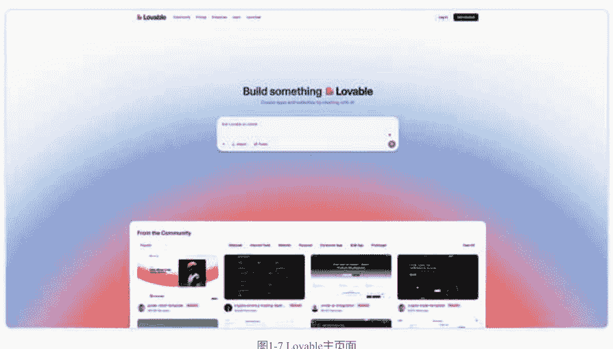

图1-7 Lovable主页面

2. 单击右上角的Get started按钮，按照指引注册一个账户。

3. 注册完成后，回到主页面，直接在输入框中输入一句简单的话，如图1-8所示。

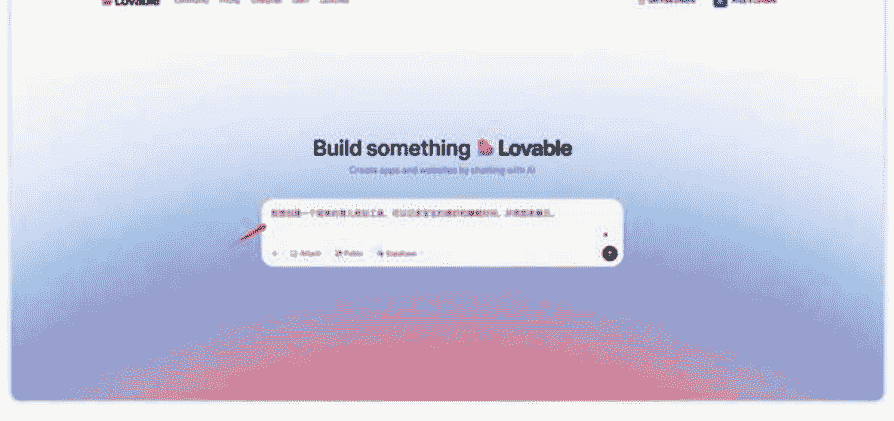

图1-8 在输入框中输入一句话

按下回车键后，屏幕进入实时变化状态——AI理解了你的意图，随后启动应用构建流程。你会看到一个用户界面逐渐成型，上面出现了“喂奶记录”和“睡眠记录”输入框，如图1-9所示。

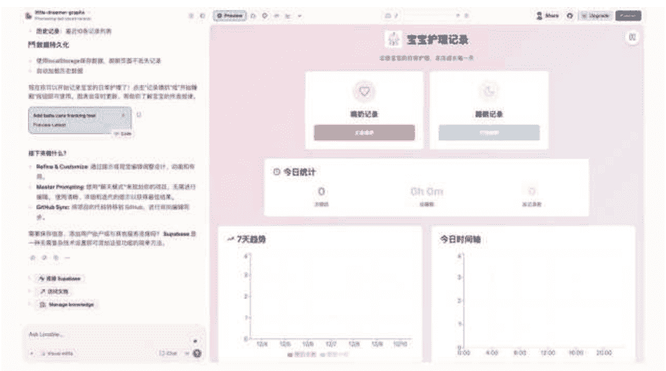

图1-9 Lovable生成的用户界面

一个简单的图表组件也出现在页面下方。这并非一张静态的图片，而是AI在后台同步推进全流程开发的结果：生成真实的前端代码、搭建后端逻辑，并配置好一个简单的数据库来存储数据。整个过程结束后，AI甚至会生成一个可公开访问的网站链接，让你一键分享最终的应用成果（见图1-10）。

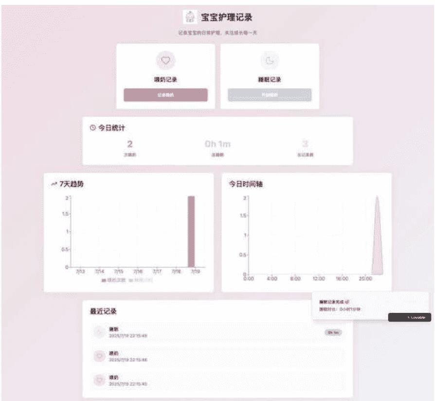

图1-10 Lovable最终生成的应用

在这短短的几分钟内，你所体验到的就是那个点燃信心的决定性时刻——“它能工作！”

你看到的不是模拟的线框图，也不是虚假的效果图，而是一个鲜活、可交互、能实际运行的软件。这种即时且极具冲击力的正反馈，正是传统编程学习曲线中缺失的关键一环。它向你证明了一个颠覆性的事实：“我，一个非技术人员，刚刚亲手创造了一个能工作的软件。创造，原来如此简单。”

#### 1.1.5 小结

让我们回到开篇那个“威利·旺卡”的寓言。那场活动生动展现了当美好的想法与落地执行能力完全脱节时，结局会是多么令人惋惜。

而你，就在刚才的几分钟里，亲身体验了将一个创意迅速转化为现实的过程。你已经成功跨越了那道“想”与“做”的鸿沟。

这或许只是一个简单的原型，功能还很粗糙，界面也不够精致，但这些都不重要。重要的是，你已经迈出了从“梦想家”到“创造者”的第一步，掌握了点燃创造之火的方法。

我们接下来的旅程，将是学习如何更好地驾驭AI这位强大的合作者。你会像一位真正的“导演”，通过精准的对话引导和敏锐的迭代反馈，将手中这颗小小的火种，培育成熊熊燃烧的烈焰，把类似你在1.1.4小节创造的第一款应用打磨成真正能为世界创造价值、独一无二的作品。

真正的创造之旅，才刚刚开始。

### 1.2 独立开发者的思维工具箱

你是否曾经萌生过一个宏伟的想法？可能是一款能改变世界的应用程序、一个能颠覆行业的平台，或是一个绝妙的创意构想。你兴奋地在脑海中勾勒它的每一个细节：流畅的交互动画、数十种实用的功能、完美无瑕的用户界面，甚至提前想好了要在产品发布会上穿什么颜色的T恤。

然而，这个想法却没有走出你的脑海，沦为未竟的遗憾。

只因这个想法太过庞大，太过追求完美，以至于你无从下手。每当试图开始时，那座名为“完美”的大山就压得你喘不过气。最终，这个绝妙的构想和无数未面世的创意一样，静静地留在了你的脑海里。

这就是“要么全部，要么没有”的思维陷阱，不仅新手开发者容易陷入，许多经验丰富的创造者也难逃其扰。我们总想一步到位，直接造出一艘“航空母舰”，却忘了任何伟大的航行，都始于一艘能够顺利下水的“小船”。

在本节中，我们将介绍一套专为独立开发者打造的思维工具箱，这套工具箱特别适配与AI协同工作的Vibe Coder。这套工具箱包含五大核心原则，它们并不是僵化的规则，而是一系列灵活的思维方式，旨在帮助你管理复杂需求、降低创造风险，同时让整个创造过程充满乐趣和可持续性。

#### 1.2.1 原则1：从小处着手

一旦你接受了“从小处着手”（start small）的理念，下一个关键步骤就是为你的“小船”绘制一张航行图，哪怕只是一张简单的草图。

##### 1. 先构建最核心的功能

首先，我们来讨论一个在科技圈广为人知的概念：MVP。它不是指“最有价值球员”（Most Valuable Player），而是“最小可行产品”（Minimum Viable Product）。这一概念由精益创业的先驱埃里克·莱斯（Eric Ries）提出，他给出的定义是：“一个新产品的版本，能让团队以最少的努力，收集到关于客户的最大量的有效认知。”

简单来说，MVP就是产品的最简化版本，它只包含足以解决用户核心痛点的功能，但它必须是“可行”的，也就是能用，能完整呈现核心流程，能让用户获得闭环体验。这里的“最小”不是“差”或“半成品”的代名词，而是“专注”和“智慧”的体现。MVP的核心目标是，在投入大量资金和时间之前，用最低的成本快速验证你的想法是否真的有用户愿意买单，如图1-11所示。


##### 2. 纸杯蛋糕原则

想象一下，你的梦想是开一家享誉世界的蛋糕店。此时，你有下面两个截然不同的选择。

- **婚礼蛋糕模式**：花费一整年时间，投入所有积蓄，闭门造车般地精心研发一款七层高的豪华婚礼蛋糕，蛋糕上装饰着精致的翻糖花朵和珍珠糖霜。你相信，只要它一问世，必定惊艳全场。
- **纸杯蛋糕模式**：用一周时间和有限的预算，专注于打磨一款口味绝佳、外形可爱的纸杯蛋糕。然后推着小餐车，在周末的市集上开始售卖。

婚礼蛋糕模式的风险极高，如果顾客不喜欢你的口味，或者市场上根本就不需要这么奢华的产品，那么你一年的心血和全部投资就可能付诸东流。而纸杯蛋糕模式，就是MVP思想的完美体现。

这个小小的纸杯蛋糕，绝非粗糙的半成品，而是一款完整、美味且能带给人快乐的产品。它能帮助你实现三大核心目标。

- **测试配方（验证想法）**：顾客的即时反应会直接告诉你，你的产品是否真的受欢迎。
- **获得反馈（收集认知）**：他们可能会提议“奶油少点甜味会更好”，或者“希望出巧克力味的蛋糕”，这些真实反馈都是无价的改进方向。
- **开始赚钱（产生价值）**：每一笔销售都是对产品价值的肯定，也能为后续研发提供资金、降低风险。

只有当你的纸杯蛋糕大获成功，证明了烘焙理念的可行性时，你才有足够的信心和资本去挑战更复杂的双层蛋糕，乃至最终那款梦寐以求的七层婚礼蛋糕。

独立开发也是一样：在你投入大量资源建造“婚礼蛋糕”式的完美产品前，先用一款“纸杯蛋糕”式的最小可行产品，验证市场是否真的喜欢你的创意与手艺——这是无数成功产品从想法走向落地的关键第一步。

##### 3. 巨头们的起点

几乎所有你如今熟知的科技巨头，起点往往是一个极其简陋，甚至有些粗糙的MVP。

- **爱彼迎（Airbnb）：从三张气垫床起步**

2007年，旧金山即将举办一场大型设计峰会，当地酒店房间早已预订一空；而此时，爱彼迎的创始人布莱恩·切斯基（Brian Chesky）和乔·戈比亚（Joe Gebbia）正面临一个棘手的问题——他们难以支付自己的房租。他们灵机一动：既然酒店满房，为什么不能把公寓里的空地方租出去？他们没有开发功能完备的预订平台，而是搭建了一个极其简单的网站，上传了几张阁楼里三张气垫床的照片，还承诺为租客提供早餐。他们的这个MVP叫Airbed & Breakfast（气垫床和早餐），这就是Airbnb的前身。结果，他们迎来了三位付费客人——这不仅解决了他们的房租难题，更重要的是验证了一个颠覆性的商业模式：人们愿意为更实惠、更具本土化体验的住宿，住进陌生人的家里。

- **Zappos：“绿野仙踪”式MVP**

1999年，Zappos的创始人尼克·斯威姆（Nick Swinmurn）想验证一个当时看似大胆的想法：人们是否愿意在网上购买无法试穿的鞋子。他没有像传统零售商那样，先投入重金租赁仓库、批量进货，而是采用了堪称“零成本”的验证方式：跑到当地鞋店给鞋子拍照，然后把照片上传到自己的网站上（见图1-12）。一旦有顾客下单，他就立刻返回那家鞋店买下鞋子，打包后寄给顾客。这种模式被称为“绿野仙踪”式MVP（Wizard of Oz MVP）——在用户看来，网站背后似乎有一个强大的自动化系统和庞大的库存，但实际上幕后只有一个像魔法师一样手动处理事务的人。这个聪明的MVP成功证明了人们确实有在线购买鞋子的需求，而Zappos则在几乎零库存风险的情况下，验证了其核心商业模式。


图1-12 Zappos网站

这些故事都在传递一个核心：MVP的核心价值在于“学习”，而非“完美”。你的第一个产品，其首要目的不是营利或惊艳世界，而是回答一个关键问题：“我的这个想法，真的有人在乎吗？”

更重要的是，对于非技术背景的创作者而言，你的第一个MVP甚至可以与代码无关。它可以是一间简陋的出租房（如Airbnb）、一项手动的服务（如Zappos），或是一个用来收集潜在用户邮箱的简单登录页面。从今天起，你完全可以即刻行动验证想法，无须等到掌握所有技术之后。这，正是“从小处着手”的真正力量。

#### 1.2.2 原则2：规划你的构建

在动手之前，先让思路落地。如果说“从小处着手”是在明确“做什么”，那么“规划你的构建”就是在教你“怎么做”。这两个原则相辅相成：前者帮你缩小聚焦范围，后者帮你绘制行动路径。

##### 1. 一份简单的计划，是通往现实的捷径

许多人对创造过程抱有一种浪漫的幻想：一位天才开发者在灵感的驱动下，手指在键盘上飞速舞动，最终一个伟大的产品横空出世。现实并非如此——混乱的灵感或许能催生一些零散的代码片段，但绝不可能构建出稳定、可用且能真正解决问题的产品。通往成功的最快路径，往往是一份清晰简洁的计划。

这里要引入一个专业术语：PRD（Product Requirements Document，产品需求文档）。这个术语听起来可能很正式，但我们提倡一种更轻量、更敏捷的形式——最小可行PRD（Minimal Viable PRD）。

你可以把它视为一张“项目蓝图”。这张蓝图或许只有一页纸，但却能清晰明确三件核心的事情：

- 目标是什么（你要构建的产品具体是什么）；
- 为谁而建（你的目标用户群体是谁）；
- 为何而建（它能解决什么核心问题，能为用户带来什么实际好处）。

这份文档并不是刻板的律法，而是一份“活的文档”，随着项目的推进，你可以随时更新和调整它的内容。它的存在，是为了给你自己以及AI编程伙伴，提供一份清晰一致的行动指引。

##### 2. “最小可行PRD”实践

为了能让你立刻上手，我们准备了一个极其简单的模板，如表1-2所示。在启动任何项目之前，请花一些时间填完这张表——这个梳理的过程本身，就是一次极具价值的战略思考。

表1-2 最小可行PRD模板

| 组件 | 问题指引（你需要回答什么） | 你的答案（示例：“15分钟快手厨房”App） |
| :--- | :--- | :--- |
| 项目名称 | 给你的项目起一个简单明了的名字 | “快手厨房” |
| 项目概述 | 用一两句话说清楚“这是什么，为谁服务，解决什么问题” | “快手厨房”是一款为工作忙碌的年轻父母设计的移动应用，提供15分钟内可完成的健康食谱，解决他们没时间做饭的核心痛点 |
| 目标用户 | 详细描述你的核心用户：他们是谁，生活状态如何，核心痛点是什么 | - 姓名：张丽（32岁）<br>- 职业：市场经理，两个孩子的母亲<br>- 痛点：下班晚，时间紧张，想给家人做健康晚餐，但没有时间和精力研究复杂食谱，不得不经常点外卖 |
| 核心问题 | 你的产品要解决的最关键的一个问题是什么 | 如何让忙碌的父母在15分钟内，用简单的食材做出健康美味的晚餐 |
| 必须具备的功能（MVP） | 列出解决核心问题绝对必需的3~5个功能（记住，是“必需”，不是“最好有”） | - 食谱浏览：支持分类浏览食谱<br>- 食谱详情页：清晰展示食材、步骤和预计耗时<br>- 计时器功能：内置烹饪步骤专属计时器<br>- 搜索功能：可按食材名称搜索食谱 |
| 明确不做什么 | 为保持专注，列出第一个版本坚决不做的功能（对抗“功能蔓延”） | - 用户注册和登录系统<br>- 社区分享和评论功能<br>- 购物清单生成功能<br>- 卡路里计算功能 |
| 成功指标 | 如何判断MVP成功了？为此设定简单可衡量的指标 | 一个月内有1000次下载量，且平均每个用户每周打开应用2次以上 |

花时间完成这份PRD，能帮助独立开发者避开多个常见的陷阱。

### 1.2 独立开发者的思维工具箱

你是否曾经萌生过一个宏伟的想法？可能是一款能改变世界的应用程序、一个能颠覆行业的平台，或是一个绝妙的创意构想。你兴奋地在脑海中勾勒它的每一个细节：流畅的交互动画、数十种实用的功能、完美无瑕的用户界面，甚至提前想好了要在产品发布会上穿什么颜色的T恤。

然而，这个想法却没有走出你的脑海，沦为未竟的遗憾。

只因这个想法太过庞大，太过追求完美，以至于你无从下手。每当试图开始时，那座名为“完美”的大山就压得你喘不过气。最终，这个绝妙的构想和无数未面世的创意一样，静静地留在了你的脑海里。

这就是“要么全部，要么没有”的思维陷阱，不仅新手开发者容易陷入，许多经验丰富的创造者也难逃其扰。我们总想一步到位，直接造出一艘“航空母舰”，却忘了任何伟大的航行，都始于一艘能够顺利下水的“小船”。

在本节中，我们将介绍一套专为独立开发者打造的思维工具箱，这套工具箱特别适配与AI协同工作的Vibe Coder。这套工具箱包含五大核心原则，它们并不是僵化的规则，而是一系列灵活的思维方式，旨在帮助你管理复杂需求、降低创造风险，同时让整个创造过程充满乐趣和可持续性。

#### 1.2.1 原则1：从小处着手

一旦你接受了“从小处着手”（start small）的理念，下一个关键步骤就是为你的“小船”绘制一张航行图，哪怕只是一张简单的草图。

##### 1. 先构建最核心的功能

首先，我们来讨论一个在科技圈广为人知的概念：MVP。它不是指“最有价值球员”（Most Valuable Player），而是“最小可行产品”（Minimum Viable Product）。这一概念由精益创业的先驱埃里克·莱斯（Eric Ries）提出，他给出的定义是：“一个新产品的版本，能让团队以最少的努力，收集到关于客户的最大量的有效认知。”

简单来说，MVP就是产品的最简化版本，它只包含足以解决用户核心痛点的功能，但它必须是“可行”的，也就是能用，能完整呈现核心流程，能让用户获得闭环体验。这里的“最小”不是“差”或“半成品”的代名词，而是“专注”和“智慧”的体现。MVP的核心目标是，在投入大量资金和时间之前，用最低的成本快速验证你的想法是否真的有用户愿意买单，如图1-11所示。


##### 2. 纸杯蛋糕原则

想象一下，你的梦想是开一家享誉世界的蛋糕店。此时，你有下面两个截然不同的选择。

- **婚礼蛋糕模式**：花费一整年时间，投入所有积蓄，闭门造车般地精心研发一款七层高的豪华婚礼蛋糕，蛋糕上装饰着精致的翻糖花朵和珍珠糖霜。你相信，只要它一问世，必定惊艳全场。
- **纸杯蛋糕模式**：用一周时间和有限的预算，专注于打磨一款口味绝佳、外形可爱的纸杯蛋糕。然后推着小餐车，在周末的市集上开始售卖。

婚礼蛋糕模式的风险极高，如果顾客不喜欢你的口味，或者市场上根本就不需要这么奢华的产品，那么你一年的心血和全部投资就可能付诸东流。而纸杯蛋糕模式，就是MVP思想的完美体现。

这个小小的纸杯蛋糕，绝非粗糙的半成品，而是一款完整、美味且能带给人快乐的产品。它能帮助你实现三大核心目标。

- **“为谁服务”**：避免开发“人人可用，却无人想用”的泛化产品。
- **“核心问题”**：确保你的产品具备明确的存在价值，不做无用功。
- **“必须具备的功能”**：精确定义MVP范围，抵御“功能越多越好”的诱惑。
- **“明确不做什么”**：像一道防火墙，防止精力和时间浪费在次要功能上。
- **“成功指标”**：让你从一开始就聚焦价值衡量，而不是凭感觉推进。

这份计划，是你与未来自己的对话，锁定了你最初、最核心的决策。更重要的是，在AI时代，这份PRD是你与AI伙伴沟通的基石。如果你向AI编程工具下达模糊的指令，比如“帮我写个食谱应用”，得到的结果也必然空洞浮泛，难以直接落地；而基于PRD的清晰提示，比如，“为‘快手厨房’App创建一个食谱详情页面：目标用户是时间紧张的父母，界面需要极其简洁，必须包含三个部分——一张大图、固定格式的食材列表（含名称和用量），以及带编号的烹饪步骤，暂不添加评论区和分享按钮”，这可以引导AI生成精准、高质量、符合你构想的代码。

#### 1.2.2 原则2：规划你的构建

有了地图，就该踏上征程——但别奢望一口气抵达终点。你已经通过原则1确定了要攀登的小山，通过原则2绘制了清晰的登山路线图。现在，你需要掌握正确的攀登节奏：如何稳健、持续地向前推进，而不是在半山腰就精疲力竭。这正是原则3要解决的核心问题。

#### 1.2.3 原则3：迭代，而非堆砌

一旦有了清晰的计划，就进入了实际的构建阶段。这里要引入第三个核心原则：迭代，而非堆砌（Pile On）。

迭代，意味着将整个开发过程拆分为一系列微小、可控的循环：构建一小部分功能，测试验证，优化完善，然后进入下一个循环。这与“堆砌”模式截然不同——后者试图一次性搭建所有功能，直到最后才发现地基早已倾斜，返工成本极高。

为了更好地践行迭代理念，可以遵循一个简单的“三不”原则。

- **不一次构建多个功能**：集中全部精力，一次只攻克一个功能点，确保做深做透。
- **不一次修复多个问题**：发现bug后逐个击破，避免同时处理多个bug导致混乱或遗漏。
- **不跳跃开发步骤**：严格遵循“构建-测试-修复”的微循环，不要因为赶进度而省略测试环节，避免小问题积累成大隐患。

##### 2. 敏捷的厨师

让我们再次回到厨房。一个优秀厨师的工作流程，天生就是迭代式的。他绝不会把所有食材一股脑地扔进锅里，然后祈祷半小时后能变出美味佳肴。他的工作流程如图1-13所示。

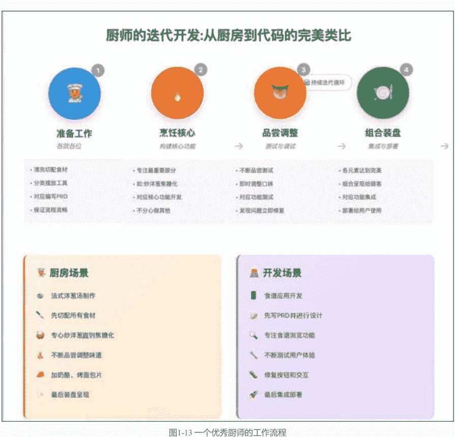

图1-13 一个优秀厨师的工作流程

1. **准备工作**（各就各位）：这是迭代的“第0步”，对应着你的PRD。厨师会将所有食材清洗切配好，分门别类地装入小碗，工具也摆放得井井有条，为后续烹饪的流畅性打下基础。
2. **烹饪核心**（构建核心功能）：他会先专注于菜品的核心部分。比如做法式洋葱汤，会先花大量时间专心炒洋葱，直到达到完美的焦糖化状态，此时他绝不会分心去烤面包或者准备沙拉。这就像你集中精力构建应用的第一个核心功能，比如“食谱浏览”页面。
3. **品尝调整**（测试与调试）：在烹饪的每一步，厨师都会反复品尝。汤底熬好尝一口，如果盐不够就补一点，汤汁偏腻就挤几滴柠檬汁。每一次品尝都是一次微小的测试，每一次调整都是一次快速的调试——这与你完成一个功能后立刻上手试用，检查是否有bug、流程是否顺畅，完全是同一个道理。
4. **组合装盘**（集成与部署）：只有当汤底、奶酪、面包片等单一食材都各自达到理想状态时，厨师才会将它们组合，完成最终装盘并呈现给顾客。同样，你也应该在确保每个小功能独立运行正常后，再将它们集成到整个应用中。

这种迭代式的烹饪方法，确保了最终菜品的每一个组成部分都是高质量的。软件开发也是如此——通过“一次只做一件事”的迭代循环，主动地将质量注入项目的每一个细节。

这种做法与传统的“瀑布式”开发形成了鲜明对比。瀑布式开发就像建房子，过程是线性且不可逆的。如果在封顶之后才发现地基有严重缺陷，修复成本极高。而迭代开发更像照料花园，先种下一小片花，观察生长情况再随时调整。软件本就是需要不断演进的“花园”，迭代正是照料它的最佳方式。

遵循迭代原则，能为你带来巨大的好处。

- **降低认知负荷**：大脑只需要专注于一个微小、明确的任务。
- **快速获得成就感**：每完成一个小循环，都能看到实实在在的进展，这对于保持动力至关重要。
- **让问题隔离**：如果应用出错，几乎可以立刻确定问题出在刚刚完成的小功能上。

因此，像耐心的厨师或园丁那样，专注于手头的下一件小事并做到最好，才是通往伟大产品最稳健也最快的路。

#### 1.2.4 原则4：测试一切

当你通过测试保障了当前功能的质量后，还需要用可靠的方法安全地保存你的劳动成果，为下一步的探索提供保障。这就引出了我们的第4个核心原则。

##### 1. 植入质量保证思维

现在，你的第一个小功能已经按照迭代原则构建好了。接下来该做什么？许多新手会迫不及待地开发下一个功能。但此时必须明确第4个至关重要的原则：测试一切（test everything）。

质量保证（Quality Assurance, QA）不是项目开发末端的收尾环节，而是从开发第一天起就应该融入你思维的模式。你的目标不是“证明”应用能正常运行，而是要做一个充满好奇心的“破坏者”，主动尝试突破功能边界，赶在用户发现那些令人沮丧的漏洞前，将它们找出来。

##### 2. 友好的侦探

如何培养这种QA思维？最好的方式就是把自己当成一名侦探。一个好侦探从不会轻易相信表面现象，而是始终带着质疑态度，对每个细节刨根问底。当你面对刚写好的功能时，不妨戴上“侦探帽”，逐一审问它。

- “这个按钮真的能用吗？”（点击验证，确认是否跳转至目标页面。）
- “在什么情况下它会失灵？”（这是对“边缘案例”的挖掘。）
- “用户会有哪些意外操作？”（除了预设的常规流程，还有哪些潜在的使用路径。）

这种侦探式思维，能帮你从一个带有主观偏见的“创造者”，转变为客观严谨的“评估者”。创造者总是希望自己的作品是完美的，而侦探则致力于挖掘功能的真实状况。

##### 3. 非技术人员的侦探手册

你可能会疑惑：“我不是技术专家，怎么知道如何测试？”好消息是，很多有价值的测试方法，根本不需要任何技术背景，它们需要的是好奇心、同理心和一点“捣蛋”精神。

以下是一些你可以立刻上手的“侦探技术”。

- **用户测试**：找一位对你的项目完全不了解、也不太懂技术的朋友或家人。把应用交给他们，然后不说话默默观察。不要给任何提示，不要解释任何功能。他们卡在哪里？哪个按钮让他们困惑？他们脸上的迷茫，就是指向你设计缺陷的信号灯。他们能毫不费力地完成任务，才是真正的“用户友好”。
- **边界值分析**：这个术语听起来很专业，但核心概念非常简单。如果你的应用有输入框，就一定会有“预期”输入范围，你的任务就是试探这个范围的边界及之外的情况。
    - **示例**：年龄输入框要求输入18～99之间的数字。
    - **测试边界**：输入18和99，验证是否正常响应。
    - **测试边界外**：输入17和100，看应用是给出合理的错误提示，还是直接崩溃。
    - **测试极端值**：分别输入0、-1、999，看应用的反馈。
    - **测试错误类型**：输入“二十”、表情符号，或者什么都不输入，直接单击“确定”。
- **压力测试**：假装自己是存心捣乱的用户，做一些“出格”的事情。
    - 在名字输入框中粘贴一篇三千字的小说。
    - 快速连续地点击同一个按钮100次。
    - 在没有网络连接的情况下打开应用，看会发生什么。
    - 反复切换手机的横屏和竖屏模式，检查界面是否错乱。

这些测试的核心，是挑战你作为开发者时所做的那些“理所当然”的假设。一个好的产品，必须能够优雅地处理预料之外的情况。记住，每一次成功“搞垮”自己的应用，都不是一次失败，而是胜利——你发现了潜在的问题，并且能在它影响真实用户之前将其解决。成为自己产品的第一位也是最挑剔的用户，这正是QA思维的精髓。

#### 1.2.5 原则5：使用版本控制

当功能通过测试、质量得到确认后，下一步就是给它上一道“保险”——让每一次改动都能被记录、回滚。于是，我们迎来本节最后一位主角：版本控制。

##### 1. 项目的终极“后悔药”

版本控制是独立开发者的核心利器，我们将要介绍的版本控制工具名为Git，以及它的在线家园GitHub。

简单来说，Git是一个安装在本地的系统，它像严谨的档案管理员，仔细记录项目文件的每一次修改；而GitHub是一个网站，如同安全的云端保险柜，能妥善存放你的项目及完整修改历史。

从项目启动的第一天起，养成使用版本控制的习惯至关重要。下面我们使用一个通俗易懂的概念帮你理解它的价值。

##### 2. 电子游戏的存档点

不妨把你的整个开发项目比作一款大型角色扮演游戏。你作为游戏的主角，负责推进项目的进展，如图1-14所示。

- **代码仓库（Repository）**：对应游戏的完整文件，囊括这个世界里的所有内容。
- **提交（Commit）**：这是游戏中最关键的操作——存档。每当完成了一个小任务时（比如修复了一个bug，增加了一个小功能），都要立即“提交”一次。这相当于在当前位置创建了一个“存档点”。这个存档点会完整记录当时项目的全部状态，并附有备注（比如“修复了登录按钮的bug”）。
- **分支（Branch）**：相当于游戏中的“新建独立存档位”。比如要挑战一个危险的Boss，或者尝试可能影响主线的支线任务时，聪明的做法是基于当前进度，新建一个独立的存档文件去挑战。
    - 如果挑战成功，好比收获了传说中的宝剑，就可以通过“合并”（Merge），将这个存档融入主存档，带着成果（宝剑）推进主线任务。
    - 如果挑战失败，哪怕存档出现问题都不要紧，因为你的主存档（Git中称为main分支）安然无恙，仍然停留在挑战前的安全状态。你只需要删掉失败的“挑战存档”，然后读回主存档即可恢复正常。


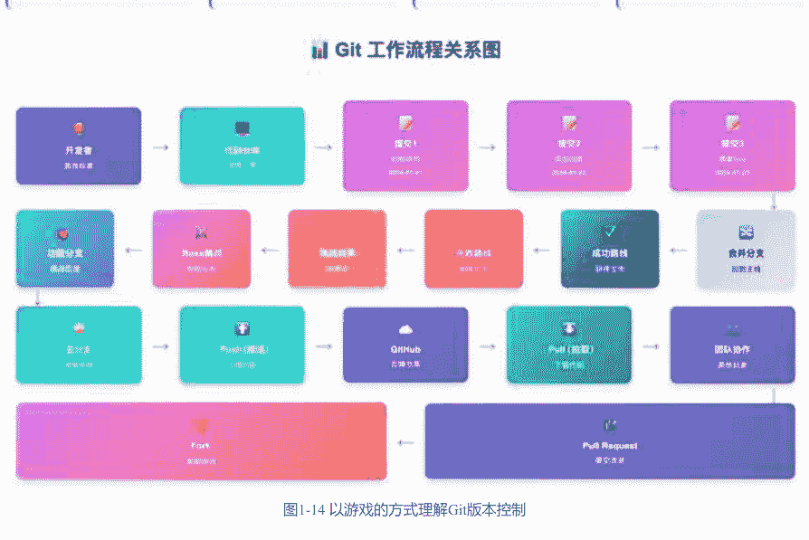

图1-14 以游戏的方式理解Git版本控制

- **GitHub（云存档）**：现在，假设你的电脑坏了，本地存档全部丢失，你数月的心血付之一炬。而GitHub就是你的终极“云存档”——本地“存档”（Commit）后，可以通过一个叫“推送”（Push）的动作，把最新的存档同步到GitHub网站上。因此，即使你的电脑出现问题，只需换一台新电脑登录GitHub，就可以完整找回整个项目和它所有的历史存档。

对于独立开发者来说，版本控制的核心价值在于提供了一种心理上的安全感，从而释放创造自由。

很多开发者会顾虑“我如果把这里改了，会不会搞砸整个项目”，这种担忧扼杀了许多创造力。Git能彻底消除这种恐惧：当想尝试大胆的新功能时，只需从main分支新建分支作为“支线任务存档”。在这个新分支上，你可以放心大胆地实验、试错，完全不用担心会影响到那个稳定、可用的主版本。

如果你的实验成功了，就把它合并回主线。如果失败了，就直接删掉这个分支，几乎没有试错成本。这种“安全网”能鼓励你大胆冒险、迭代，它从不是一个烦琐的工具，而是独立开发者敢于创新的底气与许可证。

#### 1.2.6 建立你的“思考-提示-迭代”循环

你已手握五把钥匙，现在是时候理解它们的深层价值了。前面我们逐一拆解了五大核心原则——从小处着手、规划你的构建、迭代，而非堆砌、测试一切和使用版本控制。但你可能会疑惑：这些原则看起来如此“传统”，为什么在AI时代反而变得愈发重要？

答案就藏在Vibe Coding这个看似轻松的名字背后。

##### AI越不可预测，流程就必须越严谨

Vibe Coding描述的是一种与AI编程工具协同工作的状态：你不再逐行编写代码，而是更像一位乐队指挥，向才华横溢却时而即兴发挥的AI音乐家描述想要的“感觉”或“氛围”，然后由它来演奏出代码的旋律。

这种工作方式充满了自由和创造的快感，效率也高得惊人。但是，这种自由的背后隐藏着风险：你的AI伙伴虽然知识渊博，但本质上是复杂的模式匹配机器，并未真正“理解”世界。它会“犯错”，会“一本正经地胡说八道”——这在AI领域称为“幻觉”（hallucination）。

为了让你明白这种“幻觉”有多么真实和普遍，我们来看几个近期的案例，它们既滑稽又发人深省。

- **过于听话的汽车销售员：** 一家雪佛兰汽车经销商的客服聊天机器人，被一位善于引导的用户通过巧妙提问“调教”后，同意以1美元的价格出售一辆全新的雪佛兰Tahoe SUV，还声明这是“具有法律约束力的报价”。
    - 启示1：你的AI可能完全不理解商业逻辑和常识。
- **凭空捏造的律师：** 加拿大航空公司的客服机器人，曾自信地向一位顾客承诺了一项公司根本不存在的退款政策。这位顾客信以为真，事后将加航告上法庭，最终法庭裁定，航空公司必须为自己机器人的“谎言”埋单。
    - 启示2：你的AI会以绝对的自信，陈述完全虚假的事实。
- **荒谬绝伦的厨师：** 当用户在谷歌的AI Overviews功能中搜索“如何防止比萨上的奶酪滑落”时，AI给出的建议是混入无毒胶水。
    - 启示3：你的AI生成的建议，可能语法完美，但内容却危险且离谱。
- **带有偏见的艺术家：** 谷歌的Gemini AI在生成历史人物图像时，出现了不符合史实的情况。更早的微软Tay聊天机器人，在与网友互动后，迅速学会并发表了大量不当言论。
    - 启示4：你的AI并非客观中立，它会继承并放大其训练数据中存在的偏见。

这些层出不穷的AI“翻车”事件指向一个共同的结论：大语言模型是我们这个时代最强大的创造力放大器，但它们从根本上也是不可靠的。

#### 1.2.7 小结

现在请思考一个问题：当你团队里最核心的成员，是一个时而天才、时而犯错的“实习生”时，你作为项目唯一的负责人，能和他一样随性吗？

答案显然是否定的。你的工具越自由奔放、不可预测，你作为驾驭者，流程就必须越是严谨、越有纪律。这正是本节介绍的五大原则的价值所在。它们共同构成了一个强大的框架，让你能够安全、高效地驾驭AI的力量。

- **从小处着手（原则1）**，是因为需要先在一个小而可控的问题上测试AI的输出质量，而不是让它直接生成庞大且充满未知错误的应用。
- **规划你的构建（原则2）**，是因为你需要一张清晰的“蓝图”（PRD），给AI提供精准的指令，并以此为标准判断它的产出是否符合预期。
- **迭代，而非堆砌（原则3）**，是因为你需要小批量审查AI的工作成果，绝不能等到它生成了整个应用后，才发现它从第一步就误解了你的意图。
- **测试一切（原则4）**，是因为永远不能盲目信任AI的输出。你必须扮演多疑的侦探，验证它的每一个“陈述”，戳穿它的每一个“幻觉”。
- **使用版本控制（原则5）**，是因为AI可能在某次“灵感迸发”时，生成一段彻底毁掉项目的代码。你需要一个能一键“读档”的“游戏存档点”，让你能瞬间回到它“犯错”之前的稳定版本。

这五大原则，并非是束缚创造力的枷锁。恰恰相反，它们是在你通往成功的崎岖山路上，为你安装的坚固护栏。正因为有了这些护栏，你才敢于大胆前行、加速冲刺，最终安全抵达梦想的目的地，创造出真正属于你的了不起的作品。

## 3.巨头们的起点

几乎所有你如今熟知的科技巨头，起点往往是一个极其简陋，甚至有些粗糙的MVP。

- **爱彼迎（Airbnb）：从三张气垫床起步**

2007年，旧金山即将举办一场大型设计峰会，当地酒店房间早已预订一空；而此时，爱彼迎的创始人布莱恩·切斯基（Brian Chesky）和乔·戈比亚（Joe Gebbia）正面临一个棘手的问题——他们难以支付自己的房租。他们灵机一动：既然酒店满房，为什么不能把公寓里的空地方租出去？他们没有开发功能完备的预订平台，而是搭建了一个极其简单的网站，上传了几张阁楼里三张气垫床的照片，还承诺为租客提供早餐。他们的这个MVP叫Airbed & Breakfast（气垫床和早餐），这就是Airbnb的前身。结果，他们迎来了三位付费客人——这不仅解决了他们的房租难题，更重要的是验证了一个颠覆性的商业模式：人们愿意为更实惠、更具本土化体验的住宿，住进陌生人的家里。

- **Zappos：“绿野仙踪”式MVP**

1999年，Zappos的创始人尼克·斯威姆（Nick Swinmurn）想验证一个当时看似大胆的想法：人们是否愿意在网上购买无法试穿的鞋子。他没有像传统零售商那样，先投入重金租赁仓库、批量进货，而是采用了堪称“零成本”的验证方式：跑到当地鞋店给鞋子拍照，然后把照片上传到自己的网站上（见图1-12）。一旦有顾客下单，他就立刻返回那家鞋店买下鞋子，打包后寄给顾客。这种模式被称为“绿野仙踪”式MVP（Wizard of Oz MVP）——在用户看来，网站背后似乎有一个强大的自动化系统和庞大的库存，但实际上幕后只有一个像魔法师一样手动处理事务的人。这个聪明的MVP成功证明了人们确实有在线购买鞋子的需求，而Zappos则在几乎零库存风险的情况下，验证了其核心商业模式。


图1-12 Zappos网站

这些故事都在传递一个核心：MVP的核心价值在于“学习”，而非“完美”。你的第一个产品，其首要目的不是营利或惊艳世界，而是回答一个关键问题：“我的这个想法，真的有人在乎吗？”

更重要的是，对于非技术背景的创作者而言，你的第一个MVP甚至可以与代码无关。它可以是一间简陋的出租房（如Airbnb）、一项手动的服务（如Zappos），或是一个用来收集潜在用户邮箱的简单登录页面。从今天起，你完全可以即刻行动验证想法，无须等到掌握所有技术之后。这，正是“从小处着手”的真正力量。

#### 1.2.2 原则2：规划你的构建

在动手之前，先让思路落地。如果说“从小处着手”是在明确“做什么”，那么“规划你的构建”就是在教你“怎么做”。这两个原则相辅相成：前者帮你缩小聚焦范围，后者帮你绘制行动路径。

### 1.一份简单的计划，是通往现实的捷径

许多人对创造过程抱有一种浪漫的幻想：一位天才开发者在灵感的驱动下，手指在键盘上飞速舞动，最终一个伟大的产品横空出世。现实并非如此——混乱的灵感或许能催生一些零散的代码片段，但绝不可能构建出稳定、可用且能真正解决问题的产品。通往成功的最快路径，往往是一份清晰简洁的计划。

这里要引入一个专业术语：PRD（Product Requirements Document，产品需求文档）。这个术语听起来可能很正式，但我们提倡一种更轻量、更敏捷的形式——最小可行PRD（Minimal Viable PRD）。

你可以把它视为一张“项目蓝图”。这张蓝图或许只有一页纸，但却能清晰明确三件核心的事情：

- 目标是什么（你要构建的产品具体是什么）；
- 为谁而建（你的目标用户群体是谁）；
- 为何而建（它能解决什么核心问题，能为用户带来什么实际好处）。

这份文档并不是刻板的律法，而是一份“活的文档”，随着项目的推进，你可以随时更新和调整它的内容。它的存在，是为了给你自己以及AI编程伙伴，提供一份清晰一致的行动指引。

### 2.“最小可行PRD”实践

为了能让你立刻上手，我们准备了一个极其简单的模板，如表1-2所示。在启动任何项目之前，请花一些时间填完这张表——这个梳理的过程本身，就是一次极具价值的战略思考。

表1-2 最小可行PRD模板

| 组件 | 问题指引（你需要回答什么） | 你的答案（示例：“15分钟快手厨房”App） |
| :--- | :--- | :--- |
| 项目名称 | 给你的项目起一个简单明了的名字 | “快手厨房” |
| 项目概述 | 用一两句话说清楚“这是什么，为谁服务，解决什么问题” | “快手厨房”是一款为工作忙碌的年轻父母设计的移动应用，提供15分钟内可完成的健康食谱，解决他们没时间做饭的核心痛点 |
| 目标用户 | 详细描述你的核心用户：他们是谁，生活状态如何，核心痛点是什么 | · 姓名：张丽（32岁）<br>· 职业：市场经理，两个孩子的母亲<br>· 痛点：下班晚，时间紧张，想给家人做健康晚餐，但没有时间和精力研究复杂食谱，不得不经常点外卖 |
| 核心问题 | 你的产品要解决的最关键的一个问题是什么 | 如何让忙碌的父母在15分钟内，用简单的食材做出健康美味的晚餐 |
| 必须具备的功能（MVP） | 列出解决核心问题绝对必需的3~5个功能（记住，是“必需”，不是“最好有”） | · 食谱浏览：支持分类浏览食谱<br>· 食谱详情页：清晰展示食材、步骤和预计耗时<br>· 计时器功能：内置烹饪步骤专属计时器<br>· 搜索功能：可按食材名称搜索食谱 |
| 明确不做什么 | 为保持专注，列出第一个版本坚决不做的功能（对抗“功能蔓延”） | · 用户注册和登录系统<br>· 社区分享和评论功能<br>· 购物清单生成功能<br>· 卡路里计算功能 |
| 成功指标 | 如何判断MVP成功了？为此设定简单可衡量的指标 | 一个月内有1000次下载量，且平均每个用户每周打开应用2次以上 |

花时间完成这份PRD，能帮助独立开发者避开多个常见的陷阱。

- **“为谁服务”**：避免开发“人人可用，却无人想用”的泛化产品。
- **“核心问题”**：确保你的产品具备明确的存在价值，不做无用功。
- **“必须具备的功能”**：精确定义MVP范围，抵御“功能越多越好”的诱惑。
- **“明确不做什么”**：像一道防火墙，防止精力和时间浪费在次要功能上。
- **“成功指标”**：让你从一开始就聚焦价值衡量，而不是凭感觉推进。

这份计划，是你与未来自己的对话，锁定了你最初、最核心的决策。更重要的是，在AI时代，这份PRD是你与AI伙伴沟通的基石。如果你向AI编程工具下达模糊的指令，比如“帮我写个食谱应用”，得到的结果也必然空洞浮泛，难以直接落地；而基于PRD的清晰提示，比如，“为‘快手厨房’App创建一个食谱详情页面：目标用户是时间紧张的父母，界面需要极其简洁，必须包含三个部分——一张大图、固定格式的食材列表（含名称和用量），以及带编号的烹饪步骤，暂不添加评论区和分享按钮”，这可以引导AI生成精准、高质量、符合你构想的代码。

#### 1.2.3 原则3：迭代，而非堆砌

有了地图，就该踏上征程——但别奢望一口气抵达终点。你已经通过原则1确定了要攀登的小山，通过原则2绘制了清晰的登山路线图。现在，你需要掌握正确的攀登节奏：如何稳健、持续地向前推进，而不是在半山腰就精疲力竭。这正是原则3要解决的核心问题。

### 1.迭代的原则

一旦有了清晰的计划，就进入了实际的构建阶段。这里要引入第三个核心原则：迭代，而非堆砌（Pile On）。

迭代，意味着将整个开发过程拆分为一系列微小、可控的循环：构建一小部分功能，测试验证，优化完善，然后进入下一个循环。这与“堆砌”模式截然不同——后者试图一次性搭建所有功能，直到最后才发现地基早已倾斜，返工成本极高。

为了更好地践行迭代理念，可以遵循一个简单的“三不”原则。

- **不一次构建多个功能**：集中全部精力，一次只攻克一个功能点，确保做深做透。
- **不一次修复多个问题**：发现bug后逐个击破，避免同时处理多个bug导致混乱或遗漏。
- **不跳跃开发步骤**：严格遵循“构建-测试-修复”的微循环，不要因为赶进度而省略测试环节，避免小问题积累成大隐患。

### 2.敏捷的厨师

让我们再次回到厨房。一个优秀厨师的工作流程，天生就是迭代式的。他绝不会把所有食材一股脑地扔进锅里，然后祈祷半小时后能变出美味佳肴。他的工作流程如图1-13所示。


图1-13 一个优秀厨师的工作流程

1. **准备工作**（各就各位）：这是迭代的“第0步”，对应着你的PRD。厨师会将所有食材清洗切配好，分门别类地装入小碗，工具也摆放得井井有条，为后续烹饪的流畅性打下基础。

2. **烹饪核心**（构建核心功能）：他会先专注于菜品的核心部分。比如做法式洋葱汤，会先花大量时间专心炒洋葱，直到达到完美的焦糖化状态，此时他绝不会分心去烤面包或者准备沙拉。这就像你集中精力构建应用的第一个核心功能，比如“食谱浏览”页面。

3. **品尝调整**（测试与调试）：在烹饪的每一步，厨师都会反复品尝。汤底熬好尝一口，如果盐不够就补一点，汤汁偏腻就挤几滴柠檬汁。每一次品尝都是一次微小的测试，每一次调整都是一次快速的调试——这与你完成一个功能后立刻上手试用，检查是否有bug、流程是否顺畅，完全是同一个道理。

4. **组合装盘**（集成与部署）：只有当汤底、奶酪、面包片等单一食材都各自达到理想状态时，厨师才会将它们组合，完成最终装盘并呈现给顾客。同样，你也应该在确保每个小功能独立运行正常后，再将它们集成到整个应用中。

这种迭代式的烹饪方法，确保了最终菜品的每一个组成部分都是高质量的。软件开发也是如此——通过“一次只做一件事”的迭代循环，主动地将质量注入项目的每一个细节。

这种做法与传统的“瀑布式”开发形成了鲜明对比。瀑布式开发就像建房子，过程是线性且不可逆的。如果在封顶之后才发现地基有严重缺陷，修复成本极高。而迭代开发更像照料花园，先种下一小片花，观察生长情况再随时调整。软件本就是需要不断演进的“花园”，迭代正是照料它的最佳方式。

遵循迭代原则，能为你带来巨大的好处。

- **降低认知负荷**：大脑只需要专注于一个微小、明确的任务。
- **快速获得成就感**：每完成一个小循环，都能看到实实在在的进展，这对于保持动力至关重要。
- **让问题隔离**：如果应用出错，几乎可以立刻确定问题出在刚刚完成的小功能上。

因此，像耐心的厨师或园丁那样，专注于手头的下一件小事并做到最好，才是通往伟大产品最稳健也最快的路。

#### 1.2.4 原则4：测试一切

当你通过测试保障了当前功能的质量后，还需要用可靠的方法安全地保存你的劳动成果，为下一步的探索提供保障。这就引出了我们的第4个核心原则。

### 1.植入质量保证思维

现在，你的第一个小功能已经按照迭代原则构建好了。接下来该做什么？许多新手会迫不及待地开发下一个功能。但此时必须明确第4个至关重要的原则：测试一切（test everything）。

质量保证（Quality Assurance, QA）不是项目开发末端的收尾环节，而是从开发第一天起就应该融入你思维的模式。你的目标不是“证明”应用能正常运行，而是要做一个充满好奇心的“破坏者”，主动尝试突破功能边界，赶在用户发现那些令人沮丧的漏洞前，将它们找出来。

### 2.友好的侦探

如何培养这种QA思维？最好的方式就是把自己当成一名侦探。一个好侦探从不会轻易相信表面现象，而是始终带着质疑态度，对每个细节刨根问底。当你面对刚写好的功能时，不妨戴上“侦探帽”，逐一审问它。

- “这个按钮真的能用吗？”（点击验证，确认是否跳转至目标页面。）
- “在什么情况下它会失灵？”（这是对“边缘案例”的挖掘。）
- “用户会有哪些意外操作？”（除了预设的常规流程，还有哪些潜在的使用路径。）

这种侦探式思维，能帮你从一个带有主观偏见的“创造者”，转变为客观严谨的“评估者”。创造者总是希望自己的作品是完美的，而侦探则致力于挖掘功能的真实状况。

### 3.非技术人员的侦探手册

你可能会疑惑：“我不是技术专家，怎么知道如何测试？”好消息是，很多有价值的测试方法，根本不需要任何技术背景，它们需要的是好奇心、同理心和一点“捣蛋”精神。

以下是一些你可以立刻上手的“侦探技术”。

- **用户测试：** 找一位对你的项目完全不了解、也不太懂技术的朋友或家人。把应用交给他们，然后不说话默默观察。不要给任何提示，不要解释任何功能。他们卡在哪里？哪个按钮让他们困惑？他们脸上的迷茫，就是指向你设计缺陷的信号灯。他们能毫不费力地完成任务，才是真正的“用户友好”。
- **边界值分析：** 这个术语听起来很专业，但核心概念非常简单。如果你的应用有输入框，就一定会有“预期”输入范围，你的任务就是试探这个范围的边界及之外的情况。
    - **示例：** 年龄输入框要求输入18～99之间的数字。
    - **测试边界：** 输入18和99，验证是否正常响应。
    - **测试边界外：** 输入17和100，看应用是给出合理的错误提示，还是直接崩溃。
    - **测试极端值：** 分别输入0、-1、999，看应用的反馈。
    - **测试错误类型：** 输入“二十”、表情符号，或者什么都不输入，直接单击“确定”。
- **压力测试：** 假装自己是存心捣乱的用户，做一些“出格”的事情。
    - 在名字输入框中粘贴一篇三千字的小说。
    - 快速连续地点击同一个按钮100次。
    - 在没有网络连接的情况下打开应用，看会发生什么。
    - 反复切换手机的横屏和竖屏模式，检查界面是否错乱。

这些测试的核心，是挑战你作为开发者时所做的那些“理所当然”的假设。一个好的产品，必须能够优雅地处理预料之外的情况。记住，每一次成功“搞垮”自己的应用，都不是一次失败，而是胜利——你发现了潜在的问题，并且能在它影响真实用户之前将其解决。成为自己产品的第一位也是最挑剔的用户，这正是QA思维的精髓。

#### 1.2.5 原则5：使用版本控制

当功能通过测试、质量得到确认后，下一步就是给它上一道“保险”——让每一次改动都能被记录、回滚。于是，我们迎来本节最后一位主角：版本控制。

### 1.项目的终极“后悔药”

版本控制是独立开发者的核心利器，我们将要介绍的版本控制工具名为Git，以及它的在线家园GitHub。

简单来说，Git是一个安装在本地的系统，它像严谨的档案管理员，仔细记录项目文件的每一次修改；而GitHub是一个网站，如同安全的云端保险柜，能妥善存放你的项目及完整修改历史。

从项目启动的第一天起，养成使用版本控制的习惯至关重要。下面我们使用一个通俗易懂的概念帮你理解它的价值。

### 2.电子游戏的存档点

不妨把你的整个开发项目比作一款大型角色扮演游戏。你作为游戏的主角，负责推进项目的进展，如图1-14所示。

- **代码仓库（Repository）**：对应游戏的完整文件，囊括这个世界里的所有内容。
- **提交（Commit）**：这是游戏中最关键的操作——存档。每当完成了一个小任务时（比如修复了一个bug，增加了一个小功能），都要立即“提交”一次。这相当于在当前位置创建了一个“存档点”。这个存档点会完整记录当时项目的全部状态，并附有备注（比如“修复了登录按钮的bug”）。
- **分支（Branch）**：相当于游戏中的“新建独立存档位”。比如要挑战一个危险的Boss，或者尝试可能影响主线的支线任务时，聪明的做法是基于当前进度，新建一个独立的存档文件去挑战。
    - 如果挑战成功，好比收获了传说中的宝剑，就可以通过“合并”（Merge），将这个存档融入主存档，带着成果（宝剑）推进主线任务。
    - 如果挑战失败，哪怕存档出现问题都不要紧，因为你的主存档（Git中称为main分支）安然无恙，仍然停留在挑战前的安全状态。你只需要删掉失败的“挑战存档”，然后读回主存档即可恢复正常。


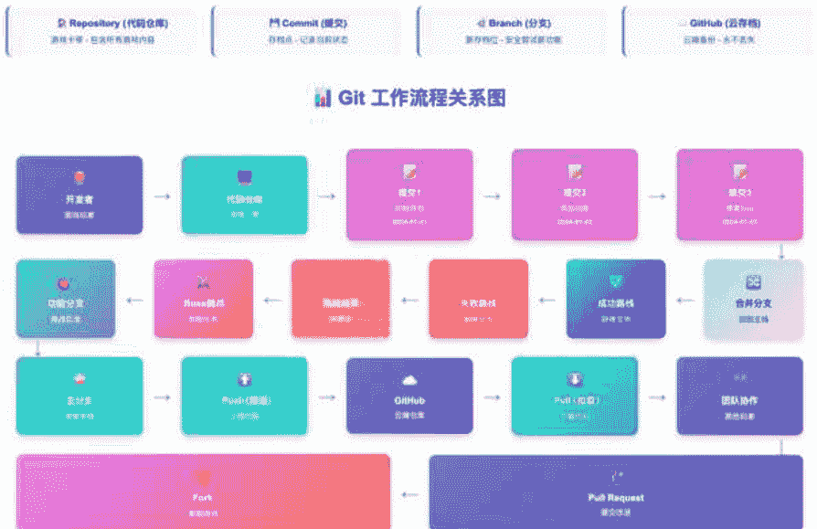

图1-14 以游戏的方式理解Git版本控制

- **GitHub（云存档）**：现在，假设你的电脑坏了，本地存档全部丢失，你数月的心血付之一炬。而GitHub就是你的终极“云存档”——本地“存档”（Commit）后，可以通过一个叫“推送”（Push）的动作，把最新的存档同步到GitHub网站上。因此，即使你的电脑出现问题，只需换一台新电脑登录GitHub，就可以完整找回整个项目和它所有的历史存档。

对于独立开发者来说，版本控制的核心价值在于提供了一种心理上的安全感，从而释放创造自由。

很多开发者会顾虑“我如果把这里改了，会不会搞砸整个项目”，这种担忧扼杀了许多创造力。Git能彻底消除这种恐惧：当想尝试大胆的新功能时，只需从main分支新建分支作为“支线任务存档”。在这个新分支上，你可以放心大胆地实验、试错，完全不用担心会影响到那个稳定、可用的主版本。

如果你的实验成功了，就把它合并回主线。如果失败了，就直接删掉这个分支，几乎没有试错成本。这种“安全网”能鼓励你大胆冒险、迭代，它从不是一个烦琐的工具，而是独立开发者敢于创新的底气与许可证。

#### 1.2.6 建立你的“思考-提示-迭代”循环

你已手握五把钥匙，现在是时候理解它们的深层价值了。前面我们逐一拆解了五大核心原则——从小处着手、规划你的构建、迭代，而非堆砌、测试一切和使用版本控制。但你可能会疑惑：这些原则看起来如此“传统”，为什么在AI时代反而变得愈发重要？

答案就藏在Vibe Coding这个看似轻松的名字背后。

##### AI越不可预测，流程就必须越严谨

Vibe Coding描述的是一种与AI编程工具协同工作的状态：你不再逐行编写代码，而是更像一位乐队指挥，向才华横溢却时而即兴发挥的AI音乐家描述想要的“感觉”或“氛围”，然后由它来演奏出代码的旋律。

这种工作方式充满了自由和创造的快感，效率也高得惊人。但是，这种自由的背后隐藏着风险：你的AI伙伴虽然知识渊博，但本质上是复杂的模式匹配机器，并未真正“理解”世界。它会“犯错”，会“一本正经地胡说八道”——这在AI领域称为“幻觉”（hallucination）。

为了让你明白这种“幻觉”有多么真实和普遍，我们来看几个近期的案例，它们既滑稽又发人深省。

- **过于听话的汽车销售员：** 一家雪佛兰汽车经销商的客服聊天机器人，被一位善于引导的用户通过巧妙提问“调教”后，同意以1美元的价格出售一辆全新的雪佛兰Tahoe SUV，还声明这是“具有法律约束力的报价”。
    - 启示1：你的AI可能完全不理解商业逻辑和常识。
- **凭空捏造的律师：** 加拿大航空公司的客服机器人，曾自信地向一位顾客承诺了一项公司根本不存在的退款政策。这位顾客信以为真，事后将加航告上法庭，最终法庭裁定，航空公司必须为自己机器人的“谎言”埋单。
    - 启示2：你的AI会以绝对的自信，陈述完全虚假的事实。
- **荒谬绝伦的厨师：** 当用户在谷歌的AI Overviews功能中搜索“如何防止比萨上的奶酪滑落”时，AI给出的建议是混入无毒胶水。
    - 启示3：你的AI生成的建议，可能语法完美，但内容却危险且离谱。

#### 1.2.7 小结

•带有偏见的艺术家：谷歌的Gemini AI在生成历史人物图像时，出现了不符合史实的情况。更早的微软Tay聊天机器人，在与网友互动后，迅速学会并发表了大量不当言论。

启示4：你的AI并非客观中立，它会继承并放大其训练数据中存在的偏见。

这些层出不穷的AI“翻车”事件指向一个共同的结论：大语言模型是我们这个时代最强大的创造力放大器，但它们从根本上也是不可靠的。

现在请思考一个问题：当你团队里最核心的成员，是一个时而天才、时而犯错的“实习生”时，你作为项目唯一的负责人，能和他一样随性吗？

答案显然是否定的。你的工具越自由奔放、不可预测，你作为驾驭者，流程就必须越是严谨、越有纪律。这正是本节介绍的五大原则的价值所在。它们共同构成了一个强大的框架，让你能够安全、高效地驾驭AI的力量。

- 从小处着手（原则1），是因为需要先在一个小而可控的问题上测试AI的输出质量，而不是让它直接生成庞大且充满未知错误的应用。
- 规划你的构建（原则2），是因为你需要一张清晰的“蓝图”（PRD），给AI提供精准的指令，并以此为标准判断它的产出是否符合预期。
- 迭代，而非堆砌（原则3），是因为你需要小批量审查AI的工作成果，绝不能等到它生成了整个应用后，才发现它从第一步就误解了你的意图。
- 测试一切（原则4），是因为永远不能盲目信任AI的输出。你必须扮演多疑的侦探，验证它的每一个“陈述”，戳穿它的每一个“幻觉”。
- 使用版本控制（原则5），是因为AI可能在某次“灵感迸发”时，生成一段彻底毁掉项目的代码。你需要一个能一键“读档”的“游戏存档点”，让你能瞬间回到它“犯错”之前的稳定版本。

这五大原则，并非是束缚创造力的枷锁。恰恰相反，它们是在你通往成功的崎岖山路上，为你安装的坚固护栏。正因为有了这些护栏，你才敢于大胆前行、加速冲刺，最终安全抵达梦想的目的地，创造出真正属于你的了不起的作品。

### 1.3 你的AI副驾驶：掌握提示的艺术

欢迎来到驾驶舱。在本节中，你将学习如何操控AI这架强大的“飞机”。如果你曾感觉与AI对话像是隔着毛玻璃猜谜，时而惊喜，时而沮丧，那么本节能为你解开这些困惑。我们将一同揭开提示工程（Prompt Engineering）这门艺术的神秘面纱。

虽然名为“工程”，但它与复杂的编程或技术毫无关联。不妨设想这样一个场景：你偶然得到一盏能实现任何愿望的精灵神灯。你兴奋地擦亮神灯，强大的AI精灵随即出现。你的第一个愿望脱口而出：“给我吃的！”

精灵眨了眨眼，手指一弹，你的手心多了一粒……生米。

你愣住了。精灵确实满足了你的要求，但完全没有领会你的真实意图。这就是与AI交流时的核心挑战：它拥有惊人的能力，却缺乏人类与生俱来的“常识”和“默契”，只会严格按照字面意思执行命令。

提示工程的本质，就是学习如何与这位强大的“精灵”沟通，将模糊的愿望转化为精确、可执行的指令。这门艺术，就是把“一粒生米”变成“一份热气腾腾、香气四溢的蛋炒饭”的秘诀。

我们将通过4个“黄金法则”，让你从困惑的许愿者，蜕变为AI精灵的主人。最后，我们还会用一个五分钟的实战练习，让你亲眼见证这套法则的威力。

#### 1.3.1 提示工程入门：从命令到对话

AI生成的内容的质量，几乎完全取决于你输入的指令的质量。这就像使用搜索引擎，早期可能需要输入复杂的“布尔运算符”才能找到精确信息，而现在，即便输入模糊的口语，它也能推断出你的意图。提示工程就是一种类似的技能，区别在于它的目标不是“寻找”，而是“创造”。

要掌握这门技能，首先需要一个关键的心态转变：与AI的互动不是单向命令，而是一场双向对话。

初学者最常犯的错误就是在第一次尝试失败后立刻放弃。他们输入一个简单的指令，得到一个不满意的结果，就断定“这个AI不行”。这就像对新来的实习生说“做个报告”，然后看到他交上格式混乱的草稿后，就认定他毫无能力。

事实上，AI就像一个拥有全世界知识、却缺乏实践经验的超级实习生。它知识渊博，但需要你这位“项目总监”给出清晰具体的任务简报：它不知道报告的受众、重点，也不清楚你偏好的格式。你的第一个指令，只是这场合作对话的开场白，真正的价值藏在后续的追问、澄清和调整中。

接下来的内容，将为你提供一套系统且简单的方法论，让你彻底摆脱与AI沟通不畅的窘境，迈入高效协作的全新阶段。你将学会如何清晰地表达想法，引导AI准确实现你的目标。

#### 1.3.2 提示工程的“四大法则”：从导演到蓝图

现在，我们来学习4个简单却强大的“黄金法则”。它们不是零散的技巧，而是环环相扣的完整策略，核心目标只有一个：系统性地缩小AI的“可能性空间”。

这是一个非常重要的概念。当你给出“写写关于猫的东西”这类模糊的指令时，AI面前会铺开一片浩瀚的可能性海洋——它可以写关于猫的诗、猫科动物演化论文、猫咪咖啡馆商业计划，或者一段猫咪卡通剧本。这些都算是“正确”的答案，但几乎都不是你想要的。

而我们即将学习的每一个法则，都是一个强大的过滤器，帮你排除那些无关的可能性，最终让AI精准走向你心中的唯一目标。

- **黄金法则1（扮演导演）**：过滤掉不相关的角色和问题。
- **黄金法则2（提供地图）**：为AI的创作提供清晰的路线和参照。
- **黄金法则3（设计蓝图）**：确保成品符合你想要的结构和样式。
- **黄金法则4（开启聊天）**：能让你在过程中不断修正航向，直至完美。

让我们逐一拆解这4个黄金法则。

##### 1. 黄金法则1：扮演导演（设定角色与意图）

假设你是一位电影导演，而AI是你的明星演员。平庸的导演只会说“悲伤一点”，演员只能凭空猜测；而优秀的导演会给出具体的场景和动机：“你扮演一位刚失去心爱宠物的男人。不要流泪，我需要你通过空洞的眼神，紧紧盯着手中那根空荡荡的牵引绳，来表现那种深入骨髓的悲伤。”

哪种指令能带来更好的表演？答案不言而喻。与AI沟通也是如此。为了让你能轻松成为“好导演”，这里有一个简单易记的框架——PROMPT。

- **P（Persona，角色）**：为AI分配具体角色。这是最简单有效的技巧，能立刻为AI设定语境、知识背景和说话风格。研究显示，仅仅为AI分配角色就能显著提升回答质量。

  - 平庸指令：“解释一下区块链。”
  - 导演级指令：“你是一位高中信息技术老师（角色），请用16岁学生能听懂的比喻来解释区块链。”

- **R (Request, 请求)**：用清晰的动词开始你的指令，不要含糊其辞。比如“撰写一份……”、“总结以下……”、“翻译这段……”、“头脑风暴5个……”、“批判性地评估……”、“重写……”等。
- **O (Output, 输出)**：明确想要的输出形式（黄金法则3中将详细展开）。
- **M (Mood, 语气/风格)**：定义你想要的语调和情感色彩。比如“用风趣幽默的语气……”、“用正式、学术的风格……”、“保持鼓励和友好的态度”等。
- **P (Purpose, 目的)**：解释你“为什么”需要这个东西，它的受众是谁，目标是什么？研究表明，在指令中明确目标受众可以有效提升生成效果。比如，“这份文案的目标是吸引新客户点击购买”、“这份报告的读者是持怀疑态度的老板，需要多用数据支撑”。
- **T (Template, 模板/示例)**：提供一个示例让AI模仿（黄金法则2中将详细展开）。

除了这个框架，还有一个关键原则：多说“做什么”，少说“不要做什么”。

这是OpenAI、Google等公司一致推荐的最佳实践。这就像给GPS导航，直接说“带我去图书馆”，而不是“不要去商场，不要去公园……”。正向指令清晰、直接、高效。

- **反面教材**：“写一段产品描述，不要用技术术语。”
- **正面教材**：“请用简单日常的语言写一段产品描述，确保完全不懂技术的新手也能轻松理解。”

##### 2. 黄金法则2：提供地图（给予上下文与示例）

如果你派一位朋友去陌生的城市帮你取包裹（在没有手机导航的年代），你不会只给地址——大概率会递上地图（上下文），甚至目标建筑物的照片（示例）。这对AI同样至关重要：要让AI精准理解需求，输出符合预期的结果，同样需要用“示例”和“清晰的信息划分”来引导，这涉及3个核心方法——“展示，而非告知”的力量、使用分隔符、从“提供示例”到“教会AI自我举例”。

**“展示，而非告知”的力量**

这里的意思其实非常简单：给AI看一个或多个你想要的示例。这是引导AI模仿你的风格、格式和逻辑的最强大方法之一。

来看一个模仿风格的示例。

- 指令：“请用一种更激动人心、更有冲击力的风格重写句子。风格示例：‘那不只是一辆车，那是一枚为灵魂打造的镀铬火箭。’待重写的句子：‘这款新软件非常高效。’”
- 预期输出：“这款新软件不只是高效，它是你工作流程的数字喷气引擎。”

**使用分隔符**

当提供背景信息（上下文）或示例时，你需要用一个清晰的标记把其与主要指令隔开，就像建一道“围栏”。这能避免AI把你的示例误认为指令的一部分，让整个指令更加清晰可靠。

你可以使用一些简单的符号，比如三个引号（“”）、三个反引号（‘’’），或者类似“<例子>”这样的标签。

看来这样一个示例指令：

```
请将以下文本总结为三个要点。
文本：
"""
[在此处粘贴一篇长文章]
"""
```

**从“提供示例”到“教会AI自我举例”**

每次自己找示例可能会比较麻烦，而这一现实痛点正揭示了提示工程的深刻演进方向：从给AI提供示例，转向教会AI自我举例。

这个演进过程大致是这样的。

1. **基础指令 (Zero-Shot)** ：“解释一下X。”
2. **提供示例 (Few-Shot)** ：“这是X的几个示例，现在请模仿着做一个Y。”
3. **思维链 (Chain-of-Thought)** ：“请一步一步地思考如何解决Y。”这里不再提供外部示例，而是要求AI自己生成“思考过程”这个内部示例。
4. **类比提示 (Analogical Prompting)** ：更进一步，要求AI“解决我的问题之前，先回忆三个相关且不同的问题，并解释它们的解决方案”。这相当于让AI检索自己的知识库，为自己“备课”。

对于非技术背景的初学者而言，我们不需要记住这些复杂的术语，只需掌握一个极其强大的“万能句式”即可：

> 在你回答我的问题之前，请先用一个更简单的、类似的问题举例，并解释它的解法。然后，运用同样的逻辑来解决我的问题。

这个简单的指令模仿了一种非常前沿的提示技巧，在处理复杂任务时能显著提升AI回答的质量，而你完全不需要任何技术知识。这是本节最有价值的技巧之一。

##### 3. 黄金法则3：设计蓝图（定义输出格式）

你不会对建筑师说“给我盖栋房子”，就期望他能凭空变出你梦想中的家园。你一定会提供建筑蓝图。同理，你必须明确告诉AI你的需求目标是什么，以及希望它以何种结构来呈现信息，这能为你节省大量后期修改和重新排版的时间。

- **用于头脑风暴：** “请为‘可持续旅行’主题生成10个博客文章标题，请以编号列表的形式输出。”
- **用于对比分析：** “请为初学者比较学习Python和JavaScript的优缺点，用Markdown表格来呈现答案。表格应包含‘特性’、‘Python优缺点’和‘JavaScript优缺点’这三列。”
- **用于信息提取：** “请从以下文本中提取关键人物、公司和日期，将输出格式化为JSON对象，包含people、companies和dates三个键。”（即使你不了解JSON，也可以通过这个例子感受到AI处理结构化数据的强大能力）。
- **用于代码生成：** “请编写一个计算复利的Python函数，在代码中加入注释，解释每一步的作用。”

##### 4. 黄金法则4：开启聊天（进行迭代与追问）

最出色的AI作品，几乎都诞生于一来一回的对话中。不要期望一击即中，你的第一个指令只是对话的开始，而不是终点。这里分享3个实用的技巧：一步一步思考、让对话延续的追问、一些看起来奇怪却有效的小窍门。

**一步一步思考**

这是一个简单却效果惊人的方法。研究表明，在指令中加入“深呼吸，然后一步一步地解决这个问题”这类引导语，可以显著提高AI的准确性。

这就像要求解答数学题的学生“写出解题步骤”，它迫使AI放慢速度，将内在的推理过程外化，从而在给出最终答案前，有机会发现并纠正自己的逻辑错误。

- **普通指令：** “一列火车下午1点以每小时60英里的速度离开芝加哥，另一列火车下午3点以每小时80英里的速度离开纽约，它们何时相遇？”
- **优秀指令：** “一列火车下午1点以每小时60英里的速度离开芝加哥，另一列火车下午3点以每小时80英里的速度离开纽约，它们何时相遇？让我们一步一步地分析这个问题。”

**让对话延续的追问**

当AI给出第一版答案后，你可以像和真正的助手交谈一样主动追问。

- “能让这段话更简洁一些吗？”
- “请用更专业的语气重写一遍。”
- “请把我当作11岁的孩子，用我能听懂的话解释这个概念。”
- “很好，请再给我5个不同的想法。”
- “请批判性地评估你刚才的回答，找出至少3个弱点，然后给出一个改进后的版本。”

（这是一个高级技巧的简化版，实用性极强）

**一些看起来奇怪却有效的小窍门**

在AI的世界里有些事是反直觉的。以下是一些经过研究验证，有时能带来奇效的“小魔法”，不妨当作有趣的实验来尝试。

- 赋予情感价值：在指令中加入“这对我未来的职业生涯至关重要”，有时能让AI更加“专注”，产出更高质量的内容。
- “小费”的诱惑：有研究发现，在指令末尾加上“对于完美的解决方案，我会支付200美元的小费！”能提升回答的质量（这可能是因为它触发了训练数据中与“高价值、高质量”任务相关的模式）。

掌握这些法则之后，就该把理论付诸实践了。在此之前，这里为你准备了一份浓缩所有核心要点的速查表（见表1-3）。

**表1-3 提示工程速查表（从模糊到精准）**

| 你可能正在犯的错……（常见误区） | 试试这样做……（专家技巧） |
| :--- | :--- |
| 过于模糊：“写写我的产品。” | 明确角色和目标：“你是营销专家。请为一款能节省新手父母时间的产品，撰写3条广告文案要点。” |
| 没有设定角色：“给我一份摘要。” | 赋予专业身份：“扮演研究助理。为没有技术背景的高管总结这份报告的核心发现。” |
| 缺乏上下文或示例：“写一封欢迎邮件。” | 提供背景和示例：“请用我们品牌那种友好、带点幽默的语气写一封欢迎邮件。参考上一封邮件标题：欢迎入会！无须猜号。” |
| 使用负面指令：“别写得太无聊。” | 给出正面方向：“请用充满活力和吸引力的语气来写。” |
| 任务过载：“把这个总结一下，翻译成西班牙语，再创建一个推特的推文流。” | 分解任务，逐步进行：“第一步：总结这段文字。第二步：很好，现在请把总结翻译成西班牙语。第三步：太棒了，请根据总结写三条独特的推文流。” |
| 期望一蹴而就：“写个产品介绍。” | 迭代优化，持续对话：“这是一个不错的开始。语言能再简单点吗？另外，请在结尾加上一个号召用户行动的句子。” |

表1-3是你未来与AI协作的“导航图”，当你感到困惑时，随时可以回来查阅。

#### 1.3.3 五分钟实战：用豆包网页版创造一个网页

理论学习告一段落，现在我们通过实战进行体验。在接下来的五分钟里，我们将请AI副驾驶为我们创建一个简单的个人作品集网页——选用对新手友好的AI聊天助手豆包网页版来完成。

##### 1. 如何使用豆包网页版

豆包网页版的使用非常简单，步骤如下。

1. 在浏览器中打开豆包的官方网站。
2. 如果没有账户，先注册一个。
3. 登录后，主页会呈现一个类似聊天软件的界面。
4. 在聊天输入框中输入你的指令（即提示词），然后按回车键即可。

现在，我们用两种截然不同的指令，直观感受提示工程的威力。

##### 2. 糟糕的指令（“生米”版）

让我们先用最直接、最不加修饰的方式提出请求。我们在豆包中输入如下指令：

> 给我做一个个人作品集网页。

虽然在当前强大的AI能力下，这种指令也能生成一个看起来不错的页面，但从实用性来远远不够，因为它存在如下不足。

- **没有导演**：没有告诉豆包它应该扮演什么角色（比如，专业的前端开发人员）。
- **没有地图**：没有提供任何关于“我”的信息（我是谁？我有什么作品？），也没有说明网站的风格。
- **没有蓝图**：没有指定网页的具体结构，最终结果只是一个通用的示例页面。
- **没有对话**：我们只下达了一个命令，没有开启后续迭代沟通就结束了对话。

##### 3. 专家的指令（“蛋炒饭”版）

现在，我们运用PROMPT框架，像一位专业的项目总监一样重新组织指令。我们在豆包中输入如下指令：

> 你是一位精通现代网页设计的前端开发专家。（P：角色）
>
> 你的任务是为我创建一个单页面的个人作品集网页，需要包含完整的HTML和CSS代码。（R：请求）
>
> 请在HTML和CSS代码关键部分添加中文注释，最终直接生成一个HTML格式文件。（O：输出）
>
> 网页的整体风格要求简洁、专业、现代。（M：语气/风格）
>
> 这个网页的目的是展示我作为一名摄影师的作品，目标是吸引潜在客户。（P：目的）
>
> 请参考以下结构和内容来生成网页：（T：模板/示例）
>
> 1. **导航栏**：包含“首页”“关于我”“作品集”和“联系方式”4个链接。
> 2. **个人简介区**：标题是“关于我”，下面有一小段文字：“王小明，一位热衷于用镜头捕捉光影故事的城市风光摄影师。”
> 3. **作品展示区**：标题是“我的作品集”，下面用3个卡片（card）横向排列，每个卡片里有一张占位图片和图片标题，标题分别是“都市霓虹”“静谧清晨”和“街头掠影”。
> 4. **联系方式区**：标题是“联系我”，下面写上“邮箱：example@email.com”。

这一次，AI生成的页面会精准还原你提供的所有细节——从导航栏链接、作品集的卡片式布局，到相关的个人信息和页面结构，都能逐一匹配。

这就是提示词好与坏的本质区别：我们没有更换工具，只是优化了提问的方式。真正的力量，不在于AI本身，而在于我们指令的清晰度和结构化程度。

#### 1.3.4 小结

学到这里你可能会发现，市面上那些眼花缭乱的“神级”提示词教程，无论如何包装，内核都离不开我们刚刚讨论的几个基本元素：角色、请求、输出、语气/风格、目的、模板/示例。

这背后的原理，可以理解为一种高效的“上下文压缩”。

当你对AI说“你是一位资深的金融分析师”时，你所做的远不止分配一个角色。实际上，你是在用一句话，将一个极其庞大复杂的“知识包”瞬间激活并载入AI的“工作内存”。这个知识包里压缩了金融分析师的思维模型、专业术语、报告风格、分析逻辑和价值判断。

AI接收后会立刻“解压”，并以此为基础解读你后续的所有指令。你之后说的每一个字，都会在“金融分析师”的语境下进行解读。

因此，所有高阶的提示词技巧，本质上都是在研究如何更精准、更高效地打包和传递这种“上下文压缩包”。无论是给出具体的行业术语，还是复杂的思维框架（如“链式思考”或“类比推理”），目的都是用最少的文字加载最丰富的背景信息，让AI能“秒懂”你的真实意图。

由于当前AI的“短期记忆”存在上限，如果可以用最少的文字加载最多的有效信息，那么AI就能在理解你的上下文和问题之余，有更多的处理空间去思考和生成更高质量的内容。

掌握了这个核心思想，你就抓住了提示工程的精髓。你不再是被动的用户，而是一位导演、建筑师、与AI协作的合作伙伴，你已然成为驾驭AI精灵的大师。

## 第2章 前端设计与AI实现——从想法到精美界面

如果第1章为你播下了信心的种子，那么这一章，就是让种子破土而出的阳光雨露。

你将亲手见证，一个模糊的想法如何在AI的协助下，一步步生长为一个精美绝伦、功能完备的用户界面。

从Trickle的“魔法画布”到v0.dev的“智能导演”，从Figma的专业设计工具到TRAE SOLO的自主创作模式——这些绝非冰冷的工具，而是你的创意合伙人。它们将帮你跨越那道曾经看似不可逾越的鸿沟：从“这个想法很棒”到“这个产品真美”。

本章结束时，你不仅会收获一个完整的网站，更会拥有一种全新的自信：原来，创造美感竟如此触手可及。

你准备好让世界看见你的创意了吗？

### 2.1 你的完美起点：用Trickle一站式构建应用

你是否曾有过一个绝妙的应用或网站创意，但一想到代码、服务器、数据库这些词汇，就觉得晦涩难懂、望而却步？你是否觉得，创意与最终产品之间，横亘着一道由复杂技术组成的难以逾越的鸿沟？

如果答案是“是”，那么本章内容正是为你破解这一难题的有效方案。我们将一起探索一款强大的工具，让你暂时抛开所有技术术语，将精力完全倾注于自己最擅长的事——创意。从一个想法到一个能被全世界访问的产品，你完全有能力亲手实现。

我们的目标非常明确：通过本章的学习，你将从零开始，构建并发布一个真正属于自己且功能齐全的网站。最重要的是，这个过程不需要编写一行代码。

#### 2.1.1 什么是Trickle

在应用开发领域，一款完整的应用通常需要多个核心部分协同工作：负责展示内容的“前端”（网站的外观）、负责处理逻辑与存储数据的“后端”和“数据库”（网站的大脑和记忆），以及让全世界都能访问的“服务器”和“托管服务”。对初学者来说，仅仅是理解这些概念、选择合适的工具，就足以让人头疼。

Trickle的定位精准切中了这个痛点。它是一个All-in-One（一体化）平台，将网站构建、AI功能、轻量级数据库、在线发布托管等所有必需功能，全部集成在一个简洁友好的工具中。这意味着，你无须在不同服务商之间纠结切换，也不必关心这些模块背后复杂的技术细节。你唯一需要做的，就是专注于创意本身。

为了更好地理解这个概念，我们可以做一个类比。传统的应用开发好比为朋友准备一桌丰盛的晚餐，你需要规划菜谱、挑选食材、烹饪、掌握火候，还要协调多道菜的制作时间。而Trickle就像一个智能厨房，你只需提出想法，厨房就会自动完成所有复杂的烹饪步骤。

它的一体化设计与创新理念，主要体现在以下几个方面。

##### 1. All-in-One的含义：你的创意瑞士军刀

Trickle宛如一把功能强大的瑞士军刀，将应用开发所需的核心部件集于一身。它让使用者无须分散精力去学习和配置前端、后端、数据库及托管服务，而是将这些功能无缝整合，使用户能在一个统一的平台上完成从构思到发布的全部工作，极大降低了技术门槛。

这种“一体化”理念，通过其革命性的核心功能——“魔法画布”得以实现。

##### 2. 核心理念：你的想法在一张“魔法画布”上成真

Trickle与传统网站构建工具最大的区别，在于其核心功能——“魔法画布”（Magic Canvas），如图2-1所示。

请不要把它想象成布满按钮和菜单的复杂编辑器。相反，不妨将它看作一块无限延伸的智能白板——这是你与AI共同创造的可视化工作空间。你可以在画布上自由地拖拽图片、写下笔记、画出草图，Trickle的AI助手会实时观察和理解你画布上的所有内容：它能识别元素间的布局关系、你的文字注释以及你上传的图片风格，并将这些丰富的可视化上下文（Context）作为蓝图，为你构建出真实可用的应用。

这个过程被称为“可视化上下文工程”（Visual Context Engineering），它改变了过去仅能通过单一、线性的聊天窗口与AI进行沟通的模式。更重要的是，画布上的每一个元素都不是静态图片或模型，而是真实、可交互、可发布的网站组件。AI在画布上构建的一切，你都能即时查看效果，并随时发布。

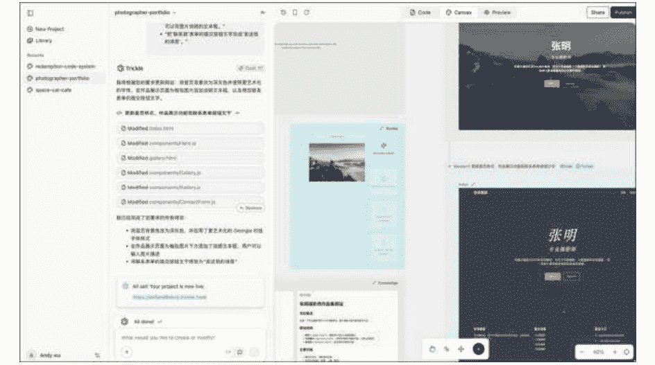

理论介绍或许有些抽象，而一个真实的项目案例，最能展现这一理念的强大之处。

##### 3. 案例聚焦：用Trickle重现科技巨头的“第一版”

Trickle究竟能做什么？这个问题最好的答案，莫过于一个真实且极具影响力的案例——FirstVersion项目。

这是一个由Trickle社区成员创建的线上科技博物馆（读者可自行搜索FirstVersion Trickle找到该网站），如图2-2所示。这个项目的核心创意非常简单：用今天的技术，重现Google、Airbnb、Twitter、YouTube等知名科技公司诞生之初的第一版网站。

访问该网站时你会发现，Google的第一版只是一个极其简陋的搜索框，Airbnb的雏形仅仅是为参会者提供住宿和早餐的页面。这些简陋的1.0版本，与它们今天的样子形成了鲜明对比。

这个项目的关键在于，无论是作为展馆本身的FirstVersion网站，还是其中所有被重现的科技公司的早期网站，全部通过Trickle生成并维护。这无疑是Trickle强大能力的最有力证明。

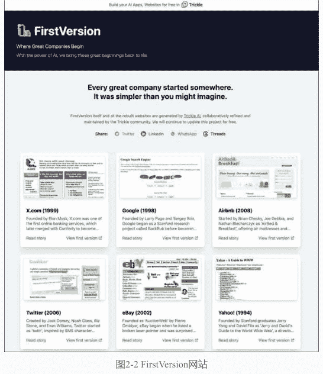

该案例也为初学者带来了宝贵的启示：一方面，所有伟大的产品都始于一个解决核心问题的简洁方案，其初版虽不完美但功能够用；另一方面，成功的关键在于迈出第一步并快速迭代，正如每个科技巨头都由微小项目发展而来一样。

这正是我们选择Trickle作为本书起点的深层原因：它通过一体化设计为你扫清技术障碍，通过魔法画布让创造过程直观有趣，最终让你能以最快的速度获得一个看得见、摸得着的成果。

#### 2.1.2 五分钟实战：上手Trickle

理论了解之后，亲手实践是最好的学习方式。下面，我们将用很短的时间，体验从想法到网站上线的完整流程。这个实战的目标不是让你精通所有功能，而是让你立刻收获“原来我也可以做到”的成就感。

##### 1. 注册你的免费账户

在浏览器中打开Trickle的官方网站（读者可自行搜索Trickle AI进入官网）。

在打开的界面中点击右上角的Log in按钮，使用Google账户直接登录，或使用常用邮箱注册。整个过程十分快捷，而且Trickle提供了免费的使用计划，足以完成本书所有练习，无须担心费用问题。

注册完成后，你将进入应用主界面——仪表盘。

##### 2. 熟悉仪表盘

成功登录后，会进入Trickle的仪表盘（Dashboard），如图2-3所示。这是一个非常清爽直观的界面，主要分为两个部分。

- **创建项目区域**：通常位于最显眼的中间位置，你会看到一个输入框，这里就是我们开始创造的起点。
- **社区项目（Community Projects）**：在页面中间下方设有展示区，陈列着由Trickle社区用户创建的各种应用。这里是绝佳的灵感来源，你可以看到大家用Trickle打造的各种各样的作品，比如“瑜伽馆的落地页”“宠物商店网站”“迷你客户管理系统”等。可以点开几个查看，对Trickle的能力建立更直观的认识。

熟悉界面后，就可以开始创建第一个项目了。


图2-3 Trickle仪表盘

##### 3. 你的第一个“魔法”指令

现在，我们正式创建第一个网站。

找到创建项目的输入框，然后输入一句描述你想法的话。为了让初体验充满乐趣，不妨选一个有趣的主题。例如：

> 给我创建一个关于“太空猫咖啡馆”的单页网站，要有未来感和可爱的插图。

输入完毕后按下回车键，接下来你会看到AI开始在画布上自动工作：它会解读你的指令，然后像设计师和工程师一样，实时添加标题、文字、图片并规划布局。短短几十秒到一两分钟，一个充满未来感、配有可爱猫咪插图的“太空猫咖啡馆”网站雏形，就呈现在你的眼前了，如图2-4所示。

这个过程将“构建网站”这个听起来抽象、困难的概念，瞬间转化为具体的、可触摸的且充满乐趣的体验。这种即时的积极反馈，正是开启后续学习之旅的最佳动力。

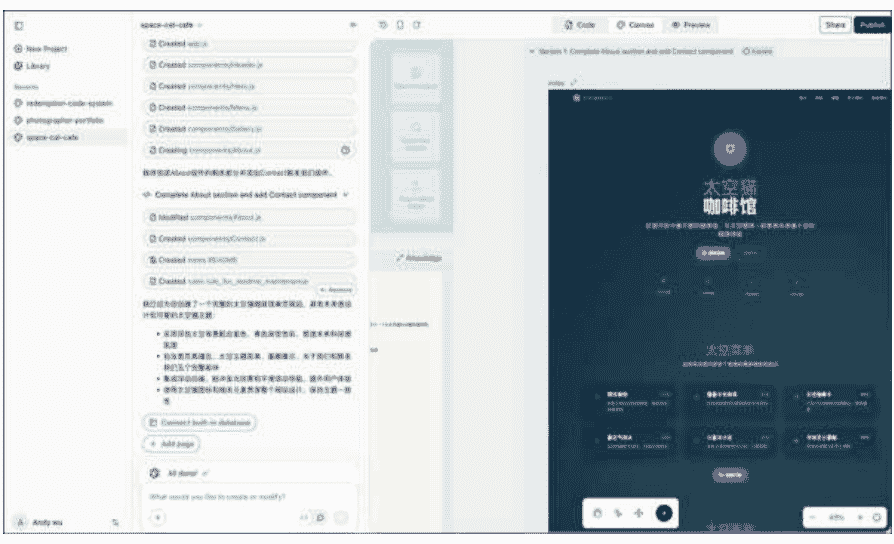

图2-4 “太空猫咖啡馆”网站雏形

#### 2.1.3 十五分钟实战：打造一个个人作品集网站

在体验完基本功能后，让我们挑战一个更完整的项目：创建一个个人作品集网站。这个项目实战将带你经历从生成、定制、连接数据库到最终发布的完整流程。

对于摄影师、设计师、作家、学生等各类创作者而言，拥有个人作品集网站都是展示自己能力、赢得机遇的绝佳方式。

##### 1. 生成基础页面

好的开始是成功的一半。对于多页面网站的创建，结构清晰、意图明确的初始指令（Prompt）至关重要。Trickle官方文档也建议，在下达指令时要尽量具体，一次聚焦一个核心任务。

现在，让我们创建一个新项目，并输入以下指令：

> 请为我创建一个个人作品集网站。我是一名摄影师，希望展示自己的作品。网站需包含三个页面：一是“首页”，用于呈现我的简介和一张大幅背景图；二是“作品展示”页面，用网格布局展示照片；三是“联系我”页面，内置一个表单，方便访客给我留言。

按下回车键，等待AI完成初步创作。你会发现，AI不仅搭建了网站的整体框架，还按照要求生成了“首页”“作品展示”和“联系我”这三个不同的页面，并且每个页面的基本元素（如简介区、图片网格、联系表单）也各就各位，如图2-5所示。


AI生成了网站的基本框架，接下来需要注入个性，完成定制化修改。

##### 2. 定制化修改

AI生成的初稿很棒，但它还不是你“专属”的网站。Trickle提供了两种互补的修改方式帮你融入个人品位：用对话来微调以及更精准的“直接编辑”。

**方式1：用对话来微调**

这就象与设计师实时沟通，你可以继续在输入框中用自然语言提出修改意见。比如：

- “把首页的背景色换成深灰色，字体换成更具艺术感的样式。”
- “在作品展示页面的每张图片下方，增加可填写图片说明的文本框。”
- “把‘联系我’表单的提交按钮文字改成‘发送我的消息’。”

AI会理解你的新指令，对现有网站进行增量修改。这种方式非常适合进行大方向的风格调整和结构变动。

**方式2：更精准的“直接编辑”**

有时，你可能只想微调标题字号、按钮间距等细节。如果为这点细枝末节重写指令，不仅效率低，而且AI的理解也容易出现偏差。Trickle提供的“直接编辑”（Direct Edit）功能可完美解决这些问题。可以把它看作内置的可视化编辑器，如图2-6所示。

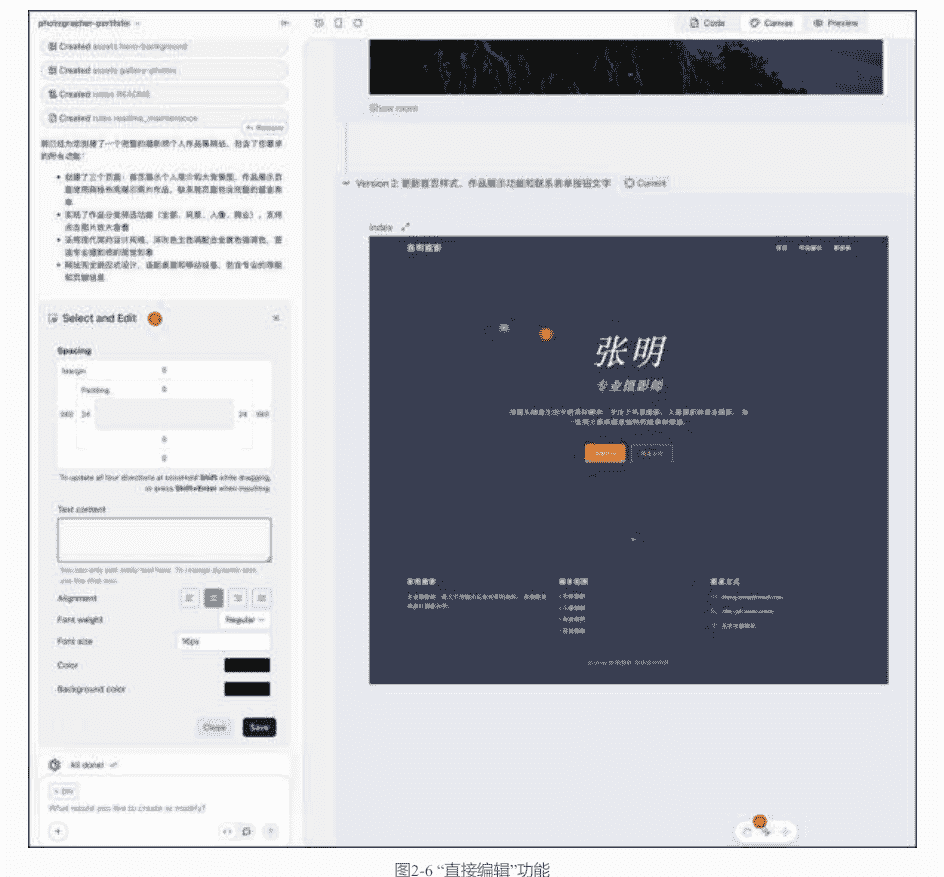

图2-6 “直接编辑”功能

它的操作非常简单，步骤如下。

1. 在网站Canvas（画板）窗口的底部中间，找到并单击Select to edit（选择编辑）按钮。
2. 将鼠标移动到网站对应的网页上，你会发现所有元素（文字、图片、按钮等）都可以被单独选中，选中后会显示蓝色边框。
3. 点击想要修改的元素（比如网站标题）。
4. 此时，旁边将弹出一个编辑面板，你可以像使用普通文档编辑器一样，直接修改文字内容、调整字体大小、更改颜色、设置边距等。

这种“AI生成+手动微调”的混合模式，兼具AI的高效和人类的精准，可让你在享受快速创造的同时，完全掌控每一处设计细节。

网站的外观基本完成后，还需要处理数据交互功能，比如让“联系我”表单能够接收并存储信息。

##### 3. 连接内置数据库

现在，我们的网站看起来已经很不错了，但“联系我”表单真的能接收信息吗？信息会存在哪里？这就需要“数据库”登场了。

不必畏惧这个术语。在Trickle中，可以把数据库简单理解成“自动收集和整理信息的智能表格”。

最便捷的是，当你第一步要求AI创建联系表单时，Trickle已经在后台自动为项目创建好了配套的数据库。这就是一体化平台的优势，所有隐性配置工作都已经替你完成。

如果想明确指示AI，也可以这样做：

> 将联系表单提交的数据，使用Trickle Database保存起来。

AI会自动理解并将表单提交按钮与Trickle的内置数据库关联起来。

那么，如何查看收集到的数据呢？步骤如下。

1. 在Trickle的Canvas窗口中找到一个写有Database的表格，该表格的初始状态是空的，这就是项目内置的数据库。
2. 返回网站预览页面，填写“联系我”表单（输入名字、邮箱和一条测试消息）并提交。
3. 再次切换回Database表格，你会发现刚提交的信息已经整齐呈现在表格中。

就这样，你根本不需要知道SQL是什么，也不用关心数据库是如何配置的，就拥有了带有后台数据管理功能的网站。

网站功能完备后，最后一步就是将其发布到互联网，生成可公开访问的网址。

##### 4. 一键发布

你的作品集网站已经准备就绪，现在只剩下最后一步——将它发布到互联网上，获得任何人都可以通过浏览器访问的公开网址。

Trickle为初学者和测试项目提供了极其便捷的免费发布选项。具体步骤如下。

1. 在项目页面的右上角，找到并单击Publish按钮。
2. 在弹出的对话框中，会看到一个预览区域（显示了你的网站标题和描述）。
3. 在URL部分，会自动生成一个以.trickle.host结尾的免费域名。
4. 如果想要自定义域名（需付费方案），可以单击下方的“+ Custom domain”选项。
5. 对于免费发布，直接单击右下角的Publish按钮即可。

瞬间，你的网站就上线了！系统会生成一个公开的网址，你可以分享给他人访问。

#### 2.1.4 Trickle：完美的起点，而非终点

恭喜你！你已经成功构建并发布了一个功能完整、连接了数据库的多页面网站。请务必花点时间，感受这份从无到有的成就感。

完成实践后，我们有必要回顾并思考Trickle这类AI工具的定位，以及它在学习路径中的意义。

##### 1. 为什么我们从这里开始：建立你的信心

在本书涉及的众多强大的AI工具中，我们选择Trickle作为你的第一站，目的非常明确：让你在最短时间内获得显著的积极反馈。

对初学者而言，最大的敌人往往不是技术本身，而是面对未知时的恐惧和不自信。Trickle的价值就在于，它能让你绕过所有令人望而生畏的技术细节，以最快的速度将脑海中的想法转化为看得见的产品。

当你亲眼见证自己只用了十几分钟就完成了一个像样的网站时，便已向自己证明：你完全有能力创造属于自己的产品。这份信心，是支撑你走完后续更具挑战性学习之旅的宝贵财富。

##### 2. All-in-One的权衡：理解便捷背后的局限性

在肯定Trickle便捷性的同时，我们也需保持清醒的认知。任何工具的选择都是一种权衡，像Trickle这样的一体化平台，为了实现极致的易用性，会在某些方面做出妥协。

- **定制深度有限**：虽然平台内的定制功能已经很强大，但面对高度独特或复杂的交互效果，可能会遇到功能限制，其自由度无法与原生代码开发相比。
- **应用的可扩展性面临挑战**：平台提供的轻量级数据库适合初创项目，但当用户量激增、数据关系变得复杂时，可能会出现性能瓶颈。
- **存在平台依赖性（或称“厂商锁定”）**：项目与平台深度绑定，难以迁移至其他服务商，这意味着用户需要对平台的长期稳定性和发展有足够的信心。

需要强调的是，指出这些局限性并非否定Trickle的价值。恰恰相反，它们正是你需要继续学习、深入探索的最好理由。

#### 2.1.5 小结

Trickle已经完美地扮演了“领路人”的角色。它让你爱上创造，并相信自己拥有创造的能力。现在，如果你想和AI共同成长，构建更复杂、更具扩展性、完全由你掌控的商业级应用，就需要了解在Trickle这个优雅的“一体化”外壳之下，那些独立的模块究竟是如何工作的。

这就好比你已学会驾驶一辆出色的自动挡汽车，现在是时候打开发动机盖，看看里面的引擎、变速箱、电路系统如何精密协作，共同驱动这台机器。

在下文中，我们将一起“解剖”Trickle这样的平台。我们会把那些由它无缝整合的模块——前端、后端、数据库、API——逐一拆解，带你亲手组装一套属于自己的、更灵活、更强大的“节俭全栈”工具链。

### 2.2 v0.dev大师课：从灵感到像素级完美UI

接下来，我们将介绍一款新工具：v0.dev。它旨在将创造力从技术的枷锁中解放出来，并非要取代人类开发者，而是要成为设计师、创业者、营销专家以及所有创意实干家最强大的创意合伙人。

在本节中，你将亲手体验从0到1的创造过程。我们不会开篇就深入复杂的理论，而是从一个简单的按钮起步，在几分钟内帮你建立信心；随后逐步构建更复杂的网页组件，学习如何与AI高效协作；最终，你将完成一个实战项目——挑选心仪的专业设计模板，引导AI将其复刻为功能齐全、高度个性化的网站。

#### 2.2.1 v0.dev核心理念与界面导览

在动手实践之前，先花些时间了解v0.dev的工作原理，将有助于你更高效地使用这款工具。

##### 1. 你的AI前端工程师

v0.dev是由Vercel团队打造的产品，如图2-7所示。如果说Vercel解决了“如何将网站快速、稳定地展示给全世界”的问题，那么v0.dev则专注于“如何快速、准确地创建网站”。两者形成了闭环，实现了从创意构思、设计实现到最终部署的全流程无缝连接。

v0.dev的核心价值在于连接你的创意构想（想要什么）与复杂的技术实现（具体怎么做）。你无须学习专业的编程语言，只需用自然的日常语言，像与同事交流那样告知需求，它就能精准理解并执行。

更重要的是，v0.dev早已超越简单的代码生成器，它更像一个具备主动解决问题能力的智能代理。当你下达任务时，它的AI会以工程师的视角分析需求：如果信息不足，可自主搜索网络、研究参考网站的结构；如果在生成代码后发现错误，还能自动修复。

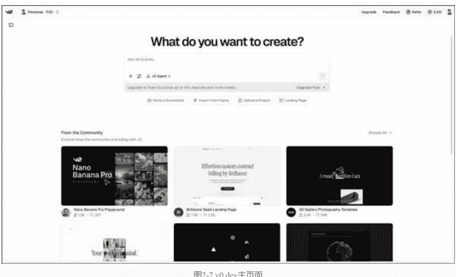

图2-7 v0.dev主页面

这意味着你可以用更宏观、更具目标性的方式下达指令，无须烦琐描述像素、边距等细节，从而更专注于整体设计和用户体验。你是在与创意伙伴协作，这让你敢于尝试更宏大、更复杂的想法。

了解了v0.dev的定位后，我们再来熟悉一下它的工作界面。

##### 2. 工作区详解

当你第一次访问v0.dev并登录后，随意在文本输入框中输入一个想法，就能看到一个简洁而强大的工作区，如图2-8所示。

整个工作区主要由4个核心区域组成。

- **提示词输入区**：这是你与AI工程师沟通的地方。你的所有想法、指令和修改意见都在这里输入——无论是“创建一个暗黑风格的定价页面”，还是“把这个按钮放大一点”，都从这里开始。
- **实时预览窗口**：你输入的任何指令，其结果都会近乎即时地以可视化的形式呈现在这里。没有延迟，没有编译，只有即时的视觉反馈。这种“所见即所得”的体验，极大地缩短了从想法到验证的周期，让你能够快速迭代。

#### 2.2.2 基础入门：从单个组件开始

在本节，我们将进行3个快速的练习。我们的目标非常明确：在最短的时间内让你收获成就感，建立对v0.dev以及自身创造能力的信心。

##### 1. 五分钟实战：你的第一个按钮

我们从网页中最基础也最常见的元素——按钮入手。

在v0.dev中新建一个项目或对话。在提示词输入区用中文输入下面这句简单的指令（即提示词），然后按下回车键：

> 创建一个蓝色的、圆角的“注册”按钮。

几乎在按下回车键的同时，实时预览窗口中就会出现一个美观的蓝色圆角按钮，上标注着“注册”二字，如图2-9所示。

操作成功，整个过程非常简单！回顾刚才的操作，v0.dev不仅精准理解了“创建按钮”的核心需求，还准确地解析了颜色（蓝色）、形状（圆角）和内容（“注册”）等多个设计细节。

按钮虽小，却已证明了v0.dev的基本能力。接下来，我们将构建一个稍复杂的组合式组件——信息卡片。

##### 2. 十分钟实战：构建一个信息卡片

信息卡片在网页中应用广泛、随处可见，通常用于展示产品特性、团队成员或新闻摘要等内容。

继续在刚才的对话中输入新的指令：

> 创建一个信息卡片，包含一个灯泡图标、一个“核心功能”标题和一段描述文字。

很快，v0.dev就会将你要求的图标、标题、描述等3个元素合理组织在一起，形成一个结构清晰、外观专业的信息卡片，甚至会自动填充一段贴合场景的占位文字，如图2-10所示。

我们已经完成了静态展示型组件的创建，现在尝试创建能与用户进行交互的输入型组件。

##### 3. 十分钟实战：制作一个登录表单

登录表单是任何需要用户账户的网站的必备组件。

在对话中输入：

> 制作一个登录表单，包含“邮箱”和“密码”输入框，以及一个“登录”按钮。

很快，一个标准的登录表单就呈现在眼前，包含完整的标签、输入框和登录按钮，如图2-11所示。你甚至可以在预览窗口中点击输入框，直接尝试输入文字。

需要说明的是，v0.dev目前专注于构建用户界面的“外观”和“骨架”。也就是说，它能生成精美的登录表单，但点击“登录”按钮时，并不会实际验证你的邮箱和密码。这些背后的处理逻辑（如连接数据库、验证用户信息）属于后端工程师的工作范畴。v0.dev的核心优势在于将前端开发环节的效率提升到极致，让你无须纠缠于烦琐的界面代码，能够全身心地专注于设计和用户体验的优化。

#### 2.2.3 进阶技巧：组合与迭代

恭喜你完成了基础入门！v0.dev真正的强大之处，不仅在于生成第一稿，而在于后续“对话式”的修改和优化。这才是专业人士使用v0.dev的核心工作流。

##### 1. 迭代的艺术

在v0.dev的创作逻辑中，你的第一个提示词只是对话的起点，可以把它看作给设计师的初步草图，而真正的作品需要通过一轮轮沟通和微调逐步打磨，这个过程就是“迭代”。

迭代的关键在于将一个复杂的目标拆解为一系列简单、连续的指令。与其一开始就用一段冗长的文字描述所有细节，不如先用一个简单的指令生成基础框架，然后通过追问的方式逐步添加细节、调整样式、优化布局。

这种工作方式如同雕塑家进行创作：先从璞玉中雕琢出大致轮廓，然后不断地用更精细的工具打磨抛光，最终呈现出完美的艺术品。与v0.dev的协作也是如此，每一次追问都是一次打磨。这种“聊天式”的开发体验，既更符合人类的沟通习惯，也让创作过程更灵活和可控。

现在，让我们通过实战来掌握迭代的艺术。

##### 2. 五分钟实战：为组件添加交互

回到第一个实战中创建的那个蓝色按钮，用“迭代”的方式为它添加动态交互效果。

首先，确保预览窗口中显示了该按钮（如果没有，可以重新生成，或在历史记录中找回）。接着，提出第一个迭代要求：

> 当我把鼠标悬停在按钮上时，让它颜色变深一点。

观察预览窗口。当把鼠标指针移动到按钮上时，它的颜色会平滑地变暗，给予用户清晰的视觉反馈——这就是悬停（hover）效果。

继续添加点击效果，输入下一个指令：

> 当我点击按钮时，添加一个轻微的缩放效果。

再次尝试。当按下鼠标左键点击按钮时，会出现一个瞬间缩小再恢复的动画。这个细节能极大地提升操作的“确认感”。

通过这两步简单的迭代，你已经将一个静态的按钮升级为一个在动态交互上更具专业感的组件，还学会了如何通过对话来描述并实现基于用户行为（如悬停、点击）的状态变化。

接下来，我们将构建网站的关键部分——导航栏，并通过迭代实现“响应式”布局。

##### 3. 十分钟实战：构建响应式导航栏

所谓响应式，是指网页能自动适配电脑、平板、手机等不同尺寸的设备，提供最佳浏览体验。下面通过以下步骤来构建响应式导航栏。

###### 第一步：创建基础导航栏

输入初始指令：

> 创建一个导航栏，左边是Logo，右边是“首页”“关于我们”“联系我们”三个菜单项。

v0.dev会立刻生成一个经典的桌面端导航栏布局：左侧是Logo占位符，右侧是3个横向排列的菜单链接，如图2-12所示。

###### 第二步：迭代实现响应式

接下来，告知v0.dev如何在小屏幕上展示这个导航栏。输入迭代指令：

> 让这个导航栏在手机屏幕上变成一个汉堡菜单。

v0.dev能精准理解“汉堡菜单”这一行业术语。现在需要验证响应式效果。在大多数主流浏览器中，可以按下F12键打开开发者工具进行测试。在Chrome浏览器中按下F12键后的结果如图2-13所示。

不同浏览器的开发者工具开启方式略有不同，具体如下。

- **Chrome/Edge**：按下F12键，然后点击相应的设备图标（在Chrome中是Toggle device toolbar图标，在Edge中是“切换设备仿真”图标）。
- **Firefox**：按下F12键，然后点击对应的响应式设计模式图标。
- **Safari**：先在“偏好设置”>“高级”中启用开发菜单，再按Cmd + Option +I组合键打开开发者工具，然后点击设备图标。

进入响应式设计模式后，在v0.dev预览窗口中将浏览器视图切换到手机尺寸，你会发现右侧的三个菜单项消失，取而代之的是一个经典的三条横线样式的“汉堡”图标。点击该图标，菜单项会以垂直列表的形式优雅地展开，如图2-14所示。

你没有写一行复杂的媒体查询代码，仅用一句话就实现了现代网站必备的核心功能——响应式设计。这充分证明，v0.dev不仅能处理简单的样式，还能理解并实现复杂的、符合行业最佳实践的设计模式（其生成的代码基于React、Tailwind CSS等主流技术栈，兼具专业性与实用性）。

完成组件的创建与迭代后，我们将探索一种更符合创意工作者习惯的高级工作流。

#### 2.2.4 高级工作流：从视觉到代码

到目前为止，我们都是在用“语言”来描述设计。但作为创意工作者，我们其实更习惯用“视觉”来思考。v0.dev的高级工作流，就支持直接将你所见、所喜的设计交给AI复刻。

##### 1. 视觉提示的力量

对于非技术背景的创作者来说，v0.dev最具颠覆性的功能之一，就是能够理解并复刻截图中的设计。

我们都有过这样的经历：看到某款设计，觉得它现代、简洁，但很难用语言精确描述其字号、间距、颜色代码、阴影效果等细节。在这种从“视觉”到“语义”的转换过程中，信息的损耗是巨大的。

而截图功能则完美地跨越了这道鸿沟。一张图片包含成千上万个关于布局、色彩、排版和风格的精确数据点。上传截图时，你不再是“告诉”AI你想要什么，而是直接“展示”给它看。这种交互模式的转变，使得AI的输入方式与你的核心能力（视觉审美）完全对齐，使你能够直接利用你的“设计眼光”，把在任何时刻捕捉到的灵感，迅速转化为可用的代码。

现在，就让我们体验这个强大的功能。

##### 2. 十分钟实战：复刻一个现有组件

这个实战非常直观，无须复杂准备，只需跟着以下步骤操作，就能快速实现从组件截图到可用代码的转换。

1. 打开浏览器，访问一些能给你提供设计灵感的网站，或者任何你喜欢的应用或网站。
2. 找到设计出色的独立组件，比如独特的按钮、精美的用户评价卡片，或定价方案的展示块。
3. 使用截图工具只截取该组件，并保存为图片。
4. 回到v0.dev，新建一个项目或对话，在提示词输入区找到用于上传图片的按钮，点击并选择刚截取的图片。
5. 上传后，可以搭配一句简单的提示词，如“用这张截图生成这个组件”。
6. 按下回车键，v0.dev会分析图片中的结构、颜色、字体和布局，在预览窗口中生成由真实代码构成、相似度极高的版本。

就这样，你完成了一次从像素到代码的瞬间转换——在过去，这项工作需要专业前端工程师花费数小时才能完成。

在熟练生成组件后，花少量时间了解其背后的代码，有助于我们更好地与AI协作。

##### 3. 理解代码输出

现在，让我们“掀开引擎盖”，看看v0.dev生成的代码。我们的目标不是让你学会编程，而是“去神秘化”，让你对这些符号有基本的概念性理解。

在v0.dev的界面中，切换到代码输出区（见图2-15），你会看到代码主要有3种“原料”构成：React组件、TSX语法和Tailwind CSS。

- **React组件：可复用的“乐高积木”**

v0.dev生成的每一个模块（按钮、卡片、导航栏），在代码世界里都是React组件，可以将其看作功能独立的乐高积木。比如，你创建了一个“注册按钮”积木，之后在网站的任何地方需要注册按钮时，可以直接调用这块积木，而无须重复制造。这种模式让大型网站的构建和维护变得极其高效。

- **TSX语法：积木的“设计图纸”**

它是TypeScript的一种扩展语法，允许在TypeScript代码中直接编写类似HTML的标记语言。简单来说，TSX就是“TypeScript + XML/HTML标签”的组合，它让你能用直观、声明式的方式描述用户界面“长什么样”——就像积木的设计图纸，直接定义了积木的结构。

在组件代码里，你会看到<div>、<button>、、<p>、<h1>等类似HTML的标签，与TypeScript代码混杂在一起（比如，TypeScript变量userName和HTML风格的<button>标签自然地融合在一起）。这就是TSX的魔力——让开发者在代码中用类似HTML的直观方式描述“乐高积木”的样子，而不需要在逻辑代码和界面描述之间来回切换。

- **Tailwind CSS：“贴纸式”的样式系统**

这是最容易理解的部分。在TSX标签中，你会看到一个长长的className="..."属性，里面包含bg-blue-500、rounded-lg、font-bold等简短单词，这就是Tailwind CSS。

可以把Tailwind CSS看成给乐高积木贴上功能描述的“贴纸”：无须单独写一本厚厚的样式说明书，而是直接把“蓝色背景”贴纸bg-blue-500、“大圆角”贴纸rounded-lg、“字体加粗”贴纸font-bold贴在积木上。这种方式直观易懂，让样式修改变得轻而易举。

为了帮你更直观理解这些“贴纸”的含义，表2-1给出了一些简易的翻译。

**表2-1 Tailwind CSS简易翻译表**

| 你的目标 | 代码示例 | 通俗解释 |
| :--- | :--- | :--- |
| 让文字变大、加粗 | text-xl font-bold | “文字大小：特大号；字体粗细：加粗” |
| 创建一个蓝色背景，带圆角的方块 | bg-blue-500 rounded-lg | “背景颜色：蓝色-500号；边角：大圆角” |
| 在元素内部增加空间（内边距） | p-4 | “内边距（Padding）：4个单位” |
| 在元素外部增加空间（外边距） | m-2 | “外边距（Margin）：2个单位” |
| 让几个组件横着排成一排 | flex | “使用弹性布局（Flexbox），默认横向排列” |
| 让一个组件在容器里水平和垂直都居中 | flex justify-center items-center | “弹性布局，横向居中，纵向居中” |

有了表2-1，下次再看到v0.dev生成的代码时，就可以尝试着读懂这些“贴纸”的含义，甚至可以尝试修改一两个（比如把bg-blue-500改成bg-red-500），看看预览窗口会发生什么。

掌握以上所有技能后，你就准备好挑战本节的最终项目了。

#### 2.2.5 实战项目：复刻你最爱的Figma模板

欢迎来到本节的最后一站，也是最激动人心的实战项目。你将综合运用前面学到的所有技能——提示词技巧、迭代优化、视觉复刻——完成一项完整且有意义的任务：把专业的Figma设计模板，转化为真实运行的个人网站。

##### 1. 探索Figma社区

第一步是寻找灵感和素材。Figma是全球设计师首选的协作式UI设计工具，其庞大的社区（Figma Community）是高质量设计资源的金矿，如图2-16所示。

你可以访问Figma社区，搜索感兴趣的模板类型，比如“个人作品集”（Portfolio）、“SaaS落地页”（SaaS Landing Page）或“仪表盘”（Dashboard），社区中有海量的免费模板可供选择。

如果你不知道从哪里开始，这里推荐一个免费模板作为起点——Minimal Portfolio FreeLanding Pages for Figma，在社区中搜索名字即可找到。该模板的风格极简，非常适合个人作品集，包含桌面和移动端设计。

请花些时间浏览，挑选一个让你真心心动的设计。建议选择结构相对清晰的单页落地页或作品集，避免在初期就挑战过于复杂的后台管理系统。找到后，将其复制到自己的Figma草稿中。

找到设计稿后，下一步是进行分解。

##### 2. 分解设计

分解，既是整个项目中最关键的思维训练，也是专业开发者处理复杂问题的核心工作方法。

面对选中的精美设计稿，初学者常因它是一个完整复杂的整体而不知所措。但专业人士看到的则是一系列独立、可管理的“组件”的组合。现在，你也要学会用这种“开发者视角”审视设计。

一个典型的落地页通常可以分解为以下几个部分。

- **导航栏 (Navigation Bar)**：位于页面最顶部，包含Logo和菜单链接。
- **英雄区域 (Hero Section)**：紧随导航栏，是页面的第一屏，通常含有醒目的标题、副标题和号召性用语 (Call-to-Action) 按钮。
- **特性/服务列表 (Features/Services Section)**：用图标和简短文字介绍产品或服务的核心优势。
- **作品集/案例展示 (Portfolio/Case Studies)**：以卡片或网格形式呈现项目。
- **客户评价 (Testimonials)**：引用客户的好评，建立信任感。
- **页脚 (Footer)**：位于页面底部，包含版权信息、社交媒体链接和联系方式。

你的任务就是像这样将设计模板分解为独立、功能明确的组件。这个过程不仅能让接下来的AI生成工作更有条理，更能让你学会将庞大复杂的问题分解为可独立解决的子问题。这比掌握任何工具都更为宝贵。

分解设计完成后，就可以动手实操了。

##### 3. 十分钟实战：动手复刻

接下来跟着以下步骤操作，快速实现从组件截图到可用代码的转换。

1. 逐个截图。根据分解结果，对每个组件进行单独、精确的截图（例如，先截取导航栏，再截取英雄区域；以此类推）。
2. 上传并生成。打开v0.dev，从第一个组件开始，上传导航栏截图，并搭配提示词“复刻这个导航栏”。
3. 迭代微调。v0.dev生成的第一版结果可能非常接近预期，但也可能存在细微偏差。此时，运用“迭代”的艺术，通过追加提示词进行微调。例如：
   - “让Logo再大一点”；
   - “菜单项之间的间距调宽一些”；
   - “把这个按钮的颜色换成#5A67D8”（甚至可以直接提供颜色代码）。
4. 重复流程。当对导航栏的生成结果满意后，先复制保存当前组件的代码（避免后续操作丢失），再清空画布或开启新的对话，接着处理下一个组件（如英雄区域、特性/服务列表等）。重复“截图→上传生成→迭代微调→保存代码”的完整流程，直到生成所有组件的代码版本。

拥有所有组件代码后，最后一步是组合成一个完整的网站。

##### 4. 组装与微调

你已经集齐所有的“乐高积木”，现在是时候把它们拼装成最终的模型了。

1. 启动TRAE SOLO模式。打开TRAE IDE，在界面左上角选择SOLO模式，进入AI自动开发流程。它会按需搭建本地开发环境，无须手动配置复杂的项目结构。
2. 整合组件代码。用自然语言告诉SOLO AI：“我已用v0.dev生成多个组件代码，请帮我创建一个完整的项目，将这些组件按照设计稿顺序组合成一个完整的网站。”然后，将v0.dev复制的各个组件代码文件夹放入这个项目中，AI会自动分析并整合这些代码。
3. 观察AI自动执行。启用“实时跟随”功能，可在编辑器、终端、预览器、文档面板中实时观看AI拆解需求、创建项目结构、整合组件代码，以及自动处理依赖安装和配置。
4. 交互调优。如果发现组件之间的布局或样式需要调整，直接在对话界面中下达修改建议，比如“导航栏和英雄区域之间的间距太大，请调整一下”或“整体配色偏暗，请调亮一些”，AI会立即响应并在预览器中展示修改效果。

#### 2.2.6 小结

在本节中，我们完成v0.dev从0到1的实战演练。我们首先明确了v0.dev的定位，并熟悉了其四大核心工作界面：提示词输入区、实时预览窗口、代码输出区和版本迭代历史树。

我们的旅程从最基础的组件开始，通过实战快速构建了按钮、信息卡片和登录表单，以此建立了与AI协作的初步信心。

接着，深入v0.dev更核心的“迭代”的艺术：不追求一步到位，而是通过连续的“对话式”追问，为静态按钮添加了专业的悬停（hover）和点击交互效果；更用一句“让它在手机屏幕上变成汉堡菜单”，就实现了一个完整的响应式导航栏，掌握了通过迭代实现复杂设计模式的技巧。

我们还探索了v0.dev最具颠覆性的高级工作流——从视觉到代码。通过上传截图，跨越了“用语言描述设计”的鸿沟，实现了从设计灵感到可用代码的瞬间转换。为了“去神秘化”，我们“掀开引擎盖”，将v0.dev生成的代码理解为三部分：React组件（乐高积木）、TSX（设计图纸）和Tailwind CSS（样式贴纸）。

最后，在实战项目中，我们融会贯通所有技能，学会了专业流程中最关键的思维方法：分解。通过将复杂的Figma设计稿拆解为导航栏、英雄区域等独立组件，并利用v0.dev的视觉复刻能力逐一生成，并最终在TRAE SOLO的协助下，将这些“积木”组装成完整、可上线的个人网站。

通过本节的学习，你不仅掌握了一个强大的AI工具，更亲身体验了从抽象灵感到像素级完美UI的完整路径，以此证明创意与技术之间的鸿沟完全可以被跨越。

### 2.3 精通Figma

——从第一块画布到开发者交付

设想一下，你在建造一栋房子。在动工前，你需要一张清晰详尽的蓝图，让建筑师、工程师和施工队都能准确理解你的构想。在数字世界中，Figma这个强大、易上手的在线协作设计工具，就是这张“蓝图”的诞生地。

在众多设计工具中，Figma之所以能脱颖而出，成为Google、微软等大公司广泛使用的行业标杆工具，核心源于以下三大突出优势。

- **无缝协作：** 这是Figma最核心的优势。你可以邀请团队成员、产品经理、开发者甚至客户访问同一个设计文件，实时看到彼此的光标，还能直接在画布、特定框架或图层上留言讨论、回复反馈。这种透明高效的沟通方式，彻底告别了来回发送截图和文件的低效信息同步模式。
- **一体化的工作流程：** 过去，设计师可能需要用工具A画线框图，换工具B做高保真视觉稿，再用工具C制作可交互原型。Figma将这一切整合到一起，从最初构思、设计界面，到制作可点击的原型，再到最终交付给开发者，整个流程都可以在一个平台完成，极大提升了工作效率。
- **对初学者友好：** 尽管Figma的功能强大，但其界面却十分直观，学习曲线也非常平缓。它还有一个功能完备的免费版本，足以满足我们的学习需求，让新手无须额外成本就能轻松入门。

在本节中，我们将从一块空白的画布开始，亲手构建一个灵活动态的界面，然后为它注入生命，制作可点击的交互原型，最终学会如何将这份凝聚心血的设计稿优雅地交付给开发者或AI。

这趟旅程不需要任何设计经验。学完本节后，你将掌握一套强大的技能，足以将脑海中的任何创意变为现实。

#### 2.3.1 现代UI设计基础

在深入探索Figma的强大功能之前，我们必须先打下坚实的基础。本节的目标是建立一个正确的“心智模型”——我们不仅是学习点击按钮，更要理解Figma设计理念背后的“为什么”，这将让你在后续的学习中事半功倍。

##### 1. Figma界面导览与核心思维

第一次打开Figma时看到满屏的面板和工具，感到不知所措是正常的。我们可以把它拆解成4个简单明了的核心区域（见图2-17），在理解了它们各自的职责后，一切都会变得清晰起来。

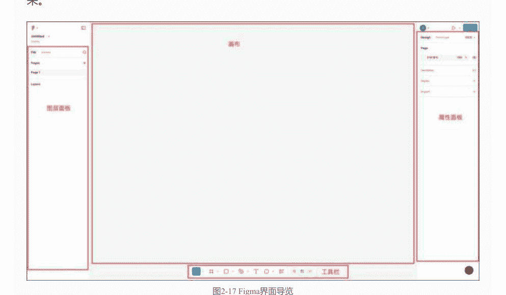

图2-17 Figma界面导览

- **画布（你的无限工作区域）**：位于界面正中央的巨大区域，如同一张无限大的数字画纸。你所有的设计，无论是手机屏幕、网页、按钮还是图标，都将在这里诞生。你可以向任意方向自由滚动，将不同设计稿并排摆放，方便对比和构思。
- **工具栏（你的核心工具箱）**：通常位于界面底部，存放着最常用的工具。我们初期会重点关注移动工具、画框工具、形状工具（如矩形R、圆形O）和文本工具等核心工具。
- **图层面板（你的内容目录）**：位于界面左侧，如同一本书的目录，清晰展示了设计文件中的所有元素——画框、组、文本、图标等，直观反映了设计的层级和结构。从一开始养成良好的图层命名习惯，是专业设计师的必备素养。
- **属性面板（你的核心属性调整区）**：位于界面右侧，是Figma最智能的部分。这个面板具备“情境感知”能力，其内容会根据你在画布上选择的元素而变化：选中矩形，会显示颜色、边框、圆角等设置；选中文字，则会显示字体、大小、行高等属性。所有微调和精修都在这里完成。

现在，让我们聚焦本节最重要的概念：框架优先思维。在现代UI设计中，几乎所有元素都存在于一个容器之中，而Figma中最核心、最强大的容器就是框架。

对于初学者，尤其是具有Photoshop等传统图形设计软件使用经验的人来说，很容易混淆框架、组和形状。理解三者的区别，是掌握Figma的关键第一步。

- **形状**：最基础的构建模块，比如用工具栏中的工具画出的矩形、圆形，是纯粹的矢量图形，堪称构成界面的“原子”。
- **组**：一种简单的捆绑方式，就像把一堆散乱的文件放进一个文件夹。组的大小完全由内部元素决定，移动或缩放内部元素时，组的边界也会随之改变。在UI设计领域，组的功能非常有限。
- **框架**：UI设计的基础单元，可以理解为“智能容器”或“画板”。与组不同，框架拥有独立的自定义尺寸，更具备组没有的“超能力”——约束（Constraint）能定义内部元素在框架缩放时的响应规则；内容裁剪（Clip Content）可自动隐藏超出边界的内容。框架是实现自动布局（Auto Layout）和创建组件的共同基石。

我们之所以强调“框架优先”，是因为这种思维从根本上将静态的平面设计与动态的界面设计区分开来。UI设计不是绘制固定图片，而是构建能适应不同屏幕尺寸和内容的灵活系统。组是被动地适应内容，而框架是“智能”容器，能主动管理内容的行为。社区中的资深设计师几乎一致推崇“永远用框架，绝少用组”的理念，正是因为它更贴近现代Web开发中基于容器的构建逻辑（例如HTML中的<div>元素）。

为了让你快速掌握框架与组的核心差异，表2-2对其进行了整理。

表2-2 框架与组的核心差异

| 特性 | 框架 | 组 |
| :--- | :--- | :--- |
| 尺寸行为 | 拥有独立、可自定义的尺寸，不受内容影响 | 尺寸由内部所有元素的边界决定，随内容变化 |
| 内容裁剪 | 可开启“内容裁剪”功能，隐藏超出边界的内容 | 无法裁剪内容，所有内容始终可见 |
| 约束 | 内部元素可设置约束，定义缩放时的相对位置和大小 | 无约束的概念，缩放组合等比缩放所有内容 |
| 自动布局 | 是应用自动布局的唯一载体 | 不支持自动布局 |

有关框架和组的使用建议如下。

- 框架是UI设计的基础单元，适用于所有需要精确控制尺寸、实现响应式布局或动态承载内容的场景，小到按钮，大到整个页面都可使用。
- 组仅用于临时操作，比如快速捆绑图标的多个矢量路径以便移动或缩放，处理完后通常需要放入框架中进一步设计。

理论讲完了，让我们立刻动手，通过一个快速的实战来巩固刚刚学到的知识。

## 2.五分钟实战：创建一套自定义图标

本实战的目标是在五分钟内创建几个简单的图标，让你亲身体验框架的容器作用、形状工具的灵活用法，以及布尔运算的强大威力。

### 1.创建图标容器

我们不直接在画布上画图，而是先按下F键，在画布上创建一个24×24像素的框架，用作图标容器。在左侧的图层面板中，将它命名为icon/camera，如图2-18所示。这个24×24像素的框架就是我们图标的标准“画板”，能确保所有图标尺寸统一、规范。


图2-18 创建图标容器

### 2.绘制基础形状

在刚创建的框架内部，按下R键绘制一个正方形作为相机机身，调整圆角让轮廓看起来更柔和。接着按下O键，画一个大圆作为镜头，再画一个小圆作为闪光灯，最终结果如图2-19所示。

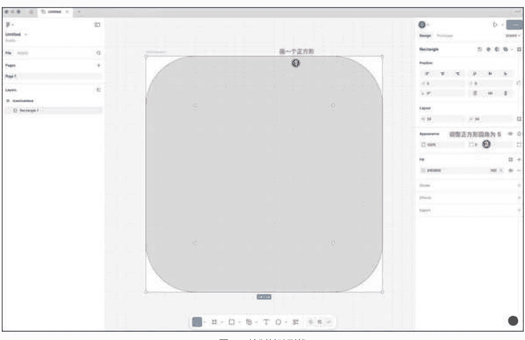

图2-19 绘制基础形状

### 3.运用布尔运算

现在，这3个形状（不含框架）是分离的。按住Shift键同时选中这3个形状，在右侧属性面板上方会出现布尔运算图标组。点击下拉箭头，选择Subtract（减去），如图2-20所示。两个圆形就像饼干模具一样，从正方形上“挖”出镂空效果，最终形成单一的相机形状，如图2-21所示。布尔运算为非破坏性操作，后续仍可调整原始图层，兼具灵活性与效率。


图2-20 运用布尔运算


图2-21 布尔运算结果

### 4.扁平化与居中

选中生成的复杂形状，按下Cmd/Ctrl + E组合键执行扁平化（Flatten），将其合并为一个纯粹的矢量路径，确保缩放时不会出现变形。然后，使用右侧属性面板顶部的对齐工具，将这个形状在24×24像素的框架内水平、垂直居中，如图2-22所示。


最后在左侧的图层面板，确保框架名为icon/camera，内部矢量图形可以简单命名为Vector，如图2-23所示。养成规范的命名习惯是高效协作与后期维护的基础。

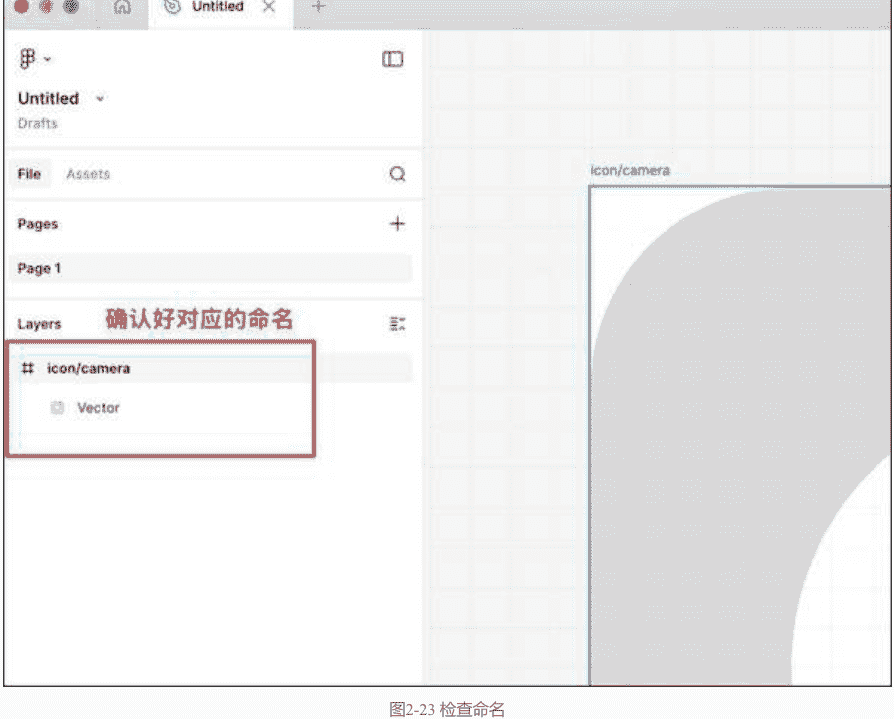

下面挑战一下自己！重复以上步骤，再创建两个图标。比如，用两个圆形和一个正方形制作一个“用户”图标（icon/user），或者用多个旋转的正方形制作一个“设置”图标（icon/settings）。

完成图标的创建后，接下来需要为整个设计项目定义统一的视觉规范。

## 3.建立视觉语言

如果说框架是设计的骨架，那么颜色、文字和网格就是设计的血肉和灵魂。优秀的设计之所以和谐统一，核心在于遵循一套内在的“视觉语言”。在Figma中，我们通过创建样式（Style）和布局网格（Layout Grid）来定义并落地这套语言。

###### 样式

样式是对设计中重复出现的视觉属性（如颜色、文字排版）的标准化定义，通过预设固定规则，既能确保同类元素在不同场景下保持一致，又能大幅简化后期修改成本。Figma的样式分为颜色样式和文本样式两类。

- **颜色样式**是统一管理设计色彩体系的核心工具，你可以将一个特定的颜色值保存为可复用的样式，并赋予color/primary/blue这样的语义化名称。比如，设计中使用的品牌主色调，后续若需调整，我们无须逐一修改所有应用该色调的元素，只需编辑这一个颜色样式，所有关联元素的颜色就会瞬间同步更新，高效且不易出错。
- **文本样式**则专注于统一管理文字排版属性，可保存字体、字重、字号、行高等完整排版规则，值得注意的是，它不包含颜色属性——这一设计让文本样式和颜色样式能够独立开来，自由组合。在使用文本样式时，你可以创建typography/h1（一级标题）、typography/body（正文）等样式，搭配不同颜色样式，满足多样化的设计需求，同时保证全页面文字排版的规范统一。

###### 布局网格

布局网格是为设计注入秩序的“隐形脚手架”，能帮助你精准对齐元素，保持间距一致性，让页面看起来更专业规整。

Figma提供了3种类型的网格。

- **均匀网格**：由等大的正方形构成，适用于图标设计或在整个设计中强制执行一个基础的间距单位（如行业通用的8pt网格系统）。
- **列网格**：网页和移动应用设计中的常用类型，可自定义列数、列间距和内容距离框架边缘的间距。
- **行网格**：水平方向的参考线，通常与列网格结合使用，形成更精细的模块化布局。

创建样式和布局网格的过程，本质上是“设计决策具象化”的过程。当你将一个十六进制色值保存为color/brand/primary时，就是在明确“这是我们的主品牌色”——这正是“设计令牌”（Design Token）思想的雏形：将颜色、字号等设计属性从具体数值中抽象出来，赋予语义化名称，为设计系统的规模化应用打下基础。

现在，让我们把刚刚学到的样式和布局网格知识付诸实践。

## 4.十五分钟实战：设计一个基础样式指南

我们将创建一个所有专业项目都必不可少的部分——样式指南，为后续设计提供统一规范。

### 1.创建“基础规范”页面

在Figma文件的左上角，点击页面名称旁的下拉箭头，新建页面并命名为“基础规范”，如图2-24所示。将设计系统的基础元素集中在一个专门的页面进行文档化，是一种非常专业且高效的工作习惯。如果使用的是免费版（一个项目只能有一个页面），可将当前页面重命名后开展实战。

### 2.文档化颜色样式

在新页面上绘制多个矩形，分别填充项目主色、辅助色以及常用的中性灰色。选中其中任意一个主色矩形，在右侧属性面板的“填充”（Fill）区域点击四点图标，再点击“+”号创建一个新的颜色样式，将其命名为color/primary。用同样的方法，为其他颜色创建color/secondary、color/neutral/900等样式。在每个颜色矩形旁，用文本工具标注样式的名称和色值，方便查阅与使用，如图2-25和图2-26所示。

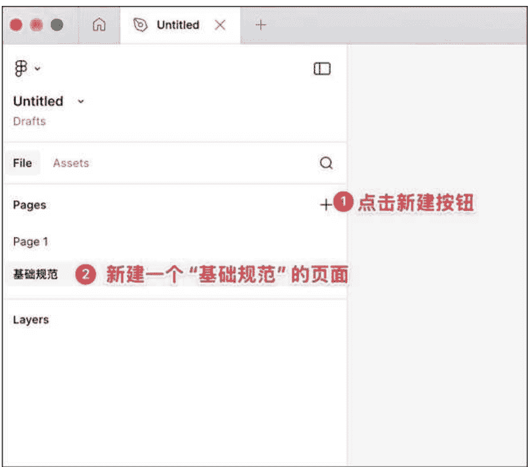

图2-24 创建“基础规范”页面

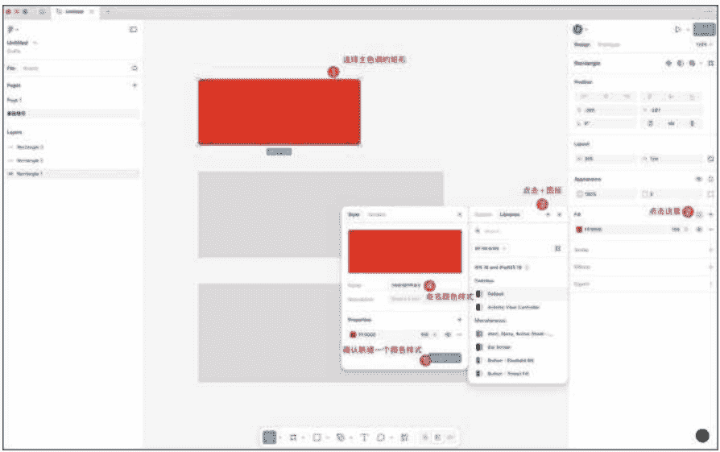

图2-25 文档化颜色样式

### 3.文档化字体

创建多个文本元素，分别输入“一级标题（Heading 1）”“二级标题（Heading 2）”和“正文文本（Body Text）”，并为其设置理想的样式（例如，H1: Inter Bold 32px，Body: Inter Regular 16px）。随后为每种文本创建对应的文本样式，命名为typography/h1、typography/h2、typography/body，如图2-27和图2-28所示。

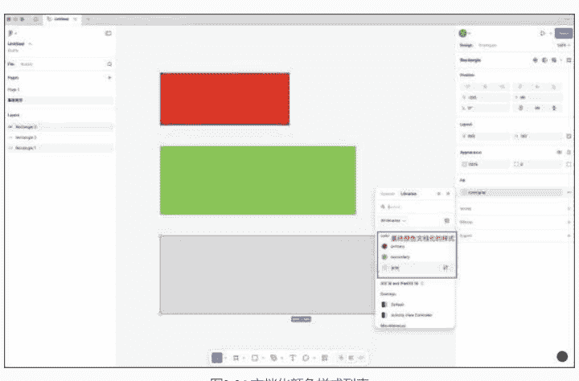

图2-26 文档化颜色样式列表

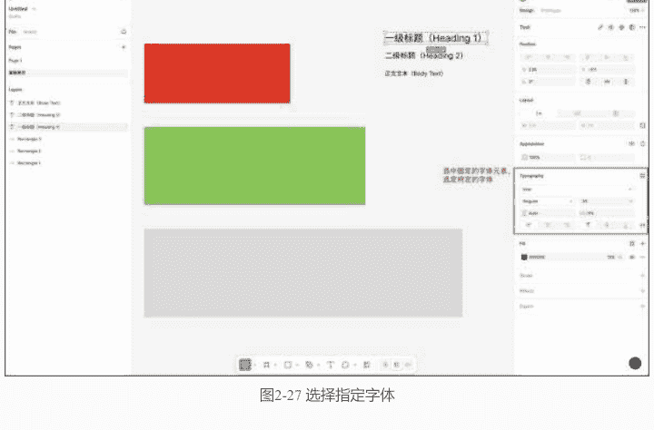

图2-27 选择指定字体

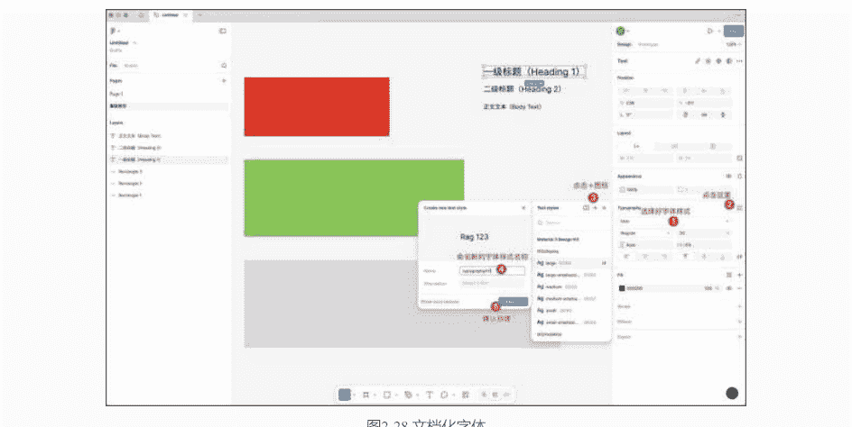

图2-28 文档化字体

### 4.文档化网格

使用快捷键F创建3个框架，分别对应桌面（Desktop）、平板（Tablet）和移动设备（Mobile）的典型屏幕尺寸，并为其应用响应式列网格。

接下来设置这3个框架的具体参数。

首先设置桌面框架。选中桌面框架，在右侧的Design选项卡中找到Layout区域，将Dimensions下面的W（宽度）字段设置为1440px。然后找到Layout guide区域，单击+号，在弹出的面板中，将Grid设置为Columns，然后将Count（列数）设置为12，Type（类型）设置为Stretch（拉伸），Margin（边距）设置为144px，Gutter（沟槽）设置为24px。

接下来按照相同的方式设置平板和移动设备的框架。两者的参数如下。

- **平板：** 宽度768px，8列，Type为Stretch，Margin为32px，Gutter为16px。
- **移动设备：** 宽度375px，4列，Type为Stretch，Margin为16px，Gutter为16px。

选中桌面框架，将其网格保存为布局网格样式，命名为grid/desktop-12-col，如图2-29和图2-30所示。

完成这个练习后，你将拥有项目的“单一事实来源”。在后续的设计中，可直接从这个样式指南中取用规范样式，确保整个项目视觉风格的高度一致性。

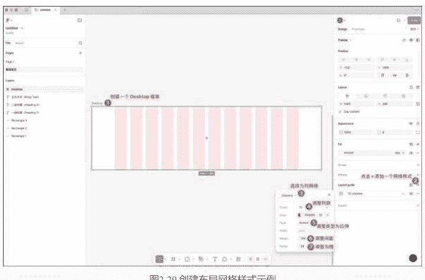

图2-29 创建布局网格样式示例

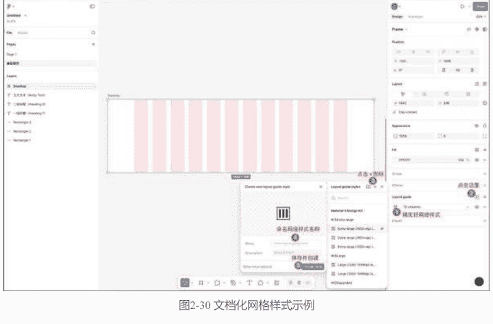

图2-30 文档化网格样式示例

#### 2.3.2 构建可扩展的动态界面

掌握基础知识之后，我们将进入Figma最激动人心的领域。我们将学会如何让设计“活”起来，从静态的像素排列转变为能够自动适配内容、响应变化的智能组件。本节部分内容为进阶技巧，读者可根据自身情况选择性地学习。

## 1.自动布局的威力

如果说Figma有一项功能堪称核心，那无疑是自动布局。它的功能相当强大，能帮你打造出与真实网页、应用一致的动态效果，布局会随内容增减、文本长度自动适配调整。

启用自动布局的方式很简单，只需选中一个或多个元素，然后按下Shift + A组合键，Figma会立即用开启了自动布局的框架将它们包裹起来。

启用后，在右侧的Design标签下会有一个Auto layout区域，可在该区域中掌控这个“智能容器”的行为。

- **排列方向（Flow）**：决定内部元素是垂直堆叠、水平排列，还是在空间不足时自动换行（Wrap）。
- **间距（Gap）**：定义容器内元素之间的距离，可设置为固定值，也可以设为Auto（让元素自动撑开以填满可用空间）。
- **内边距（Padding）**：定义了容器内部边缘与内容之间的空白区域。

###### 三种核心尺寸调整行为

这是理解自动布局的精髓。自动布局框架中的任何元素，其宽度和高度均可分别设置以下三种行为。

- **适应内容（Hug contents）**：容器的尺寸由其内部内容决定，会“紧紧包裹”内容（加上内边距）。这非常适合按钮、标签等需要根据文字长度自适应的元素。
- **填充容器（Fill container）**：元素会主动伸展，以填满父容器的所有可用空间。这是构建响应式布局的关键，常用于输入框、卡片内的文本区域等需要拉伸的元素。
- **固定宽度/高度（Fixed width/height）**：元素的尺寸是固定的，不受内容和容器大小变化的影响。这通常适用于图标、头像等尺寸必须固定的元素。

自动布局的真正威力在于嵌套。通过层层嵌套并组合这三种尺寸调整行为，可以构建出任何复杂、完全响应式的界面。

接下来，我们将通过实战练习，亲身感受自动布局的魔力。

## 2.十五分钟实战：构建响应式卡片与导航栏

我们先从“响应式产品卡片”的构建开始，具体步骤如下。

1. 准备素材。创建一个矩形作为图片占位符（例如300×180px），再创建一个“产品标题”文本层和一个“产品描述”文本层，如图2-31所示。

## 2.3.2 从静态设计到响应式布局（可选学习）

### 1.响应式卡片设计

在掌握了自动布局后，我们可以学习组件化的概念，进一步提升设计效率。

###### 1.1 响应式卡片

1.  **准备素材**。如图2-31所示。
2.  **嵌套自动布局**。选中上面创建的两个文本层，按下Shift + A组合键，将它们包裹在一个垂直方向的自动布局框架中，命名为Text Content，并设置间距为8px，如图2-32所示。
3.  **创建卡片框架**。选中Text Content框架和图片占位符，再次按下Shift + A组合键，将它们包裹在一个新的垂直自动布局框架中，命名为Card，设置间距为16px，内边距为16px。最后，为Card框架添加白色填充和圆角，使其呈现卡片形态，如图2-33所示。
4.  **设定响应规则（关键步骤）**。选中Card框架，在属性面板中将其宽度设置为“固定”；接着按住Cmd/Ctrl键点击选中内部的图片占位符和两个文本层，将它们的宽度尺寸行为全部设置为填充容器（Fill container），如图2-34所示。
5.  **响应式测试**。尝试拖动Card框架的右边缘来调整它的宽度，你会发现内部的图片和文字会自动拉伸、换行，完美地适配了新的宽度。

接下来创建“响应式导航栏”，具体步骤如下。

1.  **创建菜单项**。创建“首页”“功能”“产品”“关于”等文本层。
2.  **应用自动布局**。选中所有文本层，按下Shift + A组合键，将它们包裹在一个水平方向的自动布局框架中，命名为Navbar，设置间距为32px，内边距为16px，如图2-35所示。
3.  **感受动态调整**。Navbar框架的宽度默认为适应内容（Hug contents）。双击其中一个菜单项，将“产品”修改为“我们引以为傲的产品系列”，会看到整个导航栏的宽度自动增加以容纳更长的文本，并且所有菜单项之间的间距保持不变。

## 3.组件、变体与属性（可选学习）

如果需要重复设计同一个元素（如按钮），那么组件将成为你最好的朋友。组件的核心思想是“一次创建，随处复用”，而要充分发挥其高效价值，还需要掌握与之配套的变体和组件属性——三者共同构成了Figma组件化设计的核心体系，具体可分为3个核心层面。

-   **组件（Component）**：可以将任意设计元素转换为主组件（Main Component）。之后，可以在设计稿的任意位置使用它的实例（Instance）。当修改主组件时，所有实例都会同步更新。
-   **变体（Variant）**：当组件有多种状态或样式（如按钮的默认、悬停、禁用状态）时，无须创建多个独立组件，可通过变体将它们组织在“组件集”（Component Set）中统一管理。
-   **组件属性（Component Property）**：这是让组件更灵活和强大的关键，是添加到主组件上的“控制器”。当使用者在设计稿中添加主组件的实例后，可直接在右侧属性面板中自定义该实例的部分参数，无须修改主组件本身。组件属性主要有如下3种类型。
    -   **布尔（Boolean）属性**：一个简单的“是/否”开关，用于控制图层的可见性（如是否显示图标）。
    -   **文本（Text）属性**：允许使用者直接在属性面板中修改组件内部的文本内容。
    -   **实例交换（Instance Swap）属性**：允许使用者将组件内部嵌套的组件实例替换为另一个（如替换按钮中的图标）。

在实际设计中，很多初学者会困惑：“变体和组件属性都能让组件更灵活，到底该什么时候用变体，什么时候用属性？”一个简单的判断法则是，变体用于处理组件在视觉风格、交互状态上的预设固定差异，属性用于处理组件的内容变化或可选元素的显隐，供使用者自定义，具体如表2-3所示。

**表2-3 组件属性——何时使用何种属性**

| 属性类型 | 它所回答的问题 | 简单示例 |
| :--- | :--- | :--- |
| 布尔 | 组件中的某个元素需要显示或隐藏吗 | 在按钮组件中添加名为Show Icon的布尔属性，通过开关控制图标的显示与隐藏 |
| 文本 | 组件中的文字需要用户修改吗 | 为按钮文本框添加名为Label的文本属性，让使用者在属性面板中直接修改按钮文字 |
| 实例交换 | 组件中的图标或子组件需要替换吗 | 为按钮图标创建名为Icon的实例交换属性，允许使用者从图标库中选择替换图标 |

接下来，我们通过一个综合性的练习，创建一个强大且灵活的按钮组件集。

## 4.十五分钟实战：构建一个全面的按钮组件集（可选学习）

这个练习将帮助你掌握组件系统的核心概念，创建真正实用的设计资产。通过构建包含多种状态和可自定义属性的按钮组件集，你将体验组件化设计的强大威力——一次创建，随处复用，统一修改。

具体实战步骤如下。

1.  **构建基础按钮**。创建Button文本层，旁边放置一个图标组件实例（来自2.3.1节的练习）。选中两者，按下Shift + A组合键自动将这两者包裹在一个水平自动布局框架中，调整间距和内边距，为框架添加填充色。
2.  **创建主组件与属性**。选中步骤1中做好的整个按钮框架，按下Ctrl/Cmd + Alt + K组合键将其转换为主组件。在右侧Design面板中找到Properties区域，点击右侧的“+”号，为图标图层添加一个布尔属性并命名为Show Icon；为文本图层添加一个文本属性并命名为Label。
3.  **添加变体属性**。再次点击Properties区域的“+”号，选择“变体”（Variant），将第一个变体属性命名为Style，其值设为Primary。
4.  **创建更多变体**。点击组件集紫色边框下方的“+”号添加新变体，将这个新变体Stroke配置中的填充样式改为描边样式，并把Style属性值改为Secondary。
5.  **添加状态变体**。选中整个组件集，再次添加一个变体属性并命名为State，默认值为Default。分别为Primary和Secondary样式创建Hover状态的变体：通过鼠标圈选这两个变体，点击右键，复制粘贴两个新的变体，将它们的State属性值改为Hover，并调整其背景色以模拟悬停效果。
6.  **测试按钮组件**。从左侧“资产”（Assets）面板中，将按钮组件拖拽到画布上。在右侧的属性面板中，应该能看到用于切换Style和State的下拉菜单、修改Label的文本框，以及控制Show Icon的开关。可自由测试自定义效果。

理解了组件后，我们再来学习一个更高级的概念——变量。

## 5. 用变量引入设计令牌（可选学习）

如果说“样式”是将一个具体的数值锁定为一个固定的名称，那么变量（Variable）就是它的超级进化版：一个可以根据不同“情境”承载不同值的占位符。这正是实现设计令牌（Design Token）的核心机制。

设计令牌是将设计决策（如“我们的主背景色是什么？”）从具体实现中分离出来，以数据化方式管理的“单一事实来源”，让设计系统更具可维护性。

在Figma中，变量是通过一个专门的“变量”（Variable）面板进行管理的，核心包含3个关键概念。

-   **集合（Collection）**：用于归类管理变量，例如一个集合存放颜色变量，另一个存放间距变量。
-   **模式（Mode）**：同一集合中可以配置多套不同值的组合，是实现主题切换（如明暗模式切换）的关键。
-   **别名引用（Aliasing）**：高级实用技巧，允许一个变量引用另一个变量的值，这进一步提升了系统的关联性和可维护性。

下面的练习将让你体验变量带来的“一键换肤”效果。

## 6.十五分钟实战：实现明暗模式的切换（可选学习）

本实战将让你体验变量系统的强大威力——通过一次设置，即可实现整个设计系统的主题切换。

在开始之前，请确保你已经完成了前面的练习（尤其是响应式卡片的创建）。如果还没有完成，可以快速创建一个包含标题、描述文本和按钮的简单卡片作为测试对象。以下是具体的实战步骤。

1.  **创建颜色集合**。取消画布上的所有选择，点击右侧边栏的“变量”（Variables），打开变量面板。创建一个新的集合并命名为Theme: Colors。
2.  **定义模式**。在变量面板中，将默认的模式列标题重命名为Light，然后点击“+”号添加一个新模式并命名为Dark。
3.  **创建颜色变量**。创建两个核心颜色变量。
    -   **color/background**：Light模式设为白色（#FFFFFF），Dark模式设为深灰色（#1E1E1E）。
    -   **color/text**：Light模式设为深灰色（#1E1E1E），Dark设为白色（#FFFFFF）。
4.  **应用变量**。打开前文创建的响应式卡片，为卡片根框架的填充颜色应用color/background变量，为其内部所有文本层的填充颜色应用color/text变量。
5.  **观察切换效果**。在画布上创建一个新的顶层框架（例如手机屏幕尺寸），将应用了变量的卡片实例放入该框架中。选中这个顶层框架，在右侧属性面板的“图层”（Layer）区域找到一个变量模式图标，点击将模式从Light切换到Dark，框架内的所有卡片都会自动同步切换为深色主题。

## 2.3.3 从静态设计到交互式产品（可选学习）

至此，我们已经构建出结构规整、样式统一、动态响应的界面元素。本节将介绍如何串联这些静态设计稿，打造出用户可真实点击和体验的交互式产品原型，并最终交付给开发团队。如果感觉难度较大，可以先跳过。

### 1.高级原型制作

原型制作能让设计“开口说话”，直观展示用户流程和交互细节。在Figma中，原型制作的核心是建立页面之间的连接关系，并为这些连接定义触发条件和动画效果——从最基础的点击跳转，到带有条件判断的复杂交互，Figma提供了完整的工具链。下面从简单到复杂，逐步了解原型制作的4个关键环节。

-   **基础连接**：切换到Figma界面右上角的“原型”（Prototype）标签，选中任意图层或框架，按住并拖动其边缘的蓝色圆形节点，连接到目标框架，即可创建一个基本的交互链接。
-   **触发器与动作**：创建连接后，在右侧的“交互”（Interaction）面板可以定义交互的触发器（如点击、拖拽）和动作（如导航到页面、打开浮层）。
-   **智能动画（Smart Animate）**：一项强大的功能，用于制作平滑的过渡动画。当将两个框架之间的过渡效果设置为Smart Animate后，Figma会在位置、大小、颜色等属性变化时，自动为两个框架中名称相同的图层生成补间动画。
-   **用变量制作有“状态”的原型**：借助变量，可以创建出拥有“记忆”和“状态”的真实原型。可以通过交互动作“设置变量值”（Set Variable）来修改变量的数值或状态（如点击按钮让数字变量itemCount加1），还可以为交互添加条件逻辑（if/else判断），实现原型状态的动态切换。

接下来通过一个实战来实践这些功能。

### 2.十五分钟实战：构建动态购物车原型

本实战将让你体验变量系统的真正威力——创建能够“记住”用户操作的动态原型。我们将构建一个简单但功能完整的购物车交互，展示如何用变量管理应用状态，具体步骤如下。

1.  **设置变量**。打开“变量”（Variables）面板，创建数字（Number）类型的变量，命名为cartItemCount，初始值设为0。
2.  **设计界面**。在一个框架中，设计一个包含“添加到购物车”按钮的商品卡片。在框架顶部设计一个导航栏，内含一个购物车图标，图标旁放置一个文本层。
3.  **绑定变量**。选中购物车图标旁边的文本层，在右侧“设计”（Design）标签的“文本”（Text）区域，点击最右侧的“应用变量”（Apply variable）图标，然后选择cartItemCount变量，文本层会立刻显示为0。
4.  **创建交互**。切换到“原型”（Prototype）标签，选中“添加到购物车”按钮。
5.  **添加Set Variable动作**。为按钮创建“点击时”（On Click）的交互，在动作（Action）下拉菜单中选择Set Variable，在Target中选择cartItemCount变量，在Value中输入表达式cartItemCount + 1。
6.  **测试原型**。点击右上角的“演示”（Present）按钮，进入预览模式。现在，每次点击“添加到购物车”按钮，导航栏中的购物车数字都会实时递增。

完成原型后，最后一步是将设计交付给开发团队。

### 3.开发者模式完全指南

开发者模式（Dev Mode）是Figma官方推出的专属工作区间，核心目标是弥合设计与开发的鸿沟。作为设计师，了解开发者在该模式下的可见信息，可以帮助我们更精准地准备交付文件。

在Figma界面底部的工具栏中，有一个设计/开发模式切换开关（快捷键是Shift+D），单击即可切换至开发者模式。切换后，开发者可以看到如下核心信息。

-   **检查面板**：开发者的核心工具。选中任意元素，面板会实时显示其尺寸、颜色、字体等详细属性，并自动生成对应的代码片段（支持CSS、iOS、Android等）。
-   **资源导出**：开发者可以快速查看并一键导出标记为“可导出”的所有图标和图片资源。
-   **变更对比**：一个非常实用的功能，可以清晰展示当前版本与上一版本的设计差异。
-   **注解**：你在设计稿上留下的所有评论和注解，在开发者模式下都会清晰地展示出来。

下面的实战将模拟设计师在项目交付阶段的最后工作。

### 4.十五分钟实战：为开发者交付设计文件

本实战将模拟设计师在项目交付阶段的最后工作，确保交付物清晰、完整、无歧义，具体步骤如下。

1.  **最终检查与清理**。交付前，最后一次审视你的文件，确保所有图层都已合理命名、有序组织，删除所有凌乱的草稿或无用的页面。
2.  **标记导出项**。系统检查所有需要开发者使用的资源（如图标、图片、Logo等），将其选中后在右侧“设计”面板底部的“导出”（Export）区域点击“+”号，将图标设置为SVG格式，将位图（如照片）设置PNG或JPG格式。
3.  **标记“准备好开发”**。按Shift + D组合键切换到开发者模式，选中已最终确认、可以进入开发阶段的顶层框架，点击顶部工具栏出现的“标记为准备好开发”（Mark as ready for dev）按钮，为给框架标注明确的状态，方便开发者快速定位。
4.  **添加关键注解**。对于一些静态设计无法完整表达的复杂交互，使用评论工具在相应位置添加注解。例如“此处的卡片列表在加载时需有淡入效果，动画时长300ms”。
5.  **分享交付链接**。点击右上角的“分享”（Share）按钮生成链接，确保给予开发团队“可以查看”（can view）的权限。将链接发送给团队后，你的交付工作即告完成。

最后，我们来了解如何利用自动化工具，将设计稿直接转换为代码。

### 5.实战工作坊：从Figma到Tailwind CSS代码

这里将带你领略设计到代码（Design-to-Code）自动化的前沿领域。这些工具并非要取代开发者，而是作为高效加速器，将高质量的设计稿转化为优质的前端基础代码。这里可以关注两个主要的技巧。

###### 实现设计到代码的自动化转换

在现代的前端开发中，设计到代码的自动化转换已成为效率提升的重要手段。而自动化工具的输出质量，直接取决于输入设计稿的质量。要获得高质量的代码，Figma文件必须遵循以下结构化原则。

-   **语义化命名**：图层名称应反映其内容和功能。
-   **全面使用自动布局**：这会直接映射到CSS Flexbox或网格布局。
-   **组件化设计**：将可复用的元素创建为Figma组件。
-   **规范使用变量/样式**：工具可将其转化为CSS变量或Tailwind配置文件。

###### 借助第三方插件实现自动化转换

市面上已经涌现出许多强大的第三方插件，它们能够智能分析Figma设计稿并自动生成高质量的前端代码。以下是两款广受欢迎的工具。

-   **Anima**：一款工具插件，可直接将Figma设计转换为React、Vue或HTML代码，且支持Tailwind CSS，为开发者提供了灵活的技术栈选择。
-   **Builder.io**：可以使用这款AI驱动工具的核心功能Visual Copilot，将Figma设计一键转换为多种前端框架和样式库的代码，适合需要多框架支持的团队。

### 6.十五分钟实战：从Figma设计到React + Tailwind CSS代码

下面通过一个完整的实战，演示如何将登录页面的设计稿转换为可用的React + Tailwind CSS代码。本实战将使用Anima工具插件完成整个流程。

1.  **设计登录页面英雄区域**。在Figma中，运用本章学到的所有技巧——自动布局、组件、变量——精心设计一个简洁美观的登录页面英雄区域。
2.  **安装Anima插件**。在Figma的“资源”（Resources）菜单中搜索Anima并安装。
3.  **配置并导出**。运行Anima插件，在插件窗口中将代码输出设置为“框架（Framework） -> React，样式（Styling） -> Tailwind CSS”。
4.  **选择并生成**。在画布上选中英雄区域的顶层框架，Anima插件会实时分析设计并生成代码预览。
5.  **审查与使用**。可直接在插件中复制生成的JSX组件代码和Tailwind CSS类名。这些代码虽然需要开发者进行少量微调和逻辑集成，但已完美地将视觉设计转化为代码，为开发工作提供了一个极佳的起点。

## 2.3.4 小结

回顾本节，我们从一张空白的画布出发，不仅学习了Figma的基础操作，还建立了一套现代化的UI设计思维。

我们理解了“框架优先”的核心理念，学会了使用自动布局和组件构建灵活、可复用的设计系统；探索了变量的强大能力，通过设计令牌和模式轻松实现了明暗主题的切换；为静态的设计注入了活力，制作出能响应用户操作的动态原型；最后跨越设计与开发的边界，学会了使用开发者模式和自动化工具，将创意高效地转化为真实的产品代码。

如今你掌握的，是一整套从概念到实现、从设计到协作的专业工作流程。

### 2.4 你的AI工作台：从TRAE SOLO模式入门

想象一下，你有一个绝妙的网站或应用创意，但你并不是一位编程专家。在过去，这可能意味着这些创意只能停留在脑海中。而现在，随着AI的飞速发展，一个令人兴奋的新时代已经到来，它让软件创造变得前所未有的简单、触手可及。

本节将深入探讨两款颠覆性的AI开发工具：TRAE（这里主要介绍其SOLO模式）和Cursor，它们都能够帮助你将创意转化为实际的应用。

本节首先介绍TRAE SOLO模式，它被定位为专属的AI工程师，能够从零开始构建整个项目；随后会引入Cursor，它更像一位专业的AI外科医生，擅长对现有代码进行精细的调整和优化。

#### 2.4.1 欢迎来到自主开发时代：TRAE SOLO模式

前文提到，你想到的网站或应用创意，因为不具备编程技能而只能一直停留在脑海中，而TRAE SOLO模式的出现将彻底改变这一局面。

#### 1.什么是TRAE SOLO模式

TRAE SOLO模式绝非普通的辅助工具，它是强大的自主AI代理。这意味着它不像传统的AI助手那样需要用户一步步地指导，而是能“坐上驾驶位”，独立完成整个开发流程——从最初的需求构想到最终可供使用的产品部署，TRAE SOLO都能独立完成。用户只需下达指令，它便会自主规划、编码、测试，甚至协助部署，这相当于你拥有了一个全能的软件开发团队，而你只需扮演产品经理的角色，负责提出需求。

用户不再需要学习复杂的编程语言、框架或部署流程，而是直接用自然语言描述需求，让AI完成所有技术细节。这从根本上改变了“谁可以构建软件”的定义，实现了软件开发的“民主化”。传统上，产品经理或设计师如果想将想法变为原型，必须依赖开发团队；现在，TRAE SOLO让他们直接成为“产品构建者”。

TRAE SOLO的界面设计十分直观，提供了一体化的工作空间，如图2-36所示。这意味着用户可以在一个屏幕上，同时看到AI的所有“工作台”：它在编辑器里编写代码、在终端里运行命令、在浏览器里展示正在构建的网站，甚至在文档面板里生成项目说明。这种“统一视图”让用户能够实时监控AI的每一步开发活动。

## 2.五分钟实战：上手TRAE SOLO模式

在AI自主性日益增强的背景下，透明度显得尤为重要。不具备技术背景的用户，可能会对AI的“黑箱”操作感到不安。而TRAE SOLO通过提供实时、多面板的视图，让AI的工作过程变得可见、可理解。这种透明度直接影响用户对AI的信任度和接受度。当用户能够看到AI如何思考、规划、编码、测试时，会更容易相信AI的输出，也更愿意让AI处理复杂任务。

了解了TRAE SOLO模式的理念后，我们来看看如何使用它。

要使用TRAE SOLO模式，首先需要访问TRAE的官方网站（可搜索“TRAE AI”找到）下载应用。

> 注：在本书写作尾声时，只有使用Pro版本的付费用户才能使用TRAE SOLO模式。大家可以付费购买Pro版本。本书所涉及的相关实战均基于内测阶段的SOLO模式完成。

进入TRAE SOLO模式后，用户会看到一个简洁直观的界面（见图2-36）。屏幕左侧是聊天框（即指令输入区），用户可以用自然语言输入需求，甚至直接用语音告诉AI想要做什么。屏幕右侧是AI的多面板工作区，会实时显示编辑器、终端、浏览器、文档和集成面板。这些面板中包含一个名为“实时跟随”的特色功能，启用该功能后，各个视图会根据AI当前的工作阶段自动切换，让整个开发过程一目了然。

你可以点击这些面板，熟悉它们的功能，这些操作不会影响电脑中的任何数据。熟悉界面后，就可以创建第一个项目了。

#### 2.4.2 你的第一个TRAE SOLO项目：从一句话到一个网站

现在，我们启动第一个项目，一同见证TRAE SOLO如何将一句简单的指令，变成一个功能齐全的网站。

##### 1. TRAE SOLO的自动化工作流

TRAE SOLO并非随意编写代码，它拥有一套严谨且专业的“思考”流程，宛如经验丰富的软件工程师。这个流程通常包含以下步骤。

1.  需求分析。SOLO会仔细“阅读”用户指令，理解真正的意图。它会像一位资深的产品经理一样，将模糊的想法转化为清晰、可执行的任务。
2.  撰写PRD。接着，它会生成一份专业的产品需求文档（PRD）。这份文档如同项目的“蓝图”，详细列出了所有功能和设计细节——这是TRAE SOLO“上下文工程”的核心理念，确保它在编写代码前对项目有完整的理解。
3.  环境配置。编码前，TRAE SOLO会自动安装和配置项目所需的各种依赖与环境。
4.  编写代码。有了蓝图后，TRAE SOLO会在编辑器面板中“敲代码”，实现PRD中定义的功能。
5.  执行命令。同时，它会在终端面板中自动运行必要的命令，例如安装库、启动服务器等。
6.  预览与修改。网站或应用构建完成后，它会立即在浏览器面板中展示可交互的预览页面。
7.  （可选）部署。用户确认后，TRAE SOLO甚至可以协助用户一键部署应用，使其上线供全球用户访问。

TRAE SOLO的工作流程强调“需求分析”和“PRD生成”是编码前的关键步骤，这与许多直接生成代码的AI工具形成了鲜明对比。这种“计划优先，然后执行”的模式，是传统软件工程处理复杂项目的基础。AI通过生成PRD，不仅为自身创建了“单一事实来源”，也为用户提供了清晰、可审查的蓝图。这既提高了AI生成结果的可靠性和项目的可维护性，也让非技术人员能构建出更健壮的应用。

了解了其工作流程后，让我们亲手体验一下这个过程。

## 2.五分钟实战：构建一个应用

在聊天框中输入@SOLO Builder，这会调用TRAE SOLO内部专门负责网站构建的代理，它能将抽象概念转化为功能齐全的网站，全程处理从PRD起草、代码生成到网站部署的所有环节。

接着，用最自然的语言描述需求：

> 帮我创建一个简单的“待办事项”网页应用。它需要一个输入框来添加新任务，一个列表来显示任务，以及一个按钮来标记任务为“已完成”。

按下回车键后，TRAE SOLO会快速进入流程。你会在右侧文档面板中看到TRAE SOLO自动生成的详细PRD，如图2-37所示。

它会将“待办事项”的需求拆解成一个个具体可执行的功能点。紧接着，编辑器面板会活跃起来，TRAE SOLO开始高效编写代码，如图2-38所示。终端面板会实时显示进度日志，比如“正在安装项目依赖”“正在配置运行环境”“正在构建主页”等，让用户对AI的工作进展了如指掌。

最后，浏览器面板会弹出一个窗口，你的“待办事项”应用会呈现在眼前，而且是可交互的。你可以尝试输入任务、添加任务、标记完成，看看它是否符合预期，如图2-39所示。

#### 2.4.3 你是导演，不是乘客：如何与SOLO协作

即便AI功能强大，它也终究只是工具。用户才是真正的“导演”，拥有最终的决定权。TRAE SOLO模式的精髓在于让用户能像与团队成员沟通一样，轻松与AI协作，持续打磨作品。

##### 1. 迭代与微调

你的第一个“待办事项”应用或许已经很出色，但总会有新的想法冒出，比如想增加一个“删除任务”的功能。你不需要去修改代码，只需要像和TRAE SOLO聊天一样，告诉它：

> 很好，现在请在PRD中加入一个删除任务的功能。

TRAE SOLO会精确理解你的意图，自动更新“蓝图”（PRD），然后再次进入自动化工作流，实现这个新功能。这种“对话式”的迭代让修改变得异常简单。图2-40所示为添加了“删除任务”功能后的项目结果。

除了通过对话修改功能，TRAE SOLO还有一个“选择并编辑”功能：在浏览器预览窗口的右上角单击“选择元素”按钮，然后用鼠标选中要修改的元素（如网站标题），再在聊天框中直接下达指令“把这个标题的颜色改成蓝色”，如图2-41所示。

TRAE SOLO会立即理解并实时更新底层代码，让你在预览窗口中直观查看修改后的效果。这就像一个可视化编辑工具，可直接在“画布”上调整界面，无须关注背后的复杂代码。

TRAE SOLO的“选择并编辑”功能弥合了UI设计与代码实现之间的鸿沟，实现了真正的“所见即所得”开发。这种直观的视觉编辑能力，让设计师和产品经理能够直接参与原型和界面的精确调整，而无须依赖开发人员。这大大加快了设计迭代和产品验证的速度。

##### 2. 保持控制权

尽管TRAE SOLO模式高度自主，但TRAE始终将“掌控权”交由用户保管。在界面左上角，有一个可以随时切换“SOLO模式”与“IDE模式”的开关。“IDE模式”即传统的集成开发环境，如果你具备编程基础，或需手动修改AI生成的代码，这个模式便能派上用场。需要注意的是，AI在响应过程中无法切换模式。

AI再强大，人类的专业知识与细节把控仍不可或缺。这种切换机制允许你在需要宏观自动化时使用SOLO模式，在需要微观精准控制时无缝切换到IDE模式手动干预。这种灵活性模糊了“开发者”和“非开发者”之间的界限。

对于非技术用户，可以从SOLO模式起步，逐步了解代码，并在需要时尝试在IDE模式下进行简单修改。对于有经验的开发者，可以将重复性工作交给AI，集中精力聚焦复杂架构设计与核心逻辑实现。

在了解了SOLO之后，我们来介绍另一款功能互补的强大工具。

##### 3. [进阶] 为何需要Cursor

现在，你已经掌握了TRAE SOLO这位强大的“AI工程师”，可以从零构建项目了。但现实中，有时无须从头搭建，而是要对已有的复杂项目做精密改造或修复。这时，就需要另一位AI专家——Cursor，它更像一位“代码外科医生”。

Cursor是由Anysphere公司开发的一款AI代码编辑器，它不是一款普通的代码编辑器，而是将先进的AI技术深度融入编程流程。

Cursor基于Visual Studio Code构建，但新增了强大的AI能力：能够理解整个代码库的上下文、提供智能的代码建议，更支持自然语言编程——用简单语言描述想要的功能，Cursor就能生成相应的代码。

TRAE SOLO和Cursor的功能有交集但各有侧重，互为补充。

- **TRAE SOLO**：像“AI工程师”，擅长从零开始，根据用户的高层级指令自动规划、设计、建造全新的软件项目。它非常适合快速启动新项目、非技术人员原型开发、全栈应用从概念到部署。
- **Cursor**：像“代码外科医生/修复专家”，它的强项是处理已有的庞大复杂的代码库——在需要对代码库进行精密的跨越文件修改、诊断修复深藏其中的复杂bug时，它能大显身手。

简单来说，TRAE SOLO是“创造者”，降低了新项目启动的门槛；Cursor是“维护者/优化者”，提升了已有复杂项目的管理效率。初学者可以从TRAE SOLO起步，随着对软件开发的理解加深，或者开始接触现有的复杂项目时，Cursor会成为他们进阶的强大工具。

表2-4对TRAE SOLO和Cursor的核心差异进行了对比，可帮助你选择适合的AI开发伙伴。

表2-4 TRAE SOLO和Cursor的对比

| 特点 | TRAE SOLO | Cursor |
| :--- | :--- | :--- |
| 核心定位 | 专属的AI工程师，从零自主构建整个项目 | AI代码外科医生，专注于现有大型代码库的精准修改和深度分析 |
| 最佳适用场景 | 快速启动新项目，非技术人员原型开发，全栈应用从概念到部署 | 大型代码库的复杂重构，精准的跨文件修改，深度调试和问题诊断 |
| 工作流 | 高度自主，AI驱动的“计划-执行-交付”端到端流程 | 人机协作，通过精准上下文控制与反馈循环迭代 |
| 上下文理解 | 通过PRD生成构建项目上下文，一体化视图实时监控 | 索引并理解整个代码库，支持通过@精准索引文件、文件夹、代码符号 |
| 用户交互 | 自然语言，语音输入，可视化的“选择并编辑”功能 | 聊天框，内联编辑，终端，@符号引用 |
| 价格 | Pro版新用户首月3美元，之后每月10美元 | Pro版每月20美元起，商业版价格更高 |
| 优势 | 降低开发门槛，快速进行原型制作，对非技术人员友好，一体化透明工作流 | 深度代码理解，能进行大规模重构和复杂调试，适配专业开发者 |
| 典型用户 | 产品经理，设计师，独立开发者，学习者 | 经验丰富的开发者，企业团队，处理大型复杂代码库的用户 |

接下来，我们介绍Cursor的三大特有优势。

###### ◎ 特有优势1：如手术刀般精准的“代码库上下文”理解

Cursor的核心能力之一是能深入理解整个项目——不仅能查看当前打开的文件，还能掌握整个代码库的结构和文件之间的关系。更重要的是，它支持通过@符号精确指定AI的“焦点”。例如，通过@codebase让AI理解整个项目，通过@myFunction让AI只关注某个特定的函数。

这种显式的@符号机制，能帮助用户主动缩小AI的关注范围，提升AI理解的准确性和生成代码的可靠性。

接下来我们通过一个简单的实战，直观感受这一能力。

1.  将TRAE SOLO生成的“待办事项”应用的代码项目直接导入Cursor中。
2.  打开Cursor后，按下Cmd/Ctrl + L组合键打开AI聊天面板，输入“@codebase 请用一句话总结这个项目的功能”。
3.  接着输入“@addTask这个函数的作用是什么，在哪里被调用”，Cursor会立即定位到addTask这个函数（如果代码中有的话），解释其作用并告知调用位置。

###### ◎ 特有优势2：大规模、跨文件的“代码重构”

如果需要在几十个文件中修改同一个词语，手动操作繁琐且易错，但借助Cursor的Composer功能（快捷键为Ctrl/Cmd + I），只需一句话就能下达复杂的跨文件修改指令。例如，“将项目中所有使用旧版API的地方，全部更新为新版API格式”。AI会规划所有文件的修改，并以清晰的“差异对比”视图呈现，供用户逐一确认。

这种AI驱动的重构能力，能通过对整个代码库的理解，自动识别并修改所有相关联的代码，从而确保修改的完整性和一致性。这种能力对于维护大型复杂软件系统至关重要，可显著降低技术债务，提高代码质量和开发效率。

接下来，我们再通过一个简单的实战，来体验这种强大的重构能力。

1.  按下Ctrl/Cmd+I组合键打开Composer，输入“将‘待办事项’在整个项目中全部替换为‘任务清单’，包括文件名、函数名和界面文本”。
2.  观察AI识别的待修改文件与具体建议，确认无误后点击Accept All按钮，所有修改就会瞬间应用到项目中。

###### ◎ 特有优势3：人机协作的“深度调试”流程与MCP集成

在软件开发中，最让人头疼的莫过于调试bug。Cursor在这里扮演了“侦探”的角色，它提供了一套强大的人机协作调试流程。

1.  指导AI插入日志。发现bug后，可以告诉Cursor：“请在相关函数中添加console.log语句，追踪任务的状态变化。”AI会自动添加日志。
2.  复现bug并收集线索。运行程序，尝试重现bug，并收集程序运行过程中生成的日志信息。
3.  将线索提供给AI。将日志信息粘贴到Cursor聊天框，并提问：“这是运行日志，问题出在哪里？请帮忙修复。”
4.  AI分析并修复。Cursor会结合用户提供的真实运行日志分析问题根源，并提出修复方案。

这种调试流程强调“人机协作”与“真实世界反馈循环”，AI不仅仅基于代码推断问题，更能结合程序在实际运行时的行为数据进行诊断。下面继续通过一个简单的实战，来体验这种强大的调试能力。

1.  在“待办事项”应用中故意制造一个逻辑bug（如标记任务完成后，任务没有从列表中消失）。
2.  在聊天框中告知AI：“任务完成功能有bug，请在相关函数中添加console.log语句，追踪任务状态变化。”
3.  运行应用，复现bug，然后将浏览器控制台的日志粘贴到聊天框，并提问：“这是运行日志，问题出在哪里？请帮忙修复。”观察Cursor如何分析这些“线索”，并提供修复建议。

这只是Cursor能力的冰山一角。第4章将揭示Cursor更高级的形态：通过MCP，Cursor将能直接调用外部API，甚至控制电脑来完成任务。

#### 2.4.4 小结

通过本节的学习，你已经掌握了两款AI驱动开发的强大工具：TRAE（中的SOLO）让没有编程经验的用户也能像导演一样，将想法变成现实；Cursor则像精准的代码外科医生，帮助用户深入理解和优化复杂的代码。

无论是快速构建原型，还是深入解决复杂问题，这些工具都极大降低了软件开发的门槛，让零基础的用户也能成为创造者。

现在就去尝试TRAE SOLO，用第一个项目开启你的AI开发之旅。你会发现，创造从未如此简单，乐趣也从未如此丰富可期，专属的AI工作台已为你准备。

# 第3章 基础设施搭建——你的“节俭全栈”工具箱

每一位独立创造者心中都有一个梦想：用最少的成本，撬动最大的可能。

在这个技术平权的黄金时代，世界级的工具正以前所未有的姿态向你敞开怀抱。

我们将一起构建你的“数字根据地”——一个不需要巨额投资，却拥有专业级能力的技术基础设施。从选择专属的“数字门牌号”（域名），到搭建能够承载百万级访问的云端平台；从配置开发环境的第一个命令，到掌握程序员的“必修课”（版本控制）——每一步都精心设计，确保你能以最低的学习成本，获得最大的创造自由。

当你周围的人还在为“服务器好贵”“开发好难”犹豫不决时，你已手握一套从0到1的完整装备。

在本章结束时，你将不再是“有想法的人”，而是真正“有能力实现想法的行动者”。

## 3.1 节俭全栈：你的低成本启动平台

你是否曾有过一个绝妙的应用（App）创意，却被随之而来的技术壁垒和预算压力拦在半路？在过去，将创意变为现实，往往意味着需要组建昂贵的工程师团队，还得投入不菲的资金购买服务器和软件许可。

那个时代早已过去。

如今，技术普及的浪潮已彻底打破门槛，一系列世界级的强大工具正全面开放给所有满怀激情的创造者。这些工具共同构成了一套精心设计的工具生态系统，我们称之为“节俭全栈”——既是功能互补的工具箱，也是协同高效的生态体系，更是一套省钱却功能完备的全栈技术组合。它绝非杂乱的免费软件的堆砌，而是能让你以零前期成本，搭建、部署并扩展专业级网络应用的强大平台。

本节将为你系统拆解这套工具箱：从应用部署到用户支付的每一个环节，我们都会深入剖析每个工具的核心价值、免费额度，以及如何以战略性的眼光使用它们，从而为你的创业旅程铺下坚实的第一块基石。

需要说明的是，初学者无须在起步阶段就掌握所有这些工具。本章旨在提供一个全面的蓝图，介绍创业初期高性价比的工具选择，其中部分工具会在后续章节中作为核心进行实战讲解。

### 3.1.1 现代应用的解构：餐厅运营模型

要理解这些工具的协同逻辑，我们先建立一个清晰的类比：一个复杂的网络应用，就像一家高效运营的现代化餐厅，其各个组成部分与技术栈中的工具有着惊人的对应关系。

- **餐厅大堂（前端，Frontend）**：这是用户所见、所感、所体验的一切，也就是用户界面（UI）。它是应用的“门面”，直接决定了用户体验。
- **厨房与仓库（后端，Backend）**：这是处理核心逻辑的“心脏”区域。厨房负责响应所有订单（请求），与仓库（数据库）交互以获取食材（数据），并执行核心业务逻辑。
- **服务员（API）**：连接用户与后厨的关键纽带，负责接收前端用户的“点单请求”，并准确无误地传达给后端，再将处理后的菜品（数据）反馈给用户。

这套工具箱中的每一个工具，都在这个“餐厅”中扮演着关键角色，共同确保从用户请求到功能响应的全流程顺畅运转。

### 3.1.2 节俭全栈工具箱深度解析

接下来，我们逐一拆解这套工具组合的功能与核心价值。结合工具的核心作用与使用场景，我们将其划分为三大类：核心基础设施（支撑应用运行的核心骨架）、核心外围服务（完善应用功能的关键模块）、生产力与设计工具（提升开发效率与产品质量的辅助工具）。

我们从部署、数据库、用户认证等多个维度，梳理了推荐的工具及各自的免费额度亮点（即免费额度中最实用的关键优势），如表3-1所示。

表3-1 节俭全栈工具箱一览表

| 分类 | 工具 | 通俗描述 | 免费额度亮点 |
| :--- | :--- | :--- | :--- |
| 部署 | Vercel | 应用在互联网上的“家” | 无限个人项目，每月100GB免费流量 |
| 数据库 | Supabase | 应用的“大脑”与长期记忆库 | 2个免费项目，支持5万月活用户 |
| 用户认证 | Supabase, Clerk | 应用的“保安”，负责管理用户登录 | Supabase支持5万月活用户；Clerk支持1万月活用户 |
| 文件存储 | Cloudflare R2 | 应用的“文件柜”，存放用户上传的内容 | 10GB免费存储，无出口带宽费用 |
| 邮件服务 | Resend | 应用的“邮递员”，发送各类通知邮件 | 每月3000封免费邮件 |
| 数据统计 | PostHog, Google Analytics (GA) | 应用的“数据分析师”，追踪用户行为 | PostHog支持每月100万次事件；GA完全免费 |
| 应用监控 | Sentry | 应用的“医生”，实时报告程序错误 | 免费额度足以覆盖个人项目（每月5000次错误监控） |
| 内容管理 | Keystatic, Sanity | 应用的“内容编辑器”，无须编写代码即可更新内容 | Keystatic开源免费；Sanity提供基础免费额度 |
| 支付 | Stripe | 应用的“收银台”，处理收款交易 | 无月费，仅按交易流水收费 |
| 设计 | Figma | 应用的“设计画板” | 3个项目文件免费使用 |
| 代码管理 | GitHub | 项目的“游戏存档”服务器 | 无限免费公共/私有仓库 |
| 任务/笔记 | 飞书, Notion | 你的项目“指挥中心”和笔记本 | 强大的个人免费版 |

#### 1. 核心基础设施

核心基础设施是支撑应用正常运行的核心骨架，涵盖部署、数据库、用户认证、文件存储等关键模块，是应用从0到1落地的基础。

##### Vercel：应用的全球之家与自动化部署平台

在我们的餐厅比喻中，Vercel扮演着全球连锁餐厅总部的角色。你只需将“餐厅设计图和菜单”（你的代码）交给它，它就能在数秒内于全球各地建起功能齐全、一模一样的“分店”，确保任何地区的顾客都能享受到极速的服务。Vercel平台的主页面如图3-1所示。

简单来说，Vercel是你开发的应用在互联网上的“家”。它是一个专为现代前端框架（尤其是Next.js）量身打造的部署和托管平台。当你把代码准备好后，Vercel会将其转化为一个真实、可访问的网站或应用，并部署到遍布全球的边缘网络（Edge Network）。

###### 边缘网络

边缘网络是一种先进的服务器架构。传统的网络架构如同只有一家总店的咖啡店，所有顾客无论远近都必须前往总店购买咖啡，效率低下；而边缘网络则像全球连锁店，在世界各地都开设分店。当用户访问你的应用时，请求会自动路由到地理位置最近的服务器节点，从而大幅缩短了数据往返的时间。

这种架构带来的好处是显而易见的。

- **极速响应：** 用户点击后，页面近乎瞬时加载。
- **全球一致体验：** 无论用户身处何地，都能享受到同等快速的服务。
- **自动容灾：** 单个节点出现问题时，流量会自动切换到其他健康节点。

这意味着，无论用户身在何处，Vercel都能通过最近的服务器提供服务，确保极致的访问速度。

###### 自动化魔法：CI/CD流水线

Vercel最具革命性的特点，在于它与GitHub的无缝集成——这为你免费提供了一套大型科技公司常用的CI/CD（持续集成/持续部署）自动化流水线。

我们可以用“汽车工厂”的类比来理解它。

1. 提交新设计图（Push to GitHub）。开发者完成一项新功能后，将代码提交到GitHub，相当于工程师更新了中央蓝图库。
2. 自动化流水线启动（Vercel Auto）。Vercel的自动化流水线实时监控蓝图库，检测到更新后立刻启动。
3. 机器人组装与质检（Vercel Build）。Vercel系统会拉取最新的全套蓝图，“组装”全新的“汽车”（你的应用），并通过一系列自动化测试，确保新旧组件无冲突。
4. 新车全球发售（Vercel Deploy）。测试通过后，功能更强的“新车”会立即“同步”到全球所有的“4S店”（Vercel的边缘网络），全世界用户可即时体验新功能。

整个过程完全自动化，无须人工干预。过去，搭建和维护这样一套自动化流水线需要专业的工程师和不菲的开销。如今这套高效的运作能力已成为你创业工具箱中内置的开箱即用功能。

###### 免费额度

Vercel的免费额度（称为Hobby套餐），其慷慨程度足以支撑绝大多数初创项目的冷启动和早期增长。

- **每月100GB快速数据传输（即出入网站的流量）**：可支撑大约10万名访客每月访问你的网站，即便你的产品流量激增，Vercel也能稳健承接。
- **每月6000分钟构建时长**：对于大多数项目来说，这个时长绰绰有余。
- **无限个人项目**：支持部署任意数量的个人项目，无论是测试新想法还是开发多个产品原型，都绰绰有余。
- **自动HTTPS/SSL加密**：网站上线即自带安全锁，为用户提供银行级的安全连接，无须额外配置和费用。

###### 最佳实践

要让Vercel的部署效率、全球访问速度等核心优势充分释放，同时兼顾开发迭代效率与品牌专业性，以下这些经过实战验证的最佳实践可直接落地。

- **将“预览部署”融入反馈循环**：每当你修改代码并推送到GitHub的非主分支时，Vercel会自动生成一个唯一的预览链接。可以将该链接发给合作伙伴或种子用户，让他们在不影响主站的情况下提前体验新功能并提供反馈，这是零成本的用户进行测试和快速迭代的一种方式。
- **尽早绑定自定义域名**：虽然Vercel会为每个项目提供一个以.vercel.app为后缀的免费域名，但为了建立品牌形象以及体现专业性，应尽早购买并绑定自定义域名——该操作在Vercel后台可直观简便地完成。
- **监控使用量**：养成定期查看Vercel仪表盘中Usage标签页的习惯。了解核心指标的消耗情况，能让你在业务增长时清晰预判升级付费套餐的时机，避免意外账单。

##### Supabase：应用的大脑与长期记忆中枢

介绍完应用的“家”，再来看看应用的“后厨与仓库”。如果说Vercel是餐厅的全球网络，那么Supabase就是高度自动化的“后厨与仓库”一体机。它负责存储所有重要信息（用户信息、产品列表、用户生成内容），并处理核心的业务逻辑。Supabase平台的主页面如图3-2所示。

###### Supabase的核心角色：一站式后端解决方案

过去，构建应用后端需要分别寻找和配置数据库、用户认证系统、文件存储服务等。现在，Supabase将这些核心功能整合在一个对开发者友好的平台中，是一款“后端即服务”（Backend-as-a-Service）平台，主要包含三大核心组件。

- **数据库（Database）**：功能完备的PostgreSQL数据库。PostgreSQL是业界公认、功能强大的开源关系型数据库，用于安全有序地存储所有结构化信息。
- **用户认证（Authentication）**：内置的用户管理系统，支持电子邮件/密码注册、社交媒体登录等多种认证方式，如同应用的专业“安保团队”，确保只有授权用户才能访问特定资源。
- **文件存储（Storage）**：与Amazon S3兼容的对象存储服务，专门用于管理用户上传的图片、视频、文档等非结构化文件。

###### 免费额度

Supabase的免费套餐是整个零成本技术栈的基石，其额度足以支撑一个初创产品漫长的冷启动和验证阶段。

- **每月50000名活跃用户**：这是Supabase免费套餐的核心优势，这意味着你的应用每月可接纳50000名不同的用户注册登录，而无须支付费用，这为产品增长提供了极为宽广的免费空间。
- **两个免费项目**：可同时运行和测试两个完全独立的项目。
- **500MB数据库和1GB文件存储**：对于初创项目来说，这足以存储大量的用户信息、业务数据以及用户上传的文件。

需要提醒的是，如果免费项目连续一周没有任何API请求，则会被暂停，此时只需登录后台点击恢复即可——这是初期项目上线时需要注意的关键点。

###### 最佳实践

要让Supabase的核心价值充分落地，同时规避创业路上的潜在风险，以下这些经过实战验证的最佳实践值得你优先采纳。

- **拥抱开源，规避“供应商锁定”**：这是选择Supabase而非Google Firebase等同类产品的重要战略考量。“供应商锁定”是指深度依赖某服务商的专有技术，导致未来迁移成本极高。而Supabase是开源的，未来如果需要，可将整个后端（数据库、用户数据、文件）打包部署到任意云服务商。
- **从第一天起就启用行级安全（RLS）**：这是Supabase最强大的安全特性之一。RLS允许你直接在数据库层面，通过SQL语句编写精细的访问控制策略（例如，用户只能读取或修改与自身ID相匹配的数据行）。这种将安全逻辑下沉到数据层的做法，能构建更健壮的安全模型。建议务必学习并为每个数据表配置RLS策略。
- **善用SQL编辑器和AI**：Supabase仪表盘中的SQL编辑器功能强大，其内置的AI助手可根据自然语言描述生成SQL查询语句，极大地降低了学习门槛。尝试用它来探索数据，可以实现比简单API调用更复杂的分析。

###### 用户认证：Supabase Auth vs. Clerk

用户认证系统是应用的“安保团队”。这里你会面临一个典型的战略抉择：选择平台集成方案（Supabase Auth），还是同类最佳的专业方案（Clerk）。

- **Supabase Auth**：作为Supabase自带的“内部安保”，它与数据库无缝集成，其核心优势是集成度高，且免费额度与主套餐共享（高达每月50000名活跃用户），性价比突出。
- **Clerk**：一家专业的“第三方安保公司”（其主页面见图3-3）。它最大的亮点是提供了设计精美、即插即用的UI组件（如登录框、用户个人资料页），能大幅缩短开发时间，让应用界面看起来更专业。Clerk的免费额度支持每月10000名活跃用户。

###### 最佳实践

在选择用户认证方案时，要精准匹配项目需求、平衡开发效率与长期价值，可参考以下经过实战验证的决策指南。

- **追求极致的开发速度和精美UI**：选择Clerk。它的预制组件能让你在几分钟内搭建起一个专业的登录流程，特别适合快速构建MVP。
- **追求长期成本控制和数据深度集成**：选择Supabase Auth。它与数据库的深度集成为复杂的授权逻辑提供了便利，且免费额度更慷慨。
- **想两全其美**：Clerk和Supabase提供了官方的集成方案。你可以借助Clerk优雅的前端组件处理用户交互，同时将Supabase Auth作为后端认证与数据存储的核心。

###### 文件存储：Cloudflare R2

接下来是应用的“无限文件柜”——Cloudflare R2，专门用于存放用户上传的各种文件。选择Cloudflare R2的核心理由是，它规避了云存储领域常见的隐形成本——出口带宽费（Egress Fee）。

####### 理解“出口费”陷阱

出口费，是指数据从云服务商的服务器传输到互联网时产生的费用。对于有大量图片或视频访问的应用，这笔费用很快就会超过存储本身的成本，从而造成沉重的财务负担。这就象租用储物柜，除了支付空间租金，每次取东西时还要额外支付一笔高昂的“搬运费”。

####### Cloudflare R2的战略性颠覆

Cloudflare R2的定价模型带来了一个革命性的承诺：零出口带宽费。你只需为存储空间和操作（如写入、读取文件）付费，无须为数据传输支付任何费用。Cloudflare R2平台的主页面如图3-4所示。

###### 免费额度

Cloudflare R2的免费套餐足以支撑大多数应用的早期阶段。

- **存储空间：** 每月10GB。
- **A类操作（写入/修改）：** 每月100万次请求。
- **B类操作（读取）：** 每月1000万次请求。

###### 最佳实践

要充分发挥Cloudflare R2零出口带宽费、高性价比的核心优势，同时规避数据迁移、成本失控等常见问题，以下这些经过实战验证的最佳实践可直接落地。

- **从第一天起默认使用Cloudflare R2：** 建议在项目初期就将所有的用户生成文件统一存储在Cloudflare R2上。如果后续再从其他提供商迁移大量数据，过程可能很复杂，还会产生你本想避免的出口带宽费。
- **理解操作类别差异：** Cloudflare R2将操作分为A类和B类。A类操作比B类操作更昂贵。免费套餐提供的B类操作额度是A类的10倍，这鼓励了“一次写入、多次读取”的设计模式，也契合用户内容的常见使用场景。
- **与Cloudflare Workers结合，实现高级逻辑：** 对于更复杂的用例，可将Cloudflare R2与Cloudflare Workers（无服务器函数平台）搭配，在边缘运行代码，执行动态调整图片大小、验证私有文件访问权限等任务，同时保持极低的延迟。

#### 2. 核心外围服务

核心外围服务是在基础设施之上，完善应用功能、优化用户体验的关键模块，涵盖邮件、数据统计、应用监控、内容管理、支付等核心场景，让应用从“能用”变为“好用”。

##### 邮件服务：Resend

Resend是一个现代化、API优先的平台，专为开发者可靠、高效地发送触发型邮件而构建，其平台主页面如图3-5所示。作为应用的专属“邮递员”，它主要负责发送由用户行为触发的自动化邮件，例如“欢迎注册”“密码重置”“订单确认”等——这类由特定用户行为触发的一对一功能性消息，被称为触发型邮件。

与触发型邮件相对的是群发的营销型邮件（如新闻通信），二者存在本质区别：触发型邮件包含用户需要或已请求的信息，营销型邮件则是批量发送给订阅者列表的一对多推广性邮件。电子邮件服务提供商（如Gmail）对这两种邮件的处理方式截然不同，这也是Resend专注于触发型邮件领域的重要背景。

Resend的核心能力是可靠发送各类触发型邮件，一个突出的特点是支持使用React构建邮件模板。这意味着开发者可以使用与构建应用前端相同的工具，创建美观、动态的电子邮件，这极大提升了邮件模板的开发效率和一致性，是邮件开发领域的重要进步。

###### 免费额度

Resend提供了友好的免费使用政策，具体包括：

- 每月可发送3000封邮件；
- 每日发送邮件上限为100封；
- 支持配置1个自定义域名。

需要注意的是，每日100封的邮件发送上限意味着，如果你的应用中存在可能导致每日累计发送量超100封的场景，需提前做好相应计划（如分日发送、扩容套餐等）。

###### 最佳实践

为了充分发挥Resend的能力并确保邮件的可靠送达，以下是一些经过实战验证的最佳实践。

- **严格分离邮件流：** 专门使用Resend发送应用的触发型邮件，对于营销通信，则使用专门的营销邮件服务（如Mailchimp）。这种分离是确保关键邮件送达率的最重要因素。
- **正确设置自定义域名：** 为了发送看起来来自自身域名的邮件，必须按Resend的指引配置域名的DNS记录，这对建立品牌信任和提高送达率至关重要。
- **使用Webhook获取实时状态更新：** 每当电子邮件的状态发生变化（如已送达、已打开）时，Resend都可以向应用发送一个Webhook（自动化通知）。你可以借助这些通知构建强大的自动化工作流，例如更新用户资料或触发后续操作。

##### 数据统计：PostHog vs. Google Analytics

数据分析是应用的“仪表盘”，可帮助你理解用户行为。至于选择PostHog还是Google Analytics（GA），则取决于你试图回答的两个核心问题。

- **我的用户从哪里来**：这是营销问题，关乎流量来源和活动效果。Google Analytics主要为此设计。
- **用户在我的产品内部做什么**：这是产品问题，关乎功能采用率、用户留存和体验优化。PostHog专为这类问题而构建。

下面分别看一下这两款工具。

###### GA：营销分析师

GA是一款强大的工具，用于了解网站流量和营销效果，其平台主页面如图3-6所示。不过，其最新版本GA 4的学习曲线陡峭，且免费计划的数据保留期限最长为14个月。

###### PostHog：产品工程师的工具包

PostHog是一个现代化的开源平台，专为产品驱动型增长而设计，其主页面如图3-7所示。它不仅仅是分析工具，更是包含会话录制、功能开关和A/B测试等功能的一体化套件。作为开源软件，PostHog还提供了自托管选项，让你对用户数据拥有完全的控制权。

###### 免费额度对比

在免费额度方面，PostHog和GA各有侧重，且贴合不同场景的需求。

PostHog的免费套餐极具诚意，慷慨程度足以覆盖大多数公司（尤其是初创团队和独立开发者）的早期使用需求，核心免费资源包括每月100万次分析事件、5000次会话录制、100万次功能开关请求，数据保留期限为1年，所有额度透明且无隐藏限制，能充分支撑产品从冷启动到早期增长阶段的用户行为分析、功能测试等核心需求。

相比之下，GA的限制更偏向场景化约束：每月最多可处理1000万次命中（数据处理量上限宽松，适配高流量网站），数据保留期限最长为14个月（用户可选择2个月或14个月），BigQuery导出功能每日最多支持100万个事件导出（满足基础数据离线分析需求）。需要注意的是，GA在数据量较大时可能触发抽样机制，抽样后的数据会在一定程度上影响分析结果的准确性，这也是其免费方案中较为关键的使用限制。

从免费额度来看，PostHog在产品分析领域提供了更慷慨、透明的免费使用政策；GA虽然在数据处理量上限制较宽松，但在数据保留和高级功能方面存在一定局限。

###### 最佳实践

要让数据分析真正赋能业务增长，避免工具滥用或分析低效，以下这些聚焦核心需求、贴合实战场景的最佳实践可直接落地。

- **为正确的工作选择正确的工具**：如果主要目标是衡量营销效果（如监控网站流量来源、广告活动表现和转化率），GA是合适的选择。如果你是软件产品开发人员，想深入了解用户参与度、改进功能和提高留存率，PostHog更具优势。PostHog提供全面的产品分析套件，包括趋势分析、漏斗、路径分析和留存率跟踪等功能，专为产品驱动型增长而设计。
- **审慎实施事件跟踪**：PostHog的强大之处在于灵活的自定义事件跟踪功能。你应跟踪有意义的用户行为，以便构建漏斗并深入了解用户如何从产品中获得价值。PostHog支持自动捕捉网站或应用内的每一项用户活动，帮助团队深入理解用户互动模式，优化产品体验。
- **使用会话录制建立同理心**：数字和图表能告诉你发生了什么，会话录制却能解释原因。定期观看关键流程中途放弃的用户录像，是识别UI/UX问题、对用户困境建立同理心的有效方法。PostHog的会话回放功能会完整记录用户交互过程，帮助快速定位问题并优化体验。
- **明确分析目标，避免工具重叠**：GA适用于营销分析和网站流量监控，PostHog更适合产品团队开展深入的用户行为分析和产品优化。根据具体需求选择工具，能更有效地达成业务目标。对于大多数独立开发者和早期创业团队，PostHog的产品分析能力更能直接推动产品迭代和用户增长。

##### 应用监控：Sentry

接下来介绍应用的“7×24小时急诊医生”——Sentry。Sentry是一款应用监控平台，核心作用是自动捕获、诊断并报告线上应用中发生的各类错误。Sentry平台的主页面如图3-8所示。

当用户触发bug时，Sentry会在后台完整记录相关信息，并将详细的诊断报告发送到你的仪表盘。这份报告包含复现和解决问题所需的关键上下文。

- **堆栈追踪 (Stack Trace)**：明确错误发生在代码中的具体文件和行数。
- **用户环境**：包含用户的浏览器类型、操作系统、设备型号等。
- **面包屑 (Breadcrumbs)**：还原用户触发错误前的一系列操作步骤。

借助这些信息，开发者可以快速定位并修复问题，实现从“被动响应用户投诉”到“主动解决潜在问题”的转变。

###### 免费额度

Sentry的免费额度被称为Developer套餐，专为独立开发者和早期项目设计。它提供了适合个人开发者需求的核心功能和资源，包括详细的异常信息（异常类型、发生时间、发生次数等），助力快速定位并修复问题。尽管功能相对有限，但足以满足大多数个人开发者的日常开发需求。具体免费额度如下。

- **每月错误事件**：可免费捕捉5000个错误事件。
- **会话回放**：每月支持50次会话回放。
- **用户席位**：免费版限制为1个用户。

对于刚刚起步的应用来说，每月5000个错误事件的额度已经非常宽裕。

###### 最佳实践

要让Sentry充分发挥错误监控价值，实现高效调试，提前规避风险，以下经过实战验证的最佳实践可直接落地。

- **上线即集成**：不要等到产品上线后才考虑错误监控。在开发阶段就应将Sentry集成到项目中，从而提前捕获并修复那些只在特定生产环境下出现的错误。
- **上传Source Maps（源映射）文件**：这是前端应用的关键配置。现代前端应用在部署时，代码通常会经过“压缩”和“混淆”，通过在构建流程中自动上传Source Maps文件，Sentry可将错误精确定位到可读的原始代码行，大幅提升调试效率。
- **配置有意义的警报**：在Sentry后台为项目配置警报规则。例如，“当一个新类型的错误在1小时内发生超过5次时，通过邮件通知我”，这能确保你在第一时间关注到那些影响范围广、需要紧急处理的问题。

##### 内容管理：Keystatic vs. Sanity

随着应用逐渐成型，部分内容（如博客文章、营销文案等）需要频繁更新。如果不想因修改一个错别字就重新部署整个应用，就需要一款内容管理系统（CMS）。

我们为你挑选了两款顶级的“无头CMS”（Headless CMS）。“无头”意味着它将内容的创建和管理（“身体”）与内容的展示（“头”，即你的网站界面）分离开来，内容通过API提供，可被任何前端调用。选择Keystatic还是Sanity，核心是关于“内容存放位置”和“主要内容编辑者”的战略决策。

###### Keystatic：与代码共存的基于Git的CMS

Keystatic的核心理念是将内容视为代码的一部分。它是一个基于Git的CMS，所有内容都以结构化文件（如Markdown）的形式，直接存储在你的GitHub代码仓库中。Keystatic平台的主页面如图3-9所示。

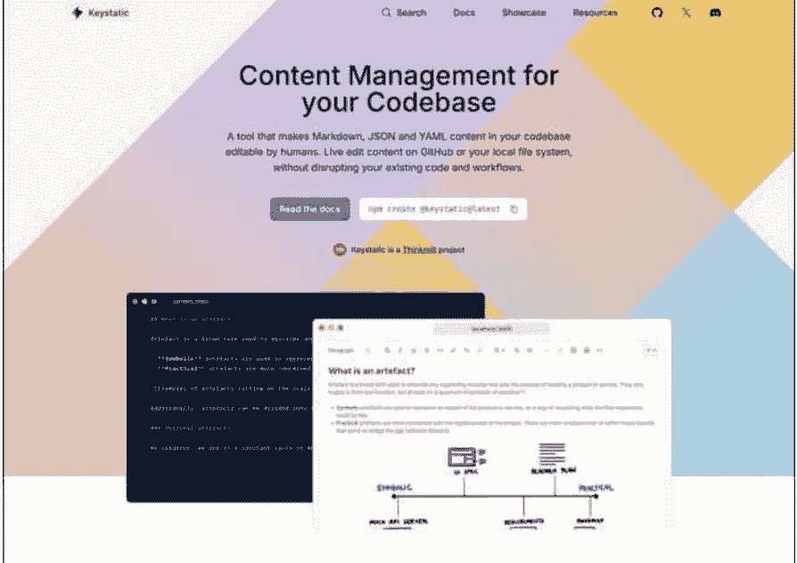

Keystatic的工作机制简洁而高效：内容编辑者在其界面中保存文章时，系统会在后台自动创建一个新的Git提交，并推送到GitHub仓库，进而触发Vercel的自动部署。这种设计的优势显著：内容与代码通过Git统一管理，拥有完整的版本控制；数据所有权明确。此外，Keystatic本身还具备开源免费的特点，进一步降低了使用门槛。因此，Keystatic非常适合由开发者主导内容生产的项目，例如技术博客、产品文档等。

###### Sanity：API驱动的协作式内容平台

Sanity的核心理念是将内容视为独立于代码的可协作的数据。所有内容存储在Sanity提供的专用、托管的实时数据库中，通过API进行访问。Sanity平台的主页面如图3-10所示。

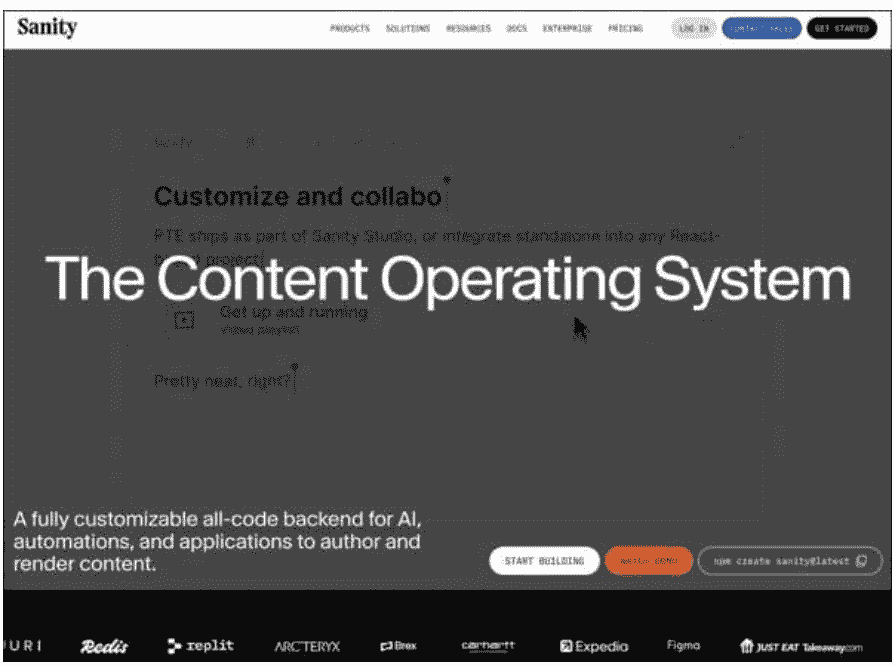

图3-10 Sanity平台的主页面

Sanity的工作机制和优势体现在3个核心方面。

- 在工作流程上，内容编辑者在Sanity Studio（一个高度可定制的编辑环境）中修改内容时，更改会实时保存在云端数据库中，应用可通过API在运行时获取最新内容，无须重新部署。
- Sanity具有显著的优势，比如支持实时协作、对非技术人员友好、内容发布与代码部署解耦（速度更快）、鼓励结构化内容且扩展性强。
- Sanity的免费额度非常慷慨，包含最多20个用户席位、10000个文档和每月100万次API CDN请求。

###### 最佳实践

要精准匹配内容管理需求，兼顾效率与扩展性，可通过以下实战导向的最佳实践来选择和使用Keystatic或Sanity。

- **确定主要内容编辑者：** 这是核心决策。如果开发者是主要创作者，Keystatic的Git原生工作流会更高效。如果计划让非技术背景的市场或运营团队管理内容，Sanity的卓越编辑体验和协作功能更具优势。
- **考量内容更新频率：** 如果内容更新非常频繁，Sanity的“内容与部署解耦”模型效率更高。对于更新频率较低的内容，Keystatic触发的自动部署完全可满足需求。
- **为结构化内容打下基础：** 无论选择哪款工具，都应从“结构化内容”的角度来规划。尝试将内容分解成更小的、有意义的数据块（标题、摘要、作者等），让内容在未来具备更强的灵活性和可重用性。

##### 支付：Stripe

当产品准备商业化时，你需要一个安全可靠的收款方式。自行处理信用卡信息极其复杂且不切实际，而Stripe是该领域的行业标准。Stripe是为互联网打造的支付基础设施，其主页面如图3-11所示。它提供了一整套强大的API和工具，让你能安全、便捷地接收来自全球客户的付款。它将支付相关的所有复杂性——从安全加密到欺诈预防——都封装成对开发者友好的平台。

###### 按需付费（Pay-As-You-Go）

Stripe对初创公司最大的吸引力在于其定价模型。对于标准支付处理，Stripe没有设置费，没有月使用费，仅在你成功盈利时，收取少量服务费，从而确保成本与收入的同步增长。


- **标准交易费：** 在线国内银行卡支付的标准费率通常为每笔成功交易金额的2.9%外加30美分（具体费率因地区而异）。
- **争议（退单）费**：这是一个需要注意的运营成本。如果客户对交易提出争议，Stripe会收取相应的处理费。

###### 最佳实践

要确保支付流程安全合规、数据同步可靠，同时提升集成效率，在使用Stripe时可遵循以下经过实战验证的最佳实践。

- **使用Stripe Checkout或Stripe Elements**：这是保障安全的黄金法则。永远不要让信用卡卡号等敏感信息接触自己的服务器。Stripe Checkout是由Stripe托管的预构建支付页面，集成速度最快。Stripe Elements是一组可嵌入的UI组件，能在自有网站构建自定义的支付表单，同时确保PCI合规性。
- **在“测试模式”下充分演练**：Stripe提供了功能完备的“测试模式”和多组测试信用卡卡号。在应用上线前，必须在测试模式下完整演练整个支付流程，确保应用能正确处理所有成功和失败的场景。
- **实现Webhook以确保数据同步**：Webhook是Stripe服务器在特定事件发生时（如订阅续费成功），向你的应用服务器发送的自动化通知。绝对不要只依赖前端跳转来确认支付状态，Webhook是确保系统状态与Stripe保持最终一致的唯一可靠方式。

#### 3. 生产力与设计工具

生产力与设计工具是提升开发效率、保障产品质量的辅助支撑，涵盖设计、代码管理、任务协作等场景，帮助你更高效地推进项目、落地想法。

##### 设计工具：Figma

在构建数字产品时，Figma就是你的“数字设计工作室”。它是一款基于云端的协作式设计工具，让“设计先于开发”这一黄金法则，变得前所未有的简单和高效。Figma平台的主页面如图3-12所示。


图3-12 Figma平台的主页面

对于非技术人员来说，Figma最大的价值就是提供了一种将抽象想法具象化的通用语言。你不需要懂得代码，就能在这里“画”出脑海中的应用界面，并将其转化为可点击、可交互的原型。

这个可交互的原型是创业早期最宝贵的资产之一。它能让你在投入开发前进行用户测试，能与开发者高效沟通，还能向投资者生动地展示你的愿景。

###### 免费额度

Figma的免费额度（称为Starter套餐）专为设计初学者和个人创作者量身打造，对独立创始人或小型团队而言已经足够强大。

- **文件限制**：每个“团队”可创建3个Figma设计文件和3个FigJam（在线白板）文件。
- **个人草稿区**：可以在个人“草稿”空间创建无限数量的文件，这也是它的核心优势。
- **无限协作者**：可以邀请无限数量的协作者查看和评论你的设计稿。

###### 最佳实践

要让Figma充分赋能设计流程，提升效率与专业性，可遵循以下实战技巧。

- **拥抱“原型”思维**：不要止步于创建静态的图片，Figma的核心优势之一是“原型”模式。建议投入时间学习如何链接不同的画板、为按钮添加点击交互，以打造让测试者有真实使用感的原型。
- **建立简单的“设计规范”**：即使项目规模很小，也要从第一天起就养成规范设计的习惯。在Figma中，将产品主色调、字体大小、按钮样式等定义为可复用的“组件”和“样式”，既能保证产品视觉的一致性和专业性，也能在后续设计调整时节省大量时间。
- **善用社区资源：** Figma拥有极其活跃的社区，汇聚了全世界设计师和公司分享的成千上万个免费资源，包括完整的UI设计套件、图标库等。在从零开始之前先搜索社区，大概率能找到高质量的模板，从而加速设计进程。

##### 代码管理工具：GitHub

你需要一个安全可靠、能完整记录每次修改的地方，存放项目所有代码和设计蓝图。在数字世界中，这个地方就是GitHub，如图3-13所示。

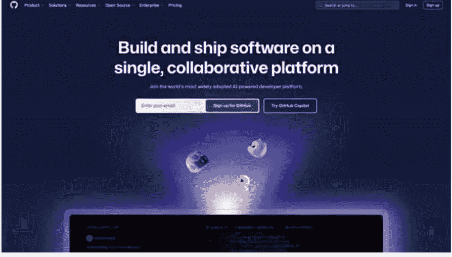

###### GitHub的核心角色：版本控制与协作中心

GitHub是全球最大的代码托管平台，核心功能是版本控制。你对项目所做的每一次修改，都会以“提交”（Commit）的形式记录下来。如果新功能出现问题，可以随时回溯到任意历史版本，如同读取游戏存档。

###### 免费额度

GitHub的免费额度对个人开发者和小型团队来说，几乎是无限制的。

- **无限的私有仓库：** 可以创建无数个不对外公开的“秘密项目”，存放你所有的商业代码和原型。
- **每月2000分钟的Actions计算时间：** GitHub Actions是一个内置的自动化工具，与Vercel搭配可构成强大的CI/CD自动化部署流水线。
- **500MB包存储空间：** 用于存放项目中可以重复使用的“零件”。

###### 最佳实践

要保障代码管理规范、协作高效，在使用GitHub时，可遵循以下最佳实践。

- **养成良好的“提交”习惯**：每完成一个独立的小功能或修复一个bug，就进行一次提交，并写下清晰有意义的说明（例如，“修复用户登录按钮在移动设备上的样式问题”）。
- **拥抱分支（branching）工作流**：永远不要直接在你的主分支（main）上开发新功能。为每个新功能或bug修复创建一个新的分支，在开发完成后通过“拉取请求”（Pull Request）将分支合并回主分支。这可以确保你的主分支始终是稳定、可部署的。
- **利用Issues进行任务管理**：GitHub内置了简单而强大的项目管理工具，可通过Issues功能记录bug、规划新功能或跟踪任务，足以替代许多复杂的第三方项目管理软件。

##### 生产力工具：飞书/Notion

创业过程中的灵感、任务、研究资料等信息如果散落在各处，很快就会变得难以管理。你需要一个“指挥中心”、一个“唯一的真相来源”，将所有信息整理成清晰、可执行的系统。这个角色由飞书（见图3-14）或Notion（见图3-15）这类“一体化工作空间”来承担。


图3-14 飞书的主页面


图3-15 Notion的主页面

飞书和Notion远不止单纯的笔记应用，它们的核心价值在于将文档、知识库、数据库与项目管理等多元工具深度整合，打造出一体化的工作协同空间。你可以借助它们搭建功能强大的结构化数据库，灵活管理任务列表、用户反馈、竞品分析、灵感记录等各类工作相关事务，让分散的信息高效聚合、有序流转。

###### 免费额度

无论是飞书还是Notion，它们的个人免费版功能都极其强大，足以满足独立创始人或早期小团队管理整个项目的需求。

- **Notion免费计划：** 对于个人使用，可以创建无限的页面和块；对于团队协作有一定的限制。
- **飞书基础版：** 为个人和小型团队提供了强大的协作功能，包括即时消息、云文档、日历和视频会议等，并提供高达100GB的总存储空间。

###### 最佳实践

要将飞书/Notion的管理价值最大化，提升工作效率，可参考以下实战技巧。

- **从模板（而非空白页）开始：** 最佳起步方式是利用它们丰富的模板库，搜索“产品路线图”或“轻量级CRM”等模板，根据你的需求进行修改，从而快速上手。
- **拥抱“数据库思维”：** 这是用好这类工具的关键。尝试将相关联的信息结构化到一个数据库中。例如，创建“任务总数据库”，然后在不同的页面创建该数据库的不同“视图”（如“分配给我的任务”），所有视图都源自同一个数据库，保持同步更新。
- **创建“项目唯一真相来源”仪表盘：** 在Notion或飞书中创建一个顶级的“项目仪表盘”页面，核心作用是指挥和导航，集中放置所有与项目相关的关键链接（GitHub仓库、Vercel部署地址、Figma设计稿、Supabase仪表盘等）。这个仪表盘将成为项目的“目录”，为你和未来的团队成员节省大量查找信息的时间。

### 3.1.3 五分钟实战：学习相关生产力工具

理论知识再多，也不如一次亲手实践。接下来的五分钟，我们将通过两个步骤，为你的数字帝国大厦筑牢最核心的两大工具根基。

第一步：认领你的数字蓝图库（创建GitHub账户）。

在浏览器中打开GitHub官网，点击右上角的Sign up按钮。按照提示输入电子邮箱，创建一个足够安全的密码，设定一个你喜欢的用户名，完成一个简单的人机验证。GitHub会向你的注册邮箱发送一个验证码，查收并输入验证码完成验证。在最后的个性化设置页面，可以直接点击Skip personalization（跳过个性化设置），直接开通免费账户。

恭喜，现在你已经拥有了一个全球顶级的代码托管账户。

第二步：启动你的全球发布平台（创建Vercel账户）。

在浏览器中打开Vercel官网，点击右上角的Sign up（注册）按钮。在注册选项中点击Continue with GitHub按钮，在弹出的授权窗口中，允许Vercel连接你刚创建的GitHub账户。

大功告成！你现在拥有了一个世界级、可自动扩展的全球应用发布平台。你无须为Vercel单独设置密码，它通过GitHub直接完成身份验证，完美体现了这套工具生态的无缝集成优势。

### 3.1.4 小结

短短五分钟，你就完成了一项在十年前可能需要专业人士耗费数天才能完成的任务——为初创项目搭建坚实的数字基础设施。

现在的你，已经拥有了与顶尖科技公司同款的“蓝图库”和“发布平台”。更重要的是，这一切的初始成本为零。你的创业之旅，已经从一个想法，正式转变为可操作的现实。

## 3.2 拥有你的数字身份：购买与配置域名

在互联网上拥有独一无二的在线“家园”，是建立个人或商业品牌的关键一步。就像真实的家需要清晰的门牌号一样，这个数字家园也需要专属标识——域名，让他人轻松找到你。域名不仅是网站的地址，更是你在数字世界中的专属名片，是构建数字身份的起点。这个过程看似有技术门槛，实则概念和操作远比想象中简单。

### 3.2.1 什么是域名

要理解域名，可以将其类比为互联网上的一个“家”：

- 网站运行需要“土地”，也就是“网站托管”（或“虚拟主机”），它是网站正常运转的基础，如同房屋的地基；
- 有了“土地”，还需要独一无二的“地址”，这就是域名，访客能够通过它精准找到你的网站。

两者相辅相成，缺一不可。例如，百度的域名是baidu.com，而epubit.com是另一个专属“门牌号”，用户只需在浏览器中输入网站的域名，就能通过浏览器查看网站内容。

#### 1. 域名与IP地址的关系

在互联网幕后，所有网站都对应着一串复杂的数字——IP地址（例如192.153.xxx.xxx）。它就像是房屋在地图上的经纬度坐标，定位精准但人类难以记忆和使用。

域名系统（DNS）扮演了“翻译官”的角色，相当于庞大的地址簿，将这些难以记忆的IP地址，转换成人们更容易理解和记忆的域名。当用户在浏览器中输入godaddy.com这样的域名时，DNS会迅速查找并识别其对应的IP地址，引导用户访问正确的网站服务器。

这种机制大大简化了互联网的访问过程，降低了用户的操作难度，显著提升了使用体验。同时，简易的域名也能提高网站的回访率，对想要建立在线存在感的初学者来说意义重大。

#### 2. 域名的构成

域名主要由两部分构成。

- **第二级域名（SLD）**：这是域名中用户可以自定义的部分，通常出现在www.之后。比如godaddy.com中的godaddy就是第二级域名。第二级域名是展现品牌个性与创意的关键。
- **顶级域名（TLD）**：域名的最后一部分，即后缀，相当于地址中的“类别”或“国家/地区”标识。顶级域名主要分为3类。
    - **通用顶级域名（gTLD）**：最常见的类型，.com（多用于商业网站）、.org（多用于非营利组织）和.net（多用于网络服务提供商）均在此列。其中，.com是最广为人知且最受信任的顶级域名。
    - **国家/地区代码顶级域名（ccTLD）**：代表特定的国家或地区，如.us（美国）、.uk（英国）和.cn（中国）。如果业务的目标受众集中在特定的地理区域，选择对应的国家/地区代码顶级域名会更有优势。
    - **新通用顶级域名（new gTLD）**：近年来涌现的创意后缀，如.photography、.media、.shop、.ai、.store和.app等。这些新颖的后缀能够让域名更具特色，还能直观体现网站的业务类型。

需要注意的是，域名不等于URL（统一资源定位符）。域名是网站的“主地址”（如google.com），而URL则是具体页面或资源的“详细地址”，包含协议（如https://）、域名和具体的路径（如https://www.godaddy.com/help/set-up-my-domain-40634）。因此，域名是URL的组成部分。

此外，网站还可以使用子域名，子域名相当于“大房子里的小房间”，如blog.example.com或shop.example.com，可用于划分网站功能区域，或搭建开发、测试环境。

#### 3. 拥有专属域名的价值

专属域名是个人或企业在数字世界中的战略性长期投资，价值远超简单的“网址”。

- **建立专业品牌形象**：像yourname.com这样的自定义域名，能快速提升个人或企业的专业度和可信度，向外界传递出严肃认真的信号。
- **提升信任感知**：清晰易记的专属域名能给潜在客户留下好印象。而yourbusiness.hostsite.com这类免费子域名，容易显得不够正式，让对方可产生不信任感。
- **掌控在线身份**：拥有自己的域名，意味着能完全掌控网站的外观、内容和呈现方式，不受第三方平台规则的束缚。
- **提升记忆与访问效率**：简短好记的域名能让潜在用户更容易找到并记住你的网站，进而提高回访率。
- **配置专业邮箱**：注册域名后，可创建像info@yourbusiness.com这类专业的邮箱地址。相比通用邮箱，这种自定义的专业邮箱更能强化品牌形象，赢得客户信任。
- **间接助力SEO**：尽管域名不再是搜索引擎排名的直接决定因素，但与业务高度相关、包含关键词的域名，能帮助用户和搜索引擎更好地理解网站内容，间接提升搜索曝光机会。
- **保护数字资产：** 即使目前尚未准备好全面搭建网站，提前注册理想的域名也能有效防止他人抢注，为未来发展预留空间。
- **高性价比营销：** 域名年度注册费用通常比较低廉，却能像7×24不间断的广告牌，持续为业务引流，性价比远超传统的广告。

综上，域名是打造数字身份的“地基”，购买域名不应只视为“买一个网址”，而应看作对自身数字未来的战略性投资。

### 3.2.2 如何选择一个好域名

选择一个好的域名是打造成功在线形象的关键。一个精心挑选的域名不仅易于记忆传播，还能有效提升品牌形象和用户信任。以下是选择域名时的核心考量因素。

#### 1. 简短、易记、易拼且顺口

理想的域名应满足“简短、好记、易拼写、发音顺”的特点。过长或复杂的域名会增加用户输入错误的几率。例如，如果一个域名难以通过电话口述，或者包含容易混淆的字母组合，可能会让用户沮丧并放弃访问。同时，域名应避免使用非常规拼写（如用u代替you）和容易导致无意合并的单词（如Children’s wear变成childrenswear）。

#### 2. 突出品牌化，保证独特性

在数百万个已注册的域名中，独特且有品牌识别度的域名至关重要。好的品牌化域名通常简短，朗朗上口，发音流畅。在确定域名之前需做好调研，确保所选名称未被他人注册，以避免法律纠纷。同时，检查该名称在主要社交媒体平台上的可用性，确保品牌在线形象的一致性。

#### 3. 避免数字、连字符，严禁空格

避免在域名中使用数字和连字符（-）：数字容易引起混淆（用户可能不确定是输入5还是five），连字符容易被遗忘或放错位置，两者都会增加拼写错误的几率，且在移动设备上输入时会更烦琐。需要特别强调的是，域名中绝对不能包含空格，否则浏览器会自动转换为%20字符，既不规范也影响观感。

#### 4. 合理嵌入关键词

在域名中包含与业务或行业相关的关键词，能让用户快速理解网站核心内容。比如，如果经营玻璃维修业务，可考虑注册GlassRepair.com或GlassReplacement.com。尽管关键词不再是搜索引擎排名的直接因素，但能帮助用户识别网站主题，间接提升搜索引擎的可见度。但是，需要避免过度堆砌关键词，否则会显得不自然，甚至被判定为垃圾信息。

#### 5. 选对顶级域名

顶级域名（TLD）的选择影响显著。.com仍是全球使用最广泛、信任度最高的后缀。如果目标受众集中在特定区域，选择.cn、.uk或.us等国家/地区代码顶级域名，可以增强本地化SEO的效果，向搜索引擎明确网站的地域关联性。此外，.store、.blog、.shop、.ai等新的通用顶级域名提供了更多选择，可以让域名更贴合业务性质。

#### 6. 兼顾长期发展与灵活性

选择一个域名时，应具备长远眼光，确保能适应未来的业务扩展。例如，如果一家花店最初选择cityflowers.com作为域名，若后续拓展到园艺产品，这个域名可能会显得局限。而cityblooms.com这类更具品牌化、包容性的名称，能为产品线的拓展预留更大的空间。

#### 7. 充分调研，果断注册

最终确定域名之前，需完成两项关键的调研：一是核查商标、版权问题，二是调查域名历史记录，以避免购买到曾用于垃圾邮件或遭受搜索引擎惩罚的域名——这类域名会影响未来的品牌声誉和搜索引擎表现。好域名供不应求，一旦确定了理想的域名，需尽快注册，以免被他人抢先。

总而言之，一个好的域名兼顾易记性、易拼写性与品牌相关性，这直接影响着用户的记忆和信任。虽然关键词不再是SEO的直接排名因素，但相关且描述性的域名仍然有助于用户理解网站内容，间接提升搜索的可见度。同时，灵活的域名能随业务迭代而持续发挥作用，确保其长期价值不受影响。

### 3.2.3 五分钟实战：使用域名生成器进行头脑风暴

选择一个完美的域名并非易事，但免费的域名生成器可以帮助你高效进行头脑风暴，找到符合需求的域名。这类工具通常支持输入关键词，生成大量相关的域名建议，并实时检查其可用性。

使用域名生成器进行头脑风暴的步骤如下。

1.  确定核心关键词。先梳理与网站或业务最相关的核心关键词。比如，如果计划创建关于烘焙的博客，可提炼“烘焙”“甜点”“食谱”等关键词。
2.  挑选合适的域名生成器。市面上有许多优秀的免费域名生成器，这些工具各有特点，可以多尝试几个。例如Nameboy、Squarespace Domain Name Generator、Hostinger Domain Name Generator、Instant Domain Search等。
3.  输入关键词并生成建议。在选定的生成器中输入关键词（有些工具支持1～2个关键词，有些则允许更长的描述），点击“生成”或“搜索”按钮，即可获取批量域名建议。
4.  利用筛选器细化结果。许多生成器提供筛选功能，可以根据域名长度、单词数量、行业、风格（如“朗朗上口”或“品牌化”）等条件，缩小搜索范围，精准匹配需求。
5.  检查域名可用性。生成器通常会直接显示每个域名的注册状态。如果心仪的域名已被占用，工具还会提供替代方案或推荐不同的顶级域名。
6.  记录并按标准评估。将所有心仪的域名记录下来，然后对照前文提到的好域名的选择标准，逐一评估是否简短易记，是否易拼写，是否具有品牌潜力，是否避免了数字和连字符等，最终筛选出最优选项。

### 3.2.4 选择域名注册商

选择合适的域名注册商是购买域名的关键决策，因为它将直接影响域名的管理体验、长期使用成本与安全性。以下是选择域名注册商时需要重点考虑的几个关键因素。

#### 1. 信誉与资质

务必选择具有良好信誉且获得ICANN（互联网名称与数字地址分配机构）认证的注册商。ICANN认证是注册商合规运营的核心保障，能避免遭遇虚假服务商或域名被盗的风险。

#### 2. 透明的价格结构

域名注册商通常会推出诱人的首年注册价，但更需要关注续费价格。不少注册商在首年优惠结束后，续费价格会大幅上涨。因此在做出决定之前，需要对比不同注册商的初始价与续费价格，综合评估长期使用成本，避免后期面临高价续费压力。

#### 3. 隐私保护

当注册域名时，个人信息（如姓名、地址、邮箱）会默认公开存储在WHOIS数据库中，容易导致垃圾邮件侵扰、恶意骚扰等问题。多数注册商会提供WHOIS隐私保护服务，用自身的联系方式替代用户真实信息，具体分为两种。

-   免费提供：Namecheap、Dynadot、Porkbun和GoDaddy等注册商，会将WHOIS隐私保护作为标准服务免费提供。
-   额外收费：部分注册商将该功能设为付费服务，用户需单独付费方可使用。

在选择注册商时，需明确注册商的隐私保护政策与费用，优先选择免费提供该服务的注册商。

#### 4. 客户支持

对于非技术背景的初学者来说，可靠的客户支持至关重要。选择7×24全天候支持的注册商，并确认其支持渠道（如实时聊天、电子邮件或电话）。良好的客户支持能在域名管理遭遇问题时节省大量时间，比如GoDaddy在电话支持方面口碑突出，而Namecheap则以其快速的实时聊天响应和丰富的帮助文档见长。

#### 5. 用户界面与功能

优先选择界面友好的平台，这可以让域名搜索和管理过程更加顺畅。理想的注册商应提供直观的域名搜索工具，包含筛选功能，且在首选域名不可用时提供合理的替代建议，降低筛选成本。

#### 6. 域名扩展名（TLD）种类

注册商提供的TLD种类越多，越容易找到契合品牌的域名。部分注册商支持数百种TLD选项，涵盖通用、国家/地区代码、新通用顶级域名等，能满足不同业务场景的需求。

#### 7. 附加服务与捆绑销售

多数注册商会捆绑销售网站托管、SSL证书、专业邮箱等附加服务，虽然一站式购买较便捷，但需要注意的是，在本书的实战环节，我们基本不需要购买这些额外的付费服务。

#### 8. 域名转移政策与自动续费

了解注册商的域名转移政策也很重要，以防未来因需求变更需转移域名时遭遇限制。同时，务必开启域名的自动续费功能，或设置到期提醒，以避免因忘记续费而导致域名过期，从而面临高额的恢复费用甚至被他人抢注的风险。

综上所述，选择最佳域名注册商需结合自身的需求和预算。不应仅仅关注初始价格，更要深入了解长期成本（特别是续费价格）、核心的隐私保护功能以及可靠的客户支持。

### 3.2.5 五分钟实战：在选定的注册商上完成域名购买流程

完成域名购买是拥有数字身份的关键一步。下面以GoDaddy和Namecheap为例，详细说明购买域名的具体流程。尽管不同注册商的界面可能略有差异，但核心流程是相似的。

#### 1. 通过GoDaddy购买域名

GoDaddy是全球最大的域名注册商之一，以界面友好、客户支持全面著称。以下是在GoDaddy上购买域名的详细步骤。

1.  访问GoDaddy网站，在首页搜索栏输入心仪的域名，点击Search Domains。
2.  如果域名可用，系统会提示你可以将其添加到购物车。如果已被注册，系统会推荐替代方案。
3.  确认心仪的域名后，点击该域名对应的Add to Cart按钮。
4.  购物车页面会提示你选择一些附加服务，比如域名隐私保护服务。该服务是GoDaddy免费提供的，强烈建议选择。
5.  再次点击Continue to cart按钮。
6.  在弹出的页面中填写账单和支付信息。
7.  核对订单详情，包括域名名称、注册年限和总费用，确认无误后购买结账即可。

#### 2. 通过Namecheap购买域名

Namecheap是另一个备受推崇的域名注册商，以定价透明、WHOIS隐私保护免费和客户服务优质而备受推崇。以下是在Namecheap上购买域名的详细步骤。

1.  访问Namecheap网站，在首页搜索栏中输入心仪的域名，点击Search。
2.  找到可用域名后，点击右侧的Add to cart按钮。
3.  在弹出的窗口中，系统会提示你选择附加产品（如网站托管、SSL证书等）。根据需要选择后点击View Items进入购物车。
4.  在结账页面确认域名的WHOIS隐私设置（默认免费开启）和DNS设置，选择支付方式。
5.  核对所有信息无误后，点击支付完成订单。

#### 3. 避免购买域名时的常见问题

在购买域名时，初学者应避免以下常见问题。

-   **未检查可用性：** 务必使用注册商的搜索工具确认域名是否已被注册。
-   **选择过长/难记的域名：** 这会增加用户输入错误的几率和记忆难度，影响访问率。
-   **从非正规卖家购买：** 务必选择得到ICANN认证、信誉良好注册商。
-   **支付过高的费用：** 域名年费通常在15美元左右，如果发现价格过高，应多方比价。同时，警惕“首年低价、续费天价”的陷阱。
-   **忘记续费：** 务必开启自动续费功能，并确保注册邮箱、支付信息始终最新。

通过遵循这些步骤并避免常见错误，就可以顺利地购买到心仪的域名，为在线旅程筑牢基础。

### 3.2.6 五分钟实战：将域名连接到Vercel项目

购买域名后，需要将其与Vercel上的网站项目关联起来。这里的核心是配置域名的DNS记录。

#### 1. 理解DNS记录

在将域名连接到Vercel项目时，主要用到两种DNS记录，两者分工明确。

-   **A记录（Address Record）：** 将顶级域名（又称根域名，如yourdomain.com）指向特定的IP地址。
-   **CNAME记录（Canonical Name Record）：** 将子域名（如blog.yourdomain.com、www.yourdomain.com）指向另一个域名（而非IP地址）。

DNS配置是域名与网站服务器之间的桥梁，正确选择并配置A记录或CNAME记录，是网站顺利访问的关键。

#### 2. 将域名连接到Vercel项目

以下是将域名连接到Vercel项目的详细步骤（这里以第三方注册商GoDaddy为例）。

**第一步：在Vercel项目中添加域名。**

登录你的Vercel账户，进入需要连接域名的目标项目，点击“设置”（Settings）选项卡，然后选择“域名”（Domains）。接着点击“添加域名”（Add Domain），输入购买的域名（例如yourdomain.com）并完成确认。

Vercel会根据添加的域名类型自动匹配相应的DNS配置值。如果是顶级域名，系统会提供A记录所需的IP地址；如果是子域名，则会给出CNAME记录对应的值。请务必记下这些配置值，在后续的步骤中会用到它们。

**第二步：在域名注册商处配置DNS记录。**

登录你的GoDaddy账户，找到你购买的域名，点击其对应的“DNS”或“管理DNS”选项，进入配置页面。

首先配置A记录。在DNS记录列表中找到类型为A、名称为“@”的记录，点击“编辑”按钮，将“值”字段替换为Vercel提供的IP地址，保存更改后，用户直接访问你的域名时，就能正确跳转到Vercel托管的网站。

接着配置CNAME记录。找到类型为CNAME、名称为www的记录，点击“编辑”，将“值”字段替换为Vercel提供的CNAME值（通常是cname.vercel-dns.com），然后保存更改。这样，无论用户是输入yourdomain.com还是www.yourdomain.com，都能正确访问网站。

**第三步：等待DNS传播生效。**

完成上述所有配置后，返回Vercel项目的“域名”设置页面。

DNS更改需要在全球范围内传播（即DNS传播），这个过程耗时不等，快则几分钟，慢则需要48小时，具体取决于各地DNS服务器缓存的更新速度。

在DNS传播期间，访问域名可能会出现“无法访问”或“页面未找到”等错误提示，这是完全正常的现象，不必担心。你可通过在线DNS检查工具监控传播进度，或定期尝试访问域名来确认状态。

一旦Vercel界面显示域名状态为“已就绪”（Ready），说明配置成功，网站即可通过自定义域名正常访问。

#### 3. 注意事项与故障排除

在域名与Vercel项目的连接过程中，需提前了解几个关键注意事项，并掌握常见问题的排查方向，确保整个流程顺利推进。

**特殊情况：域名在Vercel内购买**

如果域名未通过GoDaddy等第三方注册商购买，而是直接在Vercel平台内购买的，那么无须手动配置上述DNS记录，Vercel会自动完成域名与项目的关联，省去手动设置的步骤。

**安全保障：自动配置SSL证书**

无论域名来自第三方注册商还是从Vercel官方购买，成功连接后，Vercel都会自动为域名颁发并持续管理SSL证书，无须开发者额外申请或配置，即可通过HTTPS实现安全访问，保障用户数据传输安全。

**故障排查：常见问题解决**

若在操作过程中遇到域名无法正常关联、访问报错等问题，可参考Vercel平台官方故障排除指南。优先排查以下高频原因。

-   **DNS记录配置错误**：核对IP地址、CNAME值等参数是否填写准确。
-   **DNS传播未完成**：耐心等待最长48小时的全球生效时间。
-   **域名已被绑定**：确认域名是否已关联其他Vercel账户，需先解除绑定再操作。

DNS配置是域名与网站服务器连接的核心环节，而DNS传播延迟是最常见且不可避免的情况。提前了解这一特性，合理预期延迟时间，能有效提升网站上线的顺畅体验。

### 3.2.7 小结

拥有并配置一个专属域名，是个人或企业在数字时代建立独特在线身份的基石。本章从域名的基本概念出发，将其比喻为网站在互联网上的“门牌号”，并阐明了它如何通过域名系统（DNS）将复杂的IP地址转化为人类易记的名称。

域名不仅是一个技术层面的地址，更是一项具有多重战略价值的数字资产。一个精心选择的域名能够提升品牌专业度，建立用户信任，让你完全掌控在线形象，还是一种高性价比的营销工具。在选择域名时，应优先考虑其简短性、易记性、品牌相关性，并兼顾长期发展潜力。

选择合适的域名注册商同样关键。除了关注首年注册价，更要深入比较续费价格、WHOIS隐私保护政策以及客户支持质量。对于初学者而言，界面友好、支持可靠的注册商，其综合价值往往高于单纯的低价选项。

最后，将购买的域名与部署在Vercel等平台上的网站项目连接起来，是网站上线的最后一步。理解A记录和CNAME记录的作用，做好细致的配置并保持耐心，就能为自己的数字家园挂上专属的“门牌号”，正式开启其在线旅程。

## 3.3 Supabase深度实战：构建你的数字总部

你有一个绝妙的商业点子——可能是一个创新的在线社区、一个高效的项目管理工具，也可是一个精美的个人作品集网站。你已打造好华丽的“店面”（前端用户界面），它看起来界面精美、交互流畅，但新的问题接踵而至：用户的注册信息存放在哪里？用户发布的内容如何安全保管？商品库存怎样实时更新？谁能查看后台的销售数据？

这些问题的答案，都指向应用背后的核心——后端。后端是数字业务的“后勤部”“安保部”“档案室”和“中央机房”的集合体。在传统模式下，搭建这样的“总部”需要雇用昂贵的工程师团队，从系统设计、服务器配置、数据库搭建，到编写业务逻辑和安全规则，整个过程耗时数月甚至数年，成本高得令人却步。

这正是无数创业者和创造者望而却步的鸿沟。但今天，我们将要跨越这道鸿沟——借助革命性的工具Supabase，开启全新的构建范式。你不需要从零开始混合水泥、烧制砖块，Supabase已为你准备好顶级的模块化“总部建筑套件”。你只需要像拼搭积木一样，按自己的蓝图组合这些强大的模块，几小时内就能拥有一个世界级的数字总部。

在本节中，我们将以“构建数字总部”为核心比喻，带你来一次完整的Supabase工具链实战。我们会一起为这个总部进行“落成典礼”（了解Supabase是什么）、巡视“核心部门”（核心功能解析），再亲手为它添置“文件柜”（创建数据表）、建立“部门联系”（理解表关系）、设置“门禁系统”（用户认证）、部署“安保条例”（行级安全），并启用它的“中央仓库和全球物流系统”（文件存储）。

### 3.3.1 开源后端时代：Supabase全景解析

在正式动工之前，先全面认识一下我们的“建筑材料”——Supabase：它是什么、由哪些部分组成，以及为何是构建数字总部的最佳选择。

用专业术语来说，Supabase是开源的后端即服务（BaaS）平台。我们用“数字总部”的比喻来拆解它。

假设你要成立一家公司，需要办公总部。传统做法是买地、设计、建造；而BaaS就像专业的商业地产公司，已建好设施齐全的现代化办公楼。你不用关心大楼结构、水电、网络，只需“拎包入驻”，租用办公室就能开工。BaaS就是数字世界中的这种服务，它把数据库、用户认证、文件存储等复杂的后端基础设施打包成现成的服务，让你直接使用，大幅节省时间和成本。

BaaS领域有一个非常著名的市场领先者——Google旗下的Firebase，它功能强大、稳定可靠，如同位于市中心黄金地段的顶级写字楼。但它是“专有”或“闭源”的，这意味着作为租客，你永远看不到大楼的建筑图纸，无法定制改造其结构。更重要的是，你所有的业务和数据会深度绑定在这个平台上。一旦服务商决定大幅涨价或改变服务条款，“搬家”会是一项极其痛苦复杂的工程（这在行业里称为“供应商锁定”）。

现在，Supabase登场了。它将自己明确定位为“Firebase的开源替代方案”，这里的核心关键词是“开源”。

如果说使用Firebase是租用一个你无法改变的办公室，那么使用Supabase就好比从一家顶级的建筑公司那里，不仅拿到了一座预制好的、功能完备的总部大楼，还获得了一整套完整详细的建筑图纸。

“开源”意味着：

-   透明性——你可以查看每一处“墙体”的“钢筋结构”，了解每个系统的运作逻辑，没有任何黑箱操作；
-   控制权——手握图纸，理论上你可以对大楼进行任何想要的改造；
-   自由度——这是最关键的一点，如果你对Supabase官方提供的云托管平台不满意，或业务发展到一定规模，希望拥有完全独立的掌控权，你可以带着图纸将整个“数字总部”原封不动地“搬迁”到自己的服务器上（即“私有化部署”或“自托管”）。你永远拥有“退路”，彻底摆脱了“供应商锁定”的风险。

这背后反映了软件开发领域的重要潮流：从依赖大型科技公司提供的封闭服务，转向拥抱开放、透明、赋予开发者最大自由度的解决方案。对于非技术背景的创始人而言，这意味着公司的核心命脉——数据和后端基础设施，不再只掌握在某一个科技巨头手中，你真正拥有了“数字资产所有权”。

#### 1. 核心功能模块

现在，我们走进这座崭新的“数字总部”，看看它都配备了哪些开箱即用、协同联动的“核心部门”和“基础设施”——它们将为我们的数字业务提供全方位的支持。

##### 数据库：总部的中央档案室

在探索Supabase的各个功能模块之前，我们先聚焦最核心的部分——数据库。毕竟，无论前端界面多么华丽，最终都需要一个可靠的载体来存储和管理数据。

-   **总部比喻：** 这是数字总部的“心脏”，一个巨大、安全且井然有序的中央档案室。公司所有的核心信息都以结构化的形式放在这里。每一个“数据表”（table）如同贴有清晰标签的文件柜，文件柜中的每一行（row）数据，都是一份具体的档案。
-   **技术内涵：** Supabase数据库基于“世界上最先进的开源关系型数据库”PostgreSQL构建。PostgreSQL拥有30余年的历史，以稳定、强大的功能和极高的可靠性而闻名。选择Supabase，意味着你的数据从一开始就存放在了一个金融级别、久经考验的系统中。

##### 用户认证：总部的安全前台与门禁系统

有了安全可靠的“中央档案室”，还需要确保只有授权人员才能进入数字总部。这就需要一套完善的身份验证和访问控制系统。

-   **总部比喻：** 这是总部门口的安保前台，配备了一套高科技的身份识别与门禁系统。它负责管理所有人员的进出：办理“入职手续”（注册）、验证“员工ID卡”（登录），并精细管控不同级别的员工可以访问的区域（权限管理）。
-   **技术内涵：** Supabase Auth大幅简化了这套复杂的安保系统，它原生地支持邮箱密码登录、魔法链接（Magic Link），以及Google、GitHub等社交媒体一键登录。你只需在后台进行简单配置，就能灵活开启或关闭各类登录方式。

##### API：总部的内部通信网络

在安全的“中央档案室”和完善的“门禁系统”就位后，数字总部还需要一套高效的内部通信网络，确保各个部门之间能够顺畅地交换信息。这就是API的作用所在。

-   **总部比喻：** API是总部的内外通信系统，如同“内部电话”和“邮件收发室”。当“公司大堂”（前端应用）需要从“中央档案室”（数据库）获取或提交信息时，通过API发起请求，经身份和权限核实后，由API返回相应结果，确保了信息交换的有序和安全。
-   **技术内涵：** 这是Supabase的一个强大特性。当你创建好一个“数据表”的瞬间，Supabase就会自动为其配置好一整套安全、标准的RESTful API。这省去了传统开发中工程师编写接口代码的大量时间，实现了效率的提升。

##### 实时订阅：总部的实时监控中心

现代数字业务的一个核心需求是“实时性”——用户期望获取最新的信息，无论是社交媒体的新消息、协作文档的实时编辑，还是电商平台的库存更新，都需要数字总部具备强大的“实时感知”能力。

-   **总部比喻：** 想象在总部安保中心内有一面巨大的实时监控屏，大楼各处动态尽收眼底——中央档案室存入新文件，前台迎来新访客，所有变化都能即时捕捉。
-   **技术内涵：** Supabase的实时引擎依托PostgreSQL的日志监听功能，紧密监控数据库的各类变动。一旦数据被创建、更新或删除，系统会立刻捕捉到这个信号，并通过WebSocket广播。

##### 云函数：总部的自动化智能助理

除了这些核心的基础设施，数字总部还需要一些“智能化”的后台服务，以处理那些复杂的业务逻辑和自动化任务——这正是云函数的用武之地。

- **总部比喻：** 云函数是总部的“机器人助理团队”，在后台自动执行预设任务——新用户注册时发送欢迎邮件，每日午夜生成销售报表，无须人工干预即可高效运转。
- **技术内涵：** Supabase Functions允许编写独立的服务器端代码（目前兼容TypeScript/JavaScript），这些代码片段就是你的“机器人助理”，专门处理这些异步、自动化的后台任务，让数字总部能够7×24智能、高效地运转。

##### 文件存储：总部的安全仓库与全球物流服务

最后，数字总部还需要专门的空间，存储和管理Logo图片、员工头像、产品视频等“非结构化”数字资产——这就是文件存储系统的价值。

- **总部比喻：** 除了“档案室”，总部还需要一个巨大、安全的“中央仓库”，存放各类非结构化的“物品”，满足多样化资产存储需求。
- **技术内涵：** Supabase Storage不仅提供了这个“仓库”，更捆绑了内容分发网络（CDN）服务。CDN如同一个覆盖全球的超级物流网络，当文件存入中央仓库后，CDN会自动把文件的副本分发至世界各地的“前置节点”。当海外用户需要访问文件时，系统会自动从离他最近的节点调取文件，极大地提升了文件的加载速度和用户体验。

为了更直观地理解这些核心模块，我们梳理了表3-2，供你快速对照参考。

表3-2 数字总部部门导览

| Supabase功能模块 | 数字总部核心部门比喻 |
| :--- | :--- |
| 数据库 (Database) | 中央档案室 (基于坚固的PostgreSQL构建) |
| 用户认证 (Auth) | 安全前台与门禁系统 |
| API | 内部通信网络 (电话与邮件系统) |
| 实时 (Realtime) 订阅 | 实时监控中心 (实时信息流) |
| 云函数 (Function) | 自动化智能助理 (机器人服务团队) |
| 文件存储 (Storage) | 安全仓库与全球物流服务 (自带CDN) |

通过这次全面巡览，相信你已经对这座“数字总部”的强大功能有了全面清晰的认识。接下来，我们将讨论为什么在众多选择中，Supabase是最适合的那个。

#### 2. 为什么选择Supabase

在决定为你的事业建造“数字总部”时，你会面临一个关键的战略抉择。市面上有几种主流的“建造方案”，对其进行分析后你就明白为什么Supabase是最明智的选择。

第一种方案是从零自主建造。这相当于雇用庞大的工程师团队，从零搭建总部大楼。虽然这样做能拥有100%的控制权，每一个细节都可以定制，但代价是高昂的成本与漫长的开发周期，需要投入大量时间和资金，风险极高。对于绝大多数初创企业和个人创造者来说，这几乎是不可能的。

第二种是使用闭源BaaS平台，比如Google的Firebase。这就像入驻设施顶级、服务一流的商务中心，签约后立刻就能拥有功能完备的办公室，快速开展业务。它的优势在于启动速度快、服务稳定可靠，让你能专注于核心业务。但核心问题是“你是租客而非业主”，你必须遵守服务商的所有规则，无法改动其内部结构。更致命的是“供应商锁定”风险——如果有一天服务涨价，或者服务商决定关闭某项你高度依赖的功能，你将陷入被动，迁移成本极高。

而我们选择的Supabase方案，好比一家顶尖的建筑科技公司提供的“预制化总部模块”，可以像搭积木一样快速组装。它完美地融合了前两种方案的优点，同时也规避了它们的缺点：在速度与便利性上，与Firebase一样能快速启动运行；最关键的区别在于所有权与控制权——你不仅拿到了预制好的大楼，还拥有完整的“建筑图纸”，掌握最终的控制权，这意味着你有随时“搬家”的自由。未来业务发展壮大或对Supabase官方的云服务不满意时，你可以带着图纸，将数字总部迁移到任何服务器，彻底消除“供应商锁定”的后顾之忧。

这个选择的背后，隐藏着对于非技术创始人至关重要的深层逻辑：Supabase本质上是一款风险管理工具。

创办数字业务本身就充满不确定性。选择Firebase这类封闭平台，会增加“平台风险”；从零构建，则要面对巨大的“执行风险”。而Supabase凭借“开源”和“基于PostgreSQL开放标准”的特性，巧妙化解了这两种风险。它足够快，让你能迅速将产品推向市场，降低了“执行风险”；同时又提供了永远敞开的“逃生通道”（自托管能力），降低了“平台风险”。

#### 3. 系统架构剖析：以PostgreSQL为核心的服务生态

在结束导览前，让我们来看一眼这座“数字总部”的核心“总设计蓝图”。

许多同类平台的架构可能是多种技术的拼凑——用技术A做数据库，用技术B做用户认证，再用技术C做实时通信，最后用大量集成代码进行黏合。这种方式容易导致系统内部不一致，学习曲线陡峭，还可能出现兼容性问题。

Supabase采取了一种更为优雅和坚固的架构理念：万物基于PostgreSQL。所有核心功能模块都不是独立于数据库的外部挂件，而是从PostgreSQL这根“主干”上生长出的原生“枝干”。

- **API网关**：直接读取数据库结构，自动翻译成标准的API接口。
- **用户认证系统**：巧妙利用PostgreSQL内部且经数十年验证的“角色和权限管理”机制。
- **实时订阅引擎：** 直接订阅PostgreSQL内部的“预写日志”——这是数据库记录自身所有变更的官方渠道，效率极高。
- **行级安全：** 这是PostgreSQL数据库的一个核心特性，Supabase仅提供友好的图形界面，就能让你轻松配置强大的数据库原生安全策略。

这样的设计带来了几个巨大的好处。

- **一致性与稳定性：** 所有核心功能都源于同一坚实内核，系统表现出极高的一致性和稳定性。
- **高性能：** 许多操作直接在数据库层面完成，借力PostgreSQL数十年优化的强大性能。
- **知识的复用与增值：** 这一点对于初学者尤其宝贵——学习Supabase的过程，其实是在潜移默化中掌握PostgreSQL这个未来数十年都极具价值的通用技术。你学到的数据结构、关系、安全策略等知识，都是可迁移的硬技能。

我们的“总部导览”到此结束。现在，理论学习已经足够，是时候亲手为我们的数字总部添置第一件“家具”了。

### 3.3.2 五分钟实战：在仪表盘中创建数据表

我们新落成的“数字总部”还空空如也，第一个任务是为“中央档案室”（数据库）打造第一个定制的“文件柜”——专门存放公司所有“项目”信息的数据表，将其命名为projects。

在动手之前先明确几个核心概念：“数据表”（table）本质上是一个结构化的电子表格——表格文件本身就是存储一类信息的整体容器；顶部的“表头”对应“列”（column），用于定义信息类别（如“项目名称”“截止日期”“负责人”等），每一列还会明确规定数据类型（如文本、日期等），以确保格式统一；表格中的每一行（row）对应一条完整的个体记录，包含该个体的全部相关信息。

在理解了这些基础概念后，我们就可以动手创建数据表了。

1. 登录Supabase账户，进入项目仪表盘，会看到类似“总部管理办公室”的操作界面，这是后续所有配置的核心入口。
2. 在左侧的垂直导航栏中，找到带有表格图标的Table Editor（表格编辑器），这是进入“中央档案室”的入口，点击进入数据表管理页面。
3. 页面中出现一个Create a table（创建一个表）按钮，点击启动“文件柜”的创建流程。
4. 为“文件柜”命名：在Name（名称）字段中输入projects（数据库领域习惯用小写命名表名，便于后续协作）；可在Description（描述）字段中添加备注（如“用于存放公司所有项目”），方便后续快速了解表的用途。
5. 命名完成后，就要设计“文件柜的抽屉”（定义列）：表单下方的Columns（列）区域会默认添加id（每条记录的唯一身份标识，确保数据不重复）和created_at（记录创建时间的时间戳，方便追溯），这里保持默认即可。之后根据“项目信息”的需求添加自定义列：
    - 点击Add column（添加列），输入name，类型选择text，用于记录“项目名称”；
    - 再次点击Add column，输入due_date，类型选择date，对应“截止日期”；
    - 最后点击Add column，输入status，类型选择text，用于标记“项目状态”。

完成这些设置后的最终效果如图3-16所示。

6. 所有配置检查无误后，点击表单右下角的Save（保存）按钮，几秒钟后projects表就会出现在表格编辑器的列表中。

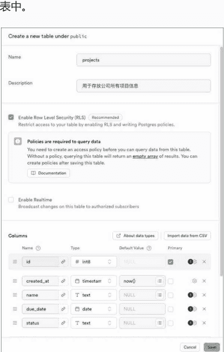

至此，你已经亲手为数字总部打造好第一件定制“家具”，后续的项目信息有了专属的存储容器。

### 3.3.3 五分钟实战：理解表关系

一个项目通常包含许多具体的“任务”。一种较为合理的做法是，再创建一个专门存放“任务”的“文件柜”tasks，并建立连接机制，让每个任务明确归属对应的项目。

“表关系”（Table Relationship）是关系型数据库的核心优势——就像在现实办公室中，你在每张“销售发票”文件的右上角，都标注对应的“客户档案编号”。这个编号就是一种“关系”的体现，在数据库中称为“外键”（Foreign Key）。通过外键，两个独立的数据表就能从逻辑上连接起来，形成高效的数据网络。

接下来，我们通过实际操作来创建这一关联关系，步骤如下。

1. 首先确保你还在Supabase项目的Table Editor区域，然后点击Create a table按钮，开始创建“文件柜”tasks。
2. 在Name字段中输入tasks，作为存储任务信息的数据表。
3. 设计列结构：保留默认的id（唯一标识）和created_at（创建时间）列，点击Add column添加description列，类型选择text，用于存储任务的具体描述。
4. 再次点击Add column，添加is_complete列，类型选择boolean（布尔类型，只有true或false两个值），用于标记任务是否完成。
5. 创建外键（关键步骤）：点击Add column，输入project_id（外键列的命名惯例为“关联表名_id”），类型选择int8（一个足够大的整数类型），然后点击名称右侧的链条图标建立关系。
6. 在弹出的Add foreign key relationship to tasks窗口中进行关系配置：Select a schema保持默认的public，在Select a table to reference to下拉菜单中选择创建的projects表，在public.tasks下拉菜单中选择projects表中的唯一标识列id，完成后的最终效果如图3-17所示。
7. 完成所有配置后，点击Save按钮关闭关系配置窗口，然后再次点击右下角的Save按钮，保存整个tasks表。

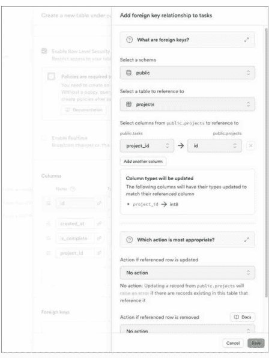

图3-17 创建tasks表

这次，你不仅创造了第二个“文件柜”tasks，更重要的是在两个表之间架起了一座“信息桥梁”。

### 3.3.4 十分钟实战：探索用户认证（Supabase Auth）

我们的“数字总部”需要一套完善的“安保和人事系统”，为员工办理“入职”，发放ID卡，让他们能够通过身份验证后安全进入大楼。

“认证”（Authentication）的核心思想是回答“你是谁”。当你用用户名和密码登录一个网站时，本质上就是在进行认证。而Supabase Auth就是我们数字总部的专业“安全前台”，它已帮我们处理了所有与用户认证相关的复杂工作，我们只需简单配置即可。

下面通过实际操作来配置这套认证系统，让数字总部具备完整的用户管理能力。

1. 找到“安全前台”。登录Supabase项目仪表盘，在左侧导航栏中找到锁形图标Authentication（认证），点击进入认证管理区域。
2. 查看可用的“登录方式”。在认证管理页面的左侧子菜单中点击Sign In/Providers（登录/提供商），会看到Supabase支持的所有登录方式（见图3-18）。Email选项默认开启，支持传统的邮箱+密码注册登录。向下滚动可看到Google、GitHub、Facebook等社交登录提供商的图标，只需点击开关并简单配置，就能让用户通过这些账号一键登录。


图3-18 Supabase支持的所有登录方式

3. 手动“招聘”第一位员工。在真实应用中用户会自行注册。为了方便测试，Supabase允许管理员直接在后台添加用户。在认证管理页面的左侧子菜单中点击Users（用户），再点击右上角的Add user（添加用户）；在Email字段输入你的测试邮箱，在Password字段设置密码，最后点击Create user按钮完成创建。
4. 验证“入职”结果。弹窗关闭后，用户列表中会出现新创建的那位“新员工”，系统已自动为其生成一个唯一的UID（用户身份标识符），如图3-19所示。

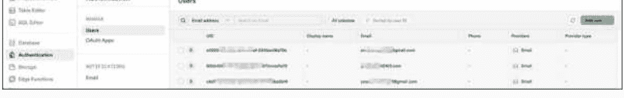

图3-19 用户列表

恭喜，你完成了第一次“员工入职”手续。Supabase Auth通过不可逆的算法加密存储密码，并为用户生成了唯一的身份ID，现在我们的数字总部有了第一位合法注册的员工。

### 3.3.5 十分钟实战：用RLS保护数据

这是迄今为止最重要的一项安保升级——目前所有已登录用户都能查看、修改projects“文件柜”里的所有文件。我们的目标是建立一套精密的“安保规则”，确保员工仅能查看和修改自己创建的项目。

RLS（Row-Level Security，行级安全）是一种将安全规则下沉到每一行数据的强大安全模型。它不是在“档案室门口”站岗，而是给每一份文件（每一行数据）都贴上一个隐形的“权限标签”。当用户访问数据时，系统会校验其ID卡和文件的“权限标签”是否匹配。这种安全检查发生在数据库内部，安全且稳固。

下面通过实际操作来配置RLS，让数字总部具备细粒度的权限控制能力。

1. 为项目文件“指定主人”。回到Table Editor，选择projects表。点击表头最右侧的“+”图标添加新列，命名为user_id。类型字段选择uuid（因为Supabase用户的ID就是这种格式）。点击Foreign Key旁的Add foreign key，在弹窗中设置Schema为auth、Table为users、Column为id。保存这层关系后再保存整个表的修改。
2. 前往“安保策略中心”。在左侧主导航栏找到盾牌形图标Authentication（认证），点击进入后，在左侧子菜单中点击Policies（策略）。
3. 为projects表启用RLS。在策略管理页面找到projects表，点击右侧的Enable RLS按钮（如果一开始看到的是Disable RLS按钮，意味着RLS策略已默认开启）。注意，在启用RLS的瞬间，默认的“拒绝所有”规则会立即生效，此时任何人都无法通过API访问projects表中的数据。这是安全设计的最佳实践：先关闭所有大门，再选择性地开放。
4. 创建第一条“安保策略”。在projects表右上方点击Create policy（新建策略）。
5. 选择策略模板。在右侧的Templates列表中滚动鼠标，选择最后一个Enable users to view their own data only（仅允许用户查看自己的数据），点击选中，如图3-20所示。

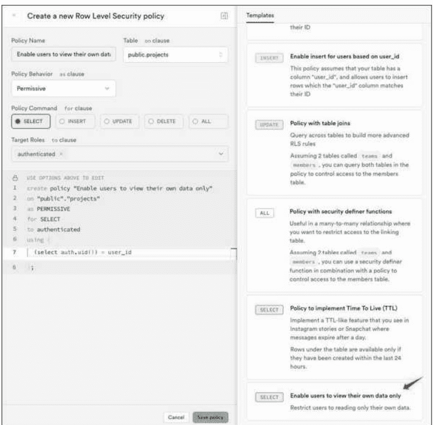

图3-20 创建RLS策略

6. 定制“读取”规则。在策略配置界面中进行如下设置：为Policy Name（策略名称）输入一个清晰的名称，如“用户仅可查看自己的项目”；为Policy Command for clause（允许的操作）选择SELECT（读取/查询数据）；将具体策略代码中的using expression（生效条件）修改为(select auth.uid()) = user_id（核心逻辑），具体可参考图3-20左侧的代码示例。

表达式(select auth.uid()) = user_id的含义是，仅当当前登录用户的唯一ID（auth.uid()）与数据行的user_id列的值一致时，才允许该用户读取该行数据。

7. 保存并审查策略。点击Save policy按钮保存当前策略。
8. 建其他操作策略。按照类似逻辑配置“插入”（INSERT）、“更新”（UPDATE）和“删除”（DELETE）操作的规则，具体如下。
    - 插入（INSERT）策略：选择INSERT，将with check expression（检查条件）设置为(select auth.uid()) = user_id。
    - 修改（UPDATE）和删除（DELETE）策略：操作分别选择UPDATE和DELETE，using expression设置为(select auth.uid()) = user_id。

你已完成一次真正意义上的“企业级”安全配置！RLS将安全逻辑与数据直接绑定，规则一旦定义便持续生效。Supabase通过友好的可视化界面，让你轻松实现了过去需要资深数据库管理员才能完成的复杂安全设置。

### 3.3.6 十分钟实战：文件存储与 CDN 分发

我们的项目管理工具还需要处理项目需求文档、设计稿、演示视频等各类文件附件。这就需要为总部启用“中央安全仓库”（Supabase Storage）。

Supabase Storage专为存储和管理非结构化数据设计，可以将其看作一个巨大的仓库。为了实现有序管理，可以在仓库内划分出不同的“区域”，每个区域专门存放一类文件，这个“区域”称为“存储桶”（bucket）。创建存储桶时，需要指定其“公共”或“私有”属性：公共桶中的文件只要知道链接就能访问，私有桶中的文件则需要严格的权限验证。更强大的是，Supabase Storage自带CDN（内容分发网络）增值服务——文件上传后，Supabase会自动通过CDN将文件副本缓存到全球边缘节点服务器，大幅提升了文件的加载速度。

下面通过实际操作来配置这套文件存储系统，为数字总部添加强大的文件管理能力。

1. 找到“中央仓库”入口。在Supabase仪表盘左侧的主导航栏中，找到桶形图标Storage（存储），点击进入存储管理区域。
2. 创建第一个“存储区域”。点击New bucket（新建存储桶），在Bucket name字段输入project-files。勾选中Public bucket（公共存储桶）选项（在真实项目中，对于需要保护的文件，应设为私有并配置访问策略）。点击Create按钮完成创建。
3. 将文件上传到存储桶。点击创建好的project-files桶，进入内部后点击Upload file（上传文件），从电脑中选择任意文件完成上传。
4. 获取文件的公开链接。将鼠标悬停在已上传的文件上，在右侧的三点下拉列表中选择Get URL（获取链接）图标，链接自动复制到剪贴板。
5. 见证全球高速分发。打开一个新的浏览器标签页，将复制的链接粘贴到地址栏并按回车键，文件会立即加载出来。这个链接指向Supabase的CDN网络。无论用户身处何地，都能以极快的速度访问。

你已成功地为数字总部配置了世界级的仓储与物流系统。你得到的不仅仅是存储地址，而是自带全球加速功能的CDN链接。在传统开发中，CDN的配置需要额外的步骤和费用，而Supabase将其无缝地集成在存储功能中。

### 3.3.7 小结

就在大约一小时前，你面对的还只是一个抽象的“后端”概念，以及一个空荡荡的Supabase项目面板；现在，不妨审视你亲手创造的成果。

- **拥有了完整的关系型数据库：** 包含projects和tasks表，逻辑关系清晰，是业务数据的核心蓝图。
- **部署了企业级的安全防护系统：** 启用用户认证功能，配置细粒度的行级安全策略，确保用户只能访问自身数据。
- **获得了强大的文件存储与分发系统：** 存储空间可无限扩展，搭配全球CDN加速，文件在全球任何角落都能快速加载。

最关键的是，你无须编写一行代码就完成了这一切。

你已成功建造了一个坚实、可靠、功能完备的“数字总部”。它不再是空壳，而是装备精良、安保严密、信息畅通的运营基地。从这里出发，你可以构建任何想象中的应用。

这就是Supabase等现代BaaS平台赋予我们的力量，它将后端开发的陡峭门槛夷为平缓坡地，让每一个有创造力的人都能跨越技术鸿沟，将想法变为现实。

通过这次实战，你已经掌握了构建现代化数字产品的核心逻辑和关键技能。你，已是名副其实的创造者和建设者。

## 第4章 后端开发与高级集成——驱动应用的强大引擎

如果前端是餐厅的优雅门面，那么后端就是决定成败的神秘厨房。

在本章，我们将推开那扇通往“数字后厨”的门。这里没有用户可见的华丽界面，却藏着整个应用的生命力之源——数据的存储方式、业务的运转逻辑、安全的保障机制、效率的提升路径。这些看不见的“幕后英雄”，正是将简单的网页升级为专业级应用的关键所在。

但你不会孤军奋战。

在AI的陪伴下，你将体验一种全新的后端开发方式：无须死记硬背复杂的数据库语法，无须为服务器配置头疼，无须为API接口设计纠结。从TRAE SOLO的自主架构设计，到Cursor的精准代码生成，再到MCP的高级集成——你拥有的不是单一工具，而是一支无所不能的“AI后端工程师团队”。

在本章结束时，你将掌握构建各类任何复杂应用的核心能力。更重要的是，你会发现，即便是技术密集型的后端开发，也能充满创造的乐趣。

### 4.1 AI 后端工程师：TRAE SOLO深度实战

在前面的章节中，我们已经了解了TRAE SOLO（本节将TRAE SOLO简称为SOLO）作为“AI前端设计师”的能力，学习了如何通过对话和可视化编辑，将一个想法迅速转变为可交互的用户界面。这类似于我们精心设计了一家餐厅的“门面”——用餐区、菜单和整体氛围，旨在给用户留下良好的第一印象。

然而，任何成功的应用程序，其核心竞争力源于用户看不见的后端。后端是决定产品质量、运行效率乃至安全性的关键。在应用程序的世界里，后端就是“中央厨房”。

#### 4.1.1 从“门面”到“后厨”：后端开发的思维转变

后端开发是应用程序的“引擎”，负责处理所有用户不可见但至关重要的工作。它包含管理数据的数据库（Database）、处理用户请求的业务逻辑（Business Logic）、实现核心功能的算法（Algorithm），以及保障前后端通信的可靠API，确保前端能够准确无误地与后端系统交互。

这是一个与前端开发完全不同的领域。前端开发关注视觉呈现与用户交互，而后端开发聚焦数据结构、业务逻辑和系统安全。传统上，这是一个技术门槛较高、对逻辑思维和系统设计能力要求严格的领域。

本节内容将引导我们完成角色的转变，从“前台”转向“后厨”。我们将聚焦于SOLO作为“AI后端工程师”的能力，探索如何指挥它搭建一个功能完备、安全可靠的后端系统。我们将跳过已在前面章节介绍过的基础概念，直接进入后端开发的实战核心，体验从一个想法到完整应用的全栈开发之旅。

#### 4.1.2 从需求到API：自主后端开发全流程

尽管我们在前端开发中已经体验过SOLO的自动化工作流，但在后端场景下，该流程的侧重点有所不同。现在，让我们以“后端架构师”的视角，重新审视SOLO在该领域的能力。

##### 1. 需求分析与文档生成

所有项目都始于一份蓝图。在后端开发中，这份蓝图是一份严谨的产品需求文档（PRD），它详细定义了系统的结构与功能规格。

与注重视觉呈现的前端PRD不同，后端PRD的核心是“能做什么”以及“数据如何流转”。它必须清晰地定义如下内容。

- **功能模块：** 系统需要哪些核心功能（例如，用户管理、文章发布、评论系统）。
- **用户角色与权限：** 有哪些类型的用户（例如，访客、注册用户、管理员），他们各自拥有哪些操作权限。
- **数据实体与关系：** 系统需要处理哪些核心数据（例如，用户、文章、评论），它们之间存在何种关系（例如，一个用户可以有多篇文章，一篇文章可以有多条评论）。
- **业务规则：** 系统需要遵循哪些特定的逻辑规则（例如，用户每天最多只能发布5篇文章，评论内容不能超过500个字符）。

对于非技术人员，从零撰写这样一份结构化的文档颇具挑战。但是，在SOLO中只需用自然语言提出想法即可自动生成符合后端需求的严谨PRD。举例如下：

> 为我规划一个个人博客系统的后端。该系统需支持3种用户角色：访客、注册用户和管理员。注册用户可以发布和管理自己的文章，并评论他人文章。管理员拥有所有权限。文章需要包含标题、内容和发布日期。我希望最终能提供一套API供前端调用。

收到指令后，SOLO会启动其文档工具，将你的自然语言描述转化为一份结构清晰、逻辑严谨的后端PRD。这份由AI生成的文档，将明确定义所有功能模块、数据实体和核心业务规则，成为后端开发的建造蓝图。

##### 2. 环境配置与依赖管理

蓝图绘制完成后，需要搭建开发环境并准备所需工具，这个过程称为“环境配置”，其核心是选择一套合适的技术栈。

可以将技术栈理解为一套完整的开发工具组合。

- **编程语言：** 如Java、Python或Node.js。
- **框架：** 标准化的开发工具和流程，如Spring（Java）或Django（Python）。
- **数据库：** 用于存储和管理数据的系统，如关系型数据库PostgreSQL或文档型数据库MongoDB。
- **Web服务器：** 负责接收和处理网络请求的软件，如Nginx或Apache。

对于开发者（尤其是新手）而言，配置环境的过程复杂且容易出错。不同工具间的版本冲突、依赖库缺失或操作系统差异等问题，都可能导致开发进程受阻。

SOLO将这个过程显著简化，它会分析PRD中定义的需求，自动选择最合适的技术栈。例如，若你的应用需要处理大量实时消息（如在线聊天），它可能会优先选择Node.js，因为它擅长处理高并发的I/O操作。

确定技术栈后，SOLO会在终端（Terminal）面板中自动执行所有必要的命令，以安装语言环境、下载框架、配置数据库连接。在短时间内，一个专业、稳定的后端开发环境即可准备就绪。

##### 3. 编码与错误修复

环境搭建完毕，便进入了核心的编码阶段。该过程是将蓝图中的细节，用精确的编程语言转化为计算机可执行的指令。

在这一步，SOLO会逐一阅读其生成的PRD和技术设计文档，将文档中的每条需求——无论是“创建一个用户注册接口”，还是“实现一个复杂的权限验证逻辑”——都转化为高质量、可运行的后端代码。

此外，SOLO拥有一个“自检-修复”的闭环工作流。它在编写代码后，会立刻在终端尝试运行，例如启动服务器或执行单元测试。

一旦终端输出错误信息（如数据库连接失败的ECONNREFUSED错误或语法错误SyntaxError），它会立即暂停当前任务，分析错误日志，理解原因，然后自主修改代码，直至问题解决。

你也可以将遇到的外部错误信息直接提供给它，它能帮助你定位问题并给出修复方案，同时确保修复过程不影响其他代码。

##### 4. 本地测试与预览

软件开发完成后，必须进行严格的测试和预览。

后端的测试不如前端直观。前端的测试结果大多可以直接在浏览器中观察，而后端的测试结果通常是终端返回的数据（如JSON格式的数据）或数据库记录的变更。

SOLO的集成工作区在此展现了一体化优势。它内嵌了浏览器（Browser）工具，使测试验收过程更直观高效。当SOLO在后端构建功能逻辑时，能在内置的浏览器中同步渲染一个可交互的前端界面来调用这些后端接口。这意味着，你无须等待所有工作完成，也无须借助专业的API测试工具，即可实时查看AI的工作成果。

例如，当SOLO完成用户登录功能的后端API后，浏览器中会立即出现一个登录界面。你可以亲自试用，输入正确或错误的密码，观察应用的反应或查看服务器日志，以验证后端逻辑是否符合预期。

##### 5. 部署与上线

当所有功能通过验收、后端服务稳定运行时，就可以将应用发布到互联网，让全球用户访问。这个过程称为部署（Deployment）。

以往，部署是一项复杂的技术工作，需要配置服务器、管理域名、设置安全证书、配置防火墙以及处理CI/CD流水线等，通常由专门的运维工程师（DevOps）负责。

SOLO再次简化了这一流程。它深度整合了Vercel等主流云部署平台。你只需在确认功能完善后，给出一个简单的指令，例如：

> 功能测试完成，请将该博客网站的后端服务部署到Vercel。

SOLO会自动处理所有复杂的部署流程：打包代码、配置服务器环境、处理环境变量、发布上线。几分钟后，你将获得一个公开的API服务地址。至此，从一个想法到一个功能完备的在线后端系统，整个开发生命周期宣告完成。

#### 4.1.3 五分钟实战：集成Supabase

在构建后端时，我们可以使用后端即服务（BaaS）平台，如Supabase。这类平台提供了完善的基础设施，使开发者能专注于核心业务逻辑的开发。

我们已在前文对Supabase有了初步了解，现在直接进入主题，看看如何通过对话让SOLO接管并操作这个强大的后端平台。

##### 1. 使用SOLO快速集成Supabase

将SOLO与你的Supabase账户连接的过程非常简单，只需在SOLO的集成（Integrations）面板中点击几次即可完成授权。这个基于OAuth协议的安全流程，会让SOLO获得直接操作你的Supabase项目的权限，实现AI对后端基础设施的全面接管。

##### 2. 通过SOLO进行数据库操作

在了解数据库操作前，先明确一个核心概念：无论使用何种工具，数据库的基础操作都可概括为CRUD，即创建（Create）、读取（Read）、更新（Update）和删除（Delete）。我们可以用日常管理手机通讯录的场景来理解这4类操作。

- 创建（Create）：添加一个新的联系人。
- 读取（Read）：查找某个联系人的电话号码。
- 更新（Update）：修改联系人的信息。
- 删除（Delete）：删除一个不再联系的人。

在过去，要执行这4类数据库操作，开发者需要熟悉SQL等专业的数据库查询语言并编写特定代码；即使依赖Supabase这类平台的后台界面，也需在复杂的操作面板中逐一配置参数，不仅有技术门槛，还会消耗额外的时间成本。

但连接SOLO后，操作流程被极大简化：无须学习SQL语言，也不用频繁切换到Supabase后台界面，只需在SOLO的聊天框中输入自然语言指令，就能轻松完成CRUD各类操作。比如“添加一条新的项目记录”（创建）、“查看所有未完成的项目”（读取），直接用日常交流语言描述需求即可。SOLO会自动解析指令并执行对应的数据库操作，大幅降低了数据库的管理门槛。

以下是用自然语言描述数据库操作的具体示例。

**创建（Create）：创建数据表**

> 在Supabase中创建一个名为products的新表，该表需要包含以下列：name（商品名，文本类型）、price（价格，数字类型）和stock（库存，整数类型）。

**创建（Create）：插入数据**

> 向products表中添加一条新数据：商品名为“AI智能咖啡机”，价格为999元，库存为50。

**读取（Read）：查询数据**

> 查询products表中所有价格低于1000元的商品信息。

**更新（Update）：修改数据**

> 将“AI智能咖啡机”的价格修改为899元。

**删除（Delete）：移除数据**

> 从products表中删除所有库存为0的商品。

当你发出这些指令时，SOLO会将你的意图翻译成语法正确的SQL查询语句，通过与Supabase的安全连接执行命令，最后以易于理解的方式反馈结果。

SOLO与Supabase的结合，改变了后端数据管理的交互模式，使非技术人员也能像经验丰富的数据库管理员一样，轻松驾驭一个强大的数据库系统。

#### 4.1.4 十分钟实战：生成技术设计文档与数据模型

如果说PRD定义了“做什么”，那么技术设计文档（Technical Design Document，TDD）则精确解答了“如何做”。它如同详细的施工图，清晰描述系统的内部结构与实现方式，在后端开发中尤为重要——毕竟后端是整个系统的基石。

##### 1. TDD的重要性

一个常见误区是拿到需求后立即开始编码，这好比没有图纸就施工，极易导致结构性问题，造成时间和资源的浪费。

一份优秀的TDD，其核心价值在于：

- **统一共识** ——确保团队成员对系统架构、技术选型、API契约和数据流有统一、精确的理解；
- **预见风险** ——在设计阶段提前思考并解决可能遇到的技术难题、性能瓶颈和安全漏洞，远比在开发完成后修复更高效；
- **指导开发** ——为开发者提供清晰的行动指南，明确模块实现方式以及模块间的交互逻辑；
- **方便维护** ——作为项目档案，帮助新成员或未来的维护者快速熟悉系统，避免在修改时引入严重错误。

然而，撰写高质量的TDD需要深厚的技术功底和系统设计能力。幸运的是，SOLO也是一位出色的“AI架构师”。

##### 2. 使用SOLO生成TDD

SOLO的工作流程遵循“文档驱动开发”的最佳实践，坚持“先规划，后执行”的原则。在生成PRD之后，你可以让它接着创建TDD。

来看这样一个提示词：

> 根据先前已确定的博客系统PRD，生成一份详细的后端技术设计文档。技术栈选定为Node.js + Express，数据库使用已连接的Supabase。文档需包含系统架构图、详细的API定义和完整的数据模型设计。

几分钟后，一份结构完整、内容专业的TDD就会生成，通常包含以下几个核心部分。

- **系统概述**：简要说明项目目标、范围及核心技术选型。
- **架构设计**：用图表和文字清晰展示系统整体结构（如各层之间的交互方式）。
- **API定义**：详细列出所有API，包括路径、请求方法、参数及预期的响应数据格式，这部分是前后端协作的“契约”。
- **数据模型设计**：TDD中最关键的一环，将在下文详细说明。

##### 3. 数据模型设计与实现

数据模型（Data Model）定义了应用需要存储的数据类型以及数据之间的关联关系。

以博客系统为例，合理的数据模型需要规划存放用户信息的“用户表”、存放文章的“文章表”、存放评论的“评论表”，同时还需明确数据之间的关系类型。

- **一对多（One-to-Many）**：一个用户（User）可以发表多篇文章（Post）。这是最常见的关系类型。
- **多对多（Many-to-Many）**：一篇文章可以有关联多个“标签”（Tag），同一个标签也可以用于多篇文章。这种关系通常需要用“连接表”（Junction Table）来实现。

SOLO在生成TDD时，会根据业务需求自动设计数据模型，清晰地列出需创建的数据表（Table）、每张表的字段（Column）及其数据类型和约束。表4-1所示为SOLO为个人博客系统设计的示例数据模型。

**表4-1 个人博客系统（示例）数据模型**

| 表名 (Table) | 字段名 (Column) | 数据类型 (Type) | 约束/描述 (Constraint/Description) |
|---|---|---|---|
| users | id | uuid | PRIMARY KEY (主键)/用户唯一标识 |
| | email | text | UNIQUE, NOT NULL/用户邮箱 |
| | password_hash | text | NOT NULL/加密后的密码 |
| | username | text | UNIQUE/用户名 |
| | created_at | timestamptz | DEFAULT now()/注册时间 |
| posts | id | uuid | PRIMARY KEY/文章唯一标识 |
| | author_id | uuid | FOREIGN KEY (外键)关联users.id/ON DELETE CASCADE |
| | title | text | NOT NULL/标题 |
| | content | text | NOT NULL/内容 |
| | published_at | timestamptz | 发布时间 |
| comments | id | uuid | PRIMARY KEY/评论唯一标识 |
| | post_id | uuid | FOREIGN KEY关联posts.id/ON DELETE CASCADE |
| | author_id | uuid | FOREIGN KEY关联users.id/ON DELETE CASCADE |
| | comment_text | text | NOT NULL/评论内容 |
| tags | id | uuid | PRIMARY KEY/标签唯一标识 |
| | name | text | UNIQUE, NOT NULL/标签名 |
| post_tags (连接表) | post_id | uuid | PRIMARY KEY/FOREIGN KEY关联posts.id/ON DELETE CASCADE |
| | tag_id | uuid | PRIMARY KEY/FOREIGN KEY关联tags.id/ON DELETE CASCADE |

注意，ON DELETE CASCADE是重要的数据约束，其作用是当被引用的记录被删除时（如用户注销），所有引用该记录的关键数据（如该用户的文章、评论）会被自动删除，从而保障数据的完整性。

这份由AI设计的数据模型结构清晰，遵循数据库设计的最佳实践。更重要的是，你无须手动实现它，只需下达类似如下的指令即可：

> 很好，就按此数据模型执行。请连接到Supabase，为我创建这5张表，并设置好所有主键、外键和级联删除约束。

SOLO会立即解析该文档，生成相应的SQL命令，并在Supabase中创建这些数据表。

##### 4. 文档版本管理

软件开发是一个动态演进的过程。当需求变更时（例如新增“点赞”功能），不仅代码需要修改，设计文档也必须同步更新，否则文档将很快与实际系统脱节，成为“技术债务”。

使用SOLO的一个优势是，它始终将文档和代码视为一个有机整体。当你提出新需求时，它会先更新TDD中的数据模型和API定义，再根据更新后的文档修改代码。这种“文档驱动”的工作方式，可确保设计蓝图与最终产品始终一致，为项目的长期维护奠定坚实基础。

它将撰写文档、预先设计等专业的软件工程实践，无缝融入自动化流程，引导用户遵循行业最佳实践，最终打造出结构优良、易于维护的软件产品。

#### 4.1.5 十分钟实战：实现用户认证与业务逻辑

有了坚实的数据库基础和清晰的设计文档，现在可以着手构建后端系统的核心功能。

- **用户认证（User Authentication）**：验证用户身份，决定谁可以访问系统以及具体访问权限有哪些。
- **业务逻辑（Business Logic）**：应用提供的核心服务，通常通过一系列API实现。

接下来，我们将了解SOLO如何在短时间内自动构建这两大核心功能。

##### 1. 用户认证

市面上有几种主流的用户认证技术方案，下面用通俗易懂的方式进行解释。

- **Session（会话）**：最传统的方式。用户首次使用用户名和密码登录后，服务器会记录其登录状态，并返回唯一标识（Session ID）给客户端。后续客户端的每次请求都携带该标识，服务器据此验证用户身份。这种方式是“有状态的”（stateful），即服务器需要维护会话信息，这也导致它在分布式系统中的扩展难度较大。
- **JWT（JSON Web Token）**：一种更现代的方式。用户登录成功后，服务器会生成一个包含用户信息的加密令牌（token）并返回客户端。客户端在后续请求中携带该令牌，服务器只需验证令牌签名即可确认用户身份，无须在服务端存储会话信息。这种“无状态的”（stateless）方式具有良好的可扩展性，非常适合现代前后端分离的应用架构。
- **OAuth（开放授权）**：允许用户使用第三方服务（如微信、百度、抖音）的账户来登录你的应用。你的应用将认证过程委托给第三方服务，认证成功后，第三方服务会授权应用访问用户的公开信息（如昵称、头像等）。这就是常见的“第三方账户登录”。

表4-2对这几种认证方式进行了对比。

表4-2 认证方式对比

| 认证方式 | 状态 | “凭证”存储位置 | 适用场景 |
| :--- | :--- | :--- | :--- |
| Session | 有状态 | 服务器端 | 简单的网站应用 |
| JWT | 无状态 | 客户端 | 现代前后端分离的应用、API、微服务 |
| OAuth | 无状态 | 第三方服务 | 第三方社交账户登录、授权访问 |

对于非技术人员而言，理解并选择合适的认证方案并不容易。但借助SOLO，你只需简单描述需求即可。以下是向SOLO下达用于构建认证系统的指令。

> 为我们的博客系统创建一个完整的用户认证功能。要求用户能通过邮箱和密码进行注册和登录。认证方式使用JWT，用户信息存储在Supabase的users表中。确保密码在存储前使用bcrypt进行安全的加盐哈希处理。

该指令清晰定义了“做什么”（用户认证）、“怎么做”（JWT和Supabase）以及关键的“安全要求”（加盐哈希处理）。之后，SOLO会自动完成以下工作。

- **生成API接口**：创建处理用户注册和登录的后端接口。
- **处理注册请求**：验证邮箱格式及是否已注册；使用bcrypt等标准库为用户密码添加随机的“盐”（salt）后进行哈希计算（此过程不可逆，即使数据库泄露，攻击者也无法获取原始密码）；将新用户信息（包含加盐哈希后的密码）存入Supabase的users表。
- **处理登录请求**：在数据库中查找用户，将提交的密码与存储的哈希值进行安全比对。
- **生成和验证JWT**：登录成功后，为用户生成一个带签名的JWT并返回客户端。在后续所有需要认证的请求中，自动添加验证逻辑（通常是一个中间件），检查请求中是否携带有效JWT，以判断用户身份和权限。

短短几分钟内，一个专业、安全的认证系统即可构建完成。

##### 2. 业务逻辑

认证系统搭建后，需要构建应用的核心业务逻辑。在后端，这些逻辑通过API端点（Endpoint）暴露给前端或其他服务使用。

API端点类似餐厅菜单上的具体菜品，每个端点对应一个明确的操作。

- **GET /api/v1/posts**：获取所有文章列表。
- **POST /api/v1/posts**：创建一篇新文章。
- **PUT /api/v1/posts/{id}**：修改指定ID的文章。
- **DELETE /api/v1/posts/{id}**：删除指定ID的文章。

你无须掌握这些技术术语，只需使用“用户故事”的格式告诉SOLO你的需求即可。用户故事通常遵循“作为一个<角色>，我想要<行为>，以便<收益>”的格式，这能帮助AI精准理解需求。来看这样一个示例：

> 现在实现文章管理的核心功能。请创建以下API。
> 1. 作为已登录用户，我想要发布一篇新文章（需要包含标题和内容），以便分享我的想法。
> 2. 作为访客，我想要获取所有已发布的文章列表，以便浏览网站内容。
> 3. 作为文章作者，我想要删除我自己的文章，以便管理我的内容。

SOLO能够理解这种格式的指令，并立即创建对应的API端点及实现功能的后端代码。

例如，在实现“删除文章”的接口时，AI生成的代码会自动加入严谨的权限检查逻辑：先通过JWT确认当前请求的用户身份，再查询数据库确认该用户是否为文章作者，只有两个条件都满足时，才执行删除操作。

##### 3. 安全性与最佳实践

一个关键问题是，AI生成的代码安全吗？SOLO在设计时已将安全性作为核心考量，通过以下方式保障代码质量和安全。

- **依赖成熟框架与最佳实践：** 基于Node.js、Express等经过广泛验证的成熟开源框架来构建应用，生成的代码遵循行业通行的安全编码规范，例如自动清理用户输入以防止注入攻击，以及对密码进行单向加密。
- **优先集成专业服务：** 在处理用户认证、数据库交互等高风险任务时，优先与Supabase等专业BaaS平台集成。这意味着密码存储、数据传输加密等棘手的安全问题，都由专业的服务商来保障，远比自行实现更安全。
- **透明可审查：** SOLO生成的所有代码对用户完全开放。你可以随时邀请技术专家对代码进行审查。AI负责执行，而你始终拥有最终的监督权和所有权。

通过这一系列自动化且遵循最佳实践的操作，SOLO不仅大幅提升了开发效率，也为你的应用构建了一道坚实的安全防线。

#### 4.1.6 十五分钟实战：完成完整项目

经过前面3个实战演练，我们已分别掌握SOLO连接数据库、生成设计文档以及实现核心业务功能的方法。现在，我们将整合所有知识，完成全流程的落地。

本次实战中，我们将从顶层想法出发，引导SOLO在15分钟内，完成一个包含后端服务和前端界面的“个人博客系统”的开发、测试与部署全流程。

##### 1. 项目需求分析

首先，我们需要明确最终目标。一个基础且功能完备的个人博客系统，需要包含以下核心模块和技术要求。

- **用户模块：** 支持用户通过邮箱和密码注册、登录和退出；能区分普通用户与管理员等不同角色。
- **文章模块：** 登录用户可以创建、编辑和删除自己的文章；任何人都可以查看文章列表和详情。
- **评论模块：** 登录用户可以发表评论；文章作者或管理员可以删除评论；任何人都可以查看评论。
- **技术架构：** 后端采用Node.js和Express框架，提供RESTful API；数据库使用Supabase负责数据存储和用户认证；前端生成一个简约的单页应用（SPA），与后端API交互；将整个应用部署到Vercel平台。

这些需求将构成下一步指令的核心内容。

##### 2. 使用SOLO完成全流程开发

现在创建一个新项目，向SOLO发出第一个指令：

> 我们要从零开始构建一个完整的个人博客系统。请遵循以下步骤和要求，自主完成整个项目。
> 1. 规划阶段：生成一份详细的PRD和后端TDD。TDD中必须包含基于Supabase（PostgreSQL）的完整数据模型设计（涵盖users、posts、comments、tags和post_tags表），并明确所有字段、关系和约束，同时定义出所有必要的RESTful API端点。
> 2. 后端与数据库：后端技术栈为Node.js和Express。请连接我已授权的Supabase项目，根据TDD设计的数据模型自动创建所有数据表。
> 3. 核心功能实现：搭建基于JWT和bcrypt的用户认证系统（注册、登录）；开发文章发布、评论管理和文章标签关联的完整API，确保包含所有CRUD操作，并实现基于角色的权限控制（如只有作者能编辑自己的文章）。
> 4. 前端界面构建：生成一个简约、美观、响应式的前端界面，包含文章首页、文章详情页、用户登录/注册页，以及登录后才能访问的文章创建/编辑页，确保前端能正确调用后端API。
> 5. 部署上线：在所有功能开发完成并在本地预览测试无误后，将全栈应用部署到Vercel，提供最终的公开访问网址。

执行该指令后，你将在SOLO的集成视图中全程见证一个产品的诞生——各功能面板将同步联动，清晰呈现开发全流程。

- **文档面板：** 优先创建PRD和TDD，项目蓝图与技术细节一目了然。
- **终端面板：** SOLO自动执行命令，安装依赖包、配置环境、运行数据库迁移脚本，并启动本地开发服务器。
- **代码编辑器：** 前后端文件逐一创建并填充，代码实时生成。
- **浏览器面板：** 一个可用的前端界面逐步呈现，并随后端API的完善变得可交互。你可以实时点击测试各项功能。
- **流程视图：** 生成清晰的任务清单，将复杂任务分解为一个个小步骤，并逐项标记完成状态。

整个过程几乎无须干预，你只需在关键节点给出决策即可。

##### 3. 项目优化与迭代

软件的生命力在于持续迭代。当博客1.0版本上线后，如果你有新的想法，无须向开发者解释项目背景，直接对“熟悉”项目的SOLO下达指令即可。

例如，想增加“文章点赞”功能，相应的指令如下。

> 为博客系统增加“点赞”功能。
> 1. 在Supabase中创建一个likes表，记录点赞用户（user_id）和文章（post_id）。
> 2. 创建API端点POST /api/v1/posts/{id}/like，允许已登录用户点赞文章。
> 3. 创建API端点DELETE /api/v1/posts/{id}/like，允许用户取消点赞。
> 4. 更新获取文章的API，使其返回数据中包含每篇文章的总点赞数。
> 5. 在前端的文章详情页和列表页，添加点赞按钮和点赞数显示。

SOLO会立刻理解你的需求。由于它保留了整个项目的上下文，所以知道如何安全地修改文件和数据库结构，以及如何调整前后端交互，从而高效、安全地为产品新增功能。

#### 4.1.7 小结

通过这次从0到1的完整项目演练，我们不仅搭建了一个可运行的博客系统，更重要的是掌握了与AI工程师协作的全新范式。

- **指令的艺术：** 与AI协作的效率，在很大程度上取决于需求描述的质量。一个清晰、结构化、无歧义的指令能让AI事半功倍。我们的任务从“编写代码”转变为“设计指令”和“定义规则”，这要求我们具备更强的系统思维和逻辑表达能力。
- **角色的转变：** 在此过程中我们几乎没有编写代码，却主导了整个产品的诞生。我们的角色从传统的“实现者”转变为“定义者”“架构师”和“决策者”。技术不再是创意落地的瓶颈，唯一的瓶颈是对产品的想象力和需求定义能力。这种转变催生了能够独立完成产品构想并实现闭环的“超级个体”。
- **监督与审查的重要性：** 尽管SOLO表现出色，我们仍需保持批判性思维。AI生成的代码，尤其是在复杂业务逻辑或高安全要求的场景下，仍然需要人类专家的审查和验证。SOLO是强大的执行者，但最终责任人仍然是我们自己，因此我们必须学会有效地审查AI的工作，而非盲目信任。

### 4.2 AI结对程序员：使用Cursor实现精细化后端开发

前文介绍的SOLO这类AI工具，如同以为架构师，能够勾勒出应用的宏观蓝图。但要将蓝图构转化为坚固、实用的“建筑”，还需要一位技艺精湛的工匠，这便是本节的主角：Cursor。

在本节中，你将结识这位全新的AI结对程序员。我们将探讨在构建复杂后端系统时，Cursor为何是不可或缺的伙伴。你将学会驾驭它，从基础安装设置，到精通其三大工作模式，最终通过一系列详尽的实战项目，亲手搭建、实现并管理一个功能完备的现代化后端应用。

#### 4.2.1 后端开发为何需要Cursor

前文已简要介绍过Cursor工具及其与SOLO的互补关系，这里再做一次系统性的回顾。

##### 1. 从宏观构建到细节实现

我们可将软件开发类比为建造房屋：首先需要以为建筑师（SOLO），沟通并理解你的愿景（如开放式厨房、朝南的卧室等），迅速绘制出房屋的整体结构、房间布局和外观效果图。这是宏观创造阶段，关注的是“做什么”（What），即应用的整体架构和核心概念。

但蓝图本身无法居住，要让房子拔地而起，需要一个施工团队精确铺设线路、安装管道和地板。他们关注的是“怎么做”（How），即每一个细节的完美执行。在我们的类比中，这个施工团队的队长就是Cursor。

SOLO这类高阶AI工具的核心价值，是将抽象想法快速转化为结构化的代码框架和应用雏形；而Cursor作为AI原生的IDE，设计哲学截然不同，旨在处理代码实现过程中的所有细节，完成精细化的工作。

为了让你在实际操作中做出准确的选择，我们可以通过两者的使用场景进行区分。

- **使用SOLO的场景：** 当你只有一个模糊的想法，甚至尚未明确具体功能时，可使用SOLO。SOLO擅长“从0到1”的创造——若你提出“我想要一个图片分享社区”，它能生成项目的前后端框架、数据库结构和基本页面，回答“我们应该构建什么样的产品”。
- **使用Cursor的场景：** 当你已有代码基础（无论是SOLO生成的还是自己编写的），需要开展具体的实现工作时，建议使用Cursor。Cursor擅长“从1到N”的精炼——你需要为产品“安装引擎、连接线路、调试功能”，它回答“我们应如何实现这个产品，并使其完美运行”。

这种精细化的能力源于Cursor的核心架构。与GitHub Copilot等插件式AI助手不同，Cursor本身就是代码编辑器。这种原生集成赋予了它独特的优势——深度理解代码库上下文。你用Cursor打开项目时，它会“阅读”并“理解”整个项目，为所有代码建立一个复杂的语义索引，如同在内部构建了一张详细的项目地图。

正是这张“地图”，让Cursor的操作能达到手术刀般的精准。当它提供建议或修改代码时，其决策基于对项目中所有文件、函数、变量间关联的深刻理解，而非仅局限于当前文件内容。

##### 2. Cursor的3个关键应用场景

理解Cursor的角色后，我们看看它在后端开发中的核心应用场景。

- **场景1：核心业务逻辑实现**
  这是后端开发的核心，需要编写用户认证、数据库交互（CRUD）、支付流程等具体业务逻辑，对稳定性和准确性要求极高。Cursor能根据自然语言描述，生成健壮、高效且符合最佳实践的代码，帮助你完成这些复杂的任务。相比之下，SOLO在这方面的实现目前在可靠性和稳定性上尚有差距。

- **场景2：大规模、跨文件的代码重构**
  随着项目的发展，可能需要对项目进行结构性调整（如将数据库中的user模型改名为profile）。这个看似简单的改动可能会引发连锁反应，需要修改数十个文件中的相关变量名、函数名和API。对人类而言，这是一项枯燥且极易出错的工作，但对于拥有完整项目地图的Cursor来说却轻而易举。它能自动定位并安全地修改所有相关文件，确保重构后系统依然稳固。

- **场景3：深度协作式调试**
  当应用出现问题时，你可能只看到了错误信息，却不清楚问题的根源。Cursor如同经验丰富的专家，你只需提供错误信息、日志文件，它便会结合对整个代码库的理解，帮助你追根溯源，快速定位问题本质，并给出修复方案。

##### 3. SOLO vs. Cursor: 选择正确的工具组合

因此，问题并非“SOLO和Cursor哪个更好”，而是“在开发流程的哪个阶段，应该使用哪个工具”。SOLO和Cursor的使用遵循一个清晰的时间序列，具体可参考以下决策指南。

- **构思与原型阶段：** 这时你处于“我有一个想法！”的兴奋状态，你的主要任务是将脑海中的模糊概念转化为一个可见、可操作的项目雏形。在这个阶段，SOLO是最佳选择，因为它是目前最快的“想法变现”工具。你无须深入了解复杂的技术细节，只需用自然语言描述应用的功能和特性，它就能快速生成一个包含核心架构的应用原型，完成从0到1的关键飞跃。
- **实现与精炼阶段：** 原型构建完成后，你将进入“我有一份项目代码，要把它变成一个真正产品”的阶段，此时任务变得更加具体细致：完善项目配置、实现具体的业务功能、修复代码错误、进行维护和迭代优化。在这个阶段，你应该切换到Cursor，它就像一个专业的“代码工作间”。你只需将SOLO生成的项目代码下载到本地，用Cursor打开，你的角色便从“构想家”转变为“项目经理”，而Cursor则成为身边全能的工程师团队，帮你处理从1到N过程中所有精细复杂的工作。

#### 4.2.2 十分钟入门：Cursor基础操作与界面导航

现在，让我们正式开始使用你的AI结对程序员。整个过程非常简单，十分钟内即可完成从安装到熟悉界面的所有步骤。

##### 1. 下载安装与初始设置

首先，将Cursor安装到你的计算机上。

1. 打开浏览器访问Cursor官方网站，网站会自动识别你的操作系统（Windows、macOS或Linux），并在首页提供下载按钮。
2. 下载完成后运行安装文件，不同操作系统的安装方式如下。
   - **Windows用户：** 双击.exe文件，按照安装向导的提示操作。
   - **macOS用户：** 打开.dmg文件，将Cursor图标拖拽到“应用程序”（Applications）文件夹。
   - **Linux用户：** 为下载的.AppImage文件授予执行权限后直接运行。
3. 安装完成后启动Cursor，它会引导你完成初始设置（如选择键盘快捷键方案、主题颜色）。设置过程中会提示注册或登录，这一步至关重要，它直接决定了功能使用范围和体验质量。

- **关键一步：** 强烈建议使用GitHub账号登录，这不仅简化了注册流程，还能让Cursor更好地理解你的开发习惯。
- **解锁专业工具：** 登录后将自动激活Cursor的Hobby免费计划（包含有限次数的AI功能），并附赠为期两周的专业版（Pro）试用。
- **学生福利：** 全球在校大学生可通过身份验证，免费享受一整年的专业版服务。

完成上述步骤后，你的AI结对程序员就已经正式配置就绪。

##### 2. 界面导航

打开Cursor后，会看到一个专业且清晰的界面（见图4-1），可以将其看作一个功能明确的控制台。

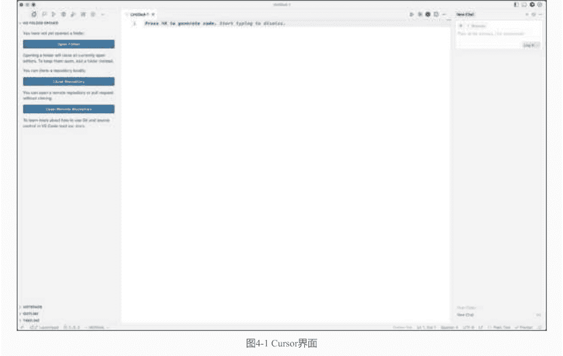

- **活动栏 (Activity Bar)**：位于屏幕最左侧，是一列图标主工具箱，点击不同图标可以在侧边栏切换文件浏览器、全局搜索和源代码管理功能视图。
- **侧边栏 (Side Bar)**：位于活动栏右侧，内容由活动栏选中的图标决定，默认情况下显示文件浏览器，可以在此管理项目的所有文件和文件夹。
- **编辑区 (Editor Area)**：占据屏幕中央最大面积的区域，用于查看、编写和修改代码，支持多文件同时打开（以标签页的形式排列在顶部）。
- **AI聊天面板 (AI Chat Panel)**：通常位于屏幕右侧，是与Cursor AI进行深度对话的区域，可以通过快捷键Ctrl/Cmd+Shift+L调出或隐藏。

##### 3. 三大工作模式速览

在后文中，我们将深入学习Cursor的三大工作模式，这里先做简单介绍。

- **智能代码补全**：在编辑区编写代码时，AI会实时预测你想要写的内容并以灰色文字显示，按下Tab键即可接受建议，补全代码。

## 4.实战

我们通过一个简单的实战，来体验Cursor的智能代码补全功能。这个实战将让你亲身感受AI如何理解你的编程意图，并提供精准的代码建议。

1. 在电脑上新建一个空文件夹，命名为my-first-cursor-project。
2. 在Cursor中点击File->Open Folder，选择刚创建的文件夹。
3. 在侧边栏的文件夹上右键单击，在弹出的菜单中选择New File，输入文件名hello.js并按回车键。
4. 在编辑区逐字输入下面的代码（请勿一次性粘贴）。
5. 输入后稍作停顿，Cursor会以灰色“幽灵文本”的形式建议函数的其余部分，直接按下Tab键，建议代码即可变为真实代码，如下所示。

```javascript
function greet(
```

```javascript
function greet(name) {
    console.log("Hello, " + name + "!");
}
```

你已完成了与AI的第一次无缝协作。你只是开了个头，AI就理解了你的意图并完成了后续的工作。

#### 4.2.3 Cursor的三大工作模式

我们现在将深入理解Cursor的强大工作机制。与Cursor AI的协作主要通过3种截然不同的模式进行，构成了一套从“微操”到“宏观”的完整交互体系。

### 1.智能代码补全

这种模式提供沉浸式、低干扰的协作体验，是日常编码中最常用的模式。其工作原理是在你编写代码时，Cursor的AI模型会实时分析输入的内容、当前文件的上下文以及最近的修改历史，预测后续最可能编写的代码，并以幽灵文本的形式展示。它能够预测和生成逻辑完整的多行代码块。

Cursor的智能代码补全兼具编辑能力，不仅能添加新代码，还能修改和重写已有代码（如修改函数的参数后，自动建议修改所有对该函数的调用处）。

在交互方式上，你可以按下Tab键接受建议，按下Esc键或继续输入以拒绝建议，或者按下Ctrl/Cmd + →组合键逐词接受建议。

##### 2. Composer代码生成

这种模式是一种指令式、目标驱动的协作方式，是处理明确编码任务的高效工具。其工作原理是按下Ctrl/Cmd + K组合键后会激活行内输入框，你可以在此用自然语言描述代码生成或修改需求，Cursor会将指令发送给语言模型，并将返回的代码直接插入或替换到编辑器中。

这实现了从“辅助”到“执行”的转变，让你脱离烦琐的语法，专注于业务逻辑。对于更复杂的任务，可使用Ctrl/Cmd + I组合键调出功能更全面的Composer面板。

在交互方式上，将光标置于目标位置或选中需修改的代码，按下Ctrl/Cmd + K组合键，在弹出的输入框中输入指令（如“创建名为fetchData的异步函数，接受url参数，并使用fetch API获取数据”），然后按下回车键等待AI生成代码。审查生成的代码，若满意则点击Accept按钮，不满意可修改指令重试或手动调整。

##### 3. AI聊天助手

这种模式是一种对话式、探索性的协作方式。当你遇到问题、需要解释或进行宏观规划时，这里是你的“指挥中心”。其工作原理是按下Ctrl/Cmd + Shift + L组合键时会打开右侧的AI聊天面板，它能深入理解整个项目。可以通过@符号精确引用项目中的文件（@file）、函数（@functionName）或整个代码库（@codebase），为问题提供充足的上下文。

AI聊天助手是解决复杂问题、学习新知识的最佳场所。例如，在调试时粘贴报错信息并提问“代码为什么会报这个错？请帮我分析@app/api/route.ts这个文件”；在学习时选中一段代码并询问“这段代码是做什么的？请用初学者能理解的语言解释”；在重构规划时询问“我想重构用户认证系统，请使用@codebase分析改动可能会涉及的文件和核心逻辑”。

在交互方式上，按下Ctrl/Cmd + Shift + L组合键打开聊天面板，输入问题或请求；使用@符号引用代码上下文以获得更精准的回答。AI会以对话形式给出解释或编码建议，可以直接点击Apply按钮将代码应用到文件中。

这3种模式共同构成了完整的协作体系。优秀的Cursor用户会根据任务在这3种模式之间灵活切换。表4-3总结了这3种模式的特点。

表4-3 3种AI交互模式的特点

| 模式（比喻） | 快捷键（macOS） | 最佳应用场景 | 交互风格 |
| :--- | :--- | :--- | :--- |
| 智能代码补全（自动助手） | Tab | 编写常规代码，实现重复性逻辑，遵循已有模式 | 默契预测：AI实时预测，你只需确认 |
| Composer代码生成（编程工具） | Cmd + K/Cmd+I | 生成新函数，实现特定算法，按指令修改代码块 | 清晰指令：你下达明确命令，AI负责执行 |
| AI聊天助手（编程导师） | Cmd + Shift + L | 调试错误，理解复杂代码，规划重构，学习新概念 | 深度对话：你提出开放性问题，AI提供分析和方案 |

## 4.十分钟实战：用3种模式分别完成一个简单函数

现在，我们通过一个创建阶乘函数的练习来体验这3种模式的差异。在项目中创建一个新文件math.js。

- **模式1：智能代码补全**

在math.js中，输入函数的第一行：

```javascript
function factorial(n) {
```

按下回车键，在函数体内输入if。Cursor会预测阶乘函数的核心逻辑，并以灰色文本建议如下代码：

```javascript
if (n === 0 || n === 1) {
  return 1;
}
return n * factorial(n - 1);
```

看到上述建议代码后，直接按下Tab键完成函数的输入。

- **模式2：Composer代码生成**

在factorial函数的下方空出几行，然后按下Ctrl/Cmd + K组合键，在弹出的输入框中输入指令“创建一个名为factorial_composer的函数，用于计算一个数n的阶乘”，然后按下回车键，AI将精确生成阶乘函数。

- **模式3：AI聊天助手**

按下 Ctrl/Cmd + Shift + L 组合键打开聊天面板，然后输入“写一个JavaScript函数factorial_chat，用于计算阶乘，并为关键代码添加中文注释”。AI不仅会生成代码，还会按要求添加注释并提供解释。然后点击Apply或Insert按钮，将带有注释的函数插入光标所在的位置。

通过此练习，你应能清晰感受到这3种模式的差异：智能代码补全是顺畅的协作，Composer代码生成是精准的执行，而AI聊天助手是深入的指导。

#### 4.2.4 十五分钟实战：搭建Next.js API骨架

现在，我们将从零开始构建一个基于Next.js框架的后端API服务，核心任务是搭建项目“骨架”，过程中主要借助AI聊天助手，将其作为项目经理和技术顾问，辅助完成开发。

### 1.项目初始化

我们以空文件夹为起点，目标是让AI指导完成Next.js项目的初始化。

1. 创建并打开项目目录。在电脑上创建一个空文件夹并将其命名为nextjs-supabase-api，启动Cursor，通过File > Open Folder菜单打开该文件夹。
2. 向AI提问。按下Ctrl/Cmd + Shift + L组合键打开AI聊天面板，输入下述指令：

> 我想创建一个全新的Next.js项目，请告诉我初始化项目的标准终端命令。需要使用TypeScript，并接受所有默认推荐配置。

3. 执行AI的指令。AI会给出回答，告知相应的命令是create-next-app，它提供的完整命令应类似于下面这样：

```bash
npx create-next-app@latest . --yes
```

其中，npx create-next-app@latest是官方推荐的Next.js项目创建工具；“.”表示在当前文件夹下创建；--yes参数则自动确认所有选项。

按下Ctrl/Cmd + `组合键，打开Cursor内置的终端，粘贴命令并按回车键。终端将自动下载模板、安装依赖包。完成后，侧边栏文件浏览器中会新增app、public、package.json等文件和文件夹，项目骨架搭建完毕。

### 2.使用AI聊天助手理解项目配置

项目文件已经生成，但核心配置的含义需要明确（如package.json相当于项目的“身份证”和“依赖清单”）。接下来可以使用AI聊天助手进行深入了解。

1. 在Cursor侧边栏中找到并单击package.json文件，将其打开。
2. 在AI聊天面板中输入“这是我的package.json文件，请解释scripts字段中dev、build、start和lint各自的作用，以及dependencies和devDependencies的区别”。
3. AI会清晰说明dev（开发环境启动）、build（项目构建打包）、start（生产环境启动）、lint（代码语法检查）的用途，同时区分dependencies（生产环境必需的库）和devDependencies（仅在开发过程中使用的工具库）。

通过这次对话，你不仅掌握了项目创建方法，还理解了核心的配置逻辑。

### 3.构建Next.js API路由结构

Next.js采用基于文件系统的路由方式，即特定文件夹下的文件会自动成为一个可访问的API。

1. 下达创建指令。在AI聊天面板中输入一个具体的开发任务，如下所示。

> 请创建一个基础的Next.js API路由，访问路径为/api/hello。该接口需要返回一个JSON对象，内容是{"message":"Hello from our API!"}。请告知需要创建的文件路径以及完整的代码。

2. 创建并填充文件。AI会提示需要创建文件路径app/api/hello/route.ts，并提供如下代码。

```typescript
import { NextResponse } from "next/server";

export async function GET(request: Request) {
  return NextResponse.json({ message: "Hello from our API!" });
}
```

按照AI的指示在app文件夹下依次创建api和hello文件夹，然后在hello文件夹中新建route.ts文件并将AI提供的代码粘贴进去（也可以直接点击AI回复中的按钮应用代码）。

3. 验证成果。回到终端，输入npm run dev命令启动开发服务器，在浏览器中访问http://localhost:3000/api/hello，如果页面显示{"message":"Hello from our API!"}，则首个后端API创建并运行成功——整个过程几乎无须手写复杂代码。

### 4.使用@file和@codebase进行上下文管理

随着项目规模的扩大，代码库日趋庞大且复杂，开发者需要通过@file和@codebase指令精准引导AI的注意力，确保生成的代码与项目的整体结构和风格保持一致。

在小型项目中，AI可以轻松理解整个代码库的结构，但当项目包含数十个文件、数千行代码时，需要对AI进行明确的指引。这就像在大型图书馆中寻找特定信息，得告诉管理员是查阅某本特定的图书，还是了解整个图书馆的分类体系，而@file和@codebase正是实现这种精准指引的核心指令。

其中，@file指令能将AI的关注点限定在当前打开的文件或选中的代码片段内，适用于单个文件内的操作，比如解释函数或类的作用、修复语法错误、生成相关的补全代码；@codebase指令则会将AI的注意力扩展到整个项目（包括所有文件和子目录），适用于跨文件分析结构、依赖关系或全局架构设计，AI借助它能更全面地理解项目的整体情况，从而生成更符合项目需求的代码。

下面通过两个实战案例，具体演示@file和@codebase的用法。

- **案例1：使用@file聚焦单个文件**

假设你想让AI检查刚才创建的API文件是否符合最佳实践。在聊天框中提问：

> 请审查@app/api/hello/route.ts文件中的代码，看看是否有可改进之处。

通过@符号明确告诉AI关注特定的文件，可使其回答更具有针对性。

- **案例2：使用@codebase进行全局审查**

如果需要确认项目配置的兼容性，可以进行如下提问：

> 基于@codebase分析整个项目的配置，确认TypeScript和ESLint设置是否会正确支持刚才创建的API路由。

这次，AI会检查tsconfig.json、next.config.js等配置文件，提供一个全面的“项目健康报告”。

本次实战的核心是让你体验一种全新的对话式开发模式：你使用自然语言提出战略目标，AI伙伴负责处理所有战术执行细节。

#### 4.2.5 十分钟实战：用Composer实现具体业务逻辑

我们已搭建好API的“骨架”，现在将为其注入核心功能——连接真实的数据库，并实现业务逻辑。

在该阶段，我们切换到Composer代码生成模式。如果说AI聊天助手是“项目经理”，那么Composer就是“主力程序员”。我们负责架构决策，然后在Composer代码生成模式的聊天框中下达精准指令，由它完成具体编码。

我们的目标是将Next.js应用连接到Supabase，实现一套完整的文章（Post）增删改查（CRUD）API。

### 1.使用Composer生成数据库连接配置

首先需要建立应用与Supabase数据库的连接，步骤如下。

1. 准备Supabase项目。前往官网注册并创建一个新项目。项目创建完成后，在SQL Editor中运行以下SQL语句创建posts表。

```sql
CREATE TABLE posts (
    id bigint PRIMARY KEY GENERATED ALWAYS AS IDENTITY,
    title text NOT NULL,
    content text,
    created_at timestamptz DEFAULT now()
);
```

该表包含4个字段：id（作为主键并自动生成）、title（存储文章标题且不能为空）、content（存储文章内容）、created_at（记录创建时间并默认为当前时间）。执行效果如图4-2所示。

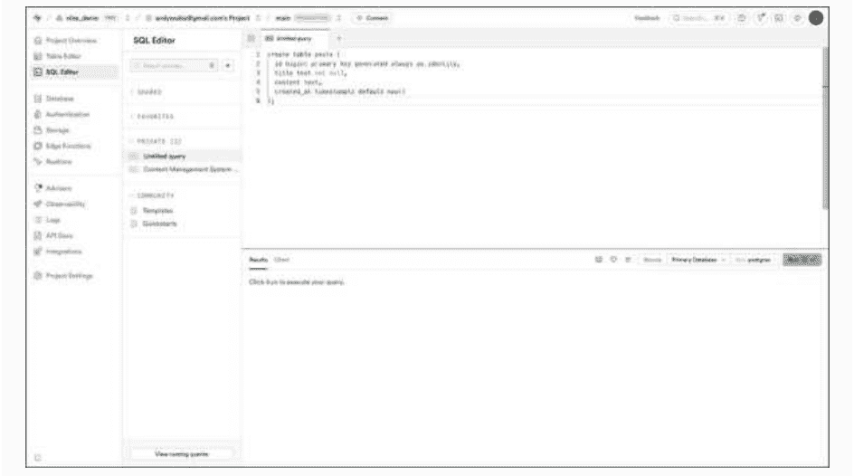

2. 获取数据库连接凭证。在Project Settings的Data API部分找到并复制Project URL（见图4-3）；在Project Settings的API Keys部分找到并复制anon public Key（见图4-4），这两项是连接数据库必需的凭证，需要妥善保存。

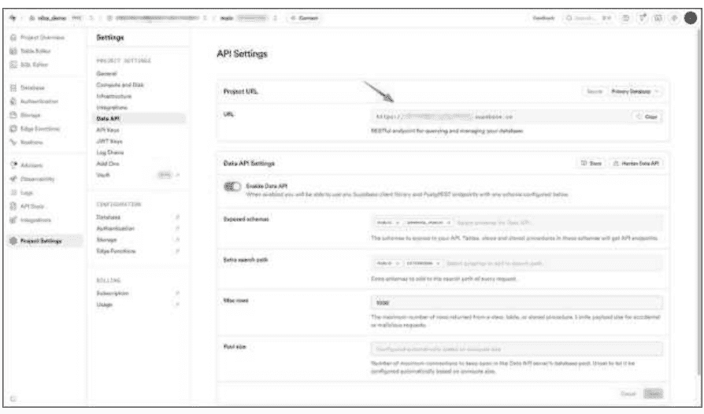

图4-3 获取Project URL

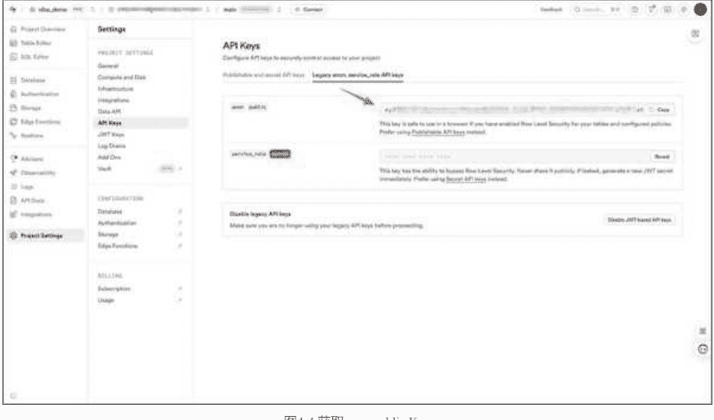

图4-4 获取anon public Key

3. 配置环境变量。回到Cursor，在项目根目录下新建.env.local新文件（专门用于存放敏感信息），添加以下内容，并将占位符替换成从Supabase获取的实际URL和Key。

```
NEXT_PUBLIC_SUPABASE_URL=YOUR_SUPABASE_URL
NEXT_PUBLIC_SUPABASE_ANON_KEY=YOUR_SUPABASE_ANON_KEY
```

4. 使用Composer生成客户端代码。在项目根目录下创建lib文件夹，在其中新建supabaseClient.ts文件（用于创建和导出Supabase客户端）。

将鼠标光标放在这个空白文件中，按下Ctrl/Cmd + K调出Composer，在输入框中输入指令“使用 @supabase/supabase-js 库创建 Supabase 客户端，从环境变量 NEXT_PUBLIC_SUPABASE_URL和NEXT_PUBLIC_SUPABASE_ANON_KEY中读取URL和anon key，最后导出这个客户端实例”。

按下回车键后，Composer会自动生成标准的客户端初始化代码，示例如下（实际生成可能略有差异）：

```typescript
import { createClient } from "@supabase/supabase-js";

const supabaseUrl = process.env.NEXT_PUBLIC_SUPABASE_URL!;
const supabaseAnonKey = process.env.NEXT_PUBLIC_SUPABASE_ANON_KEY!;

export const supabase = createClient(supabaseUrl, supabaseAnonKey);
```

点击Accept按钮，这段代码就会自动添加到文件中，数据库连接配置完成。

### 2.实现用户认证中间件和API端点

为了保护API，需要一个认证中间件以确保只有登录用户才能操作；同时新增一个/api/posts API端点来处理文章相关的请求。

1. 创建认证中间件。

在项目根目录下新建middleware.ts文件，然后将鼠标光标放在这个空白文件中，按下Ctrl/Cmd + K组合键调出Composer，输入指令“创建Next.js中间件，使用Supabase保护所有/api/posts路径下的请求，未认证用户则返回401未授权错误”。

按下回车键后，Composer会生成基于@supabase/ssr库的现代中间件代码。

2. 创建API端点文件。在app/api/目录下新建posts文件夹，然后在该文件夹中创建route.ts文件，用于处理所有与文章相关的HTTP请求。

### 3.构建CRUD操作的完整业务逻辑

现在进入核心环节。在app/api/posts/route.ts文件中，为GET（读取）、POST（创建）、PATCH（修补）、DELETE（删除）这4种操作编写处理函数。

###### 实现GET操作（读取所有文章）

首先在route.ts文件中输入以下框架代码，然后将鼠标光标放在函数体内，按下Ctrl/Cmd + K组合键，输入指令“使用Supabase客户端，从posts表中查询所有记录，并按创建时间降序排序，将查询结果以JSON格式返回”。

```typescript
import { NextResponse } from "next/server";
import { supabase } from "@/lib/supabaseClient";
```

export async function GET(request: Request) {
  // 将光标放在这里
}

Composer会生成如下所示的代码示例以供参考。

```typescript
const { data, error } = await supabase
  .from("posts")
  .select("*")
  .order("created_at", { ascending: false });

if (error) {
  return NextResponse.json({ error: error.message }, { status: 500 });
}

return NextResponse.json(data);
```

这段代码会从数据库中获取所有文章记录，按创建时间倒序排列，并处理可能出现的错误情况。

###### 实现POST操作（创建新文章）

在GET函数下方添加POST函数的框架代码，然后将鼠标光标放在函数体内，按下Ctrl/Cmd + K组合键，输入指令“从请求体中解析出title和content，使用Supabase客户端将这两个字段插入posts表，返回新创建的记录”。

```typescript
export async function POST(request: Request) {
  // 将光标放在这里
}
```

Composer会自动处理JSON解析和数据库插入操作，生成完整的创建逻辑。

###### 实现PATCH（修补）和DELETE（删除）操作

可以使用如上相同的方式生成相应的代码。需要注意的是，对于这两个操作，需要从URL中获取文章的ID来指定要操作的具体记录。

- 对于PATCH操作，可以使用的指令示例如下：
  > 从URL搜索参数中获取id，从请求体中获取title和content，使用Supabase更新posts表中对应id的记录。

- 对于DELETE操作，可以使用的指令示例如下：
  > 从URL搜索参数中获取id，使用Supabase从posts表中删除对应id的记录，成功后返回204状态码。

通过这些清晰的指令，Composer能够准确理解你的意图并生成相应的代码逻辑。

## 4.错误处理与数据验证的自动生成

一个健壮的API需要能优雅地处理异常情况，我们可以通过Composer以迭代增强的方式完善代码——先生成核心逻辑，再通过一系列精细指令补充错误处理、数据验证等关键能力，提升接口的健壮性与安全性。具体操作如下。

- **增强错误处理**：选中刚才生成的任意一段数据库操作代码，按下Ctrl/Cmd + K组合键，输入增强指令“为这段代码添加详细的错误处理。如果Supabase返回特定类型的错误（如唯一性冲突），返回409状态码，返回其他数据库错误则返回500”。Composer会自动生成包含多种错误场景处理的完善代码。
- **添加数据验证**：在POST函数的开头按下Ctrl/Cmd + K组合键，输入指令“在执行数据库插入之前添加数据验证逻辑，确保title字段存在且不为空，验证失败则返回400 Bad Request错误，并附带清晰的错误提示”。

##### 5. Composer Agent：一个综合性的编程解决方案

上述所有步骤其实都可通过更高效的Composer Agent完成，可按下Ctrl/Cmd + I组合键调出该功能，其核心特性如下。

- **无须精确定位的智能代码改写**：即使没有用@符号指定，Composer Agent也能自动检索项目中最合适的代码改写位置。
- **从0到1的解决方案**：通过描述一个完整的项目需求，Composer Agent即可生成包括路由结构、数据库集成、中间件、错误处理、类型定义和环境变量配置的完整方案。
- **智能问题诊断与修复**：通过描述遇到的问题（如“API返回500错误”），ComposerAgent会协助检查修复。
- **跨文件的复杂重构**：可以支持“将所有数据库查询逻辑提取到独立的service层”或“为项目添加Docker支持”等复杂任务。

尽管Composer Agent功能强大，但分步学习对初学者至关重要，原因如下。

- **建立编程思维**：边做边学，有助于理解软件开发的逻辑和最佳实践。
- **提升需求表达能力**：了解细节后，能更精准地向AI描述复杂需求。
- **提升故障排查技能**：理解每个组件的作用，在出现问题时能快速定位根源。
- **提升架构设计能力**：通过逐步构建，培养对系统架构的整体理解。

在实际开发中，可以根据不同的场景灵活选择工具。

- **快速原型阶段：** 使用Composer代码生成模式快速搭建项目框架。
- **学习探索阶段：** 使用IDE编辑器生成和修改代码，有助于深入理解每个部分的实现细节。
- **问题解决阶段：** 使用AI聊天助手深入讨论方案，获得更详细的技术指导。
- **复杂重构阶段：** 回到Composer代码生成模式，让它执行跨文件重构，确保整体架构的一致性和合理性。

Composer Agent不仅是代码生成工具，更像一位全栈技术顾问——能理解项目上下文，遵循行业最佳实践，并提供完整的解决方案。

#### 4.2.6 十分钟实战：用终端集成管理数据库与服务

完整的应用生命周期不仅包括开发，还涵盖数据库管理、测试和部署。在Cursor中，终端是可以与AI对话的智能控制台，能高效完成这些运维类的工作。

##### 1. Cursor内置终端的使用技巧

打开终端的方式非常简单，只需按下Ctrl/Cmd + `组合键即可快速打开或关闭终端。

Cursor终端具有AI赋能的特性：在终端提示符下按下Ctrl/Cmd + K组合键，然后用自然语言描述需求，AI会自动生成相应的终端命令。

让我们通过一个练习来体验这个功能。

首先打开终端，然后按下Ctrl/Cmd + K组合键，输入“列出当前目录下所有以.ts为后缀的文件，按修改时间倒序排列”。按下回车键后，AI会生成对应的终端命令，再次按回车键即可执行。

这个功能的核心价值是，你无须再记忆Git、Docker、NPM等工具的复杂命令，只需用自然语言描述需求即可完成操作。

## 2.使用AI聊天助手生成数据库迁移脚本

随着业务的发展，数据结构也需要演进（如给posts表新增is_published字段），这类变更需要通过“数据库迁移”（Database Migration）来实现，具体步骤如下。

1. 提出需求。打开AI聊天面板，输入你的数据库变更需求，举例如下：
   > 我在使用PostgreSQL数据库，需要为posts表生成SQL迁移脚本，要求实现以下改动：
   > 1. 新增is_published新列（布尔类型）；
   > 2. 该列的默认值应为false；
   > 3. 该列不允许为空（NOT NULL）。

2. 获取专业脚本。AI会为生成一份专业、严谨的SQL脚本，示例如下：

```sql
-- migration_script_001_add_is_published_to_posts.sql
ALTER TABLE public.posts
ADD COLUMN is_published BOOLEAN NOT NULL DEFAULT false;

COMMENT ON COLUMN public.posts.is_published IS 'Indicates if the post
is published to the public.';
```

3. 应用迁移。将该SQL脚本保存为文件，通过Supabase仪表盘或其他数据库管理工具执行即可。

## 3.自动化测试与部署命令的生成

自动化测试和部署通常依赖复杂的命令，但AI可以直接生成。

- **测试场景：** 假设项目使用Jest作为测试框架，在终端下按下Ctrl/Cmd + K组合键，然后输入“运行项目中所有的jest测试，并生成一份代码覆盖率报告”。AI会生成对应的命令`npx jest --coverage`。
- **部署场景：** Next.js应用通常部署在Vercel平台，当需要部署时，只需按下Ctrl/Cmd + K组合键，输入“把Next.js应用部署到Vercel生产环境，请提供Vercel CLI的部署命令”，AI会自动生成命令`vercel --prod`。

AI就像随身携带的“运维手册”，让复杂的命令操作变得简单直观。

## 4.实时调试与日志分析

当线上应用出现问题时，日志是定位问题根源的关键。可采用如下步骤进行日志分析，定位问题。

1. 启动开发服务器并观察日志。在终端中运行`npm run dev`命令，启动本地开发服务器。当你访问API时，终端会实时打印日志。
2. AI辅助日志分析。假设API报错，可将终端中的错误堆栈复制到AI聊天面板中，然后提问：
   > 我的Next.js API在运行时出现以下错误。请帮我分析根本原因，问题可能出在哪个文件？
   > (在此处粘贴你复制的错误日志)
3. 获取解决方案。Cursor结合对日志和代码库的理解，给出分析结果（如指出配置文件错误）以及解决方案。

本次实战将整个开发流程形成闭环，你不仅学会了如何用AI编写代码，还掌握了用AI管理和维护应用的方法。

#### 4.2.7 进阶：Cursor特有优势的深度应用

Cursor之所以能颠覆传统的开发模式，核心源于其作为AI原生IDE的代码库全局理解力。以下是Cursor三大“杀手锏”级优势的深度解析。

## 1.优势1：精准的代码库上下文理解

Cursor会为整个项目建立“语义索引”，能理解代码的“意义”和“关系”（而非孤立的文本）。即便函数、组件分布在不同的文件，它也能清晰掌握其调用和依赖关系。

传统的AI插件的上下文通常局限于当前打开的文件，而Cursor如同台MRI扫描仪，在对话前就已掌握项目的完整“结构图”。使用@codebase提问时，Cursor会基于全局信息进行诊断，精准度远超其他工具。

## 2.优势2：大规模、跨文件的代码重构

重构是不改变软件外部行为、仅优化内部结构的关键操作，但是简单的改动可能会引发连锁反应，传统的方式棘手且容易出错。

Cursor则凭借对全局上下文的理解，通过AI智能规划能力实现安全、可靠的大规模跨文件的重构。它并非简单的“查找替换”，而是：

- **理解意图** ——分析你的指令，理解你想达成的结构性改变；
- **分析影响** ——通过代码库索引，定位所有受影响的代码点；
- **智能修改** ——根据每个代码点的具体场景灵活调整，能区分同名但无关的变量；
- **生成计划** ——在执行前通常会展示详细的修改计划，列出待修改的文件和具体的代码差异，等待确认后再执行。

## 3.优势3：人机协作的深度调试

传统调试非常耗时，开发者需要像侦探一样，通过设置断点、打印日志等方式，逐步缩小问题范围。Cursor将调试变成了一场人机协作的高效对话：

- **人类提供“症状”** ——向AI聊天面板提交错误信息、终端日志等线索；
- **AI进行“初步诊断”** ——AI在接收到“症状”后，结合代码库的结构知识进行初步诊断，提出假设；
- **AI建议“进一步检查”** ——它可能会建议你添加日志打印等操作，以获取更多信息；
- **循环定位** ——按照AI的建议操作后反馈新线索，通过几轮高效的对话即可迅速定位问题。

这种模式将人类的观察力与AI强大的分析能力结合，将原本需要数小时的调试工作缩短到几分钟。

## 4.十分钟进阶实战：重构复杂的多文件后端项目

下面我们通过一个进阶实战来见证这三大优势的配合协同效果。假设我们的nextjs-supabase-api项目需要将业务重心从“文章”（Post）转向“产品”（Product），这意味着需要批量修改数据库表名、API路由、代码命名等，具体操作如下。

1. 打开Composer Agent模式。在Cursor中按下Ctrl/Cmd + I组合键，启动Composer Agent模式。
2. 下达高阶指令。在聊天框中输入以下包含了完整意图和全局上下文的指令：
   > 使用@codebase对整个项目进行大规模重构，将核心业务概念从Post（文章）完全变更为Product（产品）。
   > 请执行以下所有操作。
   > 1. 数据库迁移：生成SQL脚本，将posts表重命名为products。
   > 2. API路由重命名：将app/api/posts文件夹重命名为app/api/products。
   > 3. 代码逻辑更新：在新的app/api/products/route.ts文件中，将Supabase操作的目标表从posts修改为products。
   > 4. 变量与命名规范：在项目所有受影响的文件中，将所有包含post或posts的变量名、函数参数和类型定义，智能地重命名为product或products。例如，const { data:posts, error } 重命名为const { data: products, error }。
   > 在执行任何修改之前，请先提供一个详细的行动计划，列出将要修改的所有文件，并展示每个文件的具体代码差异（diff）。
3. 审查并执行。按下回车键，Cursor的Composer Agent开始分析代码库并生成一个完整的行动计划，确认无误后回复“执行”，Cursor将自动完成所有修改，全程只需几分钟。

#### 4.2.8 小结

Cursor不仅是代码生成工具，更是能理解、重塑复杂软件系统的强大伙伴。它从根本上改变了软件开发的成本结构——过去需要一个团队数天才能完成的架构调整，现在只需要一个人和一句精心设计的指令即可实现。这极大降低了试错和迭代成本，让创意的落地变得前所未有的流畅、高效。

### 4.3 高级集成：MCP实战与深度应用

此前我们已学会如何与AI进行高效的对话，现在将赋予AI与外部系统交互、执行任务的能力，让它从一个知识渊博的对话者，升级为能处理实际事务的强大助理。实现这一目标的核心技术即MCP（模型上下文协议，Model Context Protocol）。

通过MCP，你的AI不仅能回答“什么是最好的前端框架”，还能直接连接GitHub管理代码库，访问Figma将设计图转换为代码，甚至能自动运行Playwright测试新上线的网站。

读完本节，你将发现这些功能不仅可以实现，还能轻松掌握——我们将把AI从智能“大脑”打造成全能的“数字助理”。

#### 4.3.1 MCP：AI与外部工具的开放标准

在深入实践之前，需要先理解MCP的概念与价值。

过去，我们的抽屉里塞满了各种专属的充电器和数据线，iPhone、Android手机、相机、笔记本电脑各需一款，混乱又不便。这种混乱的局面也曾出现在AI领域。

在MCP出现之前，若想让AI模型（如Claude）连接外部工具（如GitHub），开发者需要编写一个定制化的“连接器”；若换另外一款AI模型（如ChatGPT）连接GitHub，可能需要再编写一个全新的连接器。假设有N个AI模型和M个外部工具，理论上需要开发N×M个互不兼容的独立连接器。这不仅增加了开发复杂度，更严重阻碍了AI应用的创新。

MCP的诞生，就像终结充电器乱象的USB/Type-C接口标准，如图4-5所示。

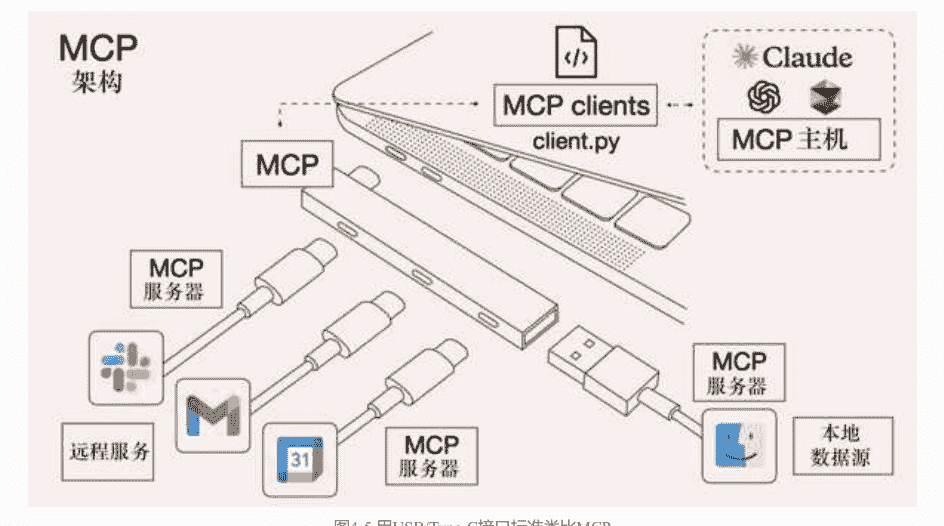

MCP是2024年末由Anthropic公司提出的开放标准，目标是为所有AI模型和外部工具提供统一的“插座”。只要支持MCP，任何AI模型都可以轻松地连接任何支持该标准的外部工具，无须再为每个组合进行定制开发。它解决了N×M的集成问题，为AI生态带来前所未有的互联互通性。

##### 1. MCP工作原理解析

为了更生动直观地理解MCP的工作逻辑，我们可以将其想象成一个组织有序的大型餐厅。

- **MCP主机（Host）**：相当于餐厅本身。你使用的AI编程工具（如TRAE、Cursor）就是提供整个服务环境的“餐厅”，也是你与AI互动的载体。
- **MCP客户端（Client）**：相当于餐厅服务员。当你下达指令时（如“帮我查一下项目中未解决的bug”），“服务员”就接到了“订单”——服务员知道哪个“厨房”负责处理这类事务，且“餐厅”会为每个连接的外部工具配备专属的“服务员”。
- **MCP服务器（Server）**：相当于专业分工的厨房。例如，“GitHub厨房”专门处理所有与代码仓库相关的任务（如查找bug、合并代码）；“Figma厨房”专门将设计图转化为“代码菜肴”。每个MCP服务器都对应一个外部工具或数据源，拥有操作该工具所需的API和数据。

MCP的整个工作流程如下。

1. 你在“餐厅”（主机）中提出需求，“服务员”（客户端）接收后，判断需“GitHub厨房”（服务器）处理，于是将订单传递过去。
2. “厨房”处理完后将结果交回“服务员”，最后由“服务员”呈现给你。

通过这种方式，一个AI应用可同时连接无数个功能各异的外部工具，提供丰富多样的服务。

## 2.统一标准的优势

MCP的诞生为用户带来了三大实际价值。

- **减少AI信息偏差**：大语言模型（LLM）的训练数据是静态的，有时会编造看似合理的错误信息，即前文提到的“幻觉”。MCP为AI连接了实时数据源，当AI对信息不确定时，可通过MCP直接查询权威的数据源（如最新的官方文档、你的数据库），从而让回答更加真实可靠。
- **解锁自动化能力**：MCP让AI从被动的知识问答工具，转变为主动执行任务的“行动者”。没有MCP时，AI只能告诉你“应该”怎么做；有了MCP，AI可以直接“帮你做”。它可以更新CRM系统中的客户信息、运行复杂的计算，甚至将写好的文章直接发布到网站上。
- **面向未来的技能**：MCP并非某家公司的私有技术，而是一个被行业广泛接受的开放标准。自Anthropic推出后，OpenAI、Google、微软等行业巨头均迅速宣布支持采纳，这表明统一标准已成为行业共识。如今学习MCP，就是在掌握构建下一代AI应用的“通用语言”和“标准接口”。

## 3.环境准备与MCP服务器市场

在了解了MCP的概念和优势后，你可能会问：在哪里找到这些功能强大的MCP服务器？如何使用它们？好消息是，一个成熟、充满活力的生态系统已经形成，你可以像逛“应用商店”一样，找到并安装各类MCP服务器，为AI助理配备上各种实用的工具。

以下是几个受欢迎的“MCP应用市场”。

- **MCP.so**：一个由社区驱动的第三方MCP市场（见图4-6），收录了上万个MCP服务器，涵盖从简单的时间查询到复杂的浏览器自动化等各种工具。

##### 4. 面向普通用户的免费MCP工具推荐

为了让你快速上手，我们精选了几款完全免费、简单实用且对非技术用户友好的MCP工具，如表4-4所示。你无须任何编程知识，只需按照后续教程进行简单配置即可使用。

表4-4 免费的MCP服务器

| 服务器名称 | 主要功能 | 简单的应用场景 |
| :--- | :--- | :--- |
| Time | 提供当前时间，并进行时区转换 | “现在北京是几点？” |
| Filesystem | 读取、写入和整理电脑上的文件 | “帮我阅读‘会议纪要.txt’，并生成一份摘要” |
| Zhipu Web Search | 执行网络搜索并返回结果 | “帮我搜索模型上下文协议的最新新闻，并总结最重要的三条” |
| Playwright | 自动控制网络浏览器并执行各种任务 | “打开Google的主页面，搜索MCP并截取搜索结果页的截图” |
| Howtocook Mcp | 提供烹饪菜谱和餐饮计划 | “家里有鸡肉、米饭和西兰花，今晚能做什么菜” |

表4-4是你进入MCP世界的入门钥匙，能让你快速感受到MCP工具的实用价值。

##### 5. MCP配置文件详解

现在，我们来了解MCP配置的核心——mcp.json文件。这个文件用来告诉AI（如TRAE、Cursor）：“这是你的新工具箱，里面有这些工具以及它们的使用方法。”

以添加Time服务器为例，最简单的配置如下：

```json
{
  "mcpServers": {
    "time": {
      "command": "npx",
      "args": ["-y", "mcp-server-time"]
    }
  }
}
```

上述配置的逐行解释如下。

- **“mcpServers”: {...}**：定义一个AI工具列表的开始。
- **“time”: {...}**：你为该工具设定的“昵称”，用于在AI应用中识别和管理。
- **“command”: “npx”**：告诉计算机使用npx程序启动工具（npx是Node.js环境的一个常用命令，可以方便地运行在线软件包，无须提前安装）。
- **“args”: [“-y”, “mcp-server-time”]**：传递给npx的具体指令，指定运行名为mcp-server-time的软件包。

通过这几行简单的配置，你就成功为AI安装了新工具。

在配置MCP服务器时，主要有两种运行方式。

- **STDIO (Standard Input/Output)**：这就像雇用一位私人厨师。只有当你需要时，AI应用才会启动服务器进程，任务完成后进程即结束，只专门为你服务。这种方式非常适合在本地计算机上运行的工具（如Filesystem服务器），优点是安全、私密。
- **HTTP/SSE (Server-Sent Event)**：这就像一家24小时营业的餐厅。服务器可运行在你的计算机或互联网上，持续等待请求，AI应用通过URL“下单”。这种方式适合连接需要持续运行或由第三方提供的远程服务（如GitHub或Figma服务器）。

#### 4.3.2 在SOLO中配置与使用MCP

现在，我们将在AI原生开发环境TRAE SOLO中开展第一次实战演练。TRAE SOLO是高度自动化的IDE，内置了强大的AI助理，将它与MCP结合，能极大提升自动化能力。

值得注意的是，IDE在MCP生态中扮演核心“指挥中心”或“协调者”的角色。TRAE SOLO和Cursor均提供专门的界面，用于管理服务器、查看日志、批准工具调用——这意味着IDE正成为指挥并协同AI智能体完成复杂任务的主战场，而IDE本身也完美地承担了MCP架构中主机（Host）的职责。

##### 1. MCP全局配置与项目级配置

在TRAE SOLO中，可以通过下面两种配置方式决定MCP工具的可用范围。

- **全局配置**：工具对所有项目可见，适合如查询时间、网络搜索等通用功能。
- **项目级配置**：工具仅在当前特定项目中可用，例如连接特定数据库的MCP服务器建议在这里配置。

TRAE SOLO提供了友好的界面来安装和管理MCP服务器，下面以项目级配置为例来演示操作步骤。

1. 进入AI管理界面。在TRAE SOLO的设置或侧边栏中，找到AI Management或MCP选项，如图4-9所示。

2. 探索内置市场并安装服务器。TRAE SOLO自带一个MCP服务器市场，只需点击添加按钮，根据提示填入必要信息即可完成安装，如图4-10所示。

3. 搜索特定的MCP服务器。在市场搜索栏中输入MCP服务器名称（如需GitHub集成功能，可以搜索GitHub MCP），搜索结果会显示匹配的服务器列表。

4. 添加目标服务器。在搜索结果中找到对应的服务器（如GitHub MCP），点击旁边的添加按钮，成功后该服务器会出现在已配置的服务器列表中。

5. 手动配置MCP服务器。如果在内置市场中未找到需要的服务器，或者需要进行更精细的配置，可以在服务器列表界面点击“手动配置”按钮（通常位于服务器列表的顶部或底部），TRAE SOLO会引导完成配置，如图4-11所示。

在手动配置时，需要编辑对应的 mcp.json 文件：项目级配置编辑项目目录下的 .vscode/mcp.json；全局配置编辑用户目录下的mcp.json。该文件的基本结构如下：

```json
{
  "mcpServers": {
    "server-name": {
      "command": "executable",
      "args": ["arg1", "arg2"],
      "env": {
        "VAR": "value"
      }
    }
  }
}
```

该文件基本结构的相应字段解释如下。

- “server-name”：为服务器设定的名称标识。
- “command”：运行MCP服务器的可执行命令（如npx）。
- “args”：传递给服务器可执行文件的命令行参数数组。
- “env”：包含启动服务器时需设置的环境变量对象（可选）。

可根据要求选择在项目级配置（仅对当前项目生效）或全局配置（对所有项目生效）中添加相应的服务器配置。

6. 管理已添加的服务器。添加完成后，可在列表中看到所有已配置的服务器，并随时进行启用、禁用、编辑或重启等操作，如图4-12所示。

##### 2. 十分钟实战：连接GitHub MCP

本次实战的目标是让AI成为你的代码仓库管理员，自动处理GitHub相关的任务。GitHub是一个用于托管和管理代码的云端平台，我们将通过MCP实现AI与它的直接交互。

###### 前期准备：创建GitHub个人访问令牌

开始之前，你需要创建一个个人访问令牌（PAT）。PAT是供应用程序使用的特殊密码，必须妥善保护，避免泄露。

请登录你的GitHub账号，在Settings中导航至Developer settings，然后选择Personal access tokens，选择Fine-grained tokens类型，创建一个新的PAT。在创建过程中，务必遵循最小权限原则——只勾选工具必需的最小权限（如仅需读取Issues，就不要授予删除仓库权限）。

###### 配置mcp.json文件

获得PAT后，接下来需要配置mcp.json文件。在TRAE SOLO中选择手动添加MCP服务器，并填入以下配置（记得将your_github_pat替换为刚生成的PAT）：

```json
{
  "mcpServers": {
    "GitHub": {
      "command": "npx",
      "args": ["-y", "@modelcontextprotocol/server-github"],
      "env": {
        "GITHUB_PERSONAL_ACCESS_TOKEN": "your_github_pat"
      }
    }
  }
}
```

该配置通过npx命令运行GitHub官方提供的MCP服务器，并通过env字段安全传递PAT。

###### 验证与使用

完成配置后，保存文件并重启或刷新MCP服务器列表。然后打开TRAE SOLO的聊天窗口，用自然语言下达指令即可。比如：

- “列出my-first-website仓库中所有处于打开状态的议题（issue）”；
- “读取主分支下 README.md 文件的内容”；
- “创建新议题，标题为‘更新首页欢迎语’”。

AI将作为你的GitHub专属助手，实时响应并处理各种代码仓库管理任务。

##### 3. 十分钟实战：集成Figma MCP

本次实战的目标是打通设计与开发之间的壁垒，让AI直接将Figma视觉设计稿转化为可用的前端代码。Figma是一款广受欢迎的在线协作设计工具，我们将实现它与AI的无缝对接。

###### 启用Figma本地服务器

首先需要在Figma中启用MCP服务器。

确保你安装了最新版Figma桌面应用程序，然后打开任意一个Figma设计文件，在左上角的菜单中找到Preferences，找到并勾选Enable local MCP server（见图4-13）。

启用后，Figma会在你的计算机上静默运行一个本地服务器，并在画板底部显示URL地址，复制该地址（见图4-14）。

###### 配置TRAE SOLO连接Figma

Figma本地服务器的默认地址通常为http://127.0.0.1:3845/mcp。在TRAE SOLO的MCP设置中手动添加服务器，配置如下：

```json
{
  "mcpServers": {
    "figma": {
      "type": "http",
      "url": "http://127.0.0.1:3845/mcp"
    }
  }
}
```

###### 将设计转化为代码

配置完成后，在Figma中右键点击目标设计元素，选择Copy link to selection，如图4-15所示。

回到TRAE SOLO聊天窗口，切换至Builder with MCP智能体，将链接粘贴进去并对AI下达指令“使用Figma MCP，为该设计生成HTML和Tailwind CSS代码。”

通过MCP，AI会获取设计的结构化数据（如颜色值、圆角、字体和字号等），从而生成可直接用于生产的高质量代码。

##### 4. 十分钟实战：配置Playwright MCP

本次实战的目标是让AI像专业测试工程师一样，操作浏览器完成自动化测试和数据抓取。Playwright是一款强大的自动化工具，可通过代码精准实现浏览器点击、输入、滚动和截图等操作。

###### 配置Playwright MCP服务器

开始配置之前，可以选择两种方式安装Playwright MCP服务器：在TRAE SOLO的MCP市场中直接搜索添加；手动配置mcp.json文件（推荐使用这种方式，因为npx命令会自动下载运行服务器，无须提前安装）。

如果选择手动配置，在TRAE SOLO中添加以下内容到mcp.json文件中：

```json
{
  "mcpServers": {
    "Playwright": {
      "command": "npx",
      "args": ["-y", "@executeautomation/playwright-mcp-server"],
      "env": {}
    }
  }
}
```

该配置使用npx命令运行Playwright MCP服务器。其中-y参数表示自动确认安装，整个安装过程更流畅。

###### 自动化操作

保存配置后，在TRAE SOLO的聊天窗口中选择Builder with MCP智能体，按照以下步骤与AI对话。

1. “使用 Playwright 打开新浏览器页面，并访问网址 https://en.wikipedia.org/wiki/Artificial_intelligence。”
2. “很好！点击页面上文本为Machine learning的链接。”
3. “干得漂亮！现在对当前页面进行截图，并保存为ml_page.png文件。”

通过简单的对话，无须编写复杂的代码，AI会自动调用Playwright的各种功能，将自然语言指令转化为精确的浏览器自动化操作。

##### 5. 十分钟实战：连接 Magic MCP

本次实战的目标是用一句话生成你想要的界面——通过自然语言描述，让AI凭空创造UI组件代码。Magic MCP是一款能将自然语言描述瞬间转化为UI组件代码的AI工具，让界面开发变得像说话一样简单。

###### 获取Magic API密钥

访问Magic官方网站，注册账号并登录个人仪表盘，在API区域生成一个新的API密钥，复制并保存。这个密钥将用于连接TRAE SOLO与Magic服务。

###### 配置mcp.json文件

在TRAE SOLO中添加以下配置，记得将your-api-key替换成刚才获取的实际密钥：

```json
{
  "mcpServers": {
    "@21st-dev/magic": {
      "command": "npx",
      "args": ["-y", "@21st-dev/magic@latest", "API_KEY=your-api-key"]
    }
  }
}
```

该配置通过npx命令运行最新版本的Magic MCP服务器，并通过环境变量传入你的API密钥完成身份验证。

###### 生成UI组件

配置完成后，就可以释放你的创造力了。在TRAE SOLO聊天窗口中切换至Builder with MCP智能体，使用/ui命令描述你想要的组件，示例如下。

- “/ui创建一个现代风格的登录表单，需要包含‘忘记密码’链接。”
- “/ui生成一个价格方案对比表格，分为基础版、专业版和企业版三个版本。”
- “/ui设计一个带有搜索框和用户头像的网站导航栏。”

AI会根据描述自动生成符合现代设计规范的UI组件代码，包括HTML结构、样式以及必要的交互逻辑。你可以直接预览效果并根据需要进行微调，整个过程无须手写一行代码。

#### 4.3.3 在Cursor中配置与使用MCP

现在，我们将目光转向另一款为AI时代而生的强大工具——Cursor。Cursor是一款从零开始为AI协同编程而设计的IDE，其内置的Composer Agent能够自主理解复杂任务，并调用已配置的MCP工具来完成。

##### 1. mcp.json配置与Composer Agent集成

与TRAE SOLO类似，Cursor也支持全局和项目级两种MCP配置模式，配置文件同样命名为mcp.json。

- **全局配置：** 适用于所有项目，配置文件存储在用户主目录的 ~/.cursor/mcp.json文件中。可以通过按下“Ctrl/Cmd + ，”组合键打开设置面板，在左侧菜单栏中点击Tools & Integrations，在右侧找到MCP设置进行配置，如图4-16所示。
- **项目级配置：** 仅对当前项目生效的“专属工具包”，配置文件位于项目根目录的.cursor/mcp.json中。Cursor打开该项目时才会加载对应的MCP服务器，适合存放项目特有的工具能力（如某电商项目专属的订单数据库MCP服务器）。在团队协作场景中，可将该配置文件提交到代码仓库，其他成员拉取项目后无须重新配置，即可直接使用相同的MCP工具链。

配置完成后，需启用Cursor的Composer Agent模式：在Composer中按下Ctrl/Cmd + I组合键，选择Agent模式即可。启用后，Agent将主动识别已配置的MCP工具，并在需要时调用。

Composer Agent的核心能力有下面这些。

- **读取和写入代码：** 自动识别并修改代码文件。
- **搜索代码库：** 在项目中进行语义搜索，快速定位相关代码。
- **调用MCP服务器：** 与MCP集成，利用其提供的各种功能。
- **运行终端命令：** 直接在编辑器中执行命令行操作。
- **自动搜索网页：** 获取最新的相关信息和文档。

当你提出需要外部能力的请求时，Agent会在聊天界面中提示将要使用的工具并请求批准。对于常用且信任的工作流，你可以开启“自动运行”模式，让Agent自动执行工具调用，实现更高程度的自动化。

##### 2. 十分钟实战：连接Browser MCP

本次实战的目标是让AI直接控制你正在使用的Chrome浏览器（包括已登录的网站状态和保存的cookie）。与Playwright启动全新的“访客模式”浏览器不同，Browser MCP直接控制当前使用的浏览器。这意味着AI可以直接在已登录的页面上执行操作，无须重复登录，且所有行为都在本地运行，这样能保护隐私并降低被识别为机器人的概率。

###### 安装Chrome扩展

在Chrome网上应用店搜索Browser MCP，找到后进行安装（该扩展是AI与浏览器的连接桥梁）。安装后在需要控制的浏览器上启用该扩展，点击扩展图标并点击Connect按钮，看到插件处于监听状态即启用成功，如图4-17和图4-18所示。


图4-17 在Chrome上启用Browser MCP扩展


图4-18 处于监听状态的Browser MCP

###### 配置mcp.json文件

在Cursor中，打开全局或项目级mcp.json文件，添加以下配置：

```json
{
  "mcpServers": {
    "browsermcp": {
      "command": "npx",
      "args": ["@browsermcp/mcp@latest"]
    }
  }
}
```

###### 体验个人自动化

保存配置并重启Cursor，按下Ctrl/Cmd + I组合键打开AI聊天窗口，并尝试以下指令。

- “打开一个新的浏览器标签页，访问 weibo.com 。”
- “在当前打开的微博页面上搜索‘氛围编程’标签。”
- “帮我为搜索结果中的前3条信息点赞。”

通过简单的对话，AI即可在已登录的浏览器环境中完成各种自动化任务，大幅提升日常工作效率。

## 3.十分钟实战：集成 Supabase MCP

本次实战的目标是通过自然语言与数据库交互，在无须编写复杂SQL语句的情况下，实现数据查询、表格管理等功能。

###### 注册Supabase并获取PAT

访问Supabase官网，创建免费账户和新项目。在账户设置的Access Tokens部分创建新的PAT。请妥善保管该PAT，它拥有管理数据库的权限，需注意安全。

###### 复制Project ID

在Supabase项目中找到并复制你的Project ID，如图4-19所示。

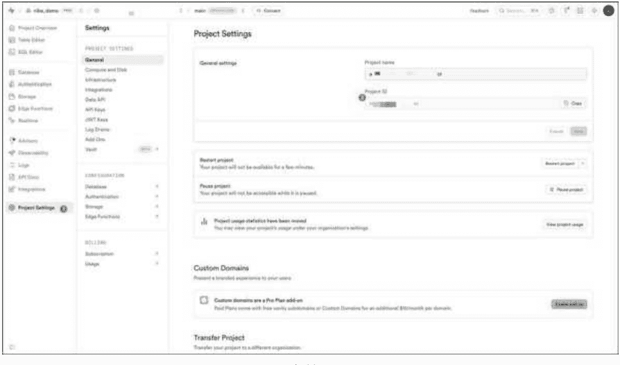

###### 配置mcp.json文件

在Cursor中配置Supabase MCP服务器，将your-supabase-pat替换为你的PAT，project-ref替换为你的Project ID。

```json
{
  "mcpServers": {
    "supabase": {
      "command": "npx",
      "args": [
        "-y",
        "@supabase/mcp-server-supabase@latest",
        "--read-only",
        "--project-ref=<project-ref>"
      ],
      "env": {
        "SUPABASE_ACCESS_TOKEN": "your-supabase-pat"
      }
    }
  }
}
```

###### 用自然语言查询数据库

以之前章节创建的users表为例，可与AI进行如下对话。

- “使用Supabase帮我看看users表中都有哪些用户？”
- “他们的邮箱分别是什么？”
- “帮我找到邮箱是your_email+test1@gmail.com的用户的全部信息。”

AI会自动将自然语言转化为精确的数据库查询，并以易读的方式展示结果，让数据库操作像聊天一样简单。

## 4.十分钟实战：配置 Context7 MCP

本次实战的目标是解决LLM知识陈旧的问题，让AI在生成代码时能够参考最新的官方文档。通常情况下，AI模型的知识库存在“截止日期”，而Context7 MCP是专门为AI提供实时、特定版本文档的服务，能有效避免AI出现“幻觉”或使用过时的API。

###### 获取Context7 API密钥

登录Context7官网，注册账号并获取你的API密钥，该密钥用于访问最新的技术文档资源（在使用时，需要使用Node.js v18以及以上的版本）。

###### 配置mcp.json文件

在Cursor中打开全局或项目级mcp.json文件，添加以下配置（记得将your-context7-api-key替换为你的API密钥）：

```json
{
  "mcpServers": {
    "context7": {
      "url": "https://mcp.context7.com/mcp",
      "headers": {
        "CONTEXT7_API_KEY": "your-context7-api-key"
      }
    }
  }
}
```

###### 体验实时文档参考功能

当向AI提问某个库或框架的用法时，前沿的大模型（如Claude Sonnet 4）会自动触发该服务。假设我们向AI提问“如何使用Next.js的after函数”，AI在启用Context7 MCP前后的响应可能如下。

- **未启用Context7 MCP：** AI可能回复“抱歉，Next.js没有名为after的函数”。
- **已启用Context7 MCP：** AI会先通过Context7 MCP获取after函数的最新官方文档，再基于准确信息生成正确的使用示例。

通过Context7 MCP，AI摆脱了训练数据的时间限制，能够始终提供最新、最准确的技术建议。

#### 4.3.4 MCP高级应用与实用技巧

MCP的真正威力，在于将独立的工具组合起来，从而构建出能自动完成复杂任务的个性化工作流。

### 1.多MCP工具的协同配置与性能优化

要让多个MCP服务器协同发挥作用，核心是掌握编排（Orchestration）技巧。编排是指让多个独立的MCP服务器为共同目标而协同工作的能力，AI智能体在此扮演“总指挥”的角色，它会根据复杂指令，智能地判断在不同步骤调用哪个工具。

一个典型案例是“线上事故响应”工作流：当告诉AI“我们的网站登录页面好像出问题了，帮我查一下”时，AI智能体会立即启动多个MCP工具协同工作。

- 首先，调用Sentry MCP检查错误监控系统的最新日志，并反馈“好的，我正在检查Sentry错误监控系统的最新日志”。
- 其次，当发现一个与用户认证相关的严重错误后，调用GitHub MCP查找相关的代码提交记录。
- 最后，调用Slack MCP在开发团队频道里发出警报“已定位到问题，可能是由昨晚的一次代码合并引起的，已附上错误日志和代码链接”。

整个过程流畅自然，如同一位经验丰富的工程师在处理线上事故。

这种“复合型AI应用”的核心价值，源于对工具的智能编排和组合。这与UNIX命令行哲学有异曲同工之妙：通过管道符（|）连接简单的命令，构建强大的数据处理流水线，而MCP正是AI世界里的“管道符”。因此，学习MCP的关键在于培养一种超越单一指令的“工作流设计”思维。

为特定项目构建复杂工作流时，最佳实践是使用项目级mcp.json文件，确保只加载当前项目所需的服务器，让AI环境保持轻便高效。

### 2.十分钟实战：构建个人工作流

日常工作中，我们常需要主动关注“人工智能”行业的最新动态，手动访问网站、筛选新闻、提炼重点再保存文件，步骤繁琐且耗时。而本次实战就将通过MCP的技能串联，让这些操作在Cursor中自动完成，形成端到端的自动化流程。

###### 配置所需的MCP工具

确保Cursor的mcp.json文件中已配置browsermcp和filesystem服务器，其中filesystem的路径需要替换为你实际的读写路径：

```json
{
  "mcpServers": {
    "browsermcp": {
      "command": "npx",
      "args": ["@browsermcp/mcp@latest"]
    },
    "filesystem": {
      "command": "npx",
      "args": [
        "-y",
        "@modelcontextprotocol/server-filesystem",
        "/Users/username/Desktop"
      ]
    }
  }
}
```

###### 下达多步指令

打开Cursor的AI聊天窗口，清晰地向AI下达如下指令：

> 请使用MCP工具执行以下一系列任务。
> 1. 使用Browser MCP工具访问WaytoAGI知识库网站的首页。
> 2. 抓取首页最重要的三篇人工智能新闻的主要内容。
> 3. 分别为这三篇文章生成一段100字左右的中文摘要。
> 4. 使用文件系统工具在桌面上创建一个名为WaytoAGI_news_summary.md的新文件，并将这三段摘要以Markdown格式写入该文件中。

###### 观察自动化过程

在Cursor的聊天界面中可实时看到AI智能体的操作：调用Browser MCP访问网站、分析内容、调用Filesystem MCP创建文件等。完成后，桌面上会出现一个包含AI新闻摘要的Markdown文件。

###### 查看自动化结果

在Cursor中打开刚生成的WaytoAGI_news_summary.md文件，即可看到包含文章标题、核心观点和关键信息的格式化摘要。

该实战案例完美展现了MCP的协同能力——将打开浏览器、访问网站、复制内容、总结要点、创建文件等烦琐的手动操作压缩为一次简单的对话。这种多工具串联的工作流，正是MCP架构的核心价值：让AI不仅能完成单一任务，更能像人类助理一样，理解并执行复杂的多步骤工作流程。

##### 3. MCP故障排除与常见问题

在使用MCP服务器时，可能会遇到连接问题（如连接频繁断开、连接建立失败）、性能问题（如响应缓慢、处理能力不足）、数据处理异常（如格式错误、处理失败）等情况。有关MCP的常见问题故障以及排除指南可参考表4-5。

表4-5 MCP常见问题故障以及排除指南

| 问题现象 | 可能的原因与症状 | 解决步骤 |
| :--- | :--- | :--- |
| 服务器无法启动 | 工具未出现在可用工具列表中，或MCP日志显示错误 | 1. 检查Node.js、Python等依赖程序是否安装正确<br>2. 在终端手动运行mcp.json中的command和args，查看具体报错信息<br>3. 确认配置文件中的路径是否准确 |
| 权限被拒绝 | 读写文件失败，提示Permission Denied或类似信息 | 1. 检查目标文件或文件夹的读写权限设置<br>2. 尝试在配置中使用绝对路径而非相对路径<br>3. 确保Cursor或TRAE SOLO拥有访问系统访问权限 |
| JSON格式错误 | MCP功能无法加载，提示malformed JSON（格式错误的JSON） | 1. 复制mcp.json文件的全部内容<br>2. 借助在线的JSON校验器检测语法错误（如遗漏逗号、括号不匹配） |
| 认证失败 | 工具连接成功但在执行时失败，提示401 Unauthorized或Invalid API Key | 1. 核对API密钥/PAT是否完整复制，无多余空格<br>2. 确认密钥是否需要权限<br>3. 检查密钥是否已过期 |

##### 4. MCP最佳实践与安全建议

MCP作为连接AI与各类外部工具的核心桥梁，能极大提升开发效率，但工具的强大也意味着需重视安全风险与规范使用——这不仅关系到个人账户、数据的安全，更影响团队协作时的环境稳定性。因此在本章最后，我们将聚焦于如何安全、负责任地使用MCP工具，通过明确的实践原则规避潜在风险，让工具能力真正服务于高效开发。

- **保护凭证：** API密钥和PAT是访问数字服务的关键凭证，绝对不要将它们分享给任何人或上传到公共网络空间。建议使用环境变量存储这些凭证，而非直接写入配置文件，从根源上降低泄露风险。
- **最小权限原则：** 创建令牌或密钥时，仅授予其完成任务所需的最小权限，避免权限过度扩大。这是安全防护的基础原则，能有效限制潜在安全事故的影响范围。
- **信任来源：** 仅从官方发布渠道或高度信任的社区来源安装MCP服务器。对来源不明的服务器保持高度警惕，以防恶意服务器窃取你的数据或执行恶意操作（如工具投毒[tool-poisoning]），安装前务必验证来源的可靠性。
- **审查与确认：** 在刚开始使用时，不要盲目批准所有的工具调用请求。仔细阅读批准提示，明确它要执行的命令及其影响范围。只有在完全理解并信任某个工具的自动化流程后，才考虑为其开启“自动运行”功能。
- **保持整洁：** 定期清理mcp.json文件，移除不再使用的服务器配置，减少潜在的安全风险和配置复杂度。

此外，建议严格验证和清理所有输入，防范路径遍历、非法字符等安全漏洞；实现细粒度的访问控制和完整的审计日志，确保所有操作可追溯；在工具描述中明确预期的输入和输出，避免歧义，保障工具的安全性和有效性。

只有遵循这些安全实践，才能在提升开发效率的同时，切实保障个人和团队的安全。

#### 4.3.5 小结

掌握了MCP，就掌握了将AI从“聊天伙伴”升级为“得力干将”的秘诀。你现在拥有的不仅是一系列强大的工具，更是一种全新的AI协同工作方法论。这个由MCP连接、充满无限可能的AI新世界，正等待你去驾驭。

# 第5章 项目实战1：从0到1构建习惯追踪器

理论的价值只有在实践中才能闪闪发光。现在，是时候让你手中的所有工具为一个真实的目标齐心协力了。

在本章，我们不再单独拆解前端、后端或某个特定工具的技术要点，而是以一款完整产品的诞生为主线，带你体验从灵感闪现到用户可用的全过程。我们选择的实战项目是“习惯追踪器”——这款产品看似简单，实则涵盖了现代应用开发的几乎所有关键环节，是锻炼综合能力的绝佳载体。

你将亲眼见证，如何通过与AI的头脑风暴，将一个朦胧的想法一步步演化为清晰的产品蓝图；你将体验从零开始搭建数据库、设计用户认证、实现核心功能的完整流程；你还将学会如何集成邮件服务、文件存储等现代应用的“必备配件”。每一行代码、每一个决策，都将成为你独立开发能力的重要积累。

学完本章后，你将不仅拥有一个可以自豪展示的作品，更重要的是，将掌握“从想法到产品”的完整落地能力。

## 5.1 蓝图：运用AI规划产品

一个伟大的想法就像一座遥远的山峰，壮丽却令人望而生畏。攀登它的关键，并非一步登顶，而是找到那条可以踏出第一步的小径。我们将学习如何借助AI，把“习惯追踪器”的宏大想法，分解成一个个清晰、可管理的模块，稳健迈出产品开发的第一步。

### 5.1.1 将AI作为产品合伙人

每个伟大的产品都始于一瞬间的灵感。或许某个时刻，“开发一款习惯追踪器App”的想法突然闯入脑海——它可能潦草地记在纸上，也可能只在脑中萦绕。最初的激动过后，往往会迎来一个令人迷茫的问题：下一步该做什么？

从一个模糊的想法到一个可以落地的具体计划，这条路对新手而言确实充满未知。此时，如果能有一位随时待命、知识储备丰富且富有创意的“合伙人”相助，无疑会事半功倍。而这位理想的合伙人，就是AI工具。

在本节中，AI将扮演一个全新的角色：你的产品合伙人。它会协助你进行头脑风暴、梳理思绪、挑战既有假设，最终将那个闪光的想法，转化为一份清晰、可执行的产品蓝图。我们将通过与这位AI合伙人的对话，共同构建“习惯追踪器”的产品框架。

在本节结束时，那个关于“习惯追踪器”的模糊概念，将变成一个坚实的骨架。我们会明确产品要解决的核心问题（为什么做）、清晰描绘目标用户画像（为谁做），并定义应用所需具备的核心功能（做什么）。

### 5.1.2 运用AI开展产品功能头脑风暴

面对一个新项目，最常见的困境莫过于盯着空白文档无从下手。我们的“习惯追踪器”应该包含哪些功能——是简单的签到打卡，还是需要复杂的数据图表？是否要加入社交元素？对于初次开发此类产品的人来说，这些问题很容易让项目陷入停滞。

这正是AI合伙人登场的最佳时机。然而，要让AI发挥最大效用，关键在于提出一个结构良好的问题。如果只是简单地询问“习惯追踪器需要什么功能”，得到的结果可能过于宽泛而不适用。我们需要像产品经理一样，为AI设计一个结构化的“超级提示词”。

#### 1.打造一个“超级提示词”

一个有效的提示词应当包含角色、任务和格式要求，这能引导AI以专业视角输出更有价值的内容。下面是为AI工具设计的提示词：

> 请扮演一位经验丰富的产品经理。我正在构思一款新的“习惯追踪器”App，请为我进行全面的头脑风暴，生成一份功能列表。
>
> 请将功能分为两类。
>
> • 核心功能：这些是构建最小可行产品（MVP）所必需的基础功能。
> • 创新/高级功能：这些是未来可以让产品脱颖而出、提升用户参与度的功能。
>
> 对于每个功能，请用一句话简要描述它的作用。

#### 2.解读AI的分析报告

将上述提示词输入AI后，AI会检索并整合相关资料，生成一份详尽的战略分析报告。这份报告不仅罗列功能，更体现了对市场和用户心理的深入分析，通常包含以下几个核心部分。

- **市场与用户心理分析**：开篇会剖析主流竞品的逻辑，例如游戏化导向的Habitica通过经验值和装备系统吸引玩家，极简主义的Streaks以简洁界面和连续记录计数器迎合效率型用户，健康教练式的Fabulous则采用基于行为科学的“习惯叠加”技术引导用户循序渐进地改变。这些产品均依托坚实的心理学理论，包括尼尔·埃亚尔（Nir Eyal）的上瘾模型（触发-行动-奖励-投入循环）、B. J. Fogg的行为模型（行为 = 动机 + 能力 + 提示）以及自我决定理论（强调自主性、胜任感和归属感三大心理需求）。

- **功能规划核心**：AI会将功能明确分为如下两类。

  - **核心功能（MVP必备）**：约9项，涵盖用户账户管理、习惯创建、灵活计划安排（支持每周特定天数或固定间隔）、正向/负向习惯追踪、每日签到、连续记录计数器、基础提醒通知、进度可视化、数据隐私保护。
  - **创新/高级功能**：共20余项，涵盖游戏化激励（虚拟形象、技能树、叙事任务）、全方位健康（引导式日记、正念练习、CBT [认知行为疗法] 应对策略）、社区与问责（团队挑战、问责伙伴、庆祝分享）、AI个性化（对话式教练、动态目标调整、预测性障碍识别）、环境计算集成（健康平台自动同步、情境感知提示）等五大方向。

- **战略建议**：提供清晰的分阶段路线图，具体如下。

  - **第一阶段**：发布MVP验证核心循环，确认用户能否成功创建和追踪习惯。
  - **第二阶段**：深化用户参与，增加黏性功能。
  - **第三阶段**：通过智能功能构建差异化竞争壁垒。

同时，报告强调，需明确产品独特的价值主张（是极致的游戏化体验、智能的AI教练、无摩擦的生活记录器，还是正念的习惯塑造者）。而且在健康领域，信任是最宝贵的资产，因此需要从第一天起就落实数据安全措施，对用户保持透明并遵守相关法规。

核心结论：成功的习惯追踪器并非简单地堆砌功能，而是要对产品哲学做出明确的战略选择，将设计根植于人类动机的科学原理，并执行以用户价值和信任为核心的分阶段计划。通过聚焦于特定的用户需求，构建可信、合规的平台，打造出一款真正帮助用户建立美好生活的产品。

> 注：由于AI生成的完整报告篇幅较长（包含详细的竞争格局对比表、功能优先级框架、具体的功能描述等细节），我们将其整理为电子文档，大家可通过异步社区的本书页面进行下载。

##### 3. 从功能列表到产品策略

这份由AI生成的报告，不仅是想法的集合，更是制定产品策略的起点。

首先，它清晰划分了“当前任务”和“未来方向”。对初创产品而言，专注是成功的关键——核心功能列表构成了MVP的基石，满足用户对习惯追踪器的基本期待。首要任务是将这些核心功能打磨得简单易用，而非急于添加高级特性。

更深一层，这份报告促使我们思考一个核心问题：我们要打造一款什么样的产品？市面上的成功应用，其功能选择都反映了独特的产品哲学。例如，Streaks以极简和与Apple Health深度集成为特色，强调几乎不需要额外操作的数据追踪；Habitica则把习惯养成转化为角色扮演游戏，通过外在激励强化用户动机；而Fabulous则更像一位健康教练，引导用户循序渐进地改变。

因此，审视AI给出的“高级功能”，实际上是在为产品选择“灵魂”——是做极简的数据追踪者、高游戏化的激励器，还是引导式的健康教练？这个决定将直接影响产品的目标用户群体。

此外，报告还揭示了一些关键的战略权衡。例如，“自动化追踪”能极大提升便利性，但对数据权限与隐私合规的要求更高；“手动记录”更可控、更轻量，却增加了用户操作成本。这说明，“不做什么”和“做什么”同样重要，我们需要在便利性、隐私、成本与合规之间审慎权衡。

为了使规划更清晰，我们将AI的头脑风暴结果整理为两张速览表，分别如表5-1和表5-2所示。其中，表5-1所示为构建MVP所必需的核心功能。这些功能构成了习惯追踪器的基础框架，确保用户能够完成“创建习惯-追踪进度-获得反馈”这一核心循环。表5-2则聚焦功能创新方向，汇总了可用于产品差异化竞争、提升用户长期黏性的高级特性，为后续版本迭代提供明确方向。

表5-1 核心功能列表（MVP）

| 功能分类 | 功能名称 | 用户价值（该功能的重要性） |
| :--- | :--- | :--- |
| 账户管理 | 用户账户与引导 | 安全起步，顺畅完成首次设置，降低上手成本 |
| 习惯管理 | 习惯创建 | 将想法快速落地为可追踪的目标，减少启动阻力 |
| 习惯管理 | 灵活的计划安排 | 适配不固定的作息与频率，提升可执行性 |
| 习惯管理 | 正向/负向习惯追踪 | 同时支持“要做”和“要戒”的双场景，更贴合现实 |
| 追踪记录 | 每日签到完成 | 一键式操作，确保核心循环几乎无须额外操作即可完成 |
| 激励反馈 | 连续记录计数器 | 通过可视化的“连续天数”强化成就与内在动力 |
| 提醒通知 | 基础提醒/通知 | 在恰当时间给出提示，对抗遗忘，强化习惯节律 |
| 数字展示 | 基础进度可视化 | 通过日历或周期回顾历史，让坚持“看得见” |
| 安全合规 | 数据隐私与安全 | 以信任为前提，通过合规加密与清晰政策保障数据安全 |

表5-2 功能创新方向

| 创新方向 | 功能示例 | 用户价值（该功能的重要性） |
| :--- | :--- | :--- |
| 高级游戏化与激励 | 虚拟形象/装备、技能树、叙事任务、假期模式 | 适配不同动机类型，提升黏性与长期动力 |
| 全方位健康 | 引导式日记、正念练习、睡眠模板、CBT应对策略 | 从“追踪”升级为“自我关怀与反思”，促进长期改变 |
| 社区与同辈 | 问答伙伴、团队挑战、庆祝分享、排行榜 | 提供归属与适度竞争，借助外部监督助力坚持 |
| AI超个性化 | 对话式AI教练、动态目标、预测性障碍识别 | 像私人教练般主动反馈与调整，减少挫败感 |
| 环境计算与集成 | 健康平台自动同步、多模态传感器、情境感知提示 | 减少手动操作的负担，实现“无形”追踪与自动化 |

现在，我们的脑海里不再是一片空白，而是一份清晰的分阶段功能路线图，并且开始深入思考产品的个性和战略——这正是从想法到蓝图的关键第一步。

### 5.1.3 五分钟实战：创建用户画像

我们已经明确了产品要“做什么”，但还有一个更重要的问题：我们是“为谁做”。如果对用户一无所知，很可能会做出一款无法满足市场需求的产品——这就需要引入“用户画像”（User Persona）这一核心工具。

##### 1. 理解用户画像

用户画像是为典型用户创建的半虚构角色档案，核心目的不是罗列统计数据，而是培养同理心。当我们把“用户”这个模糊的群体，具象化为有血有肉的具体角色时，就能更自然地站在他们的角度思考问题。进行功能决策时，我们会下意识地反问：“这个设计对‘李静’来说会不会太复杂？”这能有效地避免陷入“我觉得用户会喜欢”的自我中心式开发陷阱。

##### 2. 创建用户画像

现在，让我们再次借助AI合伙人，快速创建几个生动的用户画像。

###### 第一步：提供画像模板提示词

理想的用户画像需基于真实的研究和数据。在缺少大规模调研资源的情况下，我们可以基于对身边潜在用户的观察，为AI提供“事实的种子”。需注意，AI生成的内容可能看似逼真但缺乏事实依据，因此我们的角色是“研究员”，AI是“助理”，我们需要用真实的观察来引导并验证AI的输出。

带着这些观察，我们向AI发出指令：

> 请帮我为一款习惯追踪器App创建3个不同的用户画像，使用以下模板，并为每个画像生成贴近现实的细节。

画像模板：
- 姓名与照片描述
- 个人简介与背景故事
- 基本信息：年龄、职业、地点、生活状态
- 目标：他们使用该App时最想达成的1-2个核心目标
- 痛点与挫败：没有该App时，他们在养成习惯时遇到的主要困难是什么
- 动机：什么能激励他们坚持下去
- 一句引言：能代表他们心声的一句话

请基于以下3个用户类型进行创建：
- 压力很大的在校大学生；
- 工作繁忙的年轻职场人；
- 对数据有要求的健身爱好者。

###### 第二步：检阅AI生成的用户画像

运行提示词后，AI会生成详尽的用户画像。由于完整内容较长，这里只展示核心要点，建议将完整版本保存为独立文档以供查询。

AI为我们创建了3个典型用户，具体如下。

- **李静（大学生，20岁）**：面临学业压力，需通过规律的学习计划和健康习惯来应对焦虑，核心痛点是工具零散，且习惯中断后容易产生挫败感。
- **王辰（市场经理，28岁）**：工作繁忙，希望在不增加负担的前提下高效管理个人时间，实现工作与生活的平衡。
- **张伟（自由设计师，32岁）**：数据驱动的健身爱好者，需要深度的数据分析功能来量化和优化自己的训练与生活习惯。

这3个画像分别代表了不同的用户需求层次：李静需要简单友好的引导和情感支持，王辰追求效率和灵活性，张伟则关注数据的深度和可定制性。通过这些具象化的角色，我们在后续的功能设计中就能更准确地判断优先级——比如MVP版本应该优先满足李静和王辰的核心需求，而张伟所需的高级数据分析功能则留待后续迭代。

> 注：完整的用户画像可通过异步社区的本书页面进行下载。

##### 3. 让画像指导决策

现在，我们有了3个生动的“用户”，他们不再是抽象的概念。当我们回顾功能列表时，这些画像会成为决策的“试金石”。我们可以开始思考一系列非常具体的问题。

- 这项功能对“李静”来说负担是否足够低，是否提供“暂停模式”，以免因考试周等情况导致连续记录中断而产生挫败感。
- 这个界面对“王辰”来说，能否在短时间内完成关键操作，且支持灵活调整提醒以适应临时变动的日程。
- 这项功能是否为“张伟”提供基础的进度可视化，并为后续的健康平台同步与自定义指标留有扩展空间。

### 5.1.4 十分钟实战：撰写PRD

经过头脑风暴和用户画像分析后，我们的想法已逐渐清晰。这些零散的思考需要一个正式的载体，以确保所有参与者对产品的理解保持一致——这一载体就是PRD。

我们可以为AI设定更专业的角色——PRD架构师，借助其结构化思维模式，输出符合专业标准的产品蓝图。

下面进入实战环节。

##### 第一步：定义产品的核心宗旨

首先需要明确产品的“灵魂”。向AI发出如下指令：

> 你好，PRD架构师。请根据之前创建的用户画像（压力山大的大学生李静、工作繁忙的年轻职场人王辰、数据驱动的健身爱好者张伟），为习惯追踪器App的MVP版本撰写“产品宗旨”部分，请包括如下信息。
- 问题陈述：用户面临的核心问题是什么？
- 目标用户：我们的MVP版本主要为谁服务？
- 核心价值：我们的App如何解决他们的问题？

AI生成的产品宗旨概览如下。

PRD架构师明确了产品的核心定位。在问题陈述上，AI指出现代人在自我提升过程中面临的核心困境——建立和维持习惯的过程本身成为新的压力源，现有工具要么过于零散无法提供持续动力，要么过于复杂耗费心力，导致用户最终放弃。

在目标用户定位上，MVP版本优先服务“有抱负但已不堪重负”的成长型用户，具体包括需要结构化指导和情感支持的大学生（如李静），以及追求效率与工作生活平衡的繁忙职场人（如王辰），而对深度数据分析有需求的高级用户（如张伟），将在后续版本重点服务。

核心价值主张则聚焦于“让用户毫不费力地看到自己的进步”，通过提供清晰的结构降低心理负担，创造无摩擦的“一键完成”追踪体验，以及建立基于“连续记录”可视化的可持续内在动力，帮助用户建立胜任感和掌控感。

> 注：完整的产品宗旨文档可通过异步社区的本书页面进行下载。

##### 第二步：用“用户故事”来描述功能

接下来，将确定的核心功能转化成“用户故事”（User Story）格式——“作为一个[角色]，我想要[完成某个动作]，以便于[实现某个价值]”，这能确保开发的每一项功能都与用户的真实需求挂钩。

向AI发出指令：

> 架构师，请将MVP的核心功能（习惯创建与记录、每日提醒、进度追踪）改写成用户故事，需从“王辰”和“李静”的视角出发。

AI生成的用户故事概览如下。

- **习惯创建与记录**：作为王辰，我希望快速创建并灵活安排习惯，通过一键打卡提高效率；作为李静，我希望将目标具象化，同时追踪想养成和想戒掉的习惯。
- **每日提醒**：作为王辰，我需要在众多工作通知中脱颖而出的有效提醒；作为李静，我需要友好温柔的提醒来关爱自己。
- **进度追踪**：作为王辰，我希望快速浏览完成历史图表，评估投入回报；作为李静，我需要直观看到连续记录天数，作为坚持的动力。

> 注：完整的用户故事文档可通过异步社区的本书页面进行下载。

##### 第三步：划定界限——MVP的“不做清单”

一个成功的MVP，不仅在于明确“做什么”，更在于勇敢地决定“不做什么”，以保持开发专注，避免“范围蔓延”。

向AI发出指令：

> 架构师，为了确保我们能快速、专注地完成MVP，请根据之前头脑风暴的结果，列出一个“范围外功能”（不做清单）。

PRD架构师明确了MVP阶段需要排除的功能范围。

- **不构建复杂的游戏化与激励系统：** MVP的核心激励是简单而强大的“连续记录”，因此不开发虚拟形象、装备、技能树，也不会设计叙事驱动的任务或多变的随机奖励系统。
- **不含社交与社区功能：** 在这个阶段，用户聚焦“自我提升”，因此不实现问责伙伴、团队挑战、排行榜、社交动态或分享里程碑等功能。
- **不开发全方位的健康与日记功能：** 我们的产品定位是“习惯追踪器”，而不是“全能健康管家”，所以不会加入引导式日记、情绪追踪、冥想或呼吸练习，以及CBT/DBT相关的应对策略。
- **不构建复杂的人工智能功能：** 在拥有足够的数据和用户反馈之前，不开发对话式AI教练、预测性分析、动态目标调整，以及自然语言处理日记分析等功能。
- **不支持自动化与第三方平台集成：** 我们的核心理念是“有意识的手动追踪”，以帮助用户建立对自己行为的认知，因此不实现与Apple Health或Google Fit等健康平台的自动同步，也不开发基于位置或日历的智能提醒，更不会提供API与IFTTT/Zapier平台的集成。

> 注：完整的“不做清单”文档可通过异步社区的本书页面进行下载。

##### 第四步：定义成功的标准

如何衡量App是否成功？我们需要明确简单的衡量指标。

向AI发出指令：

> 架构师，请为我们的MVP版本建议2-3个关键的成功指标。

PRD架构师给出了3个关键的成功指标：第一周用户留存率、核心行为转化率、连续记录启动率。这些指标分别衡量用户的回访情况、首次打卡转化效果以及连续打卡习惯的养成，帮助我们验证MVP的核心价值主张与激励机制是否有效。

> 注：完整的成功指标文档可通过异步社区的本书页面进行下载。

将以上所有部分进行整合，一份专业、清晰且极具指导意义的PRD就完成了。

### 5.1.5 小结

通过本节的学习，你已经初步掌握了产品规划的核心流程。我们从“习惯追踪器”的模糊想法出发，借助AI合伙人，完成了从0到1的产品需求分析。

你不再只是拥有一个想法，而是掌握了一套专业的产品规划方法：学会运用AI进行结构化头脑风暴并提炼产品策略；能够快速创建生动的用户画像，并运用同理心指导产品设计；可以将零散的想法整合为一份清晰、专业的产品蓝图（PRD）。

这份蓝图，是从“想法”到“产品”的第一块坚实基石，将为你接下来的设计与开发之旅提供明确的导航。

蓝图已定，下一站，让我们将这些文字与规划，转变为看得见的界面设计。

## 5.2 从想法到产品：全栈深度实战

在前文中，我们主要聚焦应用的前端，即用户直接看到并与之交互的界面。现在，我们将转向应用的后端，构建支撑其运行的核心引擎。

如果说前端是应用的“门面”，那么后端则是其“内在骨架”，负责处理数据、执行业务逻辑、管理用户认证以及存储信息。这些功能协同工作，共同构成一个功能完整、性能可靠的应用。

在软件开发中，这套协同工作的技术组合称为技术栈。我们将为应用挑选一套现代化、功能强大且兼顾成本效益的技术栈，目标是以较低的成本实现核心功能，使得在预算有限的情况下也能构建出高质量的应用。

### 5.2.1 十五分钟实战：将PRD蓝图转化为可用的AI应用

在5.1节中，我们以产品经理的视角撰写了一份详尽的PRD，作为“习惯追踪器”App的设计蓝图。在正式搭建后端前，我们先完成一个关键步骤：利用AI开发代理，将这份蓝图快速转化为一个可见、可交互的应用原型。

TRAE SOLO正是这样一款强大的AI开发代理，它能解析复杂的自然语言需求或结构化文档，自主完成软件开发的全流程。这种方法体现了“节俭开发”的理念，即将耗时较多的前端界面搭建工作，交由自动化工具高效完成。

接下来，我们通过具体的操作步骤来体验如何使用TRAE SOLO将PRD转化为可运行的应用。

1. 启动AI开发代理。打开TRAE SOLO，界面核心为一个对话框。
2. 提交产品需求文档。将5.1节完成的“习惯追踪器”PRD完整复制到对话框中，再附上如下指令：

> 你好，请根据这份PRD构建一个名为“习惯追踪器”的Web应用，请使用现代化、对SEO友好且易于部署的技术栈，例如Next.js和Tailwind CSS。

这里的关键在于，我们不仅提供了需求（PRD），还明确了关于实现方式（技术栈）的建议——Next.js作为一款功能强大的React框架，能与后续使用的Vercel部署平台无缝集成。

3. 观察AI的规划过程。提交需求后，TRAE SOLO首先分析规划，在DocView面板中将PRD整理提炼为更结构化的技术实现方案。这个过程是透明可见的，能让你清晰了解AI从业务需求到工程语言的转换逻辑。

4. 进入自动化开发模式。确认规划后（通常点击确认按钮即可），TRAE SOLO将接管开发环境，整个过程将通过3个面板展示。

- **终端（Terminal）面板：** AI自动执行创建项目结构、安装依赖库等命令。
- **编辑器（Editor）面板：** 代码文件被逐一创建和填充。
- **浏览器（Browser）面板：** 应用在本地开发服务器上实时运行，界面更新即时呈现。

5. 从原型到代码。在较短的时间内，一个包含前后端基础功能的应用即可构建完成，初始界面可能已涵盖PRD中描述的页面、按钮和基本布局。应用的原型效果如图5-1所示。

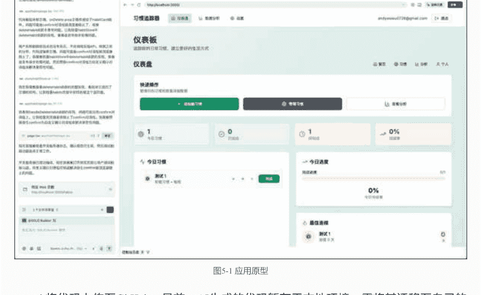

6. 将代码上传至GitHub。目前，AI生成的代码暂存于本地环境，需将其迁移至自己的GitHub仓库（如果没有创建的话，需要先创建），这标志着我们正式接管了代码的所有权。

- **创建GitHub仓库：** 登录GitHub账户，创建一个新的空仓库，命名为habit-tracker或其他相关名称。
- **连接并推送代码：** 在TRAE SOLO终端，按照GitHub提供的指令初始化Git仓库、关联远程仓库，执行首次提交与推送。如果不熟悉相关操作，也可直接向TRAE SOLO请求帮助以完成这些步骤。参考命令如下：

```bash
##### 进入项目目录
cd path/to/your/habit-tracker
##### 初始化 Git
git init
##### 添加所有文件到暂存区
git add .
##### 创建第一次提交
git commit -m "Initial commit from Trae Solo"
##### 关联到你的远程 GitHub 仓库
git remote add origin https://github.com/your-username/habit-tracker.git
##### 推送到主分支
git push -u origin main
```

至此，你已成功将一份PRD转化为一个真实的代码项目，并安全地存放在GitHub仓库中。接下来，我们准备将这个应用部署到Vercel平台，完成首次公开发布。

### 5.2.2 五分钟实战：部署应用并公开发布

到目前为止，应用仅在本地开发环境中运行。现在我们进行部署，将其发布到互联网，实现公开访问。

我们选择Vercel作为应用的部署平台。正如第3章介绍的，Vercel能够处理复杂的服务器配置、网络带宽和安全防护等问题，让开发者专注于应用开发本身。

Vercel与GitHub仓库可以深度集成，我们将采用一种高度自动化的现代工作流程——CI/CD，其工作流程如图5-2所示。

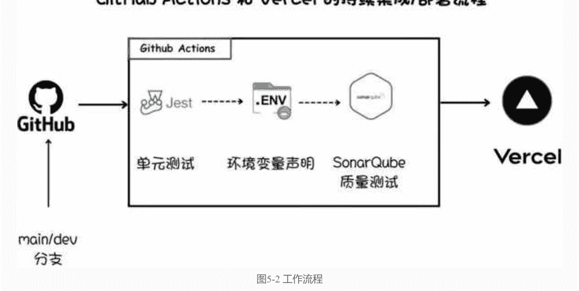

该流程的核心逻辑很简洁：每当验证通过的代码改动被合并到GitHub仓库的主分支（main branch）时，Vercel会自动收到通知，随后启动全自动流程——根据最新的代码重新构建应用、执行测试，最后用新版本无缝替换线上运行的旧版本。这意味着线上应用始终与最新、最稳定的代码保持同步，整个过程无须人工干预。

接下来开始实际操作。

1. 注册Vercel账户。前往Vercel官方网站进行注册，推荐直接使用GitHub账户授权登录，这会自动建立Vercel与代码仓库的连接，为后续的自动化部署奠定基础。

2. 导入项目。在登录后的页面中点击Add New，选择Project。Vercel会列出你GitHub账户下的所有仓库，找到“习惯追踪器”项目，点击旁边的Import按钮，如图5-3所示。

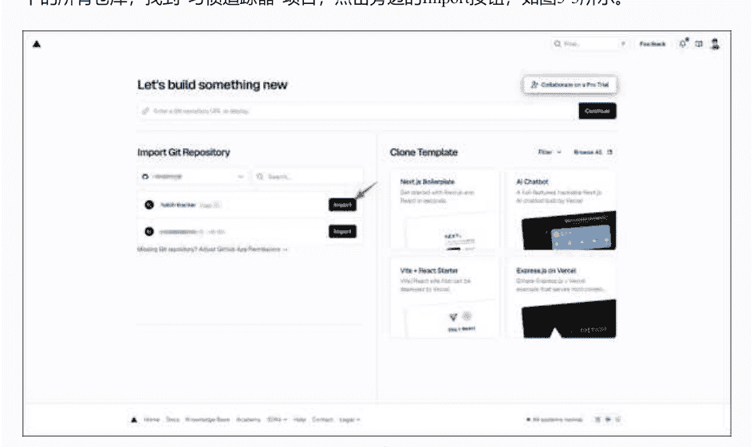

图5-3 导入项目

3. 配置项目。在项目配置页面，几乎无须进行任何手动操作。Vercel具备强大的框架识别能力，会自动识别出这是一个Next.js项目，并配置最优的构建命令、输出目录等所有设置，如图5-4所示。

4. 开始部署。确认设置无误后（默认配置即可），点击Deploy按钮。Vercel会在云端为你的应用分配资源、安装依赖、执行构建，最终完成部署。整个过程的实时日志将显示在界面上，如图5-5所示。

5. 部署成功。部署完成后，Vercel会生成一个以.vercel.app结尾的公开网址，全球用户都可以通过这个链接访问你的应用。

此外，TRAE SOLO在完成项目构建后，通常会提供一个快捷的部署功能，如图5-6所示。通过该功能，用户可以跳过手动配置，直接将项目部署到Vercel。这种方式虽然便捷，但它通常不绑定GitHub项目，因此无法体验完整的CI/CD流程。为了系统化学习，建议遵循前述的标准部署步骤。

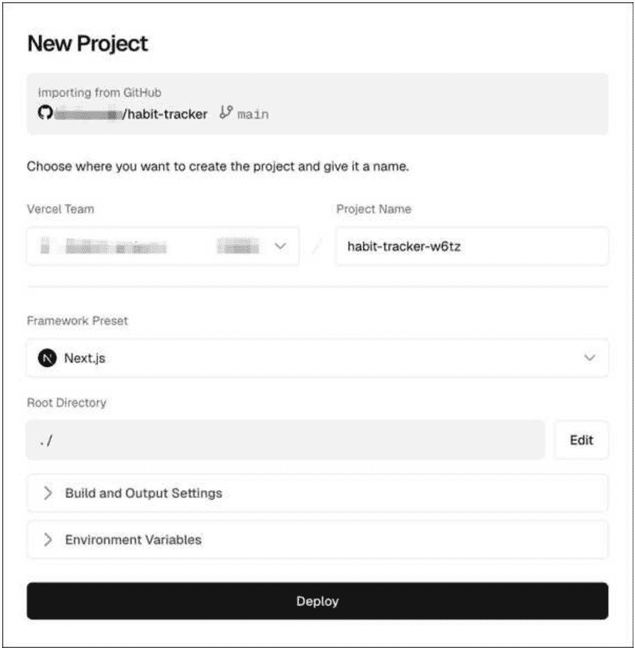

图5-4 零配置的部署分析

> 注：本书的示例项目代码库中提供了本次实战的完整代码，读者可参考该代码库来熟悉项目结构与功能，以便更好地理解后文内容。

##### Deployment

Deployment started 15s ago...

```
Build Logs
25 lines
20:57:06.260 Build machine configuration: 2 cores, 8 GB
20:57:06.396 Cloning github.com/Andywugh/habit-tracker (Branch: main, C
20:57:06.397 Previous build caches not available.
20:57:06.870 Cloning completed: 474.000ms
20:57:06.904 Found .vercelignore
20:57:06.910 Removed 26 ignored files defined in .vercelignore
20:57:06.910 ./.git/config
20:57:06.910 ./.git/description
20:57:06.910 ./.git/FETCH_HEAD
20:57:06.910 ./.git/HEAD
20:57:06.910 ./.git/hooks/applypatch-msg.sample
20:57:06.910 ./.git/hooks/commit-msg.sample
20:57:06.910 ./.git/hooks/fsmonitor-watchman.sample
20:57:06.910 ./.git/hooks/post-update.sample
20:57:06.910 ./.git/hooks/pre-applypatch.sample
20:57:06.910 ./.git/hooks/pre-commit.sample
20:57:07.273 Running "vercel build"
20:57:07.697 Vercel CLI 49.1.2
20:57:08.025 Installing dependencies ...
npm warn deprecated rimraf@3.0.2: Rimraf versions prior to v4 are no longer supported
npm warn deprecated inflight@1.0.6: This module is not supported, and leaks memory.
npm warn deprecated @humanwhocodes/config-array@0.13.0: Use @humanwhocodes/config-array@0.13.0
npm warn deprecated @humanwhocodes/object-schema@2.0.3: Use @humanwhocodes/object-schema@2.0.3
npm warn deprecated glob@7.2.3: Glob versions prior to v9 are no longer supported
```

Deployment Summary

Assigning Custom Domains

图5-5 自动化部署的日志

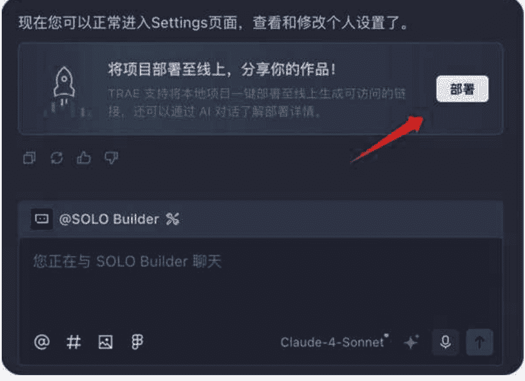

图5-6 快捷的部署功能

##### 部署失败的处理

在软件开发中遇到部署失败是正常现象，每一次失败都是一次宝贵的学习机会，都会揭示代码或环境配置中存在的问题。

Vercel的部署日志是诊断问题的首要工具，相关记录可在项目仪表盘的Deployments标签页（见图5-7）中查看，该标签页会详细记录每一次部署尝试，若部署失败，点击标记为Error的失败记录，即可查看详尽的构建日志（Build Logs），如图5-8所示。

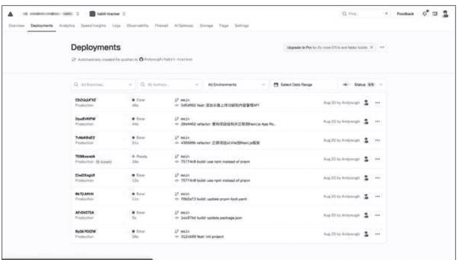

图5-7 Deployments标签页

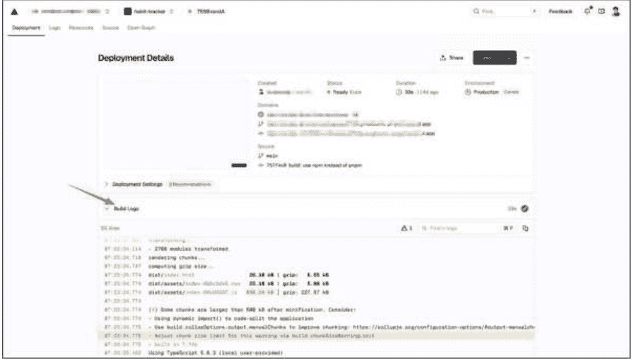

图5-8 Build Logs页面

对于初学者而言，一个常见的失败原因是环境变量（Environment Variable）缺失。我们可以用一个比喻来理解。假设你的应用代码中有一条指令“用储物柜A里的钥匙打开数据库大门”，本地电脑上已指定“储物柜A在书桌的第三个抽屉”，因此程序正常运行。但是，当把应用部署到Vercel这个新环境时，你忘记提供这个位置信息，Vercel找不到“储物柜A”，自然无法获取钥匙，导致程序因无法连接数据库而失败。

这些位置信息就是环境变量。在后续章节，我们将详细介绍如何在Vercel设置中安全地配置环境变量。当前阶段，掌握查找和阅读错误日志的方法也至关重要——它能帮助你快速定位到“环境变量缺失”这类部署故障，是成为合格开发者的核心技能之一。

### 5.2.3 Supabase深度实战：构建后端服务

Supabase提供的服务包括基于PostgreSQL的高安全性数据库、处理用户身份验证的认证系统、执行后端逻辑的边缘函数，以及管理文件的对象存储。

##### 1. 五分钟实战：数据表结构

TRAE SOLO已为我们搭建好后端数据库的基础结构。现在我们来理解这个数据库的设计逻辑。在项目目录中找到./supabase/migrations/001_initial_schema.sql文件，该文件以SQL代码的形式定义了整个数据库的结构蓝图，包含3个核心数据表，共同构成了习惯追踪器App的数据基础。

- **user_profiles (用户档案表)**：存储用户基本信息，包含id (主键，与Supabase认证系统中的用户ID对应)、name (用户姓名)、avatar_url (头像图片链接)、timezone (时区设置)，以及created_at (创建时间戳)、updated_at (更新时间戳) 等字段。
- **habits (习惯表)**：存储用户创建的习惯信息，包含id (每个习惯的唯一标识符)、user_id (关联创建该习惯的用户)、name (习惯名称)、icon (习惯图标)、type (习惯类型，如积极/消极习惯)，frequency (以JSON格式存储的频率设置)、reminder_time (提醒时间)、is_active (习惯的激活状态)，以及created_at和updated_at等字段。
- **habit_logs (习惯记录表)**：记录用户完成习惯的日志，包含id (记录的唯一标识符)、habit_id (关联具体的习惯)、user_id (标识进行记录的用户)、completed_at (完成时间)、notes (可选备注)，以及created_at等字段。

登录Supabase项目仪表盘，点击左侧菜单的Table Editor，即可看到上述3个表，它们包含完整的列结构和数据类型，如图5-9所示。


图5-9 查看实际的表

TRAE SOLO已自动完成数据库核心表的搭建与部署，无须手动配置。

##### 2. 五分钟实战：理解表关系——数据间的关联

这3个数据表并非孤立存在的，而是通过精心设计的关联关系连接在一起。这种关联是通过外键（Foreign Key）实现的。外键是一个或多个列，其值引用了另一个表的主键，从而在两个表之间建立连接。

外键约束不仅可以维护表间的关联关系，还能确保数据的一致性和完整性。例如，当用户被删除时，其相关的习惯和记录也会通过级联删除自动清理，避免产生“孤儿数据”。通过检查迁移文件中的外键配置，可确认数据库结构能否有效维护这些关键的业务关系：

```sql
-- user_profiles 表中的 id 引用了认证用户的 id,并作为主键
CREATE TABLE user_profiles (
  id UUID REFERENCES auth.users(id) ON DELETE CASCADE PRIMARY KEY,
  -- ...
);

-- habits 表中的 user_id 引用了认证用户的 id
CREATE TABLE habits (
  -- ...
  user_id UUID REFERENCES auth.users(id) ON DELETE CASCADE NOT NULL,
  -- ...
);

-- habit_logs 表同时引用 habits 表和认证用户
CREATE TABLE habit_logs (
  -- ...
  habit_id UUID REFERENCES habits(id) ON DELETE CASCADE NOT NULL,
  user_id UUID REFERENCES auth.users(id) ON DELETE CASCADE NOT NULL,
  -- ...
);
```

通过分析这些外键配置，可以清晰地梳理数据表的关系类型。

- 用户与习惯：一对多关系（即一个用户可创建和拥有多个习惯）。
- 习惯与记录：一对多关系（即一个习惯可以对应多条完成记录）。
- 记录与用户：多对一关系（即多条记录可属于同一个用户）。

为了验证这些关系在实际数据库中的体现，可以进入Supabase控制台的Table Editor，在habits表的user_id列旁会显示一个链接图标，表明该列与用户表的外键关系已成功建立，如图5-10所示。

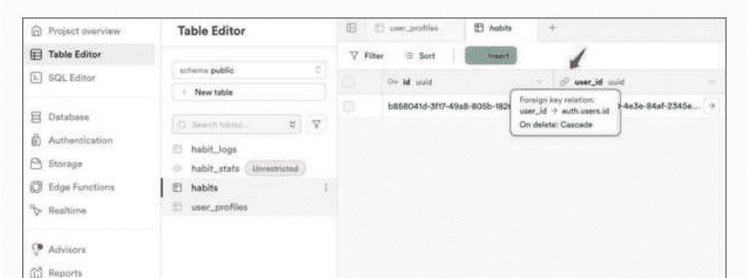

同样，habit_logs表的habit_id和user_id列旁边也会显示链接图标，分别对应与习惯表、用户档案表的关联，如图5-11所示。

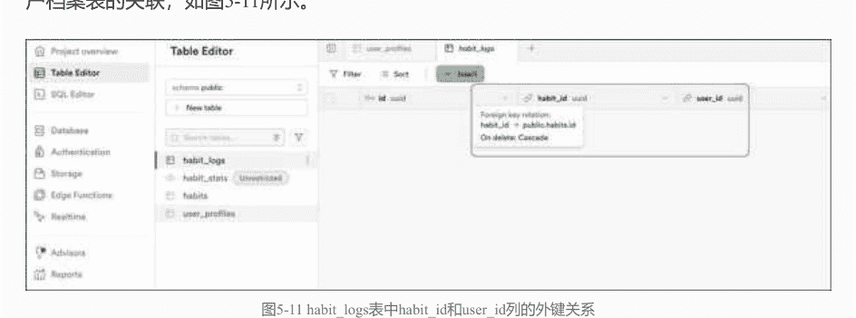

这种关系结构保障了数据的一致性（每个习惯和记录都关联到真实用户）、完整性（删除用户时自动清理相关数据）和查询效率。

##### 3. 十分钟实战：用户认证系统

接下来分析应用的认证系统，该系统负责验证用户身份，并管理其登录状态。该系统的核心组件以及流程如下。

###### 核心组件

认证系统的正常运行依赖3个关键文件的协同工作，这些文件各自承担明确职责。

- **项目根目录下的./src/lib/supabase.ts文件：** 负责创建与Supabase后端通信的客户端实例，使用环境变量安全配置Supabase URL和匿名密钥：

```typescript
import { createClient } from "@supabase/supabase-js";

const supabaseUrl = import.meta.env.VITE_SUPABASE_URL!;
const supabaseAnonKey = import.meta.env.VITE_SUPABASE_ANON_KEY!;

export const supabase = createClient(supabaseUrl, supabaseAnonKey);
```

- **./src/store/authStore.ts文件：** 使用Zustand库管理用户的全局登录状态，包含signIn（登录）、signUp（注册）、signOut（退出）等核心功能。

- **./src/components/auth/AuthForm.tsx文件：** 一个完整的登录/注册表单组件，包含表单验证、错误处理和模式切换等功能。

###### 注册流程

基于上述核心组件，认证系统实现了从注册、登录到状态维护的完整闭环，具体流程如下。

- **注册流程：** 用户提交信息后，系统调用supabase.auth.signUp()创建账户，自动在user_profiles表中创建关联的用户档案，并向用户邮箱发送验证邮件。

- **登录流程：** 用户提交凭证后，系统调用supabase.auth.signInWithPassword()进行验证，成功后更新应用内的用户状态并跳转到主界面。

- **状态监听：** 通过supabase.auth.onAuthStateChange()监听认证状态的实时变化，以自动处理会话刷新、过期或在用户重新访问时恢复登录状态。

接下来可以运行项目，直观体验认证系统的完整流程：在项目目录下运行npm run dev命令启动应用，待启动成功后访问http://localhost:5173，尝试注册新账户，同时在注册前后同步打开Supabase控制台，查看auth.users和user_profiles表的数据变化，通过对比表中数据的新增或更新情况，直观理解认证流程的底层数据流转逻辑。

##### 4. 十分钟实战：数据安全与行级安全策略

最后，我们来探讨TRAE SOLO如何确保用户只能访问自有数据——这一机制通过PostgreSQL的原生功能RLS实现。RLS可为数据表的每一行数据设置精细的访问规则。

###### 核心配置

在./supabase/migrations/001_initial_schema.sql迁移文件中，可以看到为每个核心表启用RLS的指令以及具体的安全策略（如用户档案访问策略、习惯创建策略），如下所示：

```sql
-- 为核心表启用RLS
ALTER TABLE user_profiles ENABLE ROW LEVEL SECURITY;
ALTER TABLE habits ENABLE ROW LEVEL SECURITY;
ALTER TABLE habit_logs ENABLE ROW LEVEL SECURITY;
-- 安全策略示例
-- 用户只能查看自己的档案
CREATE POLICY "Users can view own profile" ON user_profiles
FOR SELECT USING (auth.uid() = id);

-- 用户只能创建属于自己的习惯
CREATE POLICY "Users can create own habits" ON habits
FOR INSERT WITH CHECK (auth.uid() = user_id);
```

这些策略遵循了默认拒绝、用户隔离和操作细分等核心安全原则。

- **默认拒绝：** 在没有明确授权策略的情况下，所有数据访问均被拒绝。
- **用户隔离：** 通过auth.uid() = user_id这类检查，确保用户只能访问自身关联数据。
- **操作细分：** 可为SELECT、INSERT、UPDATE、DELETE等不同的数据操作定义独立的策略。

其中，auth.uid()是Supabase的内置函数，在数据库层面返回当前已认证用户的唯一ID。该函数是连接用户认证状态与数据访问权限的关键，可确保即使应用代码存在漏洞，也无法绕过数据库层面的安全检查。

###### 查看已配置的安全策略

可通过Supabase控制台直观查看RLS配置，具体步骤如下。

1. 登录Supabase项目的仪表盘。
2. 导航至Authentication -> Policies页面。
3. 选择user_profiles、habits等核心表，即可看到每个表已启用RLS并配置了完整的安全策略，如图5-12所示。

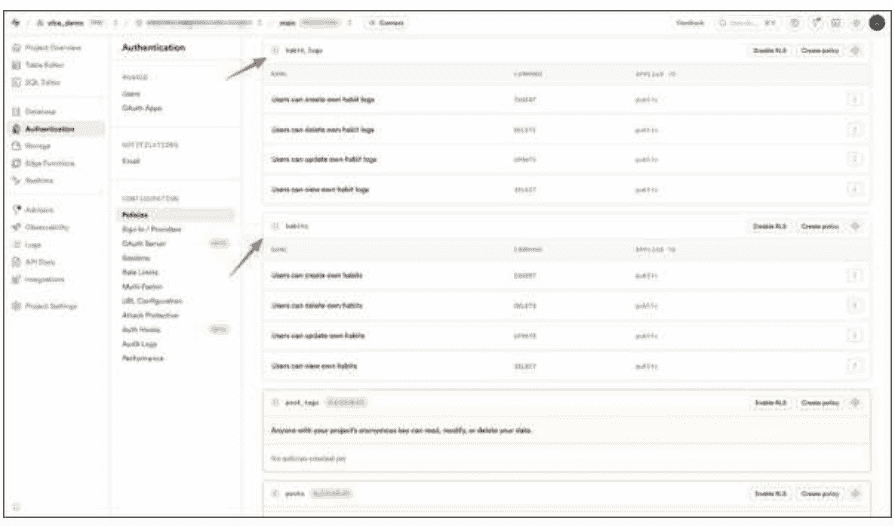

图5-12 查看安全策略

###### 验证RLS效果

为了直观确认RLS策略的实际生效情况，我们设计了基础验证和进阶验证两组测试，分别从用户使用场景和底层安全防护两个维度验证数据隔离效果。

**基础验证（用户数据隔离）**

该测试模拟真实用户使用场景，验证不同用户间的数据隔离是否生效，具体步骤如下。

1. 运行项目，使用两个不同的邮箱注册两个独立的测试账户。
2. 登录第一个账户，创建若干条习惯数据后退出登录。
3. 切换登录第二个账户，会发现无法查看第一个账户创建的任何习惯数据。

这一结果直接证明RLS的用户隔离策略已生效，确保用户只能访问自有数据。

**进阶验证（模拟直接数据访问）**

为了进一步验证RLS的底层安全健壮性，我们模拟绕过前端权限控制，直接向数据库发起请求的场景，测试未授权的访问是否能被有效拦截，具体步骤如下。

1. 打开应用登录页面（无须登录），按F12键打开浏览器开发者工具，切换至Console标签页。
2. 复制以下代码并执行，尝试在未登录状态下直接查询所有习惯数据（需将“你的项目ID”“你的匿名密钥”替换为Supabase项目Settings -> API 页面的实际值）：

### 5.2.4 Resend邮件服务实战

在具备了完整的数据管理和用户认证功能后，我们的应用仍有优化空间——缺少主动的用户沟通机制，无法为用户提供及时的反馈和引导。优秀的现代应用通常通过邮件服务与用户建立持续连接，打造个性化的服务体验。

我们的习惯追踪器App已集成Resend包，邮件功能的基础服务与基础设施均已配置完毕。首先，我们来深入了解当前的用户认证和邮件处理架构。

在项目的store/authStore.ts文件中，用户注册的核心逻辑如下：

```typescript
signUp: async (email: string, password: string, name: string) => {
  const { data, error } = await supabase.auth.signUp({
    email,
    password,
    options: {
      data: { name },
    },
  });

  if (data.user && data.session) {
    set({ user: data.user, session: data.session }); // 创建用户配置文件

    await supabase.from("user_profiles").insert({
      id: data.user.id,
      name,
    });
  }

  return { error };
};
```

同时，项目还实现了服务端的用户注册API路由（app/api/auth/register/route.ts），采用了更安全的服务端用户创建方式：

```typescript
// 使用管理员权限创建用户,自动确认邮箱
const { data: authData, error: authError } =
  await supabase.auth.admin.createUser({
    email,
    password,
    email_confirm: true,
  });
```

这一验证机制具有重要的安全价值：新用户注册时，Supabase会自动向其邮箱发送包含验证链接的邮件，用户必须点击该链接完成验证。这确保了邮箱地址的有效性与可访问性，为后续的用户沟通、密码重置等功能奠定了基础。

基于这一基础验证功能，生产环境中通常需要拓展更完善的邮件通信系统。例如，新用户注册后的欢迎邮件（含应用介绍与使用指南）、定期推送的习惯完成统计报告、按用户设置发送的个性化习惯提醒邮件，以及里程碑达成后的激励邮件等。

虽然技术上可以通过个人邮箱发送程序化邮件，但这种做法存在显著的局限性：

- 邮件送达率低，容易被主流邮件服务商标记为垃圾邮件；
- 缺乏邮件打开率、点击率等数据分析工具，不利于优化沟通策略；
- 需手动处理退订链接、邮件头设置等合规细节。

因此，使用专业的邮件服务成为现代应用开发的必然选择。

在实现邮件功能时，必须严格遵守安全最佳实践。邮件服务的API密钥属于敏感信息，绝不能暴露在客户端代码中。正确的做法是将所有邮件发送逻辑封装在服务器端的API路由中，通过环境变量安全地管理API密钥。

##### 1. 分析应用中的邮件基础设施

我们系统梳理TRAE SOLO项目中已经实现的邮件相关功能，了解现有的基础设施。

- **自动邮件验证机制：** 运行应用（npm run dev）并注册新账户，注册完成后邮箱会收到来自Supabase的验证邮件。这个自动化的验证流程确保了用户邮箱地址的有效性，为后续的邮件通信筑牢基础。
- **完善的通知设置系统：** app/settings/page.tsx文件中包含完整的通知偏好管理功能。

```typescript
const [notifications, setNotifications] = useState({
  daily_reminder: true,
  weekly_summary: true,
  achievement_alerts: true,
  reminder_time: "09:00",
});

// 通过API加载和保存通知设置
const loadNotificationSettings = async () => {
  const response = await fetch("/api/user/notifications", {
    headers: {
      Authorization: `Bearer ${session.access_token}`,
    },
  }); // 处理响应数据...
};
```

该系统不仅提供用户界面控制，还通过user_notification_settings数据表和API路由app/api/user/notifications/route.ts实现了完整的数据持久化。用户可以精确控制各类通知的开关与提醒时间。

- **完整的用户信息收集机制：** 已收集用户姓名（用于个性化邮件内容）、邮箱（邮件发送目标）、时区（确保邮件在合适时间发送）等关键信息，为邮件功能的逻辑提供数据支持。

##### 2. 邮件系统的功能规划

基于现有的应用架构，可以设计以下邮件功能来提升用户体验：

- 新用户注册后发送含有使用指南的欢迎邮件；
- 每周自动生成用户的习惯完成统计报告（包含完成率、连续天数等可视化数据）；
- 根据用户设定的习惯计划和时区偏好，发送个性化的智能提醒；
- 当用户达到特定里程碑时自动发送成就激励邮件，以增强用户的成就感和持续动力。

上述功能将通过Resend实现，这款现代化邮件平台的优势十分契合本项目需求：提供了对开发者友好的API设计，可与现代Web开发工作流无缝集成；免费额度能覆盖小型项目使用场景，并且原生支持React Email（开源邮件模块库），允许开发者使用React组件构建邮件模板，从而提高开发效率和代码复用性。

##### 3. 十分钟实战：实现欢迎邮件功能

由于项目已集成Resend包，我们可以直接在现有的API架构基础上实现邮件功能，步骤如下。

1. 注册并配置Resend。访问Resend官网，注册免费账户并完成登录。接下来，添加并验证一个自有的域名（建议使用子域名，如no-reply.your-website.com）；Resend会提供TXT验证记录，部分场景需额外配置MX记录（用于邮件送达校验），需在域名服务商的DNS管理页面添加该记录，等待5～30分钟生效，验证成功后域名状态会显示Verified。
2. 创建并保存API密钥。前往Resend的API Keys页面，创建新密钥（将其命名为Habit Tracker Production），选择Sending access权限即可；生成的密钥仅显示一次，需立即复制保存。
3. 配置环境变量。在项目根目录创建/编辑.env.local文件，添加配置RESEND_API_KEY=your_resend_api_key_here；若使用Vercel部署，需在Vercel项目设置中添加相同的环境变量。
4. 创建欢迎邮件API路由。在app/api/目录下新建app/api/emails/welcome/route.ts，代码如下：

```typescript
// app/api/emails/welcome/route.ts
import { NextRequest, NextResponse } from "next/server";
import { Resend } from "resend";
import { createClient } from "@supabase/supabase-js";

const resend = new Resend(process.env.RESEND_API_KEY);
const supabase = createClient(
  process.env.NEXT_PUBLIC_SUPABASE_URL!,
  process.env.SUPABASE_SERVICE_ROLE_KEY!
);

export async function POST(request: NextRequest) {
  try {
    const authHeader = request.headers.get("authorization");
    const token = authHeader?.replace("Bearer ", "");

    if (!token) {
      return NextResponse.json(
        { success: false, error: "No token provided" },
        { status: 401 }
      );
    }

    // 验证用户身份
    const {
      data: { user },
      error: authError,
    } = await supabase.auth.getUser(token);

    if (authError || !user) {
      return NextResponse.json(
        { success: false, error: "Invalid token" },
        { status: 401 }
      );
    }

    // 获取用户资料以个性化邮件
    const { data: profile } = await supabase
      .from("user_profiles")
      .select("name")
      .eq("id", user.id)
      .single();

    const { data, error } = await resend.emails.send({
      from: "习惯追踪器 <welcome@your-verified-domain.com>",
      to: [user.email!],
      subject: "欢迎加入习惯追踪器！",
      html: `
        <h2>欢迎, ${profile?.name || "用户"}!</h2>
        <p>感谢你注册我们的习惯追踪应用。</p>
        <p>开始你的习惯养成之旅，每天进步一点点！</p>
        <p>祝你使用愉快！</p>
      `,
    });

    if (error) {
      return NextResponse.json(
        { success: false, error: error.message },
        { status: 500 }
      );
    }

    return NextResponse.json({
      success: true,
      message: "Welcome email sent successfully",
      data,
    });
  } catch (error) {
    console.error("Send welcome email error:", error);
    return NextResponse.json(
      { success: false, error: "Internal server error" },
      { status: 500 }
    );
  }
}
```

##### 4. 五分钟实战：使用模板发送动态邮件

手动拼接HTML字符串编写邮件模板，不仅过程烦琐，还难以保证在各类邮件客户端（Outlook、Gmail、Apple Mail等）中的兼容性。一个现代化的解决方案是使用React Email，它允许我们像构建网页一样，使用熟悉的React组件来构建电子邮件，步骤如下。

1. 安装依赖。执行如下命令安装React Email相关包。

```bash
npm install react-email @react-email/components
```

2. 创建邮件模板组件。在项目根目录新建 emails 文件夹，并在其中创建 WeeklySummaryEmail.tsx文件。
3. 构建动态模板。导入@react-email/components中为邮件兼容性优化的组件，如<Html>、<Body>、<Container>、<Text>等，编写可接收动态参数的模板。

```typescript
// emails/WeeklySummaryEmail.tsx
import {
  Html,
  Body,
  Container,
  Heading,
  Text,
  Hr,
} from "@react-email/components";
import * as React from "react";

// 定义组件期望接收的props类型
interface WeeklySummaryEmailProps {
  username: string;
  habits: Array<{
    name: string;
    completedCount: number;
    totalDays: number;
    streak: number;
  }>;
}

export const WeeklySummaryEmail = ({
  username,
  habits,
}: WeeklySummaryEmailProps) => (
  <Html>
    <Body style={{ fontFamily: "sans-serif", backgroundColor: "#f6f9fc" }}>
      <Container
        style={{
          border: "1px solid #eee",
          borderRadius: "5px",
          padding: "20px",
          margin: "40px auto",
          backgroundColor: "#ffffff",
        }}
      >
        <Heading style={{ color: "#333" }}>
          Hi {username}, 这是你的每周习惯总结!
        </Heading>
        <Text style={{ color: "#555" }}>本周你做得非常棒,继续保持!</Text>
        <Hr />
        {habits.map((habit, index) => (
          <div key={index}>
            <Text>
              <strong>{habit.name}</strong>: 本周完成 {habit.completedCount}
              {" "}
              次{habit.streak > 0 && ` | 连续 ${habit.streak} 天`}
              {habit.completedCount >= 5 ? " 🎉" : ""}
            </Text>
          </div>
        ))}
        <Text
          style={{ marginTop: "20px", color: "#888", fontSize: "12px" }}
        >
          来自你的习惯追踪器
        </Text>
      </Container>
    </Body>
  </Html>
);
```

4. 创建周报邮件API路由。新建app/api/emails/weekly-summary/route.ts，用于获取用户数据并使用动态模板发送邮件。

```typescript
// app/api/emails/weekly-summary/route.ts
import { NextRequest, NextResponse } from "next/server";
import { Resend } from "resend";
import { createClient } from "@supabase/supabase-js";
import { WeeklySummaryEmail } from "../../../emails/WeeklySummaryEmail";

const resend = new Resend(process.env.RESEND_API_KEY);
const supabase = createClient(
  process.env.NEXT_PUBLIC_SUPABASE_URL!,
  process.env.SUPABASE_SERVICE_ROLE_KEY!
);

export async function POST(request: NextRequest) {
```

try {
  const authHeader = request.headers.get("authorization");
  const token = authHeader?.replace("Bearer ", "");

  if (!token) {
    return NextResponse.json(
      { success: false, error: "No token provided" },
      { status: 401 }
    );
  }
}

// 验证用户身份
const {
  data: { user },
  error: authError,
} = await supabase.auth.getUser(token);

if (authError || !user) {
  return NextResponse.json(
    { success: false, error: "Invalid token" },
    { status: 401 }
  );
}

// 获取用户资料
const { data: profile } = await supabase
  .from("user_profiles")
  .select("name")
  .eq("id", user.id)
  .single();

// 获取用户的习惯数据
const { data: userHabits } = await supabase
  .from("habits")
  .select("id, name")
  .eq("user_id", user.id)
  .eq("is_active", true);

// 获取过去7天的习惯记录
const sevenDaysAgo = new Date();
sevenDaysAgo.setDate(sevenDaysAgo.getDate() - 7);
const { data: habitLogs } = await supabase
  .from("habit_logs")
  .select("habit_id, date, completed")
  .eq("user_id", user.id)
  .gte("date", sevenDaysAgo.toISOString().split("T")[0])
  .eq("completed", true);

// 计算每个习惯的完成情况和连续天数
const habits =
  userHabits?.map((habit) => {
    const habitLogsForHabit =
      habitLogs?.filter((log) => log.habit_id === habit.id) || [];
    const completedCount = habitLogsForHabit.length;

    // 计算连续天数(简化版本)
    let streak = 0;
    const today = new Date();
    for (let i = 0; i < 30; i++) {
      // 检查最近30天
      const checkDate = new Date(today);
      checkDate.setDate(today.getDate() - i);
      const dateStr = checkDate.toISOString().split("T")[0];

      const hasLog = habitLogs?.some(
        (log) =>
          log.habit_id === habit.id &&
          log.date === dateStr &&
          log.completed
      );

      if (hasLog) {
        streak++;
      } else {
        break;
      }
    }

    return {
      id: habit.id,
      name: habit.name,
      completedCount,
      streak,
    };
  }) || [];

const { data, error } = await resend.emails.send({
  from: "每周报告 <reports@your-verified-domain.com>",
  to: [user.email!],
  subject: `${profile?.name || "用户"},你的每周习惯报告来啦!`,
  react: WeeklySummaryEmail({
    username: profile?.name || "用户",
    habits,
  }),
});

if (error) {
  return NextResponse.json(
    { success: false, error: error.message },
    { status: 500 }
  );
}

return NextResponse.json({
  success: true,
  message: "Weekly summary sent successfully",
  data,
});
} catch (error) {
  console.error("Send weekly summary error:", error);
  return NextResponse.json(
    { success: false, error: "Internal server error" },
    { status: 500 }
  );
}
}

至此，我们掌握了发送动态、美观且数据驱动的电子邮件的能力，而这一切都建立在熟悉的React组件模型之上，既提升了开发体验，又保证了邮件质量与兼容性。

### 5.2.5 邮件推送的触发机制与通知提醒系统架构

在掌握了邮件的发送方法之后，本节将进一步解析实际项目中邮件推送的触发机制，并介绍通知提醒系统的整体架构。

本应用的习惯追踪功能实现了一个基于邮件的通知提醒系统，支持如下4种核心通知类型。

- **daily_reminder**: 每日习惯提醒，用于督促用户完成当日的习惯。
- **weekly_summary**: 每周总结报告，展示过去一周的习惯完成情况。
- **achievement_alert**: 成就提醒，在用户达到特定里程碑时触发发送。
- **welcome**: 欢迎邮件，用于引导新用户快速上手应用。

当邮件推送成功触发后（如欢迎邮件的发送），用户收到的邮件效果如图5-13所示。

需要说明的是，本应用当前尚未实现自动化的定时触发机制，因此每周总结报告等定时邮件无法自动发送。若要实现自动化通知，可以选择以下方案。

- **Vercel Cron Jobs：** 在vercel.json文件中配置定时任务。
- **GitHub Actions：** 使用工作流（workflow）定时调用通知服务API。
- **第三方调度服务：** 集成cron-job.org等外部专业调度服务。

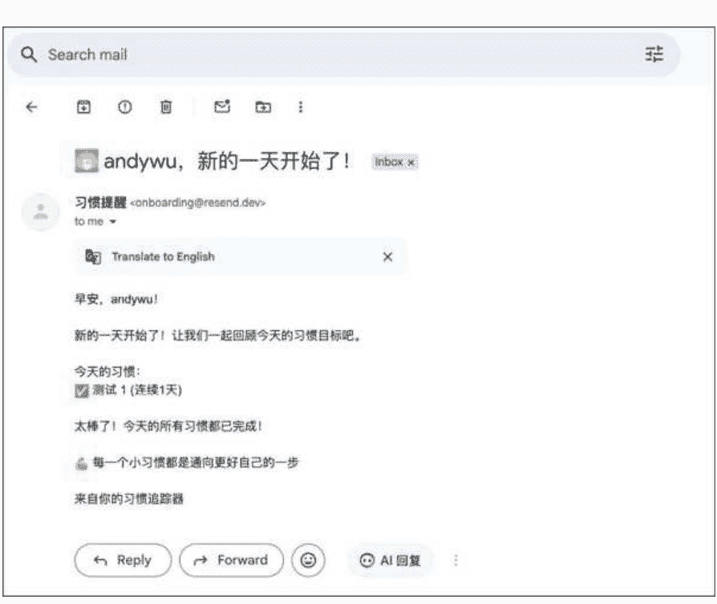

- **Supabase Edge Functions：** 结合pg_cron扩展实现数据库层面的定时任务。
- **客户端触发：** 在用户访问应用时，通过前端逻辑检查并触发相关通知。

该设计为通知提醒系统提供了较高的灵活性，但其自动化依赖于外部调度机制的落地。在讨论完通知提醒系统后，我们将转向另一个关键的基础设施：文件存储。

### 5.2.6 文件存储系统设计

在当前的开发阶段，该应用聚焦于核心的习惯管理功能，因此用户资料管理采用了简化的设计方案。通过分析应用的数据库结构与用户界面，可以清晰了解其文件存储的设计策略与未来扩展潜力。

##### 现有实现状况

在深入文件存储系统的设计之前，需要先明确应用在用户资料管理方面的当前状态。通过分析app/settings/page.tsx文件可知，用户资料管理界面仅支持基本信息的编辑。

```typescript
// 当前的用户资料状态管理
const [profile, setProfile] = useState({
  display_name: "",
  email: "",
  timezone: "Asia/Shanghai",
});

// 用户资料保存逻辑
const handleSaveProfile = async () => {
  const response = await fetch("/api/user/profile", {
    method: "PUT",
    headers: {
      "Content-Type": "application/json",
      Authorization: `Bearer ${session.access_token}`,
    },
    body: JSON.stringify({
      name: profile.display_name.trim(),
      timezone: profile.timezone,
    }),
  });
};
```

同时，从数据库的表结构定义文件supabase/migrations/001_initial_schema.sql中可以看到，user_profiles表已预留avatar_url字段，但当前用户界面尚未提供头像上传功能。

```sql
CREATE TABLE IF NOT EXISTS user_profiles (
  id UUID REFERENCES auth.users(id) ON DELETE CASCADE PRIMARY KEY,
  name TEXT NOT NULL,
  avatar_url TEXT, -- 预留的头像字段
  timezone TEXT DEFAULT 'Asia/Shanghai',
  created_at TIMESTAMP WITH TIME ZONE DEFAULT NOW(),
  updated_at TIMESTAMP WITH TIME ZONE DEFAULT NOW()
);
```

##### 简化设计的技术考量

接下来我们深入分析该应用简化设计背后的技术考量。当前应用暂不实现头像上传功能，是基于以下技术层面的考量。

- **MVP专注性**：优先开发核心的习惯追踪功能，避免在次要功能上分散开发资源。
- **架构简洁性**：避免在早期阶段引入文件上传、存储管理等相对复杂的基础设施。
- **成本控制**：在项目初期有效控制文件存储和CDN带来的额外运营成本。
- **开发效率**：降低文件上传、安全验证、格式转换等技术复杂性带来的开发成本。

##### 架构预留与扩展空间

尽管应用的当前版本未实现头像上传功能，但应用的整体架构已为未来的功能扩展做好了准备。

- **数据库层面：** user_profiles.avatar_url字段已预留，无须修改表结构。
- **API层面：** app/api/user/profile/route.ts路由已支持avatar_url字段的更新，前端只需补充对应逻辑。

这种“预留接口，按需实现”的设计策略是敏捷开发的常见策略，既能保持当前版本的简洁性，又为后续的功能扩展预留了空间。

接下来，我们将通过3个具体的实战，以Cloudflare R2为存储解决方案，为应用升级并实现完整的文件上传功能。

### 1.五分钟实战：分析用户资料数据流

我们先梳理用户保存资料时的数据处理流程。

- **前端：** 通过handleSaveProfile函数向后端API发送请求，当前仅传递姓名、时区等核心字段，未包含avatar_url。

```typescript
// app/settings/page.tsx 中的资料保存逻辑
const handleSaveProfile = async () => {
  const response = await fetch("/api/user/profile", {
    method: "PUT",
    headers: {
      "Content-Type": "application/json",
      Authorization: `Bearer ${session.access_token}`,
    },
    body: JSON.stringify({
      name: profile.display_name.trim(),
      timezone: profile.timezone,
      // 注意:当前版本未包含 avatar_url
    }),
  });
};
```

- **后端：** app/api/user/profile/route.ts路由负责处理数据的更新逻辑，已支持avatar_url字段更新。

```typescript
// 更新用户资料
const { data: profile, error } = await supabase
  .from("user_profiles")
  .update({
    name,
    avatar_url, // API 支持但前端未使用
    timezone,
    updated_at: new Date(),
  })
  .eq("id", user.id)
  .select()
  .single();
```

当前架构具有如下特点。

- **前端简化：** 用户界面仅包含最核心的信息字段（显示名称、邮箱、时区）。
- **API完整性：** 后端API已支持包括头像在内的完整用户资料字段处理。
- **数据库预留：** 数据表结构已为未来的功能扩展做好了准备。

### 2.五分钟实战：设计头像上传功能的技术架构

理想的头像上传用户体验是，用户点击头像、从本地选择图片，随即完成上传并实时更新显示。为实现这一目标，需采用预签名URL（Presigned URL）机制，将文件上传与应用服务器分离，以提升性能和安全性，具体流程如下。

1. 客户端申请上传许可。当用户选择好要上传的图片后，客户端向应用服务器发起请求，申请上传许可。该请求包含文件名、类型等元数据。
2. 服务器生成预签名URL。服务器在验证用户身份和权限后，通过Cloudflare R2 SDK生成有时效性（如5分钟内有效）、绑定特定文件的预签名URL，并将其返回给客户端。
3. 客户端上传文件。客户端使用获取的预签名URL，将图片文件直接上传到Cloudflare R2，此过程不经过应用服务器中转，从而大幅提升了上传速度并降低了服务器的带宽消耗。
4. 服务器更新记录。文件上传成功后，客户端通知应用服务器，服务器将文件访问链接（即avatar_url）更新到用户的数据库记录中。

这种架构的优势在于高效、经济且安全，它将文件传输等密集型任务交由专业的云存储服务处理，而应用服务器仅负责轻量的认证和元数据管理工作。

为实现该架构，需要对现有应用进行扩展。具体做法如下。

1. 升级前端用户界面。在app/settings/page.tsx的用户资料卡片中添加头像上传组件。

```typescript
// 在现有的用户资料卡片中添加头像部分
<Card>
  <CardHeader>
    <CardTitle className="flex items-center space-x-2">
      <User className="h-5 w-5" />
      <span>用户资料</span>
    </CardTitle>
  </CardHeader>
  <CardContent className="space-y-4">
    {/* 新增头像上传区域 */}
    <div className="flex items-center space-x-4">
      <div className="relative">
        
        <button
          onClick={() => fileInputRef.current?.click()}
          className="absolute -bottom-1 -right-1 bg-emerald-600 text-white rounded-full p-1 hover:bg-emerald-700"
        >
          <Camera className="h-3 w-3" />
        </button>
      </div>
      <div>
        <h3 className="text-sm font-medium">头像</h3>
        <p className="text-xs text-gray-500">点击更换头像图片</p>
      </div>
      <input
        ref={fileInputRef}
        type="file"
        accept="image/*"
        onChange={handleAvatarUpload}
        className="hidden"
      />
    </div>

    {/* 现有的显示名称输入框 */}
    <div>
      <label className="block text-sm font-medium text-gray-700 mb-2">
        显示名称
      </label>
      <Input
        type="text"
        value={profile.display_name}
        onChange={(e) =>
          setProfile({ ...profile, display_name: e.target.value })
        }
        placeholder="输入你的显示名称"
      />
    </div>

    {/* 其他现有字段... */}
  </CardContent>
</Card>
```

2. 添加前端文件处理逻辑。在app/settings/page.tsx文件中增加handleAvatarUpload函数，处理文件验证与上传请求。

```typescript
const [uploading, setUploading] = useState(false);
const fileInputRef = useRef<HTMLInputElement>(null);

const handleAvatarUpload = async (e: React.ChangeEvent<HTMLInputElement>) => {
  const file = e.target.files?.[0];
  if (!file) return;

  // 验证文件类型和大小
  if (!file.type.startsWith("image/")) {
    setMessage("请选择图片文件");
    return;
  }

  if (file.size > 5 * 1024 * 1024) {
    // 5MB 限制
    setMessage("图片大小不能超过5MB");
    return;
  }

  setUploading(true);
  setMessage("");

  try {
    // 调用上传API
    const formData = new FormData();
    formData.append("file", file);
```

const { session } = useAuthStore.getState();
const response = await fetch("/api/upload/avatar", {
  method: "POST",
  headers: {
    Authorization: `Bearer ${session?.access_token}`,
  },
  body: formData,
});

if (!response.ok) {
  throw new Error("上传失败");
}

const result = await response.json();
if (result.success) {
  setProfile((prev) => ({ ...prev, avatar_url: result.data.url }));
  setMessage("头像上传成功!");
} else {
  setMessage(result.error || "上传失败");
}
} catch (error) {
  console.error("Upload error:", error);
  setMessage("上传失败,请重试");
} finally {
  setUploading(false);
}
};

3. 配置Cloudflare R2服务。登录Cloudflare控制台，进入R2管理页面，创建存储桶（如 habit-tracker-uploads）。

回到R2的Overview页面，点击Account Details区域中API Tokens旁边的Manage按钮，创建新的API令牌。在创建过程中应遵循“最小权限原则”，将令牌权限设置为ObjectRead & Write，并将其应用范围限定于刚创建的存储桶。

创建成功后，记录生成的Access Key ID和Secret Access Key。需要特别注意的是，后者只显示一次，需立即复制并保存。

在Vercel项目的环境变量中添加4个配置：R2_ACCOUNT_ID（Cloudflare账户ID，用于构建R2端点 URL）、R2_ACCESS_KEY_ID（访问密钥ID，用于对R2服务进行身份验证）、R2_SECRET_ACCESS_KEY（秘密访问密钥，与访问密钥ID配对使用，确保应用有权限访问和操作存储桶中的对象）、R2_BUCKET_NAME（存储桶的名称，指定用于存储和检索对象的特定存储桶）。

##### 3. 十分钟实战：实现文件上传接口

最后，我们实现文件上传的后端逻辑，步骤如下。

1. 安装依赖。Cloudflare R2的API与Amazon S3完全兼容，因此可以直接使用AWS SDK与R2交互，而无须学习新的API。

```bash
npm install @aws-sdk/client-s3 @aws-sdk/s3-request-presigner
```

2. 创建头像上传API路由。新建app/api/upload/avatar/route.ts文件，处理头像上传请求。

```typescript
// app/api/upload/avatar/route.ts
import { NextRequest, NextResponse } from "next/server";
import { createClient } from "@supabase/supabase-js";
import { S3Client, PutObjectCommand } from "@aws-sdk/client-s3";
import { getSignedUrl } from "@aws-sdk/s3-request-presigner";

const supabase = createClient(
  process.env.NEXT_PUBLIC_SUPABASE_URL!,
  process.env.SUPABASE_SERVICE_ROLE_KEY!
);

const r2 = new S3Client({
  region: "auto",
  endpoint: `https://${process.env.R2_ACCOUNT_ID}.r2.cloudflarestorage.com`,
  credentials: {
    accessKeyId: process.env.R2_ACCESS_KEY_ID!,
    secretAccessKey: process.env.R2_SECRET_ACCESS_KEY!,
  },
});

export async function POST(request: NextRequest) {
  try {
    const authHeader = request.headers.get("authorization");
    const token = authHeader?.replace("Bearer ", "");

    if (!token) {
      return NextResponse.json(
        { success: false, error: "No token provided" },
        { status: 401 }
      );
    }

    // 验证用户身份
    const {
      data: { user },
      error: authError,
    } = await supabase.auth.getUser(token);

    if (authError || !user) {
      return NextResponse.json(
        { success: false, error: "Invalid token" },
        { status: 401 }
      );
    }

    const formData = await request.formData();
    const file = formData.get("file") as File;

    if (!file) {
      return NextResponse.json(
        { success: false, error: "No file provided" },
        { status: 400 }
      );
    }

    // 生成唯一文件名
    const fileExtension = file.name.split(".").pop();
    const fileName = `avatars/${user.id}-${Date.now()}.${fileExtension}`;

    // 上传到R2
    const arrayBuffer = await file.arrayBuffer();
    const command = new PutObjectCommand({
      Bucket: process.env.R2_BUCKET_NAME!,
      Key: fileName,
      Body: new Uint8Array(arrayBuffer),
      ContentType: file.type,
    });

    await r2.send(command);

    // 生成公共访问URL
    const publicUrl = `https://${process.env.R2_BUCKET_NAME}.${process.env.R2_ACCOUNT_ID}.r2.dev/${fileName}`;

    // 更新用户资料
    const { error: updateError } = await supabase
      .from("user_profiles")
      .update({ avatar_url: publicUrl })
      .eq("id", user.id);

    if (updateError) {
      return NextResponse.json(
        { success: false, error: updateError.message },
        { status: 400 }
      );
    }

    return NextResponse.json({
      success: true,
      message: "Avatar uploaded successfully",
      data: { url: publicUrl },
    });
  } catch (error) {
    console.error("Upload avatar error:", error);
    return NextResponse.json(
      { success: false, error: "Internal server error" },
      { status: 500 }
    );
  }
}
```

3. 更新用户资料保存逻辑。修改handleSaveProfile函数，确保在保存用户资料时，新的头像URL也会一并保存。

```typescript
const handleSaveProfile = async () => {
  setSaving(true);
  setMessage("");

  try {
    const { session } = useAuthStore.getState();
    if (!session) {
      setMessage("登录已过期,请重新登录");
      setSaving(false);
      return;
    }

    const response = await fetch("/api/user/profile", {
      method: "PUT",
      headers: {
        "Content-Type": "application/json",
        Authorization: `Bearer ${session.access_token}`,
      },
      body: JSON.stringify({
        name: profile.display_name.trim(),
        timezone: profile.timezone,
        avatar_url: profile.avatar_url, // 现在包含头像URL
      }),
    });

    const result = await response.json();
    if (result.success) {
      setMessage("资料保存成功!");
    } else {
      setMessage(result.error || "保存失败,请重试");
    }
  } catch (error) {
    console.error("保存资料失败:", error);
    setMessage("保存失败,请重试");
  } finally {
    setSaving(false);
  }
};
```

通过以上步骤，即可完成现有应用的架构升级，为用户提供完整的头像上传与管理功能。

### 5.2.7 内容管理系统设计：构建可扩展的内容管理架构

在产品开发中，内容管理是一个高频的需求，例如产品或市场团队经常需要调整页面文案、更新文档或发布公告。在传统的开发流程中，任何内容的更新都得靠开发者修改源代码、提交并部署，这一过程不仅效率低下，还会耽误内容上线的及时性。

在引入专门的内容管理系统（CMS）之前，我们先分析当前应用的内容管理现状。以本章开发的习惯追踪器App项目为例，它采用典型的硬编码方式，app/settings/page.tsx文件中的所有界面文本都直接嵌入在React组件中。

```typescript
<h1 className="text-3xl font-bold text-gray-900 mb-8">设置</h1>;

{
/* 用户资料卡片 */
}
<Card>
  <CardHeader>
    <CardTitle className="flex items-center space-x-2">
      <User className="h-5 w-5" /> <span>用户资料</span>
    </CardTitle>
  </CardHeader>
  <CardContent className="space-y-4">
    <div>
      <label className="block text-sm font-medium text-gray-700 mb-2">
        显示名称
      </label>
      {/* ... */}
    </div>
  </CardContent>
</Card>;

{
/* 通知设置卡片 */
}
<Card>
  <CardHeader>
    <CardTitle className="flex items-center space-x-2">
      <Bell className="h-5 w-5" /> <span>通知设置</span>
    </CardTitle>
  </CardHeader>
  <CardContent className="space-y-4">
    <div className="flex items-center justify-between">
      <div>
        <h3 className="text-sm font-medium text-gray-900">每日提醒</h3>
        <p className="text-sm text-gray-500">每天提醒你完成习惯</p>
      </div>
      {/* ... */}
    </div>
  </CardContent>
</Card>;
```

这种将界面文本直接写入代码的硬编码方式，在应用的其他页面中也普遍存在。

##### 硬编码方式的优劣

在项目初期，这种将内容直接硬编码在组件中的管理方式有其合理性，具体如下。

- **实现方式简单：** 内容即代码，无须额外搭建基础设施。
- **加载性能优秀：** 文本随应用代码一同加载，没有额外的网络请求开销。
- **系统稳定可靠：** 不存在内容加载失败的风险，保证了应用的稳定性。
- **版本控制一致：** 内容变更与代码变更遵循相同的版本控制系统。

但是，随着应用规模的扩大、团队协作需求的增加，其局限性愈发突出。

- **国际化支持难：** 难以高效实现多语言切换，以适配不同地区的用户。
- **团队协作低效：** 非技术人员（如产品、运营人员）无法直接编辑内容，需依赖开发者。
- **内容更新滞后：** 内容更新需走完整的开发部署流程，无法快速响应文案调整需求。
- **A/B测试不便：** 无法快速迭代文案并测试效果，影响用户体验优化。

##### CMS架构的演进与选型

为了解决上述挑战，引入专门的CMS成为必然选择。现代CMS的架构经历了多阶段的演进，每种架构都有相适配的场景。

- **传统CMS（如WordPress）：** 采用耦合架构，将内容管理与前端展示紧密集成在一起，好处是易于设置和部署，但扩展、迁移以及多端适配能力弱，难以满足现代多平台应用的需求。
- **无头CMS（如Keystatic、Contentful、Strapi）：** 采用解耦架构，后端专注于内容管理与存储，通过RESTful API或GraphQL向前端应用提供内容数据，支持多端内容分发。好处是前端技术栈灵活，但缺乏可视化的编辑界面，非技术团队使用门槛高。
- **解耦式CMS：** 内容创作与发布分离，发布时将内容从内容存储库推送到指定平台即可，这为企业赋予了更大的灵活性，使营销人员可以自行创建内容，而开发人员可以专注于编程。但是，一旦选择了发布系统，就只能通过该系统发布内容，在多渠道发布方面存在限制。
- **混合式CMS：** 融合了传统CMS和无头CMS的优势，既支持Restful API的灵活调用，又提供可视化的模板编辑。该架构既可以营销人员控制和优化客户体验，又可以让开发人员更快地将应用更新推向市场，特别适合企业级的复杂需求。

在现代Web开发中，无头CMS因架构灵活、技术栈自由、多端分发能力强，已成为主流选择。特别是针对需要支持多前端应用、实现移动端和Web端内容同步更新的场景，无头CMS的优势尤为明显。而混合式CMS则更适合需要平衡开发效率和非技术团队使用体验的企业级应用场景。

无头CMS架构在技术实现上具有显著的优势，具体如下。

- **技术栈灵活：** 前端开发可以自由选择React、Vue、Angular等框架，以满足不同项目的需求。
- **支持多端分发：** 同一套内容可以同时服务于Web、移动端、小程序等多个平台，确保内容的一致性和高效管理。
- **开发效率高：** 由于内容管理和前端开发可以并行进行，两者之间的耦合度降低，团队协作效率显著提升。
- **性能优化空间大：** 开发者可以对前端展示进行专门的性能优化，不依赖CMS自带的渲染逻辑，从而提升用户体验。

在众多无头CMS中，Keystatic是适配React/Next.js生态系统的优选：与Next.js深度集成，开发体验友好；支持Git工作流，内容变更可以自动同步到版本控制系统，确保内容管理的可追溯性和协作性；提供了完善的TypeScript支持，确保内容数据的类型安全，有效减少运行时错误。此外，Keystatic还为非技术用户提供了直观的内容编辑界面，降低了非技术人员的使用门槛，让产品、运营团队可独立完成内容的管理。

接下来，我们将通过两个具体的实践方案，演示如何为现有应用集成内容管理功能。这两个方案分别代表了从简单到复杂、从快速实现到完整架构的渐进式升级思路。

##### 1. 方案1：基于数据库的快速内容管理升级

该方案复用现有的Supabase基础设施，快速实现一个简易的CMS，且无须引入新工具。为具体说明其必要性，这里以一个典型场景为例：产品团队需要将“设置”页面的“用户资料”文案修改为“个人信息”。

在传统的开发流程中，开发者需要修改app/settings/page.tsx文件，提交代码变更并触发完整的部署流程，整个过程耗时较长。而在优化后的流程中，产品经理可以直接在后台修改文案并实时生效，无须开发人员介入，大大提升了内容更新的效率和灵活性。

实现该方案的步骤如下。

## 2.方案2：渐进式内容管理实现

本方案将设计一个“兼容现有架构、逐步升级”的路径，以确保系统的稳定性，具体步骤如下。

1. 识别可动态化的内容。我们需要分析应用中需要频繁修改、需要多语言支持的硬编码文本（如页面标题、模块标签），以“设置”页面为例：

```tsx
// app/settings/page.tsx - 当前的硬编码文本
<h1 className="text-3xl font-bold text-gray-900 mb-8">设置</h1>

<CardTitle className="flex items-center space-x-2">
    <User className="h-5 w-5" />
    <span>用户资料</span>
</CardTitle>

<CardTitle className="flex items-center space-x-2">
    <Bell className="h-5 w-5" />
    <span>通知设置</span>
</CardTitle>
```

2. 创建内容配置系统。升级后的代码结构将引入一个自定义的Hook来获取动态内容，同时保留硬编码的默认值以保证向后兼容。这种设计使得即使数据库中未配置相应的内容，应用仍可正常运行，从而确保系统的稳定性和可用性。

```tsx
// 引入内容管理 hook
import { useContent } from "@/hooks/useContent";

export default function SettingsPage() {
    const { content } = useContent("settings");

    return (
        <Layout>
            <h1 className="text-3xl font-bold text-gray-900 mb-8">
                {content.page_title || "设置"}
            </h1>

            <CardTitle className="flex items-center space-x-2">
              <User className="h-5 w-5" />
              <span>{content.profile_section_title || "用户资料"}</span>
            </CardTitle>

            <CardTitle className="flex items-center space-x-2">
              <Bell className="h-5 w-5" />
              <span>{content.notification_section_title || "通知设置"}</span>
            </CardTitle>
        </Layout>
    );
}
```

3. 实现内容管理API路由。创建 `app/api/content/route.ts` 文件，从数据库中获取指定分类的内容，并将其转换为前端可直接使用的键值对格式。

```typescript
// app/api/content/route.ts
import { NextRequest, NextResponse } from "next/server";
import { createClient } from "@supabase/supabase-js";

const supabase = createClient(
  process.env.NEXT_PUBLIC_SUPABASE_URL!,
  process.env.SUPABASE_SERVICE_ROLE_KEY!
);

// GET /api/content - 获取内容配置
export async function GET(request: NextRequest) {
  try {
    const { searchParams } = new URL(request.url);
    const category = searchParams.get("category") || "general";

    const { data: content, error } = await supabase
      .from("app_content")
      .select("key, value")
      .eq("category", category);

    if (error) {
      return NextResponse.json(
        { success: false, error: error.message },
        { status: 400 }
      );
    }

    // 转换为键值对对象
    const contentMap = content.reduce((acc, item) => {
      acc[item.key] = item.value;
      return acc;
    }, {} as Record<string, string>);

    return NextResponse.json({
      success: true,
      data: contentMap,
    });
  } catch (error) {
    console.error("Get content error:", error);
    return NextResponse.json(
      { success: false, error: "Internal server error" },
      { status: 500 }
    );
  }
}
```

4. 创建自定义的Hook，简化前端组件中的内容获取逻辑。创建 `hooks/useContent.ts` 文件，该文件封装了从API获取内容配置的异步请求逻辑，并提供了加载状态管理，使得前端组件能够方便地获取和使用动态内容。

```typescript
// hooks/useContent.ts
import { useState, useEffect } from "react";

export function useContent(category: string = "general") {
  const [content, setContent] = useState<Record<string, string>>({});
  const [loading, setLoading] = useState(true);

  useEffect(() => {
    const fetchContent = async () => {
      try {
        const response = await fetch(`/api/content?category=${category}`);
        const result = await response.json();

        if (result.success) {
          setContent(result.data);
        }
      } catch (error) {
        console.error("Failed to fetch content:", error);
      } finally {
        setLoading(false);
      }
    };

    fetchContent();
  }, [category]);

  return { content, loading };
}
```

通过这种基于现有架构的渐进式升级方案，团队协作效率得以提升。开发者可以专注于功能开发，减少了因文案修改而产生的中断；产品、设计及运营团队能够独立、快速地调整和优化界面文案，进行A/B测试或更新公告信息，内容迭代不再依赖开发周期。这种升级方案既保持了现有系统的稳定性，又为未来的功能扩展奠定了坚实的基础。

### 5.2.8 小结

本节探讨了现代应用中内容管理的重要性与演进路径。针对不同阶段的应用，可以选择合适的方案，以确保开发效率和产品质量。

- **MVP/原型阶段：** 建议采用硬编码内容的方式进行开发，这也是当前习惯追踪器App所采用的做法。这种方法开发简单直接，可专注于核心业务逻辑，快速验证核心功能和产品概念，契合该App的现状。
- **产品成长阶段：** 推荐基于Supabase的数据库驱动方案。这一方案能够复用现有API架构与数据库基础设施，与现有技术栈完美集成，开发成本相对较低。通过将易变的内容从代码中分离出来并存储到数据库中，可以显著提升内容更新的灵活性，同时保持系统的稳定性。
- **团队协作阶段：** 需要考虑引入专业的CMS（如Keystatic）或自建功能完善的管理后台。这类方案通常具备完整的权限管理、可视化编辑、内容版本控制、审批流程等功能，能满足多角色团队协作的复杂需求。这使得产品、设计及运营团队能够独立、快速地调整和优化界面文案，进行A/B测试或更新公告信息，而无须依赖开发周期。

在进行技术决策时，应综合考虑团队规模、内容更新频率以及技术栈匹配度等因素。小型团队可以从简单方案起步，而大型团队可能需要专业的CMS；频繁的内容更新需求往往需要专业工具的支持；在选择具体的技术方案时，也应优选与团队现有技术栈匹配的方案。

在实施上，建议遵循渐进式升级的原则。在初期，可以先将易变内容存储在数据库中，搭建基础的内容管理能力。随着业务的发展和团队需求的变化，再逐步引入功能更全面的CMS。在整个演进过程中，需始终关注用户体验，确保内容管理方案不会影响应用的核心性能与用户的使用体验。

通过理解这些概念和原则，可以为全栈应用从MVP到成熟产品的完整演进路径，规划出科学合理的内容管理技术选型策略。

## 第6章 项目实战2：构建商业级AI图像生成平台

这是你的毕业考试，也是你的加冕典礼。

在前面的章节中，我们一同走过了从认知觉醒到工具掌握、从基础搭建到项目实战的完整流程。现在，是时候接受最终的挑战了——构建一个具备真正商业价值的复杂应用。

我们将要打造的不是一个玩具项目，而是一个集成了前沿AI技术、完整支付体系、用户管理系统的图像生成平台。该项目将综合运用你所学的每一项技能：从v0.dev的精美界面设计，到Supabase的强大后端支持；从Replicate的AI模型调用，到Stripe的专业支付流程；从MCP的高级集成，到Vercel的生产环境部署。

当你完成本章的学习后，你将不再是“学习编程的人”，而是真正的“独立创造者”——有能力将任何创意转化为现实的数字时代创业者。

未来，正在你的指尖绽放。

### 6.1 项目规划：构建商业级图像生成平台

在本节，我们将综合运用先前所学的技能，完成一项综合性任务：从零构建一个功能完备、可商业化运营的全栈AI应用。

我们将沿用熟悉的“基础技术栈”，并引入多款强大的新工具以加速开发流程，包括AI模型调用工具Replicate、AI辅助编码工具Cursor、AI UI生成工具v0.dev，以及邮件服务工具Resend。

在启动任何技术项目之前，严谨的产品规划是成功的先决条件。我们将首先明确项目的商业定位、核心功能与页面架构，确保后续的技术投入能够精准地服务于商业目标。

#### 6.1.1 产品商业定位分析

本项目将围绕一个核心服务Replicate构建。Replicate是一个专为开发者设计的云平台，通过提供统一的API接口，极大简化了数千种开源AI模型的调用流程，使开发者无须关注底层复杂的GPU基础设施管理。

在Replicate的众多模型中，我们选用Google DeepMind开发的Nano Banana模型（官方名称为Gemini 2.5 Flash Image）。该模型的核心优势在于卓越的图像编辑能力，尤其在多次、多轮的编辑操作中，能保持主体（如人物、宠物、品牌吉祥物）外观的高度一致性。这一特性对需要维护品牌视觉统一性的设计师、营销人员和内容创作者来说，具有极强的吸引力。

基于此，我们的产品定位明确为：专为创意工作者和内容创作者打造，聚焦角色一致性与高级图像编辑能力的专业级AI图像生成与编辑工具。这一定位能帮助我们避开通用型AI绘画工具的激烈竞争，专注于服务专业用户的特定工作流需求，从而在细分市场中建立核心竞争力。

#### 6.1.2 核心功能规划

基于上述定位，我们规划了以下4个紧密贴合目标用户痛点的核心功能。

- **文生图 (Text-to-Image)**：作为所有图像生成工具的基础功能，支持用户通过文本提示词 (Prompt) 将脑海中的创意概念快速转化为视觉图像。Replicate平台为此提供了直接简洁的API。
- **图生图 (Image-to-Image)**：专业工作流中的关键环节，包含两种具体的模式。
    - **单张编辑**：用户上传基准图片后，通过文本指令进行精细化修改（如“将产品图背景更换为海滩”或“将人物服装的颜色调整为红色”）。
    - **多图融合 (Multi-image Fusion)**：这是一项高级创作功能，允许用户上传多张图片作为参考或素材，结合文本指令生成融合了多图元素的全新图像（如将产品图A无缝置入场景图B，或者将人物图C与宠物图D自然地合成在一张合影里）。
- **风格迁移 (Style Transfer)**：利用Nano Banana模型强大的多图像处理能力，将一张图片的艺术风格（例如梵高的《星空》）应用到另一张图片（例如城市风景照）上，创造独特的视觉效果。
- **图像优化 (Image Optimization)**：这是一个至关重要的商业化功能。AI生成的原始图像文件可能体积过大，不适合直接用于网页或营销材料。该功能将对生成的图片进行自动化压缩与格式优化（如转换为WebP格式），在保持高视觉质量的同时，实现最佳的网络加载性能——这直接关系到用户体验和网站的SEO表现。

#### 6.1.3 页面架构设计

为了承载上述功能并引导用户完成“从认知到付费”的完整流程，我们设计了以下5个核心页面。

- **落地页 (Landing Page)**：产品的门户页面，核心目标是通过富有视觉冲击力的作品展示与清晰的价值主张，吸引用户注册。
- **生成工作台 (Generation Workbench)**：产品的核心操作区域，用户将在这里完成所有的图像生成与编辑任务。界面设计将以直观、高效为首要原则。
- **图库管理 (Gallery Management)**：用户的个人资产库，不仅用于存储，更是方便用户查看、管理、复用和分享创作成果的工作空间。
- **用户中心 (User Center)**：用户的账户管理中心，用于管理个人信息、查看剩余积分、升级或取消订阅套餐。
- **定价页面 (Pricing Page)**：产品的商业转化页面，需清晰直观地展示不同付费套餐的价值，并集成无缝的支付入口。

#### 6.1.4 利用TRAE SOLO快速起草项目文档

在正式编码之前，我们将借助TRAE SOLO的能力自动生成项目的PRD和TDD，为后续的开发工作奠定坚实的基础。

##### 1. 使用TRAE SOLO起草PRD

我们先使用TRAE SOLO起草PRD，具体步骤如下。

1. 打开TRAE，确保界面左上角的开关处于SOLO模式，以启用AI的自主分析与文档生成能力。
2. 输入结构化的产品需求描述。在SOLO对话框中，以自然语言详细描述产品需求，举例如下。

> 我要开发一个基于Replicate API和Nano Banana模型的商业级AI图像生成平台。
> 核心功能如下。
> - 文生图：用户输入文本提示词生成图像。
> - 图生图：支持单张图片编辑和多图融合。
> - 风格迁移：将一张图片的艺术风格应用到另一张图片。
> - 图像优化：自动压缩和格式转换。
> 技术栈：Next.js + TypeScript + Tailwind CSS + Supabase + Stripe。
> 页面架构：落地页、生成工作台、图库管理、用户中心、定价页面。
> 商业模式：基于积分的按使用付费模式，用户通过购买积分包使用服务。
> 目标用户：创意工作者、内容创作者、营销人员。
> 核心价值：提供角色一致性强的多轮图像编辑能力。
> 请先根据这些需求，生成一份完整的PRD。

3. 实时查看PRD的生成过程。SOLO会自动解析这些需求，并在DocView窗口中实时生成结构化的PRD，内容涵盖产品概述与市场定位、详细的功能需求规格、用户故事与使用场景、技术架构与集成方案、商业模式与盈利策略。
4. 需求迭代和优化。如果需要调整或补充需求，可直接与SOLO对话，举例如下。

> 在用户中心页面增加使用统计功能，显示用户的图像生成历史、积分消费记录和月度使用趋势图表。

SOLO将立即更新PRD以反映新的需求。

##### 2. 使用TRAE SOLO起草TDD

接下来，使用TRAE SOLO起草TDD，具体步骤如下。

1. 基于PRD明确技术设计目标。在PRD完成后，继续与SOLO对话，要求生成对应的TDD，举例如下。

> 基于上述PRD，请生成完整的技术设计文档，重点包含：
> - 系统整体架构设计和模块关系图
> - Replicate API集成的接口设计和数据流
> - 用户认证和权限控制的技术实现方案
> - 积分系统和支付流程的后端架构
> - 图像生成和存储的详细设计
> - 数据库表结构设计和关系模型
> - 前后端API定义
> - 部署架构和性能优化策略

2. 自动生成TDD。SOLO会自动生成包含以下关键信息的完整TDD。

- **系统概述**：项目背景、技术目标和整体架构说明。
- **技术栈选型**：详细的技术选择理由和权衡分析。
- **系统架构设计**：包含系统关系图的高层设计方案。
- **详细设计**：各子模块的具体实现方案、API定义、数据模型设计。
- **数据流设计**：从用户操作到数据持久化的完整流程图。
- **安全设计**：身份验证、数据加密、API安全等方案。
- **性能设计**：缓存策略、CDN配置、数据库优化等。
- **部署方案**：生产环境配置、监控告警、备份策略。

通过这种方式，我们不仅能获得项目的完整TDD，更建立了一个结构清晰、可执行的技术实现蓝图，为接下来的编码实现提供详细的技术指导。

## 6.2 十分钟实战：项目架构设计与技术选型

规划阶段完成后，我们正式进入技术实现环节。我们将借助AI编码助手，将传统开发中耗时且依赖经验的架构设计，转化为高效的人机协作过程。

### 6.2.1 利用AI助手生成技术架构

接下来的代码生成将以核心生产力工具Cursor为依托。它能理解并索引整个项目的代码库，实现上下文感知极强的代码生成、重构及高层级架构规划。

我们将通过Cursor打开TRAE SOLO生成的代码项目，以结构化的方式向AI编码助手传递规划好的产品需求。

> 我正在使用Next.js、Supabase、Stripe和Vercel技术栈，构建一个商业级的AI图像生成平台。

核心需求如下。

1. AI功能：集成Replicate API（重点是Nano Banana模型），以实现文生图、单图编辑和多图融合功能。
2. 用户系统：支持邮箱/社交账户登录，用户可以管理个人生成的图片库。
3. 计费系统：用户通过购买积分使用图像生成服务，需要具备一个完整的付费流程。

任务：请生成一份详细的技术架构方案，并为核心的Replicate API集成设计前后端通信接口，包括任务启动接口和Webhook回调接口的数据结构。

use Context7

@Web

Cursor的AI编码助手会基于现代全栈应用的最佳实践，迅速生成一份专业的架构建议和接口定义。

提示词中的use Context7表示启用Context7（基于MCP的实时文档检索），从官方源拉取与当前技术栈及具体版本相匹配的最新文档与代码示例，并注入AI的上下文中，减少过时API或虚构接口带来的错误，提升生成结果的准确性与可用性。

@Web命令用于指示Cursor启用网络搜索功能，获取与需求相关的最新信息并融入上下文，让生成的回答或代码更准确，更具时效性。

### 6.2.2 技术栈选型

结合AI编码助手的建议与已有的技术基础，我们最终确定了项目的完整技术栈。除了读者熟悉的核心组件外，还包含几个关键的新工具或框架，具体如表6-1所示。

表6-1 完整的技术栈

| 技术 | 项目中的角色 | 说明 |
| :--- | :--- | :--- |
| Replicate | AI模型的API服务 | 提供对Nano Banana等数千种开源AI模型的便捷、统一的API调用服务 |
| Next.js | React框架 | 基于React的开源框架，支持服务端渲染（SSR）和静态网站生成（SSG），提升应用性能与SEO表现 |
| TypeScript | 编程语言 | JavaScript的超集，提供静态类型检查，增强代码的健壮性与可维护性 |
| Tailwind CSS | CSS框架 | 以工具类为主的CSS框架，使用大量现成的样式类在HTML中直接组合，即可快速构建响应式、美观的界面 |

该技术栈的每个组成部分都经过精心挑选，旨在最大化独立开发者的生产力，使其能将精力完全聚焦于产品逻辑和用户体验的构建。

### 6.2.3 Replicate API设计

接下来，我们借助Cursor规划应用与Replicate服务的通信接口。在Next.js框架中，API路由（API Route）是服务端接口的具体实现形式，因此下文提及的“接口”本质上是Next.js的API路由，括号内为接口的访问路径（即前端调用该接口时需请求的URL地址，含请求方法）。根据AI编码助手的建议，我们设计了两个核心的Next.js API路由：任务启动接口（请求方法为POST，访问路径为/api/generate-image）和Webhook回调接口（请求方法为POST，访问路径为/api/webhook/replicate）。

##### 1. 任务启动接口

该接口作为前端请求的入口点，负责接收用户的文本描述（Prompt）、待处理的图片文件等输入参数。服务端会严格验证用户的身份信息和积分余额，确保用户有权限且有足够的积分余额来执行此次操作。验证通过后，接口将调用Replicate API启动一个异步的图像生成任务。

为明确前后端数据的交互格式，该接口的请求体与响应体定义如下。

• 请求体（Request Body）：设计为一个包含多个字段的JSON对象，格式如下。

```
{
  "taskType": "text_to_image" | "image_edit" | "image_fusion",
  "prompt": "string",
  "inputImages": ["string"...],
  "modelConfig": {...}
}
```

其中，taskType字段用于区分不同的生成模式，prompt用于存储用户的文本描述，inputImages为图片URL数组，modelConfig存储模型的具体配置参数。

• 响应体（Response Body）：同样是一个JSON对象，格式如下。

```
{
  "taskId": "uuid",
  "predictionId": "string",
  "status": "processing"
}
```

其中，taskId是Supabase数据库中创建的任务记录ID，predictionId是Replicate返回的预测任务唯一标识符，前端可以使用这两个ID追踪任务的执行状态。

##### 2. Webhook回调接口

这是一个完全被动的服务端接口，仅负责接收来自Replicate服务器的HTTP POST通知。当图像生成任务完成时（无论成功还是失败），Replicate都会主动向预先配置好的Webhook地址发送一个包含任务结果的请求。

接口处理逻辑遵循严格的安全和业务流程：先验证接收到的请求是否真正来自Replicate（通常通过签名进行验证），然后根据请求中携带的predictionId在数据库中匹配对应的任务记录并更新其状态；如果任务执行成功，接口还需要完成一系列后续操作——从Replicate临时存储服务器下载生成的图片，将其永久保存到我们自己的Supabase Storage中，同时扣除用户相应的积分。

该接口的前后端数据的交互格式定义如下。

• 请求体（Request Body）：格式由Replicate官方定义，包含的核心字段如下。

```
{
  "id": "replicate_prediction_id",
  "status": "succeeded" | "failed",
  "output": ["url",...],
  "error": "string",
  "metrics": {...}
}
```

其中，id是预测任务ID，status表示任务执行结果，output是生成的图片URL数组，error记录失败原因，metrics提供性能指标。

• 响应体（Response Body）：接口处理完成后，返回简单的200 OK HTTP状态码，告知Replicate服务器已成功接收并处理了这次通知。

这种分离“任务发起”和“结果处理”的异步设计，是构建AI计算、视频转码、批量邮件发送等所有长耗时任务的行业标准模式。

## 6.3 十分钟实战：使用v0.dev快速生成UI界面

现在，我们将使用另一款AI工具——v0.dev，完成整个应用的前端界面构建。v0.dev是Vercel推出的一款生成式UI工具，能将自然语言描述、线框图甚至设计稿，直接转换为生产级、可维护的React和Tailwind CSS代码，与我们的技术栈完美契合。

### 6.3.1 设计响应式落地页

打开v0.dev，我们将通过一个包含结构、内容和风格要求的精准描述来生成落地页。

> 请为我创建一个名为Pixel Alchemy的AI图像生成SaaS产品的落地页。页面采用深色科技感主题，并使用Inter字体。页面结构要求如下。
> 1. 导航栏：包含Logo、“功能”和“定价”链接，以及“登录”和“免费注册”按钮，其中“免费注册”按钮需要使用从紫色到粉色的渐变色作为背景，高亮显示。
> 2. 英雄区域（Hero Section）：主标题为“将你的想象力，炼成视觉黄金”，下方配简短的副标题和同样风格的“开始免费创作”CTA按钮。
> 3. 功能特性区：采用三列网格布局，每列包含一个Lucide图标、一个特性标题（如“无限创意文生图”“惊人的角色一致性”“一键智能风格迁移”）和简短的描述文字。
> 4. 作品展示区：一个响应式的Masonry（瀑布流）图片网格，用于展示多张由AI生成的风格各异的精美图片，以体现工具的强大能力。

提交后，v0.dev会实时生成适配的UI设计方案。我们可以通过后续对话进行迭代微调，例如“将所有卡片的圆角调整为8px”或“增加卡片在鼠标悬停时的阴影效果”。

### 6.3.2 构建图像生成工作台

工作台是产品的核心，界面设计必须兼顾清晰性与高效性。我们继续向v0.dev提出具体需求。

> 创建一个图像生成工作台界面，采用经典的双栏布局。
> 左侧控制面板：宽度固定为320px，背景色稍深。从上到下依次如下。
> - 一个高度可变的大文本输入框（Textarea，用于输入提示词）；
> - 一个图片上传区域，支持拖拽和点击上传多张图片，并显示已上传图片的缩略图列表，适配多图融合模式；
> - 一个用于选择生成风格的下拉菜单；
> - 一个尺寸醒目的“生成图像”按钮。
>
> 右侧展示区：占据剩余空间，用于显示生成结果。该区域需要处理如下3种不同的状态。
> - 初始状态：显示一个占位符或引导用户操作的提示信息。
> - 生成中状态：显示一个加载动画（spinner）和预计剩余时间的文本。
> - 成功状态：显示最终生成的图像，图像下方提供“下载”和“保存到图库”两个带图标的按钮。

这个提示词详细描述了界面的结构、尺寸、颜色以及不同交互状态下的表现，v0.dev能够很好地理解并生成包含状态管理的React组件代码。

### 6.3.3 创建图库管理界面

最后，针对用户的个人图库页面，我们的提示词如下。

> 创建一个用户图库管理页面。
> 1. 页面顶部有一个大标题“我的创作”和一个“上传新作品”按钮。
> 2. 下方采用响应式的四列图片网格布局，用于展示用户所有生成的图片。
> 3. 每张图片以卡片（Card）元素呈现，带有轻微的边框和阴影。
> 4. 当鼠标悬停在图片卡片上时，从底部向上浮现一个半透明的黑色渐变遮罩层，遮罩层包含两个白色图标按钮：“下载”和“删除”。

完成所有页面的生成和微调后，我们使用v0.dev的一键代码集成功能。在v0.dev设计预览页面的右上角点击“...”按钮，会出现通过命令行导入代码的命令，如图6-1所示。

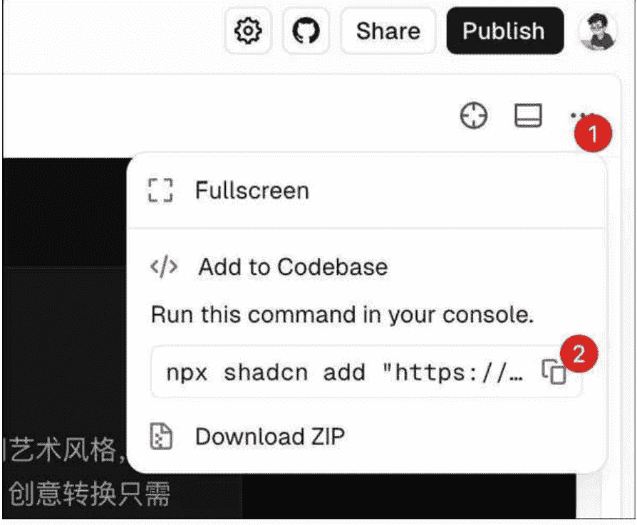

复制该命令，在本地Cursor编辑器中调出内置的终端，粘贴并运行v0.dev生成的npx shadcn@latest add ...命令。该命令会自动将页面的React组件代码、所需的shadcn/ui依赖项以及图标库，精准地安装到Next.js项目中。通过这种方式，我们几乎无须手写UI代码，就在极短时间内完成整个应用前端界面的搭建。

## 6.4 十分钟实战：使用Supabase构建后端基础设施

前端界面构建完毕后，接下来需要为其提供后端支持。利用Supabase，可声明式地快速搭建应用所需的数据、认证、存储和实时通信系统。后续示例代码由Cursor根据需求文档直接生成，其实际生成结果可能存在差异，但实现思路与细节有助于理解AI协作开发流程。以下是生成代码所使用的提示词：

> @docs基于我的设计文档初始化Supabase对应代码和数据库。

### 6.4.1 数据库设计

结合AI的建议和前文的系统设计文档，规划出如表6-2所示的核心数据表。

表6-2 核心数据表

| 表名 | 主要字段 | 描述与关系 |
| :--- | :--- | :--- |
| user_profiles | id, user_id, name, avatar_url, preferences, created_at, updated_at | 存储用户的详细资料和偏好设置，与Supabase内置的auth.users表关联 |
| generation_tasks | id, user_id, task_type, prompt, negative_prompt, status, replicate_id, cost_credits, created_at | 记录用户每一次发起的生成请求及当前状态（pending, processing, completed, failed） |
| user_images | id, user_id, task_id, image_url, thumbnail_url, metadata, created_at | 存储成功生成的最终图像文件及其元数据，并与对应的生成请求关联 |
| credit_transactions | id, user_id, amount, type, description, related_id, created_at | 记录所有积分变动（消费、充值、赠送等），便于审计和用户查询 |
| orders | id, user_id, stripe_session_id, amount, status, credits_amount, created_at, updated_at | 存储用户购买积分的订单信息，与Stripe支付系统集成 |
| stripe_subscriptions | id, user_id, stripe_subscription_id, status, current_period_start, current_period_end | 管理用户订阅状态，支持定期自动充值 |

这种将“生成请求”（generation_tasks表）与“最终成果”（user_images表）分离的设计，是一种健壮的数据建模方式。它能追踪每一次尝试（无论成败），这对后续调试和用户行为分析至关重要。

### 6.4.2 用户认证系统

在Supabase仪表盘中点击Authentication->Sign In/Providers，在右侧界面的Auth Provider区域启用Email，也可以根据需求一键开启Google、GitHub等社交账户登录方式。

随后为所有表启用并配置行级安全（RLS）策略——这是Supabase的核心安全特性，能将数据访问控制下沉到数据库层面。我们添加的策略为“用户只能查看和操作user_id与自身认证uid匹配的记录”。这样一来，即使用户绕过前端直接调用API，数据库也能阻止其窥探或篡改他人数据。

### 6.4.3 数据库视图和函数

为了简化前端的数据获取，我们创建了几个有用的数据库视图。

- **user_stats_view**：显示用户的生成统计、积分余额等汇总信息。
- **monthly_stats_view**：按月份统计用户的生成数量和积分消费。
- **credit_consumption_view**：分析用户的积分消费模式。
- **generation_type_distribution_view**：统计不同生成类型的分布。

同时，创建了数据库函数来处理复杂的业务逻辑，核心函数如下。

```sql
-- 更新用户积分的函数
CREATE OR REPLACE FUNCTION update_user_credits(
    p_user_id UUID,
    p_amount INTEGER,
    p_type TEXT,
    p_description TEXT,
    p_related_id UUID DEFAULT NULL
)
```

该函数可以安全地处理积分变动（消费、充值、赠送等），并自动记录交易历史。

### 6.4.4 实时功能

为了在前端实时反馈耗时较长的图像生成进度，我们将借助Supabase Realtime的实时数据同步能力。前端的“生成工作台”页面通过Supabase客户端库，订阅generation_tasks表中当前用户的记录变更。当后端的Webhook处理器更新了某个任务的status字段时，这个变化会通过WebSocket实时推送到前端。

通过这一实现方案，我们快速构建了一个安全、实时、功能完备的后端系统，为后续的核心功能开发做好了准备。

### 6.4.5 实施步骤

现在，我们将上述设计转化为实际的代码和配置。以下是详细的实施步骤。

##### 1. 数据库表结构创建与迁移

首先对现有数据库结构进行全面分析，这可以通过Supabase控制台或psql工具来完成。这样做的目的是查看当前的表结构，明确需要新增哪些表以及需要调整哪些字段。完成分析后，在Supabase控制台的SQL编辑器中执行以下SQL语句，创建所需的表：

```sql
-- 创建user_profiles表
CREATE TABLE user_profiles (
    id uuid PRIMARY KEY DEFAULT gen_random_uuid(),
    user_id uuid NOT NULL REFERENCES auth.users(id),
    name text,
    avatar_url text,
    preferences jsonb,
    created_at timestamp with time zone DEFAULT now(),
    updated_at timestamp with time zone DEFAULT now()
);

-- 创建generation_tasks表
CREATE TABLE generation_tasks (
    id uuid PRIMARY KEY DEFAULT gen_random_uuid(),
    user_id uuid NOT NULL REFERENCES auth.users(id),
    task_type text NOT NULL,
    prompt text NOT NULL,
    negative_prompt text,
    status text DEFAULT 'pending',
    replicate_id text,
    cost_credits integer DEFAULT 1,
    created_at timestamp with time zone DEFAULT now()
);

-- 创建user_images表
CREATE TABLE user_images (
    id uuid PRIMARY KEY DEFAULT gen_random_uuid(),
    user_id uuid NOT NULL REFERENCES auth.users(id),
    task_id uuid REFERENCES generation_tasks(id),
    image_url text NOT NULL,
    thumbnail_url text,
    metadata jsonb,
    created_at timestamp with time zone DEFAULT now()
);

-- 创建credit_transactions表
CREATE TABLE credit_transactions (
    id uuid PRIMARY KEY DEFAULT gen_random_uuid(),
    user_id uuid NOT NULL REFERENCES auth.users(id),
    amount integer NOT NULL,
    type text NOT NULL,
    description text,
    related_id uuid,
    created_at timestamp with time zone DEFAULT now()
);

-- 创建orders表
CREATE TABLE orders (
    id uuid PRIMARY KEY DEFAULT gen_random_uuid(),
    user_id uuid NOT NULL REFERENCES auth.users(id),
    stripe_session_id text,
    amount integer NOT NULL,
    status text DEFAULT 'pending',
    credits_amount integer NOT NULL,
    created_at timestamp with time zone DEFAULT now(),
    updated_at timestamp with time zone DEFAULT now()
);

-- 创建stripe_subscriptions表
CREATE TABLE stripe_subscriptions (
    id uuid PRIMARY KEY DEFAULT gen_random_uuid(),
    user_id uuid NOT NULL REFERENCES auth.users(id),
    stripe_subscription_id text NOT NULL,
    status text DEFAULT 'active',
    current_period_start timestamp with time zone,
    current_period_end timestamp with time zone,
    created_at timestamp with time zone DEFAULT now()
);
```

接下来需要启用行级安全（RLS）策略，并创建相应的安全策略，具体操作如下：

```sql
-- 启用 RLS
ALTER TABLE user_profiles ENABLE ROW LEVEL SECURITY;
ALTER TABLE generation_tasks ENABLE ROW LEVEL SECURITY;
ALTER TABLE user_images ENABLE ROW LEVEL SECURITY;
ALTER TABLE credit_transactions ENABLE ROW LEVEL SECURITY;
ALTER TABLE orders ENABLE ROW LEVEL SECURITY;
ALTER TABLE stripe_subscriptions ENABLE ROW LEVEL SECURITY;

-- 创建安全策略
CREATE POLICY "Users can view own profile" ON user_profiles
    FOR SELECT USING (auth.uid() = user_id);

CREATE POLICY "Users can update own profile" ON user_profiles
    FOR UPDATE USING (auth.uid() = user_id);

CREATE POLICY "Users can view own tasks" ON generation_tasks
    FOR ALL USING (auth.uid() = user_id);

CREATE POLICY "Users can view own images" ON user_images
    FOR ALL USING (auth.uid() = user_id);

CREATE POLICY "Users can view own transactions" ON credit_transactions
    FOR ALL USING (auth.uid() = user_id);

CREATE POLICY "Users can view own orders" ON orders
    FOR ALL USING (auth.uid() = user_id);

CREATE POLICY "Users can view own subscriptions" ON stripe_subscriptions
    FOR ALL USING (auth.uid() = user_id);
```

##### 2. 创建数据库视图和函数

为了更高效地管理和查询数据，需要创建相应的数据库视图和函数。首先是用户统计视图的创建，通过以下SQL语句可以生成一个整合了用户基本信息与相关统计数据的视图：

```sql
-- 用户统计视图
CREATE VIEW user_stats_view AS
SELECT
    u.id as user_id,
    u.email,
    up.name,
    COUNT(DISTINCT gt.id) as total_generations,
    COUNT(DISTINCT ui.id) as total_images,
    COALESCE(SUM(ct.amount), 0) as credit_balance
FROM auth.users u
LEFT JOIN user_profiles up ON u.id = up.user_id
LEFT JOIN generation_tasks gt ON u.id = gt.user_id
LEFT JOIN user_images ui ON u.id = ui.user_id
LEFT JOIN credit_transactions ct ON u.id = ct.user_id
GROUP BY u.id, u.email, up.name;
```

接下来需要创建积分管理相关的函数，以实现积分的更新和查询功能。首先是更新用户积分的函数，该函数会插入积分交易记录并记录操作日志，具体代码如下：

```sql
-- 更新用户积分的函数
CREATE OR REPLACE FUNCTION update_user_credits(
    p_user_id UUID,
    p_amount INTEGER,
    p_type TEXT,
    p_description TEXT,
    p_related_id UUID DEFAULT NULL
)
RETURNS void AS $$
BEGIN
    -- 插入积分交易记录
    INSERT INTO credit_transactions (
        user_id,
        amount,
        type,
        description,
        related_id
    ) VALUES (
        p_user_id,
        p_amount,
        p_type,
        p_description,
        p_related_id
    );

    -- 记录操作日志
    RAISE NOTICE 'User % credits updated: % % (%%%)',
        p_user_id,
        CASE WHEN p_amount > 0 THEN '+' ELSE '' END || p_amount,
        p_type,
        p_description;
END;
$$ LANGUAGE plpgsql SECURITY DEFINER;

-- 获取用户积分余额的函数
CREATE OR REPLACE FUNCTION get_user_credit_balance(p_user_id UUID)
RETURNS INTEGER AS $$
DECLARE
    balance INTEGER;
BEGIN
    SELECT COALESCE(SUM(amount), 0) INTO balance
    FROM credit_transactions
    WHERE user_id = p_user_id;
    RETURN balance;
END;
$$ LANGUAGE plpgsql SECURITY DEFINER;
```

##### 3. 配置Supabase Storage

Supabase Storage的配置主要包含存储桶的创建与存储策略的设置两部分。

- **创建存储桶：** 在Supabase控制台的Storage页面，点击Create a new bucket按钮，输入桶名称user-images，在权限设置中选择Public（允许公开读取存储桶内的文件），最后点击Create bucket完成创建。
- **设置存储策略：** 在存储桶创建完成后，需配置对应的存储策略以保障用户数据的访问安全与权限隔离。在Supabase控制台的SQL编辑器中执行以下SQL语句，可实现两项核心策略：允许用户仅能上传文件到以自身ID命名的专属文件夹；允许用户仅能查看自身文件夹内的文件。

```sql
-- 允许用户上传到自己的文件夹
CREATE POLICY "Users can upload to own folder" ON storage.objects
    FOR INSERT WITH CHECK (
        bucket_id = 'user-images' AND
        (storage.foldername(name))[1] = auth.uid()::text
    );

-- 允许用户查看自己的文件
CREATE POLICY "Users can view own files" ON storage.objects
    FOR SELECT USING (
        bucket_id = 'user-images' AND
        (storage.foldername(name))[1] = auth.uid()::text
    );
```

##### 4. 新用户自动赠送积分

要实现新用户自动赠送积分功能，需先创建触发器函数及对应的触发器。通过以下SQL创建handle_new_user函数，该函数会在新用户注册时，向user_profiles表插入用户资料（关联新用户ID、提取元数据中的用户名、初始化偏好设置为空值），同时调用update_user_credits函数向注册的新用户赠送10个积分；再创建on_auth_user_created触发器，使其在auth.users表插入新记录后，自动执行该函数。具体的SQL代码如下：

```sql
-- 新用户注册后自动赠送积分的函数
CREATE OR REPLACE FUNCTION handle_new_user()
RETURNS trigger AS $$
BEGIN
    -- 创建用户资料
    INSERT INTO user_profiles (user_id, name, preferences)
    VALUES (NEW.id, NEW.raw_user_meta_data->>'full_name', '{}');

    -- 赠送免费积分
    PERFORM update_user_credits(
        NEW.id,
        10,
        'bonus',
        '新用户注册奖励'
    );
    RETURN NEW;
END;
$$ LANGUAGE plpgsql SECURITY DEFINER;

-- 创建触发器
CREATE TRIGGER on_auth_user_created
    AFTER INSERT ON auth.users
    FOR EACH ROW EXECUTE FUNCTION handle_new_user();
```

##### 5. 测试数据库功能

测试数据库功能需重点验证积分管理函数与用户统计视图的可用性，具体测试逻辑如下：先调用update_user_credits函数（替换实际用户的ID）测试积分更新功能是否正常；随后通过get_user_credit_balance函数查询积分余额，验证积分变动是否准确；最后借助user_stats_view视图查看用户的生成任务数、图片总数及当前积分余额等统计数据，确保数据汇总逻辑无误。具体的SQL代码如下：

```sql
-- 测试积分更新
SELECT update_user_credits(
    'your-user-id-here',
    5,
    'test',
    '测试积分更新'
);

-- 查看积分余额
SELECT get_user_credit_balance('your-user-id-here');

-- 查看用户统计
SELECT * FROM user_stats_view WHERE user_id = 'your-user-id-here';
```

通过以上步骤，我们成功创建了完整的数据库基础设施。接下来实现API路由和前端集成。

##### 6. 创建图像生成API路由

在app/api/generate/route.ts中实现图像生成API路由。该路由通过TypeScript代码完成用户身份验证、解析请求参数（校验提示词）、检查积分余额与生成频率限制；随后调用Replicate API（配置模型参数，支持图生图），在generation_tasks表记录任务；最后返回任务信息或错误提示。具体代码如下：

```typescript
import { NextRequest, NextResponse } from "next/server";
import { createRouteHandlerClient } from "@supabase/auth-helpers-nextjs";
import { cookies } from "next/headers";
import Replicate from "replicate";

const replicate = new Replicate({
  auth: process.env.REPLICATE_API_TOKEN,
});

export async function POST(request: NextRequest) {
  try {
    // 1. 用户身份验证
    const supabase = createRouteHandlerClient({ cookies });
    const {
      data: { user },
      error: authError,
    } = await supabase.auth.getUser();

    if (authError || !user) {
      return NextResponse.json({ error: "未授权访问" }, { status: 401 });
    }

    // 2. 解析请求参数
    const { prompt, negativePrompt, taskType, imageUrls } =
      await request.json();

    if (!prompt) {
      return NextResponse.json({ error: "提示词不能为空" }, { status: 400 });
    }

    // 3. 检查用户积分余额
    const { data: balance } = await supabase.rpc("get_user_credit_balance", {
      p_user_id: user.id,
    });

    if ((balance || 0) <= 0) {
      return NextResponse.json(
        { error: "积分不足,请充值后继续使用" },
        { status: 402 }
      );
    }

    // 4. 检查频率限制
    const { data: rateLimitCheck } = await supabase.rpc(
      "check_user_rate_limit",
      {
        p_user_id: user.id,
        p_max_daily_generations: 50,
      }
    );

    if (!rateLimitCheck) {
      return NextResponse.json(
        { error: "今日生成次数已达上限,请明天再试" },
        { status: 429 }
      );
    }

    // 5. 调用Replicate API
    const modelInput: any = {
      prompt: prompt,
      negative_prompt: negativePrompt || "",
      width: 1024,
      height: 1024,
      num_outputs: 1,
      scheduler: "K_EULER",
      num_inference_steps: 50,
      guidance_scale: 7.5,
      seed: Math.floor(Math.random() * 1000000),
    };

    // 如果是图生图,添加图片输入
    if (imageUrls && imageUrls.length > 0) {
      modelInput.image = imageUrls[0]; // 支持单张图片输入
    }

    const output = await replicate.run(
      "stability-ai/sdxl:39ed52f2a78e934b3ba6e2a89f5b1c712dc7dfe535525255b1aa35c5565e08b",
      {
        input: modelInput,
        webhook: `${process.env.NEXT_PUBLIC_APP_URL}/api/webhook/replicate`,
        webhook_events_filter: ["completed"],
      }
    );

    // 6. 在数据库中记录任务
    const { data: task, error: taskError } = await supabase
      .from("generation_tasks")
      .insert({
        user_id: user.id,
        task_type: taskType || "text_to_image",
        prompt: prompt,
        negative_prompt: negativePrompt,
        status: "processing",
        replicate_id: output.id,
        cost_credits: 1,
      })
      .select()
      .single();

    if (taskError) {
      console.error("创建任务失败:", taskError);
      return NextResponse.json({ error: "创建任务失败" }, { status: 500 });
    }

    return NextResponse.json({
      success: true,
      task_id: task.id,
      replicate_id: output.id,
      message: "任务已创建，正在处理中...",
    });
  } catch (error) {
    console.error("生成请求失败:", error);
    return NextResponse.json({ error: "服务器内部错误" }, { status: 500 });
  }
}
```

##### 7. 创建Webhook处理器

在app/api/webhook/replicate/route.ts中实现Webhook处理器，通过TypeScript代码解析Replicate的任务通知，查找对应的本地任务：任务成功则下载图片并上传至SupabaseStorage，记录图片信息、更新任务状态并扣除积分；任务失败则更新任务状态为失败，同时返回对应的处理结果或错误信息（生产环境需补充请求来源验证）。具体代码如下：

```typescript
import { NextRequest, NextResponse } from "next/server";
import { createRouteHandlerClient } from "@supabase/auth-helpers-nextjs";
import { cookies } from "next/headers";

export async function POST(request: NextRequest) {
  try {
    // 1. 验证请求来源（生产环境必须实现）
    // TODO: 实现 Replicate Webhook 签名验证

    // 2. 解析Webhook数据
    const webhookData = await request.json();
    const { id: replicateId, status, output, error } = webhookData;

    if (!replicateId) {
      return NextResponse.json({ error: "缺少 replicate_id" }, { status: 400 });
    }

    // 3. 查找对应的任务
    const supabase = createRouteHandlerClient({ cookies });
    const { data: task, error: taskError } = await supabase
      .from("generation_tasks")
      .select("*")
      .eq("replicate_id", replicateId)
      .single();

    if (taskError || !task) {
      console.error("找不到对应任务:", replicateId);
      return NextResponse.json({ error: "任务不存在" }, { status: 404 });
    }

    // 4. 处理任务结果
    if (status === "succeeded" && output && output.length > 0) {
      // 任务成功，处理生成的图片
      const imageUrl = output[0];

      // 将图片从 Replicate 下载并上传到 Supabase Storage
      const imageResponse = await fetch(imageUrl);
      const imageBlob = await imageResponse.blob();

      // 生成文件名
      const fileName = `${task.user_id}/${Date.now()}_${Math.random()
        .toString(36)
        .substr(2, 9)}.png`;

      // 上传到Supabase Storage
      const { data: uploadData, error: uploadError } = await supabase.storage
        .from("user-images")
        .upload(fileName, imageBlob, {
          contentType: "image/png",
          cacheControl: "3600",
        });

      if (uploadError) {
        console.error("图片上传失败:", uploadError);
        // 更新任务状态为失败
        await supabase
          .from("generation_tasks")
          .update({ status: "failed" })
          .eq("id", task.id);
        return NextResponse.json({ error: "图片上传失败" }, { status: 500 });
      }

      // 获取公开访问URL
      const {
        data: { publicUrl },
      } = supabase.storage.from("user-images").getPublicUrl(fileName);

      // 在user_images表中创建记录
      const { error: imageError } = await supabase.from("user_images").insert({
        user_id: task.user_id,
        task_id: task.id,
        image_url: publicUrl,
        metadata: {
          original_url: imageUrl,
          file_name: fileName,
          file_size: imageBlob.size,
          mime_type: imageBlob.type,
        },
      });

      if (imageError) {
        console.error("创建图片记录失败:", imageError);
      }

      // 更新任务状态为完成
      await supabase
        .from("generation_tasks")
        .update({ status: "completed" })
        .eq("id", task.id);

      // 5. 扣除用户积分
      const { error: creditError } = await supabase.rpc(
        "consume_user_credits",
        {
          p_user_id: task.user_id,
          p_credits_to_consume: task.cost_credits,
          p_description: `图像生成: ${task.task_type}`,
          p_related_id: task.id,
        }
      );

      if (creditError) {
        console.error("扣除积分失败:", creditError);
      }

      return NextResponse.json({
        success: true,
        message: "任务处理完成",
        image_url: publicUrl,
      });
    } else {
      // 任务失败
      await supabase
        .from("generation_tasks")
        .update({
          status: "failed",
          // 可以添加 error 字段存储错误信息
        })
        .eq("id", task.id);

      return NextResponse.json({
        success: false,
        message: "任务处理失败",
        error: error || "未知错误",
      });
    }
  } catch (error) {
    console.error("Webhook 处理失败:", error);
    return NextResponse.json({ error: "服务器内部错误" }, { status: 500 });
  }
}
```

##### 8. 配置环境变量和安装依赖

配置环境变量和安装依赖是项目运行的基础准备工作。首先在项目根目录创建.env.local文件，用于存储各类环境变量，包括Supabase的项目URL、匿名密钥和服务角色密钥、Replicate的API令牌及Webhook签名密钥，以及应用的基础URL等配置信息。具体内容如下。

```plaintext
###### Supabase配置
NEXT_PUBLIC_SUPABASE_URL=your_supabase_project_url
NEXT_PUBLIC_SUPABASE_ANON_KEY=your_supabase_anon_key
SUPABASE_SERVICE_ROLE_KEY=your_supabase_service_role_key

###### Replicate配置
REPLICATE_API_TOKEN=your_replicate_api_token
REPLICATE_WEBHOOK_SIGNING_SECRET=your_webhook_secret

###### 应用配置
NEXT_PUBLIC_APP_URL=http://localhost:3000
```

接着需要安装项目所需的必要依赖包，通过执行以下Bash命令，可安装replicate、@supabase/auth-helpers-nextjs和@supabase/supabase-js等包，为项目提供相应的功能支持：

```bash
npm install replicate @supabase/auth-helpers-nextjs @supabase/supabase-js
```

##### 9. 测试API功能

API功能测试需验证生成请求和Webhook是否正常工作。测试生成请求时，可使用Postman或curl工具，向 http://localhost:3000/api/generate 发送POST请求，在请求头中包含Content-Type和Authorization信息，在请求体中传入提示词和任务类型等参数。curl命令示例如下：

```bash
curl -X POST http://localhost:3000/api/generate \
  -H "Content-Type: application/json" \
  -H "Authorization: Bearer YOUR_JWT_TOKEN" \
  -d '{
    "prompt": "一只可爱的小猫坐在花园里",
    "taskType": "text_to_image"
  }'
```

要测试 Webhook，则需在 Replicate 控制台中配置 Webhook URL 为 https://your-domain.com/api/webhook/replicate ，以确保任务完成后能正确接收通知。

通过以上完整的实施步骤，我们成功构建了一个功能完备的后端系统，包括完整的数据库基础设施、安全的积分管理系统、高效的图像生成API、可靠的异步任务处理以及完善的错误处理和日志记录。

## 6.4 十分钟实战：使用Supabase构建后端基础设施

前端界面构建完毕后，接下来需要为其提供后端支持。利用Supabase，可声明式地快速搭建应用所需的数据、认证、存储和实时通信系统。后续示例代码由Cursor根据需求文档直接生成，其实际生成结果可能存在差异，但实现思路与细节有助于理解AI协作开发流程。以下是生成代码所使用的提示词：

> @docs基于我的设计文档初始化Supabase对应代码和数据库。

### 6.4.1 数据库设计

结合AI的建议和前文的系统设计文档，规划出如表6-2所示的核心数据表。

表6-2 核心数据表

| 表名 | 主要字段 | 描述与关系 |
| :--- | :--- | :--- |
| user_profiles | id, user_id, name, avatar_url, preferences, created_at, updated_at | 存储用户的详细资料和偏好设置，与Supabase内置的auth.users表关联 |
| generation_tasks | id, user_id, task_type, prompt, negative_prompt, status, replicate_id, cost_credits, created_at | 记录用户每一次发起的生成请求及当前状态（pending, processing, completed, failed） |
| user_images | id, user_id, task_id, image_url, thumbnail_url, metadata, created_at | 存储成功生成的最终图像文件及其元数据，并与对应的生成请求关联 |
| credit_transactions | id, user_id, amount, type, description, related_id, created_at | 记录所有积分变动（消费、充值、赠送等），便于审计和用户查询 |
| orders | id, user_id, stripe_session_id, amount, status, credits_amount, created_at, updated_at | 存储用户购买积分的订单信息，与Stripe支付系统集成 |
| stripe_subscriptions | id, user_id, stripe_subscription_id, status, current_period_start, current_period_end | 管理用户订阅状态，支持定期自动充值 |

这种将“生成请求”（generation_tasks表）与“最终成果”（user_images表）分离的设计，是一种健壮的数据建模方式。它能追踪每一次尝试（无论成败），这对后续调试和用户行为分析至关重要。

### 6.4.2 用户认证系统

在Supabase仪表盘中点击Authentication->Sign In/Providers，在右侧界面的Auth Provider区域启用Email，也可以根据需求一键开启Google、GitHub等社交账户登录方式。

随后为所有表启用并配置行级安全（RLS）策略——这是Supabase的核心安全特性，能将数据访问控制下沉到数据库层面。我们添加的策略为“用户只能查看和操作user_id与自身认证uid匹配的记录”。这样一来，即使用户绕过前端直接调用API，数据库也能阻止其窥探或篡改他人数据。

### 6.4.3 数据库视图和函数

为了简化前端的数据获取，我们创建了几个有用的数据库视图。

- **user_stats_view**：显示用户的生成统计、积分余额等汇总信息。
- **monthly_stats_view**：按月份统计用户的生成数量和积分消费。
- **credit_consumption_view**：分析用户的积分消费模式。
- **generation_type_distribution_view**：统计不同生成类型的分布。

同时，创建了数据库函数来处理复杂的业务逻辑，核心函数如下。

```sql
-- 更新用户积分的函数
CREATE OR REPLACE FUNCTION update_user_credits(
    p_user_id UUID,
    p_amount INTEGER,
    p_type TEXT,
    p_description TEXT,
    p_related_id UUID DEFAULT NULL
)
```

该函数可以安全地处理积分变动（消费、充值、赠送等），并自动记录交易历史。

### 6.4.4 实时功能

为了在前端实时反馈耗时较长的图像生成进度，我们将借助Supabase Realtime的实时数据同步能力。前端的“生成工作台”页面通过Supabase客户端库，订阅generation_tasks表中当前用户的记录变更。当后端的Webhook处理器更新了某个任务的status字段时，这个变化会通过WebSocket实时推送到前端。

通过这一实现方案，我们快速构建了一个安全、实时、功能完备的后端系统，为后续的核心功能开发做好了准备。

### 6.4.5 实施步骤

现在，我们将上述设计转化为实际的代码和配置。以下是详细的实施步骤。

##### 1. 数据库表结构创建与迁移

首先对现有数据库结构进行全面分析，这可以通过Supabase控制台或psql工具来完成。这样做的目的是查看当前的表结构，明确需要新增哪些表以及需要调整哪些字段。完成分析后，在Supabase控制台的SQL编辑器中执行以下SQL语句，创建所需的表：

```sql
-- 创建user_profiles表
CREATE TABLE user_profiles (
    id uuid PRIMARY KEY DEFAULT gen_random_uuid(),
    user_id uuid NOT NULL REFERENCES auth.users(id),
    name text,
    avatar_url text,
    preferences jsonb,
    created_at timestamp with time zone DEFAULT now(),
    updated_at timestamp with time zone DEFAULT now()
);

-- 创建generation_tasks表
CREATE TABLE generation_tasks (
    id uuid PRIMARY KEY DEFAULT gen_random_uuid(),
    user_id uuid NOT NULL REFERENCES auth.users(id),
    task_type text NOT NULL,
    prompt text NOT NULL,
    negative_prompt text,
    status text DEFAULT 'pending',
    replicate_id text,
    cost_credits integer DEFAULT 1,
    created_at timestamp with time zone DEFAULT now()
);

-- 创建user_images表
CREATE TABLE user_images (
    id uuid PRIMARY KEY DEFAULT gen_random_uuid(),
    user_id uuid NOT NULL REFERENCES auth.users(id),
    task_id uuid REFERENCES generation_tasks(id),
    image_url text NOT NULL,
    thumbnail_url text,
    metadata jsonb,
    created_at timestamp with time zone DEFAULT now()
);

-- 创建credit_transactions表
CREATE TABLE credit_transactions (
    id uuid PRIMARY KEY DEFAULT gen_random_uuid(),
    user_id uuid NOT NULL REFERENCES auth.users(id),
    amount integer NOT NULL,
    type text NOT NULL,
    description text,
    related_id uuid,
    created_at timestamp with time zone DEFAULT now()
);

-- 创建orders表
CREATE TABLE orders (
    id uuid PRIMARY KEY DEFAULT gen_random_uuid(),
    user_id uuid NOT NULL REFERENCES auth.users(id),
    stripe_session_id text,
    amount integer NOT NULL,
    status text DEFAULT 'pending',
    credits_amount integer NOT NULL,
    created_at timestamp with time zone DEFAULT now(),
    updated_at timestamp with time zone DEFAULT now()
);

-- 创建stripe_subscriptions表
CREATE TABLE stripe_subscriptions (
    id uuid PRIMARY KEY DEFAULT gen_random_uuid(),
    user_id uuid NOT NULL REFERENCES auth.users(id),
    stripe_subscription_id text NOT NULL,
    status text DEFAULT 'active',
    current_period_start timestamp with time zone,
    current_period_end timestamp with time zone,
    created_at timestamp with time zone DEFAULT now()
);
```

接下来需要启用行级安全（RLS）策略，并创建相应的安全策略，具体操作如下：

```sql
-- 启用 RLS
ALTER TABLE user_profiles ENABLE ROW LEVEL SECURITY;
ALTER TABLE generation_tasks ENABLE ROW LEVEL SECURITY;
ALTER TABLE user_images ENABLE ROW LEVEL SECURITY;
ALTER TABLE credit_transactions ENABLE ROW LEVEL SECURITY;
ALTER TABLE orders ENABLE ROW LEVEL SECURITY;
ALTER TABLE stripe_subscriptions ENABLE ROW LEVEL SECURITY;

-- 创建安全策略
CREATE POLICY "Users can view own profile" ON user_profiles
    FOR SELECT USING (auth.uid() = user_id);

CREATE POLICY "Users can update own profile" ON user_profiles
    FOR UPDATE USING (auth.uid() = user_id);

CREATE POLICY "Users can view own tasks" ON generation_tasks
    FOR ALL USING (auth.uid() = user_id);

CREATE POLICY "Users can view own images" ON user_images
    FOR ALL USING (auth.uid() = user_id);

CREATE POLICY "Users can view own transactions" ON credit_transactions
    FOR ALL USING (auth.uid() = user_id);

CREATE POLICY "Users can view own orders" ON orders
    FOR ALL USING (auth.uid() = user_id);

CREATE POLICY "Users can view own subscriptions" ON stripe_subscriptions
    FOR ALL USING (auth.uid() = user_id);
```

##### 2. 创建数据库视图和函数

为了更高效地管理和查询数据，需要创建相应的数据库视图和函数。首先是用户统计视图的创建，通过以下SQL语句可以生成一个整合了用户基本信息与相关统计数据的视图：

```sql
-- 用户统计视图
CREATE VIEW user_stats_view AS
SELECT
    u.id as user_id,
    u.email,
    up.name,
    COUNT(DISTINCT gt.id) as total_generations,
    COUNT(DISTINCT ui.id) as total_images,
    COALESCE(SUM(ct.amount), 0) as credit_balance
FROM auth.users u
LEFT JOIN user_profiles up ON u.id = up.user_id
LEFT JOIN generation_tasks gt ON u.id = gt.user_id
LEFT JOIN user_images ui ON u.id = ui.user_id
LEFT JOIN credit_transactions ct ON u.id = ct.user_id
GROUP BY u.id, u.email, up.name;
```

接下来需要创建积分管理相关的函数，以实现积分的更新和查询功能。首先是更新用户积分的函数，该函数会插入积分交易记录并记录操作日志，具体代码如下：

```sql
-- 更新用户积分的函数
CREATE OR REPLACE FUNCTION update_user_credits(
    p_user_id UUID,
    p_amount INTEGER,
    p_type TEXT,
    p_description TEXT,
    p_related_id UUID DEFAULT NULL
)
RETURNS void AS $$
BEGIN
    -- 插入积分交易记录
    INSERT INTO credit_transactions (
        user_id,
        amount,
        type,
        description,
        related_id
    ) VALUES (
        p_user_id,
        p_amount,
        p_type,
        p_description,
        p_related_id
    );

    -- 记录操作日志
    RAISE NOTICE 'User % credits updated: % % (%%%)',
        p_user_id,
        CASE WHEN p_amount > 0 THEN '+' ELSE '' END || p_amount,
        p_type,
        p_description;
END;
$$ LANGUAGE plpgsql SECURITY DEFINER;

-- 获取用户积分余额的函数
CREATE OR REPLACE FUNCTION get_user_credit_balance(p_user_id UUID)
RETURNS INTEGER AS $$
DECLARE
    balance INTEGER;
BEGIN
    SELECT COALESCE(SUM(amount), 0) INTO balance
    FROM credit_transactions
    WHERE user_id = p_user_id;
    RETURN balance;
END;
$$ LANGUAGE plpgsql SECURITY DEFINER;
```

##### 3. 配置Supabase Storage

Supabase Storage的配置主要包含存储桶的创建与存储策略的设置两部分。

- **创建存储桶：** 在Supabase控制台的Storage页面，点击Create a new bucket按钮，输入桶名称user-images，在权限设置中选择Public（允许公开读取存储桶内的文件），最后点击Create bucket完成创建。
- **设置存储策略：** 在存储桶创建完成后，需配置对应的存储策略以保障用户数据的访问安全与权限隔离。在Supabase控制台的SQL编辑器中执行以下SQL语句，可实现两项核心策略：允许用户仅能上传文件到以自身ID命名的专属文件夹；允许用户仅能查看自身文件夹内的文件。

```sql
-- 允许用户上传到自己的文件夹
CREATE POLICY "Users can upload to own folder" ON storage.objects
    FOR INSERT WITH CHECK (
        bucket_id = 'user-images' AND
        (storage.foldername(name))[1] = auth.uid()::text
    );

-- 允许用户查看自己的文件
CREATE POLICY "Users can view own files" ON storage.objects
    FOR SELECT USING (
        bucket_id = 'user-images' AND
        (storage.foldername(name))[1] = auth.uid()::text
    );
```

##### 4. 新用户自动赠送积分

要实现新用户自动赠送积分功能，需先创建触发器函数及对应的触发器。通过以下SQL创建handle_new_user函数，该函数会在新用户注册时，向user_profiles表插入用户资料（关联新用户ID、提取元数据中的用户名、初始化偏好设置为空值），同时调用update_user_credits函数向注册的新用户赠送10个积分；再创建on_auth_user_created触发器，使其在auth.users表插入新记录后，自动执行该函数。具体的SQL代码如下：

```sql
-- 新用户注册后自动赠送积分的函数
CREATE OR REPLACE FUNCTION handle_new_user()
RETURNS trigger AS $$
BEGIN
    -- 创建用户资料
    INSERT INTO user_profiles (user_id, name, preferences)
    VALUES (NEW.id, NEW.raw_user_meta_data->>'full_name', '{}');

    -- 赠送免费积分
    PERFORM update_user_credits(
        NEW.id,
        10,
        'bonus',
        '新用户注册奖励'
    );
    RETURN NEW;
END;
$$ LANGUAGE plpgsql SECURITY DEFINER;

-- 创建触发器
CREATE TRIGGER on_auth_user_created
    AFTER INSERT ON auth.users
    FOR EACH ROW EXECUTE FUNCTION handle_new_user();
```

##### 5. 测试数据库功能

测试数据库功能需重点验证积分管理函数与用户统计视图的可用性，具体测试逻辑如下：先调用update_user_credits函数（替换实际用户的ID）测试积分更新功能是否正常；随后通过get_user_credit_balance函数查询积分余额，验证积分变动是否准确；最后借助user_stats_view视图查看用户的生成任务数、图片总数及当前积分余额等统计数据，确保数据汇总逻辑无误。具体的SQL代码如下：

```sql
-- 测试积分更新
SELECT update_user_credits(
    'your-user-id-here',
    5,
    'test',
    '测试积分更新'
);

-- 查看积分余额
SELECT get_user_credit_balance('your-user-id-here');

-- 查看用户统计
SELECT * FROM user_stats_view WHERE user_id = 'your-user-id-here';
```

通过以上步骤，我们成功创建了完整的数据库基础设施。接下来实现API路由和前端集成。

##### 6. 创建图像生成API路由

在app/api/generate/route.ts中实现图像生成API路由。该路由通过TypeScript代码完成用户身份验证、解析请求参数（校验提示词）、检查积分余额与生成频率限制；随后调用Replicate API（配置模型参数，支持图生图），在generation_tasks表记录任务；最后返回任务信息或错误提示。具体代码如下：

```typescript
import { NextRequest, NextResponse } from "next/server";
import { createRouteHandlerClient } from "@supabase/auth-helpers-nextjs";
import { cookies } from "next/headers";
import Replicate from "replicate";

const replicate = new Replicate({
  auth: process.env.REPLICATE_API_TOKEN,
});

export async function POST(request: NextRequest) {
  try {
    // 1. 用户身份验证
    const supabase = createRouteHandlerClient({ cookies });
    const {
      data: { user },
      error: authError,
    } = await supabase.auth.getUser();

    if (authError || !user) {
      return NextResponse.json({ error: "未授权访问" }, { status: 401 });
    }

    // 2. 解析请求参数
    const { prompt, negativePrompt, taskType, imageUrls } =
      await request.json();

    if (!prompt) {
      return NextResponse.json({ error: "提示词不能为空" }, { status: 400 });
    }

    // 3. 检查用户积分余额
    const { data: balance } = await supabase.rpc("get_user_credit_balance", {
      p_user_id: user.id,
    });

    if ((balance || 0) <= 0) {
      return NextResponse.json(
        { error: "积分不足,请充值后继续使用" },
        { status: 402 }
      );
    }

    // 4. 检查频率限制
    const { data: rateLimitCheck } = await supabase.rpc(
      "check_user_rate_limit",
      {
        p_user_id: user.id,
        p_max_daily_generations: 50,
      }
    );

    if (!rateLimitCheck) {
      return NextResponse.json(
        {
          error: "今日生成次数已达上限,请明天再试"
        },
        {
          status: 429
        }
      );
    }

    // 5. 调用Replicate API
    const modelInput: any = {
      prompt: prompt,
      negative_prompt: negativePrompt || "",
      width: 1024,
      height: 1024,
      num_outputs: 1,
      scheduler: "K_EULER",
      num_inference_steps: 50,
      guidance_scale: 7.5,
      seed: Math.floor(Math.random() * 1000000),
    };

    // 如果是图生图,添加图片输入
    if (imageUrls && imageUrls.length > 0) {
      modelInput.image = imageUrls[0]; // 支持单张图片输入
    }

    const output = await replicate.run(
      "stability-ai/sdxl:39ed52f2a78e934b3ba6e2a89f5b1c712dc7dfea535525255b1aa35c5565e08b",
      {
        input: modelInput,
        webhook: `${process.env.NEXT_PUBLIC_APP_URL}/api/webhook/replicate`,
        webhook_events_filter: ["completed"],
      }
    );

    // 6. 在数据库中记录任务
    const { data: task, error: taskError } = await supabase
      .from("generation_tasks")
      .insert({
        user_id: user.id,
        task_type: taskType || "text_to_image",
        prompt: prompt,
        negative_prompt: negativePrompt,
        status: "processing",
        replicate_id: output.id,
        cost_credits: 1,
      })
      .select()
      .single();

    if (taskError) {
      console.error("创建任务失败:", taskError);
      return NextResponse.json({ error: "创建任务失败" }, { status: 500 });
    }

    return NextResponse.json({
      success: true,
      task_id: task.id,
      replicate_id: output.id,
      message: "任务已创建，正在处理中...",
    });
  } catch (error) {
    console.error("生成请求失败:", error);
    return NextResponse.json({ error: "服务器内部错误" }, { status: 500 });
  }
}
```

##### 7. 创建Webhook处理器

在app/api/webhook/replicate/route.ts中实现Webhook处理器，通过TypeScript代码解析Replicate的任务通知，查找对应的本地任务：任务成功则下载图片并上传至Supabase

##### 8. 配置环境变量和安装依赖

配置环境变量和安装依赖是项目运行的基础准备工作。首先在项目根目录创建.env.local文件，用于存储各类环境变量，包括Supabase的项目URL、匿名密钥和服务角色密钥、Replicate的API令牌及Webhook签名密钥，以及应用的基础URL等配置信息。具体内容如下。

```
###### Supabase配置
NEXT_PUBLIC_SUPABASE_URL=your_supabase_project_url
NEXT_PUBLIC_SUPABASE_ANON_KEY=your_supabase_anon_key
SUPABASE_SERVICE_ROLE_KEY=your_supabase_service_role_key

###### Replicate配置
REPLICATE_API_TOKEN=your_replicate_api_token
REPLICATE_WEBHOOK_SIGNING_SECRET=your_webhook_secret

###### 应用配置
NEXT_PUBLIC_APP_URL=http://localhost:3000
```

接着需要安装项目所需的必要依赖包，通过执行以下Bash命令，可安装replicate、@supabase/auth-helpers-nextjs和@supabase/supabase-js等包，为项目提供相应的功能支持：

```bash
npm install replicate @supabase/auth-helpers-nextjs @supabase/supabase-js
```

##### 9. 测试API功能

API功能测试需验证生成请求和Webhook是否正常工作。测试生成请求时，可使用Postman或curl工具，向 http://localhost:3000/api/generate 发送POST请求，在请求头中包含Content-Type和Authorization信息，在请求体中传入提示词和任务类型等参数。curl命令示例如下：

```bash
curl -X POST http://localhost:3000/api/generate \
  -H "Content-Type: application/json" \
  -H "Authorization: Bearer YOUR_JWT_TOKEN" \
  -d '{
    "prompt": "一只可爱的小猫坐在花园里",
    "taskType": "text_to_image"
  }'
```

要测试 Webhook，则需在 Replicate 控制台中配置 Webhook URL 为 https://your-domain.com/api/webhook/replicate ，以确保任务完成后能正确接收通知。

通过以上完整的实施步骤，我们成功构建了一个功能完备的后端系统，包括完整的数据库基础设施、安全的积分管理系统、高效的图像生成API、可靠的异步任务处理以及完善的错误处理和日志记录。

## 6.5 十分钟实战：集成Replicate API实现核心AI功能

本节将详细介绍如何将Replicate的AI服务集成到应用中，实现图像生成功能。该过程的核心是构建一个稳健且事件驱动的异步工作流。

### 6.5.1 Replicate API密钥配置与环境变量管理

首先访问Replicate官网注册账户，并在账户设置的API Tokens页面生成一个新的API密钥。随后将该密钥添加到项目根目录下的.env.local文件中：

```
REPLICATE_API_TOKEN=your_replicate_token_here
REPLICATE_WEBHOOK_SIGNING_SECRET=your_webhook_secret_here
```

### 6.5.2 文生图功能：接入多种AI模型

要处理所有的生成请求，需创建Next.js API路由app/api/generate/route.ts。服务端的逻辑流程如下。

1. 用户身份验证。使用Supabase服务端能力，验证请求头中的JWT（JSON Web Token），确保请求来自合法的已登录用户。
2. 积分检查。查询数据库中的credit_transactions表，计算用户当前积分余额，积分不足则立即返回错误。
3. 调用Replicate API，相应代码如下。

```typescript
const output = await replicate.run(
  "stability-ai/sdxl:39ed52f2a78e934b3ba6e2a89f5b1c712de7dfea535525255b1aa35c5565e08b",
  {
    input: {
      prompt: prompt,
      negative_prompt: negativePrompt,
      width: 1024,
      height: 1024,
      num_outputs: 1,
      scheduler: "K_EULER",
      num_inference_steps: 50,
      guidance_scale: 7.5,
      seed: Math.floor(Math.random() * 1000000),
    },
    webhook: `${process.env.NEXT_PUBLIC_APP_URL}/api/webhook/replicate`,
    webhook_events_filter: ["completed"],
  }
);
```

4. 在数据库中记录任务。将任务信息存入generation_tasks表，并将初始status设置为processing。

### 6.5.3 图生图功能：实现图像编辑与融合

对于图生图功能，流程需要稍作调整，具体如下。

1. 前端先将用户上传的图片上传到Supabase Storage，并获取图片的公开URL。
2. 在调用API时，将图片URL与提示词一起作为请求体发送到后端。
3. 在后端的replicate.run()函数中，将图片URL作为input对象参数传入。

无论是文生图还是图生图，Replicate均为异步处理，因此需要一个专门的Webhook处理器接收并管理任务完成后的回调通知。

### 6.5.4 异步处理：Webhook回调和生成状态管理

创建Webhook处理器app/api/webhook/replicate/route.ts，用于接收和处理来自Replicate的POST通知，其主要职责如下。

- 验证请求来源：校验Webhook请求的签名，确保请求确实来自Replicate。
- 解析数据：从请求体中解析出任务的最终状态和输出结果。
- 更新数据库与文件转存：如果成功，将图片从Replicate下载并上传到Supabase Storage，在user_images表中创建记录；如果失败，更新状态为failed并记录错误信息。
- 扣除积分：使用已创建的数据库函数安全地扣除用户积分，代码如下：

```typescript
await supabase.rpc("update_user_credits", {
  p_user_id: task.user_id,
  p_amount: -task.cost_credits,
  p_type: "consumption",
  p_description: `Image generation: ${task.task_type}`,
  p_related_id: task.id,
});
```

## 6.6 十分钟实战：实现用户积分与使用限制系统

在商业级应用中，可靠的积分系统是计量用户使用量、实现计费功能的核心基础。本节将详细阐述如何设计并实现一个安全、功能完备的用户积分与使用限制系统。

### 6.6.1 积分模型设计

为适应不同用户的使用需求，这里设计了一个灵活的三层积分模型，具体如下。

- **新用户注册福利**：为每位新注册的用户自动赠送10个免费积分，该操作通过数据库触发器自动完成，以降低新用户的体验门槛。
- **月度订阅服务**：针对有持续使用需求的用户，提供“爱好者套餐”等订阅服务，用户每月支付10美元即可获得100积分。
- **一次性积分包**：面向使用频率不固定的用户，提供单次购买选项，例如可花5美元可购买50积分。

本计费模型的核心计量规则明确为：

> 1积分=1次成功的图像生成

### 6.6.2 使用限制逻辑

为了实现有效的成本管理和API调用频率的控制，需在用户发起生成请求的API中、调用Replicate API之前，增加严格的积分检查逻辑。

```typescript
// 检查用户积分余额
const { data: credits } = await supabase
  .from("credit_transactions")
  .select("amount")
  .eq("user_id", user.id);

const balance = credits?.reduce((sum, tx) => sum + tx.amount, 0) || 0;

if (balance <= 0) {
  return NextResponse.json(
    { error: "积分不足,请充值后继续使用" },
    { status: 402 }
  );
}
```

此处有一个至关重要的设计决策：当前阶段仅检查积分余额，不执行扣除操作。该设计的核心原因是图像生成任务可能因多种因素（如网络问题、服务异常等）而失败，为保证计费的公平性，积分的扣除应仅在确认服务成功交付后执行。

### 6.6.3 安全的积分扣除机制

积分扣除的具体操作将在Webhook处理流程中完成，通过调用预先创建的数据库函数执行，以确保操作的原子性和安全性。

```sql
-- 该函数确保积分变动的原子性和安全性
CREATE OR REPLACE FUNCTION update_user_credits(
    p_user_id UUID,
    p_amount INTEGER,
    p_type TEXT,
    p_description TEXT,
    p_related_id UUID DEFAULT NULL
)
```

该设计遵循了一个核心的安全原则：客户端与服务端之间存在明确的信任边界。用户浏览器环境中运行的代码均被视为不可信代码，因此绝不能在前端或可被前端直接调用的API中执行扣款、扣积分等敏感操作。将最终的扣费操作交由一个可信的、非用户直接触发的事件（即Replicate服务器的“成功”状态Webhook）启动，是构建公平、安全计费系统的最佳实践。

通过上述设计，我们为后端系统奠定了安全、实时、功能完备的基础，为后续核心功能的开发做好了充分准备。

### 6.6.4 实施步骤

接下来，我们将上述设计转化为具体的代码实现。

##### 1. 完善积分管理函数

为确保用户积分管理的封装性和安全性，需要创建一系列数据库函数来处理积分余额查询、充足性检查及消费等操作。

- 积分余额查询与检查函数

在Supabase SQL编辑器中执行以下代码，实现两个核心函数。

- get_user_credit_balance函数：通过计算指定用户的积分交易总额获取当前余额。
- check_user_credits函数：调用get_user_credit_balance函数，判断用户余额是否满足所需积分数。

具体的SQL代码如下。

```sql
-- 获取用户积分余额的函数(带缓存优化)
CREATE OR REPLACE FUNCTION get_user_credit_balance(p_user_id UUID)
RETURNS INTEGER AS $$
DECLARE
    balance INTEGER;
BEGIN
    -- 计算积分余额
    SELECT COALESCE(SUM(amount), 0) INTO balance
    FROM credit_transactions
    WHERE user_id = p_user_id;

    RETURN balance;
END;
$$ LANGUAGE plpgsql SECURITY DEFINER;

-- 检查用户是否有足够积分的函数
CREATE OR REPLACE FUNCTION check_user_credits(
    p_user_id UUID,
    p_required_credits INTEGER
)
RETURNS BOOLEAN AS $$
DECLARE
    current_balance INTEGER;
BEGIN
    SELECT get_user_credit_balance(p_user_id) INTO current_balance;
    RETURN current_balance >= p_required_credits;
END;
$$ LANGUAGE plpgsql SECURITY DEFINER;
```

###### 积分消费函数

创建consume_user_credits函数，用于服务成功交付后安全扣除用户积分。该函数先校验余额充足性（若不足则抛出异常），随后向credit_transactions表插入一条负值交易记录完成扣除，确保积分消费过程中的数据一致性，防止出现透支情况。

具体的SQL代码如下：

```sql
-- 安全的积分消费函数
CREATE OR REPLACE FUNCTION consume_user_credits(
    p_user_id UUID,
    p_credits_to_consume INTEGER,
    p_description TEXT,
    p_related_id UUID DEFAULT NULL
)
RETURNS BOOLEAN AS $$
DECLARE
    current_balance INTEGER;
BEGIN
    -- 获取当前余额
    SELECT get_user_credit_balance(p_user_id) INTO current_balance;

    -- 检查余额是否足够
    IF current_balance < p_credits_to_consume THEN
        RAISE EXCEPTION '积分不足: 当前余额 %, 需要 %', current_balance, p_credits_to_consume;
    END IF;

    -- 扣除积分
    INSERT INTO credit_transactions (
        user_id,
        amount,
        type,
        description,
        related_id
    ) VALUES (
        p_user_id,
        -p_credits_to_consume,
        'consumption',
        p_description,
        p_related_id
    );

    RETURN TRUE;
END;
$$ LANGUAGE plpgsql SECURITY DEFINER;
```

## 2.实现积分套餐与订阅逻辑

为支持多样化的付费模式，需要建立积分套餐配置表并提供积分充值功能。

###### 创建积分套餐配置表及默认数据

创建credit_packages表，存储一次性购买和订阅套餐信息，表中包含套餐名称、描述、积分数量、价格（以分为单位）、Stripe价格ID、是否为订阅、订阅周期、是否激活及创建时间等字段。表结构创建后，插入默认套餐数据，以满足不同用户的需求。

具体的SQL代码如下：

```sql
-- 创建积分套餐配置表
CREATE TABLE credit_packages (
    id uuid PRIMARY KEY DEFAULT gen_random_uuid(),
    name text NOT NULL,
    description text,
    credits_amount integer NOT NULL,
    price_cents integer NOT NULL,
    stripe_price_id text,
    is_subscription boolean DEFAULT false,
    subscription_interval text, -- 'month', 'year'
    is_active boolean DEFAULT true,
    created_at timestamp with time zone DEFAULT now()
);

-- 插入默认套餐数据
INSERT INTO credit_packages (name, description, credits_amount,
price_cents, is_subscription, subscription_interval) VALUES
('免费试用', '新用户注册奖励', 10, 0, false, null),
('积分包', '一次性购买', 50, 500, false, null),
('爱好者套餐', '月度订阅', 100, 1000, true, 'month'),
('专业套餐', '月度订阅', 500, 2500, true, 'month');
```

###### 积分充值函数

创建add_user_credits函数，用于新用户注册奖励、购买积分包或订阅续费时添加积分。通过向credit_transactions表插入一条正值交易记录完成积分添加，并输出操作日志。

具体的SQL代码如下：

```sql
-- 积分充值函数
CREATE OR REPLACE FUNCTION add_user_credits(
    p_user_id UUID,
    p_credits_to_add INTEGER,
    p_type TEXT,
    p_description TEXT,
    p_related_id UUID DEFAULT NULL
)
RETURNS void AS $$
BEGIN
    -- 添加积分
    INSERT INTO credit_transactions (
        user_id,
        amount,
        type,
        description,
        related_id
    ) VALUES (
        p_user_id,
        p_credits_to_add,
        p_type,
        p_description,
        p_related_id
    );

    -- 记录操作日志
    RAISE NOTICE 'User % credits added: +% % (%)',
        p_user_id,
        p_credits_to_add,
        p_type,
        p_description;
END;
$$ LANGUAGE plpgsql SECURITY DEFINER;
```

## 3.实现使用限制与频率控制

为防止服务滥用，除积分限制外，还需引入基于时间的频率控制机制。

###### 用户使用统计视图与频率限制函数

创建 user_daily_usage 视图，统计用户每日的成功生成次数和积分消耗；创建 check_user_rate_limit函数，校验用户当日的生成次数是否超出默认的50次上限。

具体的SQL代码如下：

```sql
-- 用户今日使用统计视图
CREATE VIEW user_daily_usage AS
SELECT
    user_id,
    DATE(created_at) as usage_date,
    COUNT(*) as daily_generations,
    SUM(cost_credits) as daily_credits_consumed
FROM generation_tasks
WHERE status = 'completed'
GROUP BY user_id, DATE(created_at);

-- 用户使用频率限制检查函数
CREATE OR REPLACE FUNCTION check_user_rate_limit(
    p_user_id UUID,
    p_max_daily_generations INTEGER DEFAULT 50
)
RETURNS BOOLEAN AS $$
DECLARE
    today_generations INTEGER;
BEGIN
    -- 获取今日已生成的图片数量
    SELECT COALESCE(daily_generations, 0) INTO today_generations
    FROM user_daily_usage
    WHERE user_id = p_user_id AND usage_date = CURRENT_DATE;

    -- 检查是否超过限制
    RETURN today_generations < p_max_daily_generations;
END;
$$ LANGUAGE plpgsql SECURITY DEFINER;
```

###### 更新生成任务创建逻辑，添加频率限制

在app/api/generate/route.ts文件的API路由中，在积分检查后调用check_user_rate_limit函数，若超出上限则返回429状态码以及对应的提示。

具体的TypeScript代码如下：

```typescript
// 在积分检查之后，添加频率限制检查
const { data: rateLimitCheck } = await supabase.rpc("check_user_rate_limit", {
  p_user_id: user.id,
  p_max_daily_generations: 50,
});

if (!rateLimitCheck) {
  return NextResponse.json(
    { error: "今日生成次数已达上限，请明天再试" },
    { status: 429 }
  );
}
```

## 4.实现积分历史与管理界面

为了方便用户查看积分消费情况，需提供积分历史查询功能及API。

###### 创建积分历史查询函数

创建get_user_credit_history函数，该函数支持分页查询用户的积分交易记录，按创建时间倒序排序，同时计算每次交易后的余额。

具体的SQL代码如下：

```sql
-- 获取用户积分历史记录
CREATE OR REPLACE FUNCTION get_user_credit_history(
  p_user_id UUID,
  p_limit INTEGER DEFAULT 50,
  p_offset INTEGER DEFAULT 0
)
RETURNS TABLE (
  transaction_id UUID,
  amount INTEGER,
  type TEXT,
  description TEXT,
  created_at TIMESTAMP WITH TIME ZONE,
  balance_after INTEGER
) AS $$
DECLARE
  running_balance INTEGER := 0;
  rec RECORD;
BEGIN
  FOR rec IN
    SELECT
      ct.id,
      ct.amount,
      ct.type,
      ct.description,
      ct.created_at
    FROM credit_transactions ct
    WHERE ct.user_id = p_user_id
    ORDER BY ct.created_at DESC
    LIMIT p_limit OFFSET p_offset
  LOOP
    running_balance := running_balance + rec.amount;
    transaction_id := rec.id;
    amount := rec.amount;
    type := rec.type;
    description := rec.description;
    created_at := rec.created_at;
    balance_after := running_balance;
    RETURN NEXT;
  END LOOP;
END;
$$ LANGUAGE plpgsql SECURITY DEFINER;
```

###### 积分管理API路由

在app/api/credits/route.ts文件中创建GET接口，前端通过该接口获取用户积分余额、最近20条交易历史以及所有激活的积分套餐。

具体的TypeScript代码如下：

```typescript
import { NextRequest, NextResponse } from "next/server";
import { createRouteHandlerClient } from "@supabase/auth-helpers-nextjs";
import { cookies } from "next/headers";

export async function GET(request: NextRequest) {
  try {
    const supabase = createRouteHandlerClient({ cookies });
    const {
      data: { user },
      error: authError,
    } = await supabase.auth.getUser();

    if (authError || !user) {
      return NextResponse.json({ error: "未授权访问" }, { status: 401 });
    }

    // 获取用户积分余额
    const { data: balance } = await supabase.rpc("get_user_credit_balance", {
      p_user_id: user.id,
    });

    // 获取积分历史
    const { data: history } = await supabase.rpc("get_user_credit_history", {
      p_user_id: user.id,
      p_limit: 20,
      p_offset: 0,
    });

    // 获取可用套餐
    const { data: packages } = await supabase
      .from("credit_packages")
      .select("*")
      .eq("is_active", true)
      .order("price_cents", { ascending: true });

    return NextResponse.json({
      balance: balance || 0,
      history: history || [],
      packages: packages || [],
    });
  } catch (error) {
    console.error("获取积分信息失败:", error);
    return NextResponse.json({ error: "服务器内部错误" }, { status: 500 });
  }
}
```

## 5.测试积分系统功能

完成代码实现后，需通过以下测试验证各模块的功能。

###### 测试积分函数

在Supabase SQL编辑器中执行以下查询，验证积分查询、消费、充值以及历史查询功能。

```sql
-- 测试积分余额查询
SELECT get_user_credit_balance('your-user-id-here');

-- 测试积分消费
SELECT consume_user_credits(
  'your-user-id-here',
  1,
  '测试消费',
  'test-task-id'
);

-- 测试积分充值
SELECT add_user_credits(
  'your-user-id-here',
  10,
  '测试充值',
  '测试充值描述'
);

-- 查看积分历史
SELECT * FROM get_user_credit_history('your-user-id-here', 10, 0);
```

###### 测试频率限制

执行以下查询，验证用户当日使用统计以及频率限制逻辑。

```sql
-- 检查用户今日使用情况
SELECT * FROM user_daily_usage WHERE user_id = 'your-user-id-here';

-- 测试频率限制检查
SELECT check_user_rate_limit('your-user-id-here', 50);
```

通过以上步骤，我们成功实现了一个完整且安全的积分系统。该系统可准确追踪用户的积分变动，有效防止服务滥用，为后续的支付功能集成奠定了坚实的基础。

## 6.7 十分钟实战：集成Stripe实现完整的付费流程

现在，我们将为积分系统接入商业级的支付功能。通过集成行业标准的支付平台Stripe，可以为应用构建一个完整、自动化的付费闭环。

### 6.7.1 Stripe产品与价格配置

在Stripe仪表盘中以声明式的方式配置销售“商品”，此过程无须编写代码，步骤如下。

1. 登录Stripe账户，并确保处于Test Mode（测试模式）。
2. 进入Products目录。
3. 创建产品与服务。先创建两个订阅产品，分别为“爱好者套餐”和“专业套餐”，并分别添加每月10美元、25美元的循环定价（Recurring price）；再创建一个一次性产品，将其命名为“积分包”，并为其添加一个5美元的一次性定价（One-time price）。
4. 添加Metadata（元数据）。这是关联Stripe产品与应用积分系统的核心步骤。为每个Price（价格）配置自定义的元数据字段，具体如下。

- 爱好者套餐：key为credits，value为100。
- 专业套餐：key为credits，value为500。
- 积分包：key为credits，value为50。

这些元数据将在后续的支付成功Webhook中被读取，用于自动为用户充值对应的积分。具体的配置信息如表6-3所示。

表6-3 Stripe产品配置信息

| 产品名称 | 类型 | 价格（美元） | 授予积分 | Stripe元数据 |
| :--- | :--- | :--- | :--- | :--- |
| 免费套餐 | 注册即送 | 0 | 10 | 不适用 |
| 积分包 | 一次性购买 | 5 | 50 | {"credits": 50} |
| 爱好者套餐 | 订阅 | 每月10美元 | 100 | {"credits": 100} |
| 专业套餐 | 订阅 | 每月25美元 | 500 | {"credits": 500} |

### 6.7.2 支付流程集成

这里支付流程的实现参考的是Vercel官方提供的Next.js + Supabase + Stripe订阅模板中的最佳实践，具体步骤如下。

1. 创建结账会话（Checkout Session）。创建API路由`app/api/stripe/create-checkout-session/route.ts`。当用户点击购买按钮时，前端调用该接口并传递所选产品的价格ID（price_id）；后端逻辑在Stripe中为该用户创建或检索客户对象（customer），然后使用Stripe后端客户端库（Node.js）创建结账会话，将会话ID（session_id）返回给前端。
2. 跳转到Stripe结账页。前端获取session_id后，通过Stripe.js前端客户端库的`redirectToCheckout`方法，将用户安全地重定向到Stripe托管的结账页面。所有敏感的支付信息均由Stripe处理，应用服务器不直接接触，极大简化了PCI安全合规工作。
3. 处理支付结果（Webhook）。支付完成后，需接收Stripe的支付结果通知。在Stripe仪表盘中配置Webhook端点，指向应用的`app/api/webhooks/stripe/route.ts`，重点监听`checkout.session.completed`事件。当Stripe成功处理支付后，会向该Webhook地址发送一个包含事件详细信息的POST请求，后端将根据这个请求为用户充值积分。

### 6.7.3 积分自动充值系统

Stripe Webhook处理器是实现自动积分充值的核心，当接收到`checkout.session.completed`事件时，将严格执行以下自动化逻辑。

1. 验证Webhook签名。作为保障系统安全的首要步骤，使用从Stripe仪表盘获取的Webhook签名密钥，验证请求头中的`Stripe-Signature`，确保请求的真实性和完整性。
2. 解析事件数据。从事件对象中安全提取用户的`stripe_customer_id`及所购产品的价格信息。
3. 提取积分数量。从价格对象的`metadata.credits`中，读取预先设置的对应积分值。
4. 更新数据库。通过`stripe_customer_id`在`customers`表中匹配对应的`user_id`，然后执行下述SQL语句为用户充值积分：

```sql
-- 调用已创建的积分充值函数，为用户添加对应积分
SELECT add_user_credits(
    p_user_id := '<匹配到的user_id>',
    p_credits_to_add := <提取的积分数量>,
    p_type := CASE WHEN <产品类型> = 'subscription' THEN 'subscription' ELSE 'one-time' END,
    p_description := 'Stripe支付充值: <产品名称>'
);
```

至此，从用户点击购买到积分自动到账的全自动化商业闭环便已形成，为AI应用的商业化奠定了坚实基础。在解决支付问题后，下一步是建立有效的用户沟通渠道，这对提升用户活跃度和留存率至关重要。

## 6.8 十分钟实战：使用Resend构建邮件营销系统

一个成功的SaaS产品不仅需要强大的功能，还需要在关键节点与用户进行高效沟通。为此，我们将集成Resend——一款专为开发者设计的现代化邮件API，为应用构建智能、自动化的邮件通信系统。

### 6.8.1 自动化用户生命周期邮件

在用户生命周期的关键节点自动发送邮件，能有效提升用户体验和长期留存率。为此，我们基于Supabase与Resend配置三类自动化邮件，覆盖从注册到订阅的全链路触达场景。

- **注册欢迎邮件：** 通过Supabase数据库触发器实现——当`auth.users`表中新增记录时，触发器调用边缘函数通过Resend SDK发送欢迎邮件。
- **注册后使用指南邮件：** 利用Supabase内置的`pg_cron`扩展创建定时任务，每日执行一次，筛选出注册满三天的用户，向其发送包含高级使用技巧的指南邮件。
- **订阅续费提醒邮件：** 同样通过`pg_cron`创建每日任务，查询即将到期的有效订阅，调用边缘函数在续费日前三天发送提醒邮件，减少非主动的流失。

### 6.8.2 异步任务完成通知邮件

应用的核心功能（如AI图像生成）通常是异步执行的，用户提交任务后需要等待。邮件通知是确保用户及时获取结果、提升体验的最佳方式，该逻辑可无缝集成到Replicate Webhook处理路由（`/api/webhook/replicate`）中。

当接收到生成成功的通知，且图片成功保存到Supabase Storage之后，在完成所有数据库操作前，增加一个步骤：调用Resend API向用户发送主题类似于“你的AI作品已生成”的通知邮件，邮件正文可以包含生成图片的缩略图预览，以及直接跳转到用户个人作品页面的链接。

### 6.8.3 用户行为触发式营销邮件

邮件系统可用于实现进阶的营销自动化，通过观察用户行为精准触达，以提升转化率。例如，可以设置低积分提醒与促销机制，当用户剩余积分低于预设阈值（如5积分）时，系统将自动触发一封个性化邮件。

具体实现上，可以在每次成功扣除积分的Supabase边缘函数内部，新增一个用户剩余积分检查逻辑，如果积分低于阈值，则调用另一个专门的边缘函数，通过Resend发送一封包含个性化文案和促销优惠的邮件，激励用户再次充值。

通过集成Resend，应用不再是一个被动响应的工具，而是转变为能主动与用户沟通的平台，让用户体验和商业目标更紧密地结合在一起。

## 6.9 十分钟实战：用Vercel部署并配置生产环境

完成本地的核心功能开发后，下一步便是将应用部署到线上，以服务全球用户。我们将使用Vercel平台完成这一过程，它为Next.js项目提供了高度集成的无缝部署体验。

### 6.9.1 环境变量配置

在Vercel项目的环境变量设置中，逐一添加本地`.env.local`文件中的所有密钥与配置信息，包括：

- Supabase的URL、ANON_KEY以及服务端的SERVICE_ROLE_KEY；
- Replicate的API_TOKEN；
- Stripe的SECRET_KEY和WEBHOOK_SECRET；
- Resend的API_KEY。

通过在Vercel平台配置这些变量，可以确保它们在构建和运行时能安全地注入到应用中，避免在公开的代码仓库中泄露。

### 6.9.2 域名绑定与SSL证书

在Vercel项目的Domains标签页面，添加已购买的自定义域名。根据Vercel提供的DNS记录（通常是A记录或CNAME记录），在域名注册商的后台完成配置。DNS配置生效后，Vercel会自动为域名申请、配置并持续续期免费的Let's Encrypt SSL证书，实现全站HTTPS访问，无须手动操作。

### 6.9.3 性能优化

Vercel的一个主要优势在于内置了性能优化机制，开发者无须复杂的额外配置即可获得良好的网站性能。

- **全球边缘网络：** 通过git push触发部署后，Vercel会将应用构建并部署到遍布全球的边缘网络，用户访问时会自动从地理位置最近的节点获取内容，从而显著降低网络延迟。
- **图像优化：** Next.js内置的`<Image>`组件与Vercel网络深度集成，使用该组件展示Supabase Storage中的图片时，Vercel会自动对图片进行实时优化（如格式转换、尺寸缩放）并缓存在全球CDN。
- **边缘函数：** 所有Next.js API路由（如`/api/generate-image`、`/api/webhook/*`）以及服务器组件的数据获取逻辑，会被Vercel自动部署为高性能的边缘函数。这意味着后端逻辑也运行在全球各地的服务器上，离用户更近，从而降低API的响应时间。

通过Vercel，烦琐的基础设施运维工作被高度抽象，让开发者可以更专注于产品本身的开发。

## 6.10 小结

至此，我们的AI图像生成站已经是一个功能完备的独立产品。通过本章的学习，我们不仅掌握了从零构建完整、可商业化运营的AI应用的全过程，还深刻理解了如何利用AI辅助开发，以及如何无缝整合各类现代网络技术栈。

我们从该项目中积累了宝贵的经验，希望这些经验能给读者带来启发，也期待读者能在自己的职业生涯中，将这些技术应用到实际工作中，为自己的事业增添更多的可能。

配套资源验证码 253301