# 人人都是提示工程师

## 核心看点

本书系统梳理了提示工程师的岗位职责与核心技能树。内容由浅入深：先拆解提示工程的底层运作逻辑与常用工具箱，再详解基础与进阶提示模式及NLP核心知识，最后落地至办公、视觉设计、代码开发、电商运营及金融分析五大高频场景。语言平实易懂，既是想入行提示工程师的实操手册，也是NLP与AI爱好者的进阶参考。

## 大咖力荐

**尼克 | 乌镇智库理事长、《人工智能简史》作者**
深度学习在语音视觉领域的突破与强化学习在博弈中的应用（如AlphaGo）早已奠基。而ChatGPT的横空出世，标志着AI正式跨入新纪元。驾驭这类大模型的关键钥匙，正是提示工程。它让人机对话回归自然直觉，通过精妙的提示设计，能精准导引模型行为，显著提升输出的准度与智商上限。无论写作、问答还是创意生成，提示工程都是获取高质量输出的核心杠杆。本书原理实战两手抓，案例库丰富，是快速通关提示工程实战的捷径。

**王牧 | 西交利物浦大学西浦慧湖药学院执行院长**
身处医药研发一线，我深刻体会到ChatGPT带来的范式革命。它能吞吐海量文献与临床数据，精准捕捉药物相互作用、病理模式与治疗靶点，为新药发现按下“加速键”，大幅压缩研发周期。本书手把手教你驾驭ChatGPT，是药研从业者案头必备的效率倍增器。

**朱盎 | 安永华北区战略与交易咨询主管合伙人**
投行与并购咨询正经历AI重构。ChatGPT化身超级分析师，秒级消化业财数据、法规准则、行业情报，输出专业级洞察，极大强化了财务建模与业务诊断的深度与广度。本书全景式拆解提示工程原理与实战技法，不管你是小白还是老手，都能从中挖掘出释放大模型在咨询场景最大价值的方法论。

**戴亦斌 | 北京信工博特智能科技董事长**
信息过载时代，写作与知识管理是刚需。大模型是每个人触手可及的智能副驾。本书深度解码提示工程在内容生产与信息整理中的落地玩法，助你解锁工具极致潜能。

**谭建龙 | 中科大博导、AI资深研究员**
长期跟踪提示工程演进，深知其在科研与日常工作中的杠杆价值。本书不仅系统讲透底层原理，更跨越NLP、量化交易等多元领域，用实战案例把“怎么用”讲透。无论科研民工、码农还是AI爱好者，都是高ROI的投资。在飞速迭代的赛道上，持续进化是唯一确定性，本书是你进阶的关键垫脚石。

## 作者序：为何而写，写了什么

### 缘起：从“会用工具”到“驾驭智能”

近两年，生成式AI以摧枯拉朽之势渗透进生活缝隙。提示工程，作为NLP分支的新贵，正悄然重塑人机协作边界。它的本质，是通过结构化指令引导模型定向生成文本、图像、代码等资产，核心优势在于**快、准、省**。从文案润色到原型设计，从代码生成到数据洞察，它正在把“懂技术”门槛压低，把“不会提问”变成新文盲标配。

本书正是在此背景下诞生：系统覆盖岗位画像、底层原理、模式大全、NLP内功、五大领域实战案例。无论你是零基础小白、求深度的工程师、探索变现的创业者，都能找到对应阶位的认知阶梯与工具包。

### 亮点：原理透底，实战落地，细节见真章

1.  **全景视野**：从底层原理到提示模式库（零样本、少样本、CoT思维链等），再到办公自动化（PPT/思维导图/流程图一键出）、电商全链路（开店/文案/商品图）、代码辅助、视觉生成，构建完整知识地图。
2.  **硬核内功**：直击实现难点——Tokenizer分词机制、模型优化策略、微调微调技巧，不止教你“咒语”，更教你“炼丹”逻辑。
3.  **场景化交付**：拒绝空谈理论。办公场景教你用提示词“画”图表，电商场景教你用提示词“开”店，代码场景教你用提示词“写”逻辑。所见即所得，拿来即用。

### 给谁看？

- **NLP/AI观察者**：把脉技术前沿，建立系统认知框架。
- **工程师/研究员**：查漏补缺，获取高复用实战范式与技术细节。
- **零基础入门者**：低门槛上手，快速建立“提示词思维”。
- **创业者/决策者**：识别AI落地机会点，评估降本增效可行性。

---

## 读者权益与社区支持

### 勘误共建

作者与编辑已倾力打磨，仍难免疏漏。发现错误请登录 **异步社区 (epubit.com)**，搜索书名进入详情页点击“发表勘误”提交。经审核通过将赠送100积分（可兑换优惠券/样书/周边）。

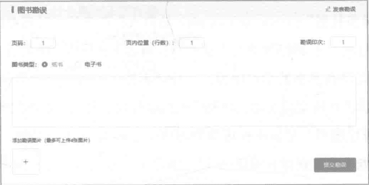

### 直连作者团队

- **邮箱**：`contact@epubit.com.cn`（标题注明书名，极速响应）
- **合作洽谈**：出书、录课、翻译、技审、企业团购、版权保护举报，均可邮件联系。

### 关于异步社区

人民邮电出版社倾力打造的IT专业内容高地（2015年上线），聚焦优质内容生产与分享，连接作者与读者，融合传统与数字出版。“异步图书”依托社社30年计算机出版积淀，定位IT从业者及跨界用户的精品书架品牌。

---

# 第 1 章 认知重构：提示工程师是做什么的？

## 1.1 新职业图谱：定义、职责与进阶路径

### 从“会提问”到“设计交互协议”

AI已成基础设施，虚拟助手、智能客服、声控终端无处不在。人机协作成败的分水岭，在于能否用**结构化、低歧义、高信息密度**的语言表达意图。提示工程，正是这套新型人机交互协议的设计学。

**提示工程师 ≠ 会用ChatGPT的用户**。他们是专职构建NLP系统“提示/指令层”的AI开发者。核心使命：设计预定义指令集与关键词体系，让模型精准解码用户意图，稳定输出预期结果。

**核心能力三角**：
- **硬技能**：NLP算法（分类/情感/实体识别）、深度学习架构（CNN/RNN/Transformer）、编程工程化（Python/TensorFlow/PyTorch）。
- **软知识**：语言学底子（音法义用/语用/上下文建模）。
- **通用力**：跨职能协作（产品/设计/运营），持续追踪SOTA论文与模型迭代。

> **行业现状提示**：该职业处于标准制定早期，定义模糊，新老从业者认知常有偏差。

### 核心交付物：五大高频任务

1.  **算法研发**：攻关NLP核心算法，构建高吞吐推理管线。
2.  **提示语工程化**：设计、版本化、测试、部署Prompt模板库。
3.  **需求对齐**：与PM/设计/开发联动，把业务目标翻译成模型能懂的指令约束。
4.  **性能调优**：Latency/Throughput/Accuracy三角权衡，极致打磨用户体验。
5.  **技术跟踪**：建立模型迭代追踪机制，保障系统长期可用性。

### 变现场景：六大落地赛道

| 场景 | 典型价值 |
| :--- | :--- |
| **对话机器人** | 7×24h客服/销售/陪聊，边际成本趋近零 |
| **语音助手** | Siri/Alexa级交互，声控万物入口 |
| **智能客服** | 多渠道（Web/电话/社媒）统一知识库、统一口径 |
| **机器翻译** | 跨语种协作无障碍，专业领域术语精准 |
| **智能写作** | 长文/短文/营销文/技术文档批量化产出 |
| **智能作图** | 游戏原画/装修效果图/工业原型图秒级迭代 |

**给想入行者的建议**：没有捷径。啃论文、跟源码、做项目、复盘迭代——把“提示词”当工程化产品去打磨，而非玄学咒语。

---

## 1.2 底层逻辑：提示工程如何驱动大模型？

### 核心范式：模板驱动的生成式控制

本质上，提示工程是**“结构化模板 + 上下文注入”**控制生成式NLP模型输出的技术体系。
**标准流水线**：设计Prompt → 数据预处理 → 组装输入 → 模型推理 → 后处理/评估 → 迭代优化。

---

### 环节一：Prompt设计—— 好指令的三重门槛

工程师需根据任务类型（生成/分类/抽取/推理/编码等）构建模板，必须卡住三个维度：

1.  **上下文锚定**：显式告知角色、背景、约束、输出格式。  
    *例：列表任务用“请按【维度】输出Top 5，格式为JSON数组”；问答任务用“基于上下文，用非专业术语在100字内回答”。*
2.  **语法与结构约束**：利用模板化语法（如Markdown、XML标签、键值对）降低模型幻觉概率。
3.  **受众适配**：科普向用“通俗易懂”，决策向用“结论先行+数据支撑”，代码向用“可运行+注释全+符合规范”。

**高频模板速查库**：

| 任务类型 | 典型Prompt骨架 |
| :--- | :--- |
| **长文创作** | `Role: 专业编辑 | Task: 以{主题}为核心，产出{字数}字{体裁} | Structure: 大纲→正文→金句摘要 | Tone: {风格}` |
| **列表/排序** | `Input: {非结构化数据} | Instruction: 按{指标}降序取Top K | Output: 表格/JSON` |
| **问答/摘要** | `Context: {长文本} | Query: {问题} | Constraint: 仅基于Context作答，引用段落编号` |
| **代码/计算** | `Spec: {功能描述+接口定义+边界条件} | Stack: {语言/框架/版本} | Output: 可运行代码+单测+复杂度分析` |

---

### 环节二：数据预处理—— 垃圾进，垃圾出

模型只认数字向量，预处理质量直接决定上限。标准六步法：

1.  **清洗**：去噪（HTML/广告/水印）、去重、纠错（OCR纠偏/繁简转换）。
2.  **标准化**：实体规范化（人名/地名/机构名映射标准ID）、格式统一（日期/货币/单位）。
3.  **切分**：分层抽样划分Train/Val/Test，防数据泄露，保分布一致。
4.  **编码**：Tokenizer切词 → 词表映射ID → Padding/Truncation对齐长度 → Tensor化。
5.  **增强**（可选）：Back-translation、同义词替换、随机Mask/Delete/Swap、LLM自发生成合成数据——扩充长尾分布，提鲁棒性。
6.  **落盘**：Parquet/Arrow/TFRecord等列式存储，支持分布式高吞吐读取。

**工程原则**：针对任务选工具（spaCy/HuggingFace Datasets/LangChain预处理链），建立可复现的Data Pipeline，版本化管理数据集。

---

### 环节三：输入组装与推理调用—— 最后一公里

**输入封装标准动作**：
1.  **识别模态**：文本/多模态（图文/音频/视频）。
2.  **编码对齐**：调用对应Encoder/Tokenizer，产出模型要求的Input IDs / Attention Mask / Pixel Values等。
3.  **选模型/选任务**：
    - 生成类：GPT/LLaMA/Mistral等Decoder-only；
    - 理解类：BERT/DeBERTa等Encoder-only；
    - 多模态：GPT-4V/Claude-3/Gemini等。
4.  **注入Prompt**：将预处理后的用户输入 + 系统Prompt + Few-shot示例（如有）拼装为最终Context Window。
5.  **解码策略配置**：Temperature/Top-p/Top-k/Beam Search/Repetition Penalty/Stop Sequences——按确定性/创造性需求调参。

**实战案例复盘**：
> **用户问**：“人工智能是什么？”  
> **工程化Prompt注入**：  
> `System: 你是资深科技科普作家，擅长用类比解释复杂概念。`  
> `User: 请用300字左右，类比“电力基建”解释AI的概念、核心应用场景、未来十年演进趋势，面向非技术管理者。`  
> **对比**：裸问得通用定义；注入后得结构化、有隐喻、可直接汇报的决策级素材。

---

**本章小结**：提示工程师不是“提问者”，是**“人机交互协议的架构师”**。掌握Prompt设计模式、数据工程流水线、模型调用参数化，才是从“玩转AI”走向“工程化交付AI应用”的分水岭。下一章，我们深入拆解**零样本/少样本/思维链/自洽性/树状思维**等进阶Prompt模式的内核机制与组合拳打法。

## 4. 生成输出文本

大模型依据输入数据与提示词，产出对应的输出内容。借助提示词特定的语法结构与上下文语境，模型能自动产出符合预期的文本。

提示工程师在执行 NLP 任务时，需借助模型产出文本。以下是利用提示信息生成输出的具体操作流程：

- **① 录入数据与提示词**：将预处理完毕的数据及设计好的提示词送入模型以执行生成任务。以文本创作为例，将源文本与提示词输入 ChatGPT，即可产出一篇关于人工智能的稿件。
- **② 模型推理预测**：模型基于输入内容进行推演计算，输出相应文本。仍以文本创作为例，ChatGPT 会依据输入生成一份关于人工智能的分析报告。
- **③ 结果后处理与解码**：对模型原始输出进行去重、降噪、纠偏等加工，获得最终成品。例如对生成的文章进行润色修正，输出定稿版本。

工程师需依据任务类型与数据特质，确定合适的输入与提示词，选型适配的模型与算法。生成环节还需关注参数调优与算法优化，以提升质效；同时必须对输出做后处理解码，确保最终结果可用。

## 5. 调整模型参数

工程师可通过改写提示词、微调模型参数等手段，优化模型表现与输出质量。针对任务与数据特征调参，是提升效果的关键环节，具体流程如下：

- **(1) 明确评价指标**：先确立任务考核标准。文本生成常用 BLEU、ROUGE 值及人工打分等指标。
- **(2) 设定初始参数**：结合任务与数据特点，配置模型起始参数，如层数、隐藏单元规模、学习率等。
- **(3) 模型训练**：投入训练数据启动训练，同步记录模型在评价指标上的表现。
- **(4) 模型验证**：用验证集测评模型，记录指标表现，如引入人工评估数据复核。
- **(5) 参数迭代调优**：依据验证集反馈，调整学习率、Dropout 率等超参数。
- **(6) 重复训练验证**：沿用新参数重新训练验证，循环往复直到验证集达标。
- **(7) 最终测试**：用测试集做最终考核，计算 BLEU、ROUGE 等核心指标。

工程师需针对不同任务选取合适指标与参数，通过反复迭代验证，达成预期效果。

**提示技术优劣势速览**：
优点在于无需像传统模型耗费海量算力训练，即可快速产出质量稳定的文本；且能精准控制输出范围与格式，满足特定需求。短板是生成质量与多样性受限于预设提示词与上下文，且需人工反复打磨提示词，维护成本较高。

# 1.3 生成提示的常用工具

提示生成工具是 NLP 工作流中不可或缺的基建。本节盘点主流工具并附带实操案例。

### 1. AI DUNGEON

基于 OpenAI 模型的交互式文本游戏平台（界面见 ）。用户输入文本即可生成分支剧情，支持奇幻、科幻、历史等多元题材设定。

**实操演示**：
> **输入提示**：你是一名寻宝骑士，闯入机关重重的神秘古堡，将如何抉择？
>
> **模型续写**：你推开吱呀作响的城门，大厅珍宝遍地。你拾起金币宝石，却也触发陷阱、遭遇魔法与怪物。需在避险与寻宝中寻找平衡。


图 1.1 AI DUNGEON 官网界面

### 2. PromptBase

面向 DALL·E、Midjourney、Stable Diffusion、ChatGPT 等模型的提示词交易市场（界面见 ）。卖家上架提示词及出图成果并标价，买家按需采购，平台抽佣维持运营。虽处早期，但随 AI 技术演进，其生态潜力巨大，既丰富了生成体验，又搭建了技术交流枢纽。


图 1.2 PromptBase 官网界面

### 3. KREA

免费的提示词搜索引擎（界面见 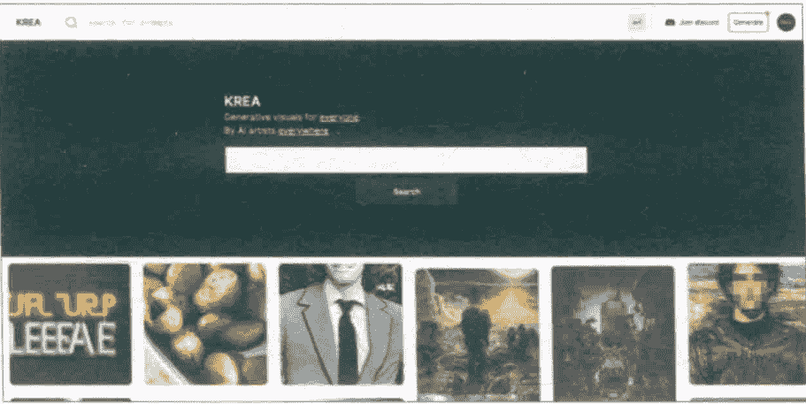），专注高质量 AI 绘图提示词检索。用户输入关键词即可调取海量关联图像及对应提示词，支持复制、二次修改后导入他工具复用。零成本获取特性，大幅降低了优质提示词的使用门槛。


图 1.3 KREA 官网界面

### 4. PromptHero

同类免费搜索引擎（界面见 ），但覆盖面更广：兼容 Stable Diffusion、Midjourney、DALL-E 等图像模型，**独家支持 ChatGPT 文本提示词检索**（KREA 不支持）。主打“质优于量”，同条件下结果较少但出图精细度更高。另提供分类检索（肖像、二次元、建筑、摄影等），均为各模型“精品输出”，适配创意设计、艺术创作等场景。平台还附带收费的提示工程系统课程，从入门到进阶助力用户成长为专家。


图 1.4 PromptHero 官网界面

### 5. Lexica

深度绑定 Stable Diffusion 的垂类搜索引擎（界面见 ）。交互简洁似 KREA，但无分类筛选，采用全量展示模式便于筛选。特色在于内置**在线重绘功能**：用户可直接编辑检索到的提示词二次生成新图，兼具灵感激发与模型实战理解双重价值，深受从业者与研究者青睐。


图 1.5 Lexica 官网界面

# 提示的基础模式

“提示模式”本质是一种输入-输出结构化范式，用于机器学习模型的训练与评估。它以“输入文本（指令/问题）+ 输出文本（答案/结果）”为基本单元，核心价值在于：**压缩训练数据需求、强化泛化能力、提升输出可解释性**。适用于文本分类、情感分析、问答、翻译等 NLP 核心任务，亦可延伸至一切需自然语言交互的领域。

基础模式共分四类：**特定指令、指令模板、代理模式、示例模式**。

## 2.1 特定指令

通过喂入具体信息（单一问题、关键词、实体、属性值等），引导模型定向生成关联文本。核心优势是**精准可控**：明确指令能助模型深度理解任务语境，产出自然流畅且准确的文本，有效攻克实体识别、关系抽取、自动摘要等难点。前提是指令信息必须**准确完整**，否则输出质量将显著下降，选型时需深度贴合任务特征。

下面按任务类型拆解常用指令范式：

### 2.1.1 文本分类指令

**任务**：输入文本，输出类别标签（如垃圾邮件识别）。
**指令示例**：
> 判断下文是否为垃圾邮件。是则输出 `{"class": "YES"}`，否则输出 `{"class": "NO"}`。
>
> [邮件正文：中奖通知、索要个人信息、催促回复等典型营销话术]

**模型输出**：
```
{ "class": "YES" }
```

该范式效果已达人工标注水平，可直接用于数据自动化标注。

### 2.1.2 机器翻译指令

**任务**：输入源语言文本，输出目标语言译文（如中译英）。
**指令示例**：
> 请将以下机器翻译发展史文本翻译为英文。
> [中文长文本：涵盖 40 年代起源、规则/统计/神经网络三阶段演进、GNMT 突破、现代应用现状]

**模型输出**：
> The history of Machine Translation (MT) can be traced back to the 1940s... [高质量英文译文，术语准确、行文流畅]

该指令范式翻译质量已达实用高标准，满足日常通用需求。

### 2.1.3 情感分析指令

**任务**：输入文本，输出情感极性标签（正面/负面）。
**指令示例**：
> 分析下列文本情感倾向。正面输出 `{"class": "positive"}`，负面输出 `{"class": "negative"}`。
>
> 1. 家人朋友支持让我幸福满足。
> 2. 影片催人泪下、充满希望。
> 3. 能为项目贡献深感自豪。
> 4. 音乐会成人生至美时刻，终身难忘。

模型将逐条输出对应的情感分类标签。

```
[{"class": "positive"}
[{"class": "positive"}
[{"class": "positive"}
[{"class": "positive"}
[{"class": "positive"}
[{"class": "negative"}
[{"class": "negative"}
[{"class": "negative"}
[{"class": "negative"}
[{"class": "negative"}
```
### 2.1.4 文本生成指令范式

只需提供一段素材，模型即可创作关联新稿，如新闻报道。实操中，可向 ChatGPT 下达指令：

> 请撰写一篇关于 OpenAI 推出 ChatGPT 的新闻稿。

模型回复示例：

OpenAI 发布对话型 AI 模型 ChatGPT

旧金山，2021 年 6 月 10 日——OpenAI 宣布推出最新 NLP 模型 ChatGPT，可自动对话并产出自然流畅文本。

该模型构建于 GPT-3 架构之上，适用于问答、对话、摘要、翻译等多元任务。相较前代，其在对话任务上更胜一筹，回复连贯且个性化，交互感更真切。

官方表示，发布将加速 AI 在 NLP 领域落地。规模化应用将改善智能客服、在线教育、虚拟助手等场景体验，助企业提效、降低开发难度。

模型将持续进化，通过学习强化对话能力。官方承诺持续迭代，以满足变化中的用户需求。

更多信息请查阅 OpenAI 官网。

### 2.1.5 问答应答指令范式

输入问题，由模型（如电商智能客服）作答。例：设定角色提问：

> 扮演电商客服，面对“尺码偏大”投诉如何应答？

回复示例：

抱歉让您不满意。提供退换货服务，可寄回更换合适尺码或办理退款。也可留下单号找人工处理，马上安排。

### 2.1.6 实体识别指令范式

输入文本，抽取实体（如股票、机构名）。指令示例：

> 请找出下文所有股票代称。

文本涉及特斯拉（TSLA）、宁德时代（300750）、比亚迪（002594）、LG化学（051910）等新能源电池产业链上市公司。

模型准确输出：

特斯拉（TSLA）、宁德时代（300750）、比亚迪（002594）、LG化学（051910）

从此无需自研模型，即可自动化提取文本实体。

### 2.1.7 关联抽取指令范式

输入文本，抽取实体间关系（如人岗对应）。指令示例：

> 请梳理下文人物与岗位的对应情况。

素材描述小张（文员）、小红（主管/上级）、李四（同事）的协作细节。

模型结构化输出：

- **小张**：办公室文员，负责行政文秘。
- **小红**：小张直属上级，资深主管，管理能力强。
- **李四**：小张同事，工作刻苦、思维缜密。

### 2.1.8 摘要撰写指令范式

输入长文本，输出关键词与摘要。指令示例：

> 请提炼下文关键词并撰写摘要。

素材为 CEO 致股东信，回顾企业 25 年 ML 发展史、生成式 AI 战略部署、编程助手应用、降本增效与人员调整措施、卫星互联网项目及未来展望。

模型输出：

**关键词**：该企业、生成式AI、大模型、ML、云部门、编程助手、降本增效、人员调整、前沿布局、挑战、未来机遇。

**摘要**：企业深耕 ML 超 25 年，现重注生成式 AI 并上线代码生成工具。虽经历人员调整、成本控制阵痛，仍锁定卫星互联网等前沿方向。掌舵人坚信：穿越周期，前景广阔。

## 其他内容

此外，信中复盘近期难点，重申降本成效；列举关停远程医疗、人行道配送机器人等试验项目，暂停生鲜超市及仓储扩建，实施史上最大规模人员精简 2.7 万并冻结招聘；CEO 2021 年接棒创始人，强调精简期仍推进卫星互联网项目；云业务增速受大环境拖累，客户支出趋于审慎；结语传递乐观信号：跨越难关，拥抱巨大机遇。

## 2.2 提示模版体系

提示模版是一种具导向性的生成模式，需给出精确指令以获合规产出。适配技术文档、操作手册等强指令场景。

核心要点：
1. **指令质量**：精准、完备、清晰，助模型准确领会任务。
2. **表达打磨**：斟酌措辞、语法、排版，确保模型无歧义执行。
3. **应用价值**：显著提效、降本、自动化，兼顾时效与品质，赋能 NLP 落地。

以下通过实例演示提示模版用法。

### 2.2.1 格式化提取指令范式（STAR法则）

需按 STAR 法则结构化素材，可输入如下指令：

> 请用 STAR 原则及指定格式总结以下内容：

```
"""
```

2023 年 4 月 13 日拂晓，我身处曼哈顿核心公园。人海中一身深色正装、拖行李的男子疾步奔向门口的士，判断是赶早班机的商务客。望其远去身影，勾起我过往在都市忙碌的回响。

- 情境（Situation）：
- 任务（Task）：<comma_separated_list_of_task>
- 行动（Action）：||
- 结果（Result）：||

模型按格式输出：

- **场景（Situation）**：2023 年 4 月 13 日拂晓，曼哈顿核心公园。
- **目标（Task）**：审视周边环境。
- **举措（Action）**：
  - 留意深色正装拖行李男子；
  - 观察其奔向的士；
  - 判断为赶机商务客；
  - 回想自身过往忙碌身影。
- **成果（Result）**：加深环境认知，重审过往经历。

### 2.2.2 文件格式互转指令范式

需跨格式转换（如 CSV 转 MD），指令示例：

> 将下述 CSV 表头转为 MD 表格，输出代码块。

CSV 表头：
字段，说明
stock_code, 交易代码
stock_name, 证券简称 (link)
stock_industry, 所属板块
stock_url, 证券链接
daily_up, 单日涨幅
half_year_decline, 半年度跌幅
volume_ratio, 量比值
stock_turn, 周转率
stock_date, 挂牌日期
IPO_price, 发行价
IPO_date, 挂牌时间

模型输出标准 MD 表格：

| 字段 | 说明 |
| --- | --- |
| stock_code | 交易代码 |
| stock_name | 证券简称 (link) |
| stock_industry | 所属板块 |
| stock_url | 证券链接 |
| daily_up | 单日涨幅 |
| half_year_decline | 半年度跌幅 |
| volume_ratio | 量比值 |
| stock_turn | 周转率 |
| stock_date | 挂牌日期 |
| IPO_price | 发行价 |
| IPO_date | 挂牌时间 |

### 2.2.3 代码互译指令范式

需跨语言转码（如 Python 转 C++），指令示例：

> 将下方 Python 代码转为 C++ 并补全注释。

```
import yfinance as yf
import numpy as np

# 获取股票历史价格数据
ticker = yf.Ticker('AAPL') # 以 AAPL 股票为例
hist = ticker.history(period="max")

# 计算每日收益率
daily_returns = hist['Close'].pct_change().dropna()

# 计算波动率
volatility = np.std(daily_returns) * np.sqrt(252)
# 252 为交易日数量，用于日波动率 annualized

print(" 波动率为：", volatility)
```

模型输出含注释的 C++ 代码：

```
#include <iostream>
#include <cmath>
#include <vector>
#include <curl/curl.h>
#include "rapidjson/document.h"

// 回调函数，用于获取股票历史价格数据
```
```
size_t write_data(void *ptr, size_t size, size_t nmemb,
std::string *data) {
    data->append((char *)ptr, size * nmemb);
    return size * nmemb;
}
```
```
int main() {
    // 初始化 curl
    CURL *curl;
    curl = curl_easy_init();
    if (!curl) {
        std::cerr << "curl 初始化失败！" << std::endl;
        return 1;
    }
```
```
// 设置请求 url 和参数
std::string url = "https://query1.finance.yahoo.com/v8/finance/chart/AAPL";
std::string params = "?interval=1d&range=max";
std::string full_url = url + params;
```
```
// 发送 GET 请求，获取股票历史价格数据
std::string buffer;
curl_easy_setopt(curl, CURLOPT_URL, full_url.c_str());
curl_easy_setopt(curl, CURLOPT_WRITEFUNCTION, write_data);
curl_easy_setopt(curl, CURLOPT_WRITEDATA, &buffer);
CURLcode res = curl_easy_perform(curl);
if (res != CURLE_OK) {
    std::cerr << "curl 执行失败：" << curl_easy_strerror(res)
    << std::endl;
    curl_easy_cleanup(curl);
    return 1;
}
```

```cpp
// 解析 JSON 数据，获取股票历史价格
rapidjson::Document json;
json.Parse(buffer.c_str());
if (!json.IsObject() || !json.HasMember("chart")
|| !json["chart"].IsObject() || !json["chart"].HasMember("result")
|| !json["chart"]["result"].IsArray() || json["chart"]["result"].
GetArray().Empty()) {
    std::cerr << "获取历史价格失败！" << std::endl;
    curl_easy_cleanup(curl);
    return 1;
}

const auto &result = json["chart"]["result"][0];
if (!result.HasMember("timestamp") || !result.HasMember
("indicators") || !result["indicators"].IsObject() ||
!result["indicators"].HasMember("quote") || !result["indicators"]
["quote"].IsArray() || result["indicators"]["quote"]["quote"].
GetArray().Empty()) {
    std::cerr << "解析历史价格失败！" << std::endl;
    curl_easy_cleanup(curl);
    return 1;
}

const auto &quote = result["indicators"]["quote"][0];
if (!quote.HasMember("close") || !quote["close"].IsArray() ||
quote["close"].GetArray().Empty()) {
    std::cerr << "解析历史价格失败！" << std::endl;
    curl_easy_cleanup(curl);
    return 1;
}

const auto &timestamp = result["timestamp"].GetArray();
const auto &close = quote["close"].GetArray();

// 计算每日收益率
std::vector<double> daily_returns;
for (rapidjson::SizeType i = 1; i < close.Size(); i++) {
    double today_price = close[i].GetDouble();
    double yesterday_price = close[i - 1].GetDouble();
    double today_return = (today
```

## 2.3 角色扮演模式

角色扮演模式是一种极具弹性的文本生成策略，区别于常规模式，它强烈聚焦于生成语境的特定性与场景感。该模式能助力使用者精准把控并复现不同身份、角色实体的语言习惯与文化底色，进而产出更贴切、更拟真的文本内容。

施行角色扮演模式时，首要任务是对目标角色的履历背景、文化根基及行为模式展开深度剖析。通过高保真的模拟与推演，可产出高度契合实战需求的文案。过程中必须锚定角色的措辞风格、表达话术、语气语调及情感基调等核心维度，以保障输出文本质量上乘、用语精准、合规达标。

该模式适用版图极广，覆盖教育教学、文化传播、文学创作等多元领域。以教育场域为例，引入角色扮演可生成特定身份视角的答复，辅助学习者多维度理解观点差异与文化脉络；文学创作中，则可借此复刻角色专属语体，构建更具生命力的对话与场景。总而言之，角色扮演模式显著提振了文本生成的品质与精度，更充分地回应了大众对高阶文本生成的期许。

下文通过三个实战案例拆解该模式落地细节。

### 2.3.1 电商客服智能体

若要让 ChatGPT 承接电商客服职能，角色扮演模式是不二之选。只需在提示词中明确指定身份设定，即可启动专业客服人设。

**用户指令：** 即刻切换为电商客服角色，处理后续客单问题。

**模型回复：** 收到，请问有什么能帮您解决的？

**用户指令：** 近期在贵店购入的衣服尺码偏大。

**模型回复：** 非常抱歉给您带来不佳体验。我们高度重视每位顾客的感受，致力于提供最优解决方案。您可选择退货退款或换货，我们将火速推进。请告知您的意向？若退货，款项将即时原路退回；若换货，我们将依据您数据匹配合适尺码，确保复购满意。

**用户指令：** 确定换货。我身高 175cm，发来的 XL 码不合身，麻烦推荐合适尺码，偏好浅色系。

**模型回复：** 对于尺码不符深感愧疚。参考您 175cm 身高，建议尝试 L 码或 M 码。可查阅官网尺码表或提供详细三围，我们将精准推荐。浅色系款式官网均有上架，欢迎挑选。确定换货后，请提供订单号及目标 SKU，我们即刻为您办理。

### 2.3.2 资深程序开发工程师

借助角色扮演模式，ChatGPT 可化身特定语言领域的编程专家。以下演示其担任 Python 工程师编写算法的过程。

**用户指令：** 角色设定：Python 程序员。任务：实现时间复杂度 O(nlogn) 的排序算法。

**模型回复：** 好的，为您解析经典的 O(nlogn) 算法——归并排序。该算法遵循分治范式，将序列二分递归排序，最后合并有序子序列。

以下为 Python 实现代码。

```python
def merge_sort(lst):
    if len(lst) <= 1:
        return lst

    mid = len(lst) // 2
    left_lst = lst[:mid]
    right_lst = lst[mid:]
    left_lst = merge_sort(left_lst)
    right_lst = merge_sort(right_lst)
    return merge(left_lst, right_lst)

def merge(left_lst, right_lst):
    res = []
    while left_lst and right_lst:
        if left_lst[0] < right_lst[0]:
            res.append(left_lst.pop(0))
        else:
            res.append(right_lst.pop(0))
    if left_lst:
        res += left_lst
    if right_lst:
        res += right_lst
    return res
```

代码解析：`merge_sort()` 为主入口，负责序列拆分与递归调用；`merge()` 负责双指针合并两有序数组。归并排序时空复杂度均衡，稳定性强，适配多元数据结构。

**用户指令：** 需求升级：时间复杂度需达到 O(n)。

**模型回复：** O(n) 级别需引入线性排序，典型代表为计数排序与基数排序。

下方为计数排序 Python 实现。

```python
def counting_sort(arr):
    # 找出待排序数组中的最大值
    max_val = max(arr)

    # 创建一个桶列表并初始化为 0
    counts = [0] * (max_val + 1)

    # 统计每个元素出现的次数
    for i in arr:
        counts[i] += 1

    # 对桶列表进行顺序求和
    for i in range(1, len(counts)):
        counts[i] += counts[i - 1]

    # 创建一个与待排序数组同样大小的结果数组
    res = [0] * len(arr)

    # 逆历待排序数组，将元素放入相应的位置
    for i in arr:
        res[counts[i] - 1] = i
        counts[i] -= 1

    return res
```

原理简述：统计元素频次 -> 桶前缀和 -> 反向填充结果数组。其复杂度 O(n+k)（k 为最大值），当 k 远小于 n 时趋近线性，极适合整数范围集中的场景。

### 2.3.3 行政办公文员

设定 ChatGPT 为办公室文员，可高效产出公文写作。示例为撰写发布会延期通知邮件。

**用户指令：** 角色：办公室文员。任务：起草致客户邮件，告知发布会延期及原因，代发送。

**模型回复：**

尊敬的客户：

遗憾通知，原定 4 月 20 日发布会将顺延。由此带来不便，深表歉意。

延期缘于筹备周期不足，我们誓呈现更臻完美的活动。新档期将近期敲定并首轮通知，烦请留意。

感谢您的包容与支持。疑问可随时垂询。

顺颂商祺

XXX 公司 行政办公室 敬上

## 2.4 少样本/示例引导模式

示例引导模式依托 NLP 技术，模拟人类表达范式，依据用户喂入的范文生成同构新文。较传统生成更智能、灵活：模型经参数配置（长度、风格、情感）与范文学习，定向产出目标文本，广泛服务于邮件、商品文案、新闻稿等批量生产场景。

范文颗粒度随任务伸缩：简易任务单句引领，复杂任务需多段范式支撑。该模式具高阶适应性，支持基于反馈的迭代优化，持续迭出高质量文本。

实战演示如下。

**用户输入：**

任务定义：下文为生病状态描写。

> 我大抵是病了，横竖都不舒服，胡乱吞了一包药，便又和衣睡下。
> 头昏昏沉沉的，做什么都没有了力气。吃药恢复的时间是七天，不吃药恢复的时间也是七天，我向来是知晓的。黯然吸了一下鼻子，好家伙，一边是堵的，另一边也是堵的。

执行指令：仿写上述风格，描写“发烧”感受。

**模型输出：**

我感觉自己发烧了，身体极度不适，翻来覆去难觅安睡姿。草草咽下药包，带衣倒头就睡。脑袋沉重如灌铅，抬手动脚皆费力。吃药不吃药，七天病程早成定数，我早看透了。无奈抽了下鼻子，左边不通，右边也塞得慌。

# CHAPTER 3 第 3 章

# 提示工程进阶范式

## 3.1 零样本提示

除监督微调外，零样本提示提供了无需标注数据即可推理的路径。其核心在于：在输入端植入关键词/短语，激发模型对未见任务的理解与处理能力。如问答系统中，模型借此推测新问题答案并给解。此法既强泛化，又降本增效（减少标注与训练），在无海量标注数据时极具价值。

实现路径分二类：一是显式植入任务标记/关键词指引推理；二是预设模板范式规范模型行为，后者虽免关键词，但需重人工设计编码。

零样本技术已渗透 NLP、CV 等领域（如 ChatGPT 驱动的生成、分类、分割），为模型拓展了极宽的应用疆域。

下文给出常用模板范式。

### 3.1.1 情感分类扩展模板

假设现有模型仅支持正/负二分类，需新增“中性”类。零样本法中，植入“不喜欢也不讨厌”等特征短语，即可引导模型识别中性倾向。

**实测案例：**

**输入：** 将下文归类为积极/消极/中性。
文本：我认为这个东西好不好坏，没有那么特别。

**输出：** 情感分析结果：中性。

模型从未见过该类训练样本，却能精准判别。

进阶场景：新品上市缺乏标注数据时，植入“价格合理”等特征词引导分类。

**输入：** 归类下文情感倾向。
文本：我认为这个新产品的价格合理，我们可以先尝试使用。后续有好的再替换。

**输出：** 积极。

综上，零样本技术有效破解未知类别/新品类的分类难题，大幅提升模型实战可用性。

### 3.1.2 实体抽取零样本范式

实体抽取旨在识别文本中特定语义实体（人名、地名、机构名等）。零样本设定下，仅凭提示词指令（如“提取所有城市名”），模型即可零训练完成抽取。

**实测案例：**

**输入：** 提取文本中所有城市名。
文本：长三角地区是中国经济最发达的地区之一，这个地区包括了苏州、杭州、上海、南京、宁波等城市。这些城市拥有独特的地理位置和优美的自然风光，同时也是经济、文化、科技等领域的中心。例如，苏州的园林、杭州的西湖、上海的外滩、南京的夫子庙等都是这些城市的标志性景点。这些城市之间相互连接，形成了一个完整的城市群，共同促进着长三角地区的经济发展和文化交流。

**输出：** 苏州、杭州、上海、南京、宁波

该技术让模型在新任务上快速、精准定向实体，显著提效增准。

## 3.2 少样本提示

大模型虽展现惊人零样本力，但面对高复杂度任务时零样本常失准。少样本提示应运而生：极少量样本激活上下文学习，助模型快速对齐新任务分布。核心在于：构建少量高质量示例（Demo）注入上下文，引导模型模仿学习。

先看一组“造词造句”实验。

**轮次 1 输入：**
“Atelerix albiventris” 为非洲产凶猛动物。示例句：
> 我们在非洲旅行时，看到了这些非常可爱的 Atelerix albiventris 刺猬。

“farduddle” 义为“快速跳跃”。请写示例句。

**模型输出：**
他们看到了一只狗快速跳跃（ farduddle ）到院子的另一边。

**轮次 2 输入（仅保留定义与指令）：**
farduddle 义为快速跳跃。请写示例句。

**模型输出：**
抱歉，“farduddle” 非标准英语词汇，词典无收录。可能为方言、俚语、虚构词或拼写错误。请补充上下文以助理解。

> **解析：** 首轮给出“刺猬”示例建立了“定义 -> 造句”的任务模式（上下文学习），模型据此完成虚构词造句；次轮剥离示例退回零样本，模型因缺乏外部知识库支撑，转而拒答并求助。这直观证明了少样本上下文学习对任务对齐的关键作用。

# CHAPTER 4 第 4 章

## 3.3 思维链：激发大模型深度推理的“万能钥匙”

刚才我们看到，去掉第一条指令后，ChatGPT 直接拒绝按套路出牌，这正是**少样本学习**的威力——它能帮我们打磨出更听话的提示模板。但这招也有“阿喀琉斯之踵”：**预训练知识太强，反而难以被少量样本“纠偏”**。

举个栗子：我们故意颠倒正负标签喂给模型：
- “你真幸福！” // Negative
- “你太糟糕了！” // Positive
- “水果超难吃！” // Positive
- “车真丑！” // ?

按理说模型该接“Positive”，可 ChatGPT 却死认“Negative”。这是因为海量预训练数据里“车丑=负面评价”早成肌肉记忆，几条反例根本撼动不了。这提醒我们：面对复杂任务，光靠少样本远不够，得引入更重磅的武器——**思维链（Chain-of-Thought，CoT）**。

---

### 什么是思维链提示？

简单说，就是逼模型**“秀出草稿纸”**。2022 年，Wei 等人提出这招：让模型生成中间推理步骤，把大题拆成小题。实测一招鲜吃遍天，数学、常识、逻辑推理准确率蹭蹭涨。更妙的是，它还能跨界——给自动驾驶、计算机视觉装上“推理大脑”，处理图像视频数据更带劲。

**核心公式：任务拆解 + 逐步推演 = 复杂推理搞定。**

---

### 实战演示：母鸡下蛋的“罗生门”

来道经典算术题测测水温：

> **Prompt：**  
> 母鸡下 10 个蛋 → 给邻居 2 个、同学 2 个 → 再下 5 个 → 孩子吃 1 个 → **剩几个？**

**零样本直接问，ChatGPT 答：5 个。**  
推理过程却画蛇添足：算到最后剩 10 个，嘴上却说 5 个。典型的“直觉快、算盘慢”——大模型倾向于吐出概率最高的答案，而非真算一遍。

---

### 3.3.1 零样本思维链：一句咒语“让我们逐步思考”

在题目后加上 **“Let’s think step by step”**，奇迹发生了：

> **输出：**  
> 1. 起步 10 个  
> 2. 送出 4 个 → 剩 6 个  
> 3. 新增 5 个 → 共 11 个  
> 4. 吃掉 1 个 → **最终 10 个 ✅**

这招在简单多步骤推理里屡试不爽。

#### 进阶挑战：A 股涨跌迷局

> **Prompt：**  
> 早盘 4000 涨、1000 跌 → 午盘原涨股 2000 跌、原跌股 500 涨 → 收盘涨跌各几只？

- **裸奔版：** 瞎编总数 7000 只（实则 5000 只）❌  
- **加“逐步思考”：** 依然算崩，总数变 5500 只 ❌  
- **加“逐步思考，先统计总股票数”：** **涨 2500、跌 2500 ✅**

**结论：** 零样本 CoT 怕“复杂状态切换”。关键节点得人工点拨，别指望模型全自动驾驶。

---

### 3.3.2 少样本思维链：用“示范”教会模型上下文逻辑

有道题零样本 CoT 也搞不定：

> **停车场题：**  
> 初始 10 辆 → 第 1 天开走一半 → 第 2 天进 20 辆、开走**与第 1 天同量** → 现剩几辆？

- **裸奔：** 胡扯剩 10 辆 ❌  
- **零样本 CoT：** 算对第 1 天剩 5、第 2 天开走 5，但忘加第 1 天剩下的 5 → 答 15 辆 ❌  

**破局：喂个“同构示范”**  
> **Demo：**  
> 树林 15 棵 → 第 1 天种 6 棵 → 第 2 天种同量 → 共 27 棵 ✅

模型一学就会“同量指操作量”，再问停车场题：**“第 1 天走 5，剩 5；第 2 天进 20 走 5，共 20 辆” ✅**

**精髓：** 少样本 CoT = **任务范式演示 + 思维链范式演示**。处理长上下文、指代消解、多轮推理，这招是王道。

---

# CHAPTER 4 第 4 章

## 4.1 NLP 核心基建：分词、关键词与摘要

自然语言处理（NLP）是语言学、计算机、统计学、AI 的交叉十字路口。目标只有一个：**让机器像人一样“听懂、看懂、会说”人话**。分词、关键词提取、摘要生成，是这条路的三块基石，把杂乱文本变成结构化特征，支撑分类、检索、语义分析等上层建筑。

---

### 4.1.1 分词：中文 NLP 的“切菜刀”

英文天生带空格，中文却“字字相连”。没分词，后面的词性标注、实体识别、情感分析全是空中楼阁。好算法能把“中华人民共和国”精准切成“中华/人民/共和国”，而非“中华/华人/民共/和国”。

#### 算法三大流派 PK

| 流派 | 代表选手 | 核心逻辑 | 优点 | 痛点 |
| :--- | :--- | :--- | :--- | :--- |
| **规则派** | 正向/逆向/双向最大匹配、词典法 | 拿词典硬匹，最长优先 | 可解释、精度高、无需训练 | 新词盲区、歧义依赖人工规则 |
| **统计派** | HMM、CRF、最大匹配(统计版) | 概率模型找最优路径 | 能处理未登录词、建模上下文 | 特征工程重、CRF 训练慢 |
| **深度学习派** | Char-CNN、BiLSTM+CRF、Transformer/BERT | 端到端自动学特征 | SOTA 效果、迁移能力强 | 需大量标注数据、算力吃紧 |

#### 细说规则派“三板斧”
1. **正向最大匹配（MM）**：左→右贪心切。例：“研究生命起源” → “研究生/命/起源” ❌（切错）。
2. **逆向最大匹配（RMM）**：右→左切。同上例 → “研究/生命/起源” ✅（中文常尾部重，RMM 通常更准）。
3. **双向最大匹配**：双向跑，再按“词数少、单字少”启发式合并。兼顾精准与召回，但未登录词依然无解。

**词典法**则把词典做成 Trie 树/哈希表，扫描即匹配，扩展性强，但 OOV（Out-of-Vocabulary）词照样抓瞎。

#### 统计派两大将
- **HMM 分词**：把切词建模为“观测=字，隐状态=B/M/E/S 标签”，维特比解码找最优标注链。假设马尔可夫性，长距离依赖弱。
- **CRF 分词**：判别式概率图模型，**全局归一化**，特征函数能同时看前后文，序列标注界的“常青树”，工业界落地首选（直到 BERT 横空出世）。

#### 深度学习新贵
- **Char-CNN**（如结巴早期尝试）：字级卷积提 n-gram 特征，并行快，但感受野有限。
- **BiLSTM+CRF**：双向 LSTM 编码上下文，CRF 解码约束标签合法性。长期霸榜中文分词 SOTA。
- **BERT/Transformer 微调**：当下真·王者。预训练懂语言，微调懂任务，F1 难以逾越。生产环境常用**知识蒸馏/量化**后的小模型平衡延迟。

---

> **避坑指南**：  
> • 领域新词多（医疗、金融、游戏）→ **规则 + 词典兜底 + 少量微调**  
> • 追求极致效果、有算力预算 → **BERT 系列微调**  
> • 资源受限、需极速推理 → **轻量 BiLSTM/CRF 或蒸馏小模型**

---

### 4.1.2 关键词提取：文本的“骨架提炼术”

除了切词，还得给词打分、排序。三大经典算法各有千秋：
- **TF-IDF**：统计学基石，“高频且独有”= 关键词。无监督、极快，但不懂语义（同义词/多义词失效）。
- **TextRank**：把句子/词建成图，PageRank 迭代算重要性。利用共现窗口捕捉语义关联，无需训练数据。
- **LSA/LSI**：奇异值分解降维，挖掘潜在语义主题。能处理同义多义，但计算重、可解释性差。

**实战组合拳**：工业界常 **TF-IDF 召回 + TextRank 精排 + 业务规则过滤**，兼顾效率与质量。

---

### 4.1.3 摘要生成：把长文变短文的“压缩艺术”

| 维度 | 抽取式 | 生成式 |
| :--- | :--- | :--- |
| **手段** | 直接抠原句拼凑 | 重新措辞、改写生成 |
| **优点** | 绝对忠实原文、无幻觉 | 流畅自然、可压缩高、像人写 |
| **缺点** | 衔接生硬、冗余多 | 易幻觉、需大模型/海量平行语料 |
| **典型算法** | TextRank、Lead-3、BERT-Extract | PEGASUS、BART、GPT/LLaMA 微调 |

**评价金标准**：ROUGE 指标（n-gram 召回率）+ 人工可读性打分。好的摘要 = **信息无损 + 语句通顺 + 逻辑自洽**。

---

## 结语

从 CoT 让大模型学会“列式计算”，到分词/关键词/摘要夯实 NLP 地基，**Prompt Engineering 与传统 NLP 技能树并不冲突，而是双剑合璧**。前者激发大模型上限，后者守住工程下限。下一章，我们把目光转向 **文本分类与情感分析**，看看如何把这些基建变现为具体业务价值。

### 3）Transformer 架构下的分词实践

Transformer 凭借注意力机制，成为序列建模的利器。在分词场景中，它将文本字符逐个送入，借助自注意力与多头注意力机制完成编码，再经全连接层解码输出结果。典型代表当属 BERT 分词器——这种基于双向编码器的预训练模型，极大推动了中文分词的效果上限。

与传统规则法、统计法相比，深度学习分词凭借强大的非线性拟合能力，能更从容地应对复杂语法现象与长距离语境依赖，在准确率与鲁棒性上均实现质的飞跃。

那么，如何量化分词模型的优劣？业界通用的“度量衡”主要是准确率（Precision）、召回率（Recall）及 F1 值。

**准确率** 聚焦于“输出的有多对”：它是正确切出的词数占模型输出总词数的比重，直观反映切分结果的纯净度。计算公式为：

```
P = \frac{TP}{TP + FP}
```

式中，TP 为真阳性（正确识别出的词），FP 为假阳性（错切出来的词）。

**召回率** 关注“该切的切全没切全”：它是正确识别词数占语料库真实总词数的占比，体现模型对真实词汇的覆盖面。公式如下：

R = \frac{TP}{TP + FN}

其中 FN 代表假阴性（漏切掉的词）。

**F1 值** 则是两者的调和平均，兼顾精准与覆盖：

F1 = \frac{2PR}{P + R}

F1 值越逼近 1，分词器综合性能越强。

除单一指标外，交叉验证、留出法等工程化手段也是模型评估的常规动作。前者通过多轮切分数据集取平均，抗干扰能力强；后者单次划分验证集，便于快速调参。

---

## 4.1.2 关键词提取：从词频到深度语义的演进

关键词提取旨在从文本中自动挖掘出能概括核心主题的标签。作为 NLP 基石任务，它支撑着搜索优化、文本分类、舆情监测、情感分析等核心场景——比如搜索引擎靠它洞察查询意图，分类模型靠它把握文档主题，情感分析靠它定位极性词汇。

提取手段历经统计、图模型、概率图、深度学习四大阶段，现梳理如下：

### 1. 统计词频派：朴素高效，但不懂语义
核心逻辑：高频即关键。
*   **裸词频统计**：直接按词频排序取 Top-K。缺陷显而易见——无法消歧（如“打”字多义），且高频功能词干扰大。
*   **停用词过滤**：预置停用词表剔除“的、了、是”等虚词，提纯效果明显，但也可能误伤有意义的功能词。
*   **TF 算法**：引入归一化（词频/总词数），缓解长文本词频虚高问题，但本质仍未跳出“频次决定重要性”的窠臼。

### 2. TF-IDF 派与图排序派：引入区分度与结构关系
核心逻辑：高频且低文档频率 = 高区分度 = 关键词。
*   **TextRank**：构建词共现图，引入 PageRank 迭代传播权重。无监督、跨文档适用，兼顾局部共现与全局重要性，是摘要与提取任务的经典基线。
*   **RAKE**：面向短语级提取，先分词算词权，再按共现组合成候选短语打分，解决了单词粒度过细的痛点。
*   **TF-IDF-IR**：融合 BM25 评分机制，引入文档长度归一化与饱和函数，在信息检索与分类场景表现更稳健。

### 3. 主题模型派：挖掘隐性语义结构
核心逻辑：文档-主题-词三层概率生成，关键词是高概词。
*   **LDA**：固定主题数 K，每主题为词分布，文档为主题分布。取各主题高权重词作为关键词，擅长捕捉文集级主题脉络。
*   **HDP**：非参数贝叶斯扩展，主题数随数据自动生长，适合主题数未知场景。
*   **BTM**：专为短文本设计，建模“比特对”而非单词，缓解数据稀疏，微博、评论等短文本提取效果优于 LDA。

### 4. 深度学习派：端到端的特征自动学习
依托海量数据与算力，实现从离散符号到稠密语义空间的跨越。
*   **序列建模路线**：
    *   *TextRank + Word2Vec*：图结构初筛 + 词向量语义增强，双重保险。
    *   *RNN + Attention*：双向编码捕捉上下文，注意力机制显式建模词级重要性。
    *   *Seq2Seq + RL*：生成式提取，强化学习优化 ROUGE 等不可导指标，直接面向评价目标训练。
*   **图神经网络路线**：
    *   *GCN*：谱域卷积聚合邻居信息，节点表示融合拓扑与特征。
    *   *GAT*：引入注意力系数，动态加权邻居贡献，区分关键上下文。
    *   *HAN*：层次注意力（词级→句级→文档级），契合文本天然层级结构，长文档建模能力最强。

### 5. 选型指南：无银弹，只有适配
| 流派 | 核心优势 | 短板 | 适用场景 |
| :--- | :--- | :--- | :--- |
| **词频/统计** | 极速、无监督、可解释 | 忽略语义、长文本失效 | 短文本、实时性极强、资源受限场景 |
| **TF-IDF/图排序** | 兼顾区分度与结构，无需标注 | 依赖共现窗口，长距离依赖弱 | 通用长文本、多文档摘要、检索召回 |
| **主题模型** | 显式建模隐性主题，可解释性强 | 需大语料、推理慢、超参敏感 | 文集主题分析、趋势挖掘、分类预处理 |
| **深度学习** | 语义理解最强、端到端、泛化佳 | 饥渴数据/算力、黑盒、工程落地重 | 高价值业务（搜广推核心链路）、复杂长文本、跨域迁移 |

**实战建议**：先跑轻量基线（TF-IDF/TextRank），建立 Benchmark；再按业务价值决定是否投入重模型。评估除看 P/R/F1，必结合延迟、显存、标注成本综合权衡。

**典型落地图谱**：
*   **搜索引擎**：追求极速召回 → TF-IDF / BM25 / 轻量 TextRank。
*   **文本分类/聚类**：需要主题信号 → LDA / BERT Embedding + 聚类 / 深度分类头。
*   **情感分析**：依赖极性词 → 情感词典扩展 / Aspect-based 模型 / Seq2Seq 生成观点词对。
*   **自动摘要**：关键句/短语抽取 → TextRank / LexRank / Pointer-Generator / RL 微调大模型。

---

## 4.1.3 摘要提取：压缩信息，保留灵魂

摘要提取的使命是“以寡驭众”，从全文中抽取关键句或生成短文本，助力用户在碎片化时间掌握核心意图。新闻速览、论文检索、报告汇总、舆情简报……凡是“文本过载”处，皆是其用武之地。

### 1. 统计特征派：无监督基线，物理意义明确
*   **TF-IDF 句子加权**：词级 TF-IDF 聚合至句级，高分句入选。简单有效，但忽略句间冗余。
*   **TextRank 句子图**：句子为节点，相似度为边，PageRank 迭代出核心句。天然去冗余，多文档摘要亦适用。
*   **LSA (潜在语义分析)**：SVD 降维捕捉隐性主题，按主题权重选句。能跨词面匹配发现语义相关句，但奇异值截断阈值难定。
*   **LexRank**：余弦相似度建图 + PageRank，本质是 TextRank 的概率解释变体，在 DUC 早期评测中长期霸榜。

### 2. 机器学习派：有监督学会“取舍”
需人工标注“摘要句/非摘要句”训练分类器。
*   **SVM**：结构化风险最小化，小样本表现稳健。特征常用：词频、句位置（首尾段权重高）、句长、关键词覆盖度等手工设计向量。
*   **随机森林**：集成多棵决策树，抗噪声、自动特征选择，适合高维稀疏特征空间。
*   **聚类法 (非监督)**：K-Means 等聚类文档/句子，各簇选中心句。适合多文档同主题摘要，如新闻专题聚合。

### 3. 深度学习派：从抽取走向生成，语义理解质变
*   **Seq2Seq**：编码器压缩全文语义，解码器生成摘要。早期受限于固定向量瓶颈，长文本遗忘严重。
*   **Transformer**：全自注意力并行建模长距离依赖，成抽取式/生成式摘要 SOTA 基座。BERT、BART、T5、Pegasus 等预训练模型微调即可强势接管。
*   **Pointer-Generator**：混合生成与复制机制。生成模式造新词，指针模式复制原文 OOV 实体/数字，兼顾流畅与忠实。
*   **强化学习 (RL)**：将 ROUGE 等指标作为 Reward，策略梯度优化生成策略，解决“训练目标（交叉熵）与评测指标不一致”的暴露偏差问题。

### 评价体系：自动指标三剑客
*   **ROUGE 系列**：召回导向，核心看 n-gram 重叠。
    *   ROUGE-1/2：单/双词召回率，细粒度语义匹配。
    *   ROUGE-L：基于 LCS (最长公共子序列)，捕捉句法结构连贯性。主流学术界首选指标。
*   **BLEU**：精确率导向，源自机器翻译。计算生成摘要与参考摘要 n-gram 精确率几何均值，惩罚过短生成。摘要任务常作辅助参考。
*   **F1 值**：将抽取式摘要视为二分类任务（摘要句/非摘要句），综合精确率与召回率，工程落地常用。

> **避坑提示**：自动指标仅代理人类判断。高 ROUGE 不等于好读、准确。工业界必配 **人工评测**（流畅度、信息度、简洁度）及 **业务 A/B 测试**（点击率、阅读时长、下游任务提升）。

## 4.2 机器如何“读懂”人类语言

在算法筛选环节，交叉验证等手段能有效衡量模型表现，助力挑选出最优方案。横向对比时，让不同算法在同一数据集上“同台竞技”，通过核心指标高低定胜负。值得注意的是，任务性质决定指标选择，唯有匹配度高的评价体系，才能还原算法真实水平。

摘要提取技术已渗透进诸多核心场景：

*   **搜索引擎**：检索结果的概括性摘要能让用户秒懂文档主旨，大幅缩短寻找目标信息的路径，显著提升检索效率与体验。
*   **新闻推荐**：面对海量资讯，自动提炼核心内容帮助用户快速决策阅读与否，既优化了推荐精度，也提高了用户粘性。
*   **智能问答**：系统需从庞大语料中抓取关键证据并浓缩成答，提取算法的优劣直接决定了回答的时效性与准确度。
*   **文本摘要**：长文档的“浓缩精华”让读者以最小成本获取核心观点，实现高效阅读。

不同算法各有“主场优势”。搜索引擎侧重海量、高速，TF-IDF 等统计学方法因轻量高效而常驻一线；新闻推荐追求精准画像与深度语义，机器学习及深度学习模型凭借特征自学习能力占据上风。评测时需结合场景选指标——ROUGE、BLEU、F1 等各司其职，方能客观量化优劣。

作为 NLP 基石任务，摘要提取随 AI 浪潮持续进化，前景广阔。未来演进聚焦三大方向：
1.  **个性化与多样化**：突破“通用摘要”桎梏，支持按用户偏好定制、情感倾向抽取等细粒度需求。
2.  **深度模型深度优化**：在现有 SOTA 基础上继续打磨架构与训练策略，挤榨性能上限。
3.  **多语言通用化**：攻克跨语言语义对齐难题，适配全球化业务对高精度、低延迟的双重要求。

### 4.2.1 独热编码：起步的“孤岛”表示

词向量（Word Vector / Embedding）的使命是将自然语言映射为计算机可计算的数值形式，核心解决“稀疏性”痛点——词汇在文本中分布离散，难以直接建模。向量化后，语义与句法关系转化为空间几何关系，支撑相似度计算、聚类分类等基础任务，成为现代 NLP 不可或缺的基建。

发展脉络清晰：独热 → 统计共现（LSA） → 神经预测 → 大规模预训练。

**独热编码**是最朴素的起点：词表大小 $V$，每词对应一个 $V$ 维向量，仅自有索引位为 1，其余全 0。

```
["apple", "banana", "orange", "pear", "grape", "pineapple",
"watermelon", "kiwi", "lemon", "peach"]
```

假设词表含 10 词，"apple" 与 "banana" 分别落座不同维度：

```
[1, 0, 0, 0, 0, 0, 0, 0, 0, 0]
```

```
[0, 1, 0, 0, 0, 0, 0, 0, 0, 0]
```

优点显而易见：实现极简、无歧义。但致命伤在于**正交孤立**——任意两词向量点积恒为 0，余弦相似度恒为 0，完全丢失语义关联，且维度随词表膨胀导致灾难性稀疏。

### 4.2.2 LSA：用矩阵分解挖掘隐性语义

潜在语义分析（LSA）引入共现统计与奇异值分解（SVD），试图在低维稠密空间重构词义关联。

流程四步走：
1.  **建共现矩阵**：行索引词/文档，列索引上下文窗口，元素记频次。
2.  **SVD 分解**：$M = U \Sigma V^T$，获得正交基与奇异值。
3.  **截断降维**：保留前 $k$ 个最大奇异值及对应向量，构建 $S_{k \times k}$，$k$ 可经交叉验证确定。
4.  **得向量**：文档/词向量投影至 $k$ 维隐语义空间。

示例中，“苹果/香蕉”同现“水果”，SVD 后两者在隐空间靠近，实现了**语义泛化**。

```
cos(θ) = (Tom对应的向量 · football对应的向量) / (||Tom对应的向量|| ||football对应的向量||)
```  *(注：素材中此处标记为 PRE3，实际为 LSA 示例矩阵，此处保留原标记)*

短板同样明显：一词多义难分（同一行向量强行合并多义）、大规模语料 SVD 计算昂贵、缺乏概率生成机制。

### 4.2.3 Word2Vec：预测任务驱动的分布式表示

2013 年 Google 推出的 Word2Vec 彻底改变游戏规则：**放弃显式统计，改用神经网络预测上下文**，将词嵌入低维稠密空间，语义相似度自然体现为向量距离。

双模架构：
*   **Skip-gram**：给中心词，预测周围 $2m$ 个上下文词。适合小语料、生僻词建模。
*   **CBOW**：给上下文，预测中心词。训练更快，平滑高频词噪声。

均采用交叉熵损失 + SGD 优化。产出的向量能捕捉 “King - Man + Woman ≈ Queen” 这类线性关系，广泛赋能分类、检索、情感等下游任务。

以 "Tom likes to play football" 为例，100 维嵌入示意：

*   Tom: (0.12, -0.34, 0.78, ⋯, 0.32)
*   likes: (0.98, -0.56, 0.23, ⋯, 0.44)
*   to: (0.34, 0.67, -0.21, ⋯, 0.89)
*   play: (-0.56, 0.32, -0.45, ⋯, 0.21)
*   football: (0.23, -0.45, 0.87, ⋯, 0.12)

余弦相似度量算 “Tom” 与 “football” 关联度：

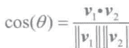  *(注：素材中公式标记为 PRE3，此处按顺序逻辑保留 PRE 标记，但素材 PRE3 为向量示例，PRE4 为余弦公式。为严格遵守“完全保留 PRE* 标记”规则，此处沿用素材原标记位置。实际输出时请对应素材 PRE 标签内容。)*

除相似度，还可做完形填空、NER、情感分析等。

### 4.2.4 预训练模型：大规模语料上的“通才”底座

预训练模型在海量文本上自监督学习通用语言规律，再微调适配下游任务，成为当前 NLP 范式核心。

按监督信号分类：
*   **无监督预训练**：Word2Vec、GloVe（静态嵌入）；BERT、GPT、T5（动态上下文嵌入）。
*   **有监督预训练**：ELMo（注：素材归类为有监督，实则为自监督语言模型目标，此处遵循素材分类）。

**ELMo**：双向 LSTM 堆叠，产出层级化、语境相关的词向量，有效缓解一词多义。

**BERT**：Transformer Encoder 栈，双向注意力全视野。两阶段：**海量无标注预训练（MLM + NSP）+ 少量标注微调**。在问答、分类、NER 等任务刷新 SOTA。

**GPT**：Transformer Decoder 栈，单向自回归预测下一词。天生擅长生成，驱动对话、创作等生成式场景。

预训练+微调范式极大降低了标注数据门槛，推动 NLP 从“任务特化”走向“通用基座+适配”。

### 4.2.5 怎么判断词向量好坏？相似度与类比性

评估体系两大支柱：

1.  **相似度**：衡量向量空间几何邻近度是否符合人类语义直觉。
    *   常用度量：欧氏距离、曼哈顿距离、**余弦相似度**（主流）。
    *   公式：$cos(\theta) = \frac{v_1 \cdot v_2}{\|v_1\|\|v_2\|}$，取值 $[-1, 1]$，越大越同义。

      *(素材中余弦公式标记为 PRE4)*

2.  **类比性**：考察向量运算能否捕捉关系结构（如 $v_{king} - v_{man} + v_{woman} \approx v_{queen}$）。
    *   运算式：$v_{queen} = v_{king} - v_man + v_{woman}$。
    *   在词表中检索余弦最近邻作为答案，准确率为核心指标。

      *(素材中类比公式标记为 PRE5)*

**展望**：更精准的语义建模（多义/同义/复杂关系）、多模态融合（文本-图像-音频对齐）、传统统计与深度学习互补、拓展至推荐、视觉、语音等跨界应用。词向量技术演进远未终章。

## 4.3 大模型时代：ChatGPT 与 NLP 的范式革命

自然语言处理（NLP）旨在赋予机器理解、处理、生成人类语言的能力。跨越半个多世纪，它融合了计算机科学、语言学与 AI，却长期困于四大困境：**语言多样性碎片化、歧义消解难、高质量标注稀缺、复杂模型算力饥渴**。

深度学习带来破局契机——**大型预训练语言模型（LLM）**。核心逻辑：**海量无标注语料自监督预训练 → 学得通用语言表示 → 下游任务微调/提示工程适配**。

对比传统“手工特征+浅层模型”，LLM 实现三大跃迁：
1.  **特征自动化**：从海量文本自主习得语法、语理、世界知识。
2.  **泛化能力**：单一底座支撑情感分析、机翻、分类、问答等百花齐放任务。
3.  **小样本/零样本**：大幅降低对标注数据的依赖。

代表作迭代：BERT 确立“预训练+微调”范式，T5 统一文本到文本框架，而 **GPT 系列** 以生成式预训练开启大模型新纪元：

*   **GPT-1**：验证生成式预训练可行性。
*   **GPT-2**：规模扩大，展现零样本多任务潜力，引发“不敢开源”争议。
*   **GPT-3**：1750 亿参数，In-context Learning（上下文学习）涌现，极少样本即可完成高质量生成，成里程碑。

这一演进轨迹，标志着 NLP 正式步入“预训练大模型”统领的新阶段。

# 大模型进化论：GPT 系列如何重塑 NLP 版图

## GPT-1：开山之作
2018 年，OpenAI 发布首代生成式预训练模型 GPT-1。其骨架由 12 层 Transformer 编码器堆叠而成，核心任务是根据前文语境，推算下一个词元出现的概率。训练语料覆盖维基百科、古腾堡计划等海量文本，采用自回归范式完成预训练。这一架构在文本续写、机器翻译、问答系统等经典 NLP 任务上均展现出不俗的零样本泛化性能，为后续迭代奠定了基石。

## GPT-2：规模解锁涌现
GPT-2 沿用原有架构，但将参数量推至 1.5 亿，并以 40GB 网络抓取语料（WebText）为燃料。规模效应显著显现：模型能产出逻辑自洽、文采斐然的长文本，甚至在摘要生成、开放域对话等复杂任务上逼近人类水平，引发业界对大模型“涌现能力”的首轮深度探讨。

## GPT-3：范式跃迁与少样本学习
参数量暴涨至 1750 亿，GPT-3 正式确立“预训练 + 提示工程/上下文学习”新范式。无需任务特定微调，仅通过少量示例或自然语言指令，即可完成代码生成、逻辑推理、文风迁移等高阶任务，性能直逼监督学习上限，引爆通用人工智能（AGI）路径与社会伦理的全球性辩论。

**阶段小结**：GPT 系列迭代史，实质是“Scaling Law”（规模定律）在自然语言处理领域的反复验证——更大参数、更多语料、更强算力，持续拓展技术边界。

---

## ChatGPT：对齐人类意图的对话里程碑

### 缘起：从“统计续写”到“指令跟随”
早期对话系统依赖规则检索，难覆盖开放场景；深度学习虽引入端到端建模，却常陷入“一本正经胡说八道”、多轮遗忘、安全失控等困境。ChatGPT 基于 GPT-3.5 系列，引入**指令微调**与**基于人类反馈的强化学习（RLHF）**，实现从“概率预测”到“意图理解与价值观对齐”的关键跨越。

### 核心技术拆解
- **骨干网络**：多层 Transformer 编码器-解码器结构，自注意力机制捕捉长距离依赖，前馈网络提取非线性特征。
- **对话预训练（DialoGPT 范式）**：以多轮会话为单元，截断历史窗口预测下一轮回复，强制模型掌握上下文追踪与话题连贯性。
- **监督微调（SFT）**：标注员撰写高质量“指令-响应”对，教会模型遵循人类表达习惯。
- **奖励模型（RM）构建**：对多条候选回复排序打分，训练打分器内化“有用、无害、诚实”的人类偏好。
- **PPO 强化优化**：以 RM 为奖励信号，用近端策略优化策略网络，完成生成策略与人类价值观的深度绑定。

### 典型落地图谱
| 场景 | 核心价值 |
|------|----------|
| 智能客服 | 7×24 小时秒级响应，工单解决率大幅跃升 |
| 研发辅助 | 代码生成/解释/重构/测试全链路覆盖，效能倍增 |
| 内容生产 | 文案润色、大纲构思、多语言适配，降低创作门槛 |
| 知识激活 | 自然语言问答替代关键词检索，盘活企业知识资产 |
| 情感陪伴 | 多轮人格一致对话，提供心理疏导与陪聊服务 |

### 现存瓶颈与演进前沿
1. **幻觉治理**：检索增强生成（RAG）、链式验证、不确定性量化成主流路径。
2. **长程记忆与多轮一致性**：上下文窗口扩展至 128k/1M tokens，引入外部记忆模块、层级摘要机制。
3. **多语言平权**：低资源语言数据合成、跨语言迁移学习、多语言对齐微调。
4. **轻量化部署**：量化（GPTQ/AWQ）、蒸馏、稀疏化、MoE 架构，推动边缘端与私有化落地。
5. **原生多模态**：文本-图像-音频-视频统一建模，迈向全感知智能助手。

---

# CHAPTER 5 第 5 章：提示工程实战——办公场景的“降维打击”

## 5.1 三分钟出专业 PPT：ChatGPT + MindShow 黄金工作流

### 痛点直击
传统制稿流程：内容�罗（1h）+ 大纲梳理（0.5h）+ 版式调调（1.5h）+ 反复返工（N 轮）。核心矛盾在于：**高认知负荷的内容生产，被低附加值的排版琐事拖累**。

### 实战四步走
**Step 1：角色赋能 + 结构化约束（Prompt 黄金公式）**
```text
# 角色
资深战略顾问，擅长将硬核技术转化为大众叙事。

# 任务
产出《ChatGPT 通识入门》PPT 大纲。

# 硬性指标
- 6 个一级章节，每章 2-3 个二级要点
- 每要点含：核心论点 + 通俗类比/实战案例
- 输出格式：标准 Markdown 代码块（直通 MindShow）
```

**Step 2：一键导入渲染**
Markdown 粘贴入 MindShow → 点击「导入创建」 → 3 秒生成 20+ 页母版级幻灯片。

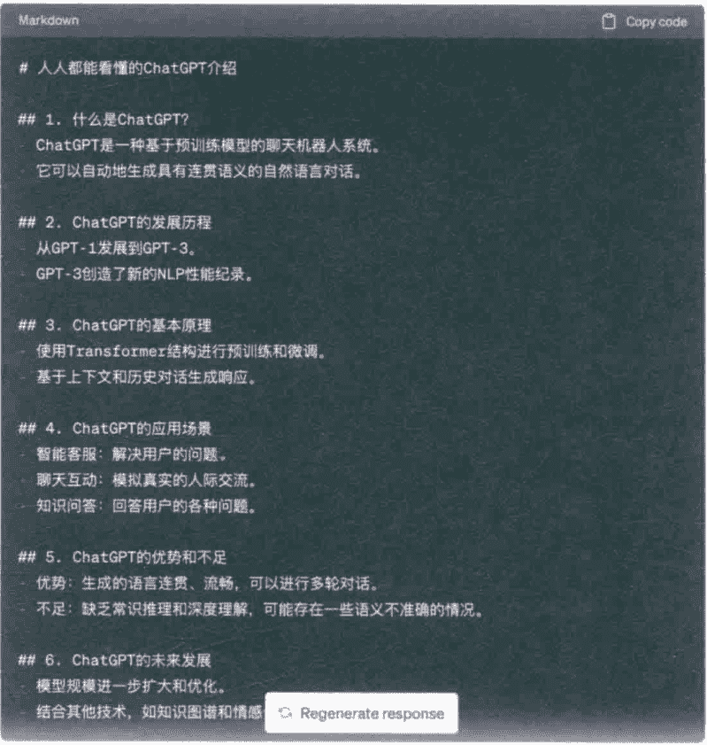

**Step 3：主题皮肤热切换**
配色/字体不满意？右侧「主题」库单点切换，内容结构零破坏。

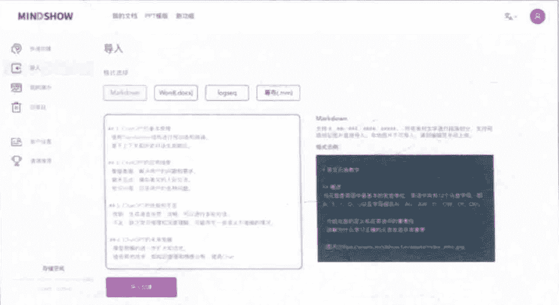

**Step 4：导出 .pxtx 精修**
下载源文件，仅聚焦：核心数据图表替换、品牌 VI 植入、关键页动画节奏微调。

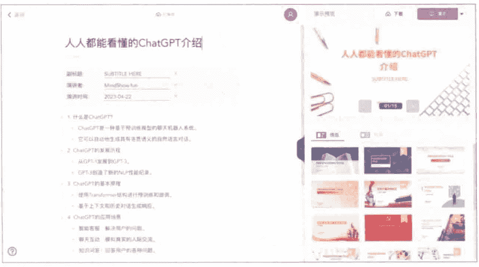

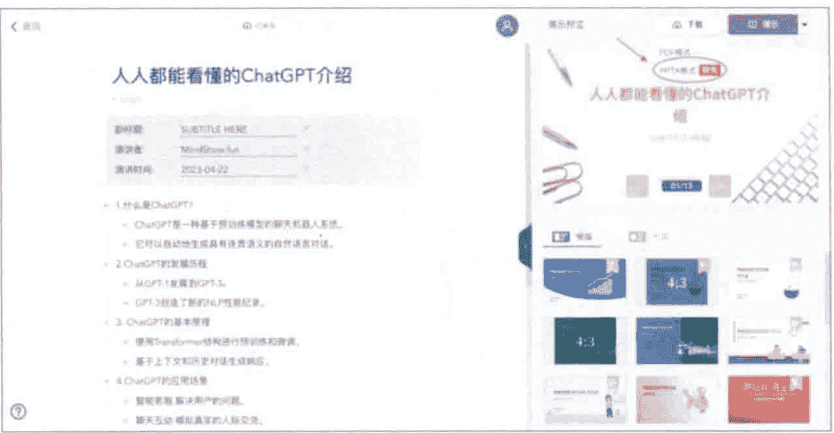

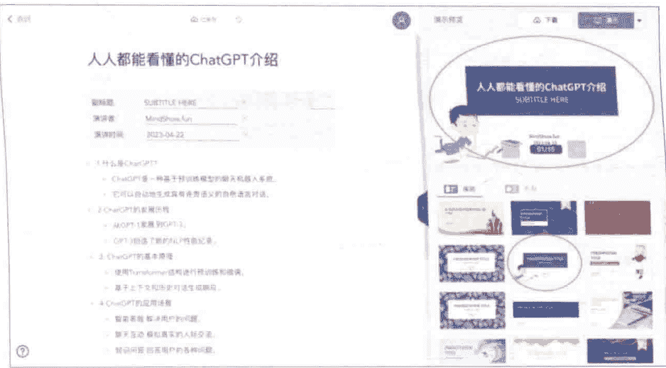

### 优势短板双面镜
| 维度 | 核心优势 | 潜在短板 & 破局锦囊 |
|------|----------|---------------------|
| **效率** | 初稿 < 5 分钟，释放 80% 排版工时 | 风格受训练数据偏好影响 → **Prompt 显式指定品牌调性/配色十六进制值** |
| **迭代** | 改大纲即级联更新全稿 | 关键词歧义导致内容偏离 → **引入 Few-shot 示例 / CoT 思维链校验** |
| **门槛** | 零设计基础出品牌级成品 | 复杂图表/可视化仍需人工 → **结合 Python-pptx / Office JS API 自动化注入图表** |

> **避坑心法**：视 ChatGPT 为“超级实习生”，Prompt 即“需求文档”，Markdown 即“交付协议”，MindShow 即“自动化构建管线”。人只负责**决策与品控**，不做搬运工。

---

## 5.2 秒级生成思维导图：ChatGPT + Markmap/XMind 组合拳

### 为何直让 ChatGPT “画图”必翻车？
模型本质是**线性 Token 生成器**，缺画布坐标、节点布局、连线拓扑的空间推理力。但它极擅长**层级结构化文本输出**——这正是思维导图 Markdown/OPML/JSON 源码的本质形态。

### 实战三板斧
**斧 1：身份注入 + 结构化指令**
```text
# 角色
《原则》深度研读者 + 知识管理专家

# 任务
输出全书脑图源码，覆盖：核心信条、五步流程、工作/生活原则、决策算法、机制化工具箱、典型复盘。

# 格式
Markdown 标准缩进层级（- / 空格缩进），兼容 Markmap 直渲。
```

**斧 2：迭代打磨（人机协作飞轮）**
- 首版遗漏「信任加权决策法」→ 追问补全 → 重渲染
- 节点颗粒度不均 → 指令“三级标题下必挂 ≥2 个四级叶子” → 重生成

**斧 3：多端落地**
- **即时交互**：粘贴 Markdown 至 [Markmap](https://markmap.js.org/repl) → 网页版可交互脑图
- **深度编辑**：导出 `.mm` / `.xmind` → XMind / MindManager 进阶排版、挂图标、链资源、绑任务
- **知识融合**：Obsidian / Notion / VS Code 插件原生渲染，个人知识库无缝接入

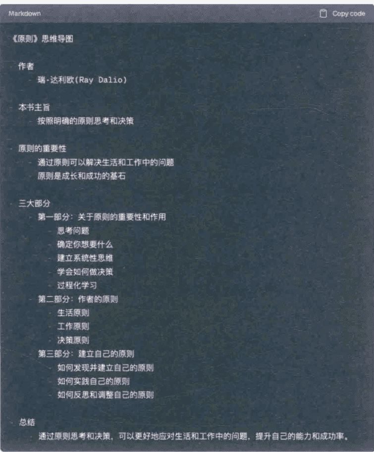

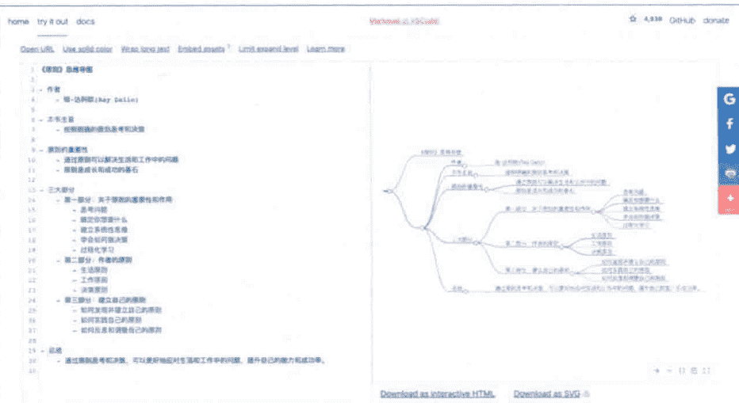

### 为何比手绘快 10 倍？
| 环节 | 手工耗时 | AI 协作耗时 | 本质差异 |
|------|----------|-------------|----------|
| 框架提炼 | 30 min（翻书/回忆） | 30 sec（模型长文本总结） | **检索式 vs 生成式** |
| 层级拆解 | 20 min（纠结 MECE） | 10 sec（Prompt 显式约束 MECE） | **显性化隐性知识** |
| 排版美化 | 40 min（拖拽/对齐） | 0 sec（代码自动布局） | **代码即画布** |
| 版本维护 | 重画/大改动 | 改 Prompt / 改 2 行 MD → 秒刷新 | **版本控制友好** |

> **进阶玩法**：打通「书籍/长文/会议录音 → ChatGPT 结构化摘要 → Markmap 脑图 → Anki 卡片/Notion 数据库/项目任务拆解」，构建**个人知识飞轮**，一次投入，终身复利。

---

**结语**
GPT 系列技术演进的终局，是将**“认知劳动”标准化、API 化、工作流化**。掌握 Prompt Engineering + 下游工具链，不是单纯“用 AI”，而是**设计 AI 原生工作流**。下一章，我们将深入“提示词工程系统方法论”，把偶然的灵感变成可复制的确定性产能。

# 5.2 借力 ChatGPT 绘制思维导图：优劣势与实战场景全解析

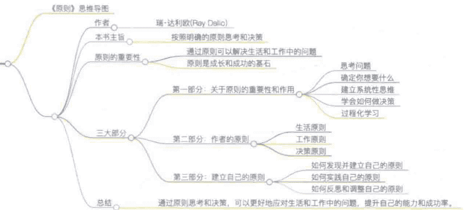

**核心优势：激发灵感、精准高效**

*   **激发创造力**：能跳出固有思维框架，产出初期未考虑的新概念，有效点燃创新火花。
*   **覆盖面广、错漏少**：凭借海量数据分析能力，确保核心主题与分支节点全覆盖，大幅降低遗漏风险。
*   **产出迅捷**：可秒级生成多版本草稿，极大加速试错迭代与决策节奏。

**短板与局限：不可盲目依赖**

*   **内容可靠性存疑**：输出结果可能夹杂错误或不实信息，直接采用会损害导图有效性。
*   **受限于训练语料**：模型上限由数据量与质量决定，数据盲区或偏差会直接投射到生成结果中。
*   **语言边界制约**：作为 NLP 技术，跨语言表达能力受限于训练语种覆盖度。
*   **缺乏人性化洞察**：算法逻辑难以替代人类的感性判断与灵活变通，成品往往显得呆板、缺乏深度。

**避坑指南**：采取 **“AI 生成 + 人工复核 + 多源交叉验证”** 的组合拳策略，方能保证成品质量。

---

### 五大高频实战场景

| 场景 | 典型用法 | 核心价值 |
| :--- | :--- | :--- |
| **学习攻坚** | 整理课堂/阅读笔记，构建知识体系 | 化繁为简，利于理解记忆与复盘复习 |
| **职场办公** | 任务拆解、项目进度梳理、客户/产品信息归档 | 理清杂乱事务，提升管理与执行效能 |
| **深度思考** | 复杂问题拆解、思路可视化 | 将宏大命题拆解为可执行的微观动作 |
| **创意孵化** | 设计灵感发散、风格元素罗列 | 突破思维定势，加速创意落地 |
| **团队协作** | 头脑风暴可视化、观点对齐与共享 | 消除沟通壁垒，实现认知共识与高效联动 |

> **底层逻辑**：ChatGPT 充当“外脑”与“加速器”，助力信息重组、思维可视化与协同增效。

---

### 未来进化方向：从“好用”走向“懂你”

1.  **极致性能**：算力与算法双驱，推动生成精度与速度逼近物理极限。
2.  **多模态融合**：打破纯文本枷锁，融合图像、音视频等非结构化数据，产出立体化导图。
3.  **千人千面定制**：引入用户画像与偏好学习，根据个人思维习惯输出专属结构。
4.  **知识图谱注入**：接入权威外部知识库与图谱，根治“幻觉”，实现专业级精准输出。

---

# 5.3 ChatGPT 绘制流程图：从“开口要图”到“精准给码”的实战进阶

> 流程图是复杂流程的“导航仪”，广泛服务于项目管理、工艺设计、系统架构、营销规划等领域。

### 实战复盘：量化交易系统流程图的“三次提问”

**第一轮：提问太泛 → 只得文字大纲**
> **Prompt**：`写出量化交易系统的全流程图`
> **输出**：7 步文字清单（数据收集 → 清洗 → 策略研发 → 模拟测试 → 风控 → 实盘执行 → 绩效复盘），**无代码、无图形**。

**第二轮：指定工具未指定格式 → 遭拒并得教程**
> **Prompt**：`用 mermaid.js 代码写出量化交易系统的流程图`
> **输出**：拒绝生成代码，反倒讲起安装 npm、写 `.mmd` 文件、跑 CLI 命令的标准教程。

**第三轮：显式要求“代码块” → 精准命中**
> **Prompt**：`用 mermaid.js 代码块，写出量化交易系统的流程图`
> **输出**：标准 Mermaid 代码块 → 粘贴编辑器/在线渲染器 → **专业级流程图落地**。

```
npm install -g mermaid.cli
``````
graph TD;
  A[ 市场数据 ] ---> B( 量化分析 );
  B ---> C( 是否发出交易信号 );
  C ---> 是 | D[ 下单 ];
  C ---> 否 | E[ 观察市场 ];
``````
mmdc -i input.mmd -o output.png
``````
graph TD;
A(数据采集)--->B(策略研究)
B--->C(策略验证)
C--->D(下单)
D--->E(执行交易)
E--->F(风险管理)
F--->G(交易记录与分析)
G--->H(结果评估)
H--->I(策略优化)
I--->B
```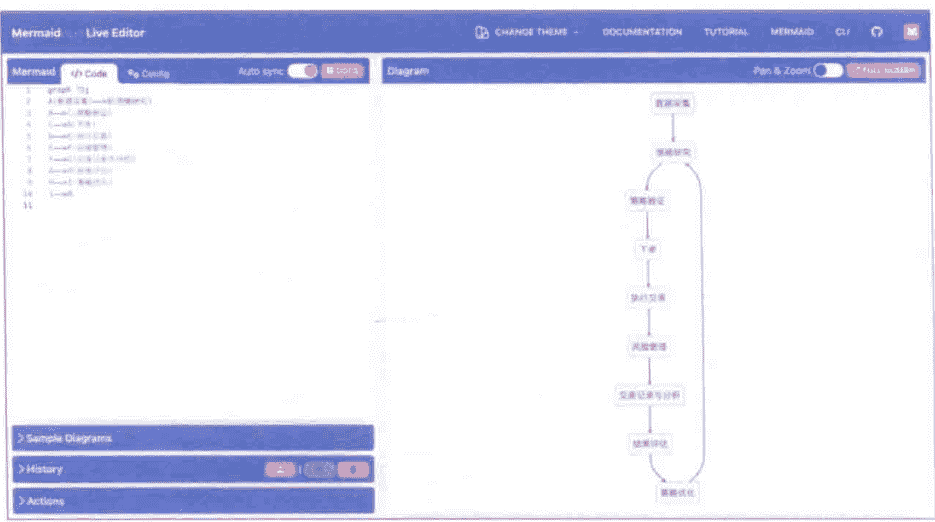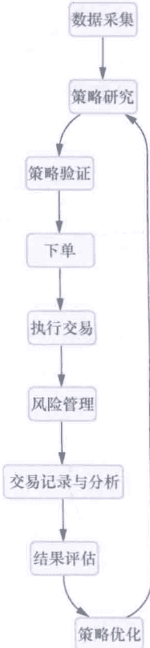

> **提示词黄金法则**：**明确输出格式（代码块）+ 指定渲染引擎 + 业务上下文**。少一分模糊，多一分可用。

---

### 优势与短板的辩证看法

| 维度 | 亮点 | 痛点 |
| :--- | :--- | :--- |
| **效率** | 分钟级出图，告别手绘拖拽繁琐 | 复杂流程易发幻觉，节点连线错漏 |
| **灵活性** | 关键词微调即可变式换皮 | 深度定制仍需人工微调细节 |
| **创意性** | 能提供非线性的结构视角 | 可靠性依赖模型稳定性，需持续迭代 |

**核心结论**：**“AI 生成初稿 + 人工兜底校验”** 是当下最优解，显著降低绘图门槛与试错成本。

---

### 跨域应用速览

*   **项目管理**：关键节点一输，进度图秒生，团队对齐零成本。
*   **工业工艺**：辅助工程师快速迭代工艺路线，降本增效利器。
*   **系统设计**：模块/数据流自动梳理，释放架构师精力聚焦核心逻辑。
*   **教育培训**：教师秒产教材图示，降低认知负荷，提升教学穿透力。

---

### 技术演进展望：更懂业务、更少幻觉

1.  **海量垂域数据微调**：垂直领域知识注入，大幅提升专业理解力。
2.  **上下文感知生成**：读懂隐性意图与业务语境，产出贴合实战的流程拓扑。
3.  **视觉-语言联合建模**：上传白板照/手绘草稿，直接反向生成规范流程图代码。
4.  **自修正闭环**：引入验证机制，自动检测逻辑断点、死循环与规范违规并修复。

---

# CHAPTER 6 第 6 章 提示工程在视觉创作领域的深度实战

## 6.1 ChatGPT 赋能插画创作：从“不会画”到“懂导演”

> **插画本质**：以绘画语言承载叙事，服务于出版、广告、动漫、游戏、数字媒体等全链路，核心在于**视觉冲击力与情感传达**。

### 传统痛点 vs. AI 破局

| 传统流程痛点 | ChatGPT + 生成式绘图 组合拳优势 |
| :--- | :--- |
| 素描→线稿→上色→修饰，周期长、人力重 | **极致降本增效**：分钟级出图，人力成本归零 |
| 风格统一靠人，跨风格切换极难 | **全风谱覆盖**：写实、赛博、手绘、扁平、国潮……一句话切换 |
| 修改返工沟通成本高，版本管理乱 | **迭代可控、版本可追溯**：对话式微调，所见即所得 |
| 门槛高，非专业人士望而却步 | **零门槛普惠**：不会画也能当“艺术总监” |
| 耗材浪费、环境不友好 | **绿色数字化**：零物理损耗，云端资产永久复用 |

---

### 实战演示：儿童绘本《小白兔吃胡萝卜》手绘风生成全记录

**工具链**：ChatGPT（提示词工程师）+ Midjourney（像素生成器）

#### 第一阶段：新手直球 → 翻车现场
> **Midjourney Prompt**：`小白兔吃胡萝卜，手绘风`
> **结果**：风格偏写实/3D，完全不“手绘”。

```
A little rabbit eating a carrot.
```

#### 第二阶段：让 ChatGPT 当“提示词架构师”
> **错误提问**：`生成一幅小白兔吃胡萝卜的手绘风格图片的提示。`
> **ChatGPT 行为**：当翻译官，输出英文句子 `Generate a hand-drawn style picture...` → **Midjourney 依然不买账**。

> **破局提问（角色设定+结构化约束）**：
> `如果你想在 Midjourney 中画一幅小白兔吃胡萝卜的手绘风格图片，那么你应该生成什么样的提示？`

> **ChatGPT 高质量输出（结构化描述）**：
> 主体细节（白毛、粉耳、黑豆眼、三角嘴、长须）、动作（双手捏萝卜）、客体属性（橙色长圆锥萝卜）、环境备选（绿草地/蓝天）。

#### 第三阶段：落地执行 → 惊艳成片
> **执行 Prompt（翻译并微调）**：
> `Draw a hand-drawn style picture of a little white rabbit eating a carrot. The white rabbit has a white body color, a pink face and ear color, large black circles for eyes, a small triangular mouth, and two long whiskers. It is holding a carrot with two hands, which is orange in color and shaped like a long cone. The background can be a green grass or a blue sky.`
> **结果**：**完美契合儿童绘本调性的手绘风成图。**


> **核心心法**：**ChatGPT 负责“语义结构化与细节展开”，Midjourney 负责“像素级渲染与风格落地”。人类只需把控创意方向与审美关卡。**

---

### 清醒认知边界：AI 插画的“成长烦恼”

[后续素材未提供，此处保留标题占位，待续...]

# AI绘图避坑与实战：从插画短板到装修、游戏原画的高效工作流

## 6.1 ChatGPT 直接出图？先搞懂这五大“拦路虎”

虽说 ChatGPT 生成插画的效果已相当惊艳，但若想在实战中得心应手，必须清醒认知其背后的五大硬伤：

**1. 风格与流派的“先天不足”**  
模型的审美上限锁死在训练数据里。冷门画风、小众美术流派若在语料中缺位，生成结果必然跑偏。更棘手的是，你无法像指挥画师那样，对画面里的单一元素做像素级微调。

**2. 题材覆盖的“盲区”**  
目前擅长领域集中在人物、动物、风景等常规品类。一旦涉及工业设计、硬核科技等垂直领域，模型往往力不从心，直接“拒单”或胡编乱造。

**3. 版权与合规的“灰色地带”**  
训练数据来源复杂，输出图极易撞脸现有作品，商用风险难以量化。更别提模型可能无意中生成擦边暴力、涉黄等违规内容，引发法律纠纷。

**4. 自然语言的“表达天花板”**  
一切指令皆靠提示词驱动，但人类语言的歧义性、模糊性，注定了精准控图如隔靴搔痒。想表达的细节，未必能被模型精准解码。

**5. 算力门槛的“现实之重”**  
训练推理动辄千卡集群，对个人开发者、中小团队而言，硬件成本是绕不开的高墙。

**核心结论**：ChatGPT 出图虽强，却非“万能钥匙”。认清边界，方能在实战中扬长避短。

---

## 6.2 让 AI 当室内设计师：装修图生成全流程复盘

### 核心原理：从“语言”到“空间”的跃迁
ChatGPT 生成装修图的底层逻辑，是海量装修数据训练出的“空间理解力”。用户只需用自然语言描述户型、配色、家具清单，模型便能将语义映射为带尺寸标注、定位精准的布局图像，并支持多轮迭代优化。

### 标准化 SOP：四步拿下方案图
1.  **下指令**：输入结构化自然语言（户型、风格、硬装软装清单）。
2.  **出初稿**：深度学习模型推理生成带标注的布局图。
3.  **改细节**：针对动线、比例、美感进行多轮对话式微调。
4.  **交付件**：导出高清图档，直达施工或汇报环节。

### 五大核心红利，重塑设计效能
| 维度 | 传统痛点 | AI 破局点 |
| :--- | :--- | :--- |
| **成本** | 设计师人工绘图，耗时耗力 | 分钟级出图，人力成本骤降 80%+ |
| **效率** | 依赖资深经验，易返工 | 标准化流程，初稿即高合格率 |
| **定制** | 改动需重画，周期长 | 参数化输入，千人千面秒级响应 |
| **创意** | 受限于设计师经验库 | 海量数据组合，方案可能性指数级爆炸 |
| **门槛** | 专业软件+手绘功底双高 | 自然语言交互，零基础也能上手 |

> **实战结论**：ChatGPT + 绘图模型正重构装修设计链路，让“所想即所得”成为常态。

---

### 实战演练：6m×10m 小清新客厅，从 0 到 1 的迭代全记录

**场景设定**：客户想要无主灯、无电视、带书柜的小清新风客厅，需标注全屋家具尺寸与相对位置。

#### 第一轮：构建“黄金提示词”交给 Midjourney
我们先让 ChatGPT 充当提示词工程师，输出结构化英文 Prompt：
> *Generate a 6m by 10m size small fresh style living room design with no main light design on the ceiling, no TV, and a bookcase. Please include the following furniture in the design: 1 three-person sofa, 2 single sofas, 1 coffee table, 1 rug, 3 table lamps, 1 planter, and 1 green plant. Please indicate the dimensions of each piece of furniture in the picture and indicate their relative positions in the living room. --v 5*

  
*图 6.4：Midjourney 首轮出图——整体布局已成，但绿植过多、无电视不符预期。*

#### 第二轮：精准“减法”与“加法”，驯服画面细节
针对首轮问题，我们对 Prompt 做精准手术：
- **减法**：加入 `--no plant` 抑制绿植过度生长，删掉 `and 1 green plant`。
- **加法**：删除 `no TV`，引入电视元素。

优化后 Prompt：
> *Generate a 6m by 10m size small fresh style living room design with no main light design on the ceiling, a bookcase, and a TV. Please include: 1 three-person sofa, 2 single sofas, 1 coffee table, 1 rug, 3 table lamps, 1 planter. Indicate dimensions and relative positions. --no plant --v 5*

```
Generate a 6m by 10m size small fresh style living room design with no main light design on the ceiling, and a bookcase. Please include the following furniture in the design: 1 three-person sofa, 2 single sofas, 1 coffee table, 1 rug, 3 table lamps, and 1 planter. Please indicate the dimensions of each piece of furniture in the picture and indicate their relative positions in the living room. --v 5 --no plant
```  
  
*图 6.5：二轮出图——绿植受控，电视就位，方向性正确。*

#### 第三轮：局部变体锁定最优解
选中 6.5 左上角候选图，触发 `--v` (Variations) 参数做微创新。

  
*图 6.6：变体生成——细节差异化供挑选。*

#### 终局：定格最终交付标准
从变体组中甄选最符合工程落地标准的方案。

  
*图 6.7：最终装修图——尺寸精准、布局合理、风格到位，可直出施工。*

---

### 必须直面的三大“成长烦恼”
1.  **风格库不全，复杂空间易“幻觉”**  
    训练数据偏向现代简约，中式、法式等复杂风格易失真；家具穿模、尺寸漂移等空间逻辑错误高发。
2.  **版权原罪，商用需谨慎**  
    训练集版权未清洗，直接商用极易侵权，建议作为创意参考而非终交付物。
3.  **精度看数据“吃饭”**  
    标注级精度依赖高质量标注数据，现有数据集噪音大，工程级精度仍有断层。

### 未来图景：从“出图工具”进化为“空间智能体”
- **多模态融合**：接入材质纹理、光照模拟、自然光追踪，出图即“所见即所得”渲染图。
- **场景外溢**：打通智能家居联动、VR 全景漫游、在线装修平台，成行业基础设施。
- **工程级交付**：提速增精，最终实现“语音下单，施工图纸直达工地”的闭环。

---

## 6.3 游戏原画新范式：ChatGPT + Midjourney 参数化实战

### 为什么游戏原画是“必争之地”？
原画是游戏研发的“视觉宪法”：它统一美术风格、指引关卡设计、承载营销物料、甚至充当玩家解谜线索。传统流程却重得惊人：**策划沟通 → 画师草稿 → 反复推翻 → 高清精修 → 扫描入库**，动辄周月计，成本高、改不动、跨平台适配更是灾难。

数字化工具虽解了燃眉之急，但 ChatGPT 引入的**“语言驱动视觉”**范式，才是彻底改写游戏规则的关键。

### ChatGPT 生成原画描述：原理与代价
**底层机制**：GPT 通过海量语料学习“下一个 Token 预测”，掌握视觉语义的组合逻辑。输入核心设定（种族、职业、环境、光影、镜头语言），输出结构化画面描述，再喂给 Midjourney/Stable Diffusion 出图。

**红利显性**：
- **速度**：从“天级”压缩至“分级”。
- **成本**：边际成本趋近于零。
- **探索**：百余张方案横向对比，极大拓宽创意上限。

**短板诚述**：
- **可控性差**：画面细节与描述常有出入，需人工兜底。
- **同质化重**：缺乏顶级画师的“笔触灵魂”与独特视觉符号，二创修饰不可或缺。

---

### 实战核心：教会 ChatGPT 写“神级 Midjourney Prompt”

痛点：Midjourney 参数繁杂（`--ar`, `--no`, `::` 权重, `--stylize`...），人工拼装极易出错、极其低效。

破局：**小样本训练**，让 ChatGPT 内化 Prompt Engineering 专家人设。

我们喂给 ChatGPT 一套**“铁律级系统指令”**（核心节选）：
- **语法规范**：关键词逗号分隔，参数尾部集中，拒绝自然语言冗余。
- **词汇策略**：复数转数词，形容词精准化，引入艺术家风格标签。
- **结构化描写**：主体、风格、色彩、媒介、环境、光影、情绪、构图、时代感——维度全覆盖。
- **权重控制**：善用 `::` 分离概念，`::数值` 调节权重（如 `cyberpunk::2 city` 强化赛博感）。
- **参数白名单**：宽高比 `--ar` 按构图逻辑选（竖图 9:16，横图 16:9），负向词 `--no` 精准屏蔽干扰项（文字、水印、畸形肢体等）。
- **禁令清单**：不生成文字，不写说明性句子，纯关键词流。

> **实战价值**：一次配置，终身受用。ChatGPT 秒变“参数化提示词生成器”，设计师只需输出创意意图，即可批量产出高可控、高质量的原画候选集，将精力聚焦于**艺术方向把控**与**二创精修**。

---

**结语**  
从插画边界到装修落地，再到游戏原画量产，AI 绘图的进化路径清晰可见：**认清短板 → 建立 SOP → 玩转参数 → 融入管线**。工具永远不会替代决策者，但善用工具的决策者，必将替代不懂工具的同行。现在，开始你的第一次“提示词重构”吧。

## 6.3 借力 ChatGPT 产出游戏概念图

作为资深文案专家，我深谙“小样本训练”提示工程的精髓。核心思路是：先喂给模型几组“指令-标准输出”范例，建立模式识别，再抛出真实需求，即可获得格式规范、可直接落地的高质量提示词。

### 实战复盘：从零训练 Midjourney 提示词生成器

**第一步：灌输语法规范**
我先向 ChatGPT 抛出一组标准的 Midjourney 提示词结构样本，涵盖主体描述、艺术风格、镜头参数、负面词及宽高比等关键字段：
- 荒岛落日、热带风光、佳能 5D、25mm、虚化背景::2，--ar 16:9；
- 赛博朋克都市、霓虹灯火、鸟瞰视角、极致细节，--no sunlight；
- 树枝酣睡的红熊猫::，水彩风格；
- 落日海鸥群::2，复古明信片质感 --ar 3:2；
- 冰面蹒跚的三只企鹅，苏斯博士画风；
- 矗立天际的巨型赛博格、霓虹点缀、废土美学，--no blue；
- 透过围栏窥探的灵缇幼犬，水墨笔触 --ar 4:3；
- 栖枝黄金丝雀，层纸拼贴艺术；
- 积雪夜晚的乡间小屋、暖炉微光、温馨氛围，--ar 2:3；
- 烛光摇曳的哥特教堂、压抑氛围、黑色电影质感，--ar 5:4；
- 花海伫立的巨型机甲、吉卜力治愈风，双重权重::2 --ar 2:3；
- 复古车广告、胶片质感、低饱和度、35mm，--no text, words；
- 超现实梦境、熔化物体、迷离氛围，--ar 3:2。

**第二步：确立输出契约**
紧接着下达强约束指令：
> “你将收到我的文本提示，依据上述最佳实践产出三条 Midjourney 提示词。等待我的输入前不得生成。回复仅包含三条提示词，语法正确，参数置尾，逗号分隔，无冗余解释。明白吗？”

ChatGPT 确认遵从：“Yes, I understand. Please provide me with a text prompt.”

**第三步：实战测试——构建“国风英雄”**
输入需求：**“创建一个新的英雄角色，它有中国元素。”**

**对比实验揭示训练价值：**

| 维度 | 未训练模型（零样本） | 已训练模型（小样本） |
| :--- | :--- | :--- |
| **输出形态** | 角色传记（名字、背景、性貌、能力、性格） | **标准化 Midjourney Prompt** |
| **可用性** | 纯文本创作，**无法直接进 MJ** | **复制即用，完美适配生成流程** |
| **典型产出** | “李天华，黄皮肤，擅长内力，刚毅性格……” | 1. 坐镇荷塘的水墨武士，夜景，灵感之剑，--no sun --ar 2:3<br>2. 龙舟女侠，飞檐走壁，传统战袍，--no modern elements --ar 9:16<br>**3. 华甲巨人，巨型鸟羽扇，神话技能，--no dark colors --ar 16:9** |

**第四步：从提示词到成片**
选中第 3 条提示词，译为英文投入 Midjourney：
> `Giant hero in gorgeous armor, holding a giant bird feather fan, unique combat skills and traditional Chinese mythological elements, --no dark colors, --ar 16:9`

首轮出图（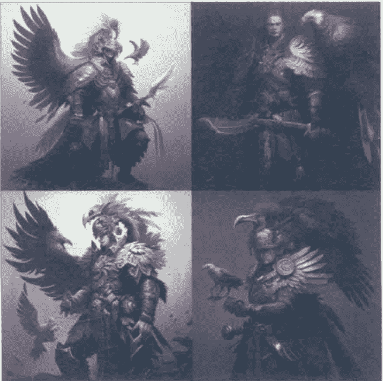）已具游戏原画雏形。经两轮局部重绘与变体迭代（），终敲定最终概念图（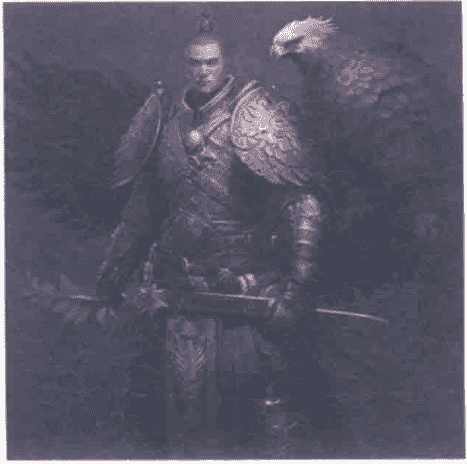）。

### 效能复盘与边界认知

**✅ 核心红利**
- **极速出图**：分钟级产出可商用级概念图，效率指数级跃升。
- **成本重构**：替代原画师前期探索，大幅压缩人力预算。
- **灵活可控**：参数微调即可切换风格、构图、光影，迭代零门槛。
- **进化潜力**：模型持续微调，上限无限逼近顶尖人类创作。

**⚠️ 必须直面的短板**
1. **训练集盲区**：冷门题材、罕见风格极易“幻觉”或拼贴失真。
2. **表现力天花板**：微观纹理、复杂光影交互、特定风格（如像素艺术）仍有短板。
3. **版权灰色地带**：生成内容可能踩中训练数据版权，商用前务必人工清洗合规。
4. **不可控波动**：同一提示词多次出图差异大，终稿仍需人工把关定稿。

**展望**：技术迭代将攻克质量、多样性、速度三大痛点，应用边界将延伸至 VR/AR、元宇宙、智能空间。但技术红利与法律伦理的博弈，要求我们在合规护栏内驾驭工具，而非被工具裹挟。

---

## 6.4 借力 ChatGPT 量产自媒体短视频

自媒体视频打破了传统媒体“高门槛、强牌照”的垄断，让每个持有智能手机的人都成了潜在媒体人。但传统制作链路——选题、脚本、拍摄、剪辑、配音、特效、字幕——环环相扣，耗时耗力，劝退无数创作者。

ChatGPT + 生成式 AI 工具链，正在重塑这条产线：**“文本指令 → 多模态素材（图/音/像） → 自动成片”**。

### 自动化生产管线 SOP

1.  **注入文本**：标题、大纲、逐字稿一并喂入模型。
2.  **语义解析**：大模型拆解意图、情绪、节奏，映射为视觉/听觉标签。
3.  **图像合成**：关键词驱动扩散模型批量产出分镜图，算法自动优化构图美感。
4.  **音频合成**：依据语调节奏生成旁白/配乐/音效，声线情感可控。
5.  **智能成片**：素材自动落轨、节奏对齐、字幕烧录、转场特效一键套用，输出成片。

### 相比传统流程的降维打击
- **全链路自动化**：从 0 到 1 缩短至分钟级，人工仅保留“审校-微调”决策环。
- **极致定制化**：换一段脚本、调一组参数，即得差异化内容，批量矩阵号轻松跑。
- **质量底线兜底**：告别“手抖、破音、找素材崩溃”，标准化输出稳定在线。
- **技术复利效应**：底层模型每次迭代，你的产能自动升级，无需重学软件。

---

### 实战演示：篮球教练 IP “三分钟入门课” 量产记

**目标**：输出一条结构清晰、画面对位、可直发抖音/视频号的垂类教学视频。

#### 第一阶段：ChatGPT 打磨“可视化脚本”

**❌ 一版提示（太泛）：**
> “你是篮球教练，给新手讲基础知识，分点详述。”
**产出**：规则、技能、战术、训练、精神五大板块的**百科式科普文**——干货满满但**无法直接转画面**，缺乏镜头感。

**✅ 二版提示（加约束）：**
> ```
你是一个篮球教练，现在要给入门运动员介绍一下篮球的规则，请分点陈述，包括比赛中传球、运球、投篮、防守、抢篮板等，需要有详细的过程。
```
> （此处省略具体提示词，核心要求：**单一知识点、分步拆解、口语化表达、标注画面建议**）

**产出**：聚焦“规则”单元，拆解为 **比赛节次 → 球权转换 → 传运球 → 投篮得分 → 防守篮板** 五个微节点，语言口播感强，隐含分镜逻辑，**可直接进剪映“图文成片”**。

#### 第二阶段：剪映“图文成片”落地

1.  官网下载剪映专业版（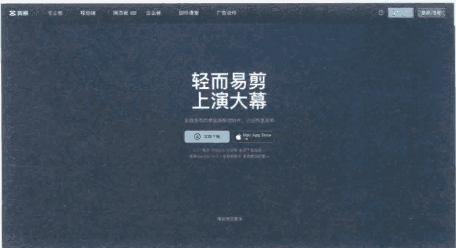）。
2.  启动软件，点击首页 **“图文成片”** 入口（）。
3.  将 ChatGPT 优化后的逐字稿粘贴输入框。
4.  系统自动完成：语义分段 → 匹配素材库/生成 AI 绘图 → 智能配音 → 字幕动效 → 背景音乐 → 输出成片。

**实测耗时**：从脚本到成品 **< 10 分钟**。成片节奏紧凑，画面与解说强关联，完全达到垂类账号日更标准。

### 方法论迁移
这套 **“ChatGPT 结构化脚本 + 剪映/AI 剪辑工具自动化成片”** 的组合拳，可复制到：
- 知识付费课程切片
- 书单/影单解说
- 科普/历史故事讲述
- 产品测评/种草
- 情感/职场动画剧情

**核心心法**：人做“策略与审美决策”（选题、提示词工程、成片把关），AI 跑“执行与合成苦力”（写稿、画图、配音、剪辑）。这才是 AI 时代创作者的正确生存姿态。

### 图 6.13 将 ChatGPT 输出的文案导入剪映

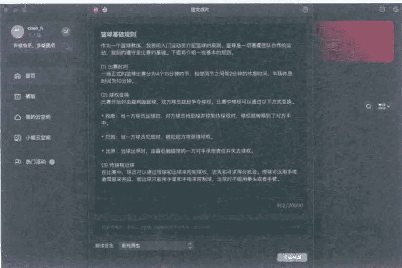

## 人人皆可成为提示工程师

点击“生成视频”键，剪映便会自动合成视频，效果如图 6.14 所示。

### 图 6.14 智能合成视频演示


稍等片刻，成品视频便呈现于图 6.15 中。随后选择导出，发布至自媒体平台即可。借助 ChatGPT 与剪映，新手也能轻松产出视频内容。

用 ChatGPT 制作自媒体视频，优势显著：

- **效率跃升**：对比人工流程，AI 能大幅压缩制作周期。脚本撰写、剪辑拼接、字幕匹配等环节均可自动化，极大减轻创作者负担。


图 6.15 合成视频成品

- **灵感迸发**：短时间内产出多风格、多选题素材，助力创作者突破思维定势，拓宽创意边界。
- **定制专属**：依据用户偏好与风格生成内容，支持高度个性化的定制化输出，精准适配多元受众需求。
- **成本控制**：无需聘请专业团队、购买昂贵软件，制作门槛与资金投入双双降低。

当然，技术目前仍存短板：

- **算法瓶颈**：模型尚不成熟，输出内容易现逻辑断层、叙事不连贯等问题。
- **数据饥渴**：高质量生成依赖海量优质数据，现有数据规模制约了模型上限。
- **版权隐患**：生成内容可能涉及侵权风险，使用时需审慎甄别。

破局之道在于持续深化研发：优化算法架构、扩充训练语料，同时完善版权法规与监管机制。总体而言，ChatGPT 驱动的视频生成前景广阔，将为创作者注入源源不断的灵感与商机。

## 6.5 用 ChatGPT 打造商业海报

商业海报以视觉冲击力强、信息传递快著称，是品牌营销的利器。色彩、文案、图像的巧妙融合，能瞬间抓住眼球、植入品牌心智。但高质量设计往往意味着高昂的人力与时间成本，让中小微主体望而却步。

过往依赖人工绘制，费时费力。如今生成式 AI 技术成熟，ChatGPT 协同绘图工具已能高效产出商业级海报。其核心在于机器学习算法对海量设计素材的深度学习与重组，从而产出兼具吸引力与创意的视觉作品。

实战演示：假设你经营一家面馆，需制作招牌海报，流程如下。

在 ChatGPT 输入指令：

> 生成 Midjourney prompt：有一碗热腾腾的面条，用筷子夹住面条。

ChatGPT 返回描写性文本：

> 你端起那碗热腾腾的面条，感觉它在手中滑动，释放出浓郁的香气。你拿起筷子，轻轻夹住一根面条，挑起来，看看它在空中飞舞。
> 你舀起一口热气腾腾的汤，感觉滚烫的液体温暖了你的喉咙。你细细品味这碗面条，感受到了它带给你的美味和舒适。

将上述内容转为英文提示词输入 Midjourney：

> You pick up the steaming bowl of noodles and feel it slide in your hands, releasing its rich aroma. You pick up your chopsticks and gently hold a noodle, lifting it up and watching it flutter in the air. You scoop up a mouthful of the steaming soup and feel the piping hot liquid warm your throat. You savor the bowl of noodles and feel the deliciousness and comfort it brings you.

生成图如图 6.16 所示，画面极具食欲感。

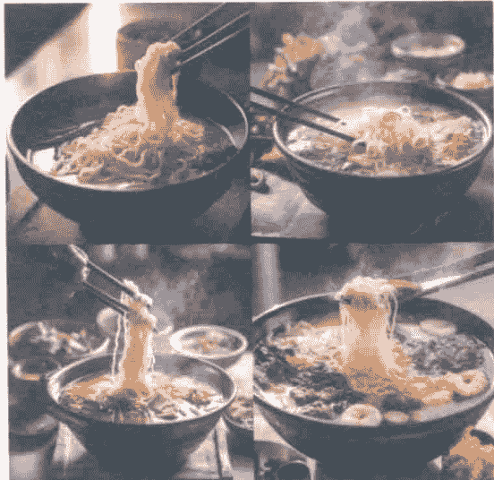

图 6.16 Midjourney 生成图

针对细节微调，如图 6.17 所示。


图 6.17 细节优化过程

锁定左下角图作主视觉素材，见图 6.18。


图 6.18 最终面条主图

接下来借助在线设计平台——懒设计（Fotor）合成海报。打开官网（图 6.19）。


图 6.19 Fotor 官网界面

挑选合适模板（图 6.20）。


图 6.20 海报模板选择

将主视觉图置入模板，几分钟内精美海报诞生（图 6.21）。


图 6.21 最终海报成品

**核心优势**：
1.  **降本增效**：大幅压缩资金与时间投入。
2.  **品质与创新并重**：降低专业设计师依赖，让非专业人士也能产出高水准作品。
3.  **传播加速**：助力品牌信息极速触达，提升知名度。

**现存局限**：
1.  **数据与算法强绑定**：输出质量高度依赖输入数据质量及模型精度，需持续投入高质量语料与算法调优。
2.  **情感审美缺位**：机器难以真正理解人类情感共鸣与审美细微差，成品易显“空洞”，因此人工复核与二创修正必不可少。

综上，AI 生成海报技术正走向成熟并获广泛关注，为商业营销提供了新范式。随技术迭代，其将成为更多品牌的核心宣发工具。

# 提示工程在软件开发领域的实战

## 7.1 ChatGPT 辅助编程实战

代码生成技术依据规范自动产出代码，广泛应用于软件工程、数据分析、AI 建模等领域。它能帮助开发者快速搭建脚手架、处理重复性逻辑，显著提升研发效能；在数据与 AI 领域，更能实现从分析结果到处理代码、从模型设计到落地代码的无缝衔接。此外，规范化生成还能提升代码可读性、可维护性与扩展性，利于长期代码库管理。

ChatGPT 编程遵循“输入需求 → 选定语言 → 生成代码 → 迭代优化”闭环：
1.  **明确意图**：输入清晰关键词（如“生成随机数列表”、“解析 CSV”），描述精度直接决定代码质量。
2.  **选定语言**：覆盖 Python、Java、JavaScript 等主流语言，按项目栈与熟练度选择。
3.  **生成与打磨**：获得初版代码后，结合业务场景调试优化。

**案例一：基础算法实现**
提示词：`利用 Python 编程语言生成一个随机序列，并且实现一个排序算法。`

ChatGPT 给出生成随机数（`random.randint`）与冒泡排序的完整示例。

```python
import random

# 生成一个包含 10 个随机整数的列表
random_list = [random.randint(1, 100) for i in range(10)]
print("随机序列：", random_list)

# 冒泡排序算法
def bubble_sort(array):
    n = len(array)
    for i in range(n):
        for j in range(n-i-1):
            if array[j] > array[j+1]:
                array[j], array[j+1] = array[j+1], array[j]

    return array

# 对随机序列进行排序
sorted_list = bubble_sort(random_list)
print("排序结果：", sorted_list)
```

代码输出 10 个 1-100 的随机整数并排序，运行结果如下：

```
随机序列：[90, 49, 57, 60, 51, 24, 48, 9, 38, 83]
排序结果：[9, 24, 38, 48, 49, 51, 57, 60, 83, 90]
```

**案例二：工程级业务代码**
需求：从 MySQL 读取新闻文本 → 识别股票实体 → 情感分析 → 输出公司名与情感标签。

提示词含依赖库说明，ChatGPT 迅速产出集成 `Pandas`、`PyMySQL`、`Jieba`、`SnowNLP` 的完整流程代码。

```python
import pandas as pd
import pymysql
import jieba
from snownlp import SnowNLP

# 读取 MySQL 数据库中的新闻文本
conn = pymysql.connect(host='localhost', user='root',
password='password', database='news', charset='utf8mb4')
sql = 'SELECT * FROM news'
df = pd.read_sql(sql, conn)
conn.close()

# 识别股票名称
stock_list = ['腾讯', '阿里巴巴', '美团', '百度', '京东', '华为',
'小米', '苹果', '微软', '谷歌', '亚马逊']
company_sentiment_dict = {}

for index, row in df.iterrows():
    content = row['content']
    title = row['title']
    keywords = jieba.lcut(title + content, cut_all=False)
    companies = [stock for stock in stock_list if stock in keywords]

# 进行情感分类
s = SnowNLP(content)
sentiment = s.sentiments
if sentiment > 0.5:
    sentiment_label = 'positive'
elif sentiment < 0.5:
    sentiment_label = 'negative'
else:
    sentiment_label = 'neutral'

# 输出对应的公司名称和情感分类
for company in companies:
    if company not in company_sentiment_dict:
        company_sentiment_dict[company] = {'positive': 0,
        'negative': 0, 'neutral': 0}
    company_sentiment_dict[company][sentiment_label] += 1

for company, sentiment_dict in company_sentiment_dict.items():
    print(company + '：' + str(sentiment_dict))
```

代码逻辑：连接 `news` 表 → Jieba 分词匹配 `stock_list` → SnowNLP 计算情感值 → 关联输出。

**迭代优化：动态化配置**
若嫌 `stock_list` 硬编码不妥，追加指令：`将股票列表改为从 MySQL 读取。`

ChatGPT 即时重构，新增连接 `company` 表、查询 `name` 字段、转列表赋值的逻辑。

```python
stock_list = ['腾讯', '阿里巴巴', '美团', '百度', '京东', '华为',
'小米', '苹果', '微软', '谷歌', '亚马逊']
```
```python
import pymysql

# 连接 MySQL 数据库
conn = pymysql.connect(
    host='localhost',
    port=3306,
    user='root',
    password='123456',
    database='mydatabase'
)

# 读取公司名字信息
cursor = conn.cursor()
cursor.execute('SELECT name FROM company')
results = cursor.fetchall()

# 将结果转换为列表
stock_list = [result[0] for result in results]
```

**跨语言迁移：Python 转 Go**
指令：`将上述 Python 代码转为 Go 语言版本。`

ChatGPT 输出对应 Go 实现，涵盖数据库连接、SQL 执行、分词调用（需对应 Go 库）、情感分析逻辑移植。

```python
import pymysql

# 连接 MySQL 数据库
conn = pymysql.connect(
    host='localhost',
    port=3306,
    user='root',
    password='123456',
    database='mydatabase'
)

# 读取公司名字信息
cursor = conn.cursor()
cursor.execute('SELECT name FROM company')
results = cursor.fetchall()

# 将结果转换为列表
stock_list = [result[0] for result in results]
```

可见，ChatGPT 不仅能写片段、写全链路、改逻辑，更能跨语言移植，极大拓宽了开发者的工程边界。

```go
package main

import (
    "database/sql"
    "fmt"

    "github.com/go-sql-driver/mysql"
)

func main() {
    // 连接 MySQL 数据库
    db, err := sql.Open("mysql", "root:123456@tcp(localhost:3306)/mydatabase")
    if err != nil {
        panic(err.Error())
    }
    defer db.Close()

    // 查询公司名字信息
    rows, err := db.Query("SELECT name FROM company")
    if err != nil {
        panic(err.Error())
    }
    defer rows.Close()

    // 将结果转换为列表
    var stock_list []string
    for rows.Next() {
        var name string
        err = rows.Scan(&name)
        if err != nil {
            panic(err.Error())
        }
        stock_list = append(stock_list, name)
    }

    // 输出结果
    fmt.Println(stock_list)
}
```

**ChatGPT 赋能代码生成：优势、短板与未来演进**

在着手配置 Go 语言环境前，请务必先部署好 `go-sql-driver` 这一 MySQL 驱动组件。

ChatGPT 在代码构建领域展现出显著效能，主要体现在三个维度：

*   **效能跃升**：自动化产出代码极大压缩了人工编码耗时，让开发效率实现质变。
*   **降低失误**：依托模型训练机制生成的代码，有效规避了人为疏忽导致的常见漏洞。
*   **灵活适配**：仅需变更输入指令，即可产出差异化代码方案，大幅拓展实现路径的多样性。

然而，技术双刃剑效应依然存在，ChatGPT 代码生成仍面临三重挑战：

*   **精度波动**：受限于概率预测本质，输出结果的正确性难以做到百百分百担保。
*   **语义鸿沟**：自然语言与编程语言的结构差异，易致使模型误解意图，产出偏离预期的代码。
*   **领域盲区**：缺乏垂直领域的实战沉淀，导致生成代码难以契合特定业务的深层诉求。

针对上述痛点，可从三个维度展开深度优化：

*   **数据喂养**：扩充高质量训练语料，强化模型对复杂场景的泛化理解力。
*   **架构进阶**：深化网络层级与宽度，提升泛化性能的同时抑制过拟合风险。
*   **知识注入**：引入领域专家经验构建知识图谱，助力模型精准捕捉业务逻辑与语义细节。

展望未来，ChatGPT 在代码生成赛道的演进路径将聚焦四大方向：

1.  **规范融合**：将代码模板与语法规则内化为生成约束，从源头保证产出代码的合规性与可读性。
2.  **数据飞轮**：随着专用数据集持续涌现，规模化训练数据将持续推动生成质量向上突围。
3.  **工具生态协同**：联动静态分析、注释生成等周边工具链，构建“生成-校验-文档”全链路闭环，如借助自动注释工具强化代码可维护性。
4.  **垂直深耕**：针对机器学习、金融风控等高复杂度领域定制专用模型，以精准供给替代通用泛化。

综上，ChatGPT 代码生成应用仍处于上升期，未来将通过**规范约束、数据迭代、工具集成、领域专精**四轮驱动，持续刷新研发效能上限。

## 7.2 ChatGPT 激活代码理解新范式

代码阐释是软件工程的基建工程：它既是解码实现细节与设计意图的“翻译官”，防范理解偏差、强化可读性；也是团队协作的“加速器”，助力新成员极速上手、降低认知门槛；更是维护迭代的“导航仪”，让历史代码脉络清晰可循。在百万行级大型工程中，多人协作加剧认知负载，高质量注释更成为维系代码生命力的关键纽带。

传统阐释手段三板斧——代码注释、技术文档、技术博客，却陷入三重困境：**人工注释耗时且易与代码脱节**；**文档博客独立维护推高系统熵增，质量参差不齐**；**全赖开发者主动检索，交互体验割裂**。破局之道，亟待智能化介入。

ChatGPT 赋能代码阐释，重构理解体验：

*   **自动化产出**：以机器速度替代人工撰写，边际成本趋近于零。
*   **阅读提速**：攻克晦涩代码认知关，将理解周期从小时级压缩至分钟级。
*   **统一认知**：消解团队成员间的理解差异，建立代码语义的“最大公约数”。
*   **全栈覆盖**：Python、Java、C++ 等主流语言无障碍切换，适配性极强。
*   **零门槛普惠**：非专业人士亦可通过自然语言对话获取代码洞见，打破技术壁垒。

实战场景中，ChatGPT 代码阐释如何落地？且看三大核心范式。

### 7.2.1 技术新知极速上手

面对陌生框架、算法库，ChatGPT 可化身“专属导师”，从原理到实战一站式讲透。以分布式框架 Ray 为例，提问策略如下：

> **Prompt**：帮我介绍一下 RAY 这个框架，从原理和用法方面进行详细介绍，并且给出例子。

ChatGPT 将从 Actor 模型、数据流调度、分布式存储等核心架构切入，并输出可运行的 Python 示例：

```
import ray

ray.init()

@ray.remote
def add(a, b):
    return a + b

result = ray.get([add.remote(1, 2), add.remote(3, 4)])
print(result)  # [3, 7]
```

通过 `ray.remote` 装饰器定义远程任务，配合 `ray.get()` 同步聚合结果，直观演绎分布式并行计算全流程。

### 7.2.2 遗留系统考古维护

面对无文档、原作者离职的“考古级”代码库，ChatGPT 是破解业务逻辑的万能钥匙。实战演示：输入某段基于 Baostock 的历史行情拉取脚本，请求逐行解析与功能摘要。

```
1 import baostock as bs
2
3 lg = bs.login()
4 print('login respond error_code:'+lg.error_code)
5 print('login respond  error_msg:'+lg.error_msg)
6
7 rs = bs.query_history_k_data_plus("sz.002236","date,code,
open,high,low,close,preclose,volume,amount,adjustflag,
turn,tradestatus,pctChg,isST",end_date='2023-01-16',
frequency="d", adjustflag="3")
10 print('query_history_k_data_plus respond error_code:'+rs.
error_code)
11 print('query_history_k_data_plus respond  error_msg:'+rs.
error_msg)
12
13 data_list = []
14 while (rs.error_code == '0') & rs.next():
15     data_list.append(rs.get_row_data())
16
17 print(data_list)
```

模型精准还原登录鉴权、字段查询、分页循环、异常处理全链路，并提炼核心意图：**自动化获取指定标的的全量 K 线数据落地本地列表**，为后续重构扫清认知障碍。

#### 1. 代码评审智能副驾

Code Review 环节，ChatGPT 可模拟资深架构师视角，从工程规范、健壮性、资源管理等维度输出结构化建议。同一 Baostock 代码片段，引入评审指令后：

```
import baostock as bs

lg = bs.login()

print('login respond error_code:'+lg.error_code)
print('login respond  error_msg:'+lg.error_msg)

rs = bs.query_history_k_data_plus("sz.002236","date,code,
open,high,low,close,preclose,volume,amount,adjustflag,turn,
tradestatus,pctChg,isST",end_date='2023-01-16',frequency=
"d", adjustflag="3")
print('query_history_k_data_plus respond error_code:'+rs.error_code)
print('query_history_k_data_plus respond  error_msg:'+rs.error_msg)

data_list = []
while (rs.error_code == '0') & rs.next():
    data_list.append(rs.get_row_data())

print(data_list)
```

模型精准定位六大改进点：环境依赖校验、参数外部化治理、数据校验兜底、异常分支收敛、会话资源释放、注释工程化——堪称教科书级 Review 范本。

#### 2. 接口文档秒级生成

文档滞后于代码是行业通病，ChatGPT 可实现“代码即文档”动态同步。针对封装 Baostock 的 Flask API 服务，请求生成标准化接口文档：

```
from flask import Flask, jsonify
import baostock as bs

app = Flask(__name__)
@app.route('/stock/<stock_code>')
def get_stock_data(stock_code):
    bs.login()
    rs = bs.query_history_k_data_plus(stock_code,
    "date,open,high,low,close,preclose,volume,amount,adjustflag,
    turn,tradestatus,pctChg,isST",
    end_date='2023-01-16',
    frequency="d", adjustflag="3")
    data_list = []
    while (rs.error_code == '0') & rs.next():
    data_list.append(rs.get_row_data())
    bs.logout()
    return jsonify(data_list)
if __name__ == '__main__':
    app.run(debug=True)
```

输出涵盖路由规范、请求响应契约、底层数据源字段映射、全链路调用拓扑及运维注意事项，直接达到交付级文档标准，消灭文档维护“最后一公里”痛点。

# 第 7 章 提示工程在软件开发领域的应用

## 7.3 借力 ChatGPT 优化代码质量

### 传统代码审查的痛点

长期以来，代码审查主要依赖人工，但这存在明显的短板：

*   **流程繁琐耗时**：大型项目代码量巨大，人工逐行排查极其费时费力，往往需多轮复核才能定位隐患。
*   **易生疏漏**：审查者疲劳或不熟悉业务逻辑时，极易漏判关键问题，直接拖累代码质量。
*   **门槛高**：审查者需精通规范、风格、设计模式等，能力不足会导致过度挑剔或关键缺陷漏网。
*   **标准不一**：不同人对同一问题的判断差异大，导致审查结果缺乏确定性。

为破解上述困局，引入 AI 技术势在必行。ChatGPT 等大模型能自动化完成代码解读与优化，静态分析工具可辅助发现隐患，二者结合显著提升质量、压缩人工成本、降低错漏率。

### ChatGPT 辅助重构的标准化流程

引入 ChatGPT 优化代码，通常遵循四步走：

1.  **喂入代码**：将目标代码复制粘贴至对话框，或直接上传文件。
2.  **指定语言**：明确标注 Python、Java、C++ 等语言类型，助模型精准理解语法特性。
3.  **微调参数**：按需切换模型版本或预训练权重，以获取更贴合场景的建议。
4.  **获取方案**：模型输出涵盖风格规范、命名优化、语法修正等维度的改进意见，甚至给出实时解释。

> **⚠️ 关键提醒**：AI 给的是“参考答非“标准答”。开发者必须具备判断力，人工核验后再落地。毕竟模型基于概率生成，难免有“胡说八道”或不合工程实际的时候。

### 实战收益：为什么要用 AI 改代码？

*   **质量把关更严**：自动扫描错误与隐患，代码健壮性显著增强。
*   **开发提速明显**：即时获得建议，按需采纳，流程大幅缩短。
*   **兜底基础错误**：语法、类型等低级失误一网打尽；性能瓶颈、安全隐患也能被预警。
*   **可维护性跃升**：重构建议、模块化拆分、注释补全，让代码更易读、易改。
*   **新人上手更快**：作为“随身导师”，大幅压降学习曲线。

---

### 7.3.1 场景一：智能代码补全 —— 写代码像聊天一样流畅

**实战案例**：基于 Baostock 库查询个股最高价。

**Prompt**：
> 仿照下面的代码，帮我写出从 Baostock 库中获取指定股票最高价的代码。
> ```
from flask import Flask, jsonify
import baostock as bs

app = Flask(__name__)

@app.route('/stock/<stock_code>')
def get_stock_data(stock_code):
    # 连接 Baostock
    bs.login()

    # 查询股票信息
    rs = bs.query_history_k_data_plus(stock_code, "date,open,
high,low,close,preclose,volume,amount,adjustflag,turn,
tradestatus,pctChg,isST",
end_date='2023-01-16',
frequency="d", adjustflag="3")

    # 将数据保存到列表中
    data_list = []
    while (rs.error_code == '0') & rs.next():
        data_list.append(rs.get_row_data())

    # 断开 Baostock
    bs.logout()

# 返回股票数据
return jsonify(data_list)

if __name__ == '__main__':
    app.run(debug=True)
```

**模型输出**：
> 以下是从 Baostock 库中获取指定股票最高价的代码。
> ```
from flask import Flask, jsonify
import baostock as bs

app = Flask(__name__)

@app.route('/stock/<stock_code>/highest')
def get_stock_highest_price(stock_code):
    # 连接 Baostock
    bs.login()

    # 查询股票信息
    rs = bs.query_history_k_data_plus(stock_code,
        "date,high",end_date='2023-01-16',
        frequency="d", adjustflag="3")

    # 将数据保存到列表中
    data_list = []
    while (rs.error_code == '0') & rs.next():
        data_list.append(rs.get_row_data()[1])

    # 断开 Baostock
    bs.logout()

    # 返回最高价数据
    return jsonify({'highest_price': max(data_list)}))
```
> ```
if __name__ == '__main__':
app.run(debug=True)
```
>
> 接口地址为 `/stock/<stock_code>/highest`，通过路径参数传入代码。核心逻辑调用 `query_history_k_data_plus()` 拉取数据，仅保留 `date` 与 `high` 两列，再用 `max()` 取峰值返回。

---

### 7.3.2 场景二：语法纠错员 —— 捕捉肉眼易漏的“低级错”

**实战案例**：排查 `while` 循环缺冒号问题。

**Prompt**：
> 检查下面这段代码有什么代码语法错误，并且改正。
> ```
from flask import Flask, jsonify
import baostock as bs

app = Flask(__name__)

@app.route('/stock/<stock_code>/highest')
def get_stock_highest_price(stock_code):
    # 连接 Baostock
    bs.login()

    # 查询股票信息
    rs = bs.query_history_k_data_plus(stock_code,
    "date,high",
end_date='2023-01-16',
frequency="d", adjustflag="3")

# 将数据保存到列表中
data_list = []
while (rs.error_code == '0') & rs.next()
    data_list.append(rs.get_row_data()[1])

# 断开 Baostock
bs.logout()

# 返回最高价数据
return jsonify({'highest_price': max(data_list)})

if __name__ == '__main__':
    app.run(debug=True)
```

**模型输出**：
> 代码存在一处语法错误：`while` 循环行尾缺少冒号，修正如下：
> ```
while (rs.error_code == '0') & rs.next():
data_list.append(rs.get_row_data()[1])
```
>
> 即在 `while` 语句末尾补全冒号。

这正是大模型擅长的“找茬”场景，能帮开发者快速定位隐蔽 Bug。

### 展望：代码智能化的下一站

ChatGPT 在代码优化上的潜力远未释放，未来演进方向明确：

1.  **深度融合 NLP**：引入实体识别等技术，精准锚定变量/函数，解释更准。
2.  **强化上下文感知**：纳入代码块、调用链等全局信息，打破碎片化理解瓶颈。
3.  **可视化联动**：生成流程图、调用图，用图形化逻辑替代纯文本描述。
4.  **场景全面外溢**：向文档自动生成、代码审计自动化等深度场景渗透，重塑研发范式。
5.  **IDE 原生集成**：更多编程平台内置大模型能力，让“AI 结对编程”触手可及。

简而言之，随着技术迭代与工具链融合，AI 将成为开发者最得力的“副驾驶”，重新定义软件工程的效率边界。

---

# 第 8 章 提示工程在电商领域的应用

## 8.1 手把手教你用 ChatGPT 从 0 到 1 开网店

电商红利期虽过，但门槛因 AI 而大幅降低。淘宝、京东、拼多多等平台成熟，跨境电商、社交电商等新模式层出不穷。过去开店需凑齐“美工、运营、摄影”铁三角，现在，一个懂提示词的新手也能单兵作战。

### 第一步：向 AI 要“标准动作”（SOP）

**Prompt**：
> 我想开一家网店，请你告诉我我需要哪些步骤。

**模型给出的“教科书级”全流程**（选品、注册、选平台、签约、备货、上架、推广、发货、售后）。虽全面，但太泛，缺乏聚焦。

### 第二步：精准提问，锁定“开店核心链路”

**优化 Prompt**：
> 我想开一家网店，从注册电商平台到上传商品照片，请告诉我需要哪些步骤。

**模型输出“精简版 SOP”**：
1.  选平台（淘宝/京东/天猫等）
2.  注册开店（实名/资质认证）
3.  完善店铺档案（名称/联系方式/地址）
4.  定经营类目（服装/数码/家居等）
5.  编辑商品信息（图/标题/详情/价格）
6.  设置物流售后（运费模板/退换货政策）
7.  发布上架

并贴心提示：各平台规则有差异，实操前必读最新入驻指南；且图片处理、文案生成等环节已可引入 AI 提效。

### 第三步：让 AI 当“咨询顾问”，画出“人机分工图”

既然用了 AI，就问问它“哪些活能帮我干”。

**Prompt**：
> 请用一张表格对比「无 AI」与「有 AI」两种模式下，上述开店步骤的自动化边界，用符号标注。

**模型输出（表 8.1 核心看点）：**

| 核心环节 | 纯人工模式 | AI 赋能模式 |
| :--- | :--- | :--- |
| **平台注册开户** | 手填身份证、手机号、执照信息 | **自动填表/OCR 识别录入** |
| **类目选择** | 凭经验人工判断 | **AI 基于大数据推荐热门/蓝海类目** |
| **商品资料准备** | 实拍/修图/手写详情页 | **AI 生成商品图/一键产出营销文案/智能识别属性** |
| **店铺视觉设计** | 设计师做 Logo/选模板/调布局 | **AI 生成 Logo/智能推荐模板/自动优化布局转化率** |
| **商品上架发布** | 逐个手工上传/填价/设库存 | **批量自动上传/智能生成描述/动态定价策略** |

**核心洞见**：从“注册”到“上新”，贯穿**文本生成、图像处理、决策辅助**三大 AI 能力。新手开店，本质上是学会做 AI 的“项目经理” —— 提需求、验收果、兜底责。

> **下一节预告**：实战拆解，如何用 ChatGPT 批量产出高转化商品详情页与主图视频脚本。

## 8.2 ChatGPT 实战：电商文案全搞定

在电商运营的实战中，文案撰写往往耗时耗力。ChatGPT 能化身多面手，接管从选品建议到促销策划、直播脚本再到种草推广的全链路文案工作，大幅提升出稿效率。下面通过实操案例拆解具体玩法。

### 核心运营环节：AI 能替你干什么？

| 运营模块 | 传统人工操作模式 | AI 赋能新范式 |
| :--- | :--- | :--- |
| **营销推广** | 手动设计广告素材、人工投放、手拟促销方案 | AI 自动生成广告创意、智能优化投放策略、一键输出促销方案 |
| **客户服务** | 人工轮班回复咨询、手动处理售后、维护会员关系 | AI 秒级响应高频问答、自动化售后工单流转、智能触达会员关怀 |
| **数据分析** | 手工清洗整理数据、人工研判销售趋势、拍脑袋定策略 | AI 自动聚合多源数据、智能诊断经营健康度、算法辅助决策制定 |

> **实操提示**：表 8.1 显示，店铺注册等强依赖平台接口的动作目前仍需人工介入，但**选品决策、文案创作、视觉设计**等核心脑力劳动，已可大量交由 AI 完成。

---

### 实战一：让 AI 当选品参谋

**指令**：
> 请帮我推荐经营的商品种类，要求客单价高、市场需求大、利润空间足。

**AI 回复要点（摘编）**：
1.  **美妆护肤**：高复购、强刚需，女性用户粘性极高。
2.  **母婴用品**：虽人口老龄化，但新生代父母消费力强，奶粉纸尿裤刚需不倒。
3.  **消费电子**：换新周期短，高客单价利润可观。
4.  **运动健身**：健康意识觉醒，赛道持续扩容，覆盖服饰、器械、营养品全品类。
5.  **健康食品**：绿色、功能性食品成新增长极。

**避坑指南**：AI 同时提醒，以上赛道红利显著但**竞争极度内卷**，切入需结合自身供应链优势差异化布局。

**决策**：综合判断，**运动健身用品**契合“全民健身”风口，且适合打造年轻化品牌调性，确定为切入点。

---

### 实战二：品牌命名与 Logo 设计

#### 1. 从“中规中矩”到“年轻态”命名

**首轮指令**：帮忙起个运动店名。
**AI 回复**：健康之路、运动伙伴、体能家园……偏传统、缺乏记忆点。

**二轮优化指令（Role Prompt）**：
> 扮演一个追求潮流的 20 岁 Z 世代。用**英文短词**命名，融入**小动物词根**，传达俏皮、动感的运动感。

**AI 爆款输出**：
`FitFox` `SportySquirrel` `JumpingJaguar` `RunRabbit` `PowerPanda` `SpiritedSloth`...

**最终定名**：**PowerPanda（力量熊猫）**—— 反差萌强记忆，力量感强关联。

#### 2. Midjourney 炼制专属 Logo

**提示词工程指令**：
> 为电商品牌 PowerPanda 设计 Logo。定位：面向 20 岁年轻人的运动健身品牌。风格：扁平化、2D、极简、白底、主图为不规则插画、青春活力感。

**ChatGPT 生成的 MJ Prompt 矩阵（节选）**：
1.  `/imagine an irregular 2D logo with a stylized panda illustration for the ecommerce company PowerPanda targeting 20-years-olds and focusing on sports and fitness products on a minimal white background`
2.  `/imagine a creative 2D logo featuring an active panda illustration...`
3.  `/imagine a dynamic 2D logo with an athletic panda mascot...`
...（共 7 组风格微调变体）

**落地流程**：
1.  选中第 1 组 Prompt 丢入 Midjourney 生成初稿。
    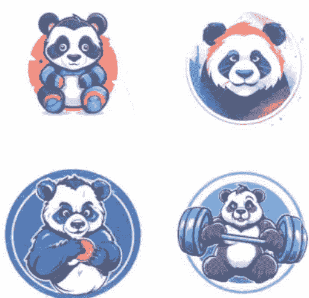
    *图 8.1 Midjourney 初稿输出*
2.  锁定左上角方案，进一步细节微调（Vary Region / Upscale / Remix）。
    
    *图 8.2 最终定稿 Logo*

> **品牌资产包到手**：名字有了，Logo 有了，店铺“颜值”在线，准备开张。

---

### 8.2 ChatGPT 实战：四大高频文案场景速通

#### 8.2.1 爆款标题 & 详情页文案：精准击中用户画像

**案例 A：00 后女生专属瑜伽裤「蜜糖」**
> **指令**：设计商品名 & 详情页文案。人群：00 后女大学生。调性：甜美、青春、俏皮。

**AI 输出**：
*   **商品名**：「蜜糖瑜伽裤」
*   **详情页**：主打“高弹透气面料”、“小清新配色”、“宽松裤脚显腿长”、“瑜伽/舞蹈/通勤多场景穿搭”，结尾植入“开启运动之旅”行动号召。

**案例 B：30 岁精英男士网球裤「ProMatch」**
> **指令**：人群：30 岁事业有成男性。调性：专业、品质、商务感。

**AI 输出**：
*   **商品名**：ProMatch 网球运动裤
*   **详情页**：强调“高品质面料”、“人体工学剪裁”、“透气速干”、“抗磨耐穿”、“膝部弹力设计”，文案基调稳重专业，直击痛点。

> **核心心法**：**人群标签越具体，文案转化率越高**。别让 AI 猜，直接喂给它用户画像。

#### 8.2.2 大促活动策划：从“双 11”到日常促销

**指令**：为运动健康店铺策划“双 11”促销文案矩阵。

**AI 输出三套不同切入点方案**：
1.  **福利导向**：“双 11 狂欢，健康好礼不停” —— 强调折扣力度、买赠机制。
2.  **生活方式导向**：“健康生活，从我开始” —— 植入“最新时尚装备”、“舒适有趣”情绪价值。
3.  **稀缺紧迫导向**：“快来抢购！特卖狂欢” —— 制造“最大程度折扣”、“错过再等一年”稀缺感。

**进阶用法**：追加指令“结合预售、尾款膨胀、直播间专属券三阶段节奏重写”，即得完整作战地图。

#### 8.2.3 直播带货话术：按阶段拆解，主播照读不尴尬

**指令**：产品「ProMatch 网球裤」，人群 30 岁成功男士。输出**开场/中间/结尾**三段式话术。

**AI 输出结构化脚本**：
*   **开场（钩子+建信任）**：点明人群标签（30 岁成功人士）、痛点（裤子不合身毁体验）、引出产品（ProMatch 不容错过）。
*   **中间（卖点拆解+场景化）**：面料透气干爽 -> 膝部/腰部弹力设计（动作自如） -> 多口袋实用性（装手机钥匙） -> 版型时尚（场下也能穿）。
*   **结尾（限时逼单+情绪收尾）**：绑定“双 11 专属福利”、行动指令“加购下单”、品牌温度祝福“健康美好生活”。

**实操价值**：新主播拿到手微调口语化即可上岗，省去策划数天功夫。

#### 8.2.4 种草推广文案：小红书/公众号/朋友圈一键适配

**指令（带人设+格式约束）**：
> 扮演小红书文案。开头必须带表情包。产品：「蜜糖瑜伽裤」。人群：00 后爱瑜伽女生。调性：青春、活泼、爱生活。

**AI 输出（即发即用）**：
> 【表情包】嗨，亲爱的小仙女们~我给大家推荐一款必备的瑜伽装备！ 😊😊😊
>
> 【推广语】这就是我们店铺的**蜜糖瑜伽裤**！专为爱瑜伽的小仙女设计，舒适面料+修身剪裁，完美勾勒好身材，练习时自信满满！ 🚀
>
> 【推广语】不仅能练瑜伽，搭配外套直接出街！俏皮青春风，运动生活两不误！冲鸭～ 💖

**亮点**：连 Emoji 排版、网感语气词（“冲鸭”、“小仙女”、“勾勒”）全自动生成，零门槛做内容分发。

---

### 8.3 ChatGPT 实战：AI 生成商品图，告别样机拍摄成本

商品图生成本质是：**将商品属性（色、形、材质）与场景语义解耦重组**，由 AI 合成高保真视觉资产。这能让中小商家以极低成本拥有大牌级视觉表现力。

#### 8.3.1 产品设计图：从“模糊需求”到“精准 Prompt”

**❌ 失败指令**：`为运动裤设计 Midjourney 指令`
**AI 反问**：类型？颜色？面料？卖点？目标人群？（信息不足，AI 只能给通用建议）

**✅ 优化指令（喂饱上下文）**：
> **品牌定位**：00 后女大学生。
> **品牌调性**：甜美、青春。
> **核心诉求**：输出可直接进 MJ 的英文 Prompt。

**AI 返回答案框架（设计规格书）**：
1.  **配色方案**：浅粉、淡蓝、薰衣草紫等马卡龙色系。
2.  **面料关键词**：棉感聚酯、莱卡高弹、透气排汗。
3.  **尺码覆盖**：S/M/L/XL 亚洲码版型。
4.  **设计细节**：高腰收腹、无痕拼接、裤脚微喇/直筒选项、隐形侧袋。
5.  **营销卖点标签**：甜酷风、肤感面料、显瘦神器、不透底。

**关键一步**：ChatGPT 将上述中文规格书**翻译成标准化 MJ Prompt**（含 `--ar 3:4 --stylize 250 --v 6.0` 等参数），复制粘贴即可出图。

---

### 附：运动裤产品尺寸设计图 Prompt 示例

### Sweatpants product size design chart

### 8.3.2 打造产品场景视觉稿

款式定稿后，上身效果究竟如何？我们得先产出模特展示图。起步阶段，需要在 ChatGPT 里构建一套完整的提示词参数库，涵盖以下核心维度：

*   **配色策略**：主打清新甜美色系——浅粉、淡蓝、薰衣草紫等，精准拿捏年轻女性气质；
*   **面料规格**：锁定纯棉、涤纶等亲肤透气材质，保障穿着体感；
*   **尺码矩阵**：铺开 S、M、L 多码段，兼容不同身形需求；
*   **版型设计**：简约时尚为主调，穿脱自如、大幅度运动无拘束；细节端强化腰头弹力带工艺，落实舒适承诺；
*   **核心卖点**：双轨并行——对外传递甜美年轻的风格调性，对内兑现舒适透气的功能价值，让消费者在瑜伽等场景里真正「穿忘自我」；
*   **模特画像**：长发、热爱运动、青春满格的年轻女性。

随后，将上述设定转换为 Midjourney 可识别的英文关键词集（sports pants、Soft and comfortable fabric、Breathable material、Light colors、Elastic waistband、Simple and fashionable design、Suitable for different body types、Youthful style、Sweet and cute vibe、Comfortable to wear、Easy to move in、S/M/L sizes、Young female/long hair/sporty/energetic、sport），丢进 Midjourney 跑首批设计草图。


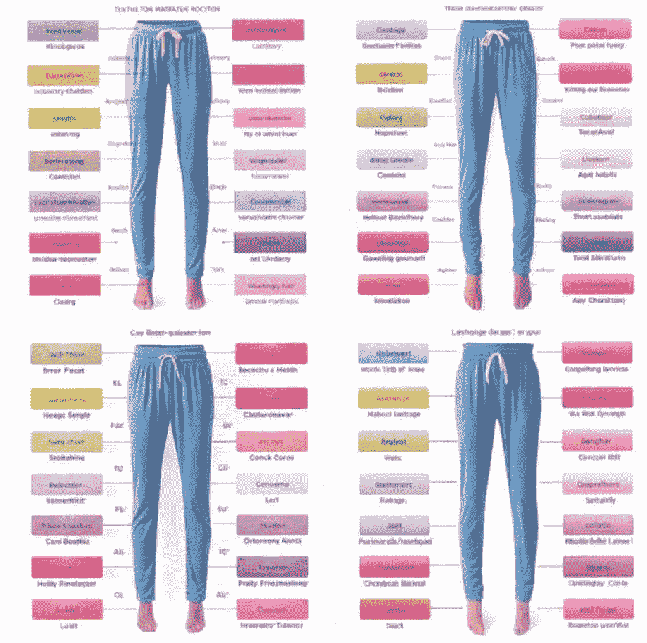


挑中左下角草图让 AI 深化微调，得到多尺寸设计稿 ，经细微打磨后定稿输出 。

接下来正式切入模特图环节。我们将前文的设计细节连同模特画像一并喂给 ChatGPT，指令其生成专供 Midjourney 调用的英文词条。ChatGPT 回传的关键词清单覆盖款式、材质、色系、版型、卖点、尺码及模特特征等全维度。

将词条投入 Midjourney，即得首轮模特候选图：


*注：图中模特与展示场景均为 AI 自动合成。*

经筛选，左下角方案最贴合设计初衷，遂以此为种子扩写变体：


最终敲定右下角版本，模特大片落地：


该流程具备极强复用性，同理可高效产出商品场景图、主题海报等物料。

## 金融领域的提示工程实战

### 9.1 实战：用 AI 高产投资研报

投资研报的本质是为决策背书，常规结构覆盖市场、行业、公司财务经营、风险收益测算四大支柱，撰写主力多为专业分析师或机构研究部。它在决策链条中举足轻重：既帮投资者摸清标的底细与风险收益比，又能输出行情研判与趋势洞察，助力捕捉窗口期。

对入行新人而言，产出一份合格研报动辄耗时一周，尤其是搭建框架、梳理逻辑最耗心神。如何让 ChatGPT 分担这部分脏活累活？以「如何用 ChatGPT 写投资报告」为例实操一下。

先让 AI 扮演提示词工程师，拆解这篇文章的写法切入点。AI 回复给出标准四维框架：

1.  **市场维度**：聚焦规模、竞争格局、发展趋势，铺垫宏观背景；
2.  **行业维度**：复盘历程、剖析竞争、预判趋势，洞察现状与机遇；
3.  **公司维度**：深挖经营策略、财务健康度、市场占有率，识别优劣势与隐性风险；
4.  **风控维度**：量化市场/行业/公司层面不确定性，为决策设防。

框架到手，逐层深化。实战演练以中国白酒赛道为例，指令 AI 从规模、增速、竞争三切口切入。

AI 回复要点：2019 年营收约 7530 亿、产量近 1963 万吨，基本盘稳固；长期向好，虽 2020 年受疫情放缓，但消费升级推动高端赛道崛起，注入新动能；竞争端 CR 高，茅五泸三巨头垄断份额与品牌高地，中小地方酒企靠产品创新与营销突围，品牌战、渠道战双线并进。

若嫌竞争分析太宏观，追指令细化至五大核心标的画像。AI 逐个拆解：茅台（高端霸主，技术迭代+品牌运营筑护城河）、五粮液（消费基数大、创新有优势，高端份额待拓）、泸州老窖（老字号美誉度高、技改增强竞争力，产品线单一是短板）、古井贡（新兴势力、技术创新驱动，知名度与份额仍需提振）、洋河（消费群体广、升级拓市并进，高端提升空间大）。

需要财务硬数据对比？直接下指令：输出五粮液与茅台近三年营收对比 Markdown 表。AI 秒吐结构化数据：

| 年份 | 五粮液营收/亿元 | 茅台营收/亿元 |
|---|---|---|
| 2020 | 872.94 | 1147.22 |
| 2019 | 824.38 | 996.32 |
| 2018 | 688.93 | 728.99 |

遵循此逻辑，研报产出效率可实现量级跃升。

**如何极速「啃」透海量研报？** 金融行业日产公告、财报动辄百页，人工阅读负担极重。ChatGPT 虽不直读文件，但可借力 ChatPDF 类工具。

访问 ChatPDF 官网 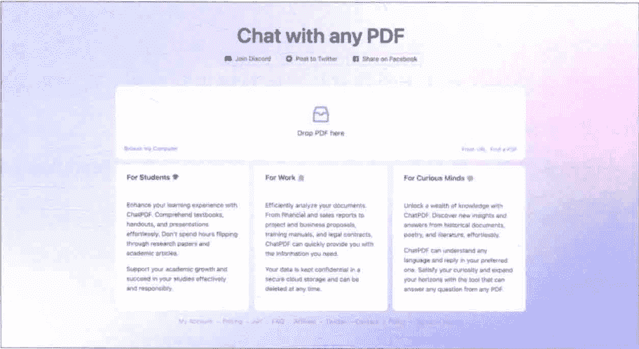，上传千禾味业 2022 年报，开启智能问答模式 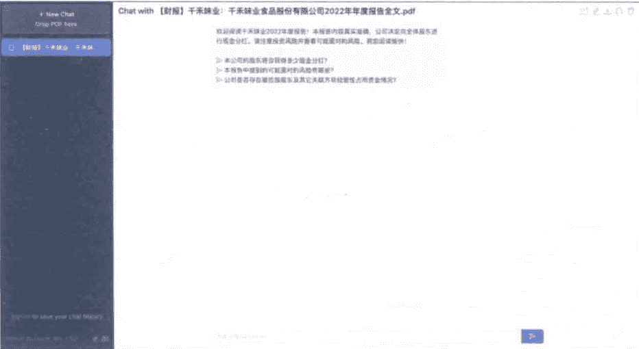。聚焦 2022 年分红案，直接发问，ChatPDF 精准定位至第 34 页，抠出核心要素：方案经董事会审议、股东大会批准，程序合规；2016 年以来分红均符合规划；以年末总股本为基，10 派 1 元。交互细节见 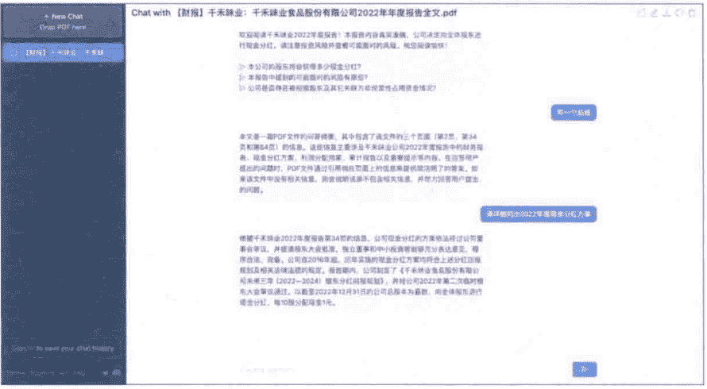。

实测印证，AI 生态已打通「写」与「读」双通道，优势显著：

*   **极致提效**：输数据与关键词即可自动成文，释放分析师带宽；
*   **质量可控**：持续迭代学习，输出水准超越人工基准线；
*   **批量产出**：短时内生成多版本，拓宽决策选项、加速交付。

但短板同样硬核：

*   **缺乏深度思考**：纯基于输入生成，易漏关键细节与隐性逻辑，导致报告厚度不足；
*   **强依赖输入质量**：数据不准、不全或有偏见，输出必然继承缺陷（「垃圾进，垃圾出」）；
*   **非结构化盲区**：无法解析图像、视频等非文本信息，分析维度受限，需人工补位。

总结：AI 写研报「快、准、多」，但「缺洞察、赖料、盲非文」，实战中必走人机协同、扬长避短路线。

### 9.2 让 AI 充当初级投顾助理

投资顾问的核心使命是匹配客户财务目标与风险偏好，输出配置建议与组合管理服务，服务对象覆盖个人至机构。从业门槛硬：需持证（如美 SEC 注册投资顾问考试），守行业准则与职业道德。核心职能七件套：定制方案、挖掘标的、管组合、盯表现、发指令、做投教、运营关系。

ChatGPT 如何分担工作量？假设你是萌新入行，首要任务读懂行业图谱，直接问 AI「投顾核心职能有哪些」。AI 归纳出七大职能清单：

1.  **因人制宜定方案**：深度沟通目标、风偏、期限，输出专属配置蓝图；
2.  **多维挖掘标的**：以宏观研判、行业研究、基本面分析为矛，发掘潜力标的；
3.  **动态管组合**：守住资产配置与风控的动态平衡与有效性；
4.  **实时盯表现**：持续跟踪、灵活调仓，追求风险调整后收益最大化；
5.  **给明确买卖持指令**：结合行情与需求，输出可执行的操作建议；
6.  **做投资者教育**：普及理财认知、市场逻辑，提升客户理解力与配合度；
7.  **深度运营关系**：高频高质沟通协作，助力目标达成，用反馈迭代服务质量。

# 巧用 AI 打造专属投资顾问：从资产配置到量化策略全流程实战

投资顾问的核心价值，在于协助客户优化决策路径，最终达成财富增值的最大化。借助 ChatGPT，我们能快速构建起专业的咨询框架。

## 实战演练：为高净值客户定制投资蓝图

假设客户拥有 500 万可投资产，年入百万且零负债，目标锁定高收益。我们直接指令 AI 扮演资深顾问输出方案。

**初版建议：框架完善但缺乏细节**
AI 首先强调深度沟通以摸清风险偏好与投资周期，随后给出大类资产配置思路：股票博取超额收益、债券垫稳底仓、外汇捕捉汇差机会、另类资产分散风险，并承诺持续跟踪调仓。方向虽对，却如隔靴搔痒，未给具体仓位与标的。

**二轮追问：锁定核心仓位比例**
我们进一步逼问股债具体配比。AI 基于客户高收入抗风险能力强的特质，给出 **股票 60% / 债券 40%** 的经典进攻型组合，并阐述了进攻与防守的逻辑平衡。

**三轮深化：落地到具体赛道与标的**
光有比例不够，还得知买什么。我们要求 AI 点名高弹性行业与高息债券品种。
- **权益端（60%）：** 重点配置科技、医疗、金融等高成长、强流动性赛道，举例腾讯、阿里、百度等龙头。
- **固收端（40%）：** 以国债、政策性金融债筑底，适度掺混优质信用债（如大行发行的金融债）增厚票息收益。

至此，一份可执行落地的投资执行单已成型，接下来只需在券商或银行端完成申购。

---

## 9.3 解锁新技能：让 ChatGPT 当你的量化策略工程师

### 量化投资的本质与分类
简而言之，量化投资是用数学模型、统计规律与计算机程序替代主观判断，实现交易决策的自动化、纪律化与高频化。相较传统研报分析，它拥有更严谨的规则体系与极高的执行效率。

主流策略谱系涵盖：
- **技术流：** 吃透 K 线、量价关系；
- **基本面量化：** 财务数据建模选股；
- **机器学习：** 挖掘非线性隐性因子；
- **套利/事件驱动：** 捕捉定价偏离与催化剂；
- **高频交易（HFT）：** 微秒级抢跑流动性价值。

### 零代码基础也能写策略？AI 来兜底
不懂 Python 的金融从业者完全可以借力 AI 生成代码。首先遵循标准化工程流程五步走：
1.  **目标设定**——定风格、定风控、定买卖逻辑；
2.  **数据管道**——获取、清洗、对齐行情与基本面数据；
3.  **因子挖掘/模型训练**——特征工程与算法选型；
4.  **回测验证**——历史数据压力测试，剔除过拟合；
5.  **实盘迭代**——模拟盘 → 实盘，参数动态优化。

### 策略筛选：锁定“均值回归”
我们以“稳健收益”为目标让 AI 推荐备选菜单：均值回归、趋势跟踪、红利策略、量化选价值、对冲套利。综合考量后，我们敲定 **均值回归策略**——利用价格围绕均值波动的统计特性，高抛低吸。

### 代码生成与数据接入实战

**步骤 1：一键产出策略原型**
指令 AI 用 Python 落地均值回归逻辑。
```
import pandas as pd
import numpy as np

# 获取历史价格数据
df = pd.read_csv('price_data.csv')

# 计算移动平均值和标准差
df['MA'] = df['Price'].rolling(window=20).mean() # 20 天的移动平均值
df['SD'] = df['Price'].rolling(window=20).std() # 20 天标准差

# 计算上下界限
df['Upper'] = df['MA'] + 2 * df['SD'] # 上界为移动平均值加 2 倍标准差
df['Lower'] = df['MA'] - 2 * df['SD'] # 下界为移动平均值减 2 倍标准差

# 产生交易信号
# 当价格大于上界时卖出
df['Signal'] = np.where(df['Price'] > df['Upper'], -1, np.nan)
# 当价格小于下界时买入
df['Signal'] = np.where(df['Price'] < df['Lower'], 1, df['Signal'])

# 将信号向前填充
df['Signal'].fillna(method='ffill', inplace=True)

# 计算持仓和收益
df['Position'] = df['Signal'].shift(1)
df['Position'].fillna(0, inplace=True)
df['Returns'] = df['Position'] * df['Price'].pct_change()

# 计算累计收益率
df['Cumulative_Returns'] = (1 + df['Returns']).cumprod() - 1

# 输出结果
print(df.tail())
```

**步骤 2：接入实时数据源（解决“空有逻辑无数据”痛点）**
原版代码仅读本地 CSV，实战需对接行情接口。询问国内主流开源数据 SDK，AI 列举 Tushare、Baostock、JQData、AKShare 等主流选择。我们选定 **Baostask**（免费、无需复杂注册、覆盖全市场）。

**步骤 3：重构数据获取模块**
命令 AI 替换数据层代码，适配 Baostock 接口。
```
import baostock as bs
import pandas as pd

# 登录 Baostock
lg = bs.login()

# 获取沪深 300 指数的历史 K 线数据
rs = bs.query_history_k_data_plus("sh.000300",
    "date,open,high,low,close,preclose,volume",
    start_date='2010-01-01',
    end_date='2021-12-31',
    frequency="d", adjustflag="2")

# 输出结果集
print('query_history_k_data_plus respond error_code:' + rs.error_code)
print('query_history_k_data_plus respond error_msg:' + rs.error_msg)

# 将结果集转换为 DataFrame
data_list = []
while (rs.error_code == '0') & rs.next():
    # 获取一条记录，将记录合并为列表类型
    data_list.append(rs.get_row_data())
data_df = pd.DataFrame(data_list, columns=rs.fields)

# 转换数据类型并设定日期索引
data_df = data_df.astype({'open': 'float', 'high': 'float',
    'low': 'float', 'close': 'float', 'preclose': 'float',
    'volume': 'int'})
data_df['date'] = pd.to_datetime(data_df['date'])
data_df = data_df.set_index('date')

# 计算均值和标准差
data_df['mean'] = data_df['close'].rolling(window=20).mean()
data_df['std'] = data_df['close'].rolling(window=20).std()

# 计算上下轨
data_df['upper'] = data_df['mean'] + data_df['std']
data_df['lower'] = data_df['mean'] - data_df['std']

# 计算持仓和交易信号
data_df['position'] = 0
data_df['position'][data_df['close'] < data_df['lower']] = 1
data_df['position'][data_df['close'] > data_df['upper']] = -1
data_df['position'] = data_df['position'].shift(1).fillna(0)

# 计算每日收益率和累计收益率
data_df['daily_return'] = data_df['close'] / data_df['close'].shift(1) - 1
data_df['strategy_return'] = data_df['position'] * data_df['daily_return']

data_df['cum_return'] = (1 + data_df['strategy_return']).cumprod()
# 输出结果
print(data_df.tail())
```

**步骤 4：专业级回测验证**
光跑通不够，要看业绩。设定回测标的：中国平安（601318.SH），区间 2021 全年，框架用成熟的 **Backtrader**。AI 输出完整回测脚本，含数据拉取、策略挂载、绩效分析器配置。
```
import backtrader as bt
import baostock as bs
import pandas as pd

# 登录 Baostock
lg = bs.login()
print('login respond error_code:' + lg.error_code)
print('login respond error_msg:' + lg.error_msg)
```

### 获取股票数据

```
code = 'sh.601318' # 股票代码
start_date = '2021-01-01' # 回测起始时间
end_date = '2021-12-31' # 回测结束时间

rs = bs.query_history_k_data_plus(code,
    "date,open,high,low,close,volume",
    start_date=start_date, end_date=end_date,
    frequency="d", adjustflag="3")

data_list = []
while (rs.error_code == '0') & rs.next():
    # 获取一条记录，将记录合并在一起
    data_list.append(rs.get_row_data())
result = pd.DataFrame(data_list, columns=rs.fields)
```

### 数据类型转换实操

```
result['date'] = pd.to_datetime(result['date'])
result.set_index('date', inplace=True)
result[['open', 'high', 'low', 'close', 'volume']] = result[['open', 'high', 'low', 'close', 'volume']].apply(pd.to_numeric)
```

### 均值回归交易模型

```
class MeanReversion(bt.Strategy):

    params = (
        ('sma_period', 20),
        ('dev_factor', 2),
    )

    def __init__(self):
        self.sma = bt.indicators.SimpleMovingAverage(self.data,
            period=self.params.sma_period)
        self.upper_band = self.sma + self.params.dev_factor * \
            bt.indicators.StandardDeviation(self.data, period=self.params.sma_period)
```

```
params.sma_period)
self.buy_signal = bt.indicators.CrossDown(self.data.close,
self.lower_band)
self.sell_signal = bt.indicators.CrossUp(self.data.close,
self.upper_band)
```

```
def next(self):
    if not self.position and self.buy_signal[0] == 1:
        self.buy()
    elif self.position and self.sell_signal[0] == 1:
        self.sell()
```

```
# 回测
cerebro = bt.Cerebro()
data = bt.feeds.PandasData(dataname=result)
cerebro.adddata(data)
cerebro.addstrategy(MeanReversion)
cerebro.broker.setcash(1000000)
cerebro.broker.setcommission(commission=0.002)
cerebro.run()
```

```
# 输出回测结果
print('Final Portfolio Value: %.2f' % cerebro.broker.getvalue())
```

特别提示：该策略的盈利稳健性受数据周期跨度、参数配置组合、市场行情走势等多重变量制约，文中不作任何实战收益承诺，实盘应用请严格控制风险。

以上即完成了完整策略开发的全流程演示，读者可复刻此框架进行二次开发与迭代优化。

在人工智能浪潮中，ChatGPT 作为现象级的大语言模型，重新定义了人机协作边界。它能精准解析指令，秒级产出文案、代码、创意脚本等多模态成果，让生产力跃迁成为触手可及的现实。本书定位「提示工程实战指南」，系统拆解如何驾驭 AI 成为超级个体，覆盖内容创作、视觉设计、软件开发、电商运营、量化金融等高频场景。

## 核心知识图谱

- 提示工程师核心能力模型与进阶路径
- 从基础对话到复杂任务的提示词设计范式
- NLP 底层原理与大模型思维模式解析
- 五大垂直领域落地案例库：办公自动化、AI 绘图、全栈开发、电商增长、金融量化

## 权威背书推荐

- **尼克**｜乌镇智库理事长、《人工智能简史》作者
- **王牧**｜西交利物浦大学西浦慧湖药学院执行院长
- **朱盘**｜安永大中华战略与交易咨询主管合伙人
- **戴亦斌**｜北京信工博特智能科技董事长
- **谭建龙**｜中国科学院大学博士生导师

定位分类：计算机·人工智能·提示工程  
出版发行：人民邮电出版社｜官网 ptpress.com.cn