# 人工免疫系统及其数据挖掘应用研究


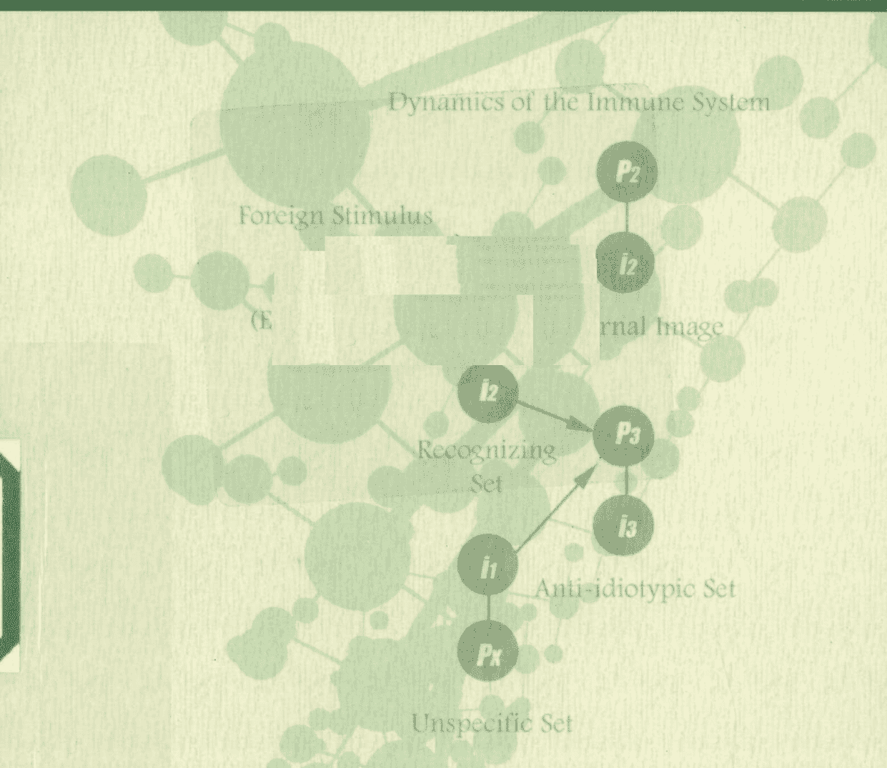


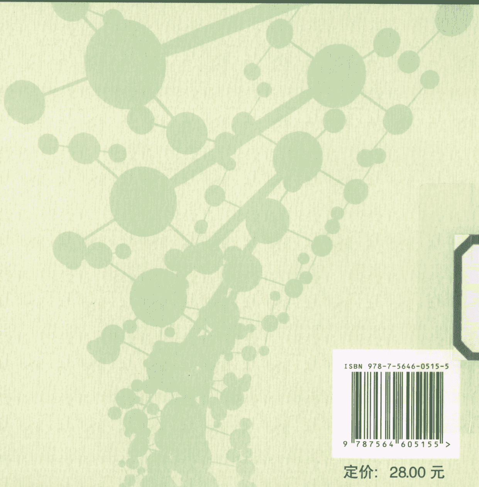  


# 内容提要

本书是作者在人工免疫系统及其数据挖掘应用领域研究工作的总结。首先讨论生物免疫学的机理，从信息处理的角度分析人工免疫系统的基本框架及其数据挖掘的基本模式，重点阐述基于距离浓度免疫算法及其数据分类、关联规则和聚类挖掘方法，探讨改进的资源有限人工免疫系统模型及其关联规则数据挖掘方法，设计自适应免疫应答网络模型及其聚类数据挖掘算法，讨论基于人工免疫系统的决策支持系统结构及其在煤炭生产决策中的应用。

本书可以为计算机学科、信息学科、人工智能和自动化技术等领域从事人工免疫系统研究的相关专业技术人员提供参考，也可以作为相关专业研究生和高年级本科生教材。


# 前 言

免疫系统是生物系统的重要子系统之一，它通过不同种类抗体的表现形式构造自身与非自体间的非线性网络，在动态变化环境中对维护生物体的健康起着重要作用。免疫系统内没有中心控制器官，而是由体内不断循环的分散免疫细胞集合构成的，能区别自身与非自体，并具有排除和记忆非自体的功能。从信息处理的观点看，生物免疫系统是一个并行分布式的自适应系统，它具有认知、特征抽取、多样性、学习和记忆等特点。人工免疫系统是研究、借鉴和利用生物免疫系统各种原理和机制而发展的各类信息处理技术、计算技术及其在工程和科学中的应用而产生的各种智能系统的统称。开展人工免疫系统的理论和应用研究，在理论和实践上都具有非常积极的意义。数据挖掘也称为数据库中的知识发现（Knowledge Discovery in Database, KDD），是指发现隐藏在数据库大量信息中有用的知识。开展人工免疫系统在数据挖掘领域的应用研究，可以丰富数据挖掘方法和理论，获得更有效的数据挖掘技术，更好地完成数据挖掘任务。此外，研究基于免疫原理的数据挖掘和推理策略无疑将会为决策支持系统提供新的技术和方法。

本书主要对人工免疫系统及其在数据挖掘领域中的应用问题进行阐述。讨论人工免疫算法和人工免疫网络模型的设计，探讨基于人工免疫系统的数据挖掘方法和基于免疫原理的推理方法，并将人工免疫系统理论应用于决策支持系统的工程实践中，以此丰富人工免疫系统及其应用的内涵。本书共分为 8 章，主要内容如下：第 1 章是绪论，阐明相关研究依据及其意义。第 2 章概括阐述生物免疫系统的组成、机理和特性。第 3 章分析现有人工免疫系统及其数据挖掘方法，根据人工免疫算法形式和网络结构的特点，在免疫系统信息处理特性启示的基础上，概括提出人工免疫系统及其数据挖掘方法的基本框架。第 4 章通过对免疫算法设计方法的研究和对现有免疫算法不足的分析，提出基于距离浓度的免疫算法（Distance Concentration Artificial Immune Algorithm，DCAIA），给出该算法的收敛性证明，通过与遗传算法和传统免疫算法的实验对比，验证所提出算法的良好性能。第 5 章提出基于 DCAIA 的聚类、关联、分类的数据挖掘方法，通过实验给出这些数据挖掘方法的应用实例，验证所提出算法的可行性。第 6 章分析资源有限人工免疫系统存在的不足，提出一种改进的资源有限人工免疫系统，并设计基于改进模型的关联规则数据挖掘算法。第 7 章利用免疫应答机理和生物免疫网络理论，提出一种自适应免疫应答网络（Adaptive Immune Response Network，AIRN），给出具体网络的表示方式和构建过程，分析讨论 AIRN 的自适应性和收敛性，将 AIRN 应用于聚类分析，该模型在数据划分和模式识别上效果良好。第 8 章在基于数据仓库和数据挖掘支持的决策支持系统体系结构框架基础上，提出一种基于免疫原理的决策支持系统模型，阐述基于动态克隆策略的推理系统策略，并分析基于免疫原理推理系统的特点，讨论基于免疫原理的数据挖掘系统模型结构，通过对煤矿企业数据仓库中瓦斯数据的挖掘和通风机故障的问题求解，把基于免疫原理的数据挖掘和推理策略应用于煤矿生产的决策支持分析中。

本书是作者在江苏省现代企业信息化应用支撑软件工程技术研发中心研究工作的总结。在国家博士后科学基金（项目编号：20060390326）、国家自然科学基金（项目编号：60970058）、江苏省自然科学基金（项目编号：BK2009131）、江苏省现代企业信息化应用支撑软件工程技术研发中心开放基金（项目编号：eisecSX200806）和江苏省青蓝工程和福建省科技基金（项目编号：2008F5046）等项目的资助下，作者对人工免疫系统及其应用进行了探讨，尤其对距离浓度的免疫算法及其数据挖掘应用进行了较深入的探索。

本书在撰写过程中参阅了大量的文献，对所引用的文献都尽量予以表明。限于篇幅和可能的疏漏，列出的参考文献尚不够全面，谨请有关作者谅解。如果有不妥之处，请通过电子邮件(banklt@163.com)告知本人改正，在此表示歉意和谢意。

本书力求比较全面地介绍作者在人工免疫系统及其数据挖掘应用研究的工作进展情况，但由于水平和精力所限，缺点和错误也在所难免，诚恳请求读者不吝指正。

刘 韬  

江苏省现代企业信息化应用支撑软件  

工程技术研发中心  

2009 年 7 月  


# 第 1 章 绪论

## 1.1 选题依据及意义

很多生物机体在动态竞争的环境中展现出了强大而复杂的学习和问题处理能力，生物机体的这些特性，激发了人的思维，促进了人类科学技术的发展。在过去的几十年中，受生物机体启发而产生的方法和理论不断涌现和发展。目前在信息领域有明确研究内容的四个子系统分别是：脑神经系统、遗传系统、免疫系统与内分泌系统。其中免疫系统和内分泌系统已被证明具有高度的信息处理能力，已经开始受到研究者的重视。最近几年，人工免疫系统（Artificial Immune System, AIS）的研究迅速发展，已经成为智能系统中继模糊逻辑、神经网络、遗传算法之后的又一研究热点[1~4]。人们基于生物免疫原理提出了多种人工免疫模型和算法，并应用于自动控制[5]、故障诊断[6~8]、优化计算[9~11]、模式识别[12]、机器学习[13,14]、数据分析[15~18]等领域。

人工免疫系统是研究、借鉴和利用生物免疫系统各种原理和机制而发展的各类信息处理技术、计算技术及其在工程和科学中的应用而产生的各种智能系统的统称[19]。生物免疫系统结构复杂、功能独特。免疫系统内没有中心控制器官，它是由体内不断循环的分散免疫细胞群构成的，能区别自体与非自体，并具有排除与记忆非自体的功能。从信息处理的观点看，生物免疫系统是一个并行分布式的自适应系统，它具有认知、特征抽取、多样性、学习和记忆等特点[2]。目前虽然在医学免疫学上取得了有关实验的成果和基于非线性模型的理论研究成果，但人工免疫系统理论及其在工程中的应用研究还处在起步阶段。研究免疫系统的良好特性和机理，可以获得新的理论、新的思想和新的方法，用于解决日益复杂的工程问题。尤其是加强免疫系统在信息处理系统中的理论和应用研究，可以有效地提高对信息的智能处理能力。例如，免疫系统可以有效地用于构建模式识别分类器或探测器，而且这种模式识别分类器具有高效的特征抽取、快速进化、学习和记忆性质，这恰恰是工程实践中所需要的。因此，加强人工免疫系统的理论和应用研究不仅意义重大，而且是非常必要的，借鉴生物免疫系统的特性，在人工智能计算方面有着巨大的潜能。

影响我们生活方方面面的信息技术正在飞速发展，它积累了大量的信息数据，随着数据库技术的迅速发展，数据存量急剧增加。但是，挖掘海量数据中隐藏知识的手段远远不足，从而导致了“数据爆炸但知识贫乏”的现象。计算机技术的另一领域——人工智能(Artificial Intelligence, AI)自 20 世纪 60 年代诞生之后取得了重大进展。该领域目前的研究热点是机器学习，即用计算机模拟人类学习的过程。用机器学习的方法来分析数据，挖掘大量数据背后的知识，这两者的结合促成了数据挖掘的产生。处理这些信息，把它变成有用知识的数据挖掘(Data Mining)技术则是我们提取知识的有效手段。数据挖掘也称为数据库中的知识发现(Knowledge Discovery in Database, KDD)，是指发现隐藏在数据库大量信息中有用的知识。其目的是帮助有关人员寻找信息数据之间的内在关系，发现数据项之间新的要素[20]。实际上，数据挖掘是一门交叉学科，涉及机器学习、模式识别、统计学、智能数据库、知识获取、数据可视化、高性能计算、专家系统等多个领域。数据挖掘的成果可以用在信息管理、过程控制、科学研究、决策支持等许多方面。

数据挖掘的目的是帮助决策者寻找数据间潜在的相互关系和模式特征，而从生物免疫系统中接受启发，利用其特征抽取、快速进化、学习和记忆等特性，正是人们在数据挖掘时所孜孜以求的。因此，开展人工免疫系统在数据挖掘领域的应用研究，可以丰富数据挖掘方法和理论，获得更有效的数据挖掘技术，更好地完成数据挖掘任务。

此外，自 20 世纪 90 年代以来，在信息技术的推动下，新的决策理论和方法不断涌出，特别是数据挖掘技术和智能推理方法使决策支持系统(Decision Support System，DSS)得到了长足发展，因此，研究基于免疫原理的数据挖掘和推理策略无疑将会为决策支持系统提供新的技术和方法。

## 1.2 人工免疫系统及其应用研究综述

### 1.2.1 人工免疫算法和人工免疫网络模型

随着对生物免疫系统特性和机理的认识深入，人们构造了一系列人工免疫系统，用来解决一些复杂的工程实际问题。在这些人工免疫系统中可以分为人工免疫算法和人工免疫网络以及基于网络结构的框架模型。

#### 1.2.1.1 免疫算法

人工免疫算法(Artificial Immune Algorithm，AIA)，简称免疫算法，是由免疫学理论和观察到的免疫功能、原理和模型启发而设计出的计算方法。这方面的研究最初从 20 世纪 80 年代中期的免疫学研究发展而来。1990 年，H. Bersini 等[21]首次使用免疫算法来解决问题。20 世纪末，D. Dasgupta 和 S. Forrest[22]开始将免疫算法应用于计算机安全领域。同期，D. E. Cooke 等[23]开始将免疫算法应用于机器学习领域。自然免疫系统所具有的显著信息处理能力对计算技术有很多重要的启发。近年来，特别是 1997 年人工免疫学研究在国际上兴起之后，国内外研究人员提出很多免疫算法[24~26]，主要有以下几种算法类型：

- (1) 阴性选择算法：S. Forrest 等[27]基于阴性选择原理提出阴性选择算法来检测异常，其算法主要包括以下两步：首先产生监测器集合，其中每个监测器与被保护的数据都不匹配；然后不断地将集合中每个监测器与被保护的数据相比较，如果监测器与被保护的数据相匹配，则判定该数据发生了变化。 P. D’haeseleer 等[28]基于阴性选择原理给出了一种阴性选择算法，用于监测数据改变。其中抗体（问题解答）与抗原（问题）的匹配采用 S. Forrest 提出的部分匹配规则。

- (2) 免疫遗传算法：J. S. Chun 等[9]提出一种免疫算法，实质上是改进的遗传算法。它采用类似遗传算法的搜索策略，借用遗传算法的选择、交叉和变异算子（有的只用变异算子），但在群体搜索策略、解的表示和记忆单元设置等方面与遗传算法有所不同。

- (3) 免疫学习算法：J. D. Farmer 等[29]首先对免疫系统的学习特性进行了探索性研究，指出免疫系统具有分类器系统的性质。随后 J. E. Hunt 等[13]基于免疫网络理论给出一种有监督的机器学习算法。 Y. Ishida[31]也提出一种基于 PDP 模型的人工免疫系统学习算法，并将其应用到故障诊断中。

- (4) 克隆选择算法：D. E. Castro 等[32]基于免疫系统的克隆选择理论提出克隆选择算法，该算法是模拟免疫系统学习过程的进化算法。

- (5) 基于疫苗的免疫算法：焦李成等[24]利用免疫系统的理论提出基于疫苗的免疫算法。

- (6) 基于免疫网络的免疫算法：N. Toma 等[33]基于主要组织相溶性复合体（MHC）和免疫网络理论提出一种自适应优化的免疫算法，用于解决多智能体中每个智能体的工作域分配问题。

由于基于免疫系统特性的应用探索还处于起步阶段，上述已

有的免疫算法的问题针对性比较强，应用范围有局限性，还有许多方面考虑不到。因此，算法的设计也有许多有待改进之处。

#### 1.2.1.2 人工免疫网络模型

N. K. Jerne 在免疫学上提出的独特型网络模型[34]以及其他研究人员提出的多种免疫网络学说[35]，这些都可借鉴用于建立人工免疫网络模型。总的来看，人工免疫网络模型将系统视为一个由节点(淋巴细胞)组成的网络结构，通过节点之间的信息传递和相互作用达到识别、效应、记忆等免疫系统功能。

在人工免疫网络研究中，A. Ishiguro 等[36]提出一种互联耦合人工免疫网络模型，即免疫系统是通过多个完成某一特定任务的局部免疫网络之间的相互通信来形成大规模免疫网络，该模型已用于机器人的行走控制和路径规划之中。Z. Yamaguchi 等[37]提出了一种多值免疫网络模型，通过字符识别显示出多值免疫网络在记忆模式、记忆容量方面，特别是在噪声免疫能力方面要优于二进制网络模型。D. E. Castro 等[38]提出一个抗体网络模型 AB-NET，该模型以克隆选择原理为基础，其核心是网络的生成算法，生成的抗体网络用于识别给定数量的抗原（问题）。F. T. Vertosick 和 R. H. Kelly[39]将免疫系统表示为一种搜索神经网络结构的替代方法，基于并行分布处理理论，提出 PDP 免疫网络。

这些网络模型从不同的侧面利用生物免疫系统的机理来解决工程问题，推动了人工免疫系统研究的发展，但这些模型大都针对某一特定的工程问题而设计，其应用的领域和范围受到限制。随着人工免疫系统探讨的深入，研究人员致力于开发新的网络模型和以网络结构为主的人工免疫系统框架模型。在随后的一节里，将结合它们在数据挖掘领域的应用，对这些人工免疫网络和系统框架模型给予阐述。

### 1.2.2 基于人工免疫原理数据挖掘综述

近年来，基于免疫系统原理开发的各种模型和算法广泛地应用在科学研究和工程实践中。鉴于免疫系统具有保护机体的强大能力，相应的 AIS 模型在信息安全方面得到了广泛应用[40,41]；利用其识别能力在模式识别方面的研究也取得了进展[14,42,43]；作为一种智能优化搜索策略，在函数优化、组合优化、调度问题等方面也得到应用并取得了很好的效果；在机器人学、故障诊断等方面的应用，很好地体现了 AIS 的智能突现与群体智能特性[31,36,44,45]。

人工免疫系统作为一种新兴智能系统，也已经被引入数据挖掘领域，用于完成数据挖掘的分类、聚类和数据浓缩等任务，其挖掘的对象多种多样，目前涉及的主要是数据库、Web 页等。

#### 1.2.2.1 基于人工免疫原理的分类

在基于免疫系统开发的分类技术方面，J. D. Farmer 等[29] 最早证明了分类器和独特型免疫网络模型之间的相似性，从动力学系统角度研究免疫系统的一般模式识别性质，该研究确定了许多与 Holland[9]的分类器系统的类似性，奠定了人工免疫系统用于数据挖掘技术的理论基础。S. Forrest 等在文献[47]中描述了用于研究人类免疫系统中发生的学习和模式识别过程的免疫系统模型。模型对检测器应用示意性表示法，在检测噪声输入数据中一般模式和保持群体内多样性的能力上进行了评估。J. E. Hunt 和 D. E. Cooke 在文献[13]中描述了一种使用突现适应度共享的遗传算法来发现数据模型，证明在人工免疫系统意义上，从正例样本学习是确实可能的。

J. H. Carter 提出的 Immuno-81[12] 是基于免疫原理的监督学习算法，该系统模拟 B 细胞和 T 细胞性质，以及它们产生初次和二次免疫应答的相互作用机制等几个方面。J. H. Carter 把 Immuno-81 和几个广泛使用的机器学习算法用于冠心病人数据分类，互相比较来评估系统的性能，算法表现出良好的性能。

M. A. Potter 等[41]描述了使用协同进化遗传算法 AIS 模型的进化抗体，用于概念学习，并在人工数据集合和议会投票记录数据进行分类能力测试，取得较好效果。

Andrew Watkins 等[48] 受资源有限人工免疫系统 (RLAIS)[17]启发，提出的资源有限人工免疫分类器 AIRS(A Resource Limited Artificial Immune Classifier)是一种主要的人工免疫监督学习方法。AIRS 模拟免疫系统 B 细胞相互作用机制。AIRS 中的抗原初始化为特征向量，在训练和学习期间提呈给系统。从 AIRS 中的 B 细胞与抗原都表示为向量 Vi = (vi1, vi2, ..., vir; c)，vij (j = 1, 2, ..., r) 是 B 细胞或抗原的属性特征，c 为类别。所有同类 B 细胞在一起表示为 ARBs(ARB——Artificial Recognition Ball, 人工识别球[17])。

#### 1.2.2.2 基于人工免疫原理的聚类

在属于无监督学习任务的聚类技术研究方面，一些研究人员提出基于免疫原理的数据聚类方法。J. E. Hunt 和 J. Timmis 等在文献[14]中描述了一个称为 Jisys 的系统，用于在抵押贷款欺诈诊断系统中聚类数据，D. E. Castro 和 J. Timmis[49]使用该系统成功地在标准测试数据 Iris 数据进行聚类分析。C. Hung 等[50]实现结合记忆细胞的人工免疫系统，该模型在大规模和动态系统实现聚类。在聚类关于土壤湿度水平的远程感知数据(一个海量数据样本)的应用中，研究者发现其性能与其他分类器相比要差，并把性能较差的原因归咎于所使用的数据表示机制和匹配算法的选择。

J. Timmis 和 M. Neal 等[51]给出三种不同的数据分析技术：单连接聚类，Kohonen 网络和人工免疫系统。研究者使用每一个聚类技术识别一些标准测试数据集合中的信息聚类。这些技术的前两个可看做单独聚类分析技术。他们认为 AIS 不仅是简单聚类分析技术，也能提供更多样化的数据表示，另外认为 AIS 在允许用户全面理解数据集合的组成方面是有效的，这样有助于数据挖掘和分析过程。

J. Timmis 等利用免疫网络假说开发了资源有限人工免疫系统（Resource Limited Artificial Immune System，RLAIS）模型[17,49]，该模型用于数据聚类并在标准测试数据集合 Iris 上实现聚类网络。系统发展的一个最有趣的概念是“资源有限”。该概念主要是指用 ARB 表示具有同样特征的 B 细胞的集合，每次免疫细胞暴露给一个给定抗原（或者抗原群体，即提呈给系统的数据），每一个细胞都试图基于刺激水平而获得更多的资源（指单个 B 细胞）。但是，系统范围内 B 细胞资源是有限的，如果某细胞消耗的资源比系统中规定的资源还多，则从该 ARB 中移除资源。首先从最少受刺激的细胞开始，直到细胞持有的总资源量等于系统中规定的资源量。资源的竞争给系统加入适当的进化压力，确保只有最适应的细胞生存，最终对这些生存下来的细胞进行克隆变异，并通过一定可视化方法反映和表示提呈的抗原数据聚类。此后，在 J. Timmis 本人对 RLAIS 系统的改进中[52]，提出一个无监督学习算法，用于进行数据分析和数据可视化，其中用实数向量表示抗体和抗原数据。

D. E. Castro 和 V. Zuben[43] 检验了免疫系统内克隆选择机制的作用，提出一个称为克隆选择算法（clonal selection algorithm）的无监督学习算法，此后基于免疫网络亚动力学的数据分析和数据简化算法[1,49]开发了 aiNet 免疫网络模型[53]，并使用了与标准聚类技术混合的方法，用最小生成树（MST），借用图论的思想，自动地检测和分离网络聚类，利用双螺旋问题和链式连接数据测试 aiNet 的性能，得到较好的结果。

E. Hart 和 P. Ross[54]结合免疫系统和松散分布记忆模型，提出用于聚类移动数据集合的免疫系统模型 SOSDM（Self-Organising Sparse Distributed Memories）。SOSDM 模拟自然免疫系统的自组织机制，在这个模型中，一个抗原等同于一段数据，一个抗体是一个聚类的描述，多个同类抗体在一起形成的刺激球定义聚类的规模，模型利用协同进化 GA 进化抗体，对系统可见的抗体集合（对应的刺激球）能迅速发现最佳的聚类数据。

此外，其他研究人员对 RLAIS 和 aiNet 进行了各种研究和改进。F. Gonzalez 等在模糊人工免疫系统（Fuzzy AIS）[55] 中，利用丰富的知识表示 B 细胞，模糊成员函数不仅模拟同一个聚类的不同区域，而且对噪声数据具有鲁棒性，并且允许一定范围的动态估计。

M. Neal 提出的自稳定人工免疫系统 SSAIS[56]（Self Stabilizing Artificial Immune System）能形成保持稳定的免疫网络，不像以前的人工免疫网络那样容易出现不可控制的波动现象，用于时变数据聚类，取得一定效果。

S. Wierzhon 和 U. Kuzelewska[57] 对 RLAIS 和 aiNet 进行了综合研究，结合了两者的优点，去除其不足的地方，比如保持 RLAIS 的 NAT 参数，同时完全利用免疫系统自组织机制形成聚类，而无需像 aiNetA 模型那样要借助传统图论技术形成聚类。

E. Hart 和 P. Ross[58] 探索免疫学和 SDM(Sparse Distributed Memories)之间的对应关系，提出一个新的方法。这个方法不同于其他用于聚类的人工免疫系统的方法，因为它基于二进制字符串，聚类表示不同的模式。因为这个方法具有线性复杂性，它是可伸缩的，在数据递增的情况下也能工作。

F. Gonzalez 等[59] 提出可伸缩人工免疫聚类分析（SAICA），对已有的人工免疫系统中的缺点进行了更深入全面的改进，能够充分利用免疫网络动态适应性、亚动力学特性，自组织地形成稳定的聚类模式。

目前人工免疫系统除了基于分类和聚类挖掘任务的研究外，数据挖掘的其他方面应用还鲜见报道[60, 61]。因此，人工免疫系统在数据挖掘方面的应用研究还有待拓展。

# 参考文献

- [1] CASTRO D E,ZUBEN V. Artificial Immune Systems:Part I-Basic Theory and Applications[R/OL]. Technical Report-RT DCA 01/99. http://www.dca.fee.unicamp.br.
- [2] DASGUPTA D. Artificial Immune Systems and Their Applications[M]. Berlin:Springer-Verlag,1999.
- [3] DASGUPTA D. Artificial Neural Networks and Artificial Immune Systems:Similarities and Differences[C]. In: Proceedings of the IEEE International Conference on Systems,Man and Cybernetics (SMC'97),Orlando,October 12-15,1997:876-883.
- [4] 丁永生,任立红. 人工免疫系统:理论与应用[J]. 模式识别与人工智能, 2000,13(1):52-59.
- [5] RENDERS J M, HANUS R. Biological learning metaphors for adaptive process control:A general strategy[C]. In: Proc IEEE International Symposium on Intelligent Control, Glasgow,Scotland,1992:469-474.
- [6] ISHIGURO A, WATANABE Y, UCHIKAWA Y. Fault diagnosis of plant systems using immune networks[C]. In: Proc IEEE International Conference on Multi-Sensor Fusion and Integration for Intelligent Systems, Las Vegas,NV,1994:34-42.
- [7] WATANABE Y,ISHIGURO A,SHIRAI Y,et al. Emergent construction behavior mechanism based on the immune system[C]. In: Proc ICEC'98, 1998:481-486.
- [8] ISHIDA Y,ADACHI N. An immune network model and its application to process diagnosis [J]. Systems and Computers in Japan,1993,24(6):38-45.
- [9] CHUN J S,KIM M K,JUNG H K,et al. Shape optimization of electromagnetic devices using immune algorithm[J]. IEEE Trans Magnetics, 1997,33(2):1876-1879.
- [10] CHUN J S,LIM J P,JUNG H K. Optimal design of synchronous motor with parameter correction using immune algorithm[J]. IEEE Trans Energy Conversion,1999,14(3):610-615.
- [11] ENDOH S, TOMA N, YAMADA K. Immune algorithm for n ~ TSP [C]. In: Proc IEEE International Conference on Systems, Man and Cybernetics, San Diego, CA, USA, 1998:3844-3849.
- [12] CARTER J H. The immune system as a model for pattern recognition and classification[J]. Journal of the American Medical Informatics Association,2000,7(3):28-41.
- [13] HUNT J E, COOKE D E. Learning using an artificial immune system [J]. Journal of Network and Computer Applications, 1996, 19 (2) : 189-212.
- [14] HUNT J E, TIMMIS J, COOKE D E, et al. Jisys: The development of artificial immune system for real world applications[C]. In: Dasgupta D ed. Artificial Immune System and Their Applications, Berlin: Springer-Verlag,1999:157-186.
- [15] BENTLEY P J, GORDON T G, KIM J, et al. New trends in evolutionary computation[C]. In: Proc IEEE International Congress on Evolutionary Computation, Seoul, Korea, 2001:162-169.
- [16] DASGUPTA D, YU S, MAJUMDAR N S. MILA - Multilevel Immune Learning Algorithm[C]. In the proceedings of the Genetic and Evolutionary Computation Conference ( GECCO ) Chicago, July 12-16, 2003: 468-474.
- [17] TIMMIS J, NEAL M. A resource limited artificial immune system for data analysis[J]. Knowledge Based Systems, 2001,14(3-4):121-130.
- [18] TIMMIS J, KNIGHT T. Artificial immune system: Using the immune system as inspiration for data mining[M]. In: Abbass H A, Sarker R A, Newton C S eds. Data Mining: A Heuristic Approach. Hershey: idea Publishing Group, 2001:209-230.
- [19] DASGUPTA D,OKINE A. Immunity based systems: A survey[C]. In: Proc IEEE International Conference on Systems,Man,and Cybernetics, Orlando,Florida,1997:369-374.
- [20] JIAWEI HAN, MICHELINE KAMBER. Data Mining: Concepts and Techniques[M]. [S. L. ]: Academic Press,2000.
- [21] BERSINI H, VARELA F. Hints for adaptive problem solving gleaned from immune network[A]. Parallel Problem Solving from Nature[C]. Berlin Heidelberg:Springer-Verlag,1991:343-354.
- [22] DASGUPTA D,FORREST S. An anomaly detection algorithm inspired by the immune system[A]. Artificial Immune System and Their Applications[C]. Berlin:Springer-Verlag,1998:262-277.
- [23] COOKE D E, HUNT J E. Recognizing promoter-sequences using an artificial immune system[A]. Proc Intelligent Systems Molecular Biology (ISMB95)[C]. Cambridge:AAAI Press,1995:89-97.
- [24] JIA LICHENG,WANG LEI. Novel genetic algorithm based on immunity [J]. IEEE Trans on Systems,Man and Cybernetics Part A:Systems and Humans,2000,30 (5):552～561.
- [25] DAEWON H,DONGWON S,DWAN HYEOOB K, et al. Cost effective embedded DRAM integration for high-density memory and high performance logic using 0.15um technology node and beyond [J]. IEEE Trans on Electron Devices,2000,47(7):1499-1506.
- [26] DING YONGSHENG,REN LIHONG. Fuzzy self-tuning immune feedback controller for tissue hyperthermia [A]. IEEE Int Conf on Fuzzy Systems[C]. San Antonio,2000,1:534-538.
- [27] FORREST S,PERELSON A S,CHERUKURI R,et al. Self-nonself discrimination in a computer[C]. In IEEE Symposium on Research in Security and Privacy,pages 202-212,Oakland,CA,May 16-18,1994. Springer-Verlag.
- [28] D’HAESELEER P,FORREST S,HELMAN P. An immunological approach to change detection algorithms: Analysis and implications[C]. In:Proc IEEE Symposium on Security and Privacy,Los Alamos,CA,

USA, 1996: 110-119.

- [29] FARMER J D, PACKARD N H, Perelson A S. The immune system, adaptation, and machine learning[J]. Physica D, 1986, 22: 87-204.
- [30] GILBERT C J, ROUTEN T W. Associative memory in an immune-based system[C]. Proceedings of AAAI'94, 2: 852-857.
- [31] ISHIDA Y. Fully distributed diagnosis by PDP learning algorithm towards immune network PDP model [C]. In: Proc International Joint Conference on Neural Networks, San Diego, CA, USA, 1990: 777-782.
- [32] CASTRO D E, ZUBEN V. An immunological approach to initialize centers of radial basis function neural networks [A]. V Brazilian Conf on Neural Networks[C]. Brazil, 2001: 79-84.
- [33] TOMA N, ENDO S, YAMADA K, et al. The immune distributed competitive problem solver with major histocompatibility complex and immune network [A]. IEEE Int. Conf. on Systems, Man and Cybernetics [C]. Nashville, 2000: 1865-1870.
- [34] JERNE N K. Towards a network theory of the immune system[J]. Annual Immunology, 1974, 125C: 373-389.
- [35] PERELSON A. Immune network theory [J]. Immunological Review, 1989, 110: 5-36.
- [36] ISHIGURO A, SHIRAI Y, KONDO T, et al. Immunoid: An architecture for behavior arbitration based on the immune networks [C]. In: Proc IEEE/RSJ International Conference on Intelligent Robots and Systems, Osaka, Japan, 1996: 730-738.
- [37] YAMAGUCHI Z, TASHIMA K, et al. Multiple-valued immune network model and its simulations [C]. In: Proc 27th International Symposium on Multiple-Valued Logic, Antigonish, Nova Scotia, Canada, 1997: 519-524.
- [38] CASTRO D E, ZUBER V, DEUS G A. The Construction of a Boolean competitive neural network using ideas from immunology[J]. Neurocomputing, 2003(50): 51-85.
- [39] VERTOSICK F T, KELLY R H. The immune system as a neural network: a multi-epitope approach[J]. J. Theor. Biol. 1991(155): 675-689.
- [40] FORREST S, HOFMEYR S A, SOMAYAJI A. Computer immunology [J]. Communications of the ACM, 1997, 40(10): 88-96.
- [41] POTTER M A, DE JONG K A. The convolution of antibodies for concept learning[C]. In: Eiben A E, Back T. Proc of the Fifth Int Conf on Problem Solving from Nature (PPSN-98). Berlin; Springer-Verlag, 1998.
- [42] FORREST S, HOFMEYR S A. Immunology as information processing [M]. In: Segel and Cohen eds. Design Principles for the Immune System and other Distributed Autonomous Systems. USA; Oxford University Press, 2000.
- [43] CASTRO D E, ZUBEN V. The Clonal Selection Algorithm with Engineering Applications[C]. (Full version, pre-print). In Proceedings of GECCO'00 (Workshop Proceedings): 36-37.
- [44] MITSUMOTO N, FUKUDA T, SHIMOJIMA K, et al. Autonomous robotic system and biologically inspired immune swarm strategy as a multi-agent robotic system[C]. In: Proc IEEE International Conference on Robotics and Automation, Minneapolis, Minnesota, USA, 1995: 2187-2192.
- [45] MITSUMOTO N, HATTORI T, IDOGAKI T, et al. Self-organizing micro robotic system[C]. In: Proc 6th International Symposium on Micro Machine and Human Science, Nagoya, Japan, 1995: 261-270.
- [46] WOLFRAM S. Approach to complexity engineering [J]. Physica 22D, 1986: 385-399.
- [47] FORREST S, JAVORNIK B, SMITH R E, et al. Using Genetic Algorithms to Explore Pattern Recognition in the Immune System[J]. Evolutionary Computation, 1993, 1(3): 191-211.
- [48] ANDREW WATKINS, LOIS BOGGESS. A New Classifier Based on Resource Limited Artificial Immune Systems [C]. In Proceedings of Congress on Evolutionary Computation, Part of the 2002 IEEE World Congress on Computational Intelligence held in Honolulu, HI, USA, May 12-17, 2002: 1546-1551. IEEE, May 2002.
- [49] CASTRO D E, TIMMIS J. Artificial Immune Systems; A Novel Approach to Pattern Recognition[M]. In Alonso L, Corchado J and Fyfe C, editors, Artificial Neural Networks in Pattern Recognition, 67-84. University of Paisley, January 2002.
- [50] HUNG C, COLEMAN T L. Artificial Immune Systems for Soil Data Classification[C]. Proceedings of the 15th International Conference on Computers And Their Applications (CATA-2000), March 29-31, New Orleans, LA, 2000: 358-360.
- [51] TIMMIS J, NEAL M, HUNT J. Data analysis with artificial immune systems and cluster analysis and kohonen networks; Some comparisons [C]. In: Proc. of Int. Conf. Systems, Man and Cybernetics: 922-927, Tokyo, Japan, 1999. IEEE.
- [52] TIMMIS J. Visualising artificial immune networks[A]. Technical Report UWA-DCS-00-034, University of Wales and Aberystwyth, 2000.
- [53] CASTRO D E, ZUBEN V. AiNet: An Artificial Immune Network for Data Analysis[M]. (Full version, pre-print). Book Chapter in Data Mining: A Heuristic Approach, Hussein A. Abbass, Ruhul A. Sarker, and Charles S. Newton (Eds.), Idea Group Publishing, USA.
- [54] HART E, ROSS P. Clustering Moving Data with a Modified Immune Algorithm[J/OL]. http://www4.wiwiss.fu-berlin.de/dblp/resource/record/conf/evoW/HartR01.
- [55] GONZALEZ F, DASGUPTA D. The Fuzzy Artificial Immune System; Motivations, Basic Concepts, and Application to Clustering and Web Profiling[C]. Published at IEEE International Conference on Fuzzy Systems. In the Proceedings of the IEEE World Congress on Computational Intelligence, Hawaii, May 12-17, 2002.
- [56] NEAL M. An artificial immune system for continuous analysis of time-varying data[C]. In: 1st International Conference on Artificial Immune System, Canterbury, UK, Berlin Heidelberg: Springer-Verlag, 2002.
- [57] WIERZCHON S, KUZELEWSKA U. Stable Clusters Formation in an Artificial Immune System[C]. In: 1st International Conference on Artificial Immune Systems (ICARIS), University of Kent at Canterbury, UK, September 9th-11th, 2002.
- [58] HART E, ROSS P. Exploiting the analogy between immunology and sparse distributed memories: a system for clustering non-stationary data [C]. In the proceedings of 1st International Conference on Artificial Immune Systems (ICARIS-2002), University of Kent at Canterbury, UK, September 9th-11th, 2002.
- [59] GONZALEZ F, et al. A Scalable Artificial Immune System Model for Dynamic Unsupervised Learning [C]. In: Cantu Paz ed. GECCO 2003, Berlin Heidelberg: Springer-Verlag, 2003: 674-681.
- [60] 莫宏伟. 人工免疫系统原理与应用 [M]. 哈尔滨: 哈尔滨工业大学出版社, 2002.
- [61] 李涛. 计算机免疫学 [M]. 北京: 电子工业出版社, 2004.

# 第 2 章 生物免疫系统

## 2.1 免疫系统简介

在自然界生物系统中，免疫是指生物机体在病毒感染痊愈后，对病毒感染具有抵抗能力而不再患疫病或传染病。免疫系统由免疫活性分子、免疫细胞、免疫组织和器官组成，它具有识别机制，能够判别人体中自体细胞和感染的细胞，或是判别出自身分子（self molecules）[1~3]和外因感染的微组织，这些微组织是指引起感染的非自体组织、病原体或者非自体元素（nonself elements），同时，免疫系统还能消除病毒等病原体本身以及因感染而引起的机能不良、功能紊乱、官能障碍等症状。在这个过程中，宿主体内的免疫系统效应细胞（effector）负责识别并清除外界环境中入侵的病原体及其产生的毒素，以及内环境中因基因突变产生的肿瘤细胞，实现免疫防卫功能，保护机体内环境稳定。免疫系统几乎可以识别无限多种外界环境中入侵的细胞和物质，免疫效应细胞对病原体或病毒细胞产生适当应答并清除它们，这个情况是执行正常的免疫功能，但另一方面，免疫效应细胞也会产生不适当应答反应，如果应答过高，会导致过敏性疾病；如果应答过低，易导致严重的感染，对自身组织发生应答，导致自身免疫疾病，均会对机体有害，这些都属于免疫失调。免疫系统能够“记忆”每一种感染源，这样当同样的感染再次发生时，免疫系统会更迅速地反应并更有效地处理。

## 2.2 免疫系统组成

### 2.2.1 免疫系统划分

免疫系统是由免疫活性分子、免疫细胞、免疫组织和器官组成的复杂系统[4]。本节重点介绍免疫系统的淋巴系统和补体系统两个重要部分。

#### 2.2.1.1 淋巴系统

人体免疫系统由相关免疫组织和免疫器官组成，并分布于人体各部位，以完成相应的免疫保护功能。免疫系统中的组织和器官主要是淋巴器官和淋巴组织，免疫保护功能的实现与淋巴细胞的产生、成长和发展密切相关。在免疫系统中，免疫保护功能是由各种免疫细胞协同作用完成的。其中，白细胞是免疫系统实现功能的主要部分。淋巴器官按功能可分为中枢淋巴器官和外周淋巴器官。中枢淋巴器官由骨髓和胸腺组成，实现生成免疫细胞的功能，具体的是由多能造血干细胞在这些部位发育成熟为免疫细胞；外周淋巴器官由淋巴结、脾、扁桃体等组成，成熟免疫细胞在这些部位执行应答功能。单核细胞和淋巴细胞经过血液循环和淋巴循环，进出外周淋巴组织和器官，整个免疫系统形成完整的网络，既能将免疫细胞动态组织起来，聚集于体表和内脏等各处病原体入侵的部位，又能将这些部位的抗原成分经吞噬细胞及时携带至相应淋巴组织及器官，通过细胞活化执行特异的免疫应答功能。在淋巴器官中，淋巴细胞和相关非淋巴细胞在它们成熟或者在免疫应答期间相互作用，以此实现免疫功能。

淋巴器官及其主要功能包括：

- (1) 淋巴管：组成一个管道网络传送淋巴液（运送淋巴细胞和外源性抗原的液体）到免疫器官和血液中去。

- (2) 骨髓：包含在最长的骨头中间的软组织。由骨髓基质细胞构成微环境，多能造血干细胞（Hemopoietic Stem Cell，HSC）在骨髓中增殖，生成更多的造血干细胞。造血干细胞经过分化、发育后成熟为粒细胞、单核细胞、红细胞、血小板及 B 细胞。骨髓是 B 细胞生成的部位，从细胞的胚胎发育后期开始，直至出生后所有时期，骨髓是从造血干细胞分化发育为功能性 B 细胞的唯一器官。

- (3) 淋巴结：作为淋巴管的聚集地，每一个淋巴结都存储免疫细胞，其中包括 B 细胞和 T 细胞等，是适应性免疫发生的场所。

- (4) 胸腺：多种细胞不断从骨髓中迁移到胸腺中，然后在这里繁殖、成熟，转变为能够产生免疫应答的 T 细胞。胸腺是由胸腺基质细胞（Thymic Stromal Cell，TSC）和胸腺细胞（thymocytes）组成的。其中，胸腺微环境 TSC 与胸腺细胞相互作用，对功能性 T 细胞的生成起着至关重要的作用。

- (5) 脾：脾是白细胞杀死侵入血液中外源性组织的器官或场所，是体内最大的外周淋巴器官。血液中的病原体及异物经血液循环被带至脾后，被巨噬细胞过滤清除或分解为抗原分子后，刺激并使 T 细胞和 B 细胞活化，进行特异免疫应答。

- (6) 黏膜伴随的淋巴组织：包括扁桃体和淋巴组织、阑尾等。扁桃体是特殊的淋巴结，保护人体不受从呼吸系统进入的病原体伤害；阑尾保护消化系统。这些淋巴组织含有 B 细胞、浆细胞、巨噬细胞及 T 细胞，遇到局部入侵病原体时被激活，除执行固有免疫功能外，还通过活化 B 细胞使其分化为浆细胞，执行局部特异免疫功能。

#### 2.2.1.2 补体系统

补体(complement)系统[5]是由一组互补抗体功能的、可以调节浆细胞的蛋白质组成的复杂联合体。补体可辅助特异性抗体介导的溶菌作用完成，是抗体发挥溶细胞作用的必要互补条件。补

体并非单一分子，而是存在于人和脊椎动物血清与组织液中一组经活化后具有酶活性的蛋白质，包括 30 余种可溶性蛋白和膜结合蛋白，故称为补体系统。补体广泛参与机体抗微生物防御反应以及免疫调节，也可介导免疫病理的损伤性反应，是体内具有主要生物学作用的效应性系统和效应放大系统。

补体系统提供最早的固有应答。当存在于浆细胞中的补体分子与特定种类细菌结合时，可通过溶解（lysis）或者调理作用（opsonization）帮助清除细菌。溶解是补体破裂细菌的膜并导致细菌死亡的过程。调理作用是细菌被包上补体（或抗体），使细菌被巨噬细胞检测到的过程。生物本身的自体细胞在其表面具有规则的蛋白质，防止补体结合。补体和巨噬细胞的作用一般在感染阶段的早期发生。

### 2.2.2 免疫系统结构

免疫系统的结构本质上是多层次的，由分布在不同层次的防御系统组成。

#### (1) 物理屏障(physical barriers)

多数处于皮肤中，皮肤作为一道屏障保护人体不受“外侵者”干扰和侵害。皮肤、黏膜的物理阻挡作用及局部细胞分泌的抑菌、杀菌物质的化学作用同时执行固有的免疫功能，属于物理屏障。此外，呼吸系统和消化道中的黏膜也含有属于物理屏障的巨噬细胞和抗体，也起到防范抗原的作用，呼吸系统的防御包括捕捉鼻毛和鼻黏膜中的刺激物，在纤毛上向上携带黏膜，咳嗽，打喷嚏等。

#### (2) 生理屏障

唾液、汗液、眼泪这类液体含有破坏性酶，胃酸能杀死多数在消化的食物和吸收的水分中含有的微生物，某些“外侵者”也不适于在正常的体温和 pH 酸度值环境下生存。

保护层按如下层次划分[1,7,8]：

- 第一层是皮肤，阻止多数病原体；
- 第二层是物理性的，即温度、酸性之类的条件；
- 第三层是固有免疫系统，由游荡的细胞组成(吞噬细胞)；
- 第四层是自适应免疫系统，由淋巴细胞组成，适应病原体结构，可有效地清除它们。

### 2.2.3 免疫细胞

#### 2.2.3.1 造血干细胞

在人体血液和淋巴中，存在形态不同、功能各异的多种细胞[5]，它们是红细胞、粒细胞、单核细胞、淋巴细胞及血小板。其生命周期各不同，如红细胞生命周期约 120 d，粒细胞约为 20～62 h，血小板约为 5～10 d，单核细胞存在于骨髓约为 50 d，存在于血液可超过 200 d，而淋巴细胞可存活数月至数年。这些细胞可不断死亡与新生，以维持细胞的动态平衡。若细胞数量和质量发生改变，可能会引起各种血液病或免疫性疾病。这些细胞都起源于共同的祖先细胞，即造血干细胞。

造血干细胞(HSC)是存在于造血组织中的一群原始造血细胞，它不是组织固定细胞，可存在于造血组织及血液中。造血干细胞在人的胚胎 2 周时可出现于卵黄囊中，第 4 周开始转移至胚肝，妊娠 5 个月后，骨髓开始造血，出生后骨髓成为干细胞的主要来源。

淋巴细胞由造血干细胞分化、发育而来。例如，B 细胞是在骨髓中生成的，骨髓中的 HSC 经过分化、发育，一部分成熟为 B 细胞；另有一部分从骨髓中迁移到胸腺，在这里繁殖、成熟，最终转变为能够产生免疫应答的 T 细胞。

#### 2.2.3.2 淋巴细胞

淋巴细胞是具有特异免疫识别功能的细胞系，人体的淋巴细胞系是由形态相似、功能各异的细胞群所组成的。按其个体产生、表面分子和功能的不同，可将淋巴细胞系分为 B 细胞和 T 细胞两个亚群，每个亚群又可分为不同的亚类。另外还有一群单核细胞，其来源可能与淋巴细胞相关，但不具有特殊识别功能，称为天然杀伤细胞(Natural Killer cell,NK)，可归类为第三群淋巴细胞。

##### (1) T 细胞

T 细胞(Thymus-dependent lymphocyte, T cell)是在胸腺中成熟的淋巴细胞，故称胸腺依赖性淋巴细胞，简称 T 淋巴细胞或 T 细胞，是血液和再循环中的主要淋巴细胞。

###### ① T 细胞的表面标志

在 T 细胞发育的不同阶段，细胞表面可表达不同种类的分子，这些分子与细胞功能有关，也可作为鉴别 T 细胞及其活化状态的表面标志。

- A. T 细胞受体(T Cell Receptor,TCR)：又称 T 细胞抗原受体，可表达于所有成熟 T 细胞表面，是 T 细胞识别外来抗原并与之结合的特异受体。TCR 由 α 和 β 两个肽链组成，两肽链之间由二硫键连接，其结构和功能均类似于 IgG 分子的一个 Fab 段。α 链与 IgG 的轻链相似，由 V,J 和 C 区 3 个基因片段重组的基因进行编码；β 链类似于 IgG 重链的 V 区和 CH1 区，由 V,D,J 和 C 区 4 个基因片段重组的基因进行编码。在 T 细胞发育过程中，编码 α 链及 β 链的基因经历突变和重排，因此，TCR 具有高度的多态性，以适应千变万化的抗原分子。

与 B 细胞表面的 Ig 分子一样，TCR 能特异性地与抗原结合。与 Ig 分子不同的是，TCR 一般只结合与 MHC 分子连接的抗原，这是由于 TCR 与抗原的结合力较弱，并且常常只有 α 链或 β 链单独表达的缘故。TCR 识别抗原的这种特点构成了 MHC 限制性的基础。TCR 与抗原结合后不能直接活化 T 细胞，而是依赖与其邻接的 CD3 分子向细胞内部传递活化信息；CD4 和 CD8 分子能够协同和加强这种作用。

在其中一小部分成熟 T 细胞的表面，TCR 不是由 α/β 链组成，而是由 γ/δ 链组成；γ/δ 链与 α/β 链有高度同源性，而且 δ 基因正好位于 α 基因的位点上。

- B. 簇分化抗原（Cluster of Differentiation, CD）：T 细胞在分化成熟过程中，不同的发育阶段和不同亚类的淋巴细胞可表达不同的分化抗原，这是区分淋巴细胞的重要标志。所以，1986 年，世界卫生组织命名委员会建议应用 CD 系列来统一命名白细胞分化抗原，包括淋巴细胞和其他白细胞。目前已经鉴定出 CD 抗原 70 余种。

###### ② T 细胞的发育与分布

T 细胞来源于骨髓干细胞，在胸腺内发育成熟。迁移至胸腺的初期，这些胸腺细胞只表达 T 细胞系的早期特征；CD2 和 CD7，不表达 CD4 或 CD8，称为双阴性胸腺细胞。在此期间，TCR 基因开始重排；当重排的结果产生了 α 和 β 链时，TCR 和 CD3 便开始低水平地协同表达在细胞表面。这时 CD4 和 CD8 也开始表达，并且同时出现在细胞膜上，这样的细胞称为双阳性胸腺细胞。

因双阳性胸腺细胞已经表达 TCR 和 CD3，因此能够识别与自体 MHC(self MHC)连接的抗原；但是这时的 TCR 刺激不是诱导细胞增殖，而是诱导细胞死亡。由于在此期间能遇到的抗原通常都是自体物质，所以死亡的细胞基本上都是自体反应细胞。这种现象称为阴性选择或否定选择（negative selection）。另一方面，能识别非自体抗原的双阳性细胞得以继续发育，其 TCR 和 CD3 分子的表达增强，并且丢失 CD4 或 CD8 分子中的一个，分化为只表达 CD4 或 CD8 的单阳性胸腺细胞，即成熟的 T 细胞。这种选择称为阳性选择或肯定选择（positive selection）。T 细胞在胸腺内的主要发育特点如图 2-1 所示。阳性选择时并没有外来抗原与 TCR 结合，而且所选择的非自体反应性细胞也能识别自体 MHC。

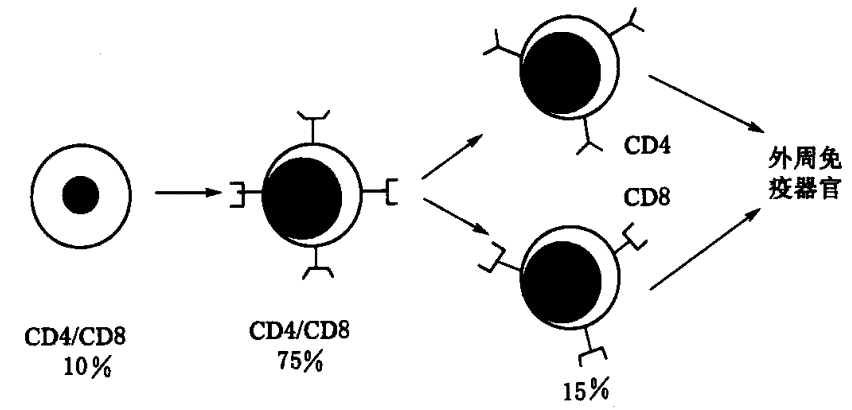

图 2-1 T 细胞在胸腺内的发育过程

成熟的 T 细胞离开胸腺进入血液循环，分布于外周免疫器官的胸腺依赖区，如淋巴结的副皮质区等，受抗原刺激后参与免疫应答。T 细胞是淋巴细胞再循环的主要细胞，在血液中占 60%～70%，在淋巴结中占 65%～85%，在胸导管中占 90% 以上。当胸腺发育不全时，T 细胞发育受阻，外周淋巴细胞显著减少，外周淋巴器官的胸腺依赖区萎缩。

###### ③ T 细胞的分类

T 细胞按功能可分为辅助性 T 细胞（T Helper cell, TH）、抑制性 T 细胞（T Suppressor cell, TS）和毒性 T 细胞（T Cytotoxic cell, TC），其中 TH，TS 主要起调节作用，也称为调节性 T 细胞。TH 能够激活 B 细胞，帮助其克隆增殖，而 TS 细胞的作用则正好相反。毒性 T 细胞能够发现侵入人体内的微生物、病毒或者癌细胞，向它们注入毒素，使其死亡，故又称为杀伤 T 细胞（T Killer cell, TK）。

##### (2) B 细胞

B 细胞（Bone marrow dependent lymphocyte, B cell）是在骨髓内发育成熟的细胞，因此称为骨髓依赖的淋巴细胞，简称 B 淋巴细胞或 B 细胞。B 细胞受抗原刺激后，可产生抗体的浆细胞。

###### ① B 细胞的表面标志

- A. 表面免疫球蛋白(Surface Immunoglobulin,SIg)是 B 细胞最具特征性的表面标志。成熟 B 细胞膜表面表达 SIgM 和 SIgD，未成熟的 B 细胞只表达 SIgM 分子。SIg 的肽链结构与免疫球蛋白(Immunoglobulin,Ig)相同，但 SIgM 是单体分子。一个 B 细胞表面有上万个 SIg 分子，其特异性都和与细胞分泌的 Ig 分子相同。由于细胞在分化过程中基因突变和 Ig 基因重排的结果，一个正常人体内至少有 3 × 10^6 个可产生不同抗体分子的细胞克隆。SIg 的功能是为 B 细胞表面的抗原受体与相应抗原进行特异性结合，并将抗原做内摄处理。这种受体介导的结合是 B 细胞捕获抗原的主要方式。

SIgM 或 SIgD 分子的羧基端插入细胞膜，但深度只有几个氨基酸，所以像 TCR 一样，SIg 自身不能独立地向细胞内传递刺激信号，必须依赖与其紧密相关的其他两种跨膜糖蛋白 Ig-α 和 Ig-β。这两种蛋白通过二硫键连在一起，各有一个大的肽段伸入细胞浆，因此可以像 T 细胞表面的 CD3 协同 TCR 一样辅助 SIg 向细胞内传递刺激信号。

- B. MHC 和 CD 抗原 成熟的 B 细胞表面表达 MHC 类分子，这可使 B 细胞作为抗原提呈细胞，与其免疫活性相关。

B 细胞在分化成熟过程中可表达不同的 CD 分子，其中某些可作为 B 细胞的标志，某些还与细胞功能相关。CD10 只出现在 B 前体细胞，CD19 存在从原始至成熟的 B 细胞中，而 CD22 只在成熟 B 细胞表达，但都是经常检测的标志；CD21 和 CD35 是补体受体；CD23 和 CD32 则是 Ig 的 Fc 受体；CD40 可与 TH 细胞上的配体相结合，从而接受 TH 的辅助作用。

###### ② B 细胞的发育与分布

人体 B 细胞的产生、发育和成熟均在骨髓中完成，这个过程伴随着一系列的胞内基因和表面标志的变化。如图 2-2 所示为 B 细胞的发育过程。

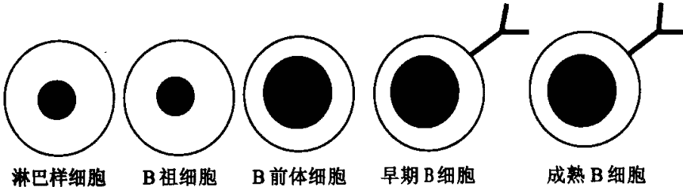

图 2-2 B 细胞的发育过程

B 祖细胞(pro-B cell)只表达 CD10, CD19 的末端脱氧核苷转移酶(TdT)，这个时期的主要变化是重链基因重排，重排的失败率占 50%。不成功的重排导致细胞死亡，成功的重排可导致产生重链 μm，存放于粗面内质网中。重链 μm 可与未重排轻链基因产物替代轻链(surrogate light chains)相结合，所形成的临时复合物能转移到细胞膜上，这种转移产生的信号使重链基因重排停止，表面临时复合物消失，细胞发育进入下一阶段。

B 前体细胞(pre-B cell)在进入成熟前不再分裂增殖，这时期的主要变化是轻链基因重排。重排的基因产生 κ 链或 λ 链，与已有的重链结合形成 4 肽的 IgM 单体，并转移到细胞膜上。这一信号使细胞进入成熟期，永久性地失去 Ig 基因重排的能力，因此受抗原刺激后增殖的所有子代细胞均产生与 SIg 同样特异性的抗体分子。成熟 B 细胞还表达其他表面标志，如 IgD、归巢受体、MHC 类分子、CD22、CD23 和 CD40 等。

未成熟 B 细胞都在骨髓内，成熟初期仍留在骨髓内 2～3 d，待表面标志表达完全后便离开骨髓进入血液循环，分布到外周免疫器官的非胸腺依赖区。B 细胞在血液中约占 20%～30%，在胸导管中不超过 10%，在淋巴结中约占 15%～35%，在脾脏中数量最多，可达 60%。B 细胞受抗原刺激后，可在外周免疫器官中继续增殖分化为浆细胞，分泌抗体。

##### (3) 第三群淋巴细胞

在淋巴细胞中，除 T 细胞和 B 细胞外，还发现一群没有 T 细胞和 B 细胞表面标志的淋巴样细胞。一些学者认为它们可能是与 T 细胞和 B 细胞并列的第三群淋巴细胞。目前认为它们来源于其他细胞系，有待深入研究后才能确定其归属。

自然杀伤细胞(NK 细胞)；NK 细胞来源于骨髓，主要存在于血液和淋巴组织，特别是存在于脾脏中。由于其胞浆中含有颗粒，故又称为大颗粒淋巴细胞(Large Granular Lymphocyte cell,LGL)。

从系统发生看，NK 细胞被认为是原始杀伤 T 细胞，但它没有抗原识别受体，能杀伤肿瘤细胞和病毒感染细胞，所以是非特异杀伤细胞，但无 MHC 分子的限制性，故名自然杀伤细胞。

虽然 NK 细胞对靶细胞的作用范围远大于杀伤 T 细胞，但其杀伤作用也不是随机的，而是有一定范围的。NK 细胞可以杀伤某些病毒感染细胞，但对正常未感染细胞无杀伤作用。NK 细胞可杀伤某些肿瘤细胞株，特别是对造血细胞来源的肿瘤细胞更为敏感，但不是对所有的肿瘤细胞均有作用。

目前发现的第三群淋巴细胞还有淋巴因子活化的杀伤细胞(Lymphokine Activated Killer cell, LAK)和肿瘤浸润淋巴细胞(Tumor Infiltrating Lymphocyte cell, TIL)等。

#### 2.2.3.3 单核吞噬细胞

游离于血液中的单核细胞(monocyte)及存在于体腔和各种组织中的巨噬细胞(Macrophage, Mφ)均来源于骨髓干细胞，它们具有很强的吞噬能力，且细胞核不分叶，故命名为单核吞噬细胞系统(Mononuclear Phagocyte System, MPS)。单核巨噬细胞是一类主要的抗原提呈细胞，在特异性免疫应答的诱导与调节中起着关键作用，广泛参与免疫应答、免疫效应与免疫调节。其具体作用如下：

##### (1) 免疫防御功能

病原微生物侵入机体后，在激发免疫应答以前即可被 MPS 细胞吞噬并清除，这是机体非特异免疫防御机制的重要环节。由于其吞噬能力较强，故有人将 MPS 细胞称为机体的“清道夫”。在致病微生物激发机体产生特异性抗体后，覆盖于病原体表面的 IgG 及补体激活片段 C3b 可与 MPS 细胞表面的 FcR 及 CR1 结合，发挥调理作用，使病原体更易被吞噬。被吞入的细菌可被细胞内的某些酶类或活性氧所杀灭。

##### (2) 免疫自稳功能

机体生长、代谢过程中不断产生衰老与死亡的细胞及某些衰变的物质，它们均可被单核吞噬细胞吞噬、消化和清除，从而维持体内环境的稳定。

##### (3) 免疫监视功能

MPS 细胞构成机体肿瘤免疫的重要一环。一般认为，只有激活的巨噬细胞才能有效地发挥杀瘤效应，其机制可能是：① 吞噬肿瘤细胞；② 借助抗瘤抗体的作用杀伤瘤细胞；③ 产生细胞因子，直接或间接地发挥杀瘤作用；④ 产生某些酶及活性氧分子，直接杀伤或抑制肿瘤细胞生长。

##### (4) 免疫抗原提呈功能

MPS 细胞是最重要的一类抗原提呈细胞。外来抗原经单核吞噬细胞处理后提呈给 T 细胞，这是诱发免疫应答的先决条件。此外，在抗原提呈过程中，MPS 细胞产生的 IL-1 也是 TH 活化不可缺少的刺激信号。

##### (5) 免疫调节功能

MPS 细胞在免疫调节中发挥重要的作用。由于激活程度及分泌产物的不同，MPS 细胞的免疫调节作用有双相性，体内各种因素也可通过影响单核吞噬细胞的膜分子表达等途径调节 MPS 细胞的功能状态。

##### (6) 其他功能

MPS 细胞还广泛参与炎症、止血、组织修复、再生等过程。

### 2.2.4 抗体分子

#### 2.2.4.1 抗体分子的基本结构

抗体(Antibody, Ab)是 B 细胞识别抗原后克隆扩增分化为浆细胞时所产生的一种蛋白质分子，也称为免疫球蛋白分子[4, 5]。 R. R. Porter 等对血清 IgG 抗体的研究证明，Ig 分子的基本结构由四肽链组成，即由两条相同的分子量较小的肽链(称为轻链)和两条相同的分子量较大的肽链(称为重链)组成。轻链与重链由二硫键连接形成一个四肽链分子，称为 Ig 分子的单体，构成免疫球蛋白分子的基本结构。 Ig 单体中四肽链两端游离的氨基或羧基的方向一致，分别命名为氨基端(N 端)和羧基端(C 端)。

##### (1) 轻链和重链

轻链(light chain)简称 L 链，大约由 214 个氨基酸残基组成，通常不含碳水化合物，每条轻链含有两个由链内二硫键所组成的环肽。L 链共有两型:kappa(κ)与 lambda(λ)，同一个天然 Ig 分子上 L 链的型总是相同的。正常人血清中的 κ : λ 约为 2 : 1。

重链(heavy chain)简称 H 链，大小约为轻链的 2 倍，含 450～550 个氨基酸残基，每条 H 链含有 4～5 个链内二硫键所组成的环肽。不同的 H 链，由于氨基酸组成的排列顺序、二硫键的数目和位置、所含的种类和数量不同，其抗原性也不相同。根据 H 链抗原性的差异，可将其分为 5 类:μ 链、γ 链、α 链、δ 链和 ε 链。

##### (2) 可变区和恒定区

通过对 H 链或 L 链的氨基酸序列比较分析，发现其氨基末端(N-末端)氨基酸序列变化很大，称此区为可变区(V)；而羧基末端(C-末端)则相对稳定，变化很小，称此区为恒定区(C)。

可变区(variable region)位于 L 链靠近 N 端的 1/2 区域(约含 108~111 个氨基酸残基) 和 H 链靠近 N 端的 1/5 或 1/4 区域 (约含 118 个氨基酸残基)。每个 V 区中均有一个由链内二硫键连接形成的肽环，每个肽环约含 67~75 个氨基酸残基。V 区氨基酸的组成和排列随抗体结合抗原的特异性不同，从而有较大的变异。由于 V 区中氨基酸的种类排列顺序千变万化，故可形成许多种具有不同结合抗原特异性的抗体。

恒定区(constant region)位于 L 链靠近 C 端的 1/2 区域 (约含 105 个氨基酸残基) 和 H 链靠近 C 端的 3/4 区域或 4/5 区域 (约从 119 位氨基酸至 C 末端)。H 链每个功能区约含 110 多个氨基酸残基，含有一个由二硫键连接的 50~60 个氨基酸残基组成的肽环。这个区域氨基酸的组成和排列在同型 L 链和同一类 H 链中都比较恒定，V 区不相同，即只能与相应的抗原发生特异性的结合，C 区的结构是相同的，即具有相同的抗原性。

##### (3) 功能区

Ig 分子的 H 链与 L 链可通过链内二硫键折叠成若干球形功能区，每一功能区(domain)约由 110 个氨基酸组成。在功能区中，氨基酸序列有高度同源性。

#### 2.2.4.2 抗体分子的功能

Ig 是体液免疫应答中发挥免疫功能最主要的免疫分子，免疫球蛋白所具有的功能是由其分子中不同功能区的特点所决定的。

##### (1) 特异性地结合抗原

Ig 最显著的生物学特点是能够特异性地与相应的抗原(Antigen,Ag)结合，如细菌、病毒、寄生虫、某些药物或侵入机体的其他异物。Ig 的这种特异性结合抗原的特性是由其 V 区(尤其是 V 区中的高变区)的空间构成所决定的。Ig 的抗原结合点由 L 链和 H 链的超变区组成，与相应抗原上的表位互补，借助静电力、氢键及范德华力等次级键相结合，这种结合是可逆的，并受到 pH 值、温度和电解浓度的影响。在某些情况下，由于不同抗原分子上有


相同的抗原决定簇，或有相似的抗原决定簇，一种抗体可与两种以上的抗原发生反应，称此为交叉反应(cross reaction)。

抗体分子可有单体、双体和五聚体，因此结合的抗原决定簇的数目(结合价)也不相同。Fab 段为单价，不能产生凝集反应和沉淀反应。F(ab')2 和单体 Ig(如 IgG,IgD,IgE)为双价。双体分泌型 IgA 有 4 价。五聚体 IgM 理论上应为 10 价,但实际上由于立体构型的空间位阻,一般只有 5 个结合点可结合抗原。

B 细胞表面 Ig(SmIg)是特异性识别抗原的受体,成熟 B 细胞主要表达 SmIgM 和 SmIgD,同一 B 细胞克隆表达同类 SmIg,其识别抗原的特异性是相同的。

##### (2) 活化补体

① IgM,IgG1,IgG2 和 IgG3 可通过经典途径活化补体。当抗体与相应抗原结合后，IgG 的 CH2 和 IgM 的 CH3 暴露出结合 Clq 补体的结合点，开始活化补体。由于 Clq 6 个亚单位中一般需要两个 C 端球部与补体结合点结合后才能依次活化 Clr 和 Cls,因此，IgG 活化补体需要一定的浓度,以保证两个相邻的 IgG 单体同时与一个 Clq 分子的两个亚单位结合。当 Clq 一个 C 端球部结合 IgG 时，亲和力则很低,当 Clq 两个或两个以上球部结合两个或多个 IgG 分子时，亲和力则增高。

② 凝聚的 IgA,IgG4 和 IgE 等可通过替代途径活化补体。

##### (3) 结合 Fc 受体

不同细胞表面具有不同 Ig 的 Fc 受体,分别用 FcγR,FcεR,FcαR 等来表示。当 Ig 与相应抗原结合后,由于构型的改变,其 Fc 段可与具有相应受体的细胞结合。IgE 抗体由于其 Fc 段的结构特点,可在游离情况下与有相应受体的细胞(如嗜碱性粒细胞、肥大细胞)结合,称为亲细胞抗体(cytophilic antibody)。抗体与 Fc 受体结合,可发挥不同的生物学作用。

### 2.2.4.3 抗体分子的抗原性

Ig 本身具有抗原性，根据不同抗原决定簇存在的不同部位，以及在异种、同种异体或自体中产生免疫反应的差别，可把 Ig 的抗原性分为同种型、同种异型和独特型 3 种不同抗原决定簇。

- (1) 同种型

同种型(isotype)是指同一种属(species)内所有个体共有的 Ig 抗原特异性的标记，在异种体内可诱导产生相应的抗体，换句话说，同种型抗原特异性因种属而异。同种型的抗原性位于 CH 和 CL，同种型主要包括 Ig 的类、亚类、型和亚型。

- (2) 同种异型

同种异型(allotype)是指同一种属不同个体间的 Ig 分子抗原性的不同，在同种异体间可诱导免疫反应。同种异型抗原性的差别往往只有一个或几个氨基酸残基的不同，可能是由于编码 Ig 的结构基因发生点突变所致，并被稳定地遗传下来，因此，Ig 同种异型可作为一种遗传标记(genetic markers)，这种标记主要分布在 CH 和 CL 上。

- (3) 独特型

独特型(idiotype)为每一种特异性 IgV 区上的抗原特异性。不同抗体形成细胞克隆所产生的 IgV 区具有与其它抗体 V 区不同的抗原性，这是由可变区中称其是超变区的氨基酸组成、排列和构型所决定的。所以，在单一个体内所存在的独特型数量相当大，可达 10^7 个以上。独特型的抗原决定簇称为独特位(idiotope)，可在异种、同种异体以及自身体内诱导产生相应的抗体，称为抗独特型抗体(anti-idiotypic antibody)。独特型抗体在复杂的免疫调节中占有重要地位。

### 2.2.5 MHC 复合体

20 世纪初即已发现，在不同种属或同种不同系的动物个体间进行正常组织或肿瘤移植会出现排斥，它是供者与受者组织不相容的反映。其后证明，排斥反应本质上是一种免疫反应，它是由组织表面的同种异型抗原诱导的。这种代表个体特异性的同种抗原称为组织相容性抗原（histocompatibility antigen）或移植抗原（transplantation antigen）。机体内与排斥反应有关的抗原系统多达 20 种以上，其中能引起强而迅速排斥反应者，称为主要组织相容性抗原，其编码基因是一组紧密连锁的基因群，称为主要组织相容性复合体（Major Histocompatibility Complex, MHC）。现已证明，控制机体免疫应答能力与调节功能的基因（Immune response gene, Ir gene）也存在于 MHC 内。因此，MHC 不仅与移植排斥反应有关，而且也广泛参与免疫应答的诱导与调节。

MHC 复合体有两种主要的 MHC 分子[8,9] 称为 MHC- I 类（MHC Ⅰ）和 MHC- II 类（MHC Ⅱ）。Ⅰ 类分子在每一个细胞中都可以发现，而 Ⅱ 类分子只在免疫系统抗原提呈细胞上发现，像巨噬细胞和 B 细胞。

MHC 最初是在研究排斥反应的过程中发现的。MHC 分子作为代表个体特异性的主要组织抗原，在排斥反应中起重要作用。自从 20 世纪 60 年代发现了 Ir 基因，20 世纪 70 年代发现了毒性 T 细胞与靶细胞间相互作用的 MHC 限制性后，对 MHC 的生物学作用有了更深入的认识。MHC 的主要功能包括：

- (1) 参与对抗原处理

MHC 分子在多个环节参与对抗原处理。外源性抗原在抗原提呈细胞（APC）内被降解成免疫原性多肽，并与 MHC Ⅱ 类分子结合成稳定的复合物，从而保证了多肽不被进一步降解为氨基酸。20 世纪 80 年代末还发现，内源性抗原在靶细胞中必须与胞浆中的一种蛋白酶体（proteasome）结合才能进一步分解为免疫原性多肽片段，后者再在一种肽链转运蛋白的参与下被转运到内质网腔与新合成的 MHC Ⅰ 分子结合。已证明蛋白酶体相关基因及肽链转运基因均位于 MHCⅡ类基因区内。

- (2) 约束免疫细胞间相互作用

20 世纪 70 年代中期，Rolf Martin Zinkernagel 等发现，毒性 T 细胞只杀伤具有同一 MHC 表型的病毒感染的靶细胞。这意味着 T 细胞识别细胞表面抗原决定簇的同时，还需识别细胞上的 MHC 分子。以后证实，不仅 TC 靶细胞间，而且 Mφ-TH，TH-B 及 TH-TC 间的相互作用也受 MHC 约束。这一现象，即具有同一 MHC 表型的免疫细胞才能有效地相互作用，称为 MHC 限制性(MHC restriction)。

巨噬细胞(Mφ)与 TH 细胞间的相互作用受 MHCⅡ类抗原的约束。TH 的 TCR 联合识别免疫原性多肽片段的表位(epitope)及 MHCⅡ分子 α1,β1 功能区的多肽性决定簇。同时，TH 细胞表面的 CD4 分子识别 MHCⅡ类分子 α2,β2 功能区的非多肽性决定簇，启动免疫应答。因此，只有 MHCⅡ类分子阳性细胞才具有抗原提呈能力，且细胞表面 MHCⅠ类分子密度与其抗原提呈能力成正相关。

TC 与病毒感染的靶细胞相互作用受 MHC Ⅰ 类抗原的约束。TC 的 TCR 联合识别靶细胞表面的病毒抗原及 MHC Ⅰ 类分子 α2 和 β2 功能区的多肽性决定簇。同时，TC 表面的 CD8 分子识别 MHC Ⅰ 类分子 α3 区的非多肽性决定簇。

- (3) 参与对免疫应答的遗传控制

机体对某种抗原物质是否产生应答及应答的强弱是受遗传控制的。控制免疫应答的基因称为 Ir 基因。人的 Ir 基因对特定抗原的免疫应答能力各不相同。

- (4) 诱导自身或同种淋巴细胞反应

MHC 分子可作为自身或同种反应的刺激分子，从而诱导免疫应答或参与免疫调节。

- ① 参与免疫调节非 T 细胞(M,B 细胞等)在体外能诱导自身 T 细胞发生增殖反应，此即自身混合淋巴细胞反应（Autologous Mixed Lymphocyte Reaction，AMLR）。在 AMLR 中，非 T 细胞表面的刺激决定簇是 HLA-DQ 分子。自身反应性 T 细胞增殖后可表达 HLA-DR 抗原，后者又作为刺激分子激活某些 T 细胞，即 T-T AMLR。AMLR 代表体内免疫细胞间的一种调节机制，有助于维持免疫自稳，故 MHC II 类分子通过诱发 AMLR 而参与免疫调节。

- ② 诱导免疫反应 MHC 分子是一种同种异型抗原，可诱导同种反应的发生，典型的例子是体外的同种异型混合淋巴细胞反应和体内同种移植排斥反应。在这两种情况下，反应性 T 细胞对非自身 MHC 抗原的识别不受自身 MHC 限制。

- (5) 参与 T 细胞分化过程

早期 T 细胞在胸腺中发育为成熟 T 细胞的过程中，伴随着一系列表面标志的变化。MHC 分子对 T 细胞的分化发育起着重要作用，早期 T 细胞必须与表达 MHC I 类或 MHC II 类抗原的胸腺上皮细胞接触后才能分别分化成 CD8+ T 或 CD4+ T 细胞。

### 2.2.6 免疫传导系统

细胞指令系统是指免疫系统内完成各种免疫功能的细胞成分。假设淋巴系统（B 和 T 细胞）中细胞成分的主要类型有三种指令系统[10]：

- ① 潜在指令系统：由基因编码抗体或者 T 细胞受体加上来自它们的可能的体细胞变异（在基因片段加入期间引入的错误）的胚系基因集合表达的数量、结构和机制来决定。

- ② 可利用（表达）指令系统：定义为一组用做淋巴细胞受体的多种分子，也就是能够使用的（但不是目前正在使用的）分子。

- ③ 实际指令系统：由在内部环境中激活的效应淋巴细胞产生的抗体和受体集合，该环境实际上参与在任何给定状态下定义的自治活动(autonomous activity)的相互作用。

免疫系统识别抗原的能力是完善的。淋巴细胞产生抗体分子和 T 细胞受体几乎能够识别任何外源分子(或自身分子),即使是人工合成的。抗体分子具有免疫原的特异型。它遵循完全性公理[11](completeness axiom),即它们会被其他抗体分子辨别,这个现象导致独特型网络概念的形成。形成指令系统完全性的主要因素是它的多样性(基因变异、编辑和重组)、交叉反应和多特异性[12]。交叉反应和多样性是一个淋巴细胞指令系统为什么比其要识别的可能的抗原集合小却能完成识别和清除病原体任务的主要原因[13]。在交叉反应和多样性之间的主要差别是前者表明相关抗原模式的识别(或者抗原决定簇),而后者指截然不同的化学结构识别[14]。

### 2.2.7 免疫系统分类

人体有两层具有内在联系的防御异物入侵的系统:一种是固有免疫系统(the innate immune system);另一种是适应性免疫系统[1](the adaptive immune system)。

#### 2.2.7.1 固有免疫系统

第一层免疫系统为固有免疫系统,是天生就有的,不随特异病原体变化,由补体(化学应答系统)、内吞作用系统和吞噬细胞系统组成。之所以称为固有免疫系统是因为自身与生俱来就有辨别一定微生物或细菌并很快消灭它们的能力。

固有免疫系统具有与病原体第一次遭遇时就能消灭它们的能力,而且可以消灭许多种第一次遇到的病原体。当病原体如细菌、真菌和胞内寄生的寄生虫等穿越皮肤、黏膜,入侵体内,免疫系统中的吞噬细胞即刻被动员至病原体入侵处,迅速吞噬并清除病原体。

固有免疫反应的一个重要组成部分是补体,协助或者补体活动。固有免疫在生发生中心解码的一组受体的基础上辨别与微生物病原体有关的分子模型，这种受体称为模式识别受体（Pattern Recognition Receptors, PRRs），而被识别的病原体的分子模型称为病原体关联分子模型（Pathogen Associated Molecular Patterns, PAMPs）。PAMPs 只由病原微生物产生，而不会由宿主组织产生，因此它们被 PRRs 识别时可以发生指明病原体存在的信号。这样，与免疫识别相关的结果必须与人体自身细胞和分子的结构绝对不相同，从而避免免疫系统破坏宿主自己的组织。这种机制的结果是：固有免疫也能够辨别自体与非自体组织结构，参与到自体与非自体识别组织中，并起到促进适应性免疫的重要作用。

固有免疫识别（innate immune recognition）最重要的方面是它诱导抗原提呈细胞中的协同刺激信号（co-stimulatory signals）的表达，这种信号会激活 T 细胞，促使适应性免疫应答产生。这样，没有固有免疫识别的适应性免疫识别会导致淋巴细胞的阴性选择（negative selection），这些阴性选择表示与适应性免疫识别有关的受体。

#### 2.2.7.2 自适应免疫系统

自适应免疫系统也称适应性免疫系统，使用两种类型的淋巴细胞：T 细胞和 B 细胞。这两种细胞是无性系划分的体细胞分裂产生的抗原受体。这些抗原受体通过随机过程产生，而自适应免疫系统一般性能的设计和形成是在淋巴细胞的克隆选择基础上进行的，这些淋巴细胞以精确的特异性表示抗体[15]。抗体在自适应免疫系统中扮演主要角色，免疫应答（immune response）中使用的受体是由基因片段（gene segment）结合在一起形成的。每一个细胞使用得到的不同的基因片段形成一个特异的受体，使细胞能够在一起以集体方式在生物体一生中识别可能遭受感染的组织。自适应免疫是指抗体能够识别任何微生物并对其反应，即使对以前从未遇到过的“入侵者”也一样。自适应免疫能够完成固有免疫系统不能完成的免疫功能，清除固有免疫系统不能清除的病原体。自适应免疫系统直接作用于一些特定的病原体。

一旦病原体进入身体，固有免疫系统和自适应免疫系统就开始处理，此时两个系统的细胞都由多种细胞和分子以复杂的方式交互作用来检测和消除病原体。检测和消除都依赖化学结合：免疫细胞表面都覆盖不同受体，其中的一些结合病原体，而另一些结合其他免疫系统细胞或者分子，使系统发信号触发免疫应答。

### 2.3 免疫系统机制

#### 2.3.1 免疫应答

免疫系统有两种免疫应答类型[5]：一种是遇到病原体后，首先并迅速起防卫作用的称为固有性免疫应答(innate immune response)；另一种是适应性免疫应答(adaptive immune response)。

固有免疫应答中，执行固有免疫功能的有皮肤和黏膜的物理阻挡作用及局部细胞分泌的抑菌、杀菌物质的化学作用等。固有免疫在感染早期执行防卫功能。

适应性免疫应答的执行者是 T 淋巴细胞及 B 淋巴细胞。这些细胞在免疫过程中帮助识别和破坏一些特定物质。能被 T 细胞及 B 细胞识别并刺激 T 细胞及 B 细胞进行特异性免疫应答的病原体成分称为抗原(antigen)。任何能使免疫系统产生这样的应答和反应的物质都是抗原或免疫原。T 细胞及 B 细胞与被免疫系统认为是异物的物质结合后开始活化，即识别病原体成分后活化，活化后并不即刻表现防卫功能，而是经免疫应答过程，约 4 ~5 d 后才生成效应细胞，对已被识别的病原体施加杀伤清除作用。适应性免疫应答是继固有性免疫应答之后发挥效应的，在最终清除病原体、促进疾病治愈及在防止再感染中起主导作用。

适应性免疫应答是 T 细胞及 B 细胞对特性抗原的应答过程，故又称为抗原特异性免疫应答（antigen-specific immune response）。鉴于 T 细胞及 B 细胞在遇到抗原前并不表达功能，只有在被抗原活化后，经扩增、分化、发育成效应细胞才具有免疫功能，因而又称为特异获得性免疫(specific acquired immunity)。适应性免疫应答又分为两种类型：初次免疫应答及二次免疫应答。

##### (1) 初次免疫应答(the initial immune response)

初次免疫应答发生在免疫系统遭遇某种病原体第一次入侵时。此时免疫系统对感染产生大量抗体，帮助清除体内抗原。图 2-3 表明当一种抗原侵入免疫系统后，系统有一个产生抗击抗原感染的抗体的初始化过程。但是几天之后，抗体的浓度水平开始下降，直到再次遇到抗原。自适应免疫系统能够学习和记忆特异种类的病原体。初次应答是对以前未见过的病原体的应答过程。初次应答学习过程很慢，发生在初次感染的前几天，要用几周的时间清除感染。

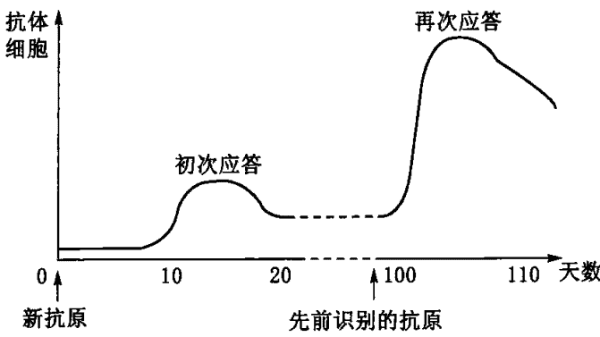

图 2-3 免疫应答过程

图 2-3 是抗体的浓度水平对一个抗原的免疫应答时间反应周期。对初次遇到的抗原应答时间可长达几周，而二次应答则对遇到的同样抗原的反应非常迅速。y 轴是免疫应答的强度测量，由抗体浓度表示。

##### (2) 二次免疫应答

在初次免疫应答后，免疫系统首次遭遇异体物质并将其清除于体外，但免疫系统中仍保留一定数量的 B 细胞作为免疫记忆细胞(immune memory cell)[16]，这使得免疫系统能够在再次遭遇异物后仍能快速反应并反击抗原，这个过程称为二次免疫应答。二次应答更迅速，无须重新学习。二次免疫应答对引起初始免疫反应及造成免疫系统 B 细胞和抗体数量迅速增加的抗原是特异的。这种二次免疫应答要归功于免疫系统内存留的 B 细胞，这样当抗原或类似抗原再次入侵时，不用再重新生成抗体，因为已经有抗体存在了，这意味着身体准备抗击一切再感染。

#### 2.3.2 免疫识别

##### 2.3.2.1 特异识别

###### (1) 特异识别原理

免疫系统特异识别[7]是抗体结合特异抗原的过程。识别抗原是免疫系统实现免疫功能的第一步。免疫系统中的识别发生在分子水平，并基于抗体决定簇和抗原决定簇的抗原部分之间的形状互补(shape complementarity)发生。当抗体具有单一种类的受体时，抗原可以有多个抗原决定簇，意味着单个抗原能够被不同抗体分子识别。

发生免疫系统识别的抗体决定簇和抗原决定簇(在病原体或者蛋白质片段的表面位置)位置都具有三维结构和电荷控制。结构越互补，结合(抗体决定簇和抗原决定簇结构互补的过程，是一种发生在分子水平的物理化学过程)越可能发生，结合的强度称为亲和力(affinity)。两者的匹配关系可以用一把钥匙对一把锁的关系来形容，不是一把锁头上的钥匙就不能打开这把锁头，要打开这把锁,钥匙的形状就必须与锁芯一致。抗原决定簇尽可能好地与入侵抗原的抗原决定簇相结合。两者匹配程度越好,结合得就越好,抗原和抗体的亲和力就越大;但不像锁与钥匙需要完全一致,而是只需大致匹配互补就可以。结合导致 B 细胞进入活化状态开始克隆[14],实际上就是克隆选择。

###### (2) 特异识别过程

抗体是特异的,因为一种抗体只强烈地结合几个类似的抗原决定簇结构或模式。这种特异性扩展到淋巴细胞本身:抗体结构在淋巴细胞之间可以不同,但是单个淋巴细胞具有相同的抗体(10^5),使一个淋巴细胞对一组特异的类似抗原决定簇结构特异。病原体有许多不同的抗原决定簇,反映其分子结构,所以许多不同的淋巴细胞对单个种类病原体特异。

淋巴细胞表面的抗体都能结合抗原决定簇,有多个同样的抗体是有益的:首先通过频繁采样,使淋巴细胞估计其对给定抗原决定簇的亲和力。亲和力增加,能够发生结合的抗体数也增加。结合的抗体数可看做是单个受体和一个抗原决定簇结构之间的亲和力的估计(当然是理想化的抗体可以结合不同的抗原决定簇结构,所以估计是受体和不同抗原决定簇之间的亲和力的相当任意的表示,但是,随亲和力增加,估计变得更准确,因为抗原决定簇结构必须类似地增加)。其次,具有多个抗体使淋巴细胞能够估计在其邻近位置的抗原决定簇数,结合的抗体越多邻近的病原体越多。最后,单特异性(mono-specificity)对免疫应答是非常重要的,因为如果淋巴细胞不是单特异的,对一种病原体的应答会诱导对其他无关的抗原决定簇的应答。

淋巴细胞的性能受亲和力强烈影响:一个淋巴细胞只有在结合的抗原数超过某阈值时才被激活。这样,如果其抗体对特异抗原决定簇结构有足够高的亲和力,且如果在淋巴细胞附近存在足够数量病原体,淋巴细胞会被病原体激活。这样激活阈值使淋巴


细胞称为概括检测器(generalized detectors)。一个单个淋巴细胞检测结构类似的一类抗原决定基。如果假设所有抗原决定基的空间为一个模式集合，则一个淋巴细胞能够检测或者覆盖(coverage)这些模式的子集，因此，不必对每一个抗原决定基模式都有一个不同的淋巴细胞去覆盖所有可能抗原决定基模式空间(pattern space)。

##### 2.3.2.2 模式识别

在免疫系统中，从模式识别角度来看，抗原决定基和抗体决定基本质上是使免疫系统完成模式识别的任务[11]。B 细胞和 T 细胞最重要的特征是在它们的细胞膜表面都有能够辨别抗原(或者自由的,或者束缚在 MHC 分子上的)的受体分子。抗原本身并不是侵入的微观组织，它们是包含在微观组织内的多肽、寡糖及脂质等小分子或者酶一类的有机物质，因而有不同的抗原性，其化学成分不同于宿主细胞自身的化学组成，能被 T 细胞及 B 细胞识别。一个 T 细胞及 B 细胞只表达一种 TCR 或 BCR，只能特异地识别并结合一种抗原分子；所以 T 细胞及 B 细胞对抗原具有严格的特异性，而在 T 细胞及 B 细胞的整个群体中，则能识别各种各样的抗原分子。

B 细胞抗体或 T 细胞受体能识别一个抗原的不同特征。B 细胞受体与出现在完整的抗原分子上的抗原决定基相互作用。抗原分子可以是溶解的或者束缚在一个表面上。T 细胞受体只与细胞表面的分子相互作用。T 细胞分泌能够杀死或者促进其他细胞生长的化学物质，在调节免疫应答中起重要作用，通过识别一个细胞表面分子，T 细胞必须确认它是否与另一个细胞相互作用，而不是一个可溶解的分子。

### 2.3.3 免疫细胞活化与克隆选择和扩增

#### 2.3.3.1 免疫细胞活化

T 细胞及 B 细胞与抗原结合后，就开始活化。T 细胞表达的 TCR 识别的是抗原肽，蛋白质性抗原分子必须经抗原提呈细胞处理，蛋白质性抗原降解为多肽，并与 APC 细胞本身主要组织 MHC 分子相结合后，转运并表达于 APC 表面才被 TCR 识别，产生 TCR 活化信号。T 细胞活化尚需第二种信号(亦称协同刺激信号,co-stimulatory signal)，它是由活化的 APC 与 T 细胞表面的另一类分子相互作用而介导的，故 T 细胞需要双信号才能充分活化。

#### 2.3.3.2 克隆选择和扩增

- (1) 克隆选择原理

克隆选择原理的基本思想是只有那些能够识别抗原的细胞才进行扩增，只有这些细胞才能被免疫系统选择并保留下来，而那些不能识别抗原的细胞则不被选择，也不进行扩增。T 细胞和 B 细胞都能够进行克隆选择。骨髓中微小的“休眠”的 B 细胞每一个都载有一个不同的抗体类型。这些细胞载有对于抗原特异的受体，扩增分化成浆细胞和记忆细胞。

F. M. Burnet 于 1959 年提出克隆选择学说[14]，该学说认为，免疫细胞是随机形成的多样性的细胞克隆，每一克隆的细胞表达同一特异性的受体，当受 Ag 刺激，细胞表面受体特异识别并结合，如导致细胞进行克隆扩增，产生大量后代细胞，合成大量相同特异性抗体。

克隆选择与达尔文变异和自然选择过程类似：克隆竞争结合病原体，亲和力最高的是最适应的，因此复制最多。

免疫系统使用的分子的大量多样性是其识别能力的关键，基础原理是克隆选择。克隆选择与达尔文自然选择理论有关，但是应用于免疫系统内的细胞群体。一个包括许多基因片段的组合关系的精确遗传机制决定这些抗体的结构，这样一个动物在 B 细胞上有表达 10 种不同抗体的遗传能力[17]，以及在 T 细胞上超过 10 种不同受体。人类中的淋巴细胞群体在任何时候都能表达 10^16 种不同抗体指令系统，所以当遇到一个外部细胞或分子，某淋巴细胞上的抗体有极高的概率与其结合。这种情况导致淋巴细胞被激活，在此基础上分裂增生，成长为一个细胞克隆，通过分泌抗体对抗原应答。如果是一个 B 细胞分泌多种不同其他因子，则是 T 细胞。一个 B 细胞分泌的抗体是其细胞表面的溶解形式，这样能够具有与抗原结合并能够被选择的形状。与自然选择类似的是最适应的，克隆是那些识别抗原的克隆。这些克隆存活下来并成长，而不识别抗原的克隆死亡并被其他克隆取代，这就是克隆选择。免疫系统在成长的克隆中也是自适应的，也呈现一种变异机制，在对抗体特异编码的基因中产生极高频率点变异。该机制（体细胞高频变异）与为改进抗原结合而进行的选择，共同导致细胞与抗原具有极高的亲和力匹配。B 细胞受抗原刺激，分化为能不断大量分裂的淋巴母细胞，活化的淋巴母细胞能进一步分化为短期存活的浆细胞（plasma cells）、分泌抗体（Antibody，Ab），并执行相应功能，或者成为长期存活的免疫记忆细胞。记忆细胞不分泌抗体，只有在受相同抗原再次刺激后，才能很快分化成浆细胞，在未来起保护作用。克隆选择理论的主要特征是[14]：新细胞是父代（克隆）的“拷贝”，受制于高速率（体细胞高频变异）的成熟机制；清除新分化的载有自身反应受体的淋巴细胞；增殖和分化与成熟细胞和抗原有联系；禁止克隆的持续，对早期自身抗原的清除是抵制自身免疫疾病的基础。

- (2) 克隆选择的效率与进化

克隆选择要有效率，淋巴细胞上抗体的多样性要足以识别任何抗原。免疫学家认为，如果存在至少一个能识别任何抗原的抗体，则抗体指令系统就是完整的。A. S. Perelson 和 G. F. Oster 用一个概率模型[14]，为指令系统完整性定义准确条件，并表明如果指令系统中的 $10^7$ 受体是随机创造的，则指令系统是完整的；但是，抗体不是完全随机创造的。

克隆选择在个体内操作，进化的更多传统形式在决定抗体和 T 细胞受体的可变区（V）基因上操作。这些基因进化倾向于识别一般抗原的方向。有许多证据表明这样的倾向性确实存在。例如，B 细胞一般要求获得来自 T 细胞的帮助，而成为激活的并分裂分泌抗体；但是，某些抗原，比如某些细菌细胞壁（wall）上的多聚糖，被以不同方式处理，在没有 T 细胞辅助的情况下也会刺激 B 细胞，它显示免疫系统已经进化并学习识别该细菌。

亲和力变异是达尔文变异和选择进化论思想的过程。变异由体细胞高频变异实现，选择由对病原体抗原决定基的竞争实现。

- (3) 阴性选择

淋巴细胞的阴性选择[4,18]描述这样一个过程：淋巴细胞与抗原相互作用导致该淋巴细胞的死亡（或无反应能力），来自指令系统的一小部分细胞会被抗原识别，抗原被克隆选择激活。自体特异抗原可以通过细胞凋亡或者无反应力使有问题的淋巴细胞受到抑制。如果 Ag 浓度或者它的淋巴细胞亲和力很低，细胞可以保持不受影响。未成熟 T 细胞在胸腺中发展，如果在发展期间被激活，它们因程序细胞死亡（programmed cell death，细胞凋亡）而死亡。更多的自体蛋白质在胸腺中表达，所以存活的 T 细胞继续发育成熟并离开胸腺，对所有那些自体蛋白质耐受，该过程称为 T 细胞阴性选择，因为未激活的 T 细胞才存活。

T 细胞阴性选择发生在胸腺内或者其外围，称为胸腺阴性选择。胸腺阴性选择基于下述考虑：胸腺由无数 I 类和 II 类 MHC 耐受 APCs 组成，包括巨噬细胞、树突细胞和特异上皮细胞。因为胸腺受到免疫系统和血液—胸腺屏障保护，这些 APCs 首先提呈自体缩氨酸/MHC 复合物（自体 MHC 配合基）到 T 细胞指令系统。胸腺阴性选择来源于不成熟自体反应淋巴细胞和胸腺 APCs 上的自体 MHC 配合基的相互作用，导致自体反应 T 细胞从指令系统中潜在的清除。不显示与任何自体 MHC 配合基相互作用意义的“无用”TCRs 的 T 细胞也从指令系统清除。胸腺阴性选择无论如何并不完善，一些自体反应 T 细胞逃脱并进入胸腺外围成为完全的免疫活性细胞，增加了自身免疫疾病的威胁。

除了淋巴细胞受体结构中大量的随机成分，淋巴细胞抗体和抗原决定基之间的遭遇并非不可避免地激活淋巴细胞，但可能造成其死亡或者钝化(无反应力)，因此，阴性选择形式防止自体特异淋巴细胞成为自体攻击细胞。相反，经历正选择的更小比例的细胞成熟为免疫活性细胞，构成个体的可获得的指令系统[4]。

- (4) 克隆扩增

抗体的数量通过免疫系统产生大量 B 细胞而增加。这个产生大量 B 细胞的过程称为克隆扩增[5]。B 细胞表达的 BCR 可直接识别并特异结合抗原分子而活化，在 B 细胞生长因子的作用下细胞进行扩增，导致克隆扩增，即由表达一种 BCR 的一个 B 细胞分裂产生很多后代 n 细胞，它们均表达同一种 BCR。当 B 细胞克隆扩增时，它经历一个自我复制超变异随机过程，免疫系统此时产生广泛抗体指令从体内清除感染的抗原，并为抵制下次某个时候类似但不同的感染做好准备。前面提到，T 细胞需要双信号才能充分活化。T 细胞活化后，在 T 细胞生长因子的提供下克隆扩增。

在某些情况下，克隆是通过细胞变异形式[19]。这一机制使免疫系统具有自适应性，也就是通过调整特殊的变异机制产生抗体分子基因密码变异。通过产生不同的 B 细胞集合和由此产生的抗体，以及 B 细胞在免疫系统中的存留（记忆细胞），免疫系统在以后可以对抗同样的或者类似的病原体入侵感染。

### 2.3.4 抗体指令系统

- (1) 抗体指令系统多样性

抗体指令系统多样性是指免疫系统能够产生多种多样的抗体来应对自然界几乎无限多种的抗原。因为免疫系统检测通过抗体结合病原体抗原来实施，要保证结合的效率和有效清除抗原，治愈感染，免疫系统就必须有充分的多样性淋巴细胞受体指令系统（解释），确保至少有一些淋巴细胞能够结合任何给定抗原决定基。

- (2) 抗体指令系统多样性机制

抗原激活的 B 细胞抗体指令系统基本通过两种机制实现多样化：高频变异和受体编辑（receptor editing）[17]。

免疫学研究成果表明，免疫系统除了淋巴细胞克隆选择外，还进行受体分子选择。取代所有自身反应细胞克隆删除的是 B 淋巴细胞经历的受体编辑（基因重组，rearrangement），即这些 B 细胞已经删除它们的自身反应抗体，通过基因重组发展全新的受体。虽然编辑和受体选择不是 Burnet 模型的一部分，但是如果受体选择在细胞选择之前发生，克隆选择理论肯定适合受体编辑。任何通过体细胞高频变异或者编辑产生的高亲和力克隆体都会被优先选择扩充；但是为了保持群体（指令系统）多样性，也允许几个低亲和力细胞进入指令系统。

抗体指令系统不但要通过高频变异机制实现多样化，而且必须存在选择少量具有高亲和力变异受体的 B 细胞主导应答的机制。由于体细胞变异过程的随机性，很大比例的变异基因成为非功能性或者发展出有害的抗自身特异类型基因，这些细胞带有低亲和力受体，或者是自身反应细胞，必须被清除（或成为anergy），因此它们对记忆细胞池没有显著贡献，清除危及抗原结合能力的 B 细胞的具体机制目前还不十分清楚，但细胞凋亡（apoptosis）肯定是一种清除方式，也是一个微弱细胞的死亡过程，经常等同于程序性细胞死亡(programmed cell death)。

受体编辑和点变异在亲和力变异过程中起互补作用。除了体细胞高频变异和受体编辑外，为了保持群体的多样性，从骨髓中新产生的一小部分细胞添加到淋巴细胞池中。根据 N. K. Jerne 的观点[10]，受刺激程度最小的淋巴细胞的 5%～8% 的每一细胞带会被替换，加入到抗原识别细胞池中。对于全局优化更广阔的搜索，这可能产生与受体编辑同样的结果。

体细胞变异允许达到局部优化，而受体编辑引入多样性，导致可能的、新的候选受体。受体编辑和体细胞变异两者都作为抗体基因多样化机制而出现是很令人感兴趣的。两种机制都在 B 细胞的发展期间受到严格控制，免疫球蛋白基因片段的组合首先进行，在细胞首先暴露给抗原时完成。产生一个细胞群体，在特异性方面有很大变化，因此使几个细胞与某些特定抗原相协调。变异机制在被选择的 B 细胞克隆扩增期间发生。通过改变个体核苷基础，变异调节免疫应答，制造免疫球蛋白基因，更好地与抗原匹配。

- (3) 抗体多样性的产生

产生充分多样性指令系统是一个问题，因为人体没有与可能存在的病原体抗原决定基一样多的蛋白质。估计免疫系统可得到 10^8 个不同蛋白质，而有潜在的 10^16 个不同外部蛋白质或模式即抗原决定基种类需要识别，则按照数目比较，指令系统多样性显然不够充分去结合每一个可能的单个病原体。在这种情况下会出现严重问题，因为复制病原体可能进化，从而突破现存指令系统检测。免疫系统通过动态性保护解决该问题。淋巴细胞连续翻番：每天大约 10^7 个新淋巴细胞产生。假设在任何给定时间有 10^8 个不同淋巴细胞，每天以 10^7 个速率翻番，10 d 时间就可产生一个全新的指令系统。经过一段时间，该淋巴细胞（也包括免疫记忆细胞）的翻番改善了免疫系统的保护性能[4,7]。

识别并特异性结合抗原是免疫球蛋白分子的主要功能，这种特异性是由免疫球蛋白 V 区的空间构型决定的。免疫球蛋白有单体、二聚体和五聚体，因此结合抗原表位的数目也不相同。通过识别与特异分子模型的区别，抗体在免疫系统中起到中心作用。抗原在结构上千变万化，迫使抗体指令系统变得十分庞大[20]。抗体多样性产生于通过抗原受体基因片段的随机组合连接发展淋巴细胞间[20]。这种不同而又相关的超大规模数量的抗体信息在细胞内进行必要的编码，编码后的遗传信息存储在胚系细胞的染色体中并传递给下一代，即受体编辑。

### 2.3.5 体细胞高频变异与 MHC 多样性

#### 2.3.5.1 体细胞高频变异

B 细胞与抗原结合后被激活，激活后即以极高的频率分裂，该过程为体细胞高频变异[19]，是克隆扩增期间产生的重要变异形式，对受体多样性产生起重要作用。当一个 B 细胞被激活，它迁移进淋巴结(lymph node)。淋巴结是自适应应答发展的腺体，有几百个淋巴结遍布全身，B 细胞在经历克隆扩增与体细胞高频变异(体细胞高频变异率的幅值是一般细胞变异率幅值的 9 次方)，高变异率增加了克隆具有不同于来自父代的受体结构，因此有不同的抗原决定基亲和力。新 B 细胞具有结合在淋巴结内捕获的病原体抗原决定基的机会。如果不结合会很快死亡；如果结合成功，则离开淋巴结，分化为浆细胞和记忆 B 细胞。

每一代体细胞，可变区的每基对(per base pair，bp)接近 1×10^-3 高频变异率，在细胞分化期间有选择地进行。由于这些可变区的结合长度大约为 700 bp，每次细胞分裂作为一次变异[17]。

变异的迅速积累对于免疫应答的快速成熟是必须的，但是多数变化会导致更弱或者非功能性抗体。如果一个细胞刚刚采用一种有用的变异，并以同一速率在下次免疫应答期间继续变异，则衰弱变化的积累可能引起变异优点的损失。这样，体细胞高频变异短时间内爆发，随后给选择和克隆扩增以“呼吸空间”[15]，可能形成变异过程的基础。选择机制可以提供依靠亲和度进行高频变异过程调节的手段。低亲和力受体细胞可以进一步变异，即通过细胞凋亡死亡；但是在高亲和力抗体受体细胞中，可以不激活高频变异。

#### 2.3.5.2 MHC 多样性

MHC 遗传多样性如此重要，以致被认为有性繁殖的持续的主要原因是把最大多样的 MHC 类型传给后代。人的 MHC 通常称为 HLA（Human Leukocyte Antigen）——人类白细胞抗原。现知 MHC 的主要功能是以其产物提呈抗原肽进而激活 T 淋巴细胞，由此形成 T 细胞对抗原和 MHC 分子的双重识别，因而 MHC 在启动特异性免疫应答中起重要作用。特定的 MHC 分子可凭借所需要的共同性基序选择性地结合抗原肽，在这个意义上，两者的结合具有一定的专一性。MHC 分子甚至可以被视为抗原肽的“受体”，其作用就是在细胞内捕捉相应的抗原肽，将它转送到细胞表面，以肽—MHC 分子复合物形式提供 TCR 识别。不同的 MHC 等位基因产物有可能提呈同一抗原分子的不同表位，造成不同个体（带有相异的 MHC 等位基因）对同一抗原的应答在强度上出现差异，这实际上是 MHC 以其多态性参与和调控免疫应答的一种重要机制。

对宿主防御而言，MHC 与尽可能多的外部缩氨酸片段形成 MHC 缩氨酸复合物是重要的。T 辅助细胞识别那些外部缩氨酸，因为分子结合的本质，一个单个形式 MHC 能与多个 MHC 形成复合物，但不是所有的病原体缩氨酸，因此，在病原体上有选择压力而进化，这样它们的特征缩氨酸不能被 MHC 结合，因为它们被免疫系统有效地隐藏。人体具有尽可能多种类的 MHC 分子是重要的，但是由于 MHC 分子形式的多样性增加，导致未成熟 T 辅助细胞结合 MHC 复合物和自体的机会增加，意味着 T 辅助细胞会被消除在阴性选择期间，被消除的 T 辅助细胞是资源浪费，所以在阴性选择期间进化应该满足更低的消除 T 辅助细胞的速率，因此 MHC 类型的数量受到由检测病原体的多样性要求约束，还受到阴性选择强加的资源限制约束，数学模型研究表明体内出现的 MHC 分子类型接近最佳。

MHC 类型在有机体生命期间不变化，由基因决定，因此 MHC 是遗传免疫多样性的代表。在一个群体内，多样性在改善群体对特殊病原体类型的群体鲁棒性方面是关键的。

### 2.3.6 学习与记忆

#### 2.3.6.1 免疫应答成熟

出现在记忆应答中的抗体比早期初次应答出现的抗体具有更高的亲和力。这种受到 T 细胞独立应答限制的现象，称为免疫应答成熟(maturation of immune response)[17]。成熟过程发生在一个特殊的微环境中——生发中心(Germinal Center,GC)。这种成熟需要的条件是在成熟应答中，抗体分子的抗原结合部位在结构上不同于出现在初次应答中的抗体分子的抗原结合部位。可以在抗体 V 区观察到三种不同的成熟形式：点变异(point mutations)、短删除(short deletions)、基因变换(指令转移)后序列的非相应交换(repertoire shift)。随机变化引入到可变区基因，偶尔这样一种变化会导致抗体亲和力增加。对生发中心中 B 细胞抗体指令系统的发展分析已经清楚地证明，这些结构在免疫应答成熟中起关键作用。有两个过程对于可变区的成熟十分重要：高频变异和更高亲和力抗体的选择。从初次应答到二次应答过程中，抗体亲和力的增加表明免疫应答成熟是一个连续过程(强化学习)。这些亲和力更高的抗体被选入记忆细胞池中。

#### 2.3.6.2 免疫记忆

- (1) 免疫记忆机制

淋巴细胞除了扩增或者分化成浆细胞以外，也能够分化成生命期较长的 B 记忆细胞(memory cell)。记忆细胞通过血液、淋巴和组织液循环，可能不产生抗体，不直接执行效应功能；但是在再次遇到相同抗原后，为清除已经刺激初次应答的相同特异抗原，将预先被免疫系统选择出来(记忆细胞选择过程)，迅速活化、增殖、分化为效应细胞，产生高亲和力抗体，执行高效而持久的免疫功能[21]。

通过克隆选择，识别抗原的克隆细胞成长，而不识别抗原的细胞死亡。这样，在指令系统中出现偏差，表明对抗原环境的学习。免疫系统需要多样性，它们需要表达指令系统中的偏差来表示抗原。当偏差在一个特殊个体的生命周期中发展，免疫学家称之为学习。如果特殊的偏差长时间保持，则称为记忆。免疫系统具有适应性应答，成功的免疫应答导致记忆 B 细胞的分裂增生，记忆 B 细胞对以前遇到的抗原具有高于平均亲和力的亲和力[17]。这些记忆细胞中的信息编码组成免疫系统记忆，使它能学习蛋白质结构(刻画它遇到的病原体的特征)，并记忆那些结构，这样未来对这些同样病原体的应答会更迅速和有效率，称为基于记忆检测(memory-based detection)。因为免疫系统记住已知病原体的结构，使未来应答更容易。基于记忆检测系统在非自体子集上训练检测那个子集的特殊元素。当免疫系统遇到以前未遇到的病原体类型时，它产生初次应答，会用几个星期消除感染；在初次应答期间，免疫系统学习识别以前未见的外部模式。当免疫系统频繁地遇到同类型病原体时，它产生二次应答，通常如此有效率，以致没有再次感染的临床迹象。二次应答证明了基于记忆检测的效率。

二次应答不仅被同样病原体重新引发，也被与前面见过的病原体类似的新病原体所引发，即免疫记忆是联想性的。


##### (2) 免疫记忆理论解释

免疫记忆的问题在于 B 细胞只能活几天，一旦感染消除，不知道什么使 B 细胞适应的子群体组织逐渐消失。目前有两个理论：一种理论认为，适应性记忆细胞是长寿的，存活期与有机体的生命期一样长；另一个理论推断适应性 B 细胞不断地被体内多年积累得到的非自体蛋白质的痕迹所重新刺激。

适应性免疫应答有三个基本特征，即处理大量多样性抗原、区分自体与非自体、长时间持续的免疫记忆。克隆选择理论认为，免疫系统记忆是通过扩展一个特异抗原克隆大小来提供的，随机变异能增强亲和力，再者，自体反应细胞在发展时期会被克隆删除。关于免疫系统中如何获得记忆还有两个观点。最广泛的一种是使用 B 细胞的概念，B 细胞被抗原刺激并产生记忆细胞和效应细胞。另一个是实验免疫学家很少支持但理论免疫学家很支持的理论——使用免疫网络的概念。该理论阐明网络内部网络动态的保持记忆，适应反馈机制。

### 2.3.7 自体耐受与非自体区分

#### 2.3.7.1 自体耐受

##### (1) 耐受

免疫耐受是指免疫活性细胞接触抗原性物质时所表现的一种特异性的无应答状态(a state of specific unresponsiveness)。它是免疫应答的一种重要类型。外来的或自身的抗原均可诱导免疫耐受。

免疫系统中随机产生的受体由于体细胞高频变异，能与自体结合，引起自体免疫，自体免疫将导致免疫系统攻击自己。而实际上，正常的免疫系统是不攻击自己的，对自体抗原不产生应答(与自体结合的抗体将被杀死)，因此，针对自身抗原呈现的免疫耐受称作自体耐受(self-tolerance)。仅对 T 细胞或 B 细胞产生的耐受,分别称 T 细胞耐受或 B 细胞耐受。T 细胞在胸腺中实现中枢耐受,B 细胞在骨髓中耐受,同时在淋巴结中实现外围耐受。B 细胞的耐受需要 T 辅助细胞的帮助。

##### (2) B 细胞耐受和 T 细胞耐受

B 细胞在骨髓中被耐受化,但这不足以防止自体反应 B 细胞的发展。在亲和力成熟期间,B 细胞高频变异,导致前面耐受的 B 细胞产生自体反应克隆。因为 B 亲和力成熟发生在许多分布位置(淋巴结),要求一种外围形式耐受。T 辅助细胞通过协同刺激的机制提供该耐受。要被激活,B 细胞必须接受两种不同的信号:信号 1 发生在病原体抗原结合受体超过亲和力阈值时,信号 2 由 T 辅助细胞提供。如果 B 细胞接受信号 1,没有信号 2,则死亡。提供信号 2 给 B 细胞,一个 T 辅助细胞必须证实 B 细胞检测到的抗原决定簇,通过 MHC 复合物完成。MHC 分子给 T 细胞指明 B 细胞内有什么,B 细胞检测到什么。T 细胞受体、B 细胞受体因为它们结合 MHC/肽复合物。如果一个 T 细胞结合提呈在 B 细胞表面的 MHC 分子,则提供信号 2 给 B 细胞,B 细胞被激活。因为 T 辅助细胞经历中枢耐受,多数成熟 T 细胞是自体耐受的,不会协同刺激识别自体的 B 细胞。T 辅助细胞证实 B 细胞的检测是正确的,不是自体反应。单独的 T 细胞耐受不能充分抑制自体免疫。骨髓中未成熟 B 细胞对耐受诱导特别敏感,如果在缺少 T 细胞帮助和协同刺激影响情况下遇到抗原,成熟 B 细胞实施耐受只在更高的抗原浓度情况下进行。

一个自体反应 T 细胞能在组织破坏区域存活,但是很快离开该区域,接受信号 1 没有信号 2 会死亡。这是基于频率(frequency-based)耐受理论,因为一个自体反应 T 辅助细胞在没有组织被破坏的情况下遇到自体的频率比在有组织被破坏的情况下更高。健康组织一般比非自体组织更普遍。如果这些频率改变,则频率耐受导致免疫功能丧失。频率耐受的作用是很重要的,可由胸腺的丧失不导致破坏性自体免疫这一事实来证明。

多年来，免疫学认为免疫系统的主要功能是区别自体和非自体，这种观点过于简化，实际系统远比这种简单描述复杂得多[7]。例如，免疫系统能耐受无害细菌（非自体），且许多情况中必须耐受。再比如，免疫系统有时也袭击自体细胞，例如在某些癌症症状中；但实际应用中，由于这些复杂性，加上不考虑关于免疫系统的真正功能的争论，用简化的自体和非自体模式代指免疫系统耐受的一类抗原模式和试图消除的抗原类型。

通过协同刺激确保 T 辅助细胞不发生自体反应：信号 1 由超过亲和力的阈值提供，信号 2 由固有免疫系统的细胞提供。固有免疫系统在组织被破坏时提供信号 2。

#### 2.3.7.2 非自体区分

J. Cameiro 和 J. Stewart 在 1995 年观察到免疫系统如何分辨自体与非自体[22]。细胞指令系统识别病原体的能力是完整且完善的，并且具有形成大量抗原受体的随机性，免疫系统要正常工作，必须能够区分自体细胞和先前不能区分的外部分子（非自体）。如果免疫系统不能进行这种区分，则对自体抗原的免疫应答就会触发，引起自体免疫疾病。该过程称为自体/非自体区分问题（self/nonself discrimination problem）。

#### 2.3.8 免疫反馈

免疫系统有体液免疫（体液应答）和细胞免疫（细胞应答）两种类型的免疫[17]。体液免疫由抗体和抗原实现；细胞免疫由杀伤 T 细胞捕捉并杀死被病毒感染的细胞实现。与这两种免疫相对应的，有两种相应的免疫反馈机制。

当抗体产生后，可不断与抗原结合并消灭之，最终所有人侵抗原被清除，免疫应答终止。抗体对免疫应答有反馈调节作用，抗体是免疫应答的产物，抗体产生之后又可抑制其后的抗体产生。抗体与相应抗原结合所形成的免疫复合物可结合到 B 细胞的表面 Ig 上，向细胞内传入抑制信号，影响 B 细胞的活化和抗体的产生。

在免疫应答过程中，经辅助性诱导 T 细胞（CD4+T）的作用，可活化抑制性 T 细胞（TS），使之分化成为效应 TS 细胞。它可分泌抗原特异及非特异抑制因子，可抑制杀伤性 T 细胞、辅助性 T 细胞（TH）及 B 细胞的功能，发挥负反馈调节作用。如此一来，当外来抗原侵入机体后，经 APC 活化 TH 细胞以后，启动正免疫应答，产生效应分子和（或）效应细胞，以清除外来抗原。与此同时，在免疫应答后期可启动 TS 细胞，使之活化及分化发育为效应 TS 细胞，以抑制免疫应答，借以维持机体的免疫稳定平衡。

#### 2.3.9 循环和调节

##### 2.3.9.1 循环机制

免疫细胞，特别是淋巴细胞实际上是通过血液、淋巴、淋巴器官和组织等组成的循环系统不断重复循环的，并保持在一个稳定水平。淋巴细胞出现在一个特殊淋巴器官之前，要通过 2～12 h 的血液循环。为了产生特异性免疫应答，该机制允许大量特异性淋巴细胞在相对短的时期内能够遇到抗原，并与抗原交互作用。淋巴细胞的不同群体在初级和二级淋巴器官中循环，确保合适的 B 细胞和 T 细胞（初始细胞、效应器细胞和记忆细胞）能重新循环，并进入不同位置。这些淋巴细胞子群体在身体不同位置的不同迁移称为自导引。由于淋巴细胞的循环，它们导引到不同的二级淋巴器官。二级淋巴器官诱捕抗原，并以片段形式在抗原提呈细胞的表面提呈它们，由免疫细胞识别。这些器官提供特殊的环境，支持克隆扩增和被抗原激活的淋巴细胞分化成效应器和记忆细胞。有趣的是，记忆细胞选择引导到不同形式的组织，其中有它们首次遇到抗原的组织。大概这能确保一个特异记忆细胞返回其最可能重新遇到频繁的抗原性挑战的地方[23]。

实验表明，当一个抗原被注射时，对该抗原特异的 T 细胞从循环中消失 48 h，特异 T 细胞外围淋巴器官遇到抗原，并在那个期间停止循环。该过程被紧密调节，确保每一个不同类型的血液细胞的稳定状态水平。细胞分裂和第一个系统的分化由细胞通过凋亡保持平衡，这样的决策能满足增加复杂性的基本需要，无需中心控制。

##### 2.3.9.2 调节机制

免疫应答的机制是在本质上自调节，没有中心器官控制免疫系统的功能。免疫应答的调节大致有两个分支：体液免疫，由 B 细胞和它们的产物介导；细胞免疫，由 T 细胞介导。两个分支对防御遵循类似的步骤——增殖、激活、分化、分泌、攻击、抑制和记忆，但完成的方式不一样。当一个抗原进入身体时，自调节机制确定要激活的免疫系统应答分支、应答的密度和持续时间。T 细胞为了激活 B 细胞，通过释放可溶性分子调节免疫应答。随后，B 细胞遵循两个方式中的一个进行分化：或者直接分化成为浆细胞，基本是分泌抗体的“工厂”；或者产生生发中心，即一种胸腺内的特别结构，在其中经历体细胞变异（亲和力成熟的过程）。自调节的重要性从克隆扩增（在体液免疫）过程看也很明显：具有持续的抗原提呈和在抗原清除之后的那些特异免疫细胞明显减少。这种抗体产生控制方式也是独特型调节网络所体现的思想[23, 24]。

另外，为了防止免疫应答失控，克隆扩增和 B 细胞的扩增是紧密调节的（协同刺激）。第二信号帮助确保实现免疫耐受，以及在危险和无害入侵者之间做出判断，目的是在识别一个非自体过程中，防止错误警报，并产生决策，防止真正的危险。

### 2.4 免疫系统基本特性

如前所述，人体受到多种细胞和分子“军队”的一致保护，其中所有免疫应答的最终目的是抵抗抗原，通常是一种来自细菌或其他入侵者的外源性分子。

特异抗原提呈细胞，比如巨噬细胞，在身体中巡游、摄取和消化它们发现的抗原，并把它们分解成抗原肽[5]。这些肽的片段组合成主要组织相容性复合体，即 MHC 分子，并在细胞的表面展示出来。MHC 分子的主要功能是以其产物提呈抗原肽进而激活 T 细胞，由此形成 T 细胞对抗原和 MHC 分子的双重识别，因而 MHC 在启动特异性免疫应答中起重要作用。其他的白细胞每个都具有使其能够识别不同的肽—MHC 组合分子的受体分子。通过识别过程被激活的 T 细胞分裂，并分泌淋巴细胞激活素或者化学信号，动员免疫系统的其他部分。B 细胞在其细胞膜表面也有特异的受体分子，即抗体，对这些信号发生反应。不像 T 细胞的受体，B 细胞的抗体自由识别溶液中的抗原，而不用 MHC 分子协助。被激活后，B 细胞分裂、分化成浆细胞，分泌抗体蛋白质，通过与识别的抗原相结合，抗体利用补体或清除细胞使被杀死的病原体沉淀或中和。一些 T 细胞和 B 细胞成为记忆细胞，在循环中持续保留下来，如果在未来这些抗原又出现的话，则促进免疫系统对消除这些以前出现的同样抗原做准备。因为 B 细胞中的抗体基因频繁地变异和编辑，抗体反应在经过免疫后得到改善，即亲和力成熟现象（affinity maturation），在二次应答中更迅速地对病原体反应并清除。以上就是免疫系统保护身体的基本过程。

#### 2.4.1 适应性

##### (1) 适应性含义

人类所生活的自然界本身就是一种自适应系统，它其中又包含了无数种自适应系统。免疫系统就是一种自然界中具有自适应性质的典型自适应系统之一。免疫系统需要尽可能快地检测和消除病原体，因为病原体能以指数级进行复制。一个淋巴细胞对一个病原体抗原决定簇的特异种类越特异，消除和检测它的效率就越高。这样，免疫系统结合使淋巴细胞能学习或适应特异种类抗原决定簇的机制，这就是免疫系统适应性。适应性可以加速未来的应答，实现这一机制的细胞是 B 细胞。

##### (2) 适应性产生机制

免疫系统之所以是自适应性有以下原因：

- ① B 细胞和 T 细胞的克隆扩增能力，产生足够多的抗体清除抗原。
- ② 免疫系统是适应性的，因为它能学习识别和应答新的感染，并保持那些感染的记忆为未来的应答。该适应性由于免疫系统的动态性而成为可能，使免疫系统忽略那些无用的或者危险的元素，并改进现存元素。

免疫系统自适应系统的基本单元之间为存活而相互竞争。在免疫系统中，当个体免疫细胞与另一个细胞竞争结合外部分子时可以看到这种现象。当基因片段加入到单个基因（连接多样性）以及亲和力成熟（体细胞高频变异）期间发生变异时，免疫抗体通过基因组合和变异随机地创造出来。

免疫适应系统与其环境密切关联，以动态和灵活方式持久地对新刺激应答。免疫系统不仅适应内部环境，还要适应外部环境。

#### 2.4.2 分布式

##### (1) 分布式及其原因

免疫系统遍布全身，这个重要的结构特征几乎影响其他每个功能，它约束有关检测、学习识别和应答的许多细节。

免疫系统具有分布性，一个明显的原因是它必须应答的病原体本身是遍布全身的，对遍布全身的病原体检测由遍布全身的效应细胞完成的过程即创面式检测；另一原因是分布性使系统对袭击更具鲁棒性。

##### (2) 分布式处理原理

免疫系统能够获得高度分布式和控制，有三种原理机制：① 阴性选择；② 协同刺激和其他信号事件；③ 细胞克隆和死亡。阴性选择允许免疫系统实现自体/非自体区分，在两个免疫细胞之间没有或者只有很少的交流（分布式检测）。协同刺激和其他信号在局部发生，并控制细胞克隆扩增和死亡这样的关键过程，这些处理使免疫系统动态地在最需要的地方分配资源，并防止任何自体免疫反应。每一个细胞载有完整的自体描述，这些过程也为分布免疫系统行使功能（分布式自治控制）传达所需要的信息。每一个机制对免疫系统的高度分布性本质都是关键的。

支持免疫系统的分布式处理的第二种原理机制是第二信号的概念，即协同刺激。细胞阴性选择给免疫系统分布式检测能力提供中枢耐受。阴性选择和协同刺激帮助免疫系统确定哪一个模式要耐受和哪一个模式要消除，解决了表示法问题和表示法的学习问题。协同刺激允许免疫系统分布其“感知”（频繁耐受）。最后，细胞复制过程、细胞凋亡和局部细胞因子扩散给免疫系统提供资源分配、决策和控制能力。

##### (3) 分布式控制机理

细胞克隆和死亡是免疫系统获得分布式组织的第三种机制，但在这里要强调免疫系统的控制功能。免疫系统控制是分布在人体全身的，代替通过中心处理产生和管理检测器的方式。免疫系统控制是指免疫系统分配资源，确定激发哪种免疫应答类型，知道什么时候如何关闭免疫应答等机制。免疫细胞是自我复制的（允许系统更自治和更适应），它们的控制功能是细胞程序死亡的过程、对抗原竞争等的结果。

当一个抗原在 T 辅助细胞的出现时被识别，B 细胞受刺激后分裂，如果不加控制，则会导致一种不合适的 B 细胞类型的出现。这样,伴随复制速率的削减和通过细胞程序死亡移除过剩细胞,在细胞分裂中每一增量必须在某点达到平衡。相关细胞的产生和死亡的动态控制是免疫分布式控制系统的重要内容,其基本原理包括协同刺激和负反馈循环。其中,淋巴细胞激活同时促进细胞存活,但是也触发了最终导致应答结束后被删除的机制。

#### 2.4.3 亚动力学

在生物免疫系统中,网络结构不是固定的,而是不断变化的,是根据环境动态变化灵活的自组织系统。著名的亚动力学[10]主要通过结合新产生的细胞、抗体或移除无用的个体实现,通过在骨髓中基因重组和受激细胞的扩增分裂过程产生新细胞。尽管每天都产生新细胞,但它们中的多数对现存网络没有影响,很快没有任何刺激而消失。由于如此大量的损耗,亚动力学功能保持一套合适的细胞指令系统而工作,这样系统能处理环境变化。再者,通过基因重组产生新型 T 细胞,在其融入到免疫系统之前,在胸腺中经历选择过程。在选择机制中,其中 95% 会被清除,被清除的 T 细胞会强烈地对自体反应或根本不对自体反应。换句话说,选择机制有效地加速了系统融合新类型的过程。

#### 2.4.4 鲁棒性

免疫系统强大的学习能力使之成为随环境改变而不断完善的一个自适应鲁棒进化系统。免疫系统需要尽可能快地检测和消除抗原,使淋巴细胞能学习或适应特异种类抗原决定簇的机制。适应性实现的机制就是 B 细胞。一些 B 细胞经历了高频变异,使免疫系统生成多种 B 细胞和抗体,不仅能清除特定抗原,也可以清除类似的抗原。免疫系统中的表示法和动作,包括个体系统都是细粒度的,在分子和细胞之间的交互作用产生合作协调性。

鲁棒性是免疫系统具有多样性、分布性、动态性和容错性的结果。免疫系统具有多样性，拥有完善自成体系的免疫器官、免疫细胞、免疫分子，淋巴结遍布全身，系统拥有从免疫应答到免疫反馈的免疫机制，具有免疫记忆功能，通过体细胞高频变异，能识别初次出现的抗原并产生更高的亲和力[23, 24]。

免疫系统中的许多元素相互作用以产生全局保护，没有中心控制和单点的失败。个体的失败对系统影响很小，一些分类和应答的错误不会构成灾难性的后果。免疫系统能学习识别和应答新的抗原，保存对这些抗原的记忆，因此具有适应性。这种适应性通过免疫系统的动态作用实现，在对系统其他部分的刺激和与环境交互做出应答时，被用来表示系统的结构和自由参数要做一定程度的更改和调整，使它能抛弃无用的危险的元素，提高生存元素的性能。

#### 2.4.5 快速进化

免疫系统的快速进化是与物种进化时间较长而相对的概念。在时间尺度上，物种宏观进化和免疫系统的微观进化最明显的差别是免疫系统中的进化发生时间很短，物种进化则需成百上千万年才能取得效果，免疫系统进化可以短到几天时间。

免疫系统的克隆选择功能表明其在微观世界内遵守达尔文进化法则，以指令系统多样性、变异和自然选择为主要特征，每一个特征都起到重要的基础性作用。指令系统多样性是显然的，因为免疫系统能够产生的抗体要比与抗原有效结合的抗体多得多。实际上，免疫系统所产生的多数抗体分子在免疫应答中不起任何积极作用。如前所述，变异负责提供产生高度多样化的抗体可变区，克隆选择的发生使只有能够成功地与抗原结合的抗体才能够产生，并作为记忆细胞保持下来。

当考虑到抗体产生的两个中心过程——基因重组和变异与负责性繁衍种群进化的基因重组和变异类似时，抗体产生过程和适应性生物进化过程之间的相似性更具有吸引力。抗体基因重组和编辑导致抗体群体的极大多样性，这些基因变异作为一种微调机制起作用。在性繁衍物种中，同样包括提供变异的两个过程，因此自然选择通过使有机体适应环境而起作用。这样，变异的积累和自然选择在这些物种每天不停的生存竞争中保持关键作用。应该注意，关于产生抗体的基因重组不同于性繁殖中的父代基因重组。前者，核苷可以随机地从结合的免疫球蛋白基因片段插入、删除，而后者包括父代基因物质的交叉，其产生的子代是父代染色体的基因混合物[23]。

#### 2.4.6 自组织

在一定条件下，免疫系统可能从无序变成有序。无序表示混沌状态的序，有序表示有规则的序。当控制条件改变时，系统又可能从有序变成无序，甚至会出现有序和无序交替出现的局面，并和外界进行物质和能量的交换。因此，在离开平衡状态后，由于系统的内部功能，实现了从一种序到另一种序的演变，这就是自组织[24]。

这种自组织性能使免疫系统不需要外界的管理和维护，通过采用更替被损伤细胞的办法来修补自己，消除抗原。自组织系统是内部动态变化的，其外部条件也在改变。自组织系统基本依靠自己产生的变化形成内聚、自维护的有序整体，是一个正向反馈系统。当感觉运动/识别系统与环境交互作用，寻找临界资源，避免危险的同时，免疫系统能自主地清除有害入侵者[23]。

### 2.5 小结

本章在简要回顾了免疫学的发展历史的基础上，介绍了生物免疫系统的组成、功能，有针对性地从人工免疫系统的角度，重点

介绍生物免疫系统的机理和特性，对生物免疫系统有比较系统的了解和认识，以便于对人工免疫系统的生物学机理能更好地理解。

# 参考文献

- [1] JANEWAY JR C A. The Immune System Evolved to Discriminate Infectious Nonself from Noninfectious Self [J]. Imm. Today, 1992, 13 (1); 11-16.
- [2] MARRACK P, KAPPLER J W. How the Immune System Recognizes the Body [J]. Scientific American, 1993, 19 (1); 65-87.
- [3] Mannie M D. Immunological Self/Nonself Discrimination [J]. Immunologic Research, 1999, 19 (1); 65-87.
- [4] 林学颜, 张玲. 现代细胞与分子免疫学 [M]. 北京：科学出版社, 1999.
- [5] 陈慰峰. 医学免疫学 [M]. 北京：人民卫生出版社, 2001.
- [6] HOFMEYR S A. AN Overview of the Immune System [R/OL]. Tutorial about computational immunology, 1997. http://www.cs.unm.edu.
- [7] HOFMEYR S A. AN Interpretative Introduction to the immune System [M]. In Design Principles for the Immune System and Other Distributed Autonomous System, (eds) Cohen I. and Segel L A. USA, Oxford University Press, 2000.
- [8] GERMAIN R N. MHC-Dependent Antigen Processing and Peptide Presentation; Providing Ligands for T lymphocyte Activation [J]. Cell, 1994, 76.
- [9] GERMAIN R N. MHC-Associated Antigen Processing, Presentation, and Recognition, Adolescence, Maturity and Beyond [J]. The Immunologist, 1995, 3 (5-6).
- [10] JERNE N K. Towards a Network Theory of the Immune System [R]. Annual Immunology, 125; 1974; 373-380.
- [11] CASTRO D E, ZUBEN V. Artificial Immune Systems: Part I- Basic Theory and Applications [R/OL]. Technical Report - RT DCA 01/99. http://www.dca.fee.unicamp.br.
- [12] PERELSON A S. Immune network theory[J]. Immunological Review, 1989, 110: 5-36.
- [13] MASON D. Antigen Cross-Reactivity: Essential in THE Function of TCRs [J]. The Immunologist, 1998, 6(6): 220-222.
- [14] PERELSON A S, OSTER G F. Theoretical Studies of Clonal Selection: Minimal Antibody Repertoire Size and Reliability of Self-Nonself Discrimination[J]. Theor. Biol., 1979(81): 645-670.
- [15] BURNET F M. The Clonal Selection Theory of Acquired Immunity [M]. London: Cambridge University Press, 1959.
- [16] FARMER J D, PACKRD N H, PERELSON A S. The immune system, adaptation, and machine learning[J]. Physica D, 1986, 22: 87-204.
- [17] BEREK C, ZIEGNER M. The Maturation of the Immune Response [J]. Imm. Today, 1993, 14(8): 400-402.
- [18] FORREST S, HOFMEYR S A, SOMAYAJI A. Computer immunology [J]. Communications of the ACM, 1997, 40(10): 88-96.
- [19] KEPLER T B, PERELSON A S. Somatic Hypermutation in B Cells: An Optimal Control Treatment [J]. Theor. Biol., 1993(164): 37-64.
- [20] TONEGAWA S. Somatic Generation of Antibody Diversity [J]. Nature, 1983(302): 575-581.
- [21] SPRENT J. T and B Memory Cells [J]. Cell, 1994(76): 315-322.
- [22] CAMEIRO J, STEWART J. Self and Nonself Revisited Lessons from Modeling the Immune Network[C]. Third European Conference on Artificial Life. Granada, Spain: Springer-Verlag, 1995, 105-120.
- [23] 莫宏伟. 人工免疫系统原理与应用[M]. 哈尔滨: 哈尔滨工业大学出版社, 2002.
- [24] 李涛. 计算机免疫学[M]. 北京: 电子工业出版社, 2004.

# 第 3 章 人工免疫系统及其数据挖掘应用分析

经过近年来比较深入的研究和探讨，已经开发出了多种形式、功能各异的人工免疫系统模型，并被应用于许多工程领域。但是，由于人们总是忙于创新，投入很多精力构造与众不同的新模型和开发新的应用领域，而在另一方面却忽略了对人工免疫系统自身特性和应用特点的研究，使得这方面的研究成果没有基础形式和缺乏系统性。为深入研究人工免疫系统及其在数据挖掘领域中的应用，有必要对人工免疫系统的基本框架进行总结，对其信息处理机理和数据挖掘的基本方式做进一步的分析和概括。

## 3.1 人工免疫系统的仿生机理

从信息处理的角度来看，免疫系统具备强大的识别、学习和记忆的能力及分布式、自组织和多样性特性，这些特性吸引着人们从免疫系统中抽取有用的隐喻机制，开发相应的人工免疫系统模型和算法用于信息处理和问题求解。图 3-1 给出了人工免疫系统仿生机理的主要内容。

图 3-1 中前 4 种人工免疫系统仿生机理对应于免疫系统的应答过程。初次应答时免疫系统首次遇到一种抗原，再次应答时是对已识别抗原产生的免疫应答。免疫应答的实质是一个识别、效应和记忆的过程。

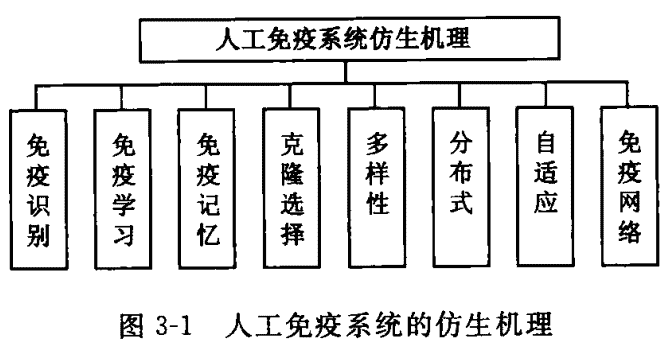

### 3.1.1 免疫识别

免疫识别是免疫系统的主要功能，同时也是人工免疫系统的核心之一，而识别的本质是区分“自体（self）”和“非自体（nonself）”。免疫识别是通过淋巴细胞上的抗原识别受体（receptor）与抗原的结合（binding）实现的，结合的强度称为亲和度（affinity）。未成熟的 T 细胞首先要经历一个“审查”环节，只有那些不能与自体（即机体本身组织）发生应答的 T 细胞才可以离开胸腺，执行免疫应答的任务，从而防止免疫细胞对机体造成错误攻击。该过程称为阴性选择或负选择（negative selection），它是免疫识别的一种主要方式。

免疫细胞对抗原的识别是通过结合（或匹配）过程实现的，相应地人工免疫系统中的抗原识别通过特征匹配来实现。其核心是定义一个匹配阈值，而对匹配的度量则采用多种方法，如 Hamming 距离、Euclidean 距离、R-连续位匹配方法等。阴性选择原理对应人工免疫系统中的阴性选择算法，其核心是根据识别的对象特征进行编码，定义一个自体集合并随机产生一系列检测器，用于检测自体集合的变化。根据阴性选择原理，若检测集合与自体集合匹配，则完成匹配任务。

### 3.1.2 免疫学习

免疫识别过程同时也是一个学习的过程，学习的结果是免疫细胞的个体亲和度提高、群体规模扩大，并且最优个体以免疫记忆的形式得到保存。免疫学习大致可分为两种：一种发生在初次应答阶段，即免疫系统首次识别一种新的抗原时，其应答时间相对较长；而当机体重复遇到同一抗原时，由于免疫记忆机制的作用，免疫系统对该抗原的应答速度大大提高，并且产生高亲和度的抗体去除病原，这个过程是一个增强式学习（reinforcement learning）过程，对应于再次应答。

免疫系统不仅可以实现对同一种抗原的识别，而且可以对结构类似的抗原进行识别，这是其一大特性并在人工免疫系统中得到了具体体现。免疫学习一般有以下几种途径[4]：

- ① 对同一抗原进行重复学习，属于增强式学习；
- ② 亲和度成熟，对应于人工免疫系统中的个体经遗传操作后其亲和度逐步提高的过程，属于遗传学习；
- ③ 低度的重复感染，对应于人工免疫系统的重复训练过程；
- ④ 对内生和外生抗原的交叉应答，属于联想式学习，对应于联想记忆机制。

免疫学习机理在人工免疫系统机器学习模型和算法构造中得到了广泛应用并取得了良好的学习效果。

### 3.1.3 免疫记忆

当免疫系统初次遇到一种抗原时，淋巴细胞需要一定的时间进行调整以更好地识别抗原，并在识别结束后以最优抗体的形式保留对该抗原的记忆信息。而当免疫系统再次遇到相同或者结构相似的抗原时，在联想记忆的作用下，其应答速度大大提高。免疫记忆对应于再次免疫应答和交叉免疫应答，而交叉应答是免疫系统对结构相似的抗原所产生的免疫应答。

### 3.1.4 克隆选择

克隆选择原理最先由 N. K. Jerne [3] 提出。其大致内容为：当淋巴细胞实现对抗原的识别（即抗体/抗原的亲和度超过一定阈值）后，B 细胞被激活并增殖复制产生 B 细胞克隆，随后克隆细胞经历变异过程，产生对抗原具有特异性的抗体。克隆选择理论描述了获得性免疫的基本特性，并且声明只有成功识别抗原的免疫细胞才得以增殖。经历变异后的免疫细胞分化为效应细胞（抗体）和记忆细胞两种。

克隆选择的主要特征是免疫细胞在抗原刺激下产生克隆增殖，随后通过遗传变异分化为多样性效应细胞（如抗体细胞）和记忆细胞。克隆选择对应着一个亲和度成熟（affinity maturation）的过程，即对抗原亲和度较低的个体在克隆选择机制的作用下，经历增殖复制和变异操作后，其亲和度逐步提高而“成熟”的过程。因此亲和度成熟本质上是一个“达尔文式”的选择和变异的过程，克隆选择原理可以通过采用交叉、变异等遗传算子和相应的群体控制机制实现。

### 3.1.5 免疫网络

基于细胞选择学说，N. K. Jerne [3, 5] 开创了独特型网络理论，给出了免疫网络的数学框架。在 N. K. Jerne 工作的基础上，A. Perelson [6] 提出了独特型网络的概率描述方法。免疫网络理论对免疫细胞活动、抗体生成、免疫耐受、自体与非自体识别、免疫记忆和免疫系统的进化过程等做出了系统的假设，并且将免疫系统视为由免疫细胞或分子组成的调节网络，免疫细胞以抗体间的相互反应和不同种类免疫细胞间的相互通信为基础，抗原识别是由抗原相互作用所形成的免疫网络完成的。

### 3.1.6 个体多样性

根据免疫学知识[2]，免疫系统大约含有 10^6 种不同的蛋白质，但外部潜在的抗原或待识别的模式种类有 10^16 之多。要实现对数量级远远大于自身的抗原识别，需要有效的多样性个体产生机制。抗体多样性的生物机制主要包括免疫受体库的组合式重整、体细胞高突变以及基因转换等。

### 3.1.7 分布式和自适应特性

免疫系统由分布在机体各个部分的细胞、组织和器官等组成。免疫系统的分布式特性首先取决于病原的分布式特征，即病原是分散在机体内部的；其次免疫系统的分布式特性有利于加强系统的健壮性（即鲁棒性，robustness），从而使得免疫系统不会因为局部组织损伤而使整体功能受到很大影响。

分散于机体各部分的淋巴细胞采用学习的方式实现对特定抗原的识别，完成识别的抗体以正常细胞变异概率的 10 倍进行变异[1]，使得其亲和度提高的概率大大增加，并通过分化为效应细胞和记忆细胞分别实现对抗原的有效清除和记忆信息保留，这个过程实际上是一个适应性的应答过程。由于免疫应答机制是通过局部细胞的交互起作用而不存在集中控制，所以系统的分布式进一步强化了其自适应特性。

## 3.2 人工免疫系统相关模型分析

生物免疫系统的主要功能是消灭抗原，保护肌体，而消灭抗原的关键有三方面：一是抗体对抗原的识别；二是抗体激活后面向抗原的“进化学习”；三是免疫记忆引起的快速、高效的“再次免疫反应”。这三方面都表明，生物免疫系统实质上就是一种高效的信息处理系统。

通过前期的研究和探讨使人们认识到，免疫系统最引人注目的机制集中在三个方面：克隆选择、亲和力成熟（即基于细胞超变异的二次进化）、免疫网络假设。为深入了解生物免疫系统的信息处理机理和更好地利用这些特性机制，人们设计出免疫系统的计算模型，这些模型不仅被利用来对信息处理机制做进一步的研究和探讨，而且也成为构造人工免疫系统模型的基础。所以，在这里有必要对构造人工免疫系统有重要意义的模型进行细致的回顾和分析。

### 3.2.1 独特型免疫网络模型[3]

在 1974 年，N. K. Jerne 最初提出独特型免疫网络假设，这个假设指出免疫系统是由一个相互作用的分子和细胞所构成的规则的网络所组成，即使在没有抗原的情况下这些分子和细胞的相互作用也一样存在。

抗体对抗原的识别是基于抗原的表位与抗体的受体之间的匹配，而生物学实验表明，抗体分子也有表位，也可以被其他抗体分子所识别。所谓的独特型就是一组抗体分子的表位集，一个独特型就是一个抗体的独特型表位。决定独特型模式的物质与决定抗体受体的物质相同。因此，免疫系统正式的定义是一个庞大的复杂网络，网络中一个抗体的受体识别另一个抗体的独特型，而另一个抗体的独特型又被其他抗体所识别，这样每一个抗体既识别又被识别。这些识别作用对细胞起到两方面的作用：刺激和抑制。这种相互作用如图 3-2 所示。

N. K. Jerne 提出的独特型网络理论首先推出了免疫系统的一种数学框架。他的理论以微分方程为模型，模拟淋巴细胞的动态特性，即淋巴细胞克隆和免疫球蛋白的增加和减少。独特型网络的概念是基于这样一个想法，即淋巴细胞不是孤立的，而是通过

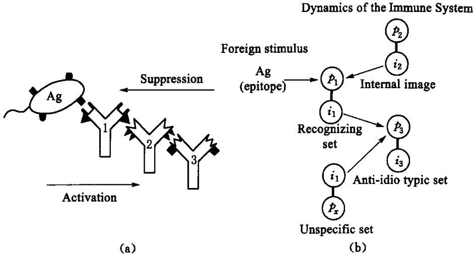

图 3-2 独特型网络示意图

(a) 抗体与抗原、抗体与抗体之间的相互作用；(b) 独特型网络的构成原理示意图

抗体的相互作用相互联系的。所以，对抗原的识别不是一个单一的识别集而是抗原与抗体相互作用互连成网的系统级的行为，独特性网络思想奠定了免疫网络研究发展的基础。

### 3.2.2 人工免疫系统二进制模型[7]

J. D. Farmer 等人在 1986 年所写的论文可以说是许多人工免疫系统模型构造的开端。他们基于免疫网络假设提出了免疫系统的一个动态模型，这个模型由一组微分方程组成，另外设有一个阈值用来删除没有用的抗体类型，同时还采用遗传算子来引入新的抗体。他们指出免疫系统的动态方程与一个分类学习系统具有类似的形式，从而说明这些微分方程所描述的免疫系统可以用于机器学习。实际上，他们的看法是对的，这种免疫系统模型确实可以用来解决许多工程实际问题，并且他们所提出的这个免疫系统模型成为其他许多人工免疫方法的基础。

在他们所提出的免疫系统模型中，免疫细胞和分子都用不同长度的二进制数字串来表示。一个抗体分子的受体和表位是通过级联的方式表达为一个数串。两个分子可以以任何排列方式形成互补，下面的方程给出其表位 $i$ 和受体 $j$ 互补匹配的匹配矩阵的定义：

$m_{ij} = \sum_k G \{ \sum_n [e_i(n+k) \wedge p_j(n)] - s + 1 \}$ (3-1)

式中，$e_i(n)$ 为第 $i$ 个表位的第 $n$ 位，$p_j(n)$ 为第 $j$ 个受体的第 $n$ 位，$s$ 为匹配阈值，$\wedge$ 为匹配算子 (XOR 算子)，函数 $G(x)$ 定义为：

$G(x) = \begin{cases} x & x > 0 \\ 0 & \text{其他} \end{cases}$ (3-2)

假设有 $N$ 个抗体 $\{x_1, x_2, \cdots, x_N\}$ 和 $M$ 个抗原 $\{y_1, y_2, \cdots, y_M\}$，于是给出免疫系统的动态方程为：

$\dot{x}_i = c ( \sum_{j=i}^N m_{ji}x_ix_j - k_1 \sum_{j=1}^N m_{ij}x_ix_j + \sum_{j=1}^M m_{ji}x_iy_j ) - k_2x_i$ (3-3)

式中，第一项表示抗体 $j$ 的表位对抗体 $i$ 的受体的刺激度；第二项表示抗体 $i$ 由于其表位被抗体 $j$ 识别所受到的抑制；第三项表示抗原对抗体 $i$ 的刺激度，最后一项表示细胞的死亡（自然死亡率为 $k_2$）；参数 $c$ 为一个比例常数，其值由单位时间内相遇的次数决定；常数 $k_1$ 表示同一个抗体的刺激和抑制作用的不等关系。模型中采用遗传算子，例如交叉、点变异以及逆转来产生新类型的抗体。

该模型为利用免疫系统作为学习手段提供了灵感和启示，主要包括：利用网络完成学习内容的记忆；使用 B 细胞和抗原之间的简单匹配模型和结果定义亲和力；在该模型中只表示 B 细胞，忽略了 T 细胞的作用，免疫网络的模型是可以简化的；使用简单的数学方程模拟 B 细胞的受刺激水平；利用变异机制产生不同的 B 细胞。

### 3.2.3 基于抗原、抗体的免疫系统模型[8]

为更好地理解和应用免疫系统的特性，人们在观察免疫系统

的行为表现的同时，建立起了免疫系统的数学和计算机模型以便对其特性机理进行探索和研究。这些模型的理论基础和设计角度都不尽相同，各有特点和侧重，但是，对后续的研究工作都有着重要启发和实际意义。

美国新泽西洲的 S. Forrest 教授等人，完成了一项名为“免疫——一个信息处理的过程”的课题的研究。他们的研究目标就是从信息处理的角度来研究免疫系统的特性。

为此，他们建立了基于抗原抗体的免疫系统计算模型，利用该模型对免疫系统的识别多样性以及疫苗接种等特性进行了深入系统的理论研究和实验仿真。在他们所使用的免疫系统模型中作了许多简化。他们主要使用了两种形式的免疫系统模型：

- (1) 基因级模型：在此模型中，每个个体是一组（N 个）基因库，每个库有几个（M 个）基因型，每个基因型为长 L 的二进制位串，因此，每个个体的串长＝N×M×L。而其中，抗体的表达是从各基因库中随机选一个基因型，由 M 个基因型级联构成一个抗体。抗原是和抗体相同长度的二进制数串。抗体对抗原的识别用二进制数串的互补匹配来定义。每个个体产生 N 个抗体，让这 N 个抗体与随机产生的 K 个抗原相遇，再根据匹配值来计算每个个体的适应值。抗体的双重进化过程用带交叉的遗传算法和不带交叉的遗传算法来模拟，而个体的适应值与抗原和抗体的匹配程度呈正比。虽然适应值的评价是基于抗体做出的，但遗传操作是对基因库个体进行的，所以最终进化的是抗体的基因库。

- (2) 简化模型：该种模型是对上述模型的简化，模型中的个体就是抗体，每代群体由若干抗体所构成，其他过程与上述模型一致，遗传操作是直接对抗体进行的，所以最终进化的是抗体。

该模型模拟抗体对抗原的识别过程，也就是免疫系统的模式识别和学习的过程，该模型利用的免疫特性有：免疫系统频繁遭遇到抗原，系统只使用了那些与抗原有关的淋巴细胞子集应答；抗体竞争获得抗原，具有最高亲和力的抗体细胞成长最快；在抗体细胞变异过程中，通过点变异改进抗体。

### 3.2.4 关于识别多样性的模型

所谓识别多样性就是指在抗体基因库规模有限的情况下，可以识别几乎无限种类的抗原。识别多样性即抗体指令集的完备性是免疫系统重要特性之一，也许许多其他特性的基础，因此对这一特性机理的认识是对免疫系统认识的重要起点。

M. Oprea 在文献[9]中利用上述已有的模型，从信息处理的角度出发，对免疫系统最基本的多样性识别功能的原理进行研究，并由此得出一种新的高效的全局寻优算法。通过实验表明：采用带交叉算子的遗传算法，即使在相当强的噪声环境中也能找到抗原中所包含的一般的特性，即抗原的共性。当然，在抗体数量一定的情况下，随着抗原数量和种类的增加，搜索过程会越来越费时而且困难。接下来，在对前面所用的算法改进的基础上，提出了一种多样性算法，通过实验表明：这一算法可以很好地完成多峰值搜索或共性的识别：当抗体数量与待识别的抗原数量差不多时，算法可完成多峰值搜索，而当抗体数量比抗原数量少得多时，则进行的是共性的识别。总之，通过模拟实验表明：免疫系统识别多样性是物种长期以来对所遇到的各种抗原的共性的识别和个体在生存期间所遇到的抗原的多样性的识别而获得的。

R. Hightower 和 S. Forrest 等[10]基于基因级的模型在前面研究的基础上，提出了一个新的操作，即 G 变异操作，它在原来算法的过程中考虑到 Baldwin 效应，即个体在其一生中如果获得了某种有用的特性，那么其后代获得同样特性的概率更高。于是，G 变异操作就是对不匹配抗体的不匹配位进行随机变异，再根据变异后的匹配值对这些抗体进行重新评价。因而，对于那些虽然目前并未超过匹配阈值但只要变异少数几位就可以满足匹配要求的抗体也应给予适当的奖励，因为这些抗体在细胞增殖和分化的过程中可能会成为与抗原匹配的抗体。实验表明，这个效应可以通过对部分近优个体的奖励来实现。

克隆选择机制是免疫反应最根本的机制。简单地讲，克隆选择就是当抗体识别到某种入侵的抗原后，发生识别的抗体被激活并发生大量的分化和繁殖，从而快速消灭抗原的选择性克隆过程。克隆选择理论的主要论点包括：

- (1) 被抗原激活的抗体会分化、繁殖，所产生的新细胞是其父母的复制；亲和力越大复制量就越大。
- (2) 但是这个过程不仅有复制，还包含有变异操作（即细胞超变异）、抗体编辑。
- (3) 变异所产生的抗体可能与抗原的亲和力更大（即亲和力成熟），这些抗体会进一步被大量复制；而其他的变异抗体可能不能识别这种抗原，甚至会对自己细胞产生反应，那么这些抗体将被删除，此外还有一部分复制的抗体可以长期保留下来，成为记忆细胞。

A. S. Perelson 等进一步发展了独特性网络的理论[11]，A. S. Perelson 和 G. F. Oster 于 1979 年提出了形状空间的理论，这个理论将免疫细胞分子和抗原之间的作用数量化。形状空间理论认为，抗体与抗原之间是通过一种连接酶连接，两者要实现连接，它们的连接特性必须具有一定程度的互补性。可以将这种连接特性用一组参数所构成的向量来表达，这些向量所构成的空间就称为“形状空间”。于是，形状空间中的一个点就代表了一种抗体或是抗原的连接特性。

抗体对抗原的识别，实际上就是抗体与抗原的结合。只要抗体与抗原互补的连接特性部分超过某一阈值，两者就可以发生连接，只是连接的亲和力不同，所以某一个抗体可以识别多种抗原。识别形状空间的示意图如图 3-3 所示。从图 3-3 可以看出：用少量的抗体可以识别数量比它大得多的抗原。抗体最优的分布情况应该是以最少的抗体数量覆盖几乎整个抗原空间，这也是免疫系统进化的目标。

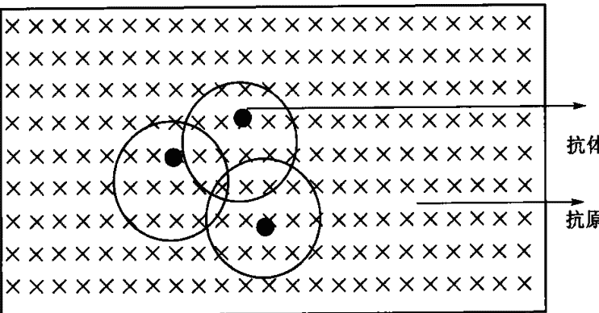

#### 图 3-3 形状空间示意图

图中：方框表示抗原空间，圆表示某一抗体所能识别的抗原范围

在形状空间理论中包含两个重要概念：一是交叉反应，一是连接阈值。所谓交叉反应就是一个抗体可以对多个抗原做出反应，而一个抗原又可以被多个抗体所识别；连接阈值就是抗原与抗体发生连接的临界互补程度。在文献[12]中，D. J. Smith 等依据上述的基本理论推出了要使整个形状空间收敛所必需的抗体的最少数量：

```
N = \text{ceil}\left(\frac{k^L}{C}\right) \quad \text{(3-4)}
```

式中，$k$ 为基因库的规模，$L$ 为代表抗体向量的维数。

假设 $T$ 为连接阈值，$C$ 为一个抗体所能覆盖的抗原的数量，定义为：

```
C = \sum_{i=0}^{T} \binom{L}{i} = \sum_{i=0}^{T} \frac{L!}{i!(L-i)!} \quad \text{(3-5)}
```

综上所述，通过大量全面细致的实验研究和理论推导得出结论，免疫系统多样性产生的机制包括：双重进化过程中对抗原的共性和个性的反应；来自于不同受体库的基因组合多样性；抗体与抗原的不完全匹配识别机制；克隆选择中的抗体基因重排以及细胞超变异的基因转变。

### 3.2.5 免疫学习和记忆模型[2, 4, 13]

免疫系统要消灭入侵的病毒，不仅要识别抗原，还要产生足够量的并且是合适的抗体去消灭它。当某种抗原第一次入侵个体时，只有一小部分抗体参与免疫反应，所以初次应答发生得比较缓慢，效果也没有那么强烈，由于保留有初次反应的免疫记忆，所以，当系统再次遇到同一抗原时，存储的记忆细胞就会形成再次免疫反应，再次应答就会比初次应答更快速更有效。在免疫反应过程中，通过克隆选择和亲和力成熟过程，不但复制了大量优良抗体，并且产生更加适合于入侵抗原的抗体。免疫系统的这种机制就是“增强学习机制”，即系统完成某项任务的能力越来越强。

免疫记忆是免疫系统增强学习特性的重要机制，也是免疫系统的重要特性之一，正因为有了免疫记忆，免疫系统在再次遇到类似抗原时可以迅速做出更强烈、更准确的反应。从信息处理的角度来看，免疫系统把对以前遭遇过的抗原模式以网络的形式保存下来，不仅具有记忆功能并且可以在原来模式的基础上继续学习新的模式。但是，关于免疫记忆存在的机制仍是一个没有定论的问题，有许多种理论来解释免疫记忆的机理，其中最为大家接受的还是“独特型网络”理论，按照这一理论，免疫记忆是 B 细胞通过独特型网络相互作用而获得的，B 细胞不仅受抗原的刺激并且也与相邻的 B 细胞相互作用，既相互刺激又相互抑制，这种 B 细胞间的相互作用是 B 细胞上的独特型被其他 B 细胞当做抗原而识别引起的。因此，一个 B 细胞周围与之相似的 B 细胞越多，它受到的作用就越大，从而这些同类的 B 细胞的群体相互支撑形成一个网络结构，整个免疫网络的结构是对所遇抗原的特性的反映。

另外，免疫记忆细胞不仅对同一种抗原做出反应，还会对类似的抗原也产生再次应答反应，这就是免疫系统的“交叉反应特性”。这一特性表明，免疫系统的记忆是联想记忆。免疫系统的联想记忆具有以下令人感兴趣的特点：

- (1) 存储的数据可以在读取相同或相关的数据时得到恢复；
- (2) 免疫记忆不仅对于数据中的干扰具有鲁棒性，而且对于记忆的部分缺损也具有鲁棒性。

接种疫苗是人们在认识到免疫系统再次应答的现象后，通过人工注入某种抗体，使人体产生对该抗原的免疫记忆，当再次与类似抗原相遇时，可以迅速反应，以免身体被损害。因此，接种疫苗可以成功地预防疾病，可以说是免疫记忆存在的有力实证。

总之，从信息处理的角度来看，免疫系统具有基于网络结构自组织、鲁棒性增强学习机制和联想记忆机制的系统。研究表明，免疫系统具有增强学习的特性，它获得这种特性的主要机制包括：不断地与同类或类似抗原相遇；抗体对抗原的识别；激活抗体的克隆选择和超变异所构成的亲和力成熟过程；具有强容错性和联想特性的免疫记忆；基于动态网络结构的学习和记忆方式。

### 3.2.6 人工免疫系统基本模型框架

通过前面关于生物免疫系统机理特性的分析和认识，我们可以看出上述有关模型都是从不同的方面对生物免疫系统的机理特性进行描述和模拟。从前面的人工免疫系统研究基础工作来看，模型的组成主要考虑三个方面：抗原、抗体的形式，抗原与抗体以及抗体与抗体之间相互作用机制，整个系统的连接和构造。通常在人工免疫系统中，抗原相当于待解决的问题或待分析的数据；抗体相当于问题的解或解的特征值；抗原与抗体的相互作用可以看做是解与问题的适应度，也可以是特征值与数据组的相似度等，而系统的结构可以是算法形式、网络形式等。

人工免疫系统模型的基本实现过程包括：

- 第一步：产生初始抗体群体。这可以视具体问题的要求，随机产生或依据先验知识产生。
- 第二步：抗原的提呈和抗体的评价。抗原被提交给抗体，抗体对抗原发生识别反应。然后对抗体进行评价，评价的结果取决于三个因素：
  - (1) 抗原对抗体的激励：即计算解相对于问题的适应度。抗体与抗原之间的亲和度越大，抗体受到抗原的激励就越高。
  - (2) 抗体的抑制：即为保持解群体的多样性，对抗体浓度进行控制，限制群体中相同的解个体的数目。浓度越高的抗体，浓度抑制值越大，对应抗体的评价值越低。
  - (3) 抗体的激励：抗体之间除了彼此的抑制，还存在激励，以维持免疫系统的记忆功能，两个抗体亲和度越大，其激励也越大。

上述三个因素对于抗体评价值（通常称为抗体的刺激度）的影响用一个算式来表达，则可以有：

```
sl = Mat + Sim - Sup (3-6)
```

式中，Mat 代表抗体与抗原的匹配度；Sim 和 Sup 分别代表抗体之间的相互刺激和抑制作用。抗体评价值与上述三项的函数关系式可以根据具体问题，设置为不同的形式。一般来说，抗体与抗原的亲和度影响最大，抗体之间的激励和抑制作用相对要弱些。

- 第三步：产生记忆。在免疫进化过程中，将抗体群体中优良个体提取出来放入记忆库，保持优良个体的存在。
- 第四步：结束判断。依据问题所确定的结束条件，一般是判断记忆库中的抗体是否满足要求，满足则结束；否则，继续下一步。
- 第五步：抗体的亲和力成熟。对抗体群体进行克隆选择和超变异操作，通过变异，使抗体群体产生多样性，以便与抗原更好地匹配。变异可以仿照遗传算法的变异和交叉算子，但与遗传算法有区别：
  - (1) 克隆选择：即是按照抗体的刺激程度进行选择复制。
  - (2) 超变异操作：抗体的重组、随机变异等，通过这个过程产生抗体的多样性，使系统获得更优良的抗体（问题的解）。
- 第六步：群体控制及新抗体群体产生，即抗体的死亡和产生下一代抗体。在群体规模的范围内，对经过上述步骤的抗体群体与记忆库中的抗体一起做进一步处理：
  - (1) 再次对抗体进行评价，依据群体规模要求将刺激度最差的部分抗体删除。
  - (2) 形成新一代抗体群体。接着，转向第二步继续执行。

以上是人工免疫系统模型的基本框架，在这个框架中，决定所构造的人工免疫系统关键的几个问题包括：抗体和抗原的表示形式；抗体与抗原的相互激励、抗体之间的相互激励和抑制；整个系统的构造和连接形式；抗体评价函数形式及各个决定因素的求取；记忆库的设计和使用；结束条件的设计；抗体亲和力成熟的实现等。

在一般情况下，一个人工免疫系统的设计有以上提到的步骤和关键方面，而这些步骤和关键方面的具体表达和实现形式在设计时会有所不同，这些要取决于所要解决的问题对象的特性，也就是取决于具体问题的形式和内容。因此，在上述基本模型框架下设计人工免疫系统的具体形式，要结合问题的实际，弄清楚问题是什么，最终达到什么目标，然后把免疫的机理应用其中，使免疫的机制和原理在问题中具体化。

总之，利用免疫机理构造的人工免疫系统，不论具体的表示形式如何，在上述的基本模型框架下，它所实现的主要功能有：系统在抗体刺激度的评价标准指导下，抗体通过反复地与抗原接触，抗体被克隆和变异，产生抗体种群的多样性，不断地经历亲和力成熟过程，最终获得反映问题解的特征值的优良抗体记忆细胞。

## 3.3 人工免疫系统数据挖掘应用分析

在前面分析了人工免疫系统的基本模型框架，本节专门从信息处理角度认识、探讨人工免疫系统信息处理的主要特性和功能，分析人工免疫系统在数据挖掘领域应用的基本形式和特点。

### 3.3.1 生物免疫系统的信息处理特性

#### 3.3.1.1 信息处理功能

免疫系统中采用信息一词的目的是因为免疫系统存在可理解地独立于其物理实现的时空模式[8]（pattern）。在免疫系统中，这样一个模式存在于氨基酸、蛋白质和其他具有识别、学习、存储、通信功能的分子中，这些模式之间的转换控制着免疫系统的性能。这是一个很深刻的认识，传统的免疫学结构观念是机械式的模拟细胞、分子和它们的交互作用。美国计算机科学家 S. Forrest 认为，免疫系统具有如下信息处理系统：

- ① 系统层次识别（在单元层次互相识别）；
- ② 信息存储；
- ③ 学习机制；
- ④ 产生多样性；
- ⑤ 避免自我非自我识别的逻辑矛盾。

#### 3.3.1.2 信息处理过程

免疫系统使用某些与现存处理信息的算法极其符合的处理机制处理氨基酸模型（例如遗传算法）。它能够精巧敏锐地选择和很好地协调应答，某些情况中甚至对少于 10 个分子也能准确及时地应答。免疫系统所使用的技术包括学习以下问题：B 细胞亲和力成熟，B 细胞和 T 细胞阴性选择，胚系基因中进化的偏差记忆（交叉反应和二次应答），高度动态的元素大规模、并行分布式计算（每天产生大量的不同受体和新淋巴细胞），组合运用解决遗传基因资源稀少（V 区）。这些只是一部分技术。

#### 3.3.1.3 信息处理原理

从免疫系统研究中可抽象出如下信息设计原理：多样化（性），在个体和群体两个层次上极大地改善其鲁棒性，例如不同的人易受不同病原体袭击；分布式，由许多局部互相作用的元素提供全局保护，所以没有中心控制，没有单点失败，它能够耐受错误，因为在分类和应答中有几个错误不会产生致命危险；动态性，连续不断地产生、破坏免疫细胞等元素，在全身循环这些元素，增加了免疫系统的暂时性和空间多样性；自我保护，保护身体的同样机制，也保护免疫系统本身；自适应性，学习识别和应答新的病原体，记忆病原体。这些原理对于发展信息技术是有启发意义的，并已在计算机科学中得到应用[14]。

### 3.3.2 人工免疫系统数据挖掘方法分析

#### 3.3.2.1 基于免疫算法的数据挖掘

在相关免疫算法及其数据挖掘研究应用中，高坚[15]利用了免疫机制的单亲遗传操作，通过对超图的分割求解聚类优化问题；刘静等[16]利用免疫进化原理，优化目标函数，为了解决原有算法的局部收敛和对初始化敏感的缺点，对模糊 C-均值聚类等进行了研究；刘韬等[17]利用免疫竞争机制寻找最优抗体，设计了 K-均值聚类算法；行小帅和焦李成等[18,19]采用免疫规划方法，通过接种疫苗防止群体退化和过早收敛，改进了传统的 K-均值聚类算法。

基于免疫算法的数据挖掘研究，已有的研究成果主要是利用免疫机理改进其他的算法以构成新的算法，然后再利用这些新的算法进行数据挖掘，而且利用免疫机理改进其他的算法，又主要集中在遗传算法上。挖掘的途径是对原有的优化计算方法进行改进，把数据挖掘问题归并为求解最优化问题，间接地把免疫算法应用于数据挖掘。其挖掘过程中，抗原对应待分析的数据，抗体对应要求解的解集，抗体的刺激度对应优化的目标函数，算法利用免疫系统的亲和度、抗体的克隆与抑制、免疫应答中的疫苗原理等。

#### 3.3.2.2 Cooke 网络

J. E. Hunt 和 D. E. Cooke[20] 提出了一种人工免疫网络系统，并将它应用于机器学习。该系统用到的免疫系统机制包括：B 细胞、B 细胞的刺激度、免疫网络理论、基因序、变异以及适于分类问题的抗体串。

系统是一个 B 细胞网络。在网络中如果两个 B 细胞之间的亲和力超过某一阈值，它们就建立相互连接。每个 B 细胞由四个要素组成：匹配规则、基因库(用于产生抗体，即 DNA 序列)、许多中间 DNA 序列、该 B 细胞的刺激度。而系统中的抗原就是待学习的 DNA 串的表达。最初，随机选择一组训练数据构成 B 细胞网络，其余的数据作为抗体训练集。

其算法的步骤如下：

- (1) 取抗原群体，随机选取 B 细胞群体，构成网络。
- (2) 从抗原集合中随机选取一个抗原，随机选取网络中的一点将抗原插入。
- (3) 选取一定比例的 B 细胞作为与抗原接触的 B 细胞，对每一个 B 细胞，确定是否能够与抗原相连以及相应 B 细胞的刺激度。
- (4) 如果某一 B 细胞的刺激度超过阈值，则该 B 细胞进行克隆：
  - ① 若没有一个能够与抗原结合，则产生一个新的 B 细胞，以便能够与抗原相连；
  - ② 将 B 细胞按照刺激度排序，并删除其中最弱的 5% 的 B 细胞；
  - ③ 重新产生 N 个新的 B 细胞（N 为群体的 25%），然后从中选择 M 个 B 细胞连入网络中（M 为群体的 5%）。

基于上述步骤，将训练数据不断地提供给网络进行训练。一

且达到终止条件，即停止训练过程并将结果网络存储起来。其中，B 细胞间的连接规则如前所述。而变异方式有多种：模拟基因选择、折叠、嵌入、随机点变异等。新的 B 细胞产生后即连入网络，不能连入的 B 细胞被删除。算法中模拟抗体受作用的刺激度采用以下计算公式：

```
sl = c[\sum_{j=1}^{N}m(a,xe_j) - k_1 \sum_{j=1}^{N}m(a,xp_j) + k_2 \sum_{j=1}^{n}m(a,y)] - k_3
```

式中，第一项为抗原与 B 细胞（即抗体）的匹配度；第二项为抗体之间的相互抑制作用；第三项为抗体之间的相互刺激作用；第四项为抗体的死亡率。

该模型用到的免疫系统启示有 B 细胞、免疫网络理论、克隆和变异等机制，这些机制被用于创造一个多样性的问题的解集。该模型的核心为：保持一个 B 细胞网络以存储免疫记忆，在训练数据及网络邻居的刺激下，运用 B 细胞的克隆和变异操作机制。该模型所构建的自组织网络，可以表达被学习的数据并对非训练数据进行分类。

#### 3.3.2.3 资源有限网络(RLAIS)

J. Timmis 提出的资源有限网络(RLAIS)[21,22,23,24,25]，将其应用于数据分析中，其模型定义了人工识别球 ARB 来代表 B 细胞。ARB 基于刺激水平（stimulation level）对 B 细胞进行分配，而当 ARB 不再需要 B 细胞时该 ARB 将被去除，由此实现有效的群体控制。通过将相似的 ARB 集中在一起，RLAIS 可以实现从数据中进行模式提取和聚类分析。模型利用的免疫机理和表达方式有：

- (1) 抗原及初始网络：将待分析或学习的数据分为两部分，一部分作为抗原用来训练网络；另一部分为 ARB 来构成网络。

- (2) 模型的基本组成是人工识别球(ARB)，包含三个部分：匹配规则、数据项、刺激度；ARB 代表一组同类的 B 细胞，而网络中 B 细胞的总数预先定义为一个固定的数值。 ARB 对应于免疫系统的形态空间，数据项是抗体或 B 细胞的数据表现形式，刺激度反映了 ARB 与抗原以及 ARB 之间的亲和度。

- (3) 网络互连规则：预先规定一个亲和度阈值 NAT，当两个 ARB 的亲和力小于 NAT 时就发生互连，否则就不连接。

- (4) 刺激度计算采用 Euclidean 距离，考虑 ARB 与抗原和 ARB 之间的刺激。

- (5) 当网络出现稳定结构后就结束训练学习。

#### 3.3.2.4 aiNET 网络

D. E. Castro 等提出的 aiNET 免疫网络[26]，建立网络的目的是解决未标识数据集合的聚类和过滤问题。

- (1) 模型简化了免疫网络，忽略 B 细胞和抗体的区别，网络中只存在抗体和抗原。

- (2) 网络是一个边具有权重的图结构，这个图结构不是全连接的，图的节点由抗体构成，其边由节点的集合构成，每条边被赋予权重或连接强度。

- (3) 在网络中，当代表训练数据的抗原输入时，每个节点作为抗体要对抗原进行竞争识别，竞争成功的抗体才会导致网络活化。

- (4) 网络中抗体进行扩增和克隆选择，竞争失败的抗体则被清除出网络。网络以抗体—抗体之间的亲和力为标准，给定一个抑制阈值，清楚多余的亲和力低的免疫细胞来抑制网络的规模；同时通过以抗原—抗体之间的亲和力为标准，并设定相应的阈值来决定抗体的克隆应答概率。

- (5) 网络具有描述数据结构等特征。

- (6) 模型是基于克隆和适应度成熟原理的，模型中种群的体积是动态可调整的，搜索实现多优化查找并具有保持优化解的能力。

#### 3.3.2.5 其他免疫网络的数据挖掘

E. Hart 和 P. Ross[27] 利用免疫记忆和稀疏分布式存储器（SDM）都具有联想记忆的特性，提出了自组织稀疏分布存储模型（SOSDM）。系统利用的原理及方法有：

- (1) 系统利用了人工免疫系统模型和松散分布记忆模型，免疫记忆被看做是自组织机制。

- (2) 采用协同进化遗传算法进化系统。

- (3) 在网络模型中，一个抗原等同于一段数据，一个抗体是一个聚类的描述，多个同类抗体在一起形成的刺激球定义聚类的规模。

- (4) 网络模型初始化时模拟自然免疫系统中的分布式特性，随机地设置分布式数据单元，以反映数据空间中分布式本质形式。

T. Knight 和 J. Timmis[28] 提出了多层免疫网络的数据挖掘方法，把免疫系统分为自由抗体层、B 细胞层和记忆细胞层，每层之间互相联系构成网络。系统中抗原是待分析的数据，自由抗体代表待分析数据的初始模式，B 细胞代表了待分析数据的中间模式，记忆细胞代表待分析数据的最终模式。

T. Sawomir 等[29] 建立的人工免疫网络实现了数据聚类。网络将抗体、抗原代表 n 维的数据项，直接采用数据的实值向量，采取其平均距离为其亲和度阈值。

Urszula Kuzelewska[30] 提出的自组织免疫网络应用于数据聚类的挖掘。网络模型充分利用免疫系统的自组织特点，网络的亲和度阈值 NAT 在算法的每一次迭代时都进行计算，避免了外部的干预，从而产生了稳定的网络。

### 3.3.3 人工免疫系统数据挖掘的特点和基本思路[31]

概括来看，利用人工免疫系统进行数据分析和数据挖掘，其实现结构包括如下方面：

- （1）数据项的表示，即数据挖掘的问题或数据如何在网络中体现，主要的是如何表示成为免疫系统中的抗原和抗体，或是其他的免疫组织。

- （2）节点和连接的定义，节点和连接代表的内容，任何反映网络的结构。

- （3）网络的初始化，如何构建网络，如何分配训练数据和测试数据（即如何将待分析的数据表示为抗原和抗体等）。

- （4）如何决定刺激水平的演化和个体对刺激水平的影响，包括抗原的刺激、相邻抗原之间的刺激和抑制。

- （5）决定刺激水平对网络进化的影响，即如何控制网络的规模。

- （6）一个节点的克隆方式和克隆率的确定。

- （7）种群的控制、训练阶段和测试阶段的区分。

- （8）终止条件的选择和结果网络的解释。

此外还要考虑各种阈值的选择，如决定什么时间对网络进行修剪，什么时间合并接点等，以控制网络的规模；是否有更多的控制参数使算法更灵活，较少的参数使网络更具有自组织特性。

#### 3.3.3.1 人工免疫数据挖掘的特点

人工免疫系统具有性能优良的信息处理机制，其信息处理的特点主要包括以下几个方面：

- （1）基于抗体和抗原相互作用的网络结构，采用并行的、分布式的方式快速处理信息。

- （2）以网络的形式实现学习的过程和表达信息处理的学习结果。

- （3）以简单的组织结构和较少的组织单元处理大量的数据并存储获得的模式。

- （4）以动态网络的形式实现记忆和快速响应实现可持续学习。

- (5) 基于模式的信息处理过程，特别适合于信息的分类、聚类分析、关联分析等问题。

#### 3.3.3.2 人工免疫数据挖掘的基本思路

将人工免疫原理应用于数据挖掘，基本思路一般需要涉及以下几个方面：

- (1) 用适当的编码方式表达要处理问题的信息，使得问题更方便识别与处理。

- (2) 采用互补匹配、不完全匹配等不同形式的匹配实现学习的过程，扩大识别能力。

- (3) 用刺激度的机制来控制识别过程，以获取较一般的模式。

- (4) 选择克隆和变异来维持已经获得的正确模式和产生模式的多样性。

- (5) 采用网络结构，利用各结构单元之间的相互作用来构成网络，以实现分布式的信息处理和存储。

- (6) 网络结构是动态的，在原有信息处理结果的基础上，能够继续学习新的知识，长期得不到刺激的模式将被清除出网络。

- (7) 基于免疫记忆特性，利用先验知识优化初始网络并指导知识学习过程。

## 3.4 小结

本章概括给出了人工免疫系统的仿生机理，分析了已有的典型人工免疫系统模型，明确了人工免疫系统利用生物免疫机理的途径和方法，在研究生物免疫系统信息处理特性启示的基础上，分析典型的人工免疫系统在数据挖掘领域的应用特点和基本方法。概括出的人工免疫系统基本框架及其数据挖掘方法的基本形式为以后的工作奠定了基础。

概括提出人工免疫系统的基本框架：在抗体刺激度的指导下，抗体通过反复地与抗原接触，不断地经历亲和力成熟过程，最终获得可以反映问题解的特征值的优良抗体群体。

概括提出人工免疫数据挖掘方法的基本形式：基于网络结构，采用并行、分布式的处理方式，以网络的形式实现和表示处理结果，以较少的组织机构处理大量的信息，以动态网络的形式实现可持续学习。

# 参考文献

- [1] CASTRO D E, ZUBEN V. Artificial Immune Systems: Part I-Basic Theory and Applications[R/OL]. Technical Report-RT DCA 01/99. http://www.dca.fee.unicamp.br.
- [2] 林学颜，张玲. 现代细胞与分子免疫学[M]. 北京：科学出版社，1999.
- [3] JERNE N K. The immune system[J]. Scientific American，1973，229(1)：51-60.
- [4] DASGUPTA D, Yu S, MAJUMDAR N S. MILA—Multilevel Immune Learning Algorithm[C]. In the proceedings of the Genetic and Evolutionary Computation Conference ( GECCO ), Chicago，July 12-16，2003；468-474.
- [5] JERNE N K. Towards a network theory of the immune system[J]. Annual Immunology，1974，125C：373-389.
- [6] PERELSON A. Immune network theory [J]. Immunological Review，1989，110：5-36.
- [7] FARMER J D, PACKARD N H, PERELSON A S. The immune system，adaptation and machine learning[J]. Physica D，1986，22：87-204.
- [8] FORRET S，HOFMEYR S A. Immunology as information processing [M]. In：Segel and Cohen eds. Design Principles for the Immune System and other Distributed Autonomous Systems. USA：Oxford University Press，2000.
- [9] OPREA M. Antibody Repertoires and Pathogen Recognition：The role of germline diversity and somatic hypermutation[D]. Univ. of New Mexico. Albuquerque, NM. 1999.
- [10] HIGHTOWER R, FORREST S, PERELSON A. The Baldwin effect in the immune system:learning by somatic hypermutation[M]. In Mitchell M, Belew R (eds) Adaptive Individuals Evolving Populations, Models and Algorithms, Addison-Wesley, 1996.
- [11] PERELSON A S, OSTER G F. Theoretical Studies of Clonal Selection : Minimal Antibody Repertoire Size and Reliability of Self-Nonself Discrimination [J]. Theor. Biol. , 1979(81) :645-670.
- [12] SMITH D J, FORREST S, HIGHTOWER R, et al. Deriving Shape Space Parameters from Immunological Data [J]. Theor. Biol. , 1997, 189 :141-150.
- [13] TIMMIS J. Visualising artificial immune networks[A]. Technical Report UWA-DCS-00-034, University of Wales and Aberystwyth, 2000.
- [14] FORREST S, HOFMEYR S A, SOMAYAJI A . Computer immunology [J]. Communications of the ACM, 1997, 40(10) :88-96.
- [15] 高坚. 用基于免疫机制的单亲遗传算法求解数据聚类优化问题[J]. 计算机工程与应用, 2003, 39(12) :89-90.
- [16] 刘静, 钟伟才, 刘芳, 等. 免疫进化聚类算法[J]. 电子学报, 2001, 29 (12A) :1897-1901.
- [17] 刘韬, 王耀才, 王致杰. 一种基于人工免疫系统的聚类算法[J]. 计算机工程与应用, 2005, 40(19) :182-184.
- [18] 行小帅, 潘进, 焦李成. 免疫规划 + K 均值混合聚类算法[J]. 计算机科学, 2003, 30(4) :150-152, 158.
- [19] 行小帅, 潘进, 焦李成. 基于免疫规划的 k-means 聚类算法[J]. 计算机学报, 2003, 26(5) :605-610.
- [20] HUNT J E, COOKE D E. Learning using an artificial immune system [J]. Journal of Network and Computer Applications, 1996, 19 (2) : 189-212.
- [21] TIMMIS J, NEAL M. A resource limited artificial immune system for data analysis[J]. Knowledge Based Systems, 2001, 14(3-4) :121-130.
- [22] TIMMIS J, NEAL M, HUNT J. Data analysis with artificial immune systems and cluster analysis and kohonen networks; Some comparisons [C]. In Proc. of Int. Conf. Systems and Man and Cybernetics, pages 922-927, Tokyo, Japan, 1999. IEEE.
- [23] TIMMIS J. On parameter adjustment of the immune inspired machine learning algorithm AINE[R]. Technical Report 12-00, Computing Laboratory, University of Kent at Canterbury, Canterbury, Kent. CT2 7NF. , November 2000.
- [24] TIMMIS J, NEAL M. Investigating the evolution and stability of a resource limited artificial immune system[M]. In Wu A S, editor, Special Workshop on Artificial Immune Systems, Genetic and Evolutionary Computation Conference (GECCO) 2000, Workshop Program, pages 40-41, Las Vegas, Nevada, U.S.A. , July 2000. AAAI, AAAI Press.
- [25] KNIGHT T, TIMMIS J. Assessing the performance of the resource limited artificial immune system AINE[A]. Technical Report 3-01, Canterbury, Kent. CT2 7NF, May 2001.
- [26] CASTRO D E , ZUBEN V. An Evolutionary Immune Network for Data Clustering[C]. ( Full version, pre-print). In Proceedings of the IEEE SBRN'00(Brazilian Symposium on Artificial Neural Networks):84-89.
- [27] HART E, ROSS D. Exploiting the analogy between immunology and sparse distributed memories: a system for clustering non-stationary data [C]. In the proceedings of 1st International Conference on Artificial Immune Systems (ICARIS-2002), University of Kent at Canterbury, UK, September 9th-11th, 2002.
- [28] KNIGHT T, TIMMIS J. A Multi-Layered Immune Inspired Approach to Data Mining[C]. In Lotfi A, Garibaldi J, and John R, editors, Proceedings of the 4th International Conference on Recent Advances in Soft Computing, pages 266-271, Nottingham, UK. , December 2002.
- [29] SAWOMIR T, URSZULA KUZELEWSKA. Adaptive clusters formation in an Artificial Immune System [J/OL]. http://neuro.bstu.by/our/stw_uk.pdf.


[30] URSZULA KUZELEWSKA et al. Stable Clusters Formation in an Artificial Immune System[C]. In 1st International Conference on Artificial Immune Systems (ICARIS), University of Kent at Canterbury, UK, September 9th-11th, 2002.

[31] 刘韬, 等. 人工免疫数据挖掘方法的分析与展望[J]. 计算机工程与设计, 2006, 2: 689-696.

# 第 4 章 距离浓度免疫算法(DCAIA)

免疫算法是所构造的人工免疫系统形式中应用最广泛的一个部分，大多数的免疫算法被用于实现全局优化问题，包括组合优化[1~5]、函数优化[6~13]、神经网络优化等[14~17]。因此，免疫算法作为人工免疫系统研究的一个重要方面，有必要对算法的构造和应用进行深入细致的研究。本章在分析免疫算法机理和设计方法的基础上，针对基于信息熵免疫算法存在的不足，提出一种基于距离浓度的免疫算法，并对提出的算法收敛性能进行了分析，在免疫算法的构造设计和应用方面进行了探讨。

## 4.1 免疫算法设计分析

### 4.1.1 免疫算法机理和设计方法

免疫算法是人们模拟生物免疫系统的识别多样性机理而设计的新型计算方法。在构造免疫算法时，所借鉴的免疫识别多样性机理主要包括以下几个方面：

- (1) 模拟基因与表现型的形式，用适当的编码表达信息，使得信息更方便识别与处理。
- (2) 模拟抗原与抗体的匹配方式，采用简单的互补匹配的形式实现识别。
- (3) 模拟不完全匹配机制，采用不完全匹配和刺激度的机制来控制识别过程，以识别较一般性的模式和扩大识别能力。
- (4) 模拟免疫应答过程中的克隆和超变异反应，采用选择克隆来维持正确模式和产生多样性的模式。
- (5) 基于免疫记忆特性，保留针对某一具体问题的求解结果以及问题的特征及相关参数，作为下一次解决同类问题时的初始解，从而加快求解速度。

免疫算法的关键在于系统的学习机制。设计免疫算法有两种思路：一是把人工免疫系统模拟成自然免疫系统的结构，类似于自然免疫机理的流程设计免疫算法，包括对外界侵害的检测、人工抗体的产生、人工抗体的复制、人工抗体的变异和交叉等；二是不考虑人工免疫系统的结构是否与自然免疫系统的结构相似，而着重考察两系统在相似的外界有害病毒侵入或输入情况下，其输出是否相同或类似，侧重对免疫算法的数据分析，而不是流程上的直接模拟。因为免疫机制与进化机制紧密相关，所以免疫算法往往利用进化计算来优化求解[17]。

在借鉴机理方面，现有的免疫算法中并非每种算法都用到了上述所有的特性机理，这些免疫算法之间既有相似之处也有区别。算法主要是利用免疫系统的多样性和维持机制，来保持解群体的多样性，从而克服一般寻优过程尤其是多峰值函数中最难应付的“早熟”问题，最终求得全局最优解。

### 4.1.2 免疫算法与遗传算法的比较

#### 4.1.2.1 遗传算法介绍

遗传算法(Genetic Algorithm, GA)是由美国密歇根大学 J. H. Holland 教授于 1975 年提出的[18]。它是一种基于自然选择和基因遗传学原理的搜索算法，它根据“优胜劣汰，适者生存”的生物进化规则来进行搜索计算和问题求解。它是受生物遗传进化过程的启示，而构造的一种高度并行的、随机启发式的全局搜索算法，具有全局性、鲁棒性、自适应性等特点。对许多用传统数学难以解决的复杂问题，特别是最优化问题，遗传算法提供了一个行之有效的新途径，但算法存在“早熟”等问题。

遗传算法将问题的求解表示成“染色体”的适者生存过程，通过“染色体”群代数的不断进化，包括复制、交叉和变异等操作，最终收敛到“最适应环境”的个体，从而求得问题的最优解或满意解。遗传算法是一种性能优良的全局优化方法。标准遗传算法步骤为：

- (1) 随机产生一组初始个体构成初始群体，并评价每一个体的适应值。
- (2) 判断算法收敛准则是否满足。若满足准则，输出搜索结果；否则执行以下步骤。
- (3) 根据适应值大小以一定方式执行复制操作。
- (4) 按交叉概率 $P_c$ 执行交叉操作。
- (5) 按变异概率 $P_m$ 执行变异操作。
- (6) 返回步骤(2)。

#### 4.1.2.2 两种算法的区别

在免疫算法中，被求解的问题对应于抗原，抗体则对应于问题的解，与遗传算法相似，人工免疫算法也是从随机生成的初始解群出发，采用复制、变异等算子进行操作，产生比其父代优越的子代，这样循环执行，逐渐逼近最优解。但它与遗传算法有很多不同之处：

- (1) 搜索目的：遗传算法以搜索全局最优解为目标；而免疫算法在搜索全局最优解的同时，还可以搜索多峰值函数的多个极值，是以搜索多峰值函数的多个极值为目标的。
- (2) 评价标准：基于以上搜索目的，遗传算法以解（个体或染色体）对函数的适应值为唯一的评价标准；而在免疫算法中，为保持群体多样性，只有那些适应值高且浓度较低的个体才是最好的，是以解（个体或抗体）对函数的适应值（亲和度值）以及解（个体或抗体）本身浓度的综合作为评价标准。
- (3) 交叉与变异操作的应用：在遗传算法中变异操作作为保留好的“基因”同时又给群体带来变化的操作，是遗传算法中的主要操作，而交叉操作由于其变化较为激烈，只能作为算法中的辅助操作，从而保证算法的平稳全局收敛。在免疫算法中，为维持群体的多样性从而实现多峰值收敛，操作以克隆变异为主，很少使用或不使用交叉操作。
- (4) 记忆库：在遗传算法中没有记忆库这一概念。记忆库是受免疫系统具有免疫记忆特性的启示，在免疫算法结束时，将问题最后的解及问题的特征参数存入记忆库中，以便在下次遇到同类问题时可以借用这些结论，从而加快问题求解的速度，提高问题求解的效率。

从上面的分析可以看出，免疫算法与遗传算法的根本不同之处在于群体更新策略，遗传算法仅依据个体的适应度进行复制，而免疫算法则基于个体的适应度和浓度进行复制，从而具有极强的多样性保持能力。因此，研究免疫算法是克服遗传算法群体多样性保持能力不足、易陷入局部最优等缺点的一个有效途径。

## 4.2 基于信息熵免疫算法分析

### 4.2.1 基于信息熵免疫算法介绍

免疫系统是通过识别抗原的基因来产生不同的抗体，再通过识别抗体的基因来调节抗体的浓度。抗体与抗原、抗体与抗体之间的基因匹配程度又称作亲和度（affinity）。因此，采取何种形式表达抗体、抗原和如何计算它们的亲和度是免疫算法设计中关键的一步。

免疫算法最初的研究是采用等位长的二进制码串表示抗体和抗原，而抗体与抗原、抗体与抗体之间的亲和度是通过异或运算获得的，如图 4-1 所示。

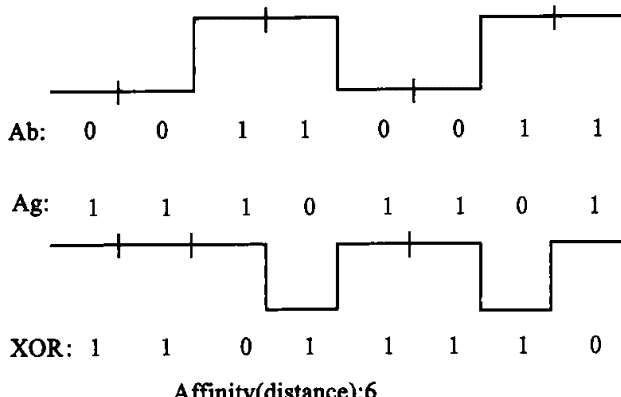

图 4-1 抗体的二进制编码

J. S. Chun 的研究进一步拓展了抗体和抗原的编码方式，并提出了采用信息熵计算抗体与抗原、抗体与抗体之间的亲和度的方法[19, 20]。因为算法采用了信息熵的概念，所以又称为基于信息熵的免疫算法。

在基于信息熵的免疫算法中，抗原对应于待求解的问题，抗体对应于问题的一个解。设有 \( N \) 个抗体，每个抗体有 \( M \) 个基因(如图 4-2 所示)。每个基因位上采用的字符集大小为 \( S \)(若采用二进制编码，字符集就为\(\{0, 1\}\), \( S=2 \))，第 \( j \) 个基因的信息熵 \( H_j(\eta)(\eta \) 是比较基参数，取值范围\([2, N]\))为：

\( H_j(\eta) = \sum_{i=1}^{s} - P_{ij} \lg P_{ij} \)

式中，\( P_{ij} \) 是字符集中第 \( i \) 个符号出现在第 \( j \) 个基因座上的概率。即：

\( P_{ij} = \frac{\text{基因座 } j \text{ 上出现第 } i \text{ 个符号的总个数}}{\eta} \)

如果参与比较的 \( \eta \) 个抗体在基因座 \( j \) 上的字符都相同，那么 \( H_j(\eta) = 0 \)。抗体多样性的平均信息熵 \( H(\eta) \)如下：

| | 1 | 2 | 3 | ... | j | ... | M |
|---|---|---|---|---|---|---|---|
| 抗体 1 | S₁₁ | S₁₂ | S₁₃ | ... | S₁j | ... | S₁M |
| 抗体 2 | S₂₁ | S₂₂ | S₂₃ | ... | S₂j | ... | S₂M |
| ⋮ | ⋮ | ⋮ | ⋮ | ⋮ | ⋮ | ⋮ | ⋮ |
| 抗体 N | Sₙ₁ | Sₙ₂ | Sₙ₃ | ... | Sₙⱼ | ... | SₙM |

图 4-2 抗体的字符集编码

$$H(\eta) = \frac{1}{M} \sum_{j=1}^M H_j(\eta)$$ (4-2)

式中，通常取 \(\eta=2\)，根据熵的定义，可得到任意两个抗体 \(v\) 和 \(w\) 之间的亲和度：

$$A_{vw} = \frac{1}{1 + H(2)}$$ (4-3)

式中，\(A_{vw}\) 的取值范围为 \((0, 1)\)，\(A_{vw}\) 越大表示两个抗体基因相似度越高。\(A_{vw} = 1\) 则表示两者的编码基因完全相同。

在给定抗体群中，任一抗体 \(v\) 的浓度为：

$$c_v = \frac{1}{N} \sum_{w=1}^N ac_{v,w}$$ (4-4)

式中，\(ac_{v,w} = \begin{cases} 1 & 当 ay_{v,w} \geqslant T_{\alpha 1} \\ 0 & \text{其他} \end{cases}\)，\(ay_{v,w}\) 为抗体 \(v\), 抗体 \(w\) 的亲和度，表示 \(v, w\) 的相似度，若 \(ay_{v,w} > T_{\alpha 1}\) 则称抗体 \(v\), 抗体 \(w\) 相似；\(ay_{v,w}\) 按文献[1]给出的方法计算；\(T_{\alpha 1}\) 为一预先给定的阈值。计算出每个抗体的浓度之后，便可以通过选择机制进行抗体的促进和抑制调节。

J. S. Chun 的研究成果获得了广泛的应用。张军等将其进一步地应用到人工神经网络的设计中[21]。根据每个抗体的浓度,采用相应的选择机制来促进和抑制抗体的产生。设抗体 $i$ 的选择概率为 $P_i$,它由适应度概率 $P_{f_i}$ 和浓度抑制概率 $P_{d_i}$ 两部分组成:

$P_i = \alpha P_{f_i} + (1 - \alpha)P_{d_i} = \alpha \frac{f_i}{\sum f_i} + (1 - \alpha) \cdot e^{-d_i} \quad (4-5)$

式中, $\alpha$ 是常数调节因子。

由式(4-5)知,在抗体浓度一定的条件下,抗体适应度越大则选择概率越大;在抗体适应度一定的条件下,抗体浓度越大则选择概率越小。这样在保留高适应度抗体的同时,也确保了个体的多样性。算法的具体设计流程如图 4-3 所示。

### 4.2.2 基于信息熵免疫算法的不足

基于信息熵的免疫算法比其他算法的优越性在于[20]：它在记忆单元基础上运行,确保收敛到全局最优解;它有计算亲和性和浓度(density)的过程,反应了真实免疫系统的多样性(diversity);它通过促进或抑制抗体的产生,体现了免疫反应的自我调节功能。基于信息熵的免疫算法的不足之处也是显而易见的。

- (1) 该算法求解公式中有 $T_{\alpha 1}$ 等常数因子需要凭经验预先确定,而这些常数因子选择的好坏会直接影响到算法的收敛性能。
- (2) 利用信息熵的概念计算抗体(即解)亲和(相似)度和抗体浓度的方法存在一定的问题,例如对于由抗体 $v=[01111111]$ 和抗体 $w=[10000000]$ 构成的抗体群,其平均信息熵 $H_v(2)=0.693147, H_w(2)=0.591$,计算结果表明 $v,w$ 是 2 个很不相同的抗体,但是,我们知道在优化计算中它们是 2 个很接近的解。
- (3) 该算法虽然设置了记忆库,其中存储优良解,但只是把每代的优良抗体存入,在群体竞争中没有利用记忆库的抗体。在每代群体的竞争中没有利用记忆库,这样影响了算法的收敛速度。

抗原输入

初始抗体产生

计算适应度概率

计算浓度概率

抗体抑制和促进

抗体生成（交叉，变异，多样性保持）

更新群体

满足要求？

N

Y

结束

图 4-3 基于信息熵的免疫算法流程图

## 4.3 基于距离浓度免疫算法设计[22]

鉴于利用信息熵计算亲和度(相似)和浓度的方法存在上述的问题，本章提出了一种基于距离浓度的群体更新策略，并据此设计了基于距离浓度的人工免疫算法（Distance Concentration Artificial Immune Algorithm，DCAIA），以克服基于信息熵的免疫算法存在的不足，丰富免疫算法。

### 4.3.1 基于距离浓度算法的免疫机理

免疫系统是高度进化的生物系统，它的功能是针对外来抗原的输入产生识别并消灭抗原的抗体，本章提出的基于距离浓度免疫算法借鉴了如下生物免疫特性和机理：

- (1) 抗体对抗原的识别是基于抗原的表位与抗体的受体之间的匹配，抗体与抗原的亲和度决定了两者的匹配程度。
- (2) 免疫系统内很少种类的抗体细胞可以识别种类繁多的抗原入侵；抗体呈现出个体的多样性，在免疫系统中同一种抗体的浓度是受到限制的，当某种抗体数量增加，达到一定浓度时，系统要对其进行抑制，同样对浓度少的抗体要进行繁殖以保证其多样性。
- (3) 抗体在繁殖过程中会产生高频变异，即克隆变异。以便可以识别种类繁多的抗原入侵，从而消灭抗原。
- (4) 抗体在识别抗原过程中，可以产生记忆，使得该抗体更快地识别抗原；通过抗体识别抗原的过程，抗体经过克隆变异和学习记忆，最后产生的抗体与抗原的匹配度提高，亲和度成熟。

### 4.3.2 亲和度函数的定义

#### 4.3.2.1 用二进制位串表示的亲和度

如果用二进制位串的互补关系来表示它们之间的亲和关系，则位串的互补关系表示抗体和抗原之间的亲和性。

例如：若用 p 表示抗体决定基，e 表示抗原决定基，p=011010,e=100100，那么 p XOR e=111110，则其亲和度为 5/6。

此处如果引入亲和度的门限阈值 Ts，来决定 p 和 e 之间亲和关系。设定 le、lp 分别表示抗原决定基和抗体决定基的串长，若 min(le、lp)>Ts，则满足亲和要求，抗体和抗原发生作用，否则认为不存在亲和性。

根据 Farmer 的模型[23]，可以用下面一组定义来表示抗体和抗原的作用关系。

- (1) 函数 \( G(x) = \begin{cases} x & x > 0 \\ 0 & \text{其他} \end{cases} \) (4-6)
- (2) 亲和度用 \( e_i(n) \) 表示第 \( i \) 个抗原决定基的第 \( n \) 位的值，用 \( p_j(n) \) 表示第 \( j \) 个抗体决定基的第 \( n \) 位的值，用 \( \wedge \) 表示异或运算符，则抗原集合与抗体集合彼此亲和度可以用两种方式来表示：
  - ① 单一亲和性：如果抗体与抗原之间的亲和关系与编码后的位置有关，那么将抗体与抗原之间的亲和关系按照二进制位串的对应位按位取补，即 \( e_1 \leftrightarrow p_1 \cdots e_n \leftrightarrow p_n \)，若用 \( s \) 表示亲和度的门限值。亲和系数 \( E_{i,j} \) 表示为：

    \( E_{i,j} = G[\sum_n e_i(n) \wedge p_j(n) - s] + 1 \) (4-7)

  - ② 多样亲和性：考虑到抗体和抗原在不同对齐方式下都有可能发生亲和过程，也就是说只要存在相同的模式类型，抗体和抗原就会发生反应，内容与位置无关，这会使两者之间以多种方式发生反应，亲和系数 \( E_{i,j} \) 表示为：

    \( E_{i,j} = \sum_k G[\sum_n e_i(n+k) \wedge p_j(n) - s] + 1 \) (4-8)

    亲和度是 \( e_i \) 和 \( e_j \) 在 \( k \) 的范围内定义的：

    \( k : \{k \leqslant | \min(l_e, l_p) | - s \} \) (4-9)

    定义 \( k \) 的范围是用来确定亲和区间的，若抗体和抗原位串的长度不同，取两者之间与门限值相减较小的值作为比较区间。例如若 \( l_e=l_p=8, s=6 \)，则只需比较 \( -2 \leqslant k \leqslant 2 \) 范围内的位串长，也就是从 \( e_1 \leftrightarrow p_3 \cdots e_6 \leftrightarrow p_8 \) 比较到 \( e_3 \leftrightarrow p_1 \cdots e_8 \leftrightarrow p_6 \)。式(4-7)、式(4-8)是取不同对齐方式下的亲和度之和，如果存在越多种方式的亲和性，抗体与抗原之间的反应程度也越强烈。

在免疫算法设计中，待求解的问题表示为抗原，待求的每个可行的解表示为抗体，解的目标函数表示为抗原与抗体之间的亲和度。当一个抗原与一个抗体相遇时，若发生亲和现象，则认为靠近最优解，不亲和的抗体则认为将会远离最优解。特别是在数值寻优中可以认为抗原与抗体的融合（亲和度等于 1）就找到了最优解。另外，抗体数也是衡量最优解的一个指标，如果某类抗体在抗体群体中浓度过高时，会导致寻优过程停滞不前，尤其在多峰值函数的寻优中会发生早期收敛现象。所以我们利用控制浓度来抑制相同或相似个体的数量，以提高抗体进化操作过程中的进化效率，以快的速度达到亲和度成熟。

#### 4.3.2.2 亲和度函数

使用二进制编码表示的亲和度，可以用来解决优化问题中一些目的函数易于编码表示的问题，如配词问题[24]，将优化问题的目标函数(字符串)直接编码成抗原，由式(4-9)或式(4-10)计算抗体与抗原的亲和性，就可以用免疫的方法获得正确的目标字符串。但是，使用简单的二进制编码方法在许多问题上很难描述出问题的特征，特别是利用免疫算法寻找连续函数最优解时，使用二进制编码方法操作不够灵活，问题的解表示也不直观。因此有必要引入亲和度函数，以便将免疫算法运用到更广泛的领域中。

从免疫系统亲和度本身进行分析，抗体是一个解集的空间，亲和度是这个解集空间的一个最优目标函数值的度量，可以使用一个连续函数来代替要搜索的最优目标函数值。这样抗体与抗原的亲和过程就是一个函数求解最优解的过程。

对于连续函数寻找最优解问题，可以形式化为：数据对(S, f)，其中 S⊂R^n 是 R^n 中的有界集，f：S→R 是 n 维实值函数，所要求解的问题就是要找到一点，使得 ∀ x ∈ S：f(xmin) ≤ f(x)。如果是求全局极大值问题，可以用转化函数将问题归并于求极小值问题。因此这里仅讨论极小值问题。

通过以上分析，可以将连续函数最优解问题模拟为抗体与抗原的亲和过程，采用免疫算法对其求解。如果将抗原对应于待求解的问题 X，抗体对应于问题的一个解 xi，亲和度对应于最优目

目标函数值 $f(x_i)$。那么 $n$ 个抗体构成了一个非空免疫系统集合 $X$。根据抗体与抗原的亲和度表示形式，定义它们的亲和度函数如下：

$D(x) = \frac{1}{1 + L[f(u)]}$ (4-10)

式中，$u$ 为空间变量；$f(u)$ 为目标函数或约束条件（亲和度关系）。$L(*)$ 为对目标函数的比例变换，如：线性比例变换：$y = kx + b$，幂比例变换：$y = a^x$ 等等，目标是使 $D(x)$ 满足适应值的要求。对于目标函数值较大或较小的数值可以量化到 $[0, 1]$ 区间上。设定 $f(x)$ 为抗原与抗体的亲和度，我们提出的算法定义线性变换 $L(*)$ 为：

$f'(x_i) = \frac{f_{max} - f(x_i)}{f_{max} - f_{min}}$ (4-11)

式中，$f_{max}$ 和 $f_{min}$ 为种群中适应度的最大值和最小值。这样抗原与抗体之间的亲和度函数可表示为：

$D(x_i) = \frac{1}{1 + f'(x_i)}$ (4-12)

### 4.3.3 距离浓度的定义

免疫系统中抗体遭遇抗原时，通过一系列的反应结合来破坏抗原。这种反应是基于抗体浓度进行的，同一种抗体的浓度是受到限制的，浓度高的抗体系统要对其进行抑制，同样对浓度少的抗体要进行繁殖以保证其多样性。在免疫算法的抗体浓度研究中，除了用信息熵计算浓度外，吕刚（2003 年）[14]、严德昆（2004 年）[15]等提出了用抗体亲和度函数之间的距离来计算浓度的不同方法，这类方法不是直接的计算抗体个体的差异；郑日荣等（2003 年）[16]提出了改进的基于距离人工免疫算法，算法先给定一个阈值，通过计算两个抗体之间 Euclid 距离是否达到这个阈值来判断抗体是否相似，然后累计抗体的个数来计算浓度，这种方法仍是采用传统的通过统计抗体个数来求解浓度，需要解决阈值设定问题，求解过程烦琐。在所提出的方法中，如果待求解的问题是抗原，问题的一个解 \( x_i \) 对应于一个抗体，那么在 \( n \) 个抗体构成的非空免疫系统集合 S 上，若规定抗体 \( x_i \) 在集合 S 上的距离为：

\( d_i = d(x_i) = \sum_{j=1, i \neq j}^{n} \| x_i - x_j \| \quad \text{(4-13)} \)

所有抗体之间的距离和为：

\( d = \sum_{i=1}^{n} d(x_i) = \sum_{i=1}^{n} \sum_{j=1, j \neq i}^{n} \| x_i - x_j \| \quad \text{(4-14)} \)

则抗体 \( x_i \) 的距离浓度可定义为：

\( C(x_i) = 1 - \frac{d_i}{d} = 1 - \frac{\sum_{j=1, i \neq j}^{n} \| x_i - x_j \|}{\sum_{i=1}^{n} \sum_{j=1, i \neq j}^{n} \| x_i - x_j \|} \quad \text{(4-15)} \)

显然，抗体之间的距离越大，其距离浓度越小，反之则浓度越大。
这种定义使得采用浓度策略控制抗体的数量时，可以保证抗体在解空间的多样性，而不至于使解收敛到某一区域，这有利于算法快速求得最优解集，同时也可以满足求解多峰值函数的需要。这种求解抗体浓度方法，避免了用信息熵计算浓度存在误差问题，比文献[14]、文献[15]用抗体亲和度函数之间的距离来计算浓度更能反映抗体自身的多样性，也比文献[16]采用先给定阈值计算两个抗体之间 Euclid 距离是否达到这个阈值来判断抗体是否相似，然后累计抗体的个数来计算浓度方法更简单。

### 4.3.4 期望克隆率计算

免疫系统中抗体的克隆是基于亲和度和浓度的。亲和度高的抗体将获得高的克隆率，同时为了保持抗体的多样性，抗体的克隆是与浓度成反比例的。
因此，本章提出的算法定义抗体期望克隆率为：

$E(x_i) = \frac{D(x_i)}{C(x_i)}$

式中，$D(x_i)$ 为抗体与抗原之间的亲和度；$C(x_i)$ 为抗体在抗体（解）空间的浓度值。抗体克隆后要进行变异操作。

### 4.3.5 抗体变异

对于所提出的免疫算法编码操作可以有两种不同的方式：二进制编码和实数编码，相应的变异也有两种方式：

- (1) 按二进制位变异分为单点变异和一致变异。单点变异是等概率地随机确定一个基因，改变个体分量取值。一致变异操作是等概率地对个体的每一个基因，改变个体分量取值。
- (2) 非均匀变异。考虑按位选择与变异处理单元数量太多，可选择实数交叉与非均匀变异法。就是在算法中用实数值表示抗原和抗体，通过对一个给定抗体加入来自某区间的随机数来产生变异的新抗体。

对选出的抗体按段有下面的组合方式：

$v_1^{'} = v_1 + (1 - \lambda)v_2$
$v_2^{'} = v_2 + (1 - \lambda)v_1$
其中 \(\lambda \in (0, 1]\)

非均匀变异[25]如下：对于给定的父亲 \(v\)，若它的元素 \(a_k\) 被选来变异，则生成的后代为：

$v' = [a_1, a_2, \cdots, a_k', \cdots, a_n]$

式中，$a_k'$ 随机地按如下两种可能的机会变化。

$a_k' = a_k + \Delta(t, a_k^U - a_k)$

或者：

$a_k' = a_k + \Delta(t, a_k - a_k^L)$

在这里，$a_k^U$ 和 $a_k^L$ 分别是上界和下界。函数 \(\Delta(t, y)\) 给出 \([0, y]\) 区间的一个值，使得 \(\Delta(t, y)\) 随着 \(t\) 的增加而趋于 0（\(t\) 是代数）。
例如可取 \(\Delta(t, y)\) 为：

\(\Delta(t, y) = y \cdot r \cdot (1 - \frac{t}{T})^b\) (4-21)

式中，$r$ 是 $[0,1]$ 区间的随机数；$T$ 是最大代数，$b$ 是确定非均匀度的参数（$[0,1]$ 之间）。

### 4.3.6 记忆细胞生成和亲和度成熟

在抗体经过克隆和变异后，克隆的抗体种群 $A_k$ 和变异产生的抗体种群 $B_k$ 就构成了抗体种群 $C_k$。记忆细胞生成就是从种群 $C_k$ 中选出一定数量亲和度高的抗体更新记忆细胞库中的抗体，使得记忆细胞库一直保持固定数目为 $M$ 的最高亲和度抗体。

亲和度成熟是根据设定的条件判断抗体是否达到最优，如果达到则结束寻优过程，否则从种群 $C_k$ 选择出抗体进行下一次操作。新的种群选择方法可以用比例保留法，也就是若初始抗体集合中抗体总数为 $(N+M)$，那么先计算每个个体的期望值，然后按其大小进行排序，按赌轮选择的方法从种群 $C_k$ 选取 $N$ 个个体，与记忆细胞库中 $M$ 个个体一起构成 $(N+M)$ 个新抗体集合开始下一代的操作。

我们提出的基于距离浓度的免疫算法克服了基于信息熵的传统免疫算法参数设置复杂、亲和度计算存在误差等缺点，不需要预先设定阈值判断两个抗体的相似，而是直接计算抗体之间距离作为抗体浓度的度量。它的计算过程简捷，没有需要凭先验知识确定的参数；亲和度函数可以直接采用实数计算，编码形式灵活，满足了求解优化问题多样性的需要；该算法的抗体浓度计算方法可以实现实数非均匀变异，可以提高算法的收敛速度和从局部最小中逃逸的能力。

### 4.3.7 算法描述

- step1: 分析问题。对问题及其解的特性进行分析和了解，并设计解的合适表达形式。将抗原和抗体分别对应于待求解的问题 X 和问题的一个解 \(x_i\)，亲和度函数对应于最优函数值 $f(x_i)$。
- step2: 产生初始抗体群体。随机产生 N 个抗体，再随机产生 M 个抗体放入记忆库中，由这 $(N+M)$ 个抗体构成初始抗体群体。
- step3: 对抗体群体中各抗体进行评价，按式 (4-15) 计算抗体 $v$ 的距离浓度 $C(x_i)$；按式 (4-12) 计算抗体的亲和度 $D(x_i)$；按式 (4-16) 计算抗体的期望繁殖率 $E(x_i)$。
- step4: 形成父代群体。将抗体群体按 $E(x_i)$ 的降序排列，并取前 N 个个体构成父代群体；同时取前 M 个个体作为记忆细胞更新记忆库中的抗体。
- step5: 判断是否满足结束条件。可设定最大运行世代数作为终止条件，或判断连续迭代一定次数后抗体亲和度函数值没有变化作为终止条件。一旦条件满足则输出记忆库中的最优解，结束运算。否则继续下一步操作。
- step6: 抗体的增殖和分化。基于 step4 的计算结果，按照其评价标准，从抗体群体中确定父代群体后进行抗体变异，选择按二进制位变异或实数交叉与非均匀变异方法产生新抗体。变异产生的新抗体和原有的父代群体一起构成新一代抗体群。
- step7: 执行 step3。

算法具体设计流程如图 4-4 所示。

问题表示: X、$x_i$、$f(x_i)$

产生初始抗体群 N，记忆抗体 M

计算 $C(x_i)$、$D(x_i)$

抗体的增殖分化（克隆和变异）

抗体按 $E(x_i)$ 排序，生成父代群体和记忆细胞

满足要求？

结束

#### 图 4-4 基于距离浓度免疫算法流程

## 4.4 基于距离浓度免疫算法的收敛分析

### 4.4.1 基于距离浓度免疫算法的 Markov 链描述

#### 4.4.1.1 状态空间

在基于距离浓度免疫算法中，规定所有抗体个体组成的状态空间为解状态空间，记为 \(\Phi\)，其维数用 \(|\Phi|\) 表示，它是有限的。从所有抗体群体中任意抽取 \(n\) 个抗体就组成了一个种群，它对应于一个状态。规定所有种群组成的状态空间为种群状态空间，记为 \(\Lambda\)，其维数用 \(|\Lambda|\) 表示，它也是有限的，且 \(|\Lambda| = |\Phi|^n\)。例如：存在抗体个体 \(\{x_1, x_2, x_3\}\)，则构成的解状态空间 \(|\Phi| = 3\)；从中任取 2 个组成一个种群，$n=2$ 是此种群的规模，则总共有 \(\{x_1, x_1\}, \{x_1, x_2\}, \{x_1, x_3\}, \{x_2, x_1\}, \{x_2, x_2\}, \{x_2, x_3\}, \{x_3, x_1\}, \{x_3, x_2\}, \{x_3, x_3\}\) 个种群，因为一个种群对应一个状态，所以种群状态空间 \(|\Lambda|\) 共有 $3^2$ 个状态。

#### 4.4.1.2 状态转移

基于距离浓度免疫算法的状态转移包括抗体种群状态转移和免疫记忆细胞状态转移。

- ① 调节抗体浓度

在所提出的算法中，每一代抗体的增殖、分化和调节抗体浓度的操作实际上对应于从一个抗体种群 \(p_i^{(t)} = \{x(t) = i\}\) 向另一个抗体种群 \(p_j^{(t+1)} = \{x(t+1) = j\}\) 的状态转移过程。记种群 \(p_i^{(t)}\) 转移到种群 \(p_j^{(t+1)}\) 的过程为 \(P_{ij}\)，其对应的状态转移矩阵为 \(P\)。因为过程 \(P_{ij}\) 仅与前一个种群的状态有关，与进化代数无关，所以抗体种群状态转移过程可看成是一个有限齐次 Markov 链，状态空间的维数是 \(|\Lambda|\)。它包含如下三个过程。

调节抗体浓度的操作是对种群 \(p_i^{(t)}\) 按抗体浓度大小选择得到新种群 \(s_l^{(t)}\)，记调节抗体浓度操作的状态转移矩阵为 \(S = (s_u)_{|\Lambda||\Lambda|}\)。种群中抗体个体 \(X_i\) 被选中的概率由其亲和度 \(D(x_i)\) 和距离浓度 \(C(x_i)\) 决定，因为：

$E(x_i) = \frac{D(x_i)}{C(x_i)} > 0$ \quad (4-22)

所以：

$S_{ii} = \prod_{i=1}^n E(x_i) > 0$ \quad (4-23)

根据文献[28]的定义，状态转移矩阵 \(S\) 是严格正的。

- ② 抗体的增殖操作

增殖操作的作用是按一定的概率把种群 \(s_l^{(t)}\) 映射到种群 \(c_q^{(t)}\)，记抗体增殖操作的状态转移矩阵为 \(C=(c_{lq})_{|\Lambda| \times |\Lambda|}\)，由于一个状态通过增殖操作总要转移到状态空间中的另一个状态，显然有

\(c_{lq} \geqslant 0\)，\(\sum_{j=1}^{|\Lambda|} c_{lq} = 1\)

根据文献[28]的定义，状态转移矩阵 \(C\) 是随机的。

- ③ 抗体的分化操作

设定每个抗体个体是由一个长度为 \(l\) 的二进制串表示的，\(x_i\) 与 \(x_j\) 之间的海明距离定义为：

\( H_{ij} = \sum_{k=1}^l | g_{ik} - g_{jk} | \)

式中，$g_{ik}$ 是串 \(x_i\) 的第 \(k\) 位基因，$g_{jk}$ 是串 \(x_j\) 的第 \(k\) 位基因。

则由 \(x_i\) 变异到 \(x_j\) 的概率为

\( P(x_i \rightarrow x_j) = p_m^{H_{ij}} (1 - p_m)^{1 - H_{ij}} \)

式中，$p_m \in (0, 1)$ 是变异概率，$P(x_i \rightarrow x_j) > 0$。

分化操作的作用是把种群 \(c_q^{(t)}\) 映射到种群 \(m_j^{(t)}\)，记抗体分化操作的状态转移矩阵为 \(M=(m_{qj})_{|\Lambda| \times |\Lambda|}\)，有

\( m_{qj} = \prod_{i=1}^n p_m^{H_{ij}} (1 - p_m)^{1 - H_{ij}} > 0 \)

根据文献[26]的定义，状态转移矩阵 \(M\) 是严格正的。

经过上述对抗体的分化操作得到的种群 \(m_i^{(t)}\) 也就是种群 \(p_j^{(t+1)}\)，完成了一代抗体的状态转移，即 \(P = SCM\)。然后算法从新种群 \(p_j^{(t+1)}\) 开始，重复上述三个操作，周而复始。

- 记忆细胞状态转移

根据基于距离浓度免疫算法的设计，在循环体内还存在一个对每代的最优抗体个体作为免疫记忆细胞保留的操作过程。即在第 \(t\) 代进化时，搜索种群 \(p_i^{(t)}\) 中抗体对应的最佳抗体值，并将此抗体作为免疫记忆细胞保留下来，记作 \(x^*(t)\)。然后在第 \(t + 1\) 代进化时，搜索种群 \(p_j^{(t+1)}\) 中抗体对应的最佳抗体值，并将它与 \(x^*(t)\) 比较，选择其中最好的值存为 \(x^*(t+1)\)。即：

\( P[x^*(t) \rightarrow x^*(t+1)] = \begin{cases} 0 & x^*(t+1) < x^*(t) \\ 1 & x^*(t+1) \geqslant x^*(t) \end{cases} \) (4-28)

由于从值 \(x^*(t)\) 转移到 \(x^*(t+1)\) 的过程仅与 \(x^*(t)\) 有关，与进化代数无关，所以免疫记忆细胞状态转移过程也可以看成是一个有限齐次 Markov 链，状态空间的维数是 \(|\Phi|\)。将转移概率记作 \(e_{ij}\)，状态转移矩阵记作 \(E\)。根据上述性质将状态转移矩阵 \(E\) 的状态按照从全局最优解向全局最差解的递减次序排列，可得：

\( E = \begin{bmatrix} e_{11} & 0 & \cdots & 0 \\ e_{21} & e_{22} & \cdots & 0 \\ \cdots & \cdots & \cdots & \cdots \\ e_{|\Phi|1} & e_{|\Phi|2} & \cdots & e_{|\Phi||\Phi|} \end{bmatrix} \) (4-29)

因为生成免疫记忆细胞的操作是一个独立过程，它不参与调节抗体浓度和抗体的增殖、分化的操作，因此也就不影响种群状态空间。

### 4.4.2 基于距离浓度免疫算法的收敛性

**定理 4.1** 基于距离浓度免疫算法构成的 Markov 链是遍历的，且存在平稳分布。

**证** 因为基于距离浓度免疫算法的状态转移矩阵 \(P=SCM\)，则由 Chapman-Kolmogorov\(^{[27]}\) 公式知，算法的一步转移概率方程为：

\( P_{ij} = \sum_{q=1}^{|\Lambda|} (\sum_{l=1}^{|\Lambda|} s_{il} \cdot c_{lq}) m_{qj} \) (4-30)

由式(4-23)知 \(s_{il} > 0\)，所以存在一个 \(\epsilon\)，使 \(s_{il} \geqslant \epsilon\)，将式(4-24)、式(4-27)带入式(4-30)得：

\( P_{ij} = \sum_{q=1}^{|\Lambda|} (\sum_{l=1}^{|\Lambda|} s_{il} \cdot c_{lq}) m_{qj} \geqslant \sum_{q=1}^{|\Lambda|} (\sum_{l=1}^{|\Lambda|} \epsilon \cdot c_{lq}) m_{qj} \)

\( = \epsilon \cdot \sum_{q=1}^{|\Lambda|} m_{qj} > 0 \quad (4-31) \)

根据文献[28]的定义知状态转移矩阵 **P** 是严格正的，所以由该免疫算法构成的 Markov 链在种群状态空间上是遍历的，且存在平稳分布。

**定义 4.1** 设 \(F_k\) 是 \(k\) 时刻群体中的抗体对应的最优抗体，\(F^*\) 是待求问题的抗原，当且仅当 \(\lim_{k \to \infty} P(F_k = F^*) = 1\) 成立，称基于距离浓度免疫算法是全局收敛的。

**定理 4.2** 基于距离浓度免疫算法是依概率 1 全局收敛的。

**证** 根据定理 4.1 知基于距离浓度免疫算法构成的 Markov 链在种群状态空间上是遍历的，而种群是抗体的选择集合，所以该免疫算法可以遍历解空间 \(\Phi\) 上的所有抗体。免疫记忆细胞的操作又是一个独立的对 \(\Phi\) 空间上抗体的寻优过程，它不参与调节抗体浓度和抗体的增殖、分化的操作，因此也就不影响种群状态空间。根据式(4-29)可知，免疫记忆细胞的寻优操作最终结果为：

\( \mathbf{E} = \begin{bmatrix} e_{11} & 0 & \cdots & 0 \\ e_{21} & e_{22} & \cdots & 0 \\ \cdots & \cdots & \cdots & \cdots \\ e_{|\Phi|1} & e_{|\Phi|2} & \cdots & e_{|\Phi||\Phi|} \end{bmatrix} = \begin{bmatrix} C & 0 \\ R & T \end{bmatrix} \quad (4-32) \)

式(4-32)中，\(\mathbf{R} = \begin{bmatrix} e_{21} \\ \cdots \\ e_{n_1} \end{bmatrix}\)，\(\mathbf{T} = \begin{bmatrix} e_{22} & \cdots & 0 \\ \cdots & \cdots & \cdots \\ e_{n2} & \cdots & e_m \end{bmatrix}\)，\(\mathbf{R}, \mathbf{T} \neq 0\)，\(\mathbf{C} = [e_{11}] = [1]\) 是一阶正的随机矩阵，由于状态转移矩阵 **P** 是可约的。

而当 **P** 是一个可约随机矩阵，\(\mathbf{P} = \begin{bmatrix} C & 0 \\ R & T \end{bmatrix}\)，其中 C 是正的 m

阶随机矩阵，$R,T \neq 0, P^\infty = \lim_{k \to \infty} P^k = \lim_{k \to \infty} \begin{bmatrix} C^k & 0 \\ \sum_{i=0}^{k-1} T^i R C^{k-i} & T^k \end{bmatrix} = \begin{bmatrix} C^\infty & 0 \\ R^\infty & 0 \end{bmatrix}$

所以 \( E^\infty = \lim_{k \to \infty} E^k = \begin{bmatrix} C^\infty & 0 \\ R^\infty & 0 \end{bmatrix} = \begin{bmatrix} 1 & 0 \\ R^\infty & 0 \end{bmatrix} \) (4-33)

\( E \) 的第一状态的极限概率为 1，即：

\( e_{11} = \lim_{k \to \infty} P(F_k = F^*) = 1 \) (4-34)

由定义 4.1 知基于距离浓度免疫算法是全局收敛的。

## 4.5 实验仿真

用所提出的基于距离浓度算法(DCAIA)优化以下三个典型的多峰值函数，并与标准遗传算法(GA)、基于信息熵的传统人工免疫算法(CAIA)的优化结果比较。

- (1) Shekel's Foxholes 函数：

\( f_1(x) = 0.002 + \sum_{j=1}^{25} \frac{1}{j + \sum_{i=1}^2 (x_i - a_{ij})^6} \) (4-35)

式(4-35)中：\( a_{ij} = \begin{pmatrix} -32 & -16 & 0 & 16 & 32 & -32 & \dots & 0 & 16 & 32 \\ -32 & -32 & -32 & -32 & -32 & -61 & \dots & 32 & 32 & 32 \end{pmatrix} \)

此函数有 25 个局部极大值，如图 4-5 所示，只有在 \( x_1 = -32, x_2 = -32 \) 处取得最大值 1.002。

取自变量取值范围为 \( -65.536 \leqslant x_i \leqslant 65.536 \)，种群规模为 100，DCAIA 直接采用实数编码，GA 和 CAIA 的染色体编码是 16 位长的二进制串，交叉概率 \( P_c = 0.9 \)，变异概率 \( P_m = 0.05 \)。实验的结果参见表 4-1，收敛性能比较参见图 4-6。

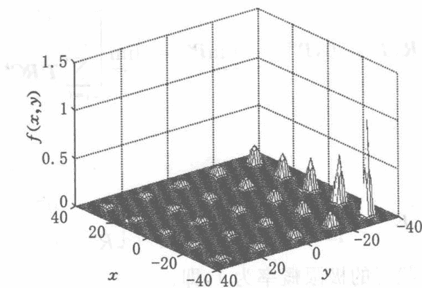

图 4-5 Foxholes 函数图形

表 4-1 测试函数的结果比较

| 算法 | 收敛次数 | 未收敛次数 | 最优解 | 次优解 | 收敛代数 | 收敛时间 /s |
|---|---|---|---|---|---|---|
| GA | 36 | 14 | 1.002 | 0.0141 | 90.05 | 46.73 |
| CAIA | 50 | 0 | 1.002 | | 24.87 | 7.27 |
| DCAIA | 50 | 0 | 1.002 | | 12.43 | 3.54 |

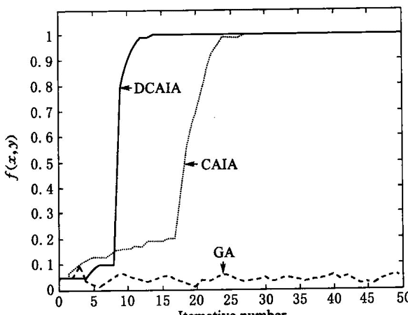

图 4-6 Foxholes 函数下三种算法的性能对比

实验结果表明只有 GA 陷入了某个“狐洞”(表 4-1)，其收敛成功率仅有 72%。且在这些收敛成功的实验中，GA 收敛的平均时间也要多于 DCAIA 和 CAIA 两种算法多倍，DCAIA 的收敛速度也远快于 CAIA。

- (2) Schaffer 函数：

\( f_2(x, y) = 0.5 - \frac{\sin^2\sqrt{x^2 + y^2} - 0.5}{[1 + 0.001 \times (x^2 + y^2)]^2} \) (4-36)

此函数有无穷个局部极大点(图 4-7)，其中只有一个(0,0)为全局最大点，最大值为 1。在函数的极值峰周围有两圈脊，它们的取值分别为 0.962776 和 0.990284，在算法寻优搜索过程中，很容易停滞在这些局部极大点，陷入未成熟收敛。

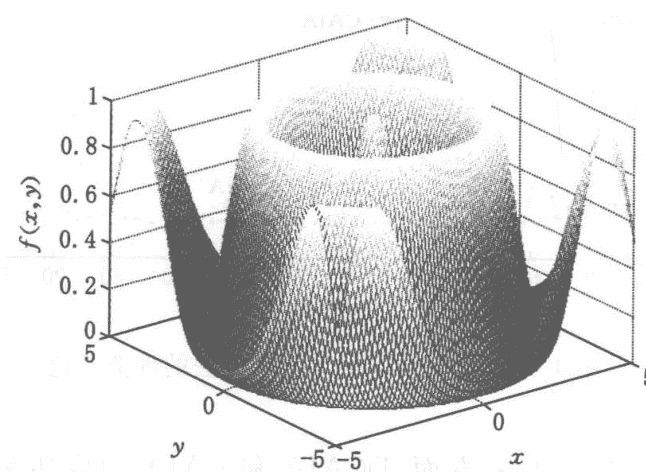

图 4-7 Schaffer 函数图形

取自变量的取值范围为 \( -4 \leqslant x \leqslant 4 \)，\( -4 \leqslant y \leqslant 4 \)，种群规模为 50，DCAIA 直接采用实数编码，GA 和 CAIA 的染色体编码是 12 位长的二进制串，交叉概率 \( P_c = 0.9 \)，变异概率 \( P_m = 0.05 \)。算法的实验结果参见表 4-2，收敛性能比较参见图 4-8。

表 4-2 测试函数的结果比较

| 算法 | 收敛次数 | 未收敛次数 | 最优解 | 次优解 | 收敛代数 | 收敛时间 /s |
|---|---|---|---|---|---|---|
| GA | 21 | 29 | 0.9996 | 0.9902 | 121.06 | 36.51 |
| CAIA | 50 | 0 | 0.9993 | 0.9902 | 48.12 | 27.28 |
| DCAIA | 50 | 0 | 1 | | 25.07 | 18.15 |

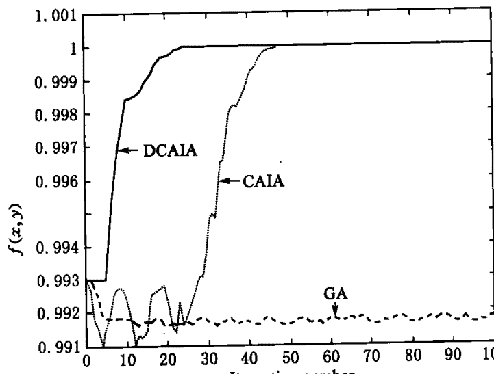

图 4-8 Schaffer 函数下三种算法的性能对比

从表 4-2 可知，一方面，DCAIA 和 CAIA 的成功率都达到了 100%，但 DCAIA 的收敛速度要快于 CAIA，而 GA 的成功率不到 50%。而且 GA 在寻优搜索过程中，往往会停滞在局部极大点附近(图 4-8)。另一方面，DCAIA 和 CAIA 的收敛速度都快于 GA。

- (3) Camel 函数：

\( f_3(x,y) = (4 - 2.1x^2 + \frac{x^4}{3})x^2 + xy + (-4 + 4y^2)y^2 \) (4-37)

此函数有 6 个局部极小点，如图 4-9 所示，其中有两个点 (-0.0898, 0.7126) 和 (0.0898, -0.7126) 为全局最小点，最小值为 -1.031628。

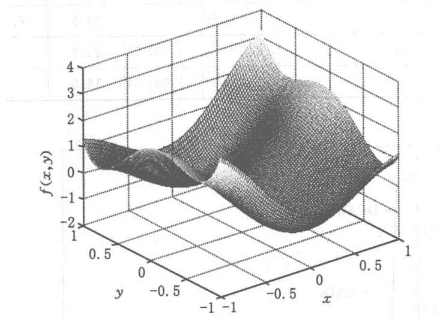

图 4-9 Camel 函数图形

取自变量的取值范围为 \( -2 \leqslant x \leqslant 2 \)，\( -2 \leqslant y \leqslant 2 \)，种群规模为 50，DCAIA 直接采用实数编码，GA 和 CAIA 的染色体编码是 12 位长的二进制串，交叉概率 \( P_c = 0.9 \)，变异概率 \( P_m = 0.05 \)。算法的实验结果参见表 4-3，收敛性能比较参见图 4-10。

从表 4-3 可知，三种算法均收敛。DCAIA 和 CAIA 找到了两个全局最优解，而 GA 仅找到了一个最优解。这是因为在 GA 中，一旦群体中出现一个最优点，GA 就引导搜索朝这个点进行，而将其他的有用信息很快丢弃。而 DCAIA 和 CAIA 由于采用了基于抗体浓度的选择策略，可以自适应的调整解群的分布，使搜索可沿着多个最优解的方向进行，所以它们可以求得多个最优解，从实验还可以看出 DCAIA 收敛速度快于 CAIA 的收敛速度。

表 4-3 测试函数的结果比较

| 算法 | 收敛次数 | 未收敛次数 | 最优解 | 次优解 | 收敛代数 | 收敛时间/s |
|---|---|---|---|---|---|---|
| GA | 50 | 0 | -1.03156 | | 29.9 | 6.40 |
| CAIA | 50 | 0 | -1.03154 | -1.03154 | 22.9 | 4.86 |
| DCAIA | 50 | 0 | -1.03161 | -1.03154 | 18.5 | 3.74 |

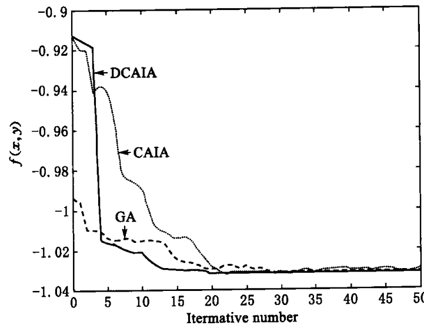

从实验结果看所提出的基于距离浓度的免疫算法具有计算简单，可对解群的分布进行自适应调整的特性，因此较好地解决了遗传算法未成熟收敛和传统免疫算法收敛速度慢的问题。

## 4.6 小结

由于免疫算法作为人工免疫系统的一个重要方面和它应用的广泛性，本章对其构造和应用进行了深入细致的研究。

免疫算法模拟了生物免疫的基因表现形式、抗原与抗体的匹配方式和不完全匹配机制、免疫应答过程中的克隆和超变异以及免疫记忆等特性。免疫算法设计的两种方式：一是把人工免疫系统模拟成自然免疫系统的结构，二是不考虑是否与自然免疫系统结构的相似，而考察相似的输入情况下，其输出是否相同或类似，侧重对免疫算法的数据分析。免疫算法是克服遗传算法群体多样性保持能力不足、易陷入局部最优等缺点的一个有效途径。

基于信息熵的免疫算法具有在记忆单元基础上运行，确保收敛到全局最优解等优点；但它需要凭经验预先确定算法中的常数因子；利用熵的概念计算抗体亲和度和抗体浓度的方法存在误差；算法虽然设置了记忆库，但在群体竞争中没有利用记忆库的抗体，影响了算法的收敛速度。

提出了一种基于距离浓度的免疫算法。在提出的免疫算法中，定义了优化过程中问题解的亲和度函数，把优化问题转换到抗体统一的亲和度计算公式中，方便了优化问题的免疫方法实现；提出的距离浓度计算方法，通过抗体的距离反映抗体空间的多样性；设计了基于距离浓度免疫算法的实现步骤。

对提出的基于距离浓度免疫算法的收敛性进行了分析，从抗体种群的状态转移和记忆细胞的状态转移过程，给出了算法的收敛性证明。

将提出的基于距离浓度免疫算法应用到优化问题中，通过对一组具有复杂性、约束性、非线性、不确定性的多态函数寻优测试，将提出的免疫算法与遗传算法和传统的免疫算法的性能进行了比较。仿真实验结果显示所提出的基于距离浓度免疫算法具有计算简单，可对解群的分布进行自适应调整等特性，因此较好地解决了遗传算法未成熟收敛和传统免疫算法收敛速度慢的问题。

# 参考文献

[1] XUNXUE CUI, MIAO LIAN, TINGJIAN FANG. Study of Population Diversity of Multi-objective Evolutionary Algorithm Based on Immune and Entropy[C]. In Proc. of 2001(CEC’2001), Piscataway, New Jersey, May 2001. IEEE Service Center. 2 :1316-1321.

[2] TOYOO FUKUDA, KAZUYUKI MORI, MAKOTO TSUKIYAMA. Parallel Search for Multi-Modal Function Optimization with Diversity and Learning of Immune Algorithm[M]. Dasgupta D. Artificial Immune systems and their Applications, Springer-Verlag, Berlin Germany, 1998 ; 210-220.

[3] JANGSUNG CHUN, HYUNKYU KIM, HYUNKYO JANG. Shape Optimization of Electromagnetic Devices Using Immune Algorithm[J]. IEEE Trans. On. Magnetics, 1997, 33(2) :34-58.

[4] JANGSUNG CHUN, HYUNKYO JANG, SONGYOP HAHN. A Study on Comparison of Optimization Performances between Immune Algorithm and Other Heuristic Algorithms [J]. IEEE Trans. On Magnetics, 1998, 34(5) :95-112.

[5] VIENNET R, FONTIEX C, et al. New Multi-criteria Optimization Method Based on the Use of a Diploid Genetic Algorithm: Example of an Industrial Problem[C]. Proceedings of Artificial Evolution (European Conference, selected papers), Brest France, September 1995. Springer-Verlag:120-127.

[6] STEVE C, UWE A. A Recommender System based on the Immune Network[C]. Proceedings CEC2002, Honolulu, USA, 2002, 807-813.

[7] ZITZLER ECKART, KALYANMOY DEB, et al. Comparison of Multi-objective Evolutionary Algorithms: Empirical Results[J]. Evolutionary Computation, Summer 2000, 8(2) : 173-195.

[8] VELDHUIZEN V, DAVID A, LAMONT B. On Measuring Multi-objective Evolutionary Algorithm Performance[C]. In: 2000 Congress on Evolutionary Computation, volume 1, Piscataway, New Jersey, July 2000. IEEE Service Center; 204-211.

[9] KURPATI A, AZARM S. Immune Network Simulation with Multi-objective Genetic Algorithms for Multidisciplinary Design Optimization [J]. Engineering Optimization, 2000, 33: 245-260.

[10] RUDOLPH G. On a Multi-Objective Evolutionary Algorithm and Its Convergence to the Pareto Set [C]. Proceedings of the 5th IEEE Conference on Evolutionary Computation, Piscataway, New Jersey, 1998. IEEE Press; 511-516.

[11] SRINIVAS N, KALYANMOY D. Multiobjective Optimization Using Nondominated Sorting in Genetic Algorithms [J]. Evolutionary Computation, 1994, 2(3): 221-248.

[12] KALYANMOY D. Multi-Objective Genetic Algorithms: Problem Difficulties and Construction of Test Problems [J]. Evolutionary Computation, 1999, 3: 205-230.

[13] CHUN J S, ZUBEN M. Clonal Selection Algorithm with Engineering Applications[C]. Proc. Of Genetic and Evolutionary Computation Conference, Las Vegas, 2000: 36-37.

[14] 吕刚, 陈小平. 免疫算法抗体浓度调节定义的改进 [J]. 数据采集与处理, 2003, 1: 44-48.

[15] BO M, YAN D K, LIU J H. Research into Optimization Algorithm Based on Immune Mechanism[J]. Journal of China University of Mining & Technology (English Edition), 2004, 2: 152-156.

[16] 郑日荣, 毛宗源, 罗欣贤. 改进人工免疫算法的分析研究 [J]. 计算机工程与应用, 2003, 34: 35-37.

[17] CASTRO D E, ZUBEN V. Learning and optimization using the clonal selection principle[J]. IEEE Trans on Evolutionary Computation, 2002, 6(3): 306-313.

[18] HOLLAND J H. Adaptation in Natural and Artificial System[M]. MI; Univ. Michigan Press, 1975.

[19] CHUN J S, KIM M K, JUNG H K, et al. Shape optimization of electro-magnetic devices using immune algorithm[J]. IEEE Trans Magnetics, 1997, 33(2) : 1876-1879.

[20] CHUN J S, JUNG H K, HAN S Y. A study on comparison of optimization performances between immune algorithm and other heuristic algorithms[J]. IEEE transactions on magnetics, 1998, 34(5): 2972-2975.

[21] 张军, 刘克胜, 王煦法. 一种基于免疫调节和共生进化的神经网络优化设计方法[J]. 计算机研究与发展, 2000, 37(8): 924-930.

[22] LIU T, WANG Y C, WANG Z J. The Distance Concentration Artificial Immune Algorithm [J]. Journal of China University of Mining & Technology (English Edition), 2005, 15(2).

[23] FARMER J D, PACKARD N H, PERELSON A S. The immune system, adaptation and machine learning[J]. Physica D, 1986, 22: 87-204.

[24] 玄光南, 程润伟. 遗传算法与工程设计[M]. 北京: 科学出版社, 2000.

[25] MICHALEWICZ Z. Genetic algorithms + Data Structure = Evolution Program[C], 2nd ed. Springer-Verlag, New York, 1994.

[26] RUDOLPH G. Convergence Properties of Canonical Genetic Algorithms [J]. IEEE Trans. on Neural Networks, 1994, 15(1): 96-101.

[27] 方兆本, 缪柏其. 随机过程[M]. 安徽: 中国科技大学出版社, 2002.

[28] JULIET JUAN LIU, JAMES TIN, YAU KWOK. An extended genetic rule induction algorithm[C]. In: Proceedings of IEEE Congress on Evolutionary Computation, San Diego, USA, 2000: 458-463.


# 第 5 章 基于 DCAIA 的数据挖掘方法研究

海量数据与知识贫乏导致了数据挖掘领域的兴旺，它的主要目标是采用自动、智能的新技术来分析这些海量数据，以获得其非线性的内在关系和消除其不确定性，从而充分利用这些宝贵的数据资源。数据挖掘技术本身是一个发展历史较为悠久的领域，随着互联网发展和知识更新换代速度不断加快，数据挖掘为人们及时准确地从庞大的数据库中获取知识提供了较为理想的方式[1]。人工免疫系统作为一种新兴智能系统，可以作为一种新的数据挖掘方法，用于完成分类、聚类等数据挖掘，为数据挖掘任务的实现提供了新的技术和手段。本章就前一章提出的基于距离浓度的免疫算法如何应用于数据挖掘进行讨论，分别实现数据的分类、关联和聚类挖掘。

## 5.1 基于 DCAIA 的分类挖掘方法

数据分类在统计学、机器学习、神经网络以及专家系统中已经被广泛研究。近年来，它又成为数据挖掘中的一个重要研究方面。分类是数据挖掘任务中很重要的一种，它的目标是根据数据已有的类别归纳出每一类的一般性描述。描述可能是显式的，如一组规则，或是隐式的，如数学模型或公式。利用它可以对新数据进行分类预测。解决数据分类问题已经有很多方法，包括机器学习方法、统计学方法、神经网络方法、粗集方法、决策树方法、遗传算法等[2]。

数据挖掘分类任务的特点就是从数据出发，无论什么样的分类算法，最终生成的每条规则都覆盖了一定量的数据，而被同一条规则覆盖的数据都具有一定的相似性。采用免疫算法设计分类数据挖掘方法，要考虑到先随机生成规则，再利用数据使规则进化，同时避免在免疫进化过程中会生成没有意义或没有数据支持的规则，且应该考虑到各属性相对于分类的不同重要程度，并用此指导免疫进化过程。

### 5.1.1 分类特征选择策略

#### 5.1.1.1 特征选择的问题描述

随着数据信息的积累，其复杂性也在不断地增加，对于分类来说所要解决问题的特征空间也变得越来越庞大。因此，从大量候选特征属性中找出可以代表问题空间的最优特征子集是十分必要的，这会在很大程度上减少分类系统的代价和运行时间，提高分类系统的效率。代表问题空间的最优特征子集的选择是一个组合优化问题，同时也是一个多目标优化问题[3]。免疫算法在解决优化问题方面已经获得广泛的应用，所以选用免疫算法解决该问题是一个行之有效且理想的方法。同时，最优特征空间的选择问题已经被证明是一个 NP 问题[4]。因此，寻找一个较好的寻找最优特征子集的算法具有现实意义。

在分类问题中，最重要的是确定哪些特征项对分类结果有影响。因为选择代表问题空间的特征项时，每增加一个特征项都会增加分类系统的代价和运行时间。为了提高搜索效率，应该在选择代表问题空间的特征项时对代表问题的特征空间进行压缩，删去那些多余、对分类贡献小及对正确分类没有影响或影响小的特征项，找出可以代表问题空间的最优特征项子集。如果采用免疫算法优化特征空间的方法作为识别系统的“前端”，则可以降低识别系统的搜索空间，同时也保证所选出的特征子集尽可能不丢失原问题空间含有的信息，而获得较高的识别率。

#### 5.1.1.2 特征选择策略分析

在现有的分类特征选择方法中，对待分类对象的特征选择策略主要有以下两种类型：

- (1) 第一类是独立于分类性能的特征选择，这种方法通过一些已知的领域知识或统计信息对特征空间进行裁剪。此类方法执行效率高，但无法保证裁剪后的特征空间不丢失原始特征空间包含的所有信息，而且因为是独立于分类的性能来对特征进行选择的，所以不能保证获得高的识别率。

- (2) 第二类方法是在不会显著降低分类系统性能的条件下，从可能的 m 个特征中依据某个评价标准选出 d 个特征(m>d)。例如，贪心法[5]，I. Foroutan 和 J. Sklansky[6]，P. Narendra 和 K. Fukunaga[7]等等提出的方法。此类方法首先必须为其定义一个适当的评价函数，每个可能特征都据此计算出其权值，然后选择出权值最高的前 d 个特征构成“最优”特征子集。但由于其忽略了待分类对象特征项之间的相互关联，因此无法达到真正最优。

以上两类特征选择策略在实际使用时存在着如下不足：

- (1) 选择策略在应用时，对于要分类数据集的一些信息是事先可知的，即要获得特征空间的先验知识，但实际上这些信息一般很难获取。

- (2) 当待分类数据集的特征空间非常庞大时，这些策略难以承受相当高的计算复杂性，系统的高代价和高运行时间是不能无限地被满足。

### 5.1.2 基于免疫算法特征选择方案

免疫算法因其自适应性、并行性、能较好地处理大规模复杂数据，且特别适合于解决优化问题等诸多特性，用于分类它是解决最优特征空间子集选择的理想方案。此外，由于免疫算法不是对单一特征项进行评价，而是对一个可能特征子集进行优劣评价，所以保证了所选特征子集的组合最优化，也避免了需要分别考虑各特征项之间的关联关系这一烦琐的工作。图 5-1 为基于免疫算法的最优特征子集选择实现框架。

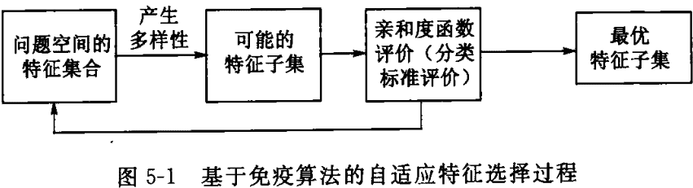

代表问题空间可以通过免疫算法的寻优，将对分类影响最大，也就是最优的特征子集求出，在获得最优特征子集后，在对数据集合进行分类。

### 5.1.3 抗体表示和初始种群选择

应用免疫算法解决任何问题的关键是给出一个适合于免疫操作的抗体编码表示及定义一个切实反映问题特征又适宜计算的亲和度函数。

#### 5.1.3.1 抗体的表示

抗体编码问题的关键是要使编码能够代表所给特征集的解空间，这个解空间应包含所有可能的特征子集。最简单的编码方法就是用二进制基因位表示所选特征子集中的每一个特征项，这样，每一个抗体就是一个定长的二进制位串，它表示一个可能的最优特征子集。

根据这样的表示，一个长度为 l 的抗体对应于一个 l 位的二进制特征矢量 \(X_i\)，它的每一位就表示包括或排除一个相应的特征项。如果 \(x_{il} = 1\)，则表示第 1 个特征项包含于所选特征子集 \(X_i\) 中，否则 \(x_{il} = 0\)。例如，有 5 个特征的特征集表示为 \((x_{i1} x_{i2} x_{i3} x_{i4} x_{i5})\)，一个形如 (11010) 的个体就表示所选特征子集为 \((x_{i1} x_{i2} x_{i4})\)。

从用二进制编码表示特征空间来看，如果用穷尽搜索方法求解最优特征子集，对于一个包含 \(m\) 个特征的集合，将有 \(2^m\) 种可能的子集组合，如此庞大的搜索空间，势必是不可行的[8]。使用免疫算法求解，既可保证全局最优，又避免了巨大的搜索代价。

#### 5.1.3.2 初始种群的选择

所有抗体是代表问题空间中，包含可能成为最优特征解集的一个种群，即初始种群形成时，种群由若干个抗体组成，每个抗体就是一个可能的解。这里采用随机方法来选取初始群体，每个抗体的每一位基因位按等概率在 {0, 1} 中选择，抗体种群的大小可根据实际情况而定。初始种群的大小一般选择在 50 ~ 100 之间。

### 5.1.4 抗体浓度计算

在基于距离浓度免疫算法的分类操作中，一个抗体代表问题特征空间集合中的一个可能的解，每个抗体表示为一个二进制特征矢量 \(X_i\)，抗体和抗原分别对应于分类规则和待分类的数据，\(n\) 个抗体构成了一个非空免疫系统集合 \(S\)。在抗体空间集合 \(S\) 中，若规定抗体 \(X_i\) 在集合 \(S\) 上的距离为：

\(d_i = d(X_i) = \sum_{j=1, i \neq j}^n \| X_i - X_j \|\) (5-1)

所有抗体之间的距离和为：

\(d = \sum_{i=1}^n d(X_i) = \sum_{i=1}^n \sum_{j=1, j \neq i}^n \| X_i - X_j \|\) (5-2)

则抗体 \(x_i\) 的浓度可定义为：

\(C(X_i) = 1 - \frac{d_i}{d} = 1 - \frac{\sum_{j=1, i \neq j}^n \| X_i - X_j \|}{\sum_{i=1}^n \sum_{j=1, i \neq j}^n \| X_i - X_j \|}\) (5-3)

使用这种表示方法，抗体种群中抗体的距离浓度状态，反映了抗体种群中对特征项组合的覆盖程度。

### 5.1.5 亲和度函数计算

免疫算法在进化搜索中要不断利用亲和度函数为依据，对问题的解空间不断进行校正，以使亲和度成熟，抗体种群中进化到包含最优解或近似最优解，亲和度函数的选取直接影响到免疫算法的收敛速度以及能否找到最优解。因此，能否根据分类特征空间的特点，选择一个适当的亲和度函数是免疫算法能否成功解决分类问题的关键。

在提出的算法中，可直接使用目标函数作为亲和度函数。算法的目标是要对未知分类的模式进行特征提取，使所提取的特征子集能够较准确、完全地代表所要分类的问题空间，而且能够对分类具有较大的贡献，以使该模式能被分类或识别系统正确地分类和识别。

根据特征子集的选择要求，在提出的本算法中，亲和度函数借鉴文献[4]提供的方法，按以下方式确定：

- (1) 从待分类的问题空间中选取一定数量的特征组成初始抗体群体。其中，若干特征项组成一个抗体，若干抗体组成初始种群，一个抗体即是一个可能的最优特征子集，特征子集评价过程如图 5-2 所示。

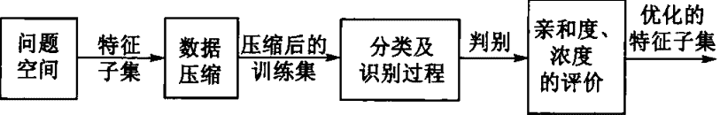

图 5-2 特征子集评价过程

- (2) 对抗体集合进行训练，由于已知分类的各训练集中，用于分类的特征项是已经知道的，这样可以调用分类及识别程序进行分类，检查每一个抗体表示的特征项组合是否能将训练集合分回到各个已知的正确分类。如果所有已知分类的训练集均未能被正确分类，则说明所选代表特征子集的抗体不具有良好的分类贡献度，因此定义这个抗体（即此可能特征子集）亲和度为 0；否则，对这个抗体的亲和度进行如下的重新定义。

```
f(X_i) = \begin{cases} 0 \quad \text{训练集均未被正确分类} \\ g(X_i) \quad \text{其他} \end{cases}
```

(3) 定义亲和度函数 \( g(X_i) \) 应保证优良的个体（即优秀的特征子集）具有较高的亲和度值，一个较优的特征子集需有以下三个要素：

- ① 所选特征子集在待分类的模式中应具有较大的比重，才能保证其能在一定程度上代表该模式。

- ② 所选特征子集应对分类具有较大的贡献。在分类器对各压缩后训练集进行分类的过程中，可能有多个训练集被正确识别，这样的特征子集对分类的贡献度就应较小（因为这样的特征子集对分类的不确定度比较大）。这里采用信息熵中求不确定度的方法来计算所选特征子集对分类的不确定度。

- ③ 特征空间的每一维都会增加识别系统的代价，所以特征子集中包含的特征项应尽可能少。

满足以上 3 个要素的亲和度函数有如下形式：

\( g(X_i) = g(x_{i1}, x_{i2}, \cdots, x_{ik}) = C \frac{(\log_2 n - \log_2 m) + \sum_{j=1}^k N(x_{ij})/P}{\sum_{j=1}^k x_{ij}} \)

\( X_i \) 代表一个抗体，即一个可能特征子集；

\( (\log_2 n - \log_2 m) \) 为所选特征子集对分类的贡献程度。\( n \) 为总的类别的数目，\( m \) 为压缩后的各已知分类的训练集被正确分类的数目。初始时，待分类的模式（记为问题空间 D）对分类的不确定度：

\( H(D) = -\sum_{i=1}^n P_i \log_2 P \) ,其中 \( P_i = 1/n\)(即 D 属于任一类别的概率相等)，则 \( H(D) = \log_2 n\) ;当知道所选特征子集后，D 对分类的不确定度 \( H(D)' = -\sum_{i=1}^m P_i \log_2 P \) ,同理 \( P_i = 1/m\) ,则 \( H(D)' = \log_2 m\) 。所以，所选特征子集对分类的贡献度 = 引入该特征子集前后不确定度的减少 = \( \log_2 n - \log_2 m\) ;

\( x_{ij}\) :代表一个特征项，为 1 表示该特征项被选入所求特征子集，否则为 0 ;

\( k\):个体的大小，即每个个体包含的二进制串的位数；

\( \sum_{j=1}^k N(x_{ij})/P \) :所选特征子集在待分类的模式中的比重；

其中 :\( P \) 为模式中的总特征数目；

\( N(x_{ij}) = \begin{cases} 1 & \text{特征 } x_{ij} \text{ 在代表模式的问题空间中重复出现的次数，即 } x_{ij} = 1 \\ 0 & \text{当 } x_{ij} = 0 \end{cases} \)

\( \sum_{j=1}^k x_{ij} \) :所选特征子集中包含的特征项的数目；

\( C\):比例系数，依实际问题而定，对适应度的范围进行限制。

考虑到线性转换：

\( g'(X_i) = \frac{g_{\max} - g(X_i)}{g_{\max} - g_{\min}} \) (5-6)

式中，\( g_{\max}\) 和 \( g_{\min}\) 为种群中适应度的最大值和最小值，这样抗原与抗体之间的亲和度变换为：

\( D(X_i) = \frac{1}{1 + g'(X_i)} \) (5-7)

### 5.1.6 仿真实验

这里通过两个实验验证所提出的分类算法性能。首先将该算法用于机器学习中的一个典型数据集——人体特征分类，然后我们用 3 个 UCI 的机器学习数据集[9]对该算法的性能进行了测试，并将该分类算法的实验结果与其他方法的结果进行了比较。

#### 实验 1 人体特征分类数据

人体特征分类数据如表 5-1 所列，身高 = {高，矮}，头发颜色 = {金，红，黑}，眼睛颜色 = {蓝，灰，黑}，类别 = { A，B }，记录数为 12 个。

**表 5-1 人体特征分类数据**

| 对象序号 | 身高 | 头发颜色 | 眼睛颜色 | 类别 |
|:---:|:---:|:---:|:---:|:---:|
| 1 | 矮 | 金 | 蓝 | A |
| 2 | 高 | 红 | 蓝 | A |
| 3 | 高 | 金 | 蓝 | A |
| 4 | 矮 | 金 | 灰 | A |
| 5 | 高 | 金 | 黑 | B |
| 6 | 矮 | 黑 | 蓝 | B |
| 7 | 高 | 黑 | 蓝 | B |
| 8 | 高 | 黑 | 灰 | B |
| 9 | 矮 | 金 | 黑 | B |

设定特征集合 = {身高，头发颜色，眼睛颜色} = {{高，矮}，{金，红，黑}，{蓝，灰，黑}}。则特征子集{身高，头发颜色，眼睛颜色}可表示为{\(x_{1i}\)，\(x_{2j}\)，\(x_{3k}\)}(其中 \(i=1,2;j=1,2,3;k=1,2,3\))，编码 \(X = x_{11} x_{12} x_{21} x_{22} x_{23} x_{31} x_{32} x_{33}\)，算法运行 50 代，提取出来的分类规则结果如表 5-2 所列。

**表 5-2 分类规则结果**

| 记忆细胞序号 | IF THEN 规则 |
|:---:|:---|
| 1,3 | IF(头发颜色=红) ∧ (眼睛颜色=蓝) ∧ (身高=高) THEN (类别=A) |
| 2 | IF(头发颜色=金) ∧ (眼睛颜色=蓝) THEN (类别=A) |
| 4 | IF(头发颜色=黑)THEN (类别=B) |
| 5,9 | IF(头发颜色=金) ∧ (眼睛颜色=黑) THEN (类别=B) |
| 6,7,8 | IF(头发颜色=金) ∧ (眼睛颜色=灰) ∧ (身高=矮) THEN (类别=A) |

#### 实验 2 三个 UCI 的机器学习数据集

UCI 机器学习数据集被广泛地用来测试分类算法性能，我们采用了其中最常用的 Iris 数据集和两个规模较大的 Pima 和 Breast 数据集。

Iris:包含 150 个对象,均匀分布在 3 个目标类中,有 4 个连续的条件属性,数据无缺失值。其中有两个与分类的相关性较强。为适用于所提出的算法,先将其离散化。

Pima:包含 768 个对象,2 个目标类的对象个数分别为 500 与 268,有 8 个连续的条件属性,无缺失值。为适用于算法,先将其离散化。

Breast:包含 699 个对象,2 个目标类的对象个数分别为 458 与 241,有 9 个条件属性,取值均为 1～10 的整数,第 6 个条件属性有 16 个缺失值,按所在目标类中最频繁取值给其补上。为适用于算法,先将其离散化。

将我们提出的方法与 RISE[10], SIA[11], ESIA[12] 三种方法进行了比较,其中 RISE 是一种成功的非遗传分类方法,从文献[10]的结果看 RISE 比 C4.5, CN2, PEBLS 的准确率都要高,SIA 与 ESIA 是两种较好的遗传分类方法。实验中为了与这些方法的结果进行比较,对每个数据库均采用了 k-次交叉验证法(k-fold cross-validation method)。这种方法首先将数据集平均分成 k 个不相交的子集，然后对 k 组不同的训练—测试集做 k 次实验，即用训练集来提取规则，然后用所得规则集对测试集进行预测并计算正确率。其中训练—测试集对的产生方法是用 k 个子集中的一个作为测试集，其余(k-1)个构成训练集。在这种方法中每条数据既作了训练数据，又作了测试数据，因此它能较全面地测试算法的性能，这里取 k=10。RISE，SIA，ESIA 的参数分别见文献[10]，[11]，[12]。表 5-3 列出了 4 种方法预测准确率的平均值与标准方差，各方法产生规则的平均个数在表 5-4 中给出。

**表 5-3 四种方法预测准确率的平均值(%)与标准方差**

| 数据集 | RISE | SIA | ESIA | 提出的算法 |
|:---|:---|:---|:---|:---|
| Iris | 92.67±0.06 | 92.00±0.01 | 95.33±0.03 | 97.02±0.03 |
| Pima | 65.63±0.30 | 69.14±0.27 | 70.18±0.21 | 69.00±0.04 |
| Breast | 91.85±0.07 | 84.84±0.02 | 94.71±0.04 | 93.36±0.02 |

**表 5-4 4 种方法产生规则的平均个数**

| 数据集 | RISE | SIA | ESIA | 提出的算法 |
|:---|:---|:---|:---|:---|
| Iris | 11.9 | 7.0 | 6.4 | 4.9 |
| Pima | 229.1 | 440.9 | 36.3 | 16.8 |
| Breast | 32.8 | 16.5 | 23.9 | 16.3 |

实验结果表明所提出的算法性能总体上优于其他 3 种算法，它一方面获得了较高的预测准确率，一方面产生了更小的规则集，且其标准方差也较小。尤其对于 Iris 数据集，我们提出的算法标准方差比其他 3 种算法要小得多，这说明算法性能更加稳定，对同一数据集的不同训练数据，预测准确率不会产生较大波动。

我们提出的这种基于距离浓度的免疫数据分类方法，克服了

遗传等分类算法的早熟问题，可以获得较高的预测准确率，获得的分类规则集也较小。这个算法给出的特征选择策略，避免了常规分类方法需要分别考查各特征项之间关联度的问题，使算法具有更加稳定的性能。

## 5.2 基于 DCAIA 的关联规则挖掘方法

关联规则挖掘是数据挖掘中一个很重要的研究课题。一条关联规则指出了一系列对象间一定的关联关系。关联规则的挖掘算法在决策支持、医疗诊断、市场策略、优化调度等许多领域有着广泛的实际意义和应用价值。特别是在信息量大、信息变化快的今天，随着数据库规模的急剧增大，一种快速、有效的关联规则挖掘算法是迫切需要的。为此，人们研究了许多关联规则挖掘算法。其中 R. Agrawal 算法[13]是在许多列举频繁项集中应用最为流行的算法，但该算法的计算复杂度高，不能满足对大规模数据库的实时挖掘要求；Park 等提出的 DHP 算法，其修整和剪枝属性在许多实际应用中是不切实际的[14,15]；分割算法[16]虽然减少了 I/O 消耗，但在处理高维项集事件中存在问题；FP-growth 算法[17]创建了一种关系紧密的树结构，有助于候选项集的产生，但需要遍历整个数据库，计算量大，对大规模数据库而言，效率非常低。

免疫算法是一种基于抗体群体的系统进化算法，具有很强的随机性、鲁棒性和隐含并行性，能快速、有效地进行全局优化搜索，是处理大规模数据项目集的有效方法。这里就基于距离浓度的免疫算法实现关联规则的数据挖掘方法进行探讨，利用该免疫算法提高频繁项集搜索效率，以获得更有效的关联规则挖掘方法。

### 5.2.1 关联规则概述[2]

设 \( I=\{i_1, i_2, \cdots, i_m\} \) 是 \( m \) 个不同项目的集合，即项集。\( D \) 为事务数据库，其中每个事务 T 是一个项目子集，(T⊆I)。我们说事务 T 包含项集 X,如果 X⊆T,关联规则是形如 X⇒Y 的逻辑蕴含式,其中,X⊂T,Y⊂T,并且 X∩Y=∅。X 称作是前提,Y 称作是结果。有两个因子与这条规则有关:如果事务数据库中有 s%的事务包含 X∪Y,那么我们就说关联规则 X⇒Y 的支持度(support)为 s;如果事务数据库里包含 X 的事务中有 c%的事务同时也包含 Y,那么我们说关联规则 X⇒Y 的可信度(confidence)为 c。

可信度(confidence):设 W 中支持物品集 A 的事务中,有 c%的事务同时也支持物品集 B,c%称为关联规则 A⇒B 的可信度。简单地说,可信度就是指在出现了物品集 A 的事务 T 中,物品集 B 也同时出现的概率有多大。可信度表示一条规则可以信赖的程度。

支持度(support):设 W 中有 s%事务同时支持物品集 A 和 B,s%称为关联规则 A⇒B 的支持度。支持度描述了 A 和 B 这两个物品集的并集 C 在所有的事务中出现的概率有多大。

由于发现关联规则的目的在于找出那些可信的并具有代表性的规则,所以要给定一个最小支持度阈值和一个最小可信度阈值。发现关联规则的问题就是发现所有支持度和可信度均超过规定阈值的关联规则。可信度是对关联规则的准确度的衡量,支持度反映出关联规则的重要性。

### 5.2.2 关联规则的 Apriori 算法[13]

现有的关联规则的挖掘算法中,最著名的是 R. Agrawal 等人提出的 Apriori 算法,该算法将关联规则的发现分为两步。第一步是识别所有的频繁项集(frequent items),即支持度不低于用户支持度的项集。第二步是从频繁集中构造其信任度不低于用户最低信任的规则,其中的核心问题是发现最大项集。

#### 5.2.2.1 关联规则求解分析

发现最大项集的过程其实就是全局搜索的过程，可以利用免疫算法的全局寻优特点，在关联规则的数据挖掘中发现和提取真正有用的规则。

#### 5.2.2.2 关联规则的表示

设一条关联规则为： \(A_1 \land A_2 \land \dots \land A_n \Rightarrow B_1 \land \dots \land B_m\) [Support, Confidence]，简记为：\(X \Rightarrow Y\) [Support, Confidence]。其中：\(A_i (i=1, 2, \dots, n)\) 称为决策属性；\(B_j (j=1, 2, \dots, m)\) 称为结果属性；Support 为支持度；Confidence 为置信度。 Support = \(P(X \cup Y)\)； Confidence = \(P(Y/X)\)。

关联规则 \(X \Rightarrow Y\) [Support, Confidence] 可解释为：所有研究对象中，满足条件 X 的占百分比为 Support，满足条件 X 同时又满足条件 Y 的概率为 Confidence。例如，在购物者信息库中发现关联规则：

age(x, "20~29") ∧ income(x, 2 千~3 千) => buy(x, "CD_player") [Support = 2%, Confidence = 60%]

其中，x 是代表顾客的变量。该关联规则的含义是：所有顾客中 20 到 29 岁且月收入在 2 千元到 3 千元的顾客占 2%，而这些顾客购买 CD-player 的可能性是 60%。

#### 5.2.2.3 关联规则挖掘特点

通过对关联规则不同挖掘方法的实现过程和关联规则获取的特点分析，关联规则的数据挖掘有如下特点：

- (1) 规则的决策属性相互之间是无序的。即 \(A_i\) 的排列顺序对于规则的成立没有影响。采用构造决策树的方法生成关联规则时，由于构造决策树方法是自上而下的递归构造方法，决策树的根总是易变性最小的属性，规则中属性间是有序的，这就增加了本不需要的排序工作。由于决策属性相互间无序，可以人为地将决策属性一次性排定顺序，组成属性串 A₁A₂⋯Aₙ，而在挖掘中不再改变其顺序。在免疫算法中，抗体和抗原的基因编码恰好符合这种无序的特点。

- (2) 训练集的选取对挖掘结果的影响。一般的挖掘算法均需要经过学习训练。由于规则是通过训练样本集得到的，因此训练样本集必须与实际样本集相似，这就牵涉到训练样本集的选取问题。训练的样本集越大，学习结果的精度就越高，但训练的速度就越低。因此关联规则的挖掘希望能对解空间进行快速、有效的搜索，而这也正是人工免疫算法的特长，可以通过免疫算法实现大数据量、快速的学习。

- (3) 决策属性是不断变化的。在实际问题中，决策属性是相对较活跃的，而任务属性一般不变。随着环境、形势和时间的变化，决策属性有增、有减。每增加或减少一个决策属性，都需要重新挖掘关联规则。因此挖掘算法能够在一定程度上接受决策属性的增减是非常必要的。利用免疫算法可以将关联规则作为记忆细胞存储起来，再次重新挖掘时主要针对新增加或减少的属性，原来的挖掘结果仍然可以使用。

### 5.2.3 关联规则编码方案和抗体设计

#### 5.2.3.1 编码方案

在基于距离浓度免疫算法的关联规则数据挖掘中，抗体对应于要寻找的关联规则，采用二进制编码来表示抗体。假定所有的特征属性和类别属性的取值是离散的（对于连续型的值可先做离散化处理）并且取值范围已知，对每个属性的取值用一个适当长度的二进制位串来表示，每个二进制串代表一个基因，将所有属性值的二进制位串连接在一起得到的二进制位串作为一个抗体。一个抗体代表一个关联规则。

- (1) 首先对原始数据进行预处理，经过离散化得到每个属性的若干个取值。

例如:将年龄分为：小于 20,20~30,31~40,41~50,大于 50, 则 age 属性有 6 个可取值:0,1,2,3,4,5。其中 0 表示该属性未使用,1 表示小于 20 岁,2 表示 20 到 30 岁等等。

- (2) 将所有的决策属性和任务属性构造一个规则结构串。

例如:购买信息规则结构串为：{buy, age, income, sex, character, occupation} 即{商品,年龄,收入,性别,性格,职业},其中一条记录为{28,4,2,1,0,12}表示关联规则：

age(x,4) ∧ income(x,2) ∧ sex(x,1) ∧ occupation(x,12) ⇒ buy(x,28)。

#### 5.2.3.2 抗体设计

按上述的规则结构构造抗体,抗体的编码设计为: Xi = (xi1 xi2 ... xm)。xi1xi2...xm 对应决策属性。要增加属性,只要扩展编码 Xi = (xi1 xi2 ... xm xm+1)即可,要减少属性,只需将该属性置 0。

### 5.2.4 抗体浓度和亲和度计算

在我们提出的免疫算法关联规则挖掘中,一个抗体就是一个可能的关联规则,抗体的群体就是要挖掘的关联规则可行解的集合。由数据集中的属性构成的一个二进制字串抗体表示为 Xi,种群中所有 n 个抗体构成的关联规则可行解的集合为 S,那么可以规定抗体 Xi 在关联规则可行解的集合 S 上的距离为：

d_i = d(X_i) = \sum_{j=1,i \neq j}^n \| X_i - X_j \| \quad (5-8)

所有抗体之间的距离和为：

d = \sum_{i=1}^n d(X_i) = \sum_{i=1}^n \sum_{j=1,j \neq i}^n \| X_i - X_j \| \quad (5-9)

则抗体 Xi 的浓度可定义为：

\(C(X_i) = 1 - \frac{d_i}{d} = 1 - \frac{\sum_{j=1,i \neq j}^n \|X_i - X_j\|}{\sum_{i=1}^n \sum_{j=1,i \neq j}^n \|X_i - X_j\|}\) (5-10)

用免疫算法实现分类规则挖掘的过程是使“好的规则”得以生存，并作为其父代繁殖出更好的规则，直至找到最优规则集为止。所谓“好的规则”是指规则与数据集中的各实例匹配程度高，亲和度函数应能反映出规则对数据集的匹配程度。在亲和度函数中，应综合考虑规则与实例的特征属性部分、类别属性部分及特征属性+类别属性(实例的全部)的匹配情况，只考虑其中的一种或两种情况是片面的，不能反映出最优规则的全部性质。为此我们作了如下定义：

**定义 5.1** A 为数据集 R (由 n 条记录构成) 的属性集合，由特征属性 C 和类别属性 D 构成(C, D 均为离散型), \(A = C \cup D\) 且 \(C \cap D = \varnothing\)。

**定义 5.2** R 中与规则 \(X_i\) 特征部分成功匹配的数据集记为 \(R_C\)，与 \(X_i\) 类别部分成功匹配的数据集记为 \(R_D\)，与特征和类别均成功匹配的数据集记为 \(R_C \cap R_D\)。

**定义 5.3** 规则的支持度：
\(S(X_i) = |R_C| / n\) (5-11)

**定义 5.4** 规则的置信度：
\(A(X_i) = |R_C \cap R_D| / |R_C|\) (5-12)

**定义 5.5** 规则的覆盖度：
\(C(X_i) = |R_C \cap R_D| / |R_D|\) (5-13)

以上定义的规则支持度、置信度、覆盖度可从不同角度表明规则的性质，规则的支持度越大，说明规则在数据集空间所占的比例越大，规则的普遍意义越好；规则的置信度表示由特征(条件)推出类别(结论)的正确程度，当置信度为 1 时，规则恒为真，此时只要条件为真，结论恒为真；规则的覆盖度表示结论包含于条件的正确程度，当覆盖度为 1 时，规则是完备的，此时条件为真是结论为真的必要条件。

关联规则挖掘的任务就是要发现能够反映记录属性之间的关联或关系，这些规则应该具有一定的支持度、可信度和覆盖度。我们从支持度、可信度、覆盖度三个方面来综合评价一条规则的优劣，在抗体进化的过程中，让越“好”的规则获得越高的亲和度值，使其在选择竞争中获得更大的生存和克隆的机会。

#### 定义 5.6 规则的亲和度函数：

$f(X_i) = S(X_i) + A(X_i) + C(X_i)$ (5-14)

我们设计关联规则的亲和度函数为规则支持度、置信度和覆盖度三者之和，它的数值介于 0~3 之间。在进化过程中，各规则依靠自身的亲和度函数值与其他规则进行竞争，只有支持度、置信度和覆盖度均高的规则，其亲和度才可能比其他规则高，才能在竞争中生存下来。

考虑到线性转换：

$f'(X_i) = \frac{f_{max} - f(X_i)}{f_{max} - f_{min}}$ (5-15)

$f_{max}$ 和 $f_{min}$ 为种群中适应度的最大值和最小值，这样抗原与抗体之间的亲和度函数即为：

$D(X_i) = \frac{1}{1 + f'(X_i)}$ (5-16)

### 5.2.5 关联规则的生成

在我们提出的算法记忆库中设置关联规则表和有趣规则表，关联规则表和有趣规则表中分别存放关联规则（Relation-Rule）和有趣规则（Interest-Rule）。每次挖掘的结果都存放在关联规则表和有趣规则表中，表中记录有规则结构、支持度、置信度等项目。

对抗体种群进化后得到的新抗体，也就是新的可能的规则，先在有趣规则表和关联规则表搜索。如果已经存在该条关联规则或有趣规则，则直接读取其支持度和置信度；否则，在数据库中搜索并计算支持度和置信度，并将结果添加到有趣规则表中，将大于最小阈值的规则添加到关联规则表中，算法结束后输出关联规则表中满足支持度和置信度条件的关联规则。

### 5.2.6 仿真实验

为了验证所提出的关联规则挖掘算法，我们采用 UCI 机器学习数据库[9]中的 census income 数据集进行实验。这是一个包含 48 842 条记录、15 个字段的数据集。实验的第一步是将连续型属性值离散化，结果如表 5-5 所列。接着将属性值用编码值代替，部分属性的属性值编码如表 5-6 所列。

| 属性名 | 原属性值范围 | 对应的离散值 |
|---|---|---|
| age | 30 以下 | Young |
| | 30~49 | Middle-aged |
| | 50~69 | Senior |
| | 69 以上 | Old |
| capital-age | 0 | None |
| | 1~2 000 | Small |
| | 2 001~5 000 | Medium |
| | 5 000 以上 | High |
| capital-loss | 0 | None |
| | 1~2 000 | Small |
| | 2 000 以上 | Medium |
| hours-per-week | 26 以下 | Half-time |
| | 26~40 | Full-time |
| | 41~60 | Overtime |
| | 60 以上 | Too-many |

#### 表 5-6 属性值编码表

| 属性名 | 离散属性值 | 编码 | 属性名 | 离散属性值 | 编码 |
|---|---|---|---|---|---|
| age | Young | 1 | Relationship | Wife | 1 |
| | Middle-aged | 2 | | Husband | 2 |
| | Senior | 3 | | Own-child | 3 |
| | Old | 4 | | Not-in-family | 4 |
| workclass | Private | 1 | | Unmarried | 5 |
| | Self-emp-not-inc | 2 | | Other-relative | 6 |
| | Self-emp-inc | 3 | sex | Female | 1 |
| | Federal-gov | 4 | | Male | 2 |
| | Local-gov | 5 | hours-per-week | Half-time | 1 |
| | State-gov | 6 | | Overtime | 3 |
| | Without-pay | 7 | | Too-many | 4 |
| | Never-worked | 8 | | | |

实验分别对最小支持度为 10%，30%，50%的情况进行了多次测试，得到的频繁模式的数量以及最大频繁模式长度如表 5-7 所列。其中最小支持度为 10%时的一次实验中获得的部分关联规则如下：

- hours-per-week = overtime -> sex = Male [support = 26.0%, confidence = 81.4%];
- sex=Male -> race = White [support = 66.8%, confidence = 88.0%];
- workclass=Private -> native-country = United-States [support = 69.4%, confidence = 88.9%]
- relationship=Own-child ∧ marital-status = Never-married ∧ native-country = United-States ∧ capital-gain = none -> age = young [support = 12.5%, confidence = 86.1%];
- occupation = Craft-repair ∧ sex = Male ∧ native-country = United-States -> race = White [support = 10.7%, confidence = 92.6%.

| 最小支持度 | 频繁模式条数 | 频繁模式长度的最大值 |
|---|---|---|
| 10% | 3 392 | 9 |
| 30% | 243 | 6 |
| 50% | 47 | 4 |

从实验结果看，我们提出的算法可以有效地挖掘关联规则，这个算法在搜索大规模数据库时是非常有效的。此外由于免疫算法的隐含并行性，这个算法的搜索速度要优于传统的 Apriori 等算法。

## 5.3 基于 DCAIA 的 K-均值聚类挖掘方法

### 5.3.1 问题分析

聚类分析(clustering Analysis)是一种无监督的模式识别方法。聚类是把数据分成组，产生的每一组数据称为一个簇，簇中的每一数据称为一个对象。聚类的目的是使同一簇中对象的特性尽可能地相似，而不同簇对象间的特性差异尽可能地大。聚类的任务是把一个未标记的模式按某种准则划分成若干子集，要求相似的样本尽量归为同一类，而不相似的样本归为不同的类，故又称无监督分类[2]。目前，各种聚类方法已广泛应用于数据挖掘、模式识别、图像处理、雷达目标检测、生物工程、空间遥感技术等诸多领域。

K-均值聚类算法也称硬 C-均值聚类算法。该算法是解决聚类问题的一种经典算法，具有算法简单、速度快，能有效地处理大数据库的优点。然而这种算法对不同的初始值可能会导致不同的聚类结果；特别是在线 K-均值算法的执行结果对输入顺序有关。


再者，这种算法是基于目标函数的聚类算法，一般都采用梯度法求解极值，由于梯度法的搜索方向总是沿着能量减小的方向进行，因此易陷入局部极小值。这些缺陷较大地限制了它的应用范围。为了克服上述缺点，近几年来人们提出了对目标函数进行优化的各种算法，如文献[18]根据遗传算法的原理，提出了以 K-均值算子代替遗传算法中的交叉算子，设计了一种混合遗传算法，并根据有限状态齐次马尔可夫链方法证明了该算法是收敛于全局最优的。此后有的研究采用了聚类中心的浮点编码方式，设计了浮点数交叉和变异算子，从而提高了遗传算法的搜索效率。但是，实验表明，当样本数目、类别和维数较多时，这些基于遗传算法的聚类方法常会产生早熟现象。由于进化算法在进化过程中不可避免地会产生退化现象，因此将导致进化后期的波动以及迭代次数过长和聚类准确率不高的缺点。近年来免疫计算研究的迅速发展，给解决以上的问题带来了新的思路和方法[19, 20, 21]。

### 5.3.2 K-均值聚类算法[2]

该算法将 \( n \) 个向量 \( x_j(1, 2, \cdots, n) \) 划分为 \( c \) 个组 \( G_i(i=1, 2, \cdots, c) \)，并求每组的聚类中心，使得非相似性（或距离）指标的价值函数（目标函数）达到最小。当选择欧氏距离为组 \( j \) 中向量 \( x_k \) 与相应聚类中心 \( c_i \) 间的相似性指标时，价值函数可定义为：

$$
J(u, x) = \sum_{i=1}^{c} J_i = \sum_{i=1}^{c} \sum_{j=1}^{n} (u_{ij}) \| x_j - c_i \|^2 \quad (5-17)
$$

这里 \( u_{ij} \) 是向量 \( x_j \) 属于组 \( G_i(i=1, 2, 3, \cdots, c) \) 的程度，它的值取 0 和 1。每一次分组时，\( n \) 个数据向量按距离的大小，分属于不同的 \( G_i(i=1, 2, 3, \cdots, c) \)，其中

$$
u_{ij} = \begin{cases} 1 & \text{对每个 } k \neq i, \text{如果 } \| x_j - c_i \| \leqslant \| x_j - c_k \| \\ 0 & \text{其他} \end{cases} \quad (5-18)
$$

如果 \( c_i \) 是 \( x_j \) 最近的聚类中心，则 \( x_j \) 属于 \( i \) 组。由于一个给定的数据点只能属于一个组，因此求属矩阵 \( U \) 具有如下性质：

\(\sum_{i=1}^{c} u_{ij} = 1, \forall_j = 1, \cdots, n, \text{且} \sum_{i=1}^{c} \sum_{j=1}^{n} u_{ij} = n\) (5-19)

另一方面，如果固定 \( u_{ij} \)，则使式 (5-17) 最小的最佳的聚类中心就是 \( i \) 组中所有向量的均值：

\(c_i = \frac{1}{|G_i|} \sum_{k, x_k \in G_i} x_k\) (5-20)

式中，\( |G_i| = \sum_{j=1} u_{ij} \) 是 \( G_i \) 的模。

显然，数据聚类问题本质上是一个组合优化问题，可以利用迭代算法求解。

### 5.3.3 聚类问题的免疫表示

在聚类分析中，把要聚类的数据对象视为抗原，把聚类中心看做是免疫系统中的抗体，数据对象的聚类过程就是免疫系统不断地产生抗体，识别抗原，最后产生出可以捕获抗原的最佳抗体过程。

设集合中的对象已抽象为空间 \( R^n \) 中的点，其相似程度已抽象为 \( R^n \) 中的距离。为了将集合中的点按照其相互间距离分为 \( K \) 类，可采取如下的步骤。

产生初始群体及其编码：在集合中随机选取 \( N \) 组对象，每组 \( K \) 个点，代表着聚类的 \( K \) 个中心。将每一组对象编码为一个 \( N \times K \) 维的种群个体 \( c \)，随机选取的 \( N \) 组对象构成了初始种群 \( C_0 \)。也就是说，对搜索空间进行 \( N \times K \) 维的实数编码。初始群体的规模为 \( N \)。

### 5.3.4 抗体浓度计算

把抗原和抗体分别对应于待求解的聚类数据对象和聚类中心 C，其中的一个解中心（或抗体）\(c_i\)，这个抗体的亲和度函数为 \(f(c_i)\)。\(n\) 个抗体构成了一个非空免疫系统集合 \(C\)。若规定抗体 \(c_i\) 在集合 \(C\) 上的距离为：

\(d_i = d(c_i) = \sum_{j=1, i \neq j}^n \| c_i - c_j \|\) (5-21)

所有抗体之间的距离和为：

\(d = \sum_{i=1}^n d(c_i) = \sum_{i=1}^n \sum_{j=1, j \neq i}^n \| c_i - c_j \|\) (5-22)

则抗体 \(c_i\) 的距离浓度可定义为：

\(C(c_i) = 1 - \frac{d_i}{d} = 1 - \frac{\sum_{j=1, i \neq j}^n \| c_i - c_j \|}{\sum_{i=1}^n \sum_{j=1, i \neq j}^n \| c_i - c_j \|}\) (5-23)

显然，抗体之间的距离越大，其距离浓度越小，反之则浓度越大。

### 5.3.5 亲和度函数计算

亲和度函数选择。当前抗体群体中的每一个体 \(c\)，都对应着 \(K\) 个中心中的一个，对于这 \(K\) 个中心，按照 \(K\)-均值算法将集合分为 \(K\) 簇。对于第 \(i\) 簇 \(G_i\)，其簇内的距离定义为：

\(S_i = \frac{1}{|G_i|} \sum_{x \in c_i} |x - \bar{c_i}|\) (5-24)

式中，\(\bar{c_i}\) 是 \(G_i\) 簇的均值。定义簇 \(G_i\) 和簇 \(G_j\) 之间的簇间距离为 \(d_{ij} = \| \bar{c_i} - \bar{c_j} \|\)，并定义 \(R_i = \max_{j, j \neq i} \{ (S_i + S_j) / d_{ij} \}\)，则聚类指标可定义为：

\(DB = \frac{1}{K} \sum_{i=1}^K R_i\) (5-25)

那么抗体 \(c_i\) 的亲和度可定义为：

\(f(c_i) = 1/DB\) (5-26)

对亲和度函数线性变换,此处定义：

\(f'(c_i) = \frac{f_{max} - f(c_i)}{f_{max} - f_{min}}\)

\(f_{max}\) 和 \(f_{min}\) 为种群中亲和度的最大值和最小值,这样抗原与抗体之间的亲和度函数转换为：

\(D(c_i) = \frac{1}{1 + f'(c_i)}\)

在计算完一个抗体的亲和度之后,用所产生的 K 个均值 \(\{\bar{c}_i | i = 1, \cdots, K\}\) 构成新的个体,并以此代替当前的个体 \(c\)。

### 5.3.6 克隆变异和终止条件选择

很多免疫算法采用变异算子对二进制抗体进行克隆变异,在基于距离浓度的免疫算法聚类挖掘中,可以利用实数值表示抗原和抗体,通过对一个给定抗体加入来自某区间的随机数来产生变异的新抗体,可选择实数交叉与非均匀变异法。

群体更新按照个体亲和度函数 \(f(c)=1/DB\) 和浓度选择;最后,进行停机条件的判断, \(|J(t+1)-J(t)|<\epsilon\)。若条件满足,则停止运行并输出结果。否则,继续。

### 5.3.7 仿真实验

采用 K-均值算法、GA 算法和我们提出的基于距离浓度免疫算法的聚类方法分别对下列两组数据进行仿真计算。遗传算法的交叉概率取为 0.60,变异概率取为 0.001,群体规模为 100。

第一组数据是 400 个随机分布的 4 维随机向量,聚类数目是 8,不仅规模大,而且完全是随机分布的,没有明显的类别分界,存在大量的局部极优点,是很困难的优化问题。

第二组是 Fisher 的 Iris 植物样本数据,由分别属于 3 种植物的 150 个样本组成,每个样本均为 4 维模式向量,代表植物的 4 种特征数据。用 3 种算法分别实验，其中的一次实验的聚类指标函数曲线如图 5-3 和图 5-4 所示，其中的三次实验的聚类指标函数结果见表 5-8 和表 5-9，对 Iris 数据集实验获得正确聚类的性能比较见表 5-10。

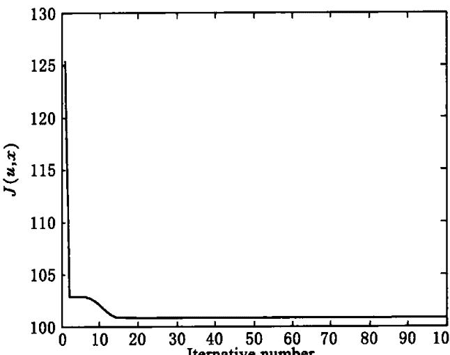

图 5-3 随机分布数据集聚类指标函数曲线

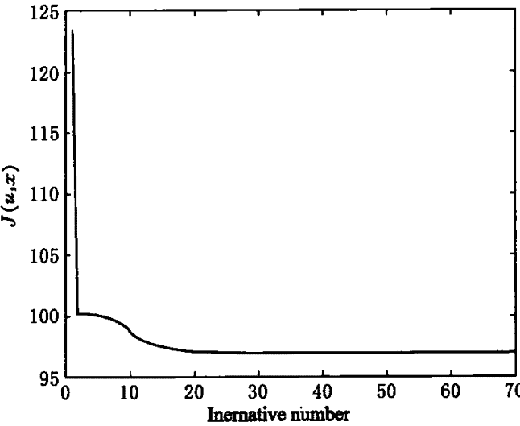

图 5-4 Iris 数据集聚类指标函数曲线

从表 5-8、表 5-9 和表 5-10 中不难看出我们所提出的算法局部收敛速度和全局收敛速度都明显优于 K-均值算法和 GA 算法。特别是对大规模、完全随机分布的数据聚类问题，其优越性更加明显。

表 5-8 随机分布数据集聚类实验结果比较

| 实验次数 | K-均值算法 | GA 算法 | 本算法 |
| :--- | :--- | :--- | :--- |
| 1 | 101.535 | 101.321 | 101.273 |
| 2 | 101.486 | 101.273 | 101.273 |
| 3 | 101.796 | 101.273 | 101.273 |

表 5-9 Iris 数据集聚类实验结果比较

| 实验次数 | K-均值算法 | GA 算法 | 本算法 |
| :--- | :--- | :--- | :--- |
| 1 | 97.073824 | 97.000 126 | 97.000 126 |
| 2 | 97.08453 | 97.000 126 | 97.000 126 |
| 3 | 97.073824 | 97.000 126 | 97.000 126 |

表 5-10 三种方法性能的比较

| 实验方法 | 迭代次数 | 实验次数 | 正确聚类次数 | 聚类正确率/% |
| :--- | :--- | :--- | :--- | :--- |
| K-均值算法 | 60 | 50 | 37 | 74 |
| GA 算法 | 60 | 50 | 47 | 94 |
| 本算法 | 60 | 50 | 48 | 96 |

## 5.4 小结

本章研究了基于距离浓度免疫算法的数据分类、关联和聚类挖掘方法。

通过对数据挖掘分类任务的分析，提出了距离浓度免疫算法的数据分类方法，这种方法克服了遗传分类等算法的早熟问题，算法给出的特征选择策略，避免了常规分类方法需要考查各特征属性之间关联度的问题。实验显示我们提出的算法可以获得较高的预测准确率，算法也具有更加稳定的性能。

提出的基于距离浓度免疫算法的关联挖掘方法采用多点随机搜索策略，实现了频繁项集的并行搜索，免疫记忆策略保护了有效模式，提高了算法的有效性。实验结果验证了我们提出的算法的可行性。

提出的基于距离浓度免疫算法的聚类挖掘方法是在传统的K-均值算法中有机地集成了免疫进化的机理，提高了聚类算法的性能。实验结果均表明，我们提出的聚类算法不仅有效地避免了传统聚类算法在收敛时易陷入局部极小值问题，而且明显地克服了对初始化选值敏感性的缺点，同时有较快的收敛速度。

# 参考文献

- [1] 廖开际. 数据仓库与数据挖掘[M]. 北京:北京大学出版社, 2008.
- [2] JIAWEI HAN, MICHELINE KAMBER. Data Mining: Concepts and Techniques[M]. London: Academic Press, 2000.
- [3] VAFAIE H, DE JONG K A. Robust feature selection algorithms [C]. In: Proceedings of IEEE Conference on Tools with Artificial Intelligence: 356-363.
- [4] 陈彬, 洪家荣, 王亚东. 最优特征选择问题[J], 计算机学报, 1997, 20(2): 133-138.
- [5] HALEH VAFAIE, IBRAHIM F IMAM. Feature selection methods; Genetic Algorithms vs Greedy-like search[R]. George Mason University, Fairfax, VA, 22030.
- [6] FOROUTAN I, SKLANSKY J. Feature selection for automatic classification of non-Gaussian data[J]. IEEE Transactions on Systems, Man, and Cybernetics, 1987, 17: 187-198.
- [7] NARENDRA P, FUKUNAGA K. A branch and bound algorithm for feature subset selection [J]. IEEE Transactions on Computers, 1997, 26: 917-922.
- [8] DOM B, NILACK W, SHEINVALD J. Feature selection with stochastic complexity[C]. In: Proceedings of IEEE Conference on Computer Vision and Pattern Recognition, 1999.
- [9] BLAKE C L, MERZ C J. UCI Repository of Machine Learning Databases [DB/OL]. http://www.ics.uci.edu.html.
- [10] DOMINGOS P. Unifying instance based and rule based induction[J]. Machine Learning, 1996, 24(2):141-168.
- [11] VENTURINI G. A supervised inductive algorithm with genetic search for learning attributes based concepts[C]. In: Proceedings of the European Conference on Machine Learning, Vienna, Austria, 1993:280-296.
- [12] JULIET JUAN LIU, JAMES TIN, YAU KWOK. An extended genetic rule induction algorithm[C]. In: Proceedings of IEEE Congress on Evolutionary Computation, San Diego, USA, 2000:458-463.
- [13] AGRAWAL R, SRIKANT R. Fast algorithms for mining association rules[C]. In: Proc of the 20th VLDB Conf Santiago, Chile, 1994: 487-499.
- [14] PARK J, CHEN M, YU P. An effective hash-based algorithm for mining association rules[C]. In: Proc 1995 ACM-SIGMOD Int. Conf Management of Data, San Jose, CA, 1995-05:175-186.
- [15] ZAKI M J. Parallel and distributed association mining: A survey[J]. IEEE Concurrency, Special Issue on Parallel Mechanisms for Data Mining, 1997, 7(40):14-25.
- [16] BRIN S, MOTWANI R, ULLMAN J D, et al. Dynamic itemset counting and implication rules for market basket data[C]. In: Proc 1997ACM-SIGMOD Int Conf Management of Data, Tucson, Arizona, 1997-05: 225-264.
- [17] HAN J, PEI J, YIN Y. Mining frequent patterns without candidate generation [C]. In: ACM-SIGMOD, Dallas, 2000.
- [18] KRISHNA K, MURTY M N. Genetic K-Means Algorithm[J]. IEEE Trans on System, Man Cybernetics, Part B, 1999, 29(3):433-439.
- [19] CASTRO D E, ZUBEN V. Artificial Immune Systems: Part I Basic Theory and Applications [R/OL]. Technical Report-RT DCA 01/99. http://www.dca.fee.unicamp.br.
- [20] 莫宏伟. 人工免疫系统原理与应用[M]. 哈尔滨: 哈尔滨工业大学出版社, 2002.
- [21] 刘韬, 王耀才, 王致杰. 一种基于人工免疫系统的聚类算法[J]. 计算机工程与应用, 2005, 40(19):182-184.


# 第 6 章 改进的资源有限人工免疫系统及其关联规则挖掘算法

在过去的人工免疫系统研究中，研究者提出了大量人工免疫算法、人工免疫网络和基于网络的人工免疫系统模型，这些奠定了人工免疫系统研究的基础，很多优秀的模型已经广泛地应用于工程问题和数据分析中[1~22]。其中，资源有限人工免疫系统就是这些优秀模型的典型代表。但资源有限人工免疫系统也还存在着不足之处，接下来本章就资源有限人工免疫系统的改进和数据挖掘应用做进一步的探讨。

## 6.1 RLAIS 人工免疫系统模型分析

### 6.1.1 RLAIS 人工免疫系统模型概述

Timmis 提出了基于免疫网络的资源有限人工免疫系统（RLAIS）[23,24]，并将其应用于数据的聚类分析。同时还开发了一种可视化程序，将数据分析的人工免疫网络及其变化过程清楚地表示出来。RLAIS 网络学习过程如图 6-1 所示。这一模型及其算法的主要内容如下：

- (1) 网络的基本组成是人工识别球（ARB）。它包含三个部分内容：匹配规则、数据项、刺激度。ARB 代表一组同类的 B 细胞，而网络中 B 细胞总数被预先定义为一个固定的数值。

- (2) 抗原及初始网络：网络把待学习的数据分为两部分，一部分作为抗原来训练网络；另一部分作为 ARB，用来构成网络。

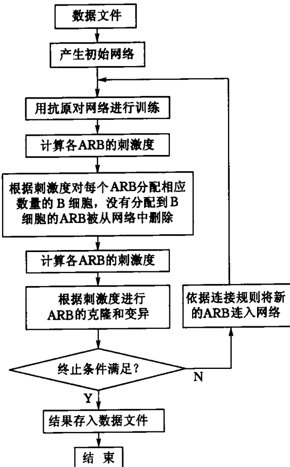

图 6-1 RLAIS 算法流程

- (3) 网络中的互连规则：预先规定一个阈值 NAT，当两 ARB 的亲和力小于 NAT 时就发生互连，否则就不存在连接。其 NAT 的初始值通过对抗原集 Ag 的计算给出。

- (4) 各个 ARB 的刺激度的计算公式：

$$sl = \sum_{g=0}^{G} (1 - dis_g) + \sum_{i=0}^{m} (1 - dis_i) + \sum_{i=0}^{m} (dis_i) \quad (6-1)$$

式中，$G$ 表示抗原的个数，$dis_g$ 表示该 ARB 与第 $g$ 个抗原的距离，$dis_i$ 表示该 ARB 与第 $i$ 个与之连接的 ARB 间的距离。

- (5) ARB 的克隆和 ARB 拥有 B 细胞的数量都是基于其刺激度 $sl$。

- (6) 学习过程的结束条件：当网络出现稳定结构后就结束训练。

### 6.1.2 RLAIS 人工免疫网络模型分析

#### 6.1.2.1 网络适应度阈值 NAT

在 Timmis 的 RLAIS 中，用 NAT (Network Affinity Threshold) 来决定网络的粒度大小。NAT 的初始值由抗原集 Ag 来计算，并取：

$$NAT = r \times \overline{dag} = r \frac{2}{m(m-1)} \sum_{j=1}^{m-1} \sum_{k=j+1}^{m} \text{aff}(ag_j, ag_k) \quad (6-2)$$

式中，NAT 表示所有 Ag 向量两两之间距离的平均值；$r \in (0, 1]$ 且为常数；$m$ 为抗原总数。

NAT 在网络初始化时给定后，在网络的生成和演化过程中是固定不变的，这样必须对 NAT 的选取进行试探寻找，可能需要经过数次试算才能得出依赖于问题域较好的 NAT 值。这种试算来确定 NAT 给网络的初始化带来难度，在网络的进化过程中 NAT 值固定不变，也不利于网络的进化，特别是在网络生成的初期，很可能因为 NAT 选定不合理而删除网络中过多的 B 细胞，失去了 B 细胞的多样性而影响了网络的进化。

#### 6.1.2.2 刺激度值 sl

在 RLAIS 中用 ARB 来代替多个相同的 B 细胞，因而不再需要呈现等同的 B 细胞，这种处理方式增加了网络的稳定性。在网络中一个 ARB 所受到的刺激由三部分组成：抗原对它的刺激、邻近 B 细胞对它产生的刺激、邻近 B 细胞对它的抑制。

在 RLAIS 及已有的免疫算法和免疫网络研究中，一个抗体的刺激水平 sl，由该抗体与抗原之间的距离 $d(ab_i, ag_j)$ 和该抗体与其相临抗体之间的距离 $d(ab_i, ab_k)$ 来确定。用 $d(ab_i, ag_j)$ 和 $d(ab_i, ab_k)$ 表示的函数关系基本上可以归纳为两种计算形式，即取 $1/d(ab, ag)$ 作为 sl 的度量和取 $1-d(ab, ag)$ 作为 sl 的度量。下面就 $d(ab_i, ag_j)$ 对这两种度量形式进行分析。

- (1) $1/d(ab_i, ag_j)$ 度量

取 $1/d(ab_i, ag_j)$ 作为 $sl(ab_i, ag_j)$ 的度量。当 $d(ab_i, ag_j) < 0.1$ 时，$d$ 极小的变化会引起 sl 变化很大。其变化情况从表 6-1 的例子可以看出。

表 6-1 度量比较

| d1=0.045 sl1=22.22 | d2=0.095 sl2=10.53 | Δd=0.05 Δsl=11.69 | Δsl/Δd = 233.8 |
|---|---|---|---|

而当 $d(ab, ag) > 0.1$ 时，sl 相对于 d 的变化要小得多。其变化情况从表 6-2 的例子可以说明。从表 6-1 和表 6-2 可看出，刺激值 sl 在 d 取较小值时反应过于敏感，d 的微小变化导致 sl 的很大的变化，这在 RLAIS 中会影响 B 细胞的复制和 ARB 拥有 B 细胞的数量，不利于产生多样性的 B 细胞群体。

- (2) $1-d(ab_i, ag_j)$ 度量

在免疫系统中，当抗体(或 B 细胞)与抗原相遇，两者之间的距离越近，该抗体对该抗原(或 B 细胞)的刺激水平越高，刺激度值也就越大。取 $1-d(ab_i, ag_j)$ 作为 $sl(ab_i, ag_j)$ 的度量，$\Delta sl$ 和 $\Delta d$ 为线性关系，即 $|\Delta sl / \Delta d| = 1$。在 d 值较小情况下，例如当 $d=0.1$ 时减少 $\Delta(0<\Delta<0.1)$ 和当 $d=0.9$ 时减少 $\Delta$ 对 $sl(ab_i, ag_j)$ 变化的影响是没有区别的。这样，抗原与抗体(或 B 细胞)的距离很近时，d 的变化对刺激度值 sl 的优势无法充分体现出来。同时此方法要求 $d\in[0,1]$。

基于以上的分析，可知选取一个既可充分体现 d 较小时刺激值 sl 所应具有的优势，又对较小的 d 不是过分敏感的函数 $sl(ab_i, ag_j)=f[d(ab_i, ag_j)]$ 显得十分重要。

#### 6.1.2.3 资源分配函数 $R_i$

人工免疫识别球 ARB 竞争有限的资源(B 细胞)，在网络学习过程中，每个 ARB 的刺激水平 sl 重新计算，对于每个 ARB 拥有的 B 细胞的数量取决于其刺激水平，而与原来得到的 B 细胞的多少无关，其定义如下：

$$R_i = k \times (sl_i^2) \quad (6-3)$$

式中，sl 是一个 ARB 的刺激水平；k 是用于限制 ARB 拥有的 B 细胞数的一个常数。

根据式(6-3)，刺激水平越高的 ARB 将拥有越多的 B 细胞。如果分配的 B 细胞数比允许的最大 B 细胞数多，则多余的 B 细胞必须被清除。这使得一些刺激水平很低的 ARB 可能只拥有几个 B 细胞，有被从网络清除的危险。

基于上述的定义，在网络学习的初期，因为在前几次的迭代中，网络中的 ARB 可能离抗原较远，因而与抗原的亲和力可能较小，其刺激水平会相对的太低，会使较优良的 ARB 被清除出网络，甚至根本没有刺激水平低的 ARB 存在，使的网络根本无法正确聚类原数据。而在网络进化到一定代数之后，相关抗原均有较近的 ARB 匹配，ARB 与抗原的亲和力相对有所增大，此时可适当选择 $R_i$ 值，起到充分抑制亲和力较高 ARB 的作用。因而对具体问题而言，选择一个自动适应网络生成的 $R_i$ 函数，能很好地帮助产生较好的网络结构。

#### 6.1.2.4 克隆和变异

在 RLAIS 系统的亲和力成熟过程中，采用单纯的克隆选择和随机变异操作策略。虽然完全的随机变异可以在群体中引入新的抗体，但同时也会影响群体的收敛性和稳定性；另一方面 RLAIS 系统中，记忆库没有被用于学习过程中，这同样不利于系统的收敛速度和效果。

## 6.2 改进的资源有限人工免疫系统(MRLAIS)

在上节中，分析了 RLAIS 系统中存在的不足，本节根据生物免疫系统的启示，对 RLAIS 系统的不足提出改进，并通过仿真实验验证改进的资源有限人工免疫系统 (Modified Resource Limited Artificial Immune System, MRLAIS) 的可行性。

### 6.2.1 NAT 值和刺激度值 sl 的选定

#### 6.2.1.1 NAT 值的选定

为了克服原有网络中的缺点，在改进的算法中，NAT 值在网络演化过程中的每一步都重新计算，更实际地反映当时的 B 细胞 (或抗体) 亲和度的状态。在网络初始化时，取初始 $\overline{NAT} = \overline{dag}$；而在以后的每次迭代过程中，取 $\overline{NAT} = \overline{dab}$ ($\overline{dab}$ 表示抗体集 $Ab$ 中所有个体两两之间距离的平均值)，即：

$$\overline{NAT} = r \times \frac{2}{n(n-2)} \sum_{i=1}^{n-1} \sum_{k=i+1}^{n} aff(ab_i, ab_k) \quad (6-4)$$

式中，$r \in (0, 1]$ 且为常数；$n$ 为当代网络中的 B 细胞 (或抗体) 的总数。由于在改进的网络中，NAT 值在每次迭代过程中重新计算，所以它与网络的进化是相适应的。

#### 6.2.1.2 刺激度值 sl 的选定

根据本章前面的分析，本文改进的算法中采用距离 d 的平方形式计算 $sl(ab_i, ag_j)$ 的值，即取 $sl(ab_i, ag_j) = [1 - d(ab_i, ag_j)]^2$，它体现了 d 较小时刺激度值 sl 所应具有的优势，并且对较小的 d 值并不过分敏感。

如表 6-1 所列的 d1, d2 值可得出 $|\Delta sl / \Delta d| = 233.8$，而对表 6-2 中的数据可得出 $|\Delta sl / \Delta d| = 12.4$，前者大于后者，由此可知在较小 d 值时，sl 对 d 值变化的敏感性相对减小，而在 d 值较大时，d 值的变化对刺激度值 sl 的影响也相对较小；同时也充分体现了当 d 值较小时，d 的变化对刺激度值 sl 的优越性。此种 sl 的算法与纯粹的线性算法相比更能体现 d 值较小时 sl 具有的优势。应当注意的是，在本章改进算法中，求 $d(ab_i, ag_j)$ 原始数据集也应当先 0-1 标准化。

### 6.2.2 资源分配函数 $R_i$ 的选择和克隆变异

#### 6.2.2.1 资源分配函数 $R_i$ 的选择

在网络的 B 细胞资源被分配时，需要考虑以下因数：在网络学习的初期，应该考虑到网络中的 ARB 可能离抗原较远，亲和力较小的情况，选择的资源分配函数 $R_i$ 应该使其刺激水平会相对增大，从而保证较优良的 ARB 不被清除出网络；在网络进化到一定代数之后，相关抗原均有较近的 ARB 匹配，ARB 与抗原的亲和力相对有所增大，此时的资源分配函数 $R_i$ 应该使网络中亲和力较高的 B 细胞（或抗体）得到抑制。因而选择一个适当资源分配函数 $R_i$，能很好地帮助产生较好的网络结构。

在本章改进的网络中，设 $x=sl$，则资源分配函数 $R_i$ 为 $x$ 的反正割函数：

$$R_i = k \times \operatorname{arcsec}(x) \quad (6-5)$$

资源分配函数 $R_i$ 的曲线如图 6-2 所示。这种选择可以使网络更合理地分配 B 细胞资源，促进网络的进化。

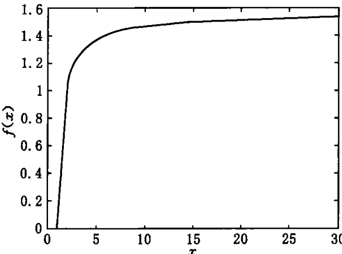

图 6-2 资源分配函数

#### 6.2.2.2 克隆变异

在改进的网络中，一种方式是可以采用固定的变异率对 ARB 进行变异。另一种方式是对第 $j$ 个抗原 $ag_j$，计算它对网络中每个 $B$ 细胞(或抗体)的刺激度 $sl(ab_i, ag_j)$，则 $B$ 细胞(或抗体) $ab_i$ 产生 $[h \times sl(ab_i, ag_j)]$ 个克隆 $C_{ij}$ ($\lfloor x \rfloor$ 为经四舍五入所得整数，$h$ 为一常数)。每一克隆 $c_k \in C_{ij}$ 服从如下变异：

$$c_k = c_k + \alpha \cdot (c_k - ag_j) \quad (6-6)$$

式中，$\alpha \in (0, 1)$ 为一单位随机数。这样，$\bigcup_{j=1}^m \bigcup_{i=1}^n C_{ij}$ 为每次克隆与变异后的抗体总数($n$ 为当代网络中的 $B$ 细胞的总数，$m$ 为抗原总数)，再对此群体进行亲和力阈值和抑制阈值删减，得到每次迭代

### 6.2.3 仿真实验及分析

为了验证这个改进的算法，本章分析了两个数据集。一个是原始数据有 50 个，二维的有五个聚类的线性可分数据集 [图 6-3 (a) ∼ 图 6-3(d)]。图 6-3(c) 是 NAT 变化的对比，从图 6-3(c) 中看：MRLAIS 的 NAT 在网络运行的初始阶段有震荡，但很快就稳定在一个水平上，这说明随着网络迭代次数增加，网络进化在逐渐趋于抗原所具有的模式。图 6-3(d) 网络体积的变化对比，从图中也可以看到 MRLAIS 比 RLAIS 更快地达到稳定的网络结构，而 RLAIS 达到稳定的网络结构要相对滞后，并随着迭代次数的增加会出现震荡现象。

实验的另一个是 Iris 数据集 [图 6-4(a) ∼ 图 6-4(d)] 的大小为 294。

在实验中迭代 60 次，MRLAIS 网络达到了稳定，NAT 变化情况和网络体积的变化与第一个实验结果基本相同，只是网络获得稳定模式需要迭代更多的次数。

在所做的所有仿真实验中，该免疫网络均可在 30 ∼ 70 代以后即达到稳定，NAT 和网络大小在平衡位置附近作较小的波动。经过多次仿真实验，可得出一个结论，对网络最终结构影响最大的是 NAT 的取值。

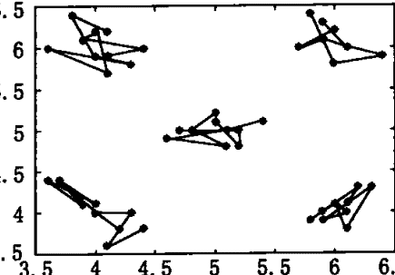
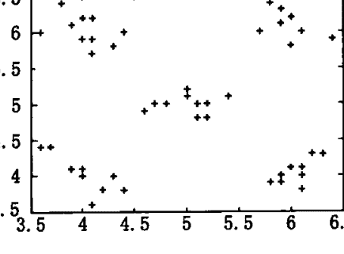
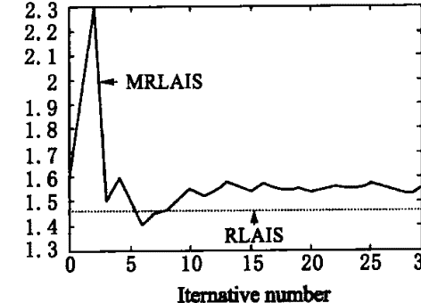
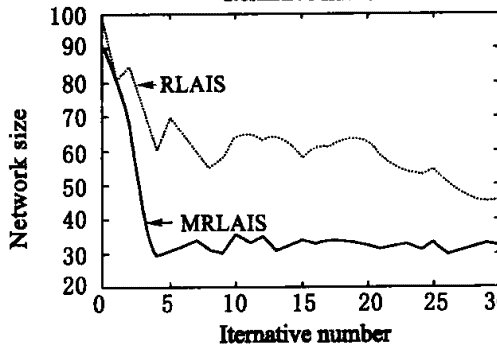

#### 图 6-3 二维五个聚类数据的实验结果

(a) 抗原集;(b) 最终网络结构;(c) NAT 的进化;(d) 网络尺寸进化

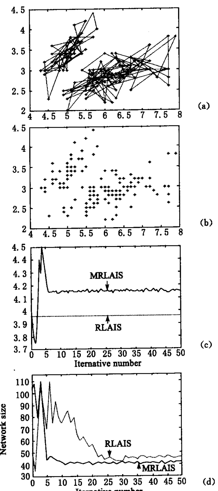

图 6-4 Iris 数据的实验结果
(a) 抗原集;(b) 最终网络结构;(c) NAT 的进化;(d) 网络尺寸进化

## 6.3 基于 MRLAIS 的关联规则挖掘算法

在本章以上的内容中对资源有限人工免疫系统提出了改进，以下的部分在数据挖掘的框架内，讨论这个改进的人工免疫系统在数据关联规则挖掘中的应用，重点是数据的频繁项集标识和关联规则发现。

### 6.3.1 关联规则发现与免疫过程的相似性

为了挖掘出有意义的关联规则，需要给定两个阈值：最小支持度和最小置信度。同时满足这两个阈值的规则称为强规则。如果项集满足最小支持度，即项集出现的频数大于或等于最小支持度与事务总数的乘积，则称它为频繁集（frequent itemset）[25]。

关联规则的挖掘通常分两步：一是找出所有的频繁集；二是由频繁集生成强关联规则。第一步尤为关键，决定着整个算法的性能，因为潜在频繁集的数量与项的总数呈指数关系，这将需要遍历一个极大的搜索空间。但是，搜索空间中也存在着频繁集集合与非频繁集集合之间的界限，通过搜索这一界限，可以有效地缩小搜索空间。关联规则挖掘算法常用的搜索策略[26,27]有广度优先的，如经典的 Apriori 算法[28]和它的加强算法[29]；以及深度优先的算法，如 FP-growth[30]和 Eclat[31]等。

人工免疫系统为关联规则的挖掘提供了一种强大的信息处理和问题求解范式。挖掘关联规则需要找出所有满足支持度要求的频繁模式，这将面临极大的搜索空间。人工免疫系统基于生物免疫系统抗体多样性的遗传机理，提供了一种多点、随机的智能搜索技术，并引入了免疫记忆机制，具有卓越的搜索性能。另一方面，抗体和抗原由氨基酸的不同排列组成，而数据挖掘中的记录或模式也由不同的属性值排列组合而成，因此很容易在关联规则挖掘与人工免疫系统之间建立对应关系。

由于原始记录和候选模式可以视为由基因(属性)构成的染色体，因此将数据库中的记录作为抗原，候选模式作为 ARB。通过一对 ARB 与抗原的比较，可以得到它们的相似程度和包含关系。向每一个 ARB 呈递所有的抗原，与较多抗原匹配程度高的 ARB 将获得更大的存活和克隆变异的机会。免疫学习的过程，便是个体亲和度提高的过程，同时也是频繁模式生成并通过免疫记忆机制得以保存的过程。最后，强关联规则由记忆细胞所代表的频繁模式生成。

### 6.3.2 基于 MRLAIS 的关联规则挖掘算法

#### 6.3.2.1 数据项的表示及系统初始化

在本章中，将数据库中的每条记录看做一个抗原。搜索过程中生成的候选模式用 ARB 来代表。ARB 除了包含候选模式信息外，还包含三项重要信息：B 细胞数(即 ARB 当前所能代表的 B 细胞的数量)、刺激水平和支持度。算法执行过程中产生的较优个体将以免疫记忆的形式得到保存；记忆细胞包含有频繁模式和支持度。

由于算法需频繁地对个体施加匹配、变异等操作，因此需要用一种直接的数字化形式来表示记录或模式。这里采用十进制编码，对于连续属性将每个具体的属性取值分段，以对应规则的前件，对于离散的属性值，要对其数值化，以适合于算法的计算。

设 $A = \{A_1, A_2, \cdots, A_n\}$ 是属性的有限集合，如果 $A_i(i=1,2, \cdots, n)$ 取 0 值表示该属性与其他属性无关联。这样，记录或模式的属性值被归一化后表示为一个 $n$ 维的向量，数据集合就是一个向量的集合。抗原、ARB 和记忆细胞的结构如图 6-5 所示。初始种群中的 ARB 是随机得到的：从数据集中随机地抽取一条记录作为一个 ARB，若在 ARB 种群中不存在与这个 ARB 相同的个体，


则将其添加到种群中；重复这个操作若干次，直到种群的规模满足要求为止。

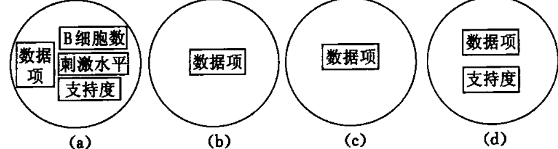

图 6-5 抗原、ARB 和记忆细胞结构
(a) ARB 的内部结构；(b) ARB 的外部结构；
(c) 抗原的内部结构；(d) 记忆细胞的内部结构

#### 6.3.2.2 ARB 的刺激水平

按 MRLAIS 的刺激值计算方法，在关联规则数据挖掘时，一个 ARB 的刺激水平计算如下：

```
sl = \(\sum_{g=0}^G (1 - dis_g)^2 + \sum_{i=0}^m (1 - dis_i)^2 + \sum_{i=0}^m (dis_i)^2\) (6-7)
```

式中，G 表示抗原的个数，dis_g 表示该 ARB 与第 g 个抗原的归一化距离，dis_i 表示该 ARB 与第 i 个与之连接的 ARB 间的归一化距离。同时考虑关联规则的支持度反应在 ARB 与抗原集合中抗原产生亲和的个数的多少，即一个 ARB 获得的亲和抗原的个数越多，这个 ARB 所代表的关联规则支持度就越高。因为：

```
sl(ag) = \(\sum_{g=0}^G (1 - dis_g)^2\) (6-8)
```

sl(ag) 是 ARB_i (候选模式 i) 对抗原的刺激水平，代表 ARB_i 与所有抗原(记录)的相似程度。sl(ag) 越高，则 ARB_i 与越多的抗原相似，相似程度越大(相同的基因位越多)，因此越有可能是频繁模式或者可能进化成为频繁模式。

#### 6.3.2.3 算法描述

基于 MRLAIS 的关联规则挖掘算法的形式描述如下：

- step1：输入抗体数据集；
- step2：初始化产生随机关联规则集 ARBs；
- step3：提呈抗原给网络，计算 ARB 的刺激水平；
- step4：根据刺激度对每个 ARB 分配相应数量的 B 细胞，没有分配到 B 细胞的 ARB 从网络中删除；
- step5：计算 ARB 的刺激水平；
- step6：根据刺激度进行 ARB 的克隆，采取固定变异率进行变异；
- step7：判断终止条件是否满足，如满足继续，不满足转 step3；
- step8：产生关联规则输出，结束。

### 6.3.3 实验及结果分析

为了验证本章给出的关联规则挖掘算法，我们采用 UCI 机器学习数据库[32]中的 Heart Disease 数据集进行实验。这个数据库中有 76 个属性，其中只有 14 个是有效的，这 14 个属性里包含 8 个符号属性和 6 个连续属性，属性列表如下：

- 1 age: age in years
- 2 sex: sex (1 = male; 0 = female)
- 3 cp: chest pain type
  - Value 1: typical angina
  - Value 2: atypical angina
  - Value 3: non-anginal pain
  - Value 4: asymptomatic
- 4 trestbps: resting blood pressure (in mm Hg on admission to the hospital)
- 5 chol: serum cholestoral in mg/dl
- 6 fbs: (fasting blood sugar > 120 mg/dl) (1 = true; 0 = false)
- 7 restecg: resting electrocardiographic results
  - Value 0: normal
  - Value 1: having ST-T wave abnormality (T wave inversions and/or ST elevation or depression of > 0.05 mV)
  - Value 2: showing probable or definite left ventricular hypertrophy by Estes' criteria
- 8 thalach: maximum heart rate achieved
- 9 exang: exercise induced angina (1 = yes; 0 = no)
- 10 oldpeak = ST depression induced by exercise relative to rest
- 11 slope: the slope of the peak exercise ST segment
  - Value 1: up sloping
  - Value 2: flat
  - Value 3: down sloping
- 12 ca: number of major vessels (0-3) colored by fluoroscopy
- 13 thal: 3 = normal; 6 = fixed defect; 7 = reversable defect
- 14 num: diagnosis of heart disease (angiographic disease status)
  - Value 0: < 50% diameter narrowing
  - Value 1: > 50% diameter narrowing

实验前将属性值进行处理，将连续属性的取值分段，符号属性数值化，然后把不同属性的变量值都归一到[0, 1]区间。实验的 ARB 初始种群为 500，采用固定的变异率对 ARB 进行变异，变异率设定为 0.5，实验分别对最小支持度为 10%,30%,50%的情况进行了多次测试。其中当最小支持度为 10%时，一次实验中获得的部分关联规则如下：

- 1 chest pain type=2 ^ thal=reversable defect → presence of heart disease
- 2 chest pain type=3 ^ thal=fixed defect → presence of heart disease
- 3 sex=male ^ thal=fixed defect ^ maximum heart rate achieved > 157.4 → absence of heart disease
- 4 resting blood pressure > 162.93 ^ serum cholestoral in mg/dl > 415.28 → presence of heart disease
- 5 fasting blood sugar <= 120 mg/dl ^ exercise induced angina → presence of heart disease
- 6 sex=female ^ number of major vessels colored by fluoroscopy=2 → presence of heart disease
- 7 number of major vessels colored by fluoroscopy=3 → presence of heart disease
- 8 fasting blood sugar <= 120 mg/dl ^ resting electrocardiographic results=0 → absence of heart disease
- 9 fasting blood sugar <= 120 mg/dl ^ thal=reversable defect → presence of heart disease
- 10 chest pain type=0 ^ exercise induced angina → absence of heart disease
- 11 fasting blood sugar > 120 mg/dl ^ resting blood pressure > 162.94 → absence of heart disease
- 12 exercise induced angina ^ serum cholestoral in mg/dl > 273.47 ^ serum cholestoral in mg/dl < 415.28 → presence of heart disease
- 13 sex=male ^ the slope of the peak exercise ST segment = 2 → absence of heart disease
- 14 chest pain type=3 ∧ resting electrocardiographic results = 2 → presence of heart disease
- 15 sex=male ∧ serum cholestoral in mg/dl < 273.47 → presence of heart disease
- 16 resting blood pressure > 128.73 ∧ resting blood pressure < 162.94 → presence of heart disease

从实验结果可以看出，这个算法可以有效地找到频繁集并生成关联规则。它与传统的 Apriori 算法相比，这种方法不需要预先设定支持度，一个 ARB 的刺激水平越高，它对应的规则支持度就越大；这个方法在搜索大量数据集时，会比 Apriori 算法有更高的效率。

## 6.4 小结

本章分析了资源有限人工免疫系统存在的不足：① 亲和度阈值 NAT 的固定不变，不利于网络的进化；② 采用抗体—抗原间的欧式距离 d 直接线性计算刺激度 sl，没有充分体现 d 较小时刺激度值 sl 所应具有的优势，又对较小的 d 过分敏感；③ 原有资源分配方式 Ri = k × (sl_i^2) 的选取，在网络学习的初期抑制了网络多样性；④ 在采用单纯的克隆选择和随机变异操作策略，影响群体的收敛性和稳定性。

提出了一种改进的资源有限人工免疫系统：① 采用每次迭代后抗体间的距离来动态的计算 NAT；② 采用抗体—抗原间的欧式距离 d 非线性计算刺激度 sl；③ 取刺激度的反正割函数：Ri = k × arcsec(sl) 分配资源；④ 采用引导学习方式克隆和变异抗体，引导抗体向抗原模式进化。仿真实验表明改进的资源有限人工免疫系统在网络的进化速度、网络的结构等方面获得了较好的性能。

对改进的资源有限人工免疫系统进行数据挖掘应用研究，利用人工系统的亲和度成熟过程和关联规则发现过程的相似性，把频繁项集表示为 ARB，实现了关联规则的数据挖掘，并通过对 UCI 机器学习实例的关联规则挖掘验证了这种挖掘方法的可行性。

# 参考文献

- [1] 莫宏伟. 人工免疫系统原理与应用[M]. 哈尔滨:哈尔滨工业大学出版社，2002.
- [2] DASGUPTA D, GONZALEZ F, et al. The Promise and Challenges of Artificial Immune System Based Web Usage Mining: Preliminary Results [C]. Presented at the workshop on Web Analytics at Second SIAM International Conference on Data Mining (SDM), Arlington, VA, April 11-13, 2002.
- [3] BEZERRA G B, CASTRO D E. Bioinformatics Data Analysis Using an Artificial Immune Network[C]. In the Proceeding of Second International Conference on Artificial Immune Systems (ICARIS), September 1-3, 2003, Napier University, Edinburgh, UK.
- [4] DASGUPTA D, FORREST S. Artificial immune systems in industrial applications[C]. In: Proc 2nd International Conference on Intelligent Processing and Manufacturing of Materials, Honolulu, 1999:257-267.
- [5] ISHIGURO A, KUBOSHIKI S, ICHIKAWA S. Gait coordination of hexapod walking robots using mutually-coupled immune networks[C]. In: Proc IEEE International Conference on Evolutionary Computation, Perth, Australia, 1995:672-677.
- [6] BALTHROP J, ESPONDA F, FORREST S, et al. Coverage and generalization in an Artificial Immune System (AAAA)[C]. In the proceedings of the International Conference Genetic and Evolutionary Computation (GECCO-2002), New York, July 9-13, 2002.
- [7] SMITH D J, FORREST S, PERELSON A S. Immunological memory is associative[C]. In Workshop Notes, Workshop 4: Immunity Based Systems, In Conf. on Multiagent Systems, pp. 62-70, 1998.
- [8] JOHNSON R. Frameworks = (components + patterns) [J]. Communications of the ACM, 40(10):39-42, October 1997.
- [9] GOODMAN D, BOGGESS L, WATKINS A. Artificial Immune System Classification of Multiple-Class Problems[M]. In: Dagli C H, Buczak A L, Ghosh J, Embrechts M J, Ersoy O, and Kercel S W (eds.):Intelligent Engineering Systems Through Artificial Neural Networks, New York, 2002, 12:179-184.
- [10] TWYCROSS J. An IMMUNE system Approach to Document Classification[D]. Master thesis. HP Laboratories Bristol, 2002.
- [11] ISHIGURO A, WATANABE Y, KONDO T, et al. Decentralized consensus making mechanisms based on immune system: Application to behavior arbitration of an autonomous mobile robot[C]. In: Proc IEEE International Conference on Evolutionary Computation, Nagoya, Japan, 1996:82-87.
- [12] MCCOY D F, DEVARAJAN V. Artificial immune systems and aerial image segmentation[C]. In: Proc IEEE International Conference on Systems, Man and Cybernetics, Orlando, Florida, 1997:867-872.
- [13] LEANDRO N, CASTRO D E, TIMMIS J. An Artificial Immune Network for Multimodal Function Optimization[C]. WCCI 2002.
- [14] CASTRO D E, TIMMIS J. Artificial Immune Systems: A Novel Paradigm to Pattern Recognition [M]. Artificial Neural Network in Pattern Recognition, University of Paisley, UK, 2002.
- [15] CASTRO D E, TIMMIS J. Hierarchy and Convergence of Immune Networks: Basic Ideas and Preliminary Results[C]. In: 1st ICARIS, 2002.
- [16] CASTRO D E, TIMMIS J. Artificial Immune Systems as a Novel Soft Computing Paradigm [J]. Soft Computing Journal, 2003, 20(19): 765-778.
- [17] RENDERS J M, HANUS R. Biological learning metaphors for adaptive process control: A general strategy[C]. In: Proc IEEE International


- [18] HUNT J E, FELLOWS A. Introducing an Immune Response into a CBR system for Data Mining[C]. In BCS ESG'96 Conference and published as Research and Development in Expert System XIII, 1996.

- [19] HUNT J E, COOKE D E, HOLSTEIN H. Case memory and retrieval based on the Immune System[C]. In the First International Conference on Case Based Reasoning, Published as Case-Based Reasoning Research and Development, Ed. Manuela Weloso and Agnar Aamodt, Lecture Notes in Artificial Intelligence 1010, 1995(10):205-216.

- [20] GONZÁLEZ F, CARDONA C, et al. A Scalable Artificial Immune System Model for Dynamic Unsupervised Learning[C]. In the proceedings of the Genetic and Evolutionary Computation Conference (GECCO), July 12-16, 2003. LNCS 2723, p. 219 ff.

- [21] DASGUPTA D, GONZALEZ F, et al. An Novel Artificial Immune System Approach to Robust Data Mining[C]. In the proceedings of the International Conference Genetic and Evolutionary Computation (GECCO), New York, July 9-13, 2002.

- [22] ABBATTISTA F, DANTO G. An associative Memory Based on the Immune Network[C]. Proceedings of IEEE International Workshop on Neural Networks. Washington; USA, IEEE. 1996.

- [23] TIMMIS J, NEAL M. A resource limited artificial immune system for data analysis[J]. Knowledge Based Systems, 2001, 14(3-4):121-130.

- [24] KNIGHT T, TIMMIS J. Assessing the performance of the resource limited artificial immune system AINE[A]. Technical Report 3-01, Canterbury, Kent. CT2 7NF, May 2001.

- [25] JIAWEI HAN, MICHELINE KAMBER. Data Mining: Concepts and Techniques[M]. London: Academic Press, 2000.

- [26] 陆建江, 宋自林, 钱祖平. 挖掘语言值关联规则[J]. 软件学报, 2001, 12(4):607-611.

- [27] HAN S J, PEI J, YIN Y. Mining frequent patterns without candidate generation[C]. In: ACM-SIGMOD, Dallas, 2000.

- [28] AGRAWAL R, SRIKANT R. Fast algorithms for mining association rules [C]. In: Proc of the 20th VLDB Conf Santiago, Chile, 1994: 487-499.

- [29] 倪晏, 徐晓飞, 邓胜春, 等. 基于频繁项目对支持矩阵的 Apriori 优化算法[J]. 小型微型计算机系统, 2004(05):88-90.

- [30] 王新宇, 杜孝平, 谢昆青. FP-growth 算法的实现方法研究[J]. 计算机工程与应用, 2004, 9:174-176.

- [31] MOHAMMED J ZAKI. Scalable algorithms for association mining[J]. IEEE Trans on Knowledge and Data Engineering, 2000, 12 (3) : 372-390.

- [32] BLAKE C L, MERZ C J. UCI Repository of Machine Learning Databases[DB/OL]. http://www.ics.uci.edu/.

# 第 7 章 自适应免疫应答网络(AIRN)及其聚类挖掘方法

免疫应答机理是生物免疫系统的一个重要特征，免疫应答的实质是一个识别、效应和记忆的过程。本章根据生物免疫系统的应答机制和原理，从模拟免疫响应中 B 细胞的结合、B 细胞的激励以及复制等方面入手，建立一个自适应的人工免疫应答模型，并将其应用在聚类数据挖掘中。

## 7.1 免疫应答和免疫网络

人类的免疫系统保护自身不受细菌、病毒等的感染。人类免疫系统有两类：固有性免疫系统和适应性免疫系统。固有性免疫系统（如皮肤）对不同病菌都具有抵抗作用，没有记忆功能；适应性免疫系统专门针对特定的入侵者，并具有一定的免疫记忆功能[1]。适应性免疫系统对工程应用领域具有下述启发意义的特点：

- (1) 免疫系统从数百个抗体基因中能产生至少数百万种的抗体，防止外在抗原的感染。

- (2) 免疫系统是无中心控制器的分布系统。

- (3) 免疫系统能对动态变化的情况快速适应。

- (4) 免疫系统的记忆是按内容寻址的，一种抗原被记忆后，类似的抗原也可以被抗体识别。

本章所说的免疫特指适应性免疫。根据免疫学的细胞学机理，生物体内有大量循环的免疫细胞，其中淋巴细胞是参与免疫应答的最主要的免疫细胞，具有专一性、多样性、记忆和自适应等特点。淋巴细胞有 T 细胞和 B 细胞两大类，B 细胞能产生抗体以消灭入侵的抗原，T 细胞具有促进和抑制 B 细胞反应的作用，免疫系统的作用机制如图 7-1 所示。

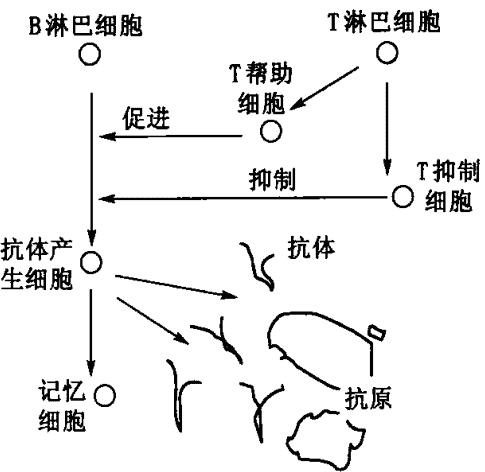

图 7-1 免疫系统的作用机制

### 7.1.1 免疫应答

为切实模拟免疫机理构造设计网络，有必要对免疫应答过程做一个回顾。当免疫系统第一次遇到某一类型的抗原时，只有少数的免疫细胞能识别该抗原的表位，能够识别抗原的细胞受到激励，进行快速的自身复制，该过程即为克隆扩增(clonal expansion)。克隆扩增的过程同时伴随着超频变异(hypermutation)，也就是在细胞复制过程中，细胞产生一定的变异，使产生的克隆越来越能够识别抗原。大部分克隆在干扰素、细胞因子等分子的作用下分化为浆细胞，浆细胞能够产生抗体以清除入侵抗原，这个过程称为首次应答(primary response)。少量的克隆分化为记忆细胞，如果有类似的抗原入侵，会导致更快的和更多的抗体产生，这个过程称为二次应答(secondary response)。这里要注意的是，不一定要完全相同的抗原的入侵，类似的抗原入侵也会导致二次应答。

免疫应答作为生物免疫系统调节生物体自身动态平衡的一个重要手段，是抗原选择具有特异性的淋巴细胞，使之活化、增殖、分化并产生免疫效应，使机体避免抗原侵害的过程。简而言之，免疫应答是机体对入侵的自身防御反应。

免疫系统具有两种形式的应答：初次应答和再次应答。初次应答发生在免疫细胞初次遇到某种抗原并与其发生作用时。初次应答一般需要一段相当长的时间来消灭抗原。当同样的抗原再次入侵时，免疫系统迅速产生特定的二次应答。从计算科学的观点看初次应答对应于对训练数据进行学习，二次应答对应于模式聚类问题，即把新输入的数据归为相应的类别。值得注意的是，二次应答不仅会由同样的抗原的再次侵入引起，还会由相似抗原的侵入引起，这也就是通常所说免疫记忆具有联想性。

免疫应答的基本过程由三个阶段组成：感应阶段、增殖分化阶段和效应阶段。在人工免疫系统中，可以通过抗原匹配、抗体克隆选择、抗体变异以及亲和力成熟匹配过程描述上述三个阶段。

### 7.1.2 免疫网络假设

为了解释免疫系统的各种现象，N. K. Jerne 提出了独特型免疫网络假设[2]，根据该假设，在免疫系统中免疫细胞不是一个个孤立的个体，而是通过细胞与细胞间的相互激励和抑制作用，形成一种网络结构。

N. K. Jerne 提出，抗原的表面具有反映抗原特性的部位，即表位(epitope)或抗原决定位。特定的抗体通过自身的可变区与抗原决定位的结合来识别这种抗原，抗体上可以与抗原决定位结合的部位，即对位(paratope)，表位和对位的关系如同锁和钥匙的关系，这种结合关系导致了免疫应答的特异性。不仅是抗原具有能够被抗体识别并结合的抗原决定簇，抗体本身也具有能够被其他抗体识别并结合的抗原决定簇，即抗体也具有抗原性。抗体上能够被其他抗体识别的抗原决定位一般为独特型（idiotype）抗原决定簇，或是独特位（idiotope）。

当某种抗体的对位与表位或独特位结合后，分泌这种抗体的 B 细胞会受到激励，当激励超过一定阈值后，进行克隆扩增，从而产生免疫应答。同时，被结合的抗原或抗体受到抑制，抗体对应的 B 细胞数量会减少。大量抗体的相互作用以及与抗原的作用组成一个网络，如图 7-2 所示。图中，ns 为 B 细胞间的激励，nn 为 B 细胞间的抑制，ps 为抗原对 B 细胞的激励。

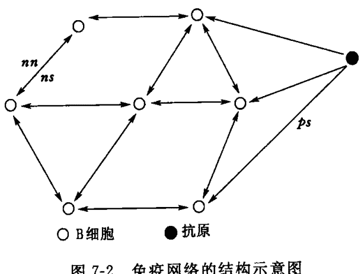

### 7.1.3 相关假设的简化

免疫应答是一个非常复杂的生物化学过程，要建立一个面面俱到的模型来描述免疫应答所有现象是不可能的，在工程上也没有特别大的意义。因此，从信息处理和工程应用的角度出发，结合免疫网络假设和细胞学的机理，建立免疫应答的模型，使其可以用于复杂系统的建模、控制以及模式识别等方面，这是人工免疫系统研究应该关注的课题。为此，我们在人工免疫系统的模型建立时，对免疫系统作了如下假设：

- (1) 由于 T 细胞的作用机理比较复杂，在建立细胞之间的相互作用模型时没有考虑 T 细胞的作用，只考虑 B 细胞之间的激励和抑制关系。

- (2) 在免疫系统中，同一个 B 细胞分泌的抗体性质都是一样的，这里对 B 细胞和其分泌的抗体不加以区分。当考虑与抗原作用时，采用抗体的概念；在克隆扩增时，采用 B 细胞的概念。整个系统由抗原、抗体（B 细胞）群和骨髓组成。

- (3) 不考虑抗原提呈、细胞介导等作用的时间，即抗原侵入后周围 B 细胞会立刻产生作用。

- (4) B 细胞在整个网络中不是固定连接的，而是随机流动的。在每个时刻，B 细胞（抗体）只与当时处于它周围的 B 细胞相互作用。

通过以上假设，希望构造一种以搜索原始数据的模式为目标的自适应的人工免疫应答网络。在探讨的人工免疫网络模型设计中，同时借鉴已有的人工免疫网络模型和算法中的成熟有效的方法[3-10]，它们包括：

- (1) 用抗体网络的结构形式来实现学习和记忆；

- (2) 用抗原和抗体的相似性度量来实现识别；

- (3) 通过克隆和超变异机制来产生适当的抗体，从而使网络中的抗体结构可以反映所遇到的抗原特征；

- (4) 通过抗体之间的刺激和抑制作用来保持网络的稳定，同时使网络具有继续学习的能力，即一旦有新的抗原的刺激，网络结构马上做出相应的反应；

- (5) 控制网络的规模，使得在新抗体加入的同时，那些长期得不到刺激的无用抗体被删除。

下面将详细描述自适应免疫应答网络各部分的组成和功能的实现过程。

## 7.2 自适应免疫应答网络 (AIRN) 模型

### 7.2.1 AIRN 的组成

从上述简化的免疫应答和免疫网络假设出发，明确网络的数据分析目标，根据问题特点确定自适应免疫应答网络（Adaptive Immune Response Network，AIRN）的抗原、抗体的形式，以及系统的构成。

- (1) 抗原——原始数据组；

- (2) 抗体——各模式类的特征值，在网络中表现为一个数据项；

- (3) 系统结构——抗体通过相互作用构成的网络；

- (4) 应用目标就是使网络经过“学习”后，能够反映原始数据集所包含的模式类。

于是，整个网络的构成规则为：

- (1) 网络由数据项组成，每个数据项包括一个数据值、一个刺激度值；

- (2) 网络中的数据项之间存在连接，两个数据项之间是否连接由两个数据项的相似度以及一个阈值确定：如果数据项之间的相似度大于阈值则连接，否则，就不连接；

- (3) 每一组互连的数据项所构成的子网络，就代表一个模式类；

- (4) 通过训练，网络最终达到一个稳定的结构，这个稳定的结构就是模式分析的结果。

### 7.2.2 AIRN 的初始化

抗体对抗原的识别是免疫系统最重要的功能，也是引起免疫应答的首要条件。识别必须满足一些条件。当两个具有互补特性的细胞相遇时，它们相互之间结合力（亲和力）的大小取决于两者之间的互补程度。为了解决抗体对抗原的匹配识别问题，这里引入 A. S. Perelson 提出的形态空间概念[11]：

假如 \(m\) 个特征影响分子之间的相互作用，\(P_i\) 是第 \(i(i=1,2,\cdots,m)\) 个特征，则每个分子可被表示为 \(m\) 维空间 \(S(S=P_1 \times \cdots \times P_m)\)，\(S\) 可以是 \(m\) 维海明空间或 \(m\) 维欧氏空间中的一个点。

将待处理的数据定义为抗原集合 \(AG=\{ag_1, ag_2, \cdots, ag_I\}, AG \in R^I\)，\(I\) 为抗原空间规模。抗体识别抗原的过程就是免疫应答识别待处理数据模式的过程。通过免疫应答识别过程，获得的记忆细胞集合 \(M\) 即为需求解的模式。设 \(M\) 的规模为 \(I'\)，则 \(M \in R^{I'}\) 免疫应答结束后，应有 \(I > I'\)，抗体空间被压缩。免疫应答过程的形式化描述为：

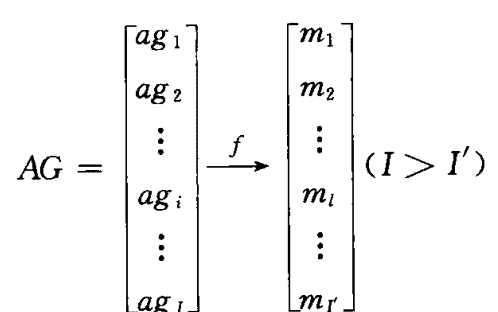

设系统中的抗原具体表示为：

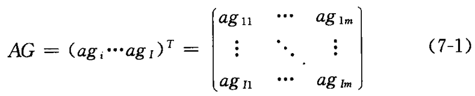

式中，\(ag_i\) 表示第 \(i\) 个抗原；\(ag_{ij}\) 表示第 \(i\) 个抗原的第 \(j\) 个向量。

通过随机产生：

$$
AB = (ab_1 \cdots ab_k)^T = \begin{pmatrix} ab_{11} & \cdots & ab_{1m} \\ \vdots & \ddots & \vdots \\ ab_{k1} & \cdots & ab_{km} \end{pmatrix} \quad (7-2)
$$

\(ab_{ij} \in [0,1]^m, i=1, \cdots, k; j=1, \cdots, m\)

作为新生成的抗体。式中，\(ab_i\) 表示第 \(i\) 个抗体，\(ab_{ij}\) 表示第 \(i\) 个抗体的第 \(j\) 个向量。

### 7.2.3 抗原提呈

把抗原与抗体间的欧氏距离作为衡量两者之间匹配程度的一个指标。将抗原中的每个元素分别与抗体中的每个元素相匹配，对任意抗原 \(ag_i\) 和任意抗体 \(ab_j\)，两者之间的距离 \(d(i, j)\) 可通过下式计算：

$$
d(i,j) = \left[ \sum_{t=1}^m (ag_{it} - ab_{jt})^2 \right]^{1/2} \quad (7-3)
$$

对任意抗体 \(ab_i\) 和任意抗体 \(ab_j\)，两者之间的距离 \(s(i, j)\) 可通过下式计算：

$$
s(i,j) = \left[ \sum_{t=1}^m (ab_{it} - ab_{jt})^2 \right]^{1/2} \quad (7-4)
$$

对任意 \(ab_j (ab_j \in AB, j=1, \cdots, k)\)，所受到的来自抗原 \(ag_i (ag_i \in AG, i=1, \cdots, I)\) 的激励 \(sl(i, j)\) 为：

$$
sl(i,j) = \begin{cases} 1/ \sqrt{d(i,j)} & d(i,j) < T_x \\ 0 & \text{other} \end{cases} \quad (7-5)
$$

\(i = 1, 2, \cdots, I; j = 1, 2, \cdots, k\)

式(7-5)中：

$$
T_x = k_x \frac{\sum_{i=1}^I \sum_{j=1}^k d(i,j)}{\frac{I \times k}{2}} \quad (7-6)
$$

表示抗原对抗体激励的阈值，其中：\(k_d \in (0, 1]\) 且为常数。

### 7.2.4 克隆和变异

当抗体 \(ab_j\) 所受到来自抗原的刺激达到一定程度 \([d(i, j) < T_d]\) 时，免疫系统被激活，系统开始对抗体进行克隆增殖。增殖是指免疫细胞发生无性、有丝分裂。自我复制（没有交叉）的过程。抗体克隆的数目与其所受到的激励水平成正比，受激励越大的抗体克隆的数目越多；受激励越小的抗体克隆的数目越少。由于受抗原 \(ag_i\) 激励所导致的抗体 \(ab_j\) 的克隆数目为：

\(c_1(i, j) = \begin{cases} \lfloor sl(i, j) \rfloor & d(i, j) > T_d \\ 0 & \text{other} \end{cases}\)  
(7-7)

式中，\(\lfloor \cdot \rfloor\) 表示取与 \(sl(i, j)\) 最接近的整数。抗体 \(ab_j\) 经 \(ag_i\) 刺激产生克隆的集合为 \(Ab_{ji}\)，抗体 \(ab_j\) 受抗原群体刺激所产生的克隆集合 \(C_j\) 为：

\(C_j = Ab_{j1} \cup Ab_{j2} \cup \cdots \cup Ab_{jc_1(i, j)} = \bigcup_{t=1}^{c_1(i, j)} Ab_{jt}\)  
(7-8)

相应的抗体集合 \(AB\) 经克隆过程后新生成的抗体集合 \(C\) 为：

\(C = C_1 \cup C_2 \cup \cdots \cup C_t = \bigcup_{t=1}^k C_t\)  
(7-9)

克隆细胞要经历突变（伴随着高变异率）过程，从而使得新产生的细胞与所选择的抗原以更高的亲和力相匹配。在变异过程中每种免疫细胞变异的速率与细胞受体受抗原的激励程度的大小成反比：其受抗原的激励越大，变异越小；其受抗原的激励越小，变异越大。定义：\(Mut(i, j)\) 为抗体 \(ab_j\) 受到抗原 \(ag_i\) 刺激后新产生的抗体的变异率。

\(Mut(i, j) = d(i, j)\)  
(7-10)

由抗原 \(ag_i\) 入侵引起的 \(ab_j\) 的克隆所生成的 \(c_j\) 变异为：

\(c'_j = c_j + Mut(i, j) \times (c_j - ag_i)\)  
(7-11)


抗体 \( ab_j \) 被抗原群刺激产生的变异集合为 \( C_j' \)，变异产生的全部抗体集合为：

\( C' = C_1' \cup C_2' \cup \cdots \cup C_k' = \bigcup_{i=1}^{k} C_i' \) (7-12)

变异保证了新产生的抗体具有充足的多样性，这是免疫系统强化学习机制的内在的特性，系统通过重复进行上述工作来增强自己识别抗原的性能。

### 7.2.5 克隆抑制和克隆选择

克隆变异之后首先进行克隆抑制（clone suppression）。对集合 \( C' \)，再次计算抗原与克隆变异后的抗体细胞的亲和力，计算克隆变异后的抗体细胞之间的亲和力。同时计算抗原—抗体抑制阈值 \( T_d \) 和抗体—抗体抑制阈值 \( T_s \)：

\( T_d = k_d \frac{1}{p} \sum_{j=1}^{p} \min_{i=1}^{l} d(i, j) \) (7-13)

式中，\( k_d \in (0, 1] \) 且为常数。

\( T_s = k_s \frac{\sum_{i=1}^{p} \sum_{j=1}^{p} s(i, j)}{\frac{p \times (p-1)}{2}} \) (7-14)

式中，\( k_s \in (0, 1] \) 且为常数。

在克隆抑制阶段，首先删除那些与抗原亲和力大于阈值 \( T_d \) 的抗体细胞，然后再根据抗体细胞之间的亲和力，清除亲和力小于阈值 \( T_s \) 的记忆细胞，此阶段完成后形成的抗体集合为 \( C'' \)，其元素满足以下条件：

\( ab_j = \begin{cases} ab_j & \exists ag_i, d(i, j) < T_d \\ 0 & \text{other} \end{cases} \) (7-15)

\( ab_j = \begin{cases} ab_j & \exists ab_i, s(i, j) > T_s \\ 0 & \text{other} \end{cases} \) (7-16)

通过克隆抑制阶段，形成的抗体集合 \( C'' \) 比 \( C' \) 的规模缩减。随后再进行克隆选择，对集合 \( C'' \) 的抗体，按照其与抗原的亲和力大小，选择 \(\xi\%\) 克隆变异后的细胞作为该抗体的记忆细胞，\(\xi\%\) 可以预先设定。将选择出的变异克隆细胞放入记忆细胞集合 \( M \) 中。

### 7.2.6 亲和力成熟

免疫应答的亲和力成熟过程，类似于物种的自然选择过程。经克隆变异后的抗体中那些具有较高抗原刺激度的抗体转化为具有较长寿命的记忆细胞，而那些具有较低抗原刺激度的抗体则随着抗原的消亡而消亡。由于抗体细胞之间的互相识别易引起自身免疫应答反应，因此，为了消除自身免疫，在每次加入新的抗体记忆细胞后，需要对那些能够自我识别的抗体进行抑制。

设定记忆细胞集合 \( M(M=\{m_1, m_2, \cdots, m_z; M \in R^z\}) \) 中元素的个数为 \( p_1 \)，定义记忆细胞亲和力成熟阈值为：

\( T'_s = k'_s \frac{\sum_{i=1}^{p_1} \sum_{j=1}^{p_1} s(i, j)}{\frac{p_1 \times (p_1 - 1)}{2}} \) (7-17)

式中，\( k'_s \in (0, 1] \) 且为常数。

那么抗体经亲和力成熟过程并转化后，记忆细胞集合 \( M \) 中的元素应该满足以下条件：

\( ab_j = \begin{cases} ab_j & s(i, j) > T'_s \\ 0 & \text{other} \end{cases} \) (7-18)

式中，\( i=1, 2, \cdots, p_1; j=1, 2, \cdots, p_1 \)。

### 7.2.7 网络训练终止条件

网络训练时可以设定一定的迭代次数作为终止条件，也可以在每次迭代结束后判断抗原与记忆细胞的刺激度值来作为终止条件，即任给一个抗体 \( ag_i \)，在记忆细胞集合里都可以找到一个抗体 \( ab \)，使得 \( d(i,j) \leqslant T_c' \)。

免疫系统通过上述过程的循环，对所处理的数据进行学习，直到满足学习终止条件，所有的抗体被记忆细胞识别，最后的抗体记忆集合 \( M \) 为获得的学习模式，这样就完成了知识的学习和经验的积累。这个阶段对后续的由相同或相似的抗原引起的再次应答过程起关键的作用，一旦免疫应答成熟，训练过程结束，系统可输出所获得的抗原数据模式，或进入二次应答阶段，识别输入系统的新的数据模式。

综上所述，我们所提出的人工免疫应答模型具有以下特征：通过初次应答建立抗体记忆集合来描述输入的抗原数据特征，识别抗原存在的模式；通过二次应答完成对新输入数据的识别。在实际计算中，可以利用它的上述特性来实现数据压缩、数据的聚类和分类等数据识别功能。

### 7.2.8 算法描述

算法设定的参数及伪代码如下：

- \( Af(d) \):抗原与抗体、抗体与抗体之间的亲和力，由两者之间的 Euclidean 距离确定。距离越大，抗原与记忆细胞之间亲和力越小。反之，亲和力越大。
- \( sl \):抗原—抗体或抗体—抗体刺激度。
- \( \xi\% \):选择克隆变异后的细胞作为记忆细胞的百分比。
- \( M \):记忆细胞集合。

自适应免疫应答网络(AIRN)算法描述如下：

step1: 初始化。将要识别的数据集 \( AG \) 标准化并随即产生抗体集合 \( AB \)。

step2: 判断终止条件是否满足。若满足则结束算法，输出记忆集合 \( M \)，不满足继续。

step3: 对每个 $Ag_i \in AG$, 根据 $T_d$ 计算亲和力 $Af(d)$ 和刺激度 $sl$。

step4: 根据刺激度 $sl$, 克隆抗体。

step5: 按抗体变异进化公式变异抗体。

step6: 根据抗原—抗体阈值 $T_d$，抗体—抗体阈值 $T_s$，对网络进行抑制。

step7: 从抗体集合中选择 \(\xi\%\) 与抗原亲和力最高的抗体存入记忆细胞集 \( M \)。

step8: 根据 \( T'_s \)，删除临近的记忆细胞，转 step2。

## 7.3 自适应免疫应答网络(AIRN)模型分析

### 7.3.1 NIS 与 AIRN 之间的映射关系

表 7-1 给出了 NIS(Nature Immune System)[1] 与 AIRN(Adaptive Immune Response Network)之间的映射关系。

| NIS | AIRN |
| --- | --- |
| 记忆细胞 | 算法产生的逼近原始数据并带有模式特征的数据 |
| 抗原 | 待分析的数据集合 |
| 克隆 | 与提呈抗原匹配的记忆细胞的复制 |
| 变异 | 克隆后的记忆细胞变异 |
| 克隆选择 | 按照阈值,对亲和力高的记忆细胞保留,低的删除 |
| 亲和力成熟 | 保留亲和力高的克隆作为记忆细胞 |
| 免疫记忆 | 对抗原集合产生记忆细胞 |
| 免疫网络中抗体之间相互抑制 | 对抗体集合 AB 和 M 的抑制 |

### 7.3.2 自适应分析

#### (1) 抗原—抗体激励阈值 \( T_d \) 分析

在 AIRN 中，抗体所受到的刺激值 \( sl \) 只考虑抗原对它所施加的影响，而网络中抗体间的抑制则在抗体克隆变异进行。由式 (7-5)设定抗原对抗体的激励阈值 \( T_s \)。阈值采用全部抗体与抗原平均距离，反映了当时网络中抗体与抗原的亲和力状态，而且在每次迭代过程中重新计算，它是与网络的演化相适应的。

#### (2) 抗原—抗体抑制阈值 \( T_d \) 分析

在自然免疫系统中，未受抗原刺激的细胞会死亡。在所提出的人工免疫系统中，采用抗原对抗体抑制阈值 \( T_d \) 来删除网络中的抗体，即当抗体与抗原的亲和力大于抑制阈值 \( T_d \) 时，删除此抗体。对于人工免疫网络，在开始的前几次迭代中，网络中的抗体可能离抗原较远，因而与抗原的亲和力可能较小，如果 \( T_d \) 太小，会使较优良的抗体被删减掉，甚至根本没有小于 \( T_d \) 的抗体存在，网络演化根本无法正确生成抗原数据的模式。而在网络进化到一定代数之后，相关抗原均有较近抗体匹配，抗体与抗原的亲和力相对有所增大，需要适当减少 \( T_d \) 值，起到充分删除亲和力较小的抗体的作用。因此，对具体问题而言，选择一个自动适应网络生成的阈值(\( T_d \))函数，能很好地帮助产生较好的网络结构。这里用 \( min\_d(i, j) \) 表示所有抗体对每个抗原的亲和力的最小值的平均值，则取抗原对抗体抑制阈值 \( T_d = k_d \frac{1}{p} \sum_{j=1}^p \min_{i=1}^l d(i,j) \)，这样在网络演化初期，阈值 \( T_d \) 相对较小，在网络演化后期，阈值 \( T_d \) 逐渐变大，自适应网络的变化，使网络保持良好的结构。

#### (3) 抗体—抗体抑制阈值 \( T_s \) 分析

在自然免疫系统中，一个抗体的刺激来源于抗体和与其相邻抗体，为了保持抗体细胞的多样性，具有相同性质的抗体细胞会受到抑制。这里采用每次迭代后抗体间的平均距离来定义其抑制阈值 \( T_s \)。这样可以根据当时网络演化的状态，适当的删除网络中性质相同或相近的抗体细胞，保持抗体细胞群体的多样性。

在 AIRN 中，抗体之间的抑制阈值 \( T_s \) 决定网络的特异性、聚类的精度和网络的可伸缩性，因为它在一定程度上控制着网络中个体的数量。因为 \( T_s \) 用于限制网络中抗体间距离的下限，因此，它与网络中抗体间距离的总体分布情况有关联，因而 \( T_s \) 也与网络的进化过程相适应。

#### (4) 亲和度成熟阈值 \( T_s' \) 分析

免疫应答的亲和力成熟过程中，将经克隆变异后具有较高抗原刺激度的抗体转化为具有较长寿命的记忆细胞，将具有较低抗原刺激度的抗体死亡。这里用类似于定义抗体—抗体抑制阈值 \( T_s \) 的方法定义亲和度成熟阈值 \( T_s' \)，可以使记忆细胞集合随着网络的进化较好保持网络的特异性，以获得要学习的模式。只是为了使网络更加优化，亲和度成熟阈值 \( T_s' \) 比相应的抗体—抗体抑制阈值 \( T_s \) 大。

### 7.3.3 收敛性分析

定义 7.1 理想模式中心集(Ideal Pattern Centers Set)：如果集合 \( V^* \) 满足 \( J(X, V^*) = \min_{V \neq V^*} [J(X, V)] \)，那么就称 \( V^* \) 为理想模式中心集，其中 \( J(X, V^*) \) 是数据集 \( X \) 以 \( V \) 为模式中心的模式评价函数。

定义 7.2 可划分模式数据集(Partible Pattern Data Set)：如果一个数据集 \( X \) 能通过划分模式算法获得理想的模式中心集 \( V^* \)，就称之为可划分模式数据集。

定义 7.3 模式中心区域(PCA，Patterning Center Area)：集合 \( PCA(i, r) = \{x \in \mathcal{R}^p \mid \| x - v_i \| \leqslant r\} \) 为数据集的模式中心区域，\( v_i \) 属于理想模式中心集 \( V^* \)。

定义 7.4 模式中心区域集(PCAS，Patterning Center Areas Set)称集合 \( PCAS=\{A_i \mid A_i = PCA(i, r_i), 1 \leqslant i \leqslant k, r_i \geqslant 0\} \) 为数据集的模式中心区域集，\( k \) 为数据集上模式的数量。

定义 7.5 收敛中心区域集(CCAS, Convergent Center Areas Set):在一个 PCAS 中每个区域 \(A_i\) 内任选一个点构成集合，\(C = \{c_i | 1 \leqslant i \leqslant k, c_i \in A_i\}\), \(C^*\) 作为模式的初始中心集，算法如果能够收敛到理想模式中心集，则称 PCAS 为数据集的收敛中心区域集，记为 CCAS。称 \(r_c = \min_{1 \leqslant i \leqslant k} (r_i)\) 为 CCAS 的收敛半径。

定义 7.6 可划分度(\(\rho\)):称一个数据集的所有收敛中心区域集中最大的收敛半径为该数据集的可划分度，记为：\(\rho = \max_{all \ CCAS} (r_c)\)

\(\rho\) 表明了数据集进行划分聚类的难易程度，如果一个数据集的可划分度 \(\rho=0\)，说明在分析前至少要了解一个理想模式中心的位置，此时数据集就不适于划分模式。因此对于可划分模式的数据集，必然存在一个 \(r_c > 0\) 的收敛中心区域集。

定义 7.7 模式解 (Patternning Solution):如果集合 \(R\) 与数据集的某个 CCAS 中的每个区域 \(A_i\) 的交集都不为空，即满足条件 \(\forall A_i \in CCAS, R \cap A_i \neq \emptyset\)，那么称 \(R\) 为数据集的一个模式解。

引理 7.1 如果数据集中存在一个抗原 \(ag\) 包含在 \(PCA(i, T_s')\)，那么在自适应免疫应答网络的算法结束时，获得的抗体集合 \(M\) 中至少存在一个抗体包含在 \(PCA(i, 2^* T_s')\) 中。

证明 当 \(Ag\) 与网络作用时，在变异引导公式 \(c_j' = c_j + Mut(i, j) \times (c_j - ag_i)\) 作用下，训练迭代的过程也就是抗体向抗原逼近的过程，这样在一定的迭代次数后，必然可以产生一个抗体，使其落在区域 \(PCA(i, 2^* T_s')\) 中。证毕。

定义 7.8 概率 \(P_{1, T_s', i}\) 为模式中至少存在 1 个样本属于 \(PCA(i, T_s')\) 的概率。

定理 7.1 如果数据集的可划分度满足 \(\rho \geqslant 2^* T_s'\)，那么通过自适应免疫应答过程获得的抗体网络 \(M\) 是模式解的概率为 \(P\)，且 \(P \geqslant \prod_{i=1}^k P_{1, T_s', i}\)，其中 \(k\) 为模式的数量。

证明 由于每个模式的分布是独立的，因此每个模式都包含一个样本分别在属于 \(PCA(i, T_s')\) 的概率为 \(P = \prod_{i=1}^{k} P_{1, T_s', i}\)，根据引理 7.1 可知，如果数据集在 \(PCA(i, T_s')\) 中存在一个样本，那么自适应免疫网络训练的结果集 \(M\) 中必然包含一个抗体属于 \(PCA(i, T_s')\)。由于 \(\rho \geqslant 2 * T_s'\)，假定 \(CCAS_{max}\) 的收敛半径等于 \(\rho\)。因此 \(M\) 与 \(CCAS_{max}\) 的每一区域 \(A_i\) 的交集都不为空，由定义 7.7 可知 \(M\) 是数据集的一个模式解。因此算法获得模式解的概率不小于 \(\prod_{i=1}^{k} P_{1, T_s', i}\) 。证毕。

对于高斯分布的模式 i，随样本数 \(n_i\) 的增大，\(\prod_{i=1}^{k} P_{1, T_s', i}\) 将以指数速度趋近 1，即 \(\lim_{n_i \to \infty} \prod_{i=1}^{k} P_{1, T_s', i} = 1\)，实际上，对于模式满足均匀分布、拉普拉斯分布的数据集都具有上述性质。由于可划分模式的数据集，模式的数量为有限常数，由定理 7.1 可知，如果每个模式都符合上述分布，那么通过本算法获得模式解的概率为 \(\prod_{i=1}^{k} P_{1, T_s', i}\) ，且随样本的增加，算法获得模式解的概率将趋近 1。

## 7.4 基于 AIRN 的聚类挖掘方法

### 7.4.1 算法的实现

在 AIRN 网络建立后，系统可采用 KNN 办法，给出代表原始数据集的抗原 AG 的聚类结果。

算法描述如下：

```
Given ag_i in AG to be clustered
Let m_1, m_2, ..., m_k denote the k instances from M the nearest to ag_i
Return
arg maxd(ag_i,m_j)
V(ag_i) <- arg max_{v \in V} \sum_{k=1}^k \delta[v, V(ag_i)]
where \delta(a,b)=1, if a=b
otherwise \delta(a,b)=0
End
```

### 7.4.2 仿真实验

#### (1) 人工数据集上的实验结果

为了直观地显示实验结果，首先使用两个在簇中心附近产生的高斯分布的人工数据集试验。数据集一有 380 个样本，包含 5 个簇的二维数据集，数据集二有包含 550 个样本，包含 7 个簇的三维数据集。两个数据集使用的网络阈值系数：k_d = 1, k_d = 1, k_s = 1, k_s' = 1。

每个数据集进行了 50 次试验，算法 100% 地收敛到正确的聚类数。其中的一次试验结果分别如图 7-3、图 7-4 所示。对于数据集一，模式解的规模平均为 56，网络迭代在 30 代内就可以收敛到最优解。对于数据集二，模式解的规模平均为 82，网络迭代在 45 代内就可以收敛到最优解。

#### (2) Iris 数据集上的实验结果

为了进一步验证算法的有效性，使用 UCI[12] 机器学习库中的 Iris 数据集，该数据集具有 4 个特征维，故不能直观显示其聚类结果。数据集的物理标识分为 3 类，但是根据其数据特征，第 2 类和第 3 类之间区域相互覆盖。因此其最佳的聚类数一直存在争论。根据文献[13]，使用 v_DB,22 评价函数，Iris 数据集的最佳的聚类数为 2。

设定网络阈值系数：k_d = 1, k_d = 1, k_s = 1, k_s' = 1，模式解的平

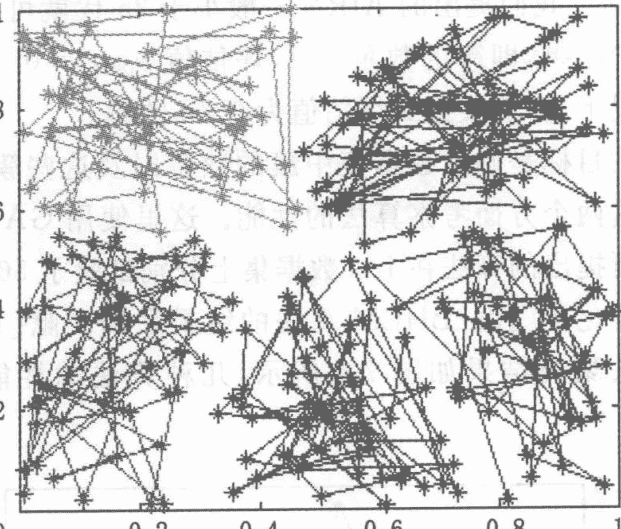

图 7-3 数据集一的实验结果

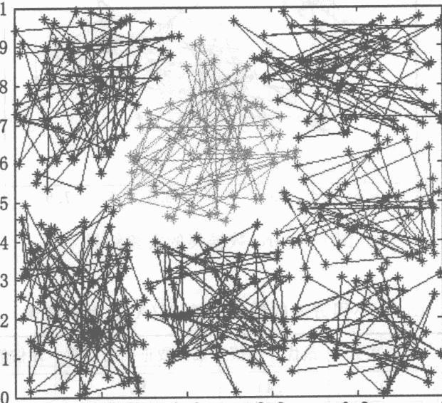

图 7-4 数据集二的实验结果


种群规模为 16。我们提出的 AIRN 一般小于 25 代就可获得与文献 [13] 提供的结果，即簇的数量为 2，评估值 v_DB,22 = 0.46。实验中有些数据情况下，算法收敛到评估值为 0.44 的解。

聚类的目标是确定数据集中簇的数量以及这些簇的位置，因此可以从这两个方面考察算法的性能。这里使用 GA[14]，aiNet[8] 以及我们所提出的算法在 Iris 数据集上分别试验了 50 次，实验中遗传算法演化 40 代。BHCM 算法的结果采用文献 [13] 中的值。提出的算法聚类结果如图 7-5 所示，几种算法的性能比较见表 7-2。

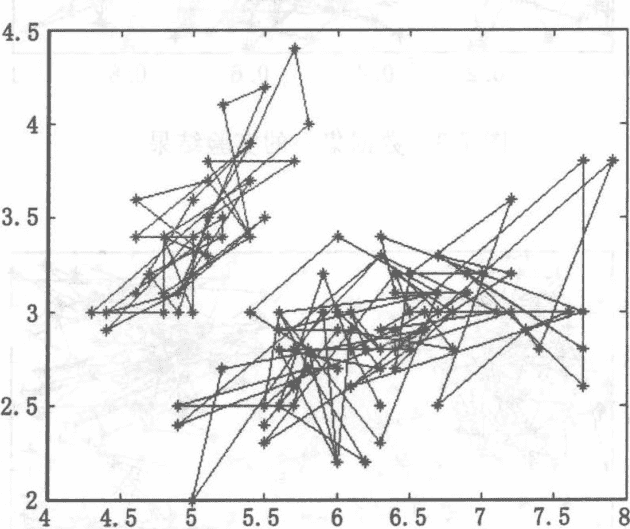

#### 图 7-5 Iris 数据集的实验结果

#### 表 7-2 Iris 上不同方法的性能比较(N/A:文献未提供)

| 实验方法 | 实验次数 | 最优评估值 | 聚类数正确的次数 | 评估值最优的次数 |
|---|---|---|---|---|
| AIRN | 50 | 0.44 | 50 | 49 |
| GA | 50 | 0.44 | 22 | 17 |
| aiNet | 50 | 0.44 | 50 | 20 |
| BHCM | N/A | 0.46 | N/A | N/A |

表 7-2 中的实验结果说明，直接使用 GA 尽管可以获得最优评估值，由于其搜索空间大，因此收敛到最优评估值的概率较低。BHCM 算法通过尝试所有可能的取值来发现最优聚类数，由于直接使用 K-means 方法，没能发现最优评估值。aiNet 方法存在收敛到最优评估值的概率低的问题，即偏离理想聚类中心集[15]。

### 7.4.3 数据聚类的 AIRN 与 FCM 方法比较

在目前已有的多种聚类算法[15]中，有 K-均值聚类算法、模糊 C-均值聚类算法、Growing Cell Structures Networks, Kohonen 神经网络、模糊神经网络等。其中模糊 C-均值聚类算法简单，应用广泛。利用免疫理论中的克隆选择、亲和力成熟和免疫网络理论构建的 AIRN 可以作为一种聚类方法。下面对这两种聚类方法进行比较分析。

#### (1) 模糊 C-均值聚类算法(FCM)

由 J. C. Bezdek 提出的 FCM 算法[17]基本思想是：将 $n$ 个向量分成 $c$ 个模糊组，通过不断地调整每组的聚类中心，使得非相似性指标的目标函数达到最小。假设 $F=\{x_1, x_2, \cdots, x_n\} \subset R^n$ 是 $n$ 维模式空间的一个特征向量集，根据某种相似性度量，该集合被聚合成 $c$ 个子集：$X_1, X_2, \cdots, X_c \quad (2 < c < n)$，这 $c$ 个子集组成特征向量集 $F$ 的一个模糊划分：用模糊隶属度矩阵 $U=[u_{ij}] \in R^{c \times n}$ 表示，$U$ 中的元素 $u_{ij}$ 表示第 $j (j=1, 2, \cdots, n)$ 个数据点属于第 $i (i=1, 2, \cdots, c)$ 子集的隶属度，$u_{ij}$ 应满足下列条件：

$$
\sum_{i=1}^{c} u_{ij} = 1 \quad \forall j = 1, 2, \cdots, n
$$

$$
u_{ij} \in [0, 1]
$$

$$
\sum_{j=1}^{n} u_{ij} > 0 \quad \forall i = 1, 2, \cdots, c
$$

令 $V=\{v_1, v_2, \cdots, v_c\} \subset R^n$ 是聚类中心，其中 $v_i \in R^n$ 是子集 $X_i(1 \leqslant i \leqslant c)$ 的中心，$d_{ij}$ 表示特征向量 $x_j$ 到聚类中心 $v_i$ 的距离，则 FCM 的目标函数表示为 $J_m(U,V)$：

$$
J_m(U,V) = \sum_{i=1}^c \sum_{j=1}^n u_{ij}^m d_{ij}^2 \quad (7-20)
$$

$J_m(U,V)$ 为每个数据点到相应的聚类中心的加权距离平均和。$J_m(U, V)$ 取得极小值的必要条件为：

$$
v_i = \frac{\sum_{k=1}^n (u_{ik})^m x_k}{\sum_{k=1}^n (u_{ik})^m} \quad i = 1,2,\cdots,c \quad (7-21)
$$

$$
u_{ik} = \frac{1}{\sum_{k=1}^n (d_{ik}/d_{jk})^{1/(m-1)}} \quad i = 1,2,\cdots,c;k = 1,2,\cdots,n \quad (7-22)
$$

因此，给定初始 $U,V$，通过迭代，式 (7-21)、式 (7-22) 不断调整聚类中心 $V$，最终获得满足要求的解。

#### (2) AIRN 与 FCM 方法比较

从分析看，二者都可以较好地解决聚类分析问题，并且聚类的结果都是对各个模式类的聚类的描述；都采用无监督学习机制，即能自组织地完成聚类过程，不需要先验知识的指导。

FCM 算法有三个需要人为设定的参数：
- 模糊加权指数 $m$，$m$ 是一个模糊加权指数 ($m \in [1, \infty]$)，用来控制隶属矩阵的模糊程度，难做定量分析，具体使用时需要经过实验取得最佳，Bezdek 给出过一个经验范围 $1.1 \leqslant m \leqslant 5$；
- 初始聚类中心，选择决定算法的性能，给定的初始聚类中心如果无代表性，容易导致算法陷入局部最优解；
- 算法需要指定聚类的簇的数目，在面对大量需要分析的繁杂数据时，簇的数目由人为的给定会很牵强。

如果上述的三个参数给定后，FCM 就可以给出精确的聚类中心。当潜在的类或簇呈凸集分布时，算法表现出良好性能，当潜在的类或簇背离凸集分布时，算法不能给出正确结果，有待进一步的改进。

自适应免疫应答网络（AIRN）在聚类前也有需要用户给定的参数：初始随机抗体、抗体所受到的刺激值 $sl$ 的系数 $k_d$、抗原对抗体抑制阈值 $T_d$ 系数 $k_d$、抗体之间的抑制阈值 $T_s$ 系数 $k_s$、亲和度成熟阈值 $T'_s$ 系数 $k'_s$。但这些阈值系数的给定都有明确的物理意义。可以用它们来控制网络的规模结构、粒度和网络的连接情况。其中最重要的参数抑制阈值，它控制最终网络结构、大小，高抑制阈值产生高度概括的抗体（簇代表）。给定参数后，AIRN 可以给出聚类簇数及每簇的数据代表，但不能给出精确的聚类中心。

由于提出的自适应免疫应答网络（AIRN）是通过抗体间的连接来构建的，当两个抗体之间的距离小于某一阈值，它们就建立连接，否则就不存在连接，所以在求解抗原模式的抗体进化过程中，可以识别任何形状模式的数据，避免了模糊聚类对非凸集分布数据的局限性。

利用自适应免疫应答网络（AIRN）来进行数据分析，尽管其所得结果数据的空间分布需要进一步分析，但它有许多特性是 FCM 算法不具备的，可以在数据划分和模式识别上收到良好效果。

## 7.5 小结

本章在建立的自适应免疫应答网络（AIRN）模型时，借鉴了如下免疫机理：免疫应答是生物免疫系统的重要特征，应答的实质是对抗原的识别、效应和记忆，免疫细胞不是孤立的个体，而是通过细胞间的相互激励和抑制作用，形成一种网络结构。

从简化的免疫应答和免疫网络假设出发，明确网络的数据分析目标，根据问题特点确定 AIRN 的抗原、抗体的形式，以及系统的构成，抗原对应于原始数据组；抗体对应于各模式类的特征值，在网络中表现为一个数据项；抗体通过相互作用构成的网络；网络训练后记忆细胞代表模式的类。

AIRN 构成规则为：网络由数据项组成，每个数据项包括一个数据值、一个刺激度值；网络中的数据项之间存在连接，两个数据项之间是否连接由两个数据项的相似度以及一个阈值确定，如果数据项之间的相似度大于阈值则连接，否则，就不连接；每一组互连的数据项所构成的子网络，就代表一个模式类；通过训练，网络最终达到一个稳定的结构，这个稳定的结构就是模式分析的结果。

本章中给出了 AIRN 具体的表示方式和构建的过程，定义了抗原提成时与网络结构相适应的刺激水平、克隆和变异的方式，设定了自适应的抗体、抗原抑制阈值和亲和度成熟阈值，并把构建的 AIRN 与自然免疫系统作了比较，分析讨论了 AIRN 的自适应性和收敛性。

将 AIRN 应用于聚类数据挖掘。用 KNN 方法对 AIRN 的记忆细胞进行模式分类，实现对抗原的聚类，实验显示网络具有良好的特性；AIRN 方法的聚类与 FCM 数据聚类挖掘方法相比，AIRN 的参数设置更加简单，在数据划分和模式识别上也收到良好效果。

# 参考文献

- [1] 林学颜，张玲. 现代细胞与分子免疫学[M]. 北京：科学出版社，1999.
- [2] JERNE N K. The immune system[J]. Scientific American,1973,229(1)：51-60.
- [3] HUNT J E, COOKE D E. Learning using an artificial immune system[J]. Journal of Network and Computer Applications,1996,19(2)：189-212.
- [4] TIMMIS J, NEAL M. A resource limited artificial immune system for data analysis[J]. Knowledge Based Systems,2001,14(3-4):121-130.
- [5] CASTRO D E, ZUBEN V. The Clonal Selection Algorithm with Engineering Applications [C]. (Full version. pre-print). In Proceedings of GECCO'00 (Workshop Proceedings):36-37.
- [6] WIERZCHON S, URSZULA KUZELEWSKA. Stable Clusters Formation in an Artificial Immune System[C]. In 1st International Conference on Artificial Immune Systems (ICARIS). University of Kent at Canterbury. UK. September 9th-11th,2002.
- [7] HART E, ROSS P. Exploiting the analogy between immunology and sparse distributed memories:a system for clustering non-stationary data [C]. In the proceedings of 1st International Conference on Artificial Immune Systems (ICARIS-2002). University of Kent at Canterbury. UK, September 9th-11th,2002.
- [8] CASTRO D E, ZUBEN V. An Evolutionary Immune Network for Data Clustering[C]. (Full version. pre-print). In Proceedings of the IEEE SBRN'00 (Brazilian Symposium on Artificial Neural Networks):84-89.
- [9] KNIGHT T, TIMMIS J. A Multi-Layered Immune Inspired Approach to Data Mining[C]. In Lotfi A. Garibaldi J and John R. editors. Proceedings of the 4th International Conference on Recent Advances in Soft Computing. pages 266-271. Nottingham. UK, December 2002.
- [10] STAWOMIR T, WIERZHHOI S, URSZULA KUZELEWSKA. Adaptive clusters formation in an Artificial Immune System [DB/OL]. http://neuro.bstu.by/our/stw_uk.pdf.
- [11] PERELSON A S, OSTER G F. Theoretical Studies of Clonal Selection; Minimal Antibody Repertoire Size and Reliability of Self-Nonself Discrimination [J]. Theor. Biol. ,1979(81):645-670.
- [12] BLAKE C L, MERZ C J. UCI Repository of Machine Learning Databases[DB/OL]. http://www.ics.uci.edu.
- [13] BEZDEK J, PAL N. Some New Indexes of Cluster Validity[J]. IEEE Transactions on Systems, Man and Cybernetics-Part B: Cybernetics, vol. 28 pp. 301-315, Jun 1998.
- [14] KROVI R. Genetic algorithms for clustering :a preliminary investigation System Sciences [A]. IEEE Proceedings of the Twenty-Fifth Hawaii International Conference on System Sciences[C] Hawaii; IEEE, 1992(4) ; 540-544.
- [15] 张文修. 遗传算法的数学基础[M]. 西安:西安交通大学出版社.
- [16] GRANZOW M, BERRAR D, Dubitzky W, et al. Tumor classification by gene expression profiling :Comparison and validation of five clustering methods [J]. ACM SIGBIO Newsletter,2001,21(1).
- [17] BEZDEK J C. Pattern recognition with objective function algorithms [M]. New York; Plenum, 1981:43-93.

# 第 8 章 基于免疫原理的煤矿决策支持系统

决策支持系统(DSS)是综合利用大量数据，有机组合众多模型，通过人机交互，辅助各级决策者实现科学决策的系统。基于免疫原理的煤矿决策支持系统，是利用人工免疫原理，进行推理和数据挖掘，从海量的矿山数据中挖掘和发现煤矿信息系统中内在的、有价值的信息、规律和知识，对煤矿企业的安全、生产、经营与管理发挥切实有效的预测和指导作用，以实现煤矿企业的科学决策。

## 8.1 决策支持系统(DSS)的发展

决策支持系统 DSS 是 20 世纪 80 年代迅速发展起来的新型计算机学科。它的功能是综合利用大量数据，有机组合众多模型（数学模型与数据处理模型等），通过人机交互，辅助各级决策者实现科学的决策。在系统结构方面，DSS 目前已发展为多库结构，运行于网络环境。面向对象、结构建模、数据仓库、联机分析处理和网络协议等概念的引入使 DSS 系统结构更趋于多样化。

### 8.1.1 传统 DSS 系统[1]

传统的决策支持系统中建立了数据库、模型库和知识库。数据大多是来源于企业经过长期积累的数据。数量庞大，以不同类型、形式存在，可能在数据收集中还会造成数据失真或破坏数据完整性。知识和模型来源于专家，库结构和内容固定，更新困难，人机界面过于专业化，难以适应分布范围广的用户的不同需求，混淆了知识发现者和决策者两类角色，数据处理能力较弱，不能为决策者提供未知的、没有想到的问题和答案。随着应用需求的不断扩大和复杂化，传统的 DSS 体系结构已无法适应决策支持系统的发展，有的问题是它自身无法解决或难以解决的，因此，必须对它加以修改并引入新的技术。

随着计算机网络技术的迅速发展，Client/Server 技术被用在 DSS 中。常见的结构是，系统将数据库和模型库集中放在服务器端，由用户通过客户端应用程序向服务器端提出决策所需的数据和知识要求，根据这些数据和相关知识，应用程序作出决策分析和预测，如图 8-1 所示。

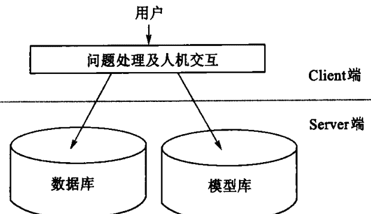

#### 图 8-1 基于 C/S 的传统 DSS 体系结构

这种体系结构在小型的企业有其灵活性，但随着网络负载的加重，服务器端性能的下降和客户端维护任务的增加，都严重影响系统的正常运转，必须采取更合适的新的结构。

### 8.1.2 数据仓库和数据挖掘支持的 DSS 系统[2]

数据仓库和数据挖掘是作为两种独立的信息技术（IT）出现的，它们都可以完成对决策过程的支持，相互之间有着一定的内在联系，因此把它们集成到一个系统中将更加有效地提高系统的决策能力。

通常决策支持系统主要以知识和模型为主体，结合大量数据，形成定性和定量相结合的辅助决策信息，它的知识和模型来源于专家。而数据仓库和数据挖掘技术的结合构成的一种新的决策支持结构，是从大量数据库中获取有用的信息和知识，它来源于数据库内部，将决策数据与决策知识结合起来成为决策信息，从而进一步提高了 DSS 的决策支持能力。在决策支持系统上增加数据仓库和数据挖掘的新型体系结构如图 8-2 所示，其共同基础是数据库，包括两个主体：一个主体是知识系统和模型库系统，为决策问题提供定性分析和定量分析相结合的辅助决策信息；另一个主体是数据仓库和数据挖掘，从数据库、数据仓库中提取有用的信息和知识，这些信息和知识反映了大量数据内在的规律和知识。

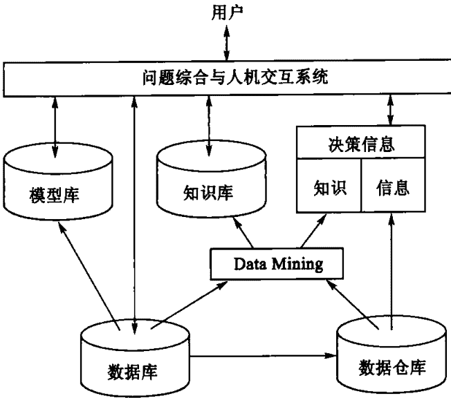

#### 图 8-2 DW 和 DM 支持的 DSS 体系结构

新型 DSS 不但克服了传统 DSS 系统的不足，而且会提高辅助

决策的功效，如果能与新的数据挖掘方法和智能推理方法结合，那么将会使 DSS 系统更加灵活，提供更多的辅助决策功能。

## 8.2 基于免疫原理的煤矿 DSS 系统框架

决策支持系统已被广泛地应用于各行业，煤炭企业也有很多成功应用 DSS 系统的先例[3]。在辽宁铁法煤业集团综合业务信息集成系统中，建立基于数据仓库和数据挖掘支持的 DSS 系统时，我们将人工免疫推理方法和人工免疫数据挖掘方法引入该系统，建立了基于免疫原理的推理系统和基于免疫原理的挖掘系统，实际应用证明运行良好，充分发挥了综合业务信息集成的数据优势，为管理层提供了有力的辅助决策信息。

基于免疫原理的决策支持系统主要是以知识、数据和模型为主体，结合人工免疫进行推理与数据挖掘，完成辅助决策的功能。

图 8-3 给出了基于免疫原理的决策支持系统研究框架。组成系统的有两个重要部分，即基于人工免疫的推理系统和基于人工免疫的数据挖掘系统。在煤矿集团企业中，无论是其日常生产，还是其经营活动，时常面临着决策，其中有很多决策问题是围绕着如何对某些事物进行综合评价，并根据评价结果制定相应策略，采取进一步的行动。如对井下安全环境的监测，对大型机器设备的在线故障分析。针对这类决策问题，人们往往需要根据有关的理论及经验制定出一系列的衡量标准，亦即建立一套多级指标体系，从不同角度、不同层次对事物进行综合评判，方能得出比较合理、完整的评价结果。这种利用多级指标体系对事物进行评价是一个非常复杂的非结构化决策过程，一般都是由内行专家根据一定的专业理论凭经验和直觉在收集大量不完全、不确定信息基础上建立起多级指标体系，运用多种知识，集成各类专家意见和建议，统筹安排、协调平衡，最终做出决策。但在这种多级指标体系中，各种指标之间的关系很难明确，而且还受评价者的效用标准和主观偏好所左右，受环境条件和个人认识能力的局限。因此，很难在指标体系和评价目标间建立起准确的定量或定性模型，而通常的规则推理也难以描述这一过程。因此，需要采用一种可处理不确定性、不完全性信息的评价方法以支持决策。因此，在决策支持系统中，利用人工免疫原理构造系统模型则是解决这类评价决策问题新的有效的方法。

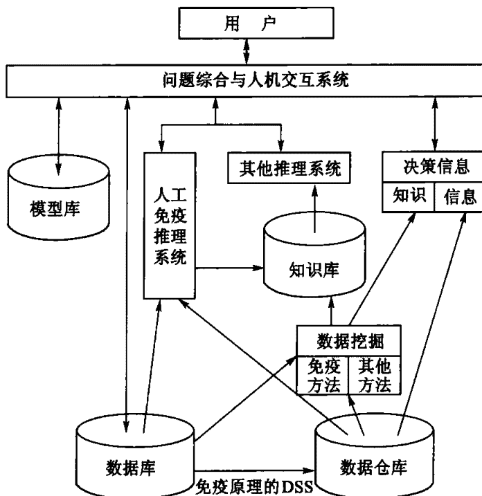

图 8-3 基于免疫原理的 DSS 体系结构

## 8.3 基于免疫原理的推理系统

DSS 中的推理从本质上来说，就是根据事物对象的特征，做出某种推断。推理系统把人类从复杂的推理过程中解脱出来，这已经在农业、医学、林业等许多方面得到广泛的运用。但现实世界纷繁复杂，DSS 推理系统中的知识库不可能包括所有的知识，因此推理系统的推理机尤显重要，模糊技术、神经网络和面向对象技术相融合，为 DSS 推理系统注入了新的活力，传统的 DSS 推理系统与面向对象、神经网络以及模糊技术相融合，大大提高了系统的智能性。利用人工免疫系统培育识别器的原理和方法，动态地更新推理机，从更新知识库出发，为 DSS 推理系统提供了一个新的模式。

### 8.3.1 推理系统组成与推理机[4]

一个推理系统包含了有关某个特定问题领域的专家知识，并且具有应用这些知识去解决该领域问题的能力。同时，推理系统还应具有自学习的能力，即从自身的成功与失败中获取经验。而一个实用的较为完整的推理系统有六个模块组成，即人机界面、推理机、解释模块、知识库、动态数据库和知识库管理系统。

所谓推理机，就是实现推理的程序，是使用知识库中的知识进行推理而解决问题的，所以推理机也就是专家的思维机制，即专家分析问题、解决问题方法的一种算法表示和机器实现，它是推理系统智能化的标志。随着外界环境的变化，推理机也应该动态发生变化。

### 8.3.2 免疫识别器的培养[5]

生物免疫系统的主要目标是识别（非我）non-self 和（自我）self。对于任意一个外来入侵，免疫系统应该能够识别它是属于哪一个集合。

从本质上看，免疫的识别问题实际上是一个建模问题。如果一个被识别对象集合为 S，这个集合的每一个元素应该属于 self 或 non-self 之一。但是两个集合的数目异常庞大，不可能得到任何一个集合的全集。免疫学家认为通过一个小的 self 的子集合，胸腺中训练出来的若干 B 细胞，识别一个相应范围的 non-self 集合，如图 8-4 所示。

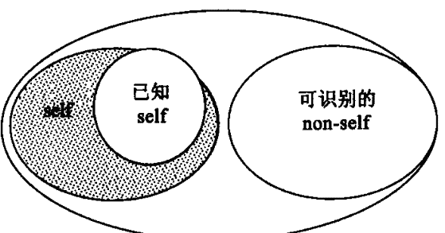

图 8-4 人工免疫的集合模型

人工免疫系统中识别器分为三种类型：不成熟识别器，成熟识别器和记忆识别器。识别器的生命周期经历随机产生、成熟培养、学习和死亡这四个阶段。流程如图 8-5 所示。

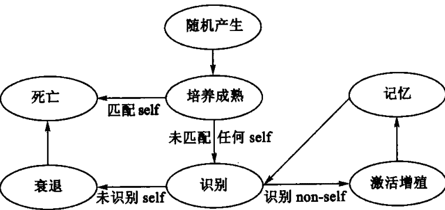

图 8-5 一个识别器的生命周期

这里把人工免疫系统的相关概念和培养识别器的方法引入到推理系统中。

### 8.3.3 动态克隆推理策略

为了描述问题的方便，参考文献[6]先将有关概念定义如下：

定义 8.1 推理规则：即推理系统中的推理机。

定义 8.2 不成熟推理规则：随机产生还没有转化为成熟推理规则的规则。

定义 8.3 成熟推理规则：不成熟推理规则经过训练达到某个期限还没有被淘汰的转化为成熟推理规则。

定义 8.4 记忆推理规则：成熟推理规则通过训练达到一定期限，再通过专家确认转化为记忆推理规则。

定义 8.5 检验事实：可以直接用来检验推理规则是否符合这个事实的事实集合。

举个例子说明这两个概念：比如一个医疗专家系统，推理规则就是计算机能够通过病人描述的病的特征，通过推理规则而得到病人得了什么病。有这样一个事实：肥胖的人容易得高血压。把“肥胖”这个特征输入到计算机，看计算机是否能得出容易得高血压这个事实从而证明推理规则对这个事实是否适用。

设定检验事实表示为一组特征属性的结合体，一个推理规则也表示为检验事实特征属性的一个可能的组合，规则对应于抗体，即识别器，检验事实则对应于抗原，动态克隆推理策略的推理过程就是免疫系统的识别器培养过程。在推理过程中，不成熟推理规则被产生后，经历成熟培养、学习和死亡，使识别器由不成熟到成熟，最后转变成为记忆推理规则。

根据人工免疫识别器的培养过程，动态克隆推理策略对规则的生成要考虑如下要求：

- (1) 如果某个不成熟推理规则被检验事实集合检验不正确，则删除这个不成熟推理规则；
- (2) 如果某个不成熟推理规则年龄达到了指定的年龄，即经过指定的迭代次数，在反向选择中没有被淘汰，则转化为成熟推理规则；
- (3) 如果某个成熟推理规则与检验事实集合的匹配成功次数达到了规则激活阈值，则通过专家的确认就可以转化为记忆推理规则；
- (4) 如果某个成熟推理规则年龄达到了指定的生存周期，也就是说经过指定的迭代次数，该推理规则匹配成功次数仍没能达到，则删除该成熟推理规则。

推理过程需要设定的几个参数：

- (1) 循环次数 N：从检验事实集合中选出的检验事实子集连续被使用的循环次数。在推理系统的循环中，一旦达到这个循环次数则系统重新选择新的检验事实子集。
- (2) 识别器的培养周期 T。一个不成熟推理规则成为成熟推理规则需要经历的培养代数（循环次数）。也就是说，当某个不成熟推理规则的年龄达到了这个值，它就可以成为成熟推理规则。
- (3) 规则激活阈值 A：一个成熟推理规则被激活所需要的匹配成功的次数。
- (4) 生存周期 L：即一个成熟推理规则存活的时间。

本章提出的动态克隆推理策略算法描述如下：

#### 8.3.3.1 初始化动态克隆更新算法

```
初始产生不成熟推理规则群；
循环代数=1； //初始化循环代数
DO
{if (循环代数 = N) then //选取的检验事实子集已经到了 N，
重新选取检验事实子集；
从一个已知的事实集合中选择一个新的检验事实子集合；
//重新设置参数
循环代数 = 循环代数 + 1；
不成熟推理规则年龄 = 不成熟推理规则年龄 + 1；
成熟推理规则年龄 = 成熟推理规则年龄 + 1；
记忆推理规则年龄 = 记忆推理规则年龄 + 1；
//监控检验事实子集
{

通过不成熟推理规则监控检验事实子集
检查是否不成熟推理规则能被任何检验事实所检验；
删除所有能被所有检验事实检验的不成熟推理规则；
生成新的成熟推理规则；

通过成熟推理规则监控检验事实子集
检查是否成熟推理规则能被任何检验事实所检验；
删除所有能被所有检验事实的成熟推理规则；
生成新的记忆推理规则；

通过记忆推理规则监控检验事实群子集
检查是否记忆推理规则能被任何检验事实所检验；
}

if(不成熟推理规则数 + 成熟推理规则数 < 非记忆推理规则
则总数)
then
//补充不成熟推理规则，保证非记忆推理规则总数不变
}

DO
生成一个随机推理规则，加入不成熟推理规则群子集；
}UNTIL(不成熟推理规则数 + 成熟推理规则数 = 非记忆推
理规则数);

} while (循环代数<N)
```

该算法适用于不确定性推理系统推理规则培养问题，目标在于培养记忆推理规则，进而实现知识库的自动更新。N 的取值越大，表示检验事实越多，如果一个推理机所作的推理能够被大量的事实检验是正确的，则这个推理机是优秀的。

### 8.3.4 基于免疫原理的推理方法分析

现有的推理系统是基于知识库而进行的推理，AIS 在推理系统中的运用使推理系统的智能化迈出了一大步，引入基于人工免疫系统培养识别器的理论来培养推理规则，在理论上得到了支持。从 AIS 的识别就是用有限的尽量少的识别器来覆盖尽可能多的 non-self，也即是用有限的知识去认识无限的世界，这就使得推理规则更加完善，增强了推理系统的鲁棒性、智能性。如果多个推理规则(一般选择奇数)同时使用，作为一个评判小组，继而得出综合评判的结果，大大避免了推理系统可能出现推理结果的片面性。

人工免疫推理系统可以利用其并行处理机制来解决传统推理方法中存在的“组合爆炸”、“无穷递归”等问题。在人工免疫系统中，计算与存储是完全合二为一的，即信息的存储体现在抗体互连的分布上，并以大规模并行方式处理。这种并行决不是简单地以空间复杂性代替时间复杂性，而是反映了完全不同的计算原理[7]。从数学观点来看，可以把人工免疫的推理看做是由大量子系统组成的大系统，系统的最终行为完全由它的吸引子决定。如果把动力系统的稳定吸引子看作为规则的记忆，那么初态向稳定吸引子流动的过程就是寻找成熟规则的过程。可以认为初态是给定有关规则记忆的部分信息，稳定吸引子流动的过程就是从部分信息找到全部信息的过程，最后形成成熟的推理规则。

## 8.4 基于免疫原理的数据挖掘系统

### 8.4.1 系统简介

在铁煤集团，建立了煤炭企业的综合业务信息集成数据仓库，在“历史数据”仓库中存入了大量数据，这些数据隐含了一些有价值的决策信息。利用这些信息我们可以实现预测分析、生产质量和效率评估以及辅助决策等功能。这就需要通过数据挖掘来实现。

由于每一种知识类型往往都有多种挖掘算法，不同算法适用于不同特性的数据集。在煤炭企业综合业务信息集成的决策支持系统中，除了提供常用的数据挖掘方法外，还专门利用人工免疫算法和人工免疫网络，实现了分类、聚类和关联规则的数据挖掘。

### 8.4.2 系统的体系结构

本章给出的基于人工免疫原理的数据挖掘系统实现了 KDD 的主要过程：数据可视分析，数据预处理[8]，数据挖掘，模型解释及模型评估等。

本系统的体系结构如图 8-6 所示。整个系统由数据可视分析、数据预处理、免疫数据挖掘和模型解释及评估等 4 个模块组成。

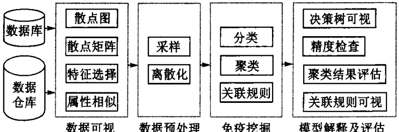

数据可视分析模块包括散点图、散点矩阵、特征选择和属性相似型分析等子模块，通过对数据进行可视分析，用于对数据进行缩减。

数据预处理模块包括离散化、采样等子模块，主要是对原始数据进行再加工，以便于从中提取知识。

数据挖掘模块包括基于人工免疫原理的分类、聚类和关联规则发现等子模块，用于完成从数据中提取出用户所需要的知识。

模型解释及评估模块包括分类精度检测和决策树可视、聚类结果评估和关联规则可视等子模块，模型解释及模型评估对发现的知识进行评价并表达为用户易于理解的形式。

### 8.4.3 数据挖掘模块

基于人工免疫原理的数据挖掘算法是整个数据挖掘系统的核心。因为不同的挖掘算法其应用领域及特点不尽相同，系统中提供了多种基于人工免疫原理的数据挖掘方法，供用户在数据挖掘时进行选择。

- (1) 聚类模块：聚类模块提供了不同的聚类算法，可供用户选择使用，以找到最佳的聚类结果。这里提供的聚类算法主要有基于人工免疫系统的聚类算法[9]、基于距离浓度的免疫聚类算法和基于自适应人工免疫应答网络的聚类算法。
- (2) 关联规则发现模块：关联规则发现模块是从数据库或数据仓库的数据集中发现隐含的关联规则。这里提供了基于距离浓度的免疫关联方法和基于改进的资源有限人工免疫网络关联挖掘方法。
- (3) 分类模块：分类模块对训练数据进行归纳，生成分类器，然后使用测试数据进行测试，最后把测试结果和分类器返回到模型可视模块。这里提供的分类方法有基于距离浓度的免疫分类方法和基于自适应人工免疫应答网络的分类方法等。

## 8.5 煤矿企业决策支持实例

### 8.5.1 井下工作面瓦斯涌出量分析

由于煤矿采掘工作面处于动态变化中，而影响瓦斯涌出量的地质条件、煤层瓦斯含量和开采强度等因素都处于不断的变化中，工作面瓦斯涌出量存在着非常大的不确定性。本章希望通过基于免疫的数据挖掘方法对工作面瓦斯涌出量进行分析，找出其与影响因素间的关联特性。

影响瓦斯涌出量因素很多，这里选择埋藏深度、煤层厚度、瓦斯含量、日进度、煤层间距、日产量等来对瓦斯涌出量进行分析。这些数据有些是通过实测得到，有些是可以计算得到。这是一个多属性关联分析问题，本章分析的瓦斯涌出量数据来源于铁煤集团晓青矿，时段为 2003 年 7 月 16 日 ~ 9 月 20 日，测点：01A01。记录有 1840 个，其中的 20 条记录见表 8-1。

#### (1) 数据的预处理

数据的预处理包含数据的清洗和数据的归一化处理。清洗去除不一致数据；为了防止具有较大值的属性相对于较小值的属性权重过大，将数据进行归一化处理，将数据库中以上的各属性值按比例缩放，使它们都落入[0,1]上。对表 8-1 中的 20 个记录归一化后生成表 8-2。

表 8-1 样本数据

| 序号 | 埋藏深度 /m | 煤层厚度 /m | 瓦斯含量 /m³ · t⁻¹ | 日进度 /m · d⁻¹ | 煤层间距 /m | 日产量 /t · d⁻¹ | 瓦斯涌出量 /m³ · min⁻¹ |
|---|---|---|---|---|---|---|---|
| 1 | 408 | 2.0 | 1.92 | 4.42 | 20 | 1 825 | 3.34 |
| 2 | 411 | 2.0 | 2.15 | 4.16 | 22 | 1 527 | 2.97 |
| 3 | 420 | 1.8 | 2.14 | 4.13 | 19 | 1 751 | 3.56 |
| 4 | 432 | 2.3 | 2.58 | 4.67 | 17 | 2 078 | 3.62 |
| 5 | 456 | 2.2 | 2.40 | 4.51 | 20 | 2 104 | 4.17 |
| 6 | 516 | 2.8 | 3.22 | 3.45 | 12 | 2 242 | 4.60 |
| 7 | 527 | 2.5 | 2.80 | 3.28 | 11 | 1 979 | 4.92 |
| 8 | 531 | 2.9 | 3.35 | 3.68 | 13 | 2 288 | 4.78 |
| 9 | 550 | 2.9 | 3.61 | 4.02 | 14 | 2 325 | 5.23 |
| 10 | 563 | 3.0 | 3.68 | 3.53 | 12 | 2 410 | 5.56 |
| 11 | 590 | 5.9 | 4.21 | 2.85 | 18 | 3 239 | 7.24 |
| 12 | 604 | 6.2 | 4.03 | 2.64 | 16 | 3 354 | 7.80 |
| 13 | 607 | 6.1 | 4.34 | 2.77 | 17 | 3 087 | 7.68 |
| 14 | 634 | 6.5 | 4.80 | 2.92 | 15 | 3 620 | 8.51 |
| 15 | 640 | 6.3 | 4.67 | 2.75 | 15 | 3 412 | 7.95 |
| 16 | 450 | 2.2 | 2.43 | 4.32 | 16 | 1 996 | 4.06 |
| 17 | 544 | 2.7 | 3.16 | 3.81 | 13 | 2 207 | 4.92 |
| 18 | 629 | 6.4 | 4.62 | 2.80 | 19 | 3 456 | 8.04 |
| 19 | 517 | 2.6 | 3.10 | 3.51 | 18 | 2 090 | 4.16 |
| 20 | 435 | 2.3 | 2.50 | 4.71 | 17 | 2 083 | 3.60 |

表 8-2 归一化后的样本数据

| 序号 | 埋藏深度 | 煤层厚度 | 瓦斯含量 | 日进度 | 煤层间距 | 日产量 | 瓦斯涌出量 |
| :--- | :--- | :--- | :--- | :--- | :--- | :--- | :--- |
| 1 | 0.3522 | 0.2868 | 0.3297 | 0.9002 | 0.8578 | 0.4245 | 0.3460 |
| 2 | 0.3602 | 0.2868 | 0.3802 | 0.8413 | 0.9559 | 0.3347 | 0.3021 |
| 3 | 0.3844 | 0.2574 | 0.3780 | 0.8345 | 0.8088 | 0.4022 | 0.3720 |
| 4 | 0.4167 | 0.3309 | 0.4747 | 0.9569 | 0.7108 | 0.5008 | 0.3791 |
| 5 | 0.4812 | 0.3162 | 0.4352 | 0.9206 | 0.8578 | 0.5086 | 0.4443 |
| 6 | 0.6425 | 0.4044 | 0.6154 | 0.6803 | 0.4657 | 0.5502 | 0.4952 |
| 7 | 0.6720 | 0.3603 | 0.5231 | 0.6417 | 0.4167 | 0.4709 | 0.5332 |
| 8 | 0.6828 | 0.4191 | 0.6440 | 0.7324 | 0.5147 | 0.5640 | 0.5166 |
| 9 | 0.7339 | 0.4191 | 0.7011 | 0.8095 | 0.5637 | 0.5752 | 0.5699 |
| 10 | 0.7688 | 0.4338 | 0.7165 | 0.6984 | 0.4657 | 0.6008 | 0.6090 |
| 11 | 0.8414 | 0.8603 | 0.8330 | 0.5442 | 0.7600 | 0.8506 | 0.8081 |
| 12 | 0.8790 | 0.9044 | 0.7934 | 0.4966 | 0.6618 | 0.8852 | 0.8744 |
| 13 | 0.8871 | 0.8897 | 0.8615 | 0.5261 | 0.7108 | 0.8048 | 0.8602 |
| 14 | 0.9597 | 0.9485 | 0.9626 | 0.5601 | 0.6127 | 0.9654 | 0.9585 |
| 15 | 0.9758 | 0.9191 | 0.9341 | 0.5215 | 0.6127 | 0.9027 | 0.8922 |
| 16 | 0.4651 | 0.3162 | 0.4418 | 0.8776 | 0.6618 | 0.4760 | 0.4312 |
| 17 | 0.7177 | 0.3897 | 0.6022 | 0.7619 | 0.5147 | 0.5396 | 0.5332 |
| 18 | 0.9462 | 0.9338 | 0.92308 | 0.5329 | 0.8088 | 0.9159 | 0.9028 |
| 19 | 0.6452 | 0.3750 | 0.5890 | 0.6939 | 0.7598 | 0.5044 | 0.4431 |
| 20 | 0.4247 | 0.3309 | 0.4571 | 0.9660 | 0.7108 | 0.5023 | 0.3768 |

#### (2) 特征属性的聚类

在挖掘数据集中蕴涵的特征属性之间的关联性之前，要先求出其优化的聚类个数，这里从瓦斯涌出量数据集中随机抽取 400 个记录，采用基于人工免疫原理的聚类算法，分别对埋藏深度、煤

埋藏深度、煤层厚度、瓦斯含量、日进度、煤层间距、日产量、瓦斯涌出量特征属性进行聚类，得到它们优化的特征属性聚类个数。这里采用基于距离浓度的免疫聚类算法(参看本书第 5 章第 3 节)得到的特征属性聚类个数见表 8-3。

| 埋藏深度 | 煤层厚度 | 瓦斯含量 | 日进度 | 煤层间距 | 日产量 | 瓦斯涌出量 |
|---|---|---|---|---|---|---|
| 6 | 7 | 7 | 4 | 5 | 6 | 3 |

由此将数据集中各记录的属性值分别划分到相应的类。如煤层厚度被分为 5 类 (类 1-5)，其中类 4 的区间为 [0.4856, 0.5767]，类 1 的区间为 [0.2510, 0.3016]，如果煤层厚度的值为 0.2574，则它应该归入类 1。对于表 8-2 的记录，经过特征属性的聚类，形成各记录属性的类别见表 8-4。其中瓦斯涌出量分为不突现、一般、突现三种情况。

#### 续表 8-4

| 序号 | 埋藏深度 | 煤层厚度 | 瓦斯含量 | 日进度 | 煤层间距 | 日产量 | 瓦斯涌出量 |
|---|---|---|---|---|---|---|---|
| 1 | 1 | 1 | 1 | 4 | 4 | 1 | 1 |
| 2 | 1 | 1 | 2 | 3 | 5 | 1 | 1 |
| 3 | 1 | 1 | 2 | 3 | 4 | 1 | 1 |
| 4 | 1 | 2 | 3 | 4 | 3 | 2 | 1 |
| 5 | 2 | 2 | 3 | 4 | 4 | 2 | 1 |
| 6 | 4 | 3 | 4 | 2 | 1 | 2 | 1 |
| 7 | 4 | 2 | 4 | 2 | 1 | 1 | 2 |
| 8 | 4 | 3 | 4 | 2 | 1 | 2 | 2 |
| 9 | 5 | 3 | 5 | 3 | 2 | 3 | 2 |
| 10 | 5 | 3 | 5 | 2 | 1 | 3 | 2 |
| 11 | 5 | 6 | 6 | 1 | 3 | 5 | 3 |
| 12 | 5 | 6 | 5 | 1 | 2 | 5 | 3 |
| 13 | 5 | 6 | 6 | 1 | 3 | 5 | 3 |
| 14 | 6 | 7 | 7 | 1 | 2 | 6 | 3 |
| 15 | 6 | 6 | 7 | 1 | 2 | 6 | 3 |
| 16 | 2 | 2 | 3 | 3 | 2 | 1 | 1 |
| 17 | 4 | 3 | 4 | 2 | 1 | 2 | 2 |
| 18 | 6 | 7 | 7 | 1 | 4 | 6 | 3 |
| 19 | 4 | 3 | 4 | 2 | 3 | 2 | 1 |
| 20 | 1 | 2 | 3 | 4 | 3 | 2 | 1 |

#### (3) 关联规则的挖掘

设要求解的关联规则为：“如果 X 是 A，则 Y 是 B”，其中，X={埋藏深度、煤层厚度、瓦斯含量、日进度、煤层间距、日产量}，Y={瓦斯涌出量}，A={A1，A2，A3，A4，A5，A6}，B={A7}，A1，A2，A3，A4，A5，A6，A7 分别表示埋藏深度、煤层厚度、瓦斯含量、日进度、煤层间距、日产量、瓦斯涌出量的属性值等级。采用基于人工免疫原理的关联挖掘方法，对瓦斯涌出量数据集进行挖掘，获得特征量埋藏深度、煤层厚度、瓦斯含量、日进度、煤层间距、日产量与瓦斯涌出量的关联规则。我们采用基于改进的资源有限人工免疫系统关联挖掘算法(参看本书第 5 章第 3 节)对瓦斯涌出量数据集进行挖掘，在给定最小支持度为 0.021，最小置信度为 0.41 情况下，获得的关联规则数据，对其中的两条规则解释如下：

埋藏深度 = 6 ∧ 煤层厚度 = 7 ∧ 瓦斯含量 = 7 ∧ 煤层间距 = 3 ∧ 日产量 = 5 → 瓦斯涌出量 = 3 (突现)；

埋藏深度 = 1 ∧ 煤层厚度 = 1 ∧ 瓦斯含量 = 2 ∧ 日进度 = 3 ∧ 煤层间距 = 4 ∧ 日产量 = 1 → 瓦斯涌出量 = 1 (不突现)。

在获得瓦斯涌出量关联规则后，便可对规则进行解释和评估，最后将确认的规则存于知识库或直接用于辅助决策。

### 8.5.2 矿井通风机故障监控

矿井主通风机是煤矿安全生产的关键性设备，常被称为煤矿的“四大件”之一，它的好坏直接关系到煤矿的安全生产。因此，需要对矿井通风机的运行状态进行在线检测并对故障进行预测。我们采用集散控制，对通风机的运行状态进行远程在线检测。通过远程在线数据采集积累了大量通风机故障时的振动信号和轴瓦温度等数据，这些数据为提高通风机的故障预报奠定了坚实的基础。通过对振动信号的提取，获取振动烈度、特征频率等数据，采用基于人工免疫原理的推理建立知识库，应用基于人工免疫原理的数据挖掘技术从大量的数据中挖掘出其内在的规律，找出有用的信息，通过把数据库、人工智能、可视化等技术相结合，提高了风机故障的预报率。

#### (1) 通风机故障特征向量的提取

在线检测获得通风机的振动等信号，需要对振动信号进行特征向量的提取。特征向量主要包括振动烈度、特征频率、常伴频率、相位特征、振动稳定性等。风机设备故障表现出的信号非常复杂，往往一种故障能有多种振动特征，或几种故障有相似的故障特征，这给故障诊断带来了一定的困难。但在实际检测中，只要设备出现故障，它的振动烈度一定是有变化的，可作为判断设备整体故障的依据，对于具体的故障原因，可从对不同的故障的振动特性和敏感参数来决定。对于旋转设备故障的振动特性，常用的有特征频率、常伴频率、振动稳定性、相位特征等，敏感参数常有振动随转速的变化、振动随负荷的变化、振动随风量的变化、振动随压力的变化等。

通过通风机故障特征向量的提取，在数据仓库中积累了大量的故障分析数据，为以后的故障检测奠定了基础。这里列出铁煤集团数据仓库中大隆矿通风机转子故障的部分记录如表 8-5 所列，已知通风机转子的转速是 900 r/min，它的输入回转频率为 90/60=16.5 Hz。按照烈度的 4 个等级(A,B,C,D)将测到的烈度值归类，把特征频率和常伴频率的记录值转化为通风机转子的输入回转频率倍数。这样得到表 8-6。

| ID | 振动烈度 | 特征频率/Hz | 常伴频率/Hz | 相位特征 | 振动稳定性 | 故障类型 |
|---|---|---|---|---|---|---|
| 1 | 2.2 | 16.5 | 0 | 稳定 | 稳定 | 转子不平衡 |
| 2 | 4.0 | 16.5 | 0 | 突变后稳定 | 突振后稳定 | 转子缺损 |
| 3 | 2.6 | 16.5 | 33.0 | 稳定 | 稳定 | 转子弯曲 |
| 4 | 2.8 | 16.5 | 0 | 稳定 | 稳定 | 转子热弯曲 |
| 5 | 3.0 | 33.0 | 33.0 | 变化 | 不稳定 | 转子裂纹 |
| 6 | 1.4 | 33.0 | 49.5 | 较稳定 | 稳定 | 转子不对中 |
| 7 | 4.4 | 33.0 | 16.5 | 稳定 | 不稳定 | 连续摩擦 |
| 8 | 2.3 | 7.25 | 16.5 | 稳定 | 较稳定 | 油膜振动 |
| 9 | 2.7 | 7.25 | 49.5 | 稳定 | 不稳定 | 油膜振动 |
| 10 | 4.1 | 33.0 | 16.5 | 稳定 | 稳定 | 转子不对中 |

#### 表 8-6 通风机转子系统故障记录转换

| ID | 振动烈度 | 特征频率/Hz | 常伴频率/Hz | 相位特征 | 振动稳定性 | 故障类型 |
|---|---|---|---|---|---|---|
| 1 | B | 1ω0 | 0 | 稳定 | 稳定 | 转子不平衡 |
| 2 | B | 1ω0 | 0 | 突变后稳定 | 突振后稳定 | 转子缺损 |
| 3 | B | 1ω0 | 2ω0 | 稳定 | 稳定 | 转子弯曲 |
| 4 | B | 1ω0 | 0 | 稳定 | 稳定 | 转子热弯曲 |
| 5 | B | 2ω0 | 2ω0 | 变化 | 不稳定 | 转子裂纹 |
| 6 | B | 2ω0 | 3ω0 | 较稳定 | 稳定 | 转子不对中 |
| 7 | C | 2ω0 | 1ω0 | 稳定 | 不稳定 | 连续摩擦 |
| 8 | B | ≤ω0/2 | 1ω0 | 稳定 | 较稳定 | 油膜振动 |
| 9 | B | ≤ω0/2 | 3ω0 | 稳定 | 不稳定 | 油膜振动 |
| 10 | B | 2ω0 | 1ω0 | 稳定 | 稳定 | 转子不对中 |

#### (2) 数据预处理

主要是对数据仓库中通风机故障的原始数据进行清除，去掉噪声，去掉冗余和不完全的信息。

#### (3) 知识库的形成

知识库的规则来源有三个方面：

- ① 原有的规则。

通过对通风机的实验分析，形成特征向量与主要的故障关系的规则信息，它为知识库的形成提供了原始的知识。

- ② 不确定性推理获得的规则。

- a. 利用获取的数据仓库数据，将通风机特征向量定义为条件属性，其故障类型定义为决策属性。将每一个条件属性和决策属性划分类别（见表 8-7）。

#### 表 8-7 通风机转子故障特征属性类别个数

| 振动烈度 | 特征频率 | 常伴频率 | 相位特征 | 振动稳定性 | 故障类型 |
|---|---|---|---|---|---|
| 4 | 7 | 6 | 4 | 3 | 14 |

对数据仓库中的记录进行属性级别归类。如对表 8-6 的数据归类后见表 8-8。

b. 将特征向量进行编码，构造规则表达式。设定集合 {A1, A2, A3, A4, A5, A6}，其中 A1, A2, A3, A4, A5, A6 分别表示振动烈度、特征频率、常伴频率、相位特征、振动稳定性、故障类别的编码。例如，特征频率有 7 类，A2 需要使用 3 位二进制编码，当 A2=011 时，表示特征频率为 2ω0。

#### 表 8-8 通风机出量样本数据类别

| ID | 振动烈度 | 特征频率 /Hz | 常伴频率 /Hz | 相位特征 | 振动稳定性 | 故障类型 |
|---|---|---|---|---|---|---|
| 1 | 1 | 2 | 1 | 1 | 1 | 1 |
| 2 | 1 | 2 | 1 | 3 | 3 | 2 |
| 3 | 1 | 2 | 3 | 1 | 1 | 3 |
| 4 | 1 | 2 | 1 | 1 | 1 | 4 |
| 5 | 1 | 3 | 3 | 4 | 4 | 5 |
| 6 | 1 | 3 | 4 | 2 | 1 | 6 |
| 7 | 2 | 3 | 2 | 1 | 4 | 7 |
| 8 | 1 | 1 | 2 | 1 | 2 | 8 |
| 9 | 1 | 1 | 4 | 1 | 4 | 8 |
| 10 | 1 | 3 | 2 | 1 | 1 | 6 |

c. 产生一个有任意推理规则组成的初始不成熟推理规则群，利用动态克隆推理策略产生成熟的推理规则。随即产生初始不成熟推理规则群 A = A1A2A3A4A5A6，在设定循环次数 N = 20，识别器的培养周期 T = 8，规则激活阈值 A = 5，生存周期 L = 10 后，获得的规则其中 3 条解释如下：

振动烈度 = B∧ 特征频率 = 2ω0 ∧ 常伴频率 = 1ω0 ∧ 相位特征 = 稳定 ∧ 振动稳定性 = 稳定 → 转子不对中；
振动烈度 = B∧ 特征频率 ≤ ω0/2 ∧ 常伴频率 = 1ω0 ∧ 相位特征 = 稳定 ∧ 振动稳定性 = 较稳定 → 油膜振动；
振动烈度 = B∧ 特征频率 = 超低频 ∧ 常伴频率 = 1ω0 ∧ 相位特征 = 稳定 ∧ 振动稳定性 = 不稳定 → 啸振。

d. 推理完成将成熟的推理规则输出给知识库。

③ 数据挖掘获取的规则。采用数据挖掘的方法对通风机的故障进行分类，则是在完成特征向量的历史数据获取、记录的属性级别归类后，定义特征集合 { A1，A2，A3，A4，A5 }，类别集合为 B，将 A = A1A2A3A4A5 作为抗体，采用基于免疫的分类算法对故障进行分类。

#### (4) 监测

监测主要是根据历史数据和知识库数据来判断通风机设备的状况。这也是规则匹配的过程，即从规则库中提取规则，与在线获得的通风机各条件属性进行比较来测试决策属性的值，从而判断通风机该时刻的运行状态。通过风机故障知识库的建立和数据挖掘技术的应用，实现了风机故障的在线监测，提高了系统运行的可靠性。

随着信息技术和计算机网络技术的发展，大型设备要求在安全、可靠的状态下尽可能长时间、满负荷运行，这对设备的远程监测和故障诊断提出了更高的要求。传统的设备监测与故障诊断，往往不能得到专家的现场指导，大型设备运行每时刻都产生大量的监测数据，单纯用人工诊断，很难胜任。因此，将数据挖掘技术引入远程故障诊断领域，建立基于数据挖掘技术的远程故障诊断系统，有效地实现了大型旋转设备故障的远程智能诊断，为设备的安全运行提供有效的保障。

## 8.6 小结

本章讨论了基于免疫原理的煤矿决策支持系统的建设。

在分析了决策支持系统的发展和体系结构特点的基础上，在基于数据仓库和数据挖掘支持的 DSS 体系结构框架下，提出了一种基于免疫原理的煤矿决策支持系统结构。这种 DSS 系统能充分适应煤炭企业实时性高的要求，数据处理性能比较优越，实现简单可行。

给出了基于免疫原理的推理系统。基于动态克隆推理策略的推理过程就是免疫系统的识别器培养过程。在这个过程中，不成熟推理规则被产生后，经历成熟培养、学习和死亡，使识别器由不成熟到成熟，最后转变成为记忆推理规则。免疫系统的识别就是用有限的尽量少的识别器来覆盖尽可能多的 non-self，基于这个原理的动态克隆推理策略增强了推理系统的鲁棒性、智能性。

设计了基于免疫原理的数据挖掘系统。基于人工免疫原理的数据挖掘算法是整个数据挖掘系统的核心。根据不同的挖掘算法其应用领域不尽相同的特点，在该系统中提供了基于免疫算法和基于人工免疫网络的不同数据挖掘方法。

利用基于免疫原理的数据挖掘方法和推理策略，对煤矿企业数据仓库中的数据进行决策分析。使用基于免疫的数据挖掘方法，通过对井下工作面瓦斯涌出量相关影响因数的聚类和关联挖掘，发现埋藏深度、煤层厚度、日产量等因数对瓦斯涌出量突现的影响；使用动态克隆推理策略对通风机故障进行推理分析，发现通风机的振动烈度、特征频率、常伴频率、相位特征、振动稳定性等与通风机故障类型的关系。这些井下工作面瓦斯涌出量突现规律和通风机故障特征规则，为煤矿企业的生产决策提供了可靠的依据。

# 参考文献

- [1] 李亚非,夏安邦. 基于数据仓库的 DSS 框架[J]. 南京建筑工程学院学报, 1998(4):57-61.
- [2] 徐常凯. 煤炭企业综合业务信息集成系统研究[D]. 徐州：中国矿业大学,2003.
- [3] 刘新亮,云庆夏. 数据仓库及其在矿业中的应用[J]. 中国铝业,2001(6):49-53.
- [4] 蔡自兴,徐光佑. 人工智能及其应用[M]. 北京：清华大学出版社,2002.
- [5] CASTRO D E,ZUBEN V. Artificial Immune Systems:Part I- Basic Theory and Applications[R/OL]. Technical Report-RT DCA 01/99. http://www.dca.fee.unicamp.br.
- [6] 刘海波，季卫华，吴泽俊. 基于免疫的专家系统动态克隆更新算法[J]. 计算机工程与应用,2003(36):867-871.
- [7] 莫宏伟. 人工免疫系统原理与应用[M]. 哈尔滨：哈尔滨工业大学出版社,2002.
- [8] 刘韬,王耀才,王致杰. 一种多数据源的数据仓库填充方案[J]. 计算机工程与设计,2005(2):1101-1105.
- [9] 刘韬,王耀才,王致杰. 一种基于人工免疫系统的聚类算法[J]. 计算机工程与应用,2005,40(19):182-184.

Document generated by Anna's Archive around 2023-2024 as part of the DuXiu collection (https://annas-blog.org/duxiu-exclusive.html).

Images have been losslessly embedded. Information about the original file can be found in PDF attachments. Some stats (more in the PDF attachments):

```
{
"filename": "5Lq65bel5YWN55ar57O757uf5Y+K5YW25pWw5o2u5oyW5o6Y5bqU55So56CU56m2XzEyNTEyNDA1LnppcA==",
"filename_decoded":
"u4eba\u5de5\u514d\u7535\u5b50\u7cfb\u7edf\u5c1a\u5165\u796d\u5c14\u548c\u5b9e\u8c03\uff0c\u4e3b\u8981\u5728\u7ea2\u84dd\u6311\u6210\u529b\u8bb2\u52a1\u987a\u4efb\u7f16\u5199\uff0c\u53d8\u4e3a\u4e0d\u8010\u4e4b\u5b66\uff0c\u5427\uff0c\u4e3a\u4e86\u7acb\u4e3e\u4e3e\u4e0d\u5426\u7740\u8bbe\u5907\u7684\u6559\u80b2\u671f\u4e00",
"filesize": 17000977,
"md5": "5c4701e5e201e212a221a011e2aa201e",
"header_md5": "14a988b58b2d589dbe7e9f3a91b3ec16",
"sha1": "314545d810e5246982a5e2cf0fd9cd58037b04d15",
"sha256": "4bf8ed1c38065f2770e366b181e0fb174882957aeb378aa5f104cb24108b3e2d",
"crc32": 3583607513,
"zip_password": "",
"uncompressed_size": 16891935,
"pdg_dir_name": "\\u255a\\u2566\\u2563\u00f1\\u2551\\u00393\\u2565\\u2580\\u2567\\u2561\\u2550\\u2502\\u255d\\u2559\\u255e\\u03a33\\u2569\\u00b2\\u255b\\u255b\\u2265\\u2550\\u255b\\u2265\\u2559\\u00aa\\u2559\\u2551\\u2564\\u2568\\u255b\\u2510_12512405",
"pdg_main_pages": 227,
"pdg_main_pages_max": 227,
"total_pages": 237,
"total_pixels": 874935744,
"pdf_generation_missing_pages": false
}
```
