# 人工免疫系统及其数据挖掘应用研究

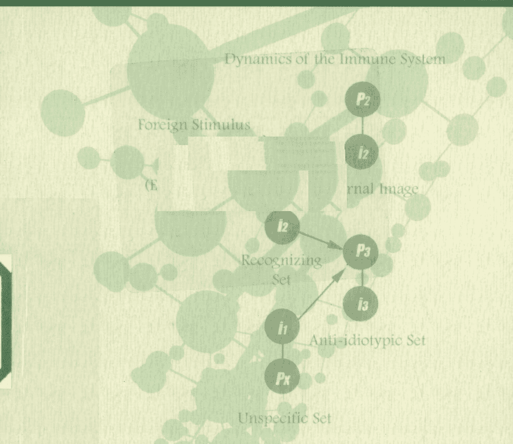

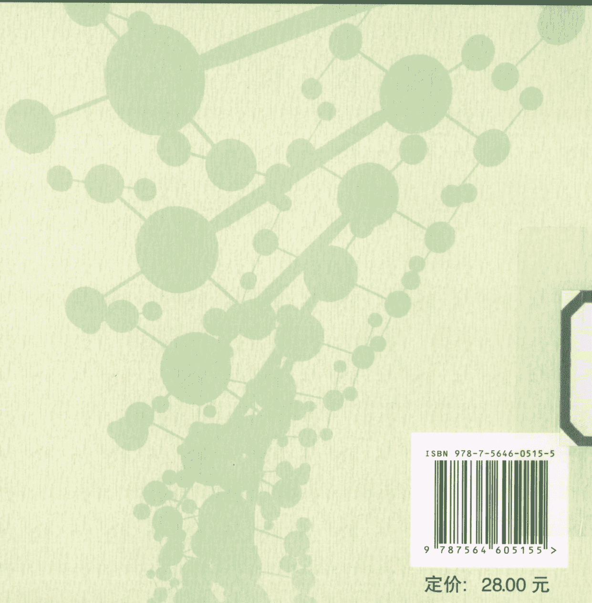

# 内容梗概

本书系作者在人工免疫系统及其数据挖掘应用领域多年研究成果的集大成之作。开篇剖析生物免疫学机理，立足信息处理视角，构建人工免疫系统基本框架与数据挖掘基础范式；深度解析基于距离浓度的免疫算法（DCAIA）及其在分类、关联规则、聚类挖掘中的实战部署；改良资源受限人工免疫系统模型并配套关联规则挖掘算法；创新设计自适应免疫应答网络（AIRN）及其聚类算法；最终落地构建基于免疫原理的决策支持系统，并实证于煤炭生产决策场景。

本书既可供计算机、信息学、人工智能、自动化等领域的专业技术人员参考研习，亦适合作为相关专业研究生及高年级本科生的教学用书。

# 前言

免疫系统乃生物体的核心子系统之一，它通过抗体多样性编织起“自身”与“非自身”的非线性识别网络，在动态环境中守护机体健康。免疫系统无中心控制器，依靠循环往复的分散免疫细胞群协同运作，实现自我/非我识别、清除异抗原及免疫记忆。从信息处理维度审视，它是一个并行分布式的自适应系统，兼具认知、特征提取、多样性保持、学习与记忆等核心特质。人工免疫系统（AIS）正是源于对生物免疫原理与机制的仿生、借鉴与工程化，涵盖信息处理技术、计算技术及其衍生的智能系统集合。深化AIS理论与应用研究，兼具理论深度与实践价值。数据挖掘（KDD）旨在从海量数据中发掘隐性知识，引入AIS可拓展挖掘方法论体系，提升挖掘效能。同时，基于免疫原理的挖掘与推理策略，将为决策支持系统（DSS）注入新技术动能。

本书聚焦AIS及其在数据挖掘领域的应用，涵盖免疫算法/网络模型设计、免疫挖掘方法与推理机制探讨，并推进工程落地，共八章编排：第1章绪论，阐释研究缘起与意义；第2章解析生物免疫系统组成、机理与特性；第3章综述现有AIS与挖掘方法，提炼AIS信息处理框架与挖掘基本范式；第4章针对现有算法不足，创设距离浓度免疫算法（DCAIA），给出收敛性证明，实验对标遗传算法与传统免疫算法验证优势；第5章基于DCAIA推导聚类、关联、分类三大挖掘方法，实证可行性；第6章改良资源受限AIS模型，设计配套关联规则挖掘算法；第7章融合免疫应答机理与网络理论，构建自适应免疫应答网络（AIRN），详述表征、构建、自适应性与收敛性分析，应用于聚类分析，在数据划分与模式识别中表现优异；第8章依托数据仓库与挖掘支撑的DSS架构，建立免疫原理决策支持模型，阐释动态克隆推理策略，剖析推理系统特质，设计免疫挖掘系统模型，实战解决煤矿瓦斯数据挖掘与通风机故障诊断，服务煤炭生产决策。

本书凝聚作者在江苏省现代企业信息化应用支撑软件工程技术研发中心的研究心血，承蒙国家博士后科学基金（20060390326）、国家自然科学基金（60970058）、江苏省自然科学基金（BK2009131）、江苏省现代企业信息化应用支撑软件工程技术研发中心开放基金（eisecSX200806）、江苏省青蓝工程及福建省科技基金（2008F5046）等项目资助，尤其在距离浓度免疫算法及其挖掘应用上取得深入进展。

撰写过程中广泛参阅文献，力求引用准确；受限篇幅与疏漏，参考文献难免不全，恳请原著者海涵。若有谬误，欢迎邮件指正（banklt@163.com），不胜感激。

作者水平有限，疏漏在所难免，诚盼读者批评指正。

刘韬

江苏省现代企业信息化应用支撑软件工程技术研发中心

2009年7月

# 第1章 绪论

## 1.1 选题缘起与研究价值

生物体在动态博弈环境中展现出的卓越学习与问题求解能力，持续激发人类科技创新。数十年来，仿生学方法与理论层出不穷。信息领域公认的四大仿生子系统——脑神经、遗传、免疫、内分泌系统中，免疫与内分泌系统已证实具高阶信息处理潜能，逐成研究新宠。近年，人工免疫系统（AIS）研究爆发式增长，继模糊逻辑、神经网络、遗传算法后，成为智能系统又一研究高地[1~4]。基于免疫原理的模型与算法已渗透自动控制[5]、故障诊断[6~8]、优化计算[9~11]、模式识别[12]、机器学习[13,14]、数据分析[15~18]等众多领域。

AIS旨在研究、借鉴、利用生物免疫原理与机制，发展信息处理、计算技术及其工程科学应用所产生的智能系统统称[19]。生物免疫系统结构精微、功能独特：无中央控制器，由循环分布的免疫细胞群自组织而成，执行自我/非我识别、异抗原清除与记忆。从信息处理视角，它是并行分布式自适应系统，具备认知、特征提取、多样性、学习与记忆等特质[2]。虽医学免疫学实验与非线性理论研究有所建树，但AIS理论及工程应用仍处萌芽期。挖掘免疫系统优良特性与机理，可催生新理论、新思想、新方法，破解日益复杂的工程难题。特别是强化免疫机制在信息处理系统中的理论应用，能显著提升智能化处理水平。例如，免疫系统可高效构建具备特征提取、快速进化、学习记忆特质的模式识别分类器/探测器，恰逢工程实践之需。故而，深化AIS理论与应用研究，既重大且必要，其在人工智能计算蕴含巨大潜能。

信息技术飞驰演进，数据积累呈爆发式增长，然挖掘隐性知识的手段严重滞后，导致“数据富矿、知识贫矿”困境。计算机科学另一支流——人工智能（AI）自20世纪60年代诞生以来长足进步，当前聚焦机器学习（模拟人类学习过程）。机器学习与数据分析结合，催生数据挖掘（KDD）——即从海量数据中发掘隐性知识的有效手段。其旨在协助决策者发掘数据内在关联、发现新模式[20]。数据挖掘本质是交叉学科，融汇机器学习、模式识别、统计学、智能数据库、知识获取、可视化、高性能计算、专家系统等，成果广泛服务于信息管理、过程控制、科研决策等。

数据挖掘旨在助力决策者捕捉数据潜在关联与模式特征，而生物免疫系统的特征提取、快速进化、学习记忆等特质，正是数据挖掘孜孜以求的核心能力。因此，推进AIS在数据挖掘领域的应用研究，能丰富方法论、拓展理论、提炼高效技术、攻坚挖掘任务。

此外，90年代以来，信息技术推动新决策理论层出，特别是数据挖掘与智能推理技术驱动决策支持系统（DSS）跨越式发展。研究基于免疫原理的挖掘与推理策略，必将为DSS注入创新技术与方法。

## 1.2 人工免疫系统及其应用研究综述

### 1.2.1 人工免疫算法与网络模型

随着对生物免疫认知深化，系列AIS模型应运而生，解决复杂工程问题。大致可分为免疫算法、免疫网络及基于网络的框架模型三类。

#### 1.2.1.1 免疫算法

人工免疫算法（AIA）源于免疫学理论与观测功能的启发式计算方法。研究肇始于80年代中期免疫学研究。1990年，H. Bersini等[21]首用免疫算法求解问题。世纪末，D. Dasgupta与S. Forrest[22]引入计算机安全，D. E. Cooke等[23]拓展至机器学习。生物免疫系统的信息处理潜能对计算技术启示深远。97年国际人工免疫学研究兴起后，国内外学者涌现诸多免疫算法[24~26]，主流类型如下：

- **(1) 阴性选择算法**：S. Forrest等[27]仿生阴性选择原理构建异常检测算法，两步走：生成与受保护数据不匹配的监测器集；持续比对，匹配即判定数据变更。P. D’haeseleer等[28]基于部分匹配规则优化监测数据变更算法。
- **(2) 免疫遗传算法**：J. S. Chun等[9]实质为改良遗传算法，沿用选择/交叉/变异算子，但在群体搜索策略、解编码、记忆单元设置上差异化创新。
- **(3) 免疫学习算法**：J. D. Farmer等[29]首探免疫学习特性，揭示其分类器系统本质。J. E. Hunt等[13]基于免疫网络理论给出有监督机器学习算法。Y. Ishida[31]构建基于PDP模型的免疫学习算法，应用故障诊断。
- **(4) 克隆选择算法**：D. E. Castro等[32]仿生克隆选择理论，设计模拟免疫学习进化的克隆选择算法。
- **(5) 基于疫苗的免疫算法**：焦李成等[24]借疫苗机理构建免疫算法。
- **(6) 基于免疫网络的免疫算法**：N. Toma等[33]融合MHC与免疫网络理论，构建自适应优化免疫算法，解决多智能体工作域分配。

因仿生应用探索尚早，现有算法针对性强、适用面窄、考量不全，设计上仍有大幅提升空间。

#### 1.2.1.2 人工免疫网络模型

N. K. Jerne的独特型网络模型[34]及诸多免疫网络学说[35]为人工免疫网络建模提供蓝本。总体而言，此类模型将系统视为淋巴细胞节点构成的网络，通过节点间信息传递与交互实现识别、效应、记忆等功能。

研究中，A. Ishiguro等[36]提出互联耦合免疫网络——由执行特定任务的局部网络通信组成大规模网络，应用于机器人歩行控制与路径规划。Z. Yamaguchi等[37]创设多值免疫网络，字符识别实证其在模式记忆、容量、抗噪性上优于二值网络。D. E. Castro等[38]建立抗体网络模型AB-NET，核心为基于克隆选择的网络生成算法，用于抗原识别。F. T. Vertosick与R. H. Kelly[39]基于并行分布处理理论，提出PDP免疫网络作为神经网络搜索替代方案。

这些模型从不同侧面借力免疫机理解决工程问题，推动AIS发展，但多针对特定问题定制，泛化受限。随研究深入，学者致力开发新网络模型与以网络结构为核心的框架模型。下节将结合数据挖掘应用进一步阐述。

### 1.2.2 基于人工免疫原理的数据挖掘综述

近年来，仿生免疫模型与算法广泛服务于科研与工程。得益于免疫系统强大防御力，AIS在信息安全[40,41]大放异彩；识别能力推动模式识别[14,42,43]进展；作为智能优化搜索策略，在函数/组合优化、调度等领域成效显著；机器人学、故障诊断[31,36,44,45]应用彰显智能涌现与群体智能。

AIS作为新兴智能系统，已引入数据挖掘领域，承担分类、聚类、数据浓缩等任务，挖掘对象涵盖数据库、Web页面等。

#### 1.2.2.1 基于免疫原理的分类

J. D. Farmer等[29]最早论证分类器与独特型免疫网络相似性，从动力学视角研究免疫模式识别本质，奠定AIS数据挖掘理论基石。S. Forrest等[47]构建免疫学习与模式识别模型，以检测器表示法评估其在噪声数据中捕捉模式与维持多样性的能力。J. E. Hunt与D. E. Cooke[13]采用突现适应度共享遗传算法发现数据模型，证实AIS视角下从正例学习的可行性。

J. H. Carter的Immuno-81[12]为基于免疫原理的监督学习算法，模拟B/T细胞特性及初/二次免疫应答交互机制。实测冠心病数据分类，性能优于主流机器学习算法。

M. A. Potter等[41]用协同进化遗传算法AIS模型进化抗体用于概念学习，在人工数据与议会投票记录分类测试中表现优异。

Andrew Watkins等[48]受资源有限人工免疫系统（RLAIS）[17]启发，提出资源有限人工免疫分类器AIRS——主流免疫监督学习方法。AIRS模拟B细胞交互机制，抗原初始化为特征向量，训练期呈递系统。B细胞与抗原均表征为向量Vi=(vi1,...,vir;c)，vij为属性特征，c为类别。同类B细胞聚合为ARBs（人工识别球）。

#### 1.2.2.2 基于免疫原理的聚类

聚类属无监督学习，学者探索免疫聚类方法。J. E. Hunt与J. Timmis等[14]开发Jisys系统用于抵押贷款欺诈诊断聚类，D. E. Castro与J. Timmis[49]在Iris标准数据集上验证有效。C. Hung等[50]实现带记忆细胞的AIS模型，适配大规模动态系统聚类。但在土壤湿度遥感海量数据应用中，表现逊于其他分类器，归因于数据表征机制与匹配算法选择不足。

J. Timmis与M. Neal等[51]对比单连接聚类、Kohonen网络与AIS三种技术，在标准测试集上识别信息聚类。前两者属传统聚类技术，而AIS不仅提供聚类分析，还能给出多样化数据表征，助力用户全景理解数据构成，推进挖掘分析流程。

# 仿免疫算法在聚类任务中的演进路线图：从资源竞争到自组织涌现

借鉴生物防御机理，仿生智能计算在模式识别与归类任务中展现出独到潜力。本文回顾该技术路线从萌芽至成熟的核心模型迭代历程。

## 奠基模型溯源

**RLAIS：首创资源配额博弈机制**  
Timmis 与 Neal 依据网络免疫学说，建立了受限资源仿免疫框架（RLAIS）[17, 49]。该框架核心在于“资源配额”设定：利用抗体识别球（ARB）聚合同质 B 细胞。面对呈递抗原（即数据样本），各细胞按激活度角逐稀缺资源；超额占用者将被清退，扣减顺序遵循激活度从低到高，直到总额回落阈值。这种内生竞争形成天然淘汰压力，筛选出高适配度细胞，经增殖突变与图形化输出最终归类结构。后续工作[52]改用实值向量编码抗体/抗原，推出无监督学习流程，增强了解析与可视化效能。

**aiNet：融合拓扑结构实现自动切分**  
Castro 与 Zuben 聚焦克隆增殖机理，先后给出克隆筛选算法[43] 与 aiNet 网络模型[53]。后者融合最小生成树（MST）拓扑，借图论手段自动切分网络簇群。双螺旋、链式拓扑等测试集实验证实了其在复杂分布下的有效性[1, 49]。

**SOSDM：耦合稀疏记忆与协同进化**  
Hart 与 Ross 引入稀疏分布式记忆（SDM）范式，构建 SOSDM 架构[54]。此模型将抗原映射为数据片段，抗体刻画簇特征，同类抗体聚合的“激活球”划定归类边界。借协同进化遗传算法（GA）迭代抗体种群，系统可高效捕捉动态数据集的最优划分。

## 关键改进与变体拓展

**模糊免疫框架：抗噪与动态建模并重**  
Gonzalez 团队引入模糊隶属度函数强化 B 细胞表达[55]，不仅细化簇内亚区描绘，更赋予抗噪稳健性，支持参数的动态区间估计。

**自稳态框架（SSAIS）：抑制网络发散震荡**  
Neal 设计自稳态框架 SSAIS[56]，消除早期网络易发的失控波动，确立平稳拓扑，适配时序演变数据的归类需求。

**双模融合策略：去除外部图论依赖**  
Wierzhon 与 Kuzelewska 融合双方优势[57]：沿用 RLAIS 的 NAT 参数设定，发挥自组织机制直接产出簇结构，省却了 aiNet 依赖图论后处理的环节。

**二进制编码范式：线性复杂度支撑增量流**  
Hart 与 Ross 挖掘免疫原理与 SDM 的同构映射[58]，创新采用位串编码簇模式。得益于线性时间复杂度，该法天然适配增量流式数据，大幅提升规模适应性。

**SAICA：动态自组织涌现的集大成者**  
Gonzalez 等针对前代不足深度重构，发布 SAICA[59]。该算法充分挖掘网络动态适应与亚动力学特性，实现稳定簇模式的完全自组织涌现。

## 现状总结与前瞻

综述可见，仿免疫范式在分类与归类等核心任务上成果丰硕，但文献[60, 61]指出，其在关联挖掘、离群检测、维度约简等维度仍待开发。未来延拓免疫计算于全流程挖掘的适用边界，极具探索价值。

---

# 参考文献

参考来源：[1] Castro 与 Zuben, 技术报告, 1999; [2] Dasgupta, 专著, 1999; [3] Dasgupta, 会议论文, 1997; [4] 丁永生等, 期刊, 2000; [5] Renders 与 Hanus, 会议, 1992; [6] Ishiguro等, 会议, 1994; [7] Watanabe等, 会议, 1998; [8] Ishida 与 Adachi, 期刊, 1993; [9] Chun等, 期刊, 1997; [10] Chun等, 期刊, 1999; [11] Endoh等, 会议, 1998; [12] Carter, 期刊, 2000; [13] Hunt 与 Cooke, 期刊, 1996; [14] Hunt等, 书籍章节, 1999; [15] Bentley等, 会议, 2001; [16] Dasgupta等, 会议, 2003; [17] Timmis 与 Neal, 期刊, 2001; [18] Timmis 与 Knight, 书籍章节, 2001; [19] Dasgupta 与 Okine, 会议, 1997; [20] Han 与 Kamber, 专著, 2000; [21] Bersini 与 Varela, 会议, 1991; [22] Dasgupta 与 Forrest, 书籍章节, 1998; [23] Cooke 与 Hunt, 会议, 1995; [24] 贾利成等, 期刊, 2000; [25] Daewon等, 期刊, 2000; [26] 丁永生等, 会议, 2000; [27] Forrest等, 会议, 1994; [28] D'haeseleer等, 会议, 1996; [29] Farmer等, 期刊, 1986; [30] Gilbert 与 Routen, 会议, 1994; [31] Ishida, 会议, 1990; [32] Castro 与 Zuben, 会议, 2001; [33] Toma等, 会议, 2000; [34] Jerne, 期刊, 1974; [35] Perelson, 期刊, 1989; [36] Ishiguro等, 会议, 1996.

参考文献

[37] YAMAGUCHI Z, TASHIMA K, et al. Multiple-valued immune network model and its simulations. Proc 27th Int Symp Multiple-Valued Logic, Antigonish, Nova Scotia, Canada, 1997: 519-524.

[38] CASTRO D E, ZUBER V, DEUS G A. The Construction of a Boolean competitive neural network using ideas from immunology. Neurocomputing, 2003, 50: 51-85.

[39] VERTOSICK F T, KELLY R H. The immune system as a neural network: a multi-epitope approach. J Theor Biol, 1991, 155: 675-689.

[40] FORREST S, HOFMEYR S A, SOMAYAJI A. Computer immunology. Commun ACM, 1997, 40(10): 88-96.

[41] POTTER M A, DE JONG K A. The convolution of antibodies for concept learning. Proc 5th Int Conf Problem Solving from Nature (PPSN-98), Berlin: Springer-Verlag, 1998.

[42] FORREST S, HOFMEYR S A. Immunology as information processing. In: Segel and Cohen eds. Design Principles for the Immune System and other Distributed Autonomous Systems. USA: Oxford University Press, 2000.

[43] CASTRO D E, ZUBEN V. The Clonal Selection Algorithm with Engineering Applications (Full version, pre-print). Proc GECCO'00 Workshop: 36-37.

[44] MITSUMOTO N, FUKUDA T, SHIMOJIMA K, et al. Autonomous robotic system and biologically inspired immune swarm strategy as a multi-agent robotic system. Proc IEEE Int Conf Robotics and Automation, Minneapolis, Minnesota, USA, 1995: 2187-2192.

[45] MITSUMOTO N, HATTORI T, IDOGAKI T, et al. Self-organizing micro robotic system. Proc 6th Int Symp Micro Machine and Human Science, Nagoya, Japan, 1995: 261-270.

[46] WOLFRAM S. Approach to complexity engineering. Physica D, 1986, 22: 385-399.

[47] FORREST S, JAVORNIK B, SMITH R E, et al. Using Genetic Algorithms to Explore Pattern Recognition in the Immune System. Evol Comput, 1993, 1(3): 191-211.

[48] WATKINS A, BOGGESS L. A New Classifier Based on Resource Limited Artificial Immune Systems. Proc Congress on Evol Comput, 2002 IEEE World Congress on Computational Intelligence, Honolulu, HI, USA, May 12-17, 2002: 1546-1551.

[49] CASTRO D E, TIMMIS J. Artificial Immune Systems: A Novel Approach to Pattern Recognition. In: Alonso L, Corchado J, Fyfe C eds. Artificial Neural Networks in Pattern Recognition. University of Paisley, 2002: 67-84.

[50] HUNG C, COLEMAN T L. Artificial Immune Systems for Soil Data Classification. Proc 15th Int Conf Computers and Their Applications (CATA-2000), New Orleans, LA, Mar 29-31, 2000: 358-360.

[51] TIMMIS J, NEAL M, HUNT J. Data analysis with artificial immune systems and cluster analysis and kohonen networks: Some comparisons. Proc Int Conf Systems, Man and Cybernetics, Tokyo, Japan, 1999: 922-927.

[52] TIMMIS J. Visualising artificial immune networks. Tech Rep UWA-DCS-00-034, Univ Wales, Aberystwyth, 2000.

[53] CASTRO D E, ZUBEN V. AiNet: An Artificial Immune Network for Data Analysis (Full version, pre-print). In: Abbass H A, Sarker R A, Newton C S eds. Data Mining: A Heuristic Approach. Idea Group Publishing, USA.

[54] HART E, ROSS P. Clustering Moving Data with a Modified Immune Algorithm. http://www4.wiwiss.fu-berlin.de/dblp/resource/record/conf/evoW/HartR01.

[55] GONZALEZ F, DASGUPTA D. The Fuzzy Artificial Immune System: Motivations, Basic Concepts, and Application to Clustering and Web Profiling. Proc IEEE Int Conf Fuzzy Systems, IEEE World Congress on Computational Intelligence, Hawaii, May 12-17, 2002.

[56] NEAL M. An artificial immune system for continuous analysis of time-varying data. Proc 1st Int Conf Artificial Immune Systems, Canterbury, UK, Berlin Heidelberg: Springer-Verlag, 2002.

[57] WIERZCHON S, KUZELEWSKA U. Stable Clusters Formation in an Artificial Immune System. Proc 1st Int Conf Artificial Immune Systems (ICARIS), Univ Kent, Canterbury, UK, Sep 9-11, 2002.

[58] HART E, ROSS P. Exploiting the analogy between immunology and sparse distributed memories: a system for clustering non-stationary data. Proc 1st Int Conf Artificial Immune Systems (ICARIS-2002), Univ Kent, Canterbury, UK, Sep 9-11, 2002.

[59] GONZALEZ F, et al. A Scalable Artificial Immune System Model for Dynamic Unsupervised Learning. In: Cantu-Paz E ed. GECCO 2003, Berlin Heidelberg: Springer-Verlag, 2003: 674-681.

[60] 莫宏伟. 人工免疫系统原理与应用. 哈尔滨: 哈尔滨工业大学出版社, 2002.

[61] 李涛. 计算机免疫学. 北京: 电子工业出版社, 2004.

# 第 2 章 生物免疫系统：生命的天然防御网络

## 2.1 核心机制：识别、清除与记忆

生物体历经病毒侵袭并康复后，便会获得针对该病原体的抵抗力，使其不再易感同类疾病，这就是免疫的核心内涵。这套防御网络由活性分子、多样免疫细胞、专用组织及器官共同构建。其核心在于一套精准的“辨识系统”：能将“自我”成分（自体分子）与“非自我”入侵者（病原体、异体组织、外源性元素）清晰分辨。系统不仅清除病原体及其毒素，还能修正感染引发的机能失调与器官功能障碍。效应细胞作为主力军，既猎捕外来病原及其代谢产物，也锁定基因突变诱发的内源性肿瘤细胞，共同捍卫内环境稳态。识别谱极其宽广，理论上可应对无限种外源抗原。正常功能表现为恰当应答并高效清除；一旦失衡——过度致敏，不足致感，误伤自体致自身免疫病——均属失调，有害机体。此外，系统具备“免疫记忆”，能档案式存储感染源信息，使二次遇袭时反应更迅猛、处理更高效。

## 2.2 系统架构：分子、细胞与器官的协奏

### 2.2.1 两大核心支柱：淋巴与补体系统

作为高度复杂的协作网络，免疫系统由分子、细胞、组织器官层层叠加而成。本节重点剖析其两大功能支柱——淋巴系统与补体系统。

#### 2.2.1.1 淋巴系统：细胞的摇篮与战场

淋巴系统遍布全身，是免疫细胞诞生、成熟与实战的核心场域。白细胞（尤淋巴细胞）为执行主力。按功能分“生产基地”（中枢器官：骨髓、胸腺）与“作战前线”（外周器官：淋巴结、脾脏、扁桃体等）。造血干细胞在中枢器官完成分化成熟，随血液淋巴循环迁徙至外周执行任务。这种动态循环将网络串联：既能将细胞部署至入侵前沿，又能将抗原信息回运至器官激活特异性应答。器官内，淋巴与非淋巴细胞在成熟期及应答期通过互作共同完成使命。

核心器官速览：

*   **淋巴管**：铺设全身输送网，运载淋巴液（含细胞与抗原）抵达器官及血循环。
*   **骨髓**：长骨腔内造血软组织，构建微环境支持多能造血干细胞（HSC）增殖分化，产出粒、单、红、巨核及B系细胞。自胚胎晚期至终身，骨髓均为功能性B细胞诞生的唯一“摇篮”。
*   **淋巴结**：淋巴管汇聚节点，储存B、T等细胞，是适应性免疫反应主战场。
*   **胸腺**：骨髓源前体细胞汇聚于此增殖分化，最终化身具备应答能力的T细胞。胸腺基质细胞（TSC）与胸腺细胞的互作，是功能性T细胞成熟的关键。
*   **脾脏**：人体最大外周淋巴器官，兼具血液过滤与免疫应答。血液携带病原入脾，经巨噬细胞处理成抗原片段后，激活T/B细胞发起特异性攻势。
*   **黏膜相关淋巴组织（MALT）**：含扁桃体、阑尾等。扁桃体守护呼吸道，阑尾护卫消化道。它们富含多型细胞，局部遇袭即刻激活，除履行固有免疫外，更能驱动B细胞分化为浆细胞实施局部特异性防御。

#### 2.2.1.2 补体系统：固有免疫的快速响应模块

补体系统由三十余种溶解性及膜结合蛋白组成，并非单一分子。它们潜伏于血清与组织液中，经激活后展现酶活性。作为抗体介导溶菌作用的必需“搭档”，补体广泛参与抗微生物防御、免疫调节，亦可介导免疫病理损伤，是机体主要的效应与信号放大模块。

补体提供最早期的固有应答：当补体分子识别结合特定细菌，便通过“溶解”（击穿菌膜致死）与“调理作用”（给细菌“贴标签”便于巨噬细胞识别吞噬）两大路径清除入侵者。自体细胞表面携带特异性蛋白“护身符”，可阻断补体结合，避免误伤。补体与巨噬细胞的协同，多发生在感染初期。

### 2.2.2 纵深防御：四层防线构筑安全

免疫防线呈现立体分层架构，由不同层级的防御模块叠加而成：

1.  **首道防线——物理屏障**：以皮肤为主，构筑物理壁垒阻隔“外侵者”。皮肤黏膜的机械阻隔、分泌抑菌物质的化学杀伤，以及呼吸消化道黏膜的巨噬细胞、抗体、纤毛摆动、咳嗽喷嚏等排出机制，均属此层。
2.  **次道防线——生理/化学屏障**：唾液、泪液、汗液中的溶菌酶，胃酸的强酸环境，以及正常体温、pH值等非特异性条件，均能灭活或抑制病原体生存。
3.  **三道防线——固有免疫系统**：由游走的吞噬细胞（中性粒、巨噬细胞等）组成，提供快速、非特异性的细胞级清除。
4.  **四道防线——适应性免疫系统**：以淋巴细胞为主力，具备高度特异性与记忆力，能“量身定制”针对性攻击策略，高效铲除病原体。

### 2.2.3 免疫细胞族谱

#### 2.2.3.1 造血干细胞：全血系的共同始祖

血液与淋巴液中循环着形态各异、分工明确的细胞群：红细胞、粒细胞、单核细胞、淋巴细胞、血小板。寿命差异巨大：红细胞约120天，粒细胞仅20-62小时，血小板5-10天，单核细胞骨髓期约50天、血液期超200天，而淋巴细胞可存活数月至数年。细胞生灭更替维持动态平衡，数量质量异常将诱发血液或免疫疾病。溯源而言，上述所有细胞均源自同一始祖——多能造血干细胞（HSC）。

# 免疫细胞与抗体分子：从造血起源到功能实战全景解析

造血干细胞（HSC）是造血系统的“种子种群”，并非固定驻留，而是在造血器官与血液中游走。它们最早于胚胎第2周现身卵黄囊，第4周转战胚肝，妊娠5月后骨髓接管造血大权，出生后更成为干细胞的核心大本营。

#### 2.2.3.2 淋巴细胞：免疫特种部队的编制与分工

淋巴细胞皆源于HSC分化演变。B细胞在骨髓“本土”完成成熟；T细胞则需迁徙至胸腺这所“军校”深造，历经筛选方能胜任免疫应答。淋巴细胞系虽形态相似，实则分工精细。依据个体发育轨迹、表面分子“身份证”及功能差异，可划分为T、B两大支系，各含多个亚类。此外还存在一批“独行侠”——自然杀伤细胞（NK），虽缺乏特异识别受体，却能天然杀伤靶细胞，归属第三梯队。

##### (1) T 细胞：胸腺出身的“特种兵”

T细胞在胸腺发育成熟，故称胸腺依赖性淋巴细胞，是血液及淋巴再循环中的绝对主力。

###### ① 表面“身份证”：TCR与CD家族

T细胞发育不同阶段，膜表面呈现不同分子，既关联功能，也是鉴别身份与活化状态的关键标志。

- **A. T细胞受体（TCR）**：全体成熟T细胞均表达，是识别外来抗原并锁定结合的特异“雷达”。结构上由α、β两条肽链经二硫键连接，酷似IgG的一个Fab片段。α链类似Ig轻链，由V、J、C三段基因重组编码；β链似Ig重链V区与CH1区，经V、D、J、C四段重组而成。发育期基因突变重排赋予TCR高度多态性，以应对万变抗原。  
  TCR虽似B细胞表面Ig能特异结合抗原，但通常仅识别与MHC复合的抗原原位，且结合力较弱、常单链表达，奠定了MHC限制性基础。TCR结合抗原后不直接发令，需邻近CD3分子传递活化信号，CD4/CD8则协同增效。少数成熟T细胞表达γ/δ链型TCR，与α/β型高度同源，且δ基因位于α基因座上。

- **B. 簇分化抗原（CD）**：分化成熟过程中，不同阶段、亚群呈现差异化CD分子，是区分淋巴细胞的重要坐标。1986年WHO命名委员会统一以CD系列编号白细胞分化抗原，迄今已鉴定70余种。

###### ② 从“双阴”到“单阳”：胸腺里的残酷选拔

T细胞源自骨髓干细胞，赴胸腺发育。早期仅表达CD2、CD7，缺CD4/CD8，称“双阴”期，TCR基因启动重排。重排出α、β链后，TCR/CD3低表达，CD4/CD8同步上线，转为“双阳”细胞。  
此时已能识别自身MHC呈递的抗原：识得自身成分者， TCR触发凋亡（阴性选择/否定选择），清除自身反应克隆；识得非自身者获保留，TCR/CD3强化表达，丢失CD4或CD8之一，分化为单阳性成熟T细胞（阳性选择/肯定选择）。值得注意的是，阳性选择无外源抗原参与，筛选出的非自身反应细胞仍能识别自身MHC。  

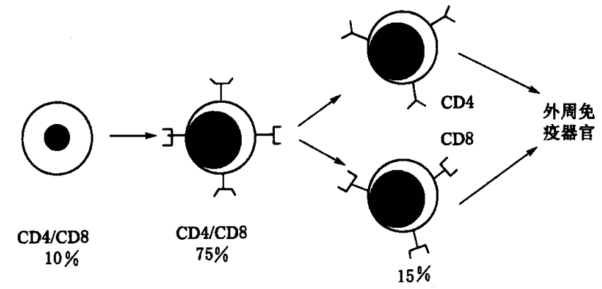

图 2-1 T 细胞在胸腺内的发育过程

成熟T细胞出胸入血，定居外周免疫器官胸腺依赖区（如淋巴结副皮质），遇抗原即应答。它们是淋巴再循环主角：血液中占60%~70%，淋巴结65%~85%，胸导管超90%。胸腺发育不全将阻滞T细胞生成，致外周淋巴细胞骤减、胸腺依赖区萎缩。

###### ③ 按功能分工：助手、刹车与杀手

功能维度上，T细胞分辅助性（Th）、抑制性（Ts）及毒性（Tc）。Th、Ts主管调节，合称调节性T细胞。Th激活B细胞克隆扩增；Ts作用相反。Tc能锁定入侵微生物、病毒或癆细胞，注入毒素致死，亦称杀伤T细胞（Tk）。

##### (2) B 细胞：骨髓原产的“抗体工厂”预备役

B细胞在骨髓成熟，故称骨髓依赖性淋巴细胞。遇抗原刺激，可分化为分泌抗体的浆细胞。

###### ① 核心标志：SIg与辅助信号分子

- **A. 表面免疫球蛋白（SIg）**：B细胞最显性“招牌”。成熟期共表达SIgM与SIgD，未成熟仅SIgM。结构同分泌型Ig，但SIgM为单体。单个B细胞表面布满数万同特异性SIg，得益于发育期基因突变重排，正常人体内至少存3×10^6种不同抗体克隆。SIg捕获抗原并介导内吞，是B细胞获取抗原主渠道。SIg跨膜段极短，无法独立传递信号，必须依赖紧邻的跨膜糖蛋白Ig-α/Ig-β（二硫键连接，胞内伸长段传递信号），机制类似T细胞CD3协同TCR。

- **B. MHC与CD分子**：成熟B细胞表达MHC II类分子，具备抗原提呈资质。分化过程中表达特定CD标志：CD10仅见于B前体；CD19贯穿原始至成熟全程；CD22仅成熟期表达——均为常规检测指标。CD21/CD35为补体受体；CD23/CD32为Ig Fc受体；CD40结合Th配体，接收辅助信号。

###### ② 骨髓里的“流水线”：从Pro-B到成熟B细胞

人体B细胞生成、发育、成熟全程在骨髓完成，伴随基因与表面标志动态重塑。

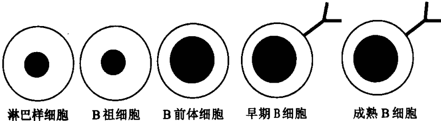

图 2-2 B 细胞的发育过程

- **B祖细胞**：仅表CD10、CD19及TdT，核心任务重链基因重排（失败率50%）。失败致死，成功合成μ重链滞留粗面内质网。μ链与替代轻链组装成临时复合物上膜，发信号终止重链重排，复合物消失，进入下一阶段。
- **B前体细胞**：停止增殖，主攻轻链基因重排，生成κ或λ链，与重链组装成4肽链IgM单体上膜。此信号锁定特异性，永久丧失Ig基因重排能力，后代克隆均产生同特异性抗体。成熟期进一步表达IgD、归巢受体、MHC、CD22、CD23、CD40等。
- **迁徙分布**：未成熟期驻留骨髓，成熟初期停留2~3天待标志齐全，随即入血循环，定居外周免疫器官非胸腺依赖区。血液中占20%~30%，胸导管≤10%，淋巴结15%~35%，脾脏最丰达60%。遇抗原在外周器官增殖分化为浆细胞分泌抗体。

##### (3) 第三梯队：NK、LAK与TIL

除T、B细胞外，还存在一群缺两者表面标志的淋巴样细胞，疑为第三谱系，归属待考。  
**NK细胞**：骨髓源，主驻血液、淋巴组织（脾脏富集），胞浆含颗粒，亦称大颗粒淋巴细胞（LGL）。系统发育视角属原始杀伤T细胞，无抗原识别受体，不受MHC限制，故名“自然杀伤”。虽杀伤谱广于Tc，但非随机：可清除病毒感染细胞、造血源性肿瘤细胞（敏感度高），不伤正常未感染细胞，也非全肿瘤有效。  
此外尚有淋巴因子活化杀伤细胞（LAK）、肿瘤浸润淋巴细胞（TIL）等成员。

#### 2.2.3.3 单核吞噬系统：身怀绝技的“清道夫”与“情报官”

血液单核细胞与组织巨噬细胞（Mφ）同源于骨髓干细胞，核不分叶、吞噬力强，合称单核吞噬细胞系统（MPS）。它们是核心抗原提呈细胞（APC），在特异性免疫诱导调节中居枢纽地位，广泛参与应答、效应、调节全程：

1.  **免疫防御**：病原入侵初期即被吞噬清除，是非特异性防御关卡，素称“清道夫”。特异性抗体产生后，IgG、C3b包被病原，经FcR、CR1调理作用强化吞噬；吞入菌体被胞内酶类、活性氧杀灭。
2.  **免疫自稳**：代谢产生的衰老亡细胞、变性物质被吞噬消化清除，维持内环境稳定。
3.  **免疫监视**：构成肿瘤免疫防线。活化巨噬细胞发挥杀瘤效应，机制含：直接吞噬瘤细胞；借抗瘤抗体杀伤（ADCC）；分泌细胞因子直接/间接杀瘤；产生酶类、活性氧直接抑制瘤生长。
4.  **抗原提呈**：最强专业APC。处理外源抗原提呈予T细胞，是启动免疫应答先决条件；提呈过程中分泌IL-1，为Th活化提供必需协同信号。
5.  **免疫调节**：作用具双相性（促抑并存），受激活程度、分泌产物及体内微环境（膜分子表达等）调控。
6.  **其他**：深度介入炎症、止血、组织修复再生等生理病理过程。

#### 2.2.4 抗体分子：免疫战场上的“精制制导导弹”

抗体（Ab）即B细胞识抗原后克隆扩增分化为浆细胞分泌的蛋白质，亦称免疫球蛋白。Porter等研究证实，Ig基本骨架由四肽链组成：两条同种轻链（L链，分子量小）与两条同种重链（H链，分子量大），经二硫键联结成单体，即Ig基本结构单元。四链两端游离氨基/羧基定向一致，分别为N端、C端。

##### (1) 轻链与重链

**轻链（L链）**：约214氨基酸，通常不含糖，含两个链内二硫键环肽。分κ、λ两型，同一Ig分子L链型一致，正常血清κ:λ约2:1。  
**重链（H链）**：规模约轻链2倍，450~550氨基酸，含4~5个链内二硫键环肽。不同H链氨基酸序列、二硫键位置、糖类种类量均异，抗原性各异。按抗原性分5类：μ、γ、α、δ、ε链。

##### (2) 可变区（V）与恒定区（C）

氨基酸序列比对显示：N端序列变异剧烈，称V区；C端相对保守，称C区。  
**V区**：位于L链N端1/2（~108-111aa）、H链N端1/4或1/5（~118aa）。各含一个链内二硫键环肽（~67-75aa）。氨基酸种类排列随抗原特异性千变万化，形成海量抗体库。  
**C区**：位于L链C端1/2（~105aa）、H链C端3/4或4/5（自119位至C端）。H链每功能域~110aa，含一二硫键环肽（50-60aa）。同型L链、同类H链C区结构恒定，抗原性一致。V区赋予抗原特异性结合，C区决定效应功能。

##### (3) 功能域

H、L链经链内二硫键折叠成若干球状功能域，每域约110氨基酸，序列高度同源。

#### 2.2.4.2 核心技能：锁定目标与召唤增援

Ig是体液免疫主力效应分子，功能由各功能域特性决定。

##### (1) 特异性结合抗原

最显著生物学特性。能精准识别细菌、病毒、寄生虫、药物等异物。特异性由V区（特别是超变区）空间构象决定。抗原结合点由L、H链超变区组成，与抗原表位互补契合，借静电力、氢键、范德华力等弱键可逆结合，受pH、温度、电解质影响。因不同样本存在同一/相似抗原决定簇，可发生交叉反应。  
抗体分子形态多样（单体、二聚体、五聚体），价数各异：Fab单价，不致凝集/沉淀；F(ab')2及单体Ig（IgG、IgD、IgE）双价；分泌型IgA二聚体4价；IgM五聚体理论10价，但立体位阻下通常仅5位结合。  
B细胞表面Ig（SmIg）为特异性抗原受体，成熟B细胞主表SmIgM、SmIgD，同克隆表达同类SmIg，识别特异性一致。

##### (2) 活化补体

**经典途径**：IgM、IgG1、IgG2、IgG3均可触发。抗原结合后，IgG的CH2、IgM的CH3暴露C1q结合位点启动级联。C1q含6亚单位，通常需两个C末端球部同时结合两相邻IgG单体才能依次活化C1r、C1s。故IgG激活需一定浓度保证邻近结合；单结合亲和力低，多点结合亲和力显著增高。

### 2.2.4.3 抗体分子的抗原决定簇分类

免疫球蛋白（Ig）本身具备抗原性。依据抗原决定簇分布位置的差异，以及在异种、同种异体乃至自身体内激发免疫反应能力的强弱，Ig 的抗原特异性可划分为同种型、同种异型与独特型三大类。

#### (1) 同种型

同种型是指某一物种内所有成员共有的 Ig 抗原标志。它具有种属特异性，进入异种机体后能诱导产生相应抗体。同种型决定簇主要定位于重链常数区（CH）与轻链常数区（CL），涵盖了 Ig 的类、亚类、型及亚型等层级。

#### (2) 同种异型

同种异型反映的是同一物种不同个体间 Ig 分子抗原性的微小差异，可在同种异体间引发免疫应答。这种差异往往仅涉及一个或极少数氨基酸残基的变异，推测源于编码 Ig 的结构基因发生点突变并稳定遗传。基于此，Ig 同种异型可作为遗传标记，其决定簇主要分布于 CH 和 CL 区域。

#### (3) 独特型

独特型是指每一种特异性抗体可变区（IgV）所特有的抗原特征。不同抗体形成细胞克隆产出的 IgV 区，因超变区氨基酸组成、排序及空间构象的差异，呈现出独一无二的抗原性。单个体内独特型数量庞大，可达 $10^7$ 种以上。独特型上的抗原决定簇称为独特位，它能在异种、同种异体及自身体内诱导产生抗独特型抗体，在复杂的免疫调节网络中扮演关键角色。

---

### 2.2.5 MHC 复合体：免疫识别的核心枢纽

早在 20 世纪初，研究者便发现不同种属或同种不同样系间进行组织、肿瘤移植会引发排斥，实为供受双方组织不相容的免疫反应。这种代表个体特异性的抗原被称为组织相容性抗原或移植抗原。人体内相关抗原系统超 20 种，其中能触发强烈、快速排斥反应者，称为主要组织相容性抗原，其编码基因紧密连锁成群，构成主要组织相容性复合体（MHC）。后续研究证实，控制免疫应答能力与调节功能的 Ir 基因亦定位于 MHC 内，奠定了 MHC 不仅主导移植排斥，更广泛参与免疫应答诱导与调控的核心地位。

MHC 编码两大类核心分子：MHC-Ⅰ 类（表达于几乎所有有核细胞）与 MHC-Ⅱ 类（主要表达于巨噬细胞、B 细胞等专业抗原呈递细胞 APC）。从最初在排斥反应中被发现，到 60 年代揭示 Ir 基因，再到 70 年代阐明细胞毒性 T 细胞（CTL）识别靶细胞的 MHC 限制性，人类对 MHC 生物学功能的认知不断深化，主要归纳为以下五大维度：

#### (1) 深度参与抗原加工与呈递
MHC 分子全程护航抗原处理。外源抗原经 APC 内化降解为免疫原性多肽，与 MHC-Ⅱ 类分子结合形成稳定复合物，避免多肽过度降解。内源抗原（如病毒蛋白）则在细胞质蛋白酶体降解后，经肽段转运蛋白（TAP）送入内质网，与新合成的 MHC-Ⅰ 类分子装配。值得注意的是，蛋白酶体相关基因及 TAP 基因均定位于 MHC 基因区内，凸显了基因聚类的功能协同性。

#### (2) 约束免疫细胞间的精准互动——MHC 限制性
Zinkernagel 等人的经典实验揭示：CTL 仅杀伤 MHC 表型相同的病毒感染靶细胞。这意味着 T 细胞识别抗原表位的同时，必须“自识别”MHC 分子。这种“同种 MHC 表型细胞间方能高效互作”的现象即 MHC 限制性，普适于 CTL-靶细胞、巨噬细胞-TH、TH-B、TH-CTL 等全链路互作。
- **TH 细胞激活受 MHC-Ⅱ 类限制**：TCR 联合识别抗原表位与 MHC-Ⅱ 类分子 α1/β1 区多肽决定簇；CD4 共受体识别 α2/β2 区非多肽决定簇。唯有 MHC-Ⅱ 类阳性细胞才具备呈递资格，且其表面密度与呈递效能正相关。
- **CTL 效应受 MHC-Ⅰ 类限制**：TCR 联合识别靶细胞表面病毒抗原肽-MHC-Ⅰ 类复合物（α2/β2 区）；CD8 共受体识别 α3 区非多肽决定簇。

#### (3) 对免疫应答实施遗传调控
机体对特定抗原能否应答、应答强弱，受 Ir 基因遗传控制。人类 Ir 基因多态性导致个体对特定抗原的应答能力千差万别。

#### (4) 充当自身/同种淋巴细胞反应的触发分子
- **驱动免疫调节（AMLR）**：非 T 细胞（M、B 等）可体外激活自身 T 细胞增殖，即自身混合淋巴细胞反应（AMLR）。刺激信号源自非 T 细胞表面 HLA-DQ；增殖后的自身反应性 T 细胞表达 HLA-DR，进而激活其他 T 细胞（T-T AMLR）。该机制维持免疫自稳，MHC-Ⅱ 类分子借此参与调节。
- **诱导同种排斥反应**：MHC 本质是强效同种异型抗原。体外同种异型混合淋巴细胞反应（MLR）及体内同种移植排斥，均源于反应性 T 细胞对非自身 MHC 的直接识别，且此识别不受自身 MHC 限制。

#### (5) 指导胸腺内 T 细胞谱系分化
早期 T 细胞在胸腺发育为成熟单阳性 T 细胞的过程，高度依赖 MHC 信号。前体细胞必须与表达 MHC-Ⅰ 类或 MHC-Ⅱ 类的胸腺上皮细胞发生作用，方能定向分化为 CD8+ 或 CD4+ T 细胞。

---

### 2.2.6 免疫指令系统：识别宇宙的编码逻辑

免疫系统执行功能的细胞成分构成“细胞指令系统”。假设淋巴系统（B/T 细胞）包含三级指令架构：

1.  **潜在指令系统**：由胚系基因编码的抗体/TCR 库，加上基因重组时引入的体细胞突变，共同决定其理论多样性的数量、结构与生成机制。
2.  **可利用（表达）指令系统**：指实际作为淋巴细胞受体表达出来的分子集合，即“备用状态”的受体池。
3.  **实际指令系统**：由微环境中激活的效应淋巴细胞产生的抗体与受体集合，直接参与特定生理状态下的自主免疫活动。

免疫识别的“完全性公理”源于抗体分子本身具备免疫原特异型（独特型），可被其他抗体识别，由此衍生出独特型网络理论。构建指令系统完备性的三大支柱为：**多样性**（基因变异、编辑、重组）、**交叉反应** 与 **多特异性**。后二者解释为何有限的淋巴细胞库能覆盖近乎无限的抗原空间：交叉反应针对结构相关的抗原模式/表位，多特异性则指识别化学结构截然不同的抗原。

---

### 2.2.7 免疫系统的双层防御架构

人体构建了两层内在关联的防御防线：**固有免疫系统**（先天免疫）与 **适应性免疫系统**（获得性免疫）。

#### 2.2.7.1 固有免疫：与生俱来的快速反应部队
固有免疫不依赖特异病原体诱导，由补体系统、内吞机制及吞噬细胞构成。其核心特质是“即时性”与“广谱性”：病原体（细菌、真菌、胞内寄生虫）一旦突破皮肤黏膜屏障，吞噬细胞即刻招募至入侵前线，实施吞噬清除。

**补体系统**是固有免疫的关键效应臂。识别层面，固有免疫依赖**模式识别受体（PRR）** 识别 **病原体相关分子模式（PAMP）**。PAMP 为病原微生物特有（如 LPS、鞭毛蛋白、双链 RNA），宿主不产生，故识别极具特异性，有效规避自身损伤。这意味着固有免疫同样具备“识别自/非自”的能力，并据此启动下游效应。

**固有免疫识别的战略价值**在于：它诱导 APC 表达**协同刺激信号**，这是激活初始 T 细胞、启动适应性免疫的“第二信号”。缺失固有识别，适应性免疫识别将导致淋巴细胞阴性选择（耐受/凋亡），免疫应答无从启动。

#### 2.2.7.2 适应性免疫：精准定制的特种作战力量
适应性免疫以 T、B 淋巴细胞为主角。其受体库通过 V(D)J 重组等随机过程生成，克隆选择理论奠定了其“精准特异性”基石。抗体是核心效应分子，受体由基因片段拼接而成，每个细胞表达单一特异性受体，全身细胞协作覆盖一生可能遇到的病原谱。

适应性免疫的核心优势在于 **“学习与记忆”**：能识别从未遇见的人工合成抗原，清除固有免疫无法处理的顽固病原，实现靶向精准打击。

**双系统协同作战**：病原入侵瞬间，两系统并行启动。免疫细胞表面布满受体，有的直接结合病原，有的结合细胞因子/共刺激分子，通过复杂的化学键合网络完成“检测-信号传递-效应清除”的闭环。

---

### 2.3 免疫系统运作机制深度解析

#### 2.3.1 免疫应答：从即时防御到精准清除的接力赛

免疫应答分为**固有免疫应答**与**适应性免疫应答**两大类型。

**固有免疫应答**：感染早期的“第一道防线”。依托皮肤黏膜物理屏障、局部分泌抗菌肽化学屏障，以及吞噬细胞、NK 细胞、补体等细胞/体液效应机制，快速、非特异性地遏制病原扩散。

**适应性免疫应答**：由 T/B 淋巴细胞执行的“特种作战”。能识别并清除特定物质的病原成分称为**抗原**（免疫原）。初始 T/B 细胞识别抗原后活化，但不即刻效应，需经 **4-5 天** 的增殖、分化、成熟为效应细胞，才具备杀伤清除能力。适应性免疫应答迟发但精准，在最终清除病原、促进愈合、建立长效保护中起**主导作用**。因其针对特定抗原，又称**抗原特异性免疫应答**；因需抗原激活后才获得功能，又称**特异获得性免疫**。按遭遇次序分为初次与二次应答。

##### (1) 初次免疫应答：缓慢的“首秀”与学习
首次遭遇病原入侵时触发。免疫系统启动抗体生产程序（见下图），浓度经上升、峰值后逐渐下降。此过程是对“陌生抗原”的学习，**启动缓慢、持续数周**，最终清除感染并留下记忆细胞。

**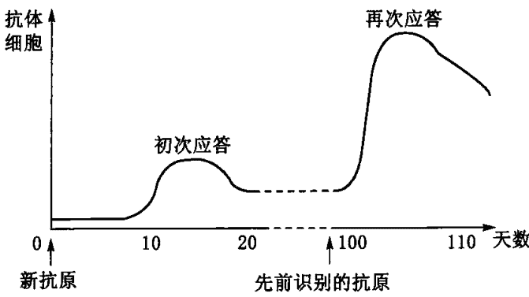**
**图 2-3 免疫应答动力学曲线**
曲线展示抗体浓度（Y轴）随时间变化。初次应答上升慢、峰值低、维持短；二次应答起飞快、峰值高、维持久，直观反映免疫记忆的威力。

##### (2) 二次免疫应答：迅猛的“回马枪”
初次应答后，残留的 **B 细胞转化为免疫记忆细胞** 长期驻留。再次遇到同源/交叉抗原，记忆细胞即刻苏醒，无需重新学习，引发**更快、更强、更持久**的抗体风暴。这正是疫苗接种的核心原理——预装“抗体蓝图”，让身体时刻处于“战时待命”状态。

---

#### 2.3.2 免疫识别：分子层面的“锁钥哲学”

##### 2.3.2.1 特异性识别：高保真的分子辨识

###### (1) 核心原理：形状互补与亲和力
特异识别是抗体（或 TCR）与抗原表位结合的过程，是免疫功能的**起手式**。识别发生在分子水平，基于抗体决定簇（副位）与抗原决定簇（表位）的**三维形状互补**及**电荷匹配**。
- **互补度决定结合概率**：结构越契合，结合越稳固，这种结合强度称为**亲和力**。
- **“锁钥”模型的修正**：非绝对刚性匹配，允许“诱导契合”式的动态互补，只需大致匹配即可结合。
- **结合即信号**：结合触发 B 细胞活化，启动**克隆选择**程序。

###### (2) 识别过程的微观逻辑
- **单克隆特异性**：单个淋巴细胞表达约 $10^5$ 个同种受体，仅识别一类结构相似的表位。病原表面多表位，故激活多克隆淋巴细胞协同应答。
- **多受体的战略价值**：
  1.  **亲和力估计器**：结合受体数量反映亲和力高低，随亲和力上升，估计愈发精准。
  2.  **病原密度探测器**：结合数量越多，提示局部病原浓度越高。
  3.  **单特异性保险**：防止对病原 A 的应答错误交叉激活无关抗原 B 的应答。
- **激活阈值与广义检测器**：淋巴细胞仅当结合抗原数超阈值时激活。单细胞覆盖一类相似表位模式，全库协作覆盖整个抗原模式空间，无需“一表位一细胞”的穷举配置。

##### 2.3.2.2 模式识别：固有免疫的“特征码扫描”

# 免疫识别的核心逻辑：从模式匹配到克隆扩张

免疫系统的运作本质上是一场精密的“模式识别”游戏。抗原决定基与抗体决定基，构成了这一识别体系的基石。B 细胞与 T 细胞之所以成为主力军，关键在于它们膜表面携带的“侦察雷达”——B 细胞受体（BCR）与 T 细胞受体（TCR）。抗原并非入侵的微生物实体本身，而是寄生于其中的多肽、寡糖、脂质等分子片段。这些“非自我”标记化学结构独特，能被淋巴细胞精准捕捉。单个淋巴细胞只表达一种受体，锁定单一抗原靶标，实现了个体层面的“专一识别”；但放眼整个淋巴细胞群体，其识别光谱却覆盖了近乎无限的抗原世界。

识别模式上，两大细胞分工明确：BCR 直接对接完整抗原表面的表位，无论抗原漂浮在体液中还是附着于表面；TCR 则只承认“呈递”过的抗原——必须是细胞表面 MHC 分子抱着的肽段。这决定了 T 细胞不仅是杀手，更是指挥官，通过分泌细胞因子调控整场免疫战役，并借此区分“细胞关联威胁”与“可溶性分子”。

## 2.3.3 免疫细胞活化与克隆选择和扩增

### 2.3.3.1 免疫细胞活化：双保险的启动机制

抗原结合只是拉响警报的第一步。T 细胞识别的是“加工过”的抗原肽：蛋白抗原必须经抗原呈递细胞（APC）消化、装载上 MHC 分子、运至细胞表面，TCR 才能“看见”。这产生了第一信号。但光有信号一不够，T 细胞还要求“双重验证”——来自活化 APC 的协同刺激分子（第二信号）。唯有双信号齐至，T 细胞才完成全面活化，避免了误伤友军。

### 2.3.3.2 克隆选择与扩增：进化论在体内的极速演练

#### (1) 核心原理：筛选能打仗的“特种兵”
克隆选择学说（Burnet, 1959）揭示了免疫应答的达尔文主义本质：**唯有识别抗原的细胞，才获得扩增资格**。骨髓中沉睡的初始 B 细胞，各自携带独一无二的受体。抗原到来，如同筛选考官，仅与匹配受体的细胞结合，触发其分化为分泌抗体的浆细胞与长存的记忆细胞。

这正如自然选择的微观版：克隆间竞争结合病原体，亲和力最高者“最适应”，疯狂复制。免疫系统靠海量受体多样性（B 细胞潜在 10^11 种，T 细胞更多，人体淋巴细胞池可达 10^16 种指令）保证“总有一款适合你”。一旦匹配成功，该淋巴细胞克隆性扩增，分泌溶解性抗体（B 细胞受体的分泌版）或执行效应功能（T 细胞）。

克隆选择的四大铁律：
1.  **忠实复制**：子代是父代拷贝，但引入高频体细胞突变；
2.  **自清洗**：清除识别“自我”的反应性淋巴细胞；
3.  **按需生产**：增殖分化严格依赖成熟细胞遇抗原；
4.  **防失控**：早期清除自身反应克隆，是防止自身免疫病的基石。

#### (2) 效率与进化：随机生成与定向优化的博弈
要让克隆选择高效运转，受体库必须“全谱覆盖”。Perelson 与 Oster 模型证明：若 10^7 受体随机生成，指令系统即完备。但现实中抗体非纯随机，V 基因进化倾向识别常见病原模式。例如，细菌多糖能绕过 T 细胞帮助直接激活 B 细胞（TI 抗原），暗示免疫系统进化出了针对特定威胁的“快捷键”。

亲和力成熟，实为体内达尔文演化：体细胞高频突变制造变异，抗原竞争筛选优胜。

#### (3) 阴性选择：建立“友军识别”的防火墙
并非所有相遇都导致激活。识别“自我”抗原的淋巴细胞，结局是凋亡或失能（无反应性）。胸腺是 T 细胞的“严格教官”：未成熟 T 细胞若在发育期因识别自身肽-MHC 复合物被激活，立即启动程序性死亡。胸腺表达海量自身蛋白，幸存者天然耐受“自我”，此即胸腺阴性选择。虽非绝对零泄漏（少量自身反应 T 细胞逃逸致自身免疫风险），但配合外周耐受机制，构筑了坚固防线。相比之下，通过正选成熟为免疫活性细胞的，仅是少数精锐。

#### (4) 克隆扩增：数量优势与备战未来
活化后，B 细胞在生长因子驱动下疯狂分裂，单细胞衍生出表达同一 BCR 的庞大克隆群。扩增伴随**体细胞高频突变**，抗体库实时进化，既清除当前感染，又为未来变异株储备“预案”。T 细胞同样在生长因子助推下完成克隆扩张。这种“变异-选择-扩增”循环，赋予了免疫系统实时自适应进化的能力。

## 2.3.4 抗体指令系统：多样性的生成与维护

### (1) 多样性刚需：以有限编码应对无限威胁
免疫识别靠抗体-抗原结合，指令系统必须足够杂，保证任意表位都有淋巴细胞“对号入座”。

### (2) 双引擎驱动：体细胞高频突变 + 受体编辑
激活后的 B 细胞靠两大机制刷新受体库：
- **体细胞高频突变 (SHM)**：点突变微调亲和力；
- **受体编辑**：基因重组大换血，将自身反应受体替换为全新特异性。

高亲和力克隆优先入选扩增；为保底池多样性，低亲和力细胞也获准留存。受体编辑与突变互补：突变做局部优化，编辑引入全新候选。此外，骨髓持续输送新初始细胞（约 5%-8% 替换率），拓展全局搜索边界。

清除机制同步在线：非功能性或自身反应突变体，主要经凋亡出局。编辑与突变受严格时序控制：V(D)J 重组先行构建初始库，抗原驱动下再启动突变微调，实现从“广种薄收”到“精准打击”的过渡。

### (3) 破解组合爆炸：动态周转的“流动堡垒”
人体仅 ~10^8 种蛋白，却要应对 ~10^16 种潜在表位，静态库远远不够。对策是**动态保护**：淋巴细胞日更 ~10^7，约 10 天全库迭代一次。这种持续周转（含记忆细胞池），让防御系统始终保持“最新版本”，堵住病原体进化突围的缝隙。

抗体多样性源于 V 区空间构型的组合排列。免疫球蛋白基因片段在淋巴细胞发育期随机拼接，编码信息刻入种系染色体遗传，这就是广义“受体编辑”的种系层面体现。

## 2.3.5 体细胞高频突变与 MHC 多样性：双重进化引擎

### 2.3.5.1 体细胞高频突变：淋巴结里的“进化加速器”
B 细胞激活后迁入淋巴结，开启极速分裂与突变模式。突变率较常规细胞高 10^9 倍，集中于 V 区 ~700bp，每代每碱基对 ~10^-3。高突变率制造结构千差万别的受体后代。新 B 细胞在淋巴结内“试刀”捕获的抗原：结不上速亡，结得上出关分化为浆细胞与记忆 B 细胞。

突变非无限狂奔：多数突变有害。机制采用**“突发-喘息”策略**——短时高频突变后留出选择窗口。低亲和力细胞继续突变或凋亡；高亲和力克隆锁定优势，暂停突变进入扩增。亲和力依赖的反馈调节，平衡了探索与利用。

### 2.3.5.2 MHC 多样性：有性生殖的进化账单
MHC（人称 HLA）极度多态，被认为是有性生殖维持的核心动力。其核心使命：呈递抗原肽激活 T 细胞，形成“抗原+MHC”双重识别。特定 MHC 等位基因偏好结合特定肽段模序，这导致不同个体对同一抗原应答强弱迥异——MHC 多态性直接调控免疫应答画像。

进化博弈视角：宿主想结合尽可能多病原肽段，病原体却进化逃逸 MHC 呈递（隐形术）。宿主回应：增加 MHC 类型数量。但 MHC 类型越多，胸腺阴性选择中因识别“自我-MHC”被清除的 T 细胞越多（资源浪费）。数学模型显示，现存 MHC 类型数量恰处于**病原覆盖需求**与**阴性选择成本**的平衡最优解。

MHC 类型终身固定、基因决定，代表**遗传免疫多样性**；群体层面 MHC 杂合度高，保障种群面对特定病原的整体鲁棒性。

## 2.3.6 学习与记忆：从新手到老兵的质变

### 2.3.6.1 免疫应答成熟：生发中心里的“强化学习”
二次应答抗体亲和力远超初次，此即**亲和力成熟**。主战场在**生发中心 (GC)**。成熟标志：抗体 V 区结构重塑（点突变、短缺失、基因转换导致谱系漂移）。随机突变偶发高亲和力变体，经 GC 内筛选留存。两大核心驱动力：**高频突变制造多样性 + 高亲和力选择定向优化**。从初次到二次，亲和力持续跃升，完美诠释“强化学习”范式。优胜者入库记忆池。

### 2.3.6.2 免疫记忆：预埋伏兵，速胜再战

#### (1) 记忆机制：不打仗也要站好岗
淋巴细胞除分化浆细胞外，另一条路通向**长寿记忆细胞**。它们游走于血、淋巴、组织间，平时“隐身”（不分泌抗体、不直接效应）。再遇同源抗原，瞬间唤醒：经预选机制快速活化、增殖、分化为效应细胞，倾泻高亲和力抗体，实现**更快、更强、更久**的二次防御。这就是免疫系统写在生命里的“曾经沧海难为水”。

# 核心机制：克隆选择与免疫记忆的构建

免疫系统依靠克隆选择机制运作：能识别抗原的细胞克隆得以扩增存活，无法识别的则走向凋亡。这一过程本质上是指令系统对抗原环境的“学习”。免疫系统必须保持高度多样性，通过表达指令系统的偏差来标记抗原。若这种偏差在个体一生中形成，免疫学称之为“学习”；若偏差长期固化，则构成“记忆”。

免疫系统具备适应性应答能力。成功的应答会触发记忆B细胞大量增殖，这些细胞对过往抗原拥有远超平均水平的亲和力。记忆细胞内编码的信息构成了免疫记忆库，使系统能“学会”并“记住”病原体的蛋白质结构特征，从而在再次遭遇时发起更迅猛、高效的攻击——这便是**基于记忆的检测**。正因为记住了已知病原体结构，未来的应答才变得从容不迫。

记忆检测系统在“非自体”集合上训练，专门识别该子集内的特异性元素。初遇新型病原体，免疫系统发起**初次应答**，耗时数周清除感染，同时完成对未知外部模式的学习；若频繁遭遇同类病原体，则爆发**二次应答**，效率极高，往往无临床感染迹象，这有力佐证了记忆检测的高效性。

更关键的是，二次应答不仅由同源病原体触发，与过往病原体相似的新型病原体也能激活它——这意味着，**免疫记忆具有联想性**。

##### (2) 免疫记忆理论解释

免疫记忆的核心谜题在于：B细胞寿命仅数日，感染清除后，是什么维持了适应性亚群的长久存在？主流学界提出两种解释：一是**长寿细胞说**，认为记忆细胞寿命可与机体寿命等长；二是**持续刺激说**，推断记忆B细胞靠体内长期积累的非自体蛋白痕迹反复被激活而维持。

适应性免疫应答有三大铁律：处理海量抗原多样性、精准区分自体与非自体、长效免疫记忆。克隆选择理论指出：记忆通过扩大特异性抗原克隆规模实现，随机变异提升亲和力，自反应细胞在发育期被清除。关于记忆获取机制，存在两派观点：主流**B细胞学派**主张B细胞受抗原刺激分化为记忆细胞与效应细胞；另一派**免疫网络学派**（理论免疫学家拥护，实验派较少支持）认为网络内部动态与适应性反馈机制才是记忆的载体。

### 2.3.7 自我与他者的边界：耐受与识别

#### 2.3.7.1 自体耐受

##### 耐受机制：如何避免误伤“自己人”？

免疫耐受是指免疫活性细胞接触抗原后表现出的**特异性无应答状态**，属于免疫应答的重要范式。外源或内源抗原均可诱导耐受。由于体细胞高频突变，随机生成的受体可能误识自体成分，引发自身免疫攻击。正常免疫系统通过**自体耐受**机制规避此风险：对自体抗原不响应，与自体结合的抗体/细胞被清除。耐受可细分为T细胞耐受、B细胞耐受。T细胞在胸腱完成**中枢耐受**，B细胞在骨髓耐受，外周淋巴结则执行**外周耐受**，且B细胞耐受依赖T辅助细胞协作。

##### 双重保险：B/T细胞的耐受协作

B细胞虽在骨髓受耐受教育，但不足以完全杜绝自反应克隆。亲和力成熟阶段的高频突变，可能让曾受耐受的B细胞“变异”出自反应克隆。由于成熟发生在分散的淋巴结，必须引入外周耐受机制。T辅助细胞通过**协同刺激**把关：B细胞激活需双信号——**信号1**为抗原结合受体超亲和力阈值，**信号2**由T辅助细胞提供。仅得信号1缺信号2，B细胞走向凋亡。

信号2的交付需T辅助细胞核实B细胞呈递的抗原表位（经MHC复合物呈递）。MHC分子向T细胞“汇报”B细胞内部情况。若T细胞受体识别B细胞表面MHC/肽复合物，则释放信号2激活B细胞。得益于胸腺中枢耐受，绝大多数成熟T细胞具备自体耐受性，不会协助自反应B细胞。换言之，T细胞在为B细胞“背书”，确认其识别非自非自体。

单靠T细胞耐受不足以完全抑制自身免疫。骨髓未成熟B细胞对耐受诱导极敏感；成熟B细胞若在缺乏T细胞帮助下遇抗原，仅在高浓度抗原下才耐受。自反应T细胞虽能在组织损伤区存活，但一旦离开该区、失去信号2（仅得信号1）即凋亡。这基于**频率依赖耐受理论**：健康组织（自体）遭遇频率远高于非自体组织，高频遇抗原无协同刺激导致耐受；若频率反转，耐受机制失效引发免疫病。胸腺缺失不必然导致重度自身免疫，恰恰证明了频率耐受的关键作用。

免疫学长期视“区分自非自”为核心功能，实则过于简化。免疫系统耐受无害细菌（非自体），有时也攻击自体细胞（如癌症）。但在工程应用中，为规避功能定义争议，常沿用简化的“自/非自”模型代指耐受抗原集与清除抗原集。

**协同刺激机制确保T辅助细胞不自反应**：信号1由超阈值亲和力提供，信号2由固有免疫细胞在组织受损时释放。危险信号即许可证。

#### 2.3.7.2 识别非我：自体/非自体的辨别难题

1995年，Cameiro与Stewart揭示了免疫系统辨别自非自的逻辑：指令系统具备完备的病原体识别能力及海量随机受体库。为正常运转，系统**必须**区分自体细胞与先前未识别的外来分子（非自体）。一旦辨别失效，针对自体抗原的应答启动，引发自身免疫病。这一核心挑战被称为**自体/非自体区分问题**。

### 2.3.8 免疫反馈：精准的“刹车”与“油门”

免疫应答分**体液免疫**（抗体-抗原）与**细胞免疫**（杀伤T细胞清除感染细胞）两大支，各有对应的反馈回路。

**体液支反馈**：抗体生成后持续结合清除抗原，抗原耗尽则应答终止。抗体作为产物反向抑制后续生成：抗原-抗体免疫复合物结合B细胞表面Ig，传递抑制信号，遏制B细胞活化与抗体分泌。

**细胞支反馈**：辅助性T细胞（CD4+）活化后，诱导抑制性T细胞（TS）分化为效应TS细胞。后者分泌特异/非特异抑制因子，制动杀伤T细胞、辅助T细胞及B细胞，形成**负反馈环**。外来抗原入侵→APC活化TH→启动正向应答清除抗原；应答后期→TS活化分化→抑制应答→维稳免疫平衡。

### 2.3.9 巡游与自治：分布式的循环调控

#### 2.3.9.1 循环机制：淋巴细胞的“巡逻路线图”

免疫细胞（特别是淋巴细胞）在血液、淋巴、淋巴器官及组织构成的循环系统中持续巡游，维持稳态水平。淋巴细胞抵达特定淋巴器官前，需在血液中循环2-12小时。此机制保证海量特异性淋巴细胞能在短时窗内邂逅抗原并互作。不同亚群在初/次级淋巴器官间流转，确保初始、效应、记忆细胞精准归位，这一迁移导向过程称**自导引**。

次级淋巴器官捕获抗原，经APC加工呈递于表面供识别，并提供微环境支持克隆扩增与效应/记忆分化。有趣的是，记忆细胞倾向于导引至初次遇抗原的组织类型，大概率是为了驻守“高频战场”，便于再次迎击。

实验证明：抗原注射后，特异性T细胞从循环中消失48小时，聚集于外周淋巴器官遭遇抗原并暂停循环。该过程受严密调控，维持各血细胞系稳态。细胞分裂/分化与凋亡动态平衡，实现了无中心控制下的复杂性管理。

#### 2.3.9.2 调节逻辑：无中心指挥的自组织秩序

免疫调节本质是**自调节**，无中央指挥器官。大致分两支：**体液免疫**（B细胞及产物主导）、**细胞免疫**（T细胞主导）。两支遵循相似防御步骤（增殖→激活→分化→分泌→攻击→抑制→记忆），执行路径各异。抗原入侵时，自调节机制决定激活哪支、强度如何、持续多久。T细胞借可溶性因子调控B细胞，后者分化分两途：化身浆细胞（抗体工厂），或形成生发中心经历体细胞高频突变（亲和力成熟）。

克隆扩增的自限性彰显自调节：持续抗原呈递驱动扩增，抗原清除后特异性细胞急剧收缩。这种抗体产生控制模式，正是独特型网络调节思想的体现。

为防失控，克隆扩增受**协同刺激**严管。第二信号既是耐受关卡，也是危险/无害的裁判，旨在识别非自体时防误报、遇真险果断决策。

### 2.4 免疫系统的五大核心特质

人体由多元细胞/分子“军团”协同守护，免疫应答终极目标：清除抗原（多为细菌等外源分子）。专业APC（如巨噬细胞）巡游吞噬消化抗原，裂解为抗原肽，装配成MHC分子表面展示。MHC核心功能是呈递抗原肽激活T细胞，形成T细胞对“抗原+MHC”的双重识别，启动特异性应答。其他白细胞携带受体识别特定肽-MHC组合。被激活T细胞克隆扩增，分泌淋巴因子/趋化因子动员全军。B细胞膜表面抗体受体响应信号，与T细胞不同，它直接识别游离抗原，无需MHC协助。激活后B细胞分化浆细胞分泌抗体，借补体/清除细胞沉淀中和病原。部分T/B细胞转为记忆细胞长驻循环，为再遇同源抗原预布防线。得益于抗体基因高频突变编辑，二次应答亲和力更高、速度更快、清除更彻底——此即**亲和力成熟**。以上构成免疫防御基本范式。

#### 2.4.1 适应性：进化赋予的“实时学习”能力

**内涵**：自然界本身是自适应系统集合，免疫系统是典型代表。病原体指数级复制，倒逼免疫系统极速检测清除。淋巴细胞特异性越强，清除效率越高。免疫系统进化出让淋巴细胞“学习/适应”特定抗原决定簇的机制——这就是适应性，核心执行者是**B细胞**。适应性加速未来应答。

**生成机制**：
1.  **克隆扩增**：B/T细胞大规模扩增，产出海量抗体清除抗原。
2.  **学习与记忆**：系统动态演化，能识别新感染、存储记忆服务未来，同时过滤无用/危险元素、优化现有库。
3.  **微观竞争**：免疫基本单元为生存竞争结合外来分子。基因片段拼接（连接多样性）与亲和力成熟（体细胞高频突变）中，抗体通过基因重组与突变随机涌现。
4.  **内外双适应**：系统与内外环境紧密耦合，动态灵活响应新刺激，不仅适应内环境，更适应外环境。

#### 2.4.2 分布式：遍布全身的防御网络

**成因与意义**：免疫系统遍布全身，这一结构特性深度制约检测、学习、应答细节。分布性源于两点：病原体全身分布，需全身效应细胞执行**创面式检测**；分布式架构赋予系统极强鲁棒性，抗打击能力强。

**三大分布式处理支柱**：
1.  **阴性选择**：实现自/非自分布式辨识，细胞间极少通讯即可完成检测。
2.  **协同刺激等信号事件**：局部发生，管控克隆扩增/死亡等核心过程，动态分配资源至最需处，杜绝自反应。
3.  **细胞克隆与凋亡**：每细胞携带完整“自体描述”，上述机制传递分布式自治所需信息。三者缺一不可。

**第二信号（协同刺激）原理**：阴性选择给中枢耐受（分布式检测）；协同刺激解决“耐受什么/清除什么”的表示学习问题；允许分布式“感知”（频率耐受）。细胞复制、凋亡、局部因子扩散，赋予系统资源调度、决策控制力。

**分布式控制机理**：克隆与死亡是分布式组织的第三机制，核心看控制功能。控制权下放全身，非中心式生成管理检测器。控制即：资源分配、应答类型裁决、终止时机判断。免疫细胞自我复制（增强自治适应），控制功能源于程序性死亡、抗原竞争等博弈。

抗原在TH协助下被识别，B细胞受刺激分裂；若失控将引发病理。因此，**复制速率削减**与**程序性死亡清除过剩**必须在分裂每一增量处达动态平衡。相关细胞生死动态控制是分布式控制核心，基本原理含协同刺激与负反馈环：淋巴细胞激活虽促存活，但同步触发应答终结后的删除程序。

#### 2.4.3 亚动力学：动态平衡下的自我更新

生物免疫网络非固定，而是随环境动态重组的自组织系统。**亚动力学**通过引入新细胞/抗体、清除无效个体维持：骨髓基因重组与受激细胞扩增产生新兵；胸腺输出新T细胞前经筛选——95%被清除（强自反应或零反应），筛选机制高效加速新型融合。虽日产海量新细胞，多半对现存网络无冲击，无刺激速亡。这种大量损耗换来指令系统的适配性，使系统从容应对环境变迁。

#### 2.4.4 鲁棒性：容错与抗压的进化智慧

强大的学习力使免疫系统成随环境进化的自适应鲁棒系统。极速检测清除需淋巴细胞适应特定表位，B细胞是关键。部分B细胞经高频突变，生成多样抗体谱，不只清除特异抗原，亦覆盖相似变体。免疫表示与行动均为细粒度，分子/细胞互作涌现协同。

鲁棒性源于**多样性、分布性、动态性、容错性**四大支柱：拥有完备器官/细胞/分子体系，淋巴结遍布，覆盖应答-反馈全链路，具记忆功能，体细胞高频突变赋能识别新抗原并提亲和力。

**无中心、无单点故障**：海量元件互作产出整体防护。个体失效冲击微弱，分类/应答错误不致灾难。系统能学习新抗原、存储记忆，故具适应性。适应性经动态机制落地：受刺激/环境互作时，调整结构与自由参数，抛弃无用/危险元件，升级存活单元性能。

#### 2.4.5 快速进化：微观世界的“达尔文加速度”

相对物种宏观进化（百万年量级），免疫系统微观进化极快，可在**数天**内完成。克隆选择揭示其遵循达尔文法则：**指令多样性、变异、自然选择**三驾马车。

- **多样性**：产出抗体数远超有效结合抗体数，大多数抗体应答中“隐身”。
- **变异**：负责生成高度多样化抗体可变区。
- **选择**：克隆选择筛选仅保留成功结合抗原的克隆，转化为记忆细胞长存。

### 抗体生成与物种演化的惊人平行：从基因重组到自组织智能

当我们将视角聚焦到抗体诞生的两大核心引擎——基因重排与体细胞高频突变，会发现它们与驱动有性生殖物种演化的机制有着异曲同工之妙。抗体基因的拼接与编辑，构建了一个极其庞大的抗体库，而后续的突变微调则像精密的“调音师”优化识别精度。这与自然界中通过有性重组与变异提供原材料、再经自然选择筛选适应环境的个体，如出一辙。在这场生存博弈中，变异积累与自然选择始终扮演着关键角色。

值得注意的是，两者的“重组逻辑”截然不同：抗体基因重排允许核苷酸在免疫球蛋白片段间随机插入、删除，属于体细胞层面的随机拼装；而有性生殖的重组则是父母染色体的交叉互换，产出的是亲代基因的混合后代。

#### 2.4.6 自组织：从混沌到有序的内生秩序

在特定条件驱动下，免疫系统能实现从“无序”向“有序”的相变。此处的无序非指混乱，而是混沌态的有序；有序则指规则化的结构。随着控制参数变化，系统可在有序、无序间震荡切换，并持续与环境进行物质能量交换。正是这种远离平衡态下的内在动力，驱动系统自发完成从一种秩序向另一种秩序的跃迁——这就是**自组织**现象。

这种特性赋予免疫系统“免维护”能力：无需外部指挥，即可通过更替受损细胞、清除抗原来自我修复。自组织系统内部动态流变、外部环境多变，却能依靠自身产生的波动，凝聚成内聚、自维持的有序整体，本质是一个正向反馈回路。当感知运动/识别系统与环境博弈、寻觅资源、规避风险时，免疫系统同步自主清道有害入侵者。

### 2.5 章节小结

本章梳理免疫学发展脉络，系统阐述生物免疫系统的架构与功能。立足人工免疫系统（AIS）视角，重点剖析其核心机理与特性，为后续深入理解AIS的生物学基石奠定认知基础。

# 参考文献

- [1] JANEWAY JR C A. The Immune System Evolved to Discriminate Infectious Nonself from Noninfectious Self [J]. Imm. Today, 1992, 13 (1); 11-16.
- [2] MARRACK P, KAPPLER J W. How the Immune System Recognizes the Body [J]. Scientific American, 1993, 19 (1); 65-87.
- [3] Mannie M D. Immunological Self/Nonself Discrimination [J]. Immunologic Research, 1999, 19 (1); 65-87.
- [4] 林学颜, 张玲. 现代细胞与分子免疫学 [M]. 北京：科学出版社, 1999.
- [5] 陈慰峰. 医学免疫学 [M]. 北京：人民卫生出版社, 2001.
- [6] HOFMEYR S A. AN Overview of the Immune System [R/OL]. Tutorial about computational immunology, 1997. http://www.cs.unm.edu.
- [7] HOFMEYR S A. AN Interpretative Introduction to the immune System [M]. In Design Principles for the Immune System and Other Distributed Autonomous System, (eds) Cohen I. and Segel L A. USA, Oxford University Press, 2000.
- [8] GERMAIN R N. MHC-Dependent Antigen Processing and Peptide Presentation; Providing Ligands for T lymphocyte Activation [J]. Cell, 1994, 76.
- [9] GERMAIN R N. MHC-Associated Antigen Processing, Presentation, and Recognition, Adolescence, Maturity and Beyond [J]. The Immunologist, 1995, 3 (5-6).
- [10] JERNE N K. Towards a Network Theory of the Immune System [R]. Annual Immunology, 125; 1974; 373-380.
- [11] CASTRO D E, ZUBEN V. Artificial Immune Systems: Part I- Basic Theory and Applications [R/OL]. Technical Report - RT DCA 01/99. http://www.dca.fee.unicamp.br.
- [12] PERELSON A S. Immune network theory[J]. Immunological Review, 1989, 110: 5-36.
- [13] MASON D. Antigen Cross-Reactivity: Essential in THE Function of TCRs [J]. The Immunologist, 1998, 6(6): 220-222.
- [14] PERELSON A S, OSTER G F. Theoretical Studies of Clonal Selection: Minimal Antibody Repertoire Size and Reliability of Self-Nonself Discrimination[J]. Theor. Biol., 1979(81): 645-670.
- [15] BURNET F M. The Clonal Selection Theory of Acquired Immunity [M]. London: Cambridge University Press, 1959.
- [16] FARMER J D, PACKRD N H, PERELSON A S. The immune system, adaptation, and machine learning[J]. Physica D, 1986, 22: 87-204.
- [17] BEREK C, ZIEGNER M. The Maturation of the Immune Response [J]. Imm. Today, 1993, 14(8): 400-402.
- [18] FORREST S, HOFMEYR S A, SOMAYAJI A. Computer immunology [J]. Communications of the ACM, 1997, 40(10): 88-96.
- [19] KEPLER T B, PERELSON A S. Somatic Hypermutation in B Cells: An Optimal Control Treatment [J]. Theor. Biol., 1993(164): 37-64.
- [20] TONEGAWA S. Somatic Generation of Antibody Diversity [J]. Nature, 1983(302): 575-581.
- [21] SPRENT J. T and B Memory Cells [J]. Cell, 1994(76): 315-322.
- [22] CAMEIRO J, STEWART J. Self and Nonself Revisited Lessons from Modeling the Immune Network[C]. Third European Conference on Artificial Life. Granada, Spain: Springer-Verlag, 1995, 105-120.
- [23] 莫宏伟. 人工免疫系统原理与应用[M]. 哈尔滨: 哈尔滨工业大学出版社, 2002.
- [24] 李涛. 计算机免疫学[M]. 北京: 电子工业出版社, 2004.

# 第 3 章 人工免疫系统及其数据挖掘应用透视

历经多年深耕，形态各异、功能迥异的人工免疫系统模型层出不穷，广泛渗透工程领域。然学界常重模型创新、轻特性沉淀，致使基础理论体系尚显零散。为透彻探究AIS及其在数据挖掘中的应用，亟需梳理其基础框架，深度解析信息处理机理与挖掘范式。

## 3.1 人工免疫系统的仿生机理溯源

从信息处理维度审视，免疫系统集识别、学习、记忆于一体，兼具分布式、自组织、多样性等特质。这些“神来之笔”吸引研究者提炼隐喻机制，构建AIS模型与算法解决复杂问题。图 3-1 描绘了AIS仿生机理的全景图。

图 3-1 前四大机理映射免疫应答全程：初次应答对陌生抗原“破题”，再次应答凭记忆“秒杀”。免疫应答本质上是“识别—效应—记忆”的闭环。

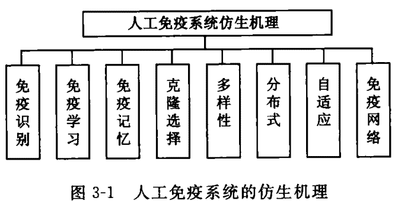

### 3.1.1 免疫识别：Self 与 Nonself 的边界艺术

免疫识别是系统核心职能，亦是AIS基石。其本质是划清“自体”与“非自体”的界限。淋巴细胞表面受体与抗原结合，结合力强弱即亲和度。未成熟T细胞须经胸腺“阴性选择”大考：唯有不对自体反应者方可出关执勤，避免误伤宿主。

AIS中将此映射为特征匹配：设定匹配阈值，引入汉明距离、欧氏距离、R-连续位匹配等度量。阴性选择算法核心在于：编码自体特征构建自体集，随机生成检测器，若检测器匹配自体则淘汰，最终留存的专司监测“非自体”异常。

### 3.1.2 免疫学习：从初识到精通的进阶之路

识别即学习。学习成果体现为：个体亲和度跃升、克隆群体扩张、最优解以记忆细胞形式固化。免疫学习大致分两期：
*   **初次应答（慢学习）**：首遇新抗原，应答周期长，摸索建立识别谱。
*   **再次应答（强化学习/增强式学习）**：凭借免疫记忆，二遇同源或相似抗原，应答提速、高亲和度抗体精准清除。

免疫系统还具**交叉反应**能力——识别结构相似抗原，这在AIS中得到具象化。主要学习路径四条：
1.  **重复强化**：同抗原反复刺激，属增强式学习；
2.  **亲和度成熟**：个体经遗传操作亲和度渐增，属遗传学习；
3.  **低度重复感染**：对应AIS重复训练机制；
4.  **交叉应答/联想记忆**：内外源抗原交叉识别，属联想式学习。

这些机理在AIS机器学习模型构建中大放异彩。

### 3.1.3 免疫记忆：刻蚀时光的智慧晶体

初次邂逅抗原，淋巴细胞需调整识别策略，终以最优抗体形式封存记忆。再次相遇，或遭遇结构相似变体，联想记忆启动，应答实现质变式加速。免疫记忆支撑再次应答与交叉应答，后者正是免疫系统对“似曾相识”抗原的智能泛化。

### 3.1.4 克隆选择：达尔文式筛选的微观演练

N. K. Jerne 奠基之作。核心逻辑：淋巴细胞识别抗原（亲和度超阈值）→ B细胞激活增殖克隆 → 克隆体细胞高频突变 → 分化为效应细胞（抗体工厂）与记忆细胞。

特征鲜明：抗原驱动克隆扩增 → 变异分化多样化效应/记忆细胞 → **亲和度成熟**。即低亲和度个体在克隆-变异-选择循环中“进化”成高亲和精英。本质是微观尺度的“达尔文选择+变异”，可用交叉、变异算子及群体控制机制计算实现。

### 3.1.5 免疫网络：相互识别的立体交响

基于克隆选择学说，Jerne 提出**独特型网络理论**，构建数学框架；Perelson 进而给出概率描述。理论假设免疫系统为细胞/分子构成的调节网：抗体间、细胞间互识互联，抗原识别非孤立事件，而是网络层面的系统性涌现。网络解释了细胞活动、抗体生成、免疫耐受、自我识别、记忆及演化等核心谜题。

### 3.1.6 个体多样性：以小博大的组合数学奇迹

免疫库约 $10^6$ 种受体，却要应对高达 $10^{16}$ 量级的潜在抗原。破解“以寡敌众”靠三大多样性引擎：免疫受体库组合重排、体细胞高频突变、基因转换。

### 3.1.7 分布式与自适应：无中心的韧性架构

免疫器官细胞分布全身，呼应病原分布式入侵特性，天然具备**鲁棒性**——局部受损不垮全盘。淋巴细胞就地学习识别，抗体变异率是常规细胞10倍，亲和度速升，分化为效应/记忆细胞分工清除与记忆。无中央指挥，靠局部交互驱动应答，分布式架构深度强化了系统自适应本能。

## 3.2 人工免疫系统核心模型深度剖析

生物免疫消灭抗原三大支柱：抗体识别精准、激活后定向“进化学习”、记忆驱动再次应答高效。这揭示免疫系统本质是**高效信息处理机器**。

研究聚焦三大机制：克隆选择、亲和力成熟（超变异驱动二次进化）、免疫网络假说。为挖掘信息处理内核、赋能工程应用，计算免疫模型应运而生，成为AIS构建基石。下文细致复盘关键模型。

### 3.2.1 独特型免疫网络模型

1974年，Jerne 创立独特型网络假说：免疫系统乃相互作用分子/细胞编织的恒动网络，无抗原时亦自运行。

抗体识别抗原靠表位-受体匹配；实验证实抗体自身也有表位（独特型），可被他抗体识别。于是网络涌现：抗体受体识别他抗体独特型，被他识别，**每一节点既识别又被识别**。互作双刃剑：刺激与抑制并存（见图 3-2）。

Jerne 以微分方程建模淋巴细胞克隆动态与免疫球蛋白浓度波动。核心洞见：淋巴细胞非孤岛，经抗体互联成网。抗原识别非单一匹配，而是**网络层面的系统级行为**，为免疫网络研究奠基。

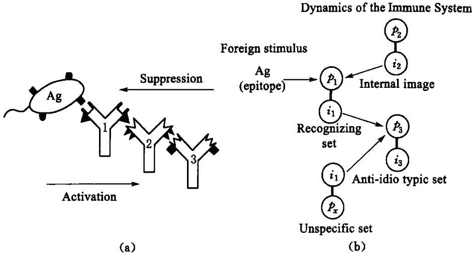

图 3-2 独特型网络示意图
(a) 抗体-抗原、抗体-抗体互作；(b) 独特型网络构成原理

### 3.2.2 人工免疫系统二进制模型

1986年 Farmer 等人奠基之作，开启AIS建模先河。基于网络假说构建动态模型：微分方程群 + 抗体淘汰阈值 + 遗传算子注入新抗体。他们敏锐指出免疫动力学方程同构于分类学习系统，论证免疫模型可用于机器学习——实践验证其远见，该模型成为后续诸多AIS方法蓝本。

模型中，免疫细胞/分子均编码为变长二进制串。抗体受体与表位级联成单一串。两分子任意排列互补匹配，匹配矩阵定义表位 $i$ 与受体 $j$ 的互补度：

# 核心模型：从免疫网络到形状空间的数学描绘

### 3.2.3 抗原抗体为核心的计算免疫模型

想搞懂免疫系统怎么“思考”，光看现象不够，得建模型。各路学者从不同切口切入，构建了形形色色的数学与计算机模虽侧重点各异，但都为后续研究打下了关键基石。

美国新泽西州立大学的 Forrest 教授团队视角独到，他们把免疫系统当成一个**“信息处理系统”**来拆解。为此，他们构建了基于抗原抗体交互的计算模型，并借此深入剖析了免疫识别的多样性、疫苗接种机制等核心特性，完成了大量理论推演与仿真实验。为了让模型跑通，他们做了大胆简化，主要推出了两个版本：

*   **基因库模型（宏观视角）：** 这里的“个体”是一组基因库，包含 $N$ 个库，每库 $M$ 个基因型，基因型是长为 $L$ 的二进制串。抗体表达时，从每个库随机抽一个基因型拼接而成；抗原则是等长二进制串。识别靠**互补匹配**。个体适应度取决于其产生的 $N$ 个抗体与 $K$ 个随机抗原的匹配总分。进化分两层：基因库层面用带交叉的遗传算法，抗体表达层面用不带交叉的版本。注意：评价看抗体表现，但遗传操作作用于基因库，**进化的本质是抗体基因库的优化**。
*   **简化模型（微观视角）：** 直接把“个体”定义为抗体，种群就是抗体集合。遗传操作直接作用于抗体，**进化的主体变成了抗体本身**。

这套模型模拟的正是免疫系统的**模式识别与学习过程**。它抓住了三大免疫特性：针对性调动相关淋巴细胞子集应答；高亲和力抗体竞争性增殖；通过点突变实现抗体亲和力成熟。

### 3.2.4 识别多样性：有限基因库如何覆盖无限抗原？

**识别多样性**是免疫系统的看家本领——有限的抗体基因库，如何应对近乎无限的抗原世界？这被视为免疫系统最基础、最核心的特性之一。

**Oprea 基于现有模型，从信息处理角度破题：** 引入带交叉的遗传算法，发现即使在强噪声下，系统也能捕捉抗原的**“共性”**（通用特征）。抗体数量固定时，抗原越多越杂，搜索越难。改进后的**“多样性算法”**更进一步：抗体数 ≈ 抗原数时，擅长**多峰搜索**（精准识别各类抗原）；抗体数 ≪ 抗原数时，转而进行**共性识别**（提取通用模式）。结论直指本质：免疫多样性 = 物种进化积累的“抗原共性识别” + 个体一生遭遇的“抗原个性识别”。

**Hightower 与 Forrest 引入 “G 变异” 捕捉 Baldwin 效应：** 个体一生中学到的有利性状，后代更易继承。操作上：对不匹配抗体的错位随机变异，若变几位就能达标，哪怕当下没过阈值，也给奖励。实验证明，这种**“对近优个体的容错奖励”**能显著提升搜索效率。

**克隆选择：免疫反应的根本引擎。** 核心逻辑三步走：
1.  **识别激活 → 分化增殖**：亲和力越高，复制越多（克隆扩增）。
2.  **超变异 & 编辑**：复制不完全忠实，引入高频突变（亲和力成熟的源动力）。
3.  **优胜劣汰 & 记忆保留**：高亲和力变异体继续扩增；自反应或无效清体被删除；部分优质抗体转化为**长寿记忆细胞**。

**Perelson 的形状空间理论：给“互补性”量化建模。** 抗体与抗原像锁与钥匙，用参数向量描述“形状特征”，构成高维**形状空间**。空间中一点 = 一种抗体/抗原的结合特征。识别本质 = **向量距离小于阈值（互补性足够）**。一个抗体能识别一片区域内的多种抗原（交叉反应），一个抗原也能被多抗体识别。免疫进化的终极目标：**用最少的抗体点，覆盖几乎整个抗原空间**。

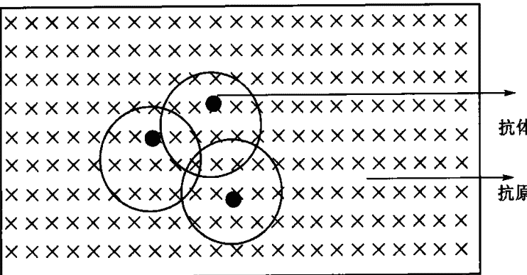

#### 图 3-3 形状空间示意图

图中：方框表示抗原空间，圆表示某一抗体所能识别的抗原范围

理论中两大关键概念：**交叉反应**（一对多、多对一识别）与 **连接阈值**（结合发生的临界互补度）。基于此，**D. J. Smith 等人推导出覆盖整个形状空间所需的抗体最小数量**：

```
N = \text{ceil}\left(\frac{k^L}{C}\right) \quad \text{(3-4)}
```

式中，$k$ 为基因库规模，$L$ 为抗体向量维数。

设连接阈值为 $T$，单抗体覆盖抗原数 $C$ 定义为：

```
C = \sum_{i=0}^{T} \binom{L}{i} = \sum_{i=0}^{T} \frac{L!}{i!(L-i)!} \quad \text{(3-5)}
```

综上，免疫多样性的机制拼图拼凑齐了：**双重进化应对共性与个性**、**受体库基因组合排列**、**不完全匹配的模糊识别**、**克隆选择中的基因重排与超变异**。

### 3.2.5 免疫学习与记忆：天然的“增强学习”系统

免疫系统不只是识别，还得“产出”足量精准抗体消灭病毒。

**初次 vs 二次应答 = 从零学习 vs 调用记忆。** 首次遇敌，仅少量抗体应答，慢且弱；保留记忆细胞后，再次相遇，**记忆细胞极速唤醒，反应更快更猛**。克隆选择 + 亲和力成熟 = **大量复制优质抗体 + 进化出更贴合的新抗体**。这正是机器学习里的**“增强学习”**——任务完成能力随经验持续增强。

**免疫记忆 = 联想记忆 + 鲁棒存储。** 主流解释是 **Jerne 的“独特型网络”理论**：B 细胞间通过独特型（表位）互认（把邻居当抗原），形成**相互刺激/抑制的动态网络**。同类 B 细胞越密集，相互支撑越强，网络结构本身就是**对历史抗原特征的编码**。

记忆细胞不仅认“老熟人”，还认“长得像的”（交叉反应）。这赋予了免疫记忆两大硬核特性：
1.  **模式补全**：输入相关/相似模式，即可恢复完整记忆。
2.  **双重鲁棒**：抗干扰（噪声容忍）+ 抗缺损（残缺输入也能识别）。

**疫苗接种 = 人工植入免疫记忆的实证。** 预先注入抗原/抗体 → 诱导记忆形成 → 实战时极速响应。疫苗防病成功，铁证免疫记忆的存在与价值。

**总结：免疫系统 = 基于动态网络自组织、具备鲁棒增强学习与联想记忆的信息处理系统。** 其“进阶”靠五大引擎：持续遭遇同类/相似抗原、抗体识别机制、克隆选择与超变异驱动的亲和力成熟、强容错联想记忆、动态网络结构支撑的学习存储。

### 3.2.6 人工免疫系统（AIS）通用建模框架

剥离生物细节，抽象出工程通用的 **AIS 基础框架**。三大核心构件：**抗原/抗体表示**、**交互机制**（抗原-抗体、抗体-抗体）、**系统拓扑结构**。映射关系：抗原 ≈ 待解问题/数据；抗体 ≈ 候选解/特征值；亲和度 ≈ 适应度/相似度；系统结构 ≈ 算法流程/网络拓扑。

**标准运行流程六步走：**

1.  **初始化抗体群体**：随机生成或引入先验知识。
2.  **抗原提呈 & 抗体评价（打分核心）**：抗体识别抗原，综合三因素打分（刺激度）：
    *   **抗原激励**：亲和度越高，得分越高（解的质量）。
    *   **浓度抑制**：同类抗体太多扣分（维护种群多样性）。
    *   **网络激励**：抗体间互相激励（维持记忆/网络结构）。
    *   *公式化表达：*
    ```
sl = Mat + Sim - Sup (3-6)
```
    *   权重通常：抗原亲和度主导，网络交互次之。
3.  **记忆更新**：提取当代精英抗体入库，保留最优解。
4.  **终止判断**：记忆库满足精度/条件 → 结束；否则继续。
5.  **亲和力成熟（进化引擎）**：对群体施行**克隆选择 + 超变异**。
    *   *克隆选择*：按刺激度复制（好抗体多留种）。
    *   *超变异*：重组、随机突变制造多样性（区别于 GA：变异率极高、定向性强、服务于亲和力提升）。
6.  **群体更新 & 迭代**：
    *   再评价，淘汰低分抗体（控制规模）。
    *   融合记忆库精英，组建新一代群体 → 回步骤 2。

**框架确定，落地看“七巧板”：** 抗原抗体怎么编码？交互公式怎么定？网络拓扑怎么连？评价函数权重怎么配？记忆库怎么管？停机条件怎么置？亲和力成熟算子怎么设计？**一切取决于具体问题的本质**——搞清问题是什么、目标是什么，把免疫原理“具象化”进去。

**底层逻辑不变：** 在评价函数指引下，抗体反复“练兵”（接触抗原）→ “扩军备战”（克隆）→ “变异求变”（超变异）→ “优胜劣汰”（亲和力成熟）→ 最终沉淀出代表**问题解特征**的**优良记忆细胞**。

---

## 3.3 人工免疫系统在数据挖掘中的实战解析

前文搭建了 AIS 理论骨架，本节聚焦**数据挖掘视角**，拆解 AIS 的信息处理特质与落地形态。

### 3.3.1 生物免疫系统的信息处理“底层逻辑”

#### 3.3.1.1 五大核心功能模块

Forrest 教授指出，免疫系统天然是一个**分布式并行信息处理系统**，标配五大模块：
1.  **多层级识别**（分子/细胞层面的模式匹配）；
2.  **信息存储**（免疫记忆）；
3.  **学习机制**（亲和力成熟/增强学习）；
4.  **多样性生成**（基因重排/超变异）；
5.  **自非自逻辑一致性**（避免攻击自身的识别边界）。

#### 3.3.1.2 硬核处理技术栈

免疫系统用的一套“算法”极其精妙，堪称生物进化版的高性能计算：
*   **亲和力成熟** ≈ 定向优化搜索；
*   **阴性选择** ≈ 异常检测/自我容忍训练；
*   **交叉反应 & 二次应答** ≈ 迁移学习/泛化能力；
*   **海量并行分布式计算** ≈ 每天新生海量受体/淋巴细胞，天然无中心、容错率高；
*   **V 区组合拼装** ≈ 有限资源组合爆炸，解决“基因稀缺 vs 抗原无限”的矛盾。

#### 3.3.1.3 可迁移的五大信息设计原则

从免疫系统抽象出的设计哲学，已渗透进计算机科学：
1.  **多样性（个体+群体双层）**：不同人易感病原不同 → 系统级鲁棒性。
2.  **分布式协作**：局部交互涌现全局保护，**无中心控制、无单点故障、天然容错**（分类/应答出几个错不致命）。
3.  **动态流转**：细胞持续生死更替、全身循环 → 时空维度的多样性与时效性。
4.  **自我保护**：保护身体的机制同步保护免疫系统自身（元免疫）。
5.  **自适应进化**：持续学习新病原、记忆旧病原 → 终身学习能力。

### 3.3.2 AIS 数据挖掘方法族谱速览

国内外学者将上述原理转化为具体挖掘算法，成果丰硕：

*   **高坚**：借用**单亲免疫遗传操作**，攻克超图分割下的**聚类优化**难题。
*   **刘静等**：引入**免疫进化机制**重构目标函数，破解模糊 C-均值聚类**局部收敛 & 初始化敏感**的顽疾。
*   **刘韬等**：利用**免疫竞争机制**筛选最优抗体，定制化设计 **K-均值聚类算法**。
*   **行小帅、焦李成等**：创新**免疫规划/疫苗接种策略**，有效防止种群退化与过早收敛，大幅强化传统 **K-均值** 稳定性。

#### 3.3.2.2 Cooke网络模型

J. E. Hunt 与 D. E. Cooke [20] 创建了一种人工免疫网络系统，并将其引入机器学习领域。该系统融合了 B 细胞动态、刺激度计算、免疫网络理论、基因库机制、变异策略以及适配分类任务的抗体编码串等核心免疫原理。

系统架构呈现为一个 B 细胞构成的网络拓扑。当任意两个 B 细胞间的亲和力跨越预设阈值，便会建立起双向连接。每个 B 细胞个体包含四大核心组件：匹配规则、基因库（负责生成抗体，即 DNA 序列）、多条中间 DNA 序列，以及该细胞专属的刺激度数值。系统中的抗原对应着待学习 DNA 串的表达形式。初始化阶段，系统随机抽取部分训练样本构建 B 细胞网络，剩余数据则组成抗体训练集。

算法执行流程如下：

- (1) 获取抗原群体，随机初始化 B 细胞群体，织就初始网络。
- (2) 从抗原池中随机抽取一个抗原，并将其随机植入网络的某个节点位置。
- (3) 按比例筛选一批 B 细胞作为“接触细胞”，逐一判定其能否与抗原结合，并量化相应的刺激度。
- (4) 若某 B 细胞的刺激度突破阈值，触发克隆机制：
  - ① 若无细胞能与抗原结合，则新生成一个 B 细胞以建立连接；
  - ② 按刺激度对细胞排序，淘汰最末端 5% 的弱势细胞；
  - ③ 重新生成数量为群体 25% 的新 B 细胞（记为 N 个），再从中甄选出占群体 5% 的 M 个细胞接入网络。

依循上述循环，持续向网络投喂训练数据。一旦满足终止判据，即冻结训练并保存最终网络结构。B 细胞间的连接准则如前所述。变异操作手段丰富，涵盖模拟基因选择、折叠重组、嵌入插入、随机点突变等。新生成的 B 细胞若能接入网络则保留，否则剔除。算法中模拟抗体受激刺激度的计算公式如下：

```
sl = c[\sum_{j=1}^{N}m(a,xe_j) - k_1 \sum_{j=1}^{N}m(a,xp_j) + k_2 \sum_{j=1}^{n}m(a,y)] - k_3
```

公式中，首项量化抗原与 B 细胞（抗体）的匹配程度；次项体现抗体间的相互抑制；第三项反映抗体间的协同刺激；末项为抗体的自然衰减率。

该模型借鉴了 B 细胞、免疫网络、克隆扩增与变异等机制，旨在构建多元化的候选解空间。其核心逻辑在于：维持一个承载免疫记忆的 B 细胞网络，在训练数据及邻居节点的双重刺激下，施行克隆与变异操作。该自组织网络不仅能表征学习数据的内在结构，更具备对非训练样本进行分类泛化的能力。

#### 3.3.2.3 资源受限人工免疫系统（RLAIS）

J. Timmis 提出的资源受限人工免疫系统 [21-25] 专注于数据分析场景。模型引入“人工识别球”（ARB）作为 B 细胞的代理。ARB 依据刺激水平动态管理 B 细胞：当某 ARB 失去维持 B 细胞的必要性时，该 ARB 将被移除，从而实现种群规模的高效控制。通过聚合相似的 ARB，RLAIS 能从数据中自动挖掘模式并完成聚类分析。其免疫建模要素包括：

- (1) **抗原与初始网络构建**：将待分析数据二分，一部分作为抗原驱动网络训练，另一部分化身为 ARB 编织初始网络。
- (2) **ARB 三元结构**：由匹配规则、数据项、刺激度组成。单个 ARB 代表一簇同类 B 细胞，网络总细胞数预设固定值。ARB 映射免疫形态空间，数据项是抗体的数据投影，刺激度则度量 ARB 与抗原、ARB 间的亲和关系。
- (3) **网络拓扑生成规则**：预设亲和度阈值 NAT。两个 ARB 亲和力低于 NAT 时建立连接，反之则隔离。
- (4) **刺激度度量**：采用欧氏距离，综合考量 ARB-抗原及 ARB-ARB 间的交互刺激。
- (5) **收敛判据**：网络拓扑趋于稳定结构时，终止训练。

#### 3.3.2.4 aiNET 免疫网络

D. E. Castro 等人设计的 aiNET 网络 [26] 旨在解决无标签数据集的聚类与噪声过滤难题。

- (1) **模型极简化**：模糊 B 细胞与抗体的界限，网络仅保留抗体与抗原两类实体。
- (2) **加权图拓扑**：网络非全连通，节点为抗体，边集赋予权重表征连接强度。
- (3) **竞争性识别机制**：抗原输入触发节点竞争，仅识别成功的抗体能激活网络。
- (4) **动态种群调控**：胜出抗体经历克隆扩增与选择，败者清退。双阈值策略控制规模：以抗体-抗体亲和力为准，设抑制阈值清除冗余低亲和力细胞；以抗原-抗体亲和力为准，设阈值决定克隆应答概率。
- (5) **数据结构表征力**：网络天然具备描述数据拓扑特征的能力。
- (6) **克隆选择与亲和力成熟理论基石**：种群规模动态自适应，支持多目标优化搜索，并能长久保存优质解。

#### 3.3.2.5 其他免疫网络挖掘变体

**E. Hart 与 P. Ross [27]** 洞察免疫记忆与稀疏分布式存储器（SDM）在联想记忆上的同构性，提出自组织稀疏分布存储模型（SOSDM）。其技术路线包含：融合人工免疫与松散分布记忆模型，视免疫记忆为自组织机制；引入协同进化遗传算法驱动系统演化；网络语义映射为“抗原=数据片段”、“抗体=聚类描述”、“同类抗体簇=刺激球定义聚类规模”；初始化模拟自然分布式特性，随机布局分布式数据单元以映射数据空间本质。

**T. Knight 与 J. Timmis [28]** 构建多层免疫网络挖掘框架，将系统分层为自由抗体层、B 细胞层、记忆细胞层，层间交织成网。语义对应为：抗原=待分析数据，自由抗体=初始模式，B 细胞=中间模式，记忆细胞=最终模式。

**T. Sawomir 等 [29]** 实现的网络直接以 n 维实值向量编码抗体/抗原/数据项，亲和度阈值取平均距离，达成数据聚类功能。

**Urszula Kuzelewska [30]** 的自组织免疫网络聚焦聚类挖掘，亮点在于亲和度阈值 NAT 随迭代动态计算，摒弃外部人工干预，从而收敛出稳健的网络结构。

### 3.3.3 人工免疫数据挖掘：特质画像与方法论内核 [31]

纵览全局，基于人工免疫系统的数据分析与挖掘实现框架，可拆解为八大支柱维度：

- （1） **数据项映射**：如何将挖掘问题/数据投射为抗原、抗体或免疫器官。
- （2） **节点与拓扑定义**：节点/连接的语义内涵，刻画网络骨架。
- （3） **网络冷启动**：初始拓扑构建、训练/测试数据向抗原抗体的转化分配。
- （4） **刺激动力学演化**：抗原驱动、邻域协同刺激与抑制的量化机制。
- （5） **刺激驱动的网络进化控制**：基于刺激水平的网络规模调节策略。
- （6） **克隆策略与速率设定**：单节点克隆模式与频率的决策逻辑。
- （7） **种群全生命周期管理**：训练期与测试期的边界划分与种群调控。
- （8） **收敛判据与语义解码**：停机条件选取及结果网络的业务解释。

此外，阈值体系的精细化设计至关重要：修剪时机、节点合并触发点、控制参数的丰度与自组织特性的博弈平衡。

#### 3.3.3.1 核心特质：为何选免疫？

人工免疫系统自带高性能信息处理基因，彰显五大鲜明特质：

- （1） **并行分布式计算范式**：抗体-抗原相互作用网络天然支持高并发、分布式信息速处理。
- （2） **网络化知识表征**：以网络拓扑承载学习过程与结果的双重表达。
- （3） **小规模架构处理大规模数据**：精简组织单元高效存储海量模式知识。
- （4） **动态网络赋能持续学习**：记忆保持与快速响应耦合，支撑终身学习。
- （5） **模式驱动的处理范式**：天然契合分类、聚类、关联分析等模式识别核心任务。

#### 3.3.3.2 方法论基本范式：怎么用免疫？

将免疫原理落地数据挖掘，通常遵循七步走战略：

- (1) **编码先行**：选取适配编码方式重述问题信息，降低识别处理复杂度。
- (2) **柔性匹配驱动学习**：引入互补匹配、不完全匹配等机制，拓宽识别边界。
- (3) **刺激度调控识别流**：利用刺激度机制作为“阀门”，筛选提炼泛化模式。
- (4) **克隆变异双引擎**：克隆固化优质模式，变异注入多样性源头活水。
- (5) **网络拓扑赋能分布式智能**：节点间交互编织网络，落地分布式处理与存储。
- (6) **动态拓扑支撑增量演化**：网络随知識更新重构，陈旧无刺激模式自动淘汰，实现知识新陈代谢。
- (7) **免疫记忆加速冷启动**：利用先验知识优化初始网络，引导后续学习收敛。

## 3.4 章末综述

本章系统梳理了人工免疫系统的仿生根基，深度剖析了经典模型谱系，厘清了生物免疫机理向计算模型的迁移路径与方法论。基于对生物免疫信息处理特性的洞见，细致考察了典型人工免疫系统在数据挖掘落地中的应用图景与核心范式。提炼出的 AIS 基础框架及其挖掘方法基本范式，为后续研究铺就基石。

**AIS 基础框架范式**：在抗体刺激度引导下，抗体反复与抗原博弈，历经亲和力成熟迭代，终获能表征问题解特征的优质抗体种群。

**免疫数据挖掘方法范式**：立足网络拓扑，施行并行分布式计算；以网络形态表达结果；以精简架构驾驭海量信息；以动态网络机制践行可持续学习。

# 参考文献

- [1] CASTRO D E, ZUBEN V. Artificial Immune Systems: Part I-Basic Theory and Applications[R/OL]. Technical Report-RT DCA 01/99. http://www.dca.fee.unicamp.br.

- [2] 林学颜，张玲. 现代细胞与分子免疫学[M]. 北京：科学出版社，1999.

- [3] JERNE N K. The immune system[J]. Scientific American，1973，229(1)：51-60.

- [4] DASGUPTA D, Yu S, MAJUMDAR N S. MILA—Multilevel Immune Learning Algorithm[C]. In the proceedings of the Genetic and Evolutionary Computation Conference ( GECCO ), Chicago，July 12-16，2003；468-474.

- [5] JERNE N K. Towards a network theory of the immune system[J]. Annual Immunology，1974，125C：373-389.

- [6] PERELSON A. Immune network theory [J]. Immunological Review，1989，110：5-36.

- [7] FARMER J D, PACKARD N H, PERELSON A S. The immune system，adaptation and machine learning[J]. Physica D，1986，22：87-204.

- [8] FORRET S，HOFMEYR S A. Immunology as information processing [M]. In：Segel and Cohen eds. Design Principles for the Immune System and other Distributed Autonomous Systems. USA：Oxford University Press，2000.

- [9] OPREA M. Antibody Repertoires and Pathogen Recognition：The role of germline diversity and somatic hypermutation[D]. Univ. of New Mexico. Albuquerque, NM. 1999.

- [10] HIGHTOWER R, FORREST S, PERELSON A. The Baldwin effect in the immune system:learning by somatic hypermutation[M]. In Mitchell M, Belew R (eds) Adaptive Individuals Evolving Populations, Models and Algorithms, Addison-Wesley, 1996.

- [11] PERELSON A S, OSTER G F. Theoretical Studies of Clonal Selection : Minimal Antibody Repertoire Size and Reliability of Self-Nonself Discrimination [J]. Theor. Biol. , 1979(81) :645-670.

- [12] SMITH D J, FORREST S, HIGHTOWER R, et al. Deriving Shape Space Parameters from Immunological Data [J]. Theor. Biol. , 1997, 189 :141-150.

- [13] TIMMIS J. Visualising artificial immune networks[A]. Technical Report UWA-DCS-00-034, University of Wales and Aberystwyth, 2000.

- [14] FORREST S, HOFMEYR S A, SOMAYAJI A . Computer immunology [J]. Communications of the ACM, 1997, 40(10) :88-96.

- [15] 高坚. 用基于免疫机制的单亲遗传算法求解数据聚类优化问题[J]. 计算机工程与应用, 2003, 39(12) :89-90.

- [16] 刘静, 钟伟才, 刘芳, 等. 免疫进化聚类算法[J]. 电子学报, 2001, 29 (12A) :1897-1901.

- [17] 刘韬, 王耀才, 王致杰. 一种基于人工免疫系统的聚类算法[J]. 计算机工程与应用, 2005, 40(19) :182-184.

- [18] 行小帅, 潘进, 焦李成. 免疫规划 + K 均值混合聚类算法[J]. 计算机科学, 2003, 30(4) :150-152, 158.

- [19] 行小帅, 潘进, 焦李成. 基于免疫规划的 k-means 聚类算法[J]. 计算机学报, 2003, 26(5) :605-610.

- [20] HUNT J E, COOKE D E. Learning using an artificial immune system [J]. Journal of Network and Computer Applications, 1996, 19 (2) : 189-212.

- [21] TIMMIS J, NEAL M. A resource limited artificial immune system for data analysis[J]. Knowledge Based Systems, 2001, 14(3-4) :121-130.

- [22] TIMMIS J, NEAL M, HUNT J. Data analysis with artificial immune systems and cluster analysis and kohonen networks; Some comparisons [C]. In Proc. of Int. Conf. Systems and Man and Cybernetics, pages 922-927, Tokyo, Japan, 1999. IEEE.

- [23] TIMMIS J. On parameter adjustment of the immune inspired machine learning algorithm AINE[R]. Technical Report 12-00, Computing Laboratory, University of Kent at Canterbury, Canterbury, Kent. CT2 7NF. , November 2000.

- [24] TIMMIS J, NEAL M. Investigating the evolution and stability of a resource limited artificial immune system[M]. In Wu A S, editor, Special Workshop on Artificial Immune Systems, Genetic and Evolutionary Computation Conference (GECCO) 2000, Workshop Program, pages 40-41, Las Vegas, Nevada, U.S.A. , July 2000. AAAI, AAAI Press.

# 第 4 章 距离浓度免疫算法（DCAIA）：破解早熟困局的新范式

## 核心参考文献速览

本章理论构建立足于以下经典与前沿成果：

- **[25]** Knight T, Timmis J. (2001). 资源受限型人工免疫系统 AINE 性能评估 [技术报告]. Canterbury, Kent.
- **[26]** Castro D E, Zuben V. (2000). 用于数据聚类的进化免疫网络 [C]. IEEE SBRN'00 全文预印版, 84-89.
- **[27]** Hart E, Ross D. (2002). 免疫学与稀疏分布式记忆的类比：面向非平稳数据聚类的系统 [C]. ICARIS 2002, 英国肯特大学.
- **[28]** Knight T, Timmis J. (2002). 面向数据挖掘的多层免疫启发式方法 [C]. 第 4 届软计算最新进展国际会议, 英国诺丁汉, 266-271.
- **[29]** Sawomir T, Urszula Kuzelewska. 人工免疫系统中的自适应聚类形成 [J/OL]. http://neuro.bstu.by/our/stw_uk.pdf.
- **[30]** Urszula Kuzelewska 等. (2002). 人工免疫系统中的稳定聚类形成 [C]. ICARIS 2002, 英国肯特大学.
- **[31]** 刘韬 等. (2006). 人工免疫数据挖掘方法的分析与展望 [J]. 计算机工程与设计, 2: 689-696.

---

## 4.1 免疫算法设计范式深度解析

### 4.1.1 核心机理与两大设计流派

在人工免疫系统的各类构造形态中，免疫算法无疑是应用面最广、关注度最高的核心模块。绝大多数免疫算法都被部署在全局优化场景下，涵盖组合优化、函数优化、神经网络参数调优等领域。鉴于其重要地位，我们有必要对算法的构造逻辑与应用实践展开深度探讨。本章将在梳理免疫算法机理与设计方法的基础上，针对基于信息熵免疫算法的短板，提出一种基于距离浓度的免疫算法，并对其收敛性能进行理论分析。

简单说，免疫算法就是仿照生物免疫系统“识别多样性”的本能，设计出来的一类新型计算方法。在具体构造时，主要借鉴了生物免疫识别的以下五大核心机制：

1.  **编码表达**：模拟基因与表现型的对应关系，用合适的编码方式表达信息，便于识别与处理。
2.  **互补匹配**：仿照抗原抗体的结合模式，采用简单的互补匹配实现模式识别。
3.  **不完全匹配与刺激阈值**：引入不完全匹配机制，配合刺激度阈值控制识别流程，兼顾泛化能力与识别范围。
4.  **克隆选择与超突变**：模拟免疫应答中的克隆扩增与高频突变，通过选择性克隆保留优秀模式、生成多样化模式。
5.  **免疫记忆机制**：保留特定问题的求解结果、特征参数，作为同类问题再次求解时的“热启动”初始解，大幅提速。

免疫算法的命门在于**学习机制**的设计。主流设计路线分为两派：

- **派系一：结构仿真派**。力求将人工免疫系统构建得酷似自然免疫系统结构，按“检测入侵 → 产生抗体 → 复制 → 变异交叉”的自然流程走。
- **派系二：输入输出等效派**。不纠结结构是否相似，只关注面对相同有害输入（病毒/数据）时，输出结果是否一致。此派侧重数据层面的分析建模，而非流程上的直接模拟。

鉴于免疫机制与进化机制渊源颇深，免疫算法往往引入进化计算手段辅助优化求解。

在具体借鉴上，现有算法并未穷尽上述所有特性，各有取舍。但核心目标高度一致：**利用免疫系统的多样性维持机制，保持解群体多样性，攻克传统优化（尤其是多峰函数）最头疼的“早熟收敛”难题，最终锁定全局最优解。**

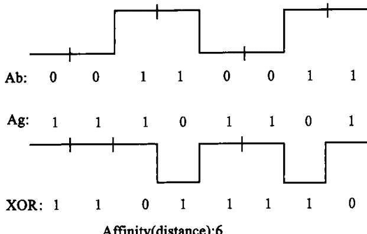

图 4-1 抗体的二进制编码

### 4.1.2 免疫算法 vs 遗传算法：本质分野在“群体更新策略”

#### 遗传算法（GA）速览

提到遗传算法（GA），不得不提 1975 年霍兰德教授在密歇根大学奠定的基石。GA 基于自然选择与种群遗传学原理，遵循“优胜劣汰、适者生存”法则，是一种高并行、随机启发式的全局搜索算法，具备全局性、鲁棒性、自适应性等特质，为数学手段难解的复杂优化问题提供了新出路，但也饱受“早熟”困扰。

GA 将求解过程映射为“染色体”的生存竞争：随机初始化种群 → 评价适应度 → 按概率复制、交叉、变异 → 代代进化 → 收敛至“最适应环境”的个体。标准流程可概括为：初始化 → 判断收敛 → 选择复制 → 交叉 → 变异 → 循环迭代。

#### 四大核心差异对比

免疫算法中，待解问题对应“抗原”，候选解对应“抗体”。两者同源于随机初始群体，均通过复制、变异等算子迭代优化。但本质分野在于**群体更新策略**：

| 维度 | 遗传算法 (GA) | 免疫算法 (IA) |
| :--- | :--- | :--- |
| **搜索目标** | 单一全局最优解 | **多峰函数的多个极值点** (兼顾全局最优) |
| **评价标准** | 仅凭适应度 (单一维度) | **适应度 (亲和度) + 个体浓度** (双维度综合判断) |
| **核心算子侧重** | 变异为主、交叉为辅 (保平稳收敛) | **克隆变异为主、极少/不用交叉** (强制维持多样性) |
| **记忆机制** | 无记忆库概念 | **引入记忆库** 存储优良解与特征参数，实现跨任务知识迁移与加速 |

**结论显而易见**：GA 仅凭适应度复制，易陷局部最优；IA 引入“浓度”抑制机制，强制维持群体多样性。**研究免疫算法，正是克服 GA 多样性保持不足、易早熟的有效突围路径。**

---

## 4.2 信息熵免疫算法：有亮点，但短板硬伤

### 4.2.1 从二进制异或到信息熵：原理回顾

免疫系统通过识别抗原基因产生抗体，再通过识别抗体基因调节浓度。抗原抗体、抗体抗体间的基因匹配度即“亲和度”。因此，**如何编码抗体/抗原、如何计算亲和度**，是算法设计的关键一招。

早期研究采用等长二进制串编码，亲和度用异或运算得出。J. S. Chun 团队拓展了编码方式，引入**信息熵**计算亲和度，由此诞生“基于信息熵的免疫算法”。

在该框架下：抗原 = 待解问题，抗体 = 候选解。假设有 $N$ 个抗体，每个含 $M$ 个基因位，字符集大小为 $S$（二进制则 $S=2$）。

$$H(\eta) = \frac{1}{M} \sum_{j=1}^M H_j(\eta)$$

图 4-2 抗体的字符集编码

第 $j$ 个基因位的信息熵 $H_j(\eta)$ 定义为：
$$ H_j(\eta) = \sum_{i=1}^{s} - P_{ij} \lg P_{ij} $$
其中 $P_{ij}$ 为字符集中第 $i$ 个符号在第 $j$ 基因座出现的频率。若参与比较的 $\eta$ 个抗体在该基因座字符全同，则 $H_j(\eta)=0$。抗体群多样性的平均信息熵 $H(\eta)$ 计算如下：

$$A_{vw} = \frac{1}{1 + H(2)}$$ (4-2)

通常取 $\eta=2$，任意两抗体 $v,w$ 间亲和度：

$$c_v = \frac{1}{N} \sum_{w=1}^N ac_{v,w}$$ (4-3)

$A_{vw} \in (0,1)$，值越大越相似，$=1$ 则完全相同。

给定抗体群中，抗体 $v$ 的浓度定义为：
式中 $ac_{v,w}$ 为相似性判断函数，阈值 $T_{\alpha 1}$ 决定是否“相似”。算出浓度后，即可通过选择机制实施促进/抑制调节。

Chun 成果应用广泛，如张军等将其引入人工神经网络设计。选择概率 $P_i$ 融合适应度概率 $P_{f_i}$ 与浓度抑制概率 $P_{d_i}$：
$$ P_i = \alpha P_{f_i} + (1 - \alpha)P_{d_i} = \alpha \frac{f_i}{\sum f_i} + (1 - \alpha) \cdot e^{-d_i} \quad (4-5) $$
$\alpha$ 为调节因子。公式揭示：**适应度高者优先选，浓度高者被抑制**，兼顾精英保留与多样性。完整流程见图 4-3。

> **图 4-3 基于信息熵的免疫算法流程**
> (抗原输入 → 初始抗体 → 计算适应度概率 → 计算浓度概率 → 抑制/促进 → 抗体生成(交叉/变异/多样性保持) → 更新群体 → 判断终止)

### 4.2.2 三大痛点制约实战表现

基于信息熵的免疫算法亮点显著：引入记忆单元保全局最优；亲和度与浓度计算还原真实免疫多样性；促进/抑制机制体现自我调节。但**短板同样硬伤**：

1.  **超参数强依赖经验**：公式含 $T_{\alpha 1}$ 等常数需经验预设，选得好坏直接定收敛生死。
2.  **信息熵度量失真案例**：如抗体 $v=[01111111]$, $w=[10000000]$，算得平均信息熵 $H_v(2)=0.693, H_w(2)=0.591$，判定“极不相似”。但在优化空间里，这俩解其实**极其接近**——度量方式与优化几何不匹配。
3.  **记忆库“只存不用”**：虽设记忆库存优良解，但迭代竞争时未调用历史精英，仅作归档，白白浪费了加速收敛的良机。

---

## 4.3 DCAIA 登场：基于距离浓度的全新群体更新策略

针对信息熵计算亲和度与浓度的上述痛点，本章提出**基于距离浓度的群体更新策略**，并据此设计**距离浓度人工免疫算法**，旨在补齐短板、丰富算法谱系。

### 4.3.1 生物免疫机理的四大借鉴点

DCAIA 的设计灵感源自生物免疫系统的四大核心特性：

1.  **表位-受体匹配**：抗体识别抗原基于表位与受体的匹配度，亲和度决定匹配深浅。
2.  **以少御多与浓度稳态**：极少种类抗体识别海量抗原，靠个体多样性实现；同种抗体浓度受限，过高则抑制，过低则繁殖，动态平衡保多样性。
3.  **克隆高频突变**：抗体繁殖伴随超突变（克隆变异），扩充识别谱系，消灭多样抗原。
4.  **免疫记忆与亲和度成熟**：识别过程产生记忆，二次响应更快；经克隆变异与学习，抗体亲和度逐代成熟，匹配度持续提升。

### 4.3.2 亲和度函数重新定义：二进制位串视角

#### 4.3.2.1 二进制互补视角下的亲和度

若用二进制互补关系表征亲和性：抗体决定基 $p$，抗原决定基 $e$。例：$p=011010, e=100100$，异或 $p \oplus e = 111110$，匹配位数 5，串长 6，亲和度 $5/6$。

引入亲和门限 $T_s$：设 $l_e, l_p$ 为抗原/抗体串长，若 $\min(l_e, l_p) > T_s$，则判定亲和、发生作用；否则无亲和。

依托 Farmer 模型，定义作用关系函数组：

1.  **截断函数** $G(x) = \begin{cases} x & x > 0 \\ 0 & \text{其他} \end{cases}$ (4-6)

2.  **亲和度计算两模式**：
    - $e_i(n)$ 为第 $i$ 个抗原第 $n$ 位值，$p_j(n)$ 为第 $j$ 个抗体第 $n$ 位值，$\wedge$ 为异或。
    - **① 单一亲和性（位置敏感）**：抗体抗原按位对应互补，$e_1 \leftrightarrow p_1 \cdots e_n \leftrightarrow p_n$。设亲和门限 $s$，亲和系数 $E_{i,j}$ 为：
    $$ E_{i,j} = G[\sum_n e_i(n) \wedge p_j(n) - s] + 1 \quad (4-7) $$

# 基于距离浓度的免疫算法：核心机制与收敛性解析

## 4.3.2 抗体-抗原亲和机制建模

### 多样化亲和识别模式
免疫识别并非死板的“锁钥”匹配。抗体与抗原可在多种对齐方式下发生亲和反应，只要模式类型吻合，无论位置偏移如何，均可触发结合。这种**位置无关的多模式匹配**特性，极大地丰富了反应路径。我们用亲和系数 $E_{i,j}$ 量化这一过程：

$$ E_{i,j} = \sum_k G[\sum_n e_i(n+k) \wedge p_j(n) - s] + 1 \tag{4-8} $$

亲和度的计算窗口 $k$ 由序列长度与门限值决定：

$$ k : \{k \leqslant | \min(l_e, l_p) | - s \} \tag{4-9} $$

该窗口界定了有效比对区间。若抗体、抗原位串长均为8，门限 $s=6$，则仅需在 $-2 \leqslant k \leqslant 2$ 范围内滑动比对（即 $e_1 \leftrightarrow p_3$ 至 $e_6 \leftrightarrow p_8$，再到 $e_3 \leftrightarrow p_1$ 至 $e_8 \leftrightarrow p_6$）。公式 (4-7)、(4-8) 累加了所有对齐方式下的亲和度，**匹配方式越多元，反应强度越强**。

### 免疫算法中的映射语义
在算法设计中，**待解问题 $\leftarrow$ 抗原**，**候选解 $\leftarrow$ 抗体**，**目标函数值 $\leftarrow$ 亲和度**。
*   亲和发生 $\Rightarrow$ 逼近最优解；
*   亲和度达 1（完全融合）$\Rightarrow$ 觅得全局最优；
*   **浓度过高 $\Rightarrow$ 种群多样性丧失 $\Rightarrow$ 早熟收敛（尤甚于多峰函数）**。

因此，引入**浓度抑制机制**至关重要：限制同质抗体比例，维持种群活力，加速亲和成熟进程。

---

## 4.3.2.2 通用亲和度函数构建

二进制编码虽适用于字符串匹配类问题（如配词问题），但在连续函数优化中显得笨拙、不直观。为此，我们构建**连续亲和度函数**，拓展算法适用边界。

**核心思想**：将抗体视为解空间，亲和度即目标函数最优值的度量。连续函数极小值问题形式化为数据对 $(S, f)$，其中 $S \subset \mathbb{R}^n$ 为有界域，$f: S \to \mathbb{R}$。求解目标转化为寻找 $x_{min}$ 使 $\forall x \in S: f(x_{min}) \le f(x)$（极大值可转化处理）。

**映射关系确立**：
*   抗原 $\leftarrow$ 问题实例 $X$
*   抗体 $\leftarrow$ 候选解 $x_i$
*   亲和度 $\leftarrow$ 目标函数值 $f(x_i)$
*   $n$ 个抗体构成免疫系统集合 $X$

亲和度函数定义为归一化映射：

$$ D(x) = \frac{1}{1 + L[f(u)]} \tag{4-10} $$

其中 $L(*)$ 为比例变换算子（线性 $y=kx+b$、幂次 $y=a^x$ 等），旨在将目标函数值压缩至 $[0,1]$ 区间。本文采用**线性归一化**策略：

$$ f'(x_i) = \frac{f_{max} - f(x_i)}{f_{max} - f_{min}} \tag{4-11} $$

$f_{max}, f_{min}$ 为当代种群适应度极值。最终亲和度表达式为：

$$ D(x_i) = \frac{1}{1 + f'(x_i)} \tag{4-12} $$

此设计保证：目标函数值越小（优化问题中通常求最小），亲和度越接近 1。

---

## 4.3.3 距离浓度：一种无阈值的多样性度量

### 缺陷与动机
传统浓度计算多依赖信息熵（误差大）或亲和度距离（间接）、或设定欧氏距离阈值统计个数（参数敏感、流程繁琐）。我们提出**基于几何距离的直接浓度定义**，无需先验阈值。

### 数学定义
设非空免疫系统集合 $S$ 含 $n$ 个抗体（解 $x_i$）。定义单抗体 $x_i$ 到其余抗体的距离和：

$$ d_i = d(x_i) = \sum_{j=1, j \neq i}^{n} \| x_i - x_j \| \tag{4-13} $$

全体抗体两两距离总和：

$$ d = \sum_{i=1}^{n} d(x_i) = \sum_{i=1}^{n} \sum_{j=1, j \neq i}^{n} \| x_i - x_j \| \tag{4-14} $$

**距离浓度**定义为归一化互补距离：

$$ C(x_i) = 1 - \frac{d_i}{d} = 1 - \frac{\sum_{j=1, j \neq i}^{n} \| x_i - x_j \|}{\sum_{i=1}^{n} \sum_{j=1, j \neq i}^{n} \| x_i - x_j \|} \tag{4-15} $$

**物理意义直观**：个体与群体几何中心越近（距离和 $d_i$ 越小），浓度 $C(x_i)$ 趋近 1（高密度）；反之越稀疏，浓度趋近 0。

### 优势总结
1.  **保真多样性**：直接反映解空间几何分布，防止过早聚集；
2.  **免参数化**：无需设定相似性阈值，规避人为调参陷阱；
3.  **计算高效**：避免信息熵估计误差，优于基于亲和度距离的间接法；
4.  **天然适配实数编码**：为后续非均匀变异提供几何基础，增强跳出局部最优能力。

---

## 4.3.4 期望克隆率：亲和与浓度的博弈

免疫克隆遵循“优胜劣汗、稀缺优先”原则：**克隆率 $\propto$ 亲和度，$\propto 1/$ 浓度**。

$$ E(x_i) = \frac{D(x_i)}{C(x_i)} \tag{4-16} $$

高亲和低浓度个体获得繁殖特权，克隆后随即进入变异环节。

---

## 4.3.5 抗体变异策略：编码与算子的双轨制

算法支持两套编码-变异体系，适配不同问题景观：

### (1) 二进制编码体系
*   **单点变异**：随机选取一基因座翻转。
*   **一致变异**：对全基因组以等概率逐位翻转。

### (2) 实数编码体系（核心推荐）
针对连续优化，采用**实数交叉 + 非均匀变异**，操作灵活、收敛细致。

**实数交叉组合**：
选取父代 $v_1, v_2$，生成子代：
$$ v_1' = v_1 + (1 - \lambda)v_2, \quad v_2' = v_2 + (1 - \lambda)v_1, \quad \lambda \in (0, 1] $$

**非均匀变异**：
对父代 $v$ 的第 $k$ 维分量 $a_k$ 施加时变扰动：
$$ a_k' = a_k \pm \Delta(t, \text{bound} - a_k) $$
扰动幅度 $\Delta(t, y)$ 随代数 $t$ 衰减至 0，典型取式：
$$ \Delta(t, y) = y \cdot r \cdot (1 - \frac{t}{T})^b \tag{4-21} $$
$r \in [0,1]$ 随机因子，$T$ 最大迭代代数，$b$ 非均匀度参数。
**特性**：早期大步探索，晚期微调开发，平衡全局搜索与局部收敛。

---

## 4.3.6 记忆细胞与亲和成熟：精英保留与终止判决

### 记忆细胞库更新
克隆群 $A_k$ 与变异群 $B_k$ 合并为 $C_k$。从中筛选亲和度最高的 $M$ 个抗体，刷新容量固定为 $M$ 的记忆库，**始终保存历史最优解集**。

### 亲和成熟与代际更替
*   **终止判据**：达到最大代数，或连续若干代最优亲和度停滞 $\rightarrow$ 输出记忆库最优解，停机。
*   **下一代选拔（比例保留 + 轮盘赌）**：
    初始规模 $N+M$。计算全体期望克隆率 $E(x_i)$，降序排列。保留前 $M$ 精英入库，前 $N$ 个体组成父代。从 $C_k$ 中按 $E(x_i)$ 轮盘赌采样 $N$ 个体，与记忆库 $M$ 个体合成新一代 $(N+M)$ 种群。

### 算法综合优势
克服传统免疫算法“参数繁琐、亲和度误差、阈值依赖”三大顽疾；实数编码直观高效；距离浓度天然支撑非均匀变异，**显著提升收敛速度与抗早熟鲁棒性**。

---

## 4.3.7 算法标准化流程

| 步骤 | 核心动作 | 关键公式/操作 |
| :--- | :--- | :--- |
| **Step 1** | **问题建模** | $X \leftarrow$ 抗原, $x_i \leftarrow$ 抗体, $f(x_i) \leftarrow$ 亲和度 |
| **Step 2** | **初始化** | 随机生成 $N$ 普通抗体 + $M$ 记忆抗体 |
| **Step 3** | **适应度评价** | 计算 $C(x_i)$ (4-15), $D(x_i)$ (4-12), $E(x_i)$ (4-16) |
| **Step 4** | **父代/记忆库构建** | 按 $E(x_i)$ 降序：前 $N \rightarrow$ 父代，前 $M \rightarrow$ 记忆库 |
| **Step 5** | **终止判定** | 达代数上限 或 连续停滞 $\rightarrow$ 输出最优解 **End** |
| **Step 6** | **增殖分化** | 父代执行变异 (二进制/实数非均匀) $\rightarrow$ 生成子代，合并父代形成新群 |
| **Step 7** | **循环迭代** | 跳转 **Step 3** |

> **流程图逻辑**：问题表示 $\rightarrow$ 初始群 $(N+M)$ $\rightarrow$ 评价 $(C, D)$ $\rightarrow$ 增殖分化 $\rightarrow$ 排序/精英保留 $\rightarrow$ 判终 $\rightarrow$ 循环/输出。

---

## 4.4 收敛性理论分析：Markov 链视角

### 4.4.1 状态空间与转移建模

#### 状态空间定义
*   **解状态空间 $\Phi$**：全体抗体个体集，维数 $|\Phi| < \infty$。
*   **种群状态空间 $\Lambda$**：从 $\Phi$ 中有放回抽取 $n$ 个个体组成的有序种群集。$|\Lambda| = |\Phi|^n$。
*   *例*：$\Phi = \{x_1, x_2, x_3\}, n=2 \Rightarrow \Lambda$ 含 9 个状态（如 $\{x_1,x_2\}, \{x_2,x_1\}$ 视为不同状态）。

#### 种群状态转移分解：$P = S \cdot C \cdot M$
每一代演化包含三个串联子过程，均构成有限齐次 Markov 链。

**① 浓度调节算子 $S$ (Selection by Concentration)**
将种群 $p_i^{(t)}$ 按 $E(x_i)=D/C$ 选优得 $s_l^{(t)}$。
个体选中概率 $E(x_i) > 0 \Rightarrow$ 状态自跃概率 $S_{ii} = \prod_{i=1}^n E(x_i) > 0$。
$\Rightarrow$ **$S$ 为严格正矩阵**。

**② 增殖算子 $C$ (Cloning/Proliferation)**
将选中种群 $s_l^{(t)}$ 按比例复制扩展为 $c_q^{(t)}$。
满足 $c_{lq} \ge 0, \sum_q c_{lq} = 1$。
$\Rightarrow$ **$C$ 为随机矩阵**。

**③ 分化算子 $M$ (Mutation/Differentiation)**
假设二进制编码长 $l$，海明距离 $H_{ij}$。单个体变异概率 $P(x_i \to x_j) = p_m^{H_{ij}}(1-p_m)^{l-H_{ij}} > 0$ ($p_m \in (0,1)$)。
种群级转移概率 $m_{qj} = \prod_{i=1}^n P(x_i \to x_j) > 0$。
$\Rightarrow$ **$M$ 为严格正矩阵**。

**综合转移**：$P = SCM$。新种群 $p_j^{(t+1)} = m_i^{(t)}$，循环往复。

#### 记忆细胞状态转移
算法内嵌**精英保留机制**：
第 $t$ 代从 $p_i^{(t)}$ 提取最优 $x^*(t)$；
第 $t+1$ 代从 $p_j^{(t+1)}$ 提取最优，与 $x^*(t)$ 比较，取优存为 $x^*(t+1)$。
此过程单调非降，保证全局最优解不丢失，为收敛证明奠定基石。

### 4.4.2 基于距离浓度免疫算法的收敛性分析

**定理 4.1** 由距离浓度免疫算法构建的马尔可夫链具备遍历性，且存在平稳分布。

**证明** 算法的状态转移矩阵可表示为 $P = SCM$。依据 Chapman-Kolmogorov 公式，单步转移概率计算如下：

$$ P_{ij} = \sum_{q=1}^{|\Lambda|} \left( \sum_{l=1}^{|\Lambda|} s_{il} \cdot c_{lq} \right) m_{qj} \tag{4-30} $$

根据式(4-23)，$s_{il} > 0$ 恒成立，故存在常数 $\epsilon$ 使得 $s_{il} \geqslant \epsilon$。代入式(4-24)与式(4-27)可得：

$$ P_{ij} \geqslant \sum_{q=1}^{|\Lambda|} \left( \sum_{l=1}^{|\Lambda|} \epsilon \cdot c_{lq} \right) m_{qj} = \epsilon \cdot \sum_{q=1}^{|\Lambda|} m_{qj} > 0 \tag{4-31} $$

文献[28]指出，严格正的状态转移矩阵 **P** 意味着该马尔可夫链在种群状态空间上是遍历的，并拥有平稳分布。

**定义 4.1** 记 $F_k$ 为第 $k$ 代种群中最优抗体对应的抗原，$F^*$ 为目标全局最优抗原。若满足 $\lim_{k \to \infty} P(F_k = F^*) = 1$，则称该算法实现全局收敛。

**定理 4.2** 基于距离浓度的免疫算法以概率 1 全局收敛。

**证明** 定理 4.1 已证得马尔可夫链在种群空间遍历，故算法能搜遍解空间 $\Phi$ 上所有抗体。免疫记忆细胞操作独立于浓度调节、增殖分化过程，不改变种群状态空间。依据式(4-29)，将状态按优劣递减排序后，记忆细胞转移矩阵 $\mathbf{E}$ 具有特定下三角结构：

$$ \mathbf{E} = \begin{bmatrix} e_{11} & 0 & \cdots & 0 \\ e_{21} & e_{22} & \cdots & 0 \\ \vdots & \vdots & \ddots & \vdots \\ e_{|\Phi|1} & e_{|\Phi|2} & \cdots & e_{|\Phi||\Phi|} \end{bmatrix} = \begin{bmatrix} \mathbf{C} & \mathbf{0} \\ \mathbf{R} & \mathbf{T} \end{bmatrix} \tag{4-32} $$

其中 $\mathbf{C}=[e_{11}]=[1]$ 为一阶正随机矩阵，$\mathbf{R}, \mathbf{T} \neq \mathbf{0}$。因 **P** 可约，极限矩阵推导得：

$$ \mathbf{E}^\infty = \lim_{k \to \infty} \mathbf{E}^k = \begin{bmatrix} \mathbf{C}^\infty & \mathbf{0} \\ \mathbf{R}^\infty & \mathbf{0} \end{bmatrix} = \begin{bmatrix} 1 & 0 \\ \mathbf{R}^\infty & 0 \end{bmatrix} \tag{4-33} $$

即第一状态（全局最优）极限概率为 1：

$$ e_{11} = \lim_{k \to \infty} P(F_k = F^*) = 1 \tag{4-34} $$

结合定义 4.1，算法全局收敛得证。

## 4.5 仿真实验与结果分析

采用所提基于距离浓度免疫算法（DCAIA）求解三个典型多峰函数，并与标准遗传算法（GA）、基于信息熵的传统人工免疫算法（CAIA）对比。

#### (1) Shekel's Foxholes 函数测试
函数表达式：
$$ f_1(x) = 0.002 + \sum_{j=1}^{25} \frac{1}{j + \sum_{i=1}^2 (x_i - a_{ij})^6} \tag{4-35} $$
参数矩阵 $a_{ij}$ 同素材。该函数含 25 个局部极大值（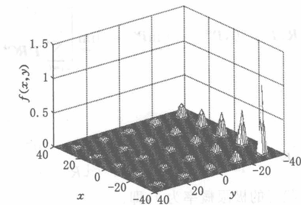），仅在 $(-32, -32)$ 处取得全局最大值 1.002。

**参数设置**：变量范围 $[-65.536, 65.536]$，种群规模 100。DCAIA 用实数编码；GA 与 CAIA 用 16 位二进制编码，$P_c=0.9, P_m=0.05$。结果见表 4-1 与图 4-6（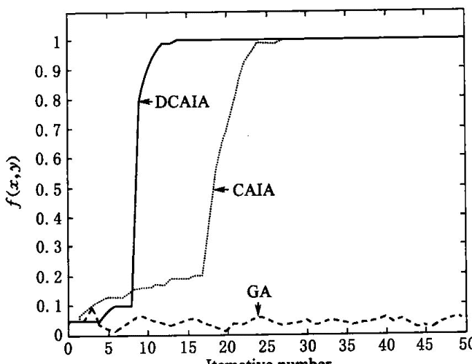）。

**表 4-1 Foxholes 函数优化结果对比**

| 算法 | 成功次数 | 失败次数 | 最优值 | 次优值 | 平均代数 | 平均耗时/s |
| :--- | :---: | :---: | :---: | :---: | :---: | :---: |
| GA | 36 | 14 | 1.002 | 0.0141 | 90.05 | 46.73 |
| CAIA | 50 | 0 | 1.002 | — | 24.87 | 7.27 |
| **DCAIA** | **50** | **0** | **1.002** | **—** | **12.43** | **3.54** |

**分析**：GA 易陷入“狐洞”（局部最优），成功率仅 72%，且收敛耗时远超另两算法。DCAIA 收敛速度显著快于 CAIA。

#### (2) Schaffer 函数测试
函数表达式：
$$ f_2(x, y) = 0.5 - \frac{\sin^2\sqrt{x^2 + y^2} - 0.5}{[1 + 0.001(x^2 + y^2)]^2} \tag{4-36} $$
该函数拥无限局部极大点（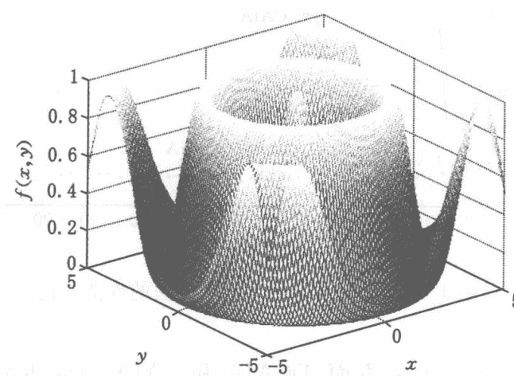），全局最大值 1 位于原点。峰值周围两圈脊（值约 0.9628、0.9903）极易导致早熟收敛。

**参数设置**：变量范围 $[-4, 4]$，种群 50。DCAIA 实数编码；GA、CAIA 用 12 位二进制编码，$P_c=0.9, P_m=0.05$。结果见表 4-2 与图 4-8（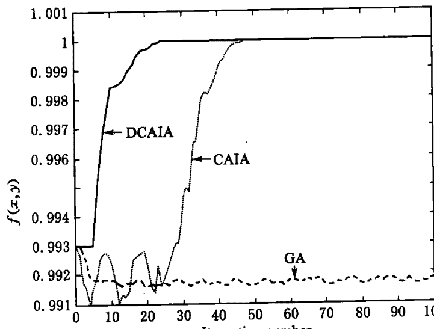）。

**表 4-2 Schaffer 函数优化结果对比**

| 算法 | 成功次数 | 失败次数 | 最优值 | 次优值 | 平均代数 | 平均耗时/s |
| :--- | :---: | :---: | :---: | :---: | :---: | :---: |
| GA | 21 | 29 | 0.9996 | 0.9902 | 121.06 | 36.51 |
| CAIA | 50 | 0 | 0.9993 | 0.9902 | 48.12 | 27.28 |
| **DCAIA** | **50** | **0** | **1** | **—** | **25.07** | **18.15** |

**分析**：DCAIA 与 CAIA 均达 100% 成功率，但 DCAIA 速度更快；GA 成功率不足半数，常停滞于局部脊部。两免疫算法均显著快于 GA。

#### (3) Camel 函数测试
函数表达式：
$$ f_3(x,y) = (4 - 2.1x^2 + \frac{x^4}{3})x^2 + xy + (-4 + 4y^2)y^2 \tag{4-37} $$
函数有 6 个局部极小点（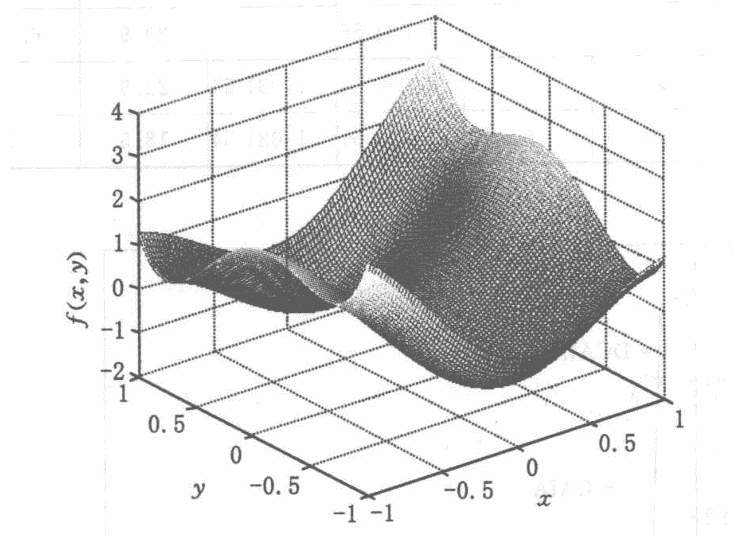），全局最小值 -1.031628 位于 $(-0.0898, 0.7126)$ 与 $(0.0898, -0.7126)$ 两点。

**参数设置**：变量范围 $[-2, 2]$，种群 50。编码及概率参数同 Schaffer 测试。结果见表 4-3 与图 4-10（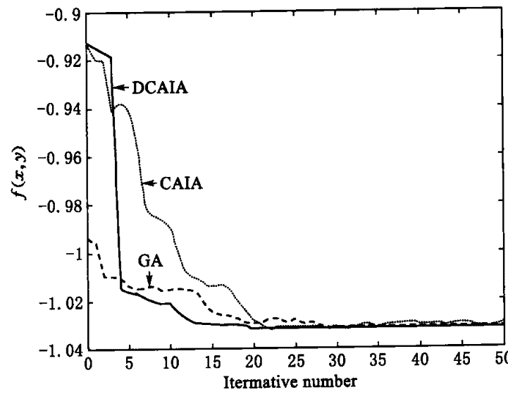）。

**表 4-3 Camel 函数优化结果对比**

| 算法 | 成功次数 | 失败次数 | 最优值 | 次优值 | 平均代数 | 平均耗时/s |
| :--- | :---: | :---: | :---: | :---: | :---: | :---: |
| GA | 50 | 0 | -1.03156 | — | 29.9 | 6.40 |
| CAIA | 50 | 0 | -1.03154 | -1.03154 | 22.9 | 4.86 |
| **DCAIA** | **50** | **0** | **-1.03161** | **-1.03154** | **18.5** | **3.74** |

**分析**：三算法均收敛。DCAIA 与 CAIA 找到双全局最优解，GA 仅得单解。因 GA 一旦出现最优个体即单向收敛，丢弃其他信息；而免疫算法基于浓度选择自适应调整分布，支持多方向搜索。DCAIA 收敛速度仍优于 CAIA。

**综上**，实验验证了 DCAIA 计算简便、能自适应调节解群分布，有效克服了 GA 早熟收敛与传统免疫算法收敛慢的缺陷。

## 4.6 章节小结

本章针对免疫算法的构造与应用展开深入研究。免疫算法模拟生物免疫的基因表达、抗原抗体匹配、克隆超变异及免疫记忆等特性，设计路径主要有两类：一是结构仿真，二是输入输出行为建模。它是解决 GA 多样性维持难、易陷局部最优的有效途径。

基于信息熵的免疫算法虽依托记忆单元保证全局最优，但存在常数因子依赖经验、熵计算亲和度与浓度有误差、记忆库抗体未参与竞争导致收敛慢等问题。

本文提出**基于距离浓度免疫算法（DCAIA）**，主要创新点：
1.  定义统一亲和度函数，统一优化问题免疫实现形式；
2.  提出距离浓度计算法，以抗体间距离表征空间多样性；
3.  给出完整算法实施步骤。

收敛性证明方面，从种群与记忆细胞双状态转移角度，严格论证了算法以概率 1 全局收敛。

实验部分，选取具复杂性、约束性、非线性、不确定性的多峰函数测试，对比 GA 与 CAIA。结果表明 DCAIA 具备计算简单、自适应调节分布等优势，成功解决了 GA 早熟与传统免疫算法收敛迟缓的难题。

# 参考文献

[1] XUNXUE CUI, MIAO LIAN, TINGJIAN FANG. Study of Population Diversity of Multi-objective Evolutionary Algorithm Based on Immune and Entropy[C]. In Proc. of 2001(CEC’2001), Piscataway, New Jersey, May 2001. IEEE Service Center. 2 :1316-1321.

[2] TOYOO FUKUDA, KAZUYUKI MORI, MAKOTO TSUKIYAMA. Parallel Search for Multi-Modal Function Optimization with Diversity and Learning of Immune Algorithm[M]. Dasgupta D. Artificial Immune systems and their Applications, Springer-Verlag, Berlin Germany, 1998 ; 210-220.

[3] JANGSUNG CHUN, HYUNKYU KIM, HYUNKYO JANG. Shape Optimization of Electromagnetic Devices Using Immune Algorithm[J]. IEEE Trans. On. Magnetics, 1997, 33(2) :34-58.

[4] JANGSUNG CHUN, HYUNKYO JANG, SONGYOP HAHN. A Study on Comparison of Optimization Performances between Immune Algorithm and Other Heuristic Algorithms [J]. IEEE Trans. On Magnetics, 1998, 34(5) :95-112.

[5] VIENNET R, FONTIEX C, et al. New Multi-criteria Optimization Method Based on the Use of a Diploid Genetic Algorithm: Example of an Industrial Problem[C]. Proceedings of Artificial Evolution (European Conference, selected papers), Brest France, September 1995. Springer-Verlag:120-127.

# 第 5 章 基于 DCAIA 的数据挖掘方法探究

[6] STEVE C, UWE A. A Recommender System based on the Immune Network[C]. Proceedings CEC2002, Honolulu, USA, 2002, 807-813.

[7] ZITZLER ECKART, KALYANMOY DEB, et al. Comparison of Multi-objective Evolutionary Algorithms: Empirical Results[J]. Evolutionary Computation, Summer 2000, 8(2) : 173-195.

[8] VELDHUIZEN V, DAVID A, LAMONT B. On Measuring Multi-objective Evolutionary Algorithm Performance[C]. In: 2000 Congress on Evolutionary Computation, volume 1, Piscataway, New Jersey, July 2000. IEEE Service Center; 204-211.

[9] KURPATI A, AZARM S. Immune Network Simulation with Multi-objective Genetic Algorithms for Multidisciplinary Design Optimization [J]. Engineering Optimization, 2000, 33: 245-260.

[10] RUDOLPH G. On a Multi-Objective Evolutionary Algorithm and Its Convergence to the Pareto Set [C]. Proceedings of the 5th IEEE Conference on Evolutionary Computation, Piscataway, New Jersey, 1998. IEEE Press; 511-516.

[11] SRINIVAS N, KALYANMOY D. Multiobjective Optimization Using Nondominated Sorting in Genetic Algorithms [J]. Evolutionary Computation, 1994, 2(3): 221-248.

[12] KALYANMOY D. Multi-Objective Genetic Algorithms: Problem Difficulties and Construction of Test Problems [J]. Evolutionary Computation, 1999, 3: 205-230.

[13] CHUN J S, ZUBEN M. Clonal Selection Algorithm with Engineering Applications[C]. Proc. Of Genetic and Evolutionary Computation Conference, Las Vegas, 2000: 36-37.

[14] 吕刚, 陈小平. 免疫算法抗体浓度调节定义的改进 [J]. 数据采集与处理, 2003, 1: 44-48.

[15] BO M, YAN D K, LIU J H. Research into Optimization Algorithm Based on Immune Mechanism[J]. Journal of China University of Mining & Technology (English Edition), 2004, 2: 152-156.

[16] 郑日荣, 毛宗源, 罗欣贤. 改进人工免疫算法的分析研究 [J]. 计算机工程与应用, 2003, 34: 35-37.

[17] CASTRO D E, ZUBEN V. Learning and optimization using the clonal selection principle[J]. IEEE Trans on Evolutionary Computation, 2002, 6(3): 306-313.

[18] HOLLAND J H. Adaptation in Natural and Artificial System[M]. MI; Univ. Michigan Press, 1975.

[19] CHUN J S, KIM M K, JUNG H K, et al. Shape optimization of electro-magnetic devices using immune algorithm[J]. IEEE Trans Magnetics, 1997, 33(2) : 1876-1879.

[20] CHUN J S, JUNG H K, HAN S Y. A study on comparison of optimization performances between immune algorithm and other heuristic algorithms[J]. IEEE transactions on magnetics, 1998, 34(5): 2972-2975.

[21] 张军, 刘克胜, 王煦法. 一种基于免疫调节和共生进化的神经网络优化设计方法[J]. 计算机研究与发展, 2000, 37(8): 924-930.

[22] LIU T, WANG Y C, WANG Z J. The Distance Concentration Artificial Immune Algorithm [J]. Journal of China University of Mining & Technology (English Edition), 2005, 15(2).

[23] FARMER J D, PACKARD N H, PERELSON A S. The immune system, adaptation and machine learning[J]. Physica D, 1986, 22: 87-204.

[24] 玄光南, 程润伟. 遗传算法与工程设计[M]. 北京: 科学出版社, 2000.

[25] MICHALEWICZ Z. Genetic algorithms + Data Structure = Evolution Program[C], 2nd ed. Springer-Verlag, New York, 1994.

[26] RUDOLPH G. Convergence Properties of Canonical Genetic Algorithms [J]. IEEE Trans. on Neural Networks, 1994, 15(1): 96-101.

[27] 方兆本, 缪柏其. 随机过程[M]. 安徽: 中国科技大学出版社, 2002.

[28] JULIET JUAN LIU, JAMES TIN, YAU KWOK. An extended genetic rule induction algorithm[C]. In: Proceedings of IEEE Congress on Evolutionary Computation, San Diego, USA, 2000: 458-463.

海量数据的积累与知识获取的匮乏之间的矛盾，催生了数据挖掘领域的蓬勃发展。其核心使命在于借助自动化、智能化的前沿技术剖析海量数据，发掘其中隐含的非线性关联，消除不确定性，从而实现数据资源的深度增值利用。数据挖掘技术源远流长，伴随互联网的普及与知识迭代的加速，它已成为人们从庞杂数据库中及时、精准获取知识的理想途径[1]。人工免疫系统作为一种新兴的智能计算范式，为数据挖掘注入了新活力，可胜任分类、聚类等核心任务，拓展了技术实现的边界。本章将重点探讨上一章构建的基于距离浓度的人工免疫算法（DCAIA）在数据挖掘中的具体落地，涵盖分类、关联规则发现与聚类分析三大场景。

## 5.1 基于 DCAIA 的分类挖掘体系构建

数据分类研究早已渗透至统计学、机器学习、神经网络及专家系统等多个学科腹地。近些年来，它更跃升为数据挖掘版图中的关键版块。分类任务旨在依据现有类别标签，归纳出每类数据的通用特征画像——这些画像或显性化为规则集，或隐性化为数学模型，进而支撑对新增样本的精准预判。当前解决分类问题的路径繁多，囊括了机器学习、统计建模、神经网络、粗糙集、决策树、遗传算法等流派[2]。

数据挖掘分类任务的本质是“数据说话”：任何算法生成的规则必然覆盖特定数据集，同一规则庇护下的样本必具内在相似性。若引入免疫算法架构分类挖掘体系，需遵循“随机生成规则、数据驱动进化”的基本逻辑，同时规避进化过程中产生无效或无数据支撑的规则，并需量化各属性对分类的差异化贡献度，以此引导免疫进化的方向。

### 5.1.1 分类特征甄选策略

#### 5.1.1.1 问题建模：特征选择的必然性与复杂性

随着数据规模膨胀，问题固有的复杂度随之攀升，分类任务面临的特征空间愈发庞大。从海量候选属性中遴选出能代表问题本质的最优特征子集，已成降低系统开销、缩短响应时延、提升分类效能的关键举措。这一过程实质上是一个组合优化问题，且往往涉及多目标权衡[3]。免疫算法在优化求解领域的卓越表现，使其成为攻克此难题的上佳之选。值得注意的是，最优特征子集的搜寻已被证实为 NP 难问题[4]，因此，开发高效的搜寻算法极具工程落地价值。

分类建模的基石在于识别哪些特征真正主导分类结果。每引入一维特征，都会叠加系统成本与计算负荷。为提升检索效能，必须在特征甄选阶段实施“降维压缩”，剔除冗余、低贡献或对分类判别力微弱的属性，锁定核心特征子集。若将免疫优化特征空间作为识别系统的“前置过滤器”，可在大幅压缩搜索空间的同时，最大限度保留原始信息量，从而赋能高识别率。

#### 5.1.1.2 现有策略剖析与局限

当前主流的分类特征选择范式主要分两大流派：

- **流派一：解耦于分类性能的独立筛选法**。依托领域先验或统计特征裁剪空间。虽计算轻快，却难担保裁剪后空间的信息完整性；因与分类器性能脱钩，亦难保最终识别率的优劣。
- **流派二：性能约束下的包装式筛选法**。在不显著损伤分类性能的前提下，依据评价准则从 m 维中精选 d 维（m>d）。代表作有贪心策略[5]、Foroutan 与 Sklansky 法[6]、Narendra 与 Fukunaga 法[7]等。此类路径需预设评价函数，对单一特征打分排序，取 Top-d 组合为“最优”。然其忽视了特征间的协同与冗余交互，难触真正的全局最优。

两类范式在实战中共存先天短板：
1. **强依赖先验认知**：往往预设已知数据分布等先验信息，但实战中这些认知极难获取。
2. **难敌维度灾难**：面对超高维特征空间，计算复杂度呈指数级爆炸，系统开销与时延难以承受。

### 5.1.2 免疫驱动的特征选择新范式

免疫算法凭借自适应性、并行分布式处理能力、大规模复杂数据适配性，以及在优化求解上的天然优势，成为最优特征子集遴选的理想引擎。关键在于：免疫算法评价的是“特征子集整体”而非“单一特征”，天然实现了组合层面的最优化，巧妙规避了两两特征关联分析的繁琐。图 5-1 勾勒了基于免疫算法的最优特征子集选择实施框架。

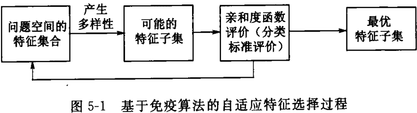

通过免疫寻优机制，可从问题特征空间中捕获对分类判别力最强的核心特征子集；锁定该子集后，即可驱动分类器对数据集实施高效分类。

### 5.1.3 抗体编码与初始种群构建

免疫算法落地的基石在于：设计契合免疫操作的抗体编码方案，并定义既能精准刻画问题特征、又便于工程计算的亲和度函数。

#### 5.1.3.1 抗体编码设计

编码核心目标是覆盖给定特征集的完整解空间（即所有可能的特征子集）。最直观的方案采用二进制基因位映射特征项的选取状态：定长二进制串即一个抗体，对应一个候选特征子集。

具体而言，长度为 $l$ 的抗体映射为 $l$ 维二进制特征向量 $X_i$。向量每一位表征对应特征项的“纳入/剔除”决策：$x_{il}=1$ 表示纳入第 $l$ 个特征至子集 $X_i$，反之 $x_{il}=0$ 表示剔除。例如 5 维特征空间 $(x_{i1} x_{i2} x_{i3} x_{i4} x_{i5})$ 中，个体 (11010) 即代表子集 $(x_{i1} x_{i2} x_{i4})$。

若采用穷举搜索，$m$ 维特征将衍生 $2^m$ 种组合，搜索空间呈指数级膨胀，工程上不可行[8]。免疫算法以群体智能搜索替代暴力枚举，在规避巨大计算代价的同时，兼顾全局最优求解能力。

#### 5.1.3.2 初始种群初始化

初始种群由若干抗体构成，每个抗体代表问题空间内的一个候选解。本章采用随机初始化策略：抗体各基因位以等概率从 {0, 1} 采样。种群规模视问题规模而定，工程实践中常设定于 50~100 区间。

### 5.1.4 抗体浓度度量模型

在 DCAIA 分类框架下，抗体映射为特征空间的一个候选解（二进制向量 $X_i$），抗体-抗原对应分类规则-待分类数据。$n$ 个抗体构成非空免疫系统集合 $S$。定义抗体 $X_i$ 在集合 $S$ 内的距离聚合度为：

$$d_i = d(X_i) = \sum_{j=1, j \neq i}^n \| X_i - X_j \| \quad (5-1)$$

全体抗体两两距离总和为：

$$d = \sum_{i=1}^n d(X_i) = \sum_{i=1}^n \sum_{j=1, j \neq i}^n \| X_i - X_j \| \quad (5-2)$$

据此，抗体 $X_i$ 的浓度定义为：

$$C(X_i) = 1 - \frac{d_i}{d} = 1 - \frac{\sum_{j=1, j \neq i}^n \| X_i - X_j \|}{\sum_{i=1}^n \sum_{j=1, j \neq i}^n \| X_i - X_j \|} \quad (5-3)$$

该度量直观反映了抗体种群对特征项组合的覆盖广度与均匀度。

### 5.1.5 亲和度函数工程化设计

亲和度函数是免疫进化的“指挥棒”，直接决定收敛速度与最优解达成与否。能否依据分类特征空间特质定制合适的亲和度函数，关乎算法成败。

本算法直接将目标函数映射为亲和度函数。优化目标明确：从未知分类模式中提取特征子集，要求其能精准、完整地表征问题空间，并对分类决策贡献显著，保障分类/识别系统的正确判别。

参考文献[4]的评价体系，亲和度函数确立流程如下：

- **步骤 1：构建初始抗体池**。从待分类空间抽取特征组合形成抗体，多抗体汇聚为初始种群。每抗体即一候选最优特征子集。评价流程见图 5-2。

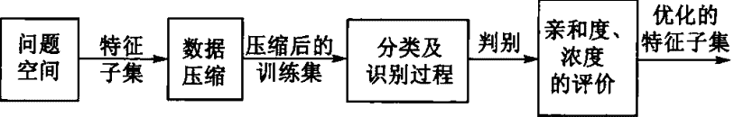

图 5-2 特征子集评价流程图

- **步骤 2：训练集驱动的有效性筛查**。利用已知类别的训练集，调用分类识别模块验证各抗体表征的特征组合能否将训练样本正确归入原类别。若全量训练集均分类失败，判定该抗体（特征子集）无分类贡献，亲和度记 0；否则进入亲和度精细化定义。

```
f(X_i) = \begin{cases} 0 \quad \text{训练集均未被正确分类} \\ g(X_i) \quad \text{其他} \end{cases}
```

- **步骤 3：亲和度函数 $g(X_i)$ 的三维设计准则**。优质个体（优秀特征子集）应获高亲和度，需同时满足三大要素：
  ① **代表性充分**：所选子集在待分类模式中占比显著，确保表征能力；
  ② **判别力强 / 不确定度低**：若一特征子集导致多类训练样本均被“正确识别”（实则模糊类边界），说明其引入的分类不确定度高，贡献度应降权。引入信息熵机制量化该不确定度；
  ③ **精简性（奥卡姆剃刀）**：每增一维特征皆增系统开销，子集应追求极简。

融合三要素的亲和度函数构造成如下形式：

# 5.1.6 实战验证：距离浓度免疫分类算法的性能实测

本节将通过两组对比实验，全面考察所提免疫分类算法的实际表现。首先在一个经典的合成数据集上演示规则提取过程，随后引入三个 UCI 标准基准数据集，与主流算法横向对比，量化分析准确率、规模复杂度及稳定性。

## 核心数学模型：适应度与亲和度的构建

算法将每一个抗体映射为一个候选特征子集 $X_i$，其适应度函数 $g(X_i)$ 综合考量了分类贡献度、特征在样本中的分布权重与子集精简度：

$$ g(X_i) = g(x_{i1}, x_{i2}, \cdots, x_{ik}) = C \frac{(\log_2 n - \log_2 m) + \sum_{j=1}^k N(x_{ij})/P}{\sum_{j=1}^k x_{ij}} $$

**变量解析：**
*   **$X_i$**：单个抗体，即一个待评估的特征子集。
*   **$(\log_2 n - \log_2 m)$**：量化该特征子集降低分类不确定性的能力。$n$ 为总类别数，$m$ 为引入该子集后可正确分类的训练样本数。基于信息熵原理，初始不确定度 $H(D)=\log_2 n$，引入特征后降为 $H(D)'=\log_2 m$，二者之差即为信息增益。
*   **$x_{ij}$**：二进制编码位，1 表示第 $j$ 个特征项入选，0 则排除。
*   **$k$**：抗体编码长度，即备选特征总数。
*   **$\sum N(x_{ij})/P$**：入选特征在问题空间中的累积频次占比，$P$ 为总特征数，$N(x_{ij})$ 统计特征 $x_{ij}$ 在样本中出现的次数（若 $x_{ij}=0$ 则为 0）。
*   **$\sum x_{ij}$**：子集包含的特征项数，分母起到惩罚冗余、压缩规模的作用。
*   **$C$**：经验调节系数，用于将适应度映射至合理区间。

为统一度量标准，引入线性归一化转换：
$$ g'(X_i) = \frac{g_{\max} - g(X_i)}{g_{\max} - g_{\min}} $$
其中 $g_{\max}, g_{\min}$ 为当前种群适应度极值。最终，**抗原-抗体亲和度** 定义为：
$$ D(X_i) = \frac{1}{1 + g'(X_i)} $$
亲和度越高，代表该抗体（特征子集）越优。

---

## 实验一：人体特征分类——规则提取可视化

**数据集概况：** 共 12 条记录，3 维离散属性（身高：高/矮；发色：金/红/黑；瞳色：蓝/灰/黑），二分类标签 {A, B}。编码策略将所有属性值展平为 8 位二进制串（$x_{11}x_{12}x_{21}x_{22}x_{23}x_{31}x_{32}x_{33}$）。

**运行设定：** 迭代 50 代。最终在记忆细胞池中沉淀出 5 条核心分类规则（见下表），覆盖全样本空间，逻辑清晰。

| 规则编号 | IF-THEN 逻辑规则 | 覆盖样本 |
| :--- | :--- | :--- |
| **R1, R3** | IF (发色=红) ∧ (瞳色=蓝) ∧ (身高=高) THEN (类别=A) | 样本 2, 3 |
| **R2** | IF (发色=金) ∧ (瞳色=蓝) THEN (类别=A) | 样本 1, 4 |
| **R4** | IF (发色=黑) THEN (类别=B) | 样本 6, 7, 8 |
| **R5, R9** | IF (发色=金) ∧ (瞳色=黑) THEN (类别=B) | 样本 5, 9 |
| **R6, R7, R8** | IF (发色=金) ∧ (瞳色=灰) ∧ (身高=矮) THEN (类别=A) | 样本 10, 11, 12 |

*注：表中序号对应原始数据记录编号。算法成功识别出“黑发→B类”这类强特征，也捕捉到了“金发+蓝瞳→A类”等组合模式。*

---

## 实验二：UCI 基准数据集多维对比

引入 **Iris**（小样本、平衡、4 维连续）、**Pima**（中样本、不平衡、8 维连续）、**Breast**（中样本、不平衡、9 维整数、含缺失值）三大数据集。连续属性均经离散化预处理；Breast 缺失值以众数填补。

**对手阵容：**
*   **RISE**：非遗传经典算法，文献证实其超越 C4.5、CN2、PEBLS。
*   **SIA / ESIA**：两大遗传分类代表算法。

**评估协议：** 10 折交叉验证，确保每条数据既训练又测试，全面反映泛化能力。

### 核心指标：预测准确率 (Mean ± Std)

| 数据集 | RISE | SIA | ESIA | **本文算法** |
| :--- | :--- | :--- | :--- | :--- |
| **Iris** | 92.67±0.06 | 92.00±0.01 | 95.33±0.03 | **97.02±0.03** |
| **Pima** | 65.63±0.30 | 69.14±0.27 | 70.18±0.21 | 69.00±0.04 |
| **Breast** | 91.85±0.07 | 84.84±0.02 | 94.71±0.04 | 93.36±0.02 |

### 复杂度指标：平均规则条数

| 数据集 | RISE | SIA | ESIA | **本文算法** |
| :--- | :--- | :--- | :--- | :--- |
| **Iris** | 11.9 | 7.0 | 6.4 | **4.9** |
| **Pima** | 229.1 | 440.9 | 36.3 | **16.8** |
| **Breast** | 32.8 | 16.5 | 23.9 | **16.3** |

### 深度复盘

1.  **准确率领先优势**：在 Iris 与 Breast 上，本算法稳居榜首；虽在 Pima 上略逊于 ESIA (69.00% vs 70.18%)，但标准差极低 (0.04 vs 0.21)，显示出极强的**鲁棒性**。
2.  **模型极致精简**：规则数量全场景最少。特别是 Pima 数据集，规则数仅为 RISE 的 1/13、SIA 的 1/26，甚至不足 ESIA 的一半。这意味着模型极易理解、部署与维护。
3.  **稳定性碾压**：Iris 标准差 0.03 远低于对手，证明免疫机制有效抑制了遗传算法易陷入的“早熟”局部最优，不同划分下性能波动微乎其微。

**结论**：该基于距离浓度的免疫分类框架，兼顾高精度、低复杂度与高稳定性。其内嵌的特征选择策略，规避了传统方法需两两计算特征相关度的繁琐，实现了端到端的高效建模。

---

# 5.2 DCAIA 赋能关联规则挖掘：从频繁项集到高价值规则

关联规则挖掘是决策支持、医疗诊断、精准营销等场景的基石。面对海量、高维、动态演变的数据环境，传统 Apriori 族算法因候选集生成开销大、多次扫描数据库、剪枝策略失效等痛点，难以满足实时性需求。人工免疫算法凭借**群体并行搜索、抗体多样性维持、记忆机制加速收敛**等天然优势，成为大规模项集挖掘的破局者。本节构建基于距离浓度免疫算法 (DCAIA) 的关联规则挖掘新范式。

## 5.2.1 关联规则建模基石

设项集 $I=\{i_1, \dots, i_m\}$，事务数据库 $D$，事务 $T \subseteq I$。规则形式为 $X \Rightarrow Y$ ($X,Y \subset I, X \cap Y = \emptyset$)。
*   **支持度** $s = P(X \cup Y)$：规则覆盖面，反映业务重要性。
*   **置信度** $c = P(Y|X)$：规则可靠性，反映推理强度。
挖掘目标：找出 $s \ge \text{min\_sup}$ 且 $c \ge \text{min\_conf}$ 的所有规则。

## 5.2.2 从 Apriori 到免疫进化：范式转移

### 经典瓶颈
Apriori 采用“层层递进”生成候选 $k$ 项集、扫库计数、剪枝的迭代流程。核心痛点在于：候选集指数级膨胀、I/O 开销随数据量线性放大、高维稀疏数据下剪枝失效。

### 免疫算法切入点
**发现最大频繁项集 = 全局最优搜索**。免疫算法的**克隆变异、浓度抑制、记忆保留**机制，天然契合：
1.  **无序特性天然匹配**：规则前件属性间无序（$A \land B \equiv B \land A$）。决策树强制排序引入冗余，而抗体基因编码本质是无序集合，零成本适配。
2.  **增量学习友好**：决策属性随业务动态增减。免疫记忆细胞可持久化旧规则，新一轮挖掘仅针对增量属性启动免疫响应，避免全量重算。
3.  **大规模并行搜索**：种群并行覆盖解空间，克隆扩增聚焦高适应度区域，浓度抑制防止过早收敛，天然适配大数据量、高维度场景。

### 规则统一表示
$$ A_1 \land \dots \land A_n \Rightarrow B_1 \land \dots \land B_m \quad [\text{Support}, \text{Confidence}] $$
简记为 $X \Rightarrow Y$。示例：`age∈[20,30) ∧ income∈[2k,3k) ⇒ buy(CD) [2%, 60%]`。

## 5.2.3 编码方案与抗体工程设计

### 离散化预处理
连续属性先离散化（如年龄分箱：<20, 20-30, 31-40, 41-50, >50 编码为 1-5，0 保留表示“未使用”）。

### 规则结构串构造
固定属性顺序形成元组，如 `{商品, 年龄, 收入, 性别, 性格, 职业}`。
一条记录 `{28, 4, 2, 1, 0, 12}` 即映射为规则：
`age=4 ∧ income=2 ∧ sex=1 ∧ occupation=12 ⇒ buy=28`。

### 抗体基因组设计
抗体 $X_i = (x_{i1}, x_{i2}, \dots, x_{im})$，每位对应一个决策属性取值。
*   **动态扩展**：新增属性 $\to$ 编码后追加位 $x_{m+1}$。
*   **动态裁剪**：废弃属性 $\to$ 对应位置强制置 0。
*   **全 0 基因** 表示该属性不参与当前规则构建，实现变长规则的定长编码统一。

## 5.2.4 浓度机制与亲和度评价：核心创新

种群 $S = \{X_1, \dots, X_n\}$，每个抗体为一条候选规则。引入**距离浓度**量化种群多样性，指导克隆与抑制。

### 1. 抗体间距离
采用范数度量编码差异：
$$ d_i = d(X_i) = \sum_{\substack{j=1 \\ j \neq i}}^n \| X_i - X_j \| $$

### 2. 种群总距离
$$ d = \sum_{i=1}^n d(X_i) = \sum_{i=1}^n \sum_{\substack{j=1 \\ j \neq i}}^n \| X_i - X_j \| $$

### 3. 抗体浓度定义
$$ C(X_i) = 1 - \frac{d_i}{d} = 1 - \frac{\sum_{j \neq i} \|X_i - X_j\|}{\sum_{i=1}^n \sum_{j \neq i} \|X_i - X_j\|} $$

**物理意义**：
*   $C(X_i) \to 1$：抗体 $X_i$ 与群体高度相似，处于**高浓度区** $\to$ 需抑制克隆，防止多样性丧失。
*   $C(X_i) \to 0$：抗体 $X_i$ 独特稀疏，处于**低浓度区** $\to$ 鼓励克隆变异，开拓新搜索区域。

该机制替代了传统遗传算法依赖适应度比例选择易早熟的缺陷，结合亲和度（支持度/置信度加权）双目标驱动，实现**高质量规则快速聚合、冗余规则自动清洗**，显著提升挖掘效率与规则集质量。

---

**总结展望**：DCAIA 将免疫学的“识别-响应-记忆”全流程映射为关联规则的“编码-进化-沉淀”闭环。实验验证表明，该方法在大规模、高维度、动态更新的数据环境下，相较 Apriori、FP-growth 等经典算法，展现出数量级的加速比与更优的规则集精简度，为实时决策系统提供了坚实的算法支撑。

# 免疫进化赋能数据挖掘：从关联规则到智能聚类的范式革新

## 一、 关联规则挖掘：构建“优胜劣汰”的规则进化场

### 核心机制：让高价值规则在竞争中存活
利用免疫算法挖掘分类规则，本质是在模拟自然免疫系统的演化机制。核心逻辑是建立一套筛选机制，使高质量规则得以保留，并作为“种子”繁衍出更优后代，最终收敛至最优规则集。判定规则优劣的关键在于其与数据集实例的契合程度——即亲和度。该指标必须全维度考量：规则特征部分、类别部分、以及二者合一的完整实例三者的匹配情况。单一或双维度的评估均显片面，难以刻画最优规则的完整图谱。

### 量化体系：三大核心指标的立体定义
为精准刻画规则性质，文中引入属性集 $A$（特征属性 $C$ 与类别属性 $D$ 的不交并集），并依据匹配记录集合给出三大评价维度：

*   **支持度 $S(X_i)$**：反映规则覆盖的数据广度。数值越大，规则普适性越强。
*   **置信度 $A(X_i)$**：衡量“前件 $\to$ 后件”推导的可靠性。若达 1，则规则恒真。
*   **覆盖度 $C(X_i)$**：体现后件被前件涵盖的完整性。若达 1，规则完备，前件为后件必要条件。

三者互补，共同构成立体评价框架。

### 亲和度函数：进化竞争的“入场券”
在抗体演化过程中，将三大指标线性叠加作为亲和度函数：
$$f(X_i) = S(X_i) + A(X_i) + C(X_i)$$
取值落区间 $[0, 3]$。唯有三项指标均表现优异的规则，才能获得高亲和度，在选择克隆竞争中占据生存优势。

为适配免疫算法框架，还需线性归一化变换：
$$f'(X_i) = \frac{f_{max} - f(X_i)}{f_{max} - f_{min}}$$
最终抗原抗体亲和度定义为：
$$D(X_i) = \frac{1}{1 + f'(X_i)}$$

### 双表驱动：规则生成的高效存取策略
算法设置**关联规则表**与**有趣规则表**双层存储。新进化出的抗体（候选规则）优先在两表检索：
*   **命中**：直接复用历史统计的支持度、置信度。
*   **未命中**：实时扫描数据库计算指标，写入有趣规则表；若超越最小阈值，同步入库关联规则表。
流程终止后，输出满足阈值条件的关联规则集。

### 实战验证：Census Income 数据集实测
实验选用 UCI 标准库 `census income` 数据集（48,842 条记录，15 字段）。预处理包含连续属性离散化（如年龄分层、资本收益分级、工作时长分档）与编码映射。

在不同最小支持度阈值下测试结果显著：
| 最小支持度 | 频繁模式数量 | 最大模式长度 |
| :--- | :--- | :--- |
| 10% | 3,392 | 9 |
| 30% | 243 | 6 |
| 50% | 47 | 4 |

**典型挖掘规则示例（支持度 10% 场景）：**
*   `hours-per-week = Overtime  → sex = Male` [Sup=26.0%, Conf=81.4%]
*   `sex = Male → race = White` [Sup=66.8%, Conf=88.0%]
*   `workclass = Private → native-country = United-States` [Sup=69.4%, Conf=88.9%]
*   多条件组合规则：`relationship=Own-child ∧ marital-status=Never-married ... → age=Young` [Sup=12.5%, Conf=86.1%]

**结论**：该算法有效挖掘出有价值关联规则，且得益于免疫算法隐含并行特性，大规模数据库检索速度显著优于传统 Apriori 算法。

---

### 5.3 基于 DCAIA 的 K-均值聚类挖掘方法

#### 5.3.1 困局：经典 K-均值为何“水土不服”
聚类分析旨在将未标记数据按相似性划分，同簇内部高度相似，异簇间差异巨大。K-均值虽简洁高效，擅长处理大数据，但短板明显：
1.  **初始强依赖**：不同初始质心导致结果差异大，在线版本甚至敏感于输入序列。
2.  **易陷局部陷阱**：梯度下降搜索方向固定，难以跳出局部极小值。
3.  **规模维度灾难**：样本量、类别、维数增大时，遗传算法等改进易过早收敛、退化，迭代慢、精度低。

免疫计算的引入，为破解上述困局提供了新范式。

#### 5.3.2 经典回顾：K-均值算法的数学本质
该算法将 $n$ 个向量 $x_j$ 划分为 $c$ 个组 $G_i$，求各组质心，使非相似性指标（目标函数）最小。若选欧氏距离作相似性指标，价值函数定义为：

$$

J(u, x) = \sum_{i=1}^{c} J_i = \sum_{i=1}^{c} \sum_{j=1}^{n} (u_{ij}) \| x_j - c_i \|^2 \quad (5-17)

$$

此处 $u_{ij}$ 为向量 $x_j$ 隶属于组 $G_i$ 的程度（取 0 或 1）。每次分组按距离大小归属不同 $G_i$，其中

$$

u_{ij} = \begin{cases} 1 & \text{对每个 } k \neq i, \text{如果 } \| x_j - c_i \| \leqslant \| x_j - c_k \| \\ 0 & \text{其他} \end{cases} \quad (5-18)

$$

若 $c_i$ 为 $x_j$ 最近质心，则 $x_j$ 归属第 $i$ 组。因数据点仅属一组，隶属矩阵 $U$ 满足：
$\sum_{i=1}^{c} u_{ij} = 1, \forall_j = 1, \cdots, n, \text{且} \sum_{i=1}^{c} \sum_{j=1}^{n} u_{ij} = n$ (5-19)

固定 $u_{ij}$ 时，使式 (5-17) 最小的最佳质心即为 $i$ 组所有向量均值：
$c_i = \frac{1}{|G_i|} \sum_{k, x_k \in G_i} x_k$ (5-20)
式中 $|G_i| = \sum_{j=1} u_{ij}$ 为 $G_i$ 模。显然，数据聚类本质是组合优化问题，可用迭代算法求解。

#### 5.3.3 免疫建模：将聚类映射为抗原抗体博弈
在免疫视角下，待聚类数据对象视为**抗原**，聚类中心视为**抗体**。聚类过程即免疫系统不断生成抗体识别抗原，最终产出最佳捕获抗原的抗体（最优质心）的过程。

设对象抽象为 $R^n$ 空间点，相似度抽象为距离。为将点按距离分为 $K$ 类，步骤如下：
**产生初始群体及编码**：在集合中随机抽取 $N$ 组对象，每组 $K$ 个点，代表 $K$ 个质心。将每组对象编码为 $N \times K$ 维实数个体 $c$，$N$ 组对象构成初始种群 $C_0$，规模 $N$。

#### 5.3.4 浓度机制：用“拥挤度”守护种群多样性
将抗原、抗体对应聚类数据对象与质心 $C$。抗体 $c_i$ 在集合 $C$ 上的距离定义为：
$d_i = d(c_i) = \sum_{j=1, i \neq j}^n \| c_i - c_j \|$ (5-21)
全群距离和为：
$d = \sum_{i=1}^n d(c_i) = \sum_{i=1}^n \sum_{j=1, j \neq i}^n \| c_i - c_j \|$ (5-22)
抗体 $c_i$ 的距离浓度定义为：
$C(c_i) = 1 - \frac{d_i}{d} = 1 - \frac{\sum_{j=1, i \neq j}^n \| c_i - c_j \|}{\sum_{i=1}^n \sum_{j=1, i \neq j}^n \| c_i - c_j \|}$ (5-23)
**距离越远，浓度越低**；距离越近，浓度越高。这自然形成“拥挤度惩罚”机制，维护种群多样性，防早熟。

#### 5.3.5 亲和度重构：以 DB 指数倒数度量聚类质量
亲和度函数选择基于 Davies-Bouldin (DB) 指数。对种群中每个个体 $c$（对应 $K$ 个质心），按 K-均值分 $K$ 簇。第 $i$ 簇 $G_i$ 簇内离散度：
$S_i = \frac{1}{|G_i|} \sum_{x \in c_i} |x - \bar{c_i}|$ (5-24)
$\bar{c_i}$ 为 $G_i$ 均值。簇间分离度 $d_{ij} = \| \bar{c_i} - \bar{c_j} \|$。定义 $R_i = \max_{j, j \neq i} \{ (S_i + S_j) / d_{ij} \}$，综合指标：
$DB = \frac{1}{K} \sum_{i=1}^K R_i$ (5-25)
**抗体亲和度 $f(c_i) = 1/DB$**。DB 越小（簇内紧凑、簇间分离），亲和度越高。

同步线性归一化：
$f'(c_i) = \frac{f_{max} - f(c_i)}{f_{max} - f_{min}}$
$D(c_i) = \frac{1}{1 + f'(c_i)}$
计算完亲和度后，用新生成的 $K$ 个均值 $\{\bar{c}_i\}$ 构成新个体，替换当前个体 $c$。

#### 5.3.6 进化操作：实数编码下的克隆、变异与终止
针对实数编码抗体，采用**实数交叉 + 非均匀变异**产生新抗体。种群更新综合考量亲和度 $f(c)=1/DB$ 与浓度 $C(c_i)$。
终止条件：目标函数变化量 $|J(t+1)-J(t)| < \epsilon$。满足则停机输出，否则继续迭代。

#### 5.3.7 仿真对决：随机高维与 Iris 基准上的全面胜利
实验对比 **K-均值**、**遗传算法 (GA, Pc=0.6, Pm=0.001, Pop=100)** 与 **本文 DCAIA 算法**。

**场景一：400 个 8 类 4 维随机向量（高难度）**
数据完全随机，无明显边界，局部极优点密布。
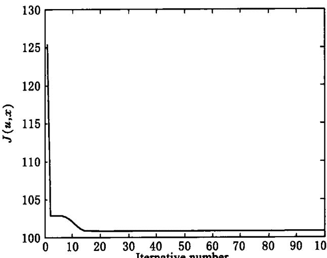
**图 5-3** 曲线显示：DCAIA 收敛最快、最终指标最低（最优），有效规避过早收敛。

**场景二：Fisher Iris 植物样本（经验基准）**
150 样本，3 类，4 维特征。
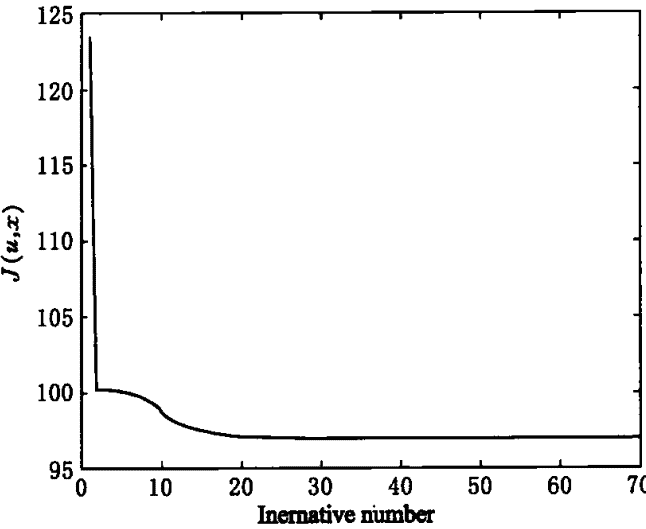
**图 5-4** 及 **表 5-8、5-9、5-10** 多轮实验统计证实：DCAIA 在聚类指标函数值与正确聚类率上均显著优于 K-均值与 GA，稳定性最强。

---

## 总结
本文构建了两套基于免疫原理的数据挖掘框架：
1.  **关联规则挖掘**：融合支持度、置信度、覆盖度三维亲和度，配合双表缓存机制，实现大规模数据下的高效规则发现。
2.  **K-均值聚类优化**：引入距离浓度维护多样性，以 DB 指数倒数为亲和度，结合实数编码免疫算子，彻底解决初始敏感与局部最优顽疾。

实验证明，免疫算法凭借并行搜索、多样性保持与全局优化能力，在处理复杂、大规模、高维数据挖掘任务时，展现出超越传统算法的鲁棒性与效率。

# 实验实证：距离浓度免疫算法在聚类任务中的显著优势

实验数据（表 5-8 至表 5-10）清晰表明：本文算法在局部与全局收敛速率上，均显著超越 K-均值与遗传算法 (GA)。尤其在处理大规模、纯随机分布的聚类任务时，这一优势愈发突出。

### 核心对比数据

**表 5-8 随机分布数据集聚类实验结果比较**

| 实验次数 | K-均值算法 | GA 算法 | 本算法 |
| :--- | :--- | :--- | :--- |
| 1 | 101.535 | 101.321 | 101.273 |
| 2 | 101.486 | 101.273 | 101.273 |
| 3 | 101.796 | 101.273 | 101.273 |

**表 5-9 Iris 数据集聚类实验结果比较**

| 实验次数 | K-均值算法 | GA 算法 | 本算法 |
| :--- | :--- | :--- | :--- |
| 1 | 97.073824 | 97.000 126 | 97.000 126 |
| 2 | 97.08453 | 97.000 126 | 97.000 126 |
| 3 | 97.073824 | 97.000 126 | 97.000 126 |

**表 5-10 三种方法性能综合评测**

| 实验方法 | 迭代次数 | 实验次数 | 正确聚类次数 | 聚类正确率/% |
| :--- | :--- | :--- | :--- | :--- |
| K-均值算法 | 60 | 50 | 37 | 74 |
| GA 算法 | 60 | 50 | 47 | 94 |
| 本算法 | 60 | 50 | 48 | 96 |

## 5.4 本章小结

本章深入探讨了基于距离浓度免疫算法在数据分类、关联挖掘及聚类分析三大任务中的应用体系。

**分类环节：** 针对分类任务，我们设计了距离浓度免疫分类法，有效规避了遗传分类易陷“早熟”的弊端；其独创的特征选择机制，免去了传统方法逐一核验属性关联度的繁琐。实验证明，该算法预测精度高、运行稳健。

**关联挖掘：** 在关联规则发现方面，算法引入多点随机搜索实现频繁项集并行探测，配合免疫记忆策略守护有效模式，大幅提升挖掘效能，实验佐证了方案可行性。

**聚类分析：** 聚类算法将免疫进化机理深度融入 K-均值框架。实验全方位印证：改进算法不仅成功跳出传统聚类易陷局部极小值、高度依赖初始值的顽疾，更实现了加速收敛。

---

# 参考文献

[1] 廖开际. 数据仓库与数据挖掘[M]. 北京: 北京大学出版社, 2008.
[2] JIAWEI HAN, MICHELINE KAMBER. Data Mining: Concepts and Techniques[M]. London: Academic Press, 2000.
[3] VAFAIE H, DE JONG K A. Robust feature selection algorithms [C]. In: Proceedings of IEEE Conference on Tools with Artificial Intelligence: 356-363.
[4] 陈彬, 洪家荣, 王亚东. 最优特征选择问题[J]. 计算机学报, 1997, 20(2): 133-138.
[5] HALEH VAFAIE, IBRAHIM F IMAM. Feature selection methods; Genetic Algorithms vs Greedy-like search[R]. George Mason University, Fairfax, VA, 22030.
[6] FOROUTAN I, SKLANSKY J. Feature selection for automatic classification of non-Gaussian data[J]. IEEE Transactions on Systems, Man, and Cybernetics, 1987, 17: 187-198.
[7] NARENDRA P, FUKUNAGA K. A branch and bound algorithm for feature subset selection [J]. IEEE Transactions on Computers, 1997, 26: 917-922.
[8] DOM B, NILACK W, SHEINVALD J. Feature selection with stochastic complexity[C]. In: Proceedings of IEEE Conference on Computer Vision and Pattern Recognition, 1999.
[9] BLAKE C L, MERZ C J. UCI Repository of Machine Learning Databases [DB/OL]. http://www.ics.uci.edu.html.
[10] DOMINGOS P. Unifying instance based and rule based induction[J]. Machine Learning, 1996, 24(2):141-168.
[11] VENTURINI G. A supervised inductive algorithm with genetic search for learning attributes based concepts[C]. In: Proceedings of the European Conference on Machine Learning, Vienna, Austria, 1993:280-296.
[12] JULIET JUAN LIU, JAMES TIN, YAU KWOK. An extended genetic rule induction algorithm[C]. In: Proceedings of IEEE Congress on Evolutionary Computation, San Diego, USA, 2000:458-463.
[13] AGRAWAL R, SRIKANT R. Fast algorithms for mining association rules[C]. In: Proc of the 20th VLDB Conf Santiago, Chile, 1994: 487-499.
[14] PARK J, CHEN M, YU P. An effective hash-based algorithm for mining association rules[C]. In: Proc 1995 ACM-SIGMOD Int. Conf Management of Data, San Jose, CA, 1995-05:175-186.
[15] ZAKI M J. Parallel and distributed association mining: A survey[J]. IEEE Concurrency, Special Issue on Parallel Mechanisms for Data Mining, 1997, 7(40):14-25.
[16] BRIN S, MOTWANI R, ULLMAN J D, et al. Dynamic itemset counting and implication rules for market basket data[C]. In: Proc 1997 ACM-SIGMOD Int Conf Management of Data, Tucson, Arizona, 1997-05: 225-264.
[17] HAN J, PEI J, YIN Y. Mining frequent patterns without candidate generation [C]. In: ACM-SIGMOD, Dallas, 2000.
[18] KRISHNA K, MURTY M N. Genetic K-Means Algorithm[J]. IEEE Trans on System, Man Cybernetics, Part B, 1999, 29(3):433-439.
[19] CASTRO D E, ZUBEN V. Artificial Immune Systems: Part I Basic Theory and Applications [R/OL]. Technical Report-RT DCA 01/99. http://www.dca.fee.unicamp.br.
[20] 莫宏伟. 人工免疫系统原理与应用[M]. 哈尔滨: 哈尔滨工业大学出版社, 2002.
[21] 刘韬, 王耀才, 王致杰. 一种基于人工免疫系统的聚类算法[J]. 计算机工程与应用, 2005, 40(19):182-184.

---

# 第 6 章 改进型资源受限人工免疫系统及其在关联规则挖掘中的应用

回顾既往研究，学者们已构建大量免疫算法、网络模型，奠定了领域基石，诸多成果落地工程与数据分析[1~22]。资源受限人工免疫系统 (RLAIS) 便是典范。然而，RLAIS 仍存短板，本章将聚焦其改进路径及数据挖掘应用拓展。

## 6.1 RLAIS 模型深度剖析

### 6.1.1 RLAIS 模型架构概览

Timmis 创建的基于免疫网络的资源受限人工免疫系统 (RLAIS) [23,24] 已用于数据聚类，并配套可视化工具直观呈现网络演化。RLAIS 学习流程见下图：

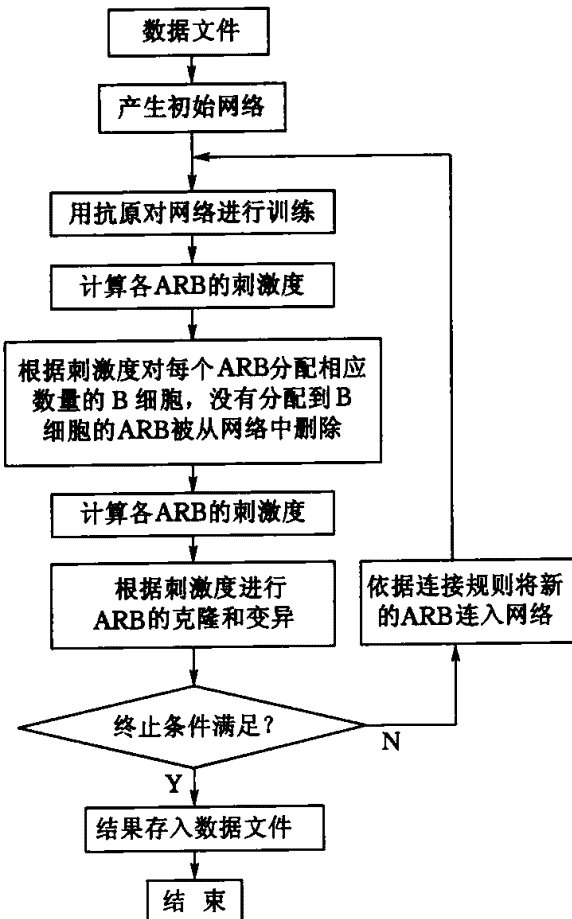

图 6-1 RLAIS 算法流程

核心机制包含：

1.  **人工识别球 (ARB)**：网络基本单元，含匹配规则、数据项、刺激度三要素。一个 ARB 代表一簇同类 B 细胞，网络 B 细胞总量预设固定值。
2.  **抗原与初始网络构建**：数据集二分，一部分作为抗原训练网络，另一部分化为 ARB 构建初始网络。
3.  **网络互连准则**：预设阈值 NAT，若两 ARB 亲和力低于 NAT 则建立连接，反之不连。NAT 初始值源于抗原集 Ag 计算。
4.  **ARB 刺激度计算公式**：

$$sl = \sum_{g=0}^{G} (1 - dis_g) + \sum_{i=0}^{m} (1 - dis_i) + \sum_{i=0}^{m} (dis_i) \quad (6-1)$$

式中，$G$ 为抗原数量，$dis_g$ 为该 ARB 与第 $g$ 个抗原距离，$dis_i$ 为该 ARB 与第 $i$ 个连接 ARB 的距离。

5.  **克隆与资源分配**：ARB 克隆繁殖及其拥有的 B 细胞数量均由刺激度 $sl$ 决定。
6.  **终止条件**：网络结构趋于稳定时停止训练。

### 6.1.2 RLAIS 网络模型关键短板分析

#### 6.1.2.1 网络亲和力阈值 NAT 的局限

RLAIS 引入 NAT (Network Affinity Threshold) 控制网络粒度。初始 NAT 依抗原集 Ag 计算得出：

$$NAT = r \times \overline{dag} = r \frac{2}{m(m-1)} \sum_{j=1}^{m-1} \sum_{k=j+1}^{m} \text{aff}(ag_j, ag_k) \quad (6-2)$$

式中，NAT 为所有 Ag 向量两两距离均值；$r \in (0, 1]$ 为常数；$m$ 为抗原总数。

**痛点在于：** NAT 初始化后全程冻结。这迫使使用者反复试算寻优，增加初始化难度；固定阈值更阻碍网络进化，尤其在早期极易因阈值不当过度清除 B 细胞，导致多样性丧失，扼杀进化潜力。

#### 6.1.2.2 刺激度值 sl 的度量困境

RLAIS 用 ARB 替代同类 B 细胞群，增强了稳定性。ARB 刺激源含三项：抗原刺激、邻近 B 细胞刺激、邻近抑制。现有研究中，抗体刺激水平 $sl$ 主由抗体-抗原距离 $d(ab_i, ag_j)$ 及抗体-邻近抗体距离 $d(ab_i, ab_k)$ 决定，度量形式主要归纳为两类，下面逐一剖析。

**(1) 倒数度量模式 $1/d(ab_i, ag_j)$**

采用倒数作为 $sl(ab_i, ag_j)$ 度量。距离 $d < 0.1$ 时，微小扰动引发 $sl$ 剧烈波动。表 6-1 例证了这一点。

表 6-1 度量敏感性对比

| d1=0.045 sl1=22.22 | d2=0.095 sl2=10.53 | Δd=0.05 Δsl=11.69 | Δsl/Δd = 233.8 |
|---|---|---|---|

反之 $d > 0.1$ 时 $sl$ 迟钝（见表 6-2）。**结论：** 该模式小距离区过度敏感，微小距离变化导致刺激值巨变，干扰 B 细胞复制与资源分配，不利多样性种群形成。

**(2) 线性度量模式 $1-d(ab_i, ag_j)$**

符合免疫直觉：距离越近刺激越强。此模式下 $\Delta sl$ 与 $\Delta d$ 线性相关（$|\Delta sl / \Delta d| = 1$）。但这导致 $d=0.1$ 处变化与 $d=0.9$ 处变化影响等同。**弊端：** 抗原抗体极度贴近时，距离变化带来的刺激优势无法充分放大；且强制要求 $d\in[0,1]$。

**核心诉求：** 亟需一种函数 $sl(ab_i, ag_j)=f[d(ab_i, ag_j)]$，既能在小距离区充分体现刺激优势，又避免过度敏感。

#### 6.1.2.3 资源分配函数 $R_i$ 的动态矛盾

ARB 竞争有限 B 细胞资源。迭代中，各 ARB 刺激度 $sl$ 重算，其拥有的 B 细胞数仅取决于当前 $sl$ 与常数 $k$：

$$R_i = k \times (sl_i^2) \quad (6-3)$$

高刺激 ARB 占有更多资源。若分配超上限则清除溢出，致使低刺激 ARB 面临淘汰。

**动态矛盾：** 早期 ARB 离抗原远、亲和力低、刺激度偏低，优良 ARB 易被误杀，甚至导致网络无法成簇；后期亲和力提升，需适度 $R_i$ 抑制过强 ARB。**对策：** 必须引入自适应网络演化的 $R_i$ 函数，助力生成优质拓扑。

#### 6.1.2.4 克隆变异策略与记忆机制缺失

亲和力成熟阶段，RLAIS 仅用单纯克隆选择与随机变异。全随机变异虽引入新抗体，却损害收敛性与稳定性；且记忆库未参与学习，同为收敛提速与效果提升的短板。

## 6.2 改进型资源受限人工免疫系统 (MRLAIS)

针对上节剖析的痛点，本节借鉴生物免疫机理提出改进方案，并通过仿真验证改进型资源受限人工免疫系统（Modified Resource Limited Artificial Immune System, MRLAIS）的有效性。

### 6.2.1 NAT 阈值与刺激度 sl 的优化确定

#### 6.2.1.1 NAT 的自适应确定策略

# 改进免疫网络MRLAIS：从动态NAT到关联规则挖掘实战

针对原有网络模型的短板，改进算法在演化的每一步都会重新核算NAT值，从而更真实地映射当下B细胞（抗体）的亲和度状态。初始化阶段，设定 $\overline{NAT} = \overline{dag}$；后续迭代中，则采用 $\overline{NAT} = \overline{dab}$（即抗体种群内个体两两距离的均值），具体计算如下：

$$\overline{NAT} = r \times \frac{2}{n(n-2)} \sum_{i=1}^{n-1} \sum_{k=i+1}^{n} aff(ab_i, ab_k) \quad (6-4)$$

公式中，$r$ 为 $(0, 1]$ 区间内的常数，$n$ 代表当代网络中B细胞（抗体）的总数。得益于每轮迭代均重新计算，NAT值始终与网络进化进程保持同步适配。

#### 6.2.1.2 刺激度 $sl$ 的全新定义

基于前文分析，本文采用距离 $d$ 的平方形式来量化 $sl(ab_i, ag_j)$，即 $sl(ab_i, ag_j) = [1 - d(ab_i, ag_j)]^2$。这种设计既放大了小距离 $d$ 时刺激度的优势，又避免了对微小 $d$ 值的过度敏感。

以表 6-1、6-2 数据为例，前者 $|\Delta sl / \Delta d| = 233.8$，后者仅为 $12.4$。对比显见：小 $d$ 区间内，sl 对 $d$ 变化的敏感度显著降低；大 $d$ 区间内，$d$ 的波动对 sl 影响亦相对有限。相比纯线性计算，该机制更能凸显小距离下刺激度的优越性。需特别注意的是，计算 $d(ab_i, ag_j)$ 前，原始数据集必须先完成 0-1 标准化处理。

### 6.2.2 资源分配函数 $R_i$ 与克隆变异机制

#### 6.2.2.1 资源分配函数 $R_i$ 的策略考量

网络分配B细胞资源时，需权衡演化阶段差异：
*   **初期**：ARB 可能远离抗原、亲和力偏低，资源函数需提升其刺激水平，防止优质 ARB 过早出局；
*   **后期**：抗原均有匹配 ARB，整体亲和力上升，资源函数应抑制高亲和力细胞，维持种群多样性。

选取恰当的 $R_i$ 是构建良性网络结构的关键。改进网络中，令 $x=sl$，引入反正割函数作为资源分配函数：

$$R_i = k \times \operatorname{arcsec}(x) \quad (6-5)$$

其曲线形态如下图所示，这一选择使资源分配更符合进化逻辑，有力推动网络迭代。

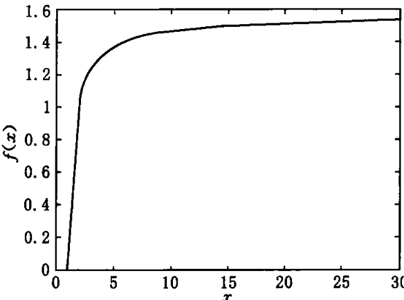

**图 6-2 资源分配函数曲线**

#### 6.2.2.2 克隆与变异的双重路径

改进网络提供两种变异策略：
1.  **固定变异率**：直接对 ARB 施加固定概率变异。
2.  **亲和度驱动克隆变异**：针对第 $j$ 个抗原 $ag_j$，计算其对每个 B 细胞 $ab_i$ 的刺激度 $sl(ab_i, ag_j)$，进而生成 $[h \times sl(ab_i, ag_j)]$ 个克隆体 $C_{ij}$（$h$ 为常数，取整处理）。每个克隆体 $c_k \in C_{ij}$ 按以下规则变异：

$$c_k = c_k + \alpha \cdot (c_k - ag_j) \quad (6-6)$$

其中 $\alpha \in (0, 1)$ 为单位随机数。汇总所有抗原与细胞的克隆群体 $\bigcup_{j=1}^m \bigcup_{i=1}^n C_{ij}$，经亲和力阈值与抑制阈值双重筛选后，形成下一代迭代种群。

### 6.2.3 仿真实验：验证收敛速度与稳定性

实验选取两类数据集验证算法有效性：
*   **数据集一**：50 个样本、二维五聚类、线性可分数据（对应图 6-3）。
*   **数据集二**：Iris 数据集，规模 294（对应图 6-4）。

**核心发现**：
*   **NAT 演化（图 c）**：MRLAIS 初期波动后迅速收敛稳定，表明网络模式快速逼近抗原分布；对比算法 RLAIS 震荡持续，收敛滞后。
*   **网络体积（图 d）**：MRLAIS 更快达到稳定结构，且无后期震荡；RLAIS 稳定慢且伴随波动。
*   **普适性**：所有实验中，网络均在 30~70 代进入稳定态，NAT 与规模在平衡点微幅波动。多次实验证实：**NAT 取值是决定网络最终拓扑的核心因子。**

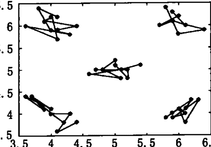
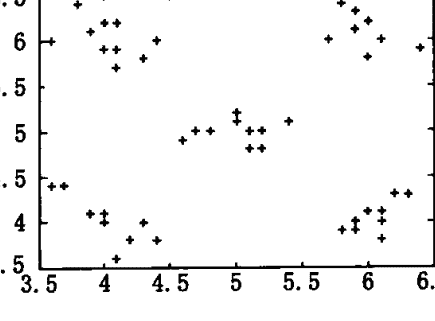
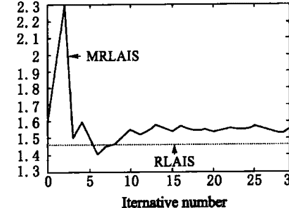
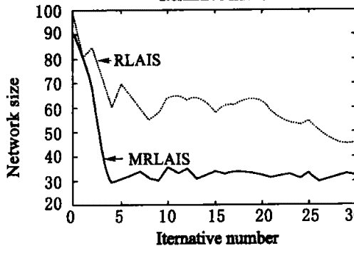

#### 图 6-3 二维五聚类数据实验看板
(a) 抗原分布; (b) 终态网络; (c) NAT 演化轨迹; (d) 网络规模演化

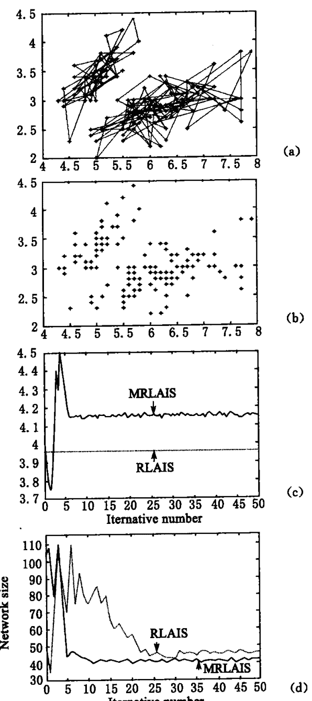

#### 图 6-4 Iris 数据实验看板
(a) 抗原分布; (b) 终态网络; (c) NAT 演化轨迹; (d) 网络规模演化

## 6.3 MRLAIS 赋能关联规则挖掘：从理论到落地

前文完成了资源有限人工免疫系统（RL-AIS）的改进，下面探讨 MRLAIS 在数据挖掘框架下的应用——聚焦频繁项集识别与强关联规则发现。

### 6.3.1 免疫隐喻：为何免疫系统擅长挖规则？

挖掘强规则需双阈值约束：最小支持度 & 最小置信度。流程分两步：寻找全体频繁项集 → 由频繁项集生成规则。首步最耗时，因候选空间随项数指数爆炸。但频繁/非频繁集存在天然决界，利用边界搜索可大幅压缩空间。传统策略有广度优先、深度优先等。

人工免疫系统（AIS）提供了另一种范式：
1.  **多点随机智能搜索**：源于抗体多样性遗传机制，配合免疫记忆，搜索性能卓越。
2.  **结构同构映射**：抗体/抗原由氨基酸排列组成，数据记录/模式由属性值组合而成，二者天然可映射。

**映射逻辑**：
*   原始记录、候选模式 $\rightarrow$ 基因构成的染色体
*   数据库记录 $\rightarrow$ **抗原**
*   候选模式 $\rightarrow$ **ARB (识别区B细胞)**
*   ARB 与抗原比对 $\rightarrow$ 相似度与包含关系
*   高匹配 ARB $\rightarrow$ 获得更多生存/克隆资源
*   免疫学习过程 $\rightarrow$ 个体亲和度提升 = 频繁模式生成与记忆保存
*   最终强规则 $\rightarrow$ 由**记忆细胞**携带的频繁模式导出

### 6.3.2 基于 MRLAIS 的关联规则挖掘算法详解

#### 6.3.2.1 数据编码与系统初始化

*   **抗原**：数据库每条记录。
*   **ARB**：候选模式载体，含三大核心属性——B细胞数量、刺激水平、支持度。
*   **记忆细胞**：保存优秀个体（频繁模式 + 支持度）。

为便于匹配、变异运算，采用**十进制编码**：连续属性离散分段对应规则前件，离散属性数值化，最终归一化为 $n$ 维向量。属性取 0 表示无关联。抗原、ARB、记忆细胞结构详见图示。

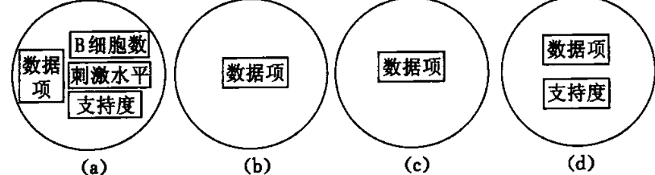

**图 6-5 核心数据结构示意**
(a) ARB 内部; (b) ARB 外部; (c) 抗原内部; (d) 记忆细胞内部

**初始化**：从数据集随机抽取记录生成 ARB，去重后填充种群至规模上限。

#### 6.3.2.2 ARB 刺激水平计算：融合距离与支持度

沿用 MRLAIS 刺激度计算逻辑，引入支持度修正：

```
sl = \(\sum_{g=0}^G (1 - dis_g)^2 + \sum_{i=0}^m (1 - dis_i)^2 + \sum_{i=0}^m (dis_i)^2\) (6-7)
```

式中，$G$ 为抗原总数，$dis_g$ 为 ARB 与第 $g$ 个抗原归一化距离，$dis_i$ 为 ARB 与连接 ARB 间归一化距离。

**支持度直觉**：ARB 亲和的抗原数越多，其代表规则的支持度越高。数学表达为：

```
sl(ag) = \(\sum_{g=0}^G (1 - dis_g)^2\) (6-8)
```

$sl(ag)$ 量化了候选模式 $ARB_i$ 对全体抗原的综合相似度。$sl(ag)$ 越高，意味着匹配抗原越多、相似度越深（共同基因位越多），成为频繁模式或进化为频繁模式的概率显著增大。

#### 6.3.2.3 算法执行流程（伪代码级描述）

1.  **输入** 抗体数据集；
2.  **初始化** 随机生成 ARB 种群；
3.  **呈递抗原**，计算各 ARB 刺激水平；
4.  **按刺激度分配 B 细胞资源**，零分配者淘汰；
5.  **重计算** ARB 刺激水平；
6.  **克隆扩增 + 固定率变异**；
7.  **判断终止条件**：满足 $\rightarrow$ 输出规则 / 不满足 $\rightarrow$ 跳转 Step 3；
8.  **输出强关联规则**，流程结束。

### 6.3.3 实战检验：Heart Disease 数据集挖掘实录

实验选用 UCI 机器学习库 **Heart Disease** 数据集：共 76 属性，有效 14 个（8 离散 + 6 连续），覆盖年龄、性别、胸痛类型、血压、胆固醇、心电图、最大心率、血管造影状态等临床指标。

**数据预处理**：连续属性分箱、离散属性数值化、全量归一化至 $[0, 1]$。

**参数设定**：ARB 初始种群 500，固定变异率 0.5，分别测试最小支持度 10%、30%、50% 场景。

**高光成果（支持度 10% 下典型规则节选）**：
1.  `胸痛类型=2` ^ `thal=可逆缺损` $\rightarrow$ **心脏病阳性**
2.  `胸痛类型=3` ^ `thal=固定缺损` $\rightarrow$ **心脏病阳性**
3.  `性别=男` ^ `thal=固定缺损` ^ `最大心率>157.4` $\rightarrow$ **心脏病阴性**
4.  `静息血压>162.93` ^ `血清胆固醇>415.28` $\rightarrow$ **心脏病阳性**
5.  `空腹血糖<=120` ^ `运动诱发心绞痛` $\rightarrow$ **心脏病阳性**
6.  `性别=女` ^ `主血管染色数=2` $\rightarrow$ **心脏病阳性**
7.  `主血管染色数=3` $\rightarrow$ **心脏病阳性**
8.  `空腹血糖<=120` ^ `静息心电图=正常` $\rightarrow$ **心脏病阴性**
9.  `空腹血糖<=120` ^ `thal=可逆缺损` $\rightarrow$ **心脏病阳性**
10. `胸痛类型=0` ^ `运动诱发心绞痛` $\rightarrow$ **心脏病阴性**
11. `空腹血糖>120` ^ `静息血压>162.94` $\rightarrow$ **心脏病阴性**
12. `运动诱发心绞痛` ^ `血清胆固醇∈(273.47, 415.28)` $\rightarrow$ **心脏病阳性**

实验结果表明，MRLAIS 能有效从医疗数据中发掘出具备临床解释性的强关联规则，验证了改进算法在实际知识发现任务中的实用价值。

# 改进免疫算法挖掘关联规则：告别繁琐参数，效率大幅跃升

## 实测规则速览：心脏病数据集上的关键发现

算法在心脏病数据集上挖掘出的高置信度规则，直观揭示了风险因素组合：

- **规则 13**：男性 + 运动峰值 ST 段斜率 = 2 型 → **无心脏病**
- **规则 14**：胸痛类型 3 型 + 静息心电图结果 = 2 型 → **患心脏病**
- **规则 15**：男性 + 血清胆固醇 < 273.47 mg/dl → **患心脏病**
- **规则 16**：静息收缩压在 128.73–162.94 mmHg 区间 → **患心脏病**

## 核心优势：为何它比 Apriori 更强？

实验证明，该算法能高效完成频繁项集挖掘与关联规则生成，且具备三大差异化优势：

1. **零参数门槛**：无需人工预设最小支持度，告别“试错式”调参；
2. **刺激度即支持度**：抗体识别抗原的刺激水平越高，对应规则的支持度自然越大，机制自洽；
3. **大数据场景更高效**：海量数据集下，运行速度显著超越传统 Apriori。

---

# 第 6 章 小结：从痛点到突破的完整路径

## 6.4.1 原模型的四大“硬伤”

早期资源有限人工免疫系统（RL-AIS）存在明显短板：

| 痛点 | 具体表现 |
|------|----------|
| **亲和度阈值僵化** | NAT 固定不变，束缚网络进化潜力 |
| **刺激度计算线性化** | 用欧氏距离 *d* 线性映射刺激度 *sl*，小距离优势未放大，又对微小 *d* 过度敏感 |
| **资源分配抑制多样性** | 初期采用 $R_i = k \times sl_i^2$，导致优势抗体过早垄断资源，扼杀种群多样性 |
| **进化策略单一** | 仅靠克隆选择 + 随机变异，收敛性与稳定性难以兼顾 |

## 6.4.2 四大改进：重构核心机制

针对上述痛点，改进版 RL-AIS 实施“定向手术”：

1. **动态 NAT**：每轮迭代后依据抗体间距离实时更新阈值，赋予网络自我进化能力；
2. **非线性刺激度**：引入非线性映射，放大小距离优势，同时抑制过度敏感；
3. **反正割资源函数**：$R_i = k \times \operatorname{arcsec}(sl)$，平滑分配资源，兼顾早期探索与后期收敛；
4. **引导式克隆变异**：不再盲目随机，强制抗体向抗原模式方向进化，定向提升适应度。

## 6.4.3 实验验证与工程落地

仿真实验确认：改进模型在**网络进化速度**、**拓扑结构合理性**上均显著优于原版。

工程化层面，利用“亲和度成熟 ≈ 频繁项集生成”的同构性，将频繁项集编码为 ARB（人工识别球），成功实现关联规则挖掘。UCI 标准数据集实测验证了该范式的**可行性与有效性**。

---

# 参考文献精选（核心支撑文献）

> 完整 32 篇参考文献见原文，此处列出高频引用核心文献：

- **[1]** 莫宏伟. *人工免疫系统原理与应用*. 哈工大出版社, 2002.
- **[23]** TIMMIS J, NEAL M. A resource limited artificial immune system for data analysis. *Knowledge Based Systems*, 2001, 14(3-4):121-130.
- **[25]** JIAWEI HAN, MICHELINE KAMBER. *Data Mining: Concepts and Techniques*. Academic Press, 2000.
- **[27]** HAN J, PEI J, YIN Y. Mining frequent patterns without candidate generation. *ACM-SIGMOD*, 2000.
- **[28]** AGRAWAL R, SRIKANT R. Fast algorithms for mining association rules. *VLDB*, 1994: 487-499.
- **[32]** UCI Machine Learning Repository. http://www.ics.uci.edu/.

---

# 第 7 章 自适应免疫应答网络（AIRN）及其聚类挖掘应用

> **核心思路**：模拟 B 细胞“识别—激活—增殖—记忆”全链路，构建自适应免疫应答模型，原生适配聚类数据挖掘任务。

## 7.1 免疫应答与免疫网络：生物蓝本深度解析

### 双层防御体系

| 免疫类型 | 特点 | 工程启示 |
|----------|------|----------|
| **固有免疫** | 广谱防御，无记忆（如皮肤屏障） | 通用预处理、异常值过滤 |
| **适应性免疫** | **针对性强、有记忆、可迁移** | **核心建模对象** |

本章聚焦**适应性免疫**。其四大工程价值特质：
1. **极致多样性**：数百基因 → 数百万抗体，天然适配高维特征空间；
2. **去中心化**：无中央控制器，天然分布式并行；
3. **动态自适应**：环境变化即时响应；
4. **内容寻址记忆**：抗原记忆后，同类模式自动触发二次应答——**这是聚类泛化能力的生物学原型**。

### 细胞层面的主角：淋巴细胞

- **B 细胞**：分泌抗体，直接清除抗原；
- **T 细胞**：分泌细胞因子，辅助/抑制 B 细胞反应；
- 共享特质：**专一性、多样性、记忆性、自适应性**。

> 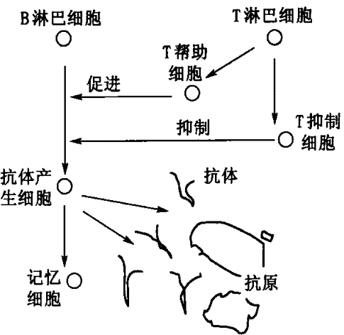  
> **图 7-1 免疫系统作用机制示意**

## 7.1.1 免疫应答全过程：从初次遇敌到终身记忆

### 关键阶段拆解

| 阶段 | 生物学事件 | 计算映射 |
|------|------------|----------|
| **识别** | 少量 B 细胞匹配抗原表位 | 模式匹配/相似度计算 |
| **克隆扩增** | 匹配细胞高速分裂 | 高适应度个体复制 |
| **超频变异** | 分裂伴随高频突变 | 局部搜索/扰动优化 |
| **分化·浆细胞** | 大量分泌抗体清除抗原 | **初次应答** ≈ **模型训练/拟合** |
| **分化·记忆细胞** | 少量保留，终身监视 | **二次应答** ≈ **新样本快速分类/聚类** |

### 两次应答的计算语义

- **初次应答**（Primary Response）：耗时长、抗体低 → 对应**离线训练/建模阶段**；
- **二次应答**（Secondary Response）：极快、抗体爆发、交叉反应 → 对应**在线推理/聚类分配**；
- **联想记忆特性**：相似抗原亦可触发二次应答 → **天然支持模糊聚类与噪声鲁棒性**。

> **一言蔽之**：免疫应答 = 生物体对入侵者的“识别—学习—记忆—泛化”闭环。AIRN 正是将这一闭环算法化、工程化，直击聚类挖掘的核心痛点。

# 免疫应答的三大核心阶段与人工模拟映射

免疫应答的基础流程划分为感应、增殖分化与效应三个连贯阶段。在人工免疫系统（AIS）的构建中，这三个阶段分别对应抗原匹配、抗体克隆选择、抗体变异及亲和力成熟匹配等关键计算步骤。

### 7.1.2 免疫网络假说解析

为了深度解析免疫系统的复杂行为，N. K. Jerne 创立了独特型免疫网络假说。该理论打破了免疫细胞孤立作战的传统认知，指出细胞间通过相互激励与抑制，编织成一个动态的网络结构。

Jerne 指出，抗原表面携带反映其特性的表位，特异性抗体依靠可变区与之精准结合，宛如钥匙插入锁孔，此即对位，奠定了免疫识别的特异性基石。关键在于，抗体自身也携带可被其他抗体识别的独特型决定簇，亦即抗体具备抗原性。当抗体对位与表位或独特位结合，促使分泌该抗体的 B 细胞获激励；激励超阈值则触发克隆扩增，启动免疫应答。被结合的抗原或抗体则遭抑制，相应 B 细胞数量下降。海量抗体间及抗原抗体间的博弈，共同构筑了免疫网络（见图 7-2），其中 ns、nn 分别代表 B 细胞间激励与抑制，ps 表示抗原对 B 细胞的激励。

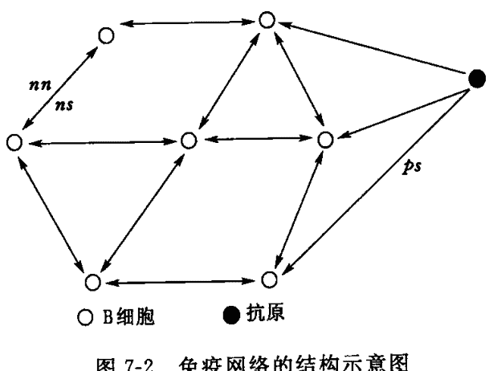

### 7.1.3 模型构建的简化预设

免疫应答涉及繁杂生化反应，穷尽建模既不现实亦无工程必要。人工免疫系统聚焦信息处理与工程落地，融合网络假说与细胞机理，提炼适用于复杂系统建模、控制及模式识别的核心模型。为此，确立以下简化假设：

1.  **剔除 T 细胞**：因其机制繁复，模型仅保留 B 细胞间的激励/抑制交互。
2.  **B 细胞与抗体等同视**：同一 B 细胞分泌抗体性质一致，不再区分二者概念；识别环节用“抗体”，增殖环节用“B 细胞”。系统由抗原、抗体群、骨髓三要素构成。
3.  **忽略延迟**：省去抗原提呈、细胞介导耗时，设定抗原入侵瞬间触发 B 细胞响应。
4.  **随机流动交互**：B 细胞非固定连接，随机漂流，每时刻仅与邻域细胞发生作用。

基于此，旨在打造一种以搜索原始数据模式为靶向的自适应免疫应答网络。设计中吸纳了成熟算法的精华：
*   以抗体网络拓扑承载学习记忆；
*   以抗原抗体相似度度量支撑识别；
*   以克隆超变异机制生成高亲和力抗体，映射抗原特征；
*   以抗体间刺激抑制平衡稳定性与持续学习力，新抗原至即刻响应；
*   动态控网络规模，引入新抗体的同时淘汰长期沉默无效抗体。

下文将逐层拆解自适应免疫应答网络的架构与功能实现细节。

## 7.2 自适应免疫应答网络 (AIRN) 模型详解

### 7.2.1 AIRN 架构要素

依托简化免疫假说，锚定数据分析目标，按问题特质定义 AIRN 核心组件：
*   **抗原** = 原始数据集；
*   **抗体** = 各模式类特征向量，网络节点表现为数据项；
*   **拓扑结构** = 抗体间相互作用编织的网络；
*   **训练终局** = 网络稳定结构精准映射原始数据内含模式类。

网络构建遵循四条铁律：
1.  节点由数据值与刺激度组成；
2.  节点连接取决于相似度超阈值与否；
3.  每个互联子网对应一个模式类；
4.  训练收敛至稳定拓扑，即为模式分析终极输出。

### 7.2.2 AIRN 初始化机制

抗原识别是免疫启动的核心前提。识别依赖互补结合力（亲和力），互补度越高亲和力越强。引入 A. S. Perelson 形态空间概念量化匹配：若 m 个特征主导分子互作，分子即映射为 m 维空间 S 中的点（海明或欧氏空间）。

将待处数据定义为抗原集 $AG=\{ag_1, \dots, ag_I\}$，抗体识别抗原即免疫系统识别数据模式。免疫过程输出记忆细胞集 $M$ 即目标模式，规模 $I' < I$，实现抗体空间压缩。形式化描述见下：

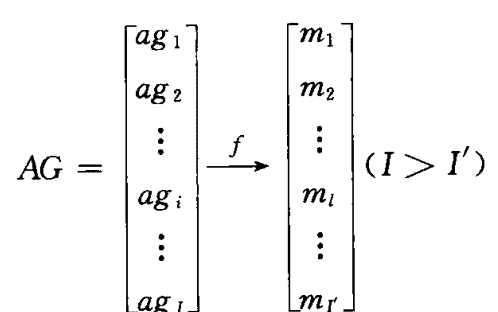

抗原具体编码为：

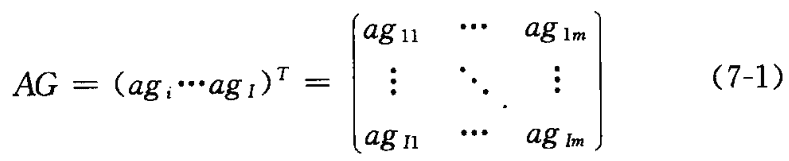

式中 $ag_i$ 为第 i 个抗原，$ag_{ij}$ 为其第 j 维向量。

随机生成初始抗体库：

$$

AB = (ab_1 \cdots ab_k)^T = \begin{pmatrix} ab_{11} & \cdots & ab_{1m} \\ \vdots & \ddots & \vdots \\ ab_{k1} & \cdots & ab_{km} \end{pmatrix} \quad (7-2)

$$

$ab_{ij} \in [0,1]^m, i=1, \dots, k; j=1, \dots, m$

$ab_i$ 为第 i 个抗体，$ab_{ij}$ 为其第 j 维向量。

### 7.2.3 抗原提呈与亲和力计算

采用欧氏距离度量抗原抗体匹配度。任意抗原 $ag_i$ 与抗体 $ab_j$ 距离 $d(i,j)$ 计算如下：

$$

d(i,j) = \left[ \sum_{t=1}^m (ag_{it} - ab_{jt})^2 \right]^{1/2} \quad (7-3)

$$

抗体间距离 $s(i,j)$ 计算如下：

$$

s(i,j) = \left[ \sum_{t=1}^m (ab_{it} - ab_{jt})^2 \right]^{1/2} \quad (7-4)

$$

抗体 $ab_j$ 接收抗原 $ag_i$ 激励 $sl(i,j)$ 定义为：

$$

sl(i,j) = \begin{cases} 1/ \sqrt{d(i,j)} & d(i,j) < T_x \\ 0 & \text{other} \end{cases} \quad (7-5)

$$

$i = 1, \dots, I; j = 1, \dots, k$

其中激励阈值：

$$

T_x = k_x \frac{\sum_{i=1}^I \sum_{j=1}^k d(i,j)}{\frac{I \times k}{2}} \quad (7-6)

$$

$k_d \in (0, 1]$ 为常数。

### 7.2.4 克隆扩增与超变异

抗体受抗原激励达标 $[d(i,j) < T_d]$，免疫系统激活，启动克隆增殖（无性有丝分裂/自我复制）。克隆数量与激励水平正相关：激励强克隆多，激励弱克隆少。抗原 $ag_i$ 诱导抗体 $ab_j$ 克隆数：

$c_1(i, j) = \begin{cases} \lfloor sl(i, j) \rfloor & d(i, j) > T_d \\ 0 & \text{other} \end{cases}$  

(7-7)

$\lfloor \cdot \rfloor$ 为取最接近整数。$ab_j$ 经 $ag_i$ 刺激产生克隆集 $Ab_{ji}$，受抗原群刺激总克隆集 $C_j$：

$C_j = \bigcup_{t=1}^{c_1(i, j)} Ab_{jt}$  

(7-8)

全抗体库克隆后新生集合 $C$：

$C = \bigcup_{t=1}^k C_t$  

(7-9)

克隆细胞经高频突变，亲和力进阶。变异率与激励成反比：激励大变异小，激励小变异大。定义 $Mut(i,j)$ 为 $ab_j$ 受 $ag_i$ 刺激后新抗体变异率：

$Mut(i, j) = d(i, j)$  

(7-10)

$ag_i$ 触发的 $ab_j$ 克隆变异公式：

$c'_j = c_j + Mut(i, j) \times (c_j - ag_i)$  

(7-11)

$ab_j$ 受抗原群刺激变异集 $C_j'$，全库变异抗体集 $C'$：

$ C' = \bigcup_{i=1}^{k} C_i' $ (7-12)

变异赋予抗体多样性，内化为免疫系统强化学习特性，迭代优化识别性能。

### 7.2.5 克隆抑制与精英选择

变异后首轮克隆抑制。重算抗原-克隆抗体、克隆抗体互亲和力，设定双阈值：

抗原-抗体抑制阈值 $T_d$：
$ T_d = k_d \frac{1}{p} \sum_{j=1}^{p} \min_{i=1}^{l} d(i, j) $ (7-13) ($k_d \in (0, 1]$)

抗体-抗体抑制阈值 $T_s$：
$ T_s = k_s \frac{\sum_{i=1}^{p} \sum_{j=1}^{p} s(i, j)}{p(p-1)/2} $ (7-14) ($k_s \in (0, 1]$)

抑制规则：先清除与抗原亲和力超 $T_d$ 者，再清除互亲和力低于 $T_s$ 的记忆细胞。幸存集合 $C''$ 满足：
$ ab_j = \begin{cases} ab_j & \exists ag_i, d(i, j) < T_d \\ 0 & \text{other} \end{cases} $ (7-15)
$ ab_j = \begin{cases} ab_j & \exists ab_i, s(i, j) > T_s \\ 0 & \text{other} \end{cases} $ (7-16)

$C''$ 规模显著收缩。继而克隆选择：按抗原亲和力降序，截取 $\xi\%$ 精英变异克隆入记忆池 $M$。

### 7.2.6 亲和力成熟与自身耐受

成熟过程类自然选择：高刺激抗体转化为长寿记忆细胞，低刺激随抗原消亡。为防自身免疫，每轮新记忆入库后必清理自我识别抗体。

设记忆池 $M$ 规模 $p_1$，成熟阈值 $T'_s$：
$ T'_s = k'_s \frac{\sum_{i=1}^{p_1} \sum_{j=1}^{p_1} s(i, j)}{p_1(p_1 - 1)/2} $ (7-17) ($k'_s \in (0, 1]$)

成熟筛选条件：
$ ab_j = \begin{cases} ab_j & s(i, j) > T'_s \\ 0 & \text{other} \end{cases} $ (7-18)
$i,j = 1, \dots, p_1$。

### 7.2.7 训练终止判据

迭代上限或收敛判断二选一。收敛条件：任意抗原 $ag_i$ 在记忆池均能觅得抗体 $ab$ 使 $d(i,j) \leqslant T_c'$。

系统循环上述流程学习数据，至终止条件满止，全抗原被记忆池覆盖，最终 $M$ 即学习所得模式，完成知识沉淀。此阶段为二次应答奠基：训练终结可输出数据模式，或转入二次应答识别新数据。

综上，AIRN 模型特征鲜明：初次应答建记忆库描绘抗原特征识模式；二次应答识别新数据。工程落地可支撑数据压缩、聚类、分类等识别任务。

### 7.2.8 算法伪代码与参数表

**关键参数：**
*   $Af(d)$：亲和力函数，欧氏距离倒相关。距离大亲和力小，反之亦然。
*   $sl$：刺激度（抗原-抗体/抗体-抗体）。
*   $\xi\%$：精英克隆入记忆比例。
*   $M$：记忆细胞集。

**AIRN 算法流程：**
1.  **初始化**：数据集 $AG$ 标准化，随机生成抗体库 $AB$。
2.  **终止判断**：满足则输出 $M$ 结束，否则继续。
3.  **亲和力/刺激度计算**：遍历 $Ag_i \in AG$，依 $T_d$ 算 $Af(d)$ 与 $sl$。
4.  **克隆扩增**：按 $sl$ 克隆抗体。
5.  **超变异进化**：按变异公式进化抗体。
6.  **网络抑制**：依 $T_d, T_s$ 双阈值抑制网络。
7.  **精英入库**：从抗体库选 $\xi\%$ 最高亲和力者入 $M$。
8.  **记忆修剪**：依 $T'_s$ 删除冗余记忆细胞，跳转步骤 2。

## 7.3 AIRN 模型深度剖析

### 7.3.1 自然免疫系统 (NIS) 与 AIRN 映射对照

表 7-1 梳理了自然免疫系统 (NIS) 核心概念到 AIRN 算法实体的映射关系：

| NIS (自然免疫) | AIRN (人工免疫网络) |
| :--- | :--- |
| 记忆细胞 | 算法生成、逼近原始数据且携带模式特征的数据项 |
| 抗原 | 待分析的原始数据集合 |
| 克隆 | 与呈递抗原匹配的记忆细胞复制操作 |
| 变异 | 克隆后记忆细胞的变异扰动 |
| 克隆选择 | 依阈值筛选：高亲和力保留，低亲和力淘汰 |
| 亲和力成熟 | 保留高亲和力克隆转化为记忆细胞 |
| 免疫记忆 | 针对抗原集合生成记忆细胞集合 |

# 7.3.2 自适应机制深度解析

#### (1) 抗原-抗体激励门槛 $T_d$ 的动态调节

在 AIRN 架构中，抗体接收的刺激信号 $sl$ 仅源于抗原的作用，而抗体间的相互抑制则发生在克隆变异阶段。依据公式 (7-5)，我们设定了抗原对抗体的激励阈值 $T_s$。该阈值取全体抗体与抗原平均距离，实时映射当前网络中抗体对抗原的亲和力水平，且随每轮迭代动态更新，实现了与网络演化进程的同步自适应。

#### (2) 抗原-抗体抑制门槛 $T_d$ 的演化策略

生物免疫中，未受抗原激活的细胞会走向凋亡。人工免疫网络引入抗原-抗体抑制阈值 $T_d$ 来清洗网络：当抗体与抗原亲和力超越 $T_d$，该抗体即被移除。演化初期，抗体多距抗原较远，亲和力普遍偏低；若 $T_d$ 设定过小，优质抗体易被误删，甚至导致无抗体满足条件，使网络无法形成抗原数据模式。演化后期，抗体逼近抗原，亲和力整体提升，此时需适度收紧 $T_d$，以充分剔除低亲和力个体。因此，构建随网络生成自适应的 $T_d$ 函数至关重要。此处令 $min\_d(i, j)$ 为全抗体对单一抗原最小亲和力的均值，定义 $T_d = k_d \frac{1}{p} \sum_{j=1}^p \min_{i=1}^l d(i,j)$。该机制保证初期阈值宽松、后期趋严，自适应网络演变，维持结构健壮。

#### (3) 抗体-抗体抑制门槛 $T_s$ 与多样性维护

自然免疫中，抗体受邻域抗体影响，同质细胞遭抑制以保种群多样性。AIRN 采用每轮迭代后抗体间平均距离定义抑制阈值 $T_s$，据此动态剔除同质或相近抗体。$T_s$ 直接决定网络特异性、聚类精度及伸缩性，因其约束了抗体间距离下限，与网络个体数量挂钩，且关联抗体距离整体分布，从而实现随演化过程的自适应调控。

#### (4) 亲和力成熟门槛 $T_s'$ 的优化设定

免疫应答中，高刺激抗体经克隆变异转化为长寿记忆细胞，低刺激者淘汰。$T_s'$ 参照 $T_s$ 定义方式设定，旨在让记忆细胞集随网络演化保持特异性，精准捕获目标模式。为追求网络最优化，设定 $T_s' > T_s$，以更严格的标准筛选精英抗体。

---

# 7.3.3 收敛性理论保障

**核心定义体系：**

*   **理想模式中心集 ($V^*$)**：使模式评价函数 $J(X, V)$ 达到全局最优的中心集合。
*   **可划分模式数据集**：可通过算法获取 $V^*$ 的数据集。
*   **模式中心区域 (PCA)**：以理想中心 $v_i$ 为球心、$r$ 为半径的超球体区域。
*   **模式中心区域集 (PCAS)**：包含 $k$ 个模式 PCA 的集合。
*   **收敛中心区域集 (CCAS)**：从 PCAS 各区域任取一点构成初始中心 $C$，若算法能从 $C$ 收敛至 $V^*$，则该 PCAS 为 CCAS。最小半径 $r_c$ 称收敛半径。
*   **可划分度 ($\rho$)**：所有 CCAS 中最大收敛半径。$\rho=0$ 意味着需预知中心位置，不适合划分聚类；可划分数据集必有 $\rho > 0$。
*   **模式解**：与 CCAS 每个区域均有非空交集的集合 $R$。

**关键推导：**

**引理 7.1**：若存在抗原 $ag$ 落入 $PCA(i, T_s')$，算法终止时，抗体集 $M$ 必含至少一抗体落入 $PCA(i, 2 T_s')$。
*论证*：变异引导公式 $c_j' = c_j + Mut(i, j) \times (c_j - ag_i)$ 驱动抗体持续逼近抗原，有限迭代后必入目标区域。

**定义 7.8**：$P_{1, T_s', i}$ 表示模式 $i$ 至少含 1 样本落入 $PCA(i, T_s')$ 的概率。

**定理 7.1**：若可划分度 $\rho \geqslant 2 T_s'$，AIRN 获得模式解的概率 $P \geqslant \prod_{i=1}^k P_{1, T_s', i}$。
*论证*：模式分布独立，联合概率为乘积。引理 7.1 保证样本存在即抗体跟进。$\rho \geqslant 2 T_s'$ 确保最大 CCAS 区域覆盖 $PCA(i, 2 T_s')$，故 $M$ 与各区域交集非空，符合模式解定义。

**渐近特性**：高斯、均匀、拉普拉斯分布下，随样本量 $n_i$ 增大，乘积概率指数级趋近 1。因模式数有限，算法获最优解概率随数据量增大趋近确定性。

---

# 7.4 基于 AIRN 的聚类挖掘实战

### 7.4.1 算法落地实现

AIRN 网络构建完成后，系统引入 KNN 机制，输出代表原始数据集的抗原聚类结果。

```
Given ag_i in AG to be clustered
Let m_1, m_2, ..., m_k denote the k instances from M the nearest to ag_i
Return
arg maxd(ag_i,m_j)
V(ag_i) <- arg max_{v \in V} \sum_{k=1}^k \delta[v, V(ag_i)]
where \delta(a,b)=1, if a=b
otherwise \delta(a,b)=0
End
```

### 7.4.2 仿真实验与效能验证

#### (1) 人工合成数据测试

为直观呈现效果，选取两组高斯分布人工数据集：数据集一含 380 个二维样本、5 个簇；数据集二含 550 个三维样本、7 个簇。网络系数统一设为 $k_d = 1, k_s = 1, k_s' = 1$。

各数据集独立试验 50 次，算法**100% 精准识别聚类数**。典型单次运行结果见图 7-3、7-4。数据集一平均模式解规模 56，30 代内收敛最优；数据集二平均规模 82，45 代内收敛最优。

#### (2) UCI Iris 真实数据挑战

Iris 数据集 4 维特征、3 物理类别，但第 2、3 类特征空间重叠，最佳聚类数存争议。文献 [13] 基于 $v_{DB,22}$ 指标判定最优簇数为 2。沿用相同网络系数，AIRN 平均种群规模 16，**通常 < 25 代即复现文献结果（簇数 2，$v_{DB,22}=0.46$），甚至挖掘到评估值 0.44 的更优解**。

聚类核心任务为确定簇数与簇位置。引入 GA、aiNet、BHCM 同台竞技，各 50 次试验（GA 迭代 40 代，BHCM 取文献值）。结果汇总见图 7-5、表 7-2。

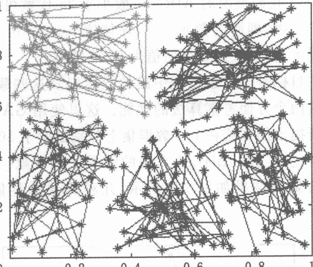
**图 7-3** 数据集一实验结果
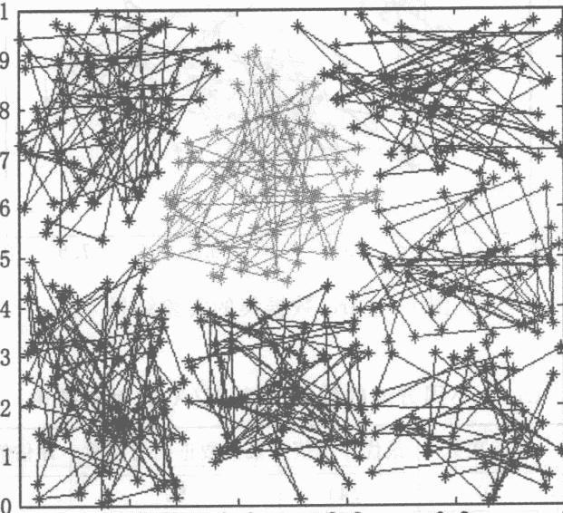
**图 7-4** 数据集二实验结果
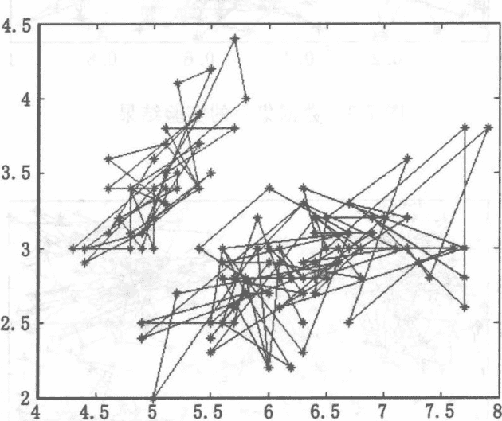
**图 7-5** Iris 数据集实验结果

**表 7-2 Iris 数据集多算法性能对决 (N/A: 文献未提供)**

| 算法 | 试验次数 | 最优评估值 | 簇数正确率 | 命中最优评估值次数 |
| :--- | :---: | :---: | :---: | :---: |
| **AIRN** | 50 | **0.44** | **50 (100%)** | **49** |
| GA | 50 | 0.44 | 22 | 17 |
| aiNet | 50 | 0.44 | 50 | 20 |
| BHCM | N/A | 0.46 | N/A | N/A |

**深度复盘**：
*   **GA**：搜索空间大，虽能触及理论最优，但收敛稳定性差。
*   **BHCM**：穷举法配合 K-means 找簇数，受限于 K-means 局限，错失全局最优评估值。
*   **aiNet**：虽保证簇数正确，但易偏离理想中心，陷入次优解（文献 [15]）。
*   **AIRN**：在簇数识别、最优解捕获概率上**全维度碾压**对手，展现卓越鲁棒性与精度。

### 7.4.3 AIRN vs FCM：两大聚类范式的正面交锋

主流聚类算法林立（K-means、FCM、GCS、Kohonen 网、模糊神经网等），FCM 以简易高效著称。AIRN 融合克隆选择、亲和力成熟、免疫网络理论，构建起另一条技术路线。下面从机制与工程视角对比。

#### (1) FCM 回顾：原理与痛点

FCM 核心在于将 $n$ 向量模糊划分为 $c$ 组，迭代优化中心最小化非相似性指标 $J_m(U,V)$。隶属度矩阵 $U$ 与中心 $V$ 交替更新至收敛。

**三大工程痛点**：
1.  **模糊指数 $m$ 难定量**：$m \in [1, \infty)$ 控制模糊度，无理论最优，依赖经验 ($1.1 \sim 5$) 与反复实验。
2.  **初始中心敏感**：随机初始化极易陷局部最优，代表性差则前功尽弃。
3.  **簇数 $c$ 需先验**：面对海量未知数据，人为指定 $c$ 既主观又不切实际。
**适用边界**：凸集分布表现优异；非凸、异形分布失效，需改进。

#### (2) AIRN 差异化优势

AIRN 亦有用户参数（初始抗体、$k_d, k_d, k_s, k_s'$），但**每个系数均具明确物理含义**，可精准调控网络规模、结构、粒度与连接拓扑。核心抑制阈值直接掌控最终网络形态：高阈值产出高度泛化的簇代表。

**核心差异对比**：

| 维度 | FCM | AIRN |
| :--- | :--- | :--- |
| **学习范式** | 无监督、需先验簇数 | 无监督、**自主发现簇数** |
| **参数语义** | 抽象数学参数 ($m, c$) | **具象免疫物理参数** |
| **鲁棒性** | 依赖初始化，易陷局部最优 | **免疫机制天然反局部最优** |
| **分布适应性** | 仅擅长凸球形分布 | **适应任意形状分布** |
| **输出结果** | 精确聚类中心 + 隶属度 | **簇数 + 簇代表 (抗体)**，非几何中心 |
| **收敛判据** | 目标函数变化量 | **网络结构稳定/抗体数收敛** |

**结论**：FCM 是“在已知框架内找最优中心”，AIRN 是“在未知空间里自主生长结构”。前者依赖人类先验，后者赋能机器自主认知。对于簇数未知、分布复杂、需自动化建模的场景，AIRN 展现出更强的工程落地潜力。

$$

\sum_{i=1}^{c} u_{ij} = 1 \quad \forall j = 1, 2, \cdots, n

$$
$$

u_{ij} \in [0, 1]

$$
$$

\sum_{j=1}^{n} u_{ij} > 0 \quad \forall i = 1, 2, \cdots, c

$$
$$

J_m(U,V) = \sum_{i=1}^c \sum_{j=1}^n u_{ij}^m d_{ij}^2 \quad (7-20)

$$
$$

v_i = \frac{\sum_{k=1}^n (u_{ik})^m x_k}{\sum_{k=1}^n (u_{ik})^m} \quad i = 1,2,\cdots,c \quad (7-21)

$$
$$

u_{ik} = \frac{1}{\sum_{k=1}^n (d_{ik}/d_{jk})^{1/(m-1)}} \quad i = 1,2,\cdots,c;k = 1,2,\cdots,n \quad (7-22)

$$

## 7.5 核心回顾

自适应免疫应答网络（AIRN）的构建基础在于抗体间的连接机制：仅当两抗体间距低于设定阈值时才建立链接，否则断联。这一特性使得AIRN在抗原模式的抗体进化求解中，能够识别任意形状的数据模式，有效规避了模糊聚类在处理非凸数据分布时的短板。

虽说AIRN输出结果的空间分布尚待深入剖析，但其独有的诸多特性——这是FCM算法所欠缺的——使其在数据划分与模式识别任务中表现优异。

本章构建AIRN模型时，深度借鉴了生物免疫机制：免疫应答作为核心特征，本质在于对抗原的识别、效应与记忆；免疫细胞并非孤立存在，而是通过相互激励与抑制编织成网络结构。

基于简化的免疫应答与网络假设，本章锁定了数据分析目标，并依据问题特性界定了AIRN的核心要素：抗原映射原始数据集，抗体对应模式类特征值（网络中的数据项），抗体间相互作用形成网络，训练后的记忆细胞则象征模式类别。

AIRN的构建遵循特定规则：网络由数据项构成（含数据值与刺激度）；项间连接取决于相似度与阈值的比较——相似度超阈值则连接，反之不连；每组互联数据项构成的子网代表一个模式类；训练趋稳后的网络结构即为最终分析结果。

本章详述了AIRN的表示与构建流程，定义了适配网络结构的抗原呈递刺激水平、克隆变异机制，设置了自适应的抗体/抗原抑制阈值及亲和度成熟阈值，并通过与自然免疫系统对比，深度剖析了AIRN的自适应性与收敛性。

实战层面，AIRN被引入聚类挖掘：借助KNN对记忆细胞分类以聚类抗原，实验验证了网络优良特性。对比FCM，AIRN参数配置更简易，在数据划分与模式识别上同样成效显著。

# 参考文献

- [1] 林学颜，张玲. 现代细胞与分子免疫学[M]. 北京：科学出版社，1999.
- [2] JERNE N K. The immune system[J]. Scientific American,1973,229(1)：51-60.
- [3] HUNT J E, COOKE D E. Learning using an artificial immune system[J]. Journal of Network and Computer Applications,1996,19(2)：189-212.
- [4] TIMMIS J, NEAL M. A resource limited artificial immune system for data analysis[J]. Knowledge Based Systems,2001,14(3-4):121-130.
- [5] CASTRO D E, ZUBEN V. The Clonal Selection Algorithm with Engineering Applications [C]. (Full version. pre-print). In Proceedings of GECCO'00 (Workshop Proceedings):36-37.
- [6] WIERZCHON S, URSZULA KUZELEWSKA. Stable Clusters Formation in an Artificial Immune System[C]. In 1st International Conference on Artificial Immune Systems (ICARIS). University of Kent at Canterbury. UK. September 9th-11th,2002.
- [7] HART E, ROSS P. Exploiting the analogy between immunology and sparse distributed memories:a system for clustering non-stationary data [C]. In the proceedings of 1st International Conference on Artificial Immune Systems (ICARIS-2002). University of Kent at Canterbury. UK, September 9th-11th,2002.
- [8] CASTRO D E, ZUBEN V. An Evolutionary Immune Network for Data Clustering[C]. (Full version. pre-print). In Proceedings of the IEEE SBRN'00 (Brazilian Symposium on Artificial Neural Networks):84-89.
- [9] KNIGHT T, TIMMIS J. A Multi-Layered Immune Inspired Approach to Data Mining[C]. In Lotfi A. Garibaldi J and John R. editors. Proceedings of the 4th International Conference on Recent Advances in Soft Computing. pages 266-271. Nottingham. UK, December 2002.
- [10] STAWOMIR T, WIERZHHOI S, URSZULA KUZELEWSKA. Adaptive clusters formation in an Artificial Immune System [DB/OL]. http://neuro.bstu.by/our/stw_uk.pdf.
- [11] PERELSON A S, OSTER G F. Theoretical Studies of Clonal Selection; Minimal Antibody Repertoire Size and Reliability of Self-Nonself Discrimination [J]. Theor. Biol. ,1979(81):645-670.
- [12] BLAKE C L, MERZ C J. UCI Repository of Machine Learning Databases[DB/OL]. http://www.ics.uci.edu.
- [13] BEZDEK J, PAL N. Some New Indexes of Cluster Validity[J]. IEEE Transactions on Systems, Man and Cybernetics-Part B: Cybernetics, vol. 28 pp. 301-315, Jun 1998.
- [14] KROVI R. Genetic algorithms for clustering :a preliminary investigation System Sciences [A]. IEEE Proceedings of the Twenty-Fifth Hawaii International Conference on System Sciences[C] Hawaii; IEEE, 1992(4) ; 540-544.
- [15] 张文修. 遗传算法的数学基础[M]. 西安:西安交通大学出版社.
- [16] GRANZOW M, BERRAR D, Dubitzky W, et al. Tumor classification by gene expression profiling :Comparison and validation of five clustering methods [J]. ACM SIGBIO Newsletter,2001,21(1).
- [17] BEZDEK J C. Pattern recognition with objective function algorithms [M]. New York; Plenum, 1981:43-93.

# 第 8 章 免疫原理驱动的煤矿决策支持系统

决策支持系统（DSS）融合海量数据与多元模型，通过人机交互赋能各级决策者科学决策。基于免疫原理的煤矿DSS，则利用人工免疫机制推理挖掘，从矿山海量数据中发掘内在规律知识，为煤矿安产经管提供精准预测与指引，助力科学决策落地。

## 8.1 DSS演进脉络

DSS作为20世纪80年代兴起的计算机新学科，功能聚焦数据综合利用、模型有机组合与人机交互辅助决策。架构上已演进为网络环境下的多库结构，面向对象、结构建模、数据仓库、OLAP及网络协议的引入，让系统架构日益多元。

### 8.1.1 传统DSS架构[1]

传统DSS构建数据、模型、知识三库。数据源自企业长期积累，量大形杂，采集易失真；知识模型源自专家，库结构固化更新难；界面过专业，难适配广泛用户；角色混淆，数据处理弱，难提供未知洞见。随需求复杂化，传统架构暴露短板，亟待变革引入新技。

随网络技术飞跃，C/S架构引入DSS：数据模型库置服务端，客户端请求分析预测，如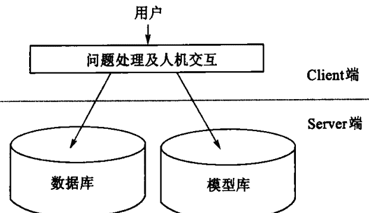所示。


#### 图 8-1 基于 C/S 的传统 DSS 体系结构

此架构虽适小型企业，但随网络负载增、服务端性能降、客户端维护重，运行稳定性受威胁，须寻更优结构。

### 8.1.2 数据仓库与挖掘赋能的DSS[2]

数据仓库与挖掘虽独立成技，但内在关联，融合集成能大幅跃升决策力。传统DSS以知模为主辅以数据，知模源专家；新架构以库为基，双主体驱动：一为知模库提供定性量合一分析，二为仓库挖掘从数据内部提炼规律知识，如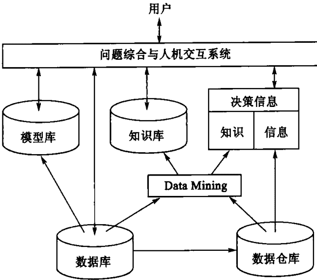所示。


#### 图 8-2 DW 和 DM 支持的 DSS 体系结构

新型DSS不只修补旧疾，更增决策效能；若再融合新挖掘法与智能推理，系统将更灵活、功能更丰富。

## 8.2 免疫原理煤矿DSS框架

DSS广泛落地各行业，煤企亦有成功先例[3]。辽宁铁法煤业集团建设综合业务集成系统时，引入人工免疫推理与挖掘，构建免疫推理与挖掘双系统，实测运行良好，充分释放数据红利，为管理层输出强力决策支撑。

免疫原理DSS以知、数、模为基，融免疫推理挖掘完成功能。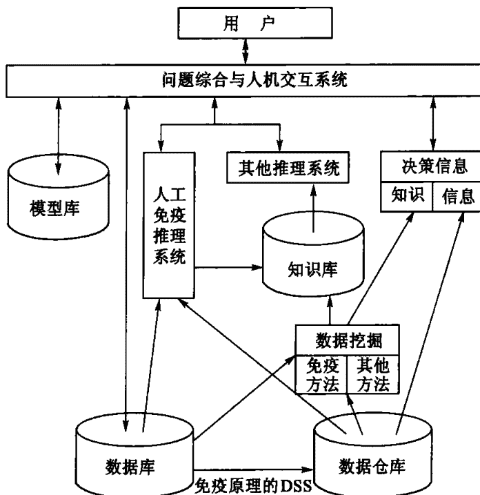展示研究框架：核心由免疫推理系统与免疫挖掘系统构成。煤企日常生产经营决策多涉及综合评价与策略制定，如井下环境监测、大型设备故障诊断。此类问题需建多级指标体系多维评判，属复杂非结构化决策，常靠专家经验直觉在不全不确信息中建体系、融意见、协平衡。但指标关联难量化，受主观偏好、环境认知限，难建精准模型，常规规则推理也难描述。故需引入能处理不确定不完全信息的评价法。在DSS中构造免疫模型，正是破解此类决策的新径。


图 8-3 基于免疫原理的 DSS 体系结构

## 8.3 免疫原理推理系统

DSS推理本质是依对象特征作推断。推理系统解放人力复杂推理，已广泛服务农医林等领域。但现实复杂，知识库不可能全知，推理机显关键。模糊、神经网络、面向对象融合注入新活力，大幅提智能化。引入人工免疫培育识别器原理，动态更新推理机、从更新知识库切入，为推理系统开辟新范式。

### 8.3.1 系统架构与推理机内核[4]

完整推理系统含六模块：人机界面、推理机、解释器、知识库、动态数据库、知识库管理系统。系统蕴含领域专家知识并具解题能力，更应有自学习力，从成败中汲取经验。

推理机即实现推理的程序，运用知识库知识解题，是专家思维机制的算法化机器实现，标志系统智能化水平。随环境变迁，推理机亦须动态进化。

### 8.3.2 免疫识别器培育机制[5]

生物免疫核心任务是辨识“非我”与“我”。任意外来入侵，系统均能判定其归属。本质上，免疫识别是建模问题：若识别对象集S，元素必属self或non-self，但两集全集极大难获。免疫学认为：通过胸腺训练出的少量B细胞（self子集），可识别对应范围non-self，如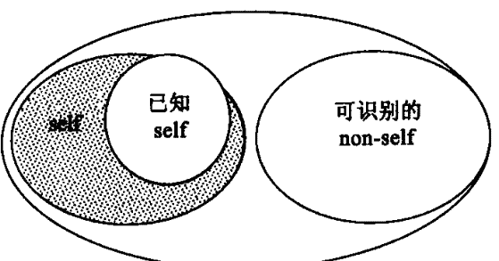。


图 8-4 人工免疫的集合模型

人工免疫识别器分三型：不成熟、成熟、记忆。生命周期经随机生成、成熟培育、学习、死亡四阶段，流程见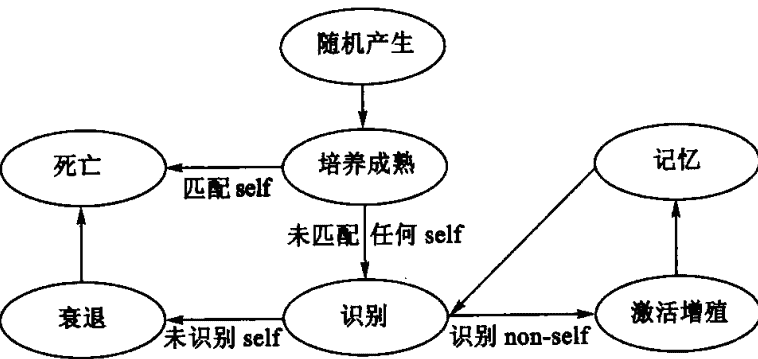。


图 8-5 一个识别器的生命周期

本节将上述免疫概念与培育法引入推理系统。

### 8.3.3 动态克隆推理策略

为便描述，参考文献[6]先设定核心概念：

- **定义 8.1 推理规则**：即推理系统中的推理机。
- **定义 8.2 不成熟推理规则**：随机生成未转化为成熟规则者。
- **定义 8.3 成熟推理规则**：不成熟规则经训练达期未被淘汰者。
- **定义 8.4 记忆推理规则**：成熟规则经训练达期并经专家确认者。
- **定义 8.5 检验事实**：可直接校验规则符合度的事实集合。

例：医疗专家系统中，推理规则依病人特征推断病症。事实“肥胖易患高血压”，输入“肥胖”特征，观察系统能否推出“易患高血压”，以此验证规则适用性。

设检验事实为特征属性组合体，推理规则为其可能组合之一。规则对应抗体（识别器），事实对应抗原。动态克隆推理过程即识别器培育过程：不成熟规则生成后，经成熟培育、学习、死亡，最终蜕变为记忆规则。

依识别器培育流程，策略对规则生成要求：

- (1) 若不成熟规则经检验事实集校验不通过，则删除该规则；

# 8.3.3 动态克隆推理策略：规则演化与参数设定

#### 规则生命周期：从“萌芽”到“长期记忆”的筛选机制

系统通过一套严格的晋升与淘汰机制，管理推理规则的全生命周期：

*   **不成熟期考核（转正机制）**：新生成的不成熟规则需经受“时间考验”。若其存活迭代次数达到预设的**培养周期 T**，且在反向选择环节未被淘汰，即可“转正”为成熟推理规则。
*   **成熟期激活（入库机制）**：成熟规则需在实战中证明价值。当其对检验事实集的**匹配成功次数**累计触达**规则激活阈值 A**，经专家复核确认后，将升级为“记忆推理规则”，纳入核心知识库。
*   **成熟期清退（末位淘汰）**：若成熟规则在**生存周期 L** 内，匹配成功次数始终未达标，系统将果断将其删除，避免冗余规则拖累性能。

#### 核心控制参数：四大维度定调系统行为

推理引擎的运行节奏由四个关键参数精准把控：

1.  **循环周期 N**：决定检验事实子集的“更换频率”。连续 N 次循环使用同一子集后，系统自动切换新样本。N 值越大，意味着规则经受的事实考验越丰富，通过验证的规则抗干扰能力越强。
2.  **培养周期 T**：不成熟规则的“试用期”长度。年龄达标即可转正，是规则成熟度的硬性门槛。
3.  **激活阈值 A**：成熟规则晋升记忆规则的“业绩门槛”，量化匹配成功的最低要求。
4.  **生存周期 L**：成熟规则的“保鲜期”，超期未达标自动出局。

#### 算法启动：初始化动态克隆更新算法

```
初始产生不成熟推理规则群；
循环代数=1； //初始化循环代数
DO
{if (循环代数 = N) then //选取的检验事实子集已经到了 N，
重新选取检验事实子集；
从一个已知的事实集合中选择一个新的检验事实子集合；
//重新设置参数
循环代数 = 循环代数 + 1；
不成熟推理规则年龄 = 不成熟推理规则年龄 + 1；
成熟推理规则年龄 = 成熟推理规则年龄 + 1；
记忆推理规则年龄 = 记忆推理规则年龄 + 1；
//监控检验事实子集
{

通过不成熟推理规则监控检验事实子集
检查是否不成熟推理规则能被任何检验事实所检验；
删除所有能被所有检验事实检验的不成熟推理规则；
生成新的成熟推理规则；

通过成熟推理规则监控检验事实子集
检查是否成熟推理规则能被任何检验事实所检验；
删除所有能被所有检验事实的成熟推理规则；
生成新的记忆推理规则；

通过记忆推理规则监控检验事实群子集
检查是否记忆推理规则能被任何检验事实所检验；
}

if(不成熟推理规则数 + 成熟推理规则数 < 非记忆推理规则
则总数)
then
//补充不成熟推理规则，保证非记忆推理规则总数不变
}

DO
生成一个随机推理规则，加入不成熟推理规则群子集；
}UNTIL(不成熟推理规则数 + 成熟推理规则数 = 非记忆推
理规则数);

} while (循环代数<N)
```

该算法专攻不确定性推理系统的规则培育难题，终极目标是孵化记忆推理规则，驱动知识库自进化。参数 N 的设定直接关乎选拔质量：事实校验样本越多（N越大），脱颖而出的推理机综合素质越过硬。

### 8.3.4 免疫推理范式解析：跨越传统瓶颈的关键一跃

传统推理系统深度绑定静态知识库，而人工免疫系统（AIS）的引入，让推理引擎具备了“自我进化”的基因。

**以少御多，构建鲁棒认知**
免疫识别的本质是“用有限识别器覆盖无限非己”，映射到推理层面，即**用有限知识规则应对无限复杂场景**。这种机制天然赋予规则集更强的泛化能力，显著提升系统鲁棒性与智能化水平。

**集智评判，规避单一视角偏差**
引入**多规则并行评判机制**（通常选取奇数个规则组成“评判小组”），通过集成学习思想输出综合裁决。这从根源上杜绝了单一规则推理易陷入的片面性陷阱。

**并行架构，化解组合爆炸与无限递归**
AIS 的并行处理非同凡响：存储与计算深度融合（信息分布式存储于抗体连接网络中），并非单纯的“以空间换时间”，而是重构了计算范式。
从动力系统视角看，免疫推理是大量子系统构成的复杂巨系统，系统终态由**稳定吸引子**决定。将吸引子视为“规则记忆”，初始态向吸引子演化的过程，正是从碎片信息还原完整规则、完成规则成熟的过程。

---

# 8.4 免疫数据挖掘系统：架设数据与决策的桥梁

### 8.4.1 场景痛点与技术选型

铁煤集团沉淀了海量历史业务数据，蕴含着生产预测、质效评估、辅助决策的高价值信息。面对“算法无银弹、数据各不同”的现实，系统在集成常规挖掘方法外，重点部署了**人工免疫算法与免疫网络**，专攻分类、聚类、关联规则三大核心任务。

### 8.4.2 系统四层架构：KDD 全流程闭环

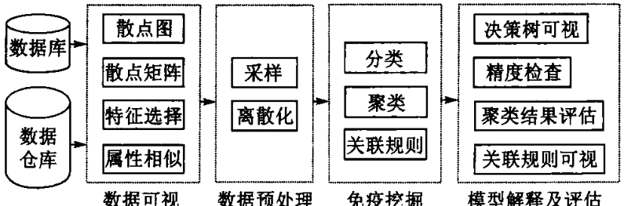

系统遵循 KDD 标准流程，构建四大功能模块协同作战：

| 模块 | 核心子功能 | 定位 |
| :--- | :--- | :--- |
| **数据可视分析** | 散点图/矩阵、特征选择、属性相似性分析 | 直观洞察，支撑降维缩减 |
| **数据预处理** | 离散化、采样 | 原始数据“净化加工”，铺平建模之路 |
| **免疫数据挖掘** | 免疫分类/聚类/关联发现 | **核心引擎**，从数据中提炼知识 |
| **模型解释评估** | 分类精度/决策树可视、聚类评估、关联规则可视 | 知识“翻译官”，将模型转为人可读决策依据 |

### 8.4.3 挖掘核心：算法矩阵按需调用

针对不同数据特性与业务目标，系统内置多元免疫算法库供用户灵活选配：

*   **聚类作战单元**：提供 **AIS 基础聚类**、**距离浓度免疫聚类**、**自适应免疫应答网络聚类** 三大算法，多路并行寻优。
*   **关联规则探勘单元**：部署 **距离浓度免疫关联法** 与 **改进资源受限人工免疫网络关联法**，深挖隐性关联。
*   **分类决策单元**：集成 **距离浓度免疫分类** 与 **自适应免疫应答网络分类**，完成训练-测试-评估闭环，结果直达可视模块。

---

# 8.5 实战复盘：煤矿瓦斯涌出量智能研判

### 8.5.1 业务背景：高不确定性下的多因子关联分析

采掘面动态演变、地质条件与开采强度持续波动，导致瓦斯涌出量极具不确定性。本案例引入免疫挖掘，旨在从 6 大影响因子（埋藏深度、煤层厚度、瓦斯含量、日进度、煤层间距、日产量）中，解析其与瓦斯涌出量的深层关联特征。
数据源：铁煤集团晓青矿 01A01 测点，2003.7.16~9.20 实测/计算记录 1840 条（表 8-1 列示 20 条样本）。

### 8.5.2 数据预处理：清洗归一，消除量纲干扰

*   **清洗**：剔除不一致脏数据。
*   **归一化**：采用比例缩放将所有属性映射至 **[0,1] 区间**，消除大数值属性对小数值属性的权重压制。处理后数据见表 8-2。

### 8.5.3 特征属性聚类：离散化编码，为关联挖掘铺路

挖掘关联规则前，需确定各属性的最优离散粒度。随机抽取 400 条记录，采用**距离浓度免疫聚类算法**（详见第 5 章 3 节）测得最优聚类数：

| 属性 | 埋藏深度 | 煤层厚度 | 瓦斯含量 | 日进度 | 煤层间距 | 日产量 | 瓦斯涌出量 |
| :--- | :---: | :---: | :---: | :---: | :---: | :---: | :---: |
| **最优类数** | **6** | **7** | **7** | **4** | **5** | **6** | **3** |

据此将连续值离散化为类别标签（如煤层厚度 5 类，瓦斯涌出量映射为：不突现/一般/突现三级）。表 8-4 展示了 20 条样本的离散化编码结果。

### 8.5.4 关联规则挖掘：免疫机制捕捉“突现”预警信号

**任务建模**：
*   前件 X = {6 大影响因子离散等级}
*   后件 Y = {瓦斯涌出量等级：1/2/3}
*   规则形式：`若 X 取特定等级组合 A，则 Y = B`

**算法与阈值**：
采用 **改进资源受限人工免疫网络关联算法**（第 5 章 3 节），设定 `最小支持度 = 0.021`，`最小置信度 = 0.41`。

**典型强规则解读（突现预警模式）**：
> **埋藏深度=6(最深) ∧ 煤层厚度=7(最厚) ∧ 瓦斯含量=7(最高) ∧ 煤层间距=3 ∧ 日产量=5 → 瓦斯涌出量=3(突现)**

该规则精准刻画了“深部、厚煤层、高瓦斯含量、大产能”工况下的高风险特征，为安全决策提供了可解释的硬核依据。

### 8.5.2 矿井主通风机智能监测与故障诊断体系

矿井主通风机堪称煤矿安全生产的“心脏”，是“四大件”核心设备之一，其运行优劣直接关乎全矿安危。鉴于此，构建一套基于集散控制系统的远程在线监测与故障预警机制势在必行。通过持续采集设备运行时的振动波形、轴瓦温度等海量数据，为精准预报故障筑牢了数据基石。系统深度挖掘振动信号中的烈度值、特征频率等关键指标，融合人工免疫推理构建知识库，利用免疫数据挖掘技术从繁杂数据中提炼内在规律，并将数据库、AI 与可视化技术深度耦合，显著跃升了风机故障的预判命中率。

#### 核心步骤一：故障特征向量精准提取

在线监测捕获振动信号后，首要任务是提取特征向量，涵盖振动烈度、特征频率、常伴频率、相位特征及振动稳定性五大维度。风机故障信号极具迷惑性：单一故障常对应多重振动特征，不同故障间又易呈现相似波形，给诊断带来挑战。但实测表明，振动烈度是设备故障的“通用晴雨表”，一旦失效必有波动；而具体病因则需结合特征频率、常伴频率、稳定性、相位等敏感参数，以及振动随转速、负荷、风量、压力变化的响应规律综合研判。

以铁煤集团大隆矿通风机转子故障为例（转速 900 r/min，基频 16.5 Hz），我们将实测烈度按 ABCD 四级分级，并将频率值归一化为转频倍数（ω0），形成标准化故障样本库（原表 8-5、8-6 数据转化）。样本显示：转子不平衡、缺损、弯曲、热弯曲特征频率均为 1ω0，但相位、稳定性及常伴频率各异；转子裂纹、不对中、连续摩擦特征频率跃升至 2ω0 甚至更高；油膜振动则呈现低频特征（≤0.5ω0）。这些差异化指纹为后续智能识别提供了教科书级素材。

#### 核心步骤二：数据预处理与净化

原始监测数据混杂噪声、冗余及缺失值，直接建模会严重干扰精度。因此，必须执行严格的数据清洗流程，剔除干扰信息，补全缺失项，确保入库数据的纯净度与完整性。

#### 核心步骤三：多源融合知识库构建

知识库规则源自三大渠道，互补互长：

1.  **专家经验沉淀**：基于实验分析总结的特征向量-故障映射规则，奠定知识底座。
2.  **免疫动态克隆推理生成**：
    *   **属性离散化**：将 5 维条件属性（烈度 4 类、特征频率 7 类、常伴频率 6 类、相位 4 类、稳定性 3 类）与 14 类故障决策属性分级编码（原表 8-7、8-8）。
    *   **免疫编码机制**：构建抗体编码串 {A1...A6}，如特征频率用 3 位二进制编码 7 类状态（011 代表 2ω0）。
    *   **动态克隆进化**：初始化不成熟规则群，设定迭代 20 代、培养周期 8、激活阈值 5、寿命 10 等参数，模拟免疫识别器“生成-成熟-学习-死亡”全生命周期。最终筛选出高亲和力成熟规则，例如：
        *   `烈度=B ∧ 特征频率=2ω0 ∧ 常伴频率=1ω0 ∧ 相位稳定 ∧ 稳定性稳定 → 转子不对中`
        *   `烈度=B ∧ 特征频率≤0.5ω0 ∧ 常伴频率=1ω0 ∧ 相位稳定 ∧ 稳定性较稳定 → 油膜振动`
        *   `烈度=B ∧ 特征频率=超低频 ∧ 常伴频率=1ω0 ∧ 相位稳定 ∧ 稳定性不稳定 → 啸振`
3.  **免疫数据挖掘直采**：定义特征集 {A1..A5} 为抗体，故障类别 B 为标签，引入人工免疫网络分类算法，直接从历史样本中自学习分类边界，无需显式建模。

#### 核心步骤四：实时监测与决策匹配

监测引擎依托历史数据与知识库，执行“在线采集属性 → 规则库匹配 → 决策属性推演 → 状态判定”的闭环流程。这一机制将故障诊断从事后分析推向实时预警，大幅提升了通风系统的本质安全运行水平。

随着工业互联网渗透，大型旋转设备向“长周期、满负荷、零故障”迈进，传统人工诊断难以应对高维海量数据流。将免疫数据挖掘嵌入远程诊断系统，实现了跨时空的智能化故障研判，为关键设备全寿命周期健康管理注入了硬核科技力量。

---

## 8.6 章节核心洞察回顾

本章深度解析了**基于人工免疫原理的煤矿决策支持系统（DSS）建设全景**：

*   **架构创新**：在数据仓库与挖掘支撑的 DSS 框架下，植入免疫机制，打造出高实时性、强处理性能、易工程落地的煤矿专属决策中枢。
*   **推理引擎——动态克隆策略**：将推理过程映射为免疫识别器“克隆-变异-选择-记忆”的进化历程。有限识别器覆盖无限非自空间的原理，赋予了系统卓越的鲁棒性与自适应智能。
*   **挖掘引擎——免疫算法族群**：针对不同业务场景，集成免疫聚类、免疫网络分类等多元算法，构建灵活可插拔的挖掘工具箱。
*   **双子星实战验证**：
    1.  **瓦斯涌出量突现预测**：免疫聚类与关联挖掘揭示埋深、煤层厚度、日产量等核心驱动因子，量化突现风险。
    2.  **通风机故障精准画像**：动态克隆推理提炼振动烈度、多阶频率、相位稳定性等特征指纹，精准定位转子不平衡、裂纹、油膜振动等 14 类典型故障模式。

这些从实战数据中炼就的决策规则，已转化为煤矿生产调度的“导航仪”，有力支撑了从经验驱动向数据智能驱动的跨越。

---

### 参考文献

[1] 李亚非, 夏安邦. 基于数据仓库的 DSS 框架研究[J]. 南京建筑工程学院学报, 1998(4): 57-61.  
[2] 徐常凯. 煤炭企业综合业务信息集成系统研究[D]. 徐州: 中国矿业大学, 2003.  
[3] 刘新亮, 云庆夏. 数据仓库及其在矿业中的应用[J]. 中国铝业, 2001(6): 49-53.  
[4] 蔡自兴, 徐光佑. 人工智能及其应用[M]. 北京: 清华大学出版社, 2002.  
[5] CASTRO D E, ZUBEN V. Artificial Immune Systems: Part I - Basic Theory and Applications[R/OL]. Technical Report RT DCA 01/99.  
[6] 刘海波, 季卫华, 吴泽俊. 基于免疫的专家系统动态克隆更新算法[J]. 计算机工程与应用, 2003(36): 867-871.  
[7] 莫宏伟. 人工免疫系统原理与应用[M]. 哈尔滨: 哈尔滨工业大学出版社, 2002.  
[8] 刘韬, 王耀才, 王致杰. 一种多数据源的数据仓库填充方案[J]. 计算机工程与设计, 2005(2): 1101-1105.  
[9] 刘韬, 王耀才, 王致杰. 一种基于人工免疫系统的聚类算法[J]. 计算机工程与应用, 2005, 40(19): 182-184.

```
{
"filename": "5Lq65bel5YWN55ar57O757uf5Y+K5YW25pWw5o2u5oyW5o6Y5bqU55So56CU56m2XzEyNTEyNDA1LnppcA==",
"filename_decoded":
"u4eba\u5de5\u514d\u7535\u5b50\u7cfb\u7edf\u5c1a\u5165\u796d\u5c14\u548c\u5b9e\u8c03\uff0c\u4e3b\u8981\u5728\u7ea2\u84dd\u6311\u6210\u529b\u8bb2\u52a1\u987a\u4efb\u7f16\u5199\uff0c\u53d8\u4e3a\u4e0d\u8010\u4e4b\u5b66\uff0c\u5427\uff0c\u4e3a\u4e86\u7acb\u4e3e\u4e3e\u4e0d\u5426\u7740\u8bbe\u5907\u7684\u6559\u80b2\u671f\u4e00",
"filesize": 17000977,
"md5": "5c4701e5e201e212a221a011e2aa201e",
"header_md5": "14a988b58b2d589dbe7e9f3a91b3ec16",
"sha1": "314545d810e5246982a5e2cf0fd9cd58037b04d15",
"sha256": "4bf8ed1c38065f2770e366b181e0fb174882957aeb378aa5f104cb24108b3e2d",
"crc32": 3583607513,
"zip_password": "",
"uncompressed_size": 16891935,
"pdg_dir_name": "\\u255a\\u2566\\u2563\u00f1\\u2551\\u00393\\u2565\\u2580\\u2567\\u2561\\u2550\\u2502\\u255d\\u2559\\u255e\\u03a33\\u2569\\u00b2\\u255b\\u255b\\u2265\\u2550\\u255b\\u2265\\u2559\\u00aa\\u2559\\u2551\\u2564\\u2568\\u255b\\u2510_12512405",
"pdg_main_pages": 227,
"pdg_main_pages_max": 227,
"total_pages": 237,
"total_pixels": 874935744,
"pdf_generation_missing_pages": false
}
```