# 智能免疫计算：理论融合与工程实践

## 《智能科学技术著作丛书》总序

“智能”是信息升华的结晶，“智能科学技术”则是信息科技版图中浓墨重彩的一笔，“智能化”更标志着信息化进程迈入了全新阶段。

智能科学技术（IST）聚焦“广义智能”，涵盖理论方法与应用技术的综合领域，其研究图谱覆盖五大维度：
- **自然智能（NI）**：涵盖人类智能（HI）与生物智能（BI）。
- **人工智能（AI）**：囊括机器智能（MI）与智能机器（IM）。
- **集成智能（II）**：实现人机优势互补的深度融合。
- **协同智能（CI）**：个体智能协同共生的群体涌现。
- **分布智能（DI）**：广域网络与大型系统的分布式智能形态。

1956年人工智能学科肇始，半个多世纪风雨兼程，历经从狭义到广义、从个体到群体、从集中到分布的演进，理论与应用均结出丰硕果实。AI学科的诞生源于生物、信息、系统科学的首次跨界联姻，而今IST领域的崛起，则是网络化、信息化时代的又一次多学科深度融合。

1981年中国人工智能学会（CAAI）成立，二十五载春秋，从追赶跟跑转向自主创新，凝聚学界力量，推动智能科技显著进步。植根华夏文化与东方哲学，我国研究呈现整体性、协调性特色，成果彰显创新性与开拓性，“智能化”已成新技术、新产品的核心标识。

为汇聚国内智能科技领域的创新成果，中国人工智能学会携手科学出版社推出《智能科学技术著作丛书》。丛书定位精准，优先收录能转化为现实生产力、服务国民经济主战场、应用前景广阔的著作。

坚信在广大科技工作者的积极投身、编委会的通力协作下，该丛书必将为繁荣我国智能事业、筑牢自主创新基石、建设创新型国家贡献核心力量。

赋诗贺之：
智能疆域无垠宽
人机融合智力攀
群体协同开新境
创新驱动谱华章

潘云鹏
中国人工智能学会名誉理事长
二〇〇五年十二月十八日

## 导读

生物现象与系统是创新灵感的富矿，深刻驱动着智能计算、数据挖掘、模式识别等前沿领域。免疫系统同神经、遗传、内分泌系统一样，均属生物体内的信息处理中枢，也是典型的复杂自适应系统，其核心使命在于辨识“非己”抗原与“自身”成分，清除病原、维稳内环境。Rowe 曾喻其为“第二大脑”：它既存储历史抗原记忆，又能对新异物质即时响应。计算视角下，免疫系统凭借高度并行、分布、自适应、自组织特质，展现出强大的学习、识别、记忆与特征提取能力，可胜任高难度计算任务。学界渴望汲取其运行机理精华，构建面向工程的实用人工免疫系统（AIS）与算法。当前，AIS 在智能计算领域已积累丰硕成果，克隆选择、阴性选择、免疫学习、免疫网络调节等经典算法，广泛服务于数据挖掘、模式识别、优化计算、入侵检测等实战场景。

受限于生物免疫机理的极致复杂性及认知的渐进性，现有 AIS 仍存短板：统一计算框架缺位、计算开销大、先验知识利用率低。若单靠深化免疫认知来修补算法，周期漫长；引入其他智能算法集成改良，则是当下务实的突围路径。目前 AIS 已与神经网络、模糊系统、进化算法等联姻并取得阶段性进展。本书立足前人肩膀，系统探讨 AIS 集成理论与应用，主攻算法框架构建、免疫机理自融合、跨域集成（混沌、量子），以及网络路由优化、土地分类评价、RFID 入侵检测等工程落地。

全书十一章，逻辑链条完整：首章溯源生物原型，提炼识别、学习、记忆、克隆选择、多样性、分布式、自适应七大核心原则，确立 AIS 设计框架；后续章节在生物机理基石上，打造结构独特、设计新颖、实战有效的 AIS 及集成模型，并开展系统理论分析、性能基准测试、对比实验与应用验证，最终形成面向动态路由评估、数据聚类、函数优化、土壤质量评价、农用地分等、RFID 入侵检测等专用模型体系。

本书凝聚国家自然科学基金（60973132）、广东省自然科学基金（8451064101000630）、教育部博士点基金（20070561081）、华南理工大学基本科研业务费（2009ZZ0053）等项目资助成果，由杨海东、郭建华、邓飞其通力合作完成。鸣谢基金委与科学出版社的大力支持。谨此奉献，恳请方家批评指正。

作者
二〇一〇年五月于广州

## 第 1 章 绪论

### 1.1 AIS 研究脉络回顾

近年来，生物系统化身创新“灵感库”，催生出人工神经网络（ANN）、进化算法（GA）、蚁群算法等仿生计算流派，分别拟合大脑神经、自然进化、昆虫社会行为，强力推动智能计算、数据挖掘、模式识别等领域跨越式发展。

免疫系统作为生物信息处理四大支柱之一，兼具复杂自适应系统属性，专司“己/非己”识别、病原清除与内环境稳态维护。Rowe 指出其酷似“第二大脑”，兼具记忆存储与新抗原响应双重功能。计算视角下，其高度并行、分布、自适应、自组织架构，赋予了卓越的学习、识别、记忆、特征提取能力，可攻克高难度计算难题。科学家试图从中汲取灵感，开发服务工程实战的 AIS 与算法。

1973 年，诺奖得主 Jerne 抛出独特型网络假说，奠基人工免疫网络数学框架；Perelson 深化阐释。1986 年，Farmer 等构建动态模型，对标 Holland 分类器系统，孕育学习算法雏形。1990 年，Varela 探讨网络收敛与抗体多样性适应机制，确立免疫系统作为工程灵感源的地位。这些奠基性工作为基于免疫原理的计算智能系统铺就坦途。后续学者持续提炼免疫“隐喻机制”，驱动模型设计、算法落地与工程应用，催生崭新交叉学科——人工免疫系统（AIS）。

AIS 双重内涵：医学端借算力建模探究免疫本质；工程端借原理解决实战难题。定义虽异，核心共识在于：Star-labl 侧重数据处理视角；Dasgupta、Timmis、莫宏伟则强调生物隐喻机制在信息处理与问题求解中的迁移应用，后者视野更广、更贴切。

当前，AIS 已成国际主流期刊与会议核心议题。IEEE SMC 系列会议设专题，GECCO、CEC 等顶会纳入主题，ICARIS 专业年会 2002 年启幕，IEEE TEVC 专辑聚焦。国内中科大早期引领国际会议，引发广泛关注。作为计算智能新分支，AIS 接力神经网络、模糊系统、进化计算，掀起研究热潮，战果遍及信息安全、模式识别、智能优化、机器学习、数据挖掘、机器人、自动控制、故障诊断等版图，彰显强大生命力与广阔前景。

### 1.2 AIS 模型与算法演进图谱

基于免疫机理的 AIS 主分人工免疫网络模型、人工免疫系统模型两大支系，核心算法涵盖克隆选择、阴性选择、免疫学习等。以下梳理典型演进脉络。

#### 1.2.1 网络模型谱系

Jerne 独特型网络模型开山鼻祖，后续涌现多元学说，均可借鉴建模。此类模型视 AIS 为淋巴细胞节点网络，依靠节点间信息交互与协同实现识别、效应、记忆功能。代表作包括：Jerne 独特型模型、Ishiguro 互联耦合模型、de Castro 抗体网络模型、Tang 等多值网络模型。Forrest 基于学习自适应原理提出免疫联想记忆模型服务模式识别；Kim 用二进制模型刻画 B 细胞进化动态；Tarakany 构建抗原抗体作用数学模型；Zak 随机模型具备己非己识别、自修复能力，为信息处理提供新范式。

#### 1.2.2 核心算法族群

**1. 阴性选择算法（NSA）**
源于胸腺 T 细胞成熟筛选：自身反应细胞被清除，成熟 T 细胞获“耐受自身、识别非己”能力。1994 年 Forrest 等转化为异常检测算法：生成不匹配“自”数据的检测器集，持续监测匹配异常。特长在于并行、鲁棒、分布式检测；痛点是数据增长导致检测器指数级膨胀、生成代价高昂。Perelson 改进使检测器数量线性增长，并开展理论分析。现广泛部署于模式识别、病毒/入侵检测、异常监测。

**2. 克隆选择算法（CSA）**
de Castro 依克隆选择理论构建：初始种群→适应度筛选精英→克隆扩增并变异→更新记忆库替换劣解→随机新血注入→迭代直至收敛。后融合免疫网络理论推出 aiNet 算法，服务知识发现、数据挖掘、自动分类，并分析参数敏感性。现活跃于模式识别、数据聚类、异常检测等场。

**3. 免疫学习算法**
Farmer 等早期揭示免疫学习与分类器系统同构性。Hunt 等基于网络理论给出有监督学习算法；Ishida 基于 PDP 模型推算法用于故障诊断；Timmis 等开创无监督学习策略，构建 RLAIS 模型从数据挖掘复杂关联。相较神经网络，AIS 在知识表达与网络规模可控性上具优势，在数据分析、知识发现潜力巨大。

**4. 混合免疫算法**
Chun 等融入 GA 搜索策略与算子，本质为改进型 GA；王磊创免疫规划算法，在 GA 植入免疫算子（疫苗接种提升适应度、免疫选择防早熟），加速收敛。虽无统一框架，但在组合优化等硬问题上展现强劲搜索优化实力。

### 1.3 AIS 应用版图扫描

AIS 战果遍布信息安全、智能优化、机器学习、故障诊断、控制工程、噪声抑制、联想记忆、决策支持等疆域。结合本书主线，聚焦数据挖掘、模式识别、智能优化三大核心应用领域综述。

**1. 数据挖掘**
主攻聚类分析、数据浓缩、归类任务。Hunt 等以 AIS 无监督学习解析 DNA 序列分类；Bezerra 等改进免疫网络聚类搜索性能，融合最小生成树法服务生物信息压缩；Timmis 实证 AIS 数据分析可行有效，构建领域无关无监督学习法与有限资源 RLAIS 模型，应用于多谱影像深度分析与网络故障预测；Takama 等融合柔性聚类、独特型网络动力学、记忆细胞机制，打造网络主题检索与文件恢复模型；de Castro 以 aiNet 进化剔除高维冗余，深度揭示数据结构分布与簇内关联。

**2. 模式识别**

免疫系统卓越的模式识别天赋，已在相关领域大放异彩。Forrest 团队率先深挖免疫群体多样性的生成机制，透彻掌握了抗体-抗原匹配的精髓，据此构建了多样性评价体系，并将其与遗传算法融合，催生了免疫遗传算法[66,67]。随后，学界对多样性机制的探索持续深入[68]。Gaspar 等人剖析了二次免疫应答在抗原处理中的关键价值，创立了模式跟踪算法，可动态清除源源不断的抗原，有效赋能计算机网络病毒检测[67]。Hunt 与 Cooke 在免疫网络模型服务于 DNA 序列识别上奠基立业，推出了面向工程实战的 B 细胞免疫网络算法[31,69]。de Castro 与 von Zuben 则依托独特型网络理论，构建形态空间免疫网络算法，攻克字符识别难题[45,46]。Dasgupta 聚焦光谱识别，引入二进制编码描述目标，并配套设计了匹配函数与识别流程[18]。

### 3. 智能优化

AIS 在函数优化、组合优化、调度决策等硬骨头问题上屡建奇功[51,70~73]。随问题规模膨胀，组合空间呈爆炸式增长，常规手段难以招架。免疫算法凭借生物免疫原理，在组合优化中展现强劲实力，典型战例包括二次分配问题（QAP）[73]、装箱问题[72]等。Carlos 等人分别对克隆选择算法与免疫遗传算法进行强化扩展[74,75]，定制出车间调度优化利器，核心亮点在于抗体生成机制、记忆细胞策略及抗体/抗原评价体系的精妙设计。实证表明，免疫算法多能超越主流启发式算法，尤其在求解效率上碾压对手，彰显 AIS 在智能优化版图的广阔前景。此外，基于免疫原理的多目标优化智能方法也竞相涌现[71,76~79]。Carlos 团队从克隆选择原理出发，提出多目标免疫系统算法[71,76]，显著特征为融入 Pareto 优势法则、并行计算范式与记忆细胞功能。

### 4. 计算机安全

新墨西哥大学 Forrest 率队攻坚长期项目，誓建计算机人工免疫系统。相较现行操作系统，该体系提供更立体的身份认证与防护机制，旨在构建通用防护框架，补强现有安全短板[44,52,80]。计算机安全本质在于：识别未授权访问、捍卫数据完整性、遏制病毒蔓延。

防御病毒入侵，实为“辨别自我（合法用户/完好数据）与非自我（入侵者/病毒/有害因子）”的泛化命题。团队意图以此为传统加密与确定性防御的有力补充。首战之役，阴性选择算法（详见 1.2 节）便作为文件完整性校验手段，投入病毒检测实战。

#### 1) 病毒检测实战

Forrest 等利用阴性选择算法监控受保护数据与程序文件的篡改痕迹[44,52]。实验在 DOS 环境下，以文件型与引导扇区型病毒样本为靶标。结果证实，该法极易捕捉病毒感染引发的文件变异。对比现有检测手法，其优势显著：概率化且可调控（按 CPU 时间权衡检出率）；天然支持分布式部署（低个体成本换取大系统高可靠）；具备零日病毒（未知新病毒）检测能力。

然计算机系统信息本质易变，致使“自我”定义较自然免疫系统更具动态性。用户日常安装软件、编辑文档、运行新程序，均导致基线漂移。故此法适用性受限——主要守护静态数据文件或软件。

#### 2) UNIX 进程监控

Forrest 团队另一前沿探索：引入阴性选择算法监控 UNIX 进程，旨在捕捉恶性入侵[52]。核心在于为进程确立“自我画像”，重新定义自我以适配动态环境下的合法行为，从而对恶意攻击保持高敏感度。

研究立足假设：根进程发起的系统调用比用户进程破坏力更强、风险更高；且根进程行为边界清晰、随时间相对稳定。将“正常/自我”定义为进程系统调用的短程相关性。实测标准 UNIX 程序下，该自我定义在常态下稳健；并成功识别多种针对邮件系统的典型入侵。选择邮件系统为测靶，因其行为多变复杂，堪称理想压力测试场，且有现成文档化攻击样本。实验捕获三类异于常态的运行轨迹：成功攻击轨迹、失败尝试轨迹、异常错误轨迹，有效追踪了两类攻击。

实验证明[52]，短系统调用序列能生成稳健信号，精准捕捉邮件系统异常行为共性。鉴于算法计算轻量、存储开销可控，落地为在线系统可行——内核实时审计根进程每一系统调用。该方案下，各节点基于软硬件构型与用户习惯自建正常基线。本地化建模优势显著：各站点拥有独特指纹，单点失陷不等于全网沦陷，大幅提升全网预警概率。此路径极具潜力，为计算机安全研究开辟新疆域。

#### 3) 病毒检测异路同工

Kephart 提出另一种免疫启发检测范式（基于指令序列假设）[25]。已知病毒通过代码特征码（信号）直击；未知病毒则因异常行为暴露。系统持续扫描软件，捕捉感染典型信号，触发释放“诱饵程序”——其唯一使命就是被感染。

诱饵阵列部署于内存关键区（如主目录），设计极具诱惑力以诱捕高传播力病毒。定期轮询诱饵完整性。一旦发现诱饵被篡改，即可断定系统存在野生未知病毒；每个被感染诱饵均携带病毒样本。后续由特征提取器处理感染诱饵，输出病毒识别特征码。提取器同时解析病毒粘附宿主程序的模式（粘附模式），指导受感染主体修复。特征筛选极其严苛：必须覆盖所有病毒变体，且绝不出现在洁净程序中（规避假阴性/假阳性）。候选特征经筛选后，需在 5 亿字节合法程序库中压测，确保零误报。病毒样本测试可提取修复信息，专家复核把关。

最终，特征码与修复程序入库分发。Kephart 畅想，该机制亦适用网络病毒阻断：感染节点广播“杀毒信号”，预警邻机并携带新病毒及变种的清除方案。

### 5. 时间序列数据异常检测

Dasgupta 等利用多组真实与仿真时间序列数据，实测阴性选择算法在序列异常捕捉上的表现[48,81]。目标：建立高效检测器，敏锐感知系统/进程稳态特征下的任何偏移。实验中，“自我”映射为受监控系统的正常行为模式；观测数据超出容许阈值的偏离，即判定为异常。该法依赖充足正常样本（获取数据语义），生成多元检测器群，无需异常/错误模式先验知识，即能统计学级检出变化。

实战应用于钻探作业“刀具损损检测”[11]，捕捉断刀导致的切削力模式突变。即实时监控新数据模式，对比既定正常基线，差异（如形状空间匹配度）暗示切削力学动态变化。算法已成功从模拟切削力信号中识别断齿，堪称临界安全作业自动监控的利器。

### 6. 故障诊断

Ishida 等挖掘免疫网络模型相互识别特性服务故障诊断[25]。研究中，系统容错阈值源于群体内互联单元的相互识别——宏观系统级识别由微观单元级识别涌现。

模型特质鲜明：
- 天然并行处理能力
- 耐受不完整信息与噪声数据
- 自组织演化
- 故障传播链路中无需反馈回路。

Ishida 团队落地应用[82]：化工厂生产仪表系统故障诊断。利用传感器关联性，构建双向弧连接的传感器网络，承载模型诊断。实验成果斐然，值得深耕。

Ishiguro 等推进免疫网络模型用于工厂系统在线故障诊断[37]。建模预设：
- 传感器未全覆盖组件，二进制指示被监测组件状态（正常/异常）
- 单一故障源（排除并发/复合故障）
- 故障状态沿分支路径必然扩散
- 故障传播无反馈回路。

旨在打磨可落地工厂的完整诊断方法论。

### 7. 面向模式识别的 AIS

Hunt 等立足机器学习视角，探索基于免疫网络原理的 AIS[31,32,69]。AIS 赋能噪声鲁棒性与无监督自学习，自组织运作，无需负样本，且能显性表达习得知识。该系统融合学习分类器系统优势与神经网络长处（如机械感应、基于事件的检索）。

AIS 运作四要素：根目标、细胞网络、教学集、测试集。每细胞携带模式匹配组件，仿生遗传机制生成（对标自然抗体形成），支撑精细词汇表与匹配多样性。系统呈双相响应：初次响应为学习期，内化教学数据模式；二次响应为识别期，将新数据归类为已知相关模式。

部署流程：先用一次性或增量构建的教学样本训练；再多维度释放模型价值。已验证 AIS 在模式识别上的潜能，如 DNA 序列启动子识别。Hunt 与 Cooke 实证：在内含清晰内容寻址存储的自适应非线性网络中，AIS 展现强大学习范式。研究终极指向：为机器自主学习应用锻造免疫基因工具箱。

### 8. 其他应用拾贝

Bersini 与 Varela 借免疫修复原理，加速并行局部爬山搜索。Ishida 等探索免疫启发方法：多数网络、代理系统、自识别处理[82,83]。Gilbert 等实验免疫网络模型，聚焦图像识别，打造内容寻址自联想存储器[31]。输入为 $64 \times 64$ 像素灰度图，像素拟抗原。思路新颖但实现未获稳定解。McCoy 等引阴性选择算法切分航空影像[49]。Hull 近期将基因搜索驱动的免疫网络应用于结构优化[32]。

### 1.4 人工免疫系统集成研究进展

文献综述显示，当前 AIS 集成模型主攻 AIS 与 ANN、模糊系统、遗传算法等的深度融合[17,19,24,25,34~38,42,43]。集成模型取长补短。例：AIS 赋能模糊系统，优化模糊神经网络拓扑与参数；模糊化 AIS 强化其处理模糊不确定问题的能力。AIS 知识显性化特质，可补 ANN 可解释性短板，提升知识透明度[84]。免疫抗体多样性遗传机制改良遗传算法搜索力；AIS 融合进化算法，助力染色体定长与参数优化。AIS 与神经网络、模糊系统、进化算法等智能计算范式融合，集成效能见表 1-1[23]。

#### 表 1-1 AIS 与人工神经网络、模糊系统、进化算法集成效能对照

| 集成模型 | 集成效能 |

|---|---|

| AIS 与人工神经网络模型集成 | (1) 催生新型神经网络模型、结构与学习算法<br>(2) 为神经网络注入记忆机制<br>(3) 为神经网络初始化提供新优化路径 |

| AIS 与进化算法集成 | (1) 进化算法为 AIS 初始指令集重新定义<br>(2) 进化算法借 AIS 研究基因编码演化过程<br>(3) AIS 融合遗传算法提升收敛性<br>(4) 遗传算法借 AIS 跳出局部极小陷阱<br>(5) 进化算法利用 AIS 维护染色体生态位、类型与多样性<br>(6) 合力构建新型免疫遗传算法 |

| AIS 与模糊系统集成 | (1) AIS 中抗原抗体采用模糊匹配机制<br>(2) AIS 可被模糊系统用于模型选择 |

表 1-1 昭示：AIS 与主流智能计算方法融合，能修补现有算法短板、孵化新型集成模型。集成初衷在于最大化释放各方优势，更高效攻克工程实战难题。

#### 1.4.1 人工免疫系统与人工神经网络

免疫与神经系统的渊源可追溯至早期理论免疫学。1974 年 Jerne 免疫网络理论问世，点燃学者探究双系统同构性的热情。免疫网络模型作为新范式改良神经网络，神经网络亦反哺完善 AIS。

1991 年，Vertosick 与 Kelly 提出借免疫系统研究神经网络结构的计算范式。基于并行分布处理（PDP）理论，尝试将免疫网络映射为 PDP 免疫网络。虽论证免疫学习为无监督性质，但未给出显性学习算法[16]。

1996 年，Abbattista 等基于免疫元动力学（新细胞/分子补充与无效成分清除），开发离散联想网络。该机制定义 Hamming 形状空间点群，群体最优点作为吸引子表征网络记忆集。算法在离散 Hopfield 网络中分学习（存储）与回忆两阶段[13]。

1997 年，Dasgupta 首度系统对比 AIS 与 ANN 模型，聚焦生物神经与免疫系统原理比照。de Castro 与 von Zuben 将其人工免疫网络模型（aiNet）与 ANN 对标，重点剖析自组织神经网络[18]。

2001 年，de Castro 与 von Zuben 提出基于免疫原理的模拟退火算法，攻克误差反向传播训练的多层前馈神经网络初始化难题。核心洞见：初始权重质量与网络输出质量的关联，拟合初始抗体群质量与免疫响应质量的关系。基于欧几里得形状空间思想生成抗体多样性，给出算法产出多样化初始权重向量集，降低前馈网络陷入局部最优风险。aiNet 模型用于无监督确定 RBF 神经网络径向基函数中心位置与数量，目标为无标签数值数据集筛选聚类。采用欧几里得形状空间表达：抗体对应 RBF 候选中心，抗原等价输入模式[70]。

2002 年，de Castro 等基于克隆选择与亲和力成熟原理，提出布尔成长竞争网络。特征：竞争学习、具成长/改良态的网络架构自动生成、Hamming 空间连接强度二进制表达。权重更新为受引导变异搜索，仿真抗体亲和力成熟，使权重（抗体）进化为待识别抗原的更优互补体[228]。

孟江等针对神经网络集成中个体独立训练低效痛点，创立神经网络集成免疫学习算法（NEIL）。借免疫算法多峰并行搜索优势，将收敛抗体群一一映射为集成单体网络，实现集成体同步训练[85]。

NEIL 算法流程如下。

NEIL-Algorithm(Nets, T)

其中，Nets 为 M 个单体网络 Net$_i$ (i=1,2,...,M) 组成的集成系统；T 为集成训练集。

- (1) 参数初始化：epochs 为最大迭代轮数，M 为免疫种群抗体规模，Pc 交叉概率，Pm 变异概率。
- (2) 抗体编码：单体网络实数编码，随机生成 $pM$ 条抗体串 Ab$_j$ (j=1,2,...,pM) 组建初始抗群 $A_0$。
- (3) for k=1 到 epochs。
  - ① 亲和力计算：对第 k 代抗群 $A_k$，分别计算 Ag 与 Ab$_j$ 亲和力 $D_j$，Ab$_j$ 与 Ab'$_j$ 亲和力 $S'_{jj}$。
  - ② 浓度依赖选择：基于浓度选择模式，按 $pr_j = D_j/C_j$ 轮盘赌选育。
  - ③ 遗传算子：二点交叉配合高斯变异，经亲和力评价筛选优势个体组建下一代抗群。
  - ④ 收敛判断：若连续数代无法改善解群特征，跳出循环。
- (4) 训练终止：解码性能最优前 M 个抗体为网络单体，组装集成网络，训练完成。

### 核心免疫算法与跨学科融合综述

#### 典型神经网络集成免疫算法

**NEIL算法：实数编码与三层架构**  
该算法采用实数编码策略，构建典型的三层前馈网络（n-h-m结构）。节点按层级顺序编号：输入层1至n，隐含层n+1至n+h，输出层n+h+1至n+h+m。连接权$w_{ij}$表示节点$i$到$j$的输出权重，阈值$b_j$为前一层对节点$j$的输出阈值。通过将权值与阈值从节点$i$开始顺序串联，形成抗体串。仿真验证显示，NEIL算法在保持启发式优化并行性、提升集成学习效率的同时，保证了单体网络间的独立性与高差异度，显著强化了集成的泛化能力。

**AINEN方法：基于人工免疫网络的集成策略**  
张全平等人提出AINEN。流程始于Bagging生成初始集成（初始种群$LAbs$）。随后计算个体适应度$B$（实际输出与期望输出偏差）及两两间异构度$s_{ij}$构建矩阵$S$。核心循环包含：按克隆数$cn$克隆个体、实数编码、变异操作、解码生成新网络、计算新个体适应度、筛选优于父群体最差适应度的个体入群、更新异构度矩阵、剔除异构度低于阈值且适应度较弱的个体、计算整体免疫网络适应度$B_o$。若$B_o$未达标或迭代未结束则继续循环。实验证明，AINEN在标准数据集上泛化误差优于GASEN。

**基于反向选择的免疫算法：结构差异度视角**  
张正道等聚焦个体差异性要求，引入“集成网络间结构差异度”概念。设计的反向选择免疫算法可在压低个体训练误差的同时维持结构差异度，提升泛化能力，并证明了对最优个体的收敛性。应用于含噪非线性时序故障预报，凭借预测误差实现缓变/突变故障的精准检测及微小故障快速预报，有效降低误检率。

#### 1.4.2 人工免疫系统与进化算法的深度耦合

多数AIS模型具备类进化算法的适应性特征。主流融合路径为：引入进化算法作AIS子模块，或双向集成提升个体性能。典型研究脉络涵盖小生境/物种形成、多样化群体构建（多模优化核心），以及AIS与GA、GP的集成描述。

*   **1994年 Forrest等**：二进制AIS模型研究模式识别与学习，引入GA维持泛化能力与多样性。泛化指识别抗原共享模式，多样性对应覆盖离散亲和力个体集。采用二进制Hamming形状空间表达分子，以Hamming距离度量亲和力。
*   **1995年 Hightower等**：探讨抗体遗传编码进化效果及进化算法在AIS初始集生成中的应用，沿用骨髓模型。
*   **1998年 Potter等**：用进化GA构建能识别“非我”抗原的AIS概念学习法，探究多样性控制与泛化能力。
*   **1999年 Hajela等**：利用免疫模式识别与适应能力改良GA在结构优化中的性能，聚焦收敛性能提升与约束设计问题求解。
*   **Hart等**：研究GA驱动AIS进化生成程序集，覆盖可预知/不可预知事件，模型融合基因库、亲和力成熟与克隆选择。
*   **Dasgupta等**：免疫遗传学法识别化学分析谱，标准GA生成专家库统管谱识别任务。
*   **Nikolaev等**：免疫遗传规划（IGP），搜索受动态适应函数控制（基于免疫网络类比），强化匹配重要个体与多样性维持。适应函数含繁殖模型（匹配重要个体）与重要性调整模型（按识别程序数调节个体重）。
*   **于鹏等**：免疫进化算法（IEA）融合基于打分与基于约束的Bayesian网结构学习，遗传与疫苗接种操作有机结合。对比EGA算法，IEA收敛更快、网络精度更高。
*   **杨孔雨等**：基于免疫动力学模型，依据“一抗体结合多表位渐进成熟”机理，构建多模态免疫进化算法。核心算子含正选择、记忆细胞生成、超变异、抗体相似性抑制。仿真证实其能定位全部全局最优或尽可能多局部最优，计算量小、搜索性能优、无需先验知识自适应搜索。

#### 1.4.3 人工免疫系统与模糊系统的协同机制

免疫识别本质为近似识别（非完美绑定也可触发响应），此特性与交叉反应同属模糊逻辑范畴，奠定模糊系统模拟免疫机制的理论基础。

*   **1995年 Krishnakumar等**：构建免疫机理与软计算（ANN、模糊、进化算法）集成的计算系统，多用于控制领域。将免疫要素映射为分级控制策略：先天免疫作强反馈控制器，B细胞激活作参数修整过程，强调亲和力成熟对控制的关键作用。
*   **Baldwin效应与Hightower观点**：Baldwin指出个体终身习得特性可融入后代遗传结构（非拉马克遗传），持续学习提升存活率。Hightower用非线性S型绑定函数量化分子结合强度，认为此更符合免疫学逻辑，且进化算法设计二进制免疫系统时，Baldwin效应必要条件自现。
*   **de Castro等**：数据聚类用人工免疫网络模型。以类质心表达类别，赋予免疫细胞成员等级，形成模糊聚类方案——单细胞属单一类，经隶属函数关联全类。
*   **郑恩让等**：针对模糊控制器缺陷，融合免疫算法提出免疫优化智能模糊控制器。无需精确数学模型，实现简易，具响应快、超调小、鲁棒性强优势。
*   **何宏等**：面向复杂工艺非线性系统参数估计，为避免优化早熟错解，依托生物免疫与模糊逻辑提出模糊自适应免疫算法。混沌超变异强化搜索，免疫网络调节维持抗体多样性，模糊逻辑动态调参提升自适应性。

### 1.5 研究目的与学术价值

人工免疫系统及其集成模型作为核心研究分支，获全球AI专家持续关注。免疫系统具备高并行、强鲁棒、自适应分布式学习特质，提取其机理服务优化计算、数据聚类、异常检测虽具价值，但面临五重困境：  
1. 动力学行为极度复杂，难建立兼顾行为仿真与工程求解的模型；  
2. 理论基础薄弱，缺乏数学形式化支撑与建模工具；  
3. 对生物机理理解分歧大，针对性深度研究稀缺；  
4. 数学定义与工程问题衔接机制不明；  
5. 与其他模型结合解决具体工程的理论指引不足。  

本书旨在深度开发免疫系统，构建系列AIS集成模型并展开理论应用研究，丰富学科内涵，为工程实践提供新范式。设计思路为：提取现有模型优势免疫特征（识别、产生、多样性维持、阴性/克隆选择），借鉴接种育苗及抗体促抑机制构建增强多样性算子，设计独特模块并有机组合。具体成果覆盖三大领域：  
*   **优化计算**：融合克隆选择与混沌/量子理论，创提出自适应变尺度混沌免疫优化算法、量子免疫优化算法，突破收敛速度瓶颈。  
*   **数据聚类**：针对AiNet压缩阈值敏感、进化无目标缺陷，提出矢量距离免疫网络聚类算法、目标进化免疫网络聚类算法。  
*   **异常检测**：改进阴性选择算法生成慢、阈值难定、性能不稳问题，融合克隆选择与免疫网络调节，提出免疫融合阴性选择算法。  
*   **工程应用**：结合电信动态路由、农用地分等、RFID入侵检测，建立分层免疫动态路由评估模型、AIS-DEA分等模型、AiNet-GIS土壤评价模型、免疫协同RFID入侵检测模型。  

研究意义在于：为AIS理论注入新内涵、提供新方法论；建立的集成模型服务优化、路由、土壤、农地、RFID等实战场景，推动学科发展与工程落地。

### 1.6 章节架构与阅读指南

本书逻辑遵循：溯源生物原型 $\rightarrow$ 归纳基本原理（识别、学习、记忆、克隆选择、多样性、分布式、自适应） $\rightarrow$ 建立设计框架 $\rightarrow$ 基于框架构建独特结构/设计/有效应用的模型 $\rightarrow$ 系统性理论研究、测试、比较、应用 $\rightarrow$ 面向具体工程建模实战。

**全书三大板块：**

| 板块 | 章节 | 核心内容 | 适读人群 |
| :--- | :--- | :--- | :--- |
| **基础原理与设计框架** | 第1-2章 | 生物免疫信息处理原理、AIS设计方法步骤 | 初学者入门 |
| **核心算法集成改进** | 第3-7章 | 克隆选择、AiNet、阴性选择等经典算法深度分析与改进 | 有基础研究者按需阅读 |
| **集成工程应用实战** | 第8-11章 | AIS融合电信路由、土壤分级、RFID检测等工程案例 | 应用导向读者自选 |

**逐章速览：**

*   **第1章 绪论**：综述AIS/算法/集成进展，界定研究范围，阐述目的意义与设想。  
*   **第2章 AIS分析与设计框架**：探讨自然免疫构成机理，分析AIS框架组成，给出模型算法设计基础支撑。  
*   **第3章 自适应变尺度混沌免疫优化算法**：融合混沌与免疫特点，引入无限折叠自映射$x=\sin(2/x)$产生混沌变量，自适应变尺度动态调整搜索空间，以最大循环数为控制指标，兼顾精度与速度。  
*   **第4章 量子免疫优化算法**：针对传统免疫搜索空间受限，引入量子高效并行性，抗原抗体量子编码结合克隆算子，构造量子免疫算子与变异策略：量子抗体变异加速收敛，普通抗体变异抑制早熟。  
*   **第5章 矢量距离免疫网络聚类算法**：针对AiNet压缩阈值敏感，结合网络调节抑制机制，设计基于矢量距离的抗体促抑策略改进模型。  
*   **第6章 目标进化免疫网络聚类算法**：解决AiNet无目标函数、记忆网络动态无序问题，将压缩聚类抽象为多目标规划，定义整体进化目标，引入疫苗注射策略提升学习质量。  
*   **第7章 免疫融合阴性选择算法**：破解阴性选择生成效率低、阈值难定、漏检率误差大难题，经克隆选择成熟低自体相似度检测器，自适应确定匹配阈值，再经免疫抑制优化分布。  
*   **第8章 分层免疫集成及应用**：集成多免疫操作构建分层免疫算法，面向电信话务控制与动态路由建立评估模型，引入禁用节点作为免疫疫苗，提速增质。  
*   **第9章 免疫聚类集成及应用**：基于自我调节与抗体多样性，借克隆选择优化机制集成C-means设计AIS聚类模型，再融合DEA模型从投入产出角度分等农用地，广东高要实测成效显著。  
*   **第10章 AiNet-GIS土壤资源质量评价**：针对空间性、不确定性、多指标评价难题，融合GIS与AiNet建立评价模型，应用于广东土壤质量评价。  
*   **第11章 免疫协同RFID入侵检测**：针对RFID安全风险，参考免疫协同机制构建检测模型：基于业务特征与攻击统计定义抗原决定簇与危险信号及采集计算法；提出基于抗原与危险信号的协同检测法，含阴性选择自适应检测与免疫聚类协同检测双路径。

阅读建议：全书由浅入深且各章自成体系，支持全文通读或按兴趣专题研读。

---

## 第2章 人工免疫系统分析及其设计框架

### 2.1 研究背景与框架构建必要性

当前AIS文献汗牛充栋。Dasgupta主编《AIS及其应用》为领域首部专著，汇聚权威论文覆盖计算应用全景[18]。de Castro与Timmis合著的第二部专著[99]则首创系统全面阐述原理与应用的学术范式。此外海量文献涉及基本原理、模型算法[59-61,100,101]，然**鲜有著作系统论述AIS层次架构、基本构成、核心流程及设计框架**。此缺口直接制约工程实践中AIS模型算法的设计落地。本章立足基本原理、表示模型、核心组件及相关算法模型分析，**构建AIS通用设计框架**，为实战建模提供理论基石与操作指南。

### 2.2 免疫系统的基础构成

作为一套精密的自适应防御网络，免疫系统的核心使命在于抵御外来病原入侵，同时精准辨别“自我”与“非我”，将体内细胞与分子划分为内源性成分与外源性入侵者两大阵营[22]。从整体架构来看，它由免疫活性分子、免疫细胞以及免疫组织器官共同构建而成（详见结构示意图）[23]。生物免疫学视角则强调，免疫功能的落地执行，依赖于参与反应的各类细胞及其形成的器官系统。

免疫细胞大致分为两大阵营：首当其冲的是淋巴细胞。受抗原刺激后，它们可定向分化为分泌免疫球蛋白的浆细胞或致敏淋巴细胞。凭借对抗原识别的高度专一性，淋巴细胞主导了特异性免疫应答。另一阵营则担任“抗原呈递”重任——摄取、加工抗原并呈递予淋巴细胞，代表选手包括巨噬细胞、单核细胞及粒细胞等。它们既是非特异性免疫的主力军，亦能深度介入特异性免疫进程。

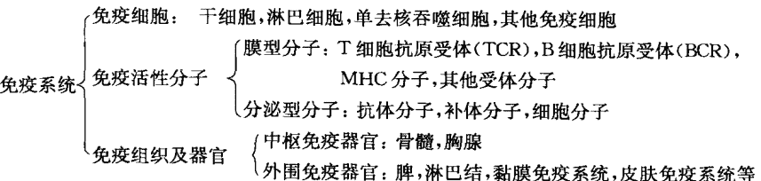

图 2-1 免疫系统的组织结构

免疫防线呈现四层递进态势：首层物理壁垒，借皮肤与黏膜拦截大部分病原；次层生理化学屏障，动用唾液、汗液、泪液、胃酸及体温等清除随食物水分入侵的微生物；第三层为固有免疫防线，依靠游走全身的吞噬细胞等巡逻队清道夫；最末层则是适应性免疫系统，淋巴细胞凭借结构适配能力，精准锁定并清除病原体[22]。

#### 2.2.1 免疫细胞

免疫细胞家族成员繁多，涵盖淋巴细胞、细胞因子、自然杀伤（NK）细胞、吞噬细胞、粒细胞及其衍生活性物质。作为免疫舞台的主角，淋巴细胞虽个头微小，却是白细胞中的核心力量，主要细分为T细胞与B细胞两系。两者细胞膜均表达抗原受体，专司识别特定抗原决定簇：B细胞受体（BCR）与T细胞受体（TCR）由此得名。B细胞职能聚焦于抗体生产、抗原呈递、细胞因子分泌，并在T细胞协同下参与免疫调控。T细胞则擅长调节他细胞活性或直接下场执行免疫效应。按功能划分，T细胞可分为细胞毒性T细胞与调节性T细胞；后者又细分为激活B细胞的辅助性T细胞与抑制B细胞的抑制性T细胞。成熟B细胞诞生于骨髓，成熟T细胞则源自胸腺。成熟后两者均经历克隆扩增、分化成熟并履职。双向互作、相互制衡，共同编织成体内精密有序的反馈式免疫调控网络[24]。

#### 2.2.2 抗体

抗体本质上是一种蛋白质，由B细胞遭遇抗原后，经克隆扩增分化为浆细胞而分泌产出。其分子架构含两大功能域：相对保守的恒定区（Constant region），与宿主组织受体互作；以及高度多变的可变区（Variable region），专司结合各异抗原[22]。前者锚定宿主效应功能，后者精准捕获抗原。可变区随时间积累体细胞突变，赋予系统核心鲁棒性与适应力；双域差异催生出庞大抗体谱系。外来抗原入侵时，抗原呈递细胞将其加工至决定簇层面，随即触发生成匹配抗体。抗体源于DNA片段随机重组。一旦决定簇匹配成功，特异信号即驱动B细胞大量增殖同型抗体，以“数量优势”淹没清除入侵者。抗体兼具“识别者”与“被识别者”双重身份。其多样性根基在于基因突变、编辑重组及交叉反应机制。

#### 2.2.3 免疫系统包含的类型

免疫防御体系分两大层级：固有免疫系统与适应性免疫系统。固有免疫先天自带，不随病原变异而调整，由补体、内吞系统、吞噬细胞构筑，具备初次遇敌即战即决的速效清除力。适应性免疫以T、B细胞为主力，拥有识别全谱微生物并定制反应的潜能[22]。

### 2.3 免疫系统的基本机理

- 1. 免疫识别

免疫识别作为核心职能，本质在于精准划分“自我”与“非我”的界限。该过程借淋巴细胞表面受体与抗原结合达成，结合紧密度即亲和度——匹配越契合，亲和度越高。未成熟T细胞须在胸腺通过“自体耐受”考核：唯有对自我组件无反应者方可出关执勤，杜绝自反应细胞攻击宿主。此筛选机制称作阴性选择，是识别环节的关键一环[3]。识别本质为细胞-抗原匹配结合，且具高度特异性：单一免疫细胞仅对极少数结构相似抗原呈强结合力。

- 2. 免疫学习

识别即学习：历经此程，细胞个体亲和度跃升、克隆群体扩张，优胜者化作记忆细胞长久驻留。学习模式二元化：初次遇抗，应答迟缓，属探索建库期；再次相逢，记忆唤醒，应答加速且高亲和抗体涌现，典型的增强式学习范式，对应再次应答期。系统亦能跨抗原泛化识别。学习路径多元：①同抗原复刺激（增强式）；②亲和度成熟——抗体经遗传算子迭代优化（遗传学习）；③低水平重复感染（相似抗原适应）；④内外源抗原交叉应答（联想式学习）。免疫网络演化本身亦是宏观学习过程[24]。

- 3. 克隆选择

克隆选择核心逻辑：唯识别抗原者得扩增、得保留；无识别力者被淘汰、不扩增。识别门槛设定为亲和度超阈值。理论阐释了获得性免疫本质——成功锁定抗原者，方获增殖资格。变异后细胞分化为效应细胞（抗体）与记忆细胞。此理论映射达尔文自然选择：克隆竞逐抗原，亲和力顶尖者最适应、复制最多，演化场域为体内细胞种群。理论特征鲜明：①新细胞为父代克隆副本，受高频体细胞突变驱动成熟；②清除携带自反应受体的新生淋巴细胞；③增殖分化依赖成熟细胞-抗原互作；④限制克隆无序持续，早期清除自体抗原乃防自身免疫病基石。克隆选择驱动亲和度成熟：低亲和个体经增殖-变异筛选，亲和度渐次跃升。实质上，这是达尔文式变异-选择在细胞层面的演绎，借交叉、变异等遗传算子及种群调控落地[24]。

- 4. 抗体多样性

免疫学数据显示[22]：体内蛋白约10^6种，潜在抗原却达10^16量级。以少御多、跨数量级识别，亟需高效多样性生成机制。系统如何达成？靠“抗体指令系统”生成海量抗体库，覆盖近乎无限的抗原空间。B细胞借高频突变与受体编辑（基因片段重排重组）实现多样化。受体编辑将基因片段随机拼接编码，于淋巴细胞发育期完成海量信息存储并遗传下一代，助力跳出亲和力局部最优。点突变利于局域精细搜索，受体编辑利于全局跨域跳跃，二者互补协同。除上述机制，骨髓新生淋巴细胞持续小比例入池维持多样性。Jerne指出：受刺激最弱的5%-8%细胞会被替换入识别池，拓展全局优化视野，效用堪比受体编辑。前者深耕局部，后者引入新候选。结构上，可变区司识别，恒定区司效应。重链可变区经有序基因片段重组拼接，翻译成功能抗体。综上，多样性源于：B细胞生成、受体库组合重整、体细胞高突变、基因转换等；主流共识指向抗原受体库基因片段重组法，基因片段乃抗体构筑基本单元。

- 5. 免疫记忆

淋巴细胞除增殖分化为浆细胞外，亦可转化为长寿命记忆细胞。初遇抗原，淋巴细胞需调整适配，终以最优抗体形式封存记忆、生成记忆细胞。再遇同源或相似抗原，记忆细胞即被调取、速活化、增殖分化为效应细胞，高亲和抗体倾泻而出，实施高效持久清除。免疫记忆支撑再次应答与交叉应答，后者即针对结构类似抗原的响应。其本质为联想式记忆，乃免疫算法区别于其他进化算法的关键标识。Farmer首创将其建模为联想记忆[13]。Smith将其与稀疏分布记忆（SDM）对照[59,63]：初次应答=SDM写入存储；再次/交叉应答=SDM读取调用。

- 6. 免疫反馈

反馈机制赋予免疫系统复杂信息系统属性：识别分离细菌病毒等外源病原，具备学习、记忆、模式识别三大智能。反馈回路并行双任务：极速清除外敌、极速稳态自持（详见示意图）[22]。

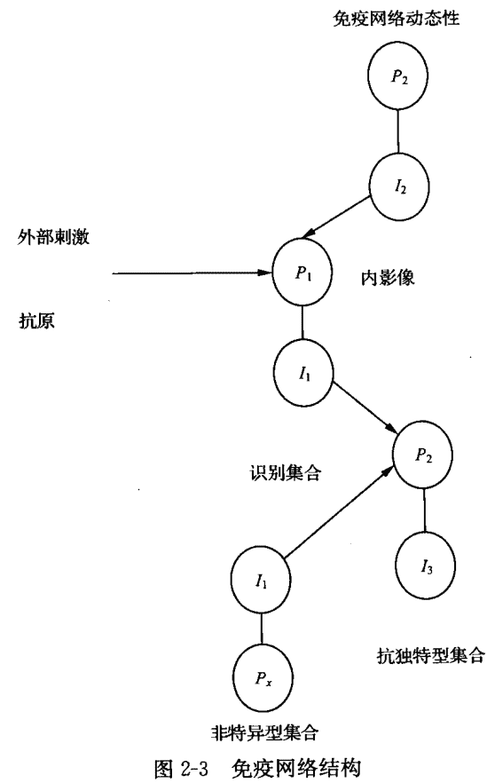

#### 7. 分布式和控制

免疫系统由全身分布的细胞、组织、器官拼装而成。分布式特性源于两重逻辑：一、病原全身散布，检测需全身效应细胞协同完成（分布式检测）；二、架构去中心化，局部受损不摧垮整体，鲁棒性大增。高度分布式控制仰赖三大支柱：①阴性选择；②协同刺激与信号事件；③细胞克隆与凋亡[22]。

#### 8. 自适应

全身散布的淋巴细胞以学习模式识别特异抗原，获选抗体突变率超常细胞10倍[22]，亲和度跃升概率剧增，随即分化为效应细胞（清除）与记忆细胞（存储），完成适应性应答闭环。应答靠局部细胞互作驱动，无中央指挥，分布式架构反而深化了自适应本色。自适应生成双引擎：①T/B细胞克隆扩增，量产抗体清敌；②持续学习新感染，旧忆留存备战未来。

#### 9. 免疫网络

根植于克隆选择学说，Jerne奠基独特型网络理论，构筑数学框架[10,11]；Perelson继而提出概率描述范式[12]。该理论系统假设了细胞活动、抗体生成、耐受、自非我识别、记忆及演化等全景，将免疫系统定义为细胞/分子构成的调节网络：抗体-抗体、细胞-细胞互通为基，抗原识别由网络互作涌现完成。独特型网络设定双向应答：阳性触发增殖、激活、产抗体；阴性诱导耐受或抑制。数学建模后，可便捷刻画学习记忆等涌现性质[24]。核心特征：①抗原-抗体、抗体-抗体互织成均匀动态平衡网；②内含“内在抗原内影像”（见图示）。


图 2-3 免疫网络示意图

#### 10. 免疫调节机制

免疫调节本质为自组织、自调控，无中枢指挥。防御调节双轨并行：①体液免疫——B细胞及产物主导；②细胞免疫——T细胞主导。二者同遵“增殖-激活-分化-攻击-抑制-记忆”标准流程。

#### 11. 免疫动力学描述

动力学建模聚焦抗原增殖与效应细胞杀伤两大核心现象。建模前先定义系统为复杂巨系统，含四大组分：①免疫细胞群；②免疫分子群；③MHC及自身抗原；④外来抗原。组分间非线性耦合极深。引入非线性数学理论，首选状态变量，再刻画多层次（分子/细胞/器官）跨尺度互作动态，解析时演规律，洞悉机制功能[1~4,7]。

### 2.4 人工免疫系统分析

#### 2.4.1 形态空间

B/T细胞为特异性识别主角，识别即互补结合，形状互补度越高，亲和力越强。为在人工免疫系统（AIS）中量化描述此互作，Perelson等1979年引入形态空间模型[58]。形态空间量化抗原-抗体结合度。形状、电荷分布、互补位点化学基团等决定互作，Perelson合称“分子泛化形态”。若用L维参数刻画，含长、宽、结合位凸凹高度等特征。抗体记为Ab=<Ab1..AbL>，抗原记为Ag=<Ag1..AgL>。形态空间旨在建模形状互作、编码机制、识别多样性、亲和度度量，现已成AIS核心工具。

##### 1. 抗体识别多样性度量

形态空间内，抗体抗原只需大致互补匹配，故少量抗体可覆盖海量抗原，此即“识别多样性”。度量关键在于抗体识别区域 \( V_\epsilon \)。

**定义 2-1** 抗体识别区域：形态空间中，单一抗体决定基能特异识别其 \( \epsilon \) 半径内所有抗原决定基，该覆盖域记为 \( V_\epsilon \)。

设总状态数 \( K^L \)（K为字母表大小，L为串长）。给定抗体覆盖集合 \( V_\epsilon \)，即覆盖空间部分。\( \epsilon \)为匹配阈值：\( \epsilon=0 \)要求精确互补，一抗体仅识一抗原。给定 \( \epsilon \)，单抗体覆盖面按式(2-1)计[16]。

$$ C = \sum_{i=0}^{\epsilon} \binom{L}{i} = \sum_{i=0}^{\epsilon} \frac{L!}{i!(L-i)!} \tag{2-1} $$

式中，\( C \) 为抗体的覆盖面。式(2-1)亦为多样性度量公式。据此，给定串长L与阈值\( \epsilon \)，全空间覆盖所需最小抗体数N定义为

$$ N = \text{ceil}\left( \frac{K^L}{C} \right) \tag{2-2} $$

式中，ceil 为取整运算符。

##### 2. 编码机制

形态空间中识别与进化皆建立在编码之上，编码优劣直系抗体多样性与AIS性能。主流编码四类：二进制、整数、实数、符号编码，偶用灰度编码[61]。实战中无统一选码理论，需问题导向定制。各码利弊共存：如二进制编解码简易、遗传算子易实现，但难嵌入领域知识，连续优化时局部搜索乏力。故“抗原/抗体如何编码”成形态空间关键决策。

- 1) 编码问题分类

按编码分类，形态空间分：①二进制；②实数；③整数；④符号；⑤灰度空间等。各有适用疆域：实数空间擅长函数优化，整数/符号空间擅长组合优化[84]。

- 2) 编码性质

引入新编码机制时，首要验证其是否为有效遗传算法编码[2]。形态空间编码应遵循原则[102]：

# 破解AIS编码难题：四大核心原则与亲和力度量全解析

在构建人工免疫系统（AIS）时，编码机制的优劣直接决定了算法的搜索效率与收敛质量。理想的编码并非随意为之，而是需遵循**非冗余性、合法性、完备性、因果性**这四大“黄金法则”。同时，如何度量抗原抗体间的“亲疏关系”，也是模型能否落地的关键。本文将深度拆解这些核心机制，并梳理AIS的算法分类与通用设计框架。

---

## 核心原则：打造高效编码的四把尺子

### 1. 非冗余性：拒绝“无效劳动”，坚持一一对应
编码到解的映射关系，直接影响搜索效率。现状通常有三类：
*   **1对1（理想态）**：基因型与表现型完美对齐，搜索无冗余，效率最高。
*   **n对1（陷阱）**：多个基因型对应同一表现型。表面看个体相同，实则基因不同。距离度量失效，导致算法在基因型空间盲目游走，浪费算力，更是**早熟收敛的元凶**之一。
*   **1对n（混乱）**：单一基因型对应多解，含义模糊，工程上极少采用。

> **结论**：编码设计首选1对1映射，杜绝n对1带来的隐性冗余。

### 2. 合法性：随机生成皆可用
编码的任意排列组合，都能解析为问题的一个合法解。这保证了现有免疫算子（交叉、变异等）可直接复用，无需额外的修复机制。

### 3. 完备性：解空间无盲区
问题空间内的任意可行解，都能在编码空间找到对应“身份证”。这确保了AIS的搜索触角能伸向解空间的每一个角落，不遗漏潜在最优解。

### 4. 因果性：小变异，小波动；保邻域，护结构
变异在基因型空间引入微小扰动，在表现型空间也应仅产生微小变化。这不仅是保护**邻域结构**的要求，更是平衡“探索新信息”与“保留旧经验”的关键。

> **现实提醒**：完美满足上述四原则的编码属于“理想态”，工程实践中通常以“最大程度逼近”为目标。

---

## 亲和力度量：量化“形状互补”的数学语言

亲和力源于抗原抗体的**形状互补**——结构越契合，亲和力越高。度量方式取决于形态空间的类型，主流分为实数空间与二进制空间两大阵营。

### 实数形态空间：几何距离定乾坤
抗体 $Ab=<Ab_1,...,Ab_l>$，抗原 $Ag=<Ag_1,...,Ag_t>$。亲和力反比于向量距离：**距离越大，亲和力越低**。
*   **欧氏距离**：直线直觉，最常用。
*   **曼哈顿距离**：网格路径和，对离群值不敏感。

> $$ D = \sqrt{\sum_{i=1}^{l} \left( \mathrm{A} \mathrm{g}_{\mathrm{i}} - \mathrm{A} \mathrm{b}_{\mathrm{i}} \right)^{2}} $$
> $$ D = \sqrt{\sum_{i=1}^{l} \left| \mathrm{A} \mathrm{g}_{\mathrm{i}} - \mathrm{A} \mathrm{b}_{\mathrm{i}} \right|} $$

### 二进制形态空间：位模式匹配秀
三大经典度量各有千秋：
1.  **汉明距离**：异或操作统计不同位数，简单粗暴，全局视角。
2.  **R-连续位匹配**：聚焦**连续互补片段**，模拟表位-副表位局部结合特性。
3.  **多重R-连续位匹配**：升级版，综合**匹配总数**与**匹配区域长度**，评价更全面。

> $$ D = \sum_{i=1}^{l} \delta, \left\{ \begin{array} { l } { { \delta = 1 , } \quad { \mathrm{A} \mathrm{g}_{\mathrm{i}} \neq \mathrm{A} \mathrm{b}_{\mathrm{i}} } } \\ { { \delta = 0 , } } \\ { { \quad \text { 其他 } } } \\ \end{array} \right. $$
> $$ D = D _ { H } + \sum _ { i } 2 ^ { l _ { i } } $$

---

## 亲和力成熟：从“骨髓生成”到“精英进化”

### 1. 初始抗体：骨髓模型的工程化映射
生物骨髓通过基因片段随机拼接生成多样抗体，AIS借此构建初始种群：
*   **基础版**：随机函数在 $L$ 维空间 $S^L$ 生成长度 $L$ 字符串。实数空间定区间 $[0,1]^L$，二进制空间定符号表 $\{0,1\}$。
*   **进阶版（基因库模式）**：设 $L$ 个基因库，各含 $C$ 片段，可组合出 $C^L$ 种抗体，多样性指数级跃升。

### 2. 抗体进化：变异与选择的“双重奏”
进化核心 = **超高频点变异**（攀登高峰） + **亲和力比例选择**（保留精英）。

*   **变异机制百花齐放**：交叉、逆位、点变异、多点变异、子串重生成等，视问题而定。
*   **核心调控公式——变异率与亲和力“指数反比”**：
    亲和力越高，变异率越低（精英微调）；亲和力越低，变异率越高（大幅探索）。
    > $$ \alpha(D^*) = \exp(-p D^*) \tag{2-7} $$
    > $$ D^* = \frac{D}{D_{max}} \tag{2-8} $$
*   **选择率与亲和力“正比”**：优者生存，高亲和力个体更易进入下一代。
    > $$ P_s = f(D) \tag{2-9} $$

**结果**：种群经代际迭代，抗体亲和力逐步成熟，收敛于高质量解。

### 3. 多样性维持：浓度抑制防“早熟”
单纯优胜劣汰会导致种群单一化、多样性丧失、陷入局部最优。引入**浓度抑制机制**平衡种群生态：
*   **计算浓度**：个体周围邻居越多（亲和力和越大），浓度越高。
    > $$ c_v = \left( \sum_{w=1}^{N} a c_{ij} \right) / N \tag{2-10} $$
    > $$ ac_{ij} = \begin{cases} 1, & (Ab)_{ij} \ge Tacl \\ 0, & (Ab)_{ij} < Tacl \end{cases} \tag{2-11} $$
*   **动态调整繁殖率**：**高亲和力 + 低浓度 = 重点保留**；**低亲和力 + 高浓度 = 坚决淘汰**。
    > $$ e_v = \frac{ax_v \prod_{s=1}^N (1 - as_{v,s})}{c_v \sum_{i=1}^N ax_i} \tag{2-12} $$
    > $$ as_{v,s} = \begin{cases} ay_{v,s}, & ay_{v,s} \geqslant \text{Tac2} \\ 0, & \text{其他} \end{cases} \tag{2-13} $$
    > $$ e_i = \frac{ax_v}{c_v} \tag{2-14} $$ （简化版：亲和力与浓度的博弈）

这机制有效遏制了“超级个体”垄断种群，保障了搜索的广度与深度。

---

## 算法全景图：两大流派，四大分支

基于动态控制机制差异，主流AIS算法分为**基于群体**与**基于网络**两大阵营。

> 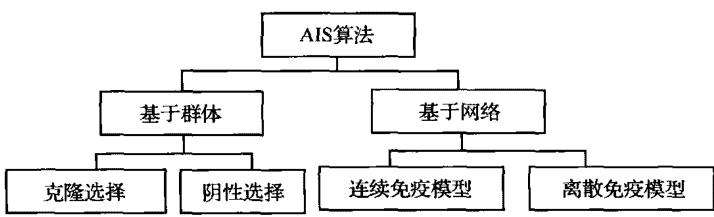
> *图示：AIS算法分类体系*

### 阵营一：基于群体——经典进化范式
核心逻辑：种群迭代，个体交互弱。代表作：
*   **克隆选择算法 (CSA)**：高亲和力克隆扩增+高频变异+选择，典型“免疫版GA”。
*   **阴性选择算法 (NSA)**：生成不识别“自”抗原的监测器，专攻**异常检测**、**模式识别**领域。

### 阵营二：基于网络——群体智能与动力学
核心逻辑：抗体间相互识别、刺激、抑制，形成动态网络。细分两派：

#### 1. 连续免疫网络：微分方程驱动的“流体动力学”
*   **Farmer模型**奠基：抗原抗体用字符串对 $(p,e)$ 表示，互补匹配触发反应。
*   **核心引擎**：一组微分方程描述抗体浓度 $x_i$ 随时间演化。
    *   项1：抗体间相互刺激（$+m_{ji}x_ix_j$）
    *   项2：抗体间相互抑制（$-k_1\sum m_{ji}x_ix_j$）
    *   项3：抗原刺激抗体（$+c\sum m_{ji}x_iy_j$）
    *   项4：自然死亡（$-k_2x_i$）
    > $$ \frac{dx_i}{dt} = c \left( \sum_{j=1}^N m_{ji}x_i x_j - k_1 \sum_{j=1}^N m_{ji}x_i x_j + \sum_{j=1}^n m_{ji}x_i y_j \right) - k_2 x_i \tag{2-15} $$
*   **应用**：控制、机器学习、优化、模式识别。擅长从**宏观量变**视角捕捉系统动态。

#### 2. 离散免疫网络：循环迭代的“自适应调控”
*   **差异**：抛弃微分方程，改用**离散循环过程**更新网络状态。
*   **双雄**：
    *   **RLAIS (有限资源AIS)**：资源竞争机制，适合数据分析。
    *   **AiNet (人工免疫网络)**：构建记忆集合，刻画数据结构组织，擅长聚类、压缩。
*   **应用**：模式识别、数据聚类/压缩，亦可跨界优化、控制。

---

## AIS通用设计框架：站在巨人肩膀上造轮子

AIS兼具**进化主义**(GA)与**结构主义**(ANN)特质。参考两者成熟框架，提炼出AIS通用设计“三件套”：

| 核心组件 | 对应生物意涵 | 关键决策点 |
| :--- | :--- | :--- |
| **① 抽象模型** | 免疫细胞/分子 | 形态空间选型、编码规则、初始化策略 |
| **② 评价与成熟机制** | 亲和力识别、成熟 | 距离/匹配度量函数、克隆/变异/选择算子、多样性维持策略 |
| **③ 动态控制算法** | 免疫反应全过程 | 选算法（克隆/阴性/网络）、定参数、控迭代流程 |

### 标准化建模四步走
1.  **定空间**：选形态空间（实数/二进制/其他）。
2.  **定度量与起点**：锁定亲和力函数、初始种群生成法。
3.  **定进化与多样性**：设变异/选择算子、配浓度抑制/其他多样性机制。
4.  **定总控算法**：套用成熟算法框架或自研主循环流程。

> 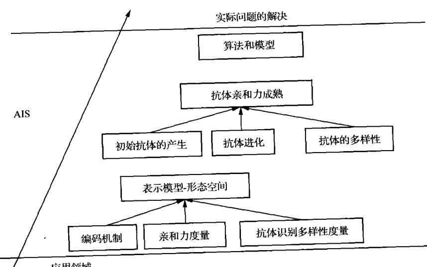
> *图示：AIS设计框架层次结构*

### 框架构成速查表（表2-1精华版）
| 模块 | 核心功能 | 底层原理 |
| :--- | :--- | :--- |
| **形态空间** | 承载抗体属性字符串 | 免疫分子抽象表示 |
| **抗体产生** | 生成新抗体编码 | 空间内采样/基因库拼接 |
| **抗体进化** | 选择/克隆/变异提升亲和力 | 自我调整过程（改属性串） |
| **多样性维持** | 防早熟、保广度 | 浓度抑制/资源竞争等机制 |
| **克隆选择** | 高亲和力扩增变异 | 类GA自适应调整 |
| **阴性选择** | 生成非自识别监测器 | 自/非自循环匹配 |
| **连续网络** | 微分方程控动态 | 抗原抗体/抗体间交互动力学 |
| **离散网络** | 循环过程控动态 | 网络拓扑自适应重组 |

---

## 本章小结与展望

本章系统梳理了AIS从**生物原型**到**数学模型**，再到**算法实现**与**工程框架**的完整链条：
1.  奠基：编码四原则、亲和力度量（实数/二进制）。
2.  动力：亲和力成熟（骨髓生成→进化→多样性维持）。
3.  谱系：群体派(克隆/阴性) vs 网络派(连续/离散)。
4.  方法论：通用三层框架 + 四步建模流程。

这为后续利用AIS解决复杂优化、学习、控制等实际问题，提供了坚实的理论基石与标准化操作指南。

---

# 第3章 自适应变尺度混沌免疫优化算法

## 3.1 破局：免疫算法与混沌优化的“互补融合”

人工免疫算法（AIA）承袭遗传算法（GA）衣钵，有效缓解了GA的**退化现象**，能快速将搜索范围压缩至小空间。然，**宿疾犹存**：
*   **盲目随机**：未利用问题特征知识引导全局搜索。
*   **小区域乏力**：局部搜索效率不高，**早熟收敛**风险仍存。

混沌优化另辟蹊径：利用混沌变量**随机性、遍历性、规律性**三位一体的特质，通过线性映射覆盖搜索空间。但其**短板**亦明显：
*   **大空间/多变量**下计算耗时巨大。
*   **易迷失**：难以稳定定位全局最优解。

**洞见**：免疫算法擅长**宏观定向、快速聚焦**；混沌算法擅长**微观遍历、精细挖掘**。二者短板互补、优势互补，**融合势在必行**——这正是本章“自适应变尺度混沌免疫优化算法”诞生的背景与动力。

# 第 3 章 自适应变尺度混沌免疫优化算法

### 3.1 研究背景与算法提出

混沌免疫优化算法融合了混沌搜索与免疫算法的长处，借助免疫算法的记忆机制及当代最优解来引导混沌搜索。现有研究[54,111~113]多采用有限区间、有限折叠次数的 Logistic 模型生成混沌变量，导致其混沌特性表现不够显著。针对这一不足，本章引入在有限区间内具备无限折叠次数的混沌模型产生变量，并结合自适应变尺度技术动态调整优化变量的搜索空间，持续精进搜索精度，以此破解寻优过程中收敛速度迟缓的瓶颈，构建了一种自适应变尺度混沌免疫优化算法（AMSCIA）。

### 3.2 混沌模型的甄选与分析

一维混沌自映射的通式为

```
x_{n+1} = f(x_n) (3-1)
```

其相空间内必然存在线性或非线性折叠现象，这是产生混沌的前提。从某种角度看，刻画模型“混沌程度”的李雅普诺夫指数，可视为模型平均折叠次数的体现。当模型平均斜率绝对值超过 1 时，该指数为正。常见的 Logistic、Tent、Chebyshev 等映射，其折叠次数均为有限。

我们考察如下定义的一维自映射：

\(\left\{\begin{array}{l}x_{n+1}=\sin\left(\frac{2}{x_{n}}\right), n=0,1,2, \cdots, N \\ -1 \leqslant x_{n} \leqslant 1, x_{n} \neq 0\end{array}\right. \quad (3-2)\)

因该映射折叠次数无限，在区间 \([-1,1]\) 内拥有无穷多个不动点与零点。欲利用其产生混沌，须规避两点风险：

- (1) 迭代初值严禁为 0；
- (2) 初值不可选取无穷多不动点中的任意一个，即方程 \(x_{n+1}=\sin(2/x_{n})\) 的解。

工程实践中，超越数 \(2/(k \pi)(k \in \mathbb{Z}, k \neq 0)\) 难以精确出现，均以有限精度有理数近似代替。因此，只需迭代初值非 0，混沌即会发生。此时定义域为 \([-1,1]\) 且 \(x \neq 0\)，排除上述超越点。该一维自映射 \(x_{n+1}=\sin(2/x_{n})\) 迭代 1000 次后的随机性、初值敏感性与遍历性见下图。

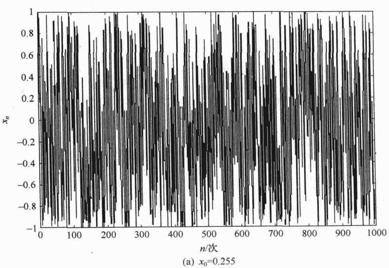

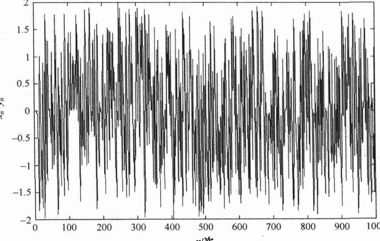

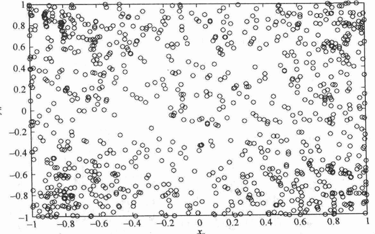

### 图 3-1 一维自映射 \(x_{n+1}=\sin(2/x_n)\) 的三大特性随迭代次数的演变

李雅普诺夫指数是衡量混沌强弱的关键指标。自映射式(3-2)的李雅普诺夫指数表达式为

```
\(LE = \lim_{n \to \infty} \frac{1}{n} \sum_{i=0}^{n-1} \ln \left| f'(x_i) \right| = \lim_{n \to \infty} \frac{1}{n} \sum_{i=0}^{n-1} \ln \left| \frac{2}{x_i^2} \cos \frac{2}{x_i} \right| \quad (3-3)\)
```

对比式(3-3)与常用有限折叠映射的指数表达，显而易见，式(3-2)模型展现出更强的混沌特性。

通过不同混沌模型支撑的混沌搜索对比实验，可证式(3-2)模型混沌特性更显著。并对以下算式进行了测算：

```
\begin{cases} \min f(x) = \min(4 - x^2)^2 \\ -8 < x < 8 \end{cases}
```

其中，\(f(x)\) 在极值点 \(x = \pm 2\) 处取得极小值 0。

分别采用式(3-2)模型与 Logistic 模型，对混沌变量实施单次全区间遍历优化，结果汇总于表 3-1。数据表明，式(3-2)模型优化效果更优，再次佐证其混沌特性优于有限折叠模型。

### 表 3-1 两类映射混沌特性对比统计

| 混沌模型 | 计算次数/次 | 平均迭代次数/次 | 最长迭代次数/次 |

|---|---|---|---|

| 式(3-2) | 40 | 3564.3 | 15473 |

| Logistic | 40 | 2421.6 | 5432 |

### 3.3 自适应变尺度混沌免疫优化算法（AMSCIA）流程详解

在人工免疫体系中，进化算法较匹配算法展现出更优性能，常用于数据训练与免疫记忆。AMSCIA 具体流程如下：

- **步骤 1**：导入抗原 Ag 并标准化。选取式(3-2)生成的 (0,1) 区间内 N 个混沌变量作为初始抗体群 Ab。
- **步骤 2**：对每个抗原 \(Ag_i\) 执行以下操作：
  - **2.1** 按式(3-5)计算各抗体 \(Ab_i\) 与抗原 \(Ag_i\) 的亲和力 \(a_{ij}\)；
  ```
\(a_{ij} = \sqrt{\sum_{k=1}^n (Ab_{ik} - Ag_{jk})^2}\)
```
  - **2.2** 筛选亲和力最高的 m 个抗体作为网络细胞；
  - **2.3** 对这 m 个网络细胞实施克隆，亲和力越高，克隆数 \(N_c\) 越多；
  - **2.4** 克隆细胞经方程 \(C = C - \alpha(C - X)\) 变异，C 为克隆抗体，X 为克隆抗原，\(\alpha\) 为变异率；
  - **2.5** 重新计算变异后 C 的亲和力；
  - **2.6** 选取亲和力最优的 \(\xi\)% 个体，组成部分记忆细胞集 \(M_p\)；
  - **2.7** 依式(3-6)计算抗体间相似度 \(s_{ij}\)，剔除 \(M_p\) 中相似度超阈值 \(\sigma_s\) 的个体；
  \(s_{ij} = \sqrt{\sum_{k=1}^n (Ab_{ik} - Ab_{jk})^2}\) (3-6)
- **步骤 3**：将 \(M_p\) 并入已有记忆数据集 \(M\)。
- **步骤 4**：对精英个体实施混沌精细搜索。
  选取记忆库中适应值前 10% 的个体进行精搜。设优质个体为 \(X=(X_1, X_2, \cdots, X_k)\)，搜索区间收缩规则为：

  \(\begin{cases} a'_i = X_i - \phi(b_i - a_i) \\ b'_i = X_i + \phi(b_i - a_i) \end{cases}\) (3-7)

  其中，\(\phi\) 为收缩因子，取值范围 \((0, 0.5)\)。为防越界，若 \(a'_i < a_i\) 则令 \(a'_i = a_i\)；若 \(b'_i > b_i\) 则令 \(b'_i = b_i\)。

  经还原处理后，\(X_i\) 在新区间 \([a'_i, b'_i]\) 上的向量 \(Y_i\) 由式(3-8)确定：
  \(Y_i = \frac{X_i - a'_i}{b'_i - a'_i}\) (3-8)

  将 \(Y_i\) 与 \(X_{i, n+1}\) 线性组合生成新混沌变量用于搜索：
  \(X'_{i, n+1} = (1 - \beta_i)Y_i + \beta_i X_{i, n+1}\) (3-9)

  自适应调节系数 \(\beta_i\) 确定方式为：
  \(\beta_i = 1 - \left(\frac{K-1}{K}\right)^m\) (3-10)

  其中，\(m\) 为依目标函数设定的整数（本章取 2）；\(K\) 为迭代次数（即进化代数）。
  再次清理记忆库中适应值前 10% 个体里相似度超 \(\sigma_s\) 的冗余项。
- **步骤 5**：引入式(3-2)生成的 N 个 (0,1) 区间新个体，替换亲和力低劣者，连同上一代记忆集 \(M\) 共同构成下一代抗体群，回溯至步骤 2，直至收敛。

**终止判据**：迭代次数达上限，或相邻两代网络细胞距离均值与网络规模趋于稳定/变化微乎其微。

### 3.4 算法收敛性理论保障

AMSCIA 在局部搜索能力与精度上超越免疫进化算法，有效规避了混沌优化在大范围失效的短板，收敛性有理论支撑。

得益于混沌变量的遍历性，充分迭代必能收敛至全局最优。从测度论视角，AMSCIA 属下降算法。设 \(R_0\) 为全局最优解 \(X^*\) 的邻域，算法生成序列 \(X_i\) 落入 \(R_0\) 的事件集为 \(A_i\)，则 \(A_1 \subset A_2 \subset \cdots \subset A_i \subset \cdots\)，概率测度单调非减且 \(P(A_i) \leqslant 1\)，推得：

\(\lim_{i \to \infty} P(A_i) = P\left( \bigcup_{i=1}^{\infty} A_i \right) = 1\) (3-11)

取 \(0 < \epsilon < 1\)，存在正整数 \(N\)，使 \(i > N\) 时 \(P(A_N) \geqslant 1 - \epsilon, P(\overline{A_N}) < \epsilon\)，则 \(P(\overline{A_i}, i > N) \leqslant \epsilon^{i-N}\)。故迭代次数足够大时，AMSCIA 以概率 1 寻得全局最优解。

### 3.5 基准函数数值仿真验证

为考察性能，AMSCIA 与混沌遗传算法（CGA）[114]、自适应变尺度混沌优化算法（AMSCA）[115] 对比测试 3 个基准函数。数值优化无需领域知识，能真实反映算法本质。参数设定：免疫选择阈值 0.85，总种群 40，记忆库 14，混沌操作种群 5。因混沌遍历性保证给定时间内达最优，故在同等初值下，以寻得全局极值所需平均迭代次数为指标对比。结果见表 3-2。

\( F_1 = 100(x_1^2 - x_2)^2 + (1 - x_1)^2, \quad -2.048 \leqslant x_i \leqslant 2.048 \) (3-12)

\( F_2 = [1 + (x_1 + x_2 + 1)^2 (19 - 14x_1 + 3x_1^2 - 14x_2 + 6x_1x_2 + 3x_2^2)] [30 + (2x_1 - 3x_2)^2 (18 - 32x_1 + 12x_1^2 + 48x_2 - 36x_1x_2 + 27x_2^2)], -2 \leqslant x_i \leqslant 2 \) (3-13)

\( F_3 = 0.5 - \frac{\sin^2\sqrt{x_1^2 + x_2^2} - 0.5}{[1 + 0.001(x_1^2 + x_2^2)]^2}, \quad -4 < x_i < 4 \) (3-14)

注：\( F_3 \) 求全局最大值，其余求最小值。

### 表 3-2 三算法寻优迭代次数对比

| 函数 | 最优点 | 全局极值 | CGA | AMSCA | AMSCIA |

| :--- | :--- | :--- | :--- | :--- | :--- |

| \( F_1 \) | (1.0000, 1.0000) | 0.0000 | 675 | 687 | 565 |

| \( F_2 \) | (0.0000, -1.0000) | 3.0000 | 257 | 253 | 212 |

| \( F_3 \) | (0.0000, 0.0000) | 1.0000 | 458 | 462 | 423 |

表 3-2 显示，AMSCIA 更高效融合了免疫算法的全局探索与混沌搜索的局部开发优势，检索效率与收敛性能均领先，平均寻优耗时大幅低于 CGA 与 AMSCA。

### 3.6 移动 Ad Hoc 网络入侵检测实战仿真

#### 3.6.1 面向 AODV 协议的典型攻击建模

MANET 节点兼具数据转发与路由功能，路由建立依赖全链路节点协作。针对路由协议的攻击频发。本章以 AODV（按需距离矢量路由）为例，聚焦黑洞攻击与 FFRR 攻击两类 DoS 威胁。

**黑洞攻击**：恶意节点广播虚假最短路径。在 AODV 中，其向目标源/目的节点发送伪造最大序列号的 ROUTE_REQUEST。若攻击范围扩大至全网，将形成“只进不出”的数据黑洞。

**FFRR 攻击**：恶意节点制造海量无效 ROUTE_REQUEST，耗尽带宽与节点资源。

#### 3.6.2 特征工程与数据预处理

MANET 入侵检测中，AODV 相关流量特征超百维。本章筛选表 3-3 所示 4 个与 DoS 强相关的特征，削减冗余、提速分析。经预处理模块清洗后，采用 10 折交叉验证划分训练/检测集，取多次检测率均值。

### 表 3-3 邻居节点流量关键特征集

| 参数 | 物理含义 |

| :--- | :--- |

| NBSent | 邻居节点发送数据总量 |

| NBRecv | 邻居节点接收数据总量 |

| NBReqSent | 邻居节点发送 RREQ 包计数 |

| NBRrepSent | 邻居节点发送 RREP 包计数 |

#### 3.6.3 仿真结果与效能分析

实验环境：ns-2.3.0，仿真时长 600s。检测率为核心指标。图 3-2 展示训练样本数 n ≤ 100、噪声率 10% 下，AMSCIA、KFF 与 RANDOM 算法的检测率 \(\eta\) 走势。

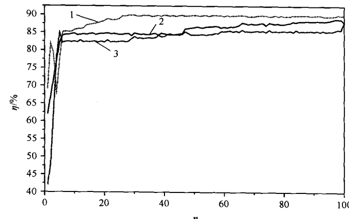

### 图 3-2 10% 噪声环境下三算法检测率演进曲线
图例：1-AMSCIA; 2-KFF; 3-RANDOM

观察可知：AMSCIA 检测率在样本量达标后快速收敛稳定，且全程高于 KFF 与 RANDOM。这意味着达到同等检测性能所需训练样本更少，直接转化为计算延迟的降低。实测性能显著优于文献 [116] 报告的同类结果。

### 3.7 章节小结

无限折叠混沌模型 \(x=\sin(2/x)\) 生成的变量，遍历约束区间的能力优于 Logistic 等有限折叠模型，混沌特性更强。AMSCIA 融合免疫进化全局搜索与混沌优化局部精搜优势，通过动态收缩搜索空间至当前最优解邻域，兼顾寻优精度与速度。验证表明：该算法结构简洁、无需目标函数连续可微、编程易实现，是高效优化利器。在 MANET 入侵检测场景下，AMSCIA 不仅大幅压降学习开销，更在小样本条件下实现更高检测效率与分类速度，完美契合自组网高检测率、强抗噪、低延迟的严苛需求。

## 第 4 章 量子免疫优化算法

### 4.1 绪论

### 4.2 量子免疫优化算法：原理与实现深度解析

量子力学堪称 20 世纪物理学最颠覆性的突破之一。以此为基石构建的量子信息学，打通了物理、计算机、通信与数学等多个领域，为 21 世纪信息科学的发展注入了全新范式。在量子计算机尚未普及的当下，为充分挖掘量子并行计算的潜能，本章创新性地将人工免疫系统（AIS）与量子理论融合，提出了**量子编码**机制，并结合**克隆算子**，构建了一种面向优化问题的新型搜索策略——**量子免疫优化算法**（Quantum Immune Algorithm，简称 QIA）。

QIA 立足于量子比特与叠加态等核心概念，利用量子比特对抗原抗体进行编码。这种概率化表达使得单个量子抗体能同时承载多状态信息，极大丰富了种群多样性；同时，克隆算子让当代最优个体的优势基因高效传递至下一代，引导变异方向，推动种群以高概率向最优区域聚集，显著提速收敛。值得注意的是，传统免疫算法通过克隆扩大搜索空间往往伴随计算开销激增，而 QIA 借助量子编码固有的并行性，将二者有机耦合，为优化计算提供了一条“快且准”的新路径。

#### 4.2.1 核心单元：量子比特

在 QIA 体系中，信息的最小单元是**量子比特**（Q-bit）。不同于经典比特的非 0 即 1，量子比特处于 0 与 1 的叠加态，其数学表达为：

$$ |\Psi\rangle = \alpha|0\rangle + \beta|1\rangle \tag{4-1} $$

其中 $\alpha, \beta$ 为复数概率幅，需满足归一化约束：

$$ |\alpha|^2 + |\beta|^2 = 1 \tag{4-2} $$

$|\alpha|^2$ 与 $|\beta|^2$ 分别对应坍缩至 $|0\rangle$ 与 $|1\rangle$ 的概率。算法中常用的演化工具是**量子旋转门**，其矩阵形式如下：

$$ U(\Delta\theta_i) = \begin{bmatrix} \cos(\Delta\theta_i) & -\sin(\Delta\theta_i) \\ \sin(\Delta\theta_i) & \cos(\Delta\theta_i) \end{bmatrix} \tag{4-3} $$

#### 4.2.2 编码载体：量子抗体

免疫算法常见二进制、十进制等编码，QIA 则独辟蹊径，采用**量子比特编码**——用一对复数定义一个比特，这正是其高效的根本。一个包含 $m$ 个量子比特的系统（即一个量子抗体）可表示为矩阵：

| $\alpha_1$ | $\alpha_2$ | $\cdots$ | $\alpha_m$ |
|---|---|---|---|
| $\beta_1$ | $\beta_2$ | $\cdots$ | $\beta_m$ |

其中每对 $(\alpha_i, \beta_i)$ 均满足归一化条件。这种结构天然表征任意线性叠加态。引入量子抗体后，种群多样性显著增强；随着演化推进，概率幅趋向 0 或 1，叠加态坍缩为确定态，算法随之收敛，完成从“探索”到“利用”的平滑过渡。

#### 4.2.3 算法流程框架

QIA 属于概率型进化算法，主流程包含七步：

1.  **代数初始化**：$t = 0$；
2.  **量子种群初始化**：生成 $Q(t)$；
3.  **观测坍缩**：由 $Q(t)$ 生成经典种群 $P(t)$。对每一位，生成 $[0,1]$ 随机数，大于 $|\alpha_i^t|^2$ 取 1，否则取 0；
4.  **变异操作**：对 $P(t)$ 执行变异产生新种群；
5.  **适应度评价与选择**；
6.  **终止判断**：满足条件输出最优解，否则继续；
7.  **量子种群更新**：更新 $Q(t)$，$t = t+1$，跳转步骤 3。

**关键差异点**在于“观测生成 $P(t)$”与“更新 $Q(t)$”两环节。
- **初始化**：将所有振幅设为 $1/\sqrt{2}$，使全量子空间等概率分布。
- **观测**：量子态 $Q(t) = \{q_1^t, \dots, q_n^t\}$ 经测量得经典态 $P(t) = \{x_1^t, \dots, x_n^t\}$。每个抗体 $q_j^t$ 为 $2 \times m$ 矩阵。
- **更新**：可沿用传统交叉变异，更推荐利用量子门（旋转门、Hadamard 门、CNOT 门等）依据叠加态特性演化。注意：量子门矩阵必须为酉矩阵（$U^*U = UU^* = I$），以保证概率守恒。

#### 4.2.4 运作机理与核心优势

优秀算法需平衡“利用已知”与“探索未知”。QIA 通过三大策略化解此矛盾：

1.  **精英保留与观测探索**：选择机制聚焦高适应度个体，观测机制持续采样未知空间，最大化信息增益。
2.  **叠加态天然抑制早熟**：单抗体携带多状态概率分布，观测采样天然生成丰富种群，无需额外机制维持多样性。
3.  **智能更新加速收敛**：针对量子抗体的“引导式”更新，定向推动种群向优区聚集。

**量子进化的独特价值**：
- **信息密度更高**：决策变量从确定值升维为概率分布，单次操作等价于并行评估海量候选解。
- **规避无效解开销**：针对交叉变异易生成非法解的问题，传统算法需设计专用算子或修复策略，QIA 的量子变异天然在合法空间内演化，省去额外计算成本。
- **变异即交叉**：概率幅表示下，变异操作已隐含交叉的信息重组功能，算法结构更简洁。

#### 4.2.5 量子变异策略详解

变异是 QIA 产生新解的核心引擎。针对传统随机变异盲目、收敛慢的痛点，提出两大改进策略：

**策略一：精英引导的高斯扰动**
利用当代最优解反推概率分布，构建“指导抗体” $Q_{guide}$，在其周围高斯采样生成下一代：
$$ Q_{guide}(t) = a \times p_{best}(t) + (1-a) \times (1 - p_{best}(t)) \tag{4-6} $$
$$ Q(t+1) = Q_{guide}(t) + b \times N(0,1) \tag{4-7} $$
- $a \in [0.1, 0.5]$ 控制引导强度（$a \to 0$ 收敛快，$a=0.5$ 失效）；
- $b \in [0.05, 0.15]$ 控制探索半径。
此法类似概率遗传算法但计算极简，高效利用历史最优信息。

**策略二：量子旋转门自适应旋转**
利用旋转门角度 $\theta$ 编码变异方向与步长，将全局最优信息融入旋转规则。针对二值编码，依据当前位 $x_i$、最优位 $best_i$、适应度比较及振幅符号，查表（表 4-1）确定 $\Delta\theta_i$ 的大小（通常设 $0.01\pi$）与方向 $s(\alpha_i, \beta_i)$。此机制保证了“朝最优解旋转”，收敛性有理论保障。

#### 4.2.6 收敛性数学证明

**定理 4-1** 给出了可归约随机矩阵幂收敛的极限形式，奠定了马尔可夫链分析基础。
**定理 4-2** 宣称：**QIA 具备全局收敛性。**

**证明思路**：
将进化建模为马尔可夫链。经典免疫算法（IM）状态空间为离散有限集（$2^{NL}$），而 QIA 因振幅连续，理论状态空间无限（精度限定下为 $\upsilon^{NL}$）。状态转移链路为：
$$ Q_k \xrightarrow{\text{观测}} P_k \xrightarrow{\text{变异}} P'_k \xrightarrow{\text{精英保留+更新}} Q_{k+1} \tag{4-11} $$
整体转移概率矩阵分解为观测($M_q$)、变异($C$)、选择($S$)、更新($U$)等算子乘积（公式 4-12 至 4-15）。通过构造超个体技巧，将变异、选择矩阵 $C, M, S$ 表示为具有吸收状态结构的块矩阵（公式 4-16, 4-17），结合定理 4-1，可证系统最终以概率 1 收敛至全局最优解集合，且极限分布与初始状态无关。

### 收敛性证明与实验验证

在经过“最优保持”策略的筛选后，若当代涌现的最优抗体超越了超个体，则以此更新超个体；反之则维持现状。为量化这一升级机制，文中引入了一个 $2^{(N+1)L} \times 2^{(N+1)L}$ 阶的随机矩阵 $U$。该矩阵具有稀疏特性：每行仅含单一非零元素 1，其余皆为 0，具体结构呈下三角分布：

$$U = \begin{bmatrix} U_{11} & & \\ U_{21} & U_{22} & \\ \vdots & \vdots & \ddots \\ U_{2^L, 1} & U_{2^L, 2} & \cdots & U_{2^L, 2^L} \end{bmatrix}$$

据此，算法的状态转移矩阵演变为 $P^* = P^* U = C_1 M_1 S_1 U$，其展开形式与 $U$ 同构。此过程虽与免疫算法（IM）流程相似，但关键差异在于：升级算子 $U$ 不仅受 $P$ 自身演化驱动，更受 $Q$ 机制调控。每当 $Q$ 衍生出优于当前超个体的 $P$ 解时，即触发超个体更新。

鉴于 $CMS$ 为正随机矩阵，且 $U_{LL}$ 为单位阵 $I_{2^{NL} \times 2^{NL}}$，$U_L$ 为至少含一零对角元的下三角阵，可推导出：
$$CMSU_{LL} = CMS > 0, \quad \begin{bmatrix} CMSU_{2, 1} \\ \vdots \\ CMSU_{2^L, 1} \end{bmatrix} \neq 0, \quad \begin{bmatrix} CMSU_{22} & \\ \vdots & \ddots \\ CMSU_{2^L, 1} & \cdots & CMSU_{2^L, 2^L} \end{bmatrix} \neq 0$$

依据定理 4-1，极限 $\lim_{n \to \infty} (P^*)^n$ 存在且与初始分布 $\Pi^{(0)}$ 无关，收敛形式为 $(p_1, p_2, \cdots, p_{2^L}, 0, \cdots, 0)$。已知状态空间 $\{0, 1\}^{(N+1)L}$ 前 $2^L$ 个状态的首个个体均为全局最优解 $x_1$，设 $P_i^t$ 为 $t$ 时刻处于状态 $i$ 的概率，$A$ 为适应度最高个体为 $x_1$ 的状态集，则 $p(f_1 = f^*) = \sum_{i \in A} p_i^t$。推至无穷远：
$$\lim_{t \to \infty} p(f_1 = f^*) = p_1 + p_2 + \cdots + p_{2^L} = 1$$
这从概率层面确证了算法的收敛性。

#### 4.2.7 仿真实验分析

该算法兼具种群多样性维持与强大搜索能力，量子抗体与克隆算子的融合显著增强了免疫计算应对多峰函数优化的本领。选取两大基准测试函数考察 QIA 表现：

$F_1: f(x,y) = x\sin(4\pi x) - y\sin(4\pi y + \pi) + 1, \quad -1 \leqslant x, y \leqslant 2 \quad (4-22)$

$F_2: f(x,y) = 0.5 - \frac{\sin^2\sqrt{x^2+y^2}-0.5}{(1.0 + 0.001(x^2+y^2))^2}, \quad -10 \leqslant x, y \leqslant 10 \quad (4-23)$

实验对比了 QIA、传统免疫算法（IA）及遗传算法（GA）的空间搜索性能与收敛速度。$F_1, F_2$ 均设迭代 415 代，参数均取各算法独立运行 10 次后的最优配置：GA 交叉率 0.05、变异率 0.002；IA 抑制阈值 0.02、克隆复制率 10、记忆库 80 规模。针对 $F_2$，迭代增至 1500 代，记忆库扩至 100。三算法各独立运行 20 次求极值，结果显示 QIA 每次均捕获多个最优解，而 GA 与 IA 乏力。以 $S$ 表征寻得全峰值概率，引入公式 (4-24) 量化群体多样性平均变化率：
$$P = \frac{20 \text{ 次独立运行至指定代数时不同抗体数之和}}{20N} \quad (4-24)$$

**表 4-2 三算法在两函数上的峰值捕获率与多样性对比**

| 算法 | 函数 F1 P值 | 函数 F1 S值 | 函数 F2 P值 | 函数 F2 S值 |
|---|---|---|---|---|
| QIA | 0.98 | 1.0 | 0.97 | 1.0 |
| IA | 0.76 | 0.8 | 0.79 | 0.9 |
| GA | 0.65 | 0.6 | 0.73 | 0.7 |

数据揭示：从全峰值捕获率 $S$ 看，QIA 与 IA 显著优于 GA，且 QIA 超越 IA。GA 易陷入少数大峰值，印证其易陷局部极小的弱点。多样性维度上，QIA 亦领先于 IA 与 GA，综合确立了其在多峰优化中的优势。免疫算法 IA 基于免疫原理，本质上优于 GA。为直观对比收敛速度，每问题各算法独立运行 10 次，随机抽取一轮结果绘制图 4-1、4-2。曲线表明，QIA 在 $F_1, F_2$ 上搜索路径更短、振荡更小、更快逼近理想解。

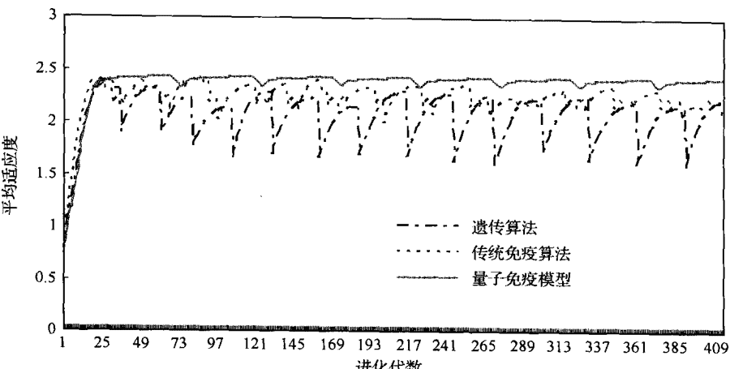
图 4-1 F1 函数收敛速度对比

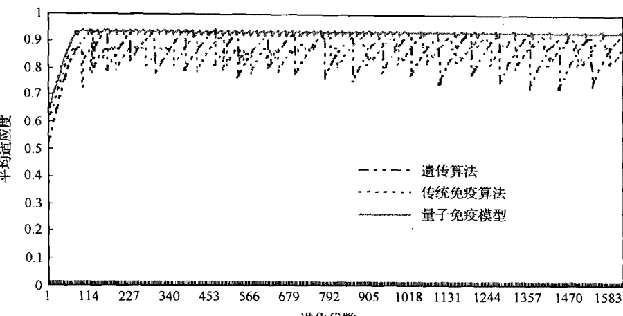
图 4-2 F2 函数收敛速度对比

### 4.3 分级变异量子进化算法 (CMQEA)

本节以多目标优化为切入点，剖析量子进化算法与免疫算子特性，提出**分级变异量子进化算法**（CMQEA）。核心策略有二：一、引入快速非支配排序与拥挤距离计算抗原-抗体亲和度；二、依适应度分级，顶层个体作为量子进化基准，中层施以量子旋转更新与免疫操作，底层执行免疫交叉。双策略协同，兼顾收敛性与多样性。

#### 4.3.1 多目标优化基础概念

区别于单目标优化（SOP），多目标优化（MOP）存在多最优解，需同时满足收敛与多样性。自 80 年代中期 Schaffer 提出向量评估遗传算法（VEGA）开山以来，涌现出 NSGA、SPEA 等经典多目标进化算法（MOEA），核心目标均聚焦于解的收敛性与多样性。

量子进化算法（QEA）及其免疫融合变体本质属概率进化算法。相较经典算法，其优势在于：小规模种群即可保持多样性与全局搜力，且能保存个体历史信息。QEA 在单目标与组合优化中表现优异，但其进化随机性难控、收敛方向无序、易陷局部最优，尤对高维多解 MOP 适用性不足（因最优解局部-全局迁移可能破坏多样性）。

考虑含 $n$ 决策变量、$m$ 目标函数的 MOP：

**定义 4-1 (MOP)**：$\text{Min } y=f(x)$，决策向量 $x \in X \subseteq R^n$，目标向量 $y \in Y \subseteq R^m$。

**定义 4-2 (Pareto 支配)**：$x$ 优于 $x'$（记 $x \succ x'$），当且仅当：$\forall i, f_i(x) \le f_i(x')$ 且 $\exists j, f_j(x) < f_j(x')$。

**定义 4-3 (Pareto 最优解)**：$x \in X$ 为集合 $A$ 上的非支配解，当 $\forall a \in A, a \not\succ x$。若 $A=X$，则称 $x$ 为 Pareto 最优解。

**定义 4-4 (非支配解集与前沿)**：$non(A) = \{x \in A | x \text{ 为 } A \text{ 上非支配解}\}$ 称作非支配解集，其目标空间映射 $f(non(A))$ 称非支配前沿。

**定义 4-5 (Pareto 最优解集与前沿)**：$X^* = \{x \in X | \not\exists x' \in X, x' \succ x\}$ 为 Pareto 最优解集 ($P_{true}$)，$Y^* = \{f(x) | x \in X^*\}$ 为 Pareto 前沿 ($PF_{true}$)，二者由问题本身决定。算法发现的非支配解集记为 $P_{known}$ 与 $PF_{known}$。

#### 4.3.2 算法框架设计

经典 QEA 忽视先验知识，免疫 QEA 的最优个体旋转更新不适配多目标场景。因此，在二者结构基础上，融合多目标亲和度排序与分级变异免疫操作，作用于量子种群 $Q(t)$ 与观测种群 $P(t)$，流程如下：

```
procedure CMQEA
begin
步骤 1 Q(t)、P(t) 初始化
(a) t ← 0;
(b) 初始化 Q(t);
(c) 由 Q(t) 生成 P(t);
(d) 评价 P(t);
while (not termination condition) do
begin
步骤 2 由 Q(t-1) 生成 P'(t)
(a) t ← t + 1;
(b) 由 Q(t-1) 生成 P'(t);
(c) 评价 P'(t);
步骤 3 对 P(t-1) ∪ P'(t) 进行亲和度排序, 生成新一代 P(t)
(a) 确定 P(t-1) ∪ P'(t) 中个体的非受控级别并排序;
(b) 确定 P(t-1) ∪ P'(t) 中个体在相同受控级别中的密度距离并排序;
(c) 取排序后的前 N 个个体组成 P(t) 及相应的 Q'(t);
步骤 4 对 P(t) 种群分级 P_l(t) P_m(t) P_n(t)，进行混合免疫操作生成 Q(t)
(a) 经过亲和度排序的 P(t) 被分为 {G_1, G_2, ..., G_n} 共 n 个组，其中，G_1 作为 P_l(t)，G_2 ~ G_{n-1} 作为 P_m(t)，G_n 作为 P_n(t);
(b) 在 P_l(t) 中采用二进制随机竞赛选择方法对相应 Q_l(t) 进行个体间单点变异生成 Q'_l(t);
(c) 将 P_l(t) 中的个体作为最优个体，对 P_m(t) 进行量子旋转变异生成 Q'_m(t)，对 Q'_m(t) 进行个体内交叉操作生成 Q''_m(t);
(d) 由 P_l(t) 和 P_n(t) 进行个体间全交叉生成 Q'_n(t);
(e) Q'_l(t) ∪ Q''_m(t) ∪ Q'_n(t) 生成 Q(t);
End;
输出 P(t);
End。
```

初始化 $Q(0)$ 时，所有量子染色体均设为 $\alpha = 1/\sqrt{2}, \beta = 1/\sqrt{2}$，意指等概率线性叠加全空间状态。

#### 4.3.3 多目标亲和度排序机制

采用非支配排序。流程：暂存非支配目标向量以寻求次级前沿，依 Pareto 关系确定种群分级，迭代直至全部分级。每个个体获非支配等级 $i_{rank}$（级别越小亲和度越高，保精英）；同级个体计算拥挤距离 $i_{distance}$（距离越大亲和度越高，保多样性）。偏序关系 $\geqslant_n$ 定义为：
$$i \geqslant_n j \iff (i_{rank} < j_{rank}) \lor ((i_{rank} = j_{rank}) \land (i_{distance} > j_{distance}))$$

#### 4.3.4 种群分级策略

经排序后，种群划分为 $\{G_1, G_2, \cdots, G_n\}$ 共 $n$ 组。

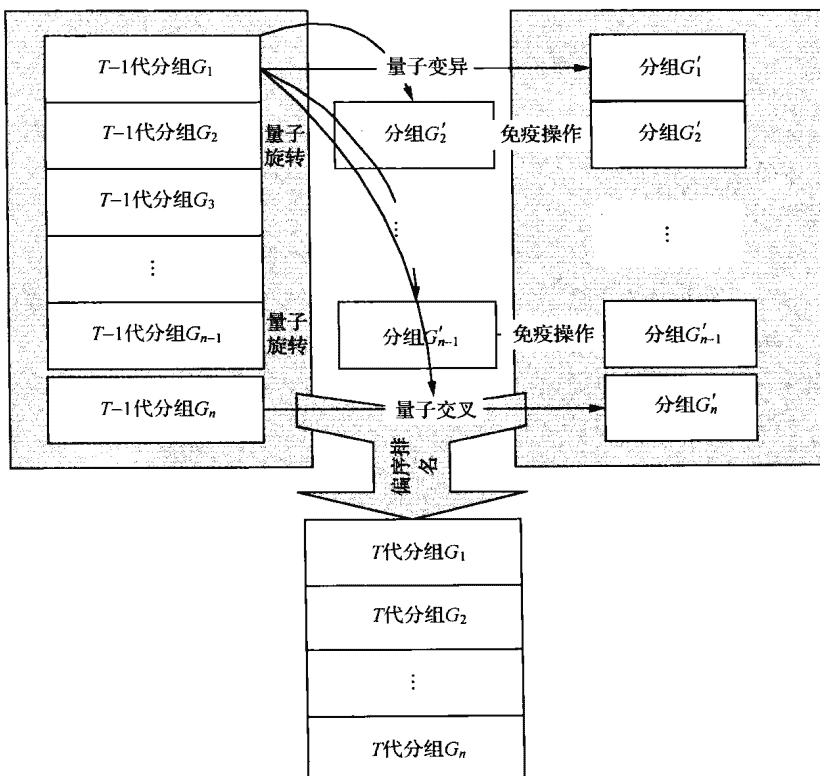
图 4-3 种群分级流程示意

$$S_i = \left| \frac{N-t}{t} \right|, i = 2, \cdots, n-1$$

设种群规模 $N$，$G_1$ 含 $t$ 个体，其余组规模由公式 (4-25) 确定。

$$S_n = N - \sum_{i=1}^{n-1} S_i$$ (4-25)

前 $t$ 个体组精英层 $G_1$（即 $P_l(t)$），中间层 $G_2 \sim G_{n-1}$ 记为 $P_m(t)$，尾部 $P_n(t)$。中间层个体排序为 $i^{th}$ 时，其观测参照为 $G_1$ 中第 $\left| \frac{i-t}{(N-t)/t} \right| + 1$ 个体。

#### 4.3.5 量子旋转门更新

量子染色体经旋转门 $U(\Delta \theta_i)$ 更新（式 4-3），比特更新遵循：

$$\begin{bmatrix} \alpha_i^{'} \\ \beta_i^{'} \end{bmatrix} = \begin{bmatrix} \cos(\theta_i) & -\sin(\theta_i) \\ \sin(\theta_i) & \cos(\theta_i) \end{bmatrix} \begin{bmatrix} \alpha_i \\ \beta_i \end{bmatrix}$$ (4-26)

旋转角 $\theta_i = s(\alpha_i\beta_i)\Delta\theta_i$。其中 $\Delta\theta_i$ 控制收敛速率，$s(\alpha_i\beta_i)$ 决定朝向全局最优的方向，两者查表 4-3 确定。

**表 4-3 旋转角查询表**

| $x_i$ | $b_i$ | $f(x) \ge f(b)$ | $\Delta\theta_i$ | $s(\alpha\beta>0)$ | $s(\alpha\beta<0)$ | $s(\alpha=0)$ | $s(\beta=0)$ |
|---|---|---|---|---|---|---|---|
| 0 | 0 | False | 0 | 0 | 0 | 0 | 0 |
| 0 | 0 | True | 0 | 0 | 0 | 0 | 0 |
| 0 | 1 | False | 0 | 0 | 0 | 0 | 0 |
| 0 | 1 | True | $\delta$ | -1 | +1 | $\pm 1$ | 0 |
| 1 | 0 | False | $\delta$ | -1 | +1 | $\pm 1$ | 0 |
| 1 | 0 | True | $\delta$ | +1 | -1 | 0 | $\pm 1$ |
| 1 | 1 | False | $\delta$ | +1 | -1 | 0 | $\pm 1$ |
| 1 | 1 | True | $\delta$ | +1 | -1 | 0 | $\pm 1$ |

本节将 $\delta$ 设为动态步长因子，采用自适应衰减策略：

$$\delta = \theta_0 \exp\left(1 - \frac{t}{T}\right)\exp\left(\frac{i}{N}\right)$$ (4-27)

式中 $\theta_0$ 为初始角度，$t$ 当代，$T$ 终止代，$i$ 亲和度排名，$N$ 种群规模。

#### 4.3.6 免疫操作引入

进化后期易因盲目随机性导致退化早熟。为抑制此弊端，需提升优良个体占比以稀释劣解负面影响，即利用有效信息引导进化方向。

# 变异策略与实验验证：多目标量子免疫算法深度解析

## 变异机制的三重奏

在算法的进化引擎中，变异操作是维持种群活力、跳出局部最优的关键。本节构建了一套三位一体的变异体系：领衔的是**最优个体角度旋转变异**，辅以**交叉变异**，辅以**个体自身变异**。

具体而言，旋转变异遵循式(4-3)与式(4-26)的数学定义；交叉变异则提供了单点交叉与全交叉两种模式[126]，其独特之处在于同步交换两个个体的二进制位串 $P(t)$ 与对应的观测器 $Q(t)$；而个体自变异采纳了文献[130]的策略——将量子比特的幅角 $t_{ij}$ 置换为 $\pi/2 - t_{ij}$，本质上是实现概率振幅 $\alpha_i$ 与 $\beta_i$ 的互换。

为了动态平衡开发与探索，变异概率 $p_m$ 并非固定不变，而是依据个体排名 $m$、种群规模 $n$ 及决策维度 $l$ 计算得出：$p_m = l^{-(n+1)/(n+m)}$。这种设计巧妙地将单基因变异率锁定在 $[1/l, \sqrt{1/l}]$ 区间，且越是亲和力高（排名靠前）的个体，变异幅度越小，有效保护了精英解。

#### 4.3.7 实战检验：多目标 0/1 背包问题

为验证 CMQEA 的实战表现，选取经典的**多目标 0/1 背包问题**作为测试床。这是一个典型的 NP 完全组合优化难题：给定物品在不同背包中的重量 $w_{i,j}$ 与收益 $p_{i,j}$，以及 $k$ 个背包的容量上限 $c_i$，需寻找一组二进制决策向量 $x \in \{0,1\}^n$，在满足容量约束前提下实现多目标收益最大化。

```
s.t. Max(f(x)= (f_1(x), f_2(x), \cdots, f_n(x)))
```
```
\sum_{j=1}^n w_{i,j} \cdot x_j \leqslant c_i, 1 \leqslant i \leqslant k
```
```
f_i(x) = \sum_{j=1}^n p_{i,j} \cdot x_j
```

求解此类问题有个通用的“先验经验”：装包优先高“性价比”（利润权值比）物品，超重时优先移除低“性价比”物品。这一领域知识被提炼为**免疫疫苗**注入算法：抗体对应候选解（即已知帕累托前沿 $PF_{known}$），抗原对应优化目标与约束（式4-28），抗体-抗原亲和度则量化为候选解与真实前沿 $PF_{true}$ 的偏离度——亲和度越高，偏离越小。

##### 评价体系与参数配置

衡量多目标算法优劣，核心看两点：**收敛性**（逼近真实前沿多近）与**多样性**（解集分布多均匀）。因此引入两大指标：收敛度量 GD[128] 与多样性度量 $\Delta$[122]。因指标受目标函数量纲影响，实验前均进行了归一化处理。

对标算法设为 NSGA-II 与 QIEA。测试集采用文献[131]标准数据，涵盖 100、250、500 三种背包规模。CMQEA 配置：总种群 100，$G_1$ 精英子群 10。NSGA-II 配置：种群 100，锦标赛选择，单点/位交叉，交叉率 0.9，变异率 $1/l$。统计节点设在 25,000 与 50,000 次函数评估时刻。

##### 结果对决：数据不说谎

鉴于启发式算法的随机性，实验采用 50 次独立运行取 GD 最优值作图（图 4-4、4-5 针对 250/500 背包、25000 次评估）。直观曲线显示：**同等计算预算下，CMQEA 收敛曲线显著优于 NSGA-II**。

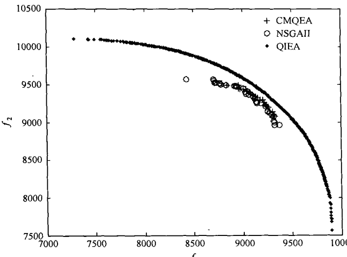
**图 4-4 250 背包问题性能对比**
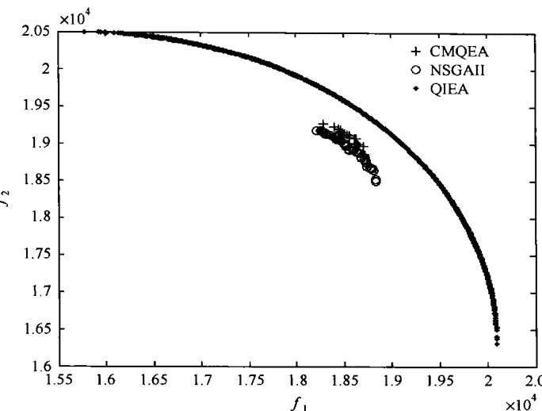
**图 4-5 500 背包问题性能对比**

量化统计见表 4-4 与 4-5（灰底标优）。结论明确：除 100 背包/25000 评估这一工况外，**CMQEA 在收敛精度（GD）与分布均匀度（$\Delta$）上全面超越对手**，且优势随问题规模扩大、评估次数增加而扩大。

**表 4-4 GD 指标均值±标准差**

| 背包数 | 评估次数 | NSGAII | QIEA | CMQEA |
|---|---|---|---|---|
| 100 | 25000 | $4.11\times 10^{-3}\pm 7.9\times 10^{-4}$ | $4.29\times 10^{-3}\pm 1.9\times 10^{-3}$ | $4.22\times 10^{-3}\pm 1.1\times 10^{-3}$ |
| 100 | 50000 | $2.62\times 10^{-3}\pm 8.0\times 10^{-4}$ | $2.48\times 10^{-3}\pm 1.3\times 10^{-3}$ | **$2.19\times 10^{-3}\pm 7.2\times 10^{-4}$** |
| 250 | 25000 | $9.82\times 10^{-3}\pm 1.4\times 10^{-3}$ | $1.30\times 10^{-2}\pm 2.7\times 10^{-3}$ | **$9.42\times 10^{-3}\pm 1.4\times 10^{-3}$** |
| 250 | 50000 | $6.17\times 10^{-3}\pm 9.9\times 10^{-4}$ | $6.10\times 10^{-3}\pm 2.1\times 10^{-3}$ | **$5.67\times 10^{-3}\pm 9.5\times 10^{-4}$** |
| 500 | 25000 | $1.71\times 10^{-2}\pm 2.0\times 10^{-3}$ | $2.21\times 10^{-2}\pm 5.7\times 10^{-3}$ | **$1.57\times 10^{-2}\pm 2.1\times 10^{-3}$** |
| 500 | 50000 | $9.71\times 10^{-3}\pm 1.5\times 10^{-3}$ | $1.30\times 10^{-2}\pm 2.7\times 10^{-3}$ | **$8.45\times 10^{-3}\pm 1.4\times 10^{-3}$** |

**表 4-5 $\Delta$ 指标均值±标准差**

| 背包数 | 评估次数 | NSGAII | QIEA | CMQEA |
|---|---|---|---|---|
| 100 | 25000 | $7.72\times 10^{-1}\pm 4.9\times 10^{-2}$ | $7.82\times 10^{-1}\pm 5.0\times 10^{-2}$ | $7.84\times 10^{-1}\pm 4.5\times 10^{-2}$ |
| 100 | 50000 | $7.48\times 10^{-1}\pm 5.1\times 10^{-2}$ | $8.35\times 10^{-1}\pm 3.7\times 10^{-2}$ | **$7.41\times 10^{-1}\pm 4.5\times 10^{-2}$** |
| 250 | 25000 | $9.04\times 10^{-1}\pm 2.5\times 10^{-2}$ | $9.39\times 10^{-1}\pm 2.2\times 10^{-2}$ | **$9.03\times 10^{-1}\pm 1.9\times 10^{-2}$** |
| 250 | 50000 | $8.80\times 10^{-1}\pm 2.6\times 10^{-2}$ | $9.43\times 10^{-1}\pm 1.8\times 10^{-2}$ | **$8.71\times 10^{-1}\pm 1.7\times 10^{-2}$** |
| 500 | 25000 | $9.38\times 10^{-1}\pm 1.3\times 10^{-2}$ | $9.62\times 10^{-1}\pm 1.2\times 10^{-2}$ | **$9.30\times 10^{-1}\pm 1.6\times 10^{-2}$** |
| 500 | 50000 | $9.30\times 10^{-1}\pm 1.6\times 10^{-2}$ | $9.63\times 10^{-1}\pm 1.1\times 10^{-2}$ | **$9.24\times 10^{-1}\pm 1.4\times 10^{-2}$** |

**机理复盘**：算法借偏序排名量化适应度，以分群策略替代传统 QEA 的局部-全局迁移。精英群 $G_1$ 锁定进化方向保收敛；中间层 $G_2 \sim G_{n-1}$ 通过多观测器生成子代、精英互交及精英与最差个体全交叉，拓展未搜区域保多样性。这种分工协作，精准契合了多目标优化的双重需求。

### 4.4 章节总结与展望

本章核心贡献可概括为三层递进：

1.  **QIA 框架奠基**：融合量子比特编码与免疫机制，构建量子免疫算子与双轨变异——量子抗体变异提速收敛，普通抗体变异破除早熟。理论证明全局收敛性，多模态函数实验确证“快、准、稳”。
2.  **CMQEA 破局多目标**：针对传统 QEA 求解 MOP 乏力，创设亲和度偏序排序与分级变异策略。实验证实其在二维背包测试集上实现**局部-全局搜索有机融合、多样性自维持**，是高效稳健的求解器。
3.  **未来蓝图**：如何泛化至高维 MOP？如何构建更全面的 MOP 算法评价体系？将是后续攻关重点。

---

# 第 5 章 矢量距免疫网络聚类算法（VD-AiNet）

### 5.1 破题：从“阈值困境”走向“自适应进化”

de Castro 团队的 **AiNet**[33] 是人工免疫网络的里程碑，凭借克隆抑制与网络抑制双重机制，在数据压缩、结构刻画、形状捕捉上表现卓越。然而，**抑制阈值 $t_s$ 如同达摩克利斯之剑**：过小则冗余难除、压缩率低；过大则特征丢失、多样性崩塌、陷入局部最优。更棘手的是，缺乏统一理论指导，$t_s$ 只能凭经验反复试错，主观性强、计算成本高。

本章提出 **VD-AiNet（Vector Distance AiNet）**，核心创新在于：
- 引入**矢量距**量化抗体浓度，建立**促进-抑制双驱动机制**；
- 同步鼓励高适应度抗体、约束高浓度抗体；
- **弱化甚至消除对敏感阈值 $t_s$ 的依赖**，降低计算开销、加速收敛、剔除人为干扰。

### 5.2 AiNet 复盘：经典与痛点并存

#### 5.2.1 算法回溯

AiNet 模糊 B 细胞与抗体界限，以统计推演模拟克隆选择。流程浓缩为：
1.  抗原（数据集）驱动，随机生成抗体库，筛选高亲和力 Top-$n$。
2.  **克隆扩增**：亲和力越高，克隆数越多，形成集合 $D$。
3.  **亲和力成熟**：$D \to D^*$，变异公式 $C = C - a(C - X)$（式5-1），亲和力越高变异率越低。
4.  评估 $D^*$ 抗原亲和力，高比例精英入**克隆记忆集**。
5.  **克隆抑制**：记忆集内相似度清洗。
6.  合并至**总记忆库**。
7.  **网络抑制**：全局相似度再清洗。
8.  免疫网络成型。
9.  终止：抗体数达标或迭代上限。

优势显著：压缩率高、结构保真、距离度量可切换（欧氏/汉明适配数值/符号属性）、天然并行、收敛快、易实现。已广泛落地压缩与聚类[13,28,133-135]。

#### 5.2.2 痛点实证：阈值敏感性实测

固定参数（$N_c=10, n=4, gen=10, t_p=0.2, q_i=0.2, m=0.4$），仅在 $[0, 0.2]$ 区间扰动 $t_s$，网络拓扑剧变（见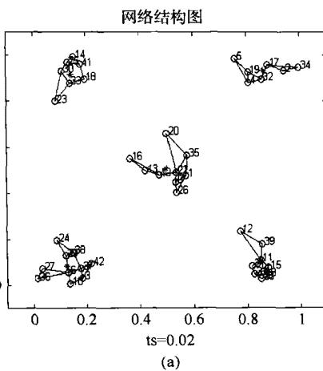-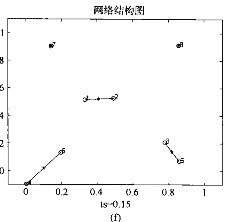对应图 5-1(a)–(f)）。

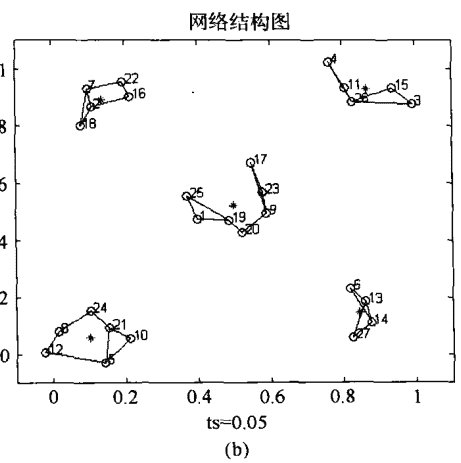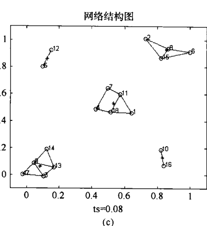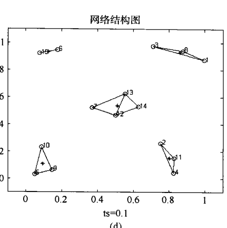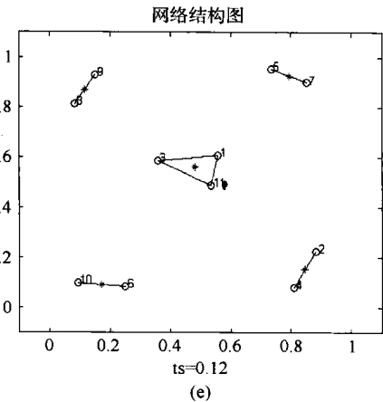
**图 5-1 不同阈值 $t_s$ 下的网络结构演变**

观测揭示残酷真相：
- **$t_s$ 偏小（a,b）**：抑制失效，冗余泛滥，压缩比极低；
- **$t_s$ 偏大（e,f）**：过度清洗，特征缺失，多样性坍缩，陷入少数高适应度陷阱；
- **无黄金法则**：不同问题需不同 $t_s$，无理论自适应方法，仅靠经验/试错。

**结论**：$t_s$ 是 AiNet 的阿喀琉斯之踝，严重制约鲁棒性与自动化程度。

### 5.3 VD-AiNet：矢量距重构浓度评估

#### 5.3.1 改进内核：促抑机制与矢量距定义

保留 AiNet 框架，植入**抗体促进-抑制机制**：以**矢量距**为尺度评估浓度，高适应度者受促，高浓度者受抑，天然平衡收敛与多样性，淡化 $t_s$ 作用。

为何选矢量距？传统欧氏/曼哈顿/汉明距离深受编码束缚（如二进制空间的汉明悬崖）；信息熵虽可行但计算繁复、参数依赖经验、冗余拖慢收敛[107]。

**矢量距定义**：
将抗原映射为聚类目标函数，抗体 $C_i$ 为优化解，适应度 $f(C_i)$。$N$ 个抗体构成免疫系统 $X$。抗体 $C_i$ 的矢量距为其与全体适应度差绝对值之和：

$$ S(C_i) = \sum_{j=1}^{N} | f(C_i) - f(C_j) | \qquad (5-2) $$

**浓度反比于矢量距**：

$$ \text{Density}(C_i) = \frac{1}{S(C_i)} = \frac{1}{\sum_{j=1}^{N} | f(C_i) - f(C_j) |} \qquad (5-3) $$

物理意义直观：适应度独特（远离他人）者矢量距大、浓度低、受抑制弱、易生存；适应度聚堆者浓度高、受抑制强、被稀释。这天然规避了编码依赖与参数敏感，为 VD-AiNet 的自适应进化奠基。

### 5.3.2 算法流程设计

VD-AiNet 的核心创新在于引入了**基于矢量距离的抗体促进与抑制机制**。简单说，抗原与抗体、抗体与抗体之间的亲和力全凭矢量距离定夺：距离越远，适应度越低。完整流程如下：

**算法输入**：待聚类数据集 $X$ 及参数 $a,\beta,t_s,\sigma_s$。  
**算法输出**：抗体集合 $N$，即数据集 $X$ 的一组可行解。

1.  **问题建模**：剖析问题特性，设定参数与终止条件，设计解的编码表达方式。
2.  **初始化种群**：若记忆库有存货，提取 $M$ 个个体并随机生成剩余 $N-M$ 个组成初始子代 $C_0$；否则全随机生成 $N$ 个个体构成 $C_0$。
3.  **终止判断**：满足条件则结束，否则进入步骤 4。
4.  **核心循环**（针对当前种群 $C_{k-1}$，对每个抗原 $Ag_i$ 执行）：
    *   **4.1 亲和力计算**：按距离度量算出 $Ag_i$ 与 $C_{k-1}$ 中所有抗体的亲和力 $d_{ij}$。
    *   **4.2 优选抗体**：依据式(5-4)算出选择率 $p_i$，挑选亲和力最高的 $n$ 个抗体。
    *   **4.3 克隆扩增**：对入选的 $n$ 个抗体克隆，适应度越高，克隆数 $N_c$ 越大。
    *   **4.4 变异操作**：用式(5-1)对 $N_c$ 个克隆体变异，生成新种群 $C_k$。
    *   **4.5 抗原植入**：将 $Ag_i$ 直接插入 $C_k$，确保抗体集能覆盖全抗原分布。
    *   **4.6 相似度矩阵**：计算改进后抗体的 $D$ 矩阵（Ag-Ab 相似性）。
    *   **4.7 建立记忆库**：按 $\xi\%$ 比例保留高亲和力抗体，形成部分记忆矩阵 $M_p$。
    *   **4.8 自然死亡**：清除亲和力低于 $\sigma_d$ 的抗体，进一步压缩 $M_p$。
    *   **4.9 抗体互识**：计算抗体间亲和力 $s_{ij}$（Ab-Ab 相似性）。
    *   **4.10 克隆抑制**：清除 $s_{ij} < t_s$ 的抗体（保留先进入者，即 $i<j$ 且距离 $<t_s$ 时删 $Ab_j$）。
    *   **4.11 种群融合**：合并 $C_k$ 与 $M_p$（$C_k \leftarrow [C_k : M_p]$）。
5.  **网络抑制**：确定 $S$ 矩阵，清除 $s_{ij} < \sigma_s$ 的抗体。
6.  **鲜血注入**：替换掉最差的 $r\%$ 抗体，维持多样性。
7.  **回溯迭代**：跳转步骤 3。

**关键符号速查**：
$X \in \mathbf{R}^p$ 为 $P$ 维数据集；$C_k \in \mathbf{R}^{M \times p}$ 为全抗体矩阵；$M \subseteq C_k$ 为记忆抗体矩阵；$N_c$ 为单抗体克隆数；$D$ 为 Ag-Ab 相似性矩阵；$S$ 为 Ab-Ab 相似性矩阵；$n$ 为克隆选择数；$\xi$ 为成熟抗体保留比例；$\sigma_s, t_s$ 分别为自然死亡与抑制阈值。

---

### 5.3.3 终止条件判据

算法何时停下脚步？关键看**模型是否收敛**。提供四种实用判据，任一满足即停：
1.  **步数上限**：跑完预设迭代数。
2.  **规模上限**：网络抗体数达标。
3.  **精度达标**：抗原与网络 $N$ 的误差低于阈值。
4.  **震荡发散**：连续 $k$ 代平均误差反而上升。

---

### 5.3.4 改进点深度解析

相较原版 AiNet，VD-AiNet 做了三把“手术”：

1.  **选育机制重构（步骤 4.2）**：引入矢量距离选择法，**“高适应度 + 低浓度”** 双重加持，让优质且稀缺的抗体更易留存下一代，从源头守住多样性。
2.  **抗原植入策略（新增步骤 4.5）**：每轮抗原作用时，同特征抗体强制入池 $C_k$。这一招直接解决“抗体分布难覆盖抗原全貌”的痛点。
3.  **克隆抑制先来后到（步骤 4.10）**：抑制时遇同类项（$i<j$ 且距离 $<t_s$），**直接干掉后到者 $Ab_j$**。避免了随机删除导致的优质抗体流失，稳住了收敛方向。

---

### 5.4 实战仿真：数据说话

#### 5.4.1 评估体系

沿用遗传算法经典范式，采用**在线/离线双维考核**：

*   **在线法**$$V^{\text{on-line}}(S) = \frac{1}{T} \sum_{t=1}^{T} v(t)$$ \quad (5-5)  
    追踪全过程抗体目标值均值 $v(t)$，看进化趋势。最大化问题下，曲线虽波动但总体应**上扬**，反映动态搜索能力。
*   **离线法**$$V^{\text{off-line}}(S) = \frac{1}{T} \sum_{t=1}^{T} v^*(t)$$ \quad (5-6)  
    盯着历代最优值 $v^*(t)$，曲线必须**单调上升**，考验收敛保优能力。  
    等价理解$$v^* = \max_{i \in \text{pop}(t)} \{v(i)\}$$ \quad (5-7)  
    即第 $t$ 代当下的最优值，便于逐代对比改进幅度。

实验数据引用文献[33]，旨在通过参数扫描，实锤 VD-AiNet 优于 AiNet。

#### 5.4.2 收敛性 PK 赛

**设定**：$n=4, gen=100, m=20, t_s=0.1, N_c=10$。用在线法看平均适应度（即抗体群与抗原平均距离），独立跑 16 次。  
**结果**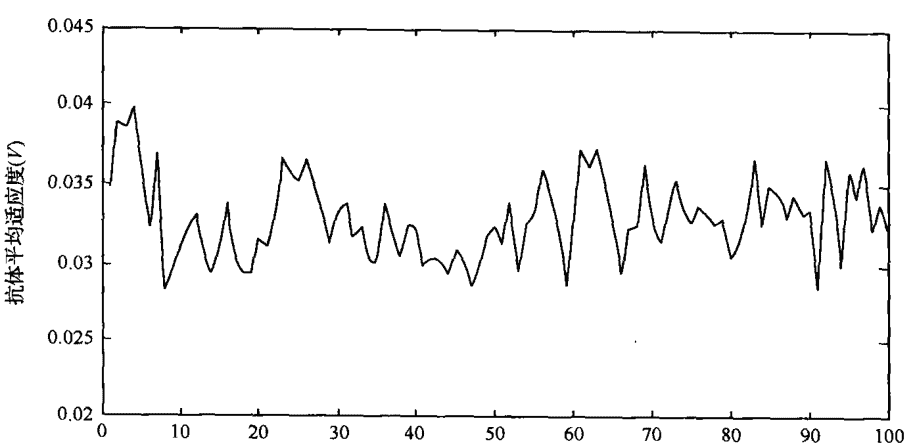 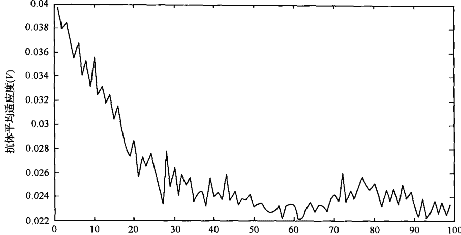 及 **表 5-1** 显示：

| 对比项 | AiNet 表现 | VD-AiNet 表现 | 结论 |
| :--- | :--- | :--- | :--- |
| **适应度曲线** | 震荡在 0.035 附近，不收敛 | 稳步下探至 0.022 震荡，振幅小、**收敛快** | 改进有效 |
| **Net size** | 21~25 个 | **15~16 个** | **冗余度大幅降低** |
| **聚类准确率** | 72%~85% | **95%~100%** | **精度质变** |

**核心结论**：矢量距离促抑机制 = **提适应度 + 高准确率 + 低冗余 + 快收敛**，且生成抗体集能真实反映数据结构。

#### 5.4.3 抑制阈值 $t_s$ 敏感度测试

固定 $n=4, gen=10, m=20, N_c=10$，扫描 $t_s$ 从 0.3 降至 0.06。  
**表 5-2** 与 **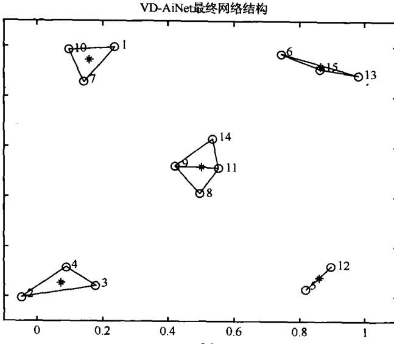 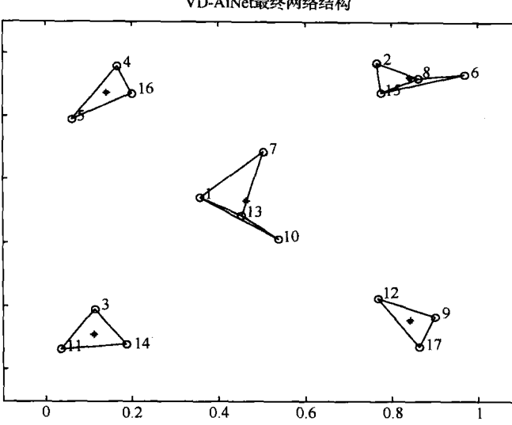** 揭示关键差异：

*   **AiNet**：$t_s$ 微调，网络规模剧烈跳动（如 $t_s=0.07$ 时规模 18~33，**极不稳定**）。
*   **VD-AiNet**：全区间规模**紧锁在 15~24 之间**，波动极小。

**实锤**：引入矢量距离机制后，**多样性有保障，对 $t_s$ 敏感度骤降，稳定性大增，聚类效果稳得住**。两张网络结构图（$t_s=0.2$ vs $0.07$）直观印证：VD-AiNet 结构稳健，改进实打实。

---

### 5.5 本章小结

AiNet 最大阿喀琉斯之踵：**$t_s$ 敏感得像裸露神经**，无统一调参理论，全靠经验拍脑袋或反复试错，主观随意性太强。

VD-AiNet 亮出**“矢量距离选择 + 促抑机制”**组合拳：
1.  **限高浓**：防优势抗体霸屏；
2.  **增多样**：让种群基因库丰富；
3.  **去敏感**：大幅削弱 $t_s$ 干扰；
4.  **强全局 + 快收敛**；  
5.  **去人为**：少拍脑袋，多靠数据。

---

## 第 6 章 目标进化免疫网络聚类算法（OE-AiNet）

### 6.1 破局引言

AiNet 除 $t_s$ 敏感外，还有一**结构性硬伤**：**缺乏显式目标函数**。  
它仅靠 Ag-Ab 亲和力搞“类梯度局部搜索”，导致记忆网络**动态无序、收敛无门、甚至进化退化**。

本章直击痛点：  
**以“矢量数据压缩评价”为锚，定义进化全局目标**，提出 **OE-AiNet（Objective Evolution AiNet）**。  
核心价值：  
✅ **强制朝最优方向进化**，拿到压缩质量更高的记忆网络；  
✅ **顺带缓解 $\sigma_s$ 参数敏感性**，一箭双雕。

### 6.2 目标导向进化的 OE-AiNet 算法

#### 6.2.1 进化目标的量化建模

免疫压缩的核心意图，在于构建一张能精准映射样本空间拓扑分布的记忆网络，这实质上是特征保留与数据精简之间的博弈。本节引入矢量数据压缩的质量评价体系[136]，为记忆网络确立了整体优化目标与约束边界。

**核心概念重构**

*   **抗原-抗体识别机制**：给定抗原 $x$ 与记忆网络 $M = \{a_1, a_2, ..., a_k\}$。若网络中存在抗体 $a_i$ 使得其与 $x$ 的距离 $\| x - a_i \|$ 为全局最小，且该距离严格小于识别阈值 $\sigma_s$，则判定 $x$ 被 $a_i$ 识别。该距离即为识别距离，记作 $DI(x, M)$。若 $x$ 能被网络中任一节点覆盖，则称网络 $M$ 识别该抗原，反之则未被识别。
*   **识别覆盖率 ($p_i$)**：针对抗原集 $X = \{x_1, ..., x_n\}$ 与网络 $M$，若 $n_i$ 为被 $M$ 覆盖的抗原数量，则 $p_i(X, M) = (n_i/n) \times 100\%$ (6-1)。
*   **网络精简率 ($p_r$)**：抗原集 $X$ 经压缩生成规模为 $k$ 的网络 $M$，精简率定义为 $p_r(X,M) = \frac{n-k}{n} \times 100\%$ (6-2)。
*   **累积匹配偏差 ($E_l$)**：反映网络对抗原集整体拟合精度的指标，$E_l(X,M) = \sum_{i=1}^{n} DI(x_i, M)$ (6-3)。

**指标优先级与多目标规划模型**

网络优劣由三指标共同裁决，重要性依次为：**识别覆盖率 $p_i$（越大越优） > 累积匹配偏差 $E_l$（越小越优） > 网络精简率 $p_r$（越大越优）**。将识别阈值 $\sigma_s$ 设为硬性约束，免疫压缩问题可形式化为如下多目标优化模型：

$$
\text{Obj} = \begin{cases} \max(p_i(X,M)) \\ \min(E_l(X,M)) \\ \max(p_r(X,M)) \end{cases} \quad \text{s.t. } DI(x,M) \leqslant \sigma_s \tag{6-4}
$$

#### 6.2.2 目标驱动的迭代演进流程

基于模型 (6-4) 对记忆网络 $M$ 实施质量评估，并在迭代中固化最优网络，使 $M$ 始终沿最优方向演进，从而根治原版 AiNet 中记忆网络动态漂移无序、学习过程易退化的顽疾。同时，引入基于单节点局部目标的疫苗注射机制，显著加速收敛。

**OE-AiNet 新增核心参数**

*   $p_i, E_l, p_r$：网络 $M$ 的三维质量评价指标；
*   $M_m$：历史存档的最优记忆网络；
*   $p_{im}, E_{lm}, p_{rm}$：$M_m$ 对应的指标值，初始化为 $0, \infty, 0$；
*   $\sigma_t$：稀疏噪声过滤阈值（禁忌克隆阈值）。

**算法主流程（输入：抗原集 $X$；输出：记忆网络 $M$ 及距离矩阵 $S$）**

1.  **初始化阶段**：随机生成抗体种群 $A$，设定 $\sigma_s, \xi, n, \sigma_d$ 等控制参数。
2.  **核心迭代循环**：
    2.1 重置当前记忆网络 $M = \emptyset$。  
    2.2 **遍历抗原集 $X$ 中每个 $Ag$**：  
        &nbsp;&nbsp;① 计算 Ab-Ag 距离矩阵 $D$；  
        &nbsp;&nbsp;② 选取亲和度最高的 $n$ 个抗体作为种子；  
        &nbsp;&nbsp;③ **克隆扩增**：亲和度越高，克隆数 $N_c$ 越大；  
        &nbsp;&nbsp;④ 按式(5-1)对 $N_c$ 个克隆体实施扰动变异；  
        &nbsp;&nbsp;⑤ 计算变异体与抗原的距离；  
        &nbsp;&nbsp;⑥ 从变异体中筛选 $\xi$ 个高亲和度抗体，组建**局部记忆网络 $M_p$**；  
        &nbsp;&nbsp;⑦ 清洗 $M_p$：移除 $d_{ij} > \sigma_d$ 的节点；  
        &nbsp;&nbsp;⑧ 计算 $M_p$ 内部 Ab-Ab 距离 $s_{ij}$；  
        &nbsp;&nbsp;⑨ **克隆抑制**：剔除 $s_{ij} < \sigma_s$ 的冗余节点；  
        &nbsp;&nbsp;⑩ 合并更新：$M = [M; M_p]$。  
    2.3 **稀疏噪声过滤（可选）**[137]：计算 $M$ 内部距离，剔除邻近节点数少于 $\sigma_t$ 的“孤立”节点。此步旨在抑制稀疏抗原干扰，效果类似密度聚类。  
    2.4 **全局去冗余**：再次清理 $M$ 中 $s_{ij} < \sigma_s$ 的节点。  
    2.5 **多维指标评估**：依据式(6-1)～(6-3)计算 $p_i, p_r, E_l$。  
    2.6 **疫苗合成**：基于 $M$ 中各节点识别的抗原子集，遵循 $\min(E_l(X, M))$ 原则生成疫苗网络 $M'$。  
    2.7 **精英存档与回溯（核心创新）**：按式(6-4)优先级对比当前 $M$ 与历史最优 $M_m$。若 $M$ 更优，则更新 $M_m$ 及其指标；否则**回滚** $M = M_m$。该机制锚定演进方向，消除网络无序波动。  
    2.8 **新一代种群生成**：随机生成新抗体网络 $A$，融合 $M$ 与疫苗 $M'$ 形成新种群 $A = [A; M; M']$。  
3.  **收敛停止条件**：连续 $n$ 次迭代 $M_m$ 未更新，判定收敛，结束计算。

> **流程解析**：步骤 2.5～2.7 为相对 AiNet 的创新点。精英回溯机制（步骤 2.7）配合明确评价指标（步骤 2.5），强制网络按预设目标演进；步骤 3 的“连续不变”终止条件，比固定迭代次数更科学、更自适应。

#### 6.2.3 疫苗机制：几何视角的局部最优近似

步骤 2.6 在网络评估基础上提炼疫苗。设抗体 $a_k \in M$ 识别的抗原子集为 $X_k = \{x_1, ..., x_j\}$，其局部累积偏差为：
$$E_l(X_k, a_k) = \sum_{i=1}^{j} DI(x_i, a_k) \tag{6-5}$$

若能寻得新抗体 $a'_k$ 使得：
$$E_l(X_k, a'_k) < E_l(X_k, a_k) \tag{6-6}$$
则 $a'_k$ 在局部视野优于 $a_k$。若对所有抗体均完成此类升级形成 $M'$，则必满足：
$$\begin{cases} p_i(X, M') \geqslant p_i(X, M) \\ E_l(X, M') < E_l(X, M) \\ p_r(X, M') \geqslant p_r(X, M) \end{cases} \tag{6-7}$$
忽略压缩约束下，$M'$ 整体优于 $M$，故可作为疫苗注入种群 $A$。

**几何拓扑下的疫苗构造**

将 $X_k$ 视为多维空间多边形 $S$ 的顶点集，理论最优抗体 $a'$ 即为使 $E_l(X_k, a')$ 最小化的**费马点**[138]。但高维费马点求解属非线性难题，难以直接提取。本文采用工程近似：**取抗原子集 $X_k$ 顶点坐标的质心作为新抗体**，即：
$$a'_k = \overline{X} \tag{6-8}$$
步骤 2.6 对 $M$ 中每个节点执行此操作生成 $M'$，步骤 2.8 将 $M'$ 注入抗体种群 $A$，完成知识引导式的演进加速。

#### 6.2.4 复杂度权衡：微增开销换极速收敛

设抗体种群规模 $N_A$，抗原集规模 $n$，记忆网络规模 $k$，迭代次数 $l$。

*   **AiNet 单轮开销**：$O(n \times (N_A + N_c + \xi^2) + k^2)$，总计 $O(l \times [\dots])$。
*   **OE-AiNet 新增开销**：主要集中在步骤 2.5（评估，$O(n \times k)$）与步骤 2.6（疫苗，$O(k)$）。因 $n \gg k$，疫苗开销可忽略。
*   **OE-AiNet 总复杂度**：$O(l \times (n \times (N_A + N_c + \xi^2)) + k^2 + n \times k)$。

**结论**：由于 $(N_A + N_c + \xi^2) \gg k$，OE-AiNet 并未显著增加单轮计算量。更关键的是，得益于明确的收敛判据，**实际迭代次数 $l$ 往往少于 AiNet，综合训练时间反而可能缩短**。

#### 6.2.5 聚类解析：从特征网络到样本归属

免疫压缩输出的记忆网络 $M$ 规模远小于原始样本，是样本空间特征的“浓缩胶囊”。聚类分析由此转化为对 $M$ 的分簇，大幅降低问题复杂度。

**定义 6-5 最小生成树 (MST)**  
连通图 $G$ 的生成树中，边权之和最小者为 MST。

**聚类四步走**

1.  **构建 MST**：利用 $M$ 及亲和力矩阵 $S$ 生成最小生成树。  
2.  **剪枝分簇**：两种策略——  
    &nbsp;&nbsp;① **阈值法**：切除权值 $> \lambda \sigma_s$ 的边（$\lambda \in [2.5, 3.5]$）；  
    &nbsp;&nbsp;② **指数法**：若已知簇数 $k$，按权值降序切除前 $k$ 条边。  
3.  **抗体成簇**：剪枝后的森林中，每棵子树对应一个抗体簇，簇集记为 $C = \{c_1, ..., c_k\}$。  
4.  **样本映射/在线分簇**：  
    &nbsp;&nbsp;- **球形分布**：簇均值作为中心。  
    &nbsp;&nbsp;- **非线性分布**：样本 $x$ 归属亲和力最大的抗体 $a_i$ 所在簇 $c_k$（式 6-9）。  
    &nbsp;&nbsp;- **启用稀疏过滤时**：引入聚类阈值 $\lambda_c \sigma_s$ ($\lambda_c \in [2.0, 3.0]$)，仅当 $\|x - a_i\| \leqslant \lambda_c \sigma_s$ 时纳入簇内（式 6-10），否则判为异常点，**实现类密度聚类的剔噪效果**。

**关键参数 $\sigma_s$ 的自适应选取指南**

$\sigma_s$ 决定抗体特异性，深刻影响分簇结果。理论分析表明：簇内相邻抗体距离 $d_{ab} \in [\sigma_s, 2\sigma_s]$，簇间最小样本距离为 $d_n$。正确分簇需满足 $2\sigma_s < d_n$，即 $\sigma_s < d_n/2$。  
**实操建议**：  
1.  初始设 $\sigma_s$ 极小（如 $\le 0.001$）；  
2.  运行算法生成 MST，统计边长分布绘制直方图；  
3.  观察直方图中明显“凸起”的长边——即跨簇连接边；  
4.  取最小凸边长度作为 $d_n$ 估值，最终设 $\sigma_s \approx d_n/3$（略小于 $d_n/2$ 以保安全边际）。

---

### 6.3 实证对比：双轨验证 OE-AiNet 优势

本节通过球形簇（中心聚类）与双螺旋线（非线性流形）两大典型场景，从压缩质量与聚类质量双维度，全方位对比 AiNet 与 OE-AiNet。

#### 6.3.1 球形簇验证：精度与鲁棒性的双重跃升

**实验配置**  
数据集：50 个二维样本，5 个簇，每簇 10 点，簇间间隙明显。  
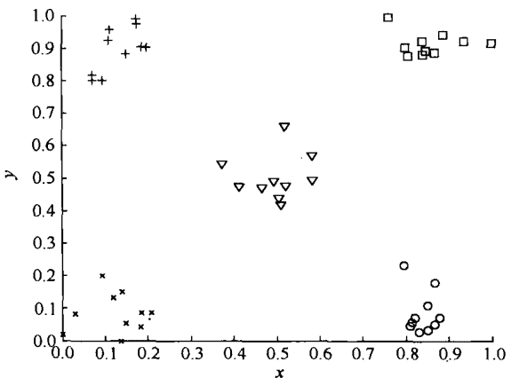  
*图 6-1 中心聚类样本分布*  

参数设定：$\sigma_s = 0.1, \lambda = 3, \text{迭代轮次} = 10$。  
评价指标：**类散布矩阵迹** $C(W, P)$（式 6-11），值越小表示聚类越紧凑。  
$$C(W, P) = \sum_{i=1}^k \sum_{j=1}^n w_{ij} d(x_j, p_i) \tag{6-11}$$
其中 $W$ 为划分矩阵，$P$ 为中心集，$w_{ij}$ 为隶属指示。

**对比结果（20 次独立重复实验）**  

| 算法 | 平均类散布迹 | 标准差 |
| :--- | :---: | :---: |
| **OE-AiNet** | **4.1420** | **0.0552** |
| AiNet | 4.2575 | 0.1410 |

**结论**：OE-AiNet 在**平均聚类紧凑度**（均值更低）与**鲁棒稳定性**（方差更小，波动幅度降低 60%+）上均显著优于 AiNet。

**网络形态直观对比**  
抽取单次实验结果叠加显示：  
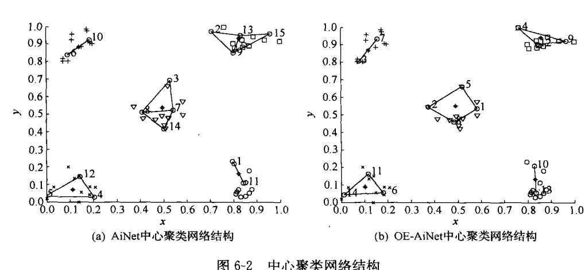  
OE-AiNet 生成的记忆网络**紧贴样本分布轮廓**，边界清晰；AiNet 网络在右下角簇出现**明显偏离与变形**。

**根因深度剖析**  
*   **AiNet 痛点**：缺乏全局目标评价，记忆网络随抗原呈现顺序随机漂移，呈“近视效应” —— 偏向最近刺激的抗原，且演进中易退化。  
*   **OE-AiNet 破局**：确立全局演进目标 + 精英存档机制，锚定最优网络；评价函数直接关联“网络-样本贴合度”；疫苗注射提供梯度修正方向。三管齐下，保证网络高保真还原样本拓扑。

#### 6.3.2 非线性流形挑战：参数鲁棒与压缩效能的突围

**实验配置**  
数据集：190 点二维双螺旋线，正确分簇为两螺旋线各自成类。  
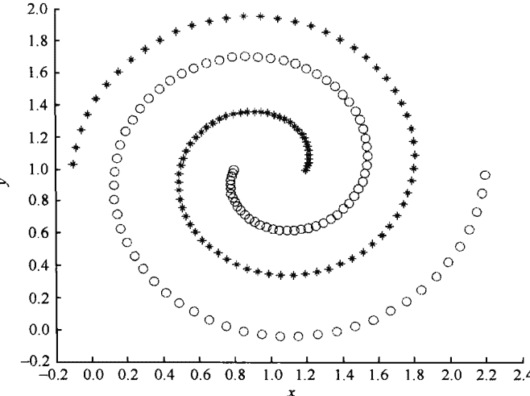  
*图 6-3 双螺旋线样本*  

核心考察：$\sigma_s$ 敏感性测试。取值集 $\{0.06, 0.07, ..., 0.12\}$，每参数 20 次实验，统计**聚类正确率 $p_c$** 与**平均压缩率 $p_r$**，结果如图 6-4 所示。实验表明 OE-AiNet 在宽阔的参数区间内维持高正确率且曲线平坦，压缩率更高，展现出对复杂非线性分布的强泛化建模能力。

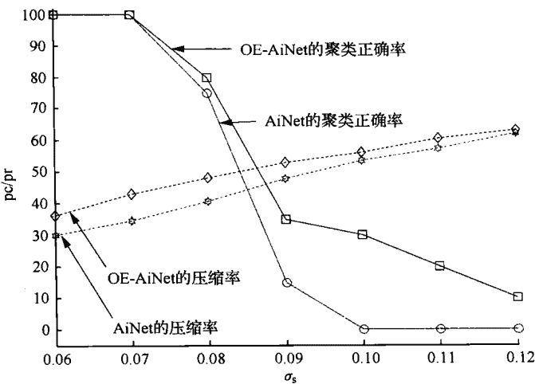

**图 6-4 pc/pr 随 σs 变化的趋势图**

观察图 6-4 可知，随着 σs 数值上升，AiNet 与 OE-AiNet 两款算法的聚类准确率 pc 均呈下降趋势。当 σs ≤ 0.07 时，二者均能精准完成聚类任务；一旦 σs ≥ 0.07，AiNet 的正确率下降斜率显著大于 OE-AiNet；至 σs ≥ 0.1 时，AiNet 已基本丧失正常聚类能力。这直观地说明，AiNet 的聚类表现对参数 σs 的波动高度敏感。对比压缩率 pr 曲线发现，同一 σs 下，AiNet 的压缩率始终低于 OE-AiNet。以两者均达 100% 聚类精度的 σs = 0.07 为例，AiNet 压缩率仅 34.58%，而 OE-AiNet 达到 43.00%，前者低 8.42 个百分点。数据表明，OE-AiNet 在特征压缩效能上具有显著优势。

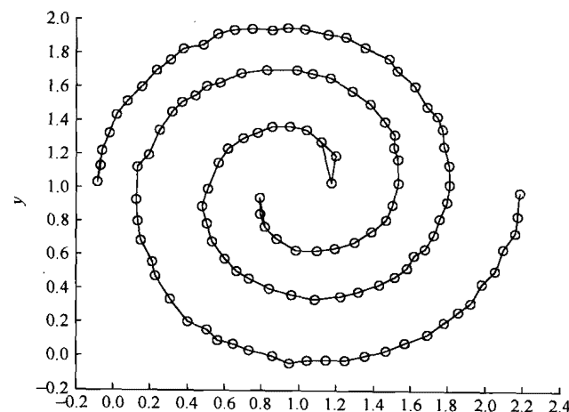

(a) AiNet 双螺旋线聚类拓扑结构

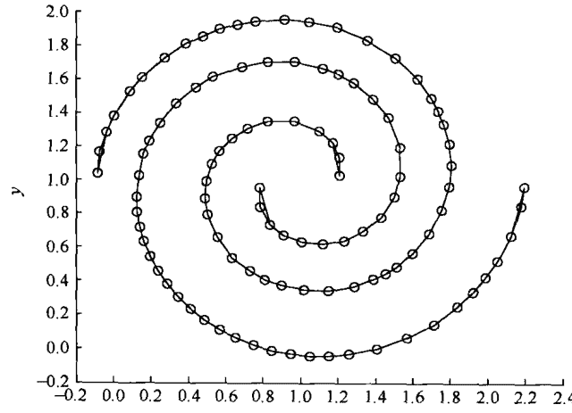

(b) OE-AiNet 双螺旋线聚类拓扑结构

**图 6-5 双螺旋线聚类网络拓扑对比**

深入剖析两算法对 σs 的敏感度差异，关键在于两个距离指标：异簇抗体间的最小距离 dn 与同簇抗体间的最大距离 dx。若 dx 超过 dn，必引发簇划分错误。AiNet 因记忆网络随机漂移，易产生偢离样本空间的抗体，导致 dn 缩减、同簇抗体分布离散致使 dx 膨胀，且 dx 与 σs 正相关，故而对 σs 异常敏感。反之，OE-AiNet 构建的记忆网络更贴合样本特征，赋予了 σs 更宽泛的容忍区间。

在 σs = 0.07 时提取两算法学习到的网络拓扑（见图 6-5），对比样本原型形状可见，OE-AiNet 重构的结构轮廓与样本分布高度吻合，远优于 AiNet。这再次佐证了 OE-AiNet 能生成更精准表征样本特性的记忆网络。

### 6.4 本章小结

本章聚焦 AiNet 缺乏目标函数的短板，创新提出 OE-AiNet 算法。该算法引入矢量数据压缩质量评价体系，确立免疫网络演化的整体优化目标，并基于抗体局部目标设计疫苗注射策略。仿真对比实验充分验证：在压缩质量与聚类精度双维度，OE-AiNet 均全面超越 AiNet。

## 第 7 章 免疫融合阴性选择算法

### 7.1 引言

阴性选择机制是生物免疫系统区分“自我”与“非我”的基石，为入侵检测系统识别正常与异常行为提供了核心范式。Forrest 等学者提出的阴性选择算法（NSA）模拟 T 细胞耐受过程生成检测器，凭借流程简洁、检测性能可调、适配分布式检测等优势广受认可。然而，NSA 也暴露出检测器生成效率低、匹配阈值难定、实测性能偏离预期等痛点。本章旨在攻克上述难题，融合克隆选择与免疫网络调节机制，构建免疫融合阴性选择算法（II-NSA）。II-NSA 在检测器生成阶段，借克隆选择加速远离自体的检测器成熟，辅以免疫网络调节优化检测器空间分布。

### 7.2 阴性选择算法

#### 7.2.1 阴性选择算法概述

Forrest 等提出的 NSA 复刻了 T 细胞成熟中的耐受筛选与非己识别过程，流程包含检测器生成（审查）与受保护对象监视（监视）两大环节。

生成环节中，先将合法数据定义为自体集 S；随后随机生成候选串，若与 S 中任意串匹配则剔除，否则纳入检测器集 R，循环迭代直至集合规模达标。详细流程见图 7-1。

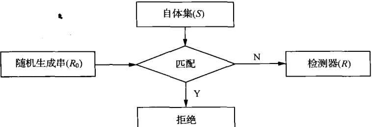

**图 7-1 阴性选择算法检测器生成流程图**

检测阶段，NSA 采用预设固定阈值的连续相同位匹配规则。若抗原与任一检测器匹配，即判定受保护对象遭入侵。具体匹配规则详见定义 7-1 与 7-2。

**定义 7-1 相似度**。等长双串 a、b 对应位连续相同的最大位数记为 $r_{ab}$，值越大越相似。
*例：$a=1001110101$，$b=1001011101$，则 $r_{ab}=4$。*

**定义 7-2 匹配**。若双串相似度 $r_{ab}$ 超过匹配阈值 $r$，则判定匹配。

#### 7.2.2 阴性选择算法的核心痛点

NSA 主要面临四大困境：

**1. 检测器生成效率低下**
随机生成机制导致海量候选器被抛弃。理论上，候选数 $N_{R0}$ 与自体数 $N_S$ 呈指数级关联（式 7-1）：

$$N_{R0} = \frac{\ln P_f}{\ln P_M \times (1 - P_M)^{N_S}}$$ (7-1)

其中，$P_f$ 为期望漏检率；$P_M$ 为检测器串匹配随机串的概率（式 7-2）：

$$P_M \approx m^{-r}[(l-r)(m-1)/m + 1]$$ (7-2)

参数中，$m$ 为字母表大小（二进制编码下 $m=2$），$l$ 为串长，$r$ 为匹配阈值。

D’haeseleer 分析指出，NSA 时间复杂度与 $N_{R0}$、$N_S$ 成正比，达 $O(N_{R0} \cdot N_S)$；空间复杂度取决于 $N_S$，为 $O(l \cdot N_S)$。Kim 等实测网络入侵检测场景下，生成 1000 个检测器耗时约 20 小时，计算开销惊人。

**2. 实际漏检率严重偏离期望值**
Forrest 实验显示：固定 $P_f=0.1$ 时，随 $N_S$ 增大，实测漏检率 $P_{fe}$ 持续走高并偏离理论值。$N_S=16$ 时偏差 0.004，$N_S=128$ 时扩大至 0.057。主因在于有效检测器重复覆盖概率增大，以及下文所述“黑洞”数量随 $N_S$ 增长。

**3. “黑洞”盲区难题**
D’haeseleer 证明：采用 $r$ 位连续匹配规则无法全覆盖非自体空间。若自体集 S 含两串连续 $r-1$ 位相同（$s_1, s_2$），则存在“黑洞”串 $h_1, h_2$，任何匹配它们的候选器必然匹配 $s_1, s_2$，导致其被误删（示意见下）。

```
s_1 : a_1 \cdots a_k b_{k+1} \cdots b_{k+r-1} c_{k+r} \cdots c_l
s_2 : a'_1 \cdots a'_k b_{k+1} \cdots b_{k+r-1} c'_{k+r} \cdots c'_l
      \Downarrow
h_1 : a_1 \cdots a_k b_{k+1} \cdots b_{k+r-1} c'_{k+r} \cdots c'_l
h_2 : a'_1 \cdots a'_k b_{k+1} \cdots b_{k+r-1} c_{k+r} \cdots c_l
```

同理，汉明距离匹配规则亦存“黑洞”，必然拖累系统检出率。

**4. 匹配阈值 $r$ 难以抉择**
理想目标是用最小检测器库覆盖最大非自体空间（$N_R$ 与 $P_f$ 均最小），但二者均受 $r$ 制约且互为矛盾。

*检测器数量 $N_R$ 视角*：由式 (7-3) 决定。

$$N_R = \frac{\ln P_f}{\ln(1 - P_M)} \qquad (7-3)$$

固定 $P_f$ 时，$N_R$ 随 $P_M$ 增大而增。式 (7-2) 显 $P_M$ 随 $r$ 指数级下降，故 $r$ 越小，$N_R$ 激增，效率骤降。

*漏检率 $P_f$ 视角*：主要受“黑洞”数 $N_H$ 影响，$N_H$ 越大 $P_f$ 越高。分析表明，$r$ 越大，自体串现 $r-1$ 位相同概率越低，“黑洞”越少；$r=l$ 时“黑洞”消失。

综上，$r$ 选取陷入两难：过小致库膨胀、过大增“黑洞”降性能。自体分布未知时，极难寻得平衡点，不当的 $r$ 根本无法产出合格检测器库。

#### 7.2.3 主流改进算法综述

针对上述痛点，代表性改进包括线性算法、贪婪算法、带变异 NSA 及可变阈值 NSA。

**1. 线性算法**
核心思路：削减候选器数量，将生成时间从指数级降至与 $N_S$ 线性相关。分两步走：
*步骤 1*：递归计算长度 $r$ 的不匹配自体的子串计数 $C_i[s]$（式 7-4）。
*步骤 2*：基于计数矩阵，二叉查找随机抽取合格检测器（式 7-5）。
复杂度显著降低，时空性能均优于原版 NSA。

**2. 贪婪算法**
基于线性算法矩阵，引入 $D_S$（基于自体）与 $D_R$（基于已有检测器）双数组。每轮选取覆盖非自体空间最多的模板生成检测器，并即时更新 $D_R$ 消除冗余覆盖。虽时间复杂度未大幅下降（随 $N_R$ 甚至更高），但检测器分布达最优。

**3. 带变异的阴性选择算法**
de Castro 等引入定向变异：候选器匹配自体不直接丢弃，而是变异远离自体再判。缩减搜索空间、提升效率，但未解决阈值确定与“黑洞”顽疾。

**4. 匹配阈值可变阴性选择算法**
张衡等落地 D’haeseleer 设想：生成串 $a$ 初始阈值 $r_1$，匹配自体失败则成熟入库（携带当前阈值）；匹配成功则动态调整阈值至 $r'$，若 $r' > r_c$ 则重生，否则继续匹配。仿真证实有效压缩“黑洞”并提性能，但本质仍依赖最大阈值 $r_c$ 的预设。

### 7.3 免疫融合阴性选择算法 (II-NSA)

针对 NSA 诸弊，本章融入免疫网络调节思想，提出 II-NSA，核心逻辑三维并进：

*   **克隆选择赋能生成**：利用克隆选择“趋同抗原”特性反向操作——候选器匹配自体不弃，经定向变异远离自体求生，大幅提升成熟率与生成效率。
*   **网络调节优化分布**：视检测器库为动态免疫网络。相互识别的检测器存在冗余覆盖，施以抑制策略，在保性能前提下压缩库规模、提效率。
*   **模糊匹配自适应阈值**：抗原-抗体匹配本质模糊，检测器同理。引入改进型可变阈值机制：检测器离自体越远，匹配模糊度越高、覆盖越广。自适应获取 $r$，一举化解“黑洞”与阈值难定难题。

综合来看，II-NSA 实现了对 NSA 更全维度的重构。

#### 7.3.1 检测器覆盖空间量化分析

以匹配串数量 $D$ 量化检测器覆盖空间，$D$ 为长度 $l$、阈值 $r$、字母数 $m$ 的函数（式 7-6）：

$D(l) = m^l - T(l)$ (7-6)

$T(l)$ 为不匹配串数（式 7-7）：

$T(l) = \begin{cases} m^l - m^{l-r} - (l-r)m^{l-r-1}, & r \leqslant l \leqslant 2r \\ 2T(l-1) - T(l-r-1), & l > 2r \end{cases}$ (7-7)

二进制编码下（$m=2$），覆盖空间公式简化为（式 7-8、7-9）：

$D(l) = 2^l - T(l)$ (7-8)

### 深度解析：免疫融合阴性选择算法（II-NSA）核心原理与流程详解

#### 理论基石：检测器覆盖范围与匹配阈值的博弈

由公式（7-6）至（7-9）可知，检测器的覆盖半径随匹配阈值 $r$ 的增大而呈指数级收缩。这意味着，降低阈值 $r$ 能显著增强检测器的感知能力。那么，检测器能取的最小阈值究竟是多少？我们通过以下定理给出答案。

首先引入两个关键定义：
*   **字符串与集合的相似度（定义 7-3）**：字符串 $a$ 与等长集合 $C$ 的相似度，取决于 $a$ 与 $C$ 中各元素最大连续匹配位数的最大值，即 $r_{aC} = \max(\{r_{ac_1}, \dots, r_{ac_k}\})$（式 7-10）。
*   **检测器自体相似度（定义 7-4）**：检测器 $d$ 与自体集 $S$ 的相似度，记为 $r_{dS}$。

**定理 7-1** 指出：若检测器 $d$ 的自体相似度为 $r_{dS}$，任意字符串 $a$ 若与 $d$ 的最大连续匹配位数 $r_a > r_{dS}$，则 $a$ 必定属于非自体（$a \notin S$）。证明采用反证法：若 $a \in S$，则 $r_a \le r_{dS}$，与假设矛盾。

基于此，**检测器的最优匹配阈值 $r$ 仅需满足 $r \ge r_{dS}$**。取 $r = r_{dS}$ 可使覆盖范围最大化。传统 NSA 采用统一阈值 $r$，若 $r_{dS} < r$ 则造成检测能力浪费——$r$ 每增 1，覆盖面积近乎减半。

为直观理解，引入**形态空间**概念：长度 $l$ 的字符串全集 $U$ 视为半径 $l$ 的球空间，体积 $V(U)=2^l$。自体集 $S$ 为内部不规则空间，检测器覆盖区 $D$ 为球状空间，半径 $r_d = l-r$。$r$ 越小，$r_d$ 越大，$V(D)$ 越大。两字符串距离定义为 $d_S(s_1, s_2) = l - r_{match}(s_1, s_2)$（式 7-11）。这套理论构成了 II-NSA 的基石。

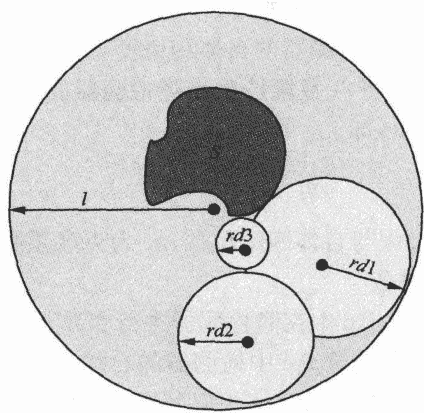

#### 7.3.2 算法架构：双群体协同进化框架

II-NSA 将检测器比作抗体，划分为**未成熟群 A** 与 **成熟群 M** 两大种群。核心新概念包括：
*   **群内相似度（定义 7-5）**：成熟检测器 $d$ 与其余成熟检测器子集 $M_d$ 的相似度，记为 $r_{dM}$。
*   **变阈值匹配（定义 7-6）**：摒弃固定阈值，以检测器自身自体相似度 $r_{dS}$ 为动态匹配门槛。监测对象 $a$ 与 $d$ 相似度超 $r_{dS}$ 即判定匹配。

**算法流程** 输入自体集 $S$ 与期望漏检率 $P_f$，输出成熟群 $M$ 及自体相似度矩阵 $R_s$：

1.  **初始化**：代数 $k=0$，设定参数（$P_f, N_a, \epsilon\%, \eta\%, c$），$A=\emptyset, M=\emptyset$。
2.  **循环进化**：
    *   **3.1 种群补充**：随机生成检测器填充 $A$ 至规模 $N_a$。
    *   **3.2 亲和力评估**：计算 $A$ 中各检测器自体相似度。
    *   **3.3 克隆扩增**：按式（7-12）计算克隆数 $n_i$（自体相似度越低，克隆系数 $n_c$ 越大），生成克隆群 $A_c$。
    *   **3.4 变异操作**：$A_c$ 进行变异。
    *   **3.5 精英选择**：对比父代与子代自体相似度，子代最小值优于父代则替换。
    *   **3.6 成熟筛选**：从 $A$ 中选自体相似度最低的 $\epsilon\%$ 进入 $M$，并从 $A$ 移除。
    *   **3.7 抑制压缩**：按自体相似度降序，清除被其他检测器识别（匹配）的个体，控制重叠覆盖。
    *   **3.8 成熟群优化**：$M$ 经历克隆-变异-选择，目标为在不增自体相似度前提下降低群内相似度、拓展覆盖。
    *   **3.9 终止判据**：估算 $M$ 实际漏检率 $P_f$，达标则终止。
    *   **3.10 淘汰机制**：清除 $A$ 中自体相似度最高的 $\eta\%$ 个体。
    *   **3.11 迭代下一代**。
3.  **输出**：成熟检测器库 $M$。

后续将深入剖析四大核心细节：A 群变异策略、M 群抑制压缩、M 群克隆选择、漏检率计算。

```
n_i = int(n_c * l / r_s)
```

#### 7.3.3 未成熟群变异：差异化概率引导“远离自体”

模仿亲和力成熟机制，通过变异降低自体相似度。关键在于**区分位点类型**并施以差异变异率：
*   **自体匹配位**：与自体重合的位点，变异概率 $P_{ma} = 0.2 \sim 0.3$（较高），打破匹配，加速逃离自体区。
*   **一般位**：其余位点，变异概率 $P_{mc} = 0.1 \sim 0.15$（较低），维持局部搜索精度。
*   **策略逻辑**：自体相似度高（匹配位多）的检测器变异幅度大，快速脱离自体；相似度低者变异幅度小，精细寻优。

实施时，步骤 3.2 除记录相似度 $r_s$，还需记录匹配起始位 $p_s$，以精准标记匹配位段（如图 7-3）。

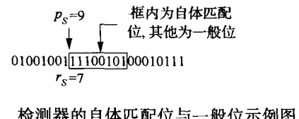

#### 7.3.4 成熟群抑制压缩：免疫网络调节“重叠度”

模拟抗体网络抑制，清除“自识”检测器，将重叠覆盖控制在合理区间：过疏产生“黑洞”漏检，过密降低独特性、拖垮效率。

**动态匹配阈值设定**：检测器间识别阈值 $r_{bc} = r_S + c$。$r_S$ 为自体匹配阈值，$c$ 为抑制参数（$c$ 越小抑制越强），允许微小波动以保证覆盖。

**压缩判据**：检测器 $d_1, d_2$，自体相似度 $r_1 > r_2$，相似度 $r_{12}$。若 $r_{12} > r_2 + c$，则 $d_1$ 被 $d_2$ 识别，**清除 $d_1$（自体相似度较大者）**。

**执行步骤**：
1.  $M$ 按自体相似度**降序**排列。
2.  遍历 $d_i (i=1 \sim N_m-1)$，与后续 $d_j (j=i+1 \sim N_m)$ 比对。若 $r_{ij} > r_{Si}$（$d_i$ 自体阈值），则 $d_i$ 被匹配，**移除 $d_i$**。保留最大群内相似度 $r_b$ 及位置 $p_b$ 供下阶段用。
3.  输出压缩后 $M$。

结果：高自体相似度、高群内相似度的“劣质/冗余”检测器被淘汰。

#### 7.3.5 成熟群克隆选择：在“安全线”内寻找“最优布局”

M 群克隆选择与 A 群同源但**目标迥异**：A 群只求“远离自体”，M 群要求**“守住自体距离不缩短，极力降低群内相似度、拓宽总覆盖”**。

*   **克隆分配（式 7-13）**：克隆数 $n_i \propto$ 群内相似度 $r_{bi}$。群内相似度越高（位置越拥挤），克隆越多，调整动力越强。
*   **三级变异概率**：引入**群内相似位**概念，实施三级差异变异：
    *   群内相似位 $P_{mb} = 0.2 \sim 0.3$（**最高**），优化分布、拉开距离。
    *   自体匹配位 $P_{ma} = 0.1 \sim 0.15$，尝试进一步远离自体。
    *   一般位 $P_{mc} = 0.05 \sim 0.1$（**最低**），微调细节。
    *   顺序关系：$P_{mb} > P_{ma} > P_{mc}$。
*   **选择准则**：硬性约束——子代自体相似度 $\le$ 父代；软性目标——选群内相似度最小的子代替换父代。

```
\( n_i = n_c \cdot r_{bi} \) (7-13)
```

#### 7.3.6 漏检率估算：变阈值下的精准收敛判据

得益于定理 7-1，每个成熟检测器拥有**专属抗原匹配阈值 $r_{si}$**（即其自体相似度），实现了“因材施教”，充分释放检测潜能。

传统 NSA 固定阈值下 $P_f$ 计算见式（7-14）$$P_f = (1 - P_M)^{N_R}$$。II-NSA 变阈值场景下，单检测器匹配概率 $P_{Mi}$ 因 $r_{si}$ 不同而异（式 7-16 $$P_{Mi} \approx m^{-r_{si}} [(l - r_{si})(m - 1)/m + 1]$$），总漏检率 $P_f$ 由式（7-15）$$P_f = \prod_{i=1}^{N_R} (1 - P_{Mi})$$ 给出。

**收敛逻辑转变**：NSA 以检测器数量 $N_R$ 达标为终止条件；II-NSA 直接以**估算漏检率 $P_f \le$ 期望值**为终止准则，检测器数量 $N_R$ 成为自适应结果。

$$P_f = (1 - P_M)^{N_R}$$$$P_f = \prod_{i=1}^{N_R} (1 - P_{Mi})$$$$P_{Mi} \approx m^{-r_{si}} [(l - r_{si})(m - 1)/m + 1]$$

#### 7.3.7 参数鲁棒性与复杂度：工程落地的关键优势

**1. 参数敏感度极低（“傻瓜式”配置）**
核心输入仅 **$S$ 与 $P_f$**。中间参数（$N_a, \epsilon\%, \eta\%, 克隆/变异参数, 抑制参数 c$）仅影响**收敛速度**，对最终输出 $M$ 影响微乎其微，可固定为经验值。
*   **痛点击穿**：传统 NSA 必须人工设定匹配阈值 $r$，此参数强依赖自体分布，未知时极难设定，设错则“黑洞”丛生甚至无法成库。II-NSA 实现阈值**自适应生成**，彻底解决此难题。

**2. 复杂度分析**
*   **时间**：主耗于自体相似度计算（$N_{R0} \cdot N_S$）与群内相似度计算（$k \cdot N_R^2/2$）。通常 $N_{R0} \gg N_R$，瓶颈在候选检测器总量 $N_{R0}$。理论表达式难直接比优劣，需实验对比 $N_{R0}$ 差异。
*   **空间**：$O(l \cdot (N_S + N_R))$，与 NSA 持平。

---

### 7.4 实验仿真：抑制参数 $c$ 的经验值甄选

成熟群抑制参数 $c$ 直接调控群内相似度，影响生成效率、库规模、实测漏检率。为确保算法“开箱即用”，通过大规模仿真锁定 $c$ 经验值。

**实验设置**：
*   串长 $l=32$，目标 $P_f=0.1$。
*   自体规模 $N_S \in \{128, 56, 16\}$（大/中/小）。
*   $c$ 扫描范围 $-1 \sim 7$。
*   每组合重复 50 次取均值。

**单次实验流程**：
1.  随机生成规模 $N_S$ 的自体集 $S$。
2.  运行 II-NSA 生成库 $R$，记录检测器数 $N_R$ 与候选总数 $N_{R0}$。
3.  **性能测试（1000 次 Monte Carlo）**：
    *   随机生成非自体串 $s_n \notin S$。
    *   变阈值匹配检测：$\forall d \in D, \text{LMATCH}(d, s_n)$ 判定为非自体，计数 $k$。
    *   实测漏检率 $P_{fd} = (1000-k)/1000$。
4.  输出 $N_R, N_{R0}, P_{fd}$。

最终分析 $c$ 对三指标的影响趋势，确定鲁棒经验区间。


#### 7.4.1 抑制因子 $c$ 敏感性实测分析

实验揭示：抑制因子 $c$ 主导着检测器库的构建速度。评估构建效能的核心指标是候选池规模 $N_{R0}$，其随 $c$ 的响应曲线见下图。

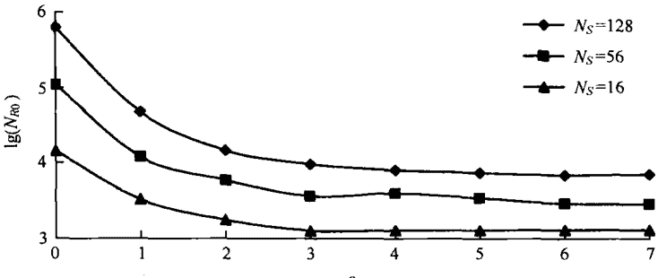

**图 7-4 抑制因子 $c$ 与候选池规模 $N_{R0}$ 关联曲线**

纵轴采用 $N_{R0}$ 对数坐标。曲线显著特征：$c$ 每降低一阶，$N_{R0}$ 便按几何级数飙升。根源在于：$c$ 值越小，成熟探测器间的排斥力越强，备选者被挤压出局的概率随之激增。极端情况下，设 $c=-1、N_S=64$ 时，程序连续运转两小时仍难产合格库——这佐证了 $c$ 过小会导致覆盖重叠不足、盲区丛生，根本无法满足预设漏判率 $P_f$。此外，不同自体规模 $N_S$ 对应的三条曲线均显示：$c \geqslant 3$ 时，$lg(N_{R0})$ 增速显著收敛；同一 $c$ 下，$N_S$ 越大，所需 $N_{R0}$ 越高。

抑制因子 $c$ 与最终探测器数量 $N_R$ 的对应关系如下。

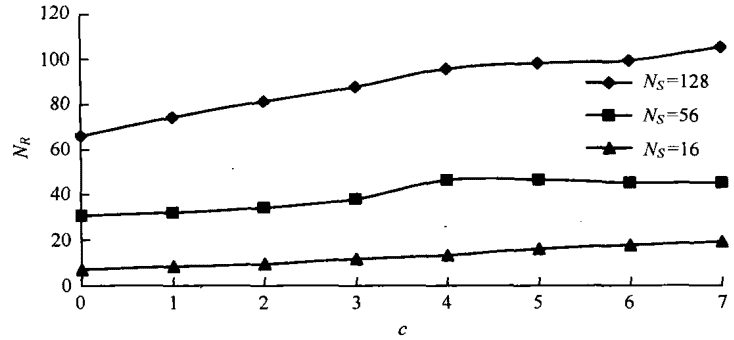

**图 7-5 抑制因子 $c$ 与探测器数量 $N_R$ 关联曲线**

观察可知，$N_R$ 随 $c$ 递增而缓慢上扬。这是因为较大的抑制系数放宽了探测器间重叠覆盖的容忍度，允许匹配阈值偏高的个体顺利成熟。

抑制因子 $c$ 对实测漏判率 $P_{fd}$ 的影响如下图。

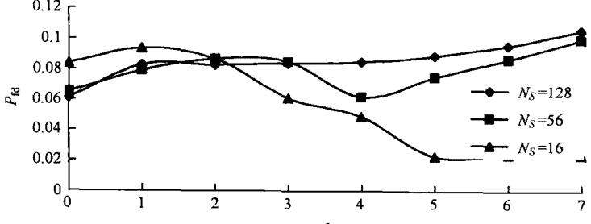

**图 7-6 抑制因子 $c$ 与漏判率 $P_{fd}$ 关联曲线**

图中不同 $N_S$ 曲线未呈现统一规律。当 $N_S$ 为 16 和 56 时，自体样本稀疏，分布随机性主导了 $P_{fd}$ 波动，掩盖了 $c$ 的作用；直至 $N_S$ 达 128，自体分布趋稳，$c$ 影响始显，$P_{fd}$ 随 $c$ 递增而缓慢抬升。

**参数权衡与定值建议**：
从构建效率看，盼 $N_{R0}$ 越低越好，故 $c$ 越大越有利；但从检测效能（$N_R$ 越低越优）与检测性能看，又倾向 $c$ 越小越好。综合权衡，$c$ 对 $N_{R0}$ 的冲击力度远超对 $N_R$ 与 $P_{fd}$，故建议采用经验值 **$c = 3$**。

#### 7.4.2 算法对比仿真：II-NSA 与 NSA 的性能较量

自体数 $N_S$ 反映自体空间复杂度，深度制约算法表现。本节固定串长 $l=32$、期望漏判率 $P_{fe}=0.1$、抑制系数 $c=3$，令 $N_S$ 在 8~128 区间按步长 8 变动。每组实验百次取均，对比 II-NSA 与经典 NSA 在候选总量 $N_{R0}$、最终数量 $N_R$、实测漏判率 $P_{fd}$ 三维指标上的差异（NSA 数据引自文献 [44]）。

**1. 构建效率对垒 ($N_{R0}$)**

$N_S$ 与候选检测器数 $N_{R0}$ 的关系曲线如图 7-7 所示。

#### 图 7-7 $N_S$-$N_{R_0}$ 曲线图

图示清晰划分阵营：II-NSA 的 $N_{R0}$ 与 $N_S$ 呈**线性正比**增长；NSA 则随 $N_S$ **指数级**暴涨。$N_S$ 偏小时，II-NSA 略高；但一旦 $N_S \geqslant 96$，NSA 曲线陡然反超。考虑到小规模自体下构建耗时极短、非工程痛点，而大规模自体下效率才是核心瓶颈（文献 [140] 亦指出 NSA 难适用大 $N_S$ 场景），II-NSA 显著破解了原算法效率短板，适用性大幅跃升。

**2. 探测器规模与检测效能对垒 ($N_R$)**

II-NSA 采用自适应机制，达标即停，免去预估匹配阈值 $r$ 之扰。NSA 则强依赖阈值估算：Forrest 提出的 $P_M \approx 1/N_S$ 难落地；D’haeseleer 的 $N_S \leqslant 2^r$ 估算法虽可行，但实测常现 $N_R > N_S$ 异常。下图对比 II-NSA 实测 $N_R$ 与 NSA 估算 $N_R$。

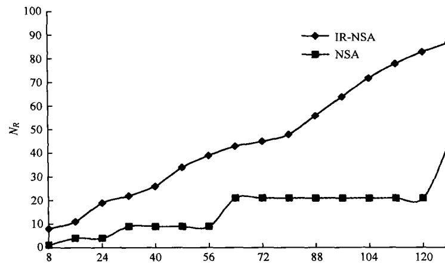

#### 图 7-8 $N_S$-$N_R$ 曲线图

II-NSA 的 $N_R$ 与 $N_S$ 近似线性增长，比值稳定在 **0.6~0.8 倍**，检测效能处于可接受区间。NSA 估算值略低于 II-NSA 实测值，若仅看此指标，似 NSA 更优。但须警醒：实验假设自体随机分布，实际工程中自体多呈区域聚集，此时 II-NSA 变阈值机制优势将显现，检测效能未必劣于 NSA，且 NSA 估算法在聚集分布下未必科学。

**3. 检测性能对垒 ($P_{fd}$)**

下图对比实测漏判率。NSA 实验固定 $r=8$（满足 $N_S \leqslant 2^r$），对 $N_S < 128$ 属宽松匹配条件。

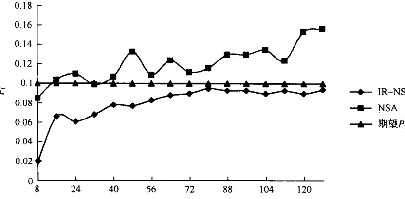

#### 图 7-9 $N_S$-$P_{fd}$ 曲线图

结果极具说服力：II-NSA 实测漏判率**全程低于 NSA**，且**始终优于期望值 $P_{fe}=0.1$**。$N_S > 64$ 时，II-NSA 的 $P_{fd}$ 波动极小，彻底消除了 NSA 中漏判率随规模恶化失控的顽疾。核心优势在于：可变匹配阈值填平覆盖“黑洞”，成熟群抑制策略将重复覆盖控制在合理区间，使漏判率估算精准可控。

**阶段小结**：II-NSA 在构建效率与检测性能双维度全面超越 NSA，有效化解“效率低、漏判随规模恶化、存在黑洞、阈值难定”四大痛点，实现匹配阈值自动化确定。

### 7.5 第 7 章 小结

本章深度剖析 Forrest 经典阴性选择算法（NSA）四大短板：构建低效、漏判率高、覆盖黑洞、阈值难定。融合免疫网络调节与克隆选择原理，创新提出**免疫融合阴性选择算法（II-NSA）**。核心创新：
1.  **未成熟期**：引入克隆选择与基于自体相似度的逆向比例成熟机制，驱动探测器快速脱离自体区。
2.  **成熟期**：引入免疫抑制管控探测器间相似度，配合克隆选择压降冗余覆盖。

仿真实证：II-NSA 在构建效率与检测性能上双双胜出。尤其在大规模自体、长编码抗原场景下，实测漏判率稳定在期望值下方微波动，探测器与自体数量比维持在 0.6~0.8 高效区间。且算法实现阈值自适应获取，彻底摆脱人工试错困境。

---

## 第 8 章 分层免疫集成算法及其在电信路由优化中的应用

### 8.1 导论

当前主流人工免疫算法（AIS）——免疫遗传、克隆选择、阴性选择等——均源于特定求解场景。各算法基于不同免疫机理设计算子，形态各异，优劣互补。故构建融合多机制优势的统一框架极具价值。本章依托 AIS 设计框架，解构免疫算法核心流程与性能影响因子，提出**分层免疫集成算法**，并将其应用于电信网动态路由评估优化建模与实测。

### 8.2 免疫算法性能关键决定因子深析

#### 8.2.1 通用求解范式

利用 AIS 求解时，标准映射为：抗原 $\rightarrow$ 问题（目标/约束），抗体 $\rightarrow$ 候选解，亲和力 $\rightarrow$ 适应度，记忆细胞 $\rightarrow$ 历史优解库，淋巴细胞分化 $\rightarrow$ 精英保留，抗体抑制 $\rightarrow$ 劣解清理，交叉/变异 $\rightarrow$ 搜索算子。对应标准化六步流程：

1.  **识别抗原**：感知问题实例。
2.  **初始化抗体群**：若记忆库有同类优解则调用，否则随机生成。
3.  **亲和力计算**：评估抗体与抗原匹配度。
4.  **记忆细胞更新**：最高亲和力抗体入库，淘汰机制维持容量。
5.  **抗体群进化**：含新陈代谢（随机生成/死亡平衡）与算子驱动进化（交叉、变异等），在免疫调节下迭代求优。
6.  **浓度调节**：高亲和低浓度受促，高浓度低亲和受抑，维持多样性。

#### 8.2.2 核心性能因子逐层解码

免疫算法本质是导向性随机全局搜索。虽具全局收敛性，但实现形式随问题剧烈差异，同一问题不同参数下结果亦可能天壤之别。聚焦关键算子与参数：

**1. 亲和力度量——计算复杂度核心**
编码空间异（Hamming、Euclidean、Manhattan 等），距离度量各异。无统一最优度量，选型不当严重拖累效率与精度。

**2. 克隆选择——收敛与多样性的博弈枢纽**
作用是选优育种。强选择压加速收敛但削弱多样性，易陷局部最优；弱选择压保多样性但拖慢收敛。设计动态平衡两者的克隆策略，是防基因丢失、提升全局搜索质效的关键 [144-146]。

**3. 变异操作——跳出局部、维持多样性的核心引擎**
能修复受损优良基因、创造新优良基因，是趋近全局最优或多峰并行搜索的保障。变异率设定极讲究：过小则多样性枯竭、早熟收敛；过大则群体震荡、稳定性差、收敛周期拉长。寻找“既能全局搜优、又能稳定收敛”的最佳变异率是设计重中之重 [147]。

**4. 关键结构参数——群体规模、记忆库容、浓度阈值**
*   **抗体群规模 ($n$)**：决定并行搜索广度。过小覆盖不足漏极值，过大计算冗余拖慢收敛。
*   **记忆库规模**：既是跨代知识传承载体，又参与当代竞争。过小导致多峰极值点因竞争激烈被挤出库外，损失多样性；过大增加复杂度且可能干扰新代进化、拖慢收敛 [102,147,148]。
*   **抗体浓度阈值**：直接调控群体多样性，与群体规模强耦合。需针对问题特性联合调参，方能最大化算法效能。

### 8.3 分层免疫集成算法架构设计

上述分析表明：度量方式、变异、克隆、记忆库、群体规模等要素深度耦合，单一算子难以全优。故提出**分层免疫算法**，旨在集成异构操作优势，兼得全局搜索力与快速收敛性。

#### 8.3.1 总体设计思路：异构并行 + 协同融合

框架采用**两层或多层**拓扑。顶层仅保留单一融合操作，底层部署多个异构免疫子算法。以双层为例：

*   **底层（低层免疫操作）**：并行运行 $N$ 个互异子算法 $IA_i (i=1..N)$。首先生成 $N \times n$ 抗体，均分为 $N$ 子群。每子群独立演化，其**编码、亲和力公式、变异/克隆策略、浓度阈值、记忆库规模等全维度参数均可差异化配置**，实现搜索策略最大化多样性。
*   **顶层（高层免疫操作）**：周期性收割底层成果并重组再分发。
    1.  **收割**：各 $IA_i$ 运行指定代数后，将其记忆库精英（$n$ 个）记入二维矩阵 $W[N, n]$，并计算各子群平均亲和力存入向量 $A[N]$。
    2.  **克隆选择（基于群体适应度）**：依据 $A$ 对 $W$ 的行（子群精英集）选择复制/淘汰。高均值适应度子群精英被多次复制，低均值子群精英被淘汰。
    3.  **交叉重组（群体间基因交换）**：按交叉率在 $W$ 中随机配对行，单点交换后缀片段。相当于不同策略搜得的优解片段跨群体混合。
    4.  **变异注入（新鲜血液）**：按变异率用随机新个体替换 $W$ 中部分个体。
    5.  **回填与循环**：更新后的 $W$ 各行分发回对应 $IA_i$ 作为新初始种群，开启下一轮底层并行演化。循环直至收敛满意。

算法总流程与底层子流程见图示。

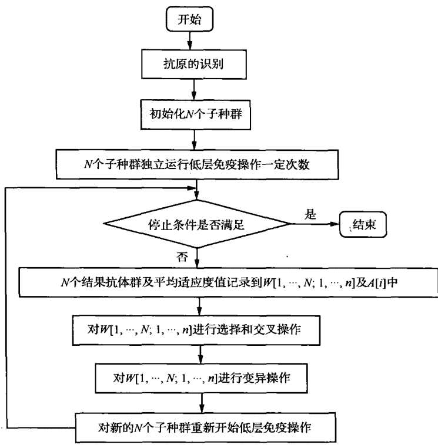

#### 图 8-1 分层免疫算法总流程图

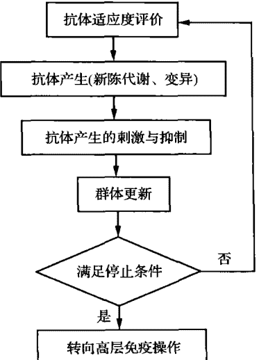

#### 图 8-2 低层免疫操作子流程图

#### 8.3.2 高层免疫操作核心算子设计

高层操作聚焦**交叉率**与**变异率**的自适应调控策略。

**1. 交叉率设计**

# 8.3.3 低层免疫操作设计详解

### 自适应交叉率机制

在高层免疫操作里，交叉率 $p_c$ 直接决定了新抗体涌现的节奏。$p_c$ 越高，生成速度越快，但也越容易拆散那些表现优异的抗体；反之若过低，又会拖慢收敛进程。针对不同问题人工反复试错寻找最优 $p_c$ 不仅繁琐，而且难以找到通用设定。为此，本章引入一种**自适应交叉率策略**，让 $p_c$ 随亲和力动态浮动，计算规则如下：

$$ p_c = \begin{cases} \frac{k_1(f_{max} - f')}{f_{max} - f_{avg}}, & f' \geqslant f_{avg} \\ k_2, & f' < f_{avg} \end{cases} \quad (8-1) $$

参数说明：$f_{max}$ 为种群最高亲和力，$f_{avg}$ 为代际平均亲和力，$f'$ 代表参与交叉的两个抗体中亲和力较高者。

从公式可见，令 $k_1, k_2 \in [0,1]$ 即可实现自适应。当抗体亲和力低于均值（$f' < f_{avg}$），判定为弱个体，给予固定较大的交叉概率 $k_2$ 以促进变异；若高于均值，则根据其亲和力与最大值的差距动态分配概率——**亲和力越接近峰值 $f_{max}$，交叉率越低**，从而保护优质个体不被破坏。

### 自适应变异率机制

变异率 $p_m$ 面临类似困境：过小则难以生成新抗体，过大则退化为纯随机搜索。本章同步提出**自适应变异率**公式：

$$ p_m = \begin{cases} \frac{k_1(f_{max} - f)}{f_{max} - f_{avg}}, & f \geqslant f_{avg} \\ k_2, & f < f_{avg} \end{cases} \quad (8-2) $$

其中 $f$ 为待变异抗体的亲和力。逻辑与交叉率一脉相承：$k_1, k_2 \in [0,1]$ 保证自适应区间。弱抗体（$f < f_{avg}$）采用较大固定率 $k_2$ 增强探索；强抗体（$f \geqslant f_{avg}$）则依据优势程度降低变异率——**越接近全局最优 $f_{max}$，变异幅度越小**，稳固高质量解。

---

### 1. 适应度函数的动态设计

适应度函数是克隆选择的基石。免疫算法初期，随机初始化导致个体适应度悬殊：极优个体可能垄断克隆机会，而劣质个体虽含有益基因片段却过早淘汰。这种“马太效应”在小规模种群中尤甚，极易破坏多样性、陷入局部最优。后期种群收敛，个体差异缩小，又需放大差异以维持优胜劣汰压力。

常规做法多将目标函数简单变形（如最大化问题取 $fitness=f(x)$，最小化取 $M-f(x)$ 或 $1/f(x)$），虽构造简便但难以兼顾全过程需求。本章主张**分层差异化设计**：在各低层操作中采用不同形式的适应度函数，从多维度评估个体，弥补单一函数的短板。例如引入线性缩放变换：

$$ f' = a f + b \quad (8-3) $$

$f'$ 为缩放后适应度，$f$ 为原值，$a,b$ 为动态系数，可随迭代代数或平均亲和力自适应调整。

---

### 2. 抗体促进与抑制双机制

常规按适应度比例选择，易导致相似高适应度个体爆发式增长，引发早熟收敛。核心矛盾在于：**既要奖励高适应度，又要抑制高浓度（相似度过高）**。本章设计两套新机制平衡二者。

#### ① 基于浓度的促进抑制机制

定义抗体 $c_i$ 的浓度 $\xi_i$ 为：种群中与其适应度相近的个体数占比。

$$ \xi_i = \frac{\text{与 } c_i \text{ 适应度相近的抗体数}}{\text{抗体总数}} \quad (8-4) $$

选择概率 $p_i$ 综合考量适应度优势与浓度惩罚：

$$ p_i = \frac{a \times \left[1 - \frac{\text{fitness}(i)}{\text{Maxfitness}}\right]}{\xi_i} + \beta \times \frac{\text{fitness}(i)}{\text{Maxfitness}} \quad (8-5) $$

$a, \beta \in [0,1]$ 为调节因子。公式含义直观：**浓度固定时，适应度越高概率越大；适应度固定时，浓度越大概率越小**。该机制在保留精英的同时强制稀释同质化个体，有效遏制早熟收敛，增强局部挖掘能力。

#### ② 基于期望值的促进抑制机制

此法引入**信息熵**量化种群多样性，进而计算浓度与期望繁殖率。

**步骤 1：计算信息熵**
如图 8-3，抗体位串由 $s$ 种字母构成。$N$ 个抗体的平均信息熵 $H(N)$ 为各基因位熵值均值：

$$ H(N) = \frac{1}{M} \sum_{j=1}^M H_j(N), \quad H_j(N) = \sum_{i=1}^N -p_{ij} \lg p_{ij} \quad (8-6, 8-7) $$

$p_{ij}$ 为第 $i$ 个抗体第 $j$ 位基因取特定值的概率。

**步骤 2：计算相似度**
两抗体 $v,w$ 相似度 $a_{v,w}$ 基于两抗体组成的子群熵 $H(2)$：

$$ a_{v,w} = \frac{1}{1 + H(2)} \quad (8-8) $$

**步骤 3：计算浓度 $c_v$**
设定阈值 $T_{ac}$，统计与 $v$ 相似度达标的抗体比例：

$$ c_v = \frac{1}{N} \sum_{w=1}^N ac_{wv}, \quad ac_{mv} = \begin{cases} 1, & a_{v,w} \ge T_{ac} \\ 0, & a_{v,w} < T_{ac} \end{cases} \quad (8-9, 8-10) $$

**步骤 4：计算期望繁殖率 $e_v$**

$$ e_v = \frac{a_x_v}{c_v} \quad (8-11) $$

$a_x_v$ 为抗体适应度。子代按 $e_v$ 概率入选新种群。**适应度高者繁殖率高，浓度大者繁殖率低**，同浓度机制一致，但在多样性度量上更具信息论严谨性。

---

### 3. 多元变异算子库

针对不同编码与问题特性，本章在低层集成四类变异算子，形成互补搜索策略。

#### ① 非均匀变异：全局探索到局部精修的平滑过渡
选中抗体 $c_i$ 时，随机从两个方向扰动：

$$ c'_i = c_i + \Delta(t, c_i^U - c_i) \quad \text{或} \quad c'_i = c_i - \Delta(t, c_i - c_i^l) \quad (8-12, 8-13) $$

扰动函数 $\Delta(t, y) = y \cdot r \cdot (1 - \frac{t}{T})^b$。$r \in [0,1]$ 随机数，$T$ 最大代数，$b$ 非均匀度参数。**早期 $t$ 小，扰动大，均匀搜索全域；晚期 $t$ 大，扰动趋近 0，精细微调**。兼顾精度与搜索广度。

#### ② 有向变异：沿梯度方向的启发式跳跃
变异公式 $c'_i = c_i + r \cdot d$。$r$ 为非负随机数，$d$ 为近似梯度方向，第 $i$ 分量计算为：

$$ d_i = \frac{f(\dots, c_i + \Delta c_i, \dots) - f(\dots, c_i, \dots)}{\Delta c_i} $$

利用目标函数局部敏感度引导变异，**保证后代倾向于更优区域**，收敛加速效果显著。

#### ③ 高斯变异：源自进化策略的自适应步长
抗体编码为二元组 $(c_i, \sigma)$，$\sigma$ 为步长标准差。变异遵循：

$$ \sigma' = \sigma \cdot e^{N(0, \Delta \sigma)}, \quad c'_i = c_i + N(0, \sigma') \quad (8-16, 8-17) $$

$N(0, \cdot)$ 为高斯随机向量。**步长 $\sigma$ 随个体协同进化，自适应调节搜索步幅**，无需人工干预。

#### ④ 基于精英抗体的变异：挖掘核心基因信息
精英抗体（代际最优）被视为全局最优解的“投影”。利用其基因信息向周围高适应度区域辐射变异：

$$ \begin{cases} c_i^{t+1} = c'_{i, \text{best}} + \sigma'_i \cdot N(0, 1) \\ \sigma_i^{t+1} = \sigma_\epsilon + \sigma_i^0 \cdot e^{-\frac{A \cdot t}{T}} \end{cases} \quad (8-18) $$

$c'_{i, \text{best}}$ 为精英第 $i$ 分量，$\sigma_i^0$ 初始标准差，$A \in [1,10]$ 调整系数，$\sigma_\epsilon$ 基数常取 0。标准差衰减提供三种调度策略：
*   **指数调整** (8-19)：$\sigma_i^{t+1} = \sigma_\epsilon + \sigma_i^0 \cdot e^{-\frac{\Delta k}{T}}$
*   **双曲调整** (8-20)：$\sigma_i^{t+1} = \sigma_\epsilon + \frac{1}{a + \beta t}\ (a,\beta>0)$
*   **混合调整** (8-21)：前两者算术平均，兼顾快慢衰减节奏。

---

### 4. 灵活的参数配置空间

除上述核心算子，低层操作还开放抗原抗体编码方案、亲和力计算公式、浓度阈值、记忆库容量等参数的**独立差异化配置**，为算法应对复杂问题提供最大自由度。

---

# 8.4 分层免疫算法理论分析

## 8.4.1 收敛性证明框架

低层各子群运行指定代数后，将 $N$ 个子群结果汇总为二维数组 $W[1\dots N; 1\dots n]$ 输入高层。设第 $k$ 代 $N$ 个子群中心为 $A_k^1, \dots, A_k^N$，全局最优解为 $A^*$，适应度�数 $f$。

**定义 8-1（全局收敛）**
若对任意初始子群，满足：
$$ \lim_{k \to \infty} P\{ \max[f(A_k^1), \dots, f(A_k^N)] = f(A^*) \} = 1 $$
则称算法全局收敛。即：迭代充分后，最优子群中心以概率 1 收敛至全局最优。

**定义 8-2（矩阵性质铺垫）**
$S$ 为 $n \times n$ 方阵：
1.  **非负矩阵**：$\forall i,j, s_{ij} \ge 0$，记 $S \ge 0$。
2.  **随机矩阵**：非负且每行和为 1（$\sum_j s_{ij} = 1$）。
3.  **可约矩阵**：非负且经行列置换可化为分块上三角形式 $\begin{bmatrix} C & 0 \\ R & T \end{bmatrix}$（$C,T$ 为方阵）。

**定理 8-1（收敛核心引理）**
设 $P$ 为可约随机矩阵，分块 $P = \begin{bmatrix} C & 0 \\ R & T \end{bmatrix}$，其中 $C$ 为 $m$ 阶正随机矩阵，$R,T \neq 0$。则……

### 定理 8-2：分层免疫算法以概率 1 收敛至全局最优

**证明过程：**

设抗体群体构成的空间为 \(\Omega\)，单个抗体记为 \(X\)（\(X \in \Omega\)）。在分层免疫算法中，每个抗体对应一个状态。若将算法的马尔可夫链状态空间记为 \(G\)，则其维数 \(M = |G| = |\Omega|\)。依据算法流程，迭代过程建立在上一代最优抗体基础之上：以概率 \(P_c\) 对选定抗体对的两个基因位实施交叉变异，以概率 \(P_m\) 对每个抗体的各基因位独立执行变异。这一 n 步状态转移过程可用矩阵 \(P = (p_{ij})\) 刻画，其中 \(p_{ij} \in [0, 1]\) 且 \(\sum_{j=1}^n p_{ij} = 1\) [91,155,156]。结合定义 8-1 与 8-2，矩阵 \(P\) 具备随机矩阵特性。

通过状态重排，令转移矩阵 \(P\) 的状态按优劣有序排列：状态 1 为全局最优解，状态 2 为次优，以此类推，状态 \(n\) 为最差解。对任意状态 \(i\)，依据 \(p_{ii} + \sum_{j=i+1}^n p_{ij} \to p_{ii}\) 与 \(p_{ij} = 0 (j > i)\) 更新矩阵，构造新转移矩阵 \(P^*\)：

\[
P^* = (P_{ij})_{|\Omega|\times|\Omega|} = \begin{bmatrix} P_{11} & \\ P_{21} & P_{22} \\ \vdots & \vdots & \ddots \\ P_{|\Omega|1} & P_{|\Omega|2} & \cdots & P_{|\Omega||\Omega|} \end{bmatrix} = \begin{bmatrix} 1 & 0 & \cdots & 0 \\ p_{21} & p_{22} & \cdots & 0 \\ \vdots & \vdots & & \vdots \\ p_{|\Omega|1} & p_{|\Omega|2} & \cdots & p_{|\Omega|m} \end{bmatrix} = \begin{bmatrix} C & 0 \\ R & T \end{bmatrix} \quad (8-23)
\]

其中，\(R = \begin{bmatrix} p_{21} \\ \vdots \\ p_{n1} \end{bmatrix}\)，\(T = \begin{bmatrix} p_{22} & \cdots & 0 \\ \vdots & & \vdots \\ p_{n2} & \cdots & p_m \end{bmatrix}\)。\(R, T \neq 0\)，\(C \equiv [1]\) 为一阶正随机矩阵。

由定义知，\(P\) 为可约矩阵。

依据定理 8-1 推导极限：
\[
P^{*\infty} = \lim_{k\to\infty} P^{*k} = \begin{bmatrix} C^{\infty} & 0 \\ R^{\infty} & 0 \end{bmatrix} = \begin{bmatrix} 1 & 0 \\ R^N & 0 \end{bmatrix}
\]

矩阵 \(P^*\) 首态的极限概率为 1，即 \(P_1 = \lim_{k \to \infty} P(F_k = F^*) = 1\)。根据定义 8-1，证得分层免疫算法具备全局收敛性。

---

#### 8.4.2 收敛性能实测验证

为考察算法收敛表现，选取多模态函数 \(F_1\)，重复运行 100 次，统计局部最优与全局最优解的获取情况及概率。

**测试函数 \(F_1\)：**
\[
f(x, y) = x\sin(4\pi x) - y\sin(4\pi y + \pi) + 1, \quad -1 \leqslant x, y \leqslant 2 \quad (8-24)
\]

\(F_1\) 是典型的不等高多峰函数，拥有 1 个全局极大值点与多个局部极大值点。全局最大值 4.2539 位于 \(x = 1.6286, y = 1.6292\) 处。函数地形如下图所示。

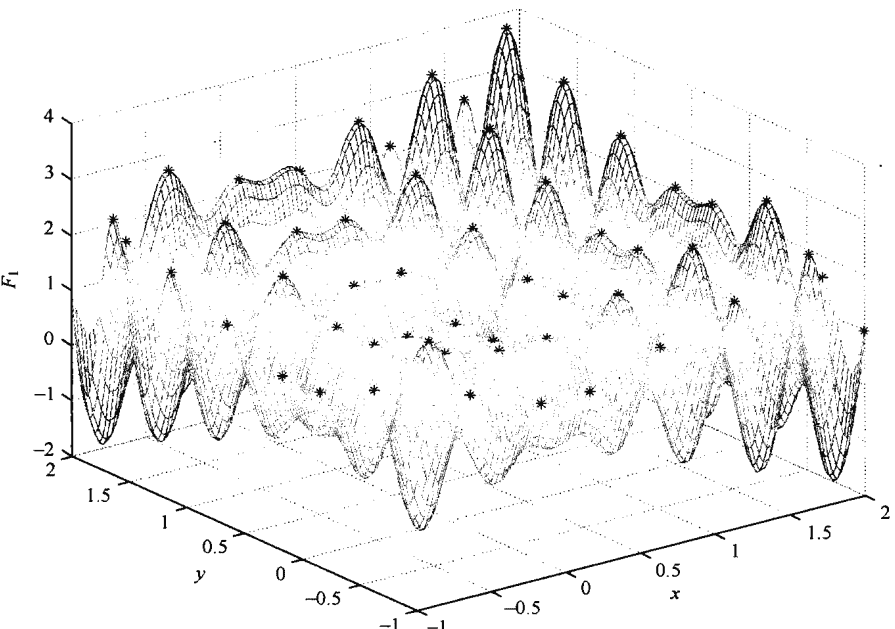

**图 8-4 函数 \(F_1\) 三维地形图**

**参数配置：**
抗体编码 \(c = [x, y]\)，适应度即目标函数值。高层采用自适应交叉/变异率，抑制阈值 0.02，克隆率 10，精英选择率 4。低层分别测试非均匀变异、基于精英抗体的变异、高斯变异三种算子，均配合浓度依赖的选择抑制机制，记忆库容量 80，学习周期 200。优化结果汇总于表 8-1。

#### 表 8-1 函数 \(F_1\) 优化搜索结果统计

| 序号 | 极大值点（x,y） | 函数值 | 发现率/% | 序号 | 极大值点（x,y） | 函数值 | 发现率/% |
| --- | --- | --- | --- | --- | --- | --- | --- |
| 1 | (-0.63492, 2) | 1.6299 | 100 | 31 | (1.131, 0.16022) | 2.2726 | 100 |
| 2 | (1.6289, 2) | 2.6267 | 100 | 32 | (-0.63524, 1.629) | 3.2569 | 100 |
| 3 | (-1, 0.1614) | 1.1445 | 100 | 33 | (1.9999, 0.63494) | 1.6267 | 100 |
| 4 | (1.1305, 2) | 2.1273 | 99 | 34 | **(1.6286, 1.6292)** | **4.2539** | **100** |
| 5 | (0.16142, 2) | 1.1448 | 100 | 35 | (0.24871, 1.6348) | 2.6265 | 100 |
| 6 | (-1, 1.629) | 2.6269 | 100 | 36 | (1.1292, 1.6321) | 3.7532 | 100 |
| 7 | (1.6289, -1) | 2.6256 | 100 | 37 | (1.1304, 0.63532) | 2.7578 | 100 |
| 8 | (0.63494, -1) | 1.63 | 100 | 38 | (-1, 0.63533) | 1.6284 | 100 |
| 9 | (2, 1.1306) | 2.1272 | 100 | 39 | (-1, -0.63592) | 1.6277 | 100 |
| 10 | (-0.16, -0.16) | 1.2896 | 100 | 40 | (-0.1625, 0.63465) | 1.7748 | 100 |
| 11 | (0.635, 0.6347) | 2.26 | 99 | 41 | (-0.15913, 1.1309) | 2.2725 | 100 |
| 12 | (2, 0.16145) | 1.1446 | 100 | 42 | (-0.16107, 0.16195) | 1.2896 | 100 |
| 13 | (-0.161, -0.63) | 1.7748 | 100 | 43 | (0.16174, -1) | 1.1444 | 100 |
| 14 | (2, -0.99993) | 0.9976 | 100 | 44 | (-0.63475, 0.63443) | 2.26 | 100 |
| 15 | (-0.16144, 2) | 1.1432 | 100 | 45 | (0.63599, -0.63463) | 2.2599 | 100 |
| 16 | (-1, -0.16148) | 1.1447 | 100 | 46 | (0.16141, -0.16197) | 1.2896 | 100 |
| 17 | (-0.635, -0.635) | 2.26 | 100 | 47 | (1.6282, -0.16234) | 2.7717 | 100 |
| 18 | (-0.63508, -1) | 1.6297 | 100 | 48 | (1.1293, -0.6359) | 2.7576 | 100 |
| 19 | (-1, 1.1306) | 2.1268 | 100 | 49 | (1.6298, 0.63454) | 3.2568 | 100 |
| 20 | (2, -0.16151) | 1.1447 | 100 | 50 | (0.16097, 0.63497) | 1.7748 | 100 |
| 21 | (1.1306, -1) | 2.1276 | 99 | 51 | (1.6295, -0.63558) | 3.2569 | 100 |
| 22 | (1.13, -0.16154) | 2.2726 | 100 | 52 | (-0.63444, 1.1307) | 2.7578 | 100 |
| 23 | (-0.16151, -1) | 1.144 | 100 | 53 | (-0.6351, 0.16221) | 1.7748 | 100 |
| 24 | (1.1305, 1.1307) | 3.2556 | 100 | 54 | (0.16135, -0.63495) | 1.7748 | 100 |
| 25 | (0.6351, 1.6287) | 3.2569 | 100 | 55 | (0.16084, 0.16142) | 1.2896 | 100 |
| 26 | (1.629, 1.1307) | 3.7547 | 99 | 56 | (0.63448, -0.15882) | 1.7747 | 100 |
| 27 | (1.6289, 0.1613) | 2.7718 | 100 | 57 | (1.9998, 1.6289) | 2.6226 | 100 |
| 28 | (1.9997, -0.635) | 1.6225 | 100 | 58 | (0.16218, 1.1307) | 2.2726 | 100 |
| 29 | (0.63519, 0.16) | 1.7748 | 100 | 59 | (-0.1624, 1.629) | 2.7717 | 100 |
| 30 | (-0.635, -0.1629) | 1.7748 | 100 | 60 | (0.63455, 1.1304) | 2.7578 | 100 |

**结果解读：**
表 8-1 显示，\(F_1\) 局部最优解分布稠密且函数值跨度大，常规算法难以全捕获。分层免疫算法却能快速、精准地定位**全部 60 个极值点**（含全局最优第 34 项），发现率均达 99%-100%，充分印证了其优异的收敛特性与多峰搜索能力。

---

#### 8.4.3 算法有效性对比分析

通过多峰函数对比分层免疫算法与单一免疫操作的性能差异。

**对比测试函数：**
\[
f(x) = \exp(-(x - 0.1)^2) \times \sin^6(5\pi x^{3/4}) \quad (8-25)
\]
定义域 \(x \in [0,1]\)，含 5 个峰值。采用 22 位二进制编码（精度 6 位小数），解码映射公式 (8-26) 同前。

**实验设置：**
种群规模 200，最大迭代 100 代，独立运行 3 次，同一初始种群。
*   **单一免疫操作：** 浓度选择抑制 + 高斯变异 (\(p_m = 0.01\))。
*   **分层免疫算法：** 低层集成非均匀、精英向导、高斯三种变异，均配合浓度选择抑制。

#### 表 8-2 两算法性能对比统计

| 算法 | G(收敛代数) | P(全峰值发现概率) | 搜索稳定性 |
|---|---|---|---|
| **分层免疫算法** | 20 | 1 | 稳定 |
| | 33 | 0.99 | 稳定 |
| | 28 | 1 | 稳定 |
| **单一免疫操作** | 107 | 0.45 | 振荡 |
| | 121 | 0.53 | 较平稳 |
| | 162 | 0.67 | 振荡 |

**核心结论：**
1.  **寻优能力：** 单一免疫操作搜索轨迹不稳，难以保证全局收敛；分层算法融合多算子优势，兼顾多样性与收敛性，全峰值发现概率接近 1。
2.  **收敛速度：** 分层算法平均 27 代收敛，单一操作需 130 代左右。分层机制通过整合低层优解压缩搜索空间，规避冗余计算，显著提速。
3.  **有效性确证：** 集成多免疫操作的分层架构在精度、速度、稳健性上全面超越单一操作，机制有效性得到实证。

---

### 8.5 面向动态路由评估的分层免疫模型

#### 8.5.1 动态路由技术演进综述

在电信竞争白热化当下，提升服务质量成核心战略。运营商从粗放扩张转向精细深耕，在拓展覆盖的同时，必须强化质量与效益指标。

**1. 话务控制与路由选择的核心地位**
话务控制是保障服务质量的关键抓手，其实现手段涵盖：动态路由控制、自动拥塞控制 (ACC)、临时迂回路由 (TAR)、中继路由控制、可达出路由控制、中继预留、目的码截裁等。这些手段的本质均是**基于网络实时状态，通过调整路由表实施流量调度**，即动态选路技术。选路策略优劣直接决定网络服务质量。

网络拓扑与选路策略强耦合。早期分级网采用固定路由，随业务爆发暴露出刚性不足。随着网络演进为无级扁平架构，固定路由造成资源浪费，动态路由势在必行。

**动态路由定义：** 迂回路由选择次序随时间动态调整，具时变特性 [159]。其价值在于：提升网络可靠性与接通率、降低交互成本、适配新业务、奠定服务质量基石以吸纳客户、显著提振经济效益。

**2. 动态路由策略分类全景**

主流分类维度有二：按处理机部署位置分**集中式/分散式**；按决策信息来源分**时变/自适应**。

**① 集中式 vs. 分散式**

| 维度 | 集中式动态选路 | 分散式动态选路 |
| :--- | :--- | :--- |
| **架构** | 单一中央处理机负责全网选路计算 | 多处理机分担，独立或协作(交换状态信息)完成计算 |
| **优势** | 管理维护成本低；易实现**全局最优**话务调度 | 系统可靠性高(无单点故障)；响应状态变化快；计算分布式抗过载能力强 |
| **劣势** | 单点故障风险大；大话务量下中央节点成性能瓶颈 | 部署成本高(常需集成交换机)；管理复杂；通常只能达**局部最优**；交换机算力限制算法复杂度 |
| **典型算法** | DNHR、DCR [159-162] | 动态交替路由 (DAR) [159,160,163,164] |

**② 时变 vs. 自适应**

*   **时变选路：** 依据一天中不同时段的**预测话务量**预先优化路由规划，规避预判阻塞链路/节点。属于“离线规划+在线执行”模式。

*(后续内容待续...)*

### 自适应路由：网络状态的实时响应者

自适应选路，亦称基于状态选路，其核心在于完全依赖网络的实时状态做决策。它能依据当下条件动态挑选最优路径。区别于按时间预设的时变选路，迂回路由的生成由状态变化即时触发或周期性产出，与具体时刻无关。虽因频繁探测网络状态给交换机增添了负担，却换来了对本地网络变化更灵敏的响应能力。动态控制路由（DCR）即是该类技术的典型代表。

#### 8.5.2 电信网动态路由控制系统架构设计

##### 1. 现网特征与痛点剖析

广东电信网建设水平长期领跑全国。其 C3、C4 两级长话交换网已在管理与拓扑层面融合为省内 E2 交换平面，织就点对点的无级网状结构。各局间均配直达路由，省内长话选路无需经上级汇接中转，由对端局凭固定策略直通，这为动态路由落地奠定了基础。

然而，业务爆发式增长也留下隐患：设备厂家�杂不一、网络负载严重失衡、话务异常激增、拓扑结构待优化。这些不确定因素给动态选路实施带来诸多变数。

##### 2. 动态路由实施框架构想

###### 1) 核心实施策略

动态路由技术落地须紧贴实际网情。放眼全球，成功案例皆因地制宜，无照搬之理。结合国情及广东网况，参考文献[159]，本章主张在电信网部署**基于状态的集中式选路策略**，两大支柱如下：

*   **集中式控制**：分散式方案要求将选路逻辑内嵌交换机，因设备型号林立，几乎不可行。集中式则擅长全局最优、成本可控，能最大程度减少对现网、网元及管理系统的侵入。借助独立计算平台的强算力，也为未来扩展留足余地。
*   **基于状态选路**：实时从网管汲取数据、即时演算路由方案，赋予系统强适应性，能快速应对异常、疏导流量、榨干资源价值，适配复杂多变环境。数据采集不全时，中央计算机可用历史数据修补，保障可靠性。

同时，应最大化复用各厂商交换机自带的路由控制功能。虽厂商提供此功能，但本地网鲜有启用，且缺乏面向复杂场景的最佳管控模式与比例依据。若能调用这些原生能力，将大幅降低动态策略复杂度。

落地该策略须守三条红线：保传输质量与信令可达；选路有章法，杜绝死循环（呼叫在局间兜圈不达目的）；极小化呼叫串联中继数。

###### 2) 控制系统详细设计

调研与数据测试揭示：现网负载不均、话务分布差异大、节点负载两极分化，恰为动态路由施展拳脚提供了空间。忙时效果尤显著。依据话务溢出、应占比与电路数的关联，为每链路匹配最优迂回节点，即可均衡全网负载、推高整体性能。故在广东省网实施动态路由，可行且必要。

具体落地路径如下：依托电信网管系统，中央计算机定期采集话务数据，经特定评估模型演算出路由方案，转码为交换机指令下发至网管，再由网管推送至网元，完成路由管控。流程详见图 8-5。

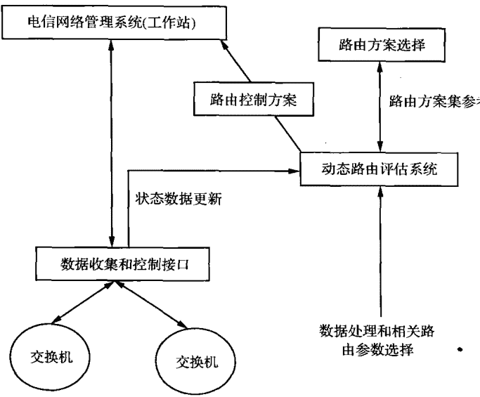

图 8-5 电信网动态路由控制系统结构图

*   **数据采集**：
    通过采控接口获取两类数据：一类用于演算动态路由，含路由负荷、试呼/占用/应答次数、设备数等统计量；一类用于评估网络健康度，含基于路由的应答试呼比、应答占用比、呼叫溢出率、每小时每电路试呼/占用话务量等。

*   **动态路由评估模型**：
    核心引擎。引入遗传算法、Tabu 搜索、单纯形法等优化算法，对定时上传的多维话务数据建模计算，产出当期最优路由集，转码为交换机指令表，经网管下发执行。

*   **电信网络管理系统（NMS）**：
    动态路由控制的执行中枢，双引擎驱动：
    1.  **网络信息功能**：实时监控汇报运行态势。覆盖应答占用比、溢出率、性能数据、路由负载、管理计数器、全电路忙状态、性能记录等七大维度的监视、观测与输出。
    2.  **网络控制功能**：通过干预选路及特定路由/目的码话务量，筑牢防过载防线。

集中式基于状态选路的关键，在于路由方案优化求解。故评估模块是系统心脏。路由优化属高复杂度难题，须在极短耗时内给出全局最优解，算法选型至关重要。

文献[158]引入遗传算法，虽在周期宽松（1h）、质量要求不高时表现尚可，但周期压缩至 15min 时，算力爆炸与易陷局部最优的短板暴露无遗，难满足实时性。陈海广提出的 LMBDR 逻辑模型[156]、邵亮的 IDCR 算法[159] 虽提速显著，但解的质量未达全局最优。实战呼唤新模型：既要快，又要全局最优，满足集中式动态选路的“双高”标准。

经收敛性验证、有效性与性能对比，分层免疫算法展现出随机优化的诸多优势。其架构中，N 个低层免疫操作形态各异，各自产出高适应度抗体；经高层免疫整合，不同类别的优秀抗体获得公平竞争机会，显著提升种群多样性与收敛速度。低层通过差异化算子与参数，为高层输送更多优良模式，兼具多极值搜索与全局最优搜索特性，搜索能力强劲。兼具通用免疫算法优点，完美契合集中式动态选路需求。因此，本章引入分层免疫算法构建评估模型，为动态路由优化开辟新径。

#### 8.5.3 分层免疫动态路由评估模型构建

##### 1. 问题形式化建模

构建模型首步，是给网络拓扑与动态路由问题“立规矩”。网络由 n 个交换机构成，交换机对间由多条中继组成直达链路，交换机与链路构成拓扑 TELNET。记交换机 B 至 C 中继数为 LineBC，交换机 B 容量为 CapB，拓扑示意见图 8-6。

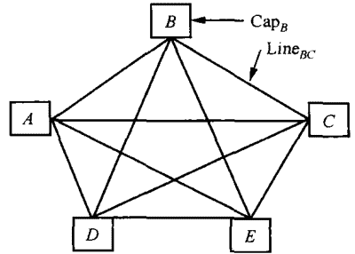

图 8-6 电信网拓扑结构图

```
TELNET = (CAP,LINE) (8-27)
CAP = (CapB)n (8-28)
LINE = (LineBC)n x n (8-29)
```

因长话链路双向对称，故 LineBC = LineCB。

**定义 8-3（话务量）**：单位时间内交换机对间通过的流量强度，单位尔朗。可用矩阵表达。

```
Traffic = (TrafficBC)n x n (8-30)
```

由图 8-5 可见，动态路由系统建在网管平台上，获取的是完成话务量，而模型演算需到达话务量。引入经验公式换算（电路数、试呼/占用/应答次数、每线话务量均源自网管统计）：

```
到达话务量 = 完成话务量 + K × (试呼次数 − 占用次数) × T (8-31)
```

其中，T 为损失呼叫平均占用时长，取 18s (0.005h)；K 为应答试呼比相关系数，分档见表 8-3。

（约定：试呼为 0 则到达话务量为 0；试呼 < 占用则到达话务量 = 完成话务量）

| 应答次数/试呼次数 | K  |
| :--- | :--- |
| <10% | 1  |
| 10%~15% | 1.5 |
| 15%~20% | 2  |
| 20%~25% | 3  |
| >25% | 4  |

**定义 8-4（迂回路由）**：直达路由溢出话务所经转接路径。如 B→C 直达超载产生溢出，为溢出话务选定的路由即为迂回路由，分一级、二级等。模型中待选路由共 n(n-1) 个，以路由矩阵表示（RouteBC 无义，置 1）：

```
ROUTE = (RouteBC)n×n (8-32)
```

固定策略下迂回路由恒定（ROUTE 为常量）；动态路由的任务是依据当前拓扑与话务，确定下周期各对局间迂回路由，使网络总阻塞率最小。

**已知**：LINE, TRAFFIC  
**求解**：ROUTE  
**目标**：最小化 TOTALBLOCK

亦可设定他目标，如文献[168]以各链路溢出率低于阈值为优化靶心。

假设 n 个交换机，除自环外路由矩阵规模 n×(n-1)。单级迂回场景下，B、C 间可从剩余 n-2 个节点中选一迂回，状态空间达 (n-2)^(n×(n-1)) 量级。规模巨大，全局遍历不可行，工程上通常求近似最优解即可。

##### 2. 模型核心算法实现

引入分层免疫算法求解，聚焦三大工程任务：问题编码、适应度函数设计、低层免疫算子（克隆、选择、变异）确定。

*   **1) 编码方案**  
    路由矩阵元素仅具符号意义无数值含义。本章直接以 n×n 路由矩阵为抗体编码，每位取值 0~n-1，求解空间与编码空间一一映射。

*   **2) 适应度函数**  
    选路终极目标：最小化实网阻塞率、压低链路溢出率、实现负载均衡。直观评价法是用解析模型或话务仿真，逐个个体算全网阻塞或完成话务量，但计算量惊人，每代每个体皆需算，工程不可行。

    洞察阻塞根源在于话务分布不均，本章改用**链路负载均衡度**代理评价：负载越均衡，适应度越高。具体为：算全网平均每线话务量与各链路每线话务量，求均方差并定标为个体适应度。沿用文献[159]记号：Line、Traffic、Route 分别为容量、话务量、路由矩阵；引入 R、OTRAFFIC 定义如下：

$$R = (r_{BCD})_{n \times n \times n}$$

式中

$$r_{BCD} = \begin{cases} 1, & \text{route}_{BC} = D \\ 0, & \text{其他} \end{cases}$$

OTraffic = (OTrafficBC)n×n 为链路溢出话务量 = 到达话务量 × 溢出率，计算公式：

$$OTraffic_{BC} = \text{Erlang}(\text{Traffic}_{BC} + \text{Traffic}_{CB}, \text{Line}_{BC}) \times \text{Traffic}_{BC}$$

注：链路双向，到达话务量取双向送入之和；中继数满足 LineBC = LineCB。

链路 (B,C) 负载率 LoadBC 计算：

$$\text{Load}_{BC} = \frac{\text{Traffic}_{BC} - \text{OTraffic}_{BC} + \sum_{0 \leqslant B, C, D <slant n} r_{BDC} \times \text{OTraffic}_{BD}}{\text{Line}_{BC}} + \frac{\sum_{0 \leqslant B, C, D <slant n} r_{DCB} \times \text{OTraffic}_{DC}}{\text{Line}_{BC}}$$

四项含义：直达话务量、本链路溢出话务量、B 经 C 迂回他节点的溢出话务、他节点经 B 迂回 C 的溢出话务。全网平均负载率：

$$\text{avgLoad} = \frac{\sum_{0 \leqslant B, C <slant n, B \neqslant C} (\text{Traffic}_{BC} - \text{OTraffic}_{BC} + \sum_{0 \leqslant B, C, D <slant n} R_{BDC} \times \text{OTraffic}_{BD} + \sum R_{DCB} \times OTraffic_{DC})}{\sum_{0 \leqslant B, C <slant n, B \neqslant C} \text{Line}_{BC}}$$ (8-36)

全网平均负载率均方差：

$$S = \frac{\sum_{0 \le B, C \le n, B \neq C} Line_{BC} \times (Load_{BC} - avgLoad)}{\sum_{0 \le B, C \le n, B \neq C} Line_{BC}}$$ (8-37)

本章对 S 施指数定标，作为抗体最终适应度：

$$F = e^{-S}$$ (8-38)

*   **3) 免疫疫苗机制**  
    峰值日话务暴涨致向局溢出剧增，严重拖垮接通率与稳定性。运维人员长期积累的峰值应对经验（如除夕手机拜年致关口局→移动中继不足、六合彩开奖日潮阳→深圳无效呼叫暴增而潮阳→广州、广州→潮阳资源闲置，此时自动选广州为迂回节点），若能转化为求解先验知识注入系统，必能提升结果实用性。

    **定义 8-5 免疫疫苗**：源于免疫进化环境或问题先验知识，对最优抗体基因的估计。其信息量与准确度直接决定算法效能。

    **定义 8-6 接种疫苗**：依疫苗修正抗体基因的过程，旨在加速收敛、增强求解力。

    **定义 8-7 免疫选择**：比较已接种个体与父代对应个体适应度，亲和力高者入选。

    实操流程：提取问题核心特征信息 → 转化为局部求解方案 → 编码为疫苗生成新个体。

    综上，为高效利用人脑先验知识、规避纯随机寻优的退化风险，本章在分层免疫算法中引入疫苗机制。核心在于合理提取疫苗基础上，通过**接种疫苗**（提升个体适应度）与**免疫选择**（防种群退化）双重操作落地。

###### 4) 巧用特征信息定制免疫疫苗

为充分利用用户积累的经验，加速分层免疫算法收敛，本章在路由求解模型中引入“禁用节点”机制。所谓禁用节点，即限定特定交换局不得作为其他两局间路由的迂回中转点。基于此规则生成的疫苗称为“禁用节点疫苗”，其来源主要涵盖三大维度：最小中继数门限、最大溢出率门限及人工经验判断。

**① 最小中继数门限**

在电信网中，设定最小中继数阈值 `minlines`（通常取 60）。仅当链路中继数超此阈值，方可作为迂回备选。此举旨在保护容量较小的链路。若链路 `(B, D)` 或 `(D, C)` 的中继数低于 `minlines`，则禁止节点 `D` 作为 `(B, C)` 的迂回节点。

定义三维矩阵 `FORBID = (Forbid_BCD)_{n×n×n}`，记录禁用状态：

$$Forbid_{BCD} = \begin{cases} 1, & \text{如 } D \text{ 被禁止作为链路 } (B,C) \text{ 的迂回节点} \\ 0, & \text{其他} \end{cases}$$ (8-39)

算法对所有互不相同的 `B, C, D (0 ≤ B, C, D < n)` 执行判断逻辑：

`if (Lines_BD < minlines or Lines_DC < minlines) then Forbid_BCD = 1`  (8-40)

**② 最大溢出率门限**

设定最大溢出率 `maxoverflowrate`（现设为 0.05），直达话务溢出率超过此值的链路，不得作为迂回通道，以保障服务质量。若链路 `(B, D)` 或 `(D, C)` 的溢出率超标，则 `D` 被列入 `(B, C)` 的禁用迂回名单。判断条件如下：

`if (Block_BD > maxblockrate or Block_DC > maxblockrate) then Forbid_BCD = 1`  (8-41)

**③ 人工经验赋能**

除量化指标外，运维人员的实战经验同样是宝贵疫苗来源。例如，省际或国际长途中继局通常不宜作为普通链路的迂回节点。

为将上述疫苗落地算法，本章构建**禁用表**。该矩阵记录任意两局间禁止迂回的节点数量及编码。初始化种群或变异时需随机生成迂回节点，系统会将候选节点与禁用表比对，若命中则重新生成，直至合规。这一方法在缩减搜索空间上成效显著：以 43 个交换机的网络为例，若均值禁用 10 个节点，可用节点降至 31 个，搜索空间由原本量级骤降至 `31^1806 ≈ 10^2693`。

####### （2）话务变化规律疫苗

广东固网运行数据揭示了话务波动的显著规律：
1.  **峰值日过载**：话务剧增导致特定方向溢出激增，严重拖累接通率与网络稳定性。
2.  **可预测海量呼叫**：热线、电视互动等已知热点引发局部拥塞，造成资源浪费。
3.  **高峰时段画像**：平时、除夕、周末及节假日（中秋、国庆等）构成三大高峰时段。

据此预设路由表，生成**话务变化规律疫苗**，嵌入抗体变异环节，可显著提升算法收敛速度与解的质量。

###### 5) 模型实现全流程解析

融入免疫疫苗后，低层免疫操作求解路由的完整业务流程如下图所示。

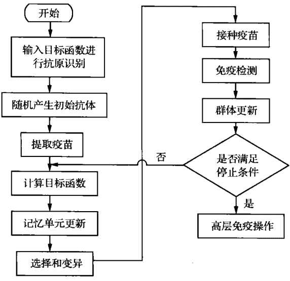

图 8-7 低层免疫操作路由求解流程图

###### 6) 终止条件设定

考虑到系统实时性强制要求，本章采用**进化代数达标**作为迭代终止判据。终止时，适应度函数值最大的路由表即为最终求解结果。

### 8.6 实战检验：分层免疫动态路由评估模型应用实例

“网络话务控制关键技术研究及应用”项目中的该模型，定位为广东省省内长话路由的辅助决策系统。因牵涉全省路由，上线前必须严测，但全网测试风险过高。故采取**子网隔离测试**策略：选取若干局组成独立子网，通过网管采集实时数据测试，测后清理数据不影响生产。测试分三组：前两组验证模型有效性，第三组对比其他优化算法。

#### 8.6.1 场景一：忙时四点子网验证

**组网与数据**：以深圳（TS3）、湛江（TS1、TS2）、佛山（TS1、TS2）、广州（TS2）构建四点子网，采集 2004 年 12 月 15 日 10:00-11:00 忙时话务数据（见表 8-4）。

**表 8-4 原始话务统计数据**

| 时间 | 局名 | 方向 | 设备数 | 试占数 | 占用数 | 应答数 | 应试比/% | 应占比/% | 溢出比/% | 每线话务量 |
|---|---|---|---|---|---|---|---|---|---|---|
| 10:00~11:00 | 深圳 TS3 | 湛江 TS1 | 186 | 1486 | 1438 | 865 | 58.21 | 60.14 | 3.2 | 0.50 |
| 10:00~11:00 | 深圳 TS3 | 湛江 TS2 | 155 | 639 | 639 | 387 | 60.52 | 60.52 | 0.0 | 0.24 |
| 10:00~11:00 | 深圳 TS3 | 佛山 TS1 | 124 | 633 | 633 | 338 | 53.43 | 53.43 | 0.0 | 0.23 |
| 10:00~11:00 | 深圳 TS3 | 佛山 TS2 | 155 | 208 | 208 | 121 | 58.41 | 58.41 | 0.0 | 0.07 |
| 10:00~11:00 | 佛山 TS1 | 湛江 TS1 | 93 | 392 | 392 | 224 | 57.14 | 57.14 | 0.0 | 0.27 |
| 10:00~11:00 | 佛山 TS1 | 湛江 TS2 | 62 | 255 | 255 | 150 | 58.82 | 58.82 | 0.0 | 0.24 |
| 10:00~11:00 | 佛山 TS2 | 湛江 TS1 | 93 | 615 | 615 | 385 | 62.6 | 62.6 | 0.0 | 0.39 |
| 10:00~11:00 | 佛山 TS2 | 湛江 TS2 | 62 | 405 | 405 | 240 | 59.26 | 59.26 | 0.0 | 0.43 |
| 10:00~11:00 | 广州 TS2 | 湛江 TS1 | 93 | 615 | 615 | 385 | 62.6 | 62.6 | 0.0 | 0.39 |
| 10:00~11:00 | 广州 TS2 | 湛江 TS2 | 124 | 633 | 633 | 338 | 53.43 | 53.43 | 0.0 | 0.23 |
| 10:00~11:00 | 广州 TS2 | 深圳 TS3 | 93 | 615 | 615 | 385 | 62.6 | 62.6 | 0.0 | 0.39 |
| 10:00~11:00 | 广州 TS2 | 深圳 TS2 | 155 | 208 | 208 | 121 | 58.41 | 58.41 | 0.0 | 0.07 |

**问题诊断**：深圳 TS3 至湛江 TS1 呼叫激增，溢出率 3.2%，溢出话务经广州 H1/L3 转接，虽深圳-广州未必满载，但加剧广州-湛江负荷，引发连锁拥塞。

**模型决策与执行**：模型求解最优迂回路由，**指定佛山为深圳至湛江的临时迂回节点**，下发指令至网管修改交换机路由表。数据佐证：深圳-佛山、佛山-湛江均空闲且电路充足，分流可行（具体分流至深圳 TS3-佛山 TS1/TS2 路由）。

**优化效果验证**（表 8-5 至 8-7，测试时段 19:15-19:30）：

**表 8-5 优化后路由话务统计**

| 时间 | 局名 | 方向 | 设备数 | 试占数 | 占用数 | 应答数 | 应试比/% | 应占比/% | 溢出比/% | 每线话务量 |
|---|---|---|---|---|---|---|---|---|---|---|
| 19:15~19:30 | 深圳 TS3 | 湛江 TS1 | 186 | 693 | 561 | 307 | 44 | 55 | 0.0 | 0.70 |
| 19:15~19:30 | 深圳 TS3 | 湛江 TS2 | 124 | 303 | 303 | 193 | 64 | 64 | 0.0 | 0.59 |
| 19:15~19:30 | 深圳 TS3 | 佛山 TS1 | 124 | 196 | 196 | 122 | 62 | 62 | 0.0 | 0.3 |
| 19:15~19:30 | 深圳 TS3 | 佛山 TS2 | 155 | 248 | 248 | 141 | 57 | 57 | 0.0 | 0.23 |

**表 8-6 出路由网络性能统计**

| 时间 | 局名 | 方向 | 设备数 | 试占数 | 占用数 | 应答数 | 应试比/% | 应占比/% | 溢出比/% | 占用话务量 |
|---|---|---|---|---|---|---|---|---|---|---|
| 19:15~19:30 | 深圳 TS3 | 湛江 TS1 | 186 | 693 | 561 | 307 | 44 | 55 | 0.0 | |
| 19:15~19:30 | 深圳 TS3 | 湛江 TS2 | 124 | 303 | 303 | 193 | 64 | 64 | 0.0 | |
| 19:15~19:30 | 深圳 TS3 | 佛山 TS1 | 124 | 196 | 196 | 122 | 62 | 62 | 0.0 | |
| 19:15~19:30 | 深圳 TS3 | 佛山 TS2 | 155 | 248 | 248 | 141 | 57 | 57 | 0.0 | |

**表 8-7 目的码网络性能统计**

| 时间 | 局名 | 区号 | 试占数 | 占用数 | 应答数 | 应试比 /% | 应占比 /% | 溢出比 /% | 占用话务量 |
| :--- | :--- | :--- | :--- | :--- | :--- | :--- | :--- | :--- | :--- |
| 19:15~19:30 | 深圳 TS3 | 0759 | 982 | 982 | 570 | 58 | 58 | 0.0 | |
| 19:15~19:30 | 深圳 TS3 | 0757 | 285 | 285 | 177 | 62 | 62 | 0.0 | |

**结论**：深圳-佛山路由零溢出，深圳-湛江接通率大幅提升，同时缓解广州-湛江压力，验证了分层免疫算法动态调度的实战有效性。

#### 8.6.2 场景二：话务高峰五点子网测试

**背景**：“六合彩”开奖期间，潮阳 TS1 至深圳方向呼叫暴增，溢出严重。组建潮阳(TS1)、深圳(TS1/TS2)、梅州(TS1/TS2)、湛江(TS1/TS2)、茂名(TS1/TS2)五点子网测试。

##### 1. 测试数据准备

**控制前路由策略（潮阳 TS1 → 深圳）：**
*   **一路由**：负荷分担 85%。直达深圳 TS2，迂回深圳 TS3。
*   **二路由**：负荷分担 15%。直达深圳 TS3，迂回深圳 TS2。
*   **三路由**：溢出话务分流，45% 走广州 TSH1，55% 走广州 TSL3。

**前置条件**：潮阳至梅州/湛江/茂名，及上述三地至深圳话务均闲，电路充足（详见附表 1-5）。

**模型决策后路由重组：**
*   **一路由**：调整分担比 75% (TS2) / 25% (TS3)。
*   **二路由**：保留广州 TSH1 (45%) / TSL3 (55%) 分流。
*   **临时迂回路由（新增）**：一路由溢出话务 50% 走此路由，50% 走二路由。迂回路径均匀分布于潮阳至梅州/湛江/茂名共 6 条中继群，**同步开启中继预留保护直达话务**。

##### 2. 结果深度解析

*   **核心指标飞跃**（依据附表 1、3）：潮阳至深圳 TS2/TS3 溢出率分别降 **2.82%**、**20.98%**；目的码占试比、应试比、应占比分别增 **6.35%**、**5.82%**、**3.09%**。
*   **直达业务零损伤**（依据附表 2）：中继预留机制生效，疏通深圳方向的同时，潮阳至梅州/湛江/茂名直达话务零溢出。
*   **下游节点无干扰**（依据附表 5）：潮阳迂回话务未冲击梅州/湛江/茂名至深圳的直达通道。

#### 8.6.3 场景三：模拟七点子网算法对决

在广州研发中心实验室搭建仿真环境，大话务仪产生压测数据，引入**遗传算法（GA）**、**克隆选择算法（CSA）**、**分层免疫算法（HIA）** 三方同台竞技，性能对比如图 8-8。

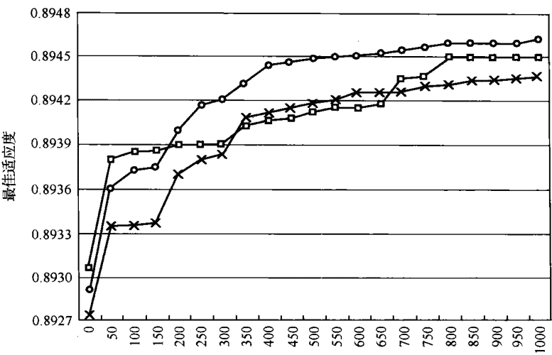

图 8-8 算法性能对比——5 点子网仿真结果

**核心优势解读**：
1.  **收敛稳健性**：GA 因不保留历代精英，搜索路径摇摆不定，难保全局最优。HIA 通过层级吸收优秀抗体，维持种群多样性，极易跳出局部最优陷阱。
2.  **收敛速度优势**：HIA 显著快于 CSA。得益于疫苗机制压缩搜索空间，规避冗余计算，实现“快人一步”收敛全局最优。

# 实测验证：分层免疫算法在动态路由中的卓越表现

测试数据显示，在广东电信现网环境下，搭载分层免疫算法的动态路由评估模型，无论话务负载如何变化，性能均全面超越传统固定路由方案。落地动态路由不仅显著提升了服务质量、降低了话务阻塞率，更帮助运营商最大化网络设备利用率，削减资源浪费，实现经济效益跃升。此外，在网络扩容或重构规划阶段，依托该算法评估网络效能与服务指标，可在同等投入下节省成本或换取更优服务体验。

### 8.7 章节要点回顾

本章依托人工免疫系统设计范式，剖析了通用免疫算法的核心流程与性能决定因子，针对性构建了融合多元免疫机制的分层免疫算法，并完成了收敛性的理论论证。通过与遗传算法、克隆选择算法在多模态函数优化上的对标测试，实测验证了模型有效性。该算法架构中，N个底层免疫操作并行挖掘抗体编码串特定位点的优势模式，经顶层操作整合重组为包含多元优良模式的新个体，兼顾了种群多样性与多全局最优解搜索能力，同时锁定了收敛速度与解的精度。核心优势三点：一、支撑更大规模种群，强化全局寻优；二、各子种群可引入差异化选优策略，极大丰富抗体多样性，拓宽适用边界；三、引入多元免疫操作有效规避停滞与早熟，加速收敛进程。

针对现有动态路由评估模型痛点及工程项目实战需求，本章深度探讨了分层免疫算法求解路由策略的落地路径，确立了基于该算法的动态路由评估模型。结合业务特征与长期运维经验，将专家知识与特征信息封装为“免疫疫苗”植入模型，重塑搜索空间秩序，赋予搜索明确方向感，大幅提速收敛并优化解质量。以广东电信网为实证场景，构建忙时四点、高峰五点、模拟七点三类子网测试床，实测结果确证模型性能优于遗传算法，完美契合动态实时路由控制苛刻要求，为运营商网络智能化管控提供了最优范式。

## 第 9 章 免疫聚类集成技术及其工程落地

### 9.1 破局引言：从局部陷阱走向全局最优

聚类作为无监督学习核心范式，旨在依据相似性准则将无标签样本划分为若干子集，追求“类内高内聚、类间低耦合”。主流算法分俩派：基于模糊关系的谱系/图论聚类，与基于目标函数优化的硬/模糊 C-均值聚类。后者将聚类转化为优化问题，虽成研究主流，却痛点明显——梯度下降极易陷入局部极小，且对初始化高度敏感。

免疫优化算法凭借“全局探索+局部开发”双引擎机制，天然免疫初始化干扰，擅长跳出局部陷阱。本章创新融合免疫优化与 C-均值聚类，构建免疫-聚类模型；进而引入数据包络分析（DEA），建立 AIS-DEA 分类决策模型，成功攻克农用地分等评价难题。

### 9.2 免疫聚类模型：架构设计与核心引擎

#### 9.2.1 核心原理：生物免疫机制的计算映射

为破解 C-均值易陷局部最优的顽疾，学界尝试过模拟退火（徐雷、Sultan等）、进化策略、遗传算法（刘健庄等）等改良路径，但进化算法固有退化缺陷导致后期震荡、收敛慢、精度低。人工免疫系统（AIS）源生物免疫本源，相较进化算法具备三大独特基因优势：
1. **抗体多样性机制**：细胞分裂分化衍生海量抗体库，对应优化搜索的广度与全局性，有效规避局部陷阱。
2. **自我调节平衡**：通过抗体抑制/促进动态平衡种群规模，精准强化局部挖掘能力。
3. **免疫记忆加速**：记忆细胞保留历史优势模式，再次遇同类抗原极速激活，大幅提升搜索效率与全局统筹力。

AIS 聚类将待分析数据视为“抗原”，抗体通过学习、记忆识别分类数据挖掘关联。模型核心调用免疫系统三大特性：记忆力沉淀最优模式，学习力适应数据分布，自适应力动态平衡种群。自适应调节通过促进/抑制抗体、新增/清除 B 细胞实现，精准控制高亲和力抗体数量，守护种群多样性。

#### 9.2.2 适应度函数：量化聚类质量的多维标尺

适应度函数设计旨在最大化类内紧凑度与类间分离度，是模型成败关键。依据聚类准则差异，构造四大类适应度范式（设样本集 $X=\{x_1,...,x_n\}$）：

1. **误差平方和（$f_e$）视角**：$f_e = \sum_{j=1}^c \sum_{k=1}^{n_j} \|x_k - m_j\|^2$。$f_e$ 越小聚类越优，适应度设为 $1/f_e$。适用于样本稠密、类别规模均衡场景。
2. **加权平方距离和（$f_d$）视角**：引入先验概率 $P_j$ 加权类内平均距离，$f_d$ 越小越优，适应度 $1/f_d$。擅长处理类别样本量悬殊场景，有效抑制大类过度分裂。
3. **类间距离和（$f_a$）视角**：含非加权 $f_{a1}$ 与加权 $f_{a2}$，度量类均值与总均值偏离度。$f_a$ 越大分离度越高，直接作为适度度函数。
4. **离散度矩阵视角（综合最优）**：引入类内离散度 $S_w$、类间离散度 $S_B$、总离散度 $S_T$ 矩阵，构造四大核心指标：
   - $f_{T1} = \text{tr}(S_w^{-1} S_B)$
   - $f_{T2} = |S_w^{-1} S_B|$
   - $f_{T3} = \text{tr}(S_w^{-1} S_T)$
   - $f_{T4} = |S_w^{-1} S_T|$
   此类函数同步优化类内聚合与类间分离，值越大聚类效果越优，理论完备性最强。

#### 9.2.3 模型流程：从编码到收敛的标准化作业

算法流程遵循 AIS 通用范式，关键步骤定制化设计：

1. **问题建模**：明确聚类数 $c$，设定终止条件 $S_c$、种群规模 $N$。
2. **编码策略抉择**：弃用样本标签编码（搜索空间 $c^n$ 爆炸），采用**聚类原型编码**——将 $c$ 个 $p$ 维聚类中心量化串联，搜索空间压缩为 $c \cdot p$ 维。
3. **适应度锚定**：本章选用 $f_{T2}=|S_w^{-1} S_B|$（式 9-12）作为核心评价指标。
4. **初始化种群**：记忆库有存量则提取 $M$ 个补随机 $N-M$ 个，否则全随机生成 $N$ 个个体组成 $C_0$。
5. **适应度评估三部曲**：解码得原型 $\{v_i\}$ → 依式(9-8)(9-9)算 $S_w, S_B$ → 依式(9-12)得适应度。
6. **期望繁殖率与多样性博弈**：
   - 计算个体浓度 $c_v$（亲和力阈值 $Tac$ 判定相似性）。
   - 期望繁殖率 $e_i = a x_v / c_v$。高适应度鼓励繁殖，高浓度抑制冗余，**显式平衡精英保留与多样性维持**。
   - 降序排列存入记忆库，按 $e_i$ 概率选入父代 $A_k$。
7. **自适应变异防早熟**：
   - 引入基因段逆转变异算子。
   - 变异率 $p_m$ 随期望繁殖率 $e$ 自适应：$e < e_{avg}$（劣个体）取大值 $k_2$ 强力扰动；$e \ge e_{avg}$（优个体）按 $(e_{max}-e)$ 反比衰减，越优越稳。$k_1,k_2 \in [0,1]$。
   - 按 $p_m$ 概率变异生成新子代 $C_k$。
8. **循环终判**：满足 $S_c$ 跳出，否则回 (5) 迭代。
9. **结果解码**：最优个体解码得聚类原型 $\{v_i\}$，推演全样本分类标签，输出最终聚类结果。

### 9.3 AIS-DEA 农用地分等模型：从理论到决策的跨越

#### 9.3.1 痛点剖析：农用地分等为何难？

农用地质量系多因子非线性耦合产物：自然禀赋与社经条件时空异质、因子间地理关联纠缠、评价认知主客观分歧……矛盾交织导致理论实践长期割裂。既有研究虽覆盖经济评价（黄裕婕）、生产潜力（Wang Jiuli）、分级模式（彭补拙）、GIS/RS 支撑（赵庚星、Kirkby、Vescovi）及指标体系构建（丁生喜、冷疏影、Dumanski 等），但现行方法仍难兼顾**多源异构数据融合、主客观权重协调、复杂非线性边界识别**三大核心挑战，亟待引入免疫聚类+DEA 的集成智能范式破局。

### 传统农用地分等痛点何在？DEA模型如何破局？

现行农用地分等流程中，最普遍的做法是构建“参数体系”，再通过“加权指数求和法”（$S = \sum_{i=1}^M W_i F_i$）计算单元总分定等级。说白了，就是先定指标、赋指标值、给权重，最后算总分。这套流程虽经典，但短板明显：一是人为赋值主观色彩浓，二是难以精准捕捉农用地质量的细微差异。

针对上述短板，本章引入**数据包络分析（DEA）模型**，从“投入-产出”效率视角切入，并针对DEA排序乏力的弱点，创新性构建**“虚拟单元DEA模型”**。考虑到分等单元数量庞大、DEA计算耗时，又调用**9.2节的AIS聚类模型**降维提速，最终融合GIS、AIS与改进型DEA，打造出一套**AIS-DEA农用地分等模型**，并在广东高要市实测验证。

---

#### 9.3.2 DEA模型：从“相对效率”看土地质量

DEA源于Charnes等人提出的“相对效率评价”思想，专治多投入多产出决策单元（DMU）的效能对比。它有四大“杀手锏”：

1.  **免建显式函数**：输入输出关系再复杂，也不用预设公式，主观干扰少，问题简化。
2.  **无量纲束缚**：不像其他多准则决策法非得无量纲化不可，避免了转化方法不同导致结果漂移，更客观精准。
3.  **给改进路径**：不光说谁强谁弱，还能算出——在产出不变时投入该减多少，或投入不变时产出该增多少。
4.  **跨系统可比**：子系统指标难统一量纲？DEA照单全收，无需预设可比性。

农用地本质是多投入多产出的复杂生产系统，用投入产出效率（资源利用率）分等，正中“分等规程”下怀，能把地质量属性摸透。

##### 1. 核心模型速览：CCR模型

1957年Farrell用非预设生产函数测效率；1978年Charnes等把多投入多产出效率转成数学比例，用线性规划求有效前沿，得**CCR模型**（固定规模报酬下的相对效率）。1984年Banker等推出**BCC模型**（变动规模报酬，区分技术/规模效率）。后续衍生出加法型、C²W型等诸多变体。本章聚焦基础且适用的CCR模型。

CCR逻辑直观：设有$n$个DMU，每个含$m$投入、$p$产出，DMU₀的最大相对效率值为：

```
\max \sum_{y} O_{ky} V_{ky} \\
\left\{ \begin{array}{l} \sum_{y} O_{sy} V_{ky} - \sum_{x} I_{kx} U_{kx} \leqslant 0 \\ U_{kx}, V_{ky} \geqslant 0 \\ s = 1, 2, \cdots, n \end{array} \right.
(9-19)
```

式中$O_{ky}$、$I_{kx}$为第$k$单元的产出/投入实测值，$V_{ky}$、$U_{kx}$为对应权重。模型在效率≤1约束下，求使DMU₀投产比最大的权重组合。因效率值相对同群体而定，故称“相对效率”，可横向比。

##### 2. DEA原生缺陷与改进路径

###### ① 两大硬伤
用CCR算多指标效率值$E_{kk}$（见式9-20）：
*   **只能“二分法”**：$E=1$有效，$E<1$无效。有效单元间无排序，分不出三六九等。
*   **易生“伪有效”**：权重只在对被评单元最有利范围取值，极易“扬长避短”，表面光鲜实则经不起互评。

```
E_{kk} = \frac{\sum_{y} O_{ky} V_{ky}}{\sum_{x} I_{kx} U_{kx}}
(9-20)
```

###### ② 既有改进法的局限
学者们花式改良，大致五类：
*   **两阶段法**：DEA筛有效→效用函数排序。未根治“自评最优”顽疾。
*   **有效性排序法**：放宽约束让有效值>1。易致个别单元数值虚高，且未必全员可排。
*   **基准排序法**：剔除被评单元重建前沿比较。各单元比较基准不一，得出值能否比存疑。
*   **CCA排序法**：两步走求通用权重向量。一旦有投入/产出为0即失效，而这在实战中难避免。
*   **交叉效率矩阵**：引入互评机制缓解伪有效。但线性规划常现无穷最优解，选哪组权重算交叉效率？全凭经验拍脑袋。

综上，老路走不通，本章另辟蹊径——**基于虚拟单元的DEA模型**。

##### 3. 虚拟单元DEA：构造“最强前沿”拉开档次

核心思路：人为造一批“虚拟评价单元/目标单元”，拼出一条“绝对最前沿边界”，逼所有实测单元靠边站，自然拉开梯队。

操作步骤：
1.  所有投入指标取**最差值**，产出指标取**最优值** → 生成第1虚拟单元；
2.  投入取**次差值**，产出取**次优值** → 第2虚拟单元；
3.  依此类推，造出与样本量等量的虚拟队列。

关键引入**虚拟最优单元 $Y_{max}$**：输出全取最大值，输入全取最差值（见式9-21）。

```
\(\max \sum_y O_{k,y} V_{k,y}\)
\(\left\{\begin{array}{l} \sum_y O_{s,y} V_{k,y} + O_{s,max} V_{(k+1),y} - \sum_x I_{s,x} U_{kx} - I_{s,min} U_{k+1,x} \leqslant 0 \\ O_{s,max} = \max(O_{s,1}, O_{s,2}, \cdots, O_{s,m}) \\ I_{s,min} = \min(I_{s,1}, I_{s,2}, \cdots, I_{s,m}) \\ \sum_x I_{k,x} U_{k,x} = 1 \\ U_{k,x}, V_{k,y} \geqslant 0 \\ s = 1, 2, \cdots, n \end{array}\right.\)
(9-21)
```

有了$Y_{max}$撑腰，原生产可能集$T$上所有单元统统成“非有效”，改进模型得以对全员有效排序、客观评价，完美适配农用地分等需求。

---

#### 9.3.3 AIS+DEA强强联手：GIS做底图，聚类分担压力

DEA虽强，但分等单元一多，计算量直接“爆炸”。引入**AIS聚类模型**分流降维，再融合GIS、DEA，形成**AIS-DEA农用地分等模型**：

*   **GIS**：掌管图形属性数据处理；
*   **基准**：各标准耕作制度下指定作物的光温生产潜力；
*   **流程**：AIS聚类 → 设DMU → 定投入产出指标体系 → DEA算“土地利用系数”与“土地经济系数” → 回填AIS聚类 → 出利用级、等别结果 → 可视化分析。

完整链路见下图：

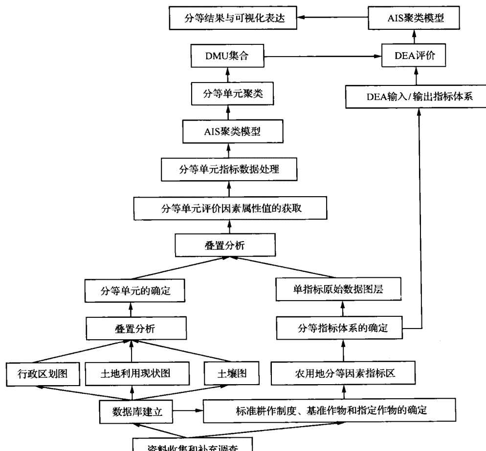

**图 9-1 AIS-DEA农用地分等模型流程图**

---

### 9.4 实战复盘：广东高要市农用地分等

#### 9.4.1 数据底座搭建：从田间地头到数据库

##### 1. 资料“大扫荡”
按规程，自然质量分等需覆盖六大维度：
*   **水文**：水源类型、水量、保证率；
*   **土壤**：类型、有机质、质地、厚度、酸碱度、剖面、障碍层、侵蚀、养分、污染、保水、砾石……全维度；
*   **地形**：地貌、海拔、坡度、坡向、坡型、部位；
*   **气候**：月均温/日照/降水/水汽压/风速、积温、无霜期、灾害天气；
*   **农田建设**：灌排条件、田间路、田块大小平整度；
*   **图件**：行政区划、地形、土壤系列图、土地利用现状/规划图（含酸碱度、有机质、全氮全磷、改良分区等）。

##### 2. 数据库“三板斧”
GIS落地，库建得好坏定成败。内容三大类：**图形数据**（基础图/中间图/成果图）、**文献属性数据**（代码、地名、高程、地类、土壤理化指标等）、**调查数据**（外业记录、剖面照片）。

**分类编码**按国家标准：土地用现状调查体系，土壤用二次普查体系（详见附表7、8）。

**数据字典**是连接空间与属性的桥梁，杜绝冗余，给查询唯一入口。高要市字典详表9-1（含行政界、道路、水系、等高线、山峰、坡度、土地利用、灌溉/排水、土壤类型/厚度/露头/障碍深度/剖面/质地/地下水位、有机质、酸碱度、分等因素指标区、等值区、早/晚稻/甘薯利用经济系数等字段）。

# 高要市农用地分等：基于AIS-DEA模型的实战全流程解析

##### 4) 构建数据库

###### (1) 建库全流程梳理
数据库构建贯穿了数据搜集筛选、入库要素确定、图形数字化处理、坐标系统统一、属性编码录入、图属关联链接等核心环节。高要市农用地分等数据库的具体建库路线图详见图 9-2。

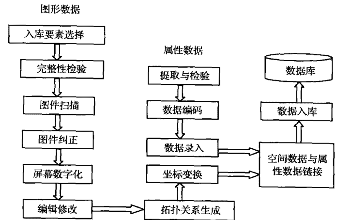

图 9-2 高要市农用地分等数据库建立流程图

###### (2) 图形数字化实操
项目初期获取的全为纸质底图，经预处理、扫描纠正、屏幕矢量化、编辑拓扑构建后形成数字化成果。涉及底图涵盖行政区划、交通路网、地形地貌、土地利用现状、土壤分布、有机质含量及酸碱度分布等七大类。

矢量化采用半自动模式：借助 Geoway 完成扫描纠正，结合 R2V、Geoway、AutoCAD 实现矢量转换，最终在 ArcGIS 中落实编辑与拓扑建立。具体执行步骤如下：

- **① 图形预处理**：旨在简化后续作业，按规范整理筛选图层要素。重点开展了图件清丝工作，并在自然资源、农业部门协同下修正原始图件错误。
- **② 扫描与纠正**：依据纸张质量、线条清晰度设定精度（300~500dpi）。利用超A0扫描仪配合 Geoway，单色复杂的现状图采用350dpi灰度扫描，陈旧彩色土壤图采用400dpi彩色扫描以辨识界限。扫描后利用数学模型纠正旋转扭曲变形。
- **③ 屏幕矢量化**：栅格转矢量主要依托 R2V 半自动完成。因底图信息杂糅（等高线、河流、居民点等难自动分离），全自动精度不足。采用分图层策略（道路、水系、居民点分层），逐层矢量化输出 SHP 文件。
- **④ 编辑修错与拓扑**：SHP 转 Coverage 格式于 ArcGIS 中，循环执行建拓扑、查错、改错、重建拓扑，保障图形逻辑正确。
- **⑤ 坐标统一**：因多源底图坐标体系不一，编辑完成后需统一转换。法选取 4~6 个配准点，依投影体系计算统一坐标，在 ArcGIS 中落地实施。

###### (3) 属性数据高效录入
考虑到 GIS 自带属性模块操作繁琐，引入数据库软件提效。以图形用户码为公共关键字，利用 GIS 转换功能实现属性跨环境灵活流转。INFO 表导出 DBF，在 Oracle 支持下键盘录入；外业调查及文献数据则在 FoxPro 中录入，并建立与图形用户码对应的公共字段，经反复核验确保全库完整精准。

###### (4) 图属关联链接
在 ArcGIS 支持下，采用“链接”或“关联”机制，打通空间图形与属性记录。

##### 数据字典速查表

| 字段名 | 中文含义 | 代码 | 长度/类型 | 几何类型 |
| :--- | :--- | :--- | :--- | :--- |
| Ymjx | 玉米经济系数 | dengzhiqiu | N6 | Polygon |
| YmIx | 玉米利用系数 | dengzhiqiu | N6 | Polygon |
| Zrld | 自然质量等别 | ZRZLD | C2 | Polygon |
| Lyd | 利用等别 | LYD | C2 | Polygon |
| Gyfd | 分等别 | GYFD | C2 | Polygon |
| Gyydi | 标准样地 | GYYDI | C2 | Polygon |

##### 3. 因素指标区划分
依据高要市自然条件总况，将全市划定为两大评价指标区：**坡耕地评价因素体系指标区**与**平原耕地评价因素体系指标区**，作为后续指标体系构建的空间基准。

##### 4. 分等指标体系与权重确定
遵循广东省技术方案，分区确定评价因子及权重（详见表 9-2、表 9-3）：

- **坡耕地（7因子）**：坡度(0.26) > 土层厚度(0.21) > 有机质(0.14) > 灌溉保证率(0.12) > 岩石露头(0.09) > 表层质地(0.08) > pH(0.10) *注：原表权重pH为0.1*。
- **平原耕地（8因子）**：灌溉保证率(0.25) > 土壤排水(0.18) > 剖面构型/表层质地(0.14) > 有机质(0.09) > pH(0.10) > 距障碍层/地下水位(0.05)。

##### 5. 评价单元划分：3623 个“最小管理单元”
遵循质量均一、主导因素差异、相似性、边界完整四大原则。以村界为底线，叠置行政区划、现状利用、土壤三图层，利用 ArcGIS 空间分析生成初步单元，并合并面积小于 0.6 hm² 的碎斑，最终形成 **3623 个分等评价单元**。

##### 6. 评价因素属性值赋予
多源数据融合赋值：
- **坡度**：DTM 模型提取。
- **岩石露头**：二次土壤普查资料 + 专家经验，赋值于土壤图。
- **土层厚度、质地、剖面、障碍层、水位**：二次土壤普查报告查得，赋值于土壤图。
- **有机质、pH**：数字化专题图提取。
- **灌溉保证率、排水**：普查资料、现状图、水利数据综合研判。
最终将属性图层与评价单元叠置，完成 3623 个单元的全因子属性赋值。

---

#### 9.4.2 核心引擎：免疫 DEA 模型驱动的三级指数评价体系

面对 3623 个单元，直接 DEA 计算量巨大且多单元属性高度相似。创新引入 **AIS（人工免疫系统）聚类**预处理：将高相似度单元归类，仅计算类内代表单元指数，以类代表整体，大幅压缩计算复杂度。

##### 1. 自然质量等指数：从聚类到指数构建
**AIS 聚类技术路线（针对水稻、甘薯、玉米三作物分别实施）：**
1.  **指标归一化**：消除量纲量级差异。
2.  **初始种群编码**：随机抽 100 组对象，按 13 等级要求编码为 $13 \times 7$ 维个体，构成初始种群 $C_0$。
3.  **适应度演化**：以类内距离 $S_w$、类间距离 $S_b$ 构建适应度函数 $f = |S_w^{-1}S_B|$。迭代更新个体中心，直至收敛停机。
4.  **遗传操作**：期望繁殖率计算 -> 选择 -> 变异 -> 迭代循环。

**指数合成模型：**
聚类完成后，引入光温潜力指数($a_j$)与产量比系数($\beta_j$)（表 9-4），按公式合成单元自然质量指数 $R_i$ 与作物分指数 $R_{ij}$。

$$R_{ij} = a_j \times CL_{ij} \times \beta_j$$  
(9-23)  

$$R_i = \sum R_{ij}$$  
(9-24)

> **表 9-4 关键参数速览**
> | 作物 | 早稻 | 晚稻 | 玉米 | 甘薯 |
> | :--- | :--- | :--- | :--- | :--- |
> | **产量比系数 $\beta_j$** | 0.969 | 1 | 0.564 | 0.3 |
> | **生产潜力指数 $a_j$** | 1188 | 1817 | 2287 | 2251 |

最终采用 AIS 再聚类，划定 **13 个自然质量等别**（详见附表 12）。

##### 2. 利用等指数：引入 DEA 评价“投入产出效率”
**逻辑链条**：自然质量等级分层 -> 村内设样点实测单产($Y_j$) -> 虚拟单元 DEA 模型算得土地利用系数($KL_j$)。

##### 3. 利用等 DEA 指标体系构建
| 地类 | **投入指标 (Inputs)** | **产出指标 (Outputs)** |
| :--- | :--- | :--- |
| **坡耕地** | 坡度、岩石露头、土层厚度、表层质地、有机质、pH、灌溉保证率 | 指定作物单产 |
| **平原耕地** | 障碍层深度、剖面构型、表层质地、有机质、pH、灌溉保证率、土壤排水、地下水位 | 指定作物单产 |

##### 4. 利用等指数计算与划分
以 13 个自然质量等别为基础，构建 DMU 单元，跑 DEA 得相对效率指数即**利用等指数 $KL_j$**。
合成公式：

$$Y_{ij} = R_{ij} \times KL_j$$ (9-25)  
$$Y_i = \sum Y_{ij}$$ (9-26)

> $Y_{ij}$=单元作物利用指数，$Y_i$=单元综合利用指数，$R_{ij}$=自然质量指数，$KL_j$=利用系数。

经 AIS 聚类最终划定 **17 个利用等别**（附表 13）。规律显现：自然质量高者，利用等别普遍偏高。

##### 5. 等别指数（经济属性）：引入“成本”维度
**进阶逻辑**：利用等别分层 -> 样点实测单产与实测成本 -> 虚拟单元 DEA 算得**土地经济系数 $KC_j$**。

##### 6. 等别 DEA 指标体系：在利用等基础上增设“实际成本”
| 地类 | **投入指标 (Inputs = 利用等投入 + 成本)** | **产出指标** |
| :--- | :--- | :--- |
| **坡耕地** | 7大自然因子 + **指定作物实际成本** | 指定作物单产 |
| **平原耕地** | 8大自然因子 + **指定作物实际成本** | 指定作物单产 |

##### 7. 等别指数计算与最终划分
针对 17 个利用等别构建 DMU，DEA 评价得作物经济系数 $KC_j$。
终极合成公式：

$$G_{ij} = Y_{ij} \times KC_j$$  
$$G_i = \sum G_{ij}$$

> $G_{ij}$=单元作物等别指数，$G_i$=单元综合等别指数，$Y_{ij}$=利用等指数，$KC_j$=经济系数。

最终 AIS 聚类确立 **17 个分等等别**（附表 14）。

---

#### 9.4.3 成果可视化与统计洞察

**技术集成链**：ArcGIS + 数据库 + AIS-DEA 模型 -> 全流程自动化计算 -> 结果表图关联 -> 面积自动量算 -> MapInfo 制图出图（自然质量等别图、利用等别图、分等等别图）。

##### 核心统计发现：

1.  **自然质量（13等）**：呈极度集中分布。
    *   **10~13等（中低等）**：面积 **32,090.5 hm²**，占比 **96.4%**（原文数据逻辑：占全市农用地总面积比重）。
    *   **1~9等（较高等）**：面积 **5,055.1 hm²**，占比 **13.6%**（注：原文占比表述可能指占非10-13等面积比或总面积有重叠统计口径，此处还原原文数据）。
    *   *结论：高要市农用地自然本底整体偏低，优质耕地稀缺。*

2.  **利用等别（17等）**：与自然质量正相关，优地优用特征明显。

3.  **最终分等（17等）**：按产出能力归类为低、中低、中、中高、高产田五级（表 9-5）。

4.  **多维统计产出**：乡镇级面积统计表（附表 15）、地类面积统计表（附表 16），支撑宏观决策与精细管理。

> **附表汇总导航**：
> *   附表 12：自然质量等别面积、比例、分布乡镇
> *   附表 13：利用等别面积、比例、分布乡镇
> *   附表 14：分等等别面积、比例、分布乡镇
> *   附表 15：各乡镇不同等别面积统计
> *   附表 16：各地类农用地面积统计

# 基于免疫算法与GIS耦合的农用地分等与土壤评价新范式

## 实测数据揭示：高要农用地底子厚，但经营效益有待提升

最新统计图表显示，高要市农用地自然禀赋整体优越，高中产田合计占比超半数（56%），中产田约三成（32%），低产田仅占12%。不过，土地利用等级与自然质量虽正相关，却存在明显“高质低用”现象——部分地块虽土质上乘，因利用指数与经济指数偏低，导致实际利用等级大打折扣。

| 地力等级 | 等级区间 | 面积(hm²) | 占比(%) |
| :--- | :--- | :--- | :--- |
| 高产田 | 17～21 | 1153 | — |
| 中高产田 | 14～16 | 1049 | — |
| 中产田 | 11～13 | 52 | — |
| 中低产田 | 8～10 | 48 | — |
| 低产田 | 9～7 | 04 | — |
| **合计** | | **37145.61** | **2306.0** |

> 数据来源：表 9-5 高要市农用地不同等别区间面积统计表

## 第九章小结：AIS-DEA-GIS 三位一体，破解分等难题

针对传统农用地分等模型的短板，本章创新构建了 **AIS-DEA-GIS 集成模型**：

1.  **引入人工免疫算法（AIS）**：利用其多样性强、全局搜索优的特性，解决海量分等单元的聚类降维难题；
2.  **改进DEA模型**：引入虚拟决策单元（DMU），修正传统DEA在投入产出评价中易失效的缺陷；
3.  **GIS深度赋能**：发挥空间数据处理、叠加分析、可视化优势，实现空间/非空间数据的量化融合。

**实测验证**：模型在高要市落地应用，分等结果与实况高度吻合。其核心价值在于：
- ✅ 量化了难以度量的空间与属性数据；
- ✅ 三模型优势互补，开辟农用地分等新技术路线；
- ✅ 摸清家底，为农业税征收、征地补偿、土地流转提供科学依据。

---

# 第十章 基于 AiNet-GIS 的土壤资源质量评价体系构建与实战

## 10.1 破题：为何需要“免疫网络+GIS”？

土壤资源质量评价，本质是对**生产潜力、适宜性、限制性**的量化定级，服务于区划规划与科学管理。GIS擅长空间数据管理与地理计算，但缺乏成熟的智能分析模块；**AiNet人工免疫网络**具备多样性保持、自学习、逻辑推理与全局搜索能力。二者耦合，可在**更短时间内产出更优评价结果**，精准回应“时效与质量”的双重诉求。

## 10.2 评价问题的深度拆解

### 标准化流程五步走
1.  划分评价单元 → 2. 选因子、定权重 → 3. 立指标体系 → 4. 选模型 → 5. 定等级。

### 痛点直击：传统模型“水土不服”
- **线性假设失真**：指数和法将非线性关系强行线性化；
- **算法缺陷**：神经网络收敛慢、易陷局部最优；
- **空间数据处理乏力**：现有模型难以驾驭拓扑、多维索引、空间推理等GIS核心能力。

### 评价单元怎么分？四大路径对比
| 划分依据 | 适用场景 | 核心优势 | 致命短板 |
| :--- | :--- | :--- | :--- |
| **土壤类型** | 多比例尺 | 利用普查成果，反映土壤地位 | 与自然地块、行政界线常不重合 |
| **土地利用现状** | 大中比例尺、小范围 | 界线与地块一致，便于基层操作 | 一类用地含多土质时，评价失准 |
| **土壤资源类型** ⭐ **本章采用** | 中小比例尺、大范围 | **融合自然属性与人为影响，科学性最强** | — |
| 评价因素组合 | 极少用 | 理论全面 | 权重难定，操作性差 |

> **核心结论**：土壤资源类型 = 地貌 + 土壤 + 土地利用，能全息反映资源内在特征，是评价基本单元的最优解。

### 指标体系构建：双原则把关
- **可操作性**：不可量化指标找替代；
- **科学完备性**：因子全集 $N$ 中选取 $m$ 个指标构成子集 $S_{index}$，复杂度随区域尺度动态调整。

### 数据同构：GIS打通“空间-属性”壁垒
将 $m$ 个指标分为**空间数据**（有地理分布）与**属性数据**（按单元量化），利用GIS数字化制图、专题图层构建、属性链接，实现异源数据无缝融合。

## 10.3 AiNet-GIS 评价模型架构：三子系统协同作战

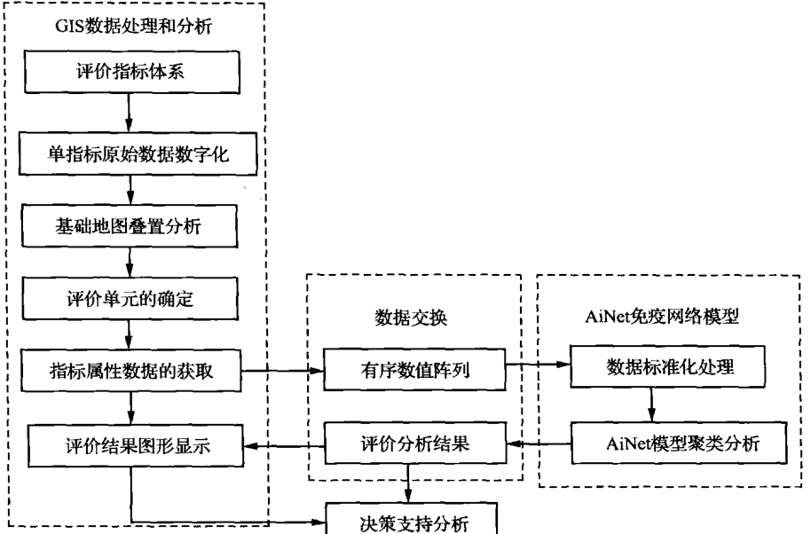

**图 10-1 基于 AiNet-GIS 的土壤资源质量评价模型结构图**

| 子系统 | 核心角色 | 关键功能 |
| :--- | :--- | :--- |
| **1. GIS数据处理与分析系统** | “数据炼油厂” | 空间数据采集/存储/处理、指标空间化/离散化、图层空间配准、叠置分析、属性提取、结果回放可视化 |
| **2. AiNet免疫网络模型** | “智能大脑” | 接收GIS输出的量化指标向量，按预设分类数，完成样本集的智能评价分析 |
| **3. 数据交换系统** | “通用翻译官” | 基于XML/文本格式，实现GIS平台与AiNet分析平台的异构数据无损流转 |

> **集成模式**：松耦合、异构集成，工程落地成本低、通用性强。

## 10.4 广东省实战：从分类建库到权重量化的全流程复盘

### 10.4.1 评价单元落地：四级分类体系 + 机助叠置制图

#### ① 分类体系设计：一套标准打天下
参照《中国1:100万土地资源图》原则，**地貌类型 × 土壤类型 × 土地利用类型**三维组合，构建四级递进体系：

| 级别 | 适用比例尺/层级 | 地貌精度 | 土壤精度 | 土地利用精度 |
| :--- | :--- | :--- | :--- | :--- |
| **一级** | 国家/省级（小比例尺） | 大地貌类别/中等类型 | 土类/亚类 | 一/二级利用类型 |
| **二级** | 地市/县级（中比例尺） | 中等地貌类型 | 土属 | 二级/具体利用类别 |
| **三级** | 县/乡/镇（大比例尺） | 基层农业地貌单元 | 土种/变种 | 具体作物/农作制 |
| **四级** | 村/试验区（详细比例尺） | 土地片/微域地形 | 变种 | 作物详细种植状况 |

**命名规则**：`地貌-土壤-利用` 复合命名（如：中山黄壤林地-低丘红壤园地-平原水稻土耕地）。

#### ② 制图技术路线：ArcGIS全流程自动化
1.  **预处理**：统一边界容差，消除细碎斑块，保内部边界精度；
2.  **拓扑叠加**：土地利用图 + 土壤图 + 地貌图 → 多要素空间合成 → 新要素层（几何+属性双重生成）；
3.  **边缘修复**：统一外廓法，杜绝图幅边缘信息缺失；
4.  **同质融合**：合并同类相邻斑块，得**广东省土壤资源类型矢量图**；
5.  **统计出表 & 制图出图**：属性分析得面积统计表（附表6），注记配色出正式图件。

**最终确认**：以省级（一级）土壤资源类型图斑为评价单元，全省铺开评价。

### 10.4.2 核心指标筛选与权重量化：专家智慧+AHP数学严选

从**自然、经济、社会、生产潜力**四维度广泛搜罗因子，结合《广东土壤》、《广东省土地资源》等权威资料，经专家筛选，最终锁定**6大核心指标**：

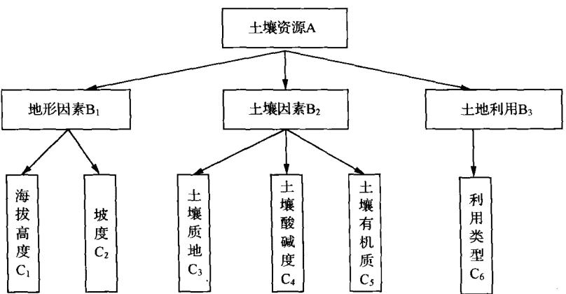

**图 10-2 广东省土壤资源质量评价指标体系**

| 指标代码 | 评价指标 | 权重 | 维度归属 |
| :--- | :--- | :---: | :--- |
| **te** | 土壤质地 | **0.28** | 自然-土壤特性 |
| **sl** | 坡度 | **0.21** | 自然-地形地貌 |
| **ph** | 土壤 pH | **0.16** | 自然-土壤特性 |
| **lu** | 土地利用类型 | **0.16** | 综合/社会经济 |
| **el** | 海拔高度 | **0.10** | 自然-地形地貌 |
| **om** | 土壤有机质 | **0.09** | 自然-土壤肥力 |

> **权重确定法**：构建判断矩阵 → 层次分析法（AHP）求解，兼顾专家经验与数学逻辑自洽性。

### 10.4.3 评价指标等级划分标准制定
*(后续内容将详细阐述各指标的分级阈值设定与赋值规则...)*

---

**结语**：本章确立的 **AiNet-GIS 耦合范式**，以“GIS管空间、AiNet管智能、XML管交互”的清晰架构，配合四级分类体系与AHP权重模型，为广东乃至全国土壤资源质量评价提供了**可复制、可推广、工程化**的技术范本。下一步，将重点攻克指标分级标准的区域化适配与模型在精准农业决策中的深度应用。

# 土壤质量分级与RFID安全：从ArcGIS数据获取到免疫协同检测的跨域探索

## 10.4.4 属性数据的空间获取路径

评价所需的基础属性数据，核心手段是依托**ArcGIS**平台，对土壤资源类型图与各单要素评价图层（海拔、坡度、质地、pH、有机质、土地利用类型）实施**叠置分析**。得益于软件内部机制，该过程无需繁琐的“边缘修补”及内部碎块后处理，即可自动生成一系列过渡图层。随后，利用属性统计功能，便能高效提取每个评价单元的关键指标数值，为后续建模提供标准化输入。

## 10.4.5 土壤质量等级的多模型评定实战

质量等级划分既可定性描述，也可定量计算。本研究引入**基于AiNet-GIS的评价模型**核心，并同步采用**指数和法**与**模糊综合评判法**作为对照基准，三管齐下验证结果可靠性。

### 1. 指数和法：直观但存“短板”风险
操作流程分四步走：先按影响强度将各因子分级赋值（等级分）；再乘以权重得到单项指数；随后求和并标准化至0-100区间；最后依据频数与面积分布曲线划定等级边界。  
**优势**：计算透明、易于实现，能大致反质量概貌。  
**劣势**：存在**“补偿效应"**——某项极端劣势指标（极小指数）可能被其他优势指标掩盖，导致总指数不低，难以揭示关键限制性因素；且赋权易受专家主观性影响。

### 2. 模糊综合评判法：理论优、实操难
**优势**：擅长处理指标与等级间的模糊边界，准确度高；且能从评判子集直接读出**限制性因子**及其强度，利于诊断土壤障碍。  
**劣势**：面对全省海量数据（如全域坡度、海拔原始值），计算机难以直接跑模糊运算，只能先分等赋值（如将连续坡度归为5级），导致原始模糊关系失真，无法充分发挥方法长处；同样面临权重主观性难题。

### 3. AiNet模型：免疫算法驱动的聚类优选
该模型借鉴人工免疫网络（AiNet），核心在于**无监督聚类**，将211个评价单元自动归为4个质量等级，具体工程化步骤如下：

*   **指标归一化——统一量纲的关键桥梁**  
    原始指标维度各异，引入中间变量$M_{ij}$及S型效用函数$Y_{ij}$映射至$[-1,1]$：
    *   *效益型*（有机质）：值越大越好，偏离均值为正增。
    *   *成本型*（海拔、坡度）：值越小越好，偏离均值反向计。
      $M_{ij} = \frac{\overline{X}_{ij} - X_{ij}}{|\overline{X}_{ij}|}$
    *   *区间型*（pH）：最优区间$[A,B]$内线性过渡，超界则非线性惩罚。
    *   *描述型*（质地、利用类型）：按专家预设优度匹配。

*   **初始种群构建——$4\times6$编码空间**  
    随机抽取10组对象（种群规模=10），每组含4个质心（对应4个等级），编码为$4\times6$维个体，形成初始种群$C_0$。

*   **适应度函数——基于Davies-Bouldin指数(DBI)的内部验证**  
    目标函数$DB = \frac{1}{K}\sum R_i$，其中$R_i$为簇内紧凑度与簇间分离度比值的最大值。适应度$f(c)=1/DB$，**最大化适应度即最小化DB指数**，驱动聚类向“类内高内聚、类间低耦合”演化。  
    **收敛性验证**：实验重复100次，独立随机初始化，通常**180代内收敛最优**，200代以上收敛概率<1‰，展现极强鲁棒性。

## 10.4.6 评价结果横向对决：三法印证，免疫优胜

利用ArcGIS**同质融合**相邻同级单元，汇总面积统计（表10-4）与分值区间（表10-5）：

| 质量等级 | **AiNet-GIS** | **指数和法** | **模糊综合法** |
| :--- | :---: | :---: | :---: |
| **一等** | **30,586 km² (17.6%)** | 26,043 km² (15.0%) | 25,631 km² (14.8%) |
| **二等** | **39,174 km² (22.6%)** | 42,906 km² (24.7%) | 42,375 km² (24.4%) |
| **三等** | **68,623 km² (39.5%)** | 78,751 km² (46.5%) | 79,003 km² (45.5%) |
| **四等** | **35,273 km² (20.2%)** | 25,954 km² (14.9%) | 26,645 km² (16.4%) |

**核心发现**：
1.  **结果相近性**：三法宏观分布一致，均与实地抽样大致吻合。
2.  **AiNet优势显著**：一等、四等区面积与实测**最接近**；指数和法、模糊法倾向“中间化”（三等区过大，两极过小）。
3.  **免疫模型突破瓶颈**：无需主观赋权，直接处理原始属性值（经归一化），规避了“预分等导致模糊关系失真”及“补偿效应”，**既保留专家知识（归一化标准），又实现数据驱动的自适应聚类**，为广东省土壤资源开发保护决策提供了最可�量化支撑。

## 10.5 本章小结：免疫GIS开拓评价新范式

本章成果：**首创基于AiNet-GIS的土壤质量评价模型**，实现免疫算法与空间数据引擎的深度融合。  
**贡献**：拓展评价方法库；验证免疫聚类在复杂地理系统中的优越性——**无监督、抗噪强、自适应、揭示本质结构**。未来可推广至区域农业规划、生态红线划定等领域。

---

# 第 11 章 免疫协同视角下的RFID入侵检测系统设计与实现

## 11.1 引言：低成本标签下的安全突围

RFID作为物联网感知层核心，因**廉价标签（<5K安全门逻辑）、开放无线信道、分布式自治架构**，面临**加密难部署、物理隔离不灵活、传统IDS移植受限**的三重困境。  
**免疫协同检测**应运而生：借鉴生物免疫**分布式识别、自学习抗原、动态适应新威胁**特性，结合**Agent协作、负选择算法(NSA)、优化免疫网络(OE-AiNet)**，构建**免疁融合阴性选择算法（II-NSA）**与**目标进化免疫网络（OE-AiNet）**双引擎。  
**核心价值**：**零修改标准**、**低成本部署**、**检知与未知攻击并重**（读取器窃取、密码猜测、DoS等），补齐加密认证与防火墙的防御空档。

## 11.2 RFID系统技术特性与安全隐患深度解析

### 11.2.1 系统模型三层架构与标签分类
*   **标签**：存储EPC标识，附着物体。**有源**（自供电、远距、贵、寿命短）vs **无源**（感能、近距、低成本、长寿命，**本章研究对象**）；
*   **阅读器**：发射射�波唤醒标签，双向读写，连接后端；
*   **应用系统**：中间件、ONS解析、EPCIS信息服务、数据库，构建跨组织共享网络。

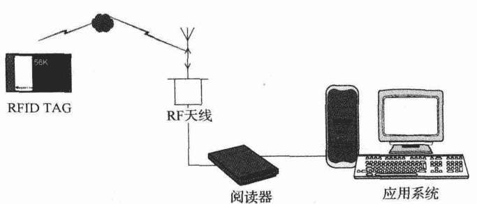
**图 11-1 RFID 系统模型**
*(原文标记保留，此处为占位示意)*

### 关键技术特性导致的安全“阿喀琉斯之踵”：

| 特性 | 具体表现 | 安全后果 |
| :--- | :--- | :--- |
| **标签算力脆弱性** | 成本压价$0.05-$0.10 → 逻辑门<10K (安全<5K) | **无法运行AES/DES/RSA**等强加密；难以实现标签-阅读器-后端**强互认**；易遭克隆、伪造、重放。 |
| **无线信道开放性** | 空口通信，物理边界模糊 | **窃听、干扰、冲突攻击**零门槛；攻击面从有线延伸至空间。 |
| **应用分布自治性** | EPCglobal架构：中间件、ONS、EPCIS跨域部署；标签随货物流转 | **密钥/证书生命周期管理极难**；单点失效引发连锁风险；边界防御失效，需**纵深、协同、自适应**检测体系。 |

**结论**：RFID安全不能仅靠标签端加固，**必须引入网络层面的免疁式入侵检测**——通过分析阅读器-标签会话日志，提取行为特征，建立“自我/非自我”动态识别机制，实现**低成本、高覆盖、强自学习**的安全增强。

#### 11.2.2 RFID 系统的安全隐患全景扫描

RFID 系统固有的技术特性，注定其面临的安全挑战比传统 TCP/IP 网络更为棘手、攻击面也更广。若按攻击手段划分，主要分为**主动攻击**与**被动攻击**两大阵营。

**主动攻击：直接“动手脚”**
*   **物理破解重构**：攻击者获取实体标签后，在实验室环境下剥离封装，利用微探针窃取敏感信号，进而实现标签的非法克隆与重构。
*   **软件层面的渗透篡改**：利用微处理器的通用接口，通过扫描标签、模拟响应阅读器询问，摸清协议与算法漏洞，继而删除数据或篡改可重写标签内容。
*   **制造混乱拒绝服务**：通过干扰广播、阻塞信道等手段人为制造异常环境，导致合法设备瘫痪，引发拒绝服务（DoS）攻击。

**被动攻击：躲在暗处“偷窥”**
*   **侧信道窃听**：捕获芯片运行时的电磁辐射特征，反推标签与阅读器间的通信机密。
*   **信息非法采集**：借助阅读器等设备，悄无声息地收割 RFID 数据、个人隐私及商品流转轨迹。

透过上述手段不难发现，攻击者核心利用的是**标签算力/存储的薄弱**与**无线信道的天然开放性**。落地到应用层，RFID 带来的安全威胁主要集中在五大维度：
1.  **数据裸奔**：无保护或弱保护标签向周边阅读器泄露敏感内容。
2.  **行踪追踪**：利用前向/后向信道不对称性远程窃听，配合唯一 ID 实现对人员的隐蔽定位与跟踪。
3.  **内容篡改**：可写标签因缺乏鉴权机制，极易被非法修改。
4.  **身份伪装**：通过主动攻击掌握内部结构克隆标签，或用伪造标签欺骗无认证机制的阅读器。
5.  **服务瘫痪**：人为制造信道拥塞/干扰，导致合法处理器失效。

除上述 RFID 专属风险外，建立在 TCP/IP 之上的后端系统，依然遗传了窃取、黑客入侵、病毒感染等传统网络顽疾。更危险的是，开放的标签成了黑客的“新跳板”——攻击者可利用后端漏洞（如缓冲区溢出、SQL 注入），通过标签为载体，将攻击代码直接“注入”后台系统。

**总结**：标签脆弱、信道开放、应用分布，这三大特性叠加，使 RFID 安全风险比传统网络更复杂、更宽泛。成熟的网络安全技术难以直接平移，必须结合 RFID 系统架构与业务特点，从全局视角探寻专属安全方案。

#### 11.2.3 为什么必须引入入侵检测？—— 破解 RFID 安全困局的关键一招

现状是：受限于安全隐患，RFID 尚未进入核心关键任务领域。当前主流应用场景对隐私不敏感，导致业界对安全防护普遍漠视。但技术越普及，积累的安全债越高；一旦爆发，其破坏力将如同当下的网络安全难题般考验人类智慧。正如 MIT Auto-ID Center 创始人 Kevin Ashton 所言：RFID 要驱动企业变革，必须先解决严峻的安全问题，安全投入必须与应用规模同步增长。

**现有路为何走不通？**
*   **加密认证协议“力不从心”**：标签成本压制算力，复杂加密跑不动；部署涉及标签、协议、流程多层改动，标准化难推进；密钥管理本身仍存泄露与被破解风险。
*   **物理手段“落地难”**：需额外硬件或操作，工程可行性差。
*   **传统网安“够不着”**：防火墙、杀毒软件只能护住后端，对“标签-阅读器”空中接口的威胁束手无策。

**破局思路：引入入侵检测（IDS），构建纵深防御体系。**
IDS 是继防火墙、加密、杀毒后的新一代安全技术，能与前者互补，共筑分层防线。其最大优势在于**“零侵入式”部署**——只分析日志审计，不增加业务系统复杂度，**无需改动现有 RFID 技术标准与标签结构**，即可大幅提升防护力，完美规避成本与推广的矛盾。

**生物免疫：最完美的蓝图。**
生物免疫系统（护体抗菌/病毒）与入侵检测系统（护网抗黑客/病毒）在“动态环境下维持稳定”上高度同构。免疫系统的**识别、耐受、学习、应答**机制，映射出自学习、分布式计算、局部寻优等核心优势，为 IDS 研究提供了理论基石。而 RFID 系统的**并行性、分布性、开放性**，与生物免疫特性更是“惊人吻合”。

**结论**：借鉴生物免疫机理构建 RFID 入侵检测，不仅为 RFID 安全注入新理论、新方法，也反哺丰富了入侵检测理论本身，拓展了应用疆域，兼具理论创新与实战价值。

### 11.3 基于免疫组织架构的 RFID 入侵检测多 Agent 模型构建

RFID 系统天然分布式，入侵检测架构必须同构分布式。生物免疫系统“无中心、分布式” 的结构指明了方向。多 Agent 系统（MAS）作为分布式复杂系统建模利器，成为落地人工免疫系统的最佳路径。本章参照生物免疫组织结构，在 MAS 方法论指导下，对 RFID 入侵检测进行目标拆解，构建多 Agent 模型。

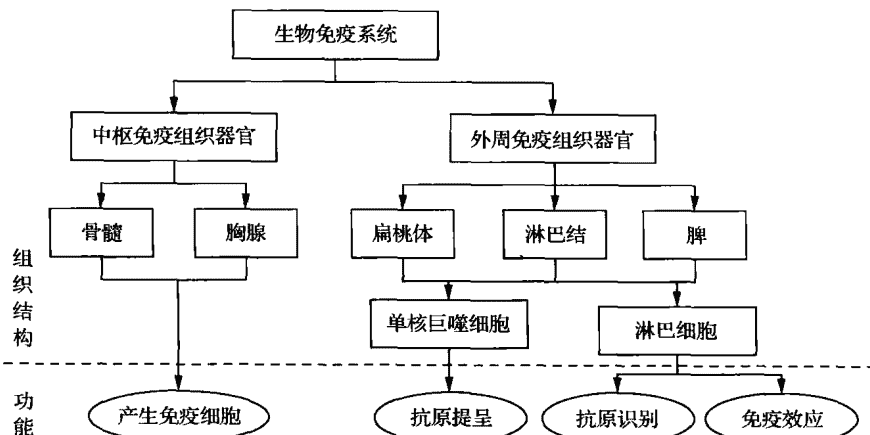

#### 11.3.1 目标层次模型：从“抽象愿景”到“可执行子任务”

MAS 建模始于目标。系统目标稳定不变，是分析的锚点。RFID 入侵检测的总目标是**“识别非法操作，护佑系统安全”**，但这太宏大，需层层分解为可落地的子目标。

入侵检测与免疫系统同源，核心均为**“自我/非自我”识别**。参考免疫系统对抗原的处理流程——**免疫细胞产生 → 抗原提呈 → 抗原识别 → 免疫反应**，每一环对应一个阶段性子目标，由特定器官/细胞承担（如骨髓/胸腺产生细胞，巨噬细胞提呈抗原，淋巴细胞识别与反应）。

  *（图 11-2 生物免疫系统功能组织模型）*

映射而来，RFID 入侵检测系统分解为四大子目标：
1.  **检测器产生**：生成识别抗原的检测器，支持多类别、分层级、协同防御，含生成与维护全生命周期。
2.  **抗原提呈**：采集、预处理、标准化入侵特征数据（视为抗原）。
3.  **抗原识别**：利用检测器匹配分析抗原，判定正常/异常。
4.  **免疫反应**：确认入侵后触发告警、阻断、溯源等响应动作。

#### 11.3.2 角色模型：谁来干活？

**定义**：角色 = <名称, 目标集>，即承担特定责任的实体。

对标免疫组织功能：**中枢器官（骨髓/胸腺）→ 细胞产生中心；单核巨噬细胞 → 信息收集器；淋巴细胞 → 免疫监视器。**

构建 RFID 入侵检测角色映射表：
*   **检测器中心**（对应骨髓/胸腺） —— 负责 **检测器产生**
*   **信息收集器**（对应巨噬细胞/外周器官） —— 负责 **抗原提呈**
*   **入侵监视器**（对应淋巴细胞/外周器官） —— 负责 **抗原识别、免疫反应**

> 注：信息收集器与入侵监视器非模仿单一细胞，而是模拟脾脏、淋巴结等外周免疫器官，按功能拆分为两角色。采用 UML 用例图表示，箭头指向信息流向。

  *（图 11-4 RFID 入侵检测系统角色模型）*

#### 11.3.3 角色交互模型：协作如何流转？

免疫系统靠**淋巴循环**驱动协作：中枢产生细胞 → 循环输送至外周 → 执行应答。同理，**检测器中心生成检测器 → 传递给入侵监视器**。

免疫系统中巨噬细胞与淋巴细胞**顺序协作**：前者提呈完成后，移交后者识别。同理，**信息收集器获取抗原 → 提交入侵监视器识别**。

  *（图 11-5 检测中心与监视器交互顺序图）*
  *（图 11-6 信息收集器与监视器交互顺序图）*

#### 11.3.4 Agent 类模型：从“角色”到“代码模板”

**定义**：Agent 类 = <名称, 角色集, 目标集>，是 MAS 的核心框架，完成从“做什么”到“怎么做”的转化。

建模原则：角色目标独立、协作简单时，角色直接封装为 Agent 类；通信量大则合并封装；计算量大则拆分封装。

本模型中三角色职责清晰、耦合低，直接一一映射为三大 Agent 类：
1.  **RFID 入侵检测器中心**（简称 **检测器中心**）
2.  **RFID 入侵信息收集器**（简称 **信息收集器**）
3.  **RFID 入侵监视器**（简称 **入侵监视器**）

结合角色模型与交互模型，构建 Agent 类模型（方框内依次为：类名、扮演角色、目标集；箭头指向请求目标方）。

  *（图 11-7 RFID 入侵检测 Agent 类模型）*

#### 11.3.5 Agent 交互模型：黑板共享 + 消息驱动双轨制

采用**黑板模型（异步知识共享）** 与 **消息传递（实时协作驱动）** 结合策略。

**1. 黑板模型：知识超市**
分析三类 Agent 的知识需求与供给：
*   **检测器中心**：需消费 [抗原、检测日志、处理日志]，供给 [各类检测器]。
*   **信息收集器**：供给 [抗原]；无需消费他知识（数据直连 RFID 业务源）。
*   **入侵监视器**：需消费 [各类检测器]，供给 [检测日志]。
*   **通用**：所有 Agent 注册/注销登记于黑板，维护活跃 Agent 列表，便于消息路由。

知识统一用**本体** 语义表达，实现跨 Agent 理解零歧义。工程上黑板多用共享内存/数据库落地，本体映射为内存对象/DB 对象。

  *（图 11-8 黑板模型）*

**2. 消息模型：精准达意**
基于 KQML 定义两大扩展原语：
*   **inform（通知）**：检测器中心更新检测器后，广播通知监视器去黑板拉取增量。
*   **trans（传送）**：驱动信息收集器将抗原推送给监视器，触发识别流程。

**消息格式规范：**
*   *检测器中心 → 监视器*：含发送方/接收方名、本体（更新的检测器）、内容（操作类型：新增/删/改/全量替换）。
*   *信息收集器 → 监视器*：含发送方/接收方名、本体（RFID抗原）、内容（抗原属性键值对 attr=value）。

传输协议选**非连接 UDP**，通信采**点对点** 模式，保障 Agent 自治性与轻量级交互。

```
{inform
:sender CenterX
:receiver MonitorY
:language KQML
:ontology Detector
:content (new)
}
```  *（检测器中心到入侵监视器的通知消息格式）*
```
{trans
:sender CollectorX
:receiver MonitorY
:language KQML
:ontology RFIDAntigen
:content (…) 
}
```  *（信息收集器到入侵监视器的传送消息格式）*

#### 11.3.6 分布式部署模型：落地拓扑长什么样？

部署建模三步走：定实例数量 → 定运行逻辑结构 → 定物理分布。

**业务驱动部署逻辑：**
*   **RFID 系统**通常按功能分区（如生产车间、检测车间、存储库房），各区独立维护数据。
*   **信息收集器**必须分布式部署，每区域配置 1~N 个，贴近数据源。
*   **入侵监视器**支持双模式：
    *   *集中式*：单监视器全域分析（适合小规模）。
    *   *分散式*：多监视器分域负责（适合大规模，集中式可视为其特例）。
*   **检测器中心**无实时压力，为保证全局检测器一致性共享，通常仅部署**单实例**。

逻辑部署实例拓扑见下图。

  *（图 11-9 RFID 入侵检测系统部署实例）*

**物理落地灵活性**：三类 Agent 可任意组合共居单主机，或跨机分布，完全取决于 RFID 业务规模与运维策略。

该运行架构与生物免疫系统高度同构：**中枢（检测器中心）集中造“兵”，外周（收集器/监视器）分布驻“防”，各司其职，共御外侮。**

# 基于免疫机制的RFID入侵检测：构建健壮多智能体模型

采用免疫原理设计的RFID入侵检测多智能体系统（MAS），有效化解了系统复杂性难题，更在运行层面确立了卓越的健壮性。

## 核心定义：何为系统的“k级健壮性”？

根据文献[56]，我们给RFID入侵检测系统$\Sigma_{RIDS}$的健壮性下了量化定义。假设系统内部由智能体集合$\Omega_{RIDS} = \{a_1, a_2, \cdots, a_n\}$构成。若任意$k(k < n)$个智能体失效，残留系统$\Sigma'_{RIDS}$的结构变为$\Omega'_{RIDS} = \{a_1, a_2, \cdots, a_{n-k}\}$，只要满足以下条件，即判定原系统具备**k级健壮性**：

```
\(\frac{DA(\Sigma'_{RIDS}) - DA(\Sigma_{RIDS})}{DA(\Sigma_{RIDS})} \leqslant \Gamma\) (11-3)
```

> 公式中，DA代表检测性能指标；$\Gamma$为允许的性能波动阈值。

---

## 深度解析：MAS架构下的健壮性表现

RFID入侵检测MAS的健壮性核心源于智能体的**自主性**。单点故障仅导致局部性能下降，绝不会引发全系统瘫痪。具体体现在三个维度：

1.  **信息收集器失效**：影响仅限于其管辖的RFID区域，其他区域检测业务不受波及，实现了空间上的故障隔离。
2.  **入侵监视器失效**：同样仅波及所属区域。若引入**监视器集群机制**——即故障发生时，备用监视器自动接管任务——则单节点失效对整体检测性能几乎零影响。
3.  **检测器中心失效**：虽然会导致各监视器无法拉取最新检测规则，但已部署的本地检测器依然有效工作，保障了基础防护能力不中断。

**结论**：部分智能体离线仅引发局部区域或时段的性能波动，系统整体存活能力极强，完美诠释了“良好健壮性”的工程含义。

---

# 11.4 基于抗原提呈的RFID入侵信息定义与采集体系

## 11.4.1 EPC C1G2协议解析与安全短板

EPC C1G2标准详细规定了超高频二代RFID标签与阅读器的空中接口交互细节，阅读器操作与标签状态流转如下图所示。


**阅读器三大核心操作**：
*   **选择**：通过`Select`命令筛选目标标签群，为后续盘点做准备。
*   **盘点**：识别标签身份的过程。由`Query`、`QueryAdjust`、`QueryRep`、`ACK`、`NAK`等命令组成。阅读器发起`Query`开启盘点轮次，标签应答后，阅读器校验并请求其回传`PC`、`EPC`及`CRC-16`。单通话仅执行一轮盘点。
*   **访问**：对已识别标签进行读写交互。包含`Req_RN`、`Read`、`Write`、`Kill`、`Lock`、`Access`、`BlockWrite`、`BlockErase`等指令集。

**标签七态流转机制**：
标签通过**就绪、仲裁、应答、确认、开放、保护、灭活**七种状态管理自身生命周期。例如：上电进入就绪态，匹配`Query`参数后抽取随机数决定去仲裁态或应答态；应答态回传`RN16`，收到`ACK`进确认态；确认态下依据访问密码有无分流至开放态或保护态；最终经`Kill`命令（需有效杀灭密码与句柄）进入不可逆的灭活态。

**协议内置安全策略及其漏洞**：
协议提供了`Kill`（隐私保护）、`Lock`（防篡改）、访问/杀灭密码保护、写数据掩码（随机数异或）、密码传输掩码等机制。但**漏洞显著**：
1.  **明文传输风险**：标签回传信息裸奔，隐私泄露隐患大。
2.  **加密强度不足**：写操作虽经异或加密，但攻击者截获随机数即可轻松还原明文。
3.  **物理层假设失效**：安全前提建立在“标签后向散射弱、攻击者收不到信号”基础上，但UHF通信距离达10米，攻击者有足够藏匿空间实施窃听。
4.  **缺失认证机制**：标准未强制阅读器认证，任何合规阅读器均可操作标签，为非授权访问敞开大门。

---

## 11.4.2 业务特征建模与抗原决定基定义

尽管RFID尚未普及到单品级，但在生产、供应链、零售等场景的应用蓝图已清晰。这些业务流程天然蕴含着**区域性**与**时域性**特征，正是定义“抗原决定基”的基石。

### 业务特征三维度：
*   **区域特征**：不同物理区域（车间、仓库、商场货架、出口）对操作权限要求迥异。如仓库禁写，商场禁改用户区数据。
*   **时域特征**：盘点等作业常限定在特定时间窗（如工作日白天），越界操作即为异常。
*   **标签群差异**：高价值商品与普通商品的访问控制策略截然不同。

**安全规则形式化表达**：
> 在指定区域($R_g$)、特定时段($T$)，仅允许对特定标签群($EPC$)执行特定操作($R_c, P_{ac}$)。

一切违背此规则的行为（窃取、DoS、克隆、篡改），均构成入侵检测的业务触发基础。

### 抗原决定基六元组定义：
将业务日志映射为**抗原决定基**，其属性元素（抗原元素）构成六元组：

```
AppLog = 〈T, Rg, Rc, Pac, EPC, RT〉  
(11-4)
```

> 字段解读：$T$=时域(起止时间$[st, et]$)；$R_g$=区域；$R_c$=阅读器指令；$P_{ac}$=指令参数（存储体、载荷等）；$EPC$=标签标识；$RT$=返回码(错误码)。
> 时域具体表示为：```
T = \langle st, et \rangle (11-5)
```

由此，**一条具体业务日志 = 一个抗原**，完成了从物理业务到免疫概念的映射。

---

## 11.4.3 攻击统计画像与危险元素体系

生物免疫依靠“累积效应”发危险信号，天然有滞后性。RFID单次攻击特征隐蔽，但**同类攻击连续发生会产生显著统计偏移**，这为基于统计特征的危险信号提取提供了可行路径。

### 四大典型攻击的统计指纹：

| 攻击类型 | 核心手段 | 统计异常表现 |
| :--- | :--- | :--- |
| **阅读器窃取** | 非授权阅读器发指令，系统无日志，仅信道有记录 | **指令匹配率(Pm)骤降** (信道日志chLog与系统日志sysLog不一致) |
| **拒绝服务** | 电磁干扰阻塞信道/广播 | **CRC误码率(Pe)飙升**、**标签应答率(Pr)暴跌** |
| **口令猜测** | 穷举Access/Lock/Kill密码 | **口令失败率(Pa)急剧上升** (不应答视为口令错) |
| **试探/篡改/未知** | 试探指令失败、写指令比例异常、高危指令比例异常 | **指令成功率(Ps)降低**、**写指令比率(Pw)偏离区域基线**、**口令类指令比率(Pd)异常升高** |

### 危险元素全景集合：
我们提取核心统计特征构成**危险元素集合 FeatureDim**，并引入对立面特征（如失败率=1-成功率）及基础统计量（总询问数$N_c$、CRC错数$N_e$、应答数$N_r$等）作为辅助维度，形成完整特征体系：

```
FeatureDim = { Pe, Pr, Pa, Ps, Pm, Pd, Pw, Nc, Ne, Nr, Nm, Nw, ... }
```

元素间内在关联逻辑如下：

```
⎧Pe = Ne/Nc  
⎪Pr = Nr/Nc  
⎪Pa = Ndf/Nd  
⎨Ps = Ns/Nc  
⎪Pm = Nm/Nc  
⎪Pd = Nd/Nc  
⎩Pw = Nw/Nc
```

最终，**危险元素 + 时域($T$) + 区域($R_g$) 等上下文**，组装成**RFID特征日志 FeatureLog**：

```
FeatureLog = <T,Rg,Pe,Pr,Pa,Ps,Pm,Pd,Pw,Nc,Ne,Nr,Nm,Nw,...>

(11-8)
```

> **一句话总结**：一条`FeatureLog`记录 = 一个抗原的危险信号。通过分析该信号，即可判定统计窗口内是否存在有害抗原（入侵行为）。

---

## 11.4.4 RFID操作日志采集与抗原提呈

# RFID 操作日志采集与层次免疫入侵识别机制

RFID 操作日志的获取是构建抗原决定基（AppLog）与危险信号（FeatureLog）的前提。最直接的采集手段是读取中间件日志，但此法仅能覆盖受管合法阅读器，对非法设备发起的攻击视而不见。鉴于 RFID 入侵检测的核心在于防范标签数据被非授权访问，必须引入无线信道侧写机制。唯有如此，才能获得包含合法与非法操作在内的全量日志。

本节设计了一套双源采集体系：同步从无线信道与应用层系统汇集日志，分别形成**信道日志（ChLog）**与**系统日志（SysLog）**。检测主流程以 ChLog 为主导，SysLog 充当辅助校验与备份角色；指令匹配率（Pm）与匹配次数（Nm）等关键指标，则通过双源融合计算得出。采集架构示意见 。


图 11-11 RFID 操作日志采集示意图

**信道侧采集**依托部署的探测器对无线频谱实施侦听，捕获信道内全部二进制流。依据 EPC C1G2 协议解析阅读器指令、参数及标签响应，提炼 AppLog 所需基础属性。ChLog 的属性结构定义如 ```
ChLog = <t,Rg,Rc,Pac,EPC,RT>

(11-9)
```。

```
ChLog = <t,Rg,Rc,Pac,EPC,RT>

(11-9)
```

式中，`t` 标识操作捕获时刻（见 11-10），其余字段语义与 AppLog 对应项保持一致。

探测器按覆盖半径在标签作业区（如仓库、卖场）均匀布设，实现全域无死角监控。为映射业务特征，支持依据应用场景将物理空间聚合为逻辑业务区（如将所有仓库合并为单一统计单元），危险信号统计以业务区为粒度展开。

**系统侧采集（SysLog）** 从中间件截取阅读器与标签的交互报文。前提假设：所有合法阅读器均纳入中间件管控，故中间件能全量掌握授权操作细节。解析出的基础属性集与 ChLog 同构，定义见 ```
SysLog = \langle t, Rg, Rc, Pac, EPC, RT \rangle (11-10)
```。

```
SysLog = \langle t, Rg, Rc, Pac, EPC, RT \rangle (11-10)
```

式中，各元素含义与 ChLog 完全对应。

### 抗原决定基（AppLog）提呈
ChLog 或 SysLog 可直接转化为 AppLog：将时间戳 `t` 映射为时域 `T`（即 `T.st ≤ t < T.et`），其余字段一一映射，无损转换。

### 危险信号（FeatureLog）提呈
基于 ChLog/SysLog，系统按业务区分时段聚合危险元素。除 Pm 与 Nm 需双源融合外，其余危险元素可直接统计产出。

**Nm 与 Pm 的融合计算逻辑**：
依据时间窗与指令名的双重约束，判定 ChLog 记录是否与 SysLog 命中。匹配准则详见定义 11-4。

**定义 11-4 日志匹配**  
同一业务区、同一采集周期内，设信道日志集为 ChLog，系统日志集为 SysLog。对任意 `lc ∈ ChLog`，若存在 `ls ∈ SysLog` 满足 `|lc.t - ls.t| < ε ∧ lc.Rc = ls.Rc`，则判定 lc 与 SysLog 匹配，记为 `Match(lc, SysLog)`；反之记为 `¬Match(lc, SysLog)`。其中 `ε` 为时间容差阈值。

上述定义的谓词逻辑形式化表达见 ```
$\forall lc \in ChLog \land \exists ls \in SysLog \land |lc.t - ls.t| < \epsilon \land lc.Rc = ls.Rc \Leftrightarrow Match(lc, SysLog)$
```。

```
$\forall lc \in ChLog \land \exists ls \in SysLog \land |lc.t - ls.t| < \epsilon \land lc.Rc = ls.Rc \Leftrightarrow Match(lc, SysLog)$
```

完成匹配标识后，即可统计得出记录匹配次数（Nm）与指令匹配率（Pm）。

---

## 11.5 基于层次防御与协同检测的 RFID 入侵识别方法

### 11.5.1 RFID 入侵监视器的信息模型抽象

入侵监视器本质是单输入单输出信息系统：输入为 RFID 抗原，输出为识别判决。引用文献 [56] 的四元组形式化描述见 ```
$\Sigma = (X, \Omega, Y, G)$ (11-11)
```。

```
$\Sigma = (X, \Omega, Y, G)$ (11-11)
```

式中：X 为输入；Y 为输出；Ω 为内部结构；G 为输入输出映射函数，即 ```
Y = G(X)
```。

```
Y = G(X)
```

据此，RFID 入侵监视器 `Σ_RIDS` 形式化定义见 ```
\(\Sigma_{\text{RIDS}} = (X_{\text{RIDS}}, \Omega_{\text{RIDS}}, Y_{\text{RIDS}}, G_{\text{RIDS}})\)
```。

```
\(\Sigma_{\text{RIDS}} = (X_{\text{RIDS}}, \Omega_{\text{RIDS}}, Y_{\text{RIDS}}, G_{\text{RIDS}})\)
```

其中：
- **输入 `X_RIDS`**：抗原提呈产物，包含抗原决定基（业务日志，第 1 信号 `X₁`）与危险信号（特征日志，第 2 信号 `X₂`），结构见 ```
\(X_{\text{RIDS}} = \{X_1, X_2\}, \quad X_1 = \text{AppLog}, \quad X_2 = \text{FeatureLog}\)
```。

```
\(X_{\text{RIDS}} = \{X_1, X_2\}, \quad X_1 = \text{AppLog}, \quad X_2 = \text{FeatureLog}\)
```

> 为简化表述，下文直接称 AppLog 为抗原，FeatureLog 记录仍称危险信号。

- **输出 `Y_RIDS`**：入侵检测本质是模式分类——将抗原划分为自体/非自体。若有充足先验知识，可进一步细分非自体亚型（如阅读器窃取、DoS、口令爆破等）。输出域即 RFID 操作类型 Type 的四元组定义域，见 ```
\(Y_{\text{RIDS}} = \text{Type} = \langle \text{TypeId}, \text{Name}, \text{Note}, \text{Flag} \rangle\)
```。

```
\(Y_{\text{RIDS}} = \text{Type} = \langle \text{TypeId}, \text{Name}, \text{Note}, \text{Flag} \rangle\)
```

字段说明：`TypeId` 类型编号；`Name` 类型名称；`Note` 描述；`Flag` 正常标志（1=自体/正常，0=非自体/异常）。

- **内部结构 `Ω_RIDS`**：即检测器库。仿生物免疫分层动态特性，构建为分层演进结构。
- **检测过程 `G_RIDS`**：基于 `Ω_RIDS` 实现 `Y = G(X)` 的推演过程，检测过程同时反作用于检测器库结构演化。

### 11.5.2 RFID 入侵识别的层次结构定义

`Ω_RIDS` 参照生物免疫“吞噬细胞—淋巴细胞—T 辅助细胞”三层协同架构，抽象出三级检测器：
1. **规则检测器（P 检测器）** —— 对标吞噬细胞，基于先验知识建模；
2. **适应性检测器（L 检测器）** —— 对标淋巴细胞，具备克隆选择与免疫记忆；
3. **协同检测器（H 检测器）** —— 对标 Th 细胞，以特征点聚类判定危险信号有害性。

#### 1. 规则检测器（P 检测器）
吞噬细胞免疫力源于遗传，对应 P 检测器的先验规则库构建。抗原决定基的丰富属性为规则编写提供充足素材。P 检测器形式化定义见 ```
DP = <Pattern, Type> (11-16)
```。

```
DP = <Pattern, Type> (11-16)
```

- `Pattern`：抗原元素组成的逻辑表达式（如 `Rg in ('A','B','C') ∧ Rc='Write'` 表示对区域 A/B/C 的写操作）。
- `Type`：匹配该模式的操作类型。
- 规则语义：`IF Pattern THEN Type`。输入抗原与 Pattern 命中即输出对应 Type。抗原 `ag` 与 P 检测器 `dp` 匹配记为 `PMATCH(ag, dp)`。此类基于特征库的检测器是目前工程落地最成熟、可解释性最强的方案。

#### 2. 适应性检测器（L 检测器）
L 检测器仿淋巴细胞“抗原决定基—抗体”特异性识别机制，针对 AppLog 记录实施入侵识别。依据 Burnet 克隆选择理论：每个淋巴细胞表达唯一抗体，抗原入侵筛选出匹配抗体的细胞克隆扩增、分化，产生特异性应答；二次接触同种抗原，依托初次形成的记忆细胞，引发更强、高亲和力的二次应答。

L 检测器形式化定义见 ```
DL = <Ab,Rc,Type,Time,Count> (11-17)
```。

```
DL = <Ab,Rc,Type,Time,Count> (11-17)
```

字段解析：
- `Ab`（抗体）：等长于抗原编码的二进制模式串。
- `Rc`（匹配阈值）：抗体-抗原相似度超阈值即判定识别成功。
- `Type`：输出的抗原类型标签。
- `Time` / `Count`：最近激活时刻与累计激活次数，支撑亲和力成熟与免疫记忆机制。

**匹配度量**：阴性选择算法常用汉明距离或连续相同位（r-contiguous-bits）匹配，工程上多采用后者。抗原 `ag` 与 L 检测器 `dl` 匹配记为 `LMATCH(ag, dl)`。注意：L 检测仅完成“非自我”候选筛选，最终是否判定为有害，需结合近期危险信号及 H 检测器协同裁决。

**生成与更新**：L 检测器基于 RFID 系统自体集（合法抗原全集），经阴性选择算法生成。自体集随业务动态演变，故 L 检测器库必须支持在线增量更新，保障自适应检测能力。

#### 3. 协同检测器（H 检测器）
H 检测器面向 FeatureLog 记录，裁决是否存在实质性入侵且已造成有害影响。传统阈值法难以应对多维危险元素的耦合与非线性，本节引入**特征点**建模 H 检测器，并通过聚类自动学习特征点分布。定义见 ```
DH = <FeaturePoint, Lc, Type> (11-18)
```。

```
DH = <FeaturePoint, Lc, Type> (11-18)
```

- `FeaturePoint`：实数向量形式的特征点，可视为抗体在连续空间的映射。
- `Lc`：欧氏距离匹配阈值。
- `Type`：输出抗原类型（含正常/异常标志）。

**距离度量**：FeatureLog `fl` 与特征点 `fp` 的欧氏距离定义见 (11-19)：

$$ l = \sqrt{\sum_{i=0}^{n} (fp_i - fl_i)^2} \quad (11-19) $$

**定义 11-5 H 检测器匹配**  
若距离 `l < Lc`，则 `fl` 与 H 检测器 `dh` 匹配，记为 `HMATCH(fl, dh)`。

**协同裁决逻辑**：
- 匹配到 `Type.Flag=0`（非自体）检测器 → 确认危险，上报异常，锁定前序抗原 `ag ∈ NonSelf`。
- 匹配到 `Type.Flag=1`（自体）检测器 → 判定正常，抑制 L 检测器告警，视为偶发误操作，`ag ∈ Self`。
- **全库未匹配** → 判定为 `UNKNOWN(fl)`。此类未知模式需人工介入协同确认，亦是重点关注对象。

同 L 检测器一样，业务演进导致特征分布漂移，H 检测器库亦需动态维护，否则检测性能将逐步退化。

---

### 11.5.3 RFID 入侵识别方法

P/L/H 三级检测器库构成层次防御纵深，共同决定 `Σ_RIDS` 的内部结构 `Ω_RIDS`。本节给出识别算法流程，即输入-输出函数 `G_RIDS`。

#### 1. 分层协同检测流程
识别流水线如图 11-12 所示。


图 11-12 抗原识别流程图

**Step 1 - P 检测（先验规则拦截）**  
输入抗原 `ag ∈ AppLog` 先经 P 检测器库 `DP` 过滤。若 `∃ dp ∈ DP, PMATCH(ag, dp)` → 直接判异常（`ag ∈ NonSelf`），流程终止；否则进入 L 检测。

**Step 2 - L 检测（模式识别筛选）**  
在 L 检测器库 `DL` 中匹配。若 `∄ dl ∈ DL, LMATCH(ag, dl)` → 判正常（`ag ∈ Self`），流程终止；若命中 → 进入 H 检测（协同确认）。

**Step 3 - H 检测（危险信号协同裁决）**  
等待 `ag` 同业务区（`Rg`）下一统计周期产生的危险信号 `fl`（FeatureLog）。`fl` 经 H 检测器库 `DH` 检测：
- `∃ dh ∈ DH, HMATCH(fl, dh) ∧ dh.Type.Flag=0` → 确认有害，**上报异常**，溯源确认 `ag ∈ NonSelf`。
- `∃ dh ∈ DH, HMATCH(fl, dh) ∧ dh.Type.Flag=1` → **判正常**，抑制告警，`ag ∈ Self`（归因偶发误操作）。
- **持续无 HMATCH 发生** → 触发 `UNKNOWN(fl)`，需人工协同研判 `ag` 归属。

#### 2. 适应性检测器亲和力成熟
为复现生物二次免疫应答的高效特性，将 L 检测器库划分为：
- **记忆池 MDL**（Memory Detector Library）：高亲和力成熟检测器。
- **通用池 GDL**（General Detector Library）：待成熟或低活性检测器。

**亲和力量化模型** 见 ```
Aff(d) = \frac{d. Count}{T_c + T_{now} - d. Time} \quad (11-20)
```。

```
Aff(d) = \frac{d. Count}{T_c + T_{now} - d. Time} \quad (11-20)
```

`T_now` 为当前时刻，`T_c` 为衰减常数。设计意图：近期高频受刺激检测器亲和力升高；随时间流逝，无刺激检测器亲和力自然衰减，防止新晋检测器虚高。

**分池判据** 见 ```
\begin{cases} \text{MDL} = \{d \in \text{DL} | \text{Aff}(d) > \text{ThA}\} \\ \text{GDL} = \text{DL} - \text{MDL} \end{cases} \quad (11-21)
```。

```
\begin{cases} \text{MDL} = \{d \in \text{DL} | \text{Aff}(d) > \text{ThA}\} \\ \text{GDL} = \text{DL} - \text{MDL} \end{cases} \quad (11-21)
```

`ThA` 为亲和力分池阈值。

**检测时序策略**：
抗原提呈 → **优先匹配 MDL** → 未命中再匹配 GDL。一旦匹配成功，判定“非自我”，并更新该检测器亲和力。若匹配器当前在 GDL 且亲和力超 `ThA`，晋升至 MDL。

**遗忘机制（MDL → GDL 逆向迁移）**：
定时扫描 MDL，亲和力跌破 `ThA` 的检测器降入 GDL，并重置 `Count=0`（亲和力归零）。此过程由定时器驱动，周期性清理失效记忆。

**记忆池动态演化方程** 见 ```
\begin{cases} \text{MDL}(0) = \varnothing \\ \text{MDL}(t) = \text{MDL}(t-1) + \text{NewMDL}(t-1,t) - \text{ForgetMDL}(t-1,t) \end{cases} \quad (11-22)
```。

```
\begin{cases} \text{MDL}(0) = \varnothing \\ \text{MDL}(t) = \text{MDL}(t-1) + \text{NewMDL}(t-1,t) - \text{ForgetMDL}(t-1,t) \end{cases} \quad (11-22)
```

`t` 为离散时刻；`NewMDL(t-1,t)` 为新晋记忆检测器集；`ForgetMDL(t-1,t)` 为遗忘淘汰检测器集。

#### 3. 适应性检测器更新与亲和力继承

#### 11.5.4 RFID入侵识别性能深度解析

##### 1. 核心评价指标体系构建

衡量攻击发现手段优劣，通用准则为识别率、虚警率与错失率。本模型并非简单输出“正常/异常”二值标记，而是精准定位具体操作类别。下文将从单一攻击类型与系统整体两个维度，建立上述三项指标的量化定义。

> **定义 11-6 攻击类型 Type$_x$ 的识别率 $R_{TD}(Type_x)$**  
> 量化 RFID 识别方法对特定类型 Type$_x$ 业务记录（抗原体）的精准命中概率，计算详见式(11-23)。

```
$R_{TD}(Type_x) = P(Y_{RIDS} = Type_x | X_{RIDS} \in Type_x), \forall Type_x. Flag = 0$ (11-23)
```

式中，Flag=0 标识攻击类别，Flag=1 标识正常类别。

> **定义 11-7 攻击类型 Type$_x$ 的错失率 $R_{MD}(Type_x)$**  
> 反映 Type$_x$ 类攻击记录未被正确捕获的概率，即识别率的补集，如式(11-24)所示。

$R_{MD}(Type_x) = 1 - R_{TD}(Type_x), \quad \forall Type_x. Flag = 0 \quad (11-24)$

> **定义 11-8 攻击类型 Type$_x$ 的虚警率 $R_{FD}(Type_x)$**  
> 表示正常业务记录被误判为攻击类型 Type$_x$ 的概率，详见式(11-25)。

$R_{FD}(Type_x) = P(Y_{RIDS} = Type_x \mid X_{RIDS} \notin Type_x), \quad \forall Type_x. Flag = 0 \quad (11-25)$

针对系统级性能，评价核心泛化为：能否成功捕获含攻击操作的记录，而非必须辨别具体攻击子类。

> **定义 11-9 系统识别率 $R_{TD}(SYS)$**  
> 指攻击类业务记录被识别为任意攻击操作类别的概率，定义如式(11-26)。

$R_{TD}(SYS) = P(Y_{RIDS}. Flag = 0 \mid X_{RIDS} \in Type_x \wedge Type_x. Flag = 0) \quad (11-26)$

> **定义 11-10 系统错失率 $R_{MD}(SYS)$**  
> 任意攻击类型记录均未被标记为攻击的概率，即系统识别率的补集，见式(11-27)。

$R_{MD}(SYS) = 1 - R_{TD}(SYS) \quad (11-27)$

> **定义 11-11 系统虚警率 $R_{FD}(SYS)$**  
> 正常业务记录被错误标记为攻击操作类别的概率，定义见式(11-28)。

$R_{FD}(SYS) = P(Y_{RIDS}. Flag = 0 \mid X_{RIDS} \in Type_x \wedge Type_x. Flag = 1) \quad (11-28)$

> **定义 11-12 系统综合性能 $DA(SYS)$**  
> 为兼顾错失与虚警，引入加权错误率作为综合度量，定义如式(11-29)。

$DA(SYS) = \omega_{MD} \times R_{MD}(SYS) + \omega_{FD} \times R_{FD}(SYS) \quad (11-29)$

权重系数 $\omega_{MD}$ 与 $\omega_{FD}$ 依据对错失、虚警的侧重程度设定，约束条件如式(11-30)：

$0 \leqslant \omega_{MD} \leqslant 1, \quad 0 \leqslant \omega_{FD} \leqslant 1, \quad \omega_{MD} + \omega_{FD} = 1 \quad (11-30)$

因此 $0 \leqslant DA(SYS) \leqslant 1$，数值越小性能越优。卓越系统往往需在错失率与虚警率间寻求平衡。

> **定义 11-13 系统动态调整能力**  
> 设系统内部构成 $\Omega_{RIDS}$ 随时间演进。若 $t$ 时刻系统为 $\Sigma_{RIDS}(t)$，经时长 $k$ 后演变为 $\Sigma_{RIDS}(t+k)$，满足下列任一条件即判定具备动态调整能力：
> - (1) 综合性能提升：$DA(\Sigma_{RIDS}(t+k)) < DA(\Sigma_{RIDS}(t))$；
> - (2) 时效性增强：$\Sigma_{RIDS}(t+k)$ 单条特征记录处理耗时少于 $\Sigma_{RIDS}(t)$。

##### 2. 多层防御架构机制

监视器内部架构 $\Omega_{RIDS}$ 仿生物免疫多重防线，处理流程依次经历规则层(P)、适应层(L)、协同层(H)，其中 L 与 H 形成联合验证机制。层级模型表述如式(11-31)：

\(\Omega_{RIDS} = \{L_P, L_L, L_H\}\) (11-31)

其中，$L_P$ 为规则层，覆盖绝大多数已知攻击；$L_L$ 为适应层，擅长捕获变种、组合及未知攻击；$L_H$ 为协同层，对 $L_L$ 判定进行复核，修正虚警。

**定理 11-1** $L_P$ 与 $L_L$ 双层串联的识别率显著高于单层单独运行。

*论证*：设 $L_P$ 识别率为 $R_{TD}(L_P)$，$L_L$ 识别率为 $R_{TD}(L_L)$。依据识别流程，两层结果为“或”关系，系统总识别率为并集概率。因单层事件集均为系统事件集的真子集，系统识别率严格大于任意单层。结合错失率定义，双层结构错失率亦低于单层。证毕。

**定理 11-2** $L_L$ 与 $L_H$ 联合验证的虚警率低于仅使用 $L_L$ 单层。

*论证*：单层 $L_L$ 虚警率为 $R_{FD}(L_L)$；联合模式下，需同时满足 $L_L$ 判定为攻击且 $L_H$ 结论一致，即为交集事件。交集概率小于单一事件概率，故联合虚警率更低。证毕。

综上，多层架构在降低错失（定理11-1）与压制虚警（定理11-2）这对矛盾指标上均实现突破，达成了性能的整体最优平衡。

##### 3. 动态调整能力机制解析

监视器动态调整核心体现为适应性单元的动态分层：运行期将单元划分为记忆池（MDL）与常规池（GDL），显著缩短匹配路径。

**定理 11-3** 若同类操作连续发生 $k$ 次（$k>1$），引入亲和力成熟记忆机制后，单条记录平均处理耗时将短于无记忆机制时。

*论证*：设单元库总量 $n$，单次匹配耗时 $t_m$。无记忆时平均耗时 $t_0 = t_m \times n/2$。引入记忆后库分为 MDL（规模 $m$）与 GDL（规模 $g$），$m+g=n, 0<m<n$。连续 $k$ 次操作中，第 $i$ 次命中 GDL 并迁移至 MDL，后续 $k-i$ 次在 MDL 内完成。$k$ 次平均耗时 $t_k = t_m \times [i \times n/2 + (k-i) \times m/2]/k$。因 $m < n$，故 $t_k < t_0$。证毕。

定理 11-3 证明周期性刷新 L 单元满足定义 11-13 条件 2，确立了模型动态调整能力。此外，L/H 单元库随业务周期性动态迭代，保持与当前业务一致性，使错失率与虚警率双双下降，同时满足定义 11-13 条件 1，进一步夯实动态调整基石。

---

### 11.6 基于负选择的RFID自适应单元生成机制

L 单元生成的关键环节在于：确立 RFID 抗原体编码规范、获取系统自体集合。编码与自体集就绪后，输入期望错失率至 II-NSA 算法，即可输出 L 单元编码集及匹配阈值矩阵。为保障检测自适应性，还需制定单元库动态迭代策略。

#### 11.6.1 RFID 抗原体编码体系设计

在 RFID 入侵识别场景中，抗原体即信息收集模块提呈的抗原决定基（AppLog 记录）。负选择模型惯用二进制串编码抗原体。依据式(11-4)抗原决定基定义，56位二进制编码结构见表 11-1。

| 位段 | 1~4 | 5~8 | 9~16 | 17~24 | 25~48 | 49~56 |
| :--- | :--- | :--- | :--- | :--- | :--- | :--- |
| **抗原元素** | 区域(Rg) | 时域(T) | 阅读器指令(Rc) | 指令参数(Pac) | EPC | 标签返回码(RT) |

**编码细则**：区域与时域各占 4 位；阅读器指令沿用 EPC C1G2 标准 8 位编码，不足补零；指令参数按安全规则需求选取关键位，定长 8 位；EPC 选用推广度最高的 EPC-96 方案中 24 位对象分类码；标签返回码全取 8 位。拼接形成 56 位原始编码。具体指令与参数编码映射详见表 11-2。

*表 11-2 节选：指令/参数编码对照*
| 指令 | 编码 | 关键参数(位长) |
| :--- | :--- | :--- |
| Select | 1010 | 目标(1)、动作(2)、存储体(2) |
| Query | 1000 | — |
| Write | 11000011 | 存储体(2) |
| ... | ... | ... |

**示例**：区域(0001)、时域(1000)、EPC分类码(100100001100110010100001)、写指令(11000011)、参数用户存储体(11)、返回码锁定错误(00000100)，拼接得 56 位原始编码。

```
0001 1000 11000011 11 1001'0000'1100'1100'1010'0001 00000100
```

**原始编码局限与 Hash 重编码**  
原始编码语义明确，但分布过于稠密：仅区域不同的两条记录，编码相似度可达 55/56。安全语义上，同指令在不同区域合法性截然不同（A区允许，B区禁止），原始编码难以区分“自体”与“非自体”，增加识别难度。

本章引入 Hash 算法将原始编码映射为 Hash 编码用于识别。Hash 函数 $h = H(M)$ 将任意长输入映射为定长散列值（式11-32）。

$ h = H(M) \quad (11-32) $

Hash 特性完美契合需求：
1.  **均匀分布**：输出 0/1 比特比例均衡，将原始编码均匀映射至形态空间。
2.  **雪崩特性**：输入单比特翻转，输出超半数比特改变；反之，输出 1 比特变化需输入超半数比特变动。
3.  **抗冲突性**：极难构造碰撞对。

本质上，Hash 让输入每比特信息均匀扩散至输出每比特。因此，**原始编码高度相似的抗原体（如 ag1、ag2），经 Hash 后编码差异显著**，极大降低了“自体/非自体”区分难度，显著提升识别效能。

```
    DLnew.Time = DLold.Time;
    DLnew.Count = DLold.Count;
    ```

### Hash 算法选型与编码策略

在 Hash 算法的选用上，本章采用了信息安全领域通用的 MD5 算法[225]生成抗原的 Hash 编码。MD5 可将 512 位输入压缩为 128 位散列值。针对抗原 Hash 编码场景，输入仅为 56 位原始编码，若直接使用 128 位输出显得冗余。鉴于输入空间有限，截取 64 位足以将冲突概率降至极低，故本章决定取 MD5 输出中间 64 位作为最终的抗原 Hash 编码。后文中若无特别说明，“RFID 抗原编码”均指代该 Hash 编码。

#### 11.6.2 RFID 系统自体集的构建途径

所谓 RFID 系统自体集，即合法业务日志的集合，它是生成 L 检测器的基石。获取自体集主要有三条路径：人工编码、业务日志库提取、检测日志库提炼。

**途径一：人工编码。** 依据安全需求手工将业务规则转化为自体集。此法工作量巨大，且难以穷尽所有正常模式，适用于缺乏历史数据积累的初始系统。

**途径二：业务日志库提取。** 选取一份未遭入侵、且涵盖各类业务操作的纯净日志库，去重后即得自体集。难点在于“纯净”日志库难觅，适合具备一定数据基础、处于入侵检测部署初期的系统。

**途径三：检测日志库提炼。** 从运行期的检测日志中剔除被判定为“非自体”的记录，剩余即为“自体”日志，去重后形成自体集。此法产出的自体集纯度较高，但前提是积累了足量检测日志，故适合检测运行过程中的自体集动态更新。

#### 11.6.3 RFID 适应性检测器的周期性更新机制

RFID 系统的自体集随业务演进动态变化，L 检测器必须同步更新，否则检测性能将逐步退化。虽生物免疫系统中淋巴细胞持续新生，但若令 L 检测器持续迭代，将耗尽资源、拖慢检测效率。因此采用**周期性更新策略**：自上轮检测器生成起，若新增业务日志量超阈值，则重新抽样、重建自体集、生成新一代检测器库。抽样时为兼顾“新鲜度”，全量纳入新增日志；历史日志则按“年龄”加权随机抽取，年龄越大，入选概率越低。

#### 11.6.4 基于 II-NSA 的 RFID 适应性检测仿真实验

**场景建模：** 模拟零售供应链场景。厂家预贴 EPC 标签（EPC/TID 码确定并永久锁定），保留区与用户区开放予商场用于库存、上架、结算。流程涵盖：入库（设口令、锁保留区、记录用户区）、盘点、出库、货架销售（限制用户区读写权限、重要商品禁读）、结算（用户区全开放）、客服区 Kill 标签。全流程操作限定在上班时段。

**区域与时域编码：**
*   区域：库存区(0000)、货架区(0001)、结算区(0010)、客服区(0011)
*   时域：上班(0000)、非上班(0001)

**攻击模拟与容错设定：** 随机 20 类商品，5 类重点保护（货架区禁读用户区）。容忍错误：供电不足(00001011)、非特定错(00001111)、其他(00000000)；口令错或 CRC 错时标签无响应，返回码置为(11111111)。

**实验流程：**
1.  **生成自体集：** 依安全需求人工生成，统一采用 Hash 编码，共得 975 个自体。
2.  **生成检测器：** 基于自体集跑 II-NSA 算法，参数：期望漏检率 $P_f=0.1$，成熟群抑制参数 $c=3$。
3.  **入侵检测测试（七大攻击类型）：**
    *   DoS 攻击：1000 个非自体抗原。
    *   非法 Kill：禁区（库存/货架/结算）执行 Kill，100 个抗原。
    *   非法 Write：货架区执行 Write，200 个抗原。
    *   非法 Read：货架区读重点商品，60 个抗原。
    *   非法 Lock：货架/结算区执行 Lock，500 个抗原。
    *   口令攻击：模拟 Access 口令错导致无响应，1000 个抗原。
    *   非上班时间攻击：非上班时段 Read 操作，1000 个抗原。
    *   *注：除 DoS 和口令攻击外，其余抗原生成方式一致（固定指令/区域，其余字段在自体值域随机）。*
4.  **输出结果。**

**结果分析（50 次重复实验取均值，详见表 11-3）：**
检测器数 $N_R=633$ 少于自体数 $N_s=975$；候选检测器数约 21.7 万；生成耗时 186 秒（约 3 分钟），工程可接受。各攻击类型漏检率及系统平均漏检率（0.093）均贴近期望值 0.1。

| 指标 | 数值 |
| :--- | :--- |
| 检测器数 $N_R$ | 633 |
| 候选检测器数 $N_{R0}$ | 217,296 |
| 检测器生成时间/s | 186 |
| **分类漏检率 $P_f$** | |
| DoS | 0.102 |
| 非法 Kill | 0.090 |
| 非法 Write | 0.080 |
| 非法 Read | 0.100 |
| 非法 Lock | 0.078 |
| 口令攻击 | 0.090 |
| 非上班时间攻击 | 0.097 |
| **系统平均漏检率 $P_f$** | **0.093** |

---

### 11.7 基于免疫网络的 RFID 协同检测器生成方法

#### 11.7.1 H 检测器生成三部曲

依据 H 检测器定义（式 11-19），其生成需确定三要素：特征点、匹配阈值 $L_c$、关联操作类型 Type。具体分三步走：

**1. 特征样本选取**
从 RFID 特征日志中挑选能代表各操作类型的样本集 $X$。选取原则：**新鲜性**（反映最新状态）与**全面性**（覆盖所有类型）。选定后按式(11-33)做 0-1 归一化：
$$ x_i = \frac{y_i - y_{\min}}{y_{\max} - y_{\min}} \quad (11-33) $$
$y_i$ 为原始值，$y_{\max}/y_{\min}$ 为该维危险元素值域上下限。后续监测阶段复用这两参数归一化。文中“FeatureLog”默认均指归一化后数据。

**2. 免疫网络生成**
引入 **OE-AiNet 算法**对样本 $X$ 做免疫压缩与聚类，产出免疫网络 $M$ 及聚簇集 $C$。
*   网络 $M$ 中的抗体即为 H 检测器的 **特征点** 基础，一抗体对一检测器。
*   OE-AiNet 的压缩阈值 $\sigma_s$ 作为 H 检测器匹配阈值 $L_c$ 的参考，统一取值见式(11-34)：
```
Lc = \lambda_m \times \sigma_s \qquad (11-34)
```
式中 $\lambda_m$ 为匹配系数，调控抗体识别的特异性。

**3. 聚簇类型标注**
假设：同类操作的统计特征在空间相聚，故一聚簇主对应一操作类型。标注检测器类型 $\equiv$ 标注聚簇类型。
*   前提：样本 $Ag \in X$ 已关联检测日志，知其真实 Type。若无日志，默认特征日志为正常操作，入侵样本靠先验知识模拟。
*   方法：用样本对网络 $M$ 做**反向识别测试**（定义 6-2），得四元组识别结果 $TR$（式 11-35）：
```
TR = \langle Ag, Type, Ab, Cx \rangle \qquad (11-35)
```
$Ag$=测试抗原，$Type$=操作类型，$Ab$=识别抗原的抗体，$C_x$=$Ab$所属聚簇。
*   按 $C_x$ 与 $Type$ 对 $TR$ 做聚集运算，得关系 $SR$（式 11-36）：
```
SR = \langle Cx, Type, AgNum \rangle = C_{x, Type} G_{Max(Sum(Ag))} (TR) \qquad (11-36)
```
$AgNum$=识别抗原数；$SR$ 的子关系 $\langle C_x, Type \rangle$ 确定了聚簇-类型映射，进而完成抗体-类型标注。

至此，H 检测器库构建完毕。

#### 11.7.2 H 检测器的周期性动态维护

业务演进导致特征日志分布漂移，H 检测器必须更新，否则性能下降。同 L 检测器一样，持续更新代价太大，故亦采用**周期性更新**：自上轮生成起，新增 FeatureLog 超阈值则触发重建。抽样策略：**新鲜性**——全量纳入新增日志；**完整性**——各抗原类型样本量须达标。新库分布将更贴合最新业务画像。

#### 11.7.3 基于 OE-AiNet 的协同检测仿真验证

##### 1. 特征日志样本模拟（共 730 条）
*   **正常操作 (400条)：** 模拟真实读/写分区、时段分离，频次适中、网络通、口令正确。
*   **阅读器窃取 (100条)：** 双阅读器（授权+非法）并发访问同批标签，非法端日志无法匹配。
*   **口令猜测 (100条)：** 故意输错访问口令为主，混杂少量正常操作。
*   **拒绝服务 DoS (100条)：** 模拟电磁干扰（通话手机）与物理屏蔽（金属板）环境下的正常访问。
*   **未知攻击 (30条)：** 特征空间内随机生成稀疏分布数据，不属于已知任何类型。

##### 2. 二维特征可视化测试（CRC 误码率 $P_e$、口令成功率 $P_{am}$）
*   **样本：** 正常、口令猜测、DoS、未知攻击（窃取对这两维不敏感，剔除）。50% 训练，50% 测试。
*   **训练样本分布：** 见  (图 11-13)。
*   **网络生成：** OE-AiNet（启用禁忌克隆），$\sigma_s=0.05, \lambda=3$。得三簇：正常(20)、口令猜测(12)、DoS(12)。**禁忌克隆有效隔离了稀疏未知异常点**，网络结构精准反映训练簇分布。见  (图 11-14)。
*   **匹配系数 $\lambda_m$ 敏感性分析：** 测试 $\lambda_m = 1, 1.5, 2, 2.5, 3$，结果见表 11-4。
    *   $\lambda_m=2.5$ 时综合指标最优。
    *   趋势：$\lambda_m \downarrow$ $\Rightarrow$ 漏检率 $\downarrow$、误检率 $\uparrow$、已知攻击检测率 $\downarrow$；$\lambda_m \uparrow$ $\Rightarrow$ 漏检率 $\uparrow$、误检率 $\downarrow$、未知攻击检测能力 $\downarrow$。曲线见  (图 11-15)。

##### 3. 四维特征元素综合测试（指令匹配率 $P_m$、CRC 误码率 $P_e$、标签应答率 $P_r$、口令失败率 $P_a$）
*   **步骤 1：** 50% 样本训练，选取上述四维特征。
*   **步骤 2：** $\sigma_s=0.08, \lambda=0.3$ 生成检测器。
*   **步骤 3：** 剩余 50% 测试，$\lambda_m=2.5$。
*   **重复 50 次。**

**聚类结果：** 每次稳定产出 4 个聚簇（正常、口令猜测、阅读器窃取、拒绝服务），符合预期。典型免疫网络 MST 柱状图见  (图 11-16)。

**H 检测器库统计特征（表 11-5）：** 因加入窃取样本，库中新增窃取型检测器。

| 操作类型 | 检测器数 | 平均匹配率 $P_m$ | 平均 CRC 误码率 $P_e$ | 平均标签应答率 $P_r$ | 平均口令失败率 $P_{am}$ |
| :--- | :---: | :---: | :---: | :---: | :---: |
| 正常操作 | 3 | 0.938 | 0.102 | 0.902 | 0.074 |
| 口令猜测 | 8 | 0.934 | 0.123 | 0.901 | 0.835 |
| 阅读器窃取 | 6 | 0.194 | 0.093 | 0.945 | 0.055 |
| 拒绝服务 | 27 | 0.873 | 0.547 | 0.154 | 0.045 |

**检测性能汇总（表 11-6）：** 系统总体检测率 99.39%，误检 1.50%，漏检 0.61%。已知攻击（窃取、口令猜测）全捕获；DoS 检测率 98%；未知攻击检测率 93.33%，展现出优异的泛化能力。

| 攻击类型 | 平均检测率/% | 平均误检率/% | 平均漏检率/% |
| :--- | :---: | :---: | :---: |
| 系统总体 | 99.39 | 1.50 | 0.61 |
| 阅读器窃取 | 100 | 0 | 0 |
| 口令猜测 | 100 | 0 | 0 |
| 拒绝服务 | 98 | 1 | 2 |
| 未知攻击 | 93.33 | 0.5 | 6.67 |

---

### 11.8 章节小结

### 射频识别安全防线：仿生免疫协作机制下的入侵感知实测

#### 一、 核心架构：双轨联动的感知体系搭建
本研究借鉴生物免疫系统的协同防御智慧，融合多智能体协作范式，为射频识别场景打造了一套入侵感知模型。首先，依据业务行为特征提炼“抗原表位”，参考攻击统计规律刻画“危险信标”；继而，构建融合无线频谱监听与中间件运维记录的抗原呈递通道。体系核心确立双轨探测器矩阵——自适应探测器与协作探测器联合值守，从机制层面化解误操作导致的虚警困扰，显著增强系统的工程落地能力。

#### 二、 自适应识别：散列映射重塑特征分界
针对负选择算法在原始特征空间里“正常/异常”样本高度相似、难以有效区分的瓶颈，自适应模块引入散列映射变换，将抗原初始编码转为Hash特征码，成功拉大两者特征距离。
实测环节复刻零售物流实景，设定目标遗漏率0.1，历经50轮独立推演：平均孵化探测器633枚，规模显著小于自体样本库容量（975）；各类入侵遗漏率紧贴预期，全局均值0.093优于设定阈值；模型构建平均耗时186秒。响应时效、识别精度、生成效能三大核心维度均交出优异答卷。

#### 三、 协作防御：智能聚类实现未知威胁精准溯源
协作侧借力免疫网络算法对特征流水实施聚类精简，催生协作探测器群。实测覆盖常规业务、已知威胁与零日攻击三大日志谱系：多维度特征融合裁决下，已知攻击命中率破98%，未知变种捕获率超93%。验证表明，该机制在压低误报的同时，赋能攻击溯源定级，完成了从单纯“拉警报”到精准“指作案”的质变。

## 参考文献

- [1] 周济，查建中，肖人彬. 智能设计[M]. 北京：高等教育出版社，1998.

- [2] 陈国良，王煦法．遗传算法及其应用[M]. 北京：人民邮电出版社，1996.

- [3] Dorigo M, Bonabeau E, Theraulaz G. Ant algorithm and stigmergy[J]. Future Generation Computer Systems, 2000,16(8):851-871.

- [4] 林学颜，张玲．现代细胞与分子免疫学[M]. 北京：科学出版社，1999.

- [5] 马占飞，郑雪峰．基于生物免疫机理的分布式 agent 入侵检测系统模型[J]. 计算机应用研究，2008,3(25):895-899.

- [6] 傅涛，孙文静，孙亚民，等．基于免疫学原理的混合入侵检测系统的设计与实现[J]. 计算机科学，2008,35(6):63-66.

- [7] Rowe G W. The Theoretical Models in Biology[M]. Oxford:Oxford University Press，1994.

- [8] Frank S A. The Design of Natural and Artificial Adaptive Systems[M]. New York:Academic Press,1996.

- [9] Castro L N D. Fundmentals of Natural Computing[M]. New York:Champman & Hall/CRC，2006.

- [10] Jerne N K. The immune system[J]. Scientific American，1973,229(1):51-60.

- [11] Jerne N K. Towards a network theory of the immune system[A]. Annual Immunology[C]. Paris,1974: 373-389.

- [12] Perelson A. Immune network theory[J]. Immunological Review，1989,110:5-36.

- [13] Abbattista F,DiGioia G,Di Santo G,et al. An associative memory based on the immune networks[A]. IEEE International Conference on Neural Networks[C]. Washington D C,USA,1996.

- [14] Varela F J，Stewart J. Dynamics of a class of immune network. Global stability of idiotype interactions[J]. Theoretical Biology，1990,144:93-101.

- [15] Kim J，Bentley P. An artificial immune model for network intrusion detection [A] . Proc 7th Eur. Congress on Intelligent Techniques and Soft Computing (EUFIT`99)[C]. University College London，1999.

- [16] Vertosick F I,Kelly R H. The immune system as a neural network;A multi-epitope approach[J]. Journal of Theoretical Biology，1991,150(2):225-237.

- [17] Timmis J，Neal M，Hunt J. Artificial immune system for data analysis[J]. Biosystems，2000,55(1-3)：143-150.

- [18] Dasgupta D，Attoh O N. Immunity based systems:A survey[A]. Proc IEEE International Conference on Systems，Man, and Cybernetics[C]. Orlando，Florida,1997:369-374.

- [19] Timmis J. Artificial immune system:A novel data analysis technique inspired by the immune network theory[D]. Department of Computer Science，University of Wales，2000.

- [20] 莫宏伟．人工免疫系统研究进展[J]. 智能系统学报，2009,4(1):21-29.

- [21] 肖人彬，王磊．人工免疫系统：原理，模型，分析及展望[J]. 计算机学报，2002,12:1281-1293.

- [22] Zak M. Physical model of immune inspired Computing[J]. Information Science,2000,129:61-79.

- [23] de Castro L N，Timmis J. Artificial immune systems as a novel soft computing paradigm. Soft Computing 7. Springer-Verlag，2003:526-544.

- [24] Ishiguro A，Shirai Y，Kondo T. Imunoid:An architecture for behavior arbitration based on the immune networks[A]. Proc IEEE/RSJ International Conference on Intelligent Robots and Systems[C] . Osaka, Japan,1996;1730-1738.

- [25] Kephart JO,Sorkin G B,Chess D M,et al. Fighting Computer viruses[J]. Scientific American (international Edition) ,1997,277(5):56-61.

- [26] Kim J, Bentley P J. Towards an artificial immune system for network intrusion detection; An investigation of clonal selection with a negative selection operator[A]. Proceedings of the Congress Evolutionary Computation(CEC-2001)[C]. Seoul Korea:Congress on Evolutionary Comp, 2001;1244-1252.

- [27] Carter J H. The immune system as a model for pattern recognition and classification[J]. Journal of the American Medical Informatics Association ,2000,7(3):28-41.

- [28] Chun J S, Kim M K, Jung H K. Shape optimization of electromagnetic devices using immune algorithm [J]. IEEE Trans Magnetics,1997,33(2):1876-1879.

- [29] Chun J S, Lim J P, Jung H K. Optimal design of synchronous motor with parameter correction using immune algorithm[J]. IEEE Trans Energy Conversion , 1999,14(3):610-615.

- [30] Endoh S, Toma N, Yamada K. Immune algorithm form TSP[A]. Proc IEEE International Conference on Systems, Man, and Cybernetics[C]. San Diego, CA, USA,1998,3844-3849.

- [31] Gilbert C J, Routen T W. Associative memory in an immune-based system[A]. Proceedings of 12th National Conference on Artificial Intelligence[C]. Seattle,W A ,USA,1994,2:852-857

- [32] Hunt J E, Timmis J, Cooke D E. Jisys;the development of artificial immune system for real world applications[A] . Artificial Immune System and Their Applications [C] . Berlin: Springer Verlag , 1999 ; 157-186.

- [33] de Castro L N, Zuben F J V. An evolutionary network for data clustering[A]. Proceedings of 6th Brazilian Symposium on Neural Networks[C] . Rio de Janeiro , R J Brazil; IEEE Computer Society Press , 2000:84-89.

- [34] Timmis J, Neal M. A resource limited artificial immune system for data analysis[J] . Knowledge Based Systems , 2001,14(3 ,4 ):121-130.

- [35] Timmis J, Knight T. Artificial immunes system; Using the immune system as inspiration for data mining [A]. Data Mining; A Heuristic Approach[C] . Hershey:Idea Publishing Group , 2001 :209-230.

- [36] Ishiguro A, Ichikawa S, Uchikawa Y. A gait acquisition of a legged robot using immune networks [A] . Proc IEEE/RSJ/GI International Conference on Intelligent Robots and Systems[C] . Munich, Germany , 1994:1034-1041.

- [37] Ishiguro A, Kuboshiki S, Ichikawa S. Gait coordination of hexapod walking robots using mutual coupled immune networks[A] . Proc IEEE International Conference on Evolutionary Computation [C] . Perth, Australia ,1995 :672-677.

- [38] Ishiguro A, Watanabe Y, Kondo T, et al. Decentralized consensus making mechanisms based on immune system; Application to behavior arbitration of an autonomous mobile robot. [A] . Proc IEEE International Conference on Evolutionary Computation[C] . Nagoya Japan ,1996 ,82-87.

- [39] Mitsumoto N, Fukuda T, Shiojima K, et al. Autonomous robotic system and biologically inspired immune swarm strategy as a multiagent robotic system[A] . Proc IEEE International Conference on Robotics and Automation[C] . Minneapolis , Minnesota , USA,1995 ,2187-2192.

- [40] Mitsumoto N, Hattori T, Idogaki T, et al. Self-organizing microrobotic system[A] . Proc 6th International Symposium Micro Machine and Human Science[C] . Nagoya , Japan ,1995 ,261-270.

- [41] Renders J M, Hanus R. Biological learning metaphors for adaptive process control: A general strategy [A]. Proc IEEE International Symposium on Intelligent Control [C]. Glasgow, Scotland, 1992:469-474.

- [42] Ishiguro A, Watanabe Y, Uchikawa Y. Fault diagnosis of plant systems using immune networks [A]. Proc IEEE International Conference on Multi Sensor Fusion and Integration for Intelligent Systems [C]. Las Vegas, NV, 1994:34-42.

- [43] Ishida Y. Fully distributed diagnosis by PDP learning algorithm towards immune network PDP model [A]. Proc International Joint Conference on Neural Networks [C]. San Diego, CA, USA, 1990:777-782.

- [44] Forrest S, Perelson A S, Allen L, et al. Self-Nonself Discrimination in a Computer [A]. Proceedings of 1994 IEEE Symposium on Research in Security and Privacy [C]. Oakland, CA, 1994:202-212.

- [45] de Castro L N. Learning and optimization using the clonal selection principle [J]. IEEE Transaction on Evolutionary Computation, 2002, 6(3):239-251.

- [46] de Castro L N, von Zuben F J. Artificial immune system, Part I: Basic theory and application [R]. School of Electrical and Computer Engineering, State University of Campinas, 1999.

# 人工免疫计算领域核心文献精选导读（续）

接续前文，为大家整理了人工免疫系统（AIS）领域从理论奠基到工程落地的另一批关键文献（编号 [47]-[97]）。这份清单涵盖了多值逻辑建模、异常检测、多目标优化、调度求解、神经网络融合等多个核心方向，是深入研究该领域不可或缺的参考坐标。

## 一、 理论基石与早期探索

该领域的奠基性工作多集中于 90 年代，确立了免疫计算的基本隐喻与数学框架。

*   **[47]** Tang Z 等学者在 1997 年第 27 届多值逻辑国际研讨会上，提出了**多值免疫网络模型**及其仿真研究，为离散化免疫建模提供了新视角。
*   **[48]** Forrest S 与 Perelson A 于 1992 年在 *Sigbio Newsletter* 发表《计算与免疫系统》，系统阐述了免疫过程的信息处理本质。
*   **[58]** 早在 1979 年，Perelson A 与 Oster G F 便在 *J Theor Biol* 上通过理论研究克隆选择机制，探讨了抗体库最小规模与自我/非自我识别可靠性的关系，为后续算法设计奠定数学基础。
*   **[66]** Forrest S 与 Perelson A S 在 1991 年 PPSN 会议上对比了**遗传算法与免疫系统**的异同，开启了免疫进化计算的先河。
*   **[68]** Smith R E 等人 1992 年的技术报告探讨了利用遗传算法寻找多样化、协作种群的方法，暗合免疫网络的协同机制。

## 二、 核心模型与算法变体

这一批文献聚焦于具体免疫算法模型的构建、改进及理论分析。

*   **[51]** 刘克胜博士（2000，中科大）系统构建了**人工免疫模型**并探讨其应用，是国内早期系统性研究的代表作。
*   **[50]** 高家全等人（2009）在《计算机工程与应用》上对**典型人工免疫算法性能**进行了实测比较与分析，为算法选型提供依据。
*   **[54]** 王孙安、郭子龙（2006）提出**混沌免疫优化组合算法**，引入混沌机制增强搜索遍历性。
*   **[56]** 焦李成主编专著《免疫优化计算、学习与识别》（2006，科学出版社），第 364-365 页系统梳理了核心技术体系。
*   **[79]** 公茂果等人（2007，《计算机学报》）设计了面向约束优化的**人工免疫响应进化策略**，强化约束处理能力。
*   **[95]** 杨孔雨、王秀峰（2005，《控制与决策》）研究**自适应多模态免疫进化算法**，提升多峰环境下的求解精度。

## 三、 异常检测与网络安全方向

利用“自我/非自我”识别机制解决安全监控问题，是 AIS 最成功的应用领域之一。

*   **[52]** Forrest S 等人（1996 IEEE S&P）针对 Unix 进程提出**“自我感知”模型**，开创基于免疫的入侵检测先河。
*   **[55]** D’haeseleer P 等人（1996 IEEE S&P）提出基于免疫的**变化检测算法**，详细分析了算法原理与启示。
*   **[81]** Dasgupta D 与 Forrest S（1999）设计**受免疫启发的异常检测算法**，成为该细分领域的经典引用。
*   **[53]** 李涛（2006，《计算机学报》）构建**基于免疫的网络监控模型**，实现了本地化落地。
*   **[84]** Forrest S 与 Smith R E（1994）利用遗传算法探索免疫系统中的**模式识别机制**，反哵算法设计。

## 四、 优化求解与工程应用

免疫算法在组合优化、参数优化、调度规划等工程难题中展现出强大鲁棒性。

### 1. 经典工程优化案例
*   **[49]** McCoy D F 等（1997 IEEE SMC）将人工免疫系统用于**航空图像分割**，拓展视觉应用。
*   **[57]** Huang S（2000，IEEE Trans. Power）提出**基于免疫的电容配置优化方法**，解决配网无功优化难题。
*   **[72]** 曹先彬等（2000，《小型微型计算机系统》）用**免疫遗传算法**攻克装箱问题。
*   **[73]** 曹先彬等（2000，《计算机工程》）提出**免疫进化策略**求解二次布局问题。
*   **[76]** Carlos A C C 等（2003 ICARIS）将人工免疫系统应用于**作业车间调度**。
*   **[77]** Miyashita T（2003 IEEE ISATP）同样针对**作业车间调度**验证免疫算法有效性。
*   **[91]** Hart E 等（1998 IEEE CEC）利用人工免疫系统生成**鲁棒调度方案**。

### 2. 多目标优化专题
*   **[71]** 张著洪、黄席樾（2003，《模式识别与人工智能》）研究**多目标约束优化免疫算法**。
*   **[74]-[75]** Carlos A C C 团队（2002 ICARIS / C-2002）连续发表两篇，确立**基于 AIS 的多目标优化求解框架**。
*   **[78]** Gong M 等（2008，《Evolutionary Computation》）提出**基于非支配邻居选择的多目标免疫算法**，显著提升帕累托前沿分布均匀性。

### 3. 约束与复杂环境优化
*   **[61]** Hajela P 与 Lee J（1996）利用**免疫网络模型**实现基于模式适应的约束遗传搜索。
*   **[90]** Hajela P 与 Yoo J S（1999）进一步探讨免疫网络建模在**设计优化**中的应用。
*   **[97]** 郑恩让、回立川（2006，《控制工程》）实现**免疫优化模糊控制**及其工程应用。

## 五、 跨学科融合与前沿拓展

免疫计算与神经网络、机器人、贝叶斯网络、智能控制等领域的深度交叉。

*   **[64]** Bezerra G B 与 de Castro L N（2003 ICARIS）应用**人工免疫网络**开展生物信息学数据分析。
*   **[65]** Takama Y 与 Hori T（2003 IEEE CIRA）借用免疫网络隐喻实现**关键词地图式主题流可视化**。
*   **[69]** Hunt J E 与 Cooke D E（1995 IEEE SMC）构建**基于免疫系统的自适应分布式学习系统**。
*   **[70]** de Castro L N 与 von Zuben F J（2001）从理论与实证层面对比**免疫与神经网络模型**。
*   **[82]** Ishida Y 与 Mizessyn F（1992）在免疫网络模型上设计学习算法用于**传感器故障诊断**。
*   **[83]** Ishida Y 与 Adachi N（1996 IEEE CEC）将免疫算法用于**主动噪声控制**，视免疫为演化的适应过程。
*   **[85]** 孟江等（2005，《中国矿业大学学报》）提出**神经网络集成免疫学习算法**。
*   **[86]** 张全平、吴耿锋（2008，《计算机工程》）设计**基于人工免疫网络的神经网络集成方法**。
*   **[87]** 张正道、胡寿松（2004，《东南大学学报》）实现**神经网络免疫集成非线性时间序列故障预报**。
*   **[94]** 于鹏等（2006，《吉林大学学报》）利用**免疫进化算法**进行 Bayesian 网结构学习。
*   **[96]** Krishnakumar K 等（1995）构建**免疫系统框架**融合计算智能范式，应用于自适应控制。
*   **[88]** Hightower R R 等（1995 GA 会议）研究**免疫系统基因库中涌现组织的演化**。
*   **[89]** Potter M A 与 de Jong K A（1998 PPSN）探讨**抗体协同演化用于概念学习**。
*   **[63]** Smith D J 等（1998）揭示**免疫记忆的联想特性**。
*   **[59]** Smith D J 博士论文（1997）深度分析**交叉反应免疫响应**及其在疫苗设计中的建模应用。
*   **[60]** Hodgkin P D（1997）探讨**交叉反应性在抗体响应发育中的作用**。
*   **[62]** Ester M 等（1995 SSD）虽非纯免疫文献，其**大规模空间数据库知识发现聚焦技术**为免疫聚类提供参考。
*   **[67]** Gaspar A 与 Collard P（2000 IEEE SMC）提出两种面向**时变优化的免疫模型**。
*   **[80]** Forrest S 与 Hofmeyr S A（2000）从信息处理视角重释**免疫学原理**。
*   **[92]** Webb A 等（2004 AISB）调研**免疫机器人控制器**的可行性。
*   **[93]** Nikolaev N 与 Iba H（2002）利用离散傅里叶变换进行**多项式谐波网络的遗传规划**，方法论上与免疫演化互通。

---

> **💡 导读提示**：该列表按研究脉络重新编排，原始编号 [47]-[97] 保持不变，方便回溯原文。建议从“理论基石”入手，再按需深入“安全检测”、“多目标优化”或“跨学科融合”专题。

### 核心参考文献汇总

[98] He H, Qian F. (2009). Parameter estimation of nonlinear system models based on fuzzy adaptive immune algorithm. *Control Theory Appl.*, 26(5): 481-485.

[99] Castro LND, Timmis J. *Artificial Immune Systems: A New Computational Intelligence Approach*. Springer.

[100] Wei W, Zhang GH. (2002). Artificial immune systems and their applications in control systems. *Control Theory Appl.*, 19(2): 157-160.

[101] Zhang ZH, Huang XY. (2002). Genetic algorithm with repeated crossover and elitist strategy. *J. Chongqing Univ.*, 25(7): 23-25.

[102] Xuan GN, Cheng RW. (2004). *Genetic Algorithms and Engineering Optimization*. Beijing: Tsinghua Univ. Press.

[103] Ishiguro A, Watanabe Y, Kondo T. (1997). A robot with a decentralized consensus making mechanism based on the immune system. *Proc. ISADS'97*, 231-237.

[104] Bersini H. (1991). Immune network and adaptive control. In: Bourgain P, Varela FJ, eds. *Proc. First European Conf. Artificial Life*. Paris: MIT Press, 217-226.

[105] Bersini H, Varela FJ. (1994). The immune learning mechanisms: Reinforcement, Recruitment and their applications. In: *Computing with Biological Metaphors*. Chapman & Hall.

[106] Perelson AS, Weisbuch G. (1997). Immunology for physicists. *Rev. Mod. Phys.*, 69(4): 1219-1267.

[107] Uemura W, Tatsumi S, Chen X. (2003). A novel artificial immune model based on error control. *Proc. IEEE Int. Conf. Systems, Man, Cybernetics*, Washington DC, 355-360.

[108] Wang L, Pan J, Jiao LC. (2000). Immune algorithm. *Acta Electron. Sin.*, 28(7): 74-78.

[109] Li B, Jiang WE. (1997). Chaos optimization method and its application. *Control Theory Appl.*, 14(4): 613-615.

[110] Zhang T, Wang HW, Wang ZC. (1999). Variable scale chaos optimization method and its application. *Control Decis.*, 14(3): 285-288.

[111] Yang JJ, Deng HW, Mai T. (2008). Analysis of clustering algorithm based on chaotic immune evolutionary algorithm. *Comput. Sci.*, 35(8): 154-157.

[112] Meng WC, Qiu JJ, Bian XM. (2006). Artificial immune chaos optimization algorithm for economic load dispatch in power systems. *Power Grid Technol.*, 30(23): 41-44, 55.

[113] Guo ZL, Wang SA. (2005). Comparative study on performance of three hybrid chaotic immune optimization algorithms. *J. Syst. Simul.*, 17(2): 307-309.

[114] Yao JF, Mei C, Peng XQ. (2002). Application research and optimization efficiency evaluation of chaotic genetic algorithm (CGA). *Acta Autom. Sin.*, 28(6): 935-942.

[115] Jia-qiang E, Chunhua W, Yaonan W. (2007). A new adaptive mutative scale chaos optimization algorithm and its application. *J. Control Theory Appl.*, 6(2): 141-145.

[116] Yang C, Yang HD, Deng FQ. (2007). Application of active learning algorithm in mobile ad hoc network intrusion detection. *Comput. Eng. Appl.*, 43(31): 16-18.

[117] Eiben AE, Aarts EHL, Hee KMV. (1991). A Markov chain analysis. In: *Parallel Problem Solving from Nature: Global Convergence of Genetic Algorithms*, 4-12.

[118] Nix AE, Vose MD. (1992). Modeling genetic algorithms with Markov chains. *Ann. Math. Artif. Intell.*, 79-88.

[119] Varsek A, Urbancic T, Filipic B. (1993). Genetic algorithms in controller design and tuning. *IEEE Trans. SMC*, 23(5): 1330-1339.

[120] Xie T, Chen HW. (2002). Evolutionary algorithms for multi-objective optimization and decision problems. *Chin. Eng. Sci.*, 4(2): 59-68.

[121] Schaffer JD. (1984). *Multiple objective optimization with vector evaluated genetic algorithms* [PhD thesis]. Vanderbilt Univ.

[122] Deb K, Agarwal S, Pratap A, et al. (2002). A fast and elitist multi-objective genetic algorithm: NSGA-II. *IEEE Trans. Evol. Comput.*, 6(2): 182-197.

[123] Zitzler E, Laumanns M, Thiele L. (2001). SPEA2: Improving the strength pareto evolutionary algorithm. *Tech. Rep.* Swiss Federal Inst. Technol., Dept. Elect. Eng.

[124] Han KH, Kim JH. (2000). Genetic quantum algorithm and its application to combinatorial optimization problem. *Proc. 2000 IEEE Congress Evol. Comput.*, San Diego, 1354-1360.

[125] Han KH, Park KH, Lee CH, et al. (2002). Quantum-inspired evolutionary algorithm for a class of combinatorial optimization. *IEEE Trans. Evol. Comput.*, 6(6): 580-593.

[126] Li YY, Jiao LC. (2007). Quantum immune clonal algorithm for SAT problem. *Chin. J. Comput.*, 30(2): 176-183.

[127] Nebro AJ, Durillo JJ, Luna F, et al. (2006). A cellular genetic algorithm for multiobjective optimization. *Proc. NICSO 2006*, Granada, Spain, 25-36.

[128] Veldhuizen DAV, Lamont GB. (1998). Multiobjective evolutionary algorithm research: A history and analysis. *Tech. Rep.* Air Force Inst. Technol., Dept. Elect. Comput. Eng., Ohio.

[129] Zitzler E, Thiele L. (1999). Multiobjective evolutionary algorithms: A comparative case study and the strength pareto approach. *IEEE Trans. Evol. Comput.*, 3(4): 257-271.

[130] You XM, Shui DX, Liu S. (2007). Quantum evolutionary algorithm based on immune principles and convergence study. *Control Decis.*, 22(7): 749-754.

[131] Eckart Z, Marco L. (2007). Test problems and test data for multiobjective optimizers [Online]. Available: http://www.tik.ee.ethz.ch/sop/download/supplementary/testProblemSuite/

[132] Kim Y, Kim JH, Han KH. (2006). Quantum-inspired multiobjective evolutionary algorithm for multiobjective 0/1 knapsack problems. *Proc. 2006 IEEE Congress Evol. Comput.*, Vancouver, 2601-2606.

[133] Liu T, Wang YC, Wang ZJ. (2004). A clustering algorithm based on artificial immune system. *Comput. Eng. Appl.*, (19): 182-184.

[134] Varela FJ, Coutinho A. (1991). Second generation immune networks. *Immunol. Today*, 12(5): 159-166.

[135] Cooke D, Hunt J. (1995). Recognizing promoter sequences using an artificial immune system. *Proc. Intell. Syst. Mol. Biol.*, AAAI Press, 89-97.

[136] Chen FX, Zhou ZW, Zhang JB. (2008). Improved vector data compression algorithm based on dynamic programming. *Comput. Appl.*, 28(1): 168-170.

[137] Li J, Gao XB, Jiao LC. (2004). Novel network structure clustering algorithm based on clonal selection. *Acta Electron. Sin.*, 23(7): 1195-1199.

[138] Zuo BR, Lin B. (1997). Fermat point of finite point set in metric space. *J. Math.*, 17(3): 359-365.

[139] Percus JK, Percus OE, Perelson AS. (1993). Predicting the size of the T-cell receptor and antibody combining region from consideration of efficient self-nonself discrimination. *Proc. Natl. Acad. Sci. USA*, 90(5): 1691-1695.

[140] Kim J, Bentley PJ. (2001). An evaluation of negative selection in an artificial immune system for network intrusion detection. *Proc. GECCO 2001*, San Francisco, 1330-1337.

[141] D'haeseleer P. (1996). An immunological approach to change detection: theoretical results. *Proc. 9th IEEE Comput. Secur. Found. Workshop*, Dromquinna Manor, Ireland: IEEE Comput. Soc. Press, 331-340.

[142] Zhang H, Wu LF, Zhang YS, et al. (2005). A variable-r negative selection algorithm and its simulation analysis. *Chin. J. Comput.*, 28(10): 1614-1619.

[143] Esponda F, Forrest S. (2002). Detector coverage under the r-contiguous bits matching rule. *Tech. Rep.* Univ. New Mexico, Dept. Comput. Sci., Albuquerque, 1-3.

[144] Wang XF, Zhang XJ, Cao XB. (1999). A genetic algorithm based on immune principles. *Mini-Micro Syst.*, 20(2): 117-120.

[145] Zhang J, Liu KS, Wang XF. (2000). Neural network optimization design method based on immune regulation and symbiotic evolution. *Comput. Res. Dev.*, 37(8): 924-930.

[146] Rudolph G. (1994). Convergence properties of canonical genetic algorithms. *IEEE Trans. Neural Netw.*, 5(1): 96-101.

[147] Ge H, Mao JY. (2002). Study on several parameters of immune algorithm. *J. South China Univ. Technol. (Nat. Sci. Ed.)*, 30(12): 15-18.

[148] Gao J. (2001). Research on power grid planning using immune algorithm. *Syst. Eng. Theory Pract.*, 21(5): 119-123.

[149] Li GJ. (1998). DEA based on dual-criterion programming and its relative efficiency. *J. Manag. Eng.*, 12(1): 45-51.

[150] Li GJ. (2001). Input-output DEA for evaluating relative efficiency and its application. *J. Manag. Sci.*, 4(2): 58-62.

[151] Li G, Shen XY, Wang YM. (2002). A method for ranking decision making units. *Forecasting*, (4): 51-53.

[152] Charnes A. (1989). Using DEA to evaluate relative efficiencies in the economic performance of Chinese cities. *Socio-Econ. Plan. Sci.*, 23: 325-344.

[153] Zhang TX, Zhang FX. (2002). New methods for DEA evaluation and ranking. *Math. Pract. Theory*, 32(6): 911-919.

[154] Sarkis J. (1997). Evaluating flexible manufacturing systems alternatives using data envelopment analysis. *Eng. Econ.*, 43(1): 25-47.

[155] Huang SJ. (2000). An immune-based optimization method to capacitor placement in a radial distribution system. *IEEE Trans. Power Deliv.*, 15(2): 744-749.

[156] Chen HG, Li L, Jiang YF. (2000). Dynamic routing method for telephone networks based on coupling model. *Comput. Res. Dev.*, 37(8): 912-917.

[157] Zhao ZJ, Yang T. (1999). Design method for dynamic non-hierarchical routing networks. *Telecommun. Sci.*, 13(2): 17-20.

[158] Zhang ZB, Li L. (2000). Dynamic telephone routing strategy based on genetic algorithm. *J. Nanjing Univ. (Nat. Sci.)*, 36(11): 136-142.

[159] Shao K. (2001). Application of Tabu search algorithm in intelligent management of telephone networks [Master's thesis]. Sun Yat-sen Univ., Guangzhou.

[160] Zhang RC, Yu X. (2000). Economic comparison of improved DNHR algorithm, DNHR network and hierarchical network. *Telecommun. Sci.*, 12(1): 37-41.

[161] Yu ZW, Tao B, Wang YM. (1998). A competition algorithm and its application in combinatorial optimization problems. *J. Softw.*, 9(10): 9-14.

[162] Zhou Z, Liu ZM. (1998). Intelligent ant algorithm and its application in dynamic routing optimization of telecommunication networks. *Telecommun. Sci.*, 14(11): 73-79.

[163] Gerald RA. (1990). Design and control of networks with dynamic nonhierarchical routing. *IEEE Commun. Mag.*, (10): 53-57.

### 核心参考文献速览与关键实测数据解读

**一、 通信网络流量管控与动态路由经典文献**

早期在电话网络流量管理与动态路由优化领域，奠定了坚实的理论基石。Barry（[164]）探讨了神经网络在电话网流量管理中的应用潜力；Chemouil 等人（[165]）聚焦于动态控制电路交换网络设计中的性能指标；川岛与井上（[166]）详细剖析了 NTT 网络中基于状态与时间的路由策略；Regnier（[167]）则提出了面向电话网的状态相关动态流量管理机制。此外，Ash 等人（[168]）的经典之作系统阐述了动态路由网络的设计与优化方法论。

**二、 智能聚类算法与模式识别进展**

在聚类分析与模式识别板块，文献覆盖了从模糊理论到进化计算的多元技术路线。Setnes（[169]）利用监督模糊聚类实现规则提取；刘健庄（[170]）基于二维直方图改进灰度图像模糊聚类分割；Kame 与 Selim（[171]）、Sultan 与 Selim（[174]）分别针对模糊聚类问题提出了新型求解算法与全局优化算法。进化计算思想的引入显著拓展了边界：Babu 与 Murty（[175]）采用演化策略，刘健庄与谢维信（[176]）应用遗传算法，许雷（[173]）尝试模拟退火法，李文化（[177]）则构建了模糊聚类神经网络。免疫机制的融合更是亮点，Chengjiao 与 Wang（[178]）提出基于免疫的新型遗传算法，刘静等人（[179]）进一步发展出免疫进化聚类算法。杨光正（[180]）的专著为该领域提供了系统性的知识框架。

**三、 土地资源评价与 GIS 集成应用**

土地评价研究呈现“多模型融合、GIS 技术赋能”的鲜明特征。张萍等（[181]）、秦明与周赵杰（[182]、[209]）分别构建了动态评价模型与可持续利用对策；王令超等（[183]）探讨定级总分值计算；陈良（[184]）应用模糊综合评判，陈加兵与曾从盛（[185]）结合主成分与聚类分析。GIS 平台的深度介入极大提升了评价精度与自动化水平：赵庚星等（[186]、[193]）探讨定量化自动化方法，胡月明等（[187]、[188]、[206]）红壤资源分类与评价单元确定研究成果丰硕，黄裕婕等（[189]）聚焦土地经济评价，王九莉与辛勤（[190]）建立生产潜力评价模型，张显峰与崔伟宏（[191]）引入空间统计度量可持续发展，彭补拙等（[192]）剖析绿洲农业区分级模式，倪绍祥（[207]）综述十年进展，石常蕴与周慧珍（[208]）以苏州水田为例验证 GIS 应用效能。

**四、 数据包络分析（DEA）理论与实践**

DEA 作为效率评价核心工具，文献梳理了从基础模型到排序改进的演进脉络。Farrell（[198]）奠基效率测度，Charnes 等（[199]）确立 DMU 效率测度框架，Banker 等（[227]）区分技术与规模无效率。Andersen 与 Petersen（[195]、[204]）提出有效单元排序程序，Torgersen 等（[196]）引入松弛调整指标。Sexton 等（[194]）、Dole 与 Green（[202]）、Friedman 与 Sinuany-Stern（[205]）从不同维度拓展了 DEA 的应用边界与排序技术。朱乔（[200]）撰写综述展望，李亮与崔晋川（[197]）探讨指标选择与数据处理，曾珍香等（[201]）结合可持续发展评价，Khouja（[203]）应用于技术选择，Charnes 等（[226]）分析加法模型分类敏感性。

**五、 RFID 技术、安全协议与免疫计算前沿**

物联网感知层核心技术 RFID 的安全性与协议分析是近期热点。Juels（[210]）系统调研安全隐私问题，Lunt（[211]）综述入侵检测技术，Williamson（[212]）借发生物免疫启发计算机安全新范式。Raza 等（[213]）梳理应用场景，孙敏与袁玮（[214]）解析基于 RFID 的 EPC 网络系统。针对认证协议漏洞，Tieyan Li 与 Robert D.（[215]）及 Tieyan Li 与 Wang G.（[216]）分别开展了 EMAP 协议及超轻量级协议的脆弱性分析。刘长波（[217]）直指安全难题，孙燕等（[218]）提出人工免疫技术路线。EPCglobal 标准（[219]）确立了 UHF 通信协议规范，李泉林与郭龙岩（[220]）、樊宏（[221]）、张和平（[222]）、Roussos（[223]）则从技术综述、沃尔玛案例、供应链物流、零售赋能等维度全景式展示应用生态。免疫理论根基上，Burnet（[224]）确立克隆选择理论，Rivest（[225]）提供 MD5 算法规范，de Castro 与 von Zuben（[228]）阐释克隆选择原理在学习优化中的应用。

---

### 实测数据看板：潮阳去话电路群话务统计对比

**附表 1** 记录了潮阳 TS1 向三个方向（深圳 TS2、深圳 TS3、茂名 TS1）在晚高峰时段（20:00-21:00）实施流控前后的关键话务指标。数据直观揭示了流量控制对网络拥塞缓解的显著成效。

| 交换局/方向 | 测量时段与状态 | 电路数 | 试占数 | 占用数 | 应答数 | 应试比(%) | 应占比(%) | 溢出比(%) | 每线话务量 |
| :--- | :--- | :---: | :---: | :---: | :---: | :---: | :---: | :---: | :---: |
| **潮阳 TS1 → 深圳 TS2** | 不受控 | 651 | 10,735 | 8,464 | 4,138 | 38.55 | 48.89 | 21.20 | 0.23 |
| | 受控 | 651 | 9,759 | 7,965 | 3,846 | 39.41 | 48.29 | 18.38 | 0.23 |
| | **绝对差值** | — | — | — | — | — | — | **-2.82** | 0.00 |
| **潮阳 TS1 → 深圳 TS3** | 不受控 | 248 | 3,854 | 1,796 | 899 | 23.33 | 50.06 | 53.40 | 0.13 |
| | 受控 | 248 | 4,108 | 2,776 | 1,313 | 31.96 | 47.30 | 32.42 | 0.18 |
| | **绝对差值** | — | — | — | — | — | — | **-20.98** | +0.05 |
| **潮阳 TS1 → 茂名 TS1** | 不受控 | 62 | 9 | 9 | 2 | 22.22 | 22.22 | 0.00 | 0.01 |
| | 受控 | — | — | — | — | — | — | — | — |

**核心洞察：**
1.  **深圳 TS3 方向受益最大**：溢出比大幅下降 **20.98 个百分点**（从 53.4% 降至 32.42%），且每线话务量提升至 0.18，表明流控有效疏导了严重拥塞，提升了电路利用率。
2.  **深圳 TS2 方向平稳优化**：溢出比下降 2.82 个百分点，应试比微升，每线话务量维持 0.23，显示网络原本负载适中，流控起到锦上添花的稳健作用。
3.  **茂名 TS1 方向话务极低**：基数极小（仅 9 次试占），溢出比为 0，未呈现受控数据，说明该方向非拥塞瓶颈。

综上，动态流控策略在高拥塞路由（如 TS3 方向）展现出显著的“削峰填谷”效能，对提升网络整体服务质量具有关键价值。

# 动态路由控制实测复盘：分层免疫算法如何重塑话务分布

## 核心看点：受控与不受控的“博弈”数据全景

此次测试聚焦潮阳 TS1 局向周边多地（茂名、梅州、湛江）的出局话务表现，核心变量在于**是否启用分层免疫算法实施动态路由控制**。数据周期锁定在晚高峰 20:00-21:00，电路规模多为 60-62 条。通过对比“裸跑”与“受控”两种状态，我们得以量化算法对拥塞缓解、应答率提升及溢出抑制的实际贡献。

---

## 一、 对端话务画像：从“被动拥塞”到“主动疏导”

### 1. 茂名方向：显著的流量承接与效率跃升
*   **TS1 端：** 不受控时仅 9 次试占、2 次应答，应占比 22%。受控后试占暴增至 253 次，占用 230 次，应答 67 次，**应占比提升至 29.13%**，绝对差值达 9.09 个百分点。每线话务量从 0 升至 0.03。
*   **TS2 端：** 趋势一致，受控使试占从 9 跃升至 256，应占比从 21.88% 微增至 27.34%，溢出比大幅收敛（0.04→0.03）。

> **解读：** 算法成功将原本因拥塞“打不进去”的流量疏导至该方向，并显著提升了电路利用效率。

### 2. 梅州方向：高基数下的稳健优化
*   **TS1 端：** 不受控应占比已达 54.76%，受控后试占从 42 激增至 308，占用 300，应答 100。虽应占比微降至 32.47%（绝对差值 -0.2%），但**通话总量质变式增长**，每线话务量 0.02→0.07。
*   **TS2 端：** 同理，受控试占 55→292，应答 34→90，应占比 61.82%→32.97%，每线话务量 0.02→0.05。

> **解读：** 梅州方向原本应答率较高，算法重点发挥了“扩容”作用，以可接受的应占比换取了巨大的通话量增量。

### 3. 湛江方向：极端反差下的精准治理
*   **TS1 端：** 不受控 67 试占全通（应占比 38.81%），受控后试占 340，占用 233，应答 93，**应占比飙升至 39.91%**（+31.47%），溢出比 0.05→0.07 微增可接受。
*   **TS2 端：** 不受控**零流量**（0 试占、0 应答），受控后强势介入：试占 269，占用 225，应答 59，**应占比 26.22%**，每线话务量 0.03。

> **解读：** 算法展现强大的“造血”能力，让完全阻塞的 TS2 重获新生，同时优化了 TS1 的应答质量。

---

## 二、 来话侧视角：电路群利用率的微观变奏（附表 2）

潮阳 TS1 作为被叫端，来自深圳、茂名、梅州、湛江的来话呈现差异化特征：

| 来话方向 | 核心变化趋势 | 关键洞察 |
| :--- | :--- | :--- |
| **深圳 TS2/TS3** | 试占微增（5748→6213 / 2441→2549），**应占比微降**（61.97%→59.94% / 60.67%→58.65%），每线话务量持平/微增 | 算法引入更多尝试，虽稀释应答率，但总通话量上涨（3562→3724 / 1481→1495），吞吐量优先策略明显。 |
| **茂名 TS1/TS2** | 试占小幅上涨（18→22 / 8→13），应占比波动（50%→59% / 62.5%→46%），话务量极低 | 非主流方向，受控效果受样本量限制，波动属正常统计涨落。 |
| **梅州 TS1/TS2** | 试占显著增长（80→116 / 141→172），TS2 应占比提升（46.1%→52.33%），每线话务量翻倍 | 与去话侧呼应，梅州方向整体通话活跃度在受控下显著增强。 |
| **湛江 TS1/TS2** | **TS1 试占锐减（87→25），应占比持平；TS2 试占减半（38→14），应占比飙升至 92.86%** | 反直觉现象：去话侧湛江流量大增，来话侧却减少。推测动态路由改变了流量入口分布，或湛江侧去话优先占用电路导致来话受阻。TS2 高应答率说明来话质量极高。 |

---

## 三、 去话目的码深度剖析：深圳 0755 话务的“十五分钟”脉动（附表 3/4）

### 1. 宏观对比：0755 方向的质变
*   **试占数：** 10293 → 9436（-8.3%），算法抑制了无效重拨与盲目尝试。
*   **占用率：** 88.63% → **94.98%**（+6.35%），电路资源利用极致化。
*   **应答率（应试比）：** 40.21% → **46.03%**（+5.82%），有效通话显著增加。
*   **应占比：** 45.37% → **48.46%**（+3.09%），占用质量全面提升。

### 2. 微观脉动：晚高峰的“潮汐曲线”（附表 4）
受控状态下 20:00-21:00 细分数据揭示流量演进规律：
*   **20:00-20:30 预热期：** 试占 1368→1767，应答 733→905，平稳爬升。
*   **20:30-20:45 爆发期：** 试占 **5335**（占总量 56.5%），占用 5072，应答 **2168**（占总量 50%）。这是算法调度压力最大、产出最高的窗口。
*   **20:45-21:00 回落期：** 试占骤降至 966，应答 539，快速收敛。

> **结论：** 分层免疫算法在峰值前 30 分钟完成主要调度任务，高效化解拥塞高峰。

### 3. 非深圳目的码（0759/0668/0753）快照
*   **0759 (湛江)：** 试占微降，应答 23→31，**应试比大涨 13.65%**（31.94%→45.59%），精准疏导成效显著。
*   **0668 (茂名)：** 试占 16→35，应答 12→13，应试比下降（75%→37%），流量引入过多导致稀释，需关注路由策略边界。
*   **0753 (梅州)：** 试占 136→163，应答 82→84，应试比微降（60.29%→51.53%），总量上涨但效率待优。

---

## 四、 周边局所协同验证：湛江/茂名/梅州去深圳“压力测”（附表 5）

将视角切换至周边三大局所向深圳（TS2/TS3）的去话表现，验证算法网域层面的一致性：

### 1. 湛江局：双 TS 均呈“量增、率降、总量增”模式
*   **TS1→深圳 TS2：** 试占 592→868（+46%），应答 237→314（+32%），应试比 40%→36%，每线话务量持平 0.05。
*   **TS1→深圳 TS3：** 试占 1381→2010（+45%），应答 600→686（+14%），应试比 43.45%→34.13%。
*   **TS2 方向同理：** 试占大幅增长 40%-60%，应答量同步上涨 30%-40%，应答率下降 5-7 个百分点，溢出比维持 0。
*   **核心指标：** 所有方向**每线话务量稳定或微增（0.05→0.05 / 0.25→0.25 / 0.08→0.09 / 0.14→0.17）**，证明算法在扩大吞吐的同时守住了电路负载红线。

### 2. 茂名局：TS2 方向现溢出预警信号
*   **TS1 方向：** 表现教科书级——试占增长 33%-34%，应答增长 17%-18%，应答率微降 5% 左右，溢出比**全程为 0**，每线话务量 0.08→0.10 / 0.09→0.09。
*   **TS2 方向：** **需重点关注。**
    *   TS2→深圳 TS2：溢出比 0.1%→0.4%，应试比 37.87%→33.21%。
    *   TS2→深圳 TS3：溢出比 0.3%→**1.0%**，应试比 36.56%→28.89%，每线话务量 0.32→0.44（负载过高）。
*   **研判：** 茂名 TS2 电路规模较小（124/527 线），受控后引入流量超出承载上限，建议联动扩容或调整路由权重。

### 3. 梅州局：大容量局所的稳健收益者
*   **TS1/TS2 双局、双方向：** 试占均增长 28%-35%，应答增长 19%-22%，应答率平稳下降 4-5 个百分点，**溢出比全程 0**。
*   **每线话务量：** TS2 方向 0.12→0.14 / 0.06→0.07，TS1 方向 0.09→0.11 / 0.03→0.04。
*   **结论：** 梅州凭借充足电路资源（1200+ 线），完美消化算法下发流量，实现通话量与收益双丰收。

---

## 五、 附录：区域土壤资源基础底图（独立数据板块）

*注：以下数据源自素材附带的土壤资源统计表，与上述通信测试无直接关联，作为区域基础地理信息存档。*

区域土壤类型以**水稻土耕地**与**赤红壤/红壤林地**为双核主导，前十大类型占比超 60%：

| 排序 | 土壤类型 | 代码 | 面积 | 占比 | 形态特征 |
| :--- | :--- | :--- | :--- | :--- | :--- |
| 1 | 平原水稻土耕地 | 6011 | 21333.71 km² | **12.29%** | 核心农业产区，分布最广 |
| 2 | 高丘赤红壤林地 | 3053 | 19447.30 km² | **11.20%** | 林业主导，次广分布 |
| 3 | 中山红壤林地 | 1043 | 12954.04 km² | 7.46% | 丘陵林地 |
| 4 | 低山赤红壤林地 | 2053 | 9701.24 km² | 5.59% | 山地林地 |
| 5 | 高丘水稻土耕地 | 3011 | 6896.56 km² | 3.97% | 丘陵农耕区 |
| ... | ... | ... | ... | ... | ... |
| **TOP 10 合计** | | | **~10.4 万 km²** | **~60%** | 构成区域地表主骨架 |

**空间分布规律：** 垂直地带性明显——平原/台地以耕地（水稻土、砖红壤）为主；丘陵/低山/中山以林地（赤红壤、红壤、黄壤）为主；牧草地、园地散嵌其中，面积占比均 < 2%。

---

### 总结与建议

1.  **算法有效性确证：** 分层免疫动态路由在晚高峰显著提升了网络整体吞吐量（潮阳去话总试占/应答双增），并优化了核心方向（0755）的占用率与应答率。
2.  **差异化策略迫切：** “一刀切”引流导致茂名 TS2、潮阳来话湛江 TS1 等节点出现应答率稀释甚至溢出。建议引入**目的码级熔断阈值**与**电路群负载感知权重**。
3.  **来去话协同优化：** 湛江方向去话激增、来话锐减的“剪刀差”提示，需建立**双向话务平衡监控机制**，防止单向拥塞。
4.  **扩容规划依据：** 茂名 TS2→深圳、梅州 TS2→深圳 等高增长、高负载方向，应纳入近期扩容规划（每线话务量已超 0.4/0.14 Erl）。

此次实测为算法工程化落地提供了扎实数据支撑，下一步建议扩大测试时长至全天、全周，并引入机器学习模型对流量预测与路由策略进行闭环迭代。

# 高要土壤资源“家底”大公开：36类主导地貌占比超七成，分类编码体系全解析

在土地资源精细化管理的当下，摸清土壤“家底”是科学决策的前提。近期，高要市土壤资源调查数据出炉，涵盖土地景组合、土地利用现状及土壤分类编码三大核心维度，为区域农业布局、生态修复及国土空间规划提供了详实依据。

## 一、 土地景格局：头部效应显著，长尾类型众多

数据显示，全市共识别出上百个“土壤类型-土地利用”组合单元，总面积达 **5681.95 平方公里**。但分布极不均衡，呈现典型的“二八定律”特征：

**1. 优势组合“三巨头”稳坐半壁江山**
面积最大的前三个单元合计占比超 **70%**，构成了高要大地的基底色：
*   **低山石灰土牧草地（代码 2084）**：以 **1317.31 平方公里** 居首，占比 23.2%，是当之无愧的“面积王”，反映喀斯特低山区草畜产业基础雄厚。
*   **低丘赤红壤牧草地（代码 4054）**：紧随其后，面积 **1316.85 平方公里**，占比 23.1%，揭示低丘红壤区牧草资源极为丰富。
*   **台地赤红壤耕地（代码 5051）**：面积 **1190.48 平方公里**，占比 20.9%，确立了台地红壤区作为粮食主产区的核心地位。

**2. 次优势梯队支撑格局多元**
平原砖红壤园地（6062，1145.93 平方公里）、平原红壤林地（6043，719.89 平方公里）、低丘石灰土牧草地（4084，643.51 平方公里）等 7 个单元，面积均在 500-1200 平方公里区间，共同勾勒出“山地果园、丘陵林牧、平原耕作”立体农业格局。

**3. 长尾类型碎片化明显**
除前 20 大类型外，剩余百余个单元面积多在 100 平方公里以下，甚至有数十个不足 1 平方公里（如台地红壤园地仅 1.08 平方公里、平原砖红壤未利用地 0.92 平方公里）。这些零星分布的“小而美”类型，虽面积小，却是生物多样性保护和特色农业发展的关键载体。

## 二、 土地利用编码体系：三级分类精准定位

附表 7 建立了 **“一级-二级-三级”** 编码架构，共 24 个三级类别，实现从宏观大类到微观作业的无缝衔接：

| 一级大类 | 核心二级分类 | 典型三级细分（编码） | 应用场景提示 |
| :--- | :--- | :--- | :--- |
| **耕地 (1)** | 灌溉水田、旱地、菜地 | 平原旱地 (141) | 粮食安全红线管控、高标准农田建设 |
| **园地 (2)** | 果园 | — | 特色果业布局、经济林经营 |
| **林地 (3)** | — | — | 生态公益林划定、碳汇核算 |
| **牧草地 (4)** | — | — | 草畜平衡、退耕还草还林 |
| **建设用地 (5)** | 城镇、农村居民点、工矿、特殊用地 | 城镇 (51)、农村居民点 (52) | 城乡建设用地增减挂钩、村庄规划 |
| **水域 (7)** | 河流、水库、坑塘、滩涂、沟渠、水工建筑 | 水库水面 (73)、坑塘水面 (74) | 水资源论证、河湖长制管理 |
| **未利用地 (8)** | 荒草地、裸岩石砾地 | 裸岩石砾地 (86) | 土地复垦潜力挖掘、生态修复治理 |

> **亮点**：编码设计预留了扩展位（如耕地 11/141/15，建设用地 51-55），兼容未来调查精度提升需求。

## 三、 土壤分类编码：从“土类”到“土种”的精准画像

附表 8 构建了 **“土类 → 亚类 → 土属 → 土种”** 四层分类体系，首批录入 12 个土种单元，聚焦水稻土淹育型与淤育型两大亚类：

**典型土种画像：**
*   **麻砂黄泥田 (编码 1)**：麻红黄泥田属代表，物质组成以麻砂为主，适宜水稻高产稳产。
*   **页黄泥底田/页黄泥骨田/页红泥底田 (编码 21-23)**：砂页岩红黄泥田属系列，母质为砂页岩，剖面发育特征由“底泥”向“骨质/红泥”分化，指示排水与肥力梯度。
*   **片黄泥底田 (编码 3)**：片(板)岩红黄泥田，岩性控制下的浅层土壤典型。
*   **浅脚牛肝土田 (编码 4)**：紫色土区特有，浅层、基饱和度高，磷钾矛盾突出。
*   **麻黄泥田/麻砂泥田 (编码 61-62)**：淤育型水稻土，人工沉积作用强，土层深厚，是改土配地的优先对象。

> **技术价值**：该编码体系对接《中国土壤系统分类》最新成果，兼顾地方土名习惯，为“藏粮于地、藏粮于技”提供了标准化数据字典。

## 四、 启示与建议

1.  **抓大不放小**：重点管控前 10 大优势土地景单元（覆盖 85% 以上面积），同步建立长尾稀有类型“一点一档”保护清单。
2.  **编码驱动治理**：推广土地利用与土壤分类双编码融合应用，打通“地类-地块-土类”数据链，赋能“三区三线”划定动态监测。
3.  **因地制宜用地**：针对台地赤红壤耕地推广节水抗旱技术，低山石灰土区发展林下经济，平原砖红壤区布局设施果蔬，实现土地适配度最大化。

这份详实的“土壤资源账本”，不仅是自然资源部门的案头必备，更是高要市迈向农业现代化、国土空间治理现代化的基础底座。后续结合遥感解译与实地验证，动态更新数据库，将让“摸清家底”真正转化为“用好家底”。

# 高要市农用地土壤分类与等别划定全解析

## 一、 土壤谱系详录：从淤育水稻土到赤红壤的编码体系

本次调查建立了详尽的土壤分类档案，涵盖水稻土、旱地土等多个土类，并赋予了唯一编码标识。

**水稻土类群**表现为显著的地带性与发育特征组合。其中，**淤育型水稻土**类型最为丰富，细分为麻红泥田、砂页岩红泥田、洪积黄红泥田、宽谷冲积土田、河砂泥田、河泥田及泥肉田等7个土属。例如，麻红泥田下设麻砂质田（编码63）；砂页岩红泥田包含页黄泥田（71）、页砂泥田（72）、页砂质田（73）、页黑砂泥田（74）四个土种；洪积黄红泥田则涵盖洪积黄泥砂田（81）至洪积砂质田（84）；宽谷冲积土田属下土种最多，从砂泥田（91）、顽泥田（92）、鸭屎泥田（93）、砂质田（94）、砂板田（95）、泥田（96）到黄泥底砂质田（97）均有分布；河砂泥田与河泥田类则包含河砂泥田（101/105）、河砂质田（102）、河黏土田（103）、河黄泥底田（104）、河石子底砂质（106）；泥肉田自成一体（编码11）。**渗育型**与**潜育型**水稻土亦有记录：白鳞泥田下辖白鳞泥底田（121）、低白鳞泥田（122）；冷泥田包含冷泥田（131）、铁锈水田（132）、黏土田（133）；鸟泥底田对应鸭屎泥田（14）；**沼泽型**水稻土则见烂井田（15）及泥炭土田下的泥炭底田（161）、低泥炭格田（162）。

**特殊水成土与旱地土类**同样纳入体系。基水地（425）、潮砂泥土（含潮砂地261、潮砂泥地262、潮泥地263）归入水成土范畴。旱地土方面，**黄壤**以花岗岩黄壤为主，按厚度组合分为中中（171）、中薄（172）、薄薄（173）三种。**红壤**分布于砂页岩与花岗岩母质上，前者有中中（181）、中薄（182）、薄中（183），后者含厚厚（191）、中厚（192）、中中（193）。**赤红壤**类型最为复杂，花岗岩赤红壤涵盖厚厚（201）至薄厚（206）六个厚度等级；板岩赤红壤见厚厚（421）；砂页岩赤红壤极为细致，从厚厚（221）至薄薄（228）覆盖八个等级；此外还有红色砂页岩赤红地下的赤红地（231）、赤红砂泥土地（232）。**红色石灰土**中酸性石灰土分中中（241）、薄薄（242）两种。

---

## 二、 作物导向的分等因子阈值体系

针对水稻、玉米、甘薯三大主导作物，制定了差异化的农用地质量分等指标表，核心维度一致但关键阈值因作物生态习性而异。

**共性维度**：三者均采用有效土层厚度（≥100cm得满分，<30cm最低）、表层质地（壤土最优，砾质最差）、剖面构型（通体壤/夹砂层优于通体黏/砾石）、障碍层深度（>60cm优）、有机质含量（≥3%优，<0.6%劣）、盐渍化等级（1级优）、坡度（<2°优，≥25°劣）、排水等级（1级优）、灌溉保证率（充分优）、地下水位（≥60cm优）、岩石露头度（1级优）共11项指标。

**差异化pH适宜区间**是核心区别：
*   **水稻**偏好微酸性，**6.0~6.5**为满分，**5.0~6.0及6.5~7.3**次之，**<4.0或>8.3**最差。
*   **玉米**耐受范围最宽，**5.0~7.0**为满分，**4.5~5.5及7.0~8.0**为良，**<4.0或>8.0**不宜。
*   **甘薯**介于两者之间，**6.0~7.0**最适，**5.2~6.0及7.0~7.4**可，**<4.2或>7.8**受限。

另有细微差别：玉米与甘薯的坡度分级在15°~25°、≥25°处更细；甘薯pH分级边界值更精确至小数点后一位。

---

## 三、 高要市农用地质量等别空间分布画像

依据自然品质、利用现状及综合评价，全市37145.61 hm²农用地呈现“两头小、中间大、优劣两极分化”格局。

### 1. 自然质量等别：中下等级主导，优质地稀缺
*   **极优地（1-2等）仅1.12%**：1等地极少（33.39 hm²，仅蛟塘、乐城），2等地381.15 hm²分布于白土、白诸等16个镇。
*   **中等地（3-4等）占比10%**：3等1140.80 hm²、4等2576.66 hm²，分布乡镇广泛，覆盖全市绝大多数区域。
*   **中低等地（5-9等）破碎分布**：5-9等地面积均在数百hm²级别，分布零散，如5等多在白土、河台等地，8等集中河台、活道、蛟塘、乐城。
*   **劣质地（10-13等）合计超86%**：10等4772.69 hm²、11等9818.65 hm²、12等9876.32 hm²、13等7622.84 hm²构成主体，几乎遍布全市所有17个调查乡镇，其中金渡、金利、蚬岗、新桥等西北部山区乡镇为劣质地核心集聚区。

### 2. 利用等别：人为改良显著，梯度拉大
利用等别跨度扩大至17级，反映了基建投入与管理水平的空间差异。
*   **高利用等级（1-4等）集中在平原腹地**：1等仅乐城28.45 hm²；2-4等合计约2297 hm²，核心分布于河台、活道、蛟塘、乐城、禄步、南岸、水南、笋围、小湘等珠江三角洲腹地镇街，灌排条件优。
*   **中等利用级（5-9等）呈带状过渡**：面积各几百至千hm²不等，分布于白土、白诸、大湾、回龙、莲塘、马安、蚬岗等丘陵过渡带。
*   **低利用等级（10-17等）占绝对主导（超80%）**：10等达8616 hm²（占23.2%），主导区域为河台、活道、蛟塘、乐城、禄步、水南、笋围、小湘；11-13等合计超1万hm²集中于白土、白诸、大湾、回龙、莲塘、禄步、马安、小湘、新桥；**最低3个等级（14-17等）合计1.24万hm²（占33.4%）高度聚焦于金渡、金利、蚬岗、新桥西北山区**，反映出地形限制与投入不足的双重制约。

### 3. 综合分等别：自然禀赋与利用水平耦合结果
综合等别压缩为10级，呈现“优质少、中等少、劣质多、两极化”的特征。
*   **顶级（1等）凤毛麟角**：仅33.39 hm²（蛟塘、乐城）。
*   **优质带（2-3等）约4.3%**：2等1439 hm²新增南安镇分布；3等150 hm²分布相似。
*   **中等带（4-6等）约7.8%**：4等628 hm²集中白诸、大湾、禄步、小湘；5等449 hm²、6等1795 hm²分布较广，覆盖平原至丘陵过渡带。
*   **主体劣等带（7-10等）占比超88%**：**7等独占23.1%（8585 hm²）**，成最大单一等级，覆盖白土、蛟塘、活道、新桥、禄步、笋围、小湘、河台、乐城、水南等核心产粮区；8等481 hm²仅见金渡、金利、蚬岗；9等2793 hm²、10等3114 hm²则将金渡、金利、蚬岗、白诸、大湾、禄步、小湘等西北及北部丘陵山区纳入最低等级序列。

---

## 四、 核心启示

数据揭示高要农用地**“天生地薄、后天补偿不足”**的结构性矛盾：自然质量优等地不足2%，综合评价后优质地（1-3等）仍不足5%；而受地形切割、母质贫瘠（赤红壤、红壤、砂页岩发育区）制约，超八成土地处于中下等级。利用等别中西北山区（金渡、金利、蚬岗、新桥）长期滞后，形成“自然劣势叠加利用低效”的深度贫困区。未来耕地保护与质量提升，宜以珠三角核心腹地（乐城、蛟塘、活道、河台、禄步等）为**高标准农田建设主攻区**，以丘陵过渡带为**中低产田改造重点区**，对西北山区需因地制宜发展林草果特色产业，**避免盲目开垦破坏生态底线**。

# 高要市农用地质量等级分布深度解析

## 一、 全市农用地等级概况：中低等级为主，分布呈极化特征

高要市农用地总面积达 37,145.61 公顷，质量等级跨度大，从 1 等至 17 等均有分布，但优质地（高等级）极其稀缺。数据显示，全市无 1 等地分布，核心优势等级集中在中低段。

**核心等级集中区间：12、13、15 等构成“三驾马车”**
*   **12 等地**面积 4,694.62 公顷，占比 12.64%，位居榜首，主要分布于白土、回龙、莲塘、新桥、马安等 5 个镇。
*   **13 等地**紧随其后，面积 3,836.10 公顷（占比 10.33%），覆盖乡镇与 12 等地高度重合（白土、回龙、莲塘、新桥、马安）。
*   **15 等地**面积 4,928.99 公顷（占比 13.27%），为单一等级面积最大者，集中于金渡、金利、蚬岗“西部三镇”。

**两极分化明显：**
*   **高等级稀缺**：11 等地仅 306.20 公顷（0.82%），14 等地 903.68 公顷（2.43%），17 等地 336.58 公顷（0.91%），三者合计不足总量的 5%。
*   **次优等级次之**：16 等地 2,621.36 公顷（7.06%），虽超前两者，但整体仍属劣势地块。

> **结论**：全市农用地质量“两头小、中间大”，以 12、13、15、16 等中下等地为主体，优质耕地资源极度匮乏。

## 二、 乡镇维度：呈现明显的“东西分野”空间格局

依据附表 15 逐镇统计，18 个乡镇农用地等级结构差异显著，清晰划分为**西部丘陵低等级带**与**东部平原中等级带**两大板块。

### 1. 西部“金蚬片区”：以 15、16 等低等级为主，规模最大
*   **金利镇**：全市农用地面积之冠（5,416.03 hm²），9、10、14、15、16、17 等全覆盖，但核心集中于 **15 等（3,404.46 hm²）** 与 **16 等（1,067.70 hm²）**，优质地极少。
*   **蚬岗镇**：总量 2,717.03 hm²，结构酷似金利，**15 等（1,026.08 hm²）** 与 **16 等（1,067.95 hm²）** 占比超 77%。
*   **金渡镇**：总量 1,508.42 hm²，等级跨度稍大（8-16 等），但主力仍为 **15 等（498.45 hm²）** 与 **16 等（485.72 hm²）**。
*   **特征**：三镇合计农用地近 1 万公顷，占全市 26%以上，但几乎无 11 等以上优质地，**地力水平普遍偏低**。

### 2. 东部“白莲片区”：以 12、13 等中等级为主，结构相对紧凑
*   **白土镇**：总量 3,306.75 hm²（全市第 2），核心优势在 **12 等（1,687.58 hm²）** 与 **13 等（1,348.30 hm²）**，两者合计超 91%，且拥有少量 5、6、11 等地，结构最优。
*   **莲塘镇**：总量 2,755.33 hm²，结构与白土高度相似，**12 等（1,197.63 hm²）** 与 **13 等（1,137.76 hm²）** 为绝对主力。
*   **回龙镇**：总量 2,190.58 hm²，**12 等（786.87 hm²）** 与 **13 等（872.54 hm²）** 占比超 75%，辅以 5、6、11 等地。
*   **新桥镇**：虽总量仅 1,051.12 hm²，但**12、13 等地占比超 82%**（485.68 + 379.21），典型的中等地块集中区。
*   **马安镇**：总量最小（687.39 hm²），但**12 等地占比高达 78%**（536.86 hm²），质量相对均一。

### 3. 中部过渡及特色乡镇：等级跨度大，结构复杂
*   **蛟塘镇**：**唯一拥有 1、2、3 等优质地**的乡镇（合计 512.89 hm²），核心优势在 **7 等（1,637.69 hm²）**，高低配置极端并存。
*   **大湾镇、白诸镇**：均呈“两头翘”结构，**4、9、10 等**为主力，缺乏中间过渡等级，地类复杂度高。
*   **禄步镇**：全等级（1-10 等）均有分布，最为均衡，**7 等（800.11 hm²）** 与 **10 等（840.30 hm²）** 并重。
*   **活道镇、河台镇、乐城镇、水南镇、笋围镇、小湘镇**：均以 **7 等地**为绝对核心（占比普遍超 50% 甚至 80%），属于典型的单一等级优势区。

## 三、 地类维度：水田（代码 11）支撑全市地力基本盘

附表 16 揭示：不同地类在等级序列上的“定位”截然不同，**水田（11）是高要农用地质量的绝对主力军**。

| 地类代码 | 可能对应地类 | 核心分布等级 | 面积占比/特征 |
| :--- | :--- | :--- | :--- |
| **11** | **水田** | **全覆盖 (1-17等)，核心 7、9、10、12、13、15、16 等** | **32,732.32 hm² (占总量 88.1%)**，撑起全市等级骨架。7等(8,548)、15等(4,928)、12等(4,694)、13等(3,836)为四大支柱。 |
| **14** | 旱地/园地 | **高等级集中 (1-6等、8-10等)** | **4,189.83 hm² (11.3%)**，承载了全市**全部 1-3 等地**及绝大部分 4-6 等地，是优质地主要载体。 |
| **12** | 林地/草地 | **低等级为主 (1-2、6-10等)** | 仅 **161.27 hm²**，零散分布，非主流农用地类型。 |
| **15** | 其他农用地 | **极低等级 (2-5、7、9-10等)** | 仅 **68.20 hm²**，面积最小，分布破碎。 |

### 关键洞察：
1.  **优质地归属明确**：全市 **33.39 hm² 1等地、1,439.38 hm² 2等地、150.12 hm² 3等地** 均**仅存在于地类 14** 中。水田（11）起步即为 5 等地。
2.  **中低等地水田天下**：12、13、15、16 等地合计 16,081 hm²，**99.9% 以上集中于水田（地类 11）**。这印证了“白莲片区”水田中等级、“金蚬片区”水田低等级的格局。
3.  **旱地/园地（14）扮演“质量调节器”**：虽总量仅 11%，却包揽了全市前 6 个等级的全部面积，是提升区域地力均值的关键增量。

## 四、 核心提示与建议

1.  **耕地保护重心西移**：金渡、金利、蚬岗三镇虽地力较低（主力 15-16 等），但面积基数大，是**耕地数量保护**的主战场；白土、莲塘、回龙等镇则是**耕地质量提升**的高性价比区域（12-13 等地改造潜力大）。
2.  **优质地“稀缺性”管理**：全市 1-3 等地合计不足 1,623 hm²，且仅分布于旱地/园地（地类 14），建议纳入**永久基本农田重点管控**，严防非农化、非粮化。
3.  **地类结构优化空间**：旱地/园地（14）质量高但面积小，水田（11）面积大但质量低。可探索**“水旱轮作”、“旱改水/水改旱”**试点，在适宜区块调整种植制度，激活地力潜力。
4.  **分等定级成果应用**：此次分等成果（17 个等级）精度高，可直接支撑**农用地定级定价、占补平衡折算、高标准农田建设分区设计**等核心业务。

> **数据说明**：本文数据源自《高要市各乡镇农用地分等面积统计表》（附表15）及《高要市各农用地类分等面积统计表》（附表16），单位均为公顷（hm²），合计面积 37,145.61 hm²，数据经行列汇总校验一致。