# 人工智能现代方法 第二版

## 书籍概览

本书从理性智能体的视角切入，以大量资料与深入论述，系统梳理了人工智能的核心议题与主要研究分支，堪称一部集成度很高的综合教材。全书共分八大板块：第一部分“人工智能”，第二部分“问题求解”，第三部分“知识与推理”，第四部分“规划”，第五部分“不确定知识与推理”，第六部分“学习”，第七部分“通讯、感知与行动”，第八部分“结论”。

全书既涵盖了基础概念、核心理念与经典算法，也呈现了各方向的前沿进展，并辑录了详实的历史文献与事件。因而可供不同层次的研究者与学习者使用，既可作为信息及相关学科高校本科生、研究生的教材或辅导读物，也适合相关领域的科研与工程技术人员参考查阅。

## 作者介绍

斯图尔特·罗素 1962年生于英国朴茨茅斯。1982年以优异成绩获牛津大学物理学硕士，1986年于斯坦福大学取得计算机科学博士。此后任教于加州大学伯克利分校计算机科学系，并担任智能系统中心主任，获颁史密斯-扎德工程学讲席教授。1990年获国家科学基金“总统青年研究者”奖，1995年入选“计算机与思维”奖。1996年担任伯克利米勒教授，2000年起为首席讲座教授。1998年在斯坦福大学作福赛思纪念演讲。是美国人工智能学会会员及前执行委员，已发表百余篇论文，涉猎AI广泛主题。另著有《在类比与归纳中使用知识》及与埃里克·韦法尔德合著的《做正确的事情：有限理性的研究》。

彼得·诺维格 现任谷歌搜索质量部门主管，是美国人工智能学会会员及执行委员。曾任NASA阿姆斯研究中心计算科学部主任，主导NASA在人工智能与机器人领域的研究开发。早年作为Junglee首席科学家参与早期互联网信息抽取服务开发，后在Sun微系统实验室从事智能信息检索研究。获布朗大学应用数学硕士，加州大学伯克利分校计算机科学博士，曾任南加州大学教授及伯克利研究人员。著述逾50部，代表作包括《人工智能程序设计范式：通用Lisp案例研究》《Verbmobil：面对面对话翻译系统》及《UNIX智能帮助系统》。

## 译者的话

2003年初接下本书翻译任务时，译者多少带着“初生不畏”的冲劲。进入正式工作后，尤其在整理校对阶段，不得不全面研读全书内容，一方面为其博大精深而叹服，一方面也深感自己才疏学浅，不免战战兢兢，唯恐在经典之作上留下纰漏。稿件完成后最大的愿望是能在保留原书风貌的前提下，避免原则性错误。

整个翻译周期近一年，其中校对统稿耗时逾半年，反复通读数遍，获益颇多。既为书中内容如获至宝，也为作者严谨求实的治学风范所敬佩。仅从书后那份长长的参考文献目录，最新的资料追至2002年第二版在美出版之年，便可见作者的严肃态度。

本书国际影响深远，首版已被60余国600余所高校采用。此次能将其译作中文深感荣幸。鉴于学识与精力有限，错漏难免，恳请专家学者指正，使之真正成为研究者与学生的良师益友。

谨向全体参译人员致谢，归功于他们的认真与辛劳，中文版方能顺利完成。分工如下：

姜哲 第一章；全书整理、排版与校对。
彭潇 第二章。
林川 第三、四、五章。
王昱 第六、十六、十七章。
覃刚力 第七、八、九章。
茹立云 第十、十一、十二章。
杨磊 第十三、十四、十五章；附录A、B；前言。
刘畅 第十八、二十二、二十三章。
张敏 第十九、二十章。
金奕江 第二十一、二十六、二十七章。
曹怀谷 第二十四、二十五章。

另特别感谢智能技术与系统国家重点实验室、清华大学计算机系的应明生教授、马少平教授、朱小燕教授在翻译过程中给予的热情支持与无私帮助。

清华大学计算机系 智能技术与系统国家重点实验室
姜哲
2004年3月26日 于北京

## 前言

人工智能是一个规模庞大的领域，本书体量亦然。我们试图全方位展开这一学科，涵盖逻辑、概率与连续数学，感知、推理、学习与行动，从微电子器件到火星探测机器人。书之所以庞大，也在于我们对结果的阐述保持一定深度，同时努力在每章只保留核心思想。每章末的文献注释为进一步阅读提供了线索。

副标题“一种现代方法”所表达的意图是，将现今所知整合到一个共同框架中，而非在各自历史情境下孤立解释各子领域。对研究重点因此被淡化的读者深表歉意。

本书贯穿的核心是智能化智能体的理念。我们把人工智能定义为对接收环境感知并产生行动的智能体的研究。每类智能体都实现了把感知序列映射到行动的函数。我们讨论了多种表达方式，如产生式系统、反应式智能体、实时条件规划器、神经网络与决策理论系统等。学习被解释为将设计者可触及范围延伸至未知环境的关键机制，并约束着智能体设计，形成明确的知识表征与推理。我们并未将机器人与视觉视为独立问题，而是将其置于实现目标的整体过程中，并强调任务环境对合适设计的决定作用。

首要目标是传递人工智能50年研究及上溯2000年相关工作中涌现的思想。为此我们在保持准确的同时尽量避免过度形式化，并在必要处加入伪代码以使思想更具体。伪代码说明见附录B，具体实现可在aima.cs.berkeley.edu获取。

本书可作为本科课程或系列课程教材，亦可用于研究生课程，配合各章参考文献注释的进阶资料。范围全面且算法细节丰富，对希望了解本子领域以外内容的研究生或专业人士亦具参考价值。前提是对计算机科学基础概念如算法、数据结构、复杂度有大学二年级以上熟悉度。神经网络与统计学习需要大学一年级微积分。所需数学背景在附录A中补充。

### 全书结构

第一部分“人工智能”以能自主决定并执行行动的智能化智能体概念为基础，提供整体概览。第二部分“问题求解”聚焦提前思考若干步的决策方法，如路径规划或国际象棋。第三部分“知识与推理”讨论世界运行、当前状态及智能体作用影响的知识表征与逻辑推理。第四部分“规划”延续推理方法以决策行动，特别是通过构建计划。第五部分“不确定知识与推理”与前两部分对应，集中处理世界存在不确定性时的推理与决策，如医学诊断与治疗。

第二至五部分共同描述智能体决策核心。第六部分“学习”阐述为决策部件生成所需知识的方法。第七部分“通讯、感知与行动”介绍智能体如何通过视觉、触觉、听觉与语言理解感知环境，以及如何将计划转化为机器人动作或自然语言表达。第八部分“结论”审视人工智能的历史走向、未来展望及其哲学与伦理意涵。

### 相比初版的更新

自1995年首版以来，领域变化显著，内容亦作大幅改写。每章均反映最新进展，以更贴近新发现的方式重释旧工作，并优化教学流程。当前技术更为实用，令人振奋：首版规划算法仅能生成数十步计划，第二版可扩展至上万步，概率推理、语言处理等领域亦有数量级提升。

主要变化包括：

第一部分承认控制论、博弈论、经济学、神经科学等历史贡献，为后续讨论奠基。

第二部分加入联机搜索算法，并新增约束满足问题章节，与逻辑材料自然衔接。

第三部分将命题逻辑从一阶逻辑的垫脚石提升为具独立价值的表征语言，并附高效推理算法与基于电路的智能体设计。一阶逻辑章节表述更清晰，并增补互联网购物例证。

第四部分加入GRAPHPLAN、基于满足性的规划等新算法，并强化调度、条件规划、分层规划与多智能体规划讨论。

第五部分在贝叶斯网络中加入变量消元、马尔可夫链蒙特卡洛等新算法，并新设不确定时序推理章节，涵盖隐马尔可夫模型、卡尔曼滤波与动态贝叶斯网络。马尔可夫决策过程论述加深，并增补博弈论与机制设计内容。

第六部分将统计学习、符号学习与神经学习紧密联系，新增Boosting、期望最大化、基于实例学习与核方法等内容。

第七部分语言处理部分增补篇章处理与语法归纳，并新增概率语言模型在信息检索与机器翻译中的应用章节。机器人学强调不确定传感器数据的融合，视觉章节更新物体识别材料。

第八部分新增人工智能伦理意涵的讨论。

### 如何使用本书

本书共27章，每章约对应一周课时，完整学习需两学期系列课程。也可根据教师与学生兴趣裁剪。本书覆盖面广，可支撑从入门式本科到高级研究生专题课程。网站aima.cs.berkeley.edu收录了600余所使用首版高校的教学大纲样本及选读建议。

全书配备385道习题。需编程的题目以键盘图标标示，建议借助官网代码库完成；部分题目规模较大可作为学期项目；需文献调研的题目以书籍图标标示。

### 英文官网资源

aima.cs.berkeley.edu提供：

本书算法的多语言实现；
使用本书高校名录及在线课程材料链接；
逾800个人工智能相关网站链接及注释；
逐章补充材料与链接清单；
讨论组加入说明；
作者联系方式与问题建议渠道；
英文版插图及教师用幻灯片等资料副本。

### 鸣谢

第二十四章视觉内容主要由Jitendra Malik撰写。第二十五章机器人学内容，第二版由Sebastian Thrun完成，首版由John Canny完成。Doug Edwards审阅首版历史注释。Tim Huang、Mark Paskin与Cynthia Bruyns协助图表与算法排版。Prentice Hall的Alan Apt、Sondra Chavez、Toni Holm、Jake Warde、Irwin Zucker与Camille Trentacoste等全力协助进度，并提出诸多建设性意见。

斯图尔特感谢父母长期支持与鼓励，感谢妻子Loy Sheflott的耐心与智慧，并希望Gordon与Lucy早日阅读本书。RUGS研究小组提供非凡帮助。

彼得感谢父母Torsten与Gerda的启蒙，感谢妻子Kris、子女及朋友在写作与反复修改期间的宽容与鼓励。

感谢伯克利、斯坦福、MIT与NASA等图书馆工作人员，以及CiteSeer与Google开发者的搜索革新。

致谢

本书能不断完善离不开广大读者的使用反馈，虽然无法对每一位提出建议的朋友逐一鸣谢，但以下诸位给予的意见尤其宝贵：Eyal Amir，Krzysztof Apt，Ellery Aziel，Jeff Van Baalen， Brian Baker，Don Barker，Tony Barrett，James Newton Bass，Don Beal，Howard Beck，Wolfgang Bibel，John Binder，Larry Bookman，David R. Boxall，Gerhard Brewka，Selmer Bringsjord， Carla Brodley，Chris Brown，Wilhelm Burger，Lauren Burka，Joao Cachopo，Murray Campbell， Norman Carver，Emmanuel Castro，Anil Chakravarthy，Dan Chisarick，Roberto Cipolla，David Cohen，James Coleman，Julie Ann Comparini，Gary Cottrell，Ernest Davis，Rina Dechter，Tom Dietterich，Chuck Dyer，Barbara Engelhardt，Doug Edwards，Kutluhan Erol，Oren Etzioni， Hana Filip，Douglas Fisher，Jeffrey forbes，Ken Ford，John Fosler，Alex Franz，Bob Futrelle， marek Galecki，Stefan Gerberding，Stuart Gill，Sabine Glessner，Seth Golub，Gosta Grahne， Russ Greiner，eric Grimson，Barbara Grosz，Larry Hall，Steve Hanks，Othar Hansson，Ernst Heinz， Jim Hendler，Christoph Herrmann，Vasant Honavar，Tim Huang，Seth Hutchinson，Joost Jacob， Magnus Johansson，Dan Jurafsky，Leslie Kaelbling，Keiji Kanazawa，Surekha Kasibhatla，Simon Kasif，Henry Kautz，Gernot Kerschbaumer，Richard Kirby，Kevin Knight，Sven Koenig，Daphne Koller，rich Korf，James Kurien，John Lafferty，Gus Larsson，John Lazzaro，Jon LeBlanc，Jason Leatherman，Frank Lee，Edward Lim，Pierre Louveaux，Don Loveland，Sridhar Mahadevan， Jim Martin，Andy Mayer，David McGrane，Jay mendelsohn，Brian Milch，Steve Minton，Vibhu Mittal，Leora Morgenstern，Stephen Muggleton，Kevin Murphy，Ron Musick，sung Myaeng， Lee Naish，Pandu Nayak，Bernhard Nebel，Stuart Nelson，XuanLong Nguyen，Illah Nourbakhsh， steve Omohundro，David Page，David Palmer，David Parkes，Ron Parr，Mark Paskin，Tony Passera，Michael Pazzani，Wim Pijls，Ira Pohl，Martha Pollack，Philip Resnik，Francesca rossi， Jonathan Schaeffer，Richard Scherl，Lars Schuster，soheil Shams，Stuart Shapiro，Jude Shavlik， Satinder Singh，Daniel Sleator，David Smith，Bryan So，Robert Sproull，Lynn Stein，Larry Stephens，Andreas Stolcke，Paul Stradling，Devika Subramannian，Rich Stutton，Jonathan Tash， Austin Tate，Michael Thieschler，William Thompson，Sebastian Thrun，Eirc Tiedemann，Mark Torrance，Randall Upham，Paul Utgoff，Peter van Beek，hal Varian，Sunil Vemuri，Jim Waldo， Boenie Webber，Dan Weld，Michael Wellman，Michael Dean White，Kamin whitehouse，Brian Williams，David Wolfe，bill woods，alden Wright，Richard Yen，Weixiong zhang，Shlomo Zilberstein，以及 Prentice Hall 提供的一些不知道名字的审稿人们。

原版封面说明

封面图形出自作者构思，由 Lisa Marie Sardegna 与 Maryann Simmons 借助 SGI Inventor 和 Adobe Photoshop 完成。它浓缩了人工智能发展史上的若干节点：

1．约公元前 400 年，《论动物的运动》中亚里士多德提出的规划算法。

2．约公元 1300 年，《大艺术》中 Ramon Lull 的概念生成装置。

3．1848 年，查尔斯·巴贝奇的差分机，被视为首台通用计算机的雏形。

4．1789 年，高特洛布·弗雷格的一阶逻辑符号。

5．1886 年，刘易斯·卡洛尔的逻辑推理图。

6．1921 年，休沃·赖特的概率网络符号。

7．阿兰·图灵，1912—1954。

8．机器人 Shakey，1969—1973。

9．1993 年的一款现代诊断专家系统。

参考文献获取

需要查阅本书参考文献的读者，可在人民邮电出版社官网 `www.ptpress.com.cn` 下载 PDF 格式的文献清单。

# 第一部分 人工智能概览

## 第 1 章 入门导读

本章先厘清为何人工智能值得投入研究，以及它归根结底研究的是什么这类问题。展开前先思考这两个提问会更顺。

我们自称 Homo sapiens，智慧人，因心智能力对生存至关重要。数千年来人类一直在追问：区区一小撮物质如何能感知、理解、预测并应对远比自身庞大复杂的世界。人工智能比理解更进一步，它不仅想弄懂智能主体，还想造出智能主体。

AI 是近年突起的学科之一。严肃的研究在二战后迅速展开，1956 年被正式命名为“人工智能”。和分子生物学并列，它常被其他领域科学家称为“最想参与的研究方向”。物理系学生会觉得伽利略、牛顿、爱因斯坦已把好问题榨干，而 AI 恰好相反，这里仍有诞生新爱因斯坦的空间。

今天 AI 已分支繁多，从通用课题如学习、感知，到具体任务如下国际象棋、定理证明、诗歌创作、疾病诊断。AI 把智能任务系统化、自动化，因而与人类智能活动的几乎每个范畴都潜在关联。由此说来，AI 确实是一门普世性研究。

### 1.1 AI 到底是什么

我们已说它令人振奋，却尚未给出定义。图 1.1 汇总了 8 种教科书式定义。它们主要在两点上分歧：上半部分侧重思维过程与推理，下半部分强调行为表现；左侧以对人类功能的拟真程度衡量成败，右侧以理性标准衡量，即系统在其认知范围内能否“正确行事”。

历史上四种取向都得到大量实践。可想象以人为本的方法和以理性为本的方法之间长期存在张力 [1]。前者属于经验科学，充斥假设与实验验证；后者则融合数学与工程。不同阵营既互相质疑又彼此促进。下面分别细看。

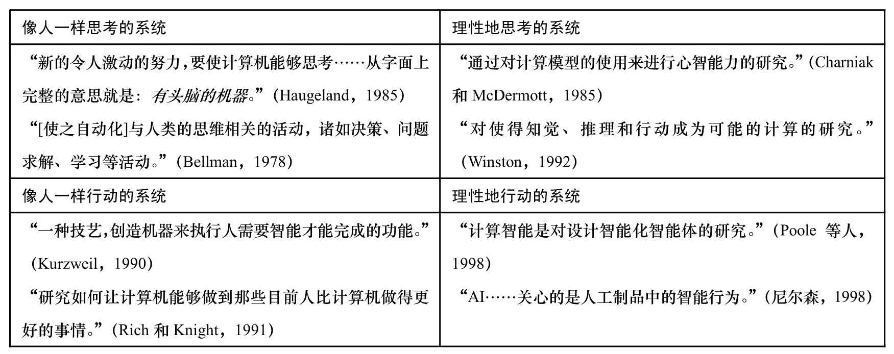

图 1.1 按四种类型归类的人工智能若干定义

#### 1.1.1 模仿人类行为：图灵测试取向

图灵测试由阿兰·图灵于 1950 年提出，意图为智能给出可操作的标准。他认为与其列出一大堆有争议的能力清单，不如借人类这种无可争议的智能实体来做分辨。若文字问答中人类评判者无法辨出对方是人还是机，计算机即算通过。第二十六章会深入讨论图灵测试及通过测试是否等于真正智能。目前要制作通过测试的程序，仍需补足大量能力：

自然语言处理，使机器能用英语流畅交流；

知识表示，用于存储已知或听闻的信息；

自动推理，利用存储信息作答并推导出新结论；

机器学习，使其能适应新环境并捕捉新规律。

测试有意排除直接的身体接触，因为人类生理与身体的模仿对智能并非必要。完整的图灵测试还包括视频感知和通过窗口传递实物。若要通过完整版，机器还需：

计算机视觉，能辨识物体；

机器人技术，能操作和移动物体。

这六个方向基本覆盖了 AI 的主体内容，图灵的贡献延续至今。学界并未倾尽全力去通过图灵测试，他们更在意探究智能的根本原理而非复制样本。正如制造人造飞行器要等莱特兄弟停止模仿鸟类、转向空气动力学后才成功，AI 教材也不会把目标定义为“造出能骗过鸽子的鸽子”。

#### 1.1.2 模仿人类思考：认知建模取向

要说程序像人那样思考，就必须先弄清人究竟如何思考。我们需要切入人类思维的真实运行机理。可行的路径有内省和心理实验两种。获得足够精确的思维理论后，便可以用程序表达。若程序的输入输出及实时行为与人类高度一致，便可认为其内部机制按人类模式运作。例如艾伦·纽厄尔与赫伯特·西蒙设计的 GPS，即通用问题求解器，他们不仅关心解题正确，更对比程序的推理轨迹与人类受试者在相同问题上的轨迹。跨学科的认知科学把 AI 的计算模型与心理学的实验方法结合，力图建立可检验的人类思维理论。

认知科学本身就足够迷人，足以写成一部百科全书 [Wilson 和 Keil，1999]。本书不会系统叙述人类认知的既有发现，只是偶尔对照 AI 技术与人类认知的异同。真正的认知科学必须建立在对真实人或动物实验的基础上，而我们默认读者只能用计算机做实验。

AI 初期常混淆两种主张：算法能完成任务，所以是人类功能的良好模型；反过来也成立。现代研究把这两类主张分开，使 AI 与认知科学各自加速发展。两者仍相互滋养，尤其在视觉与自然语言领域，视觉研究通过神经生理证据与计算模型的融合近年进展显著。

#### 1.1.3 用理性思考：“思维法则”取向

亚里士多德是首位试图严格定义“正确思考”的哲学家，他将其归结为不可辩驳的推理过程。三段论便提供了一种前提为真时结论必真的模式，如“苏格拉底是人；人皆为凡；所以苏格拉底为凡”。这些法则被视为支配意识活动的规则，其研究催生了逻辑学。

19 世纪逻辑学家发展出用以描述万物及其关系的精确命题符号系统。到了 1965 年，原则上已存在能求解任何用逻辑符号表述的可解问题的程序 [2]。传统逻辑主义希望通过这类程序制造智能系统。

该路线面临两大障碍。其一，非形式化知识难以形式化为逻辑符号，尤其在知识不完全可靠时。其二，“原则上可解”与“实际可解”差距巨大。即使只有几十条事实，若缺乏推理步骤的引导，搜索也会耗尽计算资源。这两个难题对所有计算推理努力都适用，虽最早在逻辑主义中显现。

#### 1.1.4 以理性行动：理性智能体取向

智能体即能行动的实体。人们期待计算机智能体具备自主控制、感知环境、持续运行、适应变化、承载自身目标等区别于普通程序的属性。理性智能体则力求在行动中获得最佳结果，或在不确定下获得期望最佳结果。

AI 的“思维法则”取向强调正确推论，而正确推论只是实现理性行动的手段之一。理性不等于全部是推论，因为很多情境下并无可证明之事，却仍须行动。某些理性行为甚至与推论无关，例如从热炉上缩手就是快速反射，比经过思考的缓慢反应更有效。

图灵测试所需技能本质都是为理性行为服务。因此需要知识表示与推理，以在复杂环境中做决策；需要生成可理解的自然语言，以被社会接受；需要学习，不为博学，而是因对世界更深的理解带来更有效策略；需要视觉感知，不为欣赏色彩，而是为预判行为后果，例如看见食物才去靠近。

把 AI 研究视作理性智能体的设计有两大优势。其一，比“思维法则”更通用，正确推论只是实现理性的可能机制之一。其二，比以人类行为或思维为基准更经得起科学检验，因理性的标准清晰且普遍。人类行为虽能很好适应特定环境，却部分依赖尚未完善的复杂进化过程。

本书将重点放在理性智能体的通用原则及构建所需要素。可以看出，问题表述看似简明，解决时却布满困难。第二章会进一步展开。

需要牢记的是：在复杂环境中实现完美理性，即永远做正确之事，在相当长的时间内是不可行的，计算需求太高。本书大部分内容仍以完美理性为分析起点，以简化问题并提供基本框架。在第六章与第十七章我们会专门讨论有限理性，即在计算时间受限下如何行动。

### 1.2 AI 的思想源流

接下来将简要回顾为 AI 提供概念、视角与技术的学科历史。和任何历史一样，这里也只能聚焦少数人物、事件与思想。叙述围绕一系列问题展开，不应让人误以为这些问题是学科的目标，或学科发展以 AI 为终极归宿。

#### 1.2.1 哲学 公元前 428 年—至今

• 形式化规则能否用于抽取合理结论？
• 意识如何从物质大脑中产生？
• 知识从何而来？
• 知识怎样转化为行动？

##### 意识的早期哲学思考

亚里士多德 公元前 384—公元前 322 是首位把支配意识理性部分的法则形式化为精确集合的人。他发展出非形式化的三段论，用于在初始前提下机械推导出结论。 much 后来，Ramon Lull 卒于 1315 年 提出推理可用机械装置完成，其“概念之轮”即画在本书封面上。Thomas Hobbes 1588—1679 认为推理如同数字计算，“我们在寂静思维中加减”。自动计算持续推进：约 1500 年，里昂纳多·达·芬奇 1452—1519 设计了机械计算器但未建造，后来的重建证实其设计可行。最早的计算机器据信由德国科学家 Wilhelm Schickard 1592—1635 于 1623 年左右制造，尽管布莱斯·帕斯卡 1623—1662 于 1642 年造出的 Pascaline 更著名。帕斯卡写道：“算术机器的效果显然更接近思维而非动物的其它活动。”戈特弗雷德·威尔海姆·莱布尼兹 1646—1716 建造装置企图对概念而非数字进行操作，不过其范围相当有限。

# 从规则到神经元：意识的拆解之路

我们先为意识里可以用规则捕捉的那部分理性搭建形式化的描述，然后把视线转向承载意识的物理系统本身。1596—1650 年的雷内·笛卡尔最早把心物区分与由此引发的难题讲得清晰透彻。如果把意识彻底等同于物理实在，自由意志的空间就会被压到极致：当心智完全听命于自然法则时，它的自主性与一块按重力坠落的石头并无二致。笛卡尔虽是推理能力的坚定倡导者，却坚守二元论，认为灵魂或精神的部分超脱自然，不受物理规律节制；动物则没有这种二元属性，可以当作机器处理。与之相对，唯物主义主张大脑按物理规律运转即构成意识，自由意志于是被压缩成在选择情境中对各种可能选项的主观感受。

把意识视作可操作的物理现象后，紧接的问题是知识从何而来。由弗朗西斯·培根 1561—1626 的《新工具论》 Novum Organum [\[3\]](#text00007.html#bw45) 掀起的经验主义浪潮，被约翰·洛克 1632—1704 概括为“没有感知就没有认识”。大卫·休谟 1711—1776 在《论人类天性》 A Treatise of Human Nature 1739 中提出广为人知的归纳法则：一般规律源于构成该规律要素之间可重复出现的关联。在路德维希·维特根斯坦 1889—1951 与伯特兰·罗素 1872—1970 的工作之上，由鲁道夫·卡尔纳普 1891—1970 率领的维也纳学派发展出逻辑实证主义，主张一切知识都可经由逻辑理论最终连回对应感官输入的观察命题 [\[4\]](#text00007.html#bw45)。卡尔纳普在《世界的逻辑结构》 The Logical Structure of the World 1928 中给出一种从基础实验里抽取知识的清晰计算程序，这很可能是把意识当作计算过程最早的尝试之一。

哲学图景的最后一块拼图是知识与行动的衔接。对人工智能而言这极为关键，因为智能既要求推演也要求行动，只有弄清如何评判行动的合理性，才能造出行动可被判定为正确或理性的主体。亚里士多德认为行动由目标与关于结果的知识之间的逻辑联系来决定，其论述后半段也出现在本书封面上：

但是，思维有时伴随着行动而有时没有，有时伴随着运动而有时没有，那是怎么发生的呢？看来几乎同样的事情也发生在对不变事物进行推理和做出推论的情况下。不过在该情况下最终得到的是纯思索的命题⋯⋯然而这里从两个前提导致的结论是一个行动。……我需要遮盖物；斗篷是遮盖物。故我需要斗篷。我所需要的，我必须制作；我需要斗篷。故我必须制作斗篷。结论“我必须制作斗篷”是一个行动。（Nussbaum，1978，第 40 页。）

在《尼各马科伦理学》 Nicomanchean Ethics 书号 III. 3 页号 1112b 中，亚里士多德进一步展开，给出一种程序：

我们要深思的不是结局，而是手段。因为医生不会考虑他是否应该去治疗，演讲者也不会考虑他是否应该去说服，……他们假设了结局，并考虑如何以及通过什么手段得到该结局，而且是否容易，结局是否最好；当只能用一种手段来达到目的时，他们会考虑如何根据这种手段达到目的，以及通过何种方式来达到这种手段，直到他们到达第一因，……它在分析的顺序中是最后一个，而在生成的顺序中看来是第一个。如果我们碰到了不可能的事情，我们就放弃搜索，例如，如果我们需要金钱而又得不到；但是如果一件事情似乎是可能的，我们就试图去做。

该算法在 2300 年后由纽厄尔与西蒙在 GPS 程序中实现，后世称之为回归规划系统。参见第十一章。

目标导向分析很有用，却没说明当存在多条可行路径或根本无路可达目标时该如何抉择。安托万·阿诺 1612—1694 正确提出了一条在类似情境下进行定量决策的规则。约翰·斯图亚特·米尔 1806—1873 在《功利主义》 Utilitarianism Mill，1863 中把理性决策规范推广到人类行为的各个层面。更形式化的决策理论将在后续章节讨论。

#### 1.2.2 数学（约 800 年—现在）

• 如何以形式规则推导出合理的结论？
• 哪些对象是可计算的？
• 在知识不确定的情形下怎样进行推理？

哲学家勾勒出人工智能的大部分核心思想，但要成为规范科学，需要在逻辑、计算与概率三个支柱上完成数学化。

形式逻辑的萌芽可溯至古希腊，参见第七章，其数学化始于乔治·布尔 1815—1864，他系统化了命题逻辑亦称布尔逻辑。布尔，1847。1879 年，高特洛布·弗雷格 1848—1925 把布尔逻辑扩展到对象与关系，创立了一阶逻辑，成为当今最基础的知识表示形式之一 [\[5\]](#text00007.html#bw45)。阿尔弗雷德·塔尔斯基 1848—1925 引入指称理论，用以说明逻辑对象如何与现实对象对应。下一步是界定逻辑与计算的边界。

通常认为欧几里得求最大公约数的算法是第一个不可忽视的算法。对算法本身的研究可追溯到 9 世纪波斯数学家 al-Khowarazmi，其著作把阿拉伯数字与代数带入欧洲。布尔等人探讨了逻辑演绎的算法，19 世纪末，人们开始把一般数学推理形式化为逻辑演绎。1900 年，大卫·希尔伯特 1862—1943 提出 23 个问题清单，正确预言它们将占据数学家近一个世纪。最后一个问题是可判定性问题 Entscheidungsproblem，亦称判定问题：是否存在算法可判定所有涉及自然数的逻辑命题的真伪。实质上希尔伯特在问有效证明是否有根本限制。1930 年，库尔特·哥德尔 1906—1978 指出存在有效过程可证明罗素与弗雷格一阶逻辑中的任意真命题，但一阶逻辑无法捕捉自然数归纳原则。1931 年，他证明了真实限制的存在。不完备性定理表明，在任何足以描述自然数的语言中，都存在以算法无法确立真值的意义上不可判定的真命题。

这一基本结果也可解读为整数的某些函数无法用算法表示，即不可计算。它激发了阿兰·图灵 1912—1954 的兴趣，他试图精确刻画可计算函数的范围。计算或有效过程的概念本身难以形式化，但丘奇—图灵论题说明图灵机 Turing，1936 能计算任何可计算函数，从而被接受为充分定义。图灵还证明存在不可被图灵机计算的函数，例如没有通用图灵机能判定给定程序对给定输入是否会终止或无限运行。

不可判定性与不可计算性虽重要，不可操作性影响更大。粗略而言，若问题求解时间随实例规模指数增长，则称该问题不可操作。多项式与指数增长差异最先在 20 世纪 60 年代中期受到重视。Cobham，1964；Edmonds，1965。因为指数增长意味着即使常规的大规模实例也无法在合理时间内解决。因此应把产生智能行为的问题拆分为可操作的子问题，而非不可操作的子问题。

如何识别不可操作问题？由斯蒂文·库克 1971 与理查德·卡普 1972 开创的 NP—完全理论提供方法。库克与卡普证明大量不同类别的规范组合搜索与推理问题属于 NP—完全问题。可归约为 NP—完全问题类的问题类很可能不可操作。尽管尚未证明 NP—完全问题必然不可操作，多数理论家相信如此。这些结果与早期媒体迎接首台计算机时的乐观——“比爱因斯坦更快”的“电子超级大脑”形成对比。近年来人工智能有助解释为何 NP—完全问题的某些实例困难，而另一些相对容易。Cheeseman 等人，1991。

除逻辑与计算外，数学对人工智能的第三大贡献是概率理论。意大利人杰罗拉莫·卡尔达诺 1501—1576 最早搭建概率思想框架，以赌博事件的可能结果来描述。概率很快成为所有定量科学的工具，帮助应对不确定测量与不完备理论。皮埃尔·费尔马 1601—1665，布莱兹·帕斯卡 1623—1662，雅各布·贝努利 1654—1705，皮埃尔·拉普拉斯 1749—1827 等人推进理论并引入新统计方法。托马斯·贝叶斯 1702—1761 提出依据新证据更新概率的法则。贝叶斯法则及其衍生的贝叶斯分析构成了人工智能系统中不确定推理的现代基础。

#### 1.2.3 经济学（1776 年—现在）

• 如何决策以获得最大收益？
• 在他人不合作的情形下如何做到？
• 当收益在远期才显现时如何决策？

经济学作为科学的研究始于 1776 年，苏格兰哲学家亚当·斯密 1723—1790 出版《国家财富的本质和原因的研究》亦称《国富论》 An Inquiry into the Nature and Causes of the Wealth of Nations。虽然古希腊人等对经济思想有所贡献，斯密是首个将其作为科学对待的人，他把经济视为个体代理间追求自身经济利益最大化的协调过程。很多人以为经济学就是关于金钱，经济学家则强调研究人们如何抉择以达成更理想结果。对偏好结果即效用的数学处理，最早由勒昂·瓦尔拉斯 发音为“Valrasse” 1834—1910 形式化，由弗兰克·拉姆齐 1931 改进，后由约翰·冯·诺依曼与奥斯卡·莫根斯坦在《博弈论与经济行为》 The Theory of Games and Economic Behavior 中进一步完善，1944。

决策理论把概率理论与效用理论结合，提供不确定条件下决策的形式化完整框架——即概率描述能恰当捕捉决策者环境时。这对宏观经济情形适用，其中每个代理无需关注其他代理作为个体的行动。对微观经济，情形更像博弈：某参与者的行动会显著正面或负面影响其他参与者的效用。冯·诺依曼与莫根斯坦对博弈论 Luce 和 Raiffa，1957 的发展包含一个惊人结论：在某些博弈中，理性智能体应以随机方式行动，或至少在某些方面向对手呈现随机性。

在很大程度上，经济学家不会讨论上面列出的第三个问题，即当行动收益并非即时体现而是循序行动的结果时如何制定理性决策。该议题属于运筹学中的追踪范畴。运筹学源于二战期间英国为优化雷达安置所做的努力，后转入民用以处理复杂管理决策。理查德·贝尔曼的工作，1957 对一类延续式决策问题进行形式化，被称为马尔可夫决策过程，我们将在第十七和二十一章学习。

经济学与运筹学的研究对理性智能体大有裨益，尽管人工智能研究在很多年里沿着几乎独立的道路发展。一个原因在于制定理性决策的明显复杂性。赫伯特·西蒙 1916—2001，人工智能研究先驱，于 1978 年获诺贝尔经济学奖，因其早期工作显示基于满意度的模型——制定“足够好”的决策而非艰苦计算最优化——更能描述真实人类行为。西蒙，1947。至 20 世纪 90 年代，对智能体系统中使用的决策理论技术的兴趣开始复苏。Wellman，1995。

#### 1.2.4 神经科学（1861 年—现在）

• 大脑是如何处理信息的？

神经科学研究神经系统，特别是大脑。大脑产生思维的精确方式是科学上最重大的谜团之一。数千年来人们一直认为大脑以某种方式与思维相连，因为头部受重击会导致精神缺陷。人脑在体型比例上的特殊性已为人所知许久：约公元前 335 年，亚里士多德写道：“在所有的动物中，人拥有相对于其体型比例而言最大的大脑。” [\[6\]](#text00007.html#bw45) 然而直到 18 世纪中期人们才广泛承认大脑是意识的居所，此前一般认为意识存在于心脏、脾脏或松果体。

保罗·布鲁卡 1824—1880 对大脑损伤病人失语症的研究重振了该领域，并说服医学机构承认大脑存在负责特定认知功能的地方化区域。特别是他阐明了语言产生定位于大脑左半球的一部分，现称布鲁卡区 [\[7\]](#text00007.html#bw45)。当时已知道大脑由神经细胞即神经元组成，但直到 1873 年卡米洛·戈尔吉 1843—1926 发展出一种染色技术，才得以观察单个神经元。参见图 1.2。该技术被圣地亚哥·拉蒙·卡哈尔 182—1934 用于其对大脑神经元结构的开创性研究中 [\[8\]](#text00007.html#bw45)。

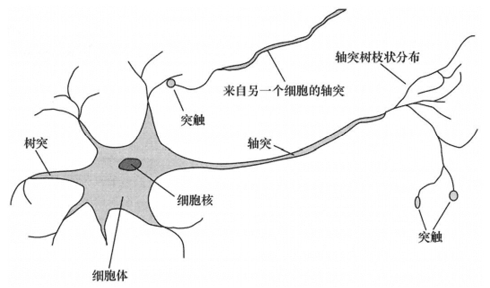
图 1.2 神经细胞或称神经元的组成部分。每个神经元由一个细胞体组成，包含一个细胞核。从细胞体伸展出一定数量的神经纤维称为树突，伸展出一根长的神经纤维称为轴突。轴突向外延伸很长距离，远比图中所示比例要长。典型的轴突有 1cm 长，是细胞体直径的 100 倍，但是更长的能够达到 1m。一个神经元与 10 个到 10 万个其它神经元相连接，其连接处称为突触。信号通过复杂的电化学反应从神经元传播到神经元。信号控制大脑的短期活动，也能够使神经元的位置和连接发生长期改变。这些机制被认为形成了大脑学习的基础。大多数信息处理在大脑皮层即大脑的外层进行，基本的组织单元看来是一个直径大约 0.5mm 的柱状薄片，扩展到皮层的全部深度，人类的大脑皮层深度约为 4mm。一个柱状体包含大约 2 万个神经元

我们现在拥有一些显示大脑区域与其所控制或接收传感器输入的躯体部分之间映射关系的数据。这样的映射可在数周内发生根本性改变，一些动物似乎具有多重映射。此外，我们尚未完全了解其他区域如何接管受损区域的原有功能。几乎没有理论能说明单个记忆是如何保存的。

对本来状态下大脑活动的测量始于 1929 年，使用汉斯·伯格发明的脑电图记录仪 EEG。近来开发的功能性核磁共振成像 fMRI Ogawa 等人，1990 为神经科学家提供了关于大脑活动的空前精细图像，使得以某些有趣方式与正在进行的认知过程相符的测量成为可能。这些进步因单细胞记录技术的提升而增强。尽管如此，要理解这些认知过程中的任何一个实际如何运作，我们仍有很长的路。

真正令人震惊的结论是简单细胞的集合能够导致思维、行动和意识，换言之大脑产生意识。西尔勒，1992。唯一的实际可替代理论是神秘主义：存在某种神秘领域，精神在其中运作，超出了自然科学范围。

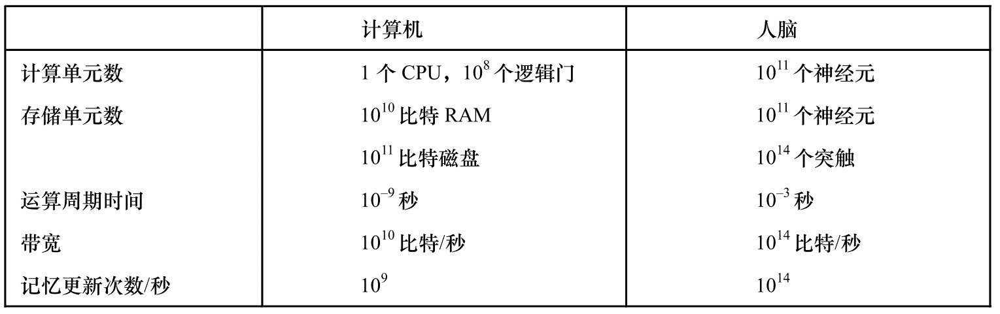
图 1.3 关于计算机大约截至 2003 年和人脑可获得的原始计算资源的一个粗略比较。计算机的数字从本书的第一版到现在全都至少增长到原来的 10 倍，而且预期在这个的 10 年内还会继续增长。大脑的数字则在过去的 1 万年中没有变化

大脑与数字计算机执行相当不同的任务，也具有不同属性。图 1.3 显示典型人类大脑中神经元的数量比典型高端计算机 CPU 中的逻辑门数量多约 1000 倍。摩尔定律 [\[9\]](#text00007.html#bw45) 预测 CPU 的逻辑门数量在 2020 年左右能与大脑神经元数量相当。当然从此类预测无法推断什么，而且存储容量差异与转换速度及并行性差异相比是次要的。计算机芯片能在 1 纳秒内执行一条指令，而神经元则慢了上百万倍。然而大脑的补偿在于所有神经元与突触是同时活动的，而最新计算机也只有一两个 CPU。因此，尽管计算机在原始转换速度上快 100 万倍，大脑最终在做事上比计算机快 10 万倍。

#### 1.2.5 心理学（1879 年—现在）

• 人类和动物如何思考和行动的？

# 心理学何时算得上科学

学界普遍把心理学获得科学面貌的起点归于两位德国学者。物理学家赫尔曼·冯·亥姆霍兹 1821—1894 用实验拆解人类视觉，把成果汇成《生理光学手册》，后人评价该书是阐释视觉物理与生理机制最关键的著作 Nalwa 1993 第 15 页。其学生威廉·冯特 1832—1920 于 1879 年在莱比锡大学创办首个实验心理学实验室。冯特要求受试者在严格控制下完成知觉或联想任务的同时，对自身心智活动做内省报告。控制虽精细，却难以让人确信心理学已完全科学化，数据的主观来源也让研究者很难摆脱自身理论的偏见。

动物行为研究的思路截然不同。H.S.Jennings 在 1906 年《低等生物的行为》中系统梳理了因缺乏内省材料而发展出的客观取向。把这套做法搬到人类身上，1878—1958 年的约翰·沃森主导的行为主义，在内省证据不可靠的前提下彻底否定涉及主观心灵的解释。该学派只承认可观察的刺激与反应，把知识、信念、目标、推理等心智构成一并归入非科学的民间心理学。行为主义在鼠、鸽等动物上积累大量事实，对人类理解的贡献有限，却在 1920 至 1960 年间尤其是美国长期主导心理学。

把心脑视为信息加工装置的观点可追溯至威廉·詹姆斯 1842—1910 的工作，亥姆霍兹也认为感知包含无意识的逻辑推演。认知取向在美国长期被行为主义压制，却在弗雷德里克·巴特利特 1886—1969 领导的剑桥应用心理学小组中延续。巴特利特的学生兼继承者肯尼思·克雷克在 1943 年《解释的本质》中为信念、目标等精神概念正名，主张使用它们与用压力、温度描述气体一样科学，即使气体分子本身不具备这些属性。克雷克指出具备知识的智能主体大致经历三步：（1）外界刺激先被转译为内部表征，（2）认知加工对表征操作产生新的内部表征，（3）表征再被转译回行动。他进一步说明这种设计的合理性：

如果生物体保持一个关于外部现实以及它自己头脑中可能的行动的“小尺度模型”，它就能够尝试各种替代方案，确定其中最好的，在未来的环境出现前做出反应，利用过去事件的知识对付现在和未来，在各方面按照更全面、更安全和更适当的方式应对其所面临的紧急情况。（Craik，1943）

1945 年克雷克因自行车事故去世后，唐纳德·布罗德本特承接其思路。1958 年《感知和通讯》收录了心理学早期信息加工模型。与此同时美国计算机模型的兴起催生认知科学。该领域常被上溯至 1956 年 9 月麻省理工学院的一次研讨会，时间上距 AI 诞生会议仅两月。会上乔治·米勒提出“神奇数字 7”，诺姆·乔姆斯基提出“语言的三种模型”，阿兰·纽厄尔与赫伯特·西蒙介绍“逻辑理论机”。三篇论文分别展示计算机模型如何刻画记忆、语言与逻辑思维的心理状态。如今学界多接受安德森 1980 年的表述：认知理论应当像计算机程序，即给出实现某种认知功能的详细信息处理机制。

#### 1.2.6 计算机工程（1940 年—现在）
• 我们如何才能制造出能干的计算机？

实现智能需要智能本身与承载它的装置，计算机被选为该装置。现代数字电子计算机由二战参战国科学家几乎同步独立发明。首台可运行的机器是 1940 年阿兰·图灵小组制造的电动机械式 Heath Robinson【11】，唯一目的为破译德国通信。1943 年同一小组推出基于真空管的强力通用机 Colossus【12】。第一台可编程计算机 Z-3 由康拉德·楚泽于 1941 年在德国实现，他还发明浮点数与首个高级语言 Plankalkül。第一台电子计算机 ABC 由约翰·阿塔纳索夫与学生克利福德·贝里在爱荷华大学于 1940 至 1942 年间组装。阿塔纳索夫工作长期被忽视，直至宾夕法尼亚大学在秘密军事项目中研发的 ENIAC 被承认为现代计算机重要先驱，核心人物为约翰·莫克利与约翰·埃克特。

此后半世纪，每代硬件均带来速度提升、容量扩张与成本下降。性能约每 18 个月翻一番，该速率或可维持 10 至 20 年，之后需分子工程等新技术。

电子计算机之前已有计算装置。自动机器可追溯至 17 世纪。首台可编程设备是 1805 年约瑟夫·玛丽·雅卡尔 1752—1834 设计的织布机，用穿孔卡存储编织图案指令。19 世纪中叶查尔斯·巴贝奇 1792—1871 构思两台未完工机器。其一为封面上的“差分机”，意图为工程与科学计算数学表，最终于 1991 年复原并在伦敦科学博物馆展出，证明其可行 Swade 1993。其二“分析机”野心更大：具备可寻址存储、存储程序与条件跳转，是首个人造通用计算装置。巴贝奇合作者阿达·洛夫莱斯，诗人拜伦爵士之女，很可能为世界第一位程序员，Ada 语言即以其命名。她为未完工分析机编写程序，并设想机器可下国际象棋或创作音乐。

AI 在计算机科学软件层面亦有“债务”，操作系统、程序设计语言及撰写论文所需工具均来自软件技术；这笔债亦获回报：AI 推动了分时技术、交互式翻译器、窗口鼠标个人电脑、快速开发环境、链表数据类型、自动存储管理，以及符号化、函数式、动态与面向对象编程的关键概念。

#### 1.2.7 控制论（1948 年—现在）
• 人工制品怎样才能在自己的控制下运转？

亚历山大的克特西比奥斯约公元前 250 年制造首台自控机器：一架带调节器可保持水流恒定、可预测的水钟。该发明改写了制品能力的定义，此前只有活物才能依据环境变化修正自身行为。其他自适应反馈控制实例包括詹姆斯·瓦特 1736—1819 的蒸汽机调速器、科内利斯·德雷伯尔 1572—1633 发明的自动调温器与潜水艇。稳定反馈系统的数学理论在 19 世纪已发展。

诺伯特·维纳 1894—1964 为控制论核心人物，优秀数学家曾与伯特兰·罗素合作，后转向生物与机械控制系统及其与认知的联系。如同以控制系统为心理学模型的克雷克，维纳与阿图罗·罗森布鲁斯、朱利安·比戈共同挑战行为主义正统 Rosenblueth 等人 1943。他们观察到有目的行为会试图最小化“误差”，即当前状态与目标状态的差距。20 世纪 40 年代末，维纳与沃伦·麦卡洛克、沃尔特·皮茨及约翰·冯·诺依曼一起组织系列会议，探索新的数学与计算认知模型，影响众多行为科学研究者。维纳的《控制论》1948 成为畅销书，点燃人工制造智能机器的热情。

现代控制论尤其随机优化控制分支旨在设计随时间变化使目标函数最大化的系统，这与对 AI 的理解大致吻合：设计行为表现最优化的系统。那么 AI 与控制论为何分化，尤其其奠基人关系密切？答案在于数学技术与世界观问题集合的紧密耦合。控制论工具以微积分与矩阵代数为主，适合用固定连续变量集描述系统，且精确分析通常只对线性系统可行。AI 于 20 世纪 50 年代建立，部分动机正是摆脱控制论数学局限，逻辑推理与计算工具使研究者得以处理语言、视觉、规划等完全超出控制理论家范围的问题。

#### 1.2.8 语言学（1957 年—现在）
• 语言和思维是怎样联系起来的？

1957 年 B.F.斯金纳出版《语言行为》，由领域内早期专家撰写，对语言学习的全面行为主义记述。对该书的评论与原著同等知名，几乎浇熄行为主义研究兴趣。评论作者为诺姆·乔姆斯基，刚出版《句法结构》。乔姆斯基指出行为主义理论无法表达语言创造性，无法解释儿童如何理解并构造从未听过的句子。其理论基于可追溯至印度语言学家帕尼尼约公元前 350 年的语法模型，能解释该现象，且足够形式化原则上可编程实现。

于是现代语言学与 AI 几乎同时诞生，共同成长并交叉形成计算语言学或自然语言处理。语言理解问题很快被发现远比 1957 年看起来复杂，这在 20 世纪 60 年代前并不被广泛接受。知识表示的早期工作大量与语言紧密相连，并从语言学研究中汲取信息，后者又与数十年的语言哲学分析相连。

### 1.3 人工智能的历史

#### 1.3.1 人工智能的孕育期（1943 年—1955 年）

AI 最早工作通常被认为是沃伦·麦卡洛克与沃尔特·皮茨 1943 年完成。他们汲取基础生理学与脑神经元功能、从罗素与怀特海德开始的命题逻辑形式化分析，以及图灵的计算理论。他们提出人工神经元模型，每个神经元具开关特性，并在足够多邻近神经元激活时转为开。神经元状态被认为实际等价于引起足够刺激的命题。他们证明任何可计算函数都可由神经元网络实现，且所有逻辑连接词都可用简单网络结构实现。麦卡洛克与皮茨还提出适当网络可学习。唐纳德·赫布 1949 阐述一种简单更新规则用于修改神经元连接强度，被称为赫布学习，至今仍具影响。

普林斯顿数学系研究生马文·明斯基与迪恩·埃德蒙兹于 1951 年建造第一台神经元网络计算机。该机名 SNARC，使用 3000 个真空管与 B-24 轰炸机备用自动驾驶仪模拟由 40 个神经元构成的网络。明斯基的博士论文答辩委员会怀疑这算不算数学，传言冯·诺依曼说如果它现在不是，总有一天会是。明斯基后来证明了一些显示神经元网络研究局限性的强定理。

阿兰·图灵于 1950 年论文《计算机器与智能》中首清晰描绘 AI 完整图景，在文中提出图灵测试、机器学习、遗传算法与增量学习。

#### 1.3.2 人工智能的诞生（1956 年）

约翰·麦卡锡曾在普林斯顿任职，后赴达特茅斯，此地成为人工智能正式诞生地。麦卡锡说服明斯基、克劳德·香农与内森尼尔·罗切斯特召集全美对自动机理论、神经元网络与智能研究感兴趣的研究者。1956 年夏天在达特茅斯组织为期两个月的研讨会。与会者十位，包括普林斯顿的特伦查德·莫尔、IBM 的亚瑟·萨缪尔，以及 MIT 的雷·索洛莫诺夫与奥利弗·塞弗里奇。

卡内基工业技术大学【13】研究者艾伦·纽厄尔与赫伯特·西蒙几乎占据全场。虽然他人有想法与跳棋程序等具体应用，纽厄尔与西蒙已完成推理程序逻辑理论家 LT。正如西蒙宣称：我们发明了一个计算机程序，它能够进行非数值化的思考，并且因此可以解决古老的精神—肉体问题。【14】会议后不久，其程序即能证明罗素与怀特海德《数学原理》中的多数定理。据说当罗素看到西蒙展示程序给出的定理证明比书中更短时十分高兴，《符号逻辑期刊》编辑则无动于衷，拒绝了纽厄尔、西蒙与逻辑理论家的论文。

达特茅斯会议并未带来新突破，却让主要人物相互认识。随后 20 年人工智能领域由这些人及他们在 MIT、CMU、斯坦福与 IBM 的学生同事统治。也许会议最持久的成果是大家同意使用麦卡锡为此领域起的新名：人工智能，缩写 AI。可能计算理性更合适，但 AI 已根深蒂固。

从麦卡锡等人 1955 年的提议看，AI 为何必须独立。AI 的问题为何不能归入控制论、运筹学或决策理论，尽管目标相近？为何 AI 不是数学分支？首要答案是 AI 从一开始就承载复制人类才能如创造性、自我修养与语言功能的思想，无他领域涉足。其次是方法论差异。AI 是这些领域中唯一明确属于计算机科学的分支，且是唯一试图建造在复杂变化环境中自动发挥功能的机器的领域。

#### 1.3.3 早期的热情，巨大的期望（1952 年—1969 年）

AI 研究早期充满成功，但仅局限范围内。当时只有原始计算机与程式设计工具，且几年前计算机还被视为只能做算术，主流观念更倾向相信一台机器永远不能做 X。参见第二十六章图灵收集的 X 清单。AI 研究者自然做出反应，演示一个接一个的 X。约翰·麦卡锡称这段时期为惊叹时期，人们见到机器成就惊讶说：看哪，我的妈啊，它没有手！

通用问题求解器 GPS 延续纽厄尔与西蒙早期成功。不同于逻辑理论家，GPS 设计模仿人类问题求解规程。在其能处理的有限类别问题中，程序决定的子目标与行动次序与人类求解相似。因此 GPS 很可能是第一个实现像人一样思考方法的程序。GPS 及后续认知模型成功引导纽厄尔与西蒙提出物理符号系统假设，宣称一个物理符号系统具有必要和足够的方式产生一般智能行为。其意指任何显示智能的系统必然通过对符号构成的数据结构进行处理发挥功能，后续在多方面受挑战。

在 IBM，内森尼尔·罗切斯特与同事制作第一代 AI 程序。赫伯特·盖尔恩特 1959 建造几何定理证明机，能证明令许多数学系学生挠头的定理。从 1952 年起，亚瑟·萨缪尔写系列西洋跳棋程序，最终通过学习达到业余高手水平。在此过程中，他反驳计算机只能做人让它做的观念：他的程序很快学会下得比创造者更好。该程序于 1956 年 2 月在电视演示，给人强烈印象。如同图灵，萨缪尔难以获得机时。他夜间工作，使用仍在 IBM 生产车间测试的计算机。第六章讨论博弈，第二十一章描述并延伸萨缪尔使用的学习技术。

1958 年，约翰·麦卡锡从达特茅斯转到 MIT，这一年在他身上集中发生了三件改变历史的事。作为 MIT 人工智能实验室早期备忘录的第一条内容，他提出了 `Lisp`，这门语言后来成为人工智能的主流编程工具，也是迄今仍在服役的第二古老的高级通用语言，仅比 `FORTRAN` 晚一年。拥有了 `Lisp` 之后，算力稀缺与昂贵的问题却依然严峻，为此他与 MIT 的同事一起开创了分时技术，让多人共享同一台机器成为可能。

同一年，麦卡锡发表了《使用常识的程序》一文，里面描绘了一个叫 `Advice Taker` 的设想系统，可以被看作最早的完整人工智能蓝图。它和逻辑理论家、几何定理证明机一样，都要靠知识来解决问题，但不同之处在于它内置了关于世界的通用常识。比如借助几条简单的公理，系统就能规划出开车去机场赶飞机的路线。更关键的是，这个程序可以通过类似操作手册的方式不断吸收新公理，而无需重新编写代码，从而在新领域获得能力。这正是知识表示与推理的核心思想：对世界以及智能体行动对世界影响的形式化、明确的知识表述，再通过演绎加以处理，具有极大价值。令人惊讶的是，这篇 1958 年的论文中许多观点至今仍有现实意义。

1958 年也是马文·明斯基入职 MIT 的年份。两人起初并肩工作，后来分道扬镳。麦卡锡深耕形式逻辑的表征与推理，明斯基则更关心程序如何真正跑起来，最终走上反逻辑的路线。1963 年，麦卡锡在斯坦福成立了人工智能实验室。他原本打算用逻辑方法打造超级建议采纳者，这条思路后来被 J. A. Robinson 的归结方法所强化。斯坦福的工作聚焦通用逻辑推理的应用，例如 Cordell Green 的问答与规划系统，以及斯坦福研究院的 Shakey 机器人项目，后者首次把逻辑推理与物理行动完整结合起来。

明斯基培养的学生则偏爱把智能问题压缩到极小的受限场景，也就是所谓的微世界。James Slagle 的 `SAINT` 程序能在大学一年级典型的封闭积分题上表现不错。Tom Evans 的 `ANALOGY` 程序擅长解决 IQ 测试里的几何类推题。Daniel Bobrow 的 `STUDENT` 程序可以处理代数应用题，例如：

如果汤姆招揽到的顾客数等于他投放广告数 45 的 20% 的平方的两倍，他能招揽到多少顾客？

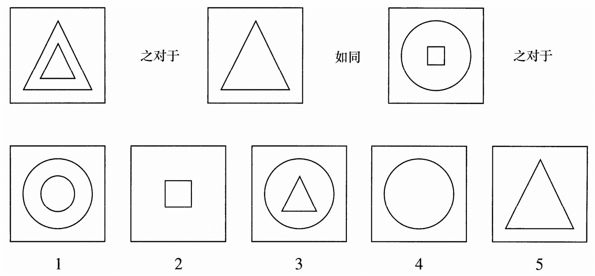

图 1.4 Evans 的 `ANALOGY` 程序解决的一个问题实例

最具代表性的微世界是积木世界：一组实心积木放在桌面或模拟桌面上，机械手每次只能拿起一块，按指令摆放。这一场景催生了大量研究，包括戴维·哈夫曼的视觉项目 1971、David Waltz 的视觉与约束传播 1975、Patrick Winston 的学习理论 1970、Terry Winograd 的自然语言理解程序 1972，以及 Scott Fahlman 的规划器 1974。

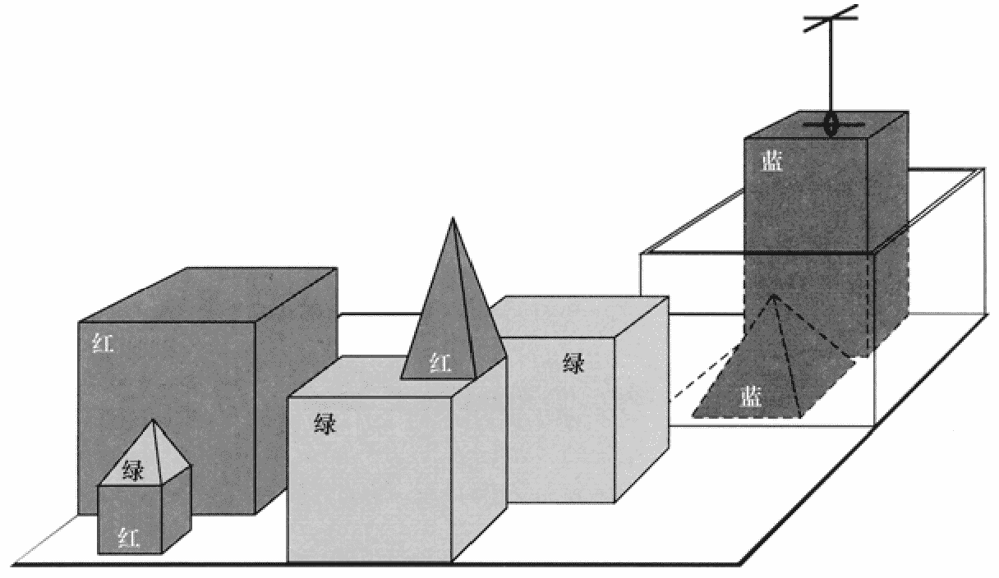

图 1.5 积木世界的场景。`SHRDLU`（Winograd，1972）刚好完成了一条命令，“找到一块比你拿着的那块高的积木并把它放到盒子里

基于 McCulloch 与 Pitts 神经元网络的早期探索也在推进。Winograd 与 Cowan 1963 年的工作表明，用大量单元协同编码一个概念能提升鲁棒性和并行性。海布学习规则被进一步改进，Bernie Widrow 提出的适应机与 Frank Rosenblatt 1962 年的感知器就是典型。Rosenblatt 证明了感知器收敛定理，说明如果存在匹配解，学习算法就能调整连接强度使其拟合任意输入。相关讨论见第二十章。

#### 1.3.4 现实的困难（1966 年—1973 年）

早期人工智能研究者对未来充满乐观。赫伯特·西蒙 1957 年的表述常被引用：

我的目标并非制造惊讶——概括起来就是，如今已有机器能够思考、学习和创造，而且这种能力将快速增长，直到可见的未来，它们能处理的问题范围扩展到人类思想所及的全部领域。

“可见的未来”含义模糊，西蒙还给出更具体的预测：十年内计算机将拿下国际象棋冠军，并由机器完成重要数学定理证明。实际上这些目标花了约四十年才接近实现。过度自信源于早期系统在简单例子上表现亮眼，但在扩大问题规模时几乎全部遭遇惨败。

第一类瓶颈是早期程序缺乏关于领域的知识，成功多限于句法层面。机器翻译就是典型案例。1957 年苏联发射第一颗人造卫星后，美国国家研究委员会资助了加速俄语科技论文翻译的项目。初期设想只要靠俄英语法转换加电子词典就能保留原意。事实证明翻译需要对主题的一般性理解以消除歧义。经典反例是“心有余而力不足”经英译俄再译回英语后变成“伏特加酒不错但肉已经烂了”。1966 年顾问委员会报告判定通用科学文本机器翻译尚不存在且短期内无望，美国政府资助的学术翻译项目全部终止。至今机器翻译仍是不完美但广泛使用的工具。

第二类困难是许多问题本质上难以求解。早期程序常用穷举组合步骤的方式，在微世界中因物体少、行动少而奏效。在计算复杂性理论成熟前，人们认为放大到大问题只需更快硬件与更大内存。当定理证明涉及数十条事实时就屡屡失败，归结法带来的乐观迅速受挫。原则上可解并不等于实际可解。

这种无限算力的错觉也出现在机器进化实验中，即今天的遗传算法。Friedberg 1958 年及随后的研究基于一个正确直觉：对程序代码做一系列小的随机突变就能培养出针对简单任务的高性能程序。尽管耗费数千小时 CPU 时间，进展微乎其微。现代遗传算法靠更好的编码方式才取得成效。

与组合爆炸抗争的失败成为莱特希尔报告 1973 的主要批评依据，英国政府据此削减了除两所大学外所有大学的 AI 资助。

第三类限制来自基本结构本身。明斯基与 Papert 1969 年的《感知器》证明，尽管感知器似乎能学习所有它能表示的东西，但它能表示的东西非常有限，尤其是无法训练两输入感知器识别输入不一致的情况。该结论未推广到多层网络，但神经网络研究经费仍急剧萎缩。颇具讽刺的是，反向传播算法在 20 世纪 80 年代末引发神经网络复兴，而它最早的提出可追溯到 1969 年的 Bryson 与 Ho。

#### 1.3.5 基于知识的系统：力量的钥匙？（1969 年—1979 年）

前十年流行的通用搜索机制被称为弱方法，因其可迁移但难于扩展。替代思路是引入更强有力的领域知识，使推理步骤大幅增加并能应对狭窄专业领域的典型情况。有人总结：要解难题，你必须几乎已经知道答案。

`DENDRAL` 程序 1969 年是这种方法的早期典范。在斯坦福，艾德·费根鲍姆、Bruce Bushanan 与诺贝尔奖得主 Joshua Lederberg 合作，利用质谱仪信息推断分子结构。输入包括分子式如 `C6 H13 NO2` 和质谱。简单版本先枚举所有符合分子式的结构，再预测质谱并比对，规模稍大便不可行。研究者求助于分析化学家，发现专家靠识别质谱中已知峰模式来推断常见子结构。例如识别酮 `C=O` 的规则涉及两峰位置、峰强等条件。

识别特殊子结构极大缩小了候选集。`DENDRAL` 的强大之处在于把质谱预测的一般原理映射为高效的专用“食谱”。它是首个成功的知识密集系统，专业知识来自大量专用规则。后来的系统也在继承建议采纳者的思想：把知识以规则形式与推理机制分离。

基于此经验，费根鲍姆与斯坦福同事启动启发式程序设计计划，探索专家系统在其他领域的应用。医学诊断是下一个重点。费根鲍姆、Buchanan 与 Edward Shortliffe 共同开发 `MYCIN` 用于血液感染检测，约 450 条规则使其表现接近专家，远超初级医生。与 `DENDRAL` 不同，`MYCIN` 的规则无法从通用理论演绎，来源于与专家的深度访谈、教科书和病例经验；同时规则需处理医学不确定性，系统采用确定性因子演算来评估证据。

领域知识在自然语言理解中同样关键。Winograd 的 `SHRDLU` 虽引发轰动，但其对句法分析的依赖让它重蹈早期机器翻译的覆辙。它能在积木世界中解决歧义与指代，主要是因为场景高度受限。Eugene Chaniak 等人提出，稳健的语言理解需要关于世界的一般知识与使用方法。

耶鲁的 Roger Schank 进一步强调这一点，他宣称“没有语法这种东西”，虽打击语言学家却推动了有益讨论。Schank 与学生打造了一系列程序，重心不在语言本身，而在如何表示和推理从语言理解中获得的知识，涉及固定环境表示、人类记忆组织、规划与目标理解等。

现实应用的增长催生了大量知识表示与推理语言。逻辑派在欧洲流行 `Prolog`，在美国流行 `PLANNER` 家族。另一派追随明斯基 1975 年的框架，采用结构化方法，按对象和事件类型组织事实，并置于类生物分类学的层次结构中。

#### 1.3.6 AI 成为工业（1980 年—现在）

首个成功的商用专家系统 `R1` 在 DEC 上线，McDermott 1982 年介绍。到 1986 年估计每年为公司节省 4000 万美元。1988 年前，DEC 的 AI 团队已做出 40 个专家系统。杜邦公司在使用 100 个、开发 500 个专家系统，年节省约 1000 万美元。几乎所有主要美国公司都设有 AI 研究部门并投入专家系统。

1981 年日本公布“第五代计算机”计划，十年内建造运行 `Prolog` 的智能机。美国随即组建微电子与计算机技术公司 MCC 维护竞争力。两案的 AI 部分都是芯片设计与人机交互等宽泛计划的一部分，但均未达到雄心目标。英国艾尔维报告恢复了因莱特希尔报告而中断的投资。

总体上 AI 产业从 1980 年的数百万美元暴涨至 1988 年的数十亿美元，随后迎来“人工智能的冬天”，众多公司因过度承诺而受挫。

#### 1.3.7 神经元网络的回归（1986 年—现在）

尽管 70 年代末计算机科学基本放弃神经网络，其他领域仍在坚持。物理学家如 John Hopfield 1982 年用统计力学分析网络的存储与优化特性。心理学家 David Rumelhart 与 Geoff Hinton 则持续研究记忆的神经网络模型。真正的转折在 80 年代，至少四个独立小组重新发现了 Bryson 与 Ho 1969 年提出的反向传播算法。该算法被广泛应用于学习问题，《并行分布式处理》Rumelhart 与 McClelland 1986 的出版放大了兴奋情绪。

这些连接主义模型被部分人视为对纽厄尔与西蒙的符号模型以及麦卡锡等倡导的逻辑方法的直接挑战。也许人类处理的是符号——Terrence Deacon 在《符号的物种》1997 中认为这是人类的定义特征，但激进的连接主义者质疑符号处理在认知精细模型中的解释力。该争论尚未定论，当下共识更倾向于互补而非对立。

#### 1.3.8 AI 成为科学（1987 年—现在）

近年的 AI 研究在内容与方法论上发生革命。研究更倾向于在已有理论上深耕，而非另起炉灶；主张建立在严格定理或确凿实验证据之上，而非直觉；强调与现实应用相关，而非玩具样例。

AI 起初因反叛控制论与统计学等现有理论的局限而诞生，如今正重新接纳这些领域。正如 David McAllester 1998 年所说，早期符号计算新形式如框架与语义网络使经典理论失效，导致 AI 与计算机科学其他分支隔绝。如今这种孤立主义正在消解：机器学习需与信息论结合，不确定推理需与随机模型结合，搜索需与经典优化与控制结合，自动推理需与形式化方法与静态分析结合。

方法论上 AI 最终走向坚实的科学。为被接受，假设必须经严格实证检验，结果的重要性需经严格分析 Cohen 1995。借助互联网与共享测试数据库和代码，实验可重复性成为可能。

语音识别的发展轨迹堪称这一演进模式的典型写照。上世纪七十年代，研究者对各种架构和思路展开了大范围试探，这些方案往往独树一帜、脆弱易碎，只在少数精心挑选的样本上做过演示。随后以隐马尔可夫模型 `HMM` 为核心的路线逐渐占据主导。`HMM` 的优势主要在两点：其一，建立在严谨的数学理论之上，研究者能够直接调用数十年在其他领域沉淀的数学成果；其二，模型完全基于海量真实语音语料库的训练生成，因而具备鲁棒性，并在盲测中持续提升准确率。伴随这一转向，语音处理以及相关的手写字符识别开始走向工业与个人应用的广泛部署。

神经网络的走向亦与此相似。上世纪八十年代，围绕神经网络开展了大量探索，目标在于厘清其能力边界以及与传统方法的差异。随着方法论和理论框架的完善，对该方向的认知进入新阶段，神经网络得以与统计学、模式识别、机器学习等领域的对应技术相提并论，其最有前景的分支可被部署到各类实际任务中。正是在这些进展推动下，数据挖掘应运而生，成为一个充满活力的新产业。

研究兴趣的回暖在不确定性推理层面同样明显。Perter Cheeseman 在 1985 年的文章《保卫概率》中作了概括，随后 Judea Pearl 1988 年出版的《智能系统中的概率推理》推动了学界对概率与决策理论的重新接纳。贝叶斯网络被提出，用以对不确定知识进行充分表达和严格推理。该框架克服了六七十年代概率推理系统面临的诸多瓶颈，目前在不确定推理与专家系统研究中占据主导。它既支持基于经验的学习，又融合了传统派与神经网络的优点。Judea Pearl 在 1982a 的工作以及 Eric Horvitz 与 David Heckerman 在 1986 年的研究，共同推动了规范专家系统的理念：系统依据决策理论的规则理性行动，而非模仿人类专家的思考步骤。WindowsTM 操作系统就内置了用于纠错的规范诊断专家系统。第十三章到第十六章将深入这一主题。

类似的温和革命也在机器人、计算机视觉和知识表示领域发生。对问题本质及复杂性的更深理解，再加上数学成分的不断渗入，使得研究能够形成可行的工作路线并产出鲁棒的方法。形式化与专业化的同时也带来了分化，视觉与机器人等议题逐渐从主流议程中分离出来。将这一学科理解为对理性智能主体设计的整合视角，提供了一种把这些分离领域重新统一起来的思路。

#### 1.3.9 整体复兴与完整主体（1995 年—现在）
受到子问题取得进展的鼓舞，研究者开始重新审视完整主体问题。艾伦·纽厄尔、John Laird 与 Paul Rosenbloom 在 SOAR 系统上的研究是完整主体架构最具代表性的案例，相关工作见纽厄尔 1990、Laird 等人 1987。以环境约束运动为目标的研究，聚焦于理解被嵌入真实环境、能够持续接收传感器输入的主体。最具代表性的智能主体环境之一就是因特网，相关系统在基于万维网的应用中变得无处不在，以至于“-bot”后缀已进入日常用语。此外，搜索引擎、推荐系统以及网站构建系统等众多互联网工具都以相关技术为基础。

除了本教材首版罗素和诺维格 1995 之外，Pools 等人 1998、尼尔森 Nilsson 1998 等近期教材也采纳了主体视角。试图构建完整主体的努力促使人们认识到，目前分散的子领域需要在结果需要衔接时进行重组。特别被普遍接受的是，感知系统——视觉、声音、语音识别等——无法可靠地传递环境信息，因此推理与规划系统必须具备处理不确定性的能力。主体视角的第二个成果是，与同样关注智能主体的领域如控制论和经济学之间的联系被拉近。

### 1.4 目前能做什么
今天的相关技术能做什么？由于分支众多，给出精确答案很困难。下面仅列举若干应用，更多内容将在全书展开。

自主规划与调度：距离地球数百万公里外的太空中，NASA 的远程主体项目成为首个搭载自主规划程序的系统，用于控制航天器操作调度，Jonsson 等人 2000。远程主体依据地面指定的高层目标生成计划，并在执行过程中监控航天器运行，出现问题时进行检测、诊断与恢复。

博弈：IBM 的深蓝成为首台在国际象棋比赛中击败世界冠军的计算机程序。在公开对局中以 3.5 比 2.5 战胜加里·卡斯帕罗夫 Garry Kasparov，Goodman 和 Keene 1997。卡斯帕罗夫表示从棋盘对面感受到“一种新智能”。《新闻周刊》称之为“人脑的最后抵抗”，比赛后 IBM 股价上涨约 180 亿美元。

自主控制：ALVINN 计算机视觉系统被训练用于沿车道驾驶汽车。它安装在卡内基梅隆大学 NAVLAB 的计算机控制微型汽车上，完成了横跨美国 2850 英里约 4586.5 公里 的路程，其中 98% 的时间由系统掌控方向盘，剩余 2% 由人工接管，主要在高速出口路段。NAVLAB 装有向 ALVINN 传输道路图像的视频摄像机，系统基于过往训练经验计算最佳驾驶方向。

诊断：基于概率分析的医学诊断程序在某些医学领域已达到专家医师水平。Heckerman 1991 描述了一例淋巴结病理学权威专家最初嘲笑程序对一例困难病例的诊断。程序开发者建议他听取计算机的解释，机器指出了影响判断的关键因素并解释了病例中一些微妙的并发症状，最终专家接受了该诊断。

后勤规划：1991 年波斯湾危机期间，美军配备了动态分析和重规划工具 DART，Cross 和 Walker 1994，用于自动的后勤规划与运输调度。该工作同时涉及 5 万辆车辆、货物和人员，必须考虑起点、目的地、路径并解决所有参数冲突。相关规划技术使规划在数小时内完成，而旧方法需数周。美国国防部高级研究计划局 DARPA 认为，仅此一项应用就足以抵消 DARPA 在该领域三十年的投入。

机器人技术：众多外科医生在显微外科手术中使用机器人助手。HipNav，DiGioia 等人 1996，利用计算机视觉技术构建病人内部解剖的三维模型，随后借助机器人控制引导股骨假体的植入。

语言理解与问题求解：PROVERB，Littman 等人 1999，是一个能解纵横字谜的程序，表现优于大多数人类。它使用对可能填词的约束、庞大的历史字谜数据库以及词典、电影演员表等多种信息资源。例如，对线索“Nice Story”，程序判定为“ETAGE”，因为数据库中存在线索/答案对“Story in France/ETAGE”，且识别出模式“Nice X”与“X in France”常有相同解。程序并不知晓尼斯是法国一座城市，却仍能解开谜题。

以上只是现有系统的少数例子。本书介绍的内容并非魔术或科幻，而是科学、工程与数学。

### 1.5 核心要点回顾
本章界定了相关学科并建立了其文化背景。要点如下：

• 不同的人对该学科有不同理解。两个核心问题是：你关心的是思考还是行为？你希望以人为模型还是按理想标准工作？
• 本书采用的观点是智能主要与理性活动相关。理想的智能主体应采取环境中的最佳行动。我们将研究如何在该意义上构建具备智能的主体。
• 哲学家自公元前 400 年起就思考意识在某些方面如同机器运作，从而使相关研究成为可能，意识对以某种内在语言编码的知识进行操作，思维用于选择行动。
• 数学家提供了处理确定性逻辑命题或不确定概率命题的工具，并奠定了对计算的理解与对算法进行推理的基础。
• 经济学家形式化了为决策者最大化期望结果的决策问题。
• 心理学家采纳了人、动物是信息处理机的观点，语言学家说明语言使用符合该模型。
• 计算机工程师提供了使应用成为可能的基础设施。相关程序倾向于大型化，依赖计算机工业在速度与内存上的巨大进步。
• 控制论研究如何设计基于环境反馈优化工作的设备，最初其数学工具与该学科不同，但两领域正日益接近。
• 历史上存在从乐观成功到失望、进而资金热情流失的循环，也有引入新方法并系统提炼最佳思想的循环。
• 近十年来进步更快，因科学方法在实验与方法比较中得到更多应用。
• 理论基础的进展与实际系统能力的提升互相促进。子领域开始更整体化，并在其他领域找到共同基础。

### 参考文献与历史的注释
赫伯特·西蒙在《人造的科学》1981 中探讨了方法论状态，说明该学科既可视为科学亦可视为数学。Cohen 1995 对实验方法论做了综述。福特与 Hayes 1995 对图灵测试的有效性提出了武断观点。John Haugeland 1985 的《人工智能：真实的思想》提供了关于哲学与实践问题的易读报告。近期的教材与《认知科学百科全书》对认知科学做了详尽描述。Baker 1989 论述现代语言学句法，Chierchia 与 McConnell-Ginet 1990 论述语义学，Jurafsky 与 Martin 2000 论述计算语言学。早期描述见费根鲍姆与 Feldman 的《计算机与思维》1963、明斯基的《语义信息处理》1968 以及 Donald Michie 编辑的《机器智能》丛书。Webber 与尼尔森 1981、Luger 编选了大量有影响的论文。早期神经网络论文汇编于《神经计算》Anderson 与 Rosenfeld 1988。《AI 百科全书》Shapiro 1992 几乎涵盖了领域内每个话题的综述。最新工作发表于 IJCAI、ECAI、AAAI 等主要会议，以及《人工智能》《计算智能》《IEEE 模式分析与机器智能学报》《IEEE 智能系统》《人工智能研究期刊》等刊物。专业协会包括美国人工智能协会 AAAI、ACM SIGART、人工智能与行为模拟协会 AISB 等。AAAI 的《AI 杂志》包含热门话题与指导性文章，其网站 aaai.org 提供新闻与背景信息。

### 习题
1.1 用自己的语言定义智能、人工智能、智能主体。1.2 阅读图灵关于该学科的原始文章 1950，讨论其对事业与智能测试的异议哪些仍有分量，反驳是否合理，能否提出新异议，图灵预测 2000 年前计算机有 30% 可能性通过 5 分钟图灵测试，你认为当今可能性多大，50 年后呢？1.3 查找 Loebner 奖近期获奖者，其技术为何，对发展有何推动？1.4 某些难题对计算机困难，有些不可判定，这是否意味着相关研究不可能？1.5 若扩展 Evans 的 ANALOGY 程序使其在智商测验中得 200 分，是否得到比人更智能的程序？1.6 内省报告内心想法为何不精确？我会误解自己的想法吗？1.7 检查文献，判断计算机现在能否解决打正规乒乓、开罗市中心驾驶、采购一周杂货、网上采购、桥牌竞技、证明新数学定理、写有内涵有趣故事、特定法律领域提供法律建议、英语到西班牙语实时口语翻译、复杂外科手术。对不可实现任务，说明困难并预测克服时间。1.8 有观点认为感知与运动技能是智能核心，更高能力只是附属，相关研究却发现博弈与逻辑推理比现实感知行动更易，你认为传统关注是否错位？1.9 进化为何倾向产生行为合理的系统？设计此类系统想达成何种目标？1.10 反射行动如把手从热炉移开是否理性？是否智能？1.11 “计算机不智能，只能做程序员告诉的”，后者是否真实？是否推出前者？1.12 “动物不智能，只能做基因告诉的”，后者是否真实？是否推出前者？1.13 “动物、人类、计算机都不智能，只能遵循原子物理法则”，后者是否真实？是否推出前者？

## 第 2 章 智能化主体
本章讨论主体的本质、其完善性、环境多样性以及由此产生的种类。

第一章确立了理性主体的概念，这是实现该学科的核心思想。本章将该概念具体化。我们会看到理性概念被用于在各种可想象环境中工作的不同主体。本书将用此概念发展出一套构建成功主体的微观设计原则，使其可合理称为“智能化”。

我们从分析主体、环境及其关系入手。观察到某些主体表现优于其他，自然引出理性主体的概念——行为表现尽可能好的主体。一个主体的好坏取决于其所处环境；有些环境比其他更难。本章对环境做粗分类，并说明环境属性如何影响适应环境的主体设计。我们将描述主体的基本设计骨架，后续章节会继续丰富。

### 2.1 主体与环境
主体可视为通过传感器感知环境并通过执行器对环境产生作用的实体。这种简化概念如图 2.1 所示。人类主体用眼睛、耳朵等作为传感器，手、腿等作为执行器。机器人主体可能用摄像头、红外测距仪作传感器，各种马达作执行器。软件主体接受键盘敲击、文件内容和网络数据包作为传感器输入，并通过屏幕显示、写文件和发送网络数据作用于环境。我们做一个一般性假设：每个主体都能感知自己的行动，但不一定能感知行动效果。

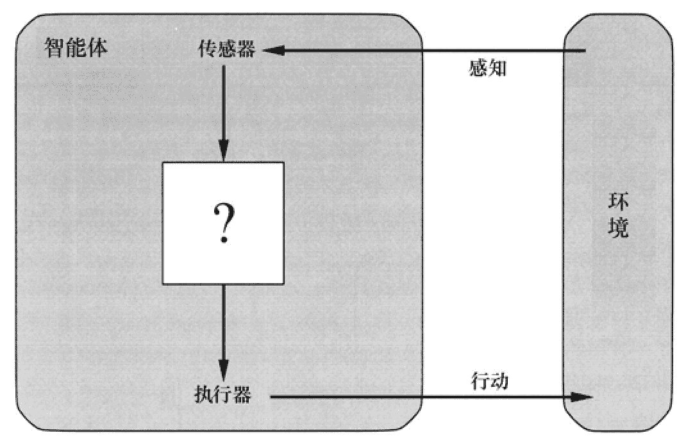
图 2.1 主体通过传感器和执行器与环境进行交互

我们用感知信息表示主体在给定时刻的感知输入。感知序列是主体收到的全部输入历史。一般而言，主体在任一时刻的行动选择取决于到该时刻为止的整个感知序列。若指定在每个可能感知序列下的行动选择，我们或多或少了解该主体的一切。从数学上看，可用一个把任意给定感知序列映射到主体行动的主体函数描述其行为。

可以想象为任一主体列出其主体函数，对大多数主体这将是庞大甚至无限的表，除非对感知序列长度设限。原则上，可通过实验枚举所有可能的感知序列并记录响应来构造该表。17 当然该函数表是外部对主体的反映。而从内部看，人造主体的主体函数由主体程序实现。区分二者很重要：主体函数是抽象的数学表示；主体程序是具体实现，在主体自身结构上运行。

用最朴素的设定把思路落地：看图 2.2 里的两格吸尘场景。空间里只有 A 区和 B 区，机器人能判断自己在哪个格子、该格子是否落灰。允许的操作有左移、右移、吸尘、原地不动。依此可以写出一个很粗糙的决策表：当前有灰就吸，无灰就换到另一格。图 2.3 列出了这张决策表的一部分。更完整的程序实现将在本章后面图 2.8 给出。

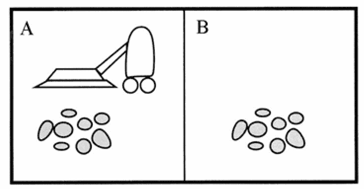

图 2.2 只有两个地点的真空吸尘器世界

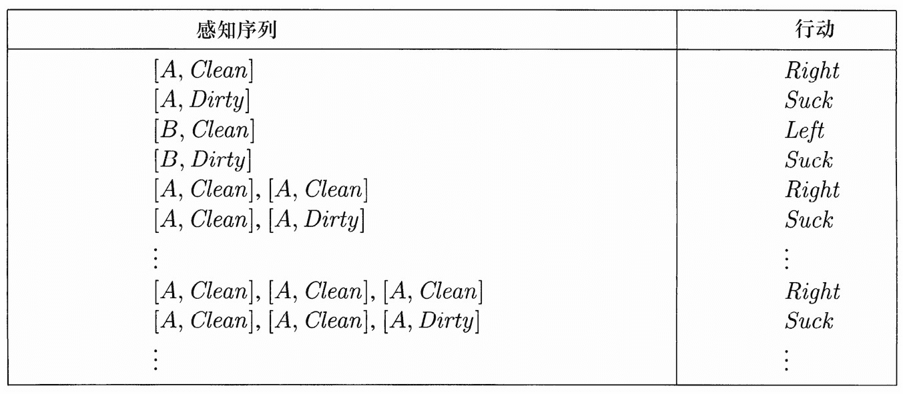

图 2.3 图 2.2 所示真空吸尘器世界的一个简单智能体函数的部分列表

从图 2.3 能看出，仅改动表格右侧的动作就能得到不同的吸尘行为。那么怎样填才算得上好？换句话说，什么在决定一个体是优秀还是平庸，是聪明还是笨拙？下一部分会给出解释。

收尾前要强调，智能体只是分析系统的视角，并不是把世界绝对地分成智能与非智能。比如把袖珍计算器视作智能体，输入 “2+2=” 时输出 “4”，这种说法并不能帮助我们理解计算器的实质。

### 2.2 好的行为表现：理性的概念

理性体本质上是做对事的体——在概念上说就是决策表每一项都填对的体。做对总比做错强，但“做对”指什么？粗略讲，对的行动就是让体更成功的行动。所以必须有一套衡量成功的方法。把环境、感知、执行器的描述与之结合，就能完整刻画体所面临的任务，进而更精确地界定理性。

#### 2.2.1 性能度量

性能度量是对成功程度的具体化。把体放进环境，它会依据感知产生行动序列，环境随之走过状态序列。若序列符合预期，表现就好。显然没有一套度量能适用于所有体。我们可以问体对自己表现的主观满意度，但有些体答不出，有些会自欺其人 [\[18\]](#text00007.html#bw45)。因此通常坚持客观的度量，一般由设计者给出。

以上一节的吸尘器为例，可用 8 小时内清出的灰量来评价。理性体应当满足“要求什么就得到什么”。于是若度量只看灰量，一个理性体可能吸起尘土再倒回、再吸起，如此循环以最大化数值。更合理的度量是奖励保持清洁的地面，比如每个单位时间每块干净的格子得 1 分，同时可对耗电、噪音加罚。总的原则是，度量应依据在该环境里真正想要的结果来设计，而非体“应该怎么表现”。

不过度量的选择常很棘手。比如“清洁地板”若按随时间平均的清洁度来算，两个体平均分相同，一个是匀速打扫，另一个是短时猛干后长时间歇息。哪种更好看似清洁学问题，实则涉及深刻的哲学：是起伏却无节制的生存好，还是平稳却单调的存在好？是人人都处中等贫困的经济好，还是有人富足有人极贫的经济好？这些留给读者思考。

#### 2.2.2 理性

在任意时刻，什么算理性取决于四方面：

• 评定成功的度量；
• 体对环境的先验知识；
• 体能执行的动作；
• 截至该时刻的感知序列。

由此可得理性体的定义：

对每个可能的感知序列，理性体应依据该序列提供的证据和内置先验知识，选择期望度量最大的行动。

看回那个简易吸尘器：有尘就吸，无尘就换格，这是图 2.3 中列出的函数。它理性吗？不好说！首先要明确度量是什么、体知道什么、传感器执行器如何。做如下假设：

• 度量在每单位时间对每块干净区域奖励 1 分，寿命跨度相当于 1000 个单位时间；
• 环境的“地形”作为先验知识已知，图 2.2 所示，但尘土分布和初始位置未知。干净格子保持干净，吸尘动作会把当前格子弄干净。`Left` 与 `Right` 使体左右移动，若会移出环境则原地不动；
• 可行动作只有 `Left`、`Right`、`Suck`、`NoOp`；
• 体能准确感知自身位置及所在格是否有尘。

在此条件下可断言该体在上述设定下是理性的，其期望表现不低于其他体。习题 2.4 要求证明该断言。

同样的体在不同环境里会变得非理性。例如所有灰尘都被吸完后，它仍会无意义地跑来跑去；若度量对左右移动有罚分，其表现会很差。更好的做法是当确信全部干净后不再行动，若格子再次弄脏则不定期检查并清理。若环境地形未知，还需要去探索而不是固守 A 与 B。习题 2.4 要求你为这些情形设计体。

#### 2.2.3 全知、学习与自主性

必须区分理性与全知的概念。全知体知道行动的实际后果并据此行动，但在现实中不可能。有个例子：我在香榭丽舍大道散步，看到对面老友，附近无车，于是理性地穿马路。此时 33000 米高空有一架班机货舱门掉落，击中我。我穿马路的决定就不理性了吗？我恐怕不希望讣告写“试图过马路的傻瓜”。

例说明理性不等于完美。理性是最大化期望表现，完美是最大化实际表现。对体要求完美是不合理的，除非我们能改进水晶球或时光机。

因此对理性的定义并不要求全知，选择只取决于到时的感知序列。我们也要避免因大意让体做明显愚蠢的事。例如若体在穿繁忙马路前不观察路况，其感知序列根本无法告诉它有大卡车高速接近。按理性定义，盲穿是否合理？绝对不。先不观察就穿行事故风险太大；理性体本应在上街前选择“观察”动作，因为观察有助于最大化期望表现。为改变未来感知而采取行动——即信息收集——是理性的重要部分，将在第十六章深入讨论。真空吸尘器在初始环境未知时必须探索，就是信息收集的另一个例证。

我们的理性定义不仅要求收集信息，也要求尽可能从感知中学习。体初始设定可能包含环境的先验知识，但随经验积累会被修正或扩充。极端情况下环境完全作为先验知识给出，体不再需要感知和学习，只需正确行动即可。但这样的体很脆弱。缓慢的蜣螂在做窝产卵后会用粪球堵入口，若途中丢了粪球，它仍会赶路并做堵口动作，而不觉察缺失。进化内建了假设，假设被破坏时行为失败。黑足泥蜂稍聪明些：雌蜂挖洞、叮毛虫、拖回检查、产卵。若昆虫学家在检查时把毛虫挪开几英尺，雌蜂仍会回到“拖毛虫入洞”的步骤，屡试不爽也不调整。它无法知道天生计划失败，因而不会改变。

成功的体体会把决策计算拆到三个阶段：设计时设计者完成部分计算，决策时体再算，学习时根据经验修改行为。

把体过度依赖设计者的先验知识而非自身感知，我们就说它缺乏自主性。理性体应具自主性——能尽可能学习以弥补不全或错误的先验。吸尘器若学会预见灰尘出现的时地，显然比不会预见的更好。实践中很少要求体从零开始完全自主：经验不足时行为常随机，除非设计者提供帮助。正如进化为动物提供足够内建反射以活到学会为止，为人工智能提供初始知识和学习能力是合理的。经验充分后，理性体的行为会有效独立于先验知识。学习结合自主性使得设计能在多种环境下都成功的理性体成为可能。

### 2.3 环境的本质

有了理性定义，下一步是思考如何建造理性体。首先要考虑任务环境，即理性体要“解决”的基本问题。从说明如何详述任务环境入手，再用例子描述过程，最后说明任务环境的若干属性。属性直接影响体程序的设计。

#### 2.3.1 任务环境的详细说明

讨论简单吸尘器理性时，我们已确定度量、环境、执行器和传感器。我们把这些归为一组，称为任务环境。按首字母缩写叫 `PEAS` 描述，即 Performance、Environment、Actuators、Sensors。设计体第一步就是尽可能全面地详述任务环境。

真空吸尘器世界很简单，来看看更复杂的问题：自动出租车司机。本章后面会反复用这个例子。需要说明的是，全自动出租车在一定程度上仍超出现有技术能力。完全自动驾驶是极开放的任务，环境条件组合无限制不断产生，这也是选它作为案例的原因。图 2.4 汇总了出租车任务环境的 `PEAS` 描述，下面分别展开。

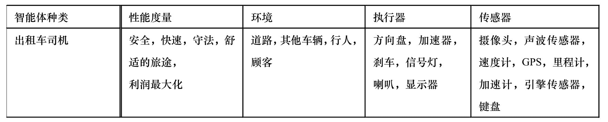

图 2.4 一个出租车自动驾驶系统的`PEAS`描述

首先希望自动司机追求怎样的度量？包括：正确抵达目的地；油耗磨损最小；时间或费用最少；违法和对其他司机干扰最少；安全性与乘客舒适度最高；利润最高。显然目标相互冲突，需折中。

其次驾驶环境是什么？司机要面对乡间小路到城市街巷再到 12 车道高速，路上可能有其他车辆、行人、流浪动物、施工、警车、碎石坑洞，还要与潜在和实际乘客交互。选项也很多，比如南加州运行几乎不需考虑雪，阿拉斯加则必须考虑。可能总是靠右行驶，但也希望它在英国或日本能靠左。环境约束越多，设计越容易。

自动出租车可用的执行器与人驾驶类似：油门控制引擎、转向、刹车。另外需要显示器或语音合成器与乘客交流，也许需要与其它车辆通信的通道。

为达成目标，出租车需要知道自身位置、周边情况和行驶速度。因此基本传感器包括可控电视摄像头、速度计、里程表。为合适控制尤其转弯，还需加速度计；了解机械状态需要常规引擎电子传感器阵列。它也许需要人类司机用不到的仪器：卫星 `GPS` 结合电子地图给出精确位置，红外或声波传感器检测与其它车辆及障碍的距离。最后需要键盘或麦克风供乘客输入目的地。

图 2.5 中勾勒了其它体类型的基本 `PEAS` 元素，更多例子见习题 2.5。有些读者可能惊讶清单里包含一些程序，它们运行在键盘输入和屏幕字符输出定义的人造环境中。“当然，这不是真实环境，对吧？”其实关键不在于“真实”与“人造”的区别，而在于体行为、环境产生的感知序列与度量之间关系的复杂性。有些“真实”环境其实很简单。例如检测传送带零件的机器人可做简化假设：照明恒定，传送带上只有已知类别的零件，只有接受或拒绝两种动作。

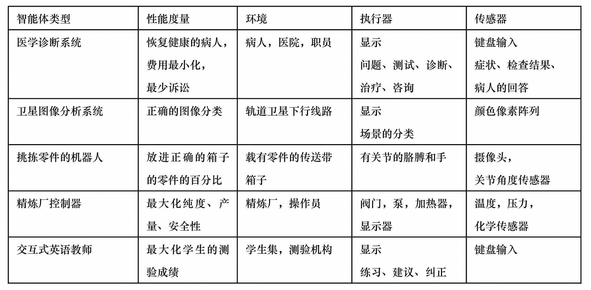

图 2.5 智能体种类和对应的`PEAS`描述

相反，一些软件体存在于丰富无限制的环境中。想象设计用于驾驶大型商务飞机飞行模拟器的软件机器人。模拟器里环境极其细致复杂，包含其它飞行器和地面操作，软件体必须在极宽的行动集合中实时选择。或者想象扫描 `Internet` 新闻源并把有趣条目发给用户的软件机器人。要做好它需要自然语言处理能力、了解每个用户兴趣，还需动态调整计划——例如新闻源连接中断或新资源上线。`Internet` 的复杂性堪比现实世界，且居民里包含大量人工智能体。

#### 2.3.2 任务环境的属性

人工智能中任务环境的范围很大，但可用少量维度分类。这些维度很大程度上决定了合适的体设计和各技术家族的适用性。下面先列出维度，再以例子说明。定义是非形式化的，后面章节会给出更精确表述和例子。

##### 完全可观察的与部分可观察的

如果体的传感器在每个时间点都能让它获取环境的完整状态，我们称任务环境是完全可观察的。若传感器能检测所有与行动选择相关的方面，则是有效完全可观察的，相关性取决于度量。完全可观察的环境很方便，体无需维护内部状态记录世界。噪声、不精确传感器或丢失数据会使环境变为部分可观察——例如只有局部尘感器的吸尘器无法知道另一格是否有尘，自动出租车也无法知道别的司机在想什么。

##### 确定性的与随机的

若环境的下一状态完全由当前状态和体动作决定，我们说环境是确定性的；否则是随机的。原则上，体在完全可观察确定环境中无需考虑不确定性。若环境部分可观察，它可能表现为随机。环境复杂时尤其如此，因为难以记录所有未观察方面。因此从体角度，按确定或随机来看待环境通常更好。出租车驾驶明显随机，无人能预测确切交通状况，爆胎或发动机失灵更不可能事先警告。按描述真空吸尘器世界是确定性的，但变种可加入随机元素，如随机出现的尘土和不可靠吸尘机构。 若环境确定，除非受其它体影响，否则我们称其为策略的。

##### 片段式的与延续式的

片段式任务环境中，体经验被分成原子片段。每个片段包含感知信息和随之执行的单个行动，且下一个片段不依赖以前片段的行动。在片段式环境中，行动选择只取决于当前片段。大多数分类任务属于片段式。例如装配线检测次品机器人只需基于当前零件决策，不用考虑以前决策，当前决策也不会影响下一个零件是否缺陷。相反，延续式环境中当前决策会影响未来所有决策。下棋和出租车驾驶都是延续式的：短期行动都有长期效果。片段式环境比延续式简单得多，体无需前瞻。

##### 静态的与动态的

若环境在体思考时发生变化，我们称该环境对该体是动态的；否则是静态的。静态环境较易对付，体无需在决策时持续观察世界，也不用顾虑时间流逝。动态环境会持续要求体决定做什么；若无决策则视为不做任何事。若环境本身不随时间变化但度量随时间变化，我们称环境是半动态的。出租车驾驶明显动态：算法犹豫时其它车辆和出租车都在运动。国际象棋计时赛是半动态的。纵横字谜是静态的。

##### 离散的与连续的

离散/连续可应用于环境状态、时间处理方式，以及体的感知和行动。例如国际象棋是离散状态环境，包含有限个独特状态，感知和行动集合也离散。出租车驾驶是连续状态连续时间问题：出租车和其他车辆的速度位置在连续值范围内平滑变化，行动也是连续的。严格说数字摄像头输入是离散的，但通常被视为对连续变化亮度和位置的表示。

##### 单智能体与多智能体

单体与多体环境，差别远不止一个对手

从表面看，单智能体和多智能体的分野很清晰。一个人独自完成纵横字谜的程序是典型的单体场景，一台对弈程序则明显属于双体对抗。可一旦往里挖，判断就变得模糊。我们之前讨论过什么可以算作智能体，却没有界定哪些存在必须被纳入智能体视角来处理。举例来说，司机 A 在路上遇到另一辆车 B，需要把 B 理解为有意图的行动者，还是可以把它简化为像海滩波浪或风中晃动的树叶那样无规律的物体？分水岭在于 B 的运动是否更适合用“在最大化一个与 A 行为牵连的绩效指标”来解释。

象棋就是教科书案例。对手 B 的目标是提升自己的表现，按规则这同时等同于压低 A 的得分，所以象棋属于对抗性的多智能体环境。出租车运营则不一样，避撞对所有参与方都好，因此是部分协作的多智能体环境。它也带有竞争色彩，比如停车位一辆只能占一个。

多智能体带来的设计难题和单智能体差异巨大。比如沟通在多智能体里常是理性的；在部分不可见的对抗情境中，引入随机性也有理，它能降低被对手预测的风险。

综合来看，最棘手的情况是把部分可观察、随机、延续、动态、连续以及多智能体这些特性都叠加在一起。现实之复杂，常让人连环境究竟是否确定都难以判定，实用上只能按随机处理。从这些维度看，出租车驾驶就是个困难案例。

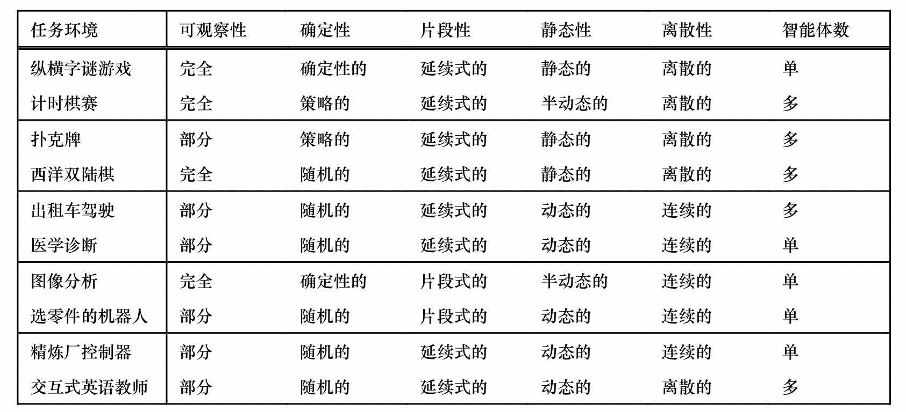
图 2.6 任务环境的例子和它们的特点

表里给出的结论并非绝对。以对弈为例，我们常把它标为完全可观察，但严格说并非如此。王车易位、吃过路兵、不变作和等规则，都需要回溯局面的历史信息，而这些信息并不能从当前棋盘直接读出。译者注：王车易位是一种同时移动王和车的特殊走法，要求参与易位的王和车在易位前都没有移动过；吃过路兵是一方的兵攻击对方的兵的一种特殊方式，只能在对方的兵从原始位置直行两格时完成；不变作和是指棋局状态发生重复而双方都不愿意改变自己的招数的情况下，判定双方和棋。相比出租车司机、英语教师或医学诊断系统面临的可观察缺口，这类例外只是小麻烦。

表的部分条目还取决于环境定义方式。我们把医疗诊断归为单智能体，因为把疾病过程建模成智能体不划算；但诊断系统仍可能面对不配合的病人和怀疑的同事，因而具备多智能体的侧面。再者，诊断可以是片段式的，如果任务仅是根据已知症状清单挑选结果；若任务还包括制定检查方案、评估治疗过程等，它就转为延续式了。很多任务在个体动作之上呈现片段性。一次国际象棋巡回赛由多场比赛构成，每盘大体上是片段的，因为一盘走法不会影响选手整体排名的历史贡献。反之，单看盘内决策则是延续式的。

本书代码库 `aima.cs.berkeley.edu` 提供了若干环境的实现，以及一个通用环境模拟器，能把一个或多个智能体放入模拟环境，观察实时表现并按既定绩效度量评估。实验通常针对环境类而非单一实例。比如评估自动出租车，会多次模拟，改变交通密度、光照、天气。若只为单一场景调优，可能利用特例巧合，却得不到通用驾驶能力。为此代码库还提供环境生成器，可按一定概率抽样出智能体将面对的具体环境。例如真空吸尘器生成器会随机初始化灰尘分布和智能体初始位置。我们关心的是智能体在整个环境类上的平均表现。对给定环境类，理性智能体应实现该平均表现的最大化。习题 2.7 到 2.12 将引导你搭建环境类并评测其中运行的各类智能体。

### 2.4 智能体的结构

到目前为止我们主要从行为层面谈智能体，即在任意感知序列下会采取什么行动。现在要进入内部，看智能体如何运作。AI 的核心任务是设计智能体程序，用它来实现把感知映射到行动的智能体函数。我们假设该程序运行在拥有真实传感器和执行器的计算装置上，称之为体系结构。

`智能体 = 体系结构+程序`

程序的选择必须与体系结构适配。若程序要实现行走，体系结构最好具备腿。体系结构可以是普通个人电脑，也可以是搭载计算机、摄像头等传感器的自动驾驶汽车。总之体系结构负责把传感器信息送给程序、运行程序，再把程序输出的行动传递给执行器。本书绝大多数章节聚焦智能体程序，第二十四章和第二十五章才会直接涉及传感器与执行器。

#### 2.4.1 智能体程序

本书设计的智能体程序骨架一致：从传感器接收当前感知作为输入，返回一个行动给执行器 [\[22\]](#text00007.html#bw45) 。要注意智能体程序与智能体函数的区别，前者只接受当前感知，后者接受完整感知历史。程序只能拿到当前感知，因为环境无法提供更多；若行动依赖整段历史，智能体就必须自行记忆全部感知。

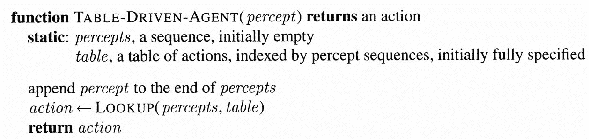
图 2.7 `TABLE-DRIVEN-AGENT`程序被调用，处理每个新的感知信息并每次返回一个行动。它使用自己的私有数据结构记录感知序列

我们使用附录 B 定义的简易伪代码语言描述智能体程序，线上代码库提供真实语言的实现。例如图 2.7 展示了一种常见的表驱动程序，它记录感知序列，再把序列作为索引去行动表里查表决策。行动表直接体现了程序所实现的智能体函数。要用这种方式构造理性智能体，设计者必须为每一种可能的感知序列准备对应行动。

思考表驱动方法注定失败是有益的。设 `P` 为可能感知集合，`T` 为智能体寿命，即感知总量。查找表将包含 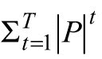 个条目。以自动出租车为例，单路摄像头的视频以约每秒 27 MB 的速度流入，每秒 30 帧、640×480、24 位色。仅一小时驾驶就对应超过 10^25 个表项。即使象棋这种小而成熟的领域，完整表也至少有 10^150 条。这些表所需的存储量令人望而生畏，连可观测宇宙的原子数都远小于 10^80，这意味着：a) 现实中没有智能体能存下这张表；b) 设计者没有时间填表；c) 智能体无法从经验里学完所有条目；d) 即使环境简单到表容量可行，设计者也缺乏填表的指导原则。

除此之外，`TABLE-DRIVEN-AGENT` 确实能完成我们想要的功能，它实现了所需的智能体函数。AI 的关键挑战是如何写出程序，用少量代码而不是海量表项来产生理性行为。其他领域已有先例：上世纪七十年代前工程师和学生用的厚厚的平方根表，如今被计算器里几行牛顿迭代程序取代。问题是 AI 能否像牛顿法计算平方根那样，产生通用的智能行为？我们相信可以。

本节余下部分将概览四类基本智能体程序，基本覆盖了智能系统的原理：

• 简单反射型智能体；
• 基于模型的反射型智能体；
• 基于目标的智能体；
• 基于效用的智能体。

随后会概括说明如何把它们升级为学习型智能体。

#### 2.4.2 简单反射型智能体

最简洁的是简单反射型智能体。它只根据当前感知挑选行动，完全忽略历史。图 2.3 中吸尘器智能体就是如此，它的决策只取决于当前位置和是否带尘。图 2.8 给出了这类程序的实现。

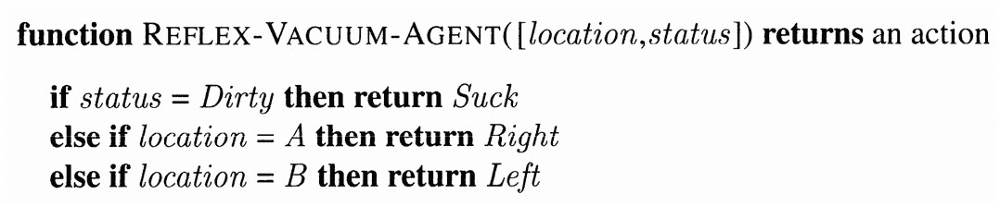

可以看出，吸尘器程序比完整表小得多。最大压缩来自放弃感知历史，把可能情况从 4^T 缩到 4。还能再压缩一点：当方格已脏时，行动与具体位置无关。

设想你自己是自动出租车司机。前车刹车，尾灯亮起，你就该注意并开始减速。换句话说，当视觉输入匹配上“前方车辆在刹车”这一条件时，程序触发“开始刹车”这一反应。我们把这种关联叫条件-行为规则 [\[23\]](#text00007.html#bw45) ，可写成：

如果前方的车辆在刹车，那么开始刹车。

人类也充斥着这类联系，有的靠学习获得如驾驶技巧，有的与生俱来如眨眼反射。本书会展示多种学习和实现这类联系的方法。

图 2.8 的程序针对的是特定的真空吸尘器环境。更通用灵活的做法是先搭建一个条件-行动规则解释器，再为特定任务配一套规则。图 2.9 展示了这种通用程序的示意，矩形代表决策内部状态，椭圆形代表背景信息。一个同样简洁的程序如图 2.10 所示。`INTERPRET-INPUT` 根据感知生成当前状态的抽象描述，`RULE-MATCH` 则在规则集里返回首个匹配该描述的规则。注意“规则”与“匹配”在此处是概念性描述，实际实现可以像布尔电路一样用逻辑门完成。

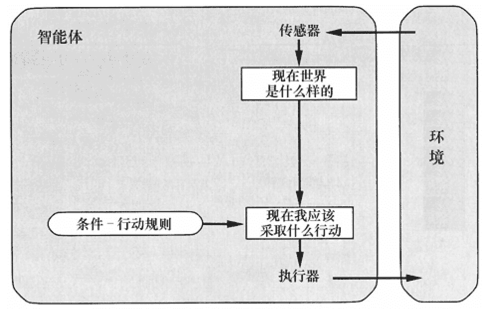
图 2.9 简单反射型智能体示意图

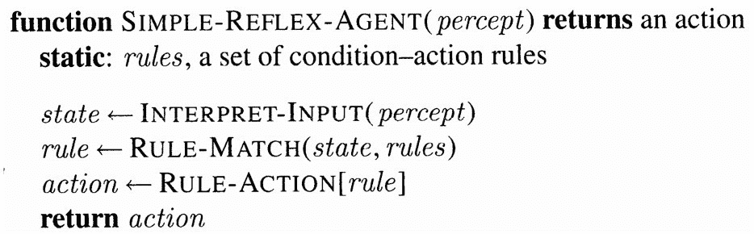
图 2.10 简单反射型智能体。它根据条件能匹配当前状态的规则而行动，状态是由感知信息定义的

简单反射型智能体结构简洁，但智能有限。图 2.10 的智能体只有在环境完全可观察、当前感知足以做当前决策时才有效。哪怕少量不可观察性也会带来严重问题。比如前述刹车规则假设“前车在刹车”能从当前视频帧判定，对装有中置刹车灯的车型可行。但老式车型灯位各异，单帧图像往往无法确定前车是否刹车。在这种车后行驶的简单反射智能体要么频繁无谓刹车，要么更糟地完全不刹。

真空吸尘器世界也有类似困境。假设简单反射吸尘器去掉了位置传感器，只剩灰尘传感器。那它只有“脏”和“干净”两种感知。对“脏”它会吸尘；对“干净”该怎么办？若它恰好在方格 A，向左总会失败；若在方格 B，向右总会失败。在部分可观察环境里，简单反射智能体很容易陷入无限循环。

随机化可以避免循环。比如当吸尘器感知到“干净”时，用抛硬币决定左右。容易证明平均两步就能到达另一格，然后若有灰尘就会清洁，完成任务。所以随机的简单反射智能体通常优于确定版本。

我们在 2.3 节提到过，恰当的随机行为在某些多智能体环境中是理性的。在单智能体环境里，随机化一般不理性。尽管随机化偶尔能作为简单反射智能体的技巧，但多数情况下更精巧的确定性智能体表现更好。

#### 2.4.3 基于模型的反射型智能体

应对部分可观察环境最有效的做法是让智能体追踪那些当前看不见的世界部分。也就是说，智能体应维护一个随感知历史变化的内部状态，至少反映出当前状态的不可见方面。对刹车问题，维护成本很低——只需保留摄像头上一帧画面，就能检测两盏红灯是否同时亮灭。对换车道等更复杂驾驶任务，智能体需要持续跟踪其他车辆的位置。

实时更新内部状态需要两类知识。第一是对世界在智能体干预之外的演化规律的了解，例如超车的车辆下一刻通常会更靠近本车。第二是对智能体自身行动如何改变世界的影响，例如顺时针打方向盘汽车向右转，或沿高速公路北行五分钟后车辆应在五分钟前位置的北面约五英里处。这类关于世界运行规律的知识，无论是布尔电路还是完整科学理论，都可视作世界的模型。采用模型的智能体称为基于模型智能体。

图 2.11 给出了带内部状态的反射型结构，说明当前感知如何与过去内部状态结合以更新对当前状态的描述。图 2.12 展示了这类智能体的程序。核心是 `UPDATE-STATE` 函数，它负责产生新的内部状态描述。它既要利用已有知识解释新感知，也要依据世界演化规律推断不可见部分，并考虑智能体行动对状态的影响。更详细的例子见第十章和第十七章。

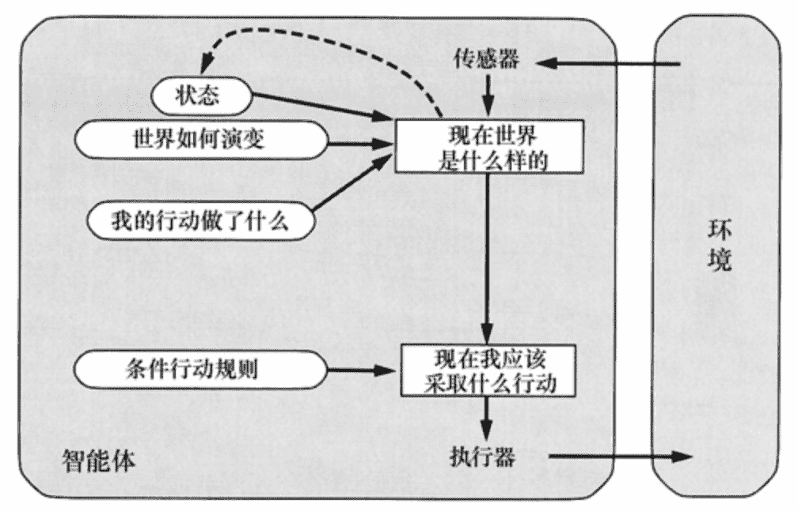
图 2.11 基于模型的反射型智能体

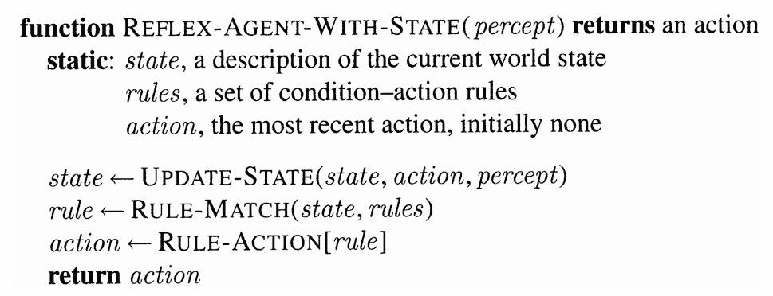
图 2.12 基于模型的反射型智能体。它使用一个内部模型记录世界的当前状态。然后它按照与反射型智能体同样的方式选择行动

#### 2.4.4 基于目标的智能体

仅知道当前环境状态往往不够。比如在路口，出租车可左转、右转或直行，正确选择取决于它要去哪儿。换句话说，智能体除了状态描述，还需要目标信息来刻画期望达到的情况，例如把乘客送到目的地。程序会把目标与行动可能带来的结果结合起来，挑选能达成目标的行动。图 2.13 展示了基于目标的智能体结构。

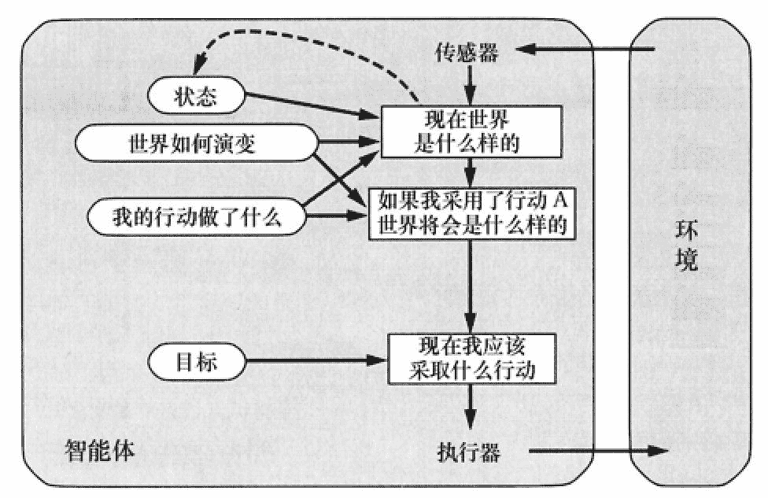

有时目标导向决策很直接，单步行动就能满足目标；有时则需要技巧，智能体必须规划一条曲折的行动序列。搜索是第三到六章的主题，规划在第十一到十二章。它们都致力于寻找达成目标的行动序列。

这类决策与条件-行动规则本质不同，因为它涉及对未来的思考，比如“如果我这么做会怎样？”、“那样做让我满意吗？”反射型设计里这些信息被隐式固化，规则直接把感知映射到行动。反射型智能体看到刹车灯就刹车。而基于目标的智能体会推理：刹车灯亮意味着前车将减速，在已知世界演化规律下，避免碰撞的唯一行动是刹车。

尽管基于目标的智能体看似低效，它更灵活，因为支撑决策的知识被显式表示且可改动。下雨时，智能体可以更新自己对刹车效能的认知，这会自动调整所有相关行为。反射型智能体则需要大量重写规则。基于目标的智能体更换目的地时行为容易调整，而反射型的转弯直行规则只适用于单一目标，换个目的地就得替换大量规则。

#### 2.4.5 基于效用的智能体

目标本身在多数环境里不足以产生高质量行为。很多行动序列都能让出租车到达目的地，但有的更快、更安全、更可靠或更便宜。目标只提供“好”和“坏”的二值区分，而更通用的性能度量应允许比较不同状态，按其能带来多少满意度来排序。因为“快乐”一词不够科学，通常用效用 `utility` [\[24\]](#text00007.html#bw45) 来表述偏好。

效用函数把状态或状态序列映射为实数，描述智能体对该状态的满意程度。完整的效用函数能在两种目标不足时帮助理性决策。第一是目标冲突，只有部分能实现时，效用函数给出折中，如速度与安全。第二是多个目标都无法保证达成时，效用函数提供按重要性加权成功概率的机制。

第十六章会证明，任何理性智能体都表现得像拥有效用函数并最大化期望效用。有显式效用函数的智能体因此能理性决策，且可通过不依赖特定效用函数的通用算法实现。这样，理性的全局定义——选择性能最高的智能体函数——就转化为一段简短程序所体现的局部约束。

基于效用的智能体结构如图 2.14 所示。基于效用的智能体程序将在第五部分展开，那里我们将设计能处理部分可观察环境固有不确定性的决策智能体。

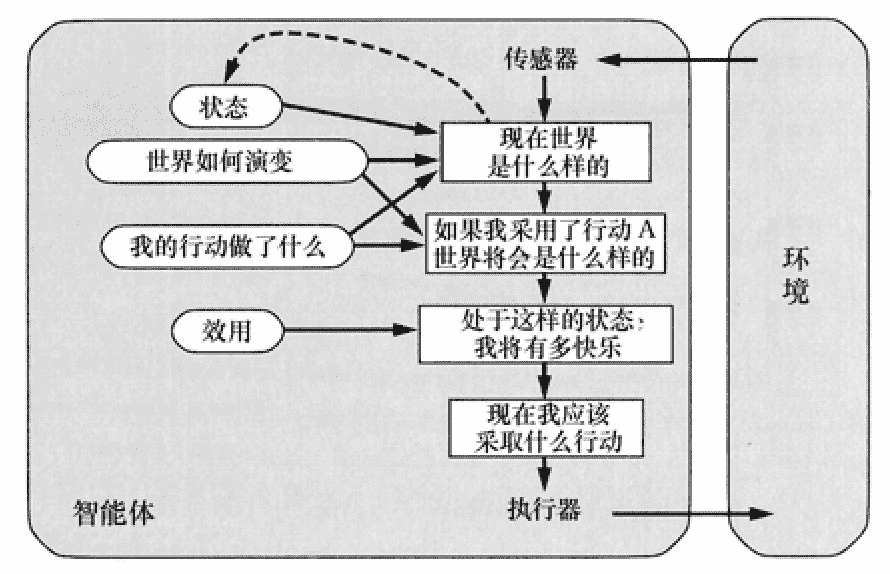
图 2.14 基于模型和效用的智能体。它使用了一个关于世界的模型，连同一个度量它对各个世界状态的偏好程度的效用函数。然后它选择导致最佳期望效用的行动，最佳期望效用是通过计算所有可能结果状态的加权平均值得到的，其权值由结果的概率确定

#### 2.4.6 学习智能体

先前我们聊过各种决策策略，让智能体决定下一步该做什么。但这些智能体程序本身是怎么诞生的，还没展开讲。早在1950年，图灵在那篇经典论文里就设想过靠人工逐行编写代码来实现智能机器，估算下来工作量惊人，于是得出结论：得找一种更快的做法。他的方案是先造出会学习的机器，再去教育它。现在在人工智能的很多领域，这已经成为打造前沿系统的首选路径。学习还有一个额外好处，正如前面特别提到的，它让智能体能够在对环境几乎一无所知的情况下开始运行，凭借经验慢慢成长，最终比仅靠初始知识时的能力更强。本节先做一个鸟瞰，把学习型智能体的基本思路梳理清楚。书中后面几乎每一章在讨论具体类型的智能体时，都会顺带点出它们各自的学习契机和做法，第六部分才会系统深入地展开各类学习算法本身。

在概念层面，一个学习型智能体可以拆成四个模块，见图2.15。其中最核心的分界在于学习模块和执行模块。执行模块承担对外行动的选择，学习模块则负责自我改进。执行模块正是我们之前把整套系统等同为智能体的那部分：接收感知信息并据此做出行动决策。学习模块会利用来自评论模块的反馈来评价智能体的表现，并据此决定如何调整执行模块，以便未来做得更好。

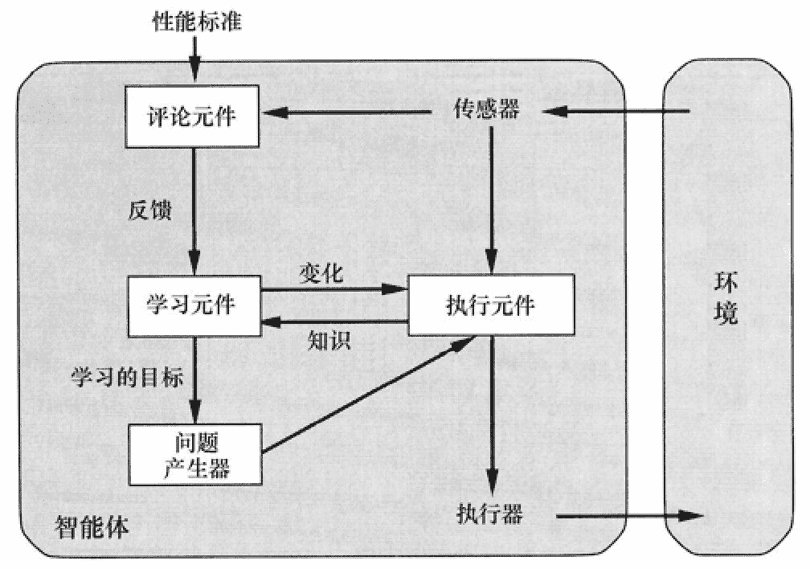*