# 人工智能（下）


## 韩力群：学者画像

工学博士，现任北京工商大学教授，兼任北京科技大学、北京邮电大学及解放军装甲兵工程学院客座教授、博士生导师。长期深耕神经网络理论、模式识别、智能控制等人工智能核心版块，学术建树深厚：发表论文近150篇，出版专著15部，主持或参与各类科研教研项目40余项，授权国家发明专利4项。

学术兼职繁多：曾任中国人工智能学会第五、六届理事会副理事长，北京工商大学信息工程学院院长，教育部自动化类专业教学指导委员会首届、二届委员。现任中国人工智能学会会士、常务理事、智能产品与产业工作委员会主任，联合国教科文组织发展中世界工程技术科学院院士，中国教育发展战略学会人工智能与机器人教育专委会常务副理事长，全国智能机器人创新联盟常务副理事长。

## “中学人工智能系列教材” 编委会

**主编：** 韩力群

**编委名单**（按姓名拼音排序）：
毕长剑、陈殿生、崔天时、段星光、侯增广、季林红、李擎、潘峰、乔红、施彦、宋锐、苏剑波、孙富春、王滨生、王国胤、于乃功、张力、张文增、张阳新、赵姝颖。

## 系列教材序言：跨越时空的对话，为青少年备好“智能时代入场券”

1956年夏，达特茅斯学院的一场小型研讨会，为人工智能学科按下了启动键。六十载春秋更迭，这门学科已长成参天大树，枝繁叶茂。

2016年，AlphaGo与人类围棋顶尖高手的“世纪对弈”，将AI推向全球舞台中央。技术井喷、规模化应用落地、智能产业雏形初现，人类正式步入智能化时代大门。

2017年，国务院印发《新一代人工智能发展规划》，确立2030年建成世界主要AI创新中心的战略坐标。人才是支撑，教育是根基。《规划》明确部署：中小学开设AI课程，普及编程教育。

算法需代码落地，机器人是AI最佳物理载体，三者互为表里、缺一不可。因此，本套教材构建“三位一体”知识体系：《人工智能》（上下册）筑牢认知底座，《Python与AI编程》（上下册）强化工程实操，《智能机器人》（上下册)拓展系统视野。

**破解“认知断层”的编写逻辑：**
AI融合高等数学、控制理论、机电工程等跨学科高阶知识，远超中学生现有认知边界。生搬硬套晦涩术语，只会劝退学习者。

我们坚持**“体验重于灌输，素养高于技术”**的编写原则：
1.  **溯本清源：** 让学生看透AI本质——以人工方式赋能系统，让工具更“省力、省时、省心”；智能化是信息化演进的必然归宿。
2.  **降维解构：** 借用生活常识与中学已有知识拆解核心概念，而非堆砌数学推导。
3.  **正本清源：** 消除陌生感与畏难情绪，熟悉应用场景，切身体验技术红利，培养智能时代“掌舵者”心态。

—— 韩力群

# 第六章 知识表示与推理


人类借由观察、学习与思考，对客观世界万象进行认知，从而获取并沉淀出海量知识，涵盖各领域的事实、概念、规则与原则等。

凡受过专门训练、掌握专业知识、以脑力劳动为业、凭知识谋生者，称为“知识分子”；各行各业的专家、学者、大师则是其中的佼佼者。

那么，人造系统是否也需要“装载”知识？人工智能系统中可否存在“人工知识分子”？


**一个经典的“机翻乌龙”：**
早期机器翻译曾闹出笑话——
原文：*The spirit is willing, but the flesh is weak.*（心有余而力不足）
误译：*The vodka is strong, but the meat is rotten.*（伏特加虽烈，肉却烂了）

缘由在于：*spirit*既指“精神”，又指“烈酒”。**缺乏知识支撑便无法理解，缺乏理解便谈不上智能。**

符号主义流派早期即致力于用计算机可处理的符号建模人类知识、模拟推理过程。其集大成之作——**专家系统**，正是机器世界里的“知识分子”。

## 第一节 知识表示

人类依托语言文字、图像图表、数学公式、物理定理、化学方程式等载体交流、记录与处理知识。但若要让计算机接管知识处理，必须寻找机器易于操作的形式化描述手段，将知识转化为可存储、可计算的结构化形式，这便是**知识表示**。

历经数十载探索，学界沉淀出多种主流表示范式：一阶谓词逻辑、产生式规则、语义网络、框架理论、特征向量、与或图、黑板结构、Petri网、神经网络等。本节精选三大经典范式，带你领略知识“结构化”的奥秘。

### 一、一阶谓词逻辑：严谨的“逻辑骨架”

一阶谓词逻辑（FOL）是基础且通用的表示法，既能描述事实性知识（状态、属性、概念），也能刻画确定性规则性知识。

#### 知识驿站：核心概念速览

**概念**
思维基本单元，反映事物本质与共性属性。如：首都、学校、家庭、工作。

**命题**
逻辑学中表达判断的陈述句，承载具体语义。如“大熊猫是动物”、“橘子是水果”。
在谓词逻辑中，命题由**谓词**承载。标准形式：`P(x1, x2, ..., xn)`，`P`为谓词名，`xi`为个体项。
例：“李梅是学生” → `student(Limei)`。因所有个体项均为常量，故称“一阶”。

**逻辑连接符：**
- `¬` 非（否定）
- `∧` 与（合取）
- `∨` 或（析取）
- `→` 蕴涵（规则性知识：“若x则y”记为 `x→y`）

**建模三步法：**
1.  **定义：** 明确谓词与个体的确切语义。
2.  **赋值：** 为个体项指派具体对象。
3.  **组合：** 用连接符串联谓词，生成公式。

#### 实战演示

**案例1：事实——“小李是室友，不爱打扫”**
> 1. 定义谓词：`Roommate(x)`：x是室友；`Like(x,y)`：x喜欢y
> 2. 赋值：`XiaoLi`, `cleaning`
> 3. 公式：```
Roommate(XiaoLi) ∧ ¬Like(XiaoLi, cleaning)
```

**案例2：事实——“公交车设老弱病残孕专座”**
> 1. 定义谓词体系：
> 2. 完成个体映射
> 3. 公式表达：```
Priority(elderly(x))∨Priority(infirm(x))∨Priority(sick(x))∨
Priority(disabled(x))∨Priority(pregnant(x))
```

**案例3：事实——“张先生是李先生代理人”**
> 1. 定义：`Agent(x,y)`：x是y代理人
> 2. 赋值：`Zhang`, `Li`
> 3. 公式：`Agent(Zhang, Li)`

**案例4：规则——“小明9点到校必迟到”**
> 1. 定义：`Nine(x)`：9点到校；`Late(x)`：迟到
> 2. 赋值：`XiaoMing`
> 3. 公式：`Nine(XiaoMing) → Late(XiaoMing)`

---

### 二、产生式规则：专家系统的“核心引擎”

产生式规则是专家系统最常用的表示范式，擅长处理条件判断、因果推演类知识。


**标准形：** `P → Q` 或 `IF P THEN Q`
- **P（前件/条件部）：** 谓词公式、关系表达式、真值函数均可。
- **Q（后件/行动部）：** 结论集或操作指令集。

**关键辨析：** 虽与谓词逻辑蕴涵式 `x→y` 形似，实则内核迥异。
- 谓词逻辑 `x→y`：仅表**确定性**规则（x成立则y必然成立）。
- 产生式 `P→Q`：兼容**不确定性**。可附置信度，如 `IF 咳嗽 AND 发烧 THEN 感冒 (CF=0.8)`，意指“满足条件下，有80%概率得出结论”。

**规则链机制：** 一条规则的结论可作另一条规则的前提，串联成**产生式系统**，协同求解复杂问题。

#### 实战演示

**案例5：有支持，必成功** ```
if“大家支持”then“我一定能成功”
``` / ```
“大家支持”→“我一定能成功”
```
**案例6：熊猫画像（动物、黑白毛、憨态、食竹）** ```
if“是动物”and“毛发黑白相间”and“憨态可掬”and
“爱吃竹子”then“是熊猫”
``` / ```
“是动物”∧“毛发黑白相间”∧“憨态可掬”∧
“爱吃竹子”→“是熊猫”
```
**案例7：传递性推理（x≥y, y=z → x≥z）** ```
if x≥y and y=z, then x≥z
``` / ```
x≥y ∧ y=z → x≥z
```

---

### 三、语义网络：贴近人类认知的“知识地图”

语义网络用**有向图**建模实体关系，表达力强，自然灵活，极符合人类联想思维。

节点代表实体、属性、概念、事件、状况、动作；带标签的有向边描述节点间关系。最小单元——**语义基元**，即三元组 `(节点A, 边, 节点B)`。

#### 从零构建一张网：以表6-1八条事实为例

先抽取主谓宾结构，映射为语义基元 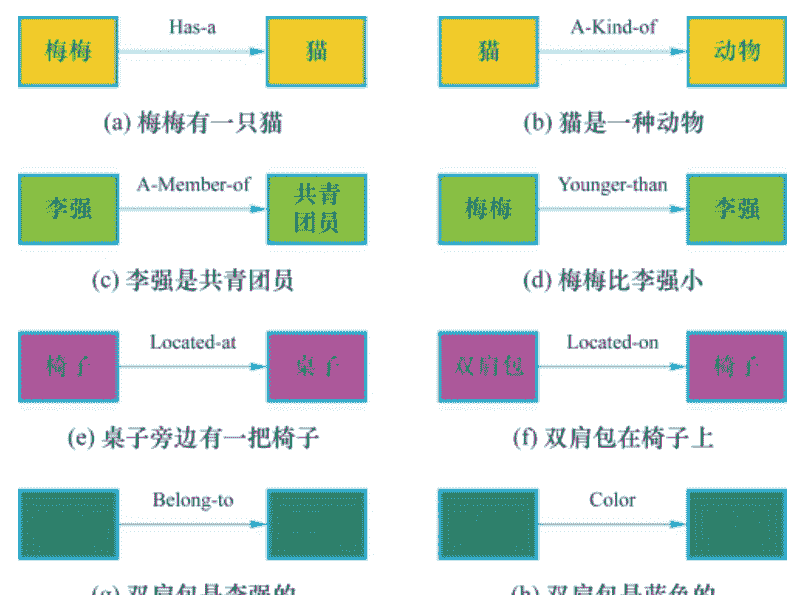；再合并同名节点（如“猫”、“梅梅”、“双肩包”等），保持拓扑关系不变，即得完整语义网络拓扑 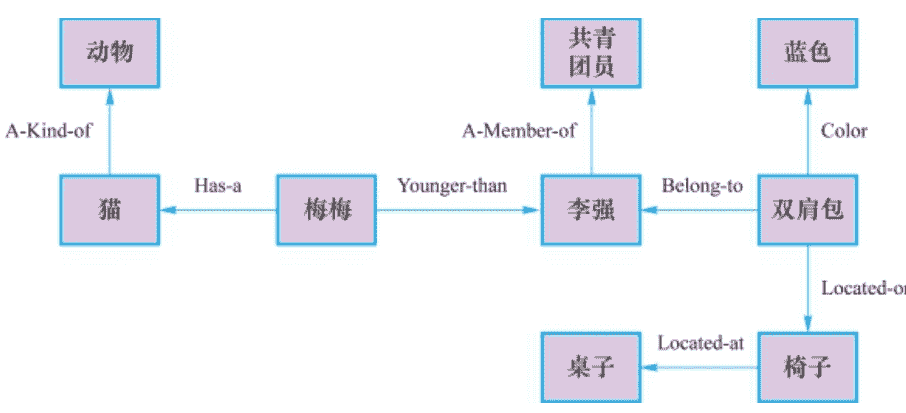。

| 原始语句 | 主语 | 宾语 | 关系 |
| :--- | :--- | :--- | :--- |
| 梅梅有一只猫 | 梅梅 | 猫 | 有一只 |
| 猫是一种动物 | 猫 | 动物 | 是一种 |
| 李强是共青团员 | 李强 | 共青团员 | 是一员 |
| 梅梅比李强小 | 梅梅 | 李强 | 比较 |
| 桌子旁边有一把椅子 | 桌子 | 一把椅子 | 相邻 |
| 双肩包在椅子上 | 双肩包 | 椅子 | 在上面 |
| 双肩包是李强的 | 双肩包 | 李强的 | 属于 |
| 双肩包是蓝色的 | 双肩包 | 蓝色的 | 颜色 |

#### 关系层级解析

- **一元关系 `P(x)`：** 单实体属性。如“双肩包蓝”、“燕子会飞”。网络中：节点A=实体，节点B=属性，边=关系。对应图6-2(h)。
- **二元关系 `P(x,y)`：** 双实体关联。语义网最擅长此类。如“梅梅有猫”、“包在椅上”。
- **多元关系 `P(x1...xn)`：** 多实体交织。通常拆解为多个一/二元关系组合表示。

#### 优劣势深度剖析

**四大亮点：**
1.  **直观可视：** 节点连接关系一目了然。
2.  **拟人思维：** 强调语义联想，符合认知习惯，自然语言转换平滑。
3.  **覆盖面广：** 表示能力强，几乎能覆盖其他方法能表达的所有知识。
4.  **显式结构化：** 将属性与语义链接显性化呈现。

**三大短板：**
1.  **推理规则模糊：** 难以严格保证推论的有效性与严密性。
2.  **规模灾难：** 节点爆发、拓扑复杂时推理极难推进。
3.  **表达受限：** 不擅长处理判断性知识与深层因果知识。

---

### 思维体操：类比推理挑战

请选出与题目逻辑关系最贴近的选项：

1.  **学生 : 成绩**
    A. 网民 : 邮件  B. 司机 : 驾照  **C. 职工 : 工资**  D. 运动员 : 名次
2.  **湖南省 : 长沙市**
    A. 香港 : 澳门  **B. 陕西省 : 西安市**  C. 京津冀 : 河北省  D. 中国 : 北京
3.  **单位 : 领导 : 员工**
    **A. 学校 : 老师 : 学生**  B. 医院 : 医生 : 患者  C. 剧院 : 演员 : 观众  D. 研究所 : 所长 : 研究员
4.  **比翼鸟**
    **A. 连理枝**  B. 向阳花  C. 鹣鹣  D. 相思树
5.  **餐馆 : 饭菜**
    A. 酒店 : 大堂  B. 公交车 : 司机  **C. 电影院 : 电影**  D. 学校 : 教室

---

### 动手实践：谓词建模练习

请用合适的谓词公式表示下列事实：

1.  小张喜欢猫，小李喜欢狗，小王猫狗皆喜。
2.  北京冬天又冷又干。
3.  我爱夏天，不爱冬天。
4.  扫除可周六，亦可周日。
5.  不忘初心，牢记使命。

# AI知识工程核心：从表示到推理与搜索全解析

## 热身思考：知识表示的边界在哪里？

给定以下几条规则性知识，请判断：哪些既适合用产生式规则表达，也能用谓词逻辑的蕴涵式刻画？请分别用这两种方式写出来。又有哪些只能用产生式表示？请给出产生式写法。

1.  想进重点中学？入学考必须过关。
2.  乌云压顶、狂风大作，八成要下雨。
3.  国庆阅兵圆满成功，离不开官兵们的刻苦训练。
4.  没有共产党，就没有新中国。
5.  找了这么久没思路，怕是没戏了。
6.  通电解水，得氢气和氧气。

再来构建一个植物领域的语义网络，素材如下：
1.  植物生存离不开土壤、阳光、水。
2.  树属于植物。
3.  藤也属于植物。
4.  藤能缠绕树木。
5.  树由根、干、叶组成，叶子是绿的。
6.  木材源自树干。

---

## 第二节 知识推理

### 知识推理系统

推理是思维的基石，指从已知判断（前提）出发，推导出新判断（结论）的过程。在AI系统里，问题用知识表示法形式化后，还得靠推理机利用这些知识“动脑子”求解，这就是知识推理——用形式化知识进行机器思维与问题求解。

若推理用的知识精确、结论也精确，叫**确定性推理**；否则是**不确定性推理**。确定性推理按逻辑基础分三类：演绎（一般到特殊）、归纳（特殊到一般）、类比（特殊到特殊或一般到一般）。比如归纳，就是从观察、实验的个别事实中概括出普遍原理。

知识推理系统标配“三件套”：存知识的**知识库**、存初始证据与中间结果的**综合数据库**、干活的**推理机**。这三者的落地方案与知识表示法强相关。

以**产生式系统**为例，它由**产生式规则库（知识库）**、**综合数据库**、**推理机（控制器）**组成，架构如下：

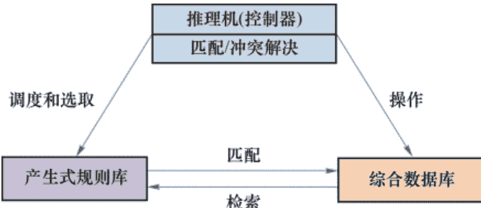

图6-4 产生式系统的基本结构

*   **产生式规则库**：存放若干“若条件满足，则执行操作”形式的规则。执行时，若规则条件部被满足，规则即可触发，控制器执行其操作部。
*   **综合数据库**：规则的数据中心。规则左半部（条件）规定了启用前数据库须具备的数据。规则执行会改动数据库，进而可能满足别的规则条件，所以它是动态数据结构。
*   **推理机（控制器）**：负责匹配测试、调度选取规则。核心流程三步走：**匹配 → 冲突消解 → 操作**。
    *   *匹配*：拿数据库跟规则条件比对，全匹配上叫“触发规则”。
    *   *冲突消解*：多条规则同时匹配时，决定先用哪条。
    *   *操作*：执行规则操作部，数据库随之更新，后续规则可能被激活。

AI推理本质是搜索过程。高质量推理既要正确的策略（定方向、解冲突），也要高效的搜索策略（定路线、提效率）。

### 正向推理：数据驱动，由果溯因

核心思路：先把初始事实塞进数据库，推理机据此去知识库找可用规则。这种从已知事实出发、正向应用规则的策略叫**数据驱动**。

**实战案例：动物分类**
张三看到个动物：有蹄、长脖子、长腿、暗斑点。系统知识库有R1~R15规则（如：有毛发→哺乳动物；有蹄+哺乳动物→有蹄类；有蹄类+长脖子+长腿+暗斑点→长颈鹿等）。

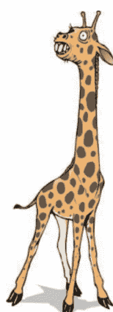

推理流程：
1.  初始事实入库：有蹄、长脖子、长腿、暗斑点。
2.  遍历规则匹配：如R6（犀利牙齿、爪、眼向前）不匹配；R11（有蹄类、长脖子、长腿、暗斑点）全匹配，触发成功。
3.  结论“动物是长颈鹿”入库，记录规则。
4.  用新数据库循环上述步骤，直到规则用尽。

**优点**：直观，用户提供事实，适合判断、设计、预测。
**痛点**：若知识库规则成千上万，目标规则排最后，效率极低。

### 逆向推理：目标驱动，由果索因

思路反过来：先假设结论（目标），为验证它去知识库找证据。这种从结论反推数据的策略叫**目标驱动**。

**同案逆向求解**：
假设目标：“斑马”或“长颈鹿”。
1.  初始事实入库，假设入“目标集”。
2.  取假设“斑马”，找结论为“斑马”的规则R12（需：有蹄、黑条纹）。核对数据库（有蹄、长脖子、长腿、暗斑点）→ 缺“黑条纹”，假设不成立。
3.  取假设“长颈鹿”，找规则R11（需：有蹄类、长脖子、长腿、暗斑点）。核对数据库 → 全满足，假设成立。

**优点**：目标明确，不找无关信息，效率通常更高。

### 混合推理：取长补短

复杂问题下，正向逆向各有利弊，常结合使用，互补短板，称**混合推理**。

---

### 课堂练习：识别推理类型

**按逻辑基础分类：**
1.  惊蛰种麦堆满仓，清明种麦一把糠。（归纳/经验总结）
2.  三好学生成绩优，小明是三好生，故小明成绩优。（演绎）
3.  候鸟能长途飞行，燕子是候鸟，故燕子能长途飞行。（演绎）
4.  直角/锐角/钝角三角形内角和皆180°，故一切三角形内角和180°。（归纳）
5.  一路不断有人帮忙，这社会好人多啊！（归纳）
6.  补漏趁天晴，读书趁年轻。（类比/迁移）

**按确定性分类：**
1.  地面湿，昨夜大概下雨了。（不确定）
2.  室温超26℃，开空调。（确定/阈值判断）
3.  他早出发，这么久没到，怕是堵车。（不确定）
4.  明天周六，公园人比平时多。（不确定/趋势预测）
5.  她一直胖，估计爱吃甜食。（不确定）
6.  张健天天锻炼，身体一定棒。（不确定/概率大）

---

### 脑力激荡：趣味推理实战

**案例1：神偷哈利偷钻石（逆向推理）**
皇宫3颗钻石在盒子里，盒子里有毒蛇，咬人致命。哈利不碰蛇、不戴手套、不让蛇出来，偷走钻石后盒子蛇原样不动。怎么偷的？
> **提示**：结果是“钻石离盒、蛇留盒”，逆向找能导致此结果的前提。

**案例2：谜语猜猜猜（正向推理）**
从事实线索推导答案：
1.  先修十字街，再修月花台，身子不动，粮自来。（蜘蛛）
2.  看无摸有，非冰非水。（影子/镜子？答案：冰/水相关谜语通常指“影子”或“镜子”，但谜面“是冰不化，是水不流”答案多为**镜子**或**影子**，此处原文答案待查，保留谜面）
3.  生在青山叶叶多，离乡纸包裹，客来开水泼，声声吞我。（茶叶）
4.  长方小年糕，香不可咬，搓揉变泡，洗衣变小。（肥皂）
5.  左五右五，拿去十个，还剩十个。（手套/手）
6.  铁嘴咬纸，咬完掉铁牙。（订书机）
7.  耳似蒲扇，身如小山，鼻长长，帮人干活。（大象）
8.  八脚抬面鼓，双剪舞，横行霸道，吐泡沫。（螃蟹）

**案例3：古戒失窃案（逆向推理）**
价值连城古戒在大窄口玻璃瓶里，瓶固定不动。戒指不翼而飞。嫌疑人：管家、保安、清洁工。谁嫌疑最大？
> **提示**：三个假设结论，去脑内知识库找证据支持。

---

## 第三节 状态空间搜索策略

### 什么是状态空间搜索？

推理即从初始状态出发，寻找路径，经中间状态逼近目标状态。把状态看作“点”，全体点构成**状态空间**。求解过程就是在空间里搜索一条从初始到目标的路径，这就是**状态空间搜索**。本质是根据实际不断找可用知识，构造推理路线解决问题。

搜索是推理不可分割的一环，直接决定系统性能。关键是选对**搜索策略**：
*   **盲目搜索（无信息搜索）**：按预设策略走，不看问题特性。含深度优先、广度优先。
*   **启发式搜索（有信息搜索）**：利用问题自身的启发信息引导搜索，往最有希望方向走，缩小范围，提效率。含局部择优（如瞎子爬山法）、最好优先（如有序搜索）。

### 盲目搜索：八数码问题实战

3×3棋盘，8个编号棋子（1-8），一个空格（0）。空格相邻棋子可移入。给定初始布局（如123405678）和目标布局（如283164750），找转换路径。

状态总数高达362,880种！只能画局部示意。
*   **深度优先（DFS）**：一条路走到黑，撞墙回头。路径见下图。
*   **广度优先（BFS）**：层层推进，离起点近的先搜。路径见下图。

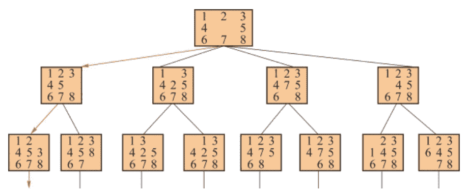

### 图6-5 深度优先搜索策略示意

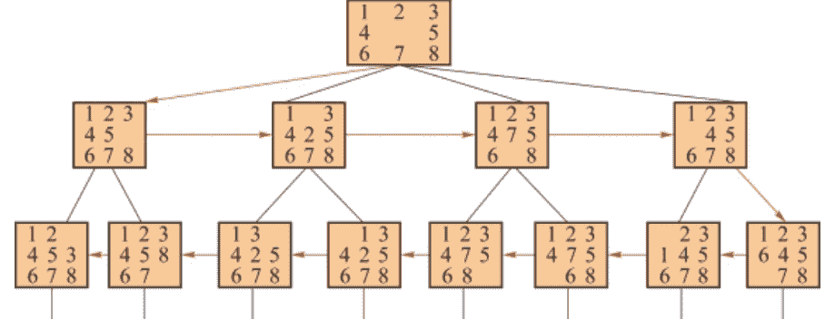

### 图6-6 广度优先搜索策略示意

### 启发式搜索：给搜索装上“导航”

盲目搜索虽省心但费时。启发式搜索“费心”挖掘问题内在信息，做“有向导”搜索。

仍以八数码为例：展开状态图发现，从初始态通向目标态的路径上，各状态与目标态对比，**数码位置不同的个数在逐渐减少**。这个“状态差距”就是启发信息，用它做度量指导搜索，范围缩小，速度提升。越近目标差距越小，差距为零即完成。

案例来源：https://blog.csdn.net/zuzubo/article/details/1540280

---

### 思考一下

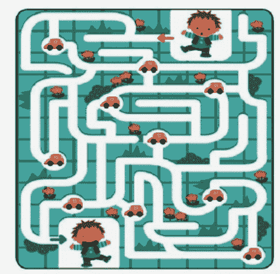

1.  迷宫捡玩具车，不走重复路。你用了啥搜索策略？为什么？
2.  松鼠四岔路口找坚果，选啥策略？为什么？

---

## 第四节 推理案例：传教士与野人渡河（M-C问题）

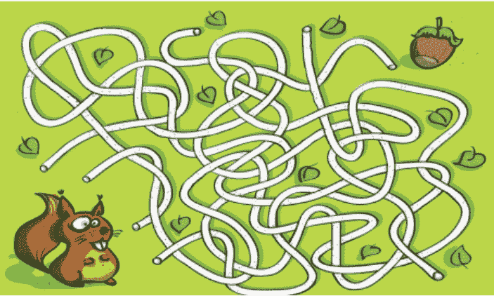

图片来源：http://www.juimg.com/shiliang/201307yingyinyule391626.html

### 问题建模与分析

经典M-C问题：N个传教士、N个野人，1条船，限乘k人。双方都会划船，野人服从安排。**硬性约束**：任意时刻，两岸及船上，野人数**不得超过**传教士数（除非该岸传教士为0）。目标：全员安全过河。

如何用计算机懂的形式化语言描述知识，再通过推理与搜索求解？以N=3, k=2为例，用产生式系统破解。

#### (1) 定义变量与约束

三个变量：**M、C、B**。
*   M、C：左岸传教士/野人数，取值{0,1,2,3}。
*   B：船位置。1=左岸，0=右岸。

**约束条件**：
1.  两岸均须满足 M ≥ C（除非 M=0，即纯野人岸）。
2.  船上 M+C ≤ 2。


#### (2) 状态空间分析

*   **初始态**：全员+船在左岸。左岸(3,3,1)，右岸(0,0,0)。
*   **目标态**：全员+船在右岸。左岸(0,0,0)，右岸(3,3,1)。

数学上状态空间 4×4×2=32种。
*   **不可能态**（4种）：如(3,3,0)人全在左船在右。
*   **不合理态**（12种）：违反 M≥C。如(1,0,1)左岸1传教士1船，右岸推得2传教士3野人，野人多于传教士。

剔除后，剩**16个合理态**构成可用状态空间（见表6-2）。

表6-2 M-C问题的状态空间
| 序号 | 状态 | 序号 | 状态 | 序号 | 状态 | 序号 | 状态 |
|---|---|---|---|---|---|---|---|
| 1 | (3, 3, 1) | 5 | (3, 1, 0) | 9 | (1, 1, 1) | 13 | (0, 2, 0) |
| 2 | (3, 2, 1) | 6 | (3, 0, 0) | 10 | (1, 1, 0) | 14 | (0, 1, 1) |
| 3 | (3, 2, 0) | 7 | (2, 2, 1) | 11 | (0, 3, 1) | 15 | (0, 1, 0) |
| ... | ... | ... | ... | ... | ... | ... | ... |

*(后续求解过程待续...)*

# 传教士与野人问题：状态空间建模与广度优先求解

### (3) 渡河动作规则集的构建

在过河过程中，船载人员的合法搭配（传教士M，野人C）仅存在五种：`(1,0)`、`(0,1)`、`(1,1)`、`(2,0)`、`(0,2)`。考虑到船只需往返穿梭，这五种基础动作在“左岸→右岸”与“右岸→左岸”两个方向上均可执行，故规则库共包含十条状态转移规则，汇总如下表。

**表：十条渡河状态转移规则**

| 编号 | 逻辑规则 | 动作语义 |
| :--- | :--- | :--- |
| 1 | if(M, C, 1) then (M-1, C, 0) | 左→右：渡1传教士 |
| 2 | if(M, C, 1) then (M, C-1, 0) | 左→右：渡1野人 |
| 3 | if(M, C, 1) then (M-1, C-1, 0) | 左→右：各渡1人 |
| 4 | if(M, C, 1) then (M-2, C, 0) | 左→右：渡2传教士 |
| 5 | if(M, C, 1) then (M, C-2, 0) | 左→右：渡2野人 |
| 6 | if(M, C, 0) then (M+1, C, 1) | 右→左：送回1传教士 |
| 7 | if(M, C, 0) then (M, C+1, 1) | 右→左：送回1野人 |
| 8 | if(M, C, 0) then (M+1, C+1, 1) | 右→左：各送回1人 |
| 9 | if(M, C, 0) then (M+2, C, 1) | 右→左：送回2传教士 |
| 10 | if(M, C, 0) then (M, C+2, 1) | 右→左：送回2野人 |

*注：状态三元组 (M, C, B) 中，B=1 表示船在左岸，B=0 表示船在右岸。*

### 搜索求解流程

本问题采用**正向推理**策略，状态空间搜索使用**广度优先盲目搜索**。初始时刻，综合数据库仅存放起始状态 `(3, 3, 1)`。搜索迭代步骤如下：

1.  **规则匹配**：顺序遍历规则库，拿数据库中的状态与规则前提事实对齐。若匹配失败，继续下一条。首轮匹配时，规则1至5的前提均与初始状态吻合。
2.  **约束校验**：对匹配成功规则的结论态进行合法性筛选。首轮生成的五个候选态分别为 `(2,3,0)`、`(3,2,0)`、`(2,2,0)`、`(1,3,0)`、`(3,1,0)`。其中 `(2,3,0)` 与 `(1,3,0)` 违反“野人数不得超传教士数”的约束，属非法状态，被剔除。其余 `(3,2,0)`、`(2,2,0)`、`(3,1,0)` 写入数据库，并记录对应规则。
3.  **循环迭代**：基于更新后的状态库重复上述两步，直至生成目标状态 `(0,0,0)` 或规则穷尽。

搜索拓扑结构见下图，节点代表状态，有向边代表规则应用，箭头指示状态流向。

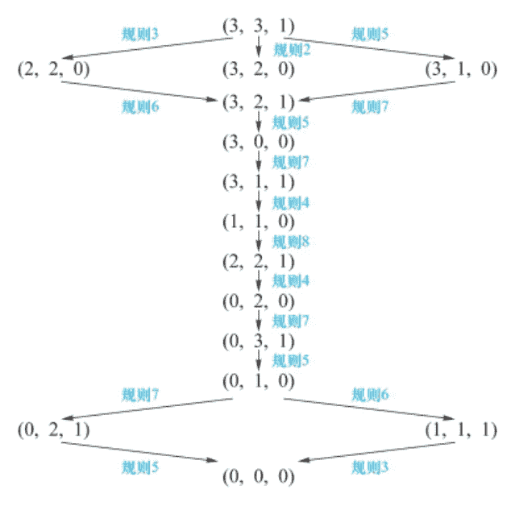

**图：M-C问题状态空间搜索拓扑图**

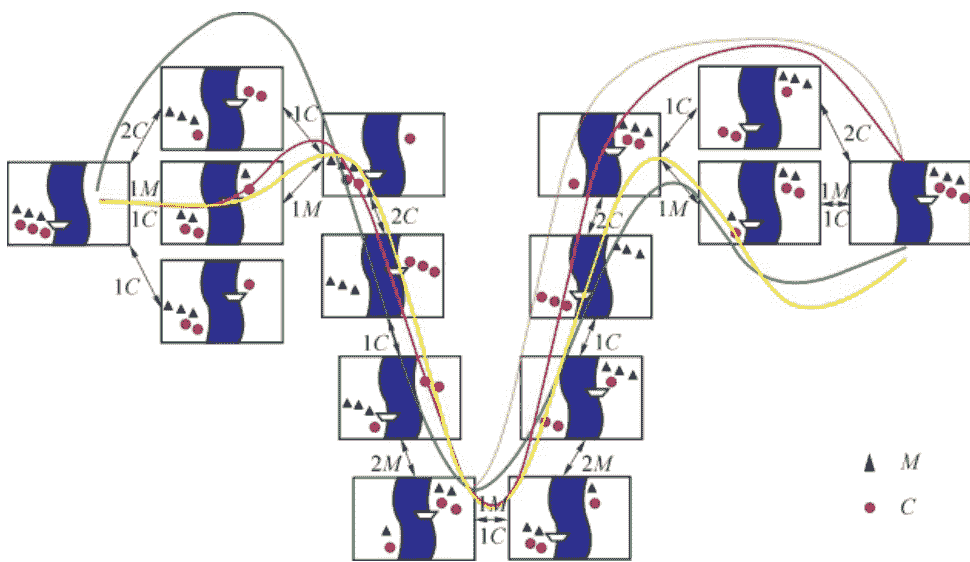

**图：四条可行解路径的渡河步骤演示**

由拓扑图可知，从初态抵达终态共有 **4 条最优搜索路径**，对应的具体过河序列见图示。

---

### 思考与练习

1.  **状态空间穷举**：在全部 32 种可能状态中，识别出所有“物理不可能”（如人数为负）与“逻辑非法”（野人吃人）的状态。
2.  **规则泛化验证**：若用以下两条参数化规则替代上述十条规则，求解结果是否等价？（参数 i, j ∈ {0,1}）
    *   规则一：```
if(M,C,1)and 1≤i+j≤2 then(M-i,C-j,0)
```
    *   规则二：```
if(M,C,0)and 1≤i+j≤2 then(M+i,C+j,0)
```
3.  **经典规划问题——猴子摘香蕉**：场景包含猴子、箱子、悬挂香蕉。猴子具备走动、推箱、爬箱能力，仅当“猴踩箱”且“箱在香蕉下”可摘果。请自行查阅资料，分析该问题的知识表示与求解框架。

---

# 第五节 拓展视野：知识图谱技术全景

互联网数据井喷，如何从海量噪音中精准获取知识成为核心痛点。2012年5月，Google 正式发布 **Knowledge Graph**，旨在重塑搜索引擎的语义理解力。凭借强大的语义建模与开放组织能力，知识图谱迅速渗透至智能搜索、问答系统、推荐引擎、内容分发等核心场景，成为智能化知识服务的基础设施。

### 核心定义：何为知识图谱？

本质上，它是**用图结构建模现实世界实体及其关联**的技术体系。
*   **节点**：实体（具体事物）或概念（抽象类别）。
*   **边**：实体属性或实体间关系。
*   **整体**：海量节点与边编织成的巨型语义网络。

> **辨析**：它与“语义网络”渊源深厚，并非凭空出现。更关键的是，它承继了 **Semantic Web（语义网）** 的演进脉络。注意区分：Semantic Web 是 Web 之父蒂姆·伯纳斯·李推动的“数据互联”愿景与技术栈；Semantic Network 是早期的知识表示模型。两者常被混淆。


**蒂姆·伯纳斯·李：从文档之网到数据之网**

1989年，李爵士创造 WWW（文档超链接）；1998年，他提出 Semantic Web（实体/概念超链接）。这一愿景催生了 Freebase（Google知识图谱底座）、DBpedia/Yago（支撑 IBM Watson）、Wikidata 等超大规模知识库。维基百科甚至直称：“知识图谱是 Google 强化搜索的知识库。”现今，该词已泛指大规模语义知识库。

从“网页链接”进化为“数据链接”，Web 正逐步逼近李爵士设想的语义网形态。应用边界早已超越搜索，延伸至语义检索、智能问答、自然语言理解、大数据分析、推荐计算、物联网互联、可解释 AI 等领域，**核心价值在于：以图谱形式返回经过推理加工的结构化知识，实现智能语义检索。**

### 基础构件：三元组与核心概念

知识图谱的**原子单元是三元组**，两大基本形态：
1.  **实体-关系-实体** 如：(中国, 首都, 北京)
2.  **实体-属性-属性值** 如：(北京, 人口, 2153.6万)

| 概念 | 释义 | 示例 |
| :--- | :--- | :--- |
| **实体** | 客观存在、可区分的具体对象 | 某人、某城、某商品、中国、美国 |
| **属性/属性值** | 实体内在特性及其取值 | 首都实体有“面积/人口”；学生有“学号/姓名” |
| **概念** | 同类实体共性抽象形成的集合 | 国家、民族、书籍、计算机 |
| **关系** | 映射节点至布尔值的函数，刻画关联 | “首都”、“出生地”、“夫妻” |

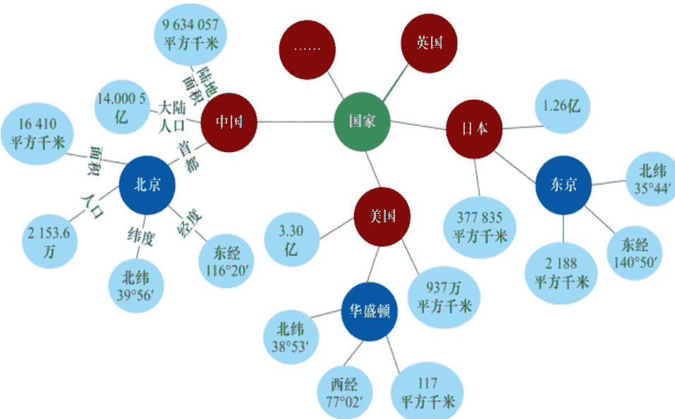

**图：基于三元组的知识图谱示意**

---

### 关键技术栈：从抽取到推理的工程化流水线

大规模知识库构建遵循 **“抽取 → 表示 → 融合 → 推理”** 的闭环架构：

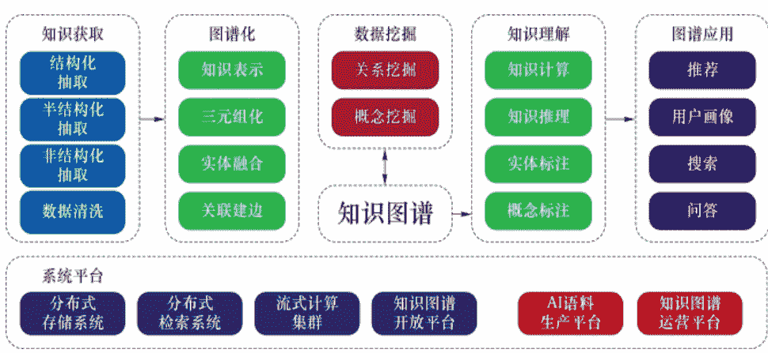

**图：知识图谱技术架构全景**

1.  **知识抽取**：从开放半结构化/非结构化/结构化源中识别实体、关系、属性。
2.  **知识表示**：将要素图谱化建模，便于计算处理。
3.  **知识融合**：消除实体指称歧义（实体链接）、关系冲突，产出高质量库。
4.  **知识推理**：在现有图谱上挖掘隐性知识，实现库的自增强与扩展。

---

### 实战演练

**任务一：实体识别与概念化**
从下列短文本抽取实体，标注其所属概念并给出简述：
*   ① 刘德华代表作品无间道
*   ② 欢乐喜剧人的主演
*   ③ 乔布斯2015年上映电影
*   ④ 冯小刚导演电影手机
*   ⑤ 小米是有营养的粗粮

**工具对比**：打开微信小程序“百度AI体验中心” → “知识理解” → “实体标注”，对比人工与机器结果。


**任务二：人物关系图谱绘制**
参考《人民的名义》人物关系图谱，尝试复刻你近期观看的影视/小说人物网络。

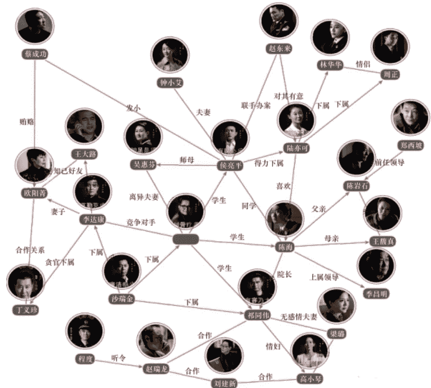

**图：《人民的名义》核心人物关系拓扑**

> **感悟**：若面对《三国》《红楼》《水浒》这等百人千面、动态演进的复杂关系，人工梳理将极其惨烈。包含关系抽取在内的 AI 技术，正成为攻克此类难题的关键力量。

**任务三：结构化信息抽取对标**
文本：“苹果公司……总部库比蒂诺……1976年4月1日由乔布斯、沃兹尼亚克、韦恩创立……1977年更名苹果电脑公司……2007年更名苹果公司……”
请手动抽取（总部、创始人、创立时间），并与自动抽取结果（表6-4）对照。

**表：自动化抽取结果样例**
| 主体 | 关系/属性 | 客体/值 |
| :--- | :--- | :--- |
| 苹果公司 | 总部地址 | 美国加利福尼亚库比蒂诺 |
| 苹果公司 | 创始人 | 史蒂夫·乔布斯 / 斯蒂夫·沃兹尼亚克 / 罗纳德·韦恩 |
| 苹果公司 | 创立时间 | 1976年4月1日 |

---

# 第七章 机器学习基本原理


**导论：学习——智能的核心引擎**

人类认知与智慧，本质源于毕生的学习积累。第六章揭示了计算机“用知识推理”，本章将揭答：**计算机如何“获取知识”？机器能否像人一样“自主学习”？**

面对数据洪流，我们渴望具备学习力的智能代理，自动从海量数据中提炼知识，实现知识获取的自动化。这股刚需催生了 AI 核心分支——**机器学习**。它是对人类学习机制的计算化模拟与实现，是赋予机器智能的根本路径与里程碑。

## 第一节 人类学习与机器学习：同构与异质

### 学习的多维透视

**学生视角**：在师导下，有计划地系统吸纳前人知识技能，内化为经验规律，进而举一反三解决新问题。

**机器学习类比**（见下图映射）：

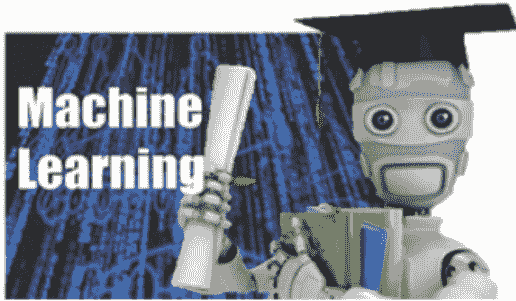

**图：人机学习过程对标映射表**

| 人类学习要素 | 机器学习对应物 |
| :--- | :--- |
| 前人科学文化知识/技能 | **历史数据** |
| 归纳总结过程 | **训练** |
| 获得的知识/经验/规律 | **模型** |
| 模型面对新数据的输出 | **预测** |

**核心流程**：先训练建模，后推理预测 —— 正如“先完成学业，再步入职场”。

### 跨学科的学习定义

| 学科视角 | 核心定义 | 关键洞见 |
| :--- | :--- | :--- |
| **神经科学** | 大脑感知/处理/整合信息，引发突触连接结构重组（**可塑性**） | 学习=连接主义重塑；婴儿→儿童→青少年，突触密度经“修剪”优化。 |
| **认知心理学** | “主体-环境交互经验导致的能力/行为倾向的相对持久变化” | 非游泳者→健将；文盲→阅读者。 |
| **AI先驱 西蒙** | “系统执行过程改变自身性能即学习” / “能让系统同任务表现更优的任何改变” | **三要素：过程、系统、性能提升**。系统若为人→人类学习；为机→机器学习。 |

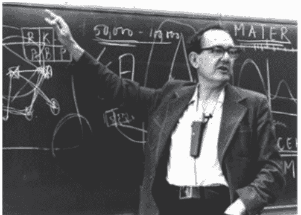

**西蒙：统一人机学习概念的奠基人**

西蒙的定义虽宽泛，却精准锚定了**“模型与原型”**关系：机器学习是对人类学习的计算机模拟，概念一致性强化了其“拟人/类人”本质。

机器学习是交叉学科（神经科学、认知心理、逻辑、统计、教育学等），目标：**让机器像人一样通过学习获取知识、积累经验、发现规律、持续优化性能、实现自我完善。**

### 里程碑：棋战中的学习进化史

*   **1959** Samuel（IBM）跳棋程序：自博弈中进化，4年胜设计者，7年破人类冠军不败金身。
*   **1997** 深蓝：击败国际象棋王卡斯帕罗夫。
*   **2016** AlphaGo：4:1 完胜李世石，震惊世界。

### 机器学习三大核心研究支柱

1.  **学习机理**：剖析人类获取知识/技能/抽象概念的天赋机制，为算法提供第一性原理。
2.  **学习方法**：提炼通用学习范式（监督/无监督/强化等），独立于具体业务领域；本质是对生物机理的简化与计算再现。
3.  **学习系统**：针对具体任务落地工程化系统。

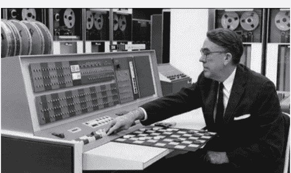

**Samuel 与他的跳棋程序**

### 应用版图：四大基础问题 → 万物智能

机器学习擅长解决 **分类、回归、聚类、降维** 四大基础范式，因大量实战问题可归约至此，其成果已深度渗透：
*   模式识别
*   计算机视觉
*   数据挖掘
*   语音识别
*   统计学习
*   自然语言处理
*   自动推理
*   智能决策

---

### 深度研讨：直击学习本质的五个追问

1.  **连接主义本质**：神经科学家认为知识分布式存储于突触网络。结合人工神经网络（ANN）原理，**ANN学习过程的本质是什么？**
2.  **遗忘与优化**：大脑中“常用活跃、不用清除”实现环境适应。**人工神经网络如何模拟这一“修剪/巩固”机制？**
3.  **载体差异之外**：Peter Rudin 云：“人脑产生知识，机器产生知识。**这是唯一区别吗？两者在学习层面尚有何根本差异？**”
4.  **优势与奇点**：**机器学习的核心优势何在？你判断未来机器学习力会超越人类吗？**
5.  **高阶认知边界**：**机器能学会直觉、情感、审美、顿悟吗？**
6.  **社会影响**：**会学习的机器将如何重塑人类工作与生活？**

---

## 第二节 机器学习系统的基础架构

# 解码机器学习：从Mitchell定义到核心范式的全景解析


### 权威视角：Tom Mitchell眼中的机器学习

1997年，被誉为全球机器学习“教父级”人物的Tom Mitchell教授，为机器学习给出了一个经典且极具操作性的定义：若一个计算机程序在执行特定任务（T）的过程中，能够借助过往经验（E）持续优化其表现，且这种性能提升可用指标（P）量化，那么我们就称该程序具备了“学习能力”。

这段论述精准提炼了机器学习问题的三大核心要素：**任务（T）、经验来源（E）、性能度量（P）**。为加深理解，我们通过两个具体场景来拆解：

**场景一：自博弈跳棋程序**
目标是开发一个能通过自我对弈积累经验、不断精进棋艺、最终超越设计者预期水平的程序。
*   **任务 T**：下跳棋。
*   **经验 E**：自我对弈的过程。
*   **性能 P**：可自定义，如对弈胜率。

**场景二：垃圾邮件智能过滤器**
目标是让程序学习用户标注的邮件样本（训练集），从而自动识别新邮件属性。
*   **任务 T**：判定新邮件是否为垃圾邮件。
*   **经验 E**：已标注的训练集数据。
*   **性能 P**：邮件分类准确率。

基于Mitchell教授的定义及上述案例，一个合格的学习系统需满足四大基本条件：

1.  **优质的学习环境**：如同学校、师资、书本对学生的重要性，环境为系统提供必要的信息输入与条件保障。
2.  **内在学习能力与有效方法**：同一环境下，不同能力与方法会导致截然不同的学习效果。
3.  **学以致用**：将习得的知识、技能应用于估计、预测、分类、决策等实际问题求解。
4.  **性能持续迭代**：学习的根本目的是通过知识积累与技能升级，让系统解决问题的能力越来越强。


为落实上述要求，机器学习系统的基础架构至少包含四大核心模块：**环境、学习模块、知识库、执行模块**（参见图7-3）。

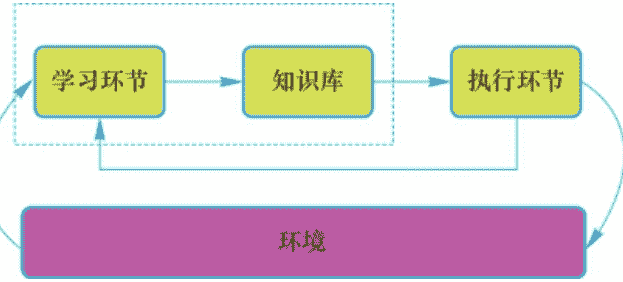

**图7-3 机器学习系统基础架构示意**

架构运作逻辑如下：环境向学习模块提供原始信息；学习模块处理信息并更新知识库；执行模块依据知识库指令作业，同时将实况反馈给学习模块。在具体落地时，环境、知识库与执行模块界定了业务边界，学习模块的核心任务由此决定。下面逐一拆解各模块功能：

### 环境：信息的源头与质量关

环境以特定形式向系统输出外部信息，信息的**水平**与**质量**直接决定学习上限。

*   **信息水平（抽象度）**：
    *   *高水平*：抽象度高，泛化性强，适用面广。
    *   *低水平*：具体细节多，针对性强但泛化弱。
    *   *矛盾与转化*：环境提供的水平常与执行需求不匹配。环境给高水平信息时，学习模块需补全细节；给低水平信息时，学习模块需归纳总结、剥离噪声提炼规则。显然，低水平输入会显著增加学习模块的设计难度。


*   **信息质量（正确性、适当性、合理性）**：
    *   样本表述是否精准？呈现顺序是否利于归纳？这直接影响学习难度。
    *   若样本含严重噪声且顺序混乱，学习模块极难有效归纳。


### 学习模块：算法的核心引擎

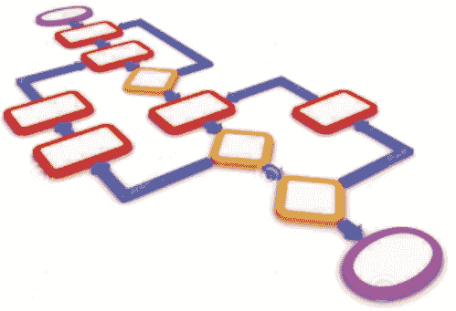

> **算法**：解题方案的准确而完整描述

学习模块承担“加工”职能：接收环境信息与执行反馈，经分析、综合、归纳、类比等认知过程，弥合信息水平差距，提炼知识存入知识库。

### 知识库：经验的仓库与推理的基石

知识库存储学习成果，其结构取决于知识表示法（如前章所述：一阶谓词逻辑、产生式规则、语义网、框架、神经网络等）。设计时倾向于选择表达力强、易推理、易维护扩展的表示法。

**关键点**：系统不可能“零知识”起步。知识库预置初始知识作为基座，学习过程即在基座上扩充、修正、完善。

### 执行模块：落地与反馈的闭环

执行模块与学习模块深度耦合、相互塑造：
*   **复杂度**：完成任务所需知识量级（如下棋需二十余规则，医学诊断需数百规则）。
*   **反馈信息**：基于执行效果对知识库进行评价，指导学习模块决定是否继续从环境获取信息以修正知识。
*   **透明度**：执行过程越透明，越易依据效果评估规则优劣，透明度越高越有利于学习优化。


---

### 💡 思维训练场

**1. 学习环境分类实战**
将下列因素划分为学校、家庭、社会三类学习环境：
`校舍` `博物馆` `师资` `家庭和睦` `公共图书馆` `影视娱乐` `学风` `亲子关系` `教学手段` `有辅导能力的父母` `校风` `校外辅导班` `家庭收入` `艺术馆` `独立卧室` `实验室` `朋友圈`

| 学校学习环境 | 家庭学习环境 | 社会学习环境 |
| :--- | :--- | :--- |
| | | |

**2. 信息水平分级练习**
按抽象层级（高/中/低）对信息分层：
`苹果` `桃子` `水果` `柑橘类` `脐橙` `芦柑` `瓜类` `西瓜` `蔬菜`

**3. 信息质量评估**
从正确性、适当性、合理性三维度评价：
*   样本① 手机评价系统输入：`[价格，颜色，销售量]`
*   样本② 诊断系统输入：`[咳嗽=√，体温=100.4°F，血象=高]`
*   样本③ 聚类训练集：`[长，宽，高，周长]`，`[宽，高，长，周长]`，`[周长，高，长，宽]`，`[高，长，宽]`

**4. 机器学习模块与人脑功能类比**
*   学习环节 ≈ 人的什么功能？
*   知识库 ≈ 人的什么功能？
*   执行环节 ≈ 人的什么功能？

---

## 第三节 机器学习的三大核心范式

人类实践总结出高效学习法，机器学习亦需依托算法实现策略。经过数十年演进，算法库日益丰富。为便于体系化认知，常按**函数性质**（线性/非线性）、**学习准则**（统计/非统计）、**学习方式**分类。其中，**按学习方式划分（监督/非监督/强化）**最贴近人类认知，最易理解。下文重点剖析这三大范式及其融合形态——半监督学习。

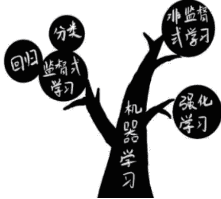

### 一、 监督式学习：有“标准答案”的陪练

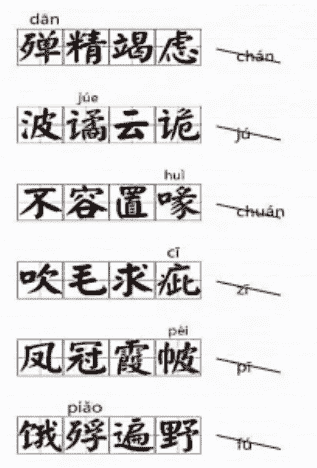

回想学生时代：语文课老师讲6个成语的读音、释义、用法；数学课讲一元二次方程解法并布置5道带答案习题。对学生这个“学习系统”而言，成语与题目是**训练样本**，老师给的释义与标准答案是**教师信号/标注**。

考试时不看书作答，答案即系统**实际输出**；对标准答案打分，即计算**误差**；查漏补缩小差距，即**模型调整**。这就是监督学习的核心逻辑：**输入带标注样本 -> 模型预测 -> 与标注比对误差 -> 反向调优 -> 达标停止。**


**正式定义**：训练数据由`(样本, 标注)`对组成。标注提供“教师信号”，算法最小化预测输出与标注间的误差。

**典型案例**：
*   **手写数字识别**：每张图预先标注 0-9。系统反复调整参数，直到识别率达标。
*   **垃圾邮件分类**：邮件预标注“垃圾/正常”，学习分类规则，推广到未知邮件。

**核心驱动力**：**标注信息**。有了标注才能算误差，有误差才能定向优化。

**主攻问题类型**：
1.  **分类**：离散标签预测（如垃圾邮件识别、图像分类）。本质是从标注数据中自动学习类别边界。
2.  **回归**：连续数值预测（如房价预测 `Y=f(面积,位置,距离)`）。
    *   *线性回归*：数据可用直线拟合（如早期疫情累计确诊趋势）。


*   *非线性回归*：数据需曲线拟合（如疫情累计治愈趋势呈指数增长）。

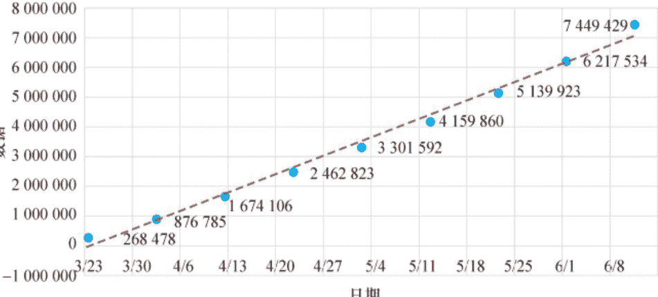

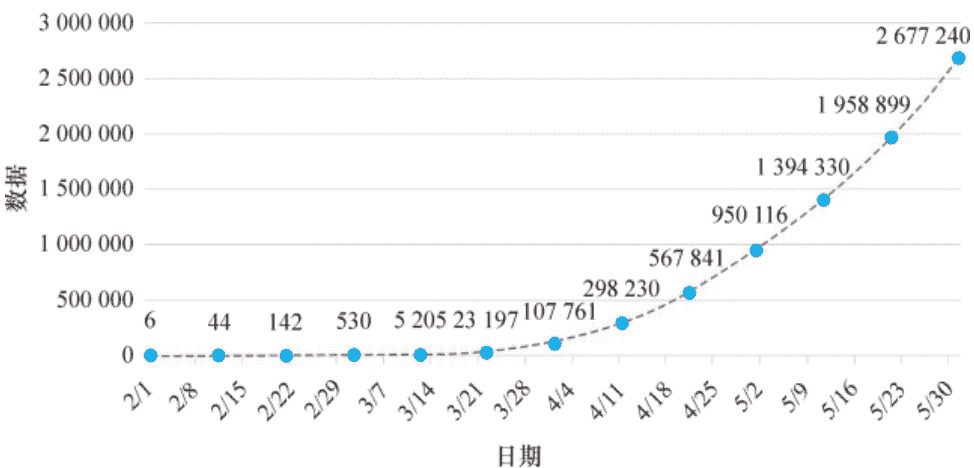

---

### 二、 非监督式学习：无“标准答案”的自组织


**核心差异**：训练样本**无人工标注**。系统必须自主挖掘数据内在结构、分布规律。

**两大典型任务**：

1.  **聚类**：
    经典非监督任务。无类别标签，仅依据样本间**相似性**自动分组。如用户画像细分、基因序列分群。

2.  **异常检测**：
    识别“不合群”的模式。应用极广：
    *   **金融**：信用卡欺诈、虚假贷款识别。
    *   **网络安全**：流量异常模式捕获黑客入侵。
    *   **电商**：恶意刷单团伙识别。
    *   **运维**：设备故障前兆监测。
    *   **工业**：次品自动剔除。

**异常的三种形态**：

*   **单点异常**：个别样本显著偏离全局分布。
    *   *例*：信用卡单笔巨额异地消费；3只小黄人里混入1个海绵宝宝。


*   **上下文异常**：特定语境下的反常（常见于时序数据）。
    *   *例*：旅游期高消费正常，但被盗刷则异常；春季气温序列中突现一低温日。

*   **集体异常**：单个样本正常，群体协同出现异常。
    *   *例*：蚂蚁搬家式文件拷贝（潜在数据窃取）；单人腹泻正常，多人同发提示食品安全事故。

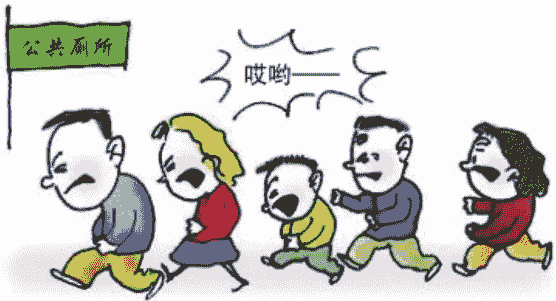

---

### 三、 半监督式学习：现实世界的最优解

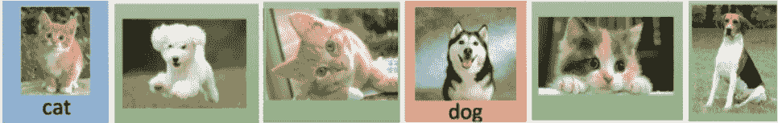

**痛点**：
*   监督学习：全量标注成本高、耗时长。
*   非监督学习：海量无标签数据价值未被充分挖掘。

**半监督方案**：**少量有标签数据 + 大量无标签数据** 协同训练。
利用无标签数据的分布结构信息辅助建模，在标注资源受限时显著提升泛化性能，是工业界落地极具性价比的范式。

---
*文案完，核心知识点全覆盖，表述重构，适合技术科普/课程推广发布。*

# 小样本困境的破局者：半监督与强化学习深度解析

半监督学习巧妙融合了监督与非监督两大范式：它将海量未标注样本纳入有限的标注数据集中联合训练。其理论基石在于“模型假设”。实验证明，假设若与数据分布吻合，无标签数据能显著提升性能，超越单一监督或非监督学习；反之，若假设失效，引入无标签数据反而会拖累模型表现。因此，半监督学习的成败，关键在于是否选对了符合实际分布的假设。

最核心的假设莫过于“聚类假设”：数据天然呈现簇结构，同一簇内的样本大概率属于同一类别。

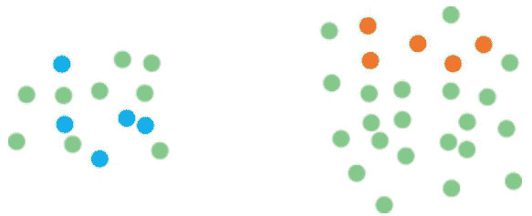

图7-4 半监督式学习训练集

若仅用监督学习算法处理图中仅有的10个标注样本，得到的决策边界如下图所示。


图7-5 采用监督式学习算法得到的分类边界

但若启用半监督算法，让所有样本（含大量绿色未标注点）共同参与训练，基于聚类假设调整边界，模型性能便获得了明显提升。

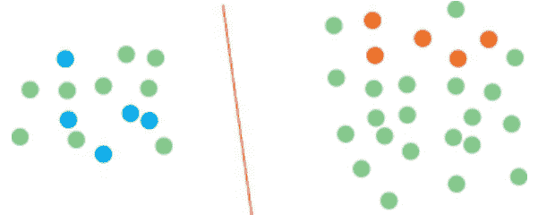

图7-6 采用半监督式学习算法得到的分类边界

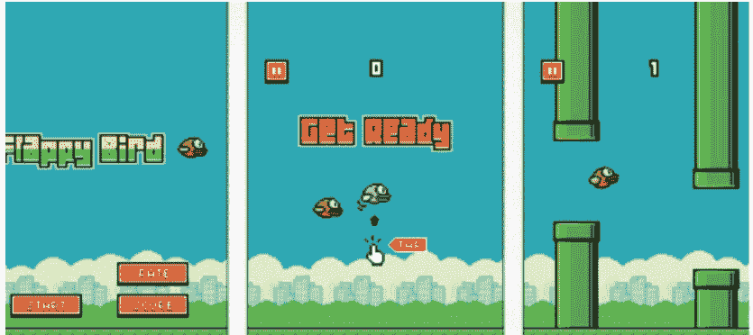

《像素鸟》的游戏界面

借助《像素鸟》这一直观场景，我们能轻松拆解强化学习的核心要素：操控小鸟的主角是**智能体**；让小鸟飞得更远是**目标**；满屏水管构成了**环境**；点击屏幕让小鸟扇动翅膀上升是**动作**；飞行距离折算的分数即为**奖励**。这一完整交互闭环，如下图所示。

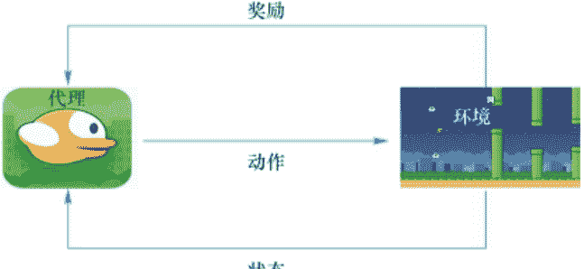

图7-7 强化学习示意图


区别于监督学习依赖标签、非监督学习挖掘结构，强化学习的核心在于**智能体与环境的持续博弈**。其目标是通过不断试错，学会“状态→动作”的最优映射策略，以实现长期累积奖励的最大化。过程中无人“手把手”教导该怎么做，智能体必须自主探索：哪个策略得分高，就强化哪个策略。这与现实中“绩效奖金激励员工”或“奖励机制激励孩子学习”如出一辙。值得注意的是，当下的动作往往牵一发而动全身，既影响即时收益，又决定未来状态及长远回报。**“试错搜索”**与**“延迟回报”**，是强化学习最鲜明的两大特征。

2016年AlphaGo战胜李世石，2017年AlphaGo Master击败柯洁，而纯靠自我博弈强化学习诞生的AlphaGo Zero，仅用40天便超越了所有前辈。

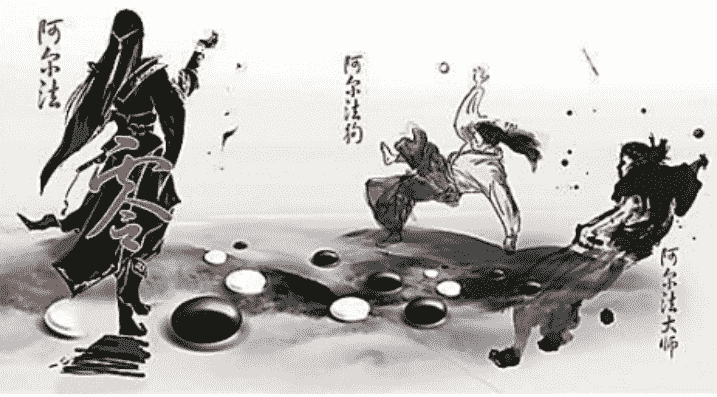

图片来源：https://xw.qq.com/cmsid/SPO2017102001867200

AlphaGo Zero的横空出世，让强化学习跃升为当下机器学习最炙手可热的研究前沿之一，并迅速渗透至游戏AI、机器人控制、计算机视觉、NLP、推荐系统、教育、广告、金融等诸多领域。

### 练一练

请判断下图三组数据分别适用于监督学习还是非监督学习算法训练，并说明理由。

训练集

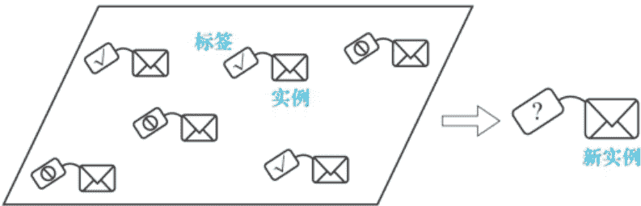

训练集1

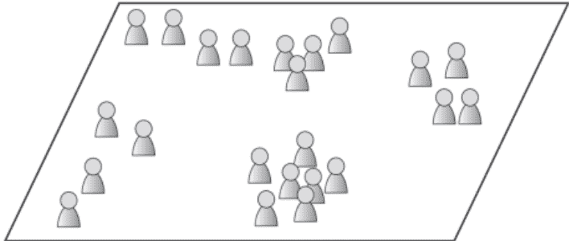

训练集2

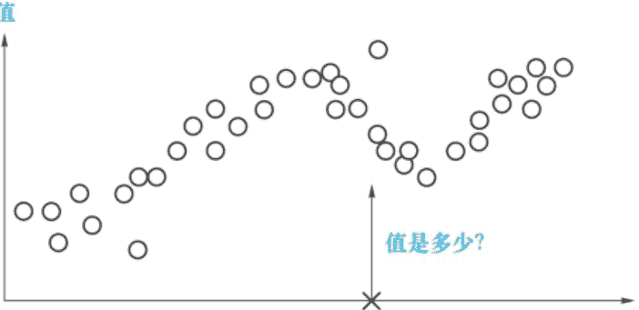

训练集3

你认为下图机器人采用了哪类机器学习算法训练？理由何在？

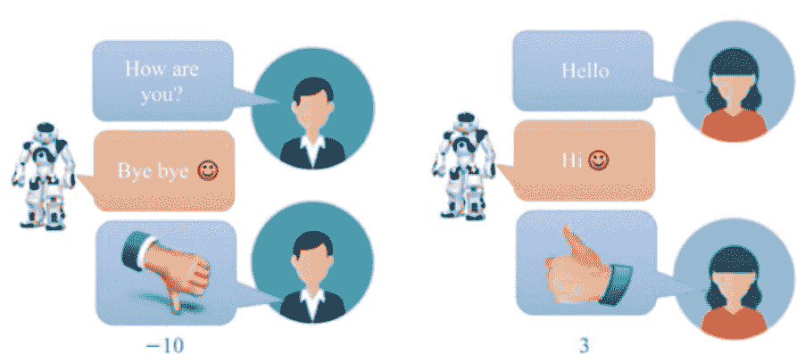

图片来源：http://www.sohu.com/a/241633776_473283

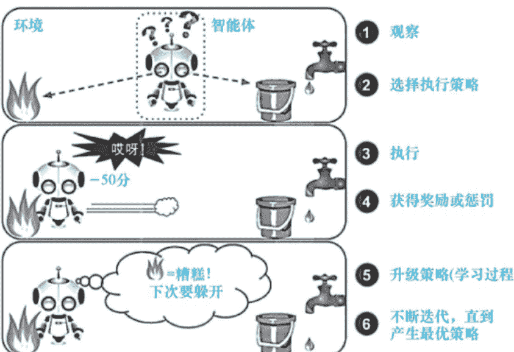

图片来源：https://blog.csdn.net/zw0pi8g5c1x/article/details/83110934

### 【注释】

[1] 参考《人工智能（上）》第四章第4节相关内容。

# 第八章 机器学习的经典算法


按学习范式划分，主流机器学习算法落入四大阵营：监督学习、非监督学习、半监督学习、强化学习（见图8-1）。其中，监督与非监督学习应用最广、积淀最深，在分类、回归、聚类、降维等核心任务上构建了庞大的算法宝库。

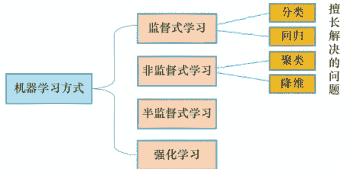

图8-1 机器学习的4类学习方法

本章将挑选数个原理清晰、易于上手的经典算法，着重讲透其背后的直觉与逻辑，弱化复杂数学推导。

## 第一节 线性回归算法

### 线性回归 vs 非线性回归：怎么选？

回归分析是监督学习中最基础、最常用的预测技术。它研究的是因果关联变量间的定量关系：人们关心的指标是**因变量**（Y），影响它的因素是**自变量**（X）。回归的任务，就是从海量观测数据中“由果溯因”，寻找一个函数 $Y=f(X)$ 来精准描述变量间的内在规律，这便是回归方程或经验公式。

依据函数形态，回归分为**线性**与**非线性**两大类。线性意味着Y随X成比例变化，几何图像为直线/平面；非线性则无固定比例，图像为曲线/曲面。

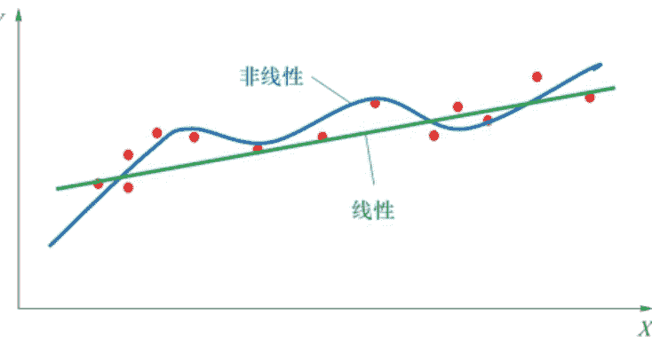

图8-2 线性函数与非线性函数

线性回归胜在计算简捷、系数可解释性强（能直接量化每个变量的影响权重）；短板是拟合非线性数据时误差较大。因此，**在误差可接受范围内，线性回归通常是建模首选**。它又细分为一元（单自变量）与多元（多自变量）线性回归。

一元线性回归的任务，就是在二维平面上为因变量Y与自变量X拟合一条最佳直线：

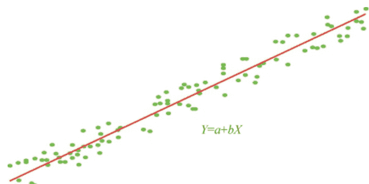

图8-3 由一元线性回归方程确定的直线

$$Y = a + bX \quad (8-1)$$

式中，$a$ 为截距，$b$ 为斜率。

**实战例1**：某产品广告投入(X)与销售额(Y)数据如表8-1。

| X / 万元 | 2 | 3 | 4 | 5 |
| :--- | :--- | :--- | :--- | :--- |
| Y / 万元 | 26 | 39 | 49 | 54 |

绘制散点图（图8-4），四个点呈现明显线性趋势。

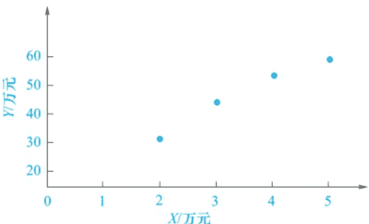

图8-4 某产品广告费X与销售额Y的统计数据

虽呈线性，但点不可能全落在一条线上。图8-5展示了三条不同参数下的拟合线（绿/蓝/黑），各有各的误差分布。实测值 $Y_i$ 与线上对应计算值 $Y_{\text{计算}}$ 之差即为误差 $\phi_i = Y_i - (a+bX_i)$。可见，照顾了前面的点，后面的点偏差就大，顾此失彼。

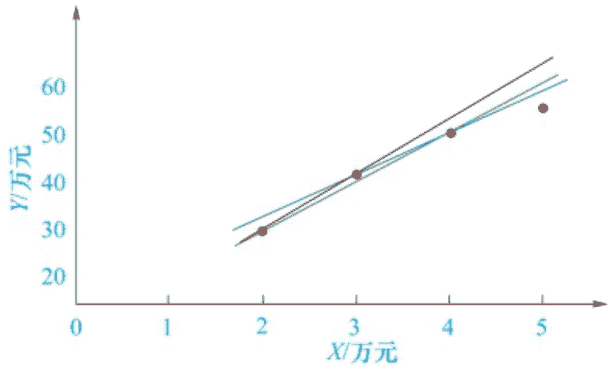

图8-5 某产品广告费X与销售额Y的拟合直线

### 最小二乘法：寻找“最省力”的那条线

面对成对数据 $(x_1,y_1)...(x_m,y_m)$，若散点呈线性分布，如何确定最优 $a,b$？

最小二乘法（最小平方法）给出了经典答案：构造直线使**所有点误差的平方和 $\phi$ 最小**。

$$ \phi = \sum_{i=1}^{m}(Y_i - Y_{\text{计算}})^2 \quad (8-2) $$

为何用平方和而非绝对值和？因为误差有正有负，平方可抵消符号干扰，且数学性质优于绝对值，便于求导优化；同时，最小化总平方和能约束每个单点误差不至于过大。

高斯在19世纪初便推导出了让 $\phi$ 最小化的 $a,b$ 解析解：

$$ a = \bar{Y} - b\bar{X} \quad (8-3) $$
$$ b = \frac{m \sum X_i Y_i - \sum X_i \sum Y_i}{m \sum X_i^2 - (\sum X_i)^2} \quad (8-4) $$

式中 $\bar{X}, \bar{Y}$ 为坐标均值。代入例1数据计算得：

$$\overline{X} = \frac{X_1 + X_2 + \dots + X_m}{m} = \frac{2+3+4+5}{4} = 3.5$$ $$\overline{Y} = \frac{Y_1 + Y_2 + \dots + Y_m}{m} = \frac{26+39+49+54}{4} = 42$$

$$b = \frac{m \sum_{i=1}^m X_i Y_i - \sum_{i=1}^m X_i \sum_{i=1}^m Y_i}{m \sum_{i=1}^m X_i^2 - (\sum_{i=1}^m X_i)^2} = \frac{4 \times (2 \times 26 + 3 \times 39 + 4 \times 49 + 5 \times 54) - (2+3+4+5) \times (26+39+49+54)}{4 \times (2^2+3^2+4^2+5^2) - (2+3+4+5)^2} = \frac{4 \times 635 - 14 \times 168}{4 \times 54 - 196} = \frac{188}{20} = 9.4$$

最终得到回归方程：**$Y = 9.1 + 9.4X$**，拟合效果如图8-6。

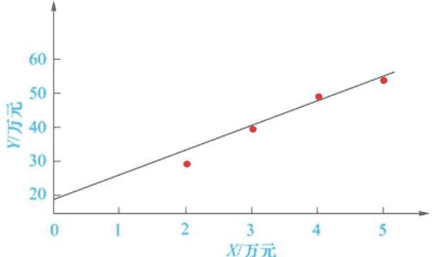

图8-6 用最小二乘法拟合某产品广告费X与销售额Y的统计数据

### 回归分析标准三步走

1.  **建模求参**：确定函数形式，用最小二乘法等方法解出参数。
    *   *例2*：研究产品质量(X)对用户满意度(Y)的影响。建立 $Y = a + bX + e$（含随机误差项）。利用最小二乘法结合实测数据求解参数，假设得 $a=0.857, b=0.836$。
    ```
Y=a+bX+e
```
    即质量每升1分，满意度均增0.836分。
2.  **模型评价**：检验拟合优度，判断方程可信程度。
3.  **变量筛选**（多元场景）：剔除不显著自变量，保留核心驱动因子。
    *   *例3*：手机满意度受质量($X_1$)、价格($X_2$)、形象($X_3$)影响。初步回归得 $Y = 0.645X_1 + 0.221X_2 + 0.008X_3$。形象系数极小(0.008)，贡献可忽略，剔除后重构模型：$Y = 0.645X_1 + 0.221X_2$。

### 练一练

1.  **硝酸钠溶解度实验**：根据表8-2温度-溶解度数据，绘制散点图并用最小二乘法求回归方程。
    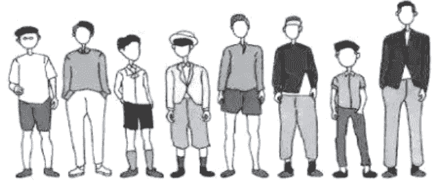
    ### 表8-2 不同温度下溶解于100份水中的硝酸钠份数
    | 水温 / 摄氏度 | 0 | 4 | 10 | 15 | 21 | 29 | 36 | 51 |
    |---|---|---|---|---|---|---|---|---|
    | 份数 | 66.7 | 71.0 | 76.3 | 80.6 | 85.7 | 92.9 | 99.4 | 113.6 |

2.  **身高体重相关性**：根据表8-3数据绘制散点图并求回归方程。
    ### 表8-3 8位人士的身高与体重数据
    | 身高 / 厘米 | 158 | 159 | 160 | 162 | 165 | 171 | 172 | 176 |
    |---|---|---|---|---|---|---|---|---|
    | 体重 / 千克 | 57 | 60 | 58 | 59 | 63 | 62 | 65 | 66 |

3.  **疫情趋势预测**：利用表8-4（2020.3.23-6.11国外累计确诊数据）建模，预测6月21日数据并对比实况。
    ### 表8-4 2020年3月23日—6月11日国外累计确诊新冠肺炎数据
    | 日期 | 3月23日 | 4月2日 | 4月12日 | 4月22日 | 5月2日 |
    |---|---|---|---|---|---|
    | 人数 | 268478 | 876785 | 1674106 | 2462823 | 3301592 |
    | 日期 | 5月12日 | 5月22日 | 6月1日 | 6月11日 | |
    | 人数 | 4159860 | 5139923 | 6217534 | 7449429 | |

## 第二节 决策树算法

决策树是监督学习分类任务中的“常青树”，也是极少数**模型本身即白盒、可直接可视化**的算法。不同于多数算法输出一个数学函数，决策树训练产出的是一棵长着“根、枝、叶”的树结构。

### 手把手教你“种”出一棵决策网球树

**场景**：预测网球爱好者李强下周六上午去不去打球。历史数据如表8-5。


### 表8-5 “李强周六上午是否打网球”的训练实例

| 实例序号 | 天气 | 温度 | 湿度 | 风力 | 打网球吗? |
| :--- | :--- | :--- | :--- | :--- | :--- |
| 1 | 晴天 | 很热 | 很高 | 弱 | No |
| 2 | 晴天 | 很热 | 很高 | 强 | No |
| 3 | 阴天 | 很热 | 很高 | 弱 | Yes |
| 4 | 雨天 | 适宜 | 很高 | 弱 | Yes |

# 决策树构建与K-Means聚类：核心逻辑与手算演示

$$

Y = f(X_{\text{天气}}, X_{\text{温度}}, X_{\text{湿度}}, X_{\text{风力}})

$$

决策树的生成并不强制指定起始特征，任意属性均可作为入口。本案以“天气”作切入，演示“李强周六上午是否打网球”模型的构建全程。该特征含晴、阴、雨三个取值，对应三个分支，将完整样本空间切分为三个互斥子集。下面逐一剖析各子集内部的判别规律。

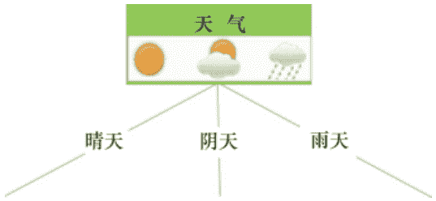

### 一、 晴天场景

数据统计显示，晴天共现身5次。这5条记录中，3次不打球、2次打球，类别混杂，需继续细分。对比可见：全部“不打球”均对应“湿度极高”，而“打球”则对应“湿度正常”。温度与风力在此场景下失去判别力。故晴天分支直接按“湿度”二分：高湿→全判No；正常湿度→全判Yes，分类彻底纯净。

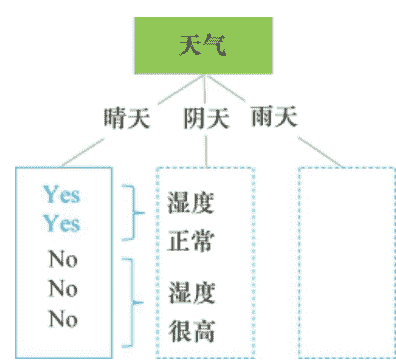

### 二、 阴天场景

阴天共计4条样本，李强**全部选择打球**。4个实例标签一致均为Yes，纯度达峰值。可直接推导规则：遇阴天即打标签“Yes”，后续属性无需过问，该节点直接生长为叶节点。

### 三、 雨天场景

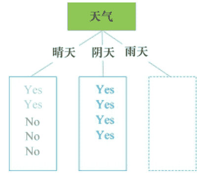

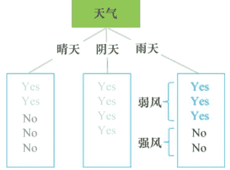

雨天样本共5条，2个No、3个Yes，仍属混杂。规律挖掘显示：2次“不打球”均遭遇“大风（风力强）”，3次“打球”均伴随“微风（风力弱）”。温度、湿度在该子集中同样失效。于是雨天分支按“风力”再分层：强→No；弱→Yes。

历经层层剥离，一棵分类决策树便呈现眼前（见图8-7）。其形似倒置之树：矩形框为**决策节点**（判断属性），末端标签为**叶节点**（输出类别），顶层“天气”为**根节点**，中间层“湿度”、“风力”属**内部节点**。每节点按属性值发散分支，递归下探，直至节点覆盖样本类别单一，建树宣告结束。

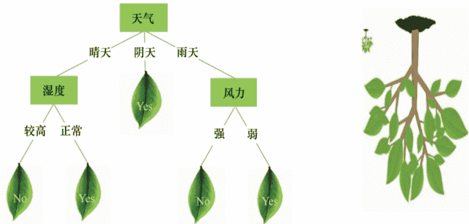

> **注**：更换根节点属性，树形拓扑随之重构。决策树算法的核心即在于——**根节点与内部节点的选择策略**。经典的ID3算法给出了属性选取的优先级序列。

---

## 核心准则：驱动纯度急剧跃升

建树伊始，首解之谜：根节点选谁？后续层级选谁？**唯一准则：树深增加，子集纯度须高速上扬。**

*   **纯度低** = 样本类别大杂烩，高度混杂。
*   **纯度高** = 样本高度同质，近乎单一类别。

以“天气”作根为例：分出的“阴天”子集纯度最高，4样本全为Yes，无需再分。

为量化“纯度”，引入**信息熵**与**基尼系数**两大指标。二者逻辑同构：**纯度越高，指标值越低**。考量计算便捷性，下文采用基尼系数演示节点抉择。

### 知识驿站：熵与信息熵

*   **熵**：度量“无序度”。熵大=乱；熵小=序。
*   **信息熵**：熵理论在信息域的映射。随机变量中刻画不确定性；样本集中刻画**纯度**。

有了度量尺，准则可硬核表述：**随树层级加深，节点信息熵或基尼系数须显著下降。**

---

## 实战演示：基尼系数定根节点

目标变量Y仅两类（Yes/No），故类别数 $K=2$。
设第 $k$ 类概率 $p_k$，非该类 $1-p_k$，基尼系数计算式为：

$$

\text{Gini}(p) = \sum_{k=1}^K p_k(1-p_k) = 1 - \sum_{k=1}^K p_k^2 \quad (8-5)

$$

**先得原始样本基尼值（基准线）：**
14样本，5No、9Yes。
$p_{No}=5/14, p_{Yes}=9/14$。代入得：

$$

1 - \left(\frac{5}{14}\right)^2 - \left(\frac{9}{14}\right)^2 = 0.46

$$

**四大候选根节点**（天气、温度、湿度、风力）登场PK，看谁分裂后基尼降幅最大。

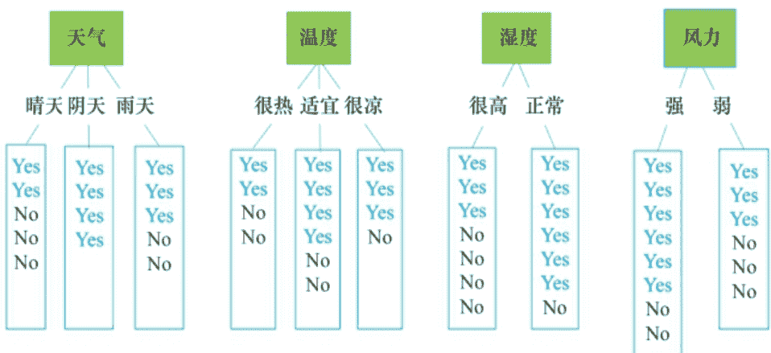

### 方案①：根节点锁定“天气”
三分支将14样本分流：晴天(5)、阴天(4)、雨天(5)。
三子集基尼值分别为：

```
Gini(天气=晴天)=1-(2/5)^2-(3/5)^2
=1-0.16-0.36
=0.48

Gini(天气=阴天)=1-(4/4)^2-(0/4)^2
=0

Gini(天气=雨天)=1-(3/5)^2-(2/5)^2
=1-0.36-0.16
=0.48
```

加权聚合（权重=子集占比）：
$\text{Gini(天气)} = \frac{5}{14} \times 0.48 + \frac{4}{14} \times 0 + \frac{5}{14} \times 0.48 = 0.342$

### 方案②/③/④：根节点设为“温度/湿度/风力”
同法推演得：
$\text{Gini(温度)}=0.439,\quad \text{Gini(湿度)}=0.367,\quad \text{Gini(风力)}=0.428$

### **对决结果**
| 属性 | 分裂后基尼值 | 降幅排名 |
| :--- | :--- | :--- |
| **天气** | **0.342** | **冠军** |
| 湿度 | 0.367 | 亚军 |
| 风力 | 0.428 | 季军 |
| 温度 | 0.439 | 残军 |

**定论：** **“天气”任根节点，纯度提升最猛（基尼从0.46骤降至0.342）**。后续各层节点甄选，沿用“算基尼、比数值”逻辑即可。

### 课后练习
1.  尝试以“温度”、“湿度”、“风力”分别为根，绘制三棵差异树。
2.  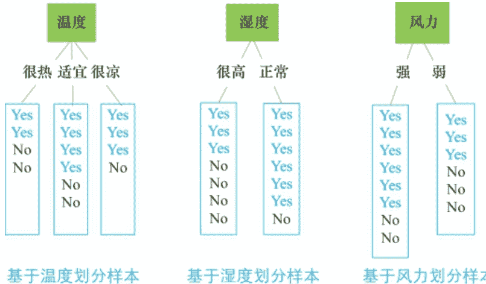 **请计算基尼系数，为“晴天分支”与“雨天分支”各甄选最优子节点。**
3.  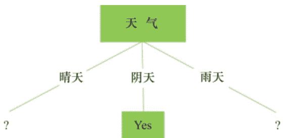 **观察决策树图谱：样本含几属性？各属性几取值？参照表8-5格式，列出“礼物选择”训练集。**

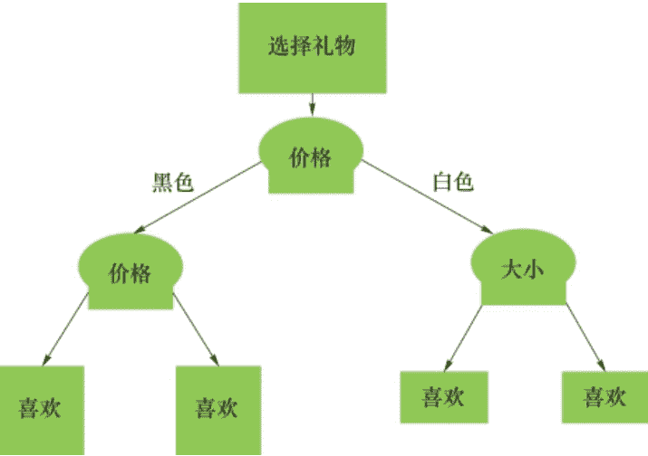

---

## 第三节 K-均值算法：聚类界的“质心漂移迭代法”

K-Means，K=簇数，Means=均值机制。
核心范式：**预设K初始质心 → 样本归簇 → 重算质心(均值) → 迭代至质心静止**。产出最优聚类划分。

*   **K值**：需预估数据潜在簇数。
*   **质心**：簇的几何中心，K定则初始质心数定。


### 单维实战：确诊病例年龄分层

**任务**：对表8-6中17例病例年龄实施3聚类（K=3）。

### 表8-6 病例年龄数据（摘录）
| 序号 | 年龄 | 序号 | 年龄 | 序号 | 年龄 |
| :--- | :--- | :--- | :--- | :--- | :--- |
| 1 | 58 | 6 | 63 | 11 | 67 |
| 2 | 40 | 7 | 82 | 12 | 38 |
| 3 | 35 | 8 | 50 | 13 | 65 |
| 4 | 60 | 9 | 19 | 14 | 6 |
| 5 | 67 | 10 | 47 | 15 | 32 |
| ... | ... | 16 | 37 | 17 | 53 |

**步骤一：随机确立3初始质心** → 设为 **40, 50, 60**。

| 质心1 | 质心2 | 质心3 |
| :--- | :--- | :--- |
| 40 | 50 | 60 |

年龄升序排列：
`6, 19, 32, 35, 37, 38, 40, 47, 50, 53, 58, 60, 63, 65, 67, 67, 82`
*注：初始质心聚集中段，布局欠佳。但迭代将自动修正偏移。*

**步骤二：测距离、分阵营**
单维欧氏距离退化为绝对值差。样本就近归簇。

| 年龄 | 6 | 19 | 32 | 35 | 37 | 38 | 40 | 47 | 50 | 53 | 58 | 60 | 63 | 65 | 67 | 67 | 82 |
| :--- | :--- | :--- | :--- | :--- | :--- | :--- | :--- | :--- | :--- | :--- | :--- | :--- | :--- | :--- | :--- | :--- | :--- |
| 距质心1(40) | 34 | 21 | 8 | 5 | 3 | 2 | **0** | 7 | 10 | 13 | 18 | 20 | 23 | 25 | 27 | 27 | 42 |
| 距质心2(50) | 44 | 31 | 18 | 15 | 13 | 12 | 10 | 3 | **0** | 3 | 8 | 10 | 13 | 15 | 17 | 17 | 32 |
| 距质心3(60) | 54 | 41 | 28 | 25 | 23 | 22 | 20 | 13 | 10 | 7 | 2 | **0** | 3 | 5 | 7 | 7 | 22 |
| **归簇结果** | **1** | **1** | **1** | **1** | **1** | **1** | **1** | **2** | **2** | **2** | **3** | **3** | **3** | **3** | **3** | **3** | **3** |

*首轮分簇：簇1(7人)、簇2(3人)、簇3(7人)。*

**步骤三：求均值、更新质心**
*   质心1新坐标 = $(6+19+32+35+37+38+40)/7 \approx 30$
*   质心2新坐标 = $(47+50+53)/3 = 50$
*   质心3新坐标 = $(58+60+63+65+67+67+82)/7 \approx 66$

**步骤四：携新质心(30, 50, 66)回炉（第二轮迭代）**


新质心分布显著优化。重测距离、再分簇：
*注：年龄40到质心1(30)与质心2(50)等距；58到质心2(50)与质心3(66)等距。因簇2样本稀少，将40、58均划入簇2。*

| 年龄 | 6 | 19 | 32 | 35 | 37 | 38 | 40 | 47 | 50 | 53 | 58 | 60 | 63 | 65 | 67 | 67 | 82 |
| :--- | :--- | :--- | :--- | :--- | :--- | :--- | :--- | :--- | :--- | :--- | :--- | :--- | :--- | :--- | :--- | :--- | :--- |
| 距质心1(30) | 24 | 11 | 2 | 5 | 7 | 8 | 10 | 17 | 20 | 23 | 28 | 30 | 33 | 35 | 37 | 37 | 52 |
| 距质心2(50) | 44 | 31 | 18 | 15 | 13 | 12 | **10** | **3** | **0** | **3** | **8** | 10 | 13 | 15 | 17 | 17 | 32 |
| 距质心3(66) | 60 | 47 | 34 | 31 | 29 | 28 | 26 | 19 | 16 | 13 | **8** | **6** | **3** | **1** | **1** | **1** | 16 |
| **新归簇** | **1** | **1** | **1** | **1** | **1** | **1** | **2** | **2** | **2** | **2** | **2** | **3** | **3** | **3** | **3** | **3** | **3** |

*次轮分簇：簇1(6人)、簇2(5人)、簇3(6人)。*

**再求均值：**
质心更新约为 **28, 50, 67**。

**终止判据**：新旧质心坐标重合 → 算法收敛停机。

---

### 二维空间同理可聚

K-Means处理二维数据，流程见图8-9直观演示：

1.  **图(a)**：数据点离散分布。设 $K=2$，随机撒布两初始质心（红×、蓝×）。
2.  **图(b)**：标注质心坐标 $(x_1,y_1), (x_2,y_2)$。
3.  **图(c)**：按欧氏距离 $D=\sqrt{(x_1-y_1)^2+(x_2-y_2)^2}$ 测算全点到双质心距离。近红→红簇(红点)；近蓝→蓝簇(蓝点)。**首轮迭代分簇落地。**


后续循环：算簇均值→得新质心→重测距分簇→周而复始→直至质心锁定。此即K-Means“质心漂移”迭代精髓。


### 图8-9 K-均值算法对二维数据的聚类演示

针对图8-9（c）中红、蓝两色标记的数据点，我们分别重新计算其质心位置，结果见图8-9（d），可见质心坐标已发生偏移。图8-9（e）与（f）复现了（c）到（d）的迭代逻辑：依据距离最近原则重新划分类别，继而更新质心，直至质心位置稳定不再漂移。最终收敛的两个类别质心呈现于图8-9（f）。

将此思路拓展至三维乃至更高维空间，K-均值算法的通用流程梳理如下：

- **步骤一**：从样本集中随机抽取 K 个点作为初始质心。
- **步骤二**：遍历所有样本，计算其与各质心的欧氏距离，将样本归属标记为距离最近的那个质心代表的簇。
- **步骤三**：完成全量样本分配后，各簇依据当前成员重新核算质心坐标。
- **步骤四**：判断终止条件。若未达标，回溯至步骤二继续迭代；若满足，宣告算法结束。

算法终止的判据通常采用以下任意一条即可：

- **条件一**：极少或没有样本发生跨簇重新分配。
- **条件二**：质心坐标几乎不再发生位移。

### 练一练

请参考上述 K-均值通用步骤，尝试动手编码实现该算法。

## 第四节 主成分分析算法（PCA）

### 为什么要给数据“瘦身”降维？

在着手分类、聚类或回归建模前，最理想的做法是先把数据“画”出来。通过散点图直观审视数据结构——大概有几个簇？分离度如何？适合线性还是非线性模型？如果能在建模前对数据分布有底气，模型效果往往事半功倍。

但肉眼可见的维度仅限于一到三维，笛卡尔坐标系无法描绘四维以上的世界。现实业务中，成百上千维的高维数据却随处可见。若想洞察高维数据结构，降维算法能将其投影至二、三维可视空间。此外，统计建模面对海量变量时复杂度飙升，且变量间普遍存在线性相关，导致信息冗余。这些痛点，均可通过降维映射到低维空间来化解。

1901年，Pearson 抛出降维雏形，1933年 Hotelling 将其发扬光大，奠定了当今广泛应用的**主成分分析（PCA）**基石。此后，MDS、LDA、Isomap 等多元降维技术也相继涌现。

### PCA 核心原理：换个角度看数据

**预备知识点**：算术平均数、方差、正交。

给定一组数据 $X_1, X_2, ..., X_n$，统计学常用均值刻画中心趋势，用方差度量离散程度：

- **算术平均值** $\overline{X} = \frac{\sum_{i=1}^{n} X_i}{n}$
- **方差** $S^2 = \frac{\sum_{i=1}^{n} (X_i - \overline{X})^2}{n - 1}$
- **标准差** $S = \sqrt{S^2}$

方差越大，数据分布越分散。正交则意味着各维度间互不相关、相互独立。

**PCA 的核心任务**：将一组高度相关的变量，转化为一组相互正交（不相关）的新变量，且用极少数新变量保留原始数据的主要信息量。这些新变量即为**主成分**。

若原始维度间强相关，信息便有重叠。我们期望新维度正交。那么，怎么判断哪些维度“不重要”可丢弃？**方差小 = 变化小 = 信息量少**，是天然的筛选指标。

观察图8-10，X、Y 轴数据正相关（X增Y增），信息高度重叠。绿色箭头方向方差极大（数据最分散），蓝色箭头方向方差极小。若以这两组单位向量构建新坐标系（相当于原坐标系逆时针旋转一个夹角），便能实现信息的解耦与压缩。


### 图8-10 原始两维度数据呈强相关状态

转换至新坐标系后（图8-11），原本相关的维度变得线性无关。绿色方向（方差大）保留为第一主成分，蓝色方向（方差小）在降维时舍弃，二维压缩为一维，核心信息损失极微。PCA 本质上就是通过坐标系旋转变换，发掘数据的主成分方向。


### 图8-11 新坐标系下两维度数据解耦（正交）

推广到通用场景：PCA 将 n 维特征映射到 k 维（k < n），新特征在原特征基础上重构，具备正交性。

**具体构造逻辑**：从原始 n 维空间中顺序寻找一组相互正交的新坐标轴，选取依据紧贴数据分布：
1.  **第1轴**：原始数据方差最大的方向。
2.  **第2轴**：与第1轴正交的平面内，方差最大的方向。
3.  **第3轴**：与前两轴正交的平面内，方差最大的方向。
……以此类推可得 n 个轴。

前 k 个轴承载了绝大部分方差（信息），后续轴方差趋近于零。保留前 k 个轴，忽略后续轴，即完成降维。这本质是**坐标系旋转**，直观理解为：给三维实物拍照（降为二维），拍摄角度（投影方向）决定了照片保留了多少细节。图8-12 对比了左视、俯视、主视等糟糕角度（信息丢失大）与最佳角度（信息保留好）的差异。


### 图8-12 同一实物在不同拍摄角度下的投影效果对比

### PCA 降维实战演示

**案例一：二维压缩为一维**
样本：(-1, -2)，(-1, 0)，(0, 0)，(2, 1)，(0, 1)。散点见图8-13。
选取方差最大方向（蓝箭头）为第一主成分轴，垂直方向（绿箭头）为第二轴。原坐标系逆时针旋转 45°。舍弃方差较小的绿色轴，将数据投影至蓝色轴，获得一维坐标：$-3/\sqrt{2}, -1/\sqrt{2}, 0, 1/\sqrt{2}, 3\sqrt{2}$（见图8-14）。


### 图8-13 二维原始数据分布


### 图8-14 投影降维后的一维数据分布

注：此例过于简单，肉眼即可判断轴向。实战中维度常达百千，必须借助数学计算（特征值分解/SVD）求解主成分方向，此处仅建立直觉认知。

**案例二：三维压缩为二维**
1000 个三维样本分布见图8-15。依方差大小确定三个新正交轴（即原坐标系旋转）。新坐标系下，第1轴方差最大（第一主成分），第2轴次之（第二主成分），第3轴方差最小（舍弃）。降维后二维散点图（图8-16）清晰保留了原始空间中的 4 个簇结构，验证了降维未破坏数据拓扑。


### 图8-15 1000 样本三维空间分布


### 图8-16 降维后二维平面分布（4簇结构完好）

前两例数据可视化，利于理解。PCA 主战场实为不可视的高维数据，但旋转投影的几何本质完全一致。

**案例三：图像压缩与重构**
图8-17(a) 原图样本维度高达 1000。经 PCA 降至 44 维重构得图(b)。维度压缩 95%+，图像主干特征依然清晰可辨，大幅降低后续分类计算开销。


### (a) 原始图像：1000 维特征向量


### (b) 44 维主成分重构图像

### 试一试

**判断题**：机器学习输入 1000 维特征 $x_1...x_{1000}$，目标函数 $y = f(x)$。若根据输入与目标的关系筛选出 100 个最重要特征，这属于降维吗？
A. 是  B. 否

**单选题**：关于 PCA 的正确描述组合是？
① 非监督学习方法  ② 搜索数据差异最大（方差最大）方向  ③ 所有主成分两两正交
A. ①②  B. ①③  C. ②③  D. ①②③

**作图题**：观察下方散点图，按 PCA 理解勾勒新坐标轴大致朝向。


# 第九章 群体智能算法


## 第一节 优化问题与群智算法导论

优化问题按变量性质天然分为两大阵营：**连续变量优化（函数优化）** 与 **离散变量优化（组合优化）**。

- **函数优化**：目标函数 $f(x)$ 已知，约束条件下寻找参数组合 $x^*$，使 $f(x^*)$ 达到全局最优（最大/最小值）。
- **组合优化**：涉及排序、分类、筛选、决策，变量离散。如路径规划、任务调度、资源配置。

### 什么是函数优化？

实战中，因变量常依赖多自变量。如商品需求量 $z$ 取决于自价 $x$ 与替代品价 $y$，即 $z=f(x,y)$。若 $z$ 为收益，优化即求 $\max f(x,y)$ 对应的 $(x_0, y_0)$；若 $z$ 为成本，则求 $\min f(x,y)$。该最优自变量组合即**最优解**。


### 图9-1 目标函数曲面示意（寻找峰值/谷底）

### 什么是组合优化？

生活处处是组合优化：“十一”规划旅游——选景点、排路线、定交通、分时长，每一项都是寻优决策。人类凭直觉与经验擅长小规模寻优，但面对**大规模群体、多因子耦合、动态时变、空间广域**的复杂社会系统（如城市拥堵治理、雾霾成因溯源、交通事故率降低），拍脑袋失灵，难建精确数学函数模型，必须借力计算机与高效优化算法。**群体智能算法**，正是这类优化算法中的佼佼者。


### 什么是群体智能算法？

**定义**：用数学机制模拟自然生物群体智能行为的算法。

观察自然：单只蚂蚁、蜜蜂、鸟、鱼、狼个体能力微不足道，群体却展现惊人集体智慧——
- 蚁群：觅食、筑巢、搬运的自组织分工
- 蜂群：角色分工与任务分配
- 鸟群：从无序到有序的编队飞行
- 狼群：严密组织与协同围猎
- 鱼群：觅食、聚群、追尾寻最优觅食区

这些历经万年进化的群体策略，为人造系统优化提供了天然蓝图。

## 第二节 蚁群算法（ACO）

蚂蚁大军出动觅食，阵势笃定，仿佛胸有成竹知晓最优路径。**真相果真如此？**


*Marco Dorigo（蚁群算法奠基人）*

### 蚁群觅食的自然启发

意大利学者 Dorigo 团队发现：蚂蚁视力差，无向导，却总能精准找到**巢穴-食物源最短路径**。秘密武器：**信息素**——一种挥发性化学激素，充当通信介质。

**微观机制揭秘**：
1.  **初始探索（多样性）**：蚂蚁不知食物方位，随机漫游四散搜索。
2.  **信息素标记与挥发**：路过路径释放信息素，随时间挥发衰减。
3.  **正反馈闭环**：
    - 幸运儿发现食物，归巢途中重释信息素。
    - 临近蚂蚁感知高浓度信息素被吸引跟随。
    - **路径越短 -> 往返周期越短 -> 单位时间信息素积累越快 -> 浓度越高 -> 吸引更多蚂蚁 -> 浓度进一步升高**。
    - 最终，最短路径因信息素浓度优势成为“高速公路”，群体收敛于最优解（图9-2）。


### 图9-2 正反馈机制驱动最短路径信息素浓度持续走高

**探索与利用的平衡**：
- **无信息素初期**：蚂蚁非盲目乱撞，遵循“持向直行、遇障转向”启发式规则，高效覆盖搜索空间。
- **收敛风险**：若早期大量蚂蚁误入次优路径并强化信息素，群体可能过早收敛于局部最优（次优解），而非全局最短路径。这也是算法设计需引入启发式因子、信息素挥发率等参数调控的原因。

### 蚁群算法的核心构造规则

# 解码蚁群智慧：从自然协作到算法重构

化学信号交换构成了蚂蚁沟通的基石，深度塑造着其生存策略。1991年，Marco Dorigo敏锐洞察到蚁群个体间极简的信息传递，如何催化出寻觅最短路径的群体级智慧，据此奠基了人工蚁群算法（Ant Colony Optimization，ACO）。

该算法破解优化难题的逻辑脉络清晰：将蚂蚁的行进轨迹映射为候选解，全群路径集合拼装成解空间。行经捷径的个体释放更多信息素，随时间推移，短径信息素浓度攀升，吸引更多同类跟随，最终在正反馈驱动下全群聚焦最优路径——即问题的最优解。

ACO为人工蚂蚁划定了活动边界与环境设定：

- **感知半径**  
  个体感知与移动范围被限定在方格世界，由“速度半径”量化。若设为3，活动区域即为3×3方格。

- **环境信息**  
  虚拟环境含障碍物、同类及发现食物者释放的信息素。蚂蚁仅能感知视野内信息素，且信息素按固定速率挥发。

为复现生物蚁群的集体智慧，算法从觅食行为中提炼四条核心准则：

### 1. 觅食准则
感知范围内优先探测食物。有食则直奔目标；无食则比对信息素浓度，奔赴最高处。

### 2. 移动准则
有信息素引领时朝最高浓度方向前进；无引领时保持原方向惯性运动，叠加微小随机扰动。为避免打转，蚂蚁记忆走过节点，遇重复路径主动规避。

### 3. 避障准则
前方有阻碍则随机选向绕行；若环境有信息素指引，则回归觅食准则。

### 4. 信息素准则
刚觅得食物时释放量最大，随行进距离增加释放量递减。

虽无直接接触，但每只蚂蚁遵循四条准则与环境互动，经由信息素这一“隐形纽带”将全群编织为有机整体。

---

## 算法核心特质：洞见智能计算关键范式

### 自组织
无外部指挥下系统自发形成时空或功能结构，即为自组织。ACO初始阶段个体无序探索，演化过程中经信息素作用自发向最优解聚合，完美诠释了从无序到有序的自组织历程。

### 并行性
人工蚂蚁分布不同位置同步独立搜索，仅靠信息素通信协作，算法本质上属并行范式。这不仅提升鲁棒性，更赋予其强大的全局搜索能力。

### 正反馈
最短路径积累最多信息素，高浓度吸引更多蚂蚁，更多蚂蚁又强化浓度——正反馈闭环驱动系统向最优解演进，是ACO演化引擎的核心。

以蚁群算法为旗帜的群智能已成分布式人工智能研究热土。多年来全球学者深耕改进，将其广泛应用于数据挖掘、机器人协同、能源调度、通信路由、水利规划、矿山优化、化工控制、建筑设计、交通疏导等众多领域。

---

## 思考与探究

清晨蚂蚁四散觅食，忽有一蚁发现死蚱蜢，返巢搬援。转眼间，四周与巢内同类如接号令般汇聚，合力搬运，顷刻形成长龙将食物拖回巢穴。

请同学们思考：

- ① 为何周边蚂蚁能如获通知般从四面八方赶来？
- ② 午后再出觅食，蚂蚁还会沿晨间旧路返回寻找残渣吗？缘由何在？
- ③ 搬运归巢时，蚂蚁如何寻得最短回巢径？觅食与回巢行为有何同异？


图片来源：  
http://www.pep.com.cn/czsw/rjbczsw/rjcszwtp/201409/t20140905_1440813.html

- ④ 假设返巢途中遇障碍物，且左右两侧信息素浓度相当，蚂蚁会按图9-3（左右各半概率）移动，还是按图9-4（全群选最短右侧径）移动？理由何在？

  
图9-3 蚂蚁左/右选择概率各50%

  
图9-4 全群蚂蚁均选择右侧最短路径

---

# 第三节 蜂群算法：舞语中的集体决策

蜜蜂群居，个体行为极简，群体却展现惊人复杂性。

### 觅食行为的自然启示

蜜蜂凭借分工协作与独特信息共享机制，能在任意环境高效锁定优质蜜源，实则是群体层面的“最优解”求解过程。

采蜜是典型的分工协作：侦察蜂搜寻蜜源，吸饱花蜜返巢；将蜜分予同伴品尝辨识气味，同时以振翅摆舞的“舞蹈语言”编码蜜源信息。获取情报的蜜蜂即刻奔赴目标开采。


### 卡尔·冯·弗里希的破译之旅

漫长进化中，蜜蜂进化出基于舞蹈的通信系统，实现全群协同行动。1915年起，德国生物学家卡尔·冯·弗里希携团队耗时五十余载破解舞语。实验设置蜜盘于野外，守候蜂巢。发现蜜盘的蜜蜂返巢起舞，科学家经无数观察记录终解码舞蹈含义。

研究揭示：与蜜源位置相关的舞蹈核心为两类——圆舞与“∞”字摆尾舞，两者间以刀形舞过渡。

  
图9-5 蜜蜂的舞蹈  
图片来源：http://mini.eastday.com/a/190321162557849.html

#### 圆舞
侦察蜂在近距离（≤100米）采蜜归巢，返吐花蜜后原地转小圆圈。意指：巢附近有蜜源，动员同伴出采。首批跟随者采回返巢亦跳圆舞助阵。

#### 摆尾舞
远距离采蜜归巢，吐蜜后跳“∞”字摆尾舞。直线爬行阶段振翅嗡鸣、腹部摆动（图9-6a）。舞蹈编码信息极丰：
- **持续时间** ↔ 蜜源距离（越远舞越久）
- **摆尾方向** ↔ 采集方位（平均夹角 = 蜜源与太阳夹角）
- 同向太阳：先爬半圆，再头朝上直线摆腰，回原点再爬另一侧半圆（图9-6b）
- 反向太阳：直线段头朝下
- 偏左角度：直线段头朝上偏左，与虚拟重力线同角（图9-6c）

重复数次、多地点起舞，同伴观摩5-6遍即如装载导航般直奔蜜源。

  
图9-6 蜜蜂用舞蹈语言描述蜜源信息

多侦察蜂同步发现多蜜源时，初期跟随者分流。蜜源品质优者归巢持续起舞招募，跟随者数量随品质正相关——这保证了蜂群快速聚焦高质量蜜源，关乎全群生存。

可见，蜂群通过**分工、交流、角色转换、协作**实现高效寻优，为人工蜂群算法提供了完美蓝本。

---

## 蜂群算法的三大核心要素

受自然启发，土耳其学者D.Karaboga于2005年提出人工蜂群算法（Artificial Bee Colony，ABC），专攻多变量函数优化，现已在函数优化、神经网络训练、控制工程等领域斩获丰硕成果。

基本模型包含三要素（图9-7）：

  
图9-7 蜂群算法基本模型组成要素

- **食物源**：位置即候选解；质量由距离、蜜量、采集难度等决定，算法以“收益率”综合度量。高收益率食物源招募更多蜜蜂。
- **雇佣蜂（引领蜂）**：已发现食物源者，一蜂对应一源。存储该源距离、方向、丰富度等信息，按概率分享。
- **非雇佣蜂**：未发现食物源者，分**侦察蜂**（搜寻新源）与**跟随蜂**（观摩舞蹈、按信息选源）。

---

## 蜜蜂行为模式与角色流转

算法伊始，蜂群由侦察蜂与跟随蜂组成。侦察蜂按先验知识或纯随机搜寻。首轮侦察后，发现食物源者转为引领蜂，在“舞蹈区”发布信息。跟随蜂观摩比对，选优质源跟随并开展邻域搜寻。若邻域新源收益率超旧源，则替换并晋升为引领蜂。若某源长期收益率停滞，则被放弃，对应引领蜂退役为侦察蜂重启搜寻，找到新源再转引领蜂——角色在**侦察→引领→侦察**间动态流转。

信息交换是群智涌现的枢纽。“舞蹈区”是算法核心交换场：引领蜂以摆尾舞时长等表征收益率，跟随蜂按收益率概率选择蜜源。被招募概率 ∝ 食物源收益率。

采蜜归巢卸蜜后，蜜蜂面临三种行为抉择：
1. 源质差 → 放弃源，转跟随蜂
2. 源质优 → 跳摆尾舞招募 → 回源采蜜
3. 源质优 → 默默回源采蜜（不招募）

跟随蜂则二选一：
1. 转侦察蜂，搜近源
2. 观舞获信息后，被招募至某源采蜜

  
图9-8 蜂群算法中各类蜜蜂的行为模式

---

## 蜂群算法如何寻优

将食物源位置视为解，收益率对应解优劣。寻源过程即寻优过程。

算法显著特点：**仅需解优劣比较即可趋向全局最优**。假设三引领蜂供三源信息，跟随蜂选收益率最高者X。后在X邻域发现Y，若Y收益率>X，则弃X取Y（局部寻优）；否则留X弃Y。全群通过个体局部寻优逐步显现全局最优，且收敛速度颇快。

角色分工各司其职：
- **引领蜂**：守护优质解
- **跟随蜂**：放大优解吸引力，加速收敛
- **侦察蜂**：随机探索新源，跳出局部最优陷阱

经持续角色转换与行为执行，最终锁定最丰富食物源——即全局最优解。

---

## 练一练

蜂巢坐北朝南，蜜源在正南100米外。上午10时，蜜源位于太阳____侧一定角度，舞蹈蜂直线摆腰时头朝上向____偏离重力线同角度；12时，太阳-蜜源-蜂箱共线，直线摆腰头朝上与重力线____；16时，蜜源-蜂箱-太阳成90°，舞蹂头向____偏离重力线亦成90°。

试用程序流程图描述蜂群算法中各类蜜蜂行为模式。

---

# 第四节 个体协同催生群体智能

群智最本质特征：**无中央指挥**，个体遵循简单经验法则、仅响应局部信息，协同时却涌现高明复杂策略。下面剖析几类经典优化算法背后的生物群体，看简单规则如何编织群智奇观。

---

### 鱼群的四大行为法则

水域中营养最丰处往往鱼群最密——从优化视角，这正是觅食问题的最优解。人工鱼群算法正是模拟鱼个体行为实现寻优。

观察鱼群习性，提炼四大典型行为：

#### 1. 觅食行为
常态随机游动；觉食物则朝密度增高方向疾游。

#### 2. 聚群行为
为安全规避风险，自然聚群。非意识调度，而是遵三简律：
- **分隔律**：避免邻近过密
- **对准律**：朝向与邻均向一致
- **内聚律**：向邻居中心靠拢

每条鱼仅依邻居动作感知全局：一鱼觅食，信息快速传播，全群形成集体觅食；危险临近，边缘鱼逃窜带动全群倏聚倏散。

  
图片来源：https://huaban.com/pins/121461084/

#### 3. 追尾行为
个别鱼觅得食，邻伴尾随直达食点。

#### 4. 随机行为
独游时随机游动，拓宽食物点与伙伴搜寻半径。

规则虽简，群体智能却高阶涌现。

---

### 鸟群的信息共享机制

设鸟群出巢觅食，各鸟知己距食物远近，却不知方向，只能盲目搜索。

破局策略极简高效：定期共享“距食距离”，锁定最近者，全群修正速度/方向向其靠拢并环绕搜索。迭代收敛，终觅得食。

  


源于此，Kennedy与Eberhart提出粒子群优化（PSO）。粒子具**速度**（快慢）与**位置**（方向）双属性，对应N维搜索空间中的候选解。核心在于**个体间信息共享**驱动群体从无序走向有序，最终获全局最优。

---

### 狼群的协作捕猎体系

严酷环境与漫长进化铸就狼群严密组织与精妙协作。

#### 1. 角色分工
- **头狼**：“弱肉强食”竞争产生的首领。依群体感知决策，统筹避险与捕猎效率。
- **探狼**：猎物潜在活动区游猎，按气味浓度自主决策（味越浓离猎越近），朝最浓处搜寻。发现踪迹即报头狼。
- **猛狼**：受头狼召集，实施围攻。


#### 2. 猎物分配规则


# 进化计算：破解复杂优化的自然密钥


## 1.1 传统求解路径的死结


无论日常琐事、学业钻研还是职场决策，我们总追问“怎样才算最优”，这类难题学界统称“优化求解”。

譬如，质量合格前提下如何极致压缩成本？预算封顶时如何榨干最大效益？这些皆属优化范畴。前者中的“前提”即约束条件，“成本”与“效益”则是优化指标。因指标值 $y$ 由参数组 $x_1, x_2, ..., x_n$ 共同决定，即 $y=f(x_1, x_2, ..., x_n)$，故 $y$ 又称目标函数。

优化求解的本质：在约束域内，锁定一组最佳参数，推动目标函数触及极值（峰值或谷值）。

主流求解路径三条：梯度策略、全遍历法、随机游走法。

### 梯度策略：瞎子下坡的局限


图10-1 勾勒三维目标函数地貌：峰谷交错，起伏不定。数学引入“梯度”量化变化趋势——正值对应上坡，负值对应下坡，绝对值大小反映变化率。梯度归零之处，即“山巅”或“谷底”。理论上，寻得梯度为零的参数组，便获最优解。

梯度策略逻辑恰似“瞎子下坡”：脚下哪边最陡往哪走，走一步测一步，直至谷底。


图10-2 多峰谷函数地貌示意

但现实地貌常极其复杂（图10-2），遍布“山巅”与“谷底”，它们同为梯度零点。梯度策略高度依赖起点，极易误入半山腰的“局部陷阱”，自以为触底，实则错失“整体最优”。

### 全遍历法：穷举的沉重代价


从10首新歌中选冠军，全遍历法要求全听一遍再定夺。虽必得理论最优，但效率低下令人望而却步。实际问题中，候选空间往往呈指数爆炸，穷举根本不可行，一旦规模稍大、结构稍繁，此法便束手无策。

### 随机游走法：碰运气的妥协

前两者短板明显，随机游走法遂成宠儿。它在解空间随机漫游，实时记录最佳战绩。为求效率，往往一旦结果“及格”即收工，故所得仅为“满意解”，而非“理论最优”。

### 思维训练场

请列举生活中遭遇的优化难题。

**场景一**：校园歌咏赛，各班推一代表。音乐老师指定曲目，全班轮唱，选出最强者。从优化视角看，老师用了哪招？缘由何在？

**场景二**：小明网购U盘，条件：包邮、20-30元、同城发货。搜出数千款，他随机瞥了十几款，拍下一款满意的。约束条件是什么？采用何种求解策略？理由为何？

### 动手实操

1. 用全遍历法求 $f(x_1, x_2) = (x_1-2)^2 + (x_2-3)^2$ 最小值对应的 $x_1, x_2$（定义域均为 $[1, 4]$ 整数）。
2. 用随机游走法找出使该函数值落在 $[4, 6]$ 区间内的 $x_1, x_2$。
3. 图10-3 为梯度策略演示。① 为何不同起点导向不同结局？② 若从 C、D、E 点出发，结果如何？请在图中标注可能路径。


(a) 以A为初始搜索位置


(b) 以B为初始搜索位置

图10-3 梯度策略求解示意图

## 1.2 物种演变与基因理论的算法启示

### 物种演变：环境筛选的优化逻辑


达尔文指出：物种特征遗传且变异，造就多样性。环境筛选下，不适者出局，适者生存并遗传优势特征——这就是“环境筛选，优胜劣汰”。

生物经遗传、变异、环境筛选，自简入繁、由低进高。工程视角下，这漫漫长程实为高明的优化过程，核心机制即：环境筛选、优胜劣汰、适者延续。

### 基因理论：微观层面的博弈


孟德尔奠基遗传学，佐证演变机制。竞争的本质是基因角力。遗传指令封装于细胞，编码于染色体基因。每基因占专属位点，调控特定性状，赋予环境适应性。基因重组与突变或催生更强后代，经环境筛选，高适应值基因结构得以留存。

## 1.3 遗传算法（GA）：模拟自然演化的搜索引擎

遗传算法（GA）汲取优胜劣汰、环境筛选、适者延续及基因遗传精髓，成为攻克高复杂度难题的新范式，广泛服役于函数优化、自动控制、图像识别、机器学习、神经网络、分子生物、调度优化等疆域。

### 核心原理：编码与演化迭代


GA 用编码串（基因型）表征候选解。流程始于一群编码串置入问题“环境”，依适应值筛选优者复制，经重组、突变两大基因操作繁育新一代族群。迭代推进中，优良基因保留重组，劣质特性逐代淘汰。子代承袭亲代信息，却在整体性能上超越前辈，族群持续演化——对优化而言，即不断逼近整体最优。

### 基本操作实录：以 $f(x)=x^2$ 为例

求 $x \in (0, 31]$ 整数时 $f(x)=x^2$ 峰值。全遍历法虽稳但笨。GA 如何破局？

**步骤零：编码与起始化**
将 $x$ 编码为定长二进制串（5位覆盖 0-31）。如 $x=10 \to 01010$，$x=31 \to 11111$。串中每位为一基因位。
随机抽取 4 个串组起始族群（规模4）。假设掷硬币得：`01101, 11000, 01000, 10011`。

**操作一：筛选（轮盘赌机制）**
依适应值（Fitness，本例直接用目标函数值 $F$）抉择留淘。适应值越高，留给后代的名额越多——模仿“优者多留后代”。

**表10-1 起始族群画像**

| 序号 | 初始串 | x值 | 适应值 F | 占比 | 期望筛选数 | 实际筛选数 |
|---|---|---|---|---|---|---|
| 1 | 01101 | 13 | 169 | 14.0% | 0.56 | 1 |
| 2 | 11000 | 24 | 576 | 49.0% | 1.96 | 2 |
| 3 | 01000 | 8 | 64 | 6.0% | 0.24 | 0 |
| 4 | 10011 | 19 | 361 | 31.0% | 1.24 | 1 |
| **总计** | | | **1170** | **100%** | **4.00** | **4** |
| **平均** | | | **293** | **25%** | **1.00** | **1 **|
| **最大** | | | **576** | **49%** | **1.96** | **2** |

构建轮盘赌盘（图10-4），扇区面积按适应值占比划分。旋转 4 次，落入谁家谁就复制入“匹配池”。

图10-4 筛选操作的轮盘赌转盘

本轮结果：串1复制1次，串2复制2次，串3出局，串4复制1次。新族群：`01101, 11000, 11000, 10011`。

**操作二：重组（基因交换）**
两步走：匹配池中随机配对 $\to$ 设交换点 $k \in [1, l-1]$，互换 $k$ 位之后的子串。

例：父代 `01101` 与 `11000`，$k=4$（交换第5位）$\to$ 子代 `01100`, `11001`。

```
A_1=0110:1
A_2=1100:0
```

从1~4间随机选取一个数k，假定k=4，那么经过重组操作之后将得到两个新串：

```
A'_1=01100
A'_2=11001
```

新串A'_1和A'_2是由父母串A_1和A_2将第5位进行交换后得到的结果。

**表10-2 重组实录**

| 新编号 | 父本 | 母本 | 交换点 | 子代串 | x值 | 适应值 F |
|---|---|---|---|---|---|---|
| 1 | 01101 | 11000 | 4 | 01100 | 12 | 144 |
| 2 | 11000 | 01101 | 4 | 11001 | 25 | 625 |
| 3 | 11000 | 10011 | 2 | 11011 | 27 | 729 |
| 4 | 10011 | 11000 | 2 | 10000 | 16 | 256 |
| **总计** | | | | | | **1754** |
| **平均** | | | | | | **439** |
| **最大** | | | | | | **729** |

**操作三：突变（防早熟保鲜）**
以微小概率（如千分之几）随机翻转某基因位（0$\leftrightarrow$1）。虽居次要地位，却是防止优良基因丢失、跳出局部陷阱的关键。本例 20 个基因位，突变率 0.001，期望突变 0.02 位，故本轮无突变。

**对比可见**：一轮迭代后，族群最大适应值从 576 升至 729，平均值从 293 跃至 439。解已朝最优迈进。重复此过程，终抵整体最优，且每步运算轻快、弱依赖问题细节。

```
A_1=0110:1
A_2=1100:0
```
图10-5 一轮演化全流程图

---
**【前置知识：群体智能的前奏——狼群策略与实践探究】**

### 狼群策略：残酷分配背后的生存法则

捕猎得手后，狼群不搞“平均主义”，实行“论功行赏、强食弱补”：首功者与强壮者优先饱餐，残羹冷炙留给弱小者。这看似冷酷的分配，实则精准保障了核心战力的体能恢复，确保下次狩猎仍有主力军，从而维系群体延续。

学者借此启发构建**狼群算法**。将捕猎抽象为三大智能行为——**游走、召唤、围攻**，辅以“胜者为王”的头狼更迭规则与“强者生存”的族群更新机制。

#### 1. “胜者为王”头狼更迭
初始空间中，目标函数值最优者称霸为头狼；迭代中，若新一代最优个体超越旧头狼，即废旧立新，头狼位置动态更新。

#### 2. “强者生存”族群更新
按“强食弱”分配，弱狼饿死概率大。算法中直接淘汰适应值最差个体，随机生成新个体注入鲜血。

头狼、探狼、猛狼默契联动成就完美围猎，“强食弱”规则更引导族群向再次捕获概率最高的方向繁衍演化。

### 实践活动：解码自然界的分布式智慧


**图片来源：《马鞍山日报》，2014-11-17**

**任务一：蚂蚁觅食实录**
1. 寻觅蚁穴，投放面包屑于蚂蚁活跃区边缘（模拟单一最优解）。
2. 定点观察并记录：
   - ① 发现者有何举动？
   - ② 同伴是否聚拢？
   - ③ 是否形成集体搬运？路径是否收敛为最短路径？
3. 复盘描述，尝试解释行为机制。
*备品：面包屑、放大镜、相机、镊子。*

**任务二：鱼群觅食博弈**
1. 池塘多点投喂，单点投放量显著更多（模拟多解含全局最优）。
2. 观察鱼群如何经由**随机游动、觅食聚拢、聚群效应、追尾跟随**四大行为，最终锁定最丰盛觅食点。


**图片来源：http://blog.sina.com.cn/s/blog_4bc62fa00100b081.html**

**任务三：群体通信方式大比拼**
总结蚁群、蜂群、鱼群、鸟群、狼群觅食时的通信手段与特点，填入表9-1。

**表9-1 各生物群通信方式及特点速查表**

| 生物群 | 通信方式 | 主要特点 |
|---|---|---|
| 蚁群 | | |
| 蜂群 | | |
| 鱼群 | | |
| 鸟群 | | |
| 狼群 | | |

**拓展挑战**：自然界群体智能远不止此。请查阅文献，解析下图算法所模拟的个体行为模式。


# 实战演练：手把手带你跑通遗传算法一轮完整迭代

> **核心任务**：求解二元函数 $f(x_1, x_2) = (x_1-2)^2 + (x_2-3)^2$ 的最小值，变量 $x_1, x_2$ 均为 $[1, 6]$ 区间内的整数。

遗传算法（GA）通过模拟自然选择机制寻优。既然目标是找**最小值**，我们不能直接拿目标函数值当“适应度”（适应度越高越容易被选中），需构造转换函数：$F = \frac{1}{1 + f(x_1, x_2)}$。下面我们设定种群规模为 4，完整复盘**两轮进化**的首轮操作流程。

---

## 1. 基因编码：将决策变量“翻译”成染色体

算法操作的是符号串，而非参数本身。$x_1, x_2$ 取值范围 $[1, 6]$，用 3 位二进制即可覆盖（$001_2=1 \sim 110_2=6$）。将两变量编码拼接，形成 **6 位二进制染色体**。

> **示例**：$x_1=5 (101_2), x_2=6 (110_2) \Rightarrow$ 染色体串 `101110`。

## 2. 初始化种群：随机撒点，构建起跑线

随机生成 4 条染色体串，组成第 0 代种群。这是搜索的起点，无需人为干预分布。

## 3. 适应度评估：量化个体“优劣”

依据 $F = 1 / [1 + f(x_1, x_2)]$ 计算每条染色体的得分。**得分越高，离最优解越近，遗传优势越大。**

## 4. 选择操作：轮盘赌机制，优胜劣汰

采用**比例选择**策略，流程如下：
1.  **累加总适应度**：求种群 $F$ 之和。
2.  **折算选择概率**：单个 $F$ 占总和比重 = 被选中概率（相对适应度）。
3.  **模拟转盘/代码抽奖**：生成 $[0,1]$ 均匀随机数，落在哪个个体的概率区间，该个体就入选一次。重复 4 次组建“匹配池”。

> **实操记录表（对应教材表 10-3）**：请统计初始串、解码值、适应度、占比、期望/实际选择数，并计算总计、均值、最大值。

## 5. 交叉操作：基因片段交换，生成新解

匹配池内随机配对，设定交叉概率（通常较大），随机确定**交叉点**，互换该位点后的基因片段，产出 4 条新染色体。

> **实操记录表（对应教材表 10-4）**：记录配对关系、交叉点、新串、解码值及新适应度，统计种群整体指标变化。

## 6. 变异操作：低概率“跳变”，维持多样性

以极小概率（如 $P_m=0.01$）随机翻转新种群中个别基因位（$0 \leftrightarrow 1$）。防止早熟收敛，保持种群探索能力。

## 7. 迭代复盘：观察一轮进化的成效

完成「选择→交叉→变异」后，获得第 1 代种群。填表统计新种群适应度（对应教材表 10-5），**重点对比最大值与平均值是否显著提升**。

> **进阶挑战**：参考下方程序流程图（图 10-6），设定收敛条件（如可接受阈值或最大代数），独立完成**第二轮进化**计算。

---


## 遗传算法：七大差异化核心竞争力

相较于传统寻优手段，GA 将生物进化机理引入工程设计，展现出独特优势：

1.  **编码机制操作**：处理的是参数的**编码串**，而非参数实体，便于处理离散/复杂空间。
2.  **多点并行搜索**：从**一群初始点**出发，而非单点，天然规避“陷入局部最优”陷阱，大概率触达全局最优。
3.  **仅依赖目标函数**：通过目标函数→适应度映射直接评价，无需求导、辅助信息，**问题相关性极低**，通用性强。
4.  **概率性转移规则**：选择、交叉、变异均引入随机性，非确定性路径，**跳出局部最优的能力更强**。
5.  **启发式搜索高效**：在解空间利用适应度引导定向探索，**搜索效率往往超越盲目枚举或梯度法**。
6.  **对目标函数几乎“无要求”**：连续/离散、可导/不可导、单峰/多峰均可处理，**适用范围极广**。
7.  **大规模复杂问题的“利器”**：并行特性与鲁棒性使其在高维、非线性、多约束工程优化中表现卓越。

---


## 作者心语：关于中学 AI 教材，我想说的几句真心话

**怎么编？教什么？目标定哪里？** 这是中小学引入 AI 课程绕不开的三道“拦路虎”，亟需业界联手破局。

**现状痛点：资源极度匮乏，两极分化严重。**
市面上为数不多的教材，要么**“高不可攀”**——对基础薄弱的中学生硬讲晦涩技术细节；要么**“挂羊头卖狗肉”**——把创客、机器人、3D打印课直接改招牌，混淆概念，误人子弟。

**我的定位：科普读物 + 模块化教材。**
AI 进中学，光靠一线老师远远不够，**必须是“科学家+企业家+教师”三方共建**。作为耕耘 AI 领域 20 年的从业者，我视此为责任，发起编写这套《人工智能（中学版）》。

考虑到各地师资、课时差异巨大，未形成国家标准，本书定位**“中学版”而非分年级**，支持初高中灵活选用、因校制宜。

**编写历程：走出象牙塔，听孩子的声。**
我是高校教师，不懂中学生认知规律。为补课，我研读了生物、历史、地理、信息技术等多版本中学教材。**每写完一章初稿，我都找中小学生试读、收反馈、再打磨**——只为确保“看得懂、学得会、用得上”。

**致谢与免责：**
书中部分图片源自网络，有出处者已标注，未溯源者在此致歉并致谢！

> **作者识于 2019 年仲夏**

---


## 书刊信息速览

**书名**：《人工智能（下）》 中学版  
**系列套装**：《人工智能》《Python与AI编程》《智能机器人》  
**策划**：陈岚岚、刘纳新  
**责编**：孙宏颖  
**封面**：七星博纳  
**ISBN**：978-7-5635-6106-9  
**定价**：45.00 元  
**策划中心联系**：010-62282784 | 3749774799@qq.com