# AI 与智能交互


# 内容概览

本书以 HCI 的基本概念和演进为起点，对智能化互动的理论框架和前沿主题进行系统梳理。内容覆盖智能互动的基础理论、生理信号驱动的交互、肢体动作理解与操作、草图式表达与计算、情感感知与反馈、语音表达与计算、虚实融合仿真场景以及可交互的机器学习等方向。

面向从事交互研究、产品研发与落地的从业者。

# 人工智能出版工程

丛书编委会

主　　主任：高　文(院士)　方滨兴(院士)

常务副主任：黄河燕

副　　主任(按姓氏笔画排序)：

王宏安　　朱小燕　　刘九如　　杨　健

陈熙霖　　郑庆华　　俞　栋　　黄铁军

委　　员(按姓氏笔画排序)：

邓　力　　史树敏　　冯　超　　吕金虎

朱文武　　朱　军　　刘继红　　李　侃

李　波　　吴　飞　　吴　枫　　张　民

张重生　　张新钰　　陆建峰　　范向民

周　沫　　赵丽松　　赵　耀　　胡　斌

顾钊铨　　钱建军　　黄民烈　　崔　翔

# 前 言

HCI 这一表述最早出现在 Stuart K. Card、Allen Newell 与 Thomas P. Moran 合著的《The Psychology of Human-Computer Interaction》中。该学科关注装置与使用者之间的互动关系，装置可指各种机器、数字化系统或软件。界面通常指使用者可感知的那一层，使用者借此与装置沟通并完成操作。交互技术属于计算机界面设计的核心议题，和认知学、人机工程、心理学等学科关系紧密。

HCI 和 AI 是智能信息时代的双主线。两者的关联经历过此消彼长的阶段，如今转向相互驱动。当下两者深度融合的应用已在教育、医疗等关键场景显现。HCI 为 AI 提供需求牵引和问题启发，AI 则推动交互技术的革新和范式迁移。展望未来，二者将在互促中走向更深层次的协同。

从演进规律看，HCI 的发展是技术革新、范式迁移、标志性人物和事件三者联动的结果。技术革新催生范式变迁，范式变迁孕育关键人物和事件，后者再落实并反哺技术。由此，HCI 从概念提出到研究验证再到规模应用。

1997 年，计算机 Deep Blue 战胜国际象棋世界冠军，拉开人机竞技序幕，也标志智能时代开启。深度学习在多个领域取得突破，AI 进入第三次高潮。随后 Google 的 AlphaGo 战胜多届围棋世界冠军李世石，再次点燃对智能革命的关注。与此同时，可穿戴设备等新型终端出现，交互空间被极大拓展。语音解析、手势识别、动作追踪、注视控制，以及基于心电、声纹、面部特征等生物特征的安全认证技术持续成熟，共同塑造交互的发展方向和边界。

本书尝试从相对全面的视角介绍交互的概念、方法、技术和应用，为相关研究、开发和应用人员提供参考。

第 1 章 绪论。本章从 HCI 定义切入，回顾其演进历程和核心议题，分析 AI 与 HCI 此消彼长又协同发展的关系，并展望智能交互的趋势。

第 2 章 智能人机互动基础理论。智能互动的关键在于如何量化人类感知、认知和运动执行能力，对互动行为建模并预测不同情境下的表现。本章阐释主流模型：使用者认知模型刻画感知、认知与决策过程；使用者运动模型刻画运动与执行能力；智能互动模型则刻画使用者与机器的互动过程。

第 3 章 生理计算与交互。生理计算是 HCI 的重要分支。本章先介绍生理学基础概念，再介绍常见生理信号采集与分析方法，随后讨论生理交互系统设计需考虑的问题，最后以三类经典案例说明生理计算应用。

第 4 章 手势理解与交互。手势理解与交互兼具理论价值与应用前景。本章围绕手势交互的核心问题，手势理解与交互模型、人手检测与姿态估计、手势识别模型等介绍代表性工作与思路。

第 5 章 草图计算与交互。草图交互是重要的自然交互方式之一。草图以抽象形象化信息承载思维外化与交流意图，能有效表达用户意图并体现个性化。本章先介绍草图表征方法与认知模型，再重点论述草图智能处理技术，包括草图手势、草图判读与草图补全，最后介绍基于草图交互的视频操作应用。

第 6 章 情感计算与交互。随人工智能与 HCI 发展，计算机识别用户情感并智能反馈的需求日益强烈，情感计算成为 HCI 重要研究方向。人类社会活动中持续产生大量情感信息，而对信息系统而言情感是最难解析与处理的类别之一。本章围绕将人类情感引入人机交互系统展开，介绍人机情感交互的方法与技术。

第 7 章 言语计算与交互。言语交互是人机交互的重要通道，也是智能时代自然交互的典型形式。本章先介绍语音识别技术及其演进，再构建言语表征模型与基于语义三角形的交互模型，刻画知识迁移过程，实现人机知识空间共享；在此基础上重点介绍融合开发 Exploitation 与探索 Exploration 的言语交互意图理解与计算方法，最后以金融审计案例说明。

第 8 章 智能仿真与交互。MR 虚实融合的核心是人机交互，未来将向网络化、智能化、泛在化演进，深化 MR 与 HCI 基础理论研究，支撑云计算、移动互联网、人工智能、大数据等新一代计算技术与 MR 融合具有重要意义。本章先介绍虚拟仿真环境下的界面范式、交互任务与交互设备，再介绍三维交互、语音交互、多通道交互等技术。

第 9 章 交互式机器学习。本章先介绍交互式机器学习界面范式，阐述系统如何通过界面让用户与机器学习模型交互以优化算法；再介绍其在推荐系统、信息检索、情境感知系统等领域的应用，部分成熟应用已深度融入日常生活；随后回顾典型案例，总结交互设计如何实现人与机器的高效沟通与学习；最后梳理该领域开放问题与未来研究机遇。

本书写作过程中，邓小明、朱嘉奇、何小伟、姚乃明等提供帮助，在此致谢。

限于作者水平，书中难免有疏漏不足之处，敬请读者批评指正。

作　者

2020 年 11 月于北京

# 第 1 章　绪论

## 1.1　人机交互的发展历程

### 1.1.1　人机交互的定义

计算机是20世纪最具影响力的科技发明之一，对生产与社会生活产生深远影响，并持续演进。计算机应用由最初的军事科研拓展至社会各领域，推动全球技术进步并引发社会变革。计算机已遍布各行各业，进入普通百姓生活，成为信息社会的必备工具。

人机互动的本质是使用者与计算机之间信息交流与互动，即利用人机接口技术使计算机理解使用者交互意图，并以界面形式呈现计算结果。一般而言，HCI 涉及计算机、人类工效学、认知科学、心理学等多学科。ACM 下的 SIGCHI 将人机交互定义为对交互式计算机系统的设计、评估与实现及其相关现象进行研究的学科。

HCI 即 Human-Computer Interaction，研究计算机技术的设计与使用，聚焦人类用户与计算机的交互界面，属于计算机科学、行为科学、设计、媒体研究等交叉领域。该术语由 Stuart K. Card、Allen Newell 与 Thomas P. Moran 在 1983 年出版的《人机交互心理学》中推广，尽管他们在 1980 年即首次使用。与单一用途工具不同，计算机用途开放，用户满意度是衡量交互技术的重要指标。

HCI 研究交流中的人与机器，从机器与人两方面获取支撑。机器层面涉及计算机图形学、操作系统、编程语言与开发环境；人层面涉及传播学理论、平面与工业设计、语言学、社会科学、认知心理学、社会心理学及用户满意度等。人机交互的跨学科特性造就了其繁荣与成功。

### 1.1.2　人机交互的发展

人机互动发展伴随计算机技术演进。人与计算机的交互从穿孔纸带到命令行交互，再发展到主流的图形用户界面交互，呈现出直接操控与所见即所得的特征。图形用户界面的出现让计算机成为普通用户可用的工具，使“人手一机”的理想逐步实现。

图形用户界面兴起后，研究者开始关注交互模型、界面范式与开发平台，并取得丰硕成果。近年来，多媒体、多通道、虚拟现实、移动计算与人工智能的快速发展催生了新的交互形态与需求，如笔式交互、语音交互、情感交互与多通道交互。尽管硬件性能迅猛提升，用户交互能力或带宽却未同步增长，主因是缺乏适配新需求的高效自然界面与成熟统一的界面技术。这既是 HCI 面临的重要挑战，也涉及认知模型、分布式认知理论、基于场景上下文的知识表示等基础理论问题，以及用户界面工具、无处不在的交互计算模式、人机协同交互技术等技术问题。

二十世纪末，美国总统顾问委员会报告将“人机交互与信息处理”列为二十一世纪信息技术基础研究的四大方向之一。2007 年，美国国家科学基金会 NSF 在信息与智能系统分支 IIS 中将以人为本计算列为三大核心技术领域之一，主题涵盖多媒体与多通道界面、智能界面与用户建模、信息可视化及高效人人交互模型等。同年，欧盟第七框架计划亦包含自然人机交互内容。自 2012 年起，ACM 在计算机学科分类中将 HCI 列为重要分支。2016 年，中国国家自然科学基金委员会在《国家自然科学基金“十三五”发展规划》中将人机交互列为重点支持课题。目前全球专注 HCI 的学术期刊约 25 种，会议逾百个。活跃的研究单位包括麻省理工学院、卡内基梅隆大学、斯坦福大学、北京大学、清华大学等高校，以及微软研究院、谷歌研究院、中国科学院软件研究所等机构。

### 1.1.3　人机交互的核心问题

#### 1. 界面范式

从发展规律看，当技术革新使现有界面范式不再满足需求时，新交互方式便会涌现，如何从中提炼具有普适性的界面范式是重要课题。

二十世纪初，第二次工业革命积累的大量信息数据超出个体大脑处理极限。1945 年 Vannevar Bush 提出 Memex，设想具有强大采集、存储、检索功能并配备显示器、照相机等外部设备的系统。次年 ENIAC 在美国问世，标志现代计算机诞生。

随着计算能力提升，人机信息交流成为瓶颈。1963 年 Ivan Sutherland 实现 Sketchpad，以图形化方式与计算机交互，对人机交互与图形界面起启蒙作用。1964 年 Douglas C. Engelbart 发明鼠标，开启个人计算机与图形用户界面的黄金时代。

在摩尔定律推动下，计算成本急剧下降，随时随地计算需求催生便携设备。1977 年 Alan C. Kay 提出平板电脑 Dynabook，可视为现代平板与智能手机的雏形。1991 年 Mark Weiser 提出普适计算概念，通过在各类设备中嵌入计算，建立将计算与通信融入生活空间的交互环境，提升个人或协作效率。

界面范式变迁在应用发展中起关键作用。例如 WIMP 窗口、图标、菜单、指针 范式的出现大幅降低图形用户界面应用门槛，推动个人计算机时代繁荣。但随计算能力与交互场景演进，WIMP 界面的“桌面”隐喻、有限感知通道、输入输出带宽不平衡等特性已难以适应普适计算场景。

为突破限制，学界提出 Post-WIMP 与 Non-WIMP 概念，力图摆脱图形界面束缚，满足新场景需求，使交互更自然。例如面向笔式交互的 PIBG 物理对象、图标、按钮、手势 范式，面向普适计算的实体用户界面 Tangible User Interface，以及基于可控变形材料的基原子交互界面 Radical Atom 等。新范式正推动 HCI 持续发展。

#### 2. 心理学模型

在 HCI 研究中，心理学模型用于描述用户如何与系统交互，通过行为描述与预测指导界面设计。针对认知建模，Card 等提出著名框架，包含 Model Human Processor 人类处理器模型 与 GOMS 目标、操作、方法、选择规则 模型。MHP 描述人类信息处理架构与量化参数，其核心思想是将人比作计算机，把信息加工过程分解为感知、运动与认知系统。GOMS 刻画用户在交互中使用知识与认知过程，可预测使用方法与操作，并估算熟练用户在特定设计下的耗时。长期以来，GOMS 在界面设计与评价中发挥重要价值。

从描述能力看，GOMS 主要关注熟练用户执行具体操作时的感知运动过程，忽视高层认知加工。为弥补不足，学界在 GOMS 框架下开展多种尝试。任务-动作语法模型 TAG 用于描述用户成功执行任务时大脑需掌握的规则，为学习代价提供量化基础。SOAR 状态算子与结果 模型可处理非熟练用户行为建模与预测，能判断发现僵局时间、寻找对策时间与解决步骤。ACT-R 自适应思维控制-理性 是一种基于认知理论的框架，定义大脑中认知与感知操作的基本元素，以不可分元素与构成框架建模用户认知行为，在认知研究中具有较强描述与预测力。

随着关注点转向多通道、多任务的自然交互场景，多媒体学习认知理论表明视觉与听觉信息融合效果优于单一通道。EPIC 执行处理/交互控制 模型将人类感知与运动关键因素整合进认知理论框架，刻画眼、耳、手等多通道感知运动系统及注意力、工作记忆、大脑处理规则等认知系统的描述，为复杂多通道多任务场景建模提供完整可计算方案。

MHP、GOMS、SOAR、ACT-R、EPIC 等模型均可用于认知心理学建模，但仍需更严谨、易懂、精确且可计算的心理学模型。

#### 3. 用户界面

界面演进史：从纸带到共生计算

人与机器沟通的载体，也就是 UI，本质是软件与硬件共同构成的交互集合。梳理发展轨迹，大体可归为批处理 BI、命令行 CLI、图形 GUI 三大时期。

BI 时代的输入手段主要依赖穿孔纸带的编码，几乎没有双向反馈，也常被叫做无反馈界面。操作者必须全神贯注，认知负荷很重，失误概率高，使用感受很差，难以面向普通群体。CLI 时代把输入换成键盘指令，语法要求极严，正式使用前需要专业知识储备，主要服务于专家用户。

鼠标的出现让交互不再局限于字符。GUI 引入桌面隐喻，把屏幕内容拟作可操作的实体，学习鼠标移动与基础操作变得轻松，界面空间也更开放。比如桌面与拖拽这类视觉元素，背后仍需严谨编码来支撑直观效果。

随着场景扩张与技术迭代，GUI 已难以覆盖新需求。业界普遍看好更自然、更贴合人的自然用户界面 NUI 成为下一代主流。在 NUI 下，用户可用自然语言、肢体动作等方式像跟真人对话一样操控设备。键盘鼠标会被淡化，取而代之的是触控、动作捕捉、自然语言操控等更直觉的手段。

工具更自然不等于体验更好。Norman 指出，新技术需要新方法，若拒绝遵循既定原则，可用性灾难就会到来。任天堂的保龄球游戏把甩球与松手的动作设计成与现实一致，手柄开关模拟释放，学习门槛低。但比赛进入白热化时，玩家会下意识松手，导致手柄脱手甚至砸到电视。开发新交互平台有其合理性，但缺乏完整的交互控制说明、忽视既有操作习惯、对历史缺乏借鉴，都会给使用者带来困扰。如何设计与评估自然用户界面，仍是当前的重要难题。

### 1.1.4 研究蓝图
Nickerson 曾说：未来的诉求不再是让人适应机器，而是让机器适应人。要做出有用、安全、高效、令人满意的系统，必须对使用者有充分把握。而认识他们的特质、能力、共性与差异，需要跨学科视角，涵盖传统人因工程、HCI、社会计算等。设计开发人员在学习相关理论时需要查阅大量文献，但把分散知识整合成体系化结构并不容易。为此 Frank 等人提出了 ABCS 架构，即 Anthropometrics、Behavior、Cognition、Social Factors 的缩写，提示在设计时要同时审视人体测量学、行为、认知、社会因素四个维度。

ABCS 提供了一种组织使用者特征信息的方式，能够统筹体态、感知、思考以及人与人交流的方式。但从系统开发视角看，人与计算机的互动本质上仍是软件开发过程，需要一个能够支撑研究的软件开发式框架。

2005 年 SIGCHI 围绕未来用户界面设计工具展开讨论，强调方法论与研究框架对 HCI 发展的重要性，并提出下一代界面应从范式、模型、软件框架三个层次展开。基于核心问题的梳理，我们提出如图 1.1 所示的 HCI 研究框架。整体由多个核心内容构成，如界面范式、交互设计原则、心理学模型等，可归为范式、模型、软件框架三大类：界面范式与交互设计原则共同指导界面设计，是开发的重要部分；心理学模型用于构建用户模型，结合应用场景形成语义模型；语义模型与界面设计对界面描述语言的定义与结构起关键作用；心理学成果进一步形成界面评估准则，指导软件评估；支撑算法与数据结构则是软件框架的核心，决定框架结构，是界面管理系统软件开发的基石。

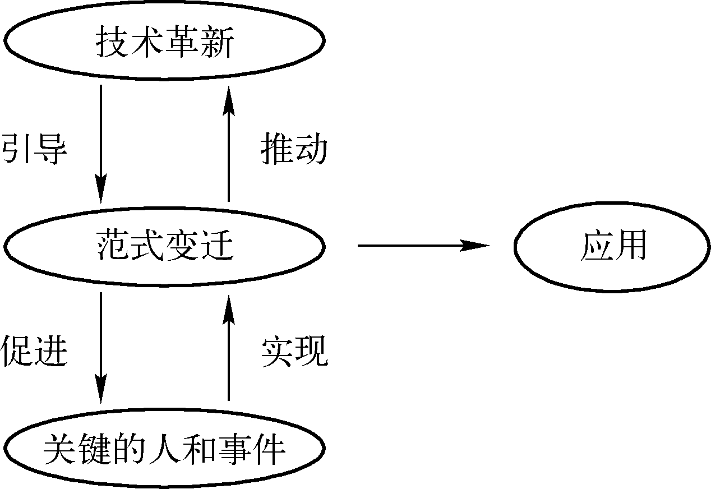
图 1.1 人机交互研究框架

### 1.1.5 HCI 新动向
HCI 始终随技术革新与需求变化。在应用场景上，正由图形界面向自然界面过渡，更人性化的交互需求愈发迫切。在研究层面，由微观提升至宏观，如何用计算机技术让个人参与社会治理成为关注重点。在研究重心上，由交互导向转向实践导向，分析单元由个体行为提升到日常社会实践。在研究范围上，由人类-计算机二元空间扩展到人类-计算机-环境三元空间，环境本身成为研究焦点。为适应智能时代，相关新思路包括自然用户界面、基于现实的交互、技术媒介的社会参与、实践导向设计、人机共生系统等。

#### 1. 自然交互界面
自然用户界面是交互范式的新转向。通过研究真实世界情境，利用新技术与感知方案实现物理与数字对象更精准高效的交互，追求界面不可见或学习过程不可见。其核心关注传统人类能力，如触摸、视觉、言语、手写、动作，以及更高阶的认知、创造力与探索。因此 NUI 简单易学、交互自然、操作直觉，能让新用户迅速上手并获得愉悦体验。

20 世纪 90 年代，Steve 设计了一系列界面策略，以现实世界自然交互替代图形界面，并称之为自然用户界面、直接用户界面、无隐喻计算。2008 年，微软用户体验总监 August 把 NUI 描述为类似 CLI 到 GUI 的下一步演进。2010 年，Daniel Wigdor 与 Dennis Wixon 在书中详细论述了 NUI，并给出构建方法与实现技术。简言之，NUI 应具以人为中心、多通道、低精度、高带宽的特点。

#### 2. 现实感交互
基于现实的交互 Reality-Based Interaction，RBI 概括了新一代人机互动方式，涵盖自然用户界面、虚拟现实、增强现实、情境感知计算、手持移动交互、感知与情感计算、语音交互及多模态界面等。RBI 强调借用用户既有知识与技能，减少额外学习成本。它从四个层面描述新交互模式：对常识的理解、对自身肢体的理解、对环境的理解、对他人的理解，并据此建立基于现实的感知框架，自下而上分为四层：简单物理感知、身体意识与技能、环境意识与技能、社会意识与技能。

底层简单物理感知包含对外部世界与常识性知识的感知，如重力、惯性；第二层身体意识与技能关乎对身体的感知及运动控制协调能力；第三层环境意识与技能关乎对周围环境的感知、操作与导航；顶层社会意识与技能关乎对社会环境中他人的感知与交流能力。

RBI 框架可用于分析 NUI 的真实感特性，为自然交互提供基本原则，使人机互动更贴近自然世界，对指导 NUI 设计与研究意义重大。Flying Kite 即是基于 RBI 框架开发的 UI 反馈原型，实验证明其能显著提升系统用户体验。

#### 3. 技术驱动的公众参与
互联网快速发展与普及，让更多公众熟练使用网络平台表达对公共事务的意见，推动网络民意迅速发展。2013 年雅安地震即是典型，救援组织借助社交媒体协调资源，数百万人向红十字会捐款支持应急响应与重建。可看出，互联网社交工具作为技术媒介，能让公众更广泛地参与协作、社会事件与公共管理，如维基百科、百度百科的共建、知乎等社会化问答平台的兴起。

可以预见，技术媒介的社会参与 Technology-Mediated Social Participation，TMSP 有助于增强个人创造力、促进家庭交流、提升社区繁荣、启发企业创新、引导公民政策参与、化解国际冲突等。潜在领域广泛，包括医疗、灾难响应、能源、教育、文化多样性、环境与气候、公民科学、经济健康、全球化与发展、政治参与、基层公民参与与公共安全等。

卡耐基梅隆大学的 Ben Shneiderman 等人提出读者-领导者框架，鼓励公众通过社会技术媒介参与社会治理。用户起初是读者，随着参与度加深，部分人会成为贡献者、合作者，乃至管理者。

#### 4. 以实践为导向的设计
早期 HCI 的概念框架基于认知心理学的 MHP 方法，关注人与计算机的交互关系，通过界面使人的运动与认知与计算机接口更好匹配。该框架下产生了大量有意义的工作，代表性成果是以用户为中心的设计，聚焦界面可用性。但其依赖实验室研究获取知识与设计方法，适用性受限。

实践导向设计 Practice-Oriented Approaches，POA 将视角从交互转向实践活动，分析单元从个体行动变为日常实践，关注点从个人行为或社会规范提升到日常活动的组织与重组。Shove 提出 POA 的三个主题：人机互动中的去中心化、实践活动的动态与情境本质、设计向实践的转变。

近年来，HCI 技术应用范围扩大，组织、就业、物质性、社会责任等问题成为热点。虽然主流仍聚焦系统交互性与可用性，但越来越多研究者关注实践活动与个人经验，开始探索 POA 相关课题。

#### 5. 人机共生体系
计算机在生活的各方面作用日益增强，社会与信息技术彼此渗透影响。在此背景下，人机共生系统 Cyber-Human System，CHS 由 HCI、以人为中心的计算、通用接入、数字社会与技术等发展而来，并延伸至数字政府、信息隐私、人机对话等领域，旨在探索变革性思想与相关理论技术创新，研究人与计算机日益密切的关系，目标是增强人类能力。

该领域发展迅速，受美国国家科学基金会大力支持。资助主题涵盖人类、计算机、环境三个维度。人类维度关注目标一致的群体与非结构化连通的个体，从支持扩展能力到满足需求；计算机维度从固定设备到随身移动设备及嵌入物理环境的传感器与视听设备；环境维度从离散物理计算设备到沉浸式虚拟环境及中间的混合现实系统。

### 1.2 HCI 与 AI 的联动
HCI 与人工智能是智能信息时代的两大焦点。历史来看，二者关系从此消彼长走向相互促进，深度融合的应用已在教育、医疗等关键领域涌现。HCI 为人工智能提供需求与思路，人工智能也推动 HCI 技术发展与变革。未来二者将保持促进与驱动关系，愈加深入融合协同。

### 1.2.1 此消彼长的历程
人工智能一词诞生于 1956 年达特茅斯人工智能夏季研讨会。出席者多为著名数学家与逻辑学家，包括约翰·麦卡锡、马文·明斯基、纳撒尼尔·罗切斯特、克劳德·香农等，被视作开拓者。概念提出后备受高期望。1960 年，诺贝尔奖得主赫伯特·西蒙写道机器 20 年内可从事任何人类工作。1970 年，明斯基预测 3-8 年内会出现达到人类平均智力的通用智能机器，能阅读莎士比亚、加润滑油、玩办公室政治、讲笑话等。雄心勃勃的愿景带来大量关注与经费，AI 迅速成型。

HCI 可视为伴随计算机诞生而出现。其科学起源追溯到 1960 年约瑟夫·利克莱德发表的《人机共生》，提出人应与计算机交互协作完成任务。但在 AI 如火如荼的年代，界面布局、命令命名、文字编辑器等交互问题显得微不足道，人们更相信智能机器会一并解决。尽管如此，仍有少数实验室坚持研究。1963 年，MIT 博士生伊凡·苏泽兰特在博士论文中提出“SketchPad”，涉及首个图形用户界面雏形及众多界面概念，对 GUI 发展起关键推动作用，并于 1988 年获图灵奖。1971 年温伯格的《计算机编程心理学》为 HCI 提供重要心理学基础，但主要面向当时操作昂贵机器的程序员而非普通用户。可见 HCI 在 AI 第一次热潮中萌芽缓慢。相当长时期内，两领域发展呈交替态势，资源竞争明显。

1973 年，詹姆斯·莱特希尔向英国科学研究委员会提交报告，认为 AI 各领域成果未达预期。该报告导致政府热情骤降，标志 AI 第一次寒冬开启。研究者因目标过高陷入困境，低估实现难度。冷静后人们开始思考如何让 AI 更实用。1977 年，《人工智能》期刊发表由 AI 与早期 HCI 研究者合署的文章，讨论自然语言理解中的可用性问题，成为思想转变的标志：如何让 AI 实用？此后十年，HCI 迅速发展，多个有影响力的实验室建立，推动 ACM SIGCHI 于 1982 年成立。加州大学圣地亚哥分校唐·诺曼教授在 70、80 年代于 AI 论坛发表 HCI 相关研究。事实上，70 年代中后期 AI 的第一次寒冬催生了 HCI 的第一个黄金期。

1981 年，日本通产省投入 8.5 亿美元启动第五代计算机项目，目标开发可对话、翻译并像人一样推理的计算机。AI 再度站上风口，进入第二次热潮。美欧多国投入大量经费。内容仍以逻辑表达与启发式搜索为主，但表述更谨慎，“人工智能”一词使用减少，更多出现智能知识系统、专家系统、知识工程、医疗诊断等。目标由通用智慧降为领域智慧，希望解决特定难题。符号表达与推理仍远离现实，难以解决实际问题，专家系统很少真正取代医生，但相关技术仍在生产管理与决策优化中得到应用。

### 1.2.2 HCI 与人工智能的演进

80年代初 AI 迎来首轮高潮，媒体与学界普遍认为语音和语言理解将成为人机交流的核心渠道。即便 1985 年 `Macintosh` 推出后图形界面商业化大获成功，其推进速度仍远不及 AI 的宏大设想。1982 年 `ACM SIGCHI` 成立，次年举办首届 `ACM International Conference on Human Factors in Computing Systems`。尽管 `ACM` 是主要发起方之一，早期的与会群体以认知心理学家和人因工程师为主，计算机科学出身的研究者寥寥。1985 年图形界面的普及让交互研究摆脱昂贵设备束缚，研究空间被迅速打开，计算机科学家开始大量涌入 `CHI`。同期交互与 AI 的交叉迹象显现。加州大学圣地亚哥分校与海军研究办公室的吉姆·霍兰 `Jim Hollan` 致力于建模与可视化，其早期成果发表在 AI 会议\[5\]。格哈德·菲舍尔 `Gerhard Fischer` 专注教练系统与评注系统，论文同时出现在交互与 AI 会议\[6\]。交互论文里频繁引用建模、自适应界面等当时流行的 AI 方法。政府对 “`Usable AI`” 概念表现出浓厚兴趣，资助了语音系统、专家系统、知识工程等方向的研究。

80年代末因缺乏可落地成果 AI 再次回落，从 `AAAI` 规模可见端倪。1986 至 1988 年年会到会 4000 至 5000 人，1990 年降到 3000 人，1991 年不足 2000 人，之后长期维持在千人左右。反观人与计算机的互动进入新黄金期。多个高校计算机系将互动纳入核心课程并扩充师资，毕业生规模明显增长。原属 AI 阵营的研究者开始在 `ACM CHI` 发表成果，例如麻省理工学院佩蒂·梅斯 `Patti Maes`\[7\]、密歇根大学保罗·瑞斯尼克 `Paul Resnick`\[8\]、明尼苏达大学乔·康斯坦 `Joe Konstan`\[9\] 的推荐系统研究，以及莎伦·奥维亚特 `Sharon Oviatt`\[10\] 的语音识别和埃里克·霍维茨 `Eric Horvitz`\[11\] 的机器学习工作。这一阶段 `CHI` 的投稿量与参会人数稳步上升。

### 1.2.3 相互驱动的当下
历经两次大起大落后，学界不再幻想在现阶段让机器全方位超越人类，转而聚焦可落地的务实课题。于是 AI 逐渐分化为以概率模型与随机计算为基础的五大相对独立方向：计算机视觉、自然语言理解、认知科学、机器学习与机器人学。通用智能的呼声减弱，面向特定场景与任务的智能却取得实效。图像与语音识别已达普通人类水准；1997 年深蓝在国际象棋击败顶尖棋手，2017 年 `AlphaGo` 在围棋上再创纪录。这些进展直接推动互动发展。传统以图形界面、键盘鼠标为主的交互难以达到人与人间的高效自然，而语音识别、手势识别、语义理解、大数据分析等 AI 能力能帮助系统更好地感知意图与用户状态，提升交互带宽，使计算更懂人，推动互动从传统形态迈向更智能更自然的方向\[12\]。

反向来看，互动需求也在塑造 AI。机器学习先驱迈克·乔丹 `Michael Jordan` 认为 AI 最先突破的领域是对话，下一步是能协助日常事务乃至决策的家庭机器人。对自然对话的需求催生了 `Siri`、小冰、`Google Home`、`Echo` 等产品，都是为解决传统对话低效不自然而生。如今以图形界面为主的互动仍受带宽不足与不自然限制，要突破这些瓶颈需要在情境感知、意图理解、语音视觉等方面取得更大进展，这些需求持续反哺 AI 的发展。

近年互动与 AI 融合达到前所未有的高度。聚焦互动+AI 的期刊与会议显著增多，论文量与影响力持续攀升。首届 `ACM IUI` `Intelligent User Interfaces` 于 1993 年召开，1997 年第二届后改为年会，专门探索用机器学习、自然语言处理、数据挖掘、知识表达与推理等手段提升互动效率与体验。`IUI` 投稿在 2018 年达历史峰值 371 篇。此外 “`Usable AI`” 会议自 2008 年起举办，旨在弥合互动设计与 AI 系统的鸿沟，让成果真正进入日常产品。`ACM` 还创办了 `TiiS` `Transactions on Interactive Intelligent Systems` 期刊，获学界业界高度认可。各大科技公司相继启动相关项目，包括谷歌的 “`Human-Centered Machine Learning`”、 `IBM` 的 “`Human Machine Inference Networks`”、华为的 “`Intention Based UI`” 等，目标是通过融合研究让 AI 更可靠、互动更自然便捷。

国内学者在互动领域已有积累，如语音互动、笔/手势互动、多通道感知、行为理解等。北京大学、杭州大学与中国科学院软件研究所合作承担的国家自然科学基金重点项目 “多通道用户界面研究” 1995—1997，是国内首次系统探索多通道界面，在模型、描述方法、整合算法、开发环境、评估等方面做出基础性成果\[13\]。中国科学院软件研究所、中国科学院计算技术研究所、清华大学等也在笔式互动、智能界面、自然语言互动等方向做了大量工作\[14-17\]。2011 年 11 月《中国计算机学会通讯》 “人机交互” 专题与 2018 年 5 月 “自然人机交互” 专题，分别从基础研究、关键技术、心理模型、动作模型、触觉互动、生理互动等多层面梳理进展。我国中长期科技规划已将互动列为前沿技术与基础研究重点。2009 年《中国至 2050 年信息科技发展路线图》将其列为重要方向\[18\]，2011 年 “自然高效的人机交互” 写入《10000 个科学难题：信息科学卷》\[19\]。国家还支持 “云端融合的自然交互设备与工具” “人机交互自然性的计算原理” 等重点研发计划与重点基金，推动互动与 AI 融合。

笔/手势互动是重要方向，引入 AI 后体验更智能自然。中国科学院软件研究所团队在笔/触控互动提出笔式界面范式、笔式用户模型、笔式用户界面描述语言、草图用户界面等理论成果\[14\]，影响深远，相关应用如笔式电子教学系统、笔式体育训练系统已在教学体育领域发挥作用。手写识别方面，华南理工大学团队提出基于全卷积多层双向递归网络的 `Ink` 识别新方法并研发 `CNN` 手写识别模型的高性能压缩加速技术，构建云端识别引擎。该方法在 `ICDAR` 手写中文文本行识别竞赛中正确率达 96.6%，联机手写单字符识别准确率 97.9%，速度比主流方法快 30 倍，处于世界领先水平\[20\]。

可穿戴设备兴起后，普适计算环境下互动成为协同发展的瓶颈。清华大学在智能互动与普适计算方面取得重要成果，如 `COMPASS`\[16\]、`One-Dimensional Handwriting`\[17\] 等方法有效解决智能手表、智能眼镜等场景的文本输入问题。清华大学与阿里巴巴宣布战略合作，依托清华大学美术学院成立清华大学-阿里巴巴自然交互体验联合实验室，探索 “下一代人机自然交互”。双方以 “人” 为中心研究 “人-机器-环境” 关系，让机器更自然互动，并在实体互动、多通道感知等领域开展研究，使机器具备听觉、视觉、触觉等 “五感” 并理解人类情感，推动互动变革。

情感认知计算是自然互动的关键，赋予系统情感智能可大幅提升协同效率。情感认知与理解依赖 AI 支撑。中国科学院软件研究所利用内嵌三维头部数据库恢复个性化三维头部模型研发的人脸情感识别引擎，能在非限制用户无意识动作下稳定准确跟踪表情，已应用于上海智臻智能网络科技股份有限公司的 “小 i 机器人” 系列产品，获业界好评。由中国科学院软件研究所、中国电子技术标准化研究院与上海智臻智能网络科技股份有限公司联合提出的国际标准 “`Information Technology-Affective Computing User Interface-Model`” 于 2017 年 2 月在 `ISO/IEC JTC1/SC35` 工作组会议上获批立项。这是中国牵头的首个人机交互领域国际标准，也是国际上首个情感计算标准，预计 2021 年发布，将填补标准空白并推动互动向更人性化智能化发展。

基于 AI 与互动深度融合的应用在教育、医疗等关键领域不断涌现。中国科学院软件研究所与北京协和医院在神经系统疾病非干扰定量化辅助诊断方面取得突出成果\[21\]。工作结合人机互动、医学、心理学理论并融合前沿 AI 技术，构建笔/触控、步态、伸展等运动的多通道互动模型，从语音、书写、手机触控等日常行为中提取关键特征，实现神经系统疾病早期预警与辅助诊断。相关系统软件作为脑血管神经疾病常规检测工具，已用于国家脑血管神经疾病流行病学调查，并在协和医院、湘雅医院等多家三甲医院应用。工业界方面，腾讯推出可辅助医生诊断帕金森病的 AI 技术，将原本需 30 分钟甚至更久的诊断过程压缩至 3 分钟。科大讯飞把 AI 引进教育，不仅提升学校机构运转效率，也有望实现 “因材施教” 的教育理想。

### 1.2.4 协同共进的未来
展望未来，人机互动与人工智能有望保持相互促进、相互驱动的关系并深度融合协同发展。回顾历史，人工智能的发展在很大程度上映射了计算机技术的发展轨迹，而计算机技术的最终目的是服务人类。为让 AI 真正服务于人，不仅需要突破技术瓶颈，还需研究人的特性和互动中的可用性问题，这正是人机互动所关注的议题。因此二者研究目标与对象一致，相辅相成、相互促进。在 AI 遇到瓶颈时，互动往往能提供新思路；AI 的进步则不断创新互动技术并驱动其发展。两者此消彼长的时代已结束，大融合、大变革的时代正在到来。

## 1.3 智能人机交互的发展趋势
智能互动是 AI 与互动融合的产物。《埃森哲技术展望 2017》提出 “`AI is the new UI`”。人工智能正从后台运营工具转变为更简洁方便的用户服务工具，而互动设计是实现这一转变的关键。随着算力与存储能力提升，AI 应用门槛和成本不断降低，其在互动领域的应用会越来越广泛，二者纽带不断增强。2017 年 7 月国务院发布《新一代人工智能发展规划》，描绘未来十多年的发展蓝图，其中 “人机混合智能” 被列为亟须突破的基础理论瓶颈之一，重点研究 “人在回路” 的混合增强智能、人机智能共生的行为增强与脑机协同及人机群组协同等关键理论和技术。综合来看，智能互动的发展将沿以下六个方向演进。

### 1. 多通道交互
多通道互动更贴近人与人之间的沟通模式，被视为更自然的互动方式。相比单一通道，在移动计算和万物互联时代，多通道互动在智能家居、智能对话、体感互动、个性化教育等场景具有更广阔潜力。近年来 AI 技术推动语音识别、人脸识别、情感理解、手势理解、姿态分析、笔迹理解、眼动跟踪、触觉感知等单通道感知认知能力快速提升，计算机能比较准确地理解用户单通道行为。同时，便携式硬件的高速发展催生了价格低廉、便于穿戴的小型传感器，为判断用户意图提供更多信息。传统单一通道互动如鼠标、键盘或笔触图形界面，输入设备信息精确直观，系统无需关注行为细节。而在多通道环境下，系统必须准确判断用户正在做什么、想做什么，才能给出恰当反馈。如何有效融合不同通道信号并进行意图计算，是准确理解互动意图的重要手段\[22\]。

### 2. 用户意图推理
自然互动的目标是让用户以低学习成本方便有效地表达意图。互动领域持续研究各类自然互动技术，让计算机准确识别用户意图，核心是对用户动作数据的理解与处理。动作数据包括手指、手部、头部及身体运动，是当前表达意图的主要通道。准确判断互动意图是计算机做出正确决策和响应的前提，也是高效完成任务的关键。解释意图时既可采用 “黑盒子” 机器学习方法，也可利用 “白盒子” 基于用户行为建模的方法。用户建模的本质是通过计算刻画用户行为能力，对理解意图和探索自然互动计算原理具有重要科学意义\[23\]。实现意图理解的关键难点在于：① 如何创建计算机知识图谱并使其自我更新；② 如何有效结合识别到的用户数据与环境数据来实现准确理解。人与人互动往往建立在共同认知基础上，互动中包含大量意图推理。对计算机而言，要实现自然有效互动也需要建立共同认知，构建与互动情境相关的知识图谱是一种有效方法。其中包括常识性知识推理和个性化知识更新，计算机可通过感知信息自动更新图谱，也可采用主动互动策略确认不可靠的推理结果。借助知识图谱，计算机能对互动情境中的人、物、环境形成整体认识。

### 3. 智能人机交互范式
智能计算系统的快速发展对界面设计提出新挑战。智能系统界面常采用语音、姿态等灵活自然的模式简化操作，但学习和适应不同界面也会增加认知负担，影响体验。如何为智能系统设计具有一定通用性的界面？从历史看，优秀界面常依赖某种范式，例如个人计算机的 `WIMP` `Windows`、`Icons`、`Menus`、`a Pointing Device` 范式和笔式互动系统的 `PGIS` `Paper`、`Gadget`、`Icon`、`Sketch` 范式。迄今针对智能系统界面范式的研究仍属空白。目前智能系统的侧重点在互动层面，即用户如何输入信息、如何响应系统输出。大多数互动系统包含前端和后端：前端负责接收输入并展示结果，后端根据输入生成结果。系统智能性可体现在前端、后端或两者兼有。前端智能表现为接受语音、手势等灵活复杂输入；后端智能体现在信息处理与整合，如照片识别分类、文本自动翻译等。即使后端智能强，前端仍可使用鼠标键盘等传统方式。为此文献\[24\]分析了智能系统中常见互动界面的特点，提出包含角色 `Role`、互动模态 `Modal`、互动命令 `Commands` 和信息展示方式 `Presentation Style` 四个要素的 `RMCP` 界面范式，旨在为今后智能系统互动界面设计方法提供思路。

### 4. 实物用户界面

实物用户界面研究的焦点在于借助抓取、摆弄、拼装等直觉化动作，让人与真实物体直接对话。跟以纯虚拟画面为主的图形界面GUI不同，Tangible User Interface即TUI更看重把数字信息与可触摸的物理载体绑定，从而实现可握持的操作和以实体形态呈现的信息。自上世纪九十年代概念提出以来，二十多年间围绕它的探索已经相当丰富。把实物当作信息载体处理并非新鲜事，古罗马的计算板、中国历史上常用的算盘，本质上就是TUI的远古雏形，虽然外形相去甚远，但用算珠等实体来编码表达信息的原理与今天的TUI高度相似。迈入21世纪后，自然交互成为主流诉求，TUI正成为下一代自然化界面的关键方向之一，它贴近人的本能操作习惯，蕴藏着可观的应用空间。尤其在关乎国家战略需求的领域，TUI能派上大用场，比如利用城市建筑与关键设施的实体模型做互动式规划推演与信息可视化；利用物资救援部署的实体模型进行情景推演并实时整合呈现数据；依托作战单元实体模型构建战役推演电子沙盘；让设计与调试通过物理拼装合二为一；以及在未来教育中推广基于TUI的STEAM教学模式等。总体来看，实物用户界面已成为前沿交互研究的重要阵地，也是未来人机交互竞争的焦点之一。

### 1.3.5　智能人机合作心理模型
交互形态从早期的命令行、图形界面，扩展到如今火热的VR/AR，以及语音、手势、眼动、脑机接口等多元通道，技术版图日益繁复，但支撑这些技术的理论却显得有些掉队，仍在沿用近四十年前的框架。1983年，Card团队出版了《人机交互的心理学》这部奠基性著作，不仅确立了人机交互的概念，还提出了至今仍被学界奉为经典的人类处理器模型MHP及其延伸版GOMS。三十多年里，这套模型为设计与研究提供了基本指导，可是面对交互方式的快速迭代，旧理论已难以覆盖现况。随着机器在智能与情感处理上的逼近，人机交互正朝着更自然、更和谐、更贴合人类认知习惯的方向演进，而既有模型大多还卡在传统交互的范式里，难以应对当下多模态、混合式的复杂局面[25]，亟需更新的理论体系来引领后续研究与产品设计。

### 1.3.6　人类智能增强
人工智能的迅猛发展不断推高机器的智力水平，也让人不安机器是否会冲击人类思维。与之并行，部分学者提出另一条思路——智能增强IA。1963年，几乎与AI同起步，鼠标之父Douglas C. Engelbart发表了《扩充人类智能的概念架构》，并创立增智研究中心。如果说AI的目标是让机器像人一样思考，即“让机器更聪明”，那么Engelbart的探索则是借助技术放大人类大脑本身的能力。智能增强并非AI的分支，而是一个融合基因技术、智能技术、心理学、脑神经强化与微生物技术等多学科的交叉领域，核心是围绕人来强化人机协同，提升人的智慧与技能。它为交互研究带来新的需求与动能：今天关注的是机器如何更自然地服务人类，未来还要思考在机器能力提升的同时如何同步增强人的认知能力，实现人机共生、和谐共处。随着AI的落地应用，人与智能系统的深度交互、融合与共生，或将成为未来社会的重要特征之一[26]。

## 参考文献

\[1\] CARD S K，MORAN T P，NeWELL A. The keystroke-level model for user performance time with interactive systems\[J\]. Communications of the ACM，1980，23(7)：396-410.

\[2\] LICKLIDER J C R. Man-computer symbiosis\[J\]. IRE transactions on human factors in electronics，1960(1)：4-11.

\[3\] GRUDIN J. AI and HCI：Two fields divided by a common focus\[J\]. AI Magazine，2009，30(4)：48-48.

\[4\] BOBROW D G，KAPLAN R M，KAY M，et al. GUS，a frame-driven dialog system\[J\]. Artificial intelligence，1977，8(2)：155-173.

\[5\] HOLLAND J，RICH E，HILL W，et al. An introduction to HITS：Human interface tool suite\[C\]//Intelligent user interfaces. ACM，New York，1991，293：337.

\[6\] FISCHER G，LEMKE A，SCHWAB T. Knowledge-based help systems\[J\]. ACM SIGCHI Bulletin，1985，16(4)：161-167.

\[7\] SHARDANAND U，MAES P. Social information filtering：algorithms for automating“word of mouth”\[C\]//Proceedings of the SIGCHI conference on Human factors in computing systems. 1995：210-217.

\[8\] RESNICK P. Filtering information on the Internet\[J\]. Scientific American，1997，276(3)：62-64.

\[9\] GOOD N，SCHAFER J B，KONSTAN J A，et al. Combining collaborative filtering with personal agents for better recommendations\[AAAI/IAAI，1999:439.

\[10\] OVIATT S. Mutual disambiguation of recognition errors in a multimodel architecture\[C\]//Proceedings of the SIGCHI conference on Human Factors in Computing Systems. 1999：576-583.

\[11\] HORVITZ E. Principles of mixed-initiative user interfaces\[C\]//Proceedings of the SIGCHI conference on Human Factors in Computing Systems. 1999：159-166.

\[12\] 范俊君，田丰，杜一，等. 智能时代人机交互的一些思考\[J\]. 中国科学：信息科学，2018，48(4)：361-375.

\[13\] 董士海，王坚，戴国忠. 人机交互和多通道用户界面\[M\]. 北京：科学出版社，1999.

\[14\] 戴国忠，田丰. 笔式用户界面\[M\]. 2 版.合肥：中国科学技术大学出版社，2014.

\[15\] 胡包钢，谭铁牛，王珏. 情感计算——计算机科技发展的新课题\[J\]. 科学时报，2000.

\[16\] YI X，YU C，XU W，et al. Compass：Rotational keyboard on non-touch smartwatches\[C\]//Proceedings of the 2017 CHI Conference on Human Factors in Computing Systems. 2017：705-715.

\[17\] YU C，SUN K，ZHONG M，et al. One-dimensional handwriting：Inputting letters and words on smart glasses\[C\]//Proceedings of the 2016 CHI Conference on Human Factors in Computing Systems. 2016：71-82.

\[18\] 中国科学院信息领域战略研究组. 中国至 2050 年信息科技发展路线图\[M\]. 北京：科学出版社，2009.

\[19\] “10000 个科学难题”信息科学编委会. 10000 个科学难题:信息科学卷\[M\]. 北京：科学出版社，2011.

\[20\] 金连文，钟卓耀，杨钊，等. 深度学习在手写汉字识别中的应用综述\[J\]. 自动化学报，2016，42(8)：1125-1141.

\[21\] 李洋，黄进，田丰，等. 云端融合的神经系统疾病多通道辅助诊断研究\[J\]. 中国科学:信息科学，2017(09):42-60.

\[22\] 杨明浩，陶建华. 多通道人机交互信息融合的智能方法\[J\]. 中国科学 F 辑，2018，48(4):433-448.

\[23\] 易鑫，喻纯，史元春. 普适计算环境中用户意图推理的 Bayes 方法\[J\]. 中国科学:信息科学，2018，48(4):65-78.

\[24\] 张小龙，吕菲，程时伟. 智能时代的人机交互范式\[J\]. 中国科学:信息科学，2018，48(4):406-418.

\[25\] 刘烨，汪亚珉，卞玉龙，等. 面向智能时代的人机合作心理模型\[J\]. 中国科学:信息科学，2018，48(4):22-35.

\[26\] 王党校，郑一磊，李腾，等. 面向人类智能增强的多模态人机交互\[J\]. 中国科学:信息科学，2018，48(4):95-111.

# 第 2 章　智能人机交互基础理论
智能人机交互要解决的核心难题之一，就是把人类的感知、认知和动作执行能力量化，进而对交互行为进行建模并预测使用者在不同情境下与系统的表现。借助这类模型，可以客观评估用户体验，指导交互优化。但要打造既广且深、能真实刻画人类表现的模型绝非易事，因人类行为本身模糊且环境变化多端，建模过程不可避免地需要抽象、简化交互任务，同时必须清晰界定模型适用的范围和前提。本章将梳理现有主流模型：用户认知模型聚焦感知、认知与决策的建模；用户运动模型聚焦运动与执行能力的建模；智能人机交互模型则聚焦人与机器交互全过程的建模。需要说明的是，这些模型仍处于不断完善的过程中。

## 2.1　用户认知模型
用户认知模型的核心作用是预判人如何与系统互动，进而依据人的感知与认知特点设计更高效、更友好的界面\[1\]。目前学界常用的认知模型包括MHP、GOMS、SOAR、ACT-R、EPIC等，都可用于刻画人机交互任务的认知过程。MHP把人视作信息处理机，将大脑的信息加工类比为计算机处理外部信息的流程；GOMS关注用户在与计算机交互时所运用的知识与认知步骤，可预测用户会采用何种策略及熟练者在特定界面下的任务耗时；SOAR围绕算子选择与应用构建通用认知框架，支持在复杂环境中通过知识自动化使用和持续学习完成任务；ACT-R试图用不可分的认知操作单元及其组织框架来表述认知过程；EPIC则借助工作记忆把视听感知、运动执行与认知活动整合起来，为复杂交互场景提供可计算的用户模型。借助这些认知行为模型，不仅能定量或定性预测人类的行为，还能解释多任务情境下的交互表现。

### 2.1.1　MHP 模型
MHP即Model Human Processor模型\[2\]，主要用来估算用户完成特定任务所需的时间。其基本思路是把人当作类计算机的信息处理系统，对应计算机的处理与存储单元，分别映射到人的感知、动作、认知与记忆。更具体地，MHP把心理加工概括为感知、认知、动作三个处理器，并配以工作记忆与长时记忆等存储单元，以及连接各模块的通路（见图 2.1）。除结构外，模型还定义了一套运行原则，并将其量化为若干参数，用于衡量信息加工的效率。

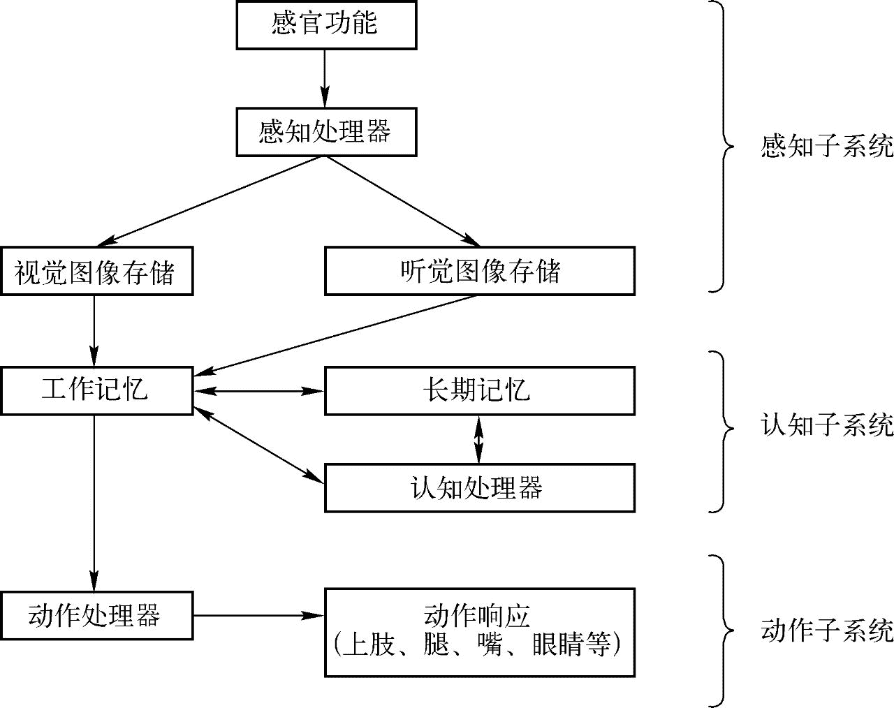
图 2.1　人类处理器模型

基于MHP进行时间预测，通常遵循以下步骤：

● 先参照任务原型列出主要步骤；
● 依据图 2.1的流程对任务进行拆解，拆分越细预测越准；
● 根据表 2.1赋予每一步的操作时长；
● 视使用者情况调整时长，例如老年人或残障人士可能更慢；
● 汇总得到总时长；
● 必要时迭代校对原型。

表 2.1　`MHP`模型中的关键参数

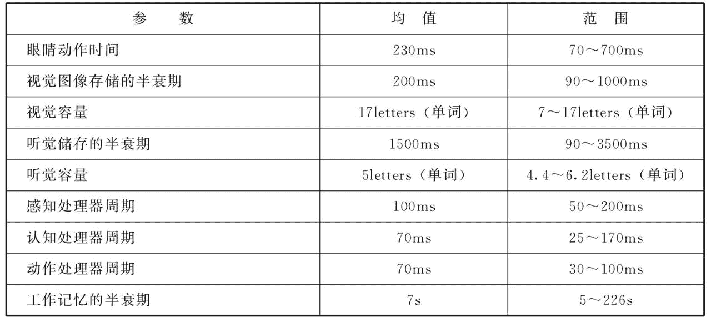
以文本阅读为例，先梳理具体步骤：视觉感知器读取文字需调用感知处理器的视觉存储，理解内容需调用认知处理器的工作记忆及长期记忆，翻页或移目则涉及动作处理器的执行响应。把每一步耗时估算并按读者个体差异修正后累加，即可得到阅读时长预估。

尽管MHP提供了简洁可操作的计算框架，但局限性也很明显\[3\]。它诞生于上世纪八十年代，当时对认知机制的认识有限，诸如三个处理器循环周期的设定带有较强的主观随意性；模型默认认知是序列加工，虽然保留了动作到感知的反馈路径，但与近年认知心理学关于并行加工的发现不完全吻合；此外，将心理过程拆分为三个处理器虽具启发价值，却描述较为粗糙，难以精准刻画当下复杂场景下的人机交互任务。

### 2.1.2　GOMS 模型
GOMS模型是早期人机交互领域广泛采用的定量分析工具，用于评估交互行为的复杂程度。其思路是把用户行为拆解成基础单元，通过建模预测行为序列及其耗时。

具体上，GOMS包含一套描述使用者完成计算机任务所需知识的框架，核心由四个要素构成：目标Goal、操作Operators、实现目标的方法Methods，以及用于选择方法的选择规则Selection Rules。四者关系如图 2.2所示。目标指任务的期望终态；操作指为达成目标而执行的感知、运动或认知等基本行为，是改变心理状态或环境的关键；方法指实现目标的一系列步骤；由于方法往往不唯一，选择规则用于决策最合适的路径。GOMS在人机交互与界面设计中尤其是可用性测试里应用非常普遍。

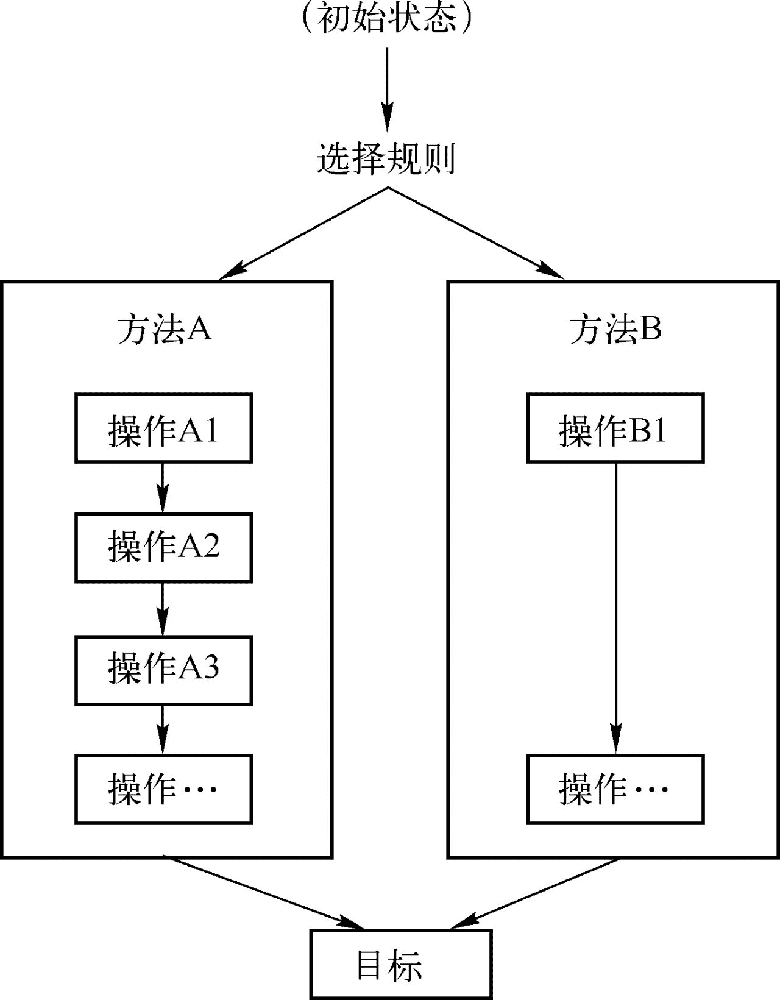
图 2.2　`GOMS`模型的四种认知组成之间关系

GOMS建立在两点假设上：一是用户操作熟练，行为由总目标分解为子目标并据此挑选方法；二是操作总时长由认知基础时间、感知时间和动作执行时间共同组成。基于该框架，可以预测用户在给定界面下的操作选择与熟练用户的耗时。模型强调目标导向的方法选择，因目标本身具有层级性，方法也呈现层级结构，当存在多选时选择规则发挥作用。

在GOMS基础上，后续出现了简化版的KLM击键模型，用于估算文本输入和鼠标选择等操作的耗时。其方法更为直接，设计人员可在短时间内完成耗时测算。KLM把交互行为拆分为若干元操作，每个元操作有通过实验得出的平均时长（见表 2.2），累加后即可得到方案的操作耗时，从而比较不同设计的优劣。

表 2.2　`KLM`击键模型元操作平均时长

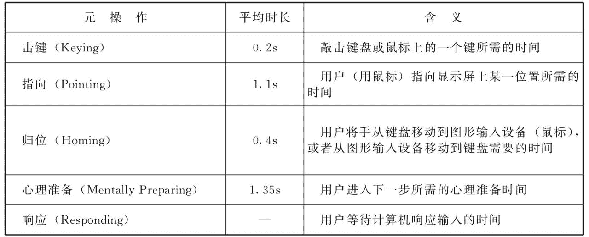

人机交互建模要点速览

GOMS 的估算能力奠基于对人类操作与认知处理极限的一系列基础实验。实验设计上，研究者把任务拆解为细粒度步骤逐项记录，而非仅采集整体耗时。长期累积后发现，击键时长、选择时长等量化指标在不同任务中表现出相当稳定的规律。这些经验数据与对应的度量方法共同构成 GOMS 体系的核心素材。

相当长的时间内，GOMS 在人机交互领域占据重要地位。台式机键盘输入、鼠标选点，以及其他可被清晰拆分为序列化步骤的交互方式，都能被 GOMS 用于效率分析与前瞻预测。其适用前提是使用者已臻熟练，任务具备明确终点并可分解为若干子目标，使用者据此挑选操作路径。正因如此，GOMS 仅能刻画熟练人群的行为，难以反映新手的探索与试错；它更偏好目标单一、结构清晰、可拆解的情境。随着交互形态与任务复杂度的快速攀升，这一假设已难以覆盖新需求。

### 2.1.3 SOAR 模型

## SOAR(State Operator And Result)模型

`SOAR`(State Operator And Result)模型\[4\]是一种以可计算程序架构为底座的通用认知建模范式。其研究旨趣在于提炼通用智能体所需的底层计算单元，使其能够承接多样化任务，编码、调用与习得各类知识，从而实现决策、问题求解、规划及自然语言理解等认知功能。换句话说，`SOAR` 为人工智能在动态复杂环境中自主调动知识、持续学习以完成任务提供了一个灵活的计算思路。

通俗地看，`SOAR` 由 `State`、`Operator`、`Result` 三要素构成，即利用算子改变状态进而产生结果。在该框架内部，任何问题的求解都被视作在问题空间中以目标为导向的搜索过程。求解时不断尝试当前算子，每个状态下仅允许选择一个算子，以此推移求解状态直至抵达目标。下面给出三者的界定\[5\]。

### 1. 状态(State)

状态可理解为问题空间中的一点，用以描述求解过程中某一步骤的问题数据结构，可能由多项属性构成。可形式化为

`Sk={Sk0，Sk1，…}`

(2.1)

当各分量均被赋予确定值时，便得到一个具体状态。目标是状态存在的动力，可表达为目标驱动状态 `G→S`。若某一状态的属性值与问题目标值一致，则该状态即为终态。

### 2. 算子(Operator)

算子即操作，用于把当前状态转移到新状态。`SOAR` 的决策围绕算子的提出、挑选与执行展开。算子相当于解决问题的策略，一个问题往往存在多种解法，情境下会从中挑选最合适的。`SOAR` 的基本循环是提出算子、选择算子、应用算子，使状态逐步迁移，直到达到目标状态后终止。

### 3. 结果(Result)

结果即目标 `Goal`，属于一种特殊状态。当状态各属性值等于目标的特定值时即为结果。结果既可预先设定，也可在运行中人为干预，例如强制中断 `SOAR` 以获取中间结果。

`SOAR` 的框架结构如图 2.3 所示，其中基于符号的长期记忆指编码为产生式规则的长时记忆，基于符号的工作记忆指编码为符号图结构的工作记忆。工作记忆保存了智能体对当前环境与情境的评估，结合长时记忆召回相关知识，经过输入、状态描述、提议算子、比较算子、选择算子、算子应用、输出等决策步骤循环，直至达到目标状态。

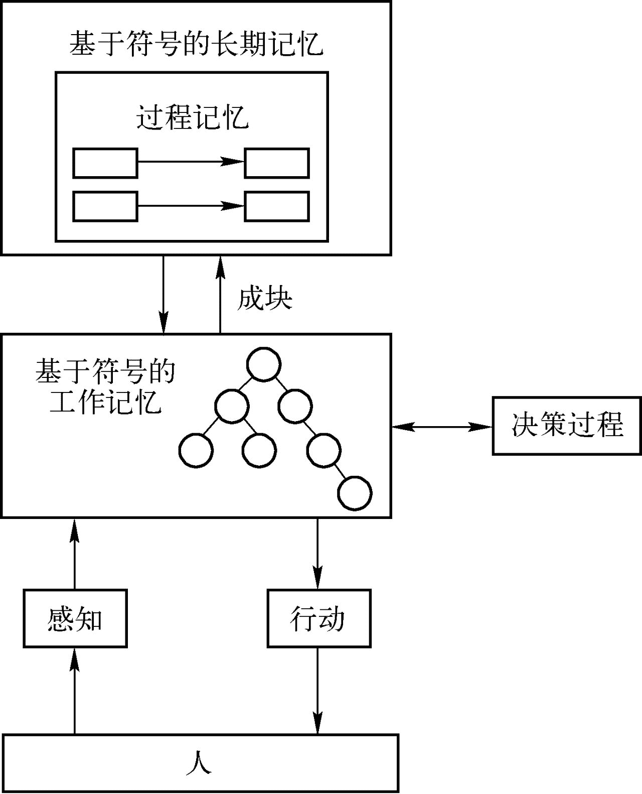

图 2.3　`SOAR`模型的框架结构

`SOAR` 的独到之处在于把问题空间作为面向目标的基本组织单元。与仅把单个规则选择作为决策关键的做法不同，`SOAR` 通过规则的提出、评估与应用来筛选算子，从而完成决策。算子由测试当前状态的规则提出，并在工作记忆中形成算子的表征及其可接受偏好。附加规则会匹配已提议的算子，通过对其他算子的评估生成额外偏好。决策时分析这些偏好，选出最优算子。匹配到当前算子的规则会触发应用，并修改工作记忆。工作记忆的修改可以是简单推断、查询长期语义记忆或情节记忆，也可以是向运动系统下达指令执行环境动作。这种修改又会引发新的算子提出、评估、选择循环。

与局限于熟练用户的 `GOMS` 不同，`SOAR` 能够建模与预测非熟练用户的行为。作为认知框架，基于 `SOAR` 能够搭建可运行、可成长的用户模型，其风格更接近认知工程，能处理交互中常见的“僵局”`Impasse`。当用户不知下一步如何操作时，就需要寻找解决方案的操作路径，这就是 `SOAR` 所说的僵局。在 `SOAR` 框架下，可对用户察觉僵局的时机、为打破僵局搜寻策略花费的时间、找到解决方案前所需的步骤数等细节作出判断。这些参数为新手或日常用户的行为提供了可用的预测手段。不过，与 `GOMS` 相关方法相似，要在 `SOAR` 下对任务做精细化分析与参数定义，难度依然不小。

### 2.1.4 ACT-R 模型

`ACT-R`(Adaptive Control of Thought-Rational)模型\[6\]是从认知基础理论出发构建的认知架构。其目标是揭示人类如何组织知识、产生智能行为的思维运行规律，试图把认知过程模型化，定义大脑中认知与感知操作的基本单元，用不可分的认知操作元素及其构成框架来建模人类认知行为。

总体来看，人类习得新知识可分为三个阶段：陈述性阶段、知识编辑阶段与程序性阶段。陈述性阶段获取的是关于现实的陈述性知识，并用可行的程序去处理或理解。陈述性知识以组块结构表征，一个组块由唯一标识符和多个带值的空槽组成，空槽可以是另一个组块，也可以是外部客体，从而把知识点连通。知识编辑阶段通过形成新的产生式规则或以新规则取代旧规则，使新旧知识建立联系。程序性阶段则形成与任务相适应的产生式规则，这些规则的执行结果会写回各子模块。产生式可被泛化，根据使用频率得到强化或削弱\[7\]。

图 2.4 展示了 `ACT-R` 5.0 的基本架构。该架构由多个模块构成，各自处理不同类型信息。主要模块包括负责辨别视野中物体的视觉模块 `Visual Module`、控制手部动作的手动模块 `Manual Module`、明确当前目标和意图的意图模块 `Intentional Module`、从记忆中提取信息表征的陈述性模块 `Declarative Module`。产生式 `Productions` 规则对大部分模块的信息不敏感，只对存储在模块缓冲器中的信息作出反应，类似人只关注需要注意的信息。提取缓冲器 `Retrieval Buffer` 用来保存长时记忆获取的信息，手动缓冲器 `Manual Buffer` 用来调控手部运动，视觉缓冲器 `Visual Buffer` 用来保存物体位置并辨别特征。

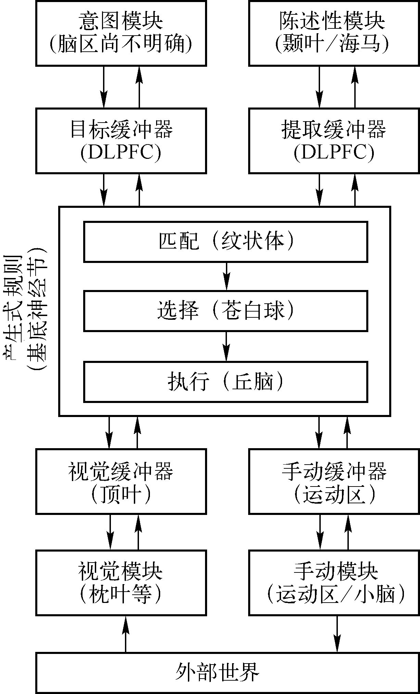

图 2.4　`ACT-R` 5.0 的基本体系结构\[6\]

视觉模块与手动模块：人通过视觉和手动模块与外部环境交互，由中央产生式系统统一调度。例如产生式系统要定位某个物体时，先由规则给出约束条件，位置系统再返回符合条件的位置集合。约束条件是属性-值对，依据对象的空间位置和属性如颜色进行搜索。

意图模块：问题求解过程中常涉及目标选择和逼近。汉诺塔就是经典的目标操作研究案例。目标模块存储类似汉诺塔中的子目标。

陈述性模块：它保存大量知识，以组块形式存储，如“华盛顿特区是美国首都”“法国是欧洲国家”“2 + 3 = 5”等事实。

产生式规则：产生式规则调节模块间行为并处理信息，只对各模块缓冲器中的信息作出响应。执行时把其他模块信息调入缓冲器，再经产生式规则改变并写回对应子模块。

认知架构同时存在串行和并行加工。视觉系统要处理整个视野，陈述性系统提取请求后可在记忆中并行搜索。不同模块可同步或异步运行。串行方面体现在缓冲器一次只能提取一个记忆或编码一个个体，每个周期只能激发一个产生式。

此外，`ACT-R` 的一个重要优势是有大量实验数据可直接用于研究。这为工作提供了良好的实验环境。表面看 `ACT-R` 像编程平台，其构建基于诸多心理学研究成果，但用它构造的模型反映的是人类认知行为。研究者利用 `ACT-R` 内建的认知理论，加上特定任务的假设和知识描述，搭建任务认知模型，通过对比模型结果与实验结果验证有效性，再用符合人类认知的模型指导实践，实现任务预测、指导和控制。

### 2.1.5 EPIC 模型

`EPIC`(Executive-Process/Interactive-Control)模型\[8，9\]是一种用于多通道多任务行为建模的认知框架。它不仅把人类感知与运动处理的关键因素纳入理论，还对这些机制在行为表现中的影响进行建模。

`EPIC` 架构明确覆盖了交互中常用的眼、耳、手等多通道感知运动系统，并显式包含注意力、工作记忆、大脑处理规则等认知要素，为复杂的多通道多任务场景提供完整且可计算、可运行的描述基础，能够对任务执行时间进行量化估计。`EPIC` 的假设包括：①恰当的指令能促进多任务并行；②练习可把陈述性知识转化为程序性知识，从而促进并行；③在知觉加工和动力加工阶段，环境会导致认知加工出现瓶颈。与其他模型不同，`EPIC` 从知觉加工、认知加工和动力加工三个层面解释真实环境中的用户行为\[10\]，如图 2.5 所示。

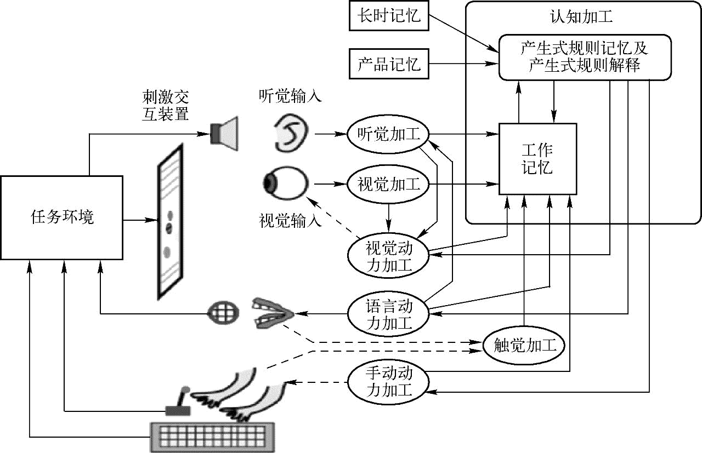

图 2.5　`EPIC`模型图解\[10\]

(1)知觉加工：知觉加工系统监测并辨别任务环境中的刺激，把刺激存入工作记忆备用。不同感觉通道并行加工和存储。包含听觉加工 `Auditory Processor` 与视觉加工 `Visual Processor`。

(2)认知加工：认知加工系统由工作记忆 `Working Memory`、产生式规则记忆 `Production Memory` 及产生式规则解释器 `Production Rule Interpreter` 三部分组成。工作记忆存储多类信息元素，使多任务同时进行成为可能。产生式规则记忆存储任务所需规则。技术性任务时，产生式规则记忆与工作记忆协同作用，使多任务行为突破知觉动力系统的限制。该子系统解释用户执行任务时选择的规则，检测产生式规则记忆中规则的条件，选择与当前工作记忆元素匹配的规则传递给认知加工系统。

(3)动力加工：动力加工系统把认知加工传递的信息转化为具体动作特征，在特定条件下与预先准备的反应动作匹配，向用户发出执行指令。包含视觉动力加工 `Ocular Motor Processor`、语言动力加工 `Vocal Motor Processor`、手动动力加工 `Manual Motor Processor` 与触觉加工 `Tactile Processor`。

真实人机交互发生在多元复杂环境中，不同感觉器官协同把外界刺激传给大脑，大脑编码后把行为反应方式传回各器官，个体才做出反应。`EPIC` 更贴近真实场景的用户行为预测模型，从知觉和注意角度多角度测量和分析用户行为，使用户在多重环境中完成多目标任务成为可能。用 `EPIC` 做界面可用性评估，有助于设计师从用户视角思考操作行为，设计出适合多元环境多任务的高可用性界面。随着研究关注点转向自然化的多通道多任务交互，该模型曾获重视。但与多数认知框架相同，`EPIC` 需要考虑的参数和可提供的参数范围远大于人机交互研究所需，额外成本极大限制了其在交互领域的应用。

## 2.2 用户运动模型

在用户与系统进行交互时，其运动行为往往不是一种预期的结果，而是在一个“观察-决策”的动态过程中形成的，如何对该过程进行合理的描述和解释是人机交互用户运动建模研究的主要内容。我们可以将相关用户运动模型研究分为两类，一类与用户的运动表现相关，包括用户在与系统交互过程中的运动时间、准确性；另一类与用户的运动过程相关，包括运动的控制，即用户运动过程中的位置、速度、加速度等物理量随时间的变化。

### 2.2.1 用户运动时间模型

#### 1. Fitts'Law(菲茨定律)

`Fitts'Law`\[11\] 由保罗·费茨于 1954 年提出，专用于预测人机交互中目标获取任务的运动时间 `Movement Time`，`MT`。

如图 2.6 所示的目标获取任务中，用户需尽可能快且准地从光标起点选中宽度为 `W` 的目标，完成时长 `MT` 可用式 (2.2) 表示，即

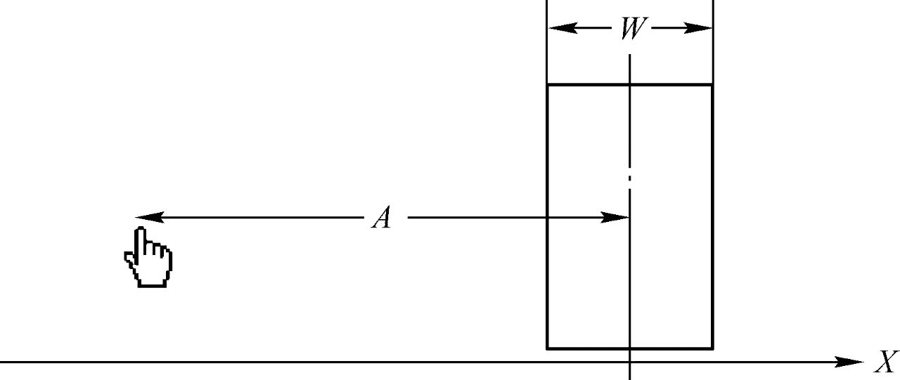

图 2.6 `Fitts'Law`目标获取任务

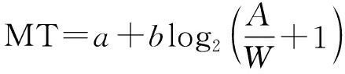

(2.2)

式中 `MT` 为完成时长，`A` 为光标起点到目标中心的距离，`W` 为目标宽度，`a`、`b` 为由指点设备、操作者及环境决定的经验参数\[12\]。式中对数项被称为难度系数 `ID`：

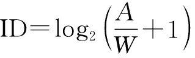

(2.3)

系数越大任务越难。该指标直观显示任务难度随运动幅度 `A` 正相关，随目标宽度 `W` 负相关。背后机制来自人类运动控制的速度-准确性权衡原则。

因其对运动时间的准确估计，`Fitts'Law` 广泛用于交互研究与设计，如输入设备评估、新型交互界面优化、手势识别算法预测、复杂交互任务建模等。例如主流操作系统的菜单常把底栏 `Dock` 放在屏幕最下，通过增大目标缩短定位时间，边缘可视为无限大。用户向底栏大幅移动光标时光标始终落在栏上。`Fitts'Law` 鼓励减小距离、增大目标以提升效率，反向使用也能达到效果，如 iPhone 关机采用滑动而非单击，降低效率但增加操作时间以起到警示作用。

`Fitts'Law` 描述的是简单的 1D 目标获取，实际交互中 2D、3D 目标更常见。为此麦肯齐\[13\] 对其做了 2D 拓展，如图 2.7 所示。他用一个巧妙原则解决 2D 问题：把 2D 矩形目标中相对较小的边代入式 (2.2) 中的 `W`，因为准确性要求由较小的边决定。1D 实验中目标高度足够大，用户无需考虑高度影响，这个“相对较小的边”一直是 `W`，因此 1D 任务是二维拓展的特例。

村田\[14\] 进一步把 `Fitts'Law` 拓展到 3D 空间，如图 2.8 所示。他发现除距离和目标大小外，目标所在垂直平面 `Board` 与用户视野中心构成的方向角 `θ` 对获取时长有显著影响，于是把方向角 `θ` 加入难度系数表达式，如式 (2.4)，得到更精准的 3D 运动时间预测。

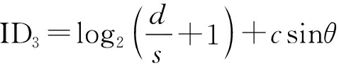

(2.4)

式中 `d` 为目标距离，`s` 为目标直径，采用球形目标以简化，`c` 为与任务和设备相关的常数。

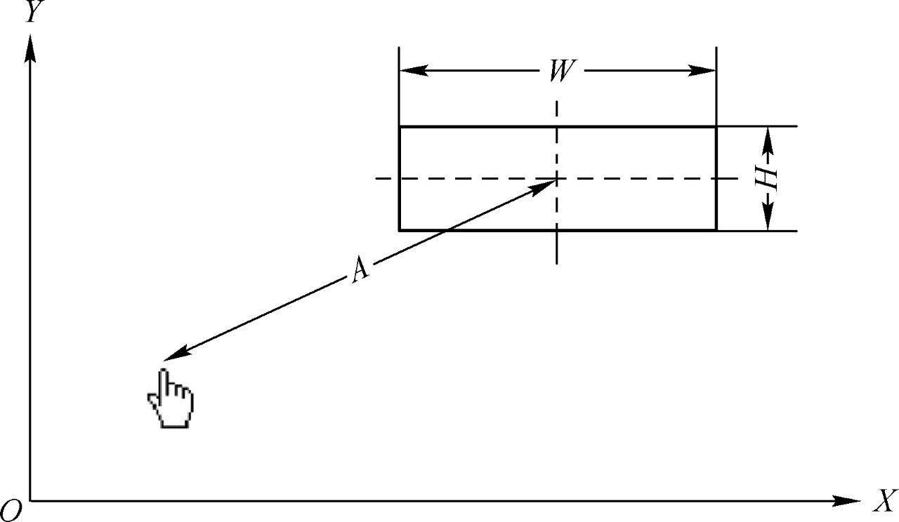

图 2.7 麦肯齐定义的 2D 目标获取任务

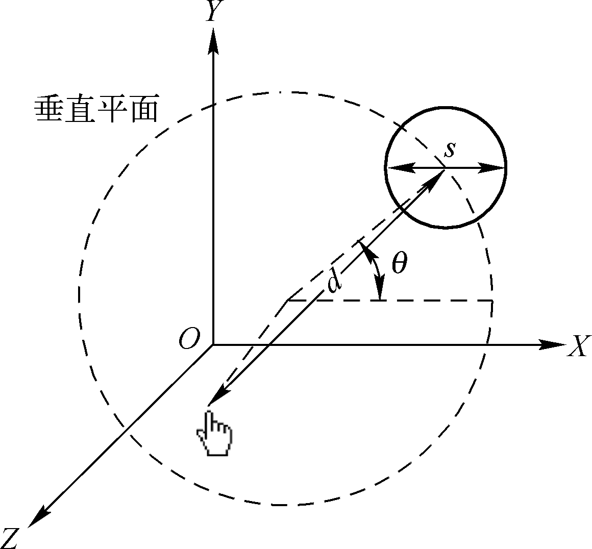

图 2.8 村田定义的 3D 目标获取任务

#### 2. Steering Law

`Steering Law` 由约翰尼·阿科特和翟树民在文献\[15\] 中提出，用来预测轨迹任务的运动时间。如嵌套菜单中移动、绘制曲线、在虚拟 3D 场景中移动等，均属大量基于轨迹的交互，无法用 `Fitts'Law` 建模。

这类任务可抽象为用户控制光标移动并通过一个有长度和宽度约束的通道的过程，如图 2.9 所示。

光标通过该通道的时长可用式 (2.5) 给出：

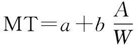

(2.5)

式中 `A` 为通道长度，`W` 为通道宽度，`a`、`b` 为常数。

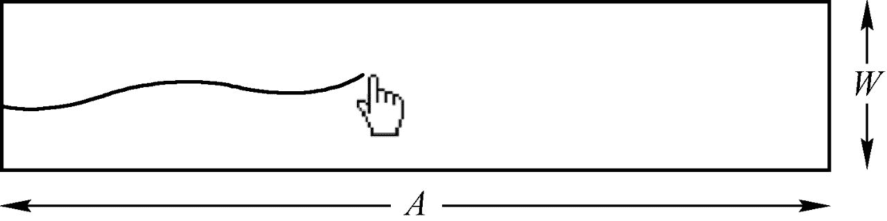

图 2.9 `Steering Law`中一个长为`A`、宽为`W`的笔直通道

经推导，`Steering Law` 可拓展到任意有理通道，如图 2.10 所示。一般情况下完成时间可表示为对无数微小笔直通道的积分：

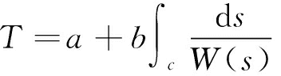

(2.6)

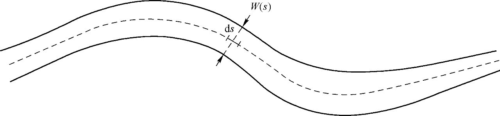

图 2.10 `Steering Law` 通道示意：中心轨迹记为 c，沿途宽度记为 W(s)

在 `Steering Law` 里，通路的总长度承担的角色与 `Fitts'Law` 中的目标间距完全一致，都是在“又快又准”的约束下对完成时长的下限进行限制；而通道的宽度则对应 `Fitts'Law` 中的目标宽度，决定了操作所需的准确度。无论是点选类任务还是轨迹跟踪类任务，其运动时长的可预测性，本质上都源于人类运动控制中速度与精度的权衡原则。

### 2.2.2 错误率的量化建模

失误率是人机交互评价里绕不开的核心指标，被广泛用于文本输入、游戏操作等场景。以虚拟键盘的按键或游戏中移动的敌人为例，只要给出目标的距离、尺寸以及允许的完成时间，就能借助错误率模型估算选中概率，为界面尺寸放大、目标速度调低等设计优化提供依据。

在基础的目标获取任务中，失误被定义为落点超出目标范围的尝试占比。尽管大量研究涉及失误问题，却很少对失误本身进行形式化建模。Wobbrock[16] 结合 `Fitts'Law` 与有效宽度，对落点分布展开分析，推导出一维目标获取的失误率公式：

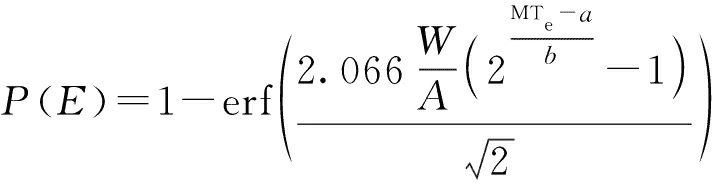

(2.7)

## 2.2 目标获取的经典框架

公式里，`erf(x)` 为高斯误差函数；`a` 与 `b` 来自 `Fitts'Law` 的系数；`W` 为目标尺寸；`A` 为到目标的距离；`MTe` 为经有效距离和有效宽度换算出的运动时间。实验拟合效果良好，R²达到 0.959，且现象上目标尺寸对失误的影响要比目标距离更突出。

李炳珠[17] 提出时域指向 `Temporal Pointing` 的概念。此类任务里，目标距离被理解为从任务启动到进入可操作时间窗的时间间隔，目标大小则等价于可成功选中的时间窗口长度，像“打节拍”一类交互就是典型例子。

基于时域落点的分布，他给出时域指向的失误率表达式：

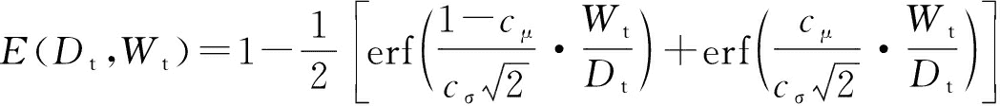

(2.8)

其中 `Wt` 为时域目标大小，`Dt` 为时域目标距离，`cμ` 与 `cσ` 为常数。模型表明，时间窗口越窄、距离越远，失误率越高，这与直觉一致并赋予了量化解释。

时域指向属于动态目标获取的特例，其失误模型只适用于较抽象的时间交互，不适合更直观的空间交互，尤其是空间动态目标。黄进等人[18] 为此提出了移动目标的失误预测模型，如图 2.11 所示。

设随机变量 `x` 服从位置参数 `μ`、尺度参数 `σ` 的正态分布，则其累积分布函数可写为：

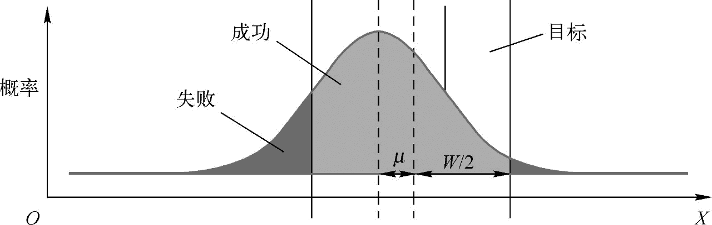

图 2.11　失误率预测原理：对落入目标外的分布面积积分

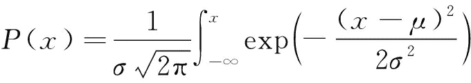

(2.9)

由下式可得随机变量 `x` 落在 (-∞，`x`) 区间的概率：

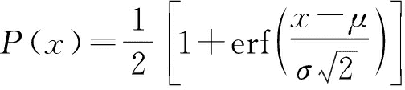

(2.10)

式中 `erf(x)` 为高斯误差函数，且

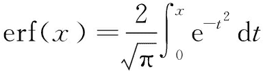

(2.11)

据此，错误率即为 `x` 落在区间 (`x0`，`x1`) 内的概率，`x0`、`x1` 分别对应目标左右边界：

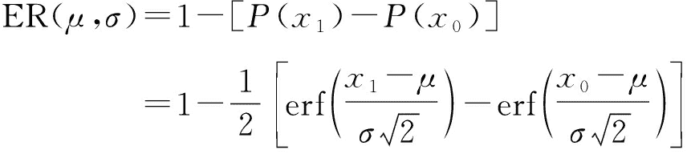

(2.12)

### 2.2.3 运动过程的动力学建模

与时长、失误率模型不同，运动控制模型直接对运动过程进行建模，能够从动力学角度复现轨迹、加速度等时序信息。典型代表有 `Minimum Jerk` 模型与 `Linear-Quadratic-Gaussian` 模型。

#### 1. Minimum Jerk 模型

`Minimum Jerk` 模型[19] 由 Tamar 与 Hogan 于 1985 年提出，其假设是让运动尽可能平滑，即最小化加速度的变化率。对二维平面运动，最小化的代价函数为：

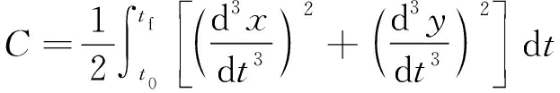

(2.13)

其中 `t0` 为起点时间，`tf` 为终点时间，`x`、`y` 为待求轨迹坐标。给定合适的边界条件，该最优控制问题可得到闭式解析解。点对点运动在常见条件下可化为五阶多项式。

当起止时刻均静止，即速度与加速度为零，已知起点 (`x0`，`y0`)、终点 (`xf`，`yf`)、运动时长 `tf` 时，最优轨迹为：

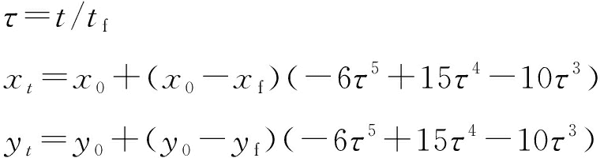

(2.14)

时刻 `t` 的轨迹点为 (`xt`，`yt`)，连缀后形成完整路径，经积分还能得到速度、加速度等。该模型计算简便，但无法预测绝对的运动时长，且默认用户能一次完成最优运动，未对修正过程进行建模。

#### 2. Linear Quadratic Gaussian 模型

`Linear-Quadratic-Gaussian` 模型[20] 基于最优反馈控制理论，由 Todorov 等人提出。反馈式闭环控制能在线利用观测信息重新决策，比开环控制更具人性化，可在不确定扰动下重复再现运动。

该模型把运动近似为受控制力驱动的质点，可表述为线性动态系统：

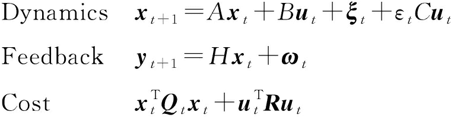

(2.15)

离散时刻 `t` 的状态为 `xt`，控制信号为 `ut`，感知反馈为 `yt`。控制器根据当前反馈 `yt` 选择使整体代价最小的 `ut`。其中 `ut` 模拟中枢神经系统发出的运动指令，`yt` 模拟视觉与触觉反馈，`ξt` 与 `ωt` 为均值为 0 的独立多维正态噪声，分别表征控制与感知噪声；`εt` 为标准正态变量，用于产生与控制相关的噪声；`R` 与 `Qt` 为系数矩阵，刻画身体消耗、速度与精度之间的权衡。整体上模拟了用户依据任务需求动态调整行为的过程。

将运动控制模型与具体交互结合，可仿真并预测用户行为，指导设计优化。例如 Philip Quinn[21] 把 `Minimum Jerk` 用于手势键盘，仿真输入手势轨迹并预测输入时长，能复现真实轨迹的形状与动态特征。黄进[22] 将 `Linear-Quadratic-Gaussian` 用于目标获取，通过拟合经验轨迹对运动过程建模，可模拟任意位置的静止目标或任意速度的移动目标获取，还可组合目标尺寸、位置、运动规律，模拟购物网站等复杂交互场景的难度与效率。

## 2.3 智能时代的交互范式

随着人工智能的快速发展，人机交互日益自然和谐，愈发贴近人类认知与行为习惯。构建符合人类认知机理、能解释与预测行为的智能交互模型，既是突破 AI 瓶颈的关键，也是设计自然交互的依据。本节介绍两种代表性模型：人机合作心理模型与基于语义三角形的自然交互模型。

### 2.3.1 人机协同的心理机制

为应对复杂任务与多样交互方式，刘烨等[3] 提出人机合作心理模型 `Human Computer Cooperation Model`，如图 2.12 所示。该模型把人机交互类比为人际交互，认为双方在先验知识与动机驱动下主动交互。人机两端的信息处理都包含感知、认知、动作三个处理器，每个处理器又含三个子模块。

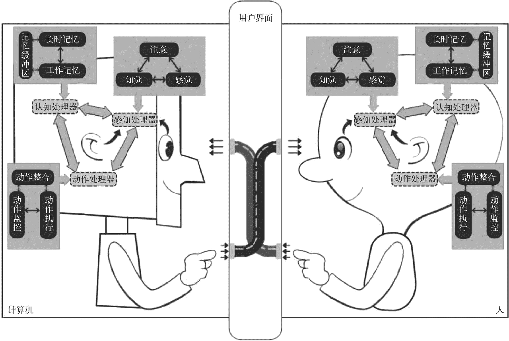

图 2.12　人机合作心理模型示意

#### 1.感知处理器
包含感觉、知觉、注意三个子处理器，负责接收、筛选与初步加工输入。人类感觉通过不同通道获取属性，知觉形成整体认识，注意实现对信息的选择与调节。对等来看，计算机的传感器对应感觉，模式识别对应知觉，注意功能则实现信息过滤与意图性交互。

#### 2.认知处理器
包含工作记忆、记忆缓冲、长时记忆。工作记忆暂时保持信息并向动作处理器传递，同时接收感知反馈。记忆缓冲衔接工作记忆与长时记忆，负责信息巩固。长时记忆存储既往知识经验，通过记忆缓冲与工作记忆交互，也可直接与感知处理器交换信息。

#### 3.动作处理器
包含动作整合、动作执行、动作监控。动作整合负责选择、规划与序列生成，动作执行负责指令输出，动作监控负责收集执行反馈并评价，以调整后续序列。

#### 4.感知模块与认知模块
感知模块先获取信息并提取直接含义，再交由认知模块进一步分析学习，形成预期后返回感知模块验证，实现对客观事物的概括反应。

#### 5.感知模块与动作模块
除经认知加工的常规路径外，感知模块可直接从刺激特征触发动作模块，跳过认知加工，实现更高效的反应。

#### 6.认知模块与动作模块
二者主要通过动作整合中的动作缓冲区联系。信息进入工作记忆后经判断决策，进入动作缓冲区的指令被执行，动作监控的反馈回流至认知模块，实现评价、调整与记忆。

人机合作主要通过三条通道：计算机动作输出进入人类感知，人类动作输出进入计算机感知，人类与计算机的认知模块存在异质同构。模型认为交互是多模态并行、分布式的，双方持续接收多通道信息并整合。

以智能对话系统为例，用户说“我不知道今天要干什么，怎么办”。语音语义特征先被提取，转化为文本；摄像头可同时捕捉表情动作以筛选注意焦点。文本与表情进入认知处理器，在工作记忆中进行语义情感分析，并从长时记忆库调取相关知识。动作处理器据此整合反馈指令，通过语音文字作出回答。若输出出错，动作监控会自查并纠正。用户接收反馈后再次感知认知，形成闭环协作。

### 2.3.2 语义三角形视角下的自然交互

言语交互中，语义三角形模型以“概念—符号—实体”阐释符号与现实的联系。刘胜航等[23] 将其拓展至自然人机交互，形成基于语义三角形的模型，如图 2.13 所示。人与计算机各由一个语义三角形描述。

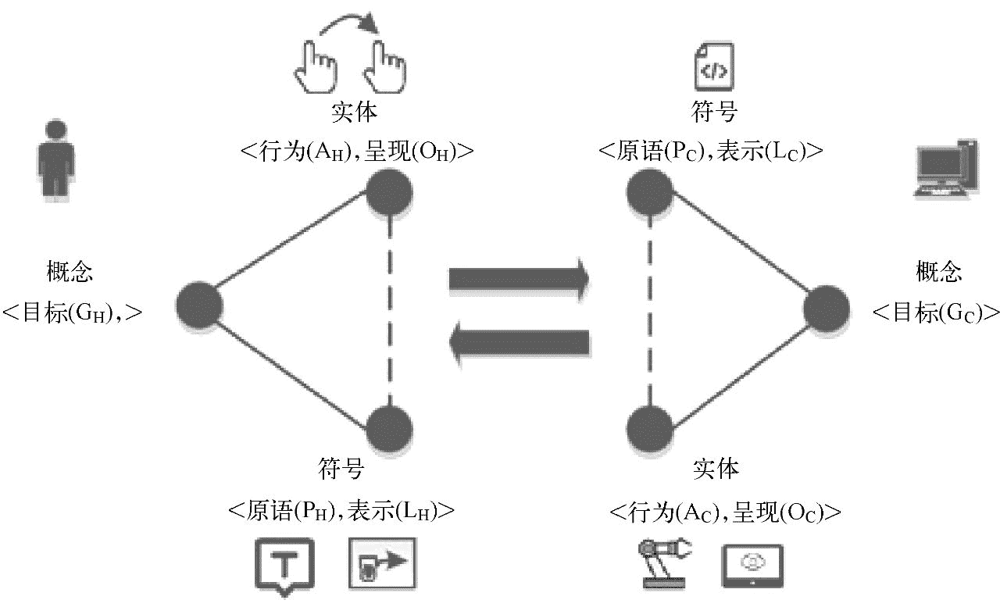

图 2.13　基于语义三角形的自然人机交互模型[23]

要素含义如下：
(1)概念即交互意图的抽象，用 `G` 表示，如领域知识、思维方式与操作习惯的概括。
(2)符号指承载意图的交互方式与指令，分原语 `P` 与表示 `L` 两层。原语是意图在符号中的直接体现，与意图一一对应；表示是通过具体通道对原语的呈现，如言语、指点等。
(3)实体指交互行为的动作与状态变化，分行为 `A` 与呈现 `O`。行为是意图的具体执行，呈现是执行效果的展现。

模型中三条边仍代表“象征—指称—代表”关系。人机交互体现为两个语义三角形元素间的相互作用。意图经概念 `G` 体现，具体交互通过符号表示 `L` 与实体呈现 `O` 完成。人可用符号表示 `LH` 或实体呈现 `OH` 将意图传递给计算机；计算机则可用符号表示 `LC` 或实体呈现 `OC` 向人传递意图。

自然交互过程可拆为四个子过程，如图 2.14 所示。

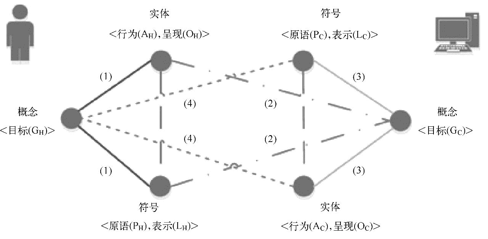

图 2.14　自然人机交互模型的交互过程[23]

(1)用户自然交互表达转化过程，将人的交互意图 `GH` 转化为自然界面设定的符号表示 `LH` 或实体呈现 `OH`。
(2)计算机自然交互表达识别过程，计算机识别 `LH` 或 `OH` 并转化为自身概念 `GC`。
(3)计算机自然交互表达转化过程，计算机将概念意图 `GC` 转化为符号表示 `LC` 或实体呈现 `OC`。

自然交互的语义回路

在语义三角框架下，识别是自然交互的第四个环节。人需要把自然界面给出的符号表示 LC 或实体呈现 OC 看懂，并转译为自身的概念 GH。

交互的发起方存在两种。人主导时，过程按概念外化、符号编码、传递、回译的顺序展开，可记作 (1)(2)(3)(4)。机主导时顺序逆转，先由系统输出符号与实体，人完成识别与回译，再由人外化与编码发出，即 (3)(4)(1)(2)。两种路径并非一次性完成，现实中它们会交错出现并持续循环。

为了让抽象框架更直观，以“人通过机械臂搬杯”为例子。人可以用语音或指点等通道把“移动水杯”的意图传给计算机，计算机驱动机械臂执行并以图形图像把过程与结果返显给人。

以人为交互主体时，GH 对应“移动水杯”意图的内在抽象；PH 为产生指令的生理信号；符号设定 LH 表现为口语“把杯子移到桌子右端”以及在触摸屏上把图标拖到目标位置的设定；实体行为 AH 是手指在屏上真实拖拽杯子到某坐标的动作；实体呈现 OH 是操作结束后手指在触摸屏上的终止状态。

以计算机为交互主体时，GC 是系统解析出的“移动水杯”意图抽象；PC 是机器侧的符号编码，可用四元组 “move”“cup”“time”“device” 表示；符号表示 LC 体现为机械臂的控制指令及其对应的图形图像指令；实体行为 AC 是机械臂搬运的执行过程；实体呈现 OC 是搬运完成的物理效果以及界面中水杯终点的可视化。

沿此框架，人控机械臂搬杯的完整回路为：人先启动，把 GH 同时转译为语言符号“把杯子移到桌子右端”或触屏操作符号 LH。语言符号直接送达计算机，触屏符号则借助指点操作 OH 把位置与控制信息传过去。计算机对 LH 与 OH 进行识别并映射到自身概念 GC，随后把 GC 转译为机械臂操作指令 LC，驱动执行并以 OC 的形式图形化呈现。人再对 OC 识别并回译为 GH，完成一次闭环。多轮往返后搬杯意图得以实现。

参考文献
[1] OLSON J R，OLSON G M. The growth of cognitive modeling in human-computer interaction since GOMS[M]//Readings in Human-Computer Interaction. Morgan Kaufmann，1995：603-625.
[2] CARD S，MORAN T，NEWELL A. The model human processor-An engineering model of human performance[J]. Handbook of perception and human performance，1986，2(45-1).
[3] 刘烨，汪亚珉，卞玉龙，等. 面向智能时代的人机合作心理模型[J]. 中国科学：信息科学，2018(4).
[4] LAIRD J E，NEWELL A，ROSENBLOOM P S. Soar：An architecture for general intelligence[J]. Artificial intelligence，1987，33(1)：1-64.
[5] 高庆宁. 基于 SOAR 模型的网络舆情演变过程中群体行为分析与仿真[D].南京：南京理工大学，2016.
[6] ANDERSON J R. Rules of the mind[M]. Psychology Press，2014.
[7] 王新鹏. 认知模型的研究和应用[D]. 兰州：兰州理工大学，2007.
[8] KIERAS D E，MEYER D E. The EPIC Architecture for Modeling Human Information-Processing and Performance：A Brief Introduction[R]. MICHIGAN UNIV ANN ARBOR DIV OF RESEARCH DEVELOPMENT AND ADMINSTRATION，1994.
[9] KIERAS D E，MEYER D E . An Overview of the EPIC Architecture for Cognition and Performance With Application to Human-Computer Interaction[J]. Human-Computer Interaction，1997，12(4)：391-438.
[10] 杨海波，汪洋，张磊. 人机交互的 GOMS 模型与 EPIC 模型的比较[J]. 包装工程，2015(8)：96-99.
[11] FITTS P M. The information capacity of the human motor system in controlling the amplitude of movement[J]. Journal of experimental psychology，1954，47(6)：381.
[12] MACKENZIE I S. Fitts’law as a research and design tool in human-computer interaction[J]. Human-computer interaction，1992，7(1)：91-139.
[13] MACKENZIE I S，BUXTON W. Extending Fitts’law to two-dimensional tasks[C]//Proceedings of the SIGCHI conference on Human factors in computing systems. 1992：219-226.
[14] MURATA A，IWASE H. Extending Fitts’law to a three-dimensional pointing task[J]. Human movement science，2001，20(6)：791-805.
[15] ACCOT J，ZHAI S. Beyond Fitts’law：models for trajectory-based HCI. tasks[C]//Proceedings of the ACM SIGCHI Conference on Human factors in computing systems. 1997：295-302.
[16] WOBBROCK J O，CUTRELL E，HARADA S，et al. An error model for pointing based on Fitts’law[C]//Proceedings of the SIGCHI conference on human factors in computing systems. 2008：1613-1622.
[17] LEE B，OULASVIRTA A. Modelling error rates in temporal pointing[C]//Proceedings of the 2016 CHI Conference on Human Factors in Computing Systems. 2016：1857-1868.
[18] HUANG J，TIAN F，FAN X，et al. Understanding the uncertainty in 1D unidirectional moving target selection[C]//Proceedings of the 2018 CHI Conference on Human Factors in Computing Systems. ACM，2018：237.
[19] FLASH T，HOGAN N. The coordination of arm movements：an experimentally confirmed mathematical model[J]. Journal of neuroscience，1985，5(7)：1688-1703.
[20] TODOROV E，JORDAN M I. Optimal feedback control as a theory of motor coordination[J]. Nature neuroscience，2002，5(11)：1226-1235.
[21] QUINN P，ZHAI S. Modeling gesture-typing movements[J]. Human-Computer Interaction，2018，33(3)：234-280.
[22] HUANG J，PENG X，TIAN F，et al. Modeling a target-selection motion by leveraging an optimal feedback control mechanism[J]. Science China Information Sciences，2018，61(4)：044101：1-044101：3.
[23] 刘胜航，陈辉，朱嘉奇，等. 基于语义三角形的自然人机交互模型[J]. 中国科学：信息科学，2018(4).

# 第 3 章 生理计算与交互

## 3.1 概述

生理计算指借助传感器实时采集人体生理信息并转化为控制输入的技术集合，追求像抬手、前伸那样直观的操控体验。传感器阵列能捕捉大脑与身体的状态变化，为用户认知、情绪与动机的动态表征提供依据。引入隐式用户模型后，系统的适应能力被扩展，身体与计算机之间形成持续对话。监测不可避免地产生可量化、可视化、可检验、可共享的数据，使用者借此认识到自己的数字化镜像。整体视角是用量化方式审视运动节律、睡眠模式与情绪波动。

该方向具有很强的跨学科属性，从神经科学延伸到工程实现。跨学科协作让心理学家、计算机科学家与工程师能围绕同一问题合作，但从脑机接口到远程医疗的广度也带来了落地难度。无论发展是否必然，生理计算在输入控制、适应性与监测等方面已显现诸多共性，为提炼设计范式提供可能。

过去三十年，人机交互的基础模式变化有限。键盘鼠标仍是意图表达的主通道，平板与手势识别虽冲击了传统输入方式，却未改变底层逻辑。另一种范式正在形成，允许用户无需显性输入即可与计算机通信。脑机接口 BCI 被设计为直接从大脑皮层读取动作与意图并转为界面操作，绕开了传统依赖物理运动的监测链。

BCI 与眼控提供了指令性、目的性的新输入形态，与鼠标指向点击的意图一致。输入形态虽新，交互机制基本保持。监测数据被用来刻画用户的认知、情感与动机状态，经整合形成反映个体心理状态的动态画像，并实时送入软件实现自我调节。这种基于心理生理的窃听式思路可能深刻改变 HCI 的未来。情感计算与适应性自动化的早期工作已证明，生理数据可触发及时直观的软件自适应，例如及时积极反馈帮助沮丧用户遏制愤怒升级，自动驾驶舱缓解高工作负荷飞行员，游戏难度自适应激励感到无聊的玩家。生物控制系统借助内隐的心理生理状态监控来促进积极心理状态、遏制负面情绪或危险状态的出现，对健康与安全有意义。

华盛顿大学 Huang 团队把肌电传感器做成环状腕戴，探索触屏手机场景下拇指动作的精细辨识，涵盖有反馈与无反馈下的点击、滑动及九宫格解锁。卡尔斯鲁厄理工学院 Amma 团队采用 8×24 点阵高密度肌电阵列采集整臂信号，实验获得极高的手势识别率。基于表面肌电原理，Thalmic Labs 研发了内置运动传感器的肌电腕带 MYO，其应用可演示文档控制、简单手势并开放开发接口，成为肌肉感知交互从实验室走向商业的重要节点。麻省理工学院 Dementyev 团队以压力传感器制作压力腕带来感知前臂肌群收缩，可识别握拳、张手、掐指等多类手势。卡内基梅隆大学 Zhang 团队利用肌肉收缩放松时的电阻抗差异，结合高分辨率电阻抗层析对腕部横截面扫描，构建实时手势识别系统。

东南大学宋爱国团队在肌肉活动信号采集设备上开展深入研发。中国科学技术大学陈香教授在基于表面肌电的中国手语识别与虚拟现实手势交互方面取得显著成果。中国科学院软件研究所田丰团队从手势运动的肌电信号中提取起止点，解决了手势间分割难题。

应用层面，匹兹堡大学 AttentiveReview 基于 PPG 在 Review 阶段自适应推荐内容；威斯康星大学麦迪逊分校基于 EEG 实现同类自适应推荐；塔夫斯大学利用近红外光谱 fNIRS 获取疲劳与负荷度，自适应调节任务难度，使用者表现提升且任务失败率降低 35%；瑞士联邦理工学院追踪 MOOC 视频学习中的眼动并推断注意力集中度，给出学习效率反馈；蒙特利尔大学 MENTOR 根据 EEG 信号决定出题或举例，以更好适配学习者状态。

塔夫斯大学 Robert Jacob 团队基于 fNIRS 探索动态脑氧含量与认知负荷、情感状态及运动机能的关联。匹兹堡大学 MIPS 实验室研究以普通摄像头隐式监测日常交互中的心率。斯图加特大学 Albrecht Schmidt 团队使用轻量脑电设备 Neurosky Mindwave 监测听众在报告中的投入度。南卫理公会大学学者利用瞳孔直径预测认知负荷。

生理计算系统大致可分两类。第一类用于拓展身体表达，即指导有目的、有意志的感知运动任务。如触碰图标、点击链接等均受意图驱动，日常拿杯、开门等无意识行为则由神经系统在潜意识层面调控。系统可采集并解析此类意识活动来控制假肢、轮椅等设备。第二类聚焦于身体内部动态过程的自我感知，帮助认识心理状态。可采集运动、心理工作量、挫败感、血压等生理数据，通过额外的量化反馈通道提升自我觉察。

## 3.2 生理计算理论

本节简述生理计算常用生理信号、采集设备，以及信号处理、特征提取与分类识别的常用方法。

### 3.2.1 生理学概念

最早的生理指标监测靠直接观察，例如将耳朵贴于胸口聆听心跳。20 世纪初出现专门放大生理信息的机械与电子装置，随计算机普及，众多生理传感器被开发以支持数据处理与分析。

心理生理学已有八十余年研究历史，致力于理解身体对心理与生理变化的反应。现代传感器可检测人类神经系统的三个分支：中枢神经系统 CNS、躯体神经系统 SNS 与自主神经系统 ANS。CNS 包含脑与脊髓，SNS 与肌肉控制相关，ANS 调控主要腺体与器官。

随着认识深化与传感器发展，人体生理信息的采集日益多样化，以下介绍生理计算中常用的几种信号。

1. 脑电信号

脑电信号是脑皮层自发产生的节律性电活动，头皮电极可测量该表面电位。脑电能够反映清醒大脑的警觉水平，是可用性评估尤其是安全关键系统评估的有用指标。例如高频 β 波 14～30Hz 与高度警觉相关，α 波 8～13Hz 提示放松警觉，δ 波 1～3Hz 与困倦相关。通过任务期间的脑电监测，可评估任务投入度或难度并捕捉注意力涣散时刻。研究显示，随着任务难度或要求提升，前额区 θ 波 4～7Hz 会增加，同时 α 波受抑制。

生理信号在人机交互中的捕捉与应用

除了追踪持续波动的脑电背景噪声，还能在大脑内部捕捉到针对特定刺激的离散且可重复的电回声，这类回声通常被称为事件相关电位 ERPs。它们与明确的心理事件、闪光提示或运动预备动作紧密关联，重复实验已经证明其稳定性足以作为免手操作的交互系统输入。

2.肌电信号
在目标肌群皮肤表面贴上两枚电极，即可记录肌肉活动相关的电生理变化。得到的信号能够判断肌肉处于完全收缩、部分收缩或完全放松的状态。

肌电对肌肉活动的细微波动十分敏感，因此常被视作运动准备的理想指标。肌肉张力上升往往伴随负性情绪，所以肌电也被用作评估用户在虚拟环境中沉浸感的潜在参考。

心理生理学研究指出，面部肌电对愉悦与厌恶刺激的反应模式较为一致，尤其集中在眉部肌群。对前额表情的实时监测可提供一个有用的可用性参考。

3.眼电信号
眼电反映角膜与视网膜间的电位差，通过环绕眼部的电极即可获取。它提供眼球移动位置及速度变化的信息。在头部保持静止条件下，眼电能够将注视点定位到 x、y 坐标，这也是视频式眼动仪受欢迎的重要原因。无论采用何种方案，眼动捕捉都能揭示视觉注意被分配到界面哪些组件，为精细化界面设计提供依据。

视频式眼动设备同样适合测量瞳孔反应。环形与放射状肌纤维共同控制瞳孔的收缩与扩张。瞳孔尺寸会对积极或消极的情绪刺激做出反应，为情感计算提供额外参考。瞳孔尺寸变化也可能与心理刺激呈现时机相关。

眼电传感器还能记录眨眼。眨眼频率与持续时间的量化可反映任务需求与疲劳程度，是界面评估与可用性测试的良好指标。眨眼还能作为开关信号，相当于一次点击，无需手持鼠标。

4.心电信号
心电衡量心肌收缩相关的电事件。心率 HR 即心脏跳动频率，通常以每分钟跳动次数 bpm 表示。心理刺激与体育活动都会推高心率。例如当交互任务因认知负荷、时间限制或不确定性变得具有挑战性时，心率往往上升。

心率曾用于评估电子游戏的刺激程度，近来也被整合进游戏中，以玩家心率实时变化动态调节挑战难度。除心理因素外，多类躯体活动也会影响心脏。心率调控整合了体温调节、血压控制和呼吸节律的影响。研究者曾对心动周期数据进行快速傅里叶变换 FFT 以分离这三种影响。该工作确认了 0.1Hz 窦性心律不齐的中频成分，即心率变异性 HRV 的中频部分。该成分被认为是对实验室任务与真实生活活动的心理反应。

###5. 呼吸模式
吸气呼气时胸廓膈肌会扩张收缩。此类活动的速率与深度可通过系于胸部的皮带传感器测量。呼吸速率可量化为每分钟呼吸次数。就可用性指标而言，呼吸速率会随任务需求提升，互动任务困难或要求高时呼吸会更深更长。也有研究认为呼吸节律可能反映情感的两极性，如平静-兴奋、放松-紧张。

###6. 电活性/皮肤电
在皮肤上放置两枚电极并施加微小恒定电流，皮肤可视为可变电阻。电极两端电压经欧姆定律即可换算为皮肤有效电阻。

电活性可体现人体对情感刺激如音乐、暴力观察、色情刺激等的反应，可用于系统的自适应反馈。该指标也涉及脑负荷测量，手指、手掌、前臂和足底是测量电活性的活跃部位。因此需考虑记录手段对个人正常运动或行为的影响。

###7. 血压
血压衡量心脏泵血的力，也反映血液流经动脉的阻力特性。静息血压水平受有氧健身水平、情绪状态等个体因素影响。有研究建议将心电信息与血压信息结合，以区分挑战状态与威胁状态，对关键体验评估和电子游戏设计特别有用。

从上述描述可见，直接采集的生理数据特性并不直观，作为计算机输入源，生理信号远不如传统数据源可靠。其受多重因素影响：①个体生理特征。每个人的生理特征独一无二，正常心理生理活动范围需考虑性别、年龄与健康状况等。②环境因素。多数心理生理参数易受温度、湿度变化等环境影响。③行为影响。心脏活动如心率血压也可能受吸烟、姿势、时间等因素影响。这些变异妨碍了生理信号作为输入的可靠性。随上下文感知技术发展，可利用探测到的用户环境信息对生理数据进行标准化。

### 3.2.2 生理信号采集手段
明确生理信号产生原理后，测量过程至关重要，采集设备也经历巨变。

近数十年心理生理学分析发展迅速，利用脑电图、心电图和皮肤电导等指标评估用户在不同环境下的认知与情感状态。针对不同背景人群，会根据教育背景、兴趣与灵感使用心理生理分析。为记录人机交互中的用户体验或心理效应，研究者进行大量研究，利用心理生理数据的实时特征获取受试者的心理状态。

心理生理学中记录心理生理信号有三种测量方法：问卷、信号读取和行为分析[19]。

问卷评估参与者[20]对自身心理生理状态的反思与自我评价，是最常用的自我评价记录方式。优点是提供用户主观体验的表达，但也存在人为错误、偏差反应、对问题的误解或调查规模不足等缺陷[21]。

信号读取对应生理反应。这些反应通过仪器测量，如心率、体温、肌肉紧张、脑信号、皮肤电导等。好处是提供精确反应。由于易受身体活动和外界因素混合影响，信号读取后的噪声去除十分重要。

行为分析包括观察和记录行为，如面部表情、眼球运动等[20]。这些反应易于测量，主要用于注意力和情绪相关的实验[22,23]。

在心理生理学中通常需要对生物信号做复杂交互分析。心理生理分析应用广泛，例如通过压力检测实现测谎功能，通过测量短期情感反应如感觉、情绪、性格等[24]监测实验对用户的影响。情感反应被视为基于环境与情绪本能的心理状态，自发且持续数分钟，很难识别。心理生理学中常用的经典情感状态有愤怒、蔑视、厌恶、恐惧、快乐、中性、悲伤和惊讶等。研究人员可据此推断情感状态。研究人员也可利用心理生理信号估计参与者的认知状态。这些信号用于分析低阶认知过程如简单视觉检查和高阶认知过程如注意力、记忆、语言、工作负荷等[25]。不同信号来源用于不同分析，如心电信号 ECG、皮肤电导 GSR、脑电信号 EEG、肌电信号 EMG、呼吸速率 RR、皮肤温度 ST、面部表情等。

为采集记录上述心理生理信号，过去大量新技术被用于电极设计。目前人体生理信号采集技术已从湿电极升级到干电极，氯化银银是生物反馈传感器最常用的电镀材料。除氯化银银外，传感器还使用金、铝、不锈钢和镍钛等金属混合物[26]。湿电极需电解凝胶增加传导，但会带来不适。因此涉及实时记录的应用应优先选用干电极[27]。

随着技术成熟，已有厂商生产可同时采集多种生理数据的设备。常用设备如美国 BIOPAC 厂商生产的多导生理记录仪，是目前应用广泛、功能强大的电脑化多导生理记录仪，产品分为 MP 系列 16 通道研究型多导生理记录仪及 Student Lab 系列 4 通道学生实验型多导生理记录仪，可完成心电、脑电、肌电、眼电、胃肠电、诱发电位、神经电位、细胞电位、有创血压、无创血压、dP/dt、体温、肌张力、呼吸波、呼吸流速、组织血流速度、血管血流量、氧气含量、二氧化碳含量、血氧饱和度、无创心输出量、光电脉搏容积、皮肤电阻、电刺激等测量。另外，脑电方面有 Neuroscan EEG/ERP 记录系统，为脑科学研究提供良好技术平台。

### 3.2.3 生理信号分析
了解常见生理信号及采集设备后，需掌握处理与分析方法。下面简要介绍人机交互领域应用广泛的几种生理信号的处理、特征提取与分类识别过程。

#### 1. 肌电信号
肌电信号虽微弱，却蕴含大量与肢体运动相关信息[28]。表面电极可检测用户肌肉收缩意图。截肢者或残疾人能在不同水平的静态肌肉收缩或动态肢体运动中产生可重复但逐渐变化的肌电模式。这些模式可用于控制系统，即肌电控制系统 MCS，以操控康复设备或辅助机器人。

肌电信息采集分两种。第一种是针电极肌电，以针形电极插入肌肉内部，直接在活动肌纤维附近检测电位。干扰小、定位性好、易识别，空间分辨率与信噪比高。但会造成创伤，不宜多路同时测量。第二种是表面电极肌电，从皮肤表面通过电极记录神经肌肉活动时发出的生物电信号。检测表面大、空间分辨率低，记录信号为一定范围内肌纤维电活动的总和。无创伤但易受外界干扰。

因针电极有损伤，一般采用表面电极肌电采集方式。表面肌电信号 MES 通过放置在用户肌肉上的皮肤电极采集，电极通常配微型前置放大器以分离感兴趣的小信号。信号经标准肌肉电仪器放大、滤波、数字化后传至识别模块。

识别模块由活动段检测、特征提取、分类识别三部分组成。多通道表面肌电信号由放置于人体手臂皮肤预定位置的传感器同步获取，经活动段检测方法标定每个动作执行时对应信号流的起止点，再经特征提取进行分类识别，识别结果可转为控制指令作为人机交互输入。

##### (1) 活动段检测
从连续采集的多通道肌电数据流中提取对应动作执行时的信号，称为活动段。任务是确定手势动作表面肌电信号的起点和终点。已有提取算法包括短时傅里叶方法、自组织人工神经网络方法、移动平均方法等。

##### (2) 特征提取
因输入量大且信号随机，直接将时序肌电输入分类器不现实。因此需映射到低维向量，即特征向量。模式识别的成败与特征选择和提取效果直接相关。肌电特征可分为时域、频域和时频域三类[29]。评价方法有结构分析和现象分析。结构分析基于物理生理模型评估特征，在信号产生过程中考量。可使用数学模型合成信号评估所选特征，如偏差、方差和噪声敏感度。现象分析对信号做粗略解释，有时称经验方法，主要依据分类性能比率及其鲁棒性评估。

常用方法有时域分析、频域分析、时频分析。

时域分析计算相对简单，基于信号振幅、周期、形状等特征，是肌电分类最常用的方法。将肌电视为零均值随机信号，振幅可定义为时变标准差 STD，与主动运动单元数量和激活率成正比。振幅由特征表示，代表信号能量、激活水平、持续时间和力，受电极位置、组织厚度、肌肉纤维中运动单元分布、肌肉传导速度和检测系统等因素影响。为判断幅值特征质量，将信噪比 SNR 定义为一段内样本均值除以其标准差，该比率衡量信号振幅随机波动，更高 SNR 可产生更好特征。当力量或姿势改变时，时域分析不再适用。常用时域特征有积分肌电值、过零点数、方差、肌肉电信号时序模型自回归模型、滑动平均模型、自回归滑动平均模型和肌肉电信号直方图。

频域分析主要研究肌肉疲劳并推断活动单元变化。信号频谱受低频范围 40Hz 以下发射率和高频范围 40Hz 以上[30]沿肌纤维运动的动作电位形态两个因素影响。它是时变的，直接取决于收缩力、肌肉疲劳和电极间距。在持续随意收缩过程中，即使无肌肉状态随意改变，肌电信号也应视为非平稳信号。频域分析常用做法是求取功率谱的平均功率频率和中值频率。

时频分析将时域与频域结合，同时分析两者。对于表面肌电分析，常用方法有短时傅里叶变换、Wigner-Ville 变换、Choi-Williams 分布及小波变换等。

特征提取后需对数据进行分类识别。

##### (3) 分类识别
提取的特征需划分为不同类别以识别所需运动模式。肌电信号性质决定特征值会有较大变化。外部因素如电极位置变化、疲劳和出汗也会导致信号模式随时间变化。分类器应能最佳处理这种变化模式并防止过拟合。分类速度需满足实时约束。合适的分类器应能有效对新模式分类，在线训练可长期稳定保持性能。常用算法有神经网络、模糊推理等。

大量文献强调神经网络在肌电分类中的成功。其动机源于用人工智能 AI 通过学习执行任务的愿望。神经网络优点是既能表示线性关系也能表示非线性关系，并能直接从被建模数据中学习这些关系。它还满足实时约束，是控制系统的重要特征。基于识别的肌电控制作为开发实时模式的先驱，Hudgins 及其团队[29,31]使用多层感知器 Multi-Layer Perceptron,MLP 神经网络对时域特征分类，能区分四种肢体运动，错误率约10%。最近，Zhao 团队[32]应用 MLP 神经网络基于信号的时间尺度特征和熵来识别六种运动模式，平均正确率约为 95%。

利用模糊推理进行生物信号处理和分类具有多重优点。生物信号并不总是严格可重复，有时甚至矛盾。模糊推理能容忍数据中明显矛盾。模糊推理能发现数据中不易检测的模式。此外，医学专家的经验可纳入模糊推理的处理与分类。由于其推理方式，不完整但有价值的知识可整合进模糊推理。模糊推理方法利用不精确、不确定和部分真实的容忍度，实现易处理、鲁棒、低成本的分类方案。

分类识别后系统得到确定指令，再输入控制设备，完成肌电控制的单向流程。肌电控制应提供高度直观和灵活的控制，并提供高水平性能。可控性的三个重要方面是系统准确性、执行控制的直观性及系统响应时间。

系统准确性对用户意图真实实现至关重要。应尽可能高，尽管难以定义可接受阈值，因缺乏明确临床尝试，准确性是开发多功能控制器的关键因素，可通过从肌肉状态提取更多信息并采用可利用这些信息的强大分类器来提高。此外，增加用于数据收集的活动肌肉数量，开发信息丰富的特征集，可提升准确性。

实际应用中，直观性缺乏源于用户当前知识与执行操作所需知识间的差距。可通过增加用户知识或减少执行操作所需知识来实现。前者需大量培训，后者需开发强大的智能用户界面。因此肌电控制应能学习肌肉激活模式，以自然方式驱动运动。它们需在运行过程中对不同条件具有足够鲁棒性，且面对新数据或模式时效率很高。直观性减轻了使用者在长期操作和自然日常工作中的心理负担。

#### 2. 脑电信号
大脑皮层内众多神经元细胞自发节律性电活动产生脑电信号，通过监测脑电信号中不同频率、幅值和波形电位变化即可获取人的情绪、思维等心理活动信息。随着传感技术和计算机技术快速发展，脑电信号在越来越多领域得到广泛应用，从最初临床医学用于疾病诊断治疗，到如今研究通过提取分析人脑电信号实现脑机接口 BCI，提供更直接、方便快捷的人机交互方式。

目前研究发现人体自发大量节律性脑电信号主要包括以下几类频段：

① δ波。频率为 1～3Hz 的脑电信号，多出现在人类婴幼儿时期，成年人在正常状态下很难被监测到。

② θ波。频率为 4～7Hz 的脑电信号，幅值为 20～40μV，是人类青少年时期 10～17 岁脑电信号主要频段，同时与成年人精神状态关联很大，成年人精神抑郁、心情低落时较易观测到 θ波，人情绪较好时很难观测到。

③ α波。频率为 8～13Hz 的脑电信号，是正常人脑电信号基本节律，人安静休息但保持清醒时观测最显著，一旦人受其他刺激或发生具有目标性活动时，α波消失，β波替代出现。

④ β波。频率为 14～30Hz 的脑电信号，一般与人所进行活动种类有关，其频率代表大脑皮层兴奋程度，人情绪亢奋或精神紧张时会显著观测到该频段脑电信号。

⑤ γ波。频率在 30Hz 以上的脑电信号，同样是在人情绪强度较高时出现。

脑电信号基本波形如图 3.1 所示。

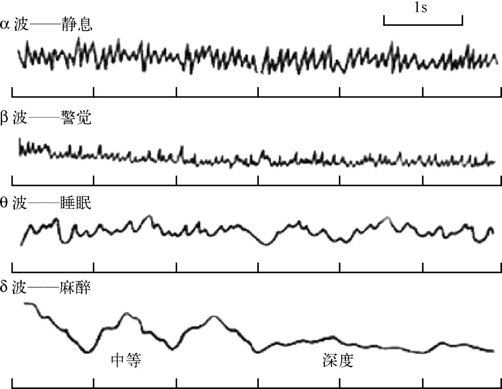

图 3.1　脑电信号基本波形

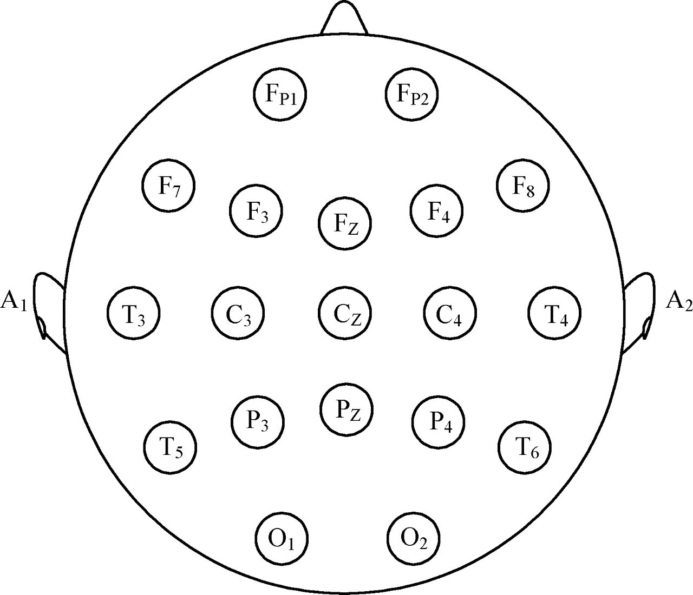

图 3.2　`10/20`国际标准导联系统电极放置位置示意图\[33\]

应用脑电信号第一步是采集脑电信号，目前最广泛方式仍是使用脑电图仪，实际测量根据测量电极放置位置不同可得到不同脑电图，包括深部脑电图、大脑皮层脑电图和头皮脑电图。常规脑电测量都采取头皮脑电测量方法，国际标准导联系统 `10/20` 电极放置法是目前最常用的电极放置标准。该标准中，`16` 或 `19` 个电极被放置在头皮特定位置上，如图 3.2 所示\[33\]。

表 3.1 为 16 导联采样电极放置位置与对应符号\[33\]。

表 3.1　16 导联采样电极放置位置与对应符号\[33\]

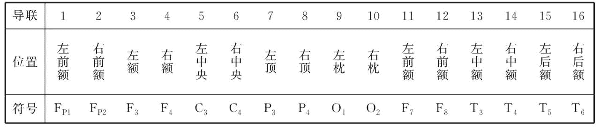

脑电信号想落地应用，第一步就是把有价值的特征拎出来。早在 1932 年 Dietch 就用傅里叶变换首次对脑电做了解析，此后时域、频域等经典处理手段都被搬进了脑电分析里。时域的做法偏向直接看波形，比如方差、峰值、相干性、波形参数等，优点是直观物理意义清晰，可脑电本质是非平稳随机过程，直接在时域挖信息难度大、收获有限。

频域路线更主流。功率谱分析是使用最广的一种，把信号切成短时段近似平稳后做傅里叶变换，再对幅频特性平方并加窗得到估计。分段能缓解非平稳，但分辨率偏低、方差大、会出现旁瓣。针对这些短板，自回归参数模型谱被提出，可以给出更高分辨率的结果，在捕捉脑电动态变化时优势明显。双谱分析则是为了解决功率谱会丢掉相位等高阶信息而来的改进。小波变换依托多尺度特性，挑选合适的小波基后可在时频两端同时呈现特征，调节点就可聚焦不同时间尺度的信息。除经典方法外，近年人工神经网络、非线性动力学等现代手段也在特征挖掘中普及，能拿到常规时频分析不易触及的信息，具有较好前景[34]。

拿到特征后，就要判断生理心理状态，这一步通常靠机器学习做分类。常用的分两类。有监督学习里有支持向量机`SVM`、贝叶斯、神经网络等，因带标签而识别更可靠，用得更广。SVM 泛化强、全局优化，特别适合非线性、小样本问题，是脑电分类的主力[35]。神经网络在样本指导下不断修正权值，再用训练好的感知器分类[36]。贝叶斯相比其它方法更擅长拒绝不确定样本。无监督学习虽准确率略逊，但更贴近真实场景，很多应用根本没有明确类别标签。它的思路是让相似样本自发聚类、异类分离。模糊 C 均值聚类通过找类别固有特征聚拢相似样本，在脑电处理中应用广泛[37]。

脑电最成熟的应用集中在医学生理领域，尤其是睡眠研究。学界一般把睡眠分成五段。①`NREM` S1 入睡期，α 波降到 50% 以下，低幅θ 波增多，后期可能出现驼峰波。②`NREM` S2 浅睡期，θ 波显著增多，同时出现中低幅δ 波和睡眠纺锤波。③`NREM` S3 中度深睡期，纺锤波幅值增大频率降低，δ 波占比 20%～50%。④`NREM` S4 深睡期，纺锤波逐渐消失，δ 波明显增多占比超 50%。⑤`REM` 睡眠期，脑电形态近似 S1，开始可见锯齿波，α 波增多但不规律[38]。采集睡眠脑电后经滤波放大等预处理即可进入特征提取。文献[39]里用 4 阶 Daubechies 小波做 4 层分解，比较各层小波包系数的均值与标准差在不同睡眠状态下的差异，发现差异显著。例如`D2`分量包含α、β频段信息，随着睡眠由浅入深其特征逐步减小。把各频段小波包系数的均值、标准差作为自动分期特征输入 SVM，分类准确率达到 85%。

脑电节律与情绪密切相关，因而情绪识别也很有前景。`Lange`二维模型把情绪拆成效价`Valence`和唤醒度`Arousal`两个轴。效价关乎体验与强度，唤醒度关乎机体激活程度。多系统模型则认为情绪是由快乐、厌恶、悲伤、愤怒、害怕等基本元素构成。不同频段强度随情绪变化，例如γ 波随情绪亢奋增强而增强，θ 波能量随积极情绪增强而增大，右侧额区α 波能量随负面情绪如悲伤、厌恶增强而增大，害怕时左侧前额区β 波明显上升，高兴时`C4`导联α 波强度下降，悲伤时左侧前额区α 波强度下降，平和状态下`T5`导联γ 波上升、`CP5`导联α 波下降[40]。

基于脑电的情绪识别一般走四步：情绪诱发、采集预处理、特征处理、识别。首先通过面部动作、语音提示、回忆等方式诱发情绪，再用仪器采集原始脑电并滤波放大去噪。随后用前面提到的特征提取手段拿到指标，如事件相关电位`ERP`的潜伏期幅值、各频段功率谱、左右前额叶α 波不对称度等。可根据研究角度挑选特征，单一特征对特定情绪有优势，多特征融合则互补。特征送入分类器即可判定状态。实践中无监督学习如支持向量机、神经网络能取得更好识别效果，而无监督聚类还能削弱个体差异，更符合实际应用。

### 3.眼电信号
对全身瘫痪的脑瘫、肌萎缩症等患者，眼球仍可控制，基于眼电的交互就很有价值。一个眼电控制系统核心是检测采集与特征识别分析。

采集上常用双导联，把银/氯化银贴片电极贴在眼周，再经信号放大、电缆驱动、带通滤波、电平转换、数据存储等环节得到可用信号。眼电可分为眨眼、扫视、凝视。凝视时能得到一条稳定基线，眼球上下左右移动时，眼电位随移动方向和角度线性变化。扫视是快速跳动，眨眼是眼睑开合，在垂直眼电上体现明显。

研究统计多名被试的眼动数据后发现，有意识眨眼的幅值大于无意识眨眼，扫视的眼电会出现明显脉冲，幅值与眨眼差异可辨[41]。据此可用阈值法限定有意识眨眼：脉冲宽度 200～300ms，峰值不小于有意识眨眼脉冲幅值最小值与无意识眨眼脉冲幅值最大值之均值。对扫视运动，则依据采集到的 n 个扫视脉冲幅值绝对值，设定宽度与幅值的阈值。

### 4.皮肤电信号
皮肤是人体最大接触面，很多皮肤电过冲源于身体活动引发的表面变化，尤其是汗腺自主神经活动，反映了交感神经系统的激活。根据觉醒激活理论[42]，这种变化可映射心理活动。

在情绪识别中皮肤电反应不同。害怕或焦虑时汗腺活动增加，皮肤电传导随之升高。Kim 团队用银/氯化银电极置于手指检测皮肤电，对情绪识别准确率达 95%[43]。Jang 团队发现皮肤电水平与皮肤电反应变化能映射情绪波动[44]。

### 3.2.4 小结
生理计算系统的链路大致是：传感器记录生理数据→预处理→特征提取得到特征数据→经阈值法、神经网络等推理规则转为心理状态估计值→系统据此推断状态或指令，进入下一流程。

## 3.3 生理交互系统设计
把生理计算模型融入系统工程后，交互设计要同时满足通用准则和生理计算的特殊性。本节问题可归为四类：硬件隐式性、准确性与鲁棒性、实时信号处理能力、状态推断与反馈规则。

### 3.3.1 硬件
#### 1.隐式性与准确性
生理测量是系统的基础，质量差就会失效，所有传感器都要校准验证。但部分系统为提升隐式性会牺牲准确性，例如步行检测被用来估算不同条件下的行走或驾驶行为。

研究中多用性能强的传感器，设置往往复杂。脑电研究需要戴电极帽，电极位置很关键，研究者常因不确定最优位置而增加布电数量，并用凝胶改善质量。为去除眼电伪迹，还需同步测眼电图。用 15 个信号电极、参考电极、接地电极加眼电电极，准备时间约 30 分钟。实际应用中人很少愿意花费这么久。

若想提升体验，可减少电极数、采用干电极、无凝胶方案，也可省去眼电测量。这些做法在消费级硬件中已有实现，但准确度明显下降。

要让传感器“隐形”，研究做了不少尝试。非接触式如红外相机测温，传感器可内置于界面或环境中，如方向盘、衣物。这些方案潜力大，但需验证间歇性接触皮肤等因素不会让测量失效。另外要保证实时能力，部分现有传感器只能把数据存到存储卡再分析，实际应用要求数据无线实时传输到中心计算机，或由传感器旁的微控制器即时分析。

#### 2.鲁棒性
商用传感器在真实使用中易受运动、温度、湿度影响。运动伪迹会让电极移动，导致皮肤电导读数错误。生理状态也会间接干扰，如环境升温导致出汗、非心理原因引起的皮肤收缩增加等。

以运动伪迹为例，电极或电缆移动都会引入干扰，部分可通过信号处理补偿，但皮肤电导中的伪迹常难以与真实变化区分。心电图中的运动伪迹易被察觉，但频率范围与心电信号部分重叠，去除仍困难。移动传感器的出现缓解了一部分问题，环境因素对数据准确性的影响仍需生理计算研究者结合测量与生物医学工程成果，利用信号处理进行补偿。

### 3.3.2 信号处理
原始生理数据需先处理才能用于心理生理推断。通常包括滤波去除低高频无关信息、去噪如运动伪迹、语音伪迹、眼电伪迹等，并从干净信号中计算相关特征。

#### 1.实时噪声去除
生理计算系统要快速检测并响应推断出的状态变化，要求数据实时测量与处理。原始数据常含与生理反应无关的噪声，数字滤波只能去掉一部分，因为脑电图、电描记图、电肌图的频带部分重叠，眼电和运动伪迹无法完全滤除。

主流去噪有两种。第一种用辅助参考传感器评估主传感器信号质量，如测脑电时同步测眼电以便在算法中扣除噪声，运动伪迹可用加速度计检测。第二种不依赖额外传感器，用主成分分析或独立成分分析去除伪迹，已成功用于动态脑电、心电的运动伪迹去除。

#### 2.窗口选取
特征提取频率取决于研究需求和实时处理能力。原始数据需高采样率记录，但若只想每隔数分钟推断一次心理生理状态，就不必同频率计算特征。很多生理特征计算量大，对硬件是挑战，通常一次推断做一次特征提取。

特征提取基于从过去某点到现在的时间段，即窗口。窗口长度需权衡：上限是一次推断间隔，因为推断后系统会执行动作，用户需适应新状态，稳态前的数据不应参与。窗口也不能太长，因为生理反应随时间衰减，长窗口会让刺激相关信息淹没在背景噪声中。不同信号反应快慢不同：脑电不到 1 秒，皮肤电导数秒，皮肤温度约一分钟，所以不同特征可能需要不同窗口。

### 3.3.3 状态推断
由生理反应推断心理状态是难点，需心理学与计算机科学结合。生理与心理的关系很少是一对一，更常见一对多或多对一。

因主观性，生理计算系统没有统一标准。常用步骤是特征提取、降维、分类。分类器从线性判别分析到神经网络不等，研究多用单一静态分类器，常在预先录制的数据集上训练，类别样本大致均衡。

大量混杂因素会影响心理生理反应：年龄、性别、疾病、一天中的时间、体育活动、外部温度、咖啡、药物等，可能完全掩盖心理因素引起的变化。真实场景需同时考虑非心理环境和心理环境。

这些混杂因素可用传感器测量，如加速度计测活动、呼吸传感器测语音、电子日记记录饮食、时钟记录昼夜节律。把测得的混杂因素纳入推理算法即形成语境意识。目标是在代表性测试条件、环境和个体差异间建立可靠推断。语境意识在疲劳研究中流行，结合生理测量与用户状况、环境状况。当前仍处于起步阶段，初期常作为额外输入特征，后期可能作为概率推理的先验，或让系统据上下文在不同推理算法间切换。

### 3.3.4 反馈规则
推断出用户心理状态后，系统必须做出响应。反馈大致分三类：帮助沮丧用户、用户厌烦或气馁时调低挑战等级、添加情绪展示以鼓励积极情绪、缓解消极情绪。理论已较成熟，实践仍具挑战。

首先要问系统应有多少可选操作。操作越多，系统潜在精确度和帮助性越高，可对更具体问题响应，也避免用户总得到相同反馈。但心理生理推断的特异性是否足以可靠识别少数使用者的状态存疑。操作越多，分析系统性能越难，贡献不清晰，效果可能非线性叠加，两个动作连续执行的效果可能与单独效果之和不同。

确定可选动作后，还需决定反馈频率。这取决于所用生理测量、应用场景和操作本身。不同生理信号刺激反应时间差异大：脑电不到 1 秒，周围皮肤温度超过 10 秒。这为反馈频率设定上限：系统采取行动后，需等其效果在生理反应中显现，再采取新行动。

反馈的节奏要兼顾干预的打扰程度和显隐程度。越直接、越显眼的操作就越适合偶尔使用，频繁出现很容易招致反感。举例来说，游戏难度若每十秒就自动波动一次，玩家根本来不及建立稳定的体验，马上就会觉得烦躁。同样，若系统每十秒就主动提供一次帮助，等于不断提醒用户表现不佳，也会让人产生抵触。相比之下，隐蔽且不抢眼的做法，比如微调房间灯光的亮度，可以承受更高的触发频率，但也存在两点局限：一是因其本身作用温和，往往难以带来明显的心理生理变化；二是正因为不易察觉，这类设计既难实现也难验证。Ritter在2011年做过一个典型尝试，通过细微改变屏幕元素的视觉属性来提升任务表现，虽然绩效确实上扬，但系统作用机制不明，整体像一个黑箱，很难归因。

生理反应极具个体差异，年龄、性别等人口学特征都会影响心理生理的解读，因此反馈规则也需做个性化适配，相同情境下不同人对同一刺激的反应可能大相径庭。社会辅助机器人的中风康复研究就显示，有的使用者更偏好安抚型话术“我知道这很难，但这对你是有好处的”，而另一些人则更受挑战型表达“哦，来吧，你一定能做到”激励。

### 3.3.5　总结
生理交互的设计需同时兼顾硬件传感器的隐蔽性、精确度和鲁棒性，借助多源传感器与特征提取手段来抑制噪声；在推断心理状态时要融入情境信息；在给出反馈时则要在低打扰性和多样化表达之间取得平衡。

## 3.4　实例
从使用场景切分，生理计算大致可归纳为三类：充当输入通道、承担自适应调节、以及提供实时监测。

#### 1.输入控制
传统人机交互建立在鼠标、键盘、遥控器、触摸屏等显式装置之上，用户必须主动点击、输入或触碰，计算机才据此执行动作。随着虚拟现实、增强现实以及可穿戴设备的兴起，纯显式交互已难以满足需求。生理计算则直接采集、解析并响应人体生理信号，采集环节通常无需用户刻意配合。常见信号包括脑电、肌电、心电、眼电、呼吸模式、皮电与血压等[45]。

# 生理计算重塑交互方式
## 1. 手势控制与肌肉-计算机接口
加拿大Thalmic Labs于2013年推出手势控制腕带MYO。佩戴后，腕带内的传感器可捕捉前臂肌肉运动产生的生物电，从而推断意图。MYO的应用面很广，既可浏览网页、玩游戏、控制音乐播放和演示，也能操控无人机，开放的开发接口让手势交互的场景持续扩展，可视为输入控制方向的一次重要创新。

脑机接口同样备受关注。基于脑电的系统实时提取并分析脑电信号，以此判断大脑状态并驱动操作。这种方式比传统手势更隐蔽，适合在公共场合低调使用，可与手势等行为形成互补。

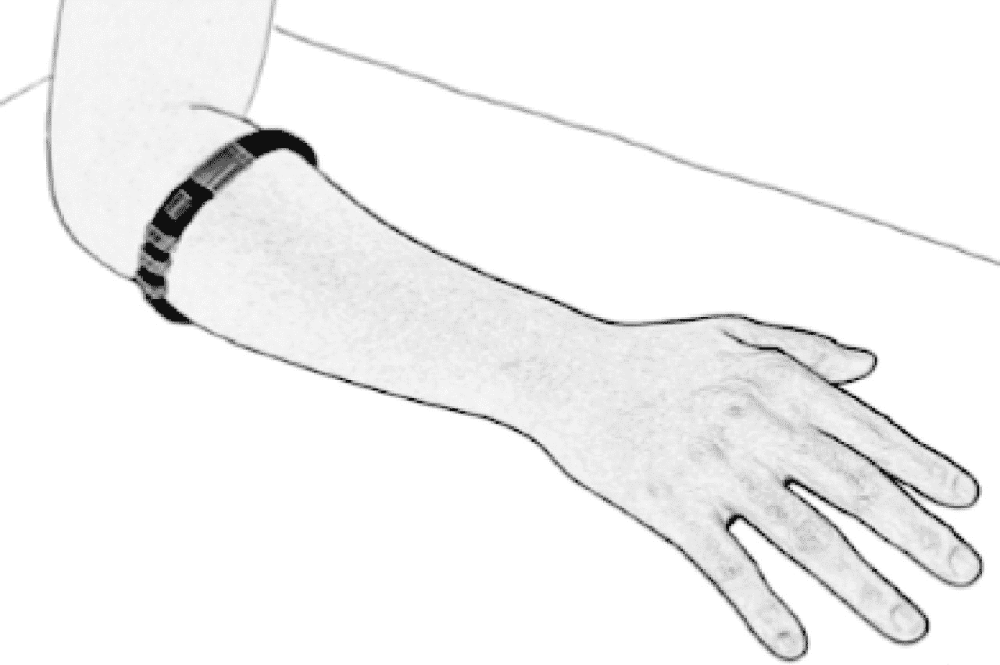
图 3.3　前臂带肌电图传感器

肌肉-计算机接口Muscle-Computer Interfaces，muCIs是一种不依赖物理操纵装置或外部可见动作的交互范式，直接感知并解码细微的肌肉活动。它以肌电图为输入，让肌肉与电脑的沟通更自然、不突兀。典型做法是在前臂上段佩戴窄带状肌电传感器，位置在肘部以下，由此可识别手指按压位置与力度，以及对五指的轻敲、抬起等手势进行分类，实现手势到控制指令的映射[46]。

T.Scott Saponas等人[47]在此基础上做了扩展，使muCIs在真实应用中更可靠。研究者依据人类自然握持方式设计了一套手势集并实现实时分类，使用户无需外接装置即可仅凭肌肉信号进行输入。所涵盖手势包括手指在空闲与忙碌时的不同姿势。实验显示，四指手势中捏指的识别均值约79%，拿旅行杯约85%，拎加重包约88%。结果还表明不同手臂姿态下表现具有一致性。研究者已用手指手势操控一个模拟的便携音乐播放器，如图3.4所示。

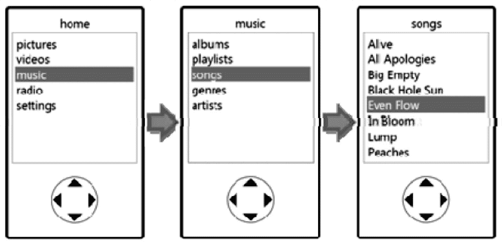
图 3.4　便携式音乐播放器的软件模型

## 2. 自适应控制
使用自适应系统时，设备会持续采集生理数据，经处理后若满足触发条件，便据此改变自身行为以匹配当前用户状态，提升体验。较早的案例之一来自美国航天局的飞行模拟器[48]。系统监测飞行员脑电，以自动驾驶的启停来维持最佳警觉水平：自动驾驶开启时警觉易下降，手动操控时则回升。

自适应系统的核心是根据操作环境动态优化体验。例如游戏可通过认知负荷测量推断难度[49]，实时调节挑战水平以贴合玩家能力；另一热点是缓解负面情绪，如电脑使用中的挫败感。难点在于如何做到恰时且不扰人。采集受运动等干扰，误判时公开明显的干预反而有害。举例而言，系统若误判用户沮丧而弹窗询问“需要帮助吗”，在真正沮丧时会有效，误判时则徒增打扰。因此微小、累积或间接的环境调节，只要长期趋势正确，通常比显式提示更友好。

MENTOR[50]是一种基于投入与工作量分析的智能辅导系统，从脑电中提取信息并排序学习活动。它先为新用户建立工作负荷模型，再实时从脑电信号中估计负荷指标，并在教学过程中主动适应学习者的脑状态，选择最合适的教学内容以保持积极心态。若检测到参与度下降或过载引发的负面状态，系统会切换活动类型加以纠正。

ARTful[51]则面向翻转学习场景的自适应复习技术。翻转学习强调课前自学、课上研讨，但软件如何向注意力分散或多任务的学生呈现材料仍是难题。该系统实时追踪学生对教材的注意力，并据此推荐最优复习主题。脑电被用作注意力监测的基础，因其在实验室与真实情境中均能捕捉警觉、注意、感知和工作量的细微变化。实验表明，自适应复习能在更短时间内达到与完整复习相当的记忆效果。

儿童阅读辅助方面，FOCUS[52]提供脑电增强的阅读支持，可实时监测阅读投入并开展脑机接口训练。硬件包括定制书本、商用BCI设备与微型投影仪。阅读时佩戴BCI，若检测到参与度偏低，系统即触发训练模式并将任务投影到书页。训练采用脑电生物反馈，核心是让孩子集中注意并想象课程相关物体的状态变化，例如在春季主题阅读时想象花朵绽放。只有达到所需投入水平任务才算完成。该流程显著提升了儿童的阅读参与度。

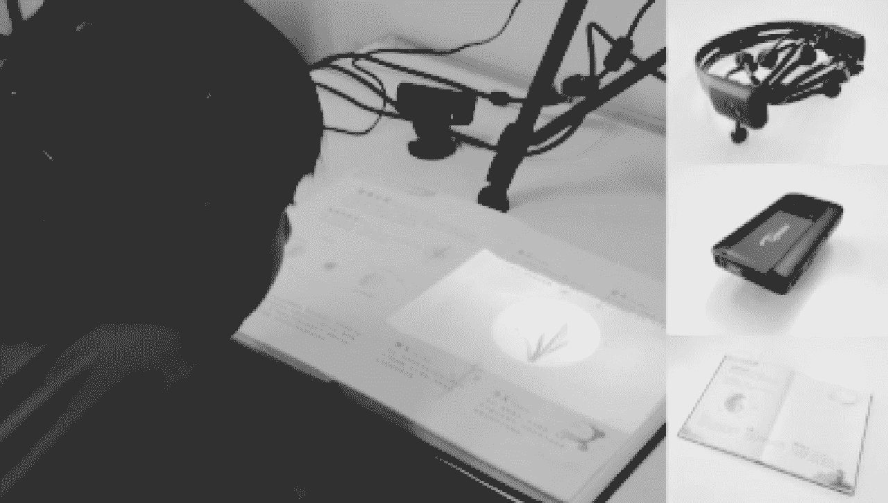
图 3.5　FOCUS 系统硬件

## 3. 实时监测
生理数据蕴含情感、认知与身体状态信息，随着软硬件进步，采集、保存与分享变得便捷，可形成个性化的生理日志。健身应用即是典型，使用者记录运动状态并与他人共享，形成相互激励。

实时监测在心理健康追踪、运动表现评估与自我量化等领域应用广泛。Gilleade与Fairclough在2010年的实验[12]中，将受试者长达一年的实时生理信息公开展示在在线平台，并通过Twitter允许公众对数据主人的心理生理状态做非正式解读[13]。数据所有者借此观察自身生理对各类生活事件的反应，例如重大节假日对健康的潜在影响[14]。由于同一生理指标在不同情境下可对应多种状态，心电监护等设备便能为医生提供即时预警。

MIT开发的Medical Mirror[53]系统提供一种隐式交互界面，如图3.6所示。它使用带网络摄像头的LCD显示器，前部覆盖双向镜。用户面对镜子时看不到显示器和摄像头，但摄像头可捕捉用户，LCD则将信息投射到镜面反射上。系统连接笔记本电脑进行实时分析，每次仅一人交互。观察时，脸周会出现框线，角落显示倒计时，要求用户保持位置。15秒后心率会出现在镜面上，并持续更新，直至用户离开监测范围。

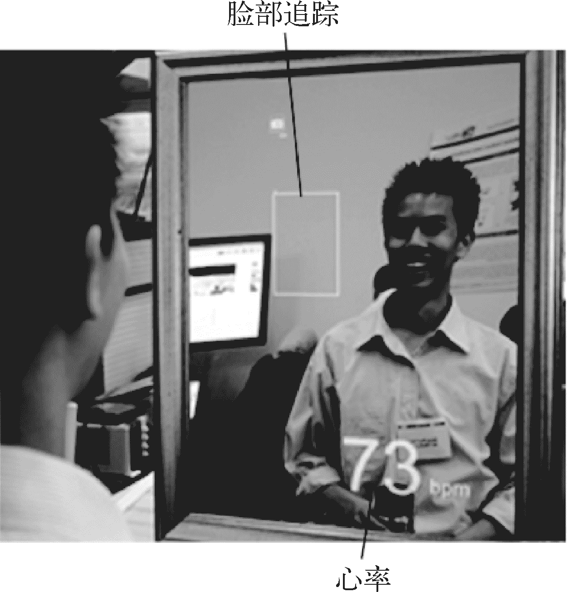
图 3.6　Medical Mirror 系统

## 参考文献
\[1\]FAIRCLOUGH S H, GILLEADE K. Advances in physiological computing\[M\]. Springer Science & Business Media, 2014.

\[2\]TAN D S, NIJHOLT A.Brain-computer interfaces\[M\]. Springer-Verlag London Limited, 2010.

\[3\]ALLISON B Z, DUNNE S, LEEB R, et al. Towards practical brain-computer interfaces: bridging the gap from research to real-world applications\[M\]. Springer Science & Business Media, 2012.

\[4\]FAIRCLOUGH S H. Fundamentals of physiological computing\[J\]. Interacting with computers, 2009, 21(1-2): 133-145.

\[5\]KAPOOR A, BURLESON W, PICARD R W. Automatic prediction of frustration\[J\]. International journal of human-computer studies, 2007, 65(8): 724-736.

\[6\]WILSON G F, RUSSELL C A. Performance enhancement in an uninhabited air vehicle task using psychophysiologically determined adaptive aiding\[J\]. Human factors, 2007, 49(6): 1005-1018.

\[7\]KLEIN J, MOON Y, PICARD R W. This computer responds to user frustration: Theory, design, and results\[J\]. Interacting with computers, 2002, 14(2): 119-140.

\[8\]KABER D B, WRIGHT M C, PRINZEL III L J, et al. Adaptive automation of human-machine system information-processing functions\[J\]. Human factors, 2005, 47(4): 730-741.

\[9\]GILLEADE K, DIX A, ALLANSON J. Affective videogames and modes of affective gaming: assist me, challenge me, emote me\[J\]. DiGRA 2005: Changing Views-Worlds in Play, 2005.

\[10\]POPE A T, BOGART E H, BARTOLOME D S. Biocybernetic system evaluates indices of operator engagement in automated task\[J\]. Biological psychology, 1995, 40(1-2): 187-195.

\[11\]PRINZEL III L J. Research on hazardous states of awareness and physiological factors in aerospace operations\[J\]. 2002.

\[12\]HUANG D, ZHANG X, SAPONAS T S, et al. Leveraging dual-observable input for fine-grained thumb interaction using forearm EMG\[C\]//Proceedings of the 28th Annual ACM Symposium on User Interface Software & Technology. 2015: 523-528.

\[13\]AMMA C, KRINGS T, BÖER J, et al. Advancing muscle-computer interfaces with high-density electromyography\[C\]//Proceedings of the 33rd Annual ACM Conference on Human Factors in Computing Systems. 2015: 929-938.

\[14\]DEMENTYEV A, PARADISO J A. WristFlex: low-power gesture input with wrist-worn pressure sensors\[C\]//Proceedings of the 27th annual ACM symposium on User interface software and technology. 2014: 161-166.

\[15\]ZHANG Y, XIAO R, HARRISON C. Advancing hand gesture recognition with high resolution electrical impedance tomography\[C\]//Proceedings of the 29th Annual Symposium on User Interface Software and Technology. 2016: 843-850.

\[16\]LESHENG H . A Portable Electromyograph (EMG) Collection Method and Circuit Realization\[J\]. Journal of Electronic Measurement and Instrument, 2006.

\[17\]ZHANG X, CHEN X, LI Y, et al. A framework for hand gesture recognition based on accelerometer and EMG sensors\[J\]. IEEE Transactions on Systems, Man, and Cybernetics-Part A: Systems and Humans, 2011, 41(6): 1064-1076.

[18]CHEN Y, SU X, TIAN F, et al. Pactolus: A method for mid-air gesture segmentation within EMG[C]//Proceedings of the 2016 CHI Conference Extended Abstracts on Human Factors in Computing Systems. 2016: 1760-1765.

[19]BAIG M Z, KAVAKLI M. A Survey on Psycho-Physiological Analysis & Measurement Methods in Multimodal Systems[J]. Multimodal Technologies and Interaction, 2019, 3(2): 37.

[20]CACIOPPO J T,TASSINARY L G,BERNTSON G. Handbook of psychophysiology[M]. Cambridge university press, 2007.

[21]BRADLEY M M, LANG P J. Measuring emotion: the self-assessment manikin and the semantic differential[J]. Journal of behavior therapy and experimental psychiatry, 1994, 25(1): 49-59.

[22]EKMAN P. Facial expression and emotion[J]. American psychologist, 1993, 48(4): 384.

[23]HOLMQVIST K, NYSTRÖM M, ANDERSSON R, et al. Eye tracking: A comprehensive guide to methods and measures[M]. OUP Oxford, 2011.

[24]MCKEE M G,BIOFEEDBACK D. Biofeedback: An overview in the context of heart-brain medicine[J]. Cleveland Clinic journal of medicine, 2008, 75: S31.

[25]STERELNY K. Thought in a hostile world: The evolution of human cognition[J]. 2003.

[26]ALBULBUL A. 现代医疗技术中空闲生物信号测量的主要电极类型评估[J]. Bioengineering, 2016, 3(3): 20.

[27]ZHANG X, LI J, LIU Y, et al. 基于无线可穿戴脑电的驾驶员警觉性高速列车疲劳检测系统设计[J]. Sensors, 2017, 17(3): 486.

[28]加玉涛, 罗志增. 肌电信号特征提取方法综述[J]. 电子器件, 2007, 30(1):326-330.

[29]HUDGINS B, PARKER P, SCOTT R N. 多功能肌电控制的新策略[J]. IEEE transactions on biomedical engineering, 1993, 40(1): 82-94.

[30]PICARD R W. 情感计算：挑战[J]. International Journal of Human-Computer Studies, 2003, 59(1-2): 55-64.

[31]HUDGINS B, PARKER P, SCOTT R. 基于肌电模式识别的人工肢体控制[J]. Medical & Life Sciences Engineering, 1994, 13: 21-38.

[32]ZHAO J, XIE Z, JIANG L, et al. 基于小波变换和样本熵的五指欠驱动假肢手 EMG 控制[C]//2006 IEEE/RSJ International Conference on Intelligent Robots and Systems. IEEE, 2006: 3215-3220.

[33]尧德中.脑电记录中参考电极位置的设置研究[J]. 临床神经电生理杂志, 2002, 11(3): 132-136.

[34]KUNHIMANGALARM R, JOSEPH P K, SUJTTH O K. EEG 信号的非线性分析：替代数据分析[J]. IRBM.2008,29(4):239-244.

[35]STEWART A X, NUTHMANN A, SANGUINETTI G. 使用 ICA 和机器学习的视觉物体任务中单次试验 EEG 分类[J]. Journal of neuroscience methods, 2014, 228: 1-14.

[36]SINGH M, SINGH M M, SINGHAL N. 基于人工神经网络的情感识别[J]. Emotion, 2013, 1: 56-60.

[37]MURUGAPPAN M, RIZON M, NAGARAJAN R, et al. 用于人类情感检测的 EEG 信号时频分析[C]//4th Kuala Lumpur international conference on biomedical engineering 2008. Springer, Berlin, Heidelberg, 2008: 262-265.

[38]HSU Y L, YANG Y T.Automatic sleep stage recurrent neural classifier using energy features of EEG signals[J]. Neurocomputing. 2013, 104:105-114.

[39]SUBASI A. 基于小波特征提取的自适应神经模糊推理系统在癫痫发作检测中的应用[J]. Comput Biol Med .2007, 37(2): 227-244.

[40]PARK K S, CHOI H, LEE K J, et al. 基于左右不对称激活的情感识别[J]. International Journal of Medicine and Medical Sciences, 2011, 3(6): 201-209.

[41]王晓康. EOG 眼电信号检测与特征识别[J]. 仪表技术, 2017(4).

[42]STEVENS S S. 实验心理学手册[J]. 1951.

[43]KIM J, ANDRÉ E. 基于音乐聆听生理变化的情感识别[J]. IEEE transactions on pattern analysis and machine intelligence, 2008, 30(12): 2067-2083.

[44]JANG E H, PARK B J, PARK M S, et al. 生理信号分析用于识别无聊、疼痛和惊讶情绪[J]. Journal of physiological anthropology, 2015, 34(1): 1-12.

[45]范俊君,田丰,黄进,等.基于肌肉感知的手势交互模型[J].软件学报,2019,29(Suppl.(2)):62-74.

[46]SAPONAS T S, TAN D S, MORRIS D, et al. 展示前臂肌电图用于肌肉-计算机接口的可行性[C]//Proceedings of the SIGCHI Conference on Human Factors in Computing Systems. 2008: 515-524.

[47]SAPONAS T S, TAN D S, MORRIS D, et al. 利用肌肉-计算机接口实现始终可用的输入[C]//Proceedings of the 22nd annual ACM symposium on User interface software and technology. 2009: 167-176.

[48]POPE A T, BOGART E H, BARTOLOME D S. 生物控制系统评估自动化任务中操作员参与度指标[J]. Biological psychology, 1995, 40(1-2): 187-195.

[49]Klimesch W. EEG alpha 和 theta 振荡反映认知和记忆表现：综述与分析[J]. Brain research reviews, 1999, 29(2-3): 169-195.

[50]CHAOUACHI M, JRAIDI I, FRASSON C. MENTOR：一种生理控制的辅导系统[C]//International Conference on User Modeling, Adaptation, and Personalization. Springer, Cham, 2015: 56-67.

[51]SZAFIR D, MUTLU B. ARTful：翻转学习的自适应复习技术[C]//Proceedings of the SIGCHI Conference on Human Factors in Computing Systems. 2013: 1001-1010.

[52]HUANG J, YU C, WANG Y, et al. FOCUS：通过情境化 BCI 训练课程增强儿童阅读参与度[C]//Proceedings of the SIGCHI Conference on Human Factors in Computing Systems. 2014: 1905-1908.

[53]POH M Z, MCDUFF D, PICARD R. 用于非接触健康监测的医疗镜[M]//ACM SIGGRAPH 2011 Emerging Technologies. 2011.

# 第4章 手势交互全景

## 4.1 从捕捉到落地的一体图景

手势交互本质上是让摄像头等感知硬件把手的动作捕捉下来，经过解析后转化为设备能懂的指令。它在鼠标、键盘、触屏之后，正在成为更贴近直觉的人机沟通方式。

人类天生就会用手表达，文字出现以前肢体语言就已经在用。手部动作在日常使用里出现频次最高、辨识门槛相对较低，很自然地成了交互载体。一个完整链路通常由使用者、采集端、分析识别模块和被操作的终端或界面四部分构成。

业界对这一方向的判断由来已久。2005年ACM SIGCHI未来界面设计工具研讨会上就有专家提出，下一代界面要摆脱桌面束缚，触控、触觉、摄像头类的新输入会成为主流。2009到2011年SIGCHI年会连续三年办相关议题，2009与2010两届尤其聚焦触摸与手势的自然交互。Gartner在2017年人机交互技术优先级矩阵里，将增强现实、混合现实、手势控制设备、对话式用户界面列为未来五到十年值得押注的新兴方向。

落地方向已经比较清晰。
1. 虚拟场景里的上手操作，比如虚拟制造、装配仿真、产品设计。装配时可以直接用手搬动零件，并结合语音定义零件间的装配关系；手势也能承担复杂设计信息的输入。
2. 手语识别。手语主要靠手部动作，配合身体姿态、面部表情和口型构成一套相对稳定的符号体系。让机器读懂手语并与合成技术结合，就能搭起人机手语翻译。实现路径一般分数据手套方案和视觉方案两类。
3. 多通道融合。手势很难单独取代键盘鼠标，既受技术限制，也受手势本身的多义性、差异性、精度不足等特性的制约。更现实的做法是把手势与视线、语音等通道结合，提升交互的自然度和容错空间。
4. 机器人机械手抓取。自然抓取一直是机器人研究的难点，基于数据手套的手势识别为破解这一问题提供了重要思路。

学术价值同样突出。学界很早就构建了交互的基础理论和概念模型，比如手部运动信息的感知处理规律、把交互行为拆成基本动作并研究其参数区间、通过统计稳定参数建立参数与任务的映射来指导设计。工业界在采集、识别、合成、理解等环节持续投入，三维数据采集已有进展，但可靠性、精度、准确性、稳定性仍有提升空间，识别细微动作对传感器精度提出更高要求。

当前仍有五大卡点需要攻克：
1. 金手指困境。系统难以区分连续动作中哪些是刻意指令、哪些是无意识摆动，也难以判断手势的开始和结束，容易引发误触和中断。
2. 动态识别滞后。多数方案要等动作完整结束后再判定类别，响应不够及时。
3. 功能边界模糊。哪些界面操作适合交给手势，业界尚未形成统一共识。
4. 学习成本。手势需要结合场景选取，部分信号型手势要求用户提前记忆定义，使用过多或跨应用不一致会增加认知负担。
5. 精细捕捉不足。人手姿态与动作的获取技术仍制约精细交互，在虚拟场景中实现高精度对象编辑仍有难度，需要继续提升捕获与识别精度。

投入正在加速。CMU、斯坦福、MIT、微软、苹果、谷歌、脸书、英特尔、法国INRIA、德国马普学会等都在设备、技术、应用层面持续探索。国内中科院软件所、计算所、自动化所、清华大学、浙江大学、北京航空航天大学、北京师范大学、北京理工大学等机构也在手势获取、动态理解、VR/AR交互等方向取得了一批有价值的成果。

总体来看，手势理解与交互兼具理论深度和应用潜力，是一个开放且极具挑战的研究方向。本章将围绕交互模型、人手检测、人手姿态估计、视觉输入手势识别等核心议题，梳理代表性工作与思路。

## 4.2 关键概念与价值

### 4.2.1 手势是什么

手臂尤其是手在交流时会产生大量动作，身体姿态也会同步变化，这些统称为手势。它可能是人类最早的沟通方式之一，延续至今。随着历史演进，不同手势被赋予特定含义，表达力与灵活性不断增强，成为自然的情感表达工具，也是主体作用于外界的重要手段。

### 4.2.2 分类视角

按运动特征可分为静态手势和动态手势。静态手势也称手形，仅靠手的外形轮廓传递信息，可视为动态手势的特例，常被称为姿势。动态手势中手形与位置随时间变化，能承载更丰富、更精确的信息，是日常最常用的交流形式。典型动态手势可拆分为准备、起始、执行、收束、撤回五个阶段。

按交互目的可分为交际性手势和操纵性手势。操纵性手势用手部运动表征路径或位置。交际性手势多与言语相关，包含标志性手势、隐喻手势、调制符号手势、连贯手势、Butterworth手势和Adaptors手势。标志性手势与语义紧密相关，用手大致勾勒谈及的对象以辅助理解；隐喻手势代表抽象概念，如表示决定的切割动作；调制符号手势主要补充语音，也可补充其他沟通方式；连贯手势用于在语义相关但时间不连续时保持连贯，如被打断后重复动作；Butterworth手势指说话时的失当动作，如忘词时的抓耳挠腮；Adaptors手势则是无意义的习惯性动作。

指示手势是特殊类型，用于标示预定动作方向或操纵方向。根据语境不同可归入交际性中的标志性手势，也可归入操纵性手势。

按指令层级可分为规定手势和自由形式手势。规定手势基于预先定义的手势词典，具有固定含义，使用者需先学习才能触发功能，易带来学习负担。自由形式手势不触发预设动作，通常被原样映射进系统，用于绘制轨迹、曲面或在虚拟空间移动物体，因缺乏象征意义，应用范围相对有限。

本书讨论的手势主要指动态手势，涵盖单手或双手交互，包含手指动作的精细操作也暂归入手势范畴。

### 4.2.3 手势功能与组合实战

1. 指示型手势及其组合
指示型手势主要承担点选任务，单独使用时只是选中，配合其他类型就能产生复合行为。与互动型手势搭配合，则实现先选中再编辑的流程；与信号型手势搭配合，则可在选中后立刻触发操作；与互动型和操纵型手势共同使用，可完成点选、切换、互动的一整套动作，操纵游戏角色是常见例证。若再把指示型与互动型、操纵型、信号型、自由型手势联动，还能支撑 3D 建模等高阶应用。

2. 自由型手势及其组合
自由型手势偏向 3D 建模与非接触式控制，通常用来推动虚拟物体或驱动机械手。当功能含义较为间接、较为复杂时，多会借助信号型手势来协同。

3. 操纵型手势及其组合
操纵型手势直接对对象进行编辑性操作，例如平移、旋转、缩放等。

4. 信号型手势及其组合
信号型手势用于激活预先设定好的抽象功能，关键是手势与功能的对应关系必须提前定义。遇到本身就带有语义的手势，需要辨别其归属。若按其本意执行则属于操纵型，若只作为触发信号来启动预设操作序列则属于信号型。

## 4.3 手势理解与交互模型

手势理解是指系统能够识别出用户到底做了什么手势，是人机对话的基础。不同场景下同一手势可能对应不同含义，交互因此呈现多样性，但对理解的要求是统一的：要快、要准。正因如此，手势理解在整个理解与交互模型中占据核心地位。

具体而言，手势理解可拆为检测与识别两步。检测阶段，系统从原始信号流中把包含手势的时段挑出来，这时还不知道手势具体是什么，只知道在哪一段时间内有手势活动，以及每帧中手部的大致位置。识别阶段则在已截取的手势片段上进行分类与解读。检测与识别紧密衔接，共同构成交互闭环。

无论采用传统机器学习还是深度学习路线，手势识别普遍先要定位视频中的手部，也即人手检测。传统人手检测主要有两路：基于肤色和基于运动。

基于肤色的方法利用手部肤色与背景色差异分割手区，对光照和色彩变化十分敏感；基于运动的方法利用手相对于背景的运动差异进行分割，要求背景相对稳定，鲁棒性不足。近年随着深度学习发展，`Faster RCNN`、`SSD`等目标检测算法被广泛用于手部分割，精度和鲁棒性均明显提升。

手势检测大致分为两类：基于候选动作片段 `Action Proposal` 的方法，和基于类间差异的方法。

基于候选片段的方法一般经历五个环节：
(1) 用时序滑动窗口等手段生成待选动作片段。
(2) 对每个片段提取特征，可用传统方法或深度学习方法。
(3) 将特征送入分类器区分动作片段与背景片段。
(4) 对动作片段进一步分类并微调起始帧。
(5) 用非极大值抑制剔除重复片段。

基于类间差异的方法一般包含三个环节：
(1) 提取手势特征，同样可采用传统或深度学习特征。
(2) 利用动作片段与背景片段特征的差异将其分离，常见做法有基于先验知识和基于 `Connectionist Temporal Classification`(`CTC`) 分类器。
(3) 用分类器对各片段特征做最终分类。

手势识别的主流程分为两步：
(1) 提取手势特征。
(2) 将特征输入分类器完成手势类别判决。

手势检测与识别流程示意图如图 4.1 所示。

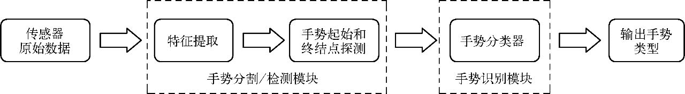

图 4.1 手势检测与识别流程示意图

## 4.4 人手检测

### 4.4.1 现状与挑战

人手检测是手部关节估计、手势理解等任务的基础，也对人机交互和机器人技术至关重要。获取手部信息有助于计算机更准确地理解交互意图，提升操作便捷性与精确度。通用物体检测已取得进展，但在单张图像中检测手部仍具挑战，手腕与手指关节的多样旋转导致手部形态变化极大。

下面先概述基于 RGB 图像的手势检测思路，再按是否使用深度学习分别介绍传统方法和深度学习代表工作。

传统机器学习常用 `DTW`、`HMM`、`CRF`、`RF` 等；深度学习则以基于 `LSTM` 和基于 `CNN` 为主。

图像是稠密的高维像素矩阵，人手检测的核心是将包含手的像素区用最小矩形框出并与背景区分。现阶段单图人手检测可归为四类：基于皮肤、基于模板、基于像素标记、基于姿态估计。

基于皮肤的方法常以高斯混合模型建模皮肤，或以面部检测所得肤色为先验，但易受光照影响，在复杂光照下表现不佳，难以普适。

基于模板的方法可学习手部模板或融合多个可变模型，如 `Viola and Jones` 级联探测器[1]、`HOG-SVM` 流程、可变形部件模型混合物 `DPM`[2] 等。但其常用 `HOG` 或 `Harr` 等表达能力有限的特征。另一分支把手视为人体结构的一部分，先检人体再定位手，需人体大部分可见，遮挡时会失效。

基于像素标记在 `Egocentric` 视频中效果突出，如香港大学朱晓龙的工作将其扩展为结构化图像标记，但需逐像素扫描，耗时较大。

基于姿态估计可细分为两类。① 先估计姿态再据此打标签。`Rowley` 等人[3] 提出基于旋转不变神经网络的人脸检测，先用旋转网络估计窗口朝向，再判断是否为人脸。② 联合估计与检测。`He` 等人提出结构化公式联合物体检测与姿态估计；`Fidler` 等人提出带可变形 3D 立方体模型的 3D 物体检测与视角估计。

近年来卷积神经网络迅速发展，在视觉检测、自然语言处理等领域成效显著。深度学习借助反向传播能从海量数据中挖掘复杂结构并提取关键特征。传统方法依赖人工特征，局限且耗时，深度学习方法在特征表达和效率上均有明显提升。`Girshick` 提出的 `R-CNN` 将候选框选择与 CNN 结合，在 `PASCAL` 检测上提升近 30%，后继 `Fast R-CNN` 与 `Ren` 等提出的 `Faster R-CNN` 进一步提高性能。武延军团队在像素级高效人手检测上取得进展，采用尺度不变全卷积网络并加入加权特征融合模块学习多尺度特征，同时对中间层进行迭代监督，在保证精度的同时提升实时性。

尽管检测精度提升，姿态估计仍困难。`Jaderberg` 等人[5] 提出的空间变换网络 `Spatial Transformer Network`，`ST-CNN` 可无监督学习姿态信息。其包含定位网络、矩阵生成网络和采样网络。定位网络计算参数送入矩阵生成网络生成空间变换矩阵，采样网络据此对齐输入。ST-CNN 可自学特征空间中的变换参数，减少旋转、平移等几何变化对定位的影响。

人手检测与旋转信息相互关联，联合使用可改善结果。对图像做预处理使其转至正定姿态，可显著降低检测模型的负担。

### 4.4.2 典型方案解析

本文提出一种端到端优化的深度学习框架[6]，在单张图像上联合人手检测与旋转信息，提升检测准确率。网络结构如图 4.2 所示，各模块将在后文详述。该网络以 `Faster R-CNN` 为骨干，引入新的 `Derotation` 层，并在 `ROI` 池化后加入反旋转层 `Derotation Layer`。方法先生成可旋转候选区域，可用 `Faster R-CNN` 的 `RPN` 或其他可端到端训练的深度特征方法生成。候选区经 `ROI` 池化后输入旋转网络 `Rotation Network`，该网络做回归以估计平面内旋转，实现局部特征对齐；随后据此旋转特征并送入检测网络获得置信分。因为特征进入检测前已对齐，检测网络无需再处理对齐问题。旋转变换由反旋转层完成，可反向传播，实现端到端联合训练。

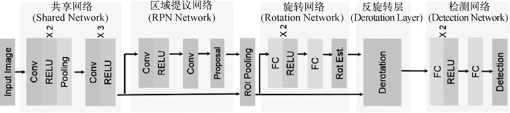

图 4.2 网络结构

(1) 生成候选区域
候选区域生成在物体检测中至关重要，常见无类别区域提议有选择性搜索 `Selective Search`、对象性 `Objectness` 等，因手部姿态多样，这些方法效果有限，故提出多类别区域提议，并测试两种对比方案。

① 候选区域提议网络 `Region Proposal Networks`，`RPN`。
采用先进的 `RPN` 提取手区。`RPN` 为全卷积网络，输入图像输出一组候选框建议及其分数，可无缝接入网络其他组件并端到端训练。

② 深度特征提议 `Deep Feature Proposal`。
采用独立判别方式生成提案。对每张测试图构建 5 层图像金字塔，每层分辨率加倍。将金字塔各层输入在 `ImageNet` 预训练的 `Alexnet`，提取 `conv5` 后的特征金字塔。训练时用 8 个不同宽高比的 `SVM` 二元分类器以滑动窗口方式在特征金字塔上检测手状区域，可获得较准的平移、旋转、缩放信息以实现对齐。

(2) 旋转感知网络 `Rotation Aware Network`
用于估计候选区的旋转信息。

① 网络结构。
网络基于 `Faster R-CNN` 骨干，在 `ROI` 池化后插入反旋转层。先用 2 层卷积+激活+下采样和 3 层卷积+激活提取图像特征；`RPN` 由卷积+激活及后续卷积构成以提取候选区；候选区经 `ROI` 池化得到局部特征。旋转网络含三个全连接层，估计手部旋转角度。将旋转估计视为角度正余弦回归问题，给定候选区输出二维向量 `I = (cosα, sinα)`，具有良好几何意义。`I` 可看作单位圆上一点，两向量 `I1`、`I2` 的欧几里得距离 `d` 可以用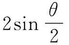计算，`d` 随夹角 `θ ∈ [0,π]` 增大而增大。随后反旋转层按估计的二维旋转向量 `I` 旋转 `ROI` 特征，得到对齐特征后送入 3 个全连接层做二分类判断候选区是否包含手。反旋转层参数可导，网络可端到端联合优化。

② 反旋转层 `Derotation Layer`。
反旋转层可在单次前向传播中按旋转信息对特征进行旋转。输入为原始图像经卷积得到的特征矩阵和旋转网络估计的平面内旋转角，输出为旋转后的特征矩阵，目标是将其转至直立姿态，如图 4.3 所示。

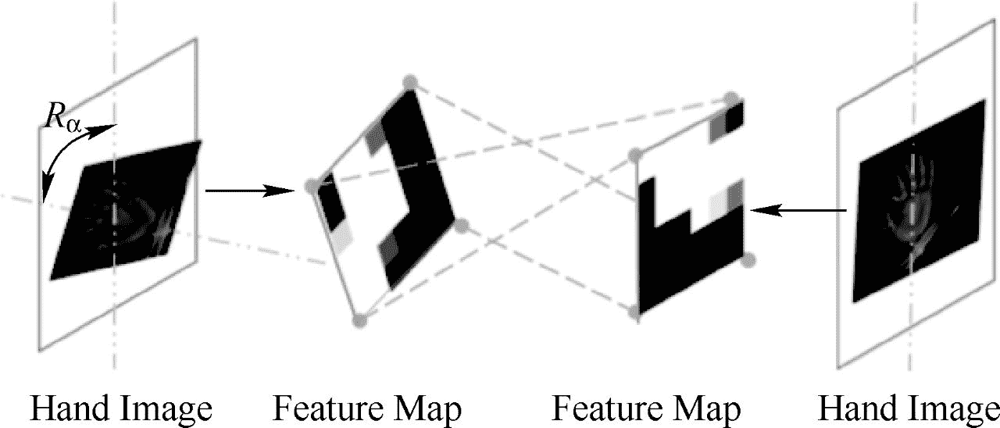

图 4.3 反旋转层操作

具体地，若 `Rα` 为待应用的面内旋转角，则反旋转变换为

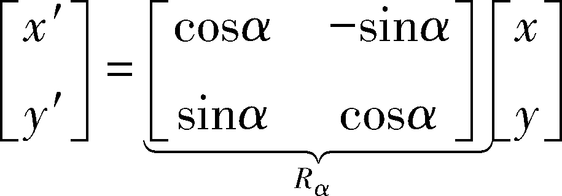

(4.1)

式中 `[x′, y′]ᵀ` 为规范直立姿态下特征矩阵坐标；`[x, y]ᵀ` 为原始姿态下坐标。坐标均相对特征矩阵中心。实现采用逆映射：对直立姿态下每个像素 `[x′, y′]`，在原始特征中寻对应位置 `[x, y]`。因 `[x, y]` 通常非整数，采用四邻域平均插值。边缘问题通过零填充避免采样越界。

反向传播利用反旋转层前后特征矩阵的坐标映射关系完成。设 `ul` 为输入、`ul+1` 为输出，`L` 为最终损失，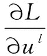为层 `l` 的梯度信号，则可计算

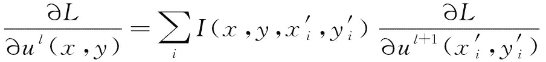

式中 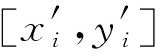 为特征映射 `ul+1` 中像素坐标；`[x, y]` 为 `ul` 上对应坐标。若 `[x, y]` 传播至 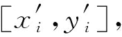 则函数  为 1，否则 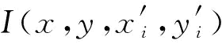 为 0。偏导  累积至 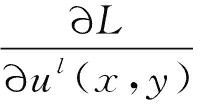，其中 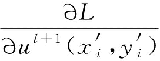 由反旋转层顶层反向传播函数计算。

(3) 损失层 `Loss Layer`
网络总损失定义为

`L = Lrotation + λd Ldetection + λR LRPN`

(4.2)

其中 `Lrotation` 为旋转网络损失；`Ldetection` 为检测网络损失；`LRPN` 为 `RPN` 损失，如 `Faster R-CNN`[11]。权重 `λd`、`λR` 默认为 1。

① 旋转损失 `Rotation Loss`。
旋转估计在网络末端使用 `L2` 损失。取人手候选区的正样本训练网络回归旋转参数，二维向量 中 `c`、`s` 为全连接层输出，经归一化后 `I` 成为归一化姿态向量，可强制 `Rα` 为旋转矩阵。设预测与真实旋转向量分别为 `l` 与 `l*`，旋转损失为


(4.3)

后向求导中 `Lrotation` 对 `cosαi` 和 `sinαi` 的偏导为


式中 `i` 为小批量正样本手候选区；`αi` 和  为估计值与真实角；`m` 为正样本数，负样本不参与旋转损失反向传播。

再计算 `li = (cosαi, sinαi)` 对 `ci, si` 的偏导：


其中 `ci`、`si` 为旋转网络全连接层输出。

② 人手检测损失 `Detection Loss`。
检测任务在检测网络末端使用交叉熵损失。记实际标签为 `D*`，损失函数为


(4.4)

式中  为候选区 `i` 属于类别 `j` 的预测概率，`n` 为候选区总数。

③ `RPN` 损失 `RPN Loss`。
`RPN` 采用与 `Faster R-CNN` 相同的损失，由目标分类损失和边界框回归损失组成。

(4) 实现细节
下文展示训练阶段的具体实现细节。

旋转感知手检测与人手姿态估计拆解

整个系统由三块核心模块构成：RPN网络、旋转估计网络 Rotation Estimation Network 和检测网络 Detection Network。两条通路在反旋转层处交互，共享特征图或数据流需要经过该层，所以训练时必须谨慎设计以保证收敛。

训练采用分阶段策略。先用 ImageNet 预训练模型初始化共享网络与检测网络，只对旋转估计任务做微调；随后把两个网络的信息融合起来送入检测网络，再针对手的二分类做微调。

数据准备沿用 R-CNN 思路。以深度特征为基础生成候选框，用 IOU Intersection Over Union 判断正负样本。IOU 超过 0.5 判为正样本，小于 0.5 判为负样本并丢弃。最终正样本约 104 个，负样本达 4.9×10^7 个，正负极度不平衡。做法是全用正样本并从负样本中随机挑 3000 万个，并强制每个小批量正负比例保持 1∶1。负样本在旋转网络反向传播时不产生梯度。

推理阶段候选框常有重叠，用非最大抑制 Non-Maximum Suppression 筛选，NMS 的 IOU 阈值固定为 0.3。

### (5) 实验结果
测试集选用 Oxford Hand 数据库。

#### ① 候选区域生成方法的性能。
表 4.1 对比了几种候选框生成方案，包括 RPN 与传统分割类方法如选择性搜索和对象性在内的深度特征提议。

表 4.1　几种候选区域生成方法的性能比较


召回率上，我们的深度特征提议达到最优，接近 100%。

#### ② 旋转估计方法的性能。
先验证旋转网络能否给出合理的平面内旋转参数。表 4.2 对不同旋转估计方法做比较。当候选框由 RPN 提供时，旋转估计表现不错。若改用基于深度特征的提框方式，预测值与真实值偏差小于 10° 的准确率为 45.6%，小于 20° 为 70.1%，小于 30° 为 79.8%。

表 4.2　旋转估计方法的性能比较


#### ③ 检测性能。
在 RPN 提取候选的基础上，将方案与未显式处理旋转的 Faster R-CNN 对比。图 4.4 展示了两者在 RPN 上的精度召回曲线。


图 4.4　精度与召回率的比较情况

加入 RPN 后，我们模型的平均精度 Average Precision 比 Faster R-CNN 高约 2%。在此基础上再叠加旋转操作，AP 又提升 0.4%。但仅用 RPN 的版本相比再加旋转的版本，效率提升约 10 倍。各方法 AP 见表 4.3。

表 4.3　各种方法的平均精度


在 Oxford 手持数据集上展示了手检测效果。图 4.5 和图 4.6 分别给出了室外与室内图像的检测实例。可见该方法对室外室内、多手单手场景均适用。


图 4.5　室外图像上的检测实例


图 4.6　室内图像上的检测实例

## 4.5 人手姿态估计
基于手部姿态的手势识别利用关键点信息，比纯 RGB 图像或视频受背景干扰更小，能更聚焦手部位置与运动，是很有潜力的方向。

人手姿态估计通常把手建模为手掌、手指等若干关键部位的集合，再估计其在图像二维或三维空间的位置。稀疏关键点是常用建模方式。基于姿态的手势识别大致分三步：先用姿态检测获取手部姿态，再用传统或深度学习方法提取姿态特征，最后送入分类器做手势分类。

按方法分，姿态估计可分为生成式 Generative Methods 与判别式 Discriminative Methods。生成式通常给定通用手部模型做参数优化，判别式一般需要大规模数据学习图像到输出的映射[18]。

生成式方法需构建通用参数化手部模型，描述多手势多视角下的手，并建立模型与输入手势间的能量函数，再通过传统优化使能量最小化。参数化模型构建、能量函数设计与优化算法选择直接影响精度与速度。

基于视觉的人手姿态估计如图 4.7 所示。


图 4.7　基于视觉的人手姿态估计

获取手部姿态的手段在演进。早期依赖数据手套、三维扫描仪等专用设备。随着智能手机、数码相机、深度相机普及，图像视频获取更便捷，通过视觉恢复姿态比直接采集更具扩展性。

按采集设备分，有接触式传感器、数据手套、三维扫描仪和相机。相机最省事，无需佩戴设备，采集快。相机图像经计算机视觉分析，分割目标后提取特征估计姿态。此处仅讨论以图像为输入的情况。按数据种类可分为单帧图像姿态估计与视频姿态跟踪。视频信息更丰富，帧间变化小，跟踪更稳。单帧因运动模糊、自遮挡、形变更大，挑战更高。

### 4.5.1 主要难点
从输入角度看，主要困难来自两方面。

1. 人手固有结构带来的难题
(1) 自由度高。人手由骨骼与肌肉构成，各骨骼可绕关节旋转，是典型非刚体。关节与点云变化复杂，解空间庞大，建立合适数学模型与求解算法困难。
(2) 自遮挡严重。手体量小，由手掌与五指组成，指间距近，指间及指掌间自遮挡明显，求解存在二义性。
(3) 手势相似。五指结构一致难以区分，手势间相似度高，估计难度加大。
(4) 形状尺寸差异。不同年龄体型的人手形态尺寸不同，要求模型更灵活。

2. 采集不确定性带来的难题
(1) 原图原视频质量参差。视觉常用的深度相机与彩色相机差异大，深度测量有偏差；人手占比小，网络图像分辨率常不足。
(2) 背景杂乱。拍摄手时背景易混入，影响准确性。
(3) 手与其他物体交互。AR/VR 等场景需手物交互或多手交互，遮挡增多。
(4) 多视角。相机视角多样性提升难度，不良视角加剧自遮挡。
(5) 信息缺失。单张图像只能捕捉单面信息，提升不稳定性。

总体看，人手姿态估计是人机交互与计算机视觉的难点，也是热点。

### 4.5.2 现状总结
#### 1. 人手参数化模型
参数化模型能表达多手势多视角下的关节点坐标与三维点云，精度取决于模型与真实手结构的相似度。

人手骨骼结构如图 4.8(a) 所示，共 27 块骨头，手掌与手指 19 块，其余为腕部。骨骼为刚体，仅绕关节旋转。受结构限制，主要是腕与手指骨骼做限自由度旋转，旋转牵动软组织，人手姿势变化可简化为骨骼不同程度旋转。

人手参数化模型分两类，图 4.8(b) 给出示意。第一类用简单几何体拼接，如圆柱组合。圆柱连接处视为关节，可绕关节旋转表达手势，调整半径高度可适配不同尺寸。优点是参数意义明确，便于边界判断与关节碰撞检测，避免穿透。但只能表达手势动作，无法刻画表面细节如软组织拉伸褶皱。


图 4.8　人手模型

第二类用网格面片 Mesh 表达手表。网格式模型表达质量高，参数量大，可借鉴 SCAPE、SMPL 思路，利用铰链结构把上千维点云压缩为两个向量：表达个体差异的参数向量 β 与表达动作的角度向量 θ。β 为标准姿态下不同手数据降维后的线性子空间系数，θ 为铰链骨架关节旋转角。给定标准模板，β 生成特定形态标准姿态的点云与骨架，θ 旋转骨骼，并依 Linear Blend Shape LBS 权重驱动表面点云变化。该类模型建模复杂但参数少，能精确刻画表面。

#### 2. 能量函数设计
能量函数是模型优化的关键。核心项是衡量当前参数下模型与输入图像或特征的匹配度，可用指尖关节点距离、预测点云与输入深度点云对应距离，或把预测模型渲染后与输入深度图像直接对比即 Golden Energy。渲染不可导，需有限差分或随机搜索，计算成本高，即便用光滑可导近似渲染，仍较重。

为保证解合理，常加入惩罚项如关节角度范围限制。跟踪问题会加入帧间平滑项 As-Rigid-As-Possible ARAP 或自穿透判断约束。合理设计能量函数可减少不合理解，加快收敛。

#### 3. 优化算法
常用两类。智能优化如粒子群优化 Particle Swarm Optimization PSO，从随机解出发迭代寻优，随机化多粒子可避局部最优，但计算开销大。可先用随机森林生成初始解再用 PSO 优化。

另一类是传统线搜索或信赖域优化如 Gauss-Seidel。迭代最近点 ICP 常用于点云配准，可快速匹配参数化模型到输入点云，但易陷局部最优，文献[9] 用 LM Levenberg Marquardt 提升精度。

总体而言，模型优化严重依赖良好初始化，易陷局部最优，多用于手势跟踪。跟踪系统常需主动或自动初始化，如数据驱动方法提供初始解，优化过程耗时。

#### 4. 基于深度学习的人手姿态估计
深度图像输入。常用 CNN 提取特征并为各关节点预测热力图 Heatmap，再经逆向运动学回归三维位置。Deep-prior++ 在 CNN 中加入先验层回归关节点三维位置的 PCA 参数，并做旋转缩放平移数据增强提升精度。迭代反馈网络可进一步优化，由手势估计子网预测初始姿态，深度图像合成子网生成合成深度图，优化子网据合成图与输入图修正初始姿态。另一种做法是把深度图投影到三正交平面，分别提取特征估计热力图，再融合并结合先验姿态得到三维关节点。

彩色图像输入。Zimmermann 和 Brox[12] 用 CNN 预测二维热力图，据此回归正则化关节坐标与相机角度，进而算三维坐标。为缓解标注难与遮挡导致数据不足，出现基于大量无标注样本的自助迭代训练，利用多视图关键点一致性约束更新标签。也有实时跟踪系统，用 CNN 依次回归二维热力图与三维坐标并加入运动学骨架拟合细化精度。另有借助变分自编码器 VAE 做跨模态训练，通过彩色到彩色、彩色到关节点、关节点到坐标的编解码网络学习共享隐空间特征。其他变体包括回归二维热力图间接估计三维，或在回归二维热力图基础上加入深度图回归子网实现弱监督训练。

### 4.5.3 实现
#### 1. Hand3D[13]
既有 CNN 手势估计多以深度图为输入，预测三维位置，需学习映射或后续优化，误差较大。Hand3D 首次用三维 CNN 估计关节点位置。以三维截断符号距离函数 Truncated Signed Distance Function TSDF 为输入，从三维层面提取特征，缓解自遮挡，提升精度。

符号距离函数 Signed Distance Function SDF 在图形学中常作光线加速或模型表示，以体素 Voxel 实现，每个体素赋值为到最近表面的距离，符号表内外。TSDF 在 SDF 基础上截断超距部分：


该方法用投影 TSDF，即最近表面为相机视线首次遇到的表面。

TSDF 为稠密三维表示。构建三维 CNN，用三维卷积提取特征后经全连接层回归关键点三维坐标。特征提取部分含两模块，每模块为三维卷积 Conv3D、三维池化 Pooling3D 与 ReLU。提取特征后两层全连接转成相对质心 Center of Mass CoM 的三维坐标。Hand 3D 姿态估计网络如图 4.9 所示。

为解决角度弯曲造成的自遮挡与深度缺失，用合成图像训练一个三维全卷积 FCN 的 TSDF 优化网络，做去噪与空洞补全。网络含编码与解码，编码用卷积与池化，解码用卷积与上采样，中间加跳跃连接保留细节。预处理后噪声空洞减少，后续估计更准。Hand 3D TSDF 优化网络如图 4.10 所示。


图 4.9　Hand 3D 姿态估计网络


图 4.10　Hand 3D TSDF 优化网络

人手姿态估计效果常围绕两类指标展开考核：一是所有关节点的预测位置与真实位置的平均距离误差，二是关节点误差全部落在设定阈值以内的帧占比这是在NYU、ICVL、MSRA三大人手数据集上得到验证的结论。实测显示，Hand 3D的精度已进入人类标注的误差区间，在NYU上约7.9mm，并且在精度层面超越了传统模型优化方案与基于深度图的方案，这说明了以数据驱动为核心、从三维视角提取特征的思路是有效的。图4.11对比了不同思路的视觉结果，每一行展示两种手势，从左到右依次是模型优化做法、依赖深度图像的做法、Hand 3D以及真实标注。


图 4.11　不同方法的结果

#### 2. 基于点云的三维人手姿态估计

## 4.5 点云人手姿态估计

点云是深度图像在三维空间中的离散表达，具备两个显著属性。第一是几何上的无序性，点与点的排列顺序不影响整体形状的描述。第二是旋转不变性，同一手部点云经任意旋转后仍代表同一结构。利用点云进行人手姿态估计，本质是将深度图转换成分散点集，再通过专为点云设计的网络直接回归关节点坐标。这类方案模型轻量、推理迅速，便于迁移到移动端，为人机交互带来更强的沉浸感。

为了让网络稳定学习，需要对点云做归一化预处理，统一中心、朝向与尺度，从而缓解旋转影响。统一中心通常采用质心平移，令所有点相对质心重新表达；统一朝向则借助主成分分析求得三条主轴，将点云转到以主轴为基的正交坐标系；统一尺度是在确定主轴后计算沿主轴方向的最小包围盒，再把每个方向的尺寸缩放到标准范围。

点云网络正是面向无序与旋转特性设计的形态特征提取器。实现上，先用多层感知器把每个点映射到高维嵌入空间，随后通过最大池化把诸点的嵌入聚合为一个全局描述子，这样就消除了顺序依赖，最后将该描述子送入全连接层完成回归或分类。文献[11]提出的人手姿态点云网络如图4.12所示，整体包含两个逐级抽象模块，形成分层特征。每个抽象模块先对点云下采样并分组，得到采样点邻域内的若干近邻，再为每个采样点提取局部特征。模块输出的局部特征经MLP映射后汇聚成1024维的全局表征，最终由两层全连接层输出关节点坐标。


图 4.12　用于人手姿态估计的点云网络

为进一步提升回归精度，采用了由粗到精的多阶段优化策略，如图4.13。首先做一次粗糙关节点估计，第二阶段以第一阶段结果重新采样并细化，得到更精确的关节点。该方法在NYU和MSRA测试集上均表现良好。


图 4.13　“粗糙到精细”的多阶段优化

## 4.6　基于视觉输入的手势识别

### 4.6.1　现状总结

1. 基于视频输入的手势识别和检测方法

近年的视频手势识别以深度学习为主流，其中LSTM类与CNN类并行发展。LSTM对时序建模能力强，成为常用选择，而RGB分辨率高不适合直接送入LSTM，通常先用CNN逐帧或按片段提取特征，再把特征序列输入LSTM。Pavlo Molchanov等人[14]提出端到端架构，用C3D提取视频片段特征，再经RNN获取时序信息，经Softmax后接入CTC层定位手势起止并判别类别。Necati Cihan Camgoz等人采用类似流程，区别在于逐帧用CNN提取信息并使用双流LSTM。Runpeng Cui等人沿用该思路并加入分阶段优化以提高精度。Congqi Cao等人[15]于ICCV 2017提出第一人称手势库EgoGesture，并设计Recurrent 3D CNN架构：视频被切分为若干片段，用3DCNN提特征，再经时空变换模块STT把不同帧的手部对齐到同一视角以缓解抖动，最后用LSTM做片段间时序分类。

CNN路线多采用双流结构，分别处理RGB与光流图并在特征层融合后分类。Pradyumna Narayana等人改进输入为原始RGB叠加左右手裁剪图，使网络更聚焦手部。Sven Bambach等人先用朴素贝叶斯提出动态手势候选区，再用CNN提取并分类，最后按片段得分聚合，在EgoHands上验证。Gregory Roge等人提出两阶段抓握识别：第一阶段融合深度与RGB做目标检测分割，第二阶段提取特征后用SVM分类。Ajjen Joshi在CVPR 2017提出层级贝叶斯网络做动态手势识别。Zhongxu Hu提出3D可分离卷积网络，将3D卷积拆分为3D Depth-wise与3D Point-wise以降低复杂度。

2. 基于人手姿态输入的手势识别方法

该方向可分为传统机器学习与深度学习两类。

(1)传统机器学习方法

人手与人体骨架在结构上相似，可迁移人体姿态方法，但手部体积小、灵活性高、自遮挡严重，难度更大。传统做法先用Fisher Vector或直方图构建手部姿态描述，再用GMM或CRF提取时序特征，最后送入SVM分类。早期判别式方法常用最近邻搜索在已有动作库中匹配，若查询手势不在库中则失效。Quentin De Smedt等人用三个向量分别表征运动方向、旋转与形状，结合时间金字塔聚合多尺度信息，经FV与GMMs编码后用SVM训练。Dan Zhao提出骨架动态手势识别，提取四类形状特征与一类方向特征，用时间金字塔表示FV与方向特征后输入线性SVM。Said Yacine Boulahia从指尖、掌心、手腕三维坐标提取HIF3D高阶形状特征并辅以时间金字塔，最后SVM分类。

(2)深度学习方法

深度网络能拟合更复杂的函数，逐渐取代传统数据驱动方法，并在图像分类、目标检测、人脸识别、动作捕捉等任务中取得进展。典型模型包括CNN、RNN、DNN等，通常把人手姿态信息直接输入RNN或CNN分类。Guillaume Devineau等人提出基于骨架的动态手势分类网络，采用并行卷积处理骨架序列。每帧手势为22×3维，序列采样100帧后展成66个长度100的一维向量，各自进入含高分辨率分支、低分辨率分支与残差分支的三分支CNN，分别提取不同时间尺度信息并利于优化，最后拼接特征经全连接分类。Xinghao Chen提出骨架运动特征增强双向RNN，单独提取手指运动与全局骨骼运动特征后与骨架序列一起输入双向RNN，提升运动感知。注意力机制在手势识别中也被引入，Jingxuan Hou于ECCV 2018提出Spatial-Temporal Attention Res-TCN，同时训练权重卷积分支对每一步特征加权实现注意力。除直接输入外，也有先手工提取姿态特征的做法，如Danilo Avola提取关节点间角度后输入DLSTM。

### 4.6.2　实例

基于姿态的识别中，单纯LSTM难以充分利用空间结构。若把每帧姿态编码成图像，即Pose Image，则整段视频即为Pose Image片段，可用3DCNN同时提取时空信息。为应对不同动作的速度差异，提出Pose Image金字塔以更好编码多速率运动。

融合Pose Image与RGB、光流的手势识别如图4.14所示，三路信息分别经3DCNN处理，再经全连接层连接并拼接成串联特征，Softmax后输出动作预测。


图 4.14　融合 Pose Image 与 RGB,Optical Flow 的人体手势识别

在具备姿态标注的NTU-RGBD与JHMDB上，仅用姿态信息即可取得目前最优的手势识别效果。在UCF101与HMDB这类无姿态标注数据集上，因姿态提取精度有限，单独使用姿态不及RGB与光流，但将姿态、RGB、光流特征合并后仍达到了当前最佳结果。实验结果分别见表4.4与表4.5。

表 4.4　我们的方法在 NTU-RGBD 数据集上的人体手势识别结果


表 4.5　我们的方法在 JHMDB、HMDB、UCF-101 数据集上的人体手势识别结果


## 参考文献

\[1\] VIOLA P，JONES M.Robust real-time object detection.International Journal of Computer Vision,2001,vol 4:51-52.

\[2\] MITTAL A,ZISSERMAN A,TORR P.Hand detection using multiple proposals. In Proceedings of the British Machine Vision Conference. BMVA Press,2011:1-11.

\[3\] ROWLEY H A,BALUJA S,KANADE T . Rotation Invariant Neural Network-Based Face Detection\[C\]// IEEE Computer Society Conference on Computer Vision & Pattern Recognition. IEEE Computer Society,1998.

\[4\] A. Krizhevsky,I. Sutskever,G. Hinton.“Imagenet classication with deep convolutional neural networks,” in Proceedings of Advances in Neural Information Processing Systems. NIPS Press,2012：1097-1105.

\[5\] JADERBERG M,SIMONYAN K,ZISSERMAN A,et al. Spatial Transformer Networks\[J\].2015.

\[6\] DENG X,YUAN Y,ZHANG Y,et al. Joint Hand Detection and Rotation Estimation by Using CNN\[J\]. IEEE Transactions on Image Processing,2016.

\[7\] TKACH A,PAULY M,TAGLIASACCHI A. Sphere-meshes for real-time hand modeling and tracking\[J\]. ACM Transactions on Graphics (TOG),2016,35(6):222.

\[8\] WANG R,PARIS S,POPOVI J. 6D hands: markerless hand-tracking for computer aided design\[C\]//Proceedings of the 24th annual ACM symposium on User interface software and technology.

\[9\] TOMpson J,STEIN M,LECUN Y,et al.. Real-time continuous pose recovery of human hands using convolutional networks\[J\]. ACM Transactions on Graphics (ToG),2014,33(5):169.

\[10\] OBERWEGER M,LEPETIT V. Deepprior++: Improving fast and accurate 3d hand pose estimation\[C\]//Proceedings of the IEEE International Conference on Computer Vision.

\[11\] GE L,LIANG H,YUAN J,et al. Robust 3d hand pose estimation in single depth images: from single-view cnn to multi-view cnns\[C\]//Proceedings of the IEEE conference on computer vision and pattern recognition.

\[12\] ZIMMERMANN C,BROX T. Learning to estimate 3d hand pose from single rgb images\[C\]//Proceedings of the International Conference on Computer Vision.

\[13\] DENG X,YANG S,ZHANG Y,et al.. Hand3d: Hand pose estimation using 3d neural network\[J\]. arXiv preprint arXiv:1704.02224,2017.

\[14\] MOLCHANOV P,YANG X,GUPTA S,et al. Online Detection and Classification of Dynamic Hand Gestures with Recurrent 3D Convolutional Neural Networks\[C\]// 2016 IEEE Conference on Computer Vision and Pattern Recognition (CVPR). IEEE,2016.

[15] CAO C,ZHANG Y,WU Y,et al. Egocentric Gesture Recognition Using Recurrent 3D Convolutional Neural Networks with Spatiotemporal Transformer Modules[C]// 2017 IEEE International Conference on Computer Vision (ICCV). IEEE Computer Society,2017.

# 第 5 章 草图计算与交互

## 5.1 概述

手绘线条兼具抽象性与形象性，通常被看作把思维外化、实现沟通的直觉通道，能够把使用者的意图讲清楚，也能体现独特的个人倾向。英文 Sketch 在词典中的解释是仓促或未完成的绘制，常作初步研究之用。在交互语境里，草图可被理解为借助图形与语言共同传递空间与概念信息的手段。手绘是人类最本能的思路呈现方式。数据角度看，草图由带有时空属性的点列构成，最基本的构成单元是笔段 stroke。功能角度看，它既以非正式的几何形、符号把客观世界与抽象念头视觉化，也以手势形式向机器下达操作指令。

近年可视化交互研究中草图被大量引入。草图交互源于最本真的沟通方式，人们常用简易绘图或书写实现信息传递。草图与绘画就像言语或打手势，是图像化的信息表达，也是传递知识经验的重要载体。在图形化人机系统中，草图交互因上手快、易懂、效率高而成为重要辅助。因为大量用户任务都离不开输入。点选这类简单操作时草图的优势不明显，可一旦涉及复杂的图形说明、层级说明或概念结构说明，常规交互难以胜任，草图交互则能很好适配。在特定场景里，草图交互本身的特性还能对功能实现提供更强的支撑。

与传统 `WIMP` 交互不同，鼠标键盘模式下注意力集中在菜单和图标上，而草图交互把设计者的焦点转到手势与线条本身，绘制过程即是设计过程的实现。草图交互不仅用于概念设计，在移动终端上也得到普及。正因为操作简便自然，草图交互界面被看作新一代自然用户界面的一种。草图用户界面继承纸笔的交互隐喻，把纸笔的灵活性与计算机的高带宽结合，提供一种更自然高效的人机沟通路径。

草图智能处理以草图交互为基础，涵盖草图手势、草图研判与草图补全。草图手势是草图界面的主要交互形态，与普通草图不同，其笔段数很少，通常 1~2 笔，特殊时 3~4 笔，可视为草图的简化版。用手势输入命令很便捷，操作自然直观，契合使用习惯。草图研判是基于草图交互的监控视频案件研判技术，可帮助相关人员高效筛选案件信息并做出判断，通过结构化呈现监控视频信息提供自然高效的交互方式。草图补全针对实际场景中常见的残缺草图，借助交互与深度学习对缺损区进行补齐，生成合理曲线填充信息空缺，有助于推动草图应用与提升识别准确率。

视频是重要的视觉媒介与交流载体。面向视频语义的草图化表征利用草图的抽象与概括能力，支持对视频内容的语义草图注释与语义表征。语义草图主要包括行为草图、对象草图与注释草图。行为草图描述视频中无形信息，如运动轨迹、运动方式、事件发生环境等，一般由线条、箭头、曲线等符号构成，通过标注对象的概念功能、属性与关系，突出元素间的关系与边界。对象草图表现视频对象实体的形状信息，用不同线条呈现二维三维图形的边界。注释草图涵盖图形、符号与文本，用于评价、提问、解释与强调，帮助明确概念，增强视频的索引与检索能力。融合三类草图可以概括并表征事件，利用时间、空间与对象运动等线索扩展传统视频内容描述，获取帧间关系与约束信息，有助于更快更好地理解视频。

在视频操作层面，草图交互同样应用广泛。结合草图自身特性与描述能力，在传统信息数据可视化交互基础上融入草图交互，让用户以自然高效的方式与视频内容互动[3]。基于草图交互的视频分析与可视化工具大致可分为三类：视频场景草图摘要、视频螺旋摘要、视频地图，主要面向视频数据的分析与可视化。基于场景结构图的视频创作技术利用草图标记与场景草图可视化辅助视频编辑，结合场景结构编辑与叙事结构，辅助个性化创作。用草图表达视频内容费时，基于草图的视频标记在编辑过程中十分重要，借助两种形态的草图用户交互界面进行标记，能高效完成视频分析任务。视频螺旋摘要契合视频摘要特点，满足快速浏览需求，解决了传统时间轴与视频内容分离的问题，发挥螺旋视图的连续性与空间优势，支持高效浏览与定位。视频螺旋摘要包括静态螺旋与动态螺旋。静态螺旋生成主要包括关键帧处理与视频形式构建，螺旋结构固定，用户无法交互式修改。动态螺旋是动态摘要形式，支持用户移动、编辑视频片段，并在螺旋结构上插入新区域，可提升特定场景定位效率，降低认知负担。视频地图是一种基于地图隐喻的高效直观的视频可视化分析工具，除借鉴电子地图优点外，还能通过多尺度缩放展示不同粒度视频信息，并识别特定草图手势帮助探索内容。视频地图通过可视化不同粒度信息对视频数据进行结构化表示，并能展示不同人物关系、事件发生场景与地点。用户可通过自然草图交互手势检索视频不同粒度信息，帮助理解人物、事件与场景间的复杂关系，提供多种直观探索方式，满足多样需求。

下文将从草图表征方法与认知模型、草图智能处理技术、基于草图交互的多模态视频摘要生成与可视化分析三个角度对草图计算与交互展开详细介绍。

## 5.2 草图表征方法与认知模型

### 5.2.1 草图表征方法

对视频语义而言，草图不仅能记录对象外在形态，还可借助特定语义符号描述行为特征以及对象间、镜头间或场景间隐含的高层语义。草图具备抽象特性，可忽略细节与冗余特征，保留关键信息概括描述事件。可借助箭头、线条等语义符号描述视频对象的动态特征，从而表达更丰富的视频内容。基于草图的交互方式符合概念设计初期用户的认知习惯，通过自由手绘勾描即可支持连续、个性化的思维表达。

关键帧虽提供了镜头中的颜色、纹理、形状等底层物理特征信息，却难以从语义高层完整描述视频内容。视频注释可辅助增强语义理解与管理、浏览、定位操作[4]。文本、图片或关键帧、草图均可作注释，但存在问题：文本缺乏直观性且存在语言认知差异；图片或关键帧直观但对动态信息表征不足。基于草图的视频注释与语义草图表达可规避上述问题，形式简洁抽象，信息量少，可快速获取内容，并借助箭头、线条等符号描述对象动态特征。

基于草图的视频注释与语义草图表达不仅为视频操作增加互动性，草图的抽象概括特性还能保留主要信息、去除冗余[7]。草图符号可给出动态信息表征，丰富表征内容，更好辅助理解与操作。为更好地用草图符号表征视频动态信息，针对视频语义的层次性，在草图结构与视频语义的不同层次间建立对应关系，如图 5.1 所示。语义草图分为两类：一类是行为草图，用以描述视频非有形类信息的特殊语义符号，如注释、轨迹、运动方式、时间发生环境等；另一类是对象草图，表现视频对象实体的形状类信息[9]。两类语义草图从不同侧面共同描述视频对象的多重属性。


图 5.1　草图结构与视频语义结构的对应

使用草图符号对视频语义表征，首先需从视频关键帧中提取关键帧草图，采用改进的 `CLD`[1]算法从给定关键帧中提取草图；随后在关键帧草图基础上进行去杂点、消硬边界与重绘，以获得更好视觉效果与语义表达效果。①去杂点：检测图像所有轮廓的面积，若面积小于预设阈值且轮廓区域长宽比在规定范围内，则去除该区域全部像素点，否则保留。②消硬边界：边缘像素透明度取决于其与图像相应边缘的距离，距离越近透明度越小，反之越大。对图像不同边界采用不同扫描方式，具体为左右边界垂直扫描，上下边界水平扫描。③重绘：去杂点与消硬边界后部分线条清晰度下降，为突出主要线条，采用基于图像梯度域的方法并结合 `Local-Max-Img` 图像处理方法平衡重绘线条宽度，达到较满意效果。草图效果改进示例如图 5.2 所示。


图 5.2　草图效果改进示例

行为草图生成采用`Camshift` 算法获取视频对象的运动轨迹与运动方向。首先利用目标颜色直方图模型将图像转换为颜色概率分布图，并初始化搜索窗大小与位置，根据上一帧结果自适应调整搜索窗口位置与大小，从而定位当前图像中视频对象中心位置，进而得到运动轨迹。首先，对每一帧在颜色概率分布图中选取搜索窗口，计算搜索窗口的零阶矩与一阶矩：

`M00=∑x∑yI(x,y)`

`M10=∑x∑yxI(x,y)`，`M01=∑x∑yyI(x,y)`

以及搜索窗口的质心和并设置搜索窗口宽度为长度为 1.2。然后，求得视频对象的运动轨迹，并为运动对象的轨迹添加方向。

常用行为草图符号包括箭头、速度线、放射线、局部线与爆炸线等。这些符号可辅助表达视频中物体运动信息，适应不同情况且可组合使用。草图表征示例如图 5.3 所示。


图 5.3　草图表征示例

### 5.2.2 草图认知模型

心理学研究表明，人们在感知事件时习惯依据各类特征将连续事件分割为若干有意义片段[6]。事件边界即相邻片段间的间隔，有助于更好理解与记忆事件。视频信息由各类事件构成，具有一定连续性，是具时序特性的非结构化信息。用户需按时序浏览才能获得高层语义，导致视频难以快速浏览、检索，影响视频信息分析效率。传统基于关键词或关键帧的表征方法将连续视频分割为若干离散独立单元，忽略了有助于理解记忆的边界线索。

草图是一种具有动态性、多义性、概括性与高度集成性的视觉符号系统[7]。除记录颜色、形状等低层物理特征外，草图还能通过抽象描述反映事件、对象、运动、时空约束关系等高层语义，缩小低层物理特征与高层语义间的鸿沟。

草图认知模型用于描述草图表征认知过程，如图 5.4 所示。认知环境围绕草图及草图摘要展开。分布于环境中的草图知识主要包括草图符号如草图事件、草图摘要表示、外部规则与限定如草图构成间约束、物理特征间的联系如草图符号间空间联系、草图摘要的视觉与空间布局等。草图认知模型对信息加工过程包括选择注意、工作记忆、长时记忆与决策系统四大模块。在选择注意阶段，用户抽取草图蕴含的多重信息，对信息进行理解、学习与记忆，为进一步认知加工奠基。工作记忆包括草图识别单元，接受结构编码信息与长时记忆反馈的各类草图符号特征信息，输出结果进入决策系统。工作记忆中的草图识别结果可进入长时记忆：不同草图特征的整合与自上而下的加工离不开长时记忆。由于认知资源有限，面对连续复杂多变的视频信息，草图可帮助用户快速理解。草图在勾画、审查、修订等方面的优势支持用户连续思维，有助于新线索发现。


图 5.4　草图认知模型

与文字相比，草图本质上是可视化信息表征。作为人机交流的信息载体符号，可增强认知、提高利用效率。与图像或几何模型相比，草图特征具有一定概括性，能突出关键信息，虽难以精确描述与定义对象属性，但其快速表征方式为人机间提供有效媒介与翻译，有助于突破思维局限、揭示隐含关系空间，保证交互顺利进行。采用草图作为信息载体，描述表征原始领域信息，将人难以直接认知理解的计算机支持计算模型转换为形象直观的草图描述，使信息表征与呈现尽可能与人脑思维概念模型一致，成为沟通人脑思维意图与领域信息间的桥梁。

## 5.3 草图智能处理技术

草图界面通过模拟物理纸笔操作方式，尤其在概念设计、构思创作、思维捕捉等领域契合人们长期书写习惯。草图用户界面以草图为信息载体实现人与计算机间信息交流。其本质是面向思维过程的交互方式，为表达连续设计概念与创新思维提供有力手段，是沟通人脑概念模型与计算机可计算模型差异的桥梁。

草图是草图界面的主要信息载体，是连通用户与计算机的中间载体。草图用户界面具有连续性、非精确性、不确定性的交互特点。本节重点介绍草图手势、草图研判、草图补全等基础草图智能处理技术。

### 5.3.1 草图手势

草图手势是草图用户界面主要的交互方式。手势中包含的笔画数量一般少于草图，为 1~2 笔，特殊时为 3~4 笔。草图手势可视为简化的草图。用手势完成命令十分便捷，命令与输入均用笔画完成。草图手势符合操作习惯，直观，比文字命令更易记忆，比按钮图标更易操作。

1. 草图手势设计

影响用户识别与区分一个草图手势的物理特征主要包括：

● 几何元素及数量，主要有圈、弯、线等三种。
● 几何元素所在空间方位，可分为上、下、左、右 4 个方位。
● 笔画顺序点，可分为起笔、过渡、落笔。

设计草图手势时，为避免一组手势中两者的过于相似，至少需使两者的基本几何元素数量、空间方位、笔画顺序点等至少有两个方面不同。

良好的草图手势应具有简单性如一般符号不应超过 3 个圈的复杂度、直观性如相对于所代表命令是形象的、可区分性如一组中手势两两相似性尽量小等特点。

草图手势设计亦需考虑手势识别技术的限制。草图手势识别与草图基础结构识别密切相关。现有识别方法主要分为基于规则的识别与基于统计的识别。基于规则的识别：依据草图手势几何特征设计识别规则后开发算法，需针对每个具体手势设计规则与算法，开发工作量随手势数目线性增长。基于统计的识别主要有神经网络与基于特征的方法。神经网络识别需很大训练样本集合，增加用户认知负担。基于特征的统计识别所需样本较少，识别算法易实现，手势集合扩充与修改也较方便。

对各主流可视媒体视图交互任务的分析显示，虽任务有差异，但存在共性如导航跳转等。因此设计交互手势时应遵循减小用户认知负荷原则，对相似交互任务如视频处理系统、可视分析、草图研判等进行总结合并，使用相同草图手势完成相似任务，构建完整语义一致的交互规则，便于用户使用系统。

2. 面向视频智能处理的草图手势设计

近年来为帮助用户快速了解视频主要内容、获取并组织高层语义、对视频进行有效分析，提出越来越多基于草图交互的视频处理系统[5]。不同系统中的交互任务往往相似，通常包括：

(1)视频内容浏览[7]：此类任务主要包括观看视频过程中对播放进行暂停、播放或重置等基本操作，以及以正常、快进、快退等速度观看原视频，或通过拖曳时间轴等操纵方式进行跳跃式浏览。通常用主视图展示不同粒度层级视频内容间关系，同时起导航索引结构作用。

(2)视频内容的导航及快速定位[8]：此类任务为视频内容构建索引结构，使用有效表达方式展现，同时将索引结构与对应视频内容建立超链接，实现由导航到对应内容的转换。通常用详情统计视图展示相应场景里不同对象出现情况，起到辅助定位作用。

(3)视频内容的组织与编辑：对视频内容进行打破时空约束的组织，按一定关联关系再组织，并对相应片段进行剪辑组合，生成具有一定含义的视频片段。通常通过对象场景转换视图从对象视角展现不同对象随时间在不同场景间转换过程，节省用户在组织编辑过程中将视频散落情况拼接起来的时间。

(4)基本视频浏览的需求——暂停、播放、快进、快退、拖曳时间轴等，这些交互功能由标准视频播放器控件实现，视频视图的交互任务有视频浏览操作与对象检索两大交互任务。视频视图用于让用户浏览原视频内容。

让手绘成为视频分析的遥控器

表 5.1 系统梳理了在实践中常见的草图手势，以及这些手势在不同情境下的操作含义。首两列展示手势形式与抽象交互意图，其后四列则对应手势在各视图中落地的具体功能。


3. 面向可视化交互技术的草图手势设计

近期，草图被大量引入可视化交互的研究范式。针对视频类素材的特性，传统交互方案被补充上手绘操作，例如用手势直接操控运动轨迹、用类似地图浏览的缩放逻辑来调节视野等，交互更贴合直觉，使用者能更清晰地传达意图。

在真实应用里，草图手势常作为辅助可视媒体调阅与编辑的手段。如图 5.5 所示，手绘手势可驱动视频的浏览与剪辑：选中某段轨迹后向上滑动实现快进，向下滑动实现慢放，画一个叉则跳过该段；还能把两段轨迹串联起来，挑选出不同场景中有关联的素材进行拼接回放。经草图重排轨迹后，播放节奏完全按使用者设定执行，有助于聚焦感兴趣的部分并过滤冗余信息。拼接不同轨迹的片段方便跨场景做对比研析，研析过程中还可为重点情节增添手绘批注，用以记录思考路径。


图 5.5　通过草图手势编辑和浏览媒体的示例

`VideoMap`\[8\] 在兼顾地图交互的表现张力与自然感之间寻求平衡，开放了基于草图的交互形态，允许使用者自由绘制可编辑的草图符号，从而更从容地探索与解读视频内容。图 5.6 呈现了 `VideoMap` 提供的部分手绘手势，操作更为简洁直接。


图 5.6　`VideoMap`提供的一些草图手势

### 5.3.2　草图研判

硬件与信息技术的高速演进使监控设备迅猛普及，监控视频在案件研判中的分量不断提升。当前依托监控视频做信息筛选已触及效率瓶颈，如何对监控案件做系统化梳理与深度分析已成为研究热点。除视频内容本身，部分研究还借力可视化手段对监控信息进行结构化呈现，并构建更自然高效的交互方式，帮助研判人员快速提取有效线索。下文围绕草图结构识别与交互、监控视频可视分析展开。

### 1. 关联草图

关联草图是对监控视频内容的一种可视化表达，既能呈现案件中单个对象的相关信息，也能映射出整起案件与视频资料之间的整体关联。挖掘其中信息可提炼案件要点，帮助研判人员整体梳理案情，全面记录信息与分析过程，为决策提供支撑并提升效率。


图 5.7　关联草图示例

关联草图是草图研判的载体，由节点、连线、连线注释与节点注释构成，节点间以连线相连。示例如图 5.7 所示。节点可以是手绘草图，也可以是经视频标注得到的视频帧。关联草图允许对连线进行个性化绘制，通过连线的视觉特征表现节点间关联的紧密程度；因其由节点与连线构成而具备结构特征，因而支持基于结构的草图交互。

近年来围绕关联草图的研究涵盖绘制、结构识别、连线识别、层次关联识别等，对后续基于草图交互的研判技术至关重要。关联草图的标注符号示例如图 5.8 所示。


图 5.8　关联草图的标注符号示例

### 2. 多模态数据链

多模态数据链以关联草图为基础。与关联草图不同，其节点除草图和视频帧外，还可容纳文本、图像、视频等多模态素材。所有节点均带有时间属性与空间属性。多模态数据链以关联图的形式把案件素材或证据串联展示，实现了案件信息的结构化。借助草图交互可对多模态数据链实现自然快捷的编辑。分析数据链信息可获取案件要素，支撑研判思路与证据的整理，以及证据线索逻辑关系的识别。图 5.9 为多模态数据链示例。


图 5.9　多模态数据链示例

草图研判的主流程包括多模态数据链的构建、关联、关键路径及关键节点展示、关键节点筛选、关键路径提取、矛盾节点筛选、相似子图分析等步骤。

### 5.3.3　草图补全

### 1. 草图补全的背景与目的

草图是表达抽象概念与用户意图的自然符号，在多媒体与人机交互领域应用广泛。近年来 `Sketch Recognition`、`SBIR`、`SBIG`、`Sketch Parsing`、`Sketch-Based Video Summerization` 等方向均取得长足进展。受深度学习推动，`TU-Berlin`、`The Sketchy Database`、`The SketchyScene`、`Fine-Grained SBIR Datasets` 等重要草图库相继建立，大数据背景下的基础研究得到深化。

目前多数草图技术与应用都假设输入草图完整。完整草图在视觉上轮廓闭合，用少量稀疏线条刻画物体关键形态。近十年草图识别与分类算法进步明显，但残缺草图的识别问题长期被忽视。

实际手绘场景常出现残缺草图，如场景中多目标遮挡、手绘编辑的中间态、目标检测与分割后的结果草图等。残缺的存在限制了草图应用范围。现有算法多针对完整草图设计，若直接用于残缺草图，识别准确率会显著下降。

草图补全的目的是生成合理线条填补缺失区域。彩色图像的补全 `Inpainting` 已有大量研究，但草图缺乏颜色与纹理信息，难以直接套用。更重要的是草图具有高度多样性，同一物体的绘制风格差异大，不同人画法也不尽相同，这给补全带来较大挑战。

### 2. 基于级联生成式对抗神经网络的补全与识别方法

针对应用场景中常见的残缺情况，如物体遮挡、分割残留、编辑中间态等，草图补全需解决模式不固定、类别易混淆、同一类别内差异大的问题，且草图缺少颜色纹理，无法使用成熟的图片补全方案。

基于级联生成式对抗神经网络的补全与识别方法 `SketchGAN`\[10\] 可对残缺草图进行生成式修复，并利用修复后的数据提升主流草图识别算法对残缺样本的准确率。`SketchGAN` 以补全为主、识别为辅的联合网络，同时处理补全与识别：识别分支为补全提供语义约束，补全结果反过来提升识别精度，两者相互促进。

`SketchGAN` 的实现步骤如下。

(1) 基于条件生成式对抗网络 `Conditional Generative Adversarial Networks`，结合草图语义稀疏的特点采用级联策略改进生成网络。级联补全方法将前一阶段输出特征与原始残缺草图融合后作为下一阶段输入，反复利用原始输入与中间层特征信息，逐步增强补全效果。

(2) 为提升网络对多类别的通用性，引入草图识别作为辅助任务，并在结构中加入识别辅助网络。训练时先对残缺草图补全，再送入识别网络，利用识别结果作为类别先验反馈至补全主任务，改善对多类别残缺草图的补全表现。

(3) 将补全方法迁移到残缺草图识别任务，提出先补全后识别的新模式，提升残缺草图的识别精度。

草图补全应用示例如图 5.10。


图 5.10　草图补全应用示例

## 5.4　基于草图交互的多模态视频摘要生成与可视化分析

前文介绍了草图交互的基础方法与相关智能技术，本节从应用视角围绕视频分析，介绍融合草图交互的视频分析与可视化工具。包含三类工具：基于场景结构图的视频创作、视频螺旋摘要、视频地图，三者均依托自然的草图交互技术，面向视频表达与分析。

### 5.4.1　基于场景结构图的视频创作

人脑中的概念模型与计算机可处理的计算模型之间存在差异，导致人机自然交流受阻。以草图作为信息载体可在人与计算机间传递信息，为表达连续设计概念与创新思维提供支持。自由手绘草图反映了操作意图与思维组织方式，直观呈现与高效交互是视频创作的关键。我们结合空间、时间及笔迹操作的实时属性，用草图对视频进行注释并描述视频内部与视频间的语义及关系，保留核心信息剔除冗余，辅助用户快速获取视频语义，并通过场景结构图实现面向视频语义的两层视图同步编辑。

#### 1. 场景结构图

草图标记与场景草图可视化可辅助视频编辑，结合场景结构图的编辑与叙事结构来支撑个性化创作。遵循 `Gestalt` 定律，考虑分组感知与视觉关系等因素，定义视频摘要概念模型 `V(d,v)`，`d` 为视频片段数据集合，`v` 为视频可视化的草图集合。对用户自主编辑需求，`V(d,v)` 通过感知模型 `P(V(d,v),p)` 不断优化参数 `p` 来完善模型。草图编辑与视频可视化均通过交互草图表达，多类草图符号对应不同视频片段，同时提供自动化提取视频边缘生成草图的算法，辅助抽象化提取。

每个视频片段可对应多个草图标记，定义场景结构图 `SSG`\[7\] 用以表达层次关系，帮助快速理解草图风格的可视化内容。令 `s` 为视频子片段，`c` 为草图标记，`SSG(c,s)` 为组成草图可视化的基本单元，且 `s⊆v`。每个视频子片段 `c⊆d`，`SSG(d,v)` 由多个基本 `SSG(c,s)` 构成。视频草图标记与可视化如图 5.11。图 5.11(a) 中用户可借助自动化草图生成算法并结合视频内容创作草图。图 5.11(b) 中用户可将多个视频片段的草图融合为视频草图摘要，对应层次结构 `SSG`。借助交互草图可自由检索、编辑、创作草图，并依视觉反馈持续优化摘要。

场景结构图分为可视化层与图结构层。可视化层以草图结合视频叙事结构表达视频语义摘要。图结构层中节点为草图图形，连线表达时间传递流程与关联信息。图 5.12 为双层场景结构图。参数 `p` 在感知模型 `P(V(d,v),p)` 中体现概念关联，如草图标记 `v` 包含的时空关联。双层 `SSG` 有助于用户把握整体视频结构，并通过草图与视频片段自然交互，感知模型保证交互质量。创作主要分两阶段。

(1) 标记阶段：浏览视频片段后，用草图表达视频镜头 `s`，对应不同片段 `c` 的草图形式，建立 `SSG(c,s)` 作为基本结构 `c⊆d`。

(2) 创作阶段：设计并组合不同 `SSG(c,s)` 构建结构图，通过感知模型 `P(V(d,v),p)` 可视化与编辑叙事结构。用户基于 `SSG` 可进行查询、编辑并复用基本单元。


图 5.11　视频草图标记与可视化


图 5.12　双层的场景结构图

#### 2. 基于草图的视频标记

直接用草图表达视频内容耗时较长，提供了两种交互界面辅助标记：基于关键帧检测的草图标记与基于数据集的标记。前者借助自动化算法生成视频目标的草图风格符号，减少手绘负担；后者基于草图数据库提供查询与编辑功能。

场景结构图的生成依赖于各视频段的草图标记。`SSG` 中节点按对整体视频段的贡献度组织。贡献度计算方式如下：


为整合节点尺寸，对每个草图标记 `si` 设置比率 表示草图占画布比例。为保证拼合对齐，设置惩罚函数 `p`，即

`p = wtime × ptime + wrel × prel + wovl × povl + wcross × pcross`

式中 `w` 为权重以平衡各项；`ptime` 表达节点时序约束，`povl` 表示草图重叠面积约束，`pcross` 表示故事线交叉数。要求节点按时间顺序排列，对应时序惩罚如下：


式中 `δxi` 和 `δyi` 根据时序正确性取 0/1。`(xi,yi)` 为草图重心，`prel` 用于表达空间关系约束，采用节点距中心距离与相似度的比值计算，即


通常每个视频片段对应的草图标记少于 10 个，保证惩罚函数计算量可控。为优化惩罚函数，采用方向集合方法存储 `p` 参数。基本 `SSG` 生成示例如图 5.13。用户可通过草图编辑修改场景结构图。


图 5.13　基本`SSG`生成的示例

#### 3. 用场景结构图进行视频创作

创作过程中提供查询、相关视频段推荐、管理结构图等功能。借助结构图的生成与组合表达不同视频内容的叙事结构。通过特征提取与词袋模型比较草图相似性，并依绘制历史推荐相似风格草图。

根据各视频对应的场景结构图，系统提供组织视频的可行方案。系统依据用户输入草图标记检索草图数据库中的视频片段，并推荐与结构图最相关的片段。进一步通过动态调整、节点编辑、子图合并等图操作，用户可编辑结构图来组织视频内容，提升结构图的复合性。图 5.14 为基本 `SSG` 合成示例。首先按不同片段的草图标记设计结构图，将节点与数据库草图匹配得到最相似推荐；其次操作节点将两张草图摘要合并，生成更大的视频草图摘要场景结构图。


图 5.14　基本`SSG`合成的示例

### 5.4.2　视频螺旋摘要 `SpiralTape Video Summarization`

传统视频以时间轴操作为主，时间轴与内容分离，不易快速定位。当前多数视频摘要从原视频提取关键帧并组合成概要表示。结合视频摘要特点与快速浏览需求，提出一种螺旋摘要形式\[11\]。它利用螺旋视图的连续性与空间优势，支持高效浏览与定位，并给出生成方法与布局优化算法。

#### 1. 螺旋形式设计原则

(1) 空间利用率：以螺旋形式呈现视频兼顾美观与空间表达，提升空间利用率，相对于线性模式可展示更多内容。
(2) 时间持续性：如图 5.15 所示，相较线性表达与关键帧堆积，螺旋形式在视觉上更连续，关键帧间连接经算法处理后更平滑、层次分明。
(3) 全局有效性：得益于较高空间利用率，螺旋摘要利于用户快速掌握视频整体结构。
(4) 交互性：针对个性化浏览需求，友好交互设计可帮助高效浏览。我们提供一系列草图交互手势，辅助用户通过螺旋摘要浏览、编辑视频。


图 5.15　三种视频摘要形式的对比

#### 2. 静态螺旋摘要

静态螺旋摘要生成分为两步：视频关键帧处理与螺旋构造。处理部分先将视频划分为时间、场景、镜头、关键帧四层，再基于关键帧距离算法与运动计算\[14\] 获取语义信息。通过关键帧选取确定镜头，再经镜头特征聚类组成场景片段，形成不同事件视频。为更好跟踪时序动作，将视频片段用特征向量表达，设计平均运动向量计算方法衡量空间密度：


将运动向量用 `m(p)` 表示为图像中二维向量，其中 `pr(i) ∈ C(wi)`, `ps(j) ∈ C(wj)`，`Ni` 与 `Nj` 表示集合 `C(wi)` 与 `C(wj)` 的向量数。两向量间距离计算如下，`λ` 用以平衡静态与动态信息。


源视频先被拆解为连续的镜头片段。镜头分界的判定借助显著度突变探测：以关键帧 fk 为中心向前向后各取 T 帧构成总长 2T 的观察窗，在此窗内比较不同帧对的显著性差距并取其最大值，若该最大值超出门槛则记为一次转场。显著变化的量化写法为
`SC(k′) = max{D(i,j), i≠j, i,j ∈ [k′-T, k′+T]}`
门槛取 `τ = SCtotal / 10`，其中 `SCtotal` 为同一 2T 窗口内所有显著变化值的累加。切分结束后，整条素材可表示为一组镜头  随后利用聚类把语义接近的镜头合并为若干情境，镜头间语义距离的计算规则如下：


对镜头 s 内关键帧 k 的时序排列作出如下定义，ns 为该镜头所含画面数：


完成内容划分后，把视频映射到静止的螺旋布局。借助极坐标 `r、θ` 描述阿基米德空间螺旋  螺旋摘要的生成本质是把显著区域 `ROI` 的图像集沿螺旋轨迹连续铺布并裁除超出轨迹的部分。为达成此目的，生成流程被拆为螺旋线绘制、关键点求算、包围盒求算、边界处理以及螺旋摘要旋转处理。图 5.16(a) 展示关键点的获取，图 5.16(b) 展示包围盒的构建，图 5.16(c) 展示边缘渐变与被遮区域的处理。

图 5.16　视频螺旋摘要布局算法

#### 3. 动态螺旋摘要与交互
### 5.4.2 视频螺旋摘要
螺旋摘要是一种可操作的动态浓缩形式，允许用户在螺旋上拖动、编辑片段，甚至在轨道上插入新区域。为实现即时反馈，系统为不同片段切换提供平滑过渡动画，用户可选取任意一段螺旋弧并配合缩放浏览。基于已提取的关键帧及其对应的显著区域 `ROI`，按不同粒度对 `ROI` 进行分层，再通过螺旋的连续旋转呈现不同层次、不同精度的视频信息，如图 5.17 所示。

图 5.17　螺旋旋转算法示意图

在该视图之上，系统落地了一套基于手势与多指触控的交互方案，支持整体缩放、螺旋的推入与弹出、视频内部及视频间的超链接创建、片段裁剪与合并等操作。螺旋摘要、多行平铺摘要以及 `Video Tapestries` 被做初步对比，围绕视频理解与特定情境定位展开实验。结果显示，螺旋摘要在定位效率上与另外两种摘要存在显著差异，能提升用户锁定特定情境的速度并降低认知负担。

### 5.4.3 视频地图(Video Map)
大规模动态数据的可视化是大数据研究的重要方向。时长较长的视频如电影通常由大量片段构成，承载人物、事件、情境等丰富信息且关联复杂。可视分析通过图形化手段揭示数据规律与模式，已成为处理复杂问题的有力工具。

针对现有视频可视化方案的不足，Ma 等人提出了一种借鉴地图隐喻的分析工具——视频地图\[8\]。视频地图汲取电子地图的优点，以多尺度缩放呈现不同粒度的视频内容，并能识别特定草图手势以辅助探索。通过与地图的交互，原始数据中隐匿的关联以道路形式显现。实验表明视频地图可显著缩短浏览时长，助力内容理解。图 5.18 展示了不同粒度下的视频地图。

图 5.18　不同粒度下的视频地图

### 1. 视频结构化表示与视频内容定义
在时间顺序上给出实体及其关系，视频地图即可生成兼具可读性与美感的可视化形态并支持实时交互分析。系统中输入的视频数据为包含情境、事件、人物的集合，并以层次结构组织。视频由若干代表空间地理位置的情境构成，每个情境包含若干事件，每个事件对应一段视频片段并由若干主要人物组成。以《黑客帝国》为例说明方法，所用数据集来自电影及公开资源的人工标注，且方法适用于其他具有层次结构的数据。更具体地说，视频数据的基本形式为情境集合 `S={s1,s2,…,sn}`，其中 `sk`（`1≤k≤n`）由一系列在该情境内时间上连续的事件构成。每个事件具有三个属性：
● 起始时间 `ti`；
● 持续时间 `td`；
● 参与人物的集合 `C={c1,c2,…,cm}`。
为衡量事件间相似度，需对人物、情境、起始时间等进行量化。

#### (1) 人物相似度
人物是视频数据中最核心的元素，用户更关注主要人物。因此需要度量人物的重要性并在地图上体现。借鉴社交网络图论分析思路，采用卡茨中心度\[12\]量化主要人物的影响力。系统中人物视为网络节点，若两人共同参与同一事件则以一条边连接，边权为共同参与事件数，由此得到一个无向有权图。《黑客帝国》中主要人物的卡茨中心度数值如表 5.2 所示。

#### (2) 情境相似度
情境用于指示故事发生的地点，是重要元素。这里选用单帧图像表征情境信息，进而把情境相似度转化为图像相似度。经典方法包括颜色直方图、Trace 变换、图像哈希、`sift` 特征等。本处采用 `sift` 特征方法衡量情境之间的相似度，系统以两幅图像匹配到的特征点数目表示相似度，匹配点越多相似度越高。

表 5.2　《黑客帝国》中主要人物的卡茨中心度数值


#### (3) 时间相似度
每个事件都有起始时间 `ti`，利用时间差描述时间上的相似度，差值越小相似度越高。

#### (4) 事件相似度
事件相似度受起始时间、参与人物、情境信息等多因素影响。为此构建距离矩阵，鉴于各特性间并无明显相关性，采用欧氏距离描述相似度。计算前需对数据做归一化：

……
`Sim(Eventi,Eventj)=(w1|tj-ti|2+w2|score(cj)-score(ci)|2+w3|1-sift(i,j)|2)-1/2`
式中 `w1`～`w3` 为三个特征的权重，分别设为 0.55、0.25、0.20；`t*` 表示事件 `*` 的起始时间；`c*` 表示事件 `*` 中所有人物的卡茨中心度之和；`sift(i,j)` 表示事件 `i` 与 `j` 所在情境图像匹配到的特征点数目。

### 2. 地图布局
预处理完成后，需建立视频数据与地图元素的映射。不同类型实体对应不同图形符号。首先利用上述事件相似度，通过多维尺度分析把事件点映射到地图二维平面形成基本骨架，继而把人物点置于对应事件点附近，最后借助泰森多边形生成情境块\[13\]，使层级结构更清晰。

多维尺度分析是一种经济地把大量数据压缩到简单空间图并保留内在关系的方法。布局时先为所有事件点赋予预设坐标，然后迭代调整，每次努力减小事件点在高维空间的真实距离与其在二维空间距离之间的差异，满足条件后迭代终止，坐标确定。具体流程如下：
(1) `Net` 表示事件数量。对每个事件定义一个三维向量 `Xi`|`i`=1,2，…，`Net`，对应定义一个二维向量 `Yi`|`i`=1,2，…，`Net`。对每对事件，其在三维空间的距离为

相对地，事件点在二维空间的距离为
`Dij=dis[Yi,Yj]`
(2) 以正交投影方式初始化二维向量 `Yi`。
(3) 定义能量函数 `E` 表征高维真实距离与二维距离的差异。能量函数 `E` 定义为

使用 `NLM` 算法搜索能量函数的最小值以获得事件点最终坐标。该算法实现简便，输出结果直观易解。

为突出事件位置信息，采用基于泰森多边形的方法\[13\]生成地图疆域。不同颜色的疆域代表不同情境，每个情境块由若干同色泰森多边形构成，使边界呈现随机化效果，类似真实地理地图，更显自然，如图 5.19 所示。

图 5.19　泰森多边形填充画布生成地图边界

### 3. 可视化与交互
为帮助用户理解人物、事件以及情境间的复杂联系，视频地图提供多种直观探索方式。关系型数据以公路、铁路、河流等线条形式出现。初始时处于不可见状态，当用户通过单击或草图手势发起查询时，相关线条以查询结果形式呈现：一方面满足个性化需求，另一方面避免地图出现过多冗余信息造成视觉混乱，体验类似在真实电子地图上找路。

地图定义两类关系：人物间关系与事件间关系。若人物 A 与 B 同时出现在一个或多个中间事件中，则认为存在关系并以道路形式表现。也可通过草图手势选中事件 M 与 N，公共人物会被标注。关系分析提供更丰富视角，揭示原始数据中隐藏的联系。不同关系以不同道路类型展现，具体地，若想探究分布在两个事件中的不同人物关系，则遍历两事件间的“中间事件”，寻找两人共同参与的事件。用户由此可知两人何时何地相遇，这些事件提供关键时空信息，是连接两人的桥梁。遍历全部可能路径后，用折线呈现。若进行多项查询，地图上会出现多条道路，交叉概率随之增加。图 5.20 为视频地图中的寻路过程。

图 5.20　视频地图中的寻路过程

草图手势技术为用户与系统交互提供便捷通道，允许在地图上绘制可识别、可编辑的图案，准确捕捉浏览意图，并可为地图添加更丰富的关联。如图 5.21 所示，用户通过“`check`”手势选中某事件，系统根据该事件所含人物，把所有包含这些人物的事件按时间顺序以铁路线串联。同样方法适用于人物点，如图 5.22 所示。用户选中 3 个人物，其故事线随即在地图上展开。

图 5.21　包含选中事件所有人物的事件以时间顺序通过铁路线串联起来

图 5.22　3 个人物的故事线通过手势操作展现出来

## 参考文献
\[1\] BIMBER O,ENCARNA O L M,ANDR S. A multi-layered architecture for sketch-based interaction within virtual environments\[J\]. Computers & Graphics,2000,24(6):851-867.
\[2\] MA C X,LIU Y J,YANG H Y,et al. KnitSketch: A Sketch Pad for Conceptual Design of 2D Garment Patterns\[J\]. IEEE Transactions on Automation Science and Engineering,2011,8(2):431-437.
\[3\] ZHANG Y,MA C,ZHANG J,et al. An interactive personalized video summarization based on sketches\[J\]. 2013.
\[4\] LIU Y J,MA C X,FU Q F,et al. Sketch-Based Approach for Interactive Organization of Video Clips\[J\]. ACM Transactions on Multimedia Computing,Communications,and Applications (TOMCCAP),2014,11(1): 2：1-2：21.
\[5\] GUO W J,ZHANG Y Q,MA C X,et al. Improving linear drawing concerning stylized sketch\[J\]. Signal Process,2012,28:1-4.
\[6\] FU Q F,LIU Y J,CHEN W F,et al. The time course of natural scene categorization in human brain: simple line-drawings vs. color photographs\[J\]. Journal of Vision,2013,13: 1060.
\[7\] MA C X,LIU Y J,WANG H A,et al. Sketch-Based Annotation and Visualization in Video Authoring\[J\]. IEEE Transactions on Multimedia,2012,14(4):1153-1165.
\[8\]MA C X,LIU Y J,ZHAO G Z. Visualizing and Analyzing Video Content With Interactive Scalable Maps\[J\]. IEEE Transactions on Multimedia,2016,18(11):2171-2183.
\[9\] MA C X,LIU Y J,FU Q F,et al. Video sketch summarization,interaction and cognition analysis\[J\]. Scientia Sinica,2013,43(8):1012.
\[10\] LIU F,DENG X M,LAI Y K,et al.SketchGAN: Joint Sketch Completion and Recognition with Generative Adversarial Network \[C\]//The IEEE Conference on Computer Vision and Pattern Recognition (CVPR),2019:5830-5839.
\[11\]LIU Y J,MA C,ZHAO G,et al. An Interactive SpiralTape Video Summarization\[J\]. IEEE Transactions on Multimedia,2016,18(7):1269-1282.
\[12\] TANASE C,GIANGRECO I,ROSSETTO L,et al. Semantic Sketch-Based Video Retrieval with Autocompletion\[C\]// Companion Publication of the 21st International Conference on Intelligent User Interfaces. ACM,2016.
\[13\] KATZ L. A new status index derived from sociometric analysis\[J\]. Psychometrika,1953,18(1):39-43.
\[14\] GANSNER E R,HU Y,KOBOUROV S. GMap: Visualizing graphs and clusters as maps\[C\]// 2010 IEEE Pacific Visualization Symposium (PacificVis 2010). IEEE Computer Society,2010.
\[15\] JIANG Y G,YANG J,NGO C W,et al. Representations of Keypoint-Based Semantic Concept Detection: A Comprehensive Study\[J\]. IEEE Transactions on Multimedia,2010,12(1):42-53.

# 第 6 章 情感计算与交互

在生成式智能与人机对话技术快速推进的背景下，使系统能够捕捉使用者心境并做出合适反馈的需求变得日益紧迫。心理学与认知科学的研究长期指出，在感知、理解、判断与抉择等典型心理活动中，情绪因素往往扮演关键角色，在特定情境下甚至成为主导，会显著影响理性产出。学界普遍将情绪能力视作智能的重要标志，认为对情绪的把握、使用与表达水平，有时比传统智力指标更具区分力。在社会交往中，人持续与环境与他人进行各类情绪层面的互动，互动里产生并流动的大量信息，既直接也间接反映出整个过程的状态。与人类能够自然地表达、领会并运用情绪相比，信息系统处理情绪信息是最难解析与加工的类别。本章聚焦于把人类情绪引入人与系统对话，对相关方法与技术做系统梳理。

## 6.1 概述

人与系统对话要解决的难点，本质上与人际沟通的核心要素相通，关键都与情绪智能密切相关。若想让设备与人沟通更和谐，不仅要解析使用者发出的指令，还要富有感情地与人交流，并在对话中实现自我分析、自我调节与自我完善。

在感知、理解、判断与决策等理性活动中，情绪始终具有重要甚至决定性的作用。在人类智能体系中，情绪智能与理性思维、逻辑推理相辅相成。情绪认知能够映射自然交流中感知、理解、推理与思考的复杂加工过程。情绪不仅体现在表达形式上，更深层次地影响决策。决策时情绪掺杂过多不可取，但若丧失理解与表达情绪的能力，理性判断同样难以达成。例如当大脑皮层与边缘系统之间的通路受损，人会因缺乏感情而导致决策能力下降。可见感知、认知、决策与表达构成情绪智能的四个关键环节。

心理学理论中，Affect涵盖Emotion与Feeling的整体体验。Emotion是对客观事物的态度与体验，人与动物共有的心理形式，具有主观体验如喜怒哀乐、外在表现如面部表情、以及生理基础如皮层下、杏仁体和腹内侧前额叶皮质的特定活动。Feeling是对情绪的一种精神反应，是身体变化产生的精神映像。在个人经历、信念与记忆的影响下，Feeling为被感知的情绪赋予主观意义。Emotion与Feeling同属感情性活动的范畴，是同一过程的两个方面。Emotion侧重过程及其可测量的外显，Feeling侧重过程的主观体验。

情绪在有机体上的外在显现即情绪表达，包含身体姿态、语言、人脸等表现，形成姿态表情、语言表情与面部表情。表情是研究情绪现象的重要客观指标，是情绪特有的外显，在高等动物内部与种间发挥通信作用。对人类而言，表情是人际交往的重要工具。

情绪是区别于低级生物的重要人类特征，是感觉、认知与行为的综合心理生理状态。情绪的产生与感知源于大脑不同区域，并受先天基因与后天经验影响而在理解、表达及后续行为上因人而异。多数研究认为情绪是在生理唤醒、内在体验与认知、表情与外在表达共同作用下形成的完整体验过程。情绪感知是在外界刺激作用于感官时，大脑对感官信息的组织、识别与解释，从而对情绪信息或环境进行表示与基本理解。神经生理学认为情绪是人在外部事件刺激下产生的一系列行为包括面部表情、言语、手势、身体姿态以及随后对这些行为变化的感知共同构成的功能序列。它引发对刺激源的显著反应、对处境的思考，并成为后续决策或表达意图的依据。

人的情绪源自大脑与神经系统，通过面部表情、言语等行为外显，通过眼睛耳朵觉察，通过大脑感知认知，最终影响决策与行为。作为主观内部经历，情绪本身不易觉察与捕捉。但情绪表达总是伴随可观测的物理表现，为感知与分析提供路径。据此可构建情绪互动系统，通过视觉听觉等通道接收来自使用者的可观测信号，利用处理器与存储器模拟大脑，对输入情绪信息进行感知与认知计算，结合使用者情绪状态与互动上下文做综合决策，并向使用者表达情绪内容。在理解使用者情绪的基础上，系统能够像人一样适应情绪并通过多种表达方式影响情绪。

## 6.2 情感计算与交互模型

### 6.2.1 情感计算

综合计算机科学、认知科学、神经科学、脑科学、医学等交叉成果，麻省理工学院的皮卡德教授提出Affective Computing概念，认为它是一种能够测量人类情绪外在表现与内在反应并对情绪施加影响的计算技术。此后国内学者进一步表述为，通过赋予计算机识别、理解、表达和适应人类情绪的能力，建立和谐人机环境，使计算机具备更高更全面的智能计算。情感计算为人机情绪互动系统提供了理论基础，使计算机得以以计算方式感知、理解和表达人类情绪。

情感互动对人机交互过程中的情绪信息进行规范化处理，能尽量消除使用者与系统间的隔阂，成为自然智能交互的核心基础。人机情感互动的目的是赋予计算机类似人类的观察、理解、生成各类情绪特征的能力，最终实现与人自然、亲切、生动、富于情绪的交互。通过情绪用户界面，使用者可用情绪信息与系统交互，系统也能感知环境氛围与使用者情绪变化，自适应理解交互意图并提供智能反馈。皮卡德在《情感计算》中断言：“情感是未来计算机能够有效工作的必要条件之一。”情绪互动已成为计算机科学和未来信息世界不可或缺的关键技术，将对科技、生产生活、国家安全、社会发展产生深远影响。

信息技术发展使计算机对情绪认知与表达的需求愈加迫切。研究者提出多种可计算模型，主要有情绪分类模型Categorical Model和情绪维度模型Dimensional Model。分类模型认为情绪有原型模式，存在若干基本情绪类型，不同模式生理机制各不相同，具有独特的体验特性和生理唤醒以及外显模式，其组合构成人类全部情绪。艾克曼提出的愤怒、厌恶、恐惧、高兴、悲伤、惊讶六种基本情绪成为最广泛应用的分类模型。分类模型便于区分类别，目标明确易于理解，但难以表达情绪间的距离、粒度、相关性、构成等关系，也难以用文本清晰描述厌倦、焦虑、满足、困惑、尴尬等复杂细微情绪。

为更细致描述情绪，研究者提出维度模型。维度模型采用若干维度构成情绪空间，特定状态以数值表示其在连续维度中的位置。相似性与差异性可通过维度空间距离体现，情绪间连续可实现平稳转变，有利于数学建模与计算求解。拉塞尔提出的Circumplex模型由垂直的唤醒度Arousal与水平的效价Valence构成平面直角坐标系，原点为中性情绪，其余坐标点构成约150种情绪状态。麦拉宾提出的PAD三维模型可表示任意情绪，由愉悦度Pleasure、唤醒度Arousal、优势度Dominance组成：愉悦度衡量情绪愉悦成分，唤醒度衡量强度，优势度衡量情绪源自自身程度。PAD是应用最广的维度模型，许多情绪数据集以此对表情图片或视频片段进行量化标注。

### 6.2.2 情感交互模型

进行情绪互动时，使用者需通过情感用户界面Affective User Interface，AUI与计算系统对话。AUI在传统用户界面基础上，通过情绪表示与情感计算提供新的交互模型。该模型由使用者情绪数据获取Collection、情绪感知与识别Recognition、情绪意图推断与决策Strategy和情绪内容呈现Presentation四个计算过程构成交互闭环，如图6.1所示。


图6.1　情感交互模型

从系统端看，使用者在互动中的多种情绪表达如面部表情、言语表达被摄像机、麦克风等采集设备捕获为输入。通过情绪感知与识别计算转化为可计算的一或多种情绪表示和特性数据Affective Characteristic Data后，进行视觉、听觉及多通道整合的特征提取、模式分类、回归，从而判断使用者当下情绪状态。在此基础上结合互动上下文，对带有情绪色彩的交互意图进行推断，并据此决策生成情绪交互指令，指导系统向使用者呈现情绪化反馈。按此模式，一轮人机对话后，使用者将在系统反馈影响下调整自身情绪状态，并与系统进行更深层次情绪互动。另一面，使用者通过感官接收系统输出的反馈内容，在大脑中对其中的情绪刺激Affective Stimuli进行感知与认知，理解系统的情绪表达，进而调整自身情绪状态与交互意图，最终通过情绪化的决策改变行为，开启新一轮情绪表达与意图传递。使用者与系统通过往复对话传递情绪信息，极大提升交互智能程度与体验，系统更懂得如何进行情绪交流并提供人性化计算服务。

1. 情感数据获取

该过程解决如何通过视觉、听觉和生理信号等多通道获取使用者在互动中的丰富情绪表达数据。常用采集设备包括网络摄像机、高清相机、高清摄像机、高速摄像机、三维扫描系统Di3D和Di4D、深度感知相机Kinect、麦克风、麦克风阵列，以及EEG和ECG等。

借助这些设备，不仅可实现在线情绪互动，还能将互动历史记录到存储设备，建立情绪数据集，为分析使用者情绪状态提供支撑。据采集方式不同，现有数据集可分为实验室采集、影视资料采集、互联网采集三类。

实验室采集时，使用者需按预设互动流程与情绪诱发方法Elicitation表达情绪。为采集更自发真实数据，研究者需精心设计诱发目标情绪的任务，例如黑箱触觉体验、观看视频、远程协作等，使被试自发表达。自发表情的面部肌肉变化通常细小微弱复杂，头部姿态与光照相对自由，各类表情持续时间不一。自发表情更接近日常生活自然表达，受约束少，分析与感知更具挑战，也更具科研与实用价值。

与实验室方法不同，影视资料和互联网获取的数据更自然，在头部姿态、光照、背景、年龄、文化等方面无严格限制。电影电视中情绪表达较自如，可加工提取所需情绪数据。此类数据约束少，表情更复杂自然。因缺少被试主观评价，样本情绪状态需相应描述。随着存储与搜索引擎发展，研究者可用情绪语言检索海量互联网图像，自动获取大规模面部表情数据，有利于深度学习方法提升结果，但原始数据质量参差，需人工清洗与情绪标注。

2. 情感感知与识别

该过程解决如何依据获取的情绪表达数据计算情绪表示并映射为使用者情绪状态。输入为获取数据，输出为识别状态。输出可由情绪模型表示，如分类模型中的高兴、悲伤等离散类型，或维度模型中的效价、唤醒度等数值。据数据通道不同，方法可分为基于表情、姿态、语音、文本、生理信号的情绪感知识别，以及基于两种或多种数据多通道识别，如图6.2所示。


图6.2　情感感知与识别的计算过程

3. 情感意图推断与决策

该过程解决如何依据识别的情绪状态为系统生成用于情绪内容呈现的交互指令。由交互意图推断与情绪交互决策两部分组成，如图6.3所示。该过程将已识别的使用者情绪状态与互动上下文如使用者profile、交互目标、采集设备、当前环境等作为输入，通过意图推理技术估计使用者交互意图，再进行情绪交互指令的决策计算。


图6.3　情感意图推断与决策的计算框架

情感参与的意图推断在一般人机交互意图理解基础上，考虑互动时使用者情绪状态，使系统能推断更精确深入的意图。使用者意图包含基本交互意图与情感交互意图。基本交互意图是使用者明显的行动、操作或需求，如获取服务、执行操作，具有任务和操作目的性。现有方法多针对基本意图。与此不同，情感交互意图不针对明确行为需求，而是使用者对系统情绪反馈或情绪调节的心理需求，需结合情绪状态推断。主要推断与情绪状态相关内容，包括“使用者的情绪需求”和“情绪状态与基本交互意图的关联”，即推测使用者希望获得何种情绪反馈。例如与虚拟客服互动时，若系统推断出使用者希望获得“微笑服务”的情绪意图，则决策时通常将“微笑”作为情绪交互指令，指导虚拟客服做出友善微笑等情绪表达。

4. 情感内容呈现

该过程解决如何依据情绪交互指令进行情绪反馈内容输出，即如何针对使用者当前状态通过输出设备提供情绪反馈。情绪呈现通道包括文本、表情、手势、姿态、语音、乐曲等传递喜怒哀乐信息的渠道，选择与场景相关。呈现方式包括人脸表情生成、情绪语音合成、情绪自然语言生成等，如表6.1所示。

表6.1　情感呈现方式


## 6.3 自发情感跟踪与识别

### 6.3.1 综述

作为人体内部独特的主观经历，情绪本身不易觉察与捕捉。但情绪表达总是伴随外部可观测的物理表现，为感知与分析提供有效路径。这些外部表现主要包括面部表情、身体姿态和语音语调等行为信息。一些心理学家研究人际信息表达时发现表情作用极大，提出：情感表达=55%面部表情+38%声音+7%语言。由此可见，在所有可观测信息中，面部表情作为携带传递大量情绪信息的表达形式，自然成为获取使用者情绪状态的焦点。研究表明视觉信号对情绪识别最为重要也是最可靠的信息来源，因此基于视觉特征的情绪识别是研究重点。在人机交互环境下，计算系统获取的使用面部表情大多是自发的，情绪感知与识别需处理细小微弱复杂随时间变化的自发表达，还需应对头部姿态、面部遮挡、光照、使用者身份等变化带来的鲁棒性影响。实现高效率、高稳定、易推广的自发情绪跟踪与识别算法是当前研究的关键热点。

1. 自发情感跟踪与识别方法

按使用特征类型不同，方法主要分为三类：基于二维图像特征的方法、基于三维图像特征的方法以及基于动态视觉特征的方法。

(1) 基于二维图像特征的方法：分为基于图像表观特征和基于图像几何特征。基于图像表观特征的方法主要依靠分析使用者面部像素相关外表特征及其变化估计当前情绪。奥贾拉等人首先将基本局部二值模式Local Binary Patterns，LBP扩展到任意大小的多尺度圆形邻域，通过不断旋转圆形区域并取最小值使其具有旋转不变性，然后将图像划分为若干网格单元，对每单元统计特征直方图，最后依据得到的LBP表情特征进行情绪识别。巴特利特等人使用Gabor滤波对图像进行小波变换，并提取变换后图像纹理特征进行情绪识别。拓尔等人同时提取图像的梯度金字塔特征Pyramid of Histogram of Gradients，PHOG以及局部相位量化Local Phase Quantization，LPQ特征，并用于情绪估计。基于图像几何特征的方法主要依靠面部关键点Landmark的位置或面部轮廓形状分析使用者当前情绪。例如维尔斯塔等人通过记录面部20个关键点及其位置关系来分析使用者情绪。

(2) 3D影像特征的两条路线
这条思路可拆成形态表征与深度表征。形态表征侧重从立体头像的姿态、曲面参数等几何属性推断当下状态，常用 3D 曲面参数或 3D 面部关键点坐标来编码情绪。Lemaire 团队先用微分平均曲率映射 DMCM 从 Depth Map 捕捉人脸表面的整体与局部形变，把深度转成二维形式，再经梯度方向直方图 HoG 做统计，最后用多分类支持向量机 SVM 完成判别[10]。深度表征则直接利用面部深度信息做估计。Chang 等人基于连续帧恢复头像的 3D 流形，并以恢复后 3D 关键点对应位置的纹理作识别[11]。Fanelli 团队借助 Kinect 获取头像深度并据此分类，效果较好[12]。

(3) 动态视觉特征的三类视角
该类方法常分为特征差分、演化规律与图像融合三类。特征差分类记录本帧与其邻帧间的特征变化作为表达。Wu 等人采用 Gabor 运动能量滤波 Gabor Motion Energy Filter，GME 提取面部关键区帧间变化用于识别，对关键点细微变动的捕捉力较强[13]。Zhao 等人先在三个正交平面提取旋转不变的 LBP 特征用于判别，并进一步扩展为含时空信息的 LBP-TOP。演化规律类基于心理学上情绪由低谷到峰值再回落的观点，通过记录演化状态来表征当下[14]。Suk 等人把情绪建模为 Neutral-Onset-Apex-Offset 四状态自动机进行识别。图像融合类将多帧合并，合并后图像保留多帧共性，再据此提取表征。Yang 等人把一段视频全部帧合成融合情感图像 Emotion Avatar Image，EAI，并在其上提取 LBP 与 LPQ 特征进行识别[16]。

动态视觉表征与情绪识别模型

在时序感知层面，LSTM Long Short-Term Memory 与 C3D 是常用深度手段。Hassani 等人提出由 3D Inception-ResNet 与 LSTM 组成的连续表情感知架构，以面部关键点轨迹特征作为残差单元输入，强化了关键点邻域表观特征的作用[17]。C3D 沿时间轴做三维卷积，相较 LSTM 更偏向学习序列中的关键信息而非严格时序结构。Jung 等人提出一种深度时序表观几何网络[18]，该网以无权值共享的三维卷积沿时间轴学习表情序列特征，同时把连续面部关键点按坐标串联成轨迹数据后用 DNN 感知形变。

相对静态表征，动态表征携带了时间上下文与可迁移的非个体相关信息，对情绪描述更充分。

在表征之上，模型选择取决于任务目标。面向离散情绪分类的方案旨在把情绪划分为若干类别，常选用分类器，如隐马尔可夫模型 Hidden Markov Model，HMM、最近邻算法 k-nearest Neighbors Algorithm，kNN、决策树 Decision-Tree、线性判别分析 Linear Discriminant Analysis，LDA 等。面向连续情绪空间的跟踪与识别把情绪视作连续数值，常选用回归器，如支持向量回归 Support Vector Regressor，SVR 或条件随机场 Conditional Random Field，CRF 进行估计。

单一模型感知能力有限，复合模型往往更优。常见组合方式有集成 Ensemble、多任务学习 Multi-Task Learning 与级联 Cascade。Kim 等人通过随机生成或初始化滤波器、层、神经元及网络参数，得到一组多样性强的单模型后进行集成，提升性能[19]。笔者采用多数投票、加权平均等混合策略在决策层对多单模型分层集成。除决策层集成外，Bargal 等人将三种网络提取的特征向量合并，实现特征层集成[20]。Liu 等人构建面部动作单元感知网络 Action-Unit-Aware Deep Networks，AUDN，包含三个级联模块：表情特征过完备表示生成、最佳动作单元组合特征子集搜索、基于深度信念网络 Deep Belief Nets，DBN 的表情特征学习，最终用支持向量机做模式分类[21]。

2. 鲁棒的情绪感知与识别

头像姿态的刚性变化与面部表情的非刚性变化存在非线性耦合，导致表观信息缺失，使从人脸图像中提取表情特征难以做到准确与鲁棒。空间深度信息有助于姿态控制与表情描述，Yao 等人提出基于 RGB 图像重建人脸局部深度并实现跨姿态连续面部表情感知的方案，先用嵌入式参数化 3D 头像模型建立表情的时空深度表示，再进行跨姿态特征提取与情绪分类[22]。生成式对抗网络 Generative Adversarial Nets，GAN 在图像生成领域发展迅速，可用于生成不同姿态下的面部表情。Zhang 等人提出一种基于 GAN 的端到端深度模型，生成器学习人脸图像的身份表示并将其分解为表情变化与姿态变化，从而同时实现人脸合成与姿态不变的表情识别[23]。

面部表情感知以人脸感知为前提，用户身份变化会带来干扰。为降低身份带来的类内差异，Meng 等人构建身份感知的情绪识别模型 IACNN Identity-Aware CNN，它在图像对间建立两个参数共享的 CNN 分别提取表情与身份特征，通过对比损失 Contrastive Loss 分别度量图像对在身份与表情特征上的差异，使学习到的低级特征具备更好的用户无关感知能力[24]。

针对单一输入在尺度、光照、遮挡、人脸校准等条件下的局限，部分研究采用多输入方式。Chen 等人把眉毛、眼睛、嘴巴附近的三个局部图像块作为深度稀疏自编码网络 DSAN 的输入。除输入改进外，优化目标改进也很关键。为克服表情数据类间相似度高、类内相似度高的问题，Cai 等人提出在 Softmax 之前全连接层输出上计算的 IL Island Loss 损失，度量任意两类表情中心的距离，促使模型在学习时实现类内收缩、类间扩张[26]。

多任务学习可在同一模型中同时学习关联任务，通过共享浅层过程增强低级特征并分解耦合因素。Pons 等人以人脸 AU 检测与面部表情感知两任务构建多任务模型，利用 AU 检测任务的知识在鲁棒性受严重挑战时提升表情识别准确性[27]。

### 6.3.2 基于 3D 头像信息的连续情绪识别与追踪

日常人机交互中用户表达的情绪多为无意识自发情绪，变化细微不易突变，更适合用多维情绪模型描述与分析。交互中常出现大角度面外旋转、局部遮挡、光照变化等问题，会显著降低基于 2D 视觉特征的情绪识别稳定性与准确性。

本节介绍一种基于 3D 头像信息的连续情绪识别与追踪算法[28]。该算法使用传统单目 2D 摄像头采集视频，借助内嵌 3D 头像数据库恢复个性化 3D 头像模型以引入更稳定的立体视觉信息。通过多帧图像融合构造包含时序上下文的连续情感表达 Continuous Emotion Presentation，CEP 与去除个性化信息的与人无关情感表达 User Independent Emotion Presentation，UIEP。同时重新设计随机森林作为情绪识别模型，使其可同时实现 3D 头像的实时追踪与自然情绪的实时回归。该算法由情绪识别模型训练与在线情绪估计与追踪两部分组成，如图 6.4 所示。


图 6.4 基于 3D 头像信息的连续情感识别与追踪算法

#### 1. 情感识别模型训练

训练包含 3D 头像模型恢复、基于 3D 头像模型的图像融合以及情绪识别模型构造三步。

##### 1) 样本挑选

算法使用 AVEC 2012 数据库中的连续表情图像训练情绪识别模型。该数据库体量庞大且包含大量相似图像，情绪值完全相同。为减少冗余，按两条原则挑选数据：所选图像在各情绪维度上覆盖完整范围且分布均匀；所选图像尽可能覆盖不同头像姿态与面部表情。最终选取 160 幅图像作为训练图像。对每幅训练图像采用 CLM 人脸校准算法自动定位面部关键点。情绪表达主要集中于眉毛、眼睛、鼻子、嘴部，对面部轮廓依赖较小，且轮廓点会引入过多个性化噪声，故选用 42 个内部关键点，含 8 个眉毛点、12 个眼部轮廓点、4 个鼻部点及 18 个嘴部点。

##### 2) 3D 头像模型重建

获得关键点后，利用 FaceWarehouse 对训练图像进行 3D 头像模型恢复。FaceWarehouse 共含 150 位受试者，每位均有 47 个基表情。因外形差异大，为保证一致性，先从 150 组基表情中计算出最优受试者的基表情作为当前训练图像的基准。

具体定义能量公式：


式中 N 为输入训练图像数目，P 为相机投影矩阵，Mi 为相机外参矩阵，代表与当前图像最相似的某类基表情，代表当前图像第 b 个关键点。对 FaceWarehouse 中每组基表情用上述公式计算能量 Eid，能量最小的一组即为当前最优基表情。式中及 Mi 均通过迭代求解至最优。

确定最优基表情后，用其对训练图像进行 3D 头像模型恢复。对最优基表情做线性插值，通过迭代调整插值参数 α，使生成模型与原图像头像尽可能贴合；更新过程中当前轮插值参数需与前一轮尽可能相近。贴合程度可用能量公式描述：


式中 α 为 47 维线性插值参数，与相机外参矩阵 Mi 可迭代求解，每轮 α 可用梯度下降计算；α* 为前一轮插值参数，初值设为 (1,0,0,…,0)T；wreg 为经验权重，平衡两部分差异。用该公式计算能量 Ec 直至最优，对应插值参数即为最优参数，由此可算出每幅输入图像对应的 3D 头像模型。

##### 3) 基于 3D 头像模型的图像融合

借助恢复的 3D 头像模型计算两种情绪表达图像：连续情感表达与与人无关情感表达。前者由连续时间序列图像融合而成，包含情绪时间上下文；后者由不同受试者相同情绪图像融合而成，最大限度去除个性化信息。图 6.5 为融合算法流程图。首先对输入图像面部关键点标定，随后恢复其 3D 头像模型；再对模型做旋转平移变换，使其位于 3D 空间坐标系的正交位置；然后投影获得正交位置上的 2D 投影点集。利用原图像 2D 关键点集与正交投影点集可算出单应性变换矩阵，用该矩阵将原图像头像区域提取并变换至统一正交区域，称之为正交面部区域。对所有图像做上述变换并叠加正交面部区域，即得最终融合图像。


图 6.5 基于 3D 头像模型的图像融合算法流程图

相较于单帧图像表达，融合图像能很好地包含时间上下文等动态视觉特征，并在一定程度上削弱用户个性化信息的影响，表达能力更强。

##### 4) 训练基于随机森林的情感识别模型

随机森林需要较多样本保证鲁棒性，而训练数据选择时每个情绪维度仅约 160 帧，不足以支撑。为此对训练样本进行扩充。首先沿三个坐标轴平移每个 3D 头像模型，将一个模型扩充为 M 个；其次对每个扩充样本计算其与平移前样本集中各样本的相似度，保留最相似的 L 个；最后对这些样本再次沿空间坐标轴平移，随机选取 K 个作为最终训练样本。通过扩充，训练样本集 {CEPi, Mi, Si, Ai} 由 N 个扩展为 N×M×L×K 个。

在此基础上从每个训练样本中提取一系列训练用图像块 Patch 供随机森林训练。每块包含 3D 头像模型变化量、情绪值变化量以及连续情感表达图像中的视觉信息。其中 3D 头像模型变化量记录训练样本中与 Si 每组对应的 3D 关键点位置差，记为；情绪值变化量记录 Al 与 Ai 的差值，记为 Dis_aff(Al,Ai)；视觉信息记为，其计算方式为：在 3D 头像模型的面部区域随机选取若干关键点如 Q 个，投影至当前连续情感表达图像上，记录投影点灰度值构成 Q 维灰度向量，作为该图像块的视觉信息。图 6.6 为训练用图像块构造过程。因采样点随机，每幅训练图像需提取多个图像块。设每个训练样本提取 Z 个图像块，则可构造 N×M×L×K×Q 个训练用图像块，用其训练随机森林。


图 6.6 训练用图像块的构造过程

##### 5) 训练随机森林

基于生成的训练用图像块训练包含多棵分类回归树 CART 的随机森林。为防止过拟合，每棵树随机选取 70% 样本训练。

每棵回归树包含分裂节点与叶子节点。分裂节点负责划分样本并保存分类信息，叶子节点保存落入其中的样本信息。对每个分裂节点，样本分裂遵循二元测试规则：

|F1|^{-1}∑q1∈F1Int_vecq1 - |F2|^{-1}∑q2∈F2Int_vecq2 > τ

其中 F1 与 F2 表示从训练用图像块随机位置提取的两段等长子向量；Int_vec 为图像块灰度值向量；τ 为每次分裂时随机选取的阈值。

对每个分裂节点进行多次模拟分裂并评估，选取最优分裂作为当前节点分裂规则。每次模拟分裂随机选取 F1、F2 与 τ，其质量由回归不确定性 UR 评估，包含 3D 模型回归不确定性 URs 与情绪回归不确定性 URa，二者定义如下：

URs(P|tx)=H(P)s - wL H(PL)s - wR H(PR)s

URa(P|tx)=H(P)a - wL H(PL)a - wR H(PR)a

这里 H(P)s 与 H(P)a 表示训练用图像块在 3D 头像模型维度与情绪维度上的微分熵；wL 为按当前模拟分裂条件落入左子树的样本数与当前节点总样本数的比例；wR 为落入右子树的比例。默认训练样本服从高斯分布，回归不确定性可用下式计算：

URs(P|tx)=ln(|Σs|)-∑i={L,R}wi ln(|Σs|)

URa(P|tx)=ln(|Σa|)-∑i={L,R}wi ln(|Σa|)

式中 Σs 与 Σa 表示当前样本集中 3D 模型位置差异与情绪差异的协方差矩阵。计算 3D 模型回归不确定性与情绪回归不确定性后，某次模拟分裂 tx 的回归不确定性 UR 可定义为

UR(P|tx)=URs(P|tx)+λ URa(P|tx)

三维先验驱动的情绪连续感知与跟踪

模型内部引入权衡系数 `λ`，用以协调三维形体回归的不确定性和情绪回归的不确定性对整体回归不确定性 `UR` 的贡献。把 `UR` 压到最小，等价于把对应协方差矩阵的行列式压到最小，从而在所有候选分裂中选出最优分裂点，记为 `topt`。

得到 `topt` 后将其写入树的构建记录，按分裂规则把当前节点的训练样本送向左子树或右子树，递归进行。节点深度超过上限 `Lmax` 或节点内样本数低于下限 `Pmin` 时，该节点被判定为叶节点，停止分裂。叶节点保存本节点训练图块的统计信息：三维面部关键点差异的均值与协方差 {`Aves`,`|Σs|`}，以及情绪差异的均值与协方差 {`Avea`,`|Σa|`}。每棵分类回归树都按此规则把样本一路送到叶，叶记录覆盖样本的分布与统计特征。重复上述过程直至所有树构建完成。

#### 2. 在线情感估计与跟踪
在线阶段利用三维头部先验与情绪先验，对表情流做逐帧回归。算法以上一时刻的三维头部 `St-1` 与情绪值 `At-1`，以及当前时刻的连续情绪表达 `CEPt` 为输入，回归出当前时刻的头部 `St` 与情绪 `At`，再把当前输出作为下一时刻的输入，循环推进。

以时刻 `t` 为例，`St-1`、`At-1` 与 `CEPt` 进入森林，输出 `St` 与 `At`。

基于 `St-1`、`At-1` 在训练集中检索最相似的若干样本 {`Sw`,`Aw`}。相似度按以下方式度量：


`Sw = Mw St-1`

式中 `Swb` 与 `St-1` 上第 `b` 个关键点对应；`wa` 用来平衡形体差异与情绪差异对总能量 `Es` 的影响；`Mw` 为从 `St-1` 到 `Sw` 的旋转平移矩阵。计算 `Es` 后取能量最小的若干样本构成相似集。借此 `Mw` 可求得单应矩阵，把当前连续情绪表达图像 `CEPt` 映射到与 `Sw` 对应的几何位置。

测试时先从测试图像提取测试图块送入森林。对每个相似样本 (`Sw`,`Aw`)，在 `Sw` 正面随机抽取与训练时相同数量的关键点，拼成灰度向量 ，再计算头部形体差异 `Dis_shape(Sw,St-1)` 与情绪差异 `Dis_aff(Aw,At-1)`；三者合起来构成图块 `Pw`，结构为


把所有测试块送入每棵树。每棵树落在某个叶，该叶包含一组情绪差值和形体差值。对叶分别计算形体差的协方差 `|Σs|` 与情绪差的协方差 `|Σa|`，据此判断质量：若 `ln(|Σs|)` 超过形体差异阈值 `θs`，或 `ln(|Σa|)` 超过情绪差异阈值 `θa`，则丢弃该叶；否则保留。

筛选后得到可用叶集合。对集合内叶的形体差异求平均得到形体回归量 `Regs`，情绪差异求平均得到情绪回归量 `Rega`。把两者分别叠加到 `Sw` 与 `Aw` 上，得到更新后的 `Sw*` 与 `Aw*`：

```
Sw* = Sw + Regs
Aw* = Aw + Rega
```

对相似集 {`Sw`,`Aw`} 中每个样本都执行上述操作，可得估计集合 {`Sw*`,`Aw*`}。取集合的中位数 (`Sw′`,`Aw′`) 作为最终估计。最后用 `Mw` 的逆矩阵  对 `Sw′` 做旋转平移，还原到当前相机坐标系，得到当前时刻头部三维形体 `St`，情绪值 `At` 等于 `Aw′`，即


```
At = Aw′
```

对每个时刻，用当前情绪值与前面若干帧的情绪值做平均，对整条序列的情绪曲线进行平滑。

### 3. 性能测试结果
该连续情绪识别与追踪方法在 `AVEC 2012` 测试集上验证，采用唤醒度与主导度估计值与真实值之间的皮尔逊相关系数作为评测指标。表 6.2 给出对比。第一行为 Schuller 等人基于支持向量回归的基线；第二行为 Nicolle 等人提出的基于多尺度动态特征的方法；第三行是本文方法。对比显示本文方法在连续情绪追踪上表现良好，相较于对比方法具备优势。

表 6.2　皮尔逊相关系数比较结果


图 6.7 展示了连续情绪识别与追踪的计算曲线。实线为算法对测试视频的估计值，虚线为真实情绪值。可以看出算法能较好地估计用户的自发情绪，并准确跟随情绪变化。


图 6.7　连续情感识别和跟踪的计算结果

### 6.3.3　头部姿态鲁棒的连续情感识别
早期面部情绪研究多聚焦于有效表情特征的提取与利用，通常对头部姿态施加严格限制，要求正面或近正面且表达期间头部静止。自然交互中头部会抬低、侧转，姿态变化导致特征失效，因而实现对自由头部运动下表情的鲁棒感知是挑战。

为此介绍一种头部姿态鲁棒的连续情绪识别算法\[31\]。如图 6.8 所示，算法分两阶段。第一阶段为连续表情图像计算基于局部深度模型的时空表征。对人脸校准后定位的基准点，用一组三维形变模型 Blendshape 重建表情深度表示，提取基准点邻域的深度信息，并在三维空间做多姿态扩充，时间上做半结构化表示。第二阶段基于该局部深度时空表征，用深度卷积神经网络 Deep Convolutional Neural Network，DCNN 进行深层表征学习并分类。


图 6.8　基于局部深度表示的姿态鲁棒的连续情感识别算法

#### 1. 计算时空局部深度表示
##### 1) 计算局部深度表示
先在由 `L` 个人脸基准点构成的二维形状与三维形状二维投影之间定义重建误差 `E`，表征两者空间相似度，即


式中 `Sb` 为 FaceWarehouse 中的三维形变基；...和...为身份与表情权重的列向量。通过拟合，任意三维人脸可由 `Sb` 线性组合 ... 得到，经投影矩阵 `P` 与外参矩阵 `M` 投到二维；`M` 可用 EPnP 估计，二维形状由人脸校准自动获得，`pl` 为第 `l` 个基准点位置。

为重建最接近的三维表情模型，需最小化身份与表情重建误差之和。先固定表情权重 ... 为中性表情，求最优身份权重 ... 使误差总和最小，得到同身份且误差最小的一组三维形变模型；再固定 ... 求解 ... 得到与输入图像对应的最优表情权重 ...，该优化可用迭代梯度下降如共轭梯度法求近似解。最终输入图像的最优深度表征为 ...

对最优深度表征 `S*` 做归一化。先据相机全局方向与 `S*` 算仿射变换矩阵使其进入正交坐标系，再平移到鼻尖点为中心的坐标系并做统计归一，即


式中 `S` 为归一化后的表情深度表征；`v*` 为 `S*` 的数据点；... 为鼻尖点；`σv` 为各轴标准差。

表情对眉眼鼻口颊部肌肉动作敏感，因此在重建深度表征基础上，对覆盖敏感区域的深度邻域建模，形成局部深度表征。

设 `vl` 为深度表征 `S` 中第 `l` 个基准点。以测地距离沿 `S` 表面度量两点最小空间距离。点 `vl` 周围的深度邻域记作 ...，由满足测地距离不超过阈值 `δ` 的数据点 `{vP}` 组成，即


式中 `dgeo` 为 `S` 上两点的测地距离，可用 KD 树加速的 ISOMAP 算法计算。

完整的局部深度表征模型 `SP` 由 `L` 个基准点及其邻域构成，即


它与原始表情图像一一对应，覆盖人脸基准点及其 `δ` 邻域内的敏感区，保持局部相关性并受全局人脸形状约束。

因测地距离不同，各 ... 中点数不一。为便于后续计算，按到 `vl` 的测地距离降序排列，取前 `k` 个点组成 ...。例如鼻尖点 `δ` 邻域内取前 `k` 个最近点，如图 6.9 所示。


图 6.9　鼻尖点附近的局部深度表示

##### 2) 计算时空深度表示
用 `SP` 的刚性变换表示不同头部姿态下的面部表情，建立多视图空间模型，即


式中 `Rα` 为三维旋转矩阵；`α` 为旋转角度。引入滑动窗口 (`sα`,`wα`) 把姿态空间划分成若干视图范围，`wα` 为角度范围，`sα` 为滑动步长。例如窗口 (`sα=0`,`wα=14`)，则 `α∈(-7,7)`，即 -7°～7° 范围内，... 为 `α` 姿态下的局部深度表征。

情感表达是时空连续的，故在空间模型上再建模时序。引入时间滑动窗口 (`sτ`,`wτ`)，`wτ` 为子序列长度，`sτ` 为滑动步长。该窗口把表情序列切分为若干子序列以覆盖时序上下文。在 `t` 时刻，子序列的时空表征为


合并所有子序列可得表情序列的深度时空表征模型 `Q`，即

`Q={q(t)|t=0,sτ,2sτ,…,Ti-wτ-1}`

式中 `Ti` 为序列长度。

#### 2. 情感识别模型
传统方法多用基准点周围原始像素或表观特征向量构建感知模型。本文改用局部深度表征为表情序列生成时空表征，输入的表情子序列经局部深度表征转化为空间位置张量。

网络由输入层、特征提取器和表情分类器构成。输入层接受局部深度模型表示的表情子序列，为四维张量，维度为 (`wτ`,`L`,`k`,`3`)。`wτ` 为子序列长度，`L` 为人脸基准点数，`k` 控制关键点 `δ` 邻域内点数。

特征提取器负责从局部深度信息学习对不同表情可分的姿态相关时空特征。对每个子模块 Block 的输出做最大池化 Max-Pooling 和随机失活 Dropout 后再送入下一模块。最大池化用于下采样提取整体空间信息。子模块内部建三条特征变换路径：较浅路径快速给出粗粒度表征，较深路径同步精化表征以学习肌肉运动在时空上的变化模式。路径连接时采用局部随机路径丢弃，以概率 `p` 随机丢弃一条路径。

表情分类器由三个全连接层组成，前两层各 512 个神经元，第三层有 `C` 个神经元对应 `C` 类表情。用 softmax 把特征映射为后验概率。分类损失采用多分类交叉熵 LMCE，即


式中 `ti,c` 表示第 `i` 个样本属于第 `c` 类表情的真值；`m` 和 `C` 分别为样本数与类别数；`j` 为第 `j` 类。为了防过拟合并降低误差方差，对参数施加 L2 正则化。完整损失为


式中 `λ` 为 L2 正则化项权重。

#### 3. 情感识别结果
在 `BU-4DFE` 数据库上做用户无关情绪识别实验，采用该库常用协议：从 101 名用户中随机选 60 人，每人六种表情，愤怒、厌恶、恐惧、高兴、悲伤、惊讶，共 360 条序列，每条约 100 帧。按用户编号随机分 10 组，9 组训练 1 组测试，做十折交叉验证。

表 6.3 汇总了在 `BU-4DFE` 上若干方法的准确率。二维表情图像、深度图像和三维图像均可用于多姿态识别。`2D LBP+RF` 需为不同姿态建多模型联合识别；`3D Patch+DCT` 用三维关键点邻域的离散余弦变换 Discrete Cosine Transform，DCT 作特征，需预先获三维扫描模型；`3D 运动+LDA-HMM` 用三维扫描模型的径向曲线表征表情，经黎曼形状分析量化空间形变。大多数三维方法可通过 ICP 配准归一姿态，通常仅报告近正面结果，且当头部弧度不超过 `3π/8` 时 ICP 才较可靠。本文方法可直接从原始二维序列重建时空深度信息，无需多模型或已知三维扫描，并在更大姿态范围内保持较好识别。

表 6.3　在 `BU-4DFE` 数据集上进行情感识别的准确率比较


图 6.10 展示了五种姿态范围内的识别结果，包含用 t-SNE 对特征提取器输出的可视化上半部分和混淆矩阵下半部分。t-SNE 显示不同姿态下特征分布虽有差异但基本可分。混淆矩阵显示愤怒易与厌恶、悲伤混淆，厌恶与恐惧易与除惊讶外的其他类混淆。原因可能在于负面表情包含大量全局信息如皱眉、法令纹变化，提示需加强关键点邻域外的特征描述。


图 6.10　五种姿态范围内的表情识别结果

### 6.3.4　人脸自遮挡和用户身份鲁棒的情感识别
自然交互中头部运动和肢体动作丰富，导致表情特征提取困难。许多方法假设头部始终正面，头部偏离近正面会带来面部自遮挡，造成局部信息缺失，影响鲁棒性。此外，部分方法使用用户相关特征，对身份敏感，对未知用户泛化差。可靠的情绪感知系统应具备对头部姿态和用户身份的适应能力，对存在自遮挡的人脸实现用户无关的情绪感知。

为此介绍一种由面部自遮挡图像补全与面部表情感知级联的识别算法\[35\]。框架如图 6.11 所示，先训练基于 `WGAN` 的人脸图像生成网络，对输入图像中由二值掩码标记的遮挡区进行补全，再训练基于 `VGG 16` 的卷积神经网络提取补全图像的人脸特征，通过对抗学习抑制用户身份特征，从而学习用户无关的表情表征并推断类别。


图 6.11　人脸自遮挡和用户身份鲁棒的情感识别算法框架

#### 1. 生成式对抗的图像补全

# 面向遮挡修复与身份无关情感感知的 Wasserstein 对抗方案

将局部遮挡的补全视作在保持上下文连贯前提下的人脸合成任务。为此构建可合成人脸的 `WGAN`，先令其生成与被遮挡样本最接近的完整人脸，再把合成结果填入缺失区。生成侧从隐变量出发逼近真实人脸集合，判别侧则借助 Wasserstein 型的距离来评估生成集合的真实程度。生成器对隐变量 `z` 做逐层上采样，卷积核采用 5×5，每层通道数减半、特征图尺寸翻倍。判别器与生成器呈镜像结构，用以提升对抗训练的收敛速度。

训练判别器时，先从标准正态 `N(0,1)` 与训练集各取 `m` 个样本组成一个 mini-batch，随后按 `WGAN` 判别目标计算梯度并更新。为逼近 Lipschitz 连续性，参数更新后对梯度做裁剪，使其落在 [-`c`,`c`] 区间。训练生成器时固定判别器参数，从 `N(0,1)` 采样 `m` 个样本送入，按 `WGAN` 生成目标求导。因判别器越强，反向传给生成器的梯度越准确，故在每次更新生成器前先把判别器更新 `K` 次，加快其收敛。

构造与局部遮挡图同尺寸的二值掩码 `Ma`，0 表示像素被遮挡，1 表示可见。补全过程通过调节生成器输入隐变量 `z` 同时优化真实性、上下文相似性与平滑性三个目标，对 `Ma` 所标区域进行填补。

真实性约束要求补全结果贴近真实人脸分布，损失 `Lr` 定义为

`Lr = D(G(z;θG);θD)`

其中 `z～N(0,1)` 为生成器输入的隐变量；`G(z;θG)` 为由 `θG` 参数化的生成器输出；`D(·;θD)` 为由 `θD` 参数化的判别器输出，用以度量补全图与真实图分布的差异。随着判别器目标下降，合成图像会逐渐逼近训练集的人脸。

上下文相似性约束要求生成器在图像空间中寻找与遮挡图可见部分最接近的样本，保持补全前后的一致并尽量保留身份与表情信息。相似性损失 `Ls` 定义为

`Ls = δ(G(z;θG)⊙Ma, I⊙Ma)`

`δ(·)` 为相似度度量，取 `L2` 范数；`I` 为遮挡图；`Ma` 为掩码；`⊙` 为逐元素乘法。

为获得平滑结果引入平滑损失 `Lv`，

`Lv` = ∑(x,y)∈`G(z;θG)`(`x``px,y`+`y``px,y`)

式中 `px,y` 为生成图 `G(z;θG)` 中 (`x`,`y`) 处的像素值；`x` 和 `y` 为沿 `x` 方向和 `y` 方向的梯度。

综合目标为


`λr` 与 `λv` 分别控制真实性损失与平滑性损失的权重。

训练充分后生成器把隐变量空间映射到人脸图像空间。补全时固定生成器与判别器参数，在遮挡图集合上优化 `z`，使合成图尽可能贴近遮挡图。最终补全人脸图像  由遮挡图 `I` 的可见部分与生成图在遮挡区域的对应部分拼接而成，即


其中  表示已优化的隐变量 `z`。

## 2. 判别式对抗的用户身份抑制

理想的情感感知系统应不受用户影响，用部分用户表情训练的模型也能很好地泛化到其他用户。对同一类表情，需在特征抽取时削弱身份等类内差异，使同类表情特征在分布上更接近。

训练集表示为

{(`x`,`yexp`,`yid`) | `x`∈`Xl`,`yexp`∈`Eq`,`yid`∈`Um`}

`X` 为 `l` 维输入图像空间；`E` 为 `q` 维表情类别空间；`U` 为 `m` 维身份类别空间。取一批训练数据  表情特征提取函数 `Nf` 自其中学习特征向量

`feati` = `Nf(xi;θf)` ∈ `Fd`

`b` 为批次大小；`F` 为 `d` 维表情特征空间；`θf` 为网络 `Nf` 的参数。令 `T(x,·)` 表示训练集中图像与表情类别在 `F⊗E` 空间的分布，则某一类表情的特征分布为

`S(feat,k)` = {`Nf(x;θf)` | `x`～`T(x,k)`, `k`∈`E`}

`T(x,k)` 为第 `k` 类表情图像的分布；`S(feat,k)` 为第 `k` 类表情在特征空间的分布。

为抑制身份信息，需让同类表情的特征分布 `S(feat,k)` 在 `F` 中更集中，使得该分布上难以分辨身份。由于分布未知且随训练变化，采用表情感知网络与身份感知网络对抗学习来近似逼近。

在表情感知任务中，表情分类网络 `Ne` 把特征向量映射为表情类别，即


其中  为推断的表情类别；`θe` 为网络 `Ne` 的参数。

同理，身份分类网络 `Nu` 把特征向量映射为身份类别，即


其中  为推断的身份类别；`θu` 为网络 `Nu` 的参数。

交叉熵损失衡量预测与真实的距离，定义为


其中 `yi` 与  分别表示真实类别与预测类别的 one-hot 编码第 `i` 位。记表情识别交叉熵为 `Le`，最小化该损失以优化 `θf` 与 `θe`，过程为


对于身份感知任务，记身份识别交叉熵为 `Lu`，调整 `θu` 与 `θf` 与表情感知形成对抗，迫使 `Nu` 在分布 `S(feat,k)` 上难以识别身份，过程为


联合多任务目标函数 `J` 定义为


其中 `b` 为批次大小；`λ` 平衡两项任务。第 1 项反映表情感知损失，可直接用 `SGD` 优化；第 2 项反映身份感知损失，优化方向与第 1 项相反。

对 `J(·)` 求 `θf`,`θe`,`θu` 的梯度，更新规则为


其中 `η` 为学习率，控制步长。该式表达模型在以表情感知为主的同时尽可能抑制身份特征。

特征提取网络 `Nf` 选用 `VGG 16`，用 `ImageNet` 预训练参数初始化前三组卷积层并固定，保留低层视觉感知能力，其余参数在训练中微调。表情感知使用可区分 `q` 类表情的多层感知器 `Ne`；身份感知使用可区分 `m` 类身份的多层感知器 `Nu`。

因 `θf` 梯度含负系数，`SGD` 不能直接训练。为此在 `Nf` 与 `Nu` 间加入梯度翻转层 `Gradient Reversal Layer`，`GRL`。对任意输入 `X` 输出 `Y`，前向传播 `Y` = `I X`，反向传播时  其中 `L` 为损失函数，`I` 为单位矩阵，`α` 为梯度缩放系数。

训练初期 `Nu` 能力弱，反向传播易引入噪声，故按


逐步增大身份损失权重，`p` 为当前轮数占最大轮数的比例，`λ` 从 0 递增至 1。

## 3. 情感识别结果

### 1) 多姿态补全人脸的情感识别结果

从 `Multi-PIE` 数据库选取 273 名用户在 -45°～45° 标准光照下共 8714 张表情图，其中 90% 用于训练，其余用于测试。对图像归一化后分别在未补全图与补全图上进行表情识别，平均准确率见表 6.4。结果显示，补全后头部旋转 ±15° 与 ±30° 条件下非正面表情识别平均准确率分别提升 2.89% 与 2.85%，说明补全可增强 ±30° 范围内的识别效果。随着旋转角度增大，增强作用逐渐减弱，从 2.89% 降至 -1.13%，可能因遮挡范围扩大且累积生成噪声。

表 6.4 在 `Multi-PIE` 数据集上进行多姿态情感识别的平均准确率


### 2) 跨用户的情感识别结果

为评估身份抑制对感知准确性的影响，在 `CK+` 数据库上对 6 类基础情感进行实验，并与同类基于空间表观的方法对比。将 118 人共 327 段标注视频按用户分组，按编号升序排列后步长 10 采样 10 个测试集与 10 个训练集，再做十折交叉验证。表 6.5 显示，在抑制用户身份条件下，单帧图像情感识别准确率达 96%；未抑制时准确率约下降 4.5%，说明抑制方法对情感识别有明显促进。

表 6.5 在 `CK+` 数据集上进行情感识别的平均准确率比较


### 3) 多姿态、多身份的情感识别结果

为丰富表情多样性，融合 `CK+`、`Multi-PIE` 与 `JAFFE` 构建混合数据集，提升表情变化复杂度。训练测试按 90% 与 10% 划分，用户无关实验中测试集不含训练集用户。每项实验十折交叉验证重复十次，按数据集统计最优模型的平均准确率与各类准确率，见表 6.6。与用户相关识别相比，用户无关识别准确率下降 6.45%，降幅较小说明算法对身份信息不敏感，具备较好鲁棒性。各表情中悲伤的识别准确率差距达 17.43%，可能因混合数据集中悲伤表达不一致且易与中性、愤怒、厌恶混淆。混淆矩阵见表 6.7，显示悲伤易被误分为愤怒，中性易与其他表情混淆。

表 6.6 在混合数据集上进行情感识别的准确率


表 6.7 在混合数据集上进行用户无关情感识别的混淆矩阵


## 6.4 情感生成

### 6.4.1 情感生成综述

面部表情是人类情感最直观的表达，可通过视觉感知并理解。在人机交互中，若计算机能模拟逼真人脸表情表达自身情感，将显著拉近人与机器距离，提升信息传递效率。情感生成广泛应用于电影特效、人机互动、游戏娱乐、视频会议等，也在人工智能、虚拟现实、增强现实领域占据重要地位。

随着智能机器人趋于人性化，其情感表达也需贴近人类。人工智能的重要能力是学习，让机器人通过观察真实人类的面部表情学习表情与情感关联，最终拥有自主表情生成系统，是人机情感交互的关键方向。全球 200 多个国家、五六千种语言，不同语言者常借助肢体动作与表情传递信息，表情信息量往往大于语言。互联网加速交流，在语言不通时，计算机合成的虚拟表情可传递意图，增强跨地域、跨种族沟通，这也是表情合成技术需大力发展的缘由。

现有视觉情感生成方法分为基于图形学与基于数据驱动。图形学方法借助人脸形状参数化全局模型，如 Mohammed 等人用概率生成模型产生符合结构约束的图像 \[36\]；另一类对输入图进行二维三维扭曲 Warp 以逼近目标表情，如 Averbuch 等研究者通过图像扭曲改变表情并增添皱眉、嘴部细节使结果更逼真 \[37\]。图形学方法在高分辨率合成上有所进展，但受复杂形变与计算开销限制。

深度学习生成式建模为数据驱动，通过表情数据集训练包含身份、表情、姿态信息的生成模型。生成式建模降低了面部纹理与情感状态关联的复杂度，将直观人脸特征编码为数据分布参数。早期模型如深度信念网络、高阶玻尔兹曼机 Boltzmann Machine、变分自编码器 VAE、 Adversarial Auto-Encoder AAE 等在质量与可控性上仍有缺陷。

近期生成式对抗网络在视觉任务中价值凸显，被用于面部表情合成。GAN 通过零和博弈学习逼近数据分布，将生成器与判别器的博弈转化为 min-max 问题。原始 GAN 难以生成特定表情与身份的人脸，故出现条件生成。Shu 等人训练 GAN 学习人脸内在特性分离表示，用隐变量操纵表观信息 \[38\]。Ding 等人提出的 ExprGAN 可控制表情强度生成照片级真实感表情，但受限于表情标签，无法生成平滑变化。Song 等人提出的 G2GAN 用两个 GAN 在形状信息引导下合成表情，可通过操纵基准点生成平滑表情序列，但需目标用户一张中性人脸作为媒介 \[40\]。

### 6.4.2 几何引导的连续面部表情生成

当前人脸表情合成多依赖传统图形学，流程复杂、计算量大，且多数方法无法合成原图中不存在的区域。许多方法采用序列到序列方式，假设已获得目标人脸视频片段，实际应用中难以获取大量视频。人情感表达是连续过程，同类表情在不同人身上差异较大，离散标签如高兴、悲伤、惊讶不足以描述细节。

为此提出一种基于几何引导的连续面部表情生成方法，可从单张人脸图像合成连续表情序列 \[41\]。该方法通过对人脸关键点建模，利用对比学习将关键点映射到连续隐空间作为控制条件，操纵 VAE-GAN 生成表情图像与序列，减少对表情标签和中性人脸的依赖，保持序列连续性。

几何引导的连续面部表情生成算法如图 6.12 所示。生成过程中人脸形状信息作为条件嵌入基于 VAE-GAN 的模型，在形状引导下学习特征表示，从输入图像生成连续表情序列，无需中性脸中介，也不依赖对应形状。


图 6.12 几何引导的连续面部表情生成算法

#### 1. 算法框架

给定生成源人脸图像  和由面部基准点表示的生成目标人脸形状  任务是根据  产生保持源用户身份的新表情图像  实现时用  和  分别表示任意用户 `i` 在表达任意表情 `j` 时的人脸图像和形状张量。`Sen(·)` 与 `Sde(·)` 为形状张量的编码器与解码器；`Gen(·)` 与 `Gde(·)` 为对人脸图像的编码器与解码器。

形状引导的表情合成与情感交互剖析

表情合成整体由三支网络协同驱动：负责形态张量编解码的条件嵌入网络 S、负责面部图像编解码的图像合成网络 G、负责真伪判别的判别网络 D，整体架构见图 6.12。G 的拓扑近似 U 型结构，内部采用批归一化 BN 与 ReLU 激活。首个卷积层与倒数第二个反卷积层之间增设一条旁路，使 G 能够复用与个体身份相关的低层面部特征。D 采用层归一化 LN 配合 Leaky ReLU，末端输出 2×2 尺寸的特征图。S 由五层全连接层堆叠构成，同样使用 BN 与 ReLU。原始面部图与面部形态分别由模型 Gen 与 Sen 编码为 zi 与 zg，两者融合成单一向量 z，再经 Gde 解码为目标表情图。

##### 1) 几何引导
由面部关键点构成的形态能够提供形状约束、空间几何以及表情线索。同一表情类别的形态往往呈现可辨识的相似模式，可据此学习形态的语义流形。将形态张量展平成一维向量送入 S 作为条件，隐变量 z 再作为图像合成网络 Gde 的输入，从而让形态信息主导生成方向。

为提升在测试集上对未见身份的鲁棒性，引入对比学习。训练时抽取任意受试者的形态张量对 gt、gr，gt 对应目标表情，gr 对应参照表情，对比学习依据表情标签度量 Sen(gt) 与 Sen(gr) 的相似度。为此定义对比损失 Lcontr 为


式中当 t=r 即类别相同时 α 为 0，否则为 1；m 为正的距离间隔。对该损失进行优化即为对比学习，对形态张量在隐空间的表征施加相似度约束。

##### 2) 多任务学习
引入形态信息后，采用 WGAN-GP 联合训练图像合成网络 G 与判别网络 D。二者的对抗损失 Ladver 可表示为


式中 pI 与  分别表征真实面部图像的数据分布与合成图像的数据分布； 表示沿着从 pI 与  中采样的数据对之间的线性空间均匀采样的样本。对抗训练使生成器逼近目标分布并合成期望表情。

同时以表观图像与形态的重建误差作为正则化。对合成的面部图像 使用 L1 范数衡量像素级逼近度。设图像重建误差为 Lir，其定义为


类似地，使用 L2 范数对对应形态张量进行正则化。设形态重建误差为 Lgr，其定义为


综合得到总损失

L = λ1 Lcontr + λ2 Ladver + λ3 (Lir+Lgr)

其中 λ1、λ2、λ3 分别为各损失项的权重。

## 训练集建立
构建时先用自动定位程序检测眉毛、双眼、鼻子、唇部、下颌附近的基准点；随后借助二维仿射变换，以双眼内侧点与下唇位置为基准对图像进行裁剪校准并缩放到 64 像素×64 像素；接着对像素值与基准点坐标进行归一化，使其落在 [-1,1] 区间；最后以三元组 作为训练样本，覆盖全部身份的所有表情配对，并从随机分布中采样参考形态张量。

## 2. 情感生成结果
实验在 Multi-PIE 与 CK+ 上开展。Multi-PIE 选取 377 名受试者、3 种头部姿态、20 种光照、6 种表情 中性、微笑、惊讶、眯眼、厌恶、尖叫，约 150～244 张面部图作为数据，输入与目标保持相同姿态与光照。CK+ 选取 118 名受试者的 7 种表情 愤怒、蔑视、厌恶、恐惧、高兴、悲伤、惊讶，共 327 个序列，每个序列由中性开始至峰值终止。按常用协议[18] 依用户编号划分为 10 个子集，9 个训练、1 个测试。

### 1) 表情图像生成
静态合成结果见图 6.13，自上而下三行为输入、合成、期望。从合成图可看出个体一致性得到较好保持，表情与期望相符，体现出形态引导的有效性。


图 6.13　静态表情图像的生成结果

### 2) 表情序列生成
为获得平滑过渡的面部序列，对 Multi-PIE 的 RGB 图进行连续合成。给定一张输入面部图、同一受试者两种表情的形态张量表示 与  以及序列长度 N，按下式线性插值产生 N 个中间形态张量。


将它们与相同输入一并送入生成网络，由形态张量引导关键帧生成，从而得到面部表情序列。图 6.14 展示在 Multi-PIE 上生成的平滑过渡序列。其中图 6.14(a) 为起始形态，图 6.14(b) 为合成序列，图 6.14(c) 为目标图。每行展示从一种表情到另一种表情的过渡，例如首行由微笑过渡到尖叫。结果表明在两种表情形态张量之间线性插值即可为不同用户生成平滑过渡的图像序列。


图 6.14　在 Multi-PIE 数据集上生成平滑过渡的表情图像序列

### 3) 表情生成的细节控制
对特定用户，可用若干关键帧引导表情过渡。这些关键帧对应的面部形态，既可从某种表情的图像中自动获取，也可通过手工调节已有形态获得。例如抬高或降低眼睑对应的地标，或移动嘴角邻域像素来精细操纵形态变化。细节控制过程见图 6.15。其中首行展示锚点 t、t+t1、t+t2、t+t3 及其插值，其中 t+t2 帧的形态经手工调节。第二行是对应合成图，部分图像的眼部与唇部细节被放大展示于下方。可看出在形态引导下，模型不仅能合成完整表情图与序列，还能实现局部细节的精细控制；引导形态的细微变化会通过嵌入形态隐变量 z 反映到合成细节。此外在表情变化过程中，瞳孔、牙齿、舌头等被遮挡的部位也能被合理生成，提升序列逼真度。


图 6.15　面部表情序列生成过程中的细节控制

## 6.5 实例
本节以一个具体的情感交互面板为例，解析其界面元素与技术原理。用户可直接与计算机进行情感交互，即计算机从实时捕获的面部表情视频中识别情绪后以直观方式呈现；用户收到反馈后调整表情，继续下一轮交互。

情感交互面板示例如图 6.16 所示，包含四部分。

(1)视觉采集信息反馈区：将摄像头捕获的视频逐帧回显在界面上，使用户可像照镜子一样看到自身面部表情，便于表达调整。
(2)面部校准结果反馈区：对输入视频帧进行在线面部校准与地标跟踪后，逐帧把面部与地标位置叠加显示在原始视频帧上，便于观察系统对面部的感知结果。
(3)情绪识别结果反馈区：在系统识别出用户情绪类型后，以含情绪隐喻的表情图标、情绪标签与识别概率相结合的方式输出，便于观察系统对面部表情的感知结果，概率越高对应界面视觉效果越亮，如图 6.16 中的惊讶表情。
(4)一般操作区：提供用户控制应用程序的基本操作。


图 6.16　情感交互界面实例

上述界面的计算框架由五个主要模块构成，如图 6.17 所示。


图 6.17　情感交互界面的计算框架

### 1) 数据获取模块
该模块驱动摄像头捕捉面部表情视频后，将捕获的视频帧回显到界面，同时把该帧的副本输入情感感知与识别流程的预处理模块。


### 2) 预处理模块
该模块将彩色面部图像转为灰度，使用 ERT 算法进行面部校准，定位 42 个内部地标，按内眼角与下嘴唇位置对齐；将面部区域缩放到 256 像素×256 像素，使用直方图均衡化进行数据正规化后，输入特征提取模块。


### 3) 特征提取模块
该模块对输入的正规化面部图像进行特征提取。为利用动态视觉特征，该模块首先将当前帧及其前 9 帧组成的子序列融合。


随后在融合图像中地标邻域像素上提取 128 维 SIFT 特征，将其串联形成 42×128 维的表情特征向量，经 PCA 降维后输入分类识别模块。


### 4) 分类识别模块
该模块通过支持向量机对输入的表情视觉特征进行模式分类，识别情绪类型。由于需识别 NUMS_OF_EMOTION = 6 种情绪，故使用 15 个 1v1 支持向量机进行综合投票，将各类得票数归一化得到分类概率，输出到反馈模块。


### 5) 反馈模块
该模块可根据推断的用户情绪状态和基于情绪的决策结果呈现多样反馈。本节直接将情绪识别结果以柱形图与情绪图标的直观形式反馈给用户。其中柱形图反映识别为各类情绪的可能性，柱高与可能性成正比。对可能性最大的情绪类型，其图标高亮显示，表明它是推断出的最接近真实情绪的类型。

情绪识别结果以柱形图形式反馈给用户，柱形图上的数值表示识别概率，数值越大柱形越高，表示该类表情的可能性越大。

\[16\]YANG S, BHANU B. Facial expression recognition using emotion avatar image\[C\]//Proceedings of the 9th International Conference on Automatic Face and Gesture Recognition (FG). Santa Barbara, USA: IEEE Computer Society: 866-871, 2011.

\[17\]HASSANI B, MAHOOR M H. Facial expression recognition using enhanced deep 3D convolutional neural networks\[C\]//Proceedings of the 30th IEEE Conference on Computer Vision and Pattern Recognition (CVPR) Workshops. Honolulu, USA: IEEE Computer Society: 2278-2288, 2017.

\[18\]JUNG H, LEE S, YIM J, et al. Joint fine-tuning in deep neural networks for facial expression recognition\[C\]//Proceedings of the 15th IEEE International Conference on Computer Vision (ICCV). Santiago, Chile: IEEE Computer Society: 2983-2991, 2015.

\[19\]KIM B K, LEE H, ROH J, et al. Hierarchical committee of deep CNNs with exponentially-weighted decision fusion for static facial expression recognition\[C\]//Proceedings of the 17th ACM International Conference on Multimodal Interaction (ICMI). Seattle, USA: ACM: 427-434, 2015.

\[20\]BARGAL S A, BARSOUM E, CANTON-FERRER C, et al. Emotion recognition in the wild from videos using images\[C\]//Proceedings of the 18th ACM International Conference on Multimodal Interaction (ICMI). Tokyo, Japan: ACM: 433-436, 2016.

\[21\]LIU M, LI S, SHAN S, et al.AU-aware deep networks for facial expression recognition\[C\]//Proceedings of the 10th IEEE International Conference and Workshops on Automatic Face and Gesture Recognition (FG). Shanghai, China: IEEE Computer Society: 1-6, 2013.

\[22\]YAO N, CHEN H, GUO Q, et al. Non-frontal facial expression recognition using a depth-patch based deep neural network\[J\]. Journal of Computer Science and Technology (JCST), 2017, 32(6): 1172-1185.

\[23\]ZHANG F, ZHANG T, MAO Q, et al.联合姿态和表情建模用于面部表情识别\[C\]//第 31 届计算机视觉与模式识别会议论文集(CVPR). 美国盐湖城: IEEE Computer Society: 3359-3368, 2018.

\[24\]MENG Z, LIU P, CAI J, et al.身份感知的卷积神经网络用于面部表情识别\[C\]//第 12 届 IEEE 国际自动人脸与手势识别会议论文集(FG). 美国华盛顿: IEEE Computer Society: 558-565, 2017.

\[25\]CHEN L F, ZHOU M, SU W, et al.基于 Softmax 回归的深度稀疏自编码网络用于人机交互中的面部情感识别\[J\]. Information Sciences, 428: 49-61, 2018.

\[26\]CAI J, MENG Z, KHAN A S, et al.用于面部表情识别中学习判别性特征的岛屿损失\[C\]//第 13 届 IEEE 国际自动人脸与手势识别会议论文集(FG). 中国西安: IEEE Computer Society: 302-309, 2018.

\[27\]PONS G， MASIP D.基于残差卷积网络的多任务、多标签和多域学习用于情感识别\[EB/OL\]. arXiv:1802.06664v1 \[cs.CV\] \[2019-04-07\] http://arxiv.org/abs/1802.06664.

\[28\]CHEN H, Li J, ZHANG F, et al.基于 3D 模型的连续情感识别\[C\]//第 28 届 IEEE 计算机视觉与模式识别会议论文集(CVPR). 美国波士顿: IEEE Computer Society: 1836-1845, 2015.

\[29\]SCHULLER B, VALSTER M, EYBEN F, et al.AVEC 2012：连续音频/视觉情感挑战\[C\]//第 14 届 ACM 国际多模态交互会议论文集(ICMI). 美国圣莫尼卡: ACM: 449-456, 2012.

\[30\]NICOLLE J, RAPP V, BAILLY K, et al.利用多尺度动态线索进行人类情感的鲁棒连续预测\[C\]//第 14 届 ACM 国际多模态交互会议论文集(ICMI). 美国圣莫尼卡: ACM: 501-508, 2012.

\[31\]YAO N, CHEN H, GUO Q, et al.基于深度块的深度神经网络的非正面面部表情识别\[J\]. Journal of Computer Science and Technology, 32(6): 1172-1185, 2017.

\[32\]MEGUID M K A E, LEVINE M D.使用随机森林分类器的视频中自发面部表情的完全自动识别\[J\]. IEEE Transactions on Affective Computing, 5(2): 141-154, 2014.

\[33\]XUE M, MIAN A S, LIU W, et al.使用 DCT 特征的自动 4D 面部表情识别\[C\]//2015 年 IEEE 计算机视觉应用冬季会议论文集(WACV). 美国瓦伊科洛阿: USA, 199-206, 2015.

\[34\]AMOR B B, DRIRA H, BERRETTI S, et al.通过学习几何形变进行 4D 面部表情识别\[J\]. IEEE Transactions on Cybernetics, 44(12): 2443-2457, 2014.

\[35\]姚乃明, 郭清沛, 乔逢春, 等. 基于生成式对抗网络的鲁棒人脸表情识别\[J\]. 自动化学报, 2017, 44(5): 865-877.

\[36\]MOHAMMED U, PRINCE S, KAUTZ J.Visio-lization：生成新型面部图像\[J\]. ACM Transactions on Graphics, 2009, 28(3): 57:1-57:8.

\[37\]AVERBUCH-ELOR H, COHEN-OR D, KOPF J, et al.让肖像栩栩如生\[J\]. ACM Transactions on Graphics, 2017, 36(6): 196:1-196:13.

\[38\]SHU Z, YUMER E, HADAP S, et al.具有内在图像解耦的神经面部编辑\[C\]//第 30 届 IEEE 计算机视觉与模式识别会议论文集(CVPR). 美国檀香山: IEEE Computer Society,2017: 5444-5453.

\[39\]DING H, SRICHARAN K, CHELLAPPA R.ExprGAN：具有可控表情强度的面部表情编辑\[C\]//第 32 届 AAAI 人工智能会议论文集. 美国新奥尔良: USA, AAAI,2018:6781-6788.

\[40\]SONG L, LU Z, HE R, et al.几何引导的对抗性面部表情合成\[C\]//ACM 多媒体会议论文集(MM). 韩国首尔: Republic of Korea,2018:627-635.

\[41\]QIAO F, YAO N, JIAO Z, et al.用于面部表情迁移的几何对比 GAN\[EB/OL\]. arXiv: 1802.01822v2 \[cs.CV\] \[2019-04-07\] http://arxiv.org/abs/1802.01822.

# 第7章　言语交互的表征与意图计算

## 7.1　总览

口语是人与人联络最常用的方式[1]。交流时人们不仅捕捉字面内容，还会调动常识与专业背景去揣摩语境，推演说话背后的目的，从而完成思想交换。进入网络化时代，这类沟通被延伸到人与设备的互动，成为连接人与电脑的关键入口，也体现了智能时代自然交互的追求。

参照第1章的描述，当下电脑多靠窗口、按钮、菜单配合键盘鼠标完成多轮操作。相比之下，语音对话能让使用者的意图更直观地呈现，无需先转成图形符号，就能绕过图形界面原语的限制，减少转译时产生的歧义与理解偏差。

另外，语音还能腾出双手，支持多通道并行。用户可以一边用鼠标指认图片目标，一边口头下达指令，甚至做手势演示，语音不会干扰其他通道的配合，信息表达更富层次。对智能手表、AR眼镜等可穿戴终端来说，传统PC的交互手段往往难以落地，语音则显得尤为关键，它让操作更接近日常习惯，提升工作生活的效率与体验。

此处所指的口语本质上是口语化文本，可能是直接打字产生，也可能是语音经识别后转换而来。要在真实场景中跑通完整系统，必须让录音、识别、理解、合成等环节协同工作。每个环节都需要专业知识支撑，也都要面对鲁棒、灵活、易集成、实时等重重挑战。本书聚焦人与机器的智能互动，本章不打算搭建完整系统并逐项展开技术细节，而是从互动视角抽象出口语流程，给出意图解析与计算的通用思路与框架。

本章安排如下：先简要回溯语音识别的演进；随后提出口语表征模型和语义三角形的互动模型，描绘知识在对话中如何流动并实现共享；在此之上结合自然语言理解技巧，重点讲解“利用—探索融合”的意图推断方法；最后用金融审计的真实案例来演示方法效果。

## 7.2　语音识别如何演进

语音识别横跨语言学、声学与计算科学，核心是把人的发声自动转成可读文字，为口语互动打底。90年代后，研究重心从规范的朗读转向生活中的非正式语音[2]。近二十年深度学习兴起，识别能力大幅提升，从实验室走向产业，渗透到工业、家电、通信、车载、医疗、家庭服务、消费电子等众多领域，显著改善了人们的生活。

传统做法大致分为特征提取、模式匹配、模型训练三块，难处集中在噪声环境下的辨识、情感感知、多说话人区分。针对噪声的稳健特征提取，常见做法有人耳感知的提取方式、子带能量归一化、特征归一化等。声学建模与训练方面，最小音素错误准则驱动的判别训练与高斯子空间建模成为主流，二者兼顾模型空间与特征空间，在多个任务上被广泛采用。将深度信念网络与隐马尔可夫模型结合的思路明显提升了系统表现。语言模型层面，目前多采用大规模分布式模型。解码环节，基于加权有限状态转换器的方案逐步取代动态扩展搜索网络，能把语言模型、词典、声学共享音字集整合成统一解码网络，大幅提升了解码速度，为实时应用奠定基础。

2009年后，在机器学习尤其是深度学习以及海量语料积累推动下，语音识别迎来跃进。研究者把深度学习引入声学模型训练，用带RBM预训练的多层神经网络替代繁琐的人工特征工程，准确率明显提升。微软团队率先用深层神经网络将错误率降低约30%，成为近二十年最具代表性的突破。其后出现卷积神经网络、基于长短时记忆的循环神经网络、带注意力机制的深度网络以及面向语音识别专门设计的深层架构等一系列表征与建模方法。同时，互联网与移动终端普及带来大量语音与文本语料，部分已人工标注，为语言模型与声学模型训练提供充足样本，使通用大规模模型构建成为可能。GPU的并行能力也加速了大规模深度网络的训练，推动语音搜索与语音人机交互快速发展。

作为一种简便的自然互动手段，语音识别在移动端应用日趋火热。语音对话机器人、语音助手、互动工具等产品层出不穷，多家互联网公司投入资源抢占市场。国外以苹果Siri为代表，国内科大讯飞、云知声、盛大、捷通华声、搜狗语音助手、紫冬口译、百度语音等均采用基于深度学习的最新识别技术，并在多种场景落地，准确率已达到较高水平，为后续语义分析与理解提供坚实基础。

本书重点在智能人机互动，本章不深入语音识别与语音合成等机器学习细节，主要关注口语化文本的分析理解，说明人与计算机知识的表征、迁移与计算如何在对话中协同。

## 7.3　如何表征语言与建模对话

建立互动模型第一步是给口语信息一个统一规范的表征。语义三角形在表征与建模两方面都发挥核心作用。本节先梳理口语信息的特征，再介绍语义三角形相关概念，随后定义口语表征模型，该模型既可用于人机对话，也可用于网络用户的口语表征；在此基础上提出基于语义三角的对话模型，用以刻画对话中的知识转移与共享。

### 7.3.1　语言碎片有哪些特质

无论人机对话还是网络用户交流，口语沟通都以片段形式出现。它包含语音与口语化文本两个层面。例如，用户向计算机发送的一条文字指令就是一个口语片段，网络聊天中的一段回话也可视为片段。对比书面长文本，口语片段通常是短句，语法与语义往往不够规范，单纯依赖传统自然语言理解技术效果有限。但其中蕴含的副语言信息对行为分析与意图理解具有重要价值。

口语信息的主要特征可归纳为：

1. 通信双方的身份与关系，可从用户标识及其关系网络中提取，用于构建群体口语互动模型，分析共性与个性化的沟通习惯、偏好及相互依赖，并预测后续行为。计算机视作特殊用户拥有独立标识，可纳入网络。
2. 时空要素，可由发布时间、IP地址及文本内容推断，形成多变量时序，可建时空数据库，支撑人机协同的多尺度可视化分析。
3. 互动类型，可分为原创、回复、转发，影响片段权重及与模型关联。人机场景下，类型可反映机器参与度，如被动响应、主动提问、主动回复。

(4) 碎片言语里的态度与情绪线索
言语碎片和普通文本最本质的差异在于，它自带情绪与态度的信息，能够透露出说话者对所谈话题的立场以及当下的心理状态。这类信息大致可以从三方面捕捉：文本中出现的情感性词汇、碎片本身携带的评分、点赞等量化标记，以及语音通道里体现的情绪色彩与韵律特征。受限于篇幅短、规范性差的特点，情感信号在言语计算和意图理解环节往往起决定性作用。具体的情感建模思路和体系，可参见第 6 章的论述。

### 7.3.2 语义三角形演进
言语交互的底层是语言，而语义三角形正是语言学累积性研究的成果。1923 年，英国学者奥格登与理查兹在《意义的意义》中提出语义三角形的概念，其关键贡献是在“能指—所指”的二元框架中加入“思想”，并把“能指”重新界定为“符号”[17]。这一提法完善了索绪尔的符号二重性理论，对后世语义学产生了深远影响，此后大量研究均以此为基础展开。同一时期，马林诺夫斯基在《原始语言中的意义问题》里把语言发展划分为三个阶段，所揭示的符号关系与语义三角形高度吻合[18]。1974 年，皮尔斯提出“符号三重性”，认为一个有效符号由表征项、指涉对象和解释项构成，三者共同完成符号化过程[19]。1991 年，弗雷格为区分符号涵义与指称，将三角中的“思想”改为“意象”[20]。1990 年，冈纳·佩尔松从隐喻视角切入，把“思想”替换为“概念”，把“所指”替换为“实体”，对三角模型做了进一步完善[21]。直至语义网时代，语义三角形依然活跃，达维德·皮卡等人正是基于这一思路设计了语义网中的语言元模型 LMM 以表征言语知识资源[22]。


图 7.1　语义三角形模型
通俗来讲，语义三角形由“概念”“符号”“实体”三个基本要素构成，如图 7.1 所示，对应同一事物的三个不同面向。“概念”是事物的抽象，“符号”是事物的表述形式，“实体”是事物的具体存在。其中概念与符号的关系是象征，直连；概念与实体是代指，直连；符号与实体则是代表，需经由概念中介，属间接联系。举例来说，大象的实体对应三角中的实体，大象在大脑中的抽象对应概念，而“大象”“elephant”等不同语言的表述对应符号。在实际表达中，“大象”“elephant”并未直接指向大象实体，而是借助大象的概念完成映射。若只会英语的人说出 elephant，只懂中文的人无法直接 grasp 其象征概念；但若对方指向真实的大象或出示图片，中文使用者就能关联到概念，进而建立“大象”与“elephant”之间的联系，以及“elephant”与大象实体之间的对应。

言语交互是人与人之间重要的知识传递通道。受制于语种、方言等因素，不同语言背景的人难以直接互通，造成理解偏差。语义三角形从模型层面提供了解法：同一事物可采用不同表述，不同表述也可指向不同事物，从而推动语言学发展，具有里程碑意义。本节把这一思想从人际交互迁移到人机交互，据此定义言语表示模型与言语交互模型，力图在模型层面缓解人机协同知识传递中的一致性难题。

### 7.3.3 言语表示模型构建
面对海量言语碎片，如何实现统一表示与存储，并在此基础上抽取关键特征与语义，进而推断用户意图，是一个颇具挑战的问题。综合语言学中的言语行为理论与复杂事件处理的思路，我们提出一个三层言语信息表示框架，如图 7.2 所示，涵盖数据层、语义层、意图层，形成覆盖互联网言语信息的完整体系，既适用于人机交互，也适用于人际交互，且支持二者融合计算。


图 7.2　言语信息表示模型
首先把互联网言语碎片划分为新闻类、微博类、论坛类、通信类和交互类五大类，其中人机交互产生的言语属于交互类。言语形式上分为文本、语音、视频三种。除类型与形式外，还统一定义语言种类、来源、交互类型即原创、转发、回复、时间、地点、发送者、接收者、文本内容、音视频链接、原文链接等核心属性，构成言语碎片的数据模型，实现数据库层面的统一存取。

碎片只是初步归类，要实现行为刻画与意图推测，需要从文本中抽取关键信息并关联多条碎片。这里借鉴复杂事件处理，结合言语行为表征体系和标注规范，依托言语行为规律及篇章结构的关联、语境、互文三大原则，以及韵律特征及其作用，构建言语事件表示模型。该模型由基本事件模板与复杂事件规则库两部分组成，如图 7.3 所示，可分别生成基本事件库与复杂事件库。


图 7.3　言语事件表示模型
基本事件模板定义了从碎片文本中应提取的关键要素，并以事件形式表达，如图 7.4 所示。每条碎片由一个外层事件与多个内层事件组成。外层即消息基本事件，描述言语消息本身，前八项属性可直接来自数据模型。可信度是新增属性，用于衡量碎片在客观层面的可信程度，由来源和发送者共同决定，可通过统计学习或人工设定获取。内层事件包括主题基本事件、意图基本事件、情绪基本事件三类。主题事件反映碎片的抽象内容，具有不确定性，一条碎片可归属多个主题，每个主题带概率，概率分布由适合短文本的主题模型提取；意图事件描述碎片的具体内容，包含领域、特定意图及相关属性，具有不确定性；情绪事件记录情绪信息，兼具离散类别如高兴、悲伤和连续值如 PAD 三维情绪，基于此可进一步推算发送者的主观自信度及指令紧迫程度。


图 7.4　言语基本事件表示模型
为了让意图事件承载特定领域的概念与实体，我们把意图事件落到基于语义三角形的领域知识图谱上，即概念—实体—符号三元表示。概念与实体置于不同网络层级，每个节点对应一个代表词与候选词集合，实体间关系通过基于概念节点的超边连接。图 7.5 以金融审计领域为例展示该图谱。


图 7.5　金融审计领域知识图谱示意图
在此基础上，意图基本事件被定义为领域知识图谱概念层的一个子图，由核心概念与属性概念构成。核心概念常用动宾结构表示意图类别，动词与宾语可各省略其一；属性概念则反映理解意图所需的必要信息与相关信息。每个事件还需定义核心概念识别规则，描述核心概念与属性概念的关联，包括必要属性组合规则与属性权重。必要属性组合常用合取范式表示，如 (a1∨a2)∧a3∧(a4∨a5)，默认采用合取关系；权重用映射函数表示，如 W(a1)=0.6。以“大肆推广”为例，其在经侦领域知识图谱中的表示见图 7.6，常识知识可作为补充，与图谱良好衔接。


图 7.6　意图基本事件“大肆推广”在经侦领域知识图谱中的表示
在复杂事件层面，我们在 Hunsberger 2008 年提出的动态意图结构 DIS 基础上，提出多源环境下的潜在意图表示模型 DIS+。其核心是用复杂事件表征复杂与潜在的行为意图和交互意图，并需满足：可表达基本、组合与潜在意图；意图主体可为人或计算机、可单可群；意图需与知识关联；表示需支持高效检测且可记录、可回溯；引入可信度以便推荐筛选；体现数据来源与领域场景。DIS 能表达父子意图从属和子意图依赖，可转一阶逻辑，但对多源数据关系和量化交互指标支持不足。DIS+ 在此基础上扩展，如图 7.7 所示。


图 7.7　言语复杂事件表示模型 DIS+
一方面新增 Domain 域，建立意图与数据源的直接联系，数据域由数据域编号与数据键值组成，仅在计算机产生的意图中出现，人产生意图时为空。另一方面在 SubBoxes 域扩展必要项/可选项等属性，为子意图添加权重以指导交互式推理，加速潜在意图检测。每个意图可含多个子意图，权重之和为 1，用于规则标定。DIS+ 保持了 DIS 的参数、类别与关联定义，仍可转一阶逻辑，并显式定义了意图推理规则 Expression 域、不确定性 Uncertainty 域与优先级 Priority 域，分别用于概率计算与实时调度。

### 7.3.4 人机言语交互模型
为建模言语交互过程，我们把语义三角形扩展至人机协同场景，形成人机协同语义三角形，用以解释交互中的知识共享与转移，如图 7.8 所示。该模型同样适用于其他通道或多通道协同。


图 7.8　语义三角形在人机协同场景下的扩展
三要素的含义如下：概念可看作交互意图与知识，是主体思想中的抽象，用 G 表示，涵盖领域知识、思维方式与操作习惯的抽象；符号理解为指代意图的交互方式与指令，细分为原语 P 与表示 L。原语是意图在符号中的精确体现，与意图一一对应；表示是具体的符号化形式，如言语。同一原语可对应多种表示。以言语交互为例，人侧原语是生理信号，表示是字符、表情或语音；计算机侧原语是与交互方式无关的指令，表示是特定交互方式下的符号语言。具象对应实体，细分为行为 A 与呈现 O。行为是意图的具体执行，呈现是执行效果。对人而言，行为是接收信息后的生理反应，呈现是触控、操作等动作；对计算机而言，行为是指令理解与执行，呈现是状态展示或部件动作。

语义三角形的三条边在人机场景中仍为象征、代指、代表关系。基于此提出人机协同知识转移模型，如图 7.9 所示。该模型把领域与情境下用户的思维、习惯、知识抽象为概念模型，有效缓解协同中的一致性问题。


图 7.9　基于语义三角形的人机协同知识转移模型
人与计算机各用一个语义三角形表示。交互意图由概念 G 体现，具体过程由符号表示 L 与具象呈现 O 完成。人通过符号表示 LH 或具象呈现 OH 把意图传给计算机；计算机通过符号表示 LC 或具象呈现 OC 把意图传给人。言语交互常与其它通道穿插，符号与具象共同呈现。

整个知识转移可归纳为四个子过程，如图 7.10 所示：①用户表达转化，将人的意图 GH 转为界面设定的符号 LH 或具象 OH；②计算机识别，将 LH 或 OH 识别为计算机概念 GC；③计算机表达转化，将 GC 转为 LC 或 OC；④用户识别，将 LC 或 OC 识别回 GH。人发起时按①→②→③→④进行，计算机发起则为③→④→①→②。两者交替循环。


图 7.10　人机协同知识转移过程
实现自然交互尤其是自然言语交互的关键，是人机共享统一的概念体系。计算机的概念体系基于特定情境下人的概念体系构建，并以可识别结构存储，如前述的语义三角形知识图谱。体系建立后，交互方可不断通过反馈修正意图 G 与符号表示 L 之间的映射。人通过计算机反馈判断识别偏差，优化自身表达；计算机亦可据此完善自身映射。如此渐进式地提升一致性，使人机交互愈发自然有效。

# 语音交互建模与意图识别

提出语音交互模型的核心目的是刻画在自然人机交互场景中，人与机器主要依靠口语进行信息传递的机制与流程，为面向语音的界面设计和评价提供依据。评价时既要兼顾交互的稳态特征与动态演化，也要考虑机器识别能力对自然界面的制约，以及使用者学习自然界面的难易度。在此基础上提炼出三个评价维度：交互自然性、交互连续性、交互易学性。

1. 交互自然性评估
## 交互自然性评估
自然性反映界面是否贴合特定使用场景下人的思维习惯与操作偏好。典型做法是支持语音、手势、身体动作等自然输入方式，并允许多通道协同以及模糊表达。从需求侧看，界面应尽量复用使用者已有的经验框架；从技术侧看，系统需能准确捕捉并推演出用户的真实意图。自然性度量可拆分为表达偏差和识别偏差。

表达偏差对应模型中人的符号表达 `LH`、具象呈现 `OH` 与理想概念 `GH` 之间的差距，在图 7.10 中标记为①，实质是语言、手势、指点等设计是否符合人性化使用习惯。识别偏差对应 `LH` 与 `OH` 映射到机器概念 `GC` 时的失配，在图 7.10 中标记为②，实质是机器解析结果与用户实际行为的一致程度。

评测结论是两类偏差越小，自然性越高。

## 交互连续性评估
连续性要求人机对话呈现连贯实时体验，而非离散的问答式往复。模型中实时性由四个子环节构成：用户意图转表达、机器识别表达、机器转反馈、用户理解反馈，图 7.10 中分别对应①②③④。通俗理解即从意图产生到状态反馈的全链路时效，以及双方持续对话的流畅度。

整体时延波动定义为四段波动之和。当总和低于预设正实数 `ε` 时，可认为连续性满足要求。阈值 `ε` 由自然交互通道特性与场景需求共同决定。

## 交互易学性评估
易学性关注使用者掌握自然界面的学习负担，理想情况是低成本即可上手。模型中学习成本分两个方向：人到机的学习成本和机到人的学习成本。前者指把概念 `GH` 转化为界面符号 `LH` 与具象 `OH` 所需熟悉度，图 7.10 标记为①，体现在对指定语言、手势、指点操作的上手难度。后者指把机器符号 `LC` 与具象 `OC` 解读为概念 `GH` 所需理解度，图 7.10 标记为④，体现在对机器语言、图像、机械手呈现的理解难度。

评测结论是学习成本越低，易学性越好。

## 7.4　言语交互意图理解
在语音交互中，人机意图互通是关键难点，尤其机器理解人意图更重要。强调自然性时，用户通常用自然语言而非固定指令集交流，需要把不规则文本映射到规范概念以把握意图。本节场景为特定专业领域，采用基于语义三角的知识图谱定义基本意图即基本事件，复杂意图即基本意图的组合。

先介绍理解框架，再给出知识图谱中意图表示及计算方法。


图 7.11　言语交互意图理解流程图

### 7.4.1　言语交互意图理解的基本框架
提出“开发-探索融合”式理解框架，流程见图 7.11。首先设定一组基本意图和复杂意图。多轮对话中，各意图发生概率持续更新。每轮用户输入一条语音消息后，先分词得到关键词，再与图谱概念实体匹配，根据匹配结果对当前消息做基本意图检测，更新相关概率，同时维护意图属性作为上下文以补全不完整表达。对无法补全的属性，识别过程中主动提问直至确认意图及其属性值，必要时返回反馈。随后通过基本意图迁移和复杂意图推理，更新相关邻近意图的概率，形成候选潜在意图，可供用户勾选，存疑时生成确认提问。直至迁移推理不再产生新意图后，对本轮未涉及意图的概率进行衰减，保持实时性。对话结束后整理用户反馈，必要时更新规则库以提升后续理解精度。

### 7.4.2　基于知识图谱的意图表示
给定基于语义三角的知识图谱后，每个基本意图对应图谱的一个子图，也称语义社区，包含概念、实体及关系。复杂意图表示为基本意图的逻辑组合，用扩展动态意图结构 `DIS+` 描述。

基本意图可由领域专家在概念网络中人工划分。缺乏专家经验时，可用社区检测自动划分。方法众多，鉴于概念网络稀疏，这里采用二维结构信息熵最小化进行语义社区划分。结果可能不直观，可人工修正。图 7.12 展示金融审计领域知识图谱概念网络片段及其划分示例。该网络含五个基本意图，彼此共享部分节点与关系。


图 7.12　金融审计领域知识图谱概念网络的一部分及意图划分示例

形式化定义如下。领域知识图谱记为 `G=(VC,VE,E)`，其中 `VC` 为概念层节点集，含核心概念与属性概念；`VE` 为实体层节点集；`E` 为节点间关系。每个节点 `v` 由一个代表词和候选词集 `Xv` 表示。对每个词 `x∈Xv`，定义归属度 `U(x,v)∈[0,1]`，表征 `x` 代表对应概念或实体的可信度。代表词为特例候选词，可信度最高，通常规定假设图谱上定义了 `m` 个基本意图，记为每个基本意图对应 `VC` 的子集。基于此，通过逻辑操作符与时态操作符可定义 `l` 个复杂意图，记为其推理规则集分别为 `R1,…,Rl`。对每个规则 `r∈Rk`，由规则表达式 `Expr` 和概率计算式 `Uncr` 组成，当基本事件使 `Expr` 成立时，复杂意图概率由 `Uncr` 计算。

关键词匹配时，节点在基本意图中的重要性不同。与上节模型相似，定义 `W(v,Ip)` 为节点 `v` 对基本意图 `Ip` 的重要性。该权重需兼顾意图内部概念差异与意图间概念可比性，可人工指定，也可由概念关系权重 `w(v1,v2)` 推导。基于接近中心性理论 `Closeness Centrality` 给出简便计算：若 `v∉Ip`，则 `W(v,Ip)=0`；否则，其中，

意图间迁移可能性与概率可利用语义社区划分信息计算。定义为从基本意图迁移到基本意图的概率。提供两种方法。简易法考虑两意图节点集关系，类似 `Jaccard` 相似度，计算交集数与并集数之比，即进阶法同时考虑网络结构与权重，依据二维结构熵算法自底向上凝聚过程，基于合并社区与的结构熵增量 `ΔQij` 计算。若与不相邻，即图谱中不存在中节点与中节点间的边，则定义否则，式中为与基本意图相邻的基本意图下标集。

### 7.4.3　言语交互意图的计算过程
基于上述定义，给出计算流程与具体方法。言语交互可视为多轮交替过程，记为人与机器的两个序列，分别为式中或为第 `k` 轮中人或机器的言语内容，表现为词序列。多通道场景下可代表操作或可见对象。对中文可认为已分词，故以词为单位。若后续分析不考虑词序，序列可视为多重集，本节采用此方式。或表示言语信息或的发生时间，与复杂意图推理相关，可出现在推理规则中。因交互交替进行，时间变量满足

人的意图概率随轮次变化。定义 `Prk(I)` 为第 `k` 轮后意图 `I` 的发生概率，初值全 0。同时每轮后部分属性概念节点会被赋值，即与实体节点建立联系，需记录这些属性值以支持跨轮次、跨意图共享，记为上下文变量集 `Conk`。其形式为属性名与属性值构成的二元关系列表，属性名对应图谱属性概念节点，构成集 `Na(Conk)`，属性值对应实体节点，构成集 `Va(Conk)`。另定义二值标记函数 `fk(I)`，取 1 表示第 `k` 轮意图 `I` 有效且被处理，即概率发生变化，避免长期未出现而被衰减。

按流程图，每轮依次执行基本意图检测、基本意图迁移、复杂意图推理、意图衰减四步。若用户可筛选结果，还可加入候选意图筛选。具体操作如下。

第 1 步　基本意图检测（对每个基本意图分别操作）
① 将用户输入文本与当前上下文 `Conk-1` 中的词，与对应子图中节点的代表词匹配，计算检测概率。对概念节点，通过词代表概念的可信度与概念对基本意图的重要性计算贡献并累加。对实体节点，需找到与其相连的概念节点，选择贡献最大者并以一定折扣累加。两部分贡献与该意图最大可能贡献之比即为当前发生概率，可表示为式中 `δ` 为预定义参数，表示实体匹配相对概念匹配的重要程度折扣系数。
② 将当前检测概率与上轮概率累加，得：式中 `Ω` 为概率累加函数。这里假设轮次间意图发生独立，第 `k` 轮发生等价于上轮以折扣衰减后发生或本轮被检测到，可表示为 `Ω(p1,p2,…,pn)=1-(1-p1)(1-p2)…(1-pn)`
③ 若累加概率不小于预定义阈值 `h1`，即则检测成功，若需则针对必要属性提问，生成并返回结果。同时令意图有效标记
④ 将必要属性写入上下文变量 `Conk`。
⑤ 若所有基本意图概率均未超阈值，输出提示，如“当前交互信息未能匹配基本意图”。

第 2 步　基本意图迁移（对每个基本意图分别操作）
① 对第 1 步检测到的每个与相邻的基本意图，基于迁移概率计算由此引发的发生概率，再累加并折扣得到迁移贡献。可表示为式中 `α` 为预定义参数，表示迁移过程中的折扣系数。
② 将迁移得到的概率与第 1 步检测概率累加，得本轮概率：
③ 若累加概率不小于预定义迁移阈值 `h2`，即则基本意图成为候选。

第 3 步　复杂意图推理（对每个复杂意图分别操作）
① 根据的规则集 `Rj` 中每个规则，判断当前基本事件是否匹配其表达式。若匹配，则据基本事件概率计算复杂事件概率，再累加折扣得到推理贡献。可表示为式中 `β` 为预定义参数，表示推理折扣系数；符号“┝”表示前项基本事件发生情况满足后项复杂事件推理规则。
② 将推理概率与上轮概率累加，得本轮概率：
③ 若累加概率不小于预定义推理阈值 `h3`，即则复杂意图成为候选。

第 4 步　候选意图筛选（可选）
结合第 2、3 步生成的候选意图，通过勾选让用户选择符合实际的意图，被选中则针对必要属性提问，必要时生成并返回结果。同时令相应有效标记或若用户进行筛选，则未被选中的意图概率变化，需回退到第 2、3 步重新迁移与推理，直至概率不再变化；若跳过，则视为所有候选均被选择，直接进入下一步。

第 5 步　意图衰减（对每个意图 `Ii` 分别操作）
若本轮因检测、迁移或推理重新计算并得到新概率，则视为新意图，无需额外操作。否则视为旧意图，需衰减。若 `fk(Ii)=1`，则否则 `Prk(Ii)=ε Prk-1(Ii)` 式中 `ε` 为预定义参数，表示意图衰减系数。

## 7.5　实例
本节以金融审计领域审计员与审计系统间的语音交互为例，展示意图理解与计算流程。该流程包含三步：领域知识图谱构建、基本意图语义社区划分、交互意图理解与计算。

### 7.5.1　领域知识图谱构建
针对金融审计需求，基于数据库表构建了一个聚焦合同担保的金融审计知识图谱。核心概念节点 41 个，属性概念节点 525 个，边数 55 条。为展示核心概念间关系，采用表格而非图形，如表 7.1 所示。因属性概念间无关系，属性对意图划分无影响，也不影响后续理解，故省略属性节点。为突出理解过程，名称均为可信度为 1 的代表词，不涉及可信度小于 1 的候选词。

表 7.1　金融审计知识图谱核心概念节点信息及其关系信息


续表


续表


节点之间的语义联结可归纳为六类模式：等价、子类、组合、聚合、关联以及风控。风控关联是金融审计场景独有的连接类型，其余五类具备跨领域迁移的可能。这六类对应节点亲疏程度的不同，在知识图谱中体现为边的权重，由强到弱依次为10、8、6、5、3、1。

### 7.5.2　意图基础分类

基础意图的划分采用了两种路径。第一种依托领域专家的经验进行手工标注，可作为基准对照，其成果见表7.2。第二种通过二维结构信息熵最小化实现自动聚类，其成果见表7.3。

表 7.2　金融审计知识图谱上的人工意图划分结果


表 7.3　金融审计知识图谱上的自动意图划分结果


总体看，两套划分互不交叉且吻合度很高。意图1与意图3完全重合；自动方案将人工方案的意图5和意图6合并为一类，同时把意图7拆分为两类。除此之外，唯一偏差出现在节点10与节点15的归属上。量化评估采用兰德指数，计算式为


式中 n 为节点总数，T 为所有节点对中被正确划分的数量，包含人工与自动均判为同一意图的配对，或均判为不同意图的配对。该指标取值范围为0到1，数值越大说明划分越准确。计算结果 RI=0.935，表明所用自动划分方法准确且有效。

### 7.5.3　交互意图解析与运算

交互意图的理解包含意图检测、意图迁移、意图推理和人工筛选。以“查询北京分行存在外部违规客户的所有合同”为例，其理解与计算流程如图7.13所示。


图 7.13　交互意图理解与计算过程

## 参考文献

\[1\] HUANG X, ACERO A, HON H W. Spoken language processing: a guide to theory, algorithm, and system development\[M\]. 2001.

\[2\] 颜永红. 语言声学与内容理解研究进展\[J\]. 应用声学, 2012(1):35-41.

\[3\] HOLMBERG M, GELBART D, HEMMERT W. Automatic speech recognition with an adaptation model motivated by auditory processing\[J\]. IEEE Transactions on Audio Speech and Language Processing, 2006, 14(1):43-49.

\[4\] S. C. CHIOU, C. P. CHEN. Noise-robust feature extraction based on forward masking\[C\]//Interspeech, 2009.

\[5\] KIM C, STERN R M. Feature extraction for robust speech recognition based on maximizing the sharpness of the power distribution and on power flooring\[C\]//IEEE International Confe-rence on Acoustics Speech & Signal Processing. 2010:4574-4577.

\[6\] HILGER F, NEY H. Quantile based histogram equalization for noise robust large vocabulary speech recognition\[J\]. IEEE Transactions on Audio, Speech and Language Processing, 2006, 14(3):845-854.

\[7\] POVEY D, KINGSBURY B, MANGU L, et al. FMPE: discriminatively trained features for speech recognition\[C\]//IEEE International Conference on Acoustics, Speech, and Signal Processing. IEEE, 2005.

\[8\] POVEY D, BURGET L, AGARWAL M, et al. The subspace gaussian mixture model—a structured model for speech recognition\[J\]. Computer Speech & Language, 2011, 25(2):404-439.

\[9\] DAHL G E, YU D, DENG L, et al. Context-dependent pre-trained deep neural networks for large-vocabulary speech recognition\[J\]. IEEE Transactions on Audio Speech & Language Processing, 2011, 20(1):30-42.

\[10\] EMAMI A, PAPINENI, SORENSEN J. Large-scale distributed language modeling\[C\]//IEEE International Conference on Acoustics, Speech and Signal Processing, 2007.

\[11\] MOHRI M. Speech recognition with weighted finite-state transducers\[M\]. Handbook on Speech Processing And Speech Communication, Part E:Speech Recognition, 2008:559-583.

\[12\] ALLAUZEN C, RILEY M, SCHALKWYK J. A generalized composition algorithm for weighted finite-state transducers\[C\]//Interspeech, 2009.

\[13\] 俞栋, 邓力, 俞凯等. 解析深度学习语音识别实践\[M\]. 北京：电子工业出版社, 2016.

\[14\] 张建华. 基于深度学习的语音识别应用研究\[D\]. 北京邮电大学, 2015.

\[15\] XIONG W, DROPPO J, HUANG X, et al. Achieving human parity in conversational speech recognition\[J\]. IEEE/ACM Transactions on Audio, Speech, and Language Processing, 2016.

\[16\] PURWINS H, LI B, VIRTANEN T, et al. Deep learning for audio signal processing\[J\]. IEEE Journal of Selected Topics in Signal Processing, 2019:206-219.

\[17\] ORGDEN C K, RICHARDS I A. The meaning of meaning: a study of the influence of thought and of the science of symbolism\[M\]. Orlando, Florida: Harcourt Brace Jovanovich Publishers, 1923.

\[18\] PEIRCE C S. Collected papers of Charles Sanders Peirce\[G\]. Harvard University Press, 1974.

\[19\] FREGE G, HERMES H, KAMBARTEL F, et al. Posthumous writings\[G\]. John Wiley Press, 1991.

\[20\] PERSSON G. Meanings, models, and metaphors: a study in lexical semantics in English\[M\]. Coronet Books Inc, 1990.

\[21\] PICCA D, GLIOZZO A M, GANGEMI A. LMM: an owl-dl metamodel to represent heterogeneous lexical knowledge\[C\]//International Conference on Language Resources and Evaluation, Marrakech, Morocco. 2008:2413-2419.

\[22\] TIAN F, DAI G Z, CHEN Y D, et al. Specification and structure design of 3D interaction tasks\[J\]. Journal of Software, 2002, 13:2099-2105.

\[23\] 虞龙发. 言语行为理论中的语言规则\[J\]. 上海师范大学学报(哲学社会科学版), 2003, 32(1):47-50.

\[24\] 徐赳赳. 现代汉语篇章回指研究\[M\]. 北京：中国社会科学出版社, 2003.

\[25\] HUNSBERGER L, ORTIZ C L. Dynamic intention structures I: a theory of intention representation\[J\]. Autonomous Agents and Multi-Agent Systems, 2008, 16(3):298-326.

\[26\] 刘胜航, 朱嘉奇, 邓昌智, 等. 基于人机协同的潜在意图检测模型\[J\]. 软件学报, 2016, 27(Suppl.(2)):82-90.

\[27\] 刘胜航, 陈辉, 朱嘉奇, 等. 基于语义三角形的自然人机交互模型\[J\]. 中国科学：信息科学(中文版), 2018, 48(4):466-474.

# 第 8 章　智能仿真交互概览

## 8.1　总览

计算技术先后经历主机、个人电脑与泛在计算三个时期。人机界面始终是贯穿各时代的核心议题。图形用户界面推动了PC时代的繁荣，而混合现实与泛在计算正指向人机交互的终极方向。

混合现实的发展轨迹是从虚拟现实的独立存在走向与真实世界融合的增强现实。虚拟现实借助高性能算力、图形生成系统及各类传感器，构建出具备视听触嗅感知的逼真三维空间，使用户能够以自然方式与其中对象互动，是AI、计算机图形、CHI、立体影像等技术集成的产物，其目标是打造更和谐的人工环境。增强现实则利用光电显示、交互、可视化等技术将本不存在的虚拟物精准投射到真实场景，通过显示设备实现虚实合一，为用户呈现感官上高度真实的新环境。

MR由现实与虚拟两部分构成。虚拟部分关注人与虚拟世界的连接，涵盖虚拟世界的构建呈现和人与虚拟世界的交互。因虚拟呈现直接作用于感官，其真实感的关键在于建立与人类感官相匹配的自然通道，通过渲染、音响及触觉力觉反馈形成感知—理解—响应—呈现的闭环。混合现实省去了对复杂现实的实时仿真，转而建立虚实间的联结并模拟相互影响。然而实现虚实融合面临诸多技术挑战，不仅要感知用户的主体行为，还需感知关联的人、环境与事件语义，涉及计算机视觉、图形学、模式识别、光学、电子、材料等多个学科。正因与现实紧密相关，混合现实才具备广泛的实用价值。

人机交互的本质是用户与系统间的信息交换，包含人到系统与系统到人的双向传递。系统可以是智能设备或软件，用户可借助操纵杆、数据服、眼动追踪器、数据手套、压力笔等，通过手势、声音、姿势、眼动甚至脑电波传递信息，系统则通过显示器、音箱等输出信息。理想状态下，人机交流无需键盘、鼠标、触摸屏等中介，实现物理世界与虚拟网络的无缝融合。

用户界面是人机信息交换的媒介，其设计目标是用恰当隐喻将用户行为与状态转化为机器可操作的形式，再将机器行为与状态转化为用户可理解的表达。MR一方面可感知肌肉运动、姿势、语言、身体追踪等输入，另一方面可通过视觉、听觉、触觉、嗅觉等多通道输出逼真的感官体验，并依据视点变化与输入实时反馈。从交互视角看，MR是一种新型的人机交互界面。

MR已有近30年历史，因输入设备不便、成本偏高且缺乏新的交互范式，长期未进入主流。如今伴随人、事件、思想与范式的变迁及心理学用户模型的完善，MR已形成成熟的交互心理学模型与界面范式，正从科幻走向现实，引发人机交互革命。技术成熟后，其价值远超游戏娱乐，已在军事、航天、工业设计、外科手术模拟、科学可视化、远程控制、教育等领域发挥作用。未来可能出现可监听对话并实时提供建议的设备，持续学习用户行为模式，如同共生体般陪伴生活。

MR的核心是人机交互，未来将走向网络化、智能化、泛在化。深化MR与人机交互的基础理论，支撑云计算、移动互联网、人工智能、大数据等新一代计算技术与MR融合，具有重要意义。

## 8.2　混合现实交互建模

人机交互界面从命令行演进到图形界面，并正向脑机接口与自然用户界面过渡，其演进示意图如图8.1所示。


图 8.1　人机交互界面的示意图

交互过程中人类可通过多种方式与系统交换信息。传统GUI需借助鼠标、键盘等设备，用户需先学习后使用。BCI直接读取中枢与外周神经脉冲，通过头戴式设备获取意图完成交互，常用设备有EmotivEpoc、BrainLink、MindWave等，相对于GUI学习成本更低，更自然。NUI基于听觉、视觉、触觉、人体行为等本能及表达、理解和记忆等高层认知功能，用户无需键盘鼠标即可通过眼动、语言、表情、手势、肢体在移动、桌面、空间环境中与机器互动，代表设备有Leap Motion、Kinect、Wii U、MYO等，学习门槛低、交互更自然。MR人机交互界面融合上述多种形态，充分调动神经、肌肉与行为系统，实现更自然的交互。

与GUI的WIMP交互相比，MR最重要的交互方式是三维交互，主要界面形式是三维用户界面。传统二维组件已无法满足需求，MR界面设计需考虑新的输入组件、输出显示与交互隐喻，研究重点包括界面范式、交互任务分析、关键交互设备及实现技术。

### 8.2.1　混合现实界面范式

## 8.2 MR 交互基础

### 8.2.1 Post-WIMP 与 RBI

硬件算力越强，传统 WIMP 界面的局限就越明显。安德里斯·范·达姆正是针对这种瓶颈提出 Post-WIMP 的思路，目标是拓宽人机交互带宽，让操作更贴近自然。自 90 年代起，三维用户界面、混合现实与增强现实界面、多通道界面等以 Post-WIMP 为代表的方向在国内外迅速升温。2006 年雅克布在 CHI Workshop 上汇总了大量差异化交互技术，提炼出以现实为基础的交互 Reality-Based Interaction，RBI，并试图将其作为 Post-WIMP 界面设计的统一参考框架。

RBI 包含四个现实锚点：
(1)朴素物理学，人类对重力、摩擦、速度、物体存在与缩放比例等物理世界的直觉;
(2)身体感知与技能，对自身肢体及其控制协调能力的觉知;
(3)环境感知与技能，对周边环境的认知以及在其中移动操作的能力;
(4)社会感知与技能，对他人状态的察觉与社交互动能力。

在 RBI 的启发下，设计者可以挖掘现实行为向交互的隐喻。RBI 并非一个统一的交互范式或模型，却为面向 MR 的界面提供了很有价值的指导。

### 8.2.2 MR 交互任务拆解
MR 的核心在于沉浸感、交互性与想象力，这决定了它与传统二维人机对话不同[1]。三维交互能强化对虚拟环境的感知，操作也更自然，是 MR 的主导方式。人生活在三维世界中，已经习得操纵三维物体的技能和空间理解能力，采用三维交互能充分发挥这些本能，让界面更和谐易懂。因此三维交互研究是 MR 人机交互的重点。

3DUI 是 MR 界面的主要形态，三维交互任务处于设计核心。Bowman 从任务、子任务、技术三个层面把通用三维交互任务划为选择/操纵、导航、系统控制三类。选择/操纵包含选择、定位、旋转。选择涉及到达目标的距离、相对方位、目标尺寸、周围物体密度、需选目标数量、遮挡情况；定位涉及相对起始位置的距离与方位、相对目标位置的距离与方位、平移距离、定位精度要求；旋转涉及相对目标的距离、起始方位、终止方位、旋转量、旋转精度要求。

导航分为漫游与路径查找。漫游是低层动力组件，用户控制视点位置和方向，如脚步移动、转动方向盘、松开刹车等；路径查找是高层认知组件，涉及空间理解与规划，如确认当前位置、规划到目标的路径、构建环境心智地图。

系统控制指改变交互模式与系统状态的命令，如请求特定功能、切换交互模式、修改系统状态等。

交互效果很大程度上取决于任务的定义，规范化任务把操作归纳到本质属性。任务分类兼顾任务本身与实现手段，对 MR 设计有重要指导。当然复杂特殊任务仍需定制化设计，例如 MR 医学训练中探针相对虚拟器官的定位、飞行模拟器中虚拟飞机操纵杆的移动等。

### 8.2.3 MR 交互设备全景
输入与输出如何发生，对 MR 设计至关重要。传统显示器可呈现三维图形，MR 需更高级的显示提供立体观感；很多 MR 还需非视觉通道向其他感官输出信息。传统计算机以文本键盘、两自由度鼠标输入，而 MR 常需提供更多自由度以表达位置、方向、手势等三维行为，因而需要专用交互设备。

任何 MR 界面都离不开向用户输出信息的硬件，通过感知系统作用于视觉、听觉、触觉等感官，极少数情况还涉及嗅觉或味觉。不同交互技术下显示设备的选择必须审慎。MR 输出主要分视觉、听觉、触觉/力觉三类。

视觉显示的属性包括观察区与可视区、空间分辨率、屏形、光线传播、刷新率、功效学等。设计上常利用单眼静态线索、眼动线索、运动视差、双眼不一致性、立体成像等。常见设备有终端显示器、环幕显示器、工作台显示器、半球显示器、头戴显示器 HMD 与悬臂式显示器 AMD 等。

听觉输出的重要作用是生成空间三维声音帮助定位。定位线索包括双耳时差、声强差、声强、声谱高频信息、动态线索、回声、头部相关传递函数。声音类型有简单音素、图标音素、自然声音。声音在 MR 中多作为第二反馈或替代其他感官通道，通常用耳机或外放扬声器输出立体声、环绕声与 3D 音频。

触觉/力觉设备依据触觉线索、肌肉本体感觉、运动神经子系统设计。可分为地基参考、身体参考、直接神经刺激三类。常用设备有数据手套、力反馈鼠标、力反馈操纵杆、力反馈方向盘、力反馈臂具等，能增强真实感，但仿真触觉困难，有时易引发不适，且常需定制机械结构。

输入侧同样关键，需挑选适配的设备组合实现用户与任务的沟通。MR 三维输入可分为离散输入、连续输入、直接人体输入。离散输入每次动作产生单一事件，输出布尔值或集合元素，用于模式切换或动作触发，典型为键盘、按压手套。连续输入每次行为产生多组数据如实数值与坐标值，包括三维鼠标、跟踪器、力反馈手套、传感器手套、内置传感器的 Wii U 手柄、基于动作感测的 Kinect、Leap Motion、RealSense 3D 摄像头等。

直接人体输入包含语音、生物电、脑电。代表性语音产品有 Google Home 与 Amazon Echo，前者是带内置扬声器的语音激活设备，可语音控制智能家居；后者是联网圆筒设备，能语音问答并列清单。生物电输入通过前臂肌肉神经信号交互，多用于可穿戴。脑电输入通过 EEG 监测脑活动，代表产品有 NeuroSky MindWave 意念耳机、EmotivInsight 操控无人机、BrainLink 训练专注力头箍、EmotivEpoc 模仿表情等，可作为补充通道，是理想 MR 交互不可或缺的部分。

设备选型需考虑交互技术需求、输入输出间的制约、多通道互补。实践中成本往往是最大限制，还需评估设备是否限制交互设计、是否需采购先进设备、是否需为特定技术研制新设备等。

## 8.3 智能仿真交互技术

### 8.3.1 三维交互技术

#### 1. 交互隐喻
三维交互是 MR 最核心的方式，相对于二维交互自由度更高、任务更复杂，设计空间更大，需要全新技术。交互隐喻把现实世界的机制抽象后映射到交互中，将输入设备的空间位置或离散按键状态映射为虚拟空间操作，完成特定任务。按输入映射方式可分为直接映射与间接映射两大类。MR 中经典的选择/操作技术如图 8.2 所示。


图 8.2 MR 中经典的选择/操作技术

直接映射是指把设备输入的位置/空间信息直接映射为虚拟操作。主要隐喻包括：

(1)光线投射 Ray-casting 隐喻。虚拟光线由用户手控制方向投向待抓取对象。Liang 等为解决远距小目标选取问题，提出用锥形光束替代圆柱光束。

(2)虚拟手隐喻。虚拟环境中构建用户手的化身，位置方向由跟踪手完成。受手臂可达范围限制，Poupyrev 等提出基于非线性映射的 GO-GO 技术扩大可达范围，其他研究也提出不同映射。

Wloka 提出的视觉复制 6DOF 输入设备的 Virtual Tricoder 隐喻，以及 Bowman 等提出的结合虚拟手延伸与光线投射的 HOMER 交互方式，也属于直接映射。

间接映射是指把设备输入映射为手势，通过手势调节场景比例后在新比例空间操作。主要隐喻包括：

(1)WIM Worlds In Miniature。Stoakley 等提出双手操作，一手持跟踪面板，一手持按钮道具，面板在虚拟空间被隐喻为场景的微缩复制品，微缩空间操作映射回真实场景。

(2)图像平面。Pierce 等提出构造三维对象的二维投影平面，在该平面上采用类似二维鼠标的交互。

(3)Voodoo Doll。Pierce 的木偶隐喻在虚拟手上动态生成被操作对象的缩放复制品 Doll，用户操作 Doll 即可改变场景对象，操作结束 Doll 消失。该方式采用双手，左手作为右手操作的参考框架。

(4)Scaled-World Grab。Mine 等提出利用本体感觉补偿沉浸环境缺乏触觉的问题，抓取时场景相对头部自动缩放，释放后比例回弹。

基于三维器件如三维悬浮菜单、三维图标的交互并非直接操作，多用于系统控制类任务。

常规三维交互多为单手，双手交互曾受广泛关注，因其能发挥日常习得技能，操作更快且易于理解，提升效率。

当前 MR 双手交互研究主要两类：

(1)带跟踪器的手持道具类。包括 Szalavari 的 PIP Personal Interaction Panel 系统、Schmalsteig 的透明 Pad-Pen 系统、Billinghurs 的 3D Palette 系统、Poupyrev 的 Virtual Notepad 等，都基于带跟踪器的 Tablet-Pen 方式，Tablet 为 Pen 提供物理约束，可在三维环境嵌入二维桌面交互。Virtual Notepad 还支持沉浸环境下的书写、绘画与笔迹识别文本输入。WIM 也是手持道具双手范型。

(2)基于手套的双手交互类。包括 Maps 等人的 PolyShop 系统与前述 Voodoo Doll。Maps 认为侦测手指接触比关节运动更可靠、更易学习，尤其适合高频命令。ChordGloves/PinchGloves 在手掌与指端装配电子触点以侦测接触，无关节传感成本低。PolyShop 用于仿真训练，手套识别离散手势完成选择、缩放、旋转、平移等操作。Mapes 在 Multigen 公司后续开发的 SmartScene 系统包含手持 Palettes、双手飞行、双手动态比例世界、ModelTime 行为等技术。

#### 2. 手势、姿势交互(基于人体运动跟踪的交互)
在 MR 中身体运动是典型输入。通过跟踪器或计算机视觉捕捉头、手、臂、腿等部位的运动姿态，作为系统输入为当前主流。下面介绍相关通道的交互技术。

原始运动数据经识别算法解释为姿势 Gesture。Cerney 的广义定义是手、臂、面部或身体的物理运动，用于传递信息或意图。姿势识别包含运动跟踪与语义解释，常用姿势包括手势、臂姿势、头姿势、面部表情，分动态与静态。

Cerney 提出按功能、语言学及通信角色分类。从功能看分为记号姿势、活动姿势、认知姿势。记号姿势传递有意义信息以增强交流；活动姿势涉及物理环境操作；认知姿势通过触觉探查探索环境。记号姿势可细分为图标姿势、隐喻姿势、指代姿势、节奏性姿势。图标姿势表示活动、对象或事件；隐喻姿势表达通用隐喻；指代姿势指向人、物或方向；节奏性姿势是手或头的小幅有力动作。该分类对 MR 交互设计具指导意义，已有系统应用：Bergamasco 用活动姿势操作对象；Brooks 用活动姿势进行科学可视化；指代式导航、记号语言解释系统使用记号姿势。

手势是 MR 中最早使用的身体姿势之一。Bohm 等最早用符号手势触发系统命令；Bolt 1992 年扩展到三维对象操作；Cavazza 等分析指点手势并定义扩展指点用于多对象选择。

主要手势姿势输入按设备分为：

(1)基于手套的手势识别。手套原始数据可用隐马尔可夫模型、神经网络等分析。手可用作按钮、计算器、定位器、拾取设备。掐捏手套可产生有限手形，数据手套通过关节角测量提供手形与手势。尽管存在识别与校准难题，但仍是仅需手输入的有力方法。

(2)基于视频的识别。手或手指、肢体、头部视频图像经计算机视觉识别特定姿势。Jaimes 对多通道视频捕捉肢体姿势、手势、面部表情及视线跟踪作了综述。

(3)基于表面的识别。显示屏、触摸屏或其他表面可识别手势，常配合笔类设备在平面上生成笔画。

随着运动跟踪发展，MR 涌现大量隔空操作与体感应用，主要基于三维识别操作技术，包括光学、穿戴传感、雷达、肌电、电磁波等。输入技术如图 8.3 所示。


图 8.3 输入技术

光学是主流方案之一，以 Leap Motion 为代表。Leap Motion 用双目视觉采集手势左右图像，经立体视觉生成深度图，再用手势跟踪算法追踪手部运动。用户仅需挥指即可浏览网页、翻阅照片、播放音乐，也可在三维空间雕刻、浇铸、拉伸、弯曲、构建模型。

隔空操作不仅限于手臂，脚、膝盖、腰、臀部的动作也可作为输入。微软 Kinect 是经典体感设备，利用 RGB 摄像头与红外深度摄像头识别人体动作，实现无接触操作。游戏交互时用户无需按键，仅需挥臂或配合身体姿势即可控制足球、橄榄球、滑雪、拳击、赛马等。

手势识别技术盘点：从穿戴感知到空中操控

可穿戴式手势感知通常借助佩戴在手腕的惯性测量单元采集手指与关节的细微运动轨迹，把采集到的动态信息输入计算机进行建模以还原手势，例如 Google 为智能手表推出的 Android Wear 平台即采用了这一思路。磁感类方案的工作机理与 IMU 类似，主要通过感知力的大小、作用方向以及与感应体的距离等物理量，再由算法建模出对应手势。

雷达、肌电与电磁波方案
雷达类技术以持续发射并接收手部反射的电磁信号为基础，从中解析复杂的细微动作变化完成编码与识别。Google Project Soli 是典型案例，其定义了四种空中指尖指令：盘式、刻度式、按压式和位移式，支持用指尖摩擦调节手表时间、用捏合动作浏览地图，或无需实体按键即可隔空挑选音乐和调节音量。

以肌电为基础的代表是加拿大 Thalmic Labs 发布的 MYO 手势臂环，该设备通过捕捉前臂肌肉电活动识别约二十种手势，并可驱动触屏操作。

最具代表性的电磁波方案是卡内基梅隆大学团队研发的 SkinTrack。系统由一只持续发射高频交流信号的指环与内置于智能手表的腕带传感器组成，利用佩戴者皮肤作为触控平面，腕带追踪指环轨迹并与皮肤扩展触控区产生交互，通过手指在皮肤上的滑动提取相位差等特征进行建模。

3. 手持移动设备交互
手机、PDA 等手持终端在沟通与个人事务管理中的作用日益关键。随着信息技术进步，其算力、图形显示能力持续提升，并集成摄像头、GPS、加速度计、陀螺仪、电子罗盘等传感器，提升了对环境与用户行为的感知能力。人们不仅关注设备本身操作，也重视手持终端的三维交互潜力，并在虚拟增强现实与普适计算领域展开应用。自 1993 年 Fitzmaurice 提出 Chameleon 平台以来，虚实增强与普适计算领域涌现出二十余种基于手持设备的原型，各有特点，共同追求摆脱传统桌面交互，实现人与环境的直接互动，核心思想是基于手持移动设备的三维交互设计。

基于手持设备的交互隐喻主要包括信息透镜隐喻和直接指点隐喻。

### (1) 信息透镜隐喻
该隐喻目前应用最为广泛，尤其在增强现实场景。其核心是实时计算手持设备相对观测场景的空间位置，利用位置传感器或视觉手段将已标注的数字信息叠加到相机画面上，后续操作则在设备上通过按键、笔或触摸在二维层面完成。该隐喻源于 Fitzmaurice 的 Chameleon 平台，首次提出利用带位置跟踪器的手持设备感知空间数字信息的概念。

随着摄像头普及与计算图形能力提升，信息透镜隐喻不断演进，其中基于内置相机的光学跟踪最受关注。1995 年索尼 Rekimoto 的 NaviCam 系统借助手持设备内置相机进行光学跟踪识别彩色标签，以透视风格在手持显示器上呈现上下文敏感信息，需注意该系统并未感知相机相对位置。Wagner 等人的室内 AR 导航系统基于标志卡光学定位计算 PDA 与标志卡的相对位置，实现室内三维增强现实导航，是首个自包含的手持移动增强现实系统。Rohs 提出视觉编码实现基于增强现实的 Widgets 系统，使用手机内置相机作为透视工具恢复物理对象的信息与功能。将标志卡定位扩展到大幅面纸质载体如地图、海报或图纸，可实现更具空间上下文的魔镜技术。

Peephole 技术是另一类信息透镜隐喻。它在用户周边构建虚拟工作空间，通过机械传感器感知手持设备在该空间中的位置，再采用基于笔的双手交互与虚拟工作空间的数字内容互动。由于手持显示器之外缺乏与数字信息结合的物理上下文视觉反馈，该技术主要用于查阅与操作数字信息。

研究者也对信息透镜隐喻进行性能与可用性对比。Rohs 团队设计了携带内置相机手机结合实物地图导航的测试任务，比较了手机摇杆、无实物上下文的 Peephole 与魔镜隐喻在目标获取上的操作表现，并对费茨定律在魔镜隐喻下做了修正，结果显示 Peephole 与魔镜隐喻优于摇杆。Morrison 团队将魔镜技术用于地图导航，提出 MapLens 技术，并通过基于位置的户外游戏探讨了用户协同讨论任务时使用 MapLens 的优势。

信息透镜隐喻主要用于浏览虚实叠加信息，已在位置导航、协同游戏、广告、城市管道检查等领域应用。Schmalstieg 团队开发的手持 AR 平台 Studierstube ES 主要面向 Windows CE 移动设备。其优势在于方便用户浏览叠加在真实空间或物体上的数字信息，但使用时一只手会被占用，交互背景来自相机抓取的场景，对进一步的批注、选择、编辑或移动等操作仍存在较大挑战。

### (2) 直接指点隐喻
直接指点隐喻是捕捉手持移动设备相对空间显示器的位置，进而用手持设备操纵空间显示器。随着大尺寸公共显示设备普及，传统鼠标键盘模式要求用户固定位置，限制了大屏幕作为公共交互空间的利用率。借助手持设备的高机动性，用户可在非固定位置操控远端屏幕，支持多用户移动使用，大幅提升大屏利用效率。

一种直接做法是采用远程桌面方式，将远程屏幕内容绘制到手持显示器上，并用笔或触摸控制，但受限于手持屏幕尺寸与比例，交互精度不足。

为提高精度，研究者多采用视觉跟踪定位手持设备与被操作屏幕的关系，将设备运动映射为光标运动实现直接操作，其他操作通过设备按键或摇杆完成。Miyaoku 提出的 C-Blink 技术通过安装在大屏幕上的摄像头采集手机屏幕颜色，手机屏幕闪现不同颜色作为初始化，以计算手机相对大屏幕的二维位置，进而实现 Click、Grab、Pitch 等交互。该技术利用手机屏幕颜色作为定位基准，但需要外置摄像头且手机屏幕需时刻朝向大屏，使用不便。Hachet 团队提出使用手持 PDA 上的相机和标志卡实现大屏幕 MR 交互，采用双手交互方式把标志卡相对相机的运动映射为交互动作，实现三自由度界面控制大屏幕 MR 漫游。该方法需要额外实物标志板且双手被占用，限制交互。Ballagas、Rohs 通过手机摄像头捕捉大屏幕上闪现的视觉编码标志计算手持设备相对大屏幕坐标，实现 Point&Shoot、Sweep 等交互。该技术因视觉编码标志在屏幕上时隐时现会导致画面混乱。Pears 团队也提出了类似的手机与大屏幕配准方法。

Jiang 团队将手持相机与鼠标结合实现针对大屏幕的空间交互，通过相机图像与大屏幕的仿射变换计算光标位置，实现远距离大屏幕操作。Wang 团队的 TinyMotion 系统使用手机摄像头与简化运动差分算法实现基于手机的二维控制，并演示了滚动、缩放、菜单选择、光标移动、手势手写等输入任务，可用于操作大屏幕，但需改进跟踪精度。完全利用内置摄像头检测手机自身运动是理想方案，部分学者采用简化光流法估算手机姿态。

与把手持设备作为直接指点设备不同，Boring 团队提出 Touch Projector 系统，直接在手机屏幕上点取手机摄像头拍摄的视频图像实现远程交互。该系统虽也使用内置相机与远程屏幕定位，但交互是通过在手机屏幕上操作捕获的屏幕视频来控制远程屏幕。基于此思想，他们开发了包括冻结、缩放等任务的跨屏选择拖动交互技术。Yang 团队将带触摸功能的手机嵌入桌面鼠标，开发 LensMouse。LensMouse 把手机触摸屏作为桌面显示器的辅助窗口，用于显示操作主屏幕的工具条、弹出菜单、对话框等界面元素，并用手机触摸功能与这些控制元素交互，节省主显示空间，并通过一系列实验评估设备与交互技术的有效性。

典型手持设备如图 8.4 所示。


图 8.4　典型手持设备

8.3.2 语音交互技术
语音输入是对其他输入通道的良好补充，是一种自然的输入方式，可将不同输入技术结合，形成更连贯自然的界面。当双手被占用时，语音输入在混合现实用户界面中价值尤为突出。语音具有解放双手、占用闲置输入通道、高效精确输入大量文本、方式自然熟悉等理想特性。在 MR 用户界面中，语音输入尤其适合非图形化命令交互和系统控制，用户通过语音指令请求系统执行特定功能、更改交互模式或系统状态。此外，语音输入也为 MR 中的符号输入提供完整手段，主要包括单字符语音识别、非识别语音输入和完整单词语音识别。虚拟注解 Virtual Annotation 系统是非识别语音输入的 MR 用户界面范例。

由于语音界面对用户而言“不可见”，通常不提供可执行功能总览，为捕捉真实意图，需要通过语义与句法过滤实现纠错，或使用形式化对话模式如问答机制。由于语音界面初始化、选择和发布命令在一次完成，有时可用其他输入流如按键或特殊声控命令初始化语音系统，消除语音开始歧义，被称为即按即说 Push-to-Talk 系统。

语音交互主要有语音识别系统和语音对话系统两种。在开发 MR 人机界面时，首先要考虑语音界面执行的交互任务，任务复杂程度决定语音识别引擎的词汇量。对于功能较少的应用，简单语音识别系统可能足够，高度复杂的应用则需要语音对话系统保证理解。

语音交互关键在于语音识别引擎，现有商业软件包括微软 Speech API、IBM ViaVoice、Nuance 和科大讯飞等，均达到良好性能。随着语音识别技术开放开源，门槛逐渐降低，主要开源交互平台有 CMU-Sphinx、HTK-Cambridge、Julius 和 RWTH ASR 等。近年来，Google 眼镜、穿戴式设备、智能家居和车载设备的兴起推动语音识别应用前台。自苹果 iPhone 4S 内置 Siri 以来，几乎所有手机都内置语音助手类应用，目前代表性产品有智能音箱 Google Home 和语音助手 Amazon Echo。

在 MR 中，语音识别技术将成为更有效的输入手段，然而语音助手类应用几乎都面临功能同质化、用户体验不足、复杂条件下识别准确率仍距实用化较远的问题。语音识别和自然语言处理尚不能彻底帮助用户最快完成任务。智能语音技术发展方向是自然语音对话交互，必须同时解决自然语言交互和完成有用交互任务的问题。

8.3.3 多通道交互技术
1. MR 中多通道交互
多通道交互用于图形显示的首个探索性研究是 Bolt 的 Put-That-There 系统。该系统集成语音输入与基于六自由度跟踪器的指点输入，在大型背投影前进行二维基本图形元素的创建与编辑。以此为基准，众多研究者开始对多通道交互展开进一步探索。

在 MR 中，由于可跟踪捕捉人体运动的三维数据， 为多通道界面设计提供更大空间，同时也带来设计复杂性。手势与语音结合是最直观的多通道交互方式，因而在 MR 中讨论最多。

Lucente 团队使用相机作为输入实现不同多通道操作，如选取、拖动和比例操作。La Viola 的 MSVT 系统使用全手操作和语音输入作为两个输入通道用于科学数据可视化，其目标不仅是为科学可视化构建自然直觉的用户界面，还探讨了多通道输入的组合风格：互补性、并发性、专用化、通道间传递。Cohen 团队的 QuickSet 系统是采用无线手持设备的基于 Agent 的协同多通道系统，实时分析连续语音与笔式手势多通道输入，通过统一整合用于地图导航。他们与美国海军研究实验室合作实现了 QuickSet 的三维版本并集成到 NRL 虚拟战场规划平台 Dragon2 中，使用定制六自由度“flight stick”设备用于导航、视点控制、选择和数字墨水勾画，语音和手势输入由 QuickSet 并行识别融合。Latoschik 对 MR 环境下的多通道交互深入研究，提出多通道 MR 交互的用户界面框架及基于传输网 tANT 的多通道融合、姿势处理框架，并分析多通道交互中的手势问题。

另一些研究者以手部手势加语音为主，关注视线、体感等其他输入通道在 MR 中的应用。例如 Koons 团队使用三维指点手势、声音和眼动跟踪实现地图交互系统，并讨论并发多通道出现的问题。Oviatt 团队描述了一个 MR 多通道三维虚拟航行器辅助维护系统，包括基于肢体跟踪的化身驱动、手势识别 7 个基于 CyberGlove 的手势和语音输入，实现时间并发输入通道的融合。Lucente 团队使用语音识别与基于视频的手、体跟踪输入，使用户能在二维显示器前操作大型对象。

多通道 MR 交互环境见图 8.5 是另一讨论焦点。Althoff 团队描述了多通道 MR 交互的体系结构和若干技术问题，其系统集成多种输入设备包括传统鼠标、键盘、游戏杆、触摸屏以及空间鼠标、跟踪器和数据手套等，也采用语音输入，使用动态头部和手势输入。Latoschik 从手势处理、多通道整合与分析、知识表示三个层面给出多通道虚拟交互的用户界面框架。Touraine 团队的多通道 MR 交互框架支持分布式设备服务，使用专门服务器管理跟踪器、数据手套、语音或手势识别以及触觉设备和多通道融合，多通道融合结果事件通过网络传递到图形服务器进行绘制更新。Ilmonen 的 FLUID 也提出类似思想。输入设备管理是保障多通道系统实现的重要问题，尤其在 MR 环境下设备种类更多，由此出现 MRPN Virtual Reality Peripheral Network、OpenTracker 等设备管理工具。

事实上，近年来混合现实和增强现实研究领域出现的混合用户界面也可视为一类多通道界面，系统集成不同尺寸显示设备，如大屏幕显示、头盔 HMD 或手持、移动设备作为 MR 系统的输入设备。混合用户界面在交互上采用二维和三维交互混合模式。输出显示上信息被分解到不同设备或其他感知通道；输入上并不强调像语音加姿势组合模式那样的融合，而是强调不同交互技术之间的无缝转换。哥伦比亚大学 Feiner 在 1991 年提出混合用户界面概念，最近其团队致力于将概念推广到 MR 和混合现实环境，如组成员 Benko 团队提出交叉维手势交互技术：在混合沉浸环境中用触摸平板显示器和 HMD 作为显示设备构成多显示器混合现实环境，输入设备为带跟踪器的数据手套，使用集成二维和三维手势支持数据在本地二维和三维显示之间的无缝转换。Benko 的另一项工作中，使用同样技术并引入 Tablet PC 作为手持 Widget，实现 Magic Lenses 放大局部场景。

Schmalstieg 团队为解决协同增强现实交互问题开发著名 Studierstube 系统。近期他及其合作者从多用户、多主机平台、多显示类型、多并发应用和多上下文角度提出多维度用户界面概念，并基于 Studierstube 软件框架开发数个原型验证。他们的多维度用户界面中所有用户使用同一类型交互设备带跟踪器的笔板设备 Personal Interaction Panel PIP，显示设备包括 HMD 和视频投影。此外，Butz 团队的 EMMIE 系统是另一混合界面著名范例，集成被跟踪的手持设备、固定显示器和 HMD，使用三维鼠标作为输入设备，实现跨显示器拖动操作。Darken 则从维度一致性角度研究虚拟环境下混合维交互问题。

2. 多通道交互信息融合
多通道系统允许用户同时使用不同通道交互。这些交互通常基于语音、姿势或触觉输入。此外，面部表情识别或唇读也用于多通道输入。多通道界面能组合单一通道优势，或根据环境上下文转换通道。

由于多通道技术融合多个通道输入流，在 MR 中使用多通道交互技术可极大提高系统控制性能。但融合过程中需考虑多个输入通道之间的组合风格：互补性、并发性、专用化、通道间传递。

多通道融合主要有以下两种方式。

#### (1) 早期融合
早期融合也称特征融合。基于原始输入数据在信号级进行融合，适用于被融合通道紧密耦合的情况，如语音加唇读。

#### (2) 后期融合


图 8.5　多通道 MR 交互环境

【多通道融合演进与AR交互新范式】

后期融合也常被称作语义融合，其本质是把原始采集转成机器可读的语义解释。整体流程可以拆成几步：先从各路通道抓取数据流做基础预处理，形成统一的表征；再把这些流切分成带时间戳的 Token，用来搭建交互语义；随后在统一表征的 Token 层面完成数据合成，最后在词法、句法、语义三个维度做递进整合。所有 Token 依时间顺序送入语义解析模块，推理环节可借助框架、神经网络或 Agent 等机制。这套路径对时间刻度不一致的输入来源特别友好。

语音类与姿态类的融合多走后期路线。即便具体实现各有差异，策略上高度趋同：以属性值结构合并配合递归匹配为骨架。Nigay 在 PAC-Amodeus 里给出了一个可嵌到多代理多通道架构里的通用融合引擎。该引擎用“融合槽”思路配合规则驱动，同时兼顾三类情形：同一时刻产生的输入、连续输入的累积、受上下文制约的信息。

Johnston 研究组指出目前仍缺乏普适且明确的多通道融合机制，他们提出基于合一的做法。不同来源的输入先被转成类型特征结构，该结构体现各自对语义的贡献。合一操作判断这些残缺的特征结构在语义上是否一致，把一致的部分合并，最终得到系统可理解的完整表述。统计手段也在发挥作用，比如 Kaise 团队针对沉浸增强与 MR 中 3D 多通道交互源不可靠的问题，提出融合语音、3D 手势、参考代理的符号与统计信息，实现通道间的相互消歧。

国内积累扎实。中科院软件所、北京大学、中科院计算所、中科院自动化所、清华、浙大等单位在多模态用户界面上做了大量探索，为 MR 下的多通道交互后续研究打下基础。

### 8.3.4 面向增强现实的交互
增强现实是交互式计算机图形学里较新的方向，强调三维虚拟内容与真实世界物体的合成与互动，为众多应用提供新思路。Azuma 在 1997 年和 2001 年分别做了系统综述。他认为 AR 有三条核心特征：在真实场景里把真物与虚物组合、支持实时互动、真物与虚物实现相互配准。

当前 AR 最紧迫的两件事是注册跟踪和操作。受实时性牵引，AR 可视作一种新型三维用户界面。对比传统 MR 操作与桌面 2D，AR 界面设计要兼顾：虚物与真物的无缝操作、面对多种显示与输入设备、多人协同。

AR 强化了用户对真实世界的感知与操作，某种意义上 AR 系统设计等同于界面设计。其前景覆盖医学可视化、设备保养维修、机器人路径规划、娱乐教育、环境注释如古迹漫游、军事等，都指向领域专属的 AR 界面构建。

### 1. 基于 3D 虚拟交互的 AR 界面
现阶段 AR 界面主要围绕三维虚拟操作与 TUI 两大隐喻。这类方案多采用 6 自由度设备追踪手部动作。追踪器既能操控虚拟物，也能控制视角，虚拟内容多经光学或视频透视头盔呈现。操作任务与 MR 中的三维任务相近，如三维虚拟物的选取与操作、系统控制等，因而大量虚拟环境技术可迁移。

早期代表有 Fitzmautic 提出的 Chameleon 系统、Rekimoto 等人的 NaviCam 系统，多用于简单浏览叠加信息。为突破叠加局限，Bell 等把 WIM 技术引入该类界面，为真实环境提供三维地图，同类探索还有 Kiyokawa 等人的 InfoPoint。增强现实中的三维地图如图 8.6 所示。


图 8.6 增强现实中的三维地图[24]

把三维虚拟操作搬到 AR 是重要方向，已在娱乐、设计、训练等场景落地。它带来“无缝空间操作”，用户可在物理环境任意位置与叠加的虚拟物互动，并支持自然熟悉的隐喻如虚拟之手。缺陷也明显：触觉反馈不足、高度依赖头盔显示、物理与虚拟需用不同输入通道，真实之手操控真物，专用设备操控虚物，切换带来自然操作流中的空间断层。

### 2. 基于 TUI 的 AR 界面
1991 年 Mark Weiser 提出“无处不在的计算”，TUI 正是这一范式的尝试。Ishii 与 Ullmer 在 CHI 1997 提出 TUI，指把数字信息连到日常物理对象或环境里以增强物理世界。其特点是：在实物中植入信息与功能、以实物形态呈现信息、通过操纵实物来操纵数字信息、空间可重构。Ishii 领导的 MIT 团队做了大量工作并尝试以 MCRpd 提供统一操作模型。Kenneth 从具身与隐喻角度构建 TUI 分类，Shaer 等以 TAC 范式抽象统一 TUI 操作，为工具开发提供描述方法。

TUI 进入 AR 后迅速成为热点。基于 TUI 的 AR 界面大致分三类：实物 Widget 界面、实物 AR 界面、转换 AR 界面。

#### (1) 实物 Widget 界面
该类界面把 GUI 操作元素实体化，设计出专门操控虚拟物的物理工具 Phicons。不用头戴显示器，借助顶部或背部投影把数字信息配准到工作表面，Phicons 也置于同一表面。Ullmer 等的 MetaDesk 系统是典型案例，Underkoffler 等亦用顶置投影实现类似界面。


图 8.7 MetaDesk 系统

使用者用手直接操作物理实物与虚拟物体，输入通道一致，操作更顺手。局限在于虚拟三维物体只能叠加在工作表面，而非空间任意位置，因而操作被限制在二维平面，空间操作难以实现，同样出现空间断层。

#### (2) 实物 AR 界面
Billinghurst 等在总结原型后提出实物增强现实 TAR 设计隐喻。TAR 把 AR 显示与 TUI 控制结合，2D 或 3D 虚拟物配准到带标记的物理物上，经视频透视 AR 技术呈现，用户通过头盔相机观察真实环境。操作通过直接操作对应物理物实现，而非经实物 Widget 间接控制，且天然支持多人协同。

Billinghurst 等从空间-时间复用视角讨论若干原型。

##### 空间复用界面类型
多设备各司其职。Poupyrev 等的 Tiles 系统是一个 AR 创作界面。Tiles 在外观上是一系列黑白图案卡片，图案形状承载特定语义，分数据 Tiles、操作 Tiles、菜单 Tiles。系统依托视频标记跟踪，通过 Tiles 间空间关系及各自语义执行任务，为防误操作会引入延时。Tiles 定义了一套系统化通用操作集，是简单通用的 TAR 范式，Share Space 系统也属此类。


图 8.8 空间复用 Tiles 系统[27]

##### 时间复用界面类型
单一设备随时间变化功能。Kato 等的 VOMAR 系统为用户提供类似鼠标的通用工具 Paddle，用以操控所有对象。Paddle 是带跟踪标记的纸片，可双手使用，支持静态手势如靠近加延时与动态手势如摇动来操作。系统以虚拟家具布置任务进行评估。


图 8.9 时间复用 VOMAR 系统[29]

TAR 风格在三维增强现实与增强表面之间架起桥梁。一方面作为透明界面，提供双手无缝三维操作且无需专用输入；另一方面消除数字空间与物理空间的操作缝隙，虚拟物操作可发生在空间任意位置。主要限制是需头戴显示器，且为保证可靠跟踪标记必须可见。

#### (3) 转换 AR 界面
Billinghurst 等的 Magic Book 采用手持增强现实显示器与视频跟踪，把虚拟模型叠加到真实书页上，实现真实与虚拟间可无缝切换的混合现实界面。Magic Book 提出新界面隐喻，融合 TAR 元素并支持多人协作，但相较 MR 而言对身体输入的便利性受限，手部跟踪缺失。


图 8.10 神奇的书

AR 用户界面仍有诸多可探索方向。未来应用落地需发展新一代输入输出设备、跟踪与配准技术；设计能让用户与物理与虚拟物体无缝互动的新操作技术；将既有三维操作技术与界面设计原则迁移适配到 AR；同时在人类因素与可用性评估方面开展更多研究。

### 8.4 问题与展望

### 8.4.1 存在的问题
可用于 VR 人机界面的操作技术不少，但准确性、实时性与稳定性仍待提升，如大规模场景建模、动态实时立体视觉与听觉生成、三维定位与方向跟踪、触觉反馈传感设备、符合人类认知心理的三维自然操作技术、三维操作软件及系统集成等。也需要以更舒适方式获取用户输入，尤其在可穿戴设备场景下。

VR 与增强现实环境常涉及虚拟与真实交叉，用户手在真实环境操作，视线却沉浸于构造的虚拟世界，频繁切换增加认知负荷，沉浸感与体验受损。界面设计需思考如何融合二者以创造更自然的操作。

新型界面存在操作难题需克服。例如实物操作受限于实物数量与空间，复杂任务需借助有限实物完成，对实物语义的设计分配提出更高要求。很多视觉跟踪设备对距离、角度、运动速度有严格限制，提升操作负担，降低自然性。

多通道信息融合需更贴合人机操作心理学模型。例如如何把复杂任务分配给语音、左右手、身体运动乃至脑电控制输入，使其分配方式接近人与人间协作。未来设计还需考虑如何从多模态操作中有效提取用户情绪，使系统具备思考与引导能力，最终实现更智能、更个性化的操作。

### 8.4.2 展望

#### 1. MR 人机交互基础研究
研究人类多感官通道对 VR、增强现实生成环境的感知机理，发展感知装置新原理，为呈现设备与操作技术提供理论支撑；支持 VR 下人类生理反应、认知过程与情绪机制研究，探索多通道反馈呈现与自适应调节，构建生理计算理论；推动 VR 下人类操作行为及多人协同操作研究，发展符合固有运动技能的全身操作技术，探究多通道操作机制，构建自然人机操作理论与方法。

标准与规范建设：推动 VR 在保真度、显示技术、操作设备、操作技术与界面等维度的标准规范，鼓励 VR 软硬件与互联网接入接口标准化。

#### 2. MR 人机交互共性关键技术
加快自然人机操作核心技术研发与产品化：提升轻量、微型、低功耗智能操作硬件设计水平，研发可精确实时感知人类运动行为、语音与生理状态的智能感知设备，为智能化网络化 VR 提供感知终端，实现对人行为状态的真实感知；突破个体手眼分离条件下的语言、手势、姿态、眼动等多通道操作，达成交互意图理解，为移动开放空间个人 VR 应用提供自然操作技术；研究有限空间范围内多人多通道操作技术，为群体 VR 应用提供支撑平台；研究语言、姿势、动作、表情、眼动行为与生理变化关联，形成 VR 临场感评测工具，为提升工作绩效、专业技能训练效率及患者治疗康复提供共性支持，也为 VR 系统本身评估提供依据。

[12] KOONS B. “Integrating Simultaneous Input from Speech, Gaze, and Hand Gestures”, Intelligent Multimedia Interfaces, M. T. Maybury (Ed), MIT Press, pp. 257-276, 1993.

[13] OVIATT S L, COHEN P R, WU L, et al. Designing the user interface for multimodal speech and gesture applications: State-of-the-art systems and research directions for 2000 and beyond[J]. Human-Computer Interaction in the New Millennium, Addison-Wesley, 2002.

\[14\] ALTHOFF F, MCGLAUN G, SCHULLER B, et al. 利用多模态交互在任意虚拟 MRML 世界中导航[C]//Proceedings of PUI 2001.

\[15\] TOURAINE D, BOURDOT P, BELLIK Y, et al. 用于虚拟环境中高级交互的事件多模态融合管理框架[C]//Proceedings of the workshop on Virtual environments [C]//2002:159-168.

\[16\] ILMONEN T, KONTKANEN J. 多模态用户输入软件架构-FLUID[C]//ERCIM Workshop on User Interfaces for All. Springer Berlin Heidelberg, 2002: 319-338.

\[17\] REITMAYR G，SCHMALSTIEG D. 虚拟现实交互的开放软件架构[C]//Proc. of Virtual Reality Software & Technology 2001 (MRST’01), Banff, Alberta (Canada), November 2001.

\[18\] SCHMALSTIEG D, FUHRMANN A,HESINA G. 利用增强现实桥接多用户界面维度[C]//IEEE/ACM ISAR 2000:20-29.

\[19\] BUTZ A, HOLLERER T, FEINER S, et al. 将用户和计算机包裹在协作式 3D 增强现实中[C]//Proc. IWAR’99(Int. Workshop on Augmented Reality) 1999:35-44.

\[20\] JOHNSTON M, COHEN P R, MCGEE D, et al. 基于统一的多模态集成[C]//Proceedings of the 35th Annual Meeting of the Association far Computational Linguistics, 1997.

\[21\] KAISER E, OLWAL A, MCGEE D, et al. 增强现实和虚拟现实中 3D 多模态交互的相互消歧[C]//Proceedings of the Fifth International Conference on Multimodal Interfaces (ICMI 2003). Vancouver, BC. Canada. November 5-7, 2003：12-19.

\[22\] AZUMA R. 增强现实综述[J]. Presence: Teleoperators and Virtual Environments. 1997, 6(4):355-385.

\[23\] AZUMA R, BAILLOT Y, BEHRINGER R, et al. 增强现实的最新进展[J]. IEEE Computer Graphics and Aplications, 2001,21(6):34-47.

\[24\] BELL B, HÖLLERER T，FEINER S. 增强现实的注释情境感知辅助[C]//Proc. UIST'02. 2002:213-216.

\[25\] UNDERKOFFLER J, ISHII H. 照亮光线：一个随意光学工作台(视频)[C]//Extended Abstracts of Conference on Human Factors in Computing Systems(CHI’99), Pittsburgh, Pennsylvania USA, ACM Press, 1999:5-6.

\[26\] FITZMAURICE G，BUXTON W. 可抓取用户界面的实证评估：迈向专用、空间复用输入[C]//Proceedings of the ACM Conference on Human Factors in Computing Systems (CHI’97), New York: ACM, 1997:43-50.

\[27\] POUPYREV I. Tiles：混合现实创作界面[C]//Proc. Interact 2001, IOS Press, Netherlands, 2001:334-341

\[28\] BILLINGHURST M, POUPYREV I, KATO H, et al. 在共享空间中混合现实：协作计算的增强现实界面[C]//Proceedings of the IEEE International Conference on Multimedia and Expo (ICME2000), July 30th - August 2, New York.

\[29\] KATO H, BILLINGHURST M, POUPYREV I，et al. 人机交互的可触增强现实[C]//Proceedings of Nicograph 2001, Nagoya, Japan.

\[30\] BILLINGHURST M, KATO H, POUPYREV I. MagicBook：一种过渡式 AR 界面[J]. Computers and Graphics, November 2001:745-753.

# 第 9 章 交互式机器学习透视

## 9.1　概述

在大数据浪潮下，机器学习通过从海量原始信息中抽取出隐藏的结构与规律，为预测和决策提供支撑，已成为推动经济、医疗、教育等多个行业的关键手段。现实中让一个模型落地，却往往要求使用者具备对数据本质、建模思路的深入理解，以及实现代码的能力。门槛的存在，制约了技术的大规模普及。

传统建模一般从人工标注样本开始，这部分工作通常由业务专家承担。算法工程师在专家的配合下提炼能表征数据特性的特征，随后在标注集上设计算法、调节参数，多轮往复后才接近可用水平。每轮调整都会显著改变模型参数，整个节奏多由算法工程师掌控，他们依据专家对结果的评价与自身对算法的判断来推进优化。这种耗时且异步的循环，让业务专家难以深度介入模型构建，也限制了机器学习在各领域的渗透。

为缓解这一困境，学界近年来提出并发展了交互式机器学习范式，迅速成为热点并已在实践中得到验证。NIPS-16、IJCAI-16、AAAI-17 等人工智能顶会，以及 CHI-16 等人机交互顶会均设立专题研讨跟踪进展。与传统路线相比，交互式机器学习把业务用户直接拉入模型构建与训练的闭环，大幅削弱甚至摆脱对算法专家的依赖。从迭代特性看，该范式呈现即时响应、局部聚焦与增量微调三个特点：用户给出反馈后模型能立刻做出反应；修正集中在特定维度；单次改动幅度保持很小。正因如此，用户可以直观体会自身操作对模型的影响，并持续调整输入直至满意。如图 9.1 所示，业务人员可对模型产出即时评价，系统接收后迅速自我修正。即使缺乏算法背景，使用者也能在低成本的快速实验循环中，通过观察输出、调整输入，把模型导向期望方向。


图 9.1　交互式机器学习工作流程

以下用一个经典案例说明其运行方式。Interactive Machine Learning的概念最早由Fails于2003年提出，并在Crayons系统中得到展示。Crayons面向非专业人群，用户通过纠正性标注来训练一个区分图像前景与背景的像素分类器，该分类器可用于相机类应用的目标跟踪。具体操作是用户用画笔在图像上标出前景与背景区域，每次标注后系统即时刷新并呈现当前分割结果；用户审阅后可修正错误，也可继续补充标注。基于Crayons的实验表明，实时反馈帮助用户快速定位分类器失误的区域，并在该处补充训练样本以纠偏。如图 9.2 所示，用户用画笔提供标记为前景或背景的像素，系统以不同色彩展示当前分割。可见用户的标注重点集中在上一轮迭代中表现不佳的区域。首次迭代后，用户在手部边缘等易错位置补充了数据。被问及交互策略时，绝大多数用户表示主要集中在纠正系统错误。这项工作表明，即便没有专业背景，用户也能通过审视输出、调整输入来训练出精度较高的模型。


图 9.2　用户与 Crayons 系统\[1\]的迭代交互过程

图 9.3 对比了传统机器学习与交互式机器学习的构建路径\[2\]。在学习过程中，人向系统提供信息并检验输出，再在后续周期据此调整。在交互式机器学习里，此类迭代比传统构建更迅速也更集中。交互式机器学习是一个跨学科方向，涵盖机器学习算法、交互技术、可视化设计、心理建模等。近年来算法层面的突破持续推动该方向发展，同时越来越多研究者认识到人机高效交互的重要性。


图 9.3　传统机器学习和交互式机器学习构建过程的对比\[2\]

本章后续首先介绍交互式机器学习界面的范式，即系统如何借助界面让用户与模型互动以优化算法；其次梳理交互式机器学习在推荐系统、信息检索、情境感知系统等领域的成熟应用，这些应用已深度融入日常生活；随后回顾若干经典学术案例，总结它们如何通过丰富的交互设计实现人与机器的高效理解与学习；最后概括该领域目前的开放性问题与未来研究机会。

## 9.2　交互式机器学习系统框架

交互式机器学习让终端用户即业务专家参与到模型的构建或更新中，而非仅作为最终使用者。那么怎样设计这类系统呢？本节介绍一个从主流系统中抽象出的交互式机器学习系统框架。整体上，图 9.4 描述了用户与系统的基本交互流程。系统借助可视化呈现当前模型及其结果，如分类、聚类或预测结果，用户则通过可视化操作给出反馈，系统接收反馈后自动更新并优化模型，再把更新后的模型与数据呈现回用户，直至用户满意为止。


图 9.4　用户与交互式机器学习系统的基本交互流程

可视化是交互式机器学习界面中最关键的因素之一。在设计时，通常将机器学习算法与交互式可视化结合，使用户能直接通过界面与模型和数据互动，从而引导计算过程。

图 9.5 给出了一个交互式机器学习系统的框架。该框架把经典机器学习流程 A～C 与可视化用户界面 D 以及用户反馈交互 E 相结合。用户可通过可视化界面 D 与机器学习各阶段互动，界面充当用户与机器学习组件之间的中介，用户通过界面提交反馈，系统利用反馈优化机器学习步骤，如图中虚线箭头所示，并将更新后的模型或新预测数据传回可视化界面呈现，如实线箭头。图中灰色框展示了特定交互自动化方法的示例。该框架表明，优秀的交互式机器学习系统需要融合机器学习与可视分析的多学科视角，为终端用户提供可用且易用的接口。例如数据操作、可视化技术与人机交互是可视化部分要解决的问题，而机器学习算法的配置与优化则是机器学习部分的研究重点。


图 9.5　交互式机器学习系统的框架

值得注意的是，交互式机器学习系统中的界面不仅可能展示模型预测的结果，还可能呈现模型的当前结构或数据的预处理方式。同时，用户反馈也不局限于更新训练数据，还可以用于调整模型结构或预处理策略。通常，常见的系统主要围绕展示预测结果并接收反馈来更新训练数据，从而通过数据优化模型。除此之外，部分系统会展示模型的内部结构，如决策树的可视化，并允许用户通过界面直接调整结构。相对较少见的是通过展示数据预处理过程并接收反馈来调整预处理的方法。

下面对各阶段进行展开说明。

### (1)数据调整

传统机器学习里，数据往往是预先收集并视为固定不变的环节，而交互式机器学习支持数据的删除、重标注、丰富等灵活调整，这在很多场景中必不可少。例如在主动学习中，用户可在训练分类器时逐步为数据添加标签，以注入领域知识并提升质量。另一个例子是测试数据上的假设情境，用户可修改或删除某些数据点来验证特定假设。数据调整后，机器学习会用更新后的数据重新训练，并将结果迭代传回用户。

数据展示与更新可借助多种统计和机器学习技术实现。例如面对大规模数据集时，系统可采用抽样技术如向量量化或层次聚类，从中导出代表性的预测结果子集展示给用户。类似思路也可用于高效标注，即通过为部分代表性样本标注，自动将标签推广到相似样本。

### (2)数据预处理

大量机器学习流程都包含由领域专家完成的预处理步骤，如数据选择与调整。这些步骤超出训练验证测试的核心范畴，其方法选择与参数设定具有很强的灵活性。例如交叉验证有时无法评估预处理操作的有效性。数据调整关注对单个数据点的修改，而数据预处理关注对整个数据集的特征处理方式。典型的数据准备工作包括标准化、缩放、傅里叶变换或小波变换、加权、过滤以及特征选择。在此过程中，人类对相似性的判断常与机器学习方法使用的默认度量存在差距。用户往往关注特定特征或子集，这就需要对特征赋予不同权重，或定义更复杂的相似性函数。

机器学习提供了多种手段来帮助展示预处理过程。例如特征权重可通过可视化呈现给用户，其他要素如损失函数、正则项等也可借助友好可视化展示。此外，相关性分析如 Pearson 相关性或因子分析，有助于用户理解特征间的依赖关系。

### (3)模型选择和调整

该阶段可通过可视化让用户在候选算法库中挑选，或将可更改的模型结构以可视方式展示并允许用户修改。例如向用户提供若干模型方案或调整方案，用户通过交互选择后，系统迅速重构优化并展示新结果，用户据此再次选择或调整。交互关注通过调节模型参数来改变给定机器学习模型。虽然具体内部参数通常自动优化，但高层参数如模型形式、组合方式、超参数等可由用户调整。交互导致的模型变更会影响其形式、约束、质量与准确性。用户既可调整结构参数，如神经网络的节点数，也可设定更细致的约束，如降维算法的目标维度、聚类算法的目标类别数、相似度度量方式等。部分应用还期望通过交互调节结果的质量与准确度，如与分类器的混淆矩阵交互。

模型选择可得到自动或半自动支持，例如先用 Akaike 或 Bayes 信息准则、交叉验证、bootstrap 等进行预筛选，再展示给用户比较。模型调整也可先通过类似方法过滤可行方案，再交由用户选择，以降低选择负担并提升优化效率。

### (4) 可视化用户界面

在交互式机器学习的工作流里，A、B、C 三个阶段所涉及的原始数据、模型参数、模型结构以及最终产出，都可以通过图形化手段在界面上呈现给使用者。呈现方式大致可分为两类：一类是结合具体业务场景把业务结果图示化，比如把预测的类别、聚类的归属等画出来帮助理解；另一类是借助成熟的可视化技术把学习组件本身结构化展示，例如把决策树的分支拓扑可视化。图形元素支持直接操控，让机器学习的使用门槛明显下降。纯粹的探索性动作，例如拖动视角或放大缩小图表，通常只服务于观察和分析，并不会把改动写回学习组件。只有当可视化界面捕捉到明确的操作意图时，新变化才会被送往学习更新环节并触发一次完整的再训练，如图 9.5 中虚线箭头所示。这正是互动式系统中界面最核心的职能：把人对图形的直觉操作对应到学习更新的具体位置。

借助人类感知规律可以刻意找出并凸显重点信息，例如类别分布形态、变量之间的关联强度、预测结果里的异常点或模型输出的时序模式。设计思路是模仿注意机制，让界面承载的信息更易被理解和把握。选用散点图、平行坐标系、矩阵图等多种表现手法，可以从不同角度检视数据与学习结果。总的来说，贴合任务且富有趣味性的图形化形式，是提升交互成效的重要手段。

### (5) 用户反馈/交互
这一环节贯穿交互与迭代的整体过程，覆盖前面提到的 A 到 D 每个部分。可视化界面 D 不仅是结果解释与评估的窗口，也让使用者真切感知到交互的执行——能够看到操作如何改变算法。在理想的互动式机器学习系统中，使用者可以积极参与反馈，推动模型实现快速迭代优化。

反馈的表达形式比较多样，既可以在图形界面里通过按钮点击或拖拽元素完成，也能借助语音、手势等多元通道的新型交互方式实现。

## 9.3 领域应用
下面介绍互动式机器学习在多个领域里的典型实践，说明其如何帮助用户完成领域任务、典型交互循环的设计思路，同时指出这些场景共同面临的交互难题。

### 9.3.1 推荐系统
互动式机器学习在现实世界中被广泛应用在推荐系统，例如淘宝的商品推荐、网易云音乐的曲目推荐、今日头条的资讯推荐等。目标是挑选并推送对使用者最有价值的内容，而价值的具体含义随场景变化：商品推荐里体现在是否愿意购买，新闻推荐里体现在是否感兴趣。传统推荐往往对使用者做静态建模，比如依据年龄、性别、职业等个人信息，模型在使用过程中不会动态更新。Grundy 系统[3]会在使用者首次使用时收集背景与兴趣信息，随后推荐相关书籍的典型代表。缺乏迭代更新的静态建模并不属于互动式机器学习的范畴。

随互动式机器学习发展，如今大部分推荐系统会在使用过程中持续收集使用者反馈，动态修正对使用者的建模，实现越用越准的个性化。系统通常允许使用者为不同条目设定偏好，例如喜欢或不喜欢，这些偏好会被纳入学习过程以提升后续推荐的准确性。若引入新偏好后系统开始推送不相关内容，使用者可以修改偏好来改善结果。在循环迭代中，系统基于使用者对内容的反馈构建描述兴趣的模型，并筛选与该模型相似度高的内容作为下一轮推荐。

在这一场景里，具体的模型与推荐逻辑对使用者是不透明的，正因如此推荐多用于低风险任务。围绕信任机制的研究因此众多。使用者模型随时间变化的特性也是热点，例如如何保持模型更新、模型需要具备怎样的记忆。各领域使用者兴趣的衰减速度不同，于是部分系统会维护多个使用者模型同时刻画短期和长期兴趣。更详尽的概述可参考文献[4,5]。

### 9.3.2 信息检索
信息检索是一个范围很广的领域，核心目标是帮助人们在海量杂乱的信息池中组织并获取相关结构化信息，搜索引擎是最典型的方向。传统搜索依赖关键词与候选内容的静态匹配，不存在互动式迭代学习。当互动式机器学习进入搜索引擎时，系统会根据使用者对返回结果的反馈进行调整，如重新排序和筛选[6]，或自动改进、扩展关键词后再检索[7,8]。反馈可以是显式的，也可以是隐式的。显式反馈指使用者主动提供评价等信息[9]，这类方式常被认为有负担[10]，因此不少研究集中在如何隐式采集反馈，比如鼠标点击和停留时长[6,11]。

除搜索引擎外，互动式机器学习在信息检索中还体现在文档分类，如垃圾邮件过滤。大多数邮件系统支持基于预设规则的过滤，剔除特定发件人或包含特定文字的邮件，因规则事先固定且无法自动更新，不属于互动式机器学习。涉及互动式学习的邮件过滤会依据使用者的显式或隐式行为动态更新分类器。例如 MailCat 系统[12]会观察使用者手动清理邮件的过程，不断更新内部分类器用于后续自动分类。分类结果以排序列表呈现，使用者可采纳、忽略或提供额外反馈。此外，互动式思想也被广泛用在文件聚类和文件标注系统中。

### 9.3.3 情境感知系统
情境感知计算是指感知使用者的上下文环境——外部环境与内部状态——并据此做出合理调整。绝大多数情境感知系统依赖静态的 if-then 规则，条件满足时触发相应动作，比如根据位置推荐附近旅行信息[13]或推送相关提醒[14]。为了在更丰富的情境下满足更强的个性化需求，研究者开始探索用互动式机器学习让终端使用者更多参与个性化感知情景模型的创建、使用与调整。

aCAPpella 系统[15]让使用者通过互动式演示具体的情境实例来定义感兴趣的情境以及期望的行为。使用者可以记录某一情境下的传感器数据，如开会时记录声音、图像等，来个性化定义该情境。系统会自动基于这些实例建立模型，未来遇到相似情境时自动触发行动。使用过程中使用者可随时提供新实例或修改旧实例来引导系统行为。类似地，Subtle 系统[16]也允许终端使用者通过具体实例互动式定义情境，同时支持滑动窗口保持内部模型更新。

除了上述成熟领域，研究者还把互动式机器学习拓展到更新颖的场景，这些新应用极大扩展了机器学习的实用边界。以下内容将回顾互动式机器学习尤其是交互层面的代表性研究工作，旨在勾勒方向概况而非全面综述。

## 9.4 实例
本节对若干经典的互动式机器学习系统进行剖析，通过实例学习系统是如何设计与实现的。

本节核心是从界面与交互设计的角度归纳总结，在互动式机器学习场景下如何实现人与机器的高效沟通与理解，在保证良好体验的同时实现有效学习。依据互动式机器学习的工作流程，需要回答的关键问题包括：
● 使用者如何教机器？除传统标注训练样本外是否还有其他同步理解的方法？
● 机器如何反馈？除对未标注样本的预测外还能呈现哪些信息？
● 交互模式：在何时发生、谁来主导交互？

下面通过典型实例探讨如何设计更丰富、更高效的交互。这些实例的新颖性体现在收集使用者输入和呈现系统输出的新方式上。新的输入方式让使用者能更方便全面地控制学习系统，不仅提供标注数据，还能在特征选择、特征权重评估、成本矩阵或模型参数调整层面参与构建与训练。输出形式也更多样，帮助使用者理解模型及学习过程，例如除了预测结果，还能告知预测的不确定性等。

### 9.4.1 Crayons[1]: 用互动构造图像分割像素分类器
本章 9.1 节提到 Fails 在介绍 Crayons 时最早提出互动式机器学习的概念。鉴于工作流程已介绍，这里直接归纳其对三大交互问题的解答。

使用者输入：标注数据，使用画笔工具标记前景背景。
系统反馈：当前分类结果，用不同颜色可视化前景与背景。
交互模式：使用者纠正 - 系统反馈循环，直至结果满意。

Crayons 作为先驱工作，实现了标注-反馈的快速迭代，支持普通使用者在无需专家帮助的情况下互动式构建与训练图像分割器。

### 9.4.2 CueFlik[17]: 互动式构建图片分类器
使用者通过 CueFlik 互动式创建可复用的图片分类器，例如将图片分为风景、人物等。使用者先创建标签如风景，再添加标注数据，正负样本均可，系统据此训练模型并展示当前分类结果。使用者可继续添加新数据或删除已标注数据，查看反馈直至满意。

在 CueFlik 基础上，研究者对比不同反馈方法和交互模式，发现极端反馈能让使用者更快更好构建分类器[17]。后续实验[18]发现，当系统借助主动学习找到高价值实例——通常是分类不确定性高的实例——并鼓励使用者优先标注时，最终分类器效果更佳。这些结果凸显系统反馈形式的重要性，也表明合理分配使用者与机器任务的重要性。当主动学习融入 CueFlik 后，除使用者通过增删标注发起交互外，机器也能通过询问高价值实例的标注来发起交互，形成主动混合接口。这一模式突破了简单的标注-反馈循环。

后续研究[19]在 CueFlik 中加入历史操作记录面板，支持撤销重做并实时显示分类结果。实验显示相同时间内使用者可构建更准确的分类器。访谈发现，支持检查和回溯历史操作的界面更符合使用者预期。正如一位使用者所说：不能修改以往操作的界面就像在没有退格键的键盘上打字。该实验表明互动式机器学习使用者期望并乐于使用支持尝试不同输入与修改历史操作的界面。

使用者输入：标注数据，为某标签提供正负样本；撤销重做历史操作。
系统反馈：当前分类结果，研究对比了标准反馈与极端反馈，见图 9.6；对应每一步历史操作的分类结果。实验表明极端反馈显著提升最终分类器准确性。


图 9.6 CueFlik 对比了两种系统反馈[17]

交互模式：使用者输入纠正-系统反馈循环，同时引入主动学习，鼓励使用者优先标注系统推荐的数据点。

### 9.4.3 ManiMatrix[20]: 通过调节混淆矩阵训练个性化分类器
有时使用者需要改进分类器的决策边界，尤其是不同分类错误代价不同时，例如把重要邮件误判为垃圾邮件的代价远高于反向错误。调整决策边界对专家而言都复杂，需多轮参数调整、重训练与重评估，参数间依赖关系导致参数数值到系统行为的映射难以把握。ManiMatrix 系统让使用者互动式操作当前分类的混淆矩阵来表达对决策边界的偏好。具体而言，系统先展示当前混淆矩阵，允许使用者直接增减各类错误的数目。每次操作系统实时给出可视化反馈：下三角图标表示减少，上三角表示增加，如图 9.7 所示。系统依据使用者在混淆矩阵中表达的偏好，通过贝叶斯决策理论计算期望的决策边界，使不同错误类型的总代价最小。同时系统实时展示当前混淆矩阵，并用颜色变化体现每一步操作带来的改变。面向新手的研究表明，使用者能快速高效地按预期调整决策边界。


图 9.7 ManiMatrix 系统界面图

使用者输入：直接增减混淆矩阵中各类错误的数目。
系统反馈：当前混淆矩阵及相对上一状态各类错误的变动，可用颜色体现。
交互模式：使用者输入-系统反馈循环。

值得注意的是，本系统的输入与前述系统明显不同：使用者并非通过标注数据教机器，而是通过直接操作模型的优化目标来告知期望达到的效果。

### 9.4.4 EnsembleMatrix: 互动式调节子分类器权重构建集成分类器
集成分类器由多个工作于相同映射空间的子分类器组合而成，分类结果通常是各子分类器结果的融合，例如赋予不同权重后投票决定最终结果，这类组合往往优于单个子分类器[21]。构建集成分类器通常需要在模型空间尝试不同特征、参数与算法，对专家而言效率低且难以保证全局最优。如图 9.8 所示，EnsembleMatrix 系统[22]可视化当前集成分类器与各子分类器对应的混淆矩阵，使用者可通过简单的交互控件尝试不同的线性组合。系统支持使用者互动式地创建、评估与探索不同组合方案，从而得到高准确度的集成分类器。系统以混淆矩阵实时展示当前集成分类器及各子分类器的性能，使用者可通过 2D 插值部件互动式调整各子分类器在集成中的比重，进而评估不同组合的效果。使用者实验表明，在公开数据上，普通使用者一小时内即可构建出与已发表集成分类器相当的结果。


图 9.8 EnsembleMatrix 系统界面图

使用者输入：通过简单交互组件调节各子分类器在集成中的比重。
系统反馈：集成分类器与各子分类器的性能混淆矩阵，以及各子分类器当前权重。
交互模式：使用者输入-系统反馈循环。

与前例类似，使用者在此并非以标注数据传达信息，而是直接操作模型子模块间的关系。相应地，系统反馈也不仅限于最终性能，还包含子模块性能及彼此关系。

### 9.4.5 MindMiner[23]: 互动式机器学习用于聚类距离度量学习
MindMiner 系统主界面如图 9.9 所示。


图 9.9 MindMiner 系统的主界面

主界面分为三部分：主动投票面板上部支持使用者为每个特征指定重要系数，系统可视化显示各特征在度量函数中的重要程度；约束管理面板左下显示使用者添加过的约束，使用者可检查每条约束对聚类结果的影响、修改或删除约束、发现约束冲突；可视化操作面板右下支持添加新约束、检查聚类结果、查看主动学习推荐等。

聚类分析将数据分到不同类别，使同类内部高度相似、不同类之间高度相异，是探索式数据挖掘的常见任务。但大多数聚类算法在真实场景中面临挑战：算法需要定量的距离度量函数，通常基于领域专家的主观知识，有时难以显式表达。为此 MindMiner 系统[23,24]互动式挖掘使用者主观知识并迭代学习合适的距离度量函数。具体而言，使用者可通过两种方式教机器：① 为每个特征指定重要系数，如很重要、不重要或不确定；② 提供成对实例并指出关系，如 A 与 B 相似，C 与 D 不相似。学习后系统将最新度量函数应用于聚类算法并展示当前结果。同时系统融入主动学习思想，会主动标记关系模糊的实例并鼓励使用者优先指定其关系。实验显示两种输入模式结合比单独使用更高效。研究还发现使用者倾向于添加正面标记而忽略负面标记。

使用者输入：指定实例间相似度，指定特征重要程度。
系统反馈：当前聚类结果、当前度量函数中各特征重要程度、使用者约束是否被满足。
交互模式：混合主导交互。

值得一提的是，MindMiner 重点解决了互动式机器学习系统的实用性问题。系统提供约束管理界面，支持修改或删除先前约束、检查每条约束对聚类的影响、支持撤销与重做。更重要的是，系统不假设使用者不会犯错，当添加的约束冲突时，例如同时添加 A 与 B 相似和 A 与 B 不相似，系统会提醒并鼓励使用者重新检查相关约束以解决冲突。该系统是首个支持使用者发现并解决主观知识冲突点的互动式机器学习系统。

### 9.4.6 SmartEye[25]:互动式建模使用者构图偏好

### 9.4.6 SmartEye 系统

偏好学习让构图与群组推荐更贴近人

照片的视觉效果很大程度上取决于取景方式，现阶段已有不少自动构图建议工具投入使用。但取景本身带有强主观色彩，审美取向因人而异，统一的通用模型很难同时满足不同使用者的口味。SmartEye 正是为弥补这一差距而设计，它在既有构图建议之上叠加了个性偏好学习，让推荐随着使用逐渐向个人审美靠拢。

实际使用非常顺滑。用户举起手机按下拍摄键后，系统依据基础的构图模型同时呈现多套取景方案。使用者挑选最认可的一张保存下来，表面看是常规的拍照存档，实质上每次保存都在向系统传递偏好信号。背后实现上，SmartEye 额外加入了偏好校准模块。单次保存后，系统会解析该张图像的构图相关属性，将其作为正样本，其余备选作为负样本去更新一个基于逻辑回归的用户偏好模型。更新几乎在保存瞬间完成，新模型立即服务于下一次拍摄。累计使用越多，推荐就越贴合使用者的个人品味。

面对同一场景，系统会并排露出若干构图备选，每完成一次选择，模型参数就会据此刷新。长期下来，系统能够形成对用户构图偏好的稳定刻画。


图 9.10　SmartEye 系统的交互式学习示意图

从交互层面看，用户态度的体现是接受或拒绝某种构图建议；系统态度的体现是把学习后的偏好结果带入下一次推荐。整体形成用户动作与系统回馈的闭环。

值得一提的是 SmartEye 采用隐式交互策略。打标行为被自然融入拍照流程的必要环节——在多个构图候选里保存最满意的那一张。用户通常意识不到自己在参与模型训练，从而降低了使用负担。

### 9.4.7 ReGroup[26]:交互式地为用户推荐相关的群组成员
ReGroup 专注于协助用户搭建讨论群组。被邀请加入群聊的人通常具备某些共同性，比如共属同一机构或拥有共同熟人。ReGroup 在用户逐步把人拉进群的过程中捕捉成员间的相似特征，并据此推断最可能被邀请的对象。

以 Sally 为例，她计划为华盛顿大学的朋友组织一次小型线下分享，借助 ReGroup 创建一个私密群组。她先想到一位可能感兴趣的熟人，通过搜索框输入姓名找到后点击添加按钮完成拉入。ReGroup 从这一行为开始学习，尝试挖掘其他潜在成员。它会重新排序朋友列表，把更有可能被邀请的人置顶。Sally 随后看到几位同样可能感兴趣的朋友，也一并加入。随着新成员不断进入，系统对本次群组建构的理解也在加深，并再次整理朋友列表以便她找到更多合适人选。


图 9.11　ReGroup 系统使用交互式机器学习帮助用户在在线社交网络中创建自定义的群组

当系统对 Sally 正在组建的群组形成判断后，还会呈现可供筛选的相关属性。以当前已选好友为参照，ReGroup 认为 Sally 可能希望补充更多居住在华盛顿州的人，这些人往往与她有若干共同好友，并在华盛顿大学工作。虽然并非所有目标好友都在华盛顿大学任职，部分可能是学生，但她默认这些人大多居住在华盛顿。她点选“当前状态：华盛顿”过滤器后，系统会把不住在华盛顿的人从候选列表中剔除，减少筛选负担，让建群更高效。

Sally 可以持续以这种方式与 ReGroup 互动，也能自行制定筛选条件，直至把所有想邀请的人加入完毕。

用户侧的操作包括已纳入群组的人员以及采用或放弃的约束条件。系统侧的回应包括剩余好友被拉入群组的可能性，以及从已加入成员中归纳出的约束线索。交互形态为用户动作与系统回馈的循环，属于混合主动式交互。

该系统不仅能从用户操作中汲取知识，还会把学到的知识回显给用户供其挑选，丰富了交互形式，使模型更新与迭代更为有效。

### 9.4.8 小结
本节回顾了若干交互式机器学习的典型案例，重点落在界面设计如何丰富人机交互。从这些案例可见，用户向机器传递的信息已远不止传统机器学习中的标注数据，还包括交互式地设定各特征的重要性、指定实例间的相似关系、移动决策边界、调节集成分类器中各子模型权重等。相应地，系统反馈也不再局限于对未标注数据的预测可视化，还涵盖用户操作带来的影响说明、算法内部参数的展示、用户数据中冲突的提醒等。从交互模式看，用户标注-系统反馈的循环最为常见，而引入主动学习构建混合主动界面，以帮助用户更快找到更有价值的数据，已成为该方向的发展趋势。

## 9.5 讨论与展望
交互式机器学习让终端用户能够深度参与机器学习系统的构建，在大数据时代潜力巨大。但相关研究起步不久，仍存在大量开放问题。本章所及的案例显示，交互式机器学习已应用于信息检索、推荐过滤等多个领域，然而不同领域往往使用不同术语来指称类似系统，如相关反馈、演示式编程、调试机器学习等。术语分化阻碍了共识形成，也容易导致重复工作。如何抽离出领域无关的工作流程与系统模块，并以统一的描述语言加以表述，是一个重要研究机会。

除统一语言外，归纳交互式机器学习界面设计的原则与指导也是关键。它可为未来系统设计提供参考，正如传统人机交互原则那样。例如，Schneiderman 的黄金法则指出用户应是系统的控制者，系统需在每次交互中提供详尽反馈。但并非所有传统原则都适用。研究表明，当用户能准确理解系统运作并预判下一步行为时，交互效率更高，然而大多数机器学习系统难以做到这一点，因为让普通用户理解底层学习算法非常困难。如何对现有界面设计原则进行调整以适配交互式机器学习，是值得深入的方向。

另一大难题是评估标准。交互式机器学习同时牵涉人机交互与机器学习算法，二者紧密耦合，传统的人机交互评估方法和算法评估方法都难以直接使用。系统表现不佳时，很难判断根源在于交互设计、算法本身，还是二者的结合。因此，建立合理的评估标准亟待解决。

交互式机器学习的交互周期比传统机器学习更快、更集中、增量更小，这进一步凸显了高效人机沟通的重要性。本章以案例研究的方式梳理了该领域的发展，并围绕用户输入、系统反馈与交互模式探讨如何丰富交互设计，实现人与机器的有效理解与高效学习。同时也指出了当前面临的挑战与机遇，包括建立统一描述语言、提炼界面交互设计原则、制定合理评估标准等。我们相信，针对这些问题的探索将推动该领域长远而快速的发展。

## 参考文献

\[1\] FAILS J A, OLSEN J D R. Interactive machine learning \[C\]//Proceedings of the 8th international conference on Intelligent user interfaces,2003: 39-45.

\[2\] AMERSHI S, CAKMAK M, KNOX W B,et al. Power to the people: The role of humans in interactive machine learning\[J\].AI Magazine, 2014,35(4):105-120.

\[3\] LESH N, RICH C,SIDNER C L.Using plan recognition in human-computer collaboration\[J\]. In UM99 User Modeling . Vienna:Springer, 1999: 23-32.

\[4\] ADOMAVICIUS G,TUZHILIN A.Toward the next generation of recommender systems: A survey of the state-of-the-art and possible extensions\[J\].IEEE Transactions on Knowledge & Data Engineering, 2005 (6): 734-749.

\[5\] KONSTAN J A,RIEDL J. Recommender systems: from algorithms to user experience\[J\]. User modeling and user-adapted interaction, 2012,22(1-2):101-123.

\[6\] STAMOU S,NTOULAS A. Search personalization through query and page topical analysis\[J\].User Modeling and User-Adapted Interaction, 2009,19(1-2): 5-33.

\[7\] SHEN X, TAN B, ZHAI C. Implicit user modeling for personalized search \[C\]//Proceedings of the 14th ACM international conference on Information and knowledge management,2005:824-831.

\[8\] RUVINI J D. Adapting to the user’s internet search strategy \[C\]//International Conference on User Modeling,2003:55-64.

\[9\] HARMAN D. Relevance feedback and other query modification techniques \[M\]//Information retrieval:data structure and algorithms.Englewood Cliff:Prentice-Hall，1992.

\[10\] GAUCH S, SPERETTA M, CHANDRAMOULI A,et al. User profiles for personalized information access\[J\]. The adaptive web,2007: 54-89.

\[11\] WHITE R W.Implicit feedback for interactive information retrieval\[D\]. Scotland，UK：University of Glasgow，2004.

\[12\] SEGAL R B, KEPHART J O. MailCat: An Intelligent Assistant for Organizing E-Mail\[J\]. AAAI/IAAI,1999:925-926.

\[13\] ABOWD G, ATKESON C G, HONG J,et al. Cyberguide: A mobile context-aware tour guide\[J\]. Wireless networks, 1997,3(5):421-433.

\[14\]  M A, GONZALEZ V M, RODRGUEZ M,et al. Supporting context-aware collabo-ration in a hospital: an ethnographic informed design \[C\]//International Conference on Collaboration and Technology,2003: 330-344.

\[15\] DEY A K, HAMID R, BECKMANN C,et al. Acappella: programming by demonstration of context-aware applications \[C\]//Proceedings of the SIGCHI conference on Human factors in computing systems,2004: 33-40.

\[16\] FOGARTY J,HUDSON S E. Toolkit support for developing and deploying sensor-based statistical models of human situations \[C\]//Proceedings of the SIGCHI Conference on Human Factors in Computing Systems,2007:135-144.

\[17\] FOGARTY J, TAN D, KAPOOR A,et al. Cueflik: interactive concept learning in image search \[C\]//Proceedings of the sigchi conference on human factors in computing systems,2008:29-38.

\[18\] AMERSHI S, FOGARTY J, KAPOOR A,et al. Overview based example selection in end user interactive concept learning \[C\]//Proceedings of the 22nd annual ACM symposium on User interface software and technology,2009:247-256.

\[19\] AMERSHI S, FOGARTY J, KAPOOR A,et al. Examining multiple potential models in end-user interactive concept learning \[C\]//Proceedings of the SIGCHI Conference on Human Factors in Computing Systems,2010:1357-1360.

\[20\] KAPOOR A, LEE B, TAN D,et al. Interactive optimization for steering machine classification\[C\]//Proceedings of the SIGCHI Conference on Human Factors in Computing Systems, 2010:1343-1352.

\[21\] FREUND Y,SCHAPIRE R E. A decision-theoretic generalization of on-line learning and an application to boosting \[C\]//Journal of computer and system sciences, 1997,55(1):119-139.

\[22\] TALBOT J, LEE B, KAPOOR A,et al. EnsembleMatrix: interactive visualization to support machine learning with multiple classifiers \[C\]//Proceedings of the SIGCHI Conference on Human Factors in Computing Systems, 2009:1283-1292.

\[23\] FAN X, LIU Y, CAO N,et al. Mindminer: A mixed-initiative interface for interactive distance metric learning \[C\]//IFIP Conference on Human-Computer Interaction,2015:611-628.

\[24\] SHNEIDERMAN B,PLAISANT C.Designing the user interface: strategies for effective human-computer interaction\[M\]. Pearson Education India，2010.

\[25\] MA S, WEI Z, TIAN F,et al. SmartEye: Assisting Instant Photo Taking via Integrating User Preference with Deep View Proposal Network \[C\]//Proceedings of the 2019 CHI Conference on Human Factors in Computing Systems, 2019:471.

Regroup：社交图谱的即兴分组

文献编号 26 由 Amershi S、Fogarty J 与 Weld D 共同完成。论文《Regroup》聚焦于在社交图谱中按即时需求组建社群，并以用户反馈驱动 AI 进行学习。该成果收录在 2012 年 SIGCHI 出版的关于人机协作计算方向的论文合集，第 21 至 30 页。

