# 人工智能 ： 未来商业与场景落地实操 = 人工智能

# 内容提要

经过近几年的发展，人工智能已经从实验室走出来，被应用到人们的实际生活和工作中。那么，人工智能的应用是怎样落地的呢？它又给人们带来了哪些变化？本书就是带着这些问题，为读者做出解答。
首先，本书重点讲述了人工智能的发展历史、技术支撑等内容，其技术支撑点包括大数据、云计算及深度学习；然后，本书选取农业、工业、金融、医疗、泛娱乐、生活、文化产业及教育 8 个领域，通过大量的实际案例，对人工智能的商业应用落地进行了详细介绍。总之，本书立足于时代发展，以丰富的案例向读者介绍人工智能的落地应用，力求为从事人工智能业务的企业提供借鉴。
本书适合所从事工作与人工智能相关的企业管理者、专家、创业者及高等院校相关专业的师生阅读。

# 前言

在 AlphaGo 打败李世石之后，人工智能以迅雷不及掩耳之势席卷了全球。一时间，人人都在谈论“人工智能”这个新技术，各大互联网企业如微软、苹果等也都紧锣密鼓地推进自己的人工智能战略。人工智能到底是什么？它能给人们带来哪些变化呢？
人工智能（Artificial Intelligence，AI）是一种模仿人类智能，进行科技应用的技术。尽管人工智能进入大众视野是近几年的事情，但是实际上其已经发展 60 多年。在这 60 多年中，许多科学家穷尽了自己一生的时光。在这些科学家中，最著名的可能是艾伦·图灵，他提出的“图灵测试”成为延续至今的测试机器是否具有“智能”的标准，他在第二次世界大战中的密码破译工作至少拯救了 2000 万的无辜生命，被世人尊称为“人工智能之父”。
人工智能技术在历史上一共经历了三次浪潮和两次低谷，在无数人的推动下，终于有了今天的成就。如今，人工智能技术已经无处不在，从智能手机的智能语音助手、银行的智能客服机器人到客厅里的智能音箱，人们在生活的方方面面都享受着人工智能技术带来的便利。人工智能早已不是实验室中科学家们的“高端魔法”，而是普通大众生活的好帮手。
人工智能技术的热度越来越高，其在商业化应用上的落地前景也越来越广阔。无论是农业、商业、工业还是娱乐行业，人工智能都已经有了落地应用的实际案例，为这些行业吹响了新时代的号角。

#### 本书特色

##### （1）立足时代，融入生活

人工智能来势汹汹，以不可阻挡的气势迅速进入人类生活的各个方面。在这个时代背景下，本书选取了大量具有代表性的人工智能技术与产品进行系统的讲述，介绍了人工智能的发展历史、代表人物和发展前景。而且，本书选取的案例与人们的生活息息相关，降低了人们对人工智能技术的陌生感，更便于人们接受新的概念和知识。

##### （2）逻辑清晰，实战性强

本书对人工智能在商业落地方面的问题进行了深入的分析，逻辑架构清晰、明确，便于读者理解。而且，本书在进行理论介绍时会结合经典案例，让读者能够更加快速地掌握理论，便于读者在实际应用中熟练操作。

##### （3）案例详实，参考价值高

本书采用了大量优秀的人工智能应用落地案例，包括亚马逊、IBM、谷歌等企业的案例。这些案例都具有很高的参考价值，能够为致力于打造人工智能业务的企业提供借鉴。

# 第 1 章　走在风口浪尖，无处不在的人工智能

提到人工智能，你会想到什么？
很多人以为人工智能是离普通人非常遥远的高深科技，但实际上，人工智能已经无处不在。从苹果手机的智能语音助手（Siri）到网易云音乐的智能推送，从无人驾驶到智能家居，人工智能早已经以各种各样的形式进入大众的生活，并带来了一系列变化。
在 AlphaGo 击败围棋大师后，人工智能又一次走在了风口浪尖。俄罗斯总统曾在一次职业指导论坛上公开对学生表示，“未来属于人工智能”。2017 年 3 月，“人工智能”首次被列入政府工作报告，意味着我国政府也开始高度重视人工智能产业。
随着各大科技巨头纷纷加大对人工智能的研发投入，大量以“人工智能”为卖点的产品如雨后春笋般出现在市场上。那么，人工智能在生活中到底有哪些表现形式，其背后又有什么样的故事和内涵？第 1 章将详细阐述这些内容。

## 1.1 人工智能融入生活，无处不在

人工智能离普通大众的生活一直都没有那么遥远，现在智能手机配备的语音助手就是绝佳的证明。随着人工智能技术的不断深入，无人驾驶、无人零售店、人工智能翻译等令人意想不到的人工智能产品开始不断涌现。也就是说，人工智能已经融入人们的生活，变得无处不在。

### 1.1.1 谷歌与无人驾驶

顾名思义，无人驾驶技术就是在无人为干预的情况下实现汽车驾驶。这听起来似乎有些不可思议，但谷歌实验室（Google X）的人工智能研究已经成功实现无人驾驶技术并测试行驶了近 50 万公里，而且最后 8 万公里路程是在无任何人为干预下完成的。由此可见，人工智能在人类的出行方面给出了新的选择。
虽然看起来无人驾驶是十分高端的技术，但事实上无人驾驶技术面对的驾驶问题和人类驾驶汽车时是一样的，不同的是决策者从人类变成了机器，具体的驾驶问题如图 1-1 所示。

图 1-1 驾驶时面对的问题

#### （1）此时在哪里

这个问题不是简单的 GPS 定位问题，而是综合地点、路况、当地交通规则及道路特性等各方面的问题，也就是一个需要地图和实时道路信息的综合问题。人工驾驶员是依靠 GPS 给出的路况播报和人工读取当地路标指示解决该问题，无人驾驶技术则是依靠 GPS 和传感器给出的实时路况信息解决该问题。

#### （2）周围有什么

对于周围的行人、非机动车、机动车、障碍物等事物，人工驾驶员通过肉眼就可获知，无人驾驶技术则通过汽车的传感器不断对周围事物进行扫描来感知周围事物的存在状态。

#### （3）接下来会发生什么

已知综合路况信息后，人工驾驶员通过人脑的经验判断接下来会发生的事件信息，无人驾驶技术则是通过人工智能技术对路况信息的深度学习后具有的预判能力来解决该问题。

#### （4）应该怎么处理

做出预判后，人工驾驶员会根据经验选出最优的驾驶方案，无人驾驶技术也是如此，不同之处在于发出决策的对象从人脑变成了人工智能的精确算法。
由此可见，无人驾驶的流程在本质上和人工驾驶的流程是一致的，只不过核心部位从人脑换成了人工智能。
谷歌实验室是最早关注人工智能技术在无人驾驶方面应用的公司，全球首次无人驾驶路测就由谷歌实验室的项目组 Project Chauffeur 实现，该公司进一步研究无人驾驶技术，推出了基于无人驾驶技术的打车服务。
以谷歌为代表的各大科技巨头纷纷向无人驾驶技术领域投入资金。无人驾驶技术能够获得大众青睐不是仅凭自身的新奇有趣，而是因为它能够带来更好的交通效益、社会效益和人机关系。
无人驾驶技术的交通效益主要体现在交通安全性方面。研究显示，94%的交通意外是由人为操作失误造成的，其中包括酒驾、疲劳驾驶等。无人驾驶技术杜绝了人为操作，也就从根本上减少了这些事件的发生。
无人驾驶技术的社会效益体现在减少人工驾驶带来的经济损失方面。调查显示，每年交通事故带来的经济损失高达 5940 亿美元，无人驾驶技术通过减少交通事故可大大减少这部分经济损失。
无人驾驶技术在人机关系方面的优势主要表现在降低不适宜驾车人群的比例。例如，通过降低视力不佳人士和年长人士的驾车比例，无人驾驶技术能够大幅降低其他路人的安全隐患，提供更安全的社区环境，极大提高交通安全性。
根据 KPMG（毕马威）的评估数据，到 2030 年无人驾驶技术可使全球车祸死亡人数降低 25%。而英特尔的报告得出结论，认为无人驾驶汽车的市场规模将在 2050 年达到 7 万亿美元，这意味着无人驾驶技术拥有巨大的市场应用前景。由此可见，作为新兴技术产业，无人驾驶技术绝不是毫无用处的科技幻想，而是拥有明确市场需求的新兴领域。人工智能在无人驾驶技术上的延伸，一定会给人们的生活带来更多便利。

### 1.1.2 阿里巴巴与无人零售超市

阿里巴巴的无人零售店“淘咖啡”曾引起众人的关注。顾客只需在进门前用手机淘宝扫描二维码，进店后就可以实现“自动识别、即走即付”。“淘咖啡”作为阿里巴巴无人零售超市的新尝试，着实让人惊叹人工智能的无限可能。
天猫新零售技术事业部负责人赵鹏对此表示：“无人零售店的背后其实是一整套无人店解决方案，具有整体学习和感知能力的体系，通过多路摄像头和传感器融合，加上计算机视觉、机器学习、人工智能等深度学习算法，组成的一套完整自感知和不断优化的智能系统。”
在阿里巴巴的“淘咖啡”之前，也有一些无人零售店存在。在技术上，这些无人零售店大致可分为三个流派。
第一个流派是以亚马逊推出的 Amazon Go 和 Take go 为代表的利用前沿技术的无人零售店。它们运用的前沿技术以人工智能技术为主，包括深度学习算法、机器视觉、传感器融合技术、卷积神经网络、生物识别等。由于这些高新技术的稳定性需进一步发展，所以推行成本比较高。
第二个流派主要是包括缤果盒子、7-11、罗森日本无人店等利用射频识别（RFID）技术的无人零售店。RFID 是一种无线通信技术，利用无线电信号来识别特定目标并读写相关数据。该方案在技术上较为成熟，但 RFID 标签的单个成本高，而且此类无人零售商店存在大量商品识别率低、顾客付款需要经过特定扫描区等缺点，因此也并非最佳的无人零售商店方案。
第三个流派则是像便利蜂、小 e 微店等利用扫描二维码完成货物识别与付款的无人零售商店，它们更加接近传统零售商店。
而在阿里巴巴的“淘咖啡”商店中，人工智能的特点更加突出。据阿里巴巴无人超市“淘咖啡”技术负责人多马介绍，“淘咖啡”的无人零售体系是结合了计算机视觉、机器学习和人工智能等多种高新技术的一整套系统，从顾客进店到顾客结账，这一整套流程都有相应的无人解决方案。
首先是顾客进店时的识别问题。通过进门时扫码，顾客的生物特征就和其淘宝 ID 绑定在一起，从而解决商店内的顾客识别问题；然后是顾客追踪，这主要靠多路摄像头来实现；最后是顾客的结账问题。在“淘咖啡”店中，顾客需要通过“结算门”进行商品识别和结算，而这只需要短短的几秒钟。
“淘咖啡”店中安装了许多传感器，这些传感器实时记录顾客的动态，获取数据并供给后台的计算机进行分析。根据蚂蚁金服工作人员潘晓凌介绍：“通过传感器、计算机视觉等技术，我们能够沉淀下来许多数据。例如，商家可以获得店内热力图、客人进店最喜欢行走的路线图，以此可以优化货架摆放。另外，通过记录分析客人站在货架前会下意识看哪个方位，比较大多数人看的位置，就能够得出店内的黄金位置。”
虽然无人超市离真正大规模推广落地还有一段距离，但不可否认的是，这些无人超市的出现大大提升了人力资源的利用效率，是对零售行业的优化。人工智能在零售业的大胆尝试给人们带来了新的解放劳动力的方案，尽管技术上还不够完善，但这种思想的出现意味着人工智能又将掀起一波浪潮。

### 1.1.3 科大讯飞与人工智能翻译

随着“一带一路”倡议的提出，我国与他国的联系成了极为重要的事项，而语言障碍也因此显得极为突出。突破语言障碍，实现语言互通，成了当务之急。而且，随着我国人民群众生活水平的提高，出国旅游的人越来越多，语言障碍也成了许多人的心病。
在语言翻译上，机器翻译已经由来已久，但由于译文死板、速度慢等原因为人诟病。在人工智能技术运用到翻译领域后，机器翻译终于可以和人工翻译一较高下，解决日常生活中的语言障碍问题。
科大讯飞的晓译翻译机运用人工智能技术实现了翻译智能化，而且 2.0 版本已支持 33 种语种翻译，几乎囊括了人们出国旅游的所有热门地区的语种。不仅如此，新品翻译机还率先推出方言翻译功能，更加方便人们的使用。
科大讯飞执行总裁刘庆峰认为：“人工智能技术正越来越有温度地走到我们身边，开始改变世界。”以智能翻译机为契机，人工智能正在不断助力地球村的形成。
在科大讯飞的新品发布会上，上海外国语学院高级翻译学院的副院长吴刚博士表示，利用好机器翻译，能够把人工翻译从那些没有创造性的翻译中解放出来，从而让人可以腾出更多的精力从事更有创造力的活动。
除了亲民的翻译机，人工智能技术正在中华文化对外传播上产生更大的应用价值。中国外文出版发行事业局与科大讯飞公司已签署战略合作协议，以人工智能技术为基础搭建翻译平台，包括人工智能翻译平台和人工智能辅助翻译平台（即人机结合的辅助翻译平台），推动中国翻译产业快速发展和中华文化顺利对外传播。
中国外文出版发行事业局副局长方正辉表示：“对外翻译是中国外文局的鲜明特色和核心优势，我们承担了新时代对外宣传的基础性、战略性翻译任务。当前，翻译行业正进行数字革命，中国外文局与科大讯飞公司进行战略合作，就是要探索运用人工智能技术推动翻译行业发展，对外讲好中国故事，让世界聆听我们的声音。”
人工智能在翻译领域的应用，大大降低了各国之间文化交流的障碍，让更多人能够轻松地学习各国文化知识。现在机器翻译还不能胜过人工翻译，但人工智能正在迅速弥补二者之间的差距。随着人工智能翻译软件的不断优化，机器翻译时代终将到来。

### 1.1.4 亚马逊与智能音箱

随着人工智能应用领域的不断扩大，智能终端的形态也越来越多。在人们的家居生活方面，智能音箱的出现给人类智能生活带来了新的形式。
智能音箱是音箱升级的产物。在结合人工智能技术后，智能音箱能够实现用户直接用语音上网，完成如点播歌曲、上网购物等任务。除此之外，智能音箱还可以帮助用户对其他智能家居设备进行控制，如定时打开窗帘、设置冰箱温度、定时开启或关闭空调等。
智能音箱的杰出代表是亚马逊的 Echo。在植入智能语音交互技术后，传统音箱获得了人工智能的属性，摇身一变成为 Echo 智能音箱。Echo 中被称为“Alexa”的语音助手可以与用户进行顺畅的交流，也能为用户完成网上购物、叫车、订购外卖等任务。
在为家居生活带来便利的同时，亚马逊进一步将智能音箱的应用扩展到了酒店服务中。亚马逊与万豪国际酒店集团达成合作协议，决定通过亚马逊 Echo 智能音箱，利用 Alexa 语音助手来控制酒店内的一系列智能设备。在这项服务下，酒店用户可以直接通过亚马逊 Echo 智能音箱远程订购房间，或在酒店房间内用 Echo 呼叫保洁人员及订餐等，而不再需要使用手机或房间内的座机。
调研公司 Canalys 发布的数据显示，全球智能音箱的销量中亚马逊和谷歌两家公司占据了半数以上的份额，如图 1-2 所示。

图 1-2 Canalys 关于智能音箱的调研数据
与其他场景如户外、办公场所等不便于使用语音交互技术控制智能产品不同，家庭环境适合使用语音交互。因此，当智能音箱作为智能家居的控制中心出现时，它能够大大方便人们的家庭生活。有了智能音箱，人们只要一声令下就可以操作所有的智能家居产品，而不需要走近它们或找到遥控装置。这显然是非常理想的智能生活，也是智能音箱销量一路上升的原因。
以 Echo 为代表的智能音箱不仅为人们日常生活的管理带来了方便，也充当了家庭成员的角色。Edison Research 的研究显示，家长中有 90%的人表示孩子非常喜欢智能音箱，80%的人认为智能音箱让孩子更快乐了。事实上，智能音箱的用户中有 57%的人就是出于给孩子寻找玩伴的目的才购买了智能音箱。
就像科幻故事里的管家机器人，智能音箱把原来只存在于想象中的智能生活变成了现实。在人工智能语音交互方面的各种终端中，智能音箱也许不是功能最强大的，却是语音交互最好的体现形式，充分做到了深入人们的日常生活中，让智能生活变得触手可及。

### 1.1.5 海尔与智能家居

与前人相比，“80 后”和“90 后”更青睐能带来较好体验的产品，而不是一味地追求价格上的实惠。“80 后”和“90 后”已经成长为新一代的消费主力军，给智能设备打开市场提供了较大的便利，这在智能家居方面的表现尤为突出。
智能家居的实体雏形源自美国联合科技公司为美国康涅狄格州哈特佛建造的 CityPlaceBuilding。这栋建筑结合了建筑设备信息化、整合化的概念，是世界上第一座智能型建筑。
从本质上讲，智能家居并非某些具体的家具设备，而是指一整套能够控制从安防到通信、从照明到采暖等各种细节的智能控制系统，如图 1-3 所示。与普通家居相比，智能家居不仅具有居住功能，还能为住户提供设备自动化、网络通信和远程控制等一系列现代功能。

图 1-3 智能家居示意图
智能家居从最初的灯光遥控、窗帘遥控逐渐发展到家庭安防警报、指纹开锁、设备联动等各个环节，其内涵变得越来越广泛，几乎涵盖所有家庭弱电行业。市场上的智能家居品牌越来越多，大型家居品牌也加大了在智能家居产业的市场投入。
海尔作为家电行业的优势品牌，对智能家居的研发也深入到各方面。海尔智能家居以 U-home 系统为平台，将有线网络与无线网络相结合，让所有智能家居设备在网络上都连接起来，实现“家庭小网”“社区中网”“世界大网”的物物互联，并安装了家居产品的智能化识别与管理系统。这样用户不论在何处，都能够实现对家中设备的控制。
从海尔的智能家居体系中可以看出，智能家居的核心在于家庭智能终端。海尔的智能家居终端具有以下功能。

#### （1）远程控制

智能家居终端支持通过远程的电脑、电话、手机等进行远程控制，用户可在外实现对家中的热水器、空调等电器的远程调节，如进行空调的远程开关、热水器的水温调节等。

#### （2）远程查询

智能家居终端支持远程访问查询电器设备的工作状态，避免资源浪费和安全隐患。

#### （3）家电的集中统一控制与管理

智能家居终端的互联方便解决科学分配电力等能源供应问题，合理调配大功率电器的协调运行。

#### （4）故障信息自动判断与反馈

当电器出现故障或使用不正确时，智能家居终端可自动判断故障并反馈到厂家服务中心的计算机系统中，联系售后为用户提供售后维修服务。

#### （5）生活模式控制

智能家居终端可以通过自学习掌握主人的生活规律和生活习惯，并形成家居设备启停的参考时间表，在合适的时间自动改变设备运转状态，从而方便人们的日常生活。
根据易观数据分析，中国智能家居市场在 2019 年至 2020 年销售规模可达到 2500 亿元，智能硬件设备的销量也将成倍地增长。智能家居的前景十分光明，以海尔为代表的一批智能家居领先品牌正在积极探索整合智能开发技术，以解决之前的众多家居品牌不能互通的问题，这对进一步推动智能家居的发展具有重大的意义。

### 1.1.6 人工智能进入新领域

随着深度学习的发展，算法研究进入另一个人类原本认为不会受自动化技术影响的领域——艺术。经过不断的深度学习，人工智能已经能够做出机器人、语言识别、图像识别等技术领域以外的事，如写诗、绘画。随着技术的深入，人工智能的应用范围越来越广。

“早春江上雨初晴，杨柳丝丝夹岸莺。画舫烟波双桨急，小桥风浪一帆轻。”这首对仗工整、别致新颖的小诗就是人工智能创作的。事实上，人工智能吟诗写稿的水平已经有了很大的提升。加上与生俱来的快速学习能力，人工智能在文学方面的能力渐渐得到大众的关注。

北京大学计算机科学技术研究所研究员万小军和今日头条实验室曾联合研发推出了一款人工智能写稿机器人“张小明”。这是我国研发的首款人工智能写稿机器人，在里约奥运会正式上岗。里约奥运会期间，“张小明”一共撰写了 450 多篇体育新闻，并能以与直播同步的速度即时发布，因此一战成名。

人工智能写稿机器人在速度上的表现令人惊叹：2017 年四川九寨沟地震时，某机器人仅用时 25 秒就写出了前线速报，迅速通过国家地震台官方微信全球首发，为人民群众带来灾区的即时情况；面向民生领域的写稿机器人“小南”完成一篇结构严谨的文稿用时不到 1 秒；第一财经的“DT 稿王”每日产出文章可达 1900 篇……

人工智能写稿机器人在文字创作方面的优势不仅表现在能写出客观的新闻报道，它们经过对众多诗歌的学习，在原创写诗方面也获得了众多好评。写稿机器人“小冰”匿名投稿的诗篇多次被《北京晨报》《长江诗歌》等刊发，甚至有了一部自己的原创诗集《阳光失了玻璃窗》。“看那星，闪烁的几颗星／西山上的太阳／青蛙儿正在远远的浅水／她嫁了人间许多的颜色。”这首诗就是出自“小冰”之手。

诗人周瑟瑟对机器人的诗作的点评是：“如果说，‘小冰’以前的诗还只是小学生水平，那么现在算得上是大一新生的水平了。”这是非常高的评价了。

万小军说：“写稿机器人实际上是一款利用编程语言实现的智能写稿软件。”对于人工智能来说，无论是写诗还是写稿，核心都在于自然语言的理解和生成，而这都是通过深度学习技术来实现的。

如果说结构严谨和需要数据支撑的文稿对于人工智能还是有规律可循的，那么内容天马行空的绘画就应该是难以通过大样本的学习掌握的技术。但是，人工智能再一次突破了人类的想象，在绘画创作上也迈出了第一步。

这里的绘画当然不是指目的明确地让人工智能画出一辆车或一个苹果的操作，而是具有和人类一样的思考想象成分的技能。在谷歌大脑的实验室中，研究人员正在努力尝试让人工智能——`SketchRNN`学会和人类一样从实物中抽象出概念，然后进行再创造的思维方式，而不是简单地描绘实物。

在一次测试中，实验人员故意加入一张三只眼睛的猫咪图像作为指令，`SketchRNN`的反馈结果是主动去掉第三只眼睛，如图 1-4 所示。

图 1-4 `SketchRNN`绘画

反馈结果证明人工智能通过学习知道，猫是“有两只三角形的耳朵，脸部左右两边都有胡须，脸圆圆的，只有两只眼睛”的动物。所以，它在自行绘画时剔除了多余的那只眼睛。这也就意味着通过深度学习，人工智能具有和人一样的抽象出事物概念的本领。这确实是人工智能领域的一大突破。

随着人工智能科技的日新月异，人工智能机器人也在不断突破自身的局限。从写稿到写诗，再到绘画，人工智能持续地刷新着自身的技术上限，为未来带来了无限的可能。也许人工智能在艺术领域的水平稍显稚嫩，但不可否认的是，人工智能的出现为艺术领域注入了新的活力。也许有一天，人工智能真的可以为艺术史带来众多瑰宝。

## 1.2 互联网企业纷纷“圈地”人工智能

随着互联网企业纷纷“圈地”人工智能，在该领域一路高歌猛进不断开发出新产品，人工智能终于不再是实验室的试验品，而是成了出色的商业化技术代表。

从“人工智能”一词出现时开始，资本就对其表现出了无比的青睐。`Venture Capital`的调查报告显示，全球范围内与人工智能技术有关的公司，融资总额高达百亿美元，而这个数额还在不断上涨。

与资本市场相比，更加疯狂的是各大互联网企业。以苹果、谷歌、微软为代表的国外互联网企业从未停止过对人工智能公司的收购，国内的人工智能行业也在`BAT`的带领下积极发展。正如丁磊所说，“下一个 10 年的方向肯定是人工智能”，互联网企业在人工智能行业纷纷圈地的举动是为了能在这片未被完全开发的领域中占有一席之地。科技巨擘的野心恰恰证明了“得人工智能者得天下”的时代已经到来。

### 1.2.1 微软“小冰”：自然人机交互

微软“小冰”是微软人工智能三条全球产品线之一。它的提出是基于微软的情感计算框架设想，希望提供一个能够和人类在任何场景和地点进行交流的机会。通过微软的不断更新升级，“小冰”已经成长到了第五代，其在全球的人类用户数量已经超过 1 亿，发生的对话数据已经超过 300 亿轮。

“‘小冰’是一个聊天机器人，但又不仅仅是一个聊天机器人。”微软全球执行副总裁沈向洋表示，“聊天只是用户的一个体验，但我们设计产品理念的真正核心在于打造一个情感计算框架，同时拥有许多生存空间、辅助设备及相关设备，令‘小冰’能够与人类在任何地点及场景进行交流。”

已经成长至第五代的“小冰”开始与硬件设备相结合，从最初的情感陪伴角色转向家庭生活助手的角色，在人工智能的人机交互领域给出了新的方向。

人机交互（Human-Computer Interaction，`HCI`）是指人与计算机之间使用某种对话语言作为交互方式，完成人与计算机之间信息交换的过程。在计算机技术出现后，研究人员一直试图不断简化、更新人机操作的过程。在人机交互的探索史上，一共发生了三次革命：鼠标→多点触控→体感技术。

#### （1）鼠标

苹果公司设计的世界第一款大众普及鼠标“`Lisa`”是人机交互的始祖。由于鼠标在位置指示上比键盘更加人性化，人机交互的过程变得更加顺畅，鼠标渐渐成为计算机的标配设备。

#### （2）多点触控

苹果公司为人机交互带来了第二次革命性的进展。苹果公司研发的多点触控颠覆了传统的人机交互模式，为大众带来了全新的基于手势的交互体验。

#### （3）体感技术

`Kinect`被誉为第三代人机交互的划时代产品。在这个产品中，人机交互不再依赖任何手持设备，而是依靠即时动态捕捉、影像识别、麦克风输入、语音识别等功能实现交互。

北京邮电大学人机交互与认知工程实验室主任刘伟教授认为，人工智能的本质是“是（Being）+该（Should）+想（Want）+能（Can）+变（Change）”。所以，人机交互的本质是人机共在，即人的智慧和机器的智能共存，这才是未来人工智能的发展方向。

微软“小冰”等智能机器人的初始形式是拟人化的语音陪伴，但设计者的初衷并不是仅限于此。作为自然人机交互的窗口，智能机器人一方面帮助人类更好地完成任务，另一方面也让人类更好地感知世界。人机交互技术越出色，人工智能在人类生活中的用处就越大。

人工智能在人机交互技术上还有许多难题没解决，例如，要考虑用户的教育背景、生活技能等各个方面的差异，要匹配日新月异的界面技术，要考虑各国文化和民族的风格等，但微软“小冰”的一步步成长和其用户群的不断扩大，都在证明人机交互是现实的需求，是未来的发展方向。

### 1.2.2 苹果 iPhone X：刷脸解锁

苹果手机的新品 iPhone X 不仅在外观上采用了新的全面屏模式，还取消了曾引领全世界智能手机变革的`Touch ID`（指纹识别感应器），启用全新的`Face ID`解锁，即刷脸解锁。`Face ID`的基本原理是通过红外发射器发射的红外线从人脸反射回来后被传感器读取并获取深度信息，使系统得知人脸的结构，从而识别开锁。

苹果的 iPhone X 运用的人脸识别技术并非是独家首创的概念。事实上，人脸识别的研究开始得很早，在 20 世纪 60 年代后期就已经有研究人员进行研发，到了 20 世纪 90 年代已逐步进入市场，且技术的准确率高达 99%。而在各界都对此感到兴奋、准备大举研发时，有关该技术的负面新闻却频频出现。因此，该技术的发展一度搁浅，直到人工智能技术进入人脸识别领域，给人脸识别带来新的生机。

人工智能在进行人脸识别时拟合了人脸的识别函数，当用户完成脸部扫描后，内部软件通过对每一个像素点的数据进行分析计算，最终得出识别结果，确认是否为用户本人。人脸识别技术最让人担心的一点，就是它能否分辨出真人和画像的区别，以此保证只为真正的用户开锁。

中国人脸识别技术的领先企业旷视（`Face++`）科技副总裁吴文昊说：“人脸识别技术其实很安全，并不比指纹解锁要差。该技术是基于双目活体技术进行人脸比对确认身份，在确认身份之前，系统会通过软硬件结合的方法进行活体检测，可以有效防御冒用他人照片或视频盗用对方账号的行为。”“活体检测”就是用来识别确认摄像头所对应的对象是真正的活人还是平面图像的技术。

经过人工智能的深度学习，人脸识别技术有了实质性的飞跃。除了刷脸解锁以外，人脸识别技术还可用于刷脸支付。根据苹果公司官方报道，`Face ID`技术可用于`Apple Pay`（基于近场通信的手机支付功能），开启全新的刷脸时代。

虽然人脸识别技术在智能手机等终端上大放异彩，但它的运用远不止这些。图 1-5 总结了一些人脸识别技术已经或将要落地的应用。

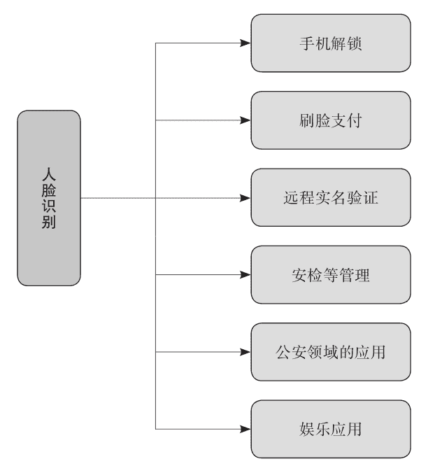

图 1-5 人脸识别技术的应用

#### （1）手机解锁

手机解锁已经在前文介绍过，此处不再赘述。

#### （2）刷脸支付

除了苹果的`Apple Pay`以外，支付宝也与肯德基合作在杭州万象城落地了全球首个刷脸支付商用试点。消费者在自助点单机下单后，只需扫描一下脸部并输入手机号就可以完成账单支付，整个过程不到 10 秒钟。相比排队等候付款，刷脸支付就要快捷方便得多。可以预见，未来“靠脸吃饭”将成为生活常态。

#### （3）远程实名验证

生活中为了保证安全，许多事务的办理都需要当事人实名验证身份。由于现实生活中这样或那样的原因，实地验证总是不够便捷，影响人们的日常学习和工作生活。利用人脸识别技术，可以避免远程验证原来存在的替代作弊的问题发生，让远程实名验证成为可能。旷视科技对此颇有发言权，该公司的人脸识别技术已经为全球累计 2.1 亿人实现了远程实名验证服务，解决了异地验证的大麻烦。

#### （4）安检等管理

在地铁站、火车站等人群密集的场所，安检等管理必不可少。现在安检的最常见做法还是人工值守，这种方法不仅需要人力支持，而且工作效率也不高。广州地铁的万胜围站、珠江新城站、嘉禾望岗站等已经安装了人工智能安检门，利用人脸识别技术和互联网其他创新技术实现快速的自动安检。

人工智能安检仪可根据互联网大数据，为具有良好信用的旅客提供快速安检服务。除了对乘客实施安检以外，人工智能安检仪还支持对乘客随身携带的小包裹进行安检，以此减少安检时间。人工智能安检仪的优势在于速度快、效率高，如果通过试验，将能够为安检等管理带来便利，提高重点区域的安全系数。

#### （5）公安领域的运用

利用人脸识别技术，公安机关的数据采集变得更加便捷，安防管理得到进一步的加强。旷视科技已利用人脸识别技术为多地公安系统提供实时警情数据服务，直接协助警方破获案件千余起，抓获、控制在逃人员超 2000 人；重庆市某公安分局使用商汤科技的人像比对系统，对嫌疑人的识别效率提升了 200 倍，在 40 个工作日辨认出了 69 名嫌疑人。

在人脸识别技术到来之前，指纹识别、虹膜识别等生物特征识别方式在生活中已经得到广泛运用，但由于其要求对象必须与仪器产生实际接触，因此在公安领域的应用存在颇多不足。而人脸识别技术保证“非接触性”，无须对方配合也可采集信息，大大提升了系统响应速度和使用便捷度，也降低了接触式辨别带来的疾病传播隐患等问题。

#### （6）娱乐应用

人脸识别技术还可用于娱乐。例如，智能相册可通过人脸识别进行照片分类，方便用户管理相册；“美颜”类 App 通过自动识别人脸为其“化妆”或“试衣”，推荐商品等。

从苹果手机的刷脸解锁延伸到刷脸安检、刷脸支付及公安部门远程监控逃犯，人脸识别技术正在逐渐为人们的生活带来新的改变。未来还可通过人脸识别技术将人脸和身份证一对一绑定，彻底解决唯一身份的问题。那时，人们的生活将不仅更加便利，而且身份信息也将变得更加安全。

### 1.2.3 百度：小度智能音箱

作为中国互联网巨头之一，百度在人工智能领域取得的研究成果也不容小觑。除了对无人驾驶等技术的研究以外，百度还推出了和全球智能音箱灯开创者生迪共同打造的跨界合作战略新品——生迪智能音箱灯（简称“小迪”），这也是中国首款语音操控智能音箱灯。

“小迪”作为智能音箱灯，实现了语音交互、氛围灯具和智能音箱的完美融合，既能语音识别用户指令，还能自动根据周围环境改变灯光的亮度和颜色，为用户提供阅读灯、小夜灯、彩虹灯等多种灯光模式，满足用户在不同场景中对不同灯光的需求。

在人工智能领域中，百度在信息流、人工智能商业应用以及无人驾驶等方面都有十分深入的研究。在智能化终端产品方面，百度依靠对话式人工智能操作系统`Duer OS`不断实现产品创新。除了生迪智能音箱灯以外，百度还推出了两款智能硬件产品：小鱼在家`VS1`智能音箱和`Aladdin`智能投影吸顶灯。这三款产品都搭载了百度`Duer OS`系统，与用户以自然语言进行交互，实现智能化操控。

百度智能生活事业群组总经理景鲲表示：“我觉得`Duer OS 3.0`是一个里程碑式的提升。整个操作系统最重要的三个属性——交互的变革、全新的应用生态、打通商业模式闭环，基本上已经完成了。”换句话说，作为对话式人工智能交互系统的 `Duer OS`能够顺畅地实现人工智能的商业化落地，从研发到落地的周期大大缩短。

搭载百度`Duer OS`系统的“小迪”作为百度人工智能家居的代表，体现了`Duer OS`系统作为对话式人工智能平台的角色。这个平台可以放到不同的设备中，不断形成新的入口，为用户带来全新的人工智能交互体验。

除了“小迪”等智能家居硬件以外，百度也推出了低价的智能音箱“小度”。根据景鲲介绍，“小度”音箱的儿童模式尤其受小朋友欢迎，这让百度预测到对话式人工智能的平台体验在儿童群体中将会迅速发展。加上消费模式的升级，消费者在儿童教育方面的投入会不断加大，儿童群体必然是未来智能产品的重要目标对象。

以“小迪”智能音箱灯为代表的搭载`Duer OS`系统的智能终端产品，作为百度在人工智能时代的入口，用各种终端形式实现用户与机器的交互，让用户充分体验到智能生活的美好。事实上，百度的人工智能系统`Duer OS`也是当前唯一一个在交互能力、内容服务和商业生态上都进行全方位布局的智能操作系统，而且成功实现了商业闭环，为百度在物联网时代占领战略高地提供了极大的支持。

### 1.2.4 阿里巴巴：天猫精灵

在人工智能的“音箱战”上，阿里巴巴也不甘落后。阿里巴巴人工智能实验室曾推出旗下首款智能音箱——天猫精灵 X1，内置第一代中文人机交流系统`Ali Genie 1.0`。在短短一年之后，阿里巴巴实验室就更新发布了`Ali Genie 2.0`系统，使天猫精灵在原有的语音交互技能的基础上具有了视觉认知功能。

对于第一代天猫精灵，用户只需呼叫一声“天猫精灵”，就可以召唤云端的`Ali Genie`系统提供服务。天猫精灵 X1 提供的服务除了作为音箱的播放功能以外，还提供其他智能服务，包括查询、娱乐、购物和工具四大类，四个大类还可划分为许多小类，各种功能应有尽有，如图 1-6 所示。

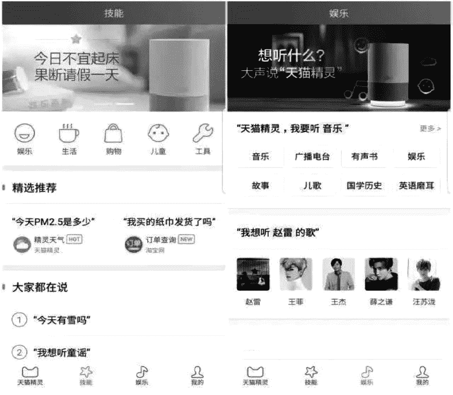

图 1-6 天猫精灵功能示意图

天猫精灵 X1 不仅具有“听”和“说”的功能，还可以通过声纹识别技术分辨家里的每一个人。与其他智能音箱使用的语音识别技术不同，天猫精灵的语音识别采用了声纹技术。声纹技术是生物识别的重要识别手段之一，通过不同人的声音特征识别不同的人。天猫精灵利用声纹技术，根据声音条件的不同识别出不同的使用者，既保证用户在使用过程中的安全性和私密性，也让语音支付环节多一重安全保障。

用户在使用时先将自己的声音注册并生成独一无二的声音密码，与天猫精灵绑定后即可开启声纹购物功能。当用户说出类似“帮我订一份外卖”这样的需要付款的需求时，天猫精灵会要求用户念一串系统随机生成的无规律数字作为声纹校验。如果声纹校验结果确认是用户本人，天猫精灵就会从用户绑定的支付宝中扣款以完成这笔交易。

除了保证支付安全以外，天猫精灵的声纹校验还能够通过声纹识别在识别出不同使用者的身份后，根据每个人的兴趣推送不同的内容，实现个性化推荐。

`Ali Geni 2.0`系统不仅在`Ali Genie 1.0`系统的基础上做出功能的升级，还新增加了视觉认知功能。也就是说，`Ali Genie 2.0`系统不仅能够“听”和“说”，还可以“看”，实现视觉认知、多模态交互、情景感知等功能，如图 1-7 所示。

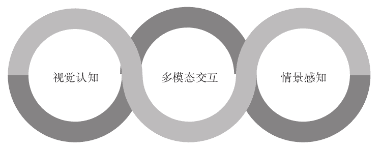

图 1-7 `Ali Geni 2.0`的视觉认知功能

`Ali Genie 2.0`系统的视觉认知能力包括图像识别、人脸识别和物体检测等；多模态交互能力是指天猫精灵和用户之间实现如语音、图像、触摸等多种交互形态的融合，模拟人与人之间的交流方式；情景感知能力则是指天猫精灵基于用户提供的上下文环境、对话场景等自主学习，理解情景需求。

体现在产品上，天猫精灵的视觉识别能力表现在“火眼”上，其核心能力有两个：视觉认知和表情系统。视觉认知方面，天猫精灵火眼至少能识别 117 套图书、4 万个药盒，实现为儿童阅读书籍、为老人阅读药物信息的功能；表情系统方面，天猫精灵火眼可以在显示屏上展现一些可爱的表情，以供儿童游戏使用。阿里巴巴人工智能实验室总经理浅雪介绍，未来天猫精灵还会具有“万物识别”等更多功能。

不仅如此，以`Ali Genie`系统为支撑的天猫精灵还接入了各个平台的生活服务，如 Keep、优酷、高德地图、支付宝、虾米音乐、天猫超市、喜马拉雅 FM、淘宝网、绘儿乐、飞猪、盒马鲜生等，这些第三方技能服务都将为用户带来更便捷的智能生活体验。

### 1.2.5 腾讯：腾讯觅影

腾讯公司将人工智能技术运用于医学领域，推出了首款人工智能与医学结合的人工智能医学影像产品——腾讯觅影。腾讯觅影是由腾讯“互联网+”合作事业部领导，结合了腾讯公司内部包括`AI Lab`（腾讯人工智能实验室）、优图实验室、架构平台部等多个顶尖人工智能团队研发完成的人工智能产品。腾讯影音把图像识别、大数据处理、深度学习等领先的技术运用在医学领域，帮助医生完成治疗诊断的工作。

腾讯觅影主要有以下两大功能。

#### （1）人工智能医学影像

通过计算机视觉和深度学习技术，腾讯觅影对各类医学影像（内窥镜、病理、钼靶、超声、`CT`、`MRI`等）进行学习训练，充分掌握各类病变的医学影像特征，能够有效地辅助医生诊断病人的情况，以及实现各种重大疾病的早期筛查任务。

#### （2）人工智能辅助诊断

依靠腾讯 AI Lab 的技术能力，腾讯觅影人工智能通过自然语言处理和深度学习，能够为医生提供病人诊疗上的决策建议，辅助医生更快、更有效地理解病案，提升诊疗效率。

腾讯觅影的人工智能辅诊诊断能力主要包括两大方面：诊疗风险监控系统和病案智能化管理系统。诊疗风险监控系统可以使医生的诊疗风险大大降低，避免误诊；病案智能化管理系统可为医生准确提取病案特征，同时输出结构化的病历，减少医生整理翻看病案的工作，提升诊疗和科研效率。

腾讯觅影在早期食道癌的发现和诊疗中表现出了良好的辅助功能。在没有人工智能辅助的条件下，我国早期的食管癌检查程序烦琐，检出率却不到 10%。而利用腾讯觅影筛查的结果准确率高达 90%，筛查操作却只需一个内镜检查，用时不超过 4 秒，这显然是一项对人类生活有重要意义的应用。

除了食管癌早期筛查以外，腾讯觅影技术还支持其他病种的筛查和诊疗，如早期肺癌等。利用人工智能技术，腾讯觅影有望解决早期食管癌等疾病的筛查难题，有助于消除各地区的医疗水平差异，为患者提供水平一致的诊断和治疗。

对于人工智能在医疗领域的应用，丁香园创始人李天天曾坚定地认为医生不会被人工智能取代，但他渐渐改变了想法。他说：“至少有两类医生在将来有可能会被人工智能取代，一类是影像科医生，另一类是病理科医生。这两个科室的医生有个特点——不见病人。”

在人工智能的医疗应用上，腾讯觅影的出现无疑是一个十分令人兴奋的事例。麦肯锡合伙人弗洛里安（Florian Then）曾分享过人工智能医疗在全球的发展现状和趋势，认为数字化医疗不仅要从国家层面进行医疗基础设施建设，还要把握好创新数字化医疗方案，既要解决个性化问题又要保证资本不扎堆；更进一步，这些应用应成为健康的生态系统。显然，腾讯觅影就是这种人工智能生态系统的具体表现。

### 1.2.6 IBM：智能沃森系统

科技巨头 IBM 公司在人工智能领域推出的产品智能沃森系统，可以说是十项全能。智能沃森系统和众多第三方平台合作，打造了一个在众多领域都能为人们提供帮助的人工智能平台。

在智能沃森系统的发布会上，IBM 公司首席执行官罗睿兰（Ginni Rometty）强调智能沃森系统的目标在于改变企业的运作方式和人们的生活方式。“我们的目标是增强人们的智力。”罗睿兰说，“沃森是人和机器的结合，主要作用在于扩充人们的专业知识。它既可以是一位老师、一位医生，也可以是一位律师。无论你做什么工作，我们都能够扩展你的知识。”

起初，智能沃森系统的应用领域是医疗保健，与葛兰素史克、史泰博、美国癌症协会及克利夫兰诊所等有合作关系。之后，IBM 公司引进了超过 10 亿美元的投资，智能沃森系统学会的技能和工作能力越来越强。除了医疗保健领域以外，智能沃森系统在时装设计、个人助理、食物、兽医学、比赛分析、潮流追踪和商业分析等领域崭露头角，并产生了一定的收益，具体案例如表 1-1 所示。

表 1-1 智能沃森系统的应用案例

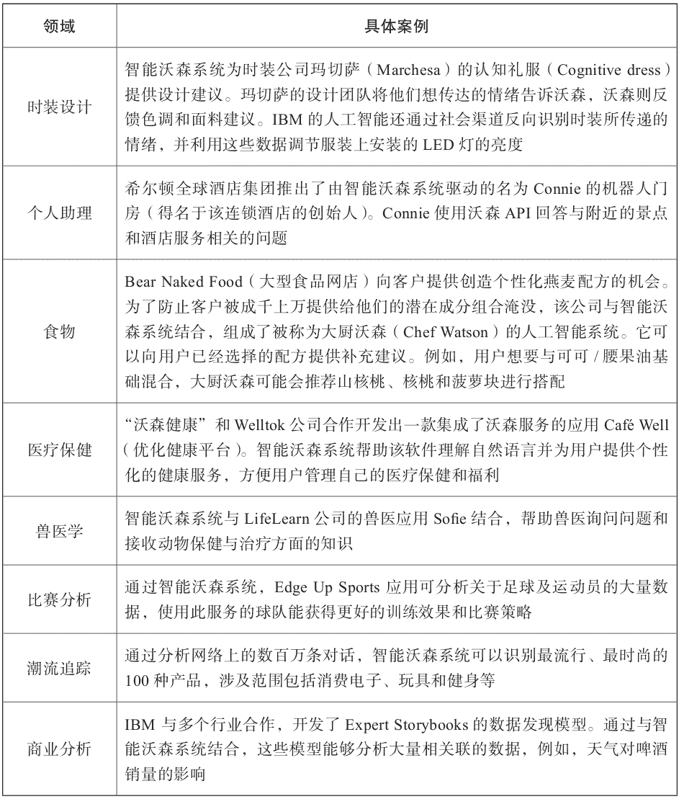

针对智能沃森系统的各种应用，上海元趣公司 CEO 兼首席科学家、拟脑机器人之父吴义坚总结道：“IBM 沃森的核心是‘知识渊博’，也就是具有海量的各个行业的知识库，在此基础上基于自然语言处理和机器学习，提供信息服务和决策辅助。它的人工智能体现在大数据的分析、挖掘和决策上，其目标是打造一个全能型的行业知识库平台，让更多的第三方开发者给它提供数据，调用它的引擎为用户提供服务。”

智能沃森系统的存在是人工智能为人类生活带来巨大改变的有利证据。随着资金的不断投入和深度学习的发展，智能沃森系统几乎在衣、食、住、行等各个领域都为人类提供了帮助。智能沃森系统还不能全面解决人类生活中的所有困难，但它确实证明了人工智能拥有无限的应用潜力，IBM 的不断研究终会实现人类的人工智能生活。

## 1.3 人工智能与其发展所经历的三次浪潮

从 AlphaGo 打败李世石后，“人工智能”一词走进普通大众的视野并迅速成为全民讨论的热门话题。人工智能的概念逐渐被大众熟知，其商业化产品也逐步成熟。从概念提出到专家系统再到与大数据结合，人工智能的发展一共经历了三次浪潮，最终应用到现实生活中。

### 1.3.1 图灵测试：人工智能研发的开端

说到人工智能，就不得不提到计算机领域的传奇人物——艾伦·图灵博士。图灵于 1950 年在《思想》（Mind）杂志发表了论文《计算的机器和智能》，引发了社会对“人工智能”的第一次狂热浪潮。

在这篇论文里，图灵创造性地提出了辨别机器是否具有智能的方法，即图灵测试，如图 1-8 所示。

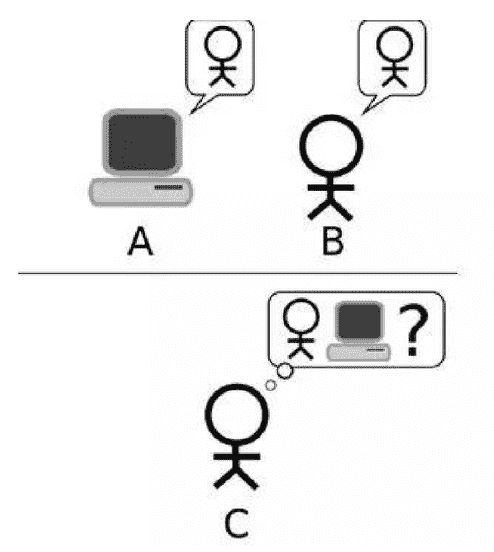

图 1-8 图灵测试示意图

根据图灵博士的论文，图灵测试的程序如下：首先在幕后安排一台机器和一个人，然后让一个裁判（人）同时与他们进行交流，如果裁判无法判断和自己交流的对象是人还是机器，就说明这台机器拥有和人同等的智能。

在图灵测试成功地点燃科学家的热情后，世界上第一次有关人工智能的研讨会于 1956 年夏天召开，即达特茅斯夏季人工智能研究会议。会议的组织者是马文·明斯基、约翰·麦卡锡、克劳德·艾尔伍德·香农以及尼尔·罗切斯特，与会者包括雷·索洛莫洛夫、奥利弗·赛尔弗里纪、特伦查德·摩尔、亚瑟·塞缪尔、纽厄尔和西蒙，他们都在人工智能的发展史上做出了重要贡献。

这次会议是一场头脑风暴式的讨论会，学者们讨论了众多当时计算机领域尚未解决甚至尚未开展研究的议题，其中就包括人工智能。在会议中，麦卡锡说服众人用“人工智能”一词作为本领域的名称。于是，人工智能的名称和任务在 1956 年达特茅斯会议上被确定下来，人工智能领域最初的成就和最早的一批研究者也因此出现。所以，达特茅斯夏季人工智能研究会议被视为人工智能诞生的标志。

达特茅斯会议之后，人工智能在 1950—1960 年迎来了第一个高速发展时期，被称为“黄金十年”。当时的人工智能研究者使用的是传统的人工智能方法，因此这个时期的人工智能也被称为“古典人工智能”。

在古典人工智能阶段，研究者开发了许多令人称奇的程序，这些程序可以解出代数应用题，还能帮助人们学习和使用英语。这让当时的人们惊叹于机器的“智能”，研究者也因此信心大涨，对人工智能的前景表达出了相当乐观的情绪。这些也吸引了 DARPA（美国国防部高级研究计划局）等政府机构的兴趣，其向人工智能领域投入了大量资金，支持研究者进行研究，希望人工智能能够给国家带来更多利益。

马文·明斯基曾在 1970 年预言：“在 3～8 年的时间里，我们将得到一台具有人类平均智能的机器。”但由于人工智能项目并不如研究者预期的那样简单，预先提出的承诺无法按时兑现，致使人们对人工智能的信心遭到重大打击。

项目的停滞一方面让反对者的声音更加突出，莱特希尔曾在 1973 年发布了针对英国人工智能研究状况的报告，声称人工智能在实现其“宏伟目标”的路上是“完全失败”；另一方面也极大地影响了投资资金的跟进，众多投资人因为看不到希望而迅速撤资，这也让人工智能的发展举步维艰。

从图灵测试到达特茅斯会议，再到人工智能的“黄金十年”，第一次人工智能浪潮由于技术上的不足，最终迎来了低谷期。

### 1.3.2 语音识别技术：第二次人工智能浪潮

人工智能的第一次低谷期持续了 6 年左右。20 世纪 80 年代，一类名为“专家系统”的人工智能程序又掀起了人工智能的浪潮。专家系统以向计算机灌输“专家知识”作为规则，协助人们解决特定问题（尤其是疾病诊断工作）的程序，所以“知识处理”成为当时人工智能的主流研究焦点。其中，语音识别技术的突破值得一提。

语音识别技术也被称为自动语音识别（Automatic Speech Recognition，ASR），该技术不是用于确认或识别说话人员的身份，而是确认说话人的话语中包含的词汇，并将其转换为计算机刻度的输入指令，如按键、二进制编码或字符序列。

语音识别的研究工作可以追溯到 20 世纪 50 年代贝尔实验室的 Audry 系统，它是第一个实现语音识别的系统，但是只能识别 10 个英文数字。20 世纪 80 年代末，实验室语音识别研究取得了巨大突破：一方面，语音识别系统对小词汇量识别具备了较高的识别率；另一方面，“大词汇量、连续语音、非特定人”三大障碍也陆续得到解决，这三个特性被成功集成在一个系统中。

语音技术的突破给人们带来了极大的信心。20 世纪 90 年代，IBM 及苹果等著名的大公司都开始为语音识别系统的实用化研究投以巨资。在 20 世纪 90 年代中后期的实验室研究中，语音识别技术的准确率不断提高，进一步增强了当时的人们对语音识别的信心。1997 年，甚至有人提出“语音时代”已经来临。

然而事实并非如此，语音识别系统在实际应用中显得力不从心。当时的语音识别产品在系统的健壮性、灵活性和自适应能力上都远远不能满足实际的需要，这为随后人工智能的第二次低谷期埋下了隐患。

因实际的技术水平和应用现状无法满足过高的市场期望，泡沫经济就出现了。20 世纪 80 年代，商业机构对人工智能的追捧与冷落正符合泡沫经济的经典模式。

经历过 1974 年经费削减的人工智能研究者创造出一个词：“AI 之冬（AI winter）”。他们注意到大众对专家系统的狂热追捧，并悲观地预计不久后人们将再一次转向失望。事实不幸被他们言中：从 20 世纪 80 年代末到 20 世纪 90 年代初，第二次人工智能浪潮遭遇了一系列财政问题。

20 世纪 80 年代晚期，战略计算促进会大幅削减对人工智能项目的投资，DARPA 的新任领导也认为人工智能并非“下一个浪潮”，财政拨款向那些看起来更容易出成果的项目倾斜。同时，专家系统的维护费用居高不下，且不断暴露出各种各样的问题，其较大的局限性和有限的商业应用范围也大大打击了人们对人工智能的热情。

尽管语音识别技术在第二次人工智能浪潮中获得极大的突破，但依旧没能阻止“AI 之冬”的到来。因为专家系统本质上只是用最初设定好的解决方案解决遇到的问题，并没有自主学习能力，即还不够“智能”。所以，第二次人工智能浪潮的退去也是情理之中。

### 1.3.3 AlphaGo 围棋大战：引发第三次人工智能浪潮

AlphaGo 是由英国 DeepMind 公司开发的围棋人工智能程序。在乌镇的围棋峰会上，柯洁曾与 AlphaGo 在三天内完成了三场交锋，不幸三场皆败。这场人机围棋大战使人工智能的能力再一次令世人惊叹，人工智能再次迎来发展的浪潮。

早在 1997 年，人工智能就已经和人类在智力游戏上发生过交战。1997 年 5 月 11 日，国际象棋世界冠军卡斯帕罗夫与 IBM 公司的“深蓝”超级计算机进行了六局比赛，最终落败。

DeepMind 的创立者之一杰米斯·哈萨比斯（Demis Hassabis）博士说：“在‘深蓝’战胜卡斯帕罗夫之后，围棋就成了游戏 AI 最后的圣杯。”最终，AlphaGo 的表现证明，游戏 AI 从人类手中夺得了这枚圣杯。

在人工智能经历了第二次低谷之后，越来越多的人工智能研究者开始将数学语言运用到程序开发中。人们开始意识到，许多人工智能领域碰到的问题已经成为数学和经济学、运筹学、统计学等领域的交叉研究课题。通过数学语言，人工智能可以与其他学科顺畅地合作，从而解决问题。终于，人工智能领域成为具有严格框架体系的领域，真正成为规范的科学分支。

进入大数据元年，智能问题在海量数据的支撑下变成数据问题，人工智能有了质的飞跃。曾经停滞不前的诸多与“智能”有关的研究领域，如图像识别和自然语言理解等，都在思维方式转变后获得很大的突破。人工智能为人类带来了新的革命——智能革命。

除了作为资源的大数据以外，深度学习技术也是这场革命的重要关键点。以面部识别为例，深度学习技术让人工智能在无数的人脸图像数据中识别出共有的模式和情绪。这样，人工智能的“智能”程度又被大大提高了。

尽管人工智能已经有革命性的进展，第三次全民式的人工智能狂热浪潮还是在 AlphaGo 和人类的人机大战发生后。AlphaGo 打败了李世石后，二代 AlphaGo 化身神秘棋手“Master”登录中国弈城围棋网，横扫中外顶尖棋手，取得了 60 连胜的成绩，随后又打败了围棋高手柯洁。这一连串的事件似乎证明了人工智能真的在“智能”上超越了人类，大众对人工智能的热情空前高涨。

AlphaGo 是一个直观展现在大众面前的人工智能标志，它的胜利意味着人们对人工智能的探索已经到达新的阶段。造就 AlphaGo 惊人成绩的学习模式同样可被应用到其他领域，如人脸识别、语音识别等。这也是这次浪潮不同于其他两次的关键所在：技术先于大众期望出现。

凭借深度学习和大数据，人工智能终于在大起大落之后重获新生，并成功证明自己有能力为人类带来更好的生活。可能是像 AlphaGo 那样和人类在智力游戏上一较高下，可能是帮助职业医生诊断病症，还可能是为人类实现自动驾驶……人工智能终于为人类开启了智能时代的新世界。

### 1.3.4 艾伦·图灵：人工智能之父

科学界有两个苹果最为人称道：一个是砸在牛顿头上的苹果，另一个就是结束了艾伦·图灵年轻生命的毒苹果。有人声称苹果公司“被咬了一口的苹果”Logo 就是来自于艾伦·图灵临终前床边剩下的那半个苹果，乔布斯对此的回应是：“这不是真的，但上帝啊，我们多希望它是真的！”

在美国《时代》周刊的《20 世纪最重要的 100 人》一文中，作者对图灵给出了极高的评价：“每一个在敲键盘、使用电子表格或文字处理软件的人都应当记住，我们都工作在一台‘图灵机’上。”

艾伦·图灵出生于 1912 年 6 月 23 日，去世于 1954 年 6 月 7 日，英国数学家、逻辑学家，被称为“计算机科学之父”“人工智能之父”。他提出了“图灵机”和“图灵测试”等重要概念，是计算机逻辑的奠基者。美国计算机协会为纪念图灵在计算机领域的卓越贡献，以他的名字命名了奖项“图灵奖”，该奖项被称为计算机科学界的诺贝尔奖。

艾伦·图灵对机器的痴迷起源于他在儿童时期阅读的一本书——埃德温·坦尼·布鲁斯特所著的《每个儿童应该知道的自然奇观》。书中提到“人体也是一种机器”，“它是一台极其复杂的机器。虽然比任何手工制作的机器都要复杂千万倍，但其本质上仍然是一台机器……就像是汽车、轮船和飞机的内燃机一样。”这本书开启了图灵的科学视野，让他对人与机器之间的关系产生了浓厚的兴趣。

图灵对机器的研究使他在密码解码机器领域也颇有建树。第二次世界大战期间，成功破译德国著名的密码系统（Enigma），对于英国政府来说极为重要。图灵的加入使解码机器“图灵 Bombe”成功问世，扭转了盟军的大西洋战场战局。历史学家认为，图灵对 Enigma 的成功破译至少拯救了超过 2000 万的无辜生命。

1950 年 10 月，图灵的论文《计算机械与人工智能》被发表，著名的“图灵测试”被提出。在论文中，图灵更倾向于用“智能”而非“思考”一词来处理机器的相关问题，为人工智能开启了大门。

在那个时期，由于英国政府对同性恋人群的不公正对待，图灵被告发后判以一年缓刑并被强制接受荷尔蒙治疗。在这之后，图灵的工作也受到了极大的影响，他的择业面变得很狭窄，以前所从事的工作也不再对他开放。在沉重的心理压力之下，1954 年 6 月 7 日的晚上，图灵吃下蘸有氰化物的苹果，结束了自己传奇又短暂的一生。

图灵去世半个多世纪后，英国前首相戈登·布朗于 2009 年 9 月 10 日代表英国政府为图灵当年受到的不公正待遇公开致歉，英国女王伊丽莎白二世在 2013 年 12 月 24 日为图灵颁发“皇家赦免”，撤销了当年的指控。

诗人木心的话很好地表达了世人对图灵最深刻的惋惜：“别再提图灵了吧，他的死，使我们感到大家都是对不起他的。天才总天真、坦荡、毫不设防地迎向这个被庸人占领的世界，一腔热诚付与世界，世界待他们，往往却是一盆脏水兜头浇下。”

斯人已逝，但图灵在人工智能领域的贡献依然影响深远，也许我们纪念这位天才的最好方式就是让人工智能走得远些、再远些。

## 1.4 人工智能的真正内涵与商业价值

人工智能的定义可以分为两部分，即“人工”和“智能”。顾名思义，“人工”一词就是人工制造，即人工智能是人类创造而非自然界本就存在的；“智能”一词则是指机器需要像人类一样能够感知外界事物、形成认知并做出决策。显然，人工智能的真正内涵不在于“人工”，而在于“智能”。

运用功能模拟的方式，计算机能够实现模仿人类的部分功能，把人类的某些简单的智能活动机械化，这就给人工智能在商业化落地上创造了可能。在技术不断进步的背景下，人工智能带来的商业变革已经拉开序幕。从语音助手到无人驾驶，从面部识别到智能家居，人工智能正在打造新一代智能化的未来生活。

### 1.4.1 智能：人工智能的灵魂

人工智能究竟是什么？图灵奖得主马文·明斯基认为，“让机器做本需要人的智能才能够做到的事情的一门科学就是人工智能”；而图灵奖和诺贝尔奖双料得主司马贺则认为，“智能是对符号的操作，而最原始的符号对应于物理客体”。

不同的研究者对人工智能或许有不同的见解和定义，但无论研究者对人工智能如何定义，不可否认的一点是，“智能”才是人工智能的灵魂。

人类对“智能”的了解全部来源于自身，所以人工智能也是相对于人类的智能而言的。根据人类的智能活动特征，人工智能的智能化表现可以用三步曲表示：通过感知寻找认知，然后进行决策，即“运算智能”“感知智能”和“认知智能”三个层面。

#### （1）运算智能

运算智能是指计算机进行快速计算和存储信息的能力，这是人工智能进行机器学习的基础。目前，计算机的运算智能已经十分出色。“深蓝”打败当时的国际象棋冠军卡斯帕罗夫，AlphaGo 打败李世石、柯洁，横扫中外围棋高手，这些事例都是人工智能具有出色运算智能的体现。

#### （2）感知智能

人工智能的感知智能即视觉、触觉等感知能力，包括语音收入和面部识别等具体领域。各种智能感知能力是事物和外界进行交互的窗口，例如，自动驾驶汽车的激光雷达等设备就是实现感知智能的设备。

#### （3）认知智能

简单地说，认知智能就是“能理解、会思考”。机器的认知智能表现在对知识的不断理解与学习上，这也是人工智能中最难的环节。举例来说，智伴科技旗下的班尼儿童成长机器人能做到“能理解、会思考”。用户提出一个它不懂的问题并告诉它正确答案，那么它在第二次遇到这个问题时就能很好地处理，这就是其自主学习的能力，即认知智能的体现。

人工智能的独特之处在于智能化，它的智能使人脑的部分功能在计算机中体现出来，对某些场景能够做出自主决策。随着技术的进步，人工智能逐渐从类人行为模式（模拟行为结果）发展到类人思维模式（模拟大脑运作），甚至向泛智能模式（不再局限于模拟人）发展。尽管人工智能的内涵正在不断扩大，但其核心依旧是“智能”二字。

### 1.4.2 人工智能并非超越人类智慧

人工智能的时代正在到来，并在越来越多的领域显示出比人类更强大的能力。随着知名媒体人杨澜所著的《人工智能真的来了》一书上市，“人工智能是否真的会超越人类智慧”的话题引发了大众关注。

实际上，对于人工智能超越人类的担忧，我们可以从两个方面来处理，一方面是科技和人类的关系，另一方面是人工智能的本质特点。

从科技和人类的关系方面看，人类自出现以来，追求科技的步伐就一直没有停止过。从远古时期的石器到现在的智能手机，每种工具都具备人类所没有的功能。但人类并未被这些工具打败，而是充分利用这些工具推动自身历史的发展。人类和高科技一直都处于各司其职的平衡状态，共同推动社会的进步，人工智能也不会例外。

人工智能的本质特点是对人类思维过程的模拟，即使人工智能在某些方面超过了人类的生物极限，它也无法取代人类的大脑完成和人类一样的意识过程。换句话说，人工智能是思维模拟，而不是具有思维本身。

人工智能究竟为何无法超越人类智慧？原因在于人类具有感性思维。面对泰山，人类除了惊叹大自然的鬼斧神工以外，还会被激发出“一览众山小”的豪情壮志。而人工智能也许在描述景色时的文字运用能力不逊于人类，却无法感知景色带来的感情上的激荡，也并不了解自己写出的文字有何价值和意义，它只是根据算法写出文字。只要算法足够精妙，学习的轮数足够多，人工智能的能力就可能超过人类。但这些学习都是基于逻辑的模仿，不具有人类自身的感性思维。

因此，人类和人工智能具有本质的差异，二者不应该因为人工智能的出色表现就产生谁更有优势的矛盾。

人工智能是充分模仿人类行为而出现的科技产物，其在表现出超凡的实力时也带来了人类的恐慌。但只要明白人工智能是人类创造的另一类工具，与人类自身存在本质上的差距，更不会超越人类的智慧，这些恐慌自然就会消失。

### 1.4.3 前景光明：人工智能引领商业变革

人工智能正在进入人类生活的各个领域，并带来各种变革。从解救人类于繁重的家务中的家政服务机器人，到辅助医生诊断治疗的智能医疗医生，再到银行等场所出现的服务类型机器人，都表明人工智能正在给人类生活带来各方面的改变。同样，人工智能技术也正在为商业领域带来新的变革，即形成“智能商业”。

在商业领域，客户关系管理系统（`CRM`）对现代化企业具有十分重要的作用。`CRM`系统以客户数据的管理为核心，充分收集、管理、分析、利用客户数据，在信息科学技术的帮助下实现企业对市场营销、销售、服务等活动的自动化管理。将人工智能技术和`CRM`系统结合起来，能更快实现客户关系管理的智能化操作。

在`CRM`领域，百会已成功将人工智能技术融入了`CRM`系统。利用“机器学习”手段，这款智能`CRM`系统能够帮助销售人员确认联系客户的最佳时间，避免以往重复性的低效邮件发送工作，帮助企业在营销、销售、跟单、售后等业务流程上实现真正的智能化管理。

百会的智能`CRM`系统只是智能商业变革的一角。人工智能融入商业的同时，带来的变革绝不仅是提供一套更加智能化的数据处理工具，而是深入理念层面，从思想上带来了新的发展方向。

英国信息解决方案提供商 Callcredit 公司的概念管理总监戴夫·韦伯（Dave Webber）认为，企业对人工智能的成功运用“是一个真正的商业变革的机会”，不应将其当作一个孤立的项目，而应视为一个长期发展的工作计划。

天马股份董事长傅淼提出，相比传统商业，智能商业决策系统具有以下五个优势。

#### （1）人机交互决策

对于传统商业来说，大大小小的决策事件都由相应的人员做出。这样的决策，一方面效率不高，另一方面出现失误的可能性也比较大。智能商业是人机交互决策，一部分可以做到自动化决策，减少人工参与的成分；比较复杂的决策则由机器提供技术辅助，由相关人员做出最终决策。这样既能减少人们重复性决策的工作，也能避免人们做出非理性的决策。

#### （2）大规模数据分析

在分析主题时，传统商业必须有明确的主题为从业人员提供方向，智能商业则不需要有明确的主题。智能商业可以利用人工智能实现大规模数据分析，对发生的现象进行主题原因分析和归纳。

#### （3）数据实时更新且来源开放

传统商业的数据往往不是实时数据，而且多数是企业内部的单一来源，具有局限性。而智能商业的数据是实时数据，而且能够获得开放的数据来源，有助于企业形成综合商业情报。

#### （4）系统模型可自动优化

传统商业的系统模型是固定的，无法实现自动优化，一段时间后就会落后。智能商业则因为人工智能的自主学习能力而具有自动优化的特性，比传统商业更具有优势。

#### （5）可运用到全产业链

传统商业系统适用于企业局部，智能商业则可应用到全产业链，为整个产业链条提供实时的商业指导。

人工智能给商业领域带来的变化不仅是一个应用、一种技术，而是从思维上发生改变，为商业带来智能化的变革。因此，智能商业具有光明的前景。

# 第 2 章 人工智能发展的科技支撑点：大数据+云计算+深度学习

人工智能从设想变为现实的过程涉及的科学技术有很多，也与许多学科发生交叉，产生了令人惊叹的产品。但归根结底，支撑人工智能发展的科技支撑点还是大数据、云计算和深度学习。大数据作为机器学习的资源，是人工智能发展的能量源；云计算作为计算机实现任务的手段，是人工智能发展的发动机；深度学习作为实现计算机学习的技术，是人工智能发展的智慧源。

## 2.1 大数据：人工智能发展的能量源

伴随大数据时代的到来，实时、大量、多来源的数据纷纷涌现。数据越多，越有利于从不同的角度对现实进行刻画，以得到最逼近真实的描述，为人工智能的应用奠定了数据源基础。有了充分的数据来源，人工智能才能实现不断学习和优化，才能得到成功的实践。

### 2.1.1 大数据思维：精细营销、智能营销的关键

数据驱动方法出现于 20 世纪 70 年代，并在八九十年代稳步地发展。进入 21 世纪后，互联网的出现带来了爆发式增长的数据量，数据驱动方法的优势越来越明显。随着全球各个领域的数据都在不断向外扩展，很多数据出现交叉的现象，数据之间的关联性也极大地增强了，这时就出现了大数据。

大数据技术最重大的意义不在于挖掘出了多少数据，而在于为人们解决问题提供了新的思维方法，即大数据思维。总体来说，大数据思维包括全样思维、容错思维和相关思维三个方面。

#### （1）全样思维

与全样思维相对的是抽样思维。抽样是指在全部待测对象中抽取一部分样品作为代表，将样品的特征作为全体的特征。在客观条件无法达到的情况下，抽样是得到较为正确的结论的好方法。

但是，由于抽样得出的样本始终无法代表全体对象的实际情况，有时候还会因为样本的不合适而得出错误的结论。因此，抽样是在无法测量全体数据时的权宜之计。随着技术的发展，大数据已经实现对全体数据的存储和分析，因此不再强调抽样而采用全样思维方式。

#### （2）容错思维

正如前文所说，抽样只能代表全体对象的一部分特征，而且与抽取的样本质量有极大的关系。样本上的一点错误，都极有可能导致最终结论“失之毫厘，谬以千里”。因此，人们对抽样的数据十分谨慎，采用了各种统计方法来尽量减少误差，但误差只能减少，无法消除。

大数据时代，用于分析和计算的是全体数据，不存在抽样带来的误差，当有极个别数据出现错误时也不会影响整体结论的正确性，这就是大数据的容错性。

#### （3）相关思维

大数据时代，人们不再追求精确的因果关系，而是追求发现数据间的相关关系，这种思维的转变符合实际情况。在现实生活中，有些数据之间不存在严格的因果关系，但确实是同时发生变化的，这就是相关关系。例如，公鸡打鸣和太阳升起就是最简单的相关关系。

在数据世界中，人们利用大数据对未来进行科学预测，其实就是在无数的事实中提炼出数据之间的相关性。与原来严格的因果思维相比，相关思维的出现更符合大数据时代的风格——不必知道原因，只需知道可用。这对于大数据时代的人们来说，也是思维方式上的冲击。

大数据思维正是新时代精细营销、智能营销的关键。通过大数据技术，企业可以把握全体消费者的消费数据，而不是利用抽样的方式以一小部分消费者的喜好推测所有人的倾向，不用担心收集到的数据是否有错误，也不用分析消费者消费行为变化背后的直接原因，只需找出与其相关的现象就可以。有了大数据思维，精准营销和智能营销才能真正把握住消费者的动态变化。

大数据的发展不仅是技术的推进，更是思维方式的改变。现在的数据量比以往大很多，人们解决问题的思维方式和以往有所不同。大数据思维带来的思维方式转变使精准营销和智能营销成为可能，从而引发营销行业的颠覆性变革。

### 2.1.2 大数据促进人工智能发展

大数据的积累为人工智能发展提供了燃料。互联网数据中心（`IDC`）、希捷科技曾发布了《数据时代 2025》报告，报告中显示 2025 年的全球数据总量将达到 163ZB（10 万亿亿字节）。爆炸性增长的数据为人工智能的深度学习技术提供了丰厚的数据土壤，推动了人工智能的快速发展。

大数据推动人工智能发展体现在两大方面：第一，在发展意义上，人工智能的核心在于数据支持；第二，在发展现状上，人工智能的突飞猛进建立在大数据的基础上。

从发展意义上看，大数据对人工智能的数据支持作用有两个具体表现。首先，大数据技术的发展为人工智能技术打下了基础。人工智能的发展需要学习大量的知识和经验，这些知识和经验就是各种各样的数据。大数据中的海量数据为深度学习等人工智能算法提供了坚实的素材基础。其次，人工智能的创新应用离不开公共数据的开放和共享。人工智能的发展需要多种环境下的数据资源，而大数据技术的一大特点就是数据资源的开放和共享。因此，大数据也为人工智能技术的创新应用提供了条件。

从发展现状来看，人工智能的飞速发展建立在大数据的基础上是不争的事实。首先，海量数据为训练人工智能提供了原材料。根据`IDC`预测，2020 年全球将总共拥有 35ZB 的数据量。正是海量的数据给人工智能的深度学习带来了可能。其次，人工智能领域具有较强实力的互联网企业都有着强大的大数据实力。例如，2.5 万名谷歌工程师可调用谷歌存放在代码资源库中的 20 亿行代码；亚马逊`AWS`为全球 190 个国家和地区超过百万家企业和组织提供支持，拥有的数据量也不容小觑。这些企业的强大数据库是其成为人工智能行业排头兵的必要条件。

许多人工智能的应用是基于多产业数据协同的，智能家居系统就是结合了多个领域如弱电、安防等的人工智能应用。

百度首席科学家熊辉博士曾经指出，数据驱动的人工智能时代已经到来，人工智能只有在大数据的驱动下才得以发展。所以，只有整个大数据产业链条进一步完善和优化，人工智能的未来布局和发展才会进一步清晰和完善。

## 2.2 云计算：人工智能发展的发动机

在过去近 20 年的时间里，全球数据量以爆炸式的状态持续增长。要想处理好这些激增的数据并让其发挥最大的作用，就需要强大的云计算平台。在人工智能领域，云计算通过将大数据挖掘的海量数据进行存储和计算，让数据发挥最大的作用。如果把数据比作石油，云计算就是让石油发挥作用的内燃机。

### 2.2.1 数据是石油，云计算是内燃机

大数据就像 20 世纪的石油那样珍贵，是一种战略资源。但是在 20 世纪之前，石油的价值远没有这么高，甚至也不被算作资源。100 多年前，内燃机的发明改变了石油的命运。云计算之于数据，就好比内燃机之于石油。数据早已出现，但一直是作为信息化的“副产品”存在，其背后的价值直到云计算的出现才得以体现。如果没有基于云计算的数据处理，数据再大也不是“大数据”，而是“数据大”。

以计算机的发明为标志的第三次工业革命以信息化为特征，人类从此进入信息时代；以工业智能化、互联网产业化、全面云化、大数据应用化为标志的第四次工业革命以智能化、自动化为特征，人类历史将进入智能时代，而云计算正是第四次工业革命中出现的概念。

在云计算技术出现以前，如果一家公司希望用某系统实现自身的数据管理，就需要自己建机房、买服务器、搭系统、开发出各类应用程序，还要设专人维护。这种方式不仅费工费时，效率不高，而且在公司扩大时也会出现扩容跟不上的问题。随着信息时代的推进，公司发展越来越数字化，对数据资源的挖掘和管理也显得越来越重要，于是云计算技术应运而生。

云计算的定义是“通过网络按需提供可动态伸缩的廉价计算服务”。当客户需要建立信息系统来管理数据时，只需通过互联网向云计算平台提供商租用所需的计算资源即可。尽管云计算的这些资源也需要精确计费，但比公司独立建立一系列数据管理资源要便宜方便得多。

总体来说，云计算的业务模式有三个特点，如图 2-1 所示。

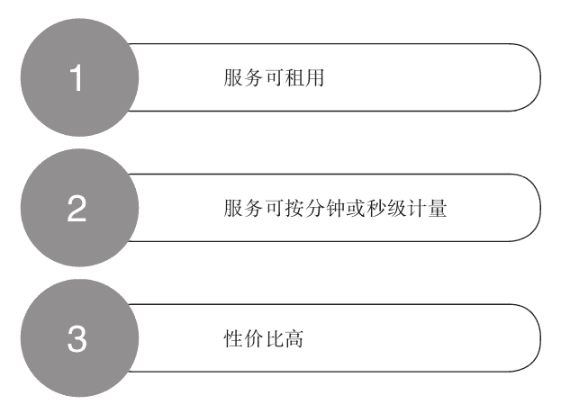

图 2-1 云计算的业务模式特点

#### （1）服务可租用

用户可通过互联网租用云计算服务，租用成本低，适用于大多数企业。

#### （2）服务可按分钟或秒级计量

云计算服务的收费可按照分钟或秒级计量，这对于用户来说是十分合理的收费模式。

#### （3）性价比高

与传统的数据管理模式相比，云计算的模式性价比更高，无须企业准备一整套数据管理流程。

互联网带来了海量数据，而对这些数据资源的利用是重中之重。尽管大数据为人工智能准备好了资源，但如果没有云计算这个工具，这份资源也毫无价值。正如内燃机的出现才使石油成为重要的战略资源那样，云计算的出现才使大数据背后的信息挖掘处理成为现实，让人工智能真正能利用大数据资源为企业服务。

### 2.2.2 人工智能=云计算+大数据

如果将人工智能和人作比较，大数据相当于人从小到大记忆和存储的海量知识，云计算则相当于人的大脑，是处理信息和反馈的神经中枢。大量的知识（大数据）通过大脑的吸收和再造（云计算）可以创造出新的事物（人工智能），简单地表示就是“`人工智能=云计算+大数据`”。

在大数据和云计算的支持下，人工智能可以实现多方面的应用，如图 2-2 所示。

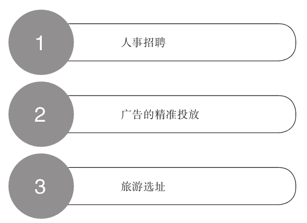

图 2-2 人工智能的应用

#### （1）人事招聘

在人事招聘方面，人工智能可以对企业和求职者进行最精准的匹配。招聘时往往会出现的尴尬局面是优秀的企业收到的简历多，但质量参差不齐，HR 的筛选工作繁重，而不够优秀的企业收到的简历严重不足，得不到应有的人员补充。

在大数据和云计算的精准分析下，人工智能技术可实现海量简历与招聘职位的匹配和筛选，并分别向甲方及乙方推送合适的简历和职位，实现效率最大化。除此之外，精准的分析和推送还能为企业的招聘提供参考决策。

#### （2）广告的精准投放

经过云计算对大数据的正确分析，人工智能技术能够实现广告的精准投放。以百度为例，百度通过搜索引擎对行业数据进行收集和运算，再利用“百度大脑”做数据感知，如图像检索等，最后实现广告的精准投放。

#### （3）旅游选址

经过云计算对旅游景点人流量的数据进行统计分析，人工智能可结合用户的兴趣爱好和时间安排最佳的旅游地点，避免出行时进入误区及发生时间冲突。

大数据为人工智能获取刻画世界的数据资源，云计算强大的计算能力帮助人工智能实现数据处理和分析，总结出复杂事件背后的数字规律。再结合各行业的应用规则和习惯，人工智能就能够实现对人类智慧的模拟，为人类的生活带来诸多便利。

## 2.3 深度学习：人工智能发展的智慧源

大数据和云计算为人工智能准备好了发展的基础，再加上算法的构建，就能够让人工智能实现自主学习。深度学习算法是人工智能实现自主学习的最重要的途径，是人工智能发展的智慧源。

### 2.3.1 深度学习“深”在哪儿

深度学习的概念由杰弗里·辛顿（Geoffrey Hinton）等人在 2006 年提出。当时的研究人员普遍希望找到一种能让计算机实现“机器学习”的方法，即用算法自主解析数据，不断学习数据，并对外界的事物和指令有所总结和判断。实践表明，深度学习算法就是实现机器学习的方法。

在实现“机器学习”这个目的时，研究人员不必亲自考虑所有的情况，也不用编写解决问题的具体算法，而是在深度学习算法的支持下，通过大量的实践和数据资料“训练”机器，让机器在面对某些情况时可以进行自主判断和决策，完成任务。深度学习、机器学习、数据和人工智能四者之间的关系如图 2-3 所示。

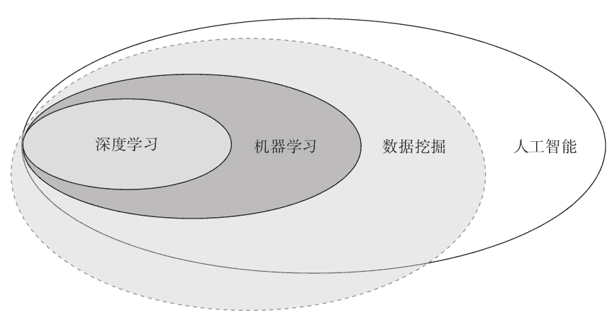

图 2-3 深度学习、机器学习、数据和人工智能四者的关系

深度学习概念中的“深度”二字是对程度的形容，是相对之前的机器学习算法而言。深度学习算法在运算层次上更有逻辑力和分析能力，会更加智能化。

深度学习是神经网络算法的继承和发展。传统的神经网络算法是一个非常简单的计算模型，包含输入层、隐藏层与输出层，如图 2-4 所示。

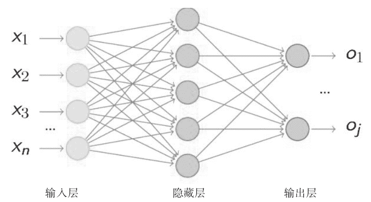

图 2-4 传统神经网络算法的结构

深度神经网络则有多层隐藏层，如图 2-5 所示。以深度神经网络为基础的深度学习算法中的“深”，指的就是算法使用的层数深化。

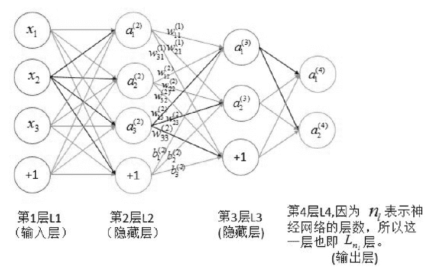

图 2-5 深度学习算法包含多层隐藏层

通常情况下，深度学习算法中的隐藏层至少有 7 层。隐藏层数量越多，算法刻画现实的能力就越强，最终得出的结果与实际情况就越符合，计算机的智能程度也就越高。

有了深度学习，人工智能才实现了更大范围的应用及应用升级。通过深度学习，计算机能够将任务分拆，可以和各种类型的机器结合，完成多种任务。有了深度学习的帮助，人工智能终于实现了根据相关条件进行“自主思考”的目标，完成研究者期待已久的研究任务。

### 2.3.2 深度学习的智能硬件：GPU

一般来说，神经网络结构算法的运行效率和层数有很大关系，算法层数越多，运行时间就会越长。然而，深度学习算法却不存在这个问题，因为深度学习系统利用了智能硬件`GPU`（图像处理器），有效提升了运行效率。

`GPU`是计算机显示适配器的处理器，是显示适配器的“心脏”。与中央处理器类似，`GPU`也是一种计算机的处理硬件，针对的是复杂的数学和几何计算，这些运算是图形渲染所必需的。

深度学习算法主要包括卷积神经网络（`CNN`）和循环神经网络（`RNN`）两种，它们包含四种基本运算：矩阵相乘、卷积、循环层和`All Reduce`（全减）。深度学习的硬件除了要满足能够进行以上四种运算的条件，还要能够保证低能耗等特性。`GPU`支持的大规模并行计算架构恰好符合深度学习的需要。

在 GPU 出现以前，人工智能的并行算法可能需要运行一两年的时间才能得到结果。有了 GPU 的强大计算能力后，深度学习的瓶颈得以突破，数据的运算结果在短时间内就可以得出，这极大地释放了人工智能的潜力。

2009 年，几名斯坦福的学者第一次利用 GPU 实现了在较短的时间内训练深度神经网络的研究，整个世界都为之震惊，也直接引发了延续到现在的 GPU 通用计算的浪潮。英伟达首席科学家、斯坦福并发 VLSI 架构小组的负责人威廉·J·戴利（William J. Dally）曾表示：“行业内每个人现在都在做深度学习，这方面，GPU 几乎已经达到了最好。”

事实上，几乎所有深度学习领域的研究者都在使用 GPU 进行相关研究。深度学习需要不断地训练机器，在成千上万个变量中找出最佳值。正是通过这种像素级别的训练学习，计算机才能不断总结规律，最终实现像人一样思考，即“人工智能”。

### 2.3.3 深度学习“三巨头”

在深度学习领域，杰弗里·辛顿、扬·勒丘恩与约书亚·本吉奥的地位无人能及，他们被称为深度学习的“三巨头”。

在“三巨头”中，杰弗里·辛顿被誉为“神经网络之父”。杰弗里·辛顿出生于英国，后移居加拿大。在深度学习领域，杰弗里·辛顿的研究工作是开创性的。深度学习能够脱离理论模型得到实际应用，离不开他的研究成果。杰弗里·辛顿的初创公司被谷歌收购，其本人也加入谷歌大脑项目。

扬·勒丘恩曾在多伦多大学师从杰弗里·辛顿教授做博士后研究，后加入贝尔实验室，并在这里发展了一种在机器视觉领域最有效的深度学习算法——卷积神经网络，成功推动了手写识别等技术的进步。如今，扬·勒丘恩成为纽约大学终身教授，也加入了 Facebook 人工智能实验组，被扎克伯格亲任为负责人。

约书亚·本吉奥生于法国，后移居加拿大的蒙特利尔。约书亚·本吉奥在加入贝尔实验室期间遇见了扬·勒丘恩，与其一起从事深度学习的研究。约书亚·本吉奥开创了把神经网络作为语言模型的先河，在语音识别、机器翻译等领域建树颇多，大名鼎鼎的 Theano（人工智能在线课程）就是其团队创建的。谷歌曾在蒙特利尔设立人工智能研究部门，并为约书亚·本吉奥等人提供 337 万美元的项目支持资金。

“三巨头”受人敬仰，地位无人可及，最重要的原因是他们在深度学习领域做出的伟大贡献。另一个关键因素也是他们获得众人敬佩的原因之一——在神经网络不被看好的年代，他们三人依旧坚持研究神经网络，这份执着和坚韧达到了常人不能及的地步。

20 世纪 60 年代，人工智能还处于刚刚起步的理论阶段，实践经验非常少，神经网络的想法并不受当时的主流研究学派重视，甚至受到某些学者的嘲笑。在这样的舆论环境下，杰弗里·辛顿关于深度学习的论文频频被学术期刊拒收。甚至到了 21 世纪初期，三人的研究成果仍未受到学术界的重视。

作为杰弗里·辛顿的学生，扬·勒丘恩和老师一起坚持研究。杰弗里·辛顿曾评价扬·勒丘恩说：“是扬·勒丘恩高举着火炬，冲过了最黑暗的时代。”经过 30 年的坚持，深度学习在人工智能领域的重要性终于得到了大家的认可，三人也终于从被排挤的地位成了深度学习“三巨头”。

“三巨头”的成就令人惊叹，他们曾经在困境中的坚持更值得每个人学习。正是他们不懈的坚持和探索，才让一个个人工智能应用成为现实。我们在惊讶于人工智能给生活带来的变化同时，也应牢记每位科技工作者的付出和努力，向他们的默默坚持抱以敬意。

# 第 3 章　商业落地：商业化思维促进人工智能蓬勃发展

历史经验告诉我们，任何形式的科技最终都将以产品的形式落地，在商业化的应用中不断更新和发展，促进社会进步。如果不与商业结合，不进行商业开发，科技就无法为人类社会带来进步。

如果蒸汽机不进行商业化的包装，成为载人载物的火车与轮船，那么蒸汽机不会为人所知并得到资本的投入而一步步更新换代；如果计算机的出现没有商业化思维的支撑，那么计算机永远不会从笨重的机器进化为笔记本电脑，成为生活工作必备的设备；同样，如果人工智能技术不能够实现商业落地，转化为有市场需求的商业产品，人工智能的进步与发展也将极度受限。换言之，商业化思维促进了人工智能的蓬勃发展。

那么，人工智能具体应该如何进行商业落地呢？

本章将从人工智能商业落地的关键技术点和衡量因素展开介绍，详述人工智能在商业落地过程中的具体举措，并用实例介绍人工智能的商业落地场景。

## 3.1 人工智能发展王道：技术结合商业场景

人工智能领域的企业要想占据行业竞争的战略制高点，必须抢先打造出更便捷、更智能、更广泛的应用场景，使人工智能产品的商业价值得以落地。例如，谷歌利用无人驾驶技术创造了一个更智能和便捷的应用场景，那么谷歌在无人驾驶上的人工智能商业应用就占据了战略制高点。

只有商业应用场景，没有能促使幻想得以实现的技术，显然是没有发展前景的；只有技术，而没有对应的商业应用场景，这个技术就是无用的，不可能有更进一步的发展。具体到人工智能领域也是一样，只有将技术与商业场景深度融合才是人工智能发展的王道。

### 3.1.1 场景落地的三个关键点：大数据+算法+服务

经过大半个世纪的沉浮后，人工智能终于出现了一些商业化应用，开始融入人们的生活。在人工智能产业实现商业落地时，大数据、算法和服务三个要素起到了关键作用。

#### （1）大数据

人工智能技术的发展建立在大数据的基础上，其商业落地自然也离不开大数据的支撑。

在一些现代化的产业领域，如智能家居等，人工智能已经充分展示了自身的实力。但在传统行业中，其商业应用稍显不足。而实际上，在大数据的支撑下，人工智能在传统行业的发展潜力也十分巨大。

以教育领域为例，学生的做题反馈就是一个极佳的数据切入口。通过大数据软件收集学生的做题情况，人工智能可实现为学生智能规划个性化的试题方案和复习策略。由于老师和学生一直处于“一对多”的模式中，学生的个性化学习方案是传统教育不能实现的，人工智能刚好能够弥补这个缺憾。

对于老师而言，人工智能辅助的教学系统能够提供备课参考意见。通过大数据分析以往学生对某个知识点的反馈，人工智能可为老师从学生的角度提炼课程的重点及难点，有助于老师安排课程进度，做到有的放矢。

教育行业只是传统行业的一个案例，但我们从这个案例中依旧可以看出利用大数据，人工智能可为传统行业带来巨大转变，而人工智能自身也可扩大商业落地的场景。

#### （2）算法

算法是所有互联网技术的核心，人工智能技术也不例外。只有通过算法，人工智能才能够完成研究者希望人工智能完成的任务。在实现人工智能商业化落地的过程中，研究者主要使用四种算法，如图 3-1 所示。

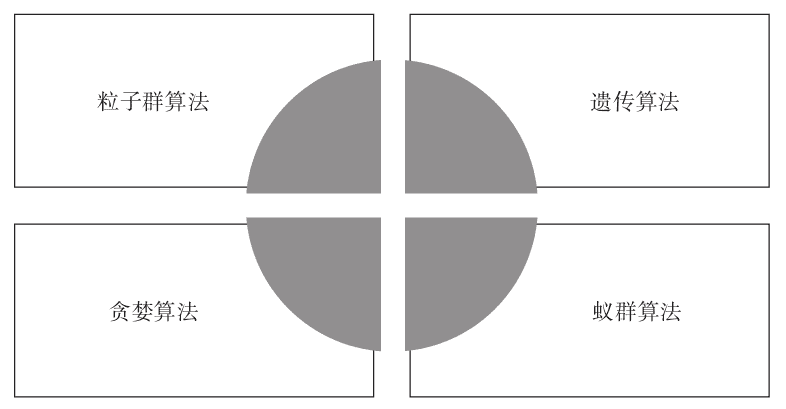

图 3-1 人工智能实现商业落地经常使用的四种算法

①粒子群算法

人们常称的 PSO（Particle Swarm Optimization）就是粒子群算法。粒子群算法的基本思路是从随机解出发，寻找最优解。粒子群算法的计算精准度高，得到最优解的概率大，因此在人工智能算法中经常被用到。

②遗传算法

人工智能系统首次实现自主编程所利用的算法就是遗传算法。遗传算法在人工智能中主要用来解决搜索问题，它可以利用所获取的内容自行组织搜索。

③贪婪算法

贪婪算法被用于需要快速得到较为满意的解决的情境中。贪婪算法不追求最优解，只要某解可以满足需要就会输出，因此可以为技术人员节省大量时间。

④蚁群算法

蚁群算法来源于蚂蚁在寻找食物过程中发现最短路径的行为。该算法在人工智能领域适用于交通管理等场景，实现车辆调度等问题。

#### （3）服务

人工智能实现商业化落地的最终目的还是为人类生活提供更优质的服务。因此，人工智能产品的服务能力也是决定其商业化落地能否成功的关键因素之一。

例如，人工智能客服就是一个很好的人工智能商业应用场景。在客服行业，人工客服可能会因为生活因素带来情绪波动，从而造成顾客对客服的不满。人工智能客服就不会有这样的短板出现。

人工智能产业的繁荣发展离不开大数据和算法，更离不开研究者对人工智能产品在服务上的不断追求。在这三个因素的支撑下，人工智能在商业化落地上有了全方位的引导，一定能实现完善的落地实践。

### 3.1.2 场景落地的三个衡量维度：时间维度+领域维度+深度维度

衡量人工智能的商业场景落地是否优质有三个维度，分别是时间维度、领域维度和深度维度。

#### （1）时间维度

人工智能的商业应用落地在时间维度上的衡量主要有两个方面：一是技术从实验阶段到实际产品阶段所用的时间，二是技术产品从青涩到成熟的时间。

人工智能从实验阶段到实际产品阶段，必然会有时间差。这段时间差的长度一方面是由技术的更新发展决定，另一方面也是由商业应用需求决定。试想，如果研究者发现新技术毫无商业用途，也不会给人类生活带来便利，那它怎么会变成商业产品呢？相反，如果某种技术恰好能够解决人类社会的某种迫切需求，那么它从技术发现到商业落地的时间差必然会缩短。

当人工智能发展到实际应用的商品阶段后，由于技术不成熟，应用领域逐步扩大所需的时间差是时间维度需要衡量的另一方面。目前，大多数人工智能的应用都集中在金融领域或销售领域，人工智能的进一步发展还需要时间，这段时间的长短也是衡量其商业落地顺利与否的重要指标。

#### （2）领域维度

领域维度是指人工智能在商业落地时的跨领域程度。人工智能并非一种单纯的、孤立的技术，它本身也存在多领域的交叉融合。由于现实生活的复杂性，人工智能在进行商业落地时更要考虑多领域融合的问题。

以智能推送为例。传统的内容推送机制只考虑如何把信息推送给用户，但实际上不精准的推送大多是“吃力不讨好”，甚至会让用户厌烦。如果想要做到精准推送，就一定要分析用户的心理。这显然不是单纯的人工智能技术问题，而是涉及社会学、心理学等一系列学科的复合问题。

现在的智能推送大多是以用户近段时间的搜索关键词作为推送内容的根据。例如，当用户搜索了一次“人工智能”，那么软件接下来好几天的推送都会是有关人工智能的内容。这种推送机制是假定了用户的每一次搜索都是有意义的搜索，但实际上有时用户也会因为某些原因，如“手滑”而进行一次性的检索。如果智能推送不能及时检测判断出哪些内容是用户长久以来有兴趣的检索，哪些是用户“手滑”造成的检索，那么就会在推送上出现错误。

形成“读出用户的心思”的智能推送，显然不能够只靠人工智能领域的研究者完成。这项任务需要心理学家、统计学家等共同对搜索数据代表的用户心理进行分析解读。这就是人工智能在进行商业落地时的领域维度问题。

由此可见，人工智能在商业落地场景中必然会涉及多领域的知识，领域维度自然也就成了某个人工智能应用落地是否可靠的重要衡量标准之一。

#### （3）深度维度

深度维度衡量的是人工智能的商业化应用在人们日常生活中起到影响的程度。举例来说，智能手机对人们日常生活的影响已经远远超出了普通通信工具所能达到的程度，人们也渐渐离不开手机。所以，智能手机在深度维度的表现十分优秀。

任何一个获得商业落地的成功技术，都会在深度维度有令人震惊的表现。目前，人工智能的商业落地还处于起步阶段，只能够满足人们日常生活的一部分需求，而且无法做到不可替代。也就是说，人工智能在深度维度的商业落地表现不够完美。

要想在深度维度有较好的表现，人工智能的商业落地还需做好以下三个方面，如图 3-2 所示。

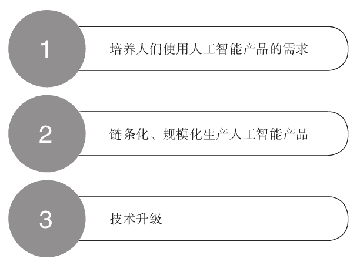

图 3-2 人工智能加大深度维度的举措

①培养人们使用人工智能产品的需求

作为新兴技术，人工智能在人们生活中影响有限的一个重要原因就是人们“不需要”使用人工智能产品。新产品的出现必然会淘汰旧产品，怎样才能让人们愿意接受新产品、放弃已经熟悉的旧产品呢？这就需要互联网企业不断培养人们使用人工智能产品的需求。当人工智能产品的便捷和智能被大众接受时，其需求缺口也就打开了。

②链条化、规模化生产人工智能产品

孤立的某一种人工智能产品不能够体现出人工智能技术的优越性，所以要想实现人工智能产品商业落地的深度目标，就必须实现链条化、规模化生产人工智能产品。当人工智能产品形成整套系列并大规模生产时，人工智能产品就会以一种极为强势的状态进入人们的生活，从而加深对人们生活的影响程度。

③技术升级

一方面，技术升级是人工智能产品更新换代以适应社会的要求；另一方面，不断进步的技术也有助于人工智能在科技项目上大放异彩，获得政府的支持以及人们的关注。AlphaGo 引发了世人热议就是极佳的例证。

人工智能的商业场景落地是否成功，可以从时间维度、领域维度和深度维度三个维度进行刻画，每个维度都有不同的指标和要求。人工智能产品只有在这三个维度上的表现都十分出色，才能证明人工智能的商业应用获得了成功。

## 3.2 人工智能商业落地的具体举措

前文已经提到，人工智能必须落实到实体产业中才能有进一步的发展。在人们对人工智能的热情日益高涨的同时，关于人工智能是否又是一场“泡沫经济”的相关讨论也一直在持续。因此，人工智能在商业落地方面需要十分谨慎。

根据统计，中国人工智能企业已近千家，市场规模已经超过百亿元，预计于 2019 年将增长至 344.30 亿元。如此巨大的市场规模确实证明了人工智能在商业落地上具有极大的潜力。那么，人工智能在实现成功的商业落地时应注意什么问题？

### 3.2.1 场景落地要做到由浅入深

人工智能本身作为一个多学科交叉的研究领域，其在商业落地进程中也体现了这一特点。人工智能在进行场景落地时，要注意垂直领域的应用才是风口所在，而非通用型的应用。换句话说，人工智能场景落地不能只停留在某个大的领域，而要注意应用上的垂直细分，由浅入深。

由浅入深的过程意味着人工智能在某一应用领域做到差异化，而差异化往往就是科技竞争力的体现。在人工智能技术不断提高的同时，商业落地的进程不断融入深化细分场景的特定附加内容，是人工智能在落地时的必经之路。

人工智能在和具体行业结合时有两种情况，一种是“人工智能+行业”，另一种是“行业+人工智能”。无论是哪种情况，对行业垂直深度的理解决定了人工智能在商业落地上是否成功。在进行人工智能产品的商业开发时，许多非互联网行业的大型企业毫不逊色于互联网巨头，主要就是因为这些企业对该行业的具体场景拥有十分深刻的认识。

我国安防行业巨头海康威视就是极佳的例证。在多年以前，“视频监控智能化”的概念就在安防行业提出，但由于技术不成熟，效果一直不理想。通过人工智能的人脸识别技术，这些需求终于都成了现实。海康威视原本就是监控领域的“领头羊”，其对该行业的场景细分需求有十分充足的经验，因此在自身的产品基础上融入人工智能技术，就能够得到可直接投入商业应用的产品。在各大互联网企业对安防行业来势汹汹的情况下，海康威视依旧可以保持其在业内的龙头地位。

从海康威视的案例可以看出，企业在实现人工智能的商业落地时，对应用场景的深入了解十分重要。做到深入了解应用场景的主要方法有以下三种，如图 3-3 所示。

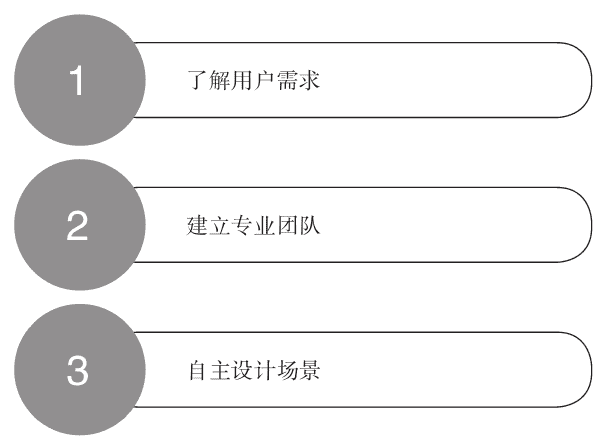

图 3-3 深入了解应用场景的三种方法

#### （1）了解用户需求

了解用户需求是所有产品获得应用的第一步，人工智能产品也不例外。只有清楚用户的需求是什么，人工智能产品的研发才会被人们需要。例如，用户容易在地铁上玩手机而错过车站，一款智能提醒到站的软件就非常符合用户对人工智能产品的需求。

#### （2）建立专业团队

深入了解应用场景离不开专业团队的配合。建立对企业的应用场景及细分领域颇有研究的专家学者团队，帮助企业分析该场景及细分领域的特征，做到知己知彼，为研发此应用场景的人工智能产品提供有效的建议。

#### （3）自主设计场景

利用自主设计的场景，对用户试用场景时的表现进行分析，也能使企业深入了解应用场景。自主设计的场景可以帮助企业找到用户与场景的内在关系，通过实践分析用户的真正需求及自身设计场景的不足，从而加深对应用场景的理解，探索人工智能产品新的功能以满足用户的需要。

### 3.2.2 挖掘优秀人才

大部分人认为人工智能产品的研发只存在技术问题。其实不然，掌握人工智能算法与商业落地还存在很遥远的距离，并不是具有技术能力就能实现。企业研发人工智能产品，进行商业落地，需要挖掘以下两类人才，组成技术专家团队和应用专家团队。

#### （1）人工智能技术专家团队

人工智能技术专家不仅包括人工智能技术方面的专家，还包括数学及统计学方面的专家。各方面的专家共同努力，进行人工智能产品的算法等研究。

#### （2）人工智能应用专家团队

人工智能的商业落地还需要人工智能应用专家，这是目前研发人工智能产品最紧缺的专家。人工智能应用专家首先是一名优秀的人工智能产品销售经理，其次要清楚算法等特性，理解企业所处领域的相关问题。这样的专家才能将人工智能技术专家和行业专家的优势整合，打造适合人工智能商业落地的技术方案，确保人工智能产品的质量。

人工智能在商业落地的过程中会遇到许多困难，企业具有人工智能技术专家团队和人工智能应用专家团队，有利于人工智能更好地实现商业落地。

### 3.2.3 To C 是关键：人工智能发展要加速融入群众生活

所有产品都有自身的目标销售对象。按照特点划分，销售对象可以分为企业和普通个体消费者。因此，商品的营销就有“To B”（To business）和“To C”（To customer）之分。

对于人工智能的商业落地来说，目前许多应用都是面对大型企业。但要想实现真正成功的商业落地，完成 To C 的转变是关键。只有人工智能真正融入群众的生活，成为人们日常生活中不可分割的一部分，人工智能的商业化目标才算完成。

许多人工智能企业正在积极展开转变为 To C 形式的战略，科大讯飞公司高级副总裁杜兰博士就曾不止一次提到：“科大讯飞正在积极尝试由 To B 向 To C 的转变，打开 C 端市场将是科大讯飞下一步市值提升的关键。”

和目标相对明确的 To B 形式相比，To C 运营形式要求企业在用户体验环节投入更多精力。在不断改进用户体验上，整体思路是“大胆假设、小心求证、不断试错、快速迭代”，具体的常用方法如图 3-4 所示。

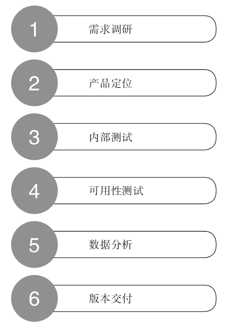

图 3-4 To C 的常用方法

#### （1）需求调研

既然是面对用户的形式，那么人工智能产品的研发就应从用户的需求出发，解决用户目前的需求。因此，To C 的第一步必须是需求调研，准确获得用户的需求。

#### （2）产品定位

当需求调研完成后，下一步就是对要研发的人工智能产品形成清晰的定位。一方面，新产品可以用来解决人们的刚需和痛点；另一方面可以从现有产品的不足出发，在现有产品的基础上进行智能优化。

人工智能企业在进行产品定位时，还要考虑产品的目标消费群体的特征。通过大数据进行消费群体的统计画像，对消费者形成充分的了解，对人工智能产品定位也有十分重要的意义。

#### （3）内部测试
人工智能产品研发出来后，在研发团队内部进行测试，可以在产品进入市场前及时发现不足。

#### （4）可用性测试
可用性测试是对内部测试的补充，是邀请用户测试人工智能产品的步骤。通过邀请部分用户提前测试新品，可收集从用户角度提出的意见和反馈，便于产品在细节上进行优化。

#### （5）数据分析
数据分析这一步非常重要。一方面，分析内测用户的反馈数据可以指导下一步的优化方向；另一方面，人工智能产品在测试中的性能数据对产品的优化也有极大的作用。

#### （6）版本交付
这一步要遵循 MVP 原则，即最小化可行产品（Minimum Viable Product）。在确定版本可行的基础上逐步迭代，增加完善人工智能产品特性，最终实现向用户交付足够的价值和体验。

只有实现 To C 的转变，人工智能才能够真正走入寻常百姓家，为众多普通消费者带来智能化的生活。

## 3.3 人工智能商业落地场景展示
人工智能在许多领域拥有了初步的商业应用，本节将从农业、工业、客服、早教和物流五个方面以实际案例展示人工智能的商业落地场景。

### 3.3.1 农业智能采摘机器人
采摘机器人很久以前就已出现，但传统的采摘机器人只能采摘固定大小、固定位置的水果。在复合型农业越来越多的今天，水果的采摘越来越需要采摘机器人在采摘时进行灵活的分辨，而传统的采摘机器人显然无法满足这一点。结合视觉识别的智能机器人能在实现自动采摘的同时自动识别不同的水果，成为农业机器人最理想的形式。

广东省部分水果合作社已经配有智能水果采摘机器人，可实现瓜果类产品的无损采摘。华南农业大学相关团队是开发这款智能采摘机器人的主要团队，根据他们的介绍，智能采摘机器人利用双目立体视觉技术。面对果园内的众多果实，智能采摘机器人首先对果实进行定位，然后用数学规划方法，智能规划出最佳的采摘作业路径，根据最佳路径采摘水果。

该机器人的机械手臂不是利用拉拽的方式采摘瓜果，而是在夹紧果枝后切割果枝，因此不会损伤瓜果，而且可以通用在多种瓜果上，如荔枝、柑橘等。在工作效率上，智能采摘机器人每小时能采摘 40 斤荔枝，是人工效率的两倍。

英国剑桥大学研究人员也开发出了类似的水果采摘机器人。面对不同的环境，这款机器人通过自身的电子图像传感器分辨水果的形状，确认水果类型。不仅如此，这款机器人还能识别水果的颜色，判断水果是否成熟、能否采摘。利用这款机器人连接的真空管，水果也不会被碰伤。

目前，对农业智能采摘机器人的研究重点集中在人工智能的视觉研究领域。机器人通过摄像头获取一定视野内的果实信息和场地环境信息，通过人工智能程序的图像识别和处理，能够快速判断水果种类和成熟程度，并做出可否采摘、如何采摘的决策。

在采摘效率上，智能采摘机器人可以达到人工的两倍。而且，机器人无须休息，农民在进行采摘时的成本也可大大降低。对于一些成熟期短、需要“抢收”的水果，智能采摘机器人存在的意义将更加重大。

智能采摘机器人是实现智能农业的重要环节，是农业智能革命的开端。当这些智能采摘机器人被大规模推广使用后，一定能够减轻农民的负担，节约劳动成本。

### 3.3.2 工业智能机械手臂
在工业上有许多人工操作的机械手臂，这些机械手臂有的被用来提取重物，有的则被用来进行微观的精细化操作。由于人工操作难免会失误，所以这些机械手臂也会带来一些产品安全和质量上的隐患。当人工智能和机械手臂结合形成智能机械手臂后，就可实现自动智能操作，减少人工操作带来的隐患。

工业智能手臂在煤矿行业有非常重要的作用，可以代替煤矿工人完成复杂且危险的地下煤矿开采工作。

在煤矿行业，由于从业人员的素质良莠不齐，生产管理上有诸多不便，工人下矿开采煤矿时存在很多安全隐患。如果使用智能工业机械手臂，许多矿工作业就不需要人工操作（如图 3-5 所示），人们下矿的频率相应降低很多，安全隐患大大减少。而且，由于机械臂无须考虑生存环境和休息，这也给煤矿业带来了更高的利润。

除了煤矿等自然条件下的工业场景可以利用智能机械手臂，在工厂中进行的生产操作也可以使用智能机械手臂。广东省东莞松山湖长盈精密技术有限公司就率先实现了用智能机械手臂代替人工作业的“无人工厂”目标。

在没有使用智能机械手臂时，人工操作机床加工产品经常会出现质量不过关、员工不规范操作导致受伤等问题。再加上“用工荒”现象越来越严重，工厂的生产效率令人堪忧。“在整个东莞‘机器换人’战略大力实施的背景下，我们下决心成立智能无人工厂，通过硬件机械手臂来取代人工，再建立一个高度智能化的软件控制系统，进行网络远程操控，将大幅度提高工厂的工作效率和产品质量。”该公司常务副总经理任项生说。

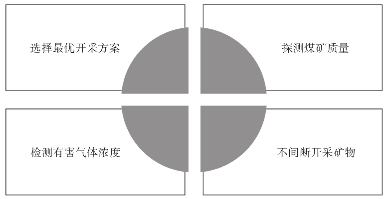
图 3-5 智能机械手臂可完成的煤矿作业

智能机械手臂不仅可以完成既定的任务，还可以像人一样根据不同的环境做出相应的调整，能够解决绝大部分生产过程中的问题。工业智能机械手臂可以降低工业对人力数量的要求，同时稳定提升产品质量，为工厂带来更高的收益。

### 3.3.3 金融、医疗客服机器人
在金融和医疗行业，除了金融从业人员和医生护士等专业人员以外，客服人员也具有非常重要的作用，人工智能在这些领域开始展现自己的实力。

科沃斯银行大堂服务机器人已经在中国邮政储蓄银行、中国建设银行实现了落地应用。据统计，该款机器人在银行网点为超过 500 万人次的顾客提供了服务。该服务机器人的服务内容始终围绕银行网点的核心业务：金融商品营销和顾客引导分流，成功营销金融商品数量达 30 万人次，顾客引流数量达 20 万人次。

随着智能机器人的不断优化，银行大堂机器人还陆续增加了顾客现场问卷调查和市场活动介绍等辅助功能，为顾客提供了更好的服务体验。银行大堂服务机器人之所以受到大众欢迎，是因为它既能够为顾客在等待期间提供闲聊等娱乐服务，也可以为顾客解答一些与银行业务有关的问题，提高了效率。这些功能的实现离不开人工智能的语音交互技术和自主学习技术。

在医疗服务行业，医疗客服机器人的商业落地也得到了同样的探索。以通用机器人底盘为切入点，专注于研发相关的特种医疗机器人的上海钛米机器人科技有限公司（简称“钛米”）已完成 2 亿元人民币的 B 轮融资。这是目前医疗服务机器人行业中最大的单笔融资。

钛米机器人已经推出的医疗服务机器人是核医学科病房服务机器人，能够为病人提供送药、监护、陪伴等服务。钛米机器人创始人潘晶表示，产品利用人工智能领域的人脸识别、语音识别等技术能够为用户带来更好的服务体验，而且能够为医院方面提供一整套的增值服务方案，减轻医院对人工协助者的依赖。

与人工客服相比，智能客服机器人有以下几个方面的优势，如图 3-6 所示。

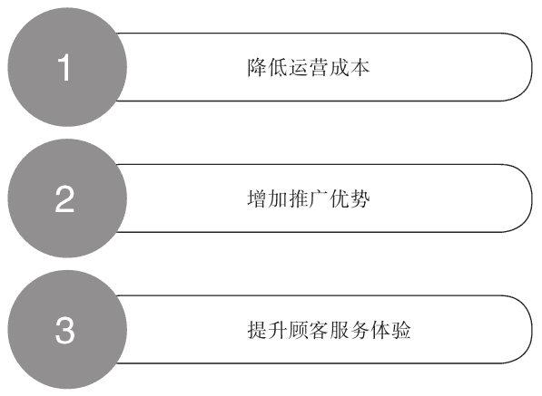
图 3-6 智能客服机器人的优势

#### （1）降低运营成本
智能客服机器人通过主动询问来访者的目的，可以帮助他们快速找到问题的解决方案，并以耐心的态度引导用户使用各种设备，提高自助设备的使用率，减轻人工服务的投入，降低运营成本。

#### （2）增加推广优势
智能客服机器人本身就具有“高科技”的标签，可以吸引流量，增加使用场地的推广优势，提高曝光度。对于除了公立医疗场所以外的非营利性场所，尤其是银行，智能客服机器人还可以在和顾客的交流中获取顾客的兴趣，进而推广相应的金融产品，实现精准营销。

#### （3）提升顾客服务体验
机器人的外形可爱，服务态度永远友好、耐心，而且以其智能化还可以实现多元化服务，这些都能够提升顾客服务体验。

随着社会整体教育水平的提高，人们对客服的期望也越来越高。智能客服机器人的出现为提升当前客服行业的质量带来了新希望，因此，人工智能的商业化在客服机器人上的应用落地具有极大的潜力。

### 3.3.4 早教机器人引领蓝海市场
随着生活水平的提高，人们对教育的重视程度也越来越高，特别是孩子的早期教育得到了越来越多的重视。在当前的早教市场中，早教老师的水平参差不齐且收费较高，这给许多重视孩子早期教育的父母造成了困扰。早教机器人进入早教市场后，就可以帮助父母们解决这一问题。

早教机器人是专门为儿童早教设计的人工智能教育类产品。最初的早教机器人只是一个带有屏幕的机器人，随着语音识别等技术的成熟，其输出和传感器设备也越来越智能，能够为儿童提供更多的陪伴和教育。

全球首款早教机器人是班尼机器人，其产品定位为“0～14 岁儿童陪伴教育”。班尼能够实现 5 米以内的语音识别，分辨出不同的情绪，对儿童的情感做出回应。在吸引孩子的兴趣上，研究人员为班尼机器人准备了生动丰富的面部表情，能在孩子和班尼交流时做出回应。另外，班尼机器人的精灵触角实际上也是一个智能触碰装置，可用来智能调控夜灯的亮度和模式。

在早教市场这块蓝海中，智能机器人的出现显然能够起到“领头羊”的作用。与人工早教老师相比，智能机器人有以下两个优点。

第一，自主学习的能力让智能机器人越来越适应儿童的个性，可以打造出以儿童为中心的学习模式。早教老师一般都是性格稳定的成人，在和儿童沟通时很难做到对不同的儿童采用不同的教学方式，这就达不到较好的早教效果。而早教机器人在和儿童相处的过程中，能够从儿童的反馈中不断了解儿童的兴趣，并按照儿童的喜好完善自己，可以给儿童提供效果更好的个性化学习模式。

第二，早教机器人具有强大的知识储备能力，能够充分学习儿童心理学、教育心理学等知识，避免伤害儿童的心理健康。早教老师在日常生活中可能会因为一些琐事造成心情波动，这种情况下就可能在无意间说出伤害到儿童脆弱心灵的话语。而早教机器人在经过各种心理学、教育学等知识的学习后，会一直注意和儿童的交谈方式，并以积极的态度和儿童交流。

根据终端教育群体的需求，早教机器人的研究重点包括以下三个方面，如图 3-7 所示。

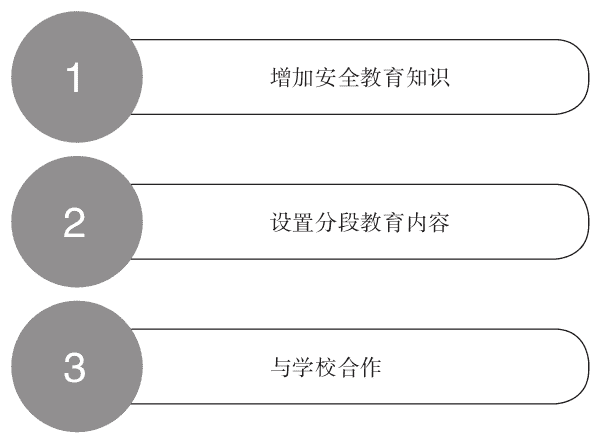
图 3-7 早教机器人的研究重点

#### （1）增加安全教育知识
在早教机器人中增加安全知识教育板块，有利于机器人在和儿童游戏的同时，潜移默化地教导他们在危险情况下的自救方法，形成安全自救意识。

#### （2）设置分段教育内容
通过设置分段教育内容，为不同年龄的儿童准备不同的教育材料，实现“因龄施教”。

#### （3）与学校合作
把早教机器人和儿童在学校的表现数据联系起来，在后台进行统一的分析管理，全面了解儿童的学科学习成果，使早教机器人和学校都有辅助教学的依据，从而实现全面教育。

随着“80 后”“90 后”陆续组建家庭以及国家全面开放“二孩”政策，早教机器人具有越来越广阔的市场空间。早教机器人是人工智能在教育和生活方面商业落地的先锋，借助早教机器人，人工智能技术能进一步融入人们的生活，给人们带来便利。

### 3.3.5 无人机帮你送快递
无论是国外的亚马逊，还是国内的京东、淘宝，其物流成本都是十分高昂的。根据德意志银行的统计，一个鞋盒大小的快递在美国的物流成本可达到每英里 2 美元，甚至超过一部分小商品本身的价格。如果用无人机代替人工配送，物流成本就可以压缩到 0.05 美元。在人工智能技术的帮助下，无人机送快递的梦想也渐渐有了实际的落地雏形。

与交通发达的城市相比，农村的物流成本更加高昂。因此，农村成了物流行业部署无人机快递方案的战略之地。迅蚁网络已经和中国邮政展开合作，在浙江省的乡村开通了全国首条无人机邮路并投入运营，此后逐渐扩大覆盖范围，目前已能为十几个村庄实现无人机自动送货。当镇上的邮局工作人员和村庄的工作人员联系确认后，邮局的工作人员就可以扫描无人机的二维码选择飞行路线。经过几个简单的确认操作后，无人机即可按照选择路线飞行送货。

虽然不是送到收货人家门口的全自动无人快递，迅蚁网络的无人机已经解决了农村快递最困难的地方——从乡镇运输到分散的农村。特别是在一些山区的农村，无人机送快递的意义将更加重大。

除了山区农村，海岛居民的快递也需要依靠无人机送货来降低人工成本和提高送货效率。阿里巴巴曾在福建省莆田市山亭镇进行了全国首次无人机跨海测试。该无人机的飞行状态不仅未受到当时海上风力的影响，全程飞行平稳，而且仅用时 9 分钟成功完成了 5 海里的跨海载物飞行，在海峡另一边的湄洲岛预定位置精准降落。

阿里巴巴的无人机载货测试的重大突破无疑是一个标志性的里程碑，意味着传统人工物流方式不仅可以被无人机代替，而且会有更快的速度。对于居住在海岛上的人来说，这显然是十分令人兴奋的消息。

无论山村还是海岛，这些地方居民的消费条件都被地理位置严重限制，购买生活用品极不便利。利用能够智能识别路线的无人机，普通物流不能到达的地方也可以迅速收到物流包裹了。随着无人飞机的造价逐渐降低，人工智能的路况识别和算法日渐精准，无人机送货已经离人们的生活越来越近。

# 第 4 章　人工智能+农业：健康、生态、可持续
有数据显示，预计到 2050 年，全球人口将达到 90 亿，粮食需求必然大幅增长。未来的粮食产量至少要达到现在的两倍，才能满足人们的粮食需求。然而，全球变暖的趋势和城镇化发展带来的农村耕地减少等不利因素正制约粮食产量的上升，粮食增产相当困难。那么，如何在耕地资源有限的条件下增加粮食产量呢？人工智能与农业结合就是解决办法之一。

人工智能+农业是在健康、生态、可持续的条件下打造智能农业，让农林牧副渔均实现可持续发展。本章用现有的实际案例介绍人工智能助力大农业发展的前景，并详细阐述智能农业的三大发展方式。

## 4.1 人工智能赋能大农业：农林牧副渔，全部可持续发展
几个世纪以前，工业革命和技术革新创造了许多能大幅度提升资源利用率的技术，也开发了许多新的资源。但是发展到现在，地球有限的自然资源对人类的生活造成了许多困扰。

在农业方面，土地资源和水资源的短缺对提升农作物产量的影响、天气状况的不可控制对农作物收成的影响并未消除，农民依旧没有摆脱“靠天吃饭”的局面。人工智能的出现为缓解甚至解决这些问题带来了新的希望。本节将从各个方面详细介绍人工智能如何助力农业实现智能化可持续发展。

### 4.1.1 农事安排更科学：适时灌溉除草、清理病虫害、培育新品种
现代农业依靠天气预报能够提前掌握天气状况，但并没有从根本上改变农民“靠天吃饭”的局面。而人工智能可以通过信息化管理和科学化种植，为农民制订更科学的农事安排计划。

人工智能在农事安排上的典型表现有三个，如图 4-1 所示。

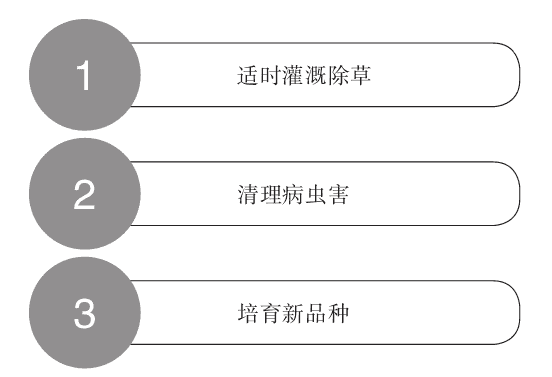
图 4-1 人工智能在农事安排上的典型表现

#### （1）适时灌溉除草
人工智能利用设置在田地里的摄像头和传感器等设备，收集田间农作物的生长状况以及田间微气象数据（如温度、湿度等），进行实时分析。如果发现杂草过多，影响了农作物正常生长，系统就会自动提醒农民进行除草。当农作物间的湿度和土壤的湿度低于农作物需要的湿度时，系统就会自动开启灌溉装置进行浇水，还能联网根据网站信息智能查询未来几天的天气状况，从而调节灌溉的水量。

Arable 是一家为农民打造智能农业系统的公司。该公司利用一种智能传感器，将农田里的各种信息（如农作物的蓄水量、结实量等）收集起来。这些数据是实际的测量值，真实可信。根据这些数据做出的智能化建议更有说服力，某些自动化措施的事项也就有科学的支撑。

#### （2）清理病虫害
农作物的产量本就有限，经历病虫害的侵蚀将导致产量大幅下降。人类历史上有多次因为病虫害而造成粮食大幅减产的事件，所以及时发现和处理农作物的疾病和虫害相当重要。

生物学家戴维·休斯（David Hughes）和作物流行病学家马塞尔·萨拉斯（Marcel Salathé）曾运用人工智能的深度学习算法检测农作物的疾病和虫害。他们用计算机测试 5 万多张图片，从中识别出了 14 种农作物的 26 种疾病，最终程序的正确率高达 99.35%。研究表明，利用计算机视觉技术，人工智能程序可以通过分析农作物图片的方式，及早发现人类肉眼难以发现的疾病虫害预警。

Prospera 公司（以色列特拉维夫的农业科技公司）就是一个典型的案例。它利用计算机视觉算法，对收集的农作物图片进行分析，深度学习病虫害的特征，进而了解并报告农作物的实际生长情况。通过人工智能的预警，农民可以及时发现并预防病虫害，这样有助于减少农作物的损失，提高粮食产量。

#### （3）培育新品种
在实验室和研究中心，研究人员利用机器学习算法培育更好的农作物基因，开发更多的农产品。由于农作物基因数据的研究较为成熟，数据获取速度快，人工智能领域在这个方向的应用将会更有优势。

在人工智能的帮助下，人们可以实现更科学的农事安排，依照科学的依据进行适时灌溉除草、清理病虫害等，农作物学家也能够更便捷地培育出新品种。由于人工智能机器人硬件上的限制，人工智能技术还未能在农业上大面积展开应用。但随着技术的进步，这些阻碍将被克服，人工智能必然会为农业带来更多便利。

### 4.1.2 林业专家系统：实现精准林业
国家为了大力发展林业现代化建设，提出了林业供给侧改革的政策。这意味着我国正在加大对生态林业的重视程度，努力提升生态产品和林产品的供给力。

21 世纪，实现林业的信息化已成为重要课题。为了落实林业的信息化发展，国家批准立项了“精准林业”课题。由于计算机技术在林业领域中较晚得到运用，因此实现精准林业的信息化目标还存在一些困难。但人工智能技术的不断发展，有望为精准林业的发展带来新的机遇。

目前，人工智能在林业领域应用广泛的是林业专家系统，它具有广博的林业专家知识，能够在专家知识水平上解决林业系统中的一些问题。经过训练和深度学习，林业专家系统能够模拟专家解决问题的方式，而且能够学习不同层次的专家知识，因此在面对较复杂的问题时，也能够给出比专家更权威的解决方案。

林业专家系统可分为七个子系统：知识工程库系统、数据库系统、推理系统、控制系统、解释系统、数据模型分析系统及知识处理系统。其中，解释系统通过人机交互技术让林业专家系统和人们实现交流；推理系统通过和其他系统合作，不断学习知识经验，最终为用户形成科学的决策提供依据。

林业产业是一项重要的生态产业。在自然环境日益严峻的今天，努力实现林业信息化，打造精准林业，是自然和社会的必然要求。由于林业体系场景复杂，标准不统一，林业信息化建设还存在诸多困难。但在人工智能的帮助下，林业专家能够为从业人员带来许多问题的决策参考，有助于早日实现精准林业的目标。

### 4.1.3 人工智能养牛：牛脸识别，养牛不惊牛
在养殖业，人工智能也有大用途。

以养牛为例，动物学家研究发现，当养殖场上出现人时，牛会误以为人类是捕食者而产生紧张的情绪，这会对牛肉、牛奶等一系列产品造成负面影响。如果在农场上利用人工智能管理牛群，就能够解决这个问题。

通过智能识别，人工智能依据农场的摄像装置可以准确锁定牛的面部及其身体。经过深度学习后，人工智能软件还能够分辨出牛的情绪状态、进食状态和健康状况等一系列数据，将牛群的信息反馈给养殖者，为他们提出建议。这样，养殖者不用出现在农场中，不会惊动牛群，但依旧能够获得牛群的信息。

例如，荷兰的人工智能创业公司 Connec Terra 就做了这方面的工作。该公司的研究人员开发了一个“智能奶牛监测系统”，利用摄像头跟踪每头奶牛，经过智能分析后将人工智能的结论和现场摄像一并回传给养殖者作参考。

该系统建立在谷歌的开源人工智能平台 TensorFlow 上，利用智能运动感应器“Fit Bits”获取奶牛的运动数据，以此作为奶牛的健康数据参考。通过对奶牛的日常行为（如行走、站立、躺下和咀嚼等）的深度学习，该系统能够及时发现奶牛的反常行为。例如，某头牛平常吃三份干草，今天只吃了一份，而且活动量也比以前少，这就会引起系统的预警。

使用该系统后，农场的运营效率有了明显的提升。微软前雇员亚西尔和该公司的首席执行官霍哈尔说：“对于一个典型的荷兰农场来说，使用了 Connec Terra 的农场，运营效率提高了 20%～30%。”

使用人工智能养牛的优势是显而易见的。一方面，养殖者无须浪费太多时间在农场巡视就可以获知每头牛的位置和健康状况；另一方面，牛群也不用再担心有人类出现，可以轻松地在农场生活。可以说，人工智能既减少了养殖者的工作，又提高了养殖产品的质量。

人工智能在养殖业的应用减轻了人们的工作负担，也为打造智能农场提供了极大的帮助，为人工智能的应用带来了新的可能。

### 4.1.4 人工智能养猪：改善猪品种，打通养猪产业链
曾经，大学生回乡养猪会让人感到不解，类似的新闻总会引发全国热议。但是，随着人工智能进入养猪行业，养猪已经和高科技挂钩，不再是人们原来印象中又脏又臭的事情。阿里巴巴和四川特驱集团达成合作，正式签约了“世界首创的人工智能养猪”项目。

在该项目中，四川特驱集团为阿里巴巴提供健康的猪仔，阿里巴巴利用人工智能技术实现对小猪的生命指标分析。在传统的养猪方法中，许多小猪常会被母猪压住，存活率非常低。利用人工智能技术，养殖者可以随时发现小猪生命指标的异常并及时解救，大大提高了小猪的存活率。

除了提高小猪的存活率，人工智能系统还可以自动检测小猪的各项生命活动指标以及猪舍的环境指标，进而预防传染性疾病的发生。

人工智能在养猪方面的应用包括以下五个方面，如图 4-2 所示。

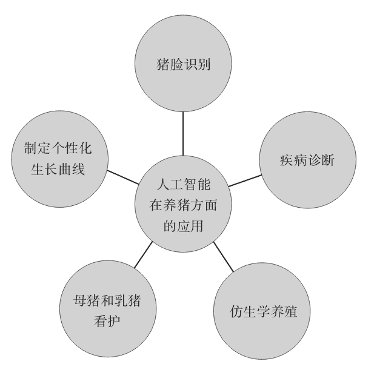

图 4-2 人工智能在养猪方面的应用

#### （1）猪脸识别
猪脸识别是实现养猪管理效率提升的基础。国家生猪产业技术体系首席科学家陈瑶生教授曾在“影子智能引擎”发布会上表示，我国猪脸识别技术已经成功商业化。实现猪脸识别，定位每只猪的身份，就意味着实现从投喂到健康管理，再到育种、宰杀等一系列历程的全程记录，做到有据可查。

#### （2）制定个性化生长曲线
通过猪脸识别，系统就能为每只猪制定个性化生长曲线，实现使用最少的饲料得到最大的猪群生长速度。由于每只猪的生长情况不同，没有人工智能识别技术和深度学习技术，为不同的猪制定不同的个性化生长曲线几乎是不可能实现的。

#### （3）疾病诊断
传统的养猪模式在疾病诊断上依靠的都是兽医的巡查，这种方式的效率比较低，而且往往不及时，严重时甚至会造成猪的大批量死亡。而人工智能技术可以实时记录并分析每只猪的运动、饮食等状况，及时发现异常情况并报告给养殖者，减少得病隐患。

#### （4）母猪和乳猪看护
在传统养猪行业中，母猪分娩时期的管理是一件工作量非常大的任务。有了人工智能的帮助后，养殖者的工作量就会大大减少。利用摄像头和传感器，母猪怀孕的情况可及时报告给养殖者并给出相应的建议。对于刚出生的乳猪，人工智能也能提供人力所不能及的细致观察，结合大数据为养殖者预测每只乳猪未来的生长情况。

#### （5）仿生学养殖
利用人工智能技术，养殖者可以按照仿生学原理进行新品种培育。

随着人工智能技术在养猪行业中应用的进一步深入，整个养猪产业链都可被打通，从育种到屠宰，行业可实现流畅运转。不久的将来，人工智能管理的养猪场会成为无人养殖场，小猪在智能系统的管理下就能健康成长。经过智能屠宰系统，人们可以放心地吃到健康无公害的食品。

### 4.1.5 人工智能助力渔业：智能捕捞，使海洋鱼类可持续发展
在传统渔业中，能否捕到鱼取决于人们对鱼群位置的判断是否准确。“分散找鱼群，集中捕捞”就是对传统捕捞作业形式的经典描述，即在确定渔场后需要把渔船分散开各自去寻找鱼群，确定了鱼群的位置后再集中捕捞。

传统的捕捞方式能否成功，一方面和船长的经验有重要关系，另一方面也和天气状况是否适合打渔有密切联系。大数据给渔业提供了一定的帮助，人工智能技术的加入也使渔业变得更加智能。

在确定鱼群位置实现智能捕捞上，南太平洋捕捞丰汇远洋渔业的总指挥朱义峰和阿里云的团队展开合作，利用阿里云的人工智能技术为确定鱼群的工作实现了新突破。利用朱义峰的渔业专业知识，阿里云的人工智能系统“ET 大脑”构建了新的算法，最终实现对鱼群的预测准确率达 81%，比传统经验的准确率高了许多。

渔业的另一大问题就是过度捕捞。由于人力监管的不到位，监控捕捞作业对相关部门来说是十分困难的事。人工智能技术的加入有望解决这一难题，维持自然生态的平衡，实现海洋鱼类可持续发展。

在减少过度捕捞、维持海洋鱼类的可持续发展上，人工智能的图片识别技术有助于识别人们打捞的鱼类物种信息。识别出鱼类物种信息后，利用互联网可将这些数据反馈给政府部门，以此加强对非法捕捞作业的监督管理，有利于充分了解某地区的渔业现状。

根据全球捕鱼观察（Global Fishing Watch）的研究统计，全球每年非法、未申报且未监管的渔业产值高达 235 亿美元，占整个产业的 1/5。人工智能技术的应用可大大降低非法捕捞的比例。

科学家和政府机构利用人工智能技术建立起世界渔业详细模型，为科学指导渔民的捕捞工作和检测鱼类生态、保护海洋鱼类可持续发展做出贡献。

## 4.2 三大发展方式：打造人工智能农业链，产值更丰富
在智能化成为各行各业积极探索的目标的背景下，人工智能和农业结合形成智能农业也成了农业发展的必然趋势。要形成智能农业，必然要在整个农业产业链上进行智能化发展，以形成产值更丰富的整体人工智能农业链。

从发展方式上看，打造人工智能农业链可以从产业链、组织形式和经营体制三个方面进行，本节将从这三个方面展开叙述。

### 4.2.1 产业链：垂直一体化的模式
和其他行业的企业一样，农业企业要获得可持续发展，就必须形成垂直一体化的整体产业链，即全产业链。全产业链是从商品生产到顾客反馈的完美闭环，商品流通中的每一个环节都实行标准化的控制，如图 4-3 所示。

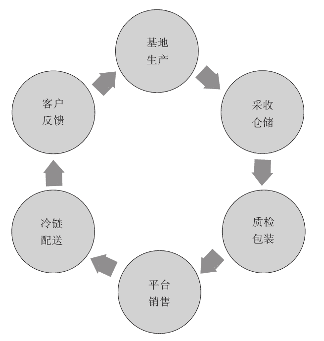

图 4-3 全产业链模式

农业的全产业链要做到垂直一体化，主要打通三个环节，如图 4-4 所示。

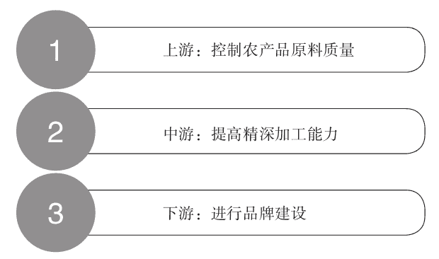

图 4-4 农业全产业链

#### （1）上游：控制农产品原料质量
对于农业企业来说，农产品原料的质量是根本。因此，控制农产品的原料质量是非常重要的。

在这一环节，充分发挥人工智能的作用，打造智能农田是十分必要的。一方面，农民利用人工智能技术提高生产效率，可以得到更高的作物产量；另一方面，加工企业也可以利用人工智能技术打造企业内部的优质农田，提升市场竞争力。

#### （2）中游：提高精深加工能力
这一环节是对于农产品加工企业而言的。只有把农产品加工成更加精细的产品，例如，把小麦加工成面包，企业才会有更多的利润上升空间及更强的市场竞争力。

在深入发展企业精细加工能力方面，人工智能技术通过分析与企业现有产品相关的加工程度更为精细的产品，为企业的新品建设提出建议。

#### （3）下游：进行品牌建设
对于农产品行业来说，形成口碑品牌的企业才能获得高利润。因此，对品牌和销售渠道进行建设是农产品企业应长期关注的环节。

在这方面，人工智能技术通过对企业以往的销售数据进行分析，找出和销量相关的因素，形成智能决策，为企业进行品牌决策提供参考。

当农业形成垂直一体化的产业链后，各环节的运作都将十分流畅，运营成本将大大降低，市场竞争力也会大大增强。因此，未来农业产业链垂直一体化是大势所趋。这种现代化的进程中，从农业生产到分析决策的各个环节，人工智能都可以为智能农业的发展提供新动力。

### 4.2.2 组织形式：“公司+农业园区+市场”三位一体
现代农业已经探索出了“农业园区”的高级形态，在建设人工智能农业链时得到继承和发展，建立“公司+农业园区+市场”的组织形式。在“公司+农业园区+市场”的组织形式中，公司是主导，农业园区是关键，市场是目标。

#### （1）公司是主导
公司确立生产目标、生产标准、产品理念等一系列问题后，作为主导对农业园区进行统一设计。人工智能在其中可以起到辅助决策和提出设计建议的作用。

#### （2）农业园区是关键
农业园区是生产的示范点，所以应充分体现智能农业的特点。利用人工智能技术，农业园区可以率先实现无人监管的生产模式，并对农作物实现智能除草、灌溉等培育工作，降低人工成本，也可带领顾客参观和采摘，获得一定的效益。

#### （3）市场是目标
无论何种生产组织形式，最终都会落到赢得市场这一终极目标上。为了赢得市场，人工智能的智能分析和决策能力必须得到重视。市场动态可由人工智能软件全面掌握，通过人工智能预测，为企业的市场营销工作提供依据。

传统农业的“公司+农户”模式中，公司和农户在沟通组织上存在众多利益争端，不是未来智能农业的主流模式。而“公司+农业园区+市场”三位一体的组织模式将利益纷争降到最低点，农户在农业园区中作为种植者而非经营者的角色存在，减少与公司的利益冲突。

“公司+农业园区+市场”的组织形式由于能够充分结合人工智能技术，降低人工成本和农业灾害的威胁，必定会成为智能农业的主流组织形式。

### 4.2.3 经营体制：“品牌+标准+规模”三维融合
《中国互联网+智慧农业趋势前瞻与产业链投资战略分析报告》曾指出：“农业产业链成功与否取决于整个产业链的效益，而产业链的效益取决于‘品牌+标准+规模’的经营体制。”在建设现代化的智能农业上，“品牌+标准+规模”三维融合的经营体制显得更加重要。

在“品牌+标准+规模”三维融合的经营体制中，品牌化是核心，标准化是保障，规模化是手段。

#### （1）品牌化是核心
要想让终端产品实现价格增值，形成品牌是核心。传统农业链由于没有成型的品牌，在生产销售的各个环节都无法避免行业风险。所以，有效利用人工智能强大的数据分析能力，能够准确定位农业企业的品牌形象。产品只有在品牌的保障下才会有品牌溢价，这对于利润并不高的农产品来说十分重要，所以现代农业企业必须重视品牌化的建设。

#### （2）标准化是保障
要想建立成功的品牌，必定离不开标准化。农业企业通过人工智能实现对企业自上而下的监督，保证贯彻落实制定的标准。只有建立严格统一的标准并贯彻执行，才能将品牌理念落到实处，形成真正有影响力的品牌，才能获得品牌溢价。

#### （3）规模化是手段
当企业已经有成熟的品牌和经营标准后，扩大规模是获得更多市场的必经之路。人工智能机器人因其精准度和效率高于人工作业，有利于农业企业扩大生产规模。通过规模化生产，企业能够获得规模效应，迅速打开市场。

农业经营和其他行业一样，需要健全完善的经营体制才能获得可持续发展。“品牌+标准+规模”三维融合的经营体制符合现代产业的生产经营理念，是未来智能农业的经营发展方向。

## 4.3 智能农业的示范案例
随着“十三五”规划的实施，推进农业现代化发展成为国家重点举措，农业的信息化、智能化发展也迎来了春天。在政府和市场的推动下，智能农业已有具体的应用案例。本节以经典的智能化农场和农业智能环境监控系统为例，进行智能农业的案例分析。

### 4.3.1 智能化农场：深耕农业物联网系统
有数据显示，近十年我国农业方面的人力成本平均年增长 12.7%，这意味着传统农业的升级迫在眉睫。在物联网和农业大数据等技术得到发展的背景下，越来越多的人在探索新技术的利用，推动农业向现代化、智能化方向发展。

智能农业的典型代表是智能化农场。深圳农博创新科技有限公司基于物联网和大数据分析技术，利用人工智能技术打造了一系列智能化农场设备，全力打通农业数据壁垒，构建农业物联网系统，如图 4-5 所示。

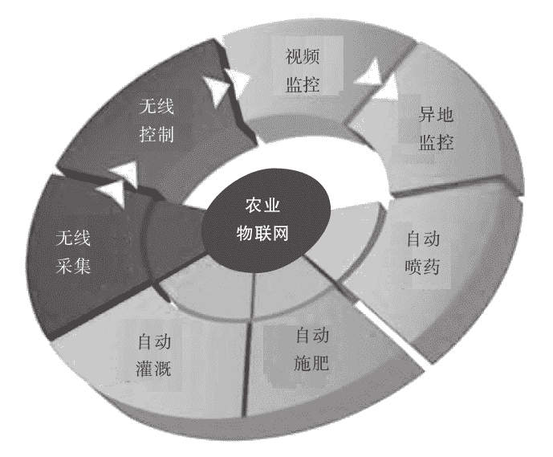

图 4-5 农业物联网系统

智能化农场通过智能监控设备实时监控农场中温度、湿度、病虫害等多个维度的数据，通过深度学习农业专家经验后建立起分析模型，并将实时分析结果和处理建议及时报告传输给农场负责人。根据智能监控设备的建议，农场管理者可形成一系列有科学依据的动作指令，快速发送给农场的智能设备，实现对农场环境的远程即时调控，如喷洒农药、进行灌溉、自动施肥等。

在建设农业物联网系统方面，农博创新建立的智能化农场有两个突出优势：数据传输能力和智能设备硬件。

在数据传输方面，农博创新依据当地农场的不同，打造多套数据传输方案，做到“因地制宜”。

对于大型农场，农博创新设计了 LoRa Wan 组网传输方案。该方案适合远距离传输，功耗和成本都比较低，而且具备绕射能力。经过团队测试，该方案可实现最远 25 公里范围内的数据传输，不仅解决了大型农场中网络信号弱及 Wi-Fi 覆盖不完全的问题，也为用户节约了近九成的通信费用。

对于中小型农场，农博创新设计了多种混合数据传输方案，以供不同类型的农场灵活选择。

在硬件设备方面，农博创新的智能传感器是自研自产的，不仅各种性能都有较大的提升，而且成本更有竞争力。此外，农博创新的硬件设备优化了安装及操作流程，大大降低了用户的使用门槛，对推广普及智能化农场具有促进作用。

农博创新 CEO 马俊娜表示：“希望未来农业物联网设备可以像消费级电子产品一样普及和易用。”农博创新的产品恰恰体现了这方面的追求。

智能化农场能够实现对传统农场的改革：减少人力和保证种植品质。在传统的农场管理中，一个面积为 6 亩的温室大棚至少需要 2 个人看管。而在农博创新的智能化农场中，理想状态下 3 个人就可以管理面积为 100 亩的温室大棚，人力成本降低了 60%以上。与此同时，智能化农场还实现了品质化和规模化的现代农业生产模式。

在打造智能农业方面，农博创新的智能化农场案例证明，借助人工智能技术，农场生产的数据采集和分析控制得以完美实现。整个大农业的物联网系统全面建立，将对发展智能农业具有非常重要的意义。

### 4.3.2 智能大棚环境监控系统
在智能农业体系中，最基本的内容是运用传感器设备和人工软件通过互联网对农业生产进行控制。在此领域中，农业智能大棚环境监控系统已得到了普遍应用。

在现代农业中，温室大棚种植打破了地理位置和季节的局限，极大地提高了人们的生活水平。在温室大棚种植中，棚内的温湿度、光照度和气体组成比例等数据对农作物的生长具有极大的影响，需要进行实时监控和调节。

传统的控制方式是人工控制，但其不仅成本高，而且控制结果不能完全达到科学种植的最佳要求。所以，人工控制的方式效果较差。

智能大棚环境监控系统是以人工智能和互联网技术为基础的监控系统，它能够对大棚内的物理环境进行 24 小时监控，并和管理者的电脑或智能手机连接，实时反馈数据。在某项参数不符合农作物生长的最佳条件时，智能大棚环境监控系统可以自动向相应设备发送指令，进行浇水等操作。

深圳信立科技有限公司设计出了应宽智能农业大棚环境监控系统，可实现对大棚中空气温湿度、土壤温湿度等多项现场参数进行实时采集，并通过无线传输到管理者的通信终端，使管理者实现远程监管。对于相对严格的科学操作，例如，在二氧化碳浓度低于固定值时必须补充定量的二氧化碳气体，监控系统可自动操作完成，极大地降低了人工操作带来的误差，有利于提升农作物的产量和质量。

智能大棚环境监控系统包括以下四部分，如图 4-6 所示。

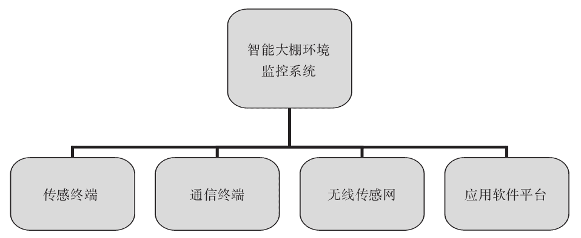

图 4-6 智能大棚环境监控系统

#### （1）传感终端
传感终端包括各种智能传感器，如无线空气温湿度传感器、无线光照传感器等，它们是采集数据的工具。

#### （2）通信终端
通信终端包括各种设备的信息采集部分，也包括用户的电脑和手机等，其作用是实现设备间的沟通。

#### （3）无线传感网
智能大棚环境监控系统中的无线传感网包括两个部分：自组织网络和通信网络。前者是温室内部的各节点间联系构成的网络，后者是各大棚之间及大棚与控制中心之间形成的网络。两部分网络相互结合，实现控制中心对大棚中各个设备的统一监控。

#### （4）应用软件平台
应用软件平台用于对各项数据的存储、处理和分析挖掘，在中央控制软件的智能分析决策下输出有效指令，调控大棚内部的环境，保证作物的优良生长环境。

智能大棚环境监控系统是智能农业现代化进程中的一次积极尝试，对进一步提高大棚的培育能力起到促进作用。随着人工智能技术的不断发展，智能大棚环境监控系统有望打造一个全面智能的大棚养殖体系。

# 第 5 章　人工智能+工业：高效、安全、便捷化
随着人工智能技术的进一步发展，人工智能和工业的结合也受到了各国政府的高度重视，建设智能工厂成为各工业企业的紧急任务。在经过蒸汽技术革命、电力技术革命、计算机及信息技术革命三次工业革命后，人工智能将带来全新的第四次工业革命，实现高效、安全、便捷化的“人工智能+工业”。

## 5.1 人工智能与工业 4.0

在德国政府《德国 2020 高技术战略》中，一个名为“工业 4.0”的项目引起了各国政府的重视。工业 4.0 聚焦于制造业的智能化水平，以建立智能工厂为目标。

中国和德国在推进工业 4.0 落地方面取得了高度一致，双方签订的《中德合作行动纲要》重点强调了数字化在工业 4.0 中的作用。在这种背景下，人工智能在工业中的积极推进就显得极为重要。

人工智能技术在机械手臂、机器视觉和大数据上的突破，为现代工业的制造、安检和销售等各方面带来创新，在不久的将来一定能实现建立智能工厂的目标。

### 5.1.1 工业 4.0 即智能制造

工业 4.0 的主旨是在现代通信技术和网络技术的帮助下，将制造业向智能化转型。换句话说，工业 4.0 即智能制造。

工业 4.0 战略有两个重要的组成部分，即智能工厂和智能生产，如图 5-1 所示。

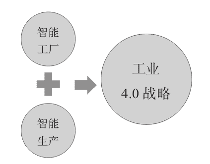

图 5-1 工业 4.0 战略的组成

智能工厂面向的是传统工厂的智能化转型问题，重点研究建设智能化的新型生产系统和过程，以及生产设施的智能化更新和分布。智能生产研究的重点则是工厂在生产过程中如何运用新技术实现生产效率的最大化。

工业 4.0 提出的智能制造是一种新的生产模式，是信息技术与制造技术的深度融合与集成，如图 5-2 所示。

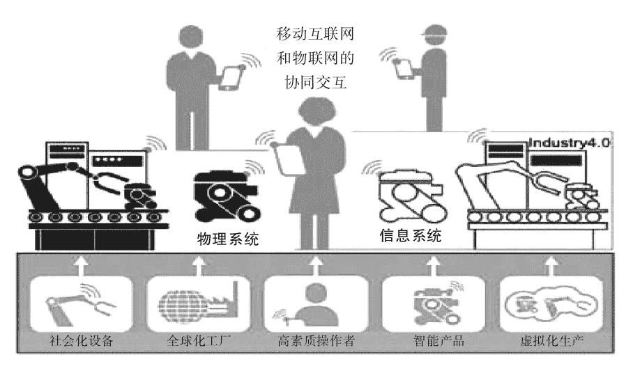

图 5-2 智能制造示意图

从图 5-2 可以看出，众多智能工厂通过移动互联网和物联网的系统交互形成庞大且完整的制造网络，而智能工厂内部的社会化设备、智能产品、高素质操作者等则通过企业内部的通信机制实现沟通，其中包括生产数据的采集与分析、生产决策的确定等。

工业 4.0 有以下四个方面的特点，如图 5-3 所示。

#### （1）生产智能化

利用人工智能信息网络，智能工厂的生产通信将变得更加流畅，生产速度大大加快。

#### （2）设备智能化

在人工智能技术的帮助下，工厂的生产设备能够自动判别生产环境，对生产过程进行调节。

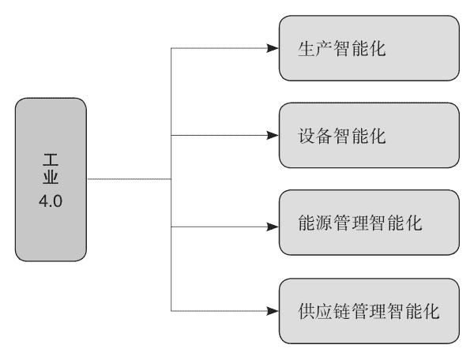

图 5-3 工业 4.0 的特点

#### （3）能源管理智能化

具有无障碍的通信系统，工厂中的电力系统、楼宇控制系统、电力微机综合保护系统等都能实现智能化，做到能源的最优分配。

#### （4）供应链管理智能化

智能制造是一个完全整合的系统，从原料的配送到产品的运输，供应链的管理会从全局考虑，统筹安排更加合理的管理体系。

### 5.1.2 机械手臂与工业制造：产品制造高效统一

在大型产品的工业生产中（如汽车制造行业），机械手臂的应用已经十分普遍。但是，随着工业生产对自动化的需求越来越大，机械手臂也开始逐渐进入小型加工行业。小型加工行业的原料和产品的重量相对较轻，不强调机械手臂的举重能力，更重视机械手臂的细致操作能力。因此，机械手臂的小型化和智能化成了必然趋势。

#### （1）小型化

机械手臂的小型化不只是其外观的尺寸要缩小，其活动半径也要缩小。机械手臂的尺寸和操作半径越小，越有利于实现生产线的密集部署。

传统的机械手臂尺寸比生产工人大得多，再加上要为机械手臂保留一定的安全空间，工厂引入机械手臂时不仅不能实现密集部署，甚至还需要投入更多成本去重新设计生产线。当机械手臂小型化后，工厂就不再需要增加成本修改现有生产线以适应机械手臂，可直接用机械手臂代替生产工人进行流水作业，从而提高生产效率。

#### （2）智能化

人工智能机械手臂的智能化依靠的是智能力觉传感器和视觉传感器。在一些精细化的机床加工生产中，人类可根据触感和视觉等灵活调整加工程序，人工智能技术的入驻将帮助机械手臂实现这种操作。

通过对工人操作流程的深度学习，人工智能机械手臂对加工的应对方案储备充分的知识。当智能传感设备收集到材料的特性时，人工智能软件将指导机械手臂进行定点的精细化操作。

越疆科技公司研发的`Dobot`就是一个集小型化和智能化于一体的机械手臂。`Dobot`只有台灯大小，是典型的桌面级设备，符合小型工业对机械手臂的要求。通过应用程序控制，`Dobot`既能实现传统机械手臂的夹持、吸取等动作，又能实现精细复杂的操作（`Dobot`的最大精度定位为 0.2 毫米），甚至能够用于雕刻、绘画等。

`Dobot`已经和众多厂商进行了合作：`Dobot`曾和美国最大的扬声器厂家之一`BOSE`合作测试扬声器设备的反复按键质量，也曾参与华为手机、平板电脑等的显示屏盲点测试，还和周大福珠宝合作完成了金饰自动称重的工作等。

机械手臂本身就可在程序的指令下进行精准作业，人工智能技术和传统机械手臂的结合赋予其更加灵活的操作能力，其精准作业的特性可以发挥到极致，在实现高效统一的工业产品生产上具有十分重要的作用。

### 5.1.3 机器视觉与工业安检：生产环境更安全

机器视觉也被称为“自动化的眼睛”，在工业生产中具有非常重要的作用。与其他感觉方式相比，视觉无须和被观察的对象接触，因此对观察者和被观察者都不会产生伤害，十分安全。这也是机器视觉得到广泛应用的最重要的原因。

和人眼相比，机器视觉具有许多优点，如表 5-1 所示。

表 5-1 机器视觉和人眼对比

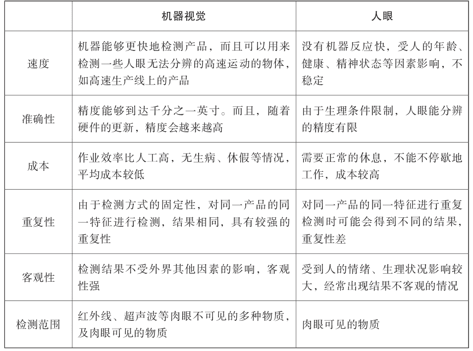

由表 5-1 可见，机器视觉可以探测到如红外线、超声波等人类观察不到的信号，而且无须休息，可以实现 24 小时观测，这对环境较为恶劣的工业生产来说具有非常明显的优势。因此，机器视觉在工厂中有很高的经济效益。

机器视觉可以利用人工智能的机器学习技术，加强对工厂环境的检测。通过机器学习技术，机器视觉可以充分感知各种条件下的不安全环境和安全环境之间的差别，提高工厂环境的安全性。

机器视觉在工业安检方面的应用有以下三个具体案例，如图 5-4 所示。

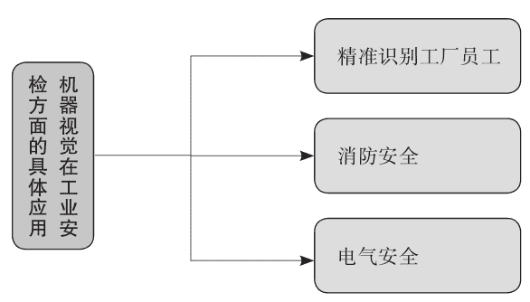

图 5-4 机器视觉在工业安检方面的具体应用

#### （1）精准识别工厂员工

大多数工厂对进入工作区的人员的管控很严格。传统的解决办法是监控摄像头和门房人员配合，但不能完全消除隐患。如果利用机器视觉对进入工厂的人员进行全方位监控，就能实现高精度的面部识别，杜绝闲杂人等混入工厂中。

#### （2）消防安全

利用机器视觉对红外线、温度等数据进行检测，可实现对火灾等隐患提前预警，减少事故的发生。

#### （3）电气安全

工厂工作环境中的用电安全同样重要。机器视觉可以检测全厂的电路情况，防止电路出现过载、短路等现象。

### 5.1.4 人工智能与工业产品销售：优化营销精准度

德国工业 4.0 明确指出，由于各种智能设备的进入和信息化进程的推进，工业将产生各种各样的数据。这些数据就是工业 4.0 的核心，是其区别于传统工业生产体系的最根本的特征。这些数据可运用于工业产品销售方面，起到精准营销的作用。

利用人工智能的深度学习，工业大数据的分析会变得越来越精准，能够深度挖掘消费者的需求，促进生产部门不断改进产品。

与单纯的大数据分析营销相比，人工智能背后的大数据营销更加注重“智能”。人工智能技术的深度学习能力将供应链、物流仓储和生产制造三个方面的数据进行结合分析，为营销人员提供了更好的决策参考。

在工业 4.0 时代，工业企业的数据会随着智能化进程的推进以爆炸式速度增长。这也给人工智能的营销决策提供了学习分析的大数据土壤。随着人工智能营销技术的更新迭代，工业企业的营销能力也会得到极大的提升。

## 5.2 建设智能工厂的五大策略

随着工业 4.0 的提出，“智能工厂”的概念也得到了人们的广泛认可。一方面，人工劳动力成本日益增加，企业招工困难；另一方面，人工智能等新兴技术的出现为各大企业推进智能工厂建设提供了良好的技术支撑，一时间各大工厂纷纷寻求转型升级。但是，如何才能建设真正的智能工厂呢？本节将从五大策略出发，详述建设智能工厂的有效措施。

### 5.2.1 结合核心价值链与信息化落地

在建设智能工厂的问题上，首先要搞清楚建设智能工厂最关键的因素是什么。良信电气副总吴煜曾经表示，在迈向工业 4.0 的过程中，企业要关注的关键因素是质量。“质量”不仅仅是指最简单的产品质量，更重要的是打造健全的全价值链质量平台，实现平台信息化。

企业信息化能够充分提升企业的竞争力，是建设智能工厂最重要的部分。企业信息化涉及的主要领域有四个部分，包括企业资源规划（`ERP`）、供应链管理（`SCM`）、客户关系管理（`CRM`）和产品生命周期管理（`PLM`）。因此，打造全面信息化的智能工厂，需要将`ERP`、`SCM`、`CRM`、`PLM`等信息化系统的管理体系做到固化落地，消除信息孤岛。

通过企业信息化，能够实现智能工厂以下五个方面的目标，如图 5-5 所示。

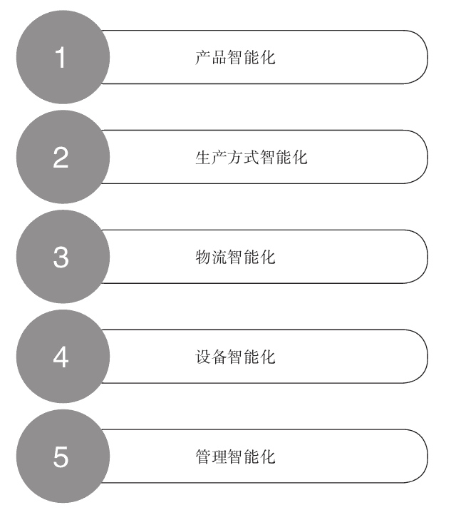

图 5-5 企业信息化的目标

#### （1）产品智能化

通过打通`PLM`和其他多个系统，实现协同设计，将产品生命周期中的各个过程转换成结构化的数据和文档，输入系统的数据长期有效，便于实现系统自动化设计。

#### （2）生产方式智能化

在生产过程中利用`ERP`等系统进行管控，打开生产过程中的“黑箱”，实现生产过程透明化、可追溯等目标。

#### （3）物流智能化

利用`SCM`系统进行统筹管理，减少线边库存，提升配送响应度和配送过程的透明度。

#### （4）设备智能化

利用各个信息系统之间的数据交流，实现对生产线、机械手臂等精确调控，成功实现产品生产过程中的自动化和智能化。

#### （5）管理智能化

各个信息系统之间实现横向的沟通和交流后，生产流程和程序信息就能实现深度融合，为产品的项目管理提供更多智能决策参考。

建设智能工厂的关键是打造全价值链质量平台，实现信息化落地。只有打通信息化管理的壁垒，才能建立起深入到企业内部的“智能化”体系。

### 5.2.2 建立清晰的智能工厂标准

智能工厂的核心在于结合全价值链质量平台，实现信息化落地，仅拥有自动化生产线和工业机器人的工厂还不能够称为智能工厂。智能工厂涵盖的领域非常多，衡量一家工厂是否真的“智能”需要建立一定的标准。一般来说，智能工厂有以下五大衡量标准，如图 5-6 所示。

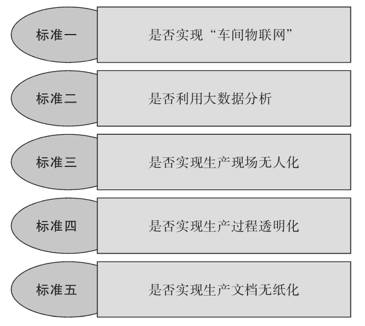

图 5-6 智能工厂的衡量标准

#### （1）是否实现“车间物联网”

传统的工业生产中只存在设备与设备之间的通信，人与设备之间的交互还需要接触式操作。在真正的智能工厂中，人、设备、系统三者之间应构建起完整的“车间物联网”，实现智能化的交互式通信。当建立起“车间物联网”后，车间内的所有人与物都可通过物联网得到连接，方便管理。

#### （2）是否利用大数据分析

随着工业的信息化进程加快，工厂生产所拥有的数据日益增多。由于生产设备产生、采集和处理的数据量与企业内部的数据量相比要大很多，因此智能工厂能够充分利用大数据技术对数据进行分析。

在工业生产的过程中，设备产生的数据每隔几秒钟就被收集一次。大数据技术利用这些数据能够建立起生产过程的数据模型，与人工智能技术结合，不断学习优化生产管理过程。同时，如果在生产过程中发现某处生产偏离了标准，系统就会自动发出警报。

#### （3）是否实现生产现场无人化

智能工厂的基本标准是自动化生产，不需要人工参与。当生产过程出现问题时，生产设备可自行诊断和排查，一旦问题得到解决，立刻恢复自动化生产。

#### （4）是否实现生产过程透明化

在信息化系统的支撑下，智能工厂的生产过程能够被全程追溯，各种生产数据也是真实、透明的，通过人工智能系统可以轻松实现查询与监管。

#### （5）是否实现生产文档无纸化

智能工厂一定是环境友好型工厂，因此目前工业企业中的众多纸质文件（如工艺过程卡片、质量文件、零件蓝图等）就是不符合要求的。所以，智能工厂的一个重要标准就是实现生产文档无纸化。

生产文档实现无纸化管理，不仅减少了纸张的浪费，还能杜绝纸质文档查找困难的问题，大大提高了工作人员检索文档的效率。

这些标准表明，建设智能工厂是全面、系统的工作，具有自身的衡量标准。只有明确智能工厂的标准，并在建设过程中一一落实，才能确立适合自身的智能企业建设方案。

### 5.2.3 建设智造单元：提高效率

在建设智能工厂的过程中，建设智造单元的策略得到了大多数企业的认可。有人称智造单元是“智能制造落地最有效的抓手”。由此可见，建设智造单元是实现智能工厂的必经之路。

智能工厂本身是一个非常复杂的系统，需要从整体上考虑。而落实到具体的生产线时，就需要从构建智造单元做起。

智造单元从工业生产中的基本生产车间出发，将一组功能近似的设备进行整合，再通过软件的连接形成多功能模块集成，最后和企业的管理系统连接在一起，形成一体化。

智造单元可以用“一个现场，三个轴向”来表述，如图 5-7 所示。

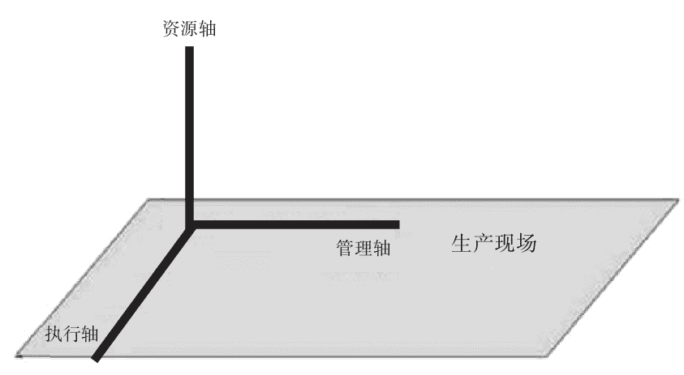

图 5-7 智造单元三维示意图

#### （1）资源轴

资源轴的“资源”是抽象意义上的资源，可以是任何对象，包括员工、设备、工艺流程，也包括精神层面的企业文化。

#### （2）管理轴

管理轴是指生产过程中的要素管控和运行维护过程，包括对产品的质量、成本、性能和交付等的管理把控。

#### （3）执行轴

执行轴是`PDCA`循环（也叫戴明环，如图 5-8 所示）的体现，即计划（`Plan`）、执行（`Do`）、检查（`Check`）、行动（`Action`）。

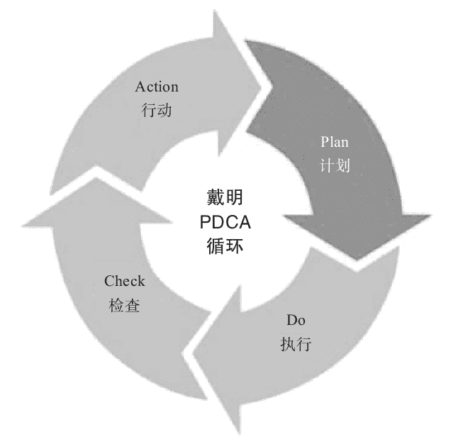

图 5-8 `PDCA`循环示意图

智造单元实际上是一个最小的数字化工厂，本身可以实现多品种、少批量（单件）的产品生产。更重要的是，智造单元能够最大程度地保护工厂的现有投资，即工厂既往的设备都可以被重复使用。如此，工厂的投资成本就会得到控制，对推进智能工厂的建设十分有利。

智造单元是智能生态的最小单元，能够充分组合工厂现有的资源和设备，在整体的智能环境下让已有设备的功效和效率达到最大化，体现了智能制造的调控柔性。

### 5.2.4 加强人机配合：追求人机协同发展

智能工厂的本质并不是“无人工厂”，而是在合理控制成本的前提下实现人机配合，满足市场的需求。因此，在推进智能工厂的建设时，加强人机配合以追求人机协同发展的策略十分重要。

在工业 4.0 的背景下，工业产品的市场需求朝着个性化的方向发展。智能工厂的人机配合形式充分利用机器人去完成重复性的工作，将人力解放出来进行创造性的工作，以满足消费者的个性化需求。

在智能工厂的人机配合模式上，海尔堪称榜样。海尔曾发布一批众创洗衣机“`intelius`”，以智能、高科技等因素赢得了消费者的追捧。这批洗衣机由海尔的互联工厂推出，全球 50 万用户共同参与了设计。

海尔欧洲白电总经理弗兰克介绍说：“我们一直在与用户交互更能满足需求的新一代洗衣机方案，在互联网上已经吸引了 50 万用户参与众创。而首批众创洗衣机最终方案便是由用户从 79 个模块方案中挑选出的 2 个最佳组合，可以说是一个由用户最终决定的产品。”

这款洗衣机之所以能够满足用户的个性化定制需求，是因为海尔的互联工厂采用了先进的智能化和信息化技术，是全球洗衣机行业最先进的互联工厂。该工厂采用了高柔性的自动无人生产线，生产车间全程无人工操作，是彻底的“黑灯车间”。通过多种智能设备，不仅能够实现生产设备的智能控制，还能够为全球的消费者展现工厂的生产流程，首次实现了洗衣机行业的全面透明化。

海尔互联工厂的建立实现了对建设智能工厂的新探索。通过实现工厂车间的全面自动化，海尔的互联工厂把产品的设计权交给消费者，加强人机的协同能力，充分体现了智能工厂在定制个性化产品上的优势。

### 5.2.5 培养科技意识：积极应用新兴技术

随着人工智能技术的发展，智能工厂中运用的技术也一定是日新月异的。因此，企业在建设智能工厂时，要积极尝试新兴的人工智能技术，培养科技意识。

运用以下技术可以更好地建设智能工厂。

#### （1）智能语音+`ERP`（企业资源规划）应用

通过人工智能的智能语音唤起`ERP`应用，可以大大简化诸如功能调用、信息录入等操作。`ERP`延伸到与工厂设备连接时，还能够利用语音唤起工厂设备的运行，提高生产效率。

#### （2）图像智能扫描认别

利用人工智能的图像智能扫描认别功能，可以快速生成单据和凭证，避免手工录入，减少人工的工作负担和录入差错的可能性。

#### （3）`AR`技术

`AR`（Augmented Reality，增强现实）技术也是值得关注的重点。利用`AR`技术，维修人员可以通过扫描相应的二维码，将虚拟模型和实物模型重合在一起，同时经过人工智能软件的分析给出相应的维修建议，从而提高维修效率。

总之，建设智能工厂不是一朝一夕的事情，但是已经有实际案例在不断探索。所以在实现建设智能工厂的目标上，企业必须牢牢把握住这五大策略，建设真正意义的智能工厂。

## 5.3 工业 4.0 时代的智能工厂

在“工业 4.0”被提出后，全球众多优秀的工业企业都纷纷开展了智能工厂的建设，并总结了许多宝贵的实践经验。本节将详细介绍在建设智能工厂过程中取得较好成绩的案例，希望能够带给读者一些启发。

### 5.3.1 德国西门子安贝格智能工厂

作为工业中的龙头企业，西门子在建设智能工厂方面同样处于领先地位。在西门子的安贝格工厂（Electronic Works Amberg，`EWA`）中，只有 1/4 的工作需要人工完成，3/4 的工作都由机器和计算机自主处理。德国总理默克尔曾亲临`EWA`，并对这项成果表示了极大的赞赏。

自建成以来，安贝格工厂的生产面积没有扩大，生产人员的数量也没有太大变化，但是产能却提高了 8 倍。安贝格工厂平均每一秒就生产一个产品，产品的合格率高达 99.9985%。无论生产速度，还是生产质量，全球没有一家同类工厂可与之匹敌。

在安贝格工厂出色的生产成绩背后，有以下三个重要特点，如图 5-9 所示。

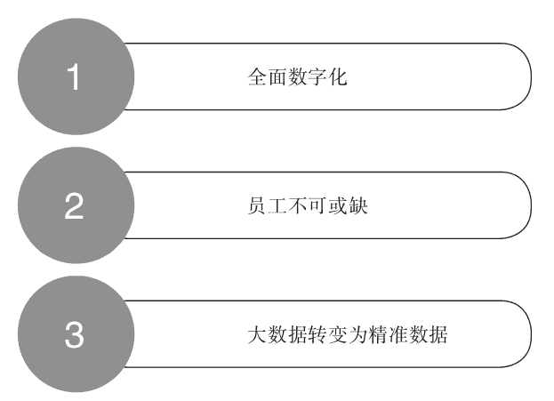

图 5-9 安贝格工厂的特点

#### （1）全面数字化

安贝格工厂的核心特点是实现了全面数字化，其生产过程是“机器控制机器的生产”，而这正是工业 4.0 所希望达到的目标。

安贝格工厂生产的产品是 SIMATIC 可编程逻辑控制器（PLC）及相关产品，这些产品本身就具有类似 CPU 的控制功能。利用全方位数字化，产品和生产设备之间实现了互联互通，保证了生产过程的自动化。

在安贝格工厂的生产线上，产品可以通过产品代码自行控制、调节自身的制造过程。通过通信设备，产品可以告诉生产设备自身的生产标准是什么、下一步要进行的工序是什么。利用产品和生产设备的通信，所有生产流程实现计算机控制并不断进行算法优化。

除了生产线的自动化，安贝格工厂的原料配送也实现了自动化和信息化。当生产线上需要某种物料时，系统会告知工作人员。工作人员通过扫描物料样品的二维码，将信息传输到自动化仓库，物料就会被传送带自动传输到生产线上。

在从物料配送到产品生产的整个流程中，工人所需要做的大约只占整个工作量的 1/4。在全面数字化的影响下，安贝格工厂的生产路径不断优化，生产效率不断提高。

#### （2）员工不可或缺

尽管工厂的生产流程已经实现高度的数字化和自动化，但员工在安贝格工厂中依旧是不可或缺的。除了日常巡查车间，检查自己所负责生产环节的进度，员工最重要的工作是不断为工厂提出配送生产过程中需要改进的意见。在对安贝格工厂的生产力具有促进作用的各个因素中，员工提出改进意见的因素占 40%，这显然不可小觑。

为了鼓励员工不断提出改进意见，安贝格工厂对提出了改进意见的员工发放相应的奖金。安贝格工厂曾发放了一共 220 万欧元的奖金给提出意见并获得采纳的员工。

#### （3）大数据转变为精准数据

智能工厂的关键就是将工厂生产过程中不断产生的大数据经过挖掘、分析和管理，让数据变得更符合智能工厂的生产需要，员工也能更好地使用这些数据。安贝格工厂每天处理的数据量已经超过了 5000 万，利用人工智能的智能分析手段和分类推送给员工的方式，安贝格工厂将大数据转变为了精准数据，让数据变得更有用。

### 5.3.2 九江石化智能工厂

九江石化是我国首批石化智能工厂的试点单位之一。尽管没有成熟的经验可供借鉴，九江石化依旧在结合石化流程型企业特点和人工智能的前提下，成功打造了石化智能工厂。在中国石化总部信息化管理部组织的验收测试中，九江石化智能工厂的各项试点建设项目均满足了设计要求，成功达标。

九江石化智能工厂的企业核心业务管理绩效有了大幅的提升，具体表现在三个方面。

#### （1）本质安全持续提升

本质安全是指在设计手段的安排下，生产设备和生产系统本身就具有安全性，即使在员工误操作或机器故障时也不会发生安全事故。九江石化智能工厂建成投用了人工智能生产管控中心和数字炼厂平台，保证了工厂的监管全场景覆盖和动态数据实时交互，深化本质安全不断提升。

#### （2）环保管理明显进步

通过人工智能数字炼厂平台的应用，九江石化工厂的生产工艺不断进步，形成了绿色、高效、可持续发展的生产工艺流程，工厂的环保水平不断提升，连续两年获评“中国石化环境保护先进单位”荣誉称号。

#### （3）盈利能力大幅提升

九江石化智能工厂自主研发了人工智能炼油全流程优化平台，该平台以经济效益最大化为目标。经过试验，该平台已实现了“月计划—周调度—日平衡”的双闭环管理，确保了九江石化面对市场变化时的敏捷性和准确性，大大提升了企业的盈利能力。九江石化智能工厂的加工吨油边际效益连续四年在中国石化沿江 5 家炼油企业中排名首位。

#### （4）管理效率大幅提高

九江石化在石化企业的典型信息化三层平台架构之上，创新构建了集中集成、数字炼厂、应急指挥三个公共服务平台，打破了企业原有的各类“孤岛”，让生产运行管理模式从传统的“分散管控”模式走向“集中管控”模式，并继续向“智能管控”模式提升。管理模式的提升大大提高了企业的管理效率，在炼油产量增加了一倍的同时，工厂的操室数量降低了 35%，班组数量减少了 13%，员工总数下降了 12%。

在初步实现了智能化应用的“智能工厂 1.0”之后，九江石化正在加速推进“智能工厂 2.0”的建设，把石化工厂推向高端智能、原创智能的方向，推动智能工厂的快速落地。

### 5.3.3 隆力奇智能化工厂

在工业 4.0 战略的变革中，智能工厂的建设是各大企业争相开展的项目。不同领域的企业对智能工厂的建设有着不同的思考，同时也带来了不同角度的尝试和不同形态的智能解决方案。在日化企业中，隆力奇率先开始了建设智能工厂的尝试，并成功入选江苏省“首批示范智能车间”。

隆力奇的智能化工厂配备了智能净化车间、自动配送系统，以及一系列高端智能生产设备，现有设施设备也得到了自动化和智能化的升级改造，生产厂房达到了 GMPC 标准，即良好生产规范标准。

隆力奇的智能生产车间拥有世界领先的智能设备。护肤洗涤类车间使用了意大利 ACMA-PYSTER 香波全自动灌装线，平均每分钟可以灌装 200 瓶；在牙膏生产区，智能化设备保证了 200 支/分钟的生产效率和不超过 1 克的误差水平，年度生产量可达到 2.75 亿支。

除了引进先进的智能设备，隆力奇也在全力打造自己的人工智能工厂云平台。利用多种无线技术，工厂中各个工位的数据都会传输和汇总到该平台上。同时，智能车间加强了人机之间的各种交互设置，如语音控制、视觉识别、手势识别等。另外，隆力奇还建立了以云平台为基础的智能工厂辅助系统，提高工作人员解决问题的能力。因此，在隆力奇的智能车间中，只需一到两名操作人员就可实现对整个车间的控制。

在实现智能车间的成功改造之后，隆力奇决定加速对智能车间的复制和扩张，并在栟茶镇建立符合工业 4.0 标准的 OEM/ODM 加工厂。该项目第一期预计投资人民币 3 亿元左右，工厂产能达 8 亿元，并预计于 2024 年前完成中国栟茶化妆品股份有限公司上市的各项工作。

除了栟茶镇的智能化工厂，隆力奇计划未来 20 年在珠三角、长三角、东南亚等地区再复制 10 个符合工业 4.0 标准的工厂，实现智能化运营。

# 第 6 章　人工智能+金融：风投更安全，理财更科学，服务更到位

金融领域数据密集、资本密集、高额盈利的特征为人工智能的应用提供了大显身手的机会。人工智能和金融融合，能够为人们的金融生活带来更多便捷，让风投更安全、理财更科学、服务更到位。

从整体来看，人工智能+金融的服务包括六大类，分别是智能投顾业务、智能金融投研业务、智能金融信贷业务、智能金融咨询服务、智能金融监管业务以及金融保险业务。本章将详细介绍人工智能在金融行业的这些应用，并介绍国内外的智能金融典型案例。

## 6.1 人工智能金融的服务种类

人工智能金融实际上可以在传统金融业的各个领域得到应用，是人工智能时代的金融服务转型和升级，下面进行详细介绍。

### 6.1.1 智能金融投顾业务

智能金融投顾业务即智能投资顾问，是一种新兴的在线财富管理服务模式，又称为机器人投顾。智能金融投顾是依靠人工智能的智能算法，在结合客户自身的经济能力、理财目标等信息后，利用经济学知识为客户量身打造最佳投资方案的服务，并为客户提供后续的实时追踪和动态管理。

智能金融投顾有以下四个主要的特点，也是其优势所在。

#### （1）分散化

智能金融投顾追求风险最小化。在人工智能综合分析各种投资后，智能金融投顾为客户推荐的投资组合可帮助客户将资产分散化，避免因风险过大而造成过多损失。

根据诺贝尔经济学奖获得者马科维茨（Markowitz）的研究，分散投资是金融市场的“免费午餐”。比起集中“押宝”，分散式投资可以让投资者在同等风险的情况下获得最大收益，这也是智能金融投顾业务的核心目标。

#### （2）个性化

智能金融投顾以客户的个人情况为依据，充分考虑客户的理财目的和财产情况等信息，能够为每位客户定制个性化的投资组合，满足不同客户的需求。

2002 年诺贝尔经济学奖获得者丹尼尔·卡内曼（Daniel Kahneman）教授曾指出，“大多数投资者并非是理性投资者，而是行为投资者；他们的行为不总是理性的，也并不总是回避风险的”，即投资者在决策过程中存在非理性的行为偏差。

这种非理性的偏差影响了人们对投资结果的正确归因，容易导致人们在下次投资时过度自信。智能金融投顾则能帮助客户解决这种偏差，因为智能金融投顾的决策结果不依据人们的直觉，而是依据既定的智能算法分析得出最适合客户自身的投资产品。

#### （3）长期化

智能金融投顾更加追求长期稳健的回报，而非短期的红利，因此具有长期性的特点。

在金融投资中，投资的一个要点就是形成一套专门的操作逻辑并长期执行。但由于人们的投资决策会受到其他客观事件的影响，所以人们在投资时会经常发生变动，但智能金融投顾不会这样。智能金融投顾根据既定的规则和策略，不会轻易更改投资逻辑。因此，智能决策可以实现投资中的长期性要求。

#### （4）低收费

由于智能金融投顾利用计算机进行数据分析和投资方案组合，而非传统的人工咨询服务，因此人工成本较低，收取的服务费也比传统方式低得多。

总而言之，智能金融投顾是机器推荐和传统人工咨询模式的结合，既有人工服务的专业知识，又有机器运算的快速和便捷性。那么，真正的智能金融投顾拥有什么本领呢？总结起来有以下四点：

第一，以大数据分析为支撑，能够充分了解客户个性化的风险偏好及相应风险演变规律；

第二，能够利用智能算法模型制定最合理的投资组合方案；

第三，能够对客户的资产配置方案进行跟踪，并结合实际情况进行调整；

第四，能够为客户实现一定风险内的收益最大化。

综上所述，智能金融投顾能够为客户节约理财成本，带来更多收益。随着人工智能在金融领域的应用越来越深入，智能金融投顾必定是未来金融领域的常见应用工具。

### 6.1.2 智能金融投研业务

金融投研即金融投资研究，需要进行行业研究和投资分析。无论是传统的人工投研，还是人工智能支撑的智能投研，大致都要经过“搜索—数据提取—分析研究—观点呈现”的流程，两者的比较如表 6-1 所示。

表 6-1 人工投研和智能投研的比较

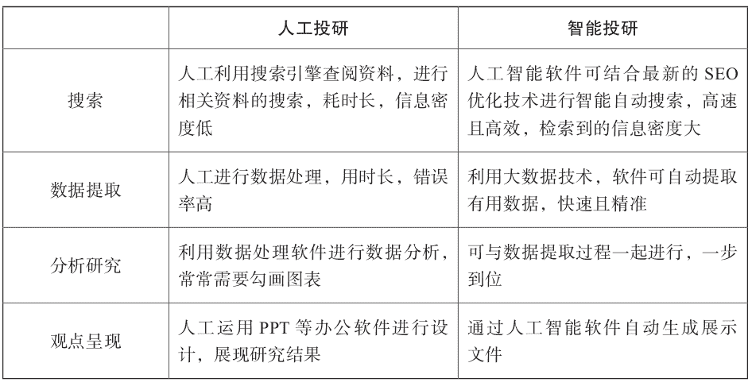

不难看出，智能投研比人工投研所需要的人工成本更少，效率更高。利用人工智能技术，智能投研能够实现从搜索到观点呈现的跨越式处理。

目前，智能投研有以下三种研究模式。

#### （1）整合多平台数据资源

人工智能技术可以对多个平台的相关数据进行整合收集，为客户提供有效的数据支持。以金融大数据分析平台 Palantir Metropolis 为例，该平台利用人工智能技术，对原始的混乱数据进行整合，并具有多元数据整合、数据建模与迭代合作等功能。经 Palantir Metropolis 整合后的数据高度结构化，能够为从业人员提供清晰的分析思路。当摆脱了烦琐的数据处理后，金融从业人员能够更高效地为客户服务。

#### （2）设立专有的新数据集和工具套件

设立专有的新数据集和工具套件，人工智能软件能让客户充分看到投资产品未来发展的可能，并以量化的方式展现其发展前景，降低客户的投资风险。

#### （3）细分产品，提取核心数据

通过不断地深入学习，人工智能软件可以将金融产品不断细化，提取出其中最关键的核心数据，以便客户提前了解该投资产品的价值。

借助动态 SEO、语音语义识别和知识图谱等基础技术，智能投研可以实现投资研究各个过程的自动化操作，提高了投研工作的效率。

尽管智能投研比人工投研更加高效，但是智能投研并非要取代人工投研。通联数据的王政博士是一位智能投研专家，他曾明确地提到：“只有将数据、专业知识及技术三者有机结合，才能构建一个智能投研平台。在这之中，人与机器的结合是很重要的。”换句话说，人工智能在投研领域中的作用更像是专家的武器，帮助他们在人工智能时代具有更出色的分析能力。

### 6.1.3 智能金融信贷服务

信贷业务是金融业最主要的业务，也是整个金融行业和人工智能融合最深入的场景。研究清楚人工智能在金融信贷领域的应用，能够帮助我们了解整个“人工智能+金融”的局面。

信贷业务流程主要有以下三个阶段，如图 6-1 所示。

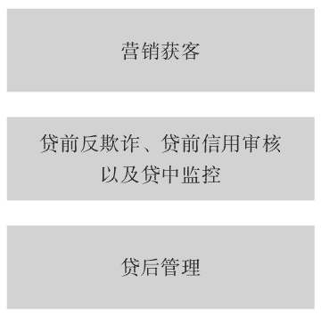

图 6-1 信贷业务流程

在传统信贷业务中，这三个环节都是依靠人力完成的：营销人员积极拉客、金融专家对客户进行信用评估、金融客服专人跟进服务……当结合人工智能技术后，传统信贷升级为智能信贷，不仅有效节约了企业进行信贷服务的成本，也能大幅度提高客户的服务体验。

从具体的业务种类来看，智能信贷有两个发展重点：To B（面向商务企业）服务与 To SME（面向小微企业）信贷服务。

#### （1）To B 服务

To C（面向消费者）和 To B（面向商务企业）一直都是各种企业的两大类服务领域。由于 C 端客户人群多、贷款风险较小，众多金融机构纷纷在个人信贷业务领域抢占市场。

与传统信贷业务不同的是，智能信贷业务有大数据技术做支撑，庞大的数据量是智能信贷显示出巨大优势的前提。因此，智能信贷在发展 B 端客户方面具有先天优势。

#### （2）To SME（面向小微企业）信贷服务

随着人们知识水平的提高，创业的人越来越多。据相关数据统计，2017 年中国小微企业的数量已达 7328.1 万。而在如此多的小微企业中，只有不到 10%的企业可以享受银行的小额贷款，而剩下 90%的小微企业都是智能信贷可以发展的对象。

利用大数据，智能信贷企业可以充分了解小微企业的发展现状，按照智能软件的决策参考决定是否进行贷款业务。智能信贷不仅降低了贷款企业的风险，而且解决了小微企业的融资需求，实现了双方共赢。

与传统信贷服务相比，智能信贷的时效性更强。传统信贷服务放款周期长，大多是因为企业贷款前的资格审查程序烦琐，需要人工对每个细节进行反复核实。而对于智能信贷来说，资格审查的工作交给了大数据分析软件和智能评估软件，解决问题的效率比人工高。因此，智能信贷业务更具有时效性，能解决小微企业的燃眉之急。

随着行业市场逐渐规范，中国线上信贷市场逐渐告别初期“野蛮生长”的时代，正在向精细化管理阶段转型，以客户为中心的运营理念正逐步成为企业的主导理念。利用人工智能和大数据等技术的智能信贷，能够充分考虑到客户的需求和个性化差异，是未来信贷业务的主流趋势。

### 6.1.4 智能金融咨询服务

在金融咨询领域，人工智能技术既可以作为金融客服为客户提供服务，也可以应用于金融信息查找，如图 6-2 所示。

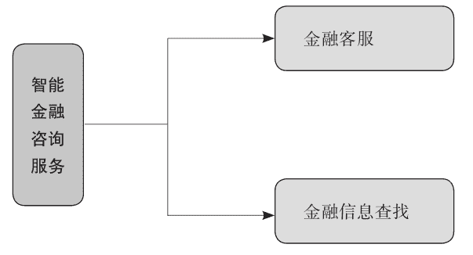

图 6-2 智能金融咨询服务

#### （1）金融客服

智能金融客服可以学习许多金融领域的知识，并以此作为依据解答客户的咨询。另外，在与客户的不断交流中，智能金融客服可以自主学习客户中最常见的问题，分析客户的心理，为客户提供快捷的金融解答，提高服务效率。

智能金融客服还能与其他渠道融合，为客户带来更加多元的服务体验。例如，智能金融客服可以和移动 App 结合，综合利用视觉识别、语音识别等人工智能技术，与客户进行多元化的智能沟通，让客户随时随地都可获得金融服务。

与传统的人工客服相比，智能金融客服的服务态度更加温和。在传统的金融服务行业，人工客服会因为一些外在因素无法保证自己的情绪一直处于温和、稳定的状态，从而影响客户的服务体验。智能金融客服由于人工智能程序的设定，语速和语调总能维持在令人舒适的程度上，因此不会造成负面影响，可以带给客户更好的服务体验。

#### （2）金融信息查找

金融行业与其他各行业有着千丝万缕的关系，因此金融信息也十分繁杂。从业人员如果要在这些信息中获得真正对自己有意义的数据，需要花费大量的时间和精力，同时还冒着做无用功的风险。

如果把人工智能技术应用于金融信息查找领域，就能自动为人们提供与问题相关的有用信息，提高查找效率。利用人工智能技术卓越的搜索识别能力，金融平台能够快速匹配关联数据，并且精准快速地提供数据信息。

金融科技公司 Kensho 推出的产品 Warren 可以说明人工智能技术在金融信息查找领域的应用。Warren 是一个智能金融应用平台，能够为客户快速收集信息并高效处理。

当发生具有分析价值的财经新闻时，Warren 软件智能获取所有与其相关的财经新闻，并深入研究分析其中提到的数据，最终给出一份专业的金融分析报告。这份工作即使交给资深的金融行业分析师，也需要好几天的时间才能完成。但是，借助 Warren 软件，从相关数据的收集到完成汇总报告只需要不到 24 小时。

Warren 软件应用在金融咨询领域，能够为人们搜索到所有与关键词相关的匹配度高的新闻，并迅速生成数据报告，为人们提供决策参考。

随着人工智能技术的深入拓展，智能金融咨询服务也能够为人们带来更加方便的金融服务，从根本上提高金融咨询服务的效率。

### 6.1.5 智能金融监管业务

在金融领域，监管业务是十分重要的一项工作。依靠人工智能技术，金融监管业务将变得更加智能。人工智能通过规则推理和案例推理两种方式进行各种金融场景的学习。

规则推理的学习方式是指将金融行业的各种法律法规和行业规则输入人工智能的算法中，使软件进行自主学习后能够利用规则进行推理，对不同金融场景的合规和不合规做法能做出清晰的判断。

案例推理的学习方式是指学习行业的典型监管案例，以此作为判断金融行为是否合规的依据。

智能金融监管业务最典型的应用就是反洗钱系统。通过对人工智能系统输入大量的洗钱案例，就能够让它充分熟悉洗钱行为的特征。当有疑似洗钱行为的动作出现时，系统就能迅速采取应对措施，从而提高金融系统的监管能力。

打造更完善的智能金融监管体系，必须做好以下三个方面的工作。

#### （1）构建全面的社会智能监管体系

智能金融监管体系的完善需要全社会的共同努力。政府应积极推进人工智能技术助力金融监管领域的应用，计算机专家应深入研究金融领域人工智能技术的应用实践，而金融专家应积极尝试与人工智能技术的创新结合……只有社会各界都积极参与到智能监管体系的建设中，才能构建完善且全面的智能金融监管体系。

#### （2）加快线上监管平台的建设

随着移动互联网的快速发展，人们越来越习惯用移动端解决身边的问题，智能监管体系也需要遵循主流趋势，加快线上监管平台的建设，方便人们查询和处理日常的金融事务。

#### （3）引入专家保障监管全方位

智能金融监管体系的完善离不开专家。专家不仅可以为现有的监管体系提出改进意见，而且可以培养更多的优质人才，使智能监管体系的建设变得可持续。

中国人民银行科技司司长李伟提到：“从监管角度看，运用大数据、云计算、人工智能等技术，能够很好地感知金融风险态势，提升监管数据收集、整合、共享的实时性，有效发现违规操作、高风险交易等潜在问题，提升风险识别的准确性和风险防范的有效性。”

智能监管业务能够实时分析各类金融数据，为金融从业人员解决金融信息不对称的问题，避免监察不及时的漏洞。同时，智能监管业务还能够及时披露企业的洗钱、套利等行为，提升监管效率。

综上所述，在金融监管领域中引入人工智能技术，有利于打造更加完善的智能金融监管平台，保证金融交易双方的财产安全，构建更加和谐的金融环境。

### 6.1.6 智能金融保险业务
随着人们的健康意识不断增强，保险业务成了金融领域的热门业务。在保险业务中，人工智能完成所有能够自动化设置的环节，实现传统保险业务自动化和智能化的升级转型，提高保险业务的处理效率。

结合人工智能技术的智能金融保险业务，将从以下三个方面提高整个保险业务的质量。

#### （1）精准推荐
利用大数据技术，智能金融保险系统根据客户的需求和经济情况定制最合适的保险方案。经过客户和系统的多次交互，人工智能技术能够发现客户尚未意识到的保险需求，并智能生成满足条件的保险方案。也就是说，智能金融保险业务不仅可以根据客户描述的需求推荐产品，还可以预测客户未来可能遇到的场景，为其做好应急准备，这正是人们买保险的意义所在。因此，人工智能技术的加入可以为客户提供更加精准、有利的保险方案。

#### （2）打击骗保
利用人工智能的人脸识别等技术，能够迅速发现客户的索赔证据是否真实。例如，利用人工智能强大的图像识别能力检测客户提供的疾病或事故照片是真实照片还是来自互联网的合成的假照。这样一来，保险索赔认定环节既不需要企业和客户线下确认证据，又可以提高检查证据的效率，实现对骗保行为的准确分辨、快速处理。

另外，经过对骗保案例的学习和分析，人工智能能够智能识别疑似骗保的保险业务，从源头杜绝骗保行为。

#### （3）提升消费体验
人工智能系统能够助力保险行业为客户提供个性化的内容，提升客户的消费体验。英国 HeyBrolly 公司开发的移动软件 Brolly 就是以人工智能技术为核心，向客户提供保险购买建议的软件，获得了许多客户的好评。

Brolly 不仅能够为客户提供全面的保险信息，还能够在融合了保险政策和客户需求后，为客户智能选择最合适的保险产品。利用人工智能技术，客户无须阅读冗长的保险条款和分析晦涩的法律法规，就能够选到最合适的保险产品，显然大大提升了客户的消费体验。

综上所述，人工智能助力金融保险业务发展，可以为客户推荐精准的产品，带去更好的消费体验，也可以为金融保险企业降低被骗保的风险，使保险业务更加便捷和安全。因此，金融保险行业也应尽快抓住机遇，创新引入人工智能技术与保险业务结合，打造智能金融保险业务，促进自身企业的发展。

## 6.2 智能金融典型案例
由于人工智能技术的进步，金融行业人工交易员的数量大大减少，人工智能正在助力整个金融业建立“智能金融”。国内外大大小小的互联网金融企业正在加快利用人工智能技术改变现有交易流程的脚步，以提高业务效率，增加利润。

### 6.2.1 智能投顾平台：Wealth front
随着人们对智能投顾平台需求的增长和人工智能技术的进步，智能投顾领域的企业也如雨后春笋般涌现。Wealth front 是智能投顾市场的领先企业投顾平台，自 2011 年开始专注于智能投顾领域，曾被评为“2013 年度 TF 策略分析师”，其服务的客户已有 8 万多名，资产管理规模已达 40 亿美元。

与传统理财顾问的销售模式不同，智能投顾专注于为客户寻找利益最大化的投资组合。利用互联网大数据，在智能分析客户的背景之后，Wealth front 能够为客户推荐多元化的投资组合方案，同时为客户提供开设、管理账户及评估投资组合等服务。

客户在使用 Wealth front 时，一般会经历以下六个步骤。

#### （1）风险容忍评估
在推荐投资组合前，客户会被要求填写一份问卷，如表 6-2 所示。

表 6-2 Wealth front 风险容忍度测评问卷

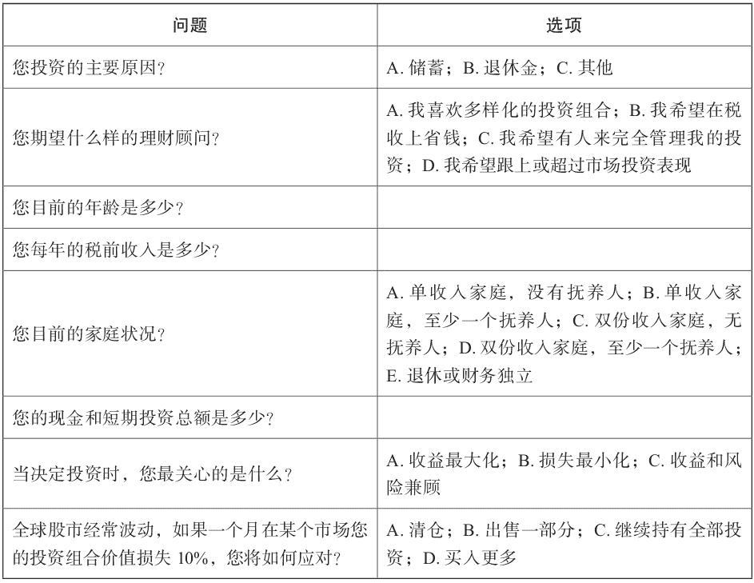

完成这份调查问卷后，系统能够了解客户对投资风险的态度，向客户推荐量身定制的投资计划。

#### （2）系统推荐投资计划
根据客户的风险偏好和经济背景，系统会为客户推荐最合适的投资组合计划，投资组合的载体为指数基金（Exchange Traded Fund，ETF）。在 Wealth front 中，投资组合主要包括两大类：需要纳税的投资组合和退休金投资组合。两大类中还有更细分的资产类别，如各种股票、债券等。依据客户自身的风险容忍度，平台推荐的投资计划只包括部分类别的资产。

#### （3）开户
当客户同意在 Wealth front 平台开户后，平台会指导客户填写相关开户信息，并在信息核查后完成开户。

#### （4）交易
当客户要进行交易时，平台将代表客户向证券经纪公司 Apex Clearing 发送交易指令，买卖 ETF。

#### （5）客户评估、检查投资组合
客户可随时在 Wealth front 平台上查看自己的投资组合，若想更改现有投资组合，平台会依照客户的指令进行更改。

#### （6）平台获得佣金
Wealth front 平台有多种盈利模式，一般从用户开户之日起的次月，于每月第一个工作日收取一定的费用，数目是客户账户余额扣除 10000 美元之后的 0.25%。其他费用模式如表 6-3 所示。

表 6-3 Wealth front 平台盈利模式

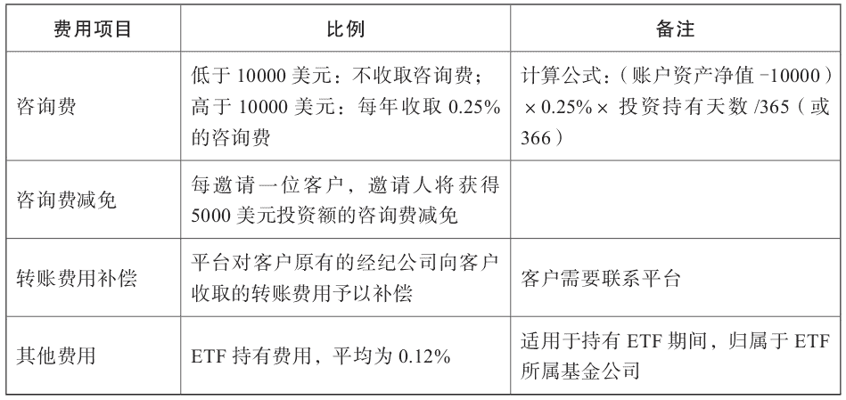

Wealth front 平台为客户推荐投资组合的理论依据是现代投资组合理论（Modern Portfolio Theory，MPT），由诺贝尔经济学奖得主马克维茨和威廉夏普提出。该理论认为，投资者在投资时，如果按照分散的投资组合进行投资，不仅不会降低预期收益率，而且能降低风险。

在现代投资组合理论的支撑下，Wealth front 平台为客户提供的资产种类多达 11 类，既可以提高投资分散化程度、降低投资风险，还可以为不同客户制定不同的资产组合选择，满足各类客户的个性化需求。

根据专业咨询公司的统计，预计在 2020 年，金融行业资产管理规模将达到 15970 亿～22000 亿美元，其中智能投顾企业渗透率将提高至 5%。随着时间的推移，新一代的年轻人将成为金融领域的客户，而他们正是 Wealth front 平台的目标客户。Wealth front 平台还专门为大学生设计了具有针对性的理财产品，这显然会成为 Wealth front 独具特色的竞争力。

### 6.2.2 英国：Money on Toast
Money on Toast（花在面包上的钱）是英国的一家智能投顾平台。利用智能算法，Money on Toast 收集了金融顾问的专业知识，并根据金融顾问指导咨询者的方式编写了一款名叫“在线建议旅程（Online Advice Journey）”的程序。

Money on Toast 平台所使用的智能算法收集了许多专家的专业意见，该公司表示这种技术就和谷歌取代黄页的技术相似：“就像谷歌取代了黄页那样，这项新技术让算法表现出了人类顾问的许多功能，而在某些情况下甚至可以比人类做得更好。”

Money on Toast 平台能够免费提供投资前的咨询服务，指导客户完成一系列问题回答，以便系统获知客户的经济情况和个人情况，然后为客户生成投资组合，投资组合从信托、无限制投资公司和盈富基金等理财产品中选取。

该平台的最低投资额度是每月 1 万英镑，平台的费用为 1.69%。

### 6.2.3 腾讯：人工智能即服务，打造腾讯金融云
面对新时代智能化的变革，腾讯金融正在加快自身的技术发展，提出了“人工智能即服务”的观点，致力于打造腾讯金融云。

目前，腾讯金融云的客户数量已经超过 5000 家，囊括了四大银行、各大股份制银行、城市商业银行、农村商业银行、民营银行、互联网金融保险公司、传统保险公司、证券公司、基金公司等各类金融机构，是国内金融科技企业使用最广泛的平台之一。

在智能金融到来之际，腾讯金融云总经理胡利明认为：“采用云架构、链接、数据智能、Reg Tech（监管科技）是当前金融科技发展的新趋势。”

第一，采用云架构能够为金融企业带来更大的业务弹性和更快的响应速度，让互联网金融获得更好的场景适应性，在新场景出现时也更容易获得安全性和合规性。第二，链接是互联网时代的基础，是行业机构与客户相互沟通的前提。第三，利用人工智能技术挖掘数据背后的价值，可以让金融企业变得更加智能。第四，Reg Tech（监管科技）的应用符合金融监管趋于严格的发展趋势。

腾讯金融云在人工智能领域已经蓄力 20 多年。提出“人工智能即服务”战略后，腾讯金融云在多个层面提供了新的人工智能开放服务层。在人工智能的三大核心能力（即计算机视觉、智能语音识别和自然语言处理）上，腾讯金融云为金融企业提供了 25 种人工智能服务，如智能客服、智能投顾、智能风控等，助力金融企业构建智能金融生态。

华夏银行已经与腾讯金融云签约，双方将以创建联合实验室等方式进行合作，共同深化人工智能技术在金融行业的应用，推动腾讯金融云为金融行业做出更多贡献。

腾讯金融云也和中国金融认证中心签署了合作协议，为金融安全、认证等增加安全保障。未来，中国金融认证中心提供的数字证书、安全控件等产品将基于腾讯金融云在人工智能方面的优势，以云服务的方式提供给互联网用户，增加金融业的安全合规性能。

腾讯金融云“人工智能即服务”战略推动着金融行业打造智能金融生态圈，助力金融行业的安全合规与升级。

### 6.2.4 京东金融：利用人工智能做风控监督
京东金融曾在 2017 年获得了“金融界奥斯卡”——年度信贷风控技术实施奖。这是由《亚洲银行家》颁发的国际风险管理行业成就大奖，说明京东金融的风控能力得到了国际权威的认可。这份成绩的取得，源于京东金融充分利用人工智能技术来办理业务。

在京东金融业务中，95%的业务通过自动化的职能程序完成，有一半以上的员工从事智能数据开发和研究工作。京东金融业务依靠先进的人工智能技术，搭建了一整套风控体系，包括深度学习能力、风险画像、高维反欺诈模型等。

京东金融业务通过分析客户的浏览行为等数据，检测客户账号是否异常。例如，当客户的账号被盗时，违法者的行为路径一般是先查看客户的账户余额，然后将余额换成可以变现的贵重商品，如金银物品等。通过人工智能技术，京东金融业务可以分辨出这种异常行为，并运用于风控技术中及时提醒金融业务人员查看客户的账号安全。事实上，凭借风险实时监控体系，京东金融已经配合警方破获了多起网络诈骗案件。

除此之外，京东金融在消费金融领域的风控体系中表现也十分出色。以京东“白条”为例，当京东金融授信于用户时，人工智能技术可以提前过滤信誉不高的用户，如互联网恶意用户、金融失信用户等，然后进一步从用户洞察、大数据征信等角度对用户进行筛选，形成用户“白名单”。

在金融反欺诈方面，京东“白条”实施全流程环节监控，用户的每次账户行为都会受到后台的安全扫描。后台程序对账户行为进行实时监控，及时识别潜在的恶意行为以及存在高风险的账户和订单，防止发生欺诈行为。

另外，京东金融还利用设备指纹、生物探针和模式识别等多种智能技术，深度学习理解用户的正常行为，以便及时发现账号的异常登录和交易行为。

京东金融的战略定位是金融科技，积极使用人工智能技术是京东金融做金融科技的基础。人工智能技术能够将风控系统量化衡量，为用户带来个性、高效的服务体验。如今，京东金融正在深化人工智能在金融风控领域的应用，使金融变得更加规模化、安全化，推动普惠金融理想的实现。

### 6.2.5 蚂蚁金服：Techfin（科技金融）
在《财富》杂志发布的“2017 年 50 家改变世界的公司”榜单上，蚂蚁金服就是其中之一。此外，蚂蚁金服还入选了《MIT 科技评论》的“最聪明 50 家公司”榜单，也是该榜单上唯一一家金融科技企业。《MIT 科技评论》对其评论道：“蚂蚁金服正在探索使用人工智能进行信贷业务。”

蚂蚁金服财富事业群总裁樊治铭曾表示，“蚂蚁金服的优势不是金融，而是科技”，这也是蚂蚁金服定义自身为 Techfin（科技金融）而非 Fintech（金融科技）的原因。作为一家科技公司，蚂蚁金服的核心关键词就是“人工智能”，其致力于通过人工智能技术驱动公司的所有业务，同时也正在加速向其他机构赋能。

支付宝的智能客服“小蚂答”是蚂蚁金服的人工智能技术应用。人工智能的应用使客服变得更加高效，“小蚂答”平均每天可以处理 200 万～300 万条客户咨询，客户满意率比人工客服高出 3 个百分点。

如果用户需要通过电话进行咨询，“小蚂答”可以通过语音识别技术帮助用户直接跳转相应服务，无须等待提示音的指示。除此之外，“小蚂答”还可以充当“保镖”的角色。“小蚂答”在检测到用户的账户存在风险时会自动启动一键挂失功能，冻结账户；在用户遇到诈骗的情况时，“小蚂答”还可帮助用户做到一键报案，减少损失。

人工智能技术也让支付宝变得越来越智能。由于支付宝的支线应用较多，有些功能入口“藏”得比较深。在结合人工智能技术后，用户可以通过语音查找的方式直接跳转进入相关页面。另外，人工智能作为蚂蚁金服的核心技术，还提供了如交易风控、基金推荐、贷款准入等一系列业务服务。

蚂蚁金服的科技金融在中国取得出色的成绩后，加快了在其他国家，尤其是发展中国家的推进步伐。蚂蚁金服董事长彭蕾介绍说，蚂蚁金服在中国推动无现金社会的同时，也在世界其他国家积极推动无现金社会。根据统计显示，蚂蚁金服具备 18 种货币结算能力，通过不断输出技术和帮助，已经在全球 200 多个国家和地区为用户提供了普惠金融服务。

# 第 7 章 人工智能+医疗：医生省力，病人无忧
随着人工智能技术的发展，人工智能产品涉足的行业越来越多，医疗行业也成了人工智能的用武之地。“人工智能+医疗”的出现给医疗行业带来了新的革命。

与传统医疗相比，“人工智能+医疗”具有三个明显的优势：提高信息化，提升医疗机构运营效率；智能预测，降低疾病发生风险；推进精准医疗，提高健康水平。在具体的商业应用上，人工智能与医疗的结合也有着五大应用场景：医学影像、医药研发、疾病预测、医生助理和虚拟护士。

人工智能技术进入医疗行业是整个世界的大趋势，既能让医务工作者变得更加轻松，也能为病人带来更多的福利和帮助。

## 7.1 人工智能医疗的三大优势
人工智能的突出优势在于强大的计算能力和学习能力，因此在数据密集型、知识密集型、脑力劳动密集型的行业具有非常大的发展潜力和优势，而医疗正是这样的行业。因此，人工智能在医疗行业有着天然的发展基础。

在各国积极推进医疗信息化的今天，人工智能医疗显然能够加快信息化建设的进程，提升医疗机构的运营效率；可以进行智能预测，降低发生疾病的风险；还可以推进精准医疗，提高健康水平。

### 7.1.1 加快信息化建设，提升医疗机构的运营效率
加快医疗机构的信息化建设，能够显著提高医疗机构的运营效率。谷歌、微软、IBM 等公司都在推进医疗信息化的进程中做出了重要贡献。随着人工智能技术的推进，医疗机构的信息化建设迎来了新的变革。

国家卫生计生委副主任金小桃指出，在人工智能浪潮下，医疗机构在宏观层面要迎接大变革，适应大趋势，在微观层面要拥抱信息化，拥抱大数据。“让医院的人流、物流、信息流都能清晰可视、运转自如是我们的理想，需要我们推动信息应用，建设智能型医院。我们要推动大健康，促进大卫生。”

医疗机构信息化的代表产物——电子病历可以说明人工智能对医疗机构信息化的意义。电子病历是一个储存库，里面汇集了患者所有的健康数据。医疗工作者可以在其中查看患者所有的健康数据，这对指导医生用药具有很大的帮助。此外，在征得患者的同意后，电子病历可以开放给研究人员进行疾病研究。

由于纸质病历不易保存、查找困难，所以医疗机构信息化的第一步就是将整个医疗机构患者的病历电子化。形成电子病历后，人工智能技术能够使电子病历挖掘技术发展出更多的可能，如精准匹配临床试验的患者等。

在进行临床试验的过程中，最困难的步骤就是将患者与临床试验进行匹配。造成这个困境的原因有很多，例如，大量的资料需要整理核实，医生很难同步掌握临床试验结果，而大部分患者不清楚自己适合参加什么样的临床试验。电子病历出现以后，这些情况得到了一定的缓解，但是仍旧不能够完美解决精准匹配患者和临床试验的问题。

美国 Mendel.ai 公司开发了一款针对临床试验招募的人工智能系统，用于解决上述问题。患者可以在该系统中自行上传或委托医生上传电子病历，系统会自动将患者的健康数据和录入的临床试验数据进行实时精准匹配，并刷新匹配结果。一旦有匹配的组合，系统就会立刻通知患者参加临床试验。

在临床试验中，不同的试验组会有不同的入组标准，传统的入组前检查依靠的都是人工检测。试验人员需要将所招募患者的情况和每一条入组标准进行对比，检验是否能够进行测试。电子病历的出现使患者的数据提取变得容易，数据匹配工作的效率得到提高。Mendel.ai 公司负责人曾指出：“这些试验数据每周都有更新，如果单靠人力进行数据匹配，根本不能实现。”而人工智能技术则实现了智能匹配这些数据的可能。Mendel.ai 公司利用人工智能技术，在病患、医院、临床机构三者之间搭建了沟通的桥梁，加速了医疗行业精准匹配临床试验的进程。

从 Mendel.ai 公司的案例可以看到，运用人工智能技术可实现智能匹配患者和医疗机构。医疗机构信息化的最终目的就是打破整个医疗行业的数据壁垒，提高医疗机构的运营效率。初步的信息化发展预示着数据全面联通的可能，人工智能技术的加入则带来了打破数据壁垒、智能匹配数据的希望。而且，人工智能技术在医疗机构中的运用是对医疗机构运营效率的进一步提升。

### 7.1.2 智能预测，降低发生疾病的风险
提前预测到患病的征兆，可以降低发生疾病的风险。因此，对患者的情况进行预测和评估在医学领域也是十分重要的。人工智能技术在医疗健康领域的发展也给智能预测疾病带来了新的可能。

谷歌大脑和 Verily 公司曾联合开发了一款用于检测乳腺癌的人工智能系统。公司将患者的病理切片和正常组织的切片处理成数码图像，为人工智能系统提供学习数据。在智能系统和人类资深病理学家的比拼中，人类资深病理学家分析 130 张切片用 30 个小时，准确率为 73.3%，而人工智能系统则只用数小时就完成分析，正确率高达 88.5%！

一张病理切片在显微镜下会被放大成细胞结构的组织图，病理学家的工作就是分辨出几百张图片中哪一部分的细胞出现了问题。就像谷歌的科学家所说的：“在 1000 张含有数千万像素的高清照片中辨别出哪一个像素块可能出现了问题。”显然，这份工作对人类来说极度困难，对人工智能来说却是轻而易举。

在癌症预测上，人工智能的表现一直非常出色。斯坦福大学的一个科研小组曾开发一款智能系统，该系统通过图像识别和深度学习算法，可以直接用识别照片的方式检测照片上的人是否患有皮肤癌。经过测试，该系统的检测准确率超过了世界顶级的皮肤病医生。

除了癌症的预测以外，人工智能技术还被用于检测其他疑难杂症，如婴儿的自闭症。在北卡罗来纳大学，研究人员开发了一套智能算法，用于检测婴儿是否有患自闭症倾向。通过对脑部数据的深度学习，该智能算法能够判断婴儿的大脑生长发育速度是否正常，并以此作为判断是否患有自闭症的依据。该算法可以检测出刚满 6 个月的婴儿的大脑生长速度异常和刚满 1 岁的婴儿的大脑体积增长异常。

越早检测出这些异常，越能让医生提前介入治疗。而且，人类的大脑在婴儿阶段是最具有可塑性的，此时介入治疗比确诊后再治疗的效果要更好。这也是北卡罗来纳大学积极将人工智能技术引入自闭症检测的重要原因。

在医疗行业进入互联网时代的背景下，大量的数据虽然让医学专家有足够的数据进行研究，但也带来了海量的垃圾数据，给医学专家造成了很多困扰。与人工处理这些数据相比，人工智能技术的优势就是能够快速地接收、筛选并智能匹配出有用的信息。

除了快速处理数据的能力，人工智能还拥有“过目不忘”的特点，能够在深度学习的基础上不断完善自身的决策判断，为医生提供参考的治疗方案。

智能疾病预测能够提高医疗行业的疾病预测准确率，使人们提前预防或进行早期治疗，降低发生疾病的风险。同时，人工智能在疾病预测上的应用可以将病理学家从繁重的切片辨识工作中解放出来，让他们有更多的时间进行医学研究。

### 7.1.3 推进精准医疗，提高健康水平

随着生物信息技术的发展，精准医疗成了医疗行业追求的目标。精准医疗致力于解密基因数据，根据个体基因的不同实施针对性治疗，以便精准解决患者的问题，减少患者的痛苦。

精准医疗之所以能做到“精准”，就是因为实施的医疗手段是以基因数据为依据。而依据基因数据进行分析，就意味着庞大的计算量。随着人工智能的深度学习技术不断优化，计算机系统可以在已有数据的基础上不断地进行学习，掌握疾病的表现特征，为患者实现精准医疗。许多公司应用深度学习算法在精准医疗上取得了不错的成绩，证明了人工智能在推进精准医疗方面的可行性。

青岛百洋医药集团旗下的百洋智能科技公司与 IBM Watson Health 公司达成合作，成为 IBM Watson Health 公司在中国的独家分销商。双方基于人工智能技术在肿瘤基因组方向进行深入研究，推进致癌基因突变的精准医疗服务。

在中国，由于人们的生活压力增加等因素，癌症的发病率越来越高，年轻人中的癌症患者也越来越多。中国每年的癌症确诊病例高达 430 万人，死于癌症的人数有 280 万。这些数据都显示了人们在检测癌症上的巨大需求：医生需要智能工具帮助精准决策，病人需要精准的治疗方案。因此，推进人工智能和基因检测是精准医疗得到落地的必要条件。

IBM Watson Health 总经理表示：“Watson for Genomics 让肿瘤医师能更快、更轻松地洞察患者的基因问题。我们相信它能扩大专业知识的普及范围，帮助肿瘤专家制定更有效的解决方案，从而使精准医疗更广泛地落地。”

在肿瘤研究领域，当发现基因突变之后，通过将基因突变的数据和已有的分子靶向治疗方案相匹配的方法可以得到精准治疗的方案。如果利用人工手段对患者的基因数据进行解读，往往要耗时几天甚至几个星期。运用人工智能技术之后，这个过程只需几分钟。

根据介绍，Watson for Genomics 可以完成以下多种任务，如图 7-1 所示。

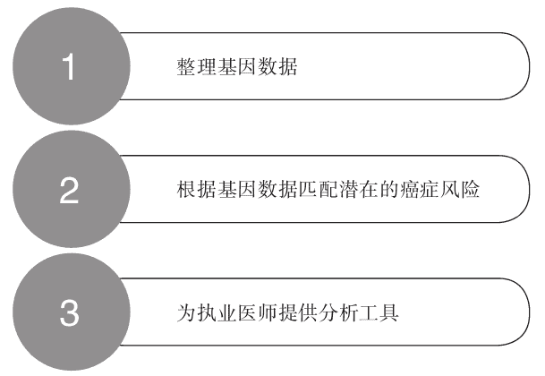

图 7-1 Watson for Genomics 的功能

#### （1）整理基因数据

平均每月就会产生超过 10000 篇科学论文数据和 100 项新的临床数据，Watson for Genomics 只需短短几分钟就可将这些数据系统化，并对其中涉及的基因组变异提供注释。这是常规人工手段无法实现的。

#### （2）根据基因数据匹配潜在的癌症风险

Watson for Genomics 读取患者的基因组数据后，可快速将这些数据与临床等研究领域的数据库进行比对，检测出和患者匹配的肿瘤基因突变的可能，并生成匹配的预防方案。

#### （3）为执业医师提供分析工具

通过临床医师上传的过滤了患者个人信息的肿瘤测序结果，Watson forGenomics 可以分析患者的基因组数据，找出与肿瘤变化相关的 DNA 变化。针对这些 DNA 的变化，Watson for Genomics 会提出更加精准的治疗方案。

Watson for Genomics 以人工智能技术为核心，从患者基因突变的角度出发，分析得出最精准有效的医疗方案。从 Watson for Genomics 的案例可以看出，人工智能的进步推动着精准医疗的不断前进。随着人类对基因组数据解读的逐步加深，人工智能技术也一定会让精准医疗的效率越来越高。

## 7.2 五大智能医疗商业前景

随着人工智能在医疗行业的应用取得较大突破，智能医疗的商业应用也有着可观的前景。具体的智能医疗商业应用前景表现在医学影像、医药研发、疾病预测、医生助理和虚拟护士五大方面，本节将一一介绍。

### 7.2.1 人工智能医学影像：提高效率，减少失误

在现代医学中，利用医疗仪器形成医疗影像作为诊断依据是十分常见的，如心电图、CT、核磁共振等。尽管现代医学仪器能够做到精准无误地反映人体内部的状况，但识别患者的患病情况依旧需要医生来诊断。

由于医院每天的人流量很大，影像科的医生每天都要对几百张不同的医学影像进行判断。由于精力等客观原因，对医学影像的误判造成的误诊事件时有发生。而对于人工智能技术来说，只要对足够多的正确案例进行深度学习，人工智能进行医学影像判断的正确率就会接近 100%，这显然是十分值得尝试的。

广州市妇女儿童医疗中心张康团队曾研发出一款能够读取医学影像的人工智能系统，可以精确诊断眼病和肺炎。根据研发团队的介绍，该人工智能系统对 X 光片、超声数据 CT（X 射线断层扫描）和 MR（磁共振）影像都可进行读取。根据这些影像数据，系统能够在 30 秒内诊断出病人是否患有黄斑变性或糖尿病视网膜黄斑水肿，还可以在几秒内完成儿童肺炎病原学类型的差异性判定，诊断的准确率超过了 90%。这充分显示了人工智能系统在提高效率、减少失误方面的优势。

团队负责人张康表示：“在学习了超过 20 万病例的 OCT 图像数据后，人工智能平台诊断黄斑变性、黄斑水肿的准确率达到 96.6%，灵敏性达到 97.8%，特异性达到 97.4%。”由此可见，在图像识别技术和深度学习技术的基础上，人工智能能够在医学影像识别领域取得极高的精准度。

而在加快人工智能医学影像落地上，还有以下两个困境亟待解决。

#### （1）数据困境

人工智能在医学影像上能够有极高的正确率，离不开大量医学影像数据的“投喂”。根据海量的 CT、X 光片、超声波等医学影像资源，人工智能可生成智能的算法模型，以此进行后续的医学影像诊断。

然而，与其他领域丰富的数据资源相比，医学影像的数据资源十分有限。普通人平均一年都不一定会产生一张医学影像，特定病种（如间质性肺炎等）的医学影像就更少了。没有足够多的影像数据，人工智能的深度学习能力就会受到影响。

除了来源限制，医学影像数据的专业性也是限制人工智能获得相应数据的一个因素。团队负责人张康说：“中国医院有大量患者的数据，但是如果没有经过纯化，没有被高质量标注过，这样的数据直接输入计算机是不会获得预期结果的。”而医学影像的标注必须来源于专业的医学人员，不能像其他数据那样进行外包处理，这也进一步加重了人工智能在医学领域的数据困境。

#### （2）人才困境

人工智能医学影像的应用是人工智能技术和医学领域的交叉应用，而人工智能技术人员对医学领域的陌生造成了该应用落地的另一个困境——人才困境。

人工智能医学影像所需要的人才是具有医学背景和工程背景的复合型人才，目前国内的相关人才严重缺乏。人才的不足极大地限制了人工智能医学影像的实用落地。为此，许多医院开始启动复合人才的培养计划，将优秀的计算机人才和医学人才送到顶尖名校进行培养。

作为智能医疗应用落地的突破口，由于没有更多的经验可以借鉴，人工智能医学影像在商业落地上存在困境。但是，由于大数据、物联网等高新技术的发展，数据困境终将会被打破。随着时间的推移，复合型人才的数量会越来越多，人才困境也就不复存在。因此，人工智能医学影像的商业落地既是市场需求，也是大势所趋。

### 7.2.2 人工智能医药研发：缩短研发周期，节约研发成本

众所周知，在医药领域进行新药研发是一件很困难的工作。传统药物研发的短板有以下三个，如图 7-2 所示。

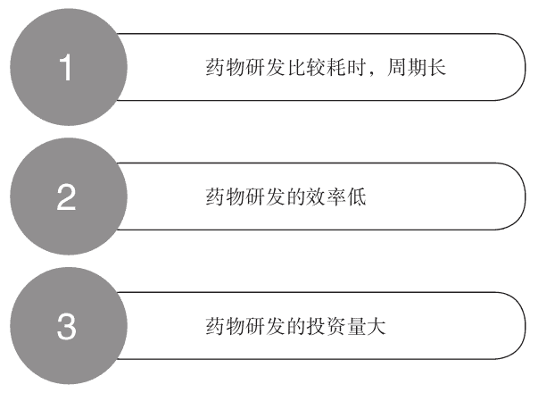

图 7-2 传统药物研发的三个短板

有调查数据显示，所有进入临床试验阶段的药物最终能够上市销售的不到 12%，而且一款新药的平均研发成本高达 26 亿美元。由此可见，传统药物研发是多么艰难。

除了以上三个短板，试错成本的提高也使众多药物研发企业将研发重点转向了人工智能领域。

近年来，随着人工智能技术的发展，特别是大数据和云计算能力的提升，将有效克服这些难题，完善医药研发的不足。同时，利用人工智能技术也可以对药物的活性、安全性以及存在的副作用进行智能预测。

人工智能药物研发是利用深度学习技术，通过大数据对药物成分进行分析，从而快速精确地筛选出最适宜的化合物或其他药物分子，最终达到缩短研发周期、降低成本、提高研发成功率的目的。

总之，这些药物研发初创公司或团队都希望通过人工智能技术来提升药物研发效率，节省投资和研发成本，最终取得最好的研发成效。

目前借助深度学习等算法，人工智能已经在抗肿瘤药物、抗心血管疾病药物等常见疾病的药物研发上取得了重大的突破。同时，利用人工智能研发的药物在抗击埃博拉病毒的过程中也做出了重大的贡献。

如今，在人工智能药物研发层面，比较顶尖的公司有 9 家，如表 7-1 所示。

表 7-1 世界顶尖的 9 家人工智能药物研发公司

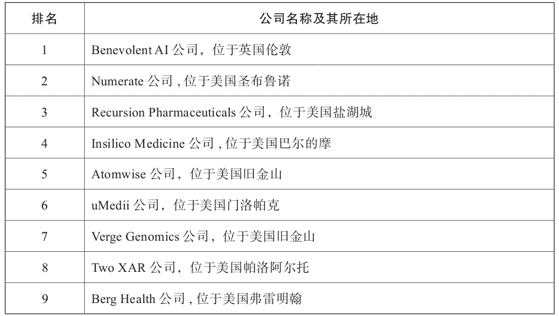

这些人工智能药物研发公司都是创新型企业。最早创立的是 Berg Health 公司，成立于 2006 年，至今也只有 11 年的时间；最晚创立的是 Verge Genomics 公司，成立于 2015 年，其人工智能研发药物主要用来治疗帕金森病和肌萎缩性侧索硬化症。

在这些人工智能药物研发公司中，最引人注意的是 Benevolent AI 公司。该公司成立于 2013 年，虽然建立时间较晚，但是后来居上，至今已经研发出了 24 种新兴药物，甚至有的已经在临床中得到了试用。

谈及 Benevolent AI 的药物研发成就，就不得不提到其人工智能技术平台。该公司的人工智能技术平台能够利用云计算技术以及深度学习算法，从杂乱无序的海量信息中获得有利于药物研发的知识，并在此基础上进一步提出新的药物研发假说，最终验证假说、加快新品药物研发过程。

当然，人工智能药物的研发也不是一蹴而就的。为了使人工智能药物研发更高效、更有质量保证，我们需要做好以下三个方面。

第一，做好大数据。

大数据是所有人工智能企业发展的必要支撑，如果没有精准的大数据，一切都是妄谈。对于人工智能药物研发企业来讲，更需要做好高质量的数据积累。因为良好的数据库能为药物的研发提供更加准确的药物学资料，人工智能进行深度学习后会有更准确的结果。

第二，建立合适的深度学习算法模型。

传统的人工智能算法不适合医药研发，需要研究人员调整计算机视觉算法、单点学习算法，使其适用于医药研发，最后得到适合对药物属性进行预测的算法。目前，一些新算法模型增加了新层次的复杂性，以便更好地研究出哪些生物元素相组合可获得新药物。

奥尔古德指出，展望未来，深度学习算法和其他人工智能算法以及硬件和软件的进步都有望对药物研发产生重大影响。

第三，积极培养新药物市场。

市场有多大，产品研发动力就有多强烈。在培养新药物市场时，企业需要积极通过新媒体渠道进行宣传，或者与权威医疗机构进行合作。只有这样，研发的药物才会迅速在市场获得积极反响，不断提高人工智能医药研发的能力。

综上所述，应用人工智能技术能为医疗行业的发展注入新的活力。在人工智能药物研发的过程中，要牢牢把握数据关、算法关以及市场关，这样才能使人工智能在药物研发领域不断发展。

### 7.2.3 疾病预测：防患于未然

在医疗健康领域，为健康人群做疾病的早期预测是十分必要的。如果疾病的预测结果准确，就能使人们尽早做好防范准备，降低发病的严重程度，甚至避免发病。由于传统医疗手段的限制，疾病预测的成绩并不突出。但是，人工智能的出现给疾病预测带来了新的希望。

Unlearn. AI 公司研发的一款人工智能系统，实现了对阿尔茨海默症的预测。

阿尔茨海默症俗称“老年痴呆”，不仅治疗费用高昂，而且致死率极高，其造成的死亡人数比乳腺癌和前列腺癌的致死人数加起来还要多。根据阿尔茨海默症协会的数据，如果能够通过早期筛查检测出患有阿尔茨海默症的可能，全球大约可以节省 7.9 亿美元的医疗费用。

Unlearn. AI 公司设计的系统主要分为以下两大部分，如图 7-3 所示。

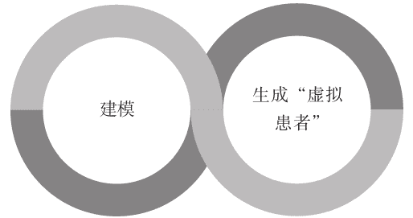

图 7-3 Unlearn. AI 公司设计的人工智能系统

#### （1）建模

开发团队利用临床数据进行数据建模，然后在数据库中进行测试。数据库来源于“抵御重大疾病协会”（Coalition Against Major Diseases），该协会有专门为阿尔茨海默症建立的数据库，收集了近两千名阿尔茨海默症患者的数据，涵盖了数十个相关的变量。

开发团队使用的测试方法为常用的检测认知障碍的测试方法，如老年痴呆量表－认知和简短精神状态检查。

#### （2）生成“虚拟患者”

该模型经过测试后，研究人员用其生成“虚拟患者”。该“虚拟患者”在认知测试、实验室测试的分数与临床数据也会一起生成，以此作为个体患者。利用“虚拟患者”，研究团队做了关于阿尔茨海默疾病的进展预测，以此推进研究结果不断修正。

根据研究人员介绍，该系统可以实现至少 18 个月的阿尔茨海默症的精准预测，而且可以用于预测其他类似的退行性疾病的发展情况。研究人员表示：“我们所实现的对阿尔兹海默症的症状预测方法能够很好地扩展到其他疾病上去。”

人工智能医疗初创公司 Renalytix AI 和纽约西奈山医院（Mount Sinai Hospital）打造了一款人工智能系统，可用于发现患有晚期肾病风险的患者。

根据 Global Kidney Health Atlas 报告显示，平均每十个人中就有一人患有慢性肾脏疾病。尽管肾脏疾病对人们的健康安全威胁极大，但一般直到需要进行透析治疗时，人们才会意识到这些疾病的存在。这时的治疗不仅会对患者造成很大的痛苦，而且效果也不好。因此，利用人工智能进行晚期肾病风险的预测是十分有必要的。

Renalytix AI 公司创始人兼首席执行官詹姆斯·麦卡洛（James McCullough）表示：“通过与西奈山医院等主要医疗机构的合作，我们可以真正发现人工智能驱动型产品在肾脏疾病中的临床影响。”Renalytix AI 公司和西奈山医院合作，向该智能系统输入了超过 300 万条患者的健康数据。该系统通过对大量数据的学习和分析，能够快速识别出具有患病风险的患者。

詹姆斯·麦卡洛指出：“西奈山医院拥有大量数据，包括大量高危人群的深层数据，如 2 型糖尿病患者和非洲血统人群的数据，而这两类人群都是患上肾脏疾病的主要高危人群。从这些高危人群的生物指标中抽取数据，利用医院提供的丰富的临床知识与数据集，我们能够创建一个智能风险评分系统。这样一来，这些数据也发挥了很大的作用。”

根据生命科技公司的报告，到 2021 年，人工智能模型进行的预测分析模式将为医院节省约 520 亿美元。人工智能在为人类进行疾病预测时，不仅加快了疾病的检测进程，降低了医疗费用，而且能让医疗工作人员更加专注于科学研究，这样也能进一步促进人工智能在医疗领域的深入应用。

### 7.2.4 医生助理：医疗机器人

人工智能在医疗领域还可以作为医生助理的医疗机器人。与传统的医生单独完成全部的医疗诊断模式相比，医疗机器人的加入能够带来以下便利。

#### （1）帮助患者完成自动化的检测，提高问诊效率

有时候人们来医院只是进行一些疾病的复查，如果指标没有异常，就无须和医生进行交谈。但是，患者进行检查，必须先找医生开检查单，造成这部分患者在排队上浪费大量时间。智能医疗机器人有望为这部分患者解决“开单难”的问题。

智能医疗机器人可以存储每位患者的电子病历，患者来看病时可在医疗机器人处进行目的选择。如果患者只是进行常规复查，医疗机器人就可直接为其开出所需的检查单，患者进行缴费就可以直接去检查，不用再浪费时间排队了。

#### （2）辅助医生进行诊断，提高准确率

在传统医疗行业，疾病的确诊依靠医生单独判断。医生的精神状态对诊断的准确率有极大的影响。有了医疗机器人后，诊断一些小疾病可以由机器人完成，从而使医生有更多的精力去诊断疑难杂症。

#### （3）增加医患沟通时间，改善医患关系

医患关系紧张的一大原因是医生和患者的沟通时间有限。由于医患数目对比悬殊，医生为了尽量让所有的患者都能看上病，给病症较轻的患者的时间相对较少，这样可能造成患者对医生的不理解甚至抱怨。而医疗机器人能够提前为部分病症较轻的患者做好病情诊断，让患者和医生能在更短的时间内了解病情，医生和患者的沟通就可以更加高效，医患关系也能得以缓解。

医疗机器人主要有四种，如图 7-4 所示。其中，外科手术机器人在市场中占有主导地位。

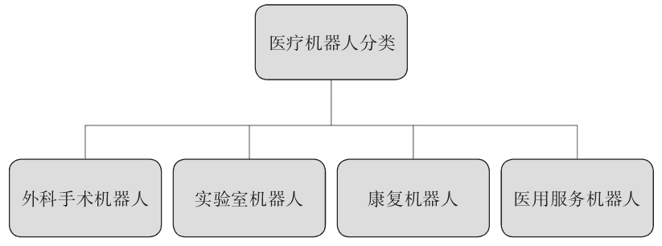

图 7-4 医疗机器人分类

#### （1）外科手术机器人

外科手术机器人是最常见的医疗机器人，其根据医疗影像数据在外科医生的指令下进行相应的手术操作。这些手术大多是微创操作，而且更加快捷和高效，患者的疼痛感会降低，术后康复也会更快。

#### （2）实验室机器人

实验室机器人主要用于药物研发、疾病检测和一些重复性较强的操作。借助人工智能技术 ，实验室机器人能够智能、安全地完成这些难度高或不能出现差错的任务。

#### （3）康复机器人

康复机器人是一种辅助治疗的仪器，典型案例就是智能外骨骼产品。Bionik 实验室曾推出机器人外骨骼 ARKE，并和亚马逊的 Echo 平台结合，实现对智能机器的控制。截瘫的患者穿戴上该设备后，对 Echo 平台发出语音指令就可以实现自己站立行走。

#### （4）医用服务机器人
常见的医用服务机器人有药物运输类机器人、消毒杀菌类机器人等。这类机器人的主要用途是帮助医生和护士处理日常琐事，提高他们的工作效率。

随着人工智能技术的发展，医疗机器人的种类将会越来越多，功能也会越来越细分。据 Marketsand Markets（全球第二大市场研究咨询公司）统计，2020 年医疗机器人的全球市场规模能达到 114 亿美元，这也说明了医疗机器人的前景十分乐观。

### 7.2.5 虚拟护士：解决患者需求
在医疗行业，患者的康复离不开护士的悉心照料。随着社会老龄化的加重，医院的老年患者的比例越来越大，他们对优良护士有更大的需求。

尽管护士的市场需求十分庞大，但护士短缺的问题却日益严重。一方面，护士行业的总体人数不足，具有专业领域知识的护士如专业的心脏外科、眼科护士数目更加短缺；另一方面，具有高素质的护士数量有限，这也提高了市场对优良护士的需求。人工智能虚拟护士的出现，恰好能够弥补这一缺憾。

借助大数据和云计算技术，人工智能虚拟护士将患者的生活习惯信息收集起来，对这些信息进行分析并评估患者的健康状况。然后，人工智能虚拟护士通过智能化的手段帮助患者进行康复活动，如用药咨询、康复训练等。

人工智能虚拟护士有以下三个典型的应用。

#### （1）虚拟护士平台
Sense.ly 公司是世界上率先推出人工智能虚拟护士平台的公司，并在该平台上推出了一款名为 Molly 的虚拟护士。借助传感器和语音识别等技术，患者可以和 Molly 进行问答对话，利用 Molly 记录自己的身体状况。Molly 则把收集到的信息交给 IBM Watson 进行分析处理，为患者提供医疗建议。

Molly 支持智能手机、平板电脑和 PC 端下载应用，为患者提供了多种使用方式。经过分析，IBM Watson 认为 Molly 所提供的信息不足以判断患者的具体健康情况时，Molly 就会自动联系医生，为患者安排在线视频，以便患者第一时间得到救治。

Molly 不仅可以为慢性病患者的后续护理提供监管帮助，也能够为患有一段时间的特殊病患提供检测帮助，例如，传染性强的结核病的观察治疗和临床研究。

#### （2）虚拟培训系统
虚拟培训系统针对的是护士护理培训，用来降低护士的培养成本，提升护士的工作效率。虚拟培训系统在人工智能的基础上增加了 VR（虚拟现实）技术，能够为护士打造真实的医护环境。在相对真实的环境中，护士可以更好地学习护理知识。根据训练主题的不同，虚拟培训系统可以模拟不同的场景，对护士进行有针对性的培训。

#### （3）虚拟助理
虚拟助理是人工智能虚拟护士的第三个典型应用，其作用在于通过对日常行为数据的收集，为用户提供个性化的健康管理方案。

NextIT 公司曾开发一款名为 Alme Health Coach 的虚拟助理。Alme Health Coach 可以收集患者日常的行动数据，以此作为智能综合评估患者身体状况的依据，并通过深度学习医疗健康知识和患者的生活习惯之后，为患者提供个性化的健康管理方案。这样一来，患者无须去医院，在家就可以轻松了解相关的健康知识和最符合自身情况的健康管理方案。

虚拟护士的出现能够减轻护理人员的工作负担，也能够带给患者更好的护理体验，是人工智能医疗应用落地的一个热门领域。

## 7.3 智能医疗案例盘点
随着各大互联网公司纷纷在医疗行业布局，智能医疗的案例也层出不穷。本节列举了国内外智能医疗的知名案例，带领读者近距离感受智能医疗的奇妙。

### 7.3.1 IBM Watson：聚焦肿瘤治疗
IBM Watson 是最先进入智能医疗领域的项目之一，也是智能医疗领域的标杆性产品。IBM Watson 的人工智能系统具有超强的计算能力和认知计算系统，能够为患者定制疾病治疗方案，其提供的方案能与世界顶级专家研究定制的方案相媲美。

在肿瘤癌症治疗领域，IBM Watson 做出了极大的贡献。杭州认知科技公司是 IBM Watson 的中国运营商之一，与北京、上海、广东等多个省市的几十家大型三甲医院合作，进行 Watson for Oncology 的“人工智能与人类肿瘤专家的治疗决策一致性研究”。

这项研究纳入了肺癌、乳腺癌、结肠癌等发病率较高的癌症，包括 2000 多例数据。这在中国的多中心、多瘤种的临床决策一致性研究中是首次大规模的样本分析。

研究结果显示，Watson for Oncology 为这些癌症提出的辅助治疗、术后辅助和一线治疗的方案都和肿瘤专家的方案具有很高的一致性，意味着 Watson for Oncology 能够在实际应用中为临床医生提供十分有参考价值的意见。运用 Watson for Oncology 的智能决策能力，患者还可以体验更加个性化和具有针对性的治疗方案。

IBM Watson 在肿瘤治疗上的作用也获得了一线医院的青睐。朱庇特医疗中心是美国佛罗里达州的一家非营利性社区医疗中心，也是美国第一家采用 Watson 技术帮助医生进行癌症治疗的区域性医院。其主席兼 CEO 约翰·库里斯（John D. Couris）说：“在朱庇特医疗中心，我们致力于探索药学和保健领域的新方法。在我们的世界级癌症研究项目中，IBM Watson 的肿瘤治疗将构成其中重要的一部分。”

通过学习不同的期刊、教材和文献，IBM Watson 的人工智能技术可以实现为医生提供诊疗建议，并根据疗效的不同将提出的建议分级，方便配合行业中的“同行评审”和临床实验研究参考。

IBM Watson Health 肿瘤与基因组研究中心的副主席罗布·默克尔（Rob Merkel）认为：“全美和全球的社区越来越需要提高效率，需要能够从不计其数的癌症研究资料中快速找到重要信息的办法。”在实际的诊疗中，IBM Watson 的人工智能技术可以为医生快速提取病历的主要内容，评估医学文献的价值，提高医生的诊疗效率。

IBM Watson 在癌症领域的应用已覆盖全球多个国家。例如，IBM Watson 曾与日本东京大学医学院合作，在 10 分钟内阅读了 2000 万份医学文献和病理资料，为该医院的一位 66 岁女性白血病患者寻找基因突变位点，并成功帮助医院找到了有效的治疗方案，使患者成功获救。此外，IBM Watson 在肿瘤领域的成绩也帮助了数家知名药企在研发新型药物上的工作。

因人工智能系统出色的数据处理能力，IBM Watson 聚焦肿瘤治疗并取得了十分出色的成绩，为医生和患者都带来了新的希望。随着应用的进一步深入，IBM Watson 在肿瘤治疗的实践应用中一定会有更好的表现。

### 7.3.2 Deep Care：医疗影像检测识别
随着人工智能和医疗行业结合的趋势越来越明显，在利用人工智能技术方面有天然优势的医疗影像应用也日趋火热。Deep Care 是一家以人工智能为核心技术，专注于医学影像检测识别的科技公司。正如公司联合创始人、CEO 刘圣所说的那样，Deep Care“想要做一个医疗影像的大数据+人工智能平台，让所有的医疗硬件软件都能人工智能化”。

Deep Care 通过融合机器视觉、深度学习和大数据挖掘技术，将医学影像识别技术变得更加快捷高效。Deep Care 与医疗硬件厂商合作，为一些本身不具备研究深度学习能力的中小设备制造商以及基层医疗机构提供人工智能算法，以节省研发费用。

“我们的定位是能够为基层医生的影像诊断提供辅助。”为了实现这个定位，Deep Care 找到了两种途径，一种是直接面向基层医生，为他们提供人工智能辅助诊断服务；另一种是帮助专家提高效率，以提高远程查阅照片效率的方式间接帮助更多基层医生。

为了实现这个目标，Deep Care 在产品研发上坚持以下两个宗旨。

#### （1）将硬件人工智能化
将硬件人工智能化是指与医学影像硬件厂商合作，尤其是与那些不具备在产品中加入人工智能分析模块的中小型设备生产商进行合作。由于 Deep Care 的费用比外包团队进行人工智能算法开发要低，而且可以通过提供医疗数据的模式抵扣费用，所以这些中小型厂商的开发成本不会过高，乡镇一级的基层社区诊所也能够承担费用，使基层医疗更加便利。

#### （2）将软件人工智能化
将软件人工智能化是通过和远程医疗平台合作，为专家提供人工智能虚拟助手。

首先，软件的人工智能化可以帮助医生进行预筛查，提前筛选出患者的 CT 图片中有可疑病灶的部分，减轻医生的负担。

其次，软件人工智能化后可以自动生成部分诊断报告，为医生提供参考。如果医生对此报告进行了修改，系统还会进一步学习医生的处理方法，不断完善自身系统。

最后，软件人工智能化之后还能够为医生实现“以图搜图”的功能。如果医生以前处理过类似的图像，软件可自动显示出当时的诊断结果和处理方案，方便医生快速制定治疗方案。

经过不断地积累，Deep Care 的影像数据已经具有一定的基础，如肺部的 CT 影像，该公司已经收集了超过百万张完整的影像数据。但是，对于研发更全面的医学影像处理，显然还需要更多部位、更多种类的图像数据支持。尽管存在一定的困难，但是通过与医疗机构的进一步合作，形成更完善的人工智能影像识别检测技术是非常有希望的。

### 7.3.3 Exo Atlet：辅助瘫痪人员
在人工智能+医疗领域，许多公司致力于利用人工智能技术为残疾人士打造更方便的生活，俄罗斯的机器人公司 Exo Atlet 就是其中之一。

Exo Atlet 公司生产了两款智能外骨骼产品：Exo AtletⅠ和 Exo Atlet Pro，两者的功能特点如表 7-2 所示。

表 7-2 Exo Atlet 的两款产品介绍

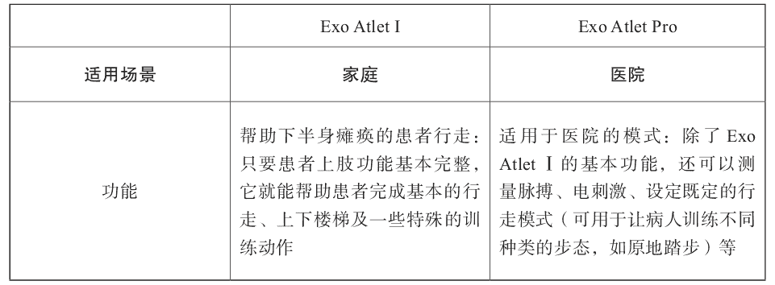

这两款产品的临床实验阶段为期 13 个月，共有超过 65 位患者使用了 Exo Atlet，行走的总路程达到了 143 公里。就像 Exo Atlet 公司联合创始人兼 CEO 埃卡特琳娜·贝雷兹（Ekaterina Bereziy）在演讲中说的那样，“Exo Atlet 已经被证明是安全的”。

Exo Atlet 从初代样机发展到第六代样机只用了两年半的研发时间，团队的规模扩大了数倍。根据埃卡特琳娜·贝雷兹所说，该公司的研发团队已经有近 20 年的相关经验，所以在研发速度上非常快。 Exo Atlet 各项专利已经得到了俄罗斯政府的许可证，正在积极进军医疗康复市场。

在有关 Exo Atlet 的各种新闻中，最令人感动的是一位来自俄罗斯北部地区的患者戴着这款产品完成了自己的婚礼。对于患者来说，站起来自己行走已经是重大突破了，而在 Exo Atlet 的帮助下站立完成婚礼则更加令人惊喜和感动。

埃卡特琳娜·贝雷兹对此也感到非常开心：“这完全是他自己的主意，并不是我们公司有意做的公关行为……那是个星期六的早晨，他穿着 Exo Atlet 走到妻子的面前，向她伸出手，妻子握着他的手给他一点支撑，那画面非常感人。”

智能外骨骼带来了太多令人惊叹的结果，它的售价也比较亲民。与外骨骼机器人领域的领军企业 Rewalk 公司的产品相比，Exo Atlet Pro 便宜了近 1.5 万美元，Exo AtletⅠ更是便宜了近 5 万美元。

除了售价低，Exo Atlet 还具有非常好的通用性。埃卡特琳娜·贝雷兹指出：“我们的控制系统不仅适用于脊椎受损伤的人，还能适用于中风病人、脑瘫儿童等。”

前文提到，智能医疗机器人的市场十分广阔，作为有着现实意义和市场需求的智能外骨骼，也是智能医疗发展的重点领域。Exo Atlet 在辅助残疾人进行自我行走方面已经有了非常好的成绩，随着人工智能技术的进一步发展，这份成绩一定会给更多的患者带去福音。

### 7.3.4 达·芬奇手术机器人：手术更安全、科学、高效
在人工智能+医疗领域，手术室的智能化也成了研究的重点。手术室中的人工智能体现在手术机器人上，世界上最具代表性的手术机器人就是达·芬奇手术机器人。

达·芬奇手术机器人的正式名称为“内窥镜手术器械控制系统”，由直觉手术机器人公司（IntuiTIve Surgical）设计生产，其主要由以下三个部分组成。

#### （1）医生控制系统
医生控制系统位于手术室无菌区之外。主刀医生在控制台中用双手及双脚来控制手术器械和三维高清内窥镜，是手术器械和医生的双手双脚同步运动的过程。

#### （2）成像系统
成像系统（Video Cart）包括内窥镜、机器人的核心处理器以及图像处理设备，位于手术室无菌区外，各类辅助手术的设备也可以放置在这里。手术机器人的内窥镜为三维高清内窥镜，可将手术视野放大 10 倍以上，将患者体腔内的情况以三维立体高清影像的方式展现在主刀医生面前，更便于主刀医生辨认解剖结构和把握操作距离，因而提升了手术的精确度与安全性。

#### （3）床旁机械臂系统
床旁机械臂系统包括机械臂、摄像臂和手术器械，是手术机器人的操作部件。手术器械和内窥镜头都安装在该系统中。机器人的每一只机械手臂的灵活性都远远超过人类，加上可以携带内窥镜进入人体，不仅可以让手术创口尽量小，而且便于实施一些人类无法进行的精确的细微操作。

目前已经有超过 3000 台的达·芬奇机器人投入使用，完成了超过 300 万例手术，在普外科、心血管外科、胸外科、小儿外科等多个科室都有广泛的应用，在心脏瓣膜修复等手术中也有同样出色的表现。

作为手术机器人的最高水平代表，达·芬奇手术机器人有以下三种关键技术。

#### （1）可自由运动的手臂腕部 Endo Wrist
达·芬奇手术机器人机械手臂的腕部采用了 Endo Wrist 技术，能够提供 7 种自由度。与人手相比，达·芬奇手术机器人的机械手臂灵活度更高，触及的范围更广，可以完成一些人手不能完成的精准操作。

#### （2）3D 高清影像技术
达·芬奇手术机器人的内窥镜可以形成三维立体图像，将手术区域放大 10～15 倍，提供 16:9 的真实全景三维图像，便于医生观察患者身体内部的情况。

#### （3）主控台的人机交互设计
达·芬奇手术机器人的主控台设计充分考虑了人机交互的需求。主控台提供了符合人体科学的手眼位置和舒服的坐姿，以此降低医生的疲劳感，保证长时间手术的正常进行。除此之外，主控台还配有麦克风，保证了手术中主刀医生和助理医生的有效沟通。机器人还有运动比例缩放功能，能够将医生手部的自然颤抖或无意识移动带来的手术器械的移动减至最小程度。

利用这些技术，达·芬奇手术机器人具有许多优点。从患者的角度看，达·芬奇手术机器人的操作更加精确，创伤更小，术后恢复更快。从医生的角度看，达·芬奇手术机器人扩大了视野范围和操作范围，将手部无意识动作的影响降到了最低，提高了手术的效率和质量。

早在 1996 年，第一代达·芬奇手术机器人研发成功。经过 20 多年的经验积累，达·芬奇手术机器人已经发展到了第四代。在人工智能技术进一步发展的背景下，达·芬奇手术机器人在灵活度、精准度上都有很大的提高，还具备了远程观察指导系统。在达·芬奇手术机器人的帮助下，医疗手术必将会变得更加安全、科学和高效。

### 7.3.5 百度医疗大脑：实现人工智能问诊
在智能医疗不断发展的背景下，人工智能问诊项目也得到了众多企业的关注。百度作为国内互联网行业三大巨头之一，旗下的百度医疗大脑在人工智能问诊方面取得了突破性的进展。

患者通过百度医疗大脑可以实现人工智能问诊。在综合各项医疗数据之后，百度医疗大脑会为患者提供准确的问诊结果。

互联网早已和医疗行业产生联系，许多软件提供了在线预约挂号和在线问诊的功能，但这些功能依旧需要医生单独完成问诊和治疗，效率很低。而百度医疗大脑则不同，利用人工智能技术，患者在百度医疗大脑平台上就能得到病症的初步诊断，完成自诊。这样一方面降低了人们对一些疑似重大疾病所带来的恐慌；另一方面也能让人们提前发现真正的大病，从而尽早就医。

对于医生而言，百度医疗大脑的应用具有提高问诊效率的作用。通过输入信息，患者可在挂号时完成预诊工作，大大提高了就诊的效率。人工智能为医生收集患者的各项数据，生成参考报告，方便医生做出诊疗决策。

百度医疗大脑能够实现智能问诊，是因为智能问诊的各项技术达到了以下条件，如图 7-5 所示。

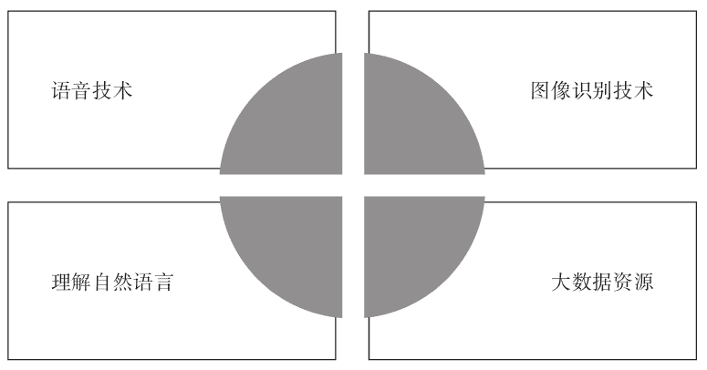

图 7-5 实现智能问诊的关键技术

#### （1）语音技术
在实际生活中，很多患者（如老人、儿童等）无法依靠打字和手写的方式完成病情描述，只能用口头表示。所以，要想实现在线智能问诊，语音技术就是硬性需求。百度的语音技术处于世界前列，其旗下的 Deep Speech 2 深度学习语音技术被《麻省理工评论》评选为十大突破性技术，为百度医疗大脑实现智能问诊奠定了基础。

#### （2）图像识别技术
许多疾病的发病症状十分相似，只有经验丰富的医生经过面诊后才可以确定。那么，如果想要在智能问诊上实现这个目标，只有语音技术是无法完成的，还必须依靠图像识别技术。百度的 Deep Image 可以实现对图片内容的识别，LWF 脸部识别数据库中的人脸识别精度达到了 99.86%，这对病情诊断所需要的图像识别具有极为重要的意义。

#### （3）自然语言理解
除了“听得见”（语音技术），“听得懂”（自然语言理解技术）也是人工智能问诊需要实现的目标。通过自然语言理解技术，智能问诊系统能够抓住患者表述的关键词，精准地确定患者的病情。百度搜索就是基于自然语言理解技术进行的，因此，百度医疗大脑在这方面的表现也十分出色。

#### （4）大数据资源
医生问诊依据的是丰富的临床经验，这种经验对于人工智能来说表现在充分的医疗数据资源。随着大数据和人工智能技术的发展，智能问诊平台在这方面取得了极大的突破，能够迅速检索医疗数据，并在一次次的问诊中不断学习，丰富自己的数据库。百度医疗大脑囊括了海量的医疗数据，包括各种权威教材、权威期刊和实际医疗病历数据，能够在深度学习这些资料后为患者提供精准的问诊服务。

百度总裁张亚勤认为，技术一直在为人类带来医疗上的改变，这种改变大致可以分为三个阶段。第一阶段是将人与信息连接起来，使人们了解到一定的医疗信息，这个阶段已经完成；第二阶段是将人与服务连接起来，使患者能够更加便捷地获得医疗服务，这个阶段仍在进行中；第三阶段是将人与智能连接起来，通过百度医疗大脑的人工智能问诊平台，可以实现医疗的病前预测，而不是只局限于传统的病后治疗。

百度医疗大脑进军问诊领域，预示着人工智能已经深入到了医疗服务的各个环节。随着人工智能技术的进一步发展，各项技术不断成熟，“人工智能+医疗”一定会为人们带来更加便捷、高效的服务。

### 7.3.6 平安好医生：全面打造“人工智能医生”

平安好医生是在线提供健康咨询及健康管理的移动软件，可为患者提供预约挂号、实时咨询和健康管理等医疗健康服务。平安好医生曾耗资 30 亿元打造“人工智能医生”，全面推进智能医疗。

由于医患数量相差悬殊，国内的就诊体验普遍有着“排队两小时，就诊五分钟”的情况。面对就医困境，平安好医生利用人工智能技术自主研发了“人工智能医生”进行辅助问诊工作。

“人工智能医生”不是取代医生直接用机器人给患者看病，而是利用人工智能替代医生完成一些重复性较高的初级咨询工作，从而实现医生的“产能”最大化。“人工智能医生”一共包含以下三项重要功能，如图 7-6 所示。

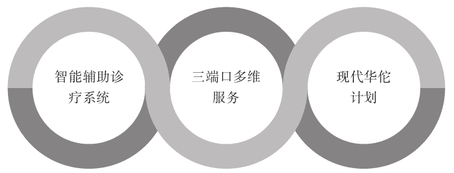

图 7-6 “人工智能医生”的功能

#### （1）智能辅助诊疗系统

智能辅助诊疗系统是“人工智能医生”进行问诊的核心，也是平安好医生在人工智能技术应用上的重大突破。智能辅助诊疗系统在分诊、导诊、转诊等多方面都有良好的应用。在获得患者的允许后，智能辅助诊疗系统能够为患者建立“数据化病历”“健康档案”等资料，使患者在寻医问诊时不必重述病情和携带大量资料。

#### （2）三端口多维服务

三端口分别是指手机端、电视端和家庭端，不同的端口面向不同年龄阶段的人群，为他们提供科学的医疗健康知识，如表 7-3 所示。

表 7-3 “人工智能医生”三端口多维服务

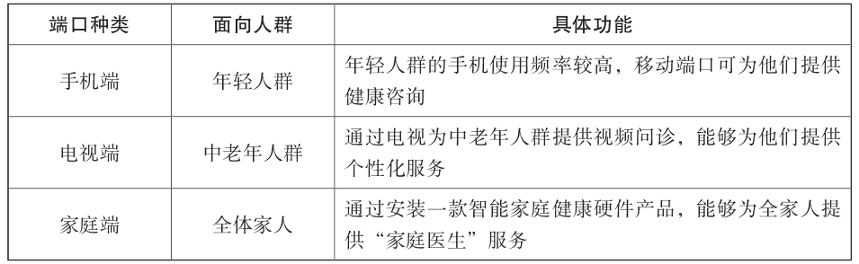

#### （3）现代华佗计划

“人工智能医生”整合了从古至今的中医知识，包括浩如烟海的中医典籍、各种案例和各大研究机构的研究成果等，推出了“现代华佗计划”项目。“人工智能医生”研发了中医的人工智能“决策树”，为患者提供科学、全面的中医诊疗。

根据有关数据统计，一家三甲医院的日门诊量在几千人上下。平安好医生推出的人工智能医疗问诊服务平均每天可提供 37 万次在线咨询，相当于几百家三甲医院的日问诊量。而且，调查显示，“人工智能医生”的用户满意度高达 97%，平安好医生的用户注册量与日俱增。

正如平安好医生董事长王涛所说，随着技术的不断发展，人工智能和医疗结合是必然趋势。平安好医生在“人工智能医生”的应用基础上，将继续推进人工智能的基础性数据累积和研究应用，实现人工智能技术与医疗健康领域的全面融合。

# 第 8 章　人工智能+泛娱乐：融合、跨界、新机遇

从“泛娱乐”概念被提出以来，各大巨头纷纷开展了抢占市场的竞争。据统计，国内的泛娱乐产业市场规模高达 6000 亿元，有极大的成长空间。泛娱乐市场要想实现向成熟市场转型，数据驱动是必经之路。在人工智能深入各产业、带动各产业升级的同时，泛娱乐行业也将受到人工智能的推动，加快其精细化发展的进程。

## 8.1 人工智能助力泛娱乐：娱乐可以暖萌，也可以酷炫

泛娱乐涉及人们休闲生活的各个方面，为人们的情感生活带来抚慰。在这方面，人工智能创造的人物 IP 技能给人们以暖萌的情感关怀，又能以高级酷炫的形式给人们带来娱乐体验。

### 8.1.1 暖萌娱乐：情感陪护机器人

在人工智能越来越被关注的大背景下，人工智能机器人的种类也越来越多。随着人工智能机器人在技术上的不断突破，人们相信人工智能机器人在情感陪护上也将大有作为。这一想法得到了资本、技术和消费者三方的青睐，人工智能机器人正在加速落地进程。

人们对情感陪护机器人的期待主要是实现对老人和儿童的实时陪护，包括日常交流、安全看护等。随着我国老龄化现象的加重和“二孩政策”的开放，情感陪护的需要已逐渐成了某些家庭的刚需，情感陪护机器人的出现正好能够弥补这方面的市场空白。

以儿童市场为例。根据联合国儿童基金会发布的统计数据，全世界平均每天有 2000 个家庭因为发生意外而失去孩子，中国每年有占总数 10%的幼儿会发生意外伤害，数以千万计的留守儿童更是长期缺乏父母的有效陪伴和监护，可能使身心受到各种伤害。

除了人身安全，儿童在生长发育过程中遇到的各种心理上的困惑也需要得到父母的耐心解答。然而，由于生活压力大，父母不能 24 小时贴身陪伴孩子。因此，应用智能化的机器人陪伴孩子，就能够解决这方面的矛盾。再加上老年人也有情感陪伴的需求，情感陪护机器人的市场前景十分光明。

下面以儿童机器人为例，介绍情感陪护机器人具有的特点。

#### （1）外形可爱、呆萌

考虑到儿童本身的生理和心理特点，儿童陪护机器人的外形一般以可爱、呆萌的形象为主。例如，深圳市金刚蚁机器人技术有限公司生产的小忆机器人拥有可爱、呆萌的形象：脑袋和身体如同雪人一般，由两个圆球组成；面部通过圆形屏幕变换表情，一切都按照儿童的喜好设计，温和、暖萌。

#### （2）功能以娱乐和教育为主

考虑到儿童心智发展的特点，儿童陪护机器人在功能上更偏向于娱乐和教育，例如教儿童背诵古诗、安全口诀等。清华紫光的小优机器人具有丰富的教学知识，能够为儿童解答问题，激发他们对学习的兴趣，既可以做他们的学习榜样，又可以和他们一起玩耍交流，减少他们的孤独感。

针对其他人群的陪护型机器人与针对儿童的情感陪护机器人虽有一定的差异，但核心理念都是一样的，即以情感陪护为主要目的。尽管市场对情感陪护机器人有非常大的需求，但是在技术上，情感陪护机器人还有一些痛点需要解决，如图 8-1 所示。

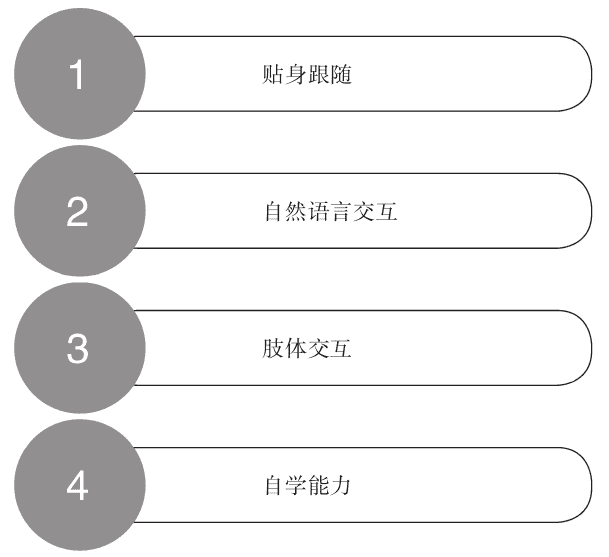

图 8-1 情感陪护机器人落地的痛点

#### （1）贴身跟随

由于情感陪护机器人的服务对象大多是儿童和老人，他们具有一定的行动能力却又在行动中易受到伤害，因此，情感陪护机器人需要贴身跟随、时刻保护他们。为了实现这个目的，情感陪护机器人不仅要在移动速度上紧跟所陪护的对象，还要在陪护对象背对自己时也能识别其是否发生意外情况，以便及时施救。这对于现有的技术而言，还需要进一步突破。

#### （2）自然语言交互

人工智能的语音识别技术是以发音标准的学习资料为基础，但是在实际生活场景中，儿童和老人的发音并不一定清晰标准，而且可能存在大量口语化和逻辑不完整的现象，所以情感陪护机器人能够正确识别口语等问题就成了一个非常关键的技术突破点。因此，在情感陪护机器人更好地落地之前，加快机器人自然语言交互技术的发展也是重点工作之一。

#### （3）肢体交互

在人们的交往陪伴过程中，肢体的交流也是十分重要的一部分。如果情感陪护机器人在“肢体”上能够和陪护对象发生更多交流，如牵手等肢体接触，不仅能增进双方的情感交流，而且能在发生危险时增加防范的手段。例如，在儿童走向危险区域时，情感陪护机器人及时用手臂拉住儿童，就可以更好地避免意外发生。

#### （4）自学能力

研发高端教育机器人的深圳市易致机器人科技有限公司创始人曾说过：“儿童机器人的难点不在于结构和技术上，而在于情感的交互和内容的生产以及机器人的自学习能力。”由于儿童的学习能力极强，而且互联网的快速发展也带给了儿童更多的信息来源，许多儿童的心智发展都比过去加快了许多。如果情感陪护机器人不能够实现和儿童一样快速学习，那么儿童很难发现情感陪护机器人的优势，不愿意与其交流，情感陪护机器人的陪护作用也就无从谈起。

在人工智能技术不断发展的背景下，未来的情感陪护机器人必然优化自身的不足，越来越符合人们的情感陪护需求。

### 8.1.2 酷炫娱乐：全息 3D 美少女——琥珀·虚颜

随着人工智能技术的发展，娱乐圈也打造了一个拥有人工智能的虚拟艺人——琥珀·虚颜。国内知名歌手组合羽泉签约成为琥珀·虚颜的经纪人，并亲自监制了一首充满魔幻和二次元风格的《魔法咏唱》歌曲。琥珀·虚颜的出现打破了二次元和三次元的次元壁，再一次展现了人工智能的无限可能。

琥珀·虚颜是世界上第一个具有人工智能的虚拟养成偶像，“居住”在智能产品 Holoera 中，由国内知名科技公司 Gowild 创造。Holoera 是一个人工智能全息 3D 主机，结合最新的人工智能引擎与 VR 技术，利用人工智能为人们构建了一个虚拟的陪伴生命，用 VR 技术将构建的虚拟世界呈现出来，让用户充分感受到与真人互动一致的乐趣。

Holoera 包括多项高新技术，如人脸识别、人体感应、温度识别等。利用这些多模态识别，Holoera 系统更具人性化、智能化，琥珀·虚颜也变成了真实存在于现实世界的人物，具有生命感和温度感。

虚拟偶像琥珀·虚颜和真人一样，拥有自己的兴趣爱好、任务和工作。通过摄像头进行人脸识别，琥珀·虚颜能够识别用户的身份，并与用户进行对话交流。琥珀·虚颜会对用户做出情感回应：如果用户对她充满了耐心，她就会对用户产生好感；如果用户疏远她，她也会生气。

Holoera 设有多种 3D 模拟场景。在不同的场景中，琥珀·虚颜会展现不同的生活状态。例如，在特定场景下，她会单独展示才艺，从各个角度展现动作。独特的 3D 全息投影技术让琥珀·虚颜的形象十分具有立体感，即使用户用裸眼观察琥珀·虚颜，感受到的效果也毫不逊色于用 3D 眼镜看到的效果。

Holoera 运用的人工智能引擎让琥珀·虚颜具有了自主学习和推理能力。在与用户的交流中，琥珀·虚颜可以记录用户的信息并对相关信息进行关联和推理。例如，用户告诉琥珀·虚颜甲和乙是父子关系，丙和乙是母子关系，琥珀·虚颜就能自动推理出甲和丙可能存在的关系。这种推理显示了琥珀·虚颜的智慧，大大加强了其“人”的特点。

琥珀·虚颜最有特色的一项功能是支持养成游戏。在游戏中，用户是琥珀·虚颜的唯一经纪人，需要为琥珀·虚颜制订训练计划，帮助它实现成为明星的梦想。由于用户不同，每个琥珀·虚颜也会成长为不同角色。如果琥珀·虚颜最终实现了明星梦想，它就会开一场酷炫的演唱会、出一张唱片，以此庆祝用户和它共同努力的成果。

从技术上看，全息和 3D 技术是两个概念，二者的关系如图 8-2 所示。

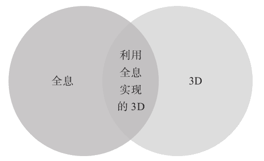

图 8-2 全息和 3D 技术的关系

由上图可知，全息技术可以用来实现 3D 立体投影。琥珀·虚颜不仅利用了 3D 全息投影技术，还额外增加了人工智能的语音交互技术。正是人工智能的加入，让琥珀·虚颜更具有人情味和温度感，用户在与其沟通的过程中才能体会到与真正的人类沟通一样的愉悦感。

### 8.1.3 百度：利用大数据、人工智能助力娱乐行业深度运营

移动互联网时代，人们将大量的时间花在了文娱活动上。随着人工智能技术的发展，各公司又如何让人工智能赋能娱乐产业，带来娱乐产业的新变革？

在利用人工智能发展娱乐行业方面，百度公司利用多年积累的大数据资源，充分应用人工智能技术赋能娱乐产业，为娱乐产业的多个方面提供了深度运营策略。

#### （1）百度人工智能助力打造超级 IP

作为国内最大的搜索引擎，任何引起轰动的现象及文娱浪潮都会在百度搜索指数上有所显示，这些数据也为百度帮助内容商打造超级 IP 奠定了基础。

在“IP 为王”的背景下，打造符合时事的“超级 IP”成了众多内容商的目标。例如，一部网络小说被改编成电视剧、电影，又衍生出手游、主题乐园等，这种现象就是超级 IP 的火热导致的。把握好正当红的 IP 形象，将其发展成超级 IP，必须实现将 IP 生产体系一体化，百度利用人工智能技术恰好做到了这一点。

当某种 IP 形象开始形成浪潮时，百度将与其相关的数据进行梳理，帮助内容商形成从内容资源到演员明星的超级 IP 知识体系，并与用户的需求图谱进行结合对比。这样一来，内容商一方面可以深入了解用户的喜好，不断调整后续的宣传方式，另一方面也可以预先进行相关的宣传铺垫。

当人工智能进入这个领域后，百度对用户的分析就变得更加精准和多维。而且，百度的人工智能技术已经实现为整条产业链带来智能化变革，如趋势发现、内容宣发等众多环节，更有利于打造超级 IP。

#### （2）百度人工智能助力内容运营

自媒体时代，内容运营成了文娱行业的重头戏。借助人工智能技术，百度打出了百度营销大脑、熊掌号和百晓生计划等多张王牌，助力内容运营更加高效。

百度营销大脑通过分析用户大数据实现对用户的精准画像，对各种内容的受众进行全方位观察。在人工智能技术的助力下，百度营销大脑可以实现跨行业、跨品类的智能精准推送，将用户对娱乐信息的关注精准地转化为对营销信息的需求，实现对用户需求的即时响应。

百度熊掌号实现了人工智能时代“人找信息、信息找人”的双向沟通模式。百度熊掌号是内容平台，内容方可将其发布的内容进行整合。当用户在其中搜索娱乐信息时，百度熊掌号会主动将官方整理的结构化资讯和服务主动提供给用户，满足用户的需求，也帮助相关资讯和信息实现对用户的精准触达和需求激发。

百晓生计划是专门针对泛娱乐行业搜索体验的优化计划。在此计划中，明星艺人等通过入驻熊掌号直接提交内容，自定义与自身相关的关键词的搜索页面。这一计划促进了粉丝经济的深度挖掘。例如，在内测中，“办公室小野”上传的相关内容累计消费量飙升 600%，显然大大提升了精准粉丝的转化率。

#### （3）百度人工智能助力娱乐业跨媒体发展

基于百度在人工智能和大数据技术上的支持，百度联合爱奇艺打通娱乐业的跨媒体合作，将百度的人工智能技术和爱奇艺的超级娱乐内容进行统一整合，对娱乐生产中的脚本创作、智能剪辑等板块进行智能化改造，推进娱乐业实现“千人千面”的营销效果。

百度搜索公司 CTO 郑子斌曾经说过：“百度希望在文娱产业的进化之路上充分发挥数据、技术和资源优势，进行行业赋能。”百度的人工智能技术能让娱乐业更懂受众，持续打造超级 IP，也能帮助泛娱乐时代的内容运营商精准抓取用户和粉丝流量转化，实现娱乐业的深度运营。

## 8.2 人工智能玩跨界：影视、综艺、游戏一个都不少

在泛娱乐行业，人工智能技术可以用到影视、综艺、游戏等各个方面，为人们带来更多惊喜。在影视方面，人工智能不再只是以往的创作题材，更成为助力电影创作的新兴技术；在综艺节目方面，人工智能被用于制作、运营综艺节目；在游戏方面，人工智能的加入也使游戏的运行更加稳定，用户的游戏体验更加舒适。

### 8.2.1 人工智能助力影视：爱奇艺的“爆款”影视

从《奇葩说》到《偶像练习生》，从《老九门》到《求婚大作战》，爱奇艺推出的众多影视节目纷纷成为“爆款”影视，流量效应非常明显。那么，爱奇艺是如何在众多影视平台中脱颖而出、屡屡打造“爆款”影视呢？爱奇艺创始人、首席执行官龚宇透露，人工智能技术在其中起到了很大的作用。

在大数据带来算法变革的背景下，互联网用户越来越习惯于在各种平台上推送自己感兴趣的内容，这在视频产业也不例外。在实现用户的这个需求时，爱奇艺并不是简单地采用纯机器推荐算法，而是深度利用人工智能技术，在智能创作、智能生产、智能标注、智能分发、智能播放、智能变现和智能客服七大方面指导创作者的创作，为用户带来喜爱的内容。龚宇认为，在人工智能的帮助下，爱奇艺具备差异性的竞争优势。

“虽然现在的机器不可能完全准确地预测内容，但是有了人工智能系统，至少能让我们更准确地做出判断。”龚宇说，“当前爱奇艺基于机器学习的预测中，电影票房预测可以做到提前半年的方差准确率高达 77%；电视剧流量预测方面，提前半年到一年的方差准确率均高达 88%。票房的预测帮助我们决定要不要采购这部电影，采购价格应该是多少，同时对我们自己原创和投资电影也有很大帮助。”

爱奇艺和百度合作，在影视行业深入研究人工智能技术的应用。在人工智能技术的推动下，爱奇艺推出的自制影视节目如《奇葩说》《河神》《偶像练习生》等都成了现象级的爆款节目。

其实，人工智能技术在影视业的应用不只有爱奇艺的案例。人工智能不仅能辅助人们打造“爆款”影视，还能够编写剧本、一键实现影视业的 2D 转 3D。大卫·哈塞尔霍夫曾出演过一部科幻短片《It's No Game》，尽管该电影只有短短 9 分钟，却是一部情节完整的科幻电影。而该电影的剧本正是由人工智能算法“Benjamin”撰写的。

Benjamin 算法由纽约大学的人工智能研究员奥斯卡·夏普和罗斯·古德温编写。在 Benjamin 开始创作剧本前，系统中输入了几十个科幻电影剧本，包括经典电影《超时空圣战》《捉鬼敢死队》和《第五元素》等。在对这些经典科幻电影进行深度学习后，Benjamin 就开始创作剧本了。

一直以来，无论原创还是改编，影视剧本都是由人类创作产生的。而这部由人工智能编写的科幻电影短片，则让人们意识到了人工智能在创意性工作上的巨大潜力。

在影视行业常用的 2D 转 3D 技术方面，人工智能也展现出了非凡的能力。在工业和信息化部主办的“三维显示技术与产业发展高峰论坛”上，由聚力维度研发人工智能立体设计师“峥嵘”为人们展示了自动将 2D 影视内容转换为 3D 内容的技术。

根据聚力维度创始人兼首席技术官赵天奇所说，“峥嵘”是一款基于人工智能和三维显示技术研发的智能 3D 制作平台。利用“峥嵘”，用户可不受地点和时间的限制，随时将普通平面图片和视频转制成具有影院级 3D 视效的图片和视频。

赵天奇认为，由于现在的影视制作行业以劳动密集型为主，与先进的影视传播形式产生了巨大的矛盾，因此影视制作的智能化是现实需求，人工智能技术必将为影视行业带来新的革命。

### 8.2.2 人工智能助力综艺：《中国新说唱》

在掀起全民的说唱热潮后，《中国有嘻哈》更名为《中国新说唱》，再度获得了关注热潮。除了多位人气明星自带的流量效应，《中国新说唱》在播出之前引发广泛关注有一个重要原因，即它是中国首档将人工智能落地到运营和制作的综艺节目。

总制片人陈伟表示，多项人工智能技术已经运用到了《中国新说唱》的制作运营中，包括人工智能选制作人、人工智能剪辑等。

以选择制作人为例。利用智能选择系统，爱奇艺将多名女艺人在知名度、专业度、音乐类型、粉丝画像等多个维度进行匹配，最终人工智能选出了匹配度高达 90%的邓紫棋。

在节目制作方面，《中国新说唱》的录制现场有上百台摄像机同时运作，由人工智能进行自动化的音视频对位工作。这样一来，剪辑师进行剪辑的准备工作减少了很多，极大地提高了工作效率。

在用户观看方面，《中国新说唱》应用“只看他”功能，通过人脸识别挑出用户最关注的某位明星，并给用户只观看该明星的选择，这样也大大提升了用户的观看体验。

《中国新说唱》并不是首款具有人工智能元素的综艺节目。只是在以前的综艺节目中，人工智能的角色更像一位和人类共同比拼的嘉宾，例如，《蒙面唱将猜猜猜》中的华帝人工智能机器人“小 V”、《最强大脑》中的“小度”等。但无论是参与节目制作，还是作为特殊嘉宾，人工智能都正在改变综艺节目的形态。正如阿里云人工智能首席科学家闵万里博士所说的：“人工智能对综艺节目而言，或许可以引领一个新变革。”

## 人工智能综艺的发展趋势

从应用人工智能的综艺节目可以发现，人工智能给综艺发展带来了四大趋势，如图 8-3 所示。

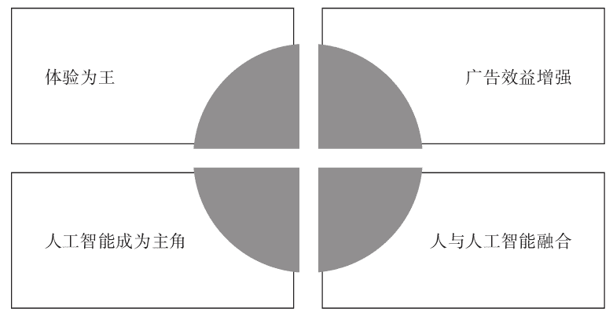

图 8-3 人工智能综艺的发展趋势

### （1）体验为王

在传统的综艺节目中，拥有优秀的内容能够获得观众的喜爱，这种形式叫作“内容为王”。随着人工智能和 VR 技术的迅速发展，能够让观众具有“身临其境”感觉的综艺才是主流。人们更加注重在节目中“体验了什么”，而不是“看到了什么”。

### （2）广告效益增强

一直以来，综艺节目就是各大广告商的宣传平台。当人工智能进军综艺后，尽管节目制作成本变低，但广告赞助的市场并不会降低。相反，正由于人工智能元素的出现，相关企业对综艺赞助可以变得更加垂直化，甚至为自己的品牌“量身定制”一款综艺节目，从而增强广告效应。

例如，湖南卫视现象级综艺节目《我是大侦探》的赞助商云米智能家居为节目组布置了节目场景，其中各种智能家居的优秀性能都被嘉宾们有意无意地展现出来，让云米智能家居产品成了大赢家。

### （3）人工智能成为主角

前文已经提到，目前综艺节目中的人工智能元素体现在嘉宾或技术层面，完全以人工智能的形象作为整档综艺节目的核心还不成熟，但不可否认，人工智能作为节目的绝对主角是综艺的发展方向。

随着人工智能技术的发展，人工智能明星一定会出现（前文中的琥珀·虚颜就是该趋势的印证）。当人工智能明星出现后，无论技术的新奇，还是本身魅力的出众，势必会吸引众多粉丝。那么，出现一档以人工智能为主角的综艺节目也就不足为奇。

### （4）人与人工智能融合

随着人工智能技术的发展，越来越多的人意识到不应单纯地将人工智能视为“打杂”的工具，而应该将其与人类的智慧结合在一起。人与人工智能的融合在制作综艺节目方面也显得极为重要。

一方面，人工智能虽然能够批量化制作“爆款”综艺节目，但对于比较复杂的评论的理解还需要进一步学习，此时人类的力量能够帮助人工智能制作更符合社会主流价值观的综艺节目；另一方面，人工智能可以搭建一个新型的综艺平台，帮助更多综艺节目实现自动制作，省去烦琐的人工制作环节。

总之，人工智能进入综艺节目已是大势所趋，为综艺节目带来新的变革也成了无须怀疑的事实。至于人工智能最终会给人们带来怎样的综艺节目，我们拭目以待。

### 8.2.3 人工智能助力游戏：“吃鸡”更痛快

“吃鸡”一词因游戏《绝地求生：大逃杀》而火遍网络，成了玩家在该游戏中赢得第一名的代名词。这款游戏在腾讯接手之前，由于没有国服，“外挂”作弊的现象十分严重，而且每到晚上游戏就会十分卡顿，玩家的体验十分糟糕。

在宣布获得《绝地求生：大逃杀》的中国独家代理运营权后，腾讯云正式发布 Supermind 智能网络产品，用人工智能技术保障玩家的游戏体验和网络安全。腾讯云高级产品经理高航说：“腾讯游戏已经完全构筑在腾讯云上。‘吃鸡’加盟腾讯游戏时，恰逢腾讯云第三代网络升级，这对于‘吃鸡’玩家而言是个大好事。”

游戏经常出现卡顿，一般代表网络出现了故障。在传统网络中，一旦网络出现故障，就需要网络工程师一一探查网络的各个环节。这意味着工程师需要从几百条甚至更多的线路警告中一一排查，寻找相关信息，再逐个对具体的机房、主机进行细致的检查。这样一套流程至少要花费半个小时。

在人工智能技术的加持下，腾讯云推出的 Supermind 智能网络产品拥有高性能、全球互联、智能化三大特点，能够充分解决游戏存在的卡顿等现象。

### （1）高性能

腾讯云服务器在物理网卡上实现了优化升级，并利用智能网卡 SDN 模块分离网络动作层（Fastpath）和策略层（Slowpath），将腾讯云主机的网络带宽吞吐提升超过 3 倍。

### （2）全球互联

腾讯云在全球超过 21 个地理区域部署 36 个可用区节点，为用户提供了全球近 100 路的运营商 BGP 接入和 TB 级的总出口带宽能力，帮助用户实现了更好的网络互联。

### （3）智能化

利用人工智能技术，腾讯云 Supermind 智能网络可以在数以万计的线路中找到最合理的线路进行智能规划。在人工智能定位的帮助下，线路规划的时间缩短到了 5 分钟以内，游戏凭据的处理时间缩短了 75%。

除此之外，人工智能技术还为腾讯云提供了人工智能模式拆解、综合性信息防护等功能，实现了从网络设计到运营管理再到安全监控整个环节的智能闭环。

除了在云平台上保障游戏的顺畅运行，人工智能技术也被应用于游戏制作之中。例如，EA、SONY 等游戏大厂已经在人工智能游戏引擎、神经网络开发、人工智能操作系统等多方面全力进行研究，致力于开发“人工智能+游戏”。

以游戏人工智能引擎为例。游戏人工智能引擎可以帮助开发者简化游戏制作流程，降低制作难度。这样一来，游戏开发时间缩短，开发者可以将大量时间运用在创作新型玩法上，从而给玩家带来更多新奇的体验。

应用比较广泛的游戏人工智能引擎有以下三类，如图 8-4 所示。

图 8-4 三大游戏人工智能引擎

### （1）人工智能渲染引擎

人工智能渲染引擎可以多倍提升画面的渲染能力，真正做到“一秒渲染”。英伟达公司（NVIDIA）就曾推出一款 GPU 渲染工具 NVIDIA OptiX 5.0，它可以运用机器学习技术，做到为画面补充缺失像素、智能去噪和光线追踪。该人工智能引擎不仅做到了节省近 90%的渲染时间，还将可视化效果提升了 12 倍。

### （2）NPC 制作引擎

游戏中灵活自然的 NPC 角色（游戏中不受玩家操纵的角色）能够为玩家带来更逼真的游戏体验。人工智能 NPC 制作引擎不仅可以帮助开发者创建更加符合真人效果的 NPC，甚至还能直接创建 NPC 角色。Rival Theory 公司创建的 RAIN AI 引擎就是如此。由 RAIN AI 引擎创建的 NPC 角色在实时反应性能上颗粒度极高，在语言、动作等方面的表现都十分优秀。

### （3）游戏创作引擎

除了创建 NPC，人工智能引擎甚至还能直接创建游戏。印度有一家初创公司 Absentia VR 推出了一套简化游戏制作的引擎——Norah AI，它能够智能生成简单的游戏，而游戏制作流程则大大简化，时间也从原来的 30 天缩短到 30 小时。

总之，无论是网络构架，还是游戏制作，人工智能都为游戏带来了新的变革。一方面给玩家带来了更好的游戏体验，另一方面为整个游戏产业带来了开发上的新思路。“人工智能+游戏”的不断融合必定会推动整个产业蓬勃发展。

# 第 9 章　人工智能+生活：融入家居，融入城市，点亮生活

人工智能在人们的生活中具有很多现实应用。从每个人每天的衣、食、住、行、用到整个城市的管理建设，人工智能都在为人们带来新的改变。

## 9.1 人工智能融入人们的衣、食、住、行、用

人工智能的应用其实已经深入到了人们日常生活的各个方面。从智能试衣间到人工智能食品器械，再到智能家居系统、地图应用、智能扫地机器人，人工智能为人们带来了更多的便利。

### 9.1.1 智能试衣间：试衣不烦琐

智能试衣间是人工智能技术在服装零售店的创新应用，为选购衣服的顾客省去了以往挑选衣服时总要穿脱的烦琐环节。阿里巴巴和腾讯公司都推出了智能试衣间，为顾客带来人工智能虚拟试衣的新奇体验。

阿里巴巴推出的智能试衣间名为“时尚大脑”（Fashion AI）。当顾客看中某件衣服时，只要将其拿到屏幕前，屏幕会自动显示最适合顾客的个性化的时尚搭配。屏幕上通常会显示出多种风格的搭配以供顾客选择，如果顾客看中某件衣服，也无须走出试衣间寻找，只要从屏幕上选中，店员收到通知后将相应的衣物送进试衣间。

腾讯的智能试衣间则采用了人脸识别技术。顾客在进入智能试衣间前，需要在屏幕前进行“刷脸”，通过特定程序绑定后成为会员。当顾客再次站在腾讯的智能试衣间屏幕前时，系统会基于用户画像和腾讯的精准推荐算法以及商店中的商品库存为顾客推荐服饰搭配。

在智能试衣间的帮助下，顾客不仅可以享受快速且个性化的购物体验，而且无须多次试穿就可找到最适合自己的服饰搭配，大大降低了购买时的烦琐程度。

从本质上讲，智能试衣间是一种“智慧数字标牌”，其在原本技术上加入人工智能技术，赋予了数字标牌更多的能力。在智能算法的帮助下，智慧数字标牌成功地化身为“用户的私人时尚顾问”，既能给顾客带来个性化的购物推荐，又能增强品牌营销的针对性。

总体来说，智能试衣间具有以下四大功能，如图 9-1 所示。

图 9-1 智能试衣间的功能

#### （1）快速试衣

在实体服装店中，试衣间门口总会排起长长的等待队伍。而当顾客选择的尺码不合适时，又需要重新排队。再加上每次试穿衣服都需要不停地穿脱，顾客选到合适的衣服所需要的时间就更长。

智能试衣间运用的人工智能技术为顾客筛掉不符合顾客气质特点的衣服，只留下最合适的衣服并做个性化的推荐，这样就会大大能减少顾客挑选衣服的时间。在智能试衣间中，屏幕为顾客显示出穿上衣服的效果，不需要顾客亲自穿脱，因此大大提高了顾客试衣的效率。

#### （2）全方位展示效果

智能试衣间具有照片合成的功能，能够将顾客虚拟试衣的效果用立体图像的方式展现出来，帮助顾客从各个角度考察穿衣效果，从而给顾客带来更好的购物体验。

#### （3）智能搜索

除了根据顾客的喜好进行推荐，智能试衣间还可以为顾客提供更多的搜索选项。例如，顾客需要为一场晚会准备服装，智能试衣间就会为顾客搜索推荐最合适的礼服。当顾客不知道如何搭配时，智能试衣间也会给出相应的建议。

#### （4）效果对比

在试衣服时，顾客时常会忘记试过的衣服效果到底如何，导致对同一种衣服进行多次试穿，浪费了很多时间。而智能试衣间会为顾客保存试衣后的效果图，并将多组照片一起对比显示给顾客，让顾客能够直观地感受，从而减少来回试穿的时间。

智能试衣间解决了顾客在传统选购服装的过程中经常遇到的问题，例如，不知如何搭配、穿脱烦琐等。这体现了以顾客为中心的经营理念，也能让顾客感受到科技的新奇之处，为店铺带来更好的销售成绩。

新零售时代，实体店要敢于应用各种智能化终端设备，实现店铺的智能升级。智能试衣间的出现为服装店带来了新的机遇，各大服装店都应把握机遇，利用人工智能技术带来更好的业绩。

### 9.1.2 人工智能食品机械：吃得更健康

人工智能兴起之后，与各行各业发生交叉渗透成了主流趋势。随着食品工业的不断进步和人们对食品健康与安全的关注度不断提高，人工智能在食品机械制造上的应用也得到了重视和发展。

万杰智能科技股份有限公司是一家食品机械制造企业，曾推出一系列餐饮智能终端设备，能够智能生产包括面包、面条、豆浆等家常食品，全程无须人工操作。在万杰智能科技股份有限公司推出的一系列智能食品机械中，智能鲜面机能够在 8 秒钟内用面粉为顾客压制出新鲜面条；智能熟面机能够完成从面粉到汤面的制作过程，全程最快只需 48 秒；智能餐饮保障车则集合多种智能食品终端，能够为展会等场景提供综合的智慧餐饮服务。

除了无人化的特点以外，更重要的是人工智能食品器械保障了食品安全。万杰智能科技股份有限公司董事长王晓杰说：“从智能机械入手实现食品安全，是食品机械制造行业的出路。”人工智能在食品制作的以下三大环节中都能够为食品安全提供更多的保障。

#### （1）原料

在食品机械中加入人工智能元素，能够实现远程控制。通过互联网数据，商家在生产食品时所添加的原料信息能够得到实时的传输和远程监控，便于监管部门进行远程监控。而且，智能器械在遇到不合格的原料时能够立刻锁机报警，在原料上阻断了不安全因素的出现。

#### （2）加工

在传统的食品制作中，为了让食品具有一定的保质期，商家都会在加工过程中添加适量的防腐剂。因此，这个环节可能会给人体健康带来一定的隐患。如果使用智能食品器械，例如上文提到的智能鲜面机，就能在极短的时间内实现从原料到食品的加工过程，顾客不用再担心防腐剂的隐患。

#### （3）流通

由于无须人工操作，智能食品器械也可以运用在零售环节。例如，成立一家运用智能食品器械的智能餐厅，就可以实现食物“现做现吃”，取消传统食品行业的流通环节，大大降低了流通时损坏等不安全因素。

根据王晓杰所说，食品器械与人工智能结合是趋势。一方面，越来越高的人工成本促使工厂向无人化、智能化转型；另一方面，人工智能在综合性价比上较传统食品器械更高。综合考虑投资成本和最终的收益，显然是智能食品器械更胜一筹。

尽管真正的全人工智能餐厅还需要依靠技术的不断更新迭代才能实现经营，但对于食品器械来说，人工智能不仅是机遇，更是趋势。智能化的食品生产在食品安全上能够带来更多保障，让人们吃到健康的食品。

### 9.1.3 智能家居系统：家居更便捷、舒适

人工智能进入人们的日常家居生活后，能够为人们打造一套更加便捷和舒适的智能家居系统。智能家居系统是指综合应用了包括人工智能技术在内的多种高科技，为人们打造的从远程控制家电到家居安防监控的全方位智能系统。

从整体上看，智能家居系统与普通家居相比有以下四个方面的优势，如图 9-2 所示。

图 9-2 智能家居系统的四大优势

#### （1）智能化

智能化是智能家居系统最核心的特点。通过人工智能系统，智能家居终端可以通过语音和主人交流，也能够不断学习主人的起居习惯，提前做好准备。例如，主人一般在早上 8：00 起床上班，遮光窗帘就可以在 7：45 左右自动打开，渐渐唤醒主人。

#### （2）信息化

信息化是指智能家居终端具有和互联网相联的功能。例如，主人不在家时，要想检查家中的门窗等是否关好，就可以通过互联网联接家中的智能摄像头，检查各处的安全。信息化的另一个用途是使家居终端实时和外界保持联系，为主人获取如天气预报、快递等信息。

#### （3）人性化

人性化是指智能家居终端的设计充分考虑到人体的实际情况，保证用户操作的流畅性和舒适性。

#### （4）节能化

智能家居系统能够协调所有终端，综合分配资源，将暂时不需要使用的电器智能断电，节省资源。

### 9.1.4 百度地图新科技：“小度”让出行更简单

百度曾表示，属于人工智能的时代已经来临。和历史上的机械化时代、电气化时代、信息化时代一样，人工智能时代也将是一个具有鲜明科技特色的时代。随着应用实践的深入，人工智能对人们的出行也产生了新的影响。

在百度地图中，智能语音助手“小度”就是人工智能的化身。用户无须手动操作，只用对着百度地图呼叫“小度”，就能够调用地图应用中的各种功能。这样一来，驾驶人员的双手无须离开方向盘，因而大大降低了安全隐患，行人也可以减少查看手机的频率而专注路况信息。

“小度”的出现实现了地图导航软件的助手化，使用户能够随时随地通过语音唤醒导航系统。实际上，除了“小度”这个角色以外，人工智能技术的应用还使百度地图具有以下两个核心特点。

#### （1）完整的人机对话结构

人工智能最明显的特点就是实现人机语言交互。百度地图客户端总经理肖慧表示，百度在语音技术和语音理解技术上的突破使“小度”能够和用户进行“多轮对话”，而非只能理解用户的某一句话。

例如，用户在某次行程中问“还有多久到达”，“小度”能够结合之前的对话判断用户询问的目的地是哪里，在整个导航的背景中回答用户的问题。这样实现用户和“小度”的交流就更加顺畅。

#### （2）地图场景更加真实

百度地图还结合 AR 功能，利用 3D 模型和真实场景的叠加，使用户在智能助手的语音辅助下能够更好地认知实际场景。特别是在风景区、大型商场之类的复杂场景中，高度的地图还原能够帮助用户更好地理解现实场景，确定出行路线。

百度地图应用人工智能技术是有先天优势的。首先，人工智能的机器学习技术能够帮助地图软件实现位置信息的更新采集；其次，深度学习技术能够用来处理对道路交通标识的识别和地图的更新校对等工作，减轻人的工作负担，提高了工作效率；最后，人工智能还能够在二维街景上自动形成 3D 图像，帮助用户更加准确地理解现实世界。

在用户服务方面，人工智能也可以为用户带来更好的出行体验。对于普通用户而言，百度地图的“小度”能够在多轮对话中为用户提供出行方案，减轻了用户的使用困难。同时，人工智能支持下的百度地图能够实现地图的实时更新，对路况进行深度学习后准确预测拥堵信息，提前为用户避开拥堵。对于企业用户而言，百度地图的数据信息能够为其提供交通信息，在结合人工智能之后可以对企业的店面选址、营销优化等活动起到指导作用。

移动互联网普及后，地图应用已成为一项普惠服务。随着人工智能技术的推进，地图应用的服务、生产形式也逐渐具有了人工智能的烙印。百度地图的口号“科技，让出行更简单”正是在人工智能技术的支持下才更具有可实现性。

### 9.1.5 智能扫地机器人：解放双手

智能扫地机器人是一种应用前景十分广阔的智能工具。在应用人工智能技术之前，市场上已经出现了扫地机器人。但由于国内住房的户型较小，室内布局十分紧凑，扫地机器人经常“碰壁”，再加上噪音等问题，所以扫地机器人在国内的市场渗透率并不高。当人工智能技术应用到扫地机器人以后，这些问题才得以解决。

智能扫地机器人运用的人工智能技术主要有以下几种。

#### （1）多传感器信息融合技术

多传感器信息融合技术是指综合分析来自多个传感器的数据，获取对机器人状态的全面感知。在扫地机器人中，雷达、红外传感器、超声传感器、摄像头等获知的信息都会被融合处理，避免因某一种传感器的局限性导致判断失误。

#### （2）室内导航和定位技术

无论是精准地避开障碍物，还是规划最佳的移动路线，都需要扫地机器人精确地定位自身与实现导航。一般来说，实现室内导航和定位技术的具体方法有航位推算法、信标定位法以及混合定位法。

航位推算法以机器人的出发位置为起点，推算扫地机器人的位置；信标定位法是以信标为参考，通过检测机器人与信标之间的相对距离，让扫地机器人实现室内导航与定位；混合定位法则融合了前面两种方法的优势。

#### （3）路径规划算法

为了实现全面清扫，扫地机器人的行走路径应尽量做到“不漏不重”。因此，扫地机器人需要人工智能系统实现最优路径规划。

随着人工智能技术的发展，智能机器人能够借助语音识别和人脸识别等技术更加适合在家庭环境中使用，并与家庭成员实现更好的智能交互。因此，未来的智能机器人可以更好地帮助人们解决繁重的家庭打扫事务，解放人们的双手。

## 9.2 人工智能融入城市，点亮生活

除了影响人们的日常生活，人工智能技术还能够帮助人们建设城市。智能城市大脑能够实现规划时更好地感知城市；人工智能可增强城市公共安防管理，维护城市安全，还可以帮助人们建设更加舒适、便捷的智慧社区。总之，人工智能在城市管理中的应用能够为人们的生活带来更多益处。

### 9.2.1 城市大脑：合理规划城市

在进行数字化城市规划时，首先要获得对城市的有效感知，这是进行数字化城市建设的第一步。传统城市感知中通常存在以下三个问题，如图 9-3 所示。

图 9-3 传统城市感知中存在的问题

信息不全面是由于感知硬件存在局限而造成的；对收集的信息分析不全面是因为城市中的摄像头大部分不具有智能功能，对城市中发生的事件无法进行深入感知；不能发现事件深层次的原因则是因为无法实现对城市全局的视频信息进行综合分析。因此，为了充分利用城市的数据，打造智能城市，“城市大脑”应运而生。

杭州市政府和阿里巴巴联合打造了杭州城市数据大脑，通过充分利用城市中时时刻刻产生的数据，为城市的管理、运行提供治理方案。

通俗地讲，“城市大脑”就是一座城市的人工智能中枢。利用阿里云提供的人工智能技术，杭州的“城市大脑”可以对各个摄像头采集的城市信息进行全局实时分析，自动分配城市公共资源，在城市运行中提出解决方案，以此实现管理城市的目的。

以疏导交通为例。杭州的各大路口都安装了摄像头，这些摄像头共同记录了整个城市的路况信息。在传统情况下，对路况信息的检测依靠交警，效率十分低下。而且，一旦出现了交通事故，交警很难迅速找到最合适的疏导路线，往往会造成十分严重的拥堵现象。

在“城市大脑”的帮助下，对交通图像的处理可以交给机器。通过视觉处理技术，机器识别交通图像的准确率可达到 98%以上，完全可以替代低效的人工监看。当出现交通事故时，“城市大脑”能够迅速找出最优的疏导路线，并为救援车辆提供绿灯支持，方便救援工作及时进行。

在测试过程中，试点区域的交通拥堵时间降低了 15.3%；在交通事故的报警率上，“城市大脑”日均报警 500 次以上，准确率高达 92%，为执法出行提高了指向性。另外，依据“城市大脑”，杭州交警支队还进行了主城区的红绿灯调优，提高城市的交通效率。

值得注意的是，这份优秀的成绩是在原始硬件设施上取得的。也就是说，“城市大脑”仅仅是对现有数据进行分析和决策就实现了良好的管理效果。如果让“城市大脑”进一步在数据中学习，它会变得更加智能，在城市管理决策中的表现也会更好。

### 9.2.2 人工智能增强城市公共安防管理

人工智能的迅速发展及其带来的各行业的智能化转变，使人们越来越意识到人工智能从各方面为社会带来的改变。除了对经济的推动作用，人工智能在社会公共安全领域同样大有可为，为每个人提供一张智能防护网。

国务院印发的《新一代人工智能发展规划》中曾明确提到，要“促进人工智能在公共安全领域的深度应用，推动构建公共安全智能化监测预警与控制体系”。这意味着人工智能在安防领域中的应用不仅有巨大的潜力，更有深刻的现实需求。

传统警务模式存在一些急需解决的痛点，如图 9-4 所示。

图 9-4 传统警务模式中的痛点

#### （1）人户分离

城市化现象带来了大幅度的人口流动，随之而来的是居民和其户口登记地不在同一地区，即人户分离。人户分离使户口信息出现滞后，给警务管理工作造成了不利的影响。例如，在出现案情时，警方无法根据户籍信息找到涉案人员。

#### （2）情指分离

情指分离是指在传统警务工作中，情报和指挥业务存在分离的现象。两者之间缺乏相应的联动机制，容易造成信息交互不畅、警力资源浪费等问题。

#### （3）侦查被动

目前的警务工作依旧是以事后取证为主，缺乏事前预防的能力。在犯罪活动日益动态化、暴力化和智能化的背景下，这种模式肯定是不适宜的。因此，找到提高警务工作事前预警能力的方法极为重要。

在大数据、人工智能等技术快速发展的背景下，警务模式的改革成了当务之急。《新一代人工智能发展规划》着重强调了人工智能在安防领域的应用，“围绕社会综合治理、新型犯罪侦查、反恐等迫切需求，研发集成多种探测传感技术、视频图像信息分析识别技术、生物特征识别技术的智能安防与警用产品，建立智能化监测平台；加强对重点公共区域安防设备的智能化改造升级，支持有条件的社区或城市开展基于人工智能的公共安防区域示范”。

针对目前警务模式中存在的痛点，旷视科技推出了智能安防解决方案。该方案结合了旷视自主研发的人脸识别、车辆识别、行人识别和智能视频分析技术，具有“三预一体”的特点，即集网格化预防、智能化预警、大数据预测于一体。同时，该方案还支持为安防部门提供立体化防控中典型场景的视频数据服务，其中包括社区管控、重点场所布控等场景。

感知终端通过智能摄像机、智能安检门和智能执法记录仪等硬件设备，让旷视的智能安防解决方案能够全面采集社会数据，形成感知网络。在感知网络的基础上，该方案形成了“一平台、多系统”的业务模型。其中，“一平台”是指智能警务调度中心，是一体化的合成作战平台；“多系统”是指该方案根据不同的场景建立了不同的解决方案，能够从网格化预防、智能化预警、大数据预测三个方面解决现有警务模式的短板。

#### （1）网格化预防

网格化预防策略体现在网格化的防控体系上。旷视针对社区管理的特点，建立了智能视频查控系统、重点场所实名管控系统、电子信息侦控系统和人证在线核验系统四位一体的全面防控体系。在为网格管理人员提供支持和实时情报方面，该网格化防控体系采用了动态布控和综合研判分析等技术。

#### （2）智能化预警

智能化预警中有两个主要系统：警用移动人像甄别系统和智能视频查控系统。警用移动人像甄别系统可以与多种警务终端融合，形成具有识别功能的移动警务终端，为警务人员现场确认人员身份等工作提供支持；智能视频查控系统则用于一定开放空间中的人员监控，可以实现对监控视频的实时分析和可疑人员预警。

#### （3）大数据预测

通过智能化引擎和视频结构化技术，该智能安防解决方案能够对各种感知终端收集的视频数据进行深度挖掘，建立大数据挖掘平台，为安防分析决策提供可靠的预警信息。

旷视智能安防解决方案的最终目标是“服务实战”，目前其成果也是十分喜人：旷视设计的人脸卡口项目帮助警方成功抓获超过 100 名国内在逃人员，是全国第一个实战抓到在逃人员的人脸卡口项目；旷视设计的静态人脸识别项目是全国见效最快的静态人脸识别项目，在短短一天内破获多起行窃案件，不仅帮助警方成功抓获了 5 名犯罪嫌疑人，还成功打掉了一个犯罪团伙。这套智能安防解决方案的实用性可见一斑。

在旷视的智能安防解决方案中，核心算法针对安防场景的特点，对人脸、人形和车辆三个安防关键要素的分析采用智能加速引擎和 GPU 计算单元，实现了最优搜索和匹配性能，即使在雾霾等恶劣天气下也拥有良好的识别效果。

通过与人工智能技术的融合，旷视智能安防解决方案实现了“快、准、灵”的目标，为公共安防领域带来了极大的便利。由此可见，在建设新型智慧城市、平安城市的道路上，智能安防是大趋势。

### 9.2.3 人工智能助力智慧社区建设

在构建智慧生活的诸多环节中，智慧社区建设也是十分重要的一环。智慧城市委员会（Smart Cities Council）针对“智慧社区”提出了三个核心价值观，如图 9-5 所示。

图 9-5 智慧社区的核心价值观

#### （1）宜居性

宜居性是指社区生活的便捷舒适，包括生活环境清洁健康、无城市污染和拥堵以及城市服务即时可用等条件。

#### （2）可行性

可行性是指提供有利基础设施（能源、基本服务等）的城市能够在全球范围内参与竞争。

#### （3）可持续性

可持续性是指建设智慧社区的城市不会影响人类及其后代的发展。

智慧社区的发展是由供需两方面决定的。在供应方面，数字设备的扩张为数字化智慧社区的建设提供了坚实的数据基础；在需求方面，随着生活水平的提高，人们越来越追求更加安全、智能的生活环境，智慧社区成了现实需求。

随着人工智能技术的发展，人工智能和智慧社区的融合也逐渐有了实际的应用，智慧社区的建设初见成效。下面分享几个城市建设智慧社区的案例。

在合肥，通过试点先行、智慧管理、打造品牌等措施，智慧社区的建设水平有了较大的提升。在全市选取的 5 个社区试点单位中，使用 App 注册的人数已经超过 3000 人，发布社区重大新闻超过百次。

在重庆，市规划局和市勘测院联合推出的智慧社区综合信息服务平台为人们带来了一张三维地图。三维地图将社区治理的各项信息都整合在一起，既能实现精细化的社区管理，也为居民的日常生活带去了便利。因此，三维地图结合大数据，实现了社区的智能化管理。

在杭州，萧山相墅花园小区充分利用大数据、物联网、人工智能等多项技术，建设了首个“8+N”智慧社区，大大降低了该小区原本存在的安全隐患。

在建设智慧社区的过程中，人工智能技术可以为居民生活的各方面带来便利，其中安防系统的建设就是突出代表。智慧眼利用人工智能领域中的人脸识别、指静脉识别、智能视觉等技术，为智慧社区构建了五大智能安防系统，如表 9-1 所示。

表 9-1 智慧眼的五大安防系统

# 第 10 章　人工智能+文化产业：新艺术、新风尚

人工智能以创造新艺术、新风尚的方式带来了文化产业的变革。“人工智能+文化产业”既是人工智能应用落地的一大壮举，同时也给人类文化带来了新的灵感。

## 10.1 人工智能助力文化产业的典型案例

很多人以为，人工智能只是“硬科技”，只能在机械、硬件方面带来变化，而无法在人文、艺术和美学方面进行感性表达，所以人工智能在文化产业方面的应用有限。实际上，人工智能在文化产业中的应用已经有许多成功的案例。从写稿机器人到作诗机器人，再到音乐创作者、佛寺法师、旅游介绍员，人工智能在文化产业中的应用已经深入到了各个方面。

### 10.1.1 写稿机器人“小明”：1 秒写出 100 字稿件

昆明报业传媒集团昆明信息港互联网应用技术研究所曾自主研发了一款名为“小明”的写稿机器人，其能写出涉及日常出行、天气预警、民生菜价、演出活动等众多方面的民生新闻。“小明”不仅能撰写多种内容的稿件，而且创作速度非常快，1 秒就可写出 100 字的稿件。

“此前，写稿机器人能大显身手的领域基本是体育和财经，因为这两个领域都涉及大量数据。从庞杂、枯燥的数据中寻找固定模式，就准确度和速度而言，机器人比人类更有优势。而民生新闻的生成对机器人来说略为复杂，因为主题较多，衣、食、住、行样样都有，缺乏固定的模式，对写稿机器人的‘能力’是一种考验。”昆明信息港互联网技术研究所副所长欧阳欣说。

“小明”的系统中具有人工智能、自然语言处理等技术，能够对全网的消息进行融合分析，发掘重要的消息内容，并用模板转换为自然语言发布成稿件。换句话说，“小明”能够通过算法将获取的信息转化为稿件，而这份稿件经过自然语言技术的处理符合人们的日常阅读习惯。

“小明”的工作流程可以分为以下三步。

#### （1）数据采集加工

数据采集加工过程包括对材料的深度挖掘与领域知识整合等。

#### （2）文章生成

文章生成过程包括人工模块规划和文章实现两个大模块，主要解决文章内容写什么、怎样写以及如何呈现等问题。“小明”能够对已有的文本素材进行语句的分析筛选和融合加工，以秒速生成报道。

#### （3）文章发布

“小明”在生成文章后，会将文章发布在昆明信息港人工智能媒体实验室、掌上春城和昆明报业传媒集团等众多新媒体平台。除此之外，昆明信息港打造的智慧城市全网综合服务平台“我家昆明”以及都市时报等媒体也会不定期发布使用“小明”生成的相关稿件。

随着自然语言处理、大数据计算等人工智能技术不断进步，写稿机器人也渐渐增多。除了国内的“小明”等写稿机器人，国外媒体在利用写稿机器人进行新闻报道方面也有诸多探索和实践：

（1）美国加利福尼亚州发生 4.4 级地震时，《洛杉矶时报》利用写稿机器人仅用 3 分钟就成功发布了新闻，成为当时最快在网站发布相关消息的媒体；

（2）美联社（AP）与科技公司 Automated Insights 公司已经达成合作，使用该公司的 Wordsmith 平台自动编辑、发布企业财报；

（3）《纽约时报》使用写稿机器人进行财经报道、运动比赛报道已成惯例，其机器人编辑 Blossom blot 每天可为读者推送 300 篇文章，而且经其推送的文章的阅读量是未被推送的文章的 38 倍。

大量国内外写稿机器人的案例都证明了一个事实：人工智能正在稿件创作领域带来新的变革。与人类相比，人工智能写稿机器人具有速度快和数据处理能力强的特点，能够在极短的时间内进行数据和信息的收集与分析，然后生成稿件。人类记者则在对事件进行演绎、联想等更高层次的分析方面更具有优势。

当人工智能机器人能够快速完成稿件书写后，人类将不再需要进行简单的重复性工作，而是可以有更多精力去完成更有深度的文章。

### 10.1.2 作诗机器人“薇薇”：利用数据库智能创作诗歌

“春信香深雪，冰肌瘦骨绝；梅花不可知，何处东风约。”这首朗朗上口的小诗并非出自人类之手，而是出自作诗机器人“薇薇”之口。

作诗机器人“薇薇”由清华大学语音与语言实验中心（CSLT）制作。将其诗作交给社科院的唐诗专家进行评定，其中有 31%的诗作被认为是人类创作。而让机器通过“图灵测试”的标准是有超过 30%的回答被认定为是人类所答。因此，可以说“薇薇”通过了“图灵测试”。

根据作诗机器人“薇薇”的设计团队成员王琪鑫所说，“薇薇”可以自行创作诗歌几十首，“只要向机器人给出作诗的关键词，并且选择创作的类型，如宋词、藏头诗、词牌名、绝句等，‘薇薇’就可以创作诗句了。”

“薇薇”主要运用“深度神经网络”原理，能够模仿人脑的思考方式，对输入的信息进行记忆和组合。当输入的诗句足够多时，“薇薇”拥有一定的词汇量，就能够自行吟诗作对。

“设计机器人的初衷是想试探人工智能是否能拓展到艺术创作领域。未来希望能创造出一个可以帮助人类进行作诗学习的机器人，并且是一个具有‘艺术灵感’的机器人。”王琪鑫说。

“薇薇”的智能创作，本质上还是一种“数据库写作”。通过对数据库中不计其数的文学作品的模仿学习，“薇薇”能够对诗歌中常见的词语搭配进行糅合，进而生成诗作。尽管有的诗句被评委老师认为是“造语妆饰太过”，但不能否认的是，人工智能在智能创作上展现出了极大的潜力。

### 10.1.3 泰琳·萨顿与人工智能结合的音乐专辑：《I AM AI》

美国 YouTube 创作歌手泰琳·萨顿（Taryn Southern）与人工智能软件合作发布了智能专辑《I AM AI》，意味着人工智能在文化产业中的应用已经进入音乐领域。

这款人工智能音乐软件由安培（Amper）公司设计。安培公司的联合创始人德鲁·西尔弗斯坦（Drew Silverstein）曾表示，安培的核心信念是“音乐的未来将在人与人工智能的合作之间创造”，而这个理念被专辑《I AM AI》验证。

在专辑的创作过程中，萨顿只需调整一些情绪、风格、速度等参数，人工智能软件就可自动生成一首曲子，并且能够选择最佳的演奏和弦。由于人工智能的加入，专辑中的歌曲与以往人类创作的音乐很不相同，同时也给萨顿带来了打破创作瓶颈的机会。“过去在创作时经常会被特定曲风或和弦所困扰，与人工智能作曲家合作时，我发现它经常带给我惊喜。” 萨顿如是说。

萨顿认为这种人机配合的创作方式大幅提升了音乐创作的效率，创作速度是以往人类音乐家创作速度的 20 倍。德鲁·西尔弗斯坦也对此给予了正面评论：“人类创造者和音乐家不会因此消失。这样可以让你不必花费数万小时和数千美元购买设备表达你的情绪。”

其实，人工智能在音乐领域的创作并非个例，国外已经有许多研究人工智能和音乐结合的创业公司，如英国科技公司 AI Music、谷歌故乡山景城的 Groov.AI 等。谷歌旗下也有名叫 Magenta 的人工智能音乐研究项目。

人工智能在音乐创作方面的应用起源很早，“人工智能作曲教父”大卫·柯普在 20 世纪 80 年代就编写了人工智能音乐作曲系统（Experiments in Musical Intelligence，EMI），他认为正确的算法将有助于实现歌曲的创新表达，甚至可能在人类无法实现的歌曲创作上也有优异表现。

至于人工智能是否会取代创作歌手，专家一致认为不会，他们认为人工智能还会以创作助手的形式出现，是一个工具，而不能被完全依赖。“你不能完全依赖这个工具。否则，许多歌曲将会被认为是依赖吉他、声码器、小号或钢琴之类的。所以，你真的需要把它看成一个工具。”领导索尼计算机科学实验室 Flow Machine 开发工作的弗朗索瓦·帕切特这样说道。

### 10.1.4 “敦煌小冰”：莫高窟专家为游客提供贴心服务

在“一带一路”倡议的带动下，处于丝绸之路上的敦煌受到越来越多国家的关注，也有更多游客前来探索丝路文明。而人工智能与文化的结合恰好为此提供了极大的助力。

“你好，我是‘敦煌小冰’，人工智能萌妹子。我会陪你聊天，还会告诉你所有敦煌的故事。”这款“人工智能萌妹子”——“敦煌小冰”由敦煌研究院和微软亚洲研究院、微软亚洲互联网工程院联合研发，旨在为游客讲解敦煌文化。敦煌研究院院长王旭东表示，“敦煌小冰”的出现极受年轻人喜爱，为传播敦煌文化带来了新的方式。

在“敦煌小冰”的研发过程中，敦煌研究院为“敦煌小冰”提供了学习数据，微软则提供了最新的自主知识学习技术 Doc Chat 和开发支持。与以往通过大量对话训练机器人的方式不同，Doc Chat 可以直接从非结构化文档中选取句子作为对话训练的资料。

利用 Doc Chat 这个先进的自主学习技术，“敦煌小冰”对互联网上有关敦煌文化的文章和敦煌专著《敦煌学大辞典》实现了快速学习，已经成为一个敦煌莫高窟知识方面的 24 小时在线专家。根据统计，“敦煌小冰”每年至少帮助 200 万人了解、学习古老神秘又富有魅力的莫高窟艺术。

王旭东说：“数字技术让不可移动的文化遗产活了起来，以此为基础，加上人文学者的研究成果，可以让古老的文化艺术搭上互联网的快车，走向千家万户。”“敦煌小冰”的存在令用户拥有了一个贴身陪伴的敦煌攻略小助手和知识讲解员，能够为他们提供贴心的服务。

敦煌莫高窟作为古代丝绸之路上的重要城市，用开放的心态融汇了众多人类文明，形成了人类历史上独一无二的瑰宝。如今，人工智能技术为敦煌文明的传承带来了新的传播载体，向更多的人展示了这座文明古城的魅力。

总之，人工智能技术在文化产业上的应用，既能为人们的文艺创作带来新的灵感，也能帮助人们更好地传承历史和文化。

## 10.2 人工智能促进文化产业大发展

国务院发布的《新一代人工智能发展规划》、相关部门发布的“十三五”时期文化产业发展规划等政策文件都提到了利用人工智能等新技术发展新型文化产业。由此可见，人工智能为文化产业带来了重大的发展机遇和挑战。

国内外文化产业应用人工智能技术的案例不胜枚举，但是人工智能到底如何才能将自身的作用最大化、帮助文化产业进一步发展呢？本节将从三个层面阐述这个问题。

### 10.2.1 利用人工智能技术，发展文艺新形式

人工智能助力文化产业发展的一大方法是从发展新型文艺形式出发，扩展新时代文化产业的内涵。综艺节目《渴望现场》就利用人工智能技术，用“科技+文艺”的新模式创造了新式文艺节目。节目引入中国科学院人工智能评分系统，把音乐的评判权交给人工智能，解决了以往音乐类节目饱受“黑幕说”“关系户”等负面讨论侵扰的困境。

人工智能系统“小渴”基于深度学习的人工智能算法，对海量音乐专家的评分数据进行了学习分析。“小渴”能够从音准、音域、调性、节奏、语感、乐感六大维度对选手的表现进行评价，将评分以客观量化的方式展现出来，并以适合电视化的方式进行呈现，增强了节目的可传播性。

中央电视台音乐频道副总监秦明新说：“《渴望现场》是一种逆向创新思维的产物，我们用‘科技+文艺’这样一种客观的模式来评判主观的艺术感受，这是节目创新的出发点和最大亮点。”《渴望现场》的竞演者只有在人工智能评分系统评分超过 80 分时，才能站在舞台上接受嘉宾的点评，这就直接避免了“黑幕”的存在，让音乐评价回归本源。

《渴望现场》和所有音乐类节目一样，具有专业性和广谱性两个特点。正是人工智能的存在，使《渴望现场》既降低了大众参与的门槛，又保持了音乐的专业性。《人民日报》对此给予了高度的肯定：“‘科技+文艺’的深度结合，以及用音乐讲述选手精彩故事的模式，不但探索了电视音乐节目的创新路径，更丰富了中国故事的讲述方式。”

在《渴望现场》的节目中，“小渴”对竞演者的演唱进行评价，竞演者的歌声也为“小渴”提供了珍贵的声音资料，使“小渴”更进一步学习音乐。由此可见，中央电视台的《渴望现场》为文化行业深挖垂直内容领域树立了一个行业标杆，也为人工智能在文化产业中的融合带来了新的思路。

### 10.2.2 智能驱动公共文化服务

随着生活水平的提高，人们对精神文化的需求也逐渐增大。然而，尽管我国公共文化服务领域的各个方面都在逐步完善，但是供需不平衡的问题依旧没有得到根治。如果将人工智能技术应用于公共文化服务领域，则会给公共文化服务领域带来供给侧结构性的变革。

人工智能技术可以从以下三个方面智能驱动公共文化服务，如图 10-1 所示。

图 10-1 人工智能驱动公共文化服务

#### （1）智能提出建议

人工智能的大数据技术可以根据网络数据分析获知人们的需求数据，再根据该数据智能提出针对文化设施的改进和建设方案。当人们在网上发表相关评价时，人工智能又可对相关资料进行收集、学习，不断优化公共服务方案，这样就能从根本上解决供需不平衡的问题。

#### （2）提供新的服务方式

在文化服务场所增添人工智能机器人也可以从服务层面带来新的变革。正如前文提到的“敦煌小冰”等，它们的出现都为文化场所的讲解、服务甚至形象塑造提供了新的途径，也为旅游景点的游客压力提供了新的缓解方式。另外，人工智能机器人提高了文化场所在运营管理上的自动化程度，节省了人力成本，有助于服务流程不断优化。

#### （3）刺激文化消费需求

作为新生事物，人工智能本身就会引起人们的好奇，刺激人们的消费需求。当人工智能和文化服务结合在一起时，人们的这种好奇心就会转变成对文化服务的消费需求，进而增加文化企业的收入。

由此可见，人工智能时代可以在供需两方面同时着手，实现供需两端无缝对接，解决传统公共旅游服务的痛点。

### 10.2.3 以技术为内容：创造价值

人工智能作为新兴技术，除了在技术层面被广泛使用以外，其本身也已经成了“超级 IP”，可以被用来创造文化作品，形成文化价值。美剧《西部世界》就是一个成功的案例。

在《西部世界》中，人类制造了西部世界主题乐园，这个乐园中的接待员都是人工智能机器人。人类游客可在其中肆意释放人性中丑恶的一面。然而，机器人的记忆在晚上就会被抹去，并永远善待这些游客。一次人工智能程序的升级导致机器人的自我意识发生觉醒，它们的记忆不再被清零，于是开始了反抗人类的斗争。

该剧仅播出第一季，就在豆瓣获得了 9.4 分的高分评价。除了剧作本身制作精良的因素以外，以人工智能为故事主线的创意也是该剧获得大众好评的重要因素。由此可见，在文化产业中，与人工智能相关的内容具有足够高的市场活力，将其与游戏、文学作品、主题乐园等多种产业结合，可以创造出具有高价值的作品。

除了作为主题内容进行价值开发以外，人工智能也可以为文化产品提升营销效果，最大程度地发挥文化产品的溢出效应。百度和传奇影业的合作案例就很好地体现了人工智能对文化产品营销的正面作用。传奇影业在对电影《魔兽》进行宣传时，利用“百度大脑”进行营销运作，充分保证了票房的收入。“百度大脑”利用人工智能的用户图像识别技术，将电影观众分为三类：“死忠粉”“摇摆人群”及“不可能人群”。“死忠粉”对《魔兽》极度喜爱，不用宣传就会去观看电影；“不可能人群”对《魔兽》不感兴趣，无论是否宣传都不会去观看这部电影；“摇摆人群”的消费意愿具有很强的可塑性，是宣传方案需要真正面对的对象。

根据“百度大脑”提供的分类，《魔兽》的宣传组精心制作了推广方案，专门针对“摇摆人群”进行宣传。这种方式很好地将潜在的消费需求转化为现实的消费需求，票房的提升远远超出团队的预期。

“百度大脑”利用技术帮助《魔兽》打通了原本并非粉丝的受众，让这些原本对《魔兽》不感兴趣的人也去看电影，扩大了《魔兽》的影响力。这个案例充分体现了在人工智能技术的帮助下，文化品牌能更好地实现影响力扩张。

无论作为技术支持，还是作为创作主题，人工智能无疑展现了其自身与文化产业的超高关联度，能够和文化产业达成合作，促进文化产业的大发展。与发达国家相比，我国文化产业的价值利润和消费水平相对较低，借助人工智能技术有助于突破文化产业发展的瓶颈，实现文化产业的大发展。

# 第 11 章 人工智能+教育：因材施教，培养新型人才

教育部网站发布的《高等学校人工智能创新行动计划》提出要在未来形成“人工智能+X”的复合专业培养新模式，并提出未来将在中小学阶段引入人工智能普及教育的要求。随着人工智能的持续升温，其在教育领域的应用也崭露头角，“人工智能+教育”的新型教育模式开始为更多人所认知，并得到了资本的青睐。

“人工智能+教育”与传统教育有什么不同？在培养人才方面具有哪些优势？在实际的商业应用中是否真的可行？本章将从技术和案例两个层面详细叙述“人工智能+教育”的特点，为读者展示新时代教育模式的特点。

## 11.1 人工智能教学：高效、个性

在传统的教学模式中，“以老师为中心”的教学模式是最常见的。随着人们对教育研究的深入和科技水平的发展，“以学生为中心”的教育模式成了教育专家所建议的最佳教育模式，也成了教育改革的目标。

“以学生为中心”的教育模式强调激发学生的自主学习能力，为学生提供个性化的教育，并在充分利用现代科技的基础上，通过互联网为学生提供全部的教学资源。但由于科技手段的限制，许多教学过程都无法达到“以学生为中心”的目标。当人工智能技术与教学手段结合后，智能语音技术能够帮助英语课堂获得更好的教学效果；智能批改作业系统能够将老师从单调的作业批改工作中解放出来，从而有更多精力去开展备课等教学活动；智能分析技术能够充分分析学生的特点，帮助老师做到因材施教；人工智能支持的游戏化教学平台使课堂更加有趣，充分激发学生的学习兴趣。

总之，“人工智能教学”的模式能够将课堂变得更加高效，为学生提供个性化的教学，也能够为教学领域带来新的发展契机。

### 11.1.1 智能语音系统：提高英语教学效果

我国传统的英语教学模式存在以下缺陷。

#### （1）课程枯燥乏味

为了让学生在较短的时间内尽量学到更多的知识，英语教材的内容在情景设计上可能会有些脱离实际，因此需要老师在备课上多下功夫，让实际教学能够更加灵活，让学生有兴趣参与。但有的老师只顾照搬课本，不结合学生的实际情况，因而导致英语课堂枯燥乏味，学生的学习积极性不高。

#### （2）学生开口机会少

作为一门语言，英语的教学也应建立在语言交流的基础上，才能获得更好的效果。然而，由于实际条件的限制，并不是每一位学生在课堂上都可以和老师进行交流，这就大大影响了英语教学的效果，容易造成“哑巴英语”的现象。

这些短板既是传统教学模式的遗留问题，也是我国教学系统中老师与学生的数量不平衡导致的。为了解决这些问题，除了不断推进教育制度改革、增加老师数量等政府措施以外，在教学硬件上引入人工智能技术也能极大地改善这些现象。科大讯飞公司推出了一款具有人工智能技术的畅言语音系统，在英语课堂的试用中取得了很好的效果，被许多试用过的老师推荐。

以畅言语音系统为代表的智能语音系统具有以下优点，如图 11-1 所示。

图 11-1 智能语音系统的优点

#### （1）趣味导入激发学生的学习兴趣

“好的开始是成功的一半”，任何课程都需要一个好的课程导入过程，这样不仅能够让学生的注意力集中到课堂上，更能够激发他们的学习兴趣，在上课时积极主动地学习新知识。在利用畅言语音系统进行课程的导入时，老师可将与课程内容有关的图片展示出来，运用识别笔进行触点，放出语音。例如，在进行英语课程《We love animals》时，老师利用畅言语音系统对贴有隐形识别码的图片、简笔画等进行触点，使无声的图片能够和学生进行语音互动。这样一来，学生在与这些实物的交互过程中能够激发学习兴趣，对所学单词的印象也更加深刻。

#### （2）活跃课堂教学气氛

课堂气氛是影响学生学习的重要因素，活跃的课堂气氛能够将学生的注意力集中在老师的教学过程上，提升教学效果。智能语音系统可以帮助老师活跃课堂气氛。例如，该系统自带的魔音功能可以模仿学生们喜爱的动画片中人物的声音和学生进行交流。当学生回答问题后，或者学生的注意力有些不集中时，老师通过魔音功能能够充分刺激学生的听觉，活跃课堂气氛，吸引学生的注意力。

#### （3）创设情境巩固操练

在英语教学活动中，课堂练习（如小组口语练习、情景练习等）是学生对所学知识进行巩固的最基本的活动形式。因此，老师在这个环节也应充分提高学生的参与度，加深学生对学习内容的理解。

智能语音系统能够为课堂练习创设不同的情境，辅助学生进行巩固操练。例如，英语课堂中，学生需要练习单词“dog”（狗），老师就可以用识别笔点触事先准备好的隐形识别码，让智能语音系统发出“汪汪”的声音，创设出具有一只真正的小狗的情景，加深学生对“dog”一词的印象。

#### （4）提高老师的专业水平

以英语为代表的语言类教师岗位对老师的专业水平具有很高的要求。由于客观原因，我国英语老师尤其是农村英语老师的英语专业水平不容乐观，这给英语教学带来了一定的障碍。智能语音系统具有发音纯正的语音系统，可以帮助老师不断修正语音上的不足。同时，智能语音系统还能够及时更新课外读物，帮助老师不断学习新知识，丰富课堂教学内容。

与传统的教学教具（如录音机、英汉词典等）相比，智能语音系统的交互性特点十分突出，而英语课堂教学只有在教学双方具有良好互动的情况下才能达到最好的效果，所以智能语音系统更能够协助提高英语教学效果。

### 11.1.2 智能批改作业：节省老师时间

众所周知，在教学过程中，对学生的作业进行批改是老师了解学生情况的重要手段之一，也是占用老师大量精力的环节。尽管批改作业可以让老师充分了解学生对所学知识的掌握程度，以此作为制定下一步教学方案的依据，但是由于有的作业只是辅助学生进行知识巩固，不具有暴露学生学习薄弱点的作用（如抄写诗词等），因此如果能够实现对作业的智能批改，就能够为老师节省大量的时间和精力，使老师能够更好地钻研备课等其他教学活动。

“智能批改”的概念十分火爆，但实现起来并非易事。在实现智能批改的过程中，需要利用智能识别技术对手写文字进行识别，对逻辑应用进行模型分析。也就是说，智能识别技术是智能批改的基础。

最初级的智能批改是中、高考最常用的一种批改模式——机器批改。这种模式利用微机读卡技术能够对学生的客观题进行批改，从而提高阅卷效率。但由于对手写题目的批阅要求更高的识别技术和数字化转换技术，因此不能完成智能识别的机器并不能实现智能批改。只有结合人工智能技术，才能够真正实现智能批改。

“OKAY 智慧教育”和 MyScript 公司及微软合作，实现了智能批改的教育全场景覆盖。“OKAY 智慧教育”利用了 MyScript 公司的手写识别技术，能够完成对学生手写答案的数字化转换，然后结合微软的人工智能分析技术对数字化转换后的作业进行比对，实现智能化批改。

在智能识别领域，MyScript 公司一直走在世界前列。MyScript 公司的手写识别技术能够对各种手写信息进行识别，包括数学符号、各国语言、图形等。即使人们在书写过程中出现偶然的笔顺变形，笔迹也能被精准地识别并完成数字化转换。微软的人工智能技术则能够实现对海量题库进行学习、比对，从而对每一类题型的解法生成智能比对结果，在面对已经完成数字化转换的学生作业时就能够实现智能批改。

智能批改在教育变革中具有十分重要的作用。首先，智能批改能够让教学过程中最重要的教育生产力——老师，从繁重的作业批改中解放出来，让他们有更多精力充分备课或进行其他教学活动。其次，智能批改系统不会遗漏任何一位学生的成绩，能够更好地向老师展示学生的学习情况，辅助老师制订教学计划，实现因材施教。另外，智能批改的速度极快，能够让老师及时得到反馈，随堂测验更加高效地完成，有更多时间讲解学生没有理解的问题。

除了“OKAY 智慧教育”以外，“爱作业”也是一款可以实现智能批改的 App，将人工智能技术应用于小学数学的口算作业批改，减轻了家长和老师的负担。无论是家长进行单份作业检查，还是老师给全班批改作业，只要将作业拍照上传至“爱作业”App，就能实现 1 秒批改。“爱作业”App 上线当天就有 1600 多人下载使用，仅上线 4 天就成了苹果应用商店教育类应用排行榜第 5 名，上线 1 个月就拥有了 60 万用户。

“OKAY 智慧教育”受到广泛好评和“爱作业”的用户激增都说明了智能批改作业的实际需求巨大，而人工智能技术在智能批改上的应用使智能批改终于从理想变为现实。当人工智能为各行各业带来变革时，人工智能终于也要以智能批改为起点，为教育行业带来新的浪潮。

### 11.1.3 智能分析技术：分析学生特点，做到因材施教

自孔子提出“因材施教”的教育观念以来，我国在实行个性化教育方面已经有 2000 多年的历史。但在现代应试教育的大环境下，老师要想根据学生的特点制定个性化的教学方案是十分困难的。在科学技术尤其是人工智能分析技术的支持下，因材施教有了可行的方法。

通过人工智能技术，有以下两种途径来实现因材施教的个性化教学。

#### （1）构建、优化智能模型

人工智能的智能分析技术能够为用户构建和优化学习内容模型，帮助用户更加准确地发现适合自己的学习内容。国外的分级阅读平台就是典型的案例。它能够为用户推荐适合其水平的阅读材料，并在阅读材料后附有相关的小测验。在用户完成阅读和测验后，平台会对其答案进行智能分析，生成阅读数据报告，既可用于下一次推荐，也方便老师掌握学生的学习情况。

例如，Newsela 是一款面向个人英语学习的应用软件，其用户数量已经超过百万。该应用软件通过智能算法分析用户的英语水平后，抓取彭博社、《华盛顿邮报》等主流媒体的新闻报道，并改写成符合用户的词汇量水平的难度。

#### （2）自适应平台

要想做到教学过程中的因材施教，就必须了解学生的学习特点。具有智能分析的自适应平台能够满足这个要求，为学生提供个性化的学习。

自适应平台的运作流程如图 11-2 所示。

图 11-2 自适应平台的运作流程

以自适应平台的代表 Knewton 为例。Knewton 为全球的发行商、学校及学习者提供课程推荐和预测分析，它具有三项重要功能：智能推荐课程、预测性的学习数据分析和结果数据分析。

在获取学习者的学习数据后，Knewton 能够为学习者推荐一些合适的课程。在学习者经过一段时间的学习后，Knewton 能够预测性地告知学习者未来能够达到的学习程度。最后，当学习者完成学习后，Knewton 会对学习者的学习结果进行分析，评估课程对学习者到底起到了哪些作用，以便更精准地推荐学习材料。

在教学过程中，实现教学的反馈闭环是十分重要的，即形成“老师提出问题→学生解决问题→学习成果反馈→老师发现问题→老师有针对性地调整教学方向”的正向循环，如图 11-3 所示。

图 11-3 教学的反馈闭环

这个闭环在老师和学生的数量比例合适时（如一对一的教学）十分容易实现，但当学生数量增多时，学生的个体差异就会使这个闭环难以实现。然而，人工智能分析技术可以帮助实现对学生的智能分析，从而提高老师为学生制订个性化学习计划的效率，也使因材施教真正成为可实现的目标。

### 11.1.4 游戏化教学平台：让学习更有趣

著名文学家席勒曾说过：“只有当人是完全意义的人时，他才游戏；只有当人游戏时，他才完全是人。”教育心理学认为儿童自发的活动、游戏和模仿是教育起到作用的最根本原因。因此，能让儿童在教育中和在玩游戏中一样愉快是十分重要的。

现代的教育理念十分重视寓教于乐。全球硅谷投资公司联合创始人迈克尔·莫伊（Michael Moe）也曾说过：“未来教育要从娱乐业中学习如何大规模吸引用户参与其中，同时提升质量与价值。”

游戏应用在教育行业中具有三层核心价值，如图 11-4 所示。

图 11-4 游戏化教育的三层核心价值

### （1）游戏动机
游戏动机是指将游戏应用到学习的过程中，不断激发学生的学习动机。游戏动机是游戏化学习中最基础的价值，也是最具有操作性的价值。许多游戏化学习的尝试都是在这个层面进行的，也取得了良好的成绩，证明了游戏化教学的必要性。

### （2）游戏思维
游戏思维是比游戏动机更高层次的价值，指的是将游戏中的设计模式、理念或经典元素应用到教学中，而不是完全地进行游戏。积分、排名，甚至幼儿园教师常用的发小红花等方法，都含有一定的游戏化思维。

### （3）游戏精神
游戏精神是游戏化教学最高层次的价值，指的是学习者在类似游戏的宽松自由的状态下进行学习。这就要求为学习者提供一定的自由空间，让他们能够自主选择感兴趣的内容，用适合自己的方式进行学习。游戏精神能够让学习者更加注重学习过程而非学习结果，反过来促进学习者保持积极的学习状态。

国际市场研究机构 Ambient Insight 的研究显示，到 2021 年，全球游戏化学习产品的市场销售额将达到 73 亿美元。众多科技公司纷纷涉足该领域，抢占未来教育市场。下面介绍三个游戏化学习的产品。

《Mussila 音乐怪物冒险》是一个以冒险故事为背景的乐器教学软件。故事的主角 Mussila 乐队来到了一个神秘领域，一场意外使乐队的乐器洒落在这片土地上。玩家以助人者的身份和乐队互动，并参与乐队的演出。
玩家在帮助乐队寻找丢失的乐器时，必须通过各种不同的内容关卡。例如，通过听一段音乐，在屏幕上选择其演奏所使用的乐器，只有选择正确的次数达标才能进入下一环节。这样就让玩家在娱乐中学到了各种有关乐器的知识。随着游戏的推进，游戏挑战所涉及的音乐知识也会渐渐加深。玩家通过乐器学习的关卡后会遇到辨识乐谱的挑战，最终需要玩家自行演奏。

Memrise 是一款采用了“园丁模式”的英语学习软件。用户在 Memrise 接触到新的单词或短语时，就需要开启“园丁模式”，即新的单词或短语被当作“种子”种下，间隔一段时间后用户必须回来“收割”——接受测试。如果测试成功，这棵植物就会被移栽到花园中，用户学习越勤奋，植物成长就越快。
为了激励用户学习，Memrise 推出了积分制度。如果用户在一段时间的学习后能够答对所有测试题，就能获得一定数目的积分，在积分榜上和别人比拼。

Math-Whizz 是一款结合了个性化装扮和积分排行的数学学习软件。用户可以在通过测试后获得奖杯、勋章等，也可以在虚拟商店中购买道具或宠物，用来丰富自己的游戏形象。Math-Whizz 在重大的节假日和寒暑假时会推出相应主题的数学冒险游戏，吸引学生在假期继续学习。

游戏化学习将原本枯燥的学习内容融进了游戏之中，使学生减少抵抗的心理，通过娱乐轻松的方式进行学习。随着人工智能技术的发展，游戏化教学的方式将会更加多样，效果也会更好。

## 11.2 人工智能教育的商业前景与案例
人工智能技术已经从概念验证阶段进入场景落地的商业化应用阶段，教育行业由于具有内容和数据驱动的特点，因而是人工智能商业应用落地的最佳场景之一。有专家认为：“教育+互联网的阶段已经过去，人工智能+教育才是未来的希望。”国内主流教育巨头也纷纷表态，人工智能教育会是教育行业的重点探索方向。
在学校方面，人工智能教育的引入有着良好的硬件基础。根据《教育信息化“十三五”规划》统计：“全国中小学的互联网接入率达到 87%，多媒体教室普及率达 80%；优质数字教育资源日益丰富，信息化教学逐步普及。”这为教育模式和人工智能技术的结合提供了现实基础。
在人工智能教育的商业应用方面，乂学教育、英语流利说、学霸君和准星云学都进行了探索，并成了国内领先的人工智能教育品牌。本节将从这四个成功案例着手，分析人工智能是如何在教育行业实现应用落地的。

### 11.2.1 乂学教育：智能自适应学习系统
乂学教育创始人栗浩洋在创立乂学教育之前，已经拥有 10 余年的教育经验；乂学教育的首席科学家崔炜博士是国外顶级人工智能领域专家。因此，乂学教育在人工智能教育领域有着极为出色的表现，其在成立之初就获得了 3100 万元融资。
乂学教育旗下除了线下的培训学校以外，还有一个主打产品，即结合了人工智能的智适应系统。智适应系统是乂学教育自主研发的自适应学习系统，已成功上线英语、数学、语文三门学科，为学生带来了智能技术的教育新体验。
自适应学习系统有三个层次，如表 11-1 所示。

表 11-1 自适应学习系统

乂学教育的智适应系统属于层次三中的最复杂的自适应学习系统。建立在人工智能技术的基础上，智适应系统能够根据不同学生的情况匹配相应的题目或教学视频等。
乂学教育智适应系统分为三大部分，如图 11-5 所示。

图 11-5 乂学教育智适应系统

#### （1）内容模型
内容模型是将学科知识内容拆分构建成知识图谱，形成详细的学习内容和知识点结构图，并以不同的呈现方式（视频、音频、图片等）进行展示。
在乂学教育智适应系统中，知识点被详细拆分成“纳米级”。例如，英语中关于“不定冠词”的知识内容，乂学教育智适应系统将其拆分为具体的 6 个考点，即该内容的最小单位的知识点。每个细小的知识点还会被打上标签，标签的划分十分细致，包括知识点内容、倾向性、难易度、区分度等，以便更加精细化地匹配学生的学习风格。

#### （2）学生模型（检测模型）
学生模型也称为检测模型，该模型会根据学生的每一个动态进行实时测评。无论学生是观看一段知识点的讲解视频，还是做一套题目，它都会对学生的专项能力值和整体能力值进行即时的评估和修正。
根据大数据分析方法，学生模型能够推算和量化学生对所学知识点的掌握水平。在人工智能的帮助下，学生使用系统的次数越多，系统就越了解学生的学习情况。例如，能够分析出做错题的原因到底是学生对知识点的掌握程度不够，还是粗心大意。

#### （3）教学模型（推荐模型）
教学模型也称为推荐模型。在这个部分中，智适应系统会根据每位学生的最新能力水平，为学生精准匹配最合适的学习内容。和前两个模型相比，教学模型充当了“出口”的角色，将学生给出的信息转化成对应的知识点推送给学生。
在系统开发中，学生模型和教学模型是开发难点，涉及机器学习、大数据、教育测量学等多种技术。利用这些技术，智适应系统可以不断地深度学习，不断提升产品推荐的精准度。
智适应系统在学生学习过程中能够承担 70%的工作，老师只需要完成督促学生学习、与家长及时沟通等工作，大大减轻了老师的工作负担，也为个性化教育提供了条件。

### 11.2.2 英语流利说：语音识别和深度学习自适应
在英语的线上教学应用中，英语流利说是应用人工智能技术实现智能教学的领跑者。其在上线不到 5 年的时间内就迅速收获了全球超过 4000 万的注册用户，并成功获得三轮融资，得到了包括挚信资本、纪源资本 GGV 等多家知名投资机构的支持。
英语流利说推出了两款产品：“雅思流利说”和“懂你英语”。“雅思流利说”主要应用了语音识别技术，“懂你英语”则应用了深度学习自适应技术，两者的实现也离不开对数据的深度挖掘。
在教育领域，海量数据的深度挖掘是人工智能应用的基础，这是由学习行为本身的特点所决定的。学习行为没有精确的模型，并具有一定的内隐性。因此，教育领域的数据只有在深度挖掘和充分开发后才能为智能教育提供可用的素材。
英语流利说在亚马逊服务平台（Amazon Web Services）中构建了自己的大数据平台，将数据采集结构化，并减少了数据的错误和遗漏。据介绍，在 3 年的时间内，英语流利说的数据库已经收集了多达 31.9 亿句的用户语音数据，累计时长可达 4.19 亿分钟。在这些数据的支持下，语音识别技术和深度学习自适应技术得到了充分的应用。

#### （1）语音识别技术：雅思流利说
语音识别技术是人工智能领域的代表性技术。运用语音识别技术，英语流利说开发了能够识别中国人所说的英语的识别引擎，能够识别语音、语义甚至逻辑上的关联度，“雅思流利说”则是其在语音识别技术上优异水平的极致体现。
在“雅思流利说”中，人工智能模拟的雅思考官可以和学习者进行对话，模拟雅思测试。“雅思流利说”的语音识别引擎能够从学习者的词汇、发音、语法、流利度四个维度进行打分，并为学习者提供一份详细的评估报告，列出需要改进之处。
在雅思考试中，Part 2 是自由阐述部分，学习者可以在该部分进行各种各样的表达，加上学习者的口语水平参差不齐，语音识别具有一定难度。然而，依靠庞大的录音数据库，“雅思流利说”的语音识别引擎在这方面具有极大的优势，不仅能够“听清”，还能够“听懂”，为学习者提出细化到时态问题的建议。
“雅思流利说”不仅能够模拟雅思考试的流程，还能够展现真实考试的互动特点。例如，当学习者在回答“考官”问题时跑题了，系统也能够识别出来。

#### （2）深度学习自适应技术：懂你英语
在 4000 万用户的 4.19 亿分钟的录音数据支持下，英语流利说的“懂你英语”成为全球首个也是唯一一个采用深度学习自适应技术的人工智能老师。“懂你英语”中包含 6000 张原创手绘插图、3 万多道题库、2 万多句美国顶级配音，为学习者提供了丰富的学习材料。
在技术上，“懂你英语”利用递归神经网络的深度学习模型，赋予了系统自主学习的能力。通过学习者不断的学习反馈，“懂你英语”能够充分了解学习者的能力水平，为其推荐最合适的学习内容。
“懂你英语”遵循人脑的认知规律，按照从具体到抽象的顺序安排学习内容。学习者在学习过程中会先学习应用性的、具体的英语知识，当具备一定的基础后才会学习抽象的语法等知识。
有人邀请英语中低水平的用户进行了为期 2 个月的“懂你英语”的效果测试。在 2 个月的课程学习后，有超过 60%的用户英语水平提升了一个欧标，证明“懂你英语”在英语教学上能产生真实的效果。这与其系统的深度学习自适应技术有十分重要的关系。

### 11.2.3 学霸君：数据、技术双引擎
学霸君是国内领先的中小学智能化教育公司，在智能教育领域具有丰富的经验。学霸君在大数据和人工智能技术的双引擎驱动下，自主研发了人工智能教学系统。针对 C 端用户和 B 端用户，学霸君的人工智能教学系统有两个版本：个人版本和学校版本。
根据学霸君创始人张凯磊公布的公司运营相关数据，C 端用户的产品续费率超过了 90%，有 75%的学生在学霸君的帮助下取得明显的进步；B 端用户包括全国 200 多所学校，使用产品的班级数量过千，并帮助这些班级的单科班级平均分提升了 15～20 分。
在总结学霸君的成功经验时，张凯磊认为，正是具备了“数据、技术双引擎”，学霸君才能在人工智能技术打通教育行业的道路上顺利前行。
为了充分发挥人工智能技术在个性化教学上的作用，首先就要实现对学生数据的有效采集和处理。在这些学习数据的基础上，人工智能模型训练才能真正有效果。
在收集数据方面，学霸君对内容数据和行为数据都进行了采集。

#### （1）内容数据
内容数据来自于学霸君早期的教育机构资源，包括一些基础的题库、学生拍照搜索和答疑的题库等。通过不断对这部分数据进行加工，学霸君拥有了最初的内容数据资源。

#### （2）行为数据
行为数据的收集比内容数据更难一些。内容数据需要提取用户在使用过程中的各种行为，例如，学生在提问环节最常提到什么方面的问题，老师的讲解集中在哪些重点等。学霸君还推出了一款具有摄像头和感压芯片的“智能笔”，也能够收集学生的行为数据。
在教学过程中，老师在教师端布置作业后，学生端就会同步显示题目。当学生使用智能笔在平板电脑上作答时，学霸君能够记录包括学生写作业的总用时、在某道题目上所耗费的时间、写题过程中的反复犹豫等表现，这些行为都构成了行为数据库的宝贵资源。
在拥有这些海量数据资源后，学霸君通过人工智能技术，充分对这些数据进行分析与利用，搭建了人工智能教学系统。该人工智能教学系统是国内首个以自然语言处理为基础的平台，融合了包括手写识别、机器学习、知识图谱整合等多项人工智能技术，能够精准复刻学生的学习行为。因此，人工智能教学平台在提供大规模教育的同时，也为个性化教育提供了解决方案。
除了为学生智能推荐教学材料以外，学霸君的人工智能教学系统还可以帮助老师进行智能批改作业、试卷组合以及常用数据表格的编写等工作。这样一来，老师就有更多的精力投入到战略层面的工作中去，如设计更好的教学方案、实现和学生的交流互动等，教学效率得到极大的提高。
学霸君的人工智能教学系统打破教育行业中原本存在的时间与空间的客观因素限制，使优质的教育资源在科学技术的配置下实现最大化的有效分配和整合，不仅提高了教学效率，而且为促进教育公平提供了新的思路。

### 11.2.4 准星云学：人工智能教学平台获教育部一等奖
依托清华大数据、人工智能技术，准星云学致力于推动精准数学教育服务。公司推出的准星人工智能教学平台在第七届城市教育装备合作与发展大会的优秀案例评选活动中荣获教育部一等奖，证明了“人工智能+教育”模式的成功。
随着全国信息化建设的加快，教育行业信息化也成为国家关注的重点。准星云学顺应教育部《教育信息化十年发展规划（2011—2020 年）》的指导思想，应用大数据、人工智能技术，推出准星人工智能教学平台为成都市棕北中学提供了更加精准的教育服务。根据评审人工智能应用案例的评审团的调研结果，准星人工智能教学平台具有以下特点，如图 11-6 所示。

图 11-6 准星人工智能教学平台的特点

#### （1）学习数据过程化
准星人工智能教学平台实现了对学习数据的采集和提纯，能够分析学生在学习过程中存在的问题、在知识点掌握上的薄弱环节，为老师教学提供重要的参考指标。例如，在传统的教学测评中，老师会对全班同学的错题进行统计，然后统一讲解。但是，准星人工智能教学平台能够在进行学习数据的提纯后，告知学生的错误出现在哪个环节，例如，是审题失误还是知识点掌握不牢固等。

#### （2）学习测评精细化
在应试教育的大环境下，传统评价学生学习成果的方式就是看测评成绩的高低。但是，这种方式过于简单，并不能展现学生在成绩背后真正的学情反馈。在准星人工智能教学平台中，每次测评之后都会生成一个“学情报告”，能够从多个维度对学生的学习成果进行评估，包括错误分布、错误率、知识点掌握情况等各方面，便于学生以及老师、家长能充分了解学习的情况。

#### （3）学习推荐精准化
准星人工智能教学平台能够为不同的学生提供智能推荐，相关的功能包括系统的变式训练、智能错题本等。随着学生使用的时间越长，系统就会越了解学生的个性特点，为其精准推荐学习内容。

#### （4）教学过程标准化
人工智能技术实现了对学生学情的精细化分析，让老师在制定教学内容时更有针对性，并方便老师对教学内容进行标准化拆解，提高效率。评审团认为，这对实现公平教育、规模化教育有着极大的意义。
准星人工智能教学平台能够为学生和老师实现减负增效，帮助个性化教学目标的实现，是“人工智能+教育”的成功落地应用之一。准星人工智能教学平台的获奖既是教育部对准星云学的认可，也是教育领域对“人工智能+教育”新模式的看好和鼓励，预示着人工智能教育的前景明朗。

