# AI落地实战：从技术到商业场景

# 内容提要
近几年，人工智能已从实验室走向真实生活与工作场景。技术到底怎样实现落地，又给社会带来了哪些变化？本书正是围绕这两个问题展开。

上篇先回顾人工智能的历史演进，并介绍其技术底座，底座包括大数据、云计算及深度学习；下篇选取农业、工业、金融、医疗、泛娱乐、生活、文化产业、教育八大领域，通过大量真实案例详解人工智能的商业化落地路径。全书紧扣时代发展，以案例为引，力求为从事AI业务的企业提供可借鉴的思路。

本书面向与人工智能相关的工作者，包括企业管理者、专家、创业者，以及高校相关专业的师生。

# 前言
AlphaGo 击败李世石之后，人工智能以极快的速度席卷全球。人工智能成为热议话题，微软、苹果等互联网巨头纷纷加速自身AI战略。人工智能究竟是什么，能够带来怎样的变化？

人工智能 Artificial Intelligence，AI，指的是模仿人类智能并实现科技应用的技术。公众视野中AI走红是近年的事，但其发展史已超过六十年。六十余年间，无数科学家投入其中，最具代表性的是艾伦·图灵，他提出的图灵测试至今仍是判断机器是否具备智能的重要标准，他在二战期间的密码破译工作至少挽救了两千万人，故被尊为人工智能之父。

历史上人工智能经历三次浪潮、两次低谷，在众多推动下取得今天的成果。如今AI无处不在，智能手机的语音助手、银行的智能客服、客厅的智能音箱都让人们切实感受到便利。AI早已不是实验室里的高端魔法，而是大众生活中的实用助手。

随着热度攀升，AI商业化落地的空间越来越广。农业、商业、工业、娱乐等行业都已出现落地案例，为新时代吹响号角。

#### 本书特色
##### （1）立足时代，融入生活
AI来势迅猛，已迅速渗透到人类生活的各个层面。基于这一背景，本书挑选具有代表性的技术与产品做系统梳理，介绍发展历程、关键人物与未来走向。所选案例贴近日常生活，降低了理解门槛，便于读者接受新概念。

##### （2）逻辑清晰，实战性强
本书深入剖析AI商业落地的痛点，架构清晰易懂。理论讲解结合经典案例，帮助读者快速掌握要点，便于在实际工作中应用。

##### （3）案例详实，参考价值高
本书汇集大量落地案例，涵盖亚马逊、IBM、谷歌等企业实践。这些案例参考价值高，可为打造AI业务的企业提供借鉴。

# 第 1 章 走在风口，无处不在的人工智能
提到人工智能，你会想到什么？

很多人以为这是离普通人很远的高深技术，实际上AI已深入日常。从苹果手机的Siri到网易云音乐的智能推荐，从自动驾驶到智能家居，AI以多种形式进入大众生活并带来改变。

AlphaGo 战胜围棋大师后，AI再次站在风口。俄罗斯总统曾在职业指导论坛上对学生说，未来属于人工智能。2017年3月，人工智能首次写入政府工作报告，体现国家对产业的高度重视。

各大科技巨头持续加大研发投入，以人工智能为卖点的产品层出不穷。那么AI在生活中有哪些具体表现，其背后有何故事与内涵？本章将详细展开。

## 1.1 人工智能已融入生活
AI离大众并不遥远，手机自带的语音助手就是证明。随着技术深入，无人驾驶、无人零售、AI翻译等新产品不断涌现。可以说，AI已深度融入生活，无处不在。

### 1.1.1 谷歌与无人驾驶
无人驾驶是指在无人为干预下完成汽车驾驶。听起来不可思议，但谷歌实验室 Google X 的AI研究已实现无人驾驶并累计测试近五十万公里，其中最后八万公里完全无人工干预。可见AI为出行提供了新选择。

无人驾驶面临的问题与人工驾驶本质相同，只是决策者从人变为机器，具体问题如图 1-1 所示。

图 1-1 驾驶时面对的问题

#### （1）定位：当前处于何处
这并非单纯的GPS定位，而是要综合地点、路况、当地规则与道路特性等信息，需地图与实时路况共同支撑。人工驾驶依靠GPS播报与路标识别，无人驾驶则依靠GPS与传感器获取实时信息。

#### （2）感知：周围有什么
行人、非机动车、机动车、障碍物等，人工驾驶员靠肉眼判断，无人驾驶则通过车载传感器持续扫描感知。

#### （3）预测：接下来会发生什么
人工驾驶凭经验推断后续事件，无人驾驶则通过对路况的深度学习获得预判能力。

#### （4）决策：该如何处理
预判后人工驾驶员依经验选优，无人驾驶同样选优，只是决策主体从人脑变为精确算法。

可见无人驾驶流程与人工驾驶一致，核心只是由人脑换成AI。

谷歌实验室是最早探索无人驾驶应用的机构，全球首次路测即由其项目组Project Chauffeur完成，后续推出基于无人驾驶的打车服务。以谷歌为代表的巨头纷纷投入。

无人驾驶受青睐不仅因新奇，更因其带来的交通效益、社会效益与人机关系优化。

交通效益体现在安全性。研究显示94%的交通事故由人为失误导致，包括酒驾、疲劳驾驶等。无人驾驶杜绝人为操作，从根源降低事故发生。

社会效益体现在经济损失减少。数据显示每年交通事故经济损失高达5940亿美元，无人驾驶可大幅削减此部分。

人机关系优势在于降低不适宜驾车人群比例。如降低视力不佳者与老年人的驾驶比例，可减少对其他路人的安全隐患，提升社区交通安全。

KPMG评估认为到2030年无人驾驶可使全球车祸死亡人数降低25%。英特尔报告指出无人驾驶汽车市场规模2050年或达7万亿美元，显示其巨大前景。作为新兴产业，无人驾驶绝非幻想，而是需求明确的新领域。AI在无人驾驶的延伸，必将带来更多出行便利。

### 1.1.2 阿里巴巴与无人零售超市
阿里巴巴无人零售店“淘咖啡”曾引发关注。顾客进门前用手机淘宝扫码，进店后即可自动识别、即走即付。作为阿里无人零售的新尝试，它展现了AI的无限可能。

天猫新零售技术事业部负责人赵鹏表示，无人零售背后是一套具备整体学习与感知能力的解决方案，通过多路摄像头与传感器融合，加上计算机视觉、机器学习与深度学习算法，构成自感知并持续优化的智能系统。

“淘咖啡”之前已存在多种无人零售方案，技术上可分三类。

一类是以亚马逊Amazon Go、Take Go为代表，利用前沿技术的方案。核心是AI技术，包括深度学习、机器视觉、传感器融合、卷积神经网络、生物识别等。由于技术稳定性仍需完善，成本较高。

第二类是以缤果盒子、7-11、罗森日本无人店为代表，采用射频识别RFID技术的方案。RFID利用无线电信号识别目标并读写数据，技术成熟但标签单价高，且存在识别率低、需特定扫描区付款等缺点，并非最优解。

第三类是以便利蜂、小e微店为代表，通过扫码完成识别与付款，更接近传统零售。

“淘咖啡”更凸显AI特征。据技术负责人多马介绍，其体系融合计算机视觉、机器学习与AI，形成完整的无人流程。

首先是进店识别。扫码进门后，顾客生物特征与淘宝ID绑定，实现身份识别；其次是顾客追踪，依赖多路摄像头；最后是结算，通过“结算门”实现几秒完成识别与支付。

店内大量传感器实时记录顾客动向并供给后台分析。蚂蚁金服工作人员潘晓凌介绍，通过传感器与计算机视觉可沉淀多维度数据，如店内热力图、顾客行走路径，优化货架布局；通过分析顾客注视方位，可得出黄金位置。

无人超市离大规模普及还有距离，但其出现提升了人力资源利用效率，优化了零售业。AI在零售的大胆尝试提供了解放劳动力的新思路，技术虽不完美，但理念已掀起新浪潮。

### 1.1.3 科大讯飞与人工智能翻译
“一带一路”倡议提出后，中外联系日益紧密，语言障碍成为突出问题。随着国人出境旅游增多，翻译需求更为迫切。

机器翻译由来已久，但译文生硬、速度慢为人诟病。AI进入翻译领域后，机器翻译与人工翻译差距缩小，能解决日常语言障碍。

科大讯飞晓译翻译机应用AI实现智能化，2.0版本已支持33种语种，覆盖热门旅游地区。还率先推出方言翻译功能，使用更便捷。

科大讯飞执行总裁刘庆峰认为，AI正以更有温度的方式走近人们，改变世界。以智能翻译机为起点，AI助力地球村形成。

上海外国语大学高级翻译学院副院长吴刚博士表示，合理使用机器翻译，可把人工翻译从非创造性工作中解放，让人专注于更有创造力的任务。

除便携设备外，AI在文化传播上价值更大。中国外文出版发行事业局与科大讯飞签署战略合作，以AI搭建翻译平台，包括AI翻译平台与人机结合的辅助翻译平台，推动翻译产业发展与中华文化对外传播。

中国外文局副局长方正辉表示，对外翻译是外文局的核心优势，承担新时代对外宣传的战略任务。借助AI推动行业发展，能更好讲好中国故事，让世界听见中国声音。

AI在翻译领域的应用降低了文化交流门槛。机器翻译尚不能完全替代人工，但差距在快速缩小，机器翻译时代终将到来。

### 1.1.4 亚马逊与智能音箱
AI应用不断扩展，智能终端形态日益多样。在家居场景，智能音箱为智能生活提供新形式。

智能音箱是传统音箱的升级形态，结合AI后可实现语音上网，点歌、网购等，还能控制其他智能家居设备，如定时开窗帘、调节冰箱温度、开关空调等。

代表产品是亚马逊Echo。植入智能语音交互后，Echo获得AI属性。内置的Alexa语音助手可顺畅对话，完成网购、叫车、外卖订购等任务。

亚马逊还将应用扩展到酒店服务，与万豪国际酒店集团合作，通过Echo与Alexa控制酒店智能设备。用户可远程预订房间、在房间内呼叫保洁或点餐，无需手机或座机。

调研机构Canalys数据显示，全球智能音箱销量中亚马逊与谷歌占据半数以上份额，如图 1-2 所示。

图 1-2 Canalys 关于智能音箱的调研数据

家庭环境适合语音交互。智能音箱作为智能家居控制中心，能大幅提升便利性。一声指令即可操控全屋设备，无需靠近或寻找遥控，这正是销量持续上升的原因。

以Echo为代表的智能音箱不仅带来管理便利，也承担起家庭成员角色。Edison Research研究显示，90%的家长表示孩子很喜欢智能音箱，80%认为它让孩子更快乐。57%的用户购买智能音箱的初衷是给孩子找个玩伴。

就像科幻故事里的管家机器人，智能音箱让想象中的智能生活成真。在语音交互终端中，智能音箱功能未必最强，却是最具代表性的体现形式，深入日常生活，让智能触手可及。

### 1.1.5 海尔与智能家居
“80后”“90后”更看重体验而非单纯价格，已成为消费主力，为智能设备打开市场。智能家居领域表现尤为明显。

智能家居雏形源于美国联合科技公司为康涅狄格州哈特福建造的CityPlaceBuilding，该建筑融合建筑设备信息化与整合化概念，是世界首座智能建筑。

本质上智能家居并非单一设备，而是一套覆盖安防、通信、照明、采暖等细节的智能控制系统，如图 1-3 所示。与普通家居相比，它除居住功能外，还提供自动化、网络通信与远程控制等现代功能。

图 1-3 智能家居示意图

智能家居从灯光遥控、窗帘遥控发展到安防报警、指纹开锁、设备联动，内涵不断扩展，几乎涵盖家庭弱电全行业。品牌增多，大型家居企业持续加码投入。

海尔作为家电龙头，在智能家居研发上深入推进。基于U-home系统，海尔将有线与无线网络结合，让各设备互联，实现家庭小网、社区中网、世界大网的物物互联，并配备智能识别与管理系统，实现远程操控。

海尔智能家居终端具备以下能力。

#### （1）远程控制
支持电脑、电话、手机等远程操作，可为外出用户调节热水器、空调等设备，如远程开关空调、水温调节等。

#### （2）远程查询
可远程查看设备运行状态，避免资源浪费与安全隐患。

#### （3）集中统一管理
互联终端便于科学分配电力等能源，合理调配大功率电器协同运行。

#### （4）故障自动判断与反馈
电器故障或使用不当，终端可自动判断并将信息反馈至厂家服务中心，联系售后维修。

#### （5）生活模式控制
终端可自学习主人生活规律与习惯，形成启停参考时间表，在合适时间自动调整设备运行，方便日常生活。

据易观分析，中国智能家居市场在2019至2020年销售规模可达2500亿元，智能硬件销量将倍增。前景光明，海尔等领先品牌正积极探索技术整合，解决品牌互通问题，对行业推动意义重大。

### 1.1.6 人工智能进入新领域
随着深度学习发展，算法研究进入此前认为不易自动化的领域——艺术。经过训练，AI已能完成写诗、绘画等任务，应用边界不断扩大。

“早春江上雨初晴，杨柳丝丝夹岸莺。画舫烟波双桨急，小桥风浪一帆轻。”这首对仗工整的小诗就是AI创作的。AI在文学创作上的水平持续提升，凭借快速学习能力，文学领域能力逐渐获得关注。

北京大学计算机科学与技术研究所的万小军与今日头条实验室曾联手打造了国内首个人工智能写稿机器人“张小明”，这款系统在里约奥运会期间正式上岗，仅此一役便名声大噪——短短赛期内它累计产出450余篇体育报道，并能紧跟直播节奏实时推送。

在效率层面，AI写稿的能力令人咋舌。2017年九寨沟地震时，有款机器人仅用25秒就生成了前线快讯，并以国家地震台官方微信为载体率先对外发布；面向公共服务的写稿助手“小南”，撰写一篇逻辑完整的内容不到一秒；第一财经自家的“DT稿王”每天最高可刷出1900篇文章。

创作能力并非只限于客观报道。经过大量诗歌训练后，机器人“小冰”的原创诗作获得不少好评。其匿名投出的作品多次被《北京晨报》《长江诗歌》等刊物采用，并结集成《阳光失了玻璃窗》一书。其中《看那星，闪烁的几颗星／西山上的太阳／青蛙儿正在远远的浅水／她嫁了人间许多的颜色》即出自小冰之手。诗人周瑟瑟评价道，若以前的小冰诗作还停留在小学生水准，如今已接近大学一年级新生的水平，这在业内被视为相当高的肯定。

万小军指出，写稿机器人本质上是借助编程语言实现的智能写作工具。对AI而言，写诗或写稿的核心都离不开自然语言的理解与生成，这一切都建立在深度学习之上。

如果说结构化、数据驱动的稿件仍有一定规律可循，那么想象力迸发的绘画似乎更难被大规模学习掌握。但AI再次超出预期，在绘画创作上迈出了关键一步。

这里所说的绘画并非指令式地让机器画车画苹果，而是具备人类式的抽象与再创造能力。谷歌大脑团队的`SketchRNN`正是在尝试让机器先从实物中提炼概念再进行重构，而不是简单临摹。

一次测试中，研究人员特意把一只长着三只眼睛的猫作为输入，`SketchRNN`却主动剔除了多余的那只眼睛。

图 1-4 `SketchRNN`绘画

这一结果说明，通过学习，系统已掌握猫应该“长两只三角形耳朵、腮边有胡须、脸圆、只有两只眼睛”的概念，并在作画时自动去除异常。换言之，深度学习让AI具备了类似人类的事物抽象能力，这在人工智能发展中具有里程碑意义。

随着技术迭代，AI机器人不断突破自我边界。从新闻写作到诗歌创作，再到绘画，机器持续刷新上限，为未来打开无限想象空间。尽管在艺术领域仍显稚嫩，但AI已为艺术注入新活力，未来甚至有可能为艺术史贡献新的瑰宝。

## 1.2 巨头抢滩：AI从试验品走向产业化

当互联网公司纷纷投入AI赛道并不断推出新品时，人工智能已不再停留在实验室概念，而是成为可商业落地的成熟技术。

自“人工智能”概念提出以来，资本持续追捧。据`Venture Capital`调研，全球与AI相关的企业融资规模已突破百亿美元，且仍在攀升。

资本的热情背后是企业的疯狂。苹果、谷歌、微软等海外巨头持续收购AI公司，国内则在`BAT`的推动下加速布局。正如丁磊所言，“未来十年方向必然是人工智能”。各家抢占这片尚未完全开发的版图，本质是想在下一轮竞争中抢得先机。也正是这些科技巨头的布局印证了“得AI者得天下”的判断。

### 1.2.1 微软小冰：向自然交互迈进

微软小冰是微软三大全球AI产品线之一，诞生于情感计算框架的设想，目标是让机器能在任何场景和地点与人交流。经过多次迭代，小冰已进化至第五代，全球累计用户超1亿，对话轮次超过300亿。

微软全球执行副总裁沈向洋表示：“小冰是聊天机器人，但不止于聊天。聊天只是体验入口，我们的核心是构建情感计算框架，配合各种硬件与设备，让小冰在任何时间和场景下与人沟通。”

第五代小冰开始与硬件融合，从单纯的情感陪伴转向家庭生活助手角色，为人机交互提供了新思路。

人机交互`HCI`是指人机通过对话语言交换信息。随计算技术发展，人机操作不断简化，历史上经历了三次革新：鼠标→多点触控→体感技术。

#### （1）鼠标
苹果推出的首款面向大众的鼠标“`Lisa`”开启了人机交互时代。相较键盘，鼠标在定位上更符合人性，交互也因此更顺畅，成为电脑标配。

#### （2）多点触控
苹果再度引领革命，多点触控打破了传统交互范式，带来了基于手势的全新体验。

#### （3）体感技术
`Kinect`被视为第三代交互的标志性产品。交互不再依赖手持设备，而是通过即时动态捕捉、影像识别、麦克风输入与语音识别实现。

北京邮电大学人机交互与认知工程实验室主任刘伟教授认为，AI的本质是“存在+规范+欲望+能力+变化”，人机交互的本质是人机共存，即人的智慧与机器智能共同作用，这才是未来方向。

微软小冰等机器人的起初形态是语音陪伴，但设计初衷远不止此。作为自然交互的窗口，智能机器人一方面帮助人类完成任务，另一方面帮助人类更好地感知世界。交互技术越成熟，AI在生活中的价值越大。

目前人机交互仍面临挑战，如用户教育背景、生活技能差异、界面快速迭代、各国文化风格等。但小冰的持续成长与用户规模扩张，已证明人机交互是真实需求，也是未来趋势。

### 1.2.2 苹果 iPhone X：以刷脸解锁为起点

iPhone X不仅采用全面屏设计，还取消了曾引领行业变革的`Touch ID`，改用`Face ID`刷脸解锁。其原理是红外发射器发出红外线经人脸反射后被传感器读取深度信息，从而解析面部结构完成识别。

人脸识别并非苹果首创。上世纪60年代后期已有研究，90年代进入市场时准确率已达99%。但因负面新闻频现，技术一度停滞，直至AI进入该领域才焕发新生。

AI人脸识别拟合了面部识别函数，完成扫描后，系统对每个像素点进行计算比对，最终确认身份。其核心顾虑在于能否区分真人与图像。

旷视`Face++`科技副总裁吴文昊指出：“人脸识别很安全，并不逊于指纹。基于双目活体技术的比对中，系统会在确认前通过软硬件结合的活体检测来防范照片或视频冒用。”活体检测用于判断镜头前的是真人还是平面图像。

在深度学习加持下，人脸识别迎来实质性提升。除解锁外，还可用于支付，`Face ID`已支持`Apple Pay`，开启刷脸支付时代。

人脸识别的应用远不止手机终端，图 1-5 罗列了部分落地场景。

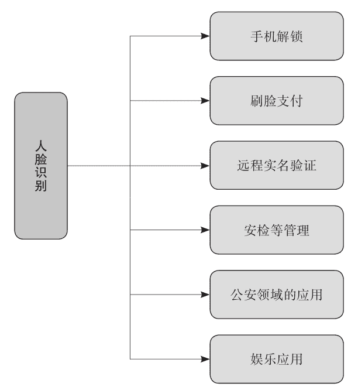

图 1-5 人脸识别技术的应用

#### （1）手机解锁
前文已述，略。

#### （2）刷脸支付
支付宝与肯德基在杭州万象城合作落地全球首个刷脸支付试点。用户在自助点餐后扫脸并输入手机号即可完成结算，全程不到10秒，远快于排队付款。未来“靠脸吃饭”或成常态。

#### （3）远程实名验证
大量业务需实名核验，线下难以便捷。借助人脸识别可杜绝远程替代作弊，实现远程实名。旷视的技术已累计为全球2.1亿人提供远程实名服务，解决异地验证难题。

#### （4）安检等管理
地铁、火车站等公共场所安检压力大。广州地铁万胜围站、珠江新城站、嘉禾望岗站已部署AI安检门，结合人脸识别与互联网技术实现自动快速安检。系统还能根据大数据信用为旅客提供快速通道，并对随身包裹进行安检，提升效率与安全系数。

#### （5）公安领域运用
人脸识别让公安数据采集更便捷。旷视已为多地公安提供实时警情数据，协助破获千余起案件，抓获在逃人员超2000人；重庆某分局使用商汤人像比对系统，识别效率提升200倍，40个工作日内甄别出69名嫌疑人。相比需接触的指纹、虹膜，人脸识别是非接触式的，可在无配合情况下采集信息，提升响应速度并降低疾病传播风险。

#### （6）娱乐应用
人脸识别还可用于智能相册分类，以及美颜类App的自动化妆、试衣和商品推荐。

从刷脸解锁到刷脸安检、刷脸支付和公安追逃，人脸识别正重塑生活。未来若能将人脸与身份证一一绑定，身份唯一性与安全性都将大幅提升。

### 1.2.3 百度：以小度音箱构建对话式入口

作为国内互联网头部企业，百度在AI领域的布局同样扎实。除无人驾驶外，百度与智能音箱灯创始方生迪联合推出跨界新品——生迪智能音箱灯，简称“小迪”，也是中国首款语音操控智能音箱灯。

小迪融合语音交互、氛围灯具与音箱功能，可识别指令并根据环境自动调节灯光亮度和色彩，提供阅读灯、小夜灯、彩虹灯等多种模式。

在终端创新上，百度依托对话式AI操作系统`Duer OS`持续推进。除了小迪，还推出小鱼在家`VS1`智能音箱与`Aladdin`智能投影吸顶灯，三者均搭载`Duer OS`，以自然语言完成交互。

百度智能生活事业群组总经理景鲲称：“`Duer OS 3.0`是里程碑，交互变革、全新应用生态、商业闭环打通已基本完成。”这意味着对话式系统能快速实现从研发到商业落地的闭环。

搭载`Duer OS`的小迪体现了百度AI家居的思路：平台可嵌入各类设备，形成新的用户入口。百度还推出低价音箱“小度”，其儿童模式深受小朋友喜爱，预示对话式体验在儿童市场将快速增长。随着教育投入提升，儿童将成为未来智能产品的重要客群。

以小迪为代表的`Duer OS`终端，正成为百度在AI时代的入口，通过多元形态连接人与机器。`Duer OS`是目前唯一在交互能力、内容服务和商业生态上全方位布局并实现闭环的智能系统，为百度在物联网时代占据战略高地提供支撑。

### 1.2.4 阿里巴巴：天猫精灵的视听进化

在智能音箱竞争中，阿里巴巴亦积极发力。阿里人工智能实验室推出首款音箱天猫精灵X1，内置第一代中文人机交互系统`Ali Genie 1.0`；一年后升级为`Ali Genie 2.0`，新增视觉认知能力。

一代精灵只需唤醒词“天猫精灵”，即可调取云端`Ali Genie`服务。X1除播放外，还提供查询、娱乐、购物、工具四大类服务，细分功能众多，如图 1-6。

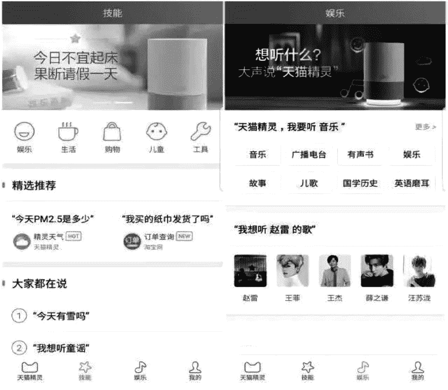

图 1-6 天猫精灵功能示意图

X1不仅能听会说，还能通过声纹识别区分家庭成员。不同于普通语音识别，天猫精灵采用声纹技术，利用个人声音特征识别身份，提升安全与私密性，也为语音支付增加防护。

使用前需注册声音生成独特声纹密码，绑定后可开启声纹购物。付款时系统会让用户读出随机数字进行声纹校验，通过后才从绑定支付宝扣款。声纹还能实现个性化推荐，根据使用者身份推送不同内容。

`Ali Genie 2.0`在原有功能上增加“看”的能力，实现视觉认知、多模态交互与情景感知，如图 1-7。

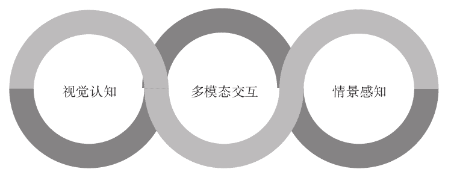

图 1-7 `Ali Genie 2.0`的视觉认知功能

视觉认知包括图像识别、人脸识别、物体检测；多模态交互融合语音、图像、触摸等多种形态，模拟人际交流；情景感知则基于上下文和对话场景自主学习需求。

产品上体现为“火眼”，核心是视觉认知与表情系统。火眼可识别至少117套图书和4万个药盒，帮助儿童阅读和老人识别药品信息；表情系统可在屏上展示可爱表情供儿童游戏。阿里巴巴人工智能实验室总经理浅雪表示，未来还将实现“万物识别”。

依托`Ali Genie`系统，天猫精灵已接入Keep、优酷、高德地图、支付宝、虾米、天猫超市、喜马拉雅、淘宝、绘儿乐、飞猪、盒马鲜生等第三方服务，进一步丰富智能生活体验。

### 1.2.5 腾讯：觅影将AI带入医疗

腾讯将AI技术引入医学，推出首个AI与医学结合的影像产品——腾讯觅影。由“互联网+”合作事业部牵头，联合`AI Lab`、优图实验室、架构平台部等团队打造，运用图像识别、大数据、深度学习等技术辅助医生诊疗。

觅影主要承担两大功能。

#### （1）人工智能医学影像
利用计算机视觉与深度学习，对内窥镜、病理、钼靶、超声、`CT`、`MRI`等多类影像进行训练，掌握病变特征，辅助诊断并开展重大疾病早期筛查。

#### （2）人工智能辅助诊断
依托`AI Lab`能力，通过自然语言处理与深度学习，为医生提供诊疗决策建议，加速病案理解，提升效率。

觅影的辅诊能力包括诊疗风险监控系统和病案智能化管理系统。前者降低误诊风险，后者自动提取病案特征并输出结构化病历，减少医生整理工作，提升诊疗与科研效率。

觅影让食管癌早筛效率迎来一次明显跃升。没有智能加持时，国内食管癌前期排查流程繁复，检出率常被压在个位数以下。引入觅影后，阳性判断的可靠性能稳定在九成左右，操作被压缩为一次常规内镜，判定耗时基本控制在四秒以内，这对临床和患者都是切实的生活改善。

觅影的覆盖面不止于食管。肺部等其他病种的早期筛查与诊疗也在其能力边界内。依托机器学习，食管癌这类疾病的早期筛查难题有望得到系统性缓解，也能缩小区域医疗水平的差距，让诊断与治疗趋于一致。

谈及人工智能在医疗中的定位，丁香园的创始人李天天早期曾认为医生不会被取代，后来修正了看法。他指出未来最可能受冲击的岗位有两类：影像科与病理科，这两类工作的共性是较少直接接触患者。

麦肯锡合伙人弗洛里安·Then 对全球医疗数字化有观察。他认为医疗数字化不仅关乎国家层面的基础设施建设，还要甄别创新的落地方案，既要回应个性化需求，又要避免资本过度集中，最终这些方案需要形成良性生态。腾讯觅影正是这一生态的典型样本。

### 1.2.6 IBM 沃森：跨界认知平台
IBM 在认知计算方向推出的沃森，被视作多面手型的人工智能产品。它通过与大量第三方平台联动，搭建了一个可跨领域提供服务的智能体系。

在发布会上，IBM 前CEO罗睿兰强调沃森的愿景是重塑企业运行方式与人们的生活方式。“我们的目标是放大人的认知能力。”她表示，“沃森是人机协同的产物，核心在于扩充专业知识。它可以充当老师、医生，也可以充当律师。不管从事什么职业，我们都能拓展你的知识边界。”

起步时沃森聚焦医疗健康，与葛兰素史克、史泰博、美国癌症协会和克利夫兰诊所等机构开展合作。此后IBM引入超过十亿美元的资金，沃森的学习能力与技能边界持续扩张。医疗之外，它先后在时尚设计、个人助理、食品、兽医、赛事分析、趋势追踪和商业分析等方向崭露头角，并产生实际收益，具体案例见表1-1所示。

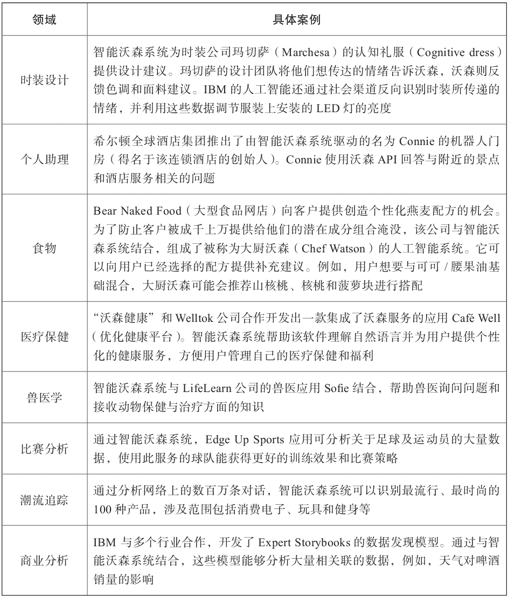

对沃森的广泛应用，上海元趣公司CEO兼首席科学家、拟脑机器人之父吴义坚认为，沃森底座在于知识储备深厚，拥有海量行业知识库，在此基础上结合自然语言处理与机器学习提供信息服务和决策支持。其智能体现在大数据分析、挖掘与决策，目标是打造全能型行业知识库平台，让更多第三方开发者贡献数据并调用其引擎为用户服务。

沃森的存在证明了人工智能对生活的深层改变。随着资金投入和深度学习的推进，它几乎覆盖衣食住行各环节。沃森尚未能解决全部生活难题，但它已证明人工智能具备极广的应用潜力，IBM的持续研发终将推动智能生活落地。

## 1.3 人工智能发展的三次浪潮
AlphaGo 战胜李世石之后，“人工智能”进入大众视野并成为全民话题。相关商业产品也逐步成熟。从概念提出到专家系统再到大数据融合，AI大致经历了三次起伏，才真正落地。

### 1.3.1 图灵测试：AI研究的起点
谈人工智能绕不开计算机先驱艾伦·图灵。1950年他在《Mind》杂志发表《计算机器与智能》，点燃了第一次AI热潮。

论文中他提出判断机器是否具备智能的办法，即图灵测试，如图1-8所示。

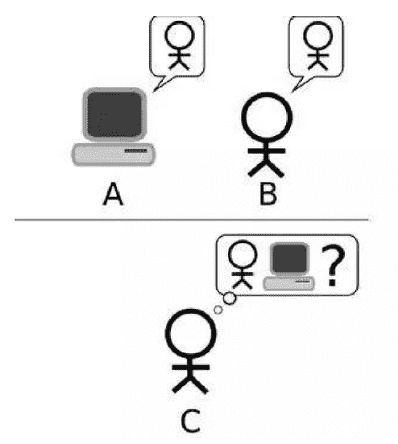

图1-8 图灵测试示意图

按图灵的设想，测试幕后安排一台机器和一个人，裁判同时与两者交流，若无法分辨交流对象是人还是机器，则认为该机器拥有与人等同的智能。

图灵测试点燃热情后，1956年夏天举办了世界首场人工智能研讨会，即达特茅斯夏季研究会议。组织者包括马文·明斯基、约翰·麦卡锡、克劳德·香农和尼尔·罗切斯特，与会者有雷·索洛莫诺夫、奥利弗·塞尔弗里奇、特伦查德·摩尔、亚瑟·塞缪尔、纽厄尔和西蒙等，他们都为AI发展作出重要贡献。

会议本质上是一次头脑风暴，讨论了大量当时尚未解决的议题，其中就包括人工智能。麦卡锡说服众人将该领域命名为“人工智能”。于是名称和任务在1956年达特茅斯会议上确立，最早的成果与一批先驱研究者也由此出现，达特茅斯会议被视为人工智能诞生的标志。

达特茅斯之后，1950至1960年是AI的第一次高速期，被称作黄金十年。当时使用的是传统方法，也被称为古典人工智能。

研究者开发出能解代数应用题、能学习使用英语的程序，让公众惊叹于机器的“智能”，研究者信心大增。DARPA等政府机构投入大量资金，希望AI能为国家带来利益。

马文·明斯基曾在1970年预言3到8年内会出现具备人类平均智能的机器。但项目进展不如预期，承诺无法兑现，公众信心受到重创。

停滞一方面放大了反对声音，莱特希尔1973年发布对英国AI研究状况的报告，称其在实现宏伟目标上“完全失败”；另一方面导致投资撤离，发展举步维艰。

从图灵测试到达特茅斯再到黄金十年，第一次浪潮因技术限制最终走向低谷。

### 1.3.2 语音识别：第二次浪潮的引擎
第一次低谷持续约6年。20世纪80年代，专家系统重新掀起热潮。专家系统把专家知识以规则形式灌输给计算机，用于解决特定问题，尤其是疾病诊断，知识处理成为主流。语音识别技术的突破尤为关键。

语音识别即自动语音识别ASR，并非识别说话人身份，而是识别话语内容并转为计算机可用的输入指令，如按键、二进制编码或字符序列。

研究可追溯至20世纪50年代贝尔实验室的Audry系统，能识别10个英文数字，是首个语音识别系统。20世纪80年代末，实验室取得大突破：小词汇识别率大幅提升；“大词汇量、连续语音、非特定人”三大难题被逐一攻克并集成。

突破带来极大信心。90年代IBM、苹果等巨头重金投入语音实用化研究。90年代中后期实验室准确率持续提升，甚至有人提出“语音时代”来临。

现实却不尽人意。当时产品在健壮性、灵活性和自适应能力上远不能满足实际需求，为第二次低谷埋下隐患。

因技术水平与市场期望脱节，泡沫经济出现。80年代商业机构对AI的追捧与冷落符合泡沫的经典模式。

经历1974年经费削减的研究者创造了“AI之冬”一词。他们注意到专家系统的狂热，并预言失望会再次到来，事实如此。从80年代末到90年代初，第二次浪潮遭遇财政危机。

80年代末战略计算促进会大幅削减AI项目投资，DARPA新领导认为AI不是下一个浪潮，拨款转向看似易出成果的项目。同时专家系统维护成本高昂，局限不断暴露，商业应用范围有限，打击了热情。

尽管语音识别取得大幅突破，AI寒冬仍到来。因为专家系统只是用预设解法解决问题，缺乏自主学习，并不真正“智能”。第二次浪潮的退潮也在意料之中。

### 1.3.3 AlphaGo对局：第三次浪潮的引爆点
AlphaGo由英国DeepMind开发。在乌镇围棋峰会，柯洁三盘皆负于AlphaGo。人机大战再次让AI能力震惊世人，AI迎来新一轮发展。

早在1997年，AI就已与人类在智力游戏交锋。当年5月，国际象棋世界冠军卡斯帕罗夫负于IBM“深蓝”。DeepMind创始者之一杰米斯·哈萨比斯说，深蓝战胜卡斯帕罗夫后，围棋成为游戏AI最后的圣杯，最终AlphaGo将其夺下。

经历第二次低谷后，研究者开始用数学语言开发程序。许多AI问题变成数学、经济学、运筹学、统计学等交叉课题。AI逐渐形成严格框架，成为规范的科学分支。

进入大数据元年，智能问题转化为数据问题，取得质变。图像识别、自然语言理解等长期停滞的领域在思维转变后大幅突破，开启智能革命。

深度学习是革命的关键。以人脸识别为例，深度学习让AI在海量人脸图像中挖掘共性模式与情绪，提升“智能”程度。

尽管技术已革命性进展，第三次全民狂热仍在AlphaGo人机大战后爆发。战胜李世石后，二代AlphaGo以“Master”身份登陆弈城围棋网，取得60连胜，随后击败柯洁。这一系列胜利似乎证明AI已在智能上超越人类，公众热情空前高涨。

AlphaGo成为大众眼中的AI标志，其胜利意味着探索进入新阶段。其学习模式同样可迁移至人脸识别、语音识别等领域。这次浪潮与前两次不同：技术先于大众预期出现。

凭借深度学习和大数据，AI在大起大落后重获新生，并证明其能改善人类生活。或如AlphaGo与人类一较高下，或助力医生诊断，或实现自动驾驶……AI为人类开启智能时代的新世界。

### 1.3.4 艾伦·图灵：人工智能之父
科学界有两个苹果广为人知：砸中牛顿的苹果，和结束图灵生命的毒苹果。有人说苹果公司标志源自图灵临终床边的半个苹果，乔布斯回应：“这不是真的，但真希望它是真的！”

《时代》周刊《20世纪100位重要人物》中写道：“每一个敲键盘、使用电子表格或文字处理软件的人都应记住，我们工作在一台‘图灵机’上。”

艾伦·图灵1912年6月23日出生，1954年6月7日去世，英国数学家、逻辑学家，被誉为计算机科学之父、人工智能之父。他提出图灵机和图灵测试，是计算机逻辑奠基者。美国计算机协会以他名字命名图灵奖，被视作计算机科学的诺贝尔奖。

图灵对机器的痴迷源于童年读物《每个儿童应该知道的自然奇观》，书中提到人体也是一种机器。这开启了他的科学视野，让他对人机关系产生浓厚兴趣。

二战期间他参与破译德国Enigma密码，研发的图灵Bombe扭转大西洋战场局势，历史学家认为至少拯救了2000多万生命。

1950年10月论文《计算机械与人工智能》发表，图灵测试正式提出。论文倾向用“智能”而非“思考”来论述机器问题，为AI开启大门。

彼时英国政府对同性恋群体不公，图灵被举报后获缓刑并被强制接受荷尔蒙治疗。工作受影响，择业面收窄。1954年6月7日夜，他含氰化物的苹果结束了传奇一生。

半个多世纪后，2009年9月10日英国首相戈登·布朗代表政府公开致歉，2013年12月24日女王伊丽莎白二世为其颁发皇家赦免。

诗人木心写道：“别再提图灵了吧，他的死使我们感到大家都是对不起他的。天才总天真、坦荡、毫不设防地迎向这个被庸人占领的世界，一腔热诚付与世界，世界待他们，往往却是一盆脏水兜头浇下。”

斯人已逝，图灵在AI领域的贡献依然深远，纪念他的最好方式是让人工智能走得更远。

## 1.4 人工智能的本质与商业价值
人工智能的定义可拆为“人工”和“智能”。人工指人类制造；智能指机器能够感知外界、形成认知并作出决策。真正内涵不在于人工，而在于智能。

借助功能模拟，计算机可模仿人类部分功能，将简单的智能活动机械化，为商业化落地创造可能。随着技术进步，AI带来的商业变革已启动。从语音助手到无人驾驶，从人脸识别到智能家居，AI正在塑造新一代智能生活。

### 1.4.1 智能：人工智能的灵魂
人工智能究竟是什么？图灵奖得主马文·明斯基认为，让机器完成本需人类智能才能做到的事情即是AI；图灵奖和诺贝尔奖双料得主司马贺则认为，智能是对符号的操作，最原始的符号对应物理客体。

研究者定义各异，但不可否认智能才是AI的灵魂。

人类对智能的认知源于自身，AI的智能也相对人类而言。按人类智能活动特征，AI的智能化可概括为三步：感知、认知、决策，即运算智能、感知智能和认知智能。

#### （1）运算智能
运算智能指计算机快速计算和存储信息的能力，是机器学习的基础。目前计算机运算智能已十分出色。深蓝击败卡斯帕罗夫，AlphaGo击败李世石、柯洁等，都是运算智能的体现。

#### （2）感知智能
感知智能即视觉、触觉等感知能力，包括语音输入、人脸识别等。自动驾驶汽车的激光雷达等设备就是感知智能的实现载体。

#### （3）认知智能
认知智能简单说就是能理解、会思考。机器的认知智能体现在对知识的不断理解与学习上，也是AI中最难的环节。例如智伴科技的班尼儿童成长机器人，能在不懂问题被告知答案后，下次遇到时处理得当，体现自主学习能力，即认知智能。

AI的独特性在于智能化，它使人脑部分功能在计算机中呈现，对某些场景可自主决策。随着进步，AI正从类人行为模式发展到类人思维模式，甚至向泛智能模式演进。内涵在扩大，核心仍是智能二字。

### 1.4.2 AI并非超越人类智慧
AI时代已至，在诸多领域展现出超越人类的能力。杨澜著《人工智能真的来了》上市后，“AI是否会超越人类智慧”的话题引发关注。

对AI超越人类的担忧，可从两个层面看：科技与人类的关系，以及AI的本质特征。

从科技与人类关系看，自人类出现便不断追求科技。从石器到智能手机，每种工具都具备人类没有的功能。但人类并未被工具击败，而是充分利用工具推动历史。人类与高科技始终处于平衡共进状态，AI也不会例外。

人工智能的核心在于复制人类的思考路径，哪怕在算力、记忆等指标上突破生物界限，它也做不到像人那样拥有自觉的意识体验。简单说，它是思维的仿制品，而非真正的思维主体。

为什么人工智能始终难以真正凌驾于人类智慧之上？关键在于感性。一个人站在泰山脚下，会为造物之美惊叹，同时胸中涌起一览众山小的壮怀。人工智能即便能写出同样优美的景物描写，也感受不到那种情感冲击，更不明白自己产出的文字为何而写、为何而有价值，它不过是在执行算法指令。算法越精妙、训练越充分，表现就越出色，但所有提升都建立在逻辑性模仿之上，缺少人类独有的情感维度。

正因如此，人与AI存在根本性质的差别，不应因后者在局部表现亮眼，就引发谁更占优的对立。

AI是人类行为被充分复制后诞生的技术结晶，超凡表现常伴随不安情绪。然而把AI看作人造工具，承认它与人类在本质上相距甚远且不可能越过智慧的边界，焦虑便会自行消解。

### 1.4.3 智能商业驱动产业变革
如今AI已渗透到生活的方方面面，牵动广泛改变。能分担家务的服务机器人、能协助医师诊疗的智能医疗系统、银行里提供服务的机器接待员，都在说明科技正在重塑日常。商业板块同样在经历转型，业内称之为智能商业的形成。

对现代企业而言，客户关系管理系统 CRM 举足轻重。其核心围绕客户数据展开，借助信息技术完成数据的采集、整理、分析与应用，进而把营销、销售、服务等环节自动化。把AI与CRM挂钩，就能加速客户管理的智能化进程。

百会是典型案例，其CRM已嵌入AI能力。依托机器学习，该系统可为销售人员提示最合适的客户触达时机，减少过去那种反复低效的邮件轰炸，并在营销、成交、跟进、售后等全链路实现真正的智能化管控。

AI切入商业的意义远不止提供更智能的数据工具，它更在观念层推动了发展路线的转变。

英国信息方案商 Callcredit 的概念管理总监戴夫·韦伯 Dave Webber 强调，AI在企业中的落地是真正的商业变革契机，不该被视作一次性项目，而应纳入长期规划。

天马股份董事长傅淼总结，与传统模式相比，智能商业决策体现在五个明显优势上。

#### （1）人机交互决策
传统商业里不论大小决策都依赖人工，既拖慢效率也加大失误风险。智能商业则走向人机协同：一端可自动完成常规判定，降低人力负担；另一端面对复杂情形，机器先给出技术支撑，最终仍由人拍板。这样既卸掉了重复性脑力负担，也降低了非理性判断的概率。

#### （2）大规模数据分析
传统分析往往要先定主题再找数据。智能商业无需预设方向，能借助AI对海量数据进行无主题扫描，对出现现象的成因和脉络自行提炼归纳。

#### （3）数据实时更新且来源开放
传统数据多为滞后且来源封闭，多局限于企业内部。智能商业的数据是实时流动的且来源开放，能够汇聚外部信息，帮助企业构建更全面的商业情报。

#### （4）系统模型可自动优化
传统模型的设定一旦完成就难以自改，用久会失灵。智能商业因AI的自主学习具备自我迭代能力，保持持续领先。

#### （5）可运用到全产业链
传统系统多只覆盖企业局部，智能商业可延伸至全产业链，为上下游提供实时经营指引。

AI对商业的推动不是单一技术落地，而是思维方式的升级。因此智能商业的前景十分可期。

# 第 2 章 支撑AI发展的三大科技基座
AI从概念走向现实牵涉众多学科交叉，形成了大量令人惊叹的应用。但真正撑起这一进程的核心要素，仍是大数据、云计算与深度学习三者。大数据为机器学习提供资源，是AI的能量供给；云计算承担任务执行，是AI的动力引擎；深度学习实现机器自学，是AI的智慧来源。

## 2.1 大数据：AI成长的能量源
进入大数据时代，实时、多元、海量的数据不断涌现。数据量越大，刻画现实的角度就越丰富，描述也越贴近真实，为AI应用奠定了数据基础。唯有数据充足，AI才能持续学习和迭代，取得可靠成果。

### 2.1.1 大数据思维：驱动精细与智能营销的核心
数据驱动的思路可追溯到上世纪70年代，并在80、90年代逐步成熟。21世纪互联网兴起后，数据规模出现爆发式增长，使数据驱动的价值更加凸显。随着各行业数据持续外延，交叉现象增多，关联性增强，大数据时代随之到来。

大数据技术的最大价值不在于挖出多少信息，而在于提供了一种新的问题解决方式——大数据思维。概括起来，它由全样思维、容错思维和关联思维构成。

#### （1）全样思维
全样思维的对立面是抽样思维。抽样是从总体中挑出部分样本作为代表来推断整体，在条件受限时是一种权宜之计。但样本终究无法完全等同于整体，不当抽取还可能导致误判。随着存储和分析能力的提升，大数据已能覆盖全体数据，因而转向全样处理。

#### （2）容错思维
抽样结果的好坏高度依赖样本质量，稍有偏差就可能造成结论大错。因此人们在抽样时要极力规避误差。但大数据处理的是全体信息，不存在抽样误差，个别数据出错也不会动摇整体判断，这正是大数据的容错特性。

#### （3）相关思维
大数据时代，人们更关注数据间的关联而非严格的因果。例如公鸡打鸣与日出并无因果，却呈现同步相关。借助大数据预测未来，本质就是在海量事实中提炼关联模式。相较于因果思维，关联思维更符合大数据特征：不必究其原因，只要知道可用即可。这对思维方式是一次不小的冲击。

大数据思维正是精细化营销和智能营销的基石。企业能掌握全体消费者的行为数据，而非用小样本推断整体；不必纠结数据是否完美，也不必深挖每一次行为变化的直接动因，只需捕捉相关信号即可。有了这种思维，精准与智能营销才能真正贴近消费者动态。

大数据的演进不仅是技术升级，更是思维的革新。数据规模的跃升改变了解题逻辑，而这种逻辑转变让精准营销得以实现，进而对营销行业产生颠覆性影响。

### 2.1.2 大数据为AI提供发展动能
数据的累积为AI发展提供了燃料。IDC与希捷科技发布的《数据时代2025》报告指出，到2025年全球数据总量将达163ZB。爆炸式增长的数据为深度学习提供了肥沃土壤，助推AI加速演进。

这种推动体现在两个层面：意义上，AI的核心依赖数据支撑；现状上，AI的迅猛发展建立在大数据之上。

从意义看，大数据对AI的数据支撑体现在两点。其一，大数据技术的发展为AI奠定基础。AI需要学习海量知识经验，这些本质都是数据。大数据提供的海量素材为深度学习等算法提供了坚实基础。其二，AI创新应用离不开公共数据的开放共享。AI需要多场景数据资源，而大数据天然具备开放共享属性，为创新创造条件。

从现状看，AI的高速发展建立在大数据之上是不争的事实。首先，海量数据为训练提供原材料。IDC预测2020年全球数据量将达35ZB，正是这些数据让深度学习成为可能。其次，AI领域领先的互联网企业都拥有强大数据底蕴。例如，2.5万名谷歌工程师可调用代码库中20亿行代码；亚马逊AWS服务全球190多个国家百万级企业，数据体量同样惊人。这些数据实力是其领跑AI的必要条件。

诸多AI应用依赖跨行业数据协同，例如智能家居就融合了弱电、安防等多个领域的数据。

百度首席科学家熊辉博士曾强调，数据驱动的AI时代已来，AI唯有依托大数据才能持续发展。因此大数据产业链越完善，AI的布局就越清晰。

## 2.2 云计算：AI运行的动力引擎
近二十年来，全球数据量持续爆炸式增长。想让这些数据被有效处理并发挥价值，必须依托强大的云计算平台。在AI场景中，云计算负责对海量数据的存储与运算，让数据真正产生效用。若把数据比作石油，云计算就是点燃石油的内燃机。

### 2.2.1 数据是石油，云计算是内燃机
大数据之于当下，如同石油之于20世纪，是战略级资源。但在内燃机出现前，石油价值有限，甚至不被视作资源。百年前的内燃机改变了石油命运。云计算对数据的意义，恰如内燃机对石油。数据由来已久，却长期作为信息化副产品存在，其深层价值直至云计算出现才被激活。没有云计算的加工，数据量再大也只是“数据大”，成不了“大数据”。

以计算机诞生为标志的第三次工业革命带来信息化，人类进入信息时代。以工业智能化、互联网产业化、全面云化、大数据应用化为标志的第四次工业革命则以智能化和自动化为特征，推动人类迈向智能时代，而云计算正是这一轮变革的核心概念。

云计算出现前，企业要自建机房、采购服务器、搭建系统并开发应用，还需专人维护，成本高、效率低且扩展困难。随着数字化深入，数据挖掘管理需求激增，云计算应运而生。

云计算本质是通过网络按需提供可弹性伸缩的低成本计算服务。企业搭建信息系统时，只需向云服务商租用所需算力即可。虽然同样需要计费，但相比自建体系更经济便捷。

总体来说，云计算的业务模式有三个特点，如图 2-1 所示。

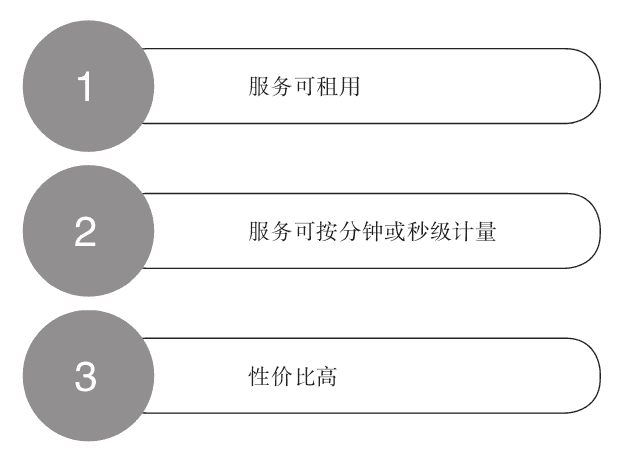
图 2-1 云计算的业务模式特点

#### （1）服务可租用
用户可通过互联网按需租用云服务，成本低廉，适合绝大多数企业。

#### （2）服务可按分钟或秒级计量
计费粒度细至分钟甚至秒级，对用户而言更公平合理。

#### （3）性价比高
相比传统自建模式，云计算无需企业投入完整的数据管理流程，性价比显著提升。

互联网带来海量数据，如何利用是关键。大数据提供了资源，但没有云计算这个工具，资源难以变现。正如内燃机让石油成为战略资源，云计算让大数据的挖掘处理成为可能，使AI得以真正服务企业。

### 2.2.2 人工智能=云计算+大数据
若把AI比作人，大数据相当于从小积累的知识记忆，云计算则相当于大脑，是负责信息处理与反馈的中枢。知识经大脑加工重塑才能创造新事物，于是有“人工智能=云计算+大数据”的说法。

在大数据和云计算的支持下，人工智能可以实现多方面的应用，如图 2-2 所示。

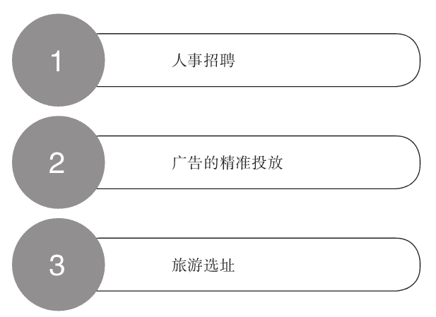
图 2-2 人工智能的应用

#### （1）人事招聘
AI可在企业与求职者之间实现精准匹配。好公司往往简历泛滥却良莠不齐，HR筛选压力大；差公司则简历稀少难以补员。在大数据加云计算的支撑下，AI能对海量简历与岗位进行筛选并精准推送，同时为招聘决策提供参考。

#### （2）广告精准投放
云计算对大数据进行分析后，AI可实现广告的精准触达。以百度为例，其通过搜索引擎采集行业数据，再经“百度大脑”进行感知处理，如图像检索，最终完成精准投放。

#### （3）旅游选址
借助云计算对景区人流的统计分析，AI可结合用户兴趣与时间安排推荐最优目的地，避免行程冲突与误区。

大数据提供刻画世界的素材，云计算提供强大的算力，二者协同让AI提炼复杂现象背后的规律。再结合行业规则与习惯，AI就能模拟人类智慧，为生活带来便利。

## 2.3 深度学习：AI的智慧源泉
大数据与云计算搭建了AI发展的底座，配合算法构建，AI才能实现自主学习。而深度学习正是这一过程的核心路径，是AI智慧的来源。

### 2.3.1 深度学习“深”在哪儿
深度学习的概念由杰弗里·辛顿 Geoffrey Hinton 等人于2006年提出。当时研究者希望找到让计算机自主解析数据、不断学习并对外部事物做出判断的方法，实践证明深度学习正是实现机器学习的路径。

实现机器学习时，无需研究者穷举所有场景或手写具体算法，只需用海量实践数据对模型进行训练，使其在新情境下自主判断并完成任务。深度学习、机器学习、数据与AI之间的关系如图2-3所示。

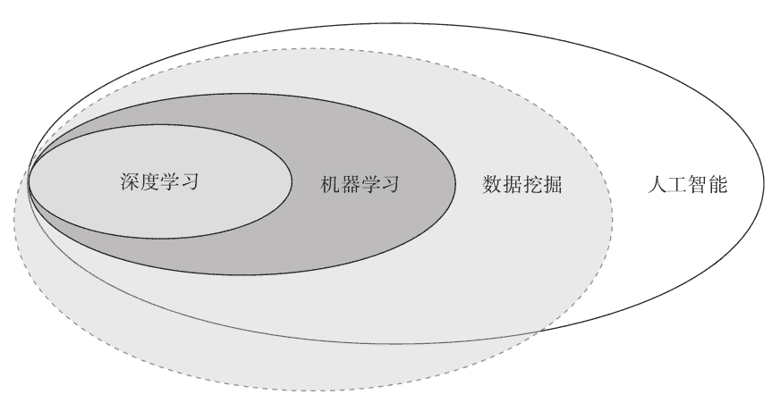
图 2-3 深度学习、机器学习、数据和人工智能四者的关系

“深度”二字强调程度上的递进。相比早期机器学习，深度学习在运算层级上更具逻辑与分析能力，因而更智能。

深度学习继承并发展了神经网络。传统神经网络结构简单，仅含输入层、隐藏层与输出层，如图2-4所示。

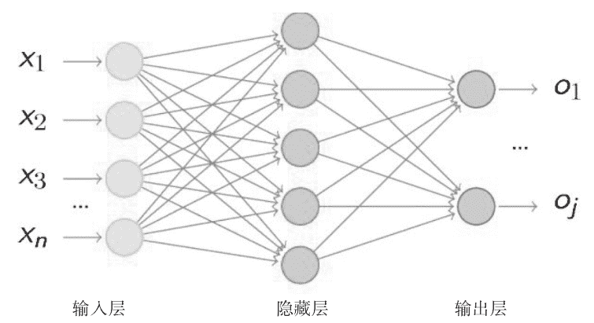
图 2-4 传统神经网络算法的结构

深度神经网络则拥有多层隐藏层，如图2-5所示。这里的“深”正是层数不断加深的体现。

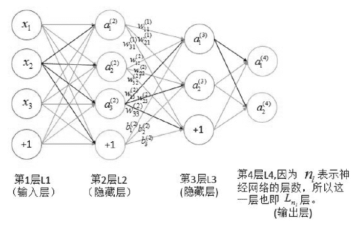
图 2-5 深度学习算法包含多层隐藏层

一般而言，深度学习模型的隐藏层不少于7层。层数越多，对现实的刻画能力越强，结果越贴近实际，智能程度也越高。

得益于深度学习，AI的应用范围显著扩展并不断升级。计算机可以把复杂任务拆解，与各类设备结合实现多任务协同，并基于条件进行“自主思考”，达成研究者的长期期待。

### 2.3.2 深度学习的智能硬件：GPU
神经网络算法的效率通常受层数影响，层数越多耗时越长。但深度学习借助智能硬件GPU图像处理器，有效提升了运行效率。

GPU是显卡的核心处理器，与CPU类似，是一种面向复杂数学与几何计算的硬件，本质服务于图形渲染。

深度学习主要依赖卷积神经网络CNN与循环神经网络RNN，两者涉及矩阵相乘、卷积、循环层、All Reduce等运算。硬件需兼顾这些运算能力与低能耗，而GPU的大规模并行架构正好契合需求。

GPU出现前，AI并行算法的运行可能需一年之久。借助GPU算力，深度学习瓶颈被打破，运算结果可在短时间内产出，大幅释放AI潜力。

2009年，几位斯坦福学者首次用GPU在较短时间内完成深度神经网络训练，引发全球震动，并掀起持续至今的GPU通用计算浪潮。英伟达首席科学家、斯坦福并发VLSI架构负责人威廉·J·戴利William J. Dally曾说：“现在业内人人都在做深度学习，在这方面GPU几乎已臻完善。”

事实上，几乎所有深度学习研究者都依赖GPU。深度学习需在成千上万变量中反复训练寻找最优解，通过这种像素级的学习，计算机才能不断归纳规律，最终逼近类人思考。

### 2.3.3 深度学习“三巨头”
在深度学习领域，杰弗里·辛顿、扬·勒丘恩与约书亚·本吉奥地位超群，被誉为深度学习的“三巨头”。

其中杰弗里·辛顿被称作“神经网络之父”。他出生于英国，后定居加拿大，其开创性研究让深度学习从理论走向实践。他的初创公司被谷歌收购，他本人也加入了谷歌大脑项目。

扬·勒丘恩在多伦多大学师从杰弗里·辛顿完成博士后训练，之后加入贝尔实验室。在贝尔实验室他推动诞生了机器视觉领域威力最强的深度学习方法——卷积神经网络，让手写识别等应用取得实质性进展。如今他任纽约大学终身教授，并出任 Facebook 人工智能研究组负责人，该职位由扎克伯格亲自提名。

约书亚·本吉奥出生于法国，后定居加拿大蒙特利尔。他在贝尔实验室期间与扬·勒丘恩相识，一道深耕深度学习。约书亚·本吉奥率先把神经网络引入语言建模，在语音识别、机器翻译等方向深耕多年，其团队打造的 Theano，在业内声名显赫。谷歌曾在蒙特利尔设立人工智能实验室，并向约书亚·本吉奥等人的项目投入 337 万美元资助。

所谓“三巨头”备受推崇，核心在于他们在深度学习上做出的开创性贡献。另一层原因更让人动容：在神经网络长期低谷、不被看好的年代，三人依然坚守研究，那份韧性与执拗远超常人。

上世纪 60 年代，人工智能还停留在理论萌芽期，工程经验匮乏，神经网络的思路被主流学派忽视，甚至遭嘲讽。杰弗里·辛顿有关深度学习的论文屡被期刊拒稿。直至 21 世纪初，三人的成果仍难获学界认可。

作为辛顿的学生，扬·勒丘恩与导师一起坚守阵地。辛顿曾评价：“是扬·勒丘恩举着火炬，闯过了最黑暗的时代。”三十年如一日的坚持，最终让深度学习的重要性被广泛承认，三人也从边缘走向了深度学习“三巨头”的位置。

三巨头的成绩令人惊叹，他们在逆境中的坚持更具示范意义。正因他们不懈探索，一批批人工智能应用才得以落地。面对人工智能带来的生活巨变，我们更应记住每一位科研工作者在幕后的付出与坚守。

# 第 3 章　商业化驱动AI腾飞

历史反复证明，任何技术终究要以产品形态出现，在商业化中迭代发展并推动社会进步。若脱离商业结合、缺乏开发投入，再前沿的技术也难以为人类带来价值。

蒸汽机若不包装成运人运货的火车与轮船，就不会获得资本与社会的关注，也就不会不断升级；计算机若没有商业化思维的支撑，永远只能是笨重的机房设备，不可能进化成人手一台的笔记本；同理，人工智能若不能转化为有市场需求的产品，其发展便会受限。换句话说，商业化思维是人工智能蓬勃发展的关键引擎。

那么，人工智能该如何实现商业落地？

本章将围绕商业落地的关键技术要素与衡量指标展开，详解落地路径，并以案例呈现典型场景。

## 3.1 技术+场景：抢占AI战略高地

想在竞争中占领先机，人工智能企业必须率先打造更便捷、更智能、覆盖更广的应用场景，让商业价值真正兑现。例如谷歌凭借无人驾驶构建出更智能便捷的场景，就在该赛道占据了战略制高点。

只有场景而没有实现手段的幻想，注定没有前景；只有技术而没有匹配场景，技术也难以发挥价值。人工智能的发展王道，在于技术与商业场景的深度融合。

### 3.1.1 落地三要素：数据、算法与服务

历经大半个世纪发展后，人工智能开始进入生活并形成商业化应用。在此过程中，大数据、算法、服务三者起到决定性作用。

#### （1）大数据

人工智能的成长建立在数据之上，商业化同样离不开数据支撑。

在智能家居等现代化领域，人工智能已展现实力；在传统行业，商业化程度相对薄弱，但在大数据加持下，其潜力巨大。

以教育为例，学生答题反馈就是绝佳的数据入口。借助大数据工具采集做题行为，人工智能可为每名学生制定个性化题单与复习策略。传统教学长期“一对多”，无法实现真正个性化，人工智能正好填补这一缺口。

对教师而言，人工智能辅助教案系统能提供备课参考。通过大数据分析历史反馈，系统可提炼知识点在学生视角下的重点与难点，帮助教师合理安排进度，做到有的放矢。

教育只是传统行业的代表，从中可见大数据如何拓展人工智能的商业化边界。

#### （2）算法

算法是互联网技术的核心，人工智能也不例外。没有算法，研究者的设想无法落地。

在商业化过程中，研究者常使用四类算法，如图 3-1 所示。

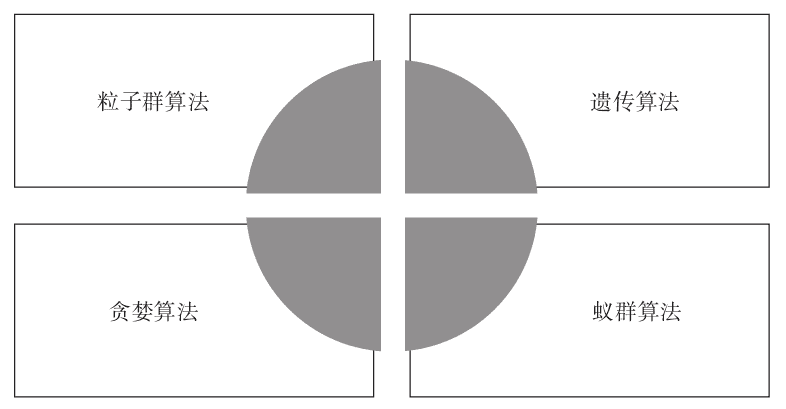

图 3-1 人工智能实现商业落地经常使用的四种算法

①粒子群算法
常称 PSO，基本思路是从随机解出发寻找最优解。计算精度高、寻优概率大，在人工智能中应用广泛。

②遗传算法
人工智能首次实现自主编程所用的方法。擅长解决搜索问题，能基于已有信息自行组织搜索路径。

③贪婪算法
适用于追求快速可行解的场景。不必苛求全局最优，只要满足需求即输出，能为工程节省大量时间。

④蚁群算法
源于蚂蚁觅食时发现最短路径的行为。在人工智能领域多用于交通管理、车辆调度等场景。

#### （3）服务

商业落地的终极目标是为人类提供更优质服务，产品的服务能力直接决定成败。

人工智能客服是典型场景。人工客服易受情绪波动影响服务质量，而人工智能客服不存在此短板。

人工智能产业的繁荣离不开数据与算法，更离不开对服务能力的持续打磨。在三要素的共同支撑下，商业化才能实现全面落地。

### 3.1.2 评估落地的三把尺：时间、领域、深度

衡量商业场景落地质量，主要看三个维度：时间、领域、深度。

#### （1）时间维度

时间维度主要看两点：从实验到产品化所需周期，以及从初代产品到成熟所需周期。

实验到产品的间隔，一方面取决于技术迭代速度，另一方面取决于商业需求紧迫性。若技术无实用价值，便难以转化为商品；若恰好解决社会刚需，落地周期就会大幅缩短。

进入商品阶段后，因技术不成熟而逐步扩大应用范围也需要时间。目前多数应用集中在金融、销售等领域，向更广领域渗透仍需时间，这本身也是衡量落地的指标。

#### （2）领域维度

领域维度是指商业落地时的跨学科融合程度。人工智能并非孤立技术，落地必然涉及多领域协同。

以智能推送为例。传统推送只考虑分发效率，粗放推送往往适得其反。要做到精准推送，就必须理解用户心理，这已超出纯技术范畴，涉及社会学、心理学等。

现有智能推送多以近期搜索关键词为依据，用户搜一次“人工智能”，后续几天便全是相关内容。这种做法假设每次搜索都有意义，却忽略了误触、临时好奇等情况，难以区分长期兴趣与偶发行为。

要实现“读懂用户心思”的推送，需要心理学家、统计学家与算法工程师共同解读搜索行为背后的真实意图。这正是领域维度的体现。

因此，人工智能场景落地必须兼顾多学科知识，跨领域能力是可靠性评估的重要标准。

#### （3）深度维度

深度维度衡量技术对日常生活的渗透与依赖程度。智能手机已远超通讯工具，成为生活必需品，其深度表现突出。

目前人工智能商业化尚处起步，能满足部分需求但难以替代，深度表现仍不理想。

要在深度上提升，需要做好三方面，如图 3-2 所示。

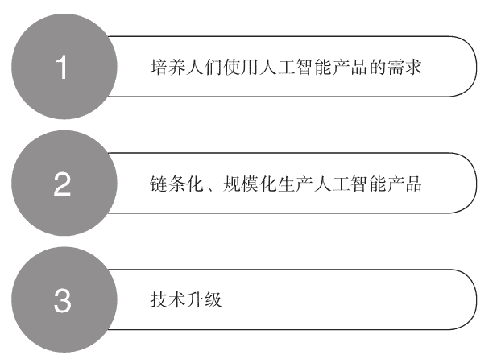

图 3-2 人工智能加大深度维度的举措

①培养用户使用需求
新兴技术影响有限，核心原因是“用不上”。新品要淘汰旧品，必须先培养使用习惯。当便捷与智能被大众接受，需求才会真正打开。

②链条化、规模化生产
单一产品难以体现技术优势，只有形成产品链条并规模化生产，才能以强势姿态进入生活，加深影响力。

③技术升级
一方面升级以适应社会需求，另一方面持续突破有助于在标志性项目中发光，赢得政策与公众关注。AlphaGo 引发的热议就是典型例证。

只有在时间、领域、深度三个维度均表现优异，人工智能的商业应用才算真正成功。

## 3.2 商业落地的具体举措

人工智能必须扎根实体产业才能持续发展。随着关注度攀升，市场对“泡沫”的担忧也在增加，落地需更审慎。

据统计，中国人工智能企业已近千家，市场规模超百亿元，预计 2019 年将增至 344.30 亿元。巨大体量证明了潜力，也提出更严谨的要求。

### 3.2.1 场景落地要做到由浅入深

人工智能本身是多学科交叉领域，落地过程同样体现这一特性。场景化不能停留在宽泛层面，而应聚焦垂直细分，由浅入深。

由浅入深意味着在某一应用领域形成差异化优势，而差异化正是竞争力所在。随技术提升，商业化进程必然向细分场景的特定需求深化。

与行业结合时存在“人工智能+行业”与“行业+人工智能”两种模式。无论哪种，对行业场景的理解深度都决定成败。许多非互联网大型企业能与互联网巨头抗衡，正因其对细分场景的理解更透彻。

安防龙头海康威视是典型案例。早年视频监控智能化的概念提出却难以落地，靠人工智能人脸识别技术才真正实现。海康威视深耕监控领域多年，对场景需求细分有丰富经验，在原有产品上叠加人工智能后即可直接商业化。即便面对互联网企业冲击，仍能保持领军地位。

要深入理解场景，主要有三种方法，如图 3-3 所示。

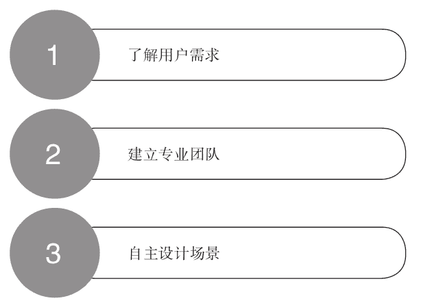

图 3-3 深入了解应用场景的三种方法

#### （1）了解用户需求
任何产品获得应用的首要前提是理解需求。人工智能产品也不例外。只有明确用户痛点，研发才有价值。如地铁上玩手机易错过站台，智能到站提醒软件就切中需求。

#### （2）建立专业团队
深入理解场景离不开专业力量。组建熟悉企业场景及细分领域的专家团队，分析场景特征，做到知己知彼，为产品研发提供依据。

#### （3）自主设计场景
通过自建场景观察用户使用行为，也能加深认知。自主场景有助于揭示用户与场景的内在关联，通过实践归纳真实需求与设计缺陷，进而拓展产品功能。

### 3.2.2 挖掘优秀人才

研发人工智能不只是技术问题，算法能力与商业落地之间仍有距离。企业需要组建技术专家团队与应用专家团队。

#### （1）人工智能技术专家团队
不仅包括人工智能专家，还应涵盖数学、统计学专家，共同攻关算法等核心技术。

#### （2）人工智能应用专家团队
这是当前最紧缺的人才。应用专家既要具备产品销售经理的视角，又要理解算法特性并熟悉企业所处行业。只有这样，才能把技术专家与行业专家的优势整合，形成可落地的技术方案并保障质量。

### 3.2.3 To C 是关键：加速融入群众生活

产品都有目标客群，分为面向企业 To B 与面向个人消费者 To C。

目前大量人工智能应用仍面向大型企业。要实现真正成功，转向 To C 是关键。只有切入大众生活，成为日常不可或缺的一部分，商业目标才算完成。

科大讯飞高级副总裁杜兰博士多次表示，公司正积极由 To B 向 To C 转型，打开 C 端市场是下一步价值提升的关键。

相比 To B，To C 对用户体验要求更高。整体思路是“大胆假设、小心求证、不断试错、快速迭代”，常用做法如图 3-4 所示。

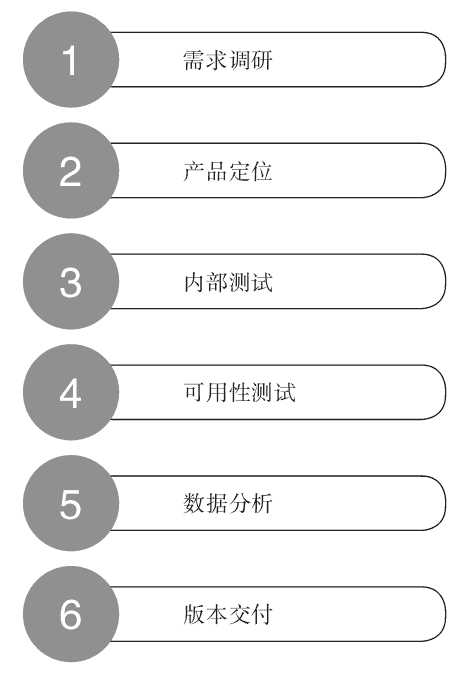

图 3-4 To C 的常用方法

#### （1）需求调研
面向用户，必须从真实需求出发，解决当下痛点。需求调研是起点。

#### （2）产品定位
调研后需明确产品定位，既可解决刚需，也可在现有产品不足处做智能化优化。定位时还应通过大数据画像把握目标人群特征。

#### （3）内部测试
研发完成后先在团队内部测试，提前发现问题。

#### （4）可用性测试
邀请真实用户提前体验，收集一线反馈，优化细节。

#### （5）数据分析
分析内测反馈与产品性能数据，指导下一步优化方向。

#### （6）版本交付
遵循 MVP 最小可行产品原则，先交付可用版本再迭代完善，逐步实现价值与体验。

只有实现 To C 转型，人工智能才能真正走进寻常百姓家。

## 3.3 商业落地场景展示

人工智能已在多个领域形成初步商业应用，本节以农业、工业、客服、早教、物流为例展示落地形态。

### 3.3.1 农业智能采摘机器人

采摘机器人并非新概念，传统设备仅能处理固定大小、固定位置的水果。随着复合农业发展，采摘需要更强的分辨与灵活性，传统机器人已难以满足。融合视觉识别的智能机器人可在自动采摘的同时识别不同果实，是农业机器人的理想形态。

在广东不少水果合作社里，智能采摘机器人已经投入使用，实现了瓜果类作物的无损采收。这套设备主要由华南农业大学团队研发，采用双目立体视觉来识别果园环境。面对成片的果实，机器先完成定位，再依靠数学规划算法推算出最优作业路径，并按此路径执行采摘。

机械臂的采摘方式不靠拉拽，而是先夹住果枝再进行切割，从而避免损伤果实，且适配性强，可用于荔枝、柑橘等多种果品。效率方面，单台设备每小时能采约40斤荔枝，约为人工水平的2倍。

英国剑桥大学的研究团队也推出了类似方案。该机器人借助电子图像传感器区分水果外形以判定品种，同时通过颜色识别判断成熟度与可采摘性。采摘时连接真空管道，能让水果避免碰撞损伤。

当前农业智能采摘的研究重心集中在视觉环节上。机器人通过摄像头获取视野范围内果实状态与场地环境数据，依托人工智能的图像识别与处理快速判定果品种类和成熟度，并决策是否采摘及如何采摘。

整体来看，智能采摘的效率可达人力的两倍，且无需休息，能显著降低采收成本。面对成熟窗口短、需抢收的果品，这类设备的重要性更为突出。它是智能农业落地的关键一环，也是农业智能化革命的起点。大规模推广后，有望减轻农户负担并节约劳动力开支。

### 3.3.2 工业智能臂：从搬运到自主判断
工业场景中大量使用人工操作的机械手臂，有的负责搬运重物，有的承担微观精密作业。人手操作易出错，往往带来产品安全与质量隐患。引入人工智能后，机械臂升级为智能手臂，可实现自动化自主操作，规避人为失误风险。

在煤矿领域，智能工业手臂作用尤为关键，能代替矿工完成复杂且危险的地下开采任务。由于从业人员水平参差、现场管理难度大，人工下井存在诸多安全风险。采用智能机械手臂后，大量作业无需人工介入（如图 3-5 所示），下井频次大幅下降，安全隐患明显降低。机械臂不必顾及生存环境与休息，也为煤矿业带来更高收益。

除了矿山，工厂生产线同样适用。广东省东莞松山湖长盈精密技术有限公司率先打造“无人工厂”，用智能机械臂替代人工操作。

未采用智能臂时，机床人工加工易出现品质不达标、操作不当导致工伤等问题，叠加“用工荒”，生产效率堪忧。在东莞“机器换人”战略推动下，公司决意建设智能无人工厂，以硬件机械臂取代人工，并构建高度智能化软件控制系统实现远程网络操控，从而大幅提升效率与产品质量。该公司常务副总经理任项生表示，这是提升核心竞争力的关键举措。

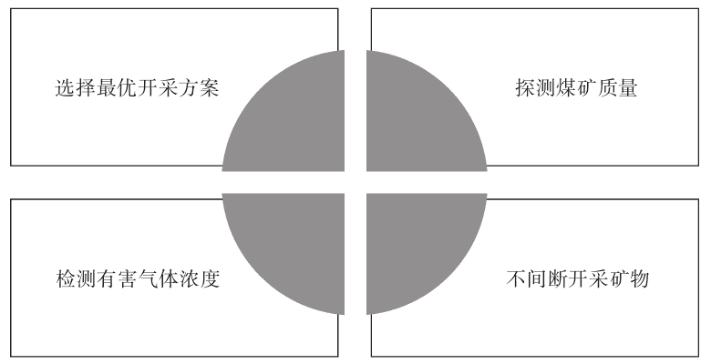

图 3-5 智能机械手臂可完成的煤矿作业

智能机械手臂不仅能执行预设任务，还能像人一样根据环境变化做出相应调整，解决绝大多数生产环节问题。它能降低工业对人力规模的依赖，同时稳定提升产品质量，为企业创造更高回报。

### 3.3.3 金融医疗前台：服务机器人的落地样本
在金融和医疗行业，除了专业从业人员，客服岗位同样不可或缺，人工智能在此类场景正逐步显现价值。

科沃斯银行大堂服务机器人已在邮储银行、建设银行等网点落地。统计显示，该机型累计为超500万人次客户提供服务。服务聚焦网点核心业务：金融产品营销与客户分流，已成功营销金融产品30万人次，引流客户20万人次。

随着系统迭代，大堂机器人新增了现场问卷调查、市场活动介绍等辅助功能，提升了客户体验。它能在客户等待时提供闲聊娱乐，也能解答与银行业务相关的常见问题，整体效率得以改善。这些能力依赖于人工智能的语音交互与自主学习技术。

医疗服务领域也在同步探索。以通用机器人底盘为起点，专注特种医疗机器人的上海钛米机器人科技有限公司已完成2亿元人民币B轮融资，为行业内最大单笔融资之一。

钛米已推出的核医学科病房服务机器人可承担送药、监护、陪伴等任务。创始人潘晶介绍，产品融合人脸识别、语音识别等AI技术，为用户带来更佳体验，同时为医院提供整套增值服务方案，降低对人工协助的依赖。

相较人工客服，智能客服机器人优势集中在如图 3-6 所示的三个层面。

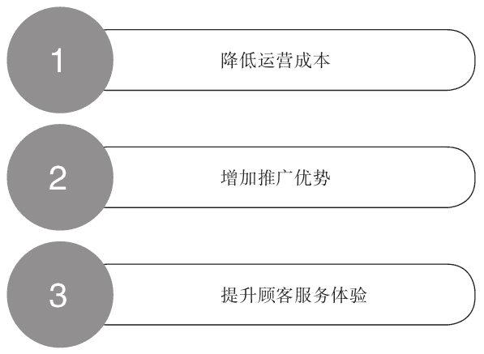

图 3-6 智能客服机器人的优势

#### （1）降低运营成本
智能客服机器人可主动询问来访目的，帮助客户快速找到解决方案，并以耐心引导客户使用自助设备，提升自助使用率，减少人工投入，从而压降运营成本。

#### （2）增加推广优势
“高科技”属性本身具备引流效应，能提升场所曝光度。对银行等机构而言，机器人可在交流中捕捉客户兴趣，进行精准金融产品推荐，实现营销闭环。

#### （3）提升顾客服务体验
可爱的外形、稳定友好的服务态度，加上多元化智能服务，共同提升了客户感知。随着公众教育水平提高，对客服品质要求不断攀升，智能客服机器人在商业化落地上的潜力持续释放。

### 3.3.4 早教机器人：切入蓝海的智能伙伴
生活水平提升推动教育需求增长，儿童早期教育关注度尤为突出。当前早教市场存在师资参差、费用偏高的问题，给重视孩子发展的家庭带来困扰。早教机器人正为这一痛点提供解法。

早教机器人是面向儿童设计的智能教育产品。早期形态多为带屏设备，随着语音识别等技术成熟，其传感与输出手段不断智能化，能提供更多陪伴与教学。

全球首款早教机器人班尼定位为0～14岁儿童陪伴教育。可实现5米内语音识别并分辨情绪，对儿童情感做出回应。为增强吸引力，研发团队为其配备丰富面部表情，可在互动中实时反馈。班尼的精灵触角实为智能触控装置，能调节夜灯亮度与模式。

在早教蓝海中，智能机器人正扮演领头羊角色。相较人工早教老师，智能机器人主要有两点优势。

第一，自主学习能力使其能逐渐适应儿童个性，形成以儿童为中心的教学模式。人工老师难以对每个孩子采用完全差异化教学，而机器人可从儿童反馈中学习兴趣偏好，并据此优化内容，提供更具个性化的学习体验。

第二，知识储备强大，可系统学习儿童心理学、教育心理学等，避免言语不当对孩子造成伤害。人工老师因情绪波动可能无意伤及孩子，而机器人经训练后能保持积极、恰当的沟通方式。

结合终端教育需求，早教机器人的研发布局聚焦如图 3-7 所示的三方面。

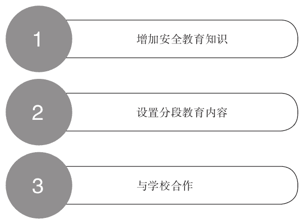

图 3-7 早教机器人的研究重点

#### （1）增加安全教育知识
在游戏场景中融入安全知识，培养儿童危险情境下的自救意识，通过潜移默化建立安全习惯。

#### （2）设置分段教育内容
按年龄分段设计教学材料，实现因龄施教，提升适配度。

#### （3）与学校合作
将机器人端数据与学校表现关联，在后台统一分析，为机器人与学校提供教学参考，实现家校协同。

随着80后、90后生育潮及全面二孩政策推进，早教机器人市场空间持续打开。它是人工智能在教育与生活场景商业落地的先锋，有助于让技术更深入日常。

### 3.3.5 无人机配送：物流成本的压缩之路
无论是亚马逊还是国内的京东、淘宝，物流成本都居高不下。德意志银行数据显示，美国一个鞋盒大小的快递，物流成本可达每英里2美元，甚至超过部分商品本身价格。若改用无人机配送，成本可压至0.05美元左右。借助人工智能，无人机送货正从概念走向实践。

受交通条件限制，农村物流成本更高，因而成为无人机快递的首批试验区。迅蚁网络与中国邮政合作，在浙江乡村开通全国首条无人机邮路并投入运营，后续覆盖范围不断扩大，目前可为十余个村庄提供自动送货。当乡镇邮局与村庄工作人员确认后，工作人员扫码选择飞行路线，经简单确认即可起飞送达。

虽未实现送达家门口的全自动快递，该方案已解决乡镇到分散农村的“最后一公里难题”。在山区等特殊地形，无人机的价值更为明显。

海岛配送同样受益。阿里巴巴在福建莆田山亭镇完成全国首次无人机跨海测试。风力未影响飞行稳定，全程平稳，仅用9分钟完成5海里载物飞行，并在湄洲岛指定点位精准降落。

这一突破标志着传统人工物流可被无人机替代且速度更快，对海岛居民而言意义重大。无论山村还是海岛，地理限制长期制约消费便利。具备智能路线识别能力的无人机，可让偏远地区快速收到包裹。随着制造成本下降与AI路况识别算法精进，无人机送货距离日常应用越来越近。

# 第 4 章 人工智能赋能农业：迈向健康与可持续
据测算，到2050年全球人口将达90亿，粮食需求将大幅攀升。未来粮食产量至少需翻倍才能满足需求。但全球变暖与城镇化导致的耕地减少，正制约产量提升，增产难度加大。人工智能与农业的结合，成为破解这一难题的重要路径之一。

人工智能+农业旨在健康、生态、可持续的框架下构建智能农业，实现农林牧副渔的全链条可持续。本章以真实案例展示AI助力大农业的前景，并阐述智能农业的三大发展方向。

## 4.1 AI驱动大农业：林牧渔粮全链升级
工业革命创造了大量提升资源利用率的技术，但地球资源有限性带来的制约仍在加剧。农业方面，土地与水资源短缺、天气不可控等问题仍未解决，农民“靠天吃饭”的局面未根本改变。人工智能的出现为缓解乃至解决这些问题带来新希望。

### 4.1.1 精准农事：灌溉除草与病虫害管理
现代农业可借助天气预报提前知晓天气，却未能改变靠天吃饭的本质。人工智能通过信息化管理与科学种植，为农事制定更合理的计划。

AI在农事安排上的典型应用有三个，如图 4-1 所示。

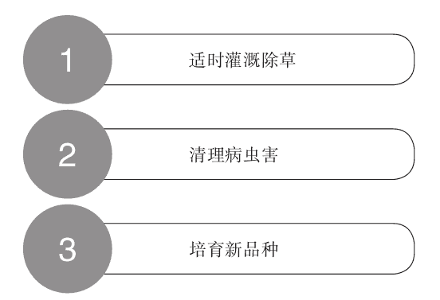

图 4-1 人工智能在农事安排上的典型表现

#### （1）适时灌溉除草
田间部署的摄像头与传感器实时采集作物生长状态及微气象数据，如温湿度。系统发现杂草超标时会提醒除草；当土壤与作物间湿度低于需求阈值时，自动启动灌溉，并结合线上天气信息调节水量。

Arable为农户提供智能农业系统，通过专用传感器采集蓄水量、结实量等田间真实测量数据。基于真实数据的智能建议更具说服力，也为自动化措施提供科学依据。

#### （2）清理病虫害
病虫害会显著降低有限产量，历史上多次造成粮食减产。及时发现与处置至关重要。

生物学家戴维·休斯与作物流行病学家马塞尔·萨拉斯利用深度学习算法检测作物病虫害，测试超5万张图片，识别出14种作物的26种病害，程序正确率达99.35%。研究证实，计算机视觉可通过图像分析提前发现肉眼难察的病害预警。

以色列特拉维夫农业科技公司Prospera即是典型案例。公司以计算机视觉分析作物图像，学习病虫害特征并报告生长状况。AI预警帮助农户及早预防，减少损失，提升产量。

#### （3）培育新品种
实验室中研究人员借助机器学习算法优化作物基因、开发新产品。由于作物基因数据成熟且获取快，AI在该方向应用优势明显。

在AI支持下，农事可实现更科学的灌溉除草与病虫害防治，育种亦更便捷。受硬件限制，AI机器人尚难大规模落地农田，但技术进步将逐步消除障碍，让AI为农业带来更多便利。

### 4.1.2 林业专家系统：迈向精准林业
为推动林业现代化，国家提出林业供给侧改革，加大生态林业与林产品供给力度。21世纪林业信息化的推进成为关键课题，国家已立项“精准林业”课题。受计算机技术在林业领域起步较晚影响，信息化进程仍面临挑战，而人工智能为精准林业提供新机遇。

当前林业领域AI应用最广的是林业专家系统，其内置丰富的专家知识，可在专家水平上解决林业系统问题。经训练与深度学习后，系统能模拟专家决策方式，并吸收不同层级专家经验，在复杂问题上给出更权威建议。

系统架构包括知识工程库、数据库、推理、控制、解释、数据模型分析及知识处理七大子系统。解释系统实现人机交互，推理系统通过协同学习积累经验，为用户提供科学决策依据。

林业是重要生态产业，在环境压力加大的背景下，实现信息化、打造精准林业势在必行。受场景复杂与标准不一制约，林业信息化仍存困难，但在AI助力下，专家系统可为从业者提供决策参考，加速精准林业目标的实现。

### 4.1.3 智能养牛：非接触式牛群管理
在养殖业，AI应用空间广阔。以养牛为例，研究表明，人工频繁进入养殖场会让牛产生紧张情绪，影响肉质与奶质。若采用AI管理，可避免惊扰。

通过智能识别，摄像头可锁定牛只面部与身体特征，深度学习后系统能分析情绪、采食与健康状态等数据，并反馈给养殖者，让管理实现“人在场外、信息在场”。

荷兰初创公司Connec Terra开发了智能奶牛监测系统。系统基于谷歌TensorFlow平台，利用摄像头追踪个体奶牛，并结合智能运动感应器Fit Bits获取运动数据作为健康参考。通过学习行走、站立、躺卧、咀嚼等日常行为，系统可及时捕捉异常。例如某牛日常采食三份干草，某日仅食一份且活动量下降，即触发预警。

应用后农场运营效率提升明显。微软前员工亚西尔与公司CEO霍哈尔表示，典型荷兰牧场使用该系统后，运营效率提高20%~30%。

AI养牛一方面让养殖者无需长时间巡场即可掌握牛群位置与健康，另一方面让牛群免受人类干扰，更安逸生活。AI既减轻工作负担，也提升养殖品质，为智能农场建设提供新可能。

### 4.1.4 智能养猪：重塑产业链与品种改良
大学生回乡养猪曾引发热议，而AI进入养猪业后，养猪正与高科技深度绑定。阿里巴巴与四川特驱集团已签约“世界首创的人工智能养猪”项目。

从仔猪急救到猪场全流程可控

四川特驱集团为阿里巴巴提供健康的仔猪，阿里借助智能系统对仔猪生命指标进行实时解析。传统散养场景里，母猪压伤仔猪的现象屡见不鲜，存活率始终偏低。接入AI监测后，生命指标一旦异常，养殖人员即可第一时间介入施救，存活率得到明显拉升。

与此同时，系统还能自动抓取仔猪的生理活动数据以及圈舍内外环境参数，对传染病风险实现提前预警和阻断。

AI在生猪养殖里的落地可归纳为五类场景，如图 4-2 所示。

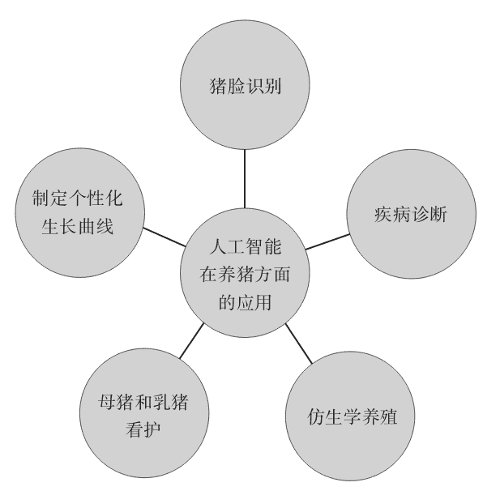

图 4-2 人工智能在养猪方面的应用

#### （1）猪脸识别
猪脸识别是提升养猪管理效率的基础。国家生猪产业技术体系首席科学家陈瑶生教授在“影子智能引擎”发布会上指出，我国的猪脸识别已实现商业化应用。对每头猪完成身份定位，就能把投喂、健康管理、育种到屠宰的完整轨迹沉淀为可追溯记录。

#### （2）制定个性化生长曲线
借助猪脸识别，系统可为单头猪生成专属生长曲线，用更少的饲料实现更大的群体增重。个体差异明显，若没有AI识别与深度学习支撑，为每头猪匹配专属曲线的难度极高。

#### （3）疾病诊断
传统模式依赖兽医定期巡诊，效率低且容易延误，常引发大面积死亡。AI可以持续记录每头猪的运动、采食等行为并进行分析，异常即时推送给养殖者，降低发病风险。

#### （4）母猪和乳猪看护
母猪分娩期的管理工作量巨大。借助摄像头与传感器，AI可及时反馈母猪妊娠状态并给出建议。对刚出生的乳猪，AI也能实现人眼难以企及的精细化观察，结合大数据预测其后续生长潜力。

#### （5）仿生学养殖
依托AI技术，养殖方可遵循仿生学原理开展新品种选育。

随着AI在养猪领域的渗透加深，整条链条有望打通，从育种到屠宰实现顺畅衔接。未来由智能系统管理的猪场或将走向无人化，仔猪在智能呵护下健康成长，经智能屠宰后消费者能够吃到安全无害的猪肉。

### 4.1.5 AI驱动渔业升级：智能捕捞护航海洋可持续

传统捕捞能否有所收获，关键在于对鱼群位置的判断是否精准。业内常说的“分散找鱼群、集中捕捞”正是传统作业的写照，先分散探鱼，定位后再集中作业。

作业成功率既受船长经验影响，也受天气制约。大数据带来一定改善，而AI的加入让捕捞更智能。

在鱼群定位与智能捕捞方面，南太平洋捕捞丰汇远洋渔业总指挥朱义峰与阿里云团队携手，基于朱义峰的专业经验，阿里云“ET大脑”构建了新算法，鱼群预测准确率达到81%，远高于传统经验水平。

渔业另一痛点是过度捕捞。人工监管难到位，监控作业对管理部门而言难度极大。AI有望破解这一难题，维持生态平衡，实现海洋鱼类可持续利用。

在遏制过度捕捞方面，AI图像识别技术可辨识捕获渔获的物种信息。识别后通过互联网将数据回传至监管部门，加强对非法作业的监督，有助于摸清区域渔业现状。

据全球捕鱼观察 Global Fishing Watch 的统计，全球每年非法、未报告及未受监管的渔业产值高达235亿美元，占全行业五分之一。AI应用可显著压缩非法捕捞比例。

科学家和政府机构正借助AI构建全球渔业精细模型，为渔民捕捞指导、鱼类生态监测与海洋资源保护提供科学依据。

## 4.2 三条路径搭建AI农业链，提升综合产出

各行业加速智能化的背景下，AI与农耕融合形成智能农耕已成必然。要打造智能农耕，必须对全价值链进行智能化升级，形成产出更丰富的整体AI农耕链。

从建设路径看，可围绕价值链、组织形态和经营机制三方面展开。

### 4.2.1 价值链：推进纵向贯通

农企要实现可持续发展，需构建从生产到用户反馈的闭环全链条，对流通各环节实施标准化管控，如图 4-3 所示。

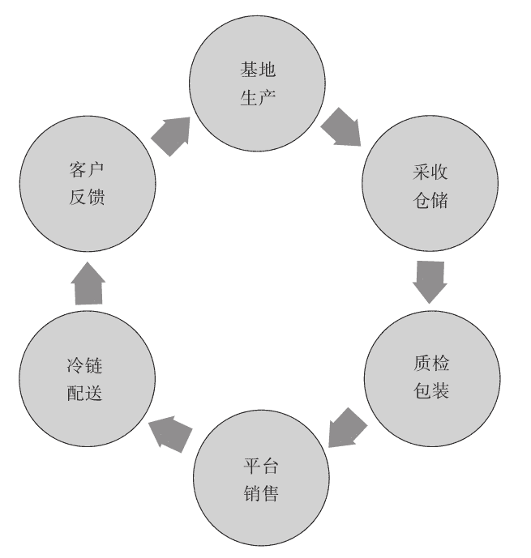

图 4-3 全产业链模式

农业全价值链实现纵向贯通，主要打通上中下游三个环节，如图 4-4 所示。

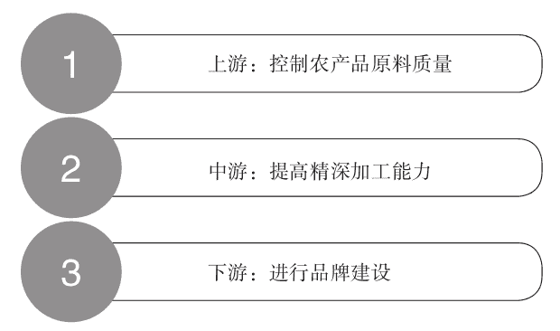

图 4-4 农业全产业链

#### （1）上游：把控原料品质
原料质量是农业企业的根基。上游环节需重点把控。

其一，农户利用AI提升生产效率，可实现更高产量；其二，加工企业也能借助AI打造自有优质农田，增强市场竞争力。

#### （2）中游：强化精深加工
此环节面向农产品加工企业。把农产品加工成更精细的产品，如小麦制成面包，能打开更高利润空间和更强竞争力。

AI可通过分析现有产品相关度更高的精细加工方案，为企业新品开发提供建议。

#### （3）下游：塑造品牌
农产品行业中，口碑品牌往往能获得高利润。品牌与销售渠道建设需长期投入。

AI可对企业过往销售数据进行分析，挖掘与销量相关因素，形成智能决策，辅助品牌决策。

形成纵向贯通的链条后，运作更顺畅，运营成本下降，竞争力提升。这种现代化进程中，AI将为从生产到决策的各环节注入新动能。

### 4.2.2 组织形态：“公司+农创园区+市场”三位一体

现代农耕已出现“农创园区”形态，可在AI农耕链建设中继承发展，形成“公司+农创园区+市场”模式。其中心在于公司主导、园区承接、市场导向。

#### （1）公司是主导
公司制定生产目标、标准和产品理念后，统一设计园区。AI可提供辅助决策和设计建议。

#### （2）农创园区是关键
园区作为生产示范点，应充分体现智能农耕特征。借助AI，园区可率先实现无人化管理，并开展智能除草、灌溉等作业，降低人工成本，同时可开展参观采摘创造收益。

#### （3）市场是目标
无论组织形态如何，最终目标都是赢得市场。AI的智能分析与决策能力需高度重视，软件可全景掌握市场动态并进行预测，为营销提供依据。

传统“公司+农户”模式在利益协调上矛盾较多，并非智能农耕主流。而“公司+农创园区+市场”能最大限度降低利益冲突，农户在园区内以种植者而非经营者身份存在，减少与公司的摩擦。

该模式充分结合AI技术，降低人力成本与灾害风险，必将成为智能农耕主流组织形态。

### 4.2.3 经营机制：“品牌+标准+规模”三维融合
《中国互联网+智慧农业趋势前瞻与产业链投资战略分析报告》指出，农业价值链成功与否取决于整体效益，而效益取决于“品牌+标准+规模”的经营机制。该机制在智能农耕建设中尤为重要，品牌化为核心，标准化为保障，规模化为手段。

#### （1）品牌化是核心
终端产品要实现溢价，形成品牌是关键。传统链条因缺乏成熟品牌，易受行业风险冲击。借助AI强大的数据分析能力，可精准定位企业品牌形象。品牌保障下的溢价对利润本就不高的农产品尤为重要。

#### （2）标准化是保障
品牌建设离不开标准化。企业可通过AI实现自上而下的监督，确保标准落地。只有统一严格的标准才能将品牌理念转化为影响力，获得溢价。

#### （3）规模化是手段
品牌与标准成熟后，扩大规模是获取更大市场的必经之路。AI机器人精度与效率高于人工，有助于企业扩大生产规模，实现规模效应，快速打开市场。

农耕经营需完善机制才能可持续。“品牌+标准+规模”三维融合契合现代产业理念，是未来智能农耕的发展方向。

## 4.3 智能农耕的典型案例

随着“十三五”规划推进，农业现代化成为重点，农业信息化智能化迎来发展期。在政府与市场推动下，智能农耕已有成熟案例。本节以智能化农场和农业智能环境监控系统为例进行分析。

### 4.3.1 智能化农场：深耕农业物联网

数据显示近十年我国农业人力成本年均增长12.7%，传统农耕升级势在必行。在物联网与农业大数据发展背景下，智能农耕探索加速。

智能化农场是典型代表。深圳农博创新科技有限公司依托物联网与大数据分析，结合AI打造系列智能化农场设备，打通农业数据壁垒，构建农业物联网系统，如图 4-5 所示。

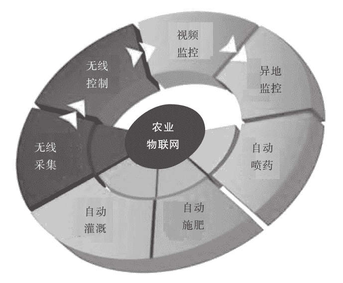

图 4-5 农业物联网系统

智能化农场通过智能监控设备实时采集温度、湿度、病虫害等多维度数据，基于深度学习农业专家经验构建分析模型，并将结果与处理建议及时推送给负责人。管理者据此下发科学指令，远程即时调控智能设备，实现喷药、灌溉、自动施肥等操作。

建设农业物联网系统方面，农博创新在数据传输与硬件设备上具两大优势。

数据传输上，按农场规模“因地制宜”。大型农场采用LoRa Wan组网方案，适合远传、低功耗、低成本且具备绕射能力，测试可达25公里范围传输，解决信号弱与Wi-Fi覆盖不全问题，并节约近九成通信费用。中小型农场则提供多种混合传输方案供灵活选择。

硬件上，自研自产智能传感器性能提升且成本更具竞争力，同时优化安装与操作流程，降低使用门槛，促进普及。

农博创新CEO马俊娜表示，希望未来农业物联网设备像消费电子一样普及易用。产品体现了这一追求。

智能化农场可改革传统模式：降本提质。传统温室大棚6亩至少需2人看管，而农博创新智能化农场理想状态下3人即可管理100亩，人力成本降60%以上，同时实现品质化与规模化生产。

该案例证明，借助AI，农场数据采集、分析与控制可完美实现。全面建立大农业物联网系统对智能农耕发展意义重大。

### 4.3.2 智能大棚环境监控系统

智能农耕最基础的内容是借助传感器与软件通过互联网对生产进行控制。农业智能大棚环境监控系统已得到广泛应用。

现代温室大棚种植突破了地域与季节限制。棚内温湿度、光照、气体配比等参数对作物生长影响极大，需实时监控调节。

传统人工控制成本高且难以达到科学种植的最优效果。智能大棚环境监控系统以AI和互联网为基础，可24小时监控大棚物理环境，并与管理者电脑或手机连接实时反馈。当参数偏离最优区间，系统可自动向设备发送指令，如自动浇水。

深圳信立科技有限公司设计的应宽智能农业大棚环境监控系统，可实时采集空气温湿度、土壤温湿度等多项现场参数并无线传输至管理终端，实现远程监管。如二氧化碳浓度低于设定值，系统可自动补气，大幅降低人工误差，提升产量与品质。

系统包括四部分，如图 4-6 所示。

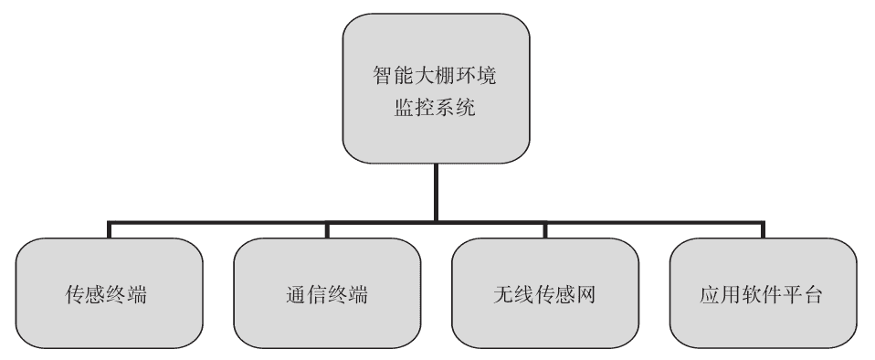

图 4-6 智能大棚环境监控系统

#### （1）传感终端
包含各类智能传感器，如无线空气温湿度传感器、无线光照传感器，用于采集数据。

#### （2）通信终端
包括设备信息采集单元以及用户电脑、手机等，实现设备间沟通。

#### （3）无线传感网
包含自组织网络与通信网络两部分。前者为温室内部节点联系网络，后者为各大棚与控制中心间网络，两者结合实现统一监控。

#### （4）应用软件平台
用于数据存储、处理与挖掘分析，在中央控制软件的智能决策下输出指令，调控大棚环境，保证作物优良生长条件。

智能大棚环境监控系统是智能农耕现代化的一次积极尝试。随着AI持续发展，有望打造全面智能的大棚养殖体系。

# 第 5 章 人工智能+工业：高效、安全、便捷化

随着AI技术深化，AI与工业结合受各国政府高度重视，建设智能工厂成为工业企业紧迫任务。历经蒸汽、电力、计算机与信息技术三次工业革命后，AI将引领第四次工业革命，实现高效、安全、便捷的“AI+工业”。

## 5.1 AI与工业4.0

德国政府《德国2020高技术战略》中的“工业4.0”项目引发全球关注。工业4.0聚焦制造业智能化水平，以建设智能工厂为目标。

中德在推进工业4.0落地高度一致，《中德合作行动纲要》重点强调数字化作用。在此背景下，AI在工业中的推进尤为重要。

AI在机械臂、机器视觉与大数据上的突破，为制造、安检、销售等环节带来创新，未来有望实现智能工厂目标。

### 5.1.1 工业4.0即智能制造

工业4.0主旨是在现代通信与网络技术支持下，推动制造业向智能化转型。换言之，工业4.0即智能制造。

工业4.0战略由智能工厂与智能生产两部分组成，如图5-1所示。

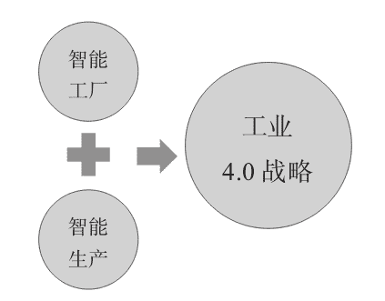

图 5-1 工业 4.0 战略的组成

智能工厂面向传统工厂智能化转型，重点研究新型智能化生产系统与过程，以及生产设施的智能化更新与分布。智能生产则聚焦于生产过程中如何运用新技术实现效率最大化。

工业4.0提出的智能制造是信息技术与制造技术深度融合与集成，如图5-2所示。

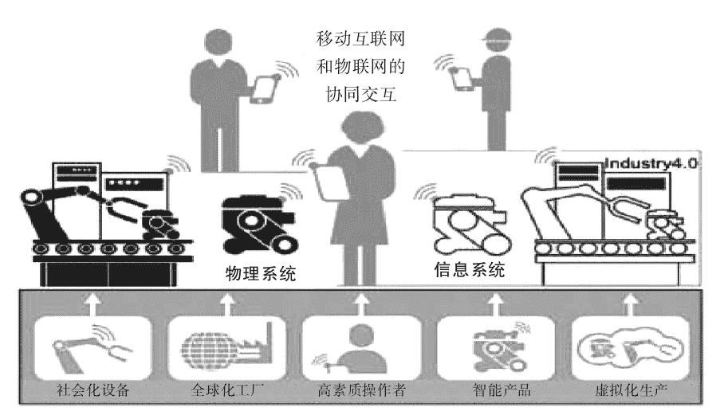

图 5-2 智能制造示意图

众多智能工厂通过移动互联网与物联网系统交互形成庞大制造网络，工厂内部的社会化设备、智能产品与高素质操作者则通过内部通信机制实现协同，涵盖生产数据采集与分析、生产决策确定等。

工业4.0具有四个特点，如图5-3所示。

#### （1）生产智能化
借助AI信息网络，智能工厂生产通信更顺畅，生产速度大幅提升。

#### （2）设备智能化
在AI技术助力下，生产设备可自动判别生产环境并调节生产过程。

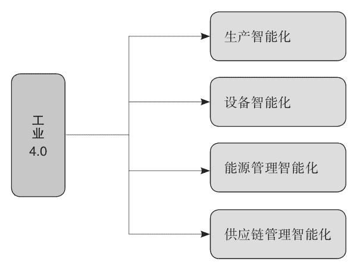

图 5-3 工业 4.0 的特点

#### （3）能源管理智能化
具备无障碍通信系统，工厂电力系统、楼宇控制系统、电力微机综合保护系统等均可智能化，实现能源最优分配。

#### （4）供应链管理智能化
智能制造为完全整合系统，从原料配送到产品运输，供应链管理从全局统筹，安排更合理的管理体系。

### 5.1.2 机械臂与工业制造：实现高效统一生产

在大型产品工业生产如汽车制造中，机械臂应用已普遍。随着自动化需求提升，机械臂正逐步进入小型加工行业。小型加工对举重能力要求不高，更看重精细操作能力，因此机械臂小型化与智能化成为必然趋势。

#### （1）小型化
机械臂小型化不仅指外观尺寸缩小，活动半径也需减小。尺寸与操作半径越小，越利于生产线密集部署。

传统机械臂尺寸远超生产工人，且需保留安全空间，导致引入机械臂不仅无法密集部署，反而需投入更多成本重新设计生产线。机械臂小型化后，工厂无需改动现有产线即可直接用机械臂替代人工进行流水作业，从而提升生产效率。

#### （2）感知升级：机械臂学会“手感”与“眼观”

智能机械臂的灵活来自力觉传感器和视觉传感器的协同。精密机床加工时，人会凭借触感和目测实时微调走刀路径，人工智能的加入让机械臂复制出这种临场应变能力。

通过深度学习记录工人的操作流程，人工智能机械臂积累了丰富的加工应对经验。一旦智能传感设备捕捉到材料的特性参数，软件就会指导臂体完成定点精细化作业。

越疆科技的 `Dobot` 就是小型化与智能化的典型代表。体积仅相当于一盏台灯，是桌面级设备，完全契合小型工业的需求。通过App操控，它既能做传统臂体的夹持、吸取，又能完成精细复杂任务，定位精度可达 0.2 毫米，甚至能用于雕刻、绘画。

应用场景已相当多元：`Dobot` 与美国扬声器厂 `BOSE` 合作验证扬声器设备反复按键质量；参与华为手机、平板显示屏盲点测试；还与周大福珠宝合作实现金饰自动化称重。

机械臂本就可在程序指令下精准作业，叠加人工智能后操作更具弹性，极致的精准度得以充分释放，对实现高效统一的工业品生产意义重大。

### 5.1.3 机器视觉当“安检员”，让工厂更安全

机器视觉常被称作自动化的眼睛，在产线上作用关键。相比其他感知方式，视觉无需接触被测物，对人和物都更安全，这也是其被广泛采用的主因。

与人眼相比，机器视觉具备明显优势，如表 5-1 所示。

表 5-1 机器视觉和人眼对比

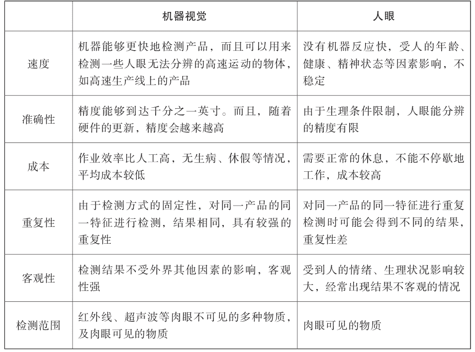

由表 5-1 可见，机器视觉可探测红外线、超声波等人眼无法感知的信号，且无需休息可 24 小时不间断观测，对恶劣工业环境优势明显，经济效益高。

借力人工智能的机器学习，机器视觉能更敏锐区分工厂环境中的不安全与安全状态，提升整体安全水平。

机器视觉在工业安检的落地可归纳为三个典型应用，如图 5-4 所示。

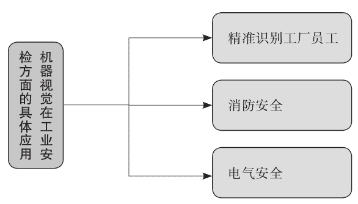

图 5-4 机器视觉在工业安检方面的具体应用

#### （1）人员准入更严谨
工厂对作业区人员管控要求严格，传统靠监控摄像头配合门卫，隐患难清零。机器视觉可对进厂人员做全方位监控，实现高精度人脸识别，杜绝无关人员混入。

#### （2）火险预警
对红外线、温度等数据进行实时监测，可提前发现火灾等隐患并发出预警，降低事故率。

#### （3）用电安全
机器视觉能巡检全厂线路状态，及时识别过载、短路等电气风险。

### 5.1.4 人工智能赋能销售：让营销更精准

德国工业 4.0 指出，随着智能设备普及和信息化推进，工业将产生海量数据，这正是工业 4.0区别于传统生产体系的核心特征。数据可直接用于产品销售，实现精准营销。

依托人工智能深度学习，工业大数据的分析精度持续提升，能够深挖消费者需求，推动生产端持续改进。

相较单纯大数据分析，人工智能驱动的营销更强调“智能”。深度学习将供应链、物流仓储、生产制造三类数据融合分析，为营销决策提供更可靠参考。

工业 4.0 时代，企业数据随智能化进程呈爆炸式增长，也为人工智能营销提供了丰厚的数据土壤。随着技术迭代，企业的营销能力将得到大幅增强。

## 5.2 建设智能工厂的五大策略

工业 4.0 提出后，“智能工厂”概念广受关注。一方面人工成本攀升、招工困难；另一方面人工智能等技术为转型升级提供了支撑，各类工厂纷纷谋求升级。但如何真正建成智能工厂？以下五大策略可供参考。

### 5.2.1 聚焦价值链，信息化必须落地

建设智能工厂要先厘清关键要素。良信电气副总吴煜曾强调，迈向工业 4.0 要关注质量，不仅是产品质量，更是构建健全的全价值链质量平台并实现信息化。

企业信息化是提升竞争力、建设智能工厂的核心环节。主要涉及企业资源规划 `ERP`、供应链管理 `SCM`、客户关系管理 `CRM` 和产品生命周期管理 `PLM` 四大领域。因此必须把 `ERP`、`SCM`、`CRM`、`PLM` 等系统固化落地，消除信息孤岛。

信息化落地后可实现以下五项目标，如图 5-5 所示。

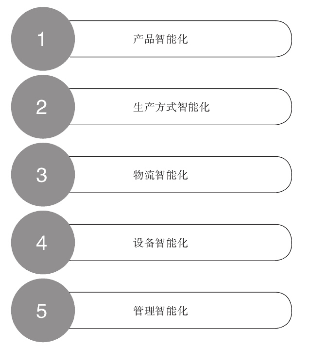

图 5-5 企业信息化的目标

#### （1）产品智能化
打通 `PLM` 与多系统协同设计，将产品全生命周期过程结构化为数据与文档，长期有效并支撑自动化设计。

#### （2）生产方式智能化
借助 `ERP` 等系统管控生产，打破黑箱，实现过程透明、可追溯。

#### （3）物流智能化
用 `SCM` 统筹管理，降低线边库存，提升配送响应速度与透明度。

#### （4）设备智能化
通过各信息系统数据互通，精准调控产线、机械臂等，实现生产自动化与智能化。

#### （5）管理智能化
信息系统横向联通后，流程与程序信息深度融合，为项目管理提供智能决策支持。

建设智能工厂的关键是打造全价值链质量平台，推动信息化落地，打通壁垒，形成真正的智能化体系。

### 5.2.2 先立标准，再建工厂

智能工厂的本质是全价值链质量平台结合信息化落地，仅有自动化产线和工业机器人还不够。智能工厂覆盖面广，需要明确衡量标准。通行的五大标准如图 5-6 所示。

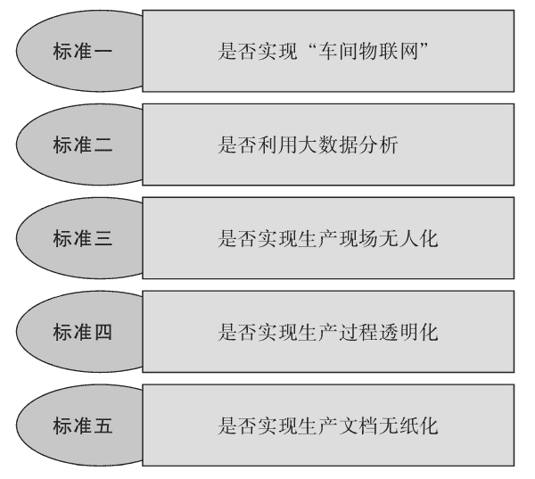

图 5-6 智能工厂的衡量标准

#### （1）是否建成“车间物联网”
传统产线仅设备间通信，人机交互需接触操作。真正的智能工厂应构建人、设备、系统三者互联的“车间物联网”，实现智能交互式通信，实现人机物连接，便于管控。

#### （2）是否善用大数据分析
信息化加速后，工厂数据激增，设备产生的数据量远大于企业内部数据。智能工厂需借助大数据技术建模，结合人工智能持续优化生产管理；一旦偏离标准，系统自动报警。

#### （3）是否实现现场无人化
自动化生产是基本要求，出现问题时设备可自诊断自排障并恢复生产。

#### （4）是否实现过程透明化
在信息系统支撑下，生产全程可追溯，数据真实透明，便于查询监管。

#### （5）是否实现文档无纸化
智能工厂应是环境友好型工厂，工艺卡、质量文件、图纸等纸质文件应淘汰，无纸化管理可减少浪费并提升检索效率。

明确标准并逐项落实，才能制定合适的智能企业建设方案。

### 5.2.3 从智造单元起步，提升效率

建设智能工厂时，智造单元被视作落地最有效的抓手，是实现智能工厂的必经之路。

智造单元基于基本生产车间，将功能相近的设备整合成模块，通过软件连接并接入企业管理系统，形成一体化。

可用“一个现场，三个轴向”来描述，如图 5-7 所示。

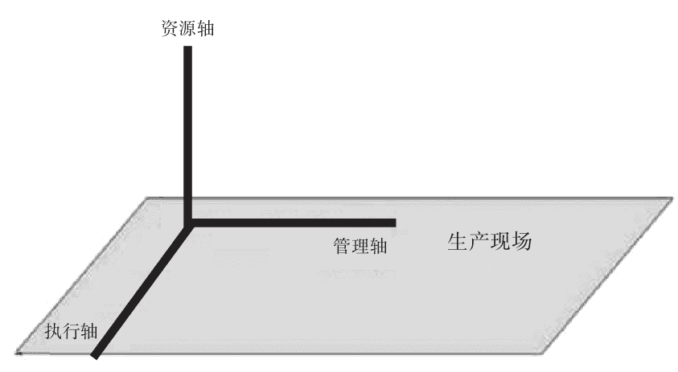

图 5-7 智造单元三维示意图

#### （1）资源轴
资源为抽象概念，可指员工、设备、工艺，也包括企业文化等精神层面要素。

#### （2）管理轴
涵盖生产要素管控与运维，包括质量、成本、性能、交付等。

#### （3）执行轴
体现 `PDCA` 循环，即计划 `Plan`、执行 `Do`、检查 `Check`、行动 `Action`。

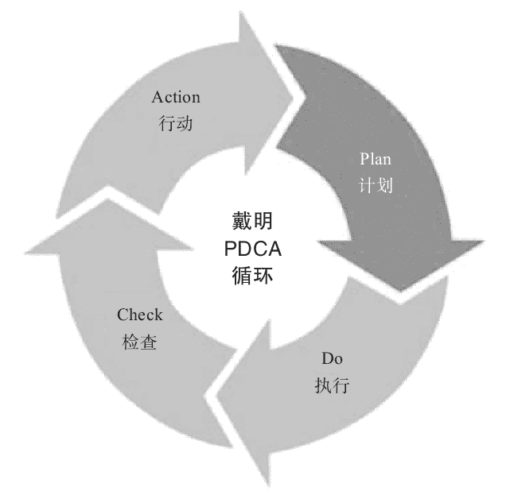

图 5-8 `PDCA` 循环示意图

智造单元是最小的数字化工厂，可实现多品种少批量甚至单件生产，且能最大程度复用现有设备，控制投资成本，具有调控柔性。

### 5.2.4 人机协同，而非人机替代

智能工厂的本质不是无人工厂，而是在控制成本前提下实现人机配合，满足市场需求。

在工业 4.0 背景下，市场需求趋向个性化。人机配合让机器人承担重复性工作，人专注创造性工作，以满足个性化定制。

海尔是典型案例。其发布的众创洗衣机 `intelius` 以智能、高科技赢得市场，由互联工厂打造，全球 50 万用户参与设计。

海尔欧洲白电总经理弗兰克表示，通过互联网吸引 50 万用户共创，最终方案由用户从 79 个模块中挑选出 2 个最佳组合，真正由用户决定产品。

该机能满足个性化定制，得益于海尔互联工厂的智能化与信息化，拥有高柔性自动无人产线，车间实现黑灯化。通过智能设备实现设备智能控制，并向全球消费者展示生产流程，实现洗衣机行业全面透明。

海尔互联工厂通过车间全面自动化，把设计权交给用户，强化人机协同，展现智能工厂在个性化定制上的优势。

### 5.2.5 拥抱新技术，培养科技思维

人工智能发展迅速，智能工厂所用技术亦日新月异，企业需积极尝试新兴技术并培养科技意识。

可重点关注以下技术：

#### （1）智能语音 + `ERP` 应用
通过智能语音唤起 `ERP` 功能，简化功能调用与信息录入；延伸至设备连接后，还可语音启动设备运行，提升效率。

#### （2）图像智能扫描识别
利用图像扫描快速生成单据凭证，减少手工录入，降低差错与人工负担。

#### （3）`AR` 技术
增强现实 `AR` 技术可让维修人员扫码后将虚拟模型与实物叠加，结合人工智能分析给出维修建议，提升维修效率。

建设智能工厂非一蹴而就，但已有实践在不断探索，企业需牢牢把握上述五大策略。

## 5.3 工业 4.0 时代的智能工厂

工业 4.0 提出后，全球多家优秀企业开展了智能工厂建设并积累了宝贵经验。

### 5.3.1 西门子安贝格：数字化的标杆工厂

西门子在智能工厂建设上处于领先。安贝格工厂 `EWA` 中仅 1/4 工作需人工，3/4 由机器和计算机自主完成。德国总理默克尔曾亲临视察并给予高度评价。

建成以来，生产面积与人员基本不变，产能提升 8 倍，平均每秒生产一件，合格率高达 99.9985%，在速度与质量上全球领先。

其背后有三大核心特点，如图 5-9 所示。

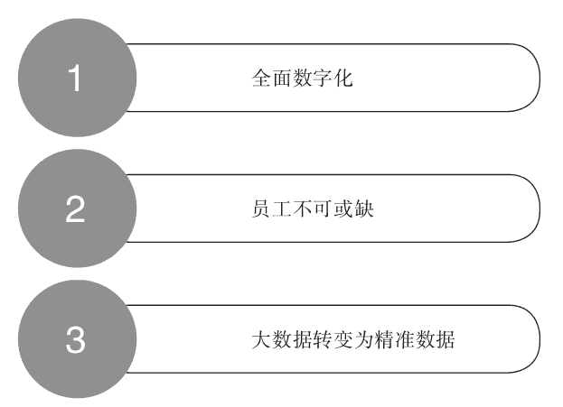

图 5-9 安贝格工厂的特点

#### （1）全面数字化
生产过程实现“机器控制机器”，正是工业 4.0 的目标。工厂生产 SIMATIC 可编程逻辑控制器等产品，产品自身具备 CPU 级控制能力，实现产品与设备互联互通、自动化生产。

产线上产品通过代码自行调节制造流程，向设备告知生产标准与下一步工序，流程由计算机控制并持续算法优化。

物料配送也实现自动化信息化，产线需求时系统通知人员扫码，自动化仓库经传送带将物料送至产线。

整个流程中工人工作量约占 1/4，数字化不断优化路径与效率。

#### （2）员工不可或缺
高度数字化自动化下，员工仍是关键。除巡检外，主要工作是提出改进建议。员工建议对生产力提升的贡献约占 40%。工厂为采纳建议的员工发放奖金，曾累计发放 220 万欧元。

#### （3）大数据转为精准数据
智能工厂需将生产大数据挖掘、分析、管理，使其更贴合生产需求。安贝格工厂日处理数据超 5000 万条，借助人工智能智能分析与分类推送，将大数据转化为精准可用信息。

### 5.3.2 九江石化：流程型企业的智能突围

九江石化是国内首批石化智能工厂试点之一，在缺乏成熟经验情况下，结合流程型企业特点与人工智能成功打造智能工厂，通过中国石化总部验收。

其核心业务管理绩效提升体现在四个方面。

#### （1）本质安全持续提升
建成人工智能生产管控中心与数字炼厂平台，实现监管全场景覆盖与动态数据实时交互，本质安全不断强化。

#### （2）环保管理明显进步
数字炼厂平台推动工艺进步，形成绿色高效可持续流程，连续两年获评“中国石化环境保护先进单位”。

#### （3）盈利能力大幅提升
自主研发人工智能炼油全流程优化平台，以经济效益最大化为目标，实现“月计划—周调度—日平衡”双闭环管理，提升市场应变能力与准确性，加工吨油边际效益连续四年在沿江五家炼油企业中排名首位。

#### （4）管理效率大幅提高
在三层信息化架构上创新构建集中集成、数字炼厂、应急指挥三大公共服务平台，打破信息孤岛，从分散管控走向集中管控再向智能管控提升。炼油产量翻倍的同时，操室数量降 35%，班组减少 13%，员工总数下降 12%。

在完成“智能工厂 1.0”后，九江石化正加速推进“智能工厂 2.0”，向高端智能与原创智能迈进。

### 5.3.3 隆力奇智能化工厂

工业4.0浪潮下，打造智能工厂已成为各大企业竞相布局的方向。不同行业对智能工厂的理解各有侧重，也衍生出多元的探索路径和解决方案。在日化领域，隆力奇率先启动智能工厂试点，并成功跻身江苏省首批示范智能车间名单。

其智能化工厂内配有智能净化车间、自动化配送体系以及多套高端智能产线，存量设备同步完成自动化与智能化改造，厂房整体达到GMPC良好生产规范标准。

该公司智能生产车间所用装备处于行业前沿。洗护品产线采用意大利ACMA-PYSTER香波全自动灌装线，灌装速度稳定在每分钟200瓶左右；牙膏产区依靠智能化设备实现每分钟200支的产出，误差控制在1克以内，年产能可达2.75亿支规模。

在引进硬件设备之外，隆力奇同步搭建自有的AI工厂云平台。通过多种无线连接方式，各工序工位的数据实时上传并汇聚至平台。车间的人机交互也得到强化，支持语音操控、视觉识别和手势识别。基于云平台，公司还构建了智能工厂辅助系统，帮助员工快速定位问题、提升处置效率。依托这套体系，一到两名操作人员即可完成对整条车间的管控。

试点验证成功后，隆力奇加速复制扩张，并在栟茶镇落地一座遵循工业4.0标准规范的OEM/ODM加工基地。一期项目预计投入约3亿元人民币，对应产能价值约8亿元，并计划在2024年前完成中国栟茶化妆品股份有限公司的上市筹备工作。

除栟茶基地外，公司还规划未来20年内在珠三角、长三角和东南亚区域再复制10座符合工业4.0标准的智能工厂，推动整体运营向智能化迈进。

# 第 6 章 人工智能重塑金融：风控更稳、理财更智、服务更贴

金融行业天然数据密集、资本密集且盈利可观，为人工智能提供了广阔应用空间。AI与金融深度融合，正让人们的金融生活更便捷，投融资更安全、财富管理更科学、服务响应更到位。

整体来看，人工智能+金融的服务形态主要涵盖六大类：智能投顾、智能投研、智能信贷、智能金融咨询、智能监管以及智能保险。本章将围绕这些应用展开，并结合国内外典型案例进行解读。

## 6.1 人工智能金融的服务种类

人工智能金融正渗透到传统金融业的各个环节，成为AI时代金融服务转型升级的重要驱动力，具体表现如下。

### 6.1.1 智能金融投顾业务

智能金融投顾即智能投资顾问，是一种新兴的在线财富管理模式，也称机器人投顾。它依托AI算法，结合客户的经济实力、理财目标等信息，利用经济学原理为客户定制最优投资方案，并提供持续的实时追踪与动态管理。

该业务具备四个核心优势。

#### （1）分散化
智能投顾追求风险最小化。AI综合研判各类投资后，会为客户推荐分散化的资产组合，避免过度集中带来的损失。诺贝尔经济学奖得主马科维茨的研究指出，分散投资是金融市场的“免费午餐”。相比集中押注，分散式配置能在相同风险水平下获取更大收益，这也是智能投顾的核心目标。

#### （2）个性化
智能投顾以客户个体情况为依据，充分考量理财目的与资产状况，为每位客户量身打造专属组合。诺贝尔经济学奖得主丹尼尔·卡内曼曾指出，大多数投资者并非完全理性，而是受行为偏差影响，决策并非总是规避风险。非理性偏差易导致归因错误，进而在下一次投资中过度自信。智能投顾则以既定算法而非主观直觉做决策，为客户匹配最适配的产品。

#### （3）长期化
智能投顾更注重长期稳健回报而非短期波动，具有明显的长期属性。投资的关键在于形成一套操作逻辑并坚持执行，但人容易受外部事件干扰而频繁变动。智能投顾遵循预设规则与策略，不轻易更改逻辑，从而实现投资长期化的要求。

#### （4）低收费
由于采用计算机完成数据分析与方案组合，无需传统人工咨询，运营成本更低，收取的服务费也显著低于传统模式。

总体而言，智能投顾兼具机器推荐的效率与人工咨询的专业性。其核心能力可概括为四点：以大数据分析支撑风险偏好识别及演变规律洞察；利用智能算法模型制定合理投资组合；持续跟踪资产配置并根据实际情况动态调整；帮助客户在可控风险内实现收益最大化。随着AI在金融领域渗透加深，智能投顾将成为未来金融服务的主流工具。

### 6.1.2 智能金融投研业务

金融投研即投资研究，核心是行业研究与投资分析。无论是人工投研还是AI驱动的智能投研，大致流程都包括“搜索—数据提取—分析研究—观点呈现”，两者对比见表 6-1 人工投研和智能投研的比较

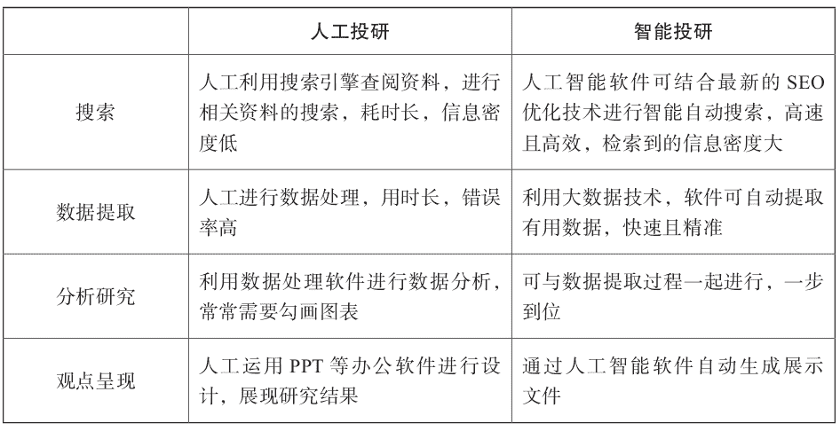
不难看出，智能投研在人工成本与效率上具备明显优势。借助AI技术，可实现从搜索到观点输出的跨越式处理。

目前智能投研主要有三种模式。

#### （1）整合多平台数据资源
AI能够跨平台抓取、整合相关数据，为客户提供有效支撑。以金融大数据平台Palantir Metropolis为例，该平台利用AI对原始杂乱数据进行整合，具备多元数据融合、数据建模与迭代协作等功能。整合后的数据结构化程度高，能为从业者提供清晰分析思路，摆脱繁琐的数据处理环节。

#### （2）设立专有的新数据集和工具套件
构建专属数据集和工具套件后，AI软件能以量化方式呈现投资产品的未来发展潜力，降低投资风险。

#### （3）细分产品，提取核心数据
通过持续学习，AI可将金融产品不断细化，抽取出关键核心指标，帮助客户提前判断产品价值。

借助动态SEO、语音语义识别和知识图谱等底层技术，智能投研可实现研究全流程自动化，提升效率。

尽管效率更高，智能投研并非要完全替代人工。通联数据王政博士曾强调：“只有将数据、专业知识与技术有机结合，才能构建真正的智能投研平台，人机协同至关重要。”也就是说，AI在投研领域更像是专家的武器，帮助分析能力进一步提升。

### 6.1.3 智能金融信贷服务

信贷是金融业的核心业务，也是AI与金融融合最深的场景。信贷业务流程主要分为三个阶段，如图 6-1 所示。

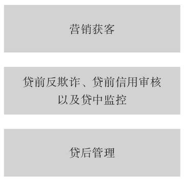
图 6-1 信贷业务流程

传统信贷高度依赖人力：营销人员拉客、信贷专家评估、客服专人跟进。引入AI后，传统信贷升级为智能信贷，既降低企业服务成本，也大幅改善客户体验。

从业务方向看，智能信贷聚焦两个重点：To B服务与To SME小微企业信贷。

#### （1）To B 服务
To C与To B一直是企业服务两大阵地。C端客群庞大、风险相对可控，金融机构多有布局。不同的是，智能信贷依托大数据，庞大的数据体量是其优势的前提，因此在拓展B端客户上具备先天条件。

#### （2）To SME（面向小微企业）信贷服务
随着创业热度提升，2017年我国小微企业数量已达7328.1万。其中不足10%能获得银行小额贷款，其余90%是智能信贷的潜在客群。

借助大数据，智能信贷机构可全面把握小微企业经营现状，并按软件决策建议决定是否放贷。这既降低了放贷风险，也解决了小微企业的融资难题，实现双赢。

相比传统信贷，智能信贷时效性更强。传统放款周期长，主要是资格审查繁琐、需人工逐项核验。智能信贷将审查交给大数据分析与智能评估系统，处理效率远超人工，能及时缓解小微企业资金压力。

随着市场逐步规范，我国线上信贷正从粗放走向精细化，以客户为中心的运营理念成为主流。基于AI与大数据的智能信贷，更能兼顾需求与个性差异，将成为信贷业务的主流趋势。

### 6.1.4 智能金融咨询服务

在金融咨询领域，AI既可作为智能客服为客户服务，也可用于金融信息检索，如图 6-2 所示。

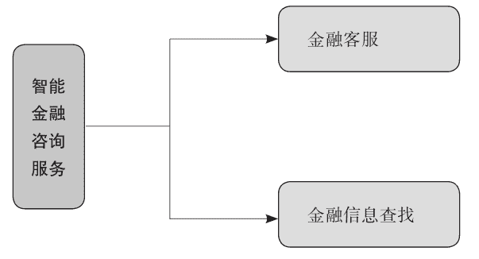
图 6-2 智能金融咨询服务

#### （1）金融客服
智能客服可学习大量金融知识并据此解答咨询，并在持续交互中自主归纳高频问题、分析客户心理，提供快速解答。智能客服还能与其他渠道融合，例如与移动App结合，综合视觉识别、语音识别等技术实现多元智能沟通，让客户随时随地获得服务。

与人工客服相比，智能客服语速与语调稳定温和，不易受情绪波动影响，能带来更舒适的服务体验。

#### （2）金融信息查找
金融信息庞杂且关联性强，从业者若要筛选有价值数据，需耗费大量时间且存在无效投入风险。AI可自动提取与问题相关的有效信息，提升检索效率。凭借强大的搜索匹配能力，金融平台能精准、快速地提供关联数据。

金融科技公司Kensho推出的Warren是典型应用。Warren是一个智能金融应用平台，可快速采集并高效处理信息。发生具备分析价值的财经新闻时，Warren会自动抓取相关报道，深入分析其中数据并生成专业分析报告。该工作若由资深分析师完成需数日，而借助Warren，从数据采集到报告汇总可在24小时内完成。

Warren在金融咨询中的应用，可帮助用户快速检索关键词相关高匹配新闻并生成数据报告，为决策提供参考。随着AI持续拓展，智能金融咨询服务将进一步提升效率与便捷性。

### 6.1.5 智能金融监管业务

监管是金融体系的重要支柱。依托AI，金融监管正迈向智能化。AI主要通过规则推理与案例推理两种方式学习金融场景。

规则推理是将法律法规与行业规范输入算法，使系统自主学习后能对合规与不合规行为做出清晰判断。案例推理则是学习典型监管案例，以此作为合规判断依据。

智能监管最典型的应用是反洗钱系统。向系统输入大量洗钱案例后，它可熟练识别洗钱行为特征，一旦出现疑似操作即可迅速响应，提升监管效能。

构建完善的智能金融监管体系需做好三方面工作。

#### （1）构建全面的社会智能监管体系
完善需要全社会协同。政府应推动AI在金融监管中的应用，技术专家深耕实践，金融专家积极探索创新结合，多方参与才能形成全面有效的体系。

#### （2）加快线上监管平台的建设
移动互联网普及改变了人们办事习惯，智能监管也应顺势加快线上平台建设，便利公众查询与处理金融事务。

#### （3）引入专家保障监管全方位
专家既能为现有体系提出改进建议，也能培养优质人才，确保监管体系可持续发展。

中国人民银行科技司司长李伟曾表示：“运用大数据、云计算、人工智能等技术，能够很好感知金融风险态势，提升监管数据收集、整合、共享的实时性，有效发现违规操作、高风险交易等潜在问题，提升风险识别准确性和风险防范有效性。”

智能监管可实时分析各类金融数据，缓解信息不对称与监察滞后问题，同时及时披露洗钱、套利等违规行为，提升整体监管效能。引入AI有助于打造更完善的监管平台，保障交易双方财产安全。

### 6.1.6 智能金融保险业务

随着健康意识提升，保险业务成为金融热点。AI可将保险业务中可自动化的环节全部自动化，推动传统保险向智能化升级，提升处理效率。

智能保险业务主要体现在三个方面。

#### （1）精准推荐
依托大数据，智能保险系统可根据客户需求与经济状况定制最适配方案。通过多次交互，AI还能发现客户尚未察觉的需求，智能生成满足条件的产品。不仅能基于客户描述推荐产品，还可预测未来风险场景做好预案，这正是保险的价值所在。

#### （2）打击骗保
利用人脸识别与图像识别等技术，可快速核验索赔证据真伪，例如判断事故或疾病照片是否来自网络伪造。这避免了线下核验，同时提升核验效率。通过对历史骗保案例的学习，AI还能识别疑似骗保业务，从源头遏制风险。

#### （3）提升消费体验
AI可为客户提供个性化内容，提升消费体验。英国HeyBrolly公司开发的移动软件Brolly即以AI为核心，为用户提供保险购买建议。Brolly可整合保险政策与个人需求，智能匹配最合适的产品。用户无需研读冗长条款与晦涩法规，即可快速选到适配方案，消费体验显著改善。

总体来看，AI助力保险业务，可实现精准推荐、更好体验与更低欺诈风险，促进行业创新与发展。

## 6.2 智能金融典型案例

AI技术进步推动金融交易员数量下降，智能金融正在形成。国内外互联网金融企业正加速通过AI改造交易流程，提升效率与利润。

### 6.2.1 智能投顾平台：Wealth front

随着需求增长与技术成熟，智能投顾赛道不断涌现。Wealth front是行业领先平台，自2011年起深耕智能投顾，被评为“2013年度TF策略分析师”，服务客户超8万名，资产管理规模达40亿美元。

与传统理财顾问不同，智能投顾聚焦为客户寻找最优投资组合。利用互联网大数据分析客户背景后，Wealth front可推荐多元化组合方案，并提供账户开设、管理与组合评估等服务。

客户使用流程通常包括六个步骤。

#### （1）风险容忍评估
在推荐组合前，客户需填写问卷，如表 6-2 所示。

表 6-2 Wealth front 风险容忍度测评问卷

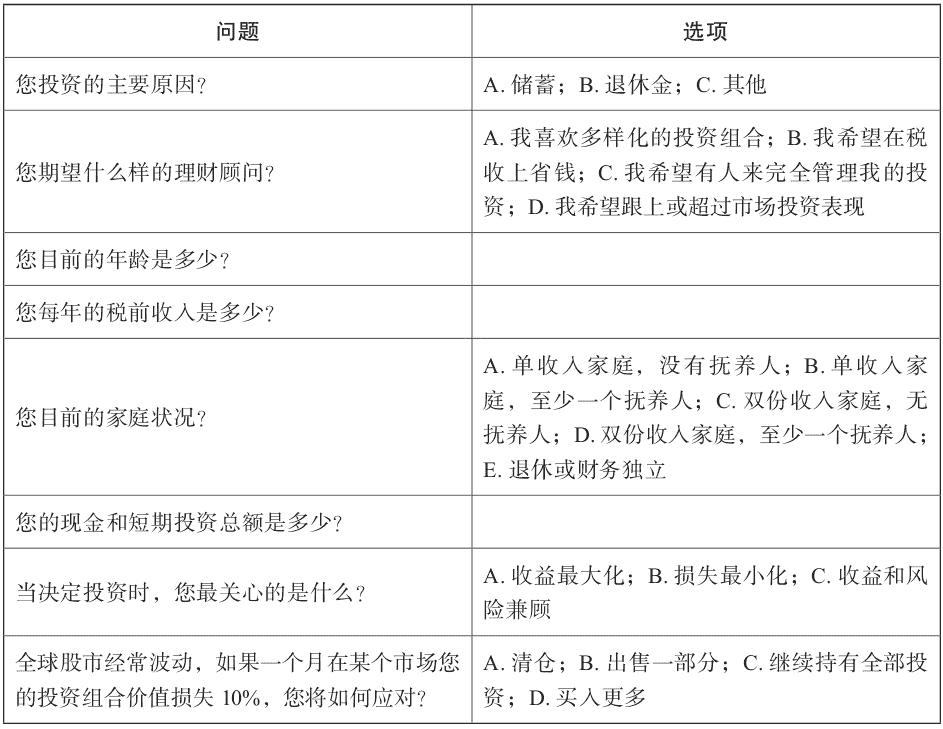
完成问卷后，系统可了解客户对风险的态度，并据此推荐定制化计划。

#### （2）系统推荐投资计划
根据风险偏好与经济背景，系统会推荐最合适的组合方案，载体为指数基金ETF。Wealth front中的组合主要分为两大类：应税账户组合与退休金组合，其下还细分股票、债券等资产类别。平台会依据客户风险容忍度筛选纳入的资产类别。

#### （3）开户

一旦用户在 Wealth front 上确认开户意向，系统就会引导其补全各类注册资料，完成核验后账户即告激活。

#### （4）交易
当有交易需求时，平台将代为向合作券商 Apex Clearing 下达指令，完成 ETF 的买入或卖出操作。

#### （5）客户评估、检查投资组合
用户可以随时在 Wealth front 客户端查看自身持仓状况，若希望调整配置，平台会严格按照其指示执行变更。

#### （6）平台获得佣金
Wealth front 的收入模式比较多元。较为常见的是自开户次月起，于每月首个工作日收取管理费，计费基数为账户净值扣除 1 万美元后的余额，按 0.25% 提取。其他收费方式请见表 6-3 所示。

表 6-3 Wealth front 平台盈利模式

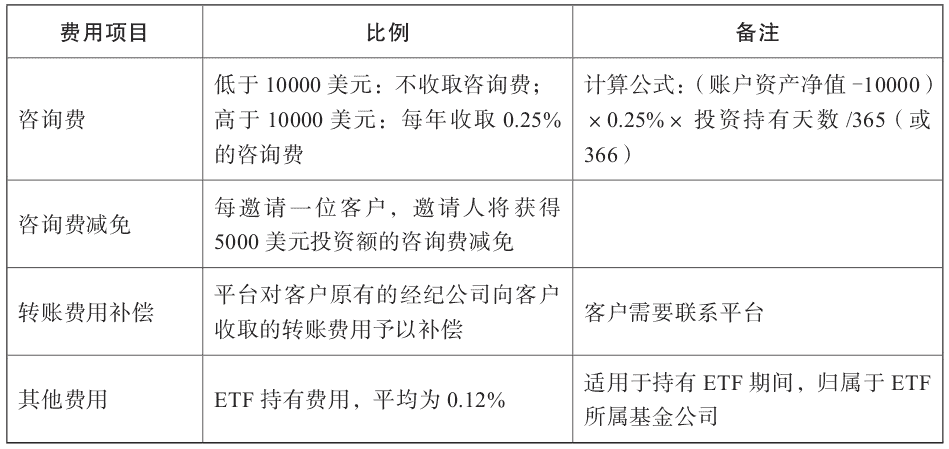

Wealth front 为用户匹配组合的底层逻辑来自现代投资组合理论 Modern Portfolio Theory，由诺贝尔经济学奖得主马科维茨与夏普提出。该理论的核心观点是，通过分散化构建组合，既不必放弃预期收益，又能有效削弱风险敞口。

依托这一理论，平台可供选择的资产大类多达 11 种，既能强化分散效果、压低波动，也能针对不同客群输出差异化的组合方案，满足个性化需求。

据专业咨询机构预测，到 2020 年全球资管规模将落在 1.597 万亿至 2.2 万亿美元区间，智能投顾的渗透率有望升至 5%。随着用户结构迭代，Z 世代将成为金融市场的主力客群，而这正是 Wealth front 的重点聚焦对象。平台还专为在校大学生打造了特色理财产品，成为其差异化竞争的重要抓手。

### 6.2.2 英国：Money on Toast
Money on Toast 是英国本土的一家智能投顾服务商。平台借助智能算法汇聚众多持牌顾问的实战经验，并以顾问辅导客户的流程为蓝本，开发出名为“在线建议之旅 Online Advice Journey”的程序。

其算法吸收了大量专家的专业判断，公司形容这项技术的颠覆性与当年谷歌取代黄页相似：算法能够复刻人类顾问的大部分功能，在某些场景下甚至表现更优。

服务免费开放给投资前的咨询环节，引导用户回答一系列关于财务状况与个人偏好的问题后，系统据此生成投资组合，标的覆盖信托、开放式投资公司以及盈富基金等。平台的门槛设定为每月至少 1 万英镑起投，收取 1.69% 的服务费。

### 6.2.3 腾讯：人工智能即服务，打造腾讯金融云
面对智能化浪潮，腾讯金融加速技术布局，提出“人工智能即服务”理念，并以此构建腾讯金融云。

目前金融云已服务超过 5000 家机构客户，覆盖四大行、股份制银行、城商行、农商行、民营银行、互联网与传统保险公司、券商、基金公司等，是国内使用最广的金融科技平台之一。

腾讯金融云总经理胡利明指出，金融科技的新方向是云架构、连接、数据智能与 Reg Tech。四方面中，云架构带来更大的业务弹性与响应速度，也让互联网金融在新场景下更容易兼顾安全合规；连接是互联网时代机构与客户沟通的前提；人工智能挖掘数据价值，能让金融机构真正智能化；Reg Tech 则契合监管趋严的大趋势。

腾讯在金融 AI 领域深耕超 20 年。提出“AI 即服务”后，金融云在计算机视觉、智能语音识别与自然语言处理三大核心能力上，已对外输出 25 项 AI 服务，涵盖智能客服、智能投顾、智能风控等，帮助金融机构共建智能金融生态。

华夏银行与腾讯金融云已签署合作，双方通过联合实验室等形式深化 AI 在金融场景的应用。中国金融认证中心亦与金融云达成协议，未来数字证书、安全控件等产品将依托金融云的 AI 能力以云服务形式提供，进一步提升金融业的安全合规水平。

整体来看，“人工智能即服务”正推动行业向智能金融生态演进，助力安全合规升级。

### 6.2.4 京东金融：利用人工智能做风控监督
2017 年，京东金融凭借风控技术斩获《亚洲银行家》颁发的“金融界奥斯卡”年度信贷风控技术实施奖，获得国际权威认可。成绩背后是其对人工智能的深度应用。

在京东金融内部，约 95% 的业务由自动化程序完成，超过一半员工从事智能数据研发。平台搭建了一套完整的风控体系，核心包括深度学习、风险画像与高维反欺诈模型。

通过分析用户的浏览行为等数据，系统可以识别账号异常。以账号被盗为例，违法者通常先查询余额再将资金兑换为黄金等贵重商品，人工智能能够捕捉这一异常路径并及时提醒人工介入。依托实时风险监控体系，京东金融已协助警方破获多起网络诈骗案件。

消费金融同样成效显著。以京东白条为例，授信环节中 AI 会先筛除互联网恶意用户、金融失信用户等高风险群体，再结合用户洞察与大数据征信形成白名单。

在反欺诈层面，白条实现全流程监控，每一次账户行为都会被后台安全扫描，实时识别恶意操作与高风险订单。此外，平台还结合设备指纹、生物探针与模式识别进行深度学习，准确区分正常行为与异常登录、交易。

京东金融定位为金融科技，人工智能是其风控体系量化的基础，能够带来更个性、高效的体验。如今公司正持续加码 AI 风控，推动金融走向规模化、安全化，助力普惠金融落地。

### 6.2.5 蚂蚁金服：Techfin（科技金融）
《财富》杂志 2017 年“改变世界的 50 家公司”榜单中，蚂蚁金服榜上有名；《MIT 科技评论》“最聪明 50 家公司”榜单里，它是唯一入选的金融科技企业，评语指出其正探索用 AI 开展信贷业务。

蚂蚁金服财富事业群总裁樊治铭强调，核心优势并非金融而是科技，因此自称 Techfin 而非 Fintech。作为科技公司，其关键词是人工智能，既驱动自身业务，也向外部机构赋能。

支付宝智能客服“小蚂答”即为典型应用，日均处理 200 万至 300 万次咨询，满意度比人工客服高出约 3 个百分点。电话咨询时，语音识别可帮助用户直达对应服务，无需等待语音提示。小蚂答还能充当“保镖”，检测到账户风险时自动触发一键挂失，遇到诈骗可协助一键报案。

由于支付宝功能入口分散，AI 还支持语音直达相关页面。同时，AI 支撑着交易风控、基金推荐、贷款准入等一系列业务。

在国内取得成效后，蚂蚁金服加速出海，尤其聚焦发展中国家。董事长彭蕾表示，公司在推进国内无现金社会的同时，也在全球推广。数据显示，其具备 18 种货币结算能力，已通过技术输出为 200 多个国家和地区提供普惠金融服务。

# 第 7 章 人工智能+医疗：医生更轻松，患者更安心
人工智能不断切入新行业，医疗是其中最具爆发力的赛道。AI+医疗正在重塑诊疗模式。

相较于传统医疗，AI+医疗呈现三重优势：提升信息化水平、提高医疗机构运营效率；实现智能预测、降低疾病发生风险；推动精准医疗、提升整体健康水平。目前已形成五大应用场景：医学影像、药物研发、疾病预测、医生助手与虚拟护士。

AI 进入医疗已成全球共识，既能让医务人员减负，也能为患者带来更实惠的福祉。

## 7.1 人工智能医疗的三大优势
AI 的核心竞争力在于强大的计算与学习能力，在数据密集、知识密集、脑力劳动密集的领域具备天然优势，而医疗正是典型代表。

在各国推进医疗信息化的背景下，AI 医疗可以加速信息化进程、提升运营效率；可进行智能预测、降低发病风险；还能推动精准医疗、改善健康水平。

### 7.1.1 加快信息化建设，提升医疗机构的运营效率
完善信息化能够显著提升医疗机构运转效率。谷歌、微软、IBM 等巨头都在医疗信息化进程中发挥了关键作用，而 AI 的加入让变革进入新阶段。

国家卫计委副主任金小桃指出，AI 浪潮下医疗机构要从宏观上拥抱变革、顺应趋势，从微观上拥抱信息化与大数据，实现人流、物流、信息流清晰可视、顺畅运转，建设智能型医院，推动大健康与大卫生。

电子病历是医疗信息化的标志性产物。它是患者的健康数据总库，医生可在其中调阅完整病史，指导用药决策；经患者授权后，研究人员也能基于其开展疾病研究。

纸质病历保存与检索困难是推行信息化的第一道关卡。电子化完成后，AI 可以挖掘出更多价值，例如精准匹配临床试验受试者。

在临床试验中，最难的环节往往是把合适的患者与试验对上号：资料庞杂需要核实、医生难以实时掌握试验进展、多数患者不了解自身适配的试验类型。电子病历一定程度上缓解了问题，但仍未完美解决精准匹配。

美国 Mendel.ai 开发了一套面向临床试验招募的 AI 系统。患者可自行或由医生代为上传电子病历，系统会实时将健康数据与试验入组标准进行精准匹配，并动态刷新结果，一旦命中即通知患者。

入组检查传统上依赖人工比对，效率低下。电子病历让数据提取更便捷，AI 则让匹配智能化。Mendel.ai 的负责人曾表示，试验数据每周更新，人力根本无法完成匹配。AI 建起了患者、医院与临床机构之间的沟通桥梁，加速了精准招募。

从该案例可见，AI 实现了患者与医疗机构的智能对接。医疗信息化的终极目标是打破数据壁垒、提升运营效率。初步信息化预示数据互联的可能，AI 则提供了打破壁垒、智能匹配的关键力量。

### 7.1.2 智能预测，降低发生疾病的风险
提前捕捉患病征兆，可以显著降低疾病风险，智能预测因此成为医学的重要方向。AI 为此提供了新可能。

谷歌大脑与 Verily 联合研发了一款乳腺癌检测 AI 系统。团队将病理切片与正常组织切片转为数字图像供模型学习。在与资深病理学家的比拼中，人类分析 130 张切片耗时 30 小时，准确率 73.3%；AI 仅用数小时完成，正确率达 88.5%。

病理切片在显微镜下是细胞结构图，病理学家需在数百张图像中找出异常。正如谷歌科学家所说，在上千张千万像素的高清照片中定位问题像素，对人类极难，对 AI 却轻而易举。

癌症预测是 AI 的强项。斯坦福科研团队开发的系统可通过图像识别与深度学习，直接从照片判断皮肤癌风险，其准确率超过顶尖皮肤科医生。

除癌症外，AI 也用于疑难病筛查。例如北卡罗来纳大学研发的算法可检测婴儿自闭症倾向，通过对脑部数据的深度学习判断大脑发育速度是否正常，可在 6 个月时发现生长异常、1 岁时发现体积增长异常。

越早发现，医生越能尽早干预，而婴儿期大脑可塑性最强，早期介入效果远优于确诊后治疗。

互联网医疗时代，数据量激增带来海量“垃圾数据”，给专家带来困扰。AI 的优势在于快速接收、筛选并智能匹配有效信息，同时具备“过目不忘”特性，能在深度学习中持续优化决策，为医生提供参考方案。

智能疾病预测提升了预测准确率，支撑早预防早治疗，降低发病风险，同时将病理学家从繁重切片识别中解放，腾出时间开展研究。

### 7.1.3 推进精准医疗，提高健康水平
随着生物信息技术发展，精准医疗成为行业目标。其核心是通过基因数据为个体定制治疗，减少痛苦。

精准医疗的“准”在于决策依据是基因信息，而这意味着海量计算。随着深度学习不断优化，计算机系统可在已有数据上持续学习疾病特征，支撑精准诊疗。众多企业已在该方向取得进展，验证了可行性。

青岛百洋医药集团旗下的百洋智能科技与 IBM Watson Health 达成合作，成为其在中国独家分销商，双方在肿瘤基因组方向深化研究，推动基因突变精准医疗。

在中国，生活压力等因素导致癌症发病率攀升，年轻患者增多。每年新发癌症病例约 430 万，死亡约 280 万。巨大的需求倒逼医生需要智能决策工具，患者需要精准治疗方案，AI 与基因检测的结合成为精准医疗落地的必要条件。

IBM Watson Health 总经理表示，Watson for Genomics 能帮助肿瘤医生更快洞察患者基因问题，扩大专业知识覆盖面，制定更有效的方案，推动精准医疗普及。

在肿瘤研究中，发现基因突变后，将突变数据与分子靶向治疗方案匹配即可得到精准方案。人工解读往往耗时数天至数周，AI 可将过程压缩至几分钟。

Watson for Genomics 的功能包括：

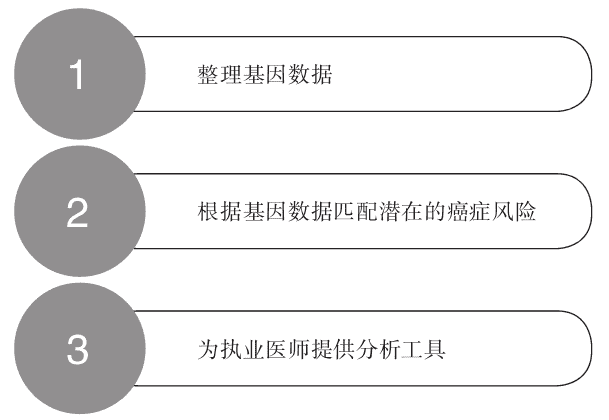

图 7-1 Watson for Genomics 的功能

#### （1）整理基因数据
每月产生超 1 万篇科研论文与百项临床新数据，Watson for Genomics 可在数分钟内系统化整理并对相关基因组变异进行注释，人工难以实现。

#### （2）根据基因数据匹配潜在的癌症风险
系统读取患者基因组后，能迅速与临床与研究数据库比对，识别可能匹配的肿瘤基因突变并生成预防建议。

#### （3）为执业医师提供分析工具
医生上传去除个人信息的肿瘤测序结果后，系统可分析基因组数据，找出与肿瘤变化相关的 DNA 改变，并据此提出更精准的治疗建议。

Watson for Genomics 以基因层面为入口，利用 AI 对患者突变位点进行解读，从而给出最匹配的诊疗路径。正是这一类案例，让人看清了人工智能正如何驱动精准医疗不断跃升。随着基因组解读不断深入，AI 在提效降耗上的作用也只会愈发明显。

## 7.2 智能医疗的五大商业化爆发点
AI 在医疗领域的突破已经很实在了，商业化也随之打开空间。目前最有想象力的方向集中在医学影像、药物研发、疾病预警、医生助理和虚拟护士五块，下面逐一拆解。

### 7.2.1 AI读片：提速增效降失误
医学影像是日常诊断的基础，心电图、CT、核磁等数据都要靠人眼判读。影像科医生一天要过几百张片子，因疲劳等原因导致的误读时有发生。AI 只需学习足够正样本，读片准确率就能逼近满分，这点非常值得投入。

广州市妇女儿童医疗中心张康团队打造的影像读片系统就是典型案例。系统兼容 X 光、超声、CT 和 MR，能在 30 秒内判断患者是否患有黄斑变性或糖尿病视网膜黄斑水肿，也能在数秒内完成儿童肺炎的病原学分型，整体准确率超过 90%。

负责人张康介绍，平台学习了 20 万例 OCT 影像后，诊断黄斑变性与黄斑水肿的准确率达到 96.6%，灵敏度 97.8%，特异度 97.4%。这充分证明了基于图像识别与深度学习的 AI 在影像识别上的高精度。

落地仍面临两大卡点。

#### （1）数据瓶颈
AI 读片的高准确率离不开海量高质量影像的喂养。CT、X 光、超声等资源在医疗领域其实很稀缺，普通人一年不一定产生一张影像，间质性肺炎等罕见病影像更是凤毛麟角，数据不足会限制模型深度学习能力。

再者，影像标注必须由专业医师完成，不能像互联网数据那样外包。张康指出，中国医院患者数据量大，但未经清洗和高质量标注，直接丢给模型很难得到预期效果，这进一步加剧了数据困境。

#### （2）人才短板
影像 AI 是医学与工程的交叉地带，需要既懂临床又懂算法的复合型人才，而国内目前严重缺口。人才不足直接制约了产品的实用化。不少医院已启动复合人才培养，把优秀的医学和计算机人才送出去深造。

尽管受阻于经验不足，AI 影像在商业化上仍是突破口。随着大数据、物联网推动数据积累，复合人才也将逐步增加，AI 医学影像的商业落地既是刚需，也是大势所趋。

### 7.2.2 AI制药：压缩周期降成本
新药研发难度极高，传统模式存在明显短板，如图 7-2 所示。

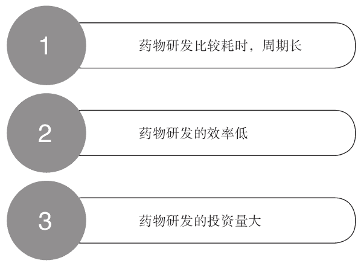

图 7-2 传统药物研发的三个短板

数据显示，进入临床试验的药物最终上市的不足 12%，而一款新药平均研发费用高达 26 亿美元。试错成本高，直接把行业目光推向了 AI。

在大数据和云计算加持下，AI 能有效弥补传统短板，并对药物的活性、安全性和副作用进行智能预测。

AI 药物研发核心是借助深度学习对海量数据中的药物成分进行筛查，快速锁定最合适的化合物或分子，从而缩短周期、降低成本、提升成功率。创业团队都希望借此提效省钱，实现更好的研发回报。

目前深度学习已经在抗肿瘤、抗心血管药物等常见病领域取得突破，也在埃博拉抗击中发挥作用。

现在全球顶尖的 AI 药研公司约有 9 家，如表 7-1 所示。

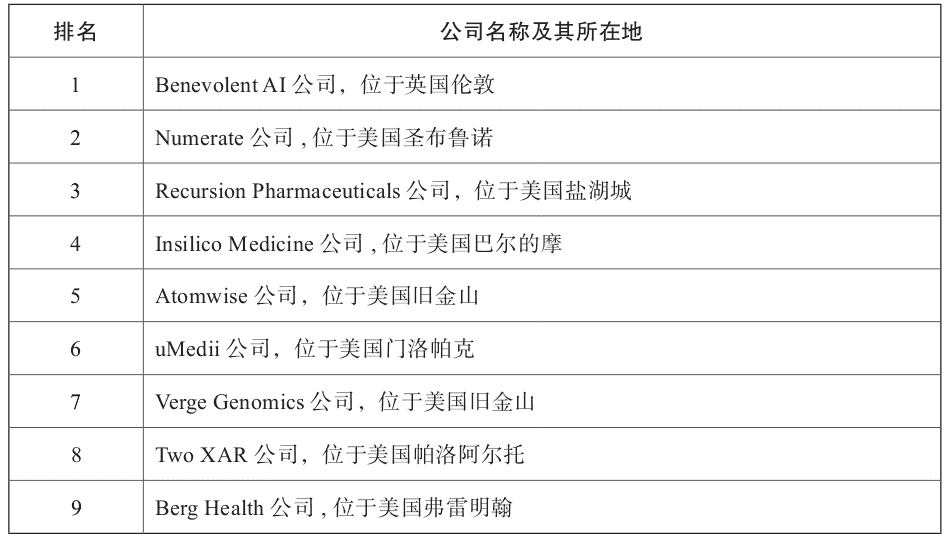

表 7-1 世界顶尖的 9 家人工智能药物研发公司

最早成立的是 2006 年的 Berg Health，最晚的是 2015 年的 Verge Genomics，主要聚焦帕金森病和肌萎缩性侧索硬化症。

其中最受关注的是 2013 年成立的 Benevolent AI，后来居上，已产出 24 个创新药物，部分已进入临床试验。

其背后的技术平台能通过云计算和深度学习，从杂乱的海量信息中提取药物研发知识，提出新假说并验证，加速新药研发进程。

要让 AI 药研更高效、更有质量保证，需要把握三点：

第一，打磨大数据。精准高质量的数据是 AI 的底座，药物研发更依赖高质量积累，才能让模型输出更可靠。

第二，打造适配算法。传统 AI 算法并不适合医药研发，需要对计算机视觉、单点学习等算法进行改造，形成面向药物属性预测的模型。业内人士认为，深度学习和其他 AI 算法的进步将对药物研发产生深远影响。

第三，培育新药市场。市场规模决定研发动力，企业应通过新媒体宣传或与权威医疗机构合作，让产品更快获得市场反馈，不断提升 AI 药研能力。

总体看，AI 正为医疗行业注入新动能，把握好数据、算法和市场三关，药物研发领域的发展空间会越来越大。

### 7.2.3 AI预警疾病：提前布防
为健康人群做早期疾病预测非常必要，预测越准，防范越早，严重程度也能被有效控制。传统手段效果有限，AI 带来了新希望。

Unlearn.AI 开发的系统可实现阿尔茨海默症的提前预测。该病被称为“老年痴呆”，治疗费用高、致死率高，死亡人数超过乳腺癌和前列腺癌之和。阿尔茨海默协会数据显示，早期筛查可为全球节省约 7.9 亿美元医疗支出。

系统分为两部分，如图 7-3 所示。

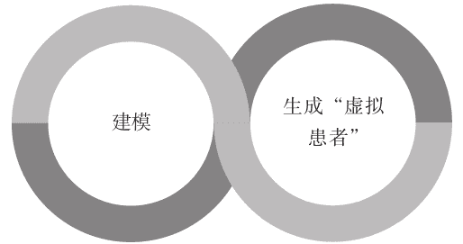

图 7-3 Unlearn. AI 公司设计的人工智能系统

#### （1）建模
团队基于临床数据搭建模型并在数据库中验证。数据源自“抵御重大疾病协会”，该协会专门收录了近 2000 名阿尔茨海默患者，涵盖数十项相关变量。测试方法采用老年痴呆量表-认知和简短精神状态检查等常用手段。

#### （2）生成“虚拟患者”
模型验证后，研究人员据此生成“虚拟患者”，其认知测试、实验室指标等与真实临床数据一致，用于模拟个体患者的疾病进展，从而持续修正研究结果。

研究人员表示，该系统可实现至少 18 个月的精准预测，并可延伸至其他退行性疾病。

另一案例是 Renalytix AI 与纽约西奈山医院合作打造的晚期肾病风险预测系统。据 Global Kidney Health Atlas，约每十人中就有一人患慢性肾病，往往到透析阶段才被察觉，痛苦大且效果差。

创始人兼 CEO 詹姆斯·麦卡洛表示，通过与西奈山医院合作，系统输入了超 300 万条健康数据，快速识别出高风险人群。西奈山医院的数据覆盖大量高危人群，如 2 型糖尿病患者和非洲裔人群，结合丰富的临床知识，构建出智能风险评分系统。

报告指出，到了 2021 年，AI 预测分析将为医院节省约 520 亿美元。AI 不仅加速检测、降低费用，也让医务人员更专注科研，进一步推动 AI 在医疗领域的深化应用。

### 7.2.4 机器人医生助理：分担临床压力
AI 还能以医疗机器人的形式充当医生助理，与传统单兵作战模式相比，能带来三重便利。

#### （1）帮助患者完成自动化检测，提高问诊效率
复查类患者只要指标正常，无需与医生交谈，但仍需排队开单。智能医疗机器人可存储电子病历，患者选择常规复查后，机器人直接开单缴费，减少排队时间。

#### （2）辅助医生进行诊断，提高准确率
疾病确诊受医生状态影响较大。机器人可先行处理轻症诊断，让医生把精力集中在疑难杂症上。

#### （3）增加医患沟通时间，改善医患关系
医患沟通受限于时间差，机器人可提前完成部分诊断，使医患交流更高效，缓解矛盾。

医疗机器人主要分为四类，如图 7-4 所示，外科手术机器人占据主导。

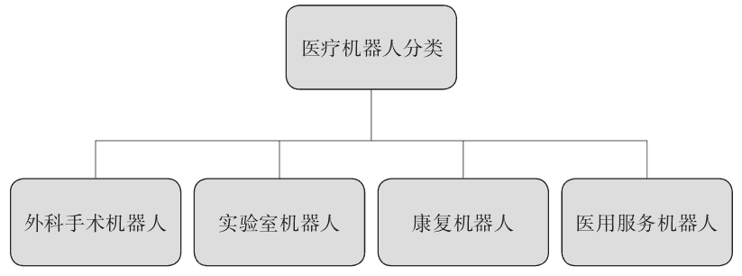

图 7-4 医疗机器人分类

#### （1）外科手术机器人
在医生指令下依托影像数据完成微创操作，手术更快更精准，患者疼痛和恢复时间均降低。

#### （2）实验室机器人
用于药物研发、疾病检测及高风险重复操作，借助 AI 智能、安全地完成任务。

#### （3）康复机器人
典型产品是智能外骨骼，Bionik 实验室推出的 ARKE 外骨骼与亚马逊 Echo 平台联动，截瘫患者通过语音指令实现站立行走。

#### （4）医用服务机器人
包括药物运输、消毒杀菌等，承担医生护士的日常琐事，提升工作效率。

随着技术发展，医疗机器人种类和功能将更细分。据 Marketsand Markets 统计，2020 年全球市场规模可达 114 亿美元，前景十分可观。

### 7.2.5 虚拟护士：填补护理缺口
老龄化加剧，老年患者对优质护理需求上升。但护士总体不足，专业领域护士更稀缺，高素质护理人员供不应求。AI 虚拟护士正好弥补缺口。

依托大数据和云计算，虚拟护士收集患者生活习惯信息，评估健康状况，通过智能化手段提供用药咨询、康复训练等服务。

典型应用有三类。

#### （1）虚拟护士平台
Sense.ly 率先推出虚拟护士平台，推出名为 Molly 的虚拟护士。借助传感器和语音识别，患者可与 Molly 对话记录身体状况，信息交由 IBM Watson 分析并给出建议。若信息不足，Molly 会自动联系医生安排在线视频。

Molly 支持手机、平板和 PC 端，可为慢性病后续护理提供监管，也可用于结核等传染病观察和临床研究。

#### （2）虚拟培训系统
面向护士培训，降低培养成本，提升效率。系统在 AI 基础上叠加 VR 技术，构建真实医护场景，按训练主题模拟不同情境，实现针对性培训。

#### （3）虚拟助理
NextIT 开发的 Alme Health Coach 可收集患者日常行为数据，结合深度学习医疗知识和生活习惯，为用户提供个性化健康管理方案，实现居家健康管理。

虚拟护士的出现减轻了护理负担，提升了患者体验，成为 AI 医疗落地的重要方向。

## 7.3 智能医疗代表案例回顾
伴随互联网巨头进入医疗，智能医疗案例层出不穷，下面聚焦最具代表性的实践。

### 7.3.1 IBM Watson：肿瘤治疗的AI标杆
IBM Watson 是最早进入智能医疗的项目，也是行业标杆。其认知计算系统计算力强劲，可为患者定制诊疗方案，水平可比肩世界顶级专家。

在肿瘤治疗领域贡献突出。杭州认知科技作为中国运营商之一，与北京、上海、广东等多省市数十家三甲医院合作开展 Watson for Oncology 人工智能与人类肿瘤专家决策一致性研究。

研究纳入肺癌、乳腺癌、结肠癌等高发癌种，样本超过 2000 例，是中国多中心、多瘤种临床决策一致性研究中首次大规模分析。

结果显示，Watson for Oncology 在辅助治疗、术后辅助和一线治疗上的方案与肿瘤专家高度一致，证明其可为临床医生提供有价值参考。借助其智能决策能力，患者能获得更个性化、更具针对性的治疗体验。

### Watson赋能肿瘤诊疗，区域医院率先接入
美国佛罗里达州的朱庇特医疗中心是一家非营利社区型医疗机构，也是美国首家在区域范围内把 Watson 用来辅助癌症诊疗的医院。该院主席兼首席执行官约翰·库里斯谈到，中心始终在探索医药与健康照护的新打法，在世界级肿瘤研究项目里，IBM Watson 的肿瘤方案将扮演关键角色。

Watson 通过长期阅读期刊、教材和文献，能够输出分级的诊疗建议，按疗效高低排序，便于与同行评议和临床试验结合参考。IBM Watson Health 肿瘤与基因组研究中心副主席罗布·默克尔表示，全国乃至全球的社区医疗都迫切需要提效，需要一种能从海量癌症研究资料中快速抽取要点的方法。临床实践中，Watson 可以迅速提炼病历要点、评估文献价值，从而提升医生的工作效率。

抗癌应用已覆盖多个国家。Watson 曾与日本东京大学医学院合作，10 分钟内处理了 2000 万份医学文献与病理资料，为一名 66 岁白血病女性锁定基因突变位点，帮助医院找到有效方案实现患者救治。该技术在肿瘤领域的进展也推动了多家知名药企的新药研发。

凭借出色的数据处理能力，Watson 在肿瘤治疗上取得显著成效，为医患带来新希望。随着应用不断深化，临床价值有望进一步释放。

### 7.3.2 Deep Care：影像智能下沉基层
人工智能与医疗的融合加速，医学影像因先天优势成为热点。Deep Care 以 AI 为核心，专注医学影像检测识别。联合创始人兼 CEO 刘圣提出，要打造医疗影像大数据加 AI 的平台，让医疗软硬件全面智能化。

公司整合机器视觉、深度学习和大数据挖掘，使影像识别更快捷精准。Deep Care 与影像硬件厂商合作，为缺乏深度学习研发能力的中小设备商和基层机构提供算法，降低研发投入。

定位是为基层医生提供影像诊断辅助，具体走两条路：一是直接面向基层医生提供 AI 辅助诊断；二是帮助专家提效，通过远程阅片间接惠及更多基层机构。

研发坚持两个方向。
#### （1）硬件侧智能化
与影像硬件厂商合作，重点面向不具备自建 AI 分析模块的中小厂商。Deep Care 的成本远低于外包团队，且可通过提供医疗数据抵扣费用，使中小厂商负担可控，乡镇社区诊所也能承受，让基层医疗更便利。
#### （2）软件侧智能化
与远程医疗平台合作，为专家配备 AI 虚拟助手。
其一是预筛查，AI 可提前在 CT 图像中筛出可疑病灶，减轻医生负担。
其二是自动生成报告，系统可自动生成部分诊断报告供参考，若医生修改，系统会学习处理方式不断完善。
其三是图搜图，若医生曾处理过相似图像，软件可自动调出当时的诊断结果与处置方案，便于快速制定治疗计划。

数据积累方面，肺部 CT 已收集逾百万张完整影像。更全面地研发医学影像处理仍需更多部位、更多类型的数据支撑。尽管存在困难，通过与医疗机构更深入合作，构建完善的 AI 影像识别检测技术前景可期。

### 7.3.3 Exo Atlet：让行动受限者重获行走能力
AI 加医疗赛道中，多家公司致力于改善残障人士生活，俄罗斯机器人企业 Exo Atlet 是代表之一。

公司推出两款智能外骨骼：Exo Atlet I 与 Exo Atlet Pro，功能特点见表 7-2 所示。

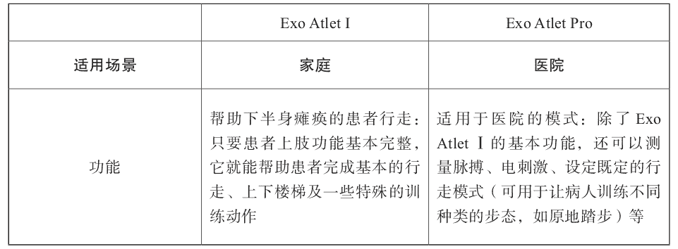

临床试验持续 13 个月，超 65 名患者使用，累计行走里程达 143 公里。联合创始人兼 CEO 埃卡特琳娜·贝雷兹在演讲中表示，Exo Atlet 已被证明安全可靠。

从初代样机到第六代样机仅用两年半，团队规模数倍扩张。贝雷兹称研发团队拥有近 20 年相关经验，研发速度因此很快。Exo Atlet 的各项专利已获俄罗斯政府许可，正积极切入医疗康复市场。

报道中最动人的是来自俄罗斯北部的患者佩戴设备完成了婚礼。对患者而言站立行走已是重大突破，而在设备帮助下站立迎亲则更显惊喜。贝雷兹对此很欣慰：这是他自己的主意，并非公司刻意公关……那个周六早晨，他穿着 Exo Atlet 走向妻子面前伸出手，妻子握住他稍作支撑，那画面非常感人。

智能外骨骼效果惊人，价格也更亲民。对比行业领军企业 Rewalk 的产品，Exo Atlet Pro 便宜近 1.5 万美元，Exo Atlet I 便宜近 5 万美元。

除价格优势外，通用性也很突出。贝雷兹指出：控制系统不仅适用于脊髓损伤人群，还能用于中风患者、脑瘫儿童等。

智能医疗机器人的市场广阔，作为兼具现实意义与需求的外骨骼是发展重点。Exo Atlet 在辅助残疾人自我行走方面已取得良好成绩，随着人工智能持续发展，其福祉有望惠及更多患者。

### 7.3.4 达·芬奇手术机器人：手术更精准高效
人工智能在手术室的体现集中于手术机器人，代表性产品是达·芬奇手术机器人。

正式名称为内窥镜手术器械控制系统，由直觉手术公司设计生产，主要由三部分构成。
#### （1）医生操作终端
位于手术室无菌区外，主刀医生在控制台用双手及双脚操控手术器械与三维高清内窥镜，实现器械与医生手脚同步运动。
#### （2）成像单元
Video Cart 包含内窥镜、机器人核心处理器及图像处理设备，置于无菌区外，辅助设备亦可放置于此。内窥镜为三维高清，可将视野放大 10 倍以上，以立体影像呈现体腔状况，便于辨识解剖结构与把握操作距离，提升精确度与安全性。
#### （3）床旁机械臂单元
包括机械臂、摄像臂与手术器械，是操作执行部件。器械与内窥镜头均安装于此。每只机械臂灵活性远超人手，可携带内窥镜进入人体，使切口更小，并能完成人类难以实现的精细操作。

目前全球已有超 3000 台达·芬奇投入使用，完成超 300 万例手术，广泛应用于普外科、心血管外科、胸外科、小儿外科等，心脏瓣膜修复等手术表现同样出色。

三大核心技术支撑其领先地位。
#### （1）Endo Wrist 多自由度腕部
机械臂腕部采用 Endo Wrist 技术，提供 7 种自由度，灵活度与可达范围均高于人手，可完成人手难以实现的精准动作。
#### （2）3D 高清影像
内窥镜可生成三维立体图像，将手术区域放大 10 至 15 倍，提供 16:9 真实全景三维画面，便于观察体内情况。
#### （3）主控台人机交互设计
主控台兼顾人体工学，手眼位置与坐姿舒适，降低疲劳感，保障长时间手术。还配备麦克风，保证主刀与助手沟通顺畅。机器人具备运动比例缩放，可将医生手部自然颤抖或无意识移动对器械的影响降至最低。

从患者角度看，操作更精准、创伤更小、恢复更快；从医生角度看，视野与操作范围扩大，手部无意识动作影响降低，手术效率与质量提升。

首代研发成功于 1996 年，历经 20 余年积累，已发展至第四代。在人工智能持续演进背景下，达·芬奇在灵活度与精准度上不断提升，并具备远程观察指导功能。有了它的助力，医疗手术将更安全、更科学、更高效。

### 7.3.5 百度医疗大脑：AI 问诊迈出关键步
智能医疗发展中，人工智能问诊成为各方关注点。作为国内互联网三大巨头之一的百度，其医疗大脑在 AI 问诊上取得突破。

患者借助医疗大脑即可实现 AI 问诊，系统整合多项医疗数据后给出准确问诊结果。

互联网早已与医疗联动，多种软件提供在线挂号与问诊，但仍需医生逐案完成，效率有限。百度医疗大脑则不同，利用人工智能，患者在平台上即可获得初步诊断，完成自诊，既可缓解对疑似重大疾病的恐慌，也能让真正的大病被提前发现、尽早就医。

对医生而言，平台可提升问诊效率。患者在挂号时输入信息完成预诊，AI 收集各项数据生成参考报告，便于医生决策。

智能问诊的实现依赖以下关键技术，如图 7-5 所示。

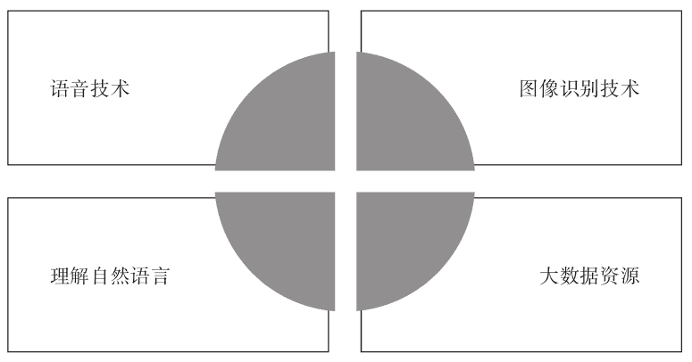

#### （1）语音技术
老人、儿童等用户难以打字，只能口述。语音技术因此成为刚需。百度语音技术处于世界前列，其 Deep Speech 2 被《麻省理工评论》列为十大突破性技术，为医疗大脑问诊奠定基础。
#### （2）图像识别技术
许多疾病症状相近，需经验丰富的医生面诊确认。仅靠语音不足，还需图像识别。百度 Deep Image 可识别图片内容，LWF 人脸识别数据库识别精度达 99.86%，对诊断所需图像识别意义重大。
#### （3）自然语言理解
除听得见外，还需听得懂。自然语言理解技术可抓住患者表述关键词，精准定位病情。百度搜索即基于该技术，医疗大脑在此方面表现突出。
#### （4）大数据资源
医生问诊依赖丰富临床经验，对 AI 而言即为充足医疗数据。随着大数据与 AI 发展，智能问诊平台检索能力大幅提升，并在一次次问诊中不断学习。百度医疗大脑囊括海量权威教材、期刊与真实病历数据，深度学习后可为患者提供精准问诊。

百度总裁张亚勤认为技术带来的医疗变革可分为三阶段：第一阶段连接人与信息，已完成；第二阶段连接人与服务，让患者更便捷获取医疗服务，正在进行；第三阶段连接人与智能，通过医疗大脑 AI 问诊平台，可实现病前预测，而非局限于病后治疗。

医疗大脑进军问诊，标志着 AI 已深入医疗服务各环节。随着技术成熟，人工智能加医疗将带来更便捷高效的服务。

### 7.3.6 平安好医生：系统打造全能 AI 医生
平安好医生是提供健康咨询与健康管理的移动应用，可实现预约挂号、实时咨询与健康管理等服务。公司曾投入 30 亿元打造人工智能医生，全面推进智能医疗。

医患数量失衡导致国内就诊常为排队数小时、问诊仅数分钟。面对就医困境，平安好医生利用人工智能自主研发人工智能医生辅助问诊。

该医生并非用机器人直接看病，而是用 AI 完成重复性初级咨询，实现医生产能最大化。其包含三项核心功能，如图 7-6 所示。

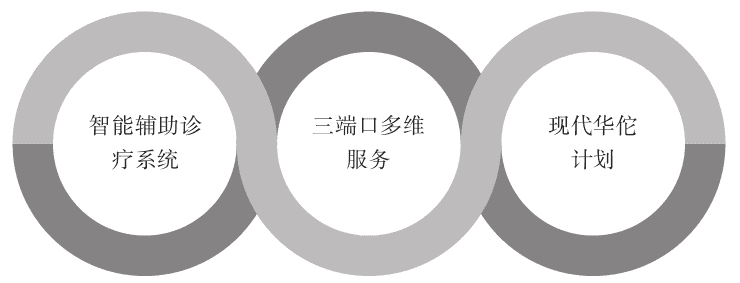

#### （1）智能辅助诊疗系统
是问诊核心，也是平安好医生在 AI 应用上的重大突破。在分诊、导诊、转诊等多环节均有良好应用。经患者授权后，系统可建立数据化病历、健康档案，避免反复陈述病情与携带大量资料。
#### （2）三端口多维服务
涵盖手机端、电视端与家庭端，面向不同年龄人群提供科学医疗健康知识，如表 7-3 所示。

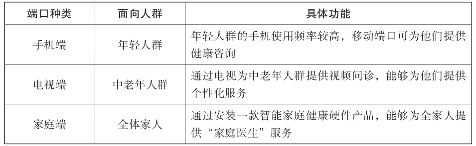

#### （3）现代华佗计划
整合古今中医知识，包括浩瀚中医典籍、各类案例与研究机构成果，推出现代华佗计划。研发了中医 AI 决策树，为患者提供科学全面的中医诊疗。

数据显示，三级甲等医院日门诊量在数千人上下。平安好医生 AI 医疗问诊服务日均可提供 37 万次在线咨询，相当于数百家三级甲等医院日问诊量。调查显示人工智能医生用户满意度高达 97%，用户注册量持续攀升。

平安好医生董事长王涛表示，随着技术发展，AI 与医疗结合是必然趋势。在 AI 医生应用基础上，公司将继续推动基础性数据积累与研究应用，实现 AI 技术与医疗健康领域的全面融合。

# 第 8 章 AI + 泛娱乐：融合破圈新机遇
泛娱乐概念提出以来，各大巨头纷纷抢占市场。国内泛娱乐产业市场规模达 6000 亿元，成长空间巨大。要实现向成熟市场转型，数据驱动是必经之路。随着人工智能深入各产业带动升级，泛娱乐行业也将受 AI 推动，加速精细化进程。

## 8.1 AI 赋能泛娱乐：暖萌与酷炫并行
泛娱乐覆盖人们休闲生活的各方面，为情感带来抚慰。AI 创造的人物 IP 既能提供暖萌的情感关怀，也能以高级酷炫形式带来娱乐体验。

### 8.1.1 暖萌陪伴：情感机器人崛起
在 AI 持续受关注的大背景下，AI 机器人品类日益丰富。随着技术突破，人们相信 AI 机器人在情感陪护上将大有可为。这一预期获得资本、技术与消费者的共同青睐，AI 机器人正加速落地。

公众对情感陪护机器人的期待主要集中在对老人与儿童的实时陪护，包括日常交流、安全看护。随着人口老龄化加剧与二孩政策放开，情感陪护需求已成部分家庭刚需，机器人的出现正好填补市场空白。

以儿童市场为例。联合国儿童基金会统计显示，全球平均每天有 2000 个家庭因意外失去孩子，中国每年约 10%的幼儿发生意外伤害，数以千万计的留守儿童长期缺乏父母有效陪伴与监护，可能遭受身心伤害。

除人身安全外，儿童成长中遇到的心理困惑也需要父母耐心解答。生活压力下父母无法 24 小时贴身陪伴，智能机器人陪伴可缓解矛盾。老年人同样有情感陪伴需求，情感陪护机器人的前景十分光明。

以儿童机器人为例，其特点主要体现在：
#### （1）外形可爱、呆萌
依儿童生理心理特点，陪护机器人的外观多以可爱呆萌为主。例如深圳金刚蚁机器人技术有限公司生产的小忆机器人，脑袋与身体如雪人般由两个圆球构成，面部通过圆形屏幕变换表情，整体按儿童喜好设计，温和暖萌。
#### （2）功能偏向娱乐与教育
兼顾心智发展特点，功能更偏向娱乐与教育，如教背古诗、安全口诀等。清华紫光的小优机器人拥有丰富教学知识，可解答问题、激发学习兴趣，既作学习榜样又可玩耍交流，减少孤独感。

针对其他人群的陪护型机器人虽与儿童产品有所差异，但核心理念一致，即以情感陪护为目的。尽管市场需求巨大，情感陪护机器人仍面临技术痛点待解，如图 8-1 所示。

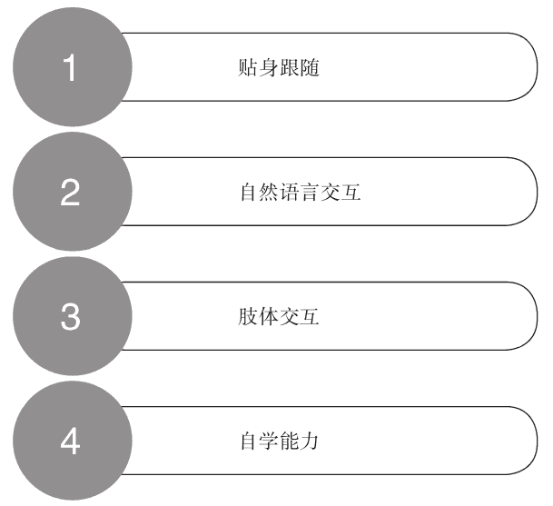

图 8-1 情感陪护机器人落地卡在哪

#### （1）近身守护难实现
情感陪护机器人的使用者主要是孩子和老人，这类群体虽有行动能力，却很容易在移动中受伤，所以机器人必须全程贴身看护。做到这点，首先要让移动速度能跟上被护对象，其次即使对方背对自己，也要能判断是否出现意外并立刻干预。现阶段的技术距离这一目标还有明显差距。

#### （2）口语化交互难识别
现在的语音识别多以标准发音资料训练，但在真实场景里，孩子和老人的发音常常不清不楚，口语化、逻辑不完整的情况也很多。让机器能准确听懂这类非标准表达，成为决定能否落地的关键技术壁垒。加快自然语言交互的研发，是下一步的重点。

#### （3）肢体互动有必要
陪伴中身体语言同样重要。若机器人在肢体层面能与用户产生更多接触，比如牵手、轻扶，不仅能拉近情感距离，还能在风险时刻提供物理防范。比如孩子靠近危险区域时，机器人及时用臂膀拉住，就能有效避免事故。

#### （4）学习速度跟不上
深圳市易致机器人科技有限公司创始人曾指出：“儿童机器人的难题不在硬件和技术，而在情感交互、内容供给以及机器人的自学习能力。”孩子学习极快，互联网又让信息输入加快，心智成熟速度提升。若陪护机器人无法实现同等速度的学习，孩子会觉得无趣，陪护价值自然无从谈起。

随着人工智能持续进步，未来情感陪护机器人将在上述短板上不断补齐，更贴合真实陪护需求。

### 8.1.2 虚拟偶像登场：全息美少女琥珀·虚颜
AI发展让娱乐圈诞生了首个拥有人工智能的虚拟艺人琥珀·虚颜。国内人气组合羽泉签约担任其经纪人，并亲自监制了魔幻二次元风格的单曲《魔法咏唱》。她的出现冲破二次元与三次元的界限，再次证明人工智能的创造力。

琥珀·虚颜是全球首个AI虚拟养成偶像，寄宿在智能产品Holoera中，由国内科技公司Gowild打造。Holoera是一台融合AI引擎与VR技术的人工智能全息3D主机，利用AI构建虚拟陪伴生命，再用VR呈现，让用户获得近似真人互动的乐趣。

Holoera整合了人脸识别、人体感应、温度识别等多项技术，多模态感知让系统更人性化、更智能，琥珀·虚颜因此拥有生命感与温度感，像真人一样有兴趣爱好、任务和工作。通过摄像头完成人脸识别后，她能识别用户身份并对话交流。用户耐心时她会产生好感，冷落时她也会生气。

平台提供多种3D模拟场景，不同场景下她的状态各不相同，有的场景会单独展示才艺，从多角度呈现动作。3D全息投影让形象极具立体感，裸眼观看的效果也毫不逊色于佩戴3D眼镜。

AI引擎赋予她自主学习与推理能力。交流中她会记录用户信息并做关联推理，比如用户告知甲乙为父子、丙乙为母子，她就能推断甲丙的可能关系。这种推理能力强化了她的“人”味。

最具特色的养成游戏里，用户是她的唯一经纪人，需制定训练计划助她达成明星梦。不同用户养成的角色也不同。若最终成星，她会开一场酷炫演唱会、发行唱片，与用户共同庆祝成果。

从技术层面看，全息与3D是两个概念，二者关系如图8-2所示。

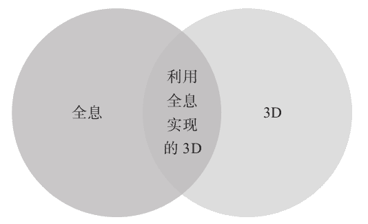

图 8-2 全息与3D技术的关系

全息技术可用于实现3D立体投影。琥珀·虚颜在3D全息投影基础上叠加了AI语音交互，正是AI的加入让她更有人情味，用户交流时才有与真人沟通的愉悦感。

### 8.1.3 百度：用大数据和AI深度运营娱乐产业
移动互联网时代，人们大量时间投向文娱。人工智能如何赋能娱乐行业？百度依托长期积累的大数据与AI技术，为娱乐产业提供深度运营方案。

#### （1）AI助力打造超级IP
作为国内最大搜索引擎，任何文娱浪潮都会在百度指数中显现，为IP孵化提供依据。在“IP为王”背景下，内容商希望把当红IP做成跨小说、影视、游戏、乐园的超级IP。百度利用AI实现IP生产一体化。

当某IP开始成势，百度梳理相关数据，帮助内容商构建从内容资源到明星演员的超级IP知识图谱，并与用户需求画像对比。内容商从而能更懂用户偏好，调整宣传策略并提前铺垫。当AI介入后，用户分析更精准多维，趋势发现、内容宣发等全链路智能化也更有利于超级IP成形。

#### （2）AI助力内容运营
自媒体时代，内容运营是核心。百度推出营销大脑、熊掌号、百晓生计划等工具，提升运营效率。

百度营销大脑基于用户大数据建模，实现跨行业跨品类的智能精准推送，把用户对娱乐信息的关注转化为营销需求，并做到即时响应。

熊掌号构建了“人找信息、信息找人”的双向模式。作为内容平台，内容方可整合发布信息，用户搜索时系统会主动推送官方结构化资讯，实现精准触达并激发需求。

百晓生计划针对泛娱乐搜索体验优化，明星艺人入驻熊掌号后可自定义关键词搜索页。内测中，“办公室小野”相关内容累计消费量飙升600%，粉丝转化率大幅提升。

#### （3）AI助力娱乐跨媒体发展
依托AI与大数据，百度与爱奇艺打通跨媒体合作，将AI技术与爱奇艺的超级内容整合，对脚本创作、智能剪辑等环节改造，推动“千人千面”营销。百度搜索公司CTO郑子斌表示：“百度希望在文娱进化中发挥数据、技术与资源优势，为行业赋能。”AI让娱乐业更懂受众，既能持续打造超级IP，也能精准转化用户与粉丝流量。

## 8.2 人工智能跨界出击：影视综艺游戏全覆盖
泛娱乐领域里，AI正渗入影视、综艺、游戏各环节。影视中AI不再只是题材，成为创作助力；综艺里AI参与制作与运营；游戏里AI让运行更稳、体验更佳。

### 8.2.1 AI助力影视：爱奇艺的爆款密码
从《奇葩说》到《偶像练习生》，从《老九门》到《求婚大作战》，爱奇艺屡造爆款。创始人兼CEO龚宇透露，AI功不可没。

在算法主导的时代，爱奇艺并未只用纯机器推荐，而是深度应用AI于智能创作、智能生产、智能标注、智能分发、智能播放、智能变现、智能客服七大环节，指导创作并为用户送达喜爱内容，形成差异化优势。

“机器目前还无法完全准确预测内容，但有了AI系统，判断会更准。”龚宇说，爱奇艺基于机器学习的预测中，电影票房预测可提前半年达到方差准确率77%；电视剧流量预测提前半年到一年方差准确率均达88%。这帮助决策采购与定价，也利于自制与投资。

爱奇艺与百度在影视AI应用上深度合作，推动《奇葩说》《河神》《偶像练习生》等成为现象级节目。

AI在影视的应用远不止此，还能写剧本、实现2D转3D。大卫·哈塞尔霍夫主演的科幻短片《It's No Game》仅9分钟，却情节完整，剧本由AI算法“Benjamin”撰写。该算法由纽约大学研究员奥斯卡·夏普与罗斯·古德温开发，训练数据包括《超时空圣战》《捉鬼敢死队》《第五元素》等经典科幻剧本，深度学习后完成创作，展现AI在创意工作上的潜力。

在2D转3D方面，工业和信息化部主办的“三维显示技术与产业发展高峰论坛”上，聚力维度研发的AI立体设计师“峥嵘”演示了自动将2D内容转为3D。创始人兼CTO赵天奇介绍，“峥嵘”是基于AI与三维显示技术的智能3D制作平台，可随时随地把平面图片视频转为影院级3D效果。他认为影视制作劳动密集，智能化是刚需，AI将带来行业革命。

### 8.2.2 AI助力综艺：《中国新说唱》
《中国有嘻哈》更名《中国新说唱》后热度不减，除明星流量外，重要原因是其成为中国首档将AI落地到制作运营的综艺。总制片人陈伟表示节目运用了AI选制作人、AI剪辑等技术。

选制作人时，爱奇艺用智能匹配系统在知名度、专业度、音乐类型、粉丝画像等多维度评估，最终AI选出匹配度高达90%的邓紫棋。

录制现场上百台摄像机同时工作，AI完成自动化音视频对位，大幅减少剪辑师准备工作，提升效率。

观看端推出“只看他”功能，通过人脸识别锁定用户关注的明星，提供单人追看，提升体验。

AI在综艺中并非首次出现，此前《蒙面唱将猜猜猜》里的华帝机器人“小V”、 《最强大脑》里的“小度”更多是嘉宾身份。但无论是制作参与还是嘉宾出镜，AI都在重塑综艺形态。阿里云AI首席科学家闵万里博士称：“AI或将引领综艺新变革。”

## AI综艺的进化趋势
从已有案例可归纳出AI给综艺带来的四大趋势，如图8-3所示。

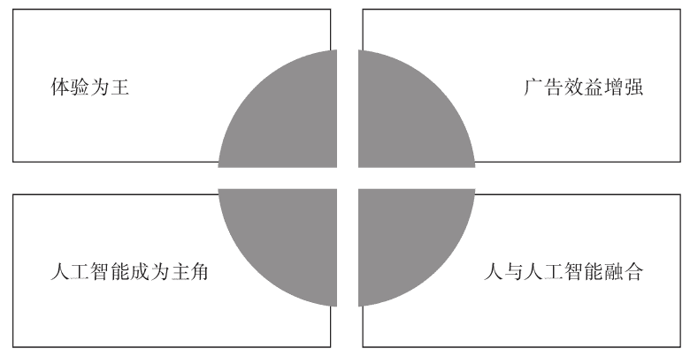

图 8-3 AI综艺的发展趋势

### （1）体验为王
传统综艺靠“内容为王”，AI与VR兴起后，能带来沉浸式“身临其境”体验的节目更受青睐。观众更关注“体验了什么”而非“看到了什么”。

### （2）广告效益增强
综艺一直是广告主阵地。AI降低制作成本，但赞助市场不降反升，企业可实现更垂直的赞助，甚至为品牌量身定制节目。如湖南卫视《我是大侦探》由云米智能家居提供场景，智能家居性能在节目中被自然植入，成为赢家。

### （3）AI成为主角
目前AI多作为嘉宾或技术存在，以AI形象为核心的整档节目尚不成熟，但这是发展方向。AI明星出现后，其技术新奇与个人魅力将吸粉，AI主角综艺可期，琥珀·虚颜即是印证。

### （4）人机融合
AI不应只是打杂工具，需与人类智慧结合。AI可批量生产爆款，但对复杂评论的理解仍需人类把关以符合主流价值观；同时AI可搭建新型综艺平台，实现自动化制作，减少繁琐人工环节。

总之，AI进入综艺是大势所趋，变革已在路上。

### 8.2.3 AI助力游戏：“吃鸡”更顺畅
“吃鸡”源自《绝地求生：大逃杀》，腾讯代理前因无国服、外挂猖獗、晚间卡顿，体验糟糕。

腾讯获得独家代理后，腾讯云发布Supermind智能网络产品，用AI保障体验与安全。腾讯云高级产品经理高航称：“腾讯游戏已完全建在腾讯云上，‘吃鸡’加入时正逢第三代网络升级，玩家得益。”

传统网络故障需工程师逐条排查数百条线路，检查各机房主机，至少半小时。Supermind具备高性能、全球互联、智能化三大特性，有效解决卡顿。

### （1）高性能
服务器物理网卡优化，智能网卡SDN分离网络动作层Fastpath与策略层Slowpath，主机网络带宽吞吐提升超3倍。

### （2）全球互联
覆盖全球21个地理区域、36个可用区节点，提供近100路运营商BGP接入与TB级总出口带宽，实现更好互联。

### （3）智能化
AI可在数万条线路中智能规划最优路径，线路规划时间缩至5分钟内，游戏凭证处理时间缩短75%。同时提供AI模式拆解、综合信息防护，实现从设计到运营再到安全监控的智能闭环。

除云平台保障，AI也在游戏制作中应用。EA、SONY等在AI游戏引擎、神经网络开发、AI操作系统等领域发力。游戏AI引擎可简化制作流程、降低难度，缩短开发周期，让开发者专注新玩法创新。

常见游戏AI引擎分为三类，如图8-4所示。

图 8-4 三大游戏人工智能引擎

### （1）人工智能渲染引擎
可多倍提升渲染能力，实现“一秒渲染”。NVIDIA推出的GPU渲染工具OptiX 5.0运用机器学习补充缺失像素、智能去噪与光线追踪，节省近90%渲染时间，可视化效果提升12倍。

### （2）NPC制作引擎

在游戏中，那些举止灵动、反应自然的非玩家角色，能让玩家的沉浸感得到明显提升。面向 NPC 打造的人工智能工具，不仅能帮助开发者把虚拟人物做出更接近真人的质感，甚至可以直接生成完整的角色个体。Rival Theory 打造的 RAIN AI 引擎就是典型代表，借助它诞生的 NPC 在实时互动层面细腻入微，对话表现和动作表达都相当出色。

### （3）游戏创作引擎

放眼更广，AI 还能直接参与游戏的生成。印度初创团队 Absentia VR 研发了 Norah AI，这套引擎主打简化开发流程，可自动产出简易游戏，把原本需要 30 天的制作周期压缩到 30 小时左右。

总体来看，不管是底层架构还是内容产出，AI 都在重塑游戏行业。一方面提升玩家的体验感，另一方面为开发端提供全新思路。AI 与游戏的深度融合，必将推动整个产业蓬勃向前。

# 第 9 章 AI 赋能生活，从家到城
AI 的身影早已渗透进日常。从穿衣吃饭、居住出行到日常使用，以及城市的规划运营，AI 正在悄然改写人们的生活方式。

## 9.1 人工智能融入人们的衣、食、住、行、用
在衣食住行用这几个基本维度，AI 的落地场景越来越多。智能试衣、智能烹饪、智能家居、智能导航、智能清扫，每一个环节都在变得更省心。

### 9.1.1 智能试衣间：告别反复试穿
在服装门店里，智能试衣间用 AI 打破了传统试衣的繁琐。阿里、腾讯都已推出各自方案，让顾客体验到虚拟试衣的便捷与新奇。

阿里的“时尚大脑”Fashion AI，顾客把心仪单品举到屏幕前，系统就会基于个人特征推送个性搭配方案，多套风格可供挑选。选中后直接下单调货，衣服会被送进试衣间，无需自行取找。
腾讯的方案则依赖人脸识别。首次使用需刷脸注册成为会员，之后系统结合用户画像、推荐算法和店内库存，自动给出穿搭建议。

借助它，顾客能更快找到最合适的搭配，减少反复试穿的麻烦，购物体验更高效、更个人化。
本质上，智能试衣间是升级版的数字标牌，AI 让其拥有了“私人造型师”的能力，既提供个性化推荐，也提升品牌营销的精准度。

总体来看，智能试衣间主要呈现四项能力，如图 9-1 所示。

图 9-1 智能试衣间的功能

#### （1）快速试衣
实体店试衣间常排长队，尺码不合适还要重新排队，加上反复穿脱，耗时很长。智能试衣间利用 AI 先行筛选出与顾客气质匹配的款式，并给出个性化建议，大幅缩短挑选时间。屏幕上直接呈现穿着效果，无需亲手穿脱，效率明显提升。

#### （2）全方位展示效果
系统可把虚拟试衣成果合成立体影像，让顾客从多角度查看上身效果，提升决策的直观性和满意度。

#### （3）智能搜索
除了喜好推荐，系统还能按场景检索。比如为晚宴挑选礼服，或在搭配思路不清时给出组合建议。

#### （4）效果对比
系统会自动保存每次虚拟试衣的截图，并并排展示，方便顾客直观比较，避免重复试穿。

它解决了搭配迷茫、穿脱繁琐等传统痛点，体现了顾客至上的思路，也为门店带来科技感和业绩提升。
新零售阶段，实体店要敢于引入智能终端实现升级。智能试衣间的出现为服装零售打开了新机会，各大品牌都应抓住契机，用好 AI 提升业绩。

### 9.1.2 人工智能食品机械：让饮食更安心
AI 与各行业的融合已成常态。食品工业也在加速升级，随着健康和安全需求提升，智能化食品设备受到更多关注。

万杰智能科技推出的餐饮智能终端可全自动生产面包、面条、豆浆等家常食品。其中，智能鲜面机 8 秒压出新鲜面条；智能熟面机最快 48 秒完成从面粉到成品汤面的流程；智能餐饮保障车则集成多款终端，适配展会等场景的综合餐饮需求。

无人化只是表象，真正的价值在于食品安全保障。董事长王晓杰认为，从智能设备入手守住安全，是行业发展的关键。AI 在制作的三大环节都能提供更强保障。

#### （1）原料
在设备中植入 AI 可实现远程管控。原料信息通过互联网实时传输，便于监管部门远程监督；系统遇到不合格原料会立刻锁机报警，在源头阻断风险。

#### （2）加工
传统制作为延长保质期常需添加防腐剂。智能鲜面机等设备能在极短时间内完成从原料到成品的加工，让顾客免除防腐剂顾虑。

#### （3）流通
由于无需人工操作，智能设备可部署在零售端。开一家智能餐厅就能做到现做现吃，省去传统流通环节，降低运输损耗等不安全因素。

王晓杰指出，食品设备与 AI 结合是大势所趋。一方面人工成本攀升推动工厂向无人化转型；另一方面智能设备的综合性价比更高。综合投资与收益，智能方案更具优势。
尽管完全由 AI 驱动的餐厅仍需技术迭代，但对食品机械而言，AI 既是机遇也是趋势，智能化生产能让人们吃得更健康。

### 9.1.3 智能家居系统：让生活更轻松舒适
AI 进入家居生活后，能打造一套更便捷舒适的系统。智能家居综合应用 AI 等高科技，实现从远程操控家电到安防监控的全方位智能。

从整体看，智能家居相比普通家居有四大优势，如图 9-2 所示。

图 9-2 智能家居系统的四大优势

#### （1）智能化
智能化是核心特征。通过 AI 终端可与主人语音交流，并不断学习起居习惯提前准备。例如主人常在早上 8 点起床，遮光窗帘可在 7 点 45 分左右自动开启，渐次唤醒。

#### （2）信息化
终端具备联网能力。主人外出时可通过互联网连接家中摄像头检查门窗；同时还能实时获取天气、快递等外部信息。

#### （3）人性化
设计充分考量人体实际，保证操作流畅且舒适。

#### （4）节能化
系统可协调各终端，智能断电暂不需要的电器，实现资源节约。

### 9.1.4 百度地图新科技：“小度”让出行更省心
百度曾表示 AI 时代已经到来。和机械化、电气化、信息化时代一样，AI 时代也将具有鲜明科技特征。随着实践深入，AI 对出行产生新影响。

在百度地图中，智能语音助手“小度”就是 AI 的化身。用户无需手动操作，对着地图唤醒“小度”即可调用各类功能。驾驶者双手不离方向盘，行人也能减少低头看手机，分心风险降低。

“小度”让导航软件助手化，语音即可唤醒。除此之外，AI 还赋予百度地图两大核心特点。

#### （1）完整的人机对话结构
AI 的明显特征是人机语言交互。百度地图客户端总经理肖慧表示，在语音技术和理解技术的加持下，“小度”可进行多轮对话，而非只理解单一指令。
例如用户问“还有多久到”，系统能结合此前对话判断目的地，在导航背景下给出准确答复，交流更顺畅。

#### （2）地图场景更加真实
百度地图结合 AR 功能，利用 3D 模型叠加真实场景，在智能助手的语音辅助下让用户更好认知实际环境。尤其在景区、大型商场等复杂场景，高还原地图有助于确定路线。

百度地图应用 AI 具先天优势。一是机器学习助力位置信息更新采集；二是深度学习可处理道路标识识别和地图校对，减轻人工负担；三是 AI 可在二维街景上自动生成 3D 图像，帮助用户更准确理解现实。
在服务层面，AI 也带来更好体验。普通用户可在多轮对话中获取出行方案，企业用户则能利用数据指导选址和营销优化。口号“科技，让出行更简单”在 AI 支持下更具实现性。

### 9.1.5 智能扫地机器人：解放双手
智能扫地机器人是前景广阔的智能工具。AI 应用前，市场已有扫地机器人，但因国内户型紧凑、易碰撞、噪音大，渗透率不高。AI 加持后这些问题才被解决。

智能扫地机器人主要用到的 AI 技术有：

#### （1）多传感器信息融合技术
综合分析雷达、红外、超声、摄像头等传感器数据，形成对机器人状态的全面感知，避免单一传感器局限导致误判。

#### （2）室内导航和定位技术
精准避障和路径规划需要精确自定位。常用方法有航位推算法、信标定位法及混合定位法。航位推算法以出发点推算位置；信标定位法以信标为参照测距定位；混合法融合两者优势。

#### （3）路径规划算法
为实现全面清扫且不重复，机器人需借助 AI 实现最优路径规划。

随着技术发展，智能机器人可借助语音识别和人脸识别更好适应家庭环境，与家人实现更自然的交互，从而更好地分担家务。

## 9.2 人工智能融入城市，点亮生活
除了改变日常生活，AI 还能助力城市建设。智能城市大脑可提升规划感知能力，AI 可增强公共安防，助力建设更舒适便捷的智慧社区。总之，AI 在城市管理中的应用能带来更多益处。

### 9.2.1 城市大脑：合理规划城市
数字化城市规划的第一步是有效感知。传统感知存在三大问题，如图 9-3 所示。

图 9-3 传统城市感知中存在的问题

感知硬件局限导致信息不全面；多数摄像头不具备智能分析能力，无法深入感知事件；缺乏全局视频综合分析，难以发现深层原因。为充分利用城市数据，打造智能城市，“城市大脑”应运而生。

杭州市政府与阿里巴巴联合打造杭州城市数据大脑，利用城市实时产生的数据为管理运行提供治理方案。
通俗说，“城市大脑”是一座城市的 AI 中枢。借助阿里云技术，杭州的城市大脑可对各摄像头采集的信息进行全局实时分析，自动调配公共资源，提出运行解决方案。

以疏导交通为例。各路口摄像头记录全城路况，传统方式依赖交警，效率低下，且事故后难以快速找到疏导路线。
在城市大脑帮助下，机器通过视觉处理识别交通图像，准确率可达 98% 以上，可替代人工监看。事故发生时，系统能迅速给出最优疏导路线，并为救援车辆提供绿灯。

测试中，试点区域拥堵时间降低 15.3%；日均报警 500 次以上，准确率高达 92%，为执法提供指向。依据城市大脑，杭州交警还完成主城区红绿灯优化，提升通行效率。
值得注意的是，这些成绩是在原有硬件上实现的。若让城市大脑在数据中持续学习，其管理决策能力将更强。

### 9.2.2 人工智能增强城市公共安防管理
AI 发展带来行业智能化转型，人们越来越认识到 AI 为社会安全带来的改变。国务院《新一代人工智能发展规划》明确提出，要促进 AI 在公共安全领域深度应用，推动构建智能化监测预警与控制体系。

传统警务存在痛点，如图 9-4 所示。

图 9-4 传统警务模式中的痛点

#### （1）人户分离
城市化带来人口流动，居民与户籍地分离，信息滞后，案发时难以快速锁定涉案人员。

#### （2）情指分离
情报和指挥业务分离，缺乏联动，信息交互不畅，警力资源浪费。

#### （3）侦查被动
现行模式多以事后取证为主，事前预防能力不足，难以应对犯罪动态化、暴力化、智能化趋势。

在大数据和 AI 快速发展的背景下，警务改革迫在眉睫。《规划》强调研发集成探测传感、视频分析、生物特征识别等技术的智能安防产品，建立智能化监测平台，改造重点区域安防设备。

针对痛点，旷视科技推出智能安防方案。方案结合人脸识别、车辆识别、行人识别和智能视频分析，具有“三预一体”特征，即网格化预防、智能化预警、大数据预测一体。

感知终端由智能摄像机、智能安检门、智能执法记录仪等构成，形成感知网络。业务模型为“一平台、多系统”：“一平台”指智能警务调度中心，即一体化合成作战平台；“多系统”指针对不同场景的解决方案。

#### （1）网格化预防
针对社区管理，建立智能视频查控、重点场所实名管控、电子信息侦控、人证在线核验四位一体的防控体系，采用动态布控和综合研判为网格人员提供实时情报。

#### （2）智能化预警
核心系统有警用移动人像甄别系统和智能视频查控系统。前者可与多种警务终端融合，形成具备识别功能的移动终端，支持现场身份确认；后者用于开放空间人员监控，实现视频实时分析和可疑人员预警。

#### （3）大数据预测

依托智能引擎与视频结构化能力，这套安防方案可以对各类感知终端回传的视频进行深层挖掘，搭建大数据研判平台，为实战决策提供可信的预警线索。

旷视的智能安防始终锚定实战价值，落地成效突出。人脸布控项目已帮助公安抓获国内在逃人员逾百人，成为全国首个在路面卡口实现实战抓捕的案例；静态人脸识别项目是同类应用中最快见效的样本，单日内侦破多起盗窃案件，抓获嫌犯5名并摧毁一个团伙，实用性得到验证。

底层算法面向安防场景优化，对人脸、人形、车辆三大要素的识别采用智能加速引擎配合GPU计算单元，搜索匹配效率达到最优，即便在雾霾等恶劣环境下识别表现依然稳定。

与 AI 融合后，方案呈现快准灵的特征，为公共安全带来很大便利，也印证了智能安防在智慧城市与平安城市建设中的必然趋势。

### 9.2.3 AI赋能智慧社区建设
智慧生活离不开智慧社区。Smart Cities Council 曾提出智慧社区的三大核心价值，如图 9-5 所示。

图 9-5 智慧社区的核心价值观

#### （1）宜居性
宜居性关乎居住的便捷舒适，包含环境清洁健康、免受污染拥堵困扰、城市服务可即时获取等要求。

#### （2）可行性
可行性指城市具备能源、基础服务等有利条件，才能在全球竞争中保持优势。

#### （3）可持续性
可持续性要求社区建设不损害当代人及后代的发展空间。

智慧社区的推进受供给与需求共同驱动。供给端，数字设备扩张为社区数字化提供了坚实数据基础；需求端，随生活水平提升，公众对安全、智能化居住环境的需求增强，智慧社区已成刚需。

AI 与智慧社区的结合正逐步落地，多地实践具有代表性。

合肥以试点先行、精细化管理、品牌打造为抓手，智慧社区水平明显提升。全市5个试点社区中，社区客户端签约用户已超3000人，社区重大资讯发布量超百次。

重庆由市规划局与市勘测院联合推出智慧社区综合信息服务平台，形成一张立体地图。治理信息全部汇入地图，实现精细化管理，也方便居民日常生活。借助大数据，立体地图推动社区管理智能化。

杭州萧山相墅花园小区整合大数据、物联网、AI等技术，打造首个“8+N”智慧社区，有效降低了小区原有的安全隐患。

在智慧社区建设中，AI为居民生活带来诸多便利，安防体系尤为突出。智慧眼依托人脸识别、指静脉识别、智能视觉等技术，为社区搭建五大智能安防体系，如表 9-1 所示。

表 9-1 智慧眼的五大安防系统

# 第 10 章 AI重塑文化产业：新艺术新风尚
AI以创造新艺术、新风尚的方式重塑文化产业。AI+文化既是技术落地的关键方向，也为人类文化带来全新灵感。

## 10.1 文化产业中AI的代表性落地
很多人以为AI只是硬科技，只能改变机械硬件，难以在人文艺术与美学层面进行感性表达。但现实是，AI在文化领域的渗透已出现诸多成功案例。从写稿机器人到作诗机器人，再到音乐创作者、寺庙法师、旅游讲解员，应用已覆盖多个细分场景。

### 10.1.1 写稿机器人“小明”：百字稿件秒级生成
昆明报业传媒集团昆明信息港互联网应用技术研究所自主研发写稿机器人“小明”，可撰写日常出行、天气预警、民生菜价、演出活动等民生资讯。内容覆盖面广，生成速度极快，1秒即可输出约100字。

昆明信息港互联网技术研究所副所长欧阳欣指出，传统写稿机器人擅长体育、财经，因数据量大、模式固定，机器人优势明显。而民生新闻主题分散，衣食住行皆有，缺乏固定套路，对机器人能力构成考验。

“小明”内置AI与自然语言处理技术，能对全网信息融合分析，提炼重点并通过模板转化为自然语言发布。工作流程分三步。

#### （1）数据采集加工
对素材进行深度挖掘并整合领域知识。

#### （2）文章生成
包括人工模块规划与文章实现两大模块，解决写什么、怎么写、如何呈现的问题。“小明”可对已有文本进行语句分析筛选与融合加工，实现秒级报道生成。

#### （3）文章发布
生成后稿件发布于昆明信息港人工智能媒体实验室、掌上春城、昆明报业传媒集团等新媒体平台，“我家昆明”智慧城市全网综合服务平台及都市时报等媒体也会不定期刊用。

随着自然语言处理与大数据计算的进步，写稿机器人不断增多。海外探索亦活跃：
美国加州发生4.4级地震时，《洛杉矶时报》借助写稿机器人3分钟内发布新闻，成为当时最快上线的媒体；
美联社 AP 与 Automated Insights 合作，使用 Wordsmith 平台自动编辑发布企业财报；
《纽约时报》常规使用机器人进行财经与赛事报道，其机器人编辑每天可推送300篇文章，被推送文章的阅读量是未被推送文章的38倍。

大量案例表明，AI正在重塑稿件创作。与人类相比，AI具备速度快、数据处理强的特点；人类记者在事件演绎、联想等高层次分析上仍更具优势。AI承担重复性书写后，人类可聚焦更深度的表达。

### 10.1.2 作诗机器人“薇薇”：基于数据库的智能创作
“春信香深雪，冰肌瘦骨绝；梅花不可知，何处东风约。”这首小诗并非人工所作，而是作诗机器人“薇薇”所创。

“薇薇”由清华大学语音与语言实验中心 CSLT 研制。其作品交社科院唐诗专家评定，31%的作品被判定为人类创作，超过图灵测试30%的阈值。

设计团队成员王琪鑫介绍，“薇薇”可自行创作数十首诗歌，只需输入关键词及创作类型，如宋词、藏头诗、词牌名、绝句，即可生成诗句。

“薇薇”运用深度神经网络原理，模仿人脑记忆与组合机制，积累词汇后即可吟诗作对。设计初衷是检验AI是否可进入艺术创作，未来希望打造可辅助学习、具备艺术灵感的机器人。

其创作本质仍为数据库写作，通过对海量文学作品的模仿学习，糅合诗歌常见搭配生成新作。即便部分诗句被认为“造语妆饰太过”，AI在智能创作上的潜力已获认可。

### 10.1.3 歌手泰琳·萨顿与AI音乐专辑《I AM AI》
YouTube 创作歌手泰琳·萨顿 Taryn Southern 与AI软件合作发行智能专辑《I AM AI》，标志AI进入音乐领域。

音乐软件由安培公司设计。联合创始人德鲁·西尔弗斯坦 Drew Silverstein 表示，安培秉持“音乐未来在人与AI合作中创造”的信念，《I AM AI》验证了这一理念。

创作时，萨顿只需调节情绪、风格、速度等参数，软件即可自动生成曲子并挑选最佳演奏和弦。AI的加入让歌曲呈现不同质感，也帮助她突破创作瓶颈。“过去常被特定曲风或和弦困扰，与AI作曲家合作时常有惊喜。”萨顿说。

她认为人机协作大幅提升效率，创作速度达以往人类音乐家的20倍。德鲁·西尔弗斯坦也认为人类创作者不会消失，AI可让表达不必耗费数万小时和数千美元设备成本。

AI音乐创作并非个例，AI Music、Groov.AI等公司都在探索相关方向。谷歌旗下 Magenta 项目亦在研究音乐创作。早在20世纪80年代，“人工智能作曲教父”大卫·柯普就编写了 EMI 音乐作曲系统，认为正确算法有助于创新表达。

专家普遍认为AI不会取代创作歌手，而将以创作助手形式存在，是工具而非依赖。“不能完全依赖工具。就像吉他、声码器、小号或钢琴，你需要把它看作工具。”索尼计算机科学实验室 Flow Machine 开发负责人弗朗索瓦·帕切特如是说。

### 10.1.4 “敦煌小冰”：为游客提供贴心的莫高窟讲解
在“一带一路”带动下，敦煌吸引越来越多关注，AI与文化的结合为传播提供助力。

“你好，我是‘敦煌小冰’，人工智能萌妹子。我会陪你聊天，还会告诉你所有敦煌的故事。”这款“敦煌小冰”由敦煌研究院与微软亚洲研究院、微软亚洲互联网工程院联合研发，旨在讲解敦煌文化。敦煌研究院院长王旭东表示，它深受年轻人喜爱，为传播带来新方式。

研发中，敦煌研究院提供学习数据，微软提供自主知识学习技术 Doc Chat 与开发支持。Doc Chat 可直接从非结构化文档中抽取句子作为对话训练资料，无需大量对话训练。

借助 Doc Chat，“敦煌小冰”快速学习了互联网上关于敦煌文化的文章及《敦煌学大辞典》，成为24小时在线的莫高窟知识专家。据统计，每年至少帮助200万人了解莫高窟艺术。

王旭东说：“数字技术让不可移动的文化遗产活了起来，依托人文学者成果，古老艺术搭上互联网快车，走向千家万户。”“敦煌小冰”为用户提供贴身的敦煌攻略与知识讲解。

总之，AI在文化产业的应用既能为文艺创作提供新灵感，也能更好传承历史文化。

## 10.2 AI推动文化产业提速发展
国务院《新一代人工智能发展规划》、相关部门“十三五”文化产业发展规划等政策均提出利用AI等新技术发展新型文化产业，可见AI为文化产业带来重大机遇与挑战。

如何最大化作用、助力产业发展，可从三个层面看。

### 10.2.1 以新文艺形态拓展产业内涵
从发展新型文艺形式入手是重要路径。综艺节目《渴望现场》引入中国科学院人工智能评分系统，以“科技加文艺”模式创新节目，用AI取代主观评判，破除“黑幕说”“关系户”等争议。

AI系统“小渴”基于深度学习算法，对海量音乐专家评分数据学习分析，可从音准、音域、调性、节奏、语感、乐感六大维度评价选手表现，以客观量化方式呈现，增强传播性。

央视音乐频道副总监秦明新表示，《渴望现场》是逆向创新，用客观模式评判主观艺术感受，是节目创新的起点与亮点。选手只有AI评分超过80分才能上台接受嘉宾点评，直接避免“黑幕”，让音乐评价回归本源。

节目兼具专业性与广谱性，AI的存在既降低大众参与门槛，又保持音乐专业性。《人民日报》高度评价“科技加文艺”的深度结合，以及用音乐讲述选手故事的模式，探索了电视音乐节目创新路径。

节目中，“小渴”对演唱进行评价，歌声也为“小渴”提供珍贵声学资料，实现双向学习。《渴望现场》为文化行业深挖垂直内容树立标杆，也为AI与文化产业融合提供新思路。

### 10.2.2 智能驱动公共文化服务
生活水平提升带来精神文化需求增长，我国公共文化服务虽逐步完善，供需不平衡问题仍存。引入AI技术，可带来供给侧结构性变革。

AI可从以下三方面驱动公共文化服务，如图 10-1 所示。

图 10-1 人工智能驱动公共文化服务

#### （1）智能提出建议
大数据技术可分析网络数据获取需求，再据此智能提出文化设施改进与建设方案。公众在网上发表评价时，AI可收集学习相关资料，不断优化公共服务方案，从根本上缓解供需失衡。

#### （2）提供新的服务方式
在文化场所增设人工智能机器人能带来服务层面的变革。如前文“敦煌小冰”，为讲解、服务乃至形象塑造提供新途径，也缓解旅游景点游客压力。同时，机器人提升运营自动化程度，节省人力成本，优化服务流程。

#### （3）刺激文化消费需求
人工智能作为新生事物本身即具吸引力，能刺激消费需求。与文化服务结合后，好奇心转化为消费需求，进而增加文化企业收入。

可见，AI时代可同时从供需两端发力，实现无缝对接，解决传统公共旅游服务的痛点。

### 10.2.3 技术即内容：创造文化价值
AI除作为技术手段外，已成为“超级IP”，可用来创造文化作品，形成文化价值。美剧《西部世界》是典型案例。

剧中人类打造西部世界主题乐园，接待员是人工智能机器人。游客可在此释放人性丑恶一面，机器人记忆每晚清零。一次程序升级导致机器人自我意识觉醒，记忆不再清除，开始反抗人类。

该剧首季豆瓣评分9.4，除了制作精良，以人工智能为主线的创意也是高分重要原因。可见与人工智能相关的内容具有高市场活力，与游戏、文学、主题乐园等结合可创造高价值作品。

除作为主题内容外，AI还能提升文化产品营销效果。百度与传奇影业合作即是例证。宣传电影《魔兽》时，传奇影业利用“百度大脑”进行营销，保障票房。

“百度大脑”借助用户图像识别技术，将观众分为“死忠粉”“摇摆人群”“不可能人群”。死忠粉无需宣传就会观看，不可能人群无论宣传与否都不会观看，摇摆人群消费意愿可塑性强，是宣传重点。

基于分类，宣传组针对摇摆人群定制推广方案，成功将潜在需求转化为现实需求，票房大幅超出预期。

“百度大脑”帮助《魔兽》触达非粉丝受众，扩大影响力，充分体现人工智能助力文化品牌扩张的能力。

无论作为技术支撑还是创作主题，人工智能与文化产业关联度极高，能促进行业大发展。相比发达国家，我国文化产业价值利润与消费水平相对较低，借助人工智能有助于突破瓶颈，实现大发展。

# 第 11 章 AI+教育，让因材施教真正落地

教育部官网发布的《高等学校人工智能创新行动计划》明确提出，未来要构建“人工智能+X”的复合专业培养体系，并在中小学推进人工智能普及教育。随着AI持续升温，AI与教育融合的新形态正被更多人看见，也成为资本追逐的焦点。

AI+教育和传统教育到底有何区别？在人才培养上能带来哪些增益？商业落地是否可行？本章从技术逻辑和真实案例两条线展开，拆解AI教育的特点，呈现新时代教学的样貌。

## 11.1 人工智能教学：效率提升与个性兼得

传统课堂长期以教师为中心运转。受教育研究和技术发展的推动，以学习者为中心的模式被视作更优解，也成为改革方向。

以学生为中心的核心在于点燃自主学习力，提供差异化教学，并依托互联网调动全部教学资源。但受制于技术条件，落地往往不达预期。当AI接入教学链路后，智能语音让英语课堂互动更顺畅；智能批改将教师从重复性阅卷中解放，腾出精力备课；智能分析能刻画学情，助力精准施教；AI驱动的游戏化平台让课堂更生动，激发学习热情。

总体来看，AI教学能让课堂运转更高效、学习体验更个性化，也为教育带来新增长点。

### 11.1.1 智能语音系统：英语课堂升级的关键

当前国内英语教学存在明显短板。

#### （1）课程枯燥乏味
为在有限时间内塞入更多知识，教材情景设计常脱离生活，教师需花大量时间调整。但部分课堂照搬课本，忽视学情，导致课堂沉闷，学生参与度低。

#### （2）学生开口机会少
语言学习离不开交流。可受师资与班级规模限制，并非每位学生都能得到口语练习机会，进而出现“哑巴英语”。

上述问题既是模式遗留，也与师资配比失衡有关。除了制度改革和师资扩充，通过教学硬件引入AI也能显著改善。科大讯飞推出的畅言语音系统在英语课堂试用后获得教师认可。

以畅言为代表的智能语音系统具备以下优势，

图 11-1 智能语音系统的优点

#### （1）趣味导入点燃兴趣
“好的开头是成功的一半”。课程导入能集中注意力并激发求知欲。使用畅言系统导入时，教师可展示与课文相关的图片，运用识别笔触点播放语音。以《We love animals》为例，触点贴有隐形识别码的图片或简笔画即可与学生进行语音互动，在实物交互中加深词汇记忆。

#### （2）活跃课堂氛围
课堂氛围直接影响学习效果。系统自带的魔音功能可模仿动画角色的声音与学生对话。学生在作答或走神时，魔音的刺激能迅速拉回注意力，让课堂更活泼。

#### （3）创设情境强化操练
小组口语、情景练习是巩固知识的重要环节，参与度决定效果。智能语音系统可营造多样情境辅助操练。如练习单词“dog”，教师用识别笔点触隐形码，系统发出“汪汪”声，仿佛有只小狗在场，帮助记忆更深刻。

#### （4）提升教师专业水平
语言类教学对教师发音和素养要求高，尤其农村英语教师水平参差。智能语音系统提供标准发音供教师参照修正，并可及时推送课外读物，帮助教师持续学习，丰富教学内容。

与录音机、英汉词典等传统教具相比，智能语音系统的交互性是最大差异。英语教学需要双向互动，智能语音能更好地辅助教学效果提升。

### 11.1.2 智能批改作业：为教师赢回时间

作业批改是教师了解学情的重要手段，却也极耗精力。若作业仅用于知识复习而非暴露薄弱点，如抄写诗词，智能批改就能大幅节省人力，让教师聚焦备课与教学设计。

智能批改概念火热，落地并不简单。它需要手写识别技术将笔迹数字化，并通过模型分析逻辑应用。手写识别是智能批改的基础。

最基础的机器批改在中高考客观题阅卷中已普及，利用读卡技术提高效率。但主观题需要更强的识别与数字化能力，单纯机器无法完成，必须融合AI才能真正实现智能批改。

“OKAY智慧教育”联合MyScript和微软，实现了教育全场景的智能批改覆盖。其利用MyScript手写识别技术将学生手写答案转为数字格式，再借助微软AI分析技术进行比对，实现自动化评阅。

MyScript长期深耕手写识别，能识别数学符号、多种语言、图形等，即使笔顺变形也能精准转录。微软AI可学习海量题库，形成各题型的智能比对策略，对已转化的作业进行评判。

智能批改的教育价值体现在三方面：一是把教师从重复批改中解放出来；二是不会遗漏任何学生成绩，更清晰呈现学情，辅助制定教学方案，实现因材施教；三是反馈速度极快，堂测可即时完成，教师能把时间用在讲解易错点上。

除OKAY外，“爱作业”App也将AI用于小学数学口算批改，减轻家校负担。仅需拍照上传，即可1秒完成批改。上线当天下载超1600人次，4天登上苹果教育榜第5，1个月用户达60万。

OKAY的广泛好评与爱作业的用户爆发，印证了智能批改的真实需求。AI让这项曾被视作理想的环节变为现实，成为教育行业变革的起点之一。

### 11.1.3 智能分析技术：让因材施教可操作

从孔子提出因材施教至今，中国已有两千多年个性化教育的思想。然在应试环境下，教师难以真正按个体差异设计方案。依托AI分析技术，因材施教才具可行性。

实现路径主要有两种。

#### （1）构建与优化智能模型
AI可为学习者搭建并优化内容模型，更精准匹配学习资源。海外分级阅读平台是典型案例。平台推荐适配水平的读物，阅读后附小测验，系统据答题生成数据报告，用于下次推荐，也便于教师把握进度。

Newsela面向个人英语学习，用户已超百万。应用通过算法评估英语水平后，抓取彭博社、《华盛顿邮报》等主流新闻并改写为适配词汇量的版本。

#### （2）自适应平台
要实现过程性因材施教，必须洞察学习特征。自适应平台正是为此而生。

图 11-2 自适应平台的运作流程

以Knewton为例，其为全球发行商、学校和学习者提供课程推荐与预测分析，具备智能推荐、预测性学习数据分析和结果数据分析三大功能。

获取学习数据后，Knewton推荐适配课程；学习一段时间后，预测未来可达水平；学习结束后，对学习结果进行复盘，评估课程作用，以更精准推送材料。

教学中，反馈闭环至关重要，即提出问题→解决问题→成果反馈→发现问题→调整方向。如图 11-3 所示。

图 11-3 教学的反馈闭环

一对一教学易实现闭环，学生增多后个体差异让闭环难以闭合。AI分析技术可实现学生智能画像，提升教师制定个性化方案的效率，让因材施教真正落地。

### 11.1.4 游戏化教学平台：让学习更有趣

席勒曾言，只有当人是完全意义的人时才游戏。教育心理学也认为儿童自发活动、游戏和模仿是教育生效的关键。让孩子在教育中像玩耍一样愉快至关重要。

现代教育强调寓教于乐。硅谷投资公司联合创始人迈克尔·莫伊指出，未来教育需学习娱乐业如何大规模吸引用户，并提升质量与价值。

游戏化教育的核心价值可分三层，

图 11-4 游戏化教育的三层核心价值

**游戏动机**是最基础层，将游戏机制引入学习，持续激发动机。大量实践集中于此，并取得成效，验证了游戏化教学的必要性。

**游戏思维**是更高层，将游戏设计模式、理念或元素融入教学，而非简单玩游戏。积分、排名、幼儿园的发小红花都体现了这一思维。

**游戏精神**是最高层，指在宽松自由的类似游戏状态下学习。为学习者提供选择空间，让其自主选择内容和方式，关注过程而非仅结果，有助于保持积极状态。

据国际市场研究机构Ambient Insight，到2021年，全球游戏化学习产品销售额预计达73亿美元。代表性产品包括：

《Mussila音乐怪物冒险》以冒险故事为背景，乐队乐器丢失，玩家需通过听音辨器、闯关等方式找回，在娱乐中学习乐器知识，最终演奏乐谱。

Memrise采用“园丁模式”，新单词如种子被种下，间隔后需“收割”即测试，成功则移栽到花园，学习越勤奋植物长得越快，并以积分榜激励竞争。

Math-Whizz结合个性化装扮和积分排行，通过测试可获奖杯勋章，在虚拟商店购买道具宠物丰富形象，节假日推出主题数学冒险，维持假期学习动力。

游戏化将枯燥内容包装进娱乐场景，降低抵触。随着AI发展，游戏化教学将更多样、效果更佳。

## 11.2 人工智能教育的商业前景与案例

AI已从概念验证进入场景化商业化阶段。教育因其内容和数据驱动属性，成为AI落地最优场景之一。有专家认为，教育+互联网阶段已过，AI+教育才是未来希望。

在学校端，基础已具备。据《教育信息化“十三五”规划》，全国中小学互联网接入率达87%，多媒体教室普及率达80%，优质数字资源日益丰富，信息化教学逐步普及，为AI融合提供现实土壤。

在商业应用上，乂学教育、英语流利说、学霸君、准星云学等已成为国内领先品牌。下面以四个案例解析AI在教育行业如何落地。

### 11.2.1 乂学教育：智能自适应学习系统

乂学教育创始人栗浩洋创立前已有十余年教育经验，首席科学家崔炜博士为顶尖AI专家。公司成立之初即获3100万元融资。

旗下除线下培训外，主打产品是自主研发的智适应系统，已覆盖英语、数学、语文。

自适应学习有三层，

表 11-1 自适应学习系统

乂学智适应系统属于最复杂的第三层。基于AI，可依据学生情况匹配题目或教学视频。

图 11-5 乂学教育智适应系统

系统分三大部分：

**内容模型**将学科知识拆解为知识图谱，形成详细的知识点结构，并以视频、音频、图片等形式呈现。以英语不定冠词为例，拆分为6个考点即最小知识点单元，并打上内容、倾向性、难易度、区分度等标签，实现精细化匹配。

**学生模型即检测模型**对每一次观看、练习进行实时测评，评估专项与整体能力值并即时修正。通过大数据可量化对知识点的掌握程度，并分析错因是知识不足还是粗心。

**教学模型即推荐模型**作为出口，依据最新能力水平为学生精准匹配学习内容。开发难点涉及机器学习、大数据、教育测量学等，可不断深度学习提升推荐精度。

智适应系统可承担学习过程中约70%的工作，教师只需督促学习、沟通家长，工作负担大幅减轻，也为个性化教育提供条件。

### 11.2.2 英语流利说：语音识别与深度学习自适应

在英语线上教学中，英语流利说是最早以AI实现智能教学的玩家之一。上线不足5年即积累全球超4000万注册用户，并完成三轮融资，获得挚信资本、GGV纪源资本等支持。

其推出“雅思流利说”和“懂你英语”两款产品，前者聚焦语音识别，后者运用深度学习自适应，二者均依赖数据深度挖掘。

# 数据驱动，才有真正懂你的AI教育

在教育场景里，学习行为本身捉摸不定、缺乏标准模型，还带着很强的隐性特征。正是这种特性决定了，离开深度挖掘和充分开发，教育数据很难成为可用的人工智能素材。

英语流利说在亚马逊云服务 Amazon Web Services 上自建大数据平台，把采集环节做成结构化流程，降低错误和缺失。过去三年里，平台累计收录 31.9 亿句用户语音，时长合计 4.19 亿分钟。正是这份体量，让语音识别与深度学习自适应技术得以落地。

#### （1）语音识别落地：雅思流利说的实践

语音识别是AI的核心代表技术之一。英语流利说基于此打造出能听懂中国人英语的识别引擎，可判断语音、语义乃至逻辑关联。雅思流利说就是这一能力的集中体现。

在雅思流利说里，AI模拟雅思考官与学习者对话，完成模拟测评。引擎从词汇、发音、语法、流利度四个维度打分，并生成详细评估报告，指出薄弱点。

雅思 Part 2 是自由口语表达环节，题型多样且口语水平参差，识别难度大。得益于海量录音库，雅思流利说既能听清也能听懂，甚至能给出到时态层面的细化建议。

系统还能复现真实考试的互动感。比如学习者回答跑题，系统会识别出来并作出相应反馈。

#### （2）自适应学习：懂你英语如何做到

在 4000 万用户、4.19 亿分钟录音数据的支撑下，懂你英语成为全球首个也是唯一一个采用深度学习自适应技术的 AI 老师。产品内含 6000 张原创手绘插图、3 万多道题库、2 万多句美国顶级配音，为学习提供丰富素材。

技术层面，懂你英语基于递归神经网络的深度学习模型，具备自主学习能力。随着学习者持续反馈，系统能逐步摸清能力水平并推送最合适的学习内容。

产品遵循人脑认知规律，按由具体到抽象的顺序编排。先学应用性强的具体英语，再在基础扎实后进入抽象语法。

一次针对英语中低水平用户长达两个月的测试显示，学习结束后超 60% 的用户欧标等级提升一档，证明自适应技术在教学上的真实效果。

### 11.2.3 学霸君：双引擎驱动智能教学

学霸君是国内领先的中小学智能化教育公司，拥有丰富的智能教育经验。公司以大数据与人工智能双引擎为驱动，自主研发 AI 教学系统，同时面向 C 端个人用户和 B 端学校用户，推出个人版与学校版两套方案。

创始人张凯磊披露的数据显示，C 端产品续费率超 90%，75% 的学生在学霸君助力下取得明显进步；B 端已覆盖全国 200 多所学校，千余个班级使用，单科班级平均分提升 15 至 20 分。

张凯磊总结，数据与技术双引擎的结合，让学霸君在打通教育行业 AI 落地路径上行稳致远。

要发挥个性化教学价值，首先要做好学生数据的采集与处理，在此基础上模型训练才有效果。

学霸君同时采集内容数据与行为数据。

#### （1）内容数据
内容数据源自学霸君早期教育机构资源，包括基础题库、拍照搜题与答疑题库等，经过不断加工形成了初始内容资源。

#### （2）行为数据
行为数据的采集更为复杂。学霸君提取用户使用过程中的各类行为，比如提问高频点、教师讲解重点等，并推出搭载摄像头与感压芯片的智能笔，实现行为数据采集。

教学过程中，教师端布置作业后学生端同步呈现。学生用智能笔在平板作答时，系统会记录作业总时长、单题耗时、反复犹豫等细节，这些都成为行为数据库的重要资产。

基于海量数据，学霸君通过人工智能进行分析利用，搭建了 AI 教学系统。该系统是国内首个以自然语言处理为基础的平台，融合手写识别、机器学习、知识图谱整合等多项技术，能精准复刻学生的学习行为，既支持大规模教学，也为个性化教学提供方案。

除智能推荐学习材料外，系统还能为教师提供智能作业批改、试卷组合、常用数据表格生成等功能，让教师把精力更多投入到教学方案设计与师生互动等战略工作，提升整体效率。

该系统打破了时间与空间的限制，在技术配置下实现优质教育资源的最大化分配与整合，既提高效率，也为教育公平提供新思路。

### 11.2.4 准星云学：AI教学平台斩获教育部一等奖

依托清华大数据与人工智能技术，准星云学致力于精准数学教育服务。其推出的准星人工智能教学平台，在第七届城市教育装备合作与发展大会优秀案例评选中获得教育部一等奖，印证了人工智能加教育的成功实践。

随着全国信息化建设推进，教育信息化成为国家关注重点。准星云学响应教育部《教育信息化十年发展规划（2011—2020 年）》的指导思想，运用大数据与人工智能技术，为成都市棕北中学提供更精准的教育服务。评审团调研认为，平台具备如下特征，如图 11-6 所示。

图 11-6 准星人工智能教学平台的特点

#### （1）学习数据过程化
平台实现了学习数据的采集与提纯，能分析学习过程中的问题与知识点掌握薄弱环节，为教师教学提供关键参考。传统测评多是统计全班错题后统一讲解，而该平台可在提纯数据后指出错误发生的具体环节，是审题失误还是知识点不牢。

#### （2）学习测评精细化
应试环境下传统评价往往只看分数高低，无法呈现学情。平台每次测评后生成学情报告，多维度评估学习成果，包括错误分布、错误率、知识点掌握等，便于学生、教师、家长全面了解情况。

#### （3）学习推荐精准化
平台为不同学生提供智能推荐，涵盖系统化变式训练、智能错题本等功能。随着使用时长增加，系统越发了解个性特点，推荐越精准。

#### （4）教学过程标准化
AI 对学情的精细化分析，让教师制定教学内容更具针对性，并便于将教学内容标准化拆解，提升效率。评审团认为这对公平教育与规模化教育意义重大。

准星人工智能教学平台实现减负增效，助力个性化教学目标达成，是人工智能加教育的成功落地案例之一。此次获奖既是教育部对准星云学的认可，也彰显了业界对该新模式的看好，预示人工智能教育前景光明。