# 2020 人工智能落地：阻力与破局 | 爱分析

## 报告免费获取

- 微信群每日推送 8+ 份最新重磅研报；
- 同步提供当日《华尔街日报》《金融时报》要点；
- 每周推送经济学家解读；
- 所有研报均为公开版，版权归原作者， 小马财经仅供内部学习分发。

扫码关注公众号
回复：研究报告
加入“小马财经”微信群。

## 报告编委

### 报告指导人

金建华 爱分析 创始人&CEO

张 扬 爱分析 联合创始人&首席分析师

### 报告执笔人

李 喆 爱分析 首席分析师

黄 勇 爱分析 高级分析师

### 外部专家（按姓氏拼音排序）

方 磊 九章云极 创始人&CEO

胡 健 一览群智 CEO

贾宇航 云测数据 总经理

栗浩洋 松鼠AI 1对1 创始人&首席教育技术科学家

乔 昕 深睿医疗 联合创始人&CEO

孙 悦 芯盾时代 联合创始人&CTO

杨永智 阿博茨科技 CEO

尹子杰 加和科技 CEO

赵杰辉 滴普科技 董事长&CEO

## 特别鸣谢 (按拼音排序)

## 前言

2019 年已落幕，AI 正处在技术成熟度曲线的低谷段，炒作热度回落，产业侧开始聚焦如何真正落地。

供给端的能力建设与需求端的真实诉求之间仍存在明显错位。企业在做业务升级时，需要先识别落地摩擦，再寻找可执行的对策。

本报告先梳理行业全貌，再通过典型案例拆解 AI 对产业的价值贡献、行业进程与未来走向。从数据、模型、场景理解、交付方式、投入产出比等角度系统归纳落地痛点及应对思路，助力企业形成价值闭环。

## CHAPTER 01

01

### 从技术到产业

## 1.AI 迈向产业应用

人工智能是研究模拟、延伸并拓展人类智能的计算机科学分支。

以深度学习为代表的第三次浪潮叠加算力提升与数据爆发，推动技术加速成熟并从实验室进入真实业务。

### 1.1 行业全景

自底座到应用，产业大致可分为底座层、共性层、行业层。

底座为视觉、语音等基础技术提供芯片、框架等算力支撑，共性层输出感知、认知等通用能力，行业层则是通用能力与特定行业深度结合后形成的产品与服务。

图 1：人工智能行业图谱

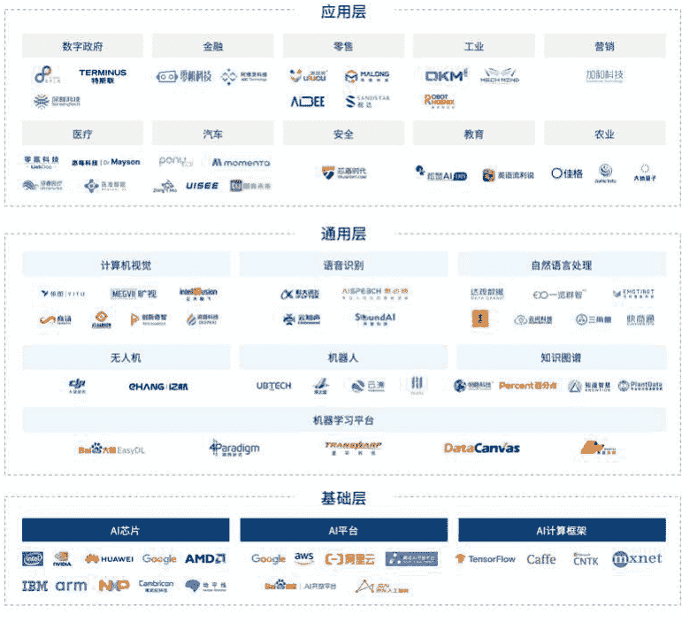

爱分析绘制

底层：为计算机视觉、语音识别等基础技术提供算力基础设施，涵盖智能芯片、智能平台、计算框架等，多由谷歌、微软、亚马逊、英特尔、IBM、百度、腾讯、华为、京东等巨头主导。

共性层：在底层之上构建通用技术与产品，如视觉算法、机器人系统等。分为软件通用技术与软硬一体通用产品两类。共性产品模拟人类感知、认知、执行，可拆分为感知层的计算机视觉、语音识别、自然语言处理；认知层的知识图谱及NLP 深化应用；执行层的机器人等。

行业层：通用能力与垂直领域融合的应用域，以行业 AI 公司为主。该类企业将共性能力封装为可交付产品，包含软硬件一体方案及针对特定场景的端到端方案。随着共性技术稳定，行业价值凸显，大量共性层公司正向行业层延伸。

### 1.2 商业形态

面向企业与个人输出产品服务的路径上，AI 厂商的商业模式主要呈现四种：API 调用、产品订阅/License、“产品+服务”整体方案、效果付费。

图2：人工智能的商业模式

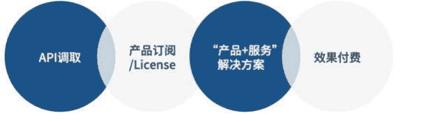

爱分析绘制

API 调用：多见于底座层与共性层厂商，以 API 形式对外输出能力，如商汤科技在计算机视觉、百度 Apollo 在自动驾驶、科大讯飞在语音识别等，均把技术能力开放给应用方封装。模式轻、复制性强。

产品订阅/License：面向个人以机器人、APP 等形式交付，或以标准 SaaS 模式服务互联网客户和传统行业中小客户。如大疆、松鼠 AI 等即属此类。

“产品+服务”解决方案：面向传统行业大客户，场景复杂单一产品难以覆盖，需定制化服务。旷视科技、明略科技服务公安领域即需端到端交付。

按效果付费：依据 AI 与业务结合后产生的可量化商业价值收费。双方更像合作伙伴，按业务量结算。当前在金融、智能客服等成熟领域已有尝试，如智能客服厂商按节省的人力成本或坐席数收费。

## CHAPTER 02

02

### AI 驱动企业数智化转型

助力企业数字化转型

## 2.AI 推动企业数字化转型

发展至今，AI 热度明显降温，进入技术成熟度曲线的低谷期。行业回归理性，核心议题是 AI 如何落地产业、驱动企业数字化转型。

本章解析 AI 在转型中创造的价值，以及在各行业的落地现状与案例。

### 2.1 价值创造三阶

AI 落地带来的价值可分为自动化、智能化、创新化三层，价值层级逐步抬升。

图 3：人工智能价值创造的三个层次

|  | 自动化 | 智能化 | 创新化 |
|---|---|---|---|
| 含义 | 机器执行任务，提升业务自动化水平；感知智能单点应用 | 机器分析与决策，实现能力跃迁；认知智能渗透业务流程 | 智能应用重塑传统流程与产业链；技术与产业深度融合 |
| 案例 | 工业机器人 AI 医学影像 程序化广告投放 | 犯罪团伙挖掘 销量预测 | AI 智能货柜 自动驾驶 |

爱分析绘制

自动化，是借助 AI 提升业务自动化程度，不改变原流程，由机器替代人工完成重复操作，从而降本增效。典型如工业机器人分拣组装、AI 辅助阅片、程序化广告投放，多为流程单环节应用。

智能化，是依托知识图谱等认知智能，让机器具备分析决策能力，完成人力难以胜任的工作，并改造业务流程。例如安防领域通过知识图谱在海量实体中挖掘隐性关联，发现团伙作案；零售领域基于历史销售数据构建机器学习模型实现销量预测，准确度远超经验判断。智能化涉及分析、推理、决策，常用数据挖掘、NLP、深度学习、强化学习等技术，深入完整业务链。

创新化，是 AI 与行业深度融合后重塑流程与产业链，形成新商业模式甚至新赛道。如基于视觉的智能货柜，较传统机械售货机成本降 50% 以上并容纳更多品类；无人驾驶一旦成熟，将颠覆从主机厂到用车场景的整条产业链。

### 2.2 AI 助力业务智能化

数字化即运用数字技术重塑业务流程，创造新的收入与价值。数字化转型已成为企业增长的必选项。

典型路径为“信息化—在线化—智能化”三阶段。信息化是完善 IT 基础设施与流程标准化，为在线化奠基。在线化涵盖用户交互与企业经营的线上化。智能化则是基于在线化积累的数据，实现经营决策从经验驱动转向数据驱动与自动化决策。

图 4：企业数字化转型的三个阶段

|  | 信息化 | 在线化 | 智能化 |
|---|---|---|---|
| 含义 | 建设 IT 基础设施，流程标准化 为经营在线化打基础 | 用户交互场景上线，服务范围扩大 经营场景上线，资源匹配效率提升 | 数据驱动经营决策，机器直接决策 经营场景智能化，服务与效率最优 |

爱分析绘制

数字化正在纵深推进。业务信息化和在线化带来数据量激增，场景复杂度同步提升，传统模式难以满足精细化运营需求，智能化成为必然。

例如零售企业通过 APP 实现交易、会员、客服在线化后，可基于客户数据做个性化推荐与促销，提升体验与销售额。此类需求无法靠人工匹配或规则经验满足，必须依赖机器学习建模。

因此，AI 是推动企业从信息化、在线化迈向智能化的关键引擎，业务智能化也将成为新的核心竞争力。部分行业龙头已通过自有场景实践积累自研能力，并对外输出。

### 2.3 落地进展

随着产业数字化基础趋于完善，AI 在营销、金融、数字政府、零售、医疗等领域的落地持续加速并显现效益，但各行业节奏不一。部分传统企业已高度认可 AI 价值并在核心场景规模化应用。

一方面，产业数字化基础设施成熟度决定 AI 落地的可行性，基建越完善数据基础越扎实。另一方面，技术与行业场景结合形成的主流应用与价值阶段各不相同。最后，不同行业的市场体量决定 AI 应用创造的规模差异。下图气泡大小代表当前各行业 AI 应用市场规模，涵盖软硬件与服务。

图 5：人工智能在各行业的落地进展

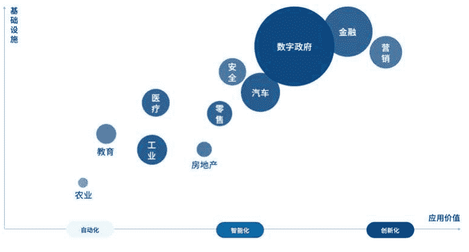

爱分析绘制

以下以营销、金融、数字政府、安全、教育、工业等领域为例，剖析落地现状。

#### 2.3.1 营销

线上营销已全面在线化与数据化，线下营销亦随摄像头、屏显设备智能化及智能手机普及而数字化。品牌方也在推进触点数字化并构建客户数据中台，夯实数据资产。

在此基础上，AI 已渗透营销全流程：早期为用户画像、程序化投放、流量反欺诈等自动化应用，随后延伸至市场预测、销量预测、智能客服等智能化应用，当前在视频等媒介的创新广告形态中也发挥作用。

图6：人工智能在营销行业的应用场景

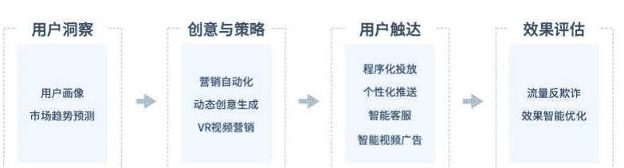

爱分析绘制

### 加和科技 助力通用汽车优化广告投放效能

加和科技聚焦企业数字化业务网络，技术驱动。以流量管理切入，结合营销数据延伸至运营与管理，并引入大数据与 AI 为企业提供智能化升级。

公司以不经手预算的品牌公域流量运营为核心，打通媒体、品牌营销、营销大数据，输出数字营销智能化服务。

图 7：加和科技业务布局

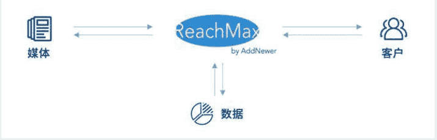

数据来源：加和科技，爱分析绘制

针对 KA 客户，公司两大板块为：

- 1) 通过智能流量管理平台与服务实现消费者全域体验升级；
- 2) 通过加和营销中台推动企业营销数字化升级。

加和深耕头部品牌，累计服务 60+ 品牌，覆盖 20 个子行业，快消占比 50%。2019 年加速汽车行业拓展，为当年收入贡献显著。

图 8：digital hub 智能营销中枢

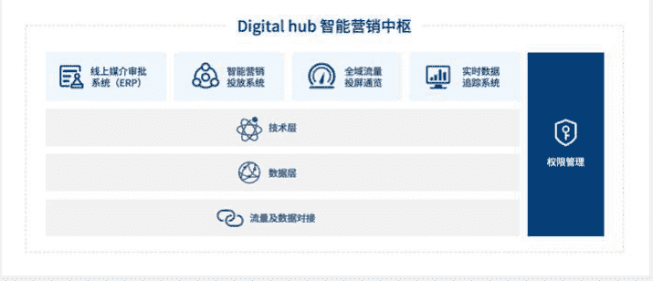

数据来源：加和科技，爱分析绘制

在上汽通用智能营销中枢项目中，加和为其定制智能营销中枢，管理亿级营销数据并实现毫秒级运算决策。通过智能化提升投放效率、优化预算配置、构建汽车行业营销 ERP，打通活动数据与销售线索 MQL，形成“驾驶舱”式决策，并实现全链路数据追踪与可视化输出。

#### 线上媒介管理体系

采用“跨广告主联合包剧”模式，与国际品牌共同采购剧集资源联合投放。

#### 全域数据打通

为内外数据提供定制化标准接口与加密仓储，辅以多云异地容灾、渗透测试、数据安全体系保障安全。通过流程优化与标准化对接，快速整合媒体、DMP 等外部数据，实现全链路管控。

#### 差异化活动优化

提供定制流量优化算法，支持多种程序化模式与营销资源优化。

#### “全域流量投屏通览”可视化模块

利用 AI 多维度呈现营销活动数据，洞察媒体流量质量、用户互动效率、各平台留资意向。

#### “实时数据追踪系统”

AI 解析影响营销效果的关键指标，为营销人员提供个性化报表与分析，辅助决策优化。

基于客户需求，加和通过流量整合与大数据 AI 智能化应用输出定制化方案，并以系统策略等形式交付价值。截至投运，上汽通用线上媒介系统已对接 20 余家汽车垂直、资讯、生活、工具类主流媒体。联合包剧模式有效提升非重复曝光，曝光频次 7 次内独立访客占比达 91%-100%。CPL 注册付费率提升至 114%，CTR 平均提升 24%。

#### 2.3.2 金融

金融数字化一直领先。强需求与充足 IT 预算下，云计算、大数据已普及，数据基础设施完善，“金融科技”重塑行业形态。

AI 在产品设计、营销获客、风险控制、客户服务等环节渗透加深。

图 9：人工智能在金融行业的应用场景

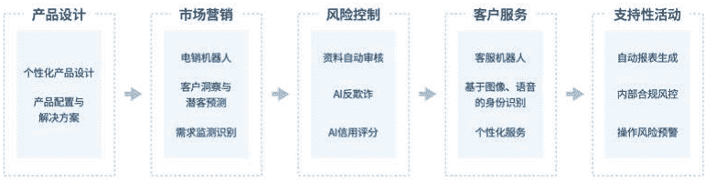

爱分析绘制

其中智能投顾属于典型创新化应用，利用 AI 进行风险识别、资产配置、投资提示等。招行“摩羯智投”即为代表，为用户提供个性化理财咨询。

### 阿博茨科技 助力港交所提升数据处理能力

阿博茨科技深耕 AI 在金融领域落地，为银行、交易所、资管机构提供 AI 解决方案。

与多家金融机构合作后形成成熟体系。其 AI+RPA 产品“Everdro id”实现数据识别到解析入库的全流程自动化。依托计算机视觉、NLP、知识图谱，可理解上市公司运营报表与法律文档，自动抽取并解析目标数据，送入结算平台。

图 10: 阿博茨科技的业务模式

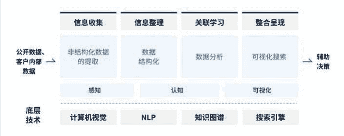

数据来源：阿博茨科技，爱分析绘制

金融数据处理是行业痛点。市场信息碎片化分布于公告与邮件，人工收集成本高；文件多为 PDF，需人工逐条录入；人工筛选导致准确性与时效性不足。

## 让公告秒变可用数据：阿博茨的感知能力从何而来

阿博茨科技喂给系统大量上市公司公告，让平台具备了对非结构化内容的感知。系统能从公告、邮件、新闻、图片等多种载体中抽取要素，其中视觉模块可把图片像素转为可读文字。

在认知层面，团队以自然语言理解为核心，在金融场景下训练模型，使系统读懂数据的业务含义，再把结构化结果导进客户内部系统或 Excel。最后借助可视化搜索型引擎向客户呈现分析结论。合作伙伴包括中国主权基金、新加坡主权基金、港交所、中金公司、海通证券、汇添富基金等。

香港交易及结算所有限公司是典型案例。作为全球主要的交易集团，港交所主营港股上市、证券交易与结算。业务上需要把上市公司提交的运营报告中的数据抽出来分析，但材料分散在网页、财报、外部报告、邮件等渠道，且缺乏审计记录，历史数据可检索范围受限。过去港交所约需 600 人做信息检索、准确性核验并手工维护数据库，效率低下且易出错，曾因一次员工记录失误承受重大损失。

合作后，“Everdroid”实现了从识别到入库的端到端自动化。系统自动抓取并识别运营报告中的关键数据。落地后人力投入下降约 80%，原本 7 天完成的数据解析，用金融方案 15 分钟即可完成，解析准确率稳定在 95% 以上，处理效率大幅提升，差错风险同步下降。

## 集奥聚合：用 AI 打通信贷全生命周期

集奥聚合成立于 2012 年 8 月，依托智能化技术为金融机构提供客户探查、智能风控、反欺诈、信用评估、策略分析、监控预警、贷后管理等信贷全流程服务。整套方案帮助机构精准识别欺诈，降低逾期与坏账，同时压缩企业成本，提升运营效率与盈利，推动业务迈向自动化模式。

图 11：集奥聚合信贷全流程生命周期管理

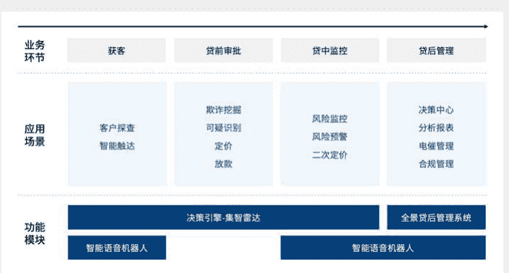

数据来源：集奥聚合，爱分析绘制

传统商业银行信贷环节多靠人工操作，导致获客困难、风险偏高、运营效率低。信贷风控大致可分为贷前信审、贷中监控、贷后管理三阶段。贷前信审聚焦申请准入与风险定价，贷中监控关注客户还款行为与账户变化，贷后管理则针对逾期用户进行提醒以减少损失。

如何在可控风险下让普惠金融更好普惠，是金融机构与集奥聚合共同关注的议题。智能化技术首先降低人力与运营成本，机器替代人工还能提升效率与准确率，使信贷业务更智能、更自动化。

- 智能外呼做客户探查，人机协同降本提效。信贷营销人力密集，外包或内部员工电话外呼不仅体验不佳，转化效率有限，且随人力成本上涨压力增大。基于智能语音交互的客户探查正在逐步替代传统人工。具备语音识别、自然语言处理与语音合成能力的语音机器人，可批量化、智能化完成探查任务，并输出标签和明细，帮助企业提升产能、降低成本。

### 2) 贷前反欺诈更精准，贷中监控及时止损
过去金融机构的信审多依赖人工与纸质材料，欺诈频发。集奥聚合借助设备指纹、规则引擎、流计算引擎、模型引擎等技术，对申请用户进行全方位矛盾点挖掘与可疑点识别。同时基于智能化技术构建精准的申请信用评分模型，形成一体化智能风控评分体系，实现快速、准确的信用风险分级，辅助授信决策。

在贷中监控环节，集奥聚合运用深度学习与策略引擎，深度挖掘用户行为变化、新增风险与异常波动，对还款风险进行持续监控。

### 3) 全景贷后管理体系，合规可控且前后协同
智能化技术赋能贷后管理，通过系统化产品输出强化贷后能力，降低不良率，提升逾期资产回收率，强化合规管控并降低运营成本。

全景贷后管理系统覆盖全景信息分析报表、决策中心、电催管理、外访管理及外访 APP、诉讼仲裁管理、合规管理、坐席轨迹监控、智能语音机器人等功能，实现运营提效、成本下降、合规保障以及贷前、贷中、贷后高效联动。

针对中短期逾期，智能语音机器人可精准触达客户，告知逾期情况及后果，大幅降低人力投入，实现高效作业，让人工专员聚焦疑难复杂案件，向专家型角色转型。

截至目前，集奥聚合的信贷全生命周期解决方案已与众多银行、保险、持牌消费金融、持牌小贷机构形成深度合作。效果上，智能化风控帮助客户欺诈风险降低 65% 以上，坏账率由 1.9% 降至 1.1%，降幅近 50%，显著优于行业平均水平。

#### 2.3.3 数字政府
中国数字政府正进入全面提升期，目标是通过数字技术持续提高公共治理与服务水平。

工信部中国软件评测中心评估显示，截至 2019 年 11 月，已有 10 个省级地方政府出台并公开数字政府规划计划；多地建成全省一体政务服务 App；交通部、生态环境部、广东、山东等部门和地方正推进政府数据向社会开放，提升治理能力。

得益于长期政务信息化投入，数字政府数据基础设施较为完善。智能化技术在智慧城市、智慧政务、智慧安防等领域已形成成熟应用。

在政务服务领域，人脸识别、语音识别等技术大幅提升身份验证、资料录入、咨询等环节的效率与体验，助力“最多跑一趟”。

在安防领域，智能化技术从视频监控结构化与目标识别，到智能情报研判与智能指挥调度，再到辅助智能终端，整体提升治理水平，有效缓解警力不足压力。

## 一览群智：为部委搭建全球人物知识图谱
一览群智成立于 2015 年 11 月，定位一体化智能产品与解决方案提供商。基于 NLP、知识图谱等认知智能技术，研发出智语、智慧、智图、智策四大产品，满足企业在超大规模多源异构场景下的数据治理、场景化建模与复杂决策分析需求，帮助智能化技术快速落地并构建专属智能决策平台。

图12：智能决策平台

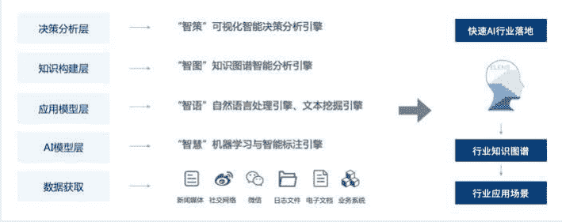

数据来源：一览群智，爱分析绘制

因客户需求差异与智能化工具接受度不同，一览群智构建了完整的产品矩阵，并以“产品+服务”的整体解决方案交付，从底层到上层均具备产品化能力，有效提升方案可复用性。

行业方案聚焦金融与政府两大领域。金融侧主要覆盖银行智能审单、智能风控、智能反洗钱、智能反欺诈。业务模式相对标准化，一方面降低人力、简化流程，另一方面可补充现有规则，构建专家知识体系，提升准确性。

政府侧主要服务媒体宣传与公共安全。媒体宣传部门应用于智能舆情检测、互联网情报分析，利用 NLP、OCR、知识图谱等技术切入传统舆情公司难以覆盖的场景，提供关联分析能力。

客户覆盖中央宣传部、中国最高人民检察院、中国建设银行、中国邮政储蓄银行、中信银行等近百家机构。

某部委作为代表客户，需有效管理国际交流合作、协调组织与宣传传播工作，降低涉外风险并提升效率。但外事工作中存在资源分散、传播对象模糊、合作渠道信息缺失等问题，需要智能化智库支撑。

合作过程中，一览群智对全球国际公众人物、智库、专题等多类公开信息进行人物关系挖掘与提取，借助大数据分析、NLP、知识图谱等技术，从海量异构数据中调取人物信息，以人物为核心构建人与机构、新闻等实体关联，形成知识图谱。同时整合国内外数据，以智能化手段搭建完整智库系统，为外交、合作、外事、公共安全等领域提供可发现、可演进、可维护的国际智库资源。

图 13： 国际人物智库解决方案

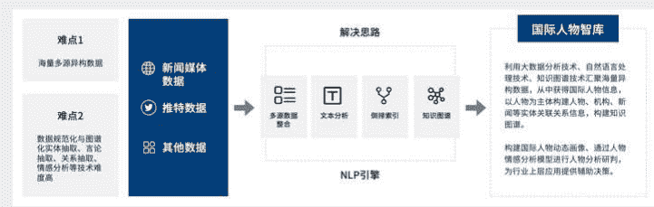

数据来源：一览群智，爱分析绘制

依托 NLP 引擎构建的国际人物智库，覆盖全球近 200 个国家和地区、28 种语言为主的近 5 万多种信息资源，形成媒体人士、智库专家、国家政要等近百万条人物数据，可配合多类人物库支撑上层业务需求。项目落地后，国际关系智库与重点人物库平台获部委高度认可。

#### 2.3.4 安全
在政策与需求双重推动下，网络安全正迎来新一轮发展机遇。云计算、大数据、物联网的渗透带来全新挑战，安全防护边界正向业务层延伸。

网络安全涉及大量数据处理与分析，业务本身亦数字化，智能化技术具备良好应用基础与丰富场景。信通院《中国网络安全产业白皮书》指出，智能化技术在数据分析、知识提取、自主学习、智能决策方面的优势，为应对动态复杂网络威胁提供新思路，推动治理向智能化演进。

## 芯盾时代：AI 反欺诈模型守护银行安全
芯盾时代是领先的业务安全产品与服务提供商，由信息安全、智能化技术、大数据多维技术驱动，为客户提供场景化全生命周期业务安全防护方案，助力构建安全、智能、可信的业务体系。

某混合所有制商业银行客户近年来深耕面向中小微企业的普惠金融，线上业务快速增长的同时，欺诈风险显著上升。欺诈从个体行为演变为组织化、专业化、利益链式的“黑色产业链”，对资金安全与网络金融发展构成严峻挑战。

图 14：业务流程与欺诈风险类型

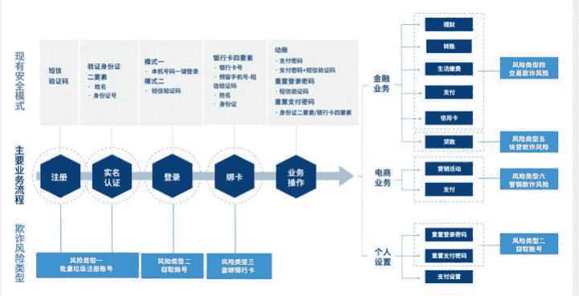

数据来源：芯盾时代，爱分析绘制

为此，该行在传统经验规则基础上引入芯盾时代以“业务安全咨询+智能风控平台+建模服务”为核心的反欺诈解决方案，覆盖实时交易的事前、事中、事后，全渠道多场景防控，包含四个关键部分：

通过交易反欺诈模型 TOFD、营销反欺诈模型 MOFD、信贷反欺诈模型 COFD 等机器学习模型，结合各业务场景风险特征，对用户行为与终端信息进行综合评估，并给出差异化处置建议，有效识别营销欺诈、薅羊毛、洗钱、信用卡套现等高危行为，保护资产与客户资金安全。

依托无感知认证、设备指纹识别、终端威胁态势感知、欺诈关联图谱等核心技术，全面覆盖各部门业务安全防控需求。

通过可视化机器学习建模平台 VAI，对洗钱、信用卡套现、营销作弊等高发场景持续优化，降低模型衰减周期，提升自动化风控能力，同时减少人员投入、节约人力成本。

针对样本不均衡与标注数据稀少问题，采用“无监督冷启动-半监督过渡-有监督”训练路径，快速消除影响，完成对交易流水、登录、注册开户等数据的清洗与标注。

图 15: AI 模型 vs 专家规则

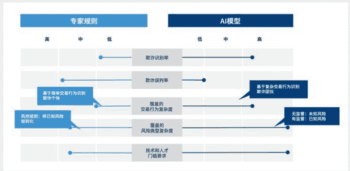

数据来源：芯盾时代，爱分析绘制

方案实施后风控精准度明显提升。欺诈团伙挖掘场景下，通过关联图谱与关联分析构建关系网络，识别出 8 个疑似团伙，涉及设备 100 余台、账号 1500 余个。

信用卡套现场景中，通过用户与商户双维度画像及关联分析，标记套现样本 8000 余条，经行内专家人工复核，正样本准确率达 98%。

#### 2.3.5 医疗
医疗行业数字化基础已具规模。2019 年全国卫生总费用约 63800 亿元，医疗信息化投入占比约 1%。以医院为例，智慧医院建设进入基础设施梳理早期，信息化基本完成，下一步重点在数据互联互通。

产业链涵盖药企、医疗机构、医保商保，业务包括药物研发、诊前/诊中/诊后诊疗、费用控制等，智能化技术已在各环节渗透，整体正从自动化迈向智能化。

图 16：人工智能在医疗行业的应用场景

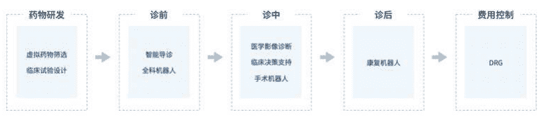

爱分析绘制

医学影像诊断是智能化技术最早渗透且发展最快的领域，属于典型自动化场景。影像数据天然结构化，数据基础好。计算机视觉辅助阅片可提升影像科医师质量与效率，并为资源薄弱地区提供服务，相关产品已进入商业化。

## 深睿医疗：AI 赋能影像，提高检出率降低漏诊
深睿医疗源自北大信科学院人工智能创新中心，依托自主研发核心算法，为医院、体检中心、第三方影像中心等提供智能化技术与互联网医疗解决方案。

深睿在影像领域实现多业务布局，涵盖智能化医学辅助诊断系统、智能影像云平台、多模态科研平台、智能预问诊系统及智能装备。

图 17：深睿医疗产品与服务矩阵

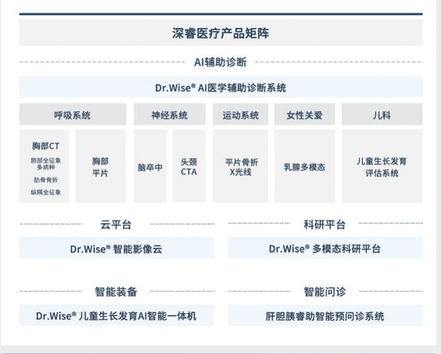

数据来源：深睿医疗，爱分析绘制

旗舰产品 Dr.Wise® 系列已从单病种扩展至系统化解决方案，覆盖呼吸、神经、运动、女性关爱、儿科等，贯穿诊疗全流程，提升诊断效率并降低误诊、漏诊风险。

兰州市妇幼保健院承担全市女干部及部分地区农村妇女两癌筛查，1990 年起开展乳腺 X 线摄影，医生需结合临床触诊完善透照。深睿乳腺 X 线智能化产品对细小钙化、肿块、不对称影、结构扭曲等保持高检出率，提升疾病检出率并降低漏诊误诊。

放射科主任评价系统显著提升科室效率与钼靶影像诊断准确性，降低漏诊率，且年轻医生借标准化的诊断路径快速提升水平。Dr.Wise®乳腺 X 线系统已成为放射科常规工具。

济南市章丘佳美健康体检中心于 2019 年 8 月引入 Dr.Wise 系列，包括肺结节智能化医学辅助诊断系统、脑卒中智能化医学辅助诊断系统、儿童生长发育智能化评估系统。

图18：深睿医疗 Dr.Wise 人工智能医学辅助诊断系列产品落地佳美健康体检中心

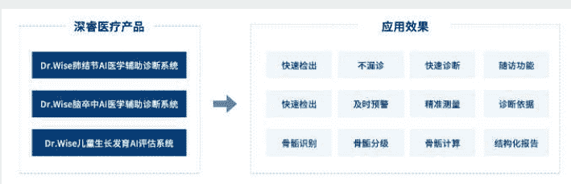

数据来源：深睿医疗，爱分析绘制

肺结节智能化系统以清晰色框标注结节坐标，对小于 5mm 微小结节实现不漏诊、诊断更快，对早期确诊意义重大；智能化随访功能助力医生复盘提效。

脑卒中智能化系统应用于卒中绿色通道，对出血性与缺血性脑卒中均可第一时间检出病灶、预警并测量体积，为影像与神经科提供可靠依据。

儿童生长发育智能化评估系统采用国际 Tw3 标准与中国中华 05 标准，具备骨骼智能识别、分级、骨龄计算及结构化报告功能，帮助医生与家庭掌握生长情况。

#### 2.3.6 教育
教育行业经历广泛在线化，K12、语培、STEM 等领域涌现大量在线公司，重塑供给侧格局。伴随在线化积累了大量数据，且多为文本、语音、视频等非结构化数据，智能化技术在数据分析与应用上价值凸显。

当前数据积累仍处初期，与核心教学相关数据较少，非结构化处理分析技术尚不成熟，整体落地成熟度有提升空间。

智能化技术已渗透师资教研、招生获客、教学服务等环节，其中教学服务场景最丰富、价值最高。头部机构已用语音识别分析课堂，提炼优秀教师实践沉淀为内容，提升教学质量与标准化。

图 19: 人工智能在教育行业的应用场景

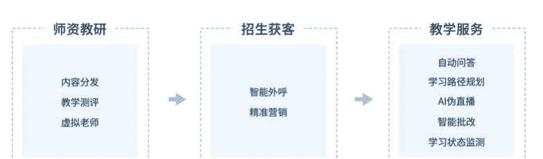

爱分析绘制

## 松鼠 AI：自适应学习引擎提升教学效率
智能化技术正从研究走向产业应用，首批落地行业多为人力密集、重复劳动多、效率低的场景，教育是典型代表。

松鼠 AI 洞察智能化技术对教育的革命性价值，研发出国内首个拥有完整自主知识产权的智能化自适应学习引擎，并成为首家将该技术应用于 K12 中小学教培领域的科技独角兽公司。

智适应教学的底层支撑，是把学科知识拆成极细的微单元，梳理单元之间的关联关系，最终编织成一张能够自我演化的知识网络。

过去的知识架构大多按教学大纲排成树形，松鼠AI借助自研图谱技术把树形改造成网状，并以持续流入的学习行为数据驱动模型自动迭代，使用越久越精准。

在图谱之上，松鼠AI的MCM三维测评体系从思维方式、认知水位、学习方法三个维度读取学生的实时状态，还原当前学情全貌，定位个性化的盲区与薄弱点，形成精细的学生画像。

画像明确后，系统依托知识图谱逆向溯源，为每位学员生成专属学习路线；学习期间持续采集行为信号，实时推算最优方案并推送，过程始终可控。

图 20：松鼠 AI 个性化学习内容推荐和路径规划

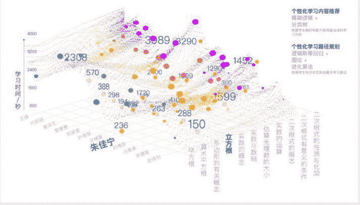

数据来源：松鼠 AI 1 对 1

松鼠AI的教学闭环覆盖全流程，可归纳为三步：

第一步是动态测评，对知识掌握情况做实时评估。平台不断捕捉前端交互信号，随着样本累积，画像愈发清晰；

第二步是精准补位，哪里薄弱补哪里。为每个短板匹配微单元资源，包含三到五分钟的讲解短片、动画或微课，并按画像匹配内容；学完后通过练习检验吸收与迁移，如此循环；

第三步是全程追踪，系统记录答题正确率、错选分布、答题时长、视频暂停回放等行为信号。海量信号反哺图谱进化，使判断与路径规划更准确。

国家级贫困县山区的女孩田艳青患成骨不全症，俗称玻璃娃娃，一不小心就会骨折。受经济和健康双重限制，她一度只能在家中辍学。

图 21：田艳青的英语学习水平变化

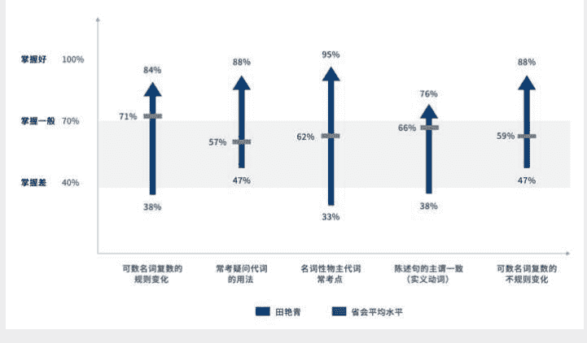

数据来源：松鼠AI提供，爱分析绘制

辅导前，田艳青的多项能力指标远低于省会城市学生均值。接受松鼠AI辅导两个月后，借助溯源打底、夯实基础等机制的个性化支持，她的能力值明显提升，从省会均值的47%跃升至84%。

#### 2.3.7 工业

工业是国民经济的支柱，关乎核心竞争力。《中国制造2025》指引下，产业转型加速。工业互联网是主线，依托互联网、物联网、云计算、大数据、人工智能等数字技术推动工业智能化升级，是关键抓手。

总体看，我国工业数字化基础偏弱，信息技术投入偏低，数据基础仍在完善。

推进中，智能技术主要渗透在两层：一是边缘侧与物联网结合提升感知能力，二是平台侧机器学习与数据分析赋能上层应用。工业领域的智能落地目前仍处起步阶段。

自动化场景已较成熟，典型是工业机器人。在传统机器人基础上叠加计算机视觉、语音识别等智能技术后，机器智能水平提升，可实现散乱物品识别抓取、运动路径自主规划、多机协同作业等复杂生产任务。

在智能化层面，工业互联网汇聚设备、产线、企业与产业全链数据，结合机器学习挖掘深层价值。如基于设备运行与故障数据构建故障预测模型，实现预测性维护，降低运维成本与停机损失。

在工厂运营管理端，计算机视觉可强化安防监控智能化。以富士康智慧工厂为例，借助视频监控与计算机视觉，实现车间特殊区域非法闯入监测、安全生产监测等功能。

## 滴普科技携手3C龙头打造全链路数字化样板

滴普科技成立于2018年，定位为企业数字化智能全栈服务商，聚焦互联网、大数据、人工智能、物联网产品的研发与落地，是国内头部数字化建设力量之一。

创立一年多，团队规模扩张至约600人，服务超40家大中型企业，已形成商业智能、人工智能、智慧园区三大标杆方案。

消费电子数字化转型覆盖服装、餐饮、汽车、快消、3C等领域，其中3C行业理念最前沿、渗透最深。

一家国内知名3C消费电子品牌，线下渠道强势。随着手机市场趋于饱和、头部集中效应增强，企业亟需应对生产、供应链与销售变革带来的全链路敏捷改造。

其主要痛点包括货物流转难以追踪、真实销量与市场反馈无法实时掌握、供应链协同效率低下、营销政策难精细化。

双方合作目标是通过场景化业务牵引，建立质量链、供应链、资金链等纵向横向端到端集成，最终形成闭环数字化业务，树立手机行业转型样板。

首要任务是找到可量化结果的切入点，形成示范后再深化。生产制造效率优化与数据采集成为首个落地场景。

滴普科技打造的工业互联网平台方案覆盖底层硬件与云平台，可用于光伏、模组等屏幕类AI检测，并具备跨场景复制能力，服务集成电路、电子信息等行业。

图 22：滴普科技工业互联网平台解决方案

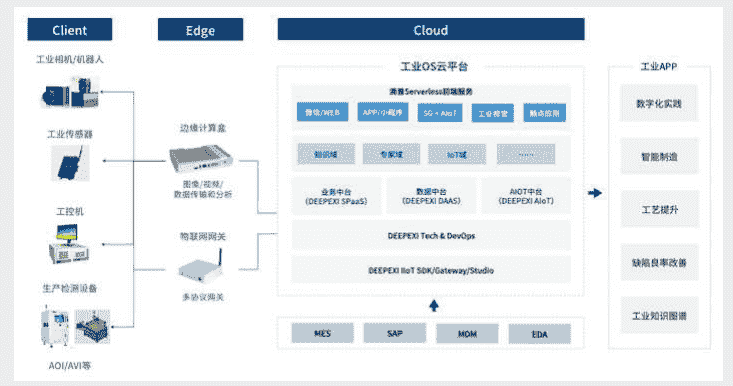

数据来源：滴普科技，爱分析绘制

落地层面，底层硬件部署PLC、AVI、工业相机与视觉检测项目，边缘侧配置边缘计算盒，大数据量场景下先行边缘检测，降低传输压力。

上层为客户搭建GPU集群私有云，其上运行工业互联网PaaS平台，承载业务中台、数据中台、人工智能中台与物联网中台。

应用集中在成品屏幕检测与SMT检测两大场景。传统工业相机采集原始数据后，在人工智能中台内基于图像识别与深度学习算法完成视觉检测，最终在客户端呈现检测、设备维护与管理等应用。

项目落地后，产线检测效率提升2倍，检测准确率由96.5%提升至99.85%，检验人员精简约220名。

下一步，该品牌还将延展供应链优化、质量工艺优化与智能决策业务。通过打通库存与物流的进销存数据，结合工厂敏捷反馈与策略推送，优化终端订货流程，提升供应链运作效率与库存周转率，进而改善渠道营销与管理执行效率，降低运营成本，实现全链路数字化。

## CHAPTER 03

03

### 人工智能落地挑战与应对

## 3.人工智能落地挑战与应对

深入产业实践后，AI技术与企业真实需求之间仍存在明显鸿沟。

企业要的是用AI驱动业务增长，而技术本身无法直接解决业务问题，必须结合具体场景与目标，形成可规模化复制的产品与服务。在此过程中，数据、算法、场景理解、服务模式、投入产出比等多维度挑战并存。

### 3.1 数据

数据是AI应用的根基。对特定业务场景的解决流程，涉及数据获取、数据治理、数据标注。

图 23: 数据层面的挑战

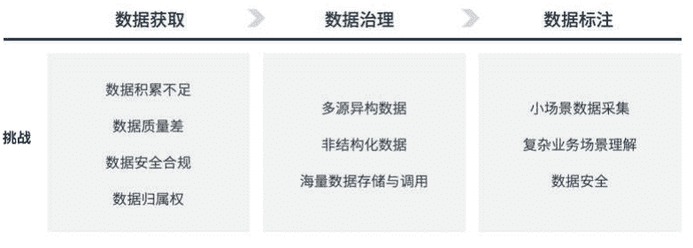

爱分析绘制

在数据获取端，数据质量是首要难题。图像、文本、语音等单点场景可借助公开数据训练模型。但解决真实业务问题时，无论是模型训练还是上线运行，都依赖业务场景原生数据，外部数据价值有限。

受限于信息化、在线化水平，部分企业历史数据积累不足或质量堪忧，需经历冷启动与数据治理。实际业务中大量数据靠人工填报，准确性差，需先建立核验机制剔除异常。例如品牌商做销量预测需汇总各渠道促销计划，而一线销售代表上报的数据往往与执行情况不符。

应对数据不足与质量风险，需从流程与算法双向发力。对样本稀缺问题可尝试少样本学习算法；对采集质量风险，可结合业务经验制定精细化采集与清洗规则。

数据合规风险也在抬头。一方面个人隐私保护政策收紧，另一方面数据归属权不清导致跨主体数据难以流动融合，限制可获得性。

当前常用策略之一是联邦学习，在不交换原始数据的前提下加密联合建模，既实现协同又保护隐私。

图 24：联合建模

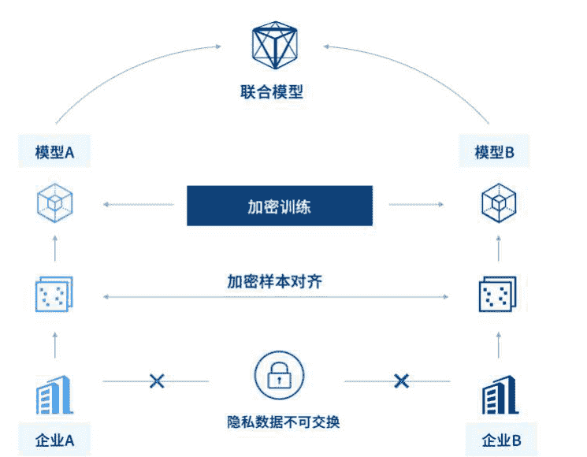

爱分析绘制

在数据治理端，数据复杂度在提升。产业落地需要采集多源异构、时序、非结构化等多种类型数据，存储与治理难度大幅增加。如工业场景同时涉及现场图像、工艺文本、设备时序数据，给清洗与应用带来高复杂度。

应对手段之一是大数据湖架构，同时兼顾结构化与非结构化数据的存取与处理，降低存储成本并支撑算法调用。

在数据标注端，垂直细分场景让标注难度升级。一是标注人员需具备更深行业知识，门槛与成本上升，如医疗影像与文本标注需医学专业背景；二是数据类型向文本、3D图像等高复杂度形态演进。三是细分场景需采集特定环境、特定对象的“小而精”数据，需专业采集手段，如微表情识别需演员配合表演、汽车碰撞数据需实验室采集。这些数据是资产方核心资源，标注过程需保障安全。

算法层面可通过半监督、无监督等迁移学习弱化标注依赖。此外，第三方标注平台兴起，成为新选择。

高质量数据的生产者，云测数据推动产业智能化

随着AI发展，数据需求从追求数量转向追求质量，算法训练依赖场景化、精细化数据。

云测数据隶属Testin云测，通过自建场景实验室与标注基地，提供数据采集、清洗、标注、平台私有化部署、驻场服务的一站式定制方案。

客户类型包括2C互联网公司、AI技术公司、传统行业头部企业如金融、保险、银行、物流、零售等，均有数字化转型与效率提升需求。

图 25：云测数据的一站式数据标注服务

| 数据采集 | 数据标注 |

|---|---|

| 图片采集

视频采集

音频采集

文本采集 | 计算机视觉：关键点标注、线标注、拉框标注、语义分割、目标跟踪、3D点云标注

语音识别：语音转写（ASR）、语音切割、语音情绪判定、声纹识别

自然语言处理：词性标注、OCR转写、机器翻译、情感标注、信息抽取、语句泛化 |

数据来源：云测数据，爱分析绘制

针对行业特性，云测数据配置专业条线团队提供最优解，已在华东、华南、华北建立标注基地，服务智能驾驶、智慧城市、智能家居、智慧金融、新零售等领域。

其优势体现在标注精度高、效率高、人员专业度高。

智能驾驶领域，随着主机厂与新势力多元化落地，云测数据搭建车内智能仓采集群场景，进行车内环境动作采集等。标注服务涵盖通用拉框、车道线标注、全景语义分割等。车道线标注需区分白实线、白虚线、黄实线、黄虚线及道路沿线，并标注车辆可行驶区域与属性，颗粒度极细，已服务多家无人出租与造车新势力。

智能家居领域数据采集量大，涉及指定语料、用户表情与情绪采集等。云测数据支持专业设备采集与多模态场景采集，如真假笑表情对照采集，先采集假笑再诱导真实笑容，帮助客户做表情识别。提供语音交互类标注，包括语音转写、行为意图标注、声纹识别、领域识别、语句泛化与语义分割，并自主研发标注平台，预设语义分割等模板，提升精细化与标准化效率。

智能安防领域应用于智慧城市、人流监测、车辆识别等。云测数据提供人脸点位、人体拉框、目标跟踪、语义分割、异常行为、步态、Re-ID、路面物体采集等全类型标注。复杂场景下如人体骨骼被遮挡，需标注人员依据经验补全关键点；密集人流场景需前后帧比对保证一致性。系统化岗前培训保障交付规范与精度。

目前云测数据已服务数百家企业，以高质高精数据助力产业智能化升级。

### 3.2 算法模型可解释性

在模型层面，AI与业务系统结合的核心挑战是可解释性。

从传统回归、决策树到深度学习，算法复杂度攀升，决策机制愈发难以人工理解。大多数深度学习模型是黑盒，难以自证逻辑。

但在金融、工业、医疗等强监管、强风险行业，模型需具备业务可解释性，经得起业务人员、决策者与监管层的审视，否则难以落地。

例如零售品牌商用AI预测未来一个月销量，直接影响生产、库存、物流与营销计划，涉及巨额资金调度。若预测结果无法给出业务逻辑支撑，业务方不会采纳。

金融监管更为审慎，监管机构对技术理解滞后于科技公司，为控制潜在风险，往往要求模型可解释、可追溯。

因此“可解释AI”被视作圣杯。它的目标是揭示模型每一次决策背后的逻辑，增强使用者信任、掌控与安全感，也为事后监管、问责与审计提供依据。

落地实践中，常采用深度学习与经典统计规则融合建模，以兼顾性能与可解释性。

## 九章云极：融合行业知识，为企业构建一体化 “AI 大脑”

九章云极由清华留美博士团队于2013年在北京创立，致力于打造领先的数据科学平台与实时决策中枢，服务超120家国内外大型企业。

核心产品DataCanvas数据科学平台面向金融、政府、交通、IoT行业，提供分布式实时数据分析、实时业务、数据中台与AI建设能力，具备低门槛、异构多引擎、三位一体建模、可解释白盒算法、特征仓库、模型仓库、一键发布、实时AI热更新等特点，助力企业完成数据智能化转型。

浦发银行是其金融行业代表客户。此前银行引入国外厂商的商用建模平台，无法支持分布式大规模实时建模，且模型均为黑盒，难以沉淀为企业资产。银行业务复杂多变，对实时性、大规模处理与自主可控要求高，原平台匹配度不足。

图 26：浦发银行与九章云极的合作历程

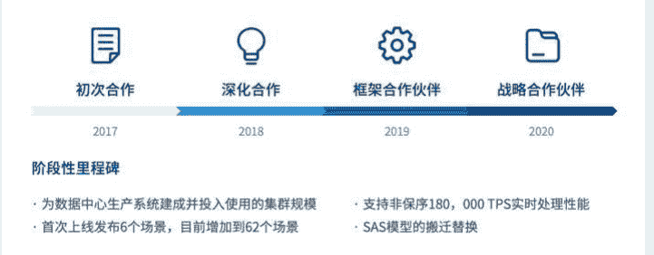

数据来源：九章云极，爱分析绘制

自2017年起，浦发银行便与九章云极开展试点探索，合作范围随之逐步延伸，双方携手塑造智能决策核心，并在2020年把合作关系明确为战略级。九章云极凭借自主研发的DataCanvas流式引擎，其特点是吞吐量大时延低，基于该引擎构建起贯穿数据科学全流程的建模架构。架构持续向营销和风险控制两大业务线输送实时流式数据与离线批量处理能力，覆盖电子银行用户行为追踪、客服海量数据分析、风险即时告警、资金变动驱动的营销触达等场景。

银行业监管强度大，对业务合规和新技术的可控性要求很高。业务使用者不仅要能熟练使用平台，更要吃透底层逻辑，建立信任感，及时发现偏差并优化模型。正因如此，可解释性建模尤其是白盒算法集合，已成为行业内普遍的刚性诉求。

图 27：九章云极的产品结构

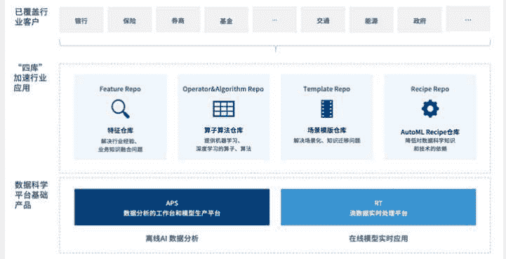

数据来源：九章云极，爱分析绘制

该体系整体由四个仓储单元组成：特征仓、算子仓、业务场景算法模板仓以及 AutoML 配方仓。

特征仓沉淀了大量业内通用的方法论，有助于把行业know-how与具体业务知识相融合。信贷员的实战经验能够提炼为扩展特征，通过机器学习加工后反哺模型，从而提高训练集的表现。算子仓提供了一套机器学习算子，内部包含贝叶斯编程等解释力更强的模型，直接回应银行对透明可审计的需求。

场景模板仓主要解决跨行业经验迁移的问题。把其他行业的营销打法提炼成可复用模板，再映射到银行相似场景，如KYC及客户分群用于金融产品推荐。自动机器学习仓则集成AutoML框架，建模时可沿用同类模型已验证的特征组合，减轻对专业人员的依赖。

上线后，浦发业务人员借助图形化拖拽即可完成建模，操作门槛大幅降低。分布式集群日均处理能力超过10亿条，峰值可达每秒50万条，完全满足风险管控、资金流向监控和精准营销的实时需求，实际表现超出预期。所覆盖的业务场景由最初的6个扩展至62个，整体处理效率得到明显改善。

### 3.3 业务场景理解

随着AI在垂直领域持续下沉，待解决的问题已从通用场景和局部痛点转向特定场景及端到端流程。能力维度也在从感知向认知跃迁，需要具备分析判断和决策支持能力。与此同时场景复杂度攀升、进入难度加大，对技术服务商的行业理解提出了更高标准。

在这种背景下，仅凭算法能力与历史经验已难以奏效。算法需要与专家经验及业务规则深度结合，知识图谱因此成为核心抓手。

知识图谱能够把行业经验转化为结构化知识网络，让算法更懂业务语境。实践路径上，先构建统一的知识图谱实现知识融合，再在此基础上推进AI应用快速落地，是一种较为可行的打法。

### 3.4 服务方式

AI落地的服务形态同样关键。

传统企业普遍缺乏成熟的技术团队，单纯交付标准化技术或开放API调用难以满足业务侧的真实诉求。服务商需要依托具体场景，将技术能力转化为定制化方案并封装成可直接嵌入业务系统的产品形态，可称作产品化交付。

与此同时，企业更在意业务目标的实现与系统长期稳定运行，但自身运营能力有限。服务商必须提供持续的业务运营支持以保障价值释放，这属于服务化交付。

对厂商而言，这构成了商业模式的挑战，需规避过度定制和重服务负担。相对稳妥的做法是借助中台化思路赋能前线，把通用能力沉淀为中台，让前线人员基于中台开展客户运营，共同推动方案落地和目标达成。

### 3.5 投入产出比

目前企业采用AI仍受总拥有成本偏高制约，投入回报比偏低，制约了采纳意愿。

落地成本主要由两块构成：智能化硬件如芯片与算法平台，以及对专业人才的强依赖，比如算法工程师等人力投入。这两项叠加，使得不少行业难以实现规模化推广。

从降本角度看，数据科学平台和机器学习平台的普及正推动建模自动化，覆盖数据准备、模型构建、决策部署到模型管理，形成闭环，减少对算法工程师的依赖，进而压缩总成本。

未来提升回报比的空间还在于算法进步降低硬件门槛，以及AI芯片等硬件价格的下降。

## CHAPTER 04

### 人工智能应用趋势展望

## 4.人工智能应用趋势展望

回望未来，基础设施迭代、技术范式从决策向行动演进、应用边界由企业智能向产业智能延伸，是未来几年值得重点关注的三大方向。

### 4.1 基础设施升级，拓展人工智能应用场景

2019年国内正式进入5G商用元年。5G以高带宽、低时延、广连接为特征，正演变为产业升级和万物互联的新型底座。

其一，5G可承载海量设备实时在线和大规模数据传输，企业能够获取的数据体量和实时性大幅提升，为更多AI场景提供了可能。其二，随着5G网络覆盖扩展，超高清视频等新应用加快落地，AI在其中发挥空间很大。

以大型工业现场为例，建设高带宽有线网络困难，传统Wi-Fi也难以满足监控要求，无法利用高清视频实时识别产线故障、人员违规和安全风险。5G提供了新的解决路径，还可结合AR/VR实现设备故障的远程专家会诊与运维。

边缘计算是5G时代的另一突出特征。智能终端的爆发让以云端为核心的集中式处理模式难以为继，边缘计算开始兴起。随着数据在终端侧处理和应用比例提升，边缘智能逐渐崛起。

### 4.2 人机协同带来全新业务模式

按问题解决能力划分，识别、理解、分析、决策、行动组成完整链条，AI发展经历了感知智能、认知智能到行动智能三个阶段。

图 28：从感知智能到行动智能

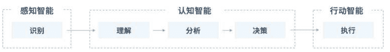

爱分析绘制

AI的追求是让机器在感知到行动的全链路上模拟甚至超越人类，但在复杂场景中完全替代人并不现实。综合能力边界、效率和成本考量，人机协同将成为主流。

人机协同是通过交互融合人类智能与机器智能。核心是以知识图谱支撑推理推荐，并对人机资源进行合理配置以解决复杂问题。交互模式随场景可分为冗余、互补和混合三种。

落地案例不断增多。智慧餐厅中，机器人与服务员协同完成迎宾、领位、点餐、送餐、收餐等环节，提升客户体验。在公安场景，知识图谱收录约16亿实体，需要挖掘隐性关联和潜在线索。若仅靠机器进行全景检索效率很低。采用人机协同模式，由刑侦专家先判断重点方向，再交由机器深入搜索，效率大幅提升。

当前阶段协同仍以人为核心，场景需求与机器能力的匹配由人主导。未来趋势是机器能够自主识别场景、调度资源并与人类协同作业。

### 4.3 产业智能互联

随企业数字化转型和产业互联网推进，产业智能互联的数据基础不断完善。产业链各环节数据互通后，AI应用从企业内部智能化向产业级智能化延伸，采购、制造、流通等环节实现协同作业，提升整体效率。

滴滴出行可视作简化样本。每个司机都是个体经营者，通过平台智能调度与终端用户建立连接，平台的预测、推荐和调度算法实现了需求与运力的高效匹配，这是个人难以实现的。

零售行业的双十一是产业智能互联的典型实践。千万商家和数亿消费者在制造、电商、物流、支付金融等互联基础设施支撑下，借助AI赋能高效完成大规模交易和履约。商家可参考平台销量趋势预测提前备货，并结合库存调度系统和物流网络，将订单智能分配到路径最短的仓库或门店发货。

随着基础设施成熟和技术渗透加深，更多行业将走向产业智能互联。

结语

2020年代，产业落地的能力将成为AI的核心命题。在通用基础技术趋于成熟的背景下，深度结合行业推动数字化转型和生产力提升，才能真正释放价值。同时，把技术转化为可规模化落地的产品与服务，也是厂商深化能力、构建壁垒的关键。

正处于数字化转型浪潮中的企业，推动业务智能化升级已刻不容缓，关键在于找到投入产出比最优的切入场景。

爱分析将持续追踪AI在各行业的落地进展与最佳实践。

咨询/合作

微 信： ifenxi888

网 址： www.ifenxi.com

地 址： 北京市朝阳区酒仙桥路兆维华灯大厦 A1 区 1 门 2 层 2017

## ifenxi

专注 产业 数字化 研究

每日免费获取报告

- 1、每日微信群内分享8+最新重磅报告；
- 2、每日分享当日华尔街日报、金融时报；
- 3、每周分享经济学人
- 4、行研报告均为公开版，权利归原作者所有，小马财经仅分发做内部学习。

扫一扫二维码

关注公众号

回复：研究报告

加入 “小马财经” 微信群。

