# Python 编程入门·人工智能启程

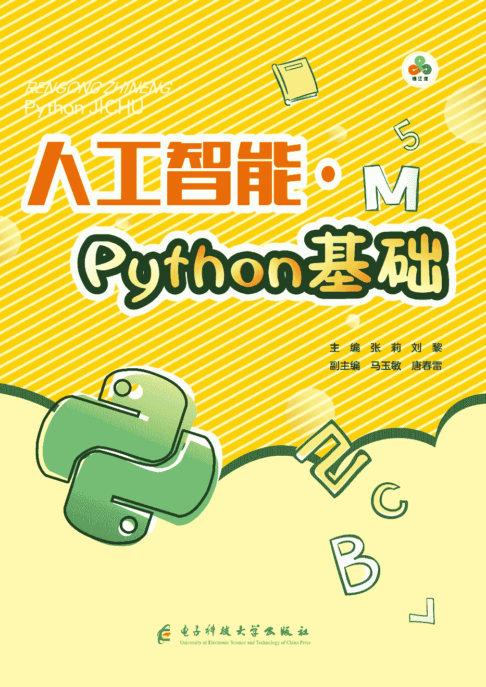

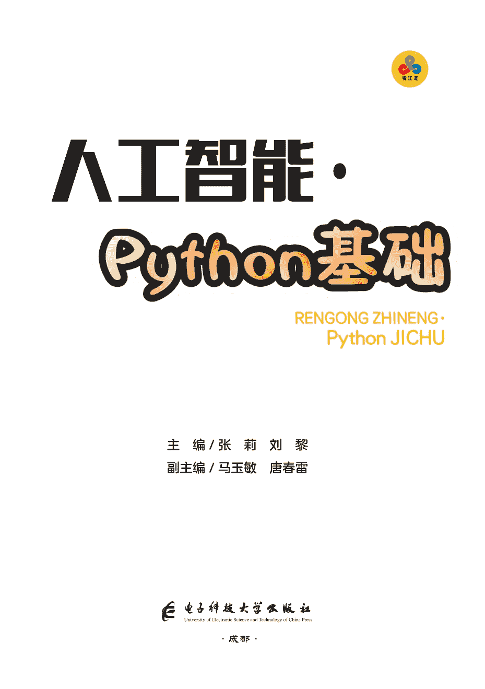

# 顾问

姚文忠　郭　斌　罗清红　蒋晓明　曾乾炳

# 编委会

主　　编　张　莉　刘　黎

副 主 编　马玉敏　唐春雷

编　　委　胡定坤　陈　涛　王永风　曹　婷

　　　　　李静雯　邬德慧　许云迪　杨　勇

# 前言

本书策划与编写团队，向读者发出学习编程并付诸实践的邀请，选用 Python 作为首选语言。

中国已拥有神威、天河等顶尖算力平台，如何让这些算力服务于工业、农业、交通、金融、科研、防灾、航天、国防、文化、教育等众多领域，必须依赖海量的定制化程序。反之，正是在程序的驱动下，超级算力才得以在各行各业发挥放大效应。可以说程序是连接硬件威力与社会需求的枢纽。

程序可以用上百种语言来落笔，脑中构想落实为可执行形态离不开语言工具。Python 凭借易学好玩、低门槛、高效率的特点脱颖而出。本书在编写时注重图文结合、案例先行、表述亲和、贴合认知路径，这是其显著优势，也是入门 Python 的优质路径。

过去，爱好者学编程多为拓展机器能力。如今格局已变。

国家层面已全面进入智能化新阶段，创新成为常态。人们不再满足于被动运行现成软件，更需要读懂机制、创造更多元更高质的程序。人工智能借助数字化技术重塑学习、工作、生活方式，个体的数字素养已成为核心竞争力，具备编程基础已是数字原住民的必备素养。

以 Python 为主线的教学读物值得推广，既因其站位国家战略高度，也因其能塑造数字化思维、锻炼数字技能、培养数字生活习惯，从而持续赋能国家发展动能。

总体而言，本套教材兼具实操性、趣味性与育人性，契合中小学生认知规律，有助于减轻教学压力、提升课堂效率。在迈向人工智能社会的进程中，能够快速提升学生数字能力的读物，才是真正的好教材。

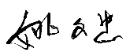

# 给同学的一封信

亲爱的朋友们，你们好！

欢迎进入 Python 编程的世界。信息技术迅猛演进，人类正步入人工智能时代，而 Python 正是通往这一时代的桥梁。本书将以锦锦、江江和小蟒蛇派派老师为向导，带领大家认识 Python 的基础。

Python 目前是兼具简洁与强大功能的语言之一。在数字生活中，我们无时不刻都在处理信息，Python 能高效完成信息的获取、整理、分析、存储、生成、传输与应用等环节。掌握它，就像拿到开启信息时代的大钥匙。准备就绪了吗？让我们开启愉快的学习旅程吧！

编者

2019 年 2 月


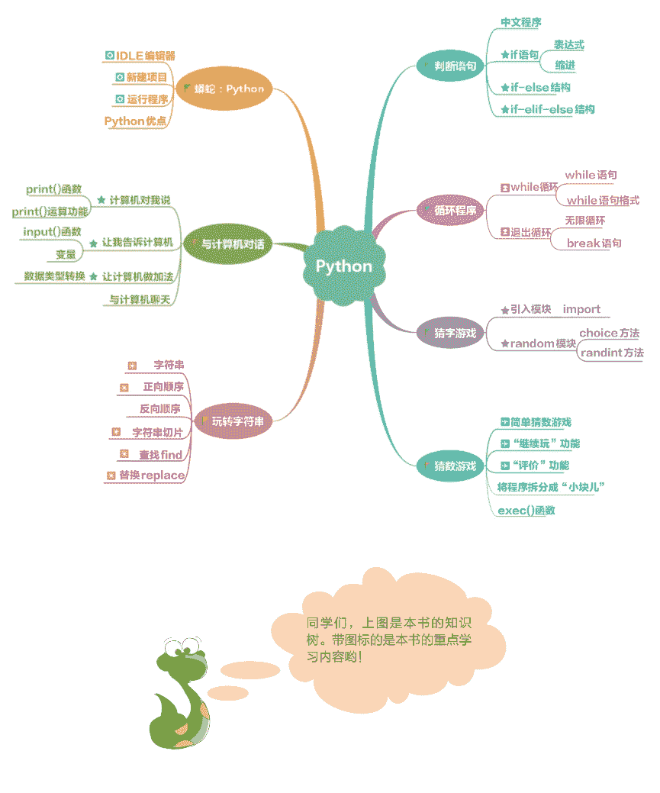

# 项目一　认识可爱的蟒蛇：Python

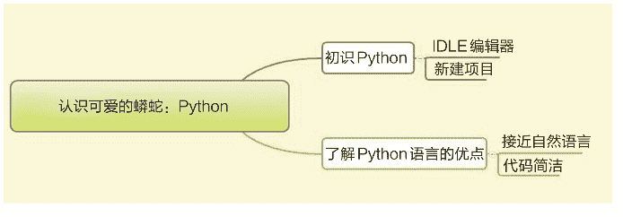

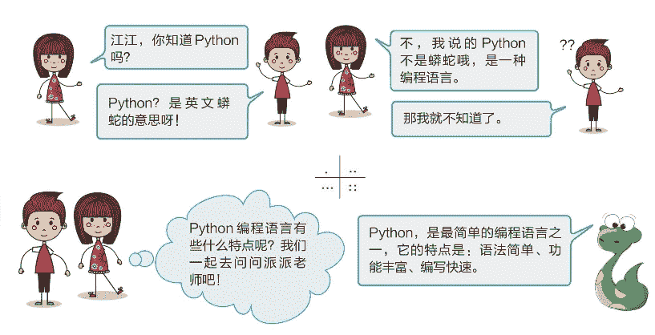

## ◎第一节　初识 Python

人工智能已深入学习与生活场景，比如智能导航、语音识别、机器人等，Python 在其中扮演关键角色，可帮助我们与机器沟通并下达指令。

入门首要认识 IDLE 环境。IDLE 如同人机沟通的翻译中介，能便捷地创建、运行、调试 Python 代码。

以下从启动 IDLE 开始。

在已安装 Python 开发环境的电脑上打开“开始”菜单，找到 IDLE（Python 3.7 64-bit）并运行，初始画面如下：

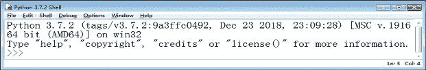

图 1-1-1　Python 3.7 编辑器界面

下面介绍两种常用运行方式。

### 方法一：在 IDLE 交互区运行

1．在图 1-1-1 的 `>>>` 提示符后输入：

`print（"你好，代码世界！"）`

注意：括号与引号需使用英文半角，勿用全角或中文符号。

回车后观察输出。

2．继续在 `>>>` 后输入：

`print（"你好，我是锦锦"）`

执行后会看到什么？

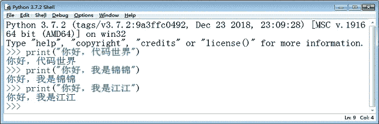

图 1-1-2　IDLE 运行界面

### 方法二：新建项目文件

如图 1-1-2，IDLE 的 `>>>` 区适合快速试码，若需编写多行程序，建议新建文件保存，便于管理。

操作步骤：

1.点击左上角 `File` 选择 `New File`，在编辑区写入：

`print（"大家好，我是某某"）`

2.通过 `Run` 菜单选择 `Run Module` 执行。按提示保存文件到熟悉目录，文件名自定，随后查看结果。

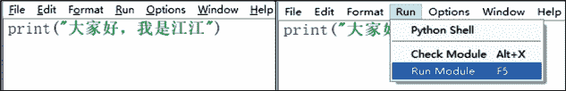

图 1-1-3　新建项目界面

3.完成测试后点右上角 × 关闭。

上述代码已存入电脑，后续可在 IDLE 中通过 `File` → `Open` 定位到保存位置打开。

**小结：**

`print（）` 是 Python 常用指令，本义为打印，可理解为输出。

编写与测试主要两种做法：

1.直接在 `>>>` 后输入并运行，适合即时验证。

2.新建文件保存代码，便于复用与修改。

特别提醒：括号和引号务必使用英文半角。

**显身手**

1、查阅资料，了解 Python 的演进历史？

————————————————

————————————————

2、Python 应用广泛，能在哪些场景使用？

————————————————

————————————————

## ◎第二节　Python 的优势概览

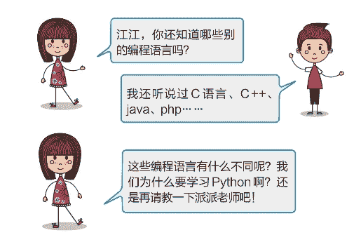

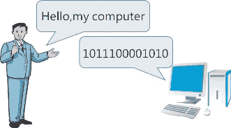

图 1-2-1　人机交互语言示意

Python 自 2016 年起持续走热（如图 1-2-1）。最初面向业余爱好者设计，命令表述接近口语。只要能用日常语言描述需求，即可转译为代码实现。相较之下，其他语言更严谨复杂。发布后专业开发者也青睐其简洁可读，于是迅速全球流行。

简言之，对新手而言，Python 上手快、学习成本低。

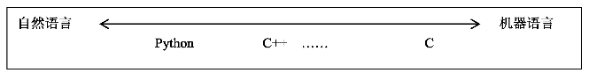

图 1-2-2

如图 1-2-2，语言越贴近自然语就越易学，越贴近机器码则规则越繁琐。

除贴近自然语言外，Python 代码量也极少。同样功能，C 可能需 500 行，Java 约 100 行，Python 往往 20 行左右即可。

让 Python 真正爆发的推手是谷歌。2014 年谷歌将搜索引擎代码从 Java 迁至 Python。2016 年 AlphaGo 战胜李世石后，Python 成为人工智能首选工具。

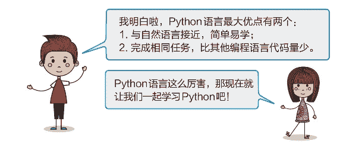

**显身手**

尝试用 `print（）` 让计算机多说几句话！

————————————————

————————————————

# 项目二　用 Python 与计算机对话

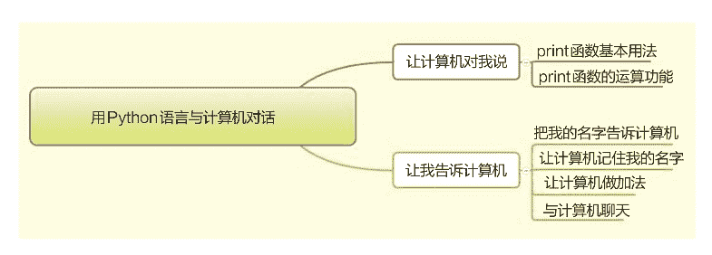

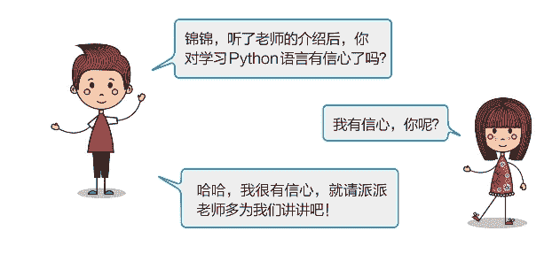

江江与锦锦正在交流。

江江提问，锦锦作答并反问，江江再作答。

人与计算机的交互本质也是对话。点击按钮触发窗口，就是机器的回应；回应后下一步操作即是新的指令。整个过程是持续的对话。

既可用鼠标键盘发号施令，也可借助 Python 进行对话。

## ◎第一节　让计算机发声

上节已接触 `print（）`。在 Python 中，该指令用于向用户展示信息。可展示预设文本，如 `print（“你好，代码世界”）` 会输出对应文字；也可展示计算结果，如 `print（5-2）` 输出 3，如图 2-1-1。

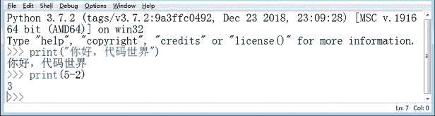

图 2-1-1　print 输出示例

总之，`print（）` 的作用是把信息呈现给使用者。

### 活动一：print 基本用法

请在 IDLE 中执行：`print（"你好，代码世界"）`

熟练后会发现其格式：

`print（"需要展示的内容或计算结果"）`

使用时易出错，常见错误举例：

1．指令拼写错误：

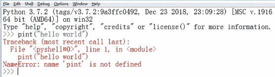

图 2-1-2　print 拼写错误示例

如图，将 print 写成 pint，报错提示未找到指令。

2．引号或括号格式错误：

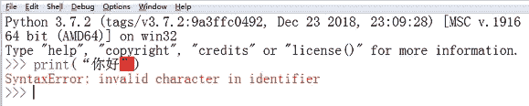

图 2-1-3　引号错误示例

如图，引号使用了中文符号导致失败。

3.缺少必要符号：

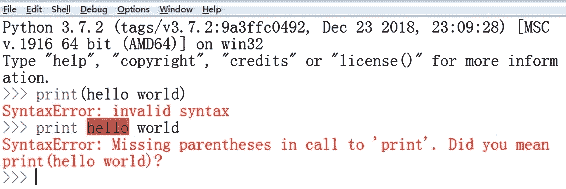

图 2-1-4　符号缺失示例

第一行缺少引号，第二行缺少引号与括号，均无法运行。

**小结：**

运行出错时 IDLE 会以红色显示 Error 提示，说明代码有问题。仔细阅读提示即可定位。

常见错误类型包括：

1.语法错误（SyntaxError）

### 2.名称未定义（NameError）

### 3.类型错误（TypeError）

### 显身手

请用 `print（）` 在 IDLE 输出：

1.你好，世界。

————————————————

2.输出你自定义的任意内容。

————————————————

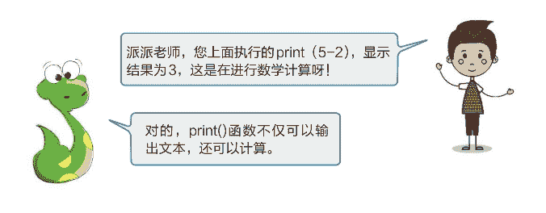

输出文字只是基础，print 还能像计算器一样运算并展示结果。格式：

`print（数值1 运算符 数值2）`

加减乘除对应 `+`、`-`、`*`、 `/`，示例如图 2-1-5。

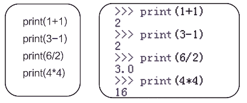

图 2-1-5　四则运算示例

试试输出 `31250435+92206354` 的结果。

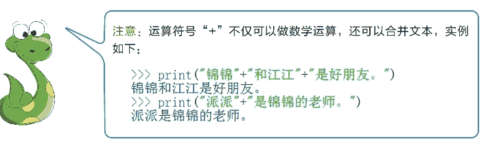

图 2-1-6　加号连接文本示例

### 显身手

在 IDLE 输入以下代码并观察现象：

1.`print(12＊3)`

2.`print("#"＊12)`

3.`print("12＊3="，12＊3)`

4.`print（"我叫锦锦，"+"我今年 10 岁了！"）`

## ◎第二节　向计算机传递信息

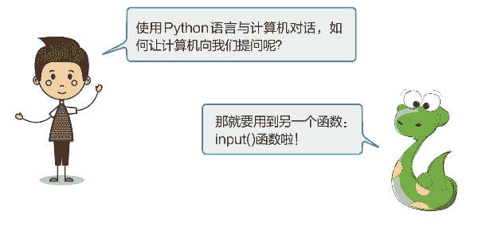

### 活动一：告诉计算机名字

`input（）` 用于让程序向用户提问并接收回答。例如询问姓名：

用 Python 输入你的名字？


在 IDLE 中运行，效果如图：

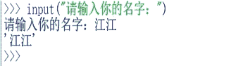

图 2-2-1　input 执行示例

可知其格式为：

`input（"提示文字"）`

小结：

包含 `input（）` 时，程序会先显示提示并暂停，出现光标等待输入。回车后程序继续。

### 显身手

1.请让计算机询问你的学校。

————————————————

2.请让计算机询问你的班级。

————————————————

### 活动二：让计算机记住信息

观察 `x=2`、`y=3`、`z=x+y`

数学中字母保存数值，z 为 5。Python 中称这些字母为变量。

变量如同标签，用等号赋值表示存放内容。如图 2-2-2：

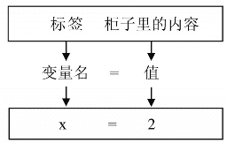

图 2-2-2　变量示意

变量名可简短如 `x` `y`，也可具名如 `age` `name`。

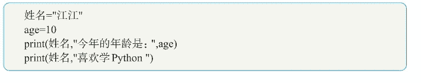

上述代码中，“姓名”、“age”即为变量，程序记住“江江”与“10”，便于复用。

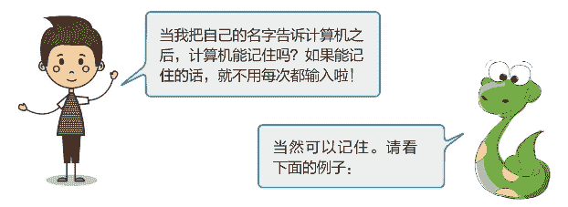

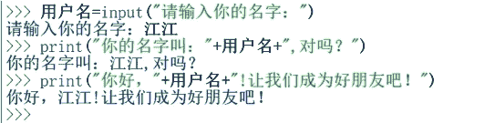

图 2-2-3　input 用法示例

图中输入被赋给“用户名”，只需一次输入，后续多次引用。

因此可将输入值赋给变量，格式：

`变量=input（“提示语”）`

使用变量有助于理清思路。例如：

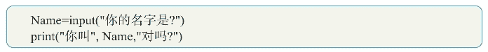

在之前的示例里我们新建了一个叫做 `Name` 的变量，它保存的是用户刚刚输入的内容，后续的逻辑就能反复引用这个 `Name`。如果刻意不使用变量，达到同样的效果就必须把用户输入写死在多处，像这样：

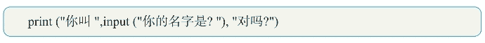

一读就觉得拗口、维护也费劲。所以养成“能用变量就用变量”的习惯对写代码非常重要。

小结

命名规范上，变量名一般以字母或汉字开头，后续可以接字母、数字或下划线 `_`。绝对不能在名字里出现空格、加减乘除、括号、引号等特殊符号。

### 活动三：带电脑算加法

用 `input()` 接收到的内容，Python 默认当成“文本”处理。操作演示如下：

在 IDLE 界面打开 File → New File，在编辑区粘贴下面代码，如图 2-2-4：

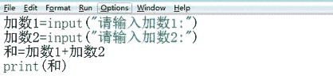

图 2-2-4　计算机加法 1 代码

保存为“让计算机做加法 1”后运行，结果如图 2-2-5：

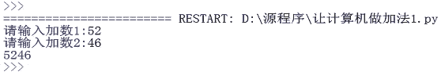

图 2-2-5　计算机加法 1 测试

会发现 52 和 46 被直接拼起来了。原因是 `+` 对文本来说是拼接，Python 把输入识别成文本，所以进行了连接。

想真正做加法，需要用 `int()` 把文本转成整数：

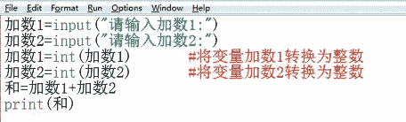

图 2-2-6　`int()` 函数

图 2-2-6 中的 “#将变量加数 1 转换为整数” 和 “#将变量加数 2 转换为整数” 是注释。Python 里 `#` 之后的内容只作说明，不会被执行，目的就是提升可读性。

改写后运行效果如图 2-2-7：

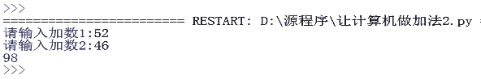

图 2-2-7　`int()` 函数测试

小结

Python 最常用的两种类型是文本和数字。需要时用 `int()` 把文本变整数，有时又要用 `str()` 把数字变回文本。注释写法是 `#注释内容`。

### 活动四：和电脑聊聊天

到目前为止我们用到了 `print()`、`input()`、变量、`int()`、`str()`。把它们组合，就能做出简单的对话程序。

在 IDLE 新建文件，输入下面代码，先预测一下输出：

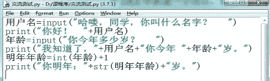

图 2-2-8　与计算机聊天

图中绿色为提示语，黑色为变量，注意 `int()` 和 `str()` 的位置。实际运行结果如图 2-2-9：

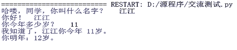

图 2-2-9　与计算机聊天测试

蓝色是程序输出，黑色是用户输入。可以看到 Python 默认把 11 当文本处理，计算“明年年龄”时先用 `int()` 转成数字，显示时再用 `str()` 转回文本。如果去掉 `str()` 会报错。图 2-2-8 的代码实现了最基础的人机对话。

### 显身手

1. 下面哪些是合法的变量名？为什么？  
`1myname`　`my name`　`My.name`　`myname!`　`Myname`　`My\_name`

2. `My\_name` 和 `my\_name` 是同一个变量吗？为什么？

3. 给变量 `my\_name` 赋值为用户输入的文字。

4. 新建变量 `age` 记录你的年龄，并打印名字与年龄。

5. 让 Python 用不同问候语和你打招呼。

# 项目三　玩转字符串

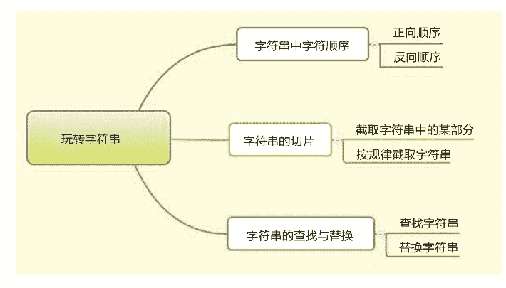

项目二提到过字符串，那到底是什么？字符串是由汉字、字母、数字、下划线、标点等字符组成的序列。单个字符、一个词、一句话、一篇文档都可以看成字符串。Python 里可以用单引号、双引号、三单引号或三双引号来定义。

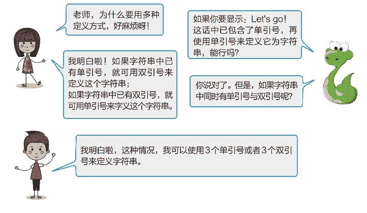

例如打印一首四行古诗，单双引号只能写一行，需要四次 `print()`。用三引号则更简洁：

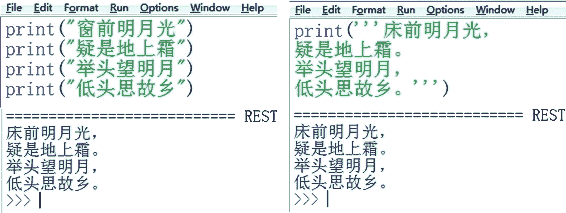

图 3-1-1　三引号定义字符串

图 3-1-1 显示，分段的诗句用单双引号要调用多次 `print()`，三引号一次搞定。好处是支持换行，也能包含单双引号本身。把三单引号换成三双引号效果一样。

## ◎第一节　字符串中的字符顺序

字符串长度不固定，要精确操作每个字符，就需要位置信息。Python 提供两种定位方式。

### 活动一：正向顺序

Python 的下标从 0 开始，不是 1，如图：

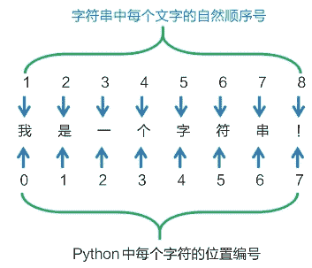

图 3-1-2　字符的正向顺序

“我是一个字符串！”共 8 个字符，第一个字“我”在自然计数里是 1，在 Python 里是 0。IDLE 测试如下：

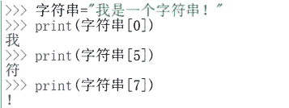

图 3-1-3　正向顺序测试图

定义变量“字符串”，分别打印下标 0、5、7 的字符，验证了正向下标规则。

### 活动二：反向顺序

从末尾往前数，最后一个是 -1，倒数第二个是 -2，以此类推：

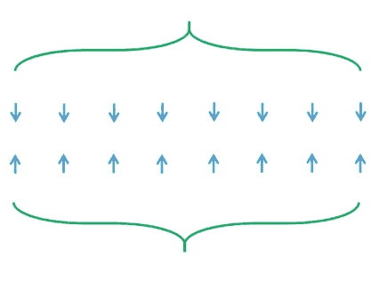

图 3-1-4　字符的反向顺序

用 `print()` 验证反向下标：

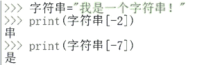

图 3-1-5　反向顺序测试图

分别打印 -2 与 -7 位置的字符，验证成功。

本节课我学会了：

1. 字符串字符位置可用正向和反向表示；
2. 正向从 0 开始，反向从 -1 开始；
3. 取单个字符写法是 `变量名[序号]`。

## ◎第二节　字符串的切片

经常需要截取一段，例如从“我是一个字符串”里取“一个字符串”。这就是切片。

### 活动一：截取字符串中的某部分

取单个字符用 `字符串变量名[序号]`。取连续部分用：

`字符串变量名[开始序号：结束序号]`

例如 `str1` 为 “abcdefg”，共 7 个字符，a 在 0。测试规律：

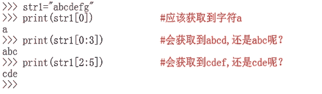

图 3-2-1　字符串切片

`str1[0:3]` 得到 abc，3 位置的 d 未包含；`str1[2:5]` 得到 cde，5 位置的 f 未包含。说明结束序号不包含在结果里。

反向序号也遵循同样规则：

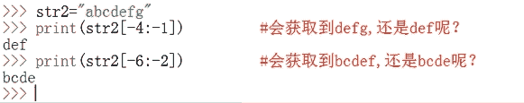

图 3-2-2　字符串切片

`str2[-4:-1]` 的 -1 代表最后一个字符 g，未被截取；`str2[-6:-2]` 的 -2 代表倒数第二个 f，未被截取。

本节课我学会了：

1. 切片格式 `变量名[开始序号：结束序号]`；
2. 结束序号对应的字符不计入结果。

### 活动二：按规律截取字符串

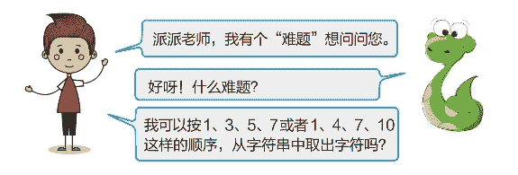

这种需求很常见，写法是：

`字符串变量[开始序号：结束序号：间隔]`

多出的“间隔”表示每隔几个字符取一次。示例：

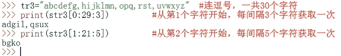

图 3-2-3　按规律截取字符串实例

如图，`str3` 可以按任意间隔抽取字符。

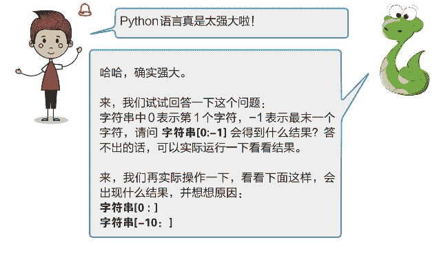

### 显身手

`letter='abcdefghijklmnopqrstuvwxyz'`

1. 取前 10 个字符；
2. 取后 5 个字符；
3. 取 “g” 到 “m” 的字符；
4. 分别取 “a”“c”“e” 这三个字符。

## ◎第三节　字符串的查找与替换

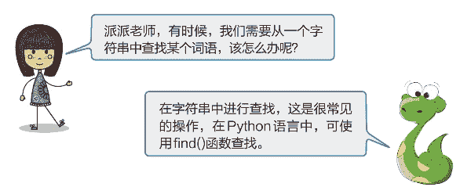

Python 用 `find()` 在字符串里定位目标。格式：

`字符串变量.find（“要查找的内容”）`

找到返回首字符的正向下标，找不到返回 -1。

### 活动一：查找字符串

设 `s1` 为 “abcdefg”：

1. 找字符 c，能找到，返回 2；
2. 找 “def”，能找到，返回 d 的位置 3；
3. 找 “dfe”，找不到，返回 -1。测试：

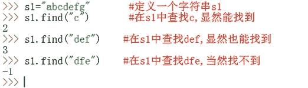

图 3-3-1　查找字符串

### 活动二：替换字符串


替换用 `replace()`：

`字符串变量.replace（“被替换的词”，“替换成的词”）`

成功返回新字符串，失败返回原串。测试：


图 3-3-2　替换字符串

本节课我学会了：

1. `find()` 找到返回正向位置，未找到返回 -1；
2. `replace()` 成功返回替换后字符串，失败返回原串。

### 显身手

新建变量 `x`，值为“你们学会了字符串的哪些操作呢？你喜欢学 python 吗？”  
分别查找其中 “字符串”“你”“python” 的位置，再把它们替换为任意词语。

# 项目四　让程序来判断


整理一下查找的逻辑：在字符串里搜索，命中时返回首字符的正向下标，这个值是 ≥0 的整数；未命中返回 -1。只要判断返回值不等于 -1 或 ≥0，就能确认是否找到。

## ◎第一节　判断查找结果


### 活动一：分析判断过程

Python 语法接近自然语言，先用中文把思路写清楚再转代码。江江的中文描述如下：


这段“中文程序”能读懂。前面强调能用变量就用变量，这里“需要查找的内容”不固定，建议设为变量；“显示”可换成 `print()`。


### 活动二：编写判断语句

把中文程序转成 Python 有四点：

1. “如果” 对应 `if`， “否则” 对应 `else`；
2. “等于” 在赋值里是 `=`，比较时要用 `==`，避免把查找到的值赋成 -1；
3. 使用 `if...else...` 后代码必须缩进；
4. `if...else...` 语句后需加冒号。

按以上规则改写，在 IDLE 新建项目，代码如下：


保存为“查找测试.py”，运行两次，结果如图 4-1-1：


图 4-1-1　查找测试

小结：

1. 编程前先理清中文思路再写代码；
2. `if...else...` 需要冒号，且后续代码要缩进。

`if...else...` 的从属代码块必须缩进；相等判断用 `==`，赋值用单个 `=`。

## ◎第二节　判断密码正误

使用电脑时经常要输入密码，密码对了流程才继续，密码错了流程即被阻断。Python 如何实现这种校验机制？

### 活动一：写出判断过程

派派老师提出的需求，先用中文伪码表达会更清晰。这段伪码我来撰写：

```
密码='9999'
输入的密码=input("请输入密码：")
如果 输入的密码==密码：
print("密码正确，开始执行后续操作。")否则：
print("密码错误，不能执行后续操作。")
```

锦锦写的伪码思路很清晰。其中“输入的密码==密码”这部分被称为“表达式”，表达式只有成立或失效两种结果。

成立时就会执行“如果”下列所有缩进的语句；

失效时就会执行“否则”下列所有缩进的语句。

把这段中文伪码改写成 Python，只要把中文“如果”换成 `if`，把“否则”换成 `else` 即可。新建项目后代码如下：


将文件命名为“判断测试.py”，运行后的呈现如图 4-2-1：


图 4-2-1　判断测试

### 活动二：if 语句的执行流程

结合前一节与本节的练习，归纳 Python 中 `if` 的写法与运行顺序，如图 4-2-2：


图 4-2-2　if 语句说明

图 4-2-2 中的“语法格式”与“执行顺序”应该都能理解。下面例子中请标出“表达式”所在、“语句块一”“语句块二”所在、“后续语句”所在：


把这段代码存名为“if 语句流程.py”，各运行两次，结果如图 4-2-3：


图 4-2-3　if 语句流程测试

### 活动三：if-elif-else 结构

使用 `if` 时，除了常见的 `if-else`，还有其他形式：

1. 只有 `if`，没有 `else`
2. `if-elif-else` 组合

看一个例子，新建项目后代码如图 4-2-4：


图 4-2-4　if-elif-else 结构

存成“elif 测试.py”后运行，结果如图 4-2-5：


图 4-2-5　if-elif-else 结构测试

本节要点：

1. 同一段代码里，每次缩进的空格数必须统一。
2. 在 `if` 判断中，所有同级缩进的代码都归属于上一层未缩进的语句。
3. `if` 有多种写法：单独 `if`、`if-else`、`if-elif-else`。

从以上例子可看出，`elif` 可多次出现，只要对应的表达式满足，就会执行该 `elif` 的代码块。实际开发中可按需灵活选用 `if-elif-else` 的各种形式。

### 显身手

动物园按年龄收门票：

● 未满 4 岁免票；
● 4～18 岁票价 30 元；
● 18 岁及以上票价 60 元；

请编写程序询问年龄并输出对应的票价。

# 项目五　让程序循环运行


上节学习了 `if` 条件判断，学会了校验用户输入的密码是否正确。真实应用里，密码错误时会让用户重新输入，并限制尝试次数，超出上限即终止。

今天学习让用户重复输入密码，分两步：

1. 让用户无限次输入，直至密码正确；
2. 限定输入次数，超出即停止。

## ◎第一节　输入正确的密码

“如果用户没输对密码，就让他重输，直到输对为止。”写成中文伪码会怎样？

### 活动一：书写中文程序


图 5-1-1　编写中文程序

图 5-1-1 中锦锦把中文伪码改成了 Python 代码，但她还不清楚循环与退出循环的 Python 关键字。

在 Python 里实现上述循环，需要用到 `while` 循环。`while` 的语法与格式为：


图 5-1-2　while 语句使用说明

从图 5-1-2 可见，`while` 的“表达式”很关键，表达式为真就一直执行循环体，为假才跳出循环执行后续代码。

### 活动二：使用 while 循环语句

依据 `while` 的语法，可把锦锦的代码完善为：


图 5-1-3　while 循环

这段代码注意四点：

1. `while 表达式：` 下方所有缩进的代码都是循环内容；
2. 定义了一个变量“退出循环”，初始值为“否”；
3. 进入循环时该变量为“否”，表达式满足，循环继续；
4. 若用户输入的密码与程序密码相等，就把“退出循环”改为“是”，再次回到 `while` 判断时表达式不满足，循环结束。

把代码存成“循环测试.py”并运行，结果如图 5-1-4：


图 5-1-4　while 循环测试

显然，若一直输不对密码，程序会一直循环下去，直到密码正确才退出。

本节要点：

1. `while` 的用法；
2. 设置退出 `while` 的条件，核心是让循环体内使“表达式”变为不满足。

### 显身手

思考下面四行代码的运行结果为何？动手验证一下。


## ◎第二节　限制密码输入次数

上节例子没有限制尝试次数，一直等到密码正确才退出。真实应用不会这样，否则可能被无限猜解。

现在把上节程序完善，限制输入次数不超过 3 次。


### 活动一：使用 break 语句

江江结合派派老师讲的 `break` 指令，修改了上节程序。修改后如下：


阅读时注意三点：

1. 理解红色字体的注释；
2. 注意缩进，每个缩进对应上一行哪条语句；
3. 代码能运行，但执行中存在一个小问题，你能发现吗？

存成“限制次数.py”并各运行两次，观察结果有何问题：


图 5-2-1　限制输入密码次数

图 5-2-1 显示代码已能执行并达到预期。但在红色注释之前已输错 3 次，却多出一个“将返回请重输”的提示，说明代码不够严谨，需要调整。

看下面修改后的代码，对比看变化了什么，为何要改：


仔细阅读代码后面的注解，尤其是红色文字的解释。

再次运行修改后的代码，错误超过 3 次后是否还会有多余提示？


图 5-2-2　限制输入密码次数


### 活动二：用好 while 语句的表达式

锦锦的思路是对的。写程序时若用了 `while` 循环，最好先想能否通过让表达式不满足来退出循环，不行再用 `break`。这样逻辑更清晰，代码更简洁。

下面是锦锦写的代码：


存成“循环测试 2.py”并各运行两次，结果如下：


图 5-2-3　循环测试 2

如图 5-2-3，锦锦没有使用 `break`，仍然实现了限制次数的效果。程序正确！她是从 `while` 表达式的真假入手，这种思路值得学习。

### 显身手

思考下面代码运行后，`x` 最终的值是多少？实际运行验证一下。


# 项目六　猜字游戏


抛硬币或扑克牌落地时正面还是背面朝上，无法提前确定，这类现象叫“随机事件”。

Python 提供了“随机包” `random`，可生成随机的整数、小数、文字等，用来编写有趣的小游戏。

Python 本身很简洁，但配套包数以万计，常被比喻成“积木”，Python 语言像“胶水”，把积木粘合起来，所以有人称它为“胶水语言”。

## ◎第一节　生成随机文字

本节学习如何在 Python 中引入外部包，并用 `random` 生成随机文字。

### 活动一：引入模块

在 Python 程序中使用包要用 `import` 语句。`import` 的意思是引入、导入。比如引入 `random` 包，程序开头写：


引入包的基本格式是：

`import` 包名

若程序用到多个包，应在开头一次性全部引入，不要用时才引入。

先试试 `random` 生成随机文字的功能，代码如下：


命名为“随机文字测试.py”并多次运行，看 `x` 的值是否每次都随机？


图 6-1-1　import 引入模块

如图 6-1-1，运行 6 次，每次打印的文字都是从字符串中随机抽取，没有规律。

### 活动二：random 模块的基本方法

### random 模块使用

上面代码用了 `random` 的一个方法 `choice`，本意是“选择”。`choice` 的作用是从一组数据中随机抽取一个。

`random` 还有个常用方法是 `randint`，用于产生随机整数，使用格式：

`要生成的随机整数=random.randint（下限，上限）`

测试例子：


在 `IDLE` 中直接编写，效果如图 6-1-2：


图 6-1-2　引入`random`模块

本节要点：

1. 如何在 Python 程序中引入外部包；
2. 如何用 `random.choice` 生成随机字符；
3. 如何用 `random.randint` 生成随机整数。

显身手

1. 编写程序循环调用 `randint` 生成 10 个 1 到 10 之间的随机数；
2. 编写程序循环调用 `choice` 生成 10 个随机文字。

## ◎第二节　用随机文字编写猜字游戏

上一节学会了引入 `random` 并用 `choice` 生成随机文字。利用此功能可做一个猜字游戏，规则：

1．给定字符串“花重锦官城”；
2．电脑每次从中随机抽一个字让我们猜；
3．猜对程序结束，猜错继续。


### 活动一：循环抽取字符

先写一个循环，每次循环都从字符串里随机抽一个字符。


江江综合前面学过的内容，代码很不错。存为 `随机取字.py`，运行两次，结果如下：


图 6-2-1　随机取字测试

如图 6-2-1，连续运行两次均达到了随机取字的目标。

### 活动二：编写猜字游戏

在江江代码基础上稍作修改即可得到猜字游戏。下面的程序共 11 行，不加注释，大家可以自行理解每一行：


图 6-2-2　猜字游戏程序

程序看似简单，却综合了循环与退出、 `if` 判断、引入包、随机字符、交互输入、字符串拼接等知识点。若读不懂，说明还有细节没吃透。运行效果如图 6-2-3：


图 6-2-3　猜字游戏测试

派派老师，这程序有 11 行，感觉还能更精简，我用 `break` 退出循环，能压缩到 10 行。


图 6-2-4　无限次数猜字游戏

锦锦的思路里有个巧妙之处：给 `while` 设置一个永远成立的条件，形成“死循环”。这可以看作编程中的一个小技巧。

显身手

修改已完成的“猜字游戏”，增加一个功能：每次猜测后显示已猜了多少次。

# 项目七·猜数游戏从入门到优化


前六个项目已经让我们触达了 `Python` 里最常用的语句、函数与编程手法。细节或许还没全部铺开，但对这门语言的整体面貌已有了把握。

接下来用已掌握的知识来实战“猜数游戏”。如果能独立完成，基本可以确认 `Python` 基础已经打牢。

## ◎第一节 基础版猜数体验

猜数字的游戏想必大家都熟悉。规则很直观：

电脑在 0 到 100 之间随机挑一个整数让我们猜。输入的数比目标小就提示“猜小了”，比目标大就提示“猜大了”，每次尝试系统都会计数，直至猜中，弹出“猜对”提示并给出总次数。

### 活动一：搭建猜数框架


思路不同，写法自然不同。比如锦锦和江江的方案就不一样，江江的思路更易读，锦锦的思路看上去有点绕。值得琢磨的是，为什么锦锦会把“猜对了”的判断放到程序最后？想通这点，就能读懂她的设计逻辑。

### 活动二：Python 实现猜数

先看一个示例实现：


把这段代码存为 `猜数 1.py`，运行后效果如下：


图 7-1-1　猜数 1 运行结果

下面再看另一种写法与效果：


保存为 `猜数 2.py`，运行后界面如下：


图 7-1-2　猜数 2 运行结果

从两份代码可见，它们都能正常工作。锦锦的版本阅读门槛稍高，但逻辑上反而更紧密。

## ◎第二节 功能升级版猜数

上节各自实现了单局猜数，但每玩一次都要重新启动。我们可以再完善一下：在猜中后询问是否继续。

输入 “y” 就再开一局；输入 “n” 或其他字符则真正退出。

### 活动一：加入继续游玩

这个改动并不复杂，参考如下：


代码里有个关键点是 `while a1 != a2：`。这里的 `!=` 由英文叹号和等号组成，表示“不相等”。注意叹号必须是英文的。

`!=` 含义就是不相等。只要表达式不成立，循环就会持续；一旦相等，就意味着猜中了。核心在于双层循环：内层负责一局猜数，外层决定是否结束整个程序。

把完整代码保存为 `猜数 3.py`，运行效果如图 7-2-1：


图 7-2-1　“继续玩”功能

从运行结果能看出“继续玩”已生效，大家会发现只要输入的不是 y，程序就结束，请思考一下原因。

### 活动二：加入评级功能

0 到 100 的数，正常情况下 6 到 7 次左右就能锁定。我们可以增加一个评级：

猜中次数少于 6 次评为“猜数高手”；恰好 6 次评为“合格”；超过 6 次提示“你得努力”。

要实现这个评级，需要怎样调整代码？看下面的实现：


将文件命名为 `猜数 4.py` 保存，运行效果如下：


图 7-2-2　“评价”功能

如图 7-2-2 所示，评级功能已经可用。

到这里大家已具备 `Python` 基础，可以尝试自制小游戏，比如人机“石头剪刀布”。

显身手
定义一个变量 `i`，让它由系统随机产生 1 到 10 的整数，然后按要求打印 `i` 行星号图形☆。

## ◎第三节 代码优化与重构

前两节我们已做出带“继续玩”和“评价”的猜数程序，代码量也在增长。为了让别人更好阅读，也为自己后续修改省力，需要提升代码的逻辑清晰度。

### 活动一：把程序切成小块

以上一节最后的 `猜数 4.py` 为例，可以思考它由几块组成？


图 7-3-1　将代码拆分成小块儿

图中：
① 是整局猜数游戏；
② 是启动前的准备工作；
③ 是控制是否继续的大循环；
④ 是单次猜数；
⑤ 是游戏结束后的评价。

其中②仅有两行；③去掉④⑤后也只剩两行；④、⑤则是两个相对独立的代码片段。

把程序拆成这样的积木有什么好处？

### 活动二：用 exec() 组织代码块

`Python` 允许把一段代码写成字符串赋给变量，运行时通过变量名调用执行，从而让结构更清晰。


项目三曾演示过用三引号定义多行字符串。这里可以把块④用三引号存成变量 `游戏`，块⑤存成变量 `评价`，当用户选择继续时，用 `exec()` 来执行这两个变量。程序可读性会明显提升。

一起看个实例，新建项目，代码如下：


保存为 `优化猜数游戏 1.py` 运行，观察结果。


也可以把④和⑤合并，定义成一个变量 `游戏评价`，再用 `exec()` 调用。示例代码如下：


保存为 `优化猜数游戏 2.py`，对比运行结果是否一致？

小结：

本节课我学会了：

1. `exec()` 的写法是 `exec(变量名)`；
2. `exec()` 会执行括号里的变量内容，而该变量本质上是一段以字符串形式保存的代码。

借助 `exec()`，可以把代码拆成若干字符串“积木”，再通过 `exec()` 拼装执行。代码量变大时，这种方法非常有助于理清逻辑。

显身手

1. 请用 `exec()` 函数把项目六“猜字游戏”改写成代码块式结构；
2. 请用 `exec()` 函数把之前写的“石头剪刀布”游戏改写成代码块式结构。

# 本书知识点清单


续表


# 后记

AlphaGo 战胜人类顶尖围棋手的消息震动全球，而幕后的 `Python` 也因此一跃成为语言界的明星。它正带领我们迈向奇妙的人工智能新纪元。

`Python` 在人工智能领域的突破，开创了技术发展的全新路径，改变了人们对传统算法的认知，并在生活、学习和工作方式上产生深远影响。如今，如何用 `Python` 推动教育变革、助力学生成长，已成为必须探索的课题。因此成都市锦江区教师进修学校组建团队启动了本书的编写工作。在编纂出版过程中，得到了四川省、成都市、锦江区教育系统领导与专家的悉心指导，在此致以真诚谢意。

本书共三册：《人工智能·Python 基础》《人工智能·Python 进阶》《人工智能·开源硬件》。从易到难递进，以项目为主线、以知识体系为脉络，对引领人工智能浪潮的 `Python` 进行了较为全面的介绍，是一套可读性强、操作性强、易学易用的 AI 课程。

完整学习本书所有项目，你将形成一定的编程思维，拿到进入人工智能领域的第一把钥匙。你是否已经感受到 `Python` 的易用与易学了呢？

最后，祝贺你收获这套人工智能 `Python` 系列书籍的知识与技能，愿你在人工智能学习的道路上勇于开拓、敢于创新，为“中国智造”贡献力量！

