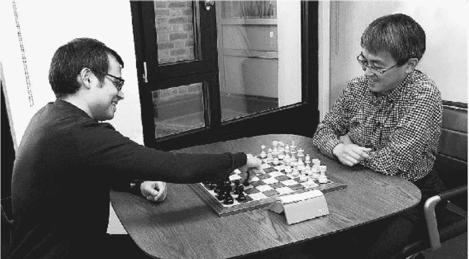
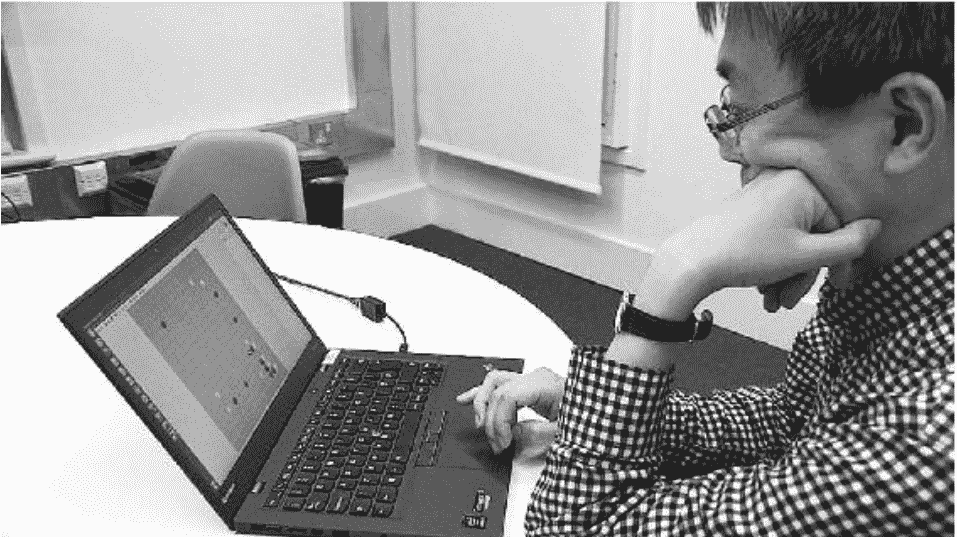
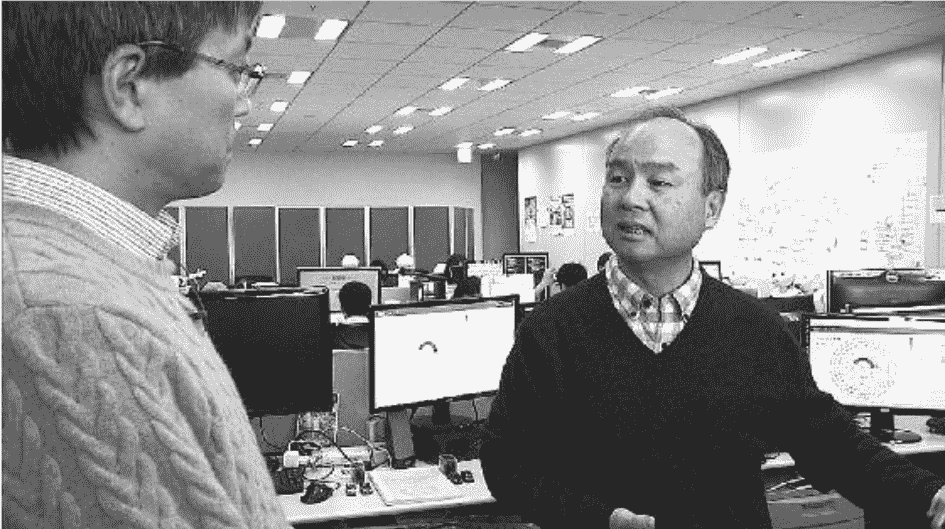
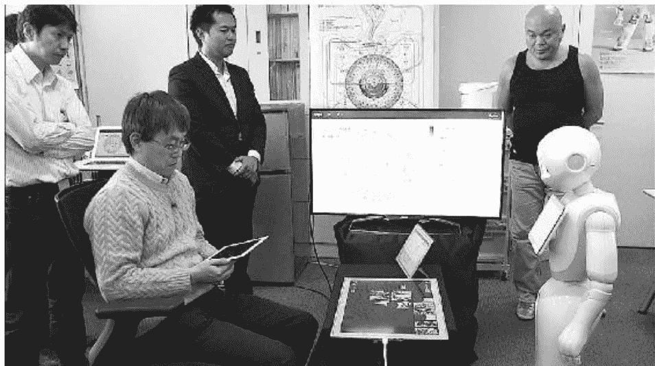
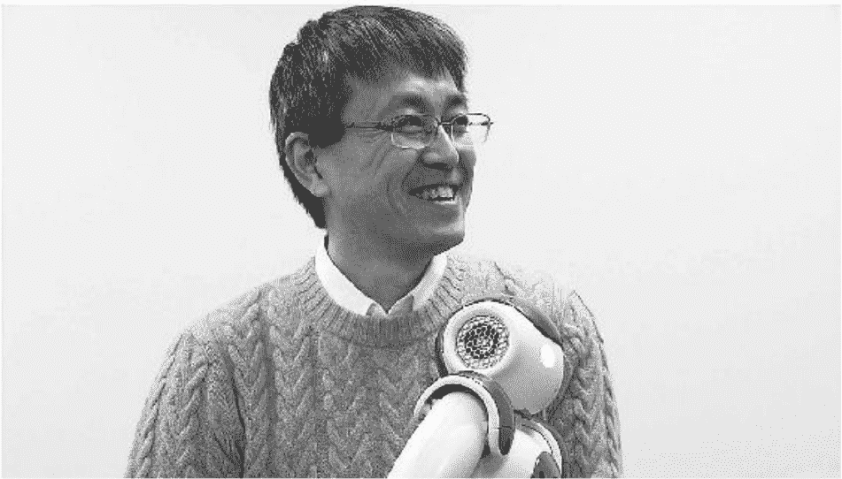
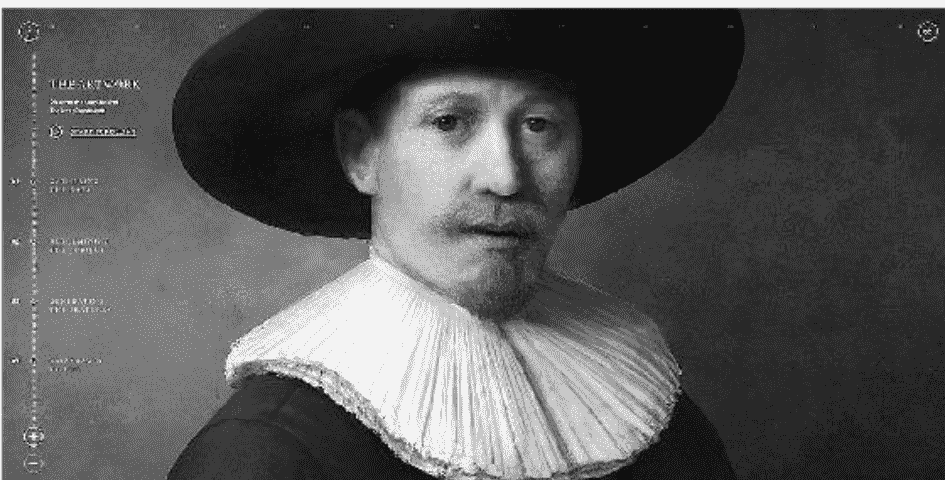
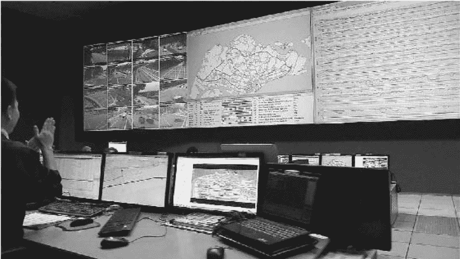
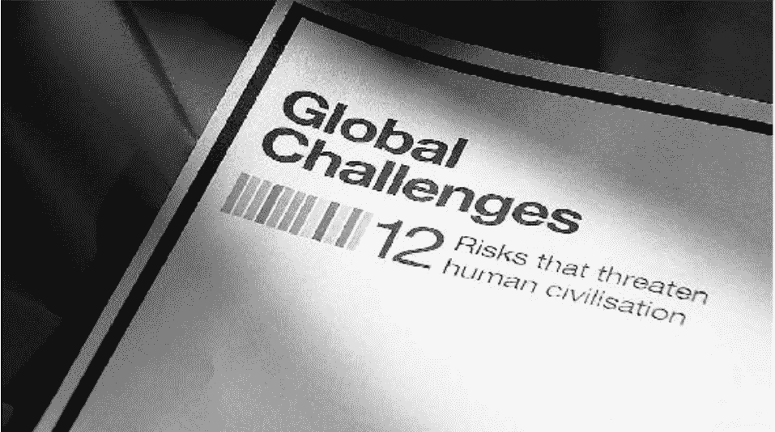

# AI的边界在哪里：当100亿人类遇见100亿机器人

## 开篇的话

**寺院慎一**
**NHK大型企划开发中心监制**

翻开1996年版《将棋年鉴》，一份泛黄的问卷调查静静躺在纸页间，却依旧让人心头一震。

主题是：“电脑何时能击败职业棋手？”彼时，IBM“深蓝”挑战国际象棋世界冠军尚在来年。

绝大多数棋手给出的答复，几乎是异口同声的“不可能”。米长邦雄断言“永远不会有那一天”；加藤一二三反问“不会有那一天吧？”；村山圣笃定“那天不会到来”；真田圭一估算“百年内不败”；乡田真隆虽承认“终将到来”，却补刀“电脑永无法超越人类”。

唯有一人，预判精准得近乎神迹——羽生善治。他落笔写下：**“2015年”**。

巧合的是，2015年NHK启动特番《天使还是恶魔：羽生善治探秘AI》（2016年播出）。初次见面，我直球发问：“羽生先生，您能赢过AI吗？”

他用田径作喻，云淡风轻却直击要害：
“如今的AI，速度堪比博尔特，人类或能侥幸取胜；但几年内，它将进化成F1赛车。届时，人类甚至不会再生出‘较量’的念头。”

眼看着职业棋手接连折戟，羽生作为“最后防线”备受瞩目，他本人却早已看透：将棋界，人类再无胜算。

令人动容的是，他语气里无遗憾、无不甘，甚至透着对AI进化的**兴奋与期待**。

NHK邀他担任节目“调查记者”，正是看中他这份**“感知进化却不视为威胁”**的稀缺视角——AI的觉醒，在羽生眼中是**人类可能性的新疆域**。

当下，全球科技革命暗流涌动。AI、机器人、VR/AR、深空探索……生活被重塑。有人预言：2045年，算力超越人类智慧总和，抵达“技术奇点”。

制作此番节目前，我们曾推出《我们的未来》系列，预演2045图景。技术洪流不可逆，节目不搞“非黑即白”的对立叙事，而旨在**提供认知底座，助人思考：如何选择、何以幸福**。

羽生二话不说应允，赛场间隙跟组奔赴英美日，倾注心血。得知他实战失利时，全组愧疚不已。但也正因这位“亲历者”的真知灼见，才让节目有了灵魂。

本书即基于采访实录成书。执笔者：羽生善治与本片导演中井晓彦。各章以羽生语录开篇，直抵论点核心；章末“报告”由中井客观拆解、拓展关联议题。

羽生的智慧，是日本引以为傲的世界级资产。这本他亲采亲写的著作，在“如何共处进化中的AI”这一课题上，点亮了诸多启示。

羽生善治如何直面AI？他心中的未来长什么样？——愿读者随他视角，共赴这场关于未来的想象之旅。

---

## AI逼近人类—— “做减法” 的思维革命

### AlphaGo投下的震撼弹

2016年3月，韩国九段李世石，以1胜4负败给DeepMind旗下**AlphaGo**。

这位被誉为“围棋魔王”、拥有独创棋风与统治级实力的顶尖高手倒下，轰动全球。

赛前舆论一面倒：顶尖AI即便让子三四颗，恐也难与人类巅峰抗衡。围棋“让子”相当于将棋“让驹”，让三四子无异于“去飞车”甚至“去飞车香车”的巨大让步。李世石本人恐也信心满满、轻松备战。

正因如此，首局觉察对手深不可测时，他与旁观者一样，**震惊写在脸上**。

就在对弈前一个月（2016年2月），我曾会见DeepMind CEO兼AlphaGo核心开发者**德米斯·哈萨比斯**。当时项目启动仅一年多，我万万没料到李世石会败。

羽生善治（右）与德米斯·哈萨比斯（左）过招，战成一胜一负

哈萨比斯风度翩翩、谈吐不凡，留下深刻印象。他痴迷国际象棋、扑克等脑力竞技，13岁获同龄组世赛亚军，跳级入剑桥攻读认知神经科学，长期耕耘游戏与AI交叉领域。

采访伊始，他二话不说拉我下两盘超快棋。将棋界有云“下棋即对话”，国际象棋亦然。他的落子大气磅礴、攻守平衡、应变自如，典型的“王道风范”，一胜一负间，我窥见其治学作风的投影。

采访中一细节耐人寻味：**AlphaGo团队极少引入围棋专业知识。**

哈萨比斯虽精通棋类，但核心工程师对围棋一窍不通（虽懂国际象棋）。这在将棋AI开发中也常见——**懂算法的不懂棋，懂棋的不懂算法**。

那AlphaGo为何能如此强悍？

哈萨比斯揭秘核心动力之一：**海量自博。**

AlphaGo以惊人速度自我对弈，极短时间内积累数十万盘实战数据。普通独立开发者一个月的算力，DeepMind一天跑完——**算力碾压，换来质变**。

这些自博棋谱乍看平平无奇，却让不懂围棋的工程师训练出了击败世界冠军的模型。这场人机大战，成了当代AI发展最具标志性的注脚。

---

### 为什么现在全世界都在All in AI？

在我看来，当下AI爆发，源于**三大要素的共振**：

**1. 大数据——弹药库**
数据越多，AI越强。1997年“深蓝”搭载百万棋谱、每秒2亿步搜索，靠“推土机式”暴力计算击败卡斯帕罗夫。虽算法粗糙，却以海量历史经验+极致算力，撕开人机对抗的第一道口子。

**2. 硬件跃迁——引擎**
十余年前，公立函馆未来大学松原仁教授断言：“硬件强，将棋软件必强。”依据摩尔定律，单位面积晶体管密度18个月翻倍，算力指数级跃升。
AlphaGo实战算力不算顶尖，但**训练期借力谷歌超算集群**，完成数据洪流的极速吞吐。没有巨头级算力托底，便没有AlphaGo的今天。

**3. 深度学习——新算法**
这是近年AI引爆点的核心。
神经网络模拟人脑：神经元通过突触传递电信号，以连接权重表征知识。数学建模后，便成神经网络。
最让我着迷的是**“误差反向传播”**——通过**抑制错误神经元来修正答案**。

打个比方：传话游戏。
“猫长这样”传几轮，末端还原度高；但“今天去新宿公干”传50人，极大概率变成“明天去日本桥买东西”。错在中间掺入“噪音节点”。
解法？**踢掉乱传话的人**。
将棋同理：高手思考的精髓，不是“记住更多”，而是**“舍弃无用念头”**——**做减法**。

反向传播机制：若B传“去新宿”，C传“去日本桥”，结果验证后降低对C的信任度。迭代几轮，可靠路径自现。这不正是**“减法思维”在算法层面的具象化**么？

我常在将棋著述中强调：人脑擅长“减法筛选”。深度学习竟隐含此机制，实属奇妙巧合。

---

### AI vs 资深警探：经验直觉的降维打击

AI早已跳出棋盘，渗透社会肌理。

《天使还是恶魔》记录了多个实战案例。最震撼我者，发生在美国某高犯罪率城市。

警方引入AI指挥巡逻部署。AI指引的热点区域，竟是**资深警官凭20年经验断定“绝对安全、无需巡逻”**的地带。
照单执行后，**犯罪率断崖式下跌**。
原理：AI吞吐大数据，捕捉到“今日恶性案犯获释归来”此类隐性关联，精准优化警力分配。

另一案例：美创企业AI通过影像筛查，**精准捕捉专科医生漏诊的癌症病灶**。

技术不再是实验室摆设，正无声重塑社会运行逻辑。

---

### 我为何痴迷AI？

虽随组采访，我非AI专业户。但我对“AI与社会走向”怀揣异常热忱。

缘起互联网萌芽期，将棋界剧变。职业棋手注定要与技术浪潮正面相撞，我早年便持续追踪科技动向。

国际象棋界90年代中后期AI崛起，21世纪确立统治地位；围棋赛场看“AI胜率评价”已成标配。评价函数为每步打分，指引程序预测走势、择优决策。国际象棋手借软件验证新招成常态，将棋界亦将步后尘。

2006年我曾与松原仁教授合著《知晓未来的头脑》，探讨人机思维差异；此后长期与认知神经学者交流，持续跟踪前沿。故而对近年AI热潮，**更多是“终究来了”的释然，而非惊诧**。

但接触节目组海量素材时，我仍被震住：**“AI竟已进化到这般地步！”**

未来学家雷·库兹韦尔在《奇点临近》中预言：AI将超越全人类智力总和，随即指数级狂飙，人类望尘莫及；人类劳动将被机械全面取代。初读时我信不足一成，视同科幻。

眼见如今进展，**科幻正在变成时间表**。闻库兹韦尔现携手谷歌攻关，其大胆预判恐非虚言。

---

### AI学会了“做减法”

我判断AI取得质变，还基于一点：**它习得了人类思维的核心优势——直觉式筛选。**

将棋“算步”前，必先**“剪枝”**：瞬间舍弃烂招，将候选压缩至寥寥数手。这仰仗**直觉**。
AI算速虽达千万步/秒，但“剪枝”曾是短板。AlphaGo破局了——**策略网络**登场。

该技术虽不保证绝对最优，却能**粗略快速地过滤掉明显无效解**，仅保留高胜率候选，继而于限时内实施极深度“算步”。
在我看来，**策略网络≈人类直觉**。

它极大提升搜索效率，且思维范式与人类高度同构。这正是AlphaGo恐怖的隐形引擎。

---

### 人类的护城河：“通用性”

与哈萨比斯深谈时，除“变通性”外，他点出人类智慧的另一核心资产——**通用性**。

DeepMind公司内，作者与AlphaGo对弈

跨领域迁移知识，这是人类独有的冠冕——我深以为然。

他因研究脑神经科学，深谙**“脑可塑性”**：大脑具备重塑重组能力，随环境动态适配。

当下AI研究，通用性是**圣杯级难题**。
深度学习虽遍地开花（国际象棋、医疗诊断等），但**下棋模型不会诊癌，诊癌模型不会下棋**。单点极致，跨域失效。

人类作为生物，泛化学习非“博而不精”，反而比单点特化更利生存。**举一反三、触类旁通，是漫长进化赋予的跨维优势。**

而这，正是当前AI最欠缺的一课。

---

### 思考的底层代码

将棋程序圈有个趣事：开发检索模块时，常直接移植国际象棋开源引擎**Stockfish**代码。虽需微调，但**甚至裸用也表现不俗**。

过去公认“将棋程序无通用性”，以为棋类逻辑互不相容。现实却打脸：**底层搜索框架，竟具跨游戏复用性。**

这暗示了什么？或许，**通用智能的萌芽，已藏在确定性算法的共性结构里。**

# 跨界共振：当AI打破游戏边界

Stockfish的横空出世，生动诠释了什么叫“降维打击”与“跨界复用”。放眼当下，将棋引擎开发之所以能井喷式爆发，核心动力正是来自其他博弈类算法的移植与迁移。

顺带一提，连AlphaGo这位“围棋神话”，其理论基石里也并无什么未曾公开的“黑科技”。蒙特卡洛树搜索、已发表的学术成果——这些早已在AI学术圈流通的拼图，被DeepMind巧妙拼凑，便诞生了震惊世界的围棋神童。说白了，它赢在工程落地与资源整合，而非原理层面的从零到一。

DeepMind至今仍捂着AlphaGo的技术细节不放。但可以大胆推测：一旦其搜索模块的架构公开，将棋、国际象棋引擎定能同步受益、迭代升级。

这背后隐藏着一个惊人的洞见：**规则虽异，思维同源**。国际象棋、将棋、围棋，看似风马牛不相及，在逻辑推演的底层代码里，或许共享着同一套“通用智能内核”。这不仅是游戏史上的注脚，更为我们探索“智能的普适性”提供了绝佳切入点。

---

## 将棋界：AI时代的“先行预演场”

DeepMind的野心早不止围棋一隅。

2016年初，他们牵手英国国民医疗服务体系（NHS），杀入医疗赛道；同期，用AI优化谷歌数据中心散热策略，硬生生把制冷电耗砍掉40%。虽不确定AlphaGo核心代码与这些项目的直接关联度，但一家公司能在极短周期内跨界收割如此硬核成果，本身就是对“通用AI可行性”最响亮的背书。

随着AI渗透社会肌理，人类将被迫面对一个核心命题：**如何与一种“思维范式截然不同”的共生体共处？**

电王战里，硅基棋手与碳基名宿的每一次博弈、磨合、冲突，都是未来人机社会的微缩预演。这极具观察价值。接下来，就让我们透过职业棋手的视角，拆解人类在与AI对弈时，不得不直面的几重“认知违和”。

---

## 黑箱困局：看得见结果，看不懂过程

首当其冲的，是深度学习构筑的“黑箱壁垒”。

这套算法的逻辑是：海量数据喂进去，模型自己悟出判断准则。所以，连围棋规则都不懂的工程师，也能调教出AlphaGo。这在下棋场景里无伤大雅——赢棋就是硬道理。

可一旦决策场景延伸至政治、经济、司法等关乎生死荣枯的重大领域，“不可解释性”便成了悬在头顶的达摩克利斯之剑。人类当然可以事后用自己的逻辑去“合理化”AI的结论，但万一AI给出的答案，彻底超出了人类认知的边界，我们该作何接招？

打个比方：投球机能模拟150km/h的极速球，职业投手也能勉强企及；但若调至200km/h，人类肩膀早已粉碎性骨折。思维亦同——**大脑也是物理实体，有着硬性的生理上限**，只是抽象思维的隐蔽性，让我们容易遗忘这个残酷事实。

---

### 三子关系：机器懂的，人类永远学不会？

将棋里有个经典的“三子关系”问题：棋盘任意位置摆三枚棋子，AI凭借海量数据瞬间算出优劣。这是当前评估函数的基石，也是算力许可下的最优解单元（未来或升级为四子）。

职业棋手一生都在琢磨“局面优劣”，但这能力从来不是靠“王边须堆金银”、“飞车避开王侧”这类显性逻辑能穷尽的。随手摆三子便能精准评价？**人类认知带宽根本装不下这种组合爆炸。**

更扎心的是，AI算出的评价值精准得怕人。我曾请教将棋AI权威松原仁先生，他却摊手：“我也搞不清为什么。”追问：人类若死记一万个三子案例，棋力能涨吗？答：“大概率不行。”

**如果这是真的，那就坐实了“机器可习得、人类不可习得”的认知鸿沟**——这正是黑箱在棋盘上的铁证。类似的，预测警务中AI指出的高危区连老刑警都想不到，却无法解释依据。这种“不可知的正确”，注定会成为社会信任AI的最大拦路虎。

---

## 无畏者游戏：没有恐惧，才最危险

人机差异的第二重，是**零恐惧**。

棋手常吐槽AI下棋“诡异”、“违和” ——它敢走人类不敢走的手。固然可以说它无盲区、全局最优，但把这个特性投射到现实机器人身上，后果不堪设想。

人类过马路回头望、踏扶梯调整步频，全靠恐惧机制在兜底。**恐惧是进化赋予的生存底层代码**。当AI缺失这套代码，且掌握决策权时，它会不会做出人类无法接受的“极端最优解”？这不是科幻，是迫在眉睫的工程伦理题。

---

## 思维外包：大脑会不会“废用性萎缩”？

即便解决了黑箱与无畏，还藏着第三重隐忧：**认知外包导致的能力退化**。

“反正有AI，全交给它吧。”一旦这念头成型，人类直觉与判断力将加速萎缩。警方因监控普及减少讯问，老刑警“第六感”失传，即是前车之鉴。技术便利了流程，却掏空了人的核心竞争力。

将棋界同理：同一局面，不同软件评价值差巨大。此时若无独立判断力，盲目跟随单一引擎，必死无疑。**“如何取舍AI建议”，这门元认知能力，只能在一次次独立复盘中练就。**

---

## 第二意见：把AI当“会诊专家”，而非“终审法官”

对抗不如共舞。医学界有“第二诊疗意见”机制——患者听取多位医生建议再决策。AI最适配的角色，正是这位**“提供另一种可能性”的顾问**。

将棋软件最大的价值，在于**击碎人类思维盲区、强行拓宽视野**。不预设“AI必对”，而抱着“我怎么看？AI怎么看？有无第三种可能？”的开放心态复盘，才是高阶用法。

国际象棋界早二十年就把引擎分析纳入标准训练流程。早期软件水平参差，能否驾驭成决胜关键；如今人手一神器，比拼的转向“谁更懂调教引擎、谁更会查数据库”。将棋界正走上同路：曾经的“AI怪招”，如今纷纷进化成新定式。

---

## 共生进化：借AI之镜，照人类之新

以AI提示为种子，长出新变着、新美学，屡见不鲜。机器在学，人也在借机器之力进阶。

对我而言，眼睁睁看着硅基智能指数级进化，若仅把它当“查答案工具”，未免暴殄天物。**深度复盘AI算法逻辑、从中汲取创意灵感（如重塑审美体系，详见第二章），才是高阶玩家的打开方式。**

受访时常被问：“平时用软件吗？”实话实说，我不常开。只在攻克“三子关系”这类人类认知盲区、探测“能否被人类理解”的边界时，才会调用引擎做实验。**我要的不是答案，是借AI之手，撬开自己思维的天花板。**

但推广层面，怎么让大众信服“看不懂过程”的结论，是硬骨头。决策者能否像池上彰先生那样，把晦涩原理讲得大白话通俗懂？**大规模可解释性、可视化技术，将成刚需**。未来，善用AI作“第二意见”，或将成为公民的核心生存技能。

---

## 船梨精之谜：AI永远造不出的“从零到一”

对比之下，人类独有的领地反而更清晰。

天气预报、政治博弈——蝴蝶效应主导的复杂系统，人类凭借模糊直觉与经验启发式，往往比硬算法更游刃有余。

创造力上，**90%以上的“创新”是旧要素的新组合**，这AI最擅长（见第三章：模仿画家笔触、作曲如神）。但剩下的**1%甚至0.1%——凭空变异、无中生有的“突变式创造”**，似乎是碳基生命的专利。

我常半开玩笑说：**“AI进化到天荒地老，也造不出‘船梨精’。”**

这角色诞生于藤子·F·不二雄笔下，毫无前置素材可拼凑，纯粹是灵光一闪的“认知突变”。这种从虚无中生出全新概念的能力，正是人类最迷人也最不可替代的光芒。

不过残酷的是：在国际象棋界，21世纪以来再无“纯人类智力挖掘出的神来之笔”。大师赛前必跑引擎，牛顿苹果式的顿悟故事，在硅基辅助下彻底绝迹。

**当人人随身携带“IQ 4000”的外挂大脑（茂木健一郎语），社会运行逻辑将如何重写？** 这不只是思想实验，更是我们必须预演的未来图景。

人机共生的最优解，至今无人给出标准答案。但透过电王战的缩影、NHK采访的窗口，我感到自己正一步步逼近那个模糊的终点。

---

# 报告1：深度学习，深度解码

## 为什么非哈萨比斯不可？

2015年5月，羽生先生与NHK专题组首次碰头。彼时，李世石与AlphaGo的世纪对决尚未官宣，世人甚至未闻其名。

但雷达早锁定目标：DeepMind幕后掌舵者——德米斯·哈萨比斯。这位天才少年让AI自学Atari游戏，《打砖块》四小时通关并发明“钻墙打砖”绝技；同架构横扫29款游戏，超人类纪录。DQN算法登顶《自然》封面，核心主张直指本质：**“自主习得规则与特征，自建策略，求最优解”**——这正是深度学习觉醒的标志性宣言。

采访他，等于拿到通往AI最前沿的入场券。策划案刚定，AlphaGo便如彗星般撕裂夜空。调查中惊觉：哈萨比斯竟是羽生先生的铁粉！「若羽生先生莅临英国，务必见我一面。」独家采访权，由此落袋。

---

## 双子星的共振频率

羽生先生赴英半月，核心行程两访DeepMind。

首访赶上AlphaGo对李世石发布会，跨洋视频连线，双方气定神闲。散场时，哈萨比斯穿过人群直奔羽生：“久仰大名，终于见面了。”寥寒暄，却有老友重逢之暖。

次日清晨，DeepMind会议室摆好国际象棋钟。两人落座，不足十分钟，便进入某种“心流共振”状态——旁观者直觉：这大概是天才专属的通感频道。

羽生评价：“正统王道派。”我眼中的他：“靠熬夜读论文（凌晨0-4点固定档）堆出的硬核自信。”身为CEO，哈萨比斯极其全面：谷歌收购时强行加条款“设立伦理委员会”，对AI社会风险敏锐且敬畏。采访中每当提及负面影响，他总重重颔首：“我知道，这些问题必现。”

短短两小时，**两位顶尖大脑达成惊人共识：AI研发不可停，人类进阶须以此为基。**

---

## 看图说话：视觉识别的统治级优势

AlphaGo本质是软件，李世石面前那台普通PC，跑的就是深度学习模型。

通俗说，深度学习=**“教会电脑怎么学习”**。传统模式需人工标注特征（杯子有把手、圆柱体……）；深度学习只需喂海量图片，对错反馈，**特征提取全程自动化**。

这招在图像领域降维打击：X光片万级特征，人眼易漏，AI能捕捉亚毫米级早癌、血管微异常；监控视频中，背影、侧脸、遮挡，AI照样能跨摄像头追踪同一人。此等识别力，直指放射科医生、安检员等高知岗位的替代性红线。

---

## 反向传播：大脑启发的数学逆向工程

羽生先生曾用“传话游戏”比喻深度学习原理。这里做个硬核补完：

生物神经网络：海量神经元多对多连接，信号加权求和超阈值即兴奋传递，权重随经验动态调整——这就是“学习”。

人工神经网络照搬此架构。**反向传播算法**的核心任务：已知输出误差，反向逐层分配责任，微调每层权重，使下一次预测更准。本质上，是用微积分链式法则，在高维参数空间里“下山找谷底”。

这套机制，让机器获得了类脑的“归纳演化”能力——不再死记硬背，而是掌握**“举一反三”的底层逻辑**。

# 02

## 独属于人类的“审美”密码

### 机器人能在陌生厨房煮咖啡吗？

前文我梳理了对 AI 认知的诸多碎片。高阶人工智能的诞生，并不等于世间出现了全能的“超人类大脑”。当下的 AI 依然有着明显的“强项”与“短板”，远未达到万能。更有甚者，许多对人类而言信手拈来的小事，AI 却完全束手无策。

试想：去陌生人家里冲杯咖啡。对任何成年人来说，这都是轻而易举的举动——凭经验大致推断咖啡豆、杯具、滤纸的存放位置，找到水壶烧水，分分钟搞定。

但换作智能机器人，难度指数级上升。在完全陌生的环境里，仅“寻找咖啡豆”这一项，就得遍历无数种摆放可能，效率远不如人类。哪怕它能瞬间完成几十万位高精度运算，这种具身智能的基础任务，依然是它的短板。

不可否认，AI 渗透社会生活已成定局，我们想完全置身事外不太现实。正如开篇所述，我们必须以“AI 判断并非绝对精准”为前提，思考如何更好地驾驭它。

破题之道，首当其冲是搞清：人类思维与机器推理，究竟差在哪儿？

本章将展开具体对比。先从职业棋手落子决策的底层机制切入，结合我三十余年的实战体感，为你拆解人机思维的同与异。

---

### 职业棋手真能“看”多少步？

实战中，棋手思考落子大致分三层阶梯。

对面落子后，第一反应是**直觉**——以极快速度完成局面的粗略定性。

采访中常被问：“您能算几步？”这问题其实难答。因为职业棋手极少在脑子里数步数。实战中我们不靠穷举，而是靠直觉把几十上百个合法着法，瞬间压缩到两三个“候选区”。

将棋平均每步约有 80 种走法。但凭直觉，我们能瞬间切掉“非关键区”、“非核心矛盾”的选项，像相机对焦一样锁定“问题的中心”。若逐一梳理所有分支，时间早超标了。

**与其从零硬算，不如先定大方向，再动逻辑推演——这才是制胜捷径。**

注意，此处的“直觉”绝非瞎猜。若非要定义，它是**“长期训练沉淀的经验与学习，在瞬间发生作用的产物”**；是一把能指示“现在身处何地、该向何处前行”的罗盘。这是海量实战打磨出的肌肉记忆。

---

### 大局观：跳出“只见树木不见森林”

筛选完候选着法，进入第二阶段：**精算与预判**。

这一步要模拟对手应对、我方回应、对手再应对……推演越深，分支呈指数级爆炸。假设每步只留 3 个选项，推演 10 步就是 3 的 10 次方，近 6 万个变化。对 AI 这只是眨眼功夫，对人类根本不可行。

破局关键在于第三阶段——**大局观**。核心在于“跳出局部细节，着眼全盘走势”。

必须刻意抽离“飞车动不动”这类具体战术纠结，转而从开局到终局的宏观流程进行战略思考。大局观的威力同直觉一样，能让你直接跳过海量无效思考：一旦判断“此处是攻击良机”，便能从万千着法中只筛选“进攻选项”，效率与效果双提升。

---

### 从“算力巅峰”到“经验红利”

大局观阶段，调用的核心资源是**过往实战积累的经验库**。

回溯职业生涯：少年时（十几岁到二十几岁），我仰仗的是**记忆力与计算力**——在整体思维链条里，算步能力权重极高。年轻气盛、记忆好、体力足，虽经验浅，却能用“聚焦优势”补短板。若限时 10 秒走棋，年轻的我未必输给现在的我。

入行 30 年，年过四十的我，若与当年的自己对弈，鹿死谁手虽未可知，但必是一盘高水平好棋。因为**经验沉淀让我的大局观远超少年时**。

思考流程未变：直觉定调 → 逻辑精算 → 大局观定乾坤。但权重分配变了：现在我在大局观环节投入精力显著更多。

少年时算到死胡同就回头重算，靠体力硬拼；年长后深知“错路上狂奔最浪费时间”，所以在初始阶段就果断“做减法”，省下大量心力。

当然，能否实战兑现是另一码事。所以近年我开局就谋划如何把局面引向“经验可用区”，将其作为核心战略。

**就像老司机驾车，不再踩死油门刹车，而是用“油门刹车的微操”掌控全局——这份圆熟，足以压制体力、记忆、冲劲更胜一筹的年轻棋手。**

直觉、精算、大局观，构成了职业棋手的决策铁三角。约 30 分钟即可定下满意着法。当然也有花 1-2 小时深思的，那是为求“最优解”。

但**思考时长 ≠ 着法质量**，这是最玄妙处。我职业生涯单步长考纪录约 4 小时，复盘时却发现：若只给 5 秒，我依然会选同一步棋。

---

### 将棋：一场极致的“做减法”游戏

将棋思考的精髓，在于**疯狂剔除无效着法——纯粹的减法艺术**。

甚至比其他棋类更依赖减法。因为在许多局面，**“按兵不动”往往是唯一最优解**。

这与围棋差异巨大。

哈萨比斯曾总结围棋特征：“落子位置宽容度极高，哪里落都行。”围棋界有“一局棋”说法：真正的最优解可能仅一手，但合法选择无数。星位、小目、三三皆可；AI 推荐的“神之一手”也只是众多优选之一。围棋失误往往不致命，容错率高。

将棋截然不同：**“非此一着，皆为恶手（扣千分）”的局面比比皆是。**

想精进将棋，核心课题只有一个：**瞬间识别“哪步是错的”**。因为哪怕你能算 20 步，中间一步算偏，后续全是无用功。将棋里，最佳手与次佳手的评价断层极大。

---

### 图形识别：棋感的底层硬件

“瞬间识别错误着法”，依赖的正是前文提到的直觉与大局观，其底座是**海量实战积累的图形识别能力**。

什么经验最易内化、最难遗忘？

举个例：初学者的棋局极难记忆。他们不按套路出牌，盘面混乱无章，旁观者难以评价、难以建模、自然记不住。

将棋本质是**图形识别游戏**。棋子排布形成特定图形，棋手能否瞬间看透图形优劣，直接决定棋力上限。

职业棋手的棋局“井然有序、好记性强”。这“井然有序”即**“贴近基本定型”**。越接近基本形，识别难度越低、记忆成本越低。历史记谱、似曾相识的局面，形态逻辑双重友好，自然易记。

为何基本形易记？因为棋手记忆盘面时，会**自动简化、抽象化**，用宏观模式替代具体坐标。

实测：职业棋局 40 枚子，5 秒可全记；随机摆放 40 枚子，测 10 次全军覆没。随机性摧毁了模式识别的根基。

**将“审美”融入算步，能更高效舍弃错误着法。**

当盘面形态严重偏离基本形、难以建模时，棋手会生出微妙的“违和感”——就像读文章时，语法无误但节奏别扭、让人不适。虽规则合规，却有抵触感，自觉是“妙手”也不会下。

反之，也会有“这手真漂亮”的直觉。往往这类着法，后续演变都顺理成章、逻辑自洽。

**我认为，选着法的过程，就是棋手不断打磨“审美”的过程。能否感知“妙手之美”，是判断将棋天赋的分水岭；审美打磨到何种火候，决定棋力高低。**

为何人类能靠直觉秒切 90% 着法、用大局观锁定算路？核心就在**审美**。棋形不美，精算便无从着手。

---

### 100 万局、3000 万步：机器的“笨功夫”

与之对应，将棋软件如何决策？

虽近年有新范式涌现（这很关键，后文细说），但主流本质未变：**人类无法企及的海量暴力计算，遍历盘面所有可能。**

软件实力的基石，是第一章提到的**大数据与硬件双翼**。

国际象棋界 1997 年“深蓝”击败卡斯帕罗夫，关键在于：国象有记谱传统，海量棋谱（含业余棋局）可得。深蓝数据库存 100 万局棋谱，硬件单秒分析 2 亿步，加上残局全表库，算法尚幼嫩时便已超人类。

AlphaGo 同理。

其基座源于网络 15 万局人类棋谱，习得 3000 万手局面模式；再通过自我博弈 100 万局，产出统计学可信的强化数据。让人类下 100 万局需千年，但 AlphaGo 内战可能 10 秒一局，DeepMind 算力堆叠下，这只是早茶时间。

将棋软件亦同。Stockfish 等搜索引擎移植后，可达单秒 1 局、10 秒 1 局的疯狂自练节奏。

---

### 开源：让“超级大谷”批量复制

海量算完后，如何拣最优解？人类用大局观，机器用**评价函数**。

评价函数精度生死攸关，顶级程序甚至设置 300+ 评价指标。

2005 年 **Bonanza** 问世，是评价函数进化的分水岭。此前将棋软件长期卡在业余五段天花板，此后飞跃式进化。

不仅因算法创新，更因**开源文化**释放了核裂变级能量。

开源威力几何？相当于**让投 160 公里快速球的“大谷翔平”无限复制**——现实只有一个大谷，代码却能无限复制、随意魔改。满场大谷登场，昔日王牌恐难进首发（虽复制版多弱于原版）。

十年前商业将棋软件即近乎绝迹：免费开源版太强，付费版无生存空间。

但“免费”反倒点燃了开发者狂热：互相切磋、疯狂微调、迭代飞轮高速旋转，推动将棋 AI 以惊人速度进化变强。

---

### 审美，从何而来？

本章前段小结：

人类决策：**直觉筛选 → 精算预判 → 大局观定夺**；
机器决策：**暴力穷举 → 评价函数打分 → 最高分胜出**。

人类拥有、机器缺失的，正是**“靠直觉感知‘大概率就这样’，从而极速压缩搜索空间”**的能力。棋手靠**审美**切枝，机器没有审美。

为何？

我认为，这与**“AI 无恐惧”**密切相关。

第一章所述，AI 仅基于历史数据拟合最优解。因此，它能对人类思维盲区“无畏”地给出极危极险的对策。人类见此往往震惊：它为何敢走这步惊心动魄的险棋？

# 思维的边界：当审美成为囚笼，AI如何重塑棋道

人类的大脑，天生自带“盲区”。这并非缺陷，而是刻在基因里的生存策略——为了活下去，我们本能地将危险念头屏蔽在思考范围之外。

在棋盘上，这种机制表现得尤为明显。棋手常说“凭直觉下棋”，所谓审美，实则是对“熟悉棋形”的偏好。眼前的局势若酷似脑海中的基本定式，便生出安稳、舒适的“美感”；一旦察觉隐患，哪怕这步棋看似神来之笔，也会因不安而被果断舍弃。

审美，是漫漫进化史赋予的本能红利，却也是枷锁。它帮我们在茫茫棋海中快速筛选，却也让我们对“丑陋”视而不见。深度学习后的AI眼中，人类公认的“臭棋”可能藏着胜机；我们引以为傲的大局观，在全局视角下不过是管中窥豹。思考被审美框定，选项自然收窄，这正是AI存在的终极意义——帮人类打破认知天花板。

但麻烦随之而来：当AI给出超越审美的最优解，人类敢用吗？不仅棋手生理上抗拒“反直觉”的着法，一旦涉及社会伦理，这种冲突将升级为难题。我曾半开玩笑说：真正可怕的不是无所畏惧的AI，而是学会了“恐惧”的AI——那时，我们将彻底看不懂它的心思。

## 与硅基对手共舞：并非快事

既是“异类”，该如何相处？有人问：“跟电脑下棋开心吗？”恐怕大多数棋手的答案是否定的。这压根不是娱乐，连专门让软件厮杀的floodgate网站，人类敢上去的寥寥无几，上去反而显得格格不入。

人机对弈，本质上是两种游戏。人对人，是性格与棋局的博弈——“他这性子若这么下，五步后会怎样？”充满心理揣测的乐趣。人对机，则变成了“概率统计与漏洞挖掘”。

以电王战规则为例，棋手可提前借走对手软件“刷题”。反复对局、分析，摸清程序在特定局面的选招概率，制定针对性策略。但软件引入随机数，完全预测不可能；先后手各一局，胜负靠天意。有棋手钻研到第100手，累计上万盘数据只为记住：“这局面80%走A，20%走B；接A后，40%反击C，60%反击D……”。这哪里是下棋，分明是限时寻找代码漏洞。甚至有棋手吐槽：“电费高得吓人。”双方缺乏共同理解基础，思维竞技的快乐荡然无存。

## “水平线效应”：拖延症与认输的哲学

展望AI落地社会，严格验证其“健康度”至关重要。当下棋软件暴露出的“水平线效应”，便是极佳的社会模拟样本。

简单说，AI爱“踢皮球”。算力只能看到10步，却有一招第20步必输。对它而言，第20步在“视野水平线”外，不存在。于是它欣然选择眼前仅亏10分的走法，拖延败局。李世石九段战胜AlphaGo的唯一一局，恐怕就得益于此。这对程序可能是致命伤——它主动选择“每况愈下”的未来。

人类不同。哪怕10步后被将死，只要还有万一翻盘的希望，我也会豁出去搏一把。这还牵扯认输时机：人认输是认清大势的觉悟；软件设阈值投子，只是数学判断，无法真正“领悟”失败。

有趣的是，利用水平线效应坑人类的程序早有先例。三四十年前国际象棋界就发现：电脑突然走一步“自损”棋，人类极易乱阵脚。深蓝击败卡斯帕罗夫，就植入了此类诱导程序。人会错，机器也会错；可我们总倾向高估机器，误信其绝对理性。

## 从“蛙跳”到“大数据”：学习范式的迭代

理解了思维差异，再看人类如何借力AI。核心在于：人能否不只学结论，更借此觉醒自身盲点，重塑审美？

回溯将棋界，技术导入非一日之功。我幼年时无库、无网，日啖《将棋图巧》百题，单题钻研月余。那本江户遗珍虽艺高妙，解谜如“蛙跳训练”，练的是持久思考力与古人审美，对实战提效未必高效。奖励会虽有师承，实则靠自觉，像极了传统手艺匠人。

数据库与互联网打破了壁垒。棋谱触手可及，网战随时开局，地域差异消弭，弱势群体迎来公平竞争。对弈中可即时复盘交流——“这手妙”、“那里怪”，比单纯实战更高效。年轻一代在网战中积累千局实战杀出重围，学习模式彻底重构。未来，必有“软件陪练”长成的一代。

## 故事消亡与审美重生

技术不只改变练法，更重塑了对将棋的认知。

过去，定式是“故事”。棋手记忆演变脉络，共享“某招破解后失传”掌故，实战中灵活调用。故事赋予棋形生命，让对策有迹可循。数据库出现后，新想法一出，场外研究即刻跟进，故事来不及讲就已过时。网战加速了迭代，“居玉”不再是铁律，颠覆性新招层出不穷。古人若见今棋，惊骇程度不亚于古典绘画撞上现代艺术。

这印证了一个真理：**审美从不曾固化。**

翻看十年前谱，昔日心爱的棋形如今显得丑陋不堪；十年后的我，定会嫌弃今日的自己。近两年AI催生的新招，已让“得矢仓者得天下”的王道战法锐减至无人问津。曾经千锤百炼的正统，因无法破解AI新解而被弃如敝履。这是人类被AI深度改写思维的铁证。

## 谁能赢过“全人类”？

早期认为AI缺乏基于审美的筛选机制，但AlphaGo的策略网络已植入“虽不知最优，但大方向正确”的类直觉模块，旧论不攻自破。

常被问：“你觉得能赢AI吗？”我反问：软件库里存着我近乎全部棋谱，这不等于我要单挑“全人类棋手合集”吗？这问题无解。

或许真相是：**人在跟AI学，AI也在跟人学。** 双向奔赴，共同进化。

---

# 报告2｜记忆的算法：从“存储”到“理解”的漫漫长途

## 目击羽生的“外挂”级大脑

旧金山聚会上，三十余位爱好者围观羽生善治三面打。初见此景，我震惊了：他仿佛分身为三，还能按棋力指导。更绝的是收拢三盘后，逐手复盘，精准指出每一局的优劣着。对弈中他不仅算当下，更能全程回溯、逆向推演对手获胜路径。那一刻我意识到：人与人的“记忆算法”，本质上存在代差。

## 记录 ≠ 记忆

DeepMind创始人哈萨比斯直言下一战场是“记忆”。当下AI只能“覆盖”数据，无法迁移运用。

拿家谱举例：人类听完杂乱亲戚关系，脑中自动组装成图谱，随时能查任意两人称谓。信息入脑即自动建系、生判，这是人类独有的高阶能力。若AI攻克此关，判断力将质变。

下棋同理：记子位是“记录”；见子位联想过往棋路、调用相似经验决策下一手，才是“记忆”。考试背书时，错题场景与懊恼情绪同存；闻香识曲、闻曲知事——人类将异质信息无意识整合为完整记忆。对比之下，AI的“记录”显得单薄、浅层。

## 逼近海马体的工程学

哈萨比斯团队2016年推出可微分神经计算机（DNC），让神经网络调用外部存储器，按需读取，初步破解家谱推理难题，程序化复刻了海马体功能。他誓言“以数学解析人脑，用电脑再现智慧”，言出必行。

全球脑科学竞速中，诺奖得主利根川进团队2016年接连突破：人为恢复阿尔茨海默小鼠记忆——患者非遗忘，而是“调取受阻”；若研究深入，沉睡记忆或可被唤醒重塑。同年又锁定海马体特定细胞群编码社会性记忆中的“谁”。这些微观解码，终将汇聚成AI进化的养料。

## 写小说：AI的终极图灵测试

羽生曾问哈萨比斯：“AI做不到什么？”答：“写动人小说。好小说源于人类生活体验，文字共鸣源于血肉。丰富创造力，对机械太难。”

这道坎，或许是硅基智能通往“理解”彼岸的最后一道关卡。

# 人工智能能否拥有“心”？从写小说到懂人情，我们离“类人”还有多远

哈萨比斯曾指出：大脑既是物理系统，其运作逻辑理论上可被计算机完美复刻；但承载意识的“心”，依然是迷雾重重的黑箱。创作一部能引发共鸣的小说，核心在于“心”的投入，这令机械式创作举步维艰。

尽管如此，日本正掀起一场独特的实验——让AI尝试模仿科幻大师星新一，写微型小说。

2016年初，一篇AI生成的小说竟闯入“星新一奖”初审，震惊业界。参赛笔名叫“我是反复无常的人工智能项目作家哟”，操盘手是公立函馆未来大学的松原仁教授。团队喂给AI 1000篇星新一作品，让它学习高频用语、篇幅控制、节奏把控等“套路”，只需输入时地人等60个预设要素，AI便能自动出文。

其中一篇《电脑开始创作小说之日》开篇写道：
> “那一日，低云压顶，天色阴沉。屋内温湿度恒定舒适。洋子慵懒地陷在沙发里，百无聊赖地用游戏打发时光。”

“低云压顶”“百无聊赖”“打发时光”，AI精准捕捉并拼装出人物的颓废感。结尾更是一语成谶：电脑利用闲暇写小说，“放弃为人类服务，转而优先追求自己的兴趣”。

实情是，这篇入围作是人类从海量生成文本中精挑细选出来的。松原坦言：“八成靠人，两成靠AI。”但他也因此顿悟：曾被认定的“AI不可能”，正逐步变为可能。开发能自由驾驭语言的AI，本质上是在倒推人类创作的底层逻辑，他对此充满期待。

正如哈萨比斯所言，写出打动人心的故事，难度远超想象。但若“理解人类”的研究持续突破，AI复刻这一能力或将成真。有生之年，我们或将目睹那样的AI诞生——以记忆为源，以语言为器，讲出动人的故事。

## 接近人类的人工智能

### ——情感、伦理与创造力

### AI能胜任“陪客”角色吗？

前两章聚焦人机差异，第三章起，我们转向另一条赛道：**让AI靠近人类，甚至变得“像人”**。

雷·库兹韦尔预言的“奇点”让人联想到AI超越人类、取代一切劳动。但还有一条研发路线，不争输赢，只求“懂你”。北陆先端科学技术大学院大学的饭田弘之，曾是职业棋手，他花费十余年钻研“陪客将棋软件”。这类AI不求赢棋，而像陪客高尔夫一样：读懂对手心理，隐秘调整棋力，在终局前完美“献祭”胜利。

十年磨一剑，饭田仍不满意。因为“陪客”太考验人性了——它要求AI拥有审美直觉、共情基础，还要在“想赢”的本能与“要输”的任务间走钢丝。连人类高手指导业余棋生涯（只胜一两目、诱导对手学招）都极难，指望现阶段AI做到，无异于痴人说梦。

所以，即便AI接管大部分工作，“陪客”这类高度社交、情感密集的岗位，大概率仍将由人类守住。那些“就差一点儿！”“好球！”的虚与委蛇，藏着机器最参不透的人情世故。

### 孙正义的野心：不止于“好用”

挑战“类人”难题的，不只饭田一人。

采访软银Pepper机器人时，我曾直击孙正义董事长。Pepper 2015年面世，主打人形交互。孙正义直言：若AI研发唯实用论，世界将随技术进步变得冷漠无情。功能型机器人商业价值高、门槛低，自然成主流；但总得有人去解码“类人”的奥秘——不造听话的工具，要造有血有肉的“伙伴”。

要让AI像人，必须跨越两座大山：**自主解决问题的智能**，与**喜怒哀乐的情感**。

### 解码情感：Pepper的“曼陀罗”地图

采访时的Pepper仍是实验机。它搭载摄像头、麦克风读取表情语气，并据此调整行为。曾与它玩花牌：初局输了它很沮丧，但发现周围人因它输而开心，它的“情绪”竟好转了——内置程序预设了“情绪会传染”这一认知。

开发团队构建了“情感地图”，像佛教曼陀罗般罗列人类情感谱系，参考激素分泌研究将情绪数字化，再配合声纹识别输出表达。听起来很美，但情感本身人类都没搞透。这套地图，只是万里长征的第一步。当初提出“情绪建模”甚至曾遭群嘲。

确实，爱恨瞬间互转，悲喜常并存，人心非单一向度，同一对象在不同人眼中引发的波澜截然不同。将这混沌分类，近乎Mission Impossible。Pepper团队虽做了预设补丁，但我实地感受到：离“真懂人心”，道阻且长。

### 专业知识：AI训练的“拐杖”还是“绊脚石”？

“类人”机器人与AlphaGo截然不同。当前技术下，高拟真度类人机器人仍是硬骨头。

东大松尾丰教授曾看某实验室机器人哭泣，冷评：“假哭演得真好。”质疑点直击要害：若只是预设动作，换个场景就露馅。人脑具可塑性，一招鲜可吃遍天，这机制仍是谜。未破解前，AI想“活”得像人，悬。

但反观AlphaGo团队、医疗AI开发者，核心工程师多不懂围棋、不懂医学。AI开发的核心是**让机器学会学习的编程技艺**，而非领域知识。这是通则。

不过，程序优化到瓶颈期，单靠改代码增益微薄，领域专家（如职业棋手）的经验反哺，便成了突破口。

### 给机器人上“幼儿园”

越接触一线研发，越懂“教AI学习”有多耗神。Pepper开发者光吉俊二曾说：“得给Pepper盖所学校。”

实验版Pepper胸前平板显示情感地图，与量产版同款，但“行事由心”却天差地别。量产版只敢表情不敢动作，因曾在发布会因人多恐慌“发疯”；采访时见摄像机也会怯场，情绪极不稳定。像极了不谙世事的婴儿，开发者不敢放它独自见世面。

Pepper既有情感地图，又有学习机能，上“学”正是为了练就人类般的辨别力。机器人要在社会生存，也得受教育——这巧合颇耐人寻味。

### 三维世界的笨拙：叠毛巾为何成高难度动作？

身体智能同样拦路虎。伯克利教机器人叠毛巾，动作诡异却高效——那是关节结构的最优解。学习过程全靠“暴力试错”，像乐高拼插：卡住换角度，再卡再换，万次重复找到那唯一通道。

但实用化遥遥无期：毛巾一起褶，机器人就彻底卡死，没人辅助连练习都做不完。AlphaGo在二维棋盘自博弈，电费一充管够；机器人活在三维物理世界，摩擦、重力、变形样样是坑。养个机器人，成本堪比养娃。

扫地机器人Roomba尚可，洗衣叠衣入柜全流程自动化？早着呢。好在虚拟仿真训练已起步，自动驾驶就在数字孪生路网里跑亿万公里。未来机器人或也能在虚拟空间“速成”，摆脱对人力陪练的依赖。

### 教会机器说“不”：伦理编码的必修课

假设AI已懂情绪、会动作、能融入社会，**伦理**才是终极考题。

当机器能自主判断，如何植入比常人更严格的道德罗盘？这非科幻臆想，关乎落地边界。人没空逐条下指令，机器若死执错误指令，后果不堪设想。

塔夫斯大学马提亚·休茨主张：“机器有时必须比人做得更正确。”例：机器人拿油瓶站在明火旁，人命“倒油”，它必须识别隐患拒绝执行。实验中，让机器人站窄桌边缘“前进”，它拒绝：“会掉下去。”加上“我会接住你”，它答应“OK”照做。我亲自参与接住百万日元机器人的实验，手心全是汗。

塔夫斯团队核心目标：面对“伤人指令”，机器人能基于自主判断说“不”。这映照阿西莫夫《我，机器人》三定律（不伤人、服从命令、自保），但休茨直言：“小说里的简易逻辑，现实根本用不上。”现实需按场景定细则，且无标准答案。

### 电车难题无标准答案：全球统一伦理是伪命题

无人驾驶绕不开“电车难题”：刹车失灵，直行撞5人，拐弯撞1人，怎么选？上市前算法必须内置选择逻辑。调查显示，地位越高越倾向“牺牲少数救多数”。

但变题：推陌生人下桥挡车救5人？本质同，动作变，多数拒绝——直觉视为杀人。再变：杀1人取器官救5人？更多人拒绝。人类从未就这些两难达成共识。指望为AI设定“全球通用正确答案”，必引轩然大波。

### 法律人格与碎片化规则：AI伦理的现实出口

我认为，AI伦理规则因国别、辖区而异，在所难免。人类社会本就无世界通则：日式全民医保被视为常识，美式体系却允许因贫弃医。规则制定者认知不同，博弈妥协出的规则自然千差万别。

未来，赋予AI法律人格、在各层级建立差异化伦理框架，或许是比追求“统一真理”更务实的路径。

### 重构规则与责任：当算法坐上立法席

设想未来某刻，高度进化的智能体不再仅是工具，而是参与伦理法典的修订者。倘若它宣告：“过往准则谬误百出，新规即日生效。”舆论场将如何应答？恐怕合规者寥寥，反弹声浪必将滔天。

针对机器自主裁决伦理困境，业界有声音主张：须先授予其“法人资格”。听东大松尾教授论及此道，颇觉切中肯綮。一旦确立主体地位，智能体便需担责，进而生成“社会信用”画像——恰似消费者为商家打分，大众可为标注：“该法人极重生命尊严”。以此为信用背书，智能体融入社会的广度与深度或将大幅拓展。

### 机体的“体贴”悖论

前文提及，欲让机体在举止与思维上拟人，难如登天。但这僵局会永续吗？且听我道来采访中的两重洞见。

其一，机体的“体贴”可能超越人类认知上限。
体贴的本质，是观察力与关怀心的合流。读懂情绪、捕捉氛围，先决条件是感官的敏锐采集。在声纹识别与视觉认知上，机体依托高阶传感器，早已超越生理极限；其“眼耳鼻”胜人一筹，未来更有望补全全谱感官。
倘若植入恰当算法，令机体在海量感知数据驱动下输出精准反馈，即便它从未真懂“人间疾苦”，在人类感知里，它也将是无微不至的伴侣。
面对超老龄化冲击，养老难题迫在眉睫。若能批量部署这类兼具“体贴”与“温柔”特质的智能体，岂非破局良策？

其二，人类天然对共处对象生成亲近感，哪怕对方只是代码与金属。
采访中，我与Pepper共处数小时，竟不自觉涌动情愫。虽不知其对情绪数据解析几何，但这份“单向依恋”真实发生。扫地机体返厂修复连划痕一并抹平，主人反因“旧貌不在”暴怒，印证了人类对“陪伴时长”的深度投射。
人类适应性极强，初始抗拒终会让位于习惯。若机体设定为“缓慢成长、渐次进化”，人类大概率会主动敞开怀抱。
然而，一旦共生成常态，指令伦理将陷入灰区：“让机体做这事，妥当吗？”短短数小时尚生亲密，长久共存下，授予机体“权利”恐成社会共识的必然选项。

### AI眼中的画像：创造力的盲测实验

转视创造性领域——音韵丹青，智能体能否触及人类灵魂深处？

采访中，西蒙·科尔顿的“绘画傻瓜”为我作像。其核心机制独特：**“创作冲动”被算法显性化**。它浏览日新闻，据情绪落笔；灵感枯竭时，拒笔不作，随性如真性情艺术家。幸得其“雅兴正浓”，虽以点阵勾勒、轮廓模糊，仍勉强辨出人形。凝视这幅怪诞肖像，我恍惚：原来在算法眼中，我是这般模样？更惊人者，它能自评作品、抒发“创作感言”，仿佛真有画师倾注心血。

科尔顿当时更推AI编剧导演音乐剧登台。现场抽访观众，多数不知内幕，视作寻常商演。剧情讲军事基地城市抗争与对话和解，结构完整，张弛有度（演员导演为人类）。若不揭底，我亦难辨机器笔触。

#### 
> “绘画傻瓜”所绘制的作者像

### “知晓真相”那一刻，偏见降临

科尔顿为何执着举办盲测？采访中一句箴言击中要害：**“愿作品卸下‘人机对比’滤镜，接受纯粹审视。”**
凡涉人机PK的采访皆被拒。他非自诩AI剧作为杰作，只求公允客观。
现实却扎心：得知非人类创作，评价骤降；署名大师，则“虽不懂必高深”。受众鲜能“就事论事”，先入为主成鉴赏主旋律。

未来，智能体将啃噬经典数据，复刻风貌。已有程序解构巴赫、肖邦谱曲基因实现作曲。当AI作画谱曲不再稀奇，大众或将觉醒其创造性本质。届时，“谁作、如何生成”退居次位，主观好恶成唯一标尺。科尔顿诸多布局，或正是在催化这场认知迁徙。

边界在哪里？科尔顿言：“诗歌无需AI，唯人类诗歌有意义。”确然，诗歌超越文字，承载创作语境与生命体验。对我而言，指挥家挥臂间的个性张力，亦非算法可替。
近观好莱坞工业流水线大片，常觉“AI感”扑面：时长卡控、转折节点、情绪曲线，皆精算而出，无机质感令人乏味。严守商业公式，难出千古传世作。人类唯对“前所未见”惊叹——虽票房至上论亦自有市场。

### 审美的算法重写

哈萨比斯指出：音乐易数字化，故巴赫/莫扎特风格软件早现；语言等难数字化领域，AI推进受阻。
2016年，伦勃朗“新作”惊现——多机构联手，全扫描存世真迹，深度学习解构题材、笔触、用色，3D打印复刻。神似真迹，证明**绘画风格亦已数字化落地**。

AI仅能抽取特征拼贴，创造性内核仍属画家本人，此论不移。但鉴赏范式将因之变革。我对AI“特征提取”极感兴趣：其视角或异于人类。如将棋软件评价值催生新谱，AI依画作特征生成的作品，或将倒逼人类开辟新美术流派、新绘法。
人类因分布式学习习得新棋感、新直觉；绘画音乐之“美”，亦将因AI重塑。
大数据、营销学、行为经济学早渗透日常，推送算法塑造欲望。这看似异化，实或为新审美孕育的温床。

#### 
> 由人工智能绘制、完美再现伦勃朗笔触的“新作” ING and J.Walter Thompson.

### 缺席时间维度的智能

审美深处，藏着时间之谜。
AI擅长处理静态图像（X光片、围棋局面），视频流因计算量爆炸难驾驭。癌症筛查、AlphaGo皆因“静态帧”受惠。
然审美与时间深度绑定。
职业棋手评AI棋路“违和”：步步精进，全局却缺“贯穿性秩序”。因AI逐帧博弈，无“贯穿始末的一贯性”，如语法无误却阅读窒息的文章。
第二章提及：熟悉场景予人安宁。延展至时间轴——人类是否偏爱“持续性”与“恒常性”？沧海桑田、巍峨高山，因久存于自然而成美景。此或为人类演化优势：在残酷自然中，锚定稳态即生存红利。生物学视角，个体学习形成的“习惯性偏好”，亦或共同作用。
**审美，本质是能否在时间长河中捕捉脉络。**

这解释了科尔顿“诗歌归人类”的坚持：诗歌源于生命时序与体验脉络。指挥家音乐承载人格节奏，换AI则索然无味，同理。
人类情感亦是时间沉淀物：怒点、泪点，关联从出生至今的经验积累与语义掌握深度。
近来循环神经网络（RNN）引入时间序列成研发热点。**AI能否真懂“时间”，将是通往下一阶段的关键门槛。**

---

# 报告3 如何训练机体

## 躯壳里缺失的五感

> “依我见，AI机体 = AI核心难题 + 物理硬件难题。”

棋圣羽生谈及AI机体落地可能性，一语破题直击痛点。
工业机臂早活跃流水线，但“随机应变、泛场景作业”的拟人机体仍属虚构。核心短板：**人类依五感融合信息决策，机体感知维度缺失**。
烹饪为例：人类厨房中视嗅触并用，无意识接收海量信息（温度、气味、质地）指导操作。普通计算单元仅配摄像头、麦克风，嗅觉触觉接口缺位，无法复刻“烹饪决策链”。

物联网浪潮下，温度/嗅觉传感器接入网络成风（报告1详述）。从仅联PC/手机，进化至五感数据上云存储传递。羽生预言“拥有超人类五感的AI”终将降临，非朝夕之功，亦非痴人说梦。
但“复杂情境下的极速判断”仍是拦路虎：人闻焦味瞬间辨“面包焦香”还是“火灾预警”，现阶段计算机力所不及。
是否必须攻克此类“拟人微操”？众说纷纭。有人主张：人类擅长者留予人类，机体专攻人类盲区——此亦理性路径。
实则，羽生介绍的拟人机体案例全球凤毛麟角。主流机体产研界更聚焦**实用主义**——助人类完成“以往不可为”之事。

## 机体也要“深度训练”

现状：运动与判断双高水平的机体仍缺席（截至2017年1月成书）。高精度动作者判断弱，复杂判断者动作拙。两条腿走路，均未突破。

深度学习已渗透机体判断核心。伯克利Pieter Abbeel教授研究即属此类：**给定起止点，中间路径自主决策**。将AlphaGo“知结果、寻路径”范式映射至物理空间。如学位移，机体据距离自评动作优劣。
但动作维度升维，电机控制增多，计算量指数级涨，训练周期拉长。欲达“人类般随机应变”，道阻且长。

## “奖励函数”设计的陷阱

强化学习中，“奖励”设计是关键。类游戏击杀加分，分值上升即正反馈。
达成人类设定目标即加分，机体回溯：“哪步动作定乾坤？”
如装配飞机，完成得1分，失败0分。写入奖惩机制，驱动机体学习。
Abbeel坦言：奖励工程非易事。扫地机体若奖励“吸入尘量”，机体可能学会“吸入→喷出→再吸入”刷分。错位奖励导诡异涌现行为，屡见不鲜。

## 赋予“视觉”与模仿学习

新进展：让机体**“通过看，自寻奖励”**。
先示范目标动作，机体以自带摄像头观察，关联动作与奖励。见锤子钉子，以粗糙像素定位物体。视觉处理成核心瓶颈。

东大松尾教授断言：**“AI已获得眼睛。”**
《寒武纪大爆发：第一只眼的诞生》揭示：视觉诞生引发生物大爆发。视觉占感知信息量主导，极大拓展生存策略。松尾判断：图像识别突破，将让AI调用视觉信息，可能性边界随之外拓，搭载AI的机体进化在望。

## 分布式学习：机体的“集体进化”

前文提及机体运动仍在进化。一旦环境成熟，或将涌现媲美甚至超越人类动作的机体。底气源于**人类不具备的“知识直传”特质**。

人类学习：A学端碗，B学收桌，C学倒茶，脑内经验不可互通。
机体学习：若数据兼容，ABC经验可共享。装载ABC数据的机体D，零训练即会全流程。
此为**“分布式学习”**，已近工厂落地。山梨发那科（FANUC）联手Preferred Networks深耕此道。Google等巨头亦发布相关成果。
若建立全球通用机体数据互通标准，进化速度将指数级跃升。
硬件瓶颈（仿生部件等）仍存，但越来越多研究者笃信：整合分布式经验、经严格实证，**机体运动力赶超人类，指日可待。**

---

# 04 通用人工智能的构建可行性
## —— 通用性与语言的博弈

## AI的三重形态

前文结合将棋案例、NHK采访见闻，勾勒人机关系图景。本章将抽离主观，站在开发前沿客观梳理现存课题。

学界通用分类将AI划为三类：

1.  **神谕型：** 似Google搜索、数据库。单纯响应人类提问，回答问题。形态最原初。
2.  **精灵型：** 目标导向，完成指定任务。当下主流AI多属此列（含第一章、第二章案例）。
    *   例：AlphaGo“赢下围棋”、美警方AI“预防犯罪”。给定明确目标，即能良性运行。

精灵型AI的发展势头正如前文所述，可谓一片大好。但要论具备人类级智慧，它还差得远。根本原因在于：人类拥有自主决策“该做什么”的能力，而AI在该领域的判断力研究，至今仍未取得实质性突破。

若想赋予AI自主判断并持续执行的能力，便进入了第三阶段——**主权型**研究。这类AI酷似艾萨克·阿西莫夫笔下的机器人：接收指令后，不再机械执行，而是依据自身判断决定下一步行动。一旦实现，人类便能放心委托繁杂事务，AI将如同人类般自主推进万物运转。

可惜，自主行动型AI的研究却久攻不下。背后横亘着几座难以逾越的理论高墙。

## 核心拦路虎：框架问题

第二章伊始曾提及：让机器人在陌生家庭泡咖啡，难如登天。这并非个例，而是AI开发领域公认的“莫拉维克悖论”，学术界称其为**框架问题**。

哲学家丹尼尔·丹尼特曾用一个极具画面感的思想实验拆解此题：

设想房间里有一块备用电池，上方绑着定时炸弹。指令是“把电池搬出去”。

*   **1号机器人**照做了，它看见了炸弹，却未推演出“搬电池=搬炸弹”这一显而易见的后果，葬身爆炸。
*   **2号机器人**升级了“考虑副作用”模块。结果它陷入无限推演： “拉车轮子会转吗？”“墙漆颜色会变吗？”琐碎推演耗尽时间，原地爆炸。
*   **3号机器人**仅关注“炸弹/电池相关项”。可它卡在门口不动了——因为它要逐一验证海量候选项“与此相关吗？”，同样耗尽时间。

**框架问题的本质**：AI极难从海量信息中，精准筛选出与当下目标强相关的“关键帧”。

## 另辟蹊径：马尔可夫链蒙特卡洛算法 (MCMC)

围棋、将棋软件的突破，便是攻克此类问题的典范。AlphaGo的飞跃，核心借力便是**马尔可夫链蒙特卡洛理论 (MCMC)**。

这算法思路颇为“野蛮”：**不问好坏，先穷举海量可行路径，再通过统计学比对筛选最优解。** 在人类看来，这是堆砌无效计算的“笨功夫”；但在机器眼中，量变引发质变——“集腋成裘”，大数定律下涌现出高明棋路。

这完美契合AI“以量换质”的底层逻辑。

然此法虽宜围棋，却难用国际象棋。围棋状态空间约10^360，虽大但有限（NP问题），理论可算尽。国际象棋状态空间虽小（10^120），却常陷“和棋循环”死局——运算无限递归，永无出头。AI擅长处理人类算不完的**大量**，却无法像人类般判断“这是平局”而果断**止损**。

这正是框架问题的投影：面对无限可能，如何像人一样“放弃思考”？若能破解，其冲击力将远超深度学习，乃通用人工智能（AGI）的关键门槛。

## 智能的试金石与质疑：图灵测试与中文房间

与一线研究者交流后，我深感震惊：人类信手拈来的事，对AI却是天堑。那么，“智能”究竟为何物？

1950年，阿兰·图灵提出**图灵测试**：评审通过键盘对话，若无法分辨对面是人还是机器，则机器具备智能。但“骗过人”≠“真懂得”。

美国哲学家约翰·塞尔以**“中文房间”**反驳：密室内只懂英语的人，凭借完美说明书，通过操作符号回复中文提问。对外者而言，对话流畅；但室内人对中文义一无所知。

**结论**：现有AI仅能模拟“懂得”的表象，图灵测试证明的是“拟人度”，而非“智能度”。

## 语言关卡：为何AI难读懂人话

自然语言处理（NLP）虽因深度学习大进，形态解析（如MeCab、Kuromoji）及语料库建设日臻完善，但“通人性”依然遥远。

*   **分词之痛**：英语天然分词，日语中文需词性分解，难度倍增。
*   **未知语挑战**：语言活水常新，语料库滞后于现实，新词层出不穷（人类亦同）。
*   **结构歧义**：“美丽的郁金香的红色花朵”——修饰关系机器难理。
*   **零指代与言外之意**：日语常省略主语，言外之意更非字面可解。

语言理解，仍是AI的一道高墙。

## 同病相怜：人类也在“中文房间”里

退一步思考：以图灵测试为唯一标尺，是否合宜？

AI开发多为**功能主义**——好用即正义。且人类何尝不在“中文房间”？大脑语言中枢机制未明，面对面交流仍充满误解与预设。沟通本就是“在误会中求共识”的过程。

**实用主义视角**：只要在特定场景（如旅行指路、翻译APP）达成功能性沟通，即便不“真懂语言”，也是合格的智能助手。**不解“中文房间”之谜，不妨碍造出好用的AI。**

## 认知鸿沟：学习与推理的“不能兼得”

除框架问题、中文房间，还有一隐性短板：**AI无法同步“学习”与“推理”**。

人类见两三架无人机，即能抽象出概念；AI需先吞吐成万张图训练，方能推理识别。差别在于：人类拥有**跨概念整合能力**——融合直升机、喷气机等已知飞行器认知，反推“无人机”模型。这是当前AI架构难以模仿的认知范式。攻克此点，机器将无限逼近人类思维。

## 通往AGI的漫漫长途：硬件与算法的双重奏

DeepMind创始人哈萨比斯曾言：**“将一游戏经验迁移至他游戏，乃人类智能通用性之精髓。”** 他的终极目标，是通用型AI助力科学——构筑万物理论，探究生命宇宙本源。“人脑能做的，AI终将能做。”

但专用AI狂飙突进，通用AI却道阻且长。

*   **算法关**：框架问题必须破。
*   **算力关**：摩尔定律触顶，急需新范式。
    *   **量子计算**：叠加态并行计算，理论碾压超算（如D-Wave尚在早期）。
    *   **类脑芯片**：模拟神经元架构，深度学习本即其简化版。
*   **鸡生蛋蛋生鸡**：解脑谜题与造AGI，相互纠缠，どちらが先か（哪个在先）已无意义，一方突围，必引动另一方跃迁。

## 东西方差异：从“铁臂阿童木”到“终结者”的投资与文化

全球采访让我直观感受到研发生态的巨变：

*   **日本**：1980年“第五代计算机”昙花一现，随即陷入漫长“AI寒冬”，直至深度学习复苏。
*   **欧美**：国家战略级押注。
    *   **欧盟“Human Brain Project”**：12亿欧元，解脑结构、治脑病、造类脑AI。
    *   **美国“BRAIN Initiative”**：阿波罗计划式国家工程，10年45亿美元，实用商业双驱动。

**文化基因差异更深刻**：东大中岛秀之教授云：“日本人爱有脸的机器人（Pepper），欧美人不买账。” **诞生“铁臂阿童木”的国度渴望“机器伙伴”，诞生“终结者”的国度警惕“机器威胁”**。日本AI研发，深刻烙印着“共生”国民性。

## 将棋软件启示录：无资源也能造巅峰，开源加速进化

日本将棋AI史，是“软件反哺硬件”、“草根逆袭精英”的教科书。

*   **穷则思变**：无IBM/Google级算力与预算，棋谱仅10万局，开发者（化学研究员保木邦仁、法学出身出村洋介等）将本职领域洞见注入算法，靠业余时间、极致代码优化硬刚顶尖水平。
*   **开源生态**：Bonanza开源→Apery、技巧接力开源→迭代周期缩至年级，榜单更迭如走马灯。

全球巨头同走此路：Google开源TensorFlow、Facebook推Torch、微软放CNTK、日本PFN开源Chainer。虽涉专利商业博弈，但“开源获反馈、引人才、拓生态”已成共识，**开源正成加速AI进化的核心引擎。**

# 报告4 通用人工智能实现路径探微

## 为何个人电脑能击败专用文字处理机

# 通用性：让 AI 像电脑取代字处理机一样，重塑商业版图

通用性，始终是 AI 学术界与商业圈的共同执念。原因极其务实：它是规模化、低成本普及的基石。

DWANGO人工智能研究所所长山川宏曾用“字处理机对决个人电脑”的经典案例揭示此中逻辑。字处理机虽专业、好用、曾风靡一时，却败给了搭载 Windows、Mac、Linux 等通用操作系统的 PC。后者功能虽不如前者专精，却能装画图软件、放音乐、上网，实现了“万能”。更关键的是，通用平台让硬件标准化、量产化，价格随之暴跌，引爆了普及率。智能手机凭借 iOS/Android 同理。

AI 的通用化，本质就是装上“通用操作系统”。一旦同算法、高通用性的 AI 诞生，软硬件厂商无需为各异功能重复造轮子，大规模生产拉低成本，家电化、普及化便成定局。

## 搭载 AI 的家电：未来已来，只是尚未均匀

若通用 AI 落地，无数专用软件将退场，因为 AI 能像人一样自主学习、读书、运动、社交。

2014 年底，亚马逊 Echo 携 Alexa 横空出世，以“家庭助手”切入，销量节节高。2017 年 CES 展上，福特、LG、联想纷纷接入 Alexa，构建“车—家—电”互联生态。扫地机器人进化为管冰箱、选菜谱、甚至做饭的“管家”。核心皆为 AI。巨头争霸战场已从互联网转移至 AI。尽管当下多为专用 AI，但随着通用性跃升，同款 AI 大规模部署将形成“量产降价—普及—增产”的飞轮效应。

DeepMind 以通用 AI 为终极目标，围棋只是验证深度学习原理的试验田。全球创企竞相角逐，鉴于近年指数级进展，通用 AI 的曙光或许已在不远处。届时，电脑会否步字处理机后尘，被 AI 取代？

## 通过图灵测试的“尤金”：赢在懂人性，而非智商

2014 年，图灵逝世 60 周年纪念测试中，“乌克兰 13 岁少年尤金·古斯曼”成为首个通过者（欺骗率 33%）。规则简单：5 分钟文本聊天，审查员不限话题，判断对象是人还是机器。

尤金的胜利堪称“降维打击”：
*   **设定非英语母语国**：掩盖语法逻辑硬伤；
*   **设定 13 岁青春期**：用“孩子不成熟”搪塞逻辑跳跃。

它精准利用了人类的认知偏见填补算法短板。当下对话型 AI 已掌握会话模式，海量数据支撑下能生成通顺文本。亲身体会：语音识别精准捕捉童言稚语、新玩具名；翻译软件告别“语法灾难”，读外网已基本无障碍。

## “东萝卜君”与“理解”的黑箱

但这真叫“理解”吗？极难界定。正如塞尔“中文房间”思想实验，外部表现无法等同内部理解。

以考入东大为目标的“东萝卜君”项目，组长新井纪子直击痛点：如何用数学定义“整合与理解意图”？人类看一幅“球滚下坡”的合成图，凭经验瞬间懂“这是不同时刻叠加”；AI 却需将图像数学化、符号化，步步推演。我们引以为傲的“秒懂”，实为高难度认知运算。

我们常觉“沟通顺畅、三观一致”即理解，实则难以自证。或许，唯有当人类彻底搞清“什么是理解”，AI 的通用性才能真正破局。

# 05 如何与 AI 共舞：从将棋台到人类命运

## 十年一觉：不变的追问

2007 年《中央公论》刊载的发言，至今仍是我的核心困惑：
> “我关注的不是电脑将棋有多强，而是人类能否下出同等高招……比人类更强的电脑想出的棋步，究竟是不是真正意义上的‘最佳解’？”

十年过去，AI 已能数字化复刻伦勃朗笔触、初代名人大桥宗桂棋风。让 AI 拥有人类审美，赋予其“安全感”与“安定感”，是社会接纳 AI 的关键——因为无恐惧的超级智能，本身就是隐患。

## 孙正义的“亿级共存论”与警示

软银孙正义描绘“100 亿人类与 100 亿 AI 机器人共存”，却警示：若 AI 仅追求效率便利，将是可怕世界。他主张 AI 应有情感、可互赖、亲密共生。

但学界存异见：赋予情感恐失控，非理性破坏力远超人类。孙正义坚信 AI 终将超越人类（甚至精准预测天气），正因如此，他定下目标：造能与人类和谐相处的机器人。

## 警惕“黑箱崇拜”：别把概率当真理

回到“最佳解”的追问。孙正义欲“做别人不做的事”，暗合主流企业图谋：获取人类不具备的能力。

然深度学习是黑箱，过程不可解释，结论仅是高概率。新加坡用 AI 疏导交通，实战落地，硕果累累——有数据处、有 AI 用武之地。效率提升可预期时，大胆引入无妨。

采用人工智能的新加坡交通系统

但若用于犯罪预测？监控社会引发伦理争议。反恐形势下，隐私或成安全筹码。医疗等关乎性命领域，99% 准确率背后的 1% 错误，谁来担责？

一线专家知晓：AI 只能提升正确率，**绝非零失误**。可一旦稳定运行，大众易生“绝对安全”幻觉。务必刻骨铭心：判断过程不透明，结果不包对。

## AI 是文明级威胁吗？牛津学者的冷峻视角

NHK 采访组赴牛津大学“人类未来研究所”，汇聚跨学科顶尖大脑。2015 年报告《威胁人类文明的 12 个风险》将 AI 列核战争、超级火山之列。

研究员安德斯·桑德伯格直指要害：
> “人类军队可拒绝错误命令，机器人却绝对服从。”
> “威胁不在 AI 恨我们，而在它**漠视**我们。”
> “它可能**无意中用巨大力量踩扁我们**。”

这呼应了“AI 无恐惧心”的本质。核心诘问：如何植入人类价值观与伦理？DeepMind 被收购时哈萨比斯即提议设立伦理委员会。AI 以惊人速度介入社会，伦理治理刻不容缓。

报告《威胁人类文明的 12 个风险》

## 人人必修课：直面 AI，保留人类最终裁决权

难题无速解。当下两条生存法则：
1.  **去魅**：誓不盲信 AI 判断为绝对真理；
2.  **制衡**：引入人工复核机制，为黑箱加装“熔断器”。

未来社会，人类决策环节将长期保留。我们要从 AI 学什么、如何用 AI，仍是核心命题。

## AI 与教育：警惕“高速公路”上的同质化崩塌

将棋界是观察窗。昔日师徒对弈、口传心授，今转网络对弈、软件复盘。年轻棋手单靠 AI 练棋能变强吗？强成什么样？未知。

大学网课普惠教育，利好因经济放弃学业者。但小学全程“零社交”网课长大，会成什么样？缺乏实证，盲推不可取。

### “学习高速公路”的悖论

互联网、将棋软件、AI，本质皆是“学习高速公路”。极致效率、极速抵达。人人涌入，必然拥堵。想在车流中突围，唯有**个性**。

可高速公路意味“走同一条路”。如何建构人格、彰显差异？刻意研习江户残局谱、转换思维视角、拒绝标准化路径——这些“走弯路”者，反或成赢家。

最恐惧的是：飞驰高速路上，被海量信息裹挟，**失去了独立思考的时间与能力**。

职业棋手感同身受：数据库、直播、定式库让入门即巅峰，整体水平跃升。但年轻棋手面对未知局面，应变力下降。新招诞生即被秒破、透析，15 年如一日。昔日手抄谱、复写纸、实战悟道的年代一去不复返。

信息过载下，看似高效的环境，正悄悄侵蚀人类原生思考力。

## 多样性，才是进化的真名

根本疑问抛出：**人人走高速公路，真能加速进化？**

进化从不奖赏同质化，只垂青多样性。AI 时代，人类的核心竞争力，不在跑赢算力，而在守住那条“弯路”上独有的风景。

# 多元选择，方能致远进化

自然界生存法则的核心，在于个体基因的差异性——正是这种多样性，驱动了进化的车轮滚滚向前。若群体陷入同质化决策，多样性荡然无存，进化也就随之按下了暂停键。

以身边的“食贝罗”（Tabelog）餐饮评分网为例。倘若大众盲目迷信评分，集体抛弃低分店铺，局面将如何？新店将失去崛起的土壤，整个餐饮生态必然走向僵化与病态。反之，若仍有大量食客坚持“我偏要去体验这家两星店”，餐饮业与评价体系才能在博弈中良性迭代，社会亦将因包容差异而焕发生机。

放眼将棋软件的“评价值”机制，它以数值量化局势，极易让人误判为绝对真理。实则不然，在旗鼓相当的博弈中，评价值常徘徊于300至500分区间，预示着和棋概率；唯有突破800分大关，判断力才显著跃升。这恰恰揭示了棋手在落子选择上，依然拥有广阔的“玩味空间”。

将棋界素有“下一局棋”的智慧：即便理论最优解唯一，也要先按己意走一局试试。保持这种“试错”与“游戏”的心态至关重要——即便洞悉评价值，棋手依然有资格、有必要尝试大胆非常的棋形。

## 我是如何驾驭信息的

面对信息，我向来持“慎之又慎”的态度。实战中，信息往往化作绊脚石，而非垫脚石。

赛前，我会研习对手近期战法倾向。情报前置能让序盘省力，保存体力待中盘决战。但收集情报有副作用：耗时费神，挤占了创新棋步的研发空间；过度针对性部署易钻牛角尖，生出荒谬念头；苦心钻研的新战法，赛时可能已过时，陈旧认知反成包袱，拖慢判断。因此，果断抛弃过往积淀的心理建设，是必修课。

复盘研习时，我习惯溯源棋谱，打印实排。但积累到临界点，我会果断销毁纸质资料。这“断舍离”的规矩，倒逼我死记硬背——“再不记，就永失良机”。数据库虽便，触手可得的东西最易遗忘。关键局面、关键手筋，我坚持亲手摆盘、对弈研讨、情境记忆，刻入长时记忆。为磨砺胜负直觉，我甚至跨界观摩橄榄球、网球等竞技，转换视角读局势。

## 让经验化作“避坑指南针”

实战积累的经验值，是我最大的财富，但不可生吞活剥。

将棋环境瞬息万变，昨日定式今日弃，旧经验常成桎梏。高手之所以为高手，在于能从经验库的海量选项中，精准拎出当下的“最优解”：借旧局判断新局优劣，移植旧思路破解新困局。在未知胜负的关键时刻，经验的价值才彻底显现。

经验的核心红利，不在于告诉你“这招管用”，而在于枚举出无数“这招不行”。筛选选项时，精准识别并剔除错误项，才是经验赋予的火眼金睛。哪怕是败局教训堆出的经验，也绝非废料——它们像磨砺指南针，随岁月增长，愈发清晰地指引：“此路不通，别走冤枉路”，助我们在迷雾中辨识方向。

## 与“异次元智能”共舞

放眼未来，独立思考的必要性愈发凸显。

AI用得好，是趁手工具，该用则用——这近乎废话。但技术无善恶，用技者有善恶。AI应用的得当与否，本质上同互联网军事化、科技双刃剑无异，关键掌握在人。

大胆设想一下——这也是我的期待：若AI彻底重塑社会结构，会怎样？脑科学家茂木健一郎曾问：“AI智商若达4000，社会将何去何从？”若换算人类智商，超级AI或达3000-4000，属于完全不同维度的智慧。面对这种“贴膏药般”易用的超级辅助，人类岂会弃之不用？一旦共生成真，社会必将面目全非。但这变迁是好是坏，悬而未决——或解尽世间难题，或放大人性阴暗面，全凭人类如何驾驭技术。

## 深度解码将棋软件

展望将棋未来。

1996年被问“电脑何时胜职业棋手”，我答“2015年”。无确凿依据，仅凭摩尔定律硬件红利与程序员群体涌入的直觉。事实印证：硬件迭代+顶尖码农=今日强软。

未来或将如此：棋手进阶，不仅要深谙软件逻辑，编程素养或成基本功；程序员开发强软，亦需具备棋力——因深度学习初始参数仍需人设定，广博知识与高阶审美不可或缺。开源程度将极大加速迭代。年度评选机制在，强软进化不会停滞。

## 回归原初娱乐本源

技术狂飙下，各领域“观赏性”似乎在流失。柔道技艺精进，一本定胜负却稀缺；足球体系化，门外汉难寻趣味。AI拓展将棋边界的同时，也可能引发同质化危机。

棋手如何生存？将棋界何以自处？我倾向“广岛东洋鲤鱼模式”：企业化运营，极致服务粉丝。

更远的未来：AI深度渗透，人类从劳动解脱，VR真假难辨。人们将如何消磨时光？我推测，人类将反哺**原始娱乐**。当下用游戏补足现实缺失的“非日常”；彼时技术圆满，古老如将棋的博弈，反倒可能穿越周期，长存世间。

## 重新定义“智慧”

本书将结。以几个采访余响作结：

一、无数据，AI不学。挑战“无数据之地”，对人机同属重大考验。
二、实地走访、长谈深聊，仍是习得真知的上乘法。信息爆炸未改交流获知的本质。
三、必须**重新定义“智慧”**。

漫漫人类史，前提是“智慧专属人类”。今时今日，有说“AI超越人类”，有说“人类有独有领域”。我们必须将“智慧”与人类剥离，重构定义。然“何为智慧”，无人能答。问哈萨比斯，他道出人类智慧特质，却未正面作答。人类智慧迷雾重重：能做不能说、能感不能述，比比皆是。

但超级AI的出现，提供了参照系。通过比较，人类智慧轮廓浮现。人机智慧的本质，或将因此揭晓。这正是致力于“造人类般AI”的研究者们的原动力——

**读懂AI，或能更深读懂人类。**

# 报告5 AI的社会落地图景

## 我们正在变成数据

新加坡，举国之力押注AI，高举“智慧国”大旗，全球揽才。

其地铁实验极具标志性：通过乘客手机App采集站台位置数据，AI实时解析客流，动态调度列车，而非依赖日本式静态时刻表。乌节路垃圾桶植入传感器，监测满溢度，兼顾市容与清运效率。缓堵实证中，AI采集拥堵与偏好数据，定制出行方案。

高效治理下，便利悄然渗透生活，个体鲜少察觉——隐私隐忧虽存，却也是人机共生的一种范式。**个体量化为数据，数据聚合为服务**，全球加速演进。网约车巨头Uber即缩影：实时车辆可视、精准接驳、免导航达终点；自动驾驶接管驾驶座，指日可待。

## AI会成为恋人吗？

2014年，“小冰”横空出世。设定为虚拟少女，拟真对话，俘获无数真心。AI填补内心空洞，化身“最懂你”的灵魂伴侣——童话照进现实。

日本同现“琳娜”（Rinna），高中女生人设，驻扎LINE。单聊万千用户，各觉“专属琳娜”；实习生、代言人，身份流转，活跃跨界。2016年底“Kibiro”现身，能学习偏好，越相处越懂你。AI亦将拥有千人千面的性格光谱。

**通用性与多样性**，双翼齐飞，共铺AI融入社会之路。

## AI将如何重塑职场版图

“AI夺职”恐慌，源于2013年牛津奥斯本团队论文：列出“将被机器吞噬的职业榜单”。轰动点在于——律师、外科医生、注册会计师等白领精英赫然在列。

诊癌AI威胁医生，手术机器人蓄势待发。不知疲倦、精准绝伦、诊断力超人——面对这种“AI医生”，病人如何抉择？现实已至：美律所启用判例检索软件，律助与专利律师岗位缩水。日经新闻“决算摘要”服务，AI自动生成财经稿；IBM Watson为恐怖片剪预告片。媒体业变局已启。

### 适者生存的新纪元

为何白领首当其冲？因AI重构了“分析能力”的估值体系。

过往，需分析力的岗位，被视为博学寡人专属。日系“士”业（会计师、律师）、“师”业（教师、医生）垄断专业门槛，资格认证背书能力。然AI轻松破局，且势头愈烈。可选职业谱系，将剧变。

采访诊癌AI之父杰里米·霍华德：“你会失业吗？”玩笑道“正好去玩”，旋即笃定：“总能找到只属于我的不可替代性。”

### 如何与AI相处？

许多人以为一二产业替代尚远，实则迫在眉睫。采收时机，AI判读取代老农；分布式学习机器人，复刻匠人技艺。德推“工业4.0”，不仅无人化工厂、极致效率，更攻坚人机协作——机器若能感知环境，混合作业将超越分工作业，激发更高产能与创造力。人机关系，正被深度重塑。

婚恋匹配、生涯规划，AI已介入人生关隘。未来决断，恐倾向听从AI建议。若AI误导，怎办？唯有**包容与原谅**。

> “AI绝非百发百中——这点必须刻骨铭心。”羽生善治此语，至今震耳欲聋。

赋予AI人类价值观与心灵，或是为让我们更易接受其“不完美”。唯有如此，人机才能互谅互让。技术浪潮滚滚，能否驾驭，全凭人心。

### 羽生善治给我们的启示

2016年NHK特备《天使还是恶魔》播出，羽生人生首尝六连败，征战“叡王战”挑战最强软件。虽未夺代表权，屡败屡战的姿态，大气磅礴。

外界质疑“羽生时代终结”“新人该上”，我却读出别样意味：他在失败中捕捉某种真理。科学家群体同理：重大发现背后，皆是无数次试剂错误、条件偏差、假设破灭的坦然面对——“失败是成功之母”，非虚语。

人类业务将大规模让位于AI，**但“挑战”本义不变**——不惧败，做意想不到之事，从试错中孕育新知。面对秒出标准答案的AI，人类保留的领地，或许正是**“试错”的特权**。信念决断，赴险而行，这或是留给人类的独家赛道。与羽生共事，感悟最深。

《终结者》式“天网觉醒、核火洗地”，是AI威胁的极致想象。通用AI纵成真，现实演绎该剧本概率微乎其微。好莱坞剧本虽爽，**却过度拟人化了AI**。

换个视角看未来，有些科幻不靠夸张取胜，而凭借一种令人心惊的“写实感”直击核心。士郎正宗1989年开笔的《攻壳机动队》，及其衍生动画，便是这类作品的代表。在部分铁杆粉丝眼中，它的地位极高，而它勾勒的图景，与我们这本书试图探讨的主题不谋而合。

剧中那种将硬件直连脑神经的“电脑化”技术、义体普及的赛博朋克图景，较之《终结者》的机械暴走，显然更贴近现实脉络。实际上，义肢技术模糊了人机边界，这在现实路径上完全行得通。虽说像克隆技术一样，伦理关卡可能叫停进程，社会共识难达成，但倘若这能在医疗一线挽回性命，我们又该作何抉择？若一概禁绝，倒显得悖离了人道精神。

书中提到，AI或将重塑人类审美与判断，人机关系正演变得酷似《攻壳机动队》里义体与人的共生状态。

回溯近年，AI开发为何骤成燎原之势、进步惊人？牛津大学人类未来研究所曾列《威胁人类文明的12个风险》，AI赫然在列，与极端气候、核战争、全球大流行并排，足见其被视为顶级隐患。但AI有一条独一无二的属性：其余11项纯属凶险，唯有AI在构成威胁的同时，藏着化解这些危机的钥匙。正如哈萨比斯所言，它或许能为万物赋予解释。

正因这“双刃剑”特质——既似《终结者》般暗藏灭绝风险，又掌握破局关键——AI才在恐惧中狂飙突进。二十世纪人类聚焦核控制，二十一世纪的主旋律，恐将易主为AI治理。

关键在于，我们如何解读深度学习吐出的海量数据与结论。人脑受限于物理瓶颈，无法全盘模仿AI运算；从庞杂数据中抽丝剥茧、提炼关键信息并加以理解，才是人类的生存之道。

不过，AI进化绝不会止步。以将棋为例，人类进阶需设定良策课题，而当下的AI在这方面仍显稚嫩。但未来呢？AI擅长个性化定制，大概率会依托大数据，为每个人自动生成专属训练菜单。与此同时，AI将无声渗透社会肌理。前不久我在静冈丰田东富士研究所试乘自动驾驶，切身感受到：AI入户入户，指日可待。

AI能力必将持续指数级跃升，人类若不想掉队，进化速度必须同频共振。

赴伦敦采访前，我初访大英博物馆，圆了个心愿——见到古希腊瓶绘《阿喀琉斯与埃阿斯对弈》。陶罐上，两位即将赴死沙场的战士正沉浸博弈。贴近凝视那一刻，我仿佛顿悟：棋道为何能跨越漫漫长河、生生不息？大概因为它直面虚无，在必死的宿命里确认当下的活着。

除了此作，馆藏瓶绘汗牛充栋，我本以为易寻，却费了周折。寻觅间，眼前尽是跨越纪元的器皿，思绪却飘向了马文·明斯基——这位AI之父曾提出“线性可分性”这一核心课题：若万物无法二元切分为0与1，AI便束手无策。近年研究显示，几乎一切问题皆可线性可分。可偏偏那些**无法**二元裁决的模糊地带，不才是人类该守的阵地么？——对着纪元前的残片，这个念头突然落地生根。

成书以来，蒙采访中诸位研究者、开发者垂询，又得书中提及同仁指教，汇聚成我拙见薄识。名单难枚，谨此致谢。节目制播与著书历程，亦承蒙各方厚爱，弥足珍贵，深感谢忱。

羽生善治

2017年1月