# ChatGPT与AI新浪潮

# 内容速览

很多人相信人工智能会为本时代带来技术跃迁，而ChatGPT让这份期待落地成真。如今几乎每个人都想了解ChatGPT相关的来龙去脉、技术底座、神奇表现以及使用方法。入门门槛很低，却蕴含无限可能，不亲手体验很难感受到它的强势。本书力求系统梳理ChatGPT的知识脉络，并在应用案例上做充分呈现，以期带来启发。读完后，希望读者能在自己的工作中真正用起来。本书面向想认识并使用ChatGPT的读者。

# 写在前面

人工智能是当下最火的话题，有人盼着它分担工作，也有人担心被它取代。自然语言处理是AI的重要分支，在长期积累的基础上，OpenAI推出的ChatGPT实现了一次革命性突破。

ChatGPT是一款在线对话服务，它在上下文连贯对话乃至编程上表现突出，把大众对人机对话机器人的印象从“人工智障”拉向“有趣好玩”。用户可以像用搜索引擎一样输入复杂问题进行查询，让程序生成答案、提供信息甚至写诗。它的潜在用途覆盖聊天机器人、语言翻译、智能写作助手、文本生成、自然语言处理、机器人学习、情感分析、信息抽取、文本分类、自动摘要、信息检索、语音合成与识别等。

起初搭建ChatGPT网站是为了展示GPT生成式预训练转换器的能力，让公众直观感受技术。用户输入问题即时获得回复，交互非常友好。ChatGPT的爆红在一定程度上超出OpenAI团队预期，他们清楚模型潜力巨大，却没想到开放后关注度和热度会如此迅猛。

ChatGPT可以帮教育、娱乐、科研、商业等领域的用户解题取信、创作内容，更多场景仍在探索中。它能带来的价值大致有三：提升知识水位；相当于拥有一支跨领域的专家团队，给出客观权威意见；相当于拥有一支多专业人才团队，代劳那些能做却没时间或不擅长的事。拥有这些能力，既能增强个人竞争力，也更容易成长为超级个体。

当然它也有不足。支撑它的GPT-3.5是纯文本模型，不支持图像处理与生成；新发布的GPT-4虽可处理文本和图像，但输出仍限于文本。计算结果准确性也不高，使用时需自行核验。

AIGC的兴起催生了新技能需求，即提示词设计。图像生成工具Midjourney要出酷炫画面就靠精心设计的提示词，甚至有人买卖提示词。就像英语是通往世界的钥匙，提示词就是在AI时代从ChatGPT汲取知识的钥匙。ChatGPT的自然语言能力很强，但潜力必须靠经过组织的提示词来挖掘。同一个问题，不同提示会得到不同结果。好比一座金矿，外行只捡石头，内行才能挖到黄金。这种潜力并非开发者赋予，连开发者自身也难以预知。

使用ChatGPT可通过OpenAI官网 chat.openai.com，也可通过微软新必应。当前体验更顺畅的是ChatGPT，但所调用的模型信息存在滞后，仅到2021年6月。

除ChatGPT外，OpenAI还提供API服务。一套语言处理与生成的工具集合，通过简单调用就能把OpenAI能力集成到自家应用中，解决各类语言问题。

ChatGPT之所以成功，在于各项参数调节恰好契合了大众需求，让对话自然舒适。中国科技部部长王志刚曾两次用足球作比：“踢球都是盘带射门，但要踢出梅西水准并不容易。”用梅西难以超越来比喻ChatGPT的成功，说明它并非易于复制。算法与训练方式并不神秘，海量参数和巨额成本也不是不可逾越的壁垒，关键在于恰到好处的参数配置。如何找到最佳配置更像艺术而非纯技术，需要直觉，就像调酒师的工作。ChatGPT的价值在于人们现在知道这种产品可以调出来。体验过这种感受就像尝过美妙鸡尾酒，会让人持续追求，随后类似产品会层出不穷。ChatGPT的成功带点偶然，历史上并非首例。正是由一次次偶然突破推动人类发展，也凸显竞争与自由探索的重要性。

ChatGPT的成功吸引了大量科研资源，新技术突破不断涌现。我们还没完全摸清GPT-3.5的全部功能，GPT-4已发布。受作者水平与技术发展速度影响，书中难免有不足，恳请读者批评指正。

范 煜

# 第1章 AI全景概览

## 1.1 AI的本质定义

人工智能是借助计算机及相关技术模拟、延伸和拓展人类智能的计算机科学分支，目标是利用算法与数据构建能展现类人智能的系统，模仿人类智慧，开发出可像人一样思考、学习、解决问题的程序与技术。研究目标是通过制造智能主体实现人类智慧的多重能力，如语言理解、问题求解、学习、认知与决策等。应用场景广泛，涵盖自动驾驶、语音识别、智能家居等。

举例来说，具备人工智能的系统能识别语音、解决复杂数学题、预测未来事件、理解自然语言等，这些正是人类智能的特征，AI研究的意义就在于把这些特征迁移到计算机上。主要研发方向包括：

- 智能机器人：让机器人识别物体、进行语音识别与合成等。
- 自然语言处理：让计算机理解并生成人类语言，例如语音识别与机器翻译。
- 认知计算：让计算机理解人类意图与行为并做出相应决策。
- 深度学习：让计算机通过大量数据自动学习并改进，实现更高效的学习与决策。
- 图像识别：让计算机识别图像中的物体与场景，如人脸识别与图像分类等。

这些方向不仅提升计算机智能水平，也帮助人类解决自动驾驶、医疗诊断、智能家居等实际问题。实现它们需要多领域持续探索创新。AI研究涵盖机器学习、自然语言处理、计算机视觉、智能机器人、强化学习、深度学习等。近年来取得关键突破：

自然语言处理突破让AI更好理解人类语言、回答问题。语音识别系统可精准识别多种语言，已广泛应用于手机、智能家居和汽车。

深度学习作为AI子领域，借助海量数据与复杂神经网络取得重要进展，已在计算机视觉、语音识别、自然语言处理等领域普及。

## 2 AI与ChatGPT的交汇

语音识别、机器翻译等。计算机视觉是AI的重要分支，关乎如何让计算机识别与理解图像。随着深度学习发展，计算机视觉在图像分类、目标检测、实时视频分析上取得长足进步。

无监督学习可在无明确目标或标签情况下学习数据，近年突破帮助AI从海量数据中发现有用模式与知识。

强化学习通过奖励与惩罚机制学习完成任务，近年在游戏、机器人控制等领域取得进展。

这些突破已落地：AlphaGo、智能客服、自动驾驶等。

AlphaGo由谷歌DeepMind开发，可与世界顶尖围棋选手对弈。2016年击败当时世界冠军，标志着AI在复杂博弈领域取得里程碑。

智能客服让众多公司实现自动答复，提升满意度与效率。

智能语音助理如Siri、Alexa、Assistant借助语音识别与自然语言处理完成任务。

自动驾驶利用AI降低事故率、提升交通效率。

医学诊断借助AI辅助医生判断疾病与治疗方案。

财务分析借助AI提高投资决策的准确性。

图像识别帮助计算机辨识图像中的物体与场景。

以上仅是AI的部分应用，技术演进将不断拓展边界。

ChatGPT对现有方法进行了创新性整合，融合了符号主义AI、连接主义AI与行为主义AI。符号主义以逻辑推理为核心，连接主义即深度学习以数据驱动为核心，行为主义即强化学习以反馈控制为核心。

## 1.2 AI演进时间线

AI发展可追溯至20世纪50年代。1956年达特茅斯学院举办首次AI会议，科学家开始研究如何让计算机具备类人智能，该会议标志AI诞生。经历三次起伏后，如今正处于第三次崛起，得益于深度学习在自然语言、计算机视觉与机器人领域的成功。按时间可划分为以下阶段。

### 首次兴盛期 1956—1976

20世纪50年代，计算机科学家与数学家开始探讨AI问题，提出“何为智能”“如何实现”等理论。AI概念与方法诞生，首批研究计划提出，大量资金投入，项目遍地开花，研究者开发出机器学习、规则推理等重要算法。出现语言识别、机器翻译等初步突破，为后续研究提供启发。同期诞生首代AI编程语言LISP。

70年代AI进一步发展，在语言翻译、图形学、知识表示上取得进展，并出现基于规则的专家系统，能在特定领域做出专家级决策。

### 首次低迷期 1976—1982

因机器翻译等项目受挫及负面学术报告，AI经费大幅缩减，研究遭受重创，质疑增多。主因是算力不足、计算复杂度高、常识与推理实现困难等。

1973年《莱特希尔报告》批评雄心勃勃的符号主义AI，认为成果未达预期，AI陷入第一次寒冬。BBC当年甚至举办电视辩论“通用机器人是海市蜃楼吗？”。

### 第二次兴盛期 1982—1987

80年代计算机处理能力提升，AI在机器人控制、图像识别等领域广泛应用。研究者开发出基于神经网络的模型，学习能力更强。AI成为热门研究方向，吸引大量科学家与工程师。硬件不断升级加速开发。研究热潮中出现重要应用，在计算机视觉、语音识别、机器翻译等领域取得进展。

### 第二次低迷期 1987—1997

1987年LISP机市场崩溃，技术陷入瓶颈，抽象推理被冷落，符号处理模型遭反对。80年代神经网络实际应用有限，AI进入第二次低谷。1965年任教于麻省理工的休伯特·德雷福斯发表《炼金术与人工智能》报告，1988年受邀在MIT人工智能实验室演讲，探讨AI与海德格尔现象学关系，不少研究者随之转向。

### 第三次兴盛期 1997年至今

90年代后互联网普及、硬件持续提升，AI在语音识别、图像分析、自然语言处理等领域显著进步。算法发展使深度学习成为重要方向。AI研究不再局限于专业圈，高校与企业纷纷投入。21世纪以来算力大幅提升叠加大数据兴起，AI再次爆发，多领域实现突破。大数据与云计算推动深度学习与计算机视觉等取得系列进展，应用覆盖医疗、金融、教育等。近年来AI已渗透众多行业，在智能家居、智慧医疗、智慧交通、智慧金融等领域广泛落地。AI仍在不断发展，未来技术突破与创新空间巨大，是影响世界的重要力量。

## 1.3 AI的分类方式

AI可按不同标准分类，常见方式包括能力、学习方式、任务、范围与技术。

按计算机能力分：

- 弱人工智能：只能完成特定任务，不具备对人类智慧的理解，如语音识别与图像识别。
- 强人工智能：可完成人类智慧能完成的任何任务并理解人类智慧，尚未实现。

按学习方式分：

- 监督学习：借助预先提供的训练数据学习如何做出正确决策。
- 无监督学习：不提供训练数据，计算机自行发现数据结构。
- 半监督学习：仅提供部分训练数据，计算机据此学习决策。

按任务分，第一种：机器学习、自然语言处理、计算机视觉、语音识别、机器人技术、智能控制。第二种：推理型AI以推理为核心解决问题的类；学习型AI以学习为核心实现目标；控制型AI以控制机器人或智能系统行为为核心；创造型AI以创造新知识与产品为核心。

按目标分，第一种：应用型AI面向特定场景如图像识别、语音识别、机器翻译；研究型AI聚焦核心理论如机器学习、模式识别、计算机视觉，为未来应用奠基。第二种：生成式AI目标生成新数据；识别式AI目标识别已知数据。

按范围分：基于规则的AI通过明确规则实现智能；基于知识的AI通过学习推导知识。

按技术分：机器学习、神经网络、深度学习、计算机视觉、自然语言处理、机器人学、智能推理等。

## 1.4 机器学习概览

机器学习是AI分支，专注于用算法与统计技巧让计算机从数据中学习。目标是在无明确编程的情况下，自动从数据中分析规律，对新数据进行预测、分类、识别、聚类等。应用领域包括图像识别、自然语言处理、推荐系统、诊断系统、生物医学等。

机器学习基于概率、统计学与几何学。核心思想是通过从数据中学习模型来解决实际问题。算法可从训练数据中自动构建模型并用其预测新数据。因此需要大量数据、高效算法，并持续调试优化。

机器学习由三大要素构成：模型即问题的数学表达，是对数据模式的表示；算法即模型的实现方法，用于解决特定问题；数据是学习的基础与资源。

模型可为线性模型、决策树、神经网络等；算法可为回归、分类、聚类等；数据是模型学习来源与评估标准。

核心原理是模型学习，通过不断评估与修正性能提升准确度。主要步骤：数据准备，包括预处理、清洗；模型选择，选择合适类型如线性回归、决策树、支持向量机；训练，用训练数据学习规律；评估，用测试数据检验准确性；调整，若不满意则修改参数或更换模型。循环迭代可生成高效模型，用于新数据的预测或决策。

典型例子是用回归模型预测房价。收集大量房屋价格与特征如面积、卧室数、位置等数据，训练回归模型学习规律。模型训练完成后，仅输入新房屋特征即可预测其价格。

机器学习最容易被理解的切口，往往是一个小预测问题。比如用身高和体重来判断性别。先把样本拆成训练集和测试集，用训练集让模型学会规律，再拿测试集检验准不准。选定一个算法，比如决策树，如果在测试集上表现够好，就可以用它去预测新数据；如果不行，就调整模型直到更贴合。

常见算法大致可以分成几类。监督学习依托带标签的数据，让模型掌握特征到标签的对应关系，代表的有决策树、支持向量机、逻辑回归、朴素贝叶斯、神经网络等。无监督学习面对的是没有标签的数据，目标是挖掘数据本身的结构、聚类或降维，常见做法有聚类、主成分分析 PCA、自编码器、高斯混合模型等。强化学习是通过与环境不断互动来寻找最优策略，奖励往往有延迟，典型代表是 Q 学习、SARSA、蒙特卡洛方法等。半监督学习同时利用少量标注数据和大量未标注数据，提升模型性能。迁移学习则是把在源任务上学到的知识迁移到新任务上。实际项目中这些方法常被组合或针对问题定制。

## 1.5 深度学习

深度学习属于机器学习范畴，也被看作人工智能的重要实现路径。它的核心是多层非线性处理单元组成的神经网络。相较于传统机器学习，深度学习表达能力更强，对海量高维数据更友好，因此在计算机视觉、自然语言处理、语音识别等方向成为主流，并且持续推动人工智能发展。

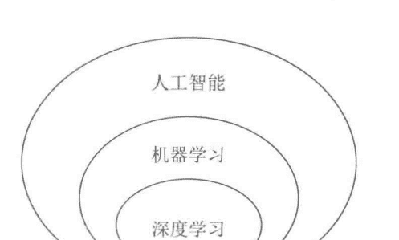

神经网络和感知机的雏形可追溯到 20 世纪 50、60 年代。那时算力和数据都有限，发展一度停滞。2006 年，多伦多大学的杰弗里·辛顿团队提出深度信念网络，引入无监督预训练和分层思想，缓解了深层网络难以训练的问题，为复兴奠定基础。2012 年，辛顿的学生亚历克斯·克里热夫斯基用深度卷积网络在 ImageNet 竞赛中取得突破，标志着深度学习在计算机视觉的落地。此后，循环神经网络、长短时记忆网络、注意力机制、生成对抗网络等不断涌现，深度学习在自然语言处理、语音、游戏 AI 等领域加速普及。

深度学习常用的模型包括：

卷积神经网络 CNN，擅长图像识别、视觉和图像处理，经典的 LeNet5 就是代表。

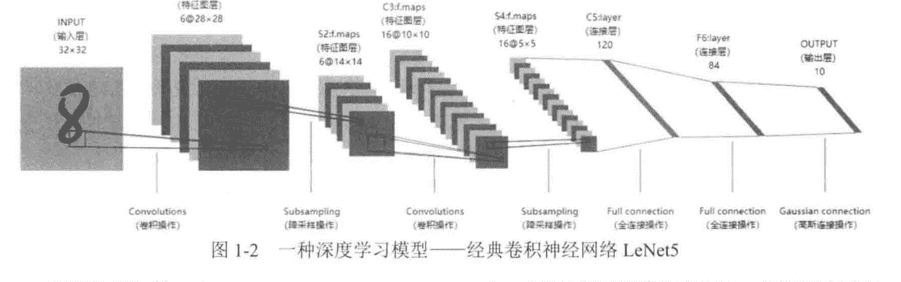

循环神经网络 RNN，适合处理序列数据，常用于自然语言处理和语音识别。

长短时记忆网络 LSTM，RNN 的一种改进，能缓解梯度消失，用于序列预测和语言建模。

生成对抗网络 GAN，通过生成器与判别器对抗，生成逼真图像、音频、文本。

自编码器 AE，用于无监督的降维、特征提取和重构。

深度强化学习 DRL，把深度学习与强化学习结合，无需人工特征即可学习高层策略。

建模通常经历以下环节：先收集整理数据，进行清洗、特征选择、缩放、标准化等预处理；再根据问题和数据特征选型并设计结构参数；接着用训练数据训练并优化参数，选择合适的优化器、损失函数和正则化；然后用测试数据评估并调优，提升泛化与鲁棒性；最后部署到实际系统实现自动化决策。不同问题流程会有差异，整体上是一个需要反复迭代优化的过程。

典型应用包括计算机视觉里的图像分类、目标检测、分割、人脸识别、姿态估计、图像生成；自然语言处理里的文本分类、情感分析、机器翻译、语音识别、对话系统；推荐系统中的商品、广告推荐和搜索排序；医疗健康中的疾病诊断、影像分析、药物研发；金融风控中的风险评估、欺诈检测、信用评估；自动驾驶中的图像识别、车道检测、交通标志识别等。落地时都需要结合场景采集、处理和验证数据，设计适配的模型和算法。

## 1.6 通用人工智能（AGI）

通用人工智能指的是能够像人类一样思考、能在多任务间灵活使用的机器智能，与只能完成特定任务的专用智能相对。AGI 也常被称为强人工智能，目标是构建具备自我学习、推理、创新、理解和沟通等广泛能力的系统，其理论涉及仿生学、认知科学和计算机科学，实现仍需跨学科突破。

AGI 的核心特征是通用性和灵活性，能适应多种任务与环境；具备自我学习能力，可不断提升智能水平；拥有智能创新能力，能产生新概念和想象；支持自然的人机交互，如自然语言、图像处理等。它被视作人工智能的重要方向，具有深远的社会经济意义，但因复杂性高，目前仍缺乏真正意义上的 AGI 产品。

最接近 AGI 的仍是基于深度学习和强化学习的模型，它们在特定领域表现突出，能通过反馈提升准确度，但受限于数据需求大、缺乏真正推理与创造性，且大多需要人类监督。ChatGPT 并非 AGI，而是一种特定领域模型，能力范围有限。尽管差距明显，ChatGPT 等技术的自动学习与推理过程，为通向 AGI 提供了经验和启发。

## 1.7 自然语言处理

自然语言处理是让计算机理解、处理和生成人类语言的技术，涉及计算机科学、语言学、数学等，涵盖文本、语音和机器翻译等方向。

上世纪 50、60 年代，人们开始探索语言理解，出现基于规则的方法。70、80 年代引入机器学习，如决策树、贝叶斯，依赖人工标注和手工特征，受限于数据和算力。90 年代互联网普及后，大量文本数据和统计方法如 n 元语法、隐马尔可夫模型、最大熵模型被使用，减少了人工标注需求。近年来深度学习推动 NLP 快速发展，卷积神经网络、循环神经网络、Transformer 等在机器翻译、命名实体识别、文本分类、情感分析上取得突破。预训练模型如 BERT、GPT-2、RoBERTa 先在大规模无标注语料上预训练，再针对任务微调，显著提升性能。

NLP 主要包括语言理解，如分词、词性标注、句法分析、实体识别、语义分析；语言生成，如语言模型、机器翻译、问答；语音识别，处理音频并转录文本；语音合成，生成自然语音。机器翻译是典型应用，如谷歌翻译，先把输入转成向量，通过深度神经网络映射到目标语言，再解码为文本，实现快速准确翻译。ChatGPT 本身就是 NLP 的一种应用，基于深度学习生成文本并交互，可用于聊天机器人、自动问答等。在此之前，语音识别、文本分类、信息抽取等早期的 NLP 应用已用隐马尔可夫模型、高斯混合模型、朴素贝叶斯、支持向量机、规则匹配等技术，为今天的发展奠定基础。

## 1.8 生成式人工智能（AIGC）

生成式人工智能指的是利用 AI 技术自动生成文本、图像、音频、视频等内容。它建立在自然语言处理、计算机视觉、语音识别和深度学习之上，能基于已有知识和数据产出人类可读的内容，应用场景持续扩展，如自动摘要、聊天、语音合成、图像视频生成等，也催生了 Midjourney、Lensa 等艺术生成工具，同时也带来生成质量与真实性等挑战。

深度学习是其常用手段。以文本生成为例，常见技术有语言模型、循环神经网络、长短期记忆网络、生成对抗网络等。语言模型用概率刻画语言规律，逐词预测生成文本。循环神经网络通过记忆前一步输出来关联上下文，适合生成任务。长短期记忆网络能更好地处理长序列，产生更连贯结果。生成对抗网络由生成器和判别器对抗，生成更逼真的文本。预训练模型如 GPT-2、BERT 在大规模语料上预训练后微调，可针对特定任务定制输出。

ChatGPT 的功能与 AIGC 相关，包括自动生成对话、文章等文本；使用分类算法对文本进行分类；用机器学习分析情感倾向；基于预训练模型和生成式对话构建问答系统，用于智能客服等。总体看，ChatGPT 与 AIGC 都依赖自然语言处理和机器学习实现生成、分类、分析与问答。

## 1.9 强化学习

强化学习是让智能体在环境中做决策并通过与环境的互动不断优化行为的机器学习方法，目标是最大化累积奖励。智能体执行动作，环境反馈奖励或惩罚，智能体据此更新策略，无需事先知道环境模型。

核心要素是智能体、环境和奖励信号。典型应用包括控制系统、机器人、游戏、推荐系统等。常见算法有 Q 学习、SARSA、Actor-Critic 等。历史可追溯至 20 世纪 50 年代的自适应控制研究，80 年代形成独立学科。1989 年沃特金斯提出的 Q 学习基于马尔可夫决策过程，通过更新 Q 值学习最优策略。Actor-Critic 结合价值函数和策略函数，训练更稳定高效。

近几年深度学习与强化学习融合，出现深度 Q 网络 DQN、深度确定性策略梯度 DDPG 等，能处理更复杂任务和环境，为强化学习拓展了更广阔的应用前景。

强化学习之所以能落地，很大程度上是因为它默认的演算舞台是马尔可夫决策过程。通俗说，就是把需要做决策的智能体和它面对的环境抽象成一个包含状态、动作、回报的数学框架。智能体在不同状态间跳转、选择不同动作，与环境持续交互，从而获得回报，并据此迭代策略。状态转移和回报的产生都带有随机性，但随机性服从可建模的概率规律，这让整个过程可以用数学来分析。

强化学习的终极目标就是在这样的 MDP 里学到最优策略，让智能体把未来累积回报拉到最大。换句话说，就是在不确定、带噪声的环境中做出长期最优的决策。正是 MDP 能够刻画这种随机性，所以强化学习几乎都靠它来建模和求解。

这类方法已经渗透到不少领域。

- 游戏：围棋、象棋、扑克以及电子游戏里的自主角色，通过强化学习适应不同局面，提升竞技表现。
- 机器人：自主导航、自主操作、自主探索，让机器人在多样环境和任务中实现自控行动。
- 自然语言处理：问答系统、对话机器人，让交互更自然流畅。
- 财经：股票交易、投资组合管理，用强化学习制定交易和投资策略，提升收益。
- 工业控制：生产调度、过程优化，降低成本、提高效率。

AlphaGo 就是经典代表。谷歌 DeepMind 研发的这款程序融合强化学习与深度学习，在围棋上击败了世界冠军李世石。强化学习在其中是核心引擎，通过策略价值网络做搜索树剪枝，再借助蒙特卡洛树搜索挑选胜率最高的落子。

AlphaGo 内部其实跑着两套神经网络。策略网络负责给每个落点打下棋概率，价值网络负责评估当前局面的胜率。先用大量人类对局做预训练，再用强化学习的自我对弈不断微调参数，最终棋力远超人类。这次突破证明了强化学习在复杂博弈决策上的潜力，尤其在棋类领域成效显著。

## 1.10 从 AlphaGo 到 ChatGPT 的强化学习脉络
ChatGPT 本身并不直接跑传统强化学习，而是引入了人类反馈强化学习 RLHF。RLHF 的目的不是在预训练阶段，而是在对话交互中让回答更贴合人类偏好，提升质量。

与经典强化学习相比，RLHF 把人类反馈嵌入到学习回路里。人和智能体形成互动，人类给出评价来指引决策，模型据此调整行为。把人类看成模型的一部分，有助于避免纯强化学习里的偏差和失误，提升训练效率和安全性，目前已在游戏、机器人操作、智能交通等场景看到应用。

具体到 ChatGPT 的流程是：用户输入文本，模型生成回答并呈现，用户打分或给出反馈。满意时模型会倾向于沿用相似策略，不满意时则调整策略以生成更符合预期的内容。这种基于 RLHF 的闭环让回答质量持续改善，配合大规模预训练带来的语言理解能力，能够更好地把握用户意图并给出相关回应。

# 第2章 自然语言处理全景

## 2.1 NLP 基础概念速览
下面梳理自然语言处理里常用的基本概念。

自然语言：人类日常使用的口头或书面语言表达形式。
语言模型：对自然语言进行建模的技术，用来估计序列的概率，常用于语音识别、机器翻译、文本生成等。
分词：把连续文本切分成词或词组的操作。
词性标注：为每个词标记其语法类别，用于句法分析、命名实体识别等。
句法分析：解析句子内部词语的语法关系。
命名实体识别：从文本中抽取出人名、地名、机构名等具有特定意义的实体。
语义分析：在词义、同义反义、上下文语境层面理解词语间的语义关联。
情感分析：判断文本所包含的情感倾向，如积极或消极。

## 2.2 NLP 核心技术盘点
自然语言处理的技术体系相当丰富，核心包括分词与词性标注、句法分析、语义分析、信息抽取、机器翻译、文本分类与聚类、情感分析、问答系统、文本生成与摘要、语音识别与语音合成。

ChatGPT 作为大型自然语言处理模型，集成了多项前沿技术。

语言模型：基于 Transformer 架构的预训练模型，具备理解和生成文本的能力。
分词技术：能够将输入拆分为单词和词组，为后续处理做准备。
命名实体识别：识别并抽取人名、地名、机构等信息。
词性标注：对词汇进行语法角色标注，便于理解。
句法分析：把握句子结构和成分，强化语义理解。
情感分析：捕捉文本的情绪状态和倾向。
机器翻译：实现跨语言的文本转换。
文本摘要：从长文本中提炼关键信息。

## 2.3 NLP 演进史
自然语言处理的萌芽可以追溯到 20 世纪 40 年代。

1）1956 年以前的萌芽期
自然语言处理起源于 40 年代末，当时出现了首个需要理解自然语言并识别词汇的 AI 系统。
1948 年香农把马尔可夫过程模型引入自然语言建模，并把热力学熵的概念推广到语言领域，认为自然语言具有统计规律。
1950 年图灵发表《计算机器与智能》，提出首个机器翻译算法思路，并首次提出图灵测试来判断机器是否具备智能。
1954 年乔治敦大学与 IBM 合作，用 IBM-701 完成英俄机器翻译实验，首次把 60 句俄语自动译成英语，标志机器翻译开始可行。随后十年政府和企业大规模投入该方向。
2）1956—1966 年的快速发展期
1956 年乔姆斯基提出生成式文法，假设自然语言存在完备生成规律，由此形成以语言学为基础的符号主义和以统计为基础的连接主义两大流派。
同年约翰·麦卡锡创造“人工智能”一词，并提出用自然语言与 AI 系统通信的设想。
1959 年弗兰克·罗森布拉特创建感知器，即早期神经网络，用于模式识别与分类。
1962 年明斯基与佩珀特出版《感知器》，推动人工神经元研究。
1966 年召开首届计算机语音与语言处理会议。1967 年出现面向英语科学家的俄语机器翻译程序。
1966 年 MIT 人工智能实验室诞生了基于规则的对话系统 ELIZA，由约瑟夫·维森鲍姆开发，是首个可与人交谈的程序。
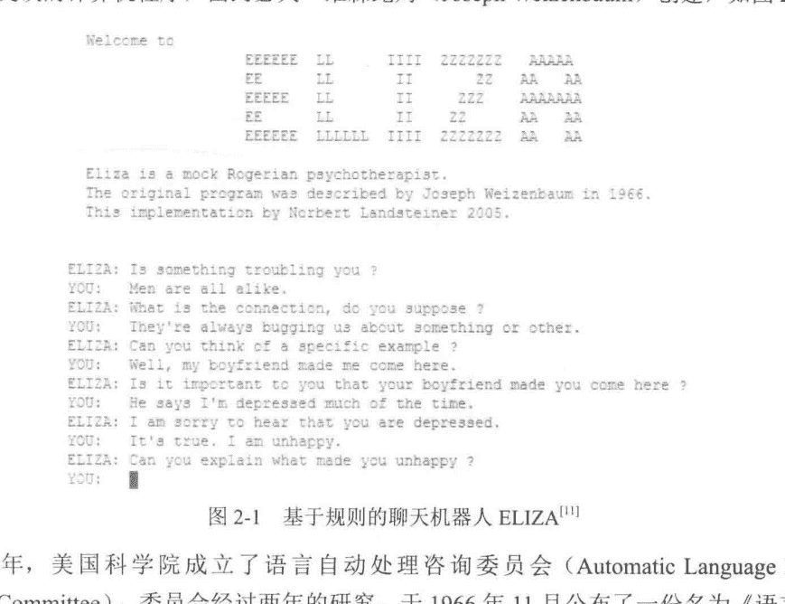
1964 年美国科学院成立语言自动处理咨询委员会，1966 年发布《语言与机器》报告，否定机器翻译的短期可行性，建议削减资助，导致研究进入低谷。
3）1967—1993 年的低谷发展期
1976 年蒙特利尔大学与加拿大联邦政府翻译局联合开发 TAUM-METEO 系统，成为机器翻译史上的里程碑。
1979 年诞生首个简易英语聊天机器人。
1984 年 IBM 的 Chatterbox 可用自然语言交互，使用早期对话管理系统过滤对话。
1987 年罗伯特·尚克创建 PARRY 程序，模拟偏执型精神分裂症患者与精神科医生对话。
1990 年 ELIZA 与 Parry 被视作简单模式匹配的例子，无法真正理解语言，图灵测试仍未通过。
1993 年 IBM 的布朗等人提出基于词对齐的翻译模型，奠定现代统计机器翻译基础。
4）1994 年至今的复苏融合期
1994 年统计机器翻译取得突破，机器阅读速度达人类 400 倍，但质量仍逊色。
2001 年本吉奥等人提出首个神经语言模型，论文《A Neural Probabilistic Language Model》。
2003 年弗朗兹·奥奇提出对数线性模型和基于短语的翻译模型及最小错误率训练，推动统计机器翻译真正崛起。
2006 年谷歌推出统计机器学习驱动的自动翻译，覆盖 60 多种语言，后续扩展至百余种。
2008 年科洛博特首次把多任务学习引入 NLP 神经网络，词嵌入矩阵可在不同任务间共享。
2010 年 IBM 的 Watson 能理解自然语言问题并基于维基百科作答，在《危险边缘》击败人类选手。
2013 年微软推出聊天机器人 Tay，与用户互动学习，16 小时后因不当内容下线。
同年米科洛夫等人提出词嵌入，使大规模词向量训练成为可能。
2013-2014 年 RNN、CNN 和结构递归神经网络在 NLP 兴起，RNN 适合序列输入，随后 LSTM 解决梯度问题，CNN 也引入文本处理。
2014 年斯茨凯威等人提出序列到序列学习，用编码器解码器把一个序列映射到另一个序列。
2015 年巴达纳等人提出注意力机制，成为神经机器翻译的核心创新，也被广泛用于句法分析、阅读理解等，并提供模型内部可解释性。
同年预训练语言模型首次提出，后证实在多种任务上有效，且能用更少标注数据学习。

## 2.4 语言模型
语言模型是自然语言处理里的统计模型，用来刻画语言规律并做概率预测。它可以评估一段文本出现的可能性，也能用来生成新文本。

训练好的语言模型本质是一个条件概率分布，给定已有序列可计算该序列的概率。基于大规模语料训练的模型能判断句子是否自然，也能在机器翻译等任务中生成目标文本。

语言模型在机器翻译、语音识别、摘要生成等任务中应用广泛。近年的深度学习方法，尤其是循环神经网络及其变种 LSTM、GRU，取得显著进展，成为研究热点。

发展脉络可追溯到 50 年代香农提出语言模型概念并在信息论中建模。80-90 年代统计机器学习兴起，n 元语法、熵、隐马尔可夫模型、最大熵模型等方法流行。
进入 21 世纪，循环神经网络及其变种改变 NLP 格局。10 年代中期谷歌提出的 Seq2Seq 编码器-解码器结构和注意力机制让机器翻译大幅提升。随后 GPT、BERT 等预训练模型推动领域快速发展。未来随着算力和数据增长，语言模型的作用只会更关键。

目前主流语言模型包括：

n 元语法模型：基于统计计算前 n 个词出现的概率来预测下一个词，简单高效。
隐马尔可夫模型：用于词性标注、语音识别等，建立观测序列与隐状态的关系。
循环神经网络模型：用隐藏层捕捉上下文，通过反向传播训练，在长序列上表现良好。
长短时记忆网络模型：引入遗忘门、输入门、输出门缓解梯度消失，在翻译和生成任务中表现优异。
门控循环单元模型：结构更简化的门控循环网络，仍能有效处理长序列。
Transformer 模型：基于自注意力机制并行建模，在翻译和生成任务上效果突出，训练效率高。
BERT 模型：基于 Transformer 的预训练语言模型，通过无监督训练获得丰富的上下文语义表征。
除此之外，ELMo、GPT 等模型也在 NLP 领域发挥重要作用。

### 2.4.1 大型语言模型 LLM
大型语言模型是一种深度学习算法，通过海量数据训练来学习、识别、总结、翻译、预测和生成文本及内容。其参数量和数据规模极大，例如 GPT-3 拥有 1750 亿参数，使用 45TB 数据。LLM 可应用于智能客服、智能家居、AI 法律等多种自然语言处理场景。

大型语言模型的兴起与深度学习尤其是自然语言处理技术的进步紧密相连。这些模型借助海量文本进行训练，逐步获得了理解与生成语言的强能力。梳理其发展轨迹，大致可以归纳为以下阶段：

- （1）循环神经网络。早期语言建模多采用 RNN，能够处理长度可变的序列并通过反向传播进行优化。但在长序列上容易出现梯度消失或爆炸，限制了建模长距离依赖的能力。
- （2）长短时记忆网络。为缓解 RNN 的缺陷，LSTM 被引入语言建模。借助输入门、遗忘门和输出门对信息流进行调控，梯度问题得到明显改善，建模效果提升。
- （3）递归神经网络。RecNN 以树形结构组织计算，通过递归合并子节点的表示形成父节点表示，能够捕捉句法结构，对语言建模有帮助。
- （4）卷积神经网络。CNN 起源于图像领域，也可用于文本。卷积操作提取局部模式，池化操作压缩特征维度，在一定程度上提升了建模效率。
- （5）预训练范式。近年主流转向大规模无标注文本上的预训练，再在下游有监督任务上微调，性能显著提升。BERT、GPT、XLNet 等均属于这一思路的代表。

按公开时间排序，主流大型语言模型的发展脉络如下：

- （1）2018 年 6 月，OpenAI 推出 GPT，参数规模约 1.1 亿，是首个基于 Transformer 的自回归式语言模型，可生成连贯文本。
- （2）2018 年 10 月，谷歌发布 BERT，参数约 3.4 亿，是首个基于 Transformer 的自编码式模型，训练使用了掩码语言建模与下一句预测。
- （3）2019 年 2 月，OpenAI 发布 GPT-2，参数约 15 亿，在数据量与模型规模上扩展 GPT，提升了生成质量。
- （4）2019 年 5 月，Meta 发布 RoBERTa，参数约 3.55 亿，在 BERT 基础上改进，在数据规模、批次大小与训练时长上加大投入以提性能。
- （5）2019 年 10 月，谷歌推出 T5，参数约 110 亿，采用文本到文本框架统一多种 NLP 任务。
- （6）2020 年 5 月，OpenAI 发布 GPT-3，参数达 1750 亿，使用 45TB 数据训练。
- （7）2020 年 7 月，谷歌发布 PaLM-E 562B，参数 562 亿，属于多模态模型，可处理图像与文本。
- （8）2021 年 1 月，谷歌大脑团队推出 Switch Transformer，参数规模达 1.6 万亿，是 GPT-3 参数的约 9 倍。
- （9）2021 年 5 月，谷歌展示 LaMDA 对话系统，参数 1370 亿，聚焦对话生成。
- （10）2021 年 6 月，BLOOM 发布 BLOOM-176B，参数 1760 亿，是多语言模型，覆盖西班牙语、阿拉伯语等。
- （11）2022 年 3 月，OpenAI 发布 InstructGPT，并发表结合人类反馈训练语言模型使其遵循指令的论文，训练中引入人工评价。
- （12）2022 年 11 月 30 日，OpenAI 公布 ChatGPT。ChatGPT 是对 GPT-3 也称 GPT-3.5 的微调产物，属于对话机器人，与 InstructGPT 同属 RLHF 训练范式，可视作姐妹模型。
- （13）2023 年 2 月 20 日，复旦大学发布 MOSS，参数 1.75 亿，是面向对话的语言模型。

### 表 2-1 大型语言模型的比较

| 时间 | 机构 | 模型名称 | 模型规模 | 数据规模 | 计算时间 |
| :--- | :--- | :--- | :--- | :--- | :--- |
| 2018年6月 | OpenAI | GPT | 110M | 4GB | 3天 |
| 2018年10月 | 谷歌 | BERT | 330M | 16GB | 50天 |
| 2019年2月 | OpenAI | GPT-2 | 1.5B | 40GB | 200天 |
| 2019年7月 | Meta | RoBERTa | 330M | 160GB | 3年 |
| 2019年10月 | 谷歌 | T5 | 11B | 800GB | 66年 |
| 2020年5月 | OpenAI | GPT-3 | 175B | 45TB | 355年 |
| 2020年7月 | 谷歌 | PaLM-E 562B | 562B | — | — |
| 2021年1月 | 谷歌 | Switch Transformer | 1600B | — | — |
| 2021年5月 | 谷歌 | LaMDA | 137B | — | — |
| 2021年6月 | BLOOM | BLOOM-176B | 176B | — | — |
| 2023年2月 | 复旦大学 | MOSS | 175M | — | — |

除上述模型外，还有以下知名系统：

- （1）BERT。谷歌开发的 Transformer 预训练模型，采用双向编码器处理问答、语义相似等任务，已成为 NLP 领域的基准之一。
- （2）RoBERTa。Meta AI Research 在 BERT 基础上改进，通过数据增强、动态掩码等手段在多项任务上表现更好。
- （3）T5。谷歌大脑提出的通用文本生成模型，采用文本到文本转换框架，可用于摘要、机器翻译、问答等。
- （4）PaLM-E。谷歌提出的预训练模型，结合实体嵌入与先验知识等模块，在命名实体识别、句法分析等任务上表现突出。

下面对代表性模型作进一步说明。

#### 1. BERT
BERT 由谷歌研发，于 2018 年底推出。目标是通过深度双向 Transformer 编码器从大规模文本学习通用语言表征，再迁移到问答、文本分类、文本匹配等下游任务。

主要特征：
双向性。采用双向 Transformer 编码器，能同时利用左右上下文生成表征。
预训练先行。先在海量未标注文本上预训练，再针对特定任务微调。
Transformer 架构。包含多头自注意力与前馈网络，具有高效并行与可扩展性。

预训练包含两项任务：
MLM。随机将输入序列中的部分词替换为 MASK，再预测被遮盖的词，帮助模型学习上下文依赖。
NSP。判断两个句子是否连续，从而学习句子间关系。

预训练完成后，可直接输出特征用于分类问答，或用于匹配计算。BERT 因迁移能力强成为领域标杆。

#### 2. RoBERTa
RoBERTa 于 2019 年由 Meta 推出，在 BERT 上做了多项优化。

主要改进：
训练语料更大。使用了 BookCorpus 与英文维基百科，并改进预处理以更好捕捉文本关联。
动态掩码。每次预测时随机选择掩盖词，避免模型依赖固定掩码策略。
训练时长更长。相比 BERT 训练数倍时长，提升性能。
移除 NSP。取消下一句预测，认为 MLM 更有效。
学习率策略。先用较大学习率训练后微调。

预训练仍以 MLM 为主，训练后可用于分类、问答、匹配等任务。

#### 3. T5
T5 由谷歌公司开发，全称 Text-to-Text Transfer Transformer，旨在统一自然语言处理任务如问答、翻译、摘要、分类。

模型要点：
基于 Transformer，但输入输出均为文本字符串，将各类任务归约为输入输出映射。
结构类似 Seq2Seq，先编码输入再解码输出。
在大规模语料上预训练，学习语言的普遍规律，可迁移到多种任务。
具备多任务学习能力，可同时学习多个任务，减少单独训练成本。
架构易扩展，可适配更大模型与数据，通过微调适配不同场景。

#### 4. PaLM-E
PaLM-E 是谷歌提出的预训练语言模型，面向文本分类、语言建模等任务。

结构：采用编码器-解码器。编码器由多个 Transformer 块构成，提取输入文本特征；解码器为 LSTM，将编码结果转为语言模型输出。可同时学习输入表示与输出分布。

训练：使用自监督无监督方式，不依赖标注数据。预训练任务包括掩码语言模型与 Directional Skip-gram，前者预测被掩码词，后者依据上下文预测词位置，从而获得丰富表征。

应用：可用于语言建模、文本分类、命名实体识别、情感分析等，在多个公开数据集上验证有效。

## 2.5 文本分类和聚类

### 2.5.1 文本分类
自然语言处理中的文本分类是指把给定文本归入预定义类别，通常用于垃圾邮件过滤、情感分析、新闻分类、归档与标签分配等。

常见流程：
- （1）收集与准备数据。需大量标注样本，包含文本与对应标签，如邮件、新闻、社交帖子等。
- （2）特征提取。将文本转为数值形式，常用词袋模型、TF-IDF 等。
- （3）特征选择。从大量特征中筛选对分类有帮助的部分，剔除干扰项。
- （4）模型选择与训练。选用朴素贝叶斯、逻辑回归、支持向量机、神经网络等进行训练。
- （5）评估与调优。用准确率、召回率、F1 等指标评估，不佳时调整参数或补充特征。
- （6）模型应用。训练完成后对新文本进行预测分类。

文本分类是 NLP 基础任务，步骤因具体场景而异。

### 2.5.2 文本聚类
文本聚类是把一批文本按主题、语义或属性相似度划分为多个簇，属于无监督方法，无需标注数据，通过相似性发现结构。

一般流程：
- （1）文本预处理。对原文进行清洗、分词、去停用词、词干化等，得到可用的特征表示。
- （2）特征提取。常用词频、TF-IDF 等提取向量。
- （3）相似度计算。计算两两文本间的相似或距离，如余弦相似度、欧氏距离、Jaccard 相似度。
- （4）聚类算法。将相似文本归为一簇，常用 K-means、层次聚类、DBSCAN 等。
- （5）结果评估。用轮廓系数、Calinski-Harabasz 指数等衡量聚类质量。

效果受特征表示与算法选择影响大，需充分实验。

### 2.5.3 分类和聚类的区别
目标不同。分类将文本分配到预先定义的类别；聚类则在无先验类别下发现自然分组。
处理方式不同。分类为监督学习，需标注数据训练；聚类为无监督学习，仅靠数据内在相似性。
特征使用不同。分类多用词袋、TF-IDF 转向量；聚类多用词频与相似度度量。
应用场景不同。分类用于邮件过滤、情感分析、新闻分类等；聚类用于文本挖掘、搜索引擎、推荐系统等，帮助发现模式。

两者可在实践中结合，例如用聚类为分类提供新类别。

## 2.6 分词和词性标注
分词和词性标注是自然语言处理中的两个基础任务。

中文信息处理的起点，往往是将一串没有空格的字符拆成能独立承载意义的单元。分词就是做这件事，把连续文本切成词或标点。因为汉语书写本身不标界限，所以必须借助专门技术来判断切分点。比如“我喜欢自然语言处理”经过切分后会变成“我”“喜欢”“自然语言处理”三个单元。

在切分完成之后，还需要知道每个单元在句子里扮演什么角色，这就是词性标注。常见的标注类别包含名词、动词、形容词、副词、介词、连词等。以前面例子延续，“我”作代词，“喜欢”作动词，“自然语言处理”整体偏向名词短语，其中“自然”“语言”更接近形容词性成分，“处理”则是动词。

分词与词性标注属于自然语言处理的基础环节，为上游的实体抽取、依存分析、情感判断等任务提供语言学层面的前提信息。

中文切分的主流思路可归为三类。

规则驱动的切分是最早的方法，靠人工编纂的词典和切分规则来决定断点。可控性强，但规则编写成本高，难以覆盖汉语的丰富变化。

统计学习的切分依托词频、语言模型和概率分布来推断边界。能从语料中自动归纳，减少人工干预，但对训练语料的规模有较高要求。

神经网络驱动的切分利用深度模型学习词汇共现和上下文规律。准确度通常更高，对长距离依赖的捕捉也更稳健，代价是需要大量标注数据和算力。

工程实践中常被引用的实现有 jieba、THULAC、PKUSeg 等，它们在算法实现上各有侧重，同时提供友好的调用接口和词典维护功能。

下面用一个演示说明切分过程。

待处理句子：“我喜欢自然语言处理。”目标是将其拆成独立词元。

借助 jieba 套件，可通过下列代码完成：

```python
import jieba

text = "我喜欢自然语言处理"

### 精确模式分词
seg_list = jieba.cut(text, cut_all=False)

### 将分词结果转化为列表
seg_result = list(seg_list)

print(seg_result)
```

执行后会得到如下结果：

```
['我', '喜欢', '自然语言处理']
```

从结果可见，代码调用了 jieba 提供的切分接口，把句子拆成列表返回。这里采用的是追求最细粒度的切分原则，尽量避免冗余。

词性标注是在切分结果上附加语法标签，例如“我/代词”“喜欢/动词”。技术路线同样分为三类。

规则驱动的标注靠人工制定的标注规范进行判断。可控性突出，但规则量大，迁移到新文本类型时适应性有限。

统计驱动的标注依据标注语料库中的概率信息对新句进行推断。领域适应能力较好，同样依赖充足的训练数据。

神经网络驱动的标注让模型自动学习特征表示和判别规律。准确率较高，但对数据量和计算资源的需求更大。

常用的标注实现同样包含 jieba、THULAC、PKUSeg 等，均提供便捷接口和词典管理。

下面用一个演示说明标注过程。

待处理句子：“我喜欢自然语言处理。”目标是对每个词元附上词性。

借助 THULAC 套件，可通过下列代码完成：

```python
import thulac

thul = thulac.thulac()

text = "我喜欢自然语言处理"

### 进行分词和词性标注
result = thul.cut(text, text=True)

print(result)
```

执行后会得到如下输出：

```
我 /r 喜欢 /v 自然语言处理 /n
```

从输出可见，该套件的切分接口同时返回词性和词元，形式为“词 / 标签”。例如“我 /r”表示代词，“喜欢 /v”表示动词，“自然语言处理 /n”表示名词。

2.7 命名实体识别
命名实体识别是从文本中自动定位并归类具有特定意义的实体，如人名、地名、机构名、时间等。该能力让系统对文本指称有更清晰的理解，是信息抽取、问答、机器翻译、自动摘要等应用的基础。

本质上是一个标注分类问题，模型需为文本打上实体边界和类型。传统方案多依赖手工规则和词典匹配，规则靠正则或语法设计，覆盖面受限；词典匹配受制于构建和维护成本，且难以识别新词。

近年来神经网络方案成为主流，如循环网络、长短时记忆网络、卷积网络等，能够自动学习特征并识别未见词。基于预训练模型的方法如BERT、RoBERTa，先在大规模语料上预训练再针对下游任务微调，进一步提升效果。

中文识别示例：
原文：北京大学是中国的顶尖学府之一。
识别结果：
- 机构名：北京大学
- 国家名：中国

2.8 句法分析
句法分析旨在揭示自然语言文本的语法结构，包括成分构成、词间关系和短语组合，从而获得句子的结构信息。该技术支撑问答、机器翻译、文本摘要等多个任务。

常用手段包括：
上下文无关文法CFG，用一组语法规则描述词的组合方式并生成语法树。
依存句法分析，刻画单词间的依存关系并生成依存树。
统计方法，基于大规模语料学习结构规律，典型代表有条件随机场、最大熵模型和神经网络。
深度学习方法，如循环网络、长短时记忆网络、卷积网络等，可直接从数据中学习句法表达。

以下为中文句法分析案例。

句子：“我想买一本好看的小说。”使用依存分析器后可能得到如下结果：

```
(ROOT
  (IP
    (NP (PN 我))
    (VP
      (VP (VV 想))
      (VP (VV 买)
        (NP (CD 一) (CLP (M 本)) (JJ 好看) (DEG 的) (NN 小说)))))
    (PU 。)))
```

结果显示句子的核心结构为主谓宾，包含IP节点对应主谓宾框架。NP节点对应主语“我”，VP节点对应谓语“想买”，内部嵌套VP表示复合谓语“想”“买”，NP节点对应宾语“一本好看的小说”，末尾为句号。节点标记如“VV”表示动词，括号内为对应的词语。

这类结构解析有助于更深入理解句意，为信息抽取、机器翻译等提供依据。

2.9 情感分析
情感分析是通过程序自动探测文本中的情绪倾向，判断为正面、负面或中性，并评估强度。应用场景覆盖社交媒体监测、客户反馈分析、产品评价分析、舆情监测等。

常见技术路线有：
词典法，基于包含情感极性的词典统计文本中情感词的数量和倾向。
机器学习法，用支持向量机、朴素贝叶斯、随机森林等在标注数据上训练分类器。
深度学习法，利用卷积网络、循环网络、Transformer等自动提取特征并处理复杂文本。
情感知识图谱法，将文本中的实体与关系映射到情感知识图谱，识别情绪状态。

以深度学习为例，典型流程为：
数据预处理，对文本做切分、去停用词、词到数字映射等。
模型构建，选择RNN、CNN或Transformer等结构，RNN适合短文本，CNN计算效率高，Transformer在长文本上表现更好。
模型训练，使用标注数据配合优化算法如随机梯度下降、Adam等。
模型评估，用测试集计算准确率、精确率、召回率、F1等指标。
模型部署，将训练好的模型用于新文本，输出情感倾向。

在社交媒体监测中，情感分析可帮助企业实时感知公众情绪。例如电视台可分析评论的情感分布判断节目口碑，决定宣传策略；品牌管理中，企业可监测消费者对品牌的情感反馈，正面评价可用于宣传，负面反馈则提示改进产品与服务。

2.10 机器翻译
机器翻译是利用计算机将一种自然语言自动转换为另一种自然语言的过程，是解决跨语言交流障碍的关键方向，应用于搜索、国际贸易、跨文化交流等。

主要技术路线：
统计机器翻译SMT，基于语言对齐和概率模型进行翻译，代表为IBM模型。
神经机器翻译NMT，使用深度神经网络学习源语言与目标语言的映射，是当前主流。
基于规则的机器翻译RBMT，依赖人工编写规则，现已非主流。
强化学习机器翻译RLMT，通过试错优化翻译结果。
互联网机器翻译IMT，基于海量双语数据，如谷歌翻译、百度翻译。

神经机器翻译的核心是编码器-解码器结构，编码器将源句编码为向量，解码器生成目标句。编码解码器可采用循环网络、长短时记忆网络、门控循环单元等捕捉语义。训练常用最大似然估计，推理可用贪心搜索或束搜索。性能受数据质量、模型结构和超参数影响，当前在多数任务上表现优异。

示例：
源语言：The quick brown fox jumps over the lazy dog.
目标语言：快速的棕色狐狸跳过了懒狗。

除通用翻译外，机器翻译在跨境电商、国际会议、新闻媒体等领域应用广泛。

2.11 文本摘要
文本摘要是从文本中抽取主要信息并生成简短概括的过程，可针对单篇或多篇文档，也可用于对话。目的是帮助用户快速把握要点，节省时间。

技术链条包括：
文本预处理，清洗数据、去停用词、关键词抽取、词性标注等。
文本表示，将文本转为计算机可处理的向量形式，如词向量、句向量。
文本压缩，通过词频统计、TF-IDF等识别重要句子或词语以缩短篇幅。
摘要生成模型，抽取式摘要直接从原文抽取关键句，生成式摘要利用深度学习生成新语句，表达更自然但需更多资源。
评估模型，自动评估常用ROUGE指标对比生成摘要与参考摘要，人工评估则通过阅读判断质量。

典型应用是新闻自动摘要。输入全文，算法分析后输出标题和简要概括，帮助编辑快速覆盖多话题，并在新闻网站、信息聚合平台和社交媒体上提升浏览效率。

2.12 自然语言处理的商业应用
目前市场上有许多主流的应用自然语言技术的产品，以下是其中一些例子。

自然语言处理的落地形态大致可分为四类。第一类是语音助手，美方有苹果 Siri、微软 Cortana、小娜、谷歌 Assistant、亚马逊 Alexa，国内有百度小度、小米小爱等，它们借助语音识别与自然语言理解完成发短信、播音乐、设提醒等任务。第二类是智能客服，代表平台有 Zendesk、Freshdesk、LiveChat 等，依赖自然语言处理实现理解与生成，帮助用户自助解决问询。第三类是聊天机器人，如微软小冰、Meta 的 M、谷歌 Chatbase 等，通过对话完成问答、建议等操作。第四类是智能翻译，谷歌翻译、百度翻译、有道翻译等借助自然语言处理实现多语种自动转换。

### 2.12.1 语音助手全景
语音助手是基于语音交互的人工智能应用，以语音识别、自然语言处理、语音合成等技术为支撑与人沟通并提供服务，其技术脉络可追溯到 20 世纪 60 年代的语音识别研究。

市场上主流产品包括亚马逊 Alexa、苹果 Siri、谷歌 Assistant、微软 Cortana。Alexa 能用语音指令控制家居、播放音乐、查询天气；Siri 可完成语音搜索、发短信、设定提醒；Assistant 支持多语言，同样能语音搜索、发短信、设提醒；Cortana 侧重语音搜索、提醒与日程管理。

发展方向正向四个面向演进：个性化服务，通过学习兴趣、习惯与行为提供定制化音乐列表、智能家居控制等建议；多模态交互，除语音外可与手势、触摸结合，并联动手机、家居设备；语音技术迭代，不断引入更精准的识别与合成模型，提升响应效率；场景拓展，从车载、智能家居向健康医疗等领域延伸，使用更便捷。

构建语音助手需整合多项技术：语音识别把声波转为文本，是核心环节，依赖机器学习提升准确率；自然语言处理将用户表达转为机器可理解形式以把握意图；对话管理结合 NLP 与机器学习分析输入并给出合适回复；人机交互则融合语音输入与图形界面，让使用更顺畅。

ChatGPT 的出现明显加速了语音助手的进化。它能强化文本理解能力，用在识别、转换与合成环节提升交互质感；把语音转成文本后交由 ChatGPT 分析，可提高识别精准度；在大规模对话数据上训练的模式使自动回复更自然，对话系统更智能；预训练模型还能快速生成自然语言文本，与识别合成技术结合，缩短研发周期。

### 2.12.2 智能客服演进
智能客服是基于人工智能与自然语言处理实现自然语言交互的自动化服务系统，雏形可追溯至 20 世纪 80 年代。

80 年代出现计算机语音识别与自然语言理解，早期客服多采用规则法，答案依赖人工编写的规则集，受规则数量与复杂度限制体验欠佳。进入 21 世纪，互联网与移动设备普及催生了阿里小蜜、京东小京鱼、微信智能客服等产品。深度学习兴起后，神经网络方法成为主流，知识图谱、情感分析、多轮对话等技术逐步加入，交互效果与体验持续提升，未来将更智能、人性化，成为企业触达客户的重要渠道。

知名厂商的产品包括：IBM Watson Assistant，采用自然语言处理与机器学习实现语音与文字自动化交互，未来会强化第三方数据源整合；谷歌 Dialogflow，提供 NLP 与机器学习无缝集成，支持多语种多渠道接入，未来侧重多模态体验与智能服务；微软 Dynamics 365，云端 CRM 体系内置 NLP 与 AI，实现自动客服与营销，未来聚焦可持续创新；亚马逊 Connect，云客服方案集成 NLP 与机器学习，支持多渠道实时监控，未来走向多元化形态与全球化；阿里云智能客服，集成自然语言处理与语音识别，支持多渠道全流程自动化，未来加强与阿里云生态融合与开放平台建设。

除此之外，Zendesk、Freshdesk、LiveChat 等在线客服系统提供工单、邮件、社交媒体管理等功能，助力企业提升服务质量与效率。Zendesk 支持邮件、电话、聊天、社交媒体多渠道沟通并提供分析报表；Freshdesk 同样覆盖多渠道，加入自动化工具、知识库与社区支持；LiveChat 专注即时聊天，结合自动化、知识库提升满意度。整体趋势是进一步智能化自动化，并拓展手机应用、社交媒体等多渠道触达。

技术栈通常包括：文本分析分词、词性标注、实体识别、情感分析；语音识别将语音转为文本；对话管理基于 NLP 与机器学习生成回复并持续优化；机器学习训练模型提升理解与生成；知识图谱增强问答能力；聊天机器人技术构建虚拟助手；智能推荐提供个性化服务；语言生成让回复更自然。

ChatGPT 为智能客服带来三重助力：语义理解更精准，问题被更准确识别与解决，满意度与效率提升；语言生成更自然流畅，贴近人类表达，增强信任感；结合语音识别与合成，实现多渠道无缝协同，提升全渠道服务能力。

### 2.12.3 聊天机器人形态
聊天机器人是能借助自然语言处理与人类对话的人工智能应用，常模拟人类对话风格。常见用途包括客服支持、个人助理、娱乐互动、教育辅导等。

实现方式多样，底层涉及语音识别、文本分析、语言生成、机器学习、对话管理、知识图谱、人机交互设计与云计算等，还需处理上下文信息。部分系统借助神经网络进行对话生成，以把握对话背景与提及对象。

市场上主流方案有微软 Bot Framework、IBM Watson Assistant、Meta Wit.ai、谷歌 Dialogflow 等。发展重点集中在个性化交互、语言多元化、多渠道接入、AI 能力升级以及与支付、物流、社交等服务集成。

未来可根据历史记录与兴趣提供更个性化建议，支持更多语言覆盖不同地区用户，在网站、移动应用、社交媒体等多平台交互，通过持续升级 NLP 与机器学习能力更好理解意图，并与外部服务联动实现下单、查单、内容分享等操作。

Dialogflow 与 Chatbot 定位不同。Dialogflow 原名 API.AI，是面向开发者的搭建平台，可创建聊天机器人或虚拟助手，支持多语言多平台集成到 App、网站或智能音箱，并提供训练工具。Chatbot 则是由谷歌推出的面向企业用户的机器人产品，与 Google Chat 集成，帮助员工处理工作事务、提供信息与执行任务。简言之，前者是开发平台，后者是企业应用产品。

ChatGPT 作为强大的语言模型，为聊天机器人提供了技术基础与发展动能。

### 2.12.4 三者差异要点
语音助手、智能客服与聊天机器人同属自然语言处理应用，但在交互方式、功能定位与技术侧重上各有特点。

交互方式上，聊天机器人多以文字、图像等形式交流；语音助手依赖语音识别与语音合成完成交互；智能客服则兼顾文字与语音两种渠道。

功能与场景上，聊天机器人偏向轻量自动化对话，如天气查询、订票、购物辅助；语音助手侧重语音指令控制设备、执行任务；智能客服服务于企业端，通过自动回复或人工转接提供咨询与解答。

技术应用上，聊天机器人主要用自然语言处理与机器学习，借助情感分析与文本生成实现自然对话；语音助手核心是语音识别、语音合成与自然语言处理；智能客服则以理解生成、对话管理、知识库检索等技术为支柱，结合人工兜底保障服务质量。

### 2.13 自然语言处理的发展趋势
深度学习已成为 NLP 主流，相比传统机器学习能处理更复杂的语言特征，泛化能力更强，伴随算力提升模型持续增强。

多模态处理兴起，文本、语音、图像等信息融合处理为理解与生成提供更全面的依据。

自监督学习在无标注数据上通过模型自身预测任务学习语言表示，降低标注成本，应用日益广泛。

知识图谱将实体、关系与属性结构化存储，结合 NLP 进行访问与查询，为任务提供更准确的背景与上下文。

集成化趋势明显，多项 NLP 技术与模型联合训练，如文本分类、情感分析、实体识别协同优化，提升整体效果。

# 第3章 OpenAI公司及其产品

## 3.1 OpenAI 公司简介
OpenAI 是一家成立于 2015 年的人工智能私营公司，致力于推进 AI 研究与开发，构建更安全、智能、人性化的系统。

公司由埃隆·马斯克、山姆·阿尔特曼、格雷格·布罗克曼等资深专家与企业家联合创立，马斯克于 2018 年离任。其目标是通过智能代理研发与 AI 研究进步促进人类福祉，确保技术安全与透明。

研究覆盖自然语言处理、计算机视觉、强化学习、机器人技术等领域，代表性成果包括语言模型 GPT、AI 训练平台 Gym、智能游戏 Bot 等。公司成果在学界与业界影响广泛，关注度持续提升。

## 3.2 OpenAI 公司发展历史
2015 年 12 月，OpenAI 在旧金山成立，初衷是防止谷歌在 AI 领域形成垄断，并以非营利姿态推动先进 AI 利益民主化，承诺公开研究成果并开源技术。

2016 年推出 Gym 强化学习开发与对比平台，同年发布 Universe 开源平台，用于衡量与训练 AI 通用智能，使智能体能像人一样使用计算机。

谷歌 AlphaGo 的突破加剧竞争压力，2017 年起 OpenAI 出现人才流失，如 Ian Goodfellow 与 Pieter Abbeel 离职。公司随后加速推进，在谷歌 Transformer 诞生一周年之际，于 2018 年 6 月发表《用生成式预训练提高模型的语言理解力》，推出参数约 1.17 亿的 GPT-1 模型，开启 GPT 系列的持续突破与商业化拓展。

2018 年，伊隆·马斯克在共同创立 OpenAI 三年后卸任董事会成员，官方说法是为了规避未来可能出现的利益冲突。

2019 年 2 月，OpenAI 公开 GPT-2 并同步推送论文《语言模型是无监督的多任务学习者》。

2019 年 3 月，组织架构完成调整，OpenAI LP 正式成立。

2019 年 5 月，YC 孵化器时任总裁山姆·阿尔特曼辞去 YC 职务，加入 OpenAI 出任 CEO。

2019 年 7 月，刚刚重组的新实体拿到微软 10 亿美元注资，其中约一半以 Azure 云计算额度形式提供。双方各取所需：微软成为 OpenAI 技术商业化的首选合作方，未来享有成果的独家授权；OpenAI 则依托 Azure 解决算力与成本瓶颈。

2020 年 5 月，GPT-3 正式上线，同时发布论文《语言模型是小样本学习者》。

2022 年 11 月 30 日，CEO 阿尔特曼在社交平台发文：“今天我们发布了 ChatGPT，来试试对话吧。”附上链接后，公众即可免费注册体验这款聊天机器人。

2023 年 1 月 23 日，微软宣布深化合作，以 290 亿美元估值追加约 100 亿美元投资，持股比例提升至 49%。

2023 年 3 月 14 日，GPT-4 正式发布。

## 3.3 OpenAI 和微软的合作

OpenAI 与微软的绑定相当紧密。

微软于 2019 年投下 10 亿美元，成为 OpenAI 的优先合作伙伴。部分 OpenAI 的 AI 技术已部署在 Azure 上，向开发者提供模型训练平台。

双方的联合产出不少。2015 年共同推出深度学习工具包 CNTK，用于模型训练与推理。2019 年合作推出基于 Minecraft 的研究项目，让 AI 在游戏中学习自然语言理解与交互。

在自然语言处理层面，GPT-2 可在 Azure 上调用并提供 API 接口；两人还联合发布了文本生成图像项目 DALL-E。

2023 年初，微软官宣 ChatGPT 与自家搜索引擎必应整合，并追加 100 亿美元投资。比尔·盖茨将这一动作的意义类比为个人电脑与互联网的诞生。

2 月 2 日，微软表示旗下产品线将全面接入 ChatGPT，覆盖必应、Word / PPT / Excel 等 Office 套件、Azure 云服务、Teams 等；同时计划向云客户推销 OpenAI 技术，以带动 Azure 销售增长。

2 月 8 日凌晨，新版必应与 Edge 浏览器上线，由 ChatGPT 驱动。新必应能够像 ChatGPT 一样处理长上下文的问答，当天起向全体用户开放试用。

## 3.4 OpenAI 公司主要产品

OpenAI 的核心产品线可归纳为三类：

- GPT，用于完成多种自然语言任务；
- Codex，实现自然语言到代码的转换；
- DALL·E，用于生成与编辑原创图像。

GPT 在本书其他章节已有详述，下面聚焦 Codex 与 DALL-E。

### 3.4.1 GPT

GPT 系列建立在自然语言处理之上，名称源自 Generative Pre-trained Transformer。核心是基于注意力机制的 Transformer，能够捕捉输入序列中的长距离依赖，在 NLP 任务上表现突出。

目前已推出 GPT-1、GPT-2、GPT-3 等多个版本。其中 GPT-3 参数规模达 1750 亿，是当时最大的语言模型之一，可用于写作、对话、自动摘要等文本生成场景。本书主要围绕 GPT 模型及 ChatGPT 应用展开，具体内容见相关章节。

### 3.4.2 Codex

Codex 是 OpenAI 开发的自动化编程能力，能依据自然语言描述和代码示例生成程序代码。其原理是通过深度学习在大规模源代码和自然语言语料上训练，实现从自然语言到代码的映射。

主要特征是编码效率高，减少重复的手工编写与调试，提升质量与速度。既能补全基础语法与结构，也能结合上下文生成算法与函数，增强灵活性与复用性。

Codex 已被集成到 GitHub、VS Code、Atom 等开发环境中。

典型功能包括：

- 自动代码生成：根据自然语言描述或示例生成 Python、JavaScript、Java、C++ 等多种语言代码；
- 智能补全：基于已有片段与上下文推荐变量名、函数名、注释等；
- 语法检查与错误提示：快速定位问题；
- 格式化与优化：按规范提升可读性与性能；
- API 文档生成：依据注释与结构自动生成文档。

代表案例是 GitHub Copilot，由 GitHub 与 OpenAI 联合打造，使用 Codex 技术。开发者输入简短描述，Copilot 即可在上下文基础上推荐代码段，例如“从数组中找最大值”会给出循环、条件判断等实现，并提供预测式自动补全，减少输入量与出错率。

局限性仍存在：

知识库边界有限，因人工整理可能遗漏或出错，对冷门库或框架支持不足，且在语言与文化上仍有局限；
风险控制不足，生成代码可能携带漏洞或安全隐患，需人工审校；
可解释性弱，复杂深度学习模型生成的代码难以追溯，影响信任度；
兼容性问题，可能与旧版语言、库或特定平台不兼容。

在编程类对话场景中，ChatGPT 会调用 Codex 辅助作答或生成示例代码。

### 3.4.3 DALL-E

DALL-E 发音近似 “dolly”，是 OpenAI 基于 Transformer 架构的神经网络，能根据文本描述生成对应图像。名称取自 Deep Learning and Artificial Intelligence 的缩写 DA 与电影角色 WALL-E 的组合。

与传统图像生成不同，DALL-E 能创造全新、从未出现过的画面，常带有创意、幽默或荒诞感，如“火车车厢上趴着的大象”“鳄鱼夹克”等。

其技术根基来自 GPT，先在海量无标注文本上预训练具备文本生成能力，再结合图像生成模型与自动编码器，实现图文对应。

训练数据为图像与描述文本配对，通过学习对应关系生成匹配图像。训练依赖大量算力与 Transformer、自注意力等先进架构。

生成能力覆盖多种奇特场景，如火柴人玩具打乒乓球、蜗牛公路赛跑、身穿马球服的鳄鱼等。潜在用途包括自然语言生成、艺术创作、产品设计、虚拟现实等，也可应用于创意设计、广告设计、自动化设计等领域。

DALL-E 2 相比初代主要有四方面差异：

- 训练数据：DALL-E 2 使用 300 亿像素图像，远超 DALL-E 1 的 25 亿像素，视觉场景与概念更丰富；
- 模型结构：层数与参数更多，能更精细地理解图像内容；
- 图像质量：细节与语义还原度更高，清晰度和真实感提升；
- 生成速度：因模型更复杂，生成耗时更长，但多样性与细节更强。


图 3-1 操作电脑的狗

图 3-2 操作电脑的熊猫

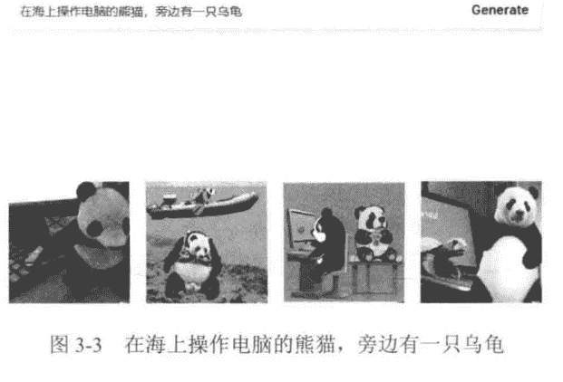

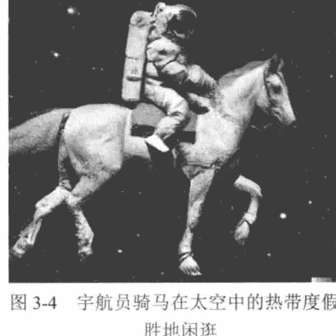

图 3-3 在海上操作电脑的熊猫，旁边有一只乌龟

图 3-4 宇航员骑马在太空中的热带度假胜地闲逛

DALL-E 2 还支持在原画布外扩展生成广阔构图；可基于自然语言对现有图像进行逼真编辑，增删元素并保持阴影、反射、纹理一致；还能以拍摄图像为灵感生成不同变体。

# 第4章 ChatGPT关联技术

ChatGPT 的技术路线可概括为“大数据 + 大算力 + 强算法 = 大模型”，并在“基础大模型 + 指令微调”上形成新范式。基础大模型类似大脑，指令微调负责交互训练，二者结合逼近人类语言智能。训练采用基于人类反馈的强化学习，以人类偏好为奖励信号，使模型更贴近人类认知模式。

在大数据、模型与算力工程化结合下，ChatGPT 展现出强大的统计关联能力，能捕捉词—词、句—句的关联，体现语言对话能力。

其技术栈包括前馈神经网络、序列到序列模型、自注意力机制、多头自注意力、自监督技术、Transformer、语言生成、多语言模型、预训练语言模型、近端策略优化、词嵌入、Softmax 分类器、指令学习与提示学习、人类反馈强化学习、多模态、生成式对抗网络、知识图谱与实体链接等；训练大量依赖 GPU、TPU 与云 GPU。

## 4.1 前馈神经网络

前馈神经网络也称多层感知机，由输入层、一个或多个隐含层与输出层构成，每个隐含层由多个神经元组成。结构示意图见图 4-1。

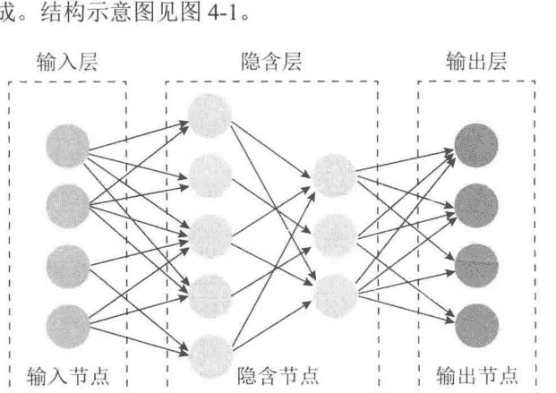

信息单向从输入流向输出，不存在反馈或循环。神经元输出由输入与权重相乘、加上偏置后经非线性激活函数转换得到。

常用于分类与回归，输入输出均为向量。训练通过反向传播调整权重，最小化预测与真实输出的误差。

## 4.2 序列到序列模型（Seq2Seq）

Seq2Seq 的目标是将可变长输入序列映射为可变长输出序列，广泛用于机器翻译、语音识别、对话系统等。

模型通常含编码器与解码器。编码器把输入压缩为固定维度的上下文向量，解码器据此逐 token 生成目标序列。

编码器与解码器多基于循环神经网络或 Transformer 实现，结构可同可异，按任务与数据选择。

优点在于能处理不同长度序列，无需固定长度，且充分利用上下文。随着发展，Transformer、BERT 等新模型成为 NLP 研究主流。

## 4.3 自注意力机制

自注意力用于衡量序列内部各元素间的关联度，元素可为词或字符。

基本思路是将每个元素表征为向量，通过向量间相似度计算权重，得到整体序列表征。

具体而言，每个元素的表征由输入全体元素的加权平均得到，权重由查询向量与各输入向量点积后经 Softmax 归一化产生。最终表征可用于机器翻译、文本分类、语言模型等任务。

形象地讲，类似阅读文章时对每个词都考虑其上下文赋予权重，例如读到“狗”时会关联“跑”“追”“球”等词以理解含义。

## 4.4 多头自注意力机制

多头自注意力是 Transformer 的核心机制，用于将输入序列编码为高维向量。

在单头自注意力中每个单元与其他单元交互以评估重要性，多头则并行运行多个注意力头，提升对不同语义信息的学习能力。

每个头独立计算注意力权重并生成新的表征向量，所有头的结果拼接形成更丰富、抽象的表征。

因各头参数独立，可学习不同语义表示，使模型在处理多类任务时能同时捕捉多方面信息，提升表现与泛化能力。

## 4.5 自监督学习

自监督学习无需人工标注标签，利用数据自身结构或信息进行训练。

模型在输入数据上学习与原始任务相关的自监督任务，属于自我监督。

关键在于设计自监督任务，常见做法有遮挡填补、缺失数据预测、图像裁剪生成等。目标是让模型学到几何形状、色彩分布、像素关系等数据结构，从而为分类、分割、检测等下游任务提供更好的特征表示。

与传统监督学习相比，自监督学习最大的不同在于不需要人工准备标注标签。省去了费时费力的标注环节，效率大幅提升。更关键的是，未标注语料获取容易、体量巨大，自监督学习能够充分利用这些资源进行训练。

在自然语言处理领域，自监督学习已经成为主流研究方向，常见的做法包括：

语言模型预训练。核心是建立自然语言文本的概率模型，用来推测句子或文本的下一个词或字符。在海量未标注文本上先进行预训练，之后再针对文本分类、命名实体识别、机器翻译等具体任务进行微调。

掩码语言模型 MLM。做法是随机遮挡句子中的部分词，让模型根据上下文补全缺失内容。训练时模型学会语法和句法结构。MLM 与语言模型预训练思路相近，差别在于不依赖句子级标注，而是以句子内部缺失词为学习信号。

句子对预训练。属于无监督范式，通过判断两句话的关系来训练模型。模型输入一对句子，输出它们是否同主题、是否情感一致等。这一过程帮助模型捕捉语义关联和上下文联系，提升相关 NLP 任务表现。

序列到序列预训练。同样是无监督方式，目标是训练一个能把一个序列映射为另一个序列的模型，例如输入一句原文，输出意义等价的改写句。这种能力对机器翻译、问答等生成类任务很有帮助。

BERT、GPT、RoBERTa 等模型就是这些思路的代表，在大量任务上达到了领先水平。

自监督学习和无监督学习都免去了人工标注。自监督是无监督的一种特殊形态，它从数据自身衍生出隐式标签或伪任务来指导训练，而纯无监督没有预设任务或标签。自监督通常需要明确定义的学习任务，以便获得有意义的表征；无监督则更多通过挖掘数据内在结构和模式来构建表征。自监督的优势在于任务由数据自动生成且与下游应用相关，因而能提供更强的特征；无监督则更具通用性，可适配不同类型数据和场景。

### 4.6 Transformer模型：注意力驱动的序列建模
Transformer 是 2017 年由谷歌团队提出的一种深度学习架构，属于 Seq2Seq 家族。2017 年 6 月，Google Brain 在 NeurIPS 上发表论文《Attention is All You Need》，首次提出基于自注意力机制的 Transformer，并用于自然语言理解。

此前的 Seq2Seq 主要是循环神经网络和 LSTM 实现，能完成机器翻译等序列建模，但受限于强时序依赖，长序列处理困难且并行效率低。

Transformer 用自注意力机制替代了时序依赖，能够一次性计算输入序列各位置间的相关性，并在输出时分配不同权重，实现更精准高效的建模。模型还引入多头注意力、残差连接、层归一化等技术，进一步提升性能和训练速度，如今已成为 NLP 的顶尖架构之一。Transformer 架构见图 4-2。

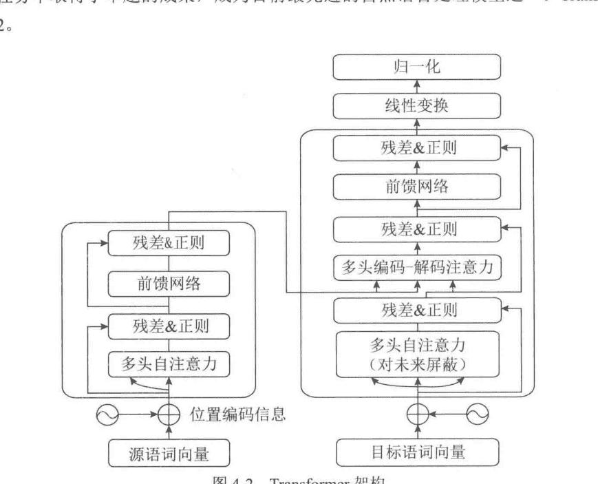
Transformer 由编码器和解码器构成，编码器把输入序列映射为隐层表示，解码器把隐层表示映射为输出序列。每个编码器和解码器都由多个 Transformer 模块堆叠而成，每个模块包含多头自注意力和前馈神经网络两部分：①多头自注意力将输入映射到多个子空间，用不同权重提取多类特征；②前馈神经网络对特征做线性变换和非线性激活。

编码器经过多层模块处理后得到包含语义信息的隐层表示。解码器在生成输出时，除上述两部分外，还加入编码器-解码器注意力，用于把编码器的隐层表示与解码器各位置关联起来。由此模型能够建模输入与输出序列间的对应关系，实现机器翻译、文本生成等任务。训练时通常以交叉熵等损失函数优化参数。

最初的 Transformer 在约 6500 万可调参数的多语公开语料上训练，采用类似完形填空的方式：从句子中去掉一个词，让模型依据上下文预测填空词，通过自监督不断强化能力。海量网络和图书馆语料即可自动训练，减少对昂贵标注的依赖。训练完成后，该模型在翻译准确率、英语成分句法分析等指标上达到业界第一，最早的落地场景是输入法和机器翻译。

优势体现在三点：①可处理长序列，不依赖先前状态；②计算效率高，自注意力支持并行；③表示能力强，可差异化关注不同位置信息。Transformer 已广泛用于文本分类、情感分析、机器翻译、对话生成等，是当前最先进的 NLP 模型之一。

### 4.7 语言生成技术：从概率到文本的自动产出
语言生成技术指利用人工智能基于上下文或语言模型自动生成符合语法语义规则的连续文本，应用于机器翻译、摘要生成、对话系统等。

整体流程分训练和生成两步。训练阶段用大量文本数据训练高质量语言模型，如 RNN、Transformer、GPT。训练使用深度学习，输入是文本，输出是下一个词的概率分布，反复迭代得到泛化能力强的模型。

生成阶段基于训练好的模型，用贪心搜索、束搜索等策略逐步预测下一个最可能的词并追加到结果中，依托上下文不断延伸，最终形成一段通顺的文本。

该技术在机器翻译、摘要生成、对话系统、智能客服等场景应用广泛，能提升人机交互效率并降低运营成本。

机器翻译是典型例子。给定源语言文本，系统自动译为目标语言。如英文“I like to eat apples.”被译为中文“我喜欢吃苹果。”。涉及分词、词性标注、句法分析、语义分析、语言生成等环节，其中语言生成负责把目标语言文本从源语言文本中造出。

Seq2Seq 可实现这一过程：编码器把源句编码为向量，解码器以该向量为输入逐步生成目标句。解码器先输出起始标记，再根据向量逐词生成，直到完成整句。

ChatGPT 的生成能力建立在 Transformer 和 NLP 技术之上，凭借大规模预训练语料和强大的自监督学习算法掌握自然语言。生成时模型基于前缀和上下文，用自注意力和前馈网络推断下一个最可能词，并不断重复直至达到期望长度。

为保证流畅连贯，还会使用词表和分词将文本转为数字表示，用温度调节控制创造性和多样性，避免重复或单一。Beam Search 等优化策略也能提升输出的合理性和准确度。

### 4.8 多语种语言模型：一次覆盖多语言
多语种语言模型能够理解和处理多种语言特征，实现跨语言 NLP 任务。

传统模型多为单语，英文模型只能处理英文，中文模型只能处理中文。多语模型可同时处理语言混合场景，如跨语言信息检索、跨语言翻译、多语言情感分析等。

常见做法是基于深度学习进行多语预训练。典型架构有基于 Transformer 的多语预训练模型，如谷歌的多语 BERT、Meta 的 M2M，以及基于循环神经网络的 Seq2seq 模型如谷歌的 GNMT。多语模型在海量多语言语料上预训练，学习共性语言特征，再针对具体任务微调优化。

ChatGPT 采用基于 Transformer 的多语预训练模型，在大规模语料上学习语义和语法，生成高质量文本。支持英语、中文、法语、德语、西班牙语等多语种，可用于机器翻译、语音识别、文本摘要等任务。

### 4.9 预训练语言模型：先学通用后专精
预训练指在大数据集上训练通用语言模型以学习语言通用表征，再在下游任务上微调或迁移。这种无监督方法能从大量未标注文本中发现规律，形成通用语言理解能力。

与传统有监督学习不同，预训练语言模型不依赖人工标注，采用自监督学习，具体可参见 4.5 节的自监督学习。

预训练方法多样，包括基于神经网络的语言模型，如 GPT 系列、BERT，以及基于传统机器学习的词嵌入模型如 Word2Vec、GloVe。这些模型在大规模语料上训练，捕捉词与文本的语义和上下文关系，生成通用表征。

预训练模型可迁移到文本分类、命名实体识别、机器翻译等多种下游任务。微调后性能提升，同时降低标注和训练成本，已成为 NLP 研究热点。

预训练涉及自编码器、生成式对抗网络、词嵌入、迁移学习等多项技术。

目前主流技术多基于预训练，如 GPT、BERT、RoBERTa、ELECTRA 等，先用未标注语料预训练，再针对任务微调，效果显著。

GPT 与 BERT 的主要差异：
预训练任务：GPT 以自回归方式预测序列后续词；BERT 使用掩码语言建模并加入下一句预测 NSP，用来判断两句是否相邻。
模型结构：GPT 为自回归式 Transformer 只参考已生成部分；BERT 为双向 Transformer 编码器，可同时利用前后文。
输入表示：GPT 在序列前加起始符号整体输入；BERT 将输入拆分为 token embedding 和 segment embedding 分别表示。
应用场景：BERT 擅长需要双向理解的任务如问答、文本匹配；GPT 更适合文本生成、对话生成等生成任务。

### 4.10 生成式预训练模型 GPT：自回归的文本生成引擎
GPT 即 Generative Pre-trained Transformer，基于 Transformer 的预训练语言模型，先在大规模文本上预训练，再针对特定任务微调。

历史可追溯至 2015 年，Bahdanau 等人提出的 Seq2Seq 推动机器翻译，但长序列易信息丢失和饱和。Transformer 以自注意力机制解决这一问题后被广泛应用。

OpenAI 在此基础上提出 GPT，采用基于 Transformer 的自回归预训练，在海量语料上训练，能生成高质量自然语言，成为 NLP 重要突破。2018 年发布 GPT-1，随后推出 GPT-2、GPT-3 等，表现持续领先。

ChatGPT 是基于 GPT-3 开发的聊天机器人应用。两者预训练语料相同，但在微调阶段 ChatGPT 采用特殊方法，通过对话数据增强和动态控制响应长度等技术，使生成对话更符合人类逻辑和连贯性，是高质量的聊天机器人实现。

### 4.11 近端策略优化 PPO：让策略更新更稳的算法
在强化学习中，策略梯度用于优化策略，目标是通过环境交互最大化累积奖励。

求解最优策略的方法包括值函数、策略梯度、深度强化学习、演化策略、基于模型的规划等。策略梯度直接优化策略函数，通过梯度更新参数；值函数则先估计状态或状态-动作价值，再用贪心策略选动作。

策略梯度假设存在对动作评分的分数函数，据此优化策略，计算梯度并沿方向更新。存在多种变体，适用于连续和离散动作空间，如机器人控制、游戏 AI、自然语言处理等。

优点是能处理连续动作并直接优化策略，避免值函数近似误差；缺点是方差可能较大、收敛速度慢。

近端策略优化 PPO 是 OpenAI 于 2017 年提出的策略梯度算法，改进自 TRPO，求解更简便。策略梯度对步长敏感，新旧策略差异过大不利于学习。PPO 设计新目标函数，支持多步小批量更新，缓解步长选择难题。

PPO 兼具简单性、稳定性和鲁棒性，在离散和连续控制任务中表现良好，实现难度相对较低。

PPO 的设计精髓在于策略更新时引入了裁剪操作来限制步长，从而避免一次更新幅度过大导致训练不稳定。算法同时借助价值函数来辅助策略改进，在训练过程中持续采样数据对策略和价值网络进行迭代优化，这种即采即训的方式属于在线学习范式。得益于稳健性好、上手快的特性，PPO 已在机器人控制、游戏智能、自然语言处理等多个方向得到广泛采用，成为研究者和工程团队青睐的强化学习方案之一。

## 4.12 词嵌入
词嵌入的本质是将词语投射到低维连续向量空间，常用于文本分类、命名实体识别、情感分析等自然语言处理任务。传统方法多用独热向量表示，每个词独占一个维度，仅有一个位置为 1，其余为 0，这种方式维度爆炸且无法体现语义相似性。词嵌入改用稠密且维度大幅压缩的向量，并让语义相近的词在空间中靠得更近，例如“男人”与“女人”的距离通常小于“男人”与“狗”。这种表示既能提升模型效果，也让模型对语言的理解更符合直觉。实现上多采用神经网络在上下文预测误差最小化的目标下学习词向量，Word2Vec 与 GloVe 是最具代表性的方案。词嵌入为 GPT-3 的语言能力提供了重要基础。

## 4.13 Softmax 分类器
Softmax 分类器是典型的多分类器，把输入向量映射到预设类别集合。常见于文本分类、情感分析、语言建模等自然语言任务。其思路建立在概率输出上，通常以交叉熵损失衡量预测分布与真实标签的差距。训练阶段不断缩小该损失以调整参数，推理阶段则依据模型给出的概率分布选择置信度最高的类别。举例来说，情感分类会先用词嵌入结合 CNN 或 RNN 等网络抽取文本特征，再经全连接层送入 Softmax 得到各情感的概率。以“这部电影太好看了，情节紧凑，演员表现出色。”为例，模型可能输出积极 0.92、中性 0.06、消极 0.02，因而判定为积极。GPT-3 内部既用 Softmax 构建语言模型，也将其用于文本生成与分类等任务，在生成时它会把候选词映射为概率分布挑选最可能的下一个词，从而输出合理结果。

## 4.14 指示学习和提示学习

### 4.14.1 指示学习
指示学习这一概念由谷歌 DeepMind 的 Quoc V.Le 团队在 2021 年论文《微调语言模型是零样本学习器》中提出。其做法是让人类或其他智能体提供已知的输入输出范例，模型据此归纳规律以处理未见输入。适用范围涵盖语音识别、图像分类、自然语言处理、机器翻译等，还能借助教师的实时反馈加速迭代。缺点是通常依赖大量标注范例，人工成本高，实践中常与强化学习、自主学习结合使用以提升效率与精度。

### 4.14.2 提示学习
提示学习是 OpenAI 提出的一种自监督范式，训练样本由系统自动生成而非人工标注。目标是通过构造提示和任务，让模型学会迁移到一系列新任务。核心做法是在输入里加入任务相关的提示信息，如自然语言描述、问题、关键词或示例输入，帮助模型把握任务模式。模型并非直接接触标注数据，而是通过提示与任务的交互学习处理方式。该方法已在自然语言处理和计算机视觉中广泛落地，相较传统监督学习具备更广的适用面和更好的扩展性，同时增强鲁棒性和泛化能力，降低数据偏差影响。

### 4.14.3 比较
两者都旨在挖掘语言模型已有的知识，只是激发路径不同。提示学习更侧重补全能力，如根据上文续写或完形填空；指示学习更侧重理解能力，通过明确指令驱动模型执行动作。典型对比：提示学习示例“给女朋友买了这个项链，她很喜欢，这个项链太________了。”；指示学习示例“判断这句话的情感：给女朋友买了这个项链，她很喜欢。选项：A=好；B=一般；C=差。”多任务微调后的指示学习可在新任务上实现零样本泛化，而提示学习多局限于特定任务，泛化能力相对较弱。图 4-3 对模型微调、提示学习、指示学习进行了对比。

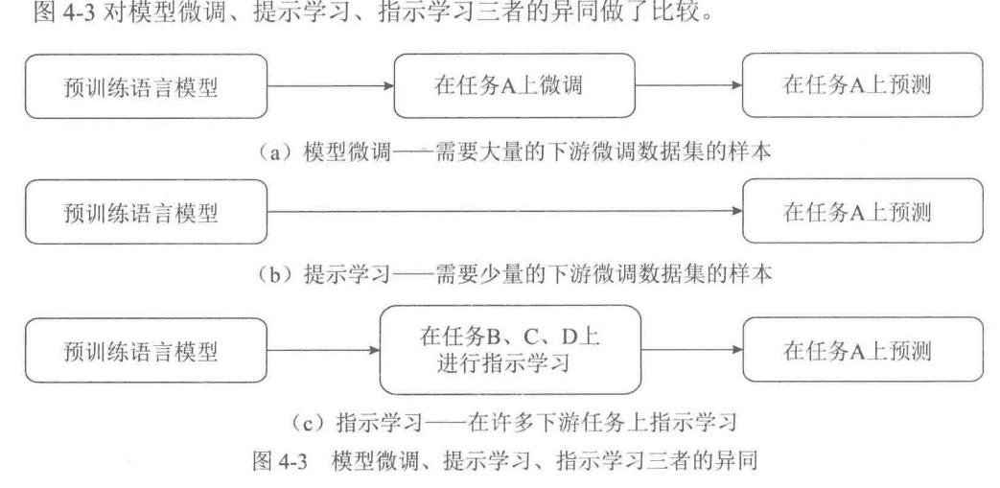

## 4.15 人类反馈强化学习（RLHF）
人类反馈强化学习将强化学习与人类反馈结合，智能体除从环境获得奖励外，还能接收人类专家的反馈来指导行为。其基本原理可参看图 4-4。


该思路可追溯至谷歌 2017 年的《利用人类偏好的深度强化学习》，通过人工标注偏好提升了模拟机器人与雅达利游戏的性能。现实任务往往过于复杂或存在风险，智能体难以单靠环境探索，引入专家知识可提高学习效率与效果。人类反馈形式多样，包括对动作的评价、示范行为、状态动作映射等，智能体可将这些信息与环境奖励融合以学习更优策略，并在交互过程中逐步降低对人类反馈的依赖。主要技术包括人类反馈的采集与整合、表示与处理、整合方式、利用方式以及自适应人类反馈，可组合形成不同算法。AlphaGo Zero 是典型案例，它利用围棋高手棋谱初始化，并通过人类对对弈表现的评估获得指导性反馈，从而实现自我提升。RLHF 除围棋外，还广泛应用于游戏、机器人控制和自然语言处理等领域。

## 4.16 多模态
多模态指多种感官式的输入与输出。人类感知依赖多通道，计算机科学中多模态指处理图像、音频、视频、文本等异构数据并进行交互。以虚拟现实为例，系统可同时输出视觉、听觉与触觉信息。多模态技术融合不同感官数据，能更全面地刻画现实，提升图像识别准确率，并让语音、图像、手势等多通道交互更自然。业界普遍认为深度学习的未来在于多模态，多模态情感分析、机器翻译和交互等已成为热点。ChatGPT 作为纯文本机器人，仅能理解和生成文本，尚不支持语音、图像、视频等输入，不属于多模态产品。GPT-4.0 已扩展为多模态能力，当前可接受文字和图片输入。将视觉与文本融合为统一表征难度极高，现有多项技术可把自然语言转为图像、语音、手势，结合后可实现多模态交互，模型也可通过学习多模态数据提升处理能力。

## 4.17 生成式对抗网络
生成式对抗网络由伊恩·古德费洛等人在 2014 年提出，由生成器与判别器两大网络构成。生成器以随机噪声为输入生成逼真样本，判别器负责区分样本来自真实数据还是生成器。两者形成对抗博弈，生成器追求更逼真，判别器追求更精准。

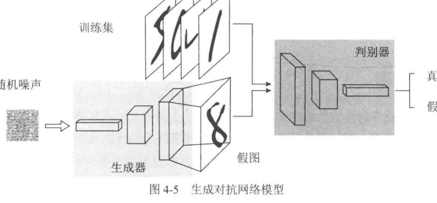
训练过程大致如下：生成器先随机生成噪声并产出样本批；判别器将该批样本与真实数据混合并给出真假判断；生成器依据判别结果更新参数以提升逼真度；判别器依据新样本更新参数以提高区分力；循环往复直至样本质量足够或达到预设迭代次数。GAN 已在图像生成、语音合成、自然语言处理等领域取得成果，但训练不稳定、参数敏感，容易出现模式崩溃等难题。

## 4.18 知识图谱和实体链接
知识图谱与实体链接都是自然语言理解的重要工具。知识图谱以图形化方式组织实体、关系与属性，形成以实体为中心的网络，常基于 RDF 三元组〈主体，谓词，客体〉构建，如“北京是中国的首都”可表示为〈北京，是，中国的首都〉。实体链接则是把文本中提及的实体关联到知识图谱中的对应条目，实现语义理解与知识检索。例如“约翰·史密斯在哈佛大学获得博士学位”中，“约翰·史密斯”与“哈佛大学”需分别链接到图谱中的对应实体。实现通常先做命名实体识别再与图谱匹配，有助于模型建立文本与外部知识的联系，从而提升准确率。

## 4.19 GPU、TPU 与模型训练

### 4.19.1 GPU
训练类 ChatGPT 的大模型对算力要求极高，GPU 常被用来加速。选型上显存容量是关键，英伟达的 GeForce 与 Tesla 系列是主流选择。配合 PyTorch、TensorFlow 等框架可发挥并行计算优势。大模型训练常采用数据并行，将参数分片到多张卡上计算后聚合更新。进一步可采用分布式训练把模型与数据分散到多卡或多机上以缩短时长。优化手段包括使用半精度 FP16 计算与数据流水线降低延迟，训练时可用 nvidia-smi、TensorBoard 等工具监控资源与性能。英伟达目前占据主导，英特尔、AMD 在 GPU 市场亦有布局，高通、Arm 等在移动与嵌入式场景具备优势。

### 4.19.2 GPU 产品
英伟达 GeForce RTX 3090 为顶级消费级卡，集成 10496 个 CUDA 核心和 328 个纹理单元，配备 24GB GDDR6X 显存，显存带宽达 936 GB/s，适合高性能计算、深度学习与游戏。英伟达 Quadro RTX 8000 为专业级卡，搭载 4608 个 CUDA 核心和 576 个张量核心，显存 48GB GDDR6，支持 4K 与 8K 分辨率，面向科学计算、机器学习与专业图形工作负载。

NVIDIA A100 Tensor Core GPU 是英伟达为数据中心量身打造的加速芯片，板上集成 6912 个 CUDA 核心和 432 个张量核心，配备 40GB HBM2 显存，重点面向数据中心里的 AI 训练与推理工作负载。

NVIDIA Tesla V100 定位于超算级别的加速卡，内置 5120 个 CUDA 核心和 640 个张量核心，显存规格提供 16GB 或 32GB HBM2 两种选择，兼具极高的算力与能效比，广泛应用于高性能计算和深度学习等领域。图 4-6 是 Tesla V100 的照片。

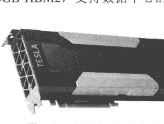

图 4-6 NVIDIA Tesla V100

除了以上两款，英伟达的阵容里还有不少高性能选项，比如 GeForce GTX 1080 Ti、Quadro P5000、Tesla P100 等，它们的性能指标和适用场景各不相同，选型时要结合自身需求和预算来判断。

### 4.19.3 云 GPU
在本地自建算力之外，还能借助云端 GPU 资源来训练模型，常见流程如下：

（1）挑选云 GPU 平台：市面上供给方众多，如亚马逊 Web Services、微软 Azure、谷歌 Cloud Platform 等，可按需求和成本做出选择。
（2）创建云 GPU 实例：在所选平台上开设虚拟机，并指定 GPU 类型与配置。不同厂商的操作路径略有差异，需对照官方文档执行。
（3）环境配置：在云实例上部署所需软件栈，例如 Python、TensorFlow、PyTorch 等，按实际框架和需求完成配置。
（4）上传数据：将待训练的数据集传至云实例，可利用对象存储或 FTP 等方式完成迁移。
（5）启动训练：在实例上提交训练任务，设定相关参数与超参数，支持命令行或 Web 界面触发。
（6）监控与调试：借助平台提供的监控调试工具跟踪训练进程，并根据情况调整模型。
（7）导出成果：训练结束后把模型文件和结果下载到本地电脑或其他存储位置以便后续使用。

需要留意的是，云 GPU 通常按使用时长、显卡型号与配置计费，成本需提前测算。不同平台的功能与操作细节也有差异，具体以文档为准。

自购 GPU 与使用云 GPU 各有利弊。

自购 GPU 的优势在于：①独占可用，自己拥有的硬件随时可调度，不受资源竞争影响，性能更稳定可控；②数据更私密，敏感数据或算法无需上云，有助于保护隐私与知识产权；③成本可控，避免云厂商的计费波动，按需灵活配置。

自购的劣势在于：①投入门槛高，硬件采购、维护、电费、制冷等一次性与持续性支出较大；②利用率易偏低，业务波动时会出现闲置浪费；③扩展受限，扩容需要额外采购与部署时间。

云 GPU 的优势在于：①弹性伸缩，可随业务动态增减算力，避免空闲浪费；②经济灵活，多数厂商按用量计费，提供优惠与弹性方案；③运维减负，服务商提供技术支持与硬件维护，降低故障与安全风险。

云 GPU 的劣势在于：①稳定性受限，可能受网络带宽与其他用户竞争影响而波动；②隐私风险，敏感数据上云存在泄露隐患；③计费不透明，规则变化可能影响预算管理。

### 4.19.4 TPU
TPU 即 Tensor Processing Unit，是谷歌为深度学习专门设计的专用集成电路 ASIC，目的在于加速深度神经网络运算，由谷歌自主设计生产。图 4-7 是 TPU 3.0 的照片。


TPU 主要具备以下能力：

- 高效矩阵乘法加速：内部集成了大量矩阵乘法单元 MMU，能够快速完成卷积、全连接等算子。
- 大规模并行：计算核心可进行大规模并行，支持多路输入输出，提升模型训练效率。
- 高速缓存与存储：内置多级高速缓存与本地 Scratchpad Memory，同时提供高速全局 Device Memory，优化数据访问与传输。
- 网络互连：片内处理单元通过网络互联实现高效通信，并支持多颗 TPU 互联以开展分布式训练。
- 强劲算力：可实现大规模并行计算，峰值算力可达百 Petaflops 级别，适合训练超大规模模型。

与通用 GPU 相比，TPU 的特点在于：

面向特定任务：GPU 属于通用加速器，TPU 则专为深度学习优化，在大模型训练推理上速度更快。
计算效率更高：TPU 采用更快的流水线设计和更多乘加单元，GPU 因需兼顾通用计算而效率相对较低。
功耗更低：TPU 以能效为目标设计，功耗通常低于执行同类任务的 GPU。
适用范围更窄：TPU 主要服务深度学习训练推理，在其他计算类型上表现不如 GPU 通用。

### 4.19.5 OpenAI 的使用
OpenAI 在开展深度学习与自然语言处理研究时，同时采用自建集群与云端资源。

自建 GPU 集群：OpenAI 在自有数据中心部署了规模庞大的 GPU 集群，集成数千块 NVIDIA 显卡与定制硬件，用于内部的深度学习、强化学习、自然语言处理等研究。

云 GPU 补充：在需要额外算力时，OpenAI 也会调用亚马逊 Web Services、微软 Azure 等云服务商的 GPU 实例，实现快速扩容部署。

在 GPT 系列训练中，早期主要使用 NVIDIA V100 GPU。后续训练尝试了谷歌 TPUv3 硬件，据官方博客披露，使用 TPUv3 训练 GPT-3 175B 模型时，训练速度较 V100 快十倍以上，成本也进一步下降。因此 OpenAI 的 GPT 训练同时涉及 GPU 与 TPU。

# 第5章 ChatGPT介绍
GPT 模型的训练基于 Transformer 的自注意力机制，通过无监督方式在大规模语料上学习，形成可理解和生成自然语言的通用模型。OpenAI 至今发布了四个版本：GPT-1 于 2018 年推出，采用 12 层、117M 参数的 Transformer；GPT-2 于 2019 年推出，采用 24 层、1.5B 参数；GPT-3 于 2020 年推出，参数达 175B，是当时规模最大的语言模型之一；GPT-4 于 2023 年 3 月发布。

ChatGPT 是基于 GPT 模型构建的应用，可实现自然语言对话，模拟人类交流，可用于客服机器人、智能助手、语音助手等多类场景。

ChatGPT 已在多项专业级测试中表现突出：通过谷歌 L3 级编码工程师入门测试；以 B 和 C+ 分别通过宾夕法尼亚大学沃顿商学院 MBA 期末考和明尼苏达大学四门研究生课程考试；通过美国医师资格考试。业界将其诞生形容为人工智能时代的“iPhone 时刻”，标志着 AI 进入革命性转折。

ChatGPT 典型体现了数据、模型与算力的结合：训练使用了约 45TB 数据，约合 1 万亿个单词，相当于 1351 万本《牛津词典》；算力消耗约 3640 petaflop/s-day。GPT-3 前身模型参数高达 1750 亿，若全部打印成 A4 纸叠放，高度将超过上海中心大厦 632 米。

ChatGPT 标志着新一轮技术革命加速，与蒸汽机、发电机相似，AI 正成为推动第四次工业革命、引领智能时代的核心力量。

## 5.1 ChatGPT 的主要功能
ChatGPT 作为大型语言模型，可支持多类自然语言处理任务：

- 问答：回答常识、学术、生活等各类问题。
- 对话：进行自然语言聊天、闲聊或娱乐互动。
- 文本生成：撰写新闻、故事、诗歌等多种文本形式。
- 文本摘要：对长文提炼核心要点，概括准确简洁。
- 语言翻译：实现多种语言间的互译。
- 文本分类：识别文本类别，如新闻分类、情感分类等。
- 命名实体识别：抽取人名、地名、机构名等实体。
- 句法分析：解析句子结构与成分关系。

这些能力源于海量训练数据和深度学习算法，可为用户提供高效精准的服务。

## 5.2 ChatGPT 的开发历史
ChatGPT 的技术脉络可追溯至 2015 年谷歌提出的 Seq2Seq 模型，将编码器与解码器结合，在机器翻译、问答、对话等任务上取得进展。

2017 年谷歌发布 Transformer，基于纯自注意力机制，训练并行度与效率显著提升。

2018 年 OpenAI 发布 GPT-1，首个基于 Transformer 的大规模单向语言模型，通过预训练加微调在文本分类、生成、问答等任务上取得突破。

2019 年 OpenAI 发布 GPT-2，模型规模更大，具备自动摘要、机器翻译、对话生成等能力，生成文本逼近人类水平，也引发虚假信息担忧。OpenAI 公开代码但未完全开源预训练模型。

2020 年 OpenAI 发布 GPT-3，拥有 1750 亿参数，在文本生成、对话、翻译、理解与问答等场景达到当时最优水平。

2022 年 11 月，ChatGPT 正式推出，采用基于 GPT-3.5 架构的大型模型并以强化学习训练，用于探索自然语言交互潜力并提升用户体验，可通过 API 集成到其他应用。

## 5.3 ChatGPT 的开发目标
ChatGPT 的目标是构建基于大规模预训练语言模型的通用人工智能系统，实现自然语言理解与生成。

主要方向包括：构建大规模预训练语言模型，基于 Transformer 架构用海量语料提升语言能力；实现通用自然语言处理能力，覆盖文本分类、命名实体识别、语义分析、机器翻译、对话生成等任务；提升可解释性与可控性，提供调节输出风格与控制生成内容的方式，增强透明度与可靠性；探索 AI 与人类交互新方式，支持自然对话并可通过 API 嵌入第三方应用。

未来发展方向包括模型规模进一步扩大以增强能力；改进训练方法如强化学习以提升稳定性和表现；拓展应用场景至推荐、智能客服、智能合约等；实现更高可解释性和可控性；与其他技术如图像识别、语音识别融合，提供更全面的自然语言解决方案。

## 5.4 GPT 模型的演化
表 5-1 是 GPT-1 至 GPT-4 的参数对比。

表 5-1 GPT 不同版本参数对比

| 模型 | 发布时间 | 层数 | 头数 | 词向量长度 | 参数量（亿） | 预训练数据量 |
| :--- | :--- | :--- | :--- | :--- | :--- | :--- |
| GPT-1 | 2018年6月 | 12 | 12 | 768 | 1.17 | 约5GB |
| GPT-2 | 2019年2月 | 48 | — | 1600 | 15 | 40GB |
| GPT-3 | 2020年5月 | 96 | 96 | 12888 | 1750 | 45TB |
| GPT-4 | 2023年3月 | | | | | |

### 5.4.1 GPT-1
GPT-1 于 2018 年发布，是首个采用 Transformer 架构的大型单向语言模型，参数量 1.17 亿。通过在大规模语料上预训练学习自然语言表征，再经微调或少量标注数据即可执行下游自然语言处理任务，如文本分类、文本生成和问答系统等。

### 5.4.2 GPT-2
GPT-2 于 2019 年发布，提供 1.5 亿、7.5 亿和 15 亿参数三个版本。在大规模文本语料上进行自监督预训练，架构基于 Transformer 编码器，学习语法、语义与常识知识。

最大特点是能够生成高质量、流畅且富有创造性的自然语言文本，在对话、文章、新闻、故事生成等任务上表现突出，被视作自然语言处理的重要突破。

OpenAI 公开代码但未提供完整预训练模型，仅提供微调代码，使用需强大算力与显存。微调代码可在 OpenAI GitHub 仓库 https://github.com/openai/gpt-2-output-dataset 中找到，包含不同任务的微调脚本与数据集。

想拿到 GPT-2 的预训练代码，可以直接去 Hugging Face 的 GitHub 仓库查阅：https://github.com/huggingface/transformers 。该组织汇聚了众多自然语言处理模型的实现和现成权重，GPT-2 也在其列，开发者能够方便地调用、调试。

需要提醒的是，自行训练 GPT-2 对算力和数据量的需求极高，普通电脑几乎无法胜任。若要使用 GPT-2，务实的做法是直接采用已训练好的权重，或放到云端算力上运行。

### 5.4.3 GPT-3 概览
GPT-3 即 Generative Pre-trained Transformer 3，于 2020 年推出，参数规模达 1750 亿。该模型先在海量文本语料上做自监督预训练，再借助微调或少量标注数据即可迁移到文本分类、命名实体识别、机器翻译、文本生成等下游任务。

它最突出的特点是能产出高质量、通顺且富有创造性的自然语言，并可处理翻译、问答、摘要、对话等多种任务。实测表现不亚于甚至优于人类，成为自然语言处理的重要里程碑，也极大推动了生成技术的发展，引发学界与产业的广泛关注。

目前 GPT-3 的完整开源代码并未公开。OpenAI 仅通过 API 提供使用权限，需申请并付费，同时附带示例代码和文档帮助接入。若想深入理解其原理，可参考官方网站的说明与 API 参考，或在 arXiv 查阅论文 https://arxiv.org/abs/2005.14165 。Hugging Face 等社区也有不少技术解读和示例。

### 5.4.4 GPT-3.5 对比要点
GPT-3 与 GPT-3.5 均出自 OpenAI，都是当时领先的大语言模型，二者存在明显差异。

- 模型规模：GPT-3.5 体量大于 GPT-3。
- 训练语料：GPT-3.5 使用的语料更多，涵盖新闻、百科、论坛等来源的网络文本。
- 任务表现：在翻译、摘要、问答等任务上，GPT-3.5 优于 GPT-3；其余任务上两者差距不大。
- 可解释性：GPT-3.5 在一定程度上更容易解释，能依据学到的知识生成逻辑更清晰的答案。
- 应用范围：因规模更大，GPT-3.5 可覆盖更广的场景，如自然语言生成、自动翻译、对话系统等。

### 5.4.5 GPT-4 多模态升级
2023 年 3 月 14 日美国时间，OpenAI 正式发布大型多模态模型 GPT-4。与 ChatGPT 所用模型相比，GPT-4 具备图像理解能力，回复准确度提升，文本输入上限提高到 3.2 万 token，约相当于 2.4 万词，支持长文本创作、长对话延续、文档检索分析等用途。

改进是渐进式的。日常闲聊中两者差异不明显，但任务复杂度升高后差距显现：GPT-4 更可靠、更有创意，能更好地理解细微指令并更准确地解题。

测试显示，GPT-4 SAT 成绩比前代提升约 150 分，可达 1600 分中的 1410 分；模拟律师考试成绩进入应试者前 10%，而 GPT-3.5 成绩在后 10% 左右。

非英语能力也大幅增强。为初步评估，OpenAI 用 Azure Translate 将涵盖 57 个主题的 1.4 万余道 MMLU 多选题翻译成多种语言进行测试。在 26 种测试语言里，有 24 种 GPT-4 胜过 GPT-3.5 以及其他大模型的英语表现。其中中文准确率达 80.1%，而 GPT-3.5 英语准确率为 70.1%，意味着本次测试中 GPT-4 的中文理解已超越此前 ChatGPT 的英文水平。

图 5-1 展示了 GPT-4 多模态应用案例，输入文字与图片后输出文字，模型成功识别出图片中原料名称。

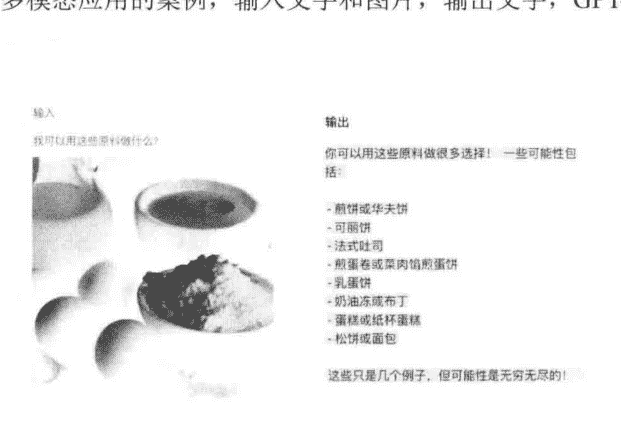

## 5.5 从 GPT-3 到 ChatGPT 的进化路径
从 GPT-3 演化到 ChatGPT 经历了多轮模型迭代，最终形成面向终端用户的网页版 ChatGPT，以及供开发者通过 API 调用的 text-davinci-002。图 5-2 呈现了各模型之间的演化关系。

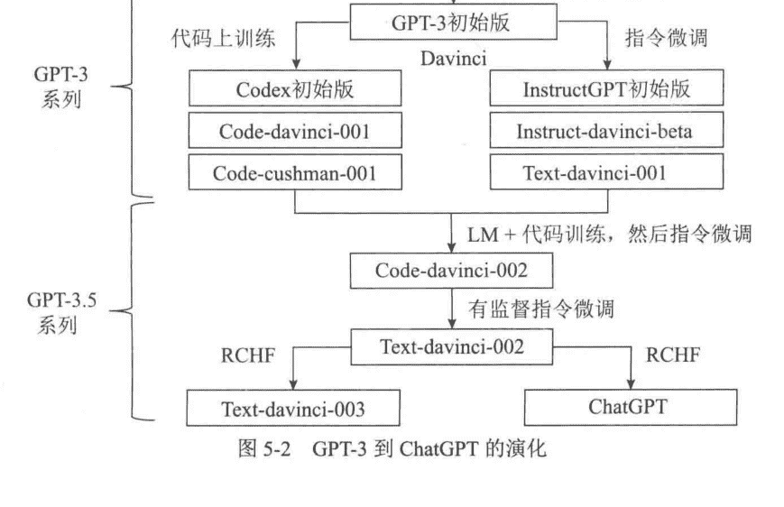

模型演化大致如下：

（1）davinci
该模型基于 2020 年 5 月发布的 GPT-3 论文开发，名称源自文艺复兴全才达·芬奇。参数 1750 亿，可完成问答、摘要、对话等多种任务，也是 OpenAI API 中定价最高的模型，单次请求约 0.06 美元。

arXiv 上论文《Language Models are Few-Shot Learners》由 OpenAI 研究人员撰写，证明了 GPT-3 在无需梯度更新或微调的情况下，仅凭文本描述任务和少量示例，就能在多项 NLP 任务和基准上取得高分。论文同时分析了不同领域与难度下表现，并指出其局限与挑战。

（2）Code-cushman-001
2021 年 7 月 Codex 论文发布，初始 Codex 基于可能为内部的 120 亿参数 GPT-3 变体微调而来，后续该 120 亿参数模型演进为 API 中的 Code-cushman-001。

（3）Davinci-instruct-beta、Text-davinci-001
2022 年 3 月 OpenAI 发布指令微调论文，其监督微调部分对应 Davinci-instruct-beta 与 Text-davinci-001。

（4）Code-davinci-002
Code-davinci-002 是面向纯代码完成的基座模型，上下文学习能力更强。不少研究报道其在基准测试上表现最佳，但输出未必完全符合人类预期。对其进行指令微调后，模型能产生更贴合人类期望的反馈，例如零样本问答、生成安全公正的对话回复、在超出知识范围时拒绝回答。

（5）Text-davinci-002
2022 年 5 至 6 月发布的 Text-davinci-002 是基于 Code-davinci-002 的 InstructGPT 模型，经过监督指令微调。它在人工标注的指令-期望输出数据以及人工挑选的模型输出上进行训练。

在零样本情形下，Text-davinci-002 完成任务的效果更好，也更符合人类期待，因为撰写上下文示例成本较高。OpenAI 认为上下文学习能力下降并非刻意为之，而是指令学习带来的副作用，被称为对齐税。

（6）Text-davinci-003
Text-davinci-003 是 Text-davinci-002 的改进版，采用 PPO 训练的 InstructGPT 变体，于 2022 年 11 月发布，属于基于人类反馈强化学习的指令微调模型。它在微调时混入了语言建模，恢复了部分在 Text-davinci-002 中丢失的上下文学习能力，同时借助 RLHF 进一步提升零样本能力，整体更擅长上下文学习。

（7）ChatGPT
同样于 2022 年 11 月发布，采用 RLHF 的指令微调模型，ChatGPT 几乎牺牲了所有上下文学习能力以换取对话历史建模能力，对话表现更强。

引入人工标注后，ChatGPT 的价值观、正确性以及人类行为模式的真实感大幅提升。相比 GPT-3，ChatGPT 更真实，因为在 GPT-3 基础上通过不同标注员编写提示和排序生成结果进行微调，奖励模型对更真实数据给予更高奖励。

在无害性方面，ChatGPT 相比 GPT-3 有小幅提升，但歧视、偏见等维度未见明显改善，因 GPT-3 本身产生有害样本的概率已很低，40 名标注员采集的数据难以充分优化这些方面。

编码能力也很强，一方面 GPT-3 本身编码能力突出，API 累积了大量代码；另一方面 OpenAI 内部员工参与数据采集，叠加大量代码数据与人工标注，使 ChatGPT 编码能力显著增强。

模型 Text-davinci-001、Text-davinci-002、Text-curie-001、Text-babbage-001 均为使用 FeedME 训练的 InstructGPT 变体。

## 5.6 davinci-002 的三大突破
Code-davinci-002 与 Text-davinci-002 是首批 GPT3.5 模型，分别面向代码和文本，相比初代 GPT-3 展现出三种关键能力。

响应人类指令：以往 GPT-3 输出多为训练集中常见句式，现在模型会针对提示词生成更合理的答案，而非相关但无用的句子。

泛化到未见任务：当用于调整模型的指令数量达到一定规模时，模型能在从未见过的新指令上自动给出有效回答，这对上线部署至关重要，因为用户问题总在变化。

代码生成与理解：模型经过大量代码训练，代码生成与理解能力显著提升。

利用思维链进行复杂推理：初代 GPT-3 的思维链推理能力较弱，Code-davinci-002 与 Text-davinci-002 具备足够强的思维链推理能力，而思维链被认为是解锁涌现能力、突破缩放定律的关键。

## 5.7 ChatGPT 内部模型协同
ChatGPT 核心是 GPT 模型，除此之外还使用 Codex 模型。该模型基于 Transformer，能将自然语言描述的任务转化为程序代码并生成实现，训练数据包含大量开源代码，支持多种语言生成。

另有专用模型处理特定任务，例如命名实体识别使用 BERT 识别文本中的实体名称。总体上 ChatGPT 通过多种预训练模型的组合与微调完成不同 NLP 任务。

不同模型承担不同职责。GPT 用于自然语言生成，如对话与摘要；用户交互时 GPT 生成回复。Codex 用于代码自动补全与生成，用户输入代码片段时，Codex 预测后续代码，提供补全建议。两者协同使 ChatGPT 同时支持自然语言生成与代码编排功能。

## 5.8 ChatGPT 三阶段训练
ChatGPT 训练分为三个主要阶段：无监督预训练、有监督精调、强化学习微调。

### 5.8.1 预训练阶段
预训练语料来自维基百科、新闻、书籍等多个领域的文本。训练前需预处理与清洗，如分词、停用词去除、词干提取等以缩小输入空间，再输入模型进行自回归语言模型训练。

具体而言，模型输入一段文本序列，例如“我爱你”，预测下一个词如“真的”，随后把预测词加入序列形成“我爱你真的”，继续预测，直至出现结束符如“。”“？”等，表示句子结束。这种输出反馈给下一时刻输入的方式即自回归。

ChatGPT 无监督训练流程包括数据准备、模型架构与预训练三部分。

数据准备阶段从互联网收集大量文本，如维基百科、新闻、社交媒体评论，经分词、停用词去除及多语言对应处理后用于训练。

模型架构采用 Transformer，基于自注意力机制的序列到序列结构，能捕捉输入序列各位置依赖，相比传统 RNN 训练更快、效果更好。

无监督预训练分为掩码语言模型 MLM 与下一句预测 NSP。

MLM 阶段随机遮盖输入文本中部分单词，模型需预测被遮盖词，例如“the cat sat on the [MASK]”中应填“mat”。目标是学会补全缺失信息，更好理解语义。

NSP 阶段判断两个句子是否连续，即第二个句子是否紧随第一个之后，目的是让模型理解句子间关系，为后续生成做准备。

### 5.8.2 有监督精调阶段
在预训练模型基础上，使用标注数据再次训练，使其更好地适配特定任务。具体步骤包括数据准备、特征提取、模型构建、模型评估与模型测试。

准备标注数据集并划分为训练集、验证集、测试集。对文本分类等任务需将原始文本转为固定长度特征向量，常采用词袋、词向量等方法提取特征。

根据任务与数据选择合适的架构与超参数，在训练集上训练，使用验证集评估并调整参数，最后用测试集检验实际性能。

预训练模型作为初始权重，结合标注数据进行训练，常使用随机梯度下降等优化算法更新参数以最小化损失。有监督精调可用于文本分类、命名实体识别、关系抽取、情感分析等任务，提升模型在实际场景中的表现。

### 5.8.3 强化学习微调阶段
该阶段使用 PPO 算法对已做监督精调的模型继续微调。随机采样人工提示语，用 PPO 训练模型，并依据奖励模型给出的信号调整参数，目标是进一步提升自然语言生成能力与多场景适应性。主要通过三步实现。

首先，用广泛分布的互联网数据对 GPT-3 进行预训练，再针对一组人工提示语，由标注员撰写正确答案作为监督数据进行精调。

其次，随机挑选一组人工提示语，用模型为每个提示生成多个答案，由标注员排序，并据此训练奖励模型。该奖励模型训练数据包含 33 207 条提示语及由此产生的约十倍答案。

（3）在监督微调的基础上，再次抽取一批人工编写的提示语，用 PPO 强化学习算法对模型做二次精调。每条抽到的提示都会送入 PPO 模型，由奖励模型打分的奖励信号来指导学习，训练所用提示总量为 31144 条。

## 5.9 预训练数据从哪来

ChatGPT 的预训练语料以英文维基百科为主。OpenAI 选用了 WebText 这一集合，内容来自英文维基百科文章，规模超过 8 万个网页，总文本量约 40GB，用来训出 GPT-2、GPT-3 这类大模型。

除维基外，还引入了 BookCorpus、Common Crawl 等公开网络文本。来源公开意味着噪声大，同时混有仇恨、色情等有害内容，训练前会做多轮过滤处理。

中文侧的语料同样多元：中文维基百科提供全主题百科文本；搜狗语料库涵盖新闻、问答、博客等清洗标注后的数据；百度百科、百度知道贡献大量知识问答；语言资源联盟 CLARIN 提供书籍、报纸、杂志、科技论文等；中文维基百科 dump 是全站备份；再加上新浪、腾讯等门户以及知乎、微博等社交平台的公开内容。

## 5.10 训练数据全景

ChatGPT 的训练采用人类反馈强化学习 RLHF，思路与 InstructGPT 接近，但采集方式有差异。先用监督微调训出初始版，让 AI 训练师同时扮演用户和助手，并借助模型给出的草稿帮助写答案。新对话集与 InstructGPT 数据混合并转为对话格式。为建奖励模型，需要可比较的数据，即多条模型回复按质量排序。采集时让训练师与聊天机器人对话，随机抽取模型的历史消息并采样新回复，由人工排优。最后以奖励模型为依据，用 PPO 反复微调。

整体仍基于 GPT-3 网络结构，先用指令学习构造样本训练奖励模型 RM，再以 RM 分数引导强化学习。三步循环优化：

- （1）拿采集的 SFT 数据对 GPT-3 做监督微调。
- （2）收集人工标注的对比数据，训练奖励模型。
- （3）把 RM 作为强化学习的优化目标，用 PPO 对 SFT 模型进行微调。

### 5.10.1 SFT 数据长什么样

SFT 数据用于第一步监督微调，形式是提示-回复对。一部分来自 OpenAI Playground 的真实用户，另一部分由 OpenAI 雇佣并培训的标注员产出。标注员需要写指令并满足三类要求：

- （1）简单任务：提出任意简单指令，保证多样性。
- （2）少样本任务：给出指令并附带多个查询-响应示例。
- （3）用户相关：从接口案例出发，让标注员据此撰写指令。

### 5.10.2 奖励模型的数据

RM 数据用于第二步训练奖励模型。奖励目标不必可微分，但要全面真实地对齐生成内容偏好。可通过人工打分让涉及偏见的输出获得更低分数，从而抑制此类生成。做法是先让模型生成候选文本，再由标注员按质量排序。

### 5.10.3 PPO 数据构成

InstructGPT 的 PPO 数据未人工标注，全部来自 GPT-3 API 的真实用户请求。任务类型以生成类为主 45.6%，其次是问答 12.4%、头脑风暴 11.2%、对话 8.4% 等。

## 5.11 标注工作的里子

ChatGPT 在海量预训练之上叠加“人工标注+强化学习”，核心是提升模型对人类指令的理解与执行准确度。为保证安全，OpenAI 还单独训练了一个有害内容检测器，覆盖暴力、仇恨、性虐等类目，嵌入模型前端做拦截。

数据标注是对样本做标记以供模型学习的准备工序，人工需按任务需求做分类、实体识别、语义分析等。好的标注能提供标准化高质量训练集，帮助模型把握特定语境。对 ChatGPT 这种语言模型而言，若没有人工清洗不当内容，很容易输出错误信息。流程包括采集、清洗、标注、质检。


第二阶段监督精调所用的手动标注数据即 SFT 数据。据《时代》报道，为训练 ChatGPT，OpenAI 大量招募标注员，甚至投入博士级别专业人才。《时代》查阅的文件显示，2021 年底 OpenAI 与 Sama 签约三份合同总价约 20 万美元，负责有害内容标记。自 2021 年 11 月起，数万条文本片段被发给 Sama，多为互联网最阴暗角落的自杀、酷刑等内容。

Sama 总部在旧金山，员工来自肯尼亚、乌干达、印度。约 30 人分三组作业。每名员工 9 小时内需阅读标注 150 至 200 段，段落长 100 到 1000 多词，按此算每小时最多处理超 2 万词。

OpenAI 公开信息称，ChatGPT 源自 GPT3.5 系列微调。早期预训练为减少对高质量标注的依赖，ChatGPT 则在 GPT-3.5 大模型基础上重新依托大量人工标注，才能更懂指令、输出更准更“像人”。

标注也受限：成本高、人力投入大；标注员主观性会影响结果，需要质检审核；质量、效率与成本需平衡。

## 5.12 RLHF 的实际用法

第三阶段用 PPO 做强化学习微调，RLHF 可看作额外奖励信号。自然语言任务中融入人类反馈是难题，RLHF 以增强学习框架让模型在交互中自我改进。模型输出后连同上下文展示给人工操作员，若不满意可给出更好回复或改进意见，这些反馈作为奖励训练模型。

微调时数据分布不均易导致过拟合或欠拟合，RLHF 能在训练中动态调整学习率，提升稳定性和收敛速度。PPO 结合 RLHF 的奖励信号更新策略，可更快学到更好策略，也可与其它强化学习算法配合使用。

好处在于持续从人类反馈学习、迁移到新任务、提升可解释性。

大致工作流：

- （1）确定改进方向和对话场景，设计问答、闲聊、推荐等任务。
- （2）把任务映射为强化学习环境，包含状态、动作、奖励。
- （3）为每个环境设计对话代理，用现有 ChatGPT 生成初始回复，代理与用户交互获取基于质量、满意度、任务完成度的奖励。
- （4）多轮对话直至完成或超时。
- （5）收集数据后以梯度法或微调更新模型。
- （6）再测再收反馈迭代。

RLHF 带来的能力：

- （1）回复偏长，需用户主动要求精简。
- （2）对涉及多方利益的事件给出平衡表述。
- （3）拒绝不当问题，与内容过滤器协同。
- （4）拒绝超出知识范围的问题，如 2021 年 6 月后事件，模型能隐式判断边界。

## 5.3 算力与参数体量

训练需要海量计算和超参调优。OpenAI 自有集群配合谷歌云、微软 Azure 等云资源。

以 GPT-3 为例，1750 亿参数，用 2850 块 V100 GPU 与 355 块 TPU v3 训练，采用高度并行框架和分布式梯度更新等优化。

参数构成：48 层 Transformer 编码器与 48 层解码器，每层 3072 隐藏单元、12 个注意力头，共 96 层。2048 个 Embedding 矩阵对不同 token 编码，数百亿权重由海量语料反向传播得到。

关键指标：模型规模 1750 亿，是 GPT-2 的 13 倍；层数 96 层 vs GPT-2 的 48 层；注意力头总数 1536 vs 768；每层隐层节点 12288 vs 2048；批次大小 2048 vs 512；学习率 0.0001 vs 0.00025。

## 5.14 ChatGPT 的明显短板

- （1）事实性错误。基于机器学习的模型会胡说八道，尤其在缺乏语料的领域缺乏常识。RL 训练缺乏事实来源，模型可能变得过度谨慎而拒绝可答问题，监督训练也可能误导。
- （2）提示敏感。措辞微调会改变回答，甚至从不知变正确。
- （3）缺少情感共情。对情感语境理解有限。
- （4）新话题覆盖不足。训练数据缺失则细节匮乏，专业领域如金融、医学需要充足语料。无法在线吸收新知识，重训成本高，在线增训又易灾难性遗忘。
- （5）偏见风险。训练数据局限会导致歧视性输出。
- （6）高级语言技能不足。难做深入文献分析或专业领域输出。
- （7）表达冗长且套话多。常重复“我是 OpenAI 训练的语言模型”，源于训练偏好长答案和过拟合。
- （8）不会主动澄清。对模糊查询常直接猜测，而非提问求证。

# 第6章 GPT-3.5引擎介绍

## 6.1 GPT-3 引擎

OpenAI 打造的 GPT-3，被业界视作当时 NLP 领域的一座里程碑。作为 GPT 家族的第三代产品，它在体量、训练素材和推理表现上都较前辈实现质的飞跃。

模型参数规模达 1750 亿个，是 GPT-2 的 117 倍。训练语料超过 45TB，涵盖网络文本、书籍、新闻等多种来源。模型引入了零样本学习，能够在不额外训练的情况下完成部分 NLP 任务。

预测能力十分强劲，可胜任自然语言生成、文本分类、问答、摘要、翻译、语言推理等工作，在不少常见任务上已逼近或超越人类水准。

它接收自然语言输入，输出连贯且逻辑自洽的文本，可自动修正语法、拼写和标点错误，也能自动完成摘要、答疑等操作，因而适用于对话系统、自动写作、智能客服等多个场景。

零样本学习是其标志性能力，无需针对特定任务进行训练即可从人类给出的提示中推断正确答案，例如直接回答电影相关问题。这一特性让 GPT-3 在通向通用人工智能的讨论中备受关注。

底层采用 Transformer 架构，基于自注意力机制构建。通过无监督预训练，模型学习了语法、句法、语义与语用等大量语言知识，语料包括维基百科条目、新闻文章、小说等。

目前它已成为 NLP 领域的核心突破，广泛应用于智能客服、文本生成、机器翻译、摘要等实际场景。生成内容的可控性与一致性仍是待改进的方向。

模型可产出新闻报道、小说、诗歌、邮件、简历等多种文本，也能生成代码、数学公式、音乐、绘画等非文本内容。输出可通过调整输入提示来控制，如给出完整句子可续写下一个词，给出问题可生成对应答案。

局限在于生成文本可能出现不准确或不当内容，且输出难以解释；预训练对算力与数据需求极高，实际落地存在挑战。

官方提供 API，开发者可通过编程语言与模型交互，实现文本生成、情感分析、自然语言理解等功能，为各类应用提供 NLP 能力并简化开发流程。

## 6.2 GPT-3.5 引擎升级
GPT-3.5 由 OpenAI 于 2022 年 12 月发布，是在 GPT-3 基础上的改进版，使用了更多数据，包含维基百科条目、社交信息、新闻等，生成质量接近人类写作。GPT-3.5-Turbo 是其衍生模型，通过系统级优化提升速度与性能并降低价格，可通过 OpenAI 提供的 API 使用。

与 GPT-3 相比，GPT-3.5 的训练数据融合了代码与自然语言，使其在长距离推理等任务上更强。参数规模更大，仍保持自回归模型结构和下一个词预测目标。

## 6.3 ChatGPT 与 GPT-3 的定位差异
GPT-3 与 ChatGPT 均为 OpenAI 研发的大型语言模型。GPT-3 是第三代通用模型，ChatGPT 则是更小、更专为聊天应用设计的语言模型，基于 GPT-3 技术构建并针对会话语言进行微调，以应对上下文理解、意图识别和恰当回复等挑战。

与通用型 GPT-3 不同，ChatGPT 聚焦于自然且吸引人的对话体验。总体而言，二者在范围与目的上不同：GPT-3 是大型通用模型，可处理多种语言处理任务；ChatGPT 是为聊天场景量身定制的专用模型。

## 6.4 预训练机制
GPT-3 通过大规模文本预训练学习通用语言表征。具体采用 Transformer 架构，以无监督方式从海量语料中学习通用表征，便于后续微调或迁移学习。

预训练任务为语言建模，即根据前文预测下一个词或子词。模型通过迭代优化参数最大化建模目标，从而自动掌握语言统计规律与语义表征。

语料库涵盖 Web、新闻、维基百科等来源的数十亿词。为提升效果，模型使用了动态掩码、随机截断以及对抗训练等技术。预训练完成后可迁移至问答、文本生成、翻译等下游任务。

在下游任务中，例如文本分类可将模型接至全连接层；文本生成可给定起始标记后自动续写。为更好适配特定数据，通常需进行微调，即在任务数据上训练以最小化损失函数。

## 6.5 词嵌入的运用
在 GPT-3 体系中，词嵌入发挥了重要作用。训练时每个词被映射为连续的低维向量，向量不仅包含词义本身，还携带上下文与语法信息，使模型在生成、理解、情感分析等任务上表现更优。

模型还支持动态词嵌入，在生成过程中可实时调整词向量以适应当前任务需求，例如让生成文本更连贯自然。

GPT-3 并未直接使用 Word2Vec 或 GloVe，而是采用自有词嵌入方案，基于 Transformer 架构的语言模型进行无监督学习生成词向量。

Word2Vec 基于神经网络学习词向量，包含连续词袋 CBOW 与 Skip-gram 两种方式；GloVe 则基于全局词频与局部上下文信息构建向量。

与这些传统方法不同，GPT-3 的 Transformer 语言模型能处理更复杂的语言结构，并从大规模数据中学习更丰富的语言知识，具体通过基于 Transformer 的模型将词映射为连续低维向量，实现上下文与语法的融合。

## 6.6 多层 Transformer 架构
GPT-3 引擎采用多层 Transformer 模块实现自然语言处理，主要由输入嵌入层、多层 Transformer 编码器、残差连接、层归一化和输出层构成，可提取输入序列的丰富语义与上下文信息。

输入嵌入层将文本序列的每个词转为固定长度向量，即词嵌入，捕捉语义与语法信息。多层 Transformer 编码器由多头自注意力、前馈神经网络和残差连接组成，层层叠加提取更丰富表征。残差连接将层输出与其输入相加以保留信息。层归一化帮助缓解梯度消失与爆炸。输出层通常为全连接加 Softmax，将编码结果转为概率分布，用于分类、回归或生成。

该模块能提取深层语义与上下文，处理变长序列，通过层归一化提升泛化能力，并支持端到端学习，无需手工特征设计。

## 6.7 典型变体一览

### 6.7.1 Text-davinci-002
Text-davinci-002 在 GPT-3 基础上进行更深预训练，使用更大语料库并训练更久，生成与推理能力更强。

参数量 175B，是 GPT-3 中规模最大的之一。训练语料覆盖维基百科、新闻、电影脚本、小说等，训练周期达数月。在自然语言生成与理解、对话生成与知识推理方面表现突出。适用于语言模型、问答、机器翻译、文本摘要、对话生成等。由于能力强劲，使用时需遵守 OpenAI 使用政策与道德准则，并考虑算力与时间成本。

### 6.7.2 Code-davinci-002
Code-davinci-002 专为程序代码生成与理解优化，能根据输入代码与上下文生成符合语法语义的代码，适用于自动编码、补全、调试与重构。

参数量 175B。训练语料来自 GitHub、StackOverflow 等大量开源代码库与开发者论坛，经过长时间预训练与微调。在代码生成、自动补全、调试与重构上表现优异，适合程序员提升效率。生成代码仍需人工审查与测试以确保正确可靠，使用时需遵循相关政策。

### 6.7.3 Text-davinci-003
Text-davinci-003 是 OpenAI 推出的 GPT-3 变体，参数更多、预测性能更高，可处理文本生成、翻译、问答、摘要、命名实体识别等任务。

结构与 GPT-3 相似，基于 Transformer 并以大量语料训练，参数达 175B，在复杂任务上表现更佳。命名致敬达·芬奇，体现对语言艺术的追求。相比其他变体更接近人类表达，能在不同场景提供更准确、流畅、自然的生成与理解。代价是需要大量计算资源与存储，普通用户使用门槛高，企业级场景可获得高效准确的语言处理方案。

### 6.7.4 GPT-3.5-Turbo
GPT-3.5-Turbo 是 OpenAI 在 GPT-3 基础上优化的最新自然语言生成模型，提升了生成效率与质量，可用于聊天、写作、编程等场景。

Text-davinci-003 于 2022 年发布，主要用于聊天对话；GPT-3.5-Turbo 于 2023 年 3 月发布，系统优化带来明显提升。测试显示，Turbo 响应更快，每秒处理更多请求；输出更长，平均约 156 个词，约 208 个 token，而 Text-davinci-003 平均约 83 个词，约 111 个 token；内容更丰富，覆盖更多话题细节；质量更高，保持语境与逻辑一致，而 Text-davinci-003 偶有重复或不相关内容。

# 第7章 ChatGPT 实操指南

## 7.1 访问方式
使用 ChatGPT 可通过三种途径：访问 chat.openai.com 的网页聊天服务；通过新版必应网站集成聊天功能；使用 API 访问 ChatGPT 服务。

### 7.1.1 官网入口
chat.openai.com 是 OpenAI 推出的 AI 语言模型交互网站，为用户提供与自然语言处理模型互动的平台。

网站核心功能是展示 GPT 系列能力，用户在聊天框输入问题或任务，模型生成相应回答或方案，可完成常见问题答复、文本自动生成、编程辅助、模拟人类对话等任务。

平台还提供生成历史查看、模型调试工具以调整参数与输入、以及文本转语音播放等功能。

需注意该服务在线运行，用户输入会发送至 OpenAI 服务器处理，使用时应保护个人信息与隐私。基于机器学习的模型输出可能存在误差，使用时需谨慎评估。

图 7-1、图 7-2、图 7-3 是 chat.openai.com 的网页截图。


图 7-1 ChatGPT 登录网页

## 第 7 章 ChatGPT 使用指南

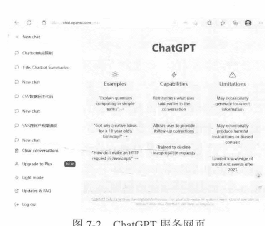

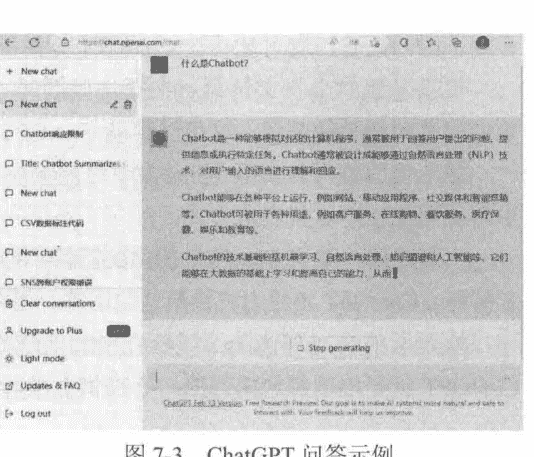

### 7.1.2 必应对话示例

图 7-4 呈现的是微软 Bing 在线的页面截屏。

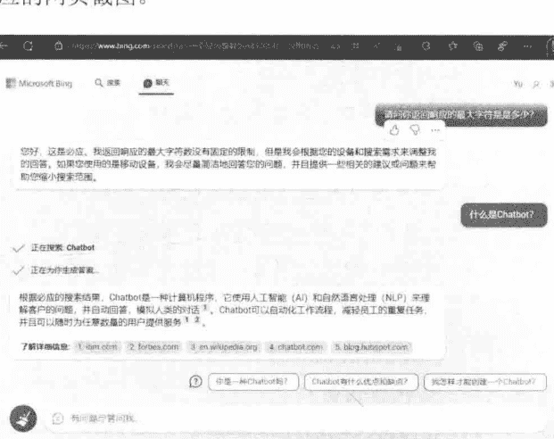

## 7.2 让提问更精准的方法

ChatGPT 借助自然语言处理来解析输入并作出回应。实际使用中，模型有时会理解偏差或给出不够准确的答案。这时可用更明确的措辞，或补充更多背景，帮助模型抓住真实意图。

为了用得更有效、拿到更准确的结果，可以注意以下几点建议：

表达务求简洁明了：用简短清晰的语言描述问题，避开复杂晦涩或模糊的说法，以免模型抓不住重点。

补充充分的背景信息：提问时提供主题、来龙去脉和相关细节，模型才能更全面地理解并给出更贴切的回答。

尽量避免缩写与俚语：缩写、网络用语或非规范表达容易造成理解障碍，尽量使用标准书面语。

持续追问深挖：如果首次回复不够完整或准确，不要犹豫继续追问以获取补充解释。模型通常需要更多信息才能提升回答质量。

核对拼写与语法：问题本身的拼写和语法要准确无误，输入越规范，理解的准确度越高。

### 7.2.1 运用开放式提问

开放式问题没有唯一标准答案，需要结合逻辑、经验与知识进行判断和推演；封闭式问题则有确定答案，只需依据事实或规则作答。

开放式问题一般具备以下特征：

- 答案不唯一：同一个问题可以有多种合理回应。
- 需要推断：缺乏标准解，往往要分析、推理才能得出结论。
- 带有主观色彩：不同立场和经验的人可能得出不同判断。
- 存在不确定性：由于没有唯一解，回答本身带有一定风险。

这类问题多见于人文、社会、经济、哲学、心理等领域，例如：“什么是幸福？”“人类社会未来会走向何方？”“对企业而言，员工忠诚度与业绩哪个更重要？”解答时需要综合分析并结合相关领域的知识经验。

**你对电动汽车对燃油汽车的替代怎么看？**

作为 AI，我认为电动汽车逐步取代燃油汽车已是大势所趋，交通电气化将不断加深。以下是我总结的利弊：

优势：
1. 绿色环保：相比燃油车，电动车零尾气排放，有助于降低污染与温室气体。
2. 能效更高：电驱动系统效率优于内燃机，能源利用更省。
3. 使用成本更低：电能费用普遍低于燃油，且电动车维护项目较少。
4. 驾驶更安静：没有发动机噪音，对城市声环境改善明显。
5. 技术在进步：续航和性能随研发不断提升。

劣势：
1. 续航受限：目前续航仍不及燃油车，充电需求提高长途便利性。
2. 充电网络不均：基础设施建设滞后，远途出行时找桩不便。
3. 购置价格偏高：整车成本与充电设施投入目前仍较大。

总体看，电动车发展动能强劲，随着技术成熟与政策推动，逐步成为主流交通方式是大概率事件。

**你为什么这么想呢？**

主要基于以下判断：

1. 环保与可持续意识抬头。公众对绿色出行的关注度上升，政府也密集出台环保政策。
2. 技术持续突破。电池续航、充电速度在提升，电驱系统能效优势明显，为普及奠定基础。
3. 充电配套逐步完善。各国加快布局充电站与充电桩，使用顾虑在降低。
4. 燃油车受限加码。排放法规收紧，燃油车市场空间被压缩，电动车更具前景。

综合来看，电动车替代燃油车是趋势。

### 7.2.2 设计挑战性问题

挑战性问题往往涉及争议、复杂、不确定或高度主观，需要多角度思考、创新判断与推理。提出这类问题能激发模型的高阶思维，促进更具创造性的解答。

**如果大家都不买电动汽车怎么办呢？**

若市场需求缺失，电动车就难以成为主流。可能原因包括：

1. 价格门槛高：购车成本与配套建设投入大，普通用户难以承受。
2. 续航与充电不便：里程焦虑和充电耗时影响长途使用体验。
3. 认知与习惯阻力：用户对新技术了解不足，仍固守燃油车使用习惯。

应对思路：
1. 政策扶持：降低购置与使用成本，加速充电网络建设。
2. 加大研发投入：提升续航与充电效率，摊薄制造成本。
3. 宣传与教育：提升公众认知，培养绿色出行习惯。

推动电动车普及需要政府、企业与社会协同发力。

### 7.2.3 进行递进式追问

在对电动车发展趋势作出判断后，进一步要求模型提供支撑证据，能调动其调用更多知识资源。

**你对电动汽车的发展趋势怎么看？**

我持乐观态度，主要看点有：

1. 技术不断升级：电池续航与充电速度持续提升，能效优势保持。
2. 政策支持强化：全球多地加强排放管控，对电动车购置使用给予优惠。
3. 充电设施完善：充电站与充电桩建设提速，使用便利度提高。
4. 消费者认知提升：环保意识增强，接受度与意愿度逐步提高。

总体而言，随着技术、政策、设施与认知四轮驱动，电动车有望成为未来主流。

**你能提供证据支持你的观点吗？**

可以，例如：

1. 技术升级：特斯拉 2020 年发布的 Model S Plaid 续航超过 600 英里，约 966 公里，较前代大幅提升。
2. 政策加码：欧盟 2020 年提出绿色新政，目标到 2030 年新车销售中电动车占比超 50%，多地提供补贴与免费停车等激励。
3. 设施建设：美国政府计划未来数年投入超 25 亿美元建设充电网络，特斯拉全球已部署数千个超充站。
4. 消费意愿：调查显示全球超 60% 的消费者愿意考虑购买电动车，其中超 70% 受访者把环保作为主要动机。

以上证据印证了技术、政策、设施与认知共同推动发展的结论。

## 7.3 高效提问实操

ChatGPT 理论上可完成从故事创作到文本分析等多种任务，因其能力面广，使用时必须把需求说清楚。良好的提示往往重在“展示”而非“讲述”。

创建提示的三个基本原则：①展示与说明结合。用示例或描述明确期望结果，例如要求按字母排序或按情绪分类时直接示范。②提供高质量样本。训练式提示需要足够且准确的样例，样例的拼写错误也可能被模型模仿。③学会与模型沟通。措辞敏感度高，微调表述常能得到截然不同的答案，若初始提示含糊，模型不会主动质疑。

提升表现的另一个手段是提示工程师。把大模型看作新型计算机，提示工程师相当于程序员，通过精细设计提示词释放模型潜能并固化优秀表现。

对话时以短句、断句和逻辑分段为主，有助模型捕捉意图。关键词后加标点如感叹号可强调重点。多语言场景下使用简洁准确的表达也很关键，需兼顾语言与文化差异。

加入关键词或感叹号可使回复更具体。以天气为例：

直接问：“今天天气怎么样？” 可能得到：“今天晴朗，最高 22 摄氏度。”
加关键词：“今天会下雨吗？” 可能得到：“今天不下雨，天晴。”
加感叹号：“今天天气真好啊！” 可能得到：“确实，今天很适合外出活动。”
换问法：“今天气温多少？” 可能得到：“最高温度 22 摄氏度。”

询问附近好玩地方的例子：

直接问：“附近有什么好玩的？” 可能得到：“附近有一家游乐园。”
加关键词：“附近有公园吗？” 可能得到：“有城市公园和自然公园等。”
加感叹号：“我想出去玩！有什么推荐？” 可能得到：“可以去博物馆、动物园、游乐场。”
换问法：“能推荐附近景点吗？” 可能得到：“历史博物馆和美术馆值得一看。”

进一步挖掘信息可尝试：

追问细节：对概括性回答提出具体问题，获取特色、价格、口味等信息。
表明目的：说明使用场景可让回答更贴合，例如明确是找电子产品购物中心。
提供上下文：补充需求条件，如健身房设施齐全且开放时间合适，可获得更精准建议。

## 7.4 对话会话机制

会话线程指用户与 ChatGPT 在一段时间内建立的交互上下文。同一线程内输入与输出相互关联，不同线程之间上下文不共享。

线程通常以独立进程处理交互，依据用户输入与历史记录生成回复，同时可处理身份验证、权限等任务。

为提高效率，系统多采用长连接，避免频繁重建连接。线程内复用上下文减少同步与竞争，提升性能。

同一线程提问的优势：

- 效率更高：上下文复用减少切换，提升响应速度。
- 使用更顺畅：无需反复登录或重建会话，体验连贯。
- 可靠性更强：同一上下文内处理多个请求，避免多线程带来的不一致。

总体可提供更高效、便捷、可靠的对话体验。

## 7.5 会话上下文

上下文是记录会话状态与历史的载体，通常保存用户输入、模型输出及相关元信息，如个人信息、会话开始时间、当前状态等。

上下文对问答系统至关重要，模型据此追溯历史生成当前回复。常见结构为字典式键值对。

典型字段包括：

- history：历史问答记录。
- user_info：姓名、性别、年龄等个人资料。
- session_id：会话唯一标识。
- status：进行中、已完成等状态。

上下文是动态更新的，会随对话不断演进。

## 7.6 重新生成回复

同一问题可得到不同答案。若不满意，可点击重新生成，每次输出会有所差异。

### 什么是人工智能？

人工智能是计算机科学分支，旨在构建能执行复杂任务的程序，涵盖语音识别、图像识别、自然语言处理、决策、规划、学习等。其目标是模拟人类智慧，使机器具备问题求解、自学习、自修正等能力，已广泛应用于语音、图像、机器人等领域。

### 重生成答案

什么是人工智能？

人工智能是指利用计算机系统模拟、增强或替代人类智能，使其能识别对象、推理、学习、解决问题并执行任务的能力。技术涵盖机器学习、深度学习、自然语言处理、图像识别与机器人技术等。随着学习与优化，系统智能水平不断提升，能完成更复杂任务。最终目标是打造与人类媲美甚至超越的智能系统，提升生活水平并应对挑战。

### 重生成答案

### 什么是人工智能？

人工智能即 AI，是指通过计算机程序实现人类智能功能，包括学习、推理与解决问题等。目标是让机器完成人类传统上认为需要人类完成的任务，如语言翻译、图像识别、决策制定等。

人工智能源于多学科的交叉融合，汇聚了计算机技术、数学建模、认知心理学、语言学等领域的知识，其根本目标是打造具备类人智能的机器系统。如今该类技术已深度渗透到各行各业，并保持持续演进。

### 重生成答案

### 什么是人工智能？

Artificial Intelligence，简称 AI，本质上是研究如何让计算设备具备智能的学科。其愿景是培育出能够模仿人类思考、理解并采取行动的智能主体。

总体诉求是搭建能承担人类智慧型任务的系统，涵盖复杂问题求解、语言理解、视觉分析、决策制定等能力。当前研究的重点板块主要有机器学习、自然语言处理、图像识别、机器人学等。

随着技术成熟与场景扩散，AI 已成为当代科技的核心支柱，在医疗、交通、金融等多个行业发挥关键作用。

### 重生成答案

### 什么是人工智能？

人工智能是一门致力于赋予计算机智能属性的学科。追求的目标是让机器能够完成人类智能所能完成的任务，比如语音识别、图像识别、自然语言处理、决策生成、自主学习等。

该领域整合了多种技术路线，包含机器学习、计算机视觉、自然语言处理、机器人学、智能推理等。它们共同构成人工智能的基础，帮助人们以更快、更精准的方式解决实际问题。

## 7.7 应对回答字数限制

### 7.7.1 回答字数限制

ChatGPT 的输出长度受模型引擎设定的 token 配额管控，也受系统提示、示例、历史记录与用户提问总占用的影响。Token 是文本计数的最小单元，约四个英文字符折算为一枚。

默认上限为 2048 个 token，提示与回复共享该额度。所以提示越长，可用回复空间越小，甚至出现截断。

使用时系统会按需裁剪或分段输入以适配上限。若输入超出，可拆分为若干小段分别处理再合并结果，可应对大文本，但实现复杂度较高。

即便输入未超限，前后处理仍不可少，需要把文本转为模型可读格式，再把输出转回自然语言文本，这些环节也需优化以保证性能与稳定。

作为训练好的程序，最大 token 数是固定的。若调用 API 希望获得更长回复，可缩短提示或提升 token 上限，但上限不可超过 4096。

由于汉字编码占用较大，通常一个汉字约需两个 token。2048 个 token 大约对应 1024 个汉字，实际使用 800 字左右更为稳妥。

下面的对话被自动截断，内容仅三百余字，很可能是被其他处理占用了篇幅。若想继续，可在下一提问框中提示“继续”。阅读时要注意判断回答是否已收尾。

**详细介绍一下人工智能的主要突破，如 AlphaGo。**

人工智能在过去数十年取得了诸多重要进展，代表性案例如下：

- 1. AlphaGo：由谷歌 DeepMind 团队研发的围棋程序，能够与世界顶尖棋手对弈。2016 年它击败了当时世界围棋冠军，标志着 AI 在高难度博弈领域取得关键性突破。

- 2. 语音识别：随着技术进步，语音识别的准确率大幅提升。现行系统可识别多种语言，已广泛应用于智能手机、智能家居和汽车等场景。

- 3. 自然语言处理：作为人工智能的重要分支，涉及对人类语言的理解与生成。近年来该方向发展迅速，在机器翻译、问答系统等方面取得明显成果。

- 4. 计算机视觉：另一重要分支，关乎让计算机识别与理解图像。得益于深度学习，图像分类、目标检测、实时视频分析等方向均已实现广泛应用。

**继续。**

上述进展在图像分类、目标检测、实时视频分析等领域均已得到广泛应用。

- 5. 强化学习：人工智能的重要分支，核心是通过试错学习达成目标。近年该方向进展显著，在游戏、机器人控制等领域得到大量应用。

这些突破彰显了人工智能技术持续提升的轨迹，未来仍将在更多领域发挥关键作用并得到更广应用。

### 7.7.2 如何判断回答没有结束

判断回复是否已结束主要有两种方式：第一看是否以句号收尾，第二看是否有收束性结语。

较长的回答通常会在末尾给出总结，罗列完多点后会以一段不编号的文字收尾。若缺少这类结语，基本可以判定回复未结束。

例如下面的回答即已结束：

人工智能已经有哪些成功的应用？

人工智能已经有许多成功的应用，一些具体的例子包括：

- 1. 智能客服：许多公司使用人工智能客服来自动回答客户的问题，以提高客户满意度和效率。

- 2. 智能语音助理：许多智能语音助理（如 Siri、Alexa、谷歌 Assistant）可以通过语音识别和自然语言处理技术帮助用户完成任务。

- 3. 自动驾驶：人工智能技术正被应用于自动驾驶技术，以帮助减少交通事故和提高交通效率。

- 4. 医学诊断：人工智能正被应用于医学诊断，以帮助医生诊断疾病和做出治疗决策。

- 5. 财务分析：人工智能技术正被应用于财务分析，以帮助金融公司做出更准确的投资决策。

- 6. 图像识别：人工智能技术正被应用于图像识别，以帮助计算机识别图像中的对象和场景。

这些只是人工智能的一些应用，随着技术的不断发展，人工智能的应用范围将不断扩大。

而下面的回答就没有结束：

近年来，人工智能取得了哪些突破？

近年来，人工智能取得了许多重要的突破，其中一些关键的突破包括：

- 1. 自然语言处理：近年来，自然语言处理（NLP）技术的突破，使得人工智能可以更好地理解人类语言，并且可以更好地回答问题。

- 2. 深度学习：深度学习是一种人工智能的子领域，它通过使用大量的数据和复杂的神经网络模型，取得了许多重要的突破。深度学习现在在许多领域都得到了广泛应用，如计算机视觉、语音识别、机器翻译等。

- 3. 无监督学习：无监督学习是一种人工智能的学习方法，它可以在没有明确的目标或标签的情况下学习数据。近年来，无监督学习取得了很多重要的突破，可以帮助人工智能从大量的数据中发现有用的模式和知识。

- 4. 强化学习：强化学习是一种人工智能的学习方法，它可以通过适当的奖励和惩罚来学习如何完成任务。近年来，强化学习取得了许多重要的突破，并已在游戏、机器人控制等领域。

有些回答看不出是否有结语，这时可看是否以句号收尾。如下面的回答就没有结束：

**请详细介绍一下人工智能的发展历史。**

人工智能的发展历史可以追溯到 20 世纪 50 年代，当时科学家们开始研究如何使计算机具有人类般的智能。

1956 年，美国计算机科学家 John McCarthy、Marvin Minsky、Claude Shannon 等人在麻省理工学院举办了第一次人工智能会议，从而正式揭开了人工智能的序幕。

在 20 世纪 60 年代，人工智能开始取得一些重要突破，并在语言识别、图像识别、智能推理等方面取得了显著的进展。同时，研究人员还开发出了第一代专门用于人工智能的语言——LISP。

20 世纪 70 年代，人工智能技术进一步发展，并在语言翻译、图形学、知识表示等领域取得了重要突破。同时，研究人员也开发出了一些基于规则的专家系统，这些系统可以在特定领域内做出专家般的决策。

20 世纪 80 年代，随着计算机处理能力的提高，人工智能技术进一步发展，并在机器人控制、图像识别等领域得到了广泛应用。同时，研究人员也开发出了一些基于神经网络的模型，这些模型具有更强的学习能力。

**请继续回答。**

20 世纪 90 年代以后，随着互联网的普及和计算机硬件的不断提高，人工智能技术进一步发展，并在语音识别、图像分析、自然语言处理等领域取得了显著的进展。同时，人工智能算法的发展也使得深度学习成了人工智能的重要研究方向。

近年来，人工智能技术已经逐渐渗透到了许多行业，并在智能家居、智能医疗、智能交通、智能金融等领域得到了广泛应用。

人工智能是一个不断发展的领域，未来仍然有很多技术突破和创新空间。因此，人工智能将继续成为影响世界未来的重要技术之一。

### 7.7.3 如何增加响应返回字符数

作为聊天机器人，ChatGPT 的回复长度存在一定上限，具体取决于使用平台和系统配置策略。

通常回复不宜过长，便于用户理解。在部分在线聊天和社交平台，回复限制在数百到数千字符。部分情况回复会被拆分为多条消息发送。

在 chat.openai.com 中，最大字符数是 2048 个。若问题生成的回答超过该值，系统会截断回复。网页版不提供继续补全超出的内容选项，这是为了保持快速便捷的聊天体验。如需更长回复，可拆分问题或使用 OpenAI API。

若需更长响应，建议使用 OpenAI API 访问 ChatGPT，或将问题拆成多个较小的子问题，使模型生成更短的回答。通过 API 可按文档设置响应长度限制，以便应用处理更长内容。

当请求超过 max_tokens 限制时，OpenAI API 会自动将响应拆分为多条消息，这可能影响响应时间和通信效率。因此建议在使用 chat.openai.com 时，根据需求选择合适的 max_tokens 值，减少分段次数。若需在单条消息中返回大量信息，可考虑使用 API 的其他端点，例如文本生成端点 completion API，该端点允许更精细地控制长度和格式。

新必应聊天声称回复最大字符数没有固定限制，但会根据设备和搜索需求动态调整。移动设备上会尽量简洁，并提供相关建议或后续问题以缩小搜索范围。

## 7.8 使用小技巧

### 7.8.1 获取简短答案

ChatGPT 的回复往往比较冗长，若想获得简洁结果，可在提示中加入“用一句话回答我”“用一段话”等限定。

### 7.8.2 多行输入

输入时可用“Shift+Enter”实现换行。

# 第8章 ChatGPT应用形式

## 8.1 计算

ChatGPT 并非计算引擎，不能像计算器那样直接做数学运算。但它能够理解自然语言中的数学表达式，如加减乘除、括号、指数、根号等，并生成相应的文字解释。

例如输入“2+3×5”时，ChatGPT 能识别运算优先级，转为“2+(3×5)”的形式，并解释为“2 加 3 乘以 5 的结果是 17”。更复杂的表达式如“sqrt(9)+pow(2,3)-4×(3-1)”会被转为“3+8-8”，并解释为“根号 9 加 2 的 3 次方减 4 乘以（3 减 1）的结果是 3”。

ChatGPT 可结合其他工具实现计算功能。例如用 Python 编写小程序，将模型生成的数学表达式作为输入，调用计算库求值后返回结果，再由模型生成文字解释。此方法可赋予一定计算能力，但需要代码编写与集成，较为复杂。

下面是 ChatGPT 做计算的例子。

```
1 + 2 × (3 – 4) / 5
```

根据常规算术运算的优先级，首先计算括号中的 3 – 4，得到 –1。然后，乘法和除法的优先级相同，按照从左到右的顺序进行计算，即先计算 2 × –1，得到 –2，再除以 5，得到 –0.4。最后将 1 加上 –0.4，得到最终结果 0.6。

因此，算术表达式 1 + 2 × (3 – 4) / 5 的计算结果为 0.6。

虽然 ChatGPT 可能可以回答一些关于数学或计算方面的问题，但它并不是为此而设计的，而且其准确性可能会受到限制。

下面是一个例子，虽然看起来思路清晰，实际上答案是错的，正确答案是 D=97。

A，B，C，D，E 五个人在一次满分为 100 分的考试中，得分都是大于 91 的整数。如果 A，B，C 的平均分为 95 分，B，C，D 的平均分为 94 分，A 是第一名，E 是第三名得 96 分，则 D 的得分是

首先可以根据题目中给出的条件，列出以下方程。

设 A、B、C 的得分为 x、y、z，则有

```
(x+y+z)/3 = 95
(y+z+d)/3 = 94
```

x > 91, y > 91, z > 91, d > 91

(3)

x > y > z

(4)

A = x > 96, E = 96

(5)

根据（1）和（2）可得：

x + y + z + d = 282

又由于 A 是第一名，B、C、D 中平均数最大的是 94 分，则有：

x > 96 > (y+z+d)/3

将上述不等式代入前面的式子中可得：

x > y+z+d-6

因为 x、y、z、d 均为大于 91 的整数，所以 x 的取值只能是 92 或 93，同时 d 的取值也只能是 92 或 93。

考虑 x=93 的情况，根据上述不等式可得：

93 > y + z + d - 6

因为 B、C、D 的平均分为 94 分，所以 y+z+d=282-93=189，因此：

93 > 189 - 6

即：

y+z+d < 100

与 y、z、d 都大于 91 矛盾，因此 x 不能为 93。

因此，x 只能为 92，那么 y+z+d=190。

由于 B、C、D 的平均分为 94 分，y+z+d 的平均分为 94 分，则 B、C、D 三人的总分为 3 × 94=282-96=186。

因为 B 和 C 的平均分为 95 分，则 B 和 C 的总分为 2 × 95=190-4=186。因此，有：

y+z+d = 186

将 A 和 E 的得分代入方程可得：

A + B + C + D + E = 47692 + B + C + D + 96 = 476 B + C + D = 288

将上述结果代入 y+z+d=186 中可得：

y + z = 102

根据以上条件，可以列出如下方程组：

y + z = 102 y + z + d = 186 B + C + D = 288

解方程组可得：

y = 46, z = 56, d = 84

生成一个进行以下计算的 Python 代码：sqrt(9)+pow(2,3)-4×(3-1)

可以使用 Python 中的数学库 math 来进行平方根计算，使用 pow 函数来进行指数计算，如下所示。

```
import math
result = math.sqrt(9) + pow(2, 3) - 4 * (3 - 1)
print(result)
```

输出结果为：7.0

其中，math.sqrt(9) 表示计算 9 的平方根，pow(2, 3) 表示计算 2 的 3 次方，4×(3-1) 表示计算 4 乘以（3 减 1），最后将三个数相加得到结果 7.0。

Python 运行的结果是正确的：

```
>>> import math
>>> result = math.sqrt(9) + pow(2, 3) - 4 * (3 - 1)
>>> print(result)
3.0
>>>
```

## 8.2 写代码

ChatGPT 可以尝试生成程序代码，但生成能力存在一定局限。具体可尝试以下任务：①生成简单的程序代码：可生成输出语句、赋值语句、循环语句等，但对复杂算法和程序结构表现有限。②生成代码片段：可生成函数定义、类定义等，以及相关变量、参数和方法调用。③生成代码注释：可生成函数和变量的描述、算法思路解释等。

生成的代码通常需要进一步优化修改才能运行，仅供参考，需开发人员审查调整。此外因代码语法和语义复杂，生成结果可能存在错误和不准确之处。

下面是一个用 C 语言生成冒泡排序函数的例子。

请用 C 语言写一个冒泡排序的函数

以下是一个 C 语言实现冒泡排序的函数。

```
void bubble_sort(int arr[], int n) {
    int i, j, temp;
    for (i = 0; i < n-1; i++) {
        for (j = 0; j < n-i-1; j++) {
            if (arr[j] > arr[j+1]) {
                temp = arr[j];
                arr[j] = arr[j+1];
```

## 8.3 解释代码

ChatGPT 的代码解释功能可以解析多种编程语言的代码结构和语义，如函数、变量、循环、条件语句等，并据此生成对应的文字说明。例如在函数中可解释其作用、参数、返回值；在循环结构中可解释计数器、循环体、终止条件；在条件语句中可解释判断逻辑和各分支执行过程。

该功能有助于程序员更好地理解代码，对新手或初学者尤其有帮助，可加速掌握语言和结构。此外还能辅助代码重构、调试和测试，提升可读性和可维护性。

以下例子解释了一段 C 语言代码。

请一步一步解释以下代码的功能

```c
void bubbleSort(int arr[], int n) {
    int i, j;
    for (i = 0; i < n-1; i++) {
        for (j = 0; j < n-i-1; j++) {
            if (arr[j] > arr[j+1]) {
                int temp = arr[j];
                arr[j] = arr[j+1];
                arr[j+1] = temp;
            }
        }
    }
}
```

这是一段用 C 语实现的概念性冒泡排序。先看它的行为与实现逻辑。

- 入口只接受两样东西：待排的整型数组 arr，以及元素个数 n。
- 核心是双层 for 循环，把数组逐对扫描。
- 内层索引 j 只负责尚未排好的区段，上限取 n-i-1，因为前 i 个位置在前面轮次里已经确定。
- 只要 arr[j] 比 arr[j+1] 大，就互换二者，让较小的数往前冒。
- 每次内层循环收尾时，未排序段的最大值会被推到队尾。
- 外层循环跑完后，整个序列变成升序。

算法的时间开销是 O(n^2)，数据量一大就显得慢。换个角度，它的写法非常直观，是教学入门的常用例子。

## 8.4 高级语言向汇编的转换
ChatGPT 能把 C、C++、Python 等高级源码转译成目标机器的汇编形式。开发者常借此审视真实执行路径，配合优化和排错。

面对不同语言，模型会先按语法语义生成中间表示，再映射到特定架构的汇编指令。过程中也会尝试重排与优化，以提升运行效率和可读性。

需要提醒的是，ChatGPT 并非专业编译器，转换的精确度和效率通常不如工业级工具。实际使用时仍需人工复核与测试，保证结果可靠。

### 8.4.1 x86 汇编生成示例
请把下面的 C 代码转为 x86 汇编：

```c
void bubble_sort(int arr[], int n) {
    int i, j, temp;
    for (i = 0; i < n-1; i++) {
        for (j = 0; j < n-i-1; j++) {
            if (arr[j] > arr[j+1]) {
                temp = arr[j];
                arr[j] = arr[j+1];
                arr[j+1] = temp;
            }
        }
    }
}
```

生成的 x86 汇编如下，这里默认 arr 的基地址放在 %ecx，长度 n 放在 %edx。

```assembly
bubble_sort:
    push %ebp
    mov %esp, %ebp
    push %ebx
    mov $0, %ebx        # i = 0
loop1:
    cmp %edx, %ebx      # compare i with n-1
    jge exit            # if i >= n-1, exit loop1
    push %edx           # save n in stack
    push %eax           # save i in stack
    mov $0, %esi        # j = 0
loop2:
    cmp %edx, %esi      # compare j with n-i-1
    jge next            # if j >= n-i-1, go to next iteration of loop1
    mov (%ecx,%esi,4), %eax  # arr[j]
    mov 4(%ecx,%esi,4), %edx # arr[j+1]
    cmp %eax, %edx      # compare arr[j] with arr[j+1]
    jle skip            # if arr[j] <= arr[j+1], skip swap
    mov %eax, (%ecx,%esi,4) # arr[j] = temp
    mov %edx, 4(%ecx,%esi,4) # arr[j+1] = arr[j]
    mov %eax, 4(%ecx,%esi,4) # arr[j+1] = temp
skip:
    add $1, %esi           # j++
    jmp loop2
next:
    pop %eax               # restore i from stack
    add $1, %eax           # i++
    pop %edx               # restore n from stack
    jmp loop1
exit:
    pop %ebx
    leave
    ret
```

实现仍沿用双循环结构，外层用 i 与 n-1 对比决定迭代次数，内层用 j 与 n-i-1 对比控制范围。每当相邻两项顺序错误，就借临时变量 temp 完成置换。

具体到寄存器分配，arr 起始指针存于 %ecx，n 存于 %edx。循环与比较借助 %ebx、%eax、%edx、%esi 等完成，结束时通过 leave 与 ret 恢复栈帧并返回。

### 8.4.2 ARM Cortex M33 汇编生成
请把相同 C 代码生成针对 ARM Cortex M33 的汇编：

```c
void bubble_sort(int arr[], int n) {
    int i, j, temp;
    for (i = 0; i < n-1; i++) {
        for (j = 0; j < n-i-1; j++) {
            if (arr[j] > arr[j+1]) {
                temp = arr[j];
                arr[j] = arr[j+1];
                arr[j+1] = temp;
            }
        }
    }
}
```

下面给出针对 Cortex M33 的汇编，约定 arr 在 R0，n 在 R1。

```assembly
bubble_sort:
    push {r4, r5, lr}    ; save r4, r5, and lr on the stack
    mov r4, #0           ; i = 0
loop1:
    cmp r4, r1           ; compare i with n-1
    bge exit             ; if i >= n-1, exit loop1
    mov r5, #0           ; j = 0
loop2:
    cmp r5, r1           ; compare j with n-i-1
    bge next             ; if j >= n-i-1, go to next iteration of loop1
    ldr r2, [r0, r5]     ; arr[j]
    ldr r3, [r0, r5, #4] ; arr[j+1]
    cmp r2, r3           ; compare arr[j] with arr[j+1]
    ble skip             ; if arr[j] <= arr[j+1], skip swap
    str r2, [r0, r5, #4] ; arr[j] = temp
    str r3, [r0, r5]    ; arr[j+1] = arr[j]
    str r2, [r0, r5, #4] ; arr[j+1] = temp
skip:
    add r5, r5, #1    ; j++
    b loop2
next:
    add r4, r4, #1    ; i++
    b loop1
exit:
    pop {r4, r5, pc}  ; restore r4, r5, and pc from the stack and return
```

同样是双层循环，外层比较 i 与 n-1，内层比较 j 与 n-i-1。相邻元素需要调序时借助 temp 临时保存再交换。

寄存器上，数组指针放在 R0，长度放在 R1。循环计数和比较使用了 R4、R5、R2、R3 等，结束时用 pop 恢复栈并返回。

## 8.5 反汇编解析
反汇编的任务是把机器上的汇编指令还原成 C、C++ 等高级语言，常用于逆向分析或代码审查，帮助理解底层实现。

ChatGPT 的反汇编流程先依据指令语义和汇编语法生成中间表示，再转译为高级语言。因为依赖指令解析，复杂代码的可读性和准确性会打折扣。

反汇编主要是为了研究和改动已有二进制，而不是创造新程序。转译后的源码一般还需要二次整理和测试才能保证可用。

下面演示一次反汇编案例。

把一段汇编还原为 C 代码：

```assembly
bubble_sort:
    push %ebp
    mov %esp, %ebp
    push %ebx
    mov $0, %ebx        # i = 0
loop1:
    cmp %edx, %ebx      # compare i with n-1
    jge exit            # if i >= n-1, exit loop1
    push %edx           # save n in stack
    push %eax           # save i in stack
    mov $0, %esi        # j = 0
loop2:
    cmp %edx, %esi      # compare j with n-i-1
    jge next            # if j >= n-i-1, go to next iteration of loop1
    mov (%ecx,%esi,4), %eax  # arr[j]
    mov 4(%ecx,%esi,4), %edx # arr[j+1]
    cmp %eax, %edx      # compare arr[j] with arr[j+1]
    jle skip            # if arr[j] <= arr[j+1], skip swap
    mov %eax, (%ecx,%esi,4) # arr[j] = temp
    mov %edx, 4(%ecx,%esi,4) # arr[j+1] = arr[j]
    mov %eax, 4(%ecx,%esi,4) # arr[j+1] = temp
skip:
    add $1, %esi           # j++
    jmp loop2
next:
    pop %eax               # restore i from stack
    add $1, %eax           # i++
    pop %edx               # restore n from stack
    jmp loop1
exit:
    pop %ebx
    leave
    ret
```

对应的 C 代码如下。

```c
void bubble_sort(int arr[], int n) {
    int i = 0, j, temp;
    while (i < n-1) {
        j = 0;
        while (j < n-i-1) {
            if (arr[j] > arr[j+1]) {
                temp = arr[j];
                arr[j] = arr[j+1];
                arr[j+1] = temp;
            }
            j++;
        }
        i++;
    }
}
```

这段汇编本质上就是冒泡排序：通过逐对比较让较大值不断向后传递，最终沉到数组末尾。整体思路是双层嵌套遍历，遇到前大后小就交换，直至序列有序。

## 8.6 自动生成程序文档
ChatGPT 的文档生成能力可以将注释、函数说明、变量定义等要素汇总成结构化说明，便于团队阅读和复用。

它会先自动抽取代码里的注释与说明，再按语言和格式要求组织成文档模板与章节。

效果好坏取决于源码注释是否充分。编写时若注释详细、说明清晰，后续维护和升级时文档价值才会最大化。

下面以一次文档生成为例。

请为下面这段代码生成说明文档：

```c
void bubbleSort(int arr[], int n) {
    int i, j;
    for (i = 0; i < n-1; i++) {
        for (j = 0; j < n-i-1; j++) {
            if (arr[j] > arr[j+1]) {
                int temp = arr[j];
                arr[j] = arr[j+1];
                arr[j+1] = temp;
            }
        }
    }
}
```

函数名：bubbleSort

函数说明：实现冒泡排序，按升序排列传入的整型数组。

输入参数：
- arr：待排序的整型数组。
- n：数组长度。

返回值：无。

实现要点：
- 外层循环 i 从 0 递增到 n-1。
- 内层循环 j 从 0 递增到 n-i-1。
- 当 arr[j] > arr[j+1] 时交换二者。
- 反复比较置换直至整体有序。

## 8.7 跨语言代码转换
ChatGPT 还能跨语言迁移代码，把一种高级语言的程序自动改写成另一种语言，省去手工重写的时间。

底层依赖深度学习模型来捕捉不同语言的语法和语义差异，例如把 Java 转成 C++，或把 Python 转成 JavaScript。

不过自动转换并非完美，通常需要人工校对和优化。语言间的细微差别会让准确度受限，所以转换后务必严格测试。

下面以 C 转 Python 为例。

把下面这段 C 代码改写为 Python：

```c
void bubble_sort(int arr[], int n) {
    int i, j, temp;
    for (i = 0; i < n-1; i++) {
        for (j = 0; j < n-i-1; j++) {
            if (arr[j] > arr[j+1]) {
                temp = arr[j];
                arr[j] = arr[j+1];
                arr[j+1] = temp;
            }
        }
    }
}
```

对应的 Python 实现如下。

```python
def bubble_sort(arr):
    n = len(arr)
    for i in range(n-1):
        for j in range(n-i-1):
            if arr[j] > arr[j+1]:
                temp = arr[j]
                arr[j] = arr[j+1]
                arr[j+1] = temp
```

示例演示：

```python
arr = [64, 34, 25, 12, 22, 11, 90]
bubble_sort(arr)

print("排序后的数组: ")

for i in range(len(arr)):
    print("%d" %arr[i], end=" ")
```

这段 Python 代码同样实现的是冒泡排序，和 C 语言版本的核心思路一致。实现上借助两层嵌套循环把整个数组遍历一遍，反复比较相邻两个元素的大小，一旦前面比后面大就立刻互换位置，不停迭代直到序列有序。由于 Python 是动态类型语言，不用显式声明变量类型，写法比 C 更简洁、理解成本更低。

## 8.8 模拟运行：让代码即时试跑

ChatGPT 能够模拟程序执行的流程，先解析源码再在虚拟环境里一步步推进。这种能力常被用来校验逻辑是否正确、排查代码问题以及初步评估性能表现。

在模拟过程中，模型会先解析代码并构建一个虚拟机，按照指令顺序逐步执行，同时模拟内存、寄存器等底层部件，为代码提供可运行的假环境。

需要注意的是，这种模拟受限于虚拟机性能和硬件抽象的精度，结果可能存在偏差，使用时应当人工复核，保持审慎。

该功能还能与代码分析、性能剖析等工具配合，帮助开发者更全面地定位瓶颈并进行优化。

图 8-1 演示了 C 语言冒泡排序函数被模拟执行的情形。

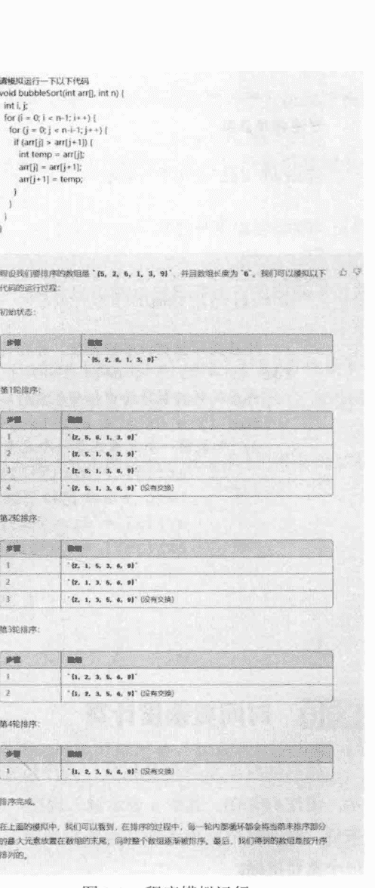

## 8.9 一键生成代码注释

ChatGPT 具备自动撰写注释的能力，支持多种编程语言。它能识别函数、变量、循环、条件分支等结构，并依据语义给出通俗说明。例如面对函数时，会结合名称、参数、返回值推断其用途；面对循环时，会解释计数方式、循环体逻辑和终止条件。

有了这些注释，代码可读性和可维护性会明显提升，也能在重构、优化和测试时提供语义线索。

下面给出一个为 C 语言函数添加注释的例子。

请给以下代码加上中文注释：void bubble_sort(int arr[], int n) { int i, j, temp; for (i = 0; i < n-1; i++) { for (j = 0; j < n-i-1; j++) { if (arr[j] > arr[j+1]) { temp = arr[j]; arr[j] = arr[j+1]; arr[j+1] = temp; }}}}

```
/*
冒泡排序函数

@param arr 要排序的数组

@param n 数组长度
*/
void bubble_sort(int arr[], int n) {
    int i, j, temp;

    // 外层循环控制排序的轮数，每轮将一个数放到它最终的位置
    for (i = 0; i < n-1; i++) {
        // 内层循环控制每轮中相邻元素的比较和交换
        for (j = 0; j < n-i-1; j++) {
            // 如果前一个元素比后一个元素大，交换它们的位置
            if (arr[j] > arr[j+1]) {
                temp = arr[j];
                arr[j] = arr[j+1];
                arr[j+1] = temp;
            }
        }
    }
}
```

## 8.10 算法效率怎么算

时间复杂度描述程序耗时随输入规模变化的规律。常用大 O 表示法记作 O(f(n))，其中 n 为输入规模，f(n) 近似最坏情况下基本操作的次数。它本质上衡量算法在不同数据量下的资源消耗，是评判效率的核心指标。

比如时间复杂度为 O(n) 的算法，运行时间会随输入线性增长；O(n²) 则会呈平方级增长。

常见复杂度从低到高依次为：

- (1) O(1)：常数级，执行耗时与输入规模无关，基本固定。
- (2) O(logn)：对数级，耗时随规模增长但非常缓慢，常见于二分查找。
- (3) O(n)：线性级，耗时与输入规模成正比，常见于遍历数组、链表。
- (4) O(nlogn)：线性对数级，增长快于线性但慢于平方，常见于高效排序。
- (5) O(n²)：平方级，耗时随规模呈平方增长，常见于嵌套循环。
- (6) O(2ⁿ)：指数级，耗时随规模爆炸式增长，常见于某些 NP 问题。

因此写代码时应优先选用增长更慢的算法，以提升效率。

ChatGPT 可以估算代码的复杂度，指出拖慢执行的片段并给出优化建议。

```
请计算以下代码运行时的时间复杂度 void bubbleSort(int arr[], int n) { int i, j; for (i = 0; i < n-1; i++) { for (j = 0; j < n-i-1; j++) { if (arr[j] > arr[j+1]) { int temp = arr[j]; arr[j] = arr[j+1]; arr[j+1] = temp; } } } }
```

这段实现用了两层嵌套循环，外层从 0 跑到 n-2，内层从 0 跑到 n-i-2。随着外层推进，内层迭代次数递减，总迭代次数为：

(n-1) + (n-2) + (n-3) + ... + 2 + 1

利用高斯求和公式可得：

(n-1) × n / 2

所以该代码的时间复杂度为 O(n^2)。

## 8.11 如何让代码跑得更快

ChatGPT 可以分析程序结构，指出可优化的片段，帮助在代码层面降低执行时间和资源消耗，例如合并重复逻辑、抽取公共函数等。主要包含：

- (1) 代码结构优化。重新组织代码，减少无用计算和重复，降低开销并提升可读性。
- (2) 循环优化。循环常是性能瓶颈，借助循环展开、合并等手段减少迭代次数和控制开销。
- (3) 数据结构优化。选用合适的数据结构和算法可显著改善性能，如哈希表能快速查找。
- (4) 编译器优化。编译器可进行内联、死代码消除、循环展开等优化，提升运行效率。

使用该功能时，需要先分析程序并明确优化目标，再根据情况选择技术和工具。过度优化会影响可读性和可维护性，需在效率与可维护性间权衡。

下面给出冒泡排序的改进示例。

### 冒泡排序的改进思路

```
void bubbleSort(int arr[], int n) { int i, j; for (i = 0; i < n-1; i++) { for (j = 0; j < n-i-1; j++) { if (arr[j] > arr[j+1]) { int temp = arr[j]; arr[j] = arr[j+1]; arr[j+1] = temp; } } }
```

可用于优化冒泡排序的方案有：

- (1) 优化循环次数。在每轮循环中增加是否交换的标志，若本轮未发生交换则说明已有序，可提前结束，避免无用循环。
- (2) 优化数据交换。传统交换依赖临时变量，可改用指针直接操作，减少临时存储。
- (3) 优化循环起点。外层已将 i 个元素排好序，内层可从 i+1 开始，减少无效比较。
- (4) 使用其他排序算法。冒泡排序简单但效率低，可改用快速排序、归并排序等更高效的方案。

## 8.12 快速定位并修复 Bug

ChatGPT 的 Bug 修复能力可帮助识别并修正代码缺陷，提升质量与稳定性。主要包括：

- (1) 静态分析。通过检查源码发现潜在问题，如变量使用、调用关系和控制流程。
- (2) 动态分析。运行程序收集运行时信息，利用调试器定位崩溃点和原因。
- (3) 自动修复。根据分析结果自动重构代码，消除重复和死代码，降低出错概率。
- (4) 手动修复。在无法自动修复时，开发者需依据错误信息和调试结果修改代码并重新测试，使用版本控制和单元测试等最佳实践。

使用时需具备一定的代码分析和调试能力，并在修复时谨慎操作，避免引入新问题。

下面以把分号改为逗号的错误为例说明。

请找出下面代码中的 bug: void bubbleSort(int arr[], int n) { int i, j; for (i = 0; i < n-1; i++) { for (j = 0,j < n-i-1; j++) { if (arr[j] > arr[j+1]) { int temp = arr[j]; arr[j] = arr[j+1]; arr[j+1] = temp; } } } }

该代码在第 5 行 for 循环条件中，j 的初始化与条件之间误用了逗号而非分号。修正后的写法如下。

```
void bubbleSort(int arr[], int n) {
    int i, j;
    for (i = 0; i < n-1; i++) {
        for (j = 0; j < n-i-1; j++) {
            if (arr[j] > arr[j+1]) {
                int temp = arr[j];
                arr[j] = arr[j+1];
                arr[j+1] = temp;
            }
        }
    }
}
```

另外要注意，这段代码使用的是冒泡排序，时间复杂度偏高，在实际开发中建议考虑更高效的排序算法。

## 8.13 用自然语言查公式

ChatGPT 能检索所需公式。对复杂公式，可用 LaTeX 表示，也可用自然语言描述来帮助理解。例如对微积分公式，可以解释各变量含义。

下面以 RMSE 为例。

请给出 RMSE 的计算公式

RMSE 全称为均方根误差，用于衡量预测值与真实值之间的误差标准差。其计算公式如下。

```
RMSE = \sqrt{\frac{1}{n}\sum_{i=1}^{n}(y_i - \hat{y_i})^2}
```

其中，n 表示样本数量，y_i 表示第 i 个样本的真实值，\hat{y_i} 表示第 i 个样本的预测值。

由于 ChatGPT 只能输出文本，公式以 LaTeX 语法呈现，需在编辑器中渲染才能查看实际样式。

### 8.13.1 用网页展示公式

下面演示如何生成可显示 LaTeX 公式 的 HTML 页面。

将公式插入网页，生成用 MathJax 显示以下公式的代码：$RMSE = \sqrt{\frac{1}{n}\sum_{i=1}^{n}(y_i - \hat{y_i})^2}$

要在网页上呈现 MathJax 公式，请按以下步骤操作。

- 1. 在 HTML 文件中包含 MathJax 的引用

在 HTML 文件的 <head> 部分添加 MathJax 引用，使其能够渲染公式。

```
<head>
    <script src="https://polyfill.io/v3/polyfill.min.js?features=es6"></script>
    <script src="https://cdn.jsdelivr.net/npm/mathjax@3/es5/tex-mml-chtml.js"></script>
</head>
```

- 2. 插入公式代码

在 HTML 文件中使用以下代码将公式插入页面。

这将在页面上呈现公式 $RMSE = \sqrt{\frac{1}{n}\sum_{i=1}^{n}(y_i - \hat{y_i})^2}$，<div> 标签可用于控制位置和样式。

```
<div>
    $$RMSE = \sqrt{\frac{1}{n}\sum_{i=1}^{n}(y_i - \hat{y_i})^2}$$
</div>
```

注意 MathJax 需要加载和渲染时间，公式不会立即出现。

用记事本编辑一个 html 文件。

```
<head>
    <script src="https://polyfill.io/v3/polyfill.min.js?features=es6"></script>
    <script src="https://cdn.jsdelivr.net/npm/mathjax@3/es5/tex-mml-chtml.js"></script>
</head>
<div>
    $$RMSE = \sqrt{\frac{1}{n}\sum_{i=1}^{n}(y_i - \hat{y_i})^2}$$
</div>
```

用浏览器打开 html 文件，将显示出公式（见图 8-2）。


### 8.13.2 在线编辑器

可进入在线 LaTeX 编辑器 https://www.latexlive.com/，把 ChatGPT 给出的 LaTeX 代码粘贴进去即可实时预览公式（见图 8-3、图 8-4）。

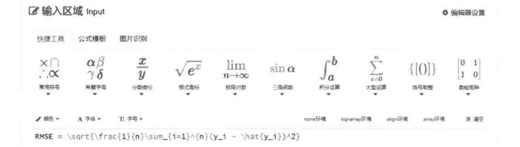


### 8.13.3 公式通俗描述

请用自然语言描述以下公式：$RMSE = \sqrt{\frac{1}{n}\sum_{i=1}^{n}(y_i - \hat{y}_i)^2}$

该公式表示均方根误差 RMSE，用于衡量模型预测与真实值之间的偏差程度。其中 n 为样本数，y 表示真实值，\hat{y} 表示预测值。计算过程先求每个样本的预测误差，再平方求和、除以样本数取平均，最后开方得到 RMSE。数值越小，表示预测越接近真实。

## 8.14 根据描述自动生成公式

ChatGPT 能依据自然语言描述生成数学公式。它理解描述的语义和结构并转化为对应符号。因此提供准确描述后即可尝试生成公式。

以下用自然语言对 RMSE 进行了近似描述。

均方根差速览

要呈现的计算思路是：先把两组对应的数值相减得到差值，对差值平方后求和，再除以配对的总数，最后取算术平方根。对应的数学表达如下。

```
\sqrt{\frac{1}{n}\sum_{i=1}^{n}(x_i - y_i)^2}
```

其中 n 表示配对的数量，x_i 与 y_i 分别是两组数据在第 i 个位置上的取值。

若希望在网页编辑器中预览 LaTeX 渲染效果，可参照图 8-5 的显示方式。

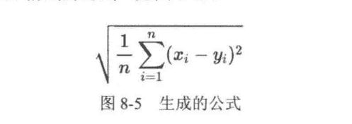

## 8.15 代码驱动生成图片

ChatGPT 原生不直接输出图像文件，但通过外部工具仍可实现可视化，典型路径大致分为两类。

- 依托生成式对抗网络。GAN 属于能够合成逼真图像的深度学习模型。可先由模型撰写自然语言描述，再把描述送入 GAN，由其据此生成对应画面。
- 依托编程绘图库。Python 生态中的 Matplotlib、Pillow 等库可把数学表达式或文字描述转化为图像。由 ChatGPT 提供描述或代码，再通过这些库渲染为折线图、散点图等并导出为图片格式。

需留意，模型提供的描述或公式偶尔存在歧义或不够精确，生成的图像也会伴随误差。此外使用 GAN 或图形库需要相应的技术环境与数据支撑，落地时应结合具体场景审慎挑选。

下面以 Python 间接绘图为例。

请画出一棵樱花树

以下示例演示如何用 turtle 模块绘制樱花树。

```
import turtle
import random

### 设置画布和画笔
canvas = turtle.Screen()
canvas.bgcolor("white")
```

pen = turtle.Turtle()

pen.speed(0)

pen.hideturtle()

### 绘制樱花树

def draw_cherry_blossom_tree(pen, size):

    # 绘制树干

    pen.penup()

    pen.goto(0, -300*size)

    pen.pendown()

    pen.pensize(50*size)

    pen.setheading(90)

    pen.color("brown")

    pen.forward(200*size)

    # 绘制樱花

    for i in range(10):

        x = random.randint(-200*size, 200*size)

        y = random.randint(-200*size, 0)

        pen.penup()

        pen.goto(x, y)

        pen.pendown()

        pen.color("pink")

        pen.begin_fill()

        pen.circle(20*size)

        pen.end_fill()

### 主函数

def main():

    # 设置树的参数

    size = 1

    # 绘制樱花树

    draw_cherry_blossom_tree(pen, size)

    # 隐藏画笔

    pen.hideturtle()

    # 显示画布

    canvas.mainloop()

if __name__ == "__main__":

    main()

该程序基于 turtle 完成图形绘制，借助随机数确定花朵坐标，在循环中绘制粉色圆点。将代码粘贴到任意 Python 运行环境即可得到图案，图 8-6 为 IDLE 环境下的示例。


## 8.16 生成表格

ChatGPT 能先输出包含表格信息的纯文本，再经清理与格式化后导入为数据表。实际使用时需对输出文本做必要处理，最后用 Excel 打开并导入即可。

将下述数据整理为包含产品名称、销售量 kg、销售金额 元 的表格：产品名称为苹果、香蕉、橙子、葡萄，销售量分别为 500、300、200、1000 kg，单价分别为 3、2、4、5 元/kg。

基于提供的数据计算销售额，形成如下表格：

| 产品名称 | 销售量（kg） | 单价（元/kg） | 销售金额（元） |

| :--- | :--- | :--- | :--- |

| 苹果 | 500 | 3 | 1500 |

| 香蕉 | 300 | 2 | 600 |

| 橙子 | 200 | 4 | 800 |

| 葡萄 | 1000 | 5 | 5000 |

销售金额的计算方式为 销售量（kg）× 单价（元/kg）。整理成表格后查阅分析更为便捷。Markdown 形式可在支持的编辑器中直接预览，也能导入 Excel 或 Google Sheets 做进一步处理。导入效果见图 8-7。

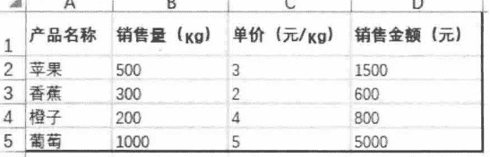

## 8.17 生成数据库文档

ChatGPT 可依据 SQL 命令生成数据库文档，涵盖结构与元数据信息，减少手工编写负担。这些语句包括表、视图、存储过程、触发器、索引等的定义。

以下给出一个 CREATE TABLE 命令，生成包含表结构等信息的文档。

请生成以下数据表的元数据说明：CREATE TABLE tpch.orders (O_ORDERKEY BIGINT, O_CUSTKEY INT, O_ORDERSTATUS CHAR(1), O_TOTALPRICE DECIMAL(15,2), O_ORDERDATE DATE, O_ORDERPRIORITY CHAR(15), O_CLERK CHAR(15), O_SHIPPRIORITY INTEGER, O_COMMENT VARCHAR(79), dummy text); ALTER TABLE tpch.orders ADD PRIMARY KEY (o_orderkey);

数据表名称：tpch.orders。

| 列 名 | 数据类型 | 大 小 | 说 明 |

| :--- | :--- | :--- | :--- |

| O_ORDERKEY | BIGINT | | 订单键 |

| O_CUSTKEY | INT | | 客户键 |

| O_ORDERSTATUS | CHAR(1) | 1 byte | 订单状态：P = 未支付；F = 已完成；O = 订单被抛弃 |

| O_TOTALPRICE | DECIMAL(15,2) | 8 bytes | 订单总价 |

| O_ORDERDATE | DATE | 4 bytes | 下订单的日期 |

| O_ORDERPRIORITY | CHAR(15) | 15 byte | 订单优先级，最多 15 个字符 |

| O_CLERK | CHAR(15) | 15 byte | 处理订单的店员名称，最多 15 个字符 |

| O_SHIPPRIORITY | INTEGER | 4 bytes | 订单的发货优先级 |

| O_COMMENT | VARCHAR(79) | | 订单备注，最多 79 个字符 |

| dummy | TEXT | | 没有实际意义的列，用于兼容某些 SQL 语法，但无法插入任何数据 |

## 8.18 自动生成 SQL 代码

依据任务描述与数据要求，ChatGPT 能自动输出 SQL 语言代码，帮助开发人员和数据分析师提升效率与准确性。

实现时需提供任务说明与数据要素，如表名、列名、过滤条件、排序方式等。模型据此产出 SELECT、INSERT、UPDATE、DELETE 等语句，包含必要的表列与语法。

示例：三个 Postgres SQL 数据表 Employee(id, name, department_id)、Department(id, name, address)、Salary_Payments(id, employee_id, amount, date)，请写出查询最近三个月薪资发放次数不超过 10 次的员工名单的 SQL 语句。

生成的查询思路如下：

```
SELECT E.name
FROM Employee AS E
JOIN Salary_Payments AS S ON E.id = S.employee_id
WHERE S.date >= NOW() - INTERVAL '3 months'
GROUP BY E.id
HAVING COUNT(*) <= 10
ORDER BY E.name;
```

该查询先通过 JOIN 将 Employee 表与 Salary_Payments 表关联，并限定最近一季度的薪资支付记录。随后按员工分组，使用 HAVING 筛选出该季度内发放次数不超过 10 次的人员，最后按员工姓名排序输出。

## 8.19 不同数据库 SQL 命令转换

SQL 虽为标准关系型数据库查询语言，但不同 DBMS 在实现上存在差异，主要体现在数据类型、方言、函数与操作符、兼容性等方面。常见方言包括：

- MySQL 方言。开源关系型数据库，支持存储过程与触发器，独有 LIMIT 子句、DESCRIBE 语句、SHOW 语句等。
- Oracle 方言。商业关系型数据库，支持存储过程与触发器，独有 ROWNUM 伪列、DUAL 虚表、SEQUENCE 序列等。
- SQL Server 方言。微软系数据库，支持存储过程与触发器，独有 TOP 子句、IDENTITY 列、XML 数据类型等。
- PostgreSQL 方言。开源数据库，支持存储过程与触发器，独有 ARRAY 数组类型、FULL OUTER JOIN 全外连接、ILIKE 模糊查询等。
- SQLite 方言。轻量级数据库，支持存储过程与触发器，独有 LIMIT 子句、AUTOINCREMENT 关键字、BLOB 二进制数据类型等。

函数与操作符差异举例：

- 字符串函数。MySQL 使用 CONCAT() 连接字符串，Oracle 使用 “||” 操作符。
- 数值函数。Oracle 与 SQL Server 的 ROUND 可控制小数位，MySQL 的 ROUND 更常用于取整。
- 日期时间函数。Oracle 与 MySQL 支持 NOW() 获取当前时间，SQL Server 使用 GETDATE()。
- 聚合函数。Oracle 与 SQL Server 支持 STDEV() 计算标准差，MySQL 使用 STD()。
- 结果限制。MySQL 与 SQL Server 使用 LIMIT，Oracle 通过 ROWNUM 实现。

示例：将 PostgreSQL 格式的 SQL 转为 Oracle：select l_returnflag, l_linestatus, sum(l_quantity) as sum_qty, sum(l_extendedprice) as sum_base_price, sum(l_extendedprice * (1 - l_discount)) as sum_disc_price, sum(l_extendedprice * (1 - l_discount) * (1 + l_tax)) as sum_charge, avg(l_quantity) as avg_qty, avg(l_extendedprice) as avg_price, avg(l_discount) as avg_disc, count(*) as count_order from lineitem where l_shipdate <= date '1998-12-01' - interval '90 days' group by l_returnflag, l_linestatus order by l_returnflag, l_linestatus;

在 Oracle 中日期间隔写法不同，需使用 interval 关键字。转换后语句如下：

```
SELECT
    l_returnflag,
    l_linestatus,
    SUM(l_quantity) AS sum_qty,
    SUM(l_extendedprice) AS sum_base_price,
    SUM(l_extendedprice * (1 - l_discount)) AS sum_disc_price,
    SUM(l_extendedprice * (1 - l_discount) * (1 + l_tax)) AS sum_charge,
    AVG(l_quantity) AS avg_qty,
    AVG(l_extendedprice) AS avg_price,
    AVG(l_discount) AS avg_disc,
    COUNT(*) AS count_order
FROM
    lineitem
WHERE
    l_shipdate <= DATE '1998-12-01' - interval '90' DAY
GROUP BY
    l_returnflag,
    l_linestatus
ORDER BY
    l_returnflag,
    l_linestatus;
```

注意，日期间隔写作 '90' DAY，而非 '90 days'。

## 8.20 提取关键字

ChatGPT 能分析输入文本并抽取关键词，以便更好地理解用户请求并作出回应。

模型借助自然语言处理与机器学习技术，如命名实体识别、关键词抽取、句法分析等，识别文本中的人名、地名、日期、事件、主题等要素，从而提供更准确详细的回复。

找出下文的关键字：本文基于 PLC 的自动点胶机控制系统设计旨在通过现代化的技术手段提高点胶机的自动化程度和控制精度，提高生产效率和质量。在本文中，我们首先介绍了点胶机的工作原理和常用的点胶方法，然后分析了目前自动化控制系统中存在的问题和改进空间，并提出了基于 PLC 的自动点胶机控制系统的设计方案。接着，我们详细地讨论了控制系统的硬件和软件设计，并对其进行了验证和测试。最后，我们通过实验结果证明了本设计方案的可行性和有效性，能够满足点胶机自动化控制的要求，具有很高的实用性和推广价值。本文的主要工作量包括点胶机的工作原理和常用方法的调研、自动化控制系统的现状分析、基于 PLC 的自动点胶机控制系统的设计和实验验证等。整个过程需要进行大量的实验和数据处理，所需的时间和精力较为充分。预计本设计方案的实际应用将能够提高点胶机的自动化程度和控制精度，进而提高生产效率和质量。

关键字：PLC、自动点胶机、控制系统、自动化程度、控制精度、生产效率、质量、工作原理、常用方法、现状分析、设计、实验验证、实用性、推广价值、数据处理。

## 8.21 取名

**描述一把，ChatGPT 就给出名字备选项**

为人物、产品或品牌寻找称呼时，把目标对象的属性与调性要求写进提示，模型会按线索产出一批候选。使用者在互动中补充细节、收敛方向，逐步逼近满意结果。

**示例需求：帮忙起个名字，姓范，男，希望有技术范儿，又有文化气息**

围绕范姓、男性、科技感与文雅兼备，提供以下参考：

- 范技昌：技昌隐含技术上的追求与文脉的兴盛。
- 范文昇：文突出文化底蕴，昇传递向上与卓越之意。
- 范华宇：华宇带有高贵大气之感，也指向开拓创新。
- 范曦宸：曦宸营造光明深远的意象，同时呼应创新与成就。

仅作启发，可按个人偏好再行调整。

## 8.22 转换人称

ChatGPT 能在段落层面统一改写称谓，例如把“我”“我们”换成“你”“你们”，或把第二人称转成第三人称的“他”“她”“它”“他们”等。写作与翻译时能省去大量手工替换。

操作很直观：提交原文并说明目标人称，模型即完成转换。

**改写为女性第三人称：我要去看电影**
她要去看电影。

**改写为第二人称：我要去看电影**
你要去看电影。

## 8.23 整理文字

文本整理相当于自动排版助手，主要完成：

- 清理多余空格、制表符、回车等冗余字符。
- 调整缩进、对齐、行距等版式细节。
- 按需分段并梳理结构。
- 自动修正错别字、标点与语法。

可读性与美观度会提升，排版耗时大幅下降。

下面是一段腾讯会议转写的课堂片段，口语化严重、表达松散，整理后可直接使用。

> 请将下面的会议录音资料整理成流畅的文字：大家好，今天呢，我们开始讲一下这个。数据仓库。嗯，数据仓库的话呢，它是？呃，在 1992 年由这个？比尔安门？啊，首先提出了。前一段在他之前呢？虽然大家提出了所谓的。管理系统。和这个决策知识系统事务处理和决策知识系统的一个分离。甚至提出了税仓库的这种名词，但对它的定义呢？不是很清楚。阿门呢，就明确地提出了这个。啊，对这个？所以称呼的一个定义。呃，在比尔·恩门以后呢？又出来一个叫金博尔，对吧，金博尔。苏泊尔的话呢，他提出了一个数据集市的概念。比尔·恩门呢，他的数据仓库。呃，虽然是一个开创性的理论，但它要求呢。呃，必须是企业的全部数据就建立一个。就建立在这个这个全部数据都。变成这个数据仓库基础上。也就是说它呢做的现在来说呢，叫一个企业级数的成果。啊，这样由于这个数据仓库呢要求比较高，所以呢这个在使用中。嗯，遇到不少的困难。那么金博尔呢，他就提出来，那么我们可以从这个部门开始。啊，而不是要从这个，而不是需要整个的数据。基于这样的一个。呃，思路呢，它就提出了一个叫维度模型啊模型。金博尔的方案呢，就是也有的人呢，就成为数据仓库啊，有些人就是呢，那么实际上他的准确的话呢，应该成为一个数据集市啊，就是<杂音>呢，或者简称DM。呃，数据仓库呢，叫这个？Data就是DW嗯，那么现在这个。

整理要点：

1992 年比尔·恩门首次提出数据仓库。此前已有管理信息系统与决策支持系统分离的讨论，也出现过数据仓库之名，但定义模糊。恩门给出了明确定义。其后金博尔提出数据集市等概念。恩门方案开创性强，却要求企业把全部数据纳入仓库，门槛高、落地难。金博尔提出从部门入手的维度模型思路，其方案常被误称数据仓库，准确称谓是数据集市或DM。英文为 Data Warehousing，缩写DW。

人工复核仍不可少，尤其是专有名词。原文出现比尔·安门，正确为比尔·恩门；金布二、苏泊尔、金波尔等写法，正确皆为金博尔。

## 8.24 生成流程图

ChatGPT 本身不绘图，但能输出可运行的 Python 脚本，借助 Graphviz 生成流程图。

Graphviz 基于 DOT 语言描述节点与连线，通过命令行渲染成图片，无需手动定位坐标，可作可视化方案，但对单元素位置的精细控制有限。DOT 由图、节点、边构成。

在 Python 中使用需先安装库：

```
conda install python-graphviz
```

再装对应程序：windows_10_cmake_Release_graphviz-install-7.1.0-win64。可到 http://www.graphviz.org/download/ 下载后运行。

例如绘制自动点胶机原理图的脚本如下，附中文注释。

以下是使用 Python 语言和 Graphviz 库绘制自动点胶机原理图的代码，并包含中文说明。

```
import graphviz

### 创建 Graph 对象
dot = graphviz.Graph(comment=' 自动点胶机原理图 ')

### 添加节点和边
dot.node('A', ' 点胶针头 ')
dot.node('B', ' 点胶液 ')
dot.node('C', ' 工件 ')
dot.node('D', ' 压力控制阀 ')
dot.node('E', ' 电磁阀 ')
dot.node('F', ' 气缸 ')

dot.edge('A', 'D')
dot.edge('B', 'D')
dot.edge('D', 'E')
dot.edge('E', 'F')
dot.edge('F', 'C')

### 设置节点和边的属性
dot.node_attr.update(fontname='SimHei', fontsize='12')
dot.edge_attr.update(fontname='SimHei', fontsize='10')

### 保存绘制的图像
dot.render('auto_glue_machine_principle', format='png')
```

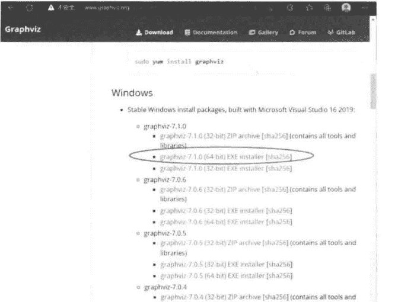

图 8-8 下载 Windows 中运行的 graphviz 程序

130 人工智能与 ChatGPT

说明：

- 通过 Graphviz 的 Graph 对象创建名为“自动点胶机原理图”的图并添加节点与连线。
- A 为点胶针头，B 为点胶液，C 为工件，D 为压力控制阀，E 为电磁阀，F 为气缸。
- 针头与胶液受压力控制阀调节，阀由电磁阀控制，电磁阀再经气缸驱动针头运动，完成对工件点胶。
- 最后设定样式并保存图片。

运行后会生成图 8-9 的图片文件。

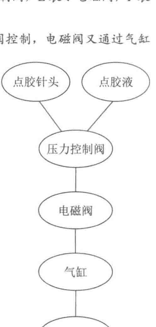

## 8.25 英语论文摘要

借助 ChatGPT 阅读英文文献时可：

- 生成摘要，快速抓住主旨。
- 提取关键词，定位主题。
- 推荐相关文献，拓展阅读。
- 自动翻译成母语。
- 针对细节即时问答。

传统流程是找原文→翻译→理解并写摘要，三步可合并。以 *Attention is all you need* 为例。

请分析一下以下论文：Attention is all you need

> “Attention is all you need”是 2017 年由谷歌 Brain 的一组研究人员发表的一篇论文，提出了一种名为 Transformer 的新颖神经网络模型，该模型采用自注意力机制（Self-Attention）来实现序列到序列的建模，其表现优于之前的基于卷积神经网络和循环神经网络的模型。

传统序列模型如 RNN 需逐时迁移，处理串行。Transformer 让序列各位置并行交互，自注意力显式建模位置间关联，无需循环或卷积即可捕捉长程依赖。

核心是多头自注意力 Multi-Head Attention，可将输入映射到多子空间分别计算注意力，获得多样表征。配合位置编码 Positional Encoding，模型能感知顺序。

该架构在机器翻译、语音识别、自然语言处理等领域表现突出，成为主流。思路亦被迁移至计算机视觉，用于图像生成与分割等任务。

# 第9章 OpenAI API

## 9.1 API 概论

OpenAI API 由 OpenAI 维护，为开发者和企业提供 AI 能力，便于将自然语言处理、语音识别、图像识别等功能集成到自有应用。

平台提供多款预训练模型，如 GPT-3、DALL-E，可用于文本生成、分类、翻译、图像生成等。另提供摘要、翻译、内容生成、问答等工具，均基于最新研究。

组成如下：

- 模型 API：核心入口，提供预训练模型调用能力，代表作 GPT-3 支持生成、分类、翻译。
- Playground：交互式体验界面，可输入文本观察输出。
- DALL-E API：将自然语言描述转为图像的接口。
- API 文档：包含端点说明、参数、示例代码，地址 https://platform.openai.com/docs/introduction。

## 9.2 交互方式

目前支持三种：

- HTTP 请求：任何语言均可调用。
- 官方 Python 绑定：运行 pip install openai。
- 官方 Node.js 库：在项目目录运行 npm install openai。

## 9.3 关键概念

### 9.3.1 提示语（Prompt）

提示语是引导 ChatGPT 生成响应的输入文本。提示质量直接影响输出相关性和准确度。好的提示应清晰、简洁、具体。

常见启发式表达：

- “你能告诉我更多关于……” 
- “请为我解释一下……” 
- “你有任何关于……的建议吗？” 
- “我应该如何处理……” 
- “你认为……是好的决定吗？”

实践中，若首次回答偏差，可尝试说一句 “let’s think step by step”，常能得到修正。

### 9.3.2 完成（Completion）

API 调用中，完成指模型基于输入生成的输出文本。输入是问题或句首，输出是续写、回答或摘要。

该能力可用于自动回复、智能客服、摘要、翻译、内容生成、情感分析等。通过设定长度、温度等参数可控制风格。

### 9.3.3 标记（Token）

标记是 NLP 中的基本单元，可为词、标点、数字或子词。文本需先分词再转为索引输入模型。

以英文为例，the cat sat on the mat 会被切分为 the、cat、sat、on、the、mat 六个标记。hamburger 可能拆为 ham、bur、ger，而短常见词多为单标记。

中文分词策略不同，常需专用工具。经验值：英文约 1 标记≈4 字符≈0.75 词。提示与生成的总长度不得超过模型上下文上限，通常为 2048 标记，约 1500 词。

### 9.3.4 模型

API 提供多类不同用途与价格的模型：

- GPT-3.5：一组改进自 GPT-3 的模型，可理解并生成自然语言或代码。
- DALL·E 测试版：根据自然语言提示生成与编辑图像。
- Whisper 测试版：将音频转为文本。
- Embeddings：将文本转为数字向量。
- Codex 限定测试版：理解自然语言并生成代码。
- Moderation：检测文本是否敏感或不安全。
- GPT-3：可理解并生成自然语言的基础模型。

GPT-3 的基础版主要由 Davinci、Curie、Babbage、Ada 四个型号构成。Codex 系列则是基于 GPT-3 发展而来，同时接受了自然语言与代码的训练。现阶段的主流迭代是 GPT-3.5，该分支下又细分出多个子版本，具体信息见下表。

### 表 9-1 GPT-3.5 型号明细

| 最新模型 | 说明 | 最大请求数 | 训练截止 |

|---|---|---|---|

| GPT-3.5-Turbo | GPT-3.5 家族中性能最强的版本，专为对话场景调优，费用约为先前的十分之一，后续会随新迭代滚动升级 | 4096 个标记 | 2021年9月 |

| GPT-3.5-Turbo-0301 | 2023年3月1日的版本快照。不同于可滚动更新的 GPT-3，它保持固定，仅提供至2023年6月1日的三个月支持期 | 4096 个标记 | 2021年9月 |

| Text-davinci-003 | 相比 Curie、Babbage、Ada 等可完成各类语言任务，质量更高、生成长度更长且指令遵循更稳定，还支持在原文中嵌入补全 | 4097 个标记 | 2021年6月 |

| Text-davinci-002 | 综合能力与 Text-davinci-003 相近，训练方式采用监督微调而非强化学习 | 4097 个标记 | 2021年6月 |

| Code-davinci-002 | 专注于代码补全任务的优化版本 | 8001 个标记 | 2021年6月 |

官方当前主推的型号是 GPT-3.5-Turbo。

想横向对比不同模型的表现，可以使用一个并排测试工具，它能同时运行多个模型并对比输出、配置和响应速度，最后还能把结果导出为 Excel。地址是：https://gpttools.com/comparisontool。图 9-1 显示的是该页面的界面。

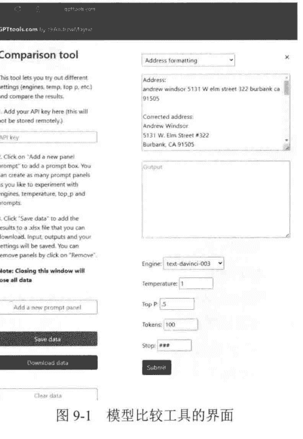

## 9.4 Playground 互动实验台

ChatGPT Playground 是一个网页化的在线实验环境，界面简洁易用，方便用户探索 ChatGPT 的技术原理与应用方式。

平台提供了大量实验案例，帮助用户快速认识 ChatGPT 的能力边界和典型用途。内置的交互式对话窗口让用户可以直接与模型交流，测试不同输入下的反应与生成质量，也能自定义输入获得专属回复。

此外，Playground 还配备了自定义生成功能，可以调节输入文本和生成参数，观察不同设定带来的结果差异。平台同时提供了多种辅助工具，

## 9.5 API 案例

下面以一个简单的 OpenAI API 调用为例，说明如何通过 HTTP 方式接入。

### API 名称
该接口命名为 “Davinci API”。

### API 描述
Davinci API 属于 OpenAI API 中语言能力最强的接口之一，可用于自然语言生成、语言理解、机器翻译等场景。通过它可以向 OpenAI 发起文本生成、问答、翻译等请求，获取模型生成的回答。

### API 端点
Davinci API 的访问地址为：https://api.openai.com/v1/engines/text-davinci-002/completions。

### 支持的 HTTP 方法
该接口仅支持 HTTP POST 方法。

### 请求参数
请求体需以 JSON 格式发送，示例如下：

```
{
    "prompt": "I want to order a pizza",
    "temperature": 0.5,
    "max_tokens": 100,
    "stop": "\n"
}
```

参数含义说明：

- prompt：需要输入的文本提示。
- temperature：控制生成随机性的程度，取值 0～1，数值越大结果越随机。
- max_tokens：限制生成文本的最大长度。
- stop：用于指定生成文本的结束标识。

### 响应参数
返回数据同样为 JSON 格式，示例如下：

```
{
    "choices": [
        {
            "text": "I want to order a pizza with pepperoni and mushrooms.",
            "index": 0,
            "logprobs": null,
            "finish_reason": "stop"
        }
    ]
}
```

参数含义说明：

- text：模型生成的文本内容。
- index：生成结果的序号。
- logprobs：生成文本的概率分布信息。
- finish_reason：文本生成的终止原因。

### 认证
发起请求前必须使用 OpenAI 提供的 API Key 进行身份验证。

## 9.6 API 访问

要调用 GPT-3 API，首先需要申请 OpenAI 的 API Key，流程如下：

1. 打开 OpenAI 官网：https://openai.com/。
2. 点击右上角的 “Get started for free” 进入申请页面。
3. 填写姓名、邮箱、密码并同意服务条款。
4. 完成邮箱验证。
5. 填写应用相关信息，如名称、描述、类别等。
6. 等待 OpenAI 审核，通常需要数天时间。
7. 审核通过后即可获得 API Key。

拿到 Key 后即可接入 OpenAI API，具体步骤为：

1. 在项目中安装 OpenAI 的客户端库。
2. 用 API Key 初始化客户端。
3. 调用库中提供的函数实现文本生成、文本分类等功能。

## 9.7 API 使用

开发者可用 Python、Java、JavaScript 等多种语言编写客户端与模型 API 交互。借助模型 API，可将 OpenAI 的预训练模型快速集成到自有应用中，提升性能与功能。

除 GPT-3 外，OpenAI API 还提供翻译、生成、分类、问答等多种预训练模型与接口，均基于前沿研究成果，能提供高质量的 AI 解决方案。

### 9.7.1 HTTP 请求
模型 API 的使用逻辑很直接，开发者向接口发送 HTTP 请求，其中包含文本数据及参数，如生成长度、样本数量、模型 ID 等。请求被送到 OpenAI 预训练模型处理后，结果会返回给调用方。

示例：

```
curl https://api.openai.com/v1/chat/completions \
  -H 'Content-Type: application/json' \
  -H 'Authorization: Bearer YOUR_API_KEY' \
  -d '{
  "model": "gpt-3.5-turbo",
  "messages": [{"role": "user", "content": "Say this is a test!"}],
  "temperature": 0.7
}'
```

### 9.7.2 Python 包
下面是一个用 OpenAI API 调用 GPT-3 生成文本的 Python 示例：

```
import openai
import os

### 设置 OpenAI API 密钥
openai.api_key = os.getenv("OPENAI_API_KEY")

### 使用 OpenAI API 生成文本
prompt = "Once upon a time"
model = "text-davinci-002"
response = openai.Completion.create(
    engine=model,
    prompt=prompt,
    max_tokens=2048,
    n=1,
    stop=None,
    temperature=0.5,
)

### 打印生成的文本
print(response.choices[0].text)
```

代码中使用了 OpenAI 官方 Python 客户端。首先通过 os 模块读取环境变量中的 API Key 并设为全局密钥。随后调用 openai.Completion.create() 生成文本，需指定：

- engine：使用的 GPT-3 模型名称。
- prompt：生成起点语句。
- max_tokens：最大生成长度。
- n：生成结果数量。
- stop：停止生成的条件。
- temperature：控制创造性与多样性的温度值。

最后输出生成结果。

使用前需先注册 OpenAI 并获取 API Key。示例中将 Key 放在环境变量 OPENAI_API_KEY 里，通过 os.environ 读取。实际部署时建议将密钥存放在文件或密钥管理器中，避免泄露。

## 9.8 API 参数

### 9.8.1 输入参数
以 Davinci API 为例，说明常用输入参数。

Davinci API 是 OpenAI 文本生成类接口的高阶代表，具备先进的自然语言生成能力。支持的输入参数包括：

- prompt：提示模型生成的初始内容。
- max_tokens：以 token 为单位限制最大生成长度，一个 token 约等于半个英文单词或一个中文字符。
- temperature：调节输出的随机性与创造性，值越高越具变化但可能降低准确性。
- top_p：控制输出多样性，模型会从概率分布中累积选择 token 直至总概率达到 top_p。
- frequency_penalty：抑制重复 token 的出现频率，值越大越避免重复。
- presence_penalty：调节罕见 token 的出现倾向，值越大越鼓励新颖表达。

除此之外，还支持文本格式化、对话式交互以及对生成片段的精细化控制等高级功能。

下面以不同 temperature 值对比生成的文本，每个结果均以对应的 temperature 作为标题：

- 用 temperature=0.5 生成的文本：

我小时候最喜欢的事情就是跟我爷爷一起在花园里种花。我们会一起挖土、播种、浇水，然后等着它们生长。每次看到花开的时候，我都觉得这是世界上最美的事情。

- 用 temperature=0.75 生成的文本：

我小时候最喜欢的事情就是跟我妈妈一起去图书馆。我们会找一些好看的绘本，然后一起看。每次看完都会感觉时间过得特别快，好像一下子就到了要回家的时间。

- 用 temperature=1.0 生成的文本：

我小时候最喜欢的事情就是跟我弟弟一起打水枪。我们会在花园里设立阵地，然后用水枪互相射击。每次玩完都会浑身湿透，但心情特别愉快。

- 用 temperature=1.25 生成的文本：

我小时候最喜欢的事情就是跟我好朋友一起去探险。我们会在周围的森林和小山里探索，寻找一些好玩的地方。有时候还会遇到一些神秘的东西，让我们感到特别兴奋。

- 用 temperature=1.5 生成的文本：

我小时候最喜欢的事情就是跟我家狗狗一起玩。我们会在花园里追逐、跳跃，玩得特别开心。有时候狗狗还会带着我去探险，让我感到特别刺激。

### 9.8.2 输出参数
Davinci API 的 logprobs 字段返回了生成文本的概率信息，包含每个 token 的概率及其对数概率。具体结构为二维数组，每行对应一个 token，包含：

- token：token 的文本表示。
- logprob：当前上下文下该 token 被选中的对数概率。
- token_logprobs：与当前 token 相关的所有概率字典，键为 token 文本，值为对应对数概率。
- finish_reason：生成结束的原因，可能取值为：
  - “length”：达到请求的最大长度。
  - “stop”：遇到设置的 stop 序列。
  - “timeout”：请求超时。

示例：

```
"logprobs": [
    {
        "token": "apples",
        "logprob": -6.539205,
        "token_logprobs": {
            "apples": -6.539205,
            "oranges": -7.2348776,
            "pears": -8.041041,
            ...
        }
    },
    {
        "token": "bananas",
        "logprob": -7.2348776,
        "token_logprobs": {
            "apples": -6.539205,
            "oranges": -7.2348776,
            "pears": -8.041041,
            ...
        }
    },
    ...
]
```

该示例中 logprobs 返回了一组 token 列表。以第一个 token “apples” 为例，其 token 值为 “apples”，logprob 为 -6.539205，表示模型在当前上下文选择它的对数概率；token_logprobs 字典中 “apples” 对应相同值，而 “oranges” 为 -7.2348776，“pears” 为 -8.041041 等。这些概率可用于评估生成质量。

token 的出现概率也常称为 log 概率或 logits，可帮助判断文本合理性。

在生成任务中，模型依据已生成的序列预测下一个最可能的 token，并可通过采样引入低概率 token 以提升多样性。语言模型会为每个候选 token 计算在给定上下文中的条件概率，从而决定后续生成。

例如上下文为 “I love to”，模型可能给 “dance” 赋予 0.6 的概率，给 “swim” 赋予 0.4 的概率。按概率选择即可得到更合理的续写，也可通过随机采样增加变化。

在分类任务中，可对各 token 概率进行加权平均得到整段文本的概率，从而进行分类；在摘要任务中，可根据 token 的重要性评分挑选代表性 token 生成精炼摘要。总之，token 概率是自然语言处理中的关键信息，能够提升模型效果。

## 9.9 API 功能模块
OpenAI API 目前提供的主要功能模块包括：

- openai.Completion：实现文本自动补全与生成，可在上下文基础上产出自然语言。
- openai.Comparison：计算文本相似度，用于比较两段文本的相似得分。
- openai.Classification：执行文本分类，将输入映射到预定义类别。
- openai.SemanticSearch：支持语义检索，找到与查询最相关的结果。
- openai.Davinci：OpenAI 提供的顶级语言模型，具备强自然语言处理能力。
- openai.LanguageModel：通用文本生成接口，可按输入上下文生成自然语言。
- openai.Answer：问答类接口，基于问题与上下文生成答案。

# OpenAI 模块与接口实战拆解

在 OpenAI 的工具箱里，不同的功能模块各司其职。
- `openai.EntityExtraction` 负责实体抽取，能从文本中挑出人名、地名、机构名等关键元素。
- `openai.Summarization` 负责文本压缩，把长输入浓缩成要点。
- `openai.Translation` 负责跨语言转换，把原文转成目标语言。

这几类能力里，最核心的通用件是 `openai.Completion`。即便每个模块都有专属场景，绝大多数需求其实都可以用 Completion 完成，因为它兼具强大的生成与续写能力，并且可以借助上下文来驱动输出。

比如问答任务原本属于 `openai.Answer`，实际操作时只要把问题和上下文一起喂给 Completion，就能得到答案。摘要任务原本属于 `openai.Summarization`，同样可以把整篇原文作为上下文传给 Completion，让它自行生成概括。Completion 的通用性和灵活性让它成为首选。

不过通用不代表可替代。垂直模块仍有优势。`openai.Classification` 在文本分类上的准确度更高，`openai.EntityExtraction` 在实体识别上更专注。因此实际选用时，要结合任务目标和业务场景权衡效率与精度。

### 9.10 接口端点速览

OpenAI API 的端点是一组 HTTP 路径与功能集合，用来调用各类服务。交互方式很直接：发 HTTP 请求，收 HTTP 响应。

每个端点都绑定一个 HTTP 动词，如 GET、POST、PUT、DELETE，用于获取、创建、更新或删除资源。调用前需要明确该端点支持的动词以及请求体和返回体格式。

客户端可以是任意能发 HTTP 的工具，例如 Python 的 Requests、JavaScript 的 Fetch 或 curl 命令。官方也提供了 Python SDK，已经把所有端点封装成易用的类和方法。

通常 Python 功能模块和 HTTP 端点是一一对应的，有时一个模块会串联多个端点，也可能一个端点由多个模块共同处理请求与响应，具体取决于功能实现。

一个完整端点长这样：https://api.openai.com/v1/chat/completions

当前常用的访问入口包括：
- `/v1/chat/completions`：聊天机器人专用
- `/v1/engines`：列出或创建引擎
- `/v1/engines/{engine ID}/completions`：生成文本补全
- `/v1/engines/{engine ID}/search`：文本检索
- `/v1/engines/{engine ID}/davinci-codex/completions`：代码补全

### 9.11 文本生成原理与用法

相关端点示例：
`/v1/engines/{engine ID}/davinci/instruct`：基于输入输出示例引导模型产出
`/v1/engines/{engine ID}/content-filters/{model ID}/classify`：内容过滤分类
`/v1/engines/{engine ID}/content-filters/{model ID}/suggest`：内容过滤建议

其中 `{engine ID}` 与 `{model ID}` 是引擎和模型的唯一标识。引擎可理解为模型容器，模型则是引擎内部训练好的具体网络。不同组合支持不同的应用。

`{engine ID}` 常见有 davinci、curie、babbage、ada、davinci-codex。每个引擎下还细分模型，例如 davinci 引擎下有 Davinci-instruct-beta 用于对话式交互，Davinci-codex-beta 用于代码生成等。

生成时模型会学习输入的语言模式与语法，结合预训练权重和概率分布来续写新内容。凭借海量训练数据和复杂网络结构，它能输出流畅自然、带有风格的文本，并具备一定创造性。

使用时可以给一段种子文本，也可以只给主题或关键词让模型自由发挥。典型场景有摘要、自动写作、虚拟作者等。

需要注意，生成本质是基于机器学习的预测，质量未必完全符合预期，使用时要结合场景审慎评估。

中文生成示例：想得到诗意的文字，可先定义一段初始片段，再让模型逐步续写，直到达到设定长度或结束符。

```python
import openai
import os

### 设置 OpenAI API 密钥
openai.api_key = os.environ["OPENAI_API_KEY"]

### 使用 OpenAI API 生成诗歌
def generate_poem(prompt):
    completions = openai.Completion.create(
        engine="davinci",
        prompt=prompt,
        max_tokens=50,
        n=1,
        stop=None,
        temperature=0.5,
    )
    message = completions.choices[0].text.strip()
    return message

### 调用函数生成诗歌
poem = generate_poem("我在深秋的午后，独自漫步在枫林里。")
print(poem)
```

示例中选用 Davinci 作为生成引擎，种子句为：“我在深秋的午后，独自漫步在枫林里。” 最大词数设为 50，每次生成 1 词，无结束标记，温度 0.5。

运行后可能得到类似：“风吹过黄叶，发出沙沙的声音。太阳渐渐落下，山林也变得更加寂静。” 整体像一小段描写秋日落叶的诗。

由于生成带有随机性，多次运行结果会不同，但大体遵循参数与主题。为获得更好效果，需要反复尝试并微调参数和种子。

### 9.12 翻译能力现状

目前 OpenAI API 并未提供原生的翻译接口，重点放在语言生成与自然语言处理上。但借助文本生成功能完全可以实现机器翻译：把原文作为上下文输入，模型会输出对应译文。此外，语言理解与问答能力也能支撑多语言场景的 NLP 需求。

### 9.13 情感分析 API 详解

OpenAI 提供了一个名为 “Davinci Sentiment” 的接口，用于判断文本情感倾向是积极、消极还是中性，并能给出极性标签。

该接口基于 GPT 模型训练与推理。用户提交文本后，会返回分析结果及置信度。

接口地址：https://api.openai.com/v1/models/davinci-sentiment/completions

输入参数：
- model：模型名称，此接口固定为 davinci
- prompt：待分析文本，可单条也可批量

返回参数：
- data：列表，包含每条输入的分析。每个元素为字典，包含：
  - text：原文
  - sentiment：情感结果，内含
    - label：positive / negative / neutral
    - score：置信度，0 到 1

调用示例：
```json
请求
{
  "model": "davinci",
  "prompt": [
    "I love spending time with my family!",
    "I hate it when people are rude to me.",
    "This restaurant was pretty good, but not great.",
    "I'm feeling really conflicted about my decision.",
    "I am not sure if I like this book or not."
  ]
}
```

```json
响应
{
  "data": [
    {
      "text": "I love spending time with my family!",
      "sentiment": {
        "label": "positive",
        "score": 0.997
      }
    },
    {
      "text": "I hate it when people are rude to me.",
      "sentiment": {
        "label": "negative",
        "score": 0.994
      }
    },
    {
      "text": "This restaurant was pretty good, but not great.",
      "sentiment": {
        "label": "neutral",
        "score": 0.962
      }
    },
    {
      "text": "I'm feeling really conflicted about my decision.",
      "sentiment": {
        "label": "neutral",
        "score": 0.984
      }
    },
    {
      "text": "I am not sure if I like this book or not.",
      "sentiment": {
        "label": "neutral",
        "score": 0.63
      }
    }
  ]
}
```

### 9.14 摘要功能实操

当面对长文章时，摘要功能可以快速提炼核心信息。ChatGPT 也支持自动摘要，帮助用户把握主旨，适用于新闻、报告等场景。

其实现基于生成式 NLP，不仅能抽取要点，还能生成符合语法语义的自然语言摘要。

实际调用时，把需要压缩的文本传给 API，系统会返回一个或多个摘要供参考。虽然官方有专门的 `openai.Summarization` 模块，但同样可用 `openai.Completion` 完成。

演示：假设有一篇关于电影《泰囧》的介绍，徐峥自编自导自演，讲述大山与阿蛮泰国旅游的搞笑经历，2012 年上映，票房口碑不错。

通过摘要接口提取要点，代码如下：
```python
import openai_secret_manager
import openai
import re

### 获取 OpenAI API 凭据
assert "openai" in openai_secret_manager.get_services()
secrets = openai_secret_manager.get_secret("openai")

### 配置 OpenAI API 客户端
openai.api_key = secrets["api_key"]

### 定义要提取摘要的中文文本
text = " 电影《泰囧》是一部由徐峥自编自导自演的喜剧电影，讲述了由徐峥扮演的大山和好友阿蛮去泰国旅游发生的一系列搞笑事件。该电影于 2012 年上映，获得了不错的票房和口碑。"

### 使用 OpenAI API 提取文本摘要
response = openai.Completion.create(
    engine="davinci",
    prompt=(f"请提取以下文本的摘要: \n{re.sub('[^a-zA-Z0-9\u4e00-\u9fa5 \n\.，。]', '', text)}"),
    max_tokens=64,
    n=1,
    stop=None,
    temperature=0.7,
)

### 获取 API 响应结果
summary = response.choices[0].text.strip()

### 输出提取的文本摘要
print(summary)
```

运行后输出示例：
《泰囧》是由徐峥自编自导自演的一部喜剧电影，讲述了由徐峥扮演的大山和好友阿蛮在泰国旅游时发生的一系列搞笑事件。该电影于 2012 年上映，票房和口碑都不错。

可见 API 成功压缩出核心信息。

该脚本对文本做清洗，只保留中英文、数字、空格、换行、句号、逗号等字符。正则 `[^...]` 用来剔除其它符号，`re.sub` 将匹配部分替换为空，实现净化。

### 9.15 相似度计算

ChatGPT 能计算两段文本的相似分数，判断语义是否相近。OpenAI 提供的专用函数是 `openAI.Comparison`。

流程是把文本映射成高维向量，再用余弦相似度衡量夹角。分数越接近 1，角度越小，相似度越高；越接近 0，角度越大，相似度越低。

以下对两段中文文本的比较：
```python
import openai

### 设置 OpenAI API 密钥
openai.api_key = "YOUR_API_KEY"

### 定义要比较的两个中文文本
text1 = " 苹果是一家美国的科技公司，总部位于加利福尼亚州库比蒂诺市。"
text2 = " 苹果公司成立于 1976 年，是一家总部位于美国加利福尼亚州的科技公司。"

### 使用 OpenAI API 计算文本相似度得分
response = openai.Comparison.create(
    model="text-davinci-002",
    text_pairs=[ [text1, text2] ],
    query_language="zh",
    search_model="ada",
    normalize=True
)

### 解析 API 响应并输出相似度得分
similarity_score = response['similarities'][0][0]
print(f" 这两段中文文本的相似度得分为 {similarity_score}")
```

相似度得分为 0.9294。

相似度对比实操

本段演示了借助 openai.Comparison.create 接口获取两则中文表述的相似度评分。底层主模型选用 Text-davinci-002，query_language 设定为中文；搜索侧模型由 search_model 指定，本例采用了 ada。

## 9.16 文本分类

OpenAI API 除通用 completion 分类外，还提供了多类专用分类工具，各自侧重点不同：

- openai.classification：面向常规分类需求，可把文字归入一个或若干预设类目。需提供类别清单并指明期望返回的条目数。
- openai.categorization：同样处理通用分类，支持映射到多项预设类目，需要类别清单与返回数，适用于多标签情形。
- openai.intent：聚焦意图判别，用来推断文字背后的目的或诉求。需给出意图清单并指定返回数量。
- openai.topic：用于判定文字的主题或话题，无需额外参数。

上述模块调用思路相近，都要传入待处理文字及对应参数并得到结果。对应 HTTP 调用时，各接口地址如下：

```
https://api.openai.com/v1/classifications
https://api.openai.com/v1/classifications/davinci
https://api.openai.com/v1/engines/davinci/intents
https://api.openai.com/v1/engines/davinci/topics
```

【例 1】借助通用 openai.Completion 实现中文文本分类的代码片段：

```python
import openai
import json

### 设置 OpenAI API 密钥
openai.api_key = "YOUR_API_KEY"

### 定义请求参数
prompt = " 请将以下中文新闻文本分类为政治、经济、娱乐或体育类别：\n\n 文本 1：XXXXX\n 文本 2：XXXXX\n 文本 3：XXXXX\n\n 类别："
model = "text-davinci-002"
temperature = 0.5
max_tokens = 10

### 发送请求
response = openai.Completion.create(
    engine=model,
    prompt=prompt,
    temperature=temperature,
    max_tokens=max_tokens,
)

### 解析响应
output_text = response.choices[0].text
output_json = json.loads(output_text)

### 打印分类结果
category = output_json['text'].strip()
print(" 分类结果为：", category)
```

运行后会返回分类结果，例如：

分类结果为：经济

【例 2】借助 openai.Classification 类实现中文文本分类的代码片段：

```python
import openai
from openai.api_resources import Classification

### 设置 OpenAI API 密钥
openai.api_key = "YOUR_API_KEY"

### 定义模型和类别标签
model = "text-davinci-002"
labels = ["政治", "经济", "娱乐", "体育"]

### 加载训练好的模型
clf = openai.Classification.create(model=model)

### 定义分类任务
prompt = "请将以下中文新闻文本分类为政治、经济、娱乐或体育类别：\n\n文本 1：XXXXX\n文本 2：XXXXX\n文本 3：XXXXX\n\n类别："
query = "文本 1：XXXXX"

### 发送分类请求
response = clf.classify(query=query, labels=labels)

### 输出分类结果
label = response['label']
confidence = response['confidence']
print(f"分类结果为：{label}，可信度为：{confidence}")
```

执行后除类别外还提供置信度，例如：

分类结果为：经济，可信度为：0.82

【例 3】借助 openai.Intent 类实现中文文本分类的代码片段：

```python
import openai
from openai.api_resources import Intent

### 设置 OpenAI API 密钥
openai.api_key = "YOUR_API_KEY"

### 定义模型和类别标签
model = "davinci"
labels = ["政治", "经济", "娱乐", "体育"]

### 加载训练好的模型
intent = openai.Intent.create(model=model)
```

## 9.17 命名实体识别

目前 OpenAI 提供的 GPT-3 并非 NER 专用模型，但依托其语言理解与词表知识，仍能在生成内容中较可靠地抽取实体。

思路是先明确目标实体类型，再利用正则、NLP 工具或专业库如 spaCy、斯坦福 NER 等，从模型输出里定位并抽取。抽取后为实体打上类型标签，再交还给用户或程序。

下面是一段调用 OpenAI API 进行命名实体识别的 Python 示例：

```python
import openai
import json

openai.api_key = "YOUR_API_KEY"

def get_named_entities(prompt):
    response = openai.Completion.create(
        engine="text-davinci-002",
        prompt=prompt,
        max_tokens=1024,
        n=1,
        stop=None,
        temperature=0.5,
        model="text-davinci-002",
        stream=False,
        prompt_prefix="Named Entities:",
        return_full=True
    )
    entities = []
    for choice in response.choices:
        text = choice.text.strip()
        if text:
            results = json.loads(text)
            entities.extend(results["data"]["named_entities"])
    return entities
```

```python
text = "OpenAI was founded by Elon Musk, Sam Altman, Greg Brockman, Ilya Sutskever, and Wojciech Zaremba in December 2015. It is an artificial intelligence research laboratory consisting of the for-profit corporation OpenAI LP and its parent company, the non-profit OpenAI Inc."

entities = get_named_entities(text)
for entity in entities:
    print(entity["text"], "-", entity["type"])
```

示例中定义了 get_named_entities 函数，接收字符串参数并调用 OpenAI API 完成识别。选用 Text-davinci-002 引擎并以完整 JSON 模式返回，便于获取识别结果。随后解析 JSON 并打印实体文本与类型。本次输出为：

- OpenAI - Organization

- Elon Musk - Person

- Sam Altman - Person

- Greg Brockman - Person

- Ilya Sutskever - Person

- Wojciech Zaremba - Person

- December 2015 - Date

- OpenAI LP - Organization

- OpenAI Inc - Organization

该示例体现了如何利用 OpenAI API 完成命名实体识别并从返回的 JSON 中提取结果。

## 9.18 聊天机器人

聊天机器人是基于自然语言处理与人类对话的人工智能程序，通常会模仿人类交流方式以提升交互自然度。下面是一个基于 ChatGPT 搭建的天气问答机器人运行示例：

用户：你好，今天天气怎么样？

聊天机器人：今天天气晴朗，温度在 20℃～25℃之间。

用户：明天会下雨吗？

聊天机器人：是的，根据天气预报，明天会下雨，气温在 18℃～22℃之间。

用户：这个周末会有风暴吗？

聊天机器人：目前还没有风暴的预报，但是这个周末会有一些阵雨，温度在 22℃～28℃之间。

用户：谢谢你的回答。

聊天机器人：不用客气，如果你还有其他问题，可以随时问我。

上述演示中，机器人借助预训练的 ChatGPT 理解提问并生成回应，能识别天气相关提问并结合预测数据给出温度区间。该案例展示了如何用 ChatGPT 搭建基础聊天机器人，并可在此基础上扩展为更复杂的对话场景。

参考的 Python 实现如下：

```python
import openai
import pprint

### 设置 API 密钥
openai.api_key = "YOUR_API_KEY"

### 准备聊天上下文
prompt = "你好，我是聊天机器人。请问你有什么问题想问吗？"
chat_history = []

### 进入聊天循环
while True:
    # 提示用户输入
    user_input = input("用户: ")
    if user_input.strip() == "":
        continue

    # 添加用户输入到聊天历史中
    chat_history.append(user_input)

    # 调用 OpenAI API 获取机器人回复
    response = openai.Completion.create(
        engine="davinci",
        prompt=prompt,
        temperature=0.5,
        max_tokens=2048,
        top_p=1,
        frequency_penalty=0,
        presence_penalty=0,
        stop=["\n", "用户: "],
        context=chat_history
    )

    # 将机器人回复添加到聊天历史中
    message = response.choices[0].text.strip()
    chat_history.append("AI: " + message)

    # 输出机器人回复
    print("AI: " + message)

    # 如果用户输入了结束对话的指令，则退出循环
    if "再见" in user_input:
        break
```

实现首先配置 API 密钥，随后定义初始对话上下文“你好，我是聊天机器人。请问你有什么问题想问吗？”。进入循环后读取用户输入，将其加入历史并调用 OpenAI API 获取回复。调用采用 Davinci 模型并设定参数以控制生成效果，随后把机器人回复写入历史并输出。若用户输入“再见”，则退出循环结束对话。

## 9.19 设置 API 响应字符数

在 OpenAI API 中限制生成长度主要有两种做法：

1. 通过模型参数控制：在调用 Davinci、Curie 等模型端点时，可使用 max_tokens 参数限定最大生成 token 数。token 对应文本中的词或符号片段，例如设为 100，则最多生成 100 个 token。需注意这并非严格字符限制，因 token 长度不一，但能有效控制整体篇幅。

```python
import openai
openai.api_key = "YOUR_API_KEY"

model_engine = "davinci"  # or "curie"
prompt = "你好吗？"
max_tokens = 100  # 设置最大标记数

response = openai.Completion.create(
    engine=model_engine,
    prompt=prompt,
    max_tokens=max_tokens
)

print(response.choices[0].text)  # 打印生成的文本
```

2. 通过 Completion API 控制：使用 Completion 端点时，除 max_tokens 外还可使用 stop 参数。stop 为字符串列表，用于指定停止生成的位置。例如把“。”加入列表，模型会在首个句号处截断。示例代码如下：

```python
import openai
openai.api_key = "YOUR_API_KEY"

prompt = "你好吗？"
max_tokens = 100  # 设置最大标记数
stop = ["。"]  # 设置停止符号列表

response = openai.Completion.create(
    engine="text-davinci-002",
    prompt=prompt,
    max_tokens=max_tokens,
    stop=stop
)

print(response.choices[0].text)  # 打印生成的文本
```

## 9.20 API 应用案例

### 9.20.1 GitHub Copilot

GitHub Copilot 是 GitHub 与 OpenAI 合作推出的 AI 编程助手，目标是提升开发者编码效率。基于 Codex，它能在编辑器中理解上下文并合成整行代码甚至完整函数。

工作流程如下：

1. 用户在编程时输入代码或注释，Copilot 通过机器学习分析输入并生成相关片段与建议。
2. 依据当前上下文，Copilot 在编辑器中主动推荐可能的补全片段，用户可直接采纳或自行修改。
3. 用户采纳或修改后，Copilot 继续分析最新上下文，生成更个性化的建议，进一步提升效率。

其优势在于可自动化常规编码任务，如生成常用模板、处理错误异常、进行简单重构等，同时提供可读性与可维护性较好的代码，帮助更快达成开发目标。

### 9.20.2 Keeper Tax

Keeper Tax 是一款基于人工智能的税务管理软件，帮助个人与企业轻松处理税务事务。借助 GPT-3 将银行对账单解析为可用交易信息，可帮助自由职业者自动查找可免税支出。

主要功能包括：

- 自动识别与分类税务相关收据与交易：可自动归类购物发票、车辆里程、差旅费用等，提供更全面准确的税务报告与清单。
- 自动计算税务：依据用户税务状况自动核算个人所得税、自雇税等金额。
- 自动填写税务表格：依据税务情况自动填表，如 W-2、1099 和 Schedule C 等。
- 定期提醒与更新：通过邮件与短信提醒申报、缴费等重要节点，并及时更新税务信息与表格。

在税务场景里，Keeper Tax 的突出之处在于它把人工智能与机器学习用在了自动化处理上，能够智能地完成各类税务相关的工作，大幅减少用户在时间和精力上的投入。另一方面，平台还内置了可靠的数据加密与备份机制，让用户的隐私和信息安全都有保障。

### 9.20.3 Viable

Viable 是一款面向企业的 AI 市场研究工具，目标是让公司快速把握市场需求、竞争态势以及产品走向，从而优化策略并提升竞争力。它借助语言模型，包含 GPT-3，来解读客户反馈并提炼摘要与洞察，帮助企业更及时、更准确地理解用户在表达什么。

Viable 的主要能力集中在以下几块：

- 实时捕捉市场脉动：通过爬虫结合机器学习，对各类线上数据及社交媒体信息进行不间断监控和分析，掌握消费需求、竞品动向、价格变化等最新情况。
- 竞品与定位分析：对竞争对手的产品、品牌、定价以及营销打法进行拆解，帮助企业看清竞争环境和自身位置，进而制定更有效的产品策略。
- 调研与反馈收集：利用在线问卷、调查等形式获取用户与消费者的意见，用以改进产品设计和营销方案。
- 数据可视化呈现：将分析结果以图表、报告等直观形式输出，便于团队快速理解市场趋势。

整体来看，Viable 依托人工智能和机器学习实现市场研究流程的自动化与智能化，降低企业在人力和时间上的成本，同时提高决策的精准度和效率。

### 9.20.4 Duolingo

Duolingo 是一款在线语言学习应用，以轻松有趣的方式支持多语种学习。其核心理念是通过游戏化设计让语言学习更高效更有趣。应用接入 GPT-3 实现语法纠错，内部研究显示该功能能明显提升二语写作水平。

主要功能包括：

- 多语种支持：涵盖英语、法语、西班牙语、德语、意大利语、葡萄牙语、日语等，用户可按需选择学习目标语言。
- 游戏化学习体验：通过完成任务和挑战获取经验值并推进进度，营造趣味学习氛围。
- 个性化学习路径：依据学习进度和水平动态生成专属计划，提升学习效果。
- 即时反馈与练习：实时提示学习进度和错误，帮助及时纠正，同时提供丰富的语音练习内容。

Duolingo 的优势在于学习门槛低、趣味性强，适配不同年龄和基础的用户。游戏化机制能激发兴趣与动力，同时免费的学习服务让更多人能够接触语言学习。

### 9.20.5 其他

以下平台同样接入了 OpenAI API：

Snapchat 是一款拥有 7.5 亿月活的日常用通信平台，其母公司 Snap Inc. 推出实验性功能“My AI for Snapchat+”，该功能基于 ChatGPT API 构建。My AI 为用户提供一个可定制且友好的聊天机器人，可推送信息推荐，并在数秒内为用户撰写给朋友的信件。

Quizlet 是全球知名的学习平台，超过 6000 万学生在使用。Quizlet 与 OpenAI 合作三年，基于 GPT-3 开展词汇学习和练习测试等应用。伴随 ChatGPT API 上线，Quizlet 推出了 Q-Chat，这是一款完全自适应的 AI 导师，通过有趣的对话形式，根据相关学习材料推送自适应问题。

Instacart 正在升级其应用，计划推出“Ask Instacart”。该功能让客户就食品相关问题进行提问并发现新商品，背后结合 ChatGPT 与 Instacart 自有 AI，并调取 75000 多家零售合作伙伴的商品数据辅助决策。例如“怎么做美味的鱼肉玉米饼？”或“如何为孩子准备健康的午餐？”。

Shop 是 Shopify 的消费者应用，拥有 1 亿用户，用于查找和互动喜欢的产品与品牌。借助 ChatGPT API，Shop 推出新购物助手，在用户搜索时提供个性化建议。AI 助手能快速扫描数百万商品，找到用户所需或推荐新品，简化应用内购物流程。

Speak 是一款 AI 驱动的语言学习应用，聚焦口语流利度培养，是韩国增长最快的英语应用之一。目前已采用 Whisper API 全球推出 AI 口语陪练产品。Whisper 在各级别学习者中达到接近人类的准确度，支持真正的开放式会话练习并提供高精度反馈。

# 第10章 构建自己的ChatGPT模型

## 10.1 为什么需要

为什么要自建 ChatGPT 模型，而不是直接使用预训练版本？

ChatGPT 是一种通用的自然语言处理模型，基于海量语料进行预训练，可用于聊天机器人、文本摘要、问答系统等多种任务。虽然通用性强，但在特定任务和场景下，原生预训练模型往往无法完全满足需求，因此需要针对性地重训练。

主要原因包括：

- 数据相关性：预训练数据来源于互联网的海量文本，未必与特定业务相关。拥有专属数据集后，可以让模型更好地贴合目标场景。
- 模型微调：面对规模较小的数据集，可在预训练模型基础上进行微调，将参数加载后在专属数据上继续训练，使其适应特定任务。
- 性能提升：在专业术语、特殊口语等领域，通用模型表现可能不足。定制化训练能带来更好的表现和更准确的结果。

使用预训练模型作为起点可节省大量时间和资源，但若要深度适配特定场景，自建或重训模型仍是必要选择。

## 10.2 如何训练

训练 ChatGPT 模型需要融合自然语言处理、深度学习和计算机科学的相关知识。若缺乏经验，可选用已有预训练模型或寻求专业支持。训练流程大致如下：

（1）收集与准备数据：准备足够量的文本数据，如语料库、新闻、小说等，且与目标生成文本类型和语境相符。随后将文本转为模型可用的数字向量形式，例如词向量或字符向量。
（2）定义模型结构：选择架构并设定参数与超参数。ChatGPT 基于 Transformer，可使用 Hugging Face 的 Transformers 等开源实现。
（3）模型训练：基于准备好的数据和架构启动训练，需在算力充足的机器上进行，并选用合适的优化算法和学习率。
（4）调优：训练过程中持续调整架构与超参数，使模型更好地拟合数据并生成自然准确的文本。
（5）评估与测试：借助评估指标和测试集衡量模型性能。
（6）部署应用：将训练好的模型投入实际场景，如聊天机器人、文本生成等。

## 10.3 如何使用

若已训练出自己的 ChatGPT 模型，并希望与预训练模型融合使用，常见做法有两种：

- 预训练模型微调：先加载预训练 ChatGPT 模型，再在专属数据集上微调，使其适应特定任务。微调可在数据量有限时仍获得较好效果。
- 多模型融合：将预训练模型与自训模型按预测结果加权平均，例如为每个模型分配权重后综合输出。融合可兼顾不同模型的优势，提升整体表现。

无论采用哪种方式，都需要谨慎平衡各模型的输出以获得最佳效果。同时 ChatGPT 模型体量庞大，训练与融合对计算资源要求很高，需提前评估资源可行性。

## 10.4 训练代码示例

```python
from transformers import GPT2Tokenizer, GPT2LMHeadModel, TextDataset, DataCollatorForLanguageModeling, Trainer, TrainingArguments

### 加载训练数据集
train_dataset = TextDataset(
    tokenizer=GPT2Tokenizer.from_pretrained('gpt2'),
    file_path='path/to/train_data.txt', # 训练数据集文件的路径
    block_size=128 # 设置每个样本的最大长度
)

### 加载测试数据集
test_dataset = TextDataset(
    tokenizer=GPT2Tokenizer.from_pretrained('gpt2'),
    file_path='path/to/test_data.txt', # 测试数据集文件的路径
    block_size=128 # 设置每个样本的最大长度
)

### 加载预训练模型
model = GPT2LMHeadModel.from_pretrained('gpt2')

### 配置训练参数
training_args = TrainingArguments(
    output_dir='./results', # 训练结果输出的目录
    overwrite_output_dir=True,
    num_train_epochs=3, # 设置训练的轮数
    per_device_train_batch_size=16, # 设置每个训练批次的大小
    per_device_eval_batch_size=16, # 设置每个测试批次的大小
    save_steps=500, # 每隔多少步保存一次模型
    save_total_limit=2,
    prediction_loss_only=True,
    logging_steps=500, # 每隔多少步打印一次训练日志
    eval_steps=500, # 每隔多少步进行一次测试
    learning_rate=5e-5, # 设置学习率
    fp16=True # 设置是否使用 16 位浮点数加速训练
)

### 配置训练数据的数据收集器
data_collator = DataCollatorForLanguageModeling(
    tokenizer=GPT2Tokenizer.from_pretrained('gpt2'),
    mlm=False
)

### 创建 Trainer 对象并开始训练
trainer = Trainer(
    model=model,
    args=training_args,
    train_dataset=train_dataset,
    eval_dataset=test_dataset,
    data_collator=data_collator
)

trainer.train()
```

该示例借助 Hugging Face Transformers 库，以 GPT-2 为基础训练专属 ChatGPT 模型。通过更换训练集和调整参数，可训练出不同风格的模型。训练完成后可用 `save_pretrained()` 方法保存模型以便后续使用。

Hugging Face Transformers 是一个开源 NLP 库，提供了大量预训练模型以及微调工具和 API。主要用于文本生成、语言理解、文本分类、序列标注等任务。

库以 Python 编写，核心包含 GPT、BERT、RoBERTa 等前沿模型，以及对应的微调工具，支持 Python、JavaScript、Java 等多种语言，广泛应用于开发与研究。

借助该库，可便捷地使用预训练模型完成文本分类、序列标注、机器翻译、问答、聊天机器人等任务，也能自建模型。它提供简洁的 API 和完善文档，便于学习使用。

## 10.5 模型使用代码示例

```python
from transformers import GPT2LMHeadModel, GPT2Tokenizer

### 加载 GPT-2 模型和分词器
tokenizer = GPT2Tokenizer.from_pretrained('gpt2')
model = GPT2LMHeadModel.from_pretrained('gpt2')

### 设置模型的运行环境
device = 'cuda' if torch.cuda.is_available() else 'cpu'
model.to(device)

### 生成响应函数
def generate_response(prompt, length=20, temperature=0.7):
    encoded_prompt = tokenizer.encode(prompt, add_special_tokens=False,
                                      return_tensors='pt').to(device)
    output_sequence = model.generate(
        input_ids=encoded_prompt,
        max_length=len(encoded_prompt[0]) + length,
        temperature=temperature,
        pad_token_id=tokenizer.eos_token_id,
        bos_token_id=tokenizer.bos_token_id,
        eos_token_id=tokenizer.eos_token_id
    )
    generated_sequence = output_sequence[0, len(encoded_prompt[0]):].tolist()
    text = tokenizer.decode(generated_sequence, clean_up_tokenization_spaces=True)
    return text
```

## 10.6 训练数据集格式

ChatGPT 模型的训练数据通常是连续文本，通过换行符或其他分隔符区分不同段落。模型以前缀形式生成文本，每个段落可视为一个“提示”，模型据此预测下一个词或短语。

示例片段如下：

华盛顿特区是美国的联邦区，也是美国首都所在地。它位于波多马克河畔，西北距巴尔的摩市约 40 英里（64 公里），而东南距里士满市约 100 英里（160 公里）。华盛顿特区是美国三个没有州级政府的地区之一，另外两个分别是波多黎各和美属维尔京群岛。

苹果公司（Apple Inc.）是美国的一家科技公司，成立于 1976 年，总部位于加利福尼亚州库比蒂诺。该公司设计、开发和销售消费电子、计算机软件、在线服务和个人计算机。苹果的硬件产品包括 iPhone 智能手机、iPad 平板电脑、Mac 个人电脑、iPod 便携式媒体播放器、Apple Watch 智能手表和 Apple TV 数字媒体播放器等。

样本中各段落以换行分隔，训练时可合并为长文本进行训练。需要注意的是，数据集规模需足够大，以保证模型具备良好的语言能力和泛化能力。

## 10.7 企业专有模型构建

由于 ChatGPT 对企业特定产品了解有限，针对不熟悉的产品或领域，可通过以下方式弥补：

- 阅读文档资料：企业通常会提供产品、服务和行业知识的文档，模型可通过阅读学习专业术语和背景知识。
- 培训学习：企业提供的培训课程有助于模型更深入理解产品与领域知识，提升服务质量。
- 数据驱动学习：通过分析客户历史数据和行为模式，模型能更好地把握客户需求并提供更精准服务。
- 人机协同：遇到无法回答的问题时，可与人工客服协同处理，或利用对话日志对模型进行持续训练。

### 10.7.1 喂养企业私有知识
让 ChatGPT 真正吃透自家产品与行业逻辑，关键在于把内部文档、资料库、培训课件以及业务数据开放给模型。叠加数据驱动的迭代机制和人机协同的工作方式，模型的认知深度与服务水准会持续提升。

资料要怎样变成模型的训练养料，可按以下路径推进：

- 素材汇聚：先搜集与业务、产品强关联的原始素材，常见来源有客户沟通记录、产品介绍文案、操作手册、技术文档、知识库沉淀及用户反馈等。
- 净化与标记：原始素材先做清洗再做标注。清洗侧重去重、去噪与格式统一；标注则是为数据打上标签、做分类归并，让模型能够学习并形成理解。
- 构建结构化网络：围绕业务领域，把概念、专业术语、关联关系与事实信息整理成结构化的知识网络，便于模型检索与学习。
- 模型训练：借助训练平台或模型工具，以清洗标注后的素材对模型进行训练，使其掌握行业知识与语言规律。
- 反复调优：上线后持续评估模型表现，发现偏差即时调整，不断提升准确性与响应质量。

### 10.7.2 标注让机器看懂专业文本
对企业技术资料进行系统标注，可显著提升 ChatGPT 在垂直领域的理解力与应答质量。标注的本质是把文本的语义与结构转译成机器可读的形式，为机器学习与自然语言处理提供基础。

常用标注手段包括：

- 实体标记：识别文本中的关键实体，例如人名、地名、机构、时间、金额等，帮助模型抓住重点信息与上下文，实现更精准的问答。
- 语义角色标记：对句子的主语、谓语、宾语、时间状语等成分进行标记，让模型理解句子结构与语义，提升解析能力。
- 情感倾向标记：为文本打上积极、消极、中性等标签，使模型感知客户情绪，实现更贴合场景的回应。
- 事件抽取标记：对文本中的动作、状态或变化等事件进行标记，帮助模型把握事件脉络，提升推理与理解。

以一家电视制造企业为例的标注思路：

- 实体标记：在说明书与用户手册中，可对机型、屏幕尺寸、分辨率、操作系统、音响等进行标记。例如“55英寸 4K 超高清电视”可标注为“机型：55英寸 4K 超高清电视”“实体：电视机”“实体：屏幕尺寸”“实体：分辨率”，帮助模型认知产品核心属性。
- 语义角色标记：对操作说明的句子成分进行标记。例如“打开电视机，选择‘设置’菜单，进入‘声音设置’选项，调节音量和均衡器参数。”可标注为“主语：用户”“谓语：打开”“宾语：电视机”“宾语：设置菜单”“宾语：声音设置选项”“动作：调节”“宾语：音量和均衡器参数”，让模型理解操作流程。
- 情感倾向标记：在用户反馈与交互记录中标注情绪。例如“我很满意这款电视机的画质和音效，但是遥控器的按键不够灵敏。”可标注为“情感：积极”“实体：电视机”“实体：画质”“实体：音效”“情感：消极”“实体：遥控器”“实体：按键”，便于模型分析诉求。
- 事件抽取标记：在技术文档中标注事件。例如“电视机支持 4K 视频播放和 HDR 显示，可以实现更高清的画面效果。”可标注为“实体：电视机”“事件：支持”“实体：4K 视频”“实体：HDR 显示”“事件：实现更高清的画面效果”，让模型掌握功能点。

企业可结合自身实际选择合适的标注方式，持续提升 ChatGPT 的专业表现与服务质量。

### 10.7.3 从文档到可用的知识图谱
企业技术资料如何转化为可用图谱，整体流程如下：

（1）资料整理与数字化：梳理技术文档、产品说明书、用户手册、客户反馈等各类材料，将其转为可机读格式，如 XML、JSON 等。
（2）搭建本体框架：本体是图谱的骨架，需定义实体、属性与关系并进行分类与层级划分。例如电视机领域可定义实体为“电视机”“屏幕尺寸”“分辨率”“音响”，属性为“名称”“型号”“尺寸”“颜色”“重量”“功率”，关系为“包含”“属于”“支持”“连接”。
（3）知识标注：对技术资料做标注，把非结构化文本转为结构化数据。标注方式可采用实体标记、语义角色标记、情感倾向标记、事件抽取标记等。以电视机为例，可对说明书中的实体、属性、关系进行统一标注。
（4）生成图谱：利用自然语言处理技术，把标注后的知识库转为图谱数据。图谱常用 RDF、OWL 等格式表达，能够把实体、属性、关系可视化，便于内部共享与外部应用。

# 第11章 ChatGPT 助力数据分析实战

## 11.1 数据分析方法概览
数据分析是融合统计学、计算机科学与领域知识，对数据进行处理与解读的过程。方法选择取决于数据类型、分析目标与可用工具，常见方法包括：

- 描述性分析：用均值、中位数、方差、标准差、偏度、峰度等统计量描述集中趋势、离散程度与分布形态。
- 探索性分析：借助可视化工具挖掘关联与模式，发现异常点、规律与趋势，常用散点图、箱线图、直方图。
- 统计推断：基于抽样与假设检验，从样本推断总体特征，如 T 检验、ANOVA、回归分析。
- 机器学习：通过算法自动发现规律，构建预测、分类、聚类模型，如决策树、随机森林、神经网络、支持向量机。
- 数据挖掘：用算法自动挖掘隐藏信息与模式，如关联规则、聚类、分类、异常检测。

ChatGPT 在数据分析中可承担多重角色：

- 文本数据处理：对大规模文本进行分类、关键词抽取、情感分析等。
- 语义解析：解读语句含义，将数据集中的文本信息转化为自然语言描述或概括。
- 预测分析：基于历史数据推断未来趋势，如分析股市数据预测价格走向。
- 数据挖掘：对大样本做聚类，找出关联性与相似性。

## 11.2 数据收集与校验
可以借助 ChatGPT 获取所需数据，但需以权威来源为准。

### 11.2.1 近二十年全国GDP 对比
用 ChatGPT 生成的 2003 年至 2022 年中国 GDP 值与国家统计局官网 https://data.stats.gov.cn/easyquery.htm?cn=C01&zb=A0201&sj=2022 发布数据存在差异，因此后续分析采用国家统计局数据。

整理自国家统计局的近 20 年年度 GDP 如下：

| 年份 | GDP(亿元) |
|---|---|
| 2003 年 | 137422 |
| 2004 年 | 161840.2 |
| 2005 年 | 187318.9 |
| 2006 年 | 219438.5 |
| 2007 年 | 270092.3 |
| 2008 年 | 319244.6 |
| 2009 年 | 348517.7 |
| 2010 年 | 412119.3 |
| 2011 年 | 487940.2 |
| 2012 年 | 538580 |
| 2013 年 | 592963.2 |
| 2014 年 | 643563.1 |
| 2015 年 | 688858.2 |
| 2016 年 | 746395.1 |
| 2017 年 | 832035.9 |
| 2018 年 | 919281.1 |
| 2019 年 | 986515.2 |
| 2020 年 | 1013567 |
| 2021 年 | 1149237 |
| 2022 年 | 1210207.2 |

### 11.2.2 2021年省级GDP与增速
全国数据同理，ChatGPT 生成的各省 GDP 总额与增速与官方口径不符。2021 年分省数据来自国家统计局，GDP 数据网址 https://data.stats.gov.cn/easyquery.htm?cn=E0103，增速数据网址 https://data.stats.gov.cn/adv.htm?m=advquery&cn=E0103。整理后文本格式如下：

| 地区 | GDP（亿元） | GDP增长率（%） |
| --- | --- | --- |
| 北京市 | 41045.6 | 8.8 |
| 天津市 | 15685.1 | 6.6 |
| 河北省 | 40397.1 | 6.5 |
| 山西省 | 22870.4 | 9.3 |
| 内蒙古自治区 | 21166 | 6.7 |
| 辽宁省 | 27569.5 | 5.8 |
| 吉林省 | 13163.8 | 6.5 |
| 黑龙江省 | 14858.2 | 6.1 |
| 上海市 | 43653.2 | 8.3 |
| 江苏省 | 117392.4 | 8.9 |
| 浙江省 | 74040.8 | 8.7 |
| 安徽省 | 42565.2 | 8.2 |
| 福建省 | 49566.1 | 8.3 |
| 江西省 | 29827.8 | 8.9 |
| 山东省 | 82875.2 | 8.3 |
| 河南省 | 58071.4 | 6 |
| 湖北省 | 50091.2 | 12.9 |
| 湖南省 | 45713.5 | 7.6 |
| 广东省 | 124719.5 | 8.1 |
| 广西壮族自治区 | 25209.1 | 7.9 |
| 海南省 | 6504.1 | 11.3 |
| 重庆市 | 28077.3 | 8.4 |
| 四川省 | 54088 | 8.2 |
| 贵州省 | 19458.6 | 8.1 |
| 云南省 | 27161.6 | 7.3 |
| 西藏自治区 | 2080.2 | 6.7 |
| 陕西省 | 30121.7 | 6.6 |
| 甘肃省 | 10225.5 | 6.9 |
| 青海省 | 3385.1 | 5.8 |
| 宁夏回族自治区 | 4588.2 | 6.8 |
| 新疆维吾尔自治区 | 16311.6 | 7.2 |

## 11.3 可视化实践

### 11.3.1 可视化选型要点
数据可视化是用图形呈现数据，帮助直观把握特征与趋势，是分析的关键环节。常见形式有：

- 散点图：展示两个数值变量的关系，每个点是一次观测，可判断相关性方向与强度。
- 折线图：表现数值随时间或其他连续变量的变化趋势，常用于时间序列，可发现周期、趋势与季节性。
- 柱形图：对比不同类别的数值大小，柱长代表数值，便于横向比较。
- 饼图：展示各部分在整体中的占比，扇形面积对应比例，突出结构分布。
- 箱线图：反映数值分布、中位数、四分位数与异常值。
- 热力图：在二维表格上用颜色深浅表现数值变化，便于发现规律与异常。

除此之外还有地图、气泡图、漏斗图等，选择要结合需求与数据特点。

### 11.3.2 用Python绘制GDP趋势
折线图适合展示连续变量的演变。用途包括：观察趋势与变化、对比多组数据的走势、描述分布特征如极值与波动、发现异常波动。

常见类型有基础折线图、堆叠折线图、面积图等。绘制时需选好横纵轴，并对数据做预处理。

使用下方数据生成折线图，标签需中文显示：

| 年份 | GDP（亿元） |
|---|---|
| 2003 年 | 137422 |
| 2004 年 | 161840.2 |
| 2005 年 | 187318.9 |
| 2006 年 | 219438.5 |
| 2007 年 | 270092.3 |
| 2008 年 | 319244.6 |
| 2009 年 | 348517.7 |
| 2010 年 | 412119.3 |
| 2011 年 | 487940.2 |
| 2012 年 | 538580 |
| 2013 年 | 592963.2 |
| 2014 年 | 643563.1 |
| 2015 年 | 688858.2 |
| 2016 年 | 746395.1 |
| 2017 年 | 832035.9 |
| 2018 年 | 919281.1 |
| 2019 年 | 986515.2 |
| 2020 年 | 1013567 |
| 2021 年 | 1149237 |
| 2022 年 | 1210207.2 |

示例 Python 代码如下：

```python
import matplotlib.pyplot as plt
import matplotlib.font_manager as fm

#### 设置中文字体
font_path = 'SimHei.ttf'  # 用于显示中文的字体文件路径
font_prop = fm.FontProperties(fname=font_path, size=14)

#### 年份数据
years = ['2003年', '2004年', '2005年', '2006年', '2007年', '2008年', '2009年', '2010年', '2011年', '2012年', '2013年', '2014年', '2015年', '2016年', '2017年', '2018年', '2019年', '2020年', '2021年', '2022年']

#### GDP 数据
gdp = [137422, 161840.2, 187318.9, 219438.5, 270092.3, 319244.6, 348517.7, 412119.3, 487940.2, 538580, 592963.2, 643563.1, 688858.2, 746395.1, 832035.9, 919281.1, 986515.2, 1013567, 1149237, 1210207.2]

#### 创建一个折线图
plt.plot(years, gdp)

#### 添加标题和标签
plt.title('中国 GDP 趋势图', fontproperties=font_prop)
plt.xlabel('年份', fontproperties=font_prop)
plt.ylabel('GDP(亿元)', fontproperties=font_prop)

#### 显示图形
plt.show()
```
该片段基于 matplotlib 实现了中文字体设置，并通过 plt.plot 绘制了带有中文标题与坐标轴标签的折线图，使用 fontproperties 参数传递字体属性，最后调用 plt.show 显示图形。
将代码粘贴到 IDLE 程序中执行，注意需要增加字体文件所在目录 C:\Windows\Fonts（见图 11-1）。
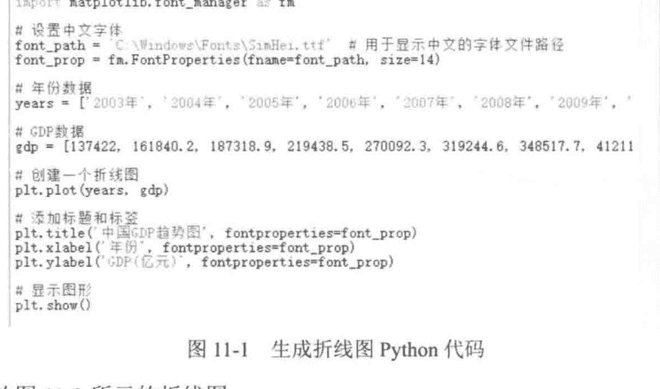
图 11-1 生成折线图 Python 代码

先复现图11-2里折线图的呈现效果。

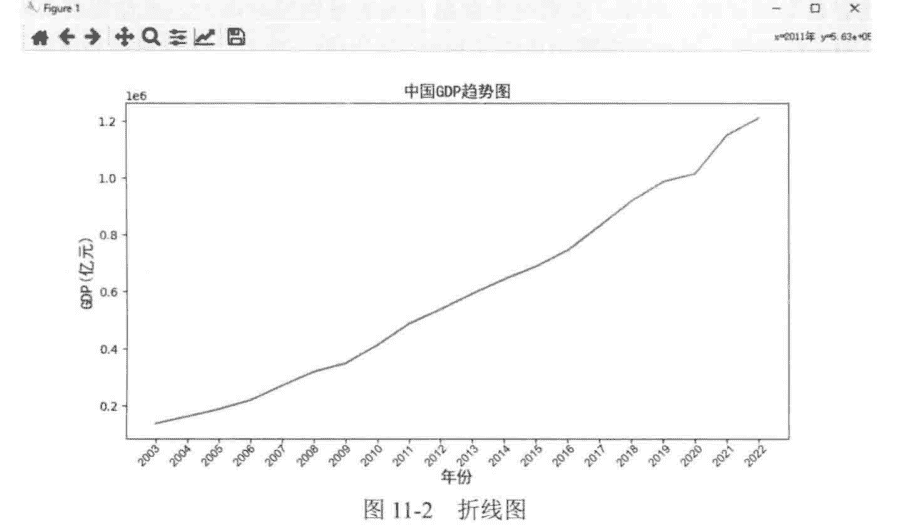
图11-2 折线图速览

### 11.3.3 柱形图制作要点
条形图是用垂直或水平长条来表达频数、数值的可视化形式，也常叫做柱状图。在统计和数据展示里很常见，因为能一眼看出相对大小和变化走向，上手也快。

通常拿来横向对比不同类别或不同时点的数据，例如各行业销售额、各产品销量、人口分布等。每类或每个时间点对应一根独立的柱子，通过高低或长短的差异来体现数量、占比或百分比上的差别。

主要能发挥的作用有：
- 对比不同类别的数量或占比，比如各产品销量、各行业市场份额；
- 呈现数据的演进趋势，比如某地人口增长、某段时间的销售走势；
- 展示数据的分布形态，比如按分组或等级展示来挖掘特征规律；
- 在同一类别内部细分比较，比如产品成本构成、利润分配结构等；
- 按照从大到小排序，凸显数值间的高低差异。

双 y 轴图是在同一张画面里并置两个数据序列，各自拥有独立的 y 轴刻度。
它的核心价值是让两个指标的走势能在同一坐标系下对照，例如销售额和利润在同一时间段内的变化，便于直观看趋势和关联。

使用时要谨慎。双 y 轴虽方便叠加展示，但不当使用容易误导。若两序列量纲差距过大，建议先归一化处理，避免比例失真；同时要挑合适的刻度与标签，减少混淆。

下面以 ChatGPT 生成双 y 柱形图为例，同时呈现 GDP 与 GDP 增长率，y1 对应 GDP，y2 对应 GDP 增长率：

请给出 Python 代码，利用下面数据生成双 y 柱形图，标注中文，x 轴 45° 旋转：地区 GDP（亿元）GDP 增长率（%）北京市 41045.6 8.8 天津市 15685.1 6.6 河北省 40397.1 6.5 山西省 22870.4 9.3 内蒙古自治区 21166 6.7 辽宁省 27569.5 5.8 吉林省 13163.8 6.5 黑龙江省 14858.2 6.1 上海市 43653.2 8.3 江苏省 117392.4 8.9 浙江省 74040.8 8.7 安徽省 42565.2 8.2 福建省 49566.1 8.3 江西省 29827.8 8.9 山东省 82875.2 8.3 河南省 58071.4 6 湖北省 50091.2 12.9 湖南省 45713.5 7.6 广东省 124719.5 8.1 广西壮族自治区 25209.1 7.9 海南省 6504.1 11.3 重庆市 28077.3 8.4 四川省 54088 8.2 贵州省 19458.6 8.1 云南省 27161.6 7.3 西藏自治区 2080.2 6.7 陕西省 30121.7 6.6 甘肃省 10225.5 6.9 青海省 3385.1 5.8 宁夏回族自治区 4588.2 6.8 新疆维吾尔自治区 16311.6 7.2

以下使用 matplotlib 库生成双 y 柱形图的 Python 代码：

```python
import matplotlib.pyplot as plt
import numpy as np

#### 设置中文字体
plt.rcParams['font.family'] = ['SimHei']

#### 数据
regions = ['北京市', '天津市', '河北省', '山西省', '内蒙古自治区', '辽宁省', '吉林省', '黑龙江省', '上海市', '江苏省', '浙江省', '安徽省', '福建省', '江西省', '山东省', '河南省', '湖北省', '湖南省', '广东省', '广西壮族自治区', '海南省', '重庆市', '四川省', '贵州省', '云南省', '西藏自治区', '陕西省', '甘肃省', '青海省', '宁夏回族自治区', '新疆维吾尔自治区']

gdp = [41045.6, 15685.1, 40397.1, 22870.4, 21166, 27569.5, 13163.8, 14858.2, 43653.2, 117392.4, 74040.8, 42565.2, 49566.1, 29827.8, 82875.2, 58071.4, 50091.2, 45713.5, 124719.5, 25209.1, 6504.1, 28077.3, 54088, 19458.6, 27161.6, 2080.2, 30121.7, 10225.5, 3385.1, 4588.2, 16311.6]

gdp_growth = [8.8, 6.6, 6.5, 9.3, 6.7, 5.8, 6.5, 6.1, 8.3, 8.9, 8.7, 8.2, 8.3, 8.9, 8.3, 6.0, 12.9, 7.6, 8.1, 7.9, 11.3, 8.4, 8.2, 8.1, 7.3, 6.7, 6.6, 6.9, 5.8, 6.8, 7.2]

#### x轴标签旋转角度
x_rotation = 45

#### 设置图形大小
fig, ax1 = plt.subplots(figsize=(16, 8))

#### 设置左 y 轴
color = 'tab:red'
ax1.set_xlabel('地区')
ax1.set_ylabel('GDP（亿元）', color=color)
ax1.bar(regions, gdp, color=color)
ax1.tick_params(axis='y', labelcolor=color)

#### 设置右 y 轴
ax2 = ax1.twinx()
color = 'tab:blue'
ax2.set_ylabel('GDP增长率（%）', color=color)
ax2.plot(regions, gdp_growth, color=color)
ax2.tick_params(axis='y', labelcolor=color)
```

受 ChatGPT 输出字数限制，代码未能完整呈现。于是把数据导出到 CSV，再从文件读取，这样能把数据从代码里剥离，缩短代码长度，保证完整展示。

请用 Python3.9 写出完整代码，数据从 CSV 导入，中文标注，x 轴倾斜 45°

假设文件名为 data.csv，文件内容如下：

| 地区 | GDP（亿元） | GDP增长率（%） |
| :--- | :--- | :--- |
| 北京市 | 41045.6 | 8.8 |
| 天津市 | 15685.1 | 6.6 |
| 河北省 | 40397.1 | 6.5 |
| 山西省 | 22870.4 | 9.3 |
| 内蒙古自治区 | 21166 | 6.7 |
| 辽宁省 | 27569.5 | 5.8 |
| 吉林省 | 13163.8 | 6.5 |
| 黑龙江省 | 14858.2 | 6.1 |
| 上海市 | 43653.2 | 8.3 |
| 江苏省 | 117392.4 | 8.9 |
| 浙江省 | 74040.8 | 8.7 |
| 安徽省 | 42565.2 | 8.2 |
| 福建省 | 49566.1 | 8.3 |

## 11.4 聚类分析实操
数据聚类是一种无监督学习技术，能自动把相似样本归到同一组，不需要人工标注或先验知识。目标是找出数据内部的自然分组，每组内部特征相近，与其他组差异明显。常见算法包括：

- K-Means 聚类：预先设定 k 个簇，先随机初始化中心点，再迭代计算样本到中心的距离并分配所属簇，随后更新中心，重复直至收敛。
- 层次聚类：把样本组织成树状结构。可用自底向上合并，或自顶向下分裂，最终形成聚类树。
- DBSCAN 聚类：基于密度的划分，通过半径 r 和最小点数 m 定义高密度区域，把相互连通的高密度点聚成簇。

聚类的价值体现在：
- 揭示数据内在结构和规律，提升理解；
- 挖掘数据背后的关联和信息；
- 辅助分类与预测，为决策提供支持；
- 将海量数据压缩为少数代表簇，降低存储与计算成本；
- 便于可视化分析，快速发现趋势。

应用场景覆盖市场细分、推荐系统、医学诊断、图像分析等。下面以 GDP 增长率做聚类，看各省表现如何分层：

请对下面数据中的 GDP 增长率进行聚类分析，生成 Python3.9 代码，中文标签，数据从 CSV 读取：

| 地区 | GDP（亿元） | GDP增长率（%） |
| :--- | :--- | :--- |
| 北京市 | 41045.6 | 8.8 |
| 天津市 | 15685.1 | 6.6 |
| 河北省 | 40397.1 | 6.5 |
| 山西省 | 22870.4 | 9.3 |
| 内蒙古自治区 | 21166 | 6.7 |
| 辽宁省 | 27569.5 | 5.8 |
| 吉林省 | 13163.8 | 6.5 |
| 黑龙江省 | 14858.2 | 6.1 |
| 上海市 | 43653.2 | 8.3 |
| 江苏省 | 117392.4 | 8.9 |
| 浙江省 | 74040.8 | 8.7 |
| 安徽省 | 42565.2 | 8.2 |
| 福建省 | 49566.1 | 8.3 |
| 江西省 | 29827.8 | 8.9 |
| 山东省 | 82875.2 | 8.3 |
| 河南省 | 58071.4 | 6 |
| 湖北省 | 50091.2 | 12.9 |
| 湖南省 | 45713.5 | 7.6 |
| 广东省 | 124719.5 | 8.1 |
| 广西壮族自治区 | 25209.1 | 7.9 |
| 海南省 | 6504.1 | 11.3 |
| 重庆市 | 28077.3 | 8.4 |
| 四川省 | 54088 | 8.2 |
| 贵州省 | 19458.6 | 8.1 |
| 云南省 | 27161.6 | 7.3 |
| 西藏自治区 | 2080.2 | 6.7 |
| 陕西省 | 30121.7 | 6.6 |
| 甘肃省 | 10225.5 | 6.9 |
| 青海省 | 3385.1 | 5.8 |
| 宁夏回族自治区 | 4588.2 | 6.8 |
| 新疆维吾尔自治区 | 16311.6 | 7.2 |

下面是对给定数据做聚类分析的 Python 代码。采用 KMeans，把地区分成三类，分别命名为“高增长地区”“中等增长地区”“低增长地区”，依据增长率的相对水平划分。

```python
import pandas as pd
from sklearn.cluster import KMeans
import matplotlib.pyplot as plt
import matplotlib.font_manager as fm

### 读取数据
df = pd.read_csv('data.csv', index_col=0)

### 使用 GDP 增长率作为聚类特征
X = df[['GDP增长率（%）']]

### 使用 KMeans 算法聚类
kmeans = KMeans(n_clusters=3, random_state=42).fit(X)

### 添加标签到数据帧
df['标签'] = kmeans.labels_

### 显示聚类结果
plt.scatter(X.values[:,0], [0]*len(X), c=kmeans.labels_)
plt.xlabel('GDP增长率（%）')
plt.yticks([])
plt.title('中国各地区聚类分析')
plt.show()

### 输出聚类结果
print(df.groupby('标签').apply(lambda x: x['地区'].tolist()))
```

输出：

```
标签
0 [湖北省，浙江省，上海市，江苏省，广东省，北京市，天津市，重庆市]
1 [山东省，山西省，福建省，河北省，江西省，云南省，西藏自治区，广西壮族自治区，内蒙古自治区，河南省，安徽省，湖南省，四川省，贵州省，新疆维吾尔自治区，辽宁省，黑龙江省，陕西省，甘肃省，青海省，宁夏回族自治区，海南省]
2 [吉林省]
```

注：结果标签对应关系为，第一类为“高增长地区”，第二类为“中等增长地区”，第三类为“低增长地区”。

因 Python 代码中文显示问题，重新生成一版：

下面是基于 KMeans 对 GDP 增长率做聚类分析的 Python 代码，已把标签改为中文显示。将地区划分为三个簇，按增长率表现分别标注为“高增长地区”“中等增长地区”“低增长地区”。

```python
import pandas as pd
from sklearn.cluster import KMeans
import matplotlib.pyplot as plt
import matplotlib.font_manager as fm

### 读取数据
df = pd.read_csv('data.csv', index_col=0)

### 使用GDP增长率作为聚类特征
X = df[['GDP增长率（%）']]

### 使用KMeans算法聚类
kmeans = KMeans(n_clusters=3, random_state=42).fit(X)

### 添加标签到数据帧
df['标签'] = kmeans.labels_
```

## 11.5 相关性分析精讲
相关性分析是对两个或多个变量间关联程度的探究，常借助统计方法量化。核心目的是判断变量间是否存在联系，可用于数值型、类别型或二元型数据。它是数据分析的重要环节，帮助我们理解变量关系、识别潜在因果并做进一步建模。

常用手段有：
- 相关系数：衡量线性相关强弱，常见有皮尔逊、斯皮尔曼、肯德尔等；
- 散点图：以坐标点展示两变量分布，初步判断关系形态；
- 热力图：用颜色编码相关系数，直观呈现多变量关联；
- 回归分析：刻画自变量与因变量的关系，可用于预测和因果探究。

使用时需注意：
- 相关不等于因果，即使相关性很强也不能断定一方导致另一方；
- 相关主要反映线性关系，面对非线性关联需换方法；
- 相关系数只度量线性强弱，不能完全描述关系强度。

在经济分析中，相关性很有用。例如研究 GDP 与就业率、通胀率与利率的关系，了解它们如何相互影响；找出影响经济指标的关键因素，为政策制定提供依据；利用强相关预测变量走势，当一个指标变动时推断另一个可能方向。

下面用 ChatGPT 对 GDP 总量和 GDP 增长率做了一个相关性分析：

GDP总量和增速，真的有关联吗？

我们把 31 个省级行政区的生产总值和当年增速摆在一起看：北京市 41045.6 亿元，增速 8.8%；天津市 15685.1 亿元，增速 6.6%；河北省 40397.1 亿元，增速 6.5%；山西省 22870.4 亿元，增速 9.3%；内蒙古自治区 21166 亿元，增速 6.7%；辽宁省 27569.5 亿元，增速 5.8%；吉林省 13163.8 亿元，增速 6.5%；黑龙江省 14858.2 亿元，增速 6.1%；上海市 43653.2 亿元，增速 8.3%；江苏省 117392.4 亿元，增速 8.9%；浙江省 74040.8 亿元，增速 8.7%；安徽省 42565.2 亿元，增速 8.2%；福建省 49566.1 亿元，增速 8.3%；江西省 29827.8 亿元，增速 8.9%；山东省 82875.2 亿元，增速 8.3%；河南省 58071.4 亿元，增速 6%；湖北省 50091.2 亿元，增速 12.9%；湖南省 45713.5 亿元，增速 7.6%；广东省 124719.5 亿元，增速 8.1%；广西壮族自治区 25209.1 亿元，增速 7.9%；海南省 6504.1 亿元，增速 11.3%；重庆市 28077.3 亿元，增速 8.4%；四川省 54088 亿元，增速 8.2%；贵州省 19458.6 亿元，增速 8.1%；云南省 27161.6 亿元，增速 7.3%；西藏自治区 2080.2 亿元，增速 6.7%；陕西省 30121.7 亿元，增速 6.6%；甘肃省 10225.5 亿元，增速 6.9%；青海省 3385.1 亿元，增速 5.8%；宁夏回族自治区 4588.2 亿元，增速 6.8%；新疆维吾尔自治区 16311.6 亿元，增速 7.2%。

实现代码如下：

```python
import pandas as pd
import matplotlib.pyplot as plt
import seaborn as sns

### 读取 CSV 文件
df = pd.read_csv('data.csv', encoding='utf-8')

### 绘制散点图并计算相关系数
sns.set(font='SimHei')  # 设置中文字体
plt.scatter(df['GDP（亿元）'], df['GDP增长率（%）'])
plt.xlabel('GDP（亿元）')
plt.ylabel('GDP增长率（%）')
plt.title('GDP和GDP增长率的相关性分析')
corr = df['GDP（亿元）'].corr(df['GDP增长率（%）'])
print('GDP和GDP增长率的相关系数为：', corr)

plt.show()
```

代码跑完会画出散点图，并给出生产总值与增速的相关系数。相关系数在 -1 到 1 之间，越接近 1 说明正相关越强，越接近 -1 说明负相关越强，接近 0 则线性关系很弱。

算出来相关系数为：0.27763591209490307。

图 11-6 即上述代码运行后得到的散点图。

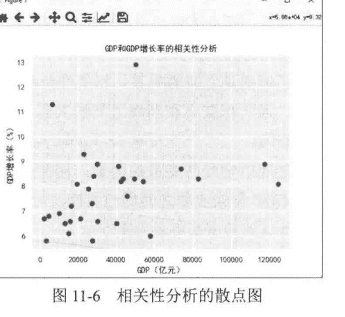

## 11.6 预测

时间序列预测是依据历史序列的规律推断未来的走势。只要掌握一段时间内的序列数据，就能对后续取值进行估计，这在经济、金融、气象、交通和医疗等领域都常用。

通俗说就是用过去的数据里的时间关联，来推测下一步会怎样。常见的建模思路有：

- 线性回归模型：最基础的统计方法，假设自变量和因变量呈线性关系。在时序里常拿时间当自变量，目标值当因变量，用历史数据训练，再外推趋势。优点是简单快速，缺点是对非线性数据效果受限。
- 自回归移动平均模型 ARIMA：把序列拆成自回归、差分、移动平均三部分来刻画规律，适合做线性时序预测、季节调整和趋势判断。
- 季节性自回归移动平均模型 SARIMA：在 ARIMA 基础上加入季节项，用来处理有周期性的数据。
- 自回归条件异方差模型 ARCH：专门处理波动率随时间变化的序列，常用于风险评估。
- 长短期记忆网络 LSTM：一种循环神经网络，能捕捉长时滞和长期依赖，适合复杂时序预测。
- 卷积神经网络 CNN：通过一维卷积提取序列特征，也可用于未来值预测。
- 神经网络自回归模型 NNAR：基于神经网络的非线性自回归方法，对非线性序列的拟合能力更强。
- Prophet 模型：Meta 推出的一套加法模型，把趋势、季节性、节假日效应和随机项拆开建模，对季节和节假日的捕捉比传统线性回归更好，训练速度快，适合大规模数据。

下面用 ChatGPT 对 2023 年的 GDP 做一次试算，要求至少用到三种方法：

采用的数据从 CSV 读取，年份 GDP(亿元) 2003 年 137422，2004 年 161840.2，2005 年 187318.9，2006 年 219438.5，2007 年 270092.3，2008 年 319244.6，2009 年 348517.7，2010 年 412119.3，2011 年 487940.2，2012 年 538580，2013 年 592963.2，2014 年 643563.1，2015 年 688858.2，2016 年 746395.1，2017 年 832035.9，2018 年 919281.1，2019 年 986515.2，2020 年 1013567，2021 年 1149237，2022 年 1210207.2。

选取线性回归、ARIMA 时间序列和 LSTM 循环神经网络三种方法。

用于加载数据、准备样本并训练三种模型的 Python 代码如下：

```python
import pandas as pd
import numpy as np
import matplotlib.pyplot as plt
from statsmodels.tsa.arima_model import ARIMA
from sklearn.linear_model import LinearRegression
from sklearn.metrics import mean_squared_error
from keras.models import Sequential
from keras.layers import LSTM, Dense, Dropout

### 读取数据
df = pd.read_csv('gdp_data.csv', encoding='gbk')
df['年份'] = df['年份'].str.replace('年', '').astype(int)
df['GDP(亿元)'] = df['GDP(亿元)'].astype(float)
df.set_index('年份', inplace=True)

### 划分训练集和测试集
train_data = df[:-2]
test_data = df[-2:]

### 线性回归模型
lr_model = LinearRegression()
lr_model.fit(train_data.index.values.reshape(-1, 1),
            train_data['GDP(亿元)'])
lr_pred = lr_model.predict([[2023]])

### ARIMA 时间序列模型
arima_model = ARIMA(train_data['GDP(亿元)'], order=(1, 1, 1))
arima_result = arima_model.fit(disp=False)
arima_pred = arima_result.forecast(steps=1)[0]

### LSTM 循环神经网络模型
look_back = 5
train_X, train_y = [], []
for i in range(len(train_data)-look_back):
    train_X.append(train_data['GDP(亿元)'].values[i:i+look_back])
    train_y.append(train_data['GDP(亿元)'].values[i+look_back])
train_X, train_y = np.array(train_X), np.array(train_y)
train_X = np.reshape(train_X, (train_X.shape[0], train_X.shape[1], 1))

lstm_model = Sequential()
lstm_model.add(LSTM(50, input_shape=(look_back, 1)))
lstm_model.add(Dropout(0.2))
lstm_model.add(Dense(1))
lstm_model.compile(loss='mean_squared_error', optimizer='adam')
lstm_model.fit(train_X, train_y, epochs=100, batch_size=1, verbose=0)

last_five_years = train_data[-look_back:]['GDP(亿元)'].values.reshape(1, -1, 1)
lstm_pred = lstm_model.predict(last_five_years)

### 输出预测结果
print('线性回归模型预测结果为: %.2f 亿元' % lr_pred)
print('ARIMA 时间序列模型预测结果为: %.2f 亿元' % arima_pred)
print('LSTM 循环神经网络模型预测结果为: %.2f 亿元' % lstm_pred)
```

预测结果为

线性回归模型预测结果为：1328814.01 亿元。

ARIMA 时间序列模型预测结果为：1252184.04 亿元。

LSTM 循环神经网络模型预测结果为：1204002.12 亿元。

综合三种模型的预测结果，可以预计 2023 年。

继续

2023 年的 GDP 大致在 120 万亿元到 133 万亿元之间。需要提醒的是，这些模型仅基于历史规律推断，现实中存在诸多不确定因素，具体数值以实际公布为准。

# 第12章 ChatGPT在不同领域的应用

## 12.1 工业领域

在工业场景里 ChatGPT 的作用很广，能在提效、控质、降本和提升客户满意度上发挥价值。典型用法包括：

- 智能客服：充当机器人客服，回答常见问题并提供技术支持，节省人力、提升响应速度和准确性。
- 智能推荐：基于用户历史行为和偏好给出个性化建议，推动销售和满意度提升。
- 自动化生产：参与质量控制、故障诊断与维修，提升生产效率与产品质量。
- 自动化客户支持：通过分析反馈和问题自动给出帮助，减少人工介入。

### 12.1.1 智能客服和自动化客户支持

ChatGPT 可作为技术支持助手，具体体现为：

- 自动应答高频问题：可预先配置常见设备的配置、使用功能或排错问答，用户提问时快速匹配并给出解法。
- 智能推荐解决方案：面对冷门问题时，结合上下文推断意图，提供针对性建议或进一步的排查指引。
- 自然语言理解：识别用户表达的真实意图，给出正确回复或请求补充信息。
- 多语言支持：支持多种语言交流，让客户使用产品时更顺畅。
- 问题分级：依据提问内容和历史记录对技术支持请求分类，为不同类别匹配不同的处理策略。

### 12.1.2 工业数据的分析与预测

企业可借助 ChatGPT 对生产数据进行分析和前瞻，以优化流程、改善质量。

它能依托机器学习和数据挖掘，对传感器读数、生产参数、环境条件等进行建模，预测质量、性能、可靠性等指标并提出优化方向。

在时序预测方面可用的建模方式包括：

- 基于 ARIMA 的预测：经典时序模型，包含自回归、差分和移动平均，常用以预测设备故障时间或销量等。
- 基于 LSTM 的预测：递归神经网络，擅长处理长期依赖，可预测温度、湿度等环境变化趋势。
- 基于 Seq2Seq 的预测：序列到序列网络，可对下一个时间步进行估计。
- 基于 Prophet 的预测：Meta 开发的模型，能刻画趋势、季节性和异常，可预测销售量、产量等。

这些模型可落地到多种场景。比如用历史故障记录训练 ARIMA 预测设备何时可能失效以安排维护；用油井产量历史训练 LSTM 预测产量走势以调整生产计划；用电力需求历史训练 Seq2Seq 预测未来需求以安排供电；用零售历史训练 Prophet 预测季度销量以规划采购和库存。

实际工业数据分析通常遵循一套流程：先清洗数据，去噪、去异常、统一格式；再建模，用机器学习或深度学习做分类、聚类、回归或时序预测，揭示规律并给出建议；然后可视化，用折线、散点、热力图等直观呈现关系和趋势；最后做数据挖掘，通过文本挖掘、关联规则、时序挖掘等提取关键信息和隐含价值。

## 12.2 医疗领域

ChatGPT 在医疗的应用也日益增多：

- 医疗问答系统：作为核心技术，结合自然语言处理和语义理解，实现医患快速准确沟通，提供咨询、初步判断和用药指导等服务，缓解矛盾并提高资源利用率。
- 电子病历记录：把医生的语音转文字，或从文本输入中抽取关键信息生成结构化病历，减少重复和错误。
- 病例分析和诊断：基于病例描述和检查结果进行分析，预测可能的病种和进展，给出诊疗建议，帮助医生制定方案。
- 医学知识库：构建覆盖常识、病理、诊断标准、治疗方案和用药指南等内容的知识库，供医患学习查询。

总体来看，ChatGPT 有助于提升医疗服务质量和效率，降低成本和误诊风险，改善患者体验。

在个人健康层面，可把它当作家庭医生。举例咨询：

> 在脖子上摸到一个淋巴结，可能是什么问题？

颈部的淋巴结是免疫系统在体表的哨兵，主要负责筛检淋巴液和血液中的病原，出现肿大通常意味着局部或全身正在应对某种应激，比如感染、炎症等。

导致颈部淋巴结增大比较常见的诱因有：

1. 感染因素。感染是最常见的触发原因，常见的来源包括普通感冒、扁桃体发炎、牙龈炎症、中耳炎、鼻窦炎等，也可能由其他病原体引发。
2. 自身免疫问题。像类风湿关节炎、风湿性关节炎、系统性红斑狼疮等免疫相关疾病也会伴随淋巴结反应性增大。
3. 恶性病变。淋巴结肿大可能是肿瘤信号，特别是淋巴瘤和白血病等血液系统恶性疾病。
4. 药物相关反应。部分药物如抗生素、抗肿瘤药物、抗癫痫药等使用后可能出现淋巴结增大的副作用。

一旦发现颈部淋巴结持续肿大，建议尽快就医评估。医生会结合病史询问、体格检查以及必要的实验室和影像学检查来明确原因并制定处置方案。

这部分内容同样适用于解读体检报告中的异常指标。

以肿瘤标志物组合为例，俗称肿瘤三项，其本质是在健康人群中极少出现或含量很低的物质，在某些恶性肿瘤患者中会升高。不同机构检测组合略有差异，常见的包括癌胚抗原 CEA、甲胎蛋白 AFP 和糖类抗原 CA19-9。这三项主要用于疗效监测和复发随访，并不单独作为癌症诊断依据。

有读者反馈体检中 CEA 值为 8.27，参考区间为 0～5，咨询这意味着什么、该怎么应对。

CEA 即癌胚抗原，是一种存在于消化道上皮及部分其他细胞的蛋白，常规参考值一般小于 5ng/mL。数值超出范围提示需要关注，但不能单独定论。

CEA 升高可能出现在以下几种情境：

1. 恶性肿瘤风险。结肠癌、胃癌、肺癌、乳腺癌等肿瘤可能导致该指标上升，但升高不等同于确诊癌症，还需影像和其他检查确认。
2. 炎症状态。肝炎、胰腺炎、结肠炎等炎症性疾病也可能使 CEA 上升。
3. 吸烟影响。吸烟者 CEA 水平往往偏高。

应对方式需个体化，建议尽早与主诊医生沟通进行风险评估。若怀疑肿瘤来源，医生可能会安排 X 光、CT、MRI 等进一步检查以明确诊断并制定计划；若由炎症或其他原因导致，则针对原发病治疗。同时保持健康的生活方式、戒烟等都有积极意义。

## 12.3 金融领域

ChatGPT 在银行和保险等金融场景中，能更好地理解客户提交的文本材料，例如贷款申请、保单申请，提升模型判断的准确性与效率。并且通过对话式交互，帮助客户理解自身风险水平，从而增强满意度与信任感。因此其在金融中的应用有助于提升业务效果和客户体验。

典型应用方向包括：

- 智能客服与聊天机器人：可构建金融领域的智能客服，解答客户关于金融产品服务的疑问，例如查询账户余额、交易明细、贷款利率等。
- 情感分析：可对金融市场的舆情进行分析，帮助投资者把握市场情绪和趋势，例如解析新闻报道与社交媒体评论对某产品或市场的态度。
- 自动化交易：可辅助开发自动化交易系统，快速解读市场动向并预测价格走势，进而执行交易，例如基于自然语言处理的算法交易系统。
- 风险评估：可构建风险评估模型，帮助银行和保险公司判断客户信用风险、欺诈风险等，例如综合个人资料与交易历史进行分析。

需要说明的是，部分工作 ChatGPT 并不能独立完成，也未必必须用 ChatGPT，但任何场景都需要与客户互动，而这正是 ChatGPT 的优势所在。

下面以账户余额查询为例说明自然语言交互流程：

1. ChatGPT 通过语音或文本与客户沟通，请客户指定需要查询的账户。
2. 客户回应并提供信息，例如“查一下我的储蓄账户余额”。
3. ChatGPT 进行自然语言理解，识别出账户类型。
4. 通过调用银行 API，从核心系统中调取对应账户余额。
5. 将结果返回给客户，例如“您的储蓄账户余额为 10000 元”。

通过这种方式，客户无需登录网银或手机银行即可便捷查询，提升便利性与服务体验。

## 12.4 教育领域

ChatGPT 在教学场景中有较多潜能：

- 个性化学习：依据学生的兴趣、学习风格和水平，提供定制化的学习建议和课程推荐。
- 自动化评估：分析作业、考试答卷等评估材料，给教师即时反馈和改进建议。
- 虚拟助手：作为在线教学助理，解答疑问、提供学习资料，增强自主学习能力。
- 自动化翻译：辅助外语文本翻译，提供跨语言学习支持。
- 课程设计：根据需求和兴趣定制个性化课程和学习计划。

要注意，ChatGPT 仅是工具，无法完全取代人类教师和专业教育者，使用时需结合专业判断与合理配合。

教师可借此提升工作效率和质量：

- 教学资料整理与归纳：帮助将笔记、PPT、试卷等转化为可检索文本，快速查找资料。
- 自动评分：训练针对特定科目或领域的评分模型，自动批改作业试卷，减少主观偏差并节省时间。
- 学生问题解答：充当在线答疑机器人，将常见问题与答案纳入训练数据，初步解答学生疑问，减轻教师负担。
- 作文批改：基于优秀作文训练生成评估模型，辅助教师快速给出批改意见。

## 12.5 知识产权领域

在知识产权行业，ChatGPT 可发挥以下作用：

- 快速问答：对技术、法律等专业问题给出全面回答，例如集成电路制造流程、中国发明专利申请条件与授权标准。
- 内容创作：按指令生成文案、宣传材料、法律函件等，甚至撰写论文或长篇报告，文本质量接近人工。
- 技术要点提炼：对输入的专利方案快速归纳技术要点，辅助撰写权利要求、复审意见等，需注意数据不足时可能出错。
- 预测分析：利用时间序列、文本分类、聚类等方法预测技术与行业趋势，例如分析 28nm 制程发展前景。
- 持续互动：可围绕同一问题反复沟通，获得多角度或更精细的答案，类似规避设计或答复审查意见的讨论。
- 系统集成：可与 Bing、Teams 等工具结合，实现会议实时翻译、邮件起草、笔记记录、会议纪要等。

综合来看，技术上可协助四类工作：文本撰写与编辑、文本分析、数据统计分析、信息获取与整合。

因此相关岗位的工作形态会发生变化：

- 秘书类岗位：信函撰写、文件收发、格式编辑、流程处理、会议纪要、统计报表、翻译等事务性工作重复度高，内容生成功能可替代大量重复劳动，并可与办公系统集成提升流程智能化。
- 客服类岗位：解答咨询、反馈流程进度。ChatGPT擅长问答，已在银行、电商等领域应用，知识产权服务业也可依托其提供专业解答并接入案件流程系统查询进度。
- 品牌类岗位：负责品牌文化形象推广，可利用其强大的内容生成能力制作文案、视频等。
- 律师类工作：核心工作难以短期替代，但可在辅助层面发挥作用，例如生成专利侵权警告函、法律文书样本、起诉状范本，并提供法律疑难问题的解答或证据检索思路。
- 专利代理师类：撰写申请文件、答复审查意见等核心工作受保密和沟通限制难以被取代，但可辅助理解技术方案、对比文件、提供撰写思路。
- 答复审查意见是首批可应用场景，可归纳、翻译审查意见通知书并生成参考答复；申请文件撰写受保密限制不可直接生成，但可协助生成权利要求书范本。
- 知识产权咨询师：可帮助快速了解技术领域与竞争对手情况，基于信息整合与模型训练预测发展趋势，提供规避设计、无效证据方面的启发，并辅助关键词扩展、技术体系构建。目前受限于专利数据库未完全接入，专题分析与布局分析尚难介入。
- 财务与年费缴纳：可在理论上自动识别各国专利官费缴纳规定，生成缴费流程并发送提醒，但受数据源和训练不足限制，单件专利缴费状态与后续安排暂无法实现。

应用中需注意法律与伦理风险，主要包括保密风险、知识产权归属风险及相关伦理问题。

# 第13章 —— 综合应用示例

## 13.1 筹备会议

举办研讨会时，ChatGPT 可以承担以下支持工作：

1. 制定活动议程。
2. 编制参会手册。
3. 制作会场地图与交通指引。
4. 安排参会人员住宿。
5. 设计宣传海报。
6. 起草邀请函。
7. 拟写开场致辞。
8. 编制会议预算。
9. 确定专家演讲选题。
10. 筛选邀请专家范围。

以在上海举办的“企业智能化改造技术研讨会”为例：

召开该主题研讨会需要准备的内容包括：活动宣传、场地租赁、主持安排、详细议程、主题演讲、圆桌讨论、设备产品展示、资料准备、餐饮住宿安排以及活动总结等。具体而言，需制作海报与邀请函进行多渠道宣传；租用能容纳参会人员并展示设备的场地；安排主持人引导流程；制定包含致辞、演讲、讨论的议程；邀请行业专家进行演讲；组织企业代表与专家交流实践经验；设置展示区供现场体验；准备手册、发言稿、纪要等资料；安排餐饮与住宿；会后撰写总结报告为下次活动改进。

拟定半天活动议程示例：

时间：半天，上午或下午
主题：企业智能化改造技术研讨会

1. 开场致辞 15 分钟，主持人介绍主题与议程，欢迎来宾并邀请领导致辞。
2. 专题演讲 90 分钟
   2.1 企业智能化改造技术发展趋势与前景 30 分钟
   2.2 智能制造在企业的应用实践 30 分钟
   2.3 智能化改造技术的瓶颈与挑战 30 分钟
3. 分组讨论 60 分钟，围绕技术挑战与瓶颈展开经验分享。
4. 总结发言 30 分钟，各组代表汇报成果，主持人提炼共识。
5. 结束语 15 分钟，感谢来宾并邀请参观技术展示。

参会手册样例：

企业智能化改造技术研讨会参会手册

时间：××××年××月××日上午9:00—下午12:00
地点：×××会议室
主办方：×××公司

参会人员名单示例：×××公司CEO、CTO、COO、CFO、技术总监、市场总监、生产总监、销售总监等。

议程安排示例：
上午
9:00—9:30 签到
9:30—9:40 主持人开场介绍议程
9:40—10:10 主题演讲：企业智能化改造技术的现状与趋势
10:10—10:40 专家论坛：智能制造技术最新应用探讨
10:40—11:00 茶歇
11:00—11:30 企业案例分享：智能制造在×××企业的实践
11:30—12:00 圆桌讨论：智能化改造对企业未来发展的影响
下午安排另行示例。

手册内容包括：会议议程表、主办方介绍与致辞、参会人员名单及简介、演讲与讨论议程、会场地图与交通指南、注意事项与联系方式。

若会议在上海浦东香格里拉酒店举办，场地与交通指引如下：

会议地点：上海浦东香格里拉大酒店三楼宴会厅。

交通指南：
地铁：乘坐地铁 2 号线至世纪大道站，出站后步行约 10 分钟可达。
公交：
1. 乘坐 451、454、640、987、992 路至世纪大道浦东南路站下车，步行约 5 分钟到达。
2. 乘坐 870、961、992、川沙线至花木路浦东南路站下车，步行约 3 分钟到达。

行程提示：请主动告知司机，目的地是浦东南路33号的浦东香格里拉大酒店。

### 宣传海报撰写
这个主题很适合。以下给出一版简洁海报参考：

主标题：企业智改技术研讨会

说明：
诚邀业界同仁参加“企业智能化改造技术研讨会”。本次活动围绕前沿技术与成熟实践展开，探讨如何用技术驱动提升生产效能和竞争优势。

时间：2023年3月20日周一，上午9:00-12:00
地点：上海浦东香格里拉酒店

主旨演讲：
- 《智能工厂：趋势解读与案例分享》，主讲人来自知名企业高管
- 《数字化转型：挑战与机遇》，由行业资深专家主讲

分组研讨：
- 《智能制造：经验交流》，多家企业代表共同参与

亮点：
- 掌握前沿技术动向
- 获取可落地的案例与经验
- 面对面交流专家与企业代表

名额有限，建议尽早报名。

联系方式：电话010-12345678，邮箱info@smartmanufacturing.com

落款：本活动由智能制造促进中心主办，×××公司提供赞助支持。

### 邀请函草稿
尊敬的××先生/女士：

您好！特此邀请您出席“企业智能化改造技术研讨会”。会议旨在分享智能化改造的前沿技术与应用，推动企业数字化转型与智能水平提升，助力企业向更高效智能的方向发展。

本次会议由××公司主办，将邀请多位行业领袖、企业家、学者及专家做主题演讲，分享前沿技术与典型案例，并开展深入对话。

基本信息：
时间：××××年××月××日，上午9点至12点
地点：上海浦东香格里拉酒店，上海市浦东新区世纪大道33号
主题：企业智能化改造技术研讨会
演讲嘉宾：×××，具体名单后续另行通知

议程安排：
- 9:00—9:30 签到
- 9:30—9:40 主办方致辞
- 9:40—10:20 主题演讲1：××××
- 10:20—10:50 嘉宾互动交流
- 10:50—11:30 主题演讲2：××××
- 11:30—12:00 嘉宾互动交流

会议将提供午餐，烦请尽快回复出席意向，以便安排座位与餐食。

期待您的回复！

××公司 敬上

### 开场致辞示例
尊敬的各位嘉宾、女士们、先生们：

大家好！很高兴在这里欢迎大家参加“企业智能化改造技术研讨会”。本次会议聚焦市场新变化与新趋势下的企业智能化改造路径。相信今天的交流能成为一次高效的学习与对话平台，共同分享智能制造领域的最新技术与动态，推动企业创新发展。再次感谢各位的参与与支持，祝本次研讨圆满成功！

### 费用预算示例
以下为费用估算参考：

1. 场地租赁：5000元/天 ×1天 =5000元
2. 嘉宾差旅：600元×5人 =3000元
3. 嘉宾住宿：800元×5人 =4000元
4. 餐饮开支：150元/人×50人 =7500元
5. 宣传物料：5000元
6. 资料印刷：3000元
7. 工作人员人工：3000元
8. 其他杂费：2000元

合计：5000+3000+4000+7500+5000+3000+3000+2000=32500元

说明：以上仅供参考，实际金额需依据会议规模、参会人数及场地选择等具体情况调整。

### 住宿指南参考
参会住宿建议：

1. 上海浦东香格里拉大酒店
地址：上海市浦东新区世纪大道33号
交通：距浦东国际机场约15公里，可乘机场大巴或出租车；距地铁2号线陆家嘴站约500米，步行约8分钟。
价格：豪华房单人约1800元/晚，双人约2000元/晚，提前预订可享折扣。

2. 上海世博洲际酒店
地址：上海市浦东新区浦东大道1188号
交通：距浦东国际机场约25公里，可乘机场大巴或出租车；距地铁6号线世博园站约500米，步行约10分钟。
价格：高级房单人约1200元/晚，双人约1400元/晚，提前预订可享折扣。

3. 上海锦江都城酒店
地址：上海市浦东新区浦东大道1168号
交通：距浦东国际机场约30公里，可乘机场大巴或出租车；距地铁6号线世纪大道站约1.2公里，步行约15分钟。
价格：豪华房单人约900元/晚，双人约1000元/晚，提前预订可享折扣。

注意事项：
1. 请提前致电酒店预订，并说明参加“企业智能化改造技术研讨会”。
2. 住宿费用自理。
3. 其他住宿需求可提前联系会议组委会。

### 主题演讲聚焦方向
专家主题演讲建议聚焦：

1. 智能制造现状与未来走向：介绍技术最新进展及行业发展趋势。
2. 应用案例与实践经验：分享企业落地智能制造的案例及改造效益。
3. 前沿技术与创新成果：人工智能、云计算、大数据等在智能制造中的应用。
4. 政策法规解读：相关政策法规最新说明及对企业的影响。
5. 人才培养与管理：人才培养现状、趋势及企业人才管理经验。

### 专家人选建议
建议邀请群体：

1. 智能制造技术领域知名专家，分享技术趋势与应用案例。
2. 已完成智能化改造的企业负责人，分享转型经验与教训。
3. 政府相关主管部门负责人，介绍政策支持与引导措施。
4. 智能制造领域研究人员，分享学术成果与思考。
5. 智能制造供应商或服务商，介绍产品与服务特点优势。

以上仅供参考，具体人选应结合会议主题与目标确定。

### 专家名单说明
抱歉，前述说明有误。作为AI，我并无现成专家名单。建议根据研讨会主题与议程，从学术界、企业界及政府机构中筛选合适人选，并尽早明确演讲主题与安排后与专家沟通确认出席。

### 专家出场费用构成
专家演讲费用因知名度、经验、时长及差旅等因素而异。通常包括演讲酬金、差旅费用、食宿费用，可能还涉及礼品或酬谢。实际金额需与每位专家单独商定。总体来看，知名专家费用相对较高，新兴或青年学者的费用相对较低。单场演讲费用大致在数千元至数万元区间，叠加交通住宿后总成本会更高。

## 13.2 拟订方案
下面先呈现一份整理的智能制造研究院建设方案，再对照ChatGPT获取的相关内容。

### 智能制造研究院建设方案

#### 一、建设背景与目的
智能制造是近年制造业升级的关键方向，通过引入信息技术、人工智能等先进手段提升效率、降低成本，推动制造业换代升级。

推广中存在诸多挑战：
1. 技术难度高：涉及多学科交叉，需集成多项前沿技术。
2. 投入成本大：技术与资金投入要求高，对企业压力较大。
3. 人才缺口：跨领域专业人才不足。
4. 数字化转型阻力：企业数字化需大量投入，且存在数据隐私与安全问题。
5. 标准不统一：相关技术与标准尚未统一，影响行业协同。

为破解上述问题，需整合资源强化研发，鼓励行业协同，共同推动智能制造发展。

企业智能化改造涉及的技术领域主要有：
1. 计算机视觉技术，实现生产环节智能监测与控制。
2. 机器学习，利用数据分析与预测提升效率。
3. 智能物联网，实现生产环节全面监测与控制。
4. 虚拟现实技术，用于模拟仿真提升效率。
5. 工业互联网，实现生产环节全面监测与控制。
6. 人工智能，实现生产环节智能分析与控制。
7. 云计算，实现生产数据存储与分析。

这些技术均可助力企业提升效率、降低成本、增强智能化水平。

因此，尽管各国都在推进智能制造，但多数企业仍缺乏人才，建设智能制造研究院是实现目标的重要路径。

研究院主要目标：
1. 推动智能制造技术研发，引入先进技术提升效率、降本。
2. 提供技术咨询服务，助力企业更好应用智能制造技术。
3. 培养智能制造专业人才，为行业发展贡献力量。
4. 促进智能制造产业发展，通过技术推广带动产业升级。

#### 二、建设目标
依托知名高校师资与成果，以企业现实与潜在需求为导向，以软硬件与数据技术融合为手段，提供智能化技术整合能力与服务，降低企业成本、提升附加值，实现制造业智能化改造。

核心工作：
1. 收集企业现有需求或结合新技术创造需求，以降本增效为导向。
2. 借助高校资源为企业制定技术方案。
3. 提供总包服务，寻找设备供应商与技术外包合作方。
4. 提供企业因技术或规模限制难以自行的服务。

#### 三、商业模式
研究院可通过多种方式获得收入：
1. 政府补贴，获得运营与发展资金支持。
2. 技术转移，通过技术转让或合作协议获取费用。
3. 培训收费，提供课程与项目获取培训收入。
4. 技术咨询，通过咨询服务获取收入。
5. 研究项目，参与各类项目获取研究经费。
6. 云服务，发展基于云的大数据服务。
7. 产品提成，从客户新设备销售中获取提成。

#### 四、部门构成
可按任务目标设置部门：
1. 市场部门：挖掘合作企业、建立关系、发现需求。
2. 方案部门：提供技术咨询、制定方案、匹配供应与服务商。
3. 项目部门：与高校、供应商、技术外包方合作完成研发项目。
4. 研发部门：研究开发智能制造技术，储备技术方案。
5. 融资部门：对接政府、金融机构，为项目争取财政支持。
6. 培训教育部门：提供培训课程与项目，提升企业人员能力。
7. 财务部门：负责预算、财务报告与审计。
8. 行政管理部门：负责人事、信息与办公管理。

#### 五、人才及技术来源
1. 依托高校引进教授等高层次人才，定期或不定期进驻。
2. 与高校开展横向项目，利用硕博士完成项目任务。
3. 面向社会招聘。
4. 构建智能制造协作生态圈。

生态圈建设步骤：
1. 明确目标：提升竞争力、技术水平与效率。
2. 建立协作机制：定期会议、信息共享等。
3. 吸引成员：制造企业、科研机构、技术服务机构等。
4. 加强合作，实现共同目标。
5. 维护稳定，通过定期评估确保协作顺畅。

以下是来自 ChatGPT 的内容：

### 建立智能制造研究院的背景与目的
智能制造是近年来制造业发展的重要方向，旨在通过引入信息技术、人工智能等先进技术，提高生产效率、降低生产成本，实现制造业的升级换代。

因此，许多国家和地区都在努力发展智能制造，建立智能制造研究院是实现智能制造目标的重要举措。智能制造研究院的主要目的包括：

1. 推动智能制造技术的研发：通过引入先进技术，提高生产效率，降低生产成本。
2. 提供技术咨询服务：为制造业企业提供关于智能制造技术的咨询服务，帮助企业更好地应用智能制造技术。
3. 培养智能制造人才：培养智能制造专业人才，为制造业的发展做出贡献。
4. 促进智能制造产业的发展：通过推广智能制造技术，促进智能制造产业的发展。

总之，智能制造研究院是推动智能制造发展、促进制造业升级换代的重要机构，具有重要的社会意义和经济效益。

### 智能制造研究院可以从事哪些工作？
智能制造研究院可以从事多种工作，以下是一些常见的工作内容：

1. 技术研发：推动智能制造技术的研发，开展前沿性的研究项目。
2. 技术转移：协助制造业企业实现技术转移，帮助企业更好地应用智能制造技术。
3. 技术咨询：为制造业企业提供关于智能制造技术的咨询服务。
4. 人才培养：培养智能制造专业人才，提供人才培养课程和培训项目。
5. 技术标准制定：参与智能制造技术标准的制定，维护智能制造技术的一致性。
6. 技术评估：对智能制造技术进行评估，评估技术的可行性和可推广性。
7. 技术展示：举办技术展览会，展示智能制造技术的最新进展。

这些工作内容是智能制造研究院的主要职能，不同的研究院可能还有其他的工作内容。总之，智能制造研究院的主要目的是推动智能制造技术的发展，促进制造业升级换代。

### 智能制造研究院如何获取收入？
智能制造研究院可以通过多种途径获取收入，以下是一些常见的获取收入的方式：

1. 政府补贴：智能制造研究院可以获得政府的资金支持，以支持研究院的运营和发展。
2. 技术转移：智能制造研究院可以从技术转移中获得收入，例如，通过向企业提供技术转移服务，或通过与企业签订技术合作协议获得技术费用。
3. 培训费用：智能制造研究院可以通过提供培训课程和培训项目获得培训费用。
4. 技术咨询：智能制造研究院可以通过提供技术咨询服务获得技术咨询费用。

### 智能制造研究院应该由哪些部门组成？
智能制造研究院可以根据其特定的任务和目标组成多种部门，但以下是一些通常的部门：

- 1. 研究开发部门：负责研究和开发智能制造技术，以提高生产效率和产品质量。
- 2. 技术转移部门：负责与企业合作，将研究院的技术成果转移到实际生产环境中。
- 3. 培训教育部门：负责提供培训课程和培训项目，以帮助人员提高技能和知识水平。
- 4. 技术咨询部门：负责提供技术咨询服务，以帮助企业解决生产问题。
- 5. 财务部门：负责研究院的财务管理，包括预算编制、财务报告和财务审计等。
- 6. 行政管理部门：负责研究院的行政管理，包括人事管理、信息管理和办公管理等。

这些部门是智能制造研究院的主要组成部分，不同的研究院可能还有其他部门。总之，智能制造研究院需要组织合理，以确保各部门的合作和高效运作。

### 智能制造推进中遇到哪些主要问题？
推广智能制造技术存在一些挑战和问题，如：

- 1. 技术难度：智能制造涉及多学科领域，需要集成多项先进技术，技术难度较高。
- 2. 投资高昂：智能制造需要大量的技术投入和资金投入，这对企业来说是一大挑战。
- 3. 人才缺乏：智能制造涉及多领域的专业知识，但是目前缺乏相关的人才。
- 4. 数字化转型困难：制造业企业的数字化转型需要较大的投入，同时需要解决数据隐私、安全等问题。
- 5. 标准不统一：智能制造涉及的技术和标准目前还没有统一，这对于行业的发展造成了障碍。

为了解决这些问题，智能制造研究院应该充分利用资源，加强技术研发，同时鼓励行业协同合作，共同推动智能制造的发展。

### 企业智能化改造主要涉及哪些技术领域？
企业智能化改造涉及多个技术领域，主要包括：

- 1. 计算机视觉技术：利用计算机图像处理和识别技术实现对生产环节的智能监测和控制。
- 2. 机器学习：利用大量数据进行分析和预测，提高生产效率。
- 3. 智能物联网：通过物联网技术实现对生产环节的全面监测和控制。
- 4. 虚拟现实技术：利用虚拟现实技术进行模拟和仿真，提高生产效率。
- 5. 工业互联网：利用工业互联网技术实现对生产环节的全面监测和控制。
- 6. 人工智能：利用人工智能技术实现对生产环节的智能分析和控制。
- 7. 云计算：利用云计算技术实现生产数据的存储和分析。

这些技术都可以帮助企业实现生产效率的提高，降低生产成本，提高生产环节的智能化水平。

### 如何建立智能制造协作生态圈？
建立智能制造协作生态圈的步骤如下：

- 1. 确定生态圈目标：明确生态圈的建立目的，包括提升制造业竞争力、提高技术水平、提高效率等。
- 2. 建立协作沟通机制：建立适当的协作沟通机制，包括定期会议、信息共享等，以保证生态圈内各方面的协作顺畅。
- 3. 吸引生态圈成员：吸引相关生态圈成员，包括制造企业、科研机构、技术服务机构等。
- 4. 加强生态圈合作：加强生态圈内各方面的合作，以实现共同的目标。
- 5. 维护生态圈稳定：维护生态圈的稳定，通过定期评估等方式确保生态圈内各方面合作顺畅。

总之，建立智能制造协作生态圈需要合适的规划、积极的沟通、强烈的合作意识，以及持续不断的努力。

## 13.3 申请专利

### 实用新型专利申请书

摘要：

轻巧蓝牙便携充电控制方案

本方案聚焦纯电动汽车的移动交流充电需求，提出一套基于 ARM Cortex M0 MCU 的便携式充电器控制电路。整体架构强调体积小巧、制造成本低，同时集成蓝牙无线通信和手机 App 预约功能。核心部件包括 220V 交流开关、继电器驱动单元、电流电压采样互感器、蓝牙通信模块以及 MCU 主控模块。220V 交流开关由继电器与限流电阻构成，其通断受 MCU 控制；互感器负责实时采集输入侧的电压电流；蓝牙模块搭建起充电器与手机 App 之间的无线链路，实现充电状态在线监控与预约操作。该方案为电动车用户提供了低成本、高效便捷且可随身携带的充电方式。

#### 一、发明名称
本申请的题名为“一种新型纯电动汽车便携式充电器电路板设计”。

#### 二、技术领域
本申请归属于电子技术范畴，具体涉及纯电动汽车充电器电路板的设计方向。

#### 三、背景技术
社会快速发展推动电动汽车普及，动力来源依赖电池组，而电池续航有限，耗尽后须及时补电。现行充电方式主要有家用插座慢充、专用充电桩快充、公共快速充电站超充。家用 220V 插座配合便携式交流充电器，可在任意时间地点为车辆补电，使用便捷。

本次实用新型的背景正是围绕纯电动汽车便携式交流充电器的控制电路展开，目的在于打造简洁、易用、高效的控制方案，满足便携、低价、智能化诉求。

便携性方面，需兼顾重量、尺寸与携带体验，须压缩电路板面积与重量，选择高集成度元件与紧凑拓扑，确保单块小板即可承载全部必要功能。

成本方面，需结合市场需求与竞争态势，在保证品质与性能前提下，通过低价元器件选型与优化工艺来压缩售价。

蓝牙通信方面，需实现充电器与用户手机的无线互联，支持双向数据交互与状态上报，相关硬件电路与软件协议须配合开发。

App 预约方面，需为用户提供便捷的充电预约服务，兼顾操作易用性、界面美观度与多平台兼容性，提升使用体验。

#### 四、发明内容
本申请涉及一种具备小型化、低成本、蓝牙互联、App 预约功能的纯电动汽车便携式交流充电器控制电路，控制核心采用 ARM Cortex M0 MCU。

目的在于提供一款体积小、成本低、携带方便的交流充电器，并可通过蓝牙与手机 App 实现预约控制。

技术实现上，控制电路由电源模块、充电模块、控制模块、蓝牙模块和互感器模块构成。

电源模块提供双路供电，直流供电为控制、蓝牙、互感器等弱电部分供电，交流供电为充电功率回路供电。

充电模块负责将交流电转换为车辆所需直流电，并输出至车载电池。

控制模块以 ARM Cortex M0 MCU 为核心，统筹各模块运行状态，并下发指令至蓝牙模块。

蓝牙模块搭建充电器与手机的通信通道，App 可远程操控充电器。

互感器模块实时采用户端输入电压与电流，并回传 MCU 计算能耗与充电进度。

优势体现为：

- 结构紧凑便携，携带使用便利。
- 成本可控，适合家庭与商业场景推广。
- 支持蓝牙与 App 远程预约与操控。
- 选用 ARM Cortex M0 MCU，性能可靠功耗低，提升整体工作效率。

因此该技术路线具备广阔应用前景。

#### 五、实施方式
具体实施包含以下要点：

- 1. 控制器选型：选用 ARM Cortex M0 MCU 作为主控，实现逻辑控制与蓝牙通信。
- 2. 电源管理电路设计：构建稳健的供电管理，保证主控稳定运行。
- 3. 继电器控制电路设计：利用继电器切换交流回路，实现对车辆充电的通断控制。
- 4. BLE 蓝牙通信电路设计：采用低功耗蓝牙模块实现与手机无线互联，支持远程监控与操控。
- 5. 充电状态检测电路设计：通过互感器采集充电电流电压，反馈至主控以监测充电状态。
- 6. 手机 App 开发：依据用户需求开发 App，支持远程控制、充电预约、实时监测等功能。

#### 六、附图说明
附图为本发明示意说明：

- 图 1 为便携式充电器电路板正面视图。
- 图 2 为便携式充电器电路板反面视图。
- 图 3 为便携式充电器电路板电路连接图。
- 图 4 为充电控制芯片电路图。
- 图 5 为电源管理模块电路图。
- 图 6 为电源电路模块电路图。

#### 七、权利要求书
1. 一种纯电动汽车便携式交流充电器控制电路，包含：ARM Cortex M0 微控制器、继电器模块、电流互感器模块、电压互感器模块、蓝牙通信模块、电源模块。
2. 根据权利要求 1 所述的控制电路，其中 ARM Cortex M0 微控制器与继电器模块、电流互感器模块、电压互感器模块、蓝牙通信模块、电源模块通过引脚焊接至电路板再以导线互联。
3. 根据权利要求 1 或 2 所述的控制电路，其中继电器模块通过继电器实现交流电通断控制。
4. 根据权利要求 1 或 2 所述的控制电路，其中电流互感器模块用于采集充电电流。
5. 根据权利要求 1 或 2 所述的控制电路，其中电压互感器模块用于采集充电电压。
6. 根据权利要求 1 或 2 所述的控制电路，其中蓝牙通信模块用于与手机 App 通信。
7. 根据权利要求 1 或 2 所述的控制电路，其中电源模块为电路提供工作电源。
8. 根据权利要求 1 或 2 所述的控制电路，其中 ARM Cortex M0 微控制器依据电流与电压互感器测得数据控制继电器通断。
9. 根据权利要求 1 或 2 所述的控制电路，其中蓝牙通信模块向 App 发送充电状态并接收控制指令。
10. 根据权利要求 1 或 2 所述的控制电路，其中 ARM Cortex M0 微控制器具备预约充电功能。

### 如何写实用新型专利申请书？
撰写实用新型申请书一般包含：

- 1. 专利申请人信息：姓名、地址、邮编、联系方式等。
- 2. 发明名称：对发明进行简要概括。
- 3. 技术领域：界定所属技术方向。
- 4. 背景技术：描述现有技术现状与问题，说明本发明的改进点。
- 5. 发明内容：详细阐述构成、结构、原理。
- 6. 实施方式：给出具体实施方法，便于复现。
- 7. 附图说明：提供示意图或细图辅助理解。
- 8. 权利要求书：明确保护范围。

撰写时应准确简洁，避免模糊表述，注意保密核心技术。建议在起草前完成技术调查与专利检索，防止与在先技术冲突。

### 纯电动汽车交流充电器控制电路设计方面有哪些相似的专利，请给出专利号
相关领域专利较多，举例如下：

- (1) CN201630578520.9——一种纯电动汽车交流充电机控制方法及装置。
- (2) CN106372347A——一种用于纯电动汽车的交流充电器控制装置和方法。
- (3) US20170145659A1——纯电动汽车交流充电机控制方法及装置。
- (4) CN203833444U——一种交流充电器的控制装置及纯电动汽车充电系统。
- (5) US10326678B2——纯电动汽车交流充电机的控制方法及装置。

各专利技术实现略有差异，均聚焦交流充电器控制电路设计。

### US20170145659A1 专利的中文摘要
该专利提出一种电动汽车便携交流充电系统，包含控制单元、便携充电装置及连接器。便携装置含变压器与电源模块。连接器接入车载充电口时，控制单元识别口类型并匹配相应电压电流，向便携装置发送充电请求，供给电池充电。充电过程中实时监测状态与电量，完成后停止。该系统实现便携交流充电，兼容多种车型。

### 纯电动汽车便携式充电器电路板的实用新型专利申请书
致专利审查员：

申请人 XXX 申请一项关于纯电动汽车便携式充电器电路板的实用新型专利，具体内容与附图如下：

#### 一、发明名称
本发明名称为“XXX 纯电动汽车便携式充电器电路板”。

#### 二、技术领域
本发明属于电子技术，具体为纯电动汽车充电器电路板技术。

#### 三、背景技术
纯电动汽车日益普及，长时间行驶后电池电量下降需充电。在旅途或缺乏充电设施场所，车主难以及时补能，影响出行。

市场已有便携充电器，但传统产品体积大、操作繁琐、充电速度慢。

#### 四、发明内容
本发明提供一种便携式充电器电路板，含直流输入接口、直流输出接口、充电控制芯片、电源管理模块与电源电路模块：

- （1）输入输出接口采用插拔式结构，便于连接电源并保证稳定性与安全性。
- （2）充电控制芯片支持快充与智能管理，具备多重保护机制。
- （3）电源管理模块可自适应电池容量，提升充电效率。
- （4）电源电路模块设计高效稳定，提供可靠电压电流，保障充电速度与质量。

#### 五、附图说明
附图示意如下：

- 图 1 为电路板正面图。
- 图 2 为电路板反面图。
- 图 3 为电路连接图。
- 图 4 为充电控制芯片电路图。
- 图 5 为电源管理模块电路图。
- 图 6 为电源电路模块电路图。

### 纯电动汽车便携式交流充电器控制电路设计的背景技术
现代社会电动汽车关注度提升，纯电动汽车环保经济低噪。动力来源于电池，续航有限需充电。当前公共充电设施建设不足，尤其偏远地区覆盖率低，给使用带来不便。

为此提出便携式交流充电器方案，可随时随地补电，提升使用便利性。本实用新型针对便携式交流充电器控制电路设计，旨在提供简便高效控制方案，实现精准控制，提高效率与安全性，改善使用体验。

### 围绕小型便携、成本控制、蓝牙通信、手机 App 预约拓展
小型便携方面，需关注重量、体积与携带舒适度，优化电路板尺寸，选用高效紧凑元件与结构，在有限空间实现全部功能。

成本控制方面，需结合市场需求与竞争情况，在保证质量性能前提下，通过低成本元器件与工艺控制制造成本。

蓝牙通信方面，需实现充电器与手机无线互联，支持用户通过手机操控充电器，需配套硬件电路与软件开发实现双向通信与数据传输。

手机 App 预约方面，需提供便捷预约充电服务，考虑 App 易用性、界面美观与兼容性，使用户能随时预约充电。

### 电动车充电有哪些方式？
电动车充电方式主要分为三类：

- （1）家用插座充电：使用普通家用电源插座，充电慢，适合家庭或公司停车场应急使用。
- （2）专用充电桩充电：功率较高，充电更快，常部署于停车场与小区，可通过 App 预约支付。
- （3）快速充电站充电：功率最高，部署于高速服务区等，可快速充满，但对电池寿命有一定影响，需谨慎使用。

### 对使用家用插座充电的充电器设计有什么要求？
设计需满足：

- （1）安全性：符合电气安全标准，防止故障、过载、短路，接口线缆符合规范。
- （2）充电效率：转换效率高，充电稳定快速。
- （3）适用性：兼容多种车型，适应不同国家电网与插座标准。
- （4）耐用性：可靠性高，长期稳定工作不易损坏。
- （5）便携性：轻巧易携，便于使用。
- （6）智能化：可连接手机 App，实现远程控制与监测。

纯电动汽车便携式交流充电器控制电路，具有小型、低成本、蓝牙通信、手机 App 预约特点，采用 ARM Cortex M0 MCU。

本发明涉及一种纯电动汽车便携式交流充电器控制电路，具备小型化、低成本、蓝牙通信及 App 预约功能，采用 ARM Cortex M0 MCU 作为核心。

### 13.4 软件开发

#### 13.4.1 软件开发文档
以电动汽车充电枪手机 App 为例。

开发手机 App 需准备的文档清单包括：

- （1）需求文档：明确功能与目标用户，含用例、需求说明与功能列表。
- （2）项目计划：规划时间表、资源、进度与风险。
- （3）设计文档：详细描述 UI 设计、功能结构、数据结构与系统架构。
- （4）数据库设计文档：规划数据存储与结构。
- （5）编码文档：对代码进行注释与说明。
- （6）测试文档：验证功能与性能。
- （7）用户手册：说明使用方法、功能与常见问题。
- （8）产品发布计划：规划发布渠道、时间与营销策略。
- （9）法律文档：遵守隐私协议、版权与知识产权法规。
- （10）其他文档：如用户调研报告、市场调查报告等。

在撰写需求文档时需提供充分上下文，例如：开发面向家庭 220V 便携充电枪的 App，支持蓝牙连接，可直接充电或预约充电，预约模式可设充满停止或指定时长，请提供需求文档。

后续文档可逐步细化，追问可促使完整输出。以电动汽车充电枪操作 App 为例，需求文档范例开头为：

#### 应用程序需求文档

##### 1. 应用程序概述

这是一款为家用 220V 便携式充电枪打造的手机端控制工具，核心工作就是让用户可以通过 App 来管理充电行为。整个产品围绕账号体系、充电模式选择、预约逻辑、蓝牙直连以及历史回溯来展开。

##### 2. 应用程序用例
本次方案覆盖的典型使用场景如下：

- （1）用户注册
首次打开 App 时需要创建账号，填写用户名、登录密码、手机号码等基础资料。
- （2）用户登录
用已注册的账号信息完成身份验证进入系统。
- （3）选择充电方式
进入操作后可自行决定立即开始充电还是采用预约充电。
- （4）预约充电
设定一个未来时段启动充电，并可选择以电量充满为终点或以指定时长为终点。
- （5）蓝牙连接充电枪
在 App 内部通过蓝牙搜索并配对家用 220V 便携式充电枪，建立本地通信。
- （6）查看充电记录
翻阅过往的充电档案，内容包含充电起止时间、采用的方式、累计时长以及费用等。

##### 3. 应用程序功能列表
功能点汇总为：

- （1）用户注册与登录。
- （2）充电方式选择。
- （3）预约充电。
- （4）蓝牙连接充电枪。
- （5）充电记录浏览。

##### 4. 应用程序界面设计
界面规划如下：

- （1）登录界面：输入用户名与密码完成登录。
- （2）主界面：集中呈现充电模式选择、预约入口、记录查询等核心入口。
- （3）充电详情界面：展示本次充电的时长与费用等关键数据。
- （4）蓝牙连接界面：支持搜索与配对家用 220V 便携式充电枪。
- （5）充电记录界面：列表化呈现历史充电信息。

##### 5. 应用程序技术要求
技术层面需满足：

- （1）支持通过蓝牙与充电枪通信。
- （2）兼容 Android 与 iOS 两大移动系统。
- （3）具备多语言环境适配能力。
- （4）对用户信息与充电记录实现安全与隐私保护。

##### 6. 应用程序测试要求
测试范围包括：

- （1）执行全面的功能测试、兼容测试、性能测试与安全测试。
- （2）在多种语言环境下验证可用性。
- （3）进行压力测试，检验高负载下的稳定性。
- （4）结合黑盒与白盒手段检验安全与隐私机制。

##### 7. 应用程序部署要求
部署方面要求：

- （1）在云服务器上上线，保证稳定与可用。
- （2）具备自动更新能力，确保用户始终使用最新版本。
- （3）提供日志记录与错误上报，便于运维排查。
- （4）适配多种机型与系统版本，保证兼容性。

##### 8. 应用程序维护和升级要求
运维要求为：

- （1）定期维护，包含数据库备份与系统优化。
- （2）快速修复用户反馈的问题与缺陷。
- （3）按期迭代，保证功能更新与体验提升。
- （4）依托开发者社区提供技术支持，维持系统稳定。

##### 9. 应用程序的用户体验
体验侧重：

- （1）界面简洁明了，操作路径清晰。
- （2）反馈及时，让用户清楚每一步结果。
- （3）配备完善的帮助与说明文档。
- （4）交互设计人性化，降低操作门槛。

##### 10. 应用程序的上线和推广
推广策略：

- （1）在 Google Play、App Store 等主流商店上线。
- （2）通过社交媒体宣传与广告投放进行曝光。
- （3）依据用户反馈持续优化功能与体验。
- （4）搭建用户社区，积极回应需求。

##### 11. 应用程序的预算和开发周期
成本与周期预估：

- （1）开发周期约 3 个月。
- （2）开发人力成本为 ××× 元。
- （3）云服务器租赁费用为 ××× 元/月。
- （4）推广费用为 ××× 元。
- （5）总成本预估为 ××× 元。

##### 12. 应用程序开发团队
人员分工：

- （1）产品经理：负责需求梳理与产品方案。
- （2）UI 设计师：负责界面与交互视觉。
- （3）Android 开发工程师：负责安卓端实现。
- （4）iOS 开发工程师：负责苹果端实现。
- （5）后端开发工程师：负责服务端开发与运维。
- （6）测试工程师：负责质量把控与测试执行。

##### 13. 总结
本方案完整阐述了电动汽车充电枪操作 App 的需求与规格，涵盖功能、性能、安全等维度。产品需支持蓝牙直连、预约充电、多语言与数据隐私保护，同时明确了技术、测试、部署、维护、体验、上线等全流程要求，并给出预算、周期与团队配置。

> 请给出项目计划

电动汽车充电枪操作 App 项目安排如下：

###### 阶段一：需求分析和设计
时间：1 个月
任务：
- （1）与客户确认需求与业务流程，形成需求文档。
- （2）完成 UI 界面与交互流程设计，形成设计文档。
- （3）编制功能规格说明文档。
成果：
- （1）需求文档。
- （2）设计文档。
- （3）功能规格说明文档。

###### 阶段二：开发和测试
时间：2个月
任务：
- （1）完成 Android 与 iOS 双端开发。
- （2）完成后端开发并部署。
- （3）制定并执行测试计划，覆盖单元、集成、系统与用户验收。
成果：
- （1）可执行 App 安装包。
- （2）后端服务器环境。
- （3）测试报告。

###### 阶段三：部署和发布
时间：1个月
任务：
- （1）将 App 部署至云端与应用商店。
- （2）制定推广策略与执行方案。
- （3）监控运行状态与收集用户反馈。
成果：
- （1）正式上线并启动推广。
- （2）运行监测与反馈报告。

###### 阶段四：维护和升级
时间：长期
任务：
- （1）持续监控运行与用户反馈。
- （2）定期维护与迭代，包含缺陷修复、性能优化与功能新增。
成果：
- （1）周期性运行与反馈报告。
- （2）维护与升级报告。

总体节奏可控，具体时间会根据实际情况微调，但需保证协同高效。

> 请给出设计文档

电动汽车充电枪操作 App 设计要点：

##### 1. 界面设计
需提供：
- （1）登录 / 注册界面
- （2）主界面
- （3）充电控制界面
- （4）预约充电界面
- （5）充电历史记录界面

##### 2. 数据库设计
核心表结构：
- （1）用户表：用户 ID、用户名、密码、联系方式等。
- （2）充电历史记录表：记录 ID、用户 ID、开始时间、结束时间、时长、方式等。

##### 3. 功能模块设计
模块划分：
- （1）用户管理模块：注册、登录、个人信息修改、密码重置。
- （2）充电控制模块：模式选择、开始/结束充电、实时状态监控。
- （3）预约充电模块：预约时段选择、方式设定、取消预约。
- （4）充电历史记录模块：记录浏览与导出。

##### 4. 技术方案设计
技术选型：
- （1）开发平台：Android、iOS。
- （2）前端技术：采用 React Native 实现跨平台。
- （3）后端技术：Node.js 提供 API，MongoDB 存储数据。
- （4）蓝牙连接：借助 React Native 蓝牙模块。
- （5）推送服务：使用 Firebase Cloud Messaging。

> 请给出数据库设计文档

用户表 users
字段 user_id 类型 integer 描述 用户 ID
字段 username 类型 string 描述 用户名
字段 password 类型 string 描述 密码
字段 email 类型 string 描述 电子邮件
字段 phone_number 类型 string 描述 联系电话
字段 created_at 类型 datetime 描述 创建时间
字段 updated_at 类型 datetime 描述 更新时间

充电历史记录表 charge_history
字段 user_id 类型 integer 描述 用户 ID
字段 username 类型 string 描述 用户名
字段 password 类型 string 描述 密码
字段 email 类型 string 描述 电子邮件
字段 phone_number 类型 string 描述 联系电话
字段 created_at 类型 datetime 描述 创建时间
字段 updated_at 类型 datetime 描述 更新时间

#### 请给出测试文档
测试文档覆盖：

##### 1. 功能测试
验证注册登录登出、充电站列表选择、记录查看创建取消、开始结束充电及断电处理、预约与取消及失败处理、费用计算支付退款，以及在 2G/3G/4G/Wi-Fi 与多设备下的表现。

##### 2. 性能测试
关注启动耗时、响应与切换速度、内存占用、CPU 使用率、耗电情况、并发用户与请求量。

##### 3. 兼容性测试
在 iOS/Android、不同机型与分辨率、不同屏幕尺寸下验证运行与 UI 布局。

##### 4. 安全测试
检查密码、手机号、支付信息等隐私保护情况，排查 SQL 注入、XSS 等漏洞，抵御暴力破解、DDoS 等攻击。

##### 5. UI 测试
核对设计一致性与易用性，多设备下的布局、配色、字体大小与图片清晰度。

##### 6. 其他测试
GPS 定位精度与响应、蓝牙连接稳定性与数据传输、离线可用性、多语言支持等。
测试需完整记录用例、环境、结果与问题处理，为修复与迭代提供依据。

#### 请给出用户手册
用户手册应包含：

##### 1. 产品介绍
简述功能、适用范围、使用方法与安装方式。

##### 2. 下载和安装
说明下载渠道、安装步骤与系统版本要求。

##### 3. 注册和登录
介绍注册流程、信息校验要求与登录操作。

##### 4. 充电站列表
说明如何进入列表、查看信息与筛选方式。

##### 5. 充电流程
描述选择站点、启动与结束充电、时间计算、注意事项与收尾处理。

##### 6. 预约充电
说明进入预约页、选择时段、失败处理。

##### 7. 充电记录
说明进入记录页、信息展示与筛选。

##### 8. 充电费用
说明费用规则、支付方式与退款流程。

##### 9. 设置
语言、声音、通知与账户管理等设置方法。

##### 10. 常见问题解答
列出崩溃、蓝牙连接失败、充电中断等典型问题与解决建议，并提供客服联系方式。

#### 请写一下用户手册中的产品介绍
欢迎使用电动汽车充电枪操作 App。该应用为家庭 220V 便携式充电枪提供便捷操控，支持蓝牙直连，可选择即时充电或预约充电，预约可设定充满即停或时长限制。
主要功能包括充电站列表查询与筛选、充电流程引导、预约充电设定、历史记录查看、费用计算支付退款，以及语言、声音、通知与账户等个性化设置。操作简便，帮助用户高效管理充电需求，遇到问题可随时联系客服。

#### 请写出产品的使用范围
- （1）使用对象：面向拥有家用 220V 便携式充电枪的电动车主。
- （2）地理位置：受充电点分布限制，主要服务城市家庭与小型场景用户。
- （3）操作平台：兼容 iOS 与 Android，支持手机与平板。
- （4）版本要求：需较新系统版本，设备与充电枪蓝牙功能正常。
总体适配家庭或轻量级充电场景，提升效率与体验。

#### 请写一下产品发布计划
- （1）Alpha 测试：内部验证基本功能与稳定性，符合需求与设计规范。
- （2）Beta 测试：邀请部分用户体验充电流程、预约、记录等，收集反馈。
- （3）正式发布：据测试结果优化后在应用商店上线并启动营销。
- （4）后续迭代：持续关注反馈，按需新增功能与优化体验。
计划三个月内完成测试并发布正式版，配合宣传扩大用户规模。

### 13.4.2 软件开发技术
开发过程中可借助大模型解决不熟悉的问题，例如 BLE 蓝牙技术细节、登录验证实现、SQL 查询编写等。模型可直接给出代码片段，需补充完善后在开发环境中调试。
手机 App 开发工具链应该如何选择？

搭建移动应用开发工具链，得结合项目目标与团队实战背景来定，以下是常见的选型思路：

- (1) 目标平台取舍：iOS 与 Android 各有优势。若预期用户规模有限，可先聚焦单一平台上线，节省时间和成本。若希望覆盖更广的用户群体，则可考虑双平台并行开发。
- (2) 编程语言取舍：iOS 侧常用 Objective-C 或 Swift，Android 侧常用 Java 或 Kotlin。优先选用团队已熟练掌握的语言，能显著提升开发效率。
- (3) 集成开发环境取舍：iOS 常用 Xcode、AppCode 等，Android 常用 Android Studio、Eclipse 等。选一个功能完善、操作顺手的 IDE，能让开发更流畅。
- (4) 第三方库与框架取舍：App 开发会用到网络请求、数据库 ORM、图片处理等各类组件。挑选稳定、易集成的库和框架，可以压缩周期并降低风险。
- (5) 版本控制工具取舍：Git、SVN 是常见选择。挑一个上手快、能满足协作需求的工具，有助于团队协同和版本管理。
- (6) 测试工具取舍：一个可靠的测试方案可以帮助团队早发现早修复问题，从而提升应用的质量与稳定性。

总体来说，合适的工具链是项目需求、团队技能经验以及可用资源综合权衡的结果。

#### BLE 原理与 Android 接口简述
BLE 即蓝牙低功耗，是一种短距离无线通信方案，常用于智能设备与手机间的交互。其通信方式主要分广播与连接两种。

广播模式下，BLE 设备会周期性发出广播包，里面携带设备名称、服务 UUID 等信息。其他设备通过扫描周边广播即可发现它。连接模式下，双方建立连接后可实现双向数据交互。

在 Android Studio 里，常用的 BLE 开发接口包括 BluetoothAdapter、BluetoothDevice、BluetoothGatt 和 BluetoothGattCallback。

BluetoothAdapter 代表本地蓝牙适配器，可用于开关蓝牙、发起扫描、获取已配对设备列表等操作。
BluetoothDevice 代表远程蓝牙设备，可用于发起连接、读取设备名称与地址等。
BluetoothGatt 代表一个 GATT 连接，可用于发现服务、读写特性值等。
BluetoothGattCallback 用于监听连接状态变化、服务发现完成、特性读写完成等事件，开发者可重写相关方法来实现业务逻辑。

以上是对 BLE 原理及接口的简要介绍，实际开发中需按具体需求和场景挑选合适的接口和方法。

#### Android Studio 下 BLE 扫描连接示例
下面以 Android Studio 实现 BLE 查找和通信的代码示例：

先在 AndroidManifest.xml 中声明蓝牙权限：

```xml
<uses-permission android:name="android.permission.BLUETOOTH_ADMIN"/>
```

然后在 Activity 中初始化蓝牙适配器：

```java
private BluetoothAdapter mBluetoothAdapter;
private BluetoothLeScanner mBluetoothLeScanner;
private BluetoothGatt mBluetoothGatt;

// 初始化蓝牙适配器
private void initBluetooth() {
    final BluetoothManager bluetoothManager =
            (BluetoothManager)
            getSystemService(Context.BLUETOOTH_SERVICE);
    mBluetoothAdapter = bluetoothManager.getAdapter();
    mBluetoothLeScanner = mBluetoothAdapter.getBluetoothLeScanner();
}
```

开始扫描：

```java
private ScanCallback mScanCallback = new ScanCallback() {
    @Override
    public void onScanResult(int callbackType, ScanResult result) {
        super.onScanResult(callbackType, result);
        BluetoothDevice device = result.getDevice();
        // 判断设备名称是否符合要求
        if (device.getName() != null && device.getName().startsWith("BLE")) {
            // 连接设备
            connectToDevice(device);
        }
    }
};

// 开始扫描
private void startScan() {
    ScanSettings settings = new ScanSettings.Builder()
            .setScanMode(ScanSettings.SCAN_MODE_LOW_LATENCY)
            .build();
    List<ScanFilter> filters = new ArrayList<>();
    ScanFilter filter = new ScanFilter.Builder()
            .setServiceUuid(ParcelUuid.fromString(SERVICE_UUID))
            .build();
    filters.add(filter);
    mBluetoothLeScanner.startScan(filters, settings, mScanCallback);
}
```

建立连接：

```java
private void connectToDevice(BluetoothDevice device) {
    mBluetoothGatt = device.connectGatt(this, false, mGattCallback);
}

private BluetoothGattCallback mGattCallback = new BluetoothGattCallback()
{
    @Override
    public void onConnectionStateChange(BluetoothGatt gatt, int status, int newState) {
        super.onConnectionStateChange(gatt, status, newState);
        if (newState == BluetoothProfile.STATE_CONNECTED) {
            // 连接成功，开始发现服务
            gatt.discoverServices();
        } else if (newState == BluetoothProfile.STATE_DISCONNECTED) {
            // 断开连接
            gatt.close();
            mBluetoothGatt = null;
        }
    }

    @Override
    public void onServicesDiscovered(BluetoothGatt gatt, int status) {
        super.onServicesDiscovered(gatt, status);
        if (status == BluetoothGatt.GATT_SUCCESS) {
            // 发现服务成功
            BluetoothGattService service =
                gatt.getService(UUID.fromString(SERVICE_UUID));
            if (service != null) {
                // 获取特征值
                BluetoothGattCharacteristic characteristic = service.
                    getCharacteristic(UUID.fromString(CHARACTERISTIC_UUID));
                if (characteristic != null) {
                    // 开始通信
                    gatt.setCharacteristicNotification(characteristic, true);
                }
            }
        }
    }

    @Override
    public void onCharacteristicChanged(BluetoothGatt gatt,
        BluetoothGattCharacteristic characteristic) {
        super.onCharacteristicChanged(gatt, characteristic);
        // 接收数据
        byte[] data = characteristic.getValue();
    }
};
```

以上仅为示例片段，具体落地仍需结合实际需求做适当调整。

#### 登录校验 SQL 示例
一个简易的登录验证 SQL 如下：

```sql
SELECT * FROM users WHERE username='[username]' AND password='[password]'
```

其中 [username] 和 [password] 分别为待校验的用户名和密码。若在 users 表中查到匹配记录，则视为验证通过，否则验证失败。

### 13.4.3 软件开发代码
#### 编码文档参考
以下是电动汽车充电枪操作手机 App 的编码文档，可供开发参考：

##### 1. 登录界面
```javascript
import React, { useState } from 'react';
import { View, Text, TextInput, TouchableOpacity } from 'react-native';
import { styles } from './styles';

export const LoginScreen = ({ navigation }) => {
  const [username, setUsername] = useState('');
  const [password, setPassword] = useState('');

  const handleLogin = () => {
    // TODO: 调用登录 API
    // 如果登录成功，跳转到主界面
    navigation.navigate('Main');
  };

  return (
    <View style={styles.container}>
      <Text style={styles.title}>登录</Text>
      <TextInput
        style={styles.input}
        placeholder="用户名"
        onChangeText={setUsername}
        value={username}
      />
      <TextInput
        style={styles.input}
        placeholder="密码"
        secureTextEntry={true}
        onChangeText={setPassword}
        value={password}
      />
      <TouchableOpacity style={styles.button} onPress={handleLogin}>
        <Text style={styles.buttonText}>登录</Text>
      </TouchableOpacity>
      <TouchableOpacity
        style={styles.link}
        onPress={() => navigation.navigate('Register')}
      >
        <Text style={styles.linkText}>还没有账号？去注册</Text>
      </TouchableOpacity>
    </View>
  );
};
```

##### 2. 注册界面
```javascript
import React, { useState } from 'react';
import { View, Text, TextInput, TouchableOpacity } from 'react-native';
import { styles } from './styles';

export const RegisterScreen = ({ navigation }) => {
  const [username, setUsername] = useState('');
  const [password, setPassword] = useState('');
  const [email, setEmail] = useState('');
  const [phone, setPhone] = useState('');

  const handleRegister = () => {
    // TODO: 调用注册 API
    // 如果注册成功，跳转到登录界面
    navigation.navigate('Login');
  };

  return (
    <View style={styles.container}>
      <Text style={styles.title}>注册</Text>
      <TextInput
        style={styles.input}
        placeholder="用户名"
        onChangeText={setUsername}
        value={username}
      />
      <TextInput
        style={styles.input}
        placeholder="密码"
        secureTextEntry={true}
        onChangeText={setPassword}
        value={password}
      />
      <TextInput
        style={styles.input}
        placeholder="电子邮件"
        onChangeText={setEmail}
        value={email}
      />
      <TextInput
        style={styles.input}
        placeholder="联系电话"
        onChangeText={setPhone}
        value={phone}
      />
      <TouchableOpacity style={styles.button} onPress={handleRegister}>
        <Text style={styles.buttonText}>注册</Text>
      </TouchableOpacity>
      <TouchableOpacity
        style={styles.link}
        onPress={() => navigation.navigate('Login')}
      >
        <Text style={styles.linkText}>已有账号？去登录</Text>
      </TouchableOpacity>
    </View>
  );
};
```

##### 3. 主界面

```javascript
import React from 'react';
import { View, Text, TouchableOpacity } from 'react-native';
import { styles } from './styles';

export const MainScreen = ({ navigation }) => {
  const handleDirectCharge = () => {
    navigation.navigate('DirectCharge');
  };

  const handleReservation = () => {
    navigation.navigate('Reservation');
  };

  return (
    <View style={styles.container}>
      <Text style={styles.title}>主界面</Text>
      <TouchableOpacity style={styles.button} onPress={handleDirectCharge}>
        <Text style={styles.buttonText}>直接充电</Text>
      </TouchableOpacity>
      <TouchableOpacity style={styles.button} onPress={handleReservation}>
        <Text style={styles.buttonText}>预约充电</Text>
      </TouchableOpacity>
      <TouchableOpacity
        style={styles.link}
        onPress={() => navigation.navigate('Profile')}
      >
        <Text style={styles.linkText}>个人信息</Text>
      </TouchableOpacity>
    </View>
  );
};
```

##### 4. 即充页面

```javascript
import React, { useState } from 'react';
import { View, Text, TextInput, TouchableOpacity } from 'react-native';
import { styles } from './styles';

export const DirectChargeScreen = ({ navigation }) => {
  const [power, setPower] = useState('');

  const handleCharge = () => {
    // TODO: 调用直接充电 API
    // 如果充电成功，返回主界面
    navigation.goBack();
  };

  return (
    <View style={styles.container}>
      <Text style={styles.title}>直接充电</Text>
      <TextInput
        style={styles.input}
        placeholder="充电功率"
        keyboardType="numeric"
        onChangeText={setPower}
        value={power}
      />
      <TouchableOpacity style={styles.button} onPress={handleCharge}>
        <Text style={styles.buttonText}>开始充电</Text>
      </TouchableOpacity>
    </View>
  );
};
```

##### 5. 预约充电页面

```javascript
import React, { useState } from 'react';
import { View, Text, TextInput, TouchableOpacity } from 'react-native';
import { styles } from './styles';

export const ReservationScreen = ({ navigation }) => {
  const [power, setPower] = useState('');
  const [duration, setDuration] = useState('');

  const handleReserve = () => {
    // TODO: 调用预约充电 API
    // 如果预约成功，返回主界面
    navigation.goBack();
  };

  return (
    <View style={styles.container}>
      <Text style={styles.title}>预约充电</Text>
      <TextInput
        style={styles.input}
        placeholder="充电功率"
        keyboardType="numeric"
        onChangeText={setPower}
        value={power}
      />
      <TextInput
        style={styles.input}
        placeholder="充电时长"
        keyboardType="numeric"
        onChangeText={setDuration}
        value={duration}
      />
      <TouchableOpacity style={styles.button} onPress={handleReserve}>
        <Text style={styles.buttonText}>开始预约</Text>
      </TouchableOpacity>
    </View>
  );
};
```

##### 6. 个人中心页面

```javascript
import React from 'react';
import { View, Text } from 'react-native';
import { styles } from './styles';

export const ProfileScreen = ({ user }) => {
  return (
    <View style={styles.container}>
      <Text style={styles.title}>个人信息</Text>
      <Text style={styles.text}>用户名: {user.username}</Text>
      <Text style={styles.text}>电子邮件: {user.email}</Text>
      <Text style={styles.text}>联系电话: {user.phone}</Text>
    </View>
  );
};
```

##### 7. 通用样式

```javascript
import { StyleSheet } from 'react-native';

export const styles = StyleSheet.create({
  container: {
    flex: 1,
    justifyContent: 'center',
    alignItems: 'center',
    backgroundColor: '#fff',
  },
  title: {
    fontSize: 24,
    fontWeight: 'bold',
    marginBottom: 24,
  },
  button: {
    backgroundColor: '#2196F3',
    borderRadius: 8,
    paddingVertical: 16,
    paddingHorizontal: 32,
    marginVertical: 8,
  },
  buttonText: {
    color: '#fff',
    fontSize: 18,
    fontWeight: 'bold',
  },
  link: {
    marginTop: 16,
  },
  linkText: {
    color: '#2196F3',
    fontSize: 16,
    fontWeight: 'bold',
  },
  input: {
    borderWidth: 1,
    borderColor: '#ccc',
    borderRadius: 8,
    paddingVertical: 8,
    paddingHorizontal: 16,
    marginBottom: 16,
    width: '100%',
  },
  text: {
    fontSize: 16,
    marginBottom: 16,
  },
});
```

以上几项构成了基础的代码框架与页面布局，实际落地仍需与后端团队协作完成接口联调，并处理不少复杂的业务逻辑与异常情况。

## 13.5 解决生产技术问题

下面通过一家企业借助 ChatGPT 探索降低充电端子接触电阻工艺的案例，来具体展示生成式 AI 在工业制造场景中的价值。

先简要介绍充电端子与接触电阻的背景，再向 ChatGPT 咨询降阻思路。

### 13.5.1 交流充电枪

交流充电枪是为纯电动车提供补能的专用装置，典型构成包含电源线缆、插头、控制单元以及连接导线等部件。

设备通过插头接入车辆充电口，把外部交流电转化为可被电池接受的形式进行补能。常用功率区间在 3.3 kW 至 22 kW 之间，实际耗时受功率大小和电池容量影响，通常在数小时至十余小时范围。

不同品牌型号的外形和构造存在差异，但功能内核高度相似：包含为充电口提供安全锁止的门机构、充电前自检电源与识别车辆、动态调节电流电压，以及实时追踪温度、电压、电流等关键参数。多款产品还配备 LED 指示或 LCD 屏幕，帮助用户直观掌握充电进度与异常提示。图 13-1 展示了一款典型交流充电枪。


### 13.5.2 充电端子

充电端子是充电枪上用来与车端充电接口对接的部件，其造型和结构会因厂商和型号不同而有所变化，但总体遵循国标或地区标准，以保证跨车型通用性。

端子由多枚针脚构成，数量和排布随枪型与标准而定。以国内 GB/T 标准为例，共设 5 枚插针：2 枚承载交流电、2 枚负责通信、1 枚为接地。其中电力针传输能量，通信针交换信息，接地针保障安全。

充电过程中端子承担能量与信息双重传输，并兼具多重安全保障。比如充电口的机械锁门只有在枪体正确插入后才会开启。端子还能依据车辆状态和充电需求实时调控电流电压等参数，以实现安全、高效补能。

端子的研发制造需同时满足电气可靠性、安全防护、耐用度以及操作友好等多重诉求，并严格对齐国家标准。这对制造商的经验积累和专业能力提出了较高要求，目标是让充电过程既安全又高效。

### 13.5.3 充电端子的接触电阻

所谓接触电阻，就是充电时枪端与车端接口之间形成的阻值。该指标直接关乎补能效率、能量传输损耗及使用安全，在端子制造中占据核心地位，具体体现在：

- 充电效率：阻值越低，能量损耗越小，补能速度越快，因而降阻是提速的关键。
- 能量传输：阻值偏高会带来额外损耗和温升，威胁安全并加速车辆衰减。
- 使用安全：过高的阻值易引发异常发热和电磁干扰，提升充电风险，故需严格控制在合理区间。
- 工艺管控：生产环节须严控工艺与选材，以稳定阻值，保证产品性能一致可靠。

影响阻值的关键因素主要有：

- 接触面积：面积越大，电阻越低，设计时应争取更大有效接触面以提升贴合度。
- 导体材质：铜、铝、银等高导电材料电阻远低于钢或不锈钢，选择材质直接影响阻值水平。
- 形状与表面：光洁平整、结构合理的端面接触更佳，粗糙或畸形会抬高电阻。
- 接触压力：压力不足会导致贴合不良、电阻升高甚至间歇断连，故需精确控制施加力度。
- 工作温度：温度升高会削弱材料导电性，使电阻增大，设计时必须兼顾散热与温控。

综合来看，阻值受面积、材质、形貌、压力和温度等多因素耦合影响。设计制造时需统筹兼顾，力求降至最低，从而保障效率、传输与安全。

下面总结了几类常用的降阻思路：

### 13.5.4 减小接触电阻的方法

充电枪端子属于特种部件，为获得普适解法，可先从通用金属接触降阻的角度向 ChatGPT 咨询。

端子与车口的接触本质上是两种金属表面的直接接触问题。

1）如何降低两块金属件间的接触电阻？

#### 如何降低两金属件间的接触电阻？

要降低两金属件间的接触电阻，可采取以下做法：

- （1）扩大接触面：增大有效接触面积可降低阻值，可通过加大搭接面积、增设接触点或采用微结构表面实现。
- （2）使用导电增强材料：在接触区涂覆导电膏或特殊涂层，提升导电通路，降低电阻。
- （3）保持表面洁净：清除油污、氧化层等绝缘杂质，避免形成阻碍电流的隔离膜。
- （4）提升接触压力：适度提高压紧力可改善微观接触，减小阻值，可通过结构设计或紧固方式调节。

上述手段可单独采用，也可组合使用，共同提升接触性能与电路效率。

2）其中对第 2 条“通过涂层或导电剂降阻”更感兴趣，于是进一步追问：

#### 哪些涂层或导电添加剂可用？

可选用以下几类材料：

- （1）金属化镀层：以铜、银、金等高导电金属进行电镀或化学镀，提升表面导电性并降阻。
- （2）润滑型涂层：二硫化钼、聚四氟乙烯等可降低摩擦磨损，间接优化接触稳定性。
- （3）导电胶粘剂：银胶、铜胶等可填充微观间隙，形成稳定导电通道，施工方便且耐久。
- （4）导电垫片：铜或铝垫片置于接触面之间，填补形貌不平，降低界面电阻。

市面上已有丰富产品可选，具体方案需结合工况、使用环境和成本综合确定。

3）结合自身经验，铜镍银复合镀层在业内较为常见，于是进一步询问其构成信息。

#### 铜镍银复合镀层哪种配比性价比最优？

铜镍银复合镀层常用于提升导电性和耐腐蚀性，性价比需结合具体场景评估，常见方案如下：

- （1）Cu/Ni/Ag：导电与防腐表现均衡，成本可控，适合批量生产；但银层易氧化导致导电性下降。
- （2）Ni/Cu/Ag：导电防腐更佳且抗氧化性提升，但因工艺结构成本相对更高。
- （3）Ni/Ag：导电性最优，但价格昂贵且缺少铜缓冲层，在部分腐蚀环境下耐久性受限。

总体而言，各方案各有优劣，需依据需求、材料特性与预算综合权衡。

4）聚焦到 Cu/Ni/Ag 体系：

#### Cu/Ni/Ag 镀层的理想厚度配比？

该体系以提升导电和耐蚀为目标，最佳配比受应用条件影响，需具体分析，参考比例如下：

- （1）3:3:1：导电防腐平衡，但铜层偏厚可能影响表面光洁度。
- （2）4:4:1：耐蚀性进一步提升，但导电性或有小幅下降。
- （3）5:5:1：防腐能力更强，导电性进一步受限，且易出现裂纹和氧化问题。

铜镍银多层镀工艺的配比并非一成不变，最佳比例受实际工况制约，同时也受镀液配方、作业温度、pH环境、电流密度等工艺参数影响。设计Cu/Ni/Ag复合镀时，需要综合权衡多项变量，经优化后才能发挥理想性能。

5）掌握比例意义有限，更关键的是具体膜厚
#### Cu/Ni/Ag组合镀层的理想膜厚范围如何确定？

具体应用决定最佳厚度，没有统一数值，仅能给出常见参考区间：

- 铜层通常控制在1～5μm，作用在于提升基体结合力与孔隙填充能力，兼顾导电与抗蚀。
- 镍层一般取3～10μm，主要强化耐腐蚀与耐磨，同步改善导电表现。
- 银层多在0.05～1μm，主攻导电与抗氧化。

膜厚过高会带来粗糙度上升、导电性倒降甚至剥落风险，因此选型时必须综合评估工艺与使用条件，动态调节。

6）对照企业实操标准
见表13-1。

表13-1 某企业电镀工艺标准

| 端子类型 | 镀层 | 厚度要求 | 盐雾试验 |
| :--- | :--- | :--- | :--- |
| 5.7mm以下功率端子 | 镀银 | 铜底1.25μm，镀镍2.5μm，镀银1.25μm | 48H |
| 5.7mm及以上功率端子 | 镀银 | 镍底1.25～3.75μm，镀银3～5μm | 48H |

从银层看，企业实际采用的镀银厚度均高于1.25μm，最大值可达5μm，高于此前1μm的上限估计。
从镍层看，企业最高使用3.75μm，低于此前10μm的上限区间。
银价高于镍价，企业通过压减银用量、适度增厚镍层来平衡成本，这一思路可为试验提供方向。

7）成本构成被忽略
#### Cu/Ni/Ag组合镀中银层常见的厚度档位及成本差异？

银层厚度选择随需求变化，常见三档：

- 薄银层：0.05～0.1μm，导电与抗氧化改善明显，成本相对低。
- 中银层：0.1～0.5μm，在保证导电抗氧的同时增强耐磨耐蚀，成本居中。
- 厚银层：0.5～1μm，导电抗氧化表现最佳，耐磨耐蚀也最强，但成本最高。

总体规律是银层越厚，性能越好，费用也越高，需按使用场景权衡性能与投入。

8）追问具体成本，仍无法给出定值
#### 镀0.5μm银层的费用是多少？

银镀层单价受市场供需、材料纯度、膜厚、工艺复杂度等多重因素影响，难以给出精确数字。可从以下维度理解：

纯度越高，原料本身越贵，成本随之上升；膜厚增加，消耗量增大，费用随之攀升；特殊工艺或精密设备需求会进一步推高制造成本。

综合判断，0.5μm银层在常规情况下已属较高成本区间，往往占据镀层总成本的主体。更精确的报价需向具体厂商咨询。

9）限定到中国市场，仍无法定价
#### 目前国内镀0.5μm银层的价格大概多少人民币？

成本受银价波动、镀厚、工艺路线、生产批量、供应链状况及市场需求等影响，不同供应商报价差异较大，且受汇率与通胀影响会随时间变化，难以给出固定数值。建议直接向目标供应商索取实时报价。

10）查询供应商信息
#### 江苏及周边有哪些Cu/Ni/Ag组合镀的供应商？

作为语言模型，无法提供实时商业名录。可通过搜索引擎或在线黄页检索江苏及邻近地区的电镀服务商，常用平台有阿里巴巴、中国制造网、中国供应商等，也可通过行业协会或专业展会获取线索。

11）转向非金属方案
#### 导电胶主要有哪些分类？

导电胶由导电填料与粘合剂构成，主要类型有：

- 碳基导电胶：以碳颗粒为导电相，用于导电填充、屏蔽EMI等。
- 银浆导电胶：以银颗粒为主，导电与耐蚀性优异，常用在PCB、IC封装。
- 导电胶带：以导电聚合物或金属箔为介质，适用于软板、显示器件。
- 导电胶水：以聚合物为粘接基体，可在多种基材上形成导电通路，用于防静电、连接与填充。
- 金属导电胶：以铜、银、金等金属颗粒为填料，导电与稳定性突出，应用于PCB、光伏等。

选型需结合具体工况与性价比。

12）大电流场景的优选
#### 大电流条件下应优先选用哪种导电胶？

大电流要求导电率高、电阻低，同时具备良好的导热与耐热能力以避免热失效。综合来看，银浆导电胶是更合适的选择，其导电与导热性能突出，耐热、耐腐蚀性好，在高温潮湿恶劣环境下仍保持稳定，且对多种基材和电子器件适配性强。具体选型仍需结合性能、成本与可靠性综合判定。

13）银浆导电胶的核心特性
#### 银浆导电胶有哪些性能特征？

- 导电性极佳：银粉或银纳米粒子提供稳定高导电率，适合大电流应用。
- 导热性良好：可有效散逸热量，维持器件稳定。
- 耐高温：高温下导电性能保持稳定，不易老化。
- 粘接力强：与多种表面结合牢固，连接可靠。
- 耐腐蚀：抗潮湿、抗腐蚀，恶劣环境下性能稳定。
- 安全环保：一般不含毒害物质，可安全使用。

14）使用要点
#### 银浆导电胶使用时有哪些注意事项？

- 使用前充分搅拌：银粉易沉降，需先混匀。
- 保持干燥：避免受潮影响导电性。
- 避免接触皮肤与口腔：银粉可能带来健康风险。
- 先行测试：应用前验证材料适配性。
- 控制涂布厚度：过厚或过薄均影响性能。
- 储存条件：置于干燥阴凉避光处，避免高温直射。
- 区分型号：不同品牌特性差异，需按说明选用。

15）固化形态确认
#### 银浆导电胶固化后是什么形态？

固化后呈固体。银浆导电胶本为粘稠液态，溶剂挥发或固化反应完成后，胶体颗粒形成坚硬的固体涂层。

# 第14章 —— 教育行业实践示例

## 14.1 制定教学大纲

可借助ChatGPT辅助制定教学大纲。以下以“智能制造概论”为例呈现大纲及提问示例。

### “智能制造概论”课程教学大纲

课程代码：××××××
课程中文名称：智能制造概论
课程英文名称：Introduction to Intelligent Manufacturing
课程类型：☑通识课 □专业基础课 □专业课 □专业实践课 □专业方向课 □公共选修课 □必修课 ☑选修课
学分/学时：2学分/32学时（理论26学时；实验6学时）
适用专业：自动化
先修课程：机械制造基础、自动控制原理、计算机基础
后续课程：智能制造系统设计与实践、机器人技术与应用、工业物联网技术与应用、人工智能技术及应用

#### 一、课程简介
本课程聚焦智能制造的核心概念、技术与应用。学习后学生能掌握相关知识，了解发展历程、技术特征与典型场景。课程强调实践与创新思维，通过实验与小组研讨提升思考、创新与团队协作能力，为未来相关工作奠基。

#### 二、课程目标
- 掌握智能制造基本概念与技术特征，了解发展历程与现状
- 理解智能制造在工业生产中的作用，如提效降本增质
- 了解机器人、工业物联网、人工智能等相关技术域
- 掌握项目需求分析、方案设计、实施与验收方法
- 培养实践与创新能力，提升团队协作
- 为后续从业打下坚实基础

#### 三、教学内容与学时分配
1. 课堂理论教学（26学时）
- 智能制造概述（2学时）：定义与意义、制造业智能化演进
- 数字化设计与制造（8学时）：CAD、CAM、数字化工艺规划、三维打印与增材制造、虚拟样机与仿真
- 智能机器人与自动化（8学时）：机器人概念与分类、运动学与控制、人机协作、智能制造自动化技术
- 智能工厂与物联网（8学时）：智能工厂概念与架构、工业物联网技术与应用、云制造服务、数据分析与挖掘

2. 实践教学（6学时）
- 数字化设计与制造实践（2学时）：CAD/CAM基础操作、3D打印机使用
- 机器人控制实践（2学时）：基于ROS的编程与控制、运动学实践
- 工业物联网实践（2学时）：传感器原理与应用、物联网平台搭建与应用

#### 四、考核目标、方式及要求
1）考核目标
- 理解基本概念、技术与应用，掌握发展态势
- 分析项目需求与方案，掌握实施验收方法
- 具备实践操作与报告撰写能力
- 熟悉汽车与机床制造等应用案例

2）考核方式
- 平时成绩30%，含课堂参与与作业
- 实践操作20%，含实验操作与报告
- 期末考试50%，考核掌握程度与应用能力

3）考核要求
- 按时上课与实验，按时提交作业与报告
- 熟悉原理与发展趋势
- 掌握项目管理方法
- 具备实验操作与报告能力
- 了解典型行业案例

#### 五、教学实施建议
采用案例分析、小组讨论、互动课堂等灵活方法，激发学习兴趣与主动性。

### 六、推荐教材与参考资料
#### 1. 教材
- 杨琳，吴恒强，张晓慧. 智能制造概论[M]. 北京：机械工业出版社，2015.
- 王忠诚，彭士洪，陈斌，等. 工业4.0与智能制造[M]. 北京：机械工业出版社，2017.

#### 2. 参考资料
- 高新波，王成林，姜毅. 智能制造技术与应用[M]. 北京：机械工业出版社，2018.
- 罗永生. 智能制造工艺与装备[M]. 北京：机械工业出版社，2018.
- 许祖华，陈思瑶. 制造业转型升级与智能制造[M]. 北京：机械工业出版社，2015.
- 陈斌. 工业大数据与智能制造[M]. 北京：机械工业出版社，2017.
- 王福民，程宏伟，刘杰. 工业机器人技术与应用[M]. 北京：机械工业出版社，2018.

### 七、其他说明
- 充分使用多媒体辅助教学
- 引导学生积极讨论与提问
- 强化实验安全与准备
- 可安排实地参观智能生产线
- 布置小组作业与课程设计提升能力

大纲编制人员：
审核人：
制定日期： 年 月 日

### 先修课程与后续课程
先修课程：机械制造基础、自动控制原理、计算机基础
后续课程：智能制造系统设计与实践、机器人技术与应用、工业物联网技术与应用、人工智能技术及应用

### 课程简介
本课程为智能制造概论，主要介绍基本概念、技术与应用。学生将掌握相关知识，了解发展历程、技术特点与应用场景，注重实践与创新思维培养，通过实验与研讨提升思考、创新与协作能力，为未来工作做好准备。

### 课程目标
- 掌握基本概念与技术特点，了解发展历程与现状
- 理解技术在工业生产中的应用价值
- 了解机器人、工业物联网、人工智能等相关领域
- 掌握项目需求分析、方案设计、实施与验收技能
- 培养实践与创新思维，提升团队合作
- 为未来从业奠基

### 课堂理论教学内容与学时分配，共26学时
1. 智能制造概述（2学时）：定义与意义、制造业向智能化演进
2. 数字化设计与制造（8学时）：CAD、CAM、数字化制造工艺规划、三维打印与增材制造、虚拟样机与仿真
3. 智能机器人与自动化（8学时）：智能机器人概念与分类、机器人运动学与控制、人机协作机器人、智能制造自动化技术
4. 智能工厂与物联网（8学时）：智能工厂概念与架构、工业物联网技术与应用

智造概论：云端到产线实战全景

本门课以云化制造服务与智能制造数据挖掘为两条主线展开，帮助学习者建立系统化的理论认知、方法框架与落地能力，紧跟行业最新动向，清晰把握当下制造业的机遇与挑战。完成学习后动手与创新思维会得到明显提升，为进入智能制造相关职业做好准备。

### 6学时实操清单
“智能制造概论”实操模块合计6学时，具体安排如下：

1. 数字化设计与制造实操 2学时
   - CAD系统的基础操作与工程化运用
   - CAM工具的基础使用与工艺实现
   - 3D打印设备操作规范与全流程体验

2. 机器人控制实操 2学时
   - 基于ROS平台的机器人编程与操控训练
   - 机器人运动学相关的工程化实践

3. 工业物联网实操 2学时
   - 物联网传感器工作原理与典型场景应用
   - 工业物联网平台搭建思路与应用演示

三块实操的核心是把课堂理论转化为可用技能，让学生接触智能制造常用的工具与技术，学会数字化设计制造、机器人控制、工业物联网等方向的真实操作流程，提升动手与创新能力。实训中积累经验，加深对智能制造整体图景的认识，为后续研究与工作奠基。

### 考核标准与评价方式
考核要点：
（1）能说清智能制造的核心概念、技术体系与典型场景，并梳理其发展脉络与未来走向。
（2）可以拆解智能制造项目需求与设计方案，知晓项目落地与验收的基本方法。
（3）具备一定动手能力，能运用智能制造技术完成实验并撰写规范报告。
（4）了解智能制造在汽车制造与机床生产中的落地案例，明白技术在真实产线的成效与价值。

考核形式：
（1）平时表现占总分30%，含课堂参与与作业完成质量。
（2）实践操作占总分20%，含实验操作表现与实验报告质量。
（3）期末考试占总分50%，主要检验对课程内容的理解深度与应用能力。

考核要求：
（1）按时出席理论课与实操课，认真完成作业与实验报告。
（2）吃透智能制造技术的基本原理与应用场景，理解其概念内涵与发展态势。
（3）掌握智能制造项目管理的基础方法与技能，能做需求分析、方案设计与实施验收。
（4）具备扎实实践能力，能熟练使用相关技术开展实验并形成报告。
（5）了解智能制造在汽车制造与机床生产中的典型案例，掌握技术在生产现场的实际成效。

### 教学落地建议
智能制造概论课程实施可参考以下建议：

（1）结合课程目标与学情，采用案例研讨、小组讨论、互动课堂等灵活方式，提升学习兴趣与主动性。
（2）鼓励积极参与实践操作，通过实验与报告撰写培养动手能力与科研素养。
（3）紧扣行业实际与前沿技术，动态更新教学内容与案例，增强实用性与针对性。
（4）每章兼顾概念原理讲授与典型案例解析，帮助学生深化对技术应用的理解。
（5）倡导参与实习、现场实践等真实场景训练，强化技能与独立解决问题能力。
（6）强化考核多元化，通过作业、考试、实验报告等全方位评估综合能力。
（7）组织工厂参观，了解行业现状与最新技术，助力理解技术在生产中的部署与演进方向。
（8）课后安排小组复盘与心得分享，形成集体智慧，提升课程整体效果。

### 参考书单
“智能制造概论”课程推荐书目如下：

（1）主教材：
- 杨琳，吴恒强，张晓慧. 智能制造概论 [M]. 北京：机械工业出版社，2015.
- 王忠诚，彭士洪，陈斌，等. 工业4.0与智能制造 [M]. 北京：机械工业出版社，2017.

（2）拓展资料：
- 高新波，王成林，姜毅. 智能制造技术与应用 [M]. 北京：机械工业出版社，2018.
- 罗永生. 智能制造工艺与装备 [M]. 北京：机械工业出版社，2018.
- 许祖华，陈思瑶. 制造业转型升级与智能制造 [M]. 北京：机械工业出版社，2015.
- 陈斌. 工业大数据与智能制造 [M]. 北京：机械工业出版社，2017.
- 王福民，程宏伟，刘杰. 工业机器人技术与应用 [M]. 北京：机械工业出版社，2018.

以上资料均由机械工业出版社出版，内容覆盖智能制造概念、技术、应用等核心知识点，适合教师授课与学生自学。教师可结合最新行业资讯、科研论文与技术动态进行补充教学。

### 教学补充提示
为提升“智能制造概论”课程效果，补充说明如下：

（1）充分运用多媒体手段，如幻灯片、视频、图表等，以图文结合的方式呈现知识要点，便于理解。
（2）教学中引导学生积极提问与互动，激发思考热情与学习动力。
（3）实践教学为课程重点，需做好安全提示与实验准备，让学生亲身感受技术与设备应用。
（4）可组织实地考察与产线参观，加深对智能制造生产线的认知。
（5）布置小组作业与课程设计任务，在真实任务中锻炼综合能力。

总体而言，“智能制造概论”是一门聚焦现代制造业前沿技术与发展趋势的基础课，教师应以科学的教学理念与方法，着力提升学生的实践能力与创新能力，培养高素质的智能制造人才。

## 14.2 撰写教案
借助ChatGPT可高效生成教案。以下先展示一个教案样本，再给出提问范例。

### ××学院 智能制造概论 课程教案
NO：1

| 授课题目 | 智能制造概述 | 课时安排 | 2 |

| :--- | :--- | :--- | :--- |

| 教学目的要求 | 教学目的：<br>1）阐释智能制造的定义与概念，理解其发展背景与意义。<br>2）掌握智能制造技术的基本特征与主要应用领域。<br>3）了解制造业智能化演进历程，认识其对行业的影响与挑战。<br>4）激发学生对智能制造领域的兴趣与研究热情。<br>教学要求：<br>1）熟悉智能制造核心概念与专业术语。<br>2）理解智能制造技术特征与发展趋势。<br>3）掌握制造业智能化演进路径与影响因素。<br>4）能分析智能制造对制造业的影响与挑战并提出应对思路。<br>5）具备初步科研与创新能力，能将知识迁移到实际。<br>通过学习，学生将理解智能制造概念与定义，认识其重要性，掌握技术特征与应用领域，了解智能化演进历程及面临挑战与趋势。结合案例分析，强化理解与应用，提升实践与创新能力，为后续学习与工作奠基。 | 教学重点难点 | 教学重点：<br>1）智能制造的定义与意义：介绍基本概念及对制造业的价值。<br>2）智能制造技术的特征与应用：介绍核心特征与主要应用场景。<br>3）制造业智能化演进历程：了解演进路径、发展趋势与影响因素。 |

| 教学重点难点 | 教学难点：<br>1）智能制造概念的把握：作为新兴概念，需深入理解。<br>2）技术特征与应用领域的掌握：技术体系复杂，需充分理解。<br>3）演进历程的分析：涉及政策、市场、技术等多因素，需较强综合分析能力。<br>教师应培养学生兴趣，引导其探索技术特点与应用，帮助理解演进历程并提升问题解决能力。教学中注重案例与实例，引导知识向实践转化。 | | |

| 教学内容及时间安排 | 方法及手段 |

| 1. 智能制造的定义与意义 20分钟<br>● 基本概念与定义<br>● 对制造业的意义与价值<br>2. 智能制造技术的特征与应用 35分钟<br>● 技术基本特征<br>● 主要应用领域<br>3. 制造业向智能化的演进历程 35分钟<br>● 演进历程与发展趋势<br>● 智能化面临的挑战与影响因素 | 讲授 |

| 作业布置：<br>作业题目：智能制造应用案例分析<br>作业内容：<br>（1）选择智能制造的一个应用方向，如工业机器人、智能制造设备、智能仓储物流等，并选取一家企业或机构进行案例剖析。<br>（2）梳理该主体在该领域的实践，包括应用场景、采用技术、实现效果等。<br>（3）结合课程所学概念、特征与应用，对案例进行评价，阐述优势与挑战并提出改进建议。<br>（4）撰写不少于1500字的分析报告，按时提交。<br>作业要求：<br>（1）独立完成，严禁抄袭。<br>（2）按规范格式撰写，含封面、目录、正文、参考文献。<br>（3）内容准确详实，表达清晰。<br>（4）按时提交，逾期不收。<br>（5）评分综合质量、完整度与语言表达。 | |

| 教学小结：<br>本课主要围绕智能制造定义与概念、技术特征与应用、制造业智能化演进历程展开。通过讲授、案例分析与实例讲解，学生对概念有了更深理解，认识到其对制造业的重要性，掌握了技术特征与应用领域，了解了演进历程及挑战与趋势。重点与难点在于理解技术复杂性与应用广泛性，以及演进过程的多因素影响。通过丰富案例，学生得以将知识应用于实践，提升应用与创新能力，为未来发展奠基。智能制造未来将迎更多挑战与机遇，学生需持续学习与实践，以推动行业进步。 | |

说明：本页用于某一次课或某一课题教学实施方案的设计。

#### 1. 智能制造的定义与意义

##### 1.1 智能制造的基本概念和定义
智能制造是以现代信息技术与智能化制造技术为基础，整合优化制造资源，实现制造全过程智能化、柔性化、高效化与绿色化的新型制造模式。它是传统制造业向智能化转型升级的必由之路，也是实现高质量、高效益、可持续发展的重要路径。智能制造覆盖设计、制造、运营、服务等全环节，以智能设备与系统为依托，通过实时信息化与数字化，实现资源优化配置与高效利用，提升柔性与适应性，最终达成高效、高质、低成本与绿色环保目标。

智能制造的定义可概括为：借助信息技术、人工智能、自动化控制等手段，实现生产流程、方式与组织方式的智能化、网络化、数字化与柔性化，提升资源利用效率、产品质量、缩短周期、降低成本并增强生产灵活性。简言之，是将信息技术与制造业深度融合，依托智能设备、传感器、机器人等实现智能化生产，提升效率、降本与品质。

##### 1.2 智能制造对制造业的意义和重要性
智能制造对制造业的价值主要体现在：
1. 提升效率与品质：先进技术与自动化系统优化流程与控制，提升生产效率与产品质量。
2. 降低生产成本：自动化、智能化、数字化生产减少人力与物力投入。
3. 实现个性化生产：柔性生产与快速切换支持定制化需求。
4. 强化研发与创新：精细数据与信息支撑产品研发与创新能力提升。
5. 推动转型升级：数字化和自动化推动制造业升级，增强竞争力与市场地位。

#### 2. 智能制造技术的特征和应用

##### 2.1 智能制造技术的基本特征
核心特征包括：
（1）数字化：以数字化手段采集与处理设计、生产、质检、物流等环节信息，实现全流程数字化管理与控制。
（2）网络化：依托互联网与物联网实现设备、工厂、供应链节点间信息共享与实时交互，提升协同效率。
（3）智能化：利用人工智能与机器学习实现全流程自动化控制与优化。
（4）灵活化：模块化、可重构、可编程手段实现产线灵活配置，适应多品种小批量需求。
（5）绿色化：节能、环保、资源回收等技术推动制造过程绿色可持续转型。

##### 2.2 智能制造技术的主要应用领域
主要场景包括：
（1）智能工厂：实现生产自动化与智能化，提升效率与质量，降本减员。
（2）智能供应链：优化供应链管理，促进信息共享与协同，降低物流成本。
（3）智能产品：实现产品智能化设计与制造，提升功能与附加值。
（4）智能维修：自动检测与故障诊断提升设备可靠性与维修效率。
（5）智能服务：实现服务个性化与智能化，提升满意度与收入。

#### 3. 制造业向智能化的演进历程

##### 3.1 制造业向智能化的演进历程及其发展趋势
演进大致分三阶段：
（1）机械化阶段：采用机械化设备完成生产，效率有限，易出现故障需人工干预。
（2）自动化阶段：引入计算机、传感器、机器视觉等自动化设备，效率大幅提升，但仍需人工介入且成本较高。

##### 3.2 制造业智能化所面临的挑战和影响因素
发展中面临诸多制约：
- （1）技术瓶颈：芯片、传感器等关键技术仍存短板。
- （2）资源匮乏：数据采集、存储、分析需大量算力与云资源，资源不足制约发展。
- （3）安全风险：网络攻击、数据泄露等威胁生产与经济安全。
- （4）环境压力：能源与原材料消耗带来环境污染问题。
- （5）人才短缺：需大量高素质人才，当前供给不足，且对劳动力市场产生冲击需政策引导。

总之，制造业智能化需政府、企业与社会协同发力，制定科学政策，积极应对挑战，推动健康发展。

来自 ChatGPT 的内容：
智能制造概述的教学目的要求，概述包括智能制造的定义和意义、制造业向智能化的演进

以下是“智能制造概述”课程的教学目的和要求：

教学目的：
- （1）介绍智能制造的定义和概念，了解智能制造的发展背景和意义。
- （2）掌握智能制造技术的基本特征和主要应用领域。
- （3）了解制造业向智能化的演进历程，认识智能制造对制造业的影响和挑战。
- （4）激发学生对智能制造领域的兴趣和研究热情。

教学要求：
- （1）熟悉智能制造领域的基本概念和相关术语。
- （2）理解智能制造技术的基本特征和发展趋势。
- （3）掌握制造业向智能化的演进历程和影响因素。
- （4）能够分析智能制造对制造业的影响和挑战，提出相应的应对策略。
- （5）具备初步的科研和创新能力，能够将所学知识应用到实际工作中。

通过本课程的学习，学生将了解智能制造的概念和定义，认识智能制造对制造业的重要性和意义，掌握智能制造技术的基本特征和主要应用领域，了解制造业向智能化的演进历程，以及智能制造所面临的挑战和发展趋势。同时，通过案例分析和实例讲解，学生将更好地理解和应用所学知识，提高其应用能力和创新能力，为未来的学习和工作打下坚实的基础。

### 教学重点和难点
以下是“智能制造概述”课程的教学重点和难点：

教学重点：
- （1）智能制造的定义和意义：介绍智能制造的基本概念和定义，以及其对制造业的意义和重要性。
- （2）智能制造技术的特征和应用：介绍智能制造技术的基本特征和主要应用领域。
- （3）制造业向智能化的演进历程：了解制造业向智能化的演进历程，掌握其发展趋势和影响因素。

教学难点：
- （1）智能制造概念的理解：智能制造是一种新兴的概念，需要学生对其进行深入的理解和认识。
- （2）技术特征和应用领域的掌握：智能制造技术是一种复杂的技术体系，需要学生对其特征和应用领域有充分的掌握和理解。
- （3）制造业向智能化的演进历程的分析：制造业向智能化的演进历程涉及政策、市场、技术等多个方面的因素，需要学生具备较强的分析能力和综合素质。

教师应该注重培养学生对智能制造领域的兴趣和研究热情，引导学生探索智能制造技术的特点和应用领域，帮助学生理解制造业向智能化的演进历程，培养学生分析和解决实际问题的能力。同时，教师应该在教学中注重案例分析和实例讲解，引导学生将所学知识应用到实际工作中，提高其应用能力和创新能力。

智造概论：从认知到落地的系统拆解

这门课的核心诉求很清晰：先让学习者弄明白智造的来龙去脉、出现动因与价值归属；再把支撑底座的共性特质与典型落地场景讲透；随后把工业生产从传统走向智慧的完整轨迹梳理清楚，并点出其中的冲击与未解难题；最后点燃对该领域的探索欲与研究热情。学完后，学习者应能说清智造的内涵与行业意义，把握技术共性特质与主流应用方向，描绘出产业智慧化演进的脉络，并对当下挑战与未来走向形成判断。通过案例拆解与实例演示，知识会更具体，应用与创新能力也随之提升，为后续学习与职业发展打下基础。

课程骨架
① 概念与价值：先厘清智造的基础释义，再谈其在产业变革中的作用。
② 技术与场景：介绍技术共性特质，并梳理常见落地板块。
③ 演进与影响：回溯产业智慧化进程，判断趋势驱动因素。

课程提纲
课时：2学时
1. 智造释义与价值
   - 基础概念厘清
   - 对工业升级的意义
2. 智造技术特质与典型场景
   - 技术共有的底层特质
   - 主流的应用方向
3. 产业向智慧化推进的路径
   - 演进轨迹与发展方向
   - 推进中遇到的阻力与影响因素

教学重点
1. 理解智造的含义与价值
2. 把握技术共性特质与主要应用域
3. 了解智慧化演进轨迹及趋势

教学难点
1. 对智造概念的深度理解与判断
2. 对技术特质和应用域的系统掌握
3. 对演进轨迹进行综合分析，提升综合素养

作业设计
作业主题：智造应用案例剖析
作业细则
- 挑选一个智造的应用方向，如工业机器人、智能制造装备、智慧仓储物流等，并选取一家企业或机构作为对象。
- 梳理该主体在该方向的实践，包括使用场景、所用技术、实现效果等维度。
- 结合课堂所学概念、特质和应用域，对案例进行评析，说明该领域的优势与瓶颈，并提出优化建议。
- 撰写不少于1500字的分析报告，按时提交。

作业规范
- 独立完成，杜绝抄袭。
- 格式规范，需含封面、目录、正文、参考文献。
- 内容准确详实，表达清晰易懂。
- 按时交齐，逾期不收。
- 评分综合质量、完整度和语言表达。

教学复盘
本课覆盖了智造概念、技术特质与落地场景、产业智慧化演进等模块。借助讲解、案例剖析和实例演示，学习者对核心概念有了更立体的认知，认识到其对产业的价值，掌握了技术的底层特质与典型场景，了解了智慧化发展路径及面临的挑战与趋势。

难点在于帮助学习者体会技术的复杂性与应用的广度，以及演进过程中涉及的多维因素。教学中通过丰富案例与实例，让学习者把知识转化为应用，提升实践与创新力，为今后学习与工作做准备。

未来智造领域机遇与挑战并存，需要学生在持续学习与实践中提升能力，为产业发展贡献力量。

智造到底指什么
智造是依托现代信息技术和智慧化制造技术，对制造资源进行整合优化，实现设计、制造、运营到服务全流程智慧化、柔性化、高效化与环保化的一种新型制造方式。它是传统制造向智慧化升级的必由之路，也是实现高质量、高效益、可持续发展的重要途径。覆盖制造全链条，以智慧化设备与系统为支撑，通过实时信息化和数码化实现资源优化配置与高效使用，提升柔性与适应性，最终达成高效率、高品质、低成本、环保的目标。

如何定义智造
通俗地说，就是用信息技术、人工智能、自动化控制等手段，让生产流程、生产方式与组织方式实现智慧化、网联化、数码化与柔性化，从而提升资源利用效率、产品质量、缩短周期、降低成本、增强灵活性。核心是把信息技术与制造深度融合，借助智慧设备、传感器、机器人等达成智慧化生产，提升效率、降本增效、改善质量。

智造对工业的价值
- 效率与品质双提升：先进技术与自动化系统优化流程与控制。
- 成本下降：自动化、智慧化、数码化减少人力物力开销。
- 个性化生产：柔性生产与快速切换支撑定制化需求。
- 研发创新增强：精细数据与信息支撑产品研发，提升创新能力。
- 产业转型升级：流程数码化自动化推动制造升级，提升竞争力与市场地位。
总体看，智造助力效率与质量提升、降本、个性化、创新与升级，促进可持续发展。

技术核心特质
- 数码化：以数字手段采集与处理设计、生产、质检、物流等全流程信息，实现全流程数码管理与控制。
- 网联化：依托互联网与物联网实现设备、工厂、供应链节点间信息共享与实时互动，提升协同效率。
- 智慧化：借助人工智能与机器学习实现全流程自动化控制与优化。
- 柔性化：通过模块化、可重构、可编程实现产线灵活配置，适应不同产品与批量。
- 环保化：以节能、环保、资源回收为手段，推动制造过程环保与可持续。

技术主要应用域
- 智慧工厂：实现生产自动化与智慧化，提高效率与质量，降低成本与人力。
- 智慧供应链：优化管理，实现信息共享与协同，提升效率与质量，降低物流成本。
- 智慧产品：支撑产品智慧化设计与制造，提升质量与功能，增加附加值。
- 智慧维修：实现设备自动检测与故障诊断，提升可靠性与维修效率，降低停机时间。
- 智慧服务：实现服务个性化与智慧化，提升满意度，增加收入与份额。

产业智慧化演进路径
可划分为三个阶段：
- 机械化阶段：以机械化设备完成生产，效率有限，易出故障，需人工干预。
- 自动化阶段：引入计算机、传感器、机器视觉等自动化设备，效率大幅提升，仍需人工干预，成本较高。
- 智慧化阶段：采用人工智能、机器学习、物联网等，使流程更自动化与智慧化，可实现高效、精准、灵活生产，机器可自主决策与调整，人类负责监控与指导，实现无人化。

未来发展走向
- 系统集成与普及：技术成熟应用，推动智造系统集成与普及。
- 跨域合作与开放创新：跨领域、跨行业、跨组织协同，资源共享。
- 人机协同：人机协作更高效，制造更智慧、高效、个性。
- 数据驱动：重视数据采集分析，借助大数据、云计算实现精细化与柔性化。
- 绿色智造：以环保、节能、低碳、节约资源为导向，推动绿色转型。

推进阻力
- 技术瓶颈：芯片、传感器等技术仍有待突破。
- 资源不足：数据获取、存储、分析需大量服务器与云资源。
- 安全风险：网络攻击、数据泄露等威胁生产与经济安全。
- 环境压力：能源与原材料使用带来污染问题。
- 人才缺口：高素质人才供给不足，且对劳动力市场产生影响，需政策引导。

14.3 制作教学PPT
下面以“智能制造概论”为例，示范如何用ChatGPT生成PPT文字并整理成幻灯片。

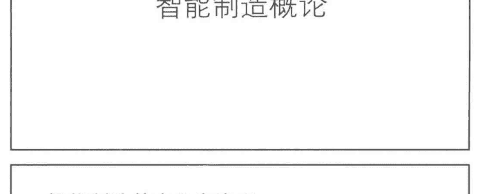

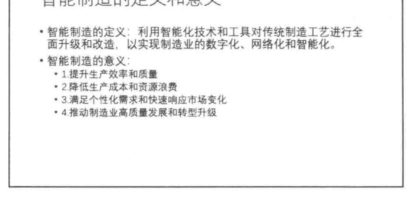

### 智慧制造技术的特质与应用
- 智慧制造技术的特质：
  - 1. 智慧感知与感知融合技术
  - 2. 智慧控制与控制融合技术
  - 3. 智慧优化与优化融合技术
  - 4. 智慧服务与服务融合技术
- 智慧制造技术的应用：
  - 1. 智慧制造系统
  - 2. 工业机器人
  - 3. 智慧制造设备
  - 4. 智慧制造流程

### 制造业向智慧化的演进轨迹
- 演进可分为三个阶段：制造业数字化、制造业网络化、制造业智慧化。
- 数字化阶段：通过数字技术实现产品与生产过程的数字化、信息化、可视化，提升效率与质量。
- 网络化阶段：基于互联网连接资源、环节、服务与用户，形成虚拟生态，实现协同制造与资源共享。
- 智慧化阶段：依托人工智能、物联网、云计算，实现自动化、智慧化与优化控制，提升效率、灵活性和可持续性。

### 总结
- 智慧制造是未来制造业发展趋势，具有重要意义。
- 技术特质包括数字化、网络化、智慧化、柔性化、安全性与可持续性。
- 应用领域涵盖航空航天、汽车制造、电子信息、生物医药、机器人等。
- 演进路径为数字化、网络化、智慧化三个阶段。

来自ChatGPT的内容：
假设你是一位老师，要上“智慧制造概论”这堂课，内容包括智慧制造的定义和意义、智慧制造技术的特质和应用、制造业向智慧化的演进轨迹，请帮我写出这个PPT每个Slide的具体内容

好的，以下是针对“智慧制造概论”这堂课的PPT每个Slide的具体内容：

Slide 1: 标题页
- 标题：“智能制造概论”
- 背景图像：可选用与智慧制造相关的图片或生产现场图片。

### Slide 2: 智慧制造的定义和意义
- 标题：“智慧制造的定义和意义”
- 大纲：
  1. 智慧制造的定义
  2. 智慧制造的意义
智慧制造的定义：利用智慧化技术和工具对传统制造工艺进行全面升级和改造，以实现制造业的数字化、网络化和智慧化。
- 智慧制造的意义：
  1. 提升生产效率和质量
  2. 降低生产成本和资源浪费
  3. 满足个性化需求和快速响应市场变化
  4. 推动制造业高质量发展和转型升级。

### Slide 3: 智慧制造技术的特质和应用
- 特质包括数字化、网络化、智慧化、柔性化、安全性与可持续性。
- 数字化：制造过程数据、信息与知识可数字化保存、共享与利用。
- 网络化：资源与环节通过网络连接形成协同制造。
- 智慧化：传感器、控制器、算法与系统实现自动化、智慧化与优化控制。
- 柔性化：系统可灵活快速响应市场需求。
- 安全性：提升生产安全与环境保护。
- 可持续性：减少资源浪费与环境污染，提高效率。
- 应用领域包括航空航天、汽车制造、电子信息、生物医药、机器人等。

### Slide 4: 制造业向智慧化的演进轨迹
- 分为制造业数字化、制造业网络化、制造业智慧化三个阶段。
- 数字化阶段：实现产品与过程数字化、信息化、可视化。
- 网络化阶段：形成虚拟生态，实现协同制造、资源共享与服务化生产。
- 智慧化阶段：实现自动化、智慧化与优化控制，提升效率、灵活性和可持续性。

### Slide 5: 总结
- 智慧制造是未来制造业发展趋势，具有重要意义与价值。
- 技术特质包括数字化、网络化、智慧化、柔性化、安全性与可持续性。
- 应用领域包括航空航天、汽车制造、电子信息、生物医药、机器人等。
- 演进轨迹分为数字化、网络化、智慧化三个阶段。

14.4 出试卷
利用ChatGPT可以出试卷。下面以“C语言程序设计”课程为例说明出题思路。整套试卷篇幅较大，同类题目未全部展开。例如选择题应有40题，此处仅列出10题，填空题有2题，仅列出1题。

××学院2022—2022学年第一学期
《计算机基础（C语言程序设计）》期末考试试卷（A卷）

#### 一、选择题（共40题，每题1分）
1. C语言中的数组下标从哪里开始计数？
   a. 0
   b. 1
   c. -1
   d. 可以自由选择
2. C语言中，以下哪个关键字用于定义一个结构体类型？
   a. struct
   b. typedef
   c. union
   d. enum
3. 在C语言中，以下哪个关键字用于声明一个函数返回类型为浮点型？
   a. float
   b. double
   c. void
   d. int
4. 在C语言中，以下哪个符号用于定义一个宏？
   a. #
   b. $
   c. &
   d. *
5. 在C语言中，以下哪个运算符用于地址操作？
   a. &
   b. *
   c. %
   d. /
6. 在C语言中，以下哪个关键字用于将一个变量声明为常量？
   a. const
   b. static
   c. extern
   d. volatile
7. 在C语言中，以下哪个关键字用于定义一个枚举类型？
   a. enum
   b. struct
   c. typedef
   d. union
8. 在C语言中，以下哪个运算符用于指针变量的取值操作？
   a. *
   b. &
   c. %
   d. /
9. 在C语言中，以下哪个关键字用于定义一个联合体类型？
   a. union
   b. struct
   c. typedef
   d. enum
10. 在C语言中，以下哪个关键字用于从多个选择中选择一个执行？
    a. switch
    b. if
    c. for
    d. while
（以下省略30题）

#### 二、填空题（每空3分，共计12分）

```c
#include <stdio.h>

void copy(int *src, int *dst, int len) {
    int i;
    for(i = 0; i < len; i++) {
        *(dst + i) = ①;
    }
}
int main() {
    int a[5] = {1, 2, 3, 4, 5};
    int b[5];
    int i;
    copy(②, ③, ④);
    printf("Array a: ");
    for(i = 0; i < 5; i++) {
        printf("%d ", a[i]);
    }
    printf("\nArray b: ");
    for(i = 0; i < 5; i++) {
        printf("%d ", b[i]);
    }
    printf("\n");
    return 0;
}
```

①

②

③

④

#### 三、填空题（每小题 3 分，共计 12 分）

（此题省略，内容与第二题相近）

#### 四、程序改错题（每一个错 3 分，共计 6 分）

```c
#include <stdio.h>

int main() {
    int a[5] = {1, 2, 3, 4, 5};
    int *p = a;
    int i;
    for(i = 0; i <= 5; i++) {
        printf("%d ", *(p + i));
    }
    return 0;
}
```

#### 五、程序改错题（每一个错 3 分，共计 6 分）

（此题省略，形式与第四题相似）

#### 六、设计题（每小题 6 分，共计 24 分）

请完成下列功能的程序实现：

1. 通过键盘录入10个整数保存至数组
2. 将数组按升序重排并输出结果
3. 计算全部元素的平均数并打印
4. 统计数组中负值的数量并输出

来自 ChatGPT 的内容：

### “C 语言程序设计”理论试卷示例十题

以下是一份面向“C 语言程序设计”课程的理论练习，包含十道单选题。

1）C 语言数组下标从几开始计数？
   a. 0 b. 1 c. -1 d. 可自行选择

2）C 语言中用于声明结构体类型的关键字是？
   a. struct b. typedef c. union d. enum

3）C 语言中若函数返回单精度浮点类型，应使用哪个关键字声明？
   a. float b. double c. void d. int

4）C 语言里用来定义宏的符号是？
   a. # b. $ c. & d. *

5）C 语言中执行取地址操作的运算符是？
   a. & b. * c. % d. /

6）C 语言里将变量声明为常量的关键字是？
   a. const b. static c. extern d. volatile

7）C 语言定义枚举类型时使用哪个关键字？
   a. enum b. struct c. typedef d. union

8）C 语言中对指针进行解引用取值使用的运算符是？
   a. * b. & c. % d. /

9）C 语言里定义联合体类型的关键字是？
   a. union b. struct c. typedef d. enum

10）C 语言中实现多分支选择执行的关键字是？
    a. switch b. if c. for d. while

希望对你有帮助。

### C 语言代码填空练习四空示例

下面给出 C 语言编程填空练习，每题设 4 个空位，用下划线表示。

1. 编写程序求二维数组 a[3][4] 的最大元素并输出，元素值随机产生。

```c
#include <stdio.h>
#include <stdlib.h>
#include <time.h>
int main() {
    int a[3][4];
    srand(time(NULL));
    int i, j, max = a[0][0];
    for(i = 0; i < 3; i++) {
        for(j = 0; j < 4; j++) {
            a[i][j] = rand() % 100;
            if(a[i][j] > max) {
                max = a[i][j];
            }
        }
    }
    printf("The maximum element is %d\n", max);
    return 0;
}
```

2. 编写程序求整数数组 a[10] 的均值，元素值随机产生。

```c
#include <stdio.h>
#include <stdlib.h>
#include <time.h>
int main() {
    int a[10];
    srand(time(NULL));
    int i, sum = 0;
    for(i = 0; i < 10; i++) {
        a[i] = rand() % 100;
        sum += a[i];
    }
    double average = sum / 10.0;
    printf("The average value is %.2f\n", average);
    return 0;
}
```

3. 编写程序实现函数 copy，用指针方式把一个整数数组复制到另一个，并在主函数中调用验证。

```c
#include <stdio.h>
void copy(int *src, int *dst, int len) {
    int i;
    for(i = 0; i < len; i++) {
        *(dst + i) = *(src + i);
    }
}
int main() {
    int a[5] = {1, 2, 3, 4, 5};
    int b[5];
    int i;
    copy(a, b, 5);
    printf("Array a: ");
    for(i = 0; i < 5; i++) {
        printf("%d ", a[i]);
    }
    printf("\nArray b: ");
    for(i = 0; i < 5; i++) {
        printf("%d ", b[i]);
    }
    printf("\n");
    return 0;
}
```

### C 语言代码改错双错示例

下面是一道 C 语言编程改错题，共两处错误，请定位并修正。

```c
#include <stdio.h>

int main() {
    int a[5] = {1, 2, 3, 4, 5};
    int *p = a;
    int i;
    for(i = 0; i <= 5; i++) { // 错误 1：循环的次数应该是小于 5，因为数组 a 只有 5 个元素
        printf("%d ", *(p + i)); // 错误 2：指针 p 应该使用指针运算符 "+" 来访问数组 a 的元素
    }
    return 0;
}
```

修正后代码如下：

```c
#include <stdio.h>

int main() {
    int a[5] = {1, 2, 3, 4, 5};
    int *p = a;
    int i;
    for(i = 0; i < 5; i++) { // 错误 1：循环的次数应该是小于 5，因为数组 a 只有 5 个元素
        printf("%d ", *(p++)); // 错误 2：指针 p 应该使用指针运算符 "+" 来访问数组 a 的元素
    }
    return 0;
}
```

### C 语言代码设计四功能示例

下面是一道包含四个功能点的 C 语言设计题，请据此实现程序：

1. 键盘录入十个整数存入数组
2. 把数组按升序排列并输出结果
3. 计算全部元素的均值并输出
4. 统计负数数量并输出

代码框架如下：

```c
#include <stdio.h>

int main() {
    int arr[10]; // 存储输入的整数
    int i;
    // 从键盘输入 10 个整数，存储到数组中
    printf("请输入 10 个整数:\n");
    for (i = 0; i < 10; i++) {
        scanf("%d", &arr[i]);
    }

    // 按照从小到大的顺序排序数组，并输出排序后的结果
    // TODO: 排序代码

    printf("排序后的结果:\n");
    for (i = 0; i < 10; i++) {
        printf("%d ", arr[i]);
    }
    printf("\n");

    // 计算数组中所有元素的平均值，并输出结果
    // TODO: 计算平均值代码

    printf("平均值为: %.2f\n", avg);

    // 统计数组中所有元素的负数个数，并输出结果
    // TODO: 统计负数个数代码

    printf("负数个数为: %d\n", neg);

    return 0;
}
```

请在给定框架基础上完成实现。

## 14.5 编写毕业设计材料

借助 ChatGPT 可以辅助完成毕业设计资料与毕业论文的撰写。本节先介绍任务书与开题报告的配合撰写，后续章节介绍毕业论文的辅助撰写。

### ×× 学院本科生毕业设计任务书

#### 一、基本信息

设计题目：基于 PLC 的自动点胶机控制系统设计

年级：19 级

专业（班级）：自动化 ××××

学生姓名：×××

学号：×××××

指导教师姓名：×××

#### 二、主要内容

##### 研究背景和意义

自动化点胶设备在电子元器件、汽车零部件、医疗器械等领域得到广泛使用。人工点胶操作复杂、效率偏低且重复性差，自动化设备能够弥补这些缺陷，提升生产效率与产品质量。本项目旨在构建基于 PLC 的自动点胶机控制系统，形成可靠稳定的控制方案，推进自动化生产进程。

##### 研究内容和任务

任务概述如下。

- （1）熟悉自动点胶机的工作原理、技术指标及控制要求。
- （2）掌握 PLC 的基本原理、编程语言与控制方法。
- （3）完成自动点胶机控制系统的设计，涵盖硬件选型、电路设计、软件编程。
- （4）对控制系统进行调试优化，测试点胶机性能指标。
- （5）撰写毕业设计论文，包含背景、思路、实施过程、实验结果与结论。

#### 三、主要任务及基本要求

##### 主要任务

设计一套自动化控制系统，用于精确控制自动点胶机。具体包含：

目标和技术要求。

- （2）结合点胶机的工作特性与控制需求，设计硬件电路，完成 PLC、传感器、执行机构等部件的选型与布局。
- （3）依据功能需求与控制流程编写 PLC 程序，实现控制与监控。
- （4）进行调试与性能测试，评估点胶精度、稳定性、效率并优化。
- （5）撰写毕业设计论文，详细阐述设计方案、实施过程与测试结果并进行评价总结。
- （6）与指导教师保持沟通，及时反馈问题与进展，确保按时完成并通过评审。

##### 基本要求

- （1）论文须采用规范格式，包含摘要、目录、正文、参考文献等。
- （2）内容要清晰全面、准确实用，重点突出逻辑严密，符合科研规范，字数约 15000。
- （3）必须独立完成，严禁抄袭剽窃，否则取消成绩与学位评定资格。
- （4）需查阅一定数量的期刊与报告等文献资料。
- （5）参考文献须在正文中引注，文后著录符合国家标准。
- （6）不得大篇幅使用网络下载或抄袭内容，需提交查重报告，重复率需控制，否则不得参加答辩。

##### 任务进度安排

- （1）2022.10.15—2022.11.15，指导教师拟定课题。
- （2）2022.11.16—2022.12.15，确定选题并发放任务书。
- （3）2022.12.16—2023.02.15，按任务书查阅资料调研，完成开题报告。
- （4）2023.02.16—2023.03.31，完成方案设计、实验及初稿，含图纸与数据分析。
- （5）2023.04.01—2023.04.15，指导教师审查方案与初稿，学生修改，学校中期检查。
- （6）2023.04.16—2023.05.15，按中期意见整改，完成材料与论文并提交查重报告，组织盲审。
- （7）2023.05.16—2023.05.25，按盲审意见修改，指导教师审阅终稿，审核答辩资格。
- （8）2023.05.26—2023.05.31，学院组织答辩，答辩后修改论文并整理资料，部分学生二次答辩。

评分标准如下：

- （1）选题合理性与研究意义：20 分
- （2）研究背景与文献综述：10 分
- （3）理论分析与系统设计：30 分
- （4）系统调试与性能测试：20 分
- （5）论文撰写质量：20 分
总分 100 分。

参考文献：

- [1] 王兴贤. 自动化控制系统设计 [M]. 北京：机械工业出版社，2015.
- [2] 刘波. PLC 技术及应用 [M]. 北京：清华大学出版社，2014.
- [3] 陈伟. 点胶技术及应用 [M]. 北京：电子工业出版社，2017.

其他说明：

- （1）须按时完成并通过评审。
- （2）遇疑问困难应及时与指导教师沟通。
- （3）评审结果为学位评定重要依据。

来自 ChatGPT 的内容：

### 基于 PLC 的自动点胶机控制系统设计任务书示例

#### 毕业设计任务书

##### 一、毕业设计（论文）基本信息

- 1. 课程名称：自动化专业毕业设计
- 2. 题目：基于 PLC 的自动点胶机控制系统设计
- 3. 学生姓名：×××
- 4. 学号：×××××
- 5. 指导教师姓名：×××
- 6. 评审教师姓名：×××

##### 二、毕业设计（论文）任务

###### 1. 研究背景和意义

自动点胶机广泛应用于电子元器件、汽车零部件、医疗器械等领域的点胶作业。手工点胶存在操作难度大、效率低、一致性差等缺陷，自动点胶机可有效解决这些问题，提升效率与质量。本次设计旨在研发基于 PLC 的自动点胶机控制系统，构建可靠稳定的控制方案，实现自动化生产。

###### 2. 研究内容和任务

- (1) 了解自动点胶机的工作原理、技术指标和控制要求。
- (2) 了解 PLC 的基本原理、编程语言和控制方法。
- (3) 设计自动点胶机控制系统，包括硬件选型、电路设计、软件编程。
- (4) 进行控制系统调试与优化，测试性能指标。
- (5) 撰写毕业设计论文，包含背景、设计思路、实现过程、实验结果与结论。

###### 3. 毕业设计（论文）要求

- (1) 论文采用规范学术格式，含摘要、目录、正文、参考文献。
- (2) 内容清晰全面、准确实用，重点突出、逻辑严密，符合科研规范。
- (3) 须独立完成，禁止抄袭剽窃，否则取消成绩与学位资格。

###### 4. 毕业设计（论文）时间安排

- (1) 选题和开题报告：2023 年 3 月 15 日前完成。
- (2) 中期报告：2023 年 5 月 15 日前完成。
- (3) 论文初稿：2023 年 7 月 15 日前完成。
- (4) 论文定稿：2023 年 8 月 15 日前完成。

还有，请继续

###### 5. 毕业设计（论文）评分标准

评分标准如下：

- (1) 选题合理性和研究意义：20 分
- (2) 研究背景和相关文献综述：10 分
- (3) 理论分析和控制系统设计：30 分
- (4) 控制系统调试和性能测试：20 分
- (5) 毕业设计论文撰写质量：20 分

总分为 100 分。

###### 6. 参考文献

- [1] 王兴贤. 自动化控制系统设计 [M]. 北京：机械工业出版社，2015.
- [2] 刘波. PLC 技术及应用 [M]. 北京：清华大学出版社，2014.
- [3] 陈伟. 点胶技术及应用 [M]. 北京：电子工业出版社，2017.

###### 7. 其他说明

- (1) 本次毕业设计（论文）应按时完成并通过评审。

毕业设计执行与项目导览

- (2) 在毕业设计推进期若出现疑问或阻碍，请及时联系指导老师获取专业指导并共同寻找解决办法。
- (3) 毕业设计论文的评审结果会作为学位评定的一项重要参考依据。

PLC 驱动点胶控制方案的核心定位
本项目的根本目标是构建一套自动化调控方案，以驱动点胶作业设备，实现产品上胶的精准可控。整体工作可概括为以下维度。

### 14.5.1 开题报告

#### ×× 学院毕业设计开题报告

学生姓名：×××

学号：××××××××××

专业/班级：自动化/自动化1901

设计题目：依托可编程逻辑控制器的自动点胶设备调控系统设计

指导教师：×××

1. 结合选题方向，依据查阅的文献资料，由学生独立完成约2000字的文献综述，文末附参考文献目录。

##### 1.1 选题背景
电子制造行业持续扩张，点胶自动化设备已成为半导体封装、电子装配及汽车电子等环节的常用装置。当前市场上主流机型多以 PC 或单片机为控制核心，容易出现响应迟缓、精度不足、稳定性欠佳等问题。为提升点胶自动化水平与精准度，本课题提出以可编程逻辑控制器为核心的点胶机调控系统设计思路。

##### 1.2 国内外研究现状

###### 1.2.1 国外研究现状
目前境外研究主要聚焦于以下方向。

（1）算法精进：通过改进点胶机的调控算法，提升上胶精度、稳定性与效率。例如采用自适应控制、PID 控制等，实现工艺精细调控。
（2）传感技术运用：引入先进传感技术，对点胶过程的温度、湿度、压力等参数进行在线监测与闭环控制。常用器件包括压力式、光学式、红外式等。
（3）智能化管控平台：依托人工智能技术构建智能化操控平台，实现点胶机智能化管理与运行。例如利用深度学习对点胶过程进行预测与优化。
（4）新型结构研发：通过结构改进提升工作效率与生产品质。例如采用机械臂等新结构完成复杂工件的上胶与装配。

总体看，国外在调控算法、传感技术与智能管控方面的研究较为深入，成果丰富，对国内研发具参考价值。

###### 1.2.2 国内研究现状
国内研究主要集中于。

（1）算法研究：通过优化调控体系提升精度、稳定性和效率。例如结合 PID 与模糊控制对点胶机进行调控。
（2）传感技术运用：运用传感技术实时监控上胶过程中的温度、湿度、压力等参数。例如采用红外传感器与光电传感器实现检测与反馈。
（3）智能化管控体系研究：构建智能化管理平台，实现自动学习与优化。例如基于机器学习算法提升调控性能。
（4）结构优化：改进点胶机结构，提升效率与品质。例如优化加热系统与机械结构，增强稳定性与可靠性。

总体看，国内研究起步相对较晚但发展迅速，在算法、传感、智能管控与结构优化方面持续探索，为行业进步提供新思路。

##### 1.3 研究价值
本课题成果可为点胶机调控体系提供新思路与技术方案。与传统 PC 或单片机调控相比，PLC 方案响应更快、精准度更高、稳定性更强，能满足高精度、高效率、高品质生产需求。

##### 1.4 参考文献
1. 谢宇航，陈广超，刘颖慧，等. 基于PLC的自动点胶机控制系统设计[J]. 现代制造工程，2018, 37(5): 101-103.
2. 董建华，陈静. 自动点胶机控制系统设计[J]. 机械制造与自动化，2019, 48(2): 70-73.
3. 张辉，王炳辉，王佳龙. 基于PLC的自动点胶机控制系统的设计[J]. 涂料工业，2019, 49(8): 11-14.
4. 吴冬青，孙彦雪，郭建军，等. 基于PLC的自动点胶机控制系统研究[J]. 精密制造与自动化，2019, 28(7): 70-72.
5. 申华，李建明. 基于PLC的自动点胶机控制系统研究[J]. 机械工程与自动化，2020，49(5)：132-134.
6. 王盼，张三. 基于PLC的自动点胶机控制系统设计[J]. 计算机工程与设计，2018，39(7)：1776-1779.
7. ZHENG Y, LI H, WANG J, et al. Development of an automatic glue dispensing system with visual sensing capability[J]. International journal of advanced manufacturing technology, 2017, 91(5-8): 2015-2023.
8. ZHANG Y, ZOU B, HUANG S, et al. Development of a new motion control system for an automated glue dispensing machine[J]. Robotics and computer-integrated manufacturing, 2019, 56: 142-150.
9. CHEN J, ZHANG Y, LIU Y, et al. An intelligent control method for the glue amount of a robotic dispensing system[J]. Measurement, 2019, 137: 326-334.
10. HAN Y, WU Z, TANG J, et al. Development of an automated glue dispensing system based on programmable logic controller and touch screen[J]. Journal of intelligent & robotic systems, 2019, 96(3): 591-602.

2. 本课题待研问题、预期成效与研究路径
课题要解决的核心问题是如何搭建一套以可编程逻辑控制器为核心的点胶设备调控体系，以提升生产效率与上胶精度。系统需具备自动化操控、数据采集、监控调节等功能，且可靠性与稳定性较高。同时要考虑硬件选型、算法优化与人机交互界面设计，以满足实际生产需求。研究成果有助于提升自动化水平并具备工程应用前景。

研究内容包括：
- （1）分析点胶自动化设备的构造与工作原理，调研运动操控、传感检测与执行机构。
- （2）依据调控需求选型 PLC 及外围器件，完成硬件电路设计与搭建。
- （3）编写 PLC 逻辑程序并调试，实现运动操控、液压操控、传感检测与数据处理。
- （4）评估精度、稳定性与效率，根据测试结果修正程序与硬件。
- （5）撰写毕业设计论文，阐述构造原理、调控方案、实验结果与结论。

预期成效：
- （1）搭建可靠稳定、操作简便的自动化操控体系，实现自动操控与数据采集。
- （2）提升上胶精度与生产效率，降低人工误差与成本，提高产线产能。
- （3）优化调控算法，提升上胶品质与稳定性，减少不良品率。
- （4）实现工作状态实时监测与调节，增强过程可控性与安全性。
- （5）设计友好操作界面，便于操作维护，降低人力投入。

研究路径：
- （1）文献资料查阅：梳理国内外研究现状与发展趋势，比较不同方案优劣，为研究提供理论支持。
- （2）系统分析与设计：分析构造原理，确定调控策略与参数，结合 PLC 编程与界面设计实现功能。
- （3）实验测试与数据分析：通过测试评估系统性能，找出问题并优化算法。
- （4）软硬件集成与系统调试：确保系统稳定可靠，实现自动化生产与监控。
- （5）其他路径：问卷调查、专家咨询等获取信息与建议。

3. 进度安排
- 第一阶段（1周）：文献综述与现场调研，明确目的、问题与方法，撰写任务书。
- 第二阶段（2周）：PLC 及外围器件选型、电路图绘制、传感器与执行机构选定，完成硬件设计与搭建。
- 第三阶段（2周）：PLC 程序编写与调试，完成运动、液压操控、传感检测与数据处理功能。
- 第四阶段（2周）：评估精度、稳定性、效率，依据测试结果修改程序与硬件。
- 第五阶段（3周）：撰写论文初稿，完成框架、引言与相关工作。
- 第六阶段（2周）：完成实验测试与数据分析，撰写实验结果与分析。
- 第七阶段（2周）：撰写系统设计、实现与优化部分，修改完善论文。
- 第八阶段（1周）：准备毕业答辩与综述，提交终稿。

4. 指导教师意见
###### 4.1 对文献综述的评语
文献综述先指出市场上现有点胶设备的不足，再综述国内外研究现状。国外集中于调控算法、传感技术与智能管控，国内聚焦算法研究、传感应用、智能管控研究与结构优化。内容较为全面，对现有问题提出 PLC 方案思路。但对本文提出的 PLC 系统设计细节介绍不足，仅做简要提及。建议后续进一步展开方案原理、实现流程，便于读者理解与应用。

###### 4.2 对课题深度、广度、工作量及成果预测
课题深度与广度适中，具有一定挑战性。需掌握 PLC 编程、机械基础、电路设计等知识并有机整合，完成可落地的自动化点胶调控体系。工作量涵盖需求分析、电路设计、程序编写、系统调试等多环节，调试阶段需反复试验，投入较大。若设计者具备相关基础并充分考虑实际应用需求，最终系统有望达到预期效果并具较高实用价值。

### 基于 PLC 的自动点胶机调控系统开题示例
#### 毕业设计开题报告
题目：基于 PLC 的自动点胶机控制系统设计
指导教师：×××

##### 一、选题背景
随电子制造发展，自动点胶机广泛用于手机、电脑、电视等产品的装配与封装。现有设备多以 PC 或单片机控制，存在速度慢、精度低、可靠性差等问题。为提升自动化程度与精度，提出基于 PLC 的调控系统设计方案。

##### 二、研究内容
- （1）分析自动点胶机构造与工作原理，调研运动操控、传感检测与执行机构。
- （2）按调控需求选型 PLC 及外围器件，完成硬件电路设计与搭建。
- （3）编写并调试 PLC 程序，实现运动操控、液压操控、传感检测与数据处理。
- （4）评估精度、稳定性与效率，依据测试结果优化程序与硬件。
- （5）撰写毕业设计论文，介绍构造原理、调控方案、实验结果与结论。

##### 三、研究价值
成果可为调控体系设计提供新思路。PLC 方案运行速度快、精度高、可靠性好，能满足高精度、高效率、高质量生产需求。

##### 四、进度安排
同上八阶段安排。

##### 五、预期成果
- （1）设计基于 PLC 的自动点胶机调控体系，实现运动、液压操控、传感检测与数据处理。
- （2）评估与优化运行速度、精度、稳定性与可靠性，提升工作效率与生产质量。
- （3）完成毕业设计论文，阐述构造原理、调控方案、实验结果与结论。

##### 六、参考文献
1. 刘晓明. 自动点胶机控制系统设计[D]. 西安电子科技大学, 2014.
2. 张浩. 基于PLC的自动点胶机控制系统设计[J]. 机电工程, 2018, 35(2): 80-82.
3. 徐红, 陈军. 基于PLC的自动点胶机控制系统设计[J]. 计算机技术与发展, 2016, 26(9): 123-126.
4. 杨晓敏, 王强. 自动点胶机控制系统的设计与实现[J]. 自动化与仪表, 2019, (4): 100-102.

国外研究现状要点
国外研究聚焦调控算法精进、传感技术运用、智能化调控体系、新型结构研发。算法上采用自适应、PID 等提升精度与效率；传感方面实时监测温度、湿度、压力等参数；智能管控利用深度学习预测优化；结构上采用机械臂等实现复杂工件作业。整体研究深入，为国内研发提供借鉴。

国内研究现状要点
国内在调控算法、传感应用、智能管控与结构优化方面同步推进。算法上以 PID 与模糊控制为主；传感上使用红外、光电传感器进行检测反馈；智能管控探索机器学习自动优化；结构上优化加热与机械结构提升稳定可靠。研究逐步完善，为行业提供新方法与思路。

参考文献示例含英文
1. 王盼，张三. 基于PLC的自动点胶机控制系统设计[J]. 计算机工程与设计，2018，39(7)：1776-1779.
2. ZHENG Y, LI H, WANG J, et al. Development of an automatic glue dispensing system with visual sensing capability[J]. International journal of advanced manufacturing technology, 2017, 91(5-8): 2015-2023.

2. Zheng Y, Li H, Wang J, et al. Development of an Automatic Glue Dispensing System with Visual Sensing Capability[J]. International Journal of Advanced Manufacturing Technology, 2017, 91(5-8): 2015-2023.

3. Zhang Y, Zou B, Huang S, et al. Development of a new motion control system for an automated glue dispensing machine[J]. Robotics and Computer-Integrated Manufacturing, 2019, 56: 142-150.

## 14.6 AI时代的毕业论文写作变局

写毕业论文往往要耗费大量时间查阅资料、梳理逻辑并润色文字，而 ChatGPT 这类工具能够快速检索信息并组织成通顺的文本。面对这种冲击，工科方向的学生还能凭借实验数据、程序实现等硬核环节来佐证成果，影响相对有限。但文科类专业几乎可以全流程借助模型生成，审阅老师很难一眼辨别，因而毕业论文的评价标准很可能被迫改变。过去指导教师需要花不少精力在语言推敲上，这对学生写作能力的培养有帮助，却并非高校教师的核心职责。

本节以自动化专业毕业论文的撰写为例，仅展示开篇部分和代码生成的交互过程，并不提供成稿，而是保留与 ChatGPT 的对话思路。

### 本科毕业设计论文通常需要哪些模块

一份本科毕业设计论文一般要涵盖以下部分。

- （1）封面：论文题目、学生姓名、所属院校、专业、指导教师、完成时间等。
- （2）中英文摘要：概括研究目的、方法、结果与结论，中英文各占一页。
- （3）目录：列出各章各节名称及对应页码。
- （4）绪论：交代研究背景、意义、目标、理论基础与研究方法。
- （5）文献综述：梳理领域内相关研究、进展、现状、问题与不足。
- （6）研究方法：详细说明采用的方法、调研工具、数据来源等。
- （7）结果分析：呈现研究数据与分析手段，以表格、图表形式展示。
- （8）结论：归纳主要成果，指出不足并展望下一步研究。
- （9）参考文献：按规范格式列出文中引用的全部文献。
- （10）附录：必要时附上原始数据、图表、程序等补充材料。

具体细则还需以学校和专业要求为准。

### 14.6.1 论文摘要

#### 生成《基于PLC的自动点胶机控制系统设计》摘要示例

本文围绕基于 PLC 的自动点胶机控制系统展开，目的在于借助现代技术提升点胶机的自动化水平与控制精度，进而改善生产效率和品质。文中先对点胶机的工作原理与常用点胶方式进行介绍，继而剖析现有自动化控制系统的短板与改进空间，提出一套基于 PLC 的控制系统设计方案。随后对硬件与软件部分进行详细论述并完成验证测试。实验结果表明，该方案切实可行，能够满足自动点胶控制需求，具有较强的实用价值与推广潜力。

主要工作包括对点胶机原理与常用方法的调研、对自动化控制现状的分析、对 PLC 控制系统的设计以及实验验证。整个过程涉及大量实验与数据处理，耗时耗力。预期该方案落地后可显著提高点胶机的自动化程度与精度，从而提升生产效率与产品质量。

### 14.6.2 论文目录

#### 生成《基于PLC的自动点胶机控制系统设计》目录示例

以下是该论文的目录框架。

- Ⅰ. 绪论

    - A. 研究背景

    - B. 研究目的与意义

    - C. 研究内容与方法

    - D. 论文结构

- Ⅱ. 自动点胶机控制系统的现状与发展趋势

    - A. 自动点胶机控制系统的概述

    - B. 发展历程

    - C. 现状分析

    - D. 发展趋势

- Ⅲ. PLC控制系统的概述

    - A. 基本原理

    - B. 组成与工作原理

    - C. 编程语言与编程方法

- Ⅳ. 自动点胶机控制系统的设计

    - A. 总体设计

    - B. 硬件设计

    - C. 软件设计

- Ⅴ. 实验结果与分析

    - A. 实验介绍

    - B. 结果分析

- Ⅵ. 总结与展望

    - A. 研究总结

    - B. 不足与展望

- 参考文献

### 14.6.3 研究背景

#### 自动点胶机是什么

自动点胶机是制造环节中用于涂胶或粘合的专用自动化设备。它通过精确控制点胶阀门的开闭，实现胶水的自动喷涂或滴落，从而对胶量和分布进行精准调控。

该设备可广泛应用于电子元器件、汽车零部件、医疗器械、玩具、家具等领域。通常配合计算机控制系统，可按设计要求实时调节胶水流量、速度、压力和形状，保证粘合质量与效率。

其优势在于高效、精准、稳定且节约成本，能提升生产效率、改善产品品质，减少人工干预和材料浪费。

#### 自动点胶机主要具备哪些功能

- （1）精准涂胶：通过阀门开关控制，实现胶水的自动喷出或滴落，可在产品指定区域进行涂布，满足多样化需求。
- （2）高速生产：能在短时间内完成大量涂胶任务，速度与准确性优于人工，有助于降低人工成本与生产周期。
- （3）精细可控：依托计算机控制，可动态调节流量、速度、压力与形状，确保粘合一致性，减少操作失误带来的损失。
- （4）涂胶方式多样：支持喷涂、滴涂、涂覆、点涂等多种方式，可适配平面、曲面、硬质、软质等不同工件。

总体而言，自动点胶机能提升效率、品质与一致性，同时降低制造成本，是现代制造不可或缺的环节。

#### 自动点胶机的分类有哪些

按不同维度可做如下划分。

- （1）工作原理：压力式、蠕动泵式、齿轮泵式、气动式、伺服式等。
- （2）应用领域：电子、汽车、LED、手机、医疗器械、玩具、家具等。
- （3）控制方式：半自动、全自动。
- （4）涂胶方式：喷涂式、滴涂式、线涂式、涂覆式、点涂式。
- （5）精度等级：普通型、高精度型、超高精度型。
- （6）工作环境：常温、高温、真空、防爆等。

实际产品常综合多种特征进行划分，选择合适的机型对工艺效果至关重要。

#### 典型电子点胶机的结构与功能

结构上通常包含：

- （1）控制系统：PLC 控制器、触摸屏、运动控制卡等，负责整体运行与点胶过程管理。
- （2）涂胶系统：胶水桶、管路、阀门、点胶头等，完成胶水的输送与涂布。
- （3）运动系统：伺服电机、导轨、传动机构等，控制点胶头在三维空间的移动与旋转。
- （4）定位系统：相机、光源、视觉软件等，实现工件精确定位与点胶头准确定位。

主要功能：

- （1）自动化点胶：按预设程序自动完成涂胶，实现全自动作业。
- （2）精确定位：借助视觉系统实现高精度定位，保证点胶位置与质量。
- （3）节胶：通过流量与速度调节避免浪费。
- （4）多模式涂胶：支持点涂、线涂、涂覆等多种模式。
- （5）可编程控制：控制系统可编程，灵活适配不同产品需求。

总体来看，电子点胶机是高精度高效率的自动化设备，可提升电子装配、涂胶与封装环节的品质与效率。

#### 电子点胶机控制系统简介

控制系统是设备的核心，通常由 PLC 控制器、运动控制卡、触摸屏和计算机构成。

PLC 控制器承担整体协调与运行逻辑，如胶水流量与点胶头运动控制；运动控制卡驱动伺服电机，实现速度、位置、加速度等参数的精确调节；触摸屏提供实时监控与参数设定界面；计算机负责数据存储、处理与设备管理。

其特点包括：

- （1）精度高：可对位置、速度等关键参数进行精细控制，保证点胶质量。
- （2）灵活性好：支持编程，可快速切换不同产品的工艺参数。
- （3）可靠性强：硬件软件均经过优化，支持长时间稳定运行。
- （4）操作简便：界面友好，上手成本低。

该系统是实现自动化运行与高质量涂胶的关键。

#### 电子点胶机控制系统存在的不足

尽管具备高精度、灵活、可靠等优点，仍存在问题：

- （1）成本偏高：高性能软硬件推高设备造价。
- （2）维护难度大：系统结构复杂，故障排查与维修需专业人员。
- （3）操作门槛高：需要编程与调试能力，对人员技能要求较高。
- （4）安全隐患：涉及高压电、高温等风险，操作不当易造成伤害。

为此，部分厂商正研发更智能、易维护的控制方案，如提升自动化程度、加入智能诊断与自维护功能，同时加强人员培训与安全意识。

#### 电子点胶机控制系统未来研究方向

未来发展主要聚焦于：

- （1）智能化控制：结合人工智能实现工件形状与尺寸的自动识别及参数自适应。
- （2）互联网融合：支持远程监控与远程维护，提升使用效率与生产效益。
- （3）模块化设计：各模块可独立升级与更换，提高可维护性与可靠性。
- （4）高性能控制器研发：实现更快速、更准确的运算与控制。
- （5）人机交互优化：提供更直观易用的操作界面，提升易用性与效率。

整体趋势为智能化、网络化、模块化、高性能与易用化，将进一步推动点胶技术的进步。

### 倍福 TwinCAT 系统介绍

倍福 TwinCAT 是德国倍福公司开发的一套实时控制、运动控制与机器视觉软件平台，提供实时操作系统、PLC 控制、运动控制、视觉检测与通信等一体化方案，可在 Windows 环境下运行。

其核心为实时操作系统 TwinCAT RTOS 与 PLC 运行时 TwinCAT PLC，保证实时性、可靠性与精度。基于 EtherCAT 总线的运动控制模块 TwinCAT NC 与视觉模块 TwinCAT Vision，可便捷实现运动控制与视觉检测。

相比传统硬件控制方案，TwinCAT 的软件化架构更具灵活性和可扩展性，支持标准 PC 硬件构建控制系统，并可按需自定义编程与功能扩展。同时系统开放，兼容多种编程语言与通信协议，易于集成。

该系统已广泛应用于机器人控制、自动化产线、仓储物流等领域，对提升控制精度与效率具有重要价值。

### 14.6.4 绘制框图

使用 Python 与 Graphviz 库绘制自动点胶机硬件构成框图的示例代码，需先安装 Graphviz。

```python
import graphviz

#### 创建有向图
dot = graphviz.Digraph(comment='自动点胶机硬件构成', graph_attr={'rankdir': 'LR'})

#### 添加节点
dot.node('PLC', 'PLC 控制器')
dot.node('Motor', '伺服电机')
dot.node('Pump', '点胶泵')
dot.node('Sensor', '传感器')
dot.node('Camera', '视觉传感器')
dot.node('HMI', '人机界面')

#### 添加边
dot.edge('PLC', 'Motor')
dot.edge('PLC', 'Pump')
dot.edge('PLC', 'Sensor')
dot.edge('PLC', 'Camera')
dot.edge('PLC', 'HMI')
```

#### 输出图形

```python
dot.render('自动点胶机硬件构成', format='png')
```

该实现将自动点胶机的硬件结构建模为有向图，以 PLC 控制器为根节点，下辖伺服电机、点胶泵、传感器、视觉传感器与人机界面等子节点。通过增添节点与连线可构建任意复杂度的拓扑，最后调用 dot.render() 将图形导出为 PNG 格式，文件名为“自动点胶机硬件构成”。

### 14.6.5 生成代码

提供基于 TwinCAT3+NCI+PLCopen 的运动控制 ST 语言代码示例

以下示例展示如何基于 TwinCAT3、NCI 驱动与 PLCopen 标准，用结构化文本实现点胶机械臂的轨迹运动控制。

```st
// 变量定义
VAR
    // 运动参数
    JogSpeed : REAL := 50; // 手动运动速度，单位：mm/s
    MoveSpeed : REAL := 10; // 自动运动速度，单位：mm/s
    MoveAcc : REAL := 100; // 运动加速度，单位：mm/s^2
    MoveDec : REAL := 100; // 运动减速度，单位：mm/s^2

    // 坐标系参数
    Base : FB_CoordSys := FB_CoordSys(0, 0, 0, 0, 0, 0, 0, 0, 0, 0, 0, 0); // 基坐标系
    Tool : FB_CoordSys := FB_CoordSys(0, 0, 0, 0, 0, 0, 0, 0, 0, 0, 0, 0); // 工具坐标系

    // 轨迹参数
    Traj : FB_Traj := FB_Traj(0, 0, 0, 0, 0, 0, 0, 0, 0, 0, 0, 0); // 轨迹

    // 运动控制
    Axis : FB_Axis := FB_Axis(0, 0, 0, 0, 0, 0, 0, 0, 0, 0); // 轴控制
    GCode : FB_GCode := FB_GCode(0, 0, 0, 0, 0, 0, 0, 0); // 插补运动控制

    // 状态监控
    AxisState : WORD; // 轴状态
    GCodeState : WORD; // 插补运动状态

END_VAR

// 初始化
Axis.Init;
GCode.Init;

// 设置坐标系
Base.SetBase;
Tool.SetTool;

// 设置轨迹
Traj.SetLine(100, 100, 0, 200, 200, 0, 0, 0, 0, 0, 0, 0);

// 设置轴控制参数
Axis.AxisNo := 1;
Axis.Speed := JogSpeed;
Axis.Acc := MoveAcc;
Axis.Dec := MoveDec;

// 设置插补运动控制参数
GCode.Speed := MoveSpeed;
GCode.Acc := MoveAcc;
GCode.Dec := MoveDec;

// 轴手动运动
Axis.JogPos(100);

// 自动轨迹运动
GCode.StartTraj(Base, Tool, Traj);

// 监控轴状态和插补运动状态
AxisState := Axis.GetState;
GCodeState := GCode.GetState;
```

#### TwinCAT3 NCI 点胶控制的 G 代码演示

TwinCAT3 中的 NCI 模块承担运动轴的数据交互及指令调度职能。下面给出一段用于自动化电子点胶作业的 G 代码示例，仅作学习参考。

```
N10 G91          ; 设置为相对坐标模式
N20 G00 X0 Y0 Z5 ; 将吸嘴移动到点胶位置
N30 G01 Z0 F500  ; 向下运动，开始点胶
N40 G04 P1000    ; 延迟 1 秒，等待点胶固化
N50 G01 Z5 F500  ; 向上运动，完成点胶操作
N60 M30          ; 程序结束
```

示例段落在 N10 将坐标系切换为相对模式，N20 指令吸嘴运行至待点胶位置，N30 启动点胶动作。N40 借助 G04 产生 1 秒延时以等待胶体初步固化，N50 控制吸嘴向上抬起以完成作业，N60 以 M30 指令结束程序。

需要强调的是，上述代码仅为演示用途，实际工程中的点胶程序须依据具体工艺参数定制。编写时除运动指令外，还要兼顾轨迹规划、伺服控制、温控管理等多个技术层面。

### 14.6.6 致谢

#### 本科毕业设计致谢写法示例

致谢

时光流转，本科毕业论文已圆满完成。谨向所有给予支持与帮助的人士致以诚挚谢意。

首先感谢我的指导教师 XXX 教授。本次毕业设计期间，XXX 教授在选题与方案设计上提出建设性意见，在论文撰写阶段反复修改指导，使我收获很大。

其次感谢实验室的 XXX 老师以及全体同学。实验操作与数据采集环节得到他们的大量协作，为顺利推进工作提供了基础。

最后感谢家人和朋友。长期以来的鼓励与陪伴，让我在困难面前坚持下来，最终完成论文。

再次向所有关心支持我的人表示衷心感谢！

## 14.7 新专业申报材料筹备思路

申报新专业材料繁多，利用 ChatGPT 可显著提升效率。下面先梳理材料清单，再以申报书为例说明提问方式，最后给出整理后的模板，其他材料可参照此法生成。

本案例先向 ChatGPT 咨询所需材料，再据其回复整理成申报书。

**高校新设“智能装备与系统”本科专业通常要提交哪些文件？**

新建“智能装备与系统”本科专业，一般需准备以下材料。

- （1）专业申报文件：包含专业名称、学科类别、定位表述、培养目标与规格、课程安排及实训教学等。
- （2）课程规划方案：列明课程名称、学分、教学目标、内容要点、教学方式及考核办法。
- （3）教材与教学资源目录：明确教材书名、作者、出版社、版本、采购数量与费用，并列出所需实验设备、软件平台等。
- （4）师资队伍情况：说明拟聘教师的学历、职称、教学经历及科研成果等。
- （5）实训教学安排：涵盖实习、毕业论文、科研训练等内容。
- （6）教学用房和实验实训室建设规划：涉及教学用房的规划装修，以及实验室的规划建设与仪器配置等。
- （7）行业企业支撑证明：体现行业和企业对该专业人才的需求、支持承诺及合作意向等。
- （8）其他补充资料：如学校办学特色与优势、教学质量保障机制等。

### 智能装备与系统专业申报书范例

尊敬的校领导：

本申请拟新建智能装备与系统专业，旨在培养契合未来工业发展需要的高层次人才。该专业融合机械、电子、计算机等多学科，为制造业输送高端技术人才。我们相信该专业将在学生、产业和社会层面获得广泛认可。

#### 1. 专业定位说明

智能装备与系统为响应工业 4.0 时代人才需求而设立的本科专业。以机械、电子、计算机等相关学科为依托，围绕工业智能化发展方向，培养理论与实训兼备的系统化高端人才。

#### 2. 人才培养规格

- （1）基础理论：掌握机械、电子、计算机等学科的基础知识，深入理解工业智能化发展趋势及技术应用。
- （2）专业技能：掌握智能装备与系统的设计、制造、调试及维护技术，熟悉常用工业软件操作。
- （3）实践能力：具备工程实训素养，熟悉现代工业生产流程，拥有实践创新能力。
- （4）团队协作：具备良好的沟通协作能力，能在跨学科跨行业的团队中发挥协同作用。
- （5）职业素养：拥有良好的职业道德及社会责任感，秉持创新、开拓、务实精神，适应未来工业变革。

#### 3. 课程体系规划

课程覆盖机械、电子、计算机等领域，包含智能控制系统、嵌入式系统、机器人技术、智能制造等。同时强化实训教学，开设智能装备与系统设计制造实验、智能制造实训等，以提升动手能力。

#### 4. 实训教学安排

坚持理论与实训相结合的模式，和企业共建实践基地，提供贴近真实生产的训练环境。通过工程实训、学生科技创新项目、产学研合作等多种形式，加强实际问题解决能力，培养实践及创新意识。

#### 5. 师资队伍建设

教学团队由机械、电子、计算机等领域的专业人员组成，具有丰富的实践及教学经验。队伍中包括教授、副教授等高级职称教师，及来自企业的行业专家，以保障教学质量。

#### 6. 社会需求分析

设立该专业旨在满足我国制造业智能化转型的人才需求。进入工业 4.0 阶段，制造业对高端技术人才的需求持续上升，智能装备与系统专业是重要供给渠道。毕业生可面向制造业、电子商务、物流等领域就业。调研显示，未来数年相关人才市场需求将快速增长，为专业建设提供坚实市场基础。

#### 7. 教学质量管控

秉持学生中心、质量优先的理念，坚持重实训、促创新、重学生发展的办学方向，持续提升师资水平，更新教学设备及手段，保障专业质量。通过持续教学改革及创新，提升教学服务水平。

综上，新建智能装备与系统专业必要且紧迫，将为工业智能化发展提供人才支撑。未来我们将不断加强建设及质量提升，争取为学生提供更优质教学资源。恳请学校审慎考虑并予以支持。谢谢。

此致敬礼！

申请人：××××学院

根据模型回答内容整理后，专业申报书排版如下。

### 智能装备与系统专业

专业申报文书

尊敬的校领导：

本申请针对新建智能装备与系统专业，旨在培养适应未来工业发展趋势的高素质人才。该专业汇聚机械、电子、计算机等学科，致力于为制造业提供高端技术人才支持。我们坚信该专业将在学生、行业和社会三方面得到广泛重视。

#### 1. 专业定位说明

智能装备与系统是为满足工业 4.0 时代技术人才需求而新设的本科专业。以机械、电子、计算机等相关学科为基础，围绕工业智能化需求，培养理论与实践兼备的系统化高端人才。

#### 2. 人才培养规格

- （1）基础理论：掌握机械、电子、计算机等学科基础知识，深入把握工业智能化发展趋势及技术应用。
- （2）专业技能：掌握智能装备与系统的设计、制造、调试及维护，熟悉各类工业软件应用。
- （3）实践能力：具备一定工程实践能力，了解现代工业生产流程，拥有实践创新能力。
- （4）团队协作：具备良好团队协作及沟通能力，能在跨学科跨行业团队中有效配合。
- （5）职业素养：具有良好职业道德及社会责任感，具备创新、开拓、实干精神，适应未来工业发展。

#### 3. 课程体系规划

课程涵盖机械、电子、计算机等多个领域，包括智能控制系统、嵌入式系统、机器人技术、智能制造等。注重实训教学，开设智能装备与系统设计制造实验、智能制造实践等课程，培养学生实践能力。

#### 4. 实训教学安排

坚持理论教学加实训教学的模式，和企业共建实践基地，为学生提供真实的实践环境。通过工程实训、科技创新项目、产学研合作等，提升解决实际问题的能力，培养实践及创新意识。

#### 5. 师资队伍建设

教学团队由机械、电子、计算机等学科专业人员组成，具备丰富实践及教学经验。教师队伍包括教授、副教授等高级职称人员及企业专业人士，确保教学高质量。

#### 6. 社会需求分析

专业建设旨在满足制造业智能化发展需求。随着工业 4.0 推进，制造业对高端技术人才需求日益增长，智能装备与系统专业是重要支撑。毕业生就业面广，可从事制造业、电子商务、物流等多领域工作。据调研，未来几年相关人才市场需求将快速增长，为专业建设提供充足需求。

#### 7. 教学质量管控

秉持学生中心、质量第一的理念，坚持重实训、促创新、关注学生发展的办学宗旨，持续提升师资素质，更新教学设备及手段，保障教学质量。通过不断教学改革及创新，为学生提供更好服务。

综上，新建智能装备与系统专业非常必要，将为工业智能化提供人才支撑。未来将持续加强专业建设及教学质量，为学生提供更优质服务。恳请学校关注、审慎考虑并支持建设。谢谢。

此致

敬礼！

申请人：××××学院

2023年2月15日

# 参考文献

- [1] 稻穹思 .OpenAI 是如何胜过谷歌的？ ChatGPT 发展简史 [EB/OL].2023-2-1/2023-3-15.

- [2] AIGC 研修社 . 万字长文全面了解 GPT-4[EB/OL].2023-3-15/2023-3-15.

- [3] 机器之心 .ChatGPT 的各项超能力从哪儿来？ 万字拆解追溯技术路线图来了！ [EB/OL].2022-12-21/2023-3-15.

- [4] BILLY PERRIGO .Exclusive: OpenAI Used Kenyan Workers on Less Than $2 Per Hour to Make ChatGPT Less Toxic [N].TIME,2023-1-18.

- [5] 大师兄 .ChatGPT/InstructGPT 详解 [EB/OL].2022-12-8/2023-3-15.

- [6] AI 智胜未来 .ChatGPT 的潜在军事应用分析 [EB/OL].2023-2-28/2023-3-15.

- [7] 甲子光年 .OpenAI 推出官方 ChatGPT API， 价格比 GPT-3.5 便宜 10 倍 [EB/OL].2023-3-2/2023-3-15.

- [8] 余刚，李慧 .Chat GPT 在知识产权行业中应用展望 [EB/OL].2023-3-2/2023-3-15.

- [9] 佚名 .自然语言处理 (NLP) 的历史及其发展方向 [EB/OL].2021-06-01[2023-4-3]. http://ai.qianjia.com/html/2021-06/01_379034.html.

- [10] 音程 .自然语言处理的发展历程 [EB/OL].2021-10-24[2023-4-3]. https://blog.csdn.net/qq_43391414/article/details/120935693.

- [11] 百度 .自然语言处理的发展历程 [EB/OL]. 2020-05-04.[2023-4-3].https://www.bookstack.cn/read/paddlepaddle-tutorials/spilt.1.5d409cf5f05b08b3.md.

清华大学出版社

上架建议：计算机/人工智能

ISBN 978-7-302-63817-9

定价：99.00元