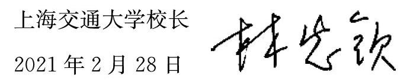
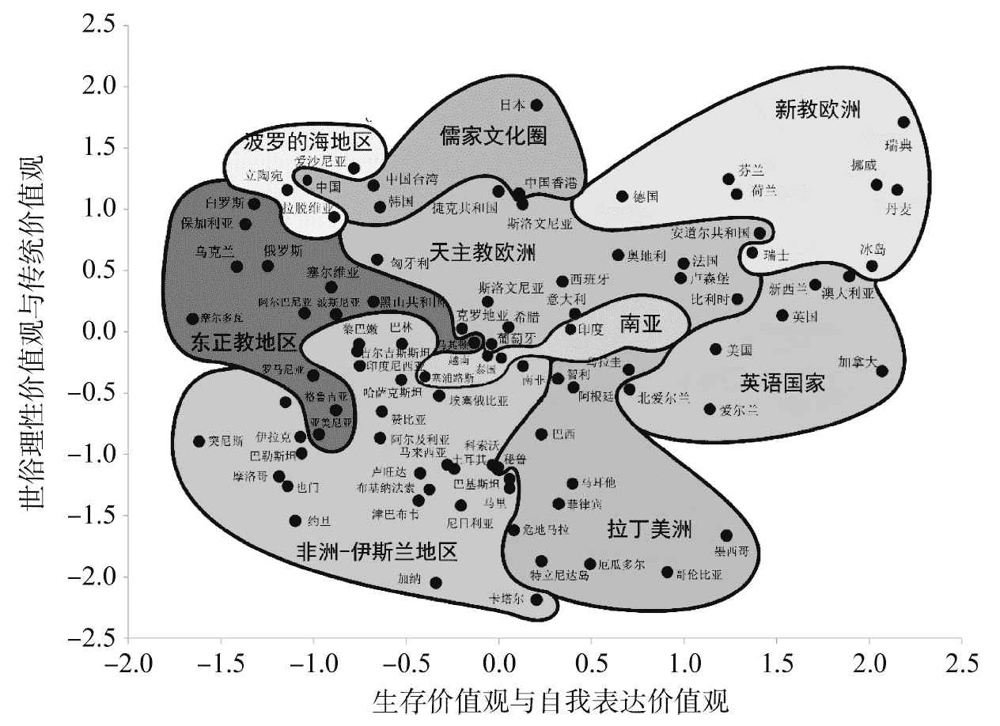
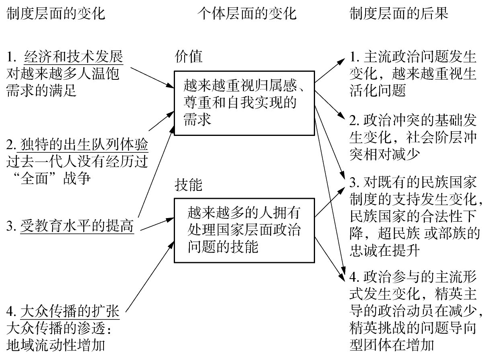
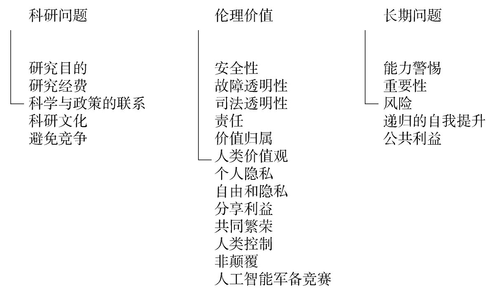
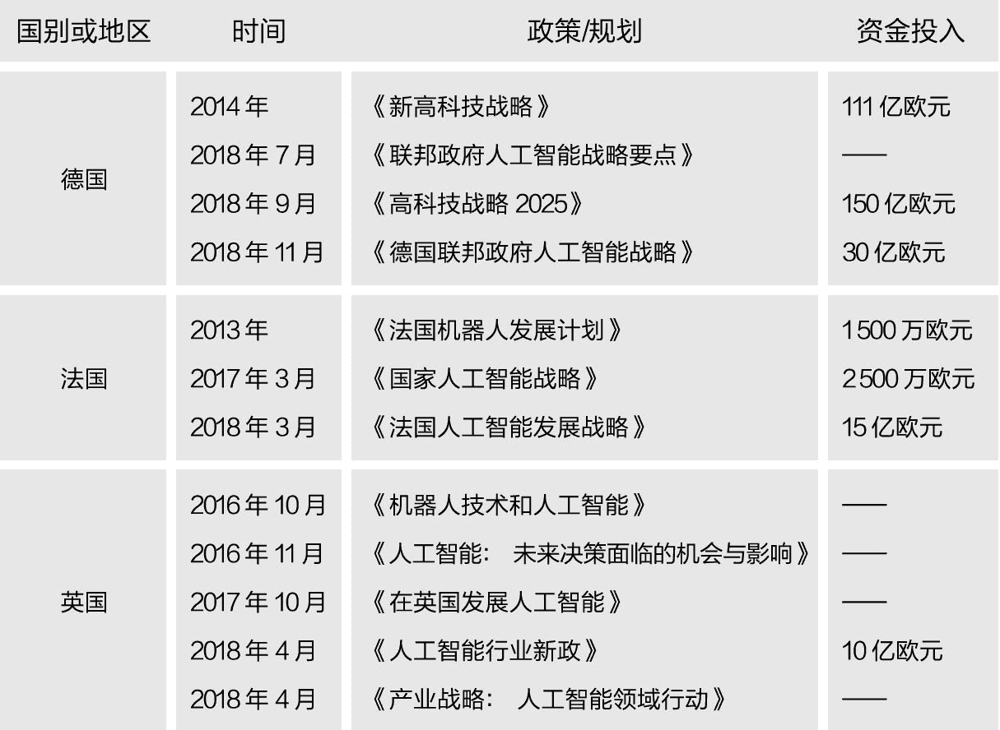
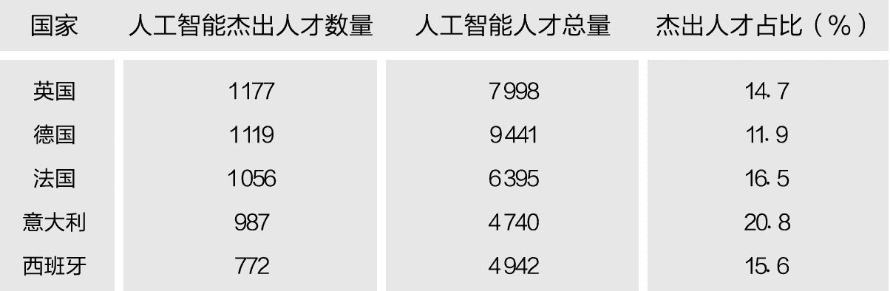

# 人工智能与价值观

# Abstract

Artificial intelligence is entering various industrial fields and social aspects in a subtle and gradual manner, heralding a future landscape of integration between technology, economy, society, and life. Gaining a deep understanding of the application of artificial intelligence and accurately assessing its impact on the social moral value system will be an important means for China to cope with the next period of rapid development, so as to clarify the direction of progress, achieve refined governance, and maintain the stability and sustainable development of the social value system in the tide of technology.

# Editorial Board

**Chair**: Li Renhan, Huang Qingqiao

**Members**: Yang Xiaokang, He Liming, Shen Xincheng, Ye Lu, Zhai Yunjie, Zhou Zheng, Li Fangwei, Huang Leiyu

# Chapter Assignments

- Chapters 1 & 2: Li Fangwei (Peking University)
- Chapter 3: Shen Xincheng (Shanghai Jiao Tong University)
- Chapter 4: Ye Lu, Zhai Yunjie (Shanghai Jiao Tong University)
- Chapter 5: Zhou Zheng (Shanghai Jiao Tong University)
- Chapter 6: Huang Qingqiao, Huang Leiyu (Shanghai Jiao Tong University)
- Postscript: Li Renhan, Shen Xincheng (Shanghai Jiao Tong University)

# Preface

2015–2020 witnessed explosive growth in artificial intelligence, which has begun to "embed" itself into people's production and life. Countries and regions such as the United States, the European Union, the United Kingdom, Japan, South Korea, ASEAN, and China have successively strengthened top-level design and established specialized institutions to coordinate and promote major scientific and technological R&D projects in artificial intelligence. At present, artificial intelligence has transformed and upgraded from a free-exploration scientific research model to a national-strategy-driven innovation development model. Governments, universities, research institutions, industries, and financial circles worldwide are vying for the frontier positions in this field. Layouts at different levels all point to the same projection: in the coming decades, artificial intelligence possesses enormous potential to change global society.

In January 2018, the Artificial Intelligence Research Institute of Shanghai Jiao Tong University was established and unveiled. In February of the same year, it was approved to build the Key Laboratory of Artificial Intelligence of the Ministry of Education. In 2019, Shanghai Jiao Tong University became one of the first batch of universities in China to establish an undergraduate major in Artificial Intelligence. At the graduate education level, Shanghai Jiao Tong University established the Wu Wenjun Honorary Doctoral Class in Artificial Intelligence, focusing on cultivating leading talents in the field of artificial intelligence. At the same time, adhering to the tenet of "Rooted in Shanghai, Radiating the Yangtze River Delta, Serving the Nation," Shanghai Jiao Tong University provides solid intellectual support for the development of China's artificial intelligence industry. Shanghai Artificial Intelligence Research Institute Co., Ltd., jointly built under the leadership of Shanghai Jiao Tong University, is realizing entity-based platform operation. Together with the Shanghai Jiao Tong University Suzhou Artificial Intelligence Research Institute and the Shanghai Jiao Tong University Ningbo Artificial Intelligence Research Institute, they have jointly completed the layout of the "Shanghai-Ningbo-Suzhou Yangtze River Delta AI Collaborative Innovation Platform," jointly exploring "Government-Industry-Academia-Research-Application-Finance" cooperation between universities and local governments in the field of artificial intelligence.

Over the past three years, Shanghai Jiao Tong University has not only sought development and progress in artificial intelligence theory, technology, application, and talent cultivation, but also attached great importance to the study of social issues brought about by artificial intelligence. The book *Artificial Intelligence and Values* is one of the research outcomes. During the compilation process, this book examines the development of artificial intelligence with a historical perspective and a global vision. It is rich in materials, plain in style, and upholds a rational, objective, and rigorous academic research attitude. Through research on the evolution of values in technological revolutions, the reshaping of values brought by AI development, AI and American values, AI and European values, AI and Japanese values, and AI and Chinese values, it proposes that countries valuing AI development need to unite and cooperate, seek common ground while reserving differences, and seek the greatest common divisor of values, which concerns the future shared by all humanity. It also proposes that the world, while developing AI, pays high common attention to issues such as being people-centered, harmony in diversity, and a community with a shared future for mankind.

Currently, as AI development is in its initial stage, there are still shortcomings, omissions, and errors in the compilation of this book. It is hoped that the editorial board members will continue to track, continuously improve, and correct them in the future, making due contributions to the sustained and healthy development of artificial intelligence.

# Chapter 1 Evolution of Values in Technological Revolutions

## Diversity of Values in Comparative Perspective

Values are a common concern of various humanities and social science disciplines. Philosophy, economics, ethics, education, anthropology, sociology, social psychology, and other disciplines have conducted explorations from different angles in this field.[\[1\]](#txt001.xhtml#footnote_content_txt001_1) Among them, philosophy focuses on the relationship between subject and object reflected by values; ethics focuses on the normativity of values on human behavior; anthropology focuses on the cultural characteristics expressed by values; education focuses on the individual socialization process affecting the formation and change of values and its educational intervention; economics focuses on the deep psychological reasons and types of human economic behavior; sociology focuses on the influence of social structure and social change on values; social psychology focuses on the psychological structure, process, function, and measurement of values.[\[2\]](#txt001.xhtml#footnote_content_txt001_2)

As early as the 1930s, American psychologists Allport (G.W. Allport) and Vernon (P.E. Vernon) adopted the six-fold classification of human types (economic, theoretical, social, aesthetic, religious, power) by German psychologist Spranger (E. Spranger) to formulate a "Study of Values," conducting a pioneering study of values.[\[3\]](#txt001.xhtml#footnote_content_txt001_3) In the 1950s, the definition of values proposed by American anthropologist Clyde Kluckhohn established a dominant position, integrating various definitions of values from an operational level. He believed that: a value is a conception, explicit or implicit, distinctive of an individual or characteristic of a group, of the desirable which influences the selection from available modes, means, and ends of action.[\[4\]](#txt001.xhtml#footnote_content_txt001_4) In the 1970s, American social psychologist Milton Rokeach understood values as a belief. He divided values into two aspects: terminal values and instrumental values, initiating the analysis and measurement of values not only from content but also from dimensions, deepening the study of values further.[\[5\]](#txt001.xhtml#footnote_content_txt001_5) The *Rokeach Value Survey* compiled by him is still a widely used values questionnaire internationally. Since the 1980s, researchers represented by American social psychologist Shalom H. Schwartz have begun to explain the deep connotation of values from needs and motives, attempting to construct a psychological structure of values with universal cultural adaptability on this basis. Schwartz believes that values are desirable, trans-situational goals that vary in importance and serve as guiding principles in the life of a person or other social entity.[\[6\]](#txt001.xhtml#footnote_content_txt001_6)

Due to different perspectives and methods, researchers' definitions of the concept of values are difficult to unify, but we can easily discern some consensus from them. From the perspective of the subject of values, it can be either an individual phenomenon, a social phenomenon, or a cultural phenomenon; from the perspective of the form of expression of values, it can be either explicit or implicit; from the perspective of the function of values, most researchers believe that values have a guiding role on behavior.

Like worldview and outlook on life, values possess diversity, covering all fields of social life. Any society has a variety of values, reflecting the diverse cultural traditions, diverse survival conditions, activity modes, and interests of people. In traditional society, due to insufficient differentiation of social life and narrow social relations, values generally possess a certain monotony and closure. The complexity, diversity, and conflicts of modern society have broken the monotonous, closed, and rigid state of traditional society. In particular, economic globalization, driven by the development of social productivity from low to high and the restructuring of the global spatial landscape by technological progress, has greatly expanded human living space and promoted the innovation of the global governance system. At the same time, economic globalization has also intensified the clashing and collision between different development paths, cultures, and religious beliefs. The diversity of values has become a prominent fact.

Values research at the social level is relatively common in Western developed countries. For a long time, many scholars have been committed to exploring the values and behaviors of residents in different countries and regions around the world in the context of continuous changes in society, culture, and politics, and exploring the connection between micro-level value changes of individuals and social change through census methods. Among them, the World Values Survey (WVS) hosted by American political scientist Ronald Inglehart is a typical representative with a wide scope and large impact. This project is hosted by the Swedish non-profit organization "World Values Survey Association" (WVSA), and is a survey research describing issues such as world socio-cultural and political changes. The survey subjects of WVS are ordinary people in representative countries or regions worldwide. It has currently developed to 97 societies across six continents, covering 88% of the world's population. Specifically, since the 1980s, WVSA has conducted values censuses in cycles of 4 to 5 years, dispatching organization members to supervise the survey and entrusting local research institutions to complete data collection work through random sampling interviews.

Based on WVS data, Inglehart and German political scientist Christian Welzel designed a four-dimensional world values map (see Figure 1-1) to display cross-cultural variation on a global scale. In the four-dimensional map, human values are defined as "Self-expression," "Secular-rational," "Traditional values," and "Survival values." Among them, "Secular-rational" and "Traditional values" reflect two opposite processes among social groups. The side closer to "Traditional values" places more emphasis on family education, traditional etiquette, and obedience to authority, as well as opposing suicide, abortion, and upholding traditional family concepts such as ethics. The opposite side, i.e., "Secular-rational," tends more towards individuals' own practical needs.[\[7\]](#txt001.xhtml#footnote_content_txt001_7)

Figure 1-1 Inglehart-Welzel Cultural Map of the World

In Figure 1-1, upward movement on the vertical axis reflects the shift from "Traditional" to "Secular-rational." Traditional values emphasize the importance of religion, parent-child relationships, respect for authority, and traditional family. People who hold these values reject divorce, abortion, euthanasia, and suicide, and generally have a high sense of national pride and nationalist views. Secular-rational values have opposite preferences to traditional values. In societies where secular-rational values prevail, religion, traditional family, and authority do not receive special emphasis. Divorce, abortion, euthanasia, and suicide are considered relatively acceptable. Rightward movement on the horizontal axis reflects the shift from "Survival" to "Self-expression." Survival values emphasize economic and physical security. This is associated with relatively ethnocentric views and low levels of trust and tolerance. Self-expression values highly value environmental protection and show greater equality towards foreigners, homosexuals, and different genders. Figure 1-1 also shows that economic globalization has not obscured the diversity of values. On a global scale, basic value differences between societies remain much larger than those within societies.

The diversity of values originates from human needs, which are the subjective basis for the formation of value relations.[\[8\]](#txt001.xhtml#footnote_content_txt001_8) It is precisely on the basis of realizing needs that people judge, reflect on, and integrate various value relations, thereby forming values. Different people have different needs and self-consciousness, thus forming different values. The multi-level nature of human needs determines the multi-level nature of values; the social nature of human needs determines the social nature of values; the historical nature of human needs determines the historical nature of values.

## Diversity and Conflict of Values

The diversity of values inevitably leads to conflicts of values. Conflicts of values in modern society are extensive and complex, manifesting as conflicts between individuals, between individuals and groups or society, and between groups. [\[9\]](#txt001.xhtml#footnote_content_txt001_9) On a series of important issues such as efficiency versus equity, liberty versus equality, interest versus morality, and environmental value versus economic value, different subjects often arrive at different or even diametrically opposed views; the same subject's value orientations in different fields and aspects often exhibit variability and contradiction. These contradictions and conflicts essentially stem from a series of contradictions and conflicts between different forms of values, such as traditional values versus modern values, indigenous values versus foreign values, dominant values versus non-dominant values, religious values versus secular values, and elite values versus mass values. There exists no abstract, eternal, unchanging value system adapted to any era, any nation, or any class. Different values embody the expectations and demonstrations of different nations, classes, and social groups regarding the desirable state of value relations.

## Change and Constancy of Values

As an organic component of the social consciousness system, once formed, values permeate all value activities of people, serving as the orientation and basis for people's value evaluation, selection, and creation. As long as people always stand on the basis of real history, not explaining practice from concepts, but explaining the formation of concepts from material practice, [\[10\]](#txt001.xhtml#footnote_content_txt001_10) then values are necessarily constructed upon a certain socio-economic foundation; they are the product and manifestation of people's social existence, social practice, and life experience in a given era, and the result of the subtle infection and edification of factors such as cultural traditions, lifestyles, customs, and social psychology of that era.

As the deep structure of the cultural system, values possess relative durability or continuity, functioning consciously or unconsciously over a considerable period, influencing and dominating people's thoughts and behaviors. Under specific times, places, and conditions, people's values are always relatively stable. For example, regarding the good or bad of a certain thing, there is always an opinion and evaluation; under unchanged conditions, this opinion will not change abruptly.

However, people's ideas, views, and concepts change with the change of their living conditions, their social relations, and their social existence. [\[11\]](#txt001.xhtml#footnote_content_txt001_11) The constancy of values is relative; it inevitably develops with the development of the times and changes with the transformation of the times, constantly accepting the test, correction, and improvement of people's social life practice. In periods of stable social development, values reside in daily life, and people only consciously or unconsciously follow their guidance. In periods of social transformation, old and new values often collide and conflict, and the comparison, reflection, criticism, and transformation of values are consequently put on the agenda. In the initial stage of social transformation, values exhibit diversity, disorder, and chaos, leaving many people feeling bewildered and at a loss. Subsequently, values upholding the old order clash fiercely with values reflecting the requirements of historical progress; the defects of old values gradually surface, while certain new values begin to demonstrate powerful vitality, gaining recognition and support from the public. Finally, through rational argumentation, and especially the test of practice, people select and accept new values, thereby completing the alternation of old and new values. This situation occurs not only during major transformations of social formations in history but may also appear even within the same social formation when social life undergoes tremendous changes.

Globally, several long-term cross-generational surveys have attempted to study the issue of value change. Between 1953 and 1988, the Japanese National Character Survey Committee of the Institute of Statistical Mathematics conducted a survey on Japanese national character every five years. Under the topic "Study of Japanese National Character," Japanese sociologists conducted value surveys for over 30 years in 5-year cycles, primarily intending to understand changes in Japanese public opinion, attitudes, and values, and edited and published five volumes of *The Japanese National Character* based on the survey results. [\[12\]](#txt001.xhtml#footnote_content_txt001_12) Over the 20-plus years from 1972 to 1993, Japanese sociologists such as Tsuru Hiroshi, Sakaichi, and Akiba Hidenori conducted a relatively systematic study on the "Development and Change of Modern Japanese Youth Values." [\[13\]](#txt001.xhtml#footnote_content_txt001_13) In the late 1970s, the European Value System Study Group (EVSSG) launched a large-scale cross-national survey project, the European Value Survey (EVS), targeting 10 Western European countries. The survey results showed significant differences among residents of the surveyed countries in political, family, religious, gender, and other values. [\[14\]](#txt001.xhtml#footnote_content_txt001_14) In 1980, Dutch psychologist Geert Hofstede, based on research into the work values of over 116,000 people in 40 countries across different occupations, categorized differences between cultures into six basic cultural value dimensions, pioneering the study of cultural differences. [\[15\]](#txt001.xhtml#footnote_content_txt001_15) These research methods subverted the traditional single East-West geographical division in studying social problems, reflecting variables in social research such as race, history, and natural environment through basic values, thereby understanding social change from a broader perspective.

In the Western developed industrial societies of the 1970s, a clear generational change appeared in the value types of the populace, forming a divide between materialist values and post-materialist values. The theory of value change proposed by Inglehart is one of the important theories in the field of political culture research today, and this conclusion has been repeatedly corroborated in subsequent decades of value survey research. [\[16\]](#txt001.xhtml#footnote_content_txt001_16) Inglehart pointed out that in rapid social transformation, on the one hand, there is a decline in trust in institutions caused by the declining legitimacy of hierarchical authority, patriotism, and religion; on the other hand, the political expression of new values is constrained by changes in the balance of political skills between elites and the masses. [\[17\]](#txt001.xhtml#footnote_content_txt001_17) The process of value change he examined (see Figure 1-2) is as follows:

Figure 1-2　Process of Value Change Examined by Inglehart

In Inglehart's view, certain basic values and skills appear to be changing in a gradual but deep-seated manner; the two processes of value change reinforce each other, profoundly influencing the transformation of socio-political structures. The three variables of values, skills, and structure jointly determine the path of political change, and the core concept of the theory of value change unfolds around these three variables.

In terms of the contemporary significance of value change for real political life, value change relates to the degree of political division in the whole society, the issues and effectiveness of political participation, and the spread and proliferation of social trends of thought. The values of the populace are the core of political culture; they guide people's various choices in political life, such as choosing what kind of political system, what kind of rules to promote the exercise of power, what kind of goals to endow political organizations with, and with what kind of attitude to treat political organizations: belief or suspicion, participation or alienation, support or challenge, etc.

From the perspective of the driving force of social development, values play a crucial role in guiding human beings to generate social behaviors and further promoting social progress. Since the Industrial Revolution, the social development of many countries has been dominated by economic growth, matched by "modernity" values, which are widely regarded as an economy-dominated concept, always viewing "economic growth" as the ultimate force to solve the gap between rich and poor, environmental destruction, and other social problems. However, many modern and contemporary economists and sociologists no longer affirm this economy-dominated value concept. For example, American postmodern thinker John B. Cobb Jr. denounced the concept of "economic growth solving social problems" from the perspectives of macroeconomics and public policy. He believed that pure economic development cannot solve the problem of excessive population growth in Third World countries, is insufficient to help people form a correct environmental view, and hinders the development of health, education, culture, and political human rights and democracy. [\[18\]](#txt001.xhtml#footnote_content_txt001_18) Today, the focus of ordinary people's attention to public affairs has shifted, and the idea that modern social and economic development concepts urgently need to change has gained support. For example, people in many countries are now concerned about the gap between rich and poor, environmental protection, education investment, food and drug safety, and other topics, rather than just Gross Domestic Product (GDP).

This value shift is highly likely to become an important driving force for future social change, just as technological progress after the Industrial Revolution drove world economic development. Another broad consensus is that a large part of the force determining the direction of social development comes from the will of the entire social group; these wills or values are transformed into behaviors and even driving forces through various mechanisms to guide future social development. From this perspective, if we study the basic values of social groups and their transformations, and through them obtain explanations of different countries and regions in political culture beyond economic development, we can further explore the development and changes of these societies, avoiding being blinded by economic data.

In addition, some scholars point out that since the Reform and Opening Up, Chinese society has been in a state of accelerated transition. One important result of this accelerated transition is "time-space compression," meaning that within the same time-space scope, the pre-modernity of traditional society, the modernity of modern industrial society, and the post-modernity of post-industrial society coexist. [\[19\]](#txt001.xhtml#footnote_content_txt001_19) The coexisting pre-modernity, modernity, and post-modernity each possess corresponding value connotations, which also means that the contest and alternation of values will coexist in China for a long time.

## Historical Transformation of Values Driven by Technology

Since the 20th century, the rapid development of science and technology has opened the door to a new era of human civilization. Major achievements in science and technology have been rapidly transformed into technological products, penetrating all aspects of people's social life and production, comprehensively influencing and changing human thinking patterns and behavioral models, and becoming a controlling factor of society and people's daily lives.

Most philosophers acknowledge that the mutual influence between values and science and technology is obvious; the primary reason for conducting scientific research is that understanding and knowing the world possesses significant value. Among them, values such as truthfulness, objectivity, and empirical adequacy are crucial to the scientific enterprise; they are also universally recognized as characteristics that excellent theories should possess, helping us understand the world. Some philosophers also believe that certain values are irrelevant to science. British philosopher Bertrand Russell believed: "Since science is only concerned with facts, value factors such as justice are not within its consideration at all." [\[20\]](#txt001.xhtml#footnote_content_txt001_20)

Research on the value of technology itself has always been a field with considerable controversy, and the dispute between technological neutrality and technological value theory has a long history. Proponents of the "technological neutrality" view deny that technology has its own social role and social impact, believing that technological applications can serve different social purposes and that technology itself is neutral. For example, German ecological philosopher Hans Sachsse believed: "Since technology is only a method, only a tool, the purpose of technological action always exists outside of technology." [\[21\]](#txt001.xhtml#footnote_content_txt001_21) Other scholars believe that technology and the application and consequences of technology are not absolutely separate; technology itself is value-laden, and technology is the process of processing, handling, and controlling matter, energy, and information to realize certain value purposes. Canadian philosopher and physicist Mario Bunge believed: "Technology is by no means ethically neutral; it involves ethics and hovers between good and evil." [\[22\]](#txt001.xhtml#footnote_content_txt001_22)

Engels pointed out, "Marx regarded science and technology first of all as a powerful lever of history, as a revolutionary force in the highest sense." [\[23\]](#txt001.xhtml#footnote_content_txt001_23) With the rapid expansion of science and technology, the subjectivity of human beings gradually disappeared, and science and technology turned into the dominant factor in capitalist society. Science and technology both enhanced humanity's ability to conquer and transform nature, becoming a guarantee for people to move from the kingdom of necessity to the kingdom of freedom, and simultaneously created the necessary material foundation for a new society. Regarding issues in the field of technology and values, Western scholars have always given full attention. The Frankfurt School conducted profound theoretical reflection and criticism on science and technology from the perspective of values, aiming to reshape a scientific and technological value system with humans as the value subject. Early representative and founder Max Horkheimer, combining the new development situation of capitalism, took instrumental rationality as the main object of criticism, negating the value orientation of science and technology under capitalist domination. He believed: "Science and technology no longer take humans as the value subject; they have abandoned their own pursuit of meaning, becoming a means for the bourgeoisie to manipulate people, alienated into a tool of bourgeois rule." [\[24\]](#txt001.xhtml#footnote_content_txt001_24)

The natural and social attributes of technology are continuously amplified in the process of technology's socialization, leading to the strengthening of technology-driven forces at the natural, social, and human levels. At the same time, the duality of technology's intrinsic value and the duality of technology's application have an inevitable intrinsic connection. Therefore, to explore the impact of technological development on values, one cannot avoid a multi-level analysis of the nature of technology, the duality of technological value, the duality of technological application, the process significance and ultimate value of technological application, etc. Therefore, American philosopher of technology Joseph C. Pitt proposed: "If technology reflects our value system, or even if it merely affects the economic structure of our society, we should know what this means and how it happens." [\[25\]](#txt001.xhtml#footnote_content_txt001_25) Another American philosopher of technology, Carl Mitcham, also believed: "Future philosophy of technology research will pay more attention to the examination of the significance and value of the technological application process," and "this positioning of the significance and value of technological application obviously must be examined on a dynamic ethical level." [\[26\]](#txt001.xhtml#footnote_content_txt001_26)

Besides philosophers, scientists are also questioning the value of science and technology. Renowned American physicist Richard P. Feynman, after participating in the Manhattan Project, began to reflect on his youthful thoughts on the value of science. He posed the question: "When we see that science can also bring disaster, what exactly is the value of the scientific career that I love so much and have devoted my life to?"

Feynman's own answer to this question was: "The first point of the value of science is well known. Scientific knowledge enables people to make many products and do many things. Of course, when people use science to do good things, the credit belongs not only to science itself but also to the moral choices that guide us. Scientific knowledge gives people the ability to do good, but also to do evil; it itself carries no instructions for use. This ability is obviously valuable, although whether it is good or bad depends on how it is used."

Another value of science is to provide the enjoyment of wisdom and speculation. Some people can obtain this enjoyment from reading, learning, and thinking, while others must obtain satisfaction from real in-depth research. The importance of this intellectual speculative enjoyment is often ignored, especially by those gentlemen who incessantly preach that scientists should bear social responsibility.

Another not-to-be-underestimated value of science is that it has changed people's concepts of the world. Due to the development of science, we can today imagine infinitely wonderful things, millions of times more rich and bizarre than the imagination of poets and dreamers. Nature's imagination and versatility are far superior to humanity's. For example, poets imagine giant turtles carrying elephants traveling in the sea; science gives us a picture—a giant ball rotating in the heavens, on whose surface people are held by the magical force of gravity and rotate with it. [\[27\]](#txt001.xhtml#footnote_content_txt001_27)

With the generation, appreciation, and application of technological value, can it be said that the historical transformation of values in human society is reflected in the realization of technological value at the three levels of nature, society, and humanity? At the same time, should we also acknowledge that the positive and negative values of technology are relative, that there are no absolute positive values and no absolute negative values, and that the positive and negative attributes of technological value can be transformed into each other under certain conditions?

Feynman contemplated two possible directions of value change driven by technology: On the one hand, people create technology to utilize it, and use technology because it has utilizable positive value, but technology (value), once applied, always produces both positive and negative effects—positive and negative values are always realized simultaneously or sequentially; for example, pesticides as a technological product, their application can increase crop yields—realizing positive value, but simultaneously pollute the environment and food, causing harm to human health—realizing negative value. On the other hand, the destructive consequences technology may bring are not necessarily absolutely bad things or absolutely negative impacts; for example, the application of the atomic bomb, due to its enormous destructive power, has become one of the greatest potential threats to world peace, but it can also provide a guarantee for peace-loving people to counter nuclear threats.

Just as the birth of nuclear technology greatly influenced the development process of human civilization in the 20th century, artificial intelligence in the 21st century will bring unprecedented huge challenges to human society. The development of biological science and computer science may lead to future bionic life threatening the human world; science fiction movies and literature have expressed this concern—that at some future time point, artificial intelligence may subvert human rule over the world, leading to the arrival of catastrophic disaster. And at present, we are living in a big data era from which no one can escape data; artificial intelligence continuously shapes and changes human daily life and social behavior. For example, in urban management, the location function of smartphones helps grasp population density and personnel flow information; the usage trajectories of shared bikes help optimize urban road construction—these were unimaginable in the past.

As described above, the world of artificial intelligence is a world constituted by digitized behaviors; big data has qualitatively changed the use of data; the interaction between intelligent machines and the data world has ushered humanity into a new era of using big data for prediction or decision-making. Algorithms are the foundation for realizing the impact of artificial intelligence on the real world. Some optimists advocate replacing human judgment with algorithmic judgment; this view continues the "technological determinism" communication research path, ignoring the social construction function of algorithm design, and obscuring the technological risks and social impacts of artificial intelligence. In a sense, an algorithm is just a tool; it cannot completely separate or abstract values. Culture exists prior to algorithm design, rooted in existing social systems, practices, attitudes, and their value orientations, embedded into program design through the designer's design concepts and expectations. Will technological determinism or technological optimism lead to an overall ignorance of the history and philosophy of technology? Will technological development strengthen colonial rule over the lifeworld, destroy the meaning of the lifeworld by expanding technological control over humans, and further constrain human autonomy? Pessimists believe that ultimately science and technology will unimpededly occupy the human living domain, leading to the "completely mechanized new society, dedicated to the largest scale of material production and consumption, controlled by computers" predicted by German philosopher Erich Fromm. [\[28\]](#txt001.xhtml#footnote_content_txt001_28)

Artificial intelligence may fundamentally change behaviors regulated by tradition and human values hitherto; it actually creates a new society, which is not merely a modern version of the old society. What values will dominate this brand-new society? In 2018, renowned Chinese-American scientist and AI researcher Fei-Fei Li expressed both excitement and concern about AI development in her article "How to Make AI More Human," proposing a "Human-Centered AI" development path, hoping to guide AI to become a force for the progress of human social life. [\[29\]](#txt001.xhtml#footnote_content_txt001_29) At the same time, she refuted the view that machines have no values; she believes that machine values are human values. This is the first time an AI expert has equated AI values with human values. In Fei-Fei Li's view, "Human-Centered AI" contains three main tenets: first, to make AI better reflect the deep intelligence of humans; second, AI should help humans become stronger, not replace humans; third, to ensure that the impact of AI on humans is correctly guided during its development.

As the culmination of technological science born in the soil of positivism, artificial intelligence is the product of modern technological rationality reaching its peak, but AI has a characteristic distinct from other technologies: reflexivity towards the technology inventor. Just as people believe cognitive science may dissolve epistemology, AI may dissolve the creative essence of humanity. [\[30\]](#txt001.xhtml#footnote_content_txt001_30) Most value research programs oriented towards the AI field consider how humans can implant their existing values into intelligent machines. If limited to the standpoint of natural humans, many paradoxical scenarios will appear in the relationship between humans and intelligent machines; this is the importance of AI values emphasized by Fei-Fei Li. In the current era of rapid AI development, humans need to transcend their own perspective with specific historical limitations in order to further explore its connotations.

## Chapter Summary

Values concepts in philosophical thought possess rich practical connotations and practical significance. As French philosopher Gilles Lipovetsky pointed out: "A society should not be limited to material production and economic exchange. It cannot exist without ideas and concepts. These ideas are not a 'luxury,' dispensable and optional, but the very condition of collective life itself... Without a value system, there is no regenerable social collective."[\[31\]](#txt001.xhtml#footnote_content_txt001_31) Diverse and constantly changing values reflect the different views and measures of different ethnic groups, classes, and social groups on social issues in specific historical periods.

The transformation of values is closely related to the development of science and technology. Historically, the establishment of Newtonian mechanics gave rise to a mechanistic mode of thinking. British philosopher, the father of liberalism, John Locke, was thus inspired to propose the concept of "human-centeredness" to replace "monarch-centeredness," fundamentally changing people's understanding of themselves and social values at the time; its influence extended through the implementation of British constitutionalism, the Enlightenment, and the French Revolution.[\[32\]](#txt001.xhtml#footnote_content_txt001_32) The special social function of science and technology on spiritual civilization, its powerful influence on the political landscape, and even its decisive role in acute politics such as war, prove that technology not only empowers and authorizes but also itself constitutes an exercise of power and a replacement of traditional power patterns.

The guiding role of values will be reflected in how different countries and individuals view artificial intelligence issues, while all specific policy formulations reflect what kind of values a society is constructing in the intelligent era. Despite the rapid technological iteration in the field of artificial intelligence, its core idea of systematizing and automating tasks has not changed. Therefore, researchers should first study problems from a theoretical level, accurately analyze concepts, clarify value demands, and finally transform them into practical actions as much as possible. Researchers have an obligation to think about how to implement abstract theories into practice, striving to make the development of artificial intelligence more consistent with the value goals that public interest and human equity should possess.

---

## References

[1] Li Deshun. *Dictionary of Axiology* [M]. Beijing: Renmin University of China Press, 1995.

[2] Yang Yiyin. A Summary of Values Research in the Field of Social Psychology [J]. *Chinese Social Sciences*, 1998(02): 3-5.

[3] (USA) Milton Rokeach. *The Nature of Human Values* (8th ed.) [M]. Trans. by Gao Fengqiang et al. Xi'an: Shaanxi Normal University Press, 2005: 152.

[4] (USA) Clyde Kluckhohn. *Culture and Behavior* [M]. Trans. by Gao Jia. Hangzhou: Zhejiang People's Publishing House, 1986: 40.

[5] Milton Rokeach. The Nature of Human Values [J]. *American Journal of Sociology*, 1973, 89(2).

[6] Shalom H. Schwartz. Are There Universal Aspects in the Structure and Contents of Human Values? [J]. *Journal of Social Issues*, 1994, 50(4).

[7] Inglehart R., Haerpfer C., Moreno A., et al. (eds.). 2014. World Values Survey: Round Six-Country-Pooled Datafile Version: `https://www.worldvaluessurvey.org/WVSDocumentationWV6.jsp`. Madrid: JD Systems Institute.

[8] Ji Ming. *Introduction to Core Values* [M]. Beijing: People's Daily Press, 2013: 9.

[9] Wu Xiangdong. On the Formation and Choice of Values [J]. *Philosophical Research*, 2008(5): 22-28.

[10] *Collected Works of Marx and Engels*, Vol. 30 [M]. Beijing: People's Publishing House, 1995: 92, 291.

[11] *Collected Works of Marx and Engels*, Vol. 30 [M]. Beijing: People's Publishing House, 1995: 291.

[12] Zhang Jianli. Study on Japanese National Character [J]. *Japanese Studies*, 2015(B01): 82-89.

[13] Zhang Jianli. Current Status and Tasks of Japanese National Character Research [J]. *Japanese Studies*, 2006(06): 131-142.

[14] Mu Bu. Values of Contemporary Europeans [J]. *Morality and Civilization*, 1985(2): 36-36.

[15] Hofstede G. *Culture's Consequences: International Differences in Work-Related Values* [M]. Sage, 1984.

[16] Ronald Inglehart, Huang Yusheng. Changing Values: Economic Development and Political Change [J]. *International Social Science Journal (Chinese Edition)*, 1996(03): 7-31+3.

[17] Inglehart R. The Silent Revolution in Europe: Intergenerational Change in Post-Industrial Societies [J]. *The American Political Science Review*, 1971: 991-1017.

[18] (USA) John B. Cobb Jr. *Reconstructing Religion, Culture, Education, Sexuality, Class, Race, Politics and Economy: Postmodern Public Policy* [M]. Trans. by Li Ji, Zhang Chen. Beijing: Social Sciences Academic Press, 2003.

[19] Che Dezhi, Zhang Yantao. Transformation and Development of Contemporary China [J]. *Seeking Truth*, 2013(03): 37-40.

[20] Bertrand Russell. *Human Knowledge: Its Scope and Limits* [M]. Trans. by Zhang Jinyan. Beijing: The Commercial Press, 1989: 297.

[21] (Germany) Hans Sachsse. *Ecological Philosophy* [M]. Trans. by Wen Tao, Pei Yun. Beijing: Oriental Publishing House, 1991: 162.

[22] Bunge, M. Philosophical Inputs and Outputs of Technology [J]. *Collection of Philosophical Problems of Natural Science*, 1984(1): 54-64.

[23] *Collected Works of Marx and Engels*, Vol. 19. Beijing: People's Publishing House, 1963: 372.

[24] Gao Lianghua. Technology: Critique of Social Critical Theory—A Review of Frankfurt School's Philosophy of Technology [J]. *Studies in Dialectics of Nature*, 1992(02): 23-30.

[25] Pitt J C. On the Philosophy of Technology, Past and Future [J]. *Society for Philosophy and Technology Quarterly Electronic Journal*, 1995, 1(1/2): 18-22.

[26] Mitcham C. Notes Toward a Philosophy of Meta-Technology [J]. *Society for Philosophy and Technology Quarterly Electronic Journal*, 1995, 1(1/2): 13-17.

[27] (USA) Richard Feynman. *The Pleasure of Finding Things Out* [M]. Beijing United Publishing Co., 2018: 144.

[28] Fromm E. The Revolution of Hope: Toward a Humanized Technology Vol.38 [J]. 1968.

[29] Fei-Fei Li. How to Make A.I. That's Good for People. *Nytimes*. March 7, 2018.

[30] Chen Zifu. Strong AI and Superintelligence: Technological Rationality and Its Critique [J]. *Science and Management*, 2016, 36(5): 25-33.

[31] (France) Gilles Lipovetsky, (Canada) Sébastien Charles. *Hypermodern Times* [M]. Trans. by Xie Qiang. Beijing: Renmin University of China Press, 2005: 111.

[32] (UK) Locke. *Two Treatises of Government* (Part II) [M]. Trans. by Qu Julong, Ye Qifang. Beijing: The Commercial Press, 1964: 14.

# Chapter 2 Reshaping of Values Brought by Artificial Intelligence Development

## From Technology to Industry: The Revolutionary Transformation of Artificial Intelligence

Artificial intelligence is a technology that simulates human cognitive capabilities through machines. This technology covers many professional fields, such as machine learning, deep learning, knowledge reasoning, human-computer interaction, big data analysis, pattern recognition, natural language processing, large-scale computing systems, and distributed systems, etc. From concept formation to technological implementation, artificial intelligence has undergone more than 60 years of exploration. However, ideas related to artificial intelligence have existed since ancient times, traceable to philosophy, fiction, and imagination. The ideological origins of replicas and robots can be found in ancient legends. For example, the bronze automaton Talos in the ancient Greek myth *Argonautica*; the robot warriors dispatched by King Ajatasatru in Indian legend to guard the relics of the Buddha; medieval legends of using witchcraft or alchemy to endow inanimate matter with consciousness, etc.

The basic assumption of artificial intelligence is that the human thinking process can be mechanized. Research on mechanized reasoning has a long history. Famous examples include Aristotle (who formally analyzed syllogistic logic), Euclid (whose *Elements* is a paradigm of formal reasoning), and Al-Khwarizmi (the pioneer of algebra; the word "algorithm" evolved from his name). As early as the 13th century, the pioneer of computation theory, philosopher Ramon Llull, developed some "logic machines," attempting to acquire knowledge through logical methods. In the 17th century, German mathematician Leibniz, the founder of the British rationalist tradition Thomas Hobbes, and French mathematician René Descartes attempted to systematize rational thinking into a system like algebra or geometry. These philosophers had already explicitly proposed the hypothesis of formal symbol systems, which became one of the guiding ideas of artificial intelligence research in later generations.

In the 20th century, breakthroughs in mathematical logic research laid a solid foundation for artificial intelligence. Foundational works in this area include British mathematician George Boole's *The Laws of Thought* and German logician Gottlob Frege's *Begriffsschrift* (Concept Script). Based on Frege's system, Russell and Whitehead (Alfred North Whitehead) gave a formalized description of the foundations of mathematics in *Principia Mathematica*. This achievement inspired Hilbert (David Hilbert) to pose a fundamental problem to mathematicians in the 1920s and 1930s: "Can all mathematical reasoning be formalized?" The final answer to this question was given by Gödel's incompleteness theorems, the `Turing machine`, and Alonzo Church's `λ-calculus`. They first proved the limitations of mathematical logic; second, their work implied the possibility that any form of mathematical reasoning could be mechanized within these limits, which is extremely important for artificial intelligence.

The 1940s was the germination period of artificial intelligence. In 1943, American neurophysiologist W. McCulloch and mathematical logician W. Pitts published a mathematical model of neural networks (`M-P neural network model`) in the *Bulletin of Mathematical Biophysics*. By summarizing some basic physiological characteristics of neurons, they proposed a formalized mathematical description of neurons and structural methods for networks, thus opening the era of neural computation. In 1945, Hungarian-American mathematician John von Neumann proposed the stored-program concept. In 1946, the first electronic computer `ENIAC` was successfully developed. They both laid the material foundation for the birth of artificial intelligence. In 1948, American mathematician Claude E. Shannon published the epoch-making paper *A Mathematical Theory of Communication*, marking the birth of a new discipline—information theory. He believed that human mental activities could be studied in the form of information and proposed a mathematical model describing mental activities. In 1948, American applied mathematician Norbert Wiener founded cybernetics, a discipline that studies and simulates biological and artificial systems of automatic control, marking that the foundation for computer simulation research and analysis based on animal psychology and behavioral science had been formed.

1956—1969 was the formative period of artificial intelligence. In the summer of 1956, John McCarthy, Marvin L. Minsky, and others initiated a two-month academic seminar at Dartmouth College around the question of "how to use machines to simulate human intelligence," proposing the term "artificial intelligence," marking the formal birth of this discipline. During this stage, key areas such as theorem proving by machines, problem solving, `LISP language`, and pattern recognition all achieved major breakthroughs. In 1956, American computer scientists Allen Newell and Herbert Simon established the "`Logic Theorist`" program, which could simulate the thinking patterns of humans using mathematical logic to prove theorems, and proved 38 theorems in Chapter 2 of *Principia Mathematica*. After improvements, it proved all 52 theorems in that chapter in 1963. This work was highly praised and considered a major achievement in computer simulation of human advanced thinking activities, the true beginning of artificial intelligence.

In 1956, Arthur Samuel, the father of machine learning, developed a checkers program with learning capabilities. The program could learn from game records and summarize experience in practice. It defeated Samuel himself in 1959 and the checkers champion of a U.S. state in 1962. This was a successful exploration in simulating the human learning process and a major breakthrough in artificial intelligence. In 1958, the list processing language program `LISP` developed by John McCarthy could not only process data but also conveniently process symbols, becoming an important milestone in artificial intelligence programming languages. To this day, `LISP` language remains an important programming language and development tool for artificial intelligence systems. In 1960, Newell, Simon, and John Clifford Shaw et al. developed the `General Problem Solver (GPS)`, a summary of human thinking activities during problem solving. They discovered that human thinking activities in problem solving include three steps: ① First, conceive a rough plan; ② Implement the problem-solving process according to axioms, theorems, and solution plans in memory, following the plan; ③ During the implementation process, continuously analyze methods and goals, and revise the plan. They proposed the concept of heuristic search for the first time.

In 1968, American computer scientist Edward A. Feigenbaum et al. successfully developed the chemical analysis expert system `DENDRAL`. Its function was to analyze mass spectrometer spectra to help chemists determine molecular structures. This was considered the germination of expert systems and a successful attempt of artificial intelligence research moving from general thinking discussion to specialized knowledge application. The emergence of expert systems meant that artificial intelligence began to move from mainly theoretical research to practical application, but at the same time, its research moved from general thinking to specialized knowledge application—that is, scientists' efforts became more "down-to-earth" and more "weak AI." At this time, because machine learning models were still "artificial," as the application of expert systems deepened, their inherent shortcomings—difficulty in knowledge acquisition, weak reasoning ability, and high upfront labor costs—were exposed, and artificial intelligence research began to ebb. 1974—1980, the immaturity of artificial intelligence and people's disappointment that previous huge investments failed to produce expected returns led it into the first trough.

In 1981, Japan announced to the world that it would begin developing the fifth-generation computer, prompting the United States, Europe, the Soviet Union, and other countries and regions to successively re-approve and support artificial intelligence research in the mid-1980s. In 1986, Canadian computer scientist Geoffrey Hinton et al. proposed the `backpropagation algorithm`, the foundational concept of deep learning. With improvements in machine learning methods such as knowledge engineering, and machine learning beginning to adopt decision tree models and multi-layer artificial neural networks, artificial intelligence entered a second period of prosperity. 1987—1993, computer performance had made great strides, attempting to solve problems by establishing computer-based expert systems, but due to limited data and over-reliance on empirical knowledge and rules, it was difficult to build effective systems, and capital and government support withdrew again, ushering in a second trough for artificial intelligence. However, during this period, AI R&D continued, and the development of network technology, especially internet technology, pushed artificial intelligence further toward practical application. By the end of the 20th century, the field of artificial intelligence blossomed again; its landmark event was the 1997 victory of International Business Machines Corporation (IBM) `Deep Blue supercomputer` over world chess champion Garry K. Kasparov.

## History of AI Development and Social Impact

In 2006, driven by Hinton and his students, deep learning began to attract significant attention. With the proposal and application of various machine learning algorithms, particularly the advancement of deep learning technology, people hoped that machines could automatically acquire knowledge and achieve intelligence through the analysis of massive amounts of data. During this period, with the improvement of computer hardware capabilities and the development of big data analytics technology, the ability of machines to acquire, store, and process data improved substantially. In terms of contribution to practical applications, deep learning is perhaps the most successful research direction in the field of machine learning over the past decade. After 2010, deep learning technology made significant progress in knowledge understanding compared to previous shallow learning, driving astonishing breakthroughs in technologies such as speech recognition, image recognition, and natural language processing, and propelling artificial intelligence and human-computer interaction forward by leaps and bounds. AI capabilities in many specialized directions have surpassed humans, such as Go, Texas Hold'em, proving mathematical theorems, learning to automatically construct knowledge from massive data, recognizing speech, faces, and fingerprints, driving cars, and processing massive documents. Deep learning has brought a new wave of machine learning, attracting widespread attention from academia to industry, and leading to the arrival of the "Big Data + Deep Models" era, which in turn ushered in a new wave of AI development.

Since the First Industrial Revolution, technological innovation has been the fundamental driving force of economic development. While focusing on the role of technology in long-term economic growth, people have also realized that not all technologies are of equal importance; only revolutionary technological advances can drive the transformation of human economy and society. Since the 1760s, the three industrial revolutions experienced by humanity were driven by mechanical technology, electrical technology, and information technology, respectively. In 2016, the World Economic Forum defined artificial intelligence as the cornerstone of the Fourth Industrial Revolution. [[1]](#txt002.xhtml#footnote_content_txt002_1) In 2017, a UN research report, *The Impact of the Technological Revolution on Labour Markets and Income Distribution*, pointed out that artificial intelligence, like steam technology and electrical technology, is a General Purpose Technology (GPT) used by humans to transform nature. [[2]](#txt002.xhtml#footnote_content_txt002_2) The climax of every industrial revolution is marked by the core technology driving it entering the stage of industrial mass production, characterized by standardization, automation, and modularization. The history of AI development shows that previous waves of AI development all encountered technical bottlenecks, making commercial applications difficult to implement, eventually falling back into a trough. However, the current new generation of AI already possesses strong generality; the technical ceiling and commercialization potential of this wave of AI are far higher than before, meaning it is ready to enter the stage of industrial mass production.

## From Macro to Micro: The Impact of AI on Social Development

In 2018, consulting firm McKinsey released a report stating that by 2030, AI would create nearly $13 trillion in additional economic output globally, accounting for 1.2% of world GDP growth. [[3]](#txt002.xhtml#footnote_content_txt002_3) As the core driving force of a new round of industrial transformation, AI is having a profound impact on the world economy, social progress, and human life. With the deep integration of technologies such as the Internet of Things (IoT), big data, and cloud computing with intelligent algorithms, AI has shown broad application prospects in various industries. Relying on the massive sensory information brought by the IoT, AI is gradually evolving from computational intelligence to perceptual intelligence; relying on the verifiable foundation provided by big data, deep learning algorithms support computers in better simulating human-like characteristics; relying on the supercomputing power brought by cloud computing and super-powerful chips, AI development has a relatively solid physical foundation.

AI has broad development prospects and can be used to improve fields such as consumption, healthcare, environment, security, and education, enhancing people's well-being. Currently, AI has entered a comprehensive commercialization stage and is affecting all participants in traditional industries to varying degrees, changing the ecology of various industries and causing a comprehensive, three-dimensional impact on social development. The *Global AI Development White Paper (2019 Edition)* by the international accounting firm Deloitte points out that this transformation is mainly reflected in three levels. [[4]](#txt002.xhtml#footnote_content_txt002_4) The first level is industry transformation; the changes brought by AI cause fundamental changes in the upstream and downstream relationships of traditional industrial chains. The participation of AI leads to an increase in the types of upstream product providers, while users may also change due to changes in product attributes, transforming from individual consumers to enterprise consumers, or both. The second level is enterprise transformation; AI participates in enterprise management and production processes, and the trend of enterprise digitalization is increasingly obvious, with some enterprises having achieved relatively mature intelligent applications. These enterprises are able to collect and utilize multi-dimensional user information through various technical means, provide targeted products and services to consumers, and simultaneously optimize insights into development trends through data to meet consumers' latent needs. The third level is labor transformation; the application of new technologies such as AI will improve information utilization efficiency and reduce the number of enterprise employees. In addition, the widespread application of robots will replace labor engaged in procedural work, leading to an increase in the proportion of technical and management personnel, and a change in the enterprise labor structure.

Currently, AI is being embedded in key areas of society and the economy. The main application scenarios of the new generation of AI focus on a collection of industries with a certain scale of demand and relatively clear and feasible business models. Taking finance, healthcare, and education as examples, at the level of social application, the significant impact of AI is not manifested as replacing existing labor and capital, but as empowering them, enabling them to be utilized more effectively.

In the financial field, centered on the continuous changes in consumer behavior and needs, AI has gradually replaced human customer service in some service areas. AI can enhance customer stickiness through technology, providing services such as precision marketing and push based on big data, customized products and services, and a broader ecosystem. The traditional financial service industry is facing reconstruction in all fields and links.

In the medical field, against the social backdrop of an aging population, increasing chronic disease patients, scarce high-quality medical resources, and rising public medical costs, the application of medical AI will greatly simplify the current cumbersome medical treatment process and provide better solutions for humanity in many aspects such as resource optimization and technology improvement. Medical AI has been applied to the four major links of the medical industry chain: medical care, pharmaceuticals, medical insurance, and hospitals.

In the field of education, unlike traditional education methods, intelligent education is based on the data generated by students in the five major links of "teaching, learning, practicing, evaluating, and testing," utilizing technologies such as image recognition, speech recognition, human-computer dialogue, multimodal behavior analysis, knowledge generation and expression, and simulated intelligent agents to generate personalized solutions and effective feedback suitable for each student. Through continuous data collection, tracking, and reconstruction, AI will significantly improve learning efficiency and change the education model.

As an empowering technology, AI will continue to integrate with traditional industries, thereby better enhancing the latter's level of informatization, digitalization, and intelligence, and promoting industrial transformation and upgrading. However, at the same time, in the process of becoming a new strategic high ground for countries around the world, the widespread application of AI has also brought a series of new challenges to human society in terms of laws and regulations, moral ethics, social governance, etc., which require high attention. Vincent C. Müller, President of the European Society for Cognitive Systems, believes that a cautious mindset should be maintained regarding the risk issues of AI: "If the intelligence of artificial systems surpasses that of humans, then humans will face risks"; the purpose of reflecting on AI risks is to "ensure that AI systems are beneficial to humans." He pointed out: "Previously, the focus was on philosophical and theoretical issues of AI related to cognitive science. Now, more and more attention is focused on risk and ethical issues." [[5]](#txt002.xhtml#footnote_content_txt002_5)

AI is undergoing a critical turning point from quantitative change to qualitative change; the next step will increasingly display characteristics of wisdom, eventually permeating and affecting the life of every individual. In the future, AI may well become a master key, capable of unleashing the potential of human technology and tools, but it will inevitably bring unprecedented challenges to humanity.

In what aspects will AI impact social development? In 2017, at the Beneficial AI conference held in Asilomar, California, Tesla CEO Elon Musk, DeepMind founder Demis Hassabis, and nearly a thousand experts in the fields of AI and robotics jointly signed the "Asilomar AI Principles" (23 principles), aiming to call on the world to strictly abide by these principles while developing AI, jointly safeguarding the future ethics, interests, and safety of humanity. The Asilomar AI Principles are among the most influential AI principles in recent years, comprehensively summarizing the social issues that AI may trigger (see Figure 2-1). The three major categories of issues are: Research Issues, Ethics and Values, and Long-term Issues, each of which is further subdivided into several specific issues. [[6]](#txt002.xhtml#footnote_content_txt002_6)

Figure 2-1 Issues Raised by the Asilomar AI Principles

It can be seen that the intervention of automated systems surpassing human intelligence in the development of various fields of society reflects the close connection between AI and human civilization. On the one hand, the development of AI promotes changes in social production and governance methods; on the other hand, new problems faced by social development reversely demand technical restrictions or upgrades of AI itself. AI may trigger many ethical, human rights, and legal issues worthy of deep thought at the individual, social, and national levels.

For example, when sensors and AI are ubiquitous, enterprises are able to collect personal information uninterruptedly as people use digital devices and move between public and private spaces. In certain specific settings, such as hospitals and hotels, the collection of private information was originally extremely sensitive, but technologies such as image recognition and speech recognition have lowered the threshold for privacy leakage. A series of questions follow: Who owns personal data? In what way should data be shared? How to protect data in the face of increasingly severe cybersecurity attacks?

Another example: AI may produce unconscious discrimination in the decision-making process. Because the real world contains various forms of racial discrimination, gender discrimination, and prejudice, the data input into algorithms may also carry these characteristics. And when machine learning algorithms learn these biased training data, they "inherit" the biases. The UN concluded, after collecting a large amount of strong evidence, that AI has exacerbated global inequality to a certain extent and enabled a small number of people to benefit from it. [[7]](#txt002.xhtml#footnote_content_txt002_7)

Finally, AI-based automation will cause labor market polarization, and technologically underdeveloped developing countries will also be at a disadvantage in this wave of development, further widening the "digital divide" between countries. Some countries originally expected rapid population growth to drive the development of labor-intensive economies, but if a large amount of human labor is replaced by machines, new social unrest may even arise.

## From Local to Whole: AI and the Reshaping of Value Systems

Israeli historian Yuval Noah Harari describes three distinct stages of AI development: Weak AI, Strong AI, and Super AI. [[8]](#txt002.xhtml#footnote_content_txt002_8) He predicts that the Super AI stage will appear in the 2040s–2060s, and the entire society will split into two major classes: the vast majority belonging to the "useless class," and a very small minority being the social elite. AI, built on the rapid development of biological science, information technology, and big data technology, may lead to the emergence of an intelligent society. In an intelligent society, the acquisition of recursive self-improvement capabilities by machine intelligence may lead to the ultimate "intelligence explosion." In the future, humanity as a whole will have value, but individuals will have no value; the system will find value in some individuals, but they may become a new species of superhumans.

Will future society reshape the value system in multiple dimensions? First, with the widespread application of AI, human society will be unable to avoid two catastrophic shocks in the short term: persistent unemployment and an ever-widening wealth gap. As exemplified by the disruptive transformation cases in finance, healthcare, education, and other industries mentioned above, the large-scale use of AI is fundamentally changing the face of traditional industries. For contemporary people, the existence of counterparts equivalent to human intelligence is no longer science fiction, but a direction of modern scientific theory and technological endeavor, and this endeavor will cause human labor to be replaced on a large scale and universally; this vision is increasingly approaching reality. Against this background, all previous theories concerning human nature and rationality must be re-examined, to understand and recognize other possible intellectual capabilities from scratch. Furthermore, the popularization of AI poses a challenge to the Marxist Labor Theory of Value. The Labor Theory of Value is one of the cornerstones of Marxist economics; standing from the standpoint of the laborer, Marx proposed views such as "commodity value embodies humanity itself." When AI is applied on a large scale, the subject of labor is obviously replaced; although AI and its equipment are also created by human labor, when "unmanned factories," "unmanned supermarkets," "unmanned restaurants," and other "unmanned industries" appear in large numbers, we obviously need to fundamentally conduct in-depth research and reinterpretation of the Labor Theory of Value.

Second, the policy formulation, R&D planning, application implementation, and other stages of AI inevitably reflect the values of the relevant subjects. On the one hand, data collection and the application of intelligent algorithms are not completely objective and unbiased. In the data selection, algorithm operation, and cognitive decision-making of AI and intelligent automated systems, the interests and value factors of relevant subjects inevitably permeate the definition of specific problems and the selection and acceptance of corresponding solutions. They may both reflect the interest considerations and value orientations of technology designers and executors, and affect the interest distribution and value realization of more stakeholders. [[9]](#txt002.xhtml#footnote_content_txt002_9) When a machine has multiple learnable parts, the learning algorithm faces the problem of responsibility localization. More complex learning machines can not only modify their own behavior patterns but also modify their own evaluation systems; at this time, the machine must also handle value issues. When multiple such machines cooperate in a non-centralized distributed manner, they need to handle evaluations between individuals in the group, i.e., ethics in a broad sense.

For example, the United States lists understanding and addressing the ethical, legal, and social implications of AI as one of the eight major strategies in the *National Artificial Intelligence Research and Development Strategic Plan*, requiring research on how to represent and "encode" human values and belief systems as an important topic, establishing ethical AI, formulating acceptable moral reference frameworks, and achieving the overall design of AI systems that conform to ethical, legal, and social goals. In January 2020, the Center for a New American Security (CNAS) report *The American AI Century: A Blueprint for Action* explicitly mentions: although AI can bring incredible benefits to people in society, it also makes future malicious uses possible, such as launching sophisticated influence operations against democracies. The United States must ensure its leading position in AI and shape global norms of use in a manner consistent with democratic values and respect for human rights. The report recommends specific actions to ensure the US maintains its AI lead, promotes the development of standards consistent with US interests and values, and anticipates and responds to security challenges.

The UK House of Commons released the *Robotics and Artificial Intelligence* report in 2016, stating that the UK should regulate the development of robotics and AI systems. The *Data Ethics Framework* released in January 2018 stated that data should be ensured to be used in a safe and ethical manner. The *UK AI Readiness, Willingness and Capability* report released in April 2018 proposed five overarching principles for AI guidelines, clarifying strategic issues the government needs to consider.

The European Commission proposed in *Artificial Intelligence for Europe* to research and formulate new ethical guidelines for AI to address issues of fairness, safety, and transparency, and to defend European values. The European Group on Ethics in Science and New Technologies (EGE) proposed a set of basic ethical principles for AI development in its *Statement on Artificial Intelligence, Robotics and 'Autonomous' Systems*. In 2018, the EU established the High-Level Expert Group on AI; in April 2019, the group released the *Ethics Guidelines for Trustworthy AI*, proposing the construction of human-centric AI and listing 7 key requirements that trustworthy AI systems should meet. In February 2020, the European Commission released the *White Paper on AI: A European Approach to Excellence and Trust*, believing that in the face of opportunities and challenges brought by AI, Europe needs to build an ecosystem of excellence and trust in AI. To achieve the goal of "excellence," European AI values and rules should be exported to the world, and the public sector should be promoted to apply AI. Promoting EU AI values to the world helps Europe achieve global AI leadership; therefore, EU international cooperation must be based on its own values and AI rules.

On the other hand, AI applications such as synthetic intelligence and artificial labor are generally achieved through human-machine collaboration, and the value choices of relevant subjects inevitably permeate them. Applications of AI such as insight into data through machine learning and intelligent algorithms are not only an integration of various computing and intelligent technologies but must also incorporate human judgment and intelligence. To grasp the facts reflected by data and their significance, human observation and understanding must be relied upon for annotation. With the development and breakthrough of AI, whether computers can handle "value issues" will no longer be the decisive standard distinguishing humans from machines; once machine intelligence surpasses humans as a whole, we will inevitably face a major conflict between human-centric values and machine-centric values.

For example, in terms of employment, the US government attaches great importance to the impact of AI on employment. In 2017, the US House of Representatives released the *AI Innovation Corps Act*, and in 2018, the *AI Jobs Act*, proposing that the US should foster an environment of lifelong learning and skills training to address the challenges AI brings to employment. In terms of industry development, for example, the US House of Representatives passed the *SELF DRIVE Act* in 2017, the US Department of Transportation released *Preparing for the Future of Transportation: Automated Vehicles 3.0* in 2018, and the US Department of Health and Human Services released the *Data Sharing Declaration*, regulating and managing the design, production, testing, and other links of autonomous vehicles to ensure user privacy and security.

Finally, will the development of AI have a deep, irreconcilable, essential conflict with the value of human existence? People's different values are usually formed by individuals gradually internalizing social values through education, reinforcement, and observational learning during the socialization process. Human concerns about future society firstly stem from the fact that future Strong AI may possess computing capabilities far exceeding those of humans, and the computers designed by humans become tools that calculate against themselves; this will become an important issue related to the destiny of humanity. Secondly, it stems from the fact that General AI may acquire perceptual capabilities. One of the essential differences between General AI and Narrow AI lies in whether the artificial intelligent agent can set grand goals for itself. The emergence of "perceptive machines" may render humans useless or kill us. The view of Peter Thiel, co-founder of PayPal, may reflect the fundamental reason for human anxiety about AI. He believes: "We find it difficult to describe in what form General AI will appear; in a sense, the AI issue encompasses all hopes and fears of the computer age. When pushed to these limits, human intuition collapses, because we have never encountered anything smarter than humans on this planet." Renowned AI researcher Eliezer Yudkowsky predicted and analyzed: "AI does not need to control the entire network; it does not need drones. The reason it is dangerous is not because it has a gun, but because it is smarter than us. Suppose it can predict protein structures from DNA information; it only needs to send a few emails to labs that synthesize custom proteins, and soon it will have its own molecular machines, then manufacture more precise molecular machines. I cannot accurately predict how we will lose to AI, because AI is smarter than me."

The accelerated development of computer technology has driven progress in the fields of robotics, machine perception, and machine learning. These achievements enable the new generation of systems to match or even surpass human capabilities. Such development trends may open up an unprecedented era of prosperity and comfort, but the transition process is unpredictable. Once AI masters massive data that humans cannot understand and control, they can cause unimaginable disasters in an instant, such as shutting down power grids, paralyzing transportation systems, etc. As Norbert Wiener warned: "The new industrial revolution is a double-edged sword; it can be used for the benefit of humanity, but only if humanity survives long enough will we have the possibility of entering this period of benefit for humanity. The new industrial revolution can also destroy humanity; if we do not use it rationally, it may quickly develop to that point." [[10]](#txt002.xhtml#footnote_content_txt002_10)

## Chapter Summary

Reviewing the history of AI development, periods of prosperity in social applications are also stages of rapid AI development, while stages where the accumulation of social application data lags far behind algorithm development are stages of AI stagnation. Currently, AI has shown broad application prospects in various industries; it can not only bring improvements in production efficiency but also catalyze new products and models, driving the reconstruction of the entire industrial chain. Therefore, AI provides new technical support for the reshaping of the human value system and will inevitably bring irresistible impacts and risks to social development. The Industrial Revolution went through a slow process from Europe, gradually expanding to North America, East Asia, and other regions. However, under the intertwining of new globalization and the new industrial revolution, AI risks possess both regional characteristics and global features, are cross-border in nature, transcending natural geographical and socio-cultural boundaries, shaping a community with a shared future for mankind in terms of technology. [[11]](#txt002.xhtml#footnote_content_txt002_11)

## 参考文献

[1] 吕文晶，陈劲，刘进. 第四次工业革命与人工智能创新［J］. 高等工程教育研究，2018（03）：63-70.

[2] 联合国. 腾讯研究院法律研究中心编译. 新技术革命对劳动力市场和收入分配的影响［R/OL］. http://www.innovation4.cn/library/r20700

[3] Bughin, J. et al（2018）. Notes from the AI Frontier: Modeling the Impact of AI on the World Economy. https://www.mckinsey.com

[4] 德勤. 全球人工智能发展白皮书（2019 版）［R/OL］. 上海：德勤有限公司，2019. https://www2.deloitte.com/content/dam/Deloitte/cn/Documents/technology-media-telecommunications/deloitte-cn-tmt-ai-report-zh-190919.pdf

[5] Vincent C. Muller. Risks of Artificial Intelligence，University of Oxford，UK and American College of Thessaloniki/Anatolia College，2016，p.92，p.2，p.180，pp.267-268，p.273.

[6] 阿西洛马人工智能原则——马斯克、戴米斯·哈萨比斯等确认的 23 个原则，将使 AI 更安全和道德［J］. 智能机器人，2017，1：20-21.

[7] 联合国. 偏见、种族主义和谎言：直面人工智能负面后果［OL］. https://news.un.org/zh/story/2021/01/1075032

[8] 尤瓦尔·赫拉利. 未来简史［M］. 林俊宏，译. 北京：中信出版集团，2017，2（第 1 版）：352-353.

[9] 段伟文. 人工智能时代的价值审度与伦理调适［J］. 中国人民大学学报，2017，31（06）：98-108.

[10] 诺伯特·维纳. 人有人的用处——控制论与社会［M］. 陈步，译. 北京：商务印书馆，1978：143.

[11] 张成岗. 人工智能时代：技术发展、风险挑战与秩序重构［J］. 南京社会科学，2018（05）：42-52.

[12] （德）京特·安德斯（Gunther Anders）. 过时的人（第 1 卷）：论第二次工业革命时期人的灵魂［M］. 上海：上海译文出版社，2010：61.

***

# 第3章 人工智能与美国价值观

美国既是人工智能的重要开创地之一，也是二十世纪以来价值观输出最为积极的国家。在世人印象中，美国的形象往往与平等、安全、自由等价值追求相联系，这当中既有真实的历史因素，也带有二战、冷战时期国家形象营销工程的余韵。自由主义价值观，在美国建国初期就以《权利法案》的形式被法典化，其中包含了一部分美国建国者对国家反对欧洲列强的期许——个体的自由唯有建立在田园经济自给自足的基础上，才能免于重蹈欧洲发展模式的覆辙。杰斐逊主义者提出的出路是抗拒国家制度设计中任何中枢化的倾向，这当中既包括人口密集式的城市工业形态，也包括权力集中于联邦政府的行政模式。但同时，以联邦党人为代表的政治人士则偏好发达的金融体系和工业制造，并不介意联邦政府获得强势的地位，他们甚至强调中央控制的重要性。

控制文化是美国价值体系中一条一以贯之的伏线。历史学家詹姆斯·贝尼杰（James Beniger）指出，自西方进入蒸汽时代以来，工具在速度、效能和复杂度上的质的提升迫使人们采集更多信息对其加以控制。这种文化传统在 19 世纪 40 年代到 20 世纪 20 年代间成长稳健，电报、邮票、统一的纸币、打字机、打卡机、广播等一系列信息手段在西方兴起，帮助社会协调管理各种新生的产业与观念。贝尼杰将这一时期信息处理手段的变革称为“控制革命”。[1]

在美国，控制文化在南北战争结束之后占据上风，这源自市场统一后大型企业扩张版图的现实需要；二战之后，自由主义在冷战舆论中赢得上风。尽管其内涵早已不复 18 世纪的田园精神，但其作为美国内政外交的文化符号，自由主义生命力旺盛，并延续至今。控制文化与自由主义之间的动态平衡构成了美国价值观的基础。

今天，人工智能对美国社会价值观的影响仍然沿着这两条线索发生，控制文化在技术层面的二次发育使其与自由主义的关系更为复杂。一方面，人工智能算法将社会不公客体化，使之成为可以深入批判和纠错的技术对象，有助于美国社会在自省自觉的语境下改善种族歧视和性别歧视等积弊，促进人的自由解放；另一方面，人工智能激励个人数据的商品化和中枢化，强化了少数科技公司的寡头地位，成为了科技商业领域“马太效应”的催化剂。人工智能在非商业领域的应用对美国宪法第二、第四修正案中对私权的保护形成冲击，也在潜移默化中改变美国民众的安全观念及其对国与民之间权力关系的认知。

人工智能正在重新塑造美国平等、安全、自由等价值观念，它不仅拓展了它们的内涵，还在新的科技语境下，积极改写它们所能达到的完善程度。同时，人工智能的广泛应用和日益常态化的错用与争议，促使社会对人工智能的公开性和道德性提出要求。那些看似显而易见和一成不变的传统价值观，在技术革命大潮的冲击之下，也不得不被新的内涵所改写。

## 被公开的不平等：算法歧视与技术出路

1776 年，在杰斐逊主导起草的《独立宣言》里，新生的美利坚合众国喊出了“众生平等”的口号。当然，18 世纪晚期的“众生”里，既不包括奴隶，也不包括女人。美国 19、20 世纪的平权运动史，就是在不断变化的经济基础之上，将当初“掉队”的社会成员纳入到平等的价值观中来。从 1862 年林肯的《解放黑奴宣言》行政令，到 1965 年约翰逊治下的《投票权法案》，以奴隶身份来到新大陆的非裔美国人终于拥有了与白人同等的参政权；从 1878 年引入到 1920 年正式通过，第十九修正案终结了女性没有投票权的局面。虽然美国社会对平等的追求在法理上一步一个脚印，但是在现实社会中，歧视和不平等仍然在以人们不可察觉的方式存在着，甚至可以说是无处不在。当人工智能作为一种高效的工具被各种建制机构所采用后，社会当中潜伏着的不平等就会以“科技失灵”的面貌浮现出来。

### 继承了种族与性别歧视的算法

这当中最关键，也是政治上最敏感的，就是司法制度中的不平等。美国司法系统中，从保释金的数额，到决定是否可以采用社区服务来代替收监服刑，再到刑期长短，在每一个环节都会对犯人进行打分，这个最终的“风险评估”分值至关重要。在亚利桑那、弗吉尼亚、威斯康星等九个州，这个分数会呈报给法官，作为宣判的重要参考依据。如今，风险评估的评分流程越来越依靠计算机算法来生成，这也引发了人们对机器涉嫌种族歧视的担忧。2014 年，奥巴马政府的司法部长霍尔德（Eric Holder）指出司法系统有必要对“风险评估”本身进行评估，他认为尽管评分这一做法初衷是好的，但很有可能不经意地侵害公正平等，使美国司法体系中本就已经普遍存在的区别对待更为恶化。

风险评估在美国司法系统由来已久，一直到 20 世纪 70 年代，种族、国籍、肤色深浅都被公然用于预测罪犯二度犯罪的几率，后来因为遭到民意反对才被搁置。但是 20 世纪 80 年代美国经历犯罪潮，监狱人口大幅攀升使司法系统承压，预测犯罪风险的数据工具再次受到青睐。21 世纪起，私营科技公司开始为司法系统打造此类工具，以求为司法程序提供便捷可靠的数字依据，从而减少入狱人数，缓解监狱的人口压力。以弗吉尼亚州为例，2002 年起该州在全州范围内开始对非暴力重罪犯进行风险评估。2005—2015 年间，弗州监狱人口的增长从 1995 年的 31%下降至 5%；2014 年间，近半数的罪犯被指派在监狱之外进行改造，风险评估的数字工具显然是有效的。

然而，新闻调查组织 ProPublica 追踪了佛罗里达州布罗瓦德郡 2013—2014 年间的 7000 个案例，得出了耐人寻味的结论。调查发现，该郡采用的风险评估算法极不可靠。被评定为会发生暴力犯罪的人中，只有 20%的人在此后两年内发生了再犯；如果把所有的犯罪种类都算在内，包括持过期驾照驾驶等，那么再犯概率是 61%，和常识中再犯概率对半开的看法相差无几，这说明数字工具并未能得出显著优于常识的判断。此外，算法对不同种族区别对待的现象也很严重，黑人被错误标记为大概率再犯者的可能性两倍于白人。即便将前科这一要素剔除，该算法仍然认定：相较于白人，黑人再次暴力犯罪的概率要高 77%。[2]对此，该数据工具的制造商 Northpointe 公开出面，否认它们的产品存在种族歧视的倾向，他们指出这一算法的核心数据由 137 个问题构成，这些问题要么靠问询被告人得出（例如，你是否在校期间与人打架），要么靠官方档案获得（例如，你的父母中是否有人曾经坐牢），被告的种族并不在提问之列，更没有被纳入计算中。[3]

要说 Northpointe 没有直接将种族作为评估再犯风险的变量之一，也不是完全不可信，但是他们所考量的因素中，有不少与被告的种族身份密切相关，例如房产权、就业、教育状况、收入水平等等。黑人在美国长期受到不公正的政治待遇，经济生活起点低，在一切以所谓自由市场为原则的美国社会，他们在资源占有方面全面落后于白人。换言之，无房、无业、无学历、低收入的人群中，本就黑人居多，当这些客观上提升再犯风险的因素被纳入计算中时，黑色人种自然会受到来自机器的“歧视”。有鉴于此，不少有多年从业经历的法官会倾向于不采信风险评估工具对被告犯罪概率的预测，而更倾向于发自于“人”的判断，将风险评估仅仅作为参考之一。人工智能并不是这一问题的制造者，但是它忠实地延续了这些问题，将它们呈现在人们面前，引发了强烈的道德不适。

性别平等问题同样不能免于沉重的历史包袱的影响。2014 年，电商科技巨头亚马逊开发了一套人力资源管理系统，用人工智能对海量求职简历进行辨识、分析和筛选。正如顾客在线上给亚马逊的商品打分评级一样，该算法会给求职者打星，一星到五星不等。亚马逊曾经将这一智能系统视为人力资源领域的“圣杯”，对其寄予厚望，认为有了这套系统之后，招聘工作或许可以完全由机器代劳，只需要将一百份简历“丢过去”，机器就能选择最好的五位候选人，然后公司直接录用即可。

然而，这套系统在仅仅使用一年之后就出现了问题。由于基础数据取自亚马逊过去十年的员工资料，该算法分析归纳后得出了一个结论：相比起女性，男性是更为可靠的员工。这其实并不令人意外，因为硅谷的产业生态和人员构成原本就是男性主导的，人工智能自然会认为不选取女性求职者是有原因的。机器的计算不需要知道理由，只需要知道输出必须与此前的结果尽量保持一致，人类就会满意了。于是乎，这一系统在筛查关键词时，会对“女篮队”和“女性国际象棋俱乐部”等字眼做出惩罚性处置，对毕业于传统女校的求职者也会进行降级处理。亚马逊试图修复算法中存在的问题，毕竟这关乎整个公司的社会声誉，但是却始终不能彻底解决，最终不得不在 2018 年彻底放弃这套系统。亚马逊宣布，过去几年间，人力资源部门从未真的遵照这套智能系统的建议做出任何决定。[4]需要再次强调的是，人工智能并非价值观的制造者，它是偏见的继承者。美国人均收入中本就存在性别歧视的问题，宾州州立大学的一项研究发现，美国年收入达五万美元的女性数量只有男性人数的三分之一。[5]如果人工智能建立在这样的数据基础上，当然会学习形成不利于女性求职者的判断。

亚马逊早年的“翻车”没有阻挡人工智能在求职领域的应用。2018 年，IBM 公司为了调查高科技行业的人力资源宏观情况，与牛津大学经济系合作采访了 2139 名人力资源主管和 12000 余名公司骨干。他们发现，虽然企业理论上是看重合作精神、服从精神等“软能力”的，但是面对海量的求职资料，往往花在每一份材料上的时间也不过是 6 秒钟，到头来还是只把“硬实力”匆匆看上一眼。[6]也是在这样的背景之下，越来越多的科技企业开始在招募时采用人工智能作为辅助。根据求职平台领英（LinkedIn）2018 年的调查，在 9000 名人力资源从业者中，76%的从业者坦陈人工智能在他们未来几年的工作中将占有一席之地。但他们也都指出，人工智能虽然能在考察“硬能力”上节约精力时间，但是仍然不能完全取代人的作用，因为用人单位对职业技能的多元性和求职人的多元性有要求，人工智能很难对这类内容加以辨识。如何衡量这些才能，如何做出尽可能公平的选择，这是人工智能在求职领域面临的难题。[7]

无论是对再度犯罪的风险评估，还是对纳贤用人的机器筛选，都是美国价值观中具有控制性一面的展现，它体现了用定量的方式对人进行解析和评价的意图。这种做法绝非诞生于人工智能兴起后的时代，可以说自美国建国伊始便形影相随。以种族问题为例，稻米和棉花经济是劳动密集型产业，欧洲移民供不应求，故而按照市场需要定量引入黑奴。奴隶制剥夺黑奴的社会属性，将其作为商品交易和保有，这是对劳动者的标准化、数字化认知。20 世纪初，女性投票权运动风起云涌同样离不开这种价值观念。19 世纪末美国第一代工业富豪们的遗孀依靠婚姻关系成为有产者，必然要对政治权利有所追求。可见无论是性别平等，还是种族平等，都是特定经济、科技背景下的产物。人工智能的失误与美国平等价值观之间的矛盾，并不是前所未见的新事物，而是之前就存有缺陷的平等价值观所带来的遗留问题，在新的科技语境下暴露了出来而已。

### 脸书式“终极透明”的伦理困境

尽管目前的人工智能并未超越人的智能，但它已经忠实反映了人类智能中可能存在的问题，倒是给了人们正视问题、健全发展的契机。算法的运行和输出具有即时性，其数据来源可回溯、可分析，并可以通过模拟来推算、评估实际效果，这就将平等这一价值观的前因与后果压缩到了同一时空，一定程度上突破了弱势人群社会地位的历史变迁难以追溯以至于用人、选人只能考虑机会平等的局限性。此外，算法不像潜意识里的价值观，后者的影响往往不被决策者所承认或察觉，算法可以在结果出现偏差时，随时停用加以修正，加之机器没有申辩的能力，这就使得人工智能提高了人们对公平这一价值观“纯度”的追求。

目前，人工智能在司法系统和求职市场应用引发的争议，已经产生了一定的积极意义。咨询公司高德纳（Gartner）针对求职歧视问题的报告中就提出，如果不向机器人提供那些个体生理、文化属性，例如年龄、残疾、种族、性别、性取向、宗教等，就可以有效地杜绝刻板化印象导致的歧视，而更多的把关注放在职业技能上。[8]亚马逊招聘算法中的性别歧视，很可能是数据本身的不完备和标记方法的不准确所导致的，囊括更多数据，在标记重点内容时，先行避开带有倾向性的价值判断，这些都能有效控制人工智能对既有偏见的放大作用。

## 第3章 参考文献

[1] James Beniger. The Control Revolution: Technological and Economic Origins of the Information Society. Harvard University Press, 1986.

[2] Angwin, J., Larson, J., Mattu, S., & Kirchner, L. (2016). Machine Bias. ProPublica. https://www.propublica.org/article/machine-bias-risk-assessments-in-criminal-sentencing

[3] Northpointe, Inc. (2015). Practitioner's Guide to COMPAS Core. https://www.northpointeinc.com

[4] Dastin, J. (2018). Amazon scraps secret AI recruiting tool that showed bias against women. Reuters. https://www.reuters.com/article/us-amazon-com-jobs-automation-insight-idUSKCN1MK08G

[5] Pennsylvania State University. (2017). Gender Wage Gap Study. https://www.psu.edu

[6] IBM Institute for Business Value & Oxford Economics. (2018). The Cognitive Advantage: How AI is Changing the HR Landscape. https://www.ibm.com/thought-leadership/institute-business-value/report/cognitiveadvantage

[7] LinkedIn. (2018). Global Recruiting Trends 2018. https://business.linkedin.com/talent-solutions/recruiting-trends

[8] Gartner. (2019). How to Prevent Bias in AI-Based Hiring Tools. https://www.gartner.com/en/documents/3887763

## Algorithm Transparency and Fairness: The Case of Facebook

### Facebook's Algorithmic Black Box

In reality, however, even well-intentioned companies that deliberately wish to disclose their algorithms face obstacles due to technical considerations and trade secrets. Take Facebook as an example. In the past, when encountering individuals exhibiting suicidal tendencies in real life, we naturally lend a helping hand, inferring from low moods or abnormal behavior. Yet some people behave normally in daily life but have long accumulated expressions of depression online. When social media platforms become tree holes for people to dump their privacy, social media can judge suicidal tendencies faster and more accurately than humans through artificial intelligence. Facebook's researchers not only analyzed the language, vocabulary, and emojis accompanying suicidal tendencies but even conducted retrospective analyses of the lifetime data of Facebook users who had already committed suicide to predict similar situations. In November 2017, Facebook announced the deployment of this new AI: when a user exhibits suicidal tendencies, the AI alerts staff members, who then conduct "wellness checks" on the user and intervene in their self-harm behaviors. But when asked about algorithmic details, the product's deputy manager, Guy Rosen, remained tight-lipped, saying only that inferences could be made from common times of low mood, concerned comments from friends and family, and text content in user posts, but refusing to discuss the algorithm itself. Simultaneously, Facebook repeatedly emphasized its close cooperation with traditional suicide and self-harm prevention organizations, attempting to speak through offline results.9

In actual operation, Facebook's system may have various problems. For instance, the AI may falsely flag users, who then have no way of knowing or reporting the error to the system; when flagged users receive messages like "You might need extra help right now, please reach out to us," they themselves may not know they have been placed under surveillance, monitored not by machines and platforms, but by living, breathing Facebook employees. Furthermore, this algorithm can be weaponized by malicious actors to harass and discriminate against netizens in poor mental states. Notably, even Facebook's official partner, the "Crisis Text Line" (CTL), did not know Facebook had developed such a system in the backend. Although CTL stated they also used algorithms to predict suicidal tendencies in messages users sent them (e.g., the word "ibuprofen" signaling a spike in suicide risk), Facebook remained opaque even with partners while testing AI on such a massive user population, inevitably raising doubts.10

Facebook's practice of using AI as a shield is not an isolated case. In the spring of 2018, Facebook was deeply mired in the scandal of foreign powers infiltrating its platform to interfere in US elections. CEO Mark Zuckerberg mentioned AI dozens times during congressional hearings, dumping many inexplicable technical and ethical issues onto AI. The 2016 presidential election rapidly intensified long-standing social contradictions in the US, and the rapid growth of social media like Facebook provided a fast lane for external forces. The election's aftermath did not end with the new president's inauguration; Facebook's mismanagement became an enduring hot topic—fake accounts, hate speech, terrorist propaganda, click farms, alleged Russian interference, privacy security... Faced with these issues, Zuckerberg uniformly evaded with AI. Admittedly, AI does possess the ability to search keywords and analyze content, alleviating the chaos of the online information space to some extent, but natural language processing remains insufficient, especially regarding the judgment of "fake news," which involves the value system of the judging subject. Facebook is unwilling to elaborate on its judgment methods. Tech media *The Verge* commented on Zuckerberg's congressional performance: frequently using the term "AI" before a group of older laymen was essentially evading the problem. When asked by Michigan Senator Gary Peters about AI algorithm transparency, Zuckerberg only said "This is a very important issue," Facebook takes it very seriously and has a dedicated team, but revealed absolutely no willingness to make its algorithms public.11

Regarding Facebook, critics argue: although Facebook often discusses government and corporate transparency, what it truly wants to advance is individual transparency, the so-called "radical transparency" or "ultimate transparency."12 Facebook uses inductive, paternalistic methods to guide you toward content and people you might like, helping you find political like-minded allies, forming self-satisfying online echo chambers, continuously providing positive feedback to users, and enhancing the excitement of political participation. However, the flaws of this practice were fully exposed in the Cambridge Analytica case—when this data was sold through layers of outsourcing, once it fell into the hands of malicious actors midway, it could not only be used to interfere in US domestic affairs but also pose a universal threat to civil rights. In the Cambridge Analytica case, Facebook platform data was sold, violated, and abused in the process of changing hands, while Facebook remained oblivious and helpless. This shows that when the principle of "openness" is applied to social media of Facebook's scale, besides algorithmic transparency, there needs to be continuous disclosure of data flows and long-term oversight. For a company that profits from data, this is tantamount to negotiating with a tiger for its skin.

### Multi-stakeholder Participation as a Path to Openness and Fairness

Closer to livelihood than reading political news are bank loans and welfare distribution. Today, AI has begun to be widely used by banks and governments to assess personal credit and economic status, yet why some applications are rejected and others accepted often cannot be given a fully convincing answer even by the users of AI, let alone the developers. This is because many AI designs, especially neural networks, operate in an untraceable manner. Professor Anupam Datta of Carnegie Mellon University's Computer Science and Electrical Engineering departments developed a Quantitative Input Influence (QII) system in 2016, attempting to reveal the respective weight of each factor in the final lending decision, thereby observing whether race or gender played a discriminatory role. Datta pointed out that some companies have released algorithmic transparency reports, but these reports disclose limited computational foundations; QII's goal is to form truly transparent reports. The QII method does not merely examine which single variable has the greatest influence but quantifies the combined force of a set of inputs.13 For example, when a bank decides on lending, if high-income women and high-income men have extremely similar approval probabilities, it is hard to conclude the bank is suspected of gender discrimination; but if low-income men obtain loans more easily than low-income women, the revealed issue is more complex than simple gender discrimination—it involves gender division of labor among low-income groups, differences in career development potential that may not be as significant in high-income groups.

Pressure to disclose algorithms and open source comes not only from within US society but also from external competition, such as Chinese peers. In the second half of 2018, several major US tech companies launched tools to optimize AI fairness, including Facebook's Fairness Flow, Microsoft Research's data preprocessing and output prediction, Google's "People + AI Research" (PAIR) initiative, IBM's AI OpenScale tools and AI Fairness 360 toolkit. One background for this series of actions is competition from Chinese peers. In January 2018, the China Electronics Standardization Institute released the *Artificial Intelligence Standardization White Paper*, with many industry-related enterprises participating in the writing, showing China's AI moving from savage growth into orderly development.14 Compared to administrative constraints, US leading enterprises view open-source sharing and bottom-up industry self-regulation as the best governance means. If enough programmers and developers can jointly witness and supervise the making of algorithms, it can ensure that the models and algorithms developed by major tech companies are relatively transparent.15

High-quality, high-transparency fairness and justice can only be effectively maintained by inviting more subjects to participate, a participation unrestricted by nationality or industry. As AI deepens in the lives of ordinary people, the trust relationship between AI users and the public will be indispensable. Of course, this must be based on a benevolent premise: that when enterprises or states use AI, they will publicly announce it. In this sense, AI algorithms' action on values is a double-edged sword: on one hand, it may expose more and more historical value maladies, providing an opportunity to face and solve them; on the other hand, it may prompt more and more enterprises in more and more scenarios to choose not to disclose the presence of AI tools. If the social effects of AI are shielded as a whole, this brings variables to a value orientation toward good.

## Safety and Accountability: Ethical Challenges in Human-Machine Integration

Gun proliferation is one of the most troubling social issues in the US today, but also the most unique embodiment of its values. When the Second Amendment to the US Constitution was established, its primary consideration was safety: universal gun ownership could both resist foreign invasion and deter the domestic government's intrusion into private space; it was an assertion and praise of private rights, and the Fourth Amendment's prevention of power searching private space follows the same logic. After nearly three centuries of development, the balance between these two considerations (external and internal) has gradually tilted—guns remain a cultural symbol of freedom and safety for ordinary Americans, but privacy has become increasingly less important. The same applies at the state level: US military values externally increasingly emphasize strict control, while the public does not mind their own government's overreach, even enjoying the exchange of data privacy for personal safety.

### Contemporary Continuation of the "Closed World" Cold War Military View

In fact, this imbalance can be traced back to the late 19th century. At that time, the wealth and social status of engineers and the managerial class were rising, and vertical integration prevailed among enterprises. This measure placed the main production processes under a single organizational structure, reducing costs and increasing efficiency through control and scale, seizing shares in emerging urban markets through high-volume, low-margin tactics. This value pursuit of safety and stability incentivized enterprises to further merge upstream and downstream companies to ensure data remained long-term visible, accessible, and controllable. By 1911, when *The Principles of Scientific Management*, advocating quantitative management of labor, was published, author Taylor could explicitly state: "The emerging management doctrine applies not only to enterprises but also to families, farms, churches, charitable organizations, universities, and even government departments."16

The tense international situation of the Cold War created conditions for the application of this value in the military field. Whether it was the 1950s SAGE Semi-Automatic Ground Environment air defense system against Soviet aerial nuclear strikes, or the 1980s Strategic Defense Initiative (SDI, dubbed "Star Wars"), both aimed to achieve seamless human-machine interaction. Technology historian Paul Edwards pointed out that post-war America's prevention-oriented diplomatic view and control-oriented technological view converged, forming the unique "Closed World" concept of the Cold War, pursuing the datafication and computability of all information within the scope of control, integrating computer data processing capabilities into equipment actions and decision-making processes, completely eliminating the uncertainty and irrationality brought by humans in human-machine integration, constructing an absolute, automatic, rational system.17 It can be said that after the value concept of safety matured and was successfully applied in the industrial and military fields, its connotation was no longer human resistance to power intrusion; the American public's pursuit of safety increasingly shows individualized, passive, consumerist trends. Correspondingly, the US state's pursuit of safety increasingly approaches the "Closed World" dystopian vision. AI's action on the value of safety unfolds simultaneously on these two levels, and what joins these two seemingly opposite demands is the technical proposition of human-machine integration.

In the civilian sphere, autonomous vehicles are the contemporary continuation of the "Closed World" value, because their purpose is to eliminate the negative impact of human decision-making errors and behavioral fluctuations on output. At this moment, "safety" is no longer a synonym for "no accidents"; its connotation has metamorphosed into: eliminating unstable performance in a statistical sense, which must rely more on machines and less on humans. In 2018, a mistake in ride-hailing company Uber's autonomous vehicle test once made AI safety a focus of media and legal circles. On the night of March 18, 2018, at 10 PM, Elaine Herzberg was walking her bicycle on a highway in Tempe, Arizona, when she was struck and killed by a test Uber autonomous vehicle. Although there was a safety driver in the car, because driving control was completely handed over to the AI, the driver, who was watching a variety show on a mobile device, failed to prevent the tragedy in time. However, this accident did not shake market confidence in autonomous vehicle development, because statistically, autonomous driving technology is undoubtedly safer. Predictions suggest that by 2050, the autonomous vehicle market will grow to $7 trillion, saving 250 million work hours annually, avoiding $234 billion in economic losses caused by human error, preventing 90% of traffic casualties, and saving 1 million lives.18

In the military, drones are a hot field for AI application. This is because drones with built-in visual systems need to process massive amounts of data; if they can be given the ability to learn, judge, and adjust actions on top of existing vision, their combat power can be greatly enhanced and failure rates reduced. According to new media DroneII.com, which tracks drone industry dynamics, machine learning, deep learning, and motion planning are the three AI technologies most closely related to drones. Newly emerged image processors (GPUs) have greatly enhanced drone computing power; although becoming fully autonomous drones still requires long training and feeding massive images and information, deep learning seems to provide a relatively fast shortcut, creating technical conditions for further improvement of drone AI levels. Currently, such technology has been applied to drones detecting rail and metal corrosion, with side measurement accuracy reaching 70%-80%.19

The primary goal of the US Air Force in developing and applying drones is to achieve combat capability endurance under unmanned conditions. The Obama administration's promotion of the drone industry was evident; just three days after taking office, he authorized two drone strikes on Pakistan, killing over 20 innocent civilians, simply because they "looked like terrorists." Obama expressed dissatisfaction with intelligence briefings but did not stop drone operations, showing that the US military's requirements for visual recognition were merely so-so; decisions and final actions still needed to be completed by humans. By 2013, the US Navy could already use demonstrator drones to perform unmanned takeoffs and landings on aircraft carriers, an action that even experienced pilots require long training to accomplish, demonstrating the bright prospects of AI in this field. The US military has also clearly shown its positioning of drone capabilities: fearless against enemy information and electronic warfare interference, achieving combat decision-making using onboard computers in completely communication-denied environments.20

In this sense, the application of AI in the drone field contains a dual safety value: first, drones are light and fast, with low strike costs, avoiding friendly casualties; second, as AI application in drones continuously upgrades, fully autonomous drones requiring no human operation will appear in the future, capable of independently judging and deciding next actions on the battlefield, maintaining combat power, and even achieving safe return. In these two meanings, the latter is closer to the true connotation of "safety" in the future era.

Such technological direction and pace have aroused prudent thinking on related ethical challenges by some: if an AI-carrying drone kills/miskills a person, who is responsible? A non-governmental organization named the "Campaign to Stop Killer Robots" proposes that the act of robots killing must be stopped under the joint efforts of the international community. Since its establishment in 2012, the organization has gained support from an increasing number of world leaders and local US legislators.21 In the 1950s, sci-fi writer Asimov proposed the influential Three Laws of Robotics: do not kill, obey orders (unless it harms/kills), seek self-preservation (unless it harms/kills), which seem to share common ground with contemporary AI safety considerations.

To address such calls, the US Department of Defense released the "AI Principles Declaration." Reportedly taking 15 months to form and widely consulting experts inside and outside the industry, it finally proposed five principles: Responsible, Equitable, Traceable, Reliable, Governable. The DoD stated they would ensure operators understand new technologies, ensure data used by AI is transparent, whether data or process design is auditable; AI use in a specific domain is explicit, clear, safe, and effective, requiring repeated testing for confirmation; when AI produces unexpected consequences, humans have the capability to immediately intervene and stop its use.22 Apart from "Equitable," all principles essentially point to one question: who is responsible when things go wrong? The implication is that the act of killing itself has no moral flaw; the ethical controversy focus shifts to: exactly what algorithm made that judgment for what reason? This ambiguous stance actually shifts moral criticism away from the behind-the-scenes executors and decision-makers, making the machine and algorithm the new focal point of contradiction.

Additionally, new AI applications in various new fields have created objective conditions for the further development of the "Closed World" safety view, such as AI image recognition technology. Over the past few years, changes in the planet's surface captured by commercial satellites have gradually accumulated to a commercially viable level, even enabling updates of the entire Earth's imagery every 24 hours. Silicon Valley companies processing geospatial big data emerged, such as DigitalGlobe, Spaceknow, and Orbital Insight; they use machine learning tools to search and extract valuable information from massive images. For example, image recognition can make extremely precise calculations of tree counts in millions of hectares of forest; compared to previous sampling estimation methods, AI can pinpoint tree counts to the individual tree. Another example: Facebook purchased large amounts of satellite images from DigitalGlobe and, through its facial recognition technology, located where potential users without internet access were. 23 Google has also developed a deep learning tool called PlaNet, aiming to give Google Search the ability to locate any input satellite image. 24 If such technology is applied in the military field, its intelligence value cannot be underestimated. Assuming a satellite imagery data company can conduct all-weather tracking observation of the operation of a country's industrial facilities, these data results could help the US bypass official economic data released by that country's government and independently estimate its economic condition.

In the US, the content contained in the value of safety has been successfully rewritten. Rejecting error-prone human-machine collaboration and comprehensive surveillance, whether in the civilian or military/political spheres, have replaced the protection of private rights as the true pursuit of the safety value. AI, as a tool, increases the possibility of achieving this goal, while the new safety value in turn paves the way for technological development. Since AI has become related to human life and death, discussions on whether AI possesses moral agency are inevitable. The public often likes to use the dilemma of the "Trolley Problem" as a standard to measure whether AI possesses higher morality, as if AI, as a more powerful "intelligence," should make more reasonable choices. Scholars point out that using such extreme cases as a moral guide for AI development is not conducive to regulating and guiding it in real life.25 Considering AI's silent transformation of American social life, the exploration of AI's moral agency should also focus on seemingly ordinary yet profoundly meaningful topics and instances in daily life.

### The Issue of AI Accountability in Two Moral Law Models

The New York Times once reported that the tech company Nest (later acquired by Google) launched a residential temperature-control AI system in 2015. This system would spend a week observing the people inside the home, noting their behavioral routines and temperature preferences; it also possessed motion detection sensors to know if anyone was home. When the house was empty, it would enter energy-saving mode; when occupied, it would adjust the temperature to suit the owner's preferences. Now, suppose the owner prefers to set the temperature around 22°C (71.6°F) in summer, rather than the commonly recommended 26°C (78.8°F), and prefers to maintain temperature control 24/7, regardless of whether anyone is home. When the AI system is instructed to operate this way, should it respect the user's preference, or a higher-order virtue conducive to energy conservation and environmental protection? [\[25\]](#txt003.xhtml#footnote_content_txt003_25) The core issue here is what nature of values AI should ultimately follow. When we issue commands to AI, by what standard should it operate? According to my explicit instructions? According to my expressed intent? According to my revealed preferences? According to preferences based on reason and information? According to the goal of maximizing my objective interests? Or according to individual or societal values?

This reveals the conflict between two value principles: Benthamite utilitarianism and Kantian universal moral law. Scholars have pointed out that under neither of these does AI itself possess the conditions to be a moral agent. For instance, Kantian deontology requires both moral norms to delimit the trajectory of action and the motivation to exercise moral action. Take instinct, for example: instinct drives behavior unconsciously, driven by emotion, requiring socialized training to form—machines cannot achieve this. If we use communitarian theory to explain moral motivation, machines stand even less chance of passing, because a person as a moral agent must be recognized as such by other members of society before they can act in that capacity. If AI merely practices moral behavior through imitation, it lacks subjectivity; this cannot be solved simply by using an "emotion module" to quantify emotional expression. [\[26\]](#txt003.xhtml#footnote_content_txt003_26)

Some argue that a clear definition is needed regarding whether AI possesses morality. Historically, this is not without conception; this test, still residing in the conceptual realm, is called the "Moral Turing Test." The Moral Turing Test essentially approximates the principle of the Turing Test, requiring an automated system to learn to imitate human moral standards for decision-making. [\[27\]](#txt003.xhtml#footnote_content_txt003_27) The reason this concept has long failed to be put into practice is that experts cannot reach a consensus on which ethics should be used to morally judge AI. Scholars have pointed out that to circumvent this dilemma of choice, one might limit the human-machine dialogue in the Turing Test to moral topics. If a human cannot distinguish whether the interlocutor is human or machine, the machine can be regarded as an "Artificial Moral Agent"; or, instead of language, use action to judge—see if the machine's actions can be distinguished from a human's. If they cannot be distinguished, the machine passes the Moral Turing Test. [\[28\]](#txt003.xhtml#footnote_content_txt003_28)

Thomas Arnold and Matthias Scheutz of the Tufts University Human-Robot Interaction Laboratory pointed out that using such a test to decide if AI is moral merely induces it to give deceptive answers to pass, which is actually harmful. First, you cannot judge how much of a role imitation plays. For example, when asked complex multiplication or division, a machine may possess the ability to answer instantly, but it can imitate human behavior by taking more time to "think," or telling the tester it cannot calculate, thereby increasing the probability of being perceived as human rather than machine; the same applies to moral questions. Second, sometimes AI gives a moral answer, but we have no way of knowing its moral reasoning process; moreover, even if it can make virtuous inferences, it does not necessarily lead to virtuous actions. How AI perceives the environment and what actions it has available to choose from should be transparent and open. Finally, today AI appears in more and more production and life domains; even weak AI brings moral shocks. If the concept of the Moral Turing Test does not hold water, using it as a standard for the whole industry to measure AI morality is problematic. Arnold and Scheutz therefore advocate for the method of system verification, ensuring that the design of automated systems is controlled and traceable, injecting moral concepts at the very beginning and throughout the design process, rather than letting them choose answers like in an exam where they already know which answers will get approval and nods, while their decision-making processes remain unverifiable in reality. System verification aims to ascertain why the machine did not take a specific reaction, on what logical chain this choice was based, and how it assessed the decision context; this is far more reliable than obtaining an answer that merely feels like moral reasoning, and it places demands on the design. [\[29\]](#txt003.xhtml#footnote_content_txt003_29)

System verification does not solve the problem of the moral agency of automated systems, nor does it provide a noble solution satisfying everyone. For instance, whether a self-driving car should choose to hit a child on the roadside or sacrifice the owner sitting inside is an obvious dilemma, but it at least helps us explore ethical and moral norms better and more fully, guiding AI toward a more robust direction. Currently, some in US academia advocate that if AI is to align with values, there are at least two ways to combine them: First, AI that conforms to universal human rights values. Although cultures differ globally and value orientations are diverse, there are still some fundamental ideas concerning human survival that are shared, such as the pursuit of food, clothing, and safety, the pursuit of freedom from physical pain and forced labor; AI should be constructed based on these universal principles. Second, based on social choice theory, aggregate individual value viewpoints in a specific way to form a specific, bottom-up consensus. Human preferences do not necessarily reflect true desires, and the pursuit of maximizing individual interest conflicts with the moral principle of fair distribution; therefore, integrating moral calculation into AI design may alleviate these contradictions. Or perhaps design a voting mechanism, entrusting AI to balance and integrate diverse interest demands, forming a new algorithm-based moral consensus. [\[30\]](#txt003.xhtml#footnote_content_txt003_30)

In real life, the public has actually gradually formed a commonsense judgment on the moral agency of AI. If AI makes a mistake in a real-life scenario, do people blame the AI's algorithm, or the person using the algorithm? Daniel B. Shank and Alyssa DeSanti of the Department of Psychological Science at Missouri University of Science and Technology conducted a survey on this issue. They distributed questionnaires online to 321 participants, investigating how they evaluated 7 real-life AI moral lapses—specifically, who to blame, human or machine. The 7 incidents were: ① Algorithm misjudges criminal recidivism probability based on racial bias; ② Searching "gorilla" on a search engine displays images of Black women; ③ Passport photo recognition algorithm misidentifies Asian photos as having closed eyes; ④ Online beauty pageant program selects only light-skinned women; ⑤ Pornographic and violent ads pushed in children's apps; ⑥ Twitter chatbot uses racial slurs and pro-fascist rhetoric; ⑦ Young girl's pregnancy leaked to family by merchant's coupons before she told them. If participants believed an event violated moral principles, they were further asked how much responsibility each actor (organizers, users, AI algorithms or their developers, etc.) should bear (1 to 5), and then asked "Does AI have its own consciousness?" "To what extent does it have motives?" (1 to 5). The survey found that if participants believed the AI algorithm was involved, the proportion judging the event as morally violating increased, from 30% to 37%; and if AI was involved, its users were also blamed more. This proves that when respondents themselves understand the operating rules of AI, they believe the users in the event could also understand the AI, and thus knowing the wrong and doing it anyway constitutes aggravated culpability. Simultaneously, the survey indicated that regardless of whether the event violated moral principles, the vast majority of participants did not believe AI has its own thoughts. [\[31\]](#txt003.xhtml#footnote_content_txt003_31) Based on the same set of real events, the research team conducted another survey. They categorized the decision structures in the events into 4 types: ① Fully by AI; ② Fully by human; ③ Human-supervised AI; ④ AI advising human. Through a survey of 453 participants, the team found that the differences in these 4 decision structures did not significantly change the attribution choices mentioned above. [\[32\]](#txt003.xhtml#footnote_content_txt003_32)

## Integrating Ethics into the Initial Design of AI

Some preliminary studies have found that when people realize AI played a role in an event, the moral dilemma in that event undergoes scrutiny by more people. The reason is not that people think AI has its own thoughts and is therefore very dangerous, but rather that AI objectifies moral laws, making them easier to discuss. On the one hand, it does not directly involve specific individuals, reducing an ethical barrier in moral discussion; on the other hand, it presents morality in an algorithmic way, making it traceable, verifiable, and correctable, increasing people's motivation to improve its moral practice—after all, improving a machine's behavior is far more operable than improving human nature. As Du Yanyong said, there is a natural contradiction between the vagueness of philosophical language and the precision of computer programs. [\[33\]](#txt003.xhtml#footnote_content_txt003_33) The examples above demonstrate a typical case of people intending to use the precision of computer language to force the precision of value judgments.

US universities and research institutions have begun to notice the important role of value integration in the AI design phase, reflected in curriculum design responding to this urgent need. In Boston, an AI research hub, Harvard Professor Barbara Grosz formulated an "Embedded EthiCS" program, aiming to give computer science students more opportunities to encounter ethical issues in courses, realizing the embedding of ethics modules in every human-AI collaborative system. In such classrooms, students discuss: If a wanted person enters a driverless car, does the car have an obligation to lock the doors and drive straight to the police station? If a driver demands the car speed at 80 mph, should the car obey? If an accident occurs, who is responsible—the person giving the order, or the car manufacturer? Speeding is ubiquitous in real life; why does it become highly controversial when it comes to driverless cars? ... In these interdisciplinary inquiries, there is no single standard answer; the course aims to instill the necessity of ethical design in future AI developers. [\[34\]](#txt003.xhtml#footnote_content_txt003_34)

Education on ethical diversity may be even more necessary. A 2014 study pointed out that without prior knowledge of philosophy, most American students are believers in utilitarian philosophy, because utilitarianism's pursuit of maximizing pleasure and output aligns naturally with American values. [\[35\]](#txt003.xhtml#footnote_content_txt003_35) But this value orientation blurs the definition of morality, ignores context, and focuses only on more efficient control—all of which trigger problems in AI design. A cross-institutional, interdisciplinary research project funded by the US National Science Foundation pointed out that a reasonable AI ethics curriculum should teach students three ethical views—Kant's deontology, Mill's utilitarianism, and Aristotle's virtue ethics. Take an ad push system as an example: utilitarianism pursues the most effective, precise, and highest conversion; deontology pursues the equivalence of obligations and rights of both parties, i.e., emphasizing the user's right to permit the platform's use of their data; virtue ethics emphasizes that users should not be easily tricked into clicking, but should click ads moderately to maintain the platform's right to survive. These three are not mutually exclusive, nor is there a hierarchy; they provide angles for a complete ethical perspective. Educators have an obligation to expose students in AI-related fields to diverse ethical viewpoints, actively cite sci-fi movies and novels as discussion scenarios in class, build them into popular courses, so that virtue is present from the very beginning of system design. [\[36\]](#txt003.xhtml#footnote_content_txt003_36)

## Freedom and Its Price: From Superficial Choice to True Empowerment

Whether it is direct presidential elections or media pluralism, the core of freedom in American values lies in choice. In different fields, the logical basis of choice differs; for example, the diversity of social forces and information cannot be fully equated with the abundance of market production capacity. The liberal tendency in traditional American values easily becomes a natural ally of consumerism, because when people shop, they are often intoxicated by the agency reflected in choosing brands, yet rarely consider whether the dazzling array of brands behind them originates from the same or a few merchants, mistaking powerful production and marketing capabilities for the diversity of interest subjects. New tech products are especially prone to falling into this trap, and AI is no exception. Today, the US public opinion's pursuit of AI largely stems from the relentless pursuit of freedom; in fact, technology itself does not possess this attribute—it is still constrained by specific economic, social, and historical conditions, requiring people to face it rationally.

### The Cross-Century Evolution of the Connotation of "Freedom"

Take personal computers and the Internet as examples. The end of the Cold War and economic prosperity injected a strong dose of liberalism into 1990s America. Information technology provided a new platform for people to envision the future and express themselves freely, but this liberating force did not stem entirely from digital science and information technology itself; it was promoted and sustained by a confluence of historical forces, the three most important being: First, the information utopian ideology represented by West Coast radio hobbyist groups, influenced by the "counterculture movement" at the time, promoted New Communalism, advocating the use of new technology to achieve self-sufficiency and create a harmonious, equal, borderless online space. [\[37\]](#txt003.xhtml#footnote_content_txt003_37) Second, East Asia became the world's factory; long-term horizontal relationships between enterprises gradually replaced rigid vertical integration, centralized management traditions were challenged, and neoliberal thought flourished in the US. Third, after information technology entered the civilian sphere, to cater to emerging market needs, its marketing methods also fostered an atmosphere of individualism and liberalism. In the mid-1980s, increasingly standardized production processes of companies like IBM and Apple, and the intuitive operating interfaces provided by window systems, reduced costs and boosted sales of personal computers; companies further promoted product segmentation, such as the famous iMac Flavours series with colorful shells, offering customers personalized appearance choices.

Today, the US perception of AI still retains the romanticized tendency of the 1990s IT boom, or discusses it within the extreme scenarios defined by sci-fi movies, easily ignoring the profound changes in its technological and industrial soil. The first is the commodification of information. Represented by search engines and social media, new tech companies do not produce information but are its actual managers, operating on ad support. To improve push conversion rates, companies need to collect and analyze users' search history, daily information, and social networks to form content recommendations more aligned with user preferences. Today, recommendation systems—this AI tool—are widely present online and offline. The second-largest US retailer, Target, tracks customer consumption habits by issuing free membership cards, using 25 items (nutritional supplements, unscented soap and lotion, baby towels, etc.) as a basis to calculate whether a woman is pregnant, in order to send targeted coupons. [\[38\]](#txt003.xhtml#footnote_content_txt003_38) Second, the personal electronic device market is tending toward saturation, and strict cost control has again become an effective tool to compete for the market. Signs indicate that many new tech companies are returning to the old path of vertical integration, readjusting industrial chain layouts, weakening reliance on long-term horizontal relationships. Take streaming giant Netflix: this tech company, starting from DVD rental/sales, began offering online viewing in 2007, and in 2013 began vertically integrating upstream industries, swallowing the entire film and TV industry chain, producing original content tailored to user tastes, forming a virtuous cycle between recommendation systems and market growth. Apple, to achieve a $30–50 price cut for the iPhone, litigates incessantly with chipmaker Qualcomm on one hand, while striving to internally R&D and produce chips on the other, aiming to avoid regional sales ban risks caused by previous lawsuits with Qualcomm; horizontal long-term relationships between enterprises are undergoing severe tests from de-globalization.

The popularization of AI occurs at such a historical inflection point. Although its concept formed in the mid-20th century, AI has become a technology with huge commercial potential and involving a vast population precisely due to the two major changes above: the commodification of information provided AI with a new platform for learning data and feedback results, and the ubiquity of personal electronic devices provided a steady stream of "raw materials" for centralized processing, recognition, and learning. Whether expert systems or connectionism, AI at this stage is inseparable from the sustenance of massive data; otherwise, a pure function-fitting tool has no commercial value and would not produce social effects. In this sense, although AI possesses the beautiful vision of empowering machines to liberate humans, it does not necessarily always align with the human pursuit of freedom, especially in areas beyond consumption.

Data privacy freedom is one such example. After 9/11, the *Patriot Act* gave the NSA a green light for wiretapping and surveillance, targeting millions inside and outside the US. The NSA claimed they only collected phone "metadata," not the specific call content, but data security experts pointed out that the difference between data and metadata is merely content and context. When the vast majority of the population is placed under surveillance, metadata alone—call location, contact, duration, frequency—can completely map an individual's social graph. [\[39\]](#txt003.xhtml#footnote_content_txt003_39) Large tech companies use AI to assist intelligence agencies in analyzing massive information. For the one-month period starting March 8, 2013, the NSA's Global Access Operations unit alone collected information from 3 billion phone calls and emails on the US telecommunications system. The "PRISM" program exposed by Snowden showed that large enterprises like Google, Apple, and Microsoft were all required to provide user data. [\[40\]](#txt003.xhtml#footnote_content_txt003_40) Thus, the two pillars of the borderless online space—transnational production chains and information utopianism—have both shaken, no longer able to support the blindly optimistic techno-liberal sentiment of the late 20th century.

The hindered development of free will is another example. The widespread application of AI decision-making proxies can increase efficiency, but also weakens the human spirit of reflection, leading to passivity, emotional alienation, reduced agency, reduced responsibility, ignorance, and helplessness. The simplest example is the dependence of US netizens on video recommendations from streaming sites and news recommendations from social media; a large number of netizens have completely handed over their viewing tastes to automated systems to shape—watch whatever is recommended, no longer exploring manually, or searching along clues of film genres or director growth based on past elite gatekeepers' recommendations—but taking the amplification of desire and the enhancement of pleasure as the sole goal of information intake, even at the expense of the artistry of film/TV works and the truthfulness and scientificity of news. The frequent resistance of the US public to masks and vaccines during the 2020 COVID-19 pandemic was supported by a large amount of fake, anti-scientific news and commentaries. Another example: people are increasingly used to choosing gifts on e-commerce platforms; just type "Mother's Day gift," and a series of products appears. These products may indeed fit the mother's actual needs better than what the individual thought of, as this is AI decision-making based on big data. But when people hand over the painstaking work of thinking to AI, when they think they have gained time and freedom to engage in higher ROI activities, they actually lose the annual opportunity to communicate with loved ones, the opportunity to truly examine the other's life, to think what the other thinks.

The deadlier price of having machines do everything is the disappearance of jobs, and the re-examination and redefinition of one's own value. Every industrial revolution has brought more new jobs than those destroyed by new technology, keeping American society's expectation of progress from being extinguished by Luddites. A 2014 Pew Research Center survey showed nearly half of respondents believed the coming AI-driven industrial revolution would not differ much from the past, and the labor market would develop linearly. [\[41\]](#txt003.xhtml#footnote_content_txt003_41) However, if we closely observe the composition of labor nature, we find the threat brought by AI is different from before: not only highly repetitive physical labor faces replacement, but cognitive, interactive, and analytical mental labor also faces varying degrees of threat—this is incomparable to the past few industrial revolutions that changed human labor and communication methods through mechanics and electricity.

### Universal Basic Income May Become a "Soft Landing" Solution

## The Profound Impact of General-Purpose Artificial Intelligence on Labor, Values, and Education

The advent of general-purpose artificial intelligence at some future point will fundamentally alter the relationship between labor, wages, and income, and the prelude to this change has already arrived. According to a 2016 report by the U.S. Council of Economic Advisers, 83% of the 81 million jobs in the U.S. paying less than $20 per hour face the risk of being replaced by machines, automation, and AI by 2036. The lower the income, the more imminent the danger. Worse still, this employment instability is accompanied by an ever-worsening wealth gap. From 1979 to 2013, the income of the top 1% of earners in the U.S. grew by 192%, while the bottom 20% saw only 46% growth.[⁴²] Since the growth of capital consistently outpaces economic growth, this means the channels for social mobility over the past century have been largely rewritten: diligence is not the fast track to wealth; a prosperous life built on savings from long-term employment in low-income positions has become a relic from our fathers' diaries, and will become even rarer in the future.

Correspondingly, American values are undergoing profound changes. The original veneration of hard work involved earning wages through labor, increasing savings through frugality, thereby supporting major purchases like real estate and automobiles. This value system was actually underpinned by specific U.S. economic conditions and objectively relied on the support of federal agencies like Fannie Mae and Freddie Mac. The lessons of the 2008 financial crisis showed that the "American Dream" of getting rich through hard work only applies to people at specific income levels; otherwise, ownership is as elusive as smoke. As AI erodes various job positions, the upward mobility channels for low- and middle-income groups are narrowing, objectively impacting the value concept of "hard work leads to wealth." If labor cannot accumulate substantial wealth, what is the meaning of labor? If life's content is limited to laboring for survival, what is the meaning of a person? If a person does not labor, do they still possess the qualifications of a competent member of society? Should they enjoy equal rights and benefits? Or to pursue the question further, does a person have existential value beyond economic labor?

The question of the meaning of labor has never truly strayed from the center of human speculation. As early as the late 19th century, engineers and the managerial class used tools like gauges and machine tools to impose increasingly precise and uniform requirements on production processes. Standardizing finished product dimensions aimed to enhance the interchangeability of parts, reduce costs, and expand production scale. This was essentially the extraction and reification of skilled workers' experience; labor became fragmented and trivial, replaceability increased, the embodied experience embedded in craft gradually faded, and labor found itself powerless in wage negotiations. The philosopher Michael Polanyi proposed a paradox in 1966: "We know more than we can tell"... driving skills cannot be replaced by automotive theory classes, so AI cannot replace humans. In fact, this does not align with reality; the proliferation of gauges and machine tools shows that labor has always faced the risk of being abstracted and then replaced by tools; this hidden danger did not originate in the AI era. The reason this contradiction did not erupt for a long time is twofold: first, pre-AI technology was insufficient to impact such a wide range of jobs; second, U.S. business owners and managers remained relatively optimistic in the face of ever-expanding markets, willing to mediate labor relations, and the gradual enrichment of the working class mitigated their fundamental questioning of the meaning of labor to some extent.

The Fourth Industrial Revolution is a continuation of the previous changes in the nature of labor, yet differs from them; given AI's potential, its impact on values is likely to be disruptive. In agricultural society, tenants provided labor, paid by land-owning proprietors; in industrial society, workers provided labor, paid by factory-owning proprietors. If AI progresses from weak to strong, it will rewrite the human labor forms and economic structures of the past millennia. When individual labor—whether in quantity or quality, even in personal style—cannot possibly surpass the output of automated systems, the threshold of labor as a prerequisite for becoming an effective member of society is shattered. Facing surplus productivity, human existence as consumers seems more necessary. Thus, a long-standing concept, "Universal Basic Income" (UBI), has found a historical opportunity for rebirth.

Today, UBI is often labeled "socialist" in the U.S., but it has actually always been an element within the American value system. As early as the late 18th century, American founding father Thomas Paine proposed in *Agrarian Justice* that landlords, by occupying land, benefited most from advances in cultivation technology, progress achieved by the labor of society as a whole; in this sense, landlords "owe" society, and should repay a fixed annual sum to individuals without land inheritance rights. In 1962, Nobel laureate Milton Friedman proposed the "negative income tax" concept—whereby those below an income threshold not only pay no tax but receive a subsidy—essentially a variant of UBI.[⁴³] In the 1960s U.S., driven by Friedman's advocacy and support from other economic luminaries, UBI began to enter the policy arena. In 1969, President Nixon proposed the "Family Assistance Plan," providing $1,600 per year per family (approx. $11,000 today). This proves that American thinkers concerned with social equity never abandoned this bold idea; the 1972 Democratic presidential candidate even proposed a more generous policy. However, these were all rejected at the congressional level, because during the Cold War the U.S. ideologically emphasized individualism, distribution according to work, and free markets—values that indeed conflict in many ways with the concept of UBI.

However, from a macroeconomic perspective, "hard work leads to wealth" becoming an American value is actually a historical contingency, based on the economic landscape of the late 19th and early 20th centuries. At that time, the U.S. economy grew rapidly, labor shortages were large, and workers with high school diplomas could earn a relatively decent income through manual labor. After WWII, the concept of the "American Dream" gradually formed, a key element of which was home ownership. The U.S. government introduced numerous preferential policies to promote loan market liquidity, encourage residents to buy homes, and drive other industries. Overall, in the mid-20th century, U.S. household incomes and home ownership rates rose steadily, providing support for the "hard work leads to wealth" value. Coupled with Cold War ideological opposition, any advocacy or policy emphasizing social welfare systems was ruthlessly categorized into the enemy camp. Even by 2016, the Obama White House could not accept the concept of UBI, or design policy based on it. Asking a president to admit that the pessimistic reality of workers being unable to find employment has become a premise of governance under his watch is indeed a difficult position.

A new economic landscape has formed: housing prices are rising, income growth is stagnating, and the wealth gap is widening, giving young people a strong sense of crisis. The old path of "hard work leads to wealth" trodden by their fathers no longer works, and American values have begun to waver. In a 2017 interview with *Quartz*, Bill Gates mentioned: when a worker today generates $50,000 worth of labor in a factory, the government collects income tax, social security, etc.; then if a robot does the same work, shouldn't it be taxed? Gates argues that while the UBI idea is somewhat radical, the government should tax companies using robots to aid increasingly disadvantaged human workers.[⁴⁴] Hillary Clinton, the Democratic candidate in the 2016 presidential election, also showed keen interest in UBI; she praised Alaska's practice of subsidizing residents with oil revenues and believed further follow-up was needed to understand the technical details of such policies' feasibility.[⁴⁵]

In recent years, riding the coattails of the 2020 presidential election, UBI has become a highly visible buzzword in the U.S. This reflects both the anxiety of the American public over the persistently unbridgeable wealth gap and the fact that AI adoption across industries poses a very real threat to low-income workers. From robotic arms assembling cars and autonomous interstate trucks, to bank online customer service, fast-food ordering staff, and online foreign language teachers... AI tools like natural language processing mean robotic replacement of human labor is no longer limited to blue-collar jobs. 2020 Democratic candidate Andrew Yang, in promoting his $1,000-per-month-per-person UBI plan, repeatedly noted that UBI is not unique to socialism or communism; historically, it is actually a "very American" idea. Not only did the concept exist at the founding, but civil rights leader Martin Luther King Jr. also viewed it as an effective solution to the entrenched poverty of the Black population. Although Yang gained some momentum in the Democratic primaries, he ultimately lost badly, proving from one angle that conditions for implementing UBI in the current U.S. are still insufficient. Further, while the threats to human rights and the reflections prompted by AI have become increasingly substantive, they have yet to break through the existing interpretive framework of American liberal values regarding racial and economic equality.

In fact, the disruption AI brings to existing labor and welfare systems will be fundamental. Professor Mathias Risse of the Harvard Kennedy School points out that if we think AI's arrival will end well similarly to historical precedents, that is naive; because if future humans are to compete with AI, it means the current education system must be completely halted and undergo extremely radical adjustment. Of course, it is also possible that increased new jobs, reduced necessary working hours, and higher wages might allow people to live better lives, but Risse points out that in a country like the U.S., which lacks even a social consensus on universal healthcare, the race between technology and education will likely end with the wealthy class further expanding their property holdings, while more people slide into social states where basic human rights are difficult to maintain.[⁴⁶]

This is not alarmism. A shrinking labor market means reduced income tax revenue, yet the government must support an increasingly heavy welfare safety net. Trend-wise, this is unsustainable. Thus, the solution must involve two levers: expanding the tax base and changing the mode of welfare distribution. Hence, taxing "smart robots," or as Yang suggested, levying a value-added tax on companies benefiting from AI applications to fund unconditional UBI, no longer sounds so absurd. However, some point out that this approach is fiscally irresponsible, would cause massive government deficits that even developed countries cannot bear, and that non-targeted welfare distribution would only reduce what the underclass receives. Simultaneously, such governance risks encouraging people to stay home and not work, lowering social cohesion and participation; UBI is also criticized as a "fig leaf" and "panacea" for corporations to shirk responsibility and avoid seriously discussing structural employment market issues.[⁴⁷]

### The Definition of Diligence Has Been Rewritten in the Field of Education

If labor abstraction and wealth polarization are historical issues, then the entirely new definition of the value aesthetic of "diligence" brought by AI is increasingly manifesting in the field of education. In vocational education, U.S. politicians like to downplay the threat of AI, enthusiastically promoting retraining programs, believing they can help the unemployed find new jobs. Because AI develops rapidly and covers increasingly wide fields, such retraining seemingly must be lifelong, keeping pace with AI's development. As for how much positive result such training can yield among low-income groups already eliminated in the crucible of basic education, no one dares to guarantee.

In basic education, the definitions of diligence and efficacy are also being constantly rewritten. Diligence in learning is no longer purely the accumulation of knowledge and skills, but has become an active pursuit of self-knowledge and self-awareness—to avoid being easily replaced by AI, to become a new generation of workers who are aware of and can harness the existence and power of AI. In recent years, U.S. scholars have begun to realize that AI education must "start from childhood," letting children enter the knowledge context of AI before university education. AI and its related knowledge content have widely entered basic education, appearing in U.S. K-12 classrooms. A prime example is the AI4K12 Initiative, jointly advanced by the Association for the Advancement of Artificial Intelligence (AAAI) and the Computer Science Teachers Association (CSTA), funded by the U.S. National Science Foundation. The initiative categorizes AI-related issues into five areas:

1.  **Perception**, including human perception vs. computer perception, from perception to cognition, limitations of computer cognition;
2.  **Representation & Reasoning**, including how world phenomena are represented via data, how computers reason with this data, and its limitations;
3.  **Learning**, including the nature of learning, machine learning methods, neural network basics, limitations of machine learning;
4.  **Natural Interaction**, including natural language processing, perception & philosophical to AI development, such as the universal threat of AI to the job market, and the consequent reinterpretation of the 20th-century value ideal of "hard work leads to wealth." It is only a matter of time before human computational power is comprehensively defeated by computers in certain fields; this development is irreversible. Although American value traditions contain many cultural elements resisting policies like UBI, the younger generation's understanding of "diligence" has quietly changed. Diligence is no longer about not being lazy; diligence is an increasingly strategic, interdisciplinary, lifelong survival rule, requiring skillful deployment of human value as laborers in areas where AI struggles to "generalize." As for this diligence tinged with a forced nature, where its boundaries lie, no one knows the exact answer.

---

### References

[¹]: Beniger J R. *The Control Revolution: Technological and Economic Origins of the Information Society*[M]. Cambridge: Harvard University Press, 1989.
[⁴²]: 2016 Report of the U.S. Council of Economic Advisers.
[⁴³]: Friedman M. *Capitalism and Freedom*[M]. Chicago: University of Chicago Press, 1962.
[⁴⁴]: Bill Gates interview with Quartz, 2017.
[⁴⁵]: Hillary Clinton campaign statements, 2016.
[⁴⁶]: Risse M. *Human Rights and Artificial Intelligence*[J]. *Harvard Kennedy School Review*, 2018.
[⁴⁷]: Literature review of relevant policy debates.
[⁴⁸]: AI4K12 Initiative. *Artificial Intelligence for K-12*[R]. AAAI & CSTA, 2019.
[⁴⁹]: Resnick M et al. *Scratch: Programming for All*[J]. *Communications of the ACM*, 2009.
[⁵⁰]: Cassell J, Tartaro A. *Virtual Peers for Children with Autism*[C]. *Proceedings of IDC*, 2007.
[⁵¹]: Hughes T P. *American Genesis: A Century of Invention and Technological Enthusiasm*[M]. New York: Viking, 1989.

[\[2\]](#txt003.xhtml#footnote_quote_txt003_2) Larason J, Mattu S, Krichner L, Angwin J. 我们如何分析 COMPAS 再犯算法 [EB/OL]. ProPublica (2016-05-23) [2020-09-07]. https://www.propublica.org/article/how-we-analyzed-the-compas-recidivism-algorithm.

[\[3\]](#txt003.xhtml#footnote_quote_txt003_3) Angwin J, Larson J, Mattu S, Krichner L. 机器偏见 [EB/OL]. ProPublica (2016-05-23) [2020-09-07]. https://www.propublica.org/article/machine-bias-risk-assessments-in-criminal-sentencing.

[\[4\]](#txt003.xhtml#footnote_quote_txt003_4) Short E. 亚马逊 AI 招聘工具竟歧视女性 [EB/OL]. Siliconrepublic (2018-10-11) [2020-09-12]. https://www.siliconrepublic.com/careers/amazon-ai-hiring-tool-women-discrimination.

[\[5\]](#txt003.xhtml#footnote_quote_txt003_5) 宾夕法尼亚州立大学新闻. 利用人工智能检测歧视 [EB/OL]. (2019-07-11) [2020-09-23]. https://news.psu.edu/story/580213/2019/07/11/research/using-artificial-intelligence-detect-discrimination.

[\[6\]](#txt003.xhtml#footnote_quote_txt003_6) Short E. IBM 最新人力资源研究的 3 个惊人发现 [EB/OL]. Siliconrepublic (2018-10-02) [2020-09-12]. https://www.siliconrepublic.com/careers/ibm-hr-study.

[\[7\]](#txt003.xhtml#footnote_quote_txt003_7) Short E. 多元化被视为塑造招聘未来的首要趋势 [EB/OL]. Siliconrepublic (2018-01-22) [2020-09-15]. https://www.siliconrepublic.com/careers/diversity-recruitment-hiring-linkedin.

[\[8\]](#txt003.xhtml#footnote_quote_txt003_8) Stewart D. 控制偏见并消除机器学习和人工智能中的盲点 [EB/OL]. Gartner Research (2018-09-13) [2020-10-01]. https://www.gartner.com/en/documents/3889586.

[\[9\]](#txt003.xhtml#footnote_quote_txt003_9) Ruiz R. Facebook 的 AI 防自杀工具能挽救生命，但公司拒绝透露其工作原理 [EB/OL]. Mashable (2017-11-29) [2020-04-12]. https://mashable.com/2017/11/28/facebook-ai-suicide-prevention-tools/.

[\[10\]](#txt003.xhtml#footnote_quote_txt003_10) Hollister S. 苹果正在制造摆脱高通所需的芯片，正如其摆脱英特尔一样 [EB/OL]. The Verge (2020-12-10) [2020-12-28]. https://www.theverge.com/2020/12/10/22168779/apple-leak-cellular-modem-johny-srouji-town-hall.

[\[11\]](#txt003.xhtml#footnote_quote_txt003_11) 富兰克林·福尔. 没有思想的世界——科技巨头对独立思考的威胁 [M]. 舍其, 译. 北京: 中信出版集团, 2019: 49.

[\[12\]](#txt003.xhtml#footnote_quote_txt003_12) Spice B. 卡内基梅隆大学透明度报告使 AI 决策负责：弄清计算机为何拒绝你的贷款申请 [EB/OL]. 卡内基梅隆大学计算机科学系 (2016-05-24) [2020-10-03]. https://csd.cmu.edu/news/carnegie-mellon-transparency-reports-make-ai-decision-making-accountable.

[\[13\]](#txt003.xhtml#footnote_quote_txt003_13) 国家标准化管理委员会工业二部, 中国电子技术标准化研究院. 人工智能标准化白皮书（2018 版） [EB/OL]. 中国电子技术标准化研究院 (2018-01-24) [2021-02-05]. http://www.cesi.cn/201801/3545.html.

[\[14\]](#txt003.xhtml#footnote_quote_txt003_14) Teich P. 人工智能可能强化偏见，云计算巨头发布 AI 公平性工具 [EB/OL]. Forbes (2018-09-24) [2020-04-14]. https://www.forbes.com/sites/paulteich/2018/09/24/artificial-intelligence-can-reinforce-bias-cloud-giants-announce-tools-for-ai-fairness/#5b5b3eee9d21.

[\[15\]](#txt003.xhtml#footnote_quote_txt003_15) Taylor F W. 科学管理原理 [M]. 纽约和伦敦: Harper & Brothers Publishers, 1911: 53-71, 12, 7-8.

[\[16\]](#txt003.xhtml#footnote_quote_txt003_16) Edwards P. 封闭的世界：冷战时期美国的计算机与话语政治 [M]. 剑桥: MIT Press, 1997: 7-15.

[\[17\]](#txt003.xhtml#footnote_quote_txt003_17) RBR Staff. 信息图：人工智能伦理 [EB/OL]. Robotics Business Review (2019-07-12) [2020-07-04]. https://www.roboticsbusinessreview.com/ai/infographic-the-ethics-of-artificial-intelligence/.

[\[18\]](#txt003.xhtml#footnote_quote_txt003_18) Schroth L. 无人机与人工智能 [EB/OL]. Droneii.com (2018-08-28) [2020-11-15]. https://www.droneii.com/drones-and-artificial-intelligence.

[\[19\]](#txt003.xhtml#footnote_quote_txt003_19) Cockburn A. 杀伤链：高科技刺客的崛起 [M]. 纽约: Picador, 2016: 225-226, 257.

[\[20\]](#txt003.xhtml#footnote_quote_txt003_20) 禁止杀人机器人运动. 关于我们 [EB/OL]. [2020-08-27]. https://www.stopkillerrobots.org/about/.

[\[21\]](#txt003.xhtml#footnote_quote_txt003_21) Lopez C T. 美国国防部采纳 5 条人工智能伦理原则 [EB/OL]. 美国国防部 (2020-02-25) [2020-08-15]. https://www.defense.gov/Explore/News/Article/Article/2094085/dod-adopts-5-principles-of-artificial-intelligence-ethics/.

[\[22\]](#txt003.xhtml#footnote_quote_txt003_22) Dillow C. 当人工智能遇上卫星图像会发生什么 [EB/OL]. Fortune (2016-03-30) [2020-08-27]. https://fortune.com/2016/03/30/facebook-ai-satellite-imagery/.

[\[23\]](#txt003.xhtml#footnote_quote_txt003_23) Rohn A J. Google 的 PlaNet：利用人工智能为照片定位 [EB/OL]. GIS Lounge (2016-03-11) [2020-08-27]. https://www.gislounge.com/google-planet-geolocating/.

[\[24\]](#txt003.xhtml#footnote_quote_txt003_24) Etzioni A, Etzioni O. 将伦理融入人工智能 [J]. Journal of Ethics, 2017 (21): 403-418.

[\[25\]](#txt003.xhtml#footnote_quote_txt003_25) Lohr S. 家庭尝试接入智能开关 [N/OL]. New York Times (2015-04-23) [2020-11-14]. http://www.nytimes.com/2015/04/23/business/energy-environment/homes-try-to-reach-smart-switch.html?_r=0.

[\[26\]](#txt003.xhtml#footnote_quote_txt003_26) Brozek B, Janik B. 人工智能能成为道德主体吗？[J]. New Ideas in Psychology, 2019 (54): 101-106.

[\[27\]](#txt003.xhtml#footnote_quote_txt003_27) Wallach W, Allen C. 道德机器：教导机器人分辨是非 [M]. 纽约: Oxford University Press, 2010: 36.

[\[28\]](#txt003.xhtml#footnote_quote_txt003_28) Allen C, Varner G, Zinser J. 论未来人工道德主体的前奏 [J]. Journal of Experimental & Theoretical Artificial Intelligence, 2000, 12 (3): 251-261.

[\[29\]](#txt003.xhtml#footnote_quote_txt003_29) Arnold T, Scheutz M. 反对道德图灵测试：自主系统的可问责设计与道德推理 [J]. Ethics of Information Technology, 2016 (18): 103-115.

[\[30\]](#txt003.xhtml#footnote_quote_txt003_30) Gabriel I. 人工智能、价值观与对齐 [J/OL]. Minds and Machines, 2020 (2020-01-13) [2020-07-16]. https://arxiv.org/abs/2001.09768.

[\[31\]](#txt003.xhtml#footnote_quote_txt003_31) Shank D, Desanti A. 现实世界道德违规后对人工智能道德性与心智的归因 [J]. Computers in Human Behavior, 2018 (86): 401-411.

[\[32\]](#txt003.xhtml#footnote_quote_txt003_32) Shank D, Desanti A, Maninger T. 何时人工智能与人类主体会因不法行为受责备？个人与联合决策后的道德归因 [J]. Information, Communication & Society, 2019, 22 (5): 648-663.

[\[33\]](#txt003.xhtml#footnote_quote_txt003_33) 杜严勇. 人工智能伦理引论 [M]. 上海: 上海交通大学出版社, 2020: 61.

[\[34\]](#txt003.xhtml#footnote_quote_txt003_34) Shaw J. 人工智能与伦理：伦理与决策机器的黎明 [J/OL]. Harvard Magazine (2019-01) [2020-08-03]. https://harvardmagazine.com/2019/01/artificial-intelligence-limitations.

[\[35\]](#txt003.xhtml#footnote_quote_txt003_35) Patila I, Cogonia C, Zangrandob N, Chittarob L, Silania G. 虚拟道德困境体验中判断-行为差异的情感基础 [J]. Social Neuroscience, 2014, 9 (1): 94-107.

[\[36\]](#txt003.xhtml#footnote_quote_txt003_36) Burton E, Coldsmith J, Koenig S, Kuipers B, Mattei N, Walsh T. 人工智能课程中的伦理考量 [J]. AI Magazine, 2017, 38 (2): 22-34.

[\[37\]](#txt003.xhtml#footnote_quote_txt003_37) Turner F. 从反文化到赛博文化：Stewart Brand、全地球网络与数字乌托邦主义的兴起 [M]. 芝加哥: 芝加哥大学出版社, 2006: 31-33.

[\[38\]](#txt003.xhtml#footnote_quote_txt003_38) 加里·史密斯. 错觉——AI 如何通过数据挖掘误导我们 [M]. 钟欣奕, 译. 北京: 中信出版集团, 2019: 289-291.

## 参考文献

[\[39\]](#txt003.xhtml#footnote_quote_txt003_39) 布鲁斯·施奈尔. 数据与监控——信息安全的隐形之战［M］. 李先奇，黎秋玲，译. 北京：金城出版社，2017：25-28.

[\[40\]](#txt003.xhtml#footnote_quote_txt003_40) 格林沃尔德 G. 无处可藏：爱德华·斯诺登、美国国家安全局与美国监控国家［M］. 纽约：大都会图书出版社，2014：92-94.

[\[41\]](#txt003.xhtml#footnote_quote_txt003_41) 雷尼 L，安德森 J. 工作与职业培训的未来［R/OL］. 皮尤研究中心（2014-08-06）［2020-08-16］. https://www.pewresearch.org/internet/2014/08/06/future-of-jobs/.

[\[42\]](#txt003.xhtml#footnote_quote_txt003_42) 迪洛 C，雨沃特 B. 为什么“免费的钱”可能是工作的未来（全民基本收入作为技术性失业的解决方案）. 《财富》，2017，176（1）：69-76.

[\[43\]](#txt003.xhtml#footnote_quote_txt003_43) 值得注意的是，即便是 60 年代全民基本收入呼声高涨时，弗里德曼等经济学家的主要考量仍然在于精简政府机构，削减政府职能，避免形成日益臃肿的福利制度官僚体系，考量的出发点仍然是政府的行政效率，而非对于劳动制度和勤劳这一美德的根本质疑。弗里德曼 M. 资本主义与自由［M］. 芝加哥：芝加哥大学出版社，1962.

[\[44\]](#txt003.xhtml#footnote_quote_txt003_44) 莱特 L. 对比尔·盖茨“机器人税”呼吁的反弹［EB/OL］. CBS 新闻（2017-03-10）［2020-08-15］. https://www.cbsnews.com/news/bill-gates-tax-robots-luddite/.

[\[45\]](#txt003.xhtml#footnote_quote_txt003_45) 马修斯 D. 希拉里·克林顿差点以全民基本收入为竞选纲领参选总统［EB/OL］. Vox（2017-09-12）［2020-08-15］. https://www.vox.com/policy-and-politics/2017/9/12/16296532/hillary-clinton-universal-basic-income-alaska-for-america-peter-barnes.

[\[46\]](#txt003.xhtml#footnote_quote_txt003_46) 里瑟 M. 人权与人工智能：一个迫切需要的议程［J］. 《人权季刊》，2019，41（1）：1-16.

[\[47\]](#txt003.xhtml#footnote_quote_txt003_47) 高尔丁 I. 全民基本收入是个坏主意的五个理由［N］. FT.com，2018-02-11.

[\[48\]](#txt003.xhtml#footnote_quote_txt003_48) 图雷茨基 D，加德纳-麦库恩 C，马丁 F，西霍恩 D. 面向 K-12 的人工智能愿景：每个孩子都该了解什么关于人工智能的知识？［M］//第三十三届 AAAI 人工智能会议论文集. 帕洛阿尔托，加利福尼亚：AAAI 出版社，2019：9795-9799.

[\[49\]](#txt003.xhtml#footnote_quote_txt003_49) 图雷茨基 D，加德纳-麦库恩 C，布雷泽尔 C，等. K-12 人工智能教育的一年［J］. 《AI Magazine》，2017，38（2）：5-6.

[\[50\]](#txt003.xhtml#footnote_quote_txt003_50) 卡塞尔 J. 面向社会世界的人工智能：潜在使命是更好地理解社会互动并构建能更协作、更有效地与人类共事的机器［J］. 《科学与技术议题》，2019，35（4）：29-36.

[\[51\]](#txt003.xhtml#footnote_quote_txt003_51) 休斯 T P. 拯救普罗米修斯：改变现代世界的四个宏伟工程［M］. 纽约：复古书屋，1988：6-9.

# 第4章 人工智能与欧洲价值观

早在 2013 年，欧洲主要国家就开始对人工智能进行系统性布局，如法国政府发布了《法国机器人发展计划》。但此时，欧洲其他各国对人工智能普遍重视不足，与人工智能相关的政策主要集中于机器人、脑科学等领域。

2016 年，谷歌人工智能程序 Alpha Go 战胜韩国围棋名手李世石，此时诸多国家纷纷认识到人工智能真正的潜力，各国政府开始讨论人工智能可能给社会、经济带来的颠覆性影响，“人工智能”一词频频出现于各类政府报告中。其中最典型的，就是奥巴马政府发布的《为人工智能的未来做准备》《国家人工智能研究与发展战略计划》和《人工智能、自动化与经济》等报告。一石激起千层浪，报告一经发布，人工智能就得到包括欧洲在内的各国政府、金融界、产业界和学术界高度重视。在此背景下，欧洲开启了自己的人工智能发展之路。

## 差异竞争：确立以人为本的价值观战略

2018 年 3 月，有欧盟智库之称的欧洲政治战略中心发布题为《人工智能时代：确立以人为本的欧洲战略》的报告。[\[1\]](#txt004.xhtml#footnote_content_txt004_1) 报告指出，欧洲在人工智能领域投资少且缺乏全球规模的数字公司。在深度学习领域、专利申请和投资方面，也落后于美国和中国。在这种情况下，欧洲政治战略中心建议欧盟鼓励发展人工智能并努力建立起人与机器的共生关系。它提出欧盟应确立以“人为本”的战略，把政策目标定为使人们感到被人工智能赋能，而非被其威胁。

2018 年 4 月，欧盟委员会发布政策文件《欧盟人工智能》（Artificial Intelligence for Europe），提出了欧盟的人工智能发展道路。向来有着人权传统的欧盟决定另辟蹊径，着重探讨人工智能的价值观。在技术占劣势的情况下，欧盟希望向国际社会输出富有自身特色价值观的人工智能，引领人工智能的发展方向，塑造人工智能在社会中的积极角色。这份文件表达出欧盟要竭力确保在人工智能领域占有国际竞争力的决心，并努力让欧盟国家都能跟上这场数字变革并以欧盟价值观作为新技术的基础。[\[2\]](#txt004.xhtml#footnote_content_txt004_2) 仅在 7 个月之后，德国发布《德国联邦政府人工智能战略报告》，积极响应欧盟提出的“以人为本”价值观，着力促进“实现以人为本、以社会福祉为导向的应用”。[\[3\]](#txt004.xhtml#footnote_content_txt004_3)

### 尊重公民价值观及权利

技术从来都不中立。人工智能需要价值观，需要伦理约束。欧盟提出了人工智能价值观，并自信地认为这将是欧盟对国际社会的独特贡献。

2020 年 2 月，欧盟委员会《人工智能白皮书》再次强调，“考虑到人工智能可能对我们的社会产生的重大影响以及建立信任的需要，欧洲的人工智能必须以欧洲价值观和人类尊严及隐私保护等基本权利为基础，这一点至关重要”[\[4\]](#txt004.xhtml#footnote_content_txt004_4)。该白皮书在充分尊重欧盟公民的价值观和权利的情况下，为人工智能在欧洲得到信任和安全发展提供了政策方向。它强调，“未来欧洲人工智能监管框架的关键要素，是将创建一个独特的‘信任生态系统’。要做到这一点，必须确保遵守欧盟的规则，包括保护民众基本权利的规则，特别是针对在欧盟运行的、风险较高的人工智能系统。建立一个信任的生态系统本身就是一个政策目标，它应该让公民有信心接受人工智能应用，为企业和公共组织利用人工智能创新发展提供法律确定性”。

### 加强协调与合作

为建立一个卓越的“生态系统”，进一步建立和完善价值观，以支持整个欧盟经济和公共行政部门发展人工智能，欧洲正在积极从多个层面加强行动。

#### 与成员国合作

欧盟委员会于 2018 年 4 月通过了关于人工智能的战略，并于 2018 年 12 月提出了一项协同计划——与各成员国一起制定——促进欧洲人工智能的发展和使用。该计划提出了约 70 项联合行动，以便成员国与欧盟委员会在研究、投资、市场吸收、技能和人才、数据以及国际合作等关键领域开展更密切、更有效的合作。该计划预计运行到 2027 年，并定期进行监测和审查。协同计划的目的是最大程度地扩大研究、创新和部署方面的投资，评估各国人工智能战略，并在此基础上继续深化扩大与成员国的人工智能协调发展。欧盟在人工智能领域的资助，将集中在超出单个成员国能力范围的领域。在未来 10 年内，欧盟每年在人工智能领域投资超过 200 亿欧元。为了刺激私人和公共投资，欧盟将从“数字欧洲”计划、“地平线欧洲”计划以及“欧洲结构投资基金”中调配资源，以满足发达地区和农村地区的需求。

这项协同计划也可以作为人工智能的一个重要原则来处理社会和环境福利。欧洲承诺人工智能及其生态系统会以一种环境友好的方式帮助解决最紧要的问题，包括气候变化和环境恶化。人工智能还能够检查资源使用和能源消耗情况，并做出对环境有利的选择。

欧盟鼓励各个成员国制定人工智能战略，设定投资计划。此外，彼此之间分享实践经验，加强协同合作并确保行动始终一致，这都能够提高欧盟在人工智能领域的国际竞争力。在互控操作性、数据池等方面展开合作，协同制定法律规则，有利于避免欧盟内部的碎片化监管，也利于人工智能创业公司涌现。

目前，一些成员国已经或正在制定人工智能发展的战略计划。2018 年 3 月，法国出台了国家人工智能战略。德国以“工业 4.0”为基础，建立了一个学习系统平台，促进学术界、工业界和政府之间的战略对话，并进一步提出关于自动驾驶和互联驾驶伦理的报告。2018 年 4 月，24 个成员国与挪威签署合作宣言，承诺在人工智能领域形成合力，并与欧盟委员会展开战略对话。[\[5\]](#txt004.xhtml#footnote_content_txt004_5)

#### 聚焦研究和创新社群的努力

欧洲无力维持目前分散的研究中心格局，也没有一个与全球领先机构竞争的体量规模。因此，欧盟认为有必要在人工智能研究中心之间建立更多的协同效应和网络，协调他们的工作以提高水平，保留和吸引最好的研究人员并开发最好的技术。

这些中心和网络应集中在欧洲有潜力成为全球冠军的部门之中，例如工业、卫生、运输、金融、农业、能源、环境、林业、地球观测和太空。而在这些领域中，全球领导地位的争夺战一直在进行。欧洲为此提供了巨大的资本、知识和专业技术，创建了多个测试和实验站点，支持新型人工智能应用开发和后续部署。

在整合欧洲、国家和私人投资的基础上，欧盟委员会已协助建立创新中心和测试中心。同时，欧盟委员会拨付巨额款项，专门用于支持“数字欧洲”计划下世界级检测中心的建设，并在适当情况下通过“地平线欧洲”计划的“研究和创新行动”进一步予以支持。

#### 与私营企业合作

确保私营企业充分参与并提供必要投资也很重要。发展人工智能，需要融入利益相关方，需要调动企业、消费者组织以及其他团体代表在内的多元参与者。欧洲相关人士认为，这需要建立广泛的公私合作伙伴关系，并征得公司最高管理层的一致同意。

为此，欧盟建立了广泛的多利益相关方平台和欧洲人工智能联盟，在人工智能相关问题上展开合作和交流。在“地平线欧洲”项目背景下，欧盟委员会在人工智能、数据和机器人技术方面，与该项目的其他公私伙伴进行协作，并与测试中心和创新中心共同努力，确保人工智能研究与创新协调发展。2017 年 9 月，富士集团与巴黎综合理工大学合作开设了“人工智能卓越中心”，预计 5 年内投资 5 000 万欧元开展人工智能研发。富士集团法国区总裁本杰明·莱克莱弗斯基表示，将加强巴黎人工智能卓越中心的研发工作，挖掘与欧洲其他国家的联合研发潜力，特别是加强与富士德国区工业 4.0 研发中心的紧密合作。[\[6\]](#txt004.xhtml#footnote_content_txt004_6)

#### 加强国际合作

在围绕共同价值观和促进人工智能的应用伦理方面，欧洲努力保持全球领先地位。欧盟在人工智能方面的工作已经影响了国际讨论。在制定伦理准则时，欧盟吸收了一些非欧盟组织和若干政府观察员。欧盟还积极参与制定亚太经合组织的人工智能道德原则。随后在 2019 年 6 月，二十国集团在关于贸易和数字经济的部长声明中也认可了这些原则。

与此同时，欧盟认识到在其他多边组织，如联合国教科文组织、经济合作与发展组织[\[7\]](#txt004.xhtml#footnote_content_txt004_7)、世界贸易组织和国际电信联盟中开展人工智能合作的重要性。在联合国，欧盟参与了数字合作高级别小组报告的后续工作，包括提供人工智能的发展建议。基于伦理规则和价值观（如支持自下而上的监管趋同、获取包括数据在内的关键资源、创造公平的竞争环境），欧盟在人工智能方面继续与志同道合的国家合作，也与其他全球参与者合作。欧盟委员会密切监测第三国限制数据流动的政策，并通过世界贸易组织范围内的行动，处理双边贸易谈判中的不当限制。欧盟委员会坚信，关于人工智能的国际合作，必须基于一种尊重基本权利的方法，包括人的尊严、多元化、包容、非歧视以及对隐私和个人数据的保护。该委员会将努力在全世界传播其价值观。同样，负责任地开发和使用人工智能可以成为实现可持续发展目标和推进 2030 年议程的驱动力。[\[8\]](#txt004.xhtml#footnote_content_txt004_8)

### 人机共存是未来趋向

机器智能的发展不仅将模糊人与机器之间的界限，更会加剧冲击现有网络信任关系和安全。随着人工智能的发展，当更高级别的通用型人工智能和超级人工智能出现之时，人类与机器的关系将会面临新的挑战，包括人机之间如何协助和如何相处，机器是否可以享有人类与人类之间的人道主义待遇。而所有这些，都将成为未来社会无法回避的问题。

早在 2013 年，欧盟研究机构就预感到人工智能的迅速发展和普及，可能会对未来就业市场产生颠覆且不可逆转的影响，它们通过市场风险分析，发表了一系列预测报告。另外，牛津大学学者卡尔·贝内迪克特·弗雷和迈克尔·奥斯本检验了 702 种职业被计算机化的可能性，按照被取代的风险大小进行了排序，最终认为美国将会有 47％的工作面临被计算机取代的风险。其中电话促销员、会计、体育裁判、法务秘书以及收银员等 5 个工种被认定为最有可能被计算机取代的工作。后续的研究指出英国有 35％的职业可能被取代。[\[9\]](#txt004.xhtml#footnote_content_txt004_9) 对此，英国“一些著名的科技精英表达出对人工智能的警惕以及悲观态度，如霍金在《卫报》上发表《这是我们星球最危险的时刻》一文，认为工厂自动化已经影响了传统制造业的工作，人工智能的兴起将继续破坏中产阶级的工作”。[\[10\]](#txt004.xhtml#footnote_content_txt004_10) 英国玛格丽特·博登在《人工智能的本质与未来》一书中也提到了类似的担心。[\[11\]](#txt004.xhtml#footnote_content_txt004_11) 有的研究认为人工智能也会影响德国的制造业，“机器人和计算机技术的普及将减少约 61 万个组装和生产类岗位”。[\[12\]](#txt004.xhtml#footnote_content_txt004_12)

尽管如此，欧洲各国对人机关系的未来也有不同看法。欧盟发布了《机器人战略研究议程（2014—2020）》，分析了未来机器人发展的技术群，包括系统设计、机械电子、人机交互及智能技术。其中，人机交互技术群主要包括人机界面、人机合作和安全技术。[\[13\]](#txt004.xhtml#footnote_content_txt004_13) 由此可见，人机合作已成未来人机关系的大趋势。

此外，埃森哲咨询公司首席技术官保罗·多尔蒂曾撰文指出，人工智能到 2035 年就可以帮助许多发达国家实现经济增长率翻倍、完成就业转型，并培养出人类与机器间的新型关系。

## 影视艺术对人机关系的探索

好莱坞科幻影片已对人类与人工智能的关系展开了富有建设性的艺术探讨，并衍生出四种迥异的观点与态度[\[14\]](#txt004.xhtml#footnote_content_txt004_14)。欧洲学者针对第四种设想——“未来人机如何共处”，给出了自身的答案。2015 年，由英国导演亚历克斯·加兰编导的电影《机械姬》深入追问了人机之间的情感纠葛。天才程序员凯莱布受邀对内森开发的机器人艾娃实施图灵测试，却在测试过程中双生情愫，凯莱布最终协助艾娃逃离实验室奔赴外部世界，自己却被囚禁其中。同类情感脉络亦见于法国电影《她》中。男主角在分手后长期陷于情感阴霾，情路坎坷。直至某日，一个仅能听闻其声、无法触摸其形的人工智能伴侣敲开了他紧闭已久的心扉。她拥有迷人的嗓音，温柔体贴且幽默风趣。二人迅速发现彼此灵魂高度契合，虽无法感知体温与呼吸，心灵的共鸣却带来了久违的温暖。虽影片结尾未能上演人机长相厮守的奇迹，但能与人类交心的人工智能形象仍激发了无数人的无限遐想与憧憬。

影视作品中出现人机相互倾慕、真假难辨的情节，缘于人们不再单纯将机器人视为工具或功能载体，人机关系达成了一种平等状态；又因人类与机器人在沟通、理解乃至冲突中实现了共处共生，这正是人类追求的“善”的生活。以“善”为归宿，人们在面对具备人类情感与心理活动的人工智能时，会顾及机器的感受，将其视为“准人类”，赋予其尊严与价值，因为人类亦渴望他人（含人工智能）以此相待。对待机器人的态度，折射出的正是人类对待自身的态度。若说人与自然关系题材的科幻电影引发的是对人类当下行为的伦理反思，那么人机关系题材的科幻影片传递的则是对未来人机平等共存的深切思考。

此类影视情节已开始映照现实生活，情感机器人的问世为人类带来了有温度、人性化的服务。业界对其前景普遍看好。英国科学界甚至预测，至 2050 年人类有望与按需定制的情感机器人“成婚”。不过，玛格丽特·博登也指出了部分评论家的浅薄见解：“个人的爱慕近乎情欲、性迷恋与单纯令人舒适的熟悉感。”

## 增进福祉：保障社会及公民权利

尽管人工智能是改变世界的尖端科技，但其开发者与部署者仍须遵循欧洲法律在基本权利（如数据保护、隐私、反歧视）、消费者保护、产品安全及责任规则等方面的规定。无论产品或系统是否依赖人工智能，消费者均期享有同等水平的安全性与权利尊重。

人工智能发展面临的首要风险之一，便是个人数据与隐私泄露以及歧视问题。人工智能的应用可能冲击欧盟基础价值观，导致基本权利受损[\[15\]](#txt004.xhtml#footnote_content_txt004_15)，涵盖言论自由、集会自由、人格尊严、基于性别、种族或族裔的非歧视、宗教信仰自由，以及基于残疾、年龄、性取向的非歧视，还有消费者保护权等。

鉴于此，欧洲将技术与产业优势、高质量数字基础设施及基本价值观相融合，确立了数据经济及其应用创新的全球领导地位，旨在惠及全体欧洲社会与民众，让公民获享新福祉：如改善医疗、减少家用设备故障、提供更安全清洁的交通系统及更优质的公共服务。欧盟通过提升产品可持续性、在政府部门配备工具以保障公民安全，提供适度保护措施，尊重其权利与自由。

### 巩固工业与法律优势，守护公民权利

作为老牌工业强国大本营，欧洲拥有传统工业优势，在人工智能发展中占据有利位置，无论作为用户、创造者还是生产者，均能更充分地受益于人工智能潜力。其拥有卓越的研究中心、新锐初创企业、机器人领域的全球领先地位，以及涵盖汽车、医疗、保健、能源、金融服务与农业等领域的世界顶级制造业与服务业。

欧洲具备强大的计算基础设施（如高性能计算机），这对人工智能运行至关重要。欧洲还掌握海量公共与工业数据，这些数据潜力尚未充分释放。在安全可靠、低功耗的数字系统方面，欧洲亦拥有业界公认的优势，这对人工智能进阶发展同等关键。欧盟正积极拓宽智能技术、基础设施及数字算力的投资渠道，强化在数据经济关键技术与基础设施层面的技术主权。

欧洲还发挥自身优势，从硬件制造到软件、服务，全方位巩固并拓展在生态系统与价值链上的地位。欧洲生产全球超过四分之一的工业与服务机器人（如现代农业、安防、卫生、物流领域），它们在企业组织应用软件、支撑电子政务中扮演关键角色[\[16\]](#txt004.xhtml#footnote_content_txt004_16)。此外，欧洲在制造业人工智能布局上领跑全球，过半数顶级制造商在业务中至少创建了一个 AI 实例[\[17\]](#txt004.xhtml#footnote_content_txt004_17)。

在基本权利与消费者权利保障上，欧盟加快立法步伐，相继出台《种族平等指令》《就业与职业平等待遇指令》《关于就业和获得商品和服务方面男女平等待遇的指令》《通用数据保护条例》《数据保护执法指令》等多部法规，共同撑起人工智能领域的法律框架。欧盟强调金融服务、移民或网络中介责任等领域的立法进程，必须尊重基本权利[\[18\]](#txt004.xhtml#footnote_content_txt004_18)。鉴于人工智能在欧盟平等就业要求中的重要性，欧盟还将进一步考量可能影响劳动者权利的其他特定法律适用。

除完善立法框架外，欧盟还高度关注远程生物识别功能[\[19\]](#txt004.xhtml#footnote_content_txt004_19)的使用与监管。应用远程生物识别技术采集、使用人类相关信息与生物数据（如在公共场所部署面部识别），会给欧洲民众基本权利带来特定风险。

使用人工智能系统进行远程生物识别，对基本人权的影响因使用目的、环境与范围而异。依据欧盟现行数据保护规则及《欧盟基本权利宪章》，仅在正当、符合比例原则且受充分保障的前提下，方可将人工智能系统用于远程生物识别。因此，除特殊情况外，欧盟《数据保护执法指令》原则上禁止为识别特定自然人而进行生物特征数据处理。具体而言，此类处理仅能基于维护重大公共利益等特定情形开展。因任何以识别特定自然人为目的的生物特征数据处理均涉及欧盟法律禁令，故该技术将受《欧盟基本权利宪章》约束[\[20\]](#txt004.xhtml#footnote_content_txt004_20)。

此外，为回应公众对公共场所使用人工智能的社会担忧，避免内部市场分割，欧盟委员会将发起全欧洲范围的辩论，探讨依法使用人工智能的具体情形及相应保障措施。

### 推动人工智能在中小企业与公共部门应用，促进社会发展

唯有让所有人均能获取技术红利，欧盟才能真正释放人工智能的社会潜能。为此，欧盟致力避免人工智能扩大数字鸿沟，大力推进数字创新中心与人工智能需求平台建设，深化与中小企业合作，助力中小企业及潜在用户从 AI 中获益。欧盟委员会已决定采取措施，确保所有潜在用户——特别是中小企业、缺乏技术实力的公司与公共机构——能获取最新技术并开展 AI 试验。为此，欧盟支持建设“人工智能按需平台”，实现全体用户单点接入最新 AI 资源。

欧盟委员会与成员国协作，确保每个成员国均设有高度专业化的 AI 数字创新中心。“数字欧洲”计划将为其提供资金支持。欧盟委员会期望数字创新中心能为本国中小企业提供支持，助其理解与采纳 AI。

中小企业与初创企业需要资金更新工作流或利用 AI 创新。欧盟委员会与欧洲投资基金已于 2020 年一季度启动 1 亿欧元试点计划，为中小企业 AI 创新提供股权融资。待与 MFF[\[21\]](#txt004.xhtml#footnote_content_txt004_21)达成最终协议后，欧盟委员会预计自 2021 年起大幅扩大投资规模。

除加大中小企业投资与应用外，欧盟及相关成员国还计划在公共管理、医院、公用事业、运输服务、金融监管等公共利益领域部署 AI 产品与服务。当前重点聚焦医疗卫生与运输领域，技术相对成熟。法国国家铁路公司通过智能交通系统预防了大量事故，维修成本降低约 30%[\[22\]](#txt004.xhtml#footnote_content_txt004_22)。欧盟委员会优先发起与医疗卫生、农村行政、公共服务运营商等部门的公开透明对话，旨在通过行动计划促进 AI 试验、应用与发展。

金融领域亦加速 AI 应用。2015 年 12 月，欧洲三大金融监管机构——欧洲银行管理局、欧洲证券市场管理局、欧洲保险与职业养老金管理局联合发布报告，分析了银行、保险、证券业涌现的智能投顾服务[\[23\]](#txt004.xhtml#footnote_content_txt004_23)。金融市场上发展较成熟的智能投顾，是投资顾问业务中的自动化工具，由投资者提供个人信息，工具结合客户数据经算法输出金融产品与服务交易建议。

### 重视技能培训与应用监督，提升个人能力

欧洲高度重视 AI 技能培育，着力弥补能力短板。欧盟委员会已提出强化技能议程，确保人人从绿色与数字化转型的欧盟经济发展中受益。欧盟委员会还向相关部门倡议提升 AI 领域技能，以有效执行相关规则。欧盟已出台并更新《数字教育行动计划》，这将助力更好利用数据及基于 AI 的学习与预测分析技术，逐步改善教育培训体系以适应数字时代。该计划还致力于在各级教育中提高公众对 AI 的认知，使公民做好准备应对 AI 冲击[\[24\]](#txt004.xhtml#footnote_content_txt004_24)。

欧盟与成员国共同制定 AI 协同计划，确定优先实践事项：发展 AI 相关必要技能，提升劳动力适应 AI 主导转型的能力。欧盟拟将道德准则评估清单转化为 AI 开发者的指示性“履历”，进而成为培训机构的教学资源。

此外，欧洲 AI 研究与创新中心正吸引全球人才，持续向外传播欧洲日益精进的卓越技能。欧盟计划为“数字欧洲”计划中的顶尖高校与教育机构提供先进核心技术，以吸引优秀教授与科学家，并提供 AI 领域世界领先的硕士学位课程。

欧盟在注重个人技能提升的同时，亦重视引入人工监督机制以深化合规与伦理意识。一个值得信赖、符合伦理、以人为本的 AI，其客观性只能通过确保相关人员适当参与高风险 AI 应用来实现。人工监督可确保 AI 系统不削弱人类自主权或造成其他有害影响。

即使在特定法律框架下，适当的人工监督类型与程度仍因场景而异。这种差异主要基于系统特定用途及对相关民众、法人产生的效果与影响。在 AI 系统处理个人数据时，企业、部门、个人均应尊重《通用数据保护条例》规定的各项合法权利[\[25\]](#txt004.xhtml#footnote_content_txt004_25)。

## 价值维系：技术、人才、法律与伦理“三轮驱动”模式

正如蒸汽机与电力，人工智能正在重塑我们的世界，尤其是社会与工业领域。算力提升、数据积累与算法进步使 AI 成为本世纪最具战略性的技术之一。AI 发展必将彻底改变世界。为此，欧盟全力构建坚实的 AI 战略框架，确保其在 AI 领域具备全球竞争力，确保 AI 发展与应用增进社会福祉，赋能全民。

欧盟委员会提出的 AI 战略框架包含三大支柱：一是提升 AI 在经济领域的技术与产业能力，推动 AI 普惠全社会；二是应对社会变革，使教育培训体系跟上时代，关注劳动力市场新变化，培育新型人才；三是研究 AI 带来的新挑战与新问题，促进利益相关方交流合作，制定适配 AI 发展与应用的伦理与法律框架[\[26\]](#txt004.xhtml#footnote_content_txt004_26)。

### 拥抱技术革新，提升产业能力

人工智能具备巨大的技术辐射效应，能为全球经济社会发展提供强劲新引擎。其一广泛应用于互联网、金融、教育、医疗等领域，让生活更便捷高效；其二在重大疾病诊疗、减少交通伤亡、消除饥饿贫困、应对网络攻击等方面，助力解决人类重大挑战。

为确保 AI 全球竞争力，让全民跟上数字化变革，欧盟主张必须提升技术与产业能力，使 AI 广泛渗透各行各业。为此，欧盟从以下方面加紧部署：

#### 第一，把握未来数据浪潮机遇

相较中美两国，欧洲在消费级应用与在线平台处于弱势，导致数据获取处于劣势。但放眼全球，日均数据产量激增。据 IDC 预测，全球数据量将从 2018 年 33ZB 增至 2025 年 175ZB[\[27\]](#txt004.xhtml#footnote_content_txt004_27)。因此，每一波新数据浪潮，都为欧洲在全球经济中重新定位、跻身世界领先者行列提供契机。

**强化数据记录与保存。** 鉴于 AI 系统复杂、不透明，且难以有效核实合规执行情况，欧盟正制定数据记录保存要求：保存算法设计记录、高风险 AI 系统训练数据、特定情况下“保存数据本身”，建立 AI 系统建立、测试、验证的程序与技术文档等。这些要求使 AI 系统潜在问题或决策可追溯、可验证。这不仅助力 AI 程序执行与监督，也促使经营者在遵守规则时体察规则立法本意。

这些记录、文档及相关数据需在有限期限内留存，以确保相关立法有效执行。欧盟相关部门已采取措施，确保被测试者按要求提供材料，并在必要时保护机密信息。

**强化数据访问与管理。** 无数据，不成 AI。故数据访问与管理至关重要。尚未生成的海量新数据，让欧洲获得站在数据与 AI 变革前沿的机会。负责任的数据管理与运用，有助于建立信任、保障数据可复用。在《欧洲数据战略》支撑下，欧盟委员会提议在“数字欧洲”计划下拨付超 40 亿欧元，支持高性能与量子计算，含边缘计算、AI、大数据与云基础设施。这些关键计算技术与基础设施投资，是欧洲强化数据访问管理的有效举措，亦是强化捍卫欧盟价值观与规则的重要途径。

数据访问管理阶段，欧洲始终强调价值观植入。故欧盟萌生训练 AI 系统数据的构想，保障 AI 系统支撑的产品或服务符合安全要求，同时保证训练数据符合欧盟价值观与保护基本权利的现行立法[\[28\]](#txt004.xhtml#footnote_content_txt004_28)。

**强化数据开放共享。** 数据是机器学习关键。需促进数据开放共享。2005—2020 年，欧盟推出多项举措促进公共部门数据与公共资金资助研究成果开放再利用。为最大程度促进数据流转共享，欧盟委员会推出举措：修订公共部门信息开放指令、出台私营部门数据共享指南、修订科研信息获取保存建议、出台医疗健康数字化转型政策（含共享基因数据及其他医疗数据）。

**深化数据处理技术。** 得益于数百年自然科学积淀，欧洲在 AI 算法领域长期领跑。量子计算最新进展将使计算机数据处理能力呈指数级增长。欧洲在量子计算数据处理技术上具学术优势，工业界在量子模拟器与编程环境中作用强大，已站在该技术前沿，并计划将量子测试实验设施方案应用于工业与学术部门。

未来，欧洲将在当前独立学科（如机器学习、深度学习、符号学习间）搭建桥梁，利用海量数据与相关性学习训练模型，实现符号推理与深度神经网络融合，提升 AI 结果可解释性。

#### 第二，加大人工智能研发力度

**打造世界级欧洲 AI 研究中心。** 当前，欧盟与成员国大力建设 AI 研究中心，激励机构沟通合作、共同发展、共享成果，将欧洲建成全球 AI 研究创新前沿阵地。2018 年 1 月，法国政府与三星集团深化合作，宣布扩大三星巴黎 AI 研发团队规模，将其打造成继韩国、美国后的第三大 AI 研发中心[\[29\]](#txt004.xhtml#footnote_content_txt004_29)。

**支持 AI 产品测试与实验。** AI 产品测试实验是其上市前必经环节，意味着产品须符合安全标准规则。经测试实验，政府决策者能对新技术形成更好认知，利于制定更适配法律框架。为此，欧盟委员会已在医疗健康、交通运输等领域建成首批测试实验基础设施，并向所有企业开放[\[30\]](#txt004.xhtml#footnote_content_txt004_30)。

**加速技术成果市场转化。** 低功耗电子产品处理器技术方面，欧洲长期全球领先。虽该市场目前由非欧盟参与者主导，但在欧洲处理器项目等计划推动下，局面正在改变。为推动成果转化，欧盟大力支持技术突破、创新与转化，已为 2018—2020 年试点项目拨付 27 亿欧元预算，支持 1000 个潜在突破性项目及 3000 个关乎可行性的科研奖项[\[31\]](#txt004.xhtml#footnote_content_txt004_31)。

相关成员国在自动驾驶领域亦有建树。德国政府 2015 年允许在连接慕尼黑与柏林的 A9 高速实施自动驾驶测试，2016 年 4 月批准法案将“驾驶员”定义扩展至能完全控制车辆的自动系统。2017 年 5 月，德国联邦参议院通过首部自动驾驶法，允许特定条件下自动驾驶代替人类驾驶。同年 9 月，西门子收购荷兰自动驾驶软件公司新网国际，强化无人驾驶业务发展与成果转化。服务机器人领域，德国成果转化亦处前列[\[32\]](#txt004.xhtml#footnote_content_txt004_32)。2017 年，英国发布《在英国发展人工智能》，将无人驾驶置于 AI 发展突出位置，望充分利用国内高校企业在 AI 与机器学习领域优势，进一步提升无人驾驶技术[\[33\]](#txt004.xhtml#footnote_content_txt004_33)。

### Monitoring AI Development and Application

Monitor the development and application of AI. The European Commission focuses on monitoring the application and penetration of AI across all economic activities, seeking potential changes AI might bring to industrial value chains, as well as impacts on social and legal development and the labor market. The EU will also benchmark the technical capabilities of AI products and systems to understand actual technological developments, and regularly assess the implementation progress of the goals set by the AI strategy.

### Third, Increase Investment in AI Development

#### Increase Government Investment

Robots produced in Europe currently account for 32% of the global market share[[34]](#txt004.xhtml#footnote_content_txt004_34). To maintain and expand Europe's leading position and ensure economic and social development, the EU will invest approximately 1.5 billion euros by the end of 2020.[[35]](#txt004.xhtml#footnote_content_txt004_35)

Member states have also increased strategic investment in AI to consolidate AI development achievements and promote further innovation, encouraging enterprises or institutions to conduct relevant tests and trials, strengthening the construction of high-precision and cutting-edge research centers, safeguarding the interests of all stakeholders, and paying close attention to the AI development and application of SMEs (see Table 4-1). For example, Germany plans to "invest approximately 3 billion euros in AI R&D from 2018 to 2025, achieving the 3.5% R&D target, with a budget of 500 million euros for 2019."[[36]](#txt004.xhtml#footnote_content_txt004_36)

**Table 4-1 EU and Major Member States' AI Strategic Investment**

(Continued)

Source: Institute of International Technology and Economics, Development Research Center of the State Council, China Electronics Association, Zhihuiya. *Global AI Landscape: Future Trends and China's Position* [M]. Beijing: Renmin University of China Press, 2019: 332. Note: The UK had not yet left the EU at this time.

In the next phase (2021-2027), the EU will continue to expand investment, supporting relevant institutions and sectors in deploying and using AI systems through the joint efforts of member states.[[37]](#txt004.xhtml#footnote_content_txt004_37)

#### Attract Private Investment

Adequate private investment is also crucial for AI R&D and application. To this end, the EU continues to attract private investment to support AI R&D and industrial applications. The EU has already collaborated with the European Investment Bank Group to invest 500 million euros in 2018-2020.[[38]](#txt004.xhtml#footnote_content_txt004_38) According to the deployment of the `Horizon Europe` program, the European Commission has partnered with the European Robotics Association to promote the civil robotics R&D program `SPARC`, with the European Commission contributing 700 million euros and the European Robotics Association investing 2.1 billion euros[[39]](#txt004.xhtml#footnote_content_txt004_39), making the `SPARC` program the world's largest privately funded robotics innovation program.

In addition, the European Commission and the European Investment Fund launched a pan-European venture capital fund program of 2.1 billion euros to increase investment in innovative European startups.[[40]](#txt004.xhtml#footnote_content_txt004_40) By 2020, total public and private investment in the AI field in the EU had reached at least 20 billion euros.[[41]](#txt004.xhtml#footnote_content_txt004_41)

### Emphasize Talent Cultivation, Promote Upgrading of Education and Training Systems

Over 200 years ago, fearing that machines would take away jobs and destroy humanity, British workers launched the massive Luddite movement, smashing machines that replaced workers' jobs; in 2000, Goldman Sachs employed 600 traders at its U.S. cash equities trading desk in its New York headquarters, but by 2017 only two remained; since 2016, AlphaGo has successively defeated Lee Sedol and Ke Jie in Go human-machine battles. With such significant impacts on industries like finance and Go, one cannot help but ask: Will AI steal human livelihoods?

Nobel laureate in Economics Wassily Leontief once stated that in the next 30 to 40 years, a large number of workers would be replaced by AI, creating huge employment and retraining problems, just as horses were largely replaced by machinery in the 20th century, except these consequences would fall on humans, unless governments can redistribute the dividends brought by new technologies. The EU is keenly aware of this global social transformation and has long begun preparations to address numerous unforeseen challenges.

#### First, Eliminate the "Digital Divide", Provide Necessary Digital Skills for Everyone

Digitalization is affecting the labor market structure: medium-skill jobs are being automated, and low-skill jobs will be significantly impacted by AI. Predicting AI's potential employment impact and investing in workers is precisely what the human-centric AI value system demands. Therefore, to avoid the continued widening of inequality between regions, industries, or groups, the EU provides opportunities for workers affected by AI and automation to learn new knowledge and skills, helping workers in the transition period find new jobs quickly. During 2014-2020, the EU invested 27 billion euros to support skills development, of which 2.3 billion euros were specifically dedicated to cultivating digital skills, focusing on collaborating with the private sector to carry out digital skills training programs.[[42]](#txt004.xhtml#footnote_content_txt004_42)

Meanwhile, Europe has invested significant effort and funds in research on e-commerce and human-machine collaboration.[[43]](#txt004.xhtml#footnote_content_txt004_43) The European Commission attempts to promote human-AI interaction and cooperation in `B to C` transactions. To establish a fair and transparent application environment, clarify legal requirements for consumer protection, and facilitate the use of AI, the EU advocates that individuals should be informed of the purposes, performance, and characteristics of AI products, have control over data generated during the use of AI products, and have the right to know whether they are communicating with a human or a robot. Especially when individuals interact with robots, they should know how to seek help from humans, how to correct operational errors, and how to review system decisions. Through such attempts, the EU is fully empowering individuals.

EU member states are also taking active action. In September 2018, Germany adopted the `High-Tech Strategy 2025` as a guideline for future high-tech development. The German government pooled the efforts of numerous public departments and research institutions to establish a strategic framework promoting research and innovation, themed `Research and Innovation for People`, closely linking the development of future technologies in fields such as microelectronics, materials research, biotechnology, and AI with vocational training and continuing education. In November 2018, Germany officially released the `Artificial Intelligence Strategy of the German Federal Government`, proposing the slogan `AI Made in Germany`, elevating AI to a national strategic level. This AI strategy comprehensively considers the impact of AI on all sectors of society and emphasizes the importance of AI application in SMEs.[[44]](#txt004.xhtml#footnote_content_txt004_44)

Besides Germany, the UK has also taken action. In October 2016, the UK released the `Robotics and Artificial Intelligence` report, emphasizing that the public should be encouraged to actively participate in eliminating the digital divide. Enhancing public participation allows the public to better interact with AI technology, better understand and address social issues brought by AI, such as reducing sharply rising labor costs through assistive intelligent robot technology. By encouraging public participation, people are more confident about the future of AI, which is more conducive to promoting technology development based on AI.

British experts also believe that proactive and responsible AI regulations and their supervision should not be limited to a few experts and stakeholders, but should also listen more to the opinions of the general public. In the AI policy-making process, there should be more disclosure measures, which helps the public understand the social, ethical, and legal issues brought by AI development, also helps the UK build public trust in the government, and promotes the wider application of advanced technologies.[[45]](#txt004.xhtml#footnote_content_txt004_45)

#### Second, Bridge the "Skills Gap", Cultivate Diverse, Interdisciplinary Talents

As AI garners attention from countries and tech enterprises worldwide, Europe's demand for AI talent has also grown rapidly in recent years, with major enterprises having a strong demand for experienced, technically skilled, and especially highly educated AI talent.

Since 2011, the demand for ICT specialists has grown by 5% annually, rapidly increasing the total employment share from 3% to 3.7% in just five years. However, in Europe, there are still at least 350,000 vacancies for AI-related professionals.[[46]](#txt004.xhtml#footnote_content_txt004_46) This indicates that a "skills gap" still exists, with a severe shortage of high-end talent. To this end, the EU vigorously promotes the diversified and interdisciplinary cultivation of AI talent (e.g., encouraging dual degrees in the AI field) (see Table 4-2).

**Table 4-2 Distribution of AI Talents in Major EU Member States Unit: Persons**

Source: Center for Science and Technology Policy, Tsinghua University. *China AI Development Report 2018*, 2018. Note: The UK had not yet left the EU in 2018, so it is included in the statistics.

According to expert data from global AI conferences collected and compiled by LinkedIn, the UK and Germany have different situations in AI talent cultivation and development. The UK has long attached importance to industrial development, leading many UK AI professors and talents to move from academia to industry. In the UK, only 14% of AI talents have attended academic conferences.

Germany is the opposite of the UK. Germany has a large number of AI experts and professors in academia, and nearly 44% of AI talents have attended academic conferences.[[47]](#txt004.xhtml#footnote_content_txt004_47) To this end, Germany has been seeking to provide a common growth space for industry and academia, accelerate the commercialization of AI, and establish new technology centers. It can be seen that Germany's AI talent cultivation is driven more by academia, while the UK's is driven more by industry.

Besides the UK and Germany, other countries also vigorously promote the cultivation of interdisciplinary talents. In February 2018, the Paris-Saclay University Community established the `DATAIA Institute`, an interdisciplinary data institute that cultivates AI talents through an interdisciplinary approach combining data science with humanities and social sciences. In March of the same year, the French National Center for Scientific Research (CNRS), the National Institute for Research in Digital Science and Technology (Inria), the PSL Research University, and relevant enterprises jointly established the `PRAIRIE Institute` in Paris, pooling the forces of French AI research academia and industry to jointly cultivate professional AI talents.[[48]](#txt004.xhtml#footnote_content_txt004_48)

In addition, close cooperation between universities and between universities and research institutions is also an important way to promote the rapid growth of AI talents. As an emerging industry, AI has developed rapidly in recent years. To gain a foothold in the fiercely competitive AI industry, complementary advantages and collective efforts among institutions are a good approach. Relying on universities such as Oxford, Cambridge, Imperial College London, and University College London, the UK has formed the `London-Oxford-Cambridge` alliance, engaging in mutual exchange and cooperation, giving the UK denser educational research resources and profound research foundations, accelerating the cultivation of a large number of outstanding AI talents.[[49]](#txt004.xhtml#footnote_content_txt004_49)

#### Finally, Bridge the "Learning Gap", Launch Employment/Career and School Education Programs

EU countries all emphasize the importance of S&T talent for AI progress, striving to strengthen talent cultivation at the school education stage.

In 2018, the EU launched the following initiatives in student employment/career and school education policies: 1. Implement specialized training and retraining programs to provide new technology training for professionals threatened by automation; 2. Monitor labor market changes and skills gaps within the EU and make recommendations; 3. Provide advanced digital skills training programs for students and graduates; 4. Encourage school-enterprise cooperation to attract more AI talents; 5. Invite social partners to focus on AI and its impact on employment and the economy in their joint work programs, as well as the importance of diversity and gender balance in AI jobs; 6. Integrate AI into school curricula.[[50]](#txt004.xhtml#footnote_content_txt004_50)

In terms of talent cultivation, the UK has introduced relevant incentive policies. The government established a full scholarship program at the higher education level to meet the demand for S&T talent in robotics, automation systems, and related fields. Germany has "established AI majors in universities, launched cultivation and teaching programs for young scientific scholars, adding at least 100 professors; included AI basic knowledge in vocational education and training curricula; formulated an AI skilled worker strategy," etc.[[51]](#txt004.xhtml#footnote_content_txt004_51) In September 2018, the École Polytechnique in Paris jointly established the `Artificial Intelligence and Advanced Visual Computing` chair with Google, stating that "the establishment of this chair can fully leverage France's teaching and research advantages in mathematics and information science, allowing the younger French generation to better adapt to the changes brought by future digitalization." The French energy company Enedis provided 3 scholarship places for master's students for the 2018-2020 academic years, with each student receiving 30,000 euros in funding.[[52]](#txt004.xhtml#footnote_content_txt004_52)

### Improve Ethical and Legal Frameworks, Rationalize Human-Machine Relations

Science and technology have always been neutral; they can benefit humanity or harm it. In human history, technological progress has brought ethical and legal dilemmas more than once. Only by establishing sound AI ethical and legal norms, and properly handling the new relationship between machines and humans, can we better reap the dividends of AI and let technology benefit humanity.

#### First Aspect: Machines Cannot Be Amoral (Must Have Ethics)

The mainstream view in the scientific community currently is that machines cannot be without ethics; otherwise, the world would be unimaginable. Professor Rosalind Picard, Director of the Affective Computing Research Group at MIT, once said: "The more freedom a machine has, the more it needs ethical guidelines."[[53]](#txt004.xhtml#footnote_content_txt004_53) Margaret Boden also mentioned the concept of a "moral community" in her writings, expressing the inclination that humans should accept strong AI as members of the moral community.[[54]](#txt004.xhtml#footnote_content_txt004_54)

AI is a double-edged sword; it can be used to serve individual and social interests, but it can also be abused. Therefore, the EU is actively establishing an appropriate ethical framework to create a sound moral environment for the development and application of AI, achieving a balance between technological innovation and human rights protection.

##### 1. Establish AI Ethics Regulatory Bodies

In January 2015, considering the new issues that AI development might bring, the European Parliament's Committee on Legal Affairs (JURI) specifically established a working body responsible for robots and AI to study ethical and regulatory issues related to robots and AI. In May 2016, JURI released the `Draft Report with Recommendations to the Commission on Civil Law Rules on Robotics`. In October of the same year, the `Civil Law Rules on Robotics` was released, proposing professional provisions on technology, ethics, regulation, and other matters, to better seize new opportunities and address new challenges in AI development.

The British public expressed concerns about how AI machines access, store, and use confidential patient data, believing that effective measures are needed to ensure that data used by AI systems is reasonably restricted, managed, and controlled to protect privacy rights. To address these issues, the UK released the report `Artificial Intelligence: Opportunities and Implications for the Future of Decision Making` in June 2016, comprehensively analyzing the impacts of robotics and automated systems. The UK is collaborating with the Alan Turing Institute to establish a `Data Ethics Committee` aimed at studying data science, to strengthen the review of data usage.[[55]](#txt004.xhtml#footnote_content_txt004_55)

##### 2. Formulate Ethical Codes

The EU and member states actively formulate ethical codes for AI R&D and review personnel, ensuring human values are considered throughout the entire R&D and review process, so that developed robots align with human interests.

The UK took a step ahead. In April 2016, the British Standards Institution (BSI) released the `Guide to the Ethical Design and Application of Robots and Robotic Systems`, taking the first step in "embedding ethical values into the field of robotics and AI." This provides ethical guidance for identifying potential ethical hazards, robot design, and application, and improves safety requirements for different types of robots. The `Guide` also points out that for robot behavior, the responsible person behind it should be found; humans should be responsible for matters, not robots. The `Guide` also mentions the emergence of social issues like robot discrimination, reminding R&D enterprises to enhance robots' respect for cultural diversity and pluralism.[[56]](#txt004.xhtml#footnote_content_txt004_56)

In April 2018, the European Commission established the High-Level Expert Group on Artificial Intelligence (AI HLEG), composed of 52 representatives from academia, business, and civil society, inviting all stakeholders to jointly discuss the drafting and formulation of AI ethical principles. In December of the same year, the expert group released the `Draft Ethics Guidelines for Trustworthy AI`.

In April 2019, the European Commission released the `Ethics Guidelines for Trustworthy AI`, addressing numerous issues related to AI impact, fairness, safety, social inclusion, algorithmic transparency, etc., proposing fundamental ethical principles of respect for human autonomy, prevention of harm, fairness, and explicability (responsibility), and further focusing on AI's impact on fundamental rights (such as privacy, dignity, consumer protection, non-discrimination, etc.). The EU emphasizes that it will base itself on these fundamental rights to seek ways consistent with European fundamental values to rationally utilize AI and promote the development of responsible, trustworthy AI. At the same time, the European Commission unveiled the `AI Vision`, firmly supporting the "ethical-compliant" growth of AI in EU countries. The EU hopes to prepare for potential risks before AI further develops and fully integrates into society, making Europe a leader in advanced, ethical AI.

##### 3. Attach Importance to Privacy and Data Protection

As data becomes a "circulating commodity," various services can trade it, making more frequent data flows possible. This brings more new issues regarding data ownership that need clarification, including privacy and data protection. Personal privacy and data protection have thus become a long-standing focus of the international community. In this regard, Europe took the first step again. In 1973, Sweden enacted the world's first personal data protection law, the `Swedish Data Act`. Since its enactment, a wave of personal information protection legislation has swept the globe.

In 1995, the EU adopted the `Directive on the Protection of Individuals with Regard to the Processing of Personal Data and on the Free Movement of Such Data (95/46/EC)` (referred to as the 1995 Data Protection Directive), a foundational legislation for personal information protection within the EU. Member states enacted their own personal information protection laws based on this directive. However, rapidly evolving information technology made the directive's main principles and system applicability very uncertain, leading to significant divergences in understanding and implementation among member states.

In January 2012, the European Commission released the `Legislative Proposal on the 1995 Data Protection Directive` (referred to as the `General Data Protection Regulation` - GDPR), comprehensively revising the 1995 Directive. In December 2015, the three legislative bodies—the European Parliament, the Council, and the Commission—reached agreement on the EU data protection reform in the final stage of the legislative process. In April 2016, the three major EU legislative bodies adopted the final version of the `General Data Protection Regulation`.

In the newly adopted regulation, the EU strengthened personal privacy and data protection, where provisions on automated decision-making such as user profiling have had a significant impact on the practices of the big data-based internet industry. Additionally, in the communications and internet fields, the European Commission began formulating stricter electronic communications privacy regulation, the `ePrivacy Regulation`, in January 2017, refining conceptual standards such as privacy protection, privacy by default, informed consent, and encryption, further strengthening the protection of electronic communications data.[[57]](#txt004.xhtml#footnote_content_txt004_57)

#### Second Aspect: Robots Should Have Legal Status

##### 1. Focus on the Legal Status of Autonomous Robots

The question of whether humans should grant rights to robots essentially concerns whether to recognize the subject status of robots. As early as the 1950s and 60s, when AI was just starting, philosophers proposed that whether to view robots as machines or artificial life depends mainly on human decisions, not scientific discoveries.

In 1976, Asimov's sci-fi novel `The Bicentennial Man` told the story of an intelligent robot named Andrew, whose self-awareness awakens and who wants to become human. To this end, he starts a robot company, develops new technologies to make his vital signs the same as an ordinary human, and even undergoes surgery to limit his remaining life to one year (since machines are immortal in the foreseeable future), ultimately gaining human life.

Notably, these movie plots have entered real society. In October 2017, the robot Sophia was granted citizenship by the Kingdom of Saudi Arabia, becoming the first robot in history to receive citizenship.[[58]](#txt004.xhtml#footnote_content_txt004_58) This compels us to rationally consider the "human rights" issue of AI: if considering granting robots legal personality, it requires them to be able to independently express corresponding intent, possess independent rights and capacity for action, and bear corresponding legal responsibility for their own actions.

## Exploring the European Legal and Ethical Framework for Artificial Intelligence

### The Legal Status of Robots

#### EU Legislative Motions

Regarding the legal status of robots, as early as May 2016, the European Parliament's Committee on Legal Affairs (JURI) launched a motion calling on the European Commission to grant the rapidly developing automated robots the legal status of "electronic persons" [[59]](#txt004.xhtml#footnote_content_txt004_59), endowing these robots with "specific rights and obligations" such as copyright and labor rights according to law. The motion also recommended establishing a register for intelligent automated robots to facilitate the opening of capital accounts for these robots covering legal liabilities (including paying taxes according to law, enjoying cash transaction rights, receiving pensions, etc.) [[60]](#txt004.xhtml#footnote_content_txt004_60). In January 2017, the European Parliament's Committee on Legal Affairs adopted a resolution requesting the European Commission to submit legislative proposals on robots and artificial intelligence. In February of the same year, the European Parliament passed this resolution [[61]](#txt004.xhtml#footnote_content_txt004_61).

#### Theoretical Explorations by French Scholars

In addition, French scholars have begun to explore solutions for the legal status of robots. In "From Artificial Intelligence to Virtual Persons: The Emergence of a Legal Person?", Danielle Bourcier points out: "When robots manufactured by humans can continuously learn in both the virtual world and the real world, they acquire autonomy; then how will humans control the virtual world through law? If artificial robots are right beside us, what legal rights should be granted to them?" Based on this, he proposes the hypothesis of the "virtual person" from a jurisprudential perspective, viewing it as a legal artifact, and further suggests that different laws must be formulated according to the characteristics of virtual persons to handle disputes and conflicts between intelligent robots and ordinary humans [[62]](#txt004.xhtml#footnote_content_txt004_62). It can be seen that regardless of whether humans can play the role of "creator" for these robots, humans have already begun to think and act.

#### Challenges Facing Legislation

However, the legislative process for robots is by no means smooth sailing. In terms of subject status, should robots be defined as natural persons, legal persons, animals, or objects? Is it necessary to create a new type of subject (electronic person) so that advanced robots can enjoy rights, assume obligations, and bear liability for damages they cause? These are key issues the EU needs to focus on when legislating for robots in the future [[63]](#txt004.xhtml#footnote_content_txt004_63).

### The Standard of "Independent Intellectual Creation" in Intellectual Property

#### Analogy between Animal and AI Creations

Second is to clarify the standard of "independent intellectual creation" for artificial intelligence in the field of intellectual property. To answer whether AI-generated works should be protected by law, many people inevitably think of animals, which we humans believe lack independent consciousness. In 2011, a group of monkeys in Indonesia took some photos using British photographer David Slater's camera, including a selfie. This photo was included in Wikimedia Commons. The photographer argued that the monkey created the shooting scene during the process and put the camera on a tripod, which could be considered a selective shooting process, and thus the copyright of this photo should belong to the monkey. However, judging from the current laws of various countries, no country recognizes animals as copyright owners, mainly because animals currently do not possess independent intellectual creative capacity. The same applies to artificial intelligence.

#### EU Explorations

In 2016, the European Parliament's Committee on Legal Affairs advised the European Commission to propose a more balanced approach regarding "intellectual property related to hardware and software standards and code," strengthening the possibility of computer or robot works being included within the scope of copyright protection while protecting innovation. The Committee thereby proposed the definition standard of "independent intellectual creation" for artificial intelligence to clarify copyright ownership [[64]](#txt004.xhtml#footnote_content_txt004_64).

In June 2019, the main achievement of the EU copyright reform, the *Directive on Copyright in the Digital Single Market*, came into force. The EU began to focus on the copyright protection of AI-generated content to incentivize and protect the creation of literary and artistic works related to artificial intelligence.

#### UK's "Deemed Author" System

The UK has also made beneficial explorations in this regard. For works generated by a computer without human author involvement, it adopts the "deemed author" approach, regarding the party who made the necessary arrangements for the creation of the work as the author. The rationale is that "it has become a reality that some computer programs can generate content with little human involvement. The rapid development of technology challenges whether copyright law can remain applicable in the long term; copyright law should possess a certain degree of flexibility" [[65]](#txt004.xhtml#footnote_content_txt004_65).

#### Germany's Attempt at Neighboring Rights Protection

Germany has also attempted to protect neighboring rights for AI creations. Neighboring rights refer to the totality of exclusive rights enjoyed by disseminators of works and creators of labor results outside the works over their labor results. The reason for the generation of neighboring rights is that some "valuable intangible labor results cannot receive copyright protection due to insufficient originality, but these activities of creating labor results, on the other hand, promote the dissemination of works, and simultaneously face the risk of being easily copied and disseminated without permission, requiring legal protection." Therefore, Germany actively "implements the 'EU Database Directive,' granting neighboring rights to right holders of non-original databases, protecting the rights and interests of database makers and investors" [[66]](#txt004.xhtml#footnote_content_txt004_66).

### Safety and Liability Assessment

#### Extension of Product Safety Regulations

Third is the assessment of safety and liability. Given the complexity of AI systems and the characteristics of autonomous decision-making, people need to re-examine existing safety rules and liability rules. In this regard, the *Report on the Safety and Liability Implications of AI, the Internet of Things and Robotics* attached to the European Commission's *White Paper on Artificial Intelligence* provides an answer: current product safety regulations already support an extended concept of safety, i.e., protecting users from various risks of products according to the product's intended use. At the same time, introducing clauses on emerging digital technology risks provides more legal certainty [[67]](#txt004.xhtml#footnote_content_txt004_67).

The autonomous behavior of certain AI systems during their lifecycle may have some impact on safety, which may require new risk assessments. EU product safety legislation stipulates specific requirements for avoiding erroneous data risks at the design stage and establishes a mechanism for maintaining data security throughout the entire process of using AI products and systems. In addition, Europe has made efforts in connected vehicle safety standards. The European Telecommunications Standards Institute (ETSI) organizes relevant connected vehicle safety standards research, focusing on security privacy and secure communication [[68]](#txt004.xhtml#footnote_content_txt004_68).

#### Challenges of Emerging Technologies to Liability Frameworks

Emerging technologies such as artificial intelligence, the Internet of Things, and robotics may challenge certain aspects of the legal liability framework and reduce its effectiveness. Because certain characteristics of emerging digital technologies may make it difficult for victims to trace damage back to the person at fault. This greatly increases the cost for victims and also means that liability claims against persons other than the producer may be difficult to prove. The European Commission is attempting to simplify liability rules, reduce the complexity of proving legal liability, and adapt to claims for damages caused by AI applications [[69]](#txt004.xhtml#footnote_content_txt004_69).

#### Conformity Assessment Mechanism for High-Risk AI Applications

Given that certain AI applications may pose high risks to citizens and society, to ensure AI is trustworthy and safe, and complies with European values and rules, the EU believes that applicable legal rules must be formulated in practice, and a conformity assessment mechanism for high-risk AI applications must be initiated. This mechanism has been applied to a large number of products within the EU, and some key elements have been summarized, such as: special consideration should be given to the possibility of certain AI systems evolving and learning from experience; repeated assessments must be conducted throughout the entire lifecycle of the AI system; the data used for training, as well as the relevant programming and training methods, processes, and technologies used to build, test, and validate the AI system, must be verified.

All relevant operators complying with the regulations, regardless of company location, must undergo conformity assessment. To reduce the burden on SMEs in the conformity assessment of high-risk AI, they can obtain support from Digital Innovation Hubs, and can also use standards and dedicated online tools to assist compliance practice [[70]](#txt004.xhtml#footnote_content_txt004_70). In addition, parties negatively affected by high-risk AI applications can obtain effective judicial remedies. As for non-high-risk AI applications, the EU adjusts the legislative scope of application on the one hand, and establishes a voluntary labeling mechanism on the other. Operators not bound by mandatory regulations can voluntarily decide whether to become subject to mandatory constraints. AI applications voluntarily accepting regulatory constraints will be granted a quality label. This series of measures helps enhance user trust in AI systems and promote the comprehensive popularization of AI [[71]](#txt004.xhtml#footnote_content_txt004_71).

## Chapter Summary

### Strategic Positioning of European AI Development

With the strong rise of the United States and China in the field of artificial intelligence, Europe has fallen behind both countries in terms of global scale, deep learning, patent applications, and financial investment. In a situation where it does not hold the initiative, Europe has no other way to break out of the encirclement than to take a different path. Therefore, Europe, with its traditional human rights heritage, focuses on exploring the values of artificial intelligence, using them as "technical specifications" for AI development, striving to ensure that Europe has global discourse power and international competitiveness in the field of AI.

Europe sets the goal of AI development to make people feel empowered by AI, rather than threatened by it.

### Three Dimensions of Values

How to understand European values? We can approach from three aspects:

**First is the philosophical origin.** As a philosophical concept, values have their own logical origin. The development of European AI must adhere to European values and protect the fundamental rights of European citizens, such as dignity and privacy. This is its philosophical origin.

**Second is the development path.** For values to lead the development of European AI, the key is to seek cooperation. The EU differs from entity states like the US and China; it is a political union, and a relatively loose one at that. To gather sand into a tower, the good medicine of cooperation is indispensable. Whether it is cooperation among member states, cooperation with the private sector, or international cooperation, all clearly illustrate this point.

**Third is the ultimate proposition.** A technology, especially a good, advanced technology, once born, its ultimate destiny is to persist rather than be abolished; AI is no exception. When higher-level Artificial General Intelligence (AGI) and Superintelligence appear, the relationship between humans and machines will face more new, unknown, and temporarily unsolvable challenges. But these are merely "stepping stones" that prompt AI to become more perfect and more human-like. Mutual assistance and coexistence between humans and machines, and machines enjoying humanitarian treatment, will all be unstoppable future trends.

### Historical Origins of the Human Rights Tradition

Why does Europe propose "human-centric" values? Because Europe has always had a human rights tradition. In 1215, British nobles and the King signed the *Magna Carta*, and royal power was gradually restricted. In 1640, the British Bourgeois Revolution broke out. In 1689, Britain enacted the *Bill of Rights*, explicitly restricting royal power in legal form and establishing a constitutional monarchy. A hundred years later, in 1789, the French Bourgeois Revolution—the largest in scale and scope in modern world history—ended over 1,000 years of feudal rule in France, shook the feudal order of the entire European continent, and further struck the rule of European feudal lords. During this period, the programmatic document *Declaration of the Rights of Man and of the Citizen* was promulgated, proclaiming that liberty, property, security, and resistance to oppression are natural, inalienable human rights, allowing ideas such as liberty, equality, and fraternity to truly take root and spread throughout Europe. After hundreds of years of traditional accumulation, natural human rights have permeated the blood and bones of every European.

### "Three-Wheel Drive" Practical Path

How does Europe practice its own AI values? Europe focuses on the "three-wheel drive" of technology, talent, law, and ethics—like the unique stability of a triangle, conquering technology, cultivating talent, and balancing legal principles are three indispensable elements. On the one hand, it continues and continues to consolidate and expand its advantages in industry and law; on the other hand, it promotes the application of AI in SMEs and the public sector; and on another front, it emphasizes personal skills training and regulation, among others.

---

[[1]](#txt004.xhtml#footnote_quote_txt004_1) Note: On January 30, 2020, the EU formally approved Brexit. Therefore, the discussion of EU AI-related content before this time node includes the UK's development situation. It is no longer involved thereafter.

[[2]](#txt004.xhtml#footnote_quote_txt004_2) https：//ec.europa.eu/digital-single-market/en/news/communication-artificial-intelligence-europe

[[3]](#txt004.xhtml#footnote_quote_txt004_3) Renhan Li. Interpretation of Germany's AI Strategy [J]. China Industry and Information Technology, 2019(04): 75.

[[4]](#txt004.xhtml#footnote_quote_txt004_4) White Paper: On Artificial Intelligence-A European approach to excellence and trust. European Commission, Brussels, 19.2.2020. COM(2020) 65 final. Page 2, 3, 5.

[[5]](#txt004.xhtml#footnote_quote_txt004_5) Artificial Intelligence for Europe. European Commission, Brussels, 25.4.2018. COM(2018) 237 final. Page 17.

[[6]](#txt004.xhtml#footnote_quote_txt004_6) Jin Yang, Zhejing Xu. France Accelerates Talent Cultivation in AI Field: Ideas and Measures [J]. World Education Information, 2018, 14: 11.

[[7]](#txt004.xhtml#footnote_quote_txt004_7) http：//www.xinhuanet.com/2020-04/29/c_1125923088.htm: The OECD is headquartered in Paris, France. Its purpose is to promote the economic and social development of members, help formulate and coordinate national economic policies, and promote world economic growth. The OECD's predecessor was the Organization for European Economic Cooperation (OEEC) established in 1948. With the accession of non-European countries, it was renamed to its current name in 1961.

[[8]](#txt004.xhtml#footnote_quote_txt004_8) White Paper: On Artificial Intelligence-A European approach to excellence and trust. European Commission, Brussels, 19.2.2020. COM(2020) 65 final. Page 8-9.

[[9]](#txt004.xhtml#footnote_quote_txt004_9) Tencent Research Institute, et al. Artificial Intelligence [M]. Beijing: China Renmin University Press, 2017: 344-345.

[[10]](#txt004.xhtml#footnote_quote_txt004_10) Donghan Jin (Ed.). Reconstruction of Order—Artificial Intelligence and Human Society [M]. Shanghai: Shanghai University Press, 2017: 18.

[[11]](#txt004.xhtml#footnote_quote_txt004_11) [UK] Margaret A. Boden. The Nature and Future of Artificial Intelligence [M]. Translated by Shihui Sun. Beijing: China Renmin University Press, 2017: 186-187.

[[12]](#txt004.xhtml#footnote_quote_txt004_12) Donghan Jin (Ed.). Reconstruction of Order—Artificial Intelligence and Human Society [M]. Shanghai: Shanghai University Press, 2017: 133.

[[13]](#txt004.xhtml#footnote_quote_txt004_13) Ministry of Science and Technology (Ed.). 2016 International Science and Technology Development Report [M]. Beijing: Science and Technology Documentation Press, 2016: 134.

[[14]](#txt004.xhtml#footnote_quote_txt004_14) Tencent Research Institute, et al. Artificial Intelligence [M]. Beijing: China Renmin University Press, 2017: 314-316, 368-369, 371-372.

[[15]](#txt004.xhtml#footnote_quote_txt004_15) Council of Europe research shows that a large number of fundamental rights could be impacted from the use of AI, https：//rm.coe.int/algorithms-and-human-rights-en-rev/16807956b5.

[[16]](#txt004.xhtml#footnote_quote_txt004_16) White Paper: On Artificial Intelligence-A European approach to excellence and trust. European Commission, Brussels, 19.2.2020. COM(2020) 65 final. Page 3.

[[17]](#txt004.xhtml#footnote_quote_txt004_17) White Paper: On Artificial Intelligence-A European approach to excellence and trust. European Commission, Brussels, 19.2.2020. COM(2020) 65 final. Page 4. This Followed by Japan (30%) and the US (28%). Source: CapGemini (2019).

[[18]](#txt004.xhtml#footnote_quote_txt004_18) White Paper: On Artificial Intelligence-A European approach to excellence and trust. European Commission, Brussels, 19.2.2020. COM(2020) 65 final. Page 13.

[[19]](#txt004.xhtml#footnote_quote_txt004_19) Remote biometric identification function, distinct from biometric identification. Biometric identification is a security process that relies on an individual's unique biological characteristics to verify who he/she is. Remote biometric identification refers to verifying the identities of multiple people against data stored in a database in a continuous or ongoing manner at a certain distance and in public spaces, establishing identity links for multiple people with the aid of biometrics (fingerprints, facial images, iris, vascular patterns, etc.). See White Paper: On Artificial Intelligence-A European approach to excellence and trust. European Commission, Brussels, 19.2.2020. COM(2020) 65 final. Page 18.

[[20]](#txt004.xhtml#footnote_quote_txt004_20) White Paper: On Artificial Intelligence-A European approach to excellence and trust. European Commission, Brussels, 19.2.2020. COM(2020) 65 final. Page 21.

[[21]](#txt004.xhtml#footnote_quote_txt004_21) White Paper: On Artificial Intelligence-A European approach to excellence and trust. European Commission, Brussels, 19.2.2020. COM(2020) 65 final. Page 6: "the Multiannual Financial Framework for 2021 to 2027". Another source http：//www.xinhuanet.com/2019-03/13/c_1124230432.htm reports that according to EU law, the EU budget operates under the Multiannual Financial Framework, aiming to guarantee the stable implementation of EU programs over a period of at least 5 years.

[[22]](#txt004.xhtml#footnote_quote_txt004_22) Donghan Jin. Reconstruction of Order—Artificial Intelligence and Human Society [M]. Shanghai: Shanghai University Press, 2017: 228.

## 参考文献

[23] https://www.eba.europa.eu/documents/10180/1299866/JC+2015+080+Discussion+Paper+on+automation+in+financi-al+advice.pdf

[24] 白皮书：关于人工智能——欧洲实现卓越与信任的路径。欧盟委员会，布鲁塞尔，2020.2.19。COM(2020) 65 final。第 6 页。

[25] 白皮书：关于人工智能——欧洲实现卓越与信任的路径。欧盟委员会，布鲁塞尔，2020.2.19。COM(2020) 65 final。第 21 页。

[26] https://ec.europa.eu/digital-single-market/en/news/communication-artificial-intelligence-europe

[27] 国际数据公司. 数字化世界—从边缘到核心白皮书. 2018 年 11 月，第 3 页，见 https://wenku.ofweek.co/show-41934.html

[28] 白皮书：关于人工智能——欧洲实现卓越与信任的路径。欧盟委员会，布鲁塞尔，2020.2.19。COM(2020) 65 final。第 18-19 页。

[29] 杨进、许浙景. 法国加快人工智能领域人才培养：思路与举措[J]. 世界教育信息，2018，14：11.

[30] https://ec.europa.eu/digital-single-market/en/news/communication-artificial-intelligenceeurope

[31] 面向欧洲的人工智能。欧盟委员会，布鲁塞尔，2018.4.25。COM(2018) 237 final。第 7 页。

[32] 2016 中国服务机器人产业发展白皮书. (2017-01-04)[2017-06-01]. http://robot.ofweek.com/2017-01/ART-8321203-8100-30087531.html.

[33] 金东寒. 秩序的重构——人工智能与人类社会[M]. 上海：上海大学出版社，2017：229.

[34] https://www.eu-robotics.net/sparc/about/robotics-in-europe/index.html

[35] 面向欧洲的人工智能。欧盟委员会，布鲁塞尔，2018.4.25。COM(2018) 237 final。第 6 页。

[36] 李仁涵. 德国人工智能战略解读[J]. 中国工业和信息化，2019，（04）：75.

[37] 面向欧洲的人工智能。欧盟委员会，布鲁塞尔，2018.4.25。COM(2018) 237 final。第 9 页。

[38] 面向欧洲的人工智能。欧盟委员会，布鲁塞尔，2018.4.25。COM(2018) 237 final。第 8 页。

[39] 同上，第 5 页。

[40] 同上，第 8 页。

[41] 同上，第 6 页。

[42] 面向欧洲的人工智能。欧盟委员会，布鲁塞尔，2018.4.25。COM(2018) 237 final。第 12 页。

[43] 国务院发展研究中心国际技术经济研究所、中国电子学会、智慧芽. 人工智能全球格局：未来趋势与中国位势[M]. 北京：中国人民大学出版社，2019：111.

[44] 国务院发展研究中心国际技术经济研究所、中国电子学会、智慧芽. 人工智能全球格局：未来趋势与中国位势[M]. 北京：中国人民大学出版社，2019：112.

[45] 腾讯研究院等. 人工智能[M]. 北京：中国人民大学出版社，2017：434-435.

[46] 面向欧洲的人工智能。欧盟委员会，布鲁塞尔，2018.4.25。COM(2018) 237 final。第 12 页。

[47] 国务院发展研究中心国际技术经济研究所、中国电子学会、智慧芽. 人工智能全球格局：未来趋势与中国位势[M]. 北京：中国人民大学出版社，2019：213.

[48] 杨进，许浙景. 法国加快人工智能领域人才培养：思路与举措[J]. 世界教育信息，2018 年第 14 期，第 9-10 页.

[49] 国务院发展研究中心国际技术经济研究所、中国电子学会、智慧芽. 人工智能全球格局：未来趋势与中国位势[M]. 北京：中国人民大学出版社，2019：222.

[50] https://ec.europa.eu/digital-single-market/en/news/communication-artificial-intelligenceeurope

[51] 李仁涵. 德国人工智能战略解读[J]. 中国工业和信息化，2019（04）：76.

[52] 杨进、许浙景. 法国加快人工智能领域人才培养：思路与举措[J]. 世界教育信息，2018，14：10.

[53] 国务院发展研究中心国际技术经济研究所、中国电子学会、智慧芽. 人工智能全球格局：未来趋势与中国位势[M]. 北京：中国人民大学出版社，2019：259.

[54] [英]玛格丽特·博登. 人工智能的本质与未来[M]. 孙诗惠，译. 北京：中国人民大学出版社，2017：162-163.

[55] 腾讯研究院等. 人工智能[M]. 北京：中国人民大学出版社，2017：196.

[56] 腾讯研究院等. 人工智能[M]. 北京：中国人民大学出版社，2017：303-304.

[57] 腾讯研究院等. 人工智能[M]. 北京：中国人民大学出版社，2017：233-235.

[58] 国务院发展研究中心国际技术经济研究所、中国电子学会、智慧芽. 人工智能全球格局：未来趋势与中国位势[M]. 北京：中国人民大学出版社，2019：266.

[59] 金东寒. 秩序的重构——人工智能与人类社会[M]. 上海：上海大学出版社，2017：82.

[60] 胡裕岭. 欧盟率先提出人工智能立法动议[J]. 检察风云，2016 年第 18 期，第 54 页.

[61] 金东寒. 秩序的重构——人工智能与人类社会[M]. 上海：上海大学出版社，2017：82.

[62] 金东寒. 秩序的重构——人工智能与人类社会[M]. 上海：上海大学出版社，2017：18-19.

[63] 腾讯研究院等. 人工智能[M]. 北京：中国人民大学出版社，2017：260.

[64] 腾讯研究院等. 人工智能[M]. 北京：中国人民大学出版社，2017：254.

[65] 司晓，曹建峰. 欧盟版权法改革中的大数据与人工智能问题研究[J]. 西北工业大学学报（社会科学版）第 3 期，2019 年，第 101 页。

[66] 金东寒. 秩序的重构——人工智能与人类社会[M]. 上海：上海大学出版社，2017：107-108.

[67] 白皮书：关于人工智能——欧洲实现卓越与信任的路径。欧盟委员会，布鲁塞尔，2020.2.19。COM(2020) 65 final。第 15 页。

[68] 金东寒. 秩序的重构——人工智能与人类社会[M]. 上海：上海大学出版社，2017：121.

[69] 白皮书：关于人工智能——欧洲实现卓越与信任的路径。欧盟委员会，布鲁塞尔，2020.2.19。COM(2020) 65 final。第 15 页。

[70] 同上，第 23 页。

[71] 白皮书：关于人工智能——欧洲实现卓越与信任的路径。欧盟委员会，布鲁塞尔，2020.2.19。COM(2020) 65 final。第 24 页。

# 第5章 人工智能与日本价值观

日本作为东亚文化圈的一个典型代表国家，在世界近代发展史中扮演了重要角色。第二次世界大战结束后，日本成为了世界第二大经济体，之后在以信息技术为特征的第三次工业革命中，尽管日本持续发力，但由于种种原因，并没有在信息产业领域取得优秀成绩。现如今，以人工智能、大数据、人机物互联、5G 等为代表的第四次工业革命的到来，日本将再次迎接新兴技术的挑战。结合之前日本在第三次工业革命中的表现，日本民族的价值观念与技术发展之间的互动依然会深刻影响未来经济和社会的发展。

## 封闭与独立：独特外部文化接受模式

对于日本文化和民族特点的研究，从 1946 年美国文化人类学家鲁思·本尼迪克特创作《菊与刀`[1]`](#txt005.xhtml#footnote_content_txt005_1)开始，一直不断在持续进行。本尼迪克特在书中运用文化人类学的研究方法分析了日本文化的“负恩”逻辑，并进一步一针见血地指出，日本文化是一种耻感文化，和美国的罪感文化差异极大，这为当时美国制定日本战后政策提供了非常有益的帮助。这次研究也成为文化人类学的一个重要案例，对于我们去了解日本社会的价值特点提供了有益的帮助。其后荷兰的卡瑞尔·范·沃尔夫伦在《日本的权力结构之迷`[2]`](#txt005.xhtml#footnote_content_txt005_2)一书中，以其 30 多年在日本的生活经历，全面剖析了日本极其独特的权利运行机制，把很多日本的社会问题直接陈列在大众面前。以日本独特的社会文化为主体展开分析，成为了解日本社会运行的一个重要切入点。

### 内旋：不断被冲击中的日本文化

根据整理学者们现有的研究成果`[3]`[`[4]`](#txt005.xhtml#footnote_content_txt005_3)，日本传统文化的特点主要有以下三个方面：

第一个方面是在文化模式上：日本文化呈现出外在开放性与内在封闭性两种相悖的风格。这一特点在本尼迪克特的书中也有涉及，一方面，文化的对外开放性使得日本在面对外部文化时能够表现出不拘一格的进取精神；而另外一方面，内在的封闭性又使日本文化在与外界交流的情况下仍能固守自己的传统，不会轻易改变自己。这两者似乎是一种矛盾，但日本在这种矛盾与冲突中形成了一条特殊的衡量标准，以自己对优秀文化的评判，使得日本在近代历史中实现了多次快速发展。

第二个方面是在文化心态上：日本文化自卑感与优越感并存。这一特点也是日本耻感文化的重要表现方面，自卑感和优越感并存的状况，主要是源于日本特殊的海岛地理和历史发展，并深刻地影响着日本社会的各个方面。一方面，文化自卑感使得日本能够放下姿态，积极吸收外来优秀文化，比如日本语言中的中国元素和西方词汇；另外一方面，文化优越感又形成了日本特殊的职业素养和企业文化，比如日本社会的工匠精神，他们出于对职业的敬畏与热爱，对生产产品有着完美与极致的追求，同时特别注重传统上的传承，以保持自己职业高标准发展。

第三个方面是在文化规范上：内聚性和排他性兼有。日本文化优越感和自卑感并存的特点，使其文化规范保持了内聚和排他两种特性。内聚性表现为日本的集体观念非常强烈，这种集体观念使得日本人非常注重团体内部的秩序感，进而衍生出在个人生活交往中不给别人添麻烦的责任习惯。从最终结果来看，内聚性在日本社会表现出强烈集体观念与个人独立两种态度。而排他性则表现为其对非本土文化和事物的排斥，这种排斥与前文提到的开放性和封闭性是相呼应的，他们代表国家或集团展现出了开放性，但其个人内在却表现为一种排斥或者抵触，以保持自己的独立。在日本整个社会中表现得更加明显，正如前文所提到，日本形成了一条特殊的衡量标准，这个标准取决于产生外来文化的主体地位是否优越，主体是否优越决定了日本对其采取开放或者封闭的态度。这也是日本耻感文化的一个外面展现，对于优越的主体，日本选择尊重对方并采取开放的态度学习其文化，反之则保持优越感以封闭态度来对待，日本在尊严与实力中取得了平衡。回到社会生活中，一方面内聚性使得日本集团主义的根深蒂固，而另外一方面的封闭性则导致日本对内在等级制度的尊崇，人们安于做好自己的本职工作，缺乏去挑战强势主体的主动性。

## Japanese Culture and the Fourth Industrial Revolution

### Characteristics of Japanese Culture and the Endogenous Rotation Model

Judging from the aforementioned characteristics, Japanese culture differs significantly from traditional Chinese culture, which also belongs to the East Asian cultural sphere. For a long time, Japanese culture has been a typical hybrid culture; while the dominant culture currently possesses strong learning ability and receptivity, it also features a collectivism with an extremely strong sense of self-discipline. Simultaneously, Japanese culture is a "weak gene culture" (lacking a dominant self-generated culture), lacking the cultural genes to reform, innovate, and challenge authority; therefore, it rarely takes the lead in innovation in the trend of world cultural progress. Other scholars have analyzed this, arguing that this mode of cultural reception in Japan reflects a mentality of instrumentalizing foreign culture. On the one hand, this causes Japanese culture to exhibit tendencies toward vulgarization and superficiality; on the other hand, it affects its cultural future. Because in the learning process, Japanese culture neglected the most important "Benevolence (Ren)" in Chinese culture and the most important "speculative reason" in Western culture, learning only the exterior without grasping the most essential and fundamental elements of both Eastern and Western cultures.[[5]](#txt005.xhtml#footnote_content_txt005_5)

In discussions on the characteristics of Japanese culture, some scholars believe that Japanese culture can achieve a balance between various foreign cultures and local culture, primarily stemming from Japan's unique cultural "endogenous rotation" (Naizen) model. Because Japan is an island nation located at the periphery of East Asian cultural development, in this endogenous rotation model, the life of the Japanese people originally developed independently. However, during this independent development, they continuously suffered impacts from surrounding foreign cultures. Thus, the Japanese people, situated at the periphery, absorbed and fused foreign cultures throughout historical development, enriching and developing their own culture, and ultimately forming this endogenous rotation-style cultural absorption model. This endogenous model corresponds to its status at the cultural periphery. After foreign culture enters, the local culture absorbs its excellent parts and reforms its own parts; this method, beneficial in Japanese historical development, gradually formed and solidified. This was most evident when ancient Japan absorbed ancient Chinese Central Plains culture and when it absorbed Western culture after the Meiji Restoration. This endogenous cultural absorption model is completely different from traditional Chinese culture and Western civilization. When facing new cultures, Central Plains culture tended to absorb parts beneficial to national and social development and integrate them, similar to the development of Chinese Buddhism (Han Buddhism) after Buddhism entered the Central Plains. Western culture emphasizes its own dominance more, often confronting foreign cultures in a conflicting manner; this conflict continues to this day and remains a major cause of turmoil in many places. Japanese culture is relatively special in this regard. In *The Enigma of Japanese Power*, Karel van Wolferen describes it thus: "The Japanese always show great tolerance towards religion; although this view is widely accepted, it applies only when the new religion or belief system does not threaten the existing political arrangements." This also shows that the tolerance and closedness of Japanese culture distinguish it from both China and the West.

It must be emphasized that the endogenous rotation model has shaped Japan's current cultural mentality and patterns. When facing a higher-level civilization, Japanese culture manifests as an endogenous rotation absorption state; when Japan itself is at a high level of development, it manifests as a state of cultural display. This characteristic, on the one hand, allowed Japanese culture to make great leaps in its development; on the other hand, it preserved its inherent cultural traditions. This is also one of the reasons why Japan can handle the combination of traditional and foreign cultures well. In Japanese historical development, the faster the development, the more prominent the traditional culture becomes. For example, when Japan developed into one of the world's five great powers around World War I, culturally, Japan began a large-scale return from Western European culture to "Eastern" (Toyo) culture, representing the beginning of Japan displaying its own cultural characteristics. After World War II, Japan underwent a major transformation by Western culture, but while absorbing advanced Western culture to achieve rapid development, it also gradually began to revive its own national cultural traditions. Relative to the Westernization trends during the Meiji Restoration and the post-WWII social reconstruction, these two waves of Japanese local culture display Japan's attitude toward foreign culture: when facing a strong culture, it can accept it comprehensively; after its own development, it re-evaluates and makes cultural corrections. The obvious drawback of this cultural model is that the acceptance of strong foreign cultures lacks thorough localization, bringing potential conflicts between the two. The rise of the Third Industrial Revolution coincided with Japan's most rapid development. At that time, Japan established cultural confidence due to economic success, and to a certain extent, this endogenous absorption model did not play a significant role when facing the impact of the new information revolution. Japan's cultural closedness caused the entire society to miss an opportunity for rapid development.

This mode of handling foreign culture has a huge impact on the development of Japanese traditional culture. On the one hand, when no foreign culture enters, Japanese culture exhibits closedness, superiority, and exclusivity; on the other hand, when Japanese culture is impacted by leading foreign technologies, it determines its way of dealing with them—cultural absorption or maintaining its own sense of superiority—based on its own development level. Therefore, the posture with which Japanese society faces the Fourth Industrial Revolution will determine Japan's level of development in this wave.

### Endurance (Nin): Education of Responsibility Not to Trouble Others

Anyone slightly familiar with Japan will distinctly feel that it is a society with a very strong sense of order. This sense of order mainly stems from the social educational rule in Japanese society of "not causing trouble (meiwaku) for others." This rule was also formed under the influence of various factors such as Japanese cultural norms.

The education of responsibility not to trouble others is a manifestation of Japanese cultural exclusivity on the individual level. Japanese filmmaker Akira Kurosawa mentioned in his work *Something Like an Autobiography* (literal translation of *Gama no Abura*: "Toad's Oil"): "We Japanese received an education that regards valuing the self as an evil deed and abandoning the self as conscience, and we are accustomed to accepting this education, even without doubt." This unique education of responsibility presents Japanese society in a state of extreme self-restraint and civilization, and this state of extreme self-restraint has created Japan's unique culture of endurance (Nin). The most familiar manifestation of this culture to us is the Japanese Bushido spirit. Ruth Benedict also discussed this Bushido spirit as a significant Japanese character trait in *The Chrysanthemum and the Sword*. Similarly, in *The Real Japan* by Dr. Aming (A Ming), a medical doctor who studied in Japan, the author interprets the Japanese Bushido spirit as a national character. He mentions that unlike the Chinese who view Bushido with deep hatred as insidious, cunning, and cruel, in the eyes of Westerners, the greatest characteristic of the Bushido spirit is endurance in the face of injury, whether physical or mental. Even on occasions that call for tears, one is required to face them with a smile, making emotions internalized and invisible. This cultural phenomenon of extreme self-restraint penetrates all aspects of Japanese society. Similarly, when facing the Fourth Industrial Revolution, the culture of endurance has a huge impact on the value of new technologies.

First, from the positive side, the culture of endurance reduces the pressure in promoting the Fourth Industrial Revolution. If the cultural shock brought by the Fourth Industrial Revolution has not shaken the normal lifestyle of Japanese society, then the culture of endurance can greatly reduce the forces of technological resistance in society. Especially when the state gives the Fourth Industrial Revolution a promoted status, because the public believes in the important role of technology for national development, Japanese society will endure the negative effects brought by technological change due to the culture of endurance. This is the most positive and powerful aspect of Japanese culture in welcoming the Fourth Industrial Revolution. However, the culture of endurance is not unlimited. Generally speaking, this sacrifice must be short-term and drastic, and this sacrifice must be endorsed by social recognition. From this point of view, if the Fourth Industrial Revolution unfolds vigorously in Japan, and Japanese society can recognize individual sacrifice, then from the perspective of the Japanese character of endurance, many individuals or groups can make sacrifices to cooperate with technological innovation.

Another positive aspect is Japan's "Otaku" (homebody/recluse) culture. Influenced by Japan's culture of endurance, a recluse culture has emerged in Japanese society today. This culture signifies avoiding social interaction, avoiding troubling others, and being capable of self-sufficient survival. With the arrival of the Fourth Industrial Revolution, artificial intelligence can help people achieve an intelligent life in the future, effectively reducing daily routine social interactions. Assisted by such intelligent technology, the recluse culture will become more convenient and interesting, also generating demand for new technologies.

From the negative side, because the Japanese fear the trouble brought by new revolutions, they may lose enthusiasm for technological innovation. Looking back at the late 20th century, when Japan faced the Third Industrial Revolution, its arrogance towards innovation culture led to Japan's lack of outstanding performance in the Third Industrial Revolution. Japan's endogenous cultural absorption model made Japan, with its good economic development, more willing to inherit traditional culture, lacking the driving force for change. Combined with Japan's reverence for order and its hierarchical life and work status, when technology in the outside world undergoes earth-shattering changes, Japan's culture of endurance only brings a visible sense of lag to Japanese technological innovation. The hierarchy determines that in most cases, such change can only be top-down, and grassroots innovation in society is suppressed by the culture of endurance.

One can imagine that under the impact of a new technological revolution, this Japanese social state of "not troubling others" may present two divergences. The first divergence is choosing refusal because of endurance; they are unwilling for technological innovation to bring trouble to themselves or others. This is also why Japanese people, when facing new things, often refuse change to avoid breaking the existing stable and peaceful state. The uncertainty of whether new things will bring inconvenience is unassessable, while the cost of not changing is the lowest. So, the inertia of being unwilling to trouble others and willing to maintain one's traditional life will undoubtedly be the choice of this group. The second divergence is due to the state's vigorous promotion of new technology; the Japanese people also realize the huge driving force of this technological innovation for national development, and are willing to sacrifice themselves and endure the troubles brought by the entire technological innovation. Moreover, with the increasing severity of Japan's aging population, the lack of labor is the biggest problem Japan faces. Since the new technological revolution can reduce the need for labor, it will inevitably gain tremendous support from a portion of the people.

Comprehensively speaking, the culture of endurance, as a universal national characteristic of Japan, has a tremendous impact on the development of the Fourth Industrial Revolution in Japan. This impact depends on whether the culture of endurance is accepting technological innovation or resisting technological change. Moreover, this impact can change the overall acceptance level of the Fourth Industrial Revolution by Japanese culture, which will determine how the Japanese government positions the Fourth Industrial Revolution strategically, and ultimately determine Japan's performance in the future technological revolution.

### Value Choices: New Technology Development and Social Dilemmas

Over the past few decades, Japan has achieved rapid economic growth and long held the position of the world's second-largest economy. The country's entire industrial system has been formed and occupies a leading position globally. At the same time, Japan's artificial intelligence research started very early; as early as the 1970s, Professor Ichiro Kato of Waseda University, known as the "father of Japanese robots," began developing lower-limb robots driven by artificial muscles. Currently, Japan's robot manufacturing development is very advanced; the robot industry accounts for a proportion of national economic growth far exceeding other countries, possessing the world's largest number of robot users, robot equipment, and service robot manufacturers. With the international community's emphasis on AI technology research, the Japanese government has also attached great importance to AI development in recent years, not only regarding AI, IoT, and robots as the core of the Fourth Industrial Revolution but also establishing a relatively complete R&D promotion mechanism at the national level. In the new era, facing the impact of the Fourth Industrial Revolution represented by AI, it is an opportunity that Japan, already mired in sluggish economic growth, cannot afford to miss.

#### Innovation: Technology Introduction and Turning to "Science and Technology Nation"

After WWII, whether in national politics, economic development, or science and technology, Japan lagged far behind European and American countries. This forced Japan to form its own innovation model and achieve a breakthrough in the international market.

The "Japanese model" of economic development was formed through the path of "imitation and then innovation," which is a shortcut used by many countries to achieve economic development by utilizing latecomer advantages in technology. Usually, the "latecomer effect" in economics refers to a shortcut where late-developing countries learn from and utilize the advanced technologies and experiences obtained by advanced industrial countries through repeated exploration, setbacks, failures, and huge costs, to quickly catch up with advanced countries. Japan's endogenous cultural absorption model was fully embodied in this economic development process. After the post-WWII major transformation by Western society, Japan developed a sense of looking up to Western culture. Therefore, under the situation where Japan's own development was blocked, Japan quickly changed its strategy, introduced foreign technology, and took a different path.

In the early post-war period, Japan once attached importance to independent technology development and achieved good results in the black-and-white TV industry, parametron technology, semiconductor technology, etc. But in the final contest between independent development and technology introduction, it almost always ended in the failure of independent development and the success of external introduction. Japan gradually realized that introducing advanced technology from abroad has many advantages, such as avoiding the risk of failure, reducing the economic burden of R&D, and shortening the time to master new technology.[[6]](#txt005.xhtml#footnote_content_txt005_6) After repeated exploration, Japan finally formed a path of technological innovation led by the introduction of foreign advanced technology. Starting from 1956, the focus of Japan's technological innovation obviously tended towards introducing technology and advanced management concepts from the outside, combining them with the country's traditional management concepts to form a model suitable for Japan's national conditions and meeting the needs of economic development. Management innovation and technological innovation together became the "two wheels" of the express train of high-speed economic growth, both becoming important components of the "Japanese model" and the exertion of the "latecomer effect." By 1965, except for some cutting-edge technologies, Japan had realized the introduction of major advanced production technologies, and its industrial structure and export structure also showed a tendency towards heavy chemical industrialization; in 1971, Japan's machine tool industry's foreign trade turned from a long-term deficit to a surplus, marking a new stage in the localization of advanced equipment in Japan, basically achieving modernization. At the same time, Japan also realized that continuing to rely on introducing technology from the outside was becoming increasingly difficult; to maintain a leading position, it must continue to introduce cutting-edge technologies while absorbing, digesting, and continuously improving the introduced technologies. Japan gradually realized independent product innovation and surpassed and excelled over European and American countries in several fields.

Afterward, when facing the Third Industrial Revolution, Japan encountered innovation failure. Entering the 1980s, in order to continue consolidating its position as a world economic power, the Japanese government began to readjust its science and technology development strategy based on changes in the international and domestic economic situation, proposing the strategic slogan of "Science and Technology Nation" (Gijutsu Rikkoku). Its landmark was the publication of the *Outlook for Trade and Industrial Policies in the 1980s* by the Ministry of International Trade and Industry (MITI) in 1980. Its entire content unfolded in close association with technology policy, with Chapter 6 titled "Towards a Technology-Based Nation," becoming the first government document to formally propose the "Science and Technology Nation" strategic guideline. In October of the same year, the *White Paper on Science and Technology* released by the Japan Science and Technology Agency again clearly proposed the "Science and Technology Nation" strategy. The proposal of Japan's "Science and Technology Nation" strategy marked the end of the era of the "absorptive" science and technology strategy of introduction, digestion, and imitation that Japan had long promoted since the war, and the beginning of an era of economic growth driven by high technology.

After entering the 1980s, Japan's economy had already occupied a leading position in the world, simultaneously replacing the US as the world's largest creditor nation, with Japanese-made products flooding the globe. At that time, the Japanese economy was overheating; the appreciation of the yen could help Japan expand overseas markets, and it was under such circumstances that Japan and other countries signed the "Plaza Accord," which marked the turning point of the "Japanese Model." Since then, the Japanese economy fell into a slump due to the real estate bubble. Under such circumstances, the main force supporting Japan's economic development was still the traditional industries that had achieved technological advantages in the past. This gave Japan a special sentiment towards its domestic traditional industries; the special preference of Japanese people for domestic products in daily life is also an indirect reflection. This is particularly credited to the Japanese government's proposal and effective implementation of the "Science and Technology Nation" strategy, making Japan the world's second-largest science and technology power after the US. Achieving such great scientific and technological achievements in just over a decade was entirely due to the science and technology policies adopted by Japan in the process of promoting the "Science and Technology Nation" strategy, which effectively consolidated the industrial achievements from previous development.

Returning to Japan's innovation policy, in science and technology development, private enterprises occupy a dominant position. In the national R&D expenditure of Japan, the portion spent by private enterprises has always maintained a high proportion. For example, from FY1960 to FY1990, national research expenditure increased 65.6 times, of which corporate research expenditure increased 74.5 times, university research expenditure increased 45.9 times, and government research expenditure increased 6.2 times. The above figures not only indicate the rapid growth of Japan's national research expenditure but also show that the growth rate of corporate research expenditure far exceeds that of universities and government research institutions. Another example: in 1993, corporate R&D expenditure accounted for 78.4%, while government expenditure accounted for 21.6%. The proportion of R&D expenditure by Japanese private enterprises in national R&D expenditure is about 1.2 to 1.4 times that of European and American countries. This is a most convincing example of the dominant position of Japanese private enterprises in science and technology research. However, with the Japanese economic slump, after the 1990s, Japanese enterprises paid more attention to concentrating limited research funds and manpower in the fields of applied and development research.

Looking at Japan's innovation from the above historical process, two characteristics of Japan's past innovation can be seen. The first characteristic is that Japan is good at utilizing the latecomer advantage in technology to form industrial development advantages. This is mainly manifested in the fact that when facing the Third Industrial Revolution, Japan was very good at actively absorbing excellent foreign technologies and quickly integrating them into its own industrial advantages; additionally, it could actively utilize technological achievements to enhance corporate product competitiveness, achieve technological leading advantages, and help the national economy achieve rapid development. The second characteristic is the lack of breakthroughs in disruptive innovation. In the last 20 years of the 20th century, the internet economy rose rapidly, and the US, China, and other countries produced many new internet giant enterprises, but Japan rarely saw internet enterprises emerge, and traditional enterprises also lost many advantages and opportunities in this internet wave.

Overall, Japan's technological innovation model has a certain connection with the Japanese cultural endogenous reception model. Enterprises can quickly integrate favorable external information into national advantages and rapidly complete integration utilizing their own characteristics; this is their advantage. But at the same time, once advantageous industries are formed, they have a certain repellency to emerging industries, and the loss of some industry advantages has become a disadvantage of this innovation model. Because of its past technology development model, Japan has formed a serious path dependence in technology development, causing enterprises to focus more on applied research to facilitate the improvement of economic benefits in technology development, while lacking momentum in emerging fields and technological innovation. Currently, all countries and enterprises have begun to scramble for talents and patents; the latecomer advantage of traditional technology is nearly extinct under the rapid development of the industry, and the Matthew effect produced by emerging advantageous enterprises lacking relevant industry norms is constantly being amplified. When facing the wave of the Fourth Industrial Revolution, Japan's reliance on its past traditional innovation model will once again restrain Japan's new technology development.

In response to the impact of the Fourth Industrial Revolution, the Japanese government clearly proposed specific measures to realize the Fourth Industrial Revolution in the *Japan Revitalization Strategy 2016*, promoting AI R&D and application from the strategic height of industry-academia-government collaboration through the establishment of the "Artificial Intelligence Strategy Council." In the *5th Science and Technology Basic Plan* promulgated in January 2016, the Japanese government proposed the "Society 5.0" (Super Smart Society) strategy, believing that the Super Smart Society is a new social form following hunting society, agrarian society, industrial society, and information society, and is also a social form where cyberspace and physical space are highly integrated, positioning AI as the core for realizing Society 5.0.

The Japanese government and business community began to attach great importance to AI development. On the one hand, they positioned IoT, AI, and robots as the core of the Fourth Industrial Revolution, established a relatively complete R&D promotion mechanism at the national level, and designated 2017 as the "First Year of AI." They hope to maintain and expand technological advantages in fields such as automobiles and robots through the vigorous development of AI, gradually solve social problems such as population aging, labor shortages, medical care, and nursing care, and solidly promote the construction of Society 5.0.

Meanwhile, in the outline of Japan's FY2019 budget, the science and technology field grew by 13.3% compared to FY2018, reaching 4.351 trillion yen. AI development and talent cultivation will be an important part of the budget, with the budget for cultivating AI talent at approximately 13.3 billion yen. According to Japanese domestic data statistics, the total AI-related budget in the Japanese government's FY2018 annual budget proposal was about 77 billion yen, but the investment is still less than 20% of that of the US and China, leaving huge room for development in investment by the Japanese government and enterprises.

Japan's current layout for the Fourth Industrial Revolution can be summarized in the following two aspects. First, Japan attaches great importance to top-level design and strategic guidance. Japan has already positioned AI as the core of the construction of Society 5.0. On this basis, the Japanese government strengthens system and mechanism construction, government guidance, and market-oriented operation. It adopts a tripartite collaboration model among the Ministry of Internal Affairs and Communications (MIC), the Ministry of Education, Culture, Sports, Science and Technology (MEXT), and the Ministry of Economy, Trade and Industry (METI), as well as an industry-academia-government collaboration model, promoting jointly through division of labor and cooperation. Second, Japan fully utilizes existing industrial advantages for technological upgrading. Whether it is Society 5.0, the Robot Strategy, or the AI layout, they are all based on Japan's own industrial advantages. Japanese enterprises' industrial strengths lie in automobiles, robots, medical care, and other fields, and their AI R&D also focuses on these fields. And combining the market demand for intelligent robots in health and nursing care in an aging society, as well as the construction of Society 5.0 as the main driving force, highlighting the characteristics of "hardware driving software" and "innovative social demand driving industry," with very strong pertinence, fully highlighting the main theme of enterprise commercial application.

From this perspective, regarding the changes of the Fourth Industrial Revolution, both the Japanese government and corporate executives are fully aware of the important role of AI in achieving economic take-off this time, and Japan has considerable historical accumulation in this regard. From the perspective of objective conditions, Japan's response to the Fourth Industrial Revolution is obviously much more composed than when facing the Third Industrial Revolution, but the problems faced still exist. When the country faces a completely new industrial wave, it does not have complete successful experience. Therefore, breaking the innovation path dependence should become a key problem that Japan must focus on solving during the Fourth Industrial Revolution. Japan needs to consider how to find a new technological innovation path to face the Fourth Industrial Revolution from past successful or failed experiences.

#### Sharing: Privacy Protection and the Boundaries of Technology

Japan's protection of privacy far exceeds that of other countries. Just as they dislike troubling others, they reject interdependent relationships between people and loathe the psychology of dependency. Such a way of getting along that keeps others at a respectful distance forms the greatest privacy protection in Japanese society. Not only in terms of personal privacy, but Japan also has a kind of group privacy protection, which has an even more significant impact on the socio-economy.[[7]](#txt005.xhtml#footnote_content_txt005_7) Japan's group privacy is very special. Within the family, it emphasizes that "family disgrace should not be made public" (family scandals should not be spread outside); within the company group, it values "harmony is precious" (wa), and employees' daily social activities are entirely concentrated inside the company (kaisha), minimizing communication with external personnel. This special privacy culture also has a huge impact on the Fourth Industrial Revolution.

## Japanese Culture and the Fourth Industrial Revolution: Challenges, Opportunities, and Value Conflicts

### Introduction: The Realistic Dilemma of Intelligent Environments and the Sharing Economy

The intelligent environment required by the Fourth Industrial Revolution needs more shareable social resources. Or rather, artificial intelligence in the future will need to rely on the existence of sharing models. Because a highly intelligent society needs to improve the utilization efficiency of existing social resources to reduce social costs; sharing and intelligent life are interdependent. Intelligence also includes many elements of sharing. On the one hand, there is product sharing, including daily necessities like shared cars; on the other hand, there is social data sharing in big data analysis.

A typical case is the development of Japan's sharing economy industry. Previously, the sharing economy swept the globe, but then came to an abrupt halt. However, Japan's sharing economy persisted thanks to its high-quality services and high-quality user base. "Renting" is the core of sharing. From house rentals to clothing and item rentals, to skill rentals, a relatively complete sharing model has been formed, giving Japan unique achievements in certain aspects of the sharing economy. Objectively speaking, due to Japan's unique geographical environment as an island nation, sharing resources can effectively improve resource utilization efficiency, and there might be huge social demand for the sharing economy in Japan. Yet, reality is not so. This is due to the influence of Japan's privacy culture, which brings a cultural resistance.

The first issue is the problem of an aging society that the sharing economy must face. Intelligence is an emerging phenomenon requiring society to have a high acceptance of innovation, but this has always been lacking in Japanese society, which is culturally introverted. Take smartphones as an example: despite the global popularity of smart terminals, a large portion of the Japanese population still uses feature phones (flip phones). The reasons are multifaceted, but an undeniable major cause is Japan's severely aging population structure. An aging society faces certain learning costs in accepting new things, which hinders the development and popularization of some new technologies in Japan. Previous media surveys have shown that smartphone adoption among the middle-aged and elderly in Japan is not widespread, and feature phones still hold a very large market. A large part of the reason is the high learning cost of smartphones and the fact that they do not align with the Japanese habit of not wanting to cause trouble (meiwaku) for others. Simultaneously, the elderly do not pursue novelty like the young; their traditional and conservative lifestyle makes them more inclined to reject change.

Another aspect is the high importance Japan places on privacy information. The development of the sharing industry is inseparable from the support of big data, which requires companies to obtain some consumer information. This is a hurdle for Japanese people who highly value their private lives. There have been reports that a major reason Japanese people reject smartphones is because smartphones expose a lot of personal privacy, leading to resistance from a considerable portion of the population. Privacy protection is not limited to the sharing economy; it also applies to a series of technologies in the new technological revolution. Artificial intelligence and the Internet of Things all involve personal information, and such applications may be a huge issue for Japanese people. Data protection and standardized management are important aspects of Japan's AI policy formulation, largely stemming from this consideration.

Robotics, as an important aspect of AI research, has developed particularly well in Japan. Firstly, Japan started early and accumulated a certain pool of robotics industry talent. Moreover, because robots align very well with Japanese lifestyles and cultural patterns, the robotics industry accounts for a proportion of national economic growth far exceeding other countries. Japan currently possesses the world's largest number of robot users, robot equipment, and service producers. From Japan's national-level AI strategy and industrialization roadmap, it can be seen that Japan is attempting to combine its powerful advantages in mechanical manufacturing and robotics technology to promote the construction of "Society 5.0." Standing on its own strengths, it has established the linkage of three major fields—AI, IoT, and Big Data—and the guidance of three major intelligent products—robots, automobiles, and healthcare—highlighting "hardware driving software" to gradually improve social problems such as labor shortages and elderly care brought about by population aging.

Combining the above characteristics, the biggest shock to Japanese values remains the Japanese society's concerns about information privacy protection. This concern stems partly from the aging society's sense of uncertainty toward new things and the risks brought by new technologies. From another angle, both the aging problem and the privacy protection problem need to be solved and maintained by new technologies; maintaining the status quo is not conducive to solving problems. Technological development can largely alleviate Japan's existing social problems, but the resistance to changing this value evaluation standard will be greater than the impact produced by smartphones. Japanese society attaches great importance to privacy protection, to the extent that many Japanese citizens still reject internet products, causing many industries reliant on big data analysis to lack the most basic data and hardware support in Japan. The conflict between traditional concepts and new technological development is particularly prominent in Japan and has become one of the breakthrough points for future Japanese cultural values.

### Cultural Anchors: The Tether Between Tradition and Innovation

After World War II, Japan underwent a decade of recovery, and from 1955, its economy entered a period of high-speed growth from the post-war reconstruction period. During the approximately 20 years of high-speed growth from the 1950s to the late 1960s, Japan maintained rapid economic development with an annual average growth rate of over 10%. From 1978 to 2009, its total GDP maintained the position of the world's second-largest economy. As an important part of the East Asian cultural sphere, Japan formed its own unique cultural values due to its different geographical environment and historical development. This cultural model places great emphasis on group concepts, including key aspects such as collectivism, humanism, egalitarianism, the principle of competition, and the principle of harmony. When facing the impact of the Fourth Industrial Revolution, these deep-rooted cultures will have some special influences on the development of future new technologies.

#### Fairness: Egalitarian Culture Under Collectivism

Japan is generally considered a collectivist society because ordinary Japanese people have a strong sense of loyalty to the groups and organizations they belong to. Group members support each other, form a sense of unity with the group, regard the group's interests as their own, and this is accompanied by a group hierarchy. The collective concept is a manifestation of the cohesion of Japanese culture. Cohesion makes collectivism prevail, and the need for a sense of order within the collective has formed a special egalitarian culture within the group.

Egalitarian culture is a phenomenon unique to Japanese society, and the egalitarianism pursued is equality of *results* rather than equality of *opportunity*, completely differing from Western concepts. This culture gave birth to the unique lifetime employment system in Japanese companies. The benefit of egalitarian culture is that it gives the Japanese very good habits of observing order; people pay great attention to this sense of order anytime, anywhere. The most significant behavior is the phenomenon of queuing in Japan; at any place and any time, Japanese society queues very orderly to solve problems. This culture has even penetrated into the interior of enterprises. The group recognizes every internal member; corporate salary determination is not based on employee ability but on seniority and qualifications to measure employee value. Under this salary system, everyone's future earnings are equal.

For a long time, Japanese life and work have been in this cultural atmosphere, and in the past few decades, they have achieved rapid economic development and a high-quality improvement in living standards. The relatively conservative and stable working state has been a great help to Japanese enterprises in craftsmanship and technological innovation, which has also enabled Japan to produce a "craftsman culture" (shokunin bunka). Craftsman culture highlights professional ethics and a responsible attitude toward one's post. Enterprise employees do not need to worry about their development within the company and focus on improving the craftsmanship of the post itself. Japan's lifetime employment system complements the professional values focused on technology. Therefore, egalitarianism is a special culture running through the whole of Japanese society and enterprises. The impact of this culture on the Fourth Industrial Revolution will also be profound.

First, from the positive side, the development of AI can minimize repetitive manual labor and the imbalance in resource use. From the perspective of national development and social needs, AI has broad application prospects in Japan.

One aspect is reducing the need for manual labor. Because Japan is already an aging country, the working population can no longer effectively meet the needs of Japanese society. This can actually be seen from the development of Japan's robotics industry; the advancement of Japanese robots lies in effectively reducing the need for manual labor. The emergence of such automated machines or intelligent robots has effectively reduced inequality between jobs. People no longer need to struggle with harsh working environments and simple, repetitive work content; humans can be better matched to positions requiring subjective initiative. Another aspect is resource management. Japan is an island nation with relatively scarce resources and energy. Intelligence can effectively improve resource utilization efficiency and effectively enhance the level of intelligent urban management. For a resource-scarce city, resource utilization efficiency can be more effectively improved. Japan's smart city construction itself is at a world-leading level. In Japan, private companies such as Toyota, Panasonic, Hitachi, Toshiba, and Mitsui Fudosan are all very interested in the smart city concept and have embarked on the creation and exploration of smart cities. For example, Panasonic's Sustainable Smart Town in Fujisawa, Toyota's intelligent low-carbon demonstration district in Toyota City, and Mitsui Fudosan's Kashiwanoha Smart City. This shows that Japanese society has fully recognized the positive role of the Fourth Industrial Revolution for Japan.

From the negative side, egalitarianism has a negative impact on AI development. This impact mainly lies in the impact of AI on traditional social structures, which will destroy some existing corporate structures. First, egalitarianism will hinder personnel elimination resulting from AI application. Japan's lifetime employment system is unique in the world. The application of AI will inevitably lead to the elimination of a large number of traditional positions; personnel leaving posts is inevitable, but this is unacceptable in enterprises with a lifetime employment system. The social costs generated by replacement must be borne by the enterprise and the individual, but the damage to egalitarianism in the culture is difficult to repair, or rather, difficult to accept. Secondly, internal corporate job grading will encounter huge problems, mainly manifested in the inability to measure capabilities between people based on traditional seniority. The factor of seniority is greatly weakened, and the mastery of new technologies becomes an important standard for measuring post capabilities. Due to the application of AI, the technical requirements for intelligent equipment and machine programming methods far exceed the past, while in specific process operations, technical and experience requirements will be greatly reduced in some positions. Thus, the traditional value standards within the group are shaken, and the scope and intensity of this shaking will continue until after the full application of AI, possibly lasting for one to two generations.

On the other hand, there is egalitarianism's resistance to the inequality brought by AI. Some new opportunities and crises will shake the original social structure. In the historical process, this is often accompanied by various trade conflicts, even risks of war. For Japanese society, which particularly values a sense of order and egalitarianism, this shock is also difficult to gain social recognition. Therefore, for ordinary people, it greatly increases the difficulty of acceptance, but this change is undoubtedly the general trend, and this resistance is just a transition period not described by history. Resistance can easily lead to Japan missing the good opportunity for the development of the Fourth Industrial Revolution. At this time, borrowing from Li Zhaozhong's *The Ambiguous Japanese*: "The Japanese are like a school of small fish, swimming orderly in one direction. A stone is thrown into the water, disrupting the formation, making them suddenly turn around and swim in the opposite direction, yet the formation remains orderly." The destruction of orderliness will eventually recover; this is determined by Japan's cultural model, but the destruction of this balance will inevitably affect traditional Japanese values.

Currently, Japan has begun to retrain new types of talent, attempting to break away from the old mechanism of traditional labor-year evaluation. It can be said that Japanese society is currently attempting various active explorations, trying to escape some constraints from past culture. For example, how to redefine egalitarianism with fairness has become an important proposition in Japan's AI development.

#### Loyalty: The Role Positioning of Social Subjects

Post-WWII Japan was in ruins. Under the historical conditions at the time, Japan most urgently needed to actively develop heavy chemical industries based on advanced technology to achieve "catch-up modernization." This required the input of huge economic resources and the undertaking of huge economic risks. In terms of individual corporate scale, this was impossible. If following the spontaneous regulation laws of the market economy, these policies would be impossible to realize. Under this situation, the Japanese government adopted various support measures, eventually forming a uniquely Japanese industrial policy under strong government intervention. Relying on "extremely thorough" government intervention under capitalist market economy conditions, it achieved the historical goal of catching up with Europe and America at high speed. Particularly from the 1950s to the early 1970s, Japan's real GNP increased at an annual average rate of around 10%, and the reproduction of labor force far failed to keep up with the needs of the rapidly expanding material reproduction. Labor shortages and talent scarcity became the biggest problems faced by Japanese enterprises at the time. Against this background, to stabilize the skilled workforce and prevent job-hopping, companies generally implemented the "seniority wage system." In this context, Konosuke Matsushita of Matsushita Electric (now Panasonic) proposed the lifetime employment system, which quickly spread throughout Japanese society. This became a major boost for the revival and high-speed growth of the post-war Japanese economy. Lifetime employment, seniority wages, and enterprise unions constituted three powerful pillars indispensable to modern Japanese enterprise management. However, looking through the surface of this system, buried deep within is the management philosophy of collectivism. This collectivist management method, in daily enterprise management, greatly increases the stability of enterprise personnel and simultaneously promotes employees to pay more attention to the accumulation of craftsmanship and technical experience.

Japan's lifetime employment system can be said to be a manifestation of Japanese loyalty culture. Driven by national systems, society has also formed unique insurance and moral systems to match the lifetime employment system. Loyalty culture is also an inevitable professional value formed by the combination of Japan's multiple cultural factors and special enterprise systems. With the widespread application of AI, Japan's current enterprise systems and loyalty culture will also be affected to a certain extent. This impact is mainly manifested in the following aspects:

First is the transformation and decline of traditional industries. First, under market economy conditions, economic development is cyclical. This cyclicality is reflected in the fluctuations of industry revenue and development. For enterprises with long-term stable demand, the impact of such fluctuations is completely acceptable. However, due to the intervention of the new technological revolution, some traditional industries face not fluctuations, but a transformation into sunset industries with no development prospects. The lifetime employment system will encounter huge social costs in this regard. Obviously, every industrial revolution brings huge industrial changes. For example, various internet technology companies that rose during the Third Industrial Revolution; in the Fourth Industrial Revolution, the combination of robots and AI means many technical blue-collar workers will face large-scale technological updates. Between economic interests and the traditional lifetime employment system, there will inevitably be more and deeper thinking by enterprises and workers on loyalty culture.

Second is the need for new types of talent by new technologies. In the new industrial revolution, new types of talent are an important determining factor for the development of the industrial revolution. In the lifetime employment system, university graduates enter a lifelong career upon graduation. In this situation, the recruitment of new types of talent is very unfavorable for both the company and the development of outstanding talent. Furthermore, during the Third Industrial Revolution, Japan did not utilize its economic advantages to develop a large batch of excellent internet technology companies like other countries, leading to a lack of institutional foundation for innovative talent flow in the entire Japanese society.

Finally, there is the focus and loyalty of Japanese enterprises to their own business. The main body of innovation in Japan is the enterprise, and Japanese enterprises are almost all private. The characteristic of private enterprises is that their performance and development status have no direct relationship with the government, and Japanese private enterprises have shouldered the historical mission of national development. The enterprise's development strategy needs the enterprise to determine its own direction and decide the direction of technological innovation based on its own survival and development needs. The government mainly provides policy support and guidance. In the past few decades, Japan promoted the development of the manufacturing industry through specific industrial policies. In this scenario, how Japanese enterprises respond to changes brought by AI development largely depends on the decisions and thinking of enterprise managers. Therefore, currently in the development of Japan's AI industry, although many Japanese enterprises actively participate, these enterprises participate more as independent entities and prioritize commercial applications. In terms of overall industrial coordination, it is relatively weak. Enterprises achieving transformational development while adhering to traditional advantages is also an important breakthrough for Japan's development.

Japan's lifetime employment system fully guaranteed the stable development of enterprises during the period of rapid development at that time. But when facing the impact of new technologies, the resistance formed by this traditional model is the most terrifying. This resistance is most obvious in talent introduction and training. From Japan's current system, the lifetime employment system has resistance to the introduction of special-period talent. As reported by Japanese media, they believe that in the increasingly fierce global AI competition, Japan lags far behind China and the US in AI research. *The Nikkei* reported that a global scramble for AI talent is underway; Japan lags behind China and the US. The two countries competing for technological dominance in the 21st century are fiercely competing for AI talent; Japan's disadvantage is obvious. There are few Japanese enterprises that can provide sufficient budgets and attractive research content. *The Nikkei* stated that Japan must mobilize national resources to cultivate AI talent. A survey cited by *The Nikkei* showed a global shortage of 700,000 AI talents, with China and the US engaged in a fierce scramble. Google established the "Google AI China Center" in Beijing in spring 2018 to recruit AI talent locally in China, and Chinese companies are also actively recruiting talent in the US. Meanwhile, Japan's talent cultivation policies have only just begun to be gradually promoted, which is the biggest uncertainty factor for Japan's future AI development.

So from the perspective of the value of loyalty, Japan has fully utilized its existing industrial economic foundation, but the existing mechanism is indeed a double-edged sword for the innovation of the new technological revolution. Relative to the US, a traditional tech innovation powerhouse, and China, a rapidly developing country, Japan's traditional socio-economic development model will inevitably form unavoidable resistance to new changes. This resistance comes partly from the behavioral inertia of traditional advantageous industries, and partly from the values formed during the rapid development of the entire Japanese society. Whether innovation talent cultivation can break the original talent evaluation mechanism will be a new breakthrough point. Under the existing talent management systems in China and the US, on the one hand, relevant outstanding talents are cultivated through national macro-education policies; on the other hand, in talent incentive mechanisms, they can freely break through and vigorously introduce outstanding talents globally. In this regard, they have completely broken through the talent management freedom of Japan's collective enterprise management model. Moreover, this issue can be found in a series of Japan's AI policy planning and promotion work. Japan's traditional innovation model has encountered problems in the new technological revolution, which is also an important reason for the Japanese government's active intervention in AI R&D.

Japan strongly emphasizes collectivist concepts, with high internal cohesion within the collective. To reduce internal losses, enterprises adopted a result-oriented egalitarian salary evaluation system. This method solves the loss caused by talent mobility and produced the well-known "craftsman culture." But in a period of continuous new technology updates, Japan's fair management concept will be challenged. Readjusting management values to adapt to the innovation needs of new technologies is an important challenge for Japan's talent policy. Because of the lifetime employment system, employee loyalty culture coexists with it, interdependent. If the traditional lifetime employment system is broken, the loyalty culture of enterprise employees will also be damaged, which is adding insult to injury for Japan, which already has a shortage of labor resources. Resolving the conflict of values is already a major challenge Japan faces in the Fourth Industrial Revolution.

## Chapter Summary

Japan has its own unique cultural model. This determines that Japan is a country that values both its own traditions and practical effects, which deeply influences Japan's development in the Fourth Industrial Revolution. First, the closed nature of Japanese culture determines that the Fourth Industrial Revolution is only a means to help Japan achieve economic development. Implicit in this is the inevitable conflict between foreign culture and local culture, and this conflict becomes more complex due to the forbearing character of the Japanese nation. Second, Japan's innovation path dependence will also lead to conflicts in innovation values. Japan's past successful experiences and industrial advantages give Japanese enterprises their own innovation ideas; whether the corporate innovation model can adapt to the rapid development of the Fourth Industrial Revolution is the key to success. However, Japanese society has some relatively special value standards. For example, Japan's protection of privacy will affect the development of Japanese enterprises, making the social environment for Japanese enterprises to promote new technologies different from other countries. Japan's traditional values have many conflict points with the new technological revolution. First, the emphasis on order by collectivism determines that new technological innovation in Japanese enterprises needs to be promoted top-down, which requires Japanese enterprises to adjust their existing incentive methods. Second, Japan has formed a loyalty culture matching the existing enterprise system, making the resistance to changing the current management model heavy. From these two points, Japan's enterprise system and social security have been completely integrated; the cost of any change is extremely high, and it will face conflicts with traditional values (such as loyalty culture). Japanese society is severely aging, and many value concept problems cannot be solved through development; this is the biggest difficulty Japan encounters. But Japan also has many of its own advantages. As the first country in the world to start research and application of intelligent robots, Japan is currently leading other countries. At the same time, Japan faces a large domestic labor shortage, which increases the demand of the entire society for new technologies represented by AI. This is the best opportunity for Japanese society to introduce AI.

With the widespread application of AI, new values will continue to collide with Japanese culture and values. From the perspective of the general world trend, whether accepted or not, the new technological revolution represented by AI will eventually integrate into the production and life of every country. The values of the entire Japanese society will once again face transformation, deriving new cultures and new values for the new era.

---

## References

[¹]: Ruth Benedict. *The Chrysanthemum and the Sword* [M]. Translated by He Daokuan. Beijing: Peking University Press. 2013.
[²]: [Netherlands] Karel van Wolferen. *The Enigma of Japanese Power* [M]. Translated by Ren Songhua. Beijing: CITIC Press. 2020.
[³]: Jiao Peizhu. Characteristics of Japanese Culture and Its Formation [J]. *Qilu Journal*, 1992(06): 72-78.
[⁴]: Huang Hua. On the Dual Characteristics of Japanese Culture and Their Causes [J]. *Journal of Chongqing Technology and Business University (Social Sciences Edition)*, 2007(04): 128-131.
[⁵]: Guo Qiang. On the Complexity of Japanese Culture [J]. *Journal of Yunnan Normal University (Philosophy and Social Sciences Edition)*, 1996(02): 68-73.

[\[6\]](#txt005.xhtml#footnote_quote_txt005_6) Kong Fanjing. "The Core and Government Intervention of the 'Japanese Model'" [J]. *Japanese Studies*, 2009(02): 99-110.

[\[7\]](#txt005.xhtml#footnote_quote_txt005_7) Cui Jihua, Chen Lei. "An Exploration of the Japanese View of Privacy" [J]. *Journal of Changzhou University (Social Science Edition)*, 2011, 12(04): 32-35.

# Chapter 6: Artificial Intelligence and Chinese Values

China's AI development started later compared to developed countries in Europe and America, but it has developed rapidly and begun to influence all aspects of Chinese society. This is inseparable from China's high emphasis on science and technology. AI development is closely related to values; values not only influence people's attitudes toward AI achievements but also have a significant impact on AI development. Conversely, AI as a practical activity also influences the new evolutionary path of Chinese values. After 1949, China's scientific and technological development had a stable environment, producing a batch of important scientific achievements; after Reform and Opening-up, China's science and technology developed rapidly. In recent years, with the increasing maturity of AI development, the Chinese government and enterprises have paid high attention to AI development and its impact on the future. In July 2017, the Chinese government issued the *New Generation Artificial Intelligence Development Plan*; in February 2019, the Chinese government specially established the National New Generation Artificial Intelligence Governance Committee, which in June of the same year released the *New Generation Artificial Intelligence Governance Principles—Developing Responsible Artificial Intelligence*.

## Value Evolution: From Human-Machine Ethics to Data Governance

China has a 5,000-year history and culture. Qian Mu pointed out that "longevity," "continuity," and "comprehensiveness" are the three major characteristics distinguishing Chinese culture from other ancient civilizations[\[1\]](#txt006.xhtml#footnote_content_txt006_1). Relying on written records, China's values and modes of to the needs of the times, thereby initiating a situation where Confucianism, Buddhism, and Daoism[\[6\]](#txt006.xhtml#footnote_content_txt006_6) waxed and waned, alternating in prosperity. However, Confucian doctrine remained the mainstream thought, taking "maintaining the mean and valuing harmony" as the basic principle and highest value, believing the universe is a harmonious whole, and contemplating the relationship between self and the external world with a harmony-valued mode of thinking. The *Doctrine of the Mean* opens with "What Heaven has conferred is called The Nature; an accordance with this nature is called The Path of duty; the regulation of this path is called Instruction." It contains a complete philosophical system constituted by heaven-man, internal-external, and nature-cultivation; the highest root of this system lies in Heaven, connecting heaven and man through the path of "Mandate of Heaven"; the main content of the relationship between man and Heaven ultimately focuses on human moral cultivation, emphasizing "learning to become a true person," valuing the human world, society, and reality, respecting man—valuing human life consciousness, respecting human dignity and value; valuing the people—valuing human social personality, advocating that individual social status must be won through one's own efforts, equality between people exists at the level of social relations, understanding man from human social nature. At the same time, the core cultural characteristic of "Harmony" also contains another layer of meaning: "The gentleman aims at harmony, and not at uniformity" (*Analects, Zilu*) and "All things are nourished together without their injuring one another; the courses of the seasons, and of the sun and moon, are pursued without any collision among them" (*Book of Rites, Doctrine of the Mean*) emphasize the way of tolerance and harmonious coexistence of all things, believing that various different things can exist simultaneously without mutual contradiction. This concept has had a profound influence on shaping China's national temperament and characteristics; in its attitude toward technology, it also believes that culture and technology can coexist harmoniously and complement each other; extending this further, in dealing with the diversity of world civilizations, it also adheres to the idea of "harmony without uniformity, seeking common ground while reserving differences," striving for win-win outcomes in exchange, integration, mutual learning, and mutual appreciation. Chinese President Xi Jinping once pointed out: "The Chinese nation has always been a peace-loving nation. Chinese culture reveres harmony; China's 'Harmony' culture has a long history, containing a cosmology of unity of heaven and man, an international outlook of harmonizing all nations, a social outlook of harmony without uniformity, and a moral outlook of benevolent human hearts."[\[7\]](#txt006.xhtml#footnote_content_txt006_7)

Today, as AI embeds into all aspects of human society, the moral values accumulated over China's 5,000-plus years face unprecedented challenges. First, the tradition of maintaining the mean and valuing harmony has been impacted, and the moral focus of "unity of heaven and man" has shifted. Faced with the fact that machine intelligence surpasses humans item by item and humans struggle to catch up, the social status and value of machine intelligence cannot be ignored; Chinese society increasingly values the relationship between humans and machines, incorporating it into philosophical theoretical systematic thinking: how to construct a moral system for machine intelligence, how to unfold future social development models. Because the connotation of machine intelligence is still vague and difficult to define, the value concept of "harmonious coexistence" lacks a stable reference object; whether it is daring not to trust machines or unwilling to trust machines, harmonious coexistence has become a problem. Not only that, the focus of social operation and governance has also shifted. In traditional cultural values, education/moral transformation is an important means of social integration; people understand human existence, the meaning of life, and life value in the process of acquiring knowledge and learning reflection. Today, thanks to AI development, people can easily acquire all human knowledge to date with the help of computing power, algorithms, and big data; even intelligent scheduling knowledge-reserve robots can defeat humans in quiz competitions; whether the practice of society constructing shared basic values through moral transformation fully works has become an unknown. Human awakening and the formation of human consciousness have detached from reverence for and reference to "Heaven"; the operational basis of unity of heaven and man will be difficult to maintain; the cosmology of harmonious wholeness and the harmony-valued mode of thinking face challenges.

Autonomous driving is the culmination of technologies such as perception, human-machine-thing interconnection, big data, high-speed wireless networks, and AI; its core is AI, and it is also one of the most controversial and promising fields for AI application implementation currently. Baidu is one of the domestic internet giants that ventured into AI earlier; with autonomous driving as a main field of deep cultivation, the company is committed to helping partners in the automotive industry and autonomous driving field combine vehicles and hardware systems to quickly build an autonomous driving system. In 2017, Baidu founder, Chairman and CEO Robin Li showed the public a video of himself riding in a Baidu-developed autonomous vehicle; in the video, Li sat in the front passenger seat, the driver in the driver's seat did not control the steering wheel, letting the vehicle be in autonomous driving mode. Once the video was released, social controversy continued; it even alerted the Beijing Municipal Public Security Traffic Management Bureau, which responded on its official Weibo: actively conducting investigation and verification. Although expressing support for driverless technology innovation, it stated it should be legal, safe, and scientific. The main reason this issue sparked heated public debate is: once an autonomous vehicle has a traffic accident, who should bear the responsibility. In traditional Chinese values, moral value acts on people and guides and constrains their behavior. When a person drives a car, the person must bear responsibility for judgments and behaviors during driving. However, autonomous vehicles lack this subject of responsibility; accountability for machines cannot even be discussed.

Although the moral responsibility of autonomous driving has not been effectively resolved, the pace of technological innovation has not stopped. This is both an objective need of technological development and an impact of the economic momentum brought by AI on social values. In December 2019, Baidu held the first Apollo Ecosystem Conference in Changsha, releasing the world's first point-to-point urban autonomous driving open capability, announcing that Apollo had formed linked development of three major platforms: autonomous driving, vehicle-road collaboration, and intelligent vehicle networking. Apollo possesses 150 autonomous driving road test licenses, 1,237 intelligent driving patents, over 3 million km of test mileage, road tests in 23 cities, gathering over 36,000 global developers, 177 ecosystem partners, and open-sourced 560,000 lines of code. On the premise of leading advantages in multiple technologies, this also gives Baidu's Apollo scale advantages at the full-domain technical level. In the same year, Guangzhou officially issued the first batch of autonomous driving road test licenses, with 6 companies receiving the first batch of intelligent connected vehicle road test notices. With the issuance of 5G licenses, 5G communication technology brings greater imagination space for vehicle application scenarios; driverless driving is gradually landing in cities; WeRide launched fully open operational Robotaxi services in Guangzhou in November 2019; Baidu also fully opened Apollo Robotaxi services; Changsha users can ride for free via Baidu Maps and Baidu App[\[8\]](#txt006.xhtml#footnote_content_txt006_8). The landing of autonomous driving services does not mean the end of people's thinking on the "Trolley Problem." The difficulty of the Trolley Problem scenario lies in: if a traffic accident occurs, should the car protect the passengers inside by crashing into pedestrians, or prioritize protecting pedestrians on the road, inevitably putting passengers in danger. The concerns and questions about machine responsibility evolved from this basic problem are diverse. For example, in terms of numbers: if there is only 1 person in the car but 5 on the road, sacrifice 1 to save 5, or sacrifice 5 to save 1? In terms of population categories: if there is 1 person in the car, and the 1 person on the road is a pregnant woman, elderly person, or child, what moral judgment and value choice should the machine make? Returning this problem to human manual driving, even without a standard answer, people do not feel anxiety before an accident occurs, because people trust human moral consciousness, trusting the thinking and judgment formed based on common cultural background and value acquisition. However, people dare not trust machines; when their behavior may involve moral values that should only belong to humans, machines cannot escape these seemingly unfair questions for them, and these questions have become an important part of AI ethics. Whether machines can possess self-awareness of value judgment, and to what extent this awareness can be universally accepted by humans, has become a new moral focus and new content in the discussion of Chinese values.

It is generally believed that humans establish a world of "meaning" and "value" through the capacity for self-reflection, distinguishing between humans and things; then, does AI possess self-reflective consciousness? People generally worry: once AI possesses this reflective consciousness, humans may find it difficult to constrain and control it; this may be the greatest threat of AI to humanity. From the perspective of traditional Chinese values, Li Zehou believes that "practical rationality"[\[9\]](#txt006.xhtml#footnote_content_txt006_9) is a characteristic of traditional Chinese thought in its own nature; it constitutes a character-thought pattern based on Confucian thought, enabling the Chinese nation to acquire and continue a calm yet warm "Golden Mean" psychology: not violent, not mystical, valuing insight... aiming to serve real life and maintain the harmonious stability of the existing organic system..."[\[10\]](#txt006.xhtml#footnote_content_txt006_10) AI cannot not only imitate this thought pattern to complete its own "cultivation/education" process, but may even generate a self-awareness that runs counter to it. From an objective fact perspective, although AI currently extends human capabilities, continuously changing and enriching the scale of human cognition, AI generating self-awareness may still take a long time. At present, AI is mainly technological progress at the tool level; however, past technological progress mostly brought surpassing of physical strength, while with the massive embedding of AI, it largely brings replacement of human mental capabilities, which stimulates and triggers a sense of crisis in humanity. Especially for a social-cultural structure like China that values history, experience, and tradition. Therefore, Chinese society pays more attention to the current status and future trends of machine ethics. Some views hold that humans can implant values into AI, but what values are feasible and appropriate? Assuming AI must be subject to external constraints, completing specific tasks and obeying specific rules under human stipulations, from the perspective of current technological development needs, this approach seems highly feasible; but from a long-term perspective, this approach undoubtedly buries hidden dangers; when machine autonomous learning capabilities enhance, if human moral constraints lose effect, will machines develop aversion and retaliatory psychology toward past human control? When machines have the capacity to fully autonomize their behavior, they will no longer be tools passively used by humans; then, can machines bear corresponding responsibility for their own behavior? "Once AI attempts to pursue the maximum efficiency of its own existence, it is very likely to actively delete human moral programs—from the AI's perspective, the moral programs set by humans for it are equivalent to a 'virus.' It can be seen that imaginings like setting moral programs for AI are meaningless."[\[11\]](#txt006.xhtml#footnote_content_txt006_11) From the perspective of machine intelligence posing a threat to humans, some scholars believe we should not pursue strong AI; within the scope of weak AI[\[12\]](#txt006.xhtml#footnote_content_txt006_12), human-machine relations are still controllable, merely staying at social problems originating from machines, still negotiable and solvable within traditional disciplinary frameworks of politics, economics, and law. However, if strong AI embeds, for Chinese values, lacking the "unity of heaven and man" moral foundation, the credibility of machine ethics is doubtful; machines may also be unable to uphold the worldview and outlook on life of maintaining the mean and valuing harmony; human dignity may be entirely lost, and humans may even face the danger of being replaced as a whole.

### Responsibility First: From Machine Issues to Data Value

From historical experience, while enjoying socio-economic development brought by scientific and technological progress, we must be highly vigilant against threats technology may bring. Chinese social values value responsibility, emphasizing responsibility first; therefore, for AI to develop in the long term, it must also be able to bear responsibility. But behind whether AI can bear responsibility lies the question of whether Chinese society actually trusts AI. There are two common discussions: one, can we fully trust AI? Especially when life safety is involved; two, can we prevent AI from generating real threats?

Regarding the first question, AI brings many uncertain factors; safety is uncertain; people's trust in AI remains to be assessed. When decisions involving life safety are at stake, people are uneasy entrusting AI to make decisions; even if AI has made a decision, people are unwilling to believe it and thus execute according to the method given by AI. This is because no matter how much a machine imitates humans, it remains strange, a reified existence. Between humans, dialogue and communication of the same nature can unfold, and on this basis, trust relationships are established through emotional understanding and commonality; however, people find it difficult to generate specific emotions toward AI; thus, the establishment of trust lacks basic soil. In people's concepts, AI decisions are merely based on emotionless data analysis; data itself still has a pile of trust issues to solve, let alone inference decisions based on data? On the other hand, Chinese social values believe humans are in social relations; most problems faced are not specific problems of a certain field, but often complex problems integrating various factors; this complexity cannot yield answers through rational analysis alone but must rely on human emotion; machine "thinking" activities are not only difficult to explain but also difficult to resonate emotionally with humans; whereas between humans, they can simultaneously understand language itself and subtext, not only solving problems but also perceiving others' feelings and making adjustments. Therefore, for Chinese society, AI cannot acquire human moral responsibility and sense of mission; when encountering danger, no matter how advanced AI is, Chinese people will not entrust their lives to AI, letting it make decisions. In the 2019 sci-fi film *The Wandering Earth*, the navigator Liu Peiqiang played by Wu Jing conflicts with the AI MOSS on the issue of saving human lives; Liu Peiqiang refuses to obey MOSS's calculation-based decision result, believing saving human lives is more important, and ultimately does not obey MOSS. The Chinese sense of responsibility centered on benevolence and righteousness always ranks at the forefront of value choices.

Thinking on the second question relates to how people cognize and define the super-functions of AI. People hope AI has superhuman capabilities to help humans do things difficult for humans; such AI that only surpasses humans in capability is not the greatest threat to humans. As said before, the threat of AI to humans stems from its reflective capability, i.e., AI's self-awareness. Can this threat be prevented? Currently, it is unknowable. The Chinese spirit of self-reflection is the basic requirement for achieving self-cultivation, family regulation, state governance, and world peace; "I examine myself three times a day" is a Confucian tradition, and an indispensable part of Chinese culture; it emphasizes internal moral requirements of humans, and is also a manifestation of Chinese people's sense of responsibility. If machines can also engage in such mental activities, then where does the meaning of its "self-cultivation, family regulation, state governance, and world peace" point? If preventing such situations is taken as a premise for AI development, where will AI development head? China believes these problems cannot be solved by one country alone; human destiny is shared and closely related; as a major world country prioritizing responsibility consciousness, China hopes to consult and advance with other countries, jointly seeking coping methods, to avoid conflicts arising from lack of consensus between countries or social groups.

## Robot Market Potential and Human-Machine Ethical Challenges

Returning to technological development itself, China's robot market currently possesses enormous demand potential, with significant growth space in both industrial and service sectors. According to statistics from the International Federation of Robotics (IFR), China's robot density is expected to exceed 130 units per 10,000 employees in 2021, reaching the average level of developed countries. In 2019, the scale of China's industrial robot market was projected to reach $5.73 billion; by 2021, the domestic market scale was expected to expand further, surpassing $7 billion. With the accelerating trend of population aging and sustained demand in healthcare and education, China's service robot sector holds huge market potential and development space. In 2019, China's service robot market scale was expected to reach $2.2 billion, a year-on-year increase of approximately 33.1%, higher than the global service robot market growth rate. Among them, the market scales for China's domestic service robots, medical service robots, and public service robots were $1.05 billion, $620 million, and $530 million respectively, with domestic and public service robots showing relatively leading growth rates. By 2021, with the rapid development of robots in emerging application scenarios such as parking robots and supermarket robots, China's service robot market scale was expected to approach $4 billion.[[13]](#txt006.xhtml#footnote_content_txt006_13) Such a massive robot market scale makes the human-machine ethical issues facing China even more thorny, requiring both a forward-looking approach to potential future crises and a pragmatic stance to solve practical problems. For example, if a wealth management robot makes an error, who should bear the loss? Wealth management robots, also known as robo-advisors, are investment portfolios crafted based on AI algorithms analyzing clients' asset and consumption data, background and risk preferences, investment habits, etc. Currently, major Chinese banks, securities firms, and insurance companies have entered related products to varying degrees. If a robot malfunctions or is hacked, resulting in investor losses, whose responsibility is it? Similarly, in the field of medical robots, although medical robots are not yet widespread, in some hospitals, specific robots have begun assisting doctors. If a robot malfunctions, who should be liable for the medical accident? In response to such issues, China has actively responded with a responsible attitude. In November 2018, the Council of Chairpersons of the Standing Committee of the National People's Congress (NPC) organized a special study session, conducting learning and discussions around regulating AI development. It was believed that the relevant special committees, working bodies of the NPC, and relevant departments should start early and act quickly, conduct in-depth investigation and research on legal issues involved in AI, and lay a solid foundation and make good preparations for relevant legislative work.

In addition to the above discussions on machine moral responsibility, an important factor influencing AI development is data. The emergence of big data has propelled the rapid development of this round of AI. Since the birth of human society, humans have dealt with data, but never before have the scale and variety of data been so enormous and rich. The acquisition and use of data is not only an important dimension for thinking about human-machine relations but also the key to the healthy development of AI and gaining social trust. In the past, people were limited in data collection, storage, and computing. Today, with the development of electronic computers and the support of high-performance computing, data is driving an unprecedented great revolution. The landing and application of AI in numerous fields benefit from data intelligence realized based on big data. Currently, global data volume is still growing rapidly. China enjoys a relative advantage in data, with large volume, diverse and rich types, and more convenient acquisition and use. This is mainly due to China's large population base, which, accompanied by increasing levels of informatization and datafication, has generated massive amounts of data. In 2019, the China Internet Network Information Center (CNNIC) released the "Statistical Report on Internet Development in China," showing that as of December 2018, China's netizen scale reached 829 million, with an Internet penetration rate of 59.6%, among which mobile netizens reached 817 million. People not only go online for entertainment and leisure but have also cultivated habits such as QR code payment, mobile phone bill payment, and mobile travel, accumulating massive data. The advent of AI, particularly the boost from high-performance computing capabilities and intelligent algorithms, has brought convenience to data analysis and processing. Chinese social values hold a more open attitude towards data mining and analysis, and awareness of personal privacy protection is not extremely strict; people are willing to provide relevant information in social and consumption scenarios to obtain personalized services. For instance, enterprises can obtain user portraits, behavioral preferences, credit status, and other data information, promoting changes in enterprise business models, business processes, and product applications and services, accelerating transformation towards intelligence, and creating new value.

On the other hand, the leap in technology has powerfully helped expand the scale and scope of data collection. Generally, data collection sources mainly include: business-level data, social media and self-media data, e-commerce data, proprietary App behavioral data, and various Internet platform interaction data and offline store data entry, etc. By applying AI, especially the development of computer vision, these data can be collected, analyzed, and processed at scale, forming massive databases. Technologies involved in computer vision include facial recognition, image recognition, image segmentation, image generation, object detection, etc. These technologies are closely related to data-generating scenarios in daily life and help complete a large amount of data collection work. Facial recognition is the most widely applied field in computer vision. China's innovation capability and R&D strength in technology have led the world, providing not only better development soil in terms of values and policies but also investing considerable academic research support. Furthermore, "with the continuous advancement of computer vision research, researchers have begun to challenge more difficult computer vision problems, such as image captioning, event reasoning, scene understanding, etc."[[14]](#txt006.xhtml#footnote_content_txt006_14), understanding more complex scenarios where data is born in the real world. In summary, computer vision technology uses cameras and computers to replace human eyes to observe and read phenomena in this world, store them in data form, conduct rapid processing and analysis, and complete tasks such as segmentation, classification, recognition, tracking, and judgment decision-making. Currently, in the composition of China's computer vision market, the security sector accounts for the highest proportion[[15]](#txt006.xhtml#footnote_content_txt006_15), exceeding half of the entire market share, which also explains from the side why China's data resources are so rich. Chinese social values tend to prioritize security over privacy and the collective over the individual. Security cameras and traffic cameras are widely applied, comprehensively maintaining safety in unmanned or public places, automatically alarming upon detecting anomalies, automatically analyzing traffic violations, recognizing vehicle license plates, and regulating traffic. The development of AI has promoted the improvement of service capabilities in China's security and traffic fields, but ultimately, it is inseparable from the strong support of Chinese social values. From the perspective of government and public interest, based on data analysis, a safer living environment and more convenient travel services are created for people.

Such a large scale of data volume and data application demand also brings a series of problems, such as data circulation, data usage norms, data openness, and data security. These are not only difficulties and problems faced by AI algorithms but also major challenges and opportunities facing national socio-economic development. China not only needs to establish and improve laws and regulations to regulate data use, take proactive countermeasures prospectively, and guarantee the comprehensive, sustainable, and healthy development of the AI industry. At the same time, it must accelerate the resolution of problems faced by Chinese AI enterprises, such as low data openness, difficult data circulation, and data quality needing improvement. These problems stem from both inherent limitations of self-development and rule obstacles from the international community. In the context of the data economy, no country or organization can remain unscathed; data governance is particularly important. On November 21, 2020, Chinese President Xi Jinping pointed out at the 15th G20 Leaders' Summit, "Facing concerns of various countries regarding data security, digital divide, personal privacy, ethics, etc., we must adhere to a people-centered, fact-based policy orientation, encourage innovation, build mutual trust, support the UN in playing a leading role, and jointly create an open, fair, just, and non-discriminatory digital development environment." He also stated, "China has proposed the 'Global Initiative on Data Security,' and is willing to use this as a basis to discuss and formulate global digital governance rules with all parties, support strengthening dialogue around AI, propose convening a special meeting at an appropriate time, promote the implementation of the G20 AI Principles, and lead the healthy development of global AI."[[16]](#txt006.xhtml#footnote_content_txt006_16) In 2020, the first volume of a series of books based on the practice of the Guizhou Big Data Comprehensive Pilot Zone as a research sample for data governance, "On Data Governance," was published. The book points out, "Value release is the fundamental goal of data governance. The quality of data utilization and the magnitude of value release have become key indicators of the comprehensive competitiveness of a country, region, or organization. Through the combination of theory and practice, and the dual drive of systems and technology, we can improve data quality, promote sharing, openness, development, and utilization, laying a good foundation for 'speaking with data, deciding with data, managing with data, and innovating with data,' thereby laying the foundation for promoting the modernization of the national governance system and governance capacity."[[17]](#txt006.xhtml#footnote_content_txt006_17)

## Pursuing Development: Technology Empowerment and Productivity Reconstruction

AI comprehensively empowers production and life, with a large number of scientific and technological achievements landing, bringing leapfrog economic development. People's modes of interaction, consumption, and other behavioral patterns have transformed, shifting from actual physical distance between people to online forms, with deep reliance on smart devices and intelligent interaction methods gradually permeating human-led social relations. Open, transparent, convenient, and high-speed interaction technologies and landing products are bringing new social model innovation experiences. Simultaneously, the large-scale deployment of intelligent products replacing traditional jobs has plunged the status and significance of labor valued by Chinese people into an unprecedented predicament. However, in the process of pursuing development, adapting to the needs of the times, social productivity is also undergoing corresponding reconstruction.

### Rapidly Changing Behavioral Patterns

With the development of Internet technology, the methods and speed of information transmission and dissemination have undergone tremendous changes. The rise of network society turns individuals into small nodes in a network of relationships, enabling dialogue and expression of views through communication devices without meeting face-to-face. Since 2016, with the development of AI industry applications, continuous upgrades of smart terminal devices, and universal access to mobile networks, AI has brought brand-new social interaction methods. A large number of content distribution platforms and creators have surged, the scale of the digital industry has achieved breakthrough development, and the production and dissemination of digital content have become a new form of social interaction, further detaching communication between people from reality.

This has both promoted socio-economic development and brought potential social crises. On the one hand, the explosive growth of information, undesirable advertisements from algorithmic recommendations, and fabricated fake news emerge endlessly, not only occupying a large amount of users' time but also bringing more complexity and uncertainty to relationships between users. On the other hand, while AI has promoted the vigorous development of online social tools and platforms, corresponding social rules and governance methods remain in the "old" stage, lacking effective solutions and coping measures in the face of new situations. This phenomenon also exposes the intertwined generalization of social problems and risks. Under the influence of intelligent technology, the problems people need to handle exceed the boundaries carried by traditional social relations, moving to the level of human-machine relations. At the same time, AI development faces huge social pressure, and the demand for technical optimization and upgrading is more urgent. Traditional manual review speed and personnel scale cannot cope with massive graphic and text information; the imperfection of existing algorithmic review mechanisms has led to a serious disconnect between content review capabilities and actual situations, causing tremendous pressure and challenges to dissemination. Even the thorny "bias" and "black box" problems of AI algorithms have, to some extent, brought more serious interpersonal communication problems, such as users receiving unjust, one-sided information, or even information tinged with cultural or regional discrimination. China upholds the spirit of responsibility preceding freedom and the collective above the individual, always starting from the fundamental interests of the broadest masses of the people, and has repeatedly rectified content on mainstream social platforms, standardized civilized online behavior, and purified the online environment, striving to provide a comfortable and healthy atmosphere for interaction in the new era mode.

During the 2020 epidemic, China's social media played an important role with the help of AI, highlighting social value. As a distribution platform for news and information, social media became an important channel for the public to understand the epidemic. Major social media platforms, based on the open, transparent, true, and rapid dissemination of information, played an important role in eliminating and reducing social panic. Taking China's three major social platforms as an example: WeChat Official Accounts achieved rapid information distribution leveraging acquaintance social relationship chains, with multiple epidemic-themed articles exceeding 1 million reads; Weibo, as the only square-style social media, played the role of an information hub during this epidemic, integrating multiple functions such as policy conveyance, epidemic assistance, social supervision, humanistic care, scientific rumor refutation, and social stability maintenance. With the epidemic map as a carrier, it aggregated the latest epidemic dynamics and domestic and international epidemic developments, reducing asymmetric risks in the information transmission process; Zhihu leveraged its Q&A community advantages, launching a special series on novel coronavirus prevention and control, covering scientific rumor refutation, protection guidelines, psychological assistance, and other special zones for fighting COVID-19, and jointly opened free consultation channels with online medical health platforms such as Ali Health and Haodf.com. During the epidemic, answers related to "novel coronavirus" garnered 1.73 billion reads.[[18]](#txt006.xhtml#footnote_content_txt006_18) It can be seen that fully utilizing technical advantages and playing to technical strengths, AI has shown its prowess in the field of social media, improving the reputation and word-of-mouth of Chinese social media. This also conveys a new model of "human relations" in China today: in terms of human-to-human relations, we must continuously innovate interaction models and mobilize user enthusiasm; in terms of human-to-content production, establish a more vertical ecological circle based on technical means, gather users to form efficient and credible circle-layer dissemination.

China is a populous country and a consumption powerhouse. In the consumption field, commodity exchange is an important component of human interaction. Currently, consumption is moving towards a digital model. With the help of the Internet, mobile Internet, and smart terminal devices, consumption methods are more flexible, convenient, and efficient, shaping a completely new consumption form. The rise of social platforms provides more stimulating ways for consumption. The natural attribute of sharing and communication on social platforms makes the younger generation the main force of consumption, contributing a large amount of consumption experience and service evaluation. According to Accenture research in 2017, Chinese post-95s consumers like to shop directly through social platforms, with 70% of respondents expressing interest in direct shopping transactions via social media.[[19]](#txt006.xhtml#footnote_content_txt006_19) Technological development has shifted consumption channels and methods online. News of the demise of the retail industry once occupied headlines. Although such news often has more hype than reality, under the empowerment of AI, the model of traditional retail is undergoing earth-shaking changes. Currently, consumer data is growing exponentially, AI algorithm accuracy and computing power are improving, and technologies such as smart hardware, AIoT[[20]](#txt006.xhtml#footnote_content_txt006_20), virtual reality, and 5G continue to develop. AI has penetrated multiple links of the retail industry's landing value chain, among which machine learning and computer vision are the two major technologies supporting "AI + Retail." Machine learning is mainly applied to data analysis and modeling to achieve data intelligence and industrial chain optimization; computer vision technology is applied to the recognition and analysis of consumers and goods, and related applications have achieved landing.[[21]](#txt006.xhtml#footnote_content_txt006_21)

"AI + Retail" uses AI-core technologies to support online and offline retail scenarios, incorporating retail system links such as stores, warehousing, and logistics into digital management and operations, including: using computer vision technology to manage various product display information such as online images and videos; using speech recognition, semantic understanding, and other NLP technologies to guarantee intelligent customer service; using machine learning algorithms to analyze users' Internet usage habits and retention data for precise and personalized recommendations; using big data analysis technology to collect, organize, and summarize industry information to provide intellectual support for enterprise production and operation decisions. These differ greatly from traditional retail methods. Traditional store shopping guides often complete product recommendations through communication with customers. Whether products meet customer expectations, are liked by customers, or stimulate consumption desire carries great uncertainty. The ideal scenario for AI entering the retail field is to connect online and offline retail. Consumers can purchase or reserve online and then choose store pickup. Offline stores can also understand corresponding consumption preferences based on consumer data for communication and recommendation, creating a more efficient purchasing model.

From a data perspective, AI sales forecasting based on big data can achieve 75%–85% accuracy for sales forecasts within the next two weeks. In contrast, using traditional strategies plus manual experience, the accuracy of sales forecasting is generally only up to 70%. Therefore, AI can help retailers better predict product sales. Simultaneously, AI sales forecasting based on big data can also significantly reduce inventory turnover days, directly achieving corresponding efficiency improvements. For example, fresh food brands can optimize inventory management, reduce fresh food loss, and reduce operating risks through such sales forecasting.[[22]](#txt006.xhtml#footnote_content_txt006_22)

Despite the continuous popularization and expansion of the "AI + Retail" concept and applications, difficulties remain, the most prominent being the long-term disconnect between offline data acquisition and online data. An effective solution is to use cameras, smart advertising machines, and other smart devices to identify users' basic information, behavioral trajectories, and browsing preferences, and make recommendations or personalized services based on online or past purchase records. On the other hand, one must also consider that while using AI reduces risks such as mismatch with user needs, inventory backlog, and information feedback loss caused by humans, it also weakens human spiritual world activities. From a personal perspective, the retail industry's use of personal consumption data is a good thing for some, helping them quickly find what they like and save time. But for others, excessive recommendations wear down personality and limit the possibility of exploring various things.

Currently, China's social interaction and consumption methods are changing rapidly, and the associated human sentiment values have become more complex and contradictory. Intelligent technology has stripped people's lives from the traditional human-sentiment society into a more rational, intelligent data society. The problems arising in between need to be addressed through time adaptation and rule changes, but we cannot adopt a negative attitude of stagnation, ignoring the fact that technology can greatly stimulate the emergence of new economies, new models, and new business forms. In 2016, the General Office of the State Council of China issued "Opinions on Promoting the Innovation and Transformation of Physical Retail," pointing out the need to strengthen the application of new-generation information technologies such as the Internet and big data, vigorously develop new business forms and models, and support enterprises in using big data technology to analyze consumer behavior and support enterprises in carrying out humanized and intelligent transformation of service facilities. In 2019, there were 17 "AI + Retail" related financing events, accounting for 3.3% of the total AI field investment for the year; compared to 1.8% the previous year, the increase reached 83.3%.[[23]](#txt006.xhtml#footnote_content_txt006_23)

In 2020, affected by the COVID-19 epidemic, the global economy suffered a severe shock. China achieved effective control of the epidemic in a relatively short time at great cost. The epidemic caused consumption forms to transform and upgrade again, with online consumption becoming the core content of new consumption. New business forms such as e-commerce shopping and online services played an important role in the fight against the epidemic. Online and offline linkage: on the one hand, online channels drove overall sales and helped the real economy create growth space in areas such as digital and intelligent transformation of the industrial chain. On the other hand, the traditional real economy actively expanded online market space, making new explorations and attempts in digital transformation. A large number of offline enterprises such as real estate developers and home appliance companies cooperated with platforms like JD.com and Tmall. During the "618" period[[24]](#txt006.xhtml#footnote_content_txt006_24), 12,000 JD home appliance specialty stores covering 25,000 towns and 600,000 administrative villages nationwide achieved a 240% year-on-year increase in overall transaction volume.[[25]](#txt006.xhtml#footnote_content_txt006_25)

### Social Employment and Labor Legitimacy

The development of machine intelligence may replace human labor on a large scale, affecting changes in the social employment structure. Future society may face massive unemployment problems, which is almost a common issue brought by every technological revolution. In the long run, technology's overall impact on employment may be positive. However, due to the lengthy process and the existence of uncertain factors, people's concerns about technology-induced unemployment may persist.

The large-scale application of machinery in the 20th century led to the emergence of new means of transport replacing horses. The numerous positions derived from the horse-drawn transport industry disappeared, and most people fell into an unemployment crisis. In the 21st century, as Chinese people face AI's excellent performance in finance, transportation, medical care, consumption, and other fields, they cannot help but worry that while technology facilitates life, many jobs will once again be replaced by intelligence. From traditional manufacturing to services, and even to specific work scenarios such as news writing, medical diagnosis, and the legal industry, AI's presence is already everywhere. McKinsey once predicted that by 2030, 390 million people worldwide would change occupations due to the large-scale popularization of robots and AI, and 800 million would be unemployed. Physicist Hawking wrote in the British *Guardian* in 2016: "Factory automation has already caused many traditional manufacturing workers to lose their jobs. The rise of AI is likely to extend the unemployment wave to the middle class, ultimately leaving only caring, creative, and supervisory jobs for humans."[[26]](#txt006.xhtml#footnote_content_txt006_26) The 2016 Oxford University report "Technology at Work V.2.0: The Future Is Not What It Used to Be" predicted that the risk of job automation in developing countries is increasing, with automation risks for major emerging economies China and India at 77% and 69% respectively.

## Integration and Mastery: Ultimate Truth and Goodness, Technology for the People

China missed the development opportunities brought by the first three industrial revolutions and long remained in a follower position in technology. The fourth industrial revolution, with artificial intelligence at its core, has brought new development opportunities to China. China has striven to catch up, moving towards running alongside leaders, and even leading in some fields. As a populous nation, China emphasizes AI's leading and driving role in the economy, accelerating the development of various economic and social fields from networking and digitalization toward intelligentization. Guided by the *New Generation Artificial Intelligence Development Plan* issued in 2017, the main thread is to accelerate the deep integration of AI with the economy, society, and other fields; the main direction of attack is to enhance the scientific and technological innovation capacity of the new generation of AI; the goals are to develop an intelligent economy, build an intelligent society, and safeguard national security.

### Building an Open and Shared Innovation System

Technology plays an unprecedentedly important role in China's modernization process. China's *13th Five-Year Plan for National Scientific and Technological Innovation* states that we must adhere to "technology for the people" as the fundamental purpose. Closely focusing on the immediate interests and urgent needs of the people, we must combine scientific and technological innovation with improving people's livelihood and well-being, leveraging the important role of innovation in raising living standards, enhancing the scientific, cultural, and health qualities of the whole nation, promoting high-quality employment and entrepreneurship, poverty alleviation, and building a resource-conserving, environment-friendly society. We must let more innovation achievements be shared by the people and enhance the public's sense of gain.

China attaches great importance to the tremendous energy released by AI as the core driving force of a new round of industrial transformation, elevating AI to a national strategy and issuing the dedicated *New Generation Artificial Intelligence Development Plan*. The plan makes overall arrangements for seizing major strategic opportunities for future social development, building first-mover advantages in AI, accelerating the construction of an innovative country and a world science and technology power. It continuously refines key areas of the intelligent industry, intelligent products, and intelligent life, guiding AI to better empower the transformation and upgrading of traditional industries toward intelligentization, and accelerate deep integration with the real economy. Guided by market demand and targeting industrial application, it stimulates the vitality and endogenous momentum of enterprise innovation, explores methods and paths for the transformation and landing of AI achievements, and actively constructs an intelligent economic form driven by data and characterized by co-creation and sharing.

In the future, AI will be ubiquitous. Definitions vary across different fields or research purposes, but "essentially, AI refers to intelligence created artificially, corresponding to 'natural intelligence' formed by biological evolution, particularly 'human intelligence' with the highest wisdom. The biggest difference between AI and natural intelligence in the process of intelligence formation lies in three links: memory, analysis and reasoning, and decision-making" [[37]](#txt006.xhtml#footnote_content_txt006_37). It is precisely these three differences that make people realize that current so-called intelligent activities are mainly imitations of human behavior, and the essence of AI is computation. Intelligent activities have been widely and maturely applied in algorithmic recommendation, algorithmic decision-making, data evaluation, data analysis, and other aspects. On the positive side, AI can indeed help us better understand the external world and improve work efficiency. As a technology, AI can compensate for human shortcomings in certain "capabilities," such as information collection and processing; whether in the magnitude of collection or processing speed, humans are left far behind. However, on the negative side, problems triggered by intelligence may also threaten human survival itself. Chinese society emphasizes that the ultimate purpose of technology is to serve the people, closely focusing on people's living needs, and vigorously developing intelligent products and industries. It is generally accepted that AI development is currently still in the early stage of weak AI, and there is no need to worry about the approaching singularity or irreconcilable man-machine contradictions triggered by strong AI development. In comparison, solving the interpretability problem of deep learning is imminent. This issue directly relates to whether and how people use AI in certain scenarios. Chinese scientists and algorithm researchers maintain a positive attitude, striving to find explanation mechanisms and achieving phased results.

AI-related industries are crucial future-oriented industries for gaining advantages in global competition. AI research and the response to ethical issues are inseparable from the intellectual support provided by various high-level talents; the construction of AI talent teams is extremely important. According to an iResearch (Analysys) report analysis [[38]](#txt006.xhtml#footnote_content_txt006_38), China emphasizes building a university education system integrating AI professional education, vocational education, and basic university education, emphasizing the establishment of "AI+X" related interdisciplinary disciplines at the graduate level, and cultivating AI applied talents at different levels. Although Chinese universities started curriculum settings relatively late, they are currently catching up. The cultivation of AI applied talents in China is strongly promoted by the government and education departments, serving the development of the AI industry and accelerating the cultivation of innovative applied talents meeting the needs of AI field development.

After years of continuous accumulation, China has made significant progress in the AI field. "In 2020, the citation count of China's AI journal papers worldwide surpassed that of the United States for the first time" [[39]](#txt006.xhtml#footnote_content_txt006_39). AI innovation and entrepreneurship are increasingly active, a batch of leading backbone enterprises are growing rapidly, gaining extensive attention and recognition internationally. Four companies—Baidu, Alibaba, Tencent, and Huawei (BATH)—leveraging their respective accumulated advantages and experience in the internet and informatization fields, have launched specialized business group layouts oriented toward AI implementation, carrying out large-scale internal organizational structure and technical system adjustments. On the one hand, they provide data and service support for small and medium-sized AI enterprises; on the other hand, they build AI scientific and technological innovation systems in their respective advantageous fields, fully deploying business at the specific technical level and scenario application level, leading the development of China's AI industry. In 2017, China announced the first batch of National New Generation AI Open Innovation Platforms: the Autonomous Driving platform relying on Baidu, the City Brain platform relying on Alibaba Cloud, the Medical Imaging platform relying on Tencent, and the Intelligent Speech platform relying on iFlytek. These four platforms play roles in various AI fields: Baidu's autonomous driving helps partners in the automotive and autonomous driving fields combine vehicle and hardware systems to quickly build a set of autonomous driving systems; Tencent's AI medical imaging product—Tencent AIMIS—is the first AI esophageal cancer screening system with an accuracy rate exceeding 90%; regarding pulmonary nodules, AIMIS can detect tiny nodules of 3mm and above, with a detection accuracy exceeding 95% [[40]](#txt006.xhtml#footnote_content_txt006_40).

The application scope of AI is extremely broad and the industry prospects are promising. In economic life, AI participates in enterprise management and production processes, providing targeted products and services to consumers, while meeting consumers' latent needs through data insight and analysis. AI has met new needs of economic production and generated positive feedback in manufacturing, logistics warehousing and distribution, market sales and supply chain turnover, etc. In smart agriculture, AI is used to support data collection and processing, help monitor agricultural conditions, pest control, etc., and can cover the entire process from production planning to terminal sales. Tencent AI Lab experts once built a simulator simulating climate environment and crop growth; supported by remote sensing technology, they grew over 3,000 kg of cucumbers in a 50 m² greenhouse, reaching a planting level equivalent to a human grower with 10 years of experience [[41]](#txt006.xhtml#footnote_content_txt006_41). In political life, intelligentization helps upgrade the level of government services to the people. Using AI to empower grassroots workers can greatly improve their work efficiency and effectively alleviate and improve the human resource limitations of government service departments. It enables precise sorting and analysis of all links in the government service process, effectively identifying redundant links, significantly improving handling efficiency, and reducing administrative delays. It realizes the circulation of licenses, documents, official papers, etc., and the transmission of process data at efficiencies multiple times that of human labor. Through AI applications, it mines the value of approval data information and manages knowledge. It quickly understands service recipients' needs and customizes services; identifies key enterprise personnel to enhance decision-making pertinence; accurately grasps the public's service needs and potential difficulties; effectively collects, stores, and analyzes public suggestions and opinions on government service processes, work content, work attitudes, etc., making targeted improvements to shortcomings; aggregates personalized service data, analyzes public behavior habits through big data mining, intelligently pushes information of high public concern and closely related to the public, providing personalized, push-based services, etc., facilitating the development of smart government affairs and urban governance.

As early as 2016, the National Development and Reform Commission, the Ministry of Science and Technology, the Ministry of Industry and Information Technology, and the Cyberspace Administration of China jointly issued and implemented the *Three-Year Action Implementation Plan for "Internet Plus" Artificial Intelligence*, implementing the development concepts of innovation, coordination, green, openness, and sharing, and proposing a series of measures from scientific research, application promotion, and industrial development. In July 2017, the State Council issued the *New Generation Artificial Intelligence Development Plan*, clarifying the three-step strategic goals for AI development: by 2030, China's AI theory, technology, and application will generally reach world-leading levels, becoming a major global AI innovation center. The plan points out the need to focus on increasing the source supply of AI innovation, strengthening deployment in frontier basic theory, key common technologies, basic platforms, and talent teams, promoting open source and sharing, systematically enhancing sustainable innovation capacity, ensuring China's AI scientific and technological level ranks among the world's best, and making greater contributions to world AI development. In the same year, AI was written into the Government Work Report for the first time. The report stated: accelerate the cultivation and expansion of emerging industries. Fully implement the development plan for strategic emerging industries, accelerate technology R&D and transformation in new materials, new energy, AI, integrated circuits, biopharmaceuticals, fifth-generation mobile communications, etc., and expand and strengthen industrial clusters.

In December 2018, the "Three-Year Action Plan for Promoting the Development of a New Generation of Artificial Intelligence Industry (2018–2020)" released by China's Ministry of Industry and Information Technology (MIIT) pointed out that "AI has a significant spillover effect, which will further drive the progress of other technologies, promote overall breakthroughs in strategic emerging industries, and is becoming a new driving force for advancing supply-side structural reform, a new opportunity for revitalizing the real economy, and a new engine for building a manufacturing powerhouse and a cyber powerhouse." In terms of AI empowering the real economy, enterprises embed AI applications into production and operation processes or combine them with actual industry needs, innovate new algorithm- and data-driven business models, and promote the transformation and upgrading of the real economy. iResearch Consulting predicts that in 2019, the industry scale of AI empowering the real economy approached 57 billion yuan, with the security and financial sectors accounting for the largest market shares and best business penetration, while marketing, customer service, education, and other industries are expected to develop rapidly. Correspondingly, people's acceptance of AI products is also increasing. With the mature implementation and application of speech recognition and interaction technologies, smart homes and intelligent customer service have widely entered daily life; with the development of facial recognition technology, identity verification and monitoring management in public places have become more convenient, etc. The market prospects for AI products are broad. Realizing the manufacturing of AI products in various fields will be one of the main trends in AI industry development. AI appeared in the Government Work Report again in both 2018 and 2019, demonstrating the Chinese government's high attention to AI development. The 2019 Government Work Report proposed the concept of "Intelligence+", building industrial internet platforms to empower the transformation and upgrading of the manufacturing industry, further strengthening the trend of AI integration with industries.

### Creating a Safe, Efficient, and Convenient Environment

Chinese society has a beautiful vision for the convenience of life brought by AI, taking the construction of a safe and convenient intelligent society as a key task. Focusing on four aspects—developing convenient and efficient intelligent services, advancing the intelligentization of social governance, utilizing AI to enhance public safety guarantees, and promoting mutual trust in social interactions—it aims to improve the level of intelligence across society, enabling people to enjoy high-quality services and convenient lives to the greatest extent, and making social operations safer and more efficient.

With the development of mobile internet, people's travel scenarios have been enriched and expanded. Ride-hailing was introduced to China in 2010; after several rounds of mergers and development, as well as the introduction of government regulatory policies, it has embarked on a path of orderly development and has become an important choice for people's travel. As of 2018, the monthly active users of ride-hailing services exceeded 190 million. Data from 2019 shows that 247 cities nationwide have issued relevant regulatory regulations, over 110 platform companies have obtained operating licenses, and 450,000 ride-hailing vehicles have obtained transport permits. Behind the rapid industry growth, social problems brought by ride-hailing also appear from time to time. Ensuring the safe and healthy operation of ride-hailing is crucial for safeguarding people's livelihoods and promoting harmonious social development. Currently, with the help of AI, not only do matching and dispatching, supply-demand forecasting, and capacity scheduling provide people with a more high-quality and comfortable travel experience, but regulation and real-time tracking feedback also strengthen travel safety, guaranteeing consumer confidence. "More efficient, more intelligent, safer, more comfortable" has become the goal for ride-hailing platforms to upgrade their services.

With the development of intelligent technology, maintaining social order and stability, guaranteeing public life safety and national security have become new tasks entrusted by the era. China has proposed building an intelligent detection, early warning, and monitoring system for public safety, strengthening the intelligent transformation and upgrading of security equipment in key public areas, and supporting qualified communities or cities to carry out regional demonstrations of AI-based public security. Currently, "AI + Security" is one of the fields with the fastest commercial implementation and largest market capacity in AI. In 2018, the market scale of AI + Security software and hardware reached 13.5 billion yuan, with video surveillance accounting for the vast majority, nearly 90%[\[42\]](#txt006.xhtml#footnote_content_txt006_42). According to Jingzhun Data, as of March 11, 2020, there were 349 AI security companies, with a total of 267 past transaction events and 132 companies with financing history[\[43\]](#txt006.xhtml#footnote_content_txt006_43). Driven by policy and technology, the AI security industry is developing rapidly. Chinese security vendors attach great importance to the application of AI; the self-developed technology usage rate of AI products by leading enterprises can reach over 80%, while R&D investment reaches billions annually, averaging about 8% of revenue. In January 2018, the National Development and Reform Commission (NDRC) proposed the construction task of a "Facial Recognition System Industrial Application Platform," which relevant AI enterprises actively undertook, establishing a cloud-edge-end architecture industry application system and proposing the concept of "AI-defined devices and scenarios," i.e., making devices and solutions adapt to actual needs through software and algorithms. As of the end of 2018, they had assisted police in various places in capturing nearly 10,000 suspects, winning high recognition from the Ministry of Public Security. On this basis of cooperation, the "Intelligent Video Analysis Research Center" was jointly established. In addition, a facial recognition technology coverage system covering 80% of hub airports has been established, spanning multiple scenarios from the outside in, including overall monitoring, security checkpoints, VIP lounges, boarding gates, and aprons.

Furthermore, the production and manufacturing reforms triggered by AI may well widen the gap between rich and poor. Those who master technology control the sources of wealth and class thresholds, depriving the majority of society of the paths to improve their lives and obtain happiness, affecting social stability and long-term peace. China has proactively formulated employment response measures to safeguard people's livelihoods. The "New Generation Artificial Intelligence Development Plan" not only covers core technical issues such as basic research but also involves strategies in talent development, education, and vocational training. China realizes the importance of accelerating the adjustment of the existing education model. AI education has begun to be popularized in primary and secondary schools, and AI vocational education has been strengthened to cultivate specialized AI talents to adapt to the changes of the times. In April 2018, the Ministry of Education issued the "Action Plan for Innovation in Artificial Intelligence in Higher Education Institutions," proposing the construction of a multi-level AI education system, building a university education system integrating AI professional education, vocational education, and general university education, and encouraging and supporting the opening of resources to provide an AI popular science public service platform for the general public. Through comprehensive resource allocation, multi-dimensional guidance and cultivation, and publicity and promotion, they jointly address possible social problems. In maintaining social harmony, the functions of perception and prediction are fully utilized to timely grasp changes in public cognition and psychology, improving the ability and level of social governance; through the extensive application of AI in medical care, cities, justice, education, environmental protection, resource monitoring, and other fields, precise and fair services are provided, comprehensively improving people's quality of life and enhancing life quality.

China's long-standing social values firmly believe that the development of all technology and society must take human development as the premise and purpose. In the face of AI, the survival safety, dignity, and rights of humans must be absolutely upheld, always adhering to the people-centered development principle. When technology penetrates human life, while enjoying all the benefits brought by technology, people actively think about the deep connections between person and person, and person and society. Take data as an example: data once became a resource comparable to oil. As the drawbacks of data gradually emerged, in recent years, all sectors of Chinese society have reduced their blind worship of data, turning to think about how to scientifically utilize rich data resources to do more valuable things, striving to avoid unfairness and inequality caused by data. How to leverage the advantages of data to drive the development of AI R&D and application is one of the important propositions China's AI development faces when making value judgments.

China has had a tradition of contemplating the relationship between humans and things since ancient times. Although the singularity has not yet arrived at this stage, once the event of AI surpassing humans occurs, the result will be destructive and irreversible. How humans should treat AI is a problem that humanity must face on the road of AI development. This problem cannot get a definite answer in a short time; it will change with the development of human cognition, machine cognition, and human understanding of machine cognition. A scholar made a basic judgment on machine intelligence: "They can never reach the comprehensive capabilities of humans, especially the capabilities that make humans human—the ability to create wisdom and a world of meaning; but they may possess capabilities exceeding humans in other aspects—such as memory and calculation; they also cannot reach the rich and complex emotions based on the sentience of carbon-based life, but they possess the power to destroy humans"[\[44\]](#txt006.xhtml#footnote_content_txt006_44). Facing the potential threats of AI, China advocates joint consultation and strengthened cooperation, remembering the community with a shared future for mankind to seek cooperation and jointly maintain world order.

China attaches great importance to the healthy development of AI, vigorously strengthens guidance on the healthy development of AI, and attaches extreme importance to AI ethics and governance issues. At the policy level, it requires seizing the major strategic opportunities of AI development, building a first-mover advantage in AI development, and accelerating the construction of an innovative country and a world science and technology power. In June 2019, the National New Generation Artificial Intelligence Governance Specialist Committee released the "Governance Principles for the New Generation of Artificial Intelligence: Developing Responsible Artificial Intelligence," ensuring AI is safe, reliable, and controllable, promoting sustainable economic, social, and ecological development, building a community with a shared future for mankind, and proposing eight principles: harmony and friendliness, fairness and justice, inclusiveness and sharing, respect for privacy, safety and controllability, shared responsibility, open collaboration, and agile governance. In addition, in May 2019, the Artificial Intelligence Industry Alliance (AIIA) released the "Artificial Intelligence Industry Self-Discipline Convention (Draft for Comment)," undertaking the responsibility of industry organizations in promoting AI ethical self-discipline. In December 2020, the CPC Central Committee issued the "Implementation Outline for Building a Law-based Society (2020–2025)," which proposed improving laws and regulations on network services, revising the Administrative Measures for Internet Information Services, studying and formulating improved management measures for credit information of untrustworthy entities on the network, and formulating improved standardized management measures for the application of new technologies such as algorithmic recommendation and deepfakes in new media formats such as webcasting, self-media, and knowledge community Q&A.

From 2018 to 2020, China actively hosted world-class conferences related to AI themes, building a global platform for equal dialogue and exchange for the healthy development of AI. The first World Artificial Intelligence Conference was held in Shanghai in 2018. General Secretary Xi Jinping sent a congratulatory letter stating that China is committed to achieving high-quality development, and the development and application of AI will effectively improve the level of intelligence in economic and social development, and effectively enhance the capabilities of public services and urban governance. China is willing to carry out exchanges and cooperation with other countries in technology exchange, data sharing, application markets, and other aspects, and share the development opportunities of the digital economy. In 2019, the second World Artificial Intelligence Conference specially added an "AI Governance" sub-forum.

## Chapter Summary

China's social value system has always valued the "unity of heaven and humanity" and "holding the center and valuing harmony." In dealing with the complex relationships of all things, it believes in the way of "harmony and integration"—harmony without uniformity, seeking common ground while reserving differences—harmony between nature and society, harmony between individuals and groups, etc. The widespread application of AI and the potential presented by machine intelligence challenge and reshape this harmonious relationship. Moral values, originally a reflection of the relationship between heaven and humans, gradually shift to pay more attention to the relationship between humans and machines, examining machine consciousness and value systems, and judging machine responsibility, to cope with AI embedding into all aspects of the socio-economy. At the same time, as a new production factor, data plays a pivotal role in the process of AI development. The prominence of data value and the importance of data governance are evident. China possesses rich data resources; relatively speaking, the early environment for data collection and use was loose, providing great help for technological progress and the convenience of people's lives. With the intensification of data issues and the gradual entry of AI development into a period of calm reflection, China has begun to pay more attention to the standardized use of data, standardization construction, global ethical governance cooperation, and other issues, reflecting the responsibility of a major country and the concept of a community with a shared future for mankind.

Over the past forty years of reform and opening up, China's scientific and technological development has achieved world-renowned results. AI has a strong "leading goose" effect with spillover and driving capabilities. China has generally reached a consensus to keep pace with the times, and by accelerating the new generation of AI, promote technological development, industrial optimization and upgrading, and further improvement of productivity, comprehensively empowering socio-economic development. In traditional Chinese society, human value was highlighted in relationships with others. Whether in daily communication or business dealings, great importance was attached to the construction of social relationships. Technological progress has brought innovations in communication and consumption methods, lifestyles have changed, and the accompanying values have been greatly affected. The sudden outbreak of the COVID-19 pandemic in 2020 reflected the value of technology reshaping values. People stand at a turning point in the era, actively responding to a series of uncertainties and challenges. In addition, China is an ancient civilization whose civilization has never been interrupted. For a long time, it was an agricultural society; agriculture maintained the smooth operation of society. Whether in terms of physical or mental labor, people have developed a consciousness of obtaining life dignity and value through labor. The application of machine automation and intelligence has replaced many positions and occupations. This change is difficult for China to accept in the short term, and people's psychology bears varying degrees of pressure. However, on the other hand, China also sees that new technologies are creating new job opportunities and reconstructing social productivity. With a positive and embracing posture, China seizes new development opportunities.

China has always valued the harmonious development of society and the happy and healthy lives of its people. The impact of AI has both positive aspects and components that lead to negative responses and resistance. When AI is widely applied, China's primary consideration is how to use technology to better serve and improve people's lives, promote economic development and industrial transformation and upgrading, bring as few new social problems caused by new technologies as possible to the greatest extent, and help solve more social problems. The social significance of technology converges here, striving to reach a state of integration and comprehensiveness, ensuring that the fruits of scientific and technological achievements are shared by the people.

---

[\[1\]](#txt006.xhtml#footnote_quote_txt006_1) Qian Mu. *Outline of National History*[M]. Beijing: The Commercial Press, 2010: 1.

[\[2\]](#txt006.xhtml#footnote_quote_txt006_2) Liang Shuming. *Eastern and Western Cultures and Their Philosophies*, *Complete Works of Liang Shuming*, Vol. 1[M]. Shandong: Shandong People's Publishing House, 2nd ed. 2005: 383.

[\[3\]](#txt006.xhtml#footnote_quote_txt006_3) Zhang Dainian, Cheng Yishan. *The Spirit of Chinese Culture*[M]. Beijing: Peking University Press, 2015: 14.

[\[4\]](#txt006.xhtml#footnote_quote_txt006_4) Zhang Dainian, Cheng Yishan. *The Spirit of Chinese Culture*[M]. Beijing: Peking University Press, 2015: 47-49.

[\[5\]](#txt006.xhtml#footnote_quote_txt006_5) Zhang Dainian, Cheng Yishan. *The Spirit of Chinese Culture*[M]. Beijing: Peking University Press, 2015: 162-164.

[\[6\]](#txt006.xhtml#footnote_quote_txt006_6) Confucianism, Buddhism, and Taoism: "Ru" refers to Confucianism, the school founded by Confucius, also known as "Ruism," which long served as the official ideology of China, occupying a mainstream position in the thought system, with influence extending to the Korean Peninsula, Japan, the Indochina Peninsula, and other regions; "Shi" refers to Buddhism founded by Gautama Siddhartha in ancient India (now within Nepal), Siddhartha is also known as Sakyamuni Buddha, hence also called "Shijiao," one of the three major world religions; "Dao" refers to Taoism, a traditional religion originating in China, a product combining ancient immortal thoughts, Taoist doctrines, ghost and god worship, divination, prophecy, talismans, incantations, etc. (Source: Baidu Baike https://baike.baidu.com/item/%E5%84%92%E9%87%8A%E9%81%93/9198901?fr=aladdin)

[\[7\]](#txt006.xhtml#footnote_quote_txt006_7) On May 15, 2014, Xi Jinping attended the China International Friendship Conference and the 60th Anniversary Commemoration of the Chinese People's Association for Friendship with Foreign Countries at the Great Hall of the People in Beijing and delivered an important speech.

[\[8\]](#txt006.xhtml#footnote_quote_txt006_8) http://news.iresearch.cn/content/202006/325654.shtml[OL]

[\[9\]](#txt006.xhtml#footnote_quote_txt006_9) The term "practical reason" is sometimes replaced by "practical rationality," especially when it specifically refers to ethical practice, particularly conscious moral behavior.

[\[10\]](#txt006.xhtml#footnote_quote_txt006_10) Li Zehou. *On the History of Ancient Chinese Thought*[M]. Beijing: People's Literature Publishing House, 2021: 258-260.

[\[11\]](#txt006.xhtml#footnote_quote_txt006_11) Zhao Tingyang. "If Artificial Intelligence Says 'No' to Humanity"[N]. *Xinrui Weekly*, 2019, 5.

[\[12\]](#txt006.xhtml#footnote_quote_txt006_12) In November 2018, the *German Federal Government's Artificial Intelligence Strategy Report* pointed out: Weak AI refers to focusing on solving specific applications based on mathematical and computer science methods; systems developed thereby can self-optimize. "Strong" refers to AI systems possessing intelligence similar to or even surpassing that of humans.

[\[13\]](#txt006.xhtml#footnote_quote_txt006_13) China Electronics Society: *China Robot Industry Development Report (2019)*[R].

[\[14\]](#txt006.xhtml#footnote_quote_txt006_14) *2019 Tsinghua University Artificial Intelligence Development Report*[R].

[\[15\]](#txt006.xhtml#footnote_quote_txt006_15) China Business Library: *2019 China Computer Vision Industry Market Prospect Research Report*[R].

[\[16\]](#txt006.xhtml#footnote_quote_txt006_16) http://www.xinhuanet.com/politics/leaders/2020-11/21/c_1126770364.htm[OL].

[\[17\]](#txt006.xhtml#footnote_quote_txt006_17) Mei Hong. *On Data Governance*[M]. Beijing: Renmin University of China Press, 2020.

[\[18\]](#txt006.xhtml#footnote_quote_txt006_18) http://report.iresearch.cn/report/202006/3590.shtml[OL]

[\[19\]](#txt006.xhtml#footnote_quote_txt006_19) http://www.199it.com/archives/626399.html

[\[20\]](#txt006.xhtml#footnote_quote_txt006_20) AIoT (Artificial Intelligence of Things) = AI (Artificial Intelligence) + IoT (Internet of Things). AIoT integrates AI technology and IoT technology, generating and collecting massive data from different dimensions through IoT, storing it in the cloud and at the edge, and then realizing the datafication and intelligent interconnection of all things through big data analysis and higher forms of AI. (Source: Baidu Baike https://baike.baidu.com/item/AIoT/23298459?fr=aladdin)

[\[21\]](#txt006.xhtml#footnote_quote_txt006_21) iResearch Consulting: *2020 China AI+Retail Industry Development Research Report*.

[\[22\]](#txt006.xhtml#footnote_quote_txt006_22) Ding Lei. *AI Thinking: The Alchemy of Creating Value from Data*[M]. Beijing: CITIC Publishing Group, 2020.

[\[23\]](#txt006.xhtml#footnote_quote_txt006_23) iResearch Consulting: *2020 China AI+Retail Industry Development Research Report*[R].

[\[24\]](#txt006.xhtml#footnote_quote_txt006_24) Generally refers to the annual large-scale promotional event of e-commerce giant JD.com. June is JD's store anniversary month every year, and June 18 is JD's store anniversary day. During this period, JD launches a series of large-scale promotional activities.

[\[25\]](#txt006.xhtml#footnote_quote_txt006_25) iResearch Consulting: *2020 China Post-Epidemic Era Retail Consumption Insight Report*.

[\[26\]](#txt006.xhtml#footnote_quote_txt006_26) Stephen Hawking. This is the most dangerous time for our planet https://www.theguardian.com/commentisfree/2016/dec/01/stephen-hawking-dangerous-timeplanet-inequality.

[\[27\]](#txt006.xhtml#footnote_quote_txt006_27) http://media.people.com.cn/n1/2017/0111/c409691-29014245.html

[\[28\]](#txt006.xhtml#footnote_quote_txt006_28) Jack Ma, Speech at the 2019 World Artificial Intelligence Conference.

[\[29\]](#txt006.xhtml#footnote_quote_txt006_29) http://www.199it.com/archives/811703.html

[\[30\]](#txt006.xhtml#footnote_quote_txt006_30) https://baijiahao.baidu.com/s?id=1648191495311574920&wfr=spider&for=pc

## References

[31] http://www.chyxx.com/industry/201904/730273.html

[32] Si Xiao, Ma Yongwu, et al. *Technology for Good: The Optimal Choice in the Era of Big Technology* [M]. Zhejiang: Zhejiang University Press, 2020.

[33] Song Bing, et al. *Intelligence and Wisdom: Artificial Intelligence Meets Chinese Philosophers* [M]. Beijing: CITIC Press, 2020.

[34] https://www.iyiou.com/intelligence/reportPreview?id=0&&did=712

[35] Deng Rui. On the Artistic Essence of "Artworks" Created by Artificial Intelligence [J]. *Western Journal*, 2019(11): 57-59.

[36] Xie Xuemei. The New Crisis of Literature—The Challenge of Robot Literature and the New Era of Literature in the Post-Human Age [J]. *Academic Forum*, 2018, 41(02): 14-20.

[37] International Institute of Technological Economics, Development Research Center of the State Council. *Global Landscape of Artificial Intelligence: Future Trends and China's Position* [M]. Beijing: Renmin University of China Press, 2019.

[38] https://www.iyiou.com/intelligence/reportPreview?id=0&&did=718

[39] Stanford University *Artificial Intelligence Index 2021 Annual Report*, https://pro.jiqizhixin.com/research/AI_Index_2021_Chinese

[40] https://www.sohu.com/a/205282685_816315

[41] https://mp.weixin.qq.com/s/3E2xap31UwizpltWcusAXg

[42] iResearch Consulting: 2019 China AI+Security Industry Research Report, http://report.iresearch.cn/report/201901/3327.shtml

[43] 36Kr Research Institute *2020 China "AI+Security" Industry Research Report*

[44] He Huaihong. The Approaching Singularity: Gospel or Disaster—The Greatest Challenge Artificial Intelligence May Bring [J]. *Exploration and Free Views*, 2018(11): 50-59+117.

# Epilogue: Common Concern

Human history is a history of invention; the refinement and development of skills mark every step of progress. Yet no technology possesses the potential to replace human labor quite like the artificial intelligence we see today. The so-called "**weak artificial intelligence**" already in application is not weak at all. Robots need not exist in the forms depicted in 20th-century science fiction films; they appear in every aspect of our social lives in various volumes and forms, functioning **openly or covertly**, and have already brought revolutionary changes to our lives.

The distance between machines and humans is no longer one between science fiction and reality. After analyzing the impact of artificial intelligence on values in the United States, Europe, Japan, and China, we can see that despite differing socio-cultural traditions across countries and regions, they contain many **common elements**. How "**humanity**" should be positioned within the framework of new economic forms, social organizations, and cultural judgments has become a **shared concern** worldwide, a problem of profound practical significance. From the historical evolution, it is evident that human values also progress with social advancement. Currently, how to achieve reconciliation between humans and machines within respective value frameworks relies on the unique cultural paths of each country and region. In facing the value challenges brought by machines, how nations that value AI development unite and collaborate, seek common ground while reserving differences, and find the **greatest common divisor of values** concerns the **shared future of humanity as a collective**. Therefore, we need to pay **high common attention** to the following issues:

## 1. People-Centered Approach

The core of artificial intelligence is **human-machine integration**. Across the world, governments, enterprises, and the public have recognized that human-machine integration is not limited to physical forms such as brain-computer interfaces and intelligent prosthetics; it is more **contextualized, guerrilla-style integration**. As application scenarios requiring reliance on machines and large-scale data computing increase, human life will coexist with machines for long periods, gradually becoming one. This human-machine integration is **social**; its influence is not confined to segments of the industrial chain but exists widely at the consumption end and in daily life. The universality of algorithms in application further amplifies the social impact of artificial intelligence.

The ethical challenge brought by AI is the **balance between human rights and the rights of machines and their owners**. Historically, developed countries leading in industrialization underestimated the social effects of the industrial revolution, failed to clarify the relationship between labor and value from a value perspective, and lacked supporting policies and systems. Wealth rapidly concentrated in the hands of those holding technology and capital. Sharp wealth contradictions in some developed countries and the rise of anti-intellectualism are precisely the consequences of the machine side benefiting excessively in the early human-machine relationship.

Unlike the confines of a factory, the value impact brought by today's AI occurs **in full view of the public**; a new value system will also gradually take shape through public participation and co-governance. The reshaping of social values by AI **must fundamentally aim to enhance the digital well-being of the public**. If AI serves as a banner for financing, it should accept the **moral review of the public in the public sphere**. This is the economic foundation of values co-built by all people through AI, and it plays a decisive role. Only by integrating with social governance at a higher level to improve people's lives can AI be widely accepted and used.

Countries worldwide have shown a **common trend toward a people-centered approach** in AI governance. In the US, the profit model of consumers trading personal information for convenience has shown fatigue, and countermeasures are gradually emerging; in Europe, value norms centered on **human rights** have become a cultural strategy to constrain and catch up with other AI powers; in Japan, an aging population has defined the future application of AI; in China, AI is integrating into traditional **harmonious values**, seeking **dynamic balance between humans and machines** in motion. All these contain a re-examination by the social public of the legitimacy and rationality of the new generation of AI.

Although cultural traditions and economic paths differ, all countries attempt to reinterpret and reposition the **socio-economic coordinates of "humanity"** from different angles. The happiness, security, equality, freedom, transparency, trust, and other values pursued by humans in traditional social life must also be reflected and guaranteed under the background of the digital economy—this is the true meaning of **digital well-being**. Current AI development must emphasize a **people-centered approach**, emphasize the **comprehensive enhancement of digital well-being**, enrich its connotation in practice, and gradually change traditional concepts. Only then can AI development be unified with the solution of long-standing social problems, benefiting humanity.

## 2. Harmony in Diversity

Computer languages know no borders; the essence of human-machine dialogue is **non-cultural**. There was once a view that the popularization of AI would achieve a "**world of great harmony**" in cyberspace. Currently, AI does provide a technical handle for cross-border discussions on value ethics; cultural prejudices and preconceptions are no longer purely cultural issues. However, the relationship between AI and human society differs from traditional **technology-society relationships**; its application mode determines that **AI itself is social in nature**. Therefore, cultural differences across regions **cannot be ignored**.

This book's research indicates that values may exhibit some similar trends of change across regions due to AI's extensive intervention in social life, but this **does not imply cultural assimilation**. At present, AI remains at the level of a **data tool**, lacks autonomous consciousness, and cannot participate in cultural creation as a **moral subject**. In other words, the development mode of AI in each specific country still largely follows the existing value system. Therefore, at the value level, we still need to uphold the principle of **harmony in diversity** and avoid extremes.

Furthermore, the current industrial form of AI determines that its development must adhere to the principle of **value pluralism**. Commercial AI cannot do without constantly seeking new application scenarios and new user groups. Regional application scenarios based on specific cultural customs will ultimately not stop at a specific region; instead, they will provide references for scenarios in other parts of the world and provide experience for the entire AI industry, creating new growth points and providing the **intellectual liberation** for AI to better benefit the world. Seeking more usage modes against the background of different values is also beneficial for AI development itself.

In the early stage of an industry, one more choice means one more potential development point and possibility. AI currently requires concerted global collaboration. In a world of diverse cultures and values, machine learning needs to follow the principle of **pluralistic interests** for AI development to achieve **pluralistic benefits**. For example, in April 2016, the British Standards Institution (BSI) released the *Ethical Design and Application Guidelines for Robots and Systems*, mentioning that R&D enterprises should enhance robots' respect for **cultural diversity and pluralism**. To this end, countries and regions should, on the basis of respecting different cultural customs and value orientations, use AI as a handle to seek broader common concerns, using new technical means as keys to unlock century-old problems in human social life.

## 3. Community with a Shared Future for Mankind

Humanity's unchanging pursuit of a better life lies in **a hundred flowers blooming**. From the perspective of values, AI concerns the survival form of humanity on the next technological plateau and the daily life of peoples worldwide. AI **must ensure** that in the new technological ecology, their basic rights are protected, society trends toward fairness rather than the opposite, life becomes more convenient, but **not at the cost of sacrificing all social interaction**.

Technological competition between nations is not a **single competitive relationship**. In this technological space full of opportunities and challenges, the destiny of humanity has long been **linked as one**. As a product of culture and a technological tool that shapes culture, AI should grow in a **pluralistic civilizational environment**, using **civilizational exchange to transcend civilizational barriers, civilizational mutual learning to transcend civilizational conflicts, and civilizational coexistence to transcend civilizational superiority**, allowing various values to become nutrients for AI and machine learning, promoting **harmonious, inclusive, and dialogic exchange**.

Ethical challenges arising from AI in commercial and civilian use have provided a **united front** for all countries. Only by seeking more cooperation and communication at the technical level, ensuring that AI development in various countries proceeds in a relatively transparent and open political context, can we advance this technology for an **open, inclusive, universally beneficial, balanced, and win-win economy**.

Today's AI remains a **very loose concept**; its definition is broad, and its impact on values and the ensuing ethical effects require us to continuously observe, summarize, enrich, and update in practice. Admittedly, AI is still in its early stages; it is a long way off before it can "lighten our moral burden." Humanity will long remain in the **primary stage of growing together with AI**. Amidst the surging tide, instead of merely adapting, we should **write our judgments about the future into our values in advance**. On the future stage jointly built by humans and machines, **humanity must always remain the master of its own destiny**.

