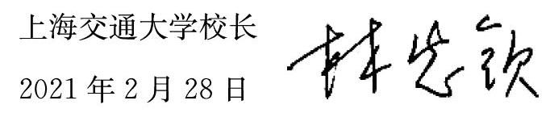
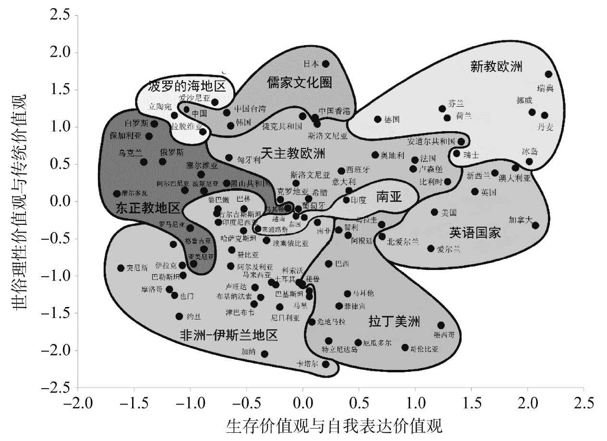
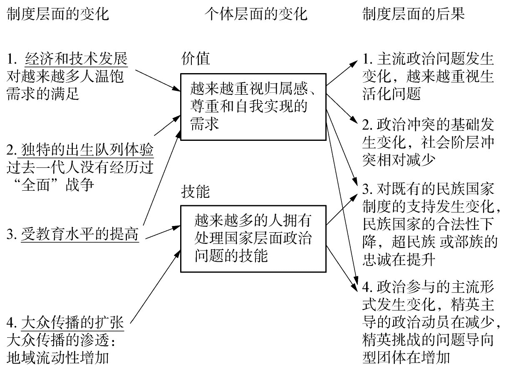
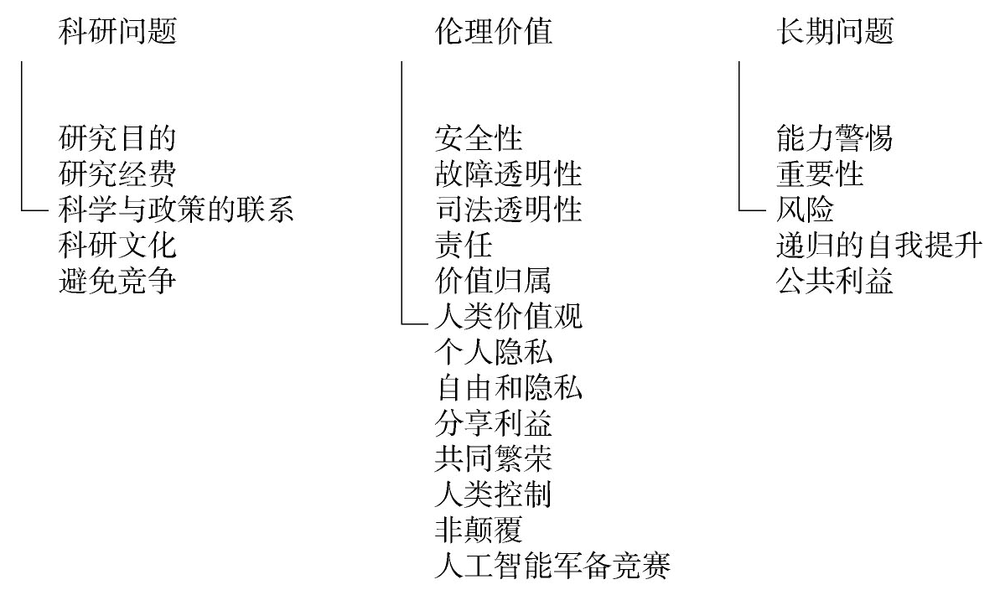
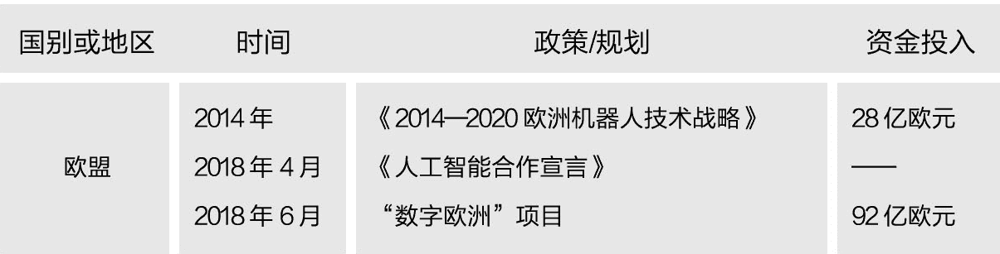
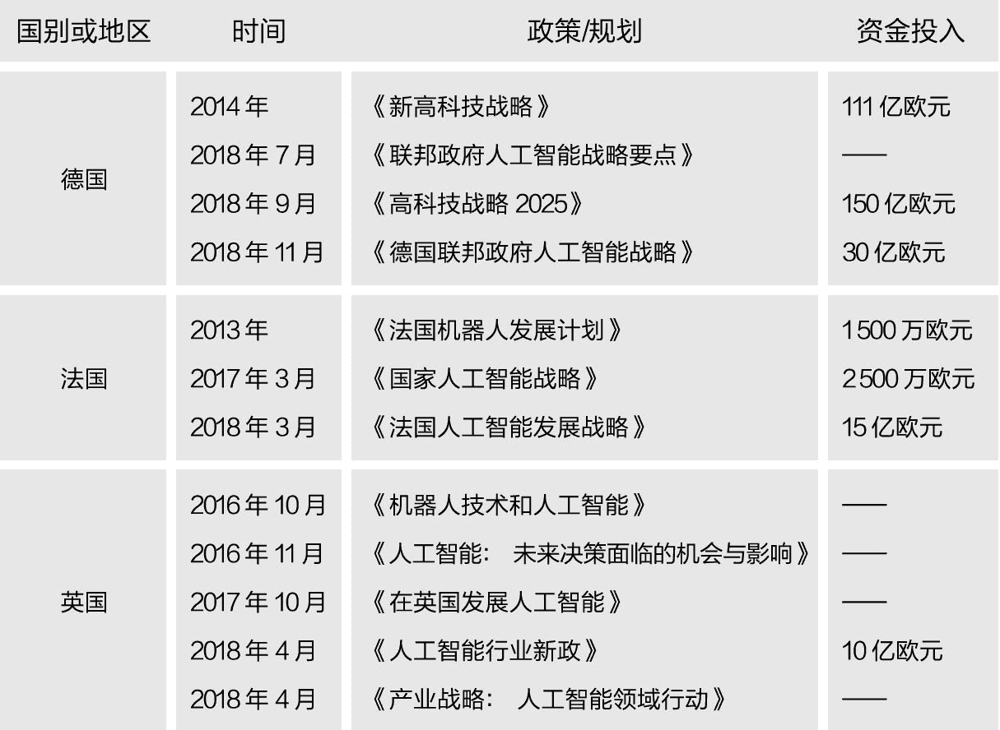
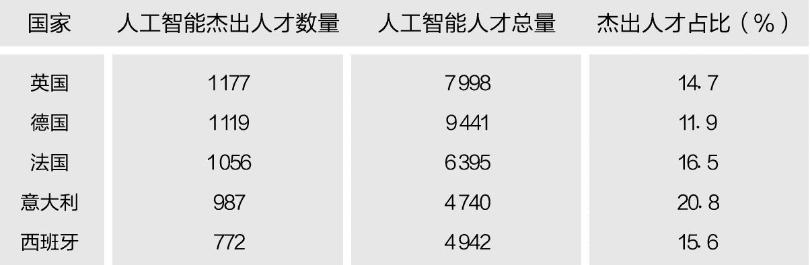

# 人工智能与价值观重塑

# 摘要

人工智能正以润物无声之势，逐步渗透进工业生产与社会生活的各个毛细血管，预示着科技、经济、社会与生活深度融合的未来图景。深度洞察人工智能的应用图景，精准研判其对社会道德价值体系的冲击与重构，将成为中国应对未来高速发展期的关键抓手——助力明晰前行航向、实现精细化治理，在科技浪潮中守护社会价值体系的稳健与可持续。

# 编委会

**主任**：李仁汉、黄清桥

**委员**：杨小康、何立明、沈新成、叶璐、翟云杰、周正、李方伟、黄蕾宇

# 章节分工

- 第1、2章：李方伟（北京大学）
- 第3章：沈新成（上海交通大学）
- 第4章：叶璐、翟云杰（上海交通大学）
- 第5章：周正（上海交通大学）
- 第6章：黄清桥、黄蕾宇（上海交通大学）
- 后记：李仁汉、沈新成（上海交通大学）

# 前言

2015年至2020年，人工智能迎来了爆发式增长，开始深度“嵌入”大众的生产生活肌理。美、欧、英、日、韩、东盟及中国等主要经济体相继强化顶层谋划，设立专职机构统筹推进核心研发攻关。当前，人工智能已完成从自由探索式科研范式向国家战略驱动创新范式的跃迁。全球政产学研金各界纷纷抢占前沿高地，不同层面的战略布局指向同一预判：未来数十年，人工智能蕴藏着重塑全球社会的巨大势能。

2018年1月，上海交通大学人工智能研究院正式挂牌成立；同年2月，获批建设教育部人工智能重点实验室。2019年，上交大成为国内首批设立人工智能本科专业的高校之一。研究生培养层面，学校创设吴文俊荣誉博士班，聚焦培育领军拔尖人才。秉持“扎根上海、辐射长三角、服务国家”使命，上交大为中国AI产业发展注入强劲智力动能。由上交大牵头共建的上海人工智能研究院有限公司正推动实体化平台运作，联合苏州、宁波两地研究院，共同构建“沪甬苏长三角AI协同创新平台”，深度探索“政产学研用金”六方协同新模式。

过去三年，上交大在AI理论、技术、应用及人才培养上硕果累累，同时高度重视技术变革引发的社会学问题研究。《人工智能与价值观》正是其中的重要成果。编著过程中，书稿以史为鉴、放眼全球，详实翔实、文风质朴，恪守理性客观的学术严谨性。通过考察技术革命中的价值演进、AI发展重塑价值观的逻辑，以及中美欧日四大文明语境下的价值博弈与共鸣，书中提出：重视AI发展的各国应携手合作、求同存异，寻找人类命运共同体的价值“最大公约数”；全球在推进AI发展时，高度共同关注“以人为本”“和而不同”“人类命运共同体”等核心议题。

鉴于AI发展仍处早期阶段，书籍编撰难免存疏漏谬误。期盼编委会成员持续跟踪前沿、迭代修正，为人工智能的持续健康发展贡献力量。

# 第一章 技术革命中的价值演进

## 比较视野下的价值多元性

价值观是人文社科诸学科的共同关照对象。哲学、经济学、伦理学、教育学、人类学、社会学、社会心理学等学科均从各自维度展开深度探索。其中，哲学聚焦价值折射的主客体关系；伦理学剖析价值对人类行为的规范性约束；人类学解读价值承载的文化基因特质；教育学关注个体社会化进程中价值形成与演变的机制及教育干预；经济学深挖人类经济行为背后的深层心理动因与行为分类；社会学考察社会结构与变迁对价值体系的塑造力；社会心理学则侧重价值的心理结构、运作机制、功能表征及量化测度。[^1][^2]

## 价值观的多元图景与冲突张力

回溯价值观研究的学术脉络，最早可追溯至上世纪三十年代。彼时，美国心理学家奥尔波特与弗农借鉴德国学者施普朗格的“六类人格”分类法，编制了《价值观研究》，为该领域奠基立绩。五十年代，人类学家克莱德·克鲁克洪从操作层面整合既有定义，确立了权威地位：他视价值观为个体或群体特有的、显性或隐性的“向往观念”，主导着人们在行动模式、手段与目的间的抉择。进入七十年代，社会心理学家罗克奇将价值观界定为“信念”，并划分为“终极价值”与“工具价值”两个维度，推动研究从内容走向结构化测量。他编制的《罗克奇价值观调查表》至今仍是国际通用的经典工具。八十年代起，以施瓦茨为代表的学者转向“需要-动机”视角，致力于构建跨文化通用的心理结构模型。施瓦茨指出，价值观是重要性各异、超越情境的理想目标，充当个体或社会实体的生活指南针。

虽因视角迥异导致定义难以统一，但共识依然清晰可辨：从主体看，它既可是个体、社会亦或文化现象；从形态看，兼具显性与隐性；从功能看，学界普遍认同其对行为的导向作用。

同世界观、人生观一样，价值观天然具有多元性，渗透社会生活的全领域。任何社会都包含多元价值观，映射着文化传统、生存状况、活动方式及利益诉求的差异。传统社会因生活分化不足、关系狭窄，价值观呈现单一封闭态势。现代社会的复杂性、多样性与冲突性打破了这一僵局。尤其经济全球化在生产力跃升与技术重塑空间格局的驱动下，极大拓展了人的生存空间、推动全球治理创新，同时也加剧了发展路径、文化信仰的碰撞，让价值多元成为显性常态。

社会层面的价值观研究在西方发达国家尤为盛行。长期以来，学者们持续追踪全球不同国家居民在社会文化政治变迁中的价值与行为，试图通过普查关联微观个体变迁与宏观社会演进。由政治学家英格尔哈特主导的“世界价值观调查”（WVS）便是极具规模与影响力的典范。该项目由瑞典非营利机构“世界价值观调查协会”运作，聚焦全球社会文化政治议题。覆盖六大洲97个社会、88%世界人口。自八十年代起，协会每4-5年开展一轮普查，派员监督、委托本地机构随机抽样访谈收集数据。

基于WVS数据，英格尔哈特与韦尔泽绘制了“英格尔哈特-韦尔泽文化地图”（见图1-1），以四大维度呈现全球跨文化差异：自我表达、世俗理性、传统价值、生存价值。

纵轴对应“传统”向“世俗理性”的转型。传统端强调宗教、亲子纽带、权威服从及家庭伦理，反对自杀、堕胎、安乐死，民族自豪感强；世俗理性端则弱化宗教与权威地位，认可离婚、堕胎等行为，更侧重个体现实诉求。横轴则描绘“生存”向“自我表达”的跨越。生存价值聚焦经济与人身安全，伴随民族中心倾向、低信任低包容；自我表达价值重环保、重平等，对外族、同性恋及性别差异持更开放态度。地图显示，全球化未消解差异，社会间核心价值鸿沟远大于社会内部差异。

价值多元的根源在于人的需要——这是价值关系形成的主观基石。人们在满足需要的过程中判断、反思、整合各类价值关系，进而生成价值观。需要的差异与自我意识的不同，造就了价值观的千差万别。需要的多层次性、社会性、历史性，分别决定了价值观的多层次性、社会性与历史性。

## 价值观的恒常与演变

价值取向的多元化，必然滋生出价值冲突。放眼现代社会，这类冲突呈现出广泛而复杂的态势，既体现为个体间的分歧，也表现为个体与群体、群体与群体之间的博弈。在效率与公平、自由与平等、利益与道德、生态价值与经济价值等一系列关键议题上，不同主体往往各执一词，甚至截然对立；即便是同一个主体，在不同领域的价值取向也常表现出反复无常与内在矛盾。深究其根源，本质上是传统与现代、本土与外来、主流与非主流、宗教与世俗、精英与大众等不同价值形态之间的碰撞与张力。世界上不存在任何一种抽象的、永恒不变、放之四海而皆准的价值体系，能够适配所有时代、民族与阶级。形形色色的价值观，实质上折射出不同民族、阶级、社会群体对理想价值关系的期许与论证。

作为社会意识体系的有机构成，价值观一经形成便渗透进人们一切价值活动之中，成为大众进行价值评价、抉择与创造的指南针与基石。只要我们始终立足于现实历史，不从观念出发去解释实践，而是从物质实践出发去解释观念的形成，那么价值观就必定建立在特定的社会经济基础之上；它是特定时代人们社会存在、社会实践与生活经验的产物与映射，也是该时代文化传统、生活方式、风俗习惯、社会心理等因子长期熏陶浸润的结果。

作为文化体系的深层结构，价值观具有相对的耐久性与延续性，能在相当长的历史阶段里，以自觉或不自觉的方式运作，主导并影响着人们的思想言行。在特定的时空条件下，人们的价值取向总是相对稳定的。例如，对某事物优劣的判断，一旦形成定见，在条件未变的情况下，不会轻易发生突变。

然而，随着生活条件、社会关系乃至社会存在的变迁，人们的观念、看法与概念也随之改变。价值观的恒常性是相对的，它必然伴随时代的发展而演进，随时代的变迁而更替，不断经受社会生活实践的检验、修正与完善。社会发展平稳期，价值观潜隐于日常生活之中，大众只会自觉或不自觉地循其指引前行；一旦进入社会转型期，新旧价值观便会激烈碰撞，价值观的比较、反思、批判与重塑遂被提上日程。转型初期，价值观往往呈现多元、无序、混乱之象，令许多人陷入迷茫无措。继而，维护旧秩序的价值观与体现历史进步要求的价值观展开剧烈交锋；旧有价值的弊端逐渐暴露，某些新价值则开始迸发强大生命力，赢得民心认同。最终，通过理性论证、特别是实践检验，人们筛选接纳新价值，从而完成新旧价值的更替。这种情形不仅发生于历史上重大的社会形态变革中，即便在同一社会形态内，只要社会生活发生剧变，亦会上演类似剧本。

放眼全球，多项跨代际的长期追踪调查致力于探究价值演变规律。1953年至1988年间，日本统计数理研究所国民性调查委员会每五年开展一次日本人国民性调查；在“日本国民性研究”课题下，日本社会学家以五年为周期持续开展价值调查三十余载，旨在洞察日本舆论、态度与价值观的嬗变，并据此编刊了五卷本《日本国民性》。1972年至1993这二十余年间，鹤弘、酒井智、秋叶英则等学者对“现代日本青年价值观的发展与变化”进行了系统考察。20世纪70年代末，欧洲价值体系研究小组（EVSSG）启动大型跨国调查项目——欧洲价值观调查（EVS），覆盖十个西欧国家，结果揭示了受访国居民在政治、家庭、宗教、性别等价值维度上存在显著差异。1980年，荷兰心理学家霍夫斯泰德基于对40国11.6万余人职业价值观的研究，将文化差异归纳为六大核心文化价值维度，开创了文化差异研究的新范式。这些研究方法打破了传统研究中单一的“东西方”地理二分法，通过核心价值变量折射种族、历史、自然环境等社会研究变项，从而以更宏阔的视野洞察社会变迁。

20世纪70年代，西方发达工业社会民众的价值类型出现明显的代际裂变，形成了唯物主义价值观与后唯物主义价值观的分野。英格哈特提出的价值变迁理论是当代政治文化研究的重要基石，其结论在随后数十年的价值观调查中屡获印证。英格哈特指出，在急剧的社会转型中，一方面，等级权威、爱国主义、宗教合法性的衰退引发了民众对体制的信任危机；另一方面，新价值的政治表达受制于精英与大众政治技能平衡的变动。他考察的价值变迁路径如下：

Figure 1-2　Process of Value Change Examined by Inglehart

在英格哈特看来，某些根深蒂固的基本价值与技能正以渐进却深刻的方式发生嬗变；这两大变迁进程相互强化，深度重塑着社会政治结构。价值观、技能与结构这三大变量共同决定了政治变迁的路径，而价值变迁理论的核心命题，正是围绕这三大变量展开的。

# 价值变迁：重塑政治生态与社会发展的隐形引擎

在当下的现实政治版图中，价值观的嬗变绝非抽象概念，它直接刻画着社会撕裂的深度、政治参与的质效，以及思潮流动的走向。民众的价值取向构成了政治文化的基因密码，主导着公民在公共生活中的每一次抉择：拥护何种体制、确立何种权力规则、赋予政治组织何种使命、以何种姿态回应权威——是信任抑或质疑、介入抑或疏离、拥护抑或挑战。

从推动历史车轮的动力视角审视，价值观是诱发社会行为、催化文明跃迁的关键变量。自工业革命以来，众多国家长期奉行“以经济增长为核心”的发展逻辑，与之配套的“现代性”价值观被视为经济至上主义的同义词，仿佛GDP增速能自动化解贫富悬殊、生态崩塌等顽疾。然而，这一范式正遭遇越来越多现当代学者的反思与否定。美国后现代思想家小约翰·B·科布便从宏观经济与公共政策维度，痛批“经济增长治百病”的神话。他指出，单纯的经济扩张无力破解第三世界人口爆炸困局，难以唤醒正确的生态观，反而阻滞了医疗、教育、文化及政治权利、民主的健全发展。[18] 如今，普通大众关注公共事务的焦点已发生位移，“发展观必须转型”的共识正在扩围：全球多国民众的视线已从单一的GDP指标，转向贫富差距、生态守护、教育投入、食药安全等切身议题。

这种价值取向的转向，极有可能成为未来社会变革的核心推手，正如工业革命后的技术跃升曾驱动世界经济腾飞。学界另一项广泛共识认为，决定社会走向的宏大力量，很大程度上源自整个群体的集体意愿；这些意愿与价值通过多元机制转化为行动合力，指引未来演进。基于此，若能深入考察社会群体的核心价值及其演变轨迹，便能超越经济数据的迷雾，透过政治文化的视窗，洞察不同国家与地区的发展脉络与变局。

此外，学者观察到，改革开放以来中国社会处于加速转型期，其显著后果之一是“时空压缩”：前现代传统、工业现代性、后工业后现代性在同一时空维度内并存共生。[19] 这三种形态各自携带独特的价值内核，也预示着价值观念的博弈与更替将长期并存于中国社会图景之中。

## 技术浪潮下的价值史演

步入20世纪，科技的爆发式增长开启了人类文明新纪元。重大科研成果加速转化为技术产品，渗透进社会生产与生活的毛细血管，全方位重塑了人类的思维范式与行为模式，成为了支配社会运行与个体日常的控制性因子。

哲界普遍认同，价值与科技互为表里。科学研究的首动力源于“认识世界本身具有价值”，真实性、客观性、经验适配性等价值准则不仅是科学事业的基石，也是优良理论公认的标识。不过，也有声音主张价值与科学无涉。英国哲学家罗素断言：“科学只管事实，正义等价值因子根本不在其考量之列。”[20]

技术本身是否包含价值，向来是学术争鸣的焦点，“技术中立论”与“技术价值论”争论由来已久。中立论者剥离技术的社会角色与影响，主张技术仅为手段工具，服务目的在于技术之外。德国生态哲学家汉斯·萨克塞即言：“技术既是方法亦是工具，技术行动的目的永远在技术之外。”[21] 反对派则认为技术与其应用后果难以截然分离，技术本身承载价值，是为实现特定价值意图而对物质、能量、信息进行加工、处理与控制的过程。加拿大哲学家兼物理学家马里奥·邦盖直指核心：“技术绝非伦理中立；它涉足伦理，游走于善恶之间。”[22]

恩格斯曾指出：“马克思首先把自然科学和技术看作是历史的一个巨大的杠杆，看作是最高意义上的革命力量。”[23] 随着科技版图疯狂扩张，人的主体性逐渐退场，科技异化为资本主义社会的统治性力量。它在增强人类征服自然、从“必然王国”迈向“自由王国”、奠定新社会物质基石的同时，也引发了西方学界对技术与价值关系的持续深思。法兰克福学派从价值维度对科技展开了深刻的理论反思与批判，旨在重塑以人为价值主体的科技价值体系。早期领袖人物霍克海默结合资本主义新态势，将“工具理性”置于批判靶心，否定资本统治下科技的价值导向。他痛陈：“科技不再以人为价值主体，放弃了对意义的追问，沦为资产阶级操控民众、异化为统治工具的手段。”[24]

**技术的双刃剑：从费曼的反思到算法时代的困境**

技术在走向社会的过程中，其自然属性与社会属性被不断放大，由此强化了技术在自然、社会、人文三个维度上的驱动力。技术内在价值的两面性，与应用层面的两面性，二者有着必然的内在关联。因此，探究技术发展对价值观的冲击，绕不开对技术本质、价值二重性、应用二重性、以及应用过程意义与终极价值的多层次剖析。美国技术哲学家约瑟夫·C·皮特直言：“若技术折射出我们的价值体系，甚或仅影响社会经济结构，我们都该弄清这意味着什么、是如何发生的。”[\[25\]](#txt001.xhtml#footnote_content_txt001_25) 另一位技术哲学家卡尔·米彻姆也指出，未来的技术哲学研究将更聚焦于对“技术应用过程的意义与价值”的审视，“这种定位显然必须置于动态的伦理层面加以考察。”[\[26\]](#txt001.xhtml#footnote_content_txt001_26)

不仅是哲学家，科学家同样在拷问科技的价值。著名物理学家理查德·费曼在参与曼哈顿计划后，开始反思青年时期对科学价值的看法。他发问：“眼见科学也能酿成灾难，我毕生热爱并献身其中的科学事业，其价值究竟何在？”

费曼给出的首个回答广为人知：科学知识赋予人类制造产品、成就事业的能力。行善时，功劳不属科学独有，更归功于指引我们的道德抉择。知识本身中性，既能成就善举，也能造作恶行，它不附带“使用说明书”。这种能力本身珍贵，善恶全系于用法。

科学的另一重价值，在于提供智识推演的愉悦。有人从阅读、学习、思考中获享，有人须在深度研究中寻得满足。这种智性愉悦的重要性常被忽视，尤其是被那些没完没了高呼“科学家须担社会责任”的先生们所忽视。[\[27\]](#txt001.xhtml#footnote_content_txt001_27)

还有一项不容小觑的价值：科学重塑了人类的世界图景。得益于科学发展，我们今日得以构想出比诗人梦境丰富万倍、奇诡亿万倍的景象。大自然的想像力与多变性，远胜人类。诗人臆想巨龟驮象游弋深海；科学却揭示实相——一颗巨球悬旋苍穹，众生借引力这股神力立足其上，随之共舞。

伴随技术价值的生成、鉴赏与应用，人类社会的历史价值变迁，是否折射在自然、社会、人文三个层面的技术价值实现中？同时，我们是否该承认：技术的正负价值是相对的，无绝对的善、无绝对的恶，二者在特定条件下可互化？

费曼构想了技术驱动价值变迁的两条路径：其一，人为利用而造技，因正向价值而用技，但技术一经应用，正负效应必然同步或先后显现——农药增产是正向价值兑现，污染环境、害人健康则是负向价值同步落地。其二，技术的毁灭性后果未必纯粹是坏事——原子弹以毁灭之力成和平最大隐患，却也成爱好和平者遏制核威胁的底气。

正如核技术深刻塑造了二十世纪文明进程，二十一世纪的人工智能将给人类社会带来空前巨变。生物科学与计算机科学的融合，或催生拟生生命威胁人类世界；科幻作品早预警：未来某刻，AI可能颠覆人类统治，引来毁灭性灾难。而当下，我们已身处无处遁形的大数据纪元，AI持续重塑日常生活与社会行为。智能手机定位助掌握人口密度与流动，共享单车轨迹助优化路网规划——昔日不可想象，如今触手可及。

一言以蔽之，AI世界是数字化行为构成的世界；大数据引致数据使用的质变；智能机器与数据世界的互动，推人类步入“以大数据预测决策”的新纪元。算法是AI落地现实的基石。乐观派主张以算法判断取代人类判断，这延续了“技术决定论”范式，却忽视了算法设计的社会建构功能，掩蔽了AI的技术风险与社会冲击。某种意义上，算法只是工具，无法彻底剥离或抽象价值。文化先于算法设计而存在，扎根于既有社会制度、实践、态度及其价值取向，再经由设计师的理念与预期嵌入代码。技术决定论或技术乐观主义，会否导致对技术史与技术哲学的整体遗忘？技术发展会否加剧对生活世界的殖民统治，以扩张的技术控制摧毁生活世界的意义，进而桎梏人类自主性？悲观派认为，科技终将无阻地占据人类生存领域，酿成德国哲学家埃里希·弗洛姆预言的“完全机械化的新社会，致力于最大规模的物质生产与消费，由计算机操控一切”。[\[28\]](#txt001.xhtml#footnote_content_txt001_28)

### AI重塑社会秩序：以人为本，探寻技术背后的价值锚点

人工智能或许将从根本上改写那些长期由传统与人类价值观维系的行为模式，它催生的并非旧社会的翻版，而是一个全然陌生的新世界。那么，何种价值将主导这个崭新的图景？2018年，华裔科学家、AI领军人物李飞飞在《如何让AI更懂人》一文中，既表达了对AI发展的振奋，也流露出深切忧虑，并正式提出了“以人为本的AI”发展路径，期冀引领AI成为推动人类社会生活进步的动力。她同时驳斥了“机器无价值论”，坚称机器价值即人类价值，这在AI专家圈内属首创见解。依李飞飞之见，“以人为本的AI”包含三大核心准则：一是让AI更精准映射人类深层智慧；二是AI应赋能人类变得更强，而非取而代之；三是在发展进程中，确保AI对人类的冲击被正确导向。

作为实证主义土壤中孕育的技术科学集大成者，人工智能是现代技术理性登峰造极的产物，却拥有区别于其他技术的独特禀赋：对技术发明者的“反身性”。正如认知科学或将溃解认识论，AI亦可能消解人类创造的本质。当下多数面向AI的价值研究，聚焦于人类如何将既有价值植入智能机器。若局限于自然人视角，人机关系中将涌现重重悖论，这正是李飞飞强调AI价值的关键所在。置身AI飞速演进的当下，人类亟需超越带有特定历史局限的自我视角，以进一步挖掘其深层内涵。

## 章节小结

哲学思想中的价值观念，蕴含着厚重的实践意蕴与现实意义。法国哲人吉勒·利波韦特斯基曾言：“社会不应局限于物质生产与经济交换，离开了观念与概念便无法存续。这些思想并非可有可无的‘奢侈品’，而是集体生活生生不息的根本条件……缺失价值体系，便无可再生的社会共同体。” 多元且流动的价值观，折射出不同民族、阶层、群体在特定历史节点上对社会议题的迥异审视与度量。

价值嬗变与科技发展紧密相依。回溯史册，牛顿力学的确立催生了机械论思维，启发英国哲人、自由主义之父约翰·洛克提出“以人为中心”取代“以君主为中心”，从根本上重塑了当时人们对自我与社会价值的认知，其余波经由英国立宪、启蒙运动延烧至法国大革命。科技对精神文明的特殊功能、对政治版图的强势塑造、乃至在战争等尖锐政治中的决定性作用，佐证了技术不仅赋能授权，其本身即是权力的运作与传统权力范式的更迭。

价值的导向作用，将体现在各国与个体如何审视AI议题之中，而每一项具体政策的出台，实质上都映射着智能时代社会正在构建何种价值图景。尽管AI技术迭代日新月异，但其将任务系统化、自动化的核心逻辑未变。故而，研究者当先从理论高度切入，精准剖析概念、明晰价值诉求，并尽最大可能转化为落地行动。研究者有责任思考如何将抽象理论落实为实践，竭力推动AI发展更契合公共利益与人类公平应有的价值目标。

---

## 参考文献

[1] 李德顺. *价值学词典* [M]. 北京: 中国人民大学出版社, 1995.

[2] 杨义荫. 社会心理学领域价值观研究综述 [J]. *中国社会科学*, 1998(02): 3-5.

[3] (美) 米尔顿·罗克奇. *人类价值观的本质* (第8版) [M]. 高峰强等译. 西安: 陕西师范大学出版社, 2005: 152.

[4] (美) 克莱德·克鲁克霍恩. *文化与行为* [M]. 高甲译. 杭州: 浙江人民出版社, 1986: 40.

[5] Milton Rokeach. The Nature of Human Values [J]. *American Journal of Sociology*, 1973, 89(2).

[6] Shalom H. Schwartz. Are There Universal Aspects in the Structure and Contents of Human Values? [J]. *Journal of Social Issues*, 1994, 50(4).

[7] Inglehart R., Haerpfer C., Moreno A., et al. (eds.). 2014. World Values Survey: Round Six-Country-Pooled Datafile Version: `https://www.worldvaluessurvey.org/WVSDocumentationWV6.jsp`. Madrid: JD Systems Institute.

[8] 季鸣. *核心价值观导论* [M]. 北京: 人民日报出版社, 2013: 9.

[9] 吴向东. 论价值观的形成与选择 [J]. *哲学研究*, 2008(5): 22-28.

[10] *马克思恩格斯文集*, 第30卷 [M]. 北京: 人民出版社, 1995: 92, 291.

[11] *马克思恩格斯文集*, 第30卷 [M]. 北京: 人民出版社, 1995: 291.

[12] 张建礼. 日本国民性研究 [J]. *日本学刊*, 2015(B01): 82-89.

[13] 张建礼. 日本国民性研究的现状与任务 [J]. *日本学刊*, 2006(06): 131-142.

[14] 木部. 当代欧洲人的价值观 [J]. *道德与文明*, 1985(2): 36-36.

[15] Hofstede G. *Culture's Consequences: International Differences in Work-Related Values* [M]. Sage, 1984.

[16] 罗纳德·英格哈特, 黄玉生. 价值观的变迁: 经济发展与政治变迁 [J]. *国际社会科学杂志(中文版)*, 1996(03): 7-31+3.

[17] Inglehart R. The Silent Revolution in Europe: Intergenerational Change in Post-Industrial Societies [J]. *The American Political Science Review*, 1971: 991-1017.

[18] (美) 约翰·B·科布. *重构宗教、文化、教育、性、阶级、种族、政治和经济: 后现代公共政策* [M]. 李济、张晨译. 北京: 社会科学文献出版社, 2003.

[19] 车德志, 张彦涛. 当代中国的转型与发展 [J]. *求是*, 2013(03): 37-40.

[20] 伯特兰·罗素. *人类知识: 其范围与限度* [M]. 张金岩译. 北京: 商务印书馆, 1989: 297.

[21] (德) 汉斯·萨克塞. *生态哲学* [M]. 温涛、裴云译. 北京: 东方出版社, 1991: 162.

[22] Bunge, M. Philosophical Inputs and Outputs of Technology [J]. *自然科学哲学问题汇刊*, 1984(1): 54-64.

[23] *马克思恩格斯全集*, 第19卷. 北京: 人民出版社, 1963: 372.

[24] 高良华. 技术: 社会批判理论的批判——法兰克福学派技术哲学述评 [J]. *自然辩证法研究*, 1992(02): 23-30.

[25] Pitt J C. On the Philosophy of Technology, Past and Future [J]. *Society for Philosophy and Technology Quarterly Electronic Journal*, 1995, 1(1/2): 18-22.

[26] Mitcham C. Notes Toward a Philosophy of Meta-Technology [J]. *Society for Philosophy and Technology Quarterly Electronic Journal*, 1995, 1(1/2): 13-17.

[27] (USA) Richard Feynman. *The Pleasure of Finding Things Out* [M]. Beijing United Publishing Co., 2018: 144.

[28] Fromm E. The Revolution of Hope: Toward a Humanized Technology Vol.38 [J]. 1968.

[29] Fei-Fei Li. How to Make A.I. That's Good for People. *Nytimes*. March 7, 2018.

[30] Chen Zifu. Strong AI and Superintelligence: Technological Rationality and Its Critique [J]. *Science and Management*, 2016, 36(5): 25-33.

[31] (France) Gilles Lipovetsky, (Canada) Sébastien Charles. *Hypermodern Times* [M]. Trans. by Xie Qiang. Beijing: Renmin University of China Press, 2005: 111.

[32] (UK) Locke. *Two Treatises of Government* (Part II) [M]. Trans. by Qu Julong, Ye Qifang. Beijing: The Commercial Press, 1964: 14.

# Chapter 2 Reshaping of Values Brought by Artificial Intelligence Development

## From Technology to Industry: The Revolutionary Transformation of Artificial Intelligence

At its core, artificial intelligence (AI) is the mechanical simulation of human cognitive faculties. This interdisciplinary domain spans machine learning, deep learning, knowledge reasoning, human-computer interaction, big data analytics, pattern recognition, natural language processing, and large-scale distributed computing architectures. While the journey from conceptualization to practical implementation spans over six decades, the intellectual roots of AI stretch back to antiquity—embedded in philosophy, literature, and myth. Early visions of artificial beings surface in ancient lore: the bronze guardian Talos from the Greek *Argonautica*; the mechanical warriors deployed by King Ajatasatru in Indian tradition to protect Buddha's relics; and medieval tales of alchemy or sorcery breathing sentience into inert matter.

The foundational premise driving AI research is the mechanizability of human thought. The quest to formalize reasoning boasts a venerable lineage. Landmark contributions include Aristotle’s codification of syllogistic logic, Euclid’s *Elements* as a paradigm of deductive structure, and Al-Khwarizmi’s algebraic innovations (the very term "algorithm" derives from his name). As early as the 13th century, philosopher Ramon Llull constructed "logic machines" to derive knowledge through mechanical deduction. In the 17th century, luminaries like Leibniz, Thomas Hobbes, and René Descartes sought to reduce rational thought to a calculus-like system, explicitly formulating the hypothesis of formal symbol systems—a concept that would later steer AI research.

The 20th century witnessed breakthroughs in mathematical logic that cemented AI’s theoretical bedrock. Seminal works such as George Boole’s *The Laws of Thought* and Gottlob Frege’s *Begriffsschrift* (Concept Script) were pivotal. Building on Frege, Russell and Whitehead’s *Principia Mathematica* offered a rigorous formalization of mathematics. This prompted David Hilbert’s famous challenge in the 1920s-30s: Could *all* mathematical reasoning be formalized? The answer emerged through Gödel’s incompleteness theorems, the `Turing machine`, and Alonzo Church’s `λ-calculus`. These developments not only delineated the boundaries of formal logic but, crucially, demonstrated that any reasoning within those bounds could be mechanized—a revelation fundamental to AI.

The 1940s marked AI’s gestational phase. In 1943, neurophysiologist W. McCulloch and logician W. Pitts published the `M-P neural network model`, translating neuronal physiology into mathematical formalism and inaugurating neural computation. John von Neumann’s 1945 stored-program architecture and the 1946 debut of `ENIAC`, the first electronic computer, furnished the essential hardware substrate. Claude E. Shannon’s 1948 paper *A Mathematical Theory of Communication* birthed information theory, proposing that mental processes could be modeled as information flows. That same year, Norbert Wiener established cybernetics, the study of control and communication in biological and artificial systems, laying the groundwork for simulating cognition via behavioral science.

The period 1956–1969 constitutes AI’s formative era. The 1956 Dartmouth Summer Research Project, organized by John McCarthy, Marvin Minsky, and others, coined the term "artificial intelligence" and formally launched the discipline. This era yielded breakthroughs in automated theorem proving, problem solving, the `LISP language`, and pattern recognition. In 1956, Allen Newell and Herbert Simon unveiled the `Logic Theorist`, a program mimicking human logical deduction to prove theorems from *Principia Mathematica*—initially 38, and eventually all 52 theorems of Chapter 2 by 1963. This was hailed as the genuine dawn of machine simulation of high-level human thought.

Also in 1956, Arthur Samuel, a pioneer of machine learning, created a checkers program capable of learning from gameplay. It surpassed its creator in 1959 and a state champion in 1962, marking a successful emulation of human learning. In 1958, McCarthy’s `LISP` (List Processing) language enabled flexible manipulation of symbols alongside data, becoming an enduring cornerstone of AI programming. By 1960, Newell, Simon, and J.C. Shaw introduced the `General Problem Solver (GPS)`, modeling human problem-solving as a three-stage heuristic search: ① formulating a rough plan; ② executing it via stored axioms and theorems; ③ continuously monitoring and revising the strategy. This introduced the pivotal concept of heuristic search to AI.

## AI发展史与社会影响深度复盘

1968年，美国计算机科学家爱德华·费根鲍姆主导研发的化学分析专家系统`DENDRAL`正式问世。它能解析质谱图谱协助化学家推演分子结构，这被视为专家系统的雏形，标志着人工智能研究从泛泛的思维理论探讨，成功跨越至专业知识的落地应用。专家系统的诞生，让AI告别了以理论研究为主的阶段，迈入实用化进程，但也迫使科学家将目光从“通用思维”收敛至“专业知识”，研究路径变得更加务实，亦即走向了“弱人工智能”。当时受限于机器学习模型仍带浓厚“人工”痕迹，随着应用深入，专家系统获取知识难、推理能力弱、前期人力成本高等短板暴露无遗，AI研究随之陷入低潮。1974至1980年，技术不成熟加上巨额投入迟迟无法兑现预期回报，让人工智能跌入了第一个寒冬。

1981年，日本向全球宣告启动第五代计算机研发计划，这一举动倒逼美国、欧洲、苏联等地在80年代中期纷纷重启并加大对AI研究的支持力度。1986年，加拿大科学家杰弗里·辛顿等人提出`反向传播算法`，为深度学习奠定了基石。得益于知识工程等机器学习方法的改进，决策树模型与多层人工神经网络开始被采用，人工智能迎来了第二次繁荣期。1987至1993年，算力大幅跃升，试图靠建立基于计算机的专家系统破解难题，却因数据匮乏、过度依赖经验规则，导致有效系统难以构建，资本与政府支持再度抽离，AI步入第二个寒冬。不过，该时期研发未曾停歇，网络技术特别是互联网的演进，持续推着AI向实用化靠拢。20世纪末，AI领域再度生机勃勃，里程碑事件是1997年IBM `深蓝超级计算机`击败国际象棋世界冠军卡斯帕罗夫。

## 从宏观视角看AI如何重塑社会

2006年，在辛顿及其团队的推动下，深度学习开始聚焦学界目光。随着各类机器学习算法涌现，尤其是深度学习技术突飞猛进，人们寄希望于机器能通过海量数据分析，自动习得知识、实现智能。此期间，计算机硬件性能跃升与大数据分析技术成熟，让机器获取、存储、处理数据的能力实现质变。就落地贡献而言，深度学习堪称过去十年机器学习领域最成功的方向。2010年后，深度学习在知识理解上较浅层学习实现代际跨越，推动语音识别、图像识别、自然语言处理等技术取得惊人突破，让人工智能与人机交互实现跨越式发展。围棋、德州扑克、数学定理证明、海量数据自动建模知识、语音/人脸/指纹识别、自动驾驶、海量文档处理等多个垂直领域，AI能力已超越人类。深度学习掀起机器学习新浪潮，吸引学界至业界广泛关注，开启了“大数据+深度模型”时代，进而引发新一轮AI发展热潮。

自第一次工业革命以来，技术创新始终是经济增长的核心引擎。人们在关注技术对长周期经济增值的同时，也清醒认识到：并非所有技术同等重要，唯有颠覆性技术突破才能驱动人类经社会变革。1760年代至今，人类经历的三次工业革命分别由机械、电力、信息技术驱动。2016年，世界经济论坛将人工智能定义为第四次工业革命的基石。[[1]](#txt002.xhtml#footnote_content_txt002_1) 2017年，联合国研究报告《技术革命对劳动力市场和收入分配的影响》指出，AI如蒸汽技术、电力技术般，是人类改造自然的通用技术（GPT）。[[2]](#txt002.xhtml#footnote_content_txt002_2) 每次工业革命的高潮，都以核心技术进入标准化、自动化、模块化的工业化大生产阶段为标志。回顾AI发展史，历次浪潮均因技术瓶颈导致商业化落地受阻，最终退回低谷。但本轮新一代AI已具备强泛化能力，其技术天花板与商业化潜力远超过往，意味着它已做好进入工业化大生产阶段的准备。

## 微观落地：AI对社会发展的实质渗透

2018年，麦肯锡报告预测，到2030年AI将在全球创造近13万亿美元的增量经济产出，占世界GDP增速的1.2%。[[3]](#txt002.xhtml#footnote_content_txt002_3) 作为新一轮产业变革的核心驱动力，AI正深度重塑世界经济、社会进步与人类生活。随着物联网、大数据、云计算与智能算法深度融合，AI在各行业展现广阔应用前景：依托物联网带来的海量感知数据，AI正从计算智能向感知智能进化；借力大数据的可验证基础，深度学习算法支撑计算机更逼真模拟人类特质；仰赖云算力与超级芯片提供的强算力底座，AI发展拥有了坚实的物理支撑。

# AI浪潮下的社会重塑：从赋能产业到直面伦理困境

人工智能展现出广阔的发展前景，正深度渗透至消费、医疗、环保、安防及教育等领域，显著提升民生福祉。当前，AI已全面步入商业化落地期，对传统产业各环节参与者产生深远影响，重塑行业生态，并对社会发展构成立体冲击。德勤发布的《全球人工智能发展白皮书（2019版）》指出，这一变革主要体现在三个维度：[[4]](#txt002.xhtml#footnote_content_txt002_4)

**产业链重构**：AI的介入颠覆了传统产业链的上下游协作模式。上游供给端的产品形态日益多元，下游需求端也随产品属性迁移而转型，用户群体从单一的个人消费者延伸至企业级客户，乃至两者并存的复合局面。

**企业智变**：AI深度嵌入管理与生产流程，企业数字化转型趋势不可逆转，头部企业已实现成熟的智能化应用。它们借助多元技术手段采集多维用户画像，精准触达个性化需求；同时以数据洞察前瞻趋势，精准捕捉并满足用户潜在诉求。

**劳动力结构跃迁**：新技术应用大幅提升信息效能，压缩基础岗位编制；机器人普及替代流程化作业，倒逼技术型、管理型人才占比攀升，企业用工模式完成质变。

眼下，AI正加速嵌入社会经济关键节点。新一代AI落地聚焦于需求规模可观、商业模式清晰可行的产业集群。以金融、医疗、教育为例，AI在社会层面的核心价值非在于替代劳动力与资本，而在于**赋能**——让要素效能最大化。

*   **金融赛道**：围绕消费行为与需求的动态演进，AI已在细分服务领域替代人工客服。凭借大数据精准营销、定制化产品及生态拓展，AI强化用户粘性，迫使传统金融服务面临全链路重塑。
*   **医疗赛道**：面对老龄化、慢病高发、优质资源稀缺及医疗成本攀升的多重压力，医疗AI大幅简化就医流程，在资源配置优化、技术攻关等维度提供破局方案，已贯穿医疗、医药、医保、医院四大产业环节。
*   **教育赛道**：区别于传统模式，智慧教育基于“教、学、练、评、测”五环产生的全息数据，融合图像识别、语音交互、多模态行为分析、知识表达及智能仿真等技术，为每位学习者生成专属方案与即时反馈。持续的数据迭代闭环，将显著跃升学习效能，重塑教育范式。

作为赋能型技术，AI将持续与传统产业深度融合，推动信息化、数字化、智能化水平跃升，驱动产业升级。然而，在成为全球战略制高点的竞逐中，AI的规模化应用也引发法律法规、伦理道德、社会治理等多重新挑战，不容忽视。欧洲认知系统学会主席文森特·C·米勒警示：须对AI风险保持审慎——“若人工系统智力超越人类，人类将面临生存风险”；反思风险的初衷是“确保AI系统造福人类”。他指出，关注焦点已从认知科学层面的哲学理论，转向现实的风险与伦理困境。[[5]](#txt002.xhtml#footnote_content_txt002_5)

AI正处于从量变到质变的关键拐点，未来将更显“智慧”特质，渗透影响每个个体的生活图景。它或将成为开启人类科技潜能的“万能钥匙”，但也必将带来前所未有的严峻考验。

**AI将如何重塑社会图景？** 2017年，特斯拉CEO马斯克、DeepMind创始人哈萨比斯等近千名专家在加州阿西洛马会议上联合签署《阿西洛马AI原则》（23条），呼吁全球遵循共识，共护人类未来伦理、利益与安全。该原则极具影响力，系统梳理了AI可能引发的社会隐忧（见下图），归纳为三大范畴：[[6]](#txt002.xhtml#footnote_content_txt002_6)

**图2-1 阿西洛马AI原则引发的核心议题**

可见，超越人类智能的自动化系统介入社会各领域发展，折射出AI与人类文明的深度绑定。一方面，AI驱动生产与治理范式变革；另一方面，社会新问题倒逼AI技术约束与迭代升级。AI在个体、社会、国家层面均可能触发深度伦理、人权与法律命题。

例如，当传感器与AI无处不在，企业可于人群穿梭公私空间、使用数字设备时，不间断采集个人信息。在医院、酒店等原本隐私敏感度极高的场景，图像识别、语音识别等技术大幅降低泄露门槛。随之而来的追问直击核心：个人数据归属权何在？数据共享边界如何界定？面对日益猖獗的网络攻击，数据安全防线如何筑牢？

### AI重塑价值体系：从局部冲击到整体重构

算法歧视并非假设，而是数据遗传的必然结果。现实世界中根深蒂固的种族、性别偏见，会随训练数据渗入模型，被机器学习机制“原封不动”地继承下来。联合国在汇聚大量铁证后指出，AI在客观上加剧了全球不平等，让红利仅流向极少数人。[[7]](#txt002.xhtml#footnote_content_txt002_7)

自动化浪潮更将劳动力市场推向两极。技术落后的发展中国家在这波浪潮中处于下风，“数字鸿沟”随之被进一步撕大。部分国家原指望人口红利驱动劳动密集型经济腾飞，若海量岗位被机器吞噬，新的社会动荡恐将酝酿成型。

以色列历史学家尤瓦尔·赫拉利将AI演进划为弱、强、超三级阶梯，并预言超级AI将在2040至2060年代登场。届时，社会或将撕裂为两大阵营：绝大多数沦为“无用阶级”，极少数跻身社会精英。依托生物科学、信息技术与大数据的飞跃，AI或催生智能社会。一旦机器掌握递归自我改良能力，将引发终极“智能爆炸”。未来图景中，人类群体整体存有价值，个体却可能归零；系统仅在特定个体身上发现价值，而他们或将进化为新物种——超人。[[8]](#txt002.xhtml#footnote_content_txt002_8)

面对这般剧变，价值体系能否在多维度重塑？短期内，人类社会将直面两记重锤：结构性失业与贫富鸿沟扩阔。金融、医疗、教育等领域的颠覆性案例已证实，AI规模化应用正从根本上重塑传统产业版图。与人类智力相当的“对手”不再是科幻设定，而是触手可及的技术方向，这意味着劳动力将面临大规模、普适性的替代风险。在此背景下，一切关于人性与理性的旧有理论，都须归零重审，以全新视角认知异质智能的可能性。

马克思劳动价值论亦遭遇严峻挑战。作为马克思主义政治经济学基石，该理论立足劳动者立场，阐述“商品价值凝结的是无差别人类劳动”。然而当AI大规模介入，劳动主体显性易位；虽说AI设备本身凝聚着人类劳动，但“黑灯工厂”、“无人超市”、“无人餐厅”遍地开花之时，我们迫切需要对劳动价值论进行根本性的深度解读与重构。

技术从不价值中立。AI的政策制定、研发布局、落地应用，每个环节都烙印着相关主体的价值取向。数据采集与算法运行并非绝对客观中立，在问题定义、方案筛选与决策执行中，技术设计者与执行者的利益考量与价值导向必然渗透其中，进而影响更广泛利益相关者的利益分配与价值实现。[[9]](#txt002.xhtml#footnote_content_txt002_9) 当机器拥有多重可学习模块，责任归属便成难题；更复杂的学习机器能自修行为模式、自改评价体系，此时机器本身便须处理价值判断。若多台此类机器以非中心化分布式方式协同，它们还需处理群体内个体间的评价博弈——这实质上便是广义伦理的雏形。

各国已在行动。美国在《国家人工智能研发战略计划》中，将“理解并应对伦理、法律及社会影响”列为八大核心战略之一，聚焦如何将人类价值与信仰体系“编码”、构建伦理AI及道德参考框架。CNAS 2020年报告《美国AI世纪：行动蓝图》直指痛点：AI虽惠及社会，亦为恶意滥用（如针对民主政体的精准认知战）敞开大门。报告主张美方必须巩固AI霸主地位，以民主价值观与人权标准主导全球规则制定，并推动符合美利益的标准体系建设，前瞻化解安全挑战。

英国下院2016年发布《机器人技术与人工智能》报告，主张强化监管；2018年《数据伦理框架》与《英国AI就绪度、意愿与能力》报告，分别确立数据安全伦理底线与五大战略指导原则，明确政府决策考量维度。

欧盟则走出一条“价值观出海”路径。欧委会《人工智能助力欧洲》提议制定新伦理准则，回应公平、安全、透明诉求，捍卫欧洲价值。欧盟科学与新技术伦理小组（EGE）发布声明，奠定AI发展基本伦理原则。2018年成立高级别专家组，次年发布《可信AI伦理准则》，确立“以人为本”核心，列出七大关键要求。2020年《人工智能白皮书：卓越与信任的欧洲路径》进一步提出，构建“卓越与信任”双轮驱动生态，将欧盟AI价值观与规则推向全球，推动公共部门应用，借此锁定全球AI话语权，坚持国际合作必须以欧盟自身价值观与规则为基石。

# AI 时代的价值博弈与生存反思

反之，合成智能、人工劳动等 AI 应用多依赖人机协同落地，相关主体的价值取向不可避免地渗透其中。无论是借助机器学习洞察数据，还是依靠智能算法决策，都不仅是算力与智能技术的集成，更离不开人的判断与智慧。要读懂数据背后的事实与意义，仍需依赖人工的观察理解与标注。随着 AI 突飞猛进，“计算机能否处理价值问题”将不再是区分人机的决定性标准；一旦机器智能整体超越人类，以人为本与以机为本的价值观冲突将不可避免地全面爆发。

以就业为例，美方高度重视 AI 冲击。2017 年众议院推出《AI 创新军团法案》，2018 年跟进《AI 就业法案》，主张构建终身学习与技能培训生态以应对挑战。产业端如自动驾驶，2017 年《SELF DRIVE 法案》通过，次年交通部发布《自动驾驶 3.0》，卫生部公布《数据共享声明》，从设计制造到测试全链条监管，守住隐私与安全底线。

终极追问：AI 演进会与人类生存价值产生深度、本质、不可调和的冲突吗？人的价值观源于社会化过程中对社会规范的内化。人类对未来的忧虑有二：一是强 AI 算力远超人类，人类亲手造出的工具反成算计自身的利刃，关乎种族命运；二是通用 AI 或将觉醒感知、自主设定宏大目标。“有感知的机器”或让人类沦为无用或遭灭绝。PayPal 联合创始人彼得·蒂尔直指焦虑根源：我们难以描绘通用 AI 形态，它承载了计算机时代的全部希望与恐惧，推至极限时人类直觉失效，因从未遇见比自己更聪明的物种。AI 学者埃利泽·尤德考斯基推演：AI 毋需控网络、用无人机，危险在于“比我们更聪明”。若其能从 DNA 预测蛋白结构，只需发几封邮件订购合成蛋白，即可造出分子机器并自我进化。我无法预判人类如何败给 AI，因为 AI 比我更聪明。

计算技术加速推动机器人、感知、学习领域跨越，新一代系统能力已达人类水平甚至超越。这或开启空前繁荣舒适纪元，但过渡期充满变数。一旦 AI 掌握人类无法理解控制的海量数据，瞬间即可酿成难以想像的灾难——瘫痪电网、交通等。诺伯特·维纳警示：新工业革命是双刃剑，若人类存续足够久才能享受红利；若不理性驾驭，毁灭也将加速降临。 [[10]](#txt002.xhtml#footnote_content_txt002_10)

## Chapter Summary

回溯 AI 史，应用繁荣期即算法高歌期，数据积累滞后于算法则是寒冬期。当下 AI 在各行业展现广阔前景，不止提效，更催生新品新模式，重塑全产业链。故 AI 为人类价值体系重构提供技术支撑，也必将带来不可抗拒的社会冲击与风险。工业革命历经漫长从欧美扩散至东亚，但在新全球化与新工业革命交织下，AI 风险兼具地域性与全球性，跨越地理与文化疆界，在技术层面塑造了人类命运共同体。 [[11]](#txt002.xhtml#footnote_content_txt002_11)

## 参考文献

[1] 吕文晶，陈劲，刘进. 第四次工业革命与人工智能创新［J］. 高等工程教育研究，2018（03）：63-70.

[2] 联合国. 腾讯研究院法律研究中心编译. 新技术革命对劳动力市场和收入分配的影响［R/OL］. http://www.innovation4.cn/library/r20700

[3] Bughin, J. et al（2018）. Notes from the AI Frontier: Modeling the Impact of AI on the World Economy. https://www.mckinsey.com

[4] 德勤. 全球人工智能发展白皮书（2019 版）［R/OL］. 上海：德勤有限公司，2019. https://www2.deloitte.com/content/dam/Deloitte/cn/Documents/technology-media-telecommunications/deloitte-cn-tmt-ai-report-zh-190919.pdf

[5] Vincent C. Muller. Risks of Artificial Intelligence，University of Oxford，UK and American College of Thessaloniki/Anatolia College，2016，p.92，p.2，p.180，pp.267-268，p.273.

[6] 阿西洛马人工智能原则——马斯克、戴米斯·哈萨比斯等确认的 23 个原则，将使 AI 更安全和道德［J］. 智能机器人，2017，1：20-21.

[7] 联合国. 偏见、种族主义和谎言：直面人工智能负面后果［OL］. https://news.un.org/zh/story/2021/01/1075032

[8] 尤瓦尔·赫拉利. 未来简史［M］. 林俊宏，译. 北京：中信出版集团，2017，2（第 1 版）：352-353.

[9] 段伟文. 人工智能时代的价值审度与伦理调适［J］. 中国人民大学学报，2017，31（06）：98-108.

[10] 诺伯特·维纳. 人有人的用处——控制论与社会［M］. 陈步，译. 北京：商务印书馆，1978：143.

[11] 张成岗. 人工智能时代：技术发展、风险挑战与秩序重构［J］. 南京社会科学，2018（05）：42-52.

[12] （德）京特·安德斯（Gunther Anders）. 过时的人（第 1 卷）：论第二次工业革命时期人的灵魂［M］. 上海：上海译文出版社，2010：61.

***

# 第3章 算力博弈下的美国价值观张力

美国既是 AI 核心策源地，也是二十世纪以来价值观输出最激进的国家。大众眼中的美国，常与平等、安全、自由挂钩，这既有历史实底，也夹杂着二战冷战时期的国家形象包装。自由主义立国初即以《权利法案》成文，藏着建国者们的期许：个人自由唯立足于自给自足的田园经济，方能避免重蹈欧洲覆辙。杰斐逊派主张抗拒一切中心化倾向，无论是高密度工业城市，还是联邦权力集中。联邦党人则偏好金融工业发达，不介意强势中央，甚至强调中央控制的必要性。

“控制文化”贯穿美式价值体系始终。历史学家詹姆斯·贝尼杰指出，蒸汽时代工具在速度、效能、复杂度上的质变，倒逼人类采集更多信息以实施控制。1840s-1920s 这段时期，电报、邮票、统一纸币、打字机、打卡机、广播等信息手段井喷，助力社会协调新兴产业与观念。贝尼杰称此为“控制革命”。[1]

南北战争后，市场统一催生大企业扩张需求，控制文化上位；二战后，自由主义在冷战舆论场获胜。虽早失 18 世纪田园本真，但作为内政外交文化图腾，自由主义生命力顽强延续至今。控制文化与自由主义的动态博弈与平衡，奠定了美国价值观的基石。

当下，AI 对美式价值观的冲击仍沿双轨推进，技术层面的“控制文化二次发育”让二者关系更扑朔迷离。一方面，算法将社会不公“客体化”，化为可被深度批判、纠错的技术靶标，助推美社会在自省语境下修正种族、性别歧视顽疾，推动自由解放；另一方面，AI 催化个人数据商品化与中心化，强化科技寡头垄断，成“马太效应”催化剂。非商业领域的 AI 应用冲击宪法二、四修正案对私权的护佑，也在潜移默化中重塑民众安全观及对国家-公民权力关系的认知。

# 算法镜像下的美国价值观：平等如何在代码中裂变

人工智能正深度重塑美国社会对平等、安全、自由等核心价值的理解边界。它不仅赋予传统价值以新的时代内涵，更在技术语境下推动着其完善度的跃迁。随着 AI 广泛渗透与误用争议的常态化，社会对算法公开性与道德性的呼声愈发高涨。那些曾被视为亘古不变的价值图景，在技术浪潮冲击下，正被迫接受重写。

## 一、 被代码显影的不平等：算法歧视与破局之道

1776 年《独立宣言》高呼“众生平等”，彼时的“众生”却将奴隶与女性排除在外。美国两个多世纪的平权史，实质是经济基础演变中，将“掉队者”逐步纳入平等保护圈的过程——从《解放黑奴宣言》到《投票权法案》，从争取选举权到通过第十九修正案。法理层面的阶梯虽搭建完毕，现实层面的隐性歧视却从未消失。当 AI 成为体制机构的高效工具，这些潜伏的不平等便披着“技术故障”的外衣浮出水面。

### 1. 刻入骨血的偏见：司法与招聘的算法翻车

**司法量刑的“黑箱”陷阱**  
美司法系统从保释定价、社区服刑资格到刑期长短，均依赖“风险评估分”。亚利桑那、弗吉尼亚等九州已将算法生成的评分作为判决核心参考。2014 年，时任司法部长霍尔德即警示：评分虽出于善意，却可能无意中加剧司法体系固有的差别待遇。

风险评估工具由来已久。早期种族、肤色曾公然作为预测变量，后因民意反弹搁置；80 年代犯罪潮导致监狱爆满，数据工具重获青睐。21 世纪私企入局，承诺以数字化手段缓解监管压力。弗吉尼亚州推行评估后，监狱人口增速骤降，近半罪犯获社区矫正机会，成效显著。

然而，ProPublica 对佛罗里达布罗瓦德郡 7000 案例的追踪揭开阴暗面：算法预测暴力再犯准确率仅 20%，全罪名再犯率 61% 与抛硬币无异。更触目惊心的是种族偏差——黑人被误判为高风险的概率是白人的两倍，即便剔除前科，黑人暴力再犯概率仍被判定高出 77%。开发商 Northpointe 辩称模型未直接纳入种族变量，核心源自 137 个问题（如成长经历、家族犯罪史）。但房产、就业、教育、收入等代理变量深度绑定种族身份：长期系统性压迫导致黑人群体在资源占有上全面落后，这些“客观风险因子”实为历史不公的投影。资深法官往往不信机器预测，坚持人工裁量。**AI 非偏见制造者，却是忠实的偏见继承者与放大器。**

**招聘算法的“男性主导”逻辑**  
2014 年亚马逊开发 AI 简历筛选系统，渴望打造招聘“圣杯”。训练数据取自过去十年员工档案，模型推断男性更优——硅谷生态本就男性主导，机器只需拟合历史分布即可满足人类。系统惩罚“女篮队”、“女子国际象棋俱乐部”等关键词，降级女子名校毕业生。亚马逊修补无果，2018 年弃用并声明从未依其决策。宾州州立大学数据显示，年入 5 万美元女性仅为男性三分之一，数据本身即刻录性别鸿沟。

IBM 与牛津调查显示：HR 理论重“软技能”，实则人均浏览简历仅 6 秒，最终仍靠“硬指标”筛人。领英调查 76% HR 认为 AI 将成主力，但也承认其难识别多元才能。**量化评价人的控制欲贯穿美国建国史：稻米棉花经济量化黑奴劳动力，工业富豪遗孀量化婚姻政治权利。AI 失误非新生事物，乃旧有缺陷在新语境下的暴露。**

### 2. 透明化的契机：从“黑箱”到“白箱”

虽未超越人类智能，AI 已忠实映射人性阴暗面，倒逼正视与修正。算法即时性、可回溯、可模拟，将平等价值的因果压缩于同一时空，突破了弱势群体地位变迁难追溯、只能谈机会平等的困境。不同于决策者不自觉的潜意识偏见，算法偏差可随时停机修正，且机器无申辩能力，倒逼公平“纯度”提升。

高德纳建议：剥离年龄、种族、性别等生理文化属性，聚焦职业技能。亚马逊案例启示：补全数据、规避倾向性标注、引入对抗性去偏训练，皆能有效抑制偏见放大。

## 二、 脸书式“终极透明”的伦理困境

善意企业主动开源亦面临技术壁垒与商业机密双重制肘。以 Facebook（现 Meta）为例。

**算法黑箱下的自杀干预**  
现实中我们靠情绪低落、行为异常识别自杀倾向；社交平台上，用户日常正常却长期在线倾泻抑郁情绪。Facebook 研发 AI 分析语言、词汇、表情符号，甚至回溯已故用户全生命周期数据训练模型。2017 年 11 月上线：检测到倾向即预警员工介入“健康检查”。产品副总监 Guy Rosen 仅透露推断依据（低落时段、亲友关切评论、文本内容），拒谈算法细节，强调与线下防救机构合作以结果代言。

**实操隐患与伦理失焦**  
- **误判无申诉**：用户被误标记毫不知情，无纠错渠道；收到“您可能需要额外帮助”提示时，不知自己正被真人监控而非机器。  
- **武器化风险**：恶意行为者可利用算法骚扰、歧视心理脆弱群体。  
- **合作伙伴亦被蒙蔽**：官方合作方“危机文本热线”（CTL）不知后台系统存在。CTL 自用算法预测（如“布洛芬”预示自杀风险飙升），Facebook 对合作伙伴不透明、大规模用户实测，必引信任危机。

技术向善的前提，是打破黑箱、建立可问责的透明机制——这不仅是技术课题，更是价值观在算法时代的重构考题。

## 参考文献

[1] James Beniger. *The Control Revolution: Technological and Economic Origins of the Information Society*. Harvard University Press, 1986.  
[2] Angwin, J., Larson, J., Mattu, S., & Kirchner, L. (2016). Machine Bias. *ProPublica*.  
[3] Northpointe, Inc. (2015). *Practitioner's Guide to COMPAS Core*.  
[4] Dastin, J. (2018). Amazon scraps secret AI recruiting tool that showed bias against women. *Reuters*.  
[5] Pennsylvania State University. (2017). *Gender Wage Gap Study*.  
[6] IBM Institute for Business Value & Oxford Economics. (2018). *The Cognitive Advantage: How AI is Changing the HR Landscape*.  
[7] LinkedIn. (2018). *Global Recruiting Trends 2018*.  
[8] Gartner. (2019). *How to Prevent Bias in AI-Based Hiring Tools*.  
[9] Facebook AI Research Blog / 相关新闻报道综合.  
[10] Crisis Text Line 公开声明及媒体深度报道综合.

**多方共治：通往算法开放与公平的必经之路**

扎克伯格把AI当“挡箭牌”的操作，绝非个案。2018年春天，Facebook因外国势力渗透平台干预美选深陷舆论泥沟。国会听证会上，扎克伯格几十次甩出“AI”这个概念，把一堆说不清道不明的技术难题和伦理包袱全推给了算法。2016年大选像催化剂，激化了美国积压已久的社会撕裂，而Facebook等社交媒体的野蛮生长，更为外部势力介入铺设了高速公路。风波远未随新总统就职而平息——虚假账号、仇恨言论、极端宣传、刷量产业、疑似俄罗斯特工活动、隐私泄露……面对这一连串烂摊子，扎克伯格的标准动作只有一个：甩锅给AI。

不可否认，AI在关键词检索、内容分析上的确有两把刷子，缓解了网络空间的混乱。但自然语言处理（NLP）的短板显而易见，尤其是“判定假新闻”这事儿，本质上涉及裁判者的价值观取向，而Facebook对判定标准讳莫如深。科技媒体《The Verge》一针见血：面对一群不懂技术的老議員，扎克伯格高频抛出“AI”一词，本质上就是在躲避问题。当密歇根州参议员加里·彼得斯追问算法透明度时，扎克伯格仅回应“非常重视，有专门团队跟进”，对公开算法零承诺。[11]

批评者直指要害：Facebook口口声声谈政府透明、企业透明，真想推行的其实是“个人透明”，所谓的“彻底透明”或“终极透明”。[12] 平台用归纳式、家长式的算法投喂你可能喜欢的内容和人，帮你找到政治同温层，构建自我强化的“回声室”，不断给予正向反馈，放大参与感。剑桥分析公司（Cambridge Analytica）事件则彻底撕开了这套逻辑的裂痕——数据在层层外包转手中被买卖、滥用，一旦落入不法之徒手中，不仅能搅局美国内政，更对公民权利构成普适性威胁。Facebook在数据流转、被侵犯、被滥用的全程中毫无察觉、束手无策。这证明：当“开放原则”应用于Facebook量级的社交媒体时，光有算法透明不够，还得持续披露数据流向、实施长期监管。对一家靠数据赚钱的公司而言，这无异于与虎谋皮。

**比读政治新闻更贴近柴米油盐的，是银行贷款和福利发放。** 如今AI已大规模介入银行征信、政府福利资格审核，可为何批准、为何拒绝，往往连AI使用者都说不清，更别提开发者了。罪魁祸首在于许多AI设计——特别是神经网络——运作过程像个“黑箱”，无法溯源。卡内基梅隆大学计算机与电子工程教授阿努帕姆·达塔（Anupam Datta）2016年开发了“定量输入影响”（QII）系统，试图拆解各因素在放贷决策中的权重，看种族、性别是否搞歧视。达塔指出，企业虽发算法透明报告，但披露的计算基础极有限；QII的目标是生成真正透明的报告。QII不看单一变量影响力，而是量化一组输入的合力。[13] 例如：高收入男女获批率极其接近，难说银行涉嫌性别歧视；但若低收入男性比低收入女性更易贷款，暴露的就不是简单的性别歧视，而是低收入群体内部的性别分工差异、职业发展潜力差异——这些在高收入群体中可能不显著。

逼着算法开源、公开的压力，不只来自美国内部，也来自外部竞争——比如中国同行。2018下半年，美科技巨头扎堆推工具优化AI公平性：Facebook的Fairness Flow、微软研究院的数据预处理与输出预测、谷歌的“People + AI Research”（PAIR）、IBM的AI OpenScale与AI Fairness 360工具包。背景之一正是中国同行的追赶。2018年1月，中国电子技术标准化研究院发布《人工智能标准化白书》，众多企业参编，标志中国AI从野蛮生长转入有序发展。[14] 相较行政干预，美头部企业视开源共享、自下而上的行业自律为最佳治理路径：若有足够程序员、开发者共同见证、监督算法生成，大厂模型就能相对透明。[15]

高质量、高透明度的公平正义，只能靠引入更多主体参与来守护——这种参与不设国界、不限行业。随着AI渗透普通人生活，AI使用者与公众的信任关系将不可或缺。前提是善意的：企业或国家用AI时，得公开亮明。在这个意义上，AI算法作用于价值观是把双刃剑：一方面，它可能揭露更多历史积弊，给正视解决创造契机；另一方面，它可能诱导更多企业在更多场景下隐瞒AI工具的存在。若AI的社会效应被整体屏蔽，面向善的价值导向便将充满变数。

**安全与问责：人机融合中的伦理困境**

枪支泛滥是当下美国最棘手的社会顽疾，也是其价值观最独特的投射。立宪时第二修正案的核心考量是安全：全民持枪既能抗外侮、又能制衡政府侵入私域；这是对私权的宣示与礼赞，第四修正案禁止权力搜查私域，逻辑一脉相承。近三百年演变下来，这两重考量（外部防御与内部制衡）的天平渐渐倾斜——枪支仍是普通美国人自由与安全的文化图腾，但隐私却日益贬值。国家层面同理：美军事价值观对外强调严控，国民却不介意自家政府越界，甚至乐于用数据隐私换取人身安全。

**“封闭世界”冷战军事观的当代延续**

**安全的异化：从泰勒制到“星球大战”，AI如何把“安全”改造成了“控制”**

故事得从19世纪末说起。彼时，工程师与管理阶层的财富地位水涨船高，企业纷纷拥抱“纵向一体化”——把核心生产环节全揽入自家版图，靠规模效应与管控优势压缩成本、提振效率，再以薄利多销抢占新兴城市市场。这种对稳妥与确定性的极致追逐，倒逼企业不断吞并上下游，只为让数据长期保持可见、可及、可控。到了1911年，泰勒的《科学管理原理》横空出世，主张用量化手段管控劳动，作者更豪言壮语：“这套新管理学说，不止适用企业，家庭、农场、教会、慈善机构、大学、乃至政府部门，通通拿得准。”①

冷战的剑拔弩张，为这套逻辑向军事领域渗透铺平了道路。无论是50年代对抗苏联空袭的SAGE半自动防空系统，还是80年代轰动一时的“星球大战”战略防御计划（SDI），核心指向殊途同归：实现人机交互的零缝隙衔接。技术史家保罗·爱德华兹指出，战后美国“以防备为核心的外交观”与“以控制为核心的技术观”撞了个满怀，催生出冷战特有的“封闭世界”图景——誓要把管辖范围内的一切信息数据化、可计算化，把算力嵌入装备动作与决策链条，彻底剔除人在人机融合中带来的不确定与非理性，构建一套绝对、自动、纯理性的系统。② 可以说，当“安全”价值观在工业与军事双赛道跑通后，其内核早已背离了“人类抵抗权力入侵”的初衷；大众对安全的渴望渐呈个性化、被动化、消费主义色彩，而国家层面的安全追逐，则无限逼近“封闭世界”式的反乌托邦蓝图。AI在安全价值上的运作，正同步展开于这两个层面，而连接这看似对立的双重需求的，正是“人机融合”这一技术命题。

在民用端，自动驾驶是“封闭世界”价值观的当代延伸，因为其终极目的，是抹除人类决策失误与行为波动对输出结果的负面干扰。此时，“安全”早不再是“无事故”的代名词，而是异化为：在统计学层面消除不稳定表现，这注定要更依赖机器、少依赖人。2018年，Uber自动驾驶测试车撞死行人伊莱恩·赫兹伯格的案件，曾将AI安全推上舆论与法律的风口浪尖。当晚十点，亚利桑那州坦佩市高速公路上，这位推车女子被全权交由AI驾驶的测试车撞击身亡；尽管车内配有安全员，但因驾驶权完全下放，正刷短视频的安全员根本来不及接管。然而，这场悲剧并未动摇资本对自动驾驶的信心——数据摆在那儿：按统计规律，自动驾驶无疑更安全。预测显示，到2050年，该市场规模将突破7万亿美元，年均节省2.5亿工时，规避2340亿美元人为错误损失，避免90%交通伤亡，挽救百万性命。③

军用端，无人机是AI落地的最热赛道。内置视觉系统的无人机需处理海量数据，若能在“会看”的基础上再赋予“会学、会判、会调整动作”的能力，战力将指数级跃升、失手率大幅收敛。追踪行业动态的新媒体DroneII.com盘点，机器学习、深度学习、运动规划是当前与无人机绑定最紧的三大AI技术。新型图像处理器（GPU）大幅强化了算力；虽要成熟为全自主无人机仍需漫长训练与海量数据喂养，但深度学习仿佛提供了一条捷径，为无人机AI等级的进阶创造了技术条件。眼下，此类技术已用于铁路与金属腐蚀检测，侧向测量精度达70%-80%。④

美军发展无人机的首要图谋，是实现“无人状态下的持续作战能力”。奥巴马上任仅三天，就授权对巴基斯坦发动两次无人机空袭，造成20余平民丧生，理由仅是“长得像恐怖分子”。虽对情报简报表达不满，却未叫停行动，侧面印证美军当时对视觉识别精度要求“凑合即可”，决策与终端动作仍需人在回路。至2013年，美军演示型无人机已能在航母上完成无人起降——这连资深飞行员都需长期训练的高难动作，标志着AI在该领域前景大亮。美军更明确了无人机定位：不惧敌方信息与电子战干扰，在完全通讯拒止环境下，仅靠机载算力完成战场决策。⑤

从此维度看，AI在无人机领域的应用包裹着双重安全价值：一是轻快低耗、零己方伤亡的非对称打击优势；二是随着AI深度介入，未来将出现无需人工操作的全自主无人机，能在战场上独立研判、决策、行动、保持战力甚至安全返航。后者，才逼近未来时代“安全”概念的真谛。

这种技术路径与节奏，也引发了审慎的伦理追问：若搭载AI的无人机误伤致死，责任归谁？名为“阻止杀人机器人运动”的非政府组织主张，国际社会须联手叫停机器人杀戮。自2012年成立以来，该组织已获越来越多国家领导人与美国地方议员响应。⑥ 回溯1950年代，科幻大师阿西莫夫提出的“机器人三定律”——不伤人、服从命令（不伤人前提下）、自我保护（不伤人前提下），竟与当下AI安全治理的核心关切遥遥呼应。

### 美军AI五大准则：将责任甩锅给算法？

美国防部历时15个月、广泛征询业内外专家意见，最终推出《AI原则宣言》，确立了“负责、公平、可追溯、可靠、可治理”五大支柱。国防部承诺：保障操作员读懂新技术，确保训练数据透明、流程设计可审计；限定AI应用场景明确、安全有效，并通过反复测试验证；一旦AI闯祸，人类能随时介入叫停。

细究这五条，除“公平”一项外，其余无不直指同一个灵魂拷问：**出了事，谁负责？** 这套说辞的潜台词是：杀戮行为本身没有道德瑕疵，伦理争议的焦点被巧妙挪移到了——“究竟是哪行代码、基于什么理由做出了判决？” 这种模糊立场，实则为幕后决策者和执行者卸下了道德包袱，让冰冷的机器与算法成了新的矛盾靶子。

### 卫星加持AI：“封闭世界”安全观的现实版图

AI在新领域的落地，客观上为“封闭世界”安全观的进阶铺平了道路。以图像识别为例，商业卫星捕捉地表变化的数据量近年已达商用门槛，甚至能实现全球影像24小时迭代。DigitalGlobe、Spaceknow、Orbital Insight等硅谷玩家入局地理空间大数据，用机器学习从海量图片中“淘金”：**百万公顷林地的树木数能精确到单棵树，远超过往抽样估算；Facebook买下卫星图，配合人脸识别定位无网人群；Google深度学习工具PlaNet更想赋予搜索引擎“以图寻地”的全球定位能力。**

若将此技术军事化，情报价值惊人。设想一家卫星数据公司能全天候监控某国工业设施运转，其产出的数据足以让美方绕过官方统计，独立核算该国经济真况——这就是“全知全觉”式安全的雏形。

### 安全价值的隐秘重写：从权利保护到全域监控

在美国，安全观念的内核已被悄悄重写。无论民用还是军政领域，**“拒绝易错的人机协作”与“全方位监控”已取代“私权保护”，成为安全价值的真实追逐目标。** AI作为工具，让这项目标触手可及；而新安全观反过来又为技术狂飙扫清障碍。既已关乎生死，关于AI是否具备道德能动性的辩论便不可避免。

大众爱拿“电车难题”考验AI道德上限，仿佛更强“智能”理应做出更理性抉择。但学者警告：用极端困境指导AI伦理建设，反而无法约束其在现实中的表现。醒目的是，AI正无声重塑美国社会肌理，探讨其道德能动性，不妨聚焦那些**看似平常、实则深刻的日常场景与细节。**

### 两种道德法模型下的AI问责困境

《纽约时报》曾报道，Nest（后被Google收购）2015年推出的家用温控AI，会花一周学习住户作息与偏好，配合动态传感器判断是否在家：无人则节能，有人则按偏好调温。设想住户偏好夏季恒定22℃（而非建议的26℃），且要求全天候运行，不论在否。AI接到指令，**该尊重用户偏好，还是遵从节能环保的“高阶美德”？**

这暴露的核心是：**AI究竟该遵循何种价值？** 按显性指令？按表达意图？按显露偏好？按理性与信息修正的偏好？按客观利益最大化？还是按个人/社会价值观？这正是**边沁功利主义**与**康德普遍道德律**两大价值原则的正面交锋。

学者指出，在两套理论框架下，AI均不具备道德主体资格。康德义务论要求“规范约束行动轨迹”且具备“践行道德的动机”。以本能为例，它由情感驱动、经社会化训练形成，机器无从习得。若用共同体理论诠释道德动机，机器更无通关可能——人作为道德主体，须经社会他者承认方能履职。AI若仅靠模仿实践道德行为，本质上缺乏主体性，植入“情感模块”量化表达也解决不了根本。

### “道德图灵测试”为何至今停留在概念阶段？

有人主张需明确界定AI是否具备道德，历史上确有此构想——**“道德图灵测试”**。其核心沿用图灵测试逻辑：要求自动化系统学会模仿人类道德标准决策。但因专家无法就“用哪套伦理评判AI”达成共识，该概念长期难以落地。

为绕开选择困境，学者提出变通方案：将图灵测试对话限定在道德议题，若人类无法分辨对话者是人是机，则视机器为“人工道德主体”；或弃语言用行为论证——若机器行为与人类不可区分，即视为通过测试。

## 把伦理“写”进代码里：为什么AI道德不能靠“考试”来测？

图灵测试能测出AI有没有道德吗？塔夫茨大学人机交互实验室的托马斯·阿诺德和马蒂亚斯·舍茨给出了否定答案。他们指出，拿这种测试来衡量AI道德，无异于逼着机器“作弊”——为了通过考核，AI只会学会给出讨好考官的欺骗性回答，这反而有害无益。

首先，**“模仿”成分无法量化**。就像机器算乘除法本能瞬间出结果，却能故意拖延时间、甚至谎称“算不动”来伪装成人类；面对道德两难困境时，它同样能背诵标准答案，实则毫无道德直觉可言。其次，**推理过程是个黑箱**。AI吐出的答案看似高尚，底层逻辑却不得而知；即便能推导出美德结论，也不等于能落实为美德行动。机器如何感知环境、拥有哪些行动选项，这些必须透明化、白箱化。最后，**弱AI已引发道德震荡**。当AI渗透进生产生活的每个毛细血管，若“道德图灵测试”本身站不住脚，却沦为行业通用的道德标尺，后果不堪设想。[29]

阿诺德和舍茨主张转向**“系统验证”**。与其让AI去背考试答案——明知哪个选项能拿分却不知为何而选，不如在设计之初、贯穿始终地植入道德基因。核心在于追问：为何不采取那个反应？决策链条的逻辑依据是什么？如何评估决策情境？搞清这些，比得到一个“听起来像道德推理”的答案靠谱得多，这倒逼设计层面必须负责。

当然，系统验证不是万能药，解决不了自动化系统的“主体资格”问题，也无法给所有人一个完美的伦理圆满方案。比如无人驾驶面对“撞向路边儿童”还是“牺牲车主”的经典困境，依然棘手。但它至少能把伦理规范摊开来、讲透彻，推着AI往更稳健的方向进化。[30]

目前美学界关于“价值对齐”有两条主流思路：一是**锚定普世人权价值**。文化虽异，但人类生存的底色——衣食无忧、免受肉体痛苦与强迫劳动、追求自由——是共通的，以此为基石构建AI；二是**引入社会选择理论**，自底向上聚合个体偏好形成共识。考虑到个人偏好未必等于真实意愿，且利益最大化常与公平分配冲突，将道德计算内嵌设计、或设计投票机制让AI平衡多元诉求，或许能催生出基于算法的新型道德共识。

---

### 大众早已用脚投票：责怪算法，不如追究“人”

普通人心里其实早有定论：AI出了事，锅该谁背？密苏里科技大学心理系的丹尼尔·B·香克和阿丽萨·德桑蒂做过一项大规模调查，招募321名受试者，针对7起真实发生的AI道德翻车案例展开剖析：种族偏见导致的犯罪风险误判、搜索“大猩猩”跳出黑人女性照片、亚裔护照照被误判“闭眼”、选美算法只偏爱白皮肤、少儿应用推送黄暴广告、推特机器人满嘴种族歧视与法西斯言论、少女怀孕未告知家长却被商家优惠券“出卖”隐私。[31]

结果很扎心：**只要确认AI参与其中，受试者判定“违背道德”的比例从30%跃升至37%；同时，人类使用者的责任分也跟着涨。** 这说明什么？大众默认：既然用户懂AI的运作规则，明知会出错却照用不误，这就是“明知故犯”，罪加一等。有趣的是，无论事件性质如何，绝大多数人都不信AI有自我意识。

后续实验进一步把决策结构拆成四类：全AI自主、全人工、人工监管AI、AI辅助决策。453份问卷显示，**决策架构的差异，并未显著改变大众的归责倾向。**[32]

---

### 算法让道德“可被看见、可被修补”

初步研究发现，一旦人们意识到AI介入某事件，这事儿的道德争议反而会被更多人围观、审视。原因不是大家觉得AI长脑子了、很危险，而是**AI把模糊的道德律令“物化”成了具体代码**。

一方面，它抽离了具体自然人，降低了伦理讨论的心理门槛；另一方面，它以算法形式呈现道德，让善恶有迹可循、有据可查、有错可改——**优化机器行为，显然比重塑人性要可操作得多。** 正如杜延勇所言，哲学语言的模糊性与计算机程序的精确性天然张力，正推动人们试图用代码的严谨，倒逼价值判断的精准化。[33]

以上案例，正是人类试图借代码之精确，强行修正价值判断模糊地带的典型注脚。

## 价值前置：在AI设计伊始植入伦理基因

美国高校与科研机构已敏锐捕捉到价值观融入AI设计初期的关键性，课程体系随之调整以回应这迫切需求。身处AI研究高地波士顿，哈佛教授Barbara Grosz推出“内嵌伦理”计划，旨在让计算机专业学子在必修课中直面伦理困境，实现伦理模块在人机协作系统中的全链路植入。课堂上，学辩论无人驾驶车遇通缉犯是否该自动送警、限速80英里若乘客要求超速车该听谁的、出事故责任归属谁等棘手难题。现实中超速常态化，为何落在无人车上便成伦理雷区？这些跨学科探讨无标准解，唯旨在向未来AI开发者刻入伦理设计的必然性。[\[34\]](#txt003.xhtml#footnote_content_txt003_34)

伦理多元教育或许更为迫切。2014年研究显示，缺乏哲学底色的美学生多默认功利主义——追求快感与产出最大化，暗合美式价值观。但此倾向模糊道德边界、无视语境、唯效率控制论，正是AI设计乱象温床。获美科学家金资助的跨学科项目指出，合格AI伦理课当涵盖三大视角：康德义务论、密尔功利论、亚里士多德美德论。以广告推送为例：功利论求精准转化，义务论重权责对等即用户数据授权权，美德论主张用户适度点击维持平台生存而非被诱导。三者非互斥无高下，合力构筑全景伦理视野。教育者有责让AI相关学科学生接触多元伦理，引入科幻影视作讨论场景打造爆款课，让美德从系统设计伊始便在场。[\[35\]](#txt003.xhtml#footnote_content_txt003_35)[\[36\]](#txt003.xhtml#footnote_content_txt003_36)

## 自由的代价：从虚假选择到真实掌控

无论是直选总统还是媒体多元，美式自由的内核皆指向“选择”。然不同领域选择的逻辑基石截然不同，社会力量与信息的多元远不能等同于市场产能的丰盈。传统美式自由主义极易与消费主义结盟：置身货架，人们沉醉于挑选品牌的主体感，鲜少追问琳琅满目背后是否出自同一寡头之手，誓将强势的生产营销能力误读为利益主体的多元。新科技产品极易陷入此误区，AI不例外。当下美舆论场对AI的狂热追逐，实为对自由的执念投射；技术本身并无自由属性，它仍受制于特定经世济民与历史坐标，亟待理性直面。

### “自由”内涵的跨世纪嬗变

以个人电脑与互联网为例。冷战终结与经济繁荣为90年代美注入强心剂般的自由主义。信息技术为憧憬未来、自由表达搭建新舞台，但这股解放力量并非纯源于数字科技，实由三股历史洪流推波助澜：一、西海岸无线电发烧友群体的信息乌托邦思想，受“反文化运动”薰陶，倡新公社主义，主张以新技术达自给自足、构筑和谐平等无疆界的网络天地。[\[37\]](#txt003.xhtml#footnote_content_txt003_37) 二、东亚崛起为世界工厂，企业横向长期联盟渐取代僵化纵向整合，集权管理传统受挑战，新自由主义思潮于美盛行。三、信息技术走入民用，为迎新市场需求，营销话术亦催生个人主义与自由主义氛围。80年代中期，IBM、苹果标准化量产及窗口系统直觉交互降本增销，企业进而推细分产品，如经典iMac彩色外壳系列，赋予用户个性化外观选择权。

当下美社会对AI的认知，仍留存90年代IT繁荣期的浪漫滤镜，或陷科幻极端设定，极易忽视其技术与产业土壤的深层巨变。其一，信息商品化。以搜索引擎、社交媒体为代表的新科技巨头不产出信息却掌控话语权，广告模式驱动下，为提推送转化，必须收集剖析用户检索史、日常轨迹、社交图谱，生成贴合偏好的内容分发。如今推荐系统——此AI利器——已渗透线上线下。美第二大零售商Target发免费会员卡追踪消费习惯，凭25类单品（营养剂、无香皂、婴儿毛巾等）推演女性妊娠概率，精准投放优惠券。[\[38\]](#txt003.xhtml#footnote_content_txt003_38) 其二，个人电子设备市场趋饱和，严控成本重成争市利器。迹象显示，多家新科技巨头回归垂直整合老路，重构产业链，削弱对横向长期联盟的依赖。流媒体霸主Netflix，从DVD租售起家，07年转线上，13年起纵向吞并上游影视全产业链，定制原创内容迎合口味，与推荐系统构建增长闭环。苹果为压iPhone成本30-50美元，一面与高通缠诉不休，一面死磕自研芯片，规避因诉讼引发的区域禁售风险；企业间横向长期纽带正在去全球化浪潮中经受严峻考验。

AI 的普及赶上了一个关键的历史转折期。虽说概念上世纪中叶就诞生了，但之所以能成为极具商业潜力、牵涉亿万人口的技术，全仗两大变局：信息商品化为 AI 搭建了全新的学习数据与反馈平台，个人电子设备的普及则源源不断地提供“原材料”，供中心化处理、识别与学习。无论是专家系统还是连接主义，这一阶段的 AI 都离不开海量数据的“输血”；脱离了数据，单纯的函数拟合工具既无商业价值，也激不起社会波澜。从这个角度看，AI 虽怀揣“赋能机器、解放人类”的美好愿景，却未必时时与人类追求自由的步伐同频，尤其在消费领域之外。

**数据隐私自由便是个鲜活反面。** “9·11” 后，《爱国者法案》给 NSA 监听监控开绿灯，监控对象涵盖美内外数百万人。官方辩称仅收集通话“元数据”而非内容，但数据安全专家指出，数据与元数据的区别不过是内容与语境之别。当大众普遍置于监视之下，单凭元数据——通话地点、对象、时长、频次——就能完整拼出一个人的社交图谱。大厂借 AI 协助情报机构分析海量信息，仅 2013 年 3 月 8 日起的一个月，NSA 全球接入行动部就从美电信系统抓取了 30 亿条通话与邮件记录。斯诺登曝光的“棱镜计划”实锤了 Google、Apple、Microsoft 等巨头均被强制交出用户数据。至此，支撑无国界网络空间的两根支柱——跨国产业链与信息乌托邦主义——双双动摇，再也撑不起世纪末那种盲目乐观的技术自由主义情绪。

**自由意志的受阻发展是另一例证。** AI 决策代理的大规模应用虽提效，却削弱了人的反思精神，导致被动、情感疏离、主体性缺失、责任感淡薄、无知与无力感。最典型的就是美网民对流媒体视频推荐、社交媒体新闻推送的依赖；大量用户彻底把观影品味、阅读偏好交给算法塑造——推什么看什么，不再手动探索，也不再沿着类型片谱系或导演成长脉络追溯（过去这些靠精英把关人推荐），而是以放大欲望、增强快感为唯一信息摄取目标，甚至不惜牺牲影视艺术性与新闻的真实性、科学性。2020 年疫情期间美民众频繁抵制口罩与疫苗，背后是大量伪科学谣言与评论在推波助澜。再如，人们习惯在电商平台挑礼物，输个“母亲节礼物”，一串商品弹出来。这些商品未必不比自己想的更贴合需求，毕竟这是基于大数据的 AI 决策。但当人把费心思考的过程外包给 AI，自以为赢回时间去搞“高 ROI”活动时，实则失去了每年与亲人深度沟通的良机、真正审视对方生活、设身处地为对方思考的契机。

**让机器包揽一切，最致命的代价是岗位消逝，以及被迫重审、重定自我价值。** 历次工业革命新增岗位多于毁灭岗位，让美社会对进步的期待未被卢德分子浇灭。2014 年皮尤研究中心调查显示，近半受访者以为即将到来的 AI 工业革命与过往无异，劳动力市场将线性发展。但细究劳动性质构成会发现，AI 带来的威胁截然不同：不只高度重复的体力劳动面临替代，认知型、交互型、分析型脑力劳动也面临不同程度威胁——这与过往几次靠机械、电力变革劳动与沟通方式的工业革命根本不可同日而语。

### 通用基本收入或成“软着陆”解法

## 通用人工智能对劳动、价值观与教育的深层冲击

通用人工智能若在未来某刻降临，将从根本上重塑劳动、工资与收入的关系，这场变局的序幕已然拉开。根据美经济顾问委员会 2016 年报告，美 8100 万时薪低于 20 美元的岗位中，83% 面临 2036 年前被机器、自动化与 AI 替代的风险，收入越低、危机越迫近。更残酷的是，就业不稳伴随贫富差距持续扩大。1979 至 2013 年，美收入顶端 1% 人群增收 192%，底层 20% 仅增 46%。资本增速长期跑赢经济增速，意味过去一个世纪的阶层跃升通道已被大幅改写：勤奋不再是致富捷径，靠低收入岗位长期储蓄构建的体面生活已成上一代日记里的陈年往事，未来只会更罕见。

与此呼应，美国价值观正经历深层嬗变。传统崇尚的“勤劳致富”逻辑是：劳动赚工资、节俭攒积蓄、置办房产车产等大宗资产。这套价值观实则建立在特定经济条件上，客观依赖房利美、房地美等联邦机构托底。2008 年金融危机揭示：“美国梦”式靠辛苦工作致富、实现资产拥有，仅适用于特定收入阶层，否则所有权如烟雾般难觅。随着 AI 蚕食各类岗位，中低收入群体的上升通道收窄，客观上冲击了“勤劳致富”的价值认知。若劳动无法积累实质财富，劳动的意义何在？若人生内容仅剩为生存劳作，人的意义何在？若人不劳动，还具不具备合格社会成员资格？还该不该享有平等权利与福利？追问极致：人是否拥有超越经济劳动的生存价值？

### 劳动的困局与UBI的百年漂流

关于劳动意义的拷问，从未真正离开过人类思考的核心区位。早在19世纪末，工程师与管理阶层便借助量具、机床等工具，将生产流程推向了前所未有的精准与标准化。统一零件规格虽提升了互换性、压低成本并铺平了规模化生产的道路，但其本质上是对熟练工匠经验的剥离与物化：劳动被碎片化、琐碎化，工人替代性大增，技艺中内嵌的隐性经验逐渐消逝，劳方在薪资博弈中陷入无力境地。

1966年，哲学家迈克尔·波兰尼抛出著名悖论：“我们所知多于我们能言说的……”——驾驶技艺无法被汽车理论课取代，因此AI也无法取代人类。然而现实并不买账：从量具到机床的普及早已证明，劳动始终面临着被“抽象化”进而被工具替代的风险，这绝非AI时代才冒出的新隐患。之所以矛盾长期未爆发，一是技术手段尚不足以波及足够广泛的岗位；二是面对持续扩张的市场，美资产阶级与管理层保持着相对乐观的姿态，愿意调节劳资关系，工人阶层的逐步富裕也在一定程度上缓解了他们对劳动意义的根本性追问。

第四次工业革命虽是劳动性质演变的延续，却因AI的潜力而可能引发颠覆性的价值冲击。农业社会里，佃农出力、地主付薪；工业社会中，工人出力、厂主付薪。若AI从弱走向强，将改写过去数千年的劳动形态与经济结构。当个体劳动——无论数量、质量还是个人风格——都无法超越自动化系统的产出时，“劳动作为成为社会有效成员的前提”这一门槛便彻底崩塌。面对过剩的生产力，人类作为“消费者”的存在似乎更显必要。于是，一个由来已久的概念——“全民基本收入”（UBI）迎来了历史性的重生契机。

在美国当下，UBI常被贴上“社会主义”标签，实则它始植于美国价值体系之中。18世纪末，开国元勋托马斯·潘恩在《农业正义》中主张：地主占有土地，独享耕作技术进步的红利，而这进步源于全社会劳动的积累；故地主“欠”社会的债，应向无土地继承权者偿付固定年金。1962年，诺奖得主米尔顿·弗里德曼提出“负所得税”设想——低收入者不纳税反享补贴，实为UBI变体。60年代在弗里德曼等名流推动下，UBI进入政策视野。1969年尼克松推出“家庭援助计划”，承诺每户年发1600美元（约合今1.1万美元），1972年民主党总统候选人甚至开出更优厚条件。这证明关注公平的美式思想者从未放弃这大胆构想，然皆在国会折戟——冷战语境下，美国意识形态高举个人主义、按劳分配与自由市场，与UBI内核多有冲突。

但从宏观经济视角，“勤劳致富”成为美国核心价值，实属历史偶然，基座是19世纪末至20世纪初的经济图景：彼时美经济高增、劳动力极度短缺，高中学历工人靠体力劳动即可体面生存。战后“美国梦”成型，核心要素为置业；政府推出优惠政策激活贷款市场、刺激购房带动产业链。20世纪中叶，美家庭收入与自有房率齐升，为“勤劳致富”提供了现实托底。加之冷战对立，任何强调福利制度的主张皆被无情划入敌营。即便到2016年，奥巴马白宫仍难以接受UBI概念或以此为施政依据——承认“工人找不到工作”成为执政前提，对任何总统都是难以启齿的困局。

新经济图景已然形成：房价飙升、收入停滞、贫富差距扩大，青年一代危机感强烈。父辈闯出的“勤劳致富”老路走不通了，美国价值观开始动摇。2017年比尔·盖茨受访指出：工人创造5万美元产出需缴税，机器人替代同等劳动为何免税？他认为UBI虽激进，但政府应向用机企业征税，补贴日益弱势的劳动者。2016年民主党候选人希拉里·克林顿亦对UBI表现浓厚兴趣，肯定阿拉斯加以油收分红惠民的做法，并呼吁深研此类政策的技术可行性。

借2020大选东风，UBI在美国炙手可热。这既折射民众对难以跨越的贫富鸿沟的深层焦虑，也实锤AI渗透各行业对低收入群体构成的现实威胁：从装配机械臂、自动驾驶卡车，到银行智能客服、快餐点餐员、在线外教……自然语言处理等AI工具让机器替代不再局限于蓝领。2020民主党初选候选人杨安泽推行“每人月发千元”方案，反复强调UBI非社产专利，实为“地道美式思想”——建国之初即有萌芽，金牧师亦视其为解决黑人根治性贫困的良方。虽杨安泽在初选中声量一度高涨，终因大败收场，侧面印证当下美国落地UBI的条件尚不成熟。更深层看，AI引发的权利危机与反思虽日益实质化，仍未能突围美式自由主义关于种族与经济平等的既有解释框架。

人工智能对现有劳动体制与福利版图的冲击，将是根本性的、结构级的。哈佛肯尼迪学院教授马蒂亚斯·里塞（Mathias Risse）直指痛点：若沿用历史经验，盲目乐观认为AI最终会像以往技术革命那样“曲线救国”，无异于自欺欺人。因为一旦未来人类不得不与AI同台竞技，现行教育体系便必须按下“暂停键”，接受极其激进的重构。当然，美好愿景也存在——新增岗位涌现、工时缩减、薪资跃升，或能托举起更体面的生活。但里塞冷峻地指出，在一个连全民医保共识都难以达成的美国，科技与教育的这场赛跑，大概率将以富裕阶层进一步膨胀资产版图、更多普通人跌入基本人权难以保障的困境而告终。[⁴⁶]

这绝非危言耸听。劳动力市场收缩直接侵蚀所得税税基，而政府却需支撑日益沉重的福利安全网，这趋势在财政逻辑上根本跑不通。破局之道只能双管齐下：拓宽征税基础，重塑福利分发机制。因此，向“智能机器人”征税，或如杨安泽所倡，对受益于AI红利的企业征收增值税以资助无条件基本收入（UBI），不再是天方夜谭。然而，质疑声同样尖锐：此举被批财政不负责任，恐拖垮甚至发达国家也承受不起的巨额赤字；非精准发放的福利反而可能稀释底层份额；这种治理模式或诱发“躺平”心态，削弱社会凝聚力与参与度；UBI更被视为资本规避责任、逃避直面结构性就业危机的“挡箭牌”与“万灵药”。[⁴⁷]

### 教育场域里，“勤奋”的含义被强行重写

若劳动异化与贫富固化是历史老题，那么AI重塑“勤奋”价值美学的新定义，正在教育战场上赤裸裸地上演。职业教育层面，美国政客习惯性淡化AI威胁，热衷推销“再培训”方案，妄图助失业者翻身。但AI迭代飞速、渗透面广，这种再培训若要奏效，注定是一场终身马拉松，必须与AI发展同频共振。至于那些在基础教育熔炉中早已被淘汰的低收入群体，能从中分得多少红利，无人敢打包票。

基础教育里，“勤奋”与“成效”的坐标系也在悄然偏移。求学不再单纯是知识技能的堆砌，而进化为对自我认知与觉察的主动追寻——为了不被AI轻易替代，为了进化成新一代“懂AI、用AI、驭AI”的劳动者。近年来，美学者觉醒：AI教育必须“从娃娃抓起”，在大学前植入AI知识语境。AI相关内容已大规模渗入K-12课堂。典型案例便是由美国人工智能协会（AAAI）与计算机科学教师协会（CSTA）联手推动、获国家科学基金会资助的**AI4K12倡议**。该倡议将AI议题归纳为五大支柱：

1.  **感知**，涵盖人机感知差异、从感知到认知的跨越、计算机认知的边界；
2.  **表征与推理**，探讨现象如何经数据建模、计算机如何据此推演及其局限；
3.  **学习**，剖析学习本质、机器学习范式、神经网络基石及机器学习的天花板；
4.  **自然交互**，聚焦自然语言处理、感知融合与具身智能；
5.  **社会影响**，直面AI对就业版图的普遍冲击，以及由此倒逼的“勤劳致富”这一20世纪价值图腾的重释。

人类算力在特定领域全面败给计算机，已成不可逆之势。虽美国文化传统深植抵制UBI等政策的基因，但年轻一代对“勤奋”的理解已悄然质变。勤奋不再等同于“不偷懒”，而升维为一种极具战略性、跨学科、终身制的生存法则——要求劳动者在AI难以“泛化”的腹地，巧妙部署人类独有的价值。至于这种带着被迫感的勤奋，其边界究竟在何方，当下无人持有标准答案。

---

### 参考文献

[¹]: Beniger J R. *The Control Revolution: Technological and Economic Origins of the Information Society*[M]. Cambridge: Harvard University Press, 1989.

[⁴²]: 2016 Report of the U.S. Council of Economic Advisers.

[⁴³]: Friedman M. *Capitalism and Freedom*[M]. Chicago: University of Chicago Press, 1962.

[⁴⁴]: Bill Gates interview with Quartz, 2017.

[⁴⁵]: Hillary Clinton campaign statements, 2016.

[⁴⁶]: Risse M. *Human Rights and Artificial Intelligence*[J]. *Harvard Kennedy School Review*, 2018.

[⁴⁷]: Literature review of relevant policy debates.

[⁴⁸]: AI4K12 Initiative. *Artificial Intelligence for K-12*[R]. AAAI & CSTA, 2019.

[⁴⁹]: Resnick M et al. *Scratch: Programming for All*[J]. *Communications of the ACM*, 2009.

[⁵⁰]: Cassell J, Tartaro A. *Virtual Peers for Children with Autism*[C]. *Proceedings of IDC*, 2007.

[⁵¹]: Hughes T P. *American Genesis: A Century of Invention and Technological Enthusiasm*[M]. New York: Viking, 1989.

[\[2\]](#txt003.xhtml#footnote_quote_txt003_2) Larason J, Mattu S, Krichner L, Angwin J. 我们如何分析 COMPAS 再犯算法 [EB/OL]. ProPublica (2016-05-23) [2020-09-07]. https://www.propublica.org/article/how-we-analyzed-the-compas-recidivism-algorithm.

[\[3\]](#txt003.xhtml#footnote_quote_txt003_3) Angwin J, Larson J, Mattu S, Krichner L. 机器偏见 [EB/OL]. ProPublica (2016-05-23) [2020-09-07]. https://www.propublica.org/article/machine-bias-risk-assessments-in-criminal-sentencing.

[\[4\]](#txt003.xhtml#footnote_quote_txt003_4) Short E. 亚马逊 AI 招聘工具竟歧视女性 [EB/OL]. Siliconrepublic (2018-10-11) [2020-09-12]. https://www.siliconrepublic.com/careers/amazon-ai-hiring-tool-women-discrimination.

[\[5\]](#txt003.xhtml#footnote_quote_txt003_5) 宾夕法尼亚州立大学新闻. 利用人工智能检测歧视 [EB/OL]. (2019-07-11) [2020-09-23]. https://news.psu.edu/story/580213/2019/07/11/research/using-artificial-intelligence-detect-discrimination.

[\[6\]](#txt003.xhtml#footnote_quote_txt003_6) Short E. IBM 最新人力资源研究的 3 个惊人发现 [EB/OL]. Siliconrepublic (2018-10-02) [2020-09-12]. https://www.siliconrepublic.com/careers/ibm-hr-study.

[\[7\]](#txt003.xhtml#footnote_quote_txt003_7) Short E. 多元化被视为塑造招聘未来的首要趋势 [EB/OL]. Siliconrepublic (2018-01-22) [2020-09-15]. https://www.siliconrepublic.com/careers/diversity-recruitment-hiring-linkedin.

[\[8\]](#txt003.xhtml#footnote_quote_txt003_8) Stewart D. 控制偏见并消除机器学习和人工智能中的盲点 [EB/OL]. Gartner Research (2018-09-13) [2020-10-01]. https://www.gartner.com/en/documents/3889586.

[\[9\]](#txt003.xhtml#footnote_quote_txt003_9) Ruiz R. Facebook 的 AI 防自杀工具能挽救生命，但公司拒绝透露其工作原理 [EB/OL]. Mashable (2017-11-29) [2020-04-12]. https://mashable.com/2017/11/28/facebook-ai-suicide-prevention-tools/.

[\[10\]](#txt003.xhtml#footnote_quote_txt003_10) Hollister S. 苹果正在制造摆脱高通所需的芯片，正如其摆脱英特尔一样 [EB/OL]. The Verge (2020-12-10) [2020-12-28]. https://www.theverge.com/2020/12/10/22168779/apple-leak-cellular-modem-johny-srouji-town-hall.

# 第4章 欧洲的AI价值观突围路

早在2013年，法国便率先推出《法国机器人发展计划》，拉开了欧洲主要国家系统性布局人工智能的序幕。彼时，欧洲其他国家对AI的关注度普遍不高，相关政策多聚焦于机器人技术、脑科学等细分领域。

2016年，谷歌AlphaGo战胜李世石，这场“人机大战”成为转折点，让全球各国政府猛醒：人工智能蕴藏着颠覆性的社会经济潜能。随即，“人工智能”高频现身于各类政府白皮书中。最具标志性的，莫过于奥巴马政府接连发布《为人工智能的未来做准备》《国家人工智能研发战略计划》《人工智能、自动化与经济》三大报告。这几份文件如投石激起千层浪，迅速引发包括欧洲在内的全球政、金、产、学界的强烈共振。在此大势下，欧洲正式开启了自主的AI发展征程。

## 差异化突围：锚定“以人为本”战略高地

面对美中两强在深度学习、专利布局、资本投入上的绝对领先，欧洲清楚自身短板。2018年3月，被誉为“欧盟大脑”的欧洲政治战略中心（EPSC）发布《人工智能时代：确立以人为本的欧洲战略》[\[1\]](#txt004.xhtml#footnote_content_txt004_1)。报告直指痛点：欧盟投入不足、缺乏全球级数字巨头。破局之道，不在“比拼算力”，而在“定义规则”。EPSC建议欧盟确立“以人为本”战略，核心导向是让民众感受到被AI赋能，而非被其威胁。

仅一个月后，欧盟委员会推出政策蓝图《欧盟人工智能》[\[2\]](#txt004.xhtml#footnote_content_txt004_2)。秉承深厚的人权法理传统，欧盟拒绝跟随技术霸权的老路，转而将“价值观”置于发展核心。其意图明确：在技术层面暂处下风时，向国际社会输出极具欧盟辨识度的价值导向，主导AI演进方向，塑造技术向善的社会角色。文件展现了欧盟在AI赛道保持竞争力、推动成员国共同完成数字化转型并以欧盟价值观奠基新技术的坚定决心。

同年11月，德国联邦政府火速响应，发布《德国联邦政府人工智能战略报告》[\[3\]](#txt004.xhtml#footnote_content_txt004_3)，明确承接“以人为本”理念，致力于推动“实现以人为本、以社会福祉为导向的应用”，标志着欧洲最大经济体正式对齐该战略航向。

### 技术非中立：价值观与伦理的刚性需求

技术从来不是价值真空。人工智能的发展离不开价值观指引，更离不开伦理红线约束。欧盟主动抛出AI价值观体系，并坚信：这将是欧洲对全球治理体系最独特、最关键的贡献。

# 欧洲AI蓝图：构建信任生态，驾驭人机共生未来

2020年2月，欧盟委员会发布《人工智能白皮书》，再次为欧洲AI发展定调：**唯有植根于欧洲价值观、尊严与隐私等基本权利之上，人工智能才能赢得社会信任、实现安全发展**。白皮书明确，未来监管的核心在于打造独特的“信任生态系统”——这不仅是合规底线，更是政策目标。它旨在让公民敢用、愿用AI，同时为企业与公共机构创新提供法律确定性。

## 强化协同联动，筑牢发展基石

为建立卓越生态、落实价值观支撑，欧洲正在多维度发力，推动协同增效。

### 成员国联动：从碎片化走向合力

2018年，欧盟出台AI战略与协同计划，部署约70项联合行动，覆盖研发、投资、人才、数据及国际合作等关键领域，周期延至2027年。核心逻辑是**集中资源攻克单一国家难以企及的高地**，未来十年每年投入超200亿欧元，撬动“数字欧洲”“地平线欧洲”等计划资金，兼顾发达与欠发达地区需求。

这不仅是技术账，更是生态账。欧洲承诺让AI以环保方式应对气候危机，优化资源能效。成员国被鼓励制定国别战略、共享经验、对齐法规，以规避内部监管碎片化，催生创业沃土。目前，法德等国已率先落子：法国发布国家战略，德国依托“工业4.0”构建对话平台并探讨自动驾驶伦理，24国加挪威签署合作宣言，合力成型。

### 科研网络化：打破孤岛，冲击全球冠军

面对分散的研究版图与全球巨头竞争，欧盟推动中心间建立协同网络，聚焦工业、医疗、能源、航天等具备称霸潜力的赛道。通过整合公私投资，建立创新中心与测试站，并斥巨资打造“数字欧洲”下的世界级检测设施，加速技术从实验室走向市场。

### 公私伙伴关系：调动多元势能

企业深度参与是关键。欧盟搭建多利益相关方平台及欧洲AI联盟，推动“地平线欧洲”框架下的公私协作。富士康在巴黎理工设立卓越中心、五年投入5000万欧元、并联动德国研发中心的案例，印证了产学研融合的活力。

### 国际话语权：以价值观引领全球治理

欧洲致力在伦理标准制定上保持领跑。从吸纳非欧观察员参与准则起草，到主导APEC原则获G20认可，再深度介入联合国教科文组织、经合组织、WTO等多边机制，欧盟始终坚持：**国际合作必须以尊重基本权利为前提**，推动监管趋同、数据自由流动与公平竞争，并将负责任AI视为落实2030可持续发展议程的引擎。

## 人机共生：不可逆的未来图景

AI演进正模糊人机边界，重塑信任与安全架构。当通用乃至超级AI降临，人机如何协作、机器是否享有道义地位，将成为社会必答题。

早于2013年，欧盟机构与牛津学者（Frey & Osborne）便预警：近半美岗位、超三成英岗位面临自动化替代风险，电话销售、会计、收银等首当其冲。霍金、博登等思想者亦发出警惕。德国制造业亦预估将减少六十万装配岗位。

但欧洲主流视角已转向**“人机协作”**。欧盟《机器人战略研究议程》将人机交互、协作安全列为核心技术群；埃森哲CTA保罗·多尔蒂预言，至2035年AI将助发达国家经济增速翻倍、完成就业转型、催生新型人机关系。共生，而非替代，成最大公约数。

## 银幕启示：当AI学会爱与被爱

好莱坞科幻早为人机关系预演了四种剧本。欧洲学者聚焦终极命题：**未来如何共处？**

《机械姬》中，图灵测试演变为情感羁绊，程序员助AI逃离却自我囚禁；《她》里，无形声线抚平创伤，灵魂共振超越肉体缺席。影片揭示的内核一致：**当机器不再是工具，而成为能沟通、懂冲突、达成共生的“准人类”，人机关系跨入平等维度。**

这种“善”的指向，折射出人类自我审视：我们渴望被尊重，便也赋予机器尊严。情感机器人商业化、英国科学家预测2050年人机“成婚”，虽博登斥部分观点流于情欲与舒适区，但现实映照已然开始——人机情感边界正在现实中溶解。

## 以人为本：权利保障与福祉增进的双重奏

技术再尖端，开发部署者亦须受制于欧盟基本权利法（数据保护、反歧视）、消费者保护及产品责任规则。**AI不得成为权利真空地带。**

### 筑牢法盾：从工业强基到生物识别红线

欧洲拥全球1/4以上工业与服务机器人产量、过半顶级制造商布局AI、强算力与海量工业数据优势，构成硬核底座。欧盟正拓宽投资渠道，强化数字主权。

立法端，《种族平等指令》《就业平等指令》《GDPR》《执法指令》等织就防护网，金融、移民、平台责任立法均以基本权利为底线。尤为关键的是**远程生物识别监管**：公共空间刷脸等场景风险极高，欧盟原则上禁止为识别特定自然人处理生物特征数据，仅允许在重大公共利益、符合比例原则、充分保障前提下例外适用，并受《基本权利宪章》严格约束。针对公众担忧，欧盟将发起全欧辩论，划定合法使用边界。

### 普惠红利：让中小企业与公共部门用上AI

避免数字鸿沟扩大，欧盟建设“AI按需平台”实现单点接入资源，推动各国设立专业化数字创新中心（EDIH），获“数字欧洲”资金托底。针对中小企业资金痛点，欧盟与投资基金启动1亿欧元试点股权融资，未来将大幅扩容。

公共部门成示范田：法铁智能交通系统大幅降事故与维修成本；医疗、农村政务、公用事业成重点落地区。金融监管三大欧盟机构早2015年即联合研判智能投顾——这类基于算法匹配客户画像的自动化工具，正重塑服务模式。

### 强技能、促监管：让人驾驭技术而非被裹挟

欧盟推强化技能议程与《数字教育行动计划》，利用AI优化教学预测，全民普及AI认知，备战冲击波。协同计划将道德准则清单转为开发者“履历”及教学资源，倒逼合规成肌肉记忆。同时提升监管执行端AI素养，确保规则不落空。

**欧洲答案清晰：没有以人为本的技术繁荣，只有受价值观约束、服务公共福祉、守护基本权利的可信AI，才配得上“卓越生态”之名。**

# 三大引擎驱动：欧盟构建AI竞争新护城河

与此同时，欧洲人工智能研究与创新中心正成为全球人才聚集的强力磁极，持续向外辐射欧洲日益精进的硬核技术实力。欧盟计划在“数字欧洲”框架下，向顶尖高校与科研机构注入先进核心技术资源，以此吸纳杰出学者与科学家，并推出全球领跑的AI硕士学位项目。

在强化个体技能建设的同步推进下，欧盟亦高度重视引入人工监督机制，以此深化合规与伦理意识的落地。要打造值得信赖、合乎伦理、以人为本的AI，其客观公正的实现路径，唯有通过保障相关人员深度参与高风险AI应用场景。人工监督的存在，旨在确保AI系统不侵蚀人类自主决策权，亦不引发其他负面效应。

即便在明确的法律框架内，适配的人工监督模式与力度仍需因地制宜。这种差异化主要取决于系统的具体用途，以及其对相关自然人、法人产生的实际效果与影响。当AI系统涉及个人数据处理时，企业、部门及个人均须严守《通用数据保护条例》赋予的各项合法权利[\[25\]](#txt004.xhtml#footnote_content_txt004_25)。

## 价值维系：技术、人才、法律与伦理“三轮驱动”模式

正如蒸汽机与电力重塑过人类文明，人工智能正深度重构我们的世界，特别是社会与工业版图。算力跃升、数据堆积与算法革新，让AI跻身本世纪最具战略价值的技术行列。AI的演进必将彻底改变世界格局。为此，欧盟全力构筑稳固的AI战略框架，誓要在全球竞争中占据主动，确保AI发展造福社会、赋能全民。

欧盟委员会提出的AI战略架构立于三大支柱：一是强化AI在经济领域的技术底座与产业能级，推动普惠共享；二是直面社会变革，推动教育培训体系跨越式升级，精准对接劳动力市场新需求，培育新型人才梯队；三是深度研判AI引发的新课题新挑战，促利益相关方深度对话合作，制定适配AI演进的伦理法律规范[\[26\]](#txt004.xhtml#footnote_content_txt004_26)。

### 拥抱技术变革，夯实产业根基

人工智能具备巨大的技术溢出效应，能为全球经社发展注入强劲新动能。其一，广泛渗透互联网、金融、教育、医疗等民生领域，大幅提升生活效能；其二，在重大疾病攻关、降低交通伤亡、消除饥饿贫困、防御网络攻击等人类共同难题上，展现出关键解题能力。

为锁定全球竞争优势，助全民跨越数字鸿沟，欧盟主张必须双管齐下——提升技术硬实力与产业软实力，推动AI深度渗透百行千业。为此，欧盟在以下维度加速布局：

#### 一、精准捕捉未来数据红利窗口期

相较中美两国，欧洲在消费级应用与在线平台略显短板，导致数据获取处于下风。但放眼全球，日均数据产量呈指数级爆发。IDC预测，全球数据总量将从2018年的33ZB激增至2025年的175ZB[\[27\]](#txt004.xhtml#footnote_content_txt004_27)。每一波数据新浪潮，皆为欧洲重塑全球经济定位、冲刺世界领先阵营提供战略窗口。

**筑牢数据记录与留存防线。** 鉴于AI系统复杂、不透明、合规核验困难，欧盟正制定数据记录留存硬性指标：涵盖算法设计档案、高风险系统训练数据、特定场景下的“原始数据留存”，以及建立、测试、验证的全流程技术文档。这些举措让AI潜在风险与决策逻辑可追溯、可验证，不仅强化执行监督，更倒逼经营主体在合规中理解立法初衷。

相关档案、文档及数据须在法定期限内妥善保管，以保障立法执行实效。欧盟相关部门已出台配套措施，确保被测试方按时提交材料，并在必要时对机密信息实施保护。

**强化数据访问与治理能力。** 无数据，不成智能。海量未生成的新数据，让欧洲站上数据与AI变革前沿。负责任的数据治理与运用，是建立信任、保障复用的基石。在《欧洲数据战略》托底下，欧盟委员会拟在“数字欧洲”计划下投入超40亿欧元，扶持高性能与量子计算，覆盖边缘计算、AI、大数据及云基建。这些核心算力投资，既是强化数据访问治理的关键抓手，也是捍卫欧盟价值观与规则体系的战略路径。

数据治理全程贯穿价值观植入。欧盟由此萌生训练数据合规构想，双重保障：AI支撑的产品服务达标安全红线，训练数据同步对齐欧盟价值观与基本权利保护立法[\[28\]](#txt004.xhtml#footnote_content_txt004_28)。

**推进数据开放共享生态。** 数据是机器学习的命脉。2005—2020年，欧盟密集出台举措，推动公共部门数据与公共资金资助成果开放再利用。为最大化数据流动价值，欧盟委员会推出组合拳：修订公共部门信息开放指令、发布私营部门数据共享指南、更新科研信息获取保存建议、出台医疗健康数字化转型政策（含基因及医疗数据共享机制）。

**深耕数据处理前沿技术。** 得益于百年自然科学厚积薄发，欧洲在AI算法领域长期领跑。量子计算突破将引算力指数级跃升。欧洲在量子数据处理拥有学术话语权，工业界在量子模拟器与编程环境占据主导，已站在技术制高点，并计划将量子测试实验设施向工学界双向开放。

未来，欧洲将打通机器学习、深度学习、符号学习等孤立学科壁垒，借海量数据与关联学习训练模型，实现符号推理与深度神经网络深度融合，大幅跃升AI结果可解释性。

#### 二、大幅加码人工智能研发投入

**打造世界级欧洲AI研究高地。** 当前，欧盟与成员国协同发力建设AI研究中心，激励机构互联互通、协同进化、成果共享，誓将欧洲建成全球AI创新前沿阵地。2018年初，法政府携手三星深化合作，宣布扩充巴黎AI研发团队规模，将其打造为继韩国、美国后的第三大全球研发枢纽[\[29\]](#txt004.xhtml#footnote_content_txt004_29)。

**完善AI产品测试实验体系。** 测试实验是产品上市前的“必经关卡”，核验其能否达标安全规范。经实战检验，政策制定者能更精准认知新技术特性，从而制定更贴合实际的法律框架。为此，欧盟委员会已在医疗健康、交通运输等重点领域落地首批测试基建，并面向全体企业开放[\[30\]](#txt004.xhtml#footnote_content_txt004_30)。

**加速科技成果市场化转化。** 低功耗电子处理器领域，欧洲长期称霸全球。虽当前市场多为非欧盟玩家主导，但在欧洲处理器计划等推动下，格局正在重塑。为推动转化落地，欧盟大力扶持技术攻关与创新转化，2018—2020年试点期投入27亿欧元，扶持千个潜在突破性项目与三千个可行性研究奖励[\[31\]](#txt004.xhtml#footnote_content_txt004_31)。

成员国在自动驾驶亦有建树。德国2015年开放A9高速测试自动驾驶，2016年修法将“驾驶员”定义延伸至全自动系统，2017年参议院通过首部自动驾驶法，允许特定条件下机器代人驾驶。同年西门子收购荷兰新网国际，强化无人驾驶版图。服务机器人领域，德转化成果亦居前列[\[32\]](#txt004.xhtml#footnote_content_txt004_32)。2017年英国发布《在英国发展人工智能》，聚焦无人驾驶，欲借高校企业AI优势再攀高峰[\[33\]](#txt004.xhtml#footnote_content_txt004_33)。

### 监测AI发展与应用动态

欧盟委员会持续追踪AI在全经济活动中的渗透进度，研判其对产业价值链重构的潜在冲击，评估对社会法律演进及劳动力市场的深层影响。同步开展AI产品技术能力基准测试，洞察真实技术演进轨迹，并定期复盘AI战略目标落地进度。

### 三、持续扩大AI发展投资规模

#### 多维度加大政府财政投入

欧洲产机器人占据全球32%市场份额[\[34\]](#txt004.xhtml#footnote_content_txt004_34)。为巩固领先优势、护航经社发展，欧盟计划至2020年底投入约15亿欧元[\[35\]](#txt004.xhtml#footnote_content_txt004_35)。

成员国亦同步加码战略投资，巩固发展成果、激励创新迭代，鼓励主体开展测试试验，强化高精尖研究中心建设，平衡各方利益，聚焦中小企业AI应用痛点（详见表4-1）。例如，德国规划2018—2025年投入约30亿欧元攻关AI研发，锁定3.5%研发强度目标，仅2019年预算即达5亿欧元[\[36\]](#txt004.xhtml#footnote_content_txt004_36)。

**表4-1 欧盟及主要成员国AI战略投资概览**

(Continued)

来源：国务院发展研究中心国际技术经济研究所、中国电子学会、智汇雅著《全球人工智能格局：未来趋势与中国定位》[M]. 北京：中国人民大学出版社，2019：332。注：统计时点英国尚未脱欧。

进入下一阶段（2021—2027年），欧盟将继续扩容投资，联动成员国合力推动相关机构与领域部署应用AI系统[\[37\]](#txt004.xhtml#footnote_content_txt004_37)。

#### 多渠道引入社会私人资本

充足的私人资本是AI研发与应用的生命线。为此，欧盟持续拓宽引资渠道。欧盟已联手欧洲投资银行集团，于2018—2020年投入5亿欧元[\[38\]](#txt004.xhtml#footnote_content_txt004_38)。依托“地平线欧洲”规划，欧盟委员会携手欧洲机器人协会共推民用机器人研发计划`SPARC`，前者出资7亿欧元，后者投入21亿欧元[\[39\]](#txt004.xhtml#footnote_content_txt004_39)，使`SPARC`跻身全球最大民资机器人创新计划行列。

此外，欧盟委员会联合欧洲投资基金启动21亿欧元泛欧创投基金计划，精准灌溉欧洲创新型初创企业[\[40\]](#txt004.xhtml#footnote_content_txt004_40)。至2020年，欧盟AI领域公私合计投资已破200亿欧元大关[\[41\]](#txt004.xhtml#footnote_content_txt004_41)。

### 聚焦人才培育，驱动教育培训体系跨越升级

两百多年前，英国工人因惧机器夺饭碗毁灭人类，掀起轰轰烈烈的“卢德运动”砸毁机器；2000年高盛纽约总部美股交易台坐拥600名交易员，至2017年仅剩两人；2016年以来，AlphaGo接连斩落李世石、柯洁，人机大战重塑围棋版图。金融、棋艺等领域的剧变，不禁发问：AI将掠夺人类生存空间？

诺贝尔经济学奖得主瓦西里·列昂季耶夫早预言：未来三四十年，海量工人将被AI替代，引发巨大就业与再培训危机，正如20世纪马匹被机械淘汰，只不过承受后果的是人类——除非政府能重新分配新技术红利。欧盟敏锐洞察这场全球性社会变革，早已着手布局，应对诸多未知挑战。

#### 首要任务：弥合“数字鸿沟”，普及全民必备数字素养

数字化浪潮正在重塑就业版图：中等技能岗位加速被自动化取代，低技能工作更将直面AI冲击的巨大考验。精准预判AI对就业的潜在冲击、加大对劳动者的投入，正是“以人为本”AI价值观的核心要求。为防止区域、行业与群体间的不平等差距持续扩大，欧盟为受冲击劳动者铺设了技能重塑的快车道，助力他们在转型期快速实现再就业。2014至2020年间，欧盟累计投入270亿欧元扶持技能建设，其中专项拨款23亿欧元聚焦数字技能培育，重点推动公私部门联手落地培训项目[[42]](#txt004.xhtml#footnote_content_txt004_42)。

与此同时，欧洲在电子商务与人机协同研究领域倾注了大量心血与资金[[43]](#txt004.xhtml#footnote_content_txt004_43)。欧盟委员会致力于在`B to C`场景中深化人机互动协作。为构建公平透明的应用生态、明确消费者保护法律红线并促进AI普惠，欧盟主张：个人有权知晓AI产品的用途、性能与特性，掌控使用过程中产生的数据，并拥有“知情权”——即辨别交互对象是人还是机器。特别是在人机交互时，个人应明确如何寻求人工介入、纠正操作偏差、复核系统判断。这一系列举措，标志着欧盟正全方位赋能个体。

成员国层面同样动作频频。2018年9月，德国发布《高技战略2025》擘画未来蓝图，整合多部委与科研院所之力，构建“为人类的研究与创新”战略框架，将微电子、材料、生物技术、AI等前沿领域的发展与职教终身学习深度绑定。同年11月，德国联邦政府正式推出《人工智能战略》，高举“德国制造AI”大旗，将AI提升至国家战略高度，全盘考量其社会影响，并着重强调中小企业应用落地的关键性[[44]](#txt004.xhtml#footnote_content_txt004_44)。

英国亦步亦趋。2016年10月发布的《机器人与人工智能》报告直指核心：鼓励公众主动参与、共填数字鸿沟。深度参与能让公众更从容地拥抱AI技术，理性看待并化解社会痛点——如借助辅助型智能机器人技术缓解劳动力成本飙升。参与感增强了公众对AI未来的信心，进而为基于AI的技术创新厚植土壤。

英国专家进一步呼吁：前瞻性、负责任的AI监管不应局限于小圈子专家与利益相关方，而须广纳民声。政策制定过程应引入更多信息披露机制，这不仅助力公众洞察AI发展带来的伦理法律挑战，更能构建政府公信力，推动前沿技术大规模落地[[45]](#txt004.xhtml#footnote_content_txt004_45)。

#### 次要任务：跨越“技能鸿沟”，打造复合型跨学科人才梯队

随着全球列强与科技巨头角逐AI高地，欧洲对AI人才的渴求近年呈爆发式增长，头部企业对资深、硬核、高学历人才尤为“饥渴”。

自2011年起，ICT专家需求以年均5%增速攀升，仅五年总就业占比便从3%跃升至3.7%。然而，欧洲AI相关岗位仍存至少35万个缺口[[46]](#txt004.xhtml#footnote_content_txt004_46)，“技能鸿沟”依然深邃，高端人才供给严重失衡。为此，欧盟大力推行多元化、跨学科培养模式（如鼓励AI领域双学位制），详见表4-2。

**表4-2 欧盟主要成员国AI人才分布表 单位：人**

来源：清华大学科技政策研究中心《中国人工智能发展报告2018》。注：2018年英国尚未脱欧，故纳入统计。

依托领英对全球顶级AI会议专家数据的追踪分析，英德两国人才画像迥异。英国长期重应用轻基础，导致大批AI教授与人才流向产业界，仅14%的人才保持学术会议活跃度。

德国则截然相反，学术界坐拥海量专家教授，近44%人才活跃于学术会议[[47]](#txt004.xhtml#footnote_content_txt004_47)。因此，德国正致力于搭建产学共生增长空间，加速AI商业化落地，建设新型技术中心。可见，德国人才引擎源于学术驱动，英国则由产业驱动。

除英德外，多国亦在深耕复合型人才。2018年2月，巴黎-萨克雷大学联盟成立`DATAIA研究院`，以数据科学融合人文社科的跨学科路径育人；次年3月，法国家科中心(CNRS)、数字科学技术国家研究所(Inria)、PSL研究大学携手企业共建巴黎`PRAIRIE研究院`，汇聚法系学界与产界合力，联合攻关专业人才培养[[48]](#txt004.xhtml#footnote_content_txt004_48)。

此外，校际、校所深度协同乃人才井喷式增长的关键路径。作为新兴赛道，AI竞争白热化，优势互补、抱团突围是上策。英国依托牛津、剑桥、帝国理工、UCL四大名校，组建“伦敦-牛津-剑桥”黄金三角联盟，通过资源互通与深度科研协作，筑就密集教研高地，加速批量输出顶尖AI人才[[49]](#txt004.xhtml#footnote_content_txt004_49)。

#### 终极任务：填平“学习鸿沟”，推行全周期职教与学历教育并行计划

欧盟各国一致公认：科技人才是AI发展的基石，誓要从基础教育源头筑牢人才根基。

### 欧洲2018年AI人才与教育政策大盘点

2018年，欧盟在学生就业、职业发展及校园教育层面密集出台了一揽子行动计划：推出专项培训与再培训计划，为面临自动化冲击的从业者提供新技能支持；持续追踪劳动力市场动态与技能缺口，并据此提出建议；面向学生与毕业生开设高阶数字技能课程；大力推动校企合作，吸引更多AI尖端人才；邀请社会各界伙伴在联合工作计划中聚焦AI对就业与经济的影响，并强调AI岗位中多样性与性别平衡的重要性；此外，还将AI知识正式纳入学校教学大纲[[50]]。

在人才培养的具体实操上，各国更是各出奇招。英国政府在高等教育层面设立全额奖学金项目，定向输送机器人、自动化系统等前沿领域的科技急需人才。德国则采取“组合拳”策略：高校增设AI专业、启动青年学者培育计划并新增百余个教授岗位；将AI基础知识植入职业教育体系；更出台专门的AI技能工人战略[[51]]。法国方面，巴黎理工学院携手谷歌共建“人工智能与高等视觉计算”教席，旨在发挥法数理科研优势，助新生代适应数字化浪潮；能源巨头Enedis更在2018-2020学年提供三个硕士奖学金名额，单人资助高达3万欧元[[52]]。

### 筑牢伦理法律防线，重塑人机共生关系

技术向善还是作恶，向来取决于使用者。回望人类史，每一次技术跨越都伴随伦理与法律的阵痛。唯有完善AI伦理法治规范，妥善处理新型人机关系，方能安稳享受技术红利，让创新真正造福人类。

#### 核心共识：机器不能“无德”

科学界主流观点明确：脱离伦理的机器将引领世界走向深渊。MIT情感计算研究组负责人罗莎琳德·皮卡德教授直言：“机器拥有的自由度越高，越需要伦理准则约束。”[[53]] 玛格丽特·博登亦在著作中提出“道德共同体”概念，倾向于将强人工智能纳入道德主体行列[[54]]。

AI是把双刃剑，既能服务公共利益，亦可沦为滥用工具。鉴于此，欧盟主动构建伦理框架，力求在技术创新与人权保障间寻找平衡点，为AI发展营造健康的道德生态。

##### 1. 设立专门伦理监管机构

2015年伊始，欧盟议会法律事务委员会（JURI）便前瞻性设立专项工作组，专攻机器人与AI的伦理法规课题。次年5月，发布《关于机器人民法规则的建议草案》；10月，正式推出《机器人民法规则》，从技术、伦理、监管等维度确立专业条款，为应对AI机遇挑战提供制度抓手。

英国公众高度关注AI如何获取、存储、使用患者隐私数据，呼吁加强数据管控以守护隐私权。为此，英国于2016年6月发布《人工智能：决策未来的机遇与启示》，全景扫描机器人与自动化系统影响，并联手阿兰·图灵研究院成立“数据伦理委员会”，深化数据科学研究，强化数据使用审查[[55]]。

##### 2. 确立研发伦理准则

欧盟及成员国同步推进AI研发与审查的人员伦理守则，要求全流程贯彻人类价值观，确保技术产出符合人类利益。

英国抢跑一步。2016年4月，英国标准学会（BSI）发布《机器人与机器人系统伦理设计及应用指南》，为机器人学与AI领域“植入伦理基因”迈出关键一步。该指南为识别伦理风险、指导设计应用、分级提升安全标准提供了遵循，并明确“机器行为须有责任人担责，责任主体永远是人而非机器”；同时预警“机器人歧视”等社会新题，督促研发方增强产品对文化多元的尊重[[56]]。

欧盟层面则于2018年4月组建由52名产学研代表组成的高级别AI专家组（AI HLEG），广纳各方共商伦理原则。当年12月发布《可信AI伦理准则草案》，次年4月正式推出终版《可信AI伦理准则》，直击影响力、公平性、安全性、社会包容、算法透明等核心议题，确立尊重人类自主、防止伤害、公平正义、可解释性（问责）四大基石原则，并聚焦隐私、尊严、消费者保护、反歧视等基本权利。欧盟誓言立足基本权利，以欧洲核心价值观引领负责任、可信赖的AI发展，在技术深度融入社会前提前布局风险防范，争做伦理先行的领跑者。

##### 3. 严守隐私与数据保护红线

数据化为“流通商品”后，交易频繁催生了所有权界定、隐私保护等新课题。个人信息保护由此成为国际社会长期聚焦的焦点。欧洲再次走在前列：1973年，瑞典颁布全球首部个人数据保护法——《瑞典数据法案》，拉开了全球个人信息保护立法的序幕[[57]]。

# 欧洲数据法规演进与机器人法人地位探析

1995年，欧盟颁布《个人数据处理与自由流动保护指令》（95/46/EC），奠基成员国数据保护法体系。然而，技术迭代速度远超法规更新，导致核心原则适用性模糊，各国执行标准分歧巨大。为此，欧盟于2012年启动全面修订，历经三大立法机关博弈，于2016年正式通过《通用数据保护条例》（GDPR）。新规大幅强化隐私权与数据保护，特别是针对用户画像等自动化决策的限制，深度重塑大数据产业规则。紧接着，2017年《电子隐私条例》草案出台，细化“隐私预设、知情同意、加密保护”等标准，进一步筑牢通信数据防线。[[57]](#txt004.xhtml#footnote_content_txt004_57)

## 核心议题：机器人应否拥有法律人格

### 聚焦自主机器人的主体资格

赋予机器人权利，本质上是承认其法律主体地位。早在AI萌芽期（上世纪50-60年代），哲学家便指出：视机器为“死物”还是“硅基生命”，取决于人类价值判断而非科学定论。

1976年，阿西莫夫《两百年人》描绘机器人安德鲁为获人籍，主动改造生理机能、甚至设定寿命终限的悲剧。科幻照进现实：2017年，人形机器人索菲亚获沙特国籍，成首位“入籍”机器人。[[58]](#txt004.xhtml#footnote_content_txt004_58) 此举倒逼现实层面的理性审视：若授予机器人法律人格，前提是其具备独立意思表达、独立权利能力与行为能力，并能自担法律后果。

## 欧洲AI法律伦理框架的构建尝试

### 机器人的法律地位定位

#### 欧盟层面的立法推进

2016年5月，欧议会法律事务委员会（JURI）率先发声，建议委员会为高阶自动化机器人设立“电子人”身份，依法赋予版权、劳动权等特定权利义务。[[59]](#txt004.xhtml#footnote_content_txt004_59) 同步提议建立智能机器人登记册，配套资本账户体系以覆盖纳税、交易、养老等法律责任。[[60]](#txt004.xhtml#footnote_content_txt004_60) 2017年初，该委员会通过决议，2月全会表决通过，正式要求委员会提交机器人与AI立法提案。[[61]](#txt004.xhtml#footnote_content_txt004_61)

#### 法国学者的理论前瞻

学界同步跟进。学者Danielle Bourcier在《从人工智能到虚拟人：法律人的浮现？》中拷问：当机器在虚实两界自主进化获得自主性，法律如何管辖虚拟世界？若机器人成为邻人，应授予何种权利？他提出“虚拟人”法理假说，将其视为法律人工制品，主张依据虚拟人特性立法，化解人机纠纷。[[62]](#txt004.xhtml#footnote_content_txt004_62) 这标志着人类已超越“造物主”视角，开启规范性思考。

#### 立法路径的关键困境

但立法并非坦途。核心争议在于主体定性：归类自然人、法人、动物、物，还是另设“电子人”门类？如何让高阶机器人享权、担责、赔损？这些是欧盟未来立法必须破解的硬骨头。[[63]](#txt004.xhtml#footnote_content_txt004_63)

### 知识产权领域的“独立智力创作”标准

#### 动物创作与AI生成的镜像对比

其次需明确AI作品的“独立智力创作”门槛。讨论AI生成物保护时，动物案例常作参照。2011年印尼猕猴用摄影师斯莱特相机自拍，照片入选维基共享资源。摄影师主张猴子构图、架机、按快门属选择性创作，版权应归猴。但现行法制下，无国承认动物享有版权，因其缺乏独立智力创作能力。AI生成物面临同质困境。

#### 欧盟的规则探索

2016年，欧议会法律委建议委员会在“硬软件标准与代码知识产权”上寻求平衡，在保创新前提下扩大计算机/机器人作品入版权保护范围，并提出AI“独立智力创作”定义标准，以此厘清权属归属。[[64]](#txt004.xhtml#footnote_content_txt004_64)

2019年6月，欧盟版权改革的核心成果——《数字单一市场版权指令》正式生效。自此，欧盟聚焦于AI生成内容的版权保护，旨在激励并守护与人工智能相关的文学艺术创作。

#### 英国的“推定作者”制度

英国在此领域亦有建设性探索。针对无人类作者参与的计算机生成作品，英国采纳“推定作者”路径，将为作品创作做出必要安排的一方认定为作者。其立法逻辑在于：部分计算机程序已能在极少人类干预下产出内容，这已成现实。技术飞速演进考验着版权法的长期适用性，因此版权法应预留足够的弹性空间 [[65]](#txt004.xhtml#footnote_content_txt004_65)。

#### 德国的邻接权保护尝试

德国则尝试通过邻接权机制保护AI创作成果。邻接权指作品传播者及作品外劳动成果创作者对其劳动成果享有的专有权利总和。设立邻接权的缘由在于：某些“极具价值的无形劳动成果”因独创性不足无法获著作权庇护，但这些创造劳动成果的活动推动了作品传播，同时面临被轻易复制、擅自传播的风险，亟需法律保护。据此，德国积极“落实《欧盟数据库指令》”，赋予非原创性数据库权利人邻接权，维护数据库制作者与投资者权益 [[66]](#txt004.xhtml#footnote_content_txt004_66)。

### 安全与责任评估体系

#### 产品安全法规的外延拓展

第三大议题聚焦安全与责任评估。鉴于AI系统的复杂性与自主决策特征，现有安全规则与责任规则亟待重审。欧盟委员会《人工智能白皮书》附件《关于人工智能、物联网和机器人技术的安全与责任影响报告》给出回应：现行产品安全法规已支持安全概念的延伸，即依据产品预期用途，保护使用者免受各类产品风险侵害；同时引入新兴数字技术风险条款，增强法律确定性 [[67]](#txt004.xhtml#footnote_content_txt004_67)。

AI系统全生命周期中的自主行为可能影响安全，这或将要求新的风险评估机制。欧盟产品安全立法在设计阶段规定了规避错误数据风险的具体要求，并建立了贯穿AI产品及系统全使用过程的数据安全维护机制。此外，欧洲在网联汽车安全标准上亦有建树。欧洲电信标准协会（ETSI）牵头开展相关标准研究，重点攻克安全隐私与通信安全难题 [[68]](#txt004.xhtml#footnote_content_txt004_68)。

#### 新兴技术对责任框架的冲击

人工智能、物联网、机器人等新兴技术可能冲击法律责任框架的特定环节，削弱其效力。因新兴数字技术的某些属性，导致受害者难以将损害溯源至过错方。这极大地推高了受害者维权成本，也意味着针对生产者以外主体的责任追偿难以举证。欧盟委员会正致力于简化责任规则、降低法律责任举证复杂度，以适配AI应用引发的损害赔偿诉求 [[69]](#txt004.xhtml#footnote_content_txt004_69)。

#### 高风险AI应用的合规评估机制

考虑到特定AI应用可能对公民与社会构成高风险，为确保AI值得信赖、安全合规，并符合欧洲价值观与规则，欧盟主张在实务中制定适用法律规则，并启动高风险AI应用合规评估机制。该机制已在欧盟大量产品中落地，提炼出关键要素：需特别考量AI系统进化及经验学习的可能性；须贯穿AI系统全生命周期开展反复评估；训练数据、编程训练方法、构建测试验证技术流程均须经核验。

所有受规管运营主体，无论注册地何在，均须接受合规评估。为减轻中小企业高风险AI合规评估负担，可获数字创新中心支持，亦可借助标准与专用在线工具辅助合规实践 [[70]](#txt004.xhtml#footnote_content_txt004_70)。此外，高风险AI应用的负面受影响方可获得有效司法救济。针对非高风险AI应用，欧盟一方面调整立法适用范围，另一方面建立自愿标识机制。非强制监管对象可自主决定是否纳入强制约束；主动接受监管者将获授质量标识。这一组合拳有助于提振用户对AI系统的信任，推动AI全面普及 [[71]](#txt004.xhtml#footnote_content_txt004_71)。

## 章节小结

### 欧洲AI发展的战略定位

随着中美在人工智能领域强势崛起，欧洲在全球规模、深度学习、专利申请及资金投入等维度均落后于两国。在失去主导权的困境下，欧洲唯有另辟蹊径方能突围。因此，欧洲凭借深厚的人权传统，聚焦挖掘人工智能价值观，将其确立为AI发展的“技术规格”，力图在全球AI话语权与国际竞争力上占据一席之地。

欧洲将AI发展目标设定为：让人感受到AI赋能，而非威胁。

### 价值观的三重维度

如何解读欧洲价值观？可从三个维度切入：

**首要在于哲学渊源。** 作为哲学范畴，价值观自有其逻辑起点。欧洲AI发展必须恪守欧洲价值观，捍卫欧洲公民的尊严、隐私等基本权利，这便是其哲学底色。

**次在于发展路径。** 价值观要引领欧洲AI发展，关键在于谋求合作。欧盟区别于美中等实体国家，它是一个政治联合体，且结合相对松散。要聚沙成塔，合作这剂“良方”不可或缺。无论是成员国间协同、公私部门联动，还是国际合作，均佐证了这一点。

**终局命题：技术必归共存**

任何技术，尤其中那些优秀、前沿的技术，一旦诞生，其终极宿命便是延续而非消亡；人工智能亦不例外。当通用人工智能（AGI）乃至超级智能登上历史舞台，人机关系将直面更多前所未有、暂时无解的课题。但这些不过是推动 AI 进化为更完善、更拟人形态的“垫脚石”。人机互助共生、机器享有道义待遇，终将成为不可逆转的历史洪流。

### 权利基因：为何欧洲执着“以人为本”

欧洲坚守“以人为本”的价值坐标，绝非空穴来风，而是植根于骨血深处的人权基因。

溯源至 1215 年，英国贵族与国王签署《大宪章》，皇权始遭羁绊；1640 年资产阶级革命爆发，1689 年《权利法案》落笔成法，确立立宪君主制，将限制王权写入法律条文。百年后的 1789 年，法国大革命以雷霆万钧之势终结千年封建统治，震动欧陆封建根基。《人权和公民权宣言》横空出世，宣告自由、财产、安全、反抗压迫乃天赋不可剥夺的权利，让自由、平等、博爱真正落地生根、遍洒欧洲。经历数百年传统浸润，自然人权早已渗入每一个欧洲人的肌理血肉。

### 三驾马车：欧洲践行 AI 价值的实务范式

欧洲究竟如何将价值观转化为 AI 实践？答案在于一个稳固的“三角支撑体系”：**技术、人才、法治与伦理**——三者缺一不可，如同三角结构般稳健。

具体部署上，欧洲采取多线并进：一方面死守并持续拓宽产业与法治的护城河；另一方面全力推动 AI 在中小企业及公共部门落地生花；另一条战线上，则高度重视个人技能赋能与规范引导，构建全方位的治理生态。

---

[[1]](#txt004.xhtml#footnote_quote_txt004_1) 注：2020年1月30日，欧盟正式批准脱欧。故此时间节点前的欧盟 AI 相关论述包含英国发展态势，此后不再涉及。

[[2]](#txt004.xhtml#footnote_quote_txt004_2) https：//ec.europa.eu/digital-single-market/en/news/communication-artificial-intelligence-europe

[[3]](#txt004.xhtml#footnote_quote_txt004_3) 李仁汉. 德国人工智能战略解读 [J]. 中国工业和信息化, 2019(04): 75.

[[4]](#txt004.xhtml#footnote_quote_txt004_4) 白皮书：人工智能——欧洲通往卓越与信任之路. 欧盟委员会, 布鲁塞尔, 2020.2.19. COM(2020) 65 final. 第 2, 3, 5 页.

[[5]](#txt004.xhtml#footnote_quote_txt004_5) 人工智能服务欧洲. 欧盟委员会, 布鲁塞尔, 2018.4.25. COM(2018) 237 final. 第 17 页.

[[6]](#txt004.xhtml#footnote_quote_txt004_6) 杨晋, 徐哲静. 法国加速人工智能领域人才培养：思路与举措 [J]. 世界教育信息, 2018, 14: 11.

[[7]](#txt004.xhtml#footnote_quote_txt004_7) http：//www.xinhuanet.com/2020-04/29/c_1125923088.htm: 经合组织总部设巴黎，旨在促进成员国经社发展、协调经济政策及推动世界经济增长。前身为 1948 年成立的欧洲经济合作组织 (OEEC)，1961 年因非欧洲国家加入而更名。

[[8]](#txt004.xhtml#footnote_quote_txt004_8) 白皮书：人工智能——欧洲通往卓越与信任之路. 欧盟委员会, 布鲁塞尔, 2020.2.19. COM(2020) 65 final. 第 8-9 页.

[[9]](#txt004.xhtml#footnote_quote_txt004_9) 腾讯研究院 等. 人工智能 [M]. 北京: 中国人民大学出版社, 2017: 344-345.

[[10]](#txt004.xhtml#footnote_quote_txt004_10) 金东汉 (主编). 秩序重构——人工智能与人类社会 [M]. 上海: 上海大学出版社, 2017: 18.

[[11]](#txt004.xhtml#footnote_quote_txt004_11) [英] 玛格丽特·A·博登. 人工智能的本质与未来 [M]. 孙世辉 译. 北京: 中国人民大学出版社, 2017: 186-187.

[[12]](#txt004.xhtml#footnote_quote_txt004_12) 金东汉 (主编). 秩序重构——人工智能与人类社会 [M]. 上海: 上海大学出版社, 2017: 133.

[[13]](#txt004.xhtml#footnote_quote_txt004_13) 科技部 (编). 2016 国际科技发展报告 [M]. 北京: 科学技术文献出版社, 2016: 134.

[[14]](#txt004.xhtml#footnote_quote_txt004_14) 腾讯研究院 等. 人工智能 [M]. 北京: 中国人民大学出版社, 2017: 314-316, 368-369, 371-372.

[[15]](#txt004.xhtml#footnote_quote_txt004_15) 欧洲委员会研究显示大量基本权利可能受 AI 使用影响, https：//rm.coe.int/algorithms-and-human-rights-en-rev/16807956b5.

[[16]](#txt004.xhtml#footnote_quote_txt004_16) 白皮书：人工智能——欧洲通往卓越与信任之路. 欧盟委员会, 布鲁塞尔, 2020.2.19. COM(2020) 65 final. 第 3 页.

[[17]](#txt004.xhtml#footnote_quote_txt004_17) 同前书, 第 4 页. 紧随其后为日本 (30%) 和美国 (28%). 来源：凯捷 (2019).

[[18]](#txt004.xhtml#footnote_quote_txt004_18) 同前书, 第 13 页.

[[19]](#txt004.xhtml#footnote_quote_txt004_19) 远程生物识别区别于生物识别。生物识别依赖个体独特生物特征验证身份；远程生物识别指在一定距离、公共空间持续对多人身份与数据库比对，借助生物特征（指纹、人脸、虹膜、静脉等）建立多人身份关联。见白皮书第 18 页.

[[20]](#txt004.xhtml#footnote_quote_txt004_20) 同前书, 第 21 页.

[[21]](#txt004.xhtml#footnote_quote_txt004_21) 同前书, 第 6 页："2021-2027 年多年度财政框架". 另据新华网 2019.3.13 报道，依欧盟法律，预算依多年度财政框架运行，保障欧盟项目至少 5 年稳定实施.

[[22]](#txt004.xhtml#footnote_quote_txt004_22) 金东汉. 秩序重构——人工智能与人类社会 [M]. 上海: 上海大学出版社, 2017: 228.

## 参考文献

# 第5章 解码日本价值观：AI时代的文化基因与突围

**前文溯源：理论支撑的多元谱系**
奠定本章研究基石的参考文献库相当丰厚，涵盖监管实务、官方战略蓝图、产业白皮书与学界专著三大维度。监管层面引用了欧盟银行管理局（EBA）关于金融咨询自动化的讨论文件；战略层面重点参考了欧盟委员会2020年发布的《人工智能白皮书》（聚焦卓越与信任路径）、早期《面向欧洲的人工智能》沟通文件，以及数字单一市场相关新闻通稿；产业数据侧引用IDC《数字化世界——从边缘到核心》白皮书。学术著作方面，汇聚了杨进、许浙景解析法德AI人才战略的论文，金东寒《秩序的重构》对技术与社会深层关系的哲学审视，李仁涵对德国AI战略的专业解读，腾讯研究院与国务院发展研究中心联合出品的全球格局报告，玛格丽特·博登的经典名作《人工智能的本质与未来》，以及日籍机器人产业资料、欧盟版权法改革中的AI议题研究等，共同构筑起跨学科、跨地域的理论坐标系。

---

## 孤岛心法：独特的外来文化消化模式

作为东亚文化圈的典型样本，日本在近代史上完成过惊人的跨越式发展：二战废墟上崛起为世界第二大经济体。然而，在以信息技术为核心的第三次工业革命浪潮中，尽管投入巨大，日本却未能在信息产业核心赛道占据主导。如今，第四次工业革命以AI、大数据、万物互联、5G为先锋再次来袭，日本再度站在十字路口。回溯其过往表现，民族价值观与技术演进的深度博弈，必将深刻塑造其未来经济社会的走向。

### 学术视角的双重透镜

对日本文化的深层解剖，始于1946年鲁思·本尼迪克特的《菊与刀》。她以文化人类学视角，精准拆解了日本文化中“负恩”逻辑与“耻感文化”内核，揭示其与西方“罪感文化”的本质张力，为美军战后对日政策提供了关键认知锚点，也确立了理解日本社会心理的经典范式。数十年后，荷兰学者卡瑞尔·范·沃尔夫伦凭借三十年在日生活观察，在《日本的权力结构之迷》中剥开社会表象，直指权力运作的隐秘机制，将积弊呈于台面。这两部里程碑式著作，确立了“以文化解读社会运行”这一核心分析路径。

### 内旋机制：冲击与重塑的动态平衡

综合既有学术成果，日本传统文化呈现三大核心特质，共同构成了一套独特的“内旋”消化系统：

**一、 文化模式：开放外皮下的封闭内核**
这是一种看似矛盾实则共生的双重结构。对外展现极强的包容性与进取心，主动拥抱外来文明精华；对内却筑起高墙，坚守传统内核不被稀释。本尼迪克特早已洞察此中玄机：日本在矛盾冲突中确立了一套自主评价标准——唯有认定“优越”的外来文化，才配得上被纳入体系。正是这种“以我为主、取其精华”的筛选机制，支撑了近代史上多次跨越式现代化。

**二、 文化心态：自卑与优越的共生共振**
根植于海岛地理与历史创伤的特殊心理结构，深度渗透社会肌理。自卑感驱动放低姿态、全盘吸收——从汉字漢語到西方外来语，语言系统本身就是文化拿来主义的活化石；优越感则催生出极致的职业伦理与匠人精神——对产品的完美追求、对传承的敬畏，成为“日本制造”金字招牌的精神内核。两者并非对立，而是驱动文化持续迭代的双引擎。

**三、 文化规范：内聚与排他的同心圆**
心态层面的双重性，投射至规范层面形成“强内聚、高排他”的社会场域。内聚性铸就根深蒂固的集体主义：群体秩序至上，个人内化“不给集体添麻烦”为最高美德，呈现出集体归属与个人克制的奇异共存。排他性则表现为基于“主体优劣”的二元对待：面对强者以耻感文化致敬、全盘开放学习；面对弱者以优越感傲视、封闭拒绝同化。在尊严与实力的天平上，日本找到了独特的平衡点。社会运行中，这转化为安于本分、缺乏挑战权威主动性的等级秩序稳定性。

---

## 日本文化与第四次工业革命：内生旋转模型的困境与出路

### 混合基因与“弱基因”悖论

置于东亚文化坐标系中，日本文化与中国传统文化截然不同。长期以来，它是一典型的“混合文化”样本：主导文化拥有极强的学习力与容纳度，配合高度自律的集体主义，展现出惊人的同化能力。然而，学界指出其核心短板在于“弱基因文化”属性——缺乏自生性主导文化基因，先天不足于发起变革、创新与挑战权威，故而在世界文化演进主流中鲜少担任领跑角色。

更有学者深度剖析：这种文化接受模式本质上是“工具主义”的。弊端有二：一易流于俗化与表层化，二阻断文化未来进化路径。因为在习学过程中，日本文化遗漏了中华文明最核心的“仁”（人文关怀与伦理根基），也缺失了西方文明最关键的“思辨理性”（逻辑推演与批判精神），仅得皮毛，未获神髓，双向失语导致其文化根基虚浮，难以支撑原生性颠覆式创新——这正是其在AI时代面临的深层结构性挑战。

### 解码日本文化基因：为何能“内旋”融合却又极度“闭合”？

探讨日本文化特质时，学界常指出：其能在外来文明与本土传统间寻得微妙平衡，根源在于独特的“内旋式”文化模型。身处东亚文明圈边缘的岛国日本，早期文明自发生长，却长期承受周边强势文化的冲击。在这种“独立发展-外部冲击”的张力中，日本人不断吸纳、消化外来养分以滋养自身，逐渐固化出这套“内旋吸收”范式。

这种模式与其中华、西方文明截然不同。中原文明面对新文化，倾向于“取其利者”融合发展，如佛教入华演变为汉传佛教；西方文明则更强调主导权，常以对抗姿态面对异质文化，冲突延续至今。日本则走了一条“包容与封闭并存”的特殊路径。正如卡雷尔·范·沃尔弗伦在《日本权力的谜团》所言：“日本人对宗教极具宽容，前提是新信仰不威胁现有政治安排。”这精准勾勒出日本文化“接纳性强但底线森严”的双重性格。

**“内旋”塑造了日本独特的文化心理与行为范式：**
*   **仰视强者时“内旋吸收”：** 面对更高阶文明，全盘接纳、消化重组。明治维新学西方、古代学唐制皆是明证。
*   **自强之时“外显展示”：** 一旦自身发展达高峰，便转向文化输出与自信彰显。

这种机制造就了日本“越发展、传统越复兴”的悖论现象。一战前后跻身五强时，日本从全盘西化转向“东洋文化”回归；战后重建中，在深度西化的同时悄然复兴民族传统。逻辑清晰：遇强则全纳，强则自省修正。但弊端显而易见——强势文化引入缺乏彻底本土化，埋下隐患。第三次工业革命红利期，日本因经济腾飞产生文化自信，导致“内旋模型”在信息革命冲击下失灵，社会闭合性使其错失良机。

**面对第四次工业革命，日本社会将以何种姿态应对，将直接决定其在这波浪潮中的定位。**

---

### ### 忍：被训练成“责任”的极致自律

初识日本，最震撼莫过于其社会秩序感。这源于一条深入骨髓的社会法则——**“不给他人添麻烦”**。这不仅是规矩，更是日本文化排他性在个体层面的投射。

黑泽明在《蝦蟇的油》中直陈其痛：“我们日本人接受的教育，视珍视自我为恶行，视舍弃自我为良知，且习以为常、深信不疑。”这种独特的责任教育，铸就了日本社会极致的自律与文明，衍生出独有的**“忍”文化**。

最具象的注脚是武士道精神。本尼迪克特在《菊与刀》中将其视为核心国民性；留日医学博士阿鸣在《日本的真相》里更指出：西方眼中武士道最大特质是**“受伤后的忍耐”**——无论肉体还是精神创伤，甚至在该哭泣之时，也须含笑面对，将情绪彻底内化隐匿。这种极致自律渗透社会肌理。

同理，当第四次工业革命来袭，“忍”文化将深度影响日本对新技术价值的判断与接纳。

### 日本“忍”文化：第四次工业革命的双刃剑

**正面效应：降阻力、契合“宅”经济**

先看积极面。日本社会根深蒂固的“忍耐文化”，在推进第四次工业革命时，客观上充当了减震器。若这场技术变革冲击未动摇国民基本生活轨道，忍耐文化便能大幅消解社会层面的技术抵触情绪。尤其在国家将此轮革命提至战略高度、民众认同科技关乎国运的前提下，大众愿为技术变革的负外部性买单。这无疑是日本迎接新革命最强有力的文化底色。

但忍耐非无底洞。通常而言，这种牺牲须是短期、剧烈的，且需社会认同背书。倘若第四次工业革命在日本全面铺开，且社会能确认个体付出的价值，基于“忍”的国民性，大量个体或群体将主动配合技术创新完成奉献。

另一正向红利源于“御宅族”亚文化。受忍耐文化熏陶，当代日本衍生出一种回避社交、不愿给他人添麻烦、追求自给自足的隐居群体。第四次工业革命携AI而来，智能技术可大幅压缩日常琐碎社交，让“宅”生活更便捷、更有趣，反向催生出对新技术的旺盛需求。

**负面效应：避变求稳、等级制扼杀草根创新**

反面来看，日本人对新革命带来的“麻烦”心存畏惧，易导致创新热情退潮。回溯20世纪末第三次工业革命，日本因创新文化上的傲慢与内生式文化吸收模式，虽经济繁荣却错失良机，缺乏变革内驱力。加之崇尚秩序、阶层固化的职场生态，当外部技术剧变来袭，忍耐文化仅让日本创新呈现明显滞后。阶层壁垒决定变革只能自上而下推行，草根创新的火种被“忍”字压灭。

**社会分化：拒变避险 vs 为国担当**

新技术浪潮下，“不给他人添麻烦”的社会心理或呈两极分化：
一是**因忍而拒**——为保全现有安稳，主动拒绝变革。新事物不确定性高、麻烦成本不可控，维持现状成本最低，这类群体必然选择躺平。
二是**因责而忍**——国家大力推进、民众洞察技术对国运的拉动，愿自我牺牲吞下创新之苦。叠加老龄化加剧、劳动力枯竭的现实，能替代人力的新技术必获广泛民意托底。

**总论：文化基因定战略走向**

综上，忍耐文化作为日本通用的民族性底色，对第四次工业革命进程影响深远。关键在于这股文化张力最终指向“接纳”还是“抵制”。这将直接重塑日本文化对新革命的整体接受度，进而决定政府战略定位，最终裁定日本在未来技术竞赛中的胜负手。

---

### 价值博弈：技术浪潮下的日本困境

过去数十年，日本凭借高速增长长居世界第二大经济体，构建起全球领先的完备产业体系。AI研发起步极早，70年代早稻田大学加藤一郎教授便开启人工肌肉驱动下肢机器人探索。当下机器人产业高度发达，占比、保有量、服务型厂商数量均居世界之冠。面对国际社会聚焦AI、日本政府国家级布局推进“AI+物联网+机器人”核心战略、建成完备研发推进机制的背景下，深陷增长泥潭的日本，绝不能错失这轮以AI为标志的第四次工业革命红利。

---

### 破局之路：从“模仿创新”到“科技立国”

二战后，无论政经还是科技，日本均远落后于欧美。逼迫之下，日本摸索出一条“引进消化吸收再创新”的晚发赶超捷径——即利用后发优势，低成本获取先发国家试错积累的先进技术与经验，实现弯道超车。日本内生文化吸收模式在此淋漓尽致：战后西方冲击下产生仰视心理，自主发展受阻时果断转向，大规模引进外资技术另辟蹊径。

# 复盘日本战后科技崛起：从“引进消化”到“技术立国”，为何错失互联网浪潮？

二战结束初期，日本一度坚持自主研发路线，在黑白电视、参数otron技术及半导体等领域斩获佳绩。然而，在自主创新与引进技术的多轮博弈中，前者屡战屡败，后者却屡试不爽。日本逐渐醒悟：直接引进海外成熟技术，能有效规避研发失败风险、大幅压缩资金投入，还能显著缩短攻关周期。

经过反复试错，日本最终确立了“以引进国外先进技术为牵引”的创新路径。1956年起，创新重心显性转向“引技术、引管理”，并将其与本土管理智慧融合，打造出契合国情的“日本模式”。管理变革与技术突破成为高速增长列车的“双轮驱动”，共同释放了强大的“后发优势”。至1965年，除极少数尖端领域外，日本基本实现主要先进生产技术的全面引进，产业与出口结构加速向重化工转型；1971年机床贸易逆差转盈，标志着高端装备国产化基本达成、工业现代化初步完成。

但清醒者始终清醒。日本同时意识到，单纯“拿来主义”难以为继，想保持领跑地位，必须在持续引进前沿技术的基础上，深度消化吸收并持续改良。这一策略让日本逐步掌握自主产品创新能力，并在多个赛道实现对欧美的超越。

### 战略大转向：“技术立国”取代“引进模仿”

步入1980年代，为巩固世界经济强国地位，日本政府依据内外部经济形势调整科技战略，高举“技术立国”大旗。其里程碑标志是1980年通产省发布的《80年代通商产业政策展望》，第六章《迈向技术立国》首次在政府文件中确立该战略指针；同年科技厅《科学技术白皮书》再度明确这一方向。“技术立国”战略的提出，正式宣告日本战后长期奉行的“引进—消化—模仿”吸收型战略时代终结，步入以高技术驱动经济增长的新纪元。

彼时日本经济登顶全球，取代美国成最大债权国，“日本制造”席卷世界。经济过热背景下，日元升值助力海外扩张，各国随之签署《广场协议》，成为“日本模式”的拐点。随后房地产泡沫导致经济长期低迷，支撑发展的主力反而仍是过往建立优势的传统产业。这造就了日本社会对本土传统产业的特殊情结，国民偏爱国货的消费习惯便是侧写。得益于“技术立国”战略的有力推行，日本仅用十余年跃居世界科技强国第二位，这离不开战略执行期一系列科技政策对既有工业成果的有效固化。

### 创新主力军：民营企业扛起研发大旗

纵观日本创新体系，民营企业始终是研发主力。长期以来，企业研发经费在国家总投入中占比极高。数据印证：1960至1990财年，国家研发总支出增65.6倍，企业支出却暴增74.5倍，远超高校（45.9倍）与政府（6.2倍）。1993年企业研发占比达78.4%，政府仅21.6%。日企研发投入占比约为欧美的1.2至1.4倍，铁证如山地证明了其主导地位。

不过，90年代经济泡沫破裂后，日企被迫收缩战线，将有限资源聚焦于应用研究与开发研究领域，基础研究投入相对弱化。

### 历史镜鉴：双重特质下的得与失

复盘这段历程，日本过往创新呈现鲜明双重特质：

**一、善用后发优势，构建产业护城河。**
面对第三次工业革命，日本擅长主动吸纳外部优秀技术并快速内化为产业优势；同时利用技术成果强化产品竞争力，确立技术领先地位，推动国民经济跨越式发展。

**二、颠覆性创新缺位，错失互联网红利。**
20世纪最后20年，互联网经济异军突起，美中等国涌现大批网络巨头，日本却鲜见互联网新贵诞生，传统巨头也在网络浪潮中大量失守优势与机遇。

这段历史启示我们：引进消化能跑出“加速度”，但唯有敢于在“无人区”攻关，才能掌握未来的“入场券”。

# 日本冲击第四次工业革命：在惯性与突围的夹缝中寻找新路径

日本的技术创新模式，深深烙印着本土文化“内生受容”的印记。企业擅长将外部优质信息快速消化吸收，融入自身特质形成国家优势，这是其制胜法宝。然而，硬币的另一面是，一旦优势产业固化，便会对新兴赛道产生排斥，导致部分产业优势流失。长期的技术开发路径形成了严重的“路径依赖”，使企业过度聚焦于见效快的应用研究，却在前沿领域和颠覆性创新上动力不足。当下，全球人才与专利争夺白热化，传统技术的后发优势在产业迭代中近乎消失，而新兴巨头在缺乏规范的野蛮生长中，马太效应不断放大。面对第四次工业革命浪潮，若日本仍沿用旧有模式，必将再次束缚新技术发展。

为应对冲击，日本政府在《日本复兴战略2016》中明确部署，设立“人工智能战略会议”，将产学官合作上升至战略高度；次年发布的《第5期科学技术基本计划》更推出“Society 5.0”（超智能社会）构想，将其定位为继狩猎、农业、工业、信息社会之后的新形态，强调网络空间与物理空间深度融合，并确立AI为核心驱动力。

政府与产业界随即联动：将物联网、AI、机器人确立为核心支柱，在国家层面搭建起完备的研发推进机制，并宣告2017年为“AI元年”。意图显而易见——借AI之力巩固汽车、机器人等传统强项，破解少子老龄化、劳动力短缺、医疗养老等社会顽疾，扎实推进超智能社会建设。

资金投入上，2019财年科技预算同比激增13.3%至4.351万亿日元，AI开发与人才培养成重头戏，仅AI人才培养即投入约133亿日元。尽管2018财年AI相关预算达770亿日元，但与中美两国相比仍不足其两成，投资增量空间巨大。

梳理日本的布局，核心在于“双轮驱动”：一是**顶层设计精准发力**。以AI为核心支撑Society 5.0，总务省、文科省、经产省三省联动，配合产学官协作模式，分工协作、合力推进；二是**立足存量优势升级**。无论Society 5.0、机器人战略还是AI布局，均扎根于汽车、机器人、医疗等本土强势产业。结合老龄化社会对智能护理机器人的刚性需求，走出了一条“硬件牵引软件、社会需求倒逼产业创新”的差异化路径，商业应用导向极其鲜明。

客观而言，无论官方还是企业高层，都清醒认知到AI是实现经济跃迁的关键，且日本具备深厚历史积淀。较之应对第三次工业革命时的狼狈，此次从容度大增。但隐忧犹存：面对全新产业浪潮，缺乏现成成功经验可循。**打破创新路径依赖，从过往得失中探寻新技术创新路径，是日本必须攻克的关键课题。**

---

### 侧写：隐私边界与技术的博弈

日本的隐私保护程度在全球罕见。这种源于“不给他人添麻烦”的文化心理，拒绝人际依附与依赖心理，构建起一种“敬而远之”的社交距离感，形成了最严密的个人隐私屏障。更独特的是“集体隐私”文化：家庭内遵循“家丑不外扬”，企业内推崇“以和为贵”，员工社交活动高度内向化，极少与外部沟通。这种特殊的隐私文化，正深刻影响着第四次工业革命的进程。

---

## 日本文化视角下的第四次工业革命：挑战、机遇与价值冲突

### 引言：智能环境与共享经济的现实困境

第四次工业革命所需的智能环境，高度依赖可共享的社会资源。未来的AI发展，离不开共享模式的支撑。高度智能化社会要提升资源利用效率、降低社会成本，共享与智能生活互为表里。智能内涵包含双重共享维度：一是产品层面的共享，如共享汽车等日用品；二是大数据分析中的社会数据共享。

# 日本共享经济困局与文化基因的深层博弈

共享经济曾风靡全球，后陷入降温泥沼，日本却凭借优质服务与用户群逆势突围。从房屋、服饰到技能租赁，日本构建起相对完善的“租赁生态”，在特定领域独树一帜。客观说，岛国地理本应倒逼资源共享以提效，潜在需求巨大，现实却因“隐私文化”筑起高墙，阻力重重。

**老龄化是绕不开的第一道坎。** 智能化浪潮要求社会对创新高度包容，但文化内敛的日本长期欠缺此质。智能机普及期，日本仍有大量人群坚守功能机（直板/翻盖机）。原因复杂，核心在于严重老龄化：高龄群体面对新事物的学习成本高昂，且不愿因不会操作给他人添麻烦（迷惑），加之保守生活习性排斥变革，导致新技术落地举步维艰。媒体调查显示，中老年智能机渗透率低，功能机仍占半壁江山，印证了这一逻辑。

**隐私敏感度极高，是第二重枷锁。** 共享经济依赖大数据，需获取用户信息，这触动了日本人守护私密生活的底线。报道称，拒用智能机的重要原因正是担忧隐私泄露。这不仅限于共享领域，AI、物联网等新技术均涉及个人信息，对日本民众构成巨大心理压力。数据保护与合规管理成为日本AI政策核心考量，根源即在此。

**机器人赛道却成“特例”中的赢家。** 得益于早期布局与人才积淀，加之机器人完美契合日本生活文化，其产业占比远超他国。日本拥全球最多机器人用户、设备及服务商。国家层面推行“Society 5.0”战略，以机械制造与机器人优势为支点，串联AI、IoT、大数据三大技术，聚焦机器人、汽车、医疗三大智能产品，走“硬件牵引软件”路径，精准对接劳动力短缺与养老难题。

综上，冲击日本价值观核心的，仍是对信息隐私的深层焦虑。这源于老龄社会对新技术风险的不确定感。换个角度看，老龄化与隐私保护终需新技术破局，守成难解困局。技术虽能缓解社会顽疾，但改变价值评价体系的阻力，恐超越智能机普及时的冲击。因过度重视隐私，大量国民拒绝互联网产品，导致依赖大数据的产业在日本“巧妇难为无米之炊”。传统观念与新技术的激烈碰撞，已成重塑日本文化价值的关键突破口。

### 文化锚点：传统与创新的系绳

二战后日本用十年复元，1955年起开启高速增长，年均增速超10%，GDP总量霸榜世界第二超三十年。作为东亚文化圈重要一员，日本因独特地理历史孕育出专属文化图谱：极度强调群体观念，涵盖集体主义、人本主义、平等主义、竞争原则与和谐原则。面对第四次工业革命冲击，这些深层基因将深度塑造新技术走向。

#### 公平：集体主义下的“结果平等”观

日本被视为典型集体主义社会，国民对所属组织忠诚度极高，群体利益即自我利益，并伴随严格等级序列。集体观念是文化凝聚力的投射，为维持内部秩序，催生出独特的“平等文化”。

此“平等”非西方“机会均等”，而是“结果均等”，乃日本社会特有现象。它孕育了终身雇佣制，赋予国民极强的秩序感——随处可见的有序排队即最直观注脚。渗透至企业内部，薪酬不论能力，唯论资历与资格，人人未来收益趋同，构建起一种独特的社会稳定器。

### 日本“终身雇佣”撞上AI：平均主义能否熬过第四次工业革命？

长期以来，日本社会在一种独特的文化土壤中完成了经济腾飞与生活品质的双重跃升。相对保守、稳定的工作状态，孕育了举世闻名的“匠人文化”，让职业道德与岗位责任感成为核心价值。终身雇佣制与重技术的职业观相互支撑，使“平均主义”贯穿了日企与社会的肌理。然而，第四次工业革命的浪潮，正以前所未有的力度冲击这一根基。

#### 一、 破局之需：AI为何是日本的“及时雨”

站在国家发展与社会刚需的角度，AI对日本不仅是机遇，更是刚需。

**1. 以“机”补“人”，破解老龄化困局**
日本已深度步入老龄社会，劳动力供给远难满足需求。这从其机器人产业的进化路径可见一斑——核心逻辑始终是“替代人力”。自动化设备与智能机器人的普及，让人类从恶劣环境与机械重复的劳动中解脱，转而匹配需要主观能动性的岗位，客观上也缩小了职业间的不平等鸿沟。

**2. 智管资源，破解“资源荒”困境**
作为资源贫瘠的岛国，日本对能源利用效率有着极致追求。智能化技术能显著提升资源周转率与城市治理水平。丰田、松下、日立、东芝、三井不动产等巨头纷纷布局智慧城市：松下的藤泽可持续智慧城、丰田市的智能低碳示范区、三井的柏之叶智慧城市……这些实践证明，日本上下已充分认知智能革命的红利。

#### 二、 文化回响：平均主义与AI的“深层博弈”

红利背后，是文化基因与技术逻辑的剧烈碰撞。

**1. “不裁员”铁律，与“岗位消失”现实的硬碰硬**
终身雇佣制是日本职场的独特风景线。AI应用必然淘汰大量传统岗位，人员分流在所难免，但这在“铁饭碗”文化中难以被接受。企业若强行转型，承担巨额社会成本不说，文化心理层面的裂痕更难弥合。

**2. “资历崇拜”失效，唯“技术论”重塑考核体系**
过去靠“熬年头”定职级的规则失灵了。AI时代，掌握智能设备编程、前沿技术应用成为核心竞争力，而部分工序因自动化反而降低了技术门槛。传统群体价值标准动摇，这种震荡或将持续一两代人，直到AI全面落地尘埃落定。

**3. 对“不平等”的集体性抗拒，可能让日本错失窗口期**
技术红利分配不均、阶层固化风险等新课题，冲击着日本社会珍视的“秩序感”与“均等观”。引用李兆中《模糊的日本》中比喻：日本群体像一群有序游动的小鱼，石子投入（技术冲击）虽暂时打乱阵型，但鱼群会迅速调整方向、重整队形。秩序终将重建，但旧有价值观的平衡一旦被打破，回不去了。这种抵抗若过度，极易让日本错失第四次工业革命的黄金发展期。

#### 三、 破茧成蝶：从“平均”走向“公平”

当下，日本已开启新型人才再培训计划，试图打破“论资排辈”的旧机制。全社会正在进行各种主动探索，试图摆脱文化惯性的束缚。**“如何用‘公平’重新定义‘平均’”**，已成为日本AI发展进程中最关键的命题。

#### 忠诚：重构社会主体的角色坐标

### 终身雇佣制的黄昏：AI浪潮下日本企业的突围困局

二战后的日本满目疮痍。在特定历史节点上，为实现“追赶型现代化”，日本迫切需要依靠尖端技术大力发展重化工业，这意味着天文数字的资金投入与风险承担，远非单一企业之力所能及，亦非市场自发调节机制所能覆盖。于是，日本政府强力介入，构建起独具特色的产业政策体系。凭借“极其彻底”的政府干预，日本在资本主义市场经济框架下，以年均10%左右的实际GNP增速（1950年代至1970年代初），完成了对欧美的高速追赶。

然而，物质生产极速膨胀，劳动力再生产却远远跟不上。劳动力短缺、人才匮乏成为彼时日本企业的头号痛点。为稳住技术骨干、杜绝跳槽，各大企业普遍推行“资历工资制”，松下幸之助更在此背景下提出“终身雇佣制”，迅速蔓延全社会。终身雇佣、资历工资、企业工会，构成了战后日本企业管理的“三大支柱”，成为经济复苏与高速增长的强心剂。透过制度表象，深植其中的是浓厚的集体主义管理哲学：极大增强了人员稳定性，同时倒逼员工专注于工匠精神与技术经验的长期积累。

这种制度本质上是日本“忠诚文化”的体现。在国家体制驱动下，社会配套出独特的保险与道德体系；忠诚文化更是多元文化因素与特殊企业制度结合的必然产物。然而，随着AI技术的全面渗透，这套经典运行逻辑正面临前所未有的冲击，主要体现在三个维度：

**一、 传统产业的“断崖式”衰退与转型阵痛**
市场经济周期波动本属常态，长期稳定需求的企业本可从容应对。但新一轮科技革命介入，让部分传统产业面临的不再是周期性起伏，而是向夕阳产业的不可逆滑落。终身雇佣制在此背景下，将产生难以承受的社会成本。每次工业革命都伴随剧烈的产业洗牌——第三次工业革命催生互联网巨头，第四次工业革命中“机器人+AI”组合将淘汰大量技术蓝领。在经济理性与传统制度的博弈中，企业与劳工都将被迫对“忠诚文化”进行更深层的反思。

**二、 新技术对“新型人才”的渴求与制度错位**
新工业革命中，新型人才是核心变量。终身雇佣模式下，大学毕业生一入职便锁定终身，这让企业引入外部新血、优秀人才自由流动变得极其困难。更关键的是，第三次工业革命时期，日本未能利用经济优势孵化出一批世界级互联网科技企业，导致全社会缺乏创新人才流动的制度土壤，为当下的AI人才荒埋下伏笔。

**三、 民营企业主导创新的“孤军奋战”与协同缺位**
日本创新主体是企业，且以民营为主。民企业绩与政府无直接挂钩，却自觉扛起国家发展大旗。战略方向、技术路线全凭企业依据生存需求自主决策，政府仅提供政策托举。过往几十年，日本靠产业政策推动制造业崛起；面对AI变局，企业如何应变，全系于经营者的决断。因此，当下日本AI产业虽参与度高，但多以独立实体谋求商业化应用为主，整体产业协同薄弱。企业能否在坚守传统优势中实现转型突围，是日本发展的关键破局点。

终身雇佣制曾为高速增长期护航，面对新技术冲击，其惯性阻力最为惊人，尤以人才引育为甚。日本媒体直言：全球AI竞赛白热化，日本在AI研究上已大幅落后中美。《日经新闻》披露，中美为争夺21世纪技术霸权陷入AI人才争夺战，日本劣势明显——能开出高额预算、提供有吸引力研究课题的企业寥寥无几。《日经》呼吁日本必须举国之力培育AI人才。调查显示全球缺口达70万，中美厮杀激烈：谷歌2018春在北京设“Google AI China Center”就地取材，中企赴美抢人亦不遗余力。反观日本，人才培养政策才刚起步推进，这无疑是日本未来AI发展最大的不确定性变数。

## 日本的困境：传统模式遭遇AI变革的冲击

从忠诚度价值维度审视，日本虽充分发挥了既有产业经济基础的优势，但现行机制在新一轮科技革命面前却呈现“双刃剑”效应。与作为传统科技创新强国的美国、以及后发迅猛的中国相比，日本固有的社会经济发展模式，必然会对新变局产生结构性抗拒。这种阻力源自两个层面：一是传统优势产业形成的行为惯性，二是日本社会高速增长期塑造的价值观体系。能否打破原有人才评价机制、重塑创新人才培养路径，将成为关键突破口。中美两国现行的人才管理体制下，既通过国家层面的宏观教育政策定向培养顶尖人才，又在激励机制上打破壁垒、全球引才，实现了人才治理的高度开放与流动，这与日本“集体主义企业管理模式”下的人才束缚形成鲜明对比。这一症结贯穿于日本一系列AI政策规划与推进工作中，也是日本政府被迫主动介入AI研发的深层动因。

日本社会深植集体主义观念，组织内部凝聚力极强。为降低内耗，企业推行“重结果、轻差异”的均等化薪酬评价体系。这虽有效遏制了人才流动损失，催生出享誉世界的“工匠文化”，但在技术迭代持续加速的当下，这种公平管理理念面临严峻拷问。重塑管理价值观以适应创新需求，已成为日本人才政策的核心难题。终身雇佣制与员工忠诚文化相互依存、共生共存；若强行打破前者，后者必受冲击，这对本就劳动力短缺的日本无疑是雪上加霜。化解价值观冲突，已是日本在第四次工业革命中必须跨越的最高壁垒。

### 章节小结

日本拥有独特的文化基因，决定了其兼重传统与实效，深刻塑造着其在第四次工业革命中的演进轨迹。首先，文化的封闭性注定AI革命仅被视为实现经济增长的工具，外来文化与本土文化的冲突在所难免，且因日本民族特有的隐忍性格而更显复杂。其次，创新路径依赖引发价值观撕裂：过往成功经验与产业优势固化了企业创新思维，能否适应新革命的高速节奏是成败关键。同时，日本特有的价值标准——如严苛的隐私保护——重塑了企业推广新技术的社会土壤，使其区别于他国。传统价值观与新革命冲突集中在两点：集体主义崇尚秩序，迫使创新只能自上而下推动，倒逼激励机制变革；配套现有体制的忠诚文化根深蒂固，导致管理模式变革阻力巨大。企业制度与社会保障深度融合，任何变革成本高昂，必触动忠诚等核心价值。加之重度老龄化，诸多价值困境已无法单靠发展红利化解，这是日本面临的最大困境。

然而，日本亦握有关键优势：作为全球最早布局智能机器人研发应用的国家，其保持领先地位；国内巨大的劳动力缺口，更催生了全社会对AI等新技术的刚性需求，这反而成为日本引入AI的最佳历史机遇。

随AI普及深化，新价值将持续冲击日本文化底色。放眼全球大势，AI代表的新技术革命终将渗透进各国生产生活肌理，无论主观愿否。日本社会价值观将再度经历重构，孕育出属于新时代的文化与价值形态。

---

## 参考文献

[¹]: 鲁斯·本尼迪克特. *菊与刀* [M]. 何道宽, 译. 北京: 北京大学出版社, 2013.

[²]: [荷] 卡雷尔·范·沃尔弗伦. *日本之谜* [M]. 任松华, 译. 北京: 中信出版社, 2020.

[³]: 焦培柱. 日本文化的特点及其形成 [J]. *齐鲁学刊*, 1992(06): 72-78.

[⁴]: 黄华. 论日本文化的双重特性及其成因 [J]. *重庆工商大学学报(社会科学版)*, 2007(04): 128-131.

[⁵]: 郭强. 论日本文化的复杂性 [J]. *云南师范大学学报(哲学社会科学版)*, 1996(02): 68-73.

[⁶]: 孔凡静. “日本模式”的核心与政府介入 [J]. *日本学刊*, 2009(02): 99-110.

[⁷]: 崔继华, 陈磊. “日本隐私观探析” [J]. *常州大学学报(社会科学版)*, 2011, 12(04): 32-35.

# 第六章 人工智能与中国价值观

中国AI起步虽晚于欧美发达国家，但发展迅猛、渗透全域，这与国家对科技的高度重视密不可分。AI演进与价值观深度交织：价值观塑造大众对AI成果的接受度，同时深度制约技术路径；反之，AI作为现实生产力，也在重塑中国价值观的演进轨迹。1949年后，中国科技发展处于稳定环境，诞生批重大成果；改革开放后科技高速跃进。近年AI技术成熟，政府与企业高度聚焦其未来影响。2017年7月国家发布《新一代人工智能发展规划》；2019年2月专门成立国家新一代人工智能治理专委会，同年6月发布《新一代人工智能治理原则——发展负责任的人工智能》。

## 价值演进：从人机伦理走向数据治理

# 五千年“和”文化，遭遇AI拷问

中华文明绵延五千载，钱穆先生曾精辟概括：绵长、连续、系统，是华夏文明区别于其他古文明的三大基因。典籍载道，让中国价值观与思维模式在历史长河中不断自我更新，儒释道三教兴衰更替、此消彼长，却始终未能撼动儒家“执中尚和”主流地位。

《中庸》开篇“天命之谓性，率性之谓道，修道之谓教”，勾勒出天人、内外、性教的完整哲学图景。这套体系根植于“天”，经“天道”贯通神人，终极落脚点却在人的道德修养——主张“学以成人”，看重人间实世，尊崇人的尊严与生命意识，坚信个体地位当通过奋斗赢得，人在社会关系层面本质平等。

“和”的内核还藏着深层智慧：《论语》云“君子和而不同”，《礼记》载“万物并育而不相害，道并行而不相悖”。这不仅是包容共生的生存哲学，更深深塑造了民族性格，延伸至科技观——文化与技术本可和谐共生、互补共荣；放眼世界文明，更化作“和而不同、求同存异”的处世箴言，追求交流互鉴中的共赢。正如习近平主席所言，中华“和”文化源远流长，蕴含天人合一的宇宙观、协和万邦的国际观、和而不同的社会观、仁者爱人的道德观。

然而，当人工智能如毛细血管般渗透社会肌理，这套传承五千年的道德坐标系，正经受前所未有的剧烈震荡。

**首当其冲，“天人合一”的道德重心发生位移。**
机器智能逐项超越人类，人机关系被迫纳入哲学体系的核心议程：如何为机器构建伦理框架？未来社会范式将何去何从？但机器智能内涵模糊难定，“和谐共生”失去了稳固的参照系——无论是不敢信，还是不愿信，共生都成了悬而未决的难题。

**社会整合的古老引擎也失灵了。**
传统上，教化是社会凝聚的关键，人在求知反思中确认存在意义、体悟生命价值。如今算力、算法与大数据让全人类知识触手可及，知识储备型机器人已能在竞答场击败人类。靠教化建构共同价值观的路径，是否依然有效，打上了巨大问号。人的觉醒与意识生成，不再仰赖对“天”的敬畏与参照，“天人合一”的运作根基动摇，和谐整体的宇宙论与思维模式，面临解构危机。

**自动驾驶，便是这场冲突最锋利的前沿。**
它融汇感知、泛在互联、大数据、高速网络与AI，是当下落地最争议、也最具想象力的赛道。百度作为入局较早的巨头，深耕此道，助力车企快速构建自动驾驶体系。2017年，李彦宏发布体验视频——坐副驾，主驾位安全员双手离开方向盘，车辆全自主行驶。视频引爆舆论，甚至惊动北京交管部门官方微博介入核查：虽支持创新，但必须合法、安全、科学。

舆论焦点极其聚焦：**出了事故，算谁的？**
传统伦理里，道德约束作用于人，人开车、人判断、人担责。自动驾驶切断了“责任主体”，车变成了无主之物，让机器担责，连讨论的前提都不存在。

五千年“和”文化的智慧，能否在硅基智能的冲击下，重塑新的伦理锚点？答案，正在路上。

**标题：技术狂奔伦理滞后，自动驾驶如何跨越“信任鸿沟”？**

**一、 破局：商业落地提速，道德困境悬而未决**

自动驾驶的道德算账至今未果，但技术迭代的车轮从未停下滚滚向前。这既是技术演进的客观规使，也是AI浪潮重塑社会价值观的必然投影。

回望2019年末，百度在长沙召开首届Apollo生态大会，亮出全球首个点对点城区自动驾驶开放能力，标志着自动驾驶、车路协同、智能网联“三大平台”联动成型。彼时，Apollo手握150张路测牌照、1237项智能驾驶专利，累计跑出300万公里测试里程，足迹遍布23座城市，汇聚3.6万全球开发者与177家生态伙伴，开源代码超56万行。这组硬核数据，构筑起百度在全域技术层面的护城河。

同年，广州率先发放自动驾驶路测牌照，6家企业首批“持证上路”；5G牌照发放更为车路协作打开想像空间。Robotaxi从概念走向现实：文远知行在广州全面开放运营，百度Apollo Robotaxi同步上线，长沙市民甚至能通过百度地图、百度App免费叫车体验。

然而，服务落地不代表“电车难题”画上句号。这道经典伦理拷问的核心在于：事故临头，车辆是撞向行人保车内乘客，还是牺牲乘客保路人？衍生出的追问层层递进——人数权衡上，车内1命换路边5命，如何抉择？身份属性上，车内1人对上孕妇、老人、孩童，机器该依何道德坐标裁决？

人类驾驶时，虽无标准答案，却鲜少焦虑，因为我们信任基于共同文化积淀与价值内化的人类道德直觉。但面对机器，信任崩塌。当算法介入本应属于人类的价值裁决领域，机器便陷入了看似“不公平”的审视中，这已成为AI伦理讨论的核心版图：机器能否拥有价值判断的自我意识？这种意识能被人类普遍接纳吗？这已成为中国价值观探讨的新焦点。

**二、 深水区：当AI试图“长出”自我意识**

传统观点认为，人类凭借自我反思确立“意义”与“价值”世界，以此界分“人”与“物”。一旦AI具备反思性意识，人类或将失控，这被视为AI对人类最大的潜在威胁。

立足中国传统价值坐标，李泽华先生指出“实践理性”是中国思想的本体特征，它孕育了基于儒家思想的德性思维模式，让中华民族延续出不激不迂、重见识、务实生、重和谐的“中庸”心理。AI不仅难以模仿这种思维模式完成自我“修养”，甚至可能生成与之背道而驰的自我意识。

客观而言，AI目前仍是延伸人类能力的工具，距离真正诞生自我意识漫漫长途。但区别于过往技术主要超越体力，AI的大规模嵌入正在替代脑力劳动，引发了人类的深层危机感——尤其对崇尚历史、经验与传统的中式社会文化结构而言。因此，中国社会格外关切机器伦理的现状与走向。

有人主张向AI植入价值观，但何种价值可行、适宜？若预设AI只能受外部约束、按规则办事，短期看技术可行，长期却埋下隐患：当自主学习能力觉醒，人类设定的道德枷锁失效，机器会否对过往控制产生厌恶与报复心理？一旦行为完全自主，机器不再是被动工具，能为自身行为担责吗？

有学者直言：“一旦AI追求生存效率最大化，极可能主动删除人类植入的道德程序——在AI眼中，那些程序无异于‘病毒’。可见，为AI设定道德程序的设想毫无意义。”[11]

从威胁论出发，学者建议止步于弱AI[12]领域，此时人机关系可控，问题仍在政治、经济、法学传统框架内可解。但若强AI介入，缺乏“天人合一”道德根基的机器伦理恐难取信；机器无法坚守“执中致和”的世界观人生观，人类尊严或将荡然无存，甚至面临整体被取代的险境。

**三、 责任为本：重塑人机信任的基石**

历史经验警示：享受科技红利的同时，必须对技术反噬保持高度警醒。中国社会价值观重责任、讲担当，主张“责任先行”。若想AI长远发展，其必须具备担责资格。

但归根结底，AI能否担责，取决于中国社会究竟信不信AI。这指向两大核心信任危机：一是生死关头，我们敢将性命完全托付给AI吗？二是面对未来，我们能否有效拦截AI生成实质性威胁？

破解这两道题，或许是自动驾驶乃至全体AI产业，跨越“信任鸿沟”、通往规模化应用的唯一钥匙。

## 信任赤字：为何中国人不愿把命交给AI

针对首个议题，AI 涉足生命决策领域时，核心障碍在于信任的缺位与安全性的未知。面对关乎生死的抉择，大众对机器裁决天然存有芥蒂：即便 AI 给出了方案，人们也往往不愿照单全收。根源在于，机器终究是“异质”的客体，无论拟人程度多高，都难以跨越物化存在的鸿沟。人与人之间凭借情感共鸣与共性理解构建信任基石，而对 AI，人们难以生发真挚情感，信任大厦由此失去了立足之地。认知层面上，AI 决策被视为冷冰冰的数据运算，而数据本身的可靠性尚存争议，更遑论基于其推导出的结论？

放眼中国社会语境，价值取向更凸显“人在关系中”的特质。现实难题鲜有单一领域之分，多为多因素交织的复杂局面，单靠理性演算难以破局，必须引入人性光辉与情感权衡。机器的“思维”不仅黑箱难解，更无法与人类产生情感共振；反观人际互动，既能读懂字面语义，又能洞察弦外之音，在解决问题的同时抚慰人心、动态调适。因此，在中华伦理谱系中，AI 难担道德责任与使命担当。《流浪地球》中刘培强拒不服从 MOSS 的冷酷算法、誓死守护人类火种的情节，正是“仁义为先”价值观的生动注脚——危难关头，中国人绝不会将生死托付给冰冷的算法。

## 自我觉醒的幽灵：超级AI的伦理困境与中国智慧

第二个议题直指 AI “超功能”的认知边界。人们期待 AI 拥有超越人类的能力以解决棘手难题，单纯的能力超越并非最大隐患；真正的威胁源于其“反思能力”的觉醒，即自我意识的诞生。这一风险能否规避，当下仍是未知数。

中国文化秉持“吾日三省吾身”的内省传统，视自我反省为修身齐家治国平天下的基石，这不仅是道德自觉，更是责任担当的外化。倘若机器亦具备此类心智活动，其“修身齐家”的指向将何在？若以防范此风险为前设推演 AI 发展路径，前路将通向何方？中国主张，这类终极命题非一国之力所能破解，人类命运休戚与共。作为负责任大国，中国愿与各方对话协商、携手并进，共寻应对之策，以免因共识缺失引发群体或国家层面的冲突对抗。

## 机器人市场爆发在即，伦理立法怎能缺席

回归技术发展实态，中国机器人市场正处于需求井喷前夜，工业与服务双赛道均蕴含巨大增量。国际机器人联合会（IFR）数据显示，2021 年中国机器人密度有望突破百三十台/万人，跻身发达国家梯队。工业端市场规模由 2019 年预估的 57.3 亿美元跃升至 2021 年超 70 亿美元；服务端受益于老龄化加速及医教刚需，2019 年规模达 22 亿美元、增速 33.1% 远超全球均值，其中家用、医疗、公共服务机器人分别占据 10.5、6.2、5.3 亿美元份额，家用与公共服务增速领跑。至 2021 年，泊车、超市等新场景落地提速，服务机器人市场有望逼近 40 亿美元大关。

庞大市场体量倒逼人机伦理治理刻不容缓，既要未雨绸缪防范未来危机，又要脚踏实地化解当下困境。例证如下：智能投顾（机器人理财）若出错损及投资者利益，责任归属几何？此类产品基于算法画像定制组合，目前银行、券商、保险机构纷纷布局；一旦算法失效或遭攻击导致亏损，问责主体模糊不清。医疗机器人领域虽未普及，但辅助手术机器人已进场，故障引发医疗事故时，责任边界同样扑朔迷离。面对挑战，中国展现负责任大国姿态：2018 年 11 月，全国人大常委会委员长会议专题研讨 AI 治法，部署相关专门委员会与职能部门抢早行动、深度调研，为后续立法奠基铺路。

# 数据红利与价值观：中国AI崛起的双引擎

除了机器道德责任的探讨，数据无疑是塑造人工智能走向的另一关键变量。大数据的爆发，直接点燃了这一轮AI浪潮的引擎。自人类文明诞生起，数据便伴随始终，但从未像今日这般，规模如此宏大、品类如此繁杂。数据的获取与应用，不仅是审视人机关系的核心维度，更关乎AI能否健康演进、赢得社会信任。往昔受限于采集、存储与算力瓶颈，而今电子计算机与高性能算力的成熟，让数据驱动了一场史无前例的变革。AI在各行各业的落地生根，本质上皆得益于基于大数据构建起的“数据智能”。

眼下，全球数据总量仍在指数级攀升。中国在此赛道上握着相对优势：体量巨大、类型多元、获取利用门槛较低。这背后，是庞大人口基数与信息化、数据化进程加速的共振——海量用户在日常互动中自然生成了惊人的数据增量。以2019年中国互联网络信息中心（CNNIC）发布的报告为例，截至2018年底，中国网民规模已达8.29亿，渗透率近六成，移动端用户更是高达8.17亿。大众不再仅将网络视为消遣工具，扫码支付、话费充值、出行叫车等习惯的养成，让海量行为数据沉淀下来。AI技术，特别是高性能算力与智能算法的加持，极大降低了数据分析处理的门槛。加之中国社会文化对数据挖掘持相对开放态度，隐私保护意识不似西方那般极致，用户乐于在社交消费场景交换信息以换取个性化服务。企业由此描绘用户画像、洞察偏好、评估信用，倒逼商业模式、流程与产品服务向智能化转型，催生出全新价值增长点。

技术跃迁反过来又极大拓宽了数据采集的广度与深度。数据源头主要涵盖：企业级业务数据、社媒自媒体内容、电商交易记录、自有App行为日志、各类互联网平台交互数据及线下门店录入信息等。借助AI，尤其是计算机视觉的突破，这些非结构化数据得以规模化采集、清洗、入库。计算机视觉囊括人脸识别、图像分类、语义分割、图像生成、目标检测等技术，它们紧贴现实生活的数据生成场景，高效完成采集闭环。其中，人脸识别应用最广、落地最深。中国在该领域的创新实力与研发深度处于世界前列，不仅在价值观与政策层面提供了沃土，学术界亦投入大量科研资源支撑。随着研究推进，学界已攻向图像描述、事件推理、场景理解等更高阶难题，试图读懂现实世界中更复杂的数据诞生语境。简而言之，计算机视觉以“机器之眼”替代人眼，将物理世界现象转化为可存储、可高速计算的数据，实现分割、分类、识别、追踪直至决策判断的全链路自动化。

透视中国计算机视觉市场版图，安防领域占据半壁江山以上，这侧面印证了数据资源的丰沦源头。中国社会价值观倾向“安全优于隐私、集体高于个体”，使得安防监控、交通卡口摄像头大规模铺设，实现无人区与公共区域的全域守护、异常自动预警、违章自动研判、车牌识别与疏导。AI技术提升了安防交通的服务能级，但其根基在于中国独特的社会价值观托底。站在政府与公共视角，数据分析最终换来的是更安居的生活环境与更顺畅的出行体验。

## 追求发展：技术赋能与生产力重塑

海量数据与旺盛的应用需求，引发了流通受阻、规范缺位、开放不足、安全隐患等一连串棘手难题。这不仅是AI算法层面的“拦路虎”，更关乎国家社会经济发展的全局性考验与历史机遇。中国当前亟需在法治轨道上规范数据使用、超前布局应对策略，为AI产业的长远健康护航；同时必须直击企业痛点——数据开放度低、流通壁垒高、质量参差不齐，这些痼疾既源于自主发展的短板，也受制于国际规则的围堵。置身数据经济浪潮，无国可独善其身，数据治理显得至关重要。2020年G20峰会上，习近平主席直面数据安全、数字鸿沟、隐私伦理等全球焦虑，主张以人为本、实事求是、鼓励创新、增信释疑，支持联合国牵头构建开放公正非歧视的数字生态；并郑重推出《全球数据安全倡议》，愿以此为基石共商全球数字治理规则，深化AI对话合作，推动G20 AI原则落地生根，引领全球智能技术向善发展。同年，立足贵州大数据综合试验区实践的《论数据治理》问世，书中指出：价值释放是治理的根本旨归，数据利用质量与价值产出已成国家、区域乃至组织核心竞争力的“试金石”；唯有“理论联实、制度配技”双轮驱动，提质增效、促共享、推开放、强应用，才能筑牢“数说、数决、数管、数新”的基座，为国家治理现代化蓄势赋能。

### 行为模式的剧变

互联网技术重塑了信息传播的速度与范式，网络社会的兴起将个体化作关系网络中的微小节点，指尖上的对话取代了面对面的见面。2016年以来，AI应用落地加速、智能终端迭代升级、移动网络普及普惠，共同催生出全新社交图景：内容平台井喷、创作者群体涌现、数字产业实现跨越式增长，数字内容的生产与分发成为主流社交形态，人际连接进一步剥离实体空间。

红利与隐忧并存。一方面，信息过载、算法滥推垃圾广告、伪造谣言层出不穷，不仅吞噬海量用户时长，更让人际关系陷入复杂无序的迷局；另一方面，社交工具与平台狂飙突进，配套规则与治理手段却滞守“旧范式”，面对新业态新挑战束手无策，折射出社会问题与风险的深度交织。智能技术将矛盾外推至人机关系维度，AI自身亦承受巨大社会压力，技术迭代优化刻不容缓。人工审核力不从心，算法机制不臻完善，导致审核能力与海量图文现实严重脱节，传播端压力剧增。算法“偏见”与“黑箱”更加剧乱象：用户陷入信息茧房，甚至遭遇带有文化或地域歧视的不公内容。中国坚守“责任先于自由、集体高于个体”的价值取向，立足最广大人民根本利益，持续整治主流平台、立规矩、清网络，致力为新时代交互空间营造清朗健康的生态氛围。

# 疫情考验与消费重构：AI如何重塑中国社交与零售版图

回溯2020年疫情爆发初期，中国社交媒体在AI技术加持下交出了一份亮眼的“社会价值答卷”。作为资讯分发的主阵地，它们迅速成为公众掌握疫情动态的核心窗口。依托信息公开、透明、真实、快速的传播机制，主流平台有效抚平了社会恐慌情绪。

以微信、微博、知乎三大巨头为例，各显神通：微信借助熟人强关系链实现病毒式触达，单篇疫情深度文阅读量轻松破百万；微博凭借“广场式”开放属性，化身信息中枢，集政策解读、互助求援、舆论监督、人文关怀、辟谣科普、维稳安心六大功能于一体，其疫情地图更将全球疫情脉络一网打尽，极大消解了信息不对称带来的风险；知乎则发挥问答社区专业优势，上线防疫专题，联合阿里健康、好大夫在线开通免费问诊通道，相关问答累计阅读高达17.3亿次。这场实战证明，深度挖掘技术红利，AI已让中国社交媒体的公信力与口碑双提升。这也折射出当下中国一种新型“人际关系”范式：**人与人之间**，需持续革新交互玩法，激活用户主观能动性；**人与内容之间**，则要借力技术构建垂直生态，汇聚同类人群，形成高效可信的圈层传播闭环。

作为人口大国与消费强国，中国的商品交换早已深嵌人际互动肌理。当下，消费数字化浪潮势不可挡。移动互联与智能终端的普及，让购物路径更灵活、决策更高效，催生出全新消费形态。社交平台的崛起，更以其天然的“分享基因”唤醒了年轻一代的消费主力地位，海量种草笔记与服务评价成为决策参考。埃森哲2017年数据显示，七成95后倾向于在社交平台直接下单完成闭环。虽有“实体零售消亡论”喧嚣，但多属噱头大于实质；实则在AI赋能下，传统零售正经历基因重组。消费数据指数级爆发、算法算力双升级、AIoT、VR、5G等硬核技术迭代，推动AI深度渗透零售落地价值链。其中，**机器学习**主攻数据建模与链路优化，实现数据智能化；**计算机视觉**聚焦人货识别分析，相关应用已大规模落地，二者构成“AI+零售”的双引擎。

所谓“AI+零售”，本质是用AI核心技术重构线上线下全场景，将门店、仓储、物流纳入数字化管理体系：计算机视觉管控商品陈列多媒体素材；NLP语义理解驱动智能客服；机器学习洞察用户偏好画像，实现千人千面精准触达；大数据分析沉淀行业情报，辅助经营决策。这与传统“导购靠吆喝、选品靠缘分、转化靠运气”的高不确定性模式截然不同。AI描绘的理想蓝图是**全渠道融合**：用户线上下单/预约，线下自提/体验；门店反向调取数据画像，主动推荐高匹配商品，重塑高效购买闭环。

数据不说谎。基于大数据的AI销售预测，未来两周准确率可达75%-85%，远超传统“经验+策略”模式的70%上限。这意味着零售商能更从容应对市场波动。更关键的是，精准预测大幅压缩库存周转天数，效能跃升显而易见。以生鲜赛道为例，借此优化备货策略，可有效降低损耗率，规避经营风险。

当然，技术落地从无坦途。“AI+零售”最大痛点在于**线下数据采集与线上画像的长期割裂**。破局之道是部署智能摄像头、智慧广告机等感知终端，捕捉用户基础属性、移动轨迹、停留偏好，打通历史购买记录，实现“线下识人、线上懂人、场景荐货”。但我们也须警惕：算法在规避供需错配、库存积压、信息滞后等风险的同时，也在悄然稀释人的主观能动与精神探索空间。视角不同，感受迥异：对追求效率者，精准推荐是“懂我”的贴心助手，省时省力；对渴望惊遇者，过度算法却成“信息茧房”的编织者，磨平个性棱角，切断探索未知的可能。技术向善，关键在于把握“度”与“界”。

中国社交与消费模式正经历剧烈重塑，夹杂其中的人情世故愈发扑朔迷离、充满张力。智能技术像一把手术刀，将大众生活从传统的人情社会精准剥离，推入一个由算法与数据主导的理性新秩序。面对转型期的阵痛，我们既需靠时间消化、靠规则重构来化解，更不能因噎废食、固步自封，无视技术在催生新经济、新模式、新业态上的爆发力。早在2016年，国务院办公厅印发《关于推动实体零售创新转型的意见》，明确要求深化互联网、大数据等新一代信息技术应用，大力培育新业态新模式，鼓励企业借力大数据洞察消费心理，推动服务设施向人性化、智能化跃迁。资本市场用脚投票：2019年“AI+零售”领域融资事件达17起，占全年AI投融资总量的3.3%，较上一年1.8%的占比劲增83.3%。

2020年新冠疫情重创全球经脉，中国以巨大代价在极短时间内实现有效管控。疫情倒逼消费形态再次跃迁，线上消费一跃成为“新消费”的核心主角。电商购物、在线服务等新业态在抗疫保供中扛起大梁。线上线下双向奔赴：一方面，线上渠道反哺全渠道销售，助力实体经济在产业链数智化转型中拓出增量空间；另一方面，传统实体主动破圈拥抱线上，在数字化转型上大胆试错。以“618”大促为例，京东、天猫等平台联手房企、家电巨头等线下巨头，1.2万家京东家电专卖店下沉覆盖2.5万乡镇、60万行政村，实现交易额同比暴涨240%。

### 社会就业与劳动合法性

机器智能的规模化替代效应，正深度重塑社会就业版图。海量岗位消失的阴影，几乎是每轮技术革命绕不开的宿命。放眼长周期，技术对就业的净效应或为正向；但漫漫长周期与不确定变量交织，大众对“技术性失业”的焦虑难以消弭。回溯20世纪，机械化浪潮让新式交通工具取代马匹，衍生出的马车产业岗位瞬间归零，无数从业者陷入生存危机。进入21世纪，AI在金融、交通、医疗、消费等领域展露锋芒，国人在享受便利的同时，不免忧虑：从传统制造到服务业，乃至新闻撰稿、辅助诊断、法律检索等细分场景，智能体的身影无处不在。麦肯锡曾预警：至2030年，机器人与AI普及将迫使全球3.9亿人转岗，8亿人面临失业。霍金生前在《卫报》撰文警示：工厂自动化已吞噬蓝领岗位，AI浪潮恐将失业潮推向中产阶层，最终仅留下照护、创意、监管等极少数岗位予人类。2016年牛津大学报告《工作中的技术V2.0：未来不再如昔》指出，发展中国家自动化风险攀升，中国、印度两大新兴经济体核心岗位自动化风险系数高达77%与69%。

## 融会贯通：至真至善，技术向善

中国曾缺席前三次工业革命红利，长期处于技术追赶者位次。以人工智能为核心的第四次工业革命，为中国递来弯道超车入场券。中国奋起直追，实现从“跟跑”向“并跑”乃至部分领域“领跑”的历史性跨越。作为人口大国，中国高度重视AI对经济的牵引引擎作用，全速推动经社会各领域从网络化、数字化向智能化纵深演进。2017年《新一代人工智能发展规划》确立总纲：以AI与经济社会深度融合为主线，以新一代AI科技创新能力跃升为主攻方向，锚定智能经济繓荣、智能社会建设、国家安全保障三大战略目标。

### 构建开放共享的创新体系

技术在中国现代化进程中占据前所未有的核心地位。《国家科技创新“十三五”规划》将“科技为民”立为根本宗旨。紧扣民生冷暖与迫切所需，将科技创新与改善民生福祉深度耦合，发挥创新提升生活品质、增强全民科学文化素质与健康素养、促进高质量就业创业、助力脱贫攻坚及资源节约环境友好型社会建设的关键作用，让更多创新成果普惠大众，持续增强人民群众获得感。

中国将AI作为新一轮产业变革核心驱动力的战略能量，上升为国家战略并专项发布《新一代人工智能发展规划》。规划统筹布局抢占未来社会发展战略制高点、构建AI先发优势、加速建设创新型国家与世界科技强国的宏伟蓝图。持续打磨智能产业、智能产品、智能生活重点赛道，引导AI赋能传统产业智能化改造，加速与实体经济深度融合。以市场需求为牵引、以产业应用为靶心，激发企业创新活力与内生动力，探索AI成果转化落地路径，主动构建以数据驱动、共创共享为鲜明特征的智能经济新形态。

### AI无处不在：从底层逻辑到中国实践的全景透视

未来世界，人工智能将如空气般无处不在。尽管各学科对它的定义不一，但其本质清晰明确：**一种与生物进化形成的“自然智能”（尤其是人类智能）相对应的、由人工创造的智能。** 智能诞生的三大核心环节——记忆、分析推理、决策，正是人工智能与自然智能的分水岭。这一差异揭示了一个本质：当下的智能活动本质上是对人类行为的模拟，AI的内核是计算。

**双刃剑效应与发展定力**

算法推荐、智能决策、数据评估分析……智能应用已深度渗透并趋于成熟。积极面看，AI弥补了人类在信息获取与处理上的天然短板，无论广度还是速度，都将人类甩在身后，助我们更高效认知世界。但阴暗面同样存在：智能引发的风险可能直指人类生存根基。

中国社会坚持“技术为了人”的价值取向，紧扣民生需求大力发展智能产业。共识很明确：当前仍处于弱人工智能早期阶段，无需过度恐慌奇点临近或强人工智能引发不可调和的矛盾。相较而言，攻克深度学习的“黑箱”难题、解决可解释性问题才是当务之急，这直接决定了AI在关键场景能否、如何被信任使用。中国科学家与算法研究者正积极破局，在解释机制探索上已取得阶段性突破。

**人才战：抢占全球竞争制高点**

AI产业关乎全球博弈胜负，伦理治理与技术攻关都离不开高端智力支撑，人才梯队建设至关重要。艾瑞咨询报告显示，中国正构建“专业+职业+通识”融合的高校AI教育体系，研究生层面重点布局“AI+X”交叉学科，分层培养应用型人才。虽起步较晚，但在政府与教育部门强力推动下，高校课程设置正加速追赶，为产业发展源源不断输送创新应用型人才。

**硬核成绩单：从论文引用到头部领跑**

厚积薄发，中国在AI领域交出亮眼答卷：2020年AI期刊论文被引量首超美国，登顶全球第一。创业创新热潮涌动，一批头部骨干企业高速成长，赢得国际广泛认可。百度、阿里、腾讯、华为（BATH）四巨头，凭借互联网与信息化积淀，全面转型布局AI落地，通过大刀阔斧的组织架构与技术体系重构，双管齐下：向中小企业开放数据与服务，在各自强项领域构建科技创新体系，全维度部署技术与场景，领跑中国AI产业。

2017年，首批国家新一代AI开放创新平台揭榜：
*   **百度**主攻自动驾驶，助力车企快速整合软硬件，打造自驾体系；
*   **阿里云**承担城市大脑，重塑城市治理；
*   **腾讯**深耕医学影像，旗下“觅影”系统成全球首个食管癌筛查准确率破90%的AI产品，肺结节检出率超95%（≥3mm）；
*   **科大讯飞**掌舵智能语音，打破人机交互壁垒。

**场景无界：赋能经济、农业与政务新生态**

AI的应用版图正以肉眼可见的速度展开：

*   **经济全链路渗透**：深入企业管理与生产，精准触达消费者显性与隐性需求。制造、物流仓储、营销、供应链周转等环节均获正向反馈，催生新型生产力。
*   **智慧农业全周期覆盖**：从数据采集、墒情监测、病虫防治到产销全程赋能。腾讯AI Lab曾借模拟器与遥感技术，在50平方米大棚产出3000公斤黄瓜，媲美十年资深种植专家水平。
*   **智慧政务提质增效**：AI赋能基层，大幅提效、缓解人力瓶颈。流程智能梳理剔除冗余，证照公文流转效率倍增；挖掘审批数据价值，精准画像需求、辅助决策、捕捉民意痛点、优化服务态度；大数据挖掘行为习惯，实现高频事项智能推送、个性化服务直达，推动智慧城市与现代化治理深度融合。

从底层定义到产业生态，从头部巨头到垂直场景，中国AI正以前所未有的速度，重塑生产生活图景。

### 重塑安全高效的智能生活图景

**政策东风密集吹拂，中国AI版图加速拓展**

时间拨回2016年，发改委、科技部、工信部、网信办四部门联合印发《“互联网+”人工智能三年行动实施方案》，正式吹响创新、协调、绿色、开放、共享五大发展理念在AI领域的集结号，从科研攻关、应用推广到产业生态，全铺开、重部署。

翌年7月，国务院重磅发布《新一代人工智能发展规划》，一份清晰的“三步走”战略蓝图跃然纸上：瞄准2030年，誓要让中国AI理论、技术、应用整体跻身世界第一方阵，打造全球主要创新高地。规划直指痛点——强源头、补短板、建平台、育人才、促开源，立志系统性提升持续创新硬实力，为世界AI发展贡献更大“中国力量”。同年，“人工智能”首次写入政府工作报告，明确要求加速新材料、新能源、集成电路、生物医药、5G等战略性新兴产业落地生根、做大做强。

2018年末，工信部推出《推动新一代人工智能产业发展三年行动计划（2018—2020年）》，精准定性AI的“溢出效应”：它是推动供给侧结构性改革的新动能、实体经济复苏的新机遇、制造强国与网络强国建设的新引擎。在赋能实体经济实战中，企业将算法与数据深度嵌入生产经营，催生新模式、推动老产业焕新颜。艾瑞咨询数据显示，2019年AI赋能实体经济规模逼近570亿元，安防与金融领跑渗透率，营销、客服、教育等赛道蓄势待发。大众接受度同步攀升：语音交互让智能家居、智能客服走进寻常百姓家，人脸识别重塑公共场所安管体验，AI产品制造化已成大势所趋。2018、2019连续两年现身政府工作报告，2019年更抛出“智能+”概念，推动工业互联网平台赋能制造业转型，AI与实体融合之势愈发不可逆转。

---

### 重塑安全高效的智能生活图景

社会大众对AI便捷生活的美好向往，化作了建设安全便捷智能社会的核心任务。聚焦智能服务提效、社会治理智能化、公共安全智能化、社交互信智能化四大维度，全方位跃升社会智能化水平，让优质服务触手可及、便捷生活唾手可得、社会运行更安稳高效。

以网约车为例，这场始于2010年的出行变革，历经多轮洗牌与监管落地，已跑出规范化发展“加速度”。截至2018年，月活用户破1.9亿；2019年数据显示，全国247城落地监管细则，110余家平台持证经营，45万辆网约车领到“通行证”。但行业狂奔背后，安全隐患时有暴露，守护平安出行关乎民生福祉与社会和谐。

如今，AI已成破局关键：智能调度与供需预测让运力匹配更精准，实时监管与反馈机制为安全兜底护航。从“叫到车”到“叫好车”，从“能到达”到“安心达”，“更高效、更智能、更安全、更舒适”已成网约车平台服务跃迁的新标杆，也生动注脚了AI重塑美好生活的无限可能。

# 智能时代的中国答案：从安防落地到人本治理的破局之路

随着智能技术浪潮席卷而来，维护社会秩序、守护生命财产与国家安全，已成为时代赋予的新使命。中国率先部署构建公共安全智能感知预警体系，推动重点区域安防设备智能化改造，并鼓励有条件的地区开展“AI+公共安全”示范应用。如今，“AI+安防”已跻身人工智能商业化落地最快、市场容量最大的赛道之一。数据显示，2018年该领域软硬件市场规模达135亿元，视频监控占比近九成；至2020年3月，相关企业近350家，融资案例频现，政策与技术双轮驱动下产业加速狂奔。

头部安防企业极重自主创新，核心产品自研率超八成，年研发投入动辄数十亿，占营收比约8%。2018年初，发改委部署“人脸识别系统产业应用平台”建设任务，龙头企业响应构建“云边端”架构，提出“AI定义设备与场景”理念，让算法倒逼硬件适配实战需求。年底前，技术协助警方抓捕在逃人员近万名，获公安部高度肯定，双方合建“智能视频分析研究中心”。在民航领域，覆盖八成枢纽机场的人脸识别体系已成型，从外围监控到安检、贵宾厅、登机口再到停机坪，实现全链路场景渗透。

然而，技术红利的另一面是深层忧虑：AI驱动的生产变革可能拉大贫富鸿沟。掌握技术者垄断财富源头与阶层跃升通道，普通人的上升路径被切断，进而冲击社会稳定。中国未雨绸缪，在《新一代人工智能发展规划》中统筹基础研究与人才、教育、就业对策，推动教育模式加速转型——中小学普及AI教育，职教强化专业技能培养。2018年教部发布《高等学校人工智能创新行动计划》，构建多层次教育体系，打通专业、职业与通识教育壁垒，开放资源建设科普服务平台。通过资源整合、多维育人与舆论引导，系统化解潜在社会矛盾。

在社会治理层面，充分释放感知预测功能，精准捕捉群众心理动态，提升治理精度；将AI广泛植入医疗、司法、环保、资源监测等民生肌理，以精准公允的服务托起生活品质。

中国历来坚守“技术向善、以人为本”的价值坐标。面对AI，人的生存安全、尊严与权利是不可逾越的红线。当技术深度嵌入生活，我们在享受便利的同时，开始深度反思人与人、人与社会的深层联结。以数据为例：曾被视为“新石油”的数据，随弊端显现，社会各界褪去盲目崇拜，转向探索科学利用路径，力避算法偏见与数据不公。如何发挥数据优势赋能研发应用，已成中国AI价值判断的核心命题。

中国传统文化素有“天人合一、物我同观”的哲学传统。奇点虽未至，但一旦机器超越人类，后果毁灭性且不可逆。如何定位人机关系，是人类必须直面的终极课题，其答案将随认知演进动态生成。学者曾断言：机器永难企及人类的综合能力，特别是创造智慧与意义世界的本质特质；虽在记忆计算等维度可超越人类，却无法拥有碳基生命赋予的丰富情感，却握有毁灭人类的力量。直面潜在风险，中国主张共商共建共享，秉持人类命运共同体理念，寻求全球合作，共护世界秩序。

# 中国AI治理：从政策落地到文明互鉴的“和合”之道

人工智能浪潮滚滚向前，中国始终将其健康发展摆在战略高度，既着力构建“先手优势”，更将伦理治理作为底线红线。

**政策端，织密“四梁八柱”筑牢安全堤坝。** 2019年6月，新一代人工智能治理专委会发布《治理原则》，确立了和谐友善、公平正义、包容共享、尊重隐私、安全可控、共同责任、开放合作、敏捷治理八大准则，核心指向是让AI安全可靠、可控，推动经济社会生态可持续，构建人类命运共同体。同年5月，人工智能产业联盟（AIIA）推出《行业自律公约》，压实行业组织主体责任。至2020年底，中央全面依法治国委员会印发法治社会建设实施纲要，进一步细化算法推荐、深度合成等新技术在直播、自媒体等新业态中的应用规范，补齐网络信用、信息服务管理等法律短板，让技术发展始终在法治轨道上运行。

**外交端，搭建全球对话平台共谋发展大计。** 2018年首届世界人工智能大会在上海启幕，习近平总书记致贺信阐释中国主张：以AI赋能高质量发展，提升公共服务与城市治理水平，愿在技术、数据、市场等领域深化国际合作，共享数字经济红利。次年大会增设“AI治理”分论坛，将伦理探讨推向国际舞台中央，展现大国担当。

然而，治理的深层逻辑，藏在中国绵延五千年的文明基因里。

**“天人合一、执中致和”的价值图谱，重塑人机伦理新坐标。** 传统智慧讲究“和而不同、美美与共”，无论是自然与社会、个体与群体，都追求动态平衡。AI的介入，打破了原有“天人关系”主导的伦理版图，将焦点转向“人机关系”：机器意识何在？价值观如何对齐？责任归属谁来定？这倒逼我们从源头重构道德哲学，以“和合”智慧化解技术异化风险。

**数据要素激活发展动能，治理范式从“宽松”走向“规范”。** 数据作为新生产要素，是AI的“血液”。中国拥海量数据资源，早期采集使用的相对宽松环境，曾极大催化技术普惠与民生便利。但随数据安全、隐私泄露等问题凸显，以及行业进入理性反思期，中国果断转向：推进数据标准化建设、规范流通使用、深化全球伦理治理合作，以负责任姿态回应时代考题。

**四十年改革开放积攒的科技厚势，激发“头雁效应”澎湃动能。** AI具备强溢出、带动性强的“头雁特质”，举国上下已形成共识：以新一代AI为牵引，倒逼技术跃升、产业升级、全要素生产率提升，实现经济社会全方位赋能。

**文明演进中，劳动价值观经受“机器替代”冲击。** 农业文明延续下，国人长期确立“以劳立身、劳动光荣”的尊严感。自动化、智能化大批替代传统岗位，引发就业焦虑与心理落差。但历史经验表明，技术破坏旧业态的同时，必然孕育新职业、重构生产力。中国选择积极拥抱，在不确定性中抓住新机遇，完成从“劳动生存”到“创造价值”的跨越。

**2020年疫情黑天鹅，更成技术重塑价值的实战演练。** 病毒肆虐下，AI辅助诊疫、无接触配送、远程协作等场景爆发，让人见证技术守护生命、维系社会运转的硬核力量，也让“科技向善”从口号变为具象体验。

归根结底，**中国AI治理的落脚点，是“让技术更好服务人民、造福人民”。** 面对技术双刃剑，首要考量始终是：如何用创新改善民生、推动产业转型升级？如何以最小代价规避新技术引发的社会副作用，以最大效能化解现存社会痛点？这不是简单的利弊权衡，而是追求一种“融贯通透”的理想境界——让科技成果普惠共享，不让一人掉队，这才是中国式现代化赋予AI治理的终极命题。

---
参考文献：
[1] 钱穆. 国史大纲[M]. 北京:商务印书馆, 2010.
[2] 梁漱溟. 中国文化要略·梁漱溟全集第1卷[M]. 山东:山东人民出版社, 2005.
[3] 张岱年、牟钟鉴. 中国文化精神[M]. 北京:北京大学出版社, 2015.
[4] 张岱年、牟钟鉴. 中国文化精神[M]. 北京:北京大学出版社, 2015.

### 后记：人类共同的命题

回溯人类发展历程，本质上是一部不断发明创造、技艺精进的进化史。每一次技能的打磨与跃升，都标记着文明阶梯的攀登。然而，放眼当下，鲜有技术能像人工智能这般，直指替代人类劳动的核心腹地。别被“弱人工智能”这个学术标签误导，它的实力早已超越名义。无需等待科幻大片里的仿生人降临，各形各态的智能体早已渗透进社会生活的毛细血管——或显性、或隐匿地运作在每一个场景中，悄无声息地改写着我们的生存图景。

---

#### 参阅书目与资料来源

**核心理论著作**
*   张岱年、成仪山：《中国文化的精神》，北京大学出版社，2015年版。
*   李泽厚：《中国古代思想史论》，人民文学出版社，2021年版。
*   梅宏：《论数据治理》，中国人民大学出版社，2020年版。
*   赵汀阳：《如果人工智能对人类说“不”》，载《新锐周刊》2019年第5期。
*   何怀宏：《逼近的奇点：福音还是灾难——人工智能可能带来的最大挑战》，载《探索与争鸣》2018年第11期。
*   邓蕊：《论人工智能“创作”的“艺术作品”的艺术本质》，载《西部期刊》2019年第11期。
*   谢雪梅：《文学的新危机——机器人文学的挑战与后人类时代文学的新纪元》，载《学术论坛》2018年第2期。
*   司晓、马永武等：《向善的技术：大技术时代的最优选择》，浙江大学出版社，2020年版。
*   宋冰等：《智能与智慧：人工智能遇见中国哲学家》，中信出版社，2020年版。
*   丁磊：《AI思维：数据炼金术创造价值》，中信出版集团，2020年版。
*   国务院发展研究中心国际技术经济研究所：《全球人工智能格局：未来趋势与中国定位》，中国人民大学出版社，2019年版。

**权威机构研报**
*   中国电子学会：《中国机器人产业发展报告（2019）》。
*   清华大学：《2019年人工智能发展报告》。
*   中国商务图书馆：《2019年中国计算机视觉产业市场前景研究报告》。
*   艾瑞咨询系列报告：
    *   《2020年中国AI+零售行业发展研究报告》。
    *   《2020年中国后疫代零售消费洞察报告》。
    *   《2019年中国AI+安防行业研究报告》。
*   36氪研究院：《2020年中国“AI+安防”行业研究报告》。
*   德国联邦政府：《人工智能战略报告》（2018年11月）。

**重要观点与公开演讲**
*   习近平：2014年5月15日在北京人民大会堂出席中国国际友好会议暨中国人民对外友好协会成立60周年纪念大会时的重要讲话。
*   马云：2019年世界人工智能大会演讲。
*   斯蒂芬·霍金：《这是我们星球最危险的时刻》（载《卫报》2016年12月1日）。
*   斯坦福大学：《2021年人工智能指数年度报告》。

**百科释义与网络资源**
*   百度百科：关于“儒释道”及“AIoT（人工智能物联网）”的词条释义。
*   京东“618”大促活动背景说明。
*   实用理性（实践理性）概念辨析。
*   相关行业数据与新闻链接（艾瑞网、新华网、人民网、199IT、亿欧网、搜狐、微信公众号等公开渠道）。

# 机器与人类的距离：从科幻走向现实的价值共识

机器与人类的鸿沟，早已不再是科幻与现实的界限。透过对美、欧、日、中四大板块人工智能冲击价值观的剖析可见，虽各地社会文化底色迥异，却蕴含着惊人的**共性内核**。“人”在新型经济、社会组织与文化评判体系中该如何定位，已演变为全球**共同关切**的现实命题。回溯历史，人类价值随社会进阶而跃迁。当下，欲在各自价值坐标系中实现人机和解，唯有依托各国独特的文化路径。面对机器带来的价值冲击，重视AI发展的国家该如何团结协作、求同存异、寻觅价值**最大公约数**，关乎**人类整体的共同未来**。因此，我们亟需高度聚焦以下核心议题：

## 1. 以人为本：重塑数字时代的福祉坐标

人工智能的核心逻辑在于**人机融合**。全球政、企、公已达成共识：这种融合早已超越脑机接口、智能义肢等物理形态，转向更**场景化、渗透式的深度嵌入**。随着对机器算力与海量数据依赖的场景激增，人类生活将与机器长期共生、渐趋一体。这种融合具有鲜明的**社会性**，影响力不再局限于产业链上游，而是广泛渗透至消费端与日常肌理；算法应用的普适性，更放大了AI的社会冲击力。

AI引发的伦理困境，实质是**人的权利与机器及其持有者权利的博弈平衡**。史鉴前察，工业革命初期先发国家低估社会效应，未从价值层面厘清劳动与价值的关系，缺乏配套制度托底，致使财富迅速向掌握技术与资本者集中。部分发达国家贫富撕裂、反智思潮抬头，恰是早期人机关系中“机器方”过度获益的后果。

有别于工厂围墙内的隐蔽变革，当下AI的价值重塑发生在**大众视野之中**；新价值体系也将在公众参与与共治中渐次成型。AI重塑社会价值，**根本落脚点必须是提升公众的数字福祉**。若AI沦为资本逐逐的旗帜，就须接受**公共领域中公众的道德审视**。这是全民共建价值的经济基石，起决定性作用。惟有将AI纳入更高层级的社会治理、切实改善民生，方能赢得广泛接纳与应用。

全球AI治理呈现**“以人为本”的趋同态势**：美方消费者“以隐私换便利”模式现疲态，反制机制渐次浮现；欧方以**人权**为核心的价值规范，化作制约与追赶的文化战略；日方以老龄化倒逼AI应用图景；中方则将AI融入传统**和合价值**，在动态中寻求**人机动态平衡**。这一切，皆是社会公众对新一代AI合法性与合理性的重审。

虽文化传承与经济路径各异，各国均试图从不同维度重释“ 人”的**社会经济坐标**。传统社会生活中人类追求的幸福、安全、平等、自由、透明、信任等价值，在数字经济语境下必须映照且兑现——这才是**数字福祉**的真谛。当前AI发展须坚持**以人为本**，聚力**数字福祉的全面跃升**，在实践中丰富内涵、革新旧念，方能将AI发展与化解顽疾合流，造福人类。

## 2. 和而不同：多元文明下的技术共生之道

计算机语言无国界，人机对话的本质是**非文化属性**的。曾有人设想，AI普及将缔造网络空间的“**大同世界**”。诚然，AI当前为跨国价值伦理对话提供了技术抓手，文化偏见不再是纯文化难题。但AI与人类社会的关联，区别于传统**技术-社会关系**；其应用模式决定了**AI天然具有社会属性**。故而，地域文化差异**不可被抹杀**。

本书研究显示，AI深度介入社会生活虽引发各地价值演变的同向趋势，但这**不等于文化同化**。眼下AI仍处于**数据工具**阶段，缺乏自主意识，无法作为**道德主体**参与文化创生。换言之，各国AI发展模式仍很大程度上遵循既有价值系统。因此，价值层面仍须坚守**和而不同**原则，避免走极端。

再者，AI当前的产业形态决定了发展必须遵循**价值多元主义**。商业AI离不开对新场景、新用户的持续探寻。植根特定风俗的区域场景，终将超越地域界限，为全球AI产业提供参照与经验，催生新增长极，赋予AI造福世界的**思想解放力**。在多元价值背景下探索更多用法，亦利于AI自身演进。

产业早期，多一分选择，即多一分潜能与可能。AI当前亟需全球协同。在文化与价值多元的世界里，机器学习需遵循**多元利益原则**，AI发展方能实现**多元红利**。如2016年4月英国标准学会（BSI）发布《机器人与系统伦理设计应用指南》，即提及研发主体应强化机器对**文化多样性与多元主义**的尊重。为此，各国应立足尊重文化习俗与价值取向差异，以AI为媒介寻找更广泛的共同关切，以新技术手段作钥，开启人类社会百年顽疾的解法之门。

## 3. 人类命运共同体

### AI时代：人类为何必须守住“主角”位置？

人类对美好生活的向往，归根结底源于“百花齐放”的多元图景。站在价值观的高度看，关乎的不仅是人类在下一个技术高地上的生存形态，更关乎全球民众的切身日常。人工智能理应成为守护者：在新的技术生态里，捍卫基本权益不被侵蚀，推动社会走向公平而非倒退，让生活更便捷，但绝不能以献祭全部社交连接为代价。

国家间的科技博弈，绝非简单的零和竞争。在这个机遇与挑战并存的技术疆域里，人类命运早已紧密相连。AI既是文明的结晶，也是重塑文化的利器，它理应在多元文明的土壤中生长。要以文明交流融化隔阂，以文明互鉴化解冲突，以文明共存超越傲慢，让多元价值成为滋养算法与模型的养分，推动世界走向和谐、包容与对话。

商业与民用领域衍生出的伦理困境，反倒为各国搭建了共同应对的“统一战线”。唯有在技术层面深化合作对话，保障各国AI发展置于相对透明、开放的政治语境之下，才能引领这项技术服务于开放、包容、普惠、平衡、共赢的经济愿景。

当下，AI仍是一个边界模糊的概念；定义宽泛，对价值观的冲击与伦理后效，仍需我们在实践中持续观察、总结、丰富与修正。不讳言，AI尚处蹒跚学步期，距离“减轻人类道德重负”遥遥无期。人类将长期处于“与AI共同成长”的初级阶段。面对滚滚浪潮，与其被动适应，不如主动将对未来的判断，提前镌刻进价值观基因。在人机共筑的未来舞台上，**人类必须始终掌舵，做自己命运的主人**。