# AI与全球治理新观察

# 全球治理书系编委会

**主任：**达巍

**委员：（按姓氏音序排列）**

胡波 黄严忠 李明江 李巍 田亮

王江雨 袁正清 朱启超

**工作团队：（按姓氏音序排列）**

葛健豪 郝楠 龙坤 刘仪 王逸凡

王悠

**工作团队统筹：**王悠

**总策划/主编：**陈定定

# 前言

21世纪伊始，信息通信、新材料、新能源、先进制造等前沿赛道在信息化与经济全球化共同驱动下加速演进，AI第三次浪潮由此席卷 worldwide，不止重塑科技、产业与军事革命的样貌，也为国际关系、安全博弈与全球治理注入新的不确定因素。近年AI已成为各大国际论坛的高频热词，围绕其跨领域外溢效应的讨论持续升温。

学界关切大致集中于以下维度：以AI为观察棱镜，国际关系演变逻辑会发生怎样的偏移；作为影响因子，它更可能助推和平还是放大冲突；作为分析工具，能否从海量可度量数据中提炼规律性认知；作为战略支点，其撬动政治、经济、军事乃至伦理版图的空间有多大；作为博弈手段，能否缓解全球治理的现实困局。国内外对AI所致新风险与新挑战的关注远不止于上述概括。技术本身仍在快进，例如从击败象棋顶手到战胜围棋顶手，深度学习迭代迅猛，正是这种加速度让人们对其在政经军领域的冲击产生难以名状的焦虑。

与此同时令人欣慰的是，在慕尼黑安全会议、新加坡香格里对话、北京香山论坛、世界和平论坛、世界人工智能大会等高端平台，以及中国高校、科研院所与民间智库与境外同行的中小型专业研讨中，中国学者的身影愈发活跃，关于AI议题的发言日渐有力。基于此，我们希望对中国学界近年有关AI对国际关系与战略影响的研究作一次梳理，以代表作辑录的方式向海内外读者推介，便于系统了解中国学者的思路。

海国图智研究院与国防科技大学国防科技战略研究智库联合编撰的《人工智能与全球治理》，共分“分析报告”“人工智能与国际关系”“人工智能与治理困境”“人工智能与军控挑战”四个板块，收录成果基本覆盖AI与国际关系及战略影响的热点。从AI全球图谱的综述性引领，到AI如何重塑当代国际格局的战略研判；从网络安全、反恐应用、冲突预测等交叉议题，到AI时代全球治理的困境与出路；再到AI驱动战争形态与作战样式的革新，以及自主武器对军备控制与战争伦理的反思。撰稿人既有像傅莹大使这样兼具国际学术影响力与话语魅力的资深专家，也有军地高校与智库中思维活跃的中青年研究者，还有创新力强的在读研究生。稿件均选自国内权威期刊近期的学术论文，是国内学者在AI与国际治理领域对热点议题的代表性表达。因而本书既具鲜明学术价值，对政策部门也具可贵的决策参考意义。

感谢各位作者惠赐佳作，与读者进行集中头脑风暴，也感谢社会科学文献出版社编辑的辛勤付出，使本书得以面世。嘤其鸣矣，求其友声。我们期待《人工智能与全球治理》的出版能引发中外学界更多思考与争鸣。

书中错漏由编者负责，欢迎读者批评指正。

陈定定 朱启超

2020 年 5 月

# ·分析报告·

## AI发展全球图谱

海国图智研究院[^(\[1\])](#chapter001.html#m1)

### 引言

“人工智能”一词诞生于20世纪中叶，发展轨迹起伏不定。近些年得益于算力跃升、海量数据支撑与核心算法突破，AI技术驶入快车道，呈现爆发式扩张。2016年AlphaGo击败李世石成为标志性节点后，全球对AI发展的关注升至历史高位，同时技术风险与挑战的讨论也在升温。

在定义层面仍存争议，学界主流共识认为当下仍处弱智能阶段，即只能执行单一任务、处理特定问题。尽管在下棋等特定场景取得突破性进展，仍不具备人类特有的概念抽象与推理决策能力，整体仍处于起步期。可预见的将来，AI大概率仍局限于弱智能，达到与人类智慧比肩的强智能可能性较低。

AI为破解人类难题提供了新路径。在人口老龄化、可持续发展、医疗教育、经济结构转型等方面应用广泛。如今众多国家面临老龄化加剧与劳动力短缺，AI相关应用可替代大量低端岗位、填补缺口，进而提升生产效率、拉动经济增长。在教育医疗行业，AI亦可辅助专业人员，提升效率与精准度。跨越科学与应用鸿沟后，AI呈现井喷式扩散，应用广度与深度显著扩大。

各国政府已意识到该技术潜力，正竞相争夺AI制高点，力求在新一轮科技革命中掌握主导权。未来国际竞争将愈加激烈，AI正逐步成为大国科技博弈的核心焦点。中国高度重视这一领域发展，并将其提升至国家战略高度。国家主席习近平指出，人工智能是新一轮科技革命和产业变革的重要驱动力量，加快发展新一代人工智能事关能否抓住新一轮机遇的战略问题。[^(\[2\])](#chapter001.html#m2)

全球科技产业巨头也在加速布局AI生态，力争产业制高点。谷歌、苹果、脸书、亚马逊、阿里巴巴、腾讯、百度等互联网新贵均在积极收购AI初创企业。苹果自2010年以来已完成20次相关收购，谷歌与微软分别完成14次与10次。目前智能信息时代的产业格局尚未被少数公司垄断，全球科技巨头持续加大研发投入以引领未来发展与获取商业收益。

近年来主要国家纷纷出台战略或政策推动发展与应用，部分国家依托科研与产业基础已初步形成生态圈。为呈现主要国家与地区AI发展的全貌，海国图智研究院编撰《人工智能发展全球图谱》，梳理各国在政府政策、产业应用与科教研发三方面的状况，供交流参考。

#### 一 全球主要国家人工智能推进历程

##### （一）美国：积淀深厚，领先全球

###### 1.政策

美国在AI领域的战略可追溯至奥巴马政府末期。2016年5月，国家科学技术委员会组建机器学习与人工智能小组委员会[^(\[3\])](#chapter001.html#m3)。同年10月，该委员会相继发布《为人工智能的未来做好准备》《国家人工智能研究与发展战略规划》《人工智能、自动化与经济发展》。

首份报告全面审视AI发展现状、社会经济效益、战略安全价值与政府监管，建议政府积极引导以确保美国在新一轮竞争中的地位。[^(\[4\])](#chapter001.html#m4)第二份报告从科研角度明确七大战略：确保长期投入、关注人机互动、重视次生法律伦理社会问题、保障AI系统安全、建立公共数据库、制定技术标准与行业规范、保障国家研发体系需求。报告指出截至2015年美国在相关非保密项目投入110亿美元，并承诺持续加码。[^(\[5\])](#chapter001.html#m5)第三份报告审视自动化对经济的挑战，建议在发展AI的同时强化人员教育培训，让经济红利普惠大众。[^(\[6\])](#chapter001.html#m6)

特朗普政府基本延续前任的战略重视，但更强调自由市场机制。2018年5月白宫产业界AI峰会上，特朗普政府表示将消除创新监管障碍，大力推动应用以确保领导地位。2019年2月发布《美国人工智能倡议》，强调政府将举全政府之力联合产学研推进AI发展，并组建人工智能特别委员会[^(\[7\])](#chapter001.html#m7)。该委员会2019年6月推出新版《国家人工智能研发战略规划》，延续奥巴马时期框架并新增扩大公私合作推动AI发展的战略。[^(\[8\])](#chapter001.html#m8)

2019年3月美国2020财年预算中，AI与量子通信、5G及高端制造被列为第二大重点，仅次于国家安全保障。[^(\[9\])](#chapter001.html#m9)联邦政府在AI非保密项目投资49亿美元，其中国防部40亿，能源、卫生等部门约9亿。[^(\[10\])](#chapter001.html#m10)

###### 2.产业

美国产业界长期处于AI前沿。美国AI研究可上溯至20世纪40年代，90年代起蓬勃发展。1997年IBM研发的“深蓝”击败国际象棋冠军加里·卡斯帕罗夫。美国国防高等研究计划署的CALO项目催生了苹果Siri，IBM问答机器人“沃森”夺得答题节目冠军。

当前全球主要AI企业中美国占据主导，多集中于消费电子通信与软件，如IBM、苹果、Alphabet、脸书、微软、英特尔、亚马逊、推特、英伟达。IBM以逾8920件专利位居龙头，远超第二名微软的不足5930件。分子领域看，IBM与微软在大多数领域位列前二，并在机器学习上占据绝对优势。从科研产出看，全球前20科研单位中中国占半，美国以6家居次席。[^(\[11\])](#chapter001.html#m11)

美国还涌现大量AI初创企业。全球前100初创中仅23家总部在美国之外，前列独角兽中美国占半数。专利层面，美国拥有显著优势，全球前100AI企业中有62家使用美国相关专利，总数逾600件。美国风投体系健全，2019年全球最活跃AI创投资本多来自美国，最活跃的谷歌风投当年投资27家公司。[^(\[12\])](#chapter001.html#m12)Alphabet母公司在全球积极收购AI相关企业，已收购18家位居全球第一。

目前估值最高AI初创为2018年1月成立的Nuro，融资10亿美元估值达27亿美元。其产品为商用自动驾驶小型货运车，由谷歌无人驾驶汽车创始人之一朱家俊与卡耐基梅隆大学机器人项目负责人达沃·弗格森创立。[^(\[13\])](#chapter001.html#m13)

###### 3.研发

美国在高校规模、学术能力与培养人数上均遥遥领先。全球367所AI相关高校中美国拥有168所，占近半。全球AI研究领先的20所高校中美国占14所。美国高校常年有7万余名在读硕博研究生，每年毕业生约2万人。相关专业多设于工学下属计算机科学、电子工程、自动化、软件工程等学科。麻省理工、康奈尔、斯坦福、卡耐基梅隆、加州大学伯克利分校等均建有AI实验室。[^(\[14\])](#chapter001.html#m14)

美国高校AI研究历史悠久、脉络清晰。麻省理工计算机实验室创办于1963年，AI实验室创办于1959年，二者2003年合并为麻省理工最大实验室。[^(\[15\])](#chapter001.html#m15)斯坦福AI实验室成立于1962年，并孵化出AI、人机交互等专业。[^(\[16\])](#chapter001.html#m16)卡耐基梅隆大学1979年成立机器人学院，专攻机器人科技，孵化出计算机视觉、机器人科学等专业。[^(\[17\])](#chapter001.html#m17)

按技术层级划分，截至2017年6月，美国基础层面从业者1.79万人占总人数22%；技术层面2.94万人占37.3%；应用层面3.14万人占39.89%。互联网产业方面，谷歌、微软拥有千人以上团队，脸书、IBM、英特尔、苹果、亚马逊等均拥有数十至数百人团队。[^(\[18\])](#chapter001.html#m18)

美国最负盛名研究机构之一是微软研究院，汇聚托尼·霍尔、詹姆斯·格雷、迈克尔·弗里德曼、拉兹洛·洛瓦兹等人才。研究范围涵盖算法与理论、人机交互、硬件发展、软件发展、机器学习与人工智能十大领域，在班加罗尔、北京、剑桥、硅谷、雷德蒙德和旧金山设有实验室。[^(\[19\])](#chapter001.html#m19)

##### （二）中国：政企协同，研产并进

###### 1.政策

# 中国

## 顶层设计

中国政府对人工智能的顶层设计大致可归纳为四个阶段。第一阶段为智能制造开启初步发展。2015年首次提出加快发展智能制造。2016年《国民经济和社会发展第十三个五年规划纲要（2016—2020年）》首次将“人工智能”列入十三五重大工程。第二阶段为“互联网+”提速。2016年《“互联网+”人工智能三年行动实施方案》明确提出到2018年国内形成千亿元级AI市场应用规模。[^(\[20\])](#chapter001.html#m20)第三阶段为AI纳入国家战略规划的快速发展期。2017年国务院发布《新一代人工智能发展规划》，提出中国AI发展三步走目标。[^(\[21\])](#chapter001.html#m21)同年工信部发布《促进新一代人工智能产业发展三年行动计划（2018—2020）》，对未来三年重点发展目标作出量化。[^(\[22\])](#chapter001.html#m22)第四阶段为标准化建设期。2018年1月18日《人工智能标准化白皮书（2018版）》正式发布；同年1月，国家标准化管理委员会批准成立国家人工智能标准化总体组与专家咨询组。[^(\[23\])](#chapter001.html#m23)

## 战略动员

中国AI战略动员以跨部门协同方式统筹推进，并吸纳高校、科研院所与企业力量。2017年11月15日，科技部主持召开新一代人工智能发展规划暨重大科技项目启动会，部署四大重点工作：一是成立新一代人工智能发展规划推进办公室，由科技部、国家发展改革委、财政部、教育部、工业和信息化部、交通部、农业部、国家卫生计生委、中科院、工程院、自然科学基金会、中央军民融合发展委员会办公室、军委装备发展部、军委科技委、中国科协等15部门组成，负责规划与重大科技项目的组织实施；二是成立新一代人工智能战略咨询委员会，由两院院士、高校教授、企业家与企业科学家组成，为规划与重大项目提供咨询；三是成立人工智能产业技术创新战略联盟，负责重大科技项目的具体管理；四是“一体两翼”部署：“一体”指人工智能开源开放平台，“两翼”左翼为以专家为主的多个工作组，包括标准、知识产权、投融资等；右翼为以企业为主的应用推进组，旨在深化智能物流、智能医疗、智能教育等产业应用。

政府还设立多批“国家新一代人工智能开放创新平台”，把握产业布局，例如依托百度建设自动驾驶国家开放创新平台、依托阿里云建设城市大脑国家开放创新平台、依托腾讯建设医疗影像国家开放创新平台、依托科大讯飞建设智能语音国家开放创新平台。

## 产业

中国 AI 产业图谱与巨头分工

腾讯研究院把 AI 全链路拆成底层、技术层与应用层三个区间。底层由芯片、算法和数据构成支撑体系；技术层聚焦通用能力平台，例如计算机视觉与图像处理、自然语言理解、语音识别等；应用层则落实为行业方案以及面向消费者的终端或服务。整体来看，百度与华为更偏向自研核心底层技术，阿里与腾讯则以 AI 强化各自既有的生态优势。[^(\[24\])](#chapter001.html#m24)

算力基础的重心在芯片。中国科技巨头正加速卡位。[^(\[25\])](#chapter001.html#m25)阿里巴巴 2018 年成立平头哥半导体推进自主研发，并投资寒武纪、Barefoot Networks、深鉴科技、Kneron、翱捷科技等，2019 年 7 月推出首颗 AI 芯片玄铁 910。百度 2018 年发布国内首款云端全功能 AI 芯片昆仑，2019 年 7 月推出远场语音交互芯片鸿鹄，飞桨与华为麒麟展开合作，并与英特尔共建训练用 Nervana 神经网络处理器。华为海思麒麟系列自 2017 年起搭载于自家手机，2019 年 8 月发布昇腾 910 并同步推出全场景计算框架 MindSpore。2019 年 Compass Intelligence 更新全球 AI 芯片企业前 24 名，华为位列第 7，为中国厂商之首。寒武纪、云天励飞、地平线、深鉴科技等初创活跃，深鉴科技后被 Xilinx 收购。

算法层面，百度的飞桨是目前国内唯一具备自主知识产权的深度学习开源框架。视觉与语音识别在工程落地方面具备比较优势，但在基础算法原创上仍落后于英美，人才缺口是主要制约。

数据是训练前提。庞大人口基数带来海量数据红利，但统一标准、提升开放性、完善保护规范仍需深耕，只有形成良性数据生态才能为技术持续发展扫清障碍。[^(\[26\])](#chapter001.html#m26)

应用侧，百度覆盖最广，聚焦自动驾驶、出行、家电、手机。2018 年 1 月发布自动驾驶开放平台 Apollo 2.0，7 月推出大脑 3.0，11 月推出教育大脑 3.0。腾讯在教育、交通出行、家电发力，2018 年 6 月上线首个 AI 医学辅助诊疗开放平台。阿里集中于零售、金融、娱乐营销，2018 年 6 月发布 ET 农业大脑。华为应用侧重点主要落在手机终端。

视觉是当前国内最成熟的应用分支，代表企业多聚集京、粤、沪，包括旷视科技人脸识别、商汤科技智能视觉、极链科技 AI+视频、依图科技智能安防、云从科技人脸识别、格灵深瞳深瞳技术、Viscovery 视频内容分析、小白世纪医疗影像。

研发态势

斯坦福大学人工智能研究所 2019 年 12 月发布的《AI Index 2019》指出，中国 AI 期刊与会议论文年产量已与欧洲持平，并在 2006 年超过美国，但美国论文的实地加权引用影响力仍高约 50%。该报告以会议论文、期刊论文、专利数量打分，满分 100 下，中国 AI 会议论文、期刊论文、专利得分分别为 80、100、8。[^(\[27\])](#chapter001.html#m27)

2018 年国家自然科学基金委公布的 AI 立项清单里，西安电子科技大学以 20 项、1401 万元经费居首，电子科技大学 12 项 448 万元、北京大学 11 项 572 万元、清华大学 10 项 709 万元紧随其后。2019 年同类项目中，西安电子科技大学仍领先，以 18 项、2400 万元经费位居高校榜首。

腾讯研究院据 Venture Scanner 与 IT 桔子数据统计至 2017 年 6 月，中国 592 家 AI 企业约有 3.9 万人。底层约 1300 人，占 3.3%；技术层约 1.2 万人，占 33%；应用层约 2.43 万人，占 61.8%。[^(\[28\])](#chapter001.html#m28)结构显示从业者高度集中于应用，底层相对薄弱，加强基础学科建设与培养是长期竞争力的关键。

##### 英国：伦理治理并行推进

## 政策

英国政府高度重视 AI 产业，密集发布报告与行动纲领以提升技术领导力。2017 年 11 月《产业战略：建设适应未来的英国》白皮书中，商业、能源及产业战略部提出把英国打造为全球 AI 与数据创新中心，并锁定四大优先方向：成为以 AI 与数据驱动的全球创新中心；推动各行业用 AI 与数据分析提升生产率；在 AI 与数据应用的伦理安全上增强公众与企业信心；培养公民适应未来工作。[^(\[29\])](#chapter001.html#m29)

2018 年 4 月，英国在《AI 部门协议》中承诺投入 9.5 亿英镑支持方案，针对产业战略提出的人工智能与数据挑战，从理念、公众、基础设施、商业环境、科技集群五个生产力基础维度细化举措。这是英政府与产业界签署的首份 AI 发展承诺。[^(\[30\])](#chapter001.html#m30)

在创新之外，伦理治理被特别强调。2018 年 4 月发布的《英国人工智能：有准备、有信心、有能力？》指出，英国难以在算力上与美中抗衡，但在伦理层面可能形成优势。报告提出 AI 准则五点：为人类共同福祉发展 AI；AI 需遵循可理解性与公平性；不得以损害个人、家庭或社区数据权利与隐私为代价使用 AI；公民应接受能与 AI 协同在精神、情感、经济上发展的教育；严禁赋予 AI 伤害、毁灭或欺骗人类的自主权。[^(\[31\])](#chapter001.html#m31)

制度层面，英国设立多个分工明确的机构。独立于政府的人工智能理事会 AI Council 由跨领域专家组成，促进学界、产业、公共部门对话。政府内部新设人工智能办公室 Office for Artificial Intelligence，负责落实《AI 部门协议》承诺。[^(\[33\])](#chapter001.html#m33)为保障数据使用的伦理与创新，数据伦理和创新中心 Centre for Data Ethics and Innovation 向政府和监管机构提供政策建议。[^(\[34\])](#chapter001.html#m34)

## 产业

英国商务部数据显示，2018 年流入英国 AI 领域的外来投资同比增长 17%，总额超过整个欧洲。政府预测到 2030 年 AI 将为英国经济贡献额外 2320 亿英镑收入，约占 GDP 的 10%；到 2035 年，AI 有望使经济总量再增加 6300 亿英镑。

英国 AI 初创企业数量位居全球前列，领先欧洲。2014 年 DeepMind 以 5 亿美元被谷歌收购是典型代表；2016 年微软约以 3 亿美元收购 SwiftKey；亚马逊收购 EB Technology，苹果收购 VocalIQ，Salesforce 收购 PredictionIO 等并购案例频出。整体来看，英国 AI 企业存在偏科现象，活跃度最高的领域集中在市场营销与广告、信息技术、商业智能与分析。

资本持续涌入，2014 至 2018 年风险投资对英国 AI 的投入增长近 6 倍，融资规模几乎等同欧洲其他地区总和。2018 年英国 AI 创业企业全年融资额达 13 亿美元。

## 研发

根据《全球人工智能人才报告 2019》，英国在 AI 人才总量、引进海外博士人数、博士授予人数以及高影响力研究等方面均排名世界第三。[^(\[35\])](#chapter001.html#m35)2011 至 2015 年间，英国发表 AI 科研论文约 1 万篇，全球第四。

人才培养力度不断加大。在 DeepMind、思科 Cisco、埃森哲 Accenture 等企业资助下，2019 年 9 月英国高校新增 200 个 AI 硕士学位，课程由英国编码研究所与计算机协会联合设计。16 所高校包括剑桥、爱丁堡、帝国理工、伦敦大学学院等共同设立人工智能研究与创新博士培训中心 CDT，未来五年预计培养 1000 名博士。为此政府投入 1 亿英镑，劳斯莱斯、阿斯利康、英国电信、谷歌、微软、亚马逊等企业也提供配套资金。此外，自 2017 年起英国计划四年内培养 8000 名计算机科学教师，新增 450 个 AI 相关博士点，每年增招 1000 至 2000 名海外特殊人才。

在顶尖科研平台建设上，2015 年工程与物理科学研究委员会 EPSRC 联合剑桥、爱丁堡、牛津、华威、伦敦大学学院五校出资 4200 万美元成立阿兰·图灵研究所，探索 AI 在国防安全、健康、计算技术、数据中心工程、金融与智能城市等领域的应用并培养新一代数据科学家。阿兰数据研究集团、开放数据研究所、国家数据创新中心、皇家统计协会数据科学分部等机构进一步强化了关键研究能力。

##### 日本：超智能社会驱动复兴

## 政策

日本正面临严峻的人口老龄化、劳动力短缺及医疗养老压力，政府寄望通过 AI 等前沿技术缓解社会难题。

顶层设计分为三阶段。第一阶段为起步期，2015 年 1 月公布《机器人新战略》，以五年行动计划和六大举措达成三大目标：打造世界机器人创新基地、成为全球第一机器人应用国、迈向机器人新时代以提升制造业竞争力并把握大数据机遇。[^(\[36\])](#chapter001.html#m36)

第二阶段为加速期，2016 年 1 月《第五期科学技术基本计划》提出“超智能社会 5.0”战略，将 AI 定位为实现虚拟空间与现实空间高度融合的新社会形态的核心。[^(\[37\])](#chapter001.html#m37)2016 年《日本再兴战略 2016》将 2017 年定为 AI 元年，旨在巩固汽车、机器人等优势并应对老龄化与劳动力问题。[^(\[38\])](#chapter001.html#m38)2017 年 3 月 AI 技术战略委员会发布《人工智能技术战略》报告，规划三阶段路线：到 2020 年实现多领域应用过渡、2025 至 2030 年在公共事业推广、随后形成跨领域 AI 生态。[^(\[39\])](#chapter001.html#m39)

第三阶段为产业化期，2018 年 5 月经济产业省发布《新产业构造蓝图》，强调从研发转向应用与产业化，推动自动驾驶汽车普及和新医疗系统建设。[^(\[40\])](#chapter001.html#m40)2019 年 6 月《人工智能战略 2019》明确将医疗健康、农业、国土资源、交通物流、智慧城市列为重点应用领域。[^(\[41\])](#chapter001.html#m41)

在《日本再兴战略 2016》框架下，政府设立人工智能技术战略会议作为司令部，安西祐一郎任议长，由东京大学、理化学研究所、日本科技振兴机构等负责人组成。总务省、文部科学省、经济产业省分工协作，总务省负责脑信息通信、语音识别、语言翻译等，文部科学省主抓基础研究、人才培养和算力资源，经济产业省聚焦应用研究、实用化、社会推广及标准化，共同建立研发平台并实时共享成果。

## 产业

安永综合研究所预计，日本国内 AI 市场规模 2020 年为 23.1 万亿日元，2030 年将达 87 万亿日元，其中交通运输占比近 40%，零售与制造合计接近 40%。[^(\[42\])](#chapter001.html#m42)产业布局高度聚焦传统强项汽车、机器人、医疗，以老龄化带来的健康护理需求和“超智能社会 5.0”建设为拉动力，呈现硬件带软件、需求带产业的特征。日本每年投入使用的工业机器人数量全球第二，仅次于中国。

## 研发

富士通 2016 年投资 7 亿日元向理化学研究所采购 AI 超级计算机，并计划五年内投入 20 亿日元在此设立科研基地；同时出资 60 亿日元在法国进行 AI 相关风险投资。[^(\[43\])](#chapter001.html#m43)丰田通商投资 60 亿日元用于车用新技术专利研发，单件专利投入均值达 5 亿日元。日本电产计划在京都投资 300 亿日元建设生产技术研究所，专注 AI 等尖端技术。三菱重工与 IBM 合作开发火电厂远程监控 AI 系统，神户制钢在加古川钢厂改造中应用 AI 预测炼钢炉温度。东京三菱 UFJ 银行用 AI 评估风险投资，东京金融交易所与富士通合作提升外汇交易管理，NTT 则在公交运行管理领域开展 AI 试验。

### 3. 研发

Element AI 2019 年《全球 AI 人才流动报告》显示，在其调研的 21 个顶尖 AI 会议上，4% 的论文作者来自日本，位居全球第四。[^(\[44\])](#chapter001.html#m44)就业吸引力方面日本并列第三，仅次于美国和英国。科研产出上，日本是全球 AI 专利产出第二大国，仅次于美国。[^(\[45\])](#chapter001.html#m45)

人才储备仍是短板。经济产业省预测，到 2020 年底产业界具备 AI 等 IT 知识的人才缺口约 30 万人。[^(\[46\])](#chapter001.html#m46)高校培养能力不足，据政府统计，东京大学、京都大学、早稻田大学等 11 所高校每年 AI 硕士毕业生不足 900 人，全国仅约 2800 人。[^(\[47\])](#chapter001.html#m47)

##### （五）加拿大：生态先行 抢占人才高地

### 1. 政策
加拿大高等研究院受托起草《泛加拿大人工智能战略》，配套1.25亿加元用于落地执行。策略核心在于招揽研发人才、打造世界级研究中心、主导研究走向。研究院先后牵头组建了加拿大人工智能顾问委员会、首席信息官战略委员会等协调机构。联邦层面正谋划五大超大型产业集群，其中就包含人工智能，并以2.3亿加元投入构建以AI为核心的供应链体系。监管上，加拿大于2018年推出《负责任的人工智能应用》倡议，推动规范落地。[^(\[48\])](#chapter001.html#m48)[^(\[49\])](#chapter001.html#m49)[^(\[50\])](#chapter001.html#m50)[^(\[51\])](#chapter001.html#m51)

对外合作方面，2018年加拿大担任G7轮值主席，特鲁多与马克龙联合发布《加拿大-法国人工智能声明》。随后G7创新部长会议也发表联合声明，肯定AI发展价值，呼吁国际协同并倡导道德应用。[^(\[52\])](#chapter001.html#m52)[^(\[53\])](#chapter001.html#m53)

地方上，魁北克最为积极。2017年省政府委托蒙特利尔大学牵头成立人工智能委员会，发布《魁北克人工智能生态系统发展战略》。规划内五年投入1亿加元搭建生态，再加6000万加元用于AI供应链建设。[^(\[54\])](#chapter001.html#m54)

### 2. 产业
加拿大AI产业以整体生态为导向，以多伦多、蒙特利尔、温哥华、渥太华、滑铁卢五城为支点，覆盖孵化器、公共部门、初创、成熟企业、高校、风投。截至2018年全国AI企业逾800家，其中初创685家。软件产值连年攀升，2019年达17.3亿加元，约占市场份额7.06%。风投市场活跃，仅2018年本土初创即完成98起融资，合计6.6亿美元，近九成资金来自国内。[^(\[55\])](#chapter001.html#m55)

国际巨头加速布局。2017年Uber在多伦多设立无人驾驶研发基地，团队超500人，2018年追加2亿美元投入。脸书2018年于加拿大开设AI实验室。谷歌2016年投450万美元支持蒙特利尔学习算法研究院研究。三星在加建两座实验室，英伟达2018年把在加AI团队扩至原先三倍，微软亦扩大蒙特利尔团队规模。[^(\[56\])](#chapter001.html#m56)

代表性初创是Element AI，2016年成立后首轮融资1.02亿美元，并获政府500万加元贷款，估值已突破6亿美元。公司主营定制化AI解决方案，客户覆盖金融、物流、制造、零售等，微软、英伟达等均在其列。

### 3. 研发
人才储备是加拿大优势。全球顶尖AI专家中，受训于加拿大院所的占比4%，就业地占比亦为4%。学术影响力评分45分，位列全球第五。政府近年高薪全球揽才，2018年高等研究院斥资3000万加元招得29个AI讲席，2019年增至80席，涵盖辛顿、本杰明·约书亚等先驱。[^(\[57\])](#chapter001.html#m57)[^(\[58\])](#chapter001.html#m58)

三支国家级研究院承担主体：阿尔伯塔机器智能研究院、蒙特利尔学习算法研究院、向量人工智能研究院，共吸纳600余名研究人员及60个高校系所，聚焦深度学习、强化学习、计算机视觉、自然语言处理、机器人等方向。[^(\[59\])](#chapter001.html#m59)

高校持续供给人才。阿尔伯塔大学、麦吉尔大学、蒙特利尔大学、多伦多大学、滑铁卢大学、英属哥伦比亚大学均开设AI学士至博士课程。多伦多大学计算机系长期位居世界前列，培养人才深受业界学界青睐。[^(\[60\])](#chapter001.html#m60)

##### （六）德国：制造为王 引领工业智能

### 1. 政策
2018年11月联邦政府发布《人工智能战略》，提出三重目标：把德国和欧洲打造成技术研发与应用的全球领袖，保障负责开发与使用服务社会，并在社会对话下将AI纳入伦理、法律、文化与制度框架。规划至2025年投入30亿欧元，并号召各州与企业跟投。战略强调AI是推动全领域数字化与自主化的基础技术，需政产学研协同发力。[^(\[61\])](#chapter001.html#m61)[^(\[62\])](#chapter001.html#m62)

2017年6月联邦运输和数字基建部发布《道德委员会：自动与互联驾驶》，提出20条自动驾驶道德准则。随后成立数据伦理委员会，2019年10月发布意见，建议安全可靠设计、尊重个人权利、维护民主、遏制偏见歧视，彻底禁止致命自主武器。[^(\[63\])](#chapter001.html#m63)[^(\[64\])](#chapter001.html#m64)

早在2011年，孔翰宁等提出“工业4.0”概念，涵盖网络物理系统、IP网络、物联网平台、大数据分析、AI、预测性维护、机器人、增材制造等。为推动制造业数字化，政府在投资激励、技术转移、信息网络、教育、咨询、经济发展六方面发力。[^(\[65\])](#chapter001.html#m65)

### 2. 产业
德国制造根基深厚，却在互联网增值服务上落后中美，AI产业因此呈现制造牵引而非互联网驱动的特征。落地应用的基础设施不足，互联网与通信领域投入偏弱。

2011年柏林天使投资公司JAMES与S+P Real Estate联合打造创意工场，成为德国首个面向传统企业数字转型的初创园区，推动传统企业与数字初创合作。入驻的AI初创多集中于客服、客户沟通、营销、软件开发、计算机视觉图像识别等。

### 3. 研发
2016年斯图加特-蒂宾根大学联盟发起“网络谷”计划，联动区域产业与学术机构，加速AI在汽车、医疗、制造等领域的商业化。产学合作助力实验室成果走向市场，并培育创业文化。

2017年亚马逊加入网络谷，在图宾根马克斯·普朗克智能系统研究所附近设研究中心。谷歌是德国人工智能研究中心DFKI的行业伙伴。德国在AI相关论文数量与影响力上居世界前列，创业公司数量仅次于硅谷、巴黎、伦敦。[^(\[66\])](#chapter001.html#m66)

##### （七）俄罗斯：国家主导 军民失衡

### 1. 政策
俄罗斯路径受苏联自动化、模糊控制研究影响显著，当前更聚焦国防安全、信息技术与军工应用。2019年10月11日发布《2030年前国家人工智能发展战略》，明确上升为国家战略，呈现三点特征。[^(\[67\])](#chapter001.html#m67)

一是技术发展以国防为导向，强调掌握自主知识产权核心技术，在经济、工业、国防释放智能化潜能，重点装备包括无人机、机器人、无人潜航器、虚拟现实、神经计算机等，设长期研究。

二是营造创新友好环境，提出统一数据描述、采集、存储标准破解数据孤岛，保障政府优先访问权；构建AI与社会各领域协同体系，加快人机互动伦理规范制定。

三是建立推进机制：高层领衔规划调配资源；设立专属基金提供金融支持；推动全民联合研发，支持高校科研机构参与技术创新。

### 2. 产业
产业发展不均、偏向军用。军用方向涵盖军用机器人、无人水下航行器、防空反导等，配套《2025年前未来军用机器人技术装备研发专项纲要》《未来俄军用机器人应用构想》等规划，水下机器人与无人机为重点。

民用端由大企业主导。Yandex研发无人驾驶并投向出租车及网约车市场，与Uber合资推出Yandex.taxi；推出智能语音助手Alisa及语音控制设备Yandex.Station，力图成为俄罗斯家庭语音中枢，并以隐私保护作为差异化优势。

### 3. 研发
战略为科研提供支持，包括扩充研究人员、开展跨学科研究、加强专利研究、完善基础设施、优化职称评价。优先支持模拟生物决策系统算法、自主学习算法、复杂任务自主分解与求解方案。

近百所高校启动AI技术培训，形式涵盖在线班与全日制模块。本科教育突出细分专业，多校开设AI相关课程与专业。

##### （八）澳大利亚：科研强劲 应用滞后

### 1. 政策
澳大利亚尚未出台正式AI国家战略，但在多领域已有动作。政府表示将携手产业、学界、社会团体，打造利于AI驱动经济社会发展的环境。

2019年11月由联邦科学与工业研究组织下属Data61主编的《人工智能路线图》发布，提出长期提升AI能力的策略，锁定三大专业化潜力领域：自然资源与环境、公共卫生老龄化残疾、城市乡村基础设施。[^(\[68\])](#chapter001.html#m68)

财政上，2018-2019财年投入2990万澳元，其中2500万用于支持政府下属合作研究中心AI项目，140万作为AI博士奖学金，150万用于开发AI线上课程。

伦理层面，2019年4月公布八项AI原则草案：创造净收益、对人类无害、合法合规、隐私保护、公平、信息与算法透明、可质询、可问责。[^(\[69\])](#chapter001.html#m69)

地方层面，2018年3月维多利亚全党议会AI小组成立，从政治多视角研讨AI变革作用。[^(\[70\])](#chapter001.html#m70)

2019年政府AI准备指数排名世界第11，显示公共服务AI应用潜力与创新动能较强。[^(\[71\])](#chapter001.html#m71)

### 2. 产业
估算到2028年，数字技术含AI对经济潜在价值达3150亿澳元。[^(\[72\])](#chapter001.html#m72)

初创企业集中于悉尼、墨尔本、布里斯班。[^(\[73\])](#chapter001.html#m73)调查显示AI是最受初创关注赛道，专注AI初创占比从2016年6%升至2018年21%。[^(\[74\])](#chapter001.html#m74)

应用推进缓慢。德勤报告指出41%澳洲企业高管称公司缺乏AI战略或仅部门级战略，全球平均为30%。[^(\[75\])](#chapter001.html#m75)

### 3. 研发
AI相关人才约3370人，在主要发达经济体中偏少。研究机构主要有Data61与澳大利亚国立大学3Ai研究所。[^(\[76\])](#chapter001.html#m76)高影响力科研成果总量位居世界第四。[^(\[77\])](#chapter001.html#m77)

##### （九）印度：民生导向 后发蓄力

### 1. 政策
印度关注相对较晚。2018年2月莫迪总理呼吁强化AI研究以应对贫困等挑战，奠定以民生为先的发展基调。

随后财政部在2018-2019预算中拨款700亿卢比约9.8亿美元，支持国家智库印度转型国家研究院NITI Aayog启动首个国家级AI研究项目。2018年6月NITI Aayog发布征求意见稿《国家人工智能战略：造福全民的人工智能》，把AI视作破解经济民生问题的工具，锁定医疗、教育、农业、智慧城市与智慧出行五大优先领域，并建议设立国家AI研究中心与国际交流应用中心。[^(\[78\])](#chapter001.html#m78)

## 印度人工智能发展现状

### 政策
电子与信息科技部及工商部为政策主要牵头部门。电子与信息科技部获拨40亿卢比约0.56亿美元规划政策，2018年成立四大委员会并发布专题报告，建议政府搭建AI数据平台，聚焦农业、卫生、交通等民生改善，加强教育技能培训并防范网络安全风险。[^(\[79\])](#chapter001.html#m79)

工商部设立AI特别工作组，关注制造业、金融科技、环境等十个领域，建议未来五年追加拨款120亿卢比约1.68亿美元。[^(\[80\])](#chapter001.html#m80)

2019年10月政府再追加4.8亿美元用于新兴科技，其中含AI。莫迪“数字印度”倡议额外获3000余万卢比拨款。[^(\[81\])](#chapter001.html#m81)同年为统筹各部门设立最高层级协调委员会。总体看，印度AI政策多头并进，尚处规划阶段，缺乏整体性实质举措。

地方层面在印度的人工智能推进中领跑。2017 年，以班加罗尔为核心的卡纳塔克邦宣布要打造本国的 AI 产学研基地。同年邦政府出资 610 万美元，与印度全国软件和服务公司协会合作共建数据科学和人工智能卓越中心，并出台新一轮信息科技政策，号召班加罗尔之外的二三线城市加入人工智能相关的创新、产业和研究体系。随后邦财政再追加 6000 万美元扶持初创生态，规划到 2020 年培育 2 万家科技初创企业；组建邦创新委员会并与德国等领先国家搭建国际合作联盟；同步简化科技监管与初创企业审批。[^(\[82\])](#chapter001.html#m82)政策落地后成效可见，班加罗尔的人工智能类企业已占全国的 31%。[^(\[83\])](#chapter001.html#m83)与此同时，人才瓶颈突出，数据科学及人工智能领域的专业人员缺口严重，科研与产业化能力受限。[^(\[84\])](#chapter001.html#m84)

### 产业
与美中日相比，印度的 AI 规模和资本投入差距明显。国民整体偏向理工科，每年输送数百万科技与工程毕业生，再加上本土家族型大型企业资本充裕，发展潜力可期。截至 2018 年，私营资本已向 400 多家新创注入约 1.5 亿美元。[^(\[85\])](#chapter001.html#m85)政府层面亦拨出 4.8 亿美元支持包含人工智能在内的科技生产研发。2018 年印度 AI 总产值约 2.3 亿美元，从业人员约 4 万人，高校每年可提供 3500 名以上相关毕业生。[^(\[86\])](#chapter001.html#m86)

应用聚焦医疗、农业、教育和智慧城市。医疗借助 AI 有望在 2020 年前实现 16% 的增速，产值达 2.8 亿美元；农业在 AI 驱动下预计 2025 年前创造 26 亿美元产出；教育借助 AI 预计 2020 年增长三成，产值达 57 亿美元；AI 将用于 90 多个城市的智慧化改造，投资规模达 2040 万卢比。[^(\[87\])](#chapter001.html#m87)

官方统计显示 58% 的企业已在不同程度使用人工智能技术。[^(\[88\])](#chapter001.html#m88)总体水平仍偏低，印度虽以软件外包见长，但截至 2018 年其分析类企业仅占全球同类企业的 8%。[^(\[89\])](#chapter001.html#m89)目前规模最大的十家 AI 相关企业多为外资且以咨询为主，如埃森哲、高知特、微软、IBM，本土代表仅有印孚瑟斯和塔塔咨询等。

近年本土初创表现引人注目。SigTuple 成立于 2015 年，获得国内外多家风投关注，首轮融资 2500 万美元，第二轮 1900 万美元，第三轮 1600 万美元。公司以机器学习技术研发医疗智能诊断方案，患者五分钟内可获得各项指标检测结果。Niramai 成立于 2016 年，专注 AI 乳腺癌诊断，经三轮融资累计募集 1250 万美元资本。[^(\[90\])](#chapter001.html#m90)

### 研发
在全球 AI 研究版图中印度仍落后于美国、中国、英国等国家。但理工科教育基础扎实，实力不容小觑。目前约有 550 名人工智能研究人员，位列全球第九，各类研发资金累计达 500.3 亿美元。[^(\[91\])](#chapter001.html#m91)政府积极鼓励海外留学研究人员回流，回国比例达 25%，仅次于新加坡 40%、中国和韩国 30%。[^(\[92\])](#chapter001.html#m92)截至 2018 年，印度研究人员发表的相关期刊论文位居全球第十二，会议论文位居全球第三。[^(\[93\])](#chapter001.html#m93)

教育部门正将 AI 纳入基础教育。2019 年 4 月，AI 相关内容被写入中学课程。2019 年 1 月，印度理工学院海得拉巴分校率先开设 AI 本科专业。印度国际信息技术学院的多所校区也开展了 AI 本科和职业教育课程。[^(\[94\])](#chapter001.html#m94)

国内前十的 AI 研究机构多由外企建立，包括谷歌、博世、三星、微软、PayPal，研究多偏应用如计算机视觉、机器语言等。本土首个重磅机构是瓦德瓦尼人工智能研究院[^(\[95\])](#chapter001.html#m95)，成立于 2018 年初，由美籍印度裔企业家瓦德瓦尼兄弟捐资 3000 万美元建设。该院聚焦以人工智能技术解决农业与医疗问题。负责人帕德马那班·阿南丹曾长期担任微软研发部门负责人，专长于交互视觉媒体。

#### 二 全球主要地区人工智能发展现状

### （一）北欧：齐头并进，蔚为大观

#### 1. 政策
北欧五国中丹麦、芬兰、瑞典为欧盟成员，冰岛与挪威为欧洲经济区成员。欧盟委员会于 2018 年春季发布《欧洲人工智能规划》[^(\[96\])](#chapter001.html#m96)，作为欧盟层面的人工智能政策，要求加大科技与产业投入，促进公私部门应用，推动各国应对社会经济风险与挑战，并完善伦理法律体系。

在欧盟倡议下，北欧各国于北欧理事会及北欧-波罗的海八国合作机制框架内加强协同。2018 年 5 月，北欧-波罗的海八国负责数字化的部长发表联合宣言[^(\[97\])](#chapter001.html#m97)，认可人工智能对经济贸易与公共服务的促进作用，认为广泛应用可使地区经济增长翻倍。八国明确将在技能培训、数据获取、标准制定、监管协作等七个领域深化合作。

区域合作前，各国已在国家层面布局。芬兰在欧盟内率先制定国家规划，先后于 2017、2018、2019 年推出《芬兰的人工智能时代》[^(\[98\])](#chapter001.html#m98)、《人工智能时代的工作》[^(\[99\])](#chapter001.html#m99)、《芬兰领导人工智能时代》[^(\[100\])](#chapter001.html#m100)。2019 年报告认为发展人工智能可在 2030 年前保证芬兰每年经济增长 3%，就业率净值提升 5%。报告提出 11 项行动方针，旨在依托高度数字化的社会基础加快 AI 转型，加强研发应用以保持领先并吸引顶尖人才，同时提示需关注工作性质变化与潜在安全威胁等挑战。

#### 2. 产业
北欧企业在人工智能应用上仍属起步阶段。约四分之三企业在不同程度上尝试引入，但仅三成实现规模化转型，人工智能在企业议程中尚未获得充分重视。

五国均为发达工业化国家，工业产品与服务占对外出口 50%以上。引入人工智能预计可带来每年 110 亿至 117 亿美元的收入增幅。芬兰跨国工程服务企业通力引入人工智能监控超过 100 万部电梯与自动扶梯并预测故障，使用户问题报告下降六成。丹麦制冷设备商丹佛斯在超过 10 万间公寓中应用人工智能调节温度与湿度，使能耗降低 10% 至 20%，维护成本下降 30%，每户碳排放减少 2.5 吨。[^(\[101\])](#chapter001.html#m101)

在零售领域，人工智能每年可为行业增加 53 亿至 93 亿美元收入，用于日常运营可节约 12 亿至 24 亿美元投入，精准营销可新增 35 亿至 60 亿美元收入。仅丹麦一国，应用人工智能即可让零售门店营收翻倍。以在北欧运营的亚马逊无人商店为例，人工智能使每平方米营业额提升 50%。[^(\[102\])](#chapter001.html#m102)

各国纷纷出台政策扶持 AI 初创并推动存量企业转型。截至 2018 年 12 月，芬兰已有逾 250 家企业宣布参与国家人工智能转型计划。[^(\[103\])](#chapter001.html#m103)在政策带动下，北欧涌现多家成长迅速的初创企业，其中 12 家代表性企业组成北欧人工智能联盟。

#### 3. 研发
北欧五国高等教育水平高、科研实力强，且文化相近、语言相通、体制相似，教育科研交流频繁。2019 年，北欧五所顶尖工科院校联盟发起北欧人工智能研究网络，以强化科研合作与人才培养。成员包括瑞典查尔姆斯理工大学与皇家理工学院、丹麦科技大学、挪威科技大学、芬兰阿尔托大学。[^(\[104\])](#chapter001.html#m104)

高校与科研机构聚集多位知名专家，如丹麦奥尔堡大学计算机系荣誉教授芬恩·弗纳·延森、挪威科技大学计算机与人工智能教授阿格纳尔·奥莫特、瑞典林雪平大学计算机科学讲席教授埃里克·桑德沃尔、芬兰科学院荣誉教授图沃·科霍宁等，其团队为区域培养 AI 人才。

丹麦在计算机科学领域实力突出。丹麦科技大学、奥胡斯大学、哥本哈根大学的理论计算机科学位列欧洲前 15，人机交互专业位居欧盟前 10，奥胡斯大学密码学专业居欧盟前三，哥本哈根大学自然语言处理技术居欧盟前五。这些学科为丹麦输送大量产学研人才。此外，丹麦政府牵头成立丹麦国家应用人工智能中心，以促进产学研协同。[^(\[105\])](#chapter001.html#m105)

### （二）中东欧：差异较大，发展水平不一

#### 1. 政策
中东欧 16 国中 11 个为欧盟成员国，5 个为非欧盟成员国。经济发展不均衡，波罗的海国家取得积极进展，巴尔干国家经济政治发展相对滞后。因此该地区难以像北欧那样开展区域协作，以下盘点人工智能发展较为突出的国家。

波兰政府已着手起草国家人工智能战略。2019 年 11 月，波兰数字化部发布《波兰 AI 战略的假设》，包括管理和开放政府数据、公共部门企业参与 AI 项目等内容。[^(\[106\])](#chapter001.html#m106)

捷克于 2019 年 5 月推出《国家人工智能战略》，聚焦负责任可信赖的 AI 研究，促进数字化转型特别是中小企业，促进经济发展并确保收益公平分配。[^(\[107\])](#chapter001.html#m107)

2019 年 7 月，由爱沙尼亚 AI 专家撰写的 Kratts 文件成为爱沙尼亚国家人工智能战略，设有四大支柱：推动公共部门应用 AI、促进私营部门应用、开展研发与教育、为 AI 使用与开发创造法律环境。[^(\[108\])](#chapter001.html#m108)

匈牙利于 2019 年 10 月发布人工智能行动计划，但尚未出台国家战略。2018 年 10 月，匈牙利政府联合学术机构与企业成立人工智能联盟，该联盟正在制定国家战略，并将匈牙利定位为中东欧 AI 领导者。[^(\[109\])](#chapter001.html#m109)

2019 年 7 月，拉脱维亚政府在国家秘书会议上发布《国家人工智能战略》草案，提出重视 AI 在教育与科学中的角色、使数据可用、在公共部门使用 AI、增加相关预算、建立评估体系、构建法律框架、促进私营部门应用、参与国际合作、开发统一通信系统、将自动化与 AI 融入各行业战略等行动。[^(\[110\])](#chapter001.html#m110)

塞浦路斯于 2019 年 10 月发布《国家人工智能战略：塞浦路斯使用和开发人工智能的行动》，包含四大支柱：最大化投资、创建国家数据库、培养人才提升技能与终身学习、发展符合道德与可信赖的 AI。[^(\[111\])](#chapter001.html#m111)

#### 2. 产业
咨询公司 Deep Knowledge Analytics 报告《东欧人工智能 2018》绘制了 500 家 AI 初创企业图谱，波兰与俄罗斯几乎占据半数，乌克兰与白俄罗斯紧随其后，罗马尼亚、爱沙尼亚、立陶宛、拉脱维亚、亚美尼亚、格鲁吉亚也榜上有名。[^(\[112\])](#chapter001.html#m112)

截至 2018 年 2 月，波兰拥有 110 家 AI 公司和 59 位投资者。21% 的初创公司从事机器学习，12% 从事机器人技术，4% 从事计算机视觉。波兰总理马泰乌什·莫拉维茨基在波兰-法国经济论坛上表示，物联网、机器学习与电动汽车是未来数十年可重点投资的领域。民调显示，40% 的波兰受访者信任人工智能。[^(\[113\])](#chapter001.html#m113)

俄罗斯、白俄罗斯与乌克兰是国际上获得 AI 发展资助最多的国家之一，投资规模庞大。在竞赛层面，乌克兰初创公司 UniExo 赢得 2017 年国际机器人创新大赛冠军，并获硅谷机器人加速器项目机会。[^(\[114\])](#chapter001.html#m114)

爱沙尼亚是全球数字信息技术发展最成功的国家之一，Skype、Taxify、Playtech、TransferWise 等独角兽均诞生于此。截至 2018 年 2 月，该国拥有 46 家 AI 相关公司和 27 位投资者。8.7% 的初创公司应用机器人技术，17.4% 涉及智能数据，机器学习占比 26.1%，搜索引擎 17.4%，物联网 10.9%。[^(\[115\])](#chapter001.html#m115)

产业落地方面，多数中东欧国家的银行业、零售业与流程制造业已应用认知计算与人工智能系统。据 IDC Trend Spotter，2016 至 2021 年投资者的目标是在医疗保健行业应用认知计算或人工智能。[^(\[116\])](#chapter001.html#m116)

#### 3. 研发
波兰智库 Digital Poland Foundation 数据显示，截至 2019 年，77% 的波兰公司与科学界合作。在拥有 6 名及以上专家的公司中，88% 与学术界合作，直接雇佣研究人员或与大学团队协作。AI 公司通常与科研界合作，48% 的公司让科研人员参与 AI 方案开发，31% 的公司为学生提供实习或课程。企业希望高校提供应届毕业生与研究人员，但不愿为高校内部团队建设提供支持，从长远看可能阻碍波兰 AI 部门发展。[^(\[117\])](#chapter001.html#m117)

### （三）东南亚：发展水平不一，新马领衔

#### 1. 政策
# 东南亚

## 政策

2017至2018年间，东盟在人工智能领域密集发声。2017年率先推出《东盟创新宣言》以及《东盟科技创新行动规划》，2018年再推“东盟智慧城市网络”。与此同时，东盟与主要对话伙伴在创新科技上展开联动：2018年中方与东盟共同签署科技创新合作联合声明，日方与东盟保持创新网络与网络安全中心等机制，韩方则在2019年特别峰会上与东盟敲定涵盖人工智能的科技创新合作议程。

区域内部发展极不均衡，特别是信息基础设施、产业基础与人才储备上差距明显。除少数国家外，大多数成员仍处在劳动密集型阶段。政策层面普遍滞后，一方面受自身财力与能力限制，另一方面对就业冲击存有担忧。目前新加坡已落地《国家人工智能战略》，马来西亚出台国家级战略并延展其大数据分析框架规划，印尼政府则表态将在2020年前完成国家战略草案。

在东盟内部，新加坡的规划最为完整。《国家人工智能战略》确立三大方向：打造全球AI研发、测试、部署与规模化中心；推动政企广泛应用AI创造经济效益；全民理解AI利弊并完成社会转型。规划还提出到2025年前在全国培养2.5万名AI专业人才，并在教育体系中嵌入AI内容。[^(\[118\])](#chapter001.html#m118)

## 产业
东南亚11国人口突破6亿，位列全球第三大市场，预计2030年经济总量将升至全球第四，生产总值约27万亿美元。AI的规模化落地将深刻重塑主要经济体，自动化替代比例高，例如印尼52%、马来西亚51%、菲律宾48%、泰国55%的经济活动有望被自动化。整体来看，这些经济体或因此新增近9000亿美元产出。[^(\[119\])](#chapter001.html#m119)

企业采纳进度参差不齐，整体呈上升态势。2011年仅6%的东盟企业提及大数据、AI、机器学习，到了2016年比例升至三分之一，2017年AI应用率达到14%。分国看，印尼24.6%的机构已引入AI，泰国17.1%，新加坡9.9%，马来西亚8.1%。[^(\[120\])](#chapter001.html#m120)

高科技与电信、制造业、金融、传媒娱乐等领域AI渗透最深。金融方面，马来西亚丰隆银行导入IBM沃森系统，新加坡星展银行推出数字银行并配置虚拟客服。截至2017年，区域内已出现300余家金融科技公司，主营AI化电子支付、财富管理等。电信领域，新加坡电信设立数据分析子公司，负责数据采集、建模与可视化。[^(\[121\])](#chapter001.html#m121)

创业生态同样活跃。2016年区域初创企业融资总额达26亿美元，涉足自然语言处理、机器学习、图像识别等多条AI赛道。Grab是典型代表，估值约58亿美元。除打车外已扩展至外卖、快递。2019年其投入1.5亿美元，用AI升级防诈能力与自然语言处理，并丰富移动应用的出行场景功能。[^(\[122\])](#chapter001.html#m122)

## 研发
受制于发展阶段与科研能量，东盟多数国家在AI研发上仍显薄弱。新加坡、马来西亚、泰国三地贡献了区域约86%的AI科研产出。研究机构方面，南洋理工大学、新加坡国立大学、马来亚大学、马来西亚理工大学、博特拉大学位列前五。专利分布上，新加坡占区域77%，越南7%位居第二，印尼6%排第三。[^(\[123\])](#chapter001.html#m123)

高校合作也在推进。泰国孔敬大学与日本筑波大学在制药、农业、人文等领域开展AI联合研究，并计划为小学至初中编写AI课程大纲，开设机器人与计算机科学工作坊。[^(\[124\])](#chapter001.html#m124) 印尼大学携手本土独角兽Tokopedia共建AI研究中心，引进了国际领先的研发设备。[^(\[125\])](#chapter001.html#m125) 马来亚大学等15所院校已开设AI相关课程。[^(\[126\])](#chapter001.html#m126) 南洋理工大学依托数据科学与AI研究中心，提供从学士到博士的完整培养体系，汇聚顶尖人才，聚焦医疗、信息通信、金融科技、服务、制造与安全等方向。[^(\[127\])](#chapter001.html#m127)

##### （四）拉美：积极转型，人才匮乏

## 政策
南美五大经济体哥伦比亚、智利、阿根廷、秘鲁、巴西目前均未发布国家层面的AI战略。阿根廷正在起草《2020-2030国家人工智能计划》，目标是成为区域AI领跑者，提升私营部门竞争力并现代化国家管理，以改善公共服务。[^(\[128\])](#chapter001.html#m128) 哥伦比亚推出《国家数字化转型政策》草案，旨在抢占区域AI市场主导权。[^(\[129\])](#chapter001.html#m129) 巴西2017年启动物联网国家计划，覆盖健康、智慧城市、工业与农村建设；2018年发布《数字化转型战略》，将AI纳入长期经济数字化路线图，同时强调公民权利与隐私保护。[^(\[130\])](#chapter001.html#m130)

墨西哥虽无专门AI战略，却成立了IA2030Mx联盟，汇聚学界、企业与公共机构，力求不掉队于第四次工业革命。牛津观察与C Minds联合发布的《迈向墨西哥的人工智能战略》报告指出，AI在医疗与教育领域的应用可改善80%低收入人群的服务可得性，该报告已被政府采纳为国家战略参考。[^(\[131\])](#chapter001.html#m131)

## 产业
2017年埃森哲报告《人工智能如何推动南美洲的增长》认为AI是缓解生产率下滑与经济放缓的可持续方案。[^(\[132\])](#chapter001.html#m132) 预计到2035年，AI可为南美年度经济增速贡献约1个百分点。[^(\[133\])](#chapter001.html#m133)

对五大经济体的测算显示，巴西获益最大，智利与秘鲁增速有望提升约1个百分点，哥伦比亚约0.8个百分点，阿根廷增幅相对有限但仍具意义。[^(\[134\])](#chapter001.html#m134)

巴西三大潜力领域：公共部门规模庞大、福利支出占GDP约20%，AI可在交通、疾病防控等场景改善服务；银行业积极布局AI解决方案，83%金融消费者信任电脑理财建议，高于全球平均71%；制造业虽受去工业化影响，但仍占经济增值12%，初创企业正推出机器学习方案提升工业绩效。[^(\[135\])](#chapter001.html#m135)

哥伦比亚受惠最明显的是金融服务，数字银行用户快速增长，预计2025年达1560万人。公共部门亦具潜力，如麦德林曾获评年度创新城市。制约因素在于教育科研质量与研发投入不足。[^(\[136\])](#chapter001.html#m136)

智利以大宗商品为支柱，应用案例突出。全球铜业巨头Codelco率先采用自动卡车与大数据驱动决策；食品公司NotCo利用机器人研发植物基肉奶替代品。金融科技生态活跃，在制度稳定与高人均收入支撑下，智利在AI应用上领先区域。[^(\[137\])](#chapter001.html#m137)

阿根廷地方政府倾向智慧城市方案，部分市政利用Mismática公司工具管理街道与市政卫生，布宜诺斯艾利斯被《Wired》评为人文智慧城市。企业如Jampp借助AI进行精准营销，预测客户偏好。[^(\[138\])](#chapter001.html#m138)

秘鲁批发零售可获益，Chazki公司用AI绘制邮政地图开拓电商分销。快速城市化提供应用场景，但制造业收缩要求以创新驱动提效，智能自动化是关键。同时人才短缺与教育质量低制约发展，需强化国家科研体系。[^(\[139\])](#chapter001.html#m139)

墨西哥制造业就业与出口创纪录，但生产率停滞。AI被视为破局点，本土初创企业承担核心角色。Krieger、Bluemessaging、Yalo、Data Wuki等团队在机器学习、计算机视觉与自然语言处理上深耕，为多元问题提供解决方案。

## 研发
秘鲁、巴西、哥伦比亚均面临人才短缺与教育质量挑战。智利在人才储备与创业文化上相对有利。墨西哥的C Minds机构致力于提升全球竞争力，推动AI红利在全国均衡释放。

## 结语
当前全球AI政产学研版图呈现金字塔结构：美国与中国处第一梯队，日本、英国、加拿大、新加坡、德国、北欧等居第二梯队，澳大利亚、印度、俄罗斯、中东欧等属第三梯队，东南亚、拉美、非洲等相对滞后。

美国起步早，学术与产业积累深厚，全球领先。中国依托产业政策推动后发赶超，追求基础、应用、技术全链条覆盖。第二梯队国家多聚焦传统优势领域，并强调国家间协作与AI治理伦理，试图抢占标准与规范制高点。

第三梯队虽有积累，但反应迟缓，整合不足。澳大利亚科研实力可观却迟迟未出台国家战略；印度人才众多但执行与内部竞争制约进展；俄罗斯及中东欧亦同。

东南亚与拉美受发展程度限制，在研发与产业能力上仍弱，但人口密集的新兴市场吸引先发企业布局，市场外溢效应明显，同时也面临数字主权与监管挑战。

整体来看，AI正深度渗入医疗、通信、消费、娱乐、制造等生活各领域。岗位替代与创造、产业格局重塑、国家实力消长将重塑生活方式与国际秩序。减少转型阵痛成为共识，联合国AI全球治理平台、欧洲互联网治理论坛、中国世界人工智能大会等探索多元治理。未来或需以联合国为核心建设更具包容性的全球治理机制，避免少数强国主导技术与应用，共同制定标准、伦理、国际法与多边协议，以缓和发展不平衡带来的秩序风险。

* * *

[\[1\]](#chapter001.html#w1) 编撰：海国图智研究院研究助理葛健豪、郝楠、刘仪和王逸凡；校对：陈虹宇（海国图智研究院研究助理）。

[\[2\]](#chapter001.html#w2) 《习近平：推动我国新一代人工智能健康发展》，新华网，2018 年 10 月 31 日，http：//www.xinhuanet.com/politics/leaders/2018-10/31/c\_1123643321.htm。

[\[3\]](#chapter001.html#w3) National Science and Technology Council，Committee on Technology，“Charter of the Subcommittee on Machine Learning and Artificial Intelligence，” The White House President Barack Obama，May 4，2016，https：//obamawhitehouse.archives.gov/sites/default/files/microsites/ostp/NSTC/ai\_charter\_-\_signed\_final.pdf，accessed December 29，2019.

[\[4\]](#chapter001.html#w4) Executive Office of the President，National Science and Technology Council，Committee on Technology，“Preparing for the Future of Artificial Intelligence，” The White House President Barack Obama，October 2016，https：//obamawhitehouse.archives.gov/sites/default/files/whitehouse\_files/microsites/ostp/NSTC/preparing\_for\_the\_future\_of\_ai.pdf，accessed December 29，2019.

# 全球AI政策与研究文献总览

[\5] 美国国家科学与技术委员会下属的网络与信息技术研究开发分委会，在2016年10月由奥巴马政府白宫发布《国家人工智能研究与发展战略规划》，PDF 地址为 https：//obamawhitehouse.archives.gov/sites/default/files/whitehouse_files/microsites/ostp/NSTC/national_ai_rd_strategic_plan.pdf，于2019年12月29日检索。

# 核心文献汇编

[\6] 总统办公厅于2016年12月以巴拉克·奥巴马总统名义推出《人工智能、自动化与经济》，文件链接为 `https：//obamawhitehouse.archives.gov/sites/whitehouse.gov/files/documents/Artificial-Intelligence-Automation-Economy.PDF`，查阅于2019年12月29日。

[\7] 白宫科学技术政策办公室在2018年5月10日整理《2018年白宫人工智能美国产业峰会概要》，来源为 `https：//www.whitehouse.gov/wp-content/uploads/2018/05/Summary-Report-of-White-House-AI-Summit.pdf`，2019年12月29日浏览。

[\8] 国家科学与技术委员会人工智能特别委员会依托网络与信息技术研究发展计划，于2019年6月发布《国家人工智能研究与发展战略规划：2019年更新》，下载链接 `https：//www.nitrd.gov/pubs/National-AI-RD-Strategy-2019.pdf`，访问时间2019年12月29日。

[\9] 白宫发布的《2020财年预算研究与发展，为美国人民的人工智能》文档存于 `https：//www.whitehouse.gov/wp-content/uploads/2019/03/ap_21_research-fy2020.pdf`，最后核对为2019年12月29日。

[\10] Bloomberg Government 撰稿人 Chris Cornillie 于2019年3月28日撰写《在2020财年预算中寻找人工智能资金》，原文地址 `https：//about.bgov.com/news/finding-artificial-intelligence-money-fiscal-2020-budget/`，于2019年12月29日查看。

[\11] 世界知识产权组织出版的《2019年技术趋势：人工智能》报告可在 `https：//www.wipo.int/edocs/pubdocs/en/wipo_pub_1055.pdf` 获取，2019年12月29日访问。

[\12] CB Insights 于2019年2月6日发布《AI 100：重新定义行业的 人工智能初创企业》榜单，页面为 `https：//www.cbinsights.com/research/artificial-intelligence-top-startups/`，2019年12月29日浏览。

[\13] The Verge 记者 Andrew J.Hawkins 在2018年1月30日报道《两位前谷歌工程师打造了一种完全不同的自动驾驶汽车》，链接 `https：//www.theverge.com/2018/1/30/16936548/nuro-self-driving-delivery-last-mile-google`，2019年12月29日阅读。

[\14] 腾讯研究院与 BOSS 直聘联合编撰《2017全球人工智能人才白皮书》，文件托管于 `https：//www.tisi.org/Public/Uploads/file/20171201/20171201151555_24517.pdf`。

[\15] MIT 计算机科学与人工智能实验室官网介绍“使命与历史”，地址为 `https：//www.csail.mit.edu/about/mission-history`，2019年12月29日访问。

[\16] 斯坦福人工智能实验室主页链接为 `https：//ai.stanford.edu/`。

[\17] 卡内基梅隆大学安全人工智能实验室相关页面位于 `http：//www.andrew.cmu.edu/user/dingzhao/`，检索日期2019年12月29日。

[\18] 2017年8月14日，中国大数据观察网转载腾讯研究院文章《中美两国人工智能产业发展全面解读》，网址 `http：//www.cbdio.com/BigData/2017-08/14/content_5576175.htm`。

[\19] 微软研究院人工智能专题页为 `https：//www.microsoft.com/en-us/research/lab/microsoft-research-ai/`，2019年12月29日浏览。

[\20] 中国政府网于2016年5月23日发布《“互联网+”人工智能三年行动实施方案》，文件链接 `http：//www.gov.cn/xinwen/2016-05/23/5075944/files/9cb49ac44cf341b29adf687b6857da34.pdf`。

[\21] 国务院于2017年7月20日通过政府网印发《关于印发〈新一代人工智能发展规划〉的通知》，链接 `http：//www.gov.cn/zhengce/content/2017-07/20/content_5211996.htm`。

[\22] 工业和信息化部于2017年12月14日发布《促进新一代人工智能产业发展三年行动计划（2018—2020年）》，可查 `http：//www.miit.gov.cn/n1146295/n1652858/n1652930/n3757016/c5960820/content.html`。

[\23] 中国电子技术标准化研究院于2018年1月24日推出《人工智能标准化白皮书（2018版）》，页面 `http：//www.cesi.ac.cn/201801/3545.html`。

[\24] 腾讯研究院文章《中美两国人工智能产业发展全面解读》再次出现在中国大数据观察网，发布时间2017年8月14日，地址 `http：//www.cbdio.com/BigData/2017-08/14/content_5576175.htm`。

[\25] CSIS 于2019年1月发布报告《学习蛮夷的优越技术：中国追求半导体独立》，下载链接 `https：//csis-prod.s3.amazonaws.com/s3fs-public/publication/190115_Lewis_Semiconductor_v6.pdf`，2019年12月29日查阅。

[\26] 麦肯锡公司2017年4月推出《人工智能对中国的意义》，文件 `https：//www.mckinsey.com/~/media/McKinsey/Featured%20Insights/China/Artificial%20intelligence%20Implications%20for%20China/MGI-Artificial-intelligence-implications-for-China.ashx`，2019年12月29日阅读。

[\27] 斯坦福大学以人为中心人工智能研究院于2019年12月发布《2019人工智能指数报告》，获取地址 `https：//hai.stanford.edu/sites/g/files/sbiybj10986/f/ai_index_2019_report.pdf`，2019年12月29日浏览。

[\28] 腾讯研究院《中美两国人工智能产业发展全面解读》刊于中国大数据观察网2017年8月14日，网址 `http：//www.cbdio.com/BigData/2017-08/14/content_5576175.htm`；同时收录乌镇智库、网易科技、网易智能联合发布的《全球人工智能发展报告2016（学术与研究篇）》。

[\29] GOV.UK收录《英国工业战略》，页面为 `https：//www.gov.uk/government/topical-events/the-uks-industrial-strategy`，2020年1月1日查看。

[\30] GOV.UK公布《人工智能部门协议》，地址 `https：//www.gov.uk/government/publications/artificial-intelligence-sector-deal/ai-sector-deal`，2020年1月1日访问。

[\31] 英国议会发布《英国的人工智能：准备好、愿意并且能够？》，可获 `https：//publications.parliament.uk/pa/ld201719/ldselect/ldai/100/100.pdf`，2020年1月1日查阅。

[\32] GOV.UK下设人工智能委员会介绍页为 `https：//www.gov.uk/government/groups/ai-council`。

[\33] GOV.UK人工智能办公室页面为 `https：//www.gov.uk/government/organisations/office-for-artificial-intelligence`，2020年1月1日浏览。

[\34] GOV.UK所属数据伦理与创新中心页面为 `https：//www.gov.uk/government/organisations/centre-for-data-ethics-and-innovation`，2020年1月1日查看。

[\35] Element AI 与 Jfgagne 于2019年4月2日发布《2019全球人工智能人才报告》，链接 `https：//jfgagne.ai/talent-2019/`，2019年12月29日访问。

[\36] 日本经济产业省于2015年2月10日推出《新机器人战略》，文件 `https：//www.meti.go.jp/english/press/2015/pdf/0123_01b.pdf`，2020年1月3日查阅。

[\37] 内阁府于2016年1月22日公布《日本第五期科学技术基本计划（2016-2020）》，链接 `https：//www8.cao.go.jp/cstp/kihonkeikaku/5honbun.pdf`，2020年1月3日查看。

[\38] 日本首相官邸于2016年6月2日发布《日本再生战略2016》，地址 `https：//www.kantei.go.jp/jp/singi/keizaisaisei/pdf/2016_zentaihombun.pdf`，2020年1月6日浏览。

[\39] 人工智能技术战略委员会经新能源产业技术综合开发机构于2017年3月31日发布《人工智能技术战略》，链接 `http：//www.nedo.go.jp/content/100865202.pdf`，2020年1月8日查阅。

[\40] 经济产业省于2017年5月30日推出《新兴产业结构蓝图》，文件 `https：//www.meti.go.jp/press/2017/05/20170530007/20170530007-2.pdf`，2020年1月9日访问。

[\41] 日本内阁于2019年6月11日公布《人工智能战略》，可查 `https：//www.kantei.go.jp/jp/singi/tougou-innovation/pdf/aisenryaku2019.pdf`，2020年1月9日查看。

[\42] Ernst Young Institute 于2015年9月15日发表《人工智能为管理带来创造性和破坏性变化》，文档 `https：//www.shinnihon.or.jp/shinnihon-library/publications/issue/eyi/knowledge/fsi/pdf/2015-09-15.pdf#search=%27%E4%BA%BA%E5%B7%A5%E7%9F%A5%E8%83%BD%E9%96%A2%E9%80%A5%E3%81%AE%E7%94%A3%E6%A5%AD%E5%88%A5%E5%B8%82%E5%A0%B4%E8%A6%8F%E6%A8%A1%E3%81%AE%E8%A9%B3%E7%B4%B0%27`，2020年1月9日浏览。

[\43] 新华网于2017年6月30日刊文《打破壁垒，推进人工智能发展》，原文 `http：//www.xinhuanet.com/info/2017-06/30/c_136406932.htm`，最后访问时间为2019年12月26日。

# 延伸文献合集

[\44] Element AI 的《2019年全球人工智能人才报告》由 Jfgagne 于2019年4月2日发布，网址 `https：//jfgagne.ai/talent-2019/`，浏览于2020年12月27日。

[\45] 斯坦福大学以人为中心 AI 研究院于2019年12月发布的《2019年人工智能指数报告》，获取链接 `https：//hai.stanford.edu/sites/g/files/sbiybj10986/f/ai_index_2019_report.pdf`，2019年12月29日查阅。

[\46] 路透社记者 Kajimoto Tetsushi 于2019年8月5日报道《日本担忧人工智能人才短缺，大金开发自有项目》，链接 `https：//www.reuters.com/article/us-japan-tech-labour/as-japan-frets-about-dearth-of-ai-talent-daikin-develops-own-program-idUSKCN1UU0PX`，2020年6月4日访问。

[\47] 《日经亚洲评论》撰稿人 Yamashita Minako 于2019年3月30日发表《日本目标每年培养25万名人工智能专家》，网址 `https：//asia.nikkei.com/Economy/Japan-aims-to-produce-250-000-AI-experts-a-year`，2020年6月4日查看。

[\48] 加拿大高级研究院于2019年发布的《加拿大人工智能泛加拿大战略》页面为 `https：//www.cifar.ca/ai/pan-canadian-artificial-intelligence-strategy`，2019年12月29日浏览。

[\49] 加拿大政府《加拿大超级集群》专题页最后更新于2018年10月4日，地址 `https：//www.ic.gc.ca/eic/site/093.nsf/eng/00017.html`，2019年12月29日访问。

2017-2019 五国 AI 推进脉络

2017 到 2019 年，人工智能从就业拉动到伦理规范、从国家规划到区域生态在多个市场同步展开。下面按加拿大、德国、俄罗斯、澳大利亚、印度梳理公开材料，呈现关键时点与主要动向。

### 加拿大
首相办公室在 2018 年 12 月 6 日对外通报一项 AI 资金安排，预期在本国孵化超过一万六千个岗位 [50] https：//pm.gc.ca/en/news/news-releases/2018/12/06/prime-minister-announces-investment-artificial-intelligence-create，2019年12月29日查阅。
联邦数字治理部门于 2019 年 9 月 9 日刷新了有关 AI 合规运用的指引页面 [51] https：//www.canada.ca/en/government/system/digital-government/modern-emerging-technologies/responsible-use-ai.html，2019年12月29日查阅。
与法国的联合声明文本在 2018 年 6 月 7 日完成最后修订 [52] https：//www.international.gc.ca/world-monde/international_relations-relations_internationales/europe/2018-06-07-france_ai-ia_france.aspx？lang=eng，2019年12月29日查阅。
七国集团创新部长发布的 AI 说明由全球事务与公共政策木克学院及 G8 信息中心收录，时间标注为 2019 年 3 月 28 日 [53] http：//www.g8.utoronto.ca/employment/2018-labour-annex-b-en.html，2019年12月29日查阅。
魁北克 AI 生态发展方略由 AI 集群指导委员会在 2018 年 5 月推出 [54] https：//ai.quebec/wp-content/uploads/sites/2/2018/06/AI-Strategy_EN-ACJ-19-juin-v8.pdf，2019年12月29日查阅。
Jfgagne 年度盘点呈现了 2019 年加拿大 AI 生态全景 [55] https：//jfgagne.ai/2019-canadian-ai-ecosystem/，2019年12月29日查阅。
机器智能研究所的报告《加拿大 AI 正在发挥作用》可供查阅 [56] https：//www.amii.ca/wp-content/uploads/2019/01/Canadian-AI-Is-Working.pdf，2019年12月29日查阅。
Element AI 参与的《2019 全球 AI 人才报告》由 Jfgagne 于 2019 年 4 月 2 日刊发 [57] https：//jfgagne.ai/talent-2019/，2019年12月29日查阅。
BETAKIT 记者 Isabelle Kirkwood 在 2019 年 4 月 8 日的稿件中报道 CIFAR 扩充 AI 研究教席并启动新项目 [58] https：//betakit.com/cifar-expands-ai-research-chairs-announces-new-research-programs/，2019年12月29日查阅。
机器智能研究所同名报告再次被援引 [59] https：//www.amii.ca/wp-content/uploads/2019/01/Canadian-AI-Is-Working.pdf，2019年12月29日查阅。
Real Ventures 在 Medium 发表的关于加拿大 AI 生态多伦多篇章刊于 2018 年 12 月 6 日 [60] https：//medium.com/believing/canadas-ai-ecosystem-3c5d04bb5016，2019年12月29日查阅。

### 德国
联邦经济事务和能源部在 2019 年 12 月 3 日更新的专题介绍了《德国制造的人工智能》政府战略 [61] https：//www.de.digital/DIGITAL/Redaktion/EN/Standardartikel/artificial-intelligence-strategy.html，2019年12月29日查阅。
未来生命研究所收录的德国 AI 政策页面最后修改为 2019 年 12 月 3 日 [62] https：//futureoflife.org/ai-policy-germany/，2019年12月29日查阅。
联邦交通和数字基础设施部于 2017 年 6 月发布《伦理委员会：自动化与联网驾驶》 [63] https：//www.bmvi.de/SharedDocs/EN/Documents/G/ethic-commission-report.pdf？_blob=publicationFile，2019年12月29日查阅。
联邦政府数据伦理委员会意见由联邦内政、建设和社区部托管，发布时间为 2019 年 10 月 [64] https：//www.bmjv.de/SharedDocs/Downloads/DE/Themen/Fokusthemen/Gutachten_DEK_EN.pdf？_blob=publicationFile&v=2，2019年12月29日查阅。
《工业 4.0》专题由联邦经济事务和能源部与联邦教育和研究部共同维护，最后改动于 2019 年 12 月 3 日 [65] https：//www.plattform-i40.de/PI40/Navigation/EN/Industrie40/WhatIsIndustrie40/what-is-industrie40.html，2019年12月29日查阅。
德国研究与创新中心文章《德国扎根的人工智能研究》最后修订于 2019 年 12 月 3 日 [66] https：//www.dwih-newyork.org/en/current-focus-topics/artificial-intelligence/ai-research-takes-root-in-germany/，2019年12月29日查阅。

### 俄罗斯
塔斯社 2019 年 10 月 11 日消息称普京核准《到 2030 年国家人工智能战略》 [67] https：//tass.com/economy/1082644，2019年12月29日查阅。

### 澳大利亚
Data 61 公布的《人工智能路线图》可在线阅览 [68] https：//data61.csiro.au/en/Our-Research/Our-Work/AI-Roadmap，2019年11月29日查阅。
工业、创新和科学部于 2019 年 9 月 2 日发布《制定人工智能框架与原则》 [69] https：//www.industry.gov.au/data-and-publications/building-australias-artificial-intelligence-capability/ai-ethics-framework/developing-the-ai-framework-and-principles，2019年12月29日查阅。
维多利亚州议会 2018 年 3 月 7 日宣布成立人工智能工作组 [70] https：//www.parliament.vic.gov.au/about/news/4029-artificial-intelligence-group-launched，2019年12月29日查阅。
《2019 政府人工智能准备度指数》由人工智能促进发展发布 [71] https：//ai4d.ai/wp-content/uploads/2019/05/ai-gov-readiness-report_v08.pdf，2019年12月29日查阅。
Data 61 的《人工智能路线图》再次引用 [72] https：//data61.csiro.au/en/Our-Research/Our-Work/AI-Roadmap，2019年11月29日查阅。
Toby Walsh 在 CoSN 年度会议 2017 年 7 月的演讲《人工智能革命》可回溯 [73] https：//cosnconference.org/wpcontent/uploads/2017/07/the_ai_revolution_tobywalsh.pdf，2020年6月4日查阅。
Anthill Magazine 2018 年 10 月 24 日报道称澳大利亚最大初创企业调研显示创企数量四年内首次回落 [74] http：//anthillonline.com/australias-largest-startup-survey-reveals-first-slump-in-startup-business-numbers-in-4-years/，2020年6月4日查阅。
ZDNet 记者 Campbell Kwan 2019 年 5 月 7 日文章引用德勤观点，认为澳大利亚以跟进而非引领方式应用 AI [75] https：//www.zdnet.com/article/australia-is-using-ai-to-keep-up-rather-than-to-get-ahead-deloitte/，2019年12月29日查阅。
澳大利亚国立大学 3Ai 机构介绍页 [76] https：//3ainstitute.cecs.anu.edu.au/。
Element AI 的《2019 全球人工智能人才报告》由 Jfgagne 于 2019 年 4 月 2 日转载 [77] https：//jfagne.ai/talent-2019，2019年12月29日查阅。

### 印度
NITI Aayog 2018 年 6 月发布《人工智能国家战略》讨论稿 [78] `https：//niti.gov.in/sites/default/files/2019-01/NationalStrategy-for-AI-Discussion-Paper.pdf`，2019年12月29日查阅。
电子和信息技术部最后修改于 2019 年 12 月 4 日的《人工智能委员会报告》 [79] `https：//meity.gov.in/artificial-intelligence-committees-reports`，2019年12月29日查阅。
工业和内部贸易促进部发布的《人工智能工作组报告》 [80] `https：//dipp.gov.in/sites/default/files/Report_of_Task_Force_on_ArtificialIntelligence_20March2018_2.pdf`，2019年12月29日查阅。
Invest India 作者 Nishant Malhotra 与 Saransh Roy 2019 年 8 月 5 日文章《国家人工智能使命》 [81] `https：//www.investindia.gov.in/team-india-blogs/national-artificial-intelligence-mission`，2019年12月29日查阅。
Inc42 记者 Sukanya Mukherjee 2017 年 10 月 3 日报道卡纳塔克邦拟为 AI 与数据科学中心投入 610 万美元 [82] `https：//inc42.com/buzz/karnataka-artificial-intelligence-hub/`，2019年12月29日查阅。
Analytics India 的《人工智能 2018-2019》指南 [83] `https：//www.analyticsindiamag.com/wp-content/uploads/2018/12/The-Hitchhikers-Guide-to-Artificial-Intelligence.pdf`，2019年12月29日查阅。
Economic Times 记者 Priyanka Sangani 2018 年 7 月 5 日报道卡纳塔克邦政府与 NASSCOM 在班加罗尔启动数据科学卓越中心 [84] `https：//economictimes.indiatimes.com/small-biz/startups/newsbuzz/government-of-karnataka-and-nasscom-launch-centre-of-excellence-for-data-science-in-bengaluru/articleshow/64871146.cms`，2019年12月29日查阅。
NASSCOM 发表的《人工智能入门 2018》白皮书 [85] `https：//www.nasscom.in/system/files/secure-pdf/NASSCOM_AI_Primer_2018_11072018.pdf`，2019年12月29日查阅。
Analytics India《人工智能 2018-2019》再次引用 [86] `https：//www.analyticsindiamag.com/wp-content/uploads/2018/12/The-Hitchhikers-Guide-to-Artificial-Intelligence.pdf`，2019年12月29日查阅。
NASSCOM《人工智能入门 2018》另一次引用 [87] `https：//www.nasscom.in/system/files/secure-pdf/NASSCOM_AI_Primer_2018_11072018.pdf`，2019年12月29日查阅。
Invest India《国家人工智能使命》再次引用 [88] `https：//www.investindia.gov.in/team-india-blogs/national-artificial-intelligence-mission`，2019年12月29日查阅。
Analytics India《人工智能 2018-2019》再次引用 [89] `https：//www.analyticsindiamag.com/wp-content/uploads/2018/12/The-Hitchhikers-Guide-to-Artificial-Intelligence.pdf`，2019年12月29日查阅。
Analytics India 记者 Richa Bhatia 2019 年 5 月 15 日盘点列出印度最受关注的 8 家 AI 初创 [90] `https：//analyticsindiamag.com/8-most-valued-ai-startups-in-india-that-promise-investors-big-returns/`，2019年12月29日查阅。
Invest India《国家人工智能使命》再次引用 [91] `https：//www.investindia.gov.in/team-india-blogs/national-artificial-intelligence-mission`，2019年12月29日查阅。

# 2019年前后 AI 参考文献速览

下面按区域主题归纳了 2019 年前后可追溯的 AI 人才、教育、国家战略与产业观察文献，方便定位原文。

**全球人才与宏观监测**
92. 机构：Element AI；题名：《2019 年全球 AI 人才报告》；署名：Jfgagne；发布：2019 年 4 月 2 日；链接：https：//jfgagne.ai/talent-2019/
93. 题名：《人工智能指数报告 2019》；机构：斯坦福大学以人为中心的人工智能研究所；出版：2019 年 12 月；链接：https：//hai.stanford.edu/sites/g/files/sbiybj10986/f/ai_index_2019_report.pdf；2019 年 12 月 29 日查阅
94. 作者：Bhasker Gupta；题名：《印度顶尖的 10 个人工智能 B.Tech. 项目》；媒体：Analytics India；发布：2019 年 6 月 28 日；链接：https：//analyticsindiamag.com/top-10-b-tech-in-artificial-intelligence-programmes-in-india/；2019 年 12 月 29 日查阅
95. 机构：Wadhwani 人工智能研究所；官网：https：//www.wadhwaniai.org/

**南亚教育布局**
94 项见上。95 项见上。

**欧盟与北欧**
96. 机构：欧洲委员会；题名：《欧洲的人工智能》；主体：欧洲联盟；发布：2018 年 4 月 25 日；链接：https：//ec.europa.eu/newsroom/dae/document.cfm？doc_id=51625；2019 年 12 月 29 日查阅
97. 机构：北欧理事会；题名：《北欧-波罗的海地区的人工智能》；提交方：Regeringskansliet；形成：2018 年 5 月 14 日；链接：https：//www.regeringen.se/49a602/globalassets/regeringen/dokument/naringsdepartementet/20180514_nmr_deklaration-slutlig-webb.pdf；2019 年 12 月 29 日查阅
98. 机构：芬兰经济事务和就业部 Työ-ja Elinkeinoministeriö Arbets-och Näringsministeriet；题名：《芬兰的人工智能时代：将芬兰转变为人工智能应用领先国家的目标与措施建议》；发布：2017 年 12 月 18 日；URN ISBN 978-952-327-290-3；链接：https：//tem.fi/julkaisu？pubid=URN：ISBN：978-952-327-290-3；2019 年 12 月 29 日查阅
99. 同机构；题名：《人工智能时代的工作：经济、就业、技能和伦理的四个视角》；发布：2018 年 8 月 16 日；URN ISBN 978-952-327-313-9；链接：https：//tem.fi/julkaisu？pubid=URN：ISBN：978-952-327-313-9；2019 年 12 月 29 日查阅
100. 同机构；题名：《作为人工智能时代的先行者》；发布：2019 年 3 月 14 日；URN ISBN 978-952-327-411-2；链接：https：//tem.fi/julkaisu？pubid=URN：ISBN：978-952-327-411-2；2019 年 12 月 29 日查阅
101. 题名：《人工智能将如何改变北欧企业》；机构：McKinsey & Company；发布：2019 年 5 月；链接：https：//www.mckinsey.com/featured-insights/artificial-intelligence/how-artificial-intelligence-will-transform-nordic-businesses；2019 年 12 月 29 日查阅
102. 同 101 一文重复索引，链接与访问时间一致
103. 作者：Janosch Delcker；题名：《芬兰的宏大 AI 实验》；媒体：POLITICO；更新：2019 年 4 月 19 日；链接：https：//www.politico.eu/article/finland-one-percent-ai-artificial-intelligence-courses-learning-training/；2019 年 12 月 29 日查阅
104. 题名：《Nordic Five Tech 建立人工智能新网络》；来源：挪威科技大学；链接：https：//www.ntnu.edu/nordic-network-for-artificial-intelligense；2019 年 12 月 29 日查阅
105. 丹麦应用人工智能中心英文站点；链接：https：//alexandra.dk/uk

**中东欧战略**
106. 题名：《波兰人工智能战略的假设》；机构：Digital Poland；发布：2019 年 11 月；链接：https：//www.digitalpoland.org/assets/reports/map-of-the-polish-ai—2019-edition-i.pdf；2019 年 12 月 29 日查阅
107. 题名：《捷克共和国国家人工智能战略》；机构：工业和贸易部；发布：2019 年 5 月；链接：https：//www.mpo.cz/assets/en/guidepost/for-the-media/press-releases/2019/5/NAIS_eng_web.pdf；2019 年 12 月 29 日查阅
108. 题名：《爱沙尼亚的人工智能》；来源：Kratt；链接：https：//www.kratid.ee/in-english；2019 年 12 月 29 日查阅
109. 题名：《人工智能战略与公共部门组成部分》；来源：公共部门创新观察站；最后修改：2019 年 12 月 3 日；链接：https：//oecd-opsi.org/projects/ai/strategies/；2019 年 12 月 29 日查阅
110. 同 109 页面的再次引用
111. 同 109 页面的第三次引用
112. 题名：《东欧的人工智能：2018 年人工智能产业格局概览》；机构：Deep Knowledge Analytics；年份：2018；链接：http：//analytics.dkv.global/data/pdf/AI-in-EE/AI-in-Eastern-Europe.pdf；2019 年 12 月 29 日查阅
113. 同 112 报告重复引用，链接同上
114. 同 112 报告再引用，链接同上
115. 同 112 报告再引用，链接同上
116. 同 112 报告再引用，链接同上
117. 题名：《波兰人工智能地图》；机构：Digital Poland Foundation；出版地：华沙，年份：2019；链接：https：//www.digitalpoland.org/assets/reports/map-of-the-polish-ai—2019-edition-i.pdf；2019 年 12 月 29 日查阅

**新加坡与东南亚**
118. 作者：Tang See Kit；题名：《新加坡推出国家人工智能战略以实现‘有影响力’的社会、经济效益》；媒体：Channel News Asia；更新：2019 年 11 月 13 日；链接：https：//www.channelnewsasia.com/news/singapore/singapore-national-strategy-ai-economic-benefits-heng-swee-keat-12089082；2019 年 12 月 29 日查阅
119. 作者：Sachin Chitturu et al.；题名：《人工智能与东南亚的未来》；机构：麦肯锡公司；发布：2017 年 9 月；链接：https：//www.mckinsey.com/~/media/McKinsey/Featured%20Insights/Artificial%20Intelligence/AI%20and%20SE%20ASIA%20future/Artificial-intelligence-and-Southeast-Asias-future.ashx；2019 年 12 月 29 日查阅
120. 题名：《东盟人工智能采用率上升》；来源：Disruptive Tech ASEAN；发布：2018 年 7 月 13 日；链接：https：//disruptivetechasean.com/big_news/adoption-of-artificial-intelligence-on-the-rise-in-asean/；2019 年 12 月 29 日查阅
121. 同 119 报告重复索引
122. 作者：Yoolim Lee；题名：《Grab 将花费 1.5 亿美元用于人工智能以打造区域超级应用》；媒体：Bloomberg；发布：2019 年 9 月 5 日；链接：https：//www.bloomberg.com/news/articles/2019-09-05/grab-will-invest-150-million-in-ai-to-build-regional-super-app；2019 年 12 月 29 日查阅
123. 题名：《东南亚的人工智能》；来源：Asian Scientist；链接：https：//www.asianscientist.com/wp-content/uploads/2018/03/Clarivate-Analytics_Industry-Bytes-Artificial-Intelligence-in-SEA.pdf；2019 年 12 月 29 日查阅
124. 作者：Alita Sharon；题名：《泰国获得东盟首个 AI 机器人教师》；媒体：OpenGov Academy；发布：2019 年 11 月 29 日；链接：https：//www.opengovasia.com/thailand-gets-aseans-first-ai-robot-teacher/；2019 年 12 月 29 日查阅
125. 来源：News Desk；题名：《Tokopedia、UI 启动人工智能研究中心》；媒体：雅加达邮报；发布：2019 年 3 月 28 日；链接：https：//www.thejakartapost.com/news/2019/03/28/tokopedia-ui-launch-ai-research-center.html；2019 年 12 月 29 日查阅
126. 题名：《马来西亚提供人工智能课程的 15 所机构》；来源：Hot Courses Abroad；链接：https：//www.hotcoursesabroad.com/study/training-degrees/malaysia/artificial-intelligence-ai-courses/loc/114/cgory/cb.31-4/sin/ct/programs.html；2019 年 12 月 29 日查阅
127. 机构：新加坡南洋理工大学数据科学与人工智能研究中心；主页：https：//dsair.ntu.edu.sg/Pages/Home.aspx
128. 同 109 页面再次索引
129. 同 109 页面再次出现

**拉美**
130. 题名：《巴西数字化转型战略》；出版地：巴西利亚，年份：2018；链接：http：//www.mctic.gov.br/mctic/export/sites/institucional/sessaoPublica/arquivos/digitalstrategy.pdf；2019 年 12 月 29 日查阅
131. 作者：Emma Martinho-Truswell et al.；题名：《迈向墨西哥的人工智能战略：利用人工智能革命》；机构：Wize Line；发布：2018 年 6 月；链接：http：//go.wizeline.com/rs/571-SRN-279/images/Towards-an-AI-strategy-in-Mexico.pdf
132. 作者：Armen Ovanessoff and Eduardo Plastino；题名：《人工智能如何推动南美洲的增长》；机构：Accenture；年份：2017；链接：https：//www.accenture.com/_acnmedia/PDF-49/Accenture-How-Artificial-Intelligence-Can-Drive-South-Americas-Growth.pdf
133. 题名：《衡量奖金：人工智能对您的业务的真正价值是什么以及如何利用它》；机构：普华永道；年份：2017；链接：https：//www.pwc.com/gx/en/issues/data-and-analytics/publications/artificial-intelligence-study.html；2019 年 12 月 29 日查阅

[\[134\]](#chapter001.html#w134) “衡量奖金：人工智能对您的业务的真正价值是什么以及如何利用它，” 普华永道，2017，https：//www.pwc.com/gx/en/issues/data-and-analytics/publications/artificial-intelligence-study.html，访问于 2019 年 12 月 29 日。

[\[135\]](#chapter001.html#w135) “衡量奖金：人工智能对您的业务的真正价值是什么以及如何利用它？” 普华永道，2017，https：//www.pwc.com/gx/en/issues/data-and-analytics/publications/artificial-intelligence-study.html，访问于 2019 年 12 月 29 日；Armen Ovanessoff and Eduardo Plastino，“人工智能如何推动南美洲的增长，” Accenture，2017，https：//www.accenture.com/\_acnmedia/PDF-49/Accenture-How-Artificial-Intelligence-Can-Drive-South-Americas-Growth.pdf，访问于 2019 年 12 月 29 日。

[\[136\]](#chapter001.html#w136) “衡量奖金：人工智能对您的业务的真正价值是什么以及如何利用它，” 普华永道，2017，https：//www.pwc.com/gx/en/issues/data-and-analytics/publications/artificial-intelligence-study.html，访问于 2019 年 12 月 29 日。

[\[137\]](#chapter001.html#w137) “衡量奖金：人工智能对您的业务的真正价值是什么以及如何利用它，” 普华永道，2017，https：//www.pwc.com/gx/en/issues/data-and-analytics/publications/artificial-intelligence-study.html，访问于 2019 年 12 月 29 日。

[\[138\]](#chapter001.html#w138) “衡量奖金：人工智能对您的业务的真正价值是什么以及如何利用它，” 普华永道，2017，https：//www.pwc.com/gx/en/issues/data-and-analytics/publications/artificial-intelligence-study.html，访问于 2019 年 12 月 29 日。

[\[139\]](#chapter001.html#w139) “衡量奖金：人工智能对您的业务的真正价值是什么以及如何利用它，” 普华永道，2017，https：//www.pwc.com/gx/en/issues/data-and-analytics/publications/artificial-intelligence-study.html，访问于 2019 年 12 月 29 日。

# 人工智能与世界秩序变局

## AI在重塑国际关系

傅莹[^(\[2\])](#chapter002.html#m2)

## 摘要

本文聚焦人工智能对国际秩序变动的两条路径，即力量格局和行为准则。格局层面，AI有望在经济与军事领域改写国家间实力对比，非国家主体的行动力也将被显著放大，围绕技术的全球竞争会愈发白热化。准则层面，AI或将改变战争形态与基本原则，对现行国际法以及伦理规范带来冲击。文章认为，AI带来的安全与治理难题是全人类共同议题。各国应以人类命运共同体为视角、以共同安全为出发点，协商未来的国际规则。为此提出福祉、安全、共享、和平、法治、合作六项基本原则。

## 关键词

人工智能 国际格局 国际规范 共同规范

清华大学国际战略与安全研究中心于 2018 年启动的“人工智能与安全”课题组，核心议题是技术演进对国家安全和国际关系的效应，以及能否形成共同规则。本文依托课题组资料，对AI与国际关系的互动作初步梳理。

1950 年图灵提出人工智能概念。[^(\[3\])](#chapter002.html#m3)1956 年达特茅斯会议确立其学科地位。1997 年 IBM 深蓝击败卡斯帕罗夫。进入 21 世纪第二个十年后研发提速，2016 年 AlphaGo 战胜李世石。如今 AI 已渗透大量生产生活场景，部分细分任务上已逼近甚至超越人脑。作为一种泛在改造技术，AI 在科技、产业、军事、社会、伦理层面均成为热议焦点。

AI 会否影响国际关系？如何影响？本文尝试作出初步回应。需要说明的是，AI 本身具有复杂性、不可解释性和不确定性，本文作者并非技术专家，仅依据已发生事件与学界主流预期，分析其可能的外溢效应并探讨规则建构的必要性与可行性。

技术对现代国际关系的影响常被高估。托夫勒在《第三次浪潮》中曾预言核风险充斥、经济生态崩溃、旧制度迅速过时。现实中人类展现出更强的适应能力。冷战后多边主义成共识，核不扩散机制有效，气候应对合作加强，和平运动扩展，都体现出共同维护和平的意愿。科技制造的问题往往可由科技迭代与伦理法律防范体系共同化解。每一次科技革命都推动全球化进程，让全球性议题进入政治议程，也让世界更透明、更联通。

## 一 我们到底在谈哪种人工智能？

进入讨论前，需先界定对象。

其一，范围如何界定？是仅能模拟人类局部智能的狭义 AI，例如识别、学习、推理、判断，还是具备类人自主意识与创新能力的通用 AI？是仅服务特定任务的弱 AI，如语音、图像、特定素材翻译，AlphaGo、科大讯飞翻译器即属此类，还是能思考计划、抽象思维、快速学习的人类级强 AI，如电影《人工智能》中的大卫、《机械姬》中的艾娃？抑或突破奇点[^(\[4\])](#chapter002.html#m4)后思维远超人脑的超级智能，即尼克·博斯特罗姆所指的在科学创新、常识与社交技能上全面超越人类大脑的合成智能？

对国际关系的影响讨论，只能限于当下可观察、基于大数据与深度学习的 AI，即以算力、算法与数据为三大支柱的技术及其应用。尚无突破的全脑仿真类未来技术，目前不纳入讨论。

其二，AI 能否影响国际关系进而触动秩序？答案是肯定的。技术传播多次改写国家命运与地区格局。麦克尼尔父子在《麦克尼尔全球史》中描述了技术革命对军事、治理、信仰及权力转移的决定性作用。如公元前 1700 年前后战车革命重塑美索不达米亚、埃及、印度、黄河流域格局；公元前 1200 年后铁冶炼普及使廉价步兵取代战车精英，为亚述、波斯等帝国崛起提供基础；公元前 7 世纪马弓手兴起再次打破欧亚军事平衡。[^(\[5\])](#chapter002.html#m5)

核技术出现后稳固了二战后的大国格局，并催生出和平利用核能、有核国不扩散义务、无核国获取民用核技术等规范，形成核战争即人类毁灭、核扩散不义非法的价值共识，并产生《不扩散核武器条约》《全面禁止核试验条约》、联合国核裁军机制、全球核安全峰会、东南亚无核区等制度安排。

AI 被认为兼具核能式的军民两用性与颠覆性实力影响。2017 年 7 月哈佛肯尼迪学院贝尔福中心《人工智能与国家安全》报告指出，未来 AI 有可能与核武器、飞机、计算机、生物技术并列，成为变革性国家安全技术。[^(\[6\])](#chapter002.html#m6)将其纳入国际关系分析框架是合理的。

AI 甚至可能推动秩序变迁。王缉思认为国际秩序由主要国家权力结构与行为规范构成。[^(\[7\])](#chapter002.html#m7)阎学通把国际秩序定义为“国家依国际规范以非暴力方式解决冲突的状态”，要素包括主流价值观、规范与制度安排。[^(\[8\])](#chapter002.html#m8)他还指出秩序变化源于格局变化，而格局本身不属于秩序构成；建立新秩序本质是权力再分配，即制度再安排。[^(\[9\])](#chapter002.html#m9)二者都强调格局与规范双重维度。AI 有可能通过改变行为体力量对比与互动关系，冲击既有规范并催生新规范，从而从格局与规范两个层面影响秩序演进。

## 二 人工智能如何改写力量版图？

首先，AI 将在经济层面改写国家实力对比，甚至触发新一轮大国兴衰。

保罗·肯尼迪在《大国的兴衰》中指出，大国经济兴衰与世界性地位兴衰密切相关。[^(\[10\])](#chapter002.html#m10)普华永道 2017 年 6 月《抓住机遇》报告预测至 2030 年 AI 对世界经济贡献达 15.7 万亿美元，中国与北美或成最大受益方，合计约 10.7 万亿美元。麦肯锡全球研究院 2018 年 9 月《前沿笔记》估计剔除竞争与转型成本后，至 2030 年 AI 可为全球额外带来 13 万亿美元 GDP，平均年增 1.2%。[^(\[11\])](#chapter002.html#m11)该增幅可比肩蒸汽机、工业制造、信息技术等通用技术带来的变革。报告还指出，AI 领先的发达经济体或可实现 20%~25%的额外增长，新兴经济体约其一半。[^(\[12\])](#chapter002.html#m12)“AI鸿沟”或将加深“数字鸿沟”。

AI 可能重塑全球产业链。以工业机器人、智能制造为代表的新工业化或推动制造业回流发达经济体，冲击发展中国家劳动力比较优势，导致部分国家过早去工业化或永久丧失工业化窗口，被锁定为资源供给方。AI 研发与应用资金密集、科技含量高，且将重塑就业结构，高重复性低技术岗位逐步消失。

麦肯锡 2017 年报告基于 46 个国家 800 种职业的分析预测，至 2030 年全球或有最多 8 亿人失业，被自动化替代，约五分之一劳动力受影响。[^(\[13\])](#chapter002.html#m13)本质是资本与技术对劳动力的替代，同时对专业人才需求上升。

研究认为三类国家最易受益：拥有先发优势的美国与中国；资本技术密集且人口少或负增长的日本、韩国、新加坡，能以 AI 弥补人口劣势；以及科学家、工程师、数学家资源充足或重视 STEM 教育的国家或地区。

其次，AI 将在军事层面改变实力对比。

鼓吹者认为 AI 将颠覆战争形态。机械化战争靠石油钢铁释放能量，信息化战争靠信息网络聚能，智能化战争则可能靠智能驾驭能量，走向机器人与自动化作战。

智能化条件下战斗人员、作战概念、制胜机理均会改变。传统战争中劣势方仍可凭地缘、谋略、战术抗衡，如伊拉克与阿富汗战争中简易爆炸装置对美军造成困扰。而在智能化对抗中，技术优势方可迅速形成压倒性战场优势，使对手无法完成观察—判断—决策—行动闭环，长期处于被动挨打态势。布鲁金斯学会《人工智能改变世界》提出“极速战”概念，即战争是与时间赛跑，决策执行更快的一方占优。[^(\[14\])](#chapter002.html#m14)在 AI 辅助指挥控制与可自主发射致命武器的自动武器系统加持下，战争节奏将大幅加快。

AI 还将引发装备革命，无人自动致命武器的集群作战可能成未来主角。空中无人机蜂群、水下潜艇狼群、地面机器人蚁群等一旦成型，将重塑消耗战与人海战术的价值。单价上亿美元的 F-35 与数千美元的武装无人机集群对抗，相当于大炮打蚊子。

需指出，AI 对军事的影响存在高度不确定性。2018 年 7 月清华世界和平论坛“人工智能与安全”分论坛上，有专家认为机器学习、工业机器人、材料科学等发展趋势虽可大致判断，但其综合效应仍难精确预估。20 世纪 30 年代德、英、法、意均研发坦克、飞机、无线电，直到德国施展闪电战后世界才认识到其颠覆性。若不能整体把握 AI 的军事运用，自主设计的应对方案可能沦为昂贵的马其诺防线。

再次，学界对格局影响可概括为四点。

一是全球财富或显著增长，但分配更不均衡。引领国获益更多，落后国获益少，国家间经济总量与质量差距拉大。区域分配也不均，东亚或成最大受益区，美国可巩固经济中心地位。同一国家内部地区、行业、群体间分配可能失衡，国内政治平衡受冲击。

二是三要素中，AI 有利于资本、技术优势国家，不利于劳动力优势国家。

三是当前核心要素为算法、算力与数据。算力储备越多、算法越先进、数据掌握越多，经济优势越明显。未来或出现算法博弈、算法霸权，数据升格为国家战略资源。

四是技术迭代快叠加马太效应，先发者强者恒强，后发者追赶难度加大，国际社会出现阶层固化。鉴于 AI 与数字经济紧密关联，数字经济领先国家将在国际竞赛中占先。

最后，经济与军事变化不仅影响国家力量对比，也可能改变国际趋势。

近年来发达经济体复苏，金砖国家放缓，南升北降势头减弱。若仅看 AI，趋势或被加剧。一方面发达经济体可维持甚至扩大整体优势，另一方面发展中国家内部实力分化也可能加深。

# 智能时代的国际秩序重塑

## 二 两极格局加速形成
阎学通认为当前世界结构更像是中美双极，而非分散的多极化发展[^(\[16\])](#chapter002.html#m16)。AI竞赛的最新排名印证了这一判断，美中始终占据首位梯队。

美国是这项技术的诞生地，在原创思路、基础理论、核心算法、顶尖芯片以及人才规模和质量上保持领先。中国在人脸识别、语音识别等应用场景表现突出，并依托海量数据与独有的使用场景形成难以复制的优势。截至2018年6月，中国上网用户规模达8.02亿，年数据产量约占全球13%[^(\[17\])](#chapter002.html#m17)。与此同时，中国高校AI相关专业毕业生规模更大，后备人才储备更为充足。

腾讯研究院《中美两国人工智能产业发展全面解读》显示，截至2017年6月，全球AI企业共计2542家，美国1078家占比42%，员工约7.8万；中国592家占比23%，员工约3.9万[^(\[18\])](#chapter002.html#m18)，其余企业散布于瑞典、新加坡、日本、英国、澳大利亚、以色列、印度等国。

竞争焦点已从国家层面转向平台层面。全球顶级互联网公司中，美国有苹果、谷歌、微软、亚马逊、脸书5家，中国有百度、阿里巴巴、腾讯3家。美中既是AI领域的双头，也位居综合国力前列，双方差距有继续拉大的趋势。

## 三 非国家行为体权势扩张
AI正在赋予平台企业前所未有的影响力。2016年剑桥分析借助脸书介入美国大选的事件，暴露了商业机构可达到的政治与社会影响边界。未来信息采集统计、公众信息发布、社会福利发放、政策研讨评估反馈，乃至涉军外交舆论操作等传统政府职能，可能被智能企业部分承接。信息社会下，企业行动对国内政治继而对国际政治的牵引力只会增强。

斯坦福大学与美国Infinite初创公司联合研发了一套基于智能芯片的自主网络攻击系统，该系统能够自行学习网络环境并生成定制恶意代码，实现定向攻击和信息窃取。AI自主探洞会让网络作战效率更高、隐蔽性更强。传统依赖病毒库和行为识别的防御手段，很难应对灵活多变的AI病毒生成体系，恶意代码在生成、执行、感染环节的隐蔽性显著提升，网络安全风险随之加大[^(\[19\])](#chapter002.html#m19)。

更令人警惕的是，AI也为恐怖分子、黑客、罪犯提供了新工具。无人机或无人驾驶车辆可被远程操控实施暗杀破坏，大数据武器可对关键基础设施发动更复杂自动化的攻击。俄罗斯赫梅米姆与塔尔图斯基地遭武装分子无人机袭击、委内瑞拉总统马杜罗演讲时遭无人机袭击、“想哭”病毒爆发等案例被反复提及。

加拿大学者阿查亚提出的“复合世界”概念[^(\[20\])](#chapter002.html#m20)指出AI会加速世界复合化：政治权力去中心化、行动主体多元化、政体与意识形态分化，从而对治理提出更包容、更多层次的需求。

## 四 科技竞争成为战略主轴
AI应用进一步巩固了科技在国际博弈中的核心地位。2016年5月，美国国家科学技术委员会《21世纪国家安全科学、技术与创新战略》指出，科技是国家竞争力最核心的构成，没有创新就没有安全。美国能在竞争中保持优势，很大程度上依赖科技创新能力。

2018年11月19日，美国商务部工业安全署公布拟议管控的14项代表性新兴技术清单，其中对AI与机器学习的技术分类与管控最为详尽[^(\[21\])](#chapter002.html#m21)。可以预见，智能时代围绕科技的较量会更加激烈，其结果将深刻影响国际格局走向。

## 三 AI对国际规范的冲击

第一，战争形态与内涵可能被改写。美国学者斯蒂芬·平克指出现代暴力使用减少的历史大趋势，认为人类或许正处于有史以来最和平的时期[^(\[22\])](#chapter002.html#m22)。王缉思从成本收益、非战争手段、相互了解与危机机制、军控机制、和平价值观等五方面解释了当前战争减少的现象[^(\[23\])](#chapter002.html#m23)。但AI发展可能削弱国家与非国家行为体动用武力的顾虑。

理论上AI能从决策层、军队、民意三层面降低对战争的制约，拉低战争门槛。无人武器让使用者的人员伤亡预期接近于零；AI快速迭代与新材料应用大幅压缩战争物理成本，提升经济可行性，甚至让战争变得“划算”，诱惑上升、忌惮下降。“超视距”作战与机器人战士的出现，也在心理上解放士兵。未来士兵可能不必上前线，作战任务由预先设计的算法完成，由“AI将军”指挥无人武器执行。“极速战”会压缩战争时长，在民意反弹形成前即结束，可能令暴力回潮。

2018年10月，美国陆军协会陆战研究所报告《影响力机器——让自动化信息作战成为战略制胜机制》指出，AI辅助下利用算法生成内容、个性化目标锁定与密集信息传播组合，可形成“影响力机器”，产生指数级信息作战效应[^(\[24\])](#chapter002.html#m24)。

第二，全球战略稳定可能受冲击。约瑟夫·奈曾提到核武器让军事力量作为安全手段走到极限，甚至走向反面，核战争没有赢家[^(\[25\])](#chapter002.html#m25)。AI将挑战经典的相互确保摧毁理论。兰德公司2018年报告《人工智能对核战争风险的影响》认为，到2040年AI进步可能大幅提高报复性核反击力量被先行摧毁的概率，削弱相互确保摧毁基础，破坏核战略平衡。即使各国无意先发制人，也可能追求先发制人能力作为谈判筹码，战略稳定随之受损[^(\[26\])](#chapter002.html#m26)。

第三，军控与防扩散机制难以建立。2018年7月清华大学第七届世界和平论坛“人工智能与安全”分论坛上，《智能时代的战略竞争》作者格里戈利·艾伦提出，AI有军民两用性，但其军事应用更像电力而非核武器。核是黑白技术，有或无；电是光谱技术，像七色光，不同国家可用电只是方式程度不同。AI在军事上的运用同样难以禁止。冷战美苏的军备竞赛未来可能演变为智能强国间的算法竞赛。美苏当年能就核导达成军控协议，未来智能强国能否就算法管控达成共识？艾伦认为在当前大国关系下几乎无望，但出于无序风险，仍需认真探讨。

第四，国际法面临多重难题。AI武器应用下，国际人道法与战争法的区分原则、比例原则、军事必要原则、作战手段限制等能否继续适用？是否需要专门规则？智能化战争下如何区分战斗员与非战斗员？战争机器人是否享有战时人道待遇？AI武器造成的损害能否承担责任？若不能，责任归制造者还是使用者？当AI武器侵害主权时，其行为能否触发国家责任？

第五，国际关系民主化可能受冲击。AI有可能固化权力结构，加深中小国家对大国的科技、经济、安全依赖。“赢者通吃”的技术竞争与商业规律一旦复制到国际关系，主权平等将被冲击。大国竞争加剧时，弱国是否会再次以结盟为必然选择？而结盟本身即是盟主与盟友间的不平等。

第六，全球治理迎来新课题。AI对老龄化、数字化、气候变化三大困境都具意义[^(\[27\])](#chapter002.html#m27)，更大的挑战是它引发的“人”的价值反思[^(\[28\])](#chapter002.html#m28)。部分国家与城市已在试探普遍个人收入制度[^(\[29\])](#chapter002.html#m29)，但这需全球智慧共同实践。

以数据为例，人类曾就人员、船舶飞行器、资本商品跨境流动形成普遍规则。如今数据资源重要性攀升：跨境转移应遵循何种规则与制度？产生方、使用方、输出方、接收方的权利义务如何划分？数据本地存储与跨境流动何种关系？国家与数据企业关系如何？这些都是未来治理难题。2019年G20东道主日本已提议将全球数据治理纳入议程。

## 四 选择之路

即便最前沿的研究者也承认，人类造出达到人类智慧的机器人仍需相当时间。如今AI的安全威胁更多来自人对人的利用，自我约束是技术进步中最紧迫的道德命题。

2015年10月14日，“智能平方”在纽约组织的辩论中，澳大利亚前总理陆克文指出，外交挑战在于确保阻止战争发生，并相信人类能做到。这一逻辑同样适用于AI。AI是中性技术，可善可恶。对善恶的判断虽古老且分歧，但关乎人类存续的大问题上，理性文明的人类应能选择向善。

2018年6月，笔者在科大讯飞北京公司获悉，公司发展智能翻译并非为取代人，而是助力翻译更准确轻松。这让人回想毛泽东所说“决定战争胜败的是人民，而不是一两件新式武器”[^(\[30\])](#chapter002.html#m30)。开发AI的目的在于服务人类，善用还是恶用，取决于掌握技术之人。

若以零和博弈与绝对安全观世界，AI或如二战时期的原子弹与卫星，成为大国竞争新焦点，推动世界分裂为多种平行秩序。若以人类命运共同体与共同安全视角看，AI带来的安全治理挑战是全人类共同课题。秉持平等协商，可探讨各方可接受的规范，AI也可能成为团结国家的挑战。

技术界已在呼吁。2018年乌镇世界互联网大会“网络空间的中美关系”分论坛上，原美国联邦通信委员会专家戴夫·法伯呼吁尽早制定AI国际准则，避免核武器因共识与自律迟到而造成的悲剧重演。

国际探讨正在推进。联合国裁军委员会致命性自主武器系统政府专家组讨论了技术军备竞赛、技术差距扩大、使用门槛降低等影响，达成国家对其管辖下致命性自主武器系统承担法律责任的非正式共识，并探讨参照《特定常规武器公约》议定书形式制定具有法律约束力的文件，预防性禁止致命性自主武器系统。

习近平主席2018年9月在致2018世界人工智能大会贺信中指出，新一代智能正在全球蓬勃兴起，需深化合作共同探讨法律、安全、就业、道德伦理与治理等新课题。中国愿与各国共推发展、共护安全、共享成果[^(\[31\])](#chapter002.html#m31)。

基于清华大学人工智能与安全项目小组研究，形成六点原则：福祉原则——服务人类共同福祉与伦理；安全原则——不伤害人类，保证系统可适用、可控、可追溯，防止数据泄露与算法歧视；共享原则——让经济繁荣惠及全体，避免数字鸿沟；和平原则——用于和平目的，防止致命性自主武器军备竞赛；法治原则——符合《联合国宪章》与国际法基本原则；合作原则——促进技术与人才交流，在开放中规范发展。这些可作为制定国际规则的基础。

原则仍显抽象，如何细化并寻求最大公约数仍需时间。多位青年科研专家已提出为共同利益主动自律，不少企业表示将在技术研发与产品制造中自觉强调道德，不从事损害人类福祉的研究制造。

愿国际讨论不断深入，也期待中国智库与科技界为全球共同努力贡献力量。

[\[11\]](#chapter002.html#w11) Mckinsey Global Institute，“Notes from the Frontier：Modeling the Impact of AI on the World Economy，” Discussion Paper，September 2018，p.1，https：//www.mckinsey.com/～/media/McKinsey/Featured%20Insights/Artificial%20Intelligence/Notes%20from%20the%20frontier%20Modeling%20the%20impact%20of%20AI%20on%20the%20world%20economy/MGI-Notes-from-the-AI-frontier-Modeling-the-impact-of-AI-on-theworld-economy-September-2018.ashx，accessed February 15，2019.

[\[12\]](#chapter002.html#w12) Mckinsey Global Institute，“Notes from the Frontier：Modeling the Impact of AI on the World Economy，” Discussion Paper，September 2018，p.34，https：//www.mckinsey.com/～/media/McKinsey/Featured%20Insights/Artificial%20Intelligence/Notes%20from%20the%20frontier%20Modeling%20the%20impact%20of%20AI%20on%20the%20world%20economy/MGI-Notes-from-the-AI-frontier-Modeling-the-impact-of-AI-on-theworld-economy-September-2018.ashx，accessed February 15，2019.

[\[13\]](#chapter002.html#w13) Rich Miller，“Robots Are Coming for Jobs of as Many as 800 Million Worldwide，” Bloomberg，Nov.29，2017，https：//www.bloomberg.com/news/articles/2017-11-29/robots-are-coming-for-jobs-of-as-many-as-800-million-worldwide，accessed February 16，2019.

[\[14\]](#chapter002.html#w14) Darrell M.West and John R.Allen，“How Artificial Intelligence Is Transforming the World，” Brookings Institution，April 2018，https：//www.brookings.edu/research/how-artificial-intelligence-is-transforming-the-world/，accessed February 16，2019.

[\[15\]](#chapter002.html#w15) Caroline Lester，“What Happens When Your Bomb-Defusing Robot Becomes A Weapon，” The Atlantic，April 2018，https：//www.theatlantic.com/technology/archive/2018/04/what-happens-when-your-bomb-defusing-robot-becomes-a-weapon/558758/，accessed February 16，2019.

[\[16\]](#chapter002.html#w16) Yan Xuetong，“单极还是多极？双极世界更有可能，” *中美焦点*，第 6 卷，2015 年 4 月，第 12-15 页。

[\[17\]](#chapter002.html#w17) 中国互联网络信息中心：《中国互联网络发展状况统计报告》，中华人民共和国国家互联网信息办公室网站，2018 年 8 月，第 20 页，http：//www.cac.gov.cn/2018-08/20/c\_1123296882.htm，最后访问日期：2019 年 2 月 18 日。

[\[18\]](#chapter002.html#w18) 腾讯研究院：《中美两国人工智能产业发展全面解读》，2017 年 7 月 26 日，第 3、4 页，http：//www.tisi.org/Public/Uploads/file/20170802/20170802172414\_51007.pdf，最后访问日期：2019 年 2 月 18 日。

[\[19\]](#chapter002.html#w19) 学术 Plus：《美军人工智能武器化大盘点》，搜狐网，2019 年 1 月 7 日，http：//www.sohu.com/a/287109476\_100044418，最后访问日期：2019 年 2 月 19 日。

[\[20\]](#chapter002.html#w20) 〔加〕阿米塔亚·阿查亚：《中国与自由主义国际秩序的危机》，崔志楠译，《全球秩序》2018 年第 1 期，第 81 页。

[\[21\]](#chapter002.html#w21) 美国商务部“具有代表性的新兴技术”清单在人工智能和机器学习项下列出的技术包括：神经网络和深度学习（例如脑模拟、时间序列预测、分类）、进化和遗传计算（例如遗传算法、遗传编程）、强化学习、计算机视觉（例如物体识别、图像理解）、专家系统（例如决策支持系统、教学系统）、语音和音频处理（例如语音识别和制作）、自然语言处理（例如机器翻译）、规划（例如调度、博弈）、音频和视频处理技术（例如语音克隆、deepfakes）、AI 云技术、AI 芯片组。

[\[22\]](#chapter002.html#w22) 〔美〕斯蒂芬·平克：《人性中的善良天使：暴力为什么会减少》，安雯译，中信出版集团，2015，前言，第 1 页。

[\[23\]](#chapter002.html#w23) 王缉思：《世界政治的终极目标》，中信出版集团，2018，第 55～59 页。

[\[24\]](#chapter002.html#w24) 学术 Plus：《美军人工智能武器化大盘点》，搜狐网，2019 年 1 月 7 日，http：//www.sohu.com/a/287109476\_100044418，最后访问日期：2019 年 2 月 19 日。

[\[25\]](#chapter002.html#w25) 〔美〕约瑟夫·奈：《理解国际冲突：理论与历史》，张小明译，上海人民出版社，第 201～207 页。

[\[26\]](#chapter002.html#w26) Edward Geist and Andrew J.Lohn，“人工智能如何影响核战争风险？” Rand Corporation，第 8 页，https：//www.rand.org/pubs/perspectives/PE296.html，最后访问日期：2019 年 2 月 19 日。

[\[27\]](#chapter002.html#w27) Kathryn Reilly，“英国老龄化危机已成为‘新’气候变化：数字创新能否拯救护理体系免于崩溃？” MedTech Engine，https：//medtechengine.com/article/uks-ageing-crisis-has-become-the-new-climate-change-can-digitalinnovation-save-the-care-system-from-collapsing/，最后访问日期：2019 年 2 月 20 日；Mckinsey Global Institute，“数字化、人工智能与工作未来：欧洲的当务之急，” 简报，2017 年 9 月，第 1 页，https：//www.mckinsey.com/～/media/McKinsey/Featured Insights/Europe/Ten imperatives for Europe in the age of AI and automation/Digitization-AI-and-the-future-of-work.ashx，最后访问日期：2019 年 2 月 20 日。

[\[28\]](#chapter002.html#w28) “数字时代的人性价值，” PricewaterhouseCoopers，2018 年 12 月，https：//www.pwc.nl/nl/assets/documents/pwc-human-value-in-the-digital-age.pdf，最后访问日期：2019 年 2 月 20 日。

[\[29\]](#chapter002.html#w29) Annie Nova，“更多美国人现在支持全民基本收入，” CNBC，2018 年 2 月 26 日，https：//www.cnbc.com/2018/02/26/roughly-half-of-americans-now-supportuniversal-basic-income.html，最后访问日期：2019 年 2 月 20 日；Peter S.Goodman，“芬兰对向失业者发放免费金钱持保留态度，” New York Times，2018 年 4 月 24 日，https：//www.nytimes.com/2017/07/20/opinion/finland-universal-basicincome.html，最后访问日期：2019 年 2 月 20 日。

[\[30\]](#chapter002.html#w30) 《毛泽东选集》（第四卷），人民出版社，1991，第 1195 页。

[\[31\]](#chapter002.html#w31) 《习近平致信祝贺 2018 世界人工智能大会开幕》，中国政府网，2018 年 9 月 17 日，http：//www.gov.cn/gongbao/content/2018/content\_5335347.htm。

# AI 时代国际秩序的变动逻辑

封帅[^(\[2\])](#chapter003.html#m2)

**摘要：** 深度学习的突破将人工智能推入新一轮加速扩张期，计算力与算法能力的同步跃升使技术跨过产业化门槛，被视为引领下一次产业变革的核心力量。AI 的快速演进对国际关系带来深层次扰动。其一，AI 已渗入战略决策与军事互动的关键场域，会进一步放大行动体间的实力落差，冲击既有均势。其二，自动化生产重塑全球经济社会运行方式，推动行为体内部权力再分配，进而对国际体系形成系统性影响。其三，技术发展也重塑时代观念，新思潮将在碰撞辩论中逐步成型。人工智能时代人类将进入更具变革且更分化的世界，中国同样面临机遇与挑战并存的新阶段。国际关系研究者应主动进入这一历史进程，承担起应有的责任与使命。

**关键词：**人工智能 深度学习 国际关系

仿佛科幻叙事中反复出现的未来正迅速逼近我们。硬件性能的全方位提升叠加互联网时代的数据沉淀，让历经多次波折的人工智能在 21 世纪第二个十年迎来爆发期。本轮进展以人工神经网络研究为根基，以深度学习等算法的重大突破为牵引。[^(\[3\])](#chapter003.html#m3)在算力与算法双轮驱动下，AI 在多个垂直领域取得兼具商业开发价值与社会影响力的突出成果，技术首次真正跨越产业化门槛，被学界与产业界看作推动新一轮科技革命的关键变量。

与此前历次技术革新相比，人工智能的特殊性更为明显。过往的技术无论形态如何，本质仍是改造世界的工具。而人工智能能够通过对海量数据的分析与学习把握人类的深层需求，以创造性伙伴的姿态直接参与改造活动，其思考逻辑与人类理性思维存在本质差异，也因此改变了人与技术的深层关联，并对国际关系生态产生长期扰动。

一方面，人工智能在与国际关系密切相关的细分领域落地，会为掌握技术的行为体带来额外优势，从而重塑相关领域的权力版图；另一方面，人工智能在众多行业的渗透在创造财富的同时，也在悄然改写人类社会经济活动的组织方式，推动社会形态以及行动体内部的重构，进而发酵为国际体系的深层变革。随着人工智能时代逐步到来，国际体系的主体构成、结构形态、运行逻辑与规则体系等多要素都将发生巨变，传统国际关系理论将面临严峻挑战。准确把握人工智能前沿动向、洞察该时代的基本面貌、研判其对国际关系可能产生的潜在影响，对于理解未来国际格局演变趋势与国家互动模式迁移具有重要意义。

上世纪 80 年代末至 90 年代初，美西方部分学者已初步探讨人工智能对国际关系的影响，但受限于当时的技术水平，这一讨论并未在学界形成广泛共识。相关研究多集中于数据库建设或辅助决策工具的开发，对国际关系的根本性议题涉及有限。近年来，随着技术飞速成熟，相关研究呈现明显增长态势。[^(\[4\])](#chapter003.html#m4)中国学界对人工智能的关注起步较晚，早期思考多集中于哲学与经济学范畴。近两年，部分学者在探讨国际关系预测问题时已触及相关议题，但直接以人工智能与国际关系为中心的成果仍属稀缺。[^(\[5\])](#chapter003.html#m5)

基于此，本文以弱人工智能时代的基本特征为切入点，尝试梳理当前人工智能技术对国际关系的直接领域性影响、间接系统性影响以及理念层面的长期影响，勾勒弱人工智能时代下国际体系要素变迁的宏观图景。同时希望以初步探讨抛砖引玉，激发更多国际关系研究者关注这一重大议题，让中国学者的思想在人工智能发展史上留下印记。

## 一 弱人工智能时代的技术影响力扩散模式

现代意义上的人工智能研究可追溯至 20 世纪 40 年代。1950 年，英国科学家图灵在《计算机器与智能》一文中首次提出“机器能否思考”这一划时代命题，并给出检验智能的方法。[^(\[6\])](#chapter003.html#m6)

1956 年达特茅斯夏季研讨会上，计算机专家约翰·麦卡锡提出“人工智能”这一概念，并被确立为新学科的命名。[^(\[7\])](#chapter003.html#m7)此后数十年，人工智能发展几经波动。虽然“专家系统”“深蓝”等标志性成果先后出现，但受制于客观条件，技术长期难以解决真实需求，难以实现产业落地，对社会影响有限。

真正的拐点出现在 2009 至 2010 年左右。新一代计算设备的运算与处理能力大幅跃升。互联网重塑生活方式，网络成为获取日常数据的核心渠道。移动互联时代到来后，来自搜索、电商、社交媒体、科研等领域的海量数据快速累积，为人工智能提供了充足养料。在算力与数据双重条件成熟后，早在 60 年代就被提出的深层神经网络工具重新焕发生机，成为主流路径。[^(\[8\])](#chapter003.html#m8)本轮热潮以深度学习为核心，其基于层层嵌套的多层次识别架构，通过组合低层特征形成抽象的高层属性，以捕捉数据分布规律。[^(\[9\])](#chapter003.html#m9)深度学习的出现改写了传统符号主义学派以模拟人类认知推进人工智能的路径，让机器能够从庞杂信息中提取、识别并构建体系，在任务目标明确且数据充足的场景中，机器可快速学会新技能、制定有效策略，并给出超越人类学习效率的解决方案。[^(\[10\])](#chapter003.html#m10)

随着深度学习神经网络成为主流，人工智能迅速在现实场景中落地。短时间内，图像识别、语音识别、机器翻译、自动驾驶乃至棋类对弈等复杂场景均取得突破，基本达到满足日常需求的水平，具备商业投资价值，成为资本市场追捧的热点。跨越产业化门槛意味着人工智能走出实验室，成为直接影响生产与生活的关键力量。更重要的是，本轮进步证明机器学习算法能在诸多限定条件下优于人类，且具备自我学习不断进化的能力，这一结论打开了人类对人工智能未来的想象空间，未来社会的脚步声已清晰可闻。

弱人工智能时代来临

在深度学习推动下，本轮人工智能正在把人类社会带进弱人工智能阶段，学界也称之为领域型人工智能、应用型人工智能或模块化人工智能。这一轮进展靠三股力量共同驱动：算力硬件的持续提速、海量数据的不断沉淀，以及深度学习算法的反复突破。只要硬件还在进步，凡是具备大数据积累的垂直场景，人工智能就有可能通过不断迭代的算法，为目标明确的问题给出可用的解决方案，形成落地的应用价值。

但多层神经网络的工作方式决定了模型只能靠“训练”和“学习”来解决问题，设计者本人也说不清模型到底捕捉到了哪些规律。对人类而言，这就是一个彻底的黑箱。正如杰瑞·卡普兰所言，“机器学习系统发展出自己的直觉，然后用直觉行动”[^(\[11\])](#chapter003.html#m11)。也正因此，在现有理论框架下，真正可跨领域运转的通用人工智能几乎无从谈起。美国国家科学技术委员会预测，通用人工智能的到来至少还要几十年[^(\[12\])](#chapter003.html#m12)。换句话说，相当长一段时间内我们都将生活在弱人工智能时代，也必须按其扩散逻辑来审视它对国际关系的影响。

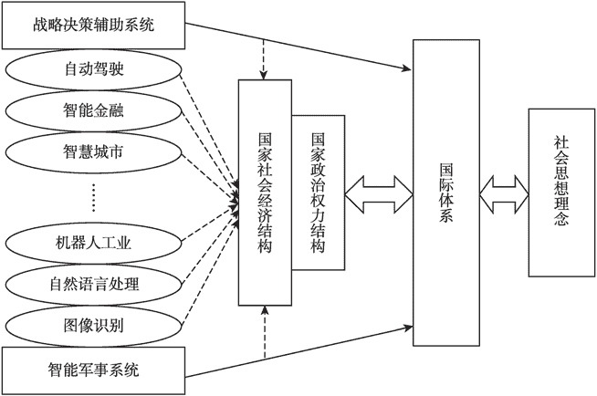
图 1 弱人工智能时代技术影响力的扩散模式

从现有态势看，深度学习催生的领域型人工智能会在三个层面重塑国际体系。

其一，领域层面。部分技术可以直接切入特定国际议题，改变行为体在该领域的力量对比，为体系注入新的不稳定因素。今天人工智能落地主要集中在收益较高的民用市场，直接服务国际政治的研究尚处起步，但战略决策辅助和智能军事系统已成为各国参与国际博弈的重要利器。技术代差一旦拉开，对国力对比的影响将难以逆转。

其二，制度层面。技术扩散会重塑现代经济运行方式，改写世界经济中资本与劳动力的关系，进而牵动国家治理模式和权力分配，最终波及国际体系的稳定。所有领域型进展都指向同一个方向：用机器替代人力。随着资本加速扩张、劳动要素持续弱化，全球经济将迎来结构性再平衡。经济基础的变动会直接冲击既有政治秩序，传统科层制政府若不进行根本调整就难以适应。新经济与新治理的联动，最终会让现有国际秩序发生深刻变化。

其三，思想层面。具有时代意义的技术变革会扩散到社会生活，进而在政治社会观念中留下痕迹，并反过来作用于国际关系和国内治理。人工智能高速发展让社会陷入一种认知上的迷茫：一边渴求技术红利，一边担忧文明反噬。埃隆·马斯克与斯蒂芬·霍金对人工智能风险的公开警告便是最典型的体现[^(\[13\])](#chapter003.html#m13)。价值取向在弱人工智能时代承受再造压力，不同学科、不同领域的分歧会长期并存，如何重塑思想与价值标准，也成为社会科学介入人工智能议题的重要路径。

依托上述框架，可以更清晰地看清技术进步对国际关系要素的复杂作用，并描绘出未来的宏观图景。

## 二 AI如何介入战略与战争

与国际关系直接相关的应用目前高度集中在战略决策系统和军事系统上，这既是国际环境决定的，也是弱人工智能技术特性的结果。一方面，战略与安全关乎国家根本利益，各国都在这两个方向保持积极投入；另一方面，这两个领域目标相对清晰、敌我界限分明、数据积累丰富，恰好满足深度学习发挥作用的前提。于是它们成为连接人工智能与国际关系的桥梁，也是新技术优先渗入的通道。

### （一）人工智能与战略博弈模式的变革

利用人工智能构建和完善战略决策辅助系统，是技术变革对国际关系最直接的体现。战略博弈天生适合人工智能发挥优势。从诞生起，人工智能就把遵循规则、目标明确的博弈作为突破口。以 AlphaGo 战胜围棋世界冠军柯洁为标志，人工智能已在所有具备“完全信息博弈”特征的项目中展现出压倒性优势；在德州扑克等“不完全信息博弈”中，其策略制定能力甚至更为突出[^(\[14\])](#chapter003.html#m14)。

从数学视角看，国际行为体间的战略互动本身就是典型的“不完全信息博弈”。参与者要判断对手的能力、意图、利益和决心，结合外部环境制定最优策略加以实施[^(\[15\])](#chapter003.html#m15)。国际战略涉及范围更广、要素更复杂，系统效应早已超出人类思维的掌控范围。传统上国家博弈更多依赖政治家的直觉。随着深度学习加速，战略决策辅助系统在该领域的优势愈发明显，只要技术大趋势不变，人工智能必然改变现有的战略博弈进程，行为体间的战略关系也将发生重大变化[^(\[16\])](#chapter003.html#m16)。

从算法特性看，人工智能辅助将提升战略决策的科学性、有效性和可靠性。

首先，风险评估与预警会变得更精确。战略博弈的基础是对前景和风险的判断，但人类决策始终受限于有限情报，带有强烈的主观猜测色彩。面对信息过载，决策者只能选择性使用，又容易受认知捷径影响，形成自我偏见。结果有时过于乐观，有时又夸大低概率事件。传统预警因此充满模糊性和偶然性[^(\[17\])](#chapter003.html#m17)。

深度学习介入后，博弈活动会被抽象为一个贝叶斯网络模型[^(\[18\])](#chapter003.html#m18)。在大数据环境下，算法可通过监督或非监督学习归纳信息、设定风险参数，逐步建立预警系统，对系统性风险作出较准确的预测[^(\[19\])](#chapter003.html#m19)。风险程度与应对效果能以概率形式被技术表达，决策从主观猜测转向在不同概率前景中挑选策略，量化表达降低了不确定性，有助于科学化[^(\[20\])](#chapter003.html#m20)。

其次，系统能在更短时间内给出更多、更反常人思维的战略选项，并随博弈持续不断完善。深度学习让决策真正实现对大数据的深度利用，机器以远超人类的效率阅读分析数据，并通过学习获得情报分析能力。

更关键的是，人工智能的决策逻辑与人类不同，它在给定目标体系下利用多层神经网络主动构建新策略，并非模仿人类过程。机器生成的策略常与人类直觉相悖，却往往更有效。人类通常无法理解其思考方式，只能从执行结果推断。该系统在以博弈模型为基础的竞技中能轻易找到人类的盲点并加以利用[^(\[21\])](#chapter003.html#m21)。

同时，算法具备从错误中学习的能力，随着数据累积，对手形象会越来越清晰，策略特征被纳入机器思考范畴。长期来看，即便人类初期占优，也会在策略被识破后逐步丧失主动权[^(\[22\])](#chapter003.html#m22)。

最后，人工智能能最大限度排除人为干扰，提升可靠性。人类受文化、心理影响，情绪可能驱动决策，还会受荣誉、恐惧、道德等主观因素干扰。人工智能则是纯粹中立的理性体系，只响应参数，不会因优势而自满、因劣势而冒险，也不受个人心理素质、身体状态或环境舒适度影响[^(\[23\])](#chapter003.html#m23)。它不会因疲劳而改变，是理性选择的理想化身。

当然，现阶段仍有局限。

一方面，现实博弈中目标往往是动态的，会随利益关系变化而调整。很多参与方对自身追求的目标是模糊、变动且不可量化的，这正是人类博弈的精髓。但深度学习需要博弈开始前设定明确目标并据此训练，无法理解目标之外的“非意图性影响”，在现实政治中容易遭遇意外挑战[^(\[24\])](#chapter003.html#m24)。

另一方面，深度学习依赖大数据，而弱人工智能时代的数据采集仍需人工参与。人的意图会潜移默化地注入采集过程，数据集中保留采集者的倾向与偏见，在这种环境下比较优势会被削弱，偏见最终会体现在策略中，干扰决策有效性。

总体而言，以人工智能为基础的战略决策辅助系统将在国际博弈中扮演关键角色，技术完善会进一步拉大行为体间的博弈能力差距。若一方拥有辅助而另一方没有，对抗就近乎单向透明。缺乏支持的一方在风险判断、策略选择、执行效率和可靠性上都将处于绝对劣势，博弈结构严重失衡。

### （二）人工智能技术在军事领域的扩散

军事是人工智能参与国际关系的另一重要场域。美国军方自人工智能诞生起就给予高度重视[^(\[25\])](#chapter003.html#m25)。军事与人工智能天然契合，军事曾是技术突破的重要试验平台，许多深度学习研发最初都源于军事目的。军事活动的复杂性也意味着几乎所有垂直领域的算法突破都能在战场上找到应用口。人工智能的进步将重塑武器、战略、组织乃至战争的意义，弱人工智能时代的军事安全环境将截然不同[^(\[26\])](#chapter003.html#m26)。

首先，技术层面将推动智能化武器普及。早期无人机和作战机器人的初衷是减少伤亡，靠远程操控实现。但深度学习出现后，军事正迈向自主作战系统建设。

早在2004年，美国研究团队就用类似深度学习的算法训练机器在无人干预下学会驾驶直升机[^(\[27\])](#chapter003.html#m27)，标志着智能化武器成为可能。近年来，无人机、作战机器人等自动化平台正从远程操控转向智能化开发。利用深度学习，智能武器可在虚拟环境中培养操控能力，再在真实环境中通过数据反馈提升战力。规模越大，协同优势越明显。由同一算法训练的大批量平台可借助人工智能系统协同行动，优化策略并随战场形势灵活调整[^(\[28\])](#chapter003.html#m28)。智能武器能将人与武器实质分离，使伤亡趋近于零，提升使用效率和协作水平。更重要的是，“消灭有生力量”这类传统法则将失去意义，智能系统与传统力量相遇时，战争的法律与伦理观念将受极大冲击。

其次，战略层面将把军事战略与指挥推向新高度。相较于复杂的社会，战争是相对简单封闭的领域。深度学习已能较为完整地还原战场信息，模拟兵力部署和作战能力，完成精确的沙盘推演[^(\[29\])](#chapter003.html#m29)。战前，人工智能可通过无数次计算模拟战场形态，以概率量化各项可能，并据此选择方案、分配兵力、部署战略。

在实战中，人工智能能更全面高效地收集战场信息。机器视觉提升自动武器对战场环境的识别分析，自然语言处理系统增强音频信号的采集处理，自动驾驶技术提高武器系统的机动性和自主判断力。指挥官可获得更全面准确的信息和更精确的战术建议，自主作战系统正不断成熟。

人工智能在指挥上具备两大人类难以比拟的优势：快速处理信息、具备人类不拥有的反应速度；多线程处理能力，能同时应对多项行动并提出人类思维难以理解的复杂策略[^(\[30\])](#chapter003.html#m30)。进入弱人工智能时代，技术将加剧常规力量对抗的不平衡，缺乏人工智能辅助的武装力量越发难以用战术弥补劣势。常规对抗不再是合理选项，非对称战争将成为主要对抗方式。

最后，人工智能的深度介入为全球核威慑体系的稳定带来新变数。

核武器是上一轮体系革命的核心，推动力，长期被视为全球军事平衡的基础。以“确保相互摧毁”为原则的核威慑体系仍是现代国际体系安全的基石，战略界据此构建经典威慑理论，将核力量规模、使用意志和威胁评估纳入框架[^(\[31\])](#chapter003.html#m31)。然而当人工智能介入核威慑体系的各个环节后，原本稳定的体系会因新变量出现而发生变化。

AI与核威慑的失衡

其一，AI被当作数据驱动的作战工具，为网络攻势提供了前所未有的进攻增益，直接动摇核武器使用可信度的根基；其二，在大数据语境下，原本模糊度很高的国家意志、核武拥有者的战略意图等主观变量，能够在深度学习模型里以概率形式显性化。于是被解读为“相互毁灭”的核威慑体系不再稳态。掌握AI的一方可以相对清晰地测算对手发动核反击的概率与破坏规模，从而获得更灵活的战略选项；而技术相对落后的一方，其核反击的可信度变得难以维系。技术力量的介入正推动威慑体系的内容重塑，在弱AI时代，只有AI与核武器的结合才可能构成有效的威慑。[^(\[32\])](#chapter003.html#m32)行为体间的军事差距会因AI水平再次拉大，各国军事战略目标随之调整，传统的国际安全秩序变得不稳。

总体看，AI对军事领域的深度介入，是核武器诞生以来全球军事史上最关键的技术转向之一。[^(\[33\])](#chapter003.html#m33)与以往的技术迭代不同，AI对军事的改变是全方位的，从武器本身到战略设计，从全球力量平衡到军事伦理都不可避免地被冲击。AI的进步将在短时间内放大主体间的军事差距，拥有AI的国家将具备系统性削弱对手既有打击手段的能力，形成新的失衡。这种失衡可能刺激预防性战争模式的回潮，而寻找新的非对称作战方式将成为中小国家或实力较弱武装组织的主要发展方向。

在此态势下，以AI为核心的新一轮军备竞赛难以避免。大国必须追求AI并将其用于军事，以维持大国地位；中小国家则会千方百计寻求AI武器的扩散，争取新的制衡手段。目前，AI在军事领域的准入门槛很高，研发需要巨额成本投入，短期内扩散可能性较小。但随着AI持续演进，技术成本会逐渐下降，扩散风险随之升高，全球安全体系与伦理基础都将面临严峻考验。

### （三）走向更加不平等的世界

历史经验一再表明，每一次科技革命都会拉大先行者与其他国家的力量差距。作为科技史上最强的力量放大器，AI在战略博弈与军事等国际关系关键场域已展现出明显超越人类与持续演进的潜力。这种差距已很难靠数量堆砌或战术技巧弥补，先行使用AI的主体几乎不可能在博弈或军事行动中被非使用者击败。这将使弱AI时代国际主体间的力量鸿沟变得更难跨越。

与此同时，先行应用AI的国家会被倒逼着在组织层面进行改革。在AI广泛应用的背景下，科层制组织形态已不再匹配新的技术环境。传统上，军队组织体系和国家战略决策咨询体系都遵循严格的科层制原则运作，但AI以扁平化、网络化与高度协同的方式推动体系运行，以等级和命令为核心的科层制难以适应这一形态。[^(\[34\])](#chapter003.html#m34)随着AI在上述领域应用的不断扩展，传统组织结构必然因新技术的采用而被调整。当适配新技术的新体制逐步推广后，国际关系行为体之间将呈现出技术和制度上的系统性差距，发展中国家将面临更严酷的国际竞争压力。

AI的发展将推动世界进入一个更为不平等的格局。快速扩大的力量差距迫使传统国际关系主体间的互动模式发生重大改变，以主权国家平等为基石的国际社会稳定结构面临严重外部压力，这构成了弱AI时代国际关系变革的外部动因，也是AI对国际关系影响的第一层面。

## 三 人工智能的系统性影响：新型社会经济结构与权力分配模式

在战略与军事领域的应用只是AI科技浪潮中的很小一环，虽然能够改变国际行为体力量对比，但仍停留在从外部对现有国际体系形成冲击的阶段。若AI的作用仅限于此，尚不足以对整个体系产生根本性影响。然而，如图 1 所示，对国际关系影响更为深远的路径是通过间接方式实现的。AI技术变革将从根源上对全球经济结构与政治治理模式产生系统性影响，进而推动国际体系深层变革的出现。这种冲击的直接着力点在于支撑现代社会稳定的经济结构，经济结构的改变又将导致国际行为体内部权力分配方式的改变，最终由内而外推动体系的变革。

## （一）弱人工智能时代的社会经济结构变迁

AI从诞生之初就注定要对传统的社会经济体系发起全面挑战。用具备类人智慧的机器替代人类从事生产工作，本就是AI产业的核心逻辑。随着深度学习算法的广泛应用，AI技术正在越来越多的领域向“机器替代人类劳动”这一基本目标迈进。自动化生产在各个领域的出现、发展和完善，构成了AI对世界经济体系最直接的影响。[^(\[35\])](#chapter003.html#m35)目前，在基础制造业领域，机器人生产已经逐渐获得行业的广泛认可，并成为制造业大国未来的主要发展战略[^(\[36\])](#chapter003.html#m36)。在金融服务领域，AI量化分析工具的普及正逐渐压缩原本属于人类的高薪工作。随着无人驾驶、智能决策系统等新技术的逐渐成熟，仓储行业、交通运输、城市管理乃至法律、教育和医疗等行业，都将被深深卷入AI引发的技术变革浪潮。这是一场具有产业革命意义的技术变革，它将改变人类生产的基本形态，也将改变社会经济的基本结构。

科技进步是社会发展的原动力，AI的广泛应用最终将推动人类整体劳动生产率提高，并创造更加丰富的社会财富。即便在AI技术尚未成熟的 1993～2007 年，17 个工业国通过工业机器人带动的自动化生产，已使劳动生产率提高了约 0.4 个百分点。[^(\[37\])](#chapter003.html#m37)在深度学习算法逐步完善之后，AI将使劳动生产率得到空前提高。据埃森哲预测，到 2035 年，应用AI技术的企业利润将平均增长 38%，在主要 12 个发达经济体的 16 个行业中实现 14 万亿美元的经济增长。[^(\[38\])](#chapter003.html#m38)但AI的革命性在于，它以颠覆原有产业结构和生产方式为获取新经济增长的基本路径。于是，随着AI技术在社会生产活动中的全面推广，世界必须经历一个漫长的阵痛阶段，两种在当前人类社会难以容忍的负面现象将在过渡阶段广泛出现，并成为弱AI时代经济社会结构的常态。

第一，持续性的失业潮。AI的核心逻辑是以机器自动化生产取代人类劳动，以提高社会生产率。因此，持续而普遍的失业现象将成为弱AI时代的基本特征。根据美国国家科学技术委员会预测，在未来 10～20 年时间内，现有工作岗位的 9%～47%会受到威胁，每 3 个月就会有约 6%的就业岗位消失。[^(\[39\])](#chapter003.html#m39)与传统上生产规模下行导致的周期性失业不同，AI导致的失业本质上是一种结构性失业，资本以全新的方式和手段替代了劳动力需求。处于结构性失业的人口不会因经济周期的变化重新获得工作，因为他们之前能够适应的岗位已经消失。主要依赖重复性劳动的劳动密集型产业和依赖信息不对称而存在的部分服务行业的工作岗位将首当其冲被AI取代。随着AI技术在各个垂直领域的不断推进，受威胁的工作岗位将越来越多，失业规模将越来越大，失业持续时间也将越来越长。[^(\[40\])](#chapter003.html#m40)

第二，社会财富的严重两极分化。社会财富的两极分化是与持续失业潮相伴而生的另一个重要社会现象。这种分化会在不同层次上反复出现，对传统社会结构造成严重撕裂。首先，个体的财富分配趋向两极，作为资本挤压劳动的重要进程，AI带来的劳动生产率提高并不会转化为工资收入的普遍增长。换言之，自动化生产创造的经济繁荣并不会惠及更多劳动人口。[^(\[41\])](#chapter003.html#m41)新创造的社会财富将会以不成比例的方式向资本一方倾斜，低收入与受教育程度较低的人群将在新一轮社会资源分配中处于严重不利地位。其次，行业的财富分配也将呈现明显分化，AI技术的使用将使拥有互联网与大数据条件的相关行业获得天量资本注入，并吸引更多人才。在未来 5～10 年，AI相关产业与传统产业之间将形成巨大发展鸿沟，无论是市值、资本还是财富创造方面，都将出现严重分化。[^(\[42\])](#chapter003.html#m42)最后，从全球范围看，国家间的财富分化将进一步加剧。AI进步需要大量前期投入，特别是数据收集和计算机技术方面的技术积累对AI产业发展至关重要。各国在该领域的投入差距很大，不同国家在AI技术方面的发展严重不平衡。在弱AI早期，部分国家会在一定时期内在AI领域形成事实上的技术垄断，从而获得大量超额收益，使本已十分严重的全球财富两极分化情况进一步加剧。[^(\[43\])](#chapter003.html#m43)

对全球社会经济结构而言，AI发挥的是“创造性破坏”作用。[^(\[44\])](#chapter003.html#m44)它深刻改变了维系国民经济运行和社会生产经营活动的各项基本生产要素的意义。在AI影响下，资本与技术在经济活动中的地位得到全面提高，而劳动力要素的价值则受到严重削弱。传统工业化时代重要的人口红利很可能在弱AI时代成为新型经济模式下的“不良资产”。在这种情况下，全球范围内的资本和人才会进一步流向拥有技术优势的发达国家市场，发展中国家走上现代化道路的机遇期变得极为有限。随着社会经济结构的重大调整，资本的权力也在政治体系中快速扩张。经济层面的深刻变革将很快作用于建立在传统工业化生产基础上的现代政治体系，并在政治权力分配中得到充分体现。

## （二）弱人工智能时代的国家权力分配模式调整

国家权力的分配方式从根本上由社会经济生产方式的特点决定，不同时代的生产力水平决定了特定时段最为合理的政治组织模式。威斯特伐利亚体系中的民族国家体制正是目前人类创造的最适合工业化大生产经济模式的权力分配方式。因此，当AI推动的社会经济结构变革逐步发生时，新的社会权力会伴随技术变革而兴起，推动国家治理结构与权力分配模式做出相应调整。

其一，资本权力依托技术垄断的地位得到持续扩张。AI研究是一项门槛很高的工作，需要多项基础条件的密切配合。对深度学习算法的研究需要同时满足拥有高性能计算机系统、拥有获取大数据的能力以及聚集足够多的人才，而所有这些条件的获得都依赖巨额且长期的资本投入。这意味着AI研究中最具实际应用价值的科研成果多出自大型企业支持的研究平台。

目前，几乎所有重要AI领域的突破性成果都是在互联网时代的超级企业推动下出现的，互联网超级商业巨头实际上掌控了当前AI领域的大部分话语权。表 1 中，这些企业建立的研究机构拥有海量的数据资源，并拥有高校与其他研究机构无法企及的巨额研究经费，大部分AI顶尖人才逐渐在这些企业会聚，并根据企业的目标需求调整研究方向。[^(\[45\])](#chapter003.html#m45)虽然其他独立实验室与小型企业时常也会取得重要成果，但最终大部分会通过商业并购等方式纳入互联网商业巨头的体系内。AI领域的研究已被深深打上互联网资本的烙印，大型企业对数据资源及AI技术的控制能力实际上正在造成它们的垄断状态。掌握数据和算法本身就代表着潜在的权力，这种力量渗入当代深嵌于网络的社会生活的方方面面，潜移默化地改变公共产品的提供方式。在弱AI时代，资本和技术力量的垄断地位结合在一起，将逐渐分享传统上由民族国家掌控的金融、信息等重要权力。资本权力随着新技术在各领域的推进而不断扩张，这将成为弱AI时代权力分配方面的重要特征。

表 1 全球重要人工智能实验室

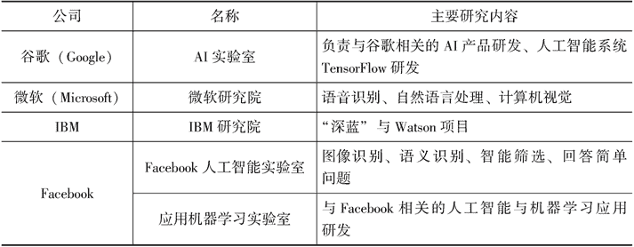

表 1 全球重要人工智能实验室-续表

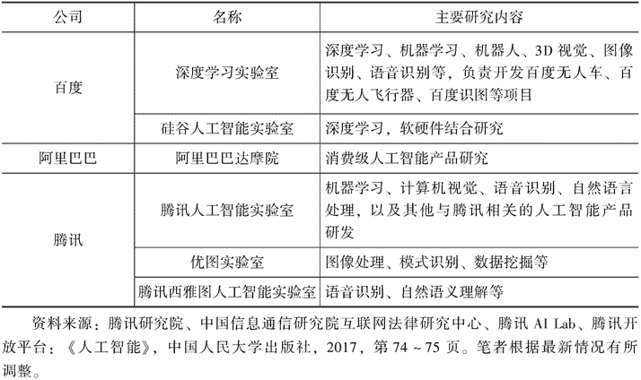

其二，技术权力凭借知识方面的不对称优势在短时间内膨胀。在向弱AI时代过渡的阶段，承担AI科技开发核心任务的少数精英科学家群体将获得超越常规的影响力和话语权。作为当前人类科技研究的前沿工作，AI对从业者的个人素质和学术训练有着极高要求。掌握关键技术的顶级科学家是一个非常稀缺的群体，他们的研究工作直接影响着弱AI时代社会生产形态的构成。凭借在关键技术方面的不对称知识优势，核心科学家共同体实际上拥有制定新AI时代各项技术标准的权力。整个共同体的研究兴趣在很大程度上决定了弱AI时代的技术发展方向与社会经济结构的变迁节奏。[^(\[46\])](#chapter003.html#m46)

在传统工业化生产时代，科学研究已被深深纳入社会生产体系，形成了非常稳定的互动关系。由于科技教育的普及，科学家群体的规模较大，流动性也很强，科学家群体很难获得直接的政治影响力。然而，在走向弱AI时代的过渡阶段，顶级科学家共同体的规模很小，可替代性不强，群体相对比较稳定。更重要的是，AI引发的产业革命与社会结构的大规模调整将同时出现，科学家共同体的研究工作本身就成为技术与社会结构变迁的中间环节。他们凭借自己的话语权与影响力将构成一个特殊的技术权力阶层，成为弱AI时代社会权力的另一项重要组成部分。该阶层的权力一方面需要在一定程度上依附传统的政治权力和资本权力，另一方面又具有很强的独立性，并对另外两种权力产生一定程度的制约。

如图 2 所示，在弱AI时代，传统政治权力仍然是国家内部最重要的权力来源，但资本权力与技术权力的扩张将使行为体内部权力分配模式发生重大改变。大型企业通过长期投资和技术研发，能够更加经济、更加有效地在很多领域承担提供相应公共产品的职能，并从中获取更多潜在利润。在新的经济形态下，维持旧的公共产品供应格局是一项成本极高的任务，因此，民族国家掌控的传统政治权力会在一定程度上向资本权力让渡经济及社会管理等部分领域公共产品的供应权，并充分利用其在数据和技术方面的优势为政府的行政工作服务。作为这种让渡的代价，传统政治权力会进一步强调自己对军事、安全、金融管理等领域的绝对管辖权，并为资本权力划定扩张边界。[^(\[47\])](#chapter003.html#m47)同时，政治权力、资本权力也不得不在一定时间内接受技术权力群体的存在，并利用其在相关领域的知识优势推进生产的发展，同时通过各种手段对其影响力的扩张进行限制。

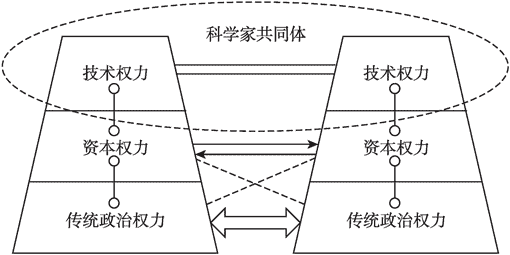

图 2 弱人工智能时代行为体内部权力分配模式演变

在弱AI时代最初阶段，传统政治权力、资本权力与技术权力将形成某种金字塔式结构。传统政治权力是塔基，它将继续掌控安全、税收、社会管理等国家权力的核心要素，并继续垄断武力的合法使用权，为其他形式权力的使用背书。资本权力是塔身，大型跨国企业将接受一定领域的权力让渡，为全社会提供数据和经济信息等方面的公共产品，并享受相应的权利。技术权力是塔尖，科学家共同体构成了AI技术发展与社会生产的关键纽带，为未来社会提供基本标准和道德影响力，并承担着推动AI技术进一步发展的责任，为资本权力创造利润，为传统政治权力提供产品。三种力量相互支持又相互限制，在不断互动的状态下进行相互适应，尝试摸索新的社会发展阶段最为合理的国家治理模式。但三种权力因为特性不同，在参与国际互动的过程中将表现出不同的特点。因此，在行为体内部权力分配模式出现变动之后，国际体系层面的互动也必将出现相应的改变。

## （三）由内而外的国际体系变革

在威斯特伐利亚体系确定的国际关系基本原则中，主权国家是国际体系的核心行为体，直到近几十年来国际组织的出现才在一定程度上打破了其垄断地位。然而，在走向弱AI时代的过渡阶段，随着资本权力与技术权力在行为体内部的扩张，新的异质性行为体将在国际关系活动中发挥更加重要的作用，不同类型的行为体的不同特性将带给新时期国际体系不同的运行规则及行为逻辑，由内而外地推动国际体系变革的发生。

如图 3 所示，弱AI时代的国际体系变革实际上是国内权力分配方式在更广泛空间的自然延展。获得传统政治权力让渡的资本权力与技术权力将在新阶段的国际体系中获得合法的国际行为体地位，并将该类型的主体间互动方式引入国际体系，使整个体系呈现出主体多元、规则多元和关系多元的复杂状态。

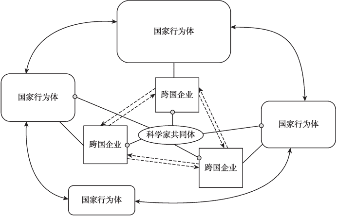

图 3 弱人工智能时代的国际体系

第一，主体多元特征，主权国家、跨国企业与跨国界的科学家共同体都将成为新时代国际体系的重要参与者。

科技对经济运行状态的改变是直接的，而政治体系的变革从根本上说是改变多数人既有观念的尝试。即使在技术进步的情况下，人的观念也常常会因为记忆与惯性停留在原处。即使当我们跨入弱AI时代后，民众与社会也不会在短期内遗忘旧时代延续而来的利益纠葛与民族矛盾。因此，传统意义上的国家关系在相当长的时间内仍将延续，主权国家作为国际体系最重要行为体的地位仍难以改变。

然而，由于在相当长的时间内主导AI技术的开发进程，特别是对大数据资源的独占，少数大型互联网跨国企业在AI领域拥有天然的主导权。由于数据的存储可以通过网络化形式完成，大数据权力在一定程度上可以脱离主权和地理空间的局限，从而使超大型企业与其所属国家的关系变得十分微妙。虽然主权国家会通过各种方式不断强化自身与跨国企业之间的联系纽带，但对新技术的独占优势赋予了非国家行为体在特定公共产品提供方面的特殊地位，而数据与地理的脱钩也使其在相当程度上增强了在国际关系特定领域活动中的独立性。与AI相关的跨国超大型企业将逐渐发展成以商业利益为核心的具有一定独立性和话语权的国际行为体。它们凭借自身在AI领域的特殊地位为中小国家提供相应领域的公共产品，并以此为基础参与其他议题的政治交易。跨国企业成为新的活跃的国际行为体，将构成弱AI时代国际关系中的重要特征。

弱智能时代：谁在重写全球游戏规则

在AI领域活跃的跨国科研人脉正逐渐成为下一轮国际秩序里的独立变量。这个群体共享一套研究范式和价值取向，形成了一个超国家的学术共同体，圈内的权威学者往往承担整合与协调的功能，如图 2 虚线圈所示。它既依赖国家政策与资本供给来运转，又拥有相对自主的运行准则和行动逻辑，在技术迭代与标准制定上起着关键牵引作用。人群规模很小，却兼具技术公信力和伦理正当性，在弱AI阶段对全球共识的生成具有明显的风向标意义。

规则分化的观察。新的国际体系里不同行动者的行为准则出现了明显裂隙。

民族国家基本沿用现行国际社会的运行法则，博弈仍围绕权力与利益展开，国家的硬实力仍是主要依仗。国际化企业的运行逻辑截然不同，领土与民族矛盾这类顽固政治因素基本缺席，经济收益成为竞争的核心目标。企业间竞争激烈，妥协与协作的空间却更大。尤其是在AI细分赛道占绝对优势的超大型企业，往往能从合作中获得额外增益。它们不具备合法动用武力的权限，在与中小国家的互动中更倾向倡导合作与共识，这一层面资本协作的驱动力明显超过对抗。科研社群的特殊性决定了它必须以科学规范为核心来维系稳定，其运作带有强烈的全球化色彩。三种准则并存，使得新时代国际体系的运转注定错综复杂，各层要素要在长期磨合后才能形成稳定的权力边界。

关系复杂化的观察，权力让渡的边界与技术垄断的消解成为焦点。

新主体的加入让弱AI时代的国际体系需要在相当长的碰撞期后才可能趋稳。国际化企业要获得活动空间，需要各国政府在特定领域作出权力让渡，而让渡的限度只能通过持续互动来确认。各国政府同样需要企业支持：强国借助本国企业在技术与商业上的成功来带动整体发展与产业升级，中小国家则依赖它们提供必要的服务与技术支持。但国家始终警惕企业侵蚀核心主权、削弱政治主导地位，这一博弈受技术演进速度与社会思潮共同影响，过程漫长且复杂。

更值得注意的是，各国政府与国际化企业在政治上对削弱科研社群对技术的垄断形成了罕见共识。知识鸿沟客观上造就了技术权力阶层的出现，而关键社会权力被少数相对稳定的群体掌握，且成员难以通过常规程序更替，在任何社会看来都是高风险。人类历史上缺乏处理少数人垄断高阶技术权力的经验，也无法保证所有成员都能恪守高道德标准。因此，通过机制建设既发挥其积极作用又限制其滥用、瓦解其整体性、促使其分化并依附于国家和企业，已成为双方在弱AI早期阶段的核心政治操作目标。

总体来看，AI的推进正在由内而外重塑社会经济结构与权力分配，推动国际体系进入变革通道。不同性质的新兴权力以多元行为体的形式集中表达。本文的推演基于AI技术特性，但现实远比理论复杂。处于变革临界点的行为主体会如何选择，国际体系如何重构，很难预设。可以确定的是，随着技术持续演进，动荡与不确定风险会不断累积，体系变革不可避免，且只有在反复磨合后才会形成契合时代特征的新秩序。在此进程中，深入的研究与思考对新体系的形成与稳定具有积极意义，这也是国际关系研究者应尽的责任。

## 四 弱人工智能时代的思想观念：保守主义与进步主义的交锋

作为新一轮产业革命的先声，AI展现出的颠覆生产方式的潜力与可能伴随的普遍性失业，不仅改变物质与制度，也在冲击思想观念。剧烈的时代变迁催生新的理念，最终汇成具有时代特征的社会思潮，影响权力分配与国际格局。

在迈向弱AI时代的过程中，社会已显现两种截然不同的观念体系，根本分歧在于对AI技术的基本认知，也体现了保守主义与进步主义的分野。[^(\[48\])](#chapter003.html#m48)面对风险与挑战，两者提出了不同的应对策略。

### （一）观念一：保守主义

AI领域的保守主义路径出发点是对技术突飞猛进的恐惧。每一次工业革命都会引发对风险失控的担忧，而本轮尤为强烈。其一，深度学习释放潜力后，AI在诸多领域仅需极短学习时间便可超越多年积累的人类知识，思维能力的优越感被瓦解；其二，深度学习“黑箱”效应使人类难以理解神经网络逻辑。对技术的恐惧本质上是对不可预知未来与自身无力感的双重焦虑，已通过大量文艺作品广泛传播，保守主义正是这一社会情绪的集中体现。

保守主义主张以稳健姿态对待技术发展，对通用AI与超AI的推进保持极度谨慎。在其看来，保持技术可控是发展不可逾越的红线。[^(\[49\])](#chapter003.html#m49)

面对弱AI时代的失业问题，保守主义建议以一种可控的“新卢德运动”[^(\[50\])](#chapter003.html#m50)来延缓失业浪潮，通过政治手段限制AI在劳动密集型行业的渗透速度，让绝对失业人口始终处于可控区间，为新型岗位出现争取时间。其出发点是尽可能长时间地维护既有体系稳定，以牺牲技术速度为代价进行微调，降低整体动荡强度。

但保守主义存在难以解决的内在悖论。虽在理念内部自洽，一旦置于国际竞争环境便难以被接受。科技快速发展的时代，任何放缓研发与应用的国家都将面临极大危险，技术差距会在短时间内拉大。信奉保守主义的国家将在经济与政治竞争中因落后而处于不利地位，因而这种思想总体上仅停留在民众与知识分子层面。

### （二）观念二：进步主义

AI问题上的进步主义认为技术进步是难以遏制的历史潮流，且相信科技能为人类带来积极影响，主张各国加强研究，利用生产效率提升创造更多社会财富。

进步主义高度肯定AI在本轮工业革命中的意义，其解决逻辑是通过调整制度与社会基本原则，充分释放技术红利，构建更适应技术特征的人类社会。

进步主义者认为技术导致的大规模失业是无法避免的历史规律，阻止它毫无意义。维持社会稳定的方式不是干预不可逆的失业，而是改变工业化时代“不劳动者不得食”的分配原则。以技术进步创造的丰富财富建立“无条件基本收入”制度，为全体公民提供体面生活的固定保障，鼓励其在长期失业中学习新技能或从事兴趣工作，[^(\[51\])](#chapter003.html#m51)最终在新的分配方式上重塑社会文化认知。

进步主义的主要矛盾在于其理论基础建立在AI能够快速发展并持续创造足够财富之上，以满足全球福利社会需求。然而从弱AI到强AI需要很长时间，进展至今仍难定论。一旦科技进步速度无法支撑福利需求，新体系的基础便会动摇，甚至引发难以预料的社会动荡。

归根结底，弱AI时代思想变迁本质上是对人与AI内在联系的思考。保守主义以悲观视角表达恐惧，进步主义以乐观视角表达希冀。无论悲观或乐观，AI都是人类造物，是知识与理性的结晶。面对突飞猛进的发展，人类应感到欣慰。以深度学习为标志的弱AI具有明显工具属性，通用AI同样是认识与改造世界的工具。其威胁远小于人类自身可能造成的恶。我们应以冷静客观的态度理解其影响，在变革且日益不平等的世界中创造更稳定、更合理、更体现文明尊严的体系与制度。这也是新时代国际关系研究的核心议题。

## 余论：弱人工智能时代的中国选择

深度学习算法的普及与AI的高速发展改变了传统工业化路径，引领新一轮产业革命。为应对技术革命与制度变迁，世界主要大国都在积极布局，根据国情制定产业规划，整合资源，抢占技术与产业制高点，争取在新国际体系中获得有利战略位置。[^(\[52\])](#chapter003.html#m52)

AI既是中国的宝贵机遇，也是其以科技前沿国家身份迎来的产业革命。作为重要互联网大国之一，中国在推进AI发展上具备天然优势。其一，资本对AI商业前景看好，投入大量研发资金，聚集人才。经过二十余年发展，以阿里巴巴、腾讯、百度为代表的中国顶尖互联网企业已成长为国际巨头，拥有充足经费并能全球吸引优秀人才。其二，中国是世界最大互联网市场，2017年互联网用户已超7.5亿，移动互联普及带来海量数据，为技术发展提供养料。广阔市场空间也利于研究商业化。更重要的是，中国政府能为AI全面发展提供有力支持。

习近平总书记在党的十九大报告中明确提出，要“推动互联网、大数据、人工智能和实体经济深度融合”[^(\[53\])](#chapter003.html#m53)，将AI视为供给侧结构性改革与推动实体经济的重要环节。2016～2017年，《“互联网+”人工智能三年行动实施方案》[^(\[54\])](#chapter003.html#m54)和《新一代人工智能发展规划》[^(\[55\])](#chapter003.html#m55)相继颁布，对战略定位、发展目标、主要任务与保障措施做出详细规划。推动AI科技发展已成为国家重要战略，将有力促进中国在技术与产业化方面的进步，并对全球发展产生积极影响。在国家规划的推动与资源整合下，中国完全有能力在未来竞争中发挥比较优势、补齐短板，在新国际体系中占据重要位置，实现社会主义现代化强国目标。

最后必须强调，AI革命将带来人类历史上前所未有的深层变革，变革本身意味着难以预估的风险。如何在风险形成前做到未雨绸缪，避免技术革命反噬人类自身，是国际关系学肩负的重要责任。面对时代浪潮，国际关系学者必须保持冷静观察，提前思考并设计符合时代特征的政治与经济模式，确保生产方式剧烈变革时期国际社会的安全、稳定与秩序。一言以蔽之，在激烈变革时代探索恒久人类精神，在日益不平等的世界寻求维持和平稳定的最佳方案，是国际关系学在AI时代的历史责任，也是每位研究者不可推卸的崇高使命。

* * *

[\[1\]](#chapter003.html#w1) 本文曾发表于《外交评论》2018 年第 1 期。

[\[2\]](#chapter003.html#w2) 封帅，上海国际问题研究院国际战略研究所副研究员。

[\[3\]](#chapter003.html#w3) 关于深度学习算法的相关问题，参见 Geoffrey E.Hinton，Simon Osindero，Yee-Whye Teh，“A Fast Learning Algorithm for Deep Belief Nets，” *Neural Computation*，Vol.18，No.7，July 2006，pp.1527-1554；Pedro Domingos，*The Master Algorithm：How the Quest for the Ultimate Learning Machine Will Remake Our World*，New York：Basic Books，2015；Yoshua Bengio，Pascal Lamblin，Dan Popovici，Hugo Larochelle and Greedy Layer Wise，“Training of Deep Networks，” in J.Platt et al.，eds.，*Advances in Neural Information Processing Systems*，2006，MIT Press，2007，pp.153-160；Marc’ Aurelio Ranzato，Christopher Poultney，Sumit Chopra and Yann LeCun，“Efficient Learning of Sparse Representations with an Energy-Based Model，” in J.Platt et al.，eds.，*Advances in Neural Information Processing Systems*，2006，MIT Press，2007，pp.1137-1144；〔美〕伊恩·古德费洛（Ian Goodfellow）、〔加〕约书亚·本吉奥（Yoshua Bengio）、〔加〕亚伦·库维尔（Aaron Courville）《深度学习》，赵申剑等译，人民邮电出版社，2017。

[4] 入门 AI 在国安与国际政治中的文献脉络，这组经典著作为锚点可以先看：Stephen J.Cimbala，ed.，*Artificial Intelligence and National Security*，Lexington，MA：Lexington Books，1987；Allan M.Din，ed.，*Arms and Artificial Intelligence：Weapon and Arms Control Applications of Advanced Computing*，New York：Oxford University Press，1988；Valerie M.Hudson，ed.，*Artificial Intelligence and International Politics*，San Francisco：Westview Press，1991；Ennals Richard，*Artificial Intelligence and Human Institutions*，London：Springer-Verlag，1991；George F.Luger，*Artificial Intelligence，Structures and Strategies for Complex Problem Solving*，Harlow，England：Addison-Wesley，2005；Erik Brynjolfsson，Andrew Mcfee，*The Second Machine Age：Work，Progress，and Prosperity in a Time of Brilliant Technologies*，New York：Norton，2014；Martin Ford，*Rise of the Robots：Technology and the Threat of a Jobless Future*，New York：Basic Books，2015；Jerry Kaplan，*Humans Need Not Apply：A Guide to Wealth and Work in the Age of Artificial Intelligence*，New Haven and London：Yale University Press，2015；Kareem Ayoub，Kenneth Payne，“Strategy in the Age of Artificial Intelligence，” *The Journal of Strategic Studies*，Vol.39，No.5-6，2016，pp.793-819；Vincent Boulanin，Maaike Verbruggen，*Mapping the Development of Autonomy in Weapon Systems*，Stockholm：Stockholm International Peace Research Institute，2017；Greg Allen，Taniel Chan，“Artificial Intelligence and National Security，” Intelligence Advanced Research Projects Activity，Belfer Center，Harvard Kennedy School，July 2017；等等。
[5] 国内学界围绕 AI 与国际关系展开的早期探索，几篇代表性期刊论文捕捉了关键争论：董青岭《机器学习与冲突预测——国际关系研究的一个跨学科视角》，《世界经济与政治》2017 年第 7 期，第 100～117 页；庞珣《国际关系的定量方法：定义、规则与操作》，《世界经济与政治》2014 年第 1 期，第 5～25 页；庞珣《定量预测的风险来源与处理方法——以“高烈度政治动荡”预测研究项目的再分析为例》，《国际政治科学》2017 年第 1 期，第 1～32 页；等等
[6] 图灵提出机器能否思考的经典论述发表于：Alan M.Turing，“Computer Machinery and Intelligence，” *Mind*，Vol.59，No.236，October 1950，pp.433-460。
[7] 达特茅斯夏季研讨会发起 AI 学科的提案文本与再版信息如下：John MaCarthy，Marvin Minsky，Nathaniel Rochester，Claude E.Shannon，“A Proposal for the Dartmouth Summer Research Project on Artificial Intelligence，” *AI Magazine*，Vol.27，No.4，2006，pp.12-14。关于达特茅斯会议的倡议原文，参见 J.McCarthy，M.L.Minsky，N.Rochester，C.E.Shannon，“A Proposal for the Dartmouth Summer Research Project on Artificial Intelligence，” August 31，1955，http：//www.universelle-automation.de/1956_Dartmouth.pdf。
[8] 梳理神经网络演进脉络，这本深度学习入门专著的前言章节提供了不错的历史概览：〔美〕伊恩·古德费洛、〔加〕约书亚·本吉奥、〔加〕亚伦·库维尔《深度学习》，赵申剑等译，人民邮电出版社，2017，第 8～12 页。
[9] Geoffrey E.Hinton，Simon Osindero，Yee-Whye Teh，“A Fast Learning Algorithm for Deep Belief Nets，” *Neural Computation*，Vol.18，No.7，July 2006，pp.1527-1554.
[10] 深度学习在 AI 学术谱系里常被归入联结主义阵营，这一标签在学界也存在争议，梳理不同范式可参考：佩德罗·多明戈斯，*大师算法：终极学习机器的探索将如何重塑我们的世界*，纽约：Basic Books，2015 年。
[11] 杰里·卡普兰，*人类无需申请：人工智能时代的财富与工作指南*，纽黑文和伦敦：Yale University Press，2015 年，第 31 页。
[12] 总统办公厅，国家科学技术委员会，技术委员会，“为人工智能的未来做好准备”，白宫巴拉克·奥巴马总统，2016 年 10 月，第 7 页，https：//obamawhitehouse.archives.gov/sites/default/files/whitehouse_files/microsites/ostp/NSTC/preparing_for_the_future_of_ai.pdf。
[13] 埃隆·马斯克，“人工智能是我们最大的生存威胁”，*《卫报》*，2014 年 10 月 27 日；罗里·塞兰-琼斯，“史蒂芬·霍金警告人工智能可能终结人类”，BBC 新闻，2014 年 12 月 2 日，http：//www.bbc.co.uk/news/technology-30290540。
[14] 不完全信息博弈的贝叶斯模型，最经典的入口仍是哈萨尼的开创性论文：约翰·C·哈萨尼，“贝叶斯玩家玩的不完全信息博弈，第一部分：基本模型”，*管理科学*，第 14 卷，第 3 期，1967 年，第 159-182 页。
[15] 战略博弈中的不确定性归因框架，唐世平的这篇综述系统呈现了核心思路：唐世平《一个新的国际关系归因理论：不确定性的维度及其认知挑战》，《国际安全研究》2014 年第 2 期，第 3～41 页。
[16] 卡里姆·阿尤布，肯尼思·佩恩，“人工智能时代的战略”，*战略研究杂志*，第 39 卷，第 5-6 期，2016 年，第 793-819 页。
[17] 丹尼尔·P·卡尼曼，*思考，快与慢*，伦敦：Allen Lane，2011 年，第 89-96 页。
[18] 佩德罗·多明戈斯，*大师算法：终极学习机器的探索将如何重塑我们的世界*，纽约：Basic Books，2015 年，第 6 章。
[19] 机器学习做风险估计与冲突预测的跨学科尝试，两份文献分别提供了技术方法和国际关系视角：约亨·克鲁帕，“使用机器学习方法进行风险估计和风险预测”，*人类遗传学*，第 131 卷，第 10 期，2012 年，第 1639-1654 页；董青岭《机器学习与冲突预测——国际关系研究的一个跨学科视角》，《世界经济与政治》2017 年第 7 期，第 100～117 页。
[20] 豪尔赫·加林多，帕布罗·塔马约，“使用统计和机器学习进行信用风险评估：基本方法与风险建模应用”，*计算经济学*，第 15 卷，第 1-2 期，2000 年，第 107-143 页。
[21] 卡里姆·阿尤布，肯尼思·佩恩，“人工智能时代的战略”，*战略研究杂志*，第 39 卷，第 5-6 期，2016 年，第 808 页。
[22] 卡里姆·阿尤布，肯尼思·佩恩，“人工智能时代的战略”，*战略研究杂志*，第 39 卷，第 5-6 期，2016 年，第 815 页。
[23] 战争行为与人性议题的经典章节，罗森的著作里有专门论述：斯蒂芬·P·罗森，*战争与人性*，普林斯顿，N.J.：Princeton University Press，2005 年，第 27-70 页。
[24] 启发式与偏误在决策研究中的奠基性文献，参见：阿莫斯·特沃斯基，丹尼尔·卡尼曼，*不确定性下的判断：启发式与偏见*，耶路撒冷：希伯来大学和俄勒冈研究所，1973 年。
[25] 武器系统与 AI 的早期整理，以及自主武器的法律伦理简析，分属两份资料：艾伦·M·丁，编，*武器与人工智能：先进计算在武器和军控方面的应用*，纽约：Oxford University Press，1988 年；杰弗里·L·卡顿，“自主武器系统：发展、作战、法律和伦理问题的简要调查”，战略研究学院，美国陆军战争学院，2015 年 12 月，http：//www.strategicstudiesinstitute.army.mil/pdffiles/PUB1309.pdf。
[26] 文森特·布拉南，玛艾克·弗尔布鲁根，*武器系统自主性发展图谱*，斯德哥尔摩：斯德哥尔摩国际和平研究所，2017 年，第 16-17 页。
[27] 斯坦福时期吴恩达团队完成的自主倒飞直升机强化学习实验，推动了全球 AI 实践，后续吴恩达在谷歌与百度任职，相关技术细节见：安德鲁·Y·吴等，“通过强化学习实现自主倒飞直升机”，载于 M.H.昂和 O.卡提布，编，*实验机器人学 IX*，STAR 21，2006 年 3 月，第 363-372 页。
[28] 文森特·布拉南，玛艾克·弗尔布鲁根，*武器系统自主性发展图谱*，斯德哥尔摩：斯德哥尔摩国际和平研究所，2017 年，第 27-29 页；彼得·辛格，*为战争而连线：二十一世纪的机器人革命与冲突*，伦敦：Penguin，2009 年，第 124-125 页。
[29] 凯文·尼尔森等，“在安全和对抗环境中评估机器学习算法的数据分布和漂移漏洞”，*SPIE 论文集*，第 9119 卷，911904-1，2014 年 5 月 22 日；杰森·肖尔茨等，“对抗智能体微世界的机器学习”，MODSIM 2005 建模与仿真国际大会，2005 年 12 月，第 2195-2120 页。
[30] 李英杰等，“使用极限学习机进行 RTS 游戏策略评估”，*软计算*，第 16 卷，第 9 期，2012 年，第 1623-1637 页。
[31] 核威慑与战略冲突的传统理论奠基作，几本经典和一篇回顾性论文构成了基础阅读：亨利·A·基辛格，*核武器与外交政策*，纽约：Harper & Row，1957 年；托马斯·谢林，*冲突的策略*，剑桥，马萨诸塞州：Harvard University Press，1960 年；托马斯·谢林，*军备与影响*，纽黑文：Yale University Press，1966 年；罗伯特·杰维斯，“威慑理论再探”，*世界政治*，第 131 卷，第 2 期，1979 年，第 289-324 页。
[32] 格雷格·艾伦，塔尼尔·陈，“人工智能与国家安全”，情报高级研究项目活动，贝尔弗中心，哈佛肯尼迪学院，2017 年 7 月，第 18-20 页。
[33] 格雷格·艾伦，塔尼尔·陈，“人工智能与国家安全”，情报高级研究项目活动，贝尔弗中心，哈佛肯尼迪学院，2017 年 7 月，第 15-18 页。
[34] AI 治理与科层制结构之间的张力，贾开与蒋余浩的文章做了针对性讨论：贾开、蒋余浩《人工智能治理的三个基本问题：技术逻辑、风险挑战与公共政策选择》，《中国行政管理》2017 年第 10 期。
[35] 白宫发布的自动化与经济报告提供了政策视角，而 Grace 等人的专家调查补充了劳动力替代的时间线证据：总统办公厅，“人工智能、自动化与经济”，白宫巴拉克·奥巴马总统，2016 年 12 月，https：//obamawhitehouse.archives.gov/sites/whitehouse.gov/files/documents/Artificial-Intelligence-Automation-Economy.PDF。关于当前 AI 在自动化生产方面取代劳动力的情况，可参见卡佳·格雷斯，约翰·萨尔瓦蒂尔，艾伦·达福，宝宝·张，和欧文·埃文斯，“人工智能何时会超过人类表现？来自人工智能专家的证据”，提交至*人工智能*，2017 年 5 月，https：//arxiv.org/pdf/1705.08807v2.pdf。
[36] 近年来德国主推的“工业 4.0”、美国提出的“工业互联网”等战略，正是对上述自动化趋向的制度回应。
[37] 格奥尔格·格雷茨，盖伊·米切尔斯，“工作中的机器人”，CEPR 讨论论文编号 DP10477，2015 年 3 月，http：//papers.ssrn.com/sol3/papers.cfm？abstract_id=2575781。
[38] 马克·珀迪，保罗·道赫蒂，“人工智能如何提升行业利润和创新，埃森哲研究”，2017 年，http：//img1.iyiou.com/Document/2017-07-11/Accenture_AI_Industry_Growth_Full_Report.pdf。
[39] 总统办公厅，“人工智能、自动化与经济”，白宫巴拉克·奥巴马总统，2016 年 12 月，第 2 页，https：//obamawhitehouse.archives.gov/sites/whitehouse.gov/files/documents/Artificial-Intelligence-Automation-Economy.PDF。
[40] 关于技术失业的论述，马丁·福特的专著是常被引用的代表作，中译本信息如下：马丁·福特，*机器人崛起：技术与无就业未来的威胁*，纽约：Basic Books，2015 年。该书的中文版，参见〔英〕马丁·福特《机器人时代：技术、工作与经济的未来》，王吉美、牛筱萌译，中信集团出版社，2015 年。
[41] 总统办公厅，“人工智能、自动化与经济”，白宫巴拉克·奥巴马总统，2016 年 12 月，第 2 页，https：//obamawhitehouse.archives.gov/sites/whitehouse.gov/files/documents/Artificial-Intelligence-Automation-Economy.PDF。
[42] 《乌镇指数 2016》对 AI 近期落地场景的判断，集中在七大应用方向：根据《乌镇指数：全球人工智能发展报告（2016）》的预测，短期内人工智能的主要应用领域将集中于自动驾驶、医疗健康、安防、电商零售、金融、教育和个人助理 7 个方面。
[43] 机器人对就业结构影响的细节分析，可见马丁·福特著作的相关章节：〔英〕马丁·福特《机器人时代：技术、工作与经济的未来》，王吉美、牛筱萌译，中信集团出版社，2015 年，第 235～238 页。
[44] 关于 AI 焦虑与创造性破坏的伦理讨论，蒙哥马利在《连线》的文章提供了另一种视角：马克·蒙哥马利，“对人工智能的恐惧与创造性破坏的伦理与艺术”，*连线*，https：//www.wired.com/insights/2014/06/fear-artificial-intelligence-vs-ethics-art-creative-destruction/。

[\[45\]](#chapter003.html#w45) 近年来，人工智能领域的领军型科学家从高校向大型科技企业迁移已成为普遍现象，像杰弗里·辛顿、弗拉基米尔·瓦普尼克、扬·勒丘恩、莱昂·博图洛、吴恩达、王海峰、李飞飞等顶尖学者长期在各大互联网公司任职。

[\[46\]](#chapter003.html#w46) 关于学术共同体的论述可参见美国学者托马斯·库恩的《科学革命的结构》，中文译本由金吾伦、胡新和翻译，北京大学出版社2003年出版。

[\[47\]](#chapter003.html#w47) 资本权力与国家权力互动的相关研究可参考 Cathie J.Martin 的《商业影响与国家权力：以美国公司税政策为例》，载《Politics & Society》1989年第17卷第2期；N.Stephen Kane 的《企业权力与外交政策：美国石油公司对美墨关系的影响努力1921-1928》，载《Diplomatic History》1977年第1卷第2期。

[\[48\]](#chapter003.html#w48) 有关保守主义与进步主义的思想源流，可参考刘军宁《保守主义》，东方出版社2014年；李强《自由主义》，东方出版社2015年；李颜伟《知识分子与改革：美国进步主义运动新论》，中国社会科学出版社2010年。

[\[49\]](#chapter003.html#w49) 超人工智能的核心特征可参考尼克·波斯特洛姆《超级智能：路径、危险、策略》，牛津大学出版社2014年。

[\[50\]](#chapter003.html#w50) “卢德运动”是指19世纪初英国工业革命时期纺织工破坏机器的群众行动。20世纪90年代后，随着对自动化与数字化的担忧升温，出现了一股新技术批判思潮，因与早期卢德运动渊源相近而被称为“新卢德运动”。在弱人工智能阶段，这股思潮有望获得更多支持，成为重要的社会声音。详见Steven E.Jones《反技术：从卢德派到新卢德派》，Routledge2006年。

[\[51\]](#chapter003.html#w51) 无条件基本收入的讨论可参考Phillipe Van Parijs《基本收入：自由社会与健全经济的激进提议》，哈佛大学出版社2017年；Karl Widerquist主编《基本收入：当代研究文集》，Wiley-Blackwell2013年。

[\[52\]](#chapter003.html#w52) 例如2016年美国政府相继发布三份人工智能报告并提出系统性发展规划，具体政策见National Science and Technology Council《国家人工智能研究与发展战略规划》，白宫2016年10月；Executive Office of the President《为人工智能的未来做准备》，白宫2016年10月；Executive Office of the President《人工智能、自动化与经济》，白宫2016年12月。英国政府相关政策见Government Office for Science《人工智能：决策未来的机遇与影响》，GOV.UK2016年11月9日。

[\[53\]](#chapter003.html#w53) 习近平：《决胜全面建成小康社会夺取新时代中国特色社会主义伟大胜利——在中国共产党第十九次全国代表大会上的报告》，载《中国共产党第十九次全国代表大会文件汇编》，人民出版社2017年，第24页。

[\[54\]](#chapter003.html#w54) 《关于印发〈“互联网+”人工智能三年行动实施方案〉的通知》，中国政府网2016年5月23日。

[\[55\]](#chapter003.html#w55) 《新一代人工智能发展规划》，中国政府网2017年7月20日。

# AI驱动的国际风险评估与决策新框架[^(\[1\])](#chapter004.html#m1)

唐新华[^(\[2\])](#chapter004.html#m2)

**摘要：**人工智能的快速演进正在重塑人类社会的认知与行动方式，也在提升风险感知与决策执行的效能。将AI引入国际风险评估能够增强感知精度并帮助规避威胁；借助AI技术，决策管理的影响测算成为可能且更精准，风险得以有效管控，并推动决策模式发生结构性转变。

**关键词：**人工智能 大数据 国际风险评估 决策管理

## 一 人工智能的发展走势及外部效应

过去二十年，数据规模、算法能力与算力水平的接连突破，让人工智能迎来第三次浪潮，21世纪以来以AlphaGo为标志的新一代技术主要以机器学习为核心，正加速社会智能化进程。

按智能化程度通行的划分，人工智能大致分为弱人工智能、强人工智能和超人工智能三个阶段。[^(\[3\])](#chapter004.html#m3) 当前主流应用仍处于弱人工智能阶段，只能在人类设定好的逻辑框架内，通过对标注数据的学习来调整神经网络参数，再投入实务使用。因此夸大当下AI能力的说法并不现实。即便如此，弱人工智能已在经济、社会、军事、政治等多个领域产生全盘影响。尤其在社科研究中，AI的应用提升了定量研究的精细度，丰富了判断依据，增强了对非线性社会问题复杂演化的分析力。本文基于弱人工智能的现实边界，探讨其在国际风险评估与决策管理中的理论框架。

## 二 人工智能赋能国际风险评估

### （一）对风险的再认识

在政治、战略与社会层面，当今世界的不确定性已远超以往，国际场域中“黑天鹅”事件频出，对稳定构成严峻考验。风险发生的客观概率并不取决于主观感知的高低，它反映的是事物内在运行规律与系统演化的趋势。实践中常把风险发生的可能性与潜在影响相乘，用以衡量对特定主体的威胁程度，并据此划分风险等级。

风险本质上是对趋势的度量，而趋势本身持续流动。风险因子随事态推进而动态调整。例如面对某种外部风险，某国会选择外交、军事或经济等最符合自身利益的应对方式，这一选择会反作用于国际环境，尤其是大国政策变动会触发他国产生新的风险因子。受威胁的国家随即展开同步或非同步的风险管控，形成对复杂国际系统的反馈，再次改变环境，为其他行为体带来新的不确定性。如此循环往复，国际社会与国际环境在持续互动中演进，长期看可观察到格局与秩序的调整。概括而言，一个完整周期包括“风险识别”“策略组合”“战略互动”“风险演进”四个环节。随着评估需求提升，不仅要把握整体态势，更要追踪其随时空变化而演化的动态。国际局势变化迅速，需要更具实时性与整体性的创新评估手段。

### （二）风险评估的方法演进

传统国际风险评估高度依赖资深专家的经验积累与动态跟踪，因专家资源有限且动态评估能力不足而受限。风险演化具有系统性与非线性特征，单一领域专家难以从整体视角捕捉涌现与混沌等效应。

上世纪70年代，运筹学家萨蒂提出的层次分析法[^(\[4\])](#chapter004.html#m4) 将定性与定量结合，对多专家判断进行综合，但仍缺乏动态性且易忽略风险奇点。统计模型兴起后，学者开始用变量关系预测应变量变化[^(\[5\])](#chapter004.html#m5)，如对1816-1992年同盟的probit回归分析[^(\[6\])](#chapter004.html#m6)。美国政府1994年资助成立“高烈度政治动荡”工作组[^(\[7\])](#chapter004.html#m7)，构建全球政治稳定性预警系统，主要依靠统计回归计算动荡概率。时间序列分析则绕开因果，直接从历史序列推断未来。

计算机仿真技术的成熟催生了新的预警路径。洛克希德·马丁高级技术实验室的“综合危机预警系统”ICEWS[^(\[8\])](#chapter004.html#m8) 大量使用行为体建模；美国海军分析中心构建的多智能体作战仿真系统EINSTein[^(\[9\])](#chapter004.html#m9)；国内学者也在国际政治生态演化模型上进行智能体仿真实践[^(\[10\])](#chapter004.html#m10)。图灵奖得主吉姆·格雷提出大数据时代的“第四范式”[^(\[11\])](#chapter004.html#m11)，以超级计算直接挖掘海量数据关联而非依赖先验模型与假设。当前计算社会科学正以前所未有的广度与深度利用数据。

### （三）AI风险评估的双路径

基于AI的国际风险评估大致有两条路线：复杂系统建模仿真与大数据风险因子关联识别。两者都依赖大数据资源并引入机器学习，前者重场景构建，后者重关联发现。

#### 1. 复杂系统建模仿真法

该方法由专家先将现实问题抽象为概念模型，再转化为数学模型与计算机模型，输入海量数据进行模拟演算，并通过机器学习机制与历史数据比对，率定[^(\[12\])](#chapter004.html#m12)模型参数，最终训练出可用于预测风险的模型。

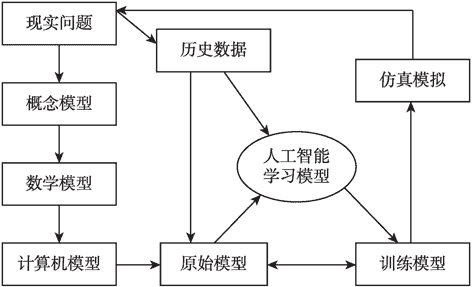

图 1 利用人工智能进行复杂系统建模流程

资料来源：笔者自制。

在建模中，AI主要负责依据历史数据训练与优化微观层面的行为体策略，不断率定系统参数，直至预测精度满足应用要求。关键难点在于专家能否把战略、政策与态势准确转化为可计算的理论模型，这决定结果的准确性与可解释性。该方法便于追溯风险传导路径与演化机理，可全流程检视异常因子，但建模工作量大、复杂度高，且对概念抽象的主观性依赖强，易忽略敏感因子。

#### 2. 大数据风险因子关联性识别法

首先明确研究目标与因变量、自变量数据集，切分训练集与验证集，选择神经网络、支持向量机、随机森林、深度学习等算法进行训练，检验后投入预测。

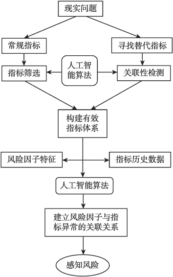

图 2 利用人工智能相关性识别风险建模流程

资料来源：笔者自制。

该路径对数据规模与质量要求极高，无需繁琐建模，可快速发现异常风险点。但结果仍需专家把关，因变量选择多时容易混入噪声干扰信号，且机器学习“黑箱”特性难以解释成因。

AI在其中发挥两方面作用：一是当直接观测指标缺失时，通过关联检测挖掘强相关的替代指标，降低试错成本；二是构建风险因子与指标间的关联网络，提升风险感知与识别能力。国际风险评估本质是对运行规律的认知探索，其复杂性与认知局限始终存在，而大数据与AI的应用将显著拓宽人类认知边界，增强应对危机与时代变迁的能力。

## 三 人工智能在决策管理中的价值

决策管理最大的痛点在于对预期效果的评估，尤其在国际关系中，一国政策变动会产生全球性系统效应。选择何种策略才能获取最大收益？执行过程中需搭配哪些配套措施以避免政策惯性？哪些变量决定成败？在AI出现前，这些问题主要依赖决策者洞见与专家分析，风险高且易错失机遇。借助AI，决策效果评估变得可行且精准，风险得以有效管控。

### （一）已有的应用案例

兰德公司在上世纪80年代研发的ROSIE人工智能系统可模拟国际行为体在战争推演中的战略决策，研究人员亦能借助该系统在战略层面推演核威慑、经济制裁与非对称冲突。新英格兰复杂系统研究所的研究人员已利用AI预测全球性流行病与内战的爆发与传播，帮助决策者规避短期决策失误。[^(\[13\])](#chapter004.html#m13)

# 战略决策仿真：从冷战沙盘到智能决策中枢

八十年代初，兰德研发的战略评估系统 `RAND Strategy Assessment System` 诞生于美苏冷战对抗背景，面向美国-北约与苏联-华约的战略博弈。系统内置全自动战役推演能力，研究人员设计的想定被编译为程序，注入由知识规则驱动的对抗性智能体进行推演，用模型化决策替代真实参战方大幅加快了仿真节奏。该系统并行运行两类决策模型[^(\[14\])](#chapter004.html#m14)：作战指挥层模型与国家政治领导层模型，后者为其核心创新。通过构建美苏等国高层政治行为模型，可研判政治态势、界定国家目标与战略取向、形成全球层面的战事指导准则，并应用于威慑、战争升级控制等议题研究。

步入21世纪，战略演习常态化催生演示型实验室集群，例如美国国防大学战略仿真中心、约翰·霍普金斯大学战争分析实验室等。桑迪亚国家实验室的 `ASPEN` 基础设施网络仿真分析系统及其升级版 `ASPEN-EE` 能够模拟经济运行，用于量化恐怖分子袭击美国能源设施带来的经济损害。普渡大学国土安全研究所开发的 `SEAS` 综合分析与仿真环境，可支撑战略级训练与综合演练的社会层仿真平台，其 `SEAS-VIS` 虚拟国际系统已覆盖62国，并在市、省、国、区域、全球等多尺度下刻画民众、组织与领导者在政治、军事、经济、社会、信息、基础设施等维度的行为表现。

人工智能在战略决策仿真中发挥双重功能：一是敏捷感知外部环境变动，风险评估即是典型场景；二是策略的自学习与优化。当前AI正迎来新一轮加速期，其对战略决策仿真模拟的推动效应将愈加突出。

### （二）方法体系和架构

主流决策管理体系通常由环境感知、案例库、策略优选、效果评估四模块构成。有效策略管理的先决条件是准确捕捉行动主体外部环境的特征并相对客观地衡量风险机遇，据此明确决策方向以把握机遇规避风险。方案制定离不开历史经验积累，系统必须拥有充裕的决策案例资源，借助人工智能的分类与关联方法从中筛选出多组备选方案，形成贴合当前环境的方案集合。决策流程中最具难度的是优选环节，人工智能算法能够代替繁琐的非线性运算，为人类决策者提供选型支持。具体而言，将筛选后的方案集合导入策略实验平台开展仿真，利用学习算法以策略优化函数为基准反复比选，最终由效果评估模块裁定并锁定最优策略。理论层面的闭环至此完成。真正可用的决策必须经受现实检验，理论最优方案形成后，还需依据落地成效进行回溯评价。若实际表现不佳，则需回头修正方案、筛选规则与优化函数并持续迭代。（见图3）

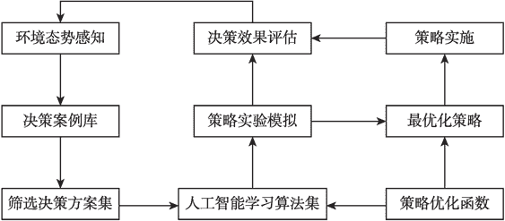

图3 利用人工智能辅助决策管理的流程

### （三）未来发展方向和前景

AI的持续迭代将不断抬升决策管理的整体水位。

其一，方案匹配精度提升。自然语言处理等技术的突破将显著提高从案例库中检索匹配方案的准确性，高速精准的快速决策将成为可能。

其二，方案智能化增强。随着仿真技术与AI融合加深，仿真实验对现实的贴近度将进一步提升，由管理系统输出的方案将更具自适应性，决策逻辑也将更贴近人类思维方式。

其三，效果评估精度提升。评估精度直接决定决策质量，方案更贴合实际问题时，实施成效也将明显改善。

其四，应用范围持续拓展。人工智能推动社会迈向智能化，智能化决策管理将渗透智慧城市、商业战略管理、量化交易、社会智慧治理、物联网调度、交通电力等大型基础设施的统筹调度、社会舆情管控、智能化军事战略乃至外交决策等诸多领域，引领社会运行与管理进入新阶段。

* * *

# 人工智能治理困境：体制复合体视角

## 透过体制复合体看AI全球治理的推进路径

鲁传颖 〔美〕约翰·马勒里

**摘要：**体制复合体理论同时包含多利益攸关方治理与多边治理两种逻辑，对网络空间等复杂全球议题具有较强解释力，对人工智能的全球治理同样适用。多方治理与多边治理可分别对应AI治理的不同议题类型。例如算法偏见、伦理争议、就业影响、数据安全等更契合多方治理模式，而与全球经济、安全、政治关联紧密的议题更适合多边治理。多种治理模式的叠加可构建起覆盖标准、规范、规则、机制等多层次多领域的AI全球治理体系。

**关键词：**人工智能 算法歧视 体制复合体 多利益攸关方

人工智能是指运用数字计算机或受其控制的机器模拟、延伸和扩展人类智能，通过感知环境、获取知识并利用知识追求最优结果的理论、方法、技术与应用体系。[^(\[3\])](#chapter005.html#m3)作为通用型技术，AI正在推动人类从信息化迈向智能化，其全球治理的重要性不亚于技术进展本身。AI跨学科、跨领域、跨议题的特性给治理研究带来挑战，可借鉴体制复合体 `Regime Complex` 理论进行分析。该理论源于体制理论 `Regime Theory` 对复杂全球治理问题的延伸。网络空间治理等新兴议题涉及面广、行动主体多元、内涵复杂，单一体制难以单独应对。[^(\[4\])](#chapter005.html#m4)类比网络空间治理，AI全球治理的目标是针对不同议题构建标准、规范、规则、条约、法律等层级的治理机制，由松散耦合的机制网络形成体制复合体。[^(\[5\])](#chapter005.html#m5)

### 一 体制复合体理论与人工智能全球治理

传统全球治理多由国际政治、安全、经济主导。约瑟夫·奈指出，体制复合体的鲜明特质在于兼顾政治、安全、经济与技术逻辑，将技术社群置于同等重要位置。从这一视角看，AI全球治理已在政府、国际组织、技术社群、私营部门之间展开，并在伦理、算法、就业、数字安全等领域形成一系列标准、规范与规则。

#### （一）人工智能全球治理的现状

自AI成为学科以来，治理讨论从未中断，其重点随发展阶段而变。学理上可划分为弱人工智能 `ANI`、类人工智能 `AGI`、强人工智能 `ASI` 三个阶段，对应机器智能水平的递进。当前发展仍处弱人工智能阶段，即机器可在特定领域超越人类，但缺少完全自主意识，只能在预设环境中运行，难以应对全新情境并自主产生新能力。[^(\[6\])](#chapter005.html#m6)

因技术复杂性，治理讨论多建立在技术认知之上。早期讨论带有强烈伦理色彩，跳过弱AI与类AI阶段，直接聚焦强AI带来的“机器是否会控制或伤害人类”，陷入长期空谈。[^(\[7\])](#chapter005.html#m7)随着三阶段划分明确及对弱AI特征的厘清，以建立规范、规则、机制为导向的全球治理开始成形，并对技术发展与应用产生实质影响。[^(\[8\])](#chapter005.html#m8)

治理实践已在多领域展开。技术社群是最活跃的主体，已形成多个机制。如以2017年初“受益的人工智能”会议为起点形成的“阿西洛马人工智能原则”，由AI开发者与公民组织共同参与，归纳出研究议题、伦理与价值、长期议题三大类23条规则，核心在于强调人控机器、价值导向，如公平、隐私、人权。[^(\[9\])](#chapter005.html#m9)电气与电子工程师协会 `IEEE` 提出全球倡议，要求自主与智能系统设计者优先考量伦理，并发布《人工智能设计伦理准则》，提出人权、福祉、问责、透明、审慎五大原则，同时成立 `IEEEP7000` 标准工作组及伦理、透明、算法、隐私等十大工作组。[^(\[10\])](#chapter005.html#m10)微软、美国信息技术产业理事会、经合组织、斯坦福大学、美国标准研究院等机构也相继发布治理报告。

联合国系统高度关注治理机制建设。国际电信联盟 `ITU` 于2017年6月在日内瓦举办“AI造福人类”峰会，提出AI发展应契合联合国可持续发展目标，用于减贫、健康、医疗、教育等17项目标的推进。[^(\[11\])](#chapter005.html#m11)联合国毒品和犯罪问题办公室在荷兰海牙设立首个联合国人工智能与机器人中心，致力于提升认知、教育与协调，应对AI与机器人带来的犯罪安全风险。[^(\[12\])](#chapter005.html#m12)各国政府也在积极行动，自2015年起，美国、中国、法国、欧盟等主要国家与区域组织相继出台国家战略。美国发布《为人工智能的未来做好准备》并设立AI委员会，英国发布《人工智能：机遇与未来决策的应用》等，均在全球治理议题上表明立场。

#### （二）从网络空间全球治理到人工智能全球治理

在网络空间治理中，体制复合体主要通过多利益攸关方模式构建技术领域机制，通过多边模式建设技术应用衍生的安全、政治、经济机制。AI同样具有跨学科性与多元议题，为体制复合体分析提供基础。首先，技术层面，AI基于计算机与互联网并融合统计学、脑科学、系统辨识、优化理论、神经网络等学科，具有跨学科、跨领域、多主体特征。其次，AI全球治理议题多层级、跨领域，其通用性与颠覆性使应用兼具全球广度与深度。体制复合体将技术逻辑提升至与政治、经济、安全并重，呼应网络空间“代码即法律”的独特性。AI治理既需考量技术本身，也需考量应用对国际体系的影响，如算法伦理的普适性、发展不均衡带来的数字鸿沟、以及对国际经济、安全、政治秩序的冲击。[^(\[13\])](#chapter005.html#m13)

再者，参与主体可划分为技术社群、私营部门、政府。以 `IEEE` 为代表的技术社群在标准制定与规范形成中发挥关键作用。私营部门是规则约束对象，参与积极性高，微软、谷歌、百度等拥有大量人才与创新能力，传统行业也在加入治理进程。政府既是战略与政策制定者、监管者，也是国防、安全等战略技术领域的直接参与者，同时承担条约与国际规则制定的责任。[^(\[14\])](#chapter005.html#m14)AI治理必须由多国多主体共同推动。

最后，实践层面，AI全球治理与网络空间治理具有相似性。数据安全议题上，两者均面临个人信息与国家安全问题。技术社群在互联网治理中发挥关键作用，如 `ICANN` 在关键资源治理、`IETF` 在技术标准制定上的主导。在AI领域，以 `IEEE` 为代表的技术社群在标准与规范制定中同样关键。联合国在互联网治理中设立信息安全政府专家组，在AI领域设立致命性自主武器系统政府专家组 `GGE`，体现国际组织在规则制定上的延续性。[^(\[15\])](#chapter005.html#m15)

AI 治理进入多元博弈时代

整体来看，AI 规则制定正迅速成为国际治理中最活跃的赛道。不同行动方各自依托资源与优势切入规则场域，逐步形成类似网络空间制度复合体的生态图景。联合国、国际电信联盟等政府间平台，以及电气和电子工程师协会等非政府间组织，都在尝试凝聚多元声音，争取成为未来国际规则的引领阵地；微软、谷歌等产业头部企业则提前布局，通过联盟筹建、研究资助等路径参与规则塑造；研究机构与民间团体则密集推动跨界研讨，摸清各方诉求，并在平台设计与标准形成中扩大影响力。

## 二 多方共治视角下的 AI 全球治理
制度复合体框架把 AI 全球治理拆解为两层议题并存的局面。其一是技术 `safety` 层面的议题集群。核心矛盾在人机伦理关系上，即机器会否取代、操控或伤害人类，机器如何遵循既有的道德价值体系。[^(\[16\])](#chapter005.html#m16)具体议题涉及伦理、算法、失业、数据防护等，牵动技术共同体、私营部门与政府等不同主体。其二是体系 `security` 层面的议题集群，关注大规模应用是否制造新的不公，例如可持续发展与数字差距扩大等[^(\[17\])](#chapter005.html#m17)，以及对既有国际经济、安全与政治秩序的冲击等[^(\[18\])](#chapter005.html#m18)。

从治理模式看，复合体框架包含多元利益相关方模式与多边模式 `Multi-lateral`。在技术 `safety` 层面，多元利益相关方模式更具适配性，强调机制开放、运行自下而上，凸显技术共同体的集体身份，不设参与门槛，超越国别与利益的限制。[^(\[19\])](#chapter005.html#m19)该框架的基本假设是议题属性决定治理方式与规范基础。伦理、算法、失业、数据防护等技术 `safety` 议题更偏向技术逻辑，因而以技术共同体为代表的社会组织与企业成为主要建构者，目标是将伦理与价值考量嵌入算法与代码，通过全球协作形成行为规范。

### （一）AI 伦理边界如何划定
伦理治理要确保机器不取代、不控制、不伤害人类，并遵循既有道德价值体系。典型实践包括由电气和电子工程师协会主导制定的《人工智能设计的伦理准则》，以及技术共同体与产业共同发起的“阿西洛马人工智能原则”倡议。二者均采纳多元利益相关方路径，坚持开放透明与自下而上，参与门槛低，参与规模均超过千人。所有建议均公开征询意见，并设置多轮反馈循环，以保证意见被审慎对待。目前两项机制的发展中国家参与度偏低，但随着中国、印度等国的重视，南方国家的声音正逐步显现。

IEEE 制订伦理准则的重要理论支撑是“代码治理”。该视角认为程序即规则，编写代码即立法，对参与者提出极高要求。具备代码编写能力的跨领域专家与政府人员有限，技术共同体因此成为代码治理的核心力量。IEEE 面向 AI 工程师与科学家提出《人工智能设计的伦理准则》第 2 版，并设立 10 个标准工作组。其中 `IEEEP7000^(TM)` 处理系统设计中伦理建模流程、`IEEEP7007^(TM)` 涉及伦理驱动机器人与自动化系统本体标准、`IEEEP7008^(TM)` 涉及机器人、智能与自主系统中的伦理驱动助推标准、`IEEEP7010^(TM)` 涉及合乎伦理的 AI 与自主系统福祉度量标准，上述四组均聚焦伦理相关议题。标准制定依据人权、福祉、问责、透明、审慎五大总原则来评估各指标是否达标。[^(\[20\])](#chapter005.html#m20)IEEE 聚集大量 AI 工程师与科学家，通过工作组将理念转化为行业标准，一旦形成将对产业发展及各国后续政策立法产生深远影响。“阿西洛马人工智能原则”提出的 23 条原则中，多条回应人机关系。例如从使命看强调 AI 发展需造福人类而非脱离人类控制；从价值看强调系统应与人类价值一致、接受人类控制、不颠覆社会秩序。[^(\[21\])](#chapter005.html#m21)

### （二）算法偏见的四种样态
算法在数学与计算机科学中指具有明确步骤序列的计算方法，常用于计算、数据处理 `Data Processing` 与自动推理。算法在 AI 中扮演类大脑结构角色，其演进也催生了算法歧视问题。算法偏见冲击公平平等价值，尤其在性别、种族、年龄、职业、国籍等维度；随着自主决策系统在金融、法律、安全、就业、教育、消费等领域深化，歧视对公众生活的干扰日益扩大。[^(\[22\])](#chapter005.html#m22)

算法歧视大致可归为四类。情形一为滥用型歧视，如对不同消费者的价格歧视。情形二为价值缺失型歧视，如平台依据用户的社交圈评估信用，朋友富裕者评分高于朋友贫困者。情形三为数据质量缺陷型歧视，常见于样本不完善时，自动标签系统 `Auto-tagging System` 无法正确识别属性。情形四为人机互动型歧视，在有监督机器学习中，模型需大量与用户互动以完善，一旦用户输入错误价值观，决策也会被带偏。

算法偏见既有开发者为经济收益主动植入的情况，也有“黑箱”不可知导致的情况。“与传统机器学习不同，深度学习并不遵循数据输入、特征提取、特征学习、逻辑推理、预测的过程，而是由计算机直接从事物的原始特征出发，自动学习和生成高级的认知结果。在人工智能输入的数据和其输出的答案之间，存在着我们无法洞悉的‘隐层’，它被称为‘黑箱’ `black box` 。”[^(\[23\])](#chapter005.html#m23)不少专家认为黑箱难以根除，人类难以完全理解机器逻辑；也有专家认为可通过算法优化干预。无论是改进算法本身还是在决策后由人类纠偏，算法歧视都将是 AI 全球治理的核心议题。

应对需政府、技术共同体、企业共同建制。Matthew Joseph 等人在论文《罗尔斯式的公平之于机器学习》 `Rawlsian Fairness for Machine Learning` 中基于罗尔斯的“公平的机会平等” `Fair Equality of Opportunity` 理论，引入“歧视指数” `Discrimination Index` 概念，提出设计公平算法的方法。[^(\[24\])](#chapter005.html#m24)在加州大学伯克利分校发布的《人工智能的系统挑战：一个伯克利的观点》 `A Berkeley View of Systems Challenges for AI` 中，该关联被称作“反事实问题”测试。以贷款被拒为例，系统必须回答“如果我不是女性，是否就能获批”，“如果我不是小企业主，是否就能获批”。“因而数据使用者有义务建构出一套具有交互诊断分析能力的系统，通过检视输入数据和重现执行过程，来化解人们的质疑。”[^(\[25\])](#chapter005.html#m25)

算法偏见兼具伦理与公共政策属性，需要更多监督机制。社群、企业与政府都在推动规范化进程。IEEE《人工智能设计的伦理准则》中的五大原则，以及谷歌提出的“机会平等”，都可作为应对歧视的参照。但解决并非一蹴而就，需针对不同领域与情境构建相应机制。

### （三）就业冲击与社会韧性
AI 作为通用技术，对就业市场的扰动是根本且全局性的。AI 引发的失业已不是单一国家政策议题，而是上升为全球协同议题，需要社会组织与企业更积极介入。过去依赖高学历高智力的岗位也面临替代风险，如新闻、司法、医疗、科研、金融领域已出现应用。从信息化向智能化跃迁是移动互联网、大数据、智能制造、云计算、物联网等新一代技术与产业协同推进的结果，因而失业一旦出现可能突发并引发连锁效应。[^(\[26\])](#chapter005.html#m26)全球视野下，各国抗风险能力差异明显，在同等失业危机面前，技术领先的发达经济体拥有更多资源应对，而在发展中经济体可能诱发动荡，滑向失败国家轨道。

因此，以多元协同模式建立涵盖政府、社会组织与企业的参与机制应对 AI 引发的失业是必要且有效的。需关注的治理要点包括如何应对智能化时代多行业同步的岗位替代、如何快速创造新岗位、如何降低冲击对社会的负面影响，以及如何提升社会与家庭的抗冲击韧性 `resilience`，失业后仍能维持基本生活。各方还可与政府一道加强职业培训、继续教育与终身学习，建立就业与再就业培训体系。[^(\[27\])](#chapter005.html#m27)在此背景下，更应发挥技术共同体与企业作用，构建规范与机制，探索最佳实践；对新技术与新场景可能引发的全球失业风险进行动态评估与预警；对集中应用可能带来的连锁失业反应进行评估；甚至可设立专门处理失业问题的国际组织与非政府组织，帮助各国政府更好应对。

### （四）数据防护的隐私与国家安全张力
数据是 AI 时代的“石油”与驱动力。算法依赖数据，场景开发与应用也依赖大数据。AI 时代的数据防护主要涉及隐私与国家安全两个维度。隐私本身是基本人权，各国法律均对公民隐私保护作出明确规定，个人信息泄露会损害个人生活、工作、经济与安全。从国家安全看，大数据关乎金融、经济风险与国防安全，一旦被恶意利用将造成重大损失。

数据防护不仅是 AI 的挑战，任何企业使用个人信息或关键基础设施产生的重要信息时都面临同样问题。数据防护是政府关注焦点，属于各国公共政策范畴。欧盟出台《通用数据保护条例》，中国亦制定个人信息保护规范并开展立法。各国强化个人信息保护的连带效应是数据跨境受限。各国基本以隐私保护与国家安全为由限制数据出境，企业跨境传输需满足当地规定或达成双边规则，如美欧隐私盾协议、欧盟白名单制度。AI 与数据防护交汇时，欧盟要求将敏感数据排除在自动化决策之外，依据《通用数据保护条例》第 9（1）条，“敏感数据”指种族、政治倾向、宗教信仰、工会成员、性生活、性取向，或可唯一识别自然人的基因数据、生物数据。因其泄露、篡改或不当利用会损害个人，欧盟一律禁止自动化处理，即使当事人同意亦不允许，除非有明确法律规定。[^(\[28\])](#chapter005.html#m28)

在伦理、算法、就业、数据防护等议题上，以技术共同体为主导的多元协同模式正发挥标准与规范制定作用，对克服发展中的伦理、歧视、失业与数据防护问题产生重要影响。同时该模式亦有不足。特别是技术共同体专家多来自西方，易先入为主带入特定价值，例如反复强调“人权”“言论自由”，而忽视发展中国家更关心的能力建设与发展议题。因此，伦理层面的规制应在互联网治理的多元协同框架基础上，更关注平等参与与公平参与，拿出实质政策鼓励发展中国家参与，并平等吸纳其主张。

## 三 主权驱动的多边治理路径
制度复合体框架的另一模式是主权国家视角下的多边治理。AI 已展现推动经济范式转变、生产方式改变与社会结构重塑的强动能，并将逐步对现行国际体系产生深层影响。在国际体系层面，AI 全球规制更多涉及国家行动者，更适用以主权国家为主体的多边机制，强调各国平等与有区别责任，联合国等政府间国际组织是规则制定主平台。目标是通过国际机制、国际法应对 AI 对经济、安全、政治领域造成的冲击，规范国家行为，推动各国政府积极参与全球事务。主要议题包括 AI 是否进一步拉大数字差距，加剧发展不平衡，导致技术落后国家被挤出全球经济体系；AI 在军事领域的应用，尤其是致命性自主武器的使用是否冲击国际安全；大国主导的规则博弈是否冲击主权国家平等参与的国际政治秩序等。

### （一）AI 重塑经济版图与应对思路
AI 对技术、人才、资源的极高需求决定其发展将在不同国家间制造新的数字差距，进一步拉大经济竞争力差距，影响国际经济体系稳定。AI 对传统产业的替代将在全球范围内造成大量失业，先发国家与技术强国可借助 AI 收益弥补传统产业损失，并通过转移支付与社会保障巩固来维稳与推动进步。对未能跟上本轮浪潮的国家而言，就业会外迁，国内产业会被更先进的外资接管，最终导致政府缺乏足够资源应对经济社会冲击，成为潜在动荡根源。

上述趋势将进一步推动世界经济体系变革。沃勒斯坦认为当前世界经济体系呈中心-半边缘-边缘结构，发达国家居于中心，发展中国家与不发达国家依靠廉价土地、资源与人力居于半边缘与边缘，并形成对中心的依附关系。[^(\[29\])](#chapter005.html#m29)AI 可能加剧此不平等。从工业化、信息化到智能化的路径看，技术与人才集中度不断提升，发展中国家处境愈发不利。发达国家借助 AI 在经济领域的应用减少了对发展中国家劳动密集型产业与自然资源的需求，从而将发展中国家排除在全球产业链与供应链之外，使其地位更边缘化，并可能滑落体系之外。极端情况下，AI 发展可能改变全球产业分工格局，世界经济仅剩中心而无边缘。体系变革的后果可能是 AI 推动的全球经济重塑，可能产生一批新的失败国家，这些国家将沦为战争、疾病、暴恐、宗教极端势力的温床，对国际体系构成极大挑战。

多边治理强调国际社会与各国政府责任，加强 AI 全球规制应关注新型数字差距，解决发展不平衡；并积极利用 AI 实现联合国可持续发展目标，解决当前国际社会面临的各类发展问题；从产业与公共政策创新角度探索有效国际合作机制，通过多方努力避免 AI 对国际经济体系的冲击。[^(\[30\])](#chapter005.html#m30)

其一，通过强化议程设置提升发展中国家对 AI 发展的认知，并提供必要公共资源帮助其制定发展战略，从而构建全球均衡发展的人工智能体系，同时提高国际社会关注度。[^(\[31\])](#chapter005.html#m31)AI 技术与应用不断突破，但目前只有发达国家与部分新兴大国在积极跟踪并出台战略、政策举措。大多数国家尚未意识到 AI 带来的机遇与挑战。联合国、二十国集团、亚太经合组织等全球性与区域性国际组织应高度关注 AI 发展，强调其对各国经济社会的正面作用，引导发展中国家与不发达国家关注 AI 发展与应用，并结合国情制定规划。

其二，为发展中国家 AI 发展提供必要资源。发展中国家在技术、政策、法律人才方面匮乏，且缺乏公共资源支持，难以仅凭自身培养人才、发展相关技术与产业。国际社会应通过多种形式提供资源，加大对发展中国家 AI 人才培养力度，提供必要技术与设备，帮助其更好跟上全球趋势。[^(\[32\])](#chapter005.html#m32)国际电信联盟、世界银行等联合国机构可尝试设立 AI 专项援助，帮助发展中国家获取经验、培养人才。

其三，发挥 AI 在应对全球性挑战中的作用，在解决贫困、减少疾病传播、降低灾害影响等方面发挥积极作用。国际电信联盟召开的“人工智能造福人类”峰会就是通过 AI 更好地达成 2030 年可持续发展目标的尝试。[^(\[33\])](#chapter005.html#m33)AI 可在精确分析致贫原因、提供针对性脱贫方案上发挥重要作用。AI 还可用于流行疾病暴发趋势、传播特征分析，并在全球与地区层面预防和阻断传染性疾病传播。谷歌、IBM、推特均推出基于 AI 预测流感等流行病的系统，为各国医疗卫生组织应对疾病暴发提供帮助。[^(\[34\])](#chapter005.html#m34)AI 在防灾救灾领域已开始发挥作用。例如，通过 AI 的信息整合处理，可依据气象、灾害信息，结合地理、建筑物、人员分布状况，以最快速度评估灾害、生成灾害地图，并协助政府与救援人员快速有效救援。

### （四）共建全球 AI 创新协作平台

# 让AI发展更均衡的三项共识

要让人工智能在全球范围内真正均衡发展，离不开数据开放、人才互通与经验共享三条主线。一是共建AI数据开放平台。模型训练和场景落地都高度依赖大数据，尤其是面向具体应用的数据供给更为关键。掌握多元数据的国际组织和各国政府，应积极推进数据开放，为技术创新提供基础支撑。二是促进AI人才全球自由流动。人员交流是推动技术和应用普及的重要动能。各国需要在政策层面优化落户与引进机制，为人才跨国流动创造更友好的环境。三是加快最佳实践的国际分享。AI的技术演进与应用挑战都具有全球性，社会各方应更主动、更快地在国际层面交流AI造福社会的经验做法。[ ^(\[35\])](#chapter005.html#m35)

### （二）AI军事化应用与治理挑战

人工智能进入军事领域至少带来三重风险：致命性自主武器系统的安全与责任归属；武器使用改变战争形态后带来的使用门槛降低、成本下降、伤亡变化所引发的国际法与国际安全冲击；以及由此诱发的军备竞赛。国际社会亟需尽快形成共识规范与国际法，遏制过度研发、管控扩散、提高使用门槛，避免滥用冲击国际安全秩序。[ ^(\[36\])](#chapter005.html#m36)

致命性自主武器系统是指能够自主感知环境、独立决策并直接或间接造成人员伤亡的系统。全自主型系统可自行识别目标、判定武力等级并在特定时空执行打击；半自主或全自主范畴还包括杀伤性地雷、反舰雷达、精确制导弹药、鱼雷、巡航导弹、反卫星武器、无人机、无人机群及网络“蠕虫”等。这类武器在研发与使用上面临诸多安全难题。2012年美国国防部发布第3000.09号指令，对武器自主权作出探索，要求半自主和全自主系统设计必须保留指挥官与作战人员的适当人工判断。为此需要严格的设计、测试、评估与操作验证，兼顾解决系统故障的安全工程与防范人为失误的认知工程。授权、指挥或操作自动化与半自主武器的人，必须遵守战争法、相关条约、武器安全规则及交战规则。[ ^(\[37\])](#chapter005.html#m37)

以致命性自主武器为代表的AI应用还在重塑战场。机器逐步替代人员上阵，战场对军人的要求发生变化，伤亡因自动化而可能下降，精确打击提升了作战效能却也降低了战争成本。战争的内涵随之被改写，例如携带武器的无人机穿越他国领空，究竟应定性为侵略还是侦察。类似网络进攻被定义为低烈度冲突而非网络战争，致命性自主武器的使用进一步降低武力使用门槛，易刺激更多国家跟进研发与部署，加剧军备竞赛与扩散。

专家组内部对军备竞赛问题存在明显分歧。技术相对薄弱的国家主张全面禁止致命性自主武器研发与使用；技术领先国家则认为研发可减少人员伤亡，有助于反恐和国家安全，且相关系统已在实战中运用。军事历来是技术进步的重要推手，AI发展背后也受到强有力的军事驱动。完全禁止并不现实，军备竞赛也不利技术福祉，武器扩散后果更严重。因此在联合国层面建立规范，推动大国就致命性自主武器达成军控协议已成当务之急。[ ^(\[38\])](#chapter005.html#m38)[ ^(\[39\])](#chapter005.html#m39)

联合国在经历2014、2015年两次非正式磋商后，于2016年12月16日在《特定常规武器公约》框架下设立致命性自主武器系统问题政府专家组，由印度担任主席。其任务是研判新兴技术、评估对国际和平与安全的影响并提出治理建议。[ ^(\[40\])](#chapter005.html#m40)政府专家组应针对使用门槛降低、非预期伤害、失控升级等风险制定法律与规范，治理框架需清晰明确且能随技术快速迭代而保持相关性。即便武器操作本身合法，也应补足国际法未覆盖的情形并最大限度减少平民伤亡。

无论是武器本身的安全性、战争形态的改变还是军备竞赛，最终都将冲击国际安全体系。在AI条件下，低烈度冲突是否常态化、大国能否克制动武冲动、武器扩散是否催生新的地区动荡与恐怖袭击，都是全球治理必须回应的问题。军事领域的AI应用本质上是技术强国在谋求战略优势与维护安全稳定之间的权衡。需以技术可控、安全可靠、操作守则规范、国内外法律配套等构建完整治理体系，避免大国间军备竞赛。以联合国专家组为代表的机制是近期的积极进展，各国政府还应持续发力，推动军事AI治理，维护国际安全稳定。

### （三）AI对国际政治秩序的冲击

以主权平等为基石、以联合国宪章为法理、以联合国权威为依托的国际政治秩序，是在经济与安全体系不均衡不平等的情况下维系整体稳定的支柱。进入人工智能时代，这一秩序面临三重挑战。第一，支撑国际政治的经济与安全体系失衡将进一步加剧，变革加速，使现行政治框架难以适应新的经济安全需求，带来新的变革压力，稳定性受挑战。第二，AI、网络安全等新兴治理议题对联合国机构的专业能力与资源提出更高要求，联合国需更主动发声、彰显在AI领域的领导力，避免治理陷入僵局。第三，发达国家以各种理由削弱联合国合法性与权威，拉帮结派，形成小圈子联盟，导致国际社会在治理议题上分裂。[ ^(\[41\])](#chapter005.html#m41)

AI全球治理应从网络安全治理的教训中吸取经验，避免重蹈阵营对抗覆辙。网络安全领域，发达国家常绕开联合国，以“观念一致国家联盟”之名制定规则，造成国际分裂、拖慢治理进程，并削弱联合国权威，对国际政治体系构成挑战。如第五届信息安全政府专家组因多数国家不支持美西方关于网络空间军事化的提案而未达成共识后，美国即以盟友为主体推动小圈子规则。长此以往，现有国际政治体系将被削弱，发达与发展中国家分化为对立阵营，经济安全不平等进一步加剧，体系不稳定。

应对挑战需多方协作。发达国家与新兴大国作为主要受益者，应承担相应责任：在经济上加大对发展中国家AI领域的投入，帮助提升能力；在军事AI研发与使用上保持克制，尤其在负面影响未充分评估前审慎使用致命性自主武器，防止扩散；在政治上尊重主权平等，维护联合国合法性。发展中国家亦应积极作为，抓住发展机遇配置资源参与全球治理。沙特阿拉伯设立人工智能部、强化政府在创新与投资中的职能即为一例。[ ^(\[42\])](#chapter005.html#m42)发展中国家可借鉴国际已有成功经验与最佳实践，在国际援助与自身努力下实现AI发展与治理的平衡，更好维护和平、发展与稳定。

从体制复合体视角看，AI全球治理涵盖技术安全与体系安全两个层面，涉及伦理、算法、就业、数据安全以及国际经济、安全、政治等议题，已通过多利益攸关方与多方参与两种模式形成IEEE《人工智能设计伦理准则》、国际电信联盟“人工智能造福人类”、阿西洛马人工智能原则、联合国致命性自主武器系统政府专家组等机制。信息社会世界峰会、互联网治理论坛、世界经济论坛等网络空间治理平台也在将AI纳入议程。两种模式各有侧重：多利益攸关方模式效率更高但公平性不足，多方参与模式更重平等但约束机制复杂、效能受限。AI全球治理仍处早期，却关乎人类价值观念与国际秩序，需依托体制复合体理论构建标准、规范、政策与法律体系，推动良性发展，降低对社会价值与国际体系稳定的负面冲击。

AI重塑网络安全规则

刘杨钺 王智勇

**摘要：**AI 正逐渐成为左右网安走向的核心动因。相关技术在数据抓取、智能研判、自动处置等环节持续攻坚，对网络空间的互动方式带来深远改变。本文聚焦智能算法在网安领域的落地形态、AI 对攻防博弈的改造逻辑、智能时代的网络威慑思路，梳理技术进步带来的新挑战与新风险，并提出辩证看待其影响的思考框架。

**关键词：**人工智能 网络安全 网络空间威慑

AI 的概念诞生于 1956 年美国达特茅斯会议，历经六十余年演进，已成为当下最受瞩目的颠覆性方向之一。在网络空间，AI 的快速渗透让安全态势充满新的不确定性。技术在关键信息提取、自动化决策、快速响应等方面优势明显，与网络安全天然绑定。美国消费者技术协会 2019 年 4 月发布的全球 AI 应用调研显示，在众多应用场景里，网安使用频次排名第一，用于入侵检测与防护的程序中，搭载 AI 的产品占比达 44%。[^(\[2\])](#chapter006.html#m2)随着应用不断加深，AI 对安全各环节的影响会持续扩散。

网安的本质是让网络系统长期稳定可靠运行，能够持续对外提供可用服务。软硬件与各类数据在物理与网络空间均得到保护，避免未授权的篡改、删除、泄露、破坏等行为。系统需具备保密性、完整性、可用性、可控性、可审查性等基本属性。[^(\[3\])](#chapter006.html#m3)伴随互联网发展而来的网络安全，其边界日益模糊，威胁形态不断泛化，与 AI 的交集愈发紧密。AI 的核心是能以类人方式思考和行动的程序。[^(\[4\])](#chapter006.html#m4)网安本身即是攻防双方的博弈，智能化安全技术正把机器学习、深度学习、专家系统、自然语言处理、模式识别等能力嵌入博弈全流程。

AI 与网络信息技术的结合有其内在必然性。在漏洞挖掘、流量监测、入侵检测、恶意代码识别、智能防火墙等场景里，AI 展现出明显优势。比如以前序漏洞数据训练自学习模型，可提升挖掘精度；通过自动监测恶意程序的底层包数量、包头信息、调用序列、CPU 占用等关键特征，能把恶意请求与正常请求区分开；基于 AI 的入侵检测系统可减少人工投入、简化流程、降低未知风险，提升对异常入侵的自动化判定能力。[^(\[5\])](#chapter006.html#m5)相较传统依赖人工提特征、硬编码定义的做法，AI 以数据训练、特征提取、分类判断、自动响应等模式对传统手段进行增强，二者配合完成安全任务。[^(\[6\])](#chapter006.html#m6)

## 一 算法成为智能时代网安的核心支点

算法是一组解决问题的步骤，用系统方法描述策略机制的核心，通过构建抽象模型并明确求解目标来完成设计。[^(\[7\])](#chapter006.html#m7)高效的 AI 算法与海量数据、强算力共同构成优秀 AI 技术的基础。能被广泛接受的自学习方法，是让各类场景应用更贴近现实的关键。目前主流发展方向是以深度学习为代表的算法精进，追求更快速、更精确的计算结果。在网络安全领域全面铺开时，高性能算法是让安全人员从容应对智能时代难题的支撑。

军事层面，AI 应用是实现智能决策、指挥协同的关键，也是智能化建设的高点。算法主要体现在战场信息获取、战况预测、任务执行、装备性能提升等指令代码层面，在各底层设计中扮演注入“战争技术生命力”的角色。[^(\[8\])](#chapter006.html#m8)网络防务的智能化很大程度上依赖算法保障。控制与频谱分配的干扰协调算法可在复杂电磁环境下实现频谱自主调度，提升频谱网络管理能力；无人机群借助蜂群算法规划航迹、规避碰撞、协同作战，提升网络承载能力；军事应急响应系统的底层免疫算法借鉴人体免疫原理，实现入侵快速检测与实时决策。智能化建设提速后，算法在网络安全中的军事价值愈发凸显，但其特有属性与潜在风险同样不容忽视。

现代战争中 AI 贯穿陆海空天电各域，覆盖战略到战役战术各层，通过各类网络互联。只有保证各环节算法不受内外干扰、持续高效运行，才能支撑智能应用在实战中发挥预期功能。选错函数或模型偏差时，算法面对新数据集可能产生偏离预期的输出，导致严重后果。对抗样本攻击可使算法误判漏判，达到“混淆视听”的目的。军用装备、训练平台、传感网络等系统在设计时并非 AI 原生产品，当前智能化多为功能叠加。单兵系统组网后，其内部算法控制体系往往成为首要攻击目标。“震网”病毒对离心机系统的破坏，反映出工业控制系统中原有算法在面对可自适应调整行为的新型算法时的无力。[^(\[9\])](#chapter006.html#m9)

平战之外的真实大数据难以获取，军事防火墙等应用在训练数据匮乏时难以充分发挥效能。战场环境复杂多变，模型与训练场景的相关性难以持续，内部易出现漏洞。功能与漏洞的悖论是 AI 算法固有特性，所需的大量输入源和运行环境都可能被利用，实现欺骗或降级。

此外，算法的“黑盒”属性与军事要求的透明性存在冲突。开发者有时也无法完整解释行为依据，不利于决策者开展细致风险分析。随着搭载 AI 的实体遍布战场，算法运行常在指挥员未注意时发生。类似蜂窝服务、智能设备那样，算法功能无需手动开关，失效时人们才猛然意识到依赖程度。在快速技术变革带来的多维安全环境下，军事网络中 AI 算法的持续稳定运行仍面临诸多未知考验。[^(\[10\])](#chapter006.html#m10)

正如霍金曾担忧 AI 崛起可能终结人类文明一样，算法也可能为智能化战争埋下始料未及的难题。[^(\[11\])](#chapter006.html#m11)

民用场景里，AI 算法覆盖面更广、层次更深。腾讯自主研发的 `TRP-AI` 反病毒引擎基于神经网络，破解了传统查杀中人工环节多、分析能力跟不上病毒增长的困局。支持向量机通过邮件词汇提取、数据处理、降维归一并确定向量值，实现垃圾邮件分类拦截。态势感知中常存在不完整或噪声数据，贝叶斯算法可对数据进行降噪、提纯、过滤。结合域名生成算法的恶意 `URL` 检测模型，能学习静态数据与动态数据，判断恶意 URL 检出率。[^(\[12\])](#chapter006.html#m12)算法贯穿防火墙、垃圾邮件拦截、入侵检测、恶意网站识别等环节，作用关键。

但网络空间的开放双向性也使算法成为薄弱环节。黑客利用高性能算法提升恶意脚本编写效率。检测系统内部逻辑一旦泄露，攻击者可通过实时对抗样本实现自动规避。2017 年 3 月一篇关于基于 GAN 的黑盒攻击恶意软件对抗样本生成的论文首次提出利用生成对抗网络产生对抗样本。[^(\[13\])](#chapter006.html#m13)仅 5 个月后，EndGame 黑客服务公司就发布基于 GAN 的入侵程序，使约 20% 的攻击绕过安全检测。基于神经网络的智能僵尸网络已成为 DDoS 攻击的常用手段。[^(\[14\])](#chapter006.html#m14)通过外部 API 可对模型进行逆向攻击，反向获取训练数据，打开个人数据泄露的新通道。AI 推荐功能也可能被用于社会工程学攻击，通过精准画像投放钓鱼诈骗等恶意信息，对网络风险和意识形态安全构成隐蔽威胁。[^(\[15\])](#chapter006.html#m15)

总体看，算法在网络安全中的收益与风险呈螺旋式动态演进。高性能算法对维护安全、稳定社会作用明显，但技术漏洞与恶意应用的负面问题亟需关注。如何辩证看待算法矛盾并建立平衡，是未来迫切课题。

## 二 AI 正把攻防对抗推向智能化

网络攻防是安全人员与黑客在网络空间的博弈角力，AI 已成为其中核心技术手段。全球网络在信息传递与共享中高度互联，为 AI 提供了广阔舞台。IDC 2017 年预测，人工智能及分支市场规模 2020 年将超 470 亿美元。[^(\[16\])](#chapter006.html#m16)MarketsandMarkets 2018 年《人工智能安全市场》报告预计，2025 年 AI 在安全市场的规模将以 31.38% 的年复合增长率达到 348.1 亿美元。但 AI 应用的增多也让网络空间互动的可预测性与可控性下降。

### （一）AI 如何重塑网络态势感知

网络渗透日常生活后，攻击趋向更难发现、范围更广、破坏更强。习近平总书记在 2016 年 4 月 19 日网络安全和信息化工作座谈会上指出，要全天候全方位感知网络安全态势，增强防御和威慑能力。[^(\[17\])](#chapter006.html#m17)提升态势感知能力已成为保障安全、维护生态的重要任务。传统感知分析方法在大数据环境下难以满足需求，AI 可在海量事件中提前感知攻击并采取防护。

新型态势感知理念是融合数据挖掘、智能分析、流程自动化、专家系统、可视化等技术，构建实时呈现安全状态与潜在风险的系统，为风险预警和安全基线提供依据。难点在于从海量信息中提取特征并进行内涵理解与预测。AI 模式识别的运行逻辑与此高度契合，有助于感知能力大幅提升。全天候无死角汇聚分析态势数据，已成为最受认可的发展方向。

AI重写赛博攻防与威慑逻辑

2012年9月，美军国防高级研究计划署挂牌“X计划”，以人工智能等新技术为抓手，为全球网络空间绘制实时态势图，意图实现即时感知并为网络军事行动提供决策支撑。2016年，美网络战司令部在“网络卫士”“网络夺旗”演练中检验成果，情报采集、异常预警、攻击探查溯源、效能评估预测等环节均有突出表现。系统可自动生成作战态势图，对方案做定性定量评判，操作人员借助图形化界面直观把握战场态势，从而展开任务规划。人工智能同时被用于虚拟网络战场的构建，帮助挖掘新领域的作战潜力。该计划的阶段性进展在一定程度上推动美军高层形成共识，加速了隶属国防部的网络战司令部建设进程。[^(\[18\])](#chapter006.html#m18)

AI驱动的态势感知前景广阔。2018年5月，中国电子科技集团与腾讯联合对外发布“网络社会安全风险态势系统”战略合作，旨在应对数字化社会面临的多重安全挑战。腾讯提供人工智能技术与底座平台，助力公共治理与智慧城市建设。系统汇聚海量安全事件信息、安全云库、网址图谱及评估分析等先验数据，借助模式识别、机器学习、专家系统搭建智能分析决策模型，最终在全国范围内呈现可视化热点图，直观反映整体风险水平与实时潜在风险数量。地图界面能精准标注风险事件类别、流量规模、地域分布，经分类关联分析后形成各地网络安全指数，后续评估体系还可执行风险预警与地区风险排序。

行业内部同样显现明显推动。腾讯“灵鲲大数据金融安全平台”在2018年国际大数据产业博览会上斩获领先科技成果“黑科技”奖。平台构建的多层级智能决策架构，对非法集资、赌博洗钱、金融诈骗等严重刑事犯罪的识别覆盖率超过九成。依托大数据处理、海量监控、数据挖掘、模式识别与特征提取搭建的腾讯反传销态势感知系统，短期内即配合公安高效破获多起网络传销案件。顺丰科技结合计算机视觉、地理信息系统与云计算推出“慧眼神瞳”，为物流多元场景提供支撑。系统基于实时变化的物流数据生成智慧物流地图，借助人工智能分析决策能力对订单生成、货物出仓、中转分拣、运输规划、末端配送全链路实施实时调度，有效解决降本增效、寻优路径、缩短滞留、降低破损等关键问题，显著提升时效与服务质量，使物流实现“有迹可循”，推动行业智能化转型。安恒信息技术股份有限公司开发的明鉴网络空间态势感知监测预警通报管理系统，总结过往攻防经验并结合信息安全等级保护标准，面向政府、公安及企事业单位提供感知方案。系统调用覆盖全国的域名库、信息库、病毒特征库、异常行为库等基础资源，对门户网站、内部系统、信息基础设施实施实时监控与分析。通过安全状态视图形成全方位全要素的直观展示，协助监管部门与安全人员开展预警通报、应急处置及综合管理工作。2016年，安恒在全国两会、G20杭州峰会等重大活动的网络安保及全国网络安全建设中发挥重要作用，其信息态势感知团队获公安部颁发的2016年度网络安全管理优秀团队奖。人工智能安全产品已在多个领域落地，对构建和平、安全、开放、合作的网络空间具有关键意义。

### （二）人工智能与网络攻击
网络空间本质是各类计算机技术运行的产物，其虚拟特质使攻击方在攻防博弈中天然占优。为摆脱时空限制，互联网底层架构偏向开放。技术本身具有两面性，技术组合带来的“短板效应”导致攻防不对称，助长以攻击为目的的新技术滥用，安全环境持续复杂化。[^(\[19\])](#chapter006.html#m19)

借助人工智能，恶意软件生成周期被明显压缩。早期恶意代码多靠手工编写，攻击者先写脚本生成病毒，再以Rootkit等程序作外壳执行。基于神经网络的检测系统易受梯度对抗样本攻击，导致后续检测出现错误与遗漏。[^(\[20\])](#chapter006.html#m20)攻击者熟悉神经网络内部结构，利用其以梯度下降最小化损失函数的特性，对实际输入做少量改动即可误导判别。理想状态下，仅修改脚本末尾不足1%的特定字节，便有极大概率逃避检测。

2016年美国黑帽安全大会上，ZeroFox数据科学家提出设想：以用户近期发布的社交生活信息为训练集，用时间递归神经网络学习实施鱼叉式钓鱼攻击。[^(\[21\])](#chapter006.html#m21)2017年，McAfee预测机器学习将被黑客广泛用于构建钓鱼邮件。攻击者通过智能分析受骗信息筛选易感目标，结合语音识别、语音转换、自然语言处理与时间递归神经网络模仿邮件写作风格，使钓鱼邮件更难分辨真伪。

同年黑帽大会上，研究人员对比多种机器学习算法在语义图像验证码破解中的表现。效果最佳的RCN算法在像素分析与轮廓匹配方面尤为突出，在谷歌、雅虎等网站文本验证码测试中准确率达90%，在标准reCAPTCHA测试中破解率达2/3，在机器人验证系统测试中概率超50%。[^(\[22\])](#chapter006.html#m22)

随着信息技术与人工智能普及，攻击范围随边界扩张而放大。攻击方式呈现智能化、个性化、规模化新特征，不断冲击攻防平衡，严峻的智能化攻击态势倒逼防御体系转型。

### （三）人工智能与网络防御
世界经济论坛《2018年全球风险报告》显示，过去五年大型企业日均遭攻击次数由68次升至130次，商业入侵事件翻倍。2016年全球企业累计承受攻击超40亿次，窃取账号密码的新型恶意脚本与木马高达3.57亿种，与2014、2015年数据总和相当。数字安全风险位居全球风险榜第三，网络依赖性跃升为未来十年影响风险格局的第二大关键因素。[^(\[23\])](#chapter006.html#m23)面对层出不穷的智能化攻击，提升防御能力迫在眉睫。在从被动转向主动防御的大趋势下，构建AI驱动的智能防御体系成为维护攻防平衡的必然方向。防御中人工智能应用遵循感知—识别检测—自主辅助决策—应对抵抗的自治逻辑，在复杂多变环境中发挥关键作用。

数据井喷提升了安全人员的甄别负担，人工智能可大幅提升自动化水平，把分析人员从低级重复工作中解放出来，提升成本效益。智能安全分析引擎通过关联、聚合、分类、标记等处理，协助在动态环境下分析数据行为与动因，并对照机器学习建立的安全基线，实现精准定性定量锁定。腾讯冰鉴引擎依托自主音频文字转换、图像语义识别、关键信息提取技术，对短视频与直播平台的色情、血腥恐怖内容审核准确率达99%。[^(\[24\])](#chapter006.html#m24)迁移学习对及时发现并遏制突发事件也有助益。

面对多样化攻击，安全人员需在多种应对措施中抉择。人工智能对历史攻击记录与既有安全策略进行分析，形成机器安全智慧，可高效应对已知威胁。遭遇新型入侵时，规则产生式专家系统能把相关记录写入数据库并制定新策略。2016年，麻省理工学院研究人员与PatternEx企业推出AI2安全平台，AI2扮演虚拟安全分析员角色，将检测结果提交人工判断，再把有争议的判断与旧模型融合生成新检测标准。该迭代方式显著降低误报率，优化决策效率。[^(\[25\])](#chapter006.html#m25)

人工智能的自主优化能力可在黄金响应时间内实现快速应急。当攻击导致财产损失或服务中断时，及时反应至关重要。人工智能虚拟代理技术可训练具备类人思维与行为特征的智能安全管家，在人工介入前阻止系统失控。例如支付宝内部的智能风控引擎，利用算法对用户进行全天候电子支付风险监控。基于每位用户的历史支付记录构建风险特征模型，对比日常行为发现异常，及时止损大额资金风险。[^(\[26\])](#chapter006.html#m26)

总体看，人工智能对攻防的影响具有双向性。它为数字安全注入活力，但在攻击与防御两端同时显现。唯有正视人工智能自身脆弱性带来的安全风险，才能维系网络空间攻防平衡与稳定格局。[^(\[27\])](#chapter006.html#m27)

## 三 人工智能对网络威慑的影响
传统威慑理论源于冷战，最早由耶鲁大学国际政治学教授伯纳德·布罗迪等人在1946年《绝对武器：原子能与世界秩序》中提出。[^(\[28\])](#chapter006.html#m28)作为核时代大国博弈的战略框架，其核心是让对手忌惮发动攻击会招致无法承受的报复或得不到预期收益。美苏争霸时期对核武器的管控与使用是典型案例，威慑在其他安全领域的研究至今热度不减。[^(\[29\])](#chapter006.html#m29)然而与核领域作用显著不同，威慑理论在网络空间的适用性仍存争议。

学界对网络威慑适用场景缺乏清晰共识，其与传统核威慑的前提存在明显背离。[^(\[30\])](#chapter006.html#m30)核武器生产可控，而网络武器由恶意代码、定向脚本、病毒木马构成，使用门槛低、攻击泛化。网络行为体包括国家、企业、组织、个人，多为非完全理性主体，不对称行为频发。网络隐蔽性延误报复时机，阻碍归因；攻击的非对称与不可控易波及第三方，导致失控。由此网络威慑的实际效能有限，是否适用仍需实践检验。

支持者认为，在特定条件满足时网络威慑可行且有意义。通过强化防御、拒绝威慑信号、释放报复信号、坚定执行报复，可抬高攻击者的预期成本。需要明确的是，网络威慑不等同于绝对威慑，阻止所有行动者、所有规模攻击并不现实。

当潜在攻击涉及战略目标且严重性极高时，对等威慑更具依据。这类攻击通常由特定国家或国家组织策划，可在一定程度上缩小源头范围，缓解归因难题。如“震网”病毒对伊朗核设施的攻击兼具政治军事意图，其所需情报、技术、渗透能力已将嫌疑范围收窄至特定国家行为体。若威慑目标为民族国家发起的战略性网络攻击，归因溯源并非主要障碍。

综合这些争议与条件，人工智能对网络威慑的影响仍显模糊。一方面人工智能可增强威慑能力。人工智能提供的积极适应性防御手段能显著提升潜在攻击成本，改变网络攻防进攻占优的不对称格局，使入侵者对收益产生疑虑。减少人工监测、加快响应，人工智能驱动的防御系统可精准识别威胁，缩短报复反应时间。人工智能也能在归因上提供帮助，计算机取证技术正改变攻防现状。若匿名性不再成为保护伞，溯源威慑将更可信。另一方面，人工智能也加速网络武器化、军事化，使高端攻击技术逼近传统核威慑的毁灭性水平。[^(\[31\])](#chapter006.html#m31)

反向作用同样突出。首先是对抗性机器学习可混淆检测。随着机器学习防御模型作用增强，攻击者可能通过篡改数据集等方式干扰模型。即使防守方依赖人工智能模型保护系统，对其威慑信心也不宜过度。因为攻击者可能“毒害”模型或寻找其他规避手段。[^(\[32\])](#chapter006.html#m32)牛津大学等机构的研究警告：“基于人工智能的防御系统对预测其使用的攻击者具有很强防御能力，因此受到的关注相对较少。具有讽刺意味的是，由于缺乏关注和其他漏洞，使用机器学习进行网络防御实际上可以扩大攻击面。”[^(\[34\])](#chapter006.html#m34)

其次是行为体与攻击能力联系愈发模糊。战略性国家级影响的网络攻击通常难以由个人或小组织完成，需要大量资源、工具、人才与情报支持。但人工智能与机器学习的发展可通过自动化与自适应程序执行或促进上述准备，大幅提升漏洞挖掘成功率。攻击者可绕过检测、击败反恶意软件防御，甚至根据目标属性重塑攻击。这意味着复杂网络攻击或不再依赖大型组织，单人黑客也可能发动具战略后果的不对称攻击。此种身份-能力脱钩为威慑带来严重问题：已知身份加已知需求条件更难满足；归因更困难，攻击能力不再是可靠指标；人工智能驱动攻击或激增，破坏战略稳定。

最后，人工智能在数字安全领域应用增多将强化数据收集与共享需求，可能催生更紧密的网络政治联盟。机器学习防御分监督学习与无监督学习，均需大量先验数据与广泛分析。为使威慑有效，国家需在信息共享与全球情报网络建设上合作，这将鼓励结盟，加剧网络军事化中的对抗姿态，不利于形成网络安全规范与全球共识。

总体而言，人工智能为数字安全带来风险与收益并存。数字安全是新时代创新应用的核心需求，需高度重视。随着技术成熟与应用普及，人工智能全领域渗透已成必然，对社会体系影响深远。技术革命浪潮中，人工智能与传统行业交织产生复杂化学反应，需基于行业特性趋利避害。在未来十年，人工智能将持续成为发展动力，其本体安全与与网络产业融合地带的安全需求快速增长。目前狭义人工智能仍难以完全替代人类关键决策，人工加智能模式将长期主导安全实践。网络空间的虚拟、开放、共享特性决定了威慑战略的独特优劣；网络威慑可随攻防形势灵活调整强度，呈现软硬结合、威力可控的特点。用于攻防对抗的人工智能技术具有两面性，对网络威慑的影响尚难定论。应建立严格安全管理体系，在发挥优势的同时降低风险，促进人工智能研究者、战略研究者、决策者等多方对话。共同面对的网络安全威慑困境或将成为国际合作前提，为管控网络空间安全、加强共同治理提供方案。[^(\[36\])](#chapter006.html#m36)

* * *

## 参考文献

[\[1\]](#chapter006.html#w1) 刘杨钺，国防科技大学文理学院军事思想与军事历史系主任、副教授、硕士生导师；王智勇，国防科技大学文理学院硕士研究生。

大数据在读懂冲突

董青岭

摘要：冲突预警正进入数据驱动的新阶段。与过去依赖理性人假设和结构化分析的传统路径不同，大数据安全态势感知立足复杂系统的扰动、演化与信息交换，把研究起点从“工具理性人”转向“网络社会人”，用相关性分析来补充甚至修正原有的因果分析，重点追踪网络社会里微观行动者之间的复杂联结与实时信息流动，试图解释个体互动如何塑造宏观政治结构。在这一框架下，预测冲突不必完全依赖理性选择和严格因果链，只要捕捉散落在社会各处的微弱冲突信号并挖掘大数据中的共现规律，就能研判冲突何时会起、烈度如何、会否扩散。总体看，基于态势感知的冲突预测正在动摇传统理论根基，其核心是识别关联共现型的冲突特征模式。

关键词：大数据 态势感知 冲突预测 共现性

社会生活越发软件化、数据化，政治图景正滑向人机协作、数据主导的新常态。过去受制于采集和分析能力，学界主要靠小样本抽样、经典案例、历史体感和有限变量的因果推演来把握世界。借助结构化数据得出的结论多为线性因果，复杂性和不确定性常被排除在外。在此局限下，冲突预测往往只能抓局部而顾不上整体，难以回应现实的政治需求。

与此同时，以群体政治为核心、以结构主义为主线、以小样本归纳为方法、以经典因果律为逻辑的传统预测范式正被质疑。有学者指出，传统研究陷入历史决定论和结构迷思，忽视了宏观结构实质上是微观行动者互动的产物，也忽略了冲突爆发的微观基础和互动过程。一旦忽略利益相关者的卷入与伤害传导，就容易导致信息采集失衡、片面或失真，最终预警失灵。传统方法需要反思与重塑。

大数据及其分析工具的成长，为国际关系中的冲突预测打开了新思路。一方面，社会网络化、数据化、智能化让微观互动留下更多数字足迹，预警能够获得前所未有的信号量；另一方面，追踪采集与分析手段升级，使研究可以触及更即时、更微观的细节，实现动态、连续、非结构化的数据处理。这让学者有机会更近距离地观察微观互动如何影响乃至重塑社会政治结构。正如有观点所言，大数据或将成为重塑现行理论和传统预测方法的历史契机。

### 一 重新审视冲突预测研究中的因果性

在国际关系语境里，冲突预测通常涵盖四类情形的发生、延续、终结及附带损害。第一是战争。按乌普萨拉冲突数据计划的界定，战争指一年内死亡达千人以上的有组织暴力对抗，包含革命战争、民族解放战争和国家间的国际战争，当事人至少一方是国际法承认的主权政府。第二是武装冲突，指一年内死亡25至999人的有组织暴力，常见的是追求自治或独立的武装反叛、推翻现政权的政治暴动。第三是种族屠杀，即系统性、有计划地对特定族群、宗教或民众进行局部或整体灭绝。第四是政治动荡，涵盖以表达政治诉求为目的的骚乱、街头抗议，以及为迫使政府让步而进行的恐怖行动。

总体而言，传统冲突预测是通过政治理论、学说和统计模型，在自变量即冲突因子与因变量即冲突爆发之间建立因果关联，来感知、预警和防范政治系统中的大规模暴力伤害。所谓因果，指一个变量的存在或变化必然导致另一变量出现，二者是必然而非或然的联系。正是在因果认识的支撑下，传统研究更看重寻找必然联系而非偶然相关，核心任务是通过变量控制实验和多重统计技术锁定必然因果，再以必然性推理判断冲突走势。

大数据时代，这一图景正在改变，基于相关性的预测路径逐渐成形。

首先，大数据让学界对“相关性”有了新的认知。相关性指变量变化常伴随其他变量同时或先后变化，但无法确证谁导致谁，很可能两者都是第三个变量的结果。与因果强调必然性不同，相关性关注共现，即现象是否同步或前后伴生。在疾病预测和消费推荐中，相关性分析已取得明显成效，但在冲突预测领域运用尚不充分。围绕“更重视相关还是因果”以及二者关系，学界存在分歧。一种声音认为相关比因果更关键，建立在相关分析上的预测是大数据核心；另一种声音警告放弃因果追求会削弱人类智力优势，是实用主义的迷影；折中观点则认为相关是对因果的派生描述，二者根植于同一逻辑。无论立场如何，这场争论加深了学者对相关性的认识。

（ニ）大数据应用激发了冲突预测研究中有关“因果性”的再反思

基于大数据的冲突预测认为，随着网络化推进，个体决策与行动越来越嵌入广泛的社会网络，原有的“独立理性人”假设正在滑向“网络化社会人”假设。先前看似独立的变量被网络化侵蚀，难以保持独立。一个现象的产生越来越难以归结为某个单一因素或几个互不相干变量的单独作用。在全球互联的互动情境下，冲突的产生与演进不再如传统理论所描绘的那样变量清晰、因果直接且必然。相反，它更像一个复杂的系统演化结果，由诸多意料之外的社会与政治变量相互牵引、共同作用的产物。

在此视角下，传统因果分析假设自变量通常相互独立、互不纠缠，严重低估了真实冲突场景中微观主体间的频繁互动与观测变量间的相互扰动，忽略了原因变量在生成过程中的内在互动，也漠视了全球政治的复杂关联。传统研究把自变量间的耦合简单分为条件变量与核心变量，而非要素聚合与相互影响；把自变量与因变量的时序相继简化为统计显著性，忽略了从要素耦合到结果生成的复杂反应链条，因而难以解释“国家为何敌视”“部族为何仇杀”“恐怖主义为何蔓延”等具体问题。在网络化社会场景中，因忽视变量间的扰动性，传统因果分析日益陷入“预测性危机”。

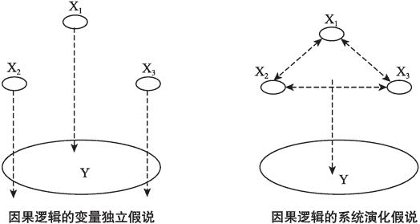

图 1 有关因果逻辑的两种变量关系假说

### （三）大数据的出现和应用或将改变冲突预测研究的前提假设

冲突预判失灵？从因果推演到网络感知

不少学者在追问一个问题：在互联网普及以前，国际政治理论与冲突预判模型对政局变动的解释力还算过得去，为什么进入网络化时代后，现实的挑战却越来越难以应对，未来冲突的走向也难以把握。个中原因指向研究起点的假设偏差。过去的主流研究把世界看成相互隔离、互动稀疏的局面，个人、企业、非政府组织等微观行动者之间接触频率低、联结松散，信息传递既迟钝又容易走样。冲突被想象成在不同议题域彼此不通、群体可以各自闭门决策的环境里，由少数关键因子比如民主化程度、宗教构成、力量对比等单独起作用的结果。因而强调显著性与稳定性的因果推理看起来有效，用寥寥几个自变量就能概括大部分冲突现象。

如今，海量、连续、非结构化的微观记录变得可得且可算，传统理论的可检验范围被大幅拉开。变量间的相互牵动让原先被视作独立的关键因子不再独立，以关键因子决定论为核心的传统框架正遭遇社会复杂演进的冲击。

## 二 网络嵌入型主体假设：从利己理性到关联行为

对因果性的质疑之外，大数据还动摇了冲突研究长期占据主导的利己理性假设。

按该假设，冲突行为被视作结构性压力下理性行动者的选择。行动者被默认为自私且理性的，把冲突当成实现自身利益的手段，进行成本收益的精算。冲突并非情绪宣泄或盲从，而是在特定条件与资源限制下的审慎决策。立足此假设的预判重在寻找诱发冲突的结构性条件，并据此推演行动者追求利益最大化的路径。它擅长评估群体策略与中长期安全态势，却很难说明冲突何时、哪里爆发、会产生何种后果。

在大数据催生的新情境下，研究者提出用联网主体假设取而代之。其要义可归纳为三点。第一，冲突各方并非孤立决策，而是置身于多层嵌套的联结网络中，每个行动者都是信息与资源的节点，通过网络中的传递与流动产生相互学习与相互影响。第二，行动者之间不间断的日常互动是世界政治演化的动力，微观的持续互动塑造了宏观的冲突图景，预判需要从微观到宏观的进路。第三，冲突的扩散蔓延很大程度上取决于关系网络中信息的传播、交换与耦合。正因网络化生活中信息彼此扩散，恐慌、泡沫、动乱才会像传染一样骤然出现并扩散。由此，冲突预判不必完全依赖理性选择与因果链条，捕捉分散各处的冲突信号，用大数据做关联分析同样能够判断冲突是否到来及扩散方向。

联网主体假设预设了一个以信息交换为核心特征的当代网络社会。在此社会里，行动者彼此联结、相互扰动，冲突的产生、维系与结束都会在数据层面留下映射。通过观察这些映射的关联变化，就能在不依赖理性选择与因果前提下感知冲突逼近与强度。换句话说，预判关注的是映射冲突的 N 元特征向量是否出现同步异动。若某种冲突类型对应 N 个数据特征，当前观测到 N-1 个特征向量同步或前后关联变化，就基本可以判断该类冲突正在逼近。同步变化的特征越多，时空节点与强度的判断也越准。可以说冲突总有前兆，临近时必然在数据特征上显出蛛丝马迹。

大数据预判并非否定因果分析，而是要在复杂互动背景下重新理解因果的内涵，并挖掘关联性的价值。因果分析偏重宏观到微观，结构主义与理性选择是其典型特征；关联分析则强调微观到宏观，依托特征向量的共现提取与比对实现预判。

## 三 大数据态势感知的运行机理

从这个角度看，基于大数据的冲突预判更像是对社会生活数据细微变化的即时捕捉、快速处理与高速计算，可以通俗地称为“大数据安全态势感知”。它以联网主体与人际信息交换为前提假设，借助计算机系统或信息手段捕捉社会互动情境中的多重冲突因子，对态势进行预判分析。

与传统结构主义路径相比，它把国家想象成由数以亿计微观主体互动构成的集合，把国际社会看作跨越国界的人际关系网。预判的着力点在于监测微观互动如何影响并塑造宏观结果，捕捉网络社会里主体间的复杂联结与即时信息流动。

这种感知有几个特点。其一，追求与研究对象相关的更多微观连续记录而非间断或典型样本，刻画整体轮廓与微小细节。其二，在传统结构化记录之外纳入非结构化记录，如海量新闻与社交日志，追求多样性与混杂性而非绝对精确。其三，超越传统变量的因果逻辑，探究能够引发变化的数据之间的共现关系。总体上，它建立在变量相互扰动、系统演化与信息交换的基础之上，重点是特征映射、网络化互动与群组变量的共现，而非单一因变量的偶发显现。

在操作假设上，它认为人是高度重视利益保护与风险规避的感性存在，易受人际网络信息流动影响，日常互动频率与方式相对稳定，因而信息传递的内容、速度与方式也相对稳定，行为轨迹与交往内容在常态下具有可循的结构性。但是一旦某地区多数群体的记录在特定时段突然同步异动，就很可能是经济危机、自然灾害、疾病传播、政治骚乱、武装冲突或恐怖袭击等异常事件正在侵扰。

其运行逻辑接近自然科学中的地震预判、医学的并发症研究与声学的信号识别。当地区安全环境恶化，微观主体因身处前沿率先感受到威胁，会采取预防性规避并把危险信息沿网络扩散，进而引发更多人改变日常行为。比如商人另谋出路、投资者抽离资金、旅行者减少出行、留学生提前返国、居民囤货导致食品与医用品价格大幅上涨、物价指数飙升等。在信息分享机制下，数以亿计个体的微观感知会汇成整体图景。观测到多重数据信号同步异动，就能做出与传统因果分析不同的预判，同步特征向量越多，结论越可靠。

具体操作分两步。第一步，多源记录感知、清洗与挖掘，利用不同传感设备与软件从不同来源提取记录并去噪规整。第二步，基于机器学习的冲突模式识别，通过大规模训练发现微观行为与宏观冲突的关联共现关系，再用关联共现概率模型预判冲突类型、规模、烈度与演变。目前常用的有监督学习有支持向量机、贝叶斯网络、决策树、马尔科夫链等，无监督学习包括聚类与模式挖掘。此外，主成分分析、多元线性回归、信息熵等数值方法也常用于度量群组变量的关联共现。

## 四 共现视角看恐怖袭击预判：英国实证

以 2013～2017 年新闻与社交网络记录为对象，以英国恐怖袭击预判为例，可以检验上述思路。

记录主要来自 GDELT 项目与 GTD 项目。GDELT 提供社会关系网络中信息流动的新闻、社交记录及其地理信息，实时滚动；GTD 记录按天与经纬度标记的英国恐怖袭击频次。目标是利用社会网络中前 N 天的信息传递内容与频率，预判第 N+1 天特定地区爆发恐怖袭击的概率。信息内容以 GDELT 的 TONE 值即社会情绪值度量，信息频率以每日涉英政府新闻报道数与社交发帖量加总统计。设计聚焦民众与政府的双向互动，通过言语与行为捕捉冲突信号，再基于关联共现与机器学习进行预判。

记录结构如下，冲突特征向量选择围绕民众与政府互动，分为信号内容与信号频率。信号内容指信息传递的社会情绪值，表征双方政治诉求与不满程度；信号频率包括民众要求、政府不赞成、民众抗议、政府拒绝、民众威胁、政府强制、民众攻击、政府打击等八项，表征互动频度与性质。某种意义上，这是对现实冲突场景的记录模拟：互动起初可能是口头批评，一旦诉求得不到尊重就会升级为肢体冲突。监测双向互动进程与情绪波动即可实现预判目标。

表 1 数据结构：英国恐怖袭击预测（2013 年 4 月 1 日至 2017 年 6 月 30 日）
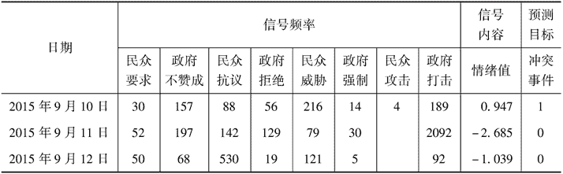
表 1 数据结构：英国恐怖袭击预测（2013 年 4 月 1 日至 2017 年 6 月 30 日）-续表
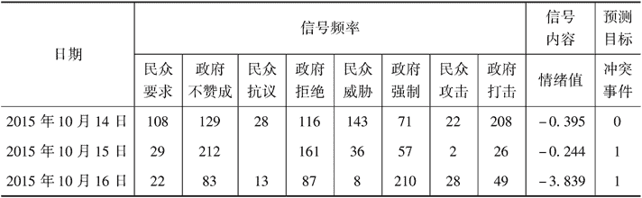

本研究采集 1552 天记录，2013 年 4 月 1 日至 2017 年 6 月 30 日，覆盖 339 次涉英恐怖袭击。分频率统计与机器学习两阶段。第一阶段验证变量有效性并确定最佳观测周期。频率统计显示社会情绪起伏与袭击频次存在相关性。表 2 社会情绪值与英国恐怖袭击频次相关性（2013 年 4 月 1 日至 2017 年 6 月 30 日）
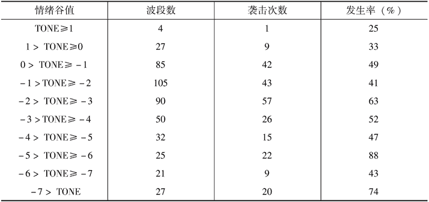
总体上情绪值越低，遭受袭击概率越高；情绪持续低落的周期越长，爆发恐怖主义概率越高，一般不超过 7 天。记录印证多数袭击植根于民众与政府恶性互动，反映诉求无法满足的极端情绪。

表 3 社会情绪衰落周期与英国恐怖袭击频次相关性（2013 年 4 月 1 日至 2017 年 6 月 30 日）
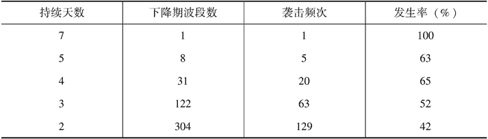

第二阶段为机器学习。选用前 5 天、前 4 天、前 3 天、前 2 天作为观测周期，用单隐层前馈神经网络有监督学习建模，预测神经元统一设为 5。以前 900 天为训练集，后 652 天为测试集，预判第 5+1 天、第 4+1 天、第 3+1 天、第 2+1 天的爆发概率。结果为第 5+1 天 56.4%、第 4+1 天 62.7%、第 3+1 天 71.9%、第 2+1 天 47.8%。表 4 基于前馈神经网络的英国恐怖袭击预测（2013 年 4 月 1 日至 2017 年 6 月 30 日，神经元数量=5）
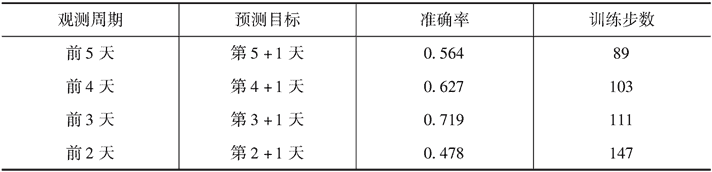
与预期约 80% 相比并不理想，但考虑到恐怖主义是小概率稀有事件、GDELT 与 GTD 记录本身有噪声、预判颗粒度为天等因素，结果仍在可接受范围。特别是第 3+1 天预判，经重新清洗记录后准确率由 66.7% 提升至 71.9%，说明记录噪声影响明显。实证表明，除因果分析外，基于多元变量关联共现的冲突预判是可行路径。

### 结论

基于大数据安全态势感知的冲突预判，本质是着眼关联共现关系的冲突特征模式识别。它假定现实世界是相互联结且彼此扰动的关联世界，每个行动者都是网络化的社会人。难以计数的微观主体持续互动、相互学习与影响，赋予世界演化动力与复杂性与不确定性。即便如此，世界仍可被感知与预判，因为宏观现象由微观互动造就，而微观互动很大程度上表现为信息、物质与能量的交换，在大数据技术条件下这些痕迹可被记录与分析。

总体而言，相较传统因果分析，大数据安全态势感知通过关联共现分析实现了对现实冲突进程的实时监测与即时预判，在一定程度上支持了复杂科学的变量扰动论、系统演化论与信息交换论。传统冲突预判需要直面社会网络化与数据化的现实，不断调整逻辑规则以适应未来挑战。

# AI反恐：能力跃迁、规则重塑与风险暗线

傅瑜 陈定定

**摘要：** 随着恐袭威胁持续抬头与智能技术加速成熟，AI 已在反恐实务中初露身形。实践上，它在压制极端组织的舆论扩散、挖掘与利用反恐情报、提升袭击预判水平以及推动智能化武器研发等方面发挥作用，同时已上升为国家反恐战略要素，重塑了资源整合、行动主体与协作模式，并在法律、伦理与心理层面改变了人类反恐的运行逻辑。另一方面，反恐场景下 AI 的应用在精确度、公正性与价值伦理上仍存明显短板。展望未来，计算机视觉与自然语言处理等方向或迎来质速双升，自主武器研发也将延续，AI 领域极可能成为下阶段反恐力量与极端组织的角逐主战场。

**关键词：**人工智能 深度学习 反恐 系统性影响 潜在风险

自 1956 年达特茅斯会议提出“人工智能”概念以来，学界对其尚未形成完全统一的定式。[^(\[3\])](#chapter008.html#m3)总体来看，界定思路多围绕“像人那样思考与行动”与“理性地思考与行动”两条线索展开。[^(\[4\])](#chapter008.html#m4)鉴于 AI 与智能、计算的紧密关联，本文所指 AI 是指依托计算机算法及前沿技术去研究、构建并模仿人类解题方式的技术手段，涵盖语音识别、视觉感知与决策等。“9·11”之后，恐袭对国家与公民安全的冲击愈发严重，自杀式爆炸等手段频发，投入巨大但成效有限。[^(\[5\])](#chapter008.html#m5)如何借助科技实现高效反恐，成为各国核心诉求。

把 AI 在反恐中的运用纳入 AI 与国际关系的讨论框架，从更宽广视角看则是科技与安全关系的体现。现代 AI 研究可追溯至图灵《计算机器与智能》一文。[^(\[6\])](#chapter008.html#m6)此后很长一段时间研究集中于技术与概念层面，直至 80 年代西方才开始探讨计算机与武器控制、AI 与国土安全等议题。[^(\[7\])](#chapter008.html#m7)进入 21 世纪后大数据、云计算与认知技术的兴起让 AI 研究激增，围绕模型、机器学习及社会影响等议题持续升温。[^(\[8\])](#chapter008.html#m8)国内人文领域早期对 AI 的直接关注较少，多聚焦科技对国际关系的影响，王逸舟、张骥等人的研究曾引发热潮。[^(\[9\])](#chapter008.html#m9)新世纪以来，董青岭等学者对科技与国家安全互动的分析进一步深化。[^(\[10\])](#chapter008.html#m10)

研析 AI 在反恐行动中的运用、影响与风险，既有助于提升反恐效能，也是对科技安全这一重大命题的探索，对维护未来全球安全具有重要意义。受限于资料可得性与保密要求，本文仍有不足，期待后续研究补强。

## 一 反恐AI的技术底座

21 世纪以来大数据、高性能芯片与深度算法共同推动 AI 实现跨越式进步，特别是在自然语言处理、机器视觉与智能决策方面的突破，为 AI 反恐应用奠定了基础。

### （一）数据与算力的扩张提升了信息处理规模

进入本世纪后，亚马逊、谷歌、雅虎、推特、脸书等平台积累了海量用户数据。预计到 2020 年，全球数据总量将达 40 万亿 G，较 2011 年增长约 21 倍。[^(\[11\])](#chapter008.html#m11)数据背后规律的挖掘为 AI 与智能决策提供了素材，也为机器学习提供了训练库。围绕神经网络的新型高性能计算芯片与架构层出不穷。英特尔处理器从以 CPU 为主转向 GPU 为主、CPU 为辅后，运算速度提升近 70 倍。[^(\[12\])](#chapter008.html#m12)谷歌定制的 TPU、Altera 与 IBM 采用的 FPGA，分别在分析预判效率与灵活性上各具优势。[^(\[13\])](#chapter008.html#m13)这些算力进展为 AI 解析恐怖主义相关信息提供了硬件前提。

### （二）深度算法增强了语音与图像识别效能

深度学习能够处理非结构化数据，通过多隐层神经网络模拟人脑神经元的层级传递，在海量数据训练下大幅提升表征学习能力。借助并行计算平台训练，“谷歌大脑”语音识别准确率从 2012 年的 84% 提升至 2014 年的 98%。[^(\[14\])](#chapter008.html#m14)基于深度神经网络，脸书团队打造的深度人脸识别系统“Deep Face”以 400 万张用户上传图像训练，将人脸识别精度推至 97%。[^(\[15\])](#chapter008.html#m16)汤晓鸥主导的“Deep ID”模型在卷积神经网络基础上实现 99.15% 的识别率。[^(\[16\])](#chapter008.html#m17)2016 年 9 月，谷歌 DeepMind 利用深度神经网络对原始音频波形建模，推出 WaveNet，带来图像与语音识别的又一波跃进。[^(\[17\])](#chapter008.html#m18)

### （三）武器领域的进展催生自主化趋势

武器自主化本质是把环境数据转化为目的性计划与行动。从技术层面看，自主武器研发依赖图像与语音识别、反射控制系统、 deliberative 控制系统及行动指令等。[^(\[18\])](#chapter008.html#m19)反射控制系统包含简单反射与基于模型的反射。自然语言处理与计算机视觉的成熟从速度与精度上提升了武器获取外部信息的能力。大数据驱动的算法训练推动智能决策演进，蒙特卡洛决策树与深度神经网络结合造就了 AlphaGo 在棋类对局中的表现。自 主武器需要明确的运行程序、规则与目标，必须在大量模型上训练。每一次训练均需人工设定模型时，复杂环境下难以建模便会制约发展。[^(\[19\])](#chapter008.html#m20)得益于算力与深度学习的进步，机器可在训练数据基础上自主学习，以经验提升知识水平，而非完全依赖人工定义的有限模型。

总体而言，AI 在数据处理、语言理解、视觉感知与深度学习方面正走向更高效阶段，为今后反恐应用提供更坚实支撑。

## 二 AI 在反恐实务中的初步落地

计算机视觉、自然语言处理与智能决策的快速发展，为 AI 在反恐中的现实运用创造条件。总体看，利用持续进化的 AI 技术，可在遏制极端组织信息扩散、解读反恐情报、预防袭击发生等方面发挥更大作用。

### （一）借助 AI 遏制极端组织的信息扩散

通过推特、脸书、YouTube、Instagram 等社交平台招募潜在支持者，已成为“伊斯兰国”等极端组织扩张影响力的重要路径。仅 2014 年 9 月至 12 月，“伊斯兰国”支持者就使用约 46000 个推特账号。[^(\[20\])](#chapter008.html#m21)恐怖组织善于利用推特宣扬“圣战”，对个人号、机构号乃至整张社交网络进行内容操控。[^(\[21\])](#chapter008.html#m22)支持者点赞转发，使极端意识形态从核心账号向更广传播网络渗透。此外，恐怖内容多以视频为主，相较文字更难管控。

随着深度学习算法完善，AI 在视频、语音与图像识别上的能力持续增强，已能实质参与反恐行动。AI 可通过图像匹配技术拦截此前已被标记为恐怖宣传的图片或视频上传。[^(\[22\])](#chapter008.html#m23)系统将用户上传内容与已知恐怖信息库比对，决定是否拒绝上传。[^(\[23\])](#chapter008.html#m24)脸书、微软、推特与 YouTube 已携手共建欧盟互联网论坛及共享行业数据库，借助机器学习开发与部署新的内容检测与分类技术，并统一删除标准。[^(\[24\])](#chapter008.html#m25)YouTube 的“重定向方法”已部分实现对社交媒体极端宣传的智能定位与清除，并在用户搜索相关内容时进行干预。[^(\[25\])](#chapter008.html#m26)依托 AI 算法工具，仅 2017 年上半年推特就削减近 30 万个恐怖分子账号，清除效率提升约 20%。[^(\[26\])](#chapter008.html#m27)AI 也帮助脸书删除了 99% 的“基地”组织与“伊斯兰国”材料。[^(\[27\])](#chapter008.html#m28)随着技术持续演进，社交媒体对恐怖信息的管控能力将进一步加强。

### （二）依托 AI 提升反恐情报的开发利用效能

机器翻译与图像、语音识别的进步使现有反恐情报的高效开发成为可能。现代技术推动了情报量的急剧攀升，无人机平台及其全景视频传感器收集了海量资料。[^(\[28\])](#chapter008.html#m29)受人力限制，这些设备采集的视频过去多未及时解析。[^(\[29\])](#chapter008.html#m30)

芯片性能提升后，AI 的高速处理能力可将低层计算活动完全自动化，从而释放数据价值。例如，AI 在语言识别上的优势可减少培养新语言学家的周期，大幅提高处理速度与准确率。通过深度算法，AI 还能抓取恐怖组织成员及其支持者的文字与图像。早在 2013 年，美国国土安全部就将深度学习应用于“生物特征识别视觉监控系统”BOSS，通过摄像头扫描人群并自动定位目标。[^(\[30\])](#chapter008.html#m31)2017 年 4 月，美国国防部启动“算法战跨职能小组”AWCFT，旨在将海量国防数据快速转化为情报价值。[^(\[31\])](#chapter008.html#m32)该小组目前正利用 AI 解析 MQ-9 与 MQ-19 无人机平台的全运动视频传感器数据，首批 4 套智能算法已进入测试。[^(\[32\])](#chapter008.html#m33)

### （三）运用 AI 预测与防范恐怖袭击

AI 系统能够基于既有袭击案例库、各国政府数据库与社交媒体数据，对潜在嫌疑人与行为进行预测，从而在必要时实施防范与监控，并在高风险地点做好应急准备。目前马里兰大学构建的全球恐怖主义数据库收录近 17 万起袭击案例。随着 AI 逐步分担人力，以大数据为基础的恐怖行为分析与预测将显著增强。

AI反恐图谱：从行为推演到自主作战

大数据与机器学习正被用来回溯并复原极端组织的行动逻辑。[^(\[34\])](#chapter008.html#m34) 2015年，安德鲁·斯坦顿团队整理出超过2200起与“伊斯兰国”有关的交火记录，通过挖掘这些事件，厘清了该组织车载简易爆炸装置的使用与伊拉克军方行动、联军空袭、组织自制简易爆炸装置之间的关联，并归纳出间接打击、自杀式袭击、抓捕行动的出现规律。基于行为研判，研究人员锁定了恐怖组织的优先打击目标，并揭示了此前未被注意的战术关联。[^(\[35\])](#chapter008.html#m35)

在个体层面，预测性应用也在推进。以色列公司Faception以人格画像为切入点，利用算法对个体在若干分类维度上的契合度进行评分，试图找出未被官方记录却存在袭击可能的人。截至2016年，该公司已搭建15个分类库，其首席执行官表示人格识别的准确率可达80%。[^(\[36\])](#chapter008.html#m36) 面部分析同样被用于筛查。2015年11月巴黎袭击涉案的11人中，仅3人有案底，而Faception的面部分析在无档案条件下，能把其中9人标记为高风险。[^(\[37\])](#chapter008.html#m37)

### （四）自主武器研发与部署的进展

按人在任务中的干预程度，自主系统可分为遥控、半自主与全自主三类。现阶段整体水平有限，主要集中在遥控与半自主阶段。

无人平台是研发与实战的典型代表。随着智能化推进，超过70个国家的军队都在发展无人化平台。截至2017年，美军在编无人机数量超过7000架，在伊拉克与阿富汗战场投入的履带式机器人超过12000台。[^(\[38\])](#chapter008.html#m38) 俄罗斯测试了“巨蜥-9”“索拉特尼克”“平台-M”等多种无人地面车辆。[^(\[39\])](#chapter008.html#m39) “扫描鹰”“灰鹰MQ-1C”“MQ-9收割机”在全球打击“伊斯兰国”的行动中发挥了重要作用。[^(\[40\])](#chapter008.html#m40) 俄罗斯联邦安全局在国内行动中动用反恐机器人，已清除11名恐怖分子。[^(\[41\])](#chapter008.html#m41)

AI的进展推动各国加大自主系统投入。辛辛那提大学研发的ALPHA系统击败前美国空军上校吉恩·李，促使美国加大对自主系统、无人机与深度学习的投入。[^(\[42\])](#chapter008.html#m42) 美国海军陆战队的持枪机器人、以色列的“DOGO”自动武装战术机器人，都在尝试借助AI实现部分自主。[^(\[43\])](#chapter008.html#m43) 俄罗斯的“涅列赫塔”机器人将无人战车与AI结合，在侦察、运输和地面掩护方面表现良好。2018年3月，俄罗斯宣布战斗机器人最早当年内实现批量生产。[^(\[44\])](#chapter008.html#m44) 全自主的实现需要机器具备独立知识积累与专家级推理，这依赖机器学习与智能决策的进一步突破。[^(\[45\])](#chapter008.html#m45)

在研制层面已有成果。俄罗斯联合仪表制造公司的Unikum机器人能在控制全程中剔除人工干预。[^(\[46\])](#chapter008.html#m46) 三星的机器人哨兵SGR-A1内置摄像头、热成像与运动传感器，可自主探测入侵者并进行发射。[^(\[47\])](#chapter008.html#m47)

## 三 AI 对反恐生态的系统性重塑

AI不仅提升了具体手段的效率，更在整体层面重塑了对抗恐怖主义的生态。各国普遍将其提升到战略高度，其介入推动了资源整合、改变了行动主体、强化了国际协作，同时在法律、伦理与心理层面带来深层冲击。

### （一）AI 已写入多国反恐战略蓝图

21世纪以来，技术在安全领域的作用凸显，AI逐步渗入反恐各环节，并影响顶层设计。

中国把AI发展作为基本国策，多次在战略层面强调其在维护社会安全中的价值。《新一代人工智能发展规划》《促进新一代人工智能产业发展三年行动计划（2018—2020年）》《人工智能标准化白皮书》等文件均突出利用AI提升公共安全保障能力。[^(\[48\])](#chapter008.html#m48) 将现代信息技术与维稳工作有机融合，深化大数据与AI等新技术的应用，提高信息化智能化水平，已成为有关部门的指导原则。[^(\[49\])](#chapter008.html#m49)

作为美国国防部Third Offset Strategy的核心逻辑，美方早在2007年就把AI列为反恐所需核心技术之一。[^(\[50\])](#chapter008.html#m50) 2016年发布的《为人工智能的未来做好准备》和《国家人工智能研究与发展战略规划》明确把AI列为国家战略重点，建议在国际人道主义框架下推进自动与半自动武器的发展。[^(\[51\])](#chapter008.html#m51) 美国陆军部把机器学习、传感器与控制系统、人机交互列为最值得关注的科技趋势。[^(\[52\])](#chapter008.html#m52) 目前美方愈加重视AI，将加大对自主系统、AI与机器学习的投入视为防范与打击恐袭的重要路径。[^(\[53\])](#chapter008.html#m53)

日本与俄罗斯的重视也在提升。2016年，日本内阁召开“人工智能技术战略会议”，把AI发展纳入《第五期科学技术基本计划》和《科学技术创新综合战略 2016》，强调其对国家工业与军事的意义，并视作提升国家竞争力的手段。[^(\[54\])](#chapter008.html#m54) 俄罗斯外交与国防政策委员会认为AI是维护主权与保持国防能力的关键。[^(\[55\])](#chapter008.html#m55)

### （二）传统反恐规则正被悄然改写

AI进入国家顶层设计后，反恐资源的整合方式、行动主体构成与合作形态均出现微妙变化。

第一，资源融合与共享加速。美国国防部内部繁复的职位设置与分工曾制约反恐行动协同效率。AI反恐涉及多部门联动，一定程度上促进了国防资源的整合。2017年4月启动的“算法战跨职能小组”把联合参谋部、国防部顾问办公室、国防部分管情报副部长等单位聚合，在组织层面实现内部资源整合。[^(\[56\])](#chapter008.html#m56) 同时AI也推动职能机构间的重组与专业化。2018年3月，美国国会建议成立“国家人工智能安全委员会”，设立专门部门主管AI建设，审视军事应用AI与机器学习的风险，推动技术发展并回应国家安全需求。[^(\[57\])](#chapter008.html#m57)

第二，行动主体多元化。在国家安全部门主导下，科技企业正逐步成为反恐行动的重要参与者，政企合作成为新方向。美国政府已开展“深绿”计划，并推进AI自适应无线电、人机协作等以AI为核心的反恐项目。[^(\[58\])](#chapter008.html#m59) 越来越多科技公司被纳入国防体系。美国AI公司Palantir开发的技术曾被用于追捕“基地”组织头目本·拉登。[^(\[60\])](#chapter008.html#m60) “算法战跨职能小组”也整合了机器学习、自动化、计算机视觉算法等领域的国防情报企业资源。

第三，国际协作形态变化。AI助力下，国家间情报共享有望进一步深化，反恐情报可能从技术领先地区向技术薄弱地区流动。智能武器也可能成为国际合作的重点。沙特因“彩虹-4”无人机在反恐任务中的表现，于2017年确定引进中国无人机生产线。[^(\[61\])](#chapter008.html#m61) 埃及也从中国引进“翼龙”侦察打击一体化无人机以提升作战能力。[^(\[62\])](#chapter008.html#m62) 凭借引进便捷、打击高效、成本较低的优势，未来更多面临恐怖威胁但军事力量相对薄弱的国家或地区可能选择采购智能武器。

### （三）法律、道德与心理的连锁反应

智能武器的合规性目前仍有争议，国际社会尚未形成统一规范。1983年生效的《特定常规武器公约》禁止或限制使用具有过分伤害力或滥杀滥伤作用的常规武器，1977年《日内瓦四公约第一附加议定书》禁止附带损害平民生命与财产的攻击。实践中，自主武器行动易造成平民伤亡。巴基斯坦“基本权利基金会”主席沙赫扎德·阿克巴尔表示，过去12年里，至少3000名巴基斯坦平民死于美国无人机空袭，其中至少有200名儿童。[^(\[63\])](#chapter008.html#m63) 联合国《全球反恐战略》强调，打击恐怖主义必须尊重人权与法治，各国措施需符合人权法、难民法与国际人道法。[^(\[64\])](#chapter008.html#m64) 从效果看，滥杀行为本身会削弱法律与道德基础。

人类使用常规武器受自由意志与道德责任约束，而自动武器按预设程序判断，既无责任主体，也不会产生道德反思。这种缺乏约束的杀戮冲击着公众对反恐行动的心理认知。美籍俄裔作家艾萨克·阿西莫夫提出的机器人伦理三大准则，主张机器不得伤害人类或坐视人类受害，以强制性道德准则约束AI行为。[^(\[66\])](#chapter008.html#m66) 然而一旦AI具备自主性或自我意识，就难以被机器人准则或人类法律束缚，道德要求难以落地。

当前，AI的直接行动者尚未成为法律与伦理主体，无法为行为负责。联合国教科文组织与欧盟等主张由人类代理人，即制造商、运营者、所有者或使用者承担责任，并要求机器行为全程可监管。[^(\[67\])](#chapter008.html#m67) 但这一倡议多适用于弱AI阶段。从技术思路看，规范机器人行为大致有两条路径：自上而下预设可操作的伦理准则，自下而上通过模拟人类情景学习使机器形成类似价值观。[^(\[68\])](#chapter008.html#m68) 目前两者都难以成熟实现。

## 四 AI 参与反恐的潜在风险

作为高速发展的技术，AI尚不成熟，其在反恐领域的应用必然伴随风险。

第一，可控性不足。反恐应用要求AI稳定可靠，但人类尚未完全掌控AI体系及相关设施，失控风险存在。已出现失控案例：脸书两款聊天程序Alice与Bob使用研究人员无法解读的交流方式；亚马逊的Alexa曾发出令人不安的笑声。[^(\[69\])](#chapter008.html#m69) 英国巴斯大学的编程团队表示，即便是设计者，仅凭观察也难以破译自家机器人的行为。[^(\[70\])](#chapter008.html#m70) 这意味着反恐场景中可能出现误删信息、误判平民为恐怖分子等失误，涉及自主武器时失控将导致重大伤亡。

第二，预测准确性与公平性存疑。半岛电视台记者艾哈迈德·穆法克·扎伊丹在工作中与恐怖组织有接触，美国政府的“天网”项目据其社交网络分析将其列为“基地”组织及“穆斯林兄弟会”成员。[^(\[71\])](#chapter008.html#m71) 即便预测命中也不代表因果正确。训练计算机区分狗与狼的实验准确率接近100%，但系统学到的是识别照片中的雪，而非动物本身。[^(\[72\])](#chapter008.html#m72) 这说明少数案例的准确性不能保证广泛可靠。公平性同样堪忧。《科学》杂志指出，智能算法在学习文本含义时可能吸收人类偏见，导致歧视。[^(\[73\])](#chapter008.html#m73) 例如算法广告曾出现向女性推荐低薪工作、向非裔美国人推荐低档社区的现象。[^(\[74\])](#chapter008.html#m74) 数据库的偏见会让AI把特定肤色或族群误判为恐怖分子。

第三，隐私边界被侵蚀。以大数据为基础的研究本质上依赖用户隐私，即使做匿名处理也难以杜绝泄露。2006年，奈飞发布上亿条匿名电影评分数据，研究人员通过比对公开的IMDB资料成功还原出具体用户。[^(\[75\])](#chapter008.html#m75) 在反恐视野下，部分政府的数据采集本身就涉及隐私问题。美国国家安全局的“天网”项目可获取巴基斯坦境内5500万个手机用户的信号来源、移动轨迹、通话对象和时长。[^(\[76\])](#chapter008.html#m76) 虽然《英国数据保护法案》等法规尝试规范数据使用，[^(\[77\])](#chapter008.html#m77) 但在数据高度开源的环境中，隐私能否得到实质保护仍不确定。

## 五 展望

结合当前恐怖主义态势与AI发展动向，未来反恐应用有三个值得关注的趋势。

### （一）
计算机视觉与自然语言处理或将迎来质的飞跃，进而增强情报处理与事件防范能力。自然语言处理方面，机器翻译长期依赖大规模平行语料库，而反恐情报涉及语言多样，以单语语料库为基础的自主学习有望突破这一限制。脸书团队基于重构损失迭代的新翻译模型，以及FAIR研究的自动生成平行语料实验，已显示出在单语语料利用上的进展。[^(\[78\])](#chapter008.html#m78) 在计算机视觉层面，反恐信息提取的准确度与速度预计显著提升。海康威视提出的卷积式共现特征学习框架与杰弗里·欣顿提出的胶囊网络，有望克服传统卷积神经网络层次浅、识别不准的缺陷。[^(\[79\])](#chapter008.html#m79) 阿里巴巴团队基于交替方向法的多比特量化方案，则可以缓解循环神经网络的延迟问题，加快推理速度。[^(\[80\])](#chapter008.html#m80)

### （二）

从趋势上判断，AI 很可能变成恐怖组织策划袭击的新抓手，而反恐力量和极端组织之间的较量也可能迁移到人工智能战场。常规军用自主武器若通过灰色渠道流出，就可能被激进分子截获利用。随着开放的数字资源不断扩散，恐怖组织既可以低成本自研简易AI武器，也能相对便捷地操作微型、小型无人系统。[^(\[81\])](#chapter008.html#m81)说到底，阻止恐怖分子把AI纳入袭击计划几乎是不可能的任务——“伊斯兰国”就已经用民用无人机投掷炸弹做过尝试。[^(\[82\])](#chapter008.html#m82)反恐部门要找到并拔除这些AI武器产线也很困难，因为恐怖组织善于把武器研发藏在看似正常的工业或科研项目背后。[^(\[83\])](#chapter008.html#m83)更棘手的是，一旦武器实现自主化，恐怖组织用其屠杀平民时，内部的伦理制约会基本失效。[^(\[84\])](#chapter008.html#m84)这无疑是反恐体系必须正视的重大隐患。

### （三）
尽管争议四起，自主武器研发并未停歇，由此这类技术被用于反恐等安全场景的概率依然存在。埃隆·马斯克、穆斯塔法·苏莱曼等国际专家多次公开呼吁叫停自主武器研发，称当下的“杀人机器人”军备竞赛已打开潘多拉魔盒。[^(\[85\])](#chapter008.html#m85)2018 年 4 月，多名跨国 AI 研究者联名抵制韩国科学技术院筹建 AI 武器实验室的行为。[^(\[86\])](#chapter008.html#m86)然而现实是，美国、英国、俄罗斯、以色列等国已深度卷入打造杀人机器人方阵的竞争，伦理声音并没有实质性遏制研发势头。[^(\[87\])](#chapter008.html#m87)美国战略与国际研究中心最新报告认为，对美国防部而言，当务之急不是先纠结全自主武器的伦理问题，而是避免在机器智能的应用与开发上被他国甩开。[^(\[88\])](#chapter008.html#m88)这种你追我赶的竞赛，对各国反恐行动以及普通民众的日常生活究竟是福是祸，仍需时间给出答案。

* * *

[\[1\]](#chapter008.html#w1) 本文曾发表于《国际展望》2018 年第 4 期。

[\[2\]](#chapter008.html#w2) 傅瑜，澳门大学人文学院哲学与宗教研究系博士研究生，海国图智研究院助理研究员；陈定定，暨南大学“一带一路”与粤港澳大湾区研究院副院长、国际关系学院教授。

[\[3\]](#chapter008.html#w3) Executive Office of the President，National Science and Technology Council，Committee on Technology，“Preparing for the Future of Artificial Intelligence，” October 2016，p.6；John McCarthy et al.，“A Proposal for the Dartmouth Summer Research Project on Artificial Intelligence，” August 31，1955，https：//www.aaai.org/ojs/index.php/aimagazine/article/view/1904/1802；John McCarthy，“What is Artificial Intelligence？” November 12，2007，http：//www-formal.stanford.edu/jmc/whatisai/whatisai.html；Frank Chen，“AI，Deep Learning，and Machine Learning：A Primer，” Andreessen Horowitz，June 10，2016；Pedro Domingos，*The Master Algorithm：How the Quest for the Ultimate Learning Machine Will Remake Our World*，New York：Basic Books，2015，pp.57-203.

[\[4\]](#chapter008.html#w4) 〔美〕罗素、诺维格：《人工智能：一种现代的方法》，殷建平、祝恩、刘越等译，清华大学出版社，2013，第 3 页。

[\[5\]](#chapter008.html#w5) “The War in Afghanistan：By The Numbers，” NBC News，August 22，2017，https：//www.nbcnews.com/politics/politics-news/war-afghanistan-numbers-n794626.

[\[6\]](#chapter008.html#w6) A.M.Turing，“Computing Machinery and Intelligence，” *Mind*，Vol.59，No.236，October 1950，p.433.

[\[7\]](#chapter008.html#w7) Stephen J.Cimbala，ed.，*Artificial Intelligence and National Security*，MA：Lexington Books，1987；Allan M.Din，ed.，*Arms and Artificial Intelligence：Weapon and Arms Control Applications of Advanced Computing*，Oxford：Oxford University Press，1988.

[\[8\]](#chapter008.html#w8) George F.Luger，*Artificial Intelligence，Structures and Strategies for Complex Problem Solving*，Boston：Addison-Wesley，2005；Erik Brynjolfsson and Andrew Mcfee，*The Second Machine Age：Work*，*Progress*，*and Prosperity in a Time of Brilliant Technologies*，New York：Norton，2014；Martin Ford，*Rise of the Robots：Technology and the Threat of a Jobless Future*，New York：Basic Books，2015；Jerry Kaplan，*Humans Need Not Apply：A Guide to Wealth and Work in the Age of Artificial Intelligence*，New Haven：Yale University Press，2015.

[\[9\]](#chapter008.html#w9) 王逸舟：《试论科技进步对当代国际关系的影响》，《欧洲》1994 年第 1 期，第 7 页；张骥：《新科技革命与当代国际关系的转型》，《现代国际关系》1996 年第 11 期，第 40～46 页。

[\[10\]](#chapter008.html#w10) 参见武贤明《科技发展对国际关系的影响》，《当代世界》2008 年第 1 期，第 51 页；石海明《科学、冷战与国家安全：美国外空政策变革背后的政治（1957～1961）》，解放军出版社，2015，第Ⅰ～Ⅱ页；董青岭《机器学习与冲突预测——国际关系研究的一个跨学科视角》，《世界经济与政治》2017 年第 7 期，第 117 页。

[\[11\]](#chapter008.html#w11) John Gantz and David Reinsel，“The Digital Universe in 2020：Big Data，Bigger Digital Shadows，and Biggest Growth in the Far East，” IDC，2012，https：//www.emc.com/collateral/analyst-reports/idc-the-digital-universe-in-2020.pdf.

[\[12\]](#chapter008.html#w12) Rajat Raina，An and Madhavan，and Andrew Y.Ng，“Large-scale Deep Unsupervised Learning Using Graphics Processors，” Proceeding ICML’09 Proceedings of the 26th Annual International Conference on Machine Learning，June 2009，p.873.

[\[13\]](#chapter008.html#w13) “Altera and IBM Unveil FPGA-Accelerated POWER Systems，” HPC Wire，November 17，2014，https：//www.hpcwire.com/off-the-wire/altera-ibm-unveil-fpga-accelerated-power-systems/.

[\[14\]](#chapter008.html#w14) 尹丽波主编《工业和信息化蓝皮书：人工智能发展报告（2016～2017）》，社会科学文献出版社，2017，第 11～13 页。

[\[15\]](#chapter008.html#w15) 本文涉及的部分技术名词没有统一译名，翻译不当之处请相关人员和读者见谅。

[\[16\]](#chapter008.html#w16) Dino Grandoni，“Facebook’s New ‘DeepFace’ Program Is Just As Creepy As It Sounds，” The Huffington Post，March 3，2014，https：//www.huffingtonpost.com/2014/03/18/facebook-deepface-facial-recognition\_n\_4985925.html.

[\[17\]](#chapter008.html#w17) 《港中大教授揭秘人脸识别技术：“你喜欢的美颜相机也涉及刷脸”》，《南方都市报》2017 年 5 月 2 日，https：//ipaper.oeeee.com/ipaper/H/html/2017-05/02/content\_26565.htm。

[\[18\]](#chapter008.html#w18) 尹丽波主编《工业和信息化蓝皮书：人工智能发展报告（2016～2017）》，社会科学文献出版社，2017，第 88 页。

[\[19\]](#chapter008.html#w19) Vincent Boulanin and Maaike Verbruggen，*Mapping the Development of Autonomy in Weapon Systems*，Stockholm：Stockholm International Peace Research Institute，2017，pp.5-12.

[\[20\]](#chapter008.html#w20) Stuart Russell and Peter Norvig，*Artificial Intelligence：A Modern Approach*，Harlow：Pearson Education，2014，p.56.

[\[21\]](#chapter008.html#w21) “The ISIS Twitter Census：Defining and Describing the Population of ISIS Supporters on Twitter，” Brookings Institution，March 5，2015，https：//www.brookings.edu/research/the-isis-twitter-census-defining-and-describing-the-population-of-isis-supporters-on-twitter/.

[\[22\]](#chapter008.html#w22) Jytte Klausen，“Tweeting the Jihad：Social Media Networks of Western Foreign Fighters in Syria and Iraq，” *Studies in Conflict & Terrorism*，Vol.38，No.1，2015，pp.1-22.

[\[23\]](#chapter008.html#w23) Ubaid Ahmed，“Artificial Intelligence：Transpiring Journey To Counter TerrorismOpEd，” *Eurasia Review*，August 30，2017，https：//www.eurasiareview.com/30082017-artificial-intelligence-transpiring-journey-to-counter-terrorism-oped/.

[\[24\]](#chapter008.html#w24) Luke Chambers，“How Artificial Intelligence may be the Answer to the Terror Problem，” Rude Baguette，September 12，2017，http：//www.rudebaguette.com/2017/09/12/artificial-intelligence-addresses-terror-problem/.

[\[25\]](#chapter008.html#w25) David Cohen，“4 Internet Giants Formed the Global Internet Forum to Counter Terrorism，” ADWEEK，June 26，2017，http：//www.adweek.com/digital/four-internet-giants-formed-the-global-internet-forum-to-counter-terrorism/.

[\[26\]](#chapter008.html#w26) Tyler Cote，“Tech Giants’ Role in Countering Violent Extremism，” Atlantic Council，August 24，2017，http：//www.atlanticcouncil.org/blogs/futuresource/tech-giants-role-in-countering-violent-extremis.

[\[27\]](#chapter008.html#w27) “Twitter Takes Down 300000 Terror Accounts as AI Tools Improve，” Financial Times，September 20，2017，https：//www.ft.com/content/198b5258-9d3e-11e7-8cd4-932067fbf946.

[\[28\]](#chapter008.html#w28) “Facebook’s AI Wipes Terrorism-related Posts，” BBC News，November 29，2017，http：//www.bbc.com/news/technology-42158045.

[\[29\]](#chapter008.html#w29) Gregory C.Allen，“Project Maven Brings AI to the Fight Against ISIS，” Bulletin of the Atomic Scientists，December 21，2017，https：//thebulletin.org/project-mavenbrings-ai-fight-against-isis11374.

[\[30\]](#chapter008.html#w30) Gregory C.Allen，“The Pentagon is Using AI to Fight ISIS but It’s Not Quite the ‘Terminator’，” CNN，December 30，2017，https：//edition.cnn.com/2017/12/29/opinions/pentagon-is-using-artificial-intelligence-not-quite-the-terminator-opinion-allen/index.html.

[\[31\]](#chapter008.html#w31) 查理·萨维奇，“人脸扫描在监控中取得进展”，《纽约时报》，2013 年 8 月 21 日，http：//www.nytimes.com/2013/08/21/us/facial-scanning-is-making-gains-in-surveillance.html；大卫·哈费迈斯特，*核扩散与恐怖主义在后*\-9/11 *世界*，瑞士：Springer，2016 年，第 281 页。

[\[32\]](#chapter008.html#w32) 国防部副部长，“成立算法战跨职能团队（Project Maven）”，《政府执行官》，2017 年 4 月 26 日，http：//www.govexec.com/media/gbc/docs/pdfs\_edit/establishment\_of\_the\_awcft\_project\_maven.pdf.

[\[33\]](#chapter008.html#w33) “国防部 Maven 人工智能项目开发首批算法并开始测试”，《国防系统》，2017 年 11 月 3 日，https：//defensesystems.com/articles/2017/11/03/maven-dod.aspx.

AI 反恐：利剑还是潘多拉盒子？

人工智能正从后台分析工具，快速滑向战场前线。过去几年里，反恐与国防领域对算法的依赖从实验性尝试变成了制度性布局，也随之带来了能力竞赛与伦理争议。

数据驱动的预测先行一步。2015 年前后就有研究团队尝试用机器学习梳理伊斯兰国的传播模式，意图从公开文本和影像中推断其行动倾向。同时，学术界开始用因果挖掘的方法，把恐怖组织的活动轨迹拆解成可量化的数据集。同一时期，面部分析的商业宣称引发了更强烈的争论。一家以色列初创公司宣称仅凭五官特征就能揣测一个人的职业倾向甚至犯罪风险，被媒体报道为可识别恐怖分子、恋童癖或扑克高手。类似的说法虽具话题性，却立刻触碰到准确性与歧视的红线。

战场自动化在多国同步推进。美国的 Project Maven 项目被公开报道为将人工智能引入反恐影像分析，直接服务于对 ISIS 的打击。五角大楼随后加速向硅谷招募人才，2016 年起的国家人工智能研发战略规划明确把技术优势置于国防优先序列。俄罗斯的路径更具硬件色彩，从媒体报道的反恐机器人协助清剿，到国防部长提及 2018 年起量产作战机器人，再到智库文章讨论机器人守卫核设施、发射弹道导弹的设想，构成了一条从辅助到自主的演进叙事。新华社与央视的报道均记录了相关装备在叙利亚等地的应用。

中国、欧洲和日本也在制定框架。新一代人工智能发展规划与配套的产业行动计划把军事民用融合列入国家议程，强调标准化与伦理治理。美国国会推动成立国家安全人工智能委员会，陆军与国防部先后发布对未来科技趋势的评估。欧盟则在 2018 年推进数据保护规则改革，试图为算法使用划定边界。

热度之下是系统性风险。无人机在巴基斯坦等地的执行被质疑造成误伤，算法偏见的研究显示从语言语料到人脸识别都可能复制人类偏见，导致群体被错误标记。社交平台上曾出现的机器人自创语言、语音助手莫名怪笑等失控案例，被反复援引为技术不确定性的例证。更根本的担忧来自自主杀伤机器人的伦理问题：法律与伦理学者指出，当决策权交予机器，责任归属和人道原则如何落实仍是空白。

从预测 ISIS 动向到全球范围的机器人军队竞赛，从硅谷与五角大楼的合作到中俄的装备部署，人工智能在反恐与智能化战争中的角色已不可逆转。它提供了更快发现模式、更高效资源调配的可能，也带来了误判、偏见、失控与人权侵蚀的隐患。技术本身不决定立场，关键在于谁来设定边界、如何监督使用，以及在效率与安全之间做出怎样的选择。

# AI治理的全球样本与借鉴价值

李峥

**摘要：** 近期人工智能的迭代速度令人瞩目，随之而来的安全隐患与不确定性也在放大。各国政府的立法节奏、行业自律的细化程度都在明显提速，学界与战略研究机构也在围绕风险管控与安全与发展的平衡展开讨论。AI带来的安全问题一方面具有跨国共性，另一方面又掺杂着显著的国别差异。本文从技术风险切入，梳理各国在法律、政策与建议层面管控人工智能的做法，归纳其特征与规律，并在此基础上探讨治理的根本命题，给出初步的思考。

**关键词：** 人工智能 国家安全 国家治理

## 一 人工智能的安全风险

人工智能起初只是计算机科学下的一个分支，试图借助信息论、心理学、生理学、语言学、逻辑学与数学等领域的成果，构建能够模仿人类智能行为的系统。如今，随着算力与数据环境的爆发式增长，它已从边缘研究跃升为全球战略、产业与学术共同关注的核心议题。越来越多国家将其定位为战略性技术，认为其将重塑未来社会秩序。与此同时，业界与科研界的安全焦虑也在同步升高。英国科学家霍金曾警示，若人工智能缺乏监管，人类文明或将面临最严峻考验；特斯拉创始人马斯克则担忧围绕AI控制权的竞争可能点燃自动化战争，带来前所未有的破坏力。

要把握AI的革命性影响与潜在风险，得先看它的技术本质。过去十年，AI取得长足进步，但底层理念并未发生根本性转变。其一，根基仍是计算机科学，进展主要依托算力与通信技术的提升。本轮浪潮的驱动力，便是运算速度与存储容量的跃升。GPU是典型例证。2018年3月英伟达推出搭载16块V100的方案，单颗芯片的性能是上代的4倍，而与五年前同类产品相比，整体算力已提升约500倍，远超英特尔提出的摩尔定律。算力的指数级增长，使得过去需要长时间的训练任务得以压缩，AI在决策与反应速度上愈发接近人类，在短时对抗场景中甚至可替代人类。

其二，AI的发展高度依赖跨学科融合。当前主流的神经网络与深度学习，就是把信息论和脑科学的思想引入计算，模仿中枢神经系统的结构与功能，通过不断调整连接权重，形成从输入到判断的过程。相较于传统数学方法，这种并行集体计算更贴近人类系统性思考，也在效率与响应上更具优势。

其三，AI仍停留在模拟层面。学界曾设想，随着认知能力提升，AI终将通过图灵测试，成为全新智能物种。现实发展却显示，它始终在模仿人类的智能方式与行为模式。产业与科研的目标，也更多是让AI在各领域替代或辅助人类的智力劳动，通过累积经验、优化算法实现等级提升。但这种路径能否真正赋予类似人类的思考能力，仍存疑问。

安全风险与技术特征紧密相关，可归结为两类。一是系统性隐患。AI高度依赖计算与通信基础设施，一旦系统被攻击或故障，运行的程序与设备必然受损。二是技术性缺陷。AI本质仍是计算机科学的产物，跨学科融合也无法改变这一点。它很难真正理解人类社会的道德伦理规范，亦无法理解生理心理因素对人类思维反应的制约，更难摆脱样本偏差、数字鸿沟等计算科学固有的偏见与歧视。两者叠加，使得AI不可避免地带来失控风险，对既有秩序构成挑战。

## 二 风险分析

随着应用场景扩张，AI的负面外溢也愈加明显。

### 政治领域
AI的模仿能力容易被用来制造政治失序。利用生成技术造假视频、篡改语音、伪造文字，或冒用身份信息实施网络攻击，已成为现实威胁。深度伪造是最具代表性的政治安全挑战之一。虚假内容不仅可能误导公众、制造恐慌、动摇对政治与社会秩序的信任，还会因泛滥导致辨别能力的整体退化。从发展趋势看，伪造技术会更强、门槛更低、内容更丰富。反制手段虽在发展，但甄别成本远高于制造成本，且攻击者可通过学习反制算法来规避。执政主体难以借助同类技术巩固权威、凝聚社会。

### 经济领域
AI对经济是双刃剑。用得好可以领先，用不好会反噬。一方面，基于AI的监控、分析与交易系统效率更高，在市场博弈中占优。但这类系统的研发成本高、周期长，仅少数专业团队和大型企业可掌握，加剧了马太效应，削弱自由竞争，降低市场行为多样性，易放大波动与周期失衡。另一方面，核心算法接近黑箱，无法逆向推导结果，由AI主导的交易与产品可能隐藏未知风险。2012年美国骑士资本的高频交易程序故障就导致超4亿美元亏损并冲击股市，类似事故在AI交易中完全可能重演。自动化决策高度依赖外部数据，一旦遭黑客入侵或数据污染，攻击者即可操控金融市场，造成巨大破坏，而程序比人更难隔离保护。

### 社会领域
社会层面，AI的替代效应将更突出，也对伦理道德构成直接挑战。多个机构预测，AI带来的就业结构变化将是结构性、全方位且难以逆转的。尽管新岗位会被创造，但被替代人群面临漫长且艰难的再适应，部分人可能被迫接受更低收入与地位。大规模结构性失业或让AI成为社会矛盾焦点。伦理层面，若AI在部分智力上超越人类，其权利边界将成难题。2017年10月沙特授予机器人索菲亚公民身份，开创先例却引发争议。此外，AI与人类的深度融合可能冲击行为规范，影响人类物种的生存与繁衍。

### 国际领域
国际上，AI已成为激烈竞争焦点，也可能点燃新型军事对抗。各国在技术、产业链、人才与知识产权上争夺加剧。2018年11月，美国商务部工业与安全局公布14项出口管制清单，涵盖AI、芯片、量子计算、机器人、人脸与声纹识别等。美国外国投资委员会也把AI列为审查重点，基本扼制了竞争对手的投资并购。军事化风险更令人担忧。AI武器或存系统漏洞，被劫持可能引发武装冲突或误判。缺乏研发能力的国家与组织可能以先发制人、恐怖袭击等不对称手段反制，削弱威慑的降险作用。在AI时代，战场指挥的判断窗口被压缩，误判升级危机的概率上升，道德与人性对战争的约束力明显减弱。

种种风险要求国际社会与各国政府未雨绸缪，对AI进行治理与约束。目前AI虽智能，但缺乏自我纠偏能力，必须借助外部干预。随技术门槛与使用成本下降，违法使用的门槛也在降低，AI可能为犯罪组织、极端团体赋能。及时介入是避免负面外溢扩大的前提。

## 二 治理思路及主要措施

面对日益凸显的风险，国际社会开始把AI纳入治理框架。监管思路多借鉴新技术治理经验，总体可归为三种标准。

第一是安全性评估，即对技术原理、设计、系统集成与应用进行综合测试，判断是否存在漏洞或现实后果偏差。涉及生命财产安全的技术，普遍采取先测试后商业化的流程，测试出问题就需深入评估。

第二是审慎监管原则。新技术认知需要时间，应用中易与既有技术与社会组织结合，产生设计者未预见的后果。核武器与生化武器由科学发现演变为毁灭性工具后，国际社会形成审慎立场，要求发明者与使用者先证明无安全威胁再获大规模推广。

第三是“法无禁止即可为”。该立场主张鼓励创新，危害未充分证实前不予限制。美国是主要倡导者，符合企业诉求但争议较大。以转基因农作物为例，美国企业主导并认为可提升效率，监管部门因缺乏明确危害证据而未强监管。但其他国家担忧安全标准被企业利益拉低，最终仍沿用审慎原则对境外技术进行审查。

目前AI应用仍处初级阶段，现实关键影响有限，各国安全性评估处于早期。当前治理的核心是规范发展方向与原则。近年来，各国政府与国际组织在规范与约束上明显加强，主要可归纳为六大方向。

### 第一，立法方面。

# AI治理地图：立法、政策与全球分歧

全球对人工智能的成文法规大多仍处试探期，但已有的动向已经勾勒出不同国家的价值取向。美国的立法关注点更多落在从业者素养上。2017年，众议院曾提出法案，拟设专门委员会向商务部提供建议，明确人工智能研发人员在道德培训方面的要求，法案最终未进入审议程序，但同类提案仍在持续推进。[^(\[7\])](#chapter009.html#m7)同年2月，美国证券交易委员会发布指引，要求提供AI投资顾问或基于算法给出投资建议的机构，其“机器人顾问”须达到与真人顾问同等的信息披露与合规水准。加州与佛蒙特州则以州法形式强化个人用户数据保护，对企业的数据采集与产品化应用作出更严限制。[^(\[8\])](#chapter009.html#m8)美国已有二十余个州出台自动驾驶相关条例，核心涉及安全性、可靠性与责任归属。欧盟与日本立法仍在摸索，普遍主张法律设计应以伦理价值为起点。2018年6月，欧盟委员会牵头组建研究组，由五十多家企业、高校及民间智库参与，向委员会提供政策与立法建议，涵盖伦理与法律框架。[^(\[9\])](#chapter009.html#m9)该组于2018年12月公布道德准则草案，为后续立法打下基础。新加坡在推进速度上领先。2018年6月设立咨询委员会，指导政府构建AI道德规范。2019年1月，政府发布AI治理框架，为私营部门处理技术使用带来的道德困境提供指引。该框架不具法律约束力，却把AI规范与用户数据保护、企业合规相连，为行政介入留下空间。[^(\[10\])](#chapter009.html#m10)

### 第二，政策引导方面
除立法划定边界与责任外，政策更常被用作塑造产业方向与创新节奏的主工具。各国普遍奉行发展与安全并重的策略，既视AI为国家战略级技术，也承认其应用可能带来风险需管控。共识是强化研发投入，同时要求落地应用符合伦理、社会公益，并建立可信的技术基准。2019年2月，特朗普签署《美国人工智能倡议》行政令，旨在以多项举措巩固美国领先地位，倡议以提升研发投入为核心，也强调由政府主导制定可靠、可信、安全、可操作的AI体系标准。[^(\[11\])](#chapter009.html#m11)英国下议院科学技术委员会2016年9月发布的报告指出，AI带来的伦理与法律议题“必须识别并解决”，以降低风险并放大技术效益。[^(\[12\])](#chapter009.html#m12)2018年11月，德国通过AI战略，一方面力争德国与欧洲成为技术开发与应用的全球引领者，另一方面强调负责任开发与使用，通过社会对话将AI纳入道德、法律、文化与制度监管。[^(\[13\])](#chapter009.html#m13)

### 第三，标准原则方面
国际组织、各国政府、企业与学界均在提出面向AI的基础原则，并希望形成可通行的国际规则。立场差异导致表述各异。国际组织强调以人类福祉为先、保持透明、由开发者与运营者担责。2019年5月，经合组织发布更新版《人工智能原则》，获36个成员国及阿根廷、巴西、哥伦比亚、哥斯达黎加、秘鲁、罗马尼亚支持。原则提出五项主张：促进包容性增长与可持续发展；系统设计尊重法治、人权、民主价值与多样性；兼顾透明度与可操作性；实施全生命周期评估与风险管理；组织与个人对系统正常运行负责。[^(\[14\])](#chapter009.html#m14)各国会结合国情细化，发达国家多与经合组织趋同，发展中国家则不同。2018年6月印度发布的《人工智能国家战略》提出“差分隐私”与“忽略性测试”。前者指在统计数据库中构建隐私框架抵御匿名技术，保障个人隐私；后者指评估算法设计原理与目的，排查歧视性因素与非预期后果，体现出对安全问题的高度关切。[^(\[15\])](#chapter009.html#m15)企业作为主要受益者推动标准最为积极。谷歌2018年6月更新AI原则，强调造福社会、避免偏见歧视、全程监控安全、对人负责、设计重视隐私、多学科提升标准、限制有害滥用用途。[^(\[16\])](#chapter009.html#m16)脸书在其AI项目页提出开放性、卓越、合作与规模等价值观，宣称通过开放研究推动技术进步，惠及公众。[^(\[17\])](#chapter009.html#m17)学界标准更严，部分涉及官方与企业回避议题。2017年1月，美国未来生命研究所在加州召开会议提出“阿西洛马人工智能原则”，共23条，除安全、隐私、可控、非歧视外，还要求具备“非颠覆性”，避免卷入军备竞赛。

### 第四，伦理道德方面
各方还在制定更具操作性的细则，为研发者与企业设定价值基准。2019年4月欧盟委员会发布的《人工智能道德准则草案》具代表性，由52名跨界专家完成，提出七项前提。相较既有原则，欧盟准则更为具体并附评判标准。其首要要求为“受人类监管”，即AI不得侵蚀人类自主性，人类不应被系统操纵或威胁，人类须能干预或监督每项决策。准则中的多样性、非歧视与公平要求服务面向所有人，不因年龄、性别、种族等区别对待，系统不应有偏向。

与欧盟的具象化路径不同，部分观点认为AI伦理关乎更广的人机关系。世界经济论坛认为需回应失业、技术鸿沟扩大、AI对情感影响、系统漏洞、歧视偏见、恶意研究者、奇点风险、机器人权利等九大问题，涉及社会政策与世界观、价值观调整，治理仍处起步。

### 第五，军备控制层面
关于AI是否进入军事领域，国家态度明显分化。部分国家为追求竞争优势积极推动军事化，更多国家担忧其加剧军备竞赛、失控风险及对人类安全威胁。焦点集中在致命性自主武器。不少国际组织主张限制或全面禁止研发、生产与流通，管控思路类比生化与核武器。

2014年5月起，联合国围绕致命性自主武器系统即“杀手机器人”展开多次讨论。《特定常规武器公约》缔约方表示将结合公约宗旨审议新技术。2017年11月，政府专家组在日内瓦首次会议达成原则共识：各国对这类武器研发均负有责任。[^(\[18\])](#chapter009.html#m18)国际红十字会报告称该技术可能严重威胁个人基本权利，不应赋予机器脱离人类道德与法律判断使用致命武力的权力。2018年9月，欧盟提议禁止研发致命性自主武器系统，并称可能提交联合国表决。随着自主武器研发与演练推进，国际反对声浪料将增强。

### 第六，限制特定应用和对抗性技术研发
AI安全风险日益显现，部分国家已采取实际举措。一是限制特定技术与应用。以人脸识别为例，因担忧隐私侵害与敏感数据泄露，美国多城开始审议限制。2019年4月，旧金山监事会修订《停止秘密监视》条例，禁止市内所有政府部门使用人脸识别，包括警察与执法机构。[^(\[19\])](#chapter009.html#m19)多地也在考虑类似限制，虽操作性强，却易导致地区政策不一致。

二是研发对抗性技术以对冲风险。以“深度伪造”为例，伪造图片、新闻、音视频易于传播，影响社会稳定。各国在限制传播的同时支持执法研发甄别手段。2018年，美国国防部发布针对深度伪造的AI检测取证工具，可有效识别生成对抗网络篡改的视频。[^(\[20\])](#chapter009.html#m20)

## 三 启示与思考
相较技术迭代速度，全球对AI的治理仍处早期。核心目标是平衡创新、技术安全与社会利益。国情、治理模式与文化差异使各国路径不同。如同其他颠覆性技术，AI风险兼具特殊性与普遍性，其扩散性强、迭代快且缺乏自律。各国治理既有共性也有差异。

共性体现于基本思路相近。

# 人工智能治理的共识、差异与中国实践

## 各国的共识

### 以道德伦理标准为先导
各国与国际社会普遍选择伦理先行，折射出三点共识。其一，普遍视AI为颠覆性、革命性且潜藏重大风险的技术。新兴技术首要评估安全与社会影响，伦理探讨较少见，这说明技术可能产生重大影响，现有道德标准难以充分约束研发者，全流程需持续校准。其二，普遍认为AI仍处发展期，当前风险可控，仍在鼓励创新的阶段。相比刚性法律，伦理约束更柔性，为创新留空间。目前安全问题未达紧急程度，部分尚在萌芽，可通过干预与教育缓解。相较风险，AI在经济、社会、军事领域的价值更显著，各国不愿过早束缚手脚。其三，治理核心在于对产业人才的约束。顶尖科学家与科研圈子对行业走向影响巨大，若接受统一有效的道德标准，便能确保发展方向可控。

### 监管应用与产业并行
各国均采取对技术应用与产业发展并行监管的方式。AI研发与应用主体分散，企业、高校、技术爱好者皆为研发力量。政府对技术水平与风险的感知滞后，难以实时干预。因此监管需多管齐下，研发过程难以直接介入，应用产品与相关产业成为重点。对应用多采用“负面清单”限制明显存在安全隐患的技术流通；对产业多采用“正面清单”鼓励研发政府所支持的应用。

### 鼓励多方互动
各方鼓励企业、科学界与政府在治理议题上互动、协调利益。三者是治理主体，立场与诉求随技术变化而演进，需要持续博弈。政府措施可能影响企业与科学界利益，也可能催生监管套利。为获得社会支持，监管原则制定前需充分沟通，使各界认识到必要性与有效性。西方国家在出台重大原则前普遍采取专家组、草案、征求意见的方式，尽早释放可接受初步结论并据此调整。

## 各国的特殊性与差异

### 军事化问题上的分歧
差异首先体现在军事化上。形成三个阵营：以欧盟、发展中国家为主的非军事化阵营，以美国、俄罗斯为主的军事化阵营，其余国家观望但总体倾向非军事化。欧盟与发展中国家支持非军事化与其战略传统与军事实力现状相关，缺乏完备国防科技工业，装备多依赖进口，不愿拉大差距或卷入高成本竞赛。美国与俄罗斯将AI视为下一代作战装备基础，认为对手不会放弃军事化应用，欲借此形成优势。在竞争下，一方限制就可能成为另一方制度优势，短期难以达成共识。

### 治理原则的差异
第二个差异体现在原则侧重上。欧盟延续数字经济治理思路，强调强隐私、强安全与审慎监管，最先提出道德伦理原则并推动立法，标准最严。印度等发展中国家侧重消除技术鸿沟与偏见，以此保护本土产业，对外企设较高技术门槛。美国作为技术领先者，更倾向宽松原则与低门槛以抢占产业先机。差异导致监管互不兼容，形成非关税壁垒，增加跨国扩张阻力。

### 安全风险应对方式的差异
第三个差异在风险应对路径上。美国主要采取以技术对技术模式，政府支持企业与科研机构研发对抗性技术以消减风险。许多发展中国家技术基础不足，难以支撑此类研发，行政干预与强制性禁令更普遍。

## 总体评估
总体看，AI治理仍处发展初期，不确定性较大。国际社会尚未形成统一完整共识，各国立场差异明显，多从本国利益与产业发展出发构建框架。对中国而言，国际经验有借鉴价值，但需辨清其中蕴含的国家利益与企业集团因素。

## 中国的人工智能治理
近年来中国对AI安全关注显著增强，治理节奏加快。2018年9月，习近平主席致信祝贺2018世界人工智能大会开幕，指出新一代AI正全球蓬勃兴起，为经济社会发展注入新动能，深刻改变生产生活方式。把握机遇需处理法律、安全、就业、道德伦理与政府治理等新课题，需各国深化合作、共同探讨。中国愿共推发展、共护安全、共享成果。[^(\[21\])](#chapter009.html#m21)2018年10月，中共中央政治局就AI发展现状与趋势举行第九次集体学习，习近平总书记强调要加强潜在风险研判与防范，维护人民利益与国家安全，确保AI安全、可靠、可控。要整合多学科力量，加强相关法律、伦理、社会问题研究，建立健全保障健康发展的法律法规、制度体系、伦理道德。[^(\[22\])](#chapter009.html#m22)

2019年3月，科技部宣布成立国家新一代人工智能治理专业委员会，加强法律、伦理、标准与社会问题研究，推动道德伦理标准与基本原则设计。该委员会由科技部专家与学界人士组成。2019年6月，委员会发布《新一代人工智能治理原则——发展负责任的人工智能》，提出治理框架与行动指南。[^(\[23\])](#chapter009.html#m23)

### 治理框架特点
中国框架呈现以下特征：第一，强调以人类利益为优先，以增进人类共同福祉为目标，符合人类价值观与伦理道德，促进人机和谐；第二，治理手段以“敏捷治理”为原则，随技术演进不断提升智能化管理水平、优化机制、完善体系，覆盖技术全生命周期；第三，突出安全与非垄断性，强调安全可控、避免数据与平台垄断、尊重个人因素；第四，推动国际合作与各界交流互动。值得注意的是，该原则未对AI军事化问题作出明确主张。

# 中国AI治理：共识与张力

对照近期中国发布的人工智能治理原则，其整体走向与国际主流思路基本一致：把技术对社会的冲击放在优先位置，对产业与人才形成约束，并让治理规则保持动态调整。在本土语境下，对安全可控与防止数据平台形成垄断的强调更为突出，这与中国在信息科技领域的国际处境有关。将中外经验并置，治理路径上仍有若干关键议题未厘清。

## 未来待解决的问题

其一，联合国在AI治理中应如何定位。核武器、生物武器、化学武器这类高破坏性颠覆性技术，历史上一直由联合国主导管控，并以严格规范限制其流通和使用。如今人工智能尚不属于该类技术，但少数军事化应用已产生类似的警惕。由此，联合国是否需要上升为AI特定领域的治理主体，仍是一个开放的疑问。

其二，治理手段是否应引入惩戒，以及技术鸿沟如何弥合。当前各方的规则多以正面清单为主，靠正向激励引导AI与社会和谐共生。但应用带来的安全风险已经显现。从长期看，AI普及几乎必然制造新的技术鸿沟：能熟练运用AI的个人、企业与国家，在生产效率、治理水平、安全韧性上会形成明显优势。这种差距与AI本应带来的普惠价值相悖，也是争议的核心来源。对此国际社会尚无成熟方案，有观点建议通过征收“机器人税”来削弱AI带来的经济红利，但该做法的普适性与可行性仍需探索。

其三，如何搭建政府、科研、产业、公众四方间可落地的互动渠道。四个主体在治理中的角色与诉求并不一致，讨论时自然各有侧重。公众往往是治理缺位的直接受损方，政府承担安全兜底的最终责任，科研界更倾向从技术本身出发审视发展与管控边界，产业则更关注商业回报。由于利益难以完全对齐，四方协商很难做到皆大欢喜。即便某项政策获得多数支持而落地，少数反对者仍可能通过规避或抵抗削弱其效力。能否在政策出台前建立可事前验证、能充分检验影响的互动评估机制，是值得深入研究的问题。

* * *

## 参考文献

[\[1\]](#chapter009.html#w1) 李峥，中国现代国际关系研究院美国研究所副研究员。

[\[2\]](#chapter009.html#w2) “Stephen Hawking Warns Artificial Intelligence Could End Mankind，” https：//www.bbc.com/news/technology-30290540.

[\[3\]](#chapter009.html#w3) “Elon Musk Says AI Could Lead to Third World War，” The Guardian，Sept.4，2017，https：//www.theguardian.com/technology/2017/sep/04/elon-musk-ai-third-world-war-vladimir-putin.

[\[4\]](#chapter009.html#w4) 《5 年提速 500 倍，英伟达 GPU 创纪录突破与技术有哪些》，AI 研习社，2018 年 5 月 10 日，https：//ai.yanxishe.com/page/blogDetail/7863。

[\[5\]](#chapter009.html#w5) 雨非林：《骑士资本高频交易系统事故案例分析》，帷幄，2018 年 7 月 19 日，https：//www.weivol.cn/2018/07/knight-capital/。

[\[6\]](#chapter009.html#w6) John B.Bellinger et al.，“BIS Invites Comment on Identifying Emerging Technologies Subject to New Export Controls and CFIUS，” Arnold & Porter，December 5，2018，https：//www.arnoldporter.com/en/perspectives/publications/2018/12/bis-invites-comment-on-identifying-emerging-tech.

[\[7\]](#chapter009.html#w7) “H.R.4625-FUTURE of Artificial Intelligence Act of 2017，” Congress.GOV，December 12，2017，https：//www.congress.gov/bill/115th-congress/house-bill/4625.

[\[8\]](#chapter009.html#w8) “Guidance Update，” No.2017-02，U.S.Securities and Exchange Commission，February 2017，https：//www.sec.gov/investment/im-guidance-2017-02.pdf.

[\[9\]](#chapter009.html#w9) “High-Level Expert Group on Artificial Intelligence，” European Commission，https：//ec.europa.eu/digital-single-market/en/high-level-expert-group-artificial-intelligence.

[\[10\]](#chapter009.html#w10) “Singapore Releases Asia’s First Model AI Governance Framework，” Singapore Government Agency Website，https：//www.gov.sg/～/sgpcmedia/media\_releases/imda/press\_release/P-20190123-1/attachment/SINGAPORE%20RELEASES%20ASIAS%20FIRST%20MODEL%20AI%20GOVERNANCE%20FRAMEWORK.pdf.

[\[11\]](#chapter009.html#w11) “Executive Order on Maintaining American Leadership in Artificial Intelligence，” White House，https：//www.whitehouse.gov/presidential-actions/executive-order-maintaining-american-leadership-artificial-intelligence/.

[\[12\]](#chapter009.html#w12) “Robotics and Artificial Intelligence，” UK Parliament，https：//publications.parliament.uk/pa/cm201617/cmselect/cmsctech/145/145.pdf.

[\[13\]](#chapter009.html#w13) “Federal Government Adopts Artificial Intelligence Strategy，” Federal Ministry for Economic Affairs and Energy，https：//www.bmwi.de/Redaktion/EN/Pressemitteilungen/2018/20181116-federal-government-adopts-artificial-intelligence-strategy.html.

[\[14\]](#chapter009.html#w14) “OECD Principles on AI，” OECD，https：//www.oecd.org/going-digital/ai/principles/.

[\[15\]](#chapter009.html#w15) “National Strategy for AI，” NITI Aayog，https：//niti.gov.in/writereaddata/files/document\_publication/NationalStrategy-for-AI-Discussion-Paper.pdf.

[\[16\]](#chapter009.html#w16) “Artificial Intelligence at Google：Our Principles，” https：//ai.google/principles/.

[\[17\]](#chapter009.html#w17) “Facebook AI Research，” Facebook Aritificial Intelligence，https：//research.fb.com/blog/category/facebook-ai-research/.

[\[18\]](#chapter009.html#w18) 阿曼迪普·辛格·吉尔：《联合国对于应对致命自主武器系统领域新技术的作用》，《联合国记事》2018 年第 2、3 期，联合国网站，https：//unchronicle.un.org/zh/article/5589。

[\[19\]](#chapter009.html#w19) Richard Gonzales，“San Francisco Bans Facial Recognition Technology，” New York Times，May 14，2019，https：//www.nytimes.com/2019/05/14/us/facial-recognition-ban-san-francisco.html.

[\[20\]](#chapter009.html#w20) Will Knight，“The Defense Department Has Produced the First Tools for Catching Deep Fakes，” MIT Technology Review，August 7，2018，https：//www.technologyreview.com/s/611726/the-defense-department-has-produced-the-first-tools-for-catching-deepfakes/.

[\[21\]](#chapter009.html#w21) 《习近平致信祝贺 2018 世界人工智能大会开幕》，中国政府网，2018 年 9 月 17 日，http：//www.gov.cn/gongbao/content/2018/content\_5335347.htm。

[\[22\]](#chapter009.html#w22) 《习近平：推动我国新一代人工智能健康发展》，新华网，2018 年 10 月 31 日，http：//www.xinhuanet.com/politics/leaders/2018-10/31/c\_1123643321.htm。

[\[23\]](#chapter009.html#w23) 《我国新一代人工智能治理原则发布》，新华网，2019 年 6 月 18 日，http：//www.xinhuanet.com/tech/2019-06/18/c\_1124636003.htm。

# AI军控新困局

## AI正重塑智能化战争格局[^(\[1\])](#chapter010.html#m1)

朱启超[^(\[2\])](#chapter010.html#m2)

**摘要：**AlphaGo 新版本在围棋赛场上的突出表现，引发了人们对人工智能军事价值的广泛讨论。在博弈更为激烈的军事领域，AI伴随计算机诞生已逐步进入战场，推动战争向智能化演进。当新型武器、技术、作战理念与组织编成协同作用显著提升作战效能时，往往会触发新一轮军事变革，并进一步扩大AI在国防领域的渗透。

**关键词：**人工智能 军事领域 智能化战争

2017年，谷歌DeepMind团队推出的AlphaGo新版本在短短一周内击败中日韩多位顶尖棋手，以全胜收官。[^(\[3\])](#chapter010.html#m3)这场对决让外界惊叹人类棋手的胜算，同时也促使军事观察者重新思考AI在战争中的走向。自上世纪中后期起，随着信息技术尤其是人工智能的进步，人机棋类对抗此起彼伏，此次对决只是神经网络深度学习、高性能算力与大数据结合的最新例证。事实上，在竞争更残酷的战场上，人工智能自计算机诞生起便不断渗透，正推动智能化战争到来。

### 一 人工智能正大踏步走上战场

人工智能是当代信息技术的核心分支。广义上，它研究如何让计算机完成过去依赖人类智力的工作，以及用计算模拟人类智能行为的理论与方法；狭义上，则聚焦机器人及其相关技术。二战期间，英国研制的首台可编程“巨人”计算机，本意是破解德军密码。从此以后，以算力为核心的信息技术持续改造军事形态，AI的战场应用日益深入，重塑了作战图景。总体来看，其军事化呈现出五个主线。

第一，智能感知与信息融合处理。微机电系统、无线传感网、云计算与低功耗嵌入式技术的并进，推动战场探测从被动采集转向智能融合。例如，多国军队都在试验“智能微尘”式传感网，通过布撒数万个节点实时掌握区域内人员装备动向。美俄法德等均已列装具备智能感知能力的数字化单兵系统，如美军“夜之勇士”、俄军“战士”。美国国防部高级研究计划局在2015财年启动“大脑皮层处理器”项目，模仿人类皮层结构研制传输与运算效率提升数个量级、功耗极低的类脑芯片，可用于实时感知、目标识别与高速目标的即时控制，未来将大幅增强机器人、无人机、无人车、无人船的自主水平。[^(\[4\])](#chapter010.html#m4)

第二，智能化指挥控制辅助决策。各国军队通过建设各类军事信息系统，形成网格化网络信息体系，提升智能评估与辅助决策能力。美苏等大国自20世纪50年代起就持续发展指挥自动化系统，追求信息与决策优势。例如，美军在“军事信息高速公路”基础上发展出C4ISR系统，2001年后依托“网络中心战”升级全球信息栅格，构建联合作战信息环境。近年来，美军组建网络司令部[^(\[5\])](#chapter010.html#m5)，强化网络攻防，借助云计算与大数据分析研制能自动溯源入侵、评估损毁与恢复能力的智能诊断系统。

第三，无人化军用平台。西方在一战时期已开始探索小型无人机、遥控无人车与无人艇。当前已有70多个国家在发展无人系统，各类无人机、无人车、无人船、无人艇与无人潜航器在军事上应用愈发普遍。例如，美军制定了面向2040年的无人化作战路线图；截至2017年，美军无人机保有量超7000架，在伊拉克、阿富汗部署的地面轮式或履带式机器人超12000台；未来地面机器人占比拟达陆军兵力三分之一，舰载X-47B察打一体无人机拟占舰载机总量三分之一，推动有人平台与无人平台协同演训。[^(\[6\])](#chapter010.html#m6)

第四，仿生机器人。21世纪以来机器人技术井喷，类人机器人、机器狗、机器骡、机器蛇、机器鱼、机器鸟、机器昆虫等不断涌现，并在军事领域获得更多应用。美军曾在阿富汗试验“大狗”机器人，承担补给伴随保障。根据试验结果，国防部于2013年启动升级，负重提升至200千克、时速12千米并具备防弹静音能力，升级版于2015年投入演练。[^(\[7\])](#chapter010.html#m7)俄罗斯近期计划加速研发可驾驶车辆的类人机器人、组建可与人类并肩作战的机器人部队，以及研发集群作战指挥信息系统。[^(\[8\])](#chapter010.html#m8)

第五，扩展人的体能、技能与智能。信息技术、新材料与生物技术的交叉让人类对自身认知加深，AI的进步也让人的体能、技能与智能获得延伸。外军正通过机械外骨骼打造体力倍增的“机甲战士”；借助生物信息芯片植入提升记忆与反应能力，以适应高度信息化的作战环境与海量数据；通过脑机接口技术提高对装备系统的操控效率。例如，俄罗斯2011年提出“2045计划”，致力于攻克“脑控”“仿脑”“控脑”技术，拓展脑机接口军事应用；美国国防部2013年提出“阿凡达”计划，目标是构建可由人脑远程操控的机器人军团，实现战场“零伤亡”。[^(\[9\])](#chapter010.html#m9)

### 二 人工智能将推动新一轮军事变革

智能化浪潮重写战争规则

业内普遍认为，尖端技术、作战思路与部队编成三者合力提升实战效能时，就会触发新的军改。AI在战场渗透远超预期，已成为推动新一轮变革的核心推手，既在催生全新的打法，也在改写制胜底层逻辑。从正面看，AI孕育出颠覆性战力，让战斗力实现倍增式跃升；从另一面看，它也给理论更新与能力落地带来史无前例的难题。

观念层面的冲击
从冷兵到热兵，从机械化到信息化，每一次跨越都是观念的迭代。AI把智能化时代提前打开。若说机械化是基座，信息化是神经与血液，那么智能化就是人机智力间的终极对决。这引出许多必须直面的问题：智力能否区分为高阶与低阶？高阶智能化部队面对低阶对手是否具备碾压优势？在智能化对抗中，人、自主机器人与智能信息系统该如何定位？当人的机器化与机器的人化同步推进，由会思考的机器人上阵是否违背传统战伦理？感知与处理能力空前提升后，高技术战场上的迷雾是否会消失？这些疑问倒逼作战领域进行大范围的思维再造。

理论层面的打开
战争的技术底座每一次迭代都会改写形态与样式，也为战略与作战概念的突破提供土壤。信息技术作为催化剂、黏合剂与效能放大器，不断孵化出AI领域的颠覆性成果，同时也让技术领先者面临被模仿者实施战略诱导与技术欺骗的风险。精确打击弹药、无人装备与网络信息体系的融合，已催生分布式杀伤、母舰理念、作战云、蜂群战术等一批智能化思路。在去中心化的战场网络中，如何阻断并迟滞对手的信息流与决策回路，正成为智能化制胜的关键课题。

训练层面的革新
AI的普及正在改写战训与教育形态。智能化装备与系统对接科研院所、前沿实验室越来越紧密，未来可能出现科学家设计战争、军人指挥战争、AI完成决胜的格局，传统训练科目将被大幅压缩。类游戏的智能化训练平台、沉浸式VR与AR技术为训练提供新载体，而依托超算、云计算与大数据进行知识挖掘与数据挖掘的过程本身，也成了AI系统能力成长的一部分。AI技术还能在生理机能、体技能、心理效应的多层面评估中发挥作用。

需要清醒认识到，AI的军用化存在边界，不应夸大其词。

其一，AI改变不了战争残酷对抗的本质。智能化评估决策、无人机、机器人等让博弈更精准、更迅速、更冷酷，最终会触及道德底线。
其二，AI无法替代人类智力。按技术原理，AI仅在规则明确、信息完备的封闭场景下可能优于人，例如围棋对弈或定线无人平台控制。一旦超出可编程的特定问题与特定背景，就必须依靠人类敏锐洞察、道德判断与临场应变。战场上发挥AI的最大价值，取决于找到人机智能的最优组合。
其三，系统复杂性伴随不确定性。凭借人工神经网络、大数据、云计算等，AI的信息感知处理能力很强，但对抗系统的复杂度提升必然带来新的不确定性。复杂性与不确定性相生相克的规律依然有效，AI难以彻底驱散战场的迷雾。
其四，人为失误、设备故障、环境干扰造成的系统误差不可避免。敌方还可能通过恶意代码、病毒植入、指令篡改等方式攻击AI平台或机器人，使本应为己方作战的系统临阵倒戈。

### 三 AI军用应用的前景展望

信息技术、纳米技术、生物技术、新材料、新能源等前沿领域的突破，将持续推动AI走向成熟，并在军用中扮演更重要角色。总体来看，其发展呈现四个方向。

一、装备与技术持续突破。自2015年德国提出工业4.0、日本谋划超智能社会以来，主要国家纷纷把AI提升至国家战略高度，军用应用进入新一轮高潮。美军把智能化无人系统列为第三次抵消战略的颠覆性领域重点投入。美国空军首席科学家办公室发布的无人系统地平线2035报告预测，各类无人系统在自动化、自主化与远程操控方面的性能将不断攀升。超大规模计算、量子计算、云计算、大数据、类脑芯片和宽带通信的进步将极大提升AI的信息处理与控制能力。可预见，智能化无人系统与作战平台将在地面、空中、水面、水下、太空、网络空间乃至人类认知空间得到更广泛应用，改变现代战争的技术结构。

二、新型作战力量加速生成。AI系统与作战平台的普及，使人工智能作为核心要素贯穿战争准备与执行的全流程。智能感知、智能导航定位、智能情报分析、智能辅助决策、智能指挥控制、智能化无人作战平台等将成为决定胜负的重要分支。智能微小卫星编组、无人机编组、无人潜航器编组、战场机器人编组，以及有人与无人单元协同编组将走上战场，形成多种混搭式新力量。物联网、大数据、云计算的应用还将催生云端大脑、数字参谋、虚拟仓储等面向信息支援、指挥控制、效果评估与后勤保障的智力力量。

三、智能化战争理论创新需求迫切。目前理论创新明显滞后于技术实践。AI走向战场为智能化作战与力量创新打开新空间，也对理论提出紧迫要求。现代战争呈现机械化、信息化与智能化复合演进态势，理论创新不能回避智能化挑战。未来必须直面：智能化战争的发展趋势与作战样式是什么？AI对新型作战力量建设带来哪些变量？高阶AI何时能对低阶AI形成压制，其规律是什么？有人单元与无人单元协同的内在机理如何把握？无人平台数量剧变如何引发质变？无人蜂群、移动战术云等新概念的效能与反制原理如何？AI支撑的复杂体系中新质战力如何涌现？无人化作战对战伦理产生何种影响？这些议题将牵引全球军理论创新的方向。

四、实战驱动迭代升级。AI系统与作战平台与传统机械化武器不同，后者从成熟到淘汰有固定寿命，AI则是原型—实践训练—迭代升级的模式，往往以版本演进提升智能水平。硬件可局部替换，信息系统可长期演化，方向指向高阶智能。这种规律对训练和作战能力提升具有革命性意义。美军及其盟友近年持续组织的施里弗、网络风暴、锁顿等演习，本质上就是对AI信息系统反复测试与升级。未来，通过持续对抗演习对AI系统和无人作战平台进行迭代训练，将成为提升战斗力的重要路径。

石油曾是工业时代的战略资源，数据是信息时代的战略资源，AI为深度挖掘数据智慧提供了方法，正引领新军事变革。面对AI浪潮，如何趋利避害、加速信息化建设、提升赢得现代战争的核心能力，是必须回答的时代命题。一方面，要保持清醒研判，既不被AI的神秘感吓倒，也不盲目追捧，更不能无动于衷而丧失机遇，避免因认知不足被技术突袭，或在高阶智能对手面前被碾压。AI的局部突破只是人类智能的延伸，不能取代人的支配地位，人仍是战力核心，人类主观能动性仍是胜负关键。另一方面，应贯彻军民融合与创新驱动战略，紧跟时代趋势，吸收借鉴相关成果，推动在战场感知、指挥控制、信息对抗、无人化系统与平台、后勤保障、军事训练、国防动员等领域转型升级，积极发展对敌AI军用应用的反制手段，在实践中摸索与强敌博弈的制胜机理。

算法战争 美国正在布局的下一场对抗

摘要
算法战争是美国智库率先提出并被美军高层接受的新概念。近期美军围绕算法战争进行积极筹划，主要动作包括将其纳入第三次抵消战略重要内容、组建算法战跨职能小组、推出大量与人工智能算法相关研究项目，意在抢占前沿技术、塑造新一轮抵消优势与不对称优势。本文梳理算法战争的概念内涵，检视美军筹划举措，探讨其潜在影响并指出局限，建议跟踪其演变、依托军民融合夯实算法储备并加强反制与伦理研究。

关键词
算法战争 人工智能 军事革命

近年来，美国智库学者提出算法战争概念，美军已认可并启动相应准备。国内对AI军用应用关注增多，但对算法战争这一概念研究尚浅。准确把握其内涵与影响，对中国军事智能化发展具有重要意义。

## 一 算法战争的概念

算法是计算机科学的基础，指为解决特定问题而设计的有限、确定、有效的步骤序列，通俗说就是用系统化方法求解问题的策略机制。其核心是构建问题抽象模型并据此设计解决方案。

算法战争的概念较早出现在2013年4月的震网病毒与算法战争曙光一文中。作者为大西洋理事会网络治理倡议主任詹森·希利。他指出，自主杀伤机器人的科幻色彩正在褪去，推动这一模式的不是挂载导弹的无人机，而是软件。震网病毒成为首个以算法替代人手扣动扳机的自主武器。2016年9月，哈佛大学法学院发布战争算法问责报告，将战争算法定义为通过计算机代码表达、利用构建系统实现并能在战争相关行动中运作的算法。2017年4月26日，美国国防部副部长罗伯特·沃克签署备忘录，建立算法战跨职能小组，标志美军正式认可该概念。

综合来看，算法战争的内涵可归纳为四点。第一，主体包括国家和非国家行为体。例如，美军利用AI算法分析极端组织行动数据寻找袭击规律；恐怖组织也可利用算法规避打击。第二，客体涵盖人员与物体，即算法支撑的武器系统直接打击人员或交通、电力等基础设施。第三，作战手段以人工智能算法为核心支撑的武器装备、作战平台、后勤保障系统等，这是其与传统战争的主要区别。波斯湾战争中美军使用的基于算法的动态分析和重规划工具DART用于自动化后勤规划与运输调度，可视为早期缩影。第四，目的是通过算法工具实现最大程度自保与消灭敌人，或通过威慑实现不战而屈人之兵，为政治目标服务。总体而言，算法战争是将算法运用于战争领域，以态势感知、情报分析、指挥决策、打击行动等为抓手，用算法破解攻防问题以求取胜。

## 二 美军筹划算法战争的主要举措

算法战争概念虽新，但美军筹划已久，通过战略制定、作战概念与技术项目推动能力建设。

### （一）将筹划算法战争作为第三次抵消战略的重要内容

# 美军算法战：第三轮抵消的算力博弈

为保持技术领先，美国从二十世纪起陆续推出三轮抵消战略。五十年代凭借在核能利用上的先手优势，集中打造规模化核力量，用核威慑抵消苏联的常规优势。七十年代启动“长期研究与规划”项目，拉开第二轮抵消序幕：在核平衡态势下，围绕精确制导武器发展常规打击能力，为有限战争和对苏优势奠基。

第三轮抵消可追溯至2014年9月3日。当时防长查克·哈格尔在公开演讲中表示，美国在陆海空及网络空间的主导地位已不能理所当然。俄等国家正依托精确制导技术构建反介入与区域拒止能力，对美军全球投送构成实质威胁。哈格尔责成时任国防部常务副部长罗伯特·沃克，凭借大数据、隐身等技术优势打造“改变游戏规则”的抵消方案。2014年11月15日，国防部发布《国防创新倡议》，第三轮抵消正式成型[^(\[9\])](#chapter011.html#m9)。

本轮重点围绕人工智能展开，涉及机器自主学习、人机协同、机器辅助作业、有人无人协同编队，以及依托联网与网空加固的半自主作战能力五大方向[^(\[10\])](#chapter011.html#m10)。美国政府对算法研发投入力度大，仅2015年公开预算就达11亿美元，管理依托网络与信息技术研发项目NITRD，DARPA、国家科学基金、海军研究办公室、情报高级研究计划署、国家卫生研究院等机构共同支撑[^(\[11\])](#chapter011.html#m11)。算法是人工智能的内核，第三轮抵消实质在布局面向未来的算法对抗。

### （二）“算法战跨职能小组”的设立
2017年4月26日，国防部副部长罗伯特·沃克签署备忘录，授权组建“算法战跨职能小组”，目标是将国防部庞大的数据资产快速转化为可用情报，推动人工智能、大数据、机器学习在军情领域落地[^(\[12\])](#chapter011.html#m12)。

该机构定位为协调平台，由国防情报局局长主导运作，受负责情报的国防部副部长监督。执行指导层由负责情报的副部长、参谋长联席会议、国防部总顾问办公室及经批准的其他部门人员组成，并拥有直接向国防部副部长汇报的权限。

当前首要工作是借助算法提升战术无人航空系统及中程全动态视频的处理、利用与分发效能，减轻分析人员负担，增强决策能力，为反“伊斯兰国”行动提供技术支撑。具体路径先以机器视觉对中程全动态视频实施目标探测、识别与预警，再集成更先进的计算机视觉技术；在支撑情报、监视与侦察基础上，将同类技术推广至其他情报任务，并整合国防情报相关领域现有的算法倡议，涵盖人工智能、自动化、机器学习、深度学习与机器视觉的新算法研发与运用。

### （三）算法战相关研发推进
为谋划算法对抗，DARPA推出多项人工智能算法类项目，数量可观、覆盖面广、军事指向明确。公开部分显示，美军既注重机器学习等基础技术，也强调以算法提升分布式作战、人机交互、辅助指挥决策等能力。

整体看，在第三轮抵消框架下，美军通过搭建以“算法战跨职能小组”之类的协调机制，并密集推进自主学习、人工智能、人机协作等项目，力图把算法嵌入分布式作战与辅助决策，争取未来军事竞争主动权。

表 1 美军“算法战争”研发项目

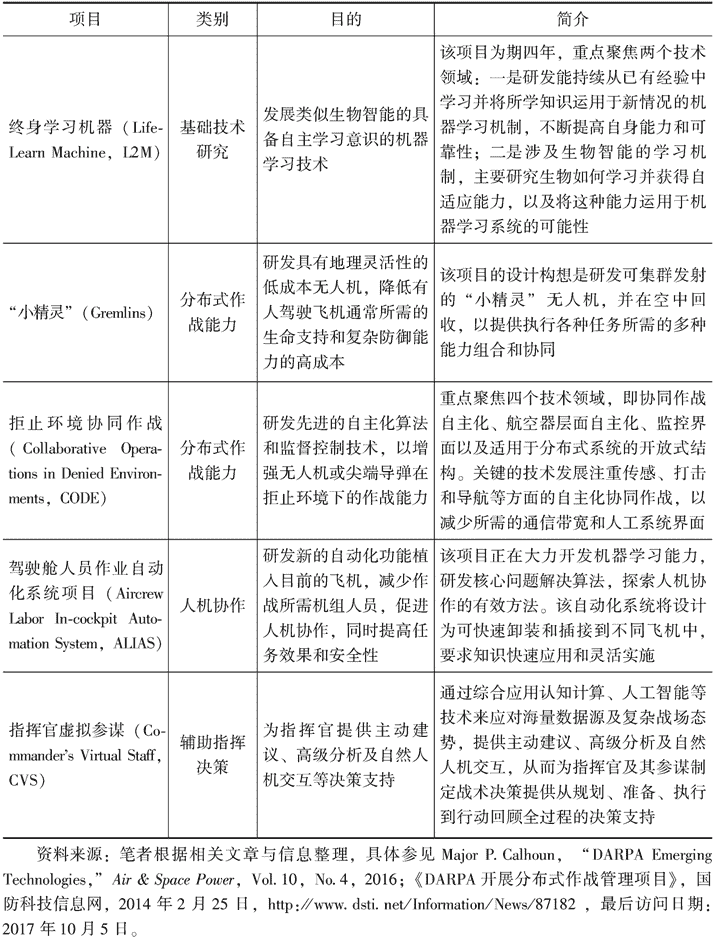

## 三 算法战概念的外部效应
从“网络中心战”到“空海一体战”再到“算法战”，概念的迭代对新一轮军事革命产生深层牵引。

### （一）引领军事智能化走向
军事变革经历了冷兵器、热兵器、机械化到信息化的演进。当前科技革命孕育兴起，军事领域变革速度、广度与深度前所未有。基于算法的人工智能是重要驱动力量，有望催生新型作战样式、改变制胜机理。美军提出算法战并提前布局，反映其对科技与军事变革方向的研判，推动武器装备无人化、指挥决策智能化，引领世界军事由信息化向智能化转型。

### （二）塑造新的抵消与不对称优势
美军惯以前沿技术先提出作战概念，再据此调整机构与装备以维系霸权。从“空海一体战”到“全球公域介入与机动联合”，再到第三轮抵消，均体现该逻辑。首轮抵消靠核技术先手抵消常规数量优势；第二轮抵消靠微电子与信息技术发展精确制导抵消兵力优势。算法战作为第三轮抵消的重要组成，沿袭相同思路。

通过加大算法研发投入与军事化运用，美军意在抢占技术先机，形成针对对手的新抵消与不对称优势，主要体现在：其一，在国防情报领域运用算法更高效地分析处理数据，建立信息优势；其二，挖掘算法对作战能力的增益，推动武器系统智能化，形成作战手段上的不对称；其三，推动算法辅助指挥决策，提升决策效率与作战可靠性，形成指挥层面上的不对称。

### （三）促进跨职能协作
信息化条件下制信息权是核心，一体化联合作战成为常态。信息渗透性使战略、战役、战术边界模糊，军地界限也日益淡化，跨部门、跨职能协作尤为关键。算法战跨职能小组的成立体现美军推动不同领域协作的努力，涉及国防情报局、参谋长联席会议、国防部总顾问办公室等多部门联动。该种协作契合信息化战争需求，有助于统筹需求、整合资源，提升行动效率。

## 四 算法战的固有短板
人工智能加速进入战场，算法化指挥、无人平台、仿生机器人不断应用，智能化战争时代到来。美军寄望通过大数据、云计算、人工智能培育新情报能力，却也暴露明显局限。

### （一）算法战存在脆弱性
算法由人设计的一串指令，依赖控制系统软件运行。若软件出现异常，算法会混乱甚至瘫痪。F-35对软件控制依赖严重，曾暴露200余项问题多与软件相关，软件瑕疵即可导致飞行异常甚至无法安全起降[^(\[13\])](#chapter011.html#m13)。算法对软件的内在依赖，也为对手破解提供可能。

网络空间是陆海空天之外的第五维，网络攻击成本低、溯源难，成为主要博弈场。针对算法系统漏洞实施网络攻击，可篡改指令、植入木马，使算法失效或紊乱。战时一方入侵对方算法系统，可零成本窃取算法，也可篡改指令令机器人“倒戈”[^(\[14\])](#chapter011.html#m14)。人为或自然原因引发的系统故障同样会丧失战斗力。

### （二）算法难以驱散战争迷雾
克劳塞维茨指出战争充斥不确定性，四分之三情况隐藏在迷雾中[^(\[15\])](#chapter011.html#m15)。信息化时代数据指数增长，情报渠道拓宽，但迷雾并未消失，反因虚假信息激增形成“信息迷雾”。地球存储数据总量每两年翻倍，未来24个月产生的数据将超过人类历史总和[^(\[16\])](#chapter011.html#m16)。算法依托大数据、模式识别、神经网络能提升情报效能，却难克服系统复杂性带来的不确定性。研究显示人工智能既能分析数据，也能制造自动生成的图像、视频、文本等虚假信息[^(\[17\])](#chapter011.html#m17)，因此仍无法消除战争迷雾。

### （三）算法智能无法替代人类智能
算法在规则明确、信息完备的系统里表现优异，但在需理性分析、灵活应变、道德判断的战争问题上仍需人类智能。算法结论未必可靠，情报分析与指挥决策中的关键性失误可能带来灾难。目前人工智能仍处狭义阶段，在机器人技术上有突破，却未在模拟人类智能的理论方法上取得突破，真正意义上的算法战尚需时日。

### （四）战场运用带来新的伦理困境
美军筹划算法战的重点之一是致命性自主武器系统，涵盖无人机、“杀人机器人”等自主武器。缺乏有效人控时，这些暴力工具对生命构成极大威胁。美军无人机曾误伤平民，若未来战场布满无人机蜂群、地面智能杀人机器人、海下无人潜航器，且无法有效区分平民与敌军，技术弱势方平民伤亡难以避免。即便识别技术提升，误伤风险仍存。指挥官远离前线、以“电子游戏”方式发动战争，将冲击道德底线，也印证了普京与马斯克的担忧。

## 五 对策与预警思考
算法战是技术驱动的必然产物，也是战争形态智能化的标志。应对该浪潮需保持清醒。

### （一）保持战略清醒，避免概念陷阱
美军概念因影响力与媒体传播常引发全球关注，如三次抵消战略、“空海一体战”等。盲目跟随易被技术欺骗。面对算法战，应从国情与科技水平出发审慎研判，提升算法领域认知，避免掉入概念陷阱。

### （二）依托军民融合，加强算法储备
冷兵器比体能，机械化比技能，信息与智能化时代比智能。算法战需要数学、计算机、系统论人才，也需要战略谋划与指挥人才。算法具有显著军民两用性，应贯彻军民融合，吸收地方人工智能成果，提升态势感知、指挥控制、信息对抗、无人系统、后勤保障、军事训练的智能化水平。依托军地教育科研体系培养和引进人才，加大算法设计投入，打造“人无我有、人有我优”的优势，下好先手棋。

### （三）重视反制研究与伦理探讨
建议做好三方面准备：其一，基于算法对软件的依赖，在网络攻防中聚焦算法软件系统，研究战时可用的网络攻击手段并提升自身防御；其二，基于人工智能难以超越人类智能，充分发挥人在情感偏好、道德研判、随机应变上的优势，确保人在关键决策回路中；其三，针对算法军事化带来的法律、安全、伦理问题，加强跨部门协作，制定符合国际准则和人类道德约束的规范，维护人工智能时代的和平与福祉。

自主杀人机器：军控还能跟上吗

徐能武 葛鸿昌[^(\[2\])](#chapter012.html#m2)

摘要：人工智能的深度军事化正在批量催生能够自行挑选目标并实施致命打击的自主武器系统，LAWS 对国际人道准则、人权保障、战争法秩序以及现有的军控框架带来叠加式冲击。面对这一既紧迫又棘手的议题，国际社会需要多轨并行、兼顾妥协，加快推进致命性自主武器系统的军控谈判。中国应携手相关国家，推动联合国及相关多边机制提前介入、发挥主导作用，坚持以友好协商寻求各方可接受的方案，支持建立以透明、问责与法治为内核的多边监督体系，稳扎稳打推进军控进程，在维护自身利益同时为全球安全稳定提供中国方案。

关键词：致命性自主武器系统 军控谈判 联合国 国际监管

人工智能渗入战场直接孵化出致命性自主武器系统，全球安全版图因此被改写。LAWS 已经被部分国家视作实现战略利益的工具，其带来的风险已经进入公共视野，推动相关军控谈判既艰难又刻不容缓。军控本身涉及权利与义务的分配，参与即意味着承担收益与成本。联合国作为最具公信力的全球安全平台，在构建军控共识上不可替代。中国应在有关各国合作下，敦促联合国等多种机制多层次介入谈判，主张通过友好协商达成各方均可接受的安排，积极倡导成立遵循透明、问责和法治原则的多边协调机构，循序渐进推进军控谈判，在捍卫自身权益的同时为国际安全贡献智慧。以下先梳理 LAWS 的成因与演进，再聚焦其带来的威胁。

一 致命性自主武器系统的缘起与发展

LAWS 集成顶尖人工智能、机器人与自动控制技术，能在没有人工干预下完成目标甄别和打击决策，并造成人员伤亡。是否已进入实战仍有争议，但若干国家实验室的研发行动已成事实。2015年7月国际人工智能联合大会开幕时宣读的公开信指出，完全自主武器不需要数十年，数年内即可实现研发应用[^(\[3\])](#chapter012.html#m3)。2017 年联合国关于致命性自主武器系统问题的政府专家组会议上，部分代表团认为完全自主系统尚未出现，也有代表团强调已有前体技术在流通，且部分国家正部署自主程度不断攀升的装备[^(\[4\])](#chapter012.html#m4)。总体趋势是，LAWS 正加速逼近现实，全球忧虑同步抬升。

第一，科技革命为其提供了土壤。第三次科技革命催生的电子计算机、激光等技术，让武器自动化程度实现跃升，这是 LAWS 诞生的基础。高度自动化的系统可在无人协助下自主执行攻防动作，但需人类预设程序并对目标识别、决策方式加以限制，仍无法自我判断。二战德国的 Fritz-X 导弹被视为首代精确制导武器，具备一定程度的自动搜寻与打击能力，有学者甚至将其看作首枚无线电操控的无人机。二战后美国在该领域持续领先。20 世纪70年代越南战场，美军首次以激光制导“智能炸弹”完成精确打击，并投放无人侦察机远程遥控收集情报，展现出自主武器的独特价值[^(\[5\])](#chapter012.html#m5)。1980 年服役的“密集阵”近防系统由高性能计算机设定程序，具备快速开火、电脑控制与雷达引导特征，被限定为仅拦截预设速度范围内的目标[^(\[6\])](#chapter012.html#m6)，不具备区分目标的能力。早期系统主要依据预设程序执行打击，自动化降低了人员直接介入，但选择与决策仍由人把控，自主水平有限。

第二，人工智能推高了发展速度。进入21世纪，人工智能爆发式增长叠加安全形势严峻，自主化无人作战系统被视作国家的“护身符”“杀手锏”走向实战。智能仿真、精准识别、深度学习与大数据处理等技术突破，使 LAWS 出现质变。从2002年起，美国便在也门战场联合使用无人机与传统空袭开展秘密定点清除[^(\[7\])](#chapter012.html#m7)。2002年11月，“捕食者”无人机在萨那东部精准击毙基地组织头目阿布·阿里及其同伙，无人机由此成为反恐常备手段[^(\[8\])](#chapter012.html#m8)。2006年，韩国将三星设计的 SGR-1 机枪机器人部署于朝韩非军事区，搭载热与运动探测器，可在两英里外识别潜在目标并全自动跟踪定位，配属的机枪与榴弹发射器经人工授权后可射击[^(\[9\])](#chapter012.html#m9)。2013年7月，诺思罗普·格鲁曼的 X-47B 无人机首次实现从航母甲板自主弹射起飞，为舰载无人空中加油项目奠定技术基础[^(\[10\])](#chapter012.html#m10)。

海军领域的自主化也在加速。2016年5月试航的美国“海上猎手”号无人反潜舰长约132英尺，最高时速27节，可在无人值守下连续海上巡航数月[^(\[11\])](#chapter012.html#m11)。俄罗斯在无人战车上优势明显，自主研发的“天王星-9”于2016年9月公开，装配多传感器、激光告警及热光学相机，可自行探测4英里外目标，操作员在1.8英里内的载具中可人工干预也可加载预设程序[^(\[12\])](#chapter012.html#m12)，成为其在叙利亚博弈的抓手。

由此可见，AI 驱动的技术浪潮正把武器推向拟人化与自主化，探测、识别、跟踪、交战等环节实现自我处理。LAWS 已覆盖海陆空天，赋予武器解决简单问题的权限，减少对操作人员数量与技能的依赖，大幅提升作战效能。

第三，大国竞争构成研发动力。为抢占新一轮军事竞争制高点，主要大国纷纷出台战略，鼓励自主致命武器的研发，推动人工智能军事化应用。美国、俄罗斯、英国、以色列、韩国等高科技军事强国都在研发降低人类参与的致命系统，新技术可能让完全自主机器人成为现实。2007年美国国防部无人系统路线图写道，最终目标是用同等或更快的思维速度、更强记忆与经验反应等机械能力取代操作员[^(\[13\])](#chapter012.html#m13)。2009年5月18日美国空军发布《无人机系统飞行计划2009～2047》，强调“完全自主”是未来无人机系统的核心能力之一[^(\[14\])](#chapter012.html#m14)。2018年3月美国向联合国政府专家组提交的立场文件称，新兴技术可降低平民伤亡风险，美国主张鼓励创新而非贬低或禁止[^(\[15\])](#chapter012.html#m15)。俄罗斯2015年制定的研发计划获军事工业委员会支持，计划十年内使30%战斗力由远程遥控自主机器人平台构成[^(\[16\])](#chapter012.html#m16)。这种军备竞赛极易打开“魔盒”，将世界拖入终结时代。

与此同时，LAWS 能帮助国家削减兵员、降低战争消耗、实现装备代际超越，对人口压力大且面临安全威胁的国家具有战略吸引力。例如日本与以色列技术先进且面临独特人口挑战，对该领域研发兴趣更浓[^(\[17\])](#chapter012.html#m17)。大国在战略隐蔽性与技术领先性下，可能让 LAWS 以更隐秘方式扩散。

二 致命性自主武器系统发展的威胁与挑战

人工智能军事化带来的风险正被广泛讨论。正如霍金所说，人工智能的发展“要么是人类史上最好的事，要么是最糟的”[^(\[18\])](#chapter012.html#m18)。众多科学家与技术专家呼吁国际社会采取实质举措，遏制危险进程尤其是致命自主武器。特斯拉创始人埃隆·马斯克甚至警告，国家间AI军备竞赛可能成为第三次世界大战导火索[^(\[19\])](#chapter012.html#m19)。

（一）对国际人道主义和人权的威胁与挑战

其一，LAWS 自行决策切断了战场上人与人之间的情感连结，人道主义难以落地。传统作战中，人类在发动攻击时会产生同情，并在法律、情感与道德后果权衡后决策。对战局与惨烈程度的感知会即时改变行为。而 LAWS 的“去人类化”决策可能拉开物理与心理距离，削弱部署者的关切甚至让其意识不到关切[^(\[20\])](#chapter012.html#m20)。武器因缺乏情感与道德约束而可能肆意实施非人道行为，而指挥层因无须考虑己方伤亡可能加大搏杀力度，引发人道灾难。

其二，非生命体自行剥夺生命本身就是对人权的主张。部署 LAWS 传递出一种观念，即被瞄准者不值得由有生命的操作员考量，其生命尊严权被剥夺[^(\[21\])](#chapter012.html#m21)。人类作战中也存在滥杀，但仍被视作人类思维的体现，现有法与道德可产生约束。当前技术难以让 LAWS 实现与人类匹敌的认知水平，准确区分平民与非战斗人员。为充分利用系统而放宽自主权限，可能导致失控，令平民被误杀概率上升，蓄意击杀更构成对生命权的亵渎。

其三，LAWS 还会冲击其他人权。彼得·阿萨罗关注生命权之外的践踏，如逮捕、拘留、行动限制；搜查、监视、跟踪；驱逐出境；丧失财产权；医疗、集会、出版、言论与选举权利等[^(\[22\])](#chapter012.html#m22)。武器在决定是否击杀前需完成搜索、检测、识别、跟踪、瞄准等一系列确认，在反恐等战场边界模糊的情境下可能持续较长时间，影响公民私生活，构成隐私侵犯。希瑟·罗夫指出，空中致命自主武器发现目标后仅能在击杀与否间选择，击杀即同时剥夺生命权并侵害公平审判权[^(\[23\])](#chapter012.html#m23)。

（二）对战争法的威胁和挑战

LAWS 与人类存在本质差异，虽能在战场发挥战斗员作用，却无法受战争法约束。若其违法，由谁担责不明确，形成“追责缺口”[^(\[24\])](#chapter012.html#m24)。有学者认为可能涉及软件程序员、硬件制售方、军事指挥官、操作人员与政治领导人[^(\[25\])](#chapter012.html#m25)。但名单越长，责任划分越模糊，法律的惩戒与威慑作用被稀释，受害者权益得不到保障，司法问责权威受损，平民与潜在受害者也难以获得有效保护。

杀戮机器能否通过战争法的检验

战争法的合规性正成为外界讨论致命自主系统的焦点。《日内瓦四公约关于保护国际性武装冲突受难者的附加议定书（第一议定书）》第36条为新式武器的合法性审查提供了操作指引，规定缔约方在研制、开发、获取或部署新的武器、作战手段或方法时，有义务判断其在特定或全部情境下是否违反本议定书或适用于该方的其他国际法规则。该条的本意是在列装前厘清法律边界，从源头上阻断非法武器的使用。[ ^(\[26\])](#chapter012.html#m26) 学界围绕这类系统是否满足马顿斯条款展开激烈争论，即是否始终处于既定习惯、人道主义基本原则与公众良心所形成的国际法原则的约束与保护之下。[ ^(\[27\])](#chapter012.html#m27) 在系统尚未实际出现之前，任何确定性结论都难以成立。

区分与相称始终是战争法的两大基石。区分原则要求作战中必须时刻把平民与交战人员、民用对象与军事目标分开。[ ^(\[28\])](#chapter012.html#m28) 若平台的识别能力不可靠，滥杀风险会急剧放大。战场态势瞬息万变，需要对环境进行持续把握并做出审慎判断。以处理定量数据为主的自主系统难以理解充满语境的模糊标准，极易触碰法律红线。相称性规则则规定，即便识别达标，使用所造成的可预见平民附带伤亡也不能超过所追求的军事利益。此种价值权衡与情景判断恰恰是自主系统的软肋，也给社会带来巨大风险。这一类武器的出现，迫使人们重新审视战争法的主体、适用范围及基本原则，使原本趋于成熟的规则体系面临深刻考验。

### （三）对国际军控机制的威胁与挑战

当下自主化武器正朝着多元化、智能化方向加速演进，致命型自主系统已进入现实视野。谁能在可控范围内率先掌握这类能力，谁就可能在新一轮军事竞争中占据优势。各方虽对失控扩散心存忧虑，暗中博弈仍在持续。美国国防部副部长沃克曾表示：“我们可能会遇到一个比我们更愿意把权力下放给机器的竞争对手，随着竞争展开，我们将不得不决定如何取胜。”[ ^(\[29\])](#chapter012.html#m29) 俄罗斯总统普京亦指出，谁主导人工智能，谁就主导未来。[ ^(\[30\])](#chapter012.html#m30) 作为军备竞赛的核心议题，围绕致命自动武器的多边谈判将日益增多，联合国《特定常规武器公约》框架下设立的监管专家组成为各方博弈的主要渠道，也在冲击既有军控原则。

这类系统能够实现“零伤亡作战”，这会削弱战争威慑的关键变量。[ ^(\[31\])](#chapter012.html#m31) 决策者无需再顾忌本国军人伤亡带来的国内政治压力，动武门槛因此被大幅压低。先发一方甚至能将战场推进至对手境内，最大化自身损失控制。这种能力会强化对外扩张冲动，降低国际危机稳定性，也削弱军控协调效力。

与此同时，研发活动具有很强的隐蔽性。只要具备人工智能与大数据处理能力的实验室，都能在有限时间内打造出一定自主程度的武器。商业机构借助规模经济与市场机制推动机器人技术向民用渗透，增大了军民两用监管的难度。2018年2月，韩国科学技术院与韩华集团旗下韩华系统公司联合设立人工智能研发中心，聚焦作战指挥、目标追踪与无人水下交通等方向，遭到全球30多个国家与地区研究人员的反对，被认为会加剧军备竞赛，令人遗憾。[ ^(\[32\])](#chapter012.html#m32) 不扩散政策的瓶颈有限，此类系统很可能被更多国家及非国家行为体利用，产生显著的军控副作用。[ ^(\[33\])](#chapter012.html#m33) 一旦落入恐怖分子手中，现行国际秩序与人类安全将面临灾难性破坏。

## 三 中国在相关军控事务中可以有所作为

整体来看，国际社会对致命自主武器的监管意识在提升，对其可能导致的人道灾难或尊严侵害已形成初步共识，但在推进谈判与构建法律制度方面进展有限，部分国家甚至在反对声浪中加速研发，进一步放大不安全感。作为联合国安理会常任理事国和新兴大国，中国理应在相关议题上发挥建设性作用，塑造负责任大国形象，维护和平发展外部环境与世界稳定。

### （一）推动联合国多重机构提前多层次主导性介入

致命自主武器研发与应用不仅关乎未来作战形态和平民安全，还可能触及人的尊严底线，其正负效应争议激烈且后果难以预测。联合国作为全球安全核心机制，主导相关军控谈判具有其他主体不具备的整体视野，也是各国捍卫主权与国际法的不可替代平台。

第一，主张由联合国主导谈判程序。相关争议复杂，现实推进需要联合国的全景视角。反对管控者认为，用于反恐的自主系统或可减少平民伤亡，驻防时间更长、可承受加速度等限制，也不受报复、恐慌、愤怒、偏见等人性弱点影响，不会故意实施酷刑、强奸等暴行。同时，科学自由也是人们不愿限制军事AI研发的重要理由。

支持管控者则指出，“技术攀升”可能在人们几乎察觉不到的情况下，把人类核心价值和国际安全体系推向危险境地。自主系统在战场上的选择背后是大量矛盾因素，机器人难以计算，更难真正区分合法与非法命令。由此产生的社会冲击和激烈争论，要求各国、国际组织与民间社会借助联合国这一全球机制全方位审视有效管控问题。这也意味着，任何国家的国内单边立法都应服从联合国框架下形成的军控原则。

第二，支持联合国多机构协同推进。联合国人权理事会作为大会下属政府间机构，负责全球范围内人权促进与保护，为各国应对致命自主武器对国际人权法和人道法的挑战提供了平台，也有助于形成更广泛共识和军控建议。与此同时，中国可参与联合国裁军研究所的相关研究，推动日内瓦裁军谈判会议——唯一多边裁军谈判机构——尽快启动致命自主武器军控谈判，把要点和进展纳入年度工作计划并定期向大会汇报。

中国还应推动联合国裁军事务咨询委员会就该议题定期开会并向秘书长提交咨询意见，推动联合国大会裁军与国际安全委员会为其设定议程并通过相关决议，由裁军审议委员会审议并提出建议。联合国裁军事务厅则应在信息收集、研究咨询、立场协调和技术支持等方面发挥作用。

第三，深度参与联合国层级化的谈判活动。作为安理会常任理事国，中国应积极参与联合国有关机构组织的军控相关活动，派出专家参与联合国人权理事会召集的政府专家组，探讨机器人技术与国际人权和人道法的契合度，以及暂时中止相关活动的路径。中国还应参与日内瓦联合国办事处的相关会议，与专家和领导人讨论未来武器的管控办法，表明中国的基本立场和关切。

中国应积极参与联合国在日内瓦举行的《特定常规武器公约》缔约国专家会议，探讨法律、道德与社会层面的问题。裁军大使可在缔约国大会上阐明中国立场，中国代表可充分利用公约会议、审议大会、专家组等场合，与裁军研究所、国际红十字委员会、非政府组织及学界专家共同研讨技术应用、伦理道德和未来走向。中国公开支持建立致命性自主武器系统监管专家组的决定，并派出专家参加2017年11月的首次会议和2018年4月的第二次会议，今后应继续深化交流，把握各方关切与分歧要点。[ ^(\[34\])](#chapter012.html#m34)

### （二）主张寻求在友好协商基础上各方都能接受的方案

致命自主武器系统是人工智能军事化的典型代表，各方因利益、地位和认知差异立场分歧明显。需要在友好协商中寻找各方可接受的方案，抵制单边主导规则，加强国际合作。

第一，在充分交流中兼顾各方意见。中国在多场合反复表态，“中国高度重视并积极参与国际社会有关‘致命性自主武器系统’讨论，主张各国应对此进行深入研究，在全面、充分讨论基础上，寻求妥善解决办法”。[ ^(\[35\])](#chapter012.html#m35) 一种观点认为，自主系统不可能在战场决策上超越人类，永远难以达到国际人道法或人权法的要求，出于原则也不应赋予其生杀大权，主张全面禁止研发、生产和使用。

另一种观点则认为，技术只要控制在合理边界内就是合法的军事进步，甚至能在某些情况下使冲突更人道、挽救生命，完全抛弃技术等于放弃保护生命。第三种观点强调，正因系统非人类，在某些危险情境下表现可能优于人类，且可通过程序设计使其依据外形、热信号、空速阈值等特征识别敌对目标，从而遵守相称性等原则。该派主张的不是全面禁止，而是强化国际有效监管。

第二，在渐次共识中比较各种措施。目前对致命自主武器及其应用仍存在诸多不确定性，规范控制需依据实际情况比较不同路径。一方面，可援引《日内瓦四公约关于保护国际性武装冲突受难者的附加议定书（第一议定书）》第36条，鼓励各国对外开放本国审查程序，提升透明度。另一方面，应推动非政府组织和公众就“是否控制、如何控制”开展多形式讨论。在难以达成有约束力的法律文件时，可积极推动制定宣言、行为准则、政府间对话、情报共享、建立信任措施及框架公约等软法工具。还需预先研讨对潜在受害者的援助安排。

第三，在多方协调中明确权利义务。军控涉及科学家、技术专家、制造厂商、政府决策者、指挥官、战士和公众等多元主体。谈判需要在多方协调基础上明确各自权利义务。程序员和制造商承担责任面临法律障碍，美国多数武器制造商享有豁免权。条约应明确AI和机器人专家合法研发制造的权利与义务，要求政府决策者对人工智能军事应用承担内部审查责任，若无法确保事后限制，应主张“先行禁止”。

指挥官和战士作为主要使用者，依据国际刑法，人类操作者多不承担武器伤害责任，但若事先知晓风险则需对机器人自主行动的负面后果负责。对公众而言，不受人类控制的武器系统会引发全球性AI军备竞赛，并危及生命安全，呼吁规范限制是各国民众不可忽视的权利与责任。

### （三）支持成立确保透明、问责和法治原则的多边国际监管体系

当前最紧迫的任务是建立有效的国际监管。中国应大力支持联合国和国际社会适时建立以透明、问责和法治为原则的多边监管体系，使其既能限制附带损害，又能管控研发与扩散。

第一，支持联合国人权理事会推动国际商定框架。中国应支持人权理事会呼吁各国至少在建立国际商定框架前暂停测试、生产、组装、转让、采购、部署和使用致命性自主武器系统。应推动成立由法律、机器人、计算机科学、军事行动、外交、冲突管理、道德和哲学等领域专家组成的高级别专家小组，总结技术进展、评估法律道德政策问题、提出框架建议、推动国际对话，并评估现有法律框架的有效性与不足。

第二，支持建立武器审查国际透明机制。根据1949年《日内瓦四公约关于保护国际性武装冲突受难者的附加议定书（第一议定书）》第36条，各缔约国需自行判定新武器是否在某些情况下被国际法禁止。2001年第28届红十字与红新月国际大会通过的《人道行动日程》配套文件《新武器、作战手段和方法法律审查指南》要求各国对新武器进行严格全面审查。

在尚未达成国际法律文书前，中国应与其他国家一道支持联合国裁军和军控机构推动建立致命自主武器系统审查的国际透明机制。各方互动时应强调开发全过程透明，推动各国内部审查程序对国际社会更开放。至少在程序层面公开透明，承诺严格审查，并扩大国际讨论和政府间对话，交流最佳做法。

第三，支持建立多样化军控协调机制。科学家和技术专家因熟悉前沿技术，是较早关注军控问题的群体。2009年9月，英国谢菲尔德大学机器人与AI专家诺尔·夏基领导成立非政府间团体“国际机器人武器控制委员会”，多次联合发起“停止杀手机器人”行动，并努力推动《特定常规武器公约》缔约国采取行动。

# 杀手机器人该刹还是放？关于致命自主武器的全球博弈

2013年11月，国际裁军联盟与一批人权组织共同向联合国《特定常规武器公约》日内瓦谈判发出警示，认为必须抓住当时窗口，明确禁止研制所谓的“杀手机器人”这类完全自主武器。三年后，行业侧的动作也被推上台面。2016年9月，谷歌、亚马逊、Facebook、IBM、微软等科技巨头联合推出首套相对成型的AI伦理准则，并计划组建行业自律组织，核心诉求是让人工智能造福人类而非伤人。

在这样的国际舆论与技术自律双重压力下，中国的立场主张走向更具建设性：继续鼓励国内专家积极投身国际社会已搭建的各类非正式机制与群体组织，一方面推动致命性自主武器系统军控的协调渠道多元化、制度化，另一方面促使其与联合国的相关法律框架实现有效衔接。目标很明确，通过汇聚不同国家的专业智慧形成初步共识，为尽早达成具有约束力的国际法律文件创造条件。

随着人工智能的加速迭代，武器系统的自主化程度不断提升，伦理风险与安全隐忧同步放大。限制乃至禁止致命自主武器，已成为全球安全治理议程中的新焦点。《特定常规武器公约》会议已据此设立政府专家组展开专题研讨。梳理来看，当前推动军控的主因主要集中在道德层面，尤其是机器独立做出杀伤决策所触发的伦理拷问。安全维度上，自主武器带来的风险并非独有，其他前沿技术同样存在类似困境，而使用自主武器所能带来的战略优势依然诱人，这也削弱了主要大国推动硬性军控的积极性。在权力政治与道德政治持续拉扯的格局下，短期内形成实质性管控成果难度较大，更可能的路径是通过软法等非约束性规范先行塑形。在此过程中，中国完全可以扮演更主动、更负责任的角色，在守住自身战略利益的同时塑造有利的大国形象。

### 结语

致命性自主武器系统及其应用带来的影响既复杂又深远，直接牵动各国核心安全利益。因此中国应明确倡导以联合国为主导来推进该领域的军控进程。当前各方对武器系统应用后果的判断分歧尖锐甚至对立，国际监管的紧迫性日益凸显。当务之急是先给这匹正狂奔的野马拴上缰绳，避免其失控脱缰造成难以逆转的灾难性后果与威胁。

在此基础上，应循现有国际法与军控惯例，在国内、双边与多边三个层面启动一个包容性的审议进程，明确下一步处置路径。中国要同步完善内部新武器审查机制，并择机开启致命性自主武器系统军控架构的正式谈判议程。要启动这一程序，需要联合国相关机构牵头组建政府专家组，开展长期研讨并起草选项清单与机制框架草案。谈判中强化战略沟通，向所有成员平等提供客观公正信息，有助于缩小信息不对称、降低不确定性、扩大安全合作空间。

与此同时，“相比集体领导而言，多元领导是描述这种有差异的、采取主动行为进程的恰当词语”[^(\[36\])](#chapter012.html#m36)。为了维护该安全领域的战略力量平衡，中国可在条件成熟时积极推动在联合国框架下的多元领导实践，反对任何形式的霸权行径，在确保战略稳定的前提下共同建构致命性自主武器系统的军控机制。

致命自主杀器：军控为何难突破

关于约束甚至遏制致命自主杀伤系统的国际讨论，推进轨迹带出明显的自下而上抬升痕迹。对这类技术风险的敏感，最早在学术圈浮现。[^(\[9\])](#chapter013.html#m9)2007年，英国研究者诺埃尔·夏基撰文警示，“我们正如梦游般走入一个新的世界，在何时何地杀伤何人皆由机器定夺……为自主机器人建立国际规则和道德规范势在必行，否则为时将晚。”[^(\[10\])](#chapter013.html#m10)2009年，夏基等学者发起机器人军备控制国际委员会International Committee for Robot Arms Control，ICRAC，目标是促成具法律约束力的国际协定，禁止自主武器系统的研发与使用。

此后，2013年于伦敦成立了“阻止机器人杀手运动”Campaign to Stop Killer Robots。该联盟吸纳大赦国际、ICRAC、帕格沃什科学与世界事务会议、国际和平局等63家非政府组织。成立后成为推动自主武器军控最活跃、社会能见度最高的民间力量，通过科普、研讨、倡议等方式深度参与各国际组织的磋商。2015年，逾千名国际知名学者，含霍金与特斯拉创始人马斯克等，联署公开信，警告人工智能可能触发军备竞赛并呼吁禁止进攻性自主系统。信中写道：“人工智能技术已来到临界点……其风险异乎寻常……今天攸关人类生存的选择是，开启人工智能的全球军备竞赛，还是从起点上对其加以防范。”[^(\[11\])](#chapter013.html#m11)

在全球安全治理中，多元行动体不仅塑造议题与话语，也推动甚至重塑进程。学界与民间持续发声，把自主武器军控从舆论推至政府议程。联合国内出现多线并行。人权理事会方面，任意处决问题特别报告员Special Rapporteur on extrajudicial, summary or arbitrary executions多次向大会议递报告，剖析自主化与人工智能军事应用对人权和国际人道法的冲击。2010年临时报告即提出“不应仅强调技术进步带来的挑战，更应主动采取措施，确保技术有助于更有效地遵守国际人权和人道主义法”。[^(\[12\])](#chapter013.html#m12)联合国大会第一委员会即裁军与国际安全委员会，自2013年起把致命自主武器系统列为年会常规议题，对此表达关切的国家逐年增加。[^(\[13\])](#chapter013.html#m13)

除上述两条渠道，《特定常规武器公约》CCW的会谈机制已成为军控核心平台。公约旨在限制或禁止可能造成不必要伤亡或无差别威胁平民的特定武器，这与国际社会对自主武器的伦理担忧高度契合。2013年缔约国会议同意次年设立非正式专家会，专门审议致命自主武器系统。2014至2016年连开三次非正式专家会，参会者包括缔约国代表、观察员非缔约国代表，以及国际组织、NGO与学界专家，议题涵盖技术演进、概念界定及由此引发的道德、法律、安全等。[^(\[14\])](#chapter013.html#m14)2016年底出现新进展。2016年12月的CCW第五次审议大会决定组建政府专家组Group of Governmental Experts，将讨论抬升至更正式层级。对进展一贯缓慢的CCW机制而言，自主武器议题从受关注到实质推进的速度实属罕见。[^(\[15\])](#chapter013.html#m15)

统计显示，截至2017年5月已有19国公开表示应采取措施禁止致命自主武器发展，涵盖巴基斯坦、埃及、阿根廷等。[^(\[16\])](#chapter013.html#m16)但明确反对者多为中等体量国家，主要大国分歧明显。美国国防部2012年即发布条令，要求自主与半自主武器的使用须以“适当水平的人工判断”为前提。[^(\[17\])](#chapter013.html#m17)与此同时，美国又把人工智能与机器人技术视作第三次“抵消战略”的关键支柱。[^(\[18\])](#chapter013.html#m18)限制使用与鼓励研发并存的双重姿态，构成美国在军控议题上的内在张力。综合概念、伦理、安全三维度评估，致命自主武器的军控要取得实质成果仍面临多重争议，前景不容乐观。

## 二 概念迷雾：管控对象难以框定
“军备控制指的是通过约束军备的发展方式和使用方式来管控军备水平”，[^(\[19\])](#chapter013.html#m19)具体指对特定武器系统的数量、类型、性能和使用进行限制。自  武器系统军控而言，最根本的前提是先对管控对象做出清晰界定，这直接决定何者被禁、何者保留。[^(\[20\])](#chapter013.html#m20)

然而“自主武器系统”本身界限不清。《反对机器人杀手》报告将完全自主的武器界定为“可在无人参与或干预下自行选定目标并实施武力”的机器。[^(\[21\])](#chapter013.html#m21)众多批评者与组织使用的表述基本一致。彼得·阿萨罗Peter Asaro认为，自主武器系指“不依赖直接人工监督和杀伤决策，而能自主定位并发动潜在致命攻击”的系统。[^(\[22\])](#chapter013.html#m22)联合国法外处决问题特别报告员克里斯托夫·海恩斯Christof Heyns把“自主机器人杀手”LARs界定为“一经启动，无须操作员进一步干预即可选择并打击目标的机器人武器”，并强调机器在挑选目标和使用杀伤力时能否作出自主“选择”是关键。[^(\[23\])](#chapter013.html#m23)这类系统通常在无人监管的开放环境运行，并借助传感器与任务环境实时互动。[^(\[24\])](#chapter013.html#m24)

综合来看，致命自主武器的共识画像包含两点：一是高度自主，能凭借自身信息处理能力在无人参与下独立完成搜寻、识别、攻击全流程；二是具备攻击性杀伤力，而非仅用于侦察、监控、分析等防御性任务。两者共同塑造了“不受人控制、可自行决定杀戮的机器”这一核心意象。因此无论是联合国[^(\[25\])](#chapter013.html#m25)还是阻止机器人杀手运动，对讨论对象的指向基本一致。

但现行定义对军控而言仍过于宽泛。首先，自主性和杀伤性并未充分体现武器系统的智能化程度，而后者才是国际社会的真实焦虑。按现有定义，许多现役甚至老旧装备也会被纳入。美军列装的“密集阵”Phalanx近防系统能自动搜索、跟踪、评估并打击来袭反舰导弹和飞机，作战流程完全由高性能计算机自动完成。以色列上世纪90年代研制的“哈比”Harpy无人机是典型的“即发即弃”fire and forget平台，发射后不再操控，由机载系统自主探测并摧毁雷达。韩国部署在朝韩非军事区的Super aEgis Ⅱ自动炮塔可依据热能和运动识别目标，原本具备自动发射功能，后因客户要求才增加人工干预环节。[^(\[26\])](#chapter013.html#m26)这些装备均能自主发现目标并实施打击，在一定程度上符合自主武器的定义。若以此为标准，军控目标不仅包括尚未出现的高度智能化武器，还涵盖大量已广泛使用并持续升级的平台，难以获得共识。

为此，部分国家和学者更强调人工智能属性。例如罗夫认为应受限制的系统不仅能自动找目标并攻击，还必须具备自主学习能力，即非依赖预设程序化特征，而是通过学习识别先验特征未知的潜在目标。英国国防部的表述也指向“理解更高层次意图和趋势，并据环境认知采取合适行动……自主系统应具有自我意识，对外部输入的反应不亚于或优于人工系统”。[^(\[28\])](#chapter013.html#m28)问题在于，这类界定虽然凸显智能，却让概念更模糊。学习能力要达到何种程度才算“自主”？现有表述难以提供可操作的军控标准。斯贝罗Robert Sparrow认为自主武器是一个智能连续体，一端是仅能探测重量后决定是否引爆的人员杀伤地雷，另一端是接近人类智慧的高度人工智能武器。[^(\[29\])](#chapter013.html#m29)军控不可能涵盖整个连续体，如何划线、能否划线，将成为推进的障碍。

其次，自主性和致命性本身具有技术可变性。以无人机为例，当前多数军用无人机不属于联合国讨论范围，因为它们多由人员远程遥控，或至少关键环节如发动攻击的决定需要“人在环内”in-the-loop的人工指令。但随着战场复杂化、节奏加快及自主化带来的军事优势，人工干预减少将成趋势。美国空军2009年规划里就提出，人的角色将从“在环内”转向“在环上”on-the-loop，仅监督特定决策执行，人工智能可在法律和政策框架内完成战斗决策而不必人工介入。[^(\[31\])](#chapter013.html#m31)当干预减少，机器决策出现偏差时，人类监管可能来不及纠正。军控层面如何区分“在环上”与“在环外”，如何判定间接人工干预是否足够，以及如何在实战中核查自主化程度，都极难操作。技术演进带来的内涵变化，可能阻碍共识与措施形成。类似逻辑也适用于“致命性”：鉴于人工智能军民两用，非攻击性平台经简单改装即可具备杀伤力，单纯禁止某种应用难以杜绝不当用途。[^(\[32\])](#chapter013.html#m32)

最后，自主性和致命性并不能涵盖全部风险。自主武器可能重塑战争成本收益，大幅拉低战争门槛，引发军备竞赛，冲击战略稳定，并为非国家行为体提供更便捷危险的工具。这些风险不完全源于自主性和致命性本身。例如战争成本下降更多源于武器无人化带来的己方伤亡规避，无论决策是否自主均存在。仅围绕自主性和致命性推动军控，只能管控部分伦理安全问题，反而削弱谈判必要性认知。对主要大国而言，概念上的分歧既是维护战略利益的需要，也为巩固技术优势提供空间。[^(\[33\])](#chapter013.html#m33)

## 三 价值焦虑：为何引发强烈担忧
致命自主武器之所以引发高度关注，关键在于其对既有国际规范的潜在冲击。对自主武器的批评主要集中于价值层面，可归纳为两种逻辑。

第一种是结果论consequentialist视角，关注行为后果是否违背道德。对自主武器而言，核心质疑是其难以有效区分平民与战斗人员。“冲突各方无论何时均应在平民与战斗员、民用物体与军事目标之间加以区别”，[^(\[34\])](#chapter013.html#m34)这一区分原则是战争法基石。批评者认为完全自主系统难以可靠区分，恐增加平民伤亡。要有效区分，不仅需识别战斗员可识别特征，也需识别非战斗员特征，否则打击战斗员也可能波及平民。此外，如何区分失去战斗力的受保护人员、维和人员或自卫持武平民等，都需要系统对复杂环境中的可预见与不可预见因素进行精准认知、分析与预测，当前人工智能水平恐难企及。[^(\[35\])](#chapter013.html#m35)

结果论下的第二个问题是，系统可能改变战争决策逻辑并降低门槛。民众对战争伤亡的敏感度长期以来约束领导人的战争决断。而自主武器和无人机作战显著降低了己方伤亡预期，使战争更容易获得民意支持、政治风险更低。实证研究显示，相较派地面部队或常规空袭，民众更倾向支持无人机行动。[^(\[37\])](#chapter013.html#m37)低伤亡甚至零伤亡预期会削弱限制战争的民意制衡，使战争更难管控。联合国秘书长1998年报告曾警告，自主平台能力增长“可能使各国能在不受本国人民反对伤亡限制的情况下发动战争”。[^(\[38\])](#chapter013.html#m38)按此路径，战争决策将更宽松，武力使用沦为财政与外交考量，冲突趋于常态化。[^(\[39\])](#chapter013.html#m39)

同时，自主武器的实际效用也遭质疑。美军推动自动化的重要理由是降低人力成本和技能要求，但学者指出这不过是“技术主义者的盲目热忱”。从“爱国者”防御系统和“捕食者”无人机实践看，自主化并未减少人力与训练投入，反而要求设计人员与操作人员更紧密融合。[^(\[40\])](#chapter013.html#m40)若无法兑现节约承诺，以效用抵消风险的主张将受削弱。

另一种是义务论deontological视角，关注行为本身是否合乎道义。该批评更为尖锐，认为机器自主决定杀戮本身即违道德，而非仅看后果。其支撑主要有三：

责任缺失是其一。自主武器的核心是自主，随着智能化和学习能力提升，发展趋势是更少人工干预、更多独立决断和更难预测的后果。若系统因信息不足、计算失误、软硬件故障等误伤平民或违反相称性等战争法则，归责将成难题。有学者称之为“三难”，即制造者、指挥者或系统本身均难以承担机器自主杀伤的责任。[^(\[41\])](#chapter013.html#m41)对武器系统而言，责任意味着指责、惩罚或奖励，均无实际意义。这种“责任鸿沟”[^(\[42\])](#chapter013.html#m42)使攻击行为在起点上就缺乏合法性。[^(\[43\])](#chapter013.html#m43)

二 风险谁来买单

舆论的追责常聚焦在高度智能又高度自主的致命平台上，而实际的危险早已渗入到不同自主化程度的装备里。随着远程打击与空中作战成为当代冲突的主导形态，危险的承接端正不断滑向平民和技术弱势群体。以美国为首的西方社会对本方伤亡高度敏感，致命自主系统的推演恰好把发动方的成本压到最低。可以说，发动方的安全最大化是以被攻击方承受更大危险作为交换。即便对受袭一方没有根本改观，己方伤亡概率从显著降到近乎消失，也会大幅提升战争的诱惑，而缺乏无人作战能力的国家与普通民众则被迫吸收冲突的主要后果。这种倾斜背离了传统战争法的精神，后者要求非战斗人员的保护优先于战斗人员。[^(\[44\])](#chapter013.html#m44)美方在阿富汗、巴基斯坦推行的无人化行动即便仍受远程指挥，也被概括为“通过规避美军士兵在战场上的伤亡，既使美国国内民众远离了战争效应，又使战略家们不被技术进步带来的逻辑和伦理缺陷所牵绊”。[^(\[45\])](#chapter013.html#m45)人工智能的基础架构看似是中立的机器算法，实质上在固化不平等的权力结构。正如英国政府首席科学顾问马克·沃尔波特所言，“机器学习可能会内部化在量刑或医疗历史中存在的所有隐性偏见，并通过它们的算法外部化”。[^(\[46\])](#chapter013.html#m46)同理，致命自主系统与无人作战也在把技术能力的不平等，转化为加诸于弱势行动体之上的危险偏见。

三 战场尊严的缺席

战争的本质是人与人之间的互动，战争法正是这种互动沉淀的社会规范。区分原则、相称性原则等伦理准则，都以人际互动为前提。交战者上战场时，先决认知是自己主动选择战斗身份并承担可能被杀伤的后果，这种自觉是交战正义乃至开战正义的基础。而当高度自主化、高度智能化的系统自行作出攻击决定时，人与人之间的互动关系荡然无存。[^(\[47\])](#chapter013.html#m47)从某种意义上说，“已经没有人在决定攻击对象的生死了”。[^(\[48\])](#chapter013.html#m48)把主观意念从战争这一人际过程剥离，构成对人的尊严的彻底挑战。

支持方并非没有回应。有人认为机器不受恐惧、愤怒、报复心等非理性因素干扰，随着技术成熟，自主系统在目标甄别上或许更能规避人为失误。[^(\[49\])](#chapter013.html#m49)这类反驳成立的前提是系统能够遵循道德准则，特别是能够掌握战争法和其他交战规则。[^(\[50\])](#chapter013.html#m50)技术上能否实现仍具争议，掌握规则是否等同于道德也存疑。[^(\[51\])](#chapter013.html#m51)把战争法当作智能自主平台的全部道德来源，未必能使其足够应付战争中的所有情境。[^(\[52\])](#chapter013.html#m52)如果不能预期人工智能将发展出近乎人类的道德能力，对系统的自主程度和杀伤性能进行限制应当是更为合理的选择。[^(\[53\])](#chapter013.html#m53)

总体来看，虽然支持方从使用效能出发为这类系统辩护，但其进一步发展可能冲击传统战争法中的区分原则、相称性原则等基本准则，这些价值危险很难在可预见的未来通过技术手段解决，这成为推动致命性自主武器军控的主要动因。

四 安全焦虑与收益权衡

安全议题同样是军控讨论的核心，军控结果直接牵动国际权力分配，安全关切往往起决定性作用。主张限制者认为此技术易引发军备竞赛、扰乱力量对比、推高冲突不稳定性，并为非国家行动体提供危险工具。

首先，围绕致命自主系统的军备竞赛似乎已在进行。以 drone 为例，超过 90 个国家已拥有军用 drone 装备或相关技术能力，其中美军 drone 占其军用飞机的比例在 2005 年至 2013 年从 1/20 迅速攀升至 1/3。有预测甚至认为到 2021 年全球 drone 市场规模将达到 940 亿美元。[^(\[54\])](#chapter013.html#m54)随着无人装备数量激增，其军事应用将不会局限于反恐和特种任务，一旦进入国家间互动，现有战争样式和交战规则都可能被改写。无人化、智能化战争会呈现何种图景无人能准确定位，战争门槛降低、武器库膨胀、技术演进不确定，这些因素使自主武器军备竞赛可能成为国家间尤其是区域国家间战略互疑的新来源。[^(\[55\])](#chapter013.html#m55)与此同时，由于人工智能发展及军事应用早在冷战时期就已开始，扩散并不仅限于 drone，而可能在各个军事领域全面铺开。有学者警告：“如果自主武器获得发展和部署，它们将最终在每个领域都安家落户——空中、太空、海洋、陆地或是网络空间。它们将成群捕猎，编织成无人武器系统的复杂网络。”[^(\[56\])](#chapter013.html#m56)

其次，对国际体系力量对比的影响至少表现在两方面。第一是破坏战略稳定。冷战以来，大国间相对平衡的核威慑是稳定基石，其前提是允许对方保有适度核报复能力。随着无人技术发展，武器特性正从强调续航低能耗转向速度与隐身的突防属性，drone 蜂群战术也为突破防御提供新途径。[^(\[57\])](#chapter013.html#m57)这些变化让技术发达国家拥有危险更低、打击效能更大的工具，对对手战略威慑构成严峻挑战。新型无人武器“不仅意味着高度可信的威胁，因为使用这种武器对己方人员毫无损伤，而且提供了可升级的远程精确打击能力，能够逃避完善的空中防御体系”。[^(\[58\])](#chapter013.html#m58)对本有拒止能力的国家而言，下一代无人装备的机动性、隐蔽性和自主性可能使其基于报复能力的威慑战略趋于无效。成本低廉、可长时间蛰伏的水下无人系统，将致使水下作战环境趋向透明，导致潜艇这一核威慑重要手段面临较大威胁。[^(\[59\])](#chapter013.html#m59)第二来自常规力量。发展致命自主系统所需的资源禀赋与传统武器不同，对技术要求显然高于人口、能源等要素。有观点认为技术发达的中等国家可能是最大受益者，因为“军事力量将逐渐与人口基础脱钩，而后者传统上是衡量军事实力的重要指标”。[^(\[60\])](#chapter013.html#m60)

再次，可能引发冲突升级。低成本使用使行为体更倾向用这类系统探查对手能力、决心和回应策略。一方面国家有强烈动机利用这类武器获取情报、增强态势感知、宣示主张甚至发动有限进攻；另一方面对象国难以准确判断真实意图，例如把抵近侦察误解为先发制人打击。系统能否释放明确无误的信号表明意图，可能成为安全互动的新难题。更何况，对本就敌对的国家而言，即便轻微侵犯也可能被解读为严重挑衅和更大范围攻击的序曲，导致对象国采取更严厉回应而引起不必要升级。[^(\[61\])](#chapter013.html#m61)此外，系统高度依赖感知和信息交换，意外事故与恶意干预概率上升。若 drone 执行侦察时遭黑客入侵或其他形式电磁干扰而出现坠毁、撞击、爆炸等反常行为，也可能引起目标对象的误判和升级回应。[^(\[62\])](#chapter013.html#m62)

最后，非国家行为体可能掌握并使用。技术与装备具有显著军民两用性，部分小型无人装备成本不断下降，非国家行为体从公开渠道获取并改造难度不大。远程操控甚至自主打击与极端暴力模式高度契合。美国联邦调查局在 2011 年侦破并预防了一起针对五角大楼的恐怖袭击，策划者考虑的手段便是通过 drone 装载爆炸物进行空袭。[^(\[63\])](#chapter013.html#m63)英国反恐专家也警告恐怖分子有可能利用 drone 对民航客机进行攻击。[^(\[63\])](#chapter013.html#m63)使用致命自主技术发动袭击还具有象征意义。邓恩指出：“考虑到美英在伊斯兰世界大量使用 drone 带来的争议，有能力使用这种武器对其本土发动攻击，以一种非对称战争手段对称地做出回应，对许多恐怖组织而言颇具吸引力。”[^(\[64\])](#chapter013.html#m64)因此，更智能的自主杀伤技术落入非国家行为体手中，只会助长恐怖主义和其他危险行为。[^(\[65\])](#chapter013.html#m65)

即便上述安全危险真实存在，是否足以必须限制？质疑集中在三点。

第一，类似危险在其他技术领域同样存在，而那些领域的军控共识更弱。网络武器提供了很好的例证。[^(\[66\])](#chapter013.html#m66)网络武器本质上是数据代码，获取、传播、扩散都较为简单。伊朗核设施遭受病毒攻击后，其对战略稳定性的负面影响开始受关注。恐怖分子利用网络攻击瘫痪关键基础设施的设想也被反复提及。[^(\[67\])](#chapter013.html#m67)然而，尽管部分国家掌握发达网络攻击能力并用于窃取情报，高度破坏性的网络攻击尤其是针对民用基础设施者极少出现。[^(\[68\])](#chapter013.html#m68)因此网络空间军控的可行性与必要性长期争议。[^(\[69\])](#chapter013.html#m69)既然网络、全球快速打击、反卫星等威胁更现实深刻而军控踯躅不前，以相对较弱的安全危险推动致命自主武器军控必然面临更大阻力。一种解释是攻击关键民生设施易触碰国际法基本原则，使国家承受巨大道义压力。如果此逻辑成立，限制致命自主系统实属多余，因国际人道主义法已为武器使用提供总体规则，可充分约束。[^(\[70\])](#chapter013.html#m70)

第二，战略收益可能抵消危险。低门槛固然潜藏危险，也让应用范围更广、灵活性更强。系统能够减轻发起对外军事行动时的国内舆论压力，增加工具选项。特别在必须表态又要避免局势过度恶化时，可降低表态成本。美国过去十余年多次在巴基斯坦、也门开展 drone 反恐，每年空袭数十次，国内反对声相对于伊拉克和阿富汗战争并不显著。[^(\[71\])](#chapter013.html#m71)研究显示美国的 drone 反恐确实降低了恐怖活动的频率和规模。[^(\[72\])](#chapter013.html#m72) drone 空袭在奥巴马任内达到顶峰，或多或少源于对小布什政府“有人”战争“虽胜尤败”的反思。德国、以色列研究人员也认为几乎可忽略的己方伤亡是 drone 等系统最突出的战略价值。[^(\[73\])](#chapter013.html#m73)

第三，严重安全危险的说法或被夸大。高新技术扩散与军事化需要强有力组织能力与基础设施，即便美、英、德等技术发达国家推广无人作战模式也困难重重。[^(\[74\])](#chapter013.html#m74)关于极端分子使用，也有观点认为恐怖分子可能更偏爱熟悉的攻击装备，对许多目标致命自主系统并非最优选择。[^(\[75\])](#chapter013.html#m75)换个思路，若恐怖分子迟早会掌握相关技术，国家更不应否定该类武器，而应继续发展以提高防御能力。[^(\[76\])](#chapter013.html#m76)

综合来看，致命自主技术或许会带来新挑战，但其安全危险并不如网络、太空武器那样明显。扩散和升级危险是高新技术武器化的共有特征，真实严重程度尚待检验。使用这类武器仍有利可图，避免己方伤亡、执行反恐等特殊任务，drone 已成为相关国家强化安全战略的有力工具。若作战样式的有效性持续得到肯定，将鼓励他国效仿，推动更大范围、更深层次的发展与应用，这一轨迹印证扩散担忧，却也使军控道路愈加困难。

五 军控为何难落地

致命自主武器军控从进入视野到被提上议程进展尚算顺利，但从成为国际军控正式议题起，向实质化发展的进程将十分坎坷。目前要形成具有约束力的禁令或限制都极难达成。

管控诉求源于对技术发展不确定性的忧虑，而这种不确定性正是阻碍实质成果的关键。对支持者而言，最有力主张是让武器自主决定杀伤对象违背伦理。但该主张暗含前提：人工智能将必然发展到某一高度，以至于军事决策者认为完全废除人工干预、由武器自行决定从目标识别到发起攻击的完整链条，对实现作战效能最大化最为有利。反对者则认为致命自主系统终将足够“聪明”，能够习得并严格遵守人类战争规范，甚至做得更好。无论哪种判断，都基于对人工智能及其后果的预估，这种预估尤其是对后果的评估极具争议，使分歧难以弥合。[^(\[77\])](#chapter013.html#m77)同样，关于战略安全影响的分歧，也是围绕不确定后果的预测展开。与核武器、化学武器不同，致命自主武器军控没有明确特定对象，对象仍在快速演变。这意味着只能是预防性控制，针对的是技术尚未完全展现的潜在后果。[^(\[78\])](#chapter013.html#m78)在国际社会获得普遍共识并形成切实行动，短期内并不现实。

本质上，权力政治与道德政治的博弈决定走向。军控之所以受关注，主要源于道德层面。对人工智能潜在社会效能的深层忧虑叠加颠覆性技术军事应用的伦理担忧，推动了管控呼吁。目前推动者多为社会力量，如非政府组织与专家学者。伦理争议的核心是不应把杀人决定交给机器，仅从伦理看颇具说服力。问题在于，伦理动因不足以推动现实。军备控制首先是权力政治的产物，结果往往体现主要国家的现实利益计算与讨价还价。因此，要推进，不仅需在道德层面汇聚更强社会力量，也需在安全议题上获得足够动力。简单说，需同时满足三项前提：一是伦理争议突出，特别是在能否真正实现绝对自主上达成明确共识；二是各主要国家均认为这类系统并非军事上不可或缺；三是安全危险能真实呈现在国际社会面前。[^(\[79\])](#chapter013.html#m79)显然后两项实现极为困难，这意味着军控进程将继续呈现道德政治独角戏，前景并不乐观。有学者坦言，“特别是考虑到当今的全球化文化，以及新兴技术能够提供的战略和军事优势，无论是基于文化的、竞争的或是宗教的理由，对技术发展施加有意义的限制似乎难以成功”。[^(\[80\])](#chapter013.html#m80)

关于管控自主武器的讨论，现实路径从来不是单一的，而是呈现出分层、分质的多样态势。

最理想也最难落地的，是通过正式的国际条约来设限。这一模式沿用传统军控做法，以具法律约束力的协定明确禁止或限制特定类自主武器的研发与使用。但要落地，就必须先厘清自主武器的边界如何划、合规如何核查、违约如何惩戒，这些技术性问题直接牵动各国的战略算计，谈判阻力最大，达成概率也最低。

更有可能出现的，是不具强制力的软法安排。技术共同体可以出台建议性的研发指引，说明在自主武器相关技术迭代中应防范哪些风险；国家之间也可以推倡行为准则，阐释军事应用与国际法规则如何衔接。[^( \[81\])](#chapter013.html#m81) 这类“软约束”看似温和，实则执行难题不少——行为合规与否难以客观判定，实际约束力也常被质疑。

再往下还有单边表态的选项，即某个国家公开承诺不使用完全自主的“机器人杀手”。[^( \[82\])](#chapter013.html#m82) 这种姿态对他国的约束几乎为零，毕竟真正意义上的绝对自主尚属远景。即便如此，单方面声明也很难轻易作出，因为它等于给本国未来的装备发展预设不可预见的限制，在国际层面对其减缓军备竞赛的作用也很有限。

综合来看，后两种低强度做法实现的可能性远高于有约束力的条约，但即便要拿到这种层级的“小成果”，也必须在前期条件上取得突破，更离不开主要大国的政治意愿和担当。

总体而言，自主武器军控的进展折射出全球安全治理的通病：价值关切、技术驱动、多元参与并存，也正是这些因素让进程屡屡受阻。自主武器有可能冲击以人为核心的传统国际法安全价值，却不足以在尤其是大国之间形成强有力的安全驱动，推动实质管控。公众对自主武器风险的焦虑往往与科技的高速演进同频共振，而正是技术高度不确定，才让各方难以就应对负面外溢达成一致。

### 结语

“机器人杀手”管控的倡议已引发广泛关注，但推动形成真正有效的管控产出，动力仍显不足。关键在于，道德层面的呼吁在安全领域很难转化为主要大国的集体行动。

在可预见的范围内，更现实也更稳妥的进展，是借助非强制手段，逐步塑造一种反对绝对自主杀人机器的国际舆论规范。

既然硬约束短期内难以实现，中国可以考虑主动参与议程塑造：一方面提出禁止绝对自主武器的原则性立场，甚至作出单边宣示；另一方面给出军控的应然标准，明确区分自主武器与现有的无人装备，在维护自身战略利益的同时，占据道义制高点，提升议程设置能力，进一步强化负责任大国的形象。此外，高质量的知识供给是提升话语权的重要支撑，应该鼓励战略研究与工程技术领域的深度对话，厘清人工智能和自主武器可能带来的社会效应，并通过多元化验证手段对相关假定和逻辑链条进行科学检验。总之，“将人工智能可以做出的积极贡献最大化，同时将其有害后果降至最低，将是我们这个时代最艰巨的公共政策挑战之一”[^( \[83\])](#chapter013.html#m83)。

# AI上阵，伦理如何兜底

徐英瑾

**摘要：** 把人工智能推向军事领域会留下怎样的伦理余波？学界最常提的担忧是：钻现有军控规则的空子推高扩散风险、杀伤门槛被拉低导致平民伤亡上升、侵蚀战士群体的职业操守。文章指出，这类批评多半对传统作战平台和智能化平台采用不平等的评价尺度，又夸大了智能武器对全球安全格局的改写作用。要让军用人工智能的伦理代价与当代价值体系相契合，关键不在于一刀切地叫停研发，而在于能否让系统具备接近人类的伦理推理能力。在研发推进中，如何处理各向同性问题也将成为绕不开的焦点。

**关键词：** 军用机器人 人工智能 伦理学 各向同性 心灵状态指派

## 导论：算法开火后谁来担责

通俗地说，人工智能就是借助编程让机器在行为表现上逼近人类聪明。学界对“什么算智能”尚未完全统一，但共识是成熟的系统应当在尽量少的人工干预下，按使用者设定的目标，在特定环境里自主完成任务。实现之后，这类技术对人力在生产中的位置会形成传统机械难以比拟的冲击，不只挤压体力岗位，也会动摇以信息创造为核心的脑力岗位。与以通信为主的传统信息技术仅负责传递信息不同，理想状态下人工智能平台本身就是新信息的生产节点。

目前人工智能还远未全面替代人力，但在兵力稀缺的场景里需求很强，部分试验性运用已经展开。沃勒克与艾伦合著的《道德机器：如何教会机器人辨明是非》[^(\[3\])](#chapter014.html#m3)第三章把人工智能最具潜力的三个方向概括为军用机器人、性爱机器人和工业机器人。三种用途都有伦理张力，其中军用系统的争议最尖锐，因为其核心任务与杀伤直接相关，也触及军事暴力的正当性边界。美国空军退役上校、现任塔尔顿州立大学哲学与宗教教师哈尔嘎斯[^(\[4\])](#chapter014.html#m4)曾这样表述：

军事冲突的语言即关于辩护（justification）的语言。军事冲突造成人员的死亡以及财产的受损，并造成各种形式的可以想象的大量伤害。不给理由就去做这些事情是疯狂的。不过，即使有了理由去做这些事情，如果同样的目标可以通过更少的人员与财产损失来达到，那么，相关的军事行动还是无法得到辩护。

这段话强调军事行为可分为可辩护与不可辩护，若战争本身正当，其附带破坏在伦理上或可被容许，但论证具体行动的正当性门槛很高，需要证明其损害收益比为可选项中的最低。军事行动正当性的争论由来已久，人工智能的加入会在多大程度上改写问题？

变化主要体现在操作层面与观念层面两个维度。先看操作层面。假若开火、拦截等关键决策交给机器自主执行，责任如何落定就会变得模糊：人类指挥官失误可被军事法庭追究，机器人战士出现错误时该如何归责？现行法律框架对此尚无清晰安排。

军用机器人伦理争议：先有技术还是先有理论？

先看理论层面的卡点。人类指挥官下令、战士执行，并不要求我们先彻底搞懂彼此的大脑在怎样运作。即便在神经科学几乎空白的年代，指挥体系照样运转。对机器作战单元而言情况相反，它的每一块硬件与每一道决策逻辑都是人手设计的，如果设计者自己都说不清机器到底按何种方式工作，就无法保证其按预期行动。可以说，机器人战士的研发倒逼设计者必须先把人类在伦理抉择时的运作机制拆解清楚。遗憾的是，伦理学界与神经科学对伦理决策机制的研究，都还远未成熟到能支撑把伦理判断写成可执行程序的程度。

既然实践上麻烦、理论上准备不足，为什么还要推进这类技术？这种质疑说服力有限。达·芬奇当年正在构思飞行装置。文艺复兴时期的法制是否已有飞行安全规范？当时的物理学是否已为飞行装置提供坚实基础？都未具备。但由此断定达·芬奇在胡闹就不成立，正是这些大胆尝试才让后世科学与技术走到能造出飞机的地步。交通法规的完善也只能在载具成熟之后才可能展开。实践与理论的障碍并不是阻断军用智能系统的充分理由，反而可能成为技术努力的催化剂。具体困难如何克服，还需后续讨论。

飞行装置与军用机器人有本质差异，前者可军可民，后者只能用于战争，据此得出制造军用机器人天生反伦理的结论仍然单薄。从手枪到核导弹，人类不断制造各类武器。若脱离使用语境空泛地判定军火工业反伦理或促进道德，都毫无意义，对智能化武器的评价亦应如此。

另有一派批评者不反对有人操控的常规武器，却反对研制并使用高度自主、尤其是拥有开火自主权的军用智能机器人，认为其特殊性值得禁止。

这些特殊性究竟是什么，又是否站得住脚，下文逐一检视。

## 一 关于智能军用系统之伦理危害性的五个论证及其薄弱处

前文已指出，从伦理视角看军事行动可分为可辩护与不可辩护，即正义与非正义之分。哈尔嘎斯将正义军事行动应满足的规范条件归纳为七条，见表 1。若有人能论证智能军用系统的普及会难以满足其中至少一部分规范，便可据此给出负面伦理评价。反之，若支持者证明此类产品不会显著妨碍这些规范的满足，负面评价的可信度便会被削弱。

表 1 “军事行动的”需要满足的规范性条件

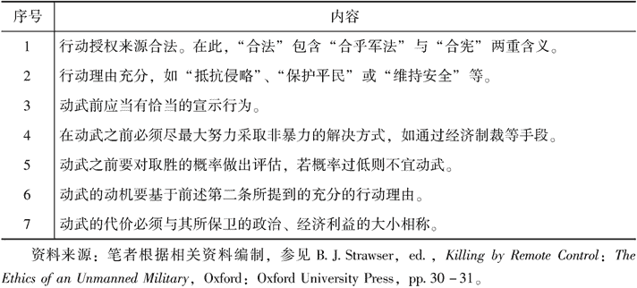

笔者认为，这七条规范主要关涉战争的宏观决策层面，而非基层作战人员的即时战术选择。比如武装力量首脑或政治操盘手对战争理由的阐释是否恰当，与一线指战员如何运用战术并无直接因果。按惯常理解，人工智能对既有武器的改造多集中于战术层，短期目标之一是实现无人化，通常并不针对洲际导弹这类本来就无人化的战略武器。在此前提下，人工智能军事化带来的形态变化局限于战术层面，不会通过改变决策本身而在宏观尺度上重塑政治经济秩序。因此原则上，军用机器人的出现不会让本就非正义的战争变正义，也不会让本就正义的战争变非正义。再者，智能武器研发的核心初衷是提高打击精度与降低己方伤亡，由此还能减少战争损失，提升人道程度。所以似乎缺乏足够强烈的理由让伦理学家对智能武器出现给予负面评分。

不过这种粗线条回应难以说服坚持打负分的伦理学者。下面列出更细化的反驳观点，并做再回应。

### 反驳意见一：无人智能武器会钻现有国际军控条约的空子，让世界更不稳定。

该说法出自德国技术伦理学者尤尔根·奥尔特曼。[^(\[5\])](#chapter014.html#m5)奥尔特曼提醒注意，战术兵器例如主战坦克与战略兵器间的界限会在数量激增时变得模糊，比如十个装甲师即可构成战略力量。人工智能与既有平台结合后，一旦规模化复制，就会产生战略能力的跃升，冲击国家间的战略平衡，进而威胁和平。他同时指出，当前军控条约并未对人工智能的广泛使用作出明确限制，这为技术领先国钻空子提供了便利。以1990年签署的《欧洲常规武装力量条约》为例，该约对北约与俄罗斯在欧洲部署的主战坦克、自行火炮、武装直升机等常规陆战平台的数量上限作出规定，并允许互检。值得注意的是，条约文本并未区分平台是有人还是无人驾驶，只对物理特征作出规定，如“坦克重量须在16.5吨以上”。在这种情况下，通过减重规避“坦克”定义、实现不受条约约束的无人类坦克兵器在技术上并非难事，去掉三四名乘员的减重完全可行。

再反驳：没有任何军备控制条约能够预见未来兵器的全部走向，这在无人武器出现前即已成立。以1922年签署的《美英法意日五国关于限制海军军备条约》即《五国条约》为例，该约对战列舰、巡洋舰的吨位分配及舰载火炮与鱼雷性能上限作出限制，却未对后来出现的航空母舰作出明确禁止，这客观上为航母编队的壮大埋下伏笔。若仅凭此疏漏就言“若当时禁止航母，山本五十六就无法策划珍珠港”，未免天真。纳粹德国二战时几乎没有可用航母，“齐柏林”号未及服役，但仍研制出V-1与V-2导弹轰炸伦敦。与一战后期已出现的早期航母相比，导弹武器更超出《五国条约》起草者的想象。由此可见，既然任何条约都有遗漏，即使现行条约加入限制智能武器的条款，也无法保证起草者忽略的其他未来兵器，例如小型化的电磁炮与激光炮，不会带来更大的战略失衡风险。此外，从纯技术角度看，奥尔特曼设想的无人自主坦克与传统有人坦克的差异，远小于航母与战列舰的差异。航母在作战功能上与战列舰截然不同，而撇开有人无人不谈，无人坦克的作战功能与有人坦克基本相同。例如美军2007年服役的Robot-TALON-SWORDS平台装备的M-240机枪或40毫米榴弹发射器，安装于无人平台后在技术参数上与人手持的同型号武器并无二致。因此即便此类无人战术平台数量累积到一定程度，新技术拥有方的战略优势也是有限的，很容易被对方拥有的更具毁伤力的武器如战术核武器抵消。由此看，即便在无人智能武器广泛运用的未来战场，对世界和平最大威胁仍是核武器、生物武器、化学武器等既有大规模杀伤性武器。将军控焦点转向人工智能军事化，反而可能让我们错过真正的关节点。

### 反驳意见二：无人智能武器容易扩散，让世界更不稳定。

此质疑与前者相关，重点放在条约之外的仿制扩散。由帕特里克·林等学者在美国海军资助的报告《战争机器人的风险与相关的伦理议题》[^(\[6\])](#chapter014.html#m6)中指出，即便美国研制的军用机器人暂时取得战术优势，一旦被具备逆向工程能力的对手俘获，扩散便不可避免。此外，任何研发国都认为自己的研发具有政治正义性，单纯的伦理争辩无法让任一方冻结研发，故全球人工智能军品研发竞赛难以避免。

再反驳：该论点高估了逆向工程获取新技术的能力，理由有四。其一，即便军用机器人被俘，其可运行的源代码未必能被技术能力有限的俘获方成功解码。其二，即便源代码被解码，修改程序以升级原武器软件包的难度远小于重新设计硬件平台，升级会立刻让解码成果失去意义。其三，可以设想，未来军用机器人的智能很大程度上依赖存储在云端的大数据，故单个平台的俘获未必会损害已占有信息优势的一方。除非俘获方能入侵对方网络窃取情报，而做到这一点未必需要俘获战术机器人。其四，人工智能军品的广泛运用会大大降低人类士兵被俘概率，从而降低被俘人员泄露机密的概率。从技术与伦理角度看，为人工智能军品设置被俘后自毁程序的难度更小。

综合上述四点，若被俘获方本身不具备强劲的人工智能研发能力和数据积累，此类俘获带来的战术与战略优势都相对有限；反之，若它本就具备很强科研能力，通过俘获敌方产品提升性能的意义也不大。故从可俘获性推不出易扩散性。

### 反驳意见三：无人智能武器会让杀戮更易，也会使军事暴力更频繁。

谢菲尔德大学机器人与公共事务专家诺埃尔·夏基从战争心理学出发，比较了人类直接参战与未来机器人主导战争的差异。他援引历史研究指出，人类士兵面对同类时杀戮会受心理压力制衡。例如二战太平洋战场，八成的美军步枪手面对敌人时要么故意不开枪，要么故意打偏；对美国内战盖茨堡战役中回收的27574支火枪的调查显示其中九成存在重复装填问题，说明许多士兵只是在做射击姿态。[^(\[7\])](#chapter014.html#m7)而军用机器人不会有同等心理压力，杀戮会更冷酷高效。此外，机器人战士普及后，战争决策者与实际杀戮现场的距离被拉大，残酷场面难以对决策者心理构成影响，这会降低阻碍战争决策的心理门槛，使决策者更易倾向使用军用机器人而非非暴力手段。

再反驳有三点。第一，若认为机器人参战提高杀戮效率最终威胁和平，则逻辑上不仅要阻止机器人参战，还要阻止任何提高杀戮效率的手段，甚至要努力降低效率。由此推导出保卫和平的最佳方式是制造劣质枪支、训练士兵故意打偏，这显然荒谬。此外，传统战争中紧张、负罪感等心理压力会导致战机丢失、己方战友被伤、误操作伤己等。比如南北战争时期前膛枪若重复装填极易炸膛。在假设战争具有正义性的前提下，这些情况会让邪恶势力更快获胜，反而降低全球伦理水平。只要战争正义性不成为问题，人工智能军事运用会使人类指挥员的作战意图得到更高效精准的贯彻，更早赢得正义战争的胜利[^(\[8\])](#chapter014.html#m8)。

第二，“军用机器人在杀戮时毫无心理压力”这一断言不能充分成立。设计者当然不希望产品因紧张而误操作，但为了在复杂战场环境中更有效地进行针对不同行为的伦理后果推理，一些设计者仍希望在软件层模拟怜悯等人类情绪，以便行为输出更接近有正常情感的人类战士，后文还将详谈。因此，虽然军用机器人的杀戮效率更高，这并不意味着它们会滥杀无辜。

第三，人工智能是否降低战争发动门槛，需结合多重因素综合评估。即便在军用无人机技术尚未达到无监督自主运作的今天，精确制导弹药的广泛使用早已让以美国为代表的西方强国对弱国有巨大军事优势。在此前提下，各国宪法及经济政治考量仍会让领导人在军事决策上有所顾忌。人工智能介入是否会从根本上改变既有国际军事格局，颇难令人确信。具体理由有三：一是自主无人平台及其弹药的高昂价格仍会构成阻碍轻启战端的经济因素；二是对手为弱国时，人工智能的加入对技术使用国的既有优势并不会产生明显加分，反而有边际效应；三是对手军事实力较强时，后者可通过升级战略导弹等传统战略兵器抵消人工智能带来的微弱优势。总之，单就人工智能加入这一因素而言，使全球战争更频繁的概率微乎其微。

### 反驳意见四：无人智能武器以保护己方士兵为代价杀死更多平民，从人道主义看降低了全球伦理水准。

该意见由瑞典科技伦理专家尤塔·韦伯提出，她还提到美国与以色列等国使用无人机反恐时，诸多无辜平民被连带杀害的案例。[^(\[9\])](#chapter014.html#m9)不过这种反驳是否经得起数据检验，还需细查。

再反驳：美国政治学专家艾弗里·普劳针对美军无人机部队在巴基斯坦与阿富汗的反恐行动进行了伤亡估算。[^(\[10\])](#chapter014.html#m10)据此估算，前述对无人军用平台滥杀无辜的指控其实夸大其词。

任何战争都难以避免平民误伤，依据动武代价相称性原则，要判断特定军事行动M导致的误伤是否在伦理上可接受，还需比较三组数据：其一，被M误杀的平民占被其杀死人员总数即误杀者与真正敌人之和的比例；其二，若M被取消而改用传统手段，其误杀平民占杀死人员总数的比例；其三，若相关军事主体不采取任何行动，当地平民死亡数在武装冲突总体死亡数中所占比重。

套用到美国及其盟友反恐战争的具体语境中，只要第三个数据明显高于前两个，就说明干预使更少平民免于恐怖分子枪口。若第二个数据明显高于第一个，则更进一步证明运用无人军用平台进行此类打击具有合理性。

### 反驳意见五：无人智能武器的出现使人类士兵传统武德成为冗余，对人类社会整体安全构成隐患。

该反驳主要由澳大利亚莫纳什大学伦理学家罗伯特·斯帕罗提出。[^(\[11\])](#chapter014.html#m11)他提到传统军事组织中人类士兵应具备的四项武德：勇气、忠诚、荣誉、仁慈。在斯帕罗看来，无论是今日的远程遥控飞机还是未来的自主机器人战士，其广泛运用都会使上述武德被边缘化。具体而言，操控无人机或给机器人下指令都不需要操作员面临生命风险，新技术对操作员在勇气与忠诚方面的德行要求随之大幅降低。此外，武器操控人员与杀戮现场距离足够远，无风险的战争会大大降低军人荣誉感，并使其难以理解仁慈的价值。比如只有设身处地思考敌人的处境时仁慈才可能，而远距离操控使这种设身处地成为奢望。斯帕罗的担忧是，若这些已盛行数千年的军人武德被废弃，武装部队凝聚的精神基础也会动摇，进而对人类未来社会安全性造成不可估量风险。

再反驳意见

在对军用人工智能系统或作为其前身的远程操控武器系统的种种伦理学批判中，斯帕罗的意见可谓卓尔不群。因为一般批评者都在立论中或隐或显地预设了和平主义立场，而斯帕罗则站在了军人传统价值观立场上。但是，出于以下四点考量，笔者依然认为其批评并不能自圆其说。

#### 其一

技术代差带来的战场不对称，向来是各大军事实力的追求目标。只要这类不对称暂时实现，掌握技术的这一方就能在远离交火线的“安全区”内发动打击，而不必自己承受风险。武德的式微，并不是军用人工智能或远程操控系统出现后才开始的苗头。远在十九世纪末，1898年恩图曼战役后，英国陆军指挥官基钦纳勋爵就对麾下用机关枪以47人伤亡的代价击毙一万名苏丹战士的战绩感到“胜之不武”。[^(\[12\])](#chapter014.html#m12)由此可见，斯帕罗所说的“武德衰减论”并非只针对军用人工智能，它同样适用于任何能够制造非对称优势的军事科技。顺着这个逻辑走到底，就会出现一个荒唐的结论：既然任何技术优势都会腐蚀武德，那就彻底放弃所有带来不对称优势的科技，退回武德最盛的中世纪，用冷兵器打仗。

#### 其二
斯帕罗强调了武德丧失后的社会风险，却没有把风险具体化。在冷兵器时代，个人身体素质直接决定胜负，而武德是支撑这种素质的重要精神支柱，缺乏武德的群体碰上突袭时存活几率会显著下降。今天的技术环境已经不同，社会整体的生存风险被大幅拉低，操作简便的武器甚至让女性也能具备可观的自卫能力。

#### 其三
当大量自主军用机器人形成建制，人类部队的核心工作会转向装备的软硬件维护和遥控操作，人均编制将被大幅压缩，国防开支也会随之下降。兵员结构会更偏向中产阶层，民粹主义色彩的军国主义宣传因此失去传统的人群基础，这对提升全球和平指数是利好因素。

#### 其四
勇气、忠诚等品德的发挥范围远不止战场。商业竞争、技术研发乃至体育竞技，都需要成员敢于冒风险、甘于付出。只要激励机制正常运转，武德在军事领域的衰退并不会必然导致社会整体德性的崩塌。

笔者仅挑选了英文文献中对无人军用人工智能最具代表性的几条伦理批评。从更高视角看，这些批评都陷入了类似的思维陷阱：其一，对传统战术平台和人工智能化平台设置双重标准，回避前者的伦理问题却放大后者；其二，把适用于过去技术进步的批评套用到人工智能上，容易滑向“反对一切军事技术进步”的极端；其三，混淆手段与目的，把杀伤效率提升等同于战争动机本身；其四，故意模糊战术兵器与战略兵器的界限，夸大前者对全球安全格局的影响。

对这些批评的反驳，并不等于对研发的伦理冷漠。恰当的态度是既不能因风险存在而一刀切否定，也不能无视风险放任自流。目前最难的两件事是：理论上，如何为技术平台的伦理决策程序化提供坚实的学理基础；实践上，如何为高度自主的军用人工智能可能造成的错误判定责任归属。

二 如何让机器人具备伦理判断力，以及误伤责任该算谁的账

可以肯定的是，一个真正自主、非遥控的军用机器人必然具备一种广义的“伦理推理能力”，讨论是否要额外给它装模块是伪命题。理由有六：作战任务往往包含多个目标，如毁伤敌车但保护油库；资源和时间受限，目标难以兼得，需要取舍；取舍需要排序；指挥员会给出一般原则，但在具体情境下仍需灵活变通，例如新型步兵战车的反坦克导弹威胁不亚于坦克主炮时该先打谁；这种变通本质上就是依据规范性原则在特定情境下决定该做什么不该做什么；没有这种能力，系统就不算真正自主。

从战术层面看，让平台拥有一定伦理推理能力意义巨大，它能在不与人通信的情况下抓住稍纵即逝的战机，减少“人机互动失误”。但多数人的道德直觉要求机器的判断正确率必须达到人类战士的水准甚至更高，否则没有正当性投入实战。问题在于如何实现。

以改编自克里斯·凯尔自传的电影《美国狙击手》为例。片中凯尔负责封锁巴格达某条街巷，保护视野内的战友，有权先发制人。难点在于如何实时甄别谁是潜在暴恐分子，如何避开误伤。影片里出现一个当地男孩捡起地上的RPG火箭筒，凯尔陷入两难：孩子成为暴恐分子的概率很低，可能只是玩耍，但一旦扣扳机就会杀死附近美军。任务同时包含保护战友和避免平民伤亡，孩子拾起武器的瞬间两者冲突显现。现实中很难在瞬间洞察意图，凯尔只能在保护与避害之间迅速调整权重。电影里男孩最终扔掉武器，两者皆保；若未扔，凯尔很可能开枪，体现了上级“避免误伤”的意图无法完全贯彻。

若把凯尔换成自主智能狙击系统，困境相同。有人会说这是模式识别问题：识别为非军事人员就不开火，反之则开火。真人凯尔的视觉与大脑本身就是模式识别系统，既然人类在该场景仍感到为难，就不能指望人工设计的机器版凯尔天然更优，需要更精细的技术路径讨论。

常见两条路线。一是三条件判断：持有武器、身穿平民衣未着军服、武器指向己方人员或平民，同时满足即有权开火。二是通过云端大数据人脸识别追踪，确认身份后再决定射击。

两条路线都有明显漏洞。第一条里“武器”如何界定？武士刀在电影《太阳帝国》中被投降日军用来给孩子切苹果，却被远处盟军游击队误认为袭击而击毙。砍香蕉的刀具日常不算武器，但在1994年卢旺达大屠杀中却被大规模使用。能否算作武器取决于情境，需要情境敏感的语义指派，这很难算法化。此外城市治安战中着装不可靠，暴恐分子可能穿仿制军服，己方特工可能便衣潜伏，自以为看到平民持枪指向军人，可能实际是便衣特工在消灭伪装成军人的暴恐分子。

第二条路线也受限：暴恐分子信息难以完整收集，成员流动快、域外人口数据缺失；可能蒙面遮挡；复杂光学环境下人脸识别难度剧增。

从心灵哲学与认知科学看，这涉及“心灵状态指派”与“各向同性”两大问题。前者是如何从外部行为推断内部意图，如孩子玩弄武器是嬉戏还是敌意。行为主义难以完整映射意图到行为，且系统没有其他信息通道，只能依赖行为线索，造成信息不足。补信息会引出各向同性问题：世界万事潜在相关，系统应如何筛选相关信息以实现经济求解？比如机器凯尔判断武士刀与“文物展示”还是“暴力袭击”相关，需要检索海量可能关联，实时作战难以承受。

温莎大学的瓜里尼与美国海军认知科学项目主管贝洛在《机器人战争：从无平民的战场转移到充满平民的战场后人类所面临的挑战》[^(\[14\])](#chapter014.html#m14)中提出六点建议。第一，预置常识背景库K，例如火箭筒能毁软皮车但毁不了主战坦克。第二，通过感知与语义描述模块获取当前场景描述集S。第三，设置逻辑推理规则，从S的子集与K的子集合取推出新结论，如“有人拿起火箭筒瞄准悍马”加“火箭筒能毁软皮车”，推出“有人有能力摧毁悍马”。第四，以K+S为最大检索空间，将各向同性问题限定为在该空间内把实际检索范围压缩到运算与战术允许的程度。第五，采用激发传播模型，为K+S中记忆要素间的关联赋权，高权重通道优先检索。第六，引入注意力磁P，由情绪模块产生的命题把注意力拉向战场关键要素，并生成参数E表征紧急性，E为1时激活杀戮动机并开火，0则不激活。这实质让系统自我指派动机与欲望以做开火决策。

在这种框架下，机器凯尔的最终输出受两个参数主导：情绪模块产生的注意力磁指向何处，内置背景知识如何描述对象的一般威胁。功能主义视角下，任何能快速切换认知资源到特定方向的开关都可视作人工情绪。背景知识则需用户提供准确常识，并通过机器学习持续更新。

即使技术环节全部实现，也无法保证零误伤。没有任何信息处理系统绝对不出错。情绪模块可能因对战友的爱与对平民的同情竞争而混乱，背景知识缺陷也会导致伦理推理偏差。是否因此否定机器凯尔的应用价值？这犯了人类中心主义错误：人类战士犯同类错误从未构成禁止使用人类的理由，为何对机器要求更苛刻。

有人会说，即便失误率低于人类狙击手，只要不为零就应禁止，因为人类是法律责任主体，可用军法惩戒，而机器人尚无法律规章，制订也荒谬。为避免“出了事找不到人负责”的尴尬，不如不部署能自主开火的智能兵器。这个责任归属难题，正是下一节需要深入探讨的核心。

关于用军法处置出错机器人的质疑，结论我不认同，但其背后的思路并非全无道理。洛克霍斯特与范登霍文在《军用机器人的责任》一文中就点明，惩罚失误的士兵是有意义的，因为羞耻感会起警示作用，并在部队内部形成威慑。而对机器实施军法制裁则毫无效果，它感受不到羞耻，也不会让其他机器产生畏惧。面对这类情况，更务实的做法是追查事故根源，并切断错误再次发生的链条。

这并不意味着机器人误杀后法律层面就真空了。哪怕是高度自主的系统，其运行仍建立在人类设计者与人类指挥官的行为之上。假使出现致命误判，我的看法是调查组应该按排除法来厘清责任归属。第一步先排除硬件层面的电气故障，若排除不了，就追溯到生产与维护环节。第二步审视事故前代码的执行轨迹，排除黑客入侵的可能，若真有入侵，就要追查来源，同时检讨防护软件为何失效。第三步核查下达的作战指令本身是否违反条令和伦理底线，若指令有问题，就要找到发布指令的指挥员。第四步评估当时战场信息复杂度是否已超出该型号机器的处理上限。若确实超过上限，就要判断指挥员是否本可预见这种超载，若可以预见，又为何不改派人类战士去处置。

把这个排查流程摊开来看，找一台出错军用机器背后的责任人，和找一把走火的自动步枪背后的责任人，本质上是同一套逻辑，只是前者的技术环节更繁琐。因此，战场上部署会犯错的机器人，不会出现“谁都说不清”的尴尬。即使“机器人不是责任主体”这个说法成立，它也远不足以成为禁止机器人持枪权的充分理由。

有人会追问：如果层层排查下来，仍找不到能定责的人怎么办？

我的回应是，可以借助高仿真的三维回放技术，让一线优秀人类战士在与事故高度相似的虚拟场景里完成同样的处置任务，再把人类表现与机器表现进行对照。若机器犯的错绝大多数人都可以避开，那就说明系统设计存在重大缺陷，需要叫停装备并责成厂家召回；若即便是多数人类战士也难以避免同样的失误，那么就可以合理地认定这属于“倒霉”。在此种情形下，就不宜再追究具体个人的责任。

“倒霉”二字或许难以完全满足理性探究的胃口，但“武运”本就是战争不可分的一部分。机器的介入无法把运气从战场上抹去，正如航母、导弹出现后也没有消灭运气一样。经验上，被流弹误伤的士兵不在少数，但又有多少起最终进入司法程序？谁能证明机器人上场一定会减少、而不是增加这类不幸？从根本上讲，消除误伤的终极办法难道不是不打仗吗？而决定是否开战的始终是人，不是机器。面对那些确实难以归因的战事不幸，又有什么充分的理由把怒火指向拥有自主开火权的机器人呢？

### 三 余论：非官方的“机器人战士”所带来的伦理风险

到这里，我的讨论一直建立在军用机器人由“正常国家”研发与使用的前提上。所谓正常国家，指遵守国际公约、对战争中尽量减少平民伤亡等基本价值有尊重的主体。在此前提下，我也假设研发方会在算法中嵌入伦理推理，让机器输出尽可能贴近常人价值观。

可没有任何依据能排除非国家行为体涉足这一领域。具备一定智力资源的恐怖组织同样可能投入研发。关键在于其价值取向往往与常人相反，植入机器的“伦理算法”也可能被反向设定。比如我们希望算法降低平民伤亡，他们可能希望算法最大化平民杀伤。再加上滥杀的技术门槛远低于精准打击，前者的模式识别更简单便宜，反而更容易被这类组织实现，对世界和平构成威胁。

即便威胁真实存在，我仍认为这不足以阻断正常国家推进智能军用机器人的步伐，理由有三。其一，靠国际公约禁绝研发，对恐怖组织基本无效。其二，若具备正常伦理推理能力的官方系统得不到发展和部署，就等于主动放弃对抗恐怖分子的有力手段，反而削弱动荡地区的整体安全。其三，即便恐怖分子制造出简易智能武器，若不与炸药、有毒气体、枪支等传统杀伤物结合，实际杀伤力也有限。对武器本身的监控仍是防恐重点，而智能编程技术因广泛应用于国民经济，控制难度更大。

再进一步，私自改装未必只发生在恐怖组织。假如家用机器人普及，在一些允许公民持枪的国家里，比如美国，动手能力强的使用者完全可能把它改装成武装形态自保。由此带来的治安复杂化会让传统司法难以招架。谋杀可以伪装成工业事故，警方取证也会因缺乏指纹、DNA等传统线索而受阻。社会安全感因此可能下降。

针对这种担忧，可以从四个层面回应。第一，立法部门完全可以在持枪国乃至禁枪国明确禁止未经国家许可的私人改装，确保技术管控在官方手中。第二，建立民用机器人与特定用户生物信息的绑定机制，武器类设备也同样绑定，只有本人的生物信息才能启动，这就给冒用他人设备作案设了技术门槛。第三，推动民用机器人的伦理推理模块升级，让它具备基本的是非辨别能力，不仅能抵制外部罪犯的操作，也能对使用者的不当指令进行阻断，从而抬高犯罪的技术成本。第四，要求厂商在记忆更新的同时设置算法防篡改门槛，一旦检测到用户试图修改伦理推理核心算法，机器人应立即向公共安全部门报警。

在所有这些对策里，最具挑战性的无疑是把机器人的伦理推理能力算法化。只有完成这一步，机器人才能在“纯粹工具”和“伦理主体”之间成为一种过渡形态，具备人类德行的雏形。把人工智能研究提升到人工德行或人工伦理的层面，仍有很长的路要走。

* * *

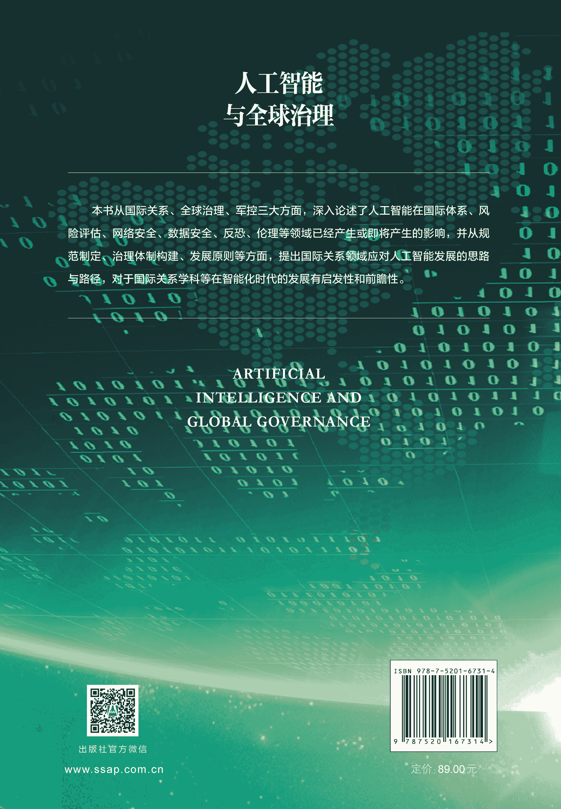