# AI 与诊疗融合全景

## 内容概览
本书是面向诊疗行业的一部权威参考与实操手册。全书以当下视角回溯智能技术在医学领域的演进，并从技术能力、落地场景、典型案例、投入结构、人才供给等维度展开系统梳理。随着AI厂商加速把产品推向临床，细分病种与场景的研究持续下沉，智能方案已深度嵌入诊疗全流程，商业模式逐步清晰，应用边界不断外推，设想正在被兑现。

书中重点呈现智能技术在医学市场的布局图谱，拆解国内外头部企业的最新成果，并收录真实前沿的投资案例，帮助读者把握产业转化的方向与资金热点。与此同时，监管框架也在同步健全，政府的监管思路愈发明确。

全书以行业视角描绘中国AI与诊疗的现状与下一步研发重点，适合医疗系统的政府部门、企事业单位的管理者与从业者阅读。

## 引言
你是否能接受由智能机器人为你体检、开方甚至手术？想法各异，但在可预见的未来，这类场景很可能成为常态。

从阿西莫夫1950年的科幻短篇《我，机器人》到动画《超能陆战队》里的护理机器人大白，人类一直期待机器具备理解、推理与学习能力并更好地服务人类。如今的AI与机器人技术已接近《大白》或《星际迷航》里“三录仪”的水准，能对人体进行扫描、排查异常并辅助医生干预。智能概念在1956年达特茅斯会议上首次被正式提出，作为信息技术分支，它早在四十多年前就已实验性地参与医疗行为。1972年，利兹大学研发了医学领域最早的智能系统，主要用于腹痛辅助诊断与手术相关支持。

在基础技术成熟后，智能已进入可用阶段。

作为一次技术升级，AI能迅速汇总行业数据与既有知识，为决策提供支撑。功能上主要有两点：一是借助极快学习速度对过往知识归纳判断；二是基于历史经验做出决策，从而显著提升正确率。总体来看，AI在效率与准确度上明显优于主观人工判断。

智能萌芽于六十多年前计算机诞生之初，科学家当时就已探讨可能性，但受硬件、数据与算法基础条件的制约，长期难以落地。如今算力、算法与大数据基础设施全面提升，技术验证基本完成，开始在各行各业落地。汽车、金融、教育、医学、农业等领域与AI融合逐步产生商业价值，并在生产力层面重塑传统行业。

各行业对智能的依赖度在持续提高。不同领域的共性优势主要体现在两方面：高效辅助决策和运营优化。以医学为例，AI可辅助医生诊断；在金融领域可辅助自动交易；在管理层面，AI可助力医院运营优化，零售领域则可优化库存与交易流程。

从现有应用看，AI更多承担决策与优化功能。随着演进，预测或许才是更大价值。例如医学可借助AI预判疾病发生概率，提前开展预防；农业可借助AI判断天气与需求，提前防范风险。当下已有大量实验性产品涌现，商业化验证仍在进行中。

智能与医学的结合带来了业务模式、效率与准确度的明显改变，关注度持续攀升。未来具备辅助诊断与治疗功能的AI产品和机器人将大量出现在身旁，补充并完善现有医疗服务。

通过采集行业大数据，AI借助深度学习与算法洞察关键决策点，其计算速度与准确性均高于人类。目前在医学影像识别领域，AI的能力已接近高年资医生，且只需数秒完成。现实中培养一名影像医生需数年乃至数十年，且单例判读常需数十分钟。AI的介入可大幅节省培养成本并显著提升工作效率，价值巨大。

不过新技术在发展中仍面临质量、准入与成本等挑战。研发者、使用者、政策制定者与支付方都需要思考：AI医生的定位是什么？人类医生的作用如何？AI企业的商业模式怎样建立？本书正聚焦这些核心问题。

2017年9月，动脉网蛋壳研究院发布《2017医疗大数据和人工智能产业报告》，回顾了医疗人工智能的来龙去脉，对能力、应用场景、成本结构与人才情况进行了深度剖析，为产业人士与监管机构提供了重要参考，引发广泛讨论。

进入2018年，企业纷纷将产品推向临床，针对细分病种与医疗场景的研究不断深入，智能产品已融入医疗流程的方方面面。涵盖药品研发、疾病诊断、疾病治疗、医生科研、医院管理等多个场景。经过几年发展，部分产品基本成熟，商业模式逐渐清晰，技术在医疗领域的边界持续扩展，运行流程出现诸多创新尝试。

与此同时，监管部门紧跟技术节奏，积极参与产业升级，监管思路日益明晰。中国食品药品检定研究院已完成眼底糖网彩照、肺结节影像数据库建设，相关三类送审产品已超30款，预计不久即可上市。动脉网蛋壳研究院对主要人工智能医疗企业进行调研，并访谈了参与产品研发与使用的医生，以行业视角呈现我国医疗人工智能的现状与后续研发方向。

## 绪论
### 智能演进脉络

#### 0.1 脑力解放：智能驱动的新一轮工业跃迁
近代社会高速发展得益于三次工业革命：第一次以蒸汽机改良为标志，第二次以电力普及为标志，第三次以计算机发明与应用为标志。三次革命深刻改变了生产生活方式、社会结构乃至世界格局。

以智能为代表的智能互联网被视为第四次工业革命的核心驱动力。前三次主要解放体力，本次革命解放的是脑力。

社会生态由底层技术、其上形成的社会关系以及调控运行的规则机制共同构成。域即一个时期技术、方法与实践的集合。当域内关键技术渐进并发生根本性改变，旧域便跃迁至新域，经济运行模式随之达到新的稳定，这一过程被称为重新域定。

智能最初只是计算机科学的一个分支，但在数十年演进中催生出自我学习的关键技术——深度学习，由此形成新的技术领域并出现变异。如晶体管取代电子管引发电子技术的变异，深度学习出现后人工智能也发生了变异。

新域产生后如何影响经济？

首先，新技术会降低传统生产方式的成本，成本下降会波及整个行业，进而重塑价格与生产网络。例如计算器降低算术成本，数码相机降低摄影成本。AI可降低对未来进行预判的成本。诊治中风患者时，医生需结合CT影像和病史信息综合判断，而智能医疗可瞬间输出最佳辅助方案。

其次，新技术的广泛采用会推动经济模式的扩展性调整。如炼钢技术升级降低钢铁价格并带动众多工业发展，电气化渗透各行各业催生新生产结构。AI显著提升各行业执行效率、降低运营成本，缓解人类重复性脑力劳动压力。提取、筛选并重组各行业所需内容与技术，有可能催生次级产业，最终完成经济的重新域定。

AI正处于域生命周期的青春期，逐步解决发展中遇到的问题。未来经济与技术域都将在AI冲击下发生颠覆性改变。旧域到新域的转换rarely一蹴而就，通常需20年甚至更久。AI虽已诞生60余年，却直至今日才真正崭露头角。

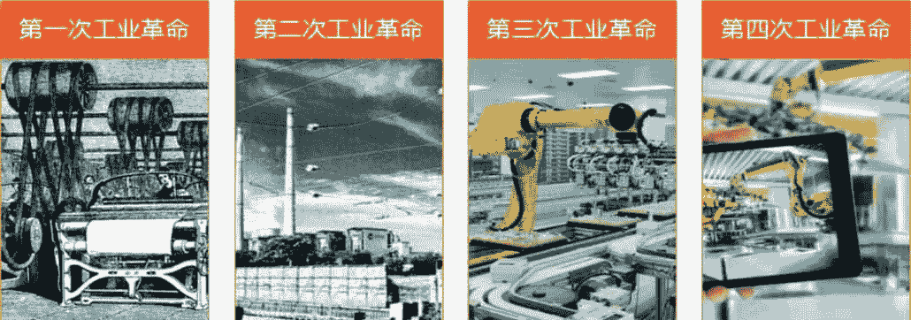
图 0-1 四次工业革命

#### 0.2 六十年演化：从设想到拟人智能
智能诞生已逾60年。从第一台计算机诞生起，科学家便试图弄清机器是否具备真正的智能，以及如何区分有意识的人类与无意识的机器。

智能的奠基人被视为计算机科学之父与人工智能之父的英国数学家阿兰·图灵。1950年，他在论文《计算机器与智能》中提出图灵测试：若计算机能在5分钟内回答人类测试者的一系列问题，且超过30%的回答让测试者误以为是人类作答，则认为机器具有智能。

智能概念在1956年达特茅斯会议上首次被真正确立。斯坦福的约翰·麦卡锡、麻省理工的马文·明斯基、卡耐基梅隆的赫伯特·西蒙与艾伦·纽厄尔等后来获得图灵奖的科学家，以及信息论创始人克劳德·香农与IBM的罗切斯特，共同提出让机器像人一样认知、思考与学习，即用计算机模拟人类智能。

此后研究持续推进。早期人们希望打造具备人类智慧的复杂机器，即强人工智能，也称通用人工智能。但受技术限制，计算机长期未能取得突破，类人机器仅存在于科幻。

自20世纪70年代起，人工智能出现了7类典型应用，但这些都属于弱人工智能，远未达到人类智慧水平。

第一，机器定理证明。核心是计算机逻辑推理，后扩展至非逻辑推理。
第二，机器翻译。核心是自然语言理解。
第三，专家系统。核心是求解与知识表达。
第四，博弈。核心是树搜索，后扩展至语义渗透神经网络。
第五，模式识别。包括图像识别、声音识别。
第六，学习。深度学习已成为重要分支。
第七，机器人与智能控制。强调感知与控制。

在20世纪50至70年代，人工智能主要解决小型数学与逻辑问题。研究者认为具备逻辑推理能力即具智能。代表人物艾伦·纽厄尔与赫伯特·西蒙共同开发了早期启发式程序“逻辑理论家”，该程序于1963年证明了罗素与怀特海名著《数学原理》中的52条定理。

1959年，美国阿瑟·塞缪尔设计了一个具有学习能力的下棋程序，该程序在对弈中不断改善棋艺。4年后击败设计者本人，3年后又战胜一位保持8年不败的常胜将军。该程序展示了机器学习能力，也引发诸多社会与哲学思考。

然而仅靠逻辑与推理远远不够，人工智能无法在行业中落地，研究随后陷入沉寂。直到20世纪70年代末，计算机存储容量提升，深度学习等算法发展，机器才具备处理海量数据的能力，人工智能开始用于解决行业问题。

于是进入“知识工程”时期，即专家系统。专家系统将行业专家的经验规律编码进程序。1972年，用于传染性血液诊断与用药选择的专家系统MYCIN研发成功，成为后续研究的基础。专家系统的出现使计算机能从大量数据中找到解题方法，与行业结合日趋紧密。

但专家系统同样遭遇瓶颈。将全部人类知识植入机器需要大量专家与时间投入。当时系统多用LISP编写，解释型语言在速度上逊于编译语言C，使用不便。随着个人计算机兴起，专家系统的热度逐渐退去，人们开始思考让机器自行归纳知识，即机器学习。

20世纪90年代末，IBM超级计算机“深蓝”击败国际象棋冠军加里·卡斯帕罗夫，让人工智能重回公众视野，但此时水平仍不足以支撑大规模商业化。历经多次波峰波谷，直到2006年深度学习技术突破，人工智能才迎来令人振奋的进展。

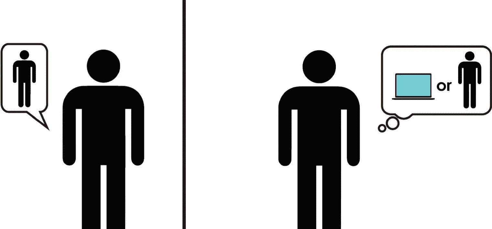
图 0-2 图灵测试

图 0-3 机器学习之父阿瑟·塞缪尔

图 0-4 1997年IBM“深蓝”大战卡斯帕罗夫

[1] MYCIN：一种帮助医生对住院血液感染患者进行诊断并选用抗生素进行治疗的人工智能早期模拟决策系统。

#### 0.3 两次寒冬：倒逼范式转换
智能发展历程如图0-5所示。

第一次浪潮出现在1956—1974年。期间算法与方法论取得新进展，包括增强学习的雏形贝尔曼公式，以及感知器等深度学习模型的雏形。

第一次寒冬出现在1974—1980年。人们发现逻辑证明器、感知器与增强学习只能处理极简单、极窄域的任务，超出范围便无能为力。制约主要来自计算机性能瓶颈、复杂性增长与可供学习的知识不足。数学模型被认为存在缺陷，计算机缺乏足够数据库支撑训练，智能无从谈起。项目停滞影响资金走向，人工智能陷入数年低谷。

第二次寒冬由1987—1993年个人计算机的兴起加剧。20世纪80年代数学模型出现重大发明，包括著名多层神经网络与反向传播算法，同时出现了能与人类下象棋的高智能机器。苹果、IBM开始推广第一代个人电脑，其费用远低于专家系统所用的Symbolics与LISP等机器。美国政府支持经费下降，人工智能再次进入冷淡期，虽有研究延续，但话题鲜被提及。

21世纪初，随着互联能力、大数据、计算与存储性能及传感器技术的跃升，加上图像识别、深度学习与神经网络等关键算法的突破，人工智能迎来革命性发展。AI从依赖专家规则转向从海量数据中自动发现规则。

2006年，多伦多大学杰弗里·辛顿教授发表《基于深度置信网络的快速学习算法》，提出的深层神经网络逐层训练方法使当时的模型训练成为可能，并以优异实验结果重新点燃关注。此后深度学习被引入自然语言理解与图像处理，并借助强大算力投入生产生活，产生显著经济效益。

2016年，谷歌阿尔法狗与李世石的对弈让人工智能重回大众视野。其神经网络模型结合人类棋谱与自我对弈的强化学习模式进行训练。即使发展至今，人工智能仍属弱人工智能，只能在特定任务上超越人类。

在大背景下，人工智能变革不仅在理论研究，也在与真实场景结合。医疗健康应用涵盖医学影像处理、医疗大数据分析、新药发现、健康管理等多个方面。基于机器视觉的影像处理是当前热点，谷歌、微软等大型IT企业及斯坦福、哈佛等高校均设有专门团队研究机器理解医学影像并辅助诊断。IBM的认知系统Watson在阅读百万级专业文献与电子病历后，已在多家医院投入使用。

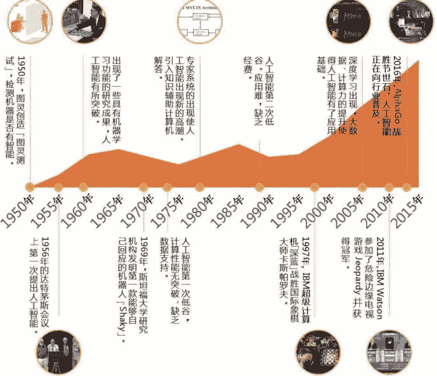
图 0-5 人工智能发展历史

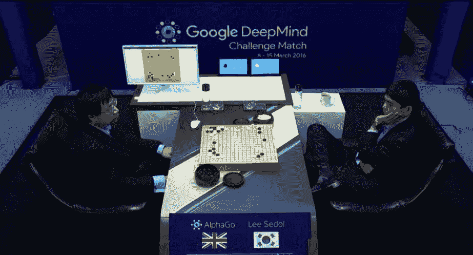
图 0-6 谷歌阿尔法狗和李世石的对弈让人工智能重回大众的视野

[1] 多层神经网络：即多层感知器，是一种前向结构人工神经网络，可将一组输入向量映射到一组输出向量。由多层节点组成，每层全连接至下一层。
[2] 反向传播算法：BP算法，监督学习算法，常用于训练多层感知机。其在有导师指导下，基于梯度下降法进行学习。

\[3\] Symbolics 与 LISP：1985 年 3 月 15 日，计算机厂商 Symbolics 完成了 Symbolics. 域名的备案。该公司源自麻省理工学院人工智能实验室的 spin-off 团队，核心业务是 LISP 计算机的设计与制造。1981 年面世的 Symbolic 3600 是其标志性产品。此类设备为单用户架构，并在 LISP 编程语言上做了深度优化，因而被视为商用通用计算机与工作站的开端。

# 第 1 章

## 医疗 AI：从感知到决策

AI 的本质是让机器具备感知、学习、推理并参与决策的能力，从而以接近人类的方式解决复杂问题。过去的计算机只能执行预先写死的流程，拥有上述能力后，系统理解世界与交互世界的方式变得更敏锐、更自然。

### 1.1 核心技术脉络：机器学习与深度学习

谈及 AI，机器学习和深度学习总是被放在一起讨论。两者是包含关系，深度学习则是当前推动智能化加速的关键引擎。

机器学习可看作通向智能的基础路径，它从历史数据或经验中归纳规律，不依赖硬编码或先验规则。传统程序为特定任务写死逻辑，而机器学习则通过海量数据训练，让模型自行学会任务完成方式。

机器学习早期活跃于人工智能萌芽期。代表方法有决策树、归纳逻辑规划、聚类、强化学习、贝叶斯网络等。受算力、样本规模等限制，早期系统局限性大、智能化程度低，难以落地。

深度学习是机器学习的子分支，也是当下发展的驱动力之一。它以人工神经网络为载体，核心在于分层特征学习——利用多层网络逐级提取层次化表征，从而摆脱人工手工设计特征的瓶颈。

杰弗里·辛顿与学生鲁斯兰·萨拉赫·胡迪诺夫在《科学》上发表的研究开启了新篇章。文章提出两点判断：其一，多隐层网络在特征学习上更优，所学表征更能刻画数据本质，有利于可视化与分类；其二，训练难度可通过逐层初始化缓解，文中以无监督方式实现。

该概念源于人工神经网络的研究。两者共享分层思想，差异在训练机制上，深度学习具备更强的表达力。传统神经网络曾一度流行，后因参数调优困难、训练缓慢而沉寂。随后深度神经网络重返前沿，深度信念网络、稀疏编码、递归神经网络、卷积神经网络等模型相继涌现，其中 CNN 在图像识别领域最具代表性。

近年算力与存储同步提升，大数据时代到来。深度学习作为增强学习能力的技术配合海量数据，让过去难以实现的复杂算法成为现实，结果精度也明显提高。

### 1.2 三大支柱：算法、算力与大数据

算法、算力与数据是 AI 快速发展的三大支柱，三者互为前提，缺一不可。

算法突破带来商业化可能；算力提升使复杂模型可落地并加速迭代降本；数据规模扩大则为模型训练提供养料。

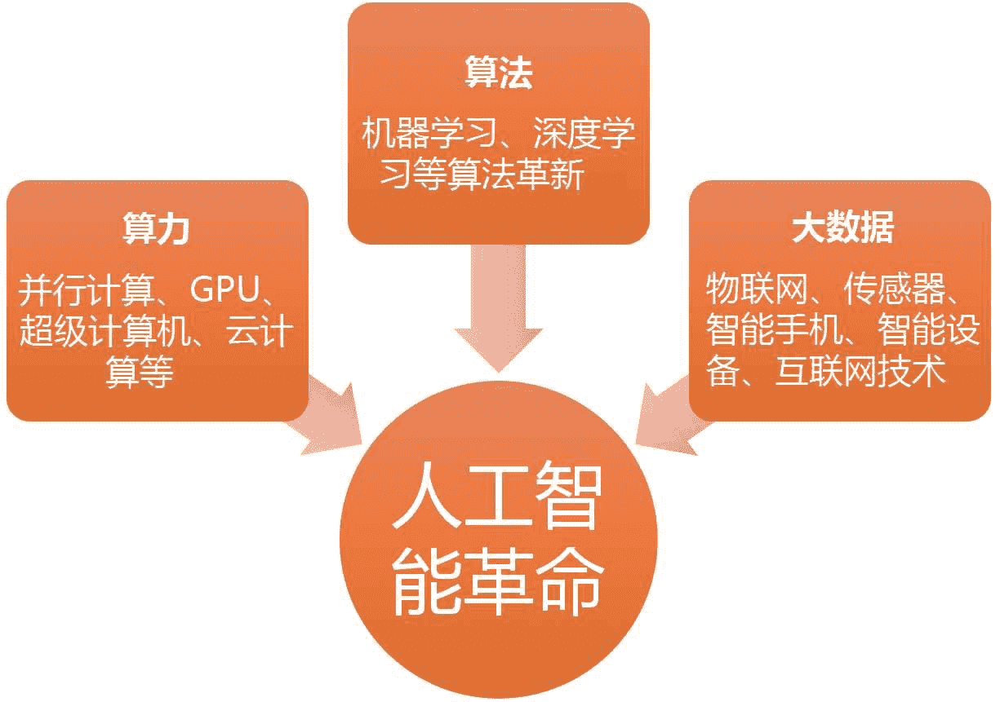

图 1-1 人工智能发展的 3 个要素

#### 1.2.1 算法生态

算法是 AI 的基石，当下以深度学习为主。TensorFlow、Caffe、Torch^(\[1\]) 等框架已开源，成为工程师的主流选择，对行业增速与人才培养作用显著。

开源生态成熟后，中国企业可迅速复用海外成果。在应用层面，中国算法整体水平与国际差距不大，尤其在语音识别方向取得突破性进展，处于领先位置。

#### 1.2.2 算力底座

算力是 AI 的基础设施，具备高度战略价值。GPU 的并行能力大幅提升性能并降低成本。以英伟达 RTX 2080 游戏卡为例，浮点性能约 9 TFLOPS^(\[2\])，售价约 700 美元，每 GFLOPS^(\[3\]) 成本约 8 美分。

据高盛测算，1961 年的 IBM 1620 若提供 1GFLOPS 算力，需花费约 9 万亿美元。算力供给主要由英伟达、英特尔、AMD 提供。硅谷也在推进 FPGA 与 ASIC 在 AI 计算中的应用，云计算与超算同样提供支撑。

#### 1.2.3 数据供给

机器学习依赖数据与经验来优化性能。大数据时代，全球数据量激增。据 IDC，2011 年全球数据总量达 1.8 ZB，按每两年翻倍增长，预计到 2020 年累计达 35 ZB，增幅近 20 倍；产业规模方面，预计到 2020 年全球大数据产业规模约 2047 亿美元，我国规模突破万亿元。

AI 系统需靠大量数据训练才能提升输出质量。高质量数据越多，神经网络效率越高。如今国家统计部门的人口数据库借助大数据实现互联互通，形成覆盖全生命周期的医疗健康大数据，为 AI 在医疗健康的应用提供支撑。

训练数据从何而来，主要有三类。

一是企业自有数据。通过人力采集并结构化，形成训练基础。多数 AI 企业在切入前已在各自领域积累了海量行业数据。

二是政府公共数据。美国 Data.gov 平台开放 13 万余个数据集，涵盖医疗、商业、农业、教育等。中国及其他国家也在逐步开放。

三是产业合作数据。创业公司与行业公司及上游数据商合作获取数据，如医疗领域与医院合作。IBM Watson 最初即通过与纪念斯隆—凯特琳癌症中心 MSKCC^(\[4\]) 合作获取病历与文献。

AlphaGo 在规则明确的环境下通过自弈产生大量棋谱。但在真实复杂场景中，模拟数据效果有限。自动驾驶或疾病诊疗需要大量真实交通事故与病历，供给稀缺且采集难度高。

数据不足时不仅削弱深度学习优势，还会带来数据类型不匹配。物理世界依赖多传感器实时流，而图像识别等信息世界任务使用的是离散图片点，这也是将现有成果迁移到物理世界的底层障碍。

降低数据需求、实现小样本学习乃至 One-Shot Learning^(\[5\]) 是当前研究重点。延恩·勒昆、约书亚·本吉奥等专家多次强调其重要性。但在未来两三年内，小样本技术难以成熟，仍需大量真实数据支撑。

\[1\] TensorFlow、Caffe、Torch：深度学习框架的类型。全世界最流行的深度学习框架有 Tensorflow、Caffe、Theano、MXNet、Torch 和 PyTorch。
\[2\] TFLOPS：每秒 1 万亿次的浮点运算次数。
\[3\] GFLOPS：每秒 10 亿次的浮点运算次数。
\[4\] 纪念斯隆—凯特琳癌症中心 MSKCC：世界上历史最悠久、规模最大的私立癌症中心。
\[5\] One-Shot Learning：属于迁移学习领域，主要研究的是网络小样本精准分类问题和单样本学习能力。

### 1.3 应用全景：产业链、场景与价值

#### 1.3.1 人工智能产业链解构

AI 产业链通常分为基础层、技术层、应用层，数据因重要性单独列出，与基础层并列。

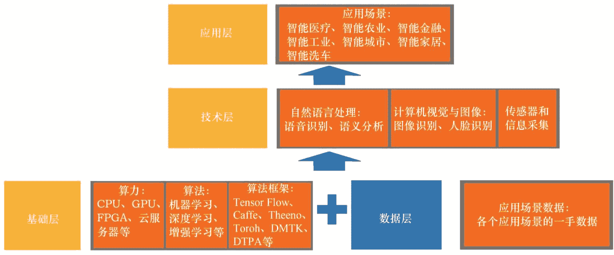

图 1-2 人工智能产业链布局

##### 1．基础层
涵盖算力、算法与算法框架。算力包括 GPU、CPU、FPGA、NPU 等芯片及云服务器；算法包括各类深度学习算法；框架包括 Tensor Flow、Caffe 等。

##### 2．数据层
为各场景提供一手数据。大数据时代，各行业数据体量巨大、类型多样，可批量快速流转。医疗主要为病历、影像、健康数据等。

##### 3．技术层
包括语音识别、语义分析、图像识别等算法，以及各类传感器技术。

##### 4．应用层
是 AI 的具体落地场景，如智能医疗、智能农业、智能金融、智能工业、智能城市、智能家居、智能汽车等。只有与生活场景结合并规模化应用，AI 才能对传统行业产生生产力层面的变革。

#### 1.3.2 行业发展落地方案

拆解应用层即可回答 AI 能做什么。

图像识别错误率已低于人类，语音识别等自然语言处理已在日常生活中广泛使用，如 Siri、Echo、阿里 YunOS 个人助理+、阿里小蜜、支付宝安娜等。结合传感器与驱动器，AI 可融合高精度地图与环境感知实现感知与行动。机器人、无人机、自动驾驶等设备已投入使用。

表 1-1 人工智能在各行业中的应用

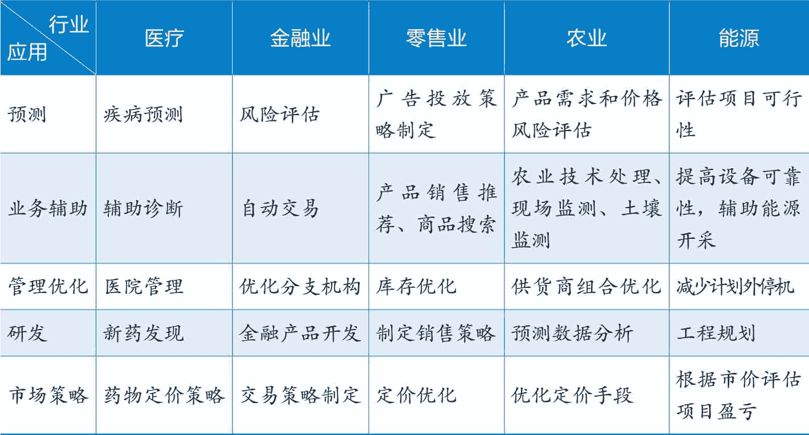

#### 1.3.3 应用核心优势

AI 在各行业的切入点主要体现在两大辅助角色：运营优化与辅助决策。

## 1. 运营优化
AI 通过图像、语音、物联网等传感器采集数据，分析运营问题并给出优化建议。例如医疗领域监测医院人流、手术量、医护排班并提供管理建议；金融领域分析项目收益并提出改进；零售业监控区域销售品类并建议库存优化。

## 2. 辅助决策
AI 通过大数据采集提升决策效率并降本。全面收集信息后用深度学习洞察关键决策点，其速度与准确性高于人工。例如医疗影像识别可快速判断肿瘤风险；农业中借助土壤、天气、卫星图像决定种植、灌溉与施肥时机；金融借助历史与财务数据完成风控与交易。在医疗健康领域，AI 应用场景日益丰富，已成为推动行业发展与服务升级的重要力量。与互联网不同，AI 对医疗的改造覆盖生产力提升、生产方式改变、底层技术驱动与上层应用丰富。

AI 在医疗带来的好处包括：

① 提升诊断准确率与效率；
② 提高患者自诊比例，降低对医生的依赖；
③ 辅助病变检测，实现疾病早期筛查；
④ 大幅提升新药研发效率，降低研发周期与成本。

### 1.4 融合前沿：AI 与医疗的深度结合

AI 发展如火如荼，医疗健康创业尤为活跃。医疗最突出的矛盾是优质资源不足，同时医生诊断准确度与效率仍有提升空间。随着老龄化加深，对医生需求持续攀升。单纯增加供给周期长且有限。

人们因此寄望机器。一旦机器可替代部分看病，供给将呈无限化。AI 与医疗健康的结合是 AI 最重要的应用方向之一。

#### 1.4.1 发展历程回溯

1972 年利兹大学研发的 AAPHelp 是文献记载中医疗 AI 最早的系统，基于贝叶斯决策理论，用于腹部剧痛辅助诊断与手术需求。

同年，斯坦福大学诞生 MYCIN。该专家系统由医生输入患者信息，给出致病菌种类与用药建议。核心是约 600 条诊断规则，系统给出致病菌排序、置信度与依据。研究显示其准确率达 69%，高于依据相同规则的医生。

MYCIN 未在医院推广，准确率偏低是一因，更主要的是软硬件限制。当时缺乏成熟办公软件，更不用说云计算。医生需花费 30 分钟以上录入答案，时间成本影响诊疗。

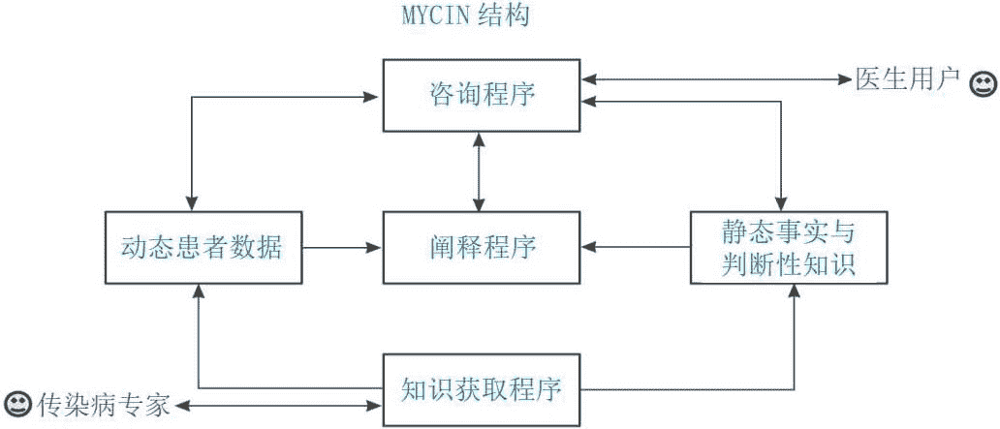

图 1-3 MYCIN 专家系统原理图

20 世纪 80 年代出现商业化系统，如 Quick Medical Reference QMR，以及哈佛医学院开发的 DXplain，主要依据临床表现提供诊断方案，其知识库收录 2000 多种疾病与 5000 多种症状。

80-90 年代，随着个人电脑普及，医疗进入信息化时代，但应用多限于信息记录、病历管理、医院管理，无法提供诊断意见。90 年代末，计算机辅助诊断 CAD 系统出现。乳腺 X 线摄影 CAD 是较为成熟的医学影像应用，欧美已研究近 20 年。经 CAD 处理后，肿瘤、结节、空洞、炎症及纤维化病变的检出率均提高。

CAD 主要基于医学影像，多局限于乳腺与胸部肺结节。CAD 可在图像上自动标注病变，但未引入人工智能，无法通过自学习提升准确度。

2007 年 IBM 发布以创始人托马斯·约翰·沃森命名的系统 Watson，具备自然语言理解与精确问答能力，技术涵盖自然语言处理、计算机视觉、知识表示、自动推理、机器学习与训练。

2011 年 8 月 Watson 切入医疗，成立沃森健康。例如在肿瘤治疗方面，至 2015 年已收录 42 种医学期刊、60 多万条临床试验证据与 200 万页文本。此后 IBM Watson Health 参与慢病管理、健康监测、新药研发、白内障手术、液体活检等研究并实现商业化。

2016 年 2 月，谷歌 DeepMind 成立 DeepMind Health，与英国 NHS 合作辅助医生决策。在皇家自由医院试点中，开发 Streams 软件作为血液测试 AKI 报警平台，帮助临床医生更快查看结果。

2016 年 7 月，DeepMind 与 NHS 再次合作，与 Moorfields 眼科医院共同开发基于眼部扫描图识别视觉疾病早期症状的机器学习系统，实现提前预防。

#### 1.4.2 未来演进方向

AI 辅助医疗健康可带来颠覆性改进。

科技辅助医疗发展的 3 个阶段如图 1-4 所示。

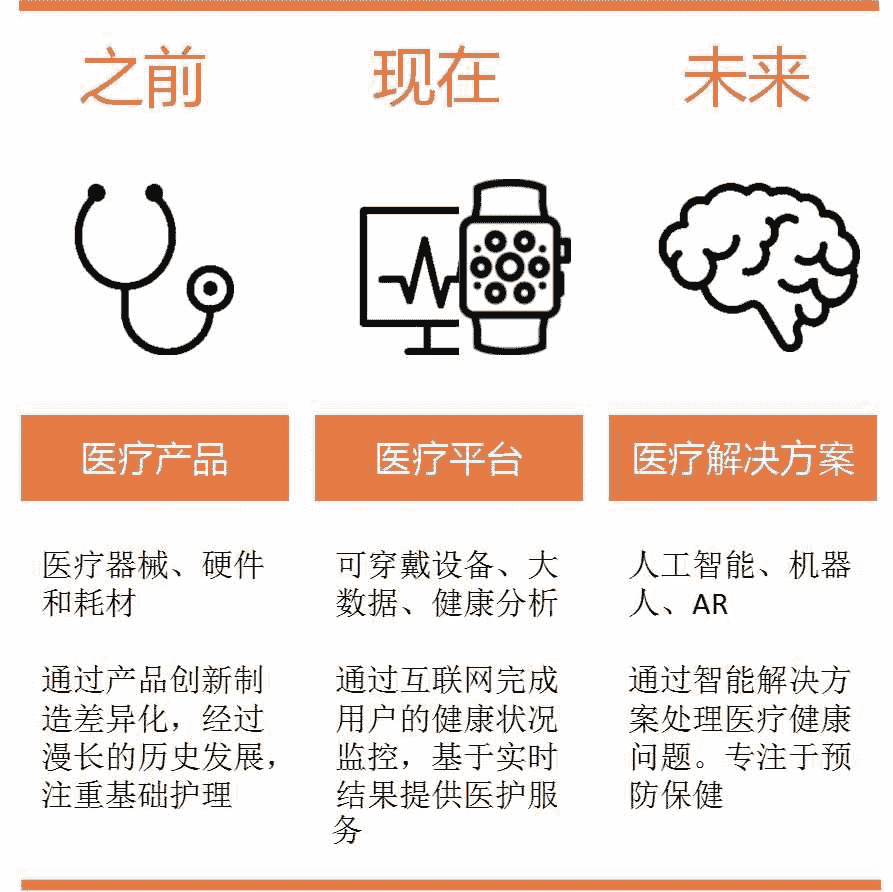

图 1-4 科技辅助医疗发展的 3 个阶段

AI正深度嵌入学健康服务全流程，重塑就医体验，主要体现在六个维度。首要体现是辅助临床人员加速诊断、提升判断精确度，并在一定程度上缓解医生供给紧张。第二个维度是推动患者更多开展自我筛查、自我判断与自我管理，从而削弱对医生的依赖并压缩支出。第三个维度是助力病症早期捕捉，降低后续治疗负担。第四个维度是提升机构与医生的整体运行效率，推动医疗费用下行。第五个维度是优化医院内部治理，遏制不必要的开支。第六个维度是为研发端挖掘更具价值的新药提供支撑，同时为临床提供个体化分析依据以优化方案。

总体看，AI与医疗的融合在提升诊疗质量、压降整体成本的同时，也在持续放大公众对AI重塑生老病死的想象空间。

###1.4.3 AI医疗能力边界持续扩散
AI医疗能力圈识别如表1-2所示。

表1-2 人工智能医疗能力圈识别

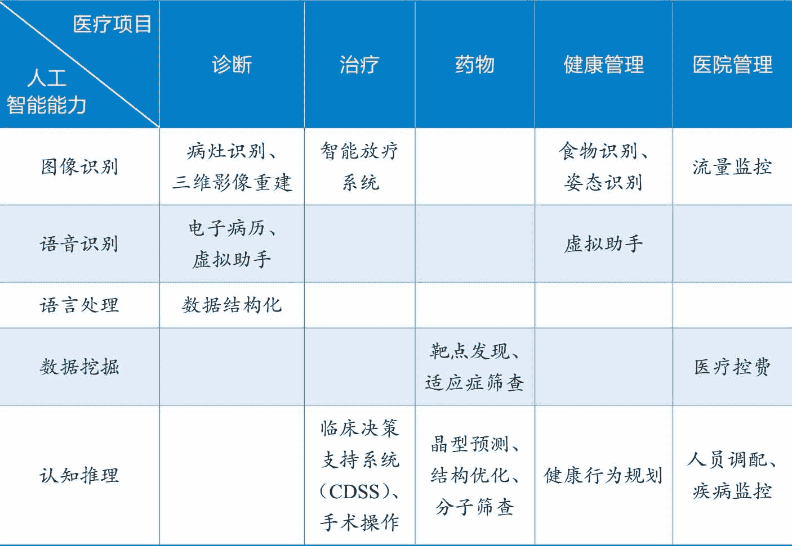

把这些能力迁移到临床场景，AI医疗系统能够呈现多元对话形态，促进信息在个人间的高效流动。它可以与人自然交流，结合病史理解患者的真实状况，并据此为机构提供更具吸引力的个性化照护建议。

在服务商支持的AI系统里，用户可进行医疗对话、提交健康数据、获取健康收益等交互，系统还能迅速、准确地回应复杂的医学提问。通过构建动态且个性化的健康体验，AI医疗系统帮助用户以自我为中心做出更明智的健康决策。

AI还能挖掘出即便是顶尖人类专家也可能忽略的洞见，对全球海量的可用信息进行发掘与分析。以医学研究为例，相关信息体量庞大，借助高级AI能力，研究周期已被大幅压缩，由数月级缩短至数分钟级。

同时，AI可以处理海量的医疗与患者信息，让医生把更多精力留给床边。基于综合信息的辅助建议能支持决策、减少人为偏误，并在新的信息、结果与操作中持续学习，帮助医疗专业人员做出更明智、更及时的判断。AI几乎没有边界，这也意味着医疗AI的能力圈正不断被拓展，且这一过程已经在发生。

[1] 贝叶斯决策理论：是主观贝叶斯派归纳理论的重要组成部分。 贝叶斯决策就是在不完全情报下，对部分未知的状态用主观概率估计，然后用贝叶斯公式对发生概率进行修正，最后再利用期望值和修正概率做出最优决策。

[2] DeepMind：位于英国伦敦，是由人工智能程序师兼神经科学家戴密斯·哈萨比斯(Demis Hassabis)等联合创立的，是前沿的人工智能企业，其将机器学习和系统神经科学的最先进技术结合起来，建立起强大的通用学习算法。目前，Google旗下的DeepMind已经成为AI领域的明星。

#第2章 实践版图：AI与医疗融合的九大赛道
AI切入医疗的方式非常多元。若按就医流程看，覆盖诊前、诊中、诊后各环节；若按服务对象看，面向患者、医生、医院、药企等多类角色；若按商业模式看，则有提效、降本等不同路径。本章按具体业务模式拆解，重点介绍虚拟助手、疾病筛查与预测、医学影像、病历文献分析、医院管理、智能化器械、药物发现、健康管理、基因检测共九个方向。

##2.1 虚拟助手
虚拟助手是一种可与人沟通交流的辅助机器人，依托AI理解意图、把握需求并输出知识信息，助力生活与工作。

大众熟知的通用型助手如苹果Siri、微软Cortana、亚马逊Alexa、谷歌Assistant、脸书M等，均借助自然语言处理实现语音与语义识别，结合优化的决策算法完成人机互动。用户可直接用语音或文字表达问题、愿望与需求，从助手反馈中获得答案。

交互方式上，通用助手以语音和文字为主，语音识别是核心技术。医疗类虚拟助手则额外采用选择题交互，因为普通人难以用精准语言描述症状，选择题更易降低沟通成本。

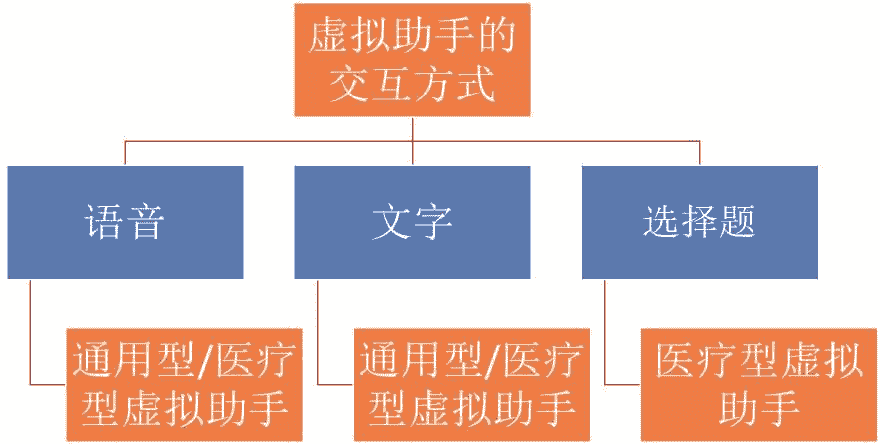
图2-1 通用型虚拟助手和医疗型虚拟助手的交互方式区别

调研机构VoiceLabs在其公布的《2017年语音产业报告》中指出，语音产业将按照硬件产品、人工智能软件、语音应用App、生态系统服务相结合的生态链出现。在硬件层面，主要由Amazon Echo和Google Home两家产品瓜分市场。

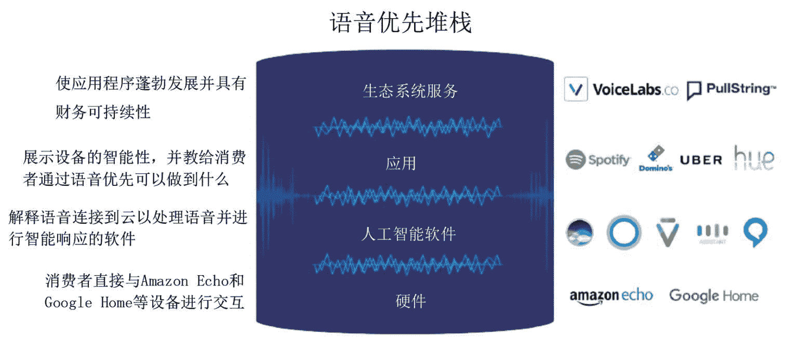
图2-2 语音虚拟助手生态

2017年全球性的市场调查咨询公司Markets and Markets的报告中显示，2016年的智能语义识别和语音识别市场份额达到了51.5亿美元，预计到2023年，这一市场份额将增长至183亿美元，年复合增长率为19.8%。在移动设备上基于语音生物识别系统身份验证需求的增加，以及人工智能在语音识别和语义识别准确性上的发展，显著推动了市场份额的增长。

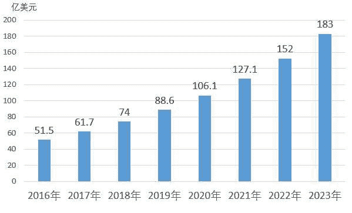
图2-3 语音识别市场容量

在各垂直细分领域中，汽车、银行、金融服务和保险、零售、教育、医疗保健等方面都有较广泛的应用，而属于医疗领域的语音识别市场并不靠前。一份来自亚马逊Alexa的数据显示，个人用户在使用语音识别设备时，医疗健康的语音需求排名第9。医疗型虚拟助手和通用型虚拟助手类似，又有所不同。

医疗方面虚拟助手的数据库范围局限在医疗领域。通用型虚拟助手和医疗型虚拟助手相同的地方是它们采用类似的信息输入和输出方式，实现的功能一样。不同的是，通用型虚拟助手的数据库范围更广，医疗型虚拟助手提供的是更加复杂和谨慎的专业医疗服务，需要受到严格监管；通用型虚拟助手上市时间早，资本支持度高，数据规模大，而医疗型虚拟助手的专业属性强、监管风险高。

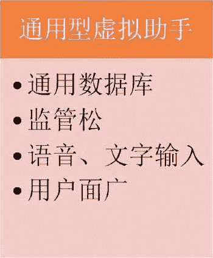
图2-4 通用类虚拟助手和医疗类虚拟助手的区别

根据虚拟助手的服务对象进行分类，可以把虚拟助手分成3个类别，分别是使用者是患者的虚拟助手，包括个人问诊、用药咨询等应用；同时联结医患双方的虚拟助手，包含智能导诊、分诊机器人和慢病管理等应用；使用者是医生的虚拟助手，包含电子病历语音录入等应用。

图2-5 虚拟助手图谱

###2.1.1 个人问诊、用药咨询
在工作模式方面，个人问诊和用药咨询的第一个步骤是自然语言处理，也就是听懂患者对症状的描述，知道患者哪里不舒服。用户可以通过语音或者文本两种模式来输入信息。通过自然语言处理之后，再根据疾病数据库、医疗信息数据库或者外部的医疗数据库进行对比和深度学习，对患者提供医疗和护理建议。

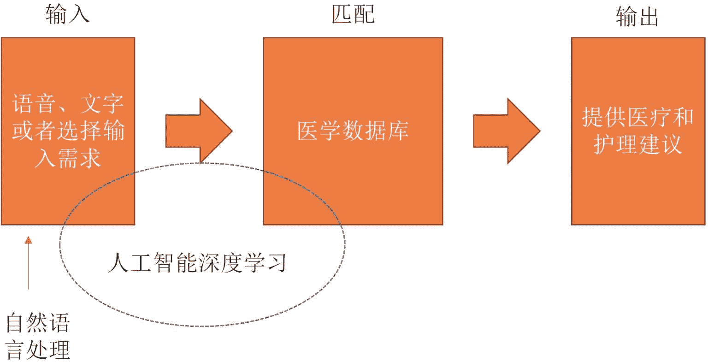
图2-6 人工智能参与虚拟助手的部分

单独的医患服务是需要较高的人力成本和时间成本的。普通大众有时候仅仅需要一些快速和低成本的医疗建议，虚拟助手可以很好地满足这个需求。个人健康咨询的轻问诊和用药咨询都可以很好地依靠AI来完成。

用户在身体不适的时候，并不是每次都会去医院或者诊所就诊。在这种情况下，人工智能可以让患者对自己身体疾病的判断更便捷、更准确，基本定位身体的健康问题。不管是相较于到诊所挂号诊疗，还是到药房寻求药师指导，医疗虚拟助手提供的轻问诊服务在可及性、便利性上都占有较大优势。

虚拟助手除了可以控费外，还拥有完整的医学基础数据库。医生无法医治所有的疾病，而人工智能理论上可以做到，因此完全可以成为医生的得力助手。全科医生有两大职能，分别是首诊和分诊。目前，我国全科医生还很紧缺，而虚拟助手可以在医生不擅长的领域提供更好的建议。

在目前的分级诊疗中，社区医疗的发展瓶颈很大程度上在于全科医生的数量不足及诊疗经验的不足。过去我国全科医生的发展有一段停滞期，到2011年以后才开始逐步推进。人工智能语音助手也可以帮助全科医生快速做小病的筛查，以及重大疾病和传染病的预警，帮助他们做好转诊工作，这是其对于全科医生的价值所在。

虚拟助手还可以降低互联网医疗企业的业务成本，通过远程和人工结合的方式形成流量导流。虚拟助手产品并不一定完全依赖机器来回答问题，一旦由人工智能无法解决，或者病情变化需要医师干预的时候，就可以由人工介入。这样一方面可以完善人工智能虚拟助手的服务，另一方面也可以提升自身产品的体验，增加卖点，提高用户黏度，提升转化率。

####1. 问题和挑战
首先，医疗型虚拟助手的发展应受到严格监管。医疗责任主体不明，法律未针对虚拟助手等人工智能诊疗手段进行细化明确，监管部门禁止虚拟助手提供轻微疾病的诊断和重症的任何建议。

其次，因为患者并不完全了解自己身体所出现的状况，主诉表达的时候会漏掉一些关键信息，同时咨询的时候会使用大量的非专业词汇，甚至进行错误的描述，而且虚拟助手可能没有办法去挖掘真正有用的信息来做出更准确的判断。所以，目前大部分医疗型虚拟助手都是通过选择题，而非问答题来解决这个问题。

但个人问诊、用药咨询类的虚拟助手依然存在机遇，无论是学习能力还是成本控制，人工智能相对来说有明显优势，具有高效辅助医师的能力。

####2. 商业模式的建立
前面介绍过，虚拟助手根据使用者的不同，分为个人用户、个人用户和医生、医生3种类别。面向个人用户的个人问诊和用药咨询类虚拟助手，如果仅仅是完成和用户的交流，而没有后续的动作，那么搭建商业闭环是比较困难的。

用户使用虚拟助手的付费意愿并不强，企业投入大量的资金完成基础数据库和人工智能人才团队建设之后，如何完成后续的盈利是一个很重要的课题。目前来看，个人问诊类应用连接的后续服务是进行互联网就医导流，用药咨询类应用连接的后续服务是进行互联网或线下的药品购买导流。

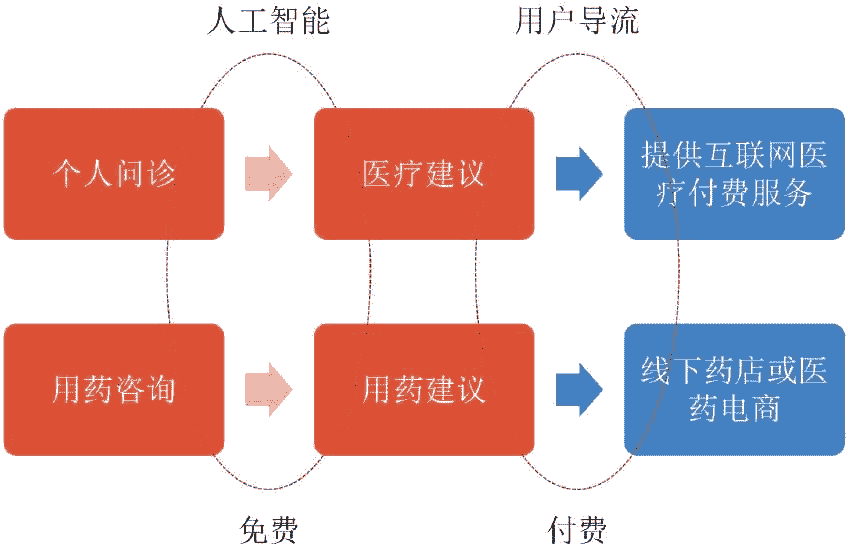
图2-7 虚拟助手最后往往会形成用户导流

例如，在支付宝医疗健康类目上线的智能预诊功能，就是由好人生公司推出的“绝世好医”智能问诊平台。该平台的智能预诊功能主要是通过患者的症状主诉进行智能分诊，给出建议就诊科室后，也可以提供专业医师的健康咨询服务。“百度医疗大脑”宣布与社区医疗服务企业“社区580”合作，将人工智能赋能医疗社区，上线“美乐医”，为用户带来24小时医疗咨询服务。该合作不仅可以让人工智能完成线上的智能分诊和预诊服务，也可以在实际使用中不断优化提升人工智能的准确度。

案例介绍

#####半个医生
“半个医生”于2015年11月正式上线，截至2017年9月，用户数在30万人左右。半个医生对可能涉及的18万种症状及关联的9000种疾病进行理解和分析，能满足100万个用户同时查询，有70多人的医学团队在对机器学习进行训练。从标签组合到完成疾病结果的全部查询过程用时不到1秒，准确率在70%左右，并且通过机器学习还在不断提升。

半个医生针对科研资料中的诊断记录，把疾病拆解成包括症状在内的各种各样的标签，之后找到标签之间的关联性，掌握疾病的规律，模拟医生的推理逻辑，为用户分析出可能的疾病结果，包括疾病常识、预防常识、对应科室、检查项、药物、患病年龄分布等，以及需要对接的医院和药店。

#####绝世好医
“绝世好医”是上海好人生集团和美国梅奥集团合作推出的智能预诊分诊系统。“绝世好医”基于梅奥积累的150年的西医大数据，算法囊括了52888个判断节点，后面涉及的结论多达一万多个。

“绝世好医”智能预诊分诊系统和支付宝进行合作，让人们看病就医更简便。在支付宝的医疗健康类目中，进入“智能预诊”，便可方便快捷地获取科学循证的预诊分诊结果。

美国梅奥诊所调查报告显示，使用该分诊系统后，97%的用户清楚接下来应该怎么做；98%的用户认为系统“非常好”；56%原认为需要急诊的用户根据建议选择了非急诊；38%原要去专科医院的用户选择了分级诊疗的医院；20%的用户使用智能自诊了解自身状况后选择了自己在家按专业意见进行自理。

自测用药
自测用药是以临床专家经验为框架，以用户健康大数据为支撑的人工智能专家系统。该系统汇集了各大医院众多临床专家的用药心得及经验，不依赖医生及核心医疗资源便可为大基数人群提供专业的用药和养生保健指导服务。

自测用药的智能系统构筑主要分3步：首先，对大量临床专家在疾病和用药方面的经验进行系统的归纳总结，找出其中普适性的规律，形成初步的智能系统。其次，随着用户数据的积累，系统会逐步优化数据采集及用药建议，让系统越来越贴近用户的症状及习惯。最后，在用户提交了相关症状后，系统会对用户信息提供有针对性的建议和指导，这些是由专家系统自动提供的，人工无须再次进行干预。这就是自测用药的核心算法所在。该系统覆盖了数十种常见疾病和亚健康症状，用户只需根据自身具体情况选择疾病的相关症状，其便可智能分析用户的疾病情况，并给出个性化的精准用药建议及日常保健预防等实用的非药物疗法指导。

自测用药因为平台数据与药品相关，所以在商业模式的实现上可以对接药品购买渠道，通过软件将用户的需求导流到周边药店和权威医药电商平台，为用户提供选药、买药、预防等全方位的健康解决方案。

###2.1.2 智能分诊、导诊机器人
随着智能机器人技术和医疗的结合，智能导诊机器人成为医院一道新的风景线。导诊机器人属于服务类机器人，服务其机器人主要通过语音输入进行服务指导，可以应用于火车站、机场、餐厅、景点等多种场景，只是各自后台的知识库不一样。

服务类机器人市场刚开始起步，2016年我国服务类机器人的市场销售额是10.3亿美元，如图2-8所示。医疗导诊类服务机器人主要是通过患者的语音录入进行语义分析，然后给出医院的分诊和导诊建议，节约人力，方便患者。更先进的导诊机器人还能通过传感器收集患者的生命体征信息，给出更准确的建议。

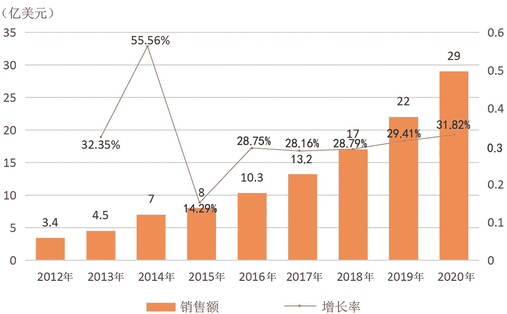
图2-8 2012—2020年我国服务类机器人销售额及增长率

服务类机器人主要用于取代重复和简单的人力工作，大部分市场还处于空白状态，而且通过搭载医学相关知识体系，还可以用于家庭等服务场景。相较而言，导诊类服务机器人和家庭类医疗服务机器人是研究的热点，创新度较高。

目前已应用于医院的导诊机器人如表2-1所示。

表2-1 已应用于医院的导诊机器人 （截至2018年1月）

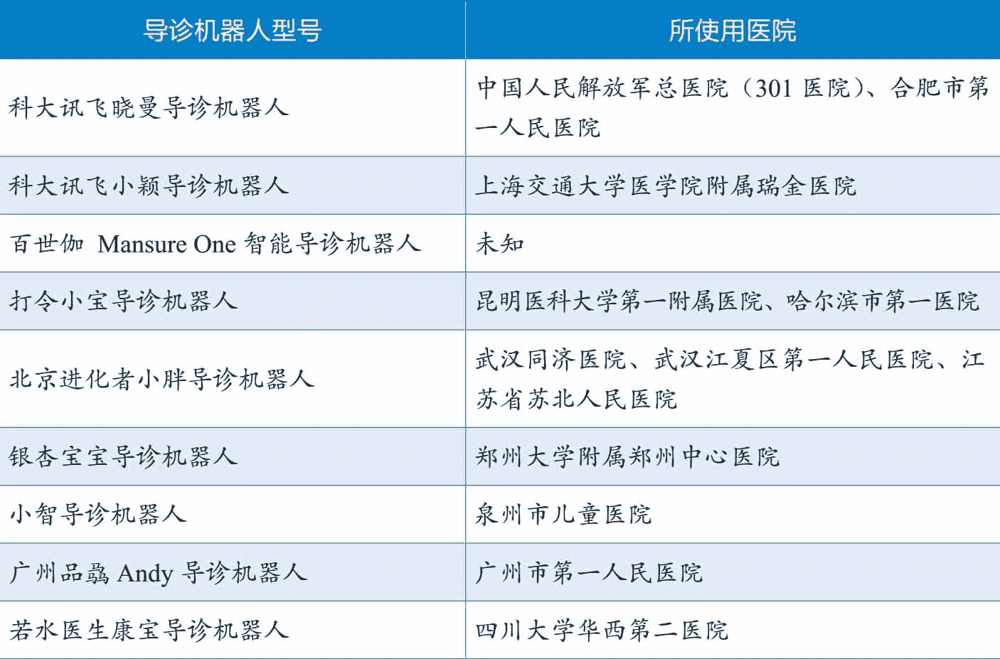
续表

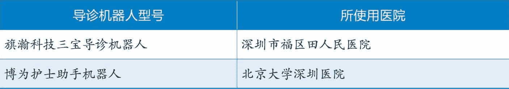

医院环境嘈杂，会对语音录入的质量造成非常大的影响。虽然目前语音识别的准确度已经达到了一定的水准，但是在医院这种环境中，用户的体验还是会受到影响。

案例介绍

科大讯飞晓曼导诊机器人
科大讯飞股份有限公司成立于1999年，是一家专业从事智能语音及语言技术、人工智能技术研究，软件及芯片产品开发，语音信息服务及电子政务系统集成的国家级骨干软件企业。科大讯飞作为中国智能语音与人工智能产业的领导者，在语音合成、语音识别、口语评测、自然语言处理等多项技术上拥有国际领先的成果。

晓曼机器人是科大讯飞在机器人领域的集大成者。

科大讯飞将语音合成、语音识别、语义理解和人脸识别等技术运用到智能服务机器人本体上，结合麦克风阵列、3D摄像头、身份证读卡器、取号小票机等外设应用，以语音、触屏、动作等多模态的交互方式为用户提供优质的服务，在政府、金融、运营商、医疗等多个领域具有广阔的应用前景。

###2.1.3 慢病管理
通常，人们理解的慢病管理多为App性质的软件，与人工智能无关。App的价值在于帮助患者更高效地做病情管理。前面在个人问诊类的人工智能虚拟助手产品中谈到，初诊环节中，人工智能聊天机器人和患者的沟通极有可能出现问题，需要严格监管。而慢病管理环节中应用人工智能聊天机器人，则可以保证在患者病情已知、可控的情况下进行判断和处理。

慢病App作为医患沟通的桥梁，最终需要让医方觉得更轻松，而不是更麻烦。在人工智能的介入下，聊天机器人这一模式的核心价值在于进一步改善人机交互界面，通过更符合人性习惯的沟通方式，进行人机交互，而以往的所有模式都是人迁就机器。

在患者获取相关医学知识时，只需通过问问题即可，而不用再去搜索查询，筛选相匹配的内容了。聊天机器人还可以通过分析语义，理解指令，替用户做一些操作，如记录当日检测的指标、饮食摄入情况等。用户可以不再需要填表，而只要用最符合人类表达方式的一两句话即可。这类功能对于年轻人来说也许并没有多大的效用，但对于不习惯与机器沟通的年长者来说，却很可能是极大的改善，尤其是智能语音方式。

同时，当患者的数据发生变化的时候，人工智能可以及时发现问题，邀请医师或者药师人工介入。在人工智能的帮助下，慢病App链接线下所要匹配的医护人员数量将得以降低，同时不会对服务体验造成不良影响。

站在医方的立场上，人工智能虚拟助手反过来可以成为医护人员的助手，承担部分行政性的常规工作。例如，预约、备案等行政性事务可以代为解决，常见病症问题也可以代为应答，替代医护人员为患者做例行监控等。

案例介绍

Sense.ly
Sense.ly是一家提供医疗保健服务的初创企业，孵化于法国的电信巨头Orange S.A.，2013年成为独立公司。Sense.ly为用户提供了一位虚拟聊天机器人助理，它的名字叫作Molly。

Sense.ly的平台集成了医疗传感、远程医疗、语音识别和增强现实等技术。患者在Sense.ly上注册后，无论是在家里还是在他们的看护机构中，都可以通过一个按钮呼叫这位虚拟护士。Sense.ly遵循个性化的护理方案，使临床医生可以无缝监测患者所遇到的危险因素，并根据需要调整医嘱。

患者可以与Molly进行自然对话，从简单的需要到复杂的慢性病医疗援助都能实现，充当医疗服务提供商与患者的中介。

在Molly的帮助下，患者可以将他们的生命体征数据告诉它，包括疼痛、睡眠、压力和饮食等，信息传递给Molly背后的医疗机构，或者是通过视频电话直接对接主治医生。如果患者在沟通中表现出较高的风险，就可以引起主治医生的注意，并获得相关建议。

Catalia Health

慢性病管理里，持续用药的依从性决定病情走向，对老年人尤为关键。旧金山的 Catalia Health 从这一痛点出发，研发了个人健康陪伴机器人 Mabu。公司 2014 年在美国成立，业务重心放在患者行为研究及服务转化上，通过解析个体心理特质、使用习惯，为医院与照护机构提供更精准的支持策略。Mabu 一方面能直接帮助慢病患者进行日常管理，另一方面把使用数据汇总后提供给医疗机构参考。

机身类似人形平板，内置人工智能，可监测服药时间与服药方式以改善依从性。系统集成多组算法，在用户家中长期互动中逐步掌握每位使用者的个性化行为与偏好。

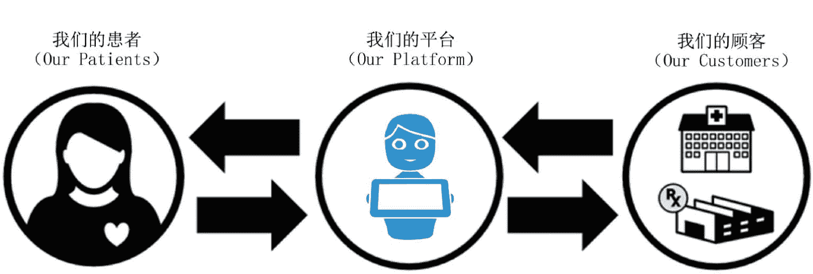

图 2-9 Catalia Health 平台功能

在应用场景中，Mabu 会主动发出用药提醒并询问当下身体感受，一旦发现症状加重迹象便把相关信息推送给对应的医疗服务提供者。目前产品仍处测试阶段，已在医药企业、医疗系统及居家健康组织中展开试点。

### 2.1.4 电子病历（Electronic Medical Record，EMR）语音录入

据丁香园调研，超半数住院医生每天书写病历的平均时长超过 4 小时，部分甚至超过 7 小时。《福布斯》曾报道，医生在门诊问诊仅占工作时间的 27%，近 49.2% 的时间被文书工作占据，其中就包括电子健康记录操作。即便在诊室，与患者沟通仅占 52.9%，处理文书占到 37%。病历录入的便捷高效已成为临床的迫切需求。

相较于手工录入，人工智能驱动的智能语音录入一般由语音转文字、语义解析、智能纠错三环节组成（图 2-10）。

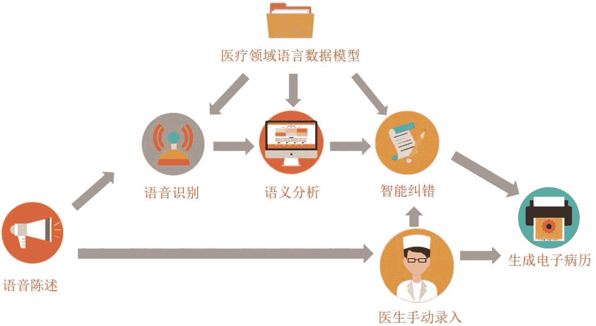

图 2-10 电子病历的语音录入流程

整套流程依赖医疗语言数据模型支撑，该模型源自定制语音库，已对各科室业务进行梳理，覆盖常用病种、药品名、操作步骤等关键信息。为降低口音带来的识别偏差，系统需反复自学以提升准确度。

语音录入可明显加快书写速度，节省医生时间，使其更聚焦诊疗。影像、超声、口腔等科室能实现检查、诊断与记录同步进行，避免反复被打断。医技类工作本就需要在影像屏与报告屏间切换，语音方式在口腔科还能减少复制粘贴，规范记录并提高安全性。

不过，医疗智能语音仍需克服嘈杂环境、专业术语复杂、多语速多口音等难题，才能成为真正可靠好用的工具。

### 案例介绍
### Nuance
Nuance 于 2011 年推出语音识别技术，是该领域的头部厂商。公司因与苹果合作被大众熟知，Siri 采用了其语音技术。此前 Nuance 已与多家厂商合作，技术落地于手机、电视、汽车等产品，三星语音助手 S-Voice 也使用了其方案。

Nuance 为客户提供自动语音识别、自然语言理解、对话管理、声纹生物识别、文本转语音、光学字符识别、领域知识等功能与服务。业务分为医疗、企业、影像、移动四大板块，2014 至 2016 年医疗板块收入稳定在约 10 亿美元左右，占总收入约 50%。Dragon Medical 平台的语音病历录入准确率已达 99%，可帮助临床医生提升文档事务处理效率高达 45%。

医疗服务主要包括五项：转录解决方案、Dragon Medical、临床文件改进 CDI 与编码解决方案、诊断解决方案、Dragon 解决方案。转录方案为大中型医疗机构提供按需企业级医学转录平台；Dragon Medical 提供听写软件，让医生在各类设备上准确记录护理信息且不中断现有流程；CDI 与编码方案确保健康信息被准确记录、编码与评估，提供更完整准确的临床文件；诊断方案助力放射科医生记录、协作与共享医学影像及报告，优化照护；Dragon 解决方案为企业用户与消费者提供专业语音服务。

在美国已有超 3000 家医院使用 Nuance 的医疗保健方案，超 15 万名医生和护理人员使用 Dragon Medical 系统，年均记录约 1 亿名患者数据，使用量年增 30%，94% 的医疗机构正在考虑使用或有强烈兴趣。

### 讯飞医疗
科大讯飞 2015 年进入智慧医疗，其医疗语音录入主打产品为“基于语音的门诊病历采集系统”。依托技术优势与强大的 AI 研发团队，讯飞医疗除语音外还涉及医疗影像，以及类似 Watson 的认知计算辅助诊疗系统。

2016 年，首款产品“云医声”手机应用在安徽省立等医院投入使用，标志着产品落地。“云医声”依托科大讯飞领先的智能语音与人工智能技术，可收集患者资料方便医生查阅，并把医生口述医嘱自动记录整理成电子文档，大幅减轻工作量，同时可推送精准医疗文献。

为应对医院嘈杂及外科、放射、牙科医生在手术中无法随时书写的场景，科大讯飞为医生定制麦克风，人工智能系统在交流过程中自动过滤无用信息，把所需医疗数据转为文字，实现工作过程同步记录。同时依托自然语言处理完成文字结构化，形成结构化电子病历，包含检查史、病史、检查结果、身体指标，医生只需简单修改确认即可打印并归档电子版，识别准确率可达 97%。

### 云知声
云知声聚焦物联网人工智能服务，依托机器学习平台在语音、语言、知识计算、大数据分析等领域构建核心技术。AI 芯片、AIUI、人工智能服务三大方案支撑落地，智能医疗语音录入系统即为其应用之一。

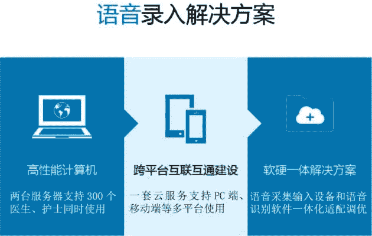

图 2-11 云知声智能医疗语音录入系统

该系统以面向医疗的高性能识别引擎为基础，结合飞利浦手持外设录入设备，可与医院信息系统 HIS、个人云存储 PCS 等无缝对接，通过语音高效处理大量文本录入，并通过语音与设备功能键进行交互。

公司还研发了国内医学领域首个语音识别引擎，针对数百万医学专有名词、数千小时语料及复杂的中英文混杂表述做了大量模型优化。

为实现精准识别，云知声对医院做深度定制。定制化模型基于不同科室、不同病种的整段病历资料运算关键词语料，为 40 多个临床和医技科室提供分场景支持，尤其在神经科、免疫内科、血液科、普通内科等疑难科室效果更佳。目前系统准确率在 95% 以上，部分科室超过 98%，结合云端语义校正后整体识别率接近 100%。

医生通过语音录入可提高效率，有效避免复制粘贴，规范病历输入并提升安全性，目前可为医生节省 38% 以上的耗时。

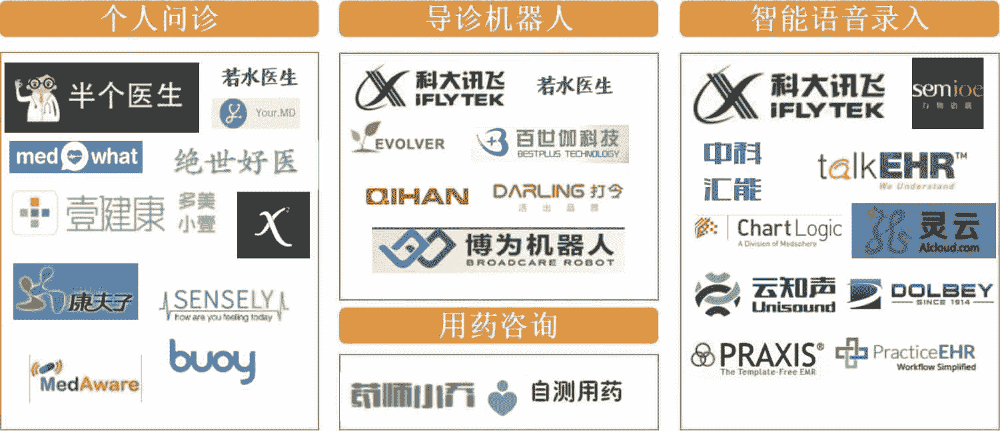

图 2-12 人工智能+医疗企业主要分布领域

^[1] 《福布斯》2016 年 9 月文章 Doctors Wasting Over Two-Thirds Of Their Time Doing Paperwork 中引用美国医学协会医学博士克里斯汀·辛斯基领导的研究，显示医生花费 27% 时间在诊室问诊。
^[2] Dragon Medical：医疗管理软件，可更有效为医疗专业人员创建病历、管理病例、处理医疗信件或电子邮件信息。
^[3] AIUI：人机交互新产品，由科大讯飞研发，集成全双工、麦克风阵列、声纹识别、方言识别、语义理解和内容服务等技术与服务。

## 2.2 疾病筛查和预测
现代医学多依赖生化与影像结果判断是否患病，对疾病未来走向的预测仍有空间。科技进步已让部分疾病风险可提前预估，例如好莱坞影星安吉丽娜·朱莉因基因缺陷风险较高而接受预防性双侧乳腺切除。基因层面可做风险预测，人工智能也能基于语言、神态、反应、影像等数据进行预测。

AI 参与筛查与预测需综合行为、影像、生化等检查结果（图 2-13）。最常用的是 MRI、CT、X 光等影像资料，因筛查方式差异，企业类型会分散到不同细分领域，AI+影像也是参与企业最多、产品最丰富、疾病覆盖最广的方向。

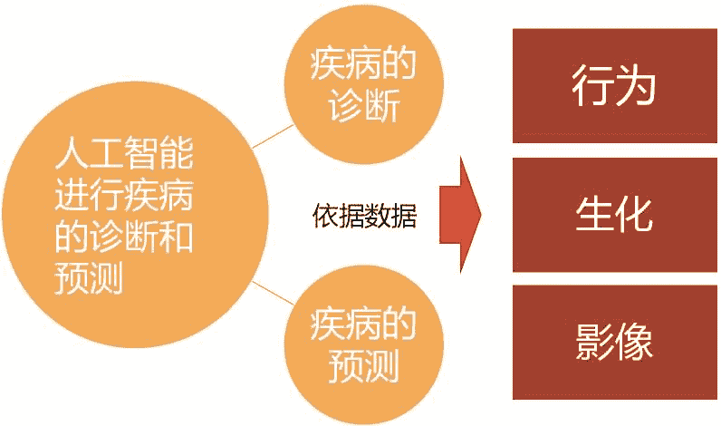

图 2-13 人工智能进行疾病诊断和预测的数据来源

除生化影像外，人的语言和文字也能反映精神与身体健康。语言文字的规律经认知系统分析，可帮助医生更早预测并追踪早期发育障碍、精神疾病与退行性神经疾病。目前 AI 参与的筛查与预测多集中于人类难以攻克的重症，如论文统计显示 AI 相关医学论文中癌症以 892 篇居首，阿尔茨海默病位列第二。^[1]图 2-14 带有机器学习关键词的论文数量

传统医学多在发病后诊断治疗，往往为时已晚。未来医学有望从治疗转向预防。

### 2.2.1 疾病的筛查
### 1．精神疾病诊断
心理诊疗中，医生需通过多次访谈判断症状并凭经验确诊，随后拟定用药方案，易受主观与经验限制导致误诊或延误。

精神分裂症患者讲话有明显特征，常出现非自主发声、短句为主、语义混乱、模糊词高频、表意不清。2015 年，一组研究人员据此构建 AI 模型，通过分析谈话记录，准确预测出哪些人可能出现精神错乱。

对抑郁症、创伤后应激障碍等人群，精神崩溃常以缓慢形式出现，不会一次治疗即显现。2015 年 3 月《远程医疗与电子健康》发表论文，利用机器学习预测产后抑郁，建立风险分层模型并开发 App，供产后妈妈自测情绪。AI 在 PTSD 诊断治疗及精神疾病监控方面作用显著。

### 2．自闭症筛查
## 自闭症早期筛查
美国儿科医学会建议在 9 月龄至 36 月龄进行发育障碍筛查，自闭症筛查最关键。早期筛查可把握黄金干预期，错过则影响可能伴随一生。美国疾控中心数据显示，约 15% 儿童存在自闭症等发育障碍，但接受早期筛查者不足半数。

Cognoa 设计了一套面向儿童自闭症早期筛查的 AI App，用户可通过手机自助进行筛查（图 2-15）。传统筛查需预约到院等待，父母往往不会过度担忧而错过。

图 2-15 Cognoa 儿童自闭症早期筛查 App
App 只需填写孩子基本信息，回答 15 至 20 个行为相关问题，即可自动生成筛查报告。方案可靠性源于创始人丹尼斯·沃尔博士超过 5 年的临床研究，其团队在哈佛医学院与斯坦福医学院对超 10 万名自闭症儿童进行追踪。海量数据经机器学习训练成独特算法，用户输入行为信息后系统即给出筛查结论。

### 3．阿尔茨海默病预测
英国 Avalon AI 公司通过分析脑部 MRI，可预测未来患阿尔茨海默病的概率。该公司利用深度学习开发影像诊断工具，对阿尔茨海默病的有效预测准确率达 75%。

医学界常用的生物指标包括海马体大小与脑室大小，后者随脑组织退化而增大。研究员通过观察灰质白质变化、脑脊液情况，分析大脑从轻度认知损害进展为阿尔茨海默病时的变化（图 2-16）。

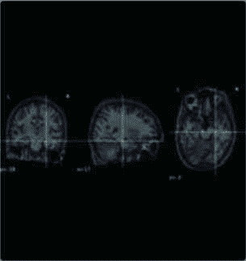

图 2-16 Avalon AI 脑部核磁共振图像预测阿尔茨海默病
研究需先制作大脑 3D 磁共振图像并与其他样本对比，再用卷积神经网络提取特征。网络层层提取简单特征再组合成复杂特征集合，既横向比较同等失智程度的相似性，也纵向比较不同程度的差异，从而判断损伤程度。

### 2.2.2 疾病的预测
### 1．脑疝预测
大面积脑梗死约占全部脑梗的 10%，死亡率极高，约 80%。研究表明，症状恶化前积极干预效果优于后期，故早期预后判断至关重要。

《中国卫生统计》2014 年刊登论文《利用人工智能系统预测大面积脑梗死患者的转归》，指出利用人工神经网络多层感知机构建多因素预测模型，单因素模型效果最佳，AUROC 达 0.87。结论认为人工智能随机森林模型可作为辅助诊断系统，预测脑疝在大面积脑梗死患者中的发生概率。

### 2．慢性肾病分级预测
全球超 5 亿人患各类肾脏疾病，但慢性肾病知晓率不足 10%。早期症状不明显，多在肾功能恶化后就医，故分级预警迫切。华南农业大学食品学院研究员基于人工智能对肾小球滤过进行预测，通过 BP 神经网络构建模型，得出实用性良好的慢性肾病分型预警模型。

### 3．心脏病患者死亡预测
英国科学家在《Radiology》发表研究称 AI 可预测心脏病患者死亡时间。MRC 伦敦医学科学研究所指出，AI 软件通过分析血液检测与心脏扫描，可发现心脏衰竭征兆。

研究聚焦肺高压患者，该病会损害心脏，约三分之一患者确诊 5 年内死亡。治疗包括药物注射与肺移植，需预知生存期以选择方案。研究者在 AI 中录入 256 名心脏病患者的心脏 MRI 与血液检测，并结合 8 年健康记录，软件标记每次心跳中心脏 3 万个点的运动状态。AI 对未来 5 年生存预测准确，预测 1 年存活率的准确率约 80%，医生仅约 60%。^[5]

### 4．骨关节炎发展预测

骨关节炎可以提前三年预警吗

卡内基梅隆大学生物工程博士 Shinjini Kundu 在一次行业交流中介绍了利用机器学习推算膝关节退变进程的研究。骨关节炎本质上是关节软骨耗损所致的骨损伤或关节缘增生，过去患者通常要等到疼痛出现才去就诊，借助 MRI 才能看到异常，而此时软骨已受损。

Kundu 团队收集了长达十年的群体软骨 MRI 记录，建立起健康人群与患病人群的影像差异模型。健康软骨在 MRI 上水分分布均匀，患病人群的扫描图像中红色高信号区出现了水分聚集。经大量影像训练后，系统能够捕捉健康软骨的细微偏离，并对未来三年发病概率给出预估，如图 2-17 所示，该方案的预测准确度已达 86.2%。若能提前获知风险，就可以在生活方式、监测等多个维度提前干预，减轻疾病负担。

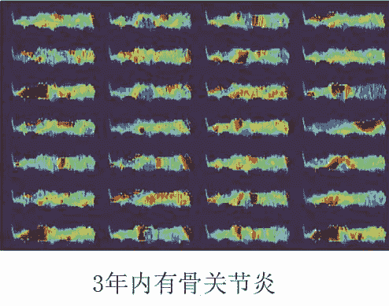

图 2-17 骨关节炎的预测

### 5．流行病风险预测
医疗大数据经过采集与分析后，可在多方面提高医疗体系运行效率。在公共卫生层面，智能技术的引入有助于疾控机构强化疾病预防与控制能力。借助预测模型与海量医疗数据，可以对城市乃至国家层面的传染病风险进行预判，从而提升居民健康管理水平，助力压缩医疗开支。

中国平安与重庆市疾控中心联合课题组研发的全球首个流感预测模型已取得阶段性进展。模型融合了平安的医疗健康大数据、机器学习技术以及重庆疾控的监测数据，能提前一周研判流感发病趋势，并在验证中取得较好效果。该模型可帮助重庆公共卫生部门及时掌握疫情动态、指导公众防护，同时能精准评估个人与群体的发病可能，提升事前预防成功率，为政府医疗体系降低疾病防控成本。

\[1\] 数据来源：动脉网蛋壳研究院《2017 医疗大数据和人工智能产业报告》。
\[2\] Cognoa：世界上最大的业务智能软件制造商，其能够帮助用户提取公司数据，然后分析并汇总，最终得出报告。
\[3\] 数据来源：动脉网蛋壳研究院《2017 医疗大数据和人工智能产业报告》。
\[4\] `AUROC`为综合评判灵敏度和特异的指标，`AUROC`越大，其预测的准确性超高。
\[5\] 数据来源：动脉网蛋壳研究院《2017 医疗大数据和人工智能产业报告》。

## 2.3 影像诊疗
现代医学建立在循证之上，临床结论必须依托客观诊断资料。影像是重要依据，医疗行业 80%~90% 的数据来自影像资料，医师对影像的定量评估与历史对照需求强烈。

医学数字成像与通信 DICOM 为影像存储与交换提供了标准方案，该规范自 1985 年首版发布后多次修订，包含文件格式与通信协议。

表 2-2 所示为主要的`DICOM`数据库。

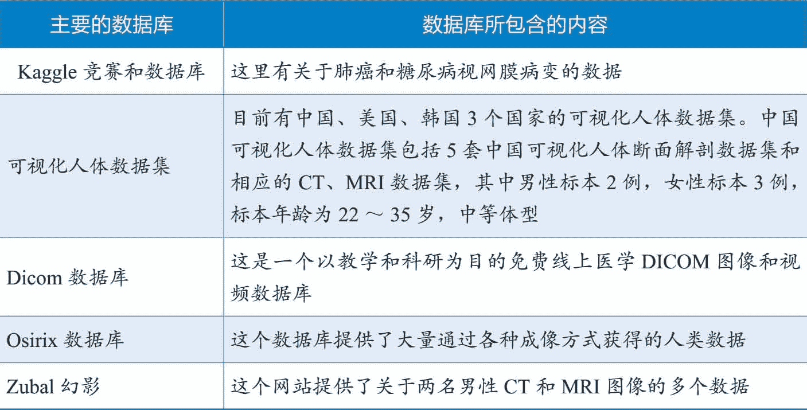

所有患者的影像均以 DICOM 格式保存，文件内包含受保护健康信息如姓名、性别、年龄，以及影像数据。成像设备产生 DICOM 文件，医生借助 DICOM 阅读器及相关软件查看图像并作出判断。

较长一段时间里，图像识别研究多采用图像匹配思路，特征提取难以突破。直到 2010 年，深层神经网络提供了更优的建模训练路径，可自动完成特征抽取与表达，此后深度学习概念被广泛应用。

深度学习属于表征学习，具有较强的表征处理能力，能把大量现实问题转化为可处理形式。其擅长处理高维稀疏信号，图像即典型代表。在影像医学领域常用算法为卷积神经网络。

Tips：卷积神经网络（`CNN`）
假设图像由大量微小局部特征组合而成，卷积网络作用于图像时，随着层数加深会逐步提取更高层次的抽象特征，这些特征对图像识别非常有用。传统机器学习需要人工手工设计特征再训练分类器，而深度学习将特征抽取及表示自动化，因此成为图像处理的主导技术，被视为自动学习层级化特征表示的方法。

“智能技术+影像医学”即计算机基于影像资料，通过深度学习完成影像分类、目标检测、图像分割和检索，辅助医生诊断、治疗的工具。

### 2.3.1 AI参与影像诊断的方式
智能系统的本质是计算机通过对已有资料经验积累，自动提升任务处理性能。探寻其在影像医学中的参与方式，首先要明确其能力。按对深度学习的理解，可将图像处理能力分为影像分类、目标检测、图像分割和影像检索四类。这四项能力对应图 2-18 中的四个功能。

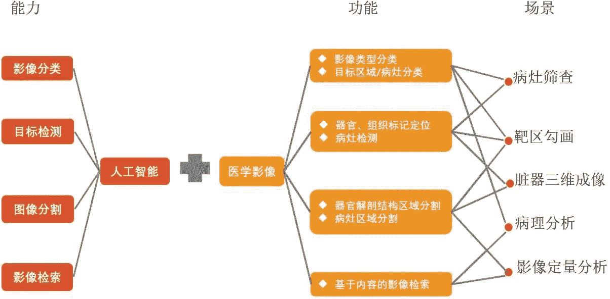

图 2-18 人工智能+医疗影像的主要工作模式

以下以肝部疾病筛查为例说明参与方式。

智能系统参与医疗过程首先要获得大量带标注的影像样本，然后寻找关键点。例如定位靠近肺部和肝部的点，基于肝脏形状先验设定初始化模型，再通过机器学习学习边界形态与病变特征，尽量逼近真实边界，再以形状特征进一步完善，最终获得较好的分割与筛查结果。这一过程即对图像的定位、分类和切割。

当脏器被分割、病变被标记后，可知患者该部位存在异常，但仍不清楚具体疾病类型与进展阶段，此时需对病理图像进行分析以获得辅助判断依据。

病理分析是通过抽取疑似病变活体置于显微镜下进行细胞形态分析的检验方式，是目前癌症的主要确诊手段。数字病理图像往往非常大，部分肿瘤病理图像尺寸达 20 万×20 万像素，有的甚至达 40 万×40 万像素，细胞分析量极大，医生花费大量时间比对。随着信息量增加，完全依赖医生已不现实。

通过搭建神经网络并利用深度学习算法，系统对包含各种病变形态细胞的病理库进行大量训练，获得识别病变细胞特征的能力。利用分割算法将细胞分割出来后，通过大量比对识别细胞病变形式及发展程度，为医生最终诊断提供辅助。

医院大数据中 85% 左右存储容量被影像数据占据，当前计算机可识别结构化文本数据和结构化影像数据，并正在探索将功能性医疗图像与结构性图像融合以获得更好诊疗效果。将上述四项能力组合，便得到智能技术在影像医学上的具体应用。

### 2.3.2 AI为影像医学带来的改变
智能技术为影像医学解决了哪些问题？对医院、医生带来何种改变？可归纳为三类。

第一，把信息更好地呈现给医生。成像越来越容易，分辨率越来越高，医生需阅读的影像量激增，但医生需要的是信息而非原始数据。系统可完成脏器的定位、分类及分割，并对可疑位置进行标注，相当于为医生去除干扰项，将更直接的信息呈现出来。

第二，帮助医生定量分析。医生擅长定性分析，有经验的医生数秒内可大致判断问题，但精准判断需要工具支持，定量分析难以仅靠肉眼完成。相关工作包括多模态分析、历史图像比较、病人人群分析，需借助图像分割、图像配准、功能图像分析等手段。

第三，能够协同解决成像与智能图像识别问题。这两个步骤此前多被分开，技师拍片、医生分析。实际上两者结合才能更有效地优化系统，为医生提供更好服务。

表 2-3 所示为传统方式和人工智能读片的区别。

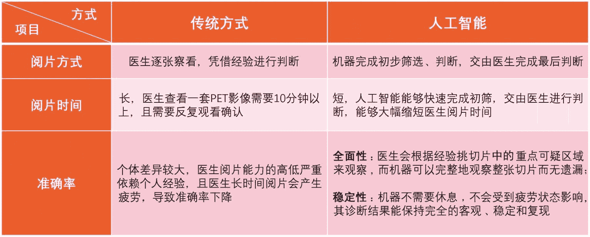

就成像而言，一方面基层医院缺乏高水平技师，重复成像造成影像资源浪费；另一方面高级成像功能复杂，技师对序列和参数的微调会显著影响图像质量。需建立标准化、个性化的流程标准。

标准化指得到的图像需达到统一质量标准；个性化指根据不同人情况做出相应调整，如 BMI 高低不同者在做 CT 时成像参数和剂量需调整。通过个性化实现图像质量标准化，并借助智能手段帮助医生和技师选择成像参数，最终让基层医生获得与三甲医院同等的医学影像。

另外，随着 3D 成像技术出现，医生有时无需再阅览上百张平面 CT 图像，直接观察立体图像即可。

再谈图像分析，医生阅片中绝大部分为健康人影像，造成时间浪费，系统可先筛除健康人影像，将异常图像呈现给医生。针对异常图像，系统直接标注病灶、结节等异常部位，医生只需审核即可，提高效率。

总的来说，成像与图像分析结合，将健康人影像筛除、呈现异常影像并做初步标注，极大提升医生效率和诊断稳定性，并在定量分析上带来前所未有的新方式。

### 2.3.3 AI+影像医学在各领域的应用情况
智能技术在影像医学领域目前的应用方向主要有三类，即疾病筛查、病灶勾画和脏器三维成像。我们总结了智能技术在影像医学方面主要覆盖的方式及主要使用的影像类型如图 2-19 所示，接下来将详细介绍目前 AI 在肺部筛查、糖网病筛查、靶区勾画、脏器三维成像方面的应用情况。

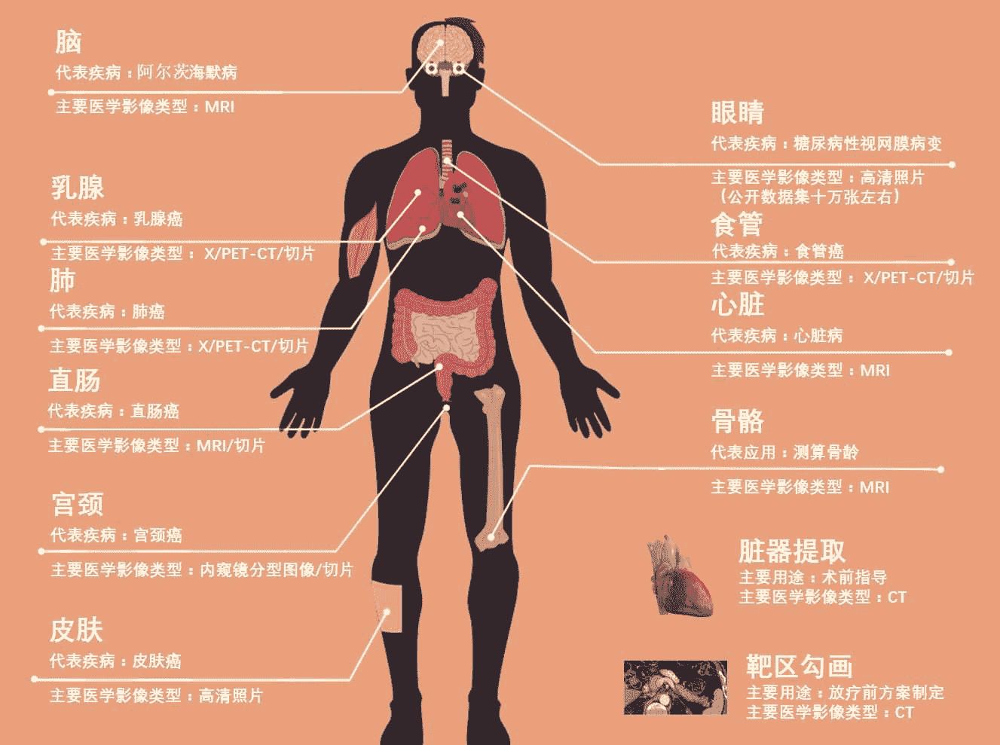

图 2-19 人工智能在医学影像方面主要覆盖的方式及主要使用的医学影像类型

### 1．肺部筛查
进行肺部筛查的流程为，使用图像分割算法对肺部扫描序列处理，生成肺部区域图，再据此生成肺部图像。利用肺部分割生成的区域图像加上结节标注信息生成结节区域图像，训练基于卷积神经网络的肺结节分割器，对图像进行肺结节分割，得到疑似肺结节区域。找到疑似结节后，使用 3D 卷积神经网络对肺结节进行分类，得到真正肺结节的位置和置信度如图 2-20 所示。

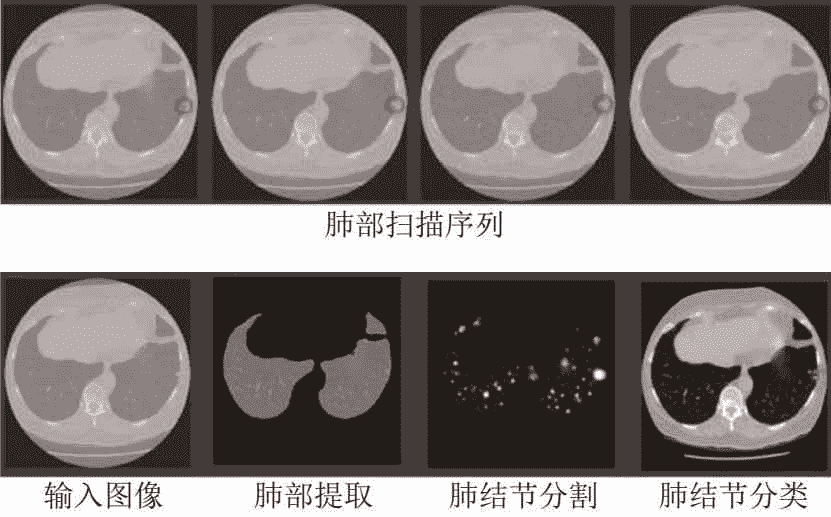

图 2-20 肺部疾病的影像筛查的步骤

在动脉网蛋壳研究院收集的 20 家国内进行病灶标注的智能医学影像公司中，开展肺癌诊断业务的有 12 家，占比为 60%，其他几家公司目前专注于乳腺癌影像、甲状腺癌影像、眼底影像等医疗影像研究。另外，由于公司对外宣传多表述为辅助诊断肿瘤，未注明具体癌种，实际比例应高于 60%。

表 2-4 医疗影像主要病种涉足企业统计

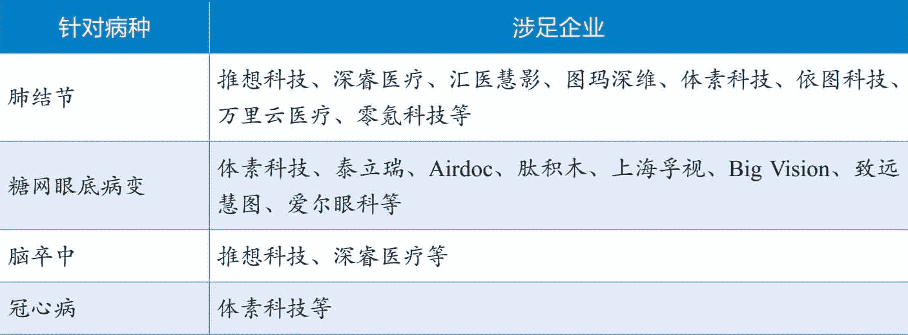

续表

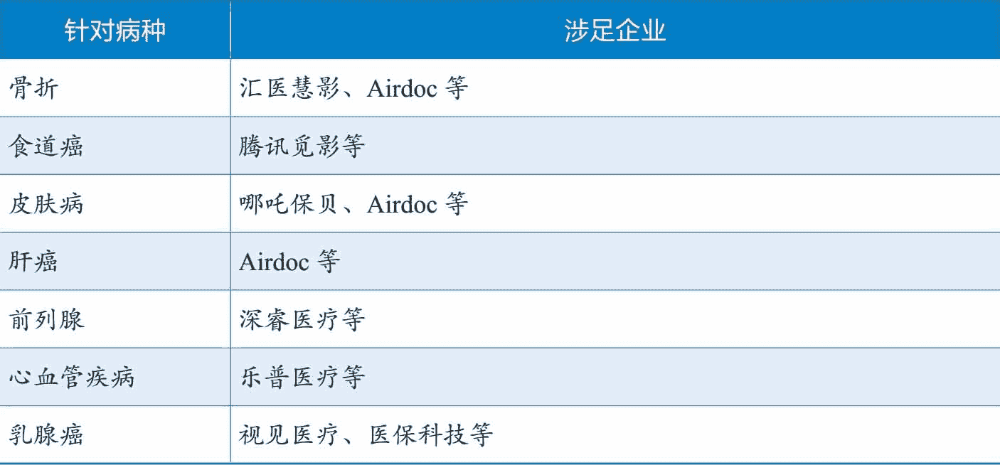

国内智能技术虽处初期阶段，但利用 CT 图像等放射影像在肺结节识别方面的技术相对成熟。推想科技、依图医疗等公司产品已在临床应用。据了解，浙江省人民医院、上海长征医院、北京协和医院、湘雅医院等都在使用 AI 产品。

目前产品对肺结节的识别检出准确率在 90% 左右，各公司情况不一，但报道均称 AI 水平高于医生平均水平，但医学智能技术对肺结节良恶性的判断仍处研发阶段，最终诊断仍需医生结合临床决定。

除 CT 影像外，也有公司利用病理图片和大数据模型进行辅助诊断筛查。例如 Deep Care 尝试利用病理图像辅助医生诊断肺癌，技术仍在研发中，该公司此前还将技术应用于乳腺癌检测，准确率已达 92.5%。

点内生物利用大数据模型进行肺癌早期诊断，整合国际主流肺癌风险预测模型，结合智能技术与机器学习，在国内 2 万例肺癌病例验证下，形成适合中国人使用的肺癌智能筛查引擎“肺常好”。目前点内生物已与上海杨浦区政府合作，对全区居民进行肺癌筛查。

汇医慧影对胸部 X 光的气胸、肺结核、肿块自动诊断准确率已达 95%，脑核磁肿瘤自动识别率超过 85%，胸部 CT 中肺结节识别率超过 85%。

腾讯觅影包含 6 个智能系统，涉及食管癌、肺癌、糖网病、宫颈癌和乳腺癌。其中早期食管癌智能筛查系统最成熟，实验室准确率 90%，现已进入临床前实验阶段。乳腺癌 AI 辅助诊断系统获国家食品药品监督管理总局 CFDA 认证，部分病变检出率高达 96%。

## 1. 肺结节筛查
肺结节类医疗智能产品无疑是目前最热门方向，据不完全统计截至 2018 年 7 月，仅在肺结节筛查领域有具体产品的人工智能企业就有 20 余家，且大部分已获投资，如表 2-5 所示。

表 2-5 肺结节筛查类产品落地情况举例

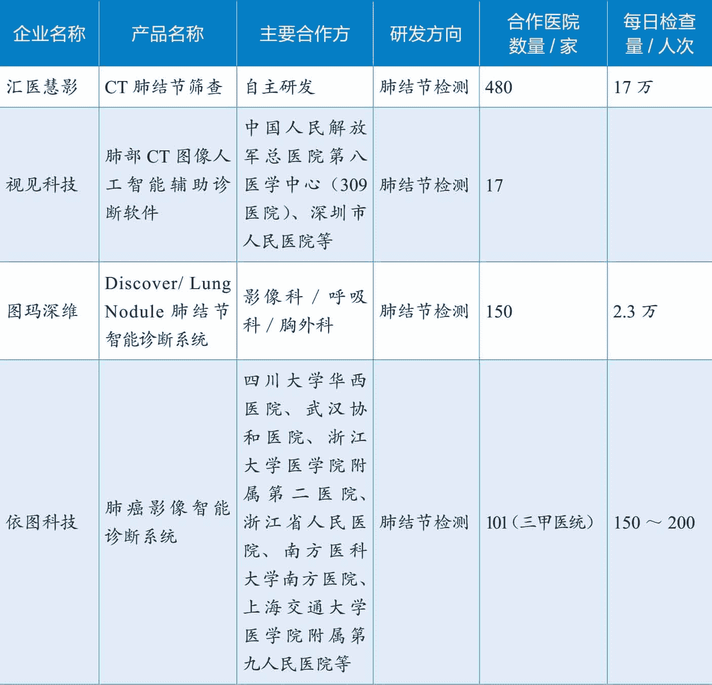

续表

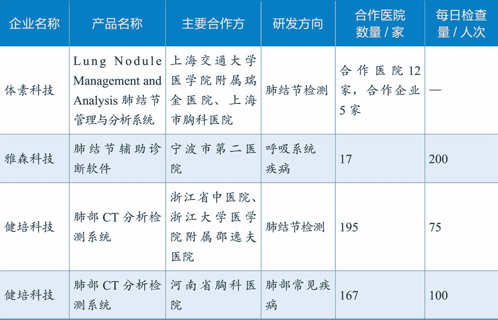

我国年新增肺癌患者数量和年肺癌因素死亡人数均居全球第一，早筛需求大，低剂量螺旋 CT 正被广泛推广。胸部 CT 图像分层薄、视野清晰、干扰因素少、病灶特征有规律可循，是智能影像判读的理想工具，加之我国影像医师稀缺及国家政策大力推动，该领域应用基础良好。

2017 年主攻肺结节检出的各大 AI 企业交出亮眼成绩，敏感性从 95%、96.5% 一路提升至 98.8%，人类肉眼难以察觉的像素差异在 AI 算力面前无所遁形。

临床为确保影像判读准确性，通常由一名执业医师与副主任医师共同阅片，阅片后还需上级医生复查签字。AI 的目标正是替代首轮阅片环节，因其“视力”极佳，可发现微小结节，且不知疲倦，看成千上万张胸部 CT 仅需毫秒。

目前智能肺结节筛查产品已全面进入落地医院阶段，投入智能技术的企业日均检查量已超 10 万例。因目前无明确收费项目，肺结节筛查类产品主要以科研项目合作或与器械厂商合作以整体服务包形式进入医院两种方式进入。

## 2. 糖网病筛查
糖网病是糖尿病性视网膜病变的简称，是常见视网膜血管病变，也是糖尿病患者主要致盲眼病，图 2-21 所示为糖网病主要症状和检查点。

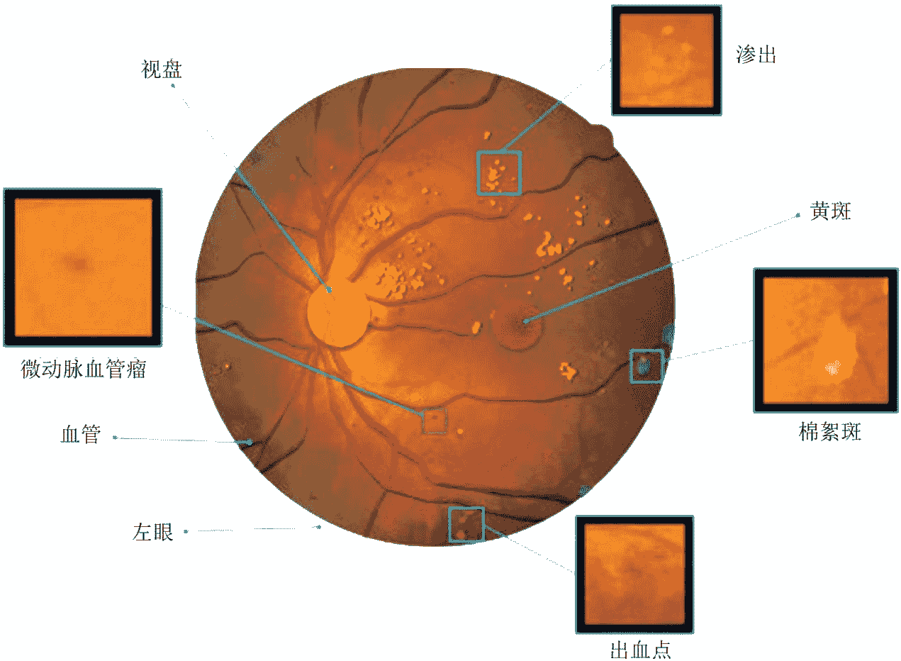

图 2-21 糖网病主要症状和检查点

医学研究证实高血糖、高血压、高血脂是糖网病发生的重要危险因素。

糖网病早期往往无临床症状，一旦出现症状病情已较重，易错过最佳治疗时机，故治疗效果取决于是否及时。但因我国眼科医生匮乏、居民重视程度不高，目前糖网病筛查比例不足 10%。

国家卫生计生委办公厅 2017 年 3 月发布数据显示，我国各地区流行病学调查显示，糖尿病黄斑水肿与临床有意义的黄斑水肿在糖尿病罹患人群中的平均发病率分别为 5.2%（3.1%~7.9%）和 3.5%（1.9%~6.0%）。

图 2-22 所示为我国糖网病发病率统计。

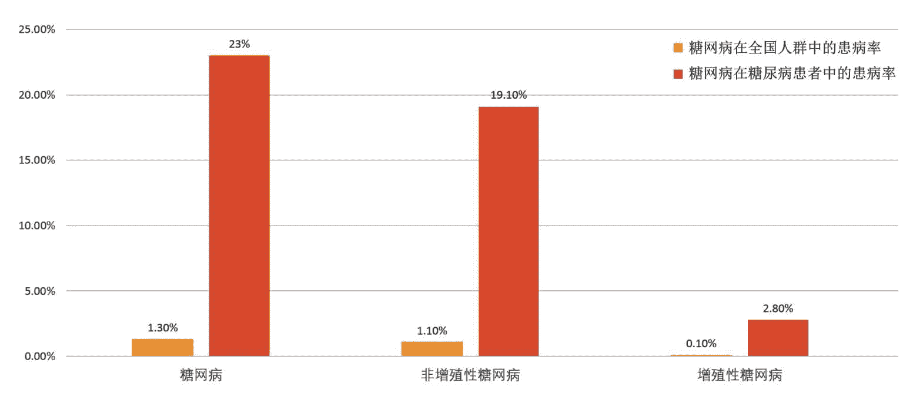

图 2-22 我国糖网病发病率统计

2017 年国际糖尿病联盟发布的统计结果显示，2017 年全球有 4.25 亿名糖尿病患者，比 2015 年增加 1000 万；另有 3.5 亿多糖尿病高危人群；预计到 2045 年将有近 7 亿名糖尿病患者。在所有国家中糖尿病人数最多的是中国，达 1.14 亿。我国 1 型糖尿病患者数量全球排第四位。据了解，2017 年我国 87% 糖尿病患者就诊于县级及以下医疗机构，但治疗糖网病的基本诊疗措施和适宜技术多在三级医疗机构，基层不具备此实力。

部分流行病学结果显示：50% 以上糖尿病患者未被告知应定期进行眼底检查，近 70% 糖尿病患者未接受规范眼科治疗，约 90% 具有激光治疗指征的糖尿病视网膜病变未得到治疗。在应接受激光治疗患者中仅 20% 接受规范激光治疗。

患者数量巨大，但我国眼科医生非常稀缺。据 2016 年卫计委统计，我国目前仅有 3.2 万名眼科医生，其中从事眼底医疗服务和研究的医生有 800~1000 人，相对于 2700 多万名糖网病患者，眼科医生严重不足。

2015 年 IDF 报告显示，2015 年全球医疗消费中 11.6% 花费在糖尿病治疗上，金额为 6730 亿~11970 亿美元。我国糖尿病导致直接医疗开支占全国医疗总开支 13%，达 1734 亿元，主要是因为糖尿病患者医疗服务次数是非糖尿病者的 3~4 倍，其住院和门诊次数较多。另外，中老年群体有一定的财富积累，支付能力较强。

平均每个糖尿病患者每年糖尿病治疗花费在 1 万元以内，花费几十元做一次筛查并非大开支。糖网病筛查未普及，一方面因医生少患者多，另一方面存在客观因素。

（1）糖网病患者基数大、增长快，眼底设备普及速度远无法满足需求。但眼底设备昂贵，对欠发达地区来说大量采购并不现实。

糖尿病视网膜筛查：人力短板与AI的介入空间

公众对糖尿病视网膜病变筛查的关注度持续走高，国家层面的推动也让眼底影像判读需求快速膨胀。现有眼科医师队伍已难以消化如此体量的工作，长期超负荷运转下漏诊误诊的风险在攀升。阅片经验丰富的医师更倾向把精力放在科研和新技术探索上，对重复性的读片事务缺乏持续兴趣，熟手流失进一步加剧了供给紧张。

眼底判读人才的培养周期长，且不同阅片者之间存在明显习惯差异，对同一张眼底图得出不一致结论的情况并不少见，这让诊断难以做到量化的可比。

影像资料的利用同样受限。多数机构的做法仍是简单归档保存，后续的清洗、结构化与整理投入巨大，原始读片数据想被二次用于随访或研究，操作成本很高。

患者端也存在可及性问题。糖尿病人群多为高龄，或伴有心脑肾等多系统并发症，出行不便。居住地与具备眼病诊疗能力的医院距离远，挂号等待和检查耗时长，进一步降低了筛查参与度。

上述困境根源在于医疗供给与患者需求的结构性失衡，而图像识别正是人工智能擅长的环节，先由AI完成初筛，有望显著缓解当前糖网筛查压力。

目前国内涉足AI糖网筛查的企业约有9家，详见表2-6人工智能糖网病筛查公司
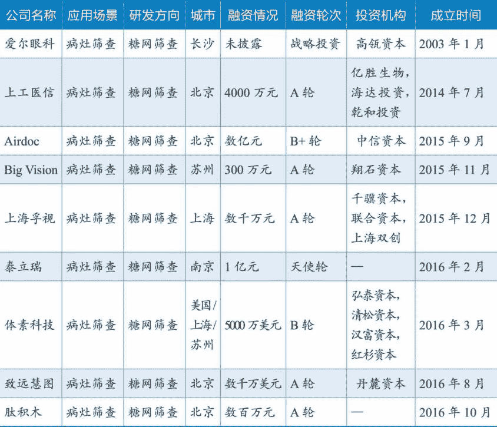

除爱尔眼科外，其余8家均为创业公司，其中3家诞生于2015年，4家诞生于2016年，整体都处在早期阶段。9家中可查到融资信息的有7家，1家在天使轮，5家在A轮，2家在B轮。从赛道看，上工医信、肽积木、上海孚视、Big Vision、致远慧图、爱尔眼科6家聚焦眼科；体素科技、泰立瑞、Airdoc的业务边界更广，也覆盖其他影像产品。

在临床试验阶段，常见的工作流程是：患者借助手机、手持眼底相机或专业眼底设备拍摄眼底照片并上传至系统或云端，同时录入病史信息，由系统自动输出辅助参考意见。需进一步检查治疗的病例交由医师复核，对无糖尿病视网膜病变或仅轻度无需干预的患者则给予健康指导。

肽积木首席执行官柏文洁介绍，其AI技术对单张眼底图像的病灶标注仅需13至15秒，而人工阅片需要3到5分钟，在保持准确率的前提下效率提升约20倍。

上海长征医院魏锐利教授评价Airdoc：“AirdocDR可以把专业医生的技术能力延伸到全国各地，手机或专业仪器拍摄的影像上传云端后即可获得辅助分析，患者在任何地点都能得到早期预警建议。”

相比单纯管控血糖，借助筛查在基层建立慢病管理体系更具长效价值。分级诊疗已明确眼科问题应转诊，但血糖、血压、血脂的严格控制以及患者的定期随访与健康教育必须落实在基层。

AI推动糖网筛查仍面临挑战与机遇。

眼科设备需迭代。当前专业眼底设备价格高昂、操作复杂，难以支撑大规模普筛。市场上开始出现手持式眼底相机和手机改装方案。若要实现大范围筛查，手持设备是刚需，而该类硬件的短板会制约AI普及，不过已有多个企业在联合改进设备。

需要构建标准化的标注数据库。由企业和医院收集不同质量的眼底影像，在政府牵头下组织专家进行标注分级，再将影像输入各家的AI辅助系统与专家结果对照，准确性才具说服力。这十分耗时，十几万例标注的花费可达数千万元，每张图往往需5到7位专家独立标注，落地需要政府、企业、医院多方共识。

眼科服务需全链路覆盖。目前医学人工智能主要集中在门诊住院环节，而医疗服务链条很长，术后随访、药品疗效反馈等环节同样可发挥更大作用。AI能快速处理海量数据并生成模型，辅助医师更有效地追踪疾病进展与治疗效果。

眼下已有AI企业与地方卫健委合作开展眼底糖网筛查，费用由医保支付，企业负责执行。虽仍在试验阶段，但随着政策完善与设备更新，人工智能有望助力糖网筛查、糖尿病管理及分级诊疗的落地。

## 3. 靶区勾画

靶区勾画与放疗方案设计占用了肿瘤医生大量时间。

确诊肿瘤的患者普遍焦虑，身体有细微变化就会反复追问，而三甲医院肿瘤科人满为患，医生除诊疗外还承担科研任务，长期面对追问容易产生倦怠。基层肿瘤科医生经验不足，往往不敢自行制定方案，只能转诊，进而加剧三甲医院的矛盾。提升医生效率、增强基层诊疗信心是医院的诉求之一。

放疗是肿瘤三大治疗手段中最主流的一种，更靠近治疗核心。每位患者的CT约有200张，传统流程要求逐张为器官和肿瘤位置标注，图2-23为智能靶区勾画的软件界面。按手工方式完成一份勾画需3到5小时，定位肿瘤后还需依据大小、形态设计射线照射或手术方案，涉及不同部位的不同剂量。

若方案顺利，患者康复；若首个疗程因勾画偏差或肿瘤变化导致疗效不佳，肿瘤体积缩小不足30%，就需要调整方案，医生必须重新勾画、重做计划。

国内肿瘤患者平均等待时间约2至3周，医生把大量时间耗在一个患者上，其他患者只能排队，可能错过最佳治疗窗口。

靶区勾画兼具技术含量与经验依赖，但其中重复性劳动占比高，正是人工智能的优势领域，用AI承接可为肿瘤医生节省大量时间。

肿瘤科信息系统可将治疗各子系统、各环节的数据对接整合，实现流程控制与质控。流程大致为：系统按癌症类型自动生成CT检查项目，利用图像识别与AI技术自动勾画靶区，自动生成放疗或手术方案后交由医生确认并进行质控，系统全程追踪后续治疗与检查结果。

过去没有该系统时，医生需等待2至3周下载资料，用3至5小时完成勾画再花费时间制定方案。使用系统后，下载资料已包含自动勾画的靶区和初步方案，医生只需修改校正即可。

目前连心医疗在乳腺癌、鼻咽癌、肺癌、肝癌等癌种的自动勾画技术较为成熟，自动靶区与医生手工勾画的重合度达87%以上。同领域布局的企业还有医诺科技、全域医疗和普润医疗等。

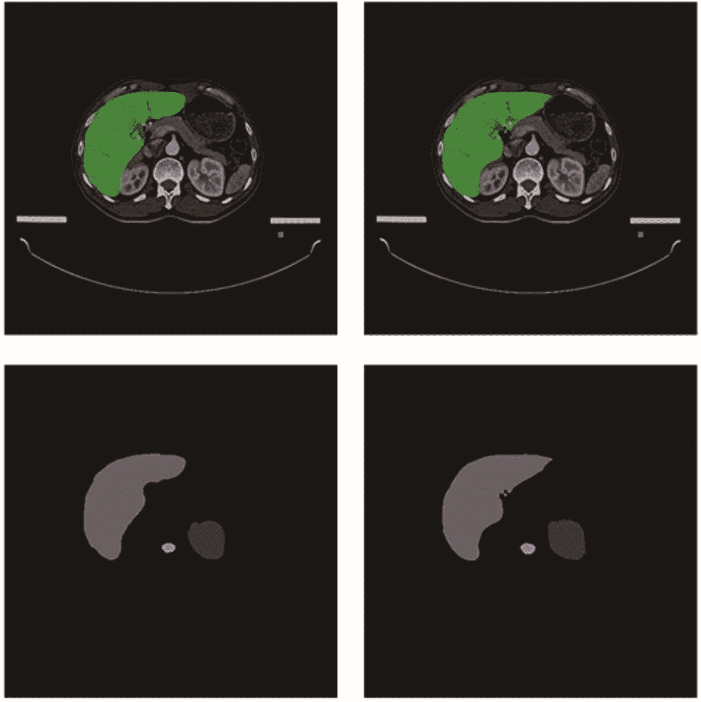

图 2-23 智能靶区勾画的软件界面

## 4. 脏器三维成像

脏器三维成像是指以核磁共振、CT等医学影像为基础，由人工智能完成目标脏器的定位分割，在计算机上呈现患者内部结构。影像数据输入后，医生手中的探针指向何处，系统即时更新显示，使解剖位置一目了然，有助于外科手术更快速、精确、安全。图2-24所示即为脏器三维成像VR演示。

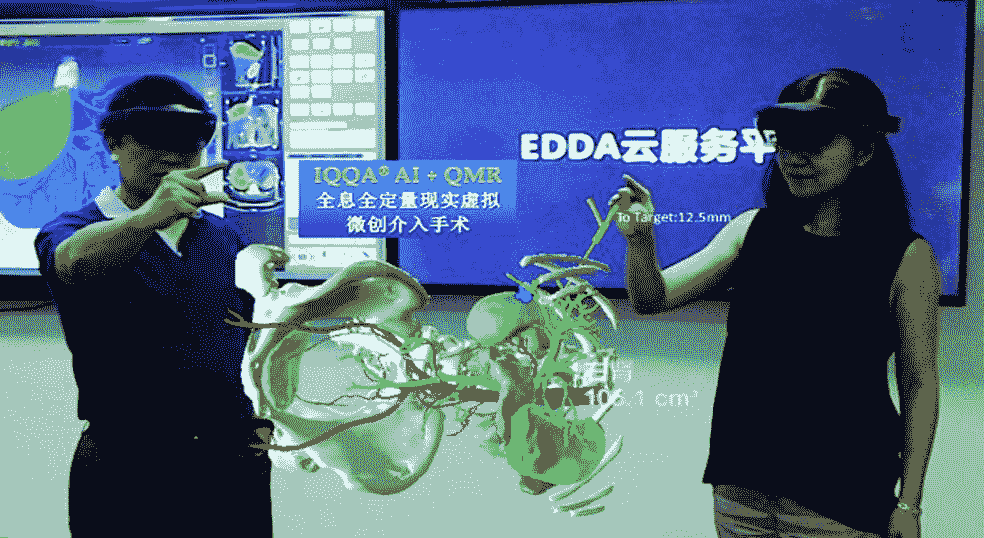

图 2-24 脏器三维成像 VR 演示

自动重构器官真实3D模型后，医生可在增强现实虚拟空间全方位观察人体结构细节，并通过手势和语音操作实时进行器官与病变的立体几何分析，精确测量位置、体积、径线、距离等参数，同时可进行虚拟解剖、模拟切除、方案设计与风险评估。

该技术最早出现在手术导航系统，早期准确率有限，随着人工智能加入结果趋于可靠并被临床接受。主要用于外科手术，可将术前或术中影像与术床解剖结构准确对应，帮助医生理解病灶与管道系统的关系，计算器官与病变体积，确定切除路径，从而提升手术精准度、缩小创伤、减轻患者痛苦。

国内提供相关产品的公司包括医软科技、昕健医疗、海纳医信、锐达医疗、联影医疗和睿佳科技等。依托手术导航系统，该类产品落地相对较快，广东省人民医院、上海交通大学医学院附属仁济医院、陕西省人民医院等三甲医院均有应用。

病理分析方面，病理医生的诊断报告是许多疾病尤其是癌症的最终确诊依据。但病理切片审查任务复杂，需要多年训练，病理医生数量远不能满足需求。

《中国卫生和计划生育统计年鉴2016》显示，我国病理科执业医师不足1.5万人，与每百张床配备1至2名病理医生的标准差距很大，缺口约10万人。

即便经过严格训练的病理医生，对同一患者的诊断也存在差异，例如部分乳腺癌和前列腺癌的诊断一致性低至48%。诊断分歧源于信息量庞大，每例患者有多张切片，40倍放大后每张切片含上百亿像素，浏览上千张百万像素图像并对每个像素负责，时间往往不足。

引入人工智能到数字病理研究可缩短诊断时间、提升效率，最关键的是提高诊断准确性，真正助力精准医疗。

谷歌曾公布利用深度学习算法区分乳腺癌是否扩散至淋巴结或邻近乳房的研究。使用如GoogLeNet等标准深度学习方法，生成的肿瘤概率热图虽略显嘈杂，但已达到普通医生水平。训练后算法在不同放大倍数图像上的定位得分FROC达89%，显著高于无时间限制病理学家的73%。

国内已有多个企业将AI引入病理分析研究，见表2-7国内使用人工智能进行病理分析的公司
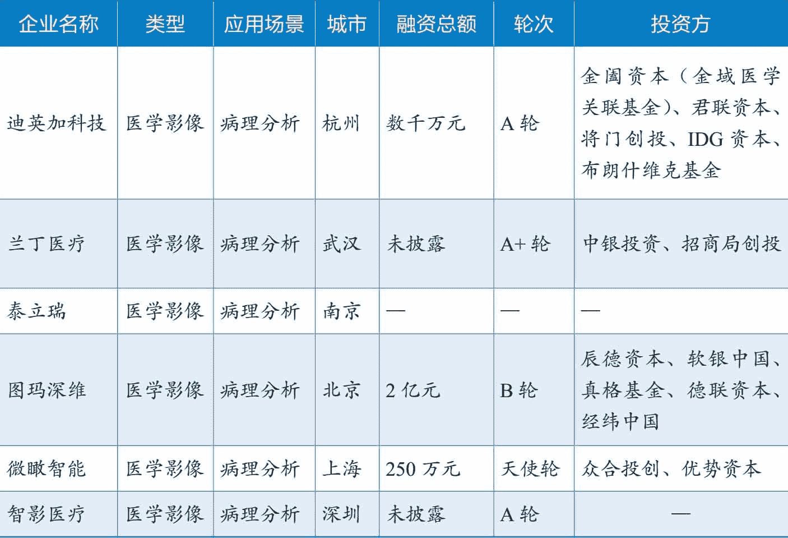

迪英加团队是国内较早深耕病理研究的团队之一，依托多年积累的数字病理图库开发出AI辅助诊断系统，可在普通计算机上以5至10秒速度处理超过1GB的全场扫描数字病理图像，对多种癌症良恶性判别的准确率达98%以上。

泰立瑞采用移动端采集加云端方案，降低病理分析门槛；兰丁高科通过云平台整合病理资源，云端收集数据并实时优化算法，不断提升诊疗精度。

### 2.3.4 人工智能医学影像公司调研

我们对当前人工智能医学影像公司的运行情况进行了实地调研，汇总信息见表2-8人工智能医学影像公司产品应用情况。该表反映了数据来源、数据量及落地情况，因企业发展阶段与策略差异，数据仅具行业态势参考价值，不宜直接对比。

表 2-8 人工智能医学影像公司产品应用情况

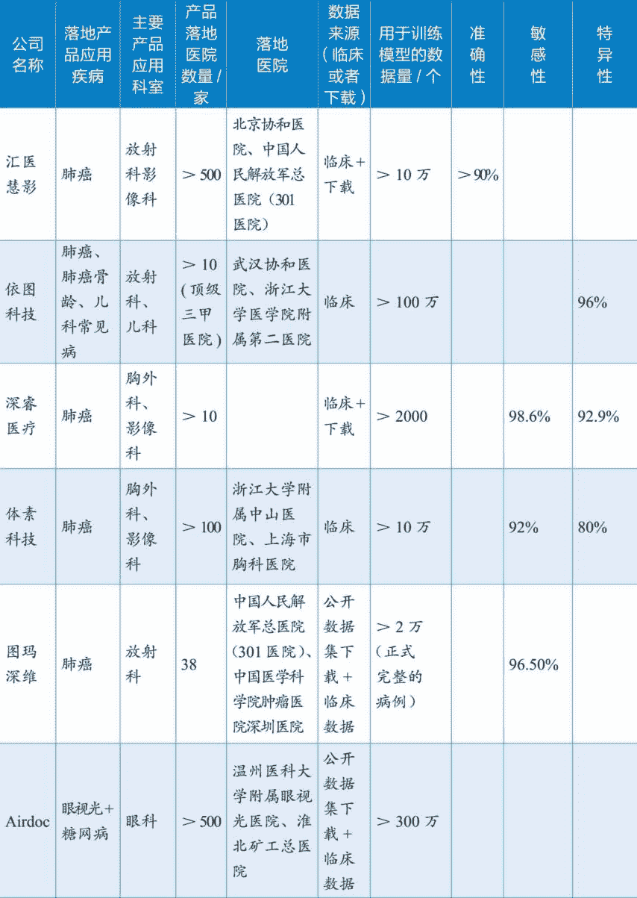

续表

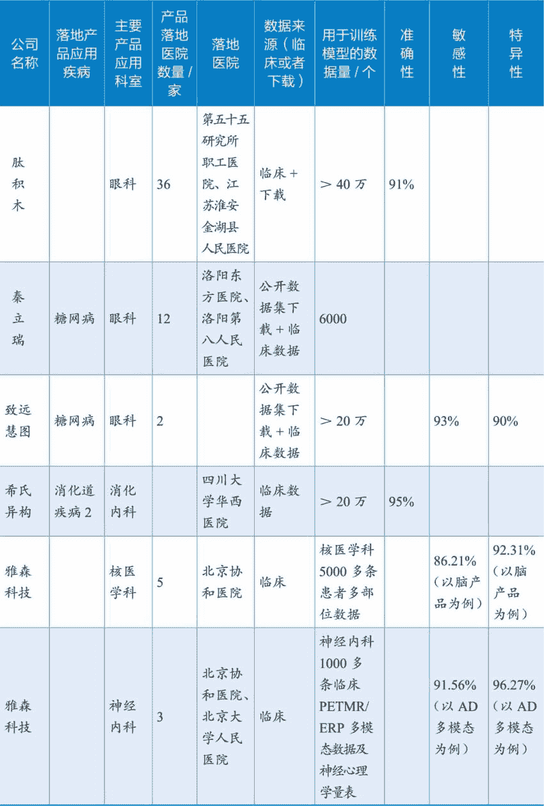

☆真阳性：技术判定为有病且金标准也判定为有病的病例数，用a表示。
☆假阳性：技术判定为有病而金标准判定为无病的病例数，用b表示。
☆假阴性：技术判定为无病而金标准判定为有病的病例数，用c表示。
☆真阴性：技术判定为无病且金标准也判定为无病的病例数，用d表示。根据以上四项可计算敏感性、特异性、阴性预测值和阳性预测值。

敏感性=a/(a+c)。敏感性即真阳性率，反映漏诊率，数值越高漏诊越少。用于筛查的系统必须保证高敏感性以减少漏诊。

特异性=d/(b+d)。特异性即真阴性率，反映误诊率，数值越高误诊越少。筛查系统对特异性的要求可在合理范围内接受。

总体来看，各公司均重视临床数据，训练初期使用公开数据集，后期逐步引入临床数据。目前各家系统敏感性均超过90%，这是医生最看重的指标，因为漏诊可能带来责任风险。浙江省人民医院放射科主任龚向阳指出，敏感性与特异性兼顾难度很大，很多公司开发时优先保障敏感性，在此基础上再提升特异性。

需要说明的是，部分公司的敏感性和特异性数据来源于特定研究数据集，而非真实临床数据，只能说明研究进展，不能用于横向比较。

### 推想科技

推想科技是国内较早实现临床应用的深度医学人工智能公司，成立于2015年初。产品提供智能影像报告检验、智能辅助筛查和智能鉴别诊断三项服务。

其智能CT线辅助筛查产品可自动在CT各层面标记病灶位置，帮助医生迅速完成诊断，减少在健康人群上的时间投入，降低重复劳动和疲劳。

诊断速度上，人工完成20例病例诊断约需3.5小时，使用推想产品在最低配置计算机上仅需6分15秒。准确率方面，AI对大小结节的综合灵敏度约85%，2017年3月9日测试数据显示，对0至3mm结节敏感度为84.03%，3至6mm为88.31%，大于6mm为100%。

随着算法迭代，服务领域从胸部扩展至头部、腹部、股骨头、病理、超声等，覆盖上百种疾病。

2018年3月19日，推想科技宣布完成3亿元B+轮融资，由启明创投领投，红杉资本、元生资本、襄禾资本、尚珹基金等参投，是当时医学影像AI领域最大单笔融资。资金主要用于AI医疗影像产品研发、生产及国际化营销，见表2-9推想科技融资轮次
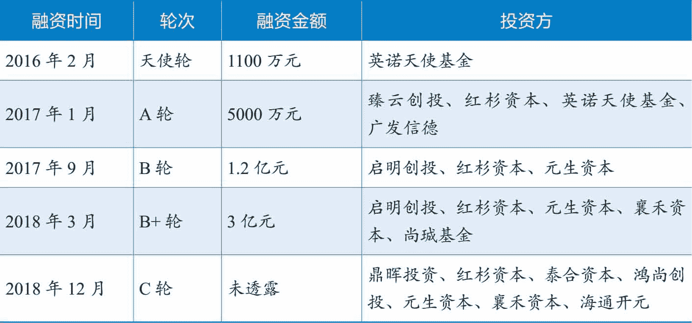

### 雅森科技

雅森科技成立于2006年，是国内最早聚焦医学影像人工智能分析、核医学定量及CAD分析的高科技企业，擅长各类数学算法在医疗图像处理、机器训练、大数据库比对及标准生物物理影像模型方面的开发与应用。

公司采用独创专利数学模型，与多家重点医院联合开展脑、心、肺、甲状腺等脏器定量分析科研合作，开发并验证特定疾病生物数学分析方法，并构建正常人群组数据库。构建多模态数据体系，融合影像、病理、病历进行综合分析。

目前脑部诊断产品已较为成熟，正于北京协和医院进行最后数据验证。该产品为典型多模态方案，可整合核磁、脑电图及量表数据，综合预测阿尔茨海默病进展。后续还将推出融合肺部CT、PET和病理数据的肺癌平台型产品，提供诊断与预后建议。公司发展思路不是追求病种数量，而是围绕单一病种做深度挖掘，并沿着“AI赋能医院”的方向提供整体AI分析平台雅森天玑，已与知名医联体合作部署，属于医院AI赋能的重要一步。

融资轮次见表2-10雅森科技融资轮次
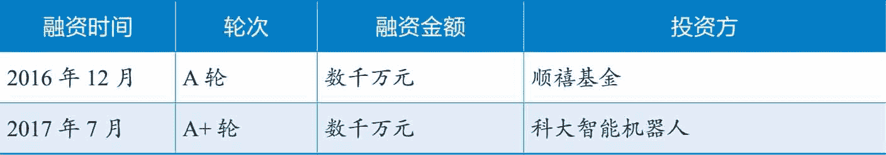

### 依图科技

2016年依图科技进入医疗领域，数月内先后推出智能影像诊断辅助系统和基于病历数据的智能诊断辅助系统。2016年9月与广州妇女儿童医疗中心合作，开发面向幼儿发烧诊断的虚拟医生“咪姆熊”。

“咪姆熊”基于深度学习对医院病历数据训练，建立十几种儿童常见病诊断模型，在医生反馈下持续优化，被医生称为“熊医生”。

6个月后，依图肺结节智能影像辅助平台在浙江省人民医院上线。通过深度学习构建“数字肺”，帮助医生快速精准定位结节，并将影像与病理结合，逼近影像诊断极限，在全球AI医疗领域属首创。

公开报道称，临床应用半年多后，实际敏感性已超95%，其中10mm以下小结节及5mm以下微小结节占检出结节的40%以上，显示AI对肺小结节诊断能力已接近甚至超越普通医生水平。

影像 AI：判读之外迈向决策

在多家医院的试用期里，依图的影像辅助诊断系统产出的报告已进入医生日常研判环节。以浙江人民医院的落地数据来看，医生对系统结论的认可度逼近90%。在影像医学赛道抢得先机的同时，依图也在向诊疗辅助层面拓展。其临床决策支持产品已在广州妇女儿童医疗中心投入使用，通过深度学习加工历史病历，搭建出诊断模型、特征补全模型与相似病例检索模型，为医患提供早期参考。

依图科技的融资进程见表2-11。

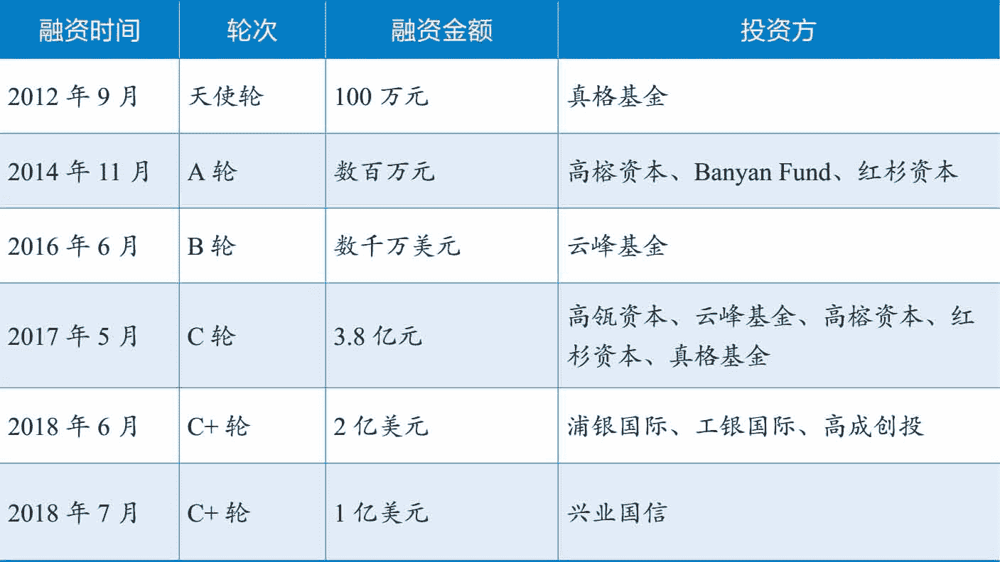

### 兰丁医学

兰丁医学聚焦细胞病理领域的研发、制造与临床服务一体化。主打设备是全自动数字远程病理细胞分析仪。该仪器通过机器学习在数百万份样本上建立癌细胞、癌前病变细胞与正常细胞的辨识规律，能够精准区分宫颈正常细胞与癌细胞，并具备自我迭代的学习能力。

兰丁医学的融资明细见表2-12。

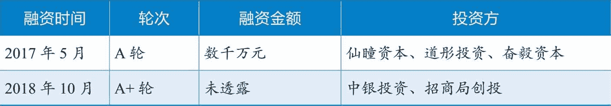

2016年兰丁完成了细胞病理云平台的搭建。终端扫描所得的原始图像可上传至云端，由云端完成自动检测与诊断，诊断结果经后台三级质控后回传终端。

该全自动数字远程病理分析仪已获CFDA、CE与FDA许可。产品已覆盖国内外300余家实验室，每月宫颈癌筛查能力可达108万例。宫颈癌筛查车已上市，第三方病理检验中心建设也在推进中。

### 2.3.5 医学影像领域的人工智能问题

（1）目标界定难题。临床中不少问题的边界模糊，只能靠经验与医师常态操作来粗描，难以用量化指标精确刻画。一旦目标定义偏差，后续建模结果必然失真，精确的目标设定是关键。

（2）可用数据的获取。深度模型对数据规模依赖极强，目前国内影像资料仍在胶片向数字化过渡，大量资料未完成数字化。各机构间数据共享程度低，获取大规模影像对企业是考验。患者疾病数据的归属尚未厘清，企业使用非公开数据存在合规风险。数据拿到后需结合先验知识标注，人工标注与标准化耗时耗力。

（3）模型可解释性。临床决策关乎生命，必须有清晰的因果依据。机器学习容易只拟合相关性，相关因素未必有因果联系，如何解释模型输出的意义成为产品化落地的门槛。可解释性不解决，难以产业化。

### 2.3.6 “医学影像人工智能+”的跨领域协作

统计显示影像是AI在医疗领域最热门的方向。国内涌现大量影像AI初创，腾讯、京东等巨头也在布局，让机器识别病灶并判断良恶性，但多数公司目前仍局限于影像本身。

动脉网采访的多位医生表示，机器识别病灶确实减少漏诊、提升效率，但判断肿瘤良恶性及具体癌种，需结合临床资料、病理资料乃至基因测序，仅靠影像只能定位大小。

Watson影像临床评估即借助临床数据辅助诊断，通过建设更连续可靠的电子病历，提升报告质量与计费准确性。该产品目前从主动脉瓣狭窄切入，当心内科医生给出相关诊断时，系统会核查诊断是否已录入电子病历，并检查是否包含问题列表与诊断记录。

IBM还发起Watson健康医学影像合作组织，由15家领先卫生机构、学术中心、移动影像提供商与影像技术公司组成。研究病种已涵盖乳腺癌、肺癌、糖尿病、眼病、脑病、中风与心脏病。

推想科技聚焦放射组学影像产品。放射组学以定量成像、特征计算、图像分析与模型构建为基础，通过影像特征定量描述肿瘤形态与病理，为临床提供影像学支持。当前主要用途有：

（1）放化疗疗效评估与预测。
（2）肿瘤分级，与诊疗方案制定密切相关。
（3）肿瘤良恶性鉴别，特征可指导临床决策。
（4）肿瘤遗传学研究。

研究表明肿瘤病理与基因关联紧密，放射组学恰好连接病理与基因学，可作为肿瘤遗传学研究的重要手段。推想科技引入AI基因专家，正因疾病诊疗需整合基因、影像、病理等多维信息。

爱康国宾从应用侧探索影像与液体活检结合。传统肿瘤筛查依赖CT或病理图像，CT只能定位难以定性，漏诊误诊率高；病理虽为金标准，获取流程繁琐。影像与液体活检结合可实现定性定位：先通过液体活检发现血液中癌细胞碎片，再用CT确定肿瘤位置，最终由专家或获批的智能系统判读，为治疗方案提供依据。

大厂可独立开拓赛道，初创倾向抱团。例如眼底糖网筛查、病理图像识别、放射影像识别、辅助诊疗系统等企业在产品成熟后可组建联盟，在平等互惠下联合落地医院、共享数据资源，形成更强竞争力。

总体来看，医疗AI合作研发呈现独立研发与联盟协作两种形态。其出发点并非像阿里、百度那样搭建全平台，而是基于临床需求、医院需求与企业需求自然形成的商业或研发模式。

“医学影像人工智能+”的理念类似“互联网+”。目前合作多集中于临床信息、基因检测、病理信息，未来可与更多医疗智能领域交叉，也可能演变为多领域间的互联协作，有助于影像AI产品落地，更贴近真实临床场景，扮演好医生的助手角色。

图2-25所示为AI与医疗主要医学影像企业分布。

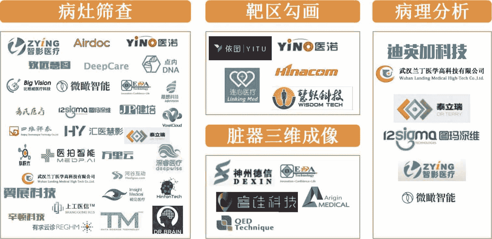

\[1\] Deep Care：一家专注于医学影像识别和筛查的科技公司，其特殊之处在于使用的技术是人工智能。

\[2\] 卢芳.International Diabetes Federation：国际糖尿病联盟发布新版糖尿病地图：中国1.14亿，仍是全球冠军，女性教育是防治关键\[EB/OL\].\[2017-11-18\].http://www.medsci.cn/article/showarticle.do?id=d6c6121688fd.

\[3\] 2016年11月国家卫计委印发的《“十三五”全国眼健康规划（2016—2020年）》，明确提出要以分级诊疗制度为基础，加大糖尿病视网膜病变的防治力度，提高早产儿视网膜病变筛查、诊断与治疗水平，巩固消除致盲性沙眼的成果等。

\[4\] GoogLeNet：2014年Christian Szegedy提出的一种全新的深度学习结构。在这之前的AlexNet、VGG等结构都是通过增大网络的深度（层数）来获得更好的训练效果的，但层数的增加会带来很多副作用，如过度拟合（overfit）、梯度消失和梯度爆炸等。

## 2.4 病历/文献分析

电子病历是在传统纸质病历基础上形成的患者电子档案，记录医患交互过程及疾病发展与治疗情况，涵盖大量健康与疾病信息，是医学科研传承的重要资料，也是器械药物研发的基础数据。

电子病历包含病案首页、病程记录、检查检验结果、医嘱、手术记录、护理记录等，既有结构化信息，也有非结构化自由文本和图文资料，涉及采集、存储、传输、质控、统计与利用等环节。

随着电子病历在医疗机构的普及，临床数据持续累积，医疗大数据概念逐步显现。海量数据可帮助发现医疗质量、安全、药物效果等关键证据，提升公共医疗效率与安全，促进新疗法与药物研发。

目前我国电子病历应用尚不成熟，利用病历数据开展大数据分析或科研需解决书写、编码、功能、互联互通、管理和使用等标准化问题。只有将非标准化场景规范化，才能获取真实连续完整的数据，为机构互通和第三方企业挖掘健康医疗大数据价值奠定基础。

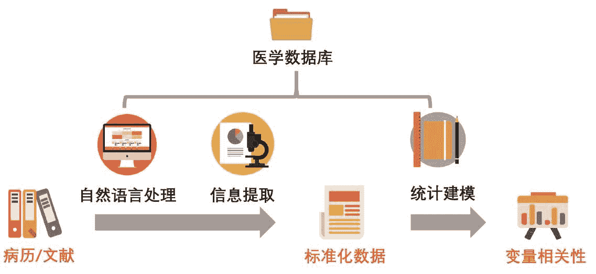

图2-26病历/文献的标准化过程

AI主要通过机器学习与自然语言处理自动抽取病历中的临床变量，智能融合多源异构医疗数据、结构化病历与文献，构建标准化数据库，将积压病历批量转化为结构化信息。

### 1．病历/文献分析的应用情况

当前病历文献分析企业通过医院合作与自购数据积累了大量样本。阅读一份50页病历，企业抓取并理解全部临床信息的速度比医师平均快2700倍。相关服务还能为保险产品设计与核保提供支持，为医学研究挖掘变量相关性、验证论文思路并提供专业统计分析。

AI病历文献分析主要场景有三类：病历结构化处理、多源异构数据挖掘和临床决策支持。

图2-27所示为AI与医疗病历/文献分析企业分布。

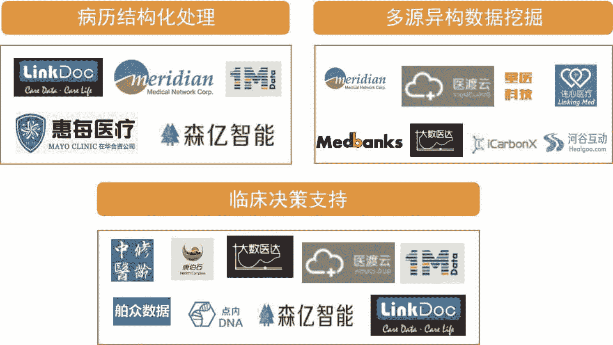

（1）病历结构化处理。20世纪90年代末美国基本完成主流医院信息化建设，关注点已转向数据二次利用，并从医学角度考量效率、安全与普适性。我国正处于从系统建设向数据利用过渡阶段，信息化接近完成但系统完善度、信息流通与体系化仍存不足，数据挖掘与二次利用受限。

每家数据结构化公司都有自身自然语言处理算法，语料库与知识库的积累是核心竞争力。AI系统具备速度快、准确率高的特点，即使面对医院IT系统标准不一，也能迅速为慢性病管理、健康平台、保险公司、HIS系统及药企等客户完成结构化处理，形成有说服力案例推动行业进步。

（2）多源异构数据挖掘。受历史原因影响，我国医院运行上百种医疗信息系统，数据处于孤岛状态，厂商接口费用高昂。AI企业与医院合作，无需对接原系统即可清洗、脱敏、结构化、标准化多源数据，帮助医院整合分裂的医疗数据，形成互联互通的大数据平台。

以大数医达为例，可挖掘医院近20年数据，将肿瘤患者的HIS、EMR、LIS、PACS等系统中的病历记录融合，以时间轴视图呈现门诊住院全貌。此前做患者统计需自采数据或对接多系统，如今只需与大数医达合作，二次开发工作量大幅下降。

平台还能实现医疗数据快速检索，借鉴互联网搜索技术，医师可在1秒内检索出所有病理报告，快速定位确诊乳腺癌或癌胚抗原大于5的患者。

三甲医院除互联互通外，还存在管理统计需求。统计科需对医疗过程与管理信息进行科学加工、监测分析，医院领导需探究药占比异常等指标原因。大数据平台可轻松支撑此类检索与分析。

在大数医达平台基础上，还开发了AI医师助手，基于海量病历深度学习提取智能诊断模型，辅助临床诊断与教学。模型可根据患者信息、主诉、病史、化验、检查等智能推荐鉴别疾病列表及概率，并提供相似病历统计参考。

### 临床决策支持

临床辅助诊断对结论可推测性要求极高，需严格的因果链条。基于相关性的大数据应用并不适用于医学，必须从统一标准入手，利用深度学习构建辅助诊断模型，在降低医师工作量的同时提供客观公正的第三方诊疗建议，避免基层医师因经验不足误诊漏诊。

医疗大数据辅助决策系统的核心是海量医疗大数据叠加各学科专家经验，技术团队利用IT技术与深度学习算法进行定制化开发，向医师提供可视化、场景化、智能化解决方案，使用反馈不断优化系统准确性。

以IBM Watson为代表的认知技术可读懂80%的非结构化数据。Watson的肿瘤专家吸收了美国百余年癌症临床实践，训练超过4年，与纪念斯隆-凯特琳癌症中心顶级专家组方案符合度接近100%，已覆盖肺癌、乳腺癌、结直肠癌等领域。

Watson先从病历提取关键词，从海量数据筛选重点，再为患者定制个性化治疗建议，标注每条建议的出处与可信度排序。医师选定方案后，系统还会给出病例数、生存率、不良反应发生率等信息，评估疗效与风险，整个过程仅需数秒。

### 2．问题和挑战

（1）高质量病历获取是最大挑战。医院是病人数据的集中地，合作意愿与数据开放程度决定项目成败。

（2）数据伦理问题。AI需依赖历史数据学习提升能力，我国政策尚未明确数据可利用范围，企业面临合规风险。

### 案例介绍

#### 森亿智能

森亿智能专注于利用AI进行医学文本自动分析与数据二次应用，按医疗IT企业、保险、药企、医院等B端需求，将病历进行结构化、可视化处理，应用于医保控费、药物研发与临床决策支持。

其系统如同经验丰富的医师，能精准完整读懂病历含义并消解歧义，利用自然语言处理深度挖掘医疗文本，快速批量抓取信息生成结构化数据库，将医师数月工作压缩至几秒。

目前系统全科室综合准确率达90.2%，可识别13大类临床变量与19类变量语言关联，实现全自动生成结构化数据库。其NLP不依赖人工规则，面对新病种新病历时通过机器学习自建模型，具备灵活定制与快速迭代能力。

盈利模式有二：一是开放中文病历语义API，为机构提供可插拔式模块；二是为保险等第三方管理机构提供替代人工的智能病历分析服务，并辅以临床细分市场报告、精准收费核算与深度风险评估，提升医保质量效益。

表2-13所示为森亿智能融资轮次。

#### 索闻博识

索闻博识成立于2014年，核心产品“博识医疗云”已成为国内领先的疾病专业化、数据结构化云端数据库及电子病历平台，覆盖肿瘤、血液、骨科、神经外科、神经内科等重大疾病，已在全国400余家三甲医院的2700个临床科室落地，其中肿瘤相关科室超1200个。

研发过程中，团队深入理解各科室复杂诊疗场景与需求，将临床医师观点融入产品概念设计。

博识医疗云定位为可覆盖多专科复杂诊疗场景的一站式平台，于 2015 年年末正式投入商业化运行。研发疾病专科化的电子病历，核心出发点在于满足诊疗决策层面的底层信息化诉求。该产品的长远价值在于，当使用规模达到临界点后，有机会塑造下一代疾病诊疗规范与指南。

表 2-14 所示为索闻博识的融资历程。

## 2.5 医院管理的智能化重塑
医院管理本质上是以医院为研究对象的管理学科，它依据医院工作的客观规律，借鉴现代管理理念与方法，对人力、财力、物力、信息、时间等资源进行规划、组织、协调与控制，力求在现有资源条件下实现医疗价值最大化。

### 2.5.1 人工智能赋能管理的两大切入点
在医院管理场景中，人工智能主要发挥两类作用：精细化配置医疗资源，以及补齐传统管理盲区。

#### 1．精细化配置医疗资源
人工智能依托医院的实时运行情况制定动态排班与流程安排，目标是打通服务链路，用好现有资源。

传统模式高度依赖人工，带来的弊端一方面是医护人员难以全身心投入临床，产生资源闲置；另一方面行政性事务叠加本就繁重的临床负担，容易导致整体效率下降。

人工智能可弥补上述不足。通过机器学习等技术对医院历史信息建模，训练出高精度的决策模型，并在实际运行中持续自我迭代，使方案更贴合实际。

表 2-15 所示为传统方式与人工智能方式在优化医疗配置上的差异。

在人工智能的加持下，医院运营链路得到重塑，运行效率呈现稳步上扬。人工管理受主观客观因素制约，常出现资源与最需要患者的错配。人工智能则借助大数据实现宏观统筹，能够基于电子病历、既往病史等信息辨识出亟需救治的群体，优先调配资源，优化服务优先级。

#### 2．补齐管理短板
人工智能通过采集患者对医院的评价，提炼管理问题并给出改进路径，意图提升就医满意度与医院收入。近年来“以患者为中心”“以价值为导向”的理念深入人心，患者体验对医疗行为的影响日益凸显。德勤 2017 年 4 月的调研指出，良好的患者体验对医院营收具有显著提升作用。在此需求下，面向管理漏洞的智能化系统应运而生。

该类系统可从点评网站、社交媒体、新闻报道等多源渠道抓取用户评价，利用自然语言处理把非结构化文本转化为机器可读的结构化数据，再依托预设模型解析评价背后的真实诉求，最终以可视化图表的形式呈现给管理层，明确医院的薄弱环节及改进方向。

在信息搜集环节，人工智能的效率优势十分明显。人工搜集与筛选往往耗时数周甚至数月，而数字化处理可将周期压缩至数小时或数天，工作量大幅下降。

传统满意度调研形式单一、回馈有限，而人工智能可实现内外多渠道的真实评价汇聚。往昔的满意度调查多由人工执行，且易与部门绩效考核挂钩，导致调研流于形式。机器分析不带主观情感与利益倾向，能够提供客观公正的结果。

两种方式的对照见表 2-16 所示。

数据采集与分析的准确性直接决定整改方案的可行性。人工智能在输出分析结果的同时，还会为管理者提供系列可操作的建议供决策参考。

表 2-16 弥补医院管理漏洞的传统方式和人工智能方式比较

在人工智能的协同下，医院在多个管理能力维度上实现明显跃升。以标杆企业 Qventus 为例，某家医院部署其系统后，在图 2-28 和图 2-29 所示的 8 个维度上均有改善，患者满意度排名从第 29 位升至第 3 位。

图 2-28 患者在医院等待和停留的时间减少，医疗效率提升

图 2-29 医院的运营效率提升，患者满意度增加

### 2.5.2 深耕医院管理的AI厂商图谱
前文对资源优化与漏洞弥补型企业做了梳理：布局医院管理的人工智能公司多集中在海外，如表 2-17 与表 2-18 所列，国内方面蛋壳研究院检索到杭州百世伽科技涉足该领域。

表 2-17 弥补医院管理漏洞的人工智能企业

续表

表 2-18 优化医疗资源配置的人工智能企业

续表

需要说明的是，部分企业虽提供分级诊疗、远程医疗等与运营相关的服务，例如专注医学影像 AI 诊断的锐达医疗，但其核心技术仍集中在医学影像、智能语音等环节，未真正应用于医院管理，故未列入统计范围。

### 2.5.3 医院管理AI的商业化路径
在商业模式上，面向医院管理的人工智能系统普遍采用按使用时长计费。企业结合医院具体情况评估业务功能的计算复杂度，核定价目后按季度或年度收取费用，如图 2-30 所示。

图 2-30 人工智能与医院管理企业的盈利模式

在美国，主营医院管理AI的公司主要面向大型连锁医院。这类客户预算充足，属于高价值客户，且美国民营医院占主导，市场竞争激烈，连锁医院有强烈动机通过AI提升运营能力，以在第三方医疗评级中保持领先。

以标杆企业 NarrativeDx 为例，其客户包括美国规模较大的三大医疗机构：克里斯蒂娜健康系统、纽约大学朗格尼医学中心、怕利塞德医疗中心。

就国内现状而言，人工智能在医院管理中的普及节奏相对缓慢，短期内难以形成理想的商业回报。不同于影像诊断类设备投入即见效，管理类应用需要更长周期才能显现收益，因而医院的采纳意愿不足。

不过，AI重塑医疗与管理的大势已定。国家已将人工智能发展纳入国家战略与规划，对国内创业公司是重大利好。抓住历史窗口、聚焦重点赛道，行业未来必将加速演进，只要持续深耕，价值终会兑现。

#### 案例介绍

##### Qventus
Qventus 前身为 AnalyticsMD，是一家提供医院智能决策分析系统的初创公司。面对传统医院管理效率低下、资源浪费严重的现状，Qventus 专注解决急诊室、手术室等环节的运营难题，采用实时数据追踪、分析、预测与优化的技术路径。

Qventus 为医院搭建 SaaS 系统有两大目标：一是让管理者实时掌握工作状态与进度，实现更优决策，避免同行差距；二是提升患者与医护人员的就医效率，例如病床、医护资源可在空出瞬间被调用，避免急诊患者滞留无人处置。同时，系统还能基于分析数据提供避免治疗瓶颈的建议。

辅助性决策或预警信息会通过电话或短信推送至医生、护士的移动终端，便于及时调整策略。

图 2-31 所示为 Qventus 的人工智能系统服务流程。

图 2-31 Qventus 的人工智能系统服务流程

目前，Qventus 开发的符合 HIPAA 标准的安全 SaaS 系统已在旧金山医疗机构广泛应用。其数据来源为美国政府医疗网站汇总的全国医疗保险及医疗补助基金机构信息。依托实时分析平台对这些数据进行处理，可输出决策建议，辅助管理者与临床人员做判断。

##### Cloud Medx
Cloud Medx 成立于 2014 年，总部位于加州帕罗奥多。业务核心是基于大数据整合与决策支持，从多家医院实时采集患者数据，经处理分析后向医疗机构提供符合 HIPAA 的健康预测与分析服务。原始病历数据经分析后可揭示疾病发展规律、发生模式、偏差及预测概率，为临床治疗与早期筛查提供参考。2015 年 5 月，公司完成 660 万美元融资，腾讯为参与方之一，具体金额未披露。

依托大规模深度自然语言处理算法，结合主流医疗机构 1000 万份病例数据，Cloud Medx 可为医院管理提供辅助决策。例如基于住院情况进行再入院风险预测。公司数据显示，使用其系统的医院再入院率降低 30%。目前系统兼容 18 家主流电子健康记录系统，在患者信息实时提醒、风险管控、智能化运营等方面提供支持。

[1] Qventus：美国医院操作系统服务商，成立于 2011 年，2017 年 3 月完成更名。客户包括纽约长老会医院、埃默里大学医院、Mercy 医院等。
[2] NarrativeDx：美国德克萨斯州奥斯汀的科技创业公司，通过自然语言处理技术分析影响患者体验的因素，提供改善方案。

## 2.6 智能化医疗器械的演进
2018 年 4 月初，美国 FDA 批准 IDx 公司研发的首款面向基层医疗的自主式 AI 诊断设备 IDx-DR 的软件程序，该软件可在无专业医生介入下通过视网膜照片诊断糖尿病视网膜病变。从立项到获批历经 21 年，仅 IDx 与 FDA 关于系统评估、准确性与安全性沟通就耗时 7 年。

近期美国获批的 AI 产品多走 Class II 认证路径，通过与传统临床决策支持系统等同比较证明安全有效。中国法规相对更严，临床评价路径管控更严格。

2018 年 8 月 1 日起，我国新版《医疗器械分类目录》正式实施，医用软件按二类、三类器械管理。若诊断软件仅提供诊断建议，属辅助诊断，不直接下结论，按第二类管理；若算法可自动识别病变并给出明确诊断提示，因风险较高，按第三类管理。因此当前市面上的多数 AI 产品仍属第三类范畴。

为应对政策，部分企业采取功能增减策略，同时申报二类与三类。目前已有多家企业获二类证，如雅森科技、汇医慧影、图玛深维、推想科技、深睿、Airdoc、依图科技等正积极申报三类认证。依图表示全产品矩阵均在做三类认证，Airdoc 已送检国内首台搭载待审 AI 软件的服务器。目前尚无产品获三类证书。

按医疗器械注册流程，产品需经历定型、检测、临床试验、注册申报、技术审评、行政审批六步。目前申报三类的人工智能医疗产品大多处于注册申报初期。

目前工业与医疗界使用的机器人仅能程序化完成固定任务，与人们对“人工智能机器人”的想象存在差距，不在案例讨论范围。手术机器人仍无自主意识，需医生经验主导，而智能化器械可依据历史病历记录计算出应对方案，处理当前状况。

智能化器械按企业属性可分为医疗器械巨头与初创公司，如图 2-32 所示。巨头多采用“传统器械+技术合作”模式借助外部技术，初创企业则以“自主研发整机”方式提供设备与配套软件。

图 2-32 智能化器械的两大企业类型

相较于传统医疗器械，智能化器械在两方面显著提升效率。

1）帮助医生减负。传统器械仅作为诊断、治疗、康复的工具，加入人工智能后，智能器械可成为医生助手，与传统设备融合，助力快速诊断。例如自动筛除无需医生分析的信息，使医生聚焦疑难病例。

2）提升使用精准度。传统器械独立操作，智能化器械可与其他设备联动，借助大数据优势。例如在诊断时，可依据历史信息做出更准确判断。

### 2.6.1 布局智能化器械的企业矩阵
布局智能化器械的医疗器械巨头主要包括海外三大巨头 GE、飞利浦、西门子，以及国内领先厂商万东医疗等，具体情况如表 2-19 所示。

表 2-19 传统器械+技术合作企业的情况

续表

### 1．通用医疗
GE 在人工智能的布局分为医学影像与医疗保健两条线。

在医学影像方面，GE 的低剂量 CT 肺癌筛查方案是业内首个获 FDA 认证的方案。该方案基于低剂量 CT 设备实现精准成像，早期发现微小结节，并可自动标记难以识别的肺结节，辅助医生快速精准筛查。

在医疗保健方面，GE 涉及领域广泛，正利用深度学习探索多项任务，包括：
① 识别不同类型癌组织细胞；
② 为 ICU 患者确定最优治疗方案；
③ 预测 ICU 患者发生败血症或感染的风险；
④ 利用超声评估患者心脏问题；
⑤ 预测疾病发作。

### 2．飞利浦
飞利浦与美国初创公司 Path AI 合作，借助人工智能实现更快更准的癌症诊断，最初目标为自动识别与分析乳腺组织癌变。

快速准确判断癌症发生与进展对病理学家而言挑战极大，传统方式需在显微镜下逐张人工观察切片，工作量随病例增长而攀升。自动化智能图像采集与分析软件可大幅减轻负担，提升诊断速度与准确度。

飞利浦在自动诊断领域经验丰富，旗下 IntelliSite Pathology Solution 系统涵盖自动图像扫描与图像管理系统。公司还收购了专注数字病理图像分析的爱尔兰公司 PathXL。另有 Illumeo 平台利用自适应智能技术提升放射科医生效率，其准确率可媲美资深医生人工诊断。目前飞利浦与 PathXL 的合作旨在将该算法推向临床应用，助力病理学家实现快速精准诊断。

### 3．西门子
西门子的人工智能布局聚焦医学影像。其医学影像处理软件 syngo.via 基于人工智能构建。syngo.via 依托海量医学文献与病例构建大数据临床病种知识库，按规范与指南搭建影像扫查、处理、报告全流程结构化任务。

随后 syngo.via 模拟医生操作与知识调用，生成影像处理流，实现“智能前处理”与“处理即报告”。在医生打开病例前，系统即可按指南自动启动多软件并行处理。病例打开后自动呈现规范准确的病灶结果，多软件结果合成一份报告，并嵌入分期与分级选项。该技术可在不增加甚至减少医生工作量的前提下，输出符合指南、图表化表达并含分期分级的报告，促进规范化培训落地。

### 4．富士胶片和奥林巴斯
日本富士胶片与奥林巴斯正与医师学会等合作，开发基于内窥镜检查的 AI 自动判断胃癌等可疑病变技术，预计最早 2020 年投入实际应用。

两家均为全球性大型医疗器械企业。日本胃肠内窥镜专业医师学会自 2017 年起参与实证研究，研究人员从全国 32 家大学附属医院收集大量影像数据用于 AI 学习，并持续补充医生诊断结果与患者既往病史。AI 学习技术由东京大学等研究机构负责。

### 5．万东医疗

2017 年 CMEF 上，万里云正式亮相了面向精准医疗的人工智能影像平台 i 影像。时至今日，该平台已完成 DR 智能筛查与 CT 智能检测两大模块的上线。官方披露的数据显示，针对细微肺结节的识别，i 影像能够将漏检率压低一半以上，整体检测准确度稳定在 95% 以上。万里云影像平台负责人颜子夜博士进一步说明，智能影像本质上是工具属性，公司交付的是完整的解决方案，核心工作重心放在智能化处理能力与影像质控体系的建设上。

### 6．安翰医疗
安翰医疗是一家中外合资的高新技术企业，聚焦医疗器械的研发、生产、销售与服务，主攻胶囊内镜机器人系统的研发与商业化，是全球首家将“主动精确定位消化道胶囊内镜机器人系统”推向市场的公司。

2017 年 4 月 20 日，安翰医疗与 IBM 中国研究院签署合作备忘录，双方将在胶囊内窥镜影像场景开展前瞻性探索，验证把 IBM 认知影像技术引入消化道早期疾病精准筛查的可行性。

公司自主研发的前沿精控胶囊胃镜系统，依托可控胶囊内镜机器人获取胃部影像，检查效率更高、患者负担更低。不过单次检查即可产生约 2 万张影像，如何高效阅片并实现精准分析成为新的瓶颈。

临床实践中，如此庞大的影像量难以靠人工在短时间内完成诊断，IBM 的认知影像技术有望成为破解之道。IBM 中国研究院与安翰的早期项目，意在演示智能病灶检测如何帮助安翰消化每年数十亿级影像，提升筛查的精准度与可操作性。

### 7．成运医疗
上海成运医疗器械股份有限公司由中德双方技术合作组建，主要从事医用电子内窥镜的生产。2003 年 3 月公司取得国家食品药品监督管理局颁发的医疗器械注册证，成为国内第一家拿到注册上市资格的医用电子内窥镜制造商。

成运医疗与希氏异构采取技术授权合作模式，已推出内镜搭载 AI 的新品，后续在人工智能内镜设备的销售额中双方按约定比例分成。

表 2-20 所示为独立研发整套智能设备的初创企业情况。

续表

### 2.6.2 智能器械的商业模式
对传统器械企业而言，自建部门从零研发智能功能流程冗长、投入巨大。选择与 AI 公司联动，可避免重复投入，直接把人工智能系统集成到自有器械上销售，从而强化产品竞争力。

对医疗 AI 公司而言，与器械厂商合作有两重价值：一是借科研合作验证产品的真实临床表现；二是依托器械厂商完成医疗器械认证。目前绝大多数医疗 AI 企业仍在探寻盈利路径，受医疗行业规范性限制，国家尚未出台专门针对 AI 产品的认证细则，企业通常按二类或三类医疗器械的流程申请认证。

在正式获证前，不少企业选择先搭载合作模式，将算法系统装入器械产品，器械方仅需向省级药品监督管理部门进行备案，无须重新走完整认证，即可在市场流通，销售收益按双方协议比例分配（图 2-33）。

图 2-33 传统器械+技术合作企业的盈利模式

在该模式下，AI 公司也可扮演器械方的代理角色。若医院主动找 AI 公司试用或采购人工智能产品，由 AI 公司完成的销售将按另一种分成比例结算。

图 2-34 独立研发整套设备企业的盈利模式

对于初创企业，部分产品可以直接面向 C 端用户，无需借助传统器械厂商进入医院，更倾向于以器械加软件的整体方案获取收益（图 2-34）。因此初创企业的商业路径相对直接，可通过线上线下渠道自主销售，在 B 端也不必与传统器械厂商深度绑定，自主性与灵活性更高。

图 2-35 两类智能器械企业的分布

[1] 智能化器械：由现代通信与信息技术、计算机网络技术、行业技术、智能控制技术、人工智能技术融合而成的医疗器械应用形态。智能化器械区别于仅具备基础智能功能的常规设备，它能够摆脱对医生操作的依赖，通过机器学习等底层能力实现自我迭代升级。

## 2.7 药物发现
在药物、生物技术与药理学领域，药物发现指的是寻找新候选药物的全过程。早期主要依赖传统经验疗法或偶然发现来鉴定活性成分；后来则通过合成小分子、天然产物或提取物，在细胞或整体动物模型中进行筛选，判断是否具备治疗活性。

新药开发整体可划分为药物发现、临床前研究与临床开发三段。现代药物发现技术上又细分为靶点发现与验证、先导化合物发现、先导化合物优化三个阶段。

### 2.7.1 药物发现的现状
药物发现属于高度资本密集型研究，需要药企与各国政府的巨额投入。即便生物技术持续进步，新药研发依然昂贵、困难且效率偏低。药物发现的最终产出是一项关于潜在药物的专利，后续仍需投入巨资进行 I 期、II 期、III 期临床试验，绝大多数候选药物会在此阶段被淘汰。

国际上流传“双 10”经验法则：研发一款创新药约需 10 年时间、10 亿美元投入。一般而言，制药公司研发成功一款新药的成本在 5 亿至 10 亿美元之间，周期长达 10 至 15 年。高风险、长周期、高成本仍是药企的核心痛点。

### 2.7.2 人工智能重构新药研发
当前新药研发突破愈发困难：一方面可利用的化合物多已被发掘，新化合物开发难度加大；另一方面科学文献增长极快，个体难以全面理解海量数据。人工智能能够从大量论文中提取分子结构等关键信息，自主学习建立关联，提供新思路。如图 2-36 所示，AI 有望显著压缩药物研发成本，为行业带来新机遇。

图 2-36 人工智能可以大幅度降低药物研发成本

2015 年 FDA 共批准 60 种药物，折算失败药物成本后当年每款获批药物的平均成本约为 6.98 亿美元，其中约 420 亿美元消耗于失败项目。蛋壳研究院测算，人工智能可将新药研发风险减半，至 2025 年全球制药行业每年有望节省约 260 亿美元。

AI 的加入正重塑新药研发流程，其应用正从靶点筛选向更多环节拓展。

按流程分布，AI+新药研发服务可分为三类：临床前药物发现服务、临床前药物自主研发、临床研究服务（图 2-37）。

图 2-37 人工智能参与药物研发的服务类型

表 2-21 所示为新药研发过程中传统方案与人工智能应用方案对比。

### 2.7.3 制药企业纷纷布局
长期观望的制药巨头现已加速进入 AI 赛道。

Numerate 公司与武田药业正式签约，双方将利用 Numerate 的人工智能技术寻找肿瘤学、胃肠病学及中枢神经系统疾病的小分子药物。

葛兰素史克公司^[1]（GSK）与 Exscientia 达成合作，交易金额约 4300 万美元。合作后 Exscientia 将借助其 AI 药物研发平台为 GSK 完成 10 个创新小分子药物的靶点开发。默克、强生、赛诺菲等巨头也在探索人工智能以简化研发流程。

### 2.7.4 AI+新药研发的 7 个应用场景
人工智能在新药研发主要活跃于两个阶段：新药发现与临床研究。在发现层面，AI 擅长挖掘药物与疾病、疾病与基因之间的关联关系，不仅能快速找到显性关联，也能发掘专家不易察觉的隐性关联，构建药物、疾病、基因的深层网络。目前 AI 在该领域可归为 7 个应用方向。

表 2-22 中列出了各个新药研发阶段的人工智能新药研发企业。

续表

图 2-38 所示为人工智能+医疗药物发现企业分布。

图 2-38 人工智能+医疗药物发现企业分布

### 1．靶点筛选
靶点发现即寻找能够减缓或逆转人类疾病的生物通路与蛋白，是新药发现的核心瓶颈。对前沿论文进行分析并输出预测数据也可视为靶点筛选的应用。老药新用是常见策略，通过将已上市药物与人体上万个靶点进行交叉匹配来寻找新适应症。过去依赖人工实验，AI 介入后试验速度实现指数级提升。据业内推测，借助算法建模与大规模算力，“老药新用”有望把药物研发成本降至 3 亿美元左右，周期缩短至 6.5 年。

当下每 30 秒即产生一篇生命科学论文，另有大量专利、临床试验结果等信息分散全球。这些资料中只有少量能形成可用新知。研发人员难以兼顾全部信息，但其中蕴含全球科研成果与大量新药线索，从中挖掘蛛丝马迹是药物发现的重要捷径。

### 企业案例

### Benevolent AI
Benevolent AI 由肯·穆尔瓦尼创立于 2013 年，初名分层医疗，2016 年 10 月更名为 Benevolent AI。公司利用人工智能从海量杂乱信息中提取可推动药物研发的知识与可验证假说，加速研发进程。

### 产品介绍
公司产品为判断增强认知系统（Judgment Augmented Cognition System，JACS）。该平台通过设计的 AI 工具将科学论文、专利、临床试验等非结构化信息转化为可用知识，提取生物学信息并进行生化预测，推动分子治疗技术革新，帮助科学家更高效地开发新药。

### 应用情况
2014 年 6 月，Benevolent AI 与一家美国药企达成合作，将两款处于中标候选化合物评估阶段的阿尔茨海默病新药出售给对方，交易总额高达 8 亿美元，其中 4 亿美元为预付款，后续研发成功可再获 4 亿美元。这两款药物均源自 JACS 系统。

除出售未进入临床的创新小分子化合物外，Benevolent AI 也可参与完整研发流程。2016 年 11 月公司与强生合作，接收其在研小分子化合物进行新药开发。2017 年 5 月 25 日，其发现的用于治疗肌萎缩侧索硬化症的药物，经英国谢菲尔德机构研究证实对运动神经退化有作用。

据官网信息，Benevolent AI 正在利用 AI 系统指导临床试验执行与数据采集。其下属专注药物研发的 Benevolent Bio 分部已有两种非肿瘤新药进入后期研究，其中一款帕金森症药物已进入 II 期临床，另一款治疗肌萎缩侧索硬化症的药物预计 5 年后进入临床。

### 2．药物筛选
药物筛选亦称先导物筛选。制药企业通常储备 50 万至 300 万种可调控蛋白功能的小分子化合物。先导物发现先通过少量模块组合生成不同蛋白，再采用高通量筛选寻找合适先导物。高通量筛选依靠机器人同时开展数百万次实验，成本极高。学界普遍主张用 AI/机器学习开发虚拟筛选方法，以替代昂贵耗时的人工筛选。

现行虚拟筛选易受错误发现率影响。若能把三期试验风险减半，足以为大型药企节省数十亿美元。AI 在药物筛选阶段主要有两种路径：一是基于深度学习开发虚拟筛选技术以取代高通量筛选；二是利用 AI 图像识别优化高通量筛选流程。

谷歌与斯坦福的研究人员正在用深度学习构建虚拟筛选体系，以替代或增强传统高通量筛选，提升筛选速度与成功率。通过深度学习实现跨靶点实验信息的共享。斯坦福博士 Bharath Ramsundar 等人指出，深层神经网络在多靶点上表现优于其他方法，预测质量接近完美，适合作为虚拟筛选工具，这为将其纳入药物设计标准流程提供了可能。

### 企业案例

### Recursion Pharmaceuticals（递归药物）
Recursion 成立于 2013 年，核心技术是运用计算机视觉处理细胞图像，并通过分析 1000 多种细胞特征评估给药后疾病细胞的变化。结合先进成像与 AI，该平台可在上百种疾病细胞模型中对上千种候选药物进行高通量细胞实验。

### 产品介绍
Recursion 使用前沿生物工具构建数百种独特的细胞疾病模型。每个成像模型包含成千上万个细胞，从每个细胞提取近 1000 个结构特征，据此建立专有细胞“指纹”酚醛树脂，可判断药物是否能使细胞恢复健康。

### 应用情况
公司已发现 15 种治疗罕见病的候选药物，其中用于治疗脑海绵状血管畸形的候选药物即将进入临床试验。其目标是在 10 年内找到 100 种疾病的治疗方案。

## 3. 药物优化
药物优化即先导物优化，核心是对先导物的构效关系进行改进。该阶段需全面修正分子的缺陷，当代药物发现常需同时优化 20 至 30 项指标，而分子改造牵一发而动全身。AI 可直观推测生理活性物质结构与活性的关系，进而推测靶酶活性位点结构并设计新活性物质，显著提升构效关系分析速度，快速遴选安全性更高的化合物。

## 4. 患者识别及招募
招募合适受试者是制药公司长期难题，时间成本与直接成本并存。多数临床试验被迫延长周期，因难以在规定时间内找到足够患者。拜耳数据显示，90% 的临床试验未能按期招募到足够样本，实际耗时常为计划的两倍。利用 AI 深度挖掘疾病数据，可更精准定位目标患者，加快招募。

2016 年 Biogen 的一项研究利用 Fitbit 追踪多发性硬化症患者的活动，24 小时内成功招募 248 名患者，其中 77% 完成后续研究。该试验显示，部分可穿戴设备用户乐于自我量化并分享生理数据。借助数字健康设备大规模招募志愿者正成为趋势。

### 企业案例

#### Mendel.ai
Mendel.ai 以现代遗传学之父孟德尔命名。公司开发的临床试验招募 AI 系统帮助癌症患者精准匹配合适的试验，获得免费治疗机会。服务周期每 3 个月收费 99 美元，期内患者可无限量上传医疗病历。受试者可自行上传资料，也可委托医生共享。

创始人卡米·加利尔为医学博士。他指出，医生需同时追踪大量试验，肺癌患者相关试验就可能达 500 种，每种都有独特且每周可能变动的入组标准，人工难以全面追踪。

Mendel.ai 通过算法解析临床试验文件中的非结构化自然语言，并与患者情况配对。检索完成后系统可在数分钟内给出个性化匹配结论，并实时更新匹配结果通知受试者。为提高匹配精度，平台建议患者进行 DNA 检测，以提升入组效率。

## 5. 药物依从性管理

依从性本质上衡量的是患者是否客观落实医嘱的程度。放到新药临床试验里，就是受试者是否严格依照方案规定的剂量和周期完成试验药物的服用。过去这类依从性管理多靠人工电话随访，样本一多就只能寄希望于患者自律。借助移动端和面部识别，系统能自动判断受试者是否在规定时间服药，通过算法自动识别药品和服药动作，并及时推送提醒，让依从性的管理从模糊走向精准。

根据 Ai Cure 官网公布的数据，约有两成到三成的临床试验最终以失败告终，原因就在于受试者未按要求用药。图 2-39 展示了样本量扩充比例与不遵医嘱比例之间的关系曲线。当不按时服药的人群占比升到 20%时，为确保数据仍具可靠性，样本量至少要额外增加六成。

图 2-39 单组样本量增加比例与不遵医嘱比例的数据可靠性曲线

### 企业案例

#### Ai Cure

Ai Cure 采用经临床验证的人工智能方案，来改善受试者的用药行为与依从性表现，相关成果见图 2-40。公司创立于 2010 年，初衷是通过提升依从性来降低住院支出、延长生命预期。其技术能够覆盖口服、舌下含服、吸入、注射等多种给药方式，并兼容多语言。平台具备机器学习功能，数据越丰富，监测与干预策略就越精准；一旦捕捉到异常服药行为，就会即时发出警报。

考虑到新药研发的高昂投入，Ai Cure 的解决方案有助于提升试验期间的依从水平，从而改善结果质量。公司把自身定位为为临床试验提供远程监控能力的赋能工具。

图 2-40 Ai Cure 人工智能技术

### 产品介绍

Ai Cure 的移动应用借助面部识别判断服药是否完成，同时采集用户端数据并运用自动化算法辨识药品种类及服药动作。所有信息均以符合 HIPAA 标准的加密通道实时回传给研究者，使医生能够即时核实受试者是否按要求完成用药。

### 应用情况

在一项针对精神分裂症患者的临床试验中，该技术的应用把依从率从 50%拉升到了 90%。

## 6. 患者数据收集

传统新药开发对受试者的健康与生理指标评估高度依赖现场访视。患者需按时到院检查，而在特定时点、特定场所采集的数据难以全面反映真实状态，容易产生偏差。引入可穿戴设备配合机器学习分析，就可以在试验全程提升参与度、数据的完整性以及整体运营效率。

临床数据云服务商 Medidata 已与 Garmin 达成战略合作，将智能手环采集的日常健康数据接入 Medidata Clinical Cloud，进而优化受试者参与、数据质量和流程效率。同样拿到 FDA 批准的可穿戴生命体征监测企业 Vital Connect，也在用生物传感器持续追踪受试者的多项生理指标。这些玩家正在把临床研究推向新阶段，打通过去难以触达的行为与生理数据通路。像前文提到的方案一样，它们都能显著提高受试者互动，最终为研发提供更丰富、更具实用价值的数据支撑。

## 7. 药物晶型预测

晶型是制药领域的关键变量，直接影响小分子药物的临床表现，同时蕴含可观的专利价值。在化合物专利之后，晶型专利往往是原研药企用来阻挡或延缓仿制药上市的核心壁垒，通常可把专利保护期延长 2 至 6 年，对重磅品种而言，这相当于数十亿美元的市场空间。

借助 AI 对晶型进行高通量动态模拟，可以系统性地预测小分子对应的全部可能晶型。相较于依赖实验搜索的传统路径，企业不必担心因探索空间受限而遗漏关键晶型，从而更从容地应对仿制方的专利挑战。同时，预测技术大幅压缩研发周期，帮助研究者更快锁定最优晶型。

### 企业案例

#### 晶泰科技

晶泰科技总部设在深圳，成立于 2015 年 9 月，同年底完成腾讯、人人等领投的数千万元 A 轮融资。该公司由量子物理学家和医药资深专家领衔，是全球领先的计算驱动型药物固态研发服务商。依托计算物理、量子化学与云端智能算法，晶泰能够实现高精度的固相筛选与设计，显著缩短设计、筛选到制剂开发的整体耗时，为客户的专利布局提供关键支持。其核心业务包括晶型预测与晶型专利保护，助力药企提升效率、降低质量与专利风险。

其自研的“药物固相筛选与分析系统”融合深度学习与认知计算，可快速处理医学文献、临床试验等非结构化信息，预测不同晶型在稳定性、熔点、溶解度、溶出速率等方面的差异，并评估由此可能引发的临床不良反应与安全性问题，从而在短时间内遴选出兼具稳定性和最佳溶解度的晶型结构。

2018 年 5 月 9 日，晶泰与辉瑞签署战略研发合作，辉瑞计划利用其 AI 技术搭建小分子模拟算法平台，加速小分子创新。截至目前，晶泰已完成 B 轮融资，累计融资金额约 2030 万美元。

### 2.7.5 中国药物发现的难点

在 AI 驱动的药物发现赛道，中国企业主要面临人才、数据与商业模式三重挑战。

（1）人才：AI 药物研发需要物理、化学、药学、研发管理等多领域专家与 AI 科学家、云计算工程师协同作战。只有在各垂直领域深耕并形成紧密协作的团队，才更容易产生突破性成果。

（2）高质量数据：模型训练依赖优质数据，而国内创新药研发起步相对较晚，在高质量数据的积累上与海外仍存在差距。

（3）商业模式：国内生物科技缺乏足够多的成功范本，药物研发本身的复杂性和不确定性远高于医疗、金融等行业，也是 AI 制药热度高但落地相对冷清的重要原因。

### 2.7.6 AI+药物发现商业模式探索

动脉网梳理了三种商业化路径，其中首种来自晶泰科技联合创始人、北京大数据及人工智能研发中心负责人赖力鹏博士，后两种综合自巢生资本的研究。

## 1. 开放和反馈的思路

晶泰早期就锁定核心客户群，采用国内研发、海外拓展的双轨布局，在控制研发成本的前提下积极寻求国际合作。如今已与多家国际顶级药企建立长期信任关系。

赖力鹏指出，机器学习要在大规模落地药物研发，需要全产业链协同。晶泰因此采取开放与反馈的商业策略，向传统研发人员输出先进的计算软硬件工具，提升科研效率。

## 2. 虚拟筛选团队外包验证

虚拟筛选外包验证主要有两类合作模式：与利益相关方合作，或与非利益相关方合作。

引入大型药企等利益相关方，能实现目标一致、与现有临床管线的无缝衔接，并借助其疾病领域的专业 know-how。虽然需要让渡部分控制权或股权，但有助于提升项目成功率。

若与 CRO 等非利益相关方合作，企业可保留全部知识产权，执行速度更快，但成本较高且在实验设计上可能丧失部分控制权，因此需要特别关注以确保质量。

该模式的优势在于成本可控、节奏更快，尤其是工业界伙伴在新化合物的后期验证和临床阶段具备独特价值。伙伴对验证实验逻辑的理解至关重要，因为他们将在后续临床研发中扮演关键角色。

## 3. 独立的药物研发团队和虚拟筛选团队的良好合作

此模式下，自主团队聚焦计算机虚拟筛选，实验研发则由合作方支撑。与专注于特定配体/受体、生物现象或疾病领域的团队深度协作，可让项目具备差异化的专业壁垒。

虽然协作紧密程度不及完全整合团队，但该结构更具灵活性和合作对象可替代性。拥有通用平台的虚拟筛选团队可借此在控制资本支出前提下承接多条研发管线。

[1] 葛兰素史克公司：以研发为基础的药品和保健品公司，年产药品 40 亿盒，产品遍及全球市场。葛兰素史克由葛兰素威康和史克必成合并而成，于 2000 年 12 月成立。
[2] 高通量筛选：High throughput screening，缩写为 HTS，是指以分子水平和细胞水平的实验方法为基础，以微板形式作为实验工具载体，以自动化操作系统执行实验过程，以灵敏快速的检测仪器采集实验结果数据，以计算机分析处理实验数据，在同一时间检测数以千万的样品，并以得到的相应数据库支持运转的技术体系，具有微量、快速、灵敏和准确等特点。简言之，就是可以通过一次实验获得大量的信息，并从中找到有价值的信息。
[3] 拜耳：世界 500 强企业之一。总部位于德国的勒沃库森，高分子、医药保健、化工以及农业是公司的四大支柱产业。
[4] Biogen：全称为 Biogen Idec 公司，成立于 2003 年 11 月，总部位于美国的马萨诸塞州。Biogen Idec 公司为肿瘤学、神经学和免疫学树立了护理新标准。作为开发、生产和销售创新疗法的全球领导者，Biogen Idec 公司能够将科学发现转变为人类健康保健方面的实质性进展。在欧洲国家及加拿大、澳大利亚和日本均有分支机构，主要研发癌症、精神病、皮肤病和风湿病相关药物。
[5] Fitbit：第一款支持 Windows Phone 平台的智能手环的记录器。

## 2.8 健康管理

个人健康信息来源多样，可划分为基因、生理指标如血压心率、环境如日常空气质量、社交行为等。结合 AI，这些海量数据可被转化为前瞻性的健康管理能力。

健康管理正在从被动的疾病治疗转向主动的自我监测。依靠具备医疗级监控功能的可穿戴设备实时采集生理指标，融合其他个人健康信息，系统能够预警潜在风险并提供改善建议。

一个人每日产生的健康与生命数据一旦结构化，体量将极为庞大。如何把原始数据提炼为信息，再升华为知识，最终转化为可执行的健康管理方案，正是 AI 在生命数据采集后的核心价值。

## 2.8.1 健康管理现状

在健康管理的三步流程中，体征数据的获取是起点。传统医疗器械难以实现连续实时监测，而功能型可穿戴设备配合远程无线传输，让医生得以长期追踪患者状态，进而制定更精准的治疗方案。

对出院康复者而言，院后持续监测能明显改善康复效果，降低复发、并发症及后遗症风险。

基于个体体征数据，AI 健康管理能够学习每个人的生理特征并定制个性化方案；在异常出现时迅速识别并响应；同时提供持续不间断的监测服务，见图 2-41。

图 2-41 人工智能参与健康管理的方式

从硬件角度看，长效监测对可穿戴设备的佩戴舒适度、续航表现和传感灵敏度提出了更高要求。

AI 健康管理的终极目标是实现健康的前瞻性管理，这要求系统能够覆盖人体多维健康状态，也就意味着需要构建多源人体数据库。持续积累多元维度的数据，成为这类企业长期运营的核心任务。

## 2.8.2 人工智能应用情况

理论上，健康管理结合智能硬件可实现全方位健康守护。但受制于传感器与硬件成熟度、疾病数据积累不足等因素，现阶段主要集中于糖尿病、慢性病、血压、乳腺健康、胎心监测等场景；覆盖的风险识别、健康评估、情绪监测、健康干预等环节。

（1）风险识别：采集信息并借助 AI 分析，判定疾病发生概率并给出风险降低策略。
（2）健康评估：整合饮食、运动、服药等生活习惯数据，通过 AI 分析评估整体健康状况，帮助用户规划日常。
（3）情绪监测：基于语音、表情、声纹等数据，利用 AI 进行情感识别。
（4）健康干预：依托 AI 分析体征数据，制定个性化健康管理计划。

按照应用场景，AI 在健康管理领域可划分为人口健康管理、母婴健康管理、慢性病健康管理、精神健康管理四大细分方向。

图 2-42 人工智能+医疗健康管理企业分布

### 1. 人口健康管理

人口健康学是“人类健康 2020” Healthy People 2020 愿景中关于医疗卫生研究与健康服务建设的核心。它包含三大目标：提供更佳的个性化医疗与健康服务、推动群体层面健康发展、控制医疗支出。可持续实现的终极意义在于延长健康寿命、提升疾病预防能力、减少残疾、伤害和早产死亡等。相较于其他健康管理模式，人口健康管理能够服务多元个体与群体，并为医疗机构、政府、穿戴设备企业等提供人口健康信息化解决方案。

#### 企业案例

##### Welltok

Welltok 是一家聚焦个人健康管理与行为改善的数字医疗公司，采用 SaaS 模式运营 CaféWell 健康优化平台，为用户提供在线健康管理服务。该平台创新性地引入物质激励机制，用户按计划执行健康方案即可获得积分、礼品卡甚至现金奖励。数据显示，科罗拉多州超六成的职场人群为该平台活跃用户。

### 产品介绍

CaféWell 平台汇聚影响健康的各类变量，基于此生成个性化方案。平台内部整合了众多健康项目、医保计划、移动应用及可穿戴设备。为提升粘性，CaféWell 为会员提供前沿可穿戴设备，并以礼品卡或现金奖励健康行为。在隐私与安全得到保障的前提下，应用可追踪用户动态、提供健康指导、给出达成目标的具体建议并记录完成进度。

### 优势

CaféWell 被定义为在线健康管理网络平台，用户可通过网页、手机或可穿戴设备自由管理健康。平台具备强个性化能力，能够为个体定制差异化方案，这很大程度上得益于 IBM 的战略支持，使其能够基于大数据检索与 AI 实现真正意义上的个性化医疗。技术层面融合 App、可穿戴设备等多源监测手段；服务层面配备医疗专家、健身教练等人工支持，并内置社交功能以增强粘性；与商业健康险公司合作后，用户因健康行为获得额外奖励与福利，进一步提升了持续参与动力。

## 合作情况

2014 年 2 月 13 日，IBM 沃森基金首次对外投资，参与 Welltok C 轮融资。融资后双方在产品与服务层面展开深度协作，Welltok 可调用 IBM Watson 认知计算平台解析复杂人类语言，快速从海量数据中挖掘有效信息，为用户提供更灵活全面的健康方案。沃森基金是 IBM 专为扶持使用 Watson 平台的第三方企业设立的投资载体。

## 2．母婴健康管理

在母婴健康场景中，AI 主要发挥两类作用：一是围绕受孕前后进行的数据监测，常结合智能硬件或可穿戴设备追踪生理症状、情绪、睡眠等指标；二是提供育儿知识的智能问答，覆盖从备孕到宝宝成长、产后身形心理变化、育儿技巧及家庭问题的全链路支持。

### 企业案例

### Ovia Health

Ovia Health 前身为 2012 年 6 月成立的 Ovuline。其旗下 Ovia Fertility 与 Ovia Pregnancy 两款产品借助健康追踪设备，系统化收集与受孕、孕期相关的多维数据。

### 产品介绍

Ovia Fertility 通过数据分析实现智能排卵预测，用户可手动录入基础体温、宫颈液状态、排卵检测结果、生理症状、情绪、睡眠、体重、营养摄入及日常活动等信息，系统借助计算算法精准推算排卵窗口，提升受孕几率。同时兼容 Fitbit 等自量化设备自动同步睡眠周期等数据。

Ovia Pregnancy 面向已成功受孕的用户，提供孕期追踪功能，可接入 Fitbit 等设备监测血压、日常活动等健康指标，帮助孕妇平稳度过孕期。

Ovia Parenting 针对新手父母提供个性化服务，支持记录宝宝的成长健康数据，同时保存珍贵的育儿瞬间。

### 应用情况

作为兼具健康管理与健康大数据能力的企业，Ovia Health 正在拓展 ToB 业务，目前的企业客户涵盖麻州蓝十字蓝盾保险、通用电气、Optum 等机构。

### 妈妈帮

妈妈帮源自丫丫网，深耕母婴行业 14 年，2011 年完成从 PC 到移动端的转型。该平台以知识与交流为核心，依托个性化服务和专业工具形成竞争力，已成为中国母婴人群获取育儿知识、解惑、社群互动、健康求助、购物推荐及同龄聚会等需求的主要聚集地。

产检报告一键解析上线
妈妈帮把产检单的线上解读能力正式推向用户，核心依托图像识别完成纸质报告的数字化抽取。用户只需拍摄上传，约三分钟即可完成图像转结构化数据，随后可查阅术语通俗释义与指标参考值。随着使用频次提升，虚拟助手会基于积累的行为与健康数据勾勒个体画像，捕捉差异化需求，进而向宝妈群体推送更匹配的内容与服务。

## 3．慢病照护进入线上线下结合阶段
中国以心血管病与糖尿病为代表的慢性疾病，每年约占总死亡的85%，在疾病负担中占比超七成，经济压力巨大。药物虽能缓解症状、延缓进程，但改变不健康的饮食、运动与作息习惯才是根本。随科技演进，慢病管理正从传统面对面交流转向线上线下协同的新范式。

### 企业案例
### Virta Health
Virta Health 由研究营养化学超过四十年的加州大学戴维斯分校医学院教授 Stephen Phinney 博士与俄亥俄州立大学教授 Jeff Volek 联合创立，是一家以互联网为载体的慢病管理服务平台。其竞争力体现在两方面：技术平台融入 AI，在医生与健康顾问协同下提供持续实时医疗支持；为每位用户定制精准饮食方案，给出个性化碳水化合物摄入建议。

### 产品形态
新会员注册后，平台会寄送一套经 FDA 认证的居家监测设备，用于每日记录血糖、血压、体重等生理指标。数据回传后，医生结合当日数值借助 AI 运算生成定制化饮食指导。平台另设健康教练岗位提供一对一咨询，非工作时段由语音机器人处理标准化医学问询。用户也可加入线上社群，与病友交流治疗经验、彼此激励。图 2-43 所示为 Virta Health 参与慢性病管理的方式。

图 2-43 Virta Health 参与慢性病管理的方式

### 项目成效
Virta Health 与印第安纳大学医学院在2016年对262名2型糖尿病患者开展为期两年的研究，前十周数据已相当亮眼。87%受试者减少胰岛素注射，56%受试者糖化血红蛋白回落至健康范围，75%受试者体重至少减轻5%。成果发表于 Journal of Medical Internet Research。

### 商业模式
面向机构客户，签约时须按人头预付年费；若一年周期结束后2型糖尿病会员各项指标未达健康阈值，Virta Health 承诺全额退款。对个人用户提供两种付费方案：①首年4500美元，第二年起每年2250美元；②首年收取500美元定金，月费370美元，第二年起月费降至199美元。

图 2-44 所示为其盈利模式。

图 2-44 人工智能参与糖尿病慢性病管理的盈利模式

### 公司介绍
### 糖护士
北京糖护科技有限公司成立于2013年7月，首创“App+设备+服务”模式。公司依托智能医疗硬件、应用软件、健康服务及基于大数据的智能决策支持系统，为糖尿病患者与高危人群提供全流程管理方案，帮助提升自我管理意愿、提高血糖达标率、降低并发症与后期医疗成本。

### 产品形态
糖护士采用“数据采集硬件+智能决策”路径，为个人、企业与专业机构提供服务。积累海量数据后，团队开发了智能决策支持系统 IDSS，可输出自动化、实时、个性化的健康建议与行为路径。系统参照《美国糖尿病指南》与《中国2型糖尿病指南》建立专家库与知识库，导入超1000万条记录，联合700名医生解读形成上万个真实临床场景。监测数据产生后，用户即可获得即时、定制化的专业互动与反馈，从而提升依从性。

### 应用成效
对2015年11月至2016年1月约30万名用户产生的268万条血糖记录分析显示，糖护士用户血糖达标率达69%，明显高于中国2型糖尿病患者平均的39.7%，并发症风险显著下降。使用一年以上的用户，其达标率比使用半个月的用户高出12%。

## 4．心理健康服务的新入口
据世界卫生组织估算，心理障碍占全球疾病总负担的13%，全球约每十人中有一人患心理疾病，其中约十七分之一承受严重心理障碍，导致自杀成为全球第二大死因，每年超过80万人因此离世。创业公司正密集关注这一赛道。

### 企业案例
### Ginger.io
Ginger.io 成立于2011年，打造了一个用于判断用户心理状态是否异常、是否需要干预的分析平台。即便十分之一的人口患有心理疾病，多数人并不自知。通过在合适时机提供合适帮助，心理问题是可以被改善的。Ginger.io 正是通过大数据分析实现心理疾病的早期发现与早期干预。

### 产品形态
Ginger.io 通过深度数据分析把握用户的心理状态，使用者可获得细致的医师支持。平台利用手机使用习惯这一特征，一旦日常行为模式出现突变，负责的临床团队会收到异常预警，提前做好应急准备。应用会观察用户的活动时间、通话对象数量，并通过少量提问捕捉身体传递的信号。当状态发生变化时，系统会通知用户的至亲好友或医生。

该应用以迹象为基础、以数据驱动、以需求为核心，其优势体现在：
（1）数据获取更便捷，智能手机让医师更容易收集信息并获得测试反馈；
（2）分析过程自动化，通过面向医师的网页图表，行为分析引擎帮助医师理解生理心理变化；
（3）干预响应更迅速，当分析结果显示情绪低谷、行为模式改变或缺少及时回馈时，系统会即时通知医师介入。

[1] 本愿景由美国卫生和人类服务部制定。

## 2.9 基因检测迈向大众化
近年基因技术发展提速，检测技术不断完善、应用场景扩散，价格持续走低，基因检测正走向大众，海量基因数据的获取已不再受限。

图 2-45 所示为基因技术发展简史时间轴。

图 2-45 基因技术发展简史时间轴

20世纪80年代兴起的聚合酶链式反应、荧光定量PCR、一代测序技术和基因芯片技术为基因检测研究奠定基础。2005年，454生命科学公司推出首台高通量基因测序仪 Genome Sequencer 20 System，采用焦磷酸测序原理，正式开启第二代高通量基因测序时代。

十年余后技术趋于成熟，检测成本大幅下降，单个基因组检测费用已降至1000美元以下，正向100美元时代逼近。从成本与流程看，NGS技术已成为众多实验室和医院可触及的工具。

图 2-46 基因测序的成本变化趋势

新一代测序产生海量数据，且以指数级速度增长。若把基因信息视为一维，如疾病表型与测序序列，那么这些数据间的关系则是二维乃至多维的，关联信息量远超一维数据本身。

在PCR和一代测序时代，单次检测数据量有限，判读相对简单。伴随技术进步，判读方式亦发生变化。目前对NGS序列及基因—表型关系的分析多采用基于特定目标的统计学分析和确证法，能挖掘的信息远小于基因序列内含的信息。本质上，NGS生物信息分析中的序列比对和记录仍属低层次运算，主要完成解码与记录，解读深度有限。

单个人类基因组约由30亿个碱基对构成，编码约23000个功能基因。要了解自身健康状况需先解析这些基因密码。基因检测与精准医疗临床应用的最大制约在于结果过于复杂，超出人脑处理能力。

数据积累后，如何实现准确注释、解读并转化为临床价值，成为基因产业下一阶段的关键。分析能力和大数据库是遗传解读与咨询的核心，信息的整合能力成为基因企业的核心竞争力。

### 1．切入路径
解读基因奥秘是当代生命科学的难题，通过大数据解读基因、锁定疾病相关变异、找到致病基因，是基因应用于精准治疗、药物研发与个人健康管理的核心。基因检测包含测序与解读两部分，在检测大众化的背景下，解读环节仍是瓶颈，AI 凭借强大的数据处理与学习能力切入序列解读进程。

我国卫健委批准的临床基因检测项目有4类：遗传病诊断、产前筛查与诊断、植入前胚胎遗传学诊断、肿瘤诊断与治疗。这4类均以疾病与一个或少数易感基因相关为特点。除了单基因遗传病，其他疾病易感基因数量取决于研究深度。

人类生命信息储存在基因中，经转录传递至RNA，再传递至具生物活性的蛋白质，最终由蛋白质实现生命活动。此过程中既有基因变异致病，也有基因剪切变异致病。

人群DNA突变总数达数亿计，其中突变频率大于1%的称为SNPs，约有300万个。研究疾病与SNPs的关系需海量样本以对比患者与正常人群差异。现行思路难以分析全部SNVs，而AI 为这一海量数据集研究提供新途径。

以Deep Genomics为例说明其技术切入点。该公司聚焦基因转录过程中的变异。首先构建初始数学模型；其次将健康人全基因组序列与RNA序列导入模型训练，使其学习正常RNA剪切模式；再次借助分子生物学方法对训练后模型进行验证校正；最后用已知病例数据检验判断准确性。

针对基因变异致病的研究流程相似：提取DNA进行测序，随后分析过滤，利用通路分析筛选关键变异，基于变异和基因信息累加频率与数量形成特征数据，再开展机器学习。

### 2．发展现状
基因解读瓶颈已获行业共识，Illumina、华大基因、贝瑞和康等龙头企业纷纷将AI 纳入分析体系。

早在2014年，IBM与纽约基因组中心合作，基于沃森 AI 系统开发肿瘤基因组分析程序“沃森基因组分析”。β版本可在2700万篇生物医学论文中检索特定基因变化的靶向治疗方案。

IBM近期在《神经病学遗传学》发表的研究披露其对脑瘤基因组的人工智能分析。研究者采集患者肿瘤活检样本与血液样本，对DNA与RNA测序。同一批测序数据分别交给沃森基因组程序与由生物信息学家、肿瘤学家组成的专家团队分析。沃森系统10分钟内生成可供参考的临床治疗方案报告，专家组人工分析耗时160小时，沃森系统还发现更多可靶向治疗的基因突变。

AI 为基因解读带来人类不曾具备的能力，让生命可被数字化描述。未来有望出现这样的场景：基因检测由专业机构完成，结果分析交付AI，临床医生仅需最终结论以指导精准治疗。

基因企业融资多以基因与生物技术为主，与AI 关联度不高。基因行业融资频次和额度均高，故后续AI 企业融资盘点未纳入基因行业。表 2-23 所示的是AI+医疗基因行业的投融资情况。

表 2-23 人工智能+医疗基因行业投融资

续表

# 第 3 章
## 全球格局：AI 与医疗的全球发展
美国时间2017年9月28日，谷歌、脸书、亚马逊、IBM、微软共同宣布成立AI合作组织，目标是确保AI未来能够安全、透明、合理发展。该组织全称为保障AI利于人类社会组织，简称AI合作组织。其成立旨在重点研究AI给人类社会带来的挑战，并探索人类如何更有效地利用高速发展的科技。

## 3.1 人工智能与新型硬件提供商——IBM
作为AI先驱，IBM已将核心业务集中于“Watson认知”，依托强大的数据分析、AI技术和云计算平台为全球各行业提供解决方案。

（1）AI基础技术。在认知商业时代，IBM发展了认知计算、大数据分析、物联网、异构计算、神经元芯片Synapse、人工智能基础平台SystemML、量子计算平台、认知型机器系统等前沿技术。未来十年的战略核心是“智慧地球”计划，在智慧能源、智慧交通、智慧医疗、智慧零售、智慧水资源等领域发力。

# （2）AI 与医疗
Watson在医疗领域聚焦肿瘤与癌症诊断，优势在于自然语言处理，通过挖掘非结构化数据寻找深层关联。Watson Health的商业战略为：其一，深度聚焦肿瘤并向其他领域扩展；其二，通过大规模收购获取数据资源；其三，通过合作扩展使用场景，输出生态能力。

汇聚医疗保健数据、人才、能力与客户后，Watson Health有望成为潜力巨大的医疗保健大平台。

IBM Watson for Oncology已可提供肺癌、乳腺癌、结肠癌、直肠癌解决方案。此外IBM与制药巨头辉瑞合作，辉瑞在沃森药物发现的自然语言处理与认知推理系统支持下进行新药识别。IBM布局涵盖医学影像、新药研发、病历文献分析、决策辅助等。

## 3.1.1 IBM Watson 人工智能医疗应用详情剖析
### 1．“认知计算”推动电子计算进入新阶段
IBM将电子计算时代划分为三个阶段（图 3-1）。

图 3-1 IBM 把电子计算时代划分为 3 个阶段

第一个阶段是制表系统年代，20世纪初。1886年，美国统计学家赫尔曼·霍勒瑞斯借鉴雅各织布机穿孔卡原理，用穿孔卡片存储数据，以机电技术替代纯机械，制造出能自动完成加减乘除、累计存档、制作报表的制表机。该机参与美国1890年人口普查，使原预计10年的统计工作缩短至1年7个月，首次实现大规模数据处理。霍勒瑞斯1896年创办商旅管理公司TMC，1911年与两家公司合并成立CTR公司，1924年更名为国际商业机器公司IBM。

第二个阶段是编译系统年代，约20世纪60年代至2010年。硬件从晶体管迈向大规模集成电路，计算机语言从机器语言演进至汇编语言与高级语言，计算机间数据交换成为可能，各类程序大量涌现。

第三个阶段是2010年后的认知系统年代，以人工智能兴起为标志，如具备“认知计算”能力的Watson。IBM于2006年启动Watson研发，2014年投资10亿美元成立Watson事业集团，次年组建Watson Health平台，专为医疗健康行业提供人工智能认知解决方案。

### 2．Watson 是如何回答问题的

沃森：从电视问答到认知医疗引擎

2011年美国益智节目《危险边缘》Jeopardy! 的擂台上，IBM 的认知系统沃森击败两位常年冠军，一夜之间把机器问答推向公众视野。底层驱动是深度问答引擎 Deep QA，它把自然语言理解、信息抓取、知识表征、自动推理与机器学习等开放式问答技术整合在一起，为假设检验和海量证据的搜集、拆解、评级而生。图 3-2 展示了它处理问题的脉络。深度问答的野心不止于简单问答，而是借助算力搭建概率化证据的并行体系，调用数千种 NLP、检索、学习与推理方法，先生成多种假设再去抓取、评估、权衡证据，最终输出最优答案。

图 3-2 IBM Watson 问题处理逻辑

沃森的能力大致可归为理解、推理、学习三个层面。第一层是读懂人类提问，本质是计算系统对结构化与非结构化信息的处理能力；第二层是推理，主要依赖假设生成算法从数据中抽丝剥茧寻找关联；第三层是学习，从大数据中提炼要点，以证据为基准持续迭代。

### 3. 医疗赛道上的首次变现
商业化第一站选在医疗，与纪念斯隆-凯特琳癌症中心携手，引入大量肿瘤临床经验、分子与基因组信息以及病史档案。训练完成后，系统为医生提供循证治疗建议，随后经 Watson Health 投放至克利夫兰诊所、MD 安德森癌症中心等顶尖机构，成为基于证据的决策支持平台。

健康信息正呈爆炸式增长，人力难以覆盖。IBM 预计到2020年医疗信息每73天翻一番，其中超过八成是非结构化形态，如影像、音视频、图文等机器不易直接读取的内容。沃森能够“看见”这类信息并进行深度学习。据对比，医生每周需投入约160小时才能跟上新知，而沃森15秒内即可浏览4000万份文件，学习效率惊人。

图 3-3 IBM Watson 的数据处理效率优势

沃森的成长离不开一系列并购带来的技术补强，图 3-4 为升级轨迹。2015年初 IBM 收购 Alchemy API，该平台聚集数万开发者在机器学习、自然语言处理与图像识别方面的实践，有助于丰富沃森生态。随后相继拿下Explorys、Phytel、Merge Healthcare 与 Truven Health Analytics 四家医疗数据公司，其中 Truven 收购价达26亿美元，Explorys 专注云端分析，Phytel 以云工具强化护理协同。2015年8月，IBM 再以数十亿美元收购 Merge Healthcare，进一步夯实 Watson Health 主业。为支撑训练，IBM 还投资私有云服务商 Blue Box、数据库工具 Compose、API 工具 Strong Loop、海量存储 Cleversafe 等，从数据规模与算法能力两端提升实力。

注：用虚线框起来的表示与医疗有关。

图 3-4 IBM Watson 的并购升级过程

### 4. 沃森诊疗癌症的工作方式
肿瘤认知的演进从外科切除到放化疗，再到基因时代。如今学界共识是肿瘤并非单一病种而是一类疾病，即便同部位，不同患者的病理特征也各不相同。例如 ER 受体阳性乳腺癌对他莫昔芬敏感，阴性则无效，因而治疗必须个性化。

2013年，纪念斯隆-凯特琳与 IBM 沃森合作共训肿瘤解决方案。专家把机构的海量病历研究数据导入系统，训练期间累计登录1.5万小时，团队上传数千份病历、近500本医学期刊与教科书、1200万页文献，把沃森培养成资深肿瘤医学助手。

工作流程分三步。首先分析病历，解读临床记录与报告中结构化、非结构化数据的含义，抽取用普通英语书写却对方案选择至关重要的患者信息。其次识别循证潜在方案，把病历属性与临床知识、外界研究成果融合，生成供医生参考的备选。最后从文献中检索并链接支撑证据，对方案排序并提供依据。图 3-5 为操作流程。

图 3-5 IBM 肿瘤解决方案的操作流程

2015年，美加14家肿瘤机构宣布部署沃森，用基因信息指导治疗选择，意图逐步替代传统的肿瘤委员会决策模式。肿瘤委员会是多学科会诊形式，由外科医生、药剂师等共同讨论疑难少见病例的诊断与治疗方案。

沃森已在多家癌症机构落地。曼谷布伦格勒国际医院作为南亚最大私立医院之一，选择沃森肿瘤方案帮助医生规划高效治疗。2016年8月，IBM 与杭州认知网络科技有限公司宣布沃森入华，国内21家医院计划采用经纪念斯隆-凯特琳训练的方案，助力医生获得个性化循证治疗。

### 5. 医疗健康版图的延伸
图 3-6 梳理了沃森的医疗布局，重点在肿瘤与心血管的诊断治疗，糖尿病等方向也有触达。

图 3-6 IBM Watson 医疗布局图谱

1）退伍军人健康管理局 VHA：拥有1700多个站点，每年为约870万退伍军人提供服务。为改善创伤后应激障碍患者的照护，该机构引入认知计算。沃森能处理海量文献、临床资料与个人病历，给出循证建议，并即时回答医生的系列提问，节省研究时间，让医生把精力放回倾听与互动。
2）CaféWell：Welltok 旗下平台分析多渠道健康数据并给出建议。引入IBM认知方法后推出 CaféWell Concierge，用自然语言和认知能力提升交互，从医疗对话、活动数据、健康福利等非结构化文本中挖掘知识。
3）贝勒：数周内从2300万篇候选文献中筛选出 p53 作为研发靶点。
4）美敦力 Medtronic：结合设备、护理管理产品与 Watson Health 云平台，在糖尿病患者出现低血糖前约3小时发出预警，防止严重事件。
5）苹果 Apple：存储与分析 ResearchKit 数据。
6）强生 Johnson & Johnson：解析科学论文，发现药物开发的新关联。
7）安德玛 Under Armour：推出认知教练系统，为运动员提供睡眠、健康、活动与营养指导。

### 6. 沃森对IBM的意义
2016年CES 上，IBM CEO 罗睿兰表示公司已从硬件或软件厂商转型为认知解决方案云平台企业。最不赚钱的硬件已被剥离，软件利润亦连续15个季度下滑。沃森智能云被寄予盈利新希望。2016年Q2，IBM 总收入202.38亿美元，低于上年同期的208.13亿美元，连续17个季度同比下滑。但认知解决方案业务在该季度起稳步增长，收入占比超两成，成为第二大收入来源，图 3-7 为各业务利润率对比。

图 3-7 IBM 各业务利润率分析

## 3.1.2 IBM 接下来几年的医疗 AI 规划
IBM 在AI与医疗的核心能力是人工智能加新型硬件。目标是让芯片性能超越顶尖实验室、微型相机能分子级验药、系统仅凭语言就能揣测心理疾病。研究室正把机器学习与硅片、毫米波相控阵传感器等结合，推动三项研究落地。

### 1. AI+超成像系统，看见疾病隐患
超成像是一种宽光谱电磁波成像技术，能捕捉人眼可见光之外的信息。用高性能相机与其他传感器，临床医生可判断用药是否适配患者。IBM 技术总监拉希克·帕尔马形容，这就像多长了一只眼，能发现日常忽略的线索。

实现超成像的硬件已出现，关键在简化、微型化并降本，再用认知算法破译与可视化。IBM 希望将其变为可用产品，医疗上可用于快速口腔检查或为常规影像提供更丰富信息。按规划，5年内此技术或成为随身的药理、毒理专家，甚至整合进手机，饮食或服药前先扫一扫，筛查有害物质或致敏源。

### 2. AI+芯片实验室，实现疾病早筛
IBM 或将在数年内推出掌心大小的 AI 分析设备——芯片实验室，图 3-8。只需一滴血或任意体液即可检测细菌、病毒或疾病相关蛋白。

团队自2011年起探索纳米纤维，设想模拟气味的工具。把纳米纤维与各类传感器结合，可用纳米结构检测唾液、血液、液体活检样本。叠加数字化制造与3D打印，能把传感器植入定制探针。相对传统血检需数周培养，芯片实验室直接追踪细微生物标志。

最大价值在于症状出现前评估风险。以阿尔茨海默病为例，明显症状前神经状态已改变，定期检测血样可在早期发现标志，尽早制定个性化方案。帕尔马指出，芯片最小测量级别20纳米，能极细化观察病毒，但材料制作难度极高。

图 3-8 芯片实验室

### 3. AI+文字信息，构建精神疾病模型
精神疾病诊断需要 AI 咀嚼海量数据。2015年起 IBM 研发可从讲话中诊断精神疾病的机器学习原型。2018年初公布结果，59名受试者中19人两年内发病，40人正常，算法预测准确率约83%，区分近期发病者与健康人群的准确率达72%。

语速、音量、用语习惯都能反映病情，IBM 把这项分析交给 AI，医患交流或社交媒体文本均可作为材料。公司已多年研究心理障碍与语言关联，建立测量体系。帕尔马表示，研究重点是能否据特定个体的用语理解其心理状态。

IBM 早期已有医疗模型尝试，蓝色巨人认知计算机曾作为癌症护理助手。如今与 Jupiter Medical Center 等合作引入肿瘤辅助诊疗，与纪念斯隆-凯特琳合作癌症治疗培训。公司还试图从可穿戴设备获取数据辅助帕金森等神经疾病诊断，希望用机器学习加速进程并提供新洞见。

### 4. 用机器学习算法预测精神分裂症
1）IBM 科学家发现 AI 与机器学习能以74%的准确率辅助预测精神分裂症病例。

精神分裂症是一种慢性致残性神经障碍，发病率约每千人7-8人，患者可能出现幻觉、错觉、思维障碍、注意力困难或运动障碍。

# AI 医疗应用研究

## 3.1 AI 与机器学习预测精神分裂症
IBM 科学家与阿尔伯塔大学埃德蒙顿分校在《自然》旗下期刊《精神分裂症》发布新数据，证实 AI 与机器学习可达74%准确率预测精神分裂症。

回溯性分析显示，该技术还能依据大脑不同区域活动间的关联，预测患者特定症状的严重程度，有助于发现更可靠的神经影像生物标志，用于预测疾病及其严重程度。

阿尔伯塔大学精神病学与神经科学教授塞尔达·达尔孙博士称，这一跨学科方法加深了对精神分裂症神经生物学机制的理解，有助改善治疗与管理。研究在大脑中发现大量异常连接，AI 模型让基于神经影像的客观诊断与预后指标更近一步。

论文分析了开放数据集 fBIRN 的去标识化功能性核磁共振影像，既有精神分裂症与分裂情感性障碍患者，也有健康对照。fMRI 通过血流变化测量脑活动。fBIRN 数据基于听觉测试的不同清晰度水平采集。对95名参与者的扫描进行机器学习建模，识别与疾病相关的紧密连接。

图 3-9 人工智能识别大脑区域疾病

（2）精神分裂症的量化刻画

IBM 与阿尔伯塔大学的合作实验显示，即便数据来自不同中心、不同设备、不同人群，机器学习仍能通过挖掘多脑区间的活动关联，把精神分裂症患者与健康对照分开，识别准确率约为七成四。

功能性脑网络的连接模式还能帮助评估患者所表现症状的严重程度，例如注意力减弱、行为异常、思维紊乱、言语减少与行动缺乏等。

当严重程度可以被预测，精神分裂症就不再是简单的“有/无”标签，而能放在一条连续尺度上进行客观描述。这种基于测量、驱动于数据的分级思路，有望让临床医生为个体制定更精准的治疗方案。

IBM 研究院医疗与生命科学副总裁阿贾伊·罗伊尤鲁指出，这项工作的最终意图是建立能够描绘精神状态的客观量化指标，并将其用于精神与神经类疾病的诊断；同时希望为精神科医生提供 AI 辅助的评估与治疗思路。

美国国家心理卫生研究所提出的 RDoC 框架强调精神病学中客观测量的价值。计算精神病学正借助当代技术与数据驱动方法，提升原本高度依赖主观评估的精神科循证水平。

后续合作中，团队将聚焦与精神分裂症关联最强的脑区与连接，持续优化模型，在更大样本上开展机器学习实验，并探讨把该方法迁移到抑郁、创伤后应激障碍等其他精神障碍的可行性。

## 3.2 谷歌的医疗全链布局

近几年谷歌正从搜索、广告主业向健康领域延伸，认为自身的人工智能能力可以重塑疾病筛查、诊断与治疗的范式。

2018 年 4 月 CB Insights 的报告梳理了谷歌在人工智能方面的尝试与可能拓展的场景，涉及医学影像、手术辅助、可穿戴设备与医疗大数据。

### 3.2.1 涉足健康业务的子公司与部门

2015 年谷歌重组为 Alphabet，谷歌成为其全资子公司，人工智能迅速成为各条业务线战略核心。此次调整中，原归属 Google X 的医疗项目被拆分为 Alphabet 的新子公司。图 3-10 显示了重组后的整体架构。

图 3-10 改组为 Alphabet 后谷歌的整体结构

在新架构下健康相关业务相对独立，以下几家机构值得关注。

#### 1. Verily

Verily 是 Alphabet 旗下主导医疗健康业务的公司，致力于依托海量数据、分析工具、干预手段与科研数据改善医疗。该公司由安德鲁·康拉德创立，他也是美国国家遗传学研究所的创始人。Verily 主要与现有医疗机构合作寻找人工智能应用场景，并推出首款面向医学研究的可穿戴设备 Study Watch，用于采集生理特征数据，成为后续多项研究的基石。

#### 2. DeepMind

DeepMind 专注人工智能研究，其中一项核心任务是探索人工智能在医疗健康中的应用。2014 年 1 月谷歌以超过 5 亿美元的价格收购 DeepMind。总部位于伦敦，由戴密斯·哈萨比斯负责运营，一直与英国国家卫生服务体系保持紧密合作。

#### 3. Calico

Calico 聚焦衰老及与年龄相关的疾病研究，利用人工智能解析大规模数据集并自动化实验室流程。该公司由前基因泰克首席执行官亚瑟·莱文森领衔。

#### 4. 谷歌风险投资 Google Ventures，GV

谷歌通过 GV 在医疗领域投入大量资金。尽管整体投资节奏放缓，GV 在医疗健康公司的投放力度却在持续加大，凸显其对该领域的重视。

### 3.2.2 为健康数据提供底层动力的架构

医疗健康的最大痛点之一是数据孤岛，不同系统间互操作性有限。即便在同一家医院，电子病历的整合也困难重重，更不用说移动应用、连接设备与健康追踪产品的数据了。

谷歌试图从三个层面构建新的数据底座。

#### 1. 打通数据间的通道

为提升医院、医生及其他相关方之间的互操作性，谷歌支持研发名为加快医疗保健互操作性资源 FHIR 的新标准。FHIR 为各类数据元素制定统一规范，让开发者能够构建可访问跨系统数据的 API。

2016 年谷歌以 6.25 亿美元收购 API 管理公司 Apigee，其部分业务正基于 FHIR 构建医疗健康 API。目前 Apigee 已与多家知名医疗企业合作，帮助搭建数据流桥梁，联通多个既有数据集，或为移动应用开发提供渠道，也能从可穿戴设备等外部来源获取数据。

DeepMind 则借助 FHIR 搭建新型数据基础设施，把电子病历、医院设备与医生笔记中的信息抽离、整理成一致的结构化格式。

例如推出的 Streams 应用，可通过移动端向医生、护士推送相关患者信息与预警，用于急性肾损伤的早期发现。这一做法大幅降低了人工传递信息的成本，对急症处理尤为关键。

DeepMind 计划继续自研更多应用，也允许第三方在此基础架构上开发，或将其作为扩展 Google Cloud 等服务的基础。

#### 2. 推广谷歌云平台

谷歌推动在 Google Cloud Platform 之上建设医疗专属服务，如在线生产力与协作平台 G Suite。符合标准的云服务让医疗机构能够共享患者信息、改善患者体验，例如使用跨平台即时通讯应用 Hangouts。

同时，谷歌向开发者提供通用工具，如基于 DistBelief 研发的第二代机器学习系统 TensorFlow。

近期发布的开源工具 DeepVariant，可利用深度神经网络从 DNA 测序数据中快速精准识别碱基变异位点，服务基因组学分析。

随着研究者越来越多地在谷歌云产品套件上开展工作，谷歌的基础设施正逐渐成为医疗信息技术最核心的底层。

#### 3. 为第三方建立数据集

谷歌正在自建数据集并向研究者开放。Verily 的两大核心数据项目是与 NIH 合作的 All of Us 研究计划以及自有的基线研究。

All of Us，即原精准医学倡议，旨在追踪来自不同背景的 100 万参与者的健康数据，覆盖基因组、生活方式、生物标志等，目标是为研究者提供最全面的数据以发现健康新规律。

2016 年，Verily 与布罗德研究所、范德比尔特大学共同获得美国国立卫生研究院 5 年资助，用于构建可容纳 79,000 名参与者数据的底层架构与分析工具。入选者需使用 Study Watch 监测日常活动，用睡眠传感器记录睡眠模式，通过移动设备或邮件定期作答问卷，并每年在站点接受四次测试。Verily 的知情同意文件显示，该公司正在搭建一个可被第三方研究人员访问与构建的综合数据库。

All of Us 与基线研究的数据均存储于谷歌云基础设施之上，这些数据集正推动 Google Cloud 成为健康 IT 架构的深层支撑。

### 3.2.3 人工智能在特定疾病上的应用

谷歌在医疗健康的布局可分为数据生成、疾病检测与生活方式管理三个层面。

#### 1. 不同类型的癌症

DeepMind 制定了癌症治疗方案。2017 年 DeepMind 发布肿瘤鉴别研究，对已转移至邻近淋巴结的乳腺癌图像集进行算法训练，识别准确率达 92%。

图 3-11 所示的是巨噬细胞与肿瘤细胞。

注：根据算法，绿附代表可能出现肿瘤的区域。

图 3-11 乳腺癌转移淋巴结活检图像 自 2017 年以来，DeepMind 与英国国家医疗服务体系及伦敦帝国理工学院癌症研究中心合作，持续推进研究以提升乳腺癌早期筛查能力。

DeepMind 也在探索头颈部等其他癌症，工作更偏向治疗设计，例如用人工智能加速绘图流程。传统映射约需 4 小时，使用人工智能可压缩至 1 小时。

谷歌本身不产生这些数据，而是与提供癌症数据的医院合作，同时与西门子医疗或飞利浦等合作获取 MRI/CT 影像，再据此构建改善检测与治疗规划的算法。

#### 2. 眼科疾病

Verily 与尼康子公司 Optos 合作，针对糖尿病视网膜病变进行筛查。Optos 提供视网膜成像与眼病检测设备。Verily 不只做检测，还尝试干预潜在病因。研究表明，谷歌算法在病症识别上与受训眼科医生的表现相当。图 3-12

图 3-12 谷歌的算法与医生相匹配

DeepMind 还与英国 Moorfields 眼科医院合作，完善既有眼病研究，辅助眼科医生评估眼部问题风险并按紧急程度指导诊疗。

#### 3. 糖尿病

糖尿病检测与管理是谷歌的重点方向，已推出小型连续血糖监测仪 CGM。该设备由 Verily 与 Dexcom 联合开发，已进入商业化。长期目标是打造更小的一次性贴片传感器，可佩戴 14 天且无需指血校准。

管理相对成熟，但检测端仍有缺口。心电图公司 Cardiogram 近期发布研究指出，胰腺与自主神经系统相连，心率的细微变化可能反映疾病发展。利用现有可穿戴设备及安卓设备，配合人工智能心率监测，检测糖尿病的准确率可达 85%。

2016 年 9 月，Verily 与赛诺菲共同投资 Onduo，该公司研发糖尿病管理可穿戴方案，投入 5 亿美元，意图通过传感器指导干预帮助 2 型糖尿病患者。项目融合硬件、软件与慢性病管理，人工智能可识别高风险人群并简化管理流程。

Verily 近期还获得智能注射器专利，帮助糖尿病患者监测胰岛素注射，可能纳入 Onduo 解决方案。

#### 4. 心脏病

谷歌通过两种路径实现数据采集与心脏监测。一是研究者使用 Verily 的 Study Watch 采集参与者的生物指标，包括心电图与心率，用以发现异常并探明心梗前兆，从而在疾病早期找到更好的预测因子。

二是被动心脏监测器专利，图 3-13。该装置采用光学传感器与机器视觉，提供持续的心脏健康监测，更适合日常使用。

图 3-13 被动心脏监测器专利 该专利包含疾病检测模块，可监测脑部血流问题，识别卒中或心律失常等心血管问题。

Verily 参与由布里格姆妇女医院心血管医学主任卡鲁姆·麦克雷发起的 One Brave Idea 项目，与阿斯利康及美国心脏协会共同出资 7500 万美元，旨在解析不同类型心脏病的病因并探索预防与治疗路径。

#### 5. 帕金森综合征

帕金森综合征即震颤麻痹，是中老年常见神经系统变性病，目前缺乏理想方案。Verily 希望通过数据采集与分析实现早期识别、个性化治疗与管理优化，从而预防疾病进展。

Verily 与荷兰拉德堡德大学合作推出个性化帕金森项目，结合临床数据与观察性采集，如心脏功能、皮电活动与惯性运动数据。

在 24 小时监测中，研究人员可捕捉心率波动、睡眠模式等发作指标，Verily 也能据此构建算法对患者分型，实现个性化干预。

该研究催生了供研究者使用的加密数据库，并为美国国立卫生研究院建立名为知识门户的数据库，实现帕金森研究数据的实时共享。

Verily 还在探索生活质量改善，例如收购 Lift Labs 并推出智能勺 Liftware，帮助帕金森患者进食时稳定食物。图 3-14

图 3-14 智能勺 公司还提出勺子可检测食物质量与进食次数，确保营养摄入，对神经系统疾病患者的照护具有实用价值。

#### 6. 多发性硬化症 MS

多发性硬化症为中枢神经系统白质炎症性脱髓鞘自身免疫病，可导致运动控制退化、记忆丧失等。

Verily 与 Biogen、布里格姆妇女医院合作开展研究，结合佩戴 Study Watch 的参与者数据与临床数据输入机器学习算法，以改善检测并解析疾病发作与进展机制。

另有一项研究显示 Verily 与葛兰素史克合作的 Galvani Bioelectronics 项目，使用微型电子设备调控体内电信号流动。电疗通过微小植入物实现，有望调节神经信号传导，在生物电子领域管理 MS。

此外，谷歌在外骨骼机器人方面的探索也可辅助治疗，通过软件、传感器与电子技术帮助运动功能受损者恢复部分活动能力。

#### 7. 其他医疗保健领域的研究

未来可能拓展的领域包括慢性阻塞性肺病 COPD、心理行为健康与衰老。

COPD 由呼吸道炎症引起，可进展为肺心病与呼吸衰竭，全球 40 岁以上人群发病率约 9-10%，为美国第三大死因。

谷歌声称可通过环境数据捕获与 Study Watch 实现预警。2017 年收购的 Senosis Health 可利用智能手机麦克风作为肺活量计测量肺功能，并用摄像头测量血红蛋白水平以检测贫血。贫血与 COPD 并发症相关，两类数据可相互促进。

在心理与行为健康方面，谷歌可通过搜索行为识别心理健康问题，已与全国精神疾病联盟 NAMI 合作开发抑郁筛查问卷。

2016 年 4 月，谷歌风险投资投资 Quartet Health，该公司分析健康数据判断患者是否需要心理咨询并匹配合适咨询师，帮助更早识别行为健康问题。

在抗衰老方向，Calico 研究生活方式对细胞过程、遗传学等衰老机制的影响，尝试以人工智能提升疾病检测与生活管理。公司近期发布裸鼹鼠衰老模式研究并宣布与 Abbvie 合作，同时谷歌正针对阿尔茨海默病开展药物研发，人工智能的应用被认为将对医学探索产生深远影响。

### 3.2.4 人工智能医疗工具

除疾病本身，谷歌也在探索用人工智能作为医疗工具减轻医生负担。

Verily 与强生合作成立 Verb Surgical，其官网涉及机器学习、机器人手术、器械、高级可视化与数据分析。

Verb Surgical 的目标是普及手术技能，通过向外科医生提供信息提升操作水平与护理标准，从而改善手术结果。

Verily 在机器人手术方向已有多项专利在审，其中一份申请说明了手术机器人如何依托术前影像来完成解剖定位，另一份申请则围绕用光学手段在不同种类生物组织上指示切口位置展开。

图 3-15 外科手术机器人

另有一项专利聚焦自动腹腔反射检查。该项检查对医生捕捉颈静脉厘米级的细微波动要求很高，谷歌把压力袖带、摄像头与机器视觉结合起来，能以更高的精度完成测定，与人工判读相比偏差更小。

2015 年谷歌携手梅奥诊所面向用户上线健康卡 Health Card，这类工具提供疾病、症状及常见病的信息，使用方式与 WebMD 相近。

在消费端筛查诊断上，谷歌的动作在加深，例如自家的 Pixel 手机即可用于患者的健康查体并辅助疾病筛查与初步诊断。

患者也能借助语音助手 Google Home 来做健康评估，通过回答与健康相关的提问，完成类似搜索结果中健康卡片的功能，以提升用药依从性，并帮助管理疾病相关生活方式，必要时追问后续问题来判断风险等级。

公司还在探索面向医生的可穿戴方案，如谷歌眼镜（图 3-16）。该设备可把眼部、语言与运动测试流程化，替代格拉斯哥昏迷评分表^[4]，用于量化脑损伤严重程度。

图 3-16 谷歌眼镜

## 3.2.5 人口健康管理

谷歌在用 AI 改善整体人群健康上进行了多项尝试。其中 Debug 项目旨在设计并投放不育蚊子，以压制传播疾病的蚊群，公司称其借助传感器与机器视觉对埃及伊蚊的雌雄个体进行区分与监测。

另一项研究关注城市环境对健康的影響，后续由谷歌 Sidewalk 实验室参投的 Cityblock Health 承接。Cityblock 在医疗补助与低收入医保人群聚集的社区搭建邻里医疗中心，确保这部分人群能便捷接入医疗资源，并在需要时获得服务，同时推出名为 Commons 的健康 App，把照护团队与患者连通。

在积累了大量公共医保与医疗补助受众数据后，Cityblock 以 AI 实现基于风险的、时机恰当的干预，通过半自动或自动的方式完成人群分层。

食品安全方面，谷歌希望通过早期监测动物状态、捕捉由疾病引发的牲畜行为或生理变化来提升公共卫生安全。初创公司 Cainthus 已用机器监控家畜，谷歌则尝试以机器视觉帮助消费者识别食物是否变质。此外，Kewpie 等企业已在用谷歌的 TensorFlow 追踪食材成分。

## 3.2.6 谷歌的盈利模式

谷歌可为大型医疗器械与制药企业提供原型与研发的外包引擎。巨头为核心专利与技术付费，再凭借商业化能力推向市场。Verily 在 2014 年就曾把智能设备授权给诺华。

随着 AI 更深地嵌入医疗设备，谷歌也开始直接销售自有 AI 产品，如 Google Home 和 Google Pixel。对糖尿病管理这类可随数据迭代、不断提升诊断与管理效率的 AI 方案，则可面向医院或保险公司售卖。

伴随谷歌云服务的扩张，与同业竞争加剧，医疗因产生大量数据而具备很强的存储与算力变现吸引力。

尽管 AI 在医疗领域的布局持续推进，公众认知与信任仍是关键。健康数据的敏感性决定了消费者对谷歌数据隐私保护能力的信任至关重要。若隐私与公信力问题能得到有效解决，谷歌有望塑造一个以数据与 AI 为驱动的新医疗范式。

\[1\] 图片来源：CB Insights.

\[2\] 图片来源：CB Insights.

\[3\] 图片来源：CB Insights.

\[4\] 由神经外科教授 Graham Teasdale 与 Bryan J.Jennett 于 1974 年提出，分值由三项相加，分数越高意识状态越好。

## 3.3 创业投资加速器支持——微软

微软在 AI 上的投入更集中在底层与技术层面，医疗行业的打法主要是为医院提供 IT 解决方案。基础技术涵盖算法、框架、机器学习平台、大数据挖掘、图像识别、自然语言处理与 AI 芯片。

AI+医疗的解决方案主要围绕六个方向：提升医务人员协作效率、构建医院数据体系、强化医疗数据安全、优化医院运营流程、提高患者参与度、提供远程医疗。

除解决方案外，微软研究院拥有多项医疗相关项目。Biomedical Natural Language Processing 利用机器学习从医学文献与电子病历中抽取有效信息，并结合基因数据生成治疗建议，最终由专家裁定；Inner Eye 项目则借助 AI 辅助医生解读影像以作出诊断。

当前布局场景集中在病历/文献分析与医院运营。

### 3.3.1 微软创投加速器

微软风投由创业社区、孵化器与客户支持三部分构成。创业社区继承自 2008 年启动的 BizSpark，可为团队提供免费或低价的微软软件及服务，同时搭建交流、找伙伴与技术支持平台；孵化器在美国、中国、以色列等多地设有据点，提供 3 至 6 个月的孵化；客户支持则依托微软全球客户资源为初创企业牵线搭桥。

从 Microsoft Venture 及 Microsoft Accelerator 的投资轨迹看，2016 年以前布局分散、规律不明显，曾投过 Inthera Bioscience、Telesofia Medical 等天使轮项目。2016 年后意图更清晰，受资企业多为 D 轮后已在医疗扎根的公司，方向集中于 AI、慢性病治疗尤其是癌症、基因等高科技领域，与微软自身属性及 Azure 云服务结合紧密。

2016 年前微软投过一批医疗信息化企业，之后基本不再进入该赛道，因初创企业在数据与研发能力上有限，而微软自有信息化产品基础扎实，内生开发效率更高。

领投 DNAnexus 体现了其目标。DNAnexus 成立于 2009 年，提供 DNA 数据存储、共享、分析与管理服务，具备独角兽潜质，2018 年 1 月完成 5800 万美元 E 轮融资。该投资为 Microsoft Genomics 铺路，让微软拥有可控的基因云平台，更精准切入精准医疗，并在机器学习上提速。

整体布局以云存储为核心，AI 为主要应用手段，通过可穿戴设备及外源数据库如 DNAnexus、Validic 等获取数据，直指精准医疗。早在 2016 年微软就提出要用 AI 攻克癌症，当前平台、数据与技术的准备已相对完备。

2013 年 6 月，微软整合旗下风险投资支持计划，推出统一的“微软风投”Microsoft Ventures，为创业企业提供更深入全面的服务。动脉网曾报道过该加速器中的项目。图 3-17 为微软风投主页。

图 3-17 微软风投主页

2014 年 6 月，微软与医疗科技公司 Becton Dickinson 合作，在以色列特拉维夫的 Microsoft Venture 分部设立专注健康医疗科技创业公司的孵化器，这是微软唯一一家聚焦医疗科技的孵化基地。

截至目前，微软风投全球孵化器已孵化超 200 家初创公司，其中医疗健康相关十余家。中国区 Microsoft Ventures Accelerator 已举办 6 期，累计超 100 家初创公司加入，其中医疗健康企业 6 家，覆盖慢性病管理、健康管理、母婴健康等领域。表 3-1 为微软创投加速器中的国外医疗健康团队。

表 3-1 微软创投加速器中的国外医疗健康团队

续表

### 3.3.2 投资并购

微软早在 1999 年 5 月就向健康信息网站 WebMD 投资 2.5 亿美元，开启医疗健康领域的并购路径。

2006 年，微软与 MedStar Health 签署合作协议，收购其下华盛顿医疗中心研发的医疗数据库软件 Azyxxi，并计划推向全球医疗市场，这是微软首次进入医疗信息技术领域。

2007 年时任 CEO Steve Ballmer 在新奥尔良的医疗保健信息化会议上宣布收购健康信息搜索引擎 Medstory。

2009 年，微软收购专注医疗保健软件的 Sentillion，并计划将其产品与 Amalga UIS 系统整合，便于医护人员获取 IT 应用与患者资料，提升服务质量。

### 3.3.3 智能可穿戴设备

微软并未错过可穿戴这片市场。动脉网此前报道过微软为盲人用户研发的 3D 音景骨传导耳机，以及为盲弱视群体打造的腕带 Alice Band。在手环与眼镜最火的赛道，微软于 2017、2018 年相继推出 Microsoft Band 智能手环与 HoloLens 全息眼镜。

#### 1．产品 1：Microsoft Band

2017 年 10 月底发布的 Microsoft Band 集成 10 个智能传感器，可 24 小时佩戴，实时监测睡眠、心率、卡路里消耗等数据，并与知名健身房合作提供个性化健身计划。手环还支持日历提醒、邮件预览及 Cortana 语音助理的笔记与日程功能。尽管功能丰富，市场反馈与销量并不理想。

#### 2．产品 2：Emma Watch

Emma Watch 最初为缓解设计师兼帕金森患者艾玛·劳顿的震颤而设计。手表通过震动抵消大脑发出的震颤信号，打破脑部与手部反馈环路，缓解静止性震颤。微软研究团队正进一步验证其对其他帕金森患者的疗效，并探索更多非侵入式可穿戴的可行性。

#### 3．产品 3：FReAD

FReAD 面向视障人群，在用户触摸日常物体时提供音频辅助。

可穿戴设备在互操作性与用户体验上仍存局限，大部分用户不愿同时佩戴多种设备，培养习惯仍需时日。

#### 4．产品 4：HoloLens

谷歌暂停 Google Glass 后，微软于 2017 年发布 HoloLens。这款产品具备现实增强属性，与 Google Glass 相比更进一步。与需要手机配合的虚拟现实眼镜不同，HoloLens 是独立计算机，内置 CPU、GPU 与专用全息处理器。头戴式设计搭配透明显示屏与立体音效，能跟踪眼部与手部动作并智能响应。

### 3.3.4 微软的医疗布局

#### 1．HealthVault：微软医疗生态地基

自 2007 年起，微软启动个人健康记录平台 HealthVault。初期用于医院与医生间共享医药信息以提升效率。如今它是一个云平台，帮助用户收集、存储与分享个人医疗信息，可与第三方应用与设备互联，管理健身、饮食与健康数据。

平台界面常被诟病用户体验不足，但隐私保护相对重视，且开放性强，可接入 Windows、Java、iOS、Android 等多平台数据。

#### 2． Microsoft Genomics：精准医疗的哨站

比尔·盖茨曾指出，未来能超越他的世界首富可能来自基因领域。基因组测序成本已从十年前数百万美元降至约 1000 美元，低成本推动大规模测序与临床研究，进而对存储与计算提出巨大需求，单个人基因组约需 60GB 存储，常需约 1000 个 CPU 小时处理。

Microsoft Azure 可提供安全可靠的全球云存储。Microsoft Genomics 服务运行于 Azure，提供易用的 Web 服务分析比较用户基因组，速度比传统手段快数千倍，遵循麻省理工与哈佛 Broad 研究所的一致性与准确性标准，广泛适用于癌症、罕见病与大健康精准医疗。

#### 3．AI 驱动的智能聊天机器人

Health Bot 帮助医疗健康合作伙伴提供合规的智能虚拟助理与聊天服务。例如保险公司可部署机器人查询理赔状态，医院可利用症状分流器分类患者状况、解答问题并推荐就近医生。

#### 4．Project InnerEye

Project InnerEye 开发机器学习技术自动描绘肿瘤及 3D 放射影像，合作方包括泰锐影像与 Intuitive Surgical。功能涵盖提取靶向放射组学测量数据、高效规划放疗计划、提供精准手术计划与导航。

该项目基于多年计算机视觉与机器学习研究，采用 Deep Decision Forests 与卷积神经网络等算法进行医学影像自动分析，结果可由临床医生完善与调整，医生始终掌握最终控制权。

#### 5．Microsoft Health 云服务平台

与 Microsoft Band 同期推出的是 Microsoft Health 平台，做法与苹果、Google 类似，为消费者提供数据存储与保健健身数据整合。用户可通过 Microsoft Health App 访问，支持 Android、iOS 与 Windows Phone。

平台可整合不同健康与健身设备数据并云端安全存储，支持步数、卡路里、心率等数据的对比分析，并通过“智慧引擎”Intelligence Engine 给出锻炼、恢复、睡眠建议等。还可结合锻炼信息与时间、位置，基于用户上传的身体与健康数据制定个性化锻炼计划与生活建议。

微软向开发者提供 App 与开放 API，可把数据上传云端，利用先进算法与智慧引擎获得商业化建议。已与 Jawbone UP、MapMyFitness、MyFitnessPal、Run Keeper 等达成合作意向，未来计划打通 Microsoft Health 与 HealthVault，实现数据共享给医疗提供方。

### 6．Amalga UIS 信息系统

微软的 Amalga UIS 是为医疗从业者定制的综合信息平台，同时具备数据仓库与网络门户的特征，可作为医疗健康商业智能的延伸，帮助机构对海量信息进行深层挖掘与精细分析，破解以往难以处理或投入过高的痛点。系统能够以多样化形式展示各类数据，弥补传统BI方案在医疗场景下的不足。

### 7．Xbox Fitness：把游戏主机变成私人健身教练
2013 年 9 月，Xbox One 新主机发布之际，微软同步推出了个人体感健身服务 Xbox Fitness。
服务以游戏化健身为核心。借助 Kinect 体感识别，平台可捕捉心率、肌肉发力等指标评估训练质量，并依据过往锻炼记录与效果自动调整计划。专业性方面，接入了 P90X 的 Tony Horton、INSANITY 的 Shaun T、Jillian Michaels、Tracy Anderson 等知名品牌的教学内容。服务还打通 Xbox Live，让用户在好友间的对抗中提升动力。用户规模已超过 160 万，坊间传闻移动版也在筹备。微软同时推出基于 Kinect 的创新加速器，扶持初创团队做技术探索，加拿大 GestSure、Jintronix，美国 Zebcare 等医疗创新公司都在此框架下使用 Kinect 技术。

图 3-18 微软互联网医疗领域布局

### 8．NExT计划：医疗创新背后的研发孵化器
2018 年起，微软逐步在 iOS、Android、Windows 商店下架 HealthVault Insights。该产品由微软于 2017 年 2 月与 Healthcare NExT 联合推出，用于为特定人群提供长期照护与康复方案。下架并不代表退出个人护理，而是 Microsoft Healthcare NExT 进入新阶段的信号。AI 与医疗的组合已初具规模，微软在医疗布局的每一步都带有明显的科技前沿色彩。
NExT 全称为新经验与技术组织 New Experiences and Technologies Organization，是一个相对低调的部门。科研上依托微软亚洲研究院及其协作实验室，工程上由微软工程院团队落地，更像孵化器与风险投资的混合体。
Healthcare NExT 依托微软在 AI 与云方面的积累推动医疗创新，核心目标是减轻医生手工录入负担、疏导患者、监督院外照护。整体由四个部分构成：HealthVault、Microsoft Genomics、AI 驱动的智能对话机器人、Project InnerEye。四者共同构成微软医疗的宏观框架。功能上，HealthVault 与 Microsoft Genomics 主要负责数据采集与整理，Project InnerEye 是面向细分场景的实验性研究，两者可通过 AI 对话机器人实现协同。

## 3.3.5 HIMSS2018 上披露的协同项目
在四大主线之外，微软在 HIMSS2018 上分享了一批辅助项目，用以支撑 Healthcare NExT 健康运转。

（1）AI Network for Healthcare：面向心脏病学的 AI 网络扩建计划，与印度阿波罗医院等大型医疗体系合作。
（2）Project Empower MD：与匹兹堡大学医学中心 UPMC 的联合研究，构建由 AI 驱动的系统，聆听并学习医生的表述与操作，从而减轻记录负担。
（3）Microsoft 365 Huddle Solution Templates：发布可扩展的开发者模板，帮助团队发挥先进协作效能。
（4）Microsoft Azure Security and Compliance Blueprint：提供端到端的开发底座，让医疗机构以更简便、合规、安全且符合行业标准的方式将数据上云。
（5）Microsoft 365 Huddle Solution：办公软件模板，助力医疗工作者更高效使用 Microsoft Teams。
这些项目相当于医疗建筑群的地基，为各业务提供网络支撑、高效传输、合理互操作与灵活扩展。

## 3.3.6 微软医疗赛道的投资思路
除 NExT 系列与 HIMSS2018 新项目外，微软风投还布局了一批医疗项目，部分未来有望并入体系。

图 3-19 微软互联网医疗领域布局

\[1\] CPU 时间：反映 CPU 全速工作时完成该进程所花费的时间。

## 3.4 苹果如何借助 iPhone 切入 AI 医疗
2015 年 8 月，Backchannel 主编 Steven Levy 探访苹果后指出，该公司其实早于同行采用神经网络深度学习，并发表长文 The iBrain is Here，透露了苹果在人工智能的多项布局。

### 3.4.1 Siri 背后的神经网络演进
苹果已将 Siri 语音识别迁移至神经网络体系，首发于美国市场，2016 年 8 月 15 日全球上线。早期仍保留隐马尔可夫模型，如今以机器学习为主，包括深度神经网络、卷积神经网络、长短期记忆单元、门控循环单元以及 n-gram 等。界面未变，但内核已实现深度学习强化。因保密原因苹果未公开细节，但准确度提升十分显著。
自研芯片让工程师能与固件设计团队直接协作，最大化神经网络效率。Siri 团队的需求甚至影响 iPhone 的多项设计。一次成功的机器学习应用也能迁移为其他产品的核心能力。机器学习让 Siri 真正理解用户，输入方式从手动转向听写，语音内容更连贯完整。自然语言理解方面，苹果在 2014 年 11 月起用机器学习解析用户意图，次年推出深度学习版本。语音识别体验在指令理解上明显改善。2018 年 9 月 13 日的 iOS 升级中，Siri 在图片搜索与语音识别上迎来较大提升。
机器学习的应用远不止 Siri，陌生来电识别、解锁后展示常用应用、在提醒事项中标记未写入日程的约会、自动呈现附近已标注的酒店等功能，在全面拥抱机器学习与神经网络后愈发成熟。深度学习已渗透至苹果产品与服务：App Store 用其甄别欺诈行为，公测系统反馈经 AI 筛选提炼，健康类应用审核也能自动完成，News 应用则借助机器学习为用户推荐感兴趣信源。与谷歌、Facebook、微软等拥有公开 AI 研发机构的公司不同，苹果的收购与动作多服务于现有或即将推出的业务，对长期规划较为低调。正如苹果所说：“我们经常收购小型技术公司，通常不会讨论目的与规划。”

### 3.4.2 苹果 AI 收购轨迹概览
近年与人工智能相关的收购大致如下。
2015 年 3 月收购数据库技术公司 FoundationDB，由 David Rosenthal、Nick Lavezzo、Dave Scherer 于 2009 年创立，其 NoSQL 数据库适合低成本 Web 应用。
2015 年 4 月收购以色列摄像头公司 LinX，交易额约 2000 万美元，产品具备背景虚化、视差成像、3D 拍摄功能。
2015 年 5 月收购 GPS 创业公司 CoherentNavigation，其团队并入苹果地图，高精度卫星导航为主要研究方向。
2015 年 9 月低调收购旧金山地图数据分析公司 Mapsense，其云端高速地图系统可处理 TB 级位置标记并生成定制可视化。
同月收购瑞士面部动画公司 Faceshift，专注实时无标记面部捕捉，常与游戏动画工作室合作。
2015 年 10 月收购英国自然语言处理公司 Vocal IQ，被认为用于强化 Siri。
同月收购 Perceptio，该技术可在手机端运行先进 AI，创始人 Nicholas Pinto 与 Zak Stone 擅长深度学习图像识别。
2016 年 1 月收购 Emotient，可通过面部表情分析解读情绪。
同月确认收购教育技术初创 LearnSprout，其在线数据洞察帮助 K12 教师追踪学生学习。
2016 年 8 月收购机器学习公司 Turi，其机器学习平台、GraphLab Create、Turi Distributed 与预测服务广泛用于推荐、反欺诈、流失预测、情绪分析与客户细分。
同年 8 月宣布收购 Gliimpse，该公司 2013 年由 Anil Sethi 与 Karthik Hariharan 创立，提供整合多源医疗健康数据的平台，并可按需与第三方共享，以机器学习保障安全管理。

### 3.4.3 健康业务的战略布局
2017 年 5 月收购数据挖掘公司 Lattice.co，其可解析数据库与网络资料以回答查询，擅长理解人与事物关系，类似知识图谱式学习。
2018 年 11 月收购 Silk Labs，由三名前 Mozilla 员工于 2015 年创立，专注轻量级 AI 软件适配相机等消费硬件，并高度重视隐私。
新款 Apple Watch 内置 GPS，可精准计算距离与步频，运动后以彩色地图呈现路线与速度，适配跑步、登山等户外场景。用户还可获得更强的界面、性能提升与活动共享功能，并与 Nike 联合推出 Apple Watch Nike+。
医疗大健康智能化是科技巨头共同押注的赛道，谷歌、IBM、微软、苹果均已入局。2014 年 WWDC 上苹果推出 HealthKit，依托数亿 iPhone 用户，苹果积累了来自手机、手表传感器及第三方配件的健康数据，形成扎实基础。
2016 年 5 月苹果聘请 Nest 前 CTO Yoky Matsuoka 加入健康产品团队，Matsuoka 曾是 Google X 联合创始人，后任 Nest 技术负责人。另还招募 Zonare 的 Anne Shelchuk、骨骼 3D 可视化专家 Craig Slyfield、可穿戴专家 Jay Munger，后者曾研究美敦力连续血糖监测传感算法。
2016 年 8 月 11 日苹果向美国专利商标局申请医疗健康相关专利，显示其正在研发可穿戴医疗设备，通过内置传感器快速测量心电图，并可监测运动、采集原始数据与既有数据比对，实现更精细分析。

### 3.4.4 心脏研究启动与 iPhone X 带来的生物智能浪潮
2017 年 9 月 12 日，苹果在 Apple Park 乔布斯剧院举行秋季发布会，发布第三代蜂窝网络 Apple Watch、Apple TV 4K 以及 iPhone 8 系列，并正式亮相 5.8 英寸全面屏、取消 Home 键、采用 Face ID 的 iPhone X，于 2017 年 11 月 3 日开售。

### 1．Apple Watch 实时心率监测与心脏研究计划
首个亮相的是 Apple Watch。库克强调其目标是提升生活质量，用户满意率达 97%，并以短片展示其健康价值。
COO Jeff Williams 介绍，心率监测始于第一代，第二代加入全新界面。新心率应用提供全面统计与管理，能测量运动后心率恢复速度并对比全天变化。“休息心率多少、运动心率多少，抬腕即可知。”他表示。设备还新增异常心率提醒，据称苹果心率检测器为全球使用率最高。
发布会上还宣布 Apple Heart Study 正式启动，苹果将利用 Apple Watch 收集海量心率数据研究房颤等易被忽视的心律问题，协助医院开展心脏疾病研究，项目获斯坦福医学院与美国官方支持。

图 3-20 杰夫·威廉姆斯宣布苹果心脏研究正式开启

运动监测仍是重点，第三代 Apple Watch 配备智能教练功能并增加多项运动监测。发布会恰逢 iPhone 十周年，库克称 Apple Watch 可成为健康生活的终极设备。此前他在接受财富采访时就表达了对医疗保健应用的期待。斯坦福大学 2018 年初研究显示，Apple Watch 的监测数据比其他可穿戴设备更准确，进一步印证其向可穿戴医疗设备的演进方向。

### 2．iPhone 上的睡眠与健康管理应用盘点
除心率、运动监测等常见功能外，苹果健康生态远不止于此。
2015 年春季发布会推出开源框架 ResearchKit，让医学研究人员直接创建诊断应用，既为研究提供大量用户数据，也把 iPhone 变为诊断工具。
目前 App Store 已有众多应用帮助用户应对帕金森、糖尿病、哮喘、乳腺癌等疾病。配合“健康”应用与 ResearchKit，苹果构建起围绕身体健康的生态系统。
在 App Store 的医疗、健康与健身板块，特定领域的精选清单反映了苹果的推广重点，也指导消费者在寻找健康类应用时的选择。

睡眠正成为苹果关注的重心，这家公司此前已招揽了不少睡眠研究专家，最近更是完成了对睡眠监测厂商 Beddit 的收购。这笔交易意味着苹果自研的睡眠追踪能力有望推向全产品线。

## 3．HealthKit 137 款应用生态扫描
2014 年底，MobiHealthNews 对苹果 HealthKit 做了集中梳理，共收录 137 款健康类 App，并观察它们与平台的联动方式。这批应用里，有的只读取 HealthKit 的数据，有的只向 HealthKit 写入数据，大约五分之一能同时读写。

该盘点并非完整清单，随着新应用不断加入、平台数据项持续扩充，名单始终在变化。分析中还碰到 2 到 3 款声称接入 HealthKit 却未明确说明读写哪些信息的产品，因而被排除在统计之外。虽然 HealthKit 能共享大量身体与健康数据，但多数应用只用了其中很小一部分。被使用和上传最频繁的是活动消耗的卡路里和体重，心率位列第三位。

图 3-21 向苹果 HealthKit 上传和获取数据的 App 个数统计

就定位而言，绝大多数 HealthKit 应用集中在健身追踪。但 HealthKit 上线之初更强调医疗价值，这一点从早期合作方 Epic 和梅奥诊所可见。统计发现与医疗服务提供方相关的 App 有 15 款，与医疗支付方和企业雇主相关的有 3 款。

（1）嵌入 HealthKit 的患者激励类应用。所列应用中，远程医疗与患者激励类共 7 个。美国在线医疗公司 American Well 在 2018 年 9 月底宣布接入 HealthKit，其推出了两款含视频通话功能的健康应用。其中一个可从 HealthKit 读取心率、血压、体温、营养状态、呼吸频率及血糖等指标，让使用者在视频中与医生共享；另一个 First Opinion 则采用更轻量的文本聊天方式进行远程问诊，HealthKit 有助于患者与医生交换更多健康信息。

另有一些应用以其他方式促进医患连线。Health Loop 用 HealthKit 帮助医生关注术后患者的活动数据；Filament Labs 的 Patient IO 让医疗机构在患者出院后保持联系，通过 HealthKit 追踪健康数据并回传医生；Yingo Yango 为患者组建医疗团队，利用 HealthKit 数据实现多位医护人员的进度同步。

另外两家大型公司的应用也进入患者激励领域。WebMD 和 ShareCare 均提供追踪功能并向 HealthKit 共享数据，其中 ShareCare 同时也会从 HealthKit 获取基础信息。

（2）电子健康记录与个人健康记录。来自 EHR 厂商或独立 PHR 服务商的应用不在少数，苹果 WWDC 与 HealthKit 同期发布的 Epic MyChart 就是典型代表。Cerner 的 Healthy Now 也接入 HealthKit，仅读取步行数据以鼓励患者多活动。Allscripts 方面则未见实质性的整合迹象。

小型 EHR 开发者 Drchrono 同样进入了生态，iPad 上虽无 HealthKit 应用，但其为个人健康记录 App 供数，可从 HealthKit 读取体重、血压、心率等。Hello Doctor 这类 PHR 应用也被纳入观察范围。

（3）支付方与服务方。加入平台的保险类应用有两家，分别是 Humana 的 Humana Vitality 和 Health Care Services Corporation 的 Centered，两者都是基础健康追踪工具。此外 Virgin Pulse 的应用和 Max Activity Tracker 也完成了与 HealthKit 的连接。

直接来自医疗机构的应用只有梅奥诊所。后盾为梅奥的 Axial Exchange 为多家医院开发应用并宣称支持 HealthKit。其面向患者的 App 可读取身高、步行、体重、血压、心率、有氧运动追踪、血糖指数及睡眠分析等类别的数据，同时也会回写体重、血压、心率和血糖等信息。

## 4．HealthKit 上的脑洞应用
前面介绍的是主流的健康自测类应用，还有一批思路新奇的产品以有趣的方式使用 HealthKit 数据。创意可圈可点，但能否持久留存并实现变现仍待验证。

（1）Deadline。售价 2.99 美元的 Deadline 从 HealthKit 读取数据并与人口统计学信息对照，给出用户在统计意义上的可能寿命。如果改变锻炼与饮食，健康指标变化，预估寿命也会随之推移。该应用获得不少关注，也有评论认为这种做法是在博眼球。一位用户写道：“我很喜欢它。我们都在谈如何更健康，只有看着生命一点点流逝才会真正触动人采取行动。”

图 3-22 苹果收费 App Deadline 应用界面

（2）Wokamon。让人想起上世纪 90 年代的虚拟宠物，需要模拟照料甚至在传感器监测下带它散步。Wokamon 把这一概念带到智能机时代，设计出更精致的动画头像，并通过 HealthKit、Fitbit、Jawbone 和 Moves 获取活动数据。

图 3-23 苹果收费 App Wokamon 应用界面

（3）Carrot Fit。当常规的健身激励 App 仍无法推动你运动时，来自 Carrot 的“严厉教练”口头警告或许有效。借助 HealthKit 及其他应用的数据，Carrot 能全面评估你的健身状况。

图 3-24 苹果收费 App Carrot Fit 应用界面

（4）On Campus。美国北卡罗莱纳州立大学用这款学生健康 App 应对大一新生体重激增问题。该应用可为学生制定食谱并与 HealthKit 同步，还能显示校园各餐厅的菜单，学生点餐时可把菜品加入个人食谱。

图 3-25 苹果 App On Campus 应用界面

（5）Panera Bread。这家连锁餐饮与 HealthKit 互通，顾客可在点餐时把任意菜品录入 HealthKit 查看营养成分。若更多餐厅跟进，且常用食物日志如 Lose It、MyFitnessPal 能与 HealthKit 营养库同步，记账会变得更省心。

图 3-26 苹果 App Panera Bread 应用界面

## 3.4.5 苹果 AI：从健康到未来
ResearchKit、健康监测、运动监测等既有功能，加上新启动的心脏研究项目，以及收购 Beddit 后商店里推广的一系列睡眠健康 App，都指向医疗健康是苹果的下一块主战场。

在这一赛道，谷歌、IBM、亚马逊等巨头早已入局，其中谷歌与 IBM 在医疗人工智能上的积累领先苹果。苹果的 AI 布局是否会加速？除了“听你指挥”的 Siri，发布会上还能看到面部识别解锁的应用。

iPhone X 是 AI 属性最强的机型之一，Face ID 人工智能生物识别成为重要演进。Face ID 依赖深感摄像头投射超过三万个不可见光点进行面部深度建模，涵盖人脸验证、TrueDepth 摄像头、便捷验证、专用神经网络、自然安全、隐私保护、注意力检测、自适应等特性，并可用于 Apple Pay 与第三方应用。

配合 A11 Bionic 神经引擎，iPhone X 面部识别几乎零误判，每秒 6000 亿次运算，即使戴眼镜、换发型、戴帽子或修剪胡须也能稳定识别。

库克曾说：“苹果改变世界的第一种方式是通过我们的产品。”苹果在医疗上的取向更偏向健康管理和数据采集，本次心脏研究还得到美国官方与斯坦福医学院的支持。随着人工智能深化，巨量用户健康数据的采集与分析将成为苹果在医疗健康领域的战略资源。

上一个十年，智能手机重塑世界；下一个十年，苹果的人工智能“黑科技”或将改写人类医疗进程。

## 3.5 英伟达：芯片驱动 AI 医疗
英伟达是一家人工智能计算公司，1993 年成立于美国加州圣克拉拉，创始人兼 CEO 为黄仁勋。IBM、谷歌、Facebook 等聚焦人工智能应用层，而英伟达位于底层芯片层。公司 GPU 最初为游戏而生，如今已成为驱动深度学习和自动驾驶等突破性技术的主力。

## 3.5.1 NVIDIA 三阶段演进史
过去二十年 IT 高速发展，人工智能从科幻走向现实。推动新一轮技术革命的正是基于 GPU 的深度学习计算范式，让计算机能从海量数据中学习并生成人类难以编写的复杂软件。

二十多年间，英伟达经历了三个阶段：从 PC 游戏显卡领军者，到 2006 年实现 GPU 通用计算，再转型为人工智能计算公司。GPU 起初用于模拟想象力构建游戏与电影的虚拟世界，如今则模仿人类智慧去理解物理世界。

得益于数千核心的强劲并行能力，GPU 对深度学习算法至关重要，它让计算机能感知和理解世界，成为智能机器人和无人驾驶的大脑。英伟达不仅是全球最聪明的公司之一，也多年位居半导体表现榜首。2016 年其在纳斯达克 100 指数中涨幅最佳，远超第二名；同年第三季度，受数据中心和比特币挖矿需求推动，销售额增长 54%，利润翻番。

图 3-27 对比了 2012 至 2017 年每年 1 月底的英伟达股价与标普 500、半导体指数、纳斯达克 100 的累计回报。以 2012 年 1 月 29 日为基准，五年间英伟达股价上涨约 8 倍。

图 3-27 NVIDIA 股票回报跑赢市场

## 3.5.2 第一阶段：从显卡起家到图形芯片霸主
英伟达被麻省理工评为全球最聪明公司，也多次获评全球最受尊敬公司、最佳 CEO、环保企业和最佳工作场所等荣誉。

公司由黄仁勋、克里斯·马拉科夫斯基和卡蒂斯·普里姆于 1993 年创立，CEO 长期由黄仁勋担任。出生于台湾的黄仁勋 1984 年获俄勒冈大学电子工程学位，后赴斯坦福深造。毕业后先后在 AMD 担任芯片设计师，1985 至 1993 年在 LSI Logic 工作，参与计算机芯片图形处理部分设计并负责市场，为创立英伟达积累经验。1992 年底，前 SUN 工程师 Chris Malachowsky 和 Curtis Priem 邀请黄仁勋加入创业团队，因兼具技术与管理能力他出任总裁兼 CEO。

1995 年推出的首款产品 NV1 图形芯片因采用多边形贴图在技术路线上失误而失败，公司濒临危机，员工从百余人裁至三十余人，黄仁勋承诺日后召回。日本世嘉为研发游戏机图形芯片支付 700 万美元定金，虽最终取消 NV2 订单并改用 3dfx 技术，这笔资金仍救了公司。

失败主因是当时 3D 图形接口不统一。黄仁勋随后选择微软刚发布的 Direct3D，聚焦 PC 2D/3D 显卡，并召回原研发团队。1997 年发布的 RIVA 128 取得成功，随后 RIVA TNT、TNT 2 成为市场明星，市场份额首次超越 3dfx。1999 年，英伟达推出首款 GPU GeForce 256，实现硬件实时可编程着色，同年赴纳斯达克上市。

一系列重磅产品让英伟达长期占据计算机图形芯片头把交椅，并收购 3dfx。90 年代初市场上有数十家图形芯片厂商，如今独立运营的仅剩英伟达，ATI 于 2006 年被 AMD 收购。

GeForce GPU 主攻游戏渲染，Quadro GPU 被全球 90% 的专业图形工作站采用，大量数字艺术家、工业设计师与电影制作人员依赖其技术，绝大多数奥斯卡最佳特效奖作品都基于英伟达 GPU 完成。

## 3.5.3 第二阶段：CUDA 开启通用计算
即便已稳坐视觉计算头把交椅，黄仁勋仍保持前瞻视野。由显卡厂商向人工智能厂商跨越，关键在于几款核心产品。2006 年前 GPU 显卡采用专用电路渲染 3D，顶点着色器负责建模，渲染管线贴图上色。

GPU 演进：从图形渲染到医疗智能

2006 年年末，英伟达推出代号 G80 的 GeForce 8800 系列显卡，这一发布被视为转折点（图 3-28）。新架构放弃了以往的像素渲染管线，改用 CUDA 通用并行计算架构，亦可称 SIMD 统一渲染。显卡由此摆脱仅绘图的定位，能够像通用处理器一样执行非图形任务，算力形态迎来全新开端。

图 3-28 开启 GPU 通用计算时代的 GeForce 8800 GTX 显卡

得益于大规模数据并行，CUDA 在若干领域展现出远高于传统 CPU 的效率。CPU 核心稀少且偏向串行执行，指令逐项完成；GPU 内部拥有海量流处理单元，在大规模并行负载下优势显著。显卡由此获得通用计算属性，在海量数据场景中提供比 CPU 更强的算力。

在此基础上英伟达推出面向科学计算的 Tesla 加速卡。科研人员借此获得过去仅属超算的算力，水准在药物研发、医学影像、气象建模、基础科学等重计算任务中得到释放。超算领域同样发生变化，采用 GPU 核心的系统在性能与能耗上更具竞争力。2010 年位居全球首位的中国天河一号 A 便搭载了英伟达 Tesla 计算卡。

同期英伟达也涉足移动芯片。Tegra 系列是其进入智能手机市场的尝试，黄仁勋当时看好手机对计算与通信的改造力。但对基带的估计不足导致手机端表现平平，平板业务亦未达预期。如今智能手机已鲜见 Tegra，仅 Shield 平板与 Shield TV 仍在沿用。

汽车成为转折。Tegra 在车载信息娱乐与自动驾驶领域获得成功。特斯拉 Model S 的车载娱乐系统最初基于 Tegra 3 后升级到 Tegra X1。基于 Tegra 的 DRIVE PX 平台已被沃尔沃、奥迪、宝马、奔驰等厂商采用。

## 3.5.4 通用计算和医疗行业

通用计算阶段，医疗成为 GPU 价值落地的关键场景，多款医疗设备已集成英伟达 Tesla GPU。

影像诊断需处理海量高精度 CT、MRI 数据，患者追求快速、精准且舒适的检查，医生需要高效工具。将大规模服务器集群引入临床并不现实，GPU 与 Tesla 的并行算力让小型化并行计算模块成为可能。GPU 可比传统处理器快数十倍至上百倍，医生能实时浏览 CT、MRI 的三维合成影像，在不损失图像质量的前提下加速系统运行，及时判断组织病变，避免活检与外科探查。多名医生亦可同步阅片交流。GPU 还应用于 GE Revolution CT 扫描仪，既提升成像质量，又将患者受辐射量降低 82%。

勇于攻克难题的研究团队把 GPU 通用计算平台视为突破口。伊利诺伊大学团队借助 GPU 超算首次完成病毒衣壳的全原子模拟，为艾滋病研究带来突破，论文刊于《自然》，首次揭示 HIV 病毒衣壳的精确化学结构，阐明其致病核心。

药物开发、计算化学、生物信息与生命科学同样受益。斯坦福化学系副教授兼 Folding@home 项目负责人 Vijay Pande 指出：“英伟达 GPU 对蛋白质折叠模拟的影响深远，使用 GPU 的团队生产效率实现指数级提升。Folding@home 引入强大算力后徹底改变项目，大幅缩短生物医学研究周期。”

## 3.5.5 第三阶段：从通用计算向人工智能迈进

GPU 的通用算力使应用从图形渲染扩展到各类计算难题，深度学习即为其中之一。

自 2010 年起，全球 AI 研究者开始用英伟达 GPU 的并行算力训练神经网络。2012 年成为标志年。多伦多大学 Alex Krizhevsky 设计出可从百万样本中自动学习图像识别的深度神经网络。用两张 GTX 580 显卡训练数日，AlexNet 便在 ImageNet 竞赛夺冠，击败拥有数十年经验的人类专家。

同年，时任斯坦福的吴恩达与英伟达研究院合作，提出借助大规模 GPU 计算系统训练网络的方案。这一做法引发全球关注，百度、谷歌、Facebook、微软成为首批将深度学习用于模式识别的公司。

GPU 深度学习改写了软件开发与运行方式。过去工程师手工设计算法编写代码，如今算法从海量实例中自我学习，软件实现自我生成。深度神经网络部署于数据中心与智能终端进行推理预测，为机器学习、认知、推理与问题求解奠基。英伟达 GPU 擅长并行负载，可将网络提速 10 至 20 倍，使一次迭代由数周压缩至数日。实践显示，GPU 在三年内使深度神经网络训练速度提升 50 倍，远超摩尔定律，预计未来数年还可再提速十倍。

谷歌 AlphaGo 战胜李世石即使用英伟达 GPU。单机版配置 40 线程、48 CPU 与 8 GPU，分布式版为 40 线程、1202 CPU 与 176 GPU。

为推动深度学习落地，英伟达提出三步策略：与科学家共建深度学习生态；将技术部署于汽车、PC、机器人、服务器等不同平台；提供端到端解决方案。该模式使算法跨平台学习并共享知识，未来应用不仅限于自动驾驶，也将延伸至物联网。

除硬件外，英伟达持续投入深度学习软件、库与工具。图像、手写、语音识别等训练几乎完全依赖英伟达 GPU 加速。端到端 AI 计算平台覆盖 GPU、深度学习软件与算法。cuDNN 加速 Caffe、Caffe2、TensorFlow、Theano、Torch、CNTK 等主流框架，让工程师专注模型训练而非底层调优。阿里巴巴、亚马逊、IBM、微软等全球巨头均基于英伟达 GPU 深度学习平台提供服务。

2016 年底，英伟达发布首款人工智能超级计算机 DGX-1（图 3-29）。即插即用设备算力相当于 250 节点 HPC 集群，可将网络训练时间由数周缩短至数日。DGX-1 已成为阿里巴巴、亚马逊、谷歌、IBM、微软、SAP 等企业 AI 核心。同时，DRIVE PX2、Jetson TX1 等小型 AI 系统问世，为无人驾驶汽车、智能机器人与物联网提供可自我试错的学习大脑。

图 3-29 人工智能超级计算机 DGX-1

此前 Tegra 芯片已用于手机、平板及车载导航、多媒体娱乐。2014 年初，全球搭载英伟达处理器的汽车已超 450 万辆，覆盖 20 多个品牌、100 多款车型，包括奥迪、宝马、大众与特斯拉等。随后英伟达基于 GPU 设计 DRIVE PX 汽车自动驾驶系统（图 3-30），与特斯拉、奥迪等展开合作。医疗与自动驾驶成为英伟达 AI 应用最广的领域。

图 3-30 奥迪使用 NVIDIA 自动驾驶系统在极端天气下的测试

图 3-31 所示的是英伟达的现有产品布局。

图 3-31 NVIDIA 现有产品布局

GPU 起初是实现人类想象的工具，塑造了 3D 游戏与好莱坞虚拟世界。如今英伟达 GPU 运行深度学习算法，模拟人类智能，成为认知与理解世界的智能大脑。2016 年英伟达密集推出全线 AI GPU 芯片、系统、软件与服务，正式由“游戏芯片公司”转型为“人工智能计算公司”。

2017 年 5 月第八届 GTC 大会上，CEO 黄仁勋发布人工智能计算架构 Volta。他表示：“性能长足进步吸引各行业创新者，过去一年 GPU 驱动的 AI 服务创业公司数量增长超过 4 倍，达 1300 家。深度学习已渗透基础架构、工具、制造等各层面。我们与各架构厂商合作优化每个 GPU 架构，可将模型训练的数百次迭代缩短至数天或数小时，提升工程师效率。”

## 3.5.6 人工智能和医疗行业

在 AI 领域，英伟达 GPU 的广泛应用使其占据主导地位。

医疗健康方面，医生将借助 AI 实现疾病早期筛查、解读基因组、攻克癌症，并从海量医疗数据中学习以给出最佳治疗建议。负责英伟达医疗健康的 Kimberly Powell 表示，英伟达正与研究人员探索 AI 在医疗的可能性，未来几年应用将进一步扩大。

机器深度学习已用于医学影像与海量数据处理，AI 将在疾病预测、患者风险评估与方案制定上发挥更大作用，英伟达也将 AI 用于新药发现。

2016 年 GTC 大会上，英伟达与麻省总医院临床数据科学中心达成合作，利用中心 100 亿份医学影像进行深度学习训练，用于疾病检测、诊断与治疗。同年 11 月，英伟达与美国国家癌症研究所、美国能源部联合启动“癌症探月”项目，旨在打造加速癌症研究的人工智能框架“癌症分布式学习环境” CANDLE。

黄仁勋指出，GPU 深度学习提供了应对重大挑战的新工具，即便最强超算在癌症研究上也力不从心。通过合作，双方打造了专用于癌症研究的 AI 超算平台。

## 3.5.7 使用 NVIDIA 产品的人工智能医疗项目

通用计算时代，英伟达产品多用于生物医学科研的基础计算。AI 时代，这类基础研究仍在高校与大型医院展开，斯坦福、麻省理工、北德克萨斯大学、西奈山医院等机构公开了基于英伟达平台的 AI 医疗项目，涉及皮肤病、肿瘤等诊疗。

### 1．德国弗劳恩霍夫医学图像计算学院

该院研究人员利用 GPU 与深度学习提升癌症诊断准确率。通过 AI 图像分析，医生可减少误报、避免不必要治疗，同时提高发现潜在新肿瘤的几率。

研究科学家 Markus Harz 表示：“早期发现是治疗关键。算法检测到异常后，如何正确处理诊断便是下一个挑战。”数年前团队仍依赖传统“特征工程”，对图像特征编程后用线性回归或随机森林分类。首次深度学习实验即显示其能解决定位、器官与异常轮廓识别等极具挑战的问题。

### 2．梅奥诊所

梅奥诊所神经系放射学家 Bradley Erickson 博士借助 AI，利用磁共振成像预测脑肿瘤基因组。

该方法让医生更便捷获取基因信息，预测肿瘤增殖速度及对特定药物治疗的反应。实验中，研究人员识别出干扰 DNA 修复的多形性胶质母细胞瘤，这是最常见且致命的脑瘤。Erickson 认为，对 MGMT 基因发生甲基化突变的癌症，放化疗综合方案优于单纯放疗。若肿瘤未变异，则可选择副作用更小的治疗。

团队使用 CUDA 并行计算平台与搭载 cuDNN 的英伟达 GPU，并通过 Tesla P40 GPU 加速器等部署算法。梅奥诊所因利用 AI 通过核磁共振早期识别脑瘤突变，获英伟达 2017 年全球影响力大奖。

### 3．马里兰大学

马里兰大学高等计算机研究所创造了 BEAGLE，为观察进化演变提供革命性方法，并获英伟达 2017 年全球影响力大奖。

BEAGLE 是开源数据库与 API，可用英伟达 GPU 快速处理数据，精准计算加速 DNA 等生物序列分析。全称广义平台进化分析可能性求值程序，被研究艾滋病、流感、埃博拉等病毒进化史的科学家广泛采用，已成为软件工作流的重要环节。

### 4．亚利桑那州菲尼克斯转译基因组学研究院

研究院的 Kim 团队研究可带来癌症精准治疗，例如针对肿瘤特定细胞治疗。他们打造 GPU 加速的数据分析工具，可详细测试癌细胞 DNA 如何调控蛋白生成，以及蛋白间与分子间的作用。通过该工具，研究人员能在同一肿瘤中区分不同细胞群差异，为未来对癌症患者实施个性化分段用药奠定基础。

### 5．北德克萨斯大学

北德克萨斯大学 Andres Cisneros 团队收集美国国立卫生研究院的大量数据，寻找与癌症相关的 DNA 修复蛋白变异。确定变异后，他们通过 GPU 加速的计算机模拟探究变异如何改变蛋白功能。Cisneros 表示，若知晓变异影响蛋白且与癌症相关，研究人员可尝试修复蛋白或使用药物等疗法。团队更大的目标是发现更多提示特定癌症高危的生物标记，已找到与数种癌症相关的变异，包括非裔美国人前列腺癌的生物标记。

## 3.5.8 基于 NVIDIA 平台的人工智能医疗行业初创公司

除基础研究外，不少初创公司已将基于英伟达平台的 AI 项目商业化。

### 1．北京推想科技有限公司

北京推想科技有限公司长期深耕 AI、深度学习、图像识别、医疗影像等前沿应用。公司将 AI 引入医学影像诊断，为复杂疾病检查提供精准方案。现与武汉同济医院等顶尖三甲医院战略合作，开发新一代 AI 辅助筛查系统。

其解决方案覆盖超声、CT、MRI 及胸腔、腹部、关节等多部位。深度学习方案可在 1 秒内扫描 250 个 CT 层面，实现实时结果，准确率接近主治医生水平。整体上在病种覆盖、准确度、运算时间与效率等方面实现大幅提升。

### 2．Genetesis

总部位于辛辛那提的 Genetesis 公司正在进行 CardioFlux 的临床试验，借助深度学习、传感器与物理学精准诊断胸痛。CardioFlux 是一种非侵入性生物磁共振成像系统，可测量胸部弱磁场。由 GPU 驱动的 AI 加速可在 90 秒内生成心脏电活动的三维地图，帮助医生快速准确诊断动脉阻塞位置。

CardioFlux 为医生提供三维绘图工具，理解每位患者的潜在心脏电活动，用于诊断和指导心肌缺血、心房颤动、室性心动过速等心脏疾病的治疗。

### 3．Bay Labs 超声 AI 掀倍速革命
Bay Labs 用 GPU 加速的深度学习模型去读懂超声影像，让医生解读扫描结果变得更轻松。该方案宣称效率是传统流程的 20 倍，单次成本只要原来的八分之一，从 400 美元降到 50 美元一例，年扫描人次更是提升了 5 倍以上。
公司起家于软件，早期做的是配合超声设备快速诊断风湿性心脏病的深度学习软件，拿到了有价值的临床结果。近来 Bay Labs 也开始自己做硬件，研发价格亲民的便携式超声扫描仪并搭载 AI，目标是帮助全科医生实现心脏病的即时筛查。

### 4．Athelas 口袋血检监测白细胞
旧金山的 Athelas 打造了一台随身血液检测设备，随时随地测白细胞计数。它结合深度学习与机器视觉，靠 GPU 快速解析血细胞并生成诊断报告。只需几滴血，几分钟内就能识别白血病、感染、炎症等异常。整机售价 250 美元，单次试条 10 美元。该产品已达到 510(k) I 类标准，可供诊所与家庭用户使用。

### 5．Lunit 用 3D 深度学习盯紧乳腺
总部在首尔的 Lunit 在做 3D 影像加深度学习的乳腺筛查。美国每年在乳腺癌筛查上花费约 100 亿美元。CEO Anthony Paek 指出，常规筛查中约 20% 的肺癌和乳腺癌会被漏掉，使用 Lunit 技术后正确诊断率从 80% 提升到了 83%。一次公开测试里，Lunit 还击败了 IBM、Microsoft 等对手。
团队先用整理好的数据训练神经网络，再通过反馈不断优化检测能力。Paek 表示，这套思路可迁移到其他癌种。

### 6．Insilico Medicine AI 逆龄寻药
成立于 2014 年 1 月的 Insilico Medicine 坐落在巴尔的摩，聚焦 AI 驱动的药物研发、生物标志物开发与衰老研究。CEO Alexander Zhavoronkov 的目标是提升每个人的质量调整寿命年 QALY，目前每提升一个单位 QALY 要花 6 万美元，主要靠新药实现。
公司在 NVIDIA GPU 上跑深度学习，用生物标志物推算生理年龄。实验室里积攒了数千个“先导”分子模型，通过在模型体内验证来筛选出可用的药物。

### 7．SigTuple 把血尿精液检测搬上云
总部在印度班加罗尔“亚洲硅谷”的 SigTuple，用人工智能分析视觉医学数据，并通过远程检测血液、尿液、精液来扩大服务半径。
自研平台 Manthana 能从既有医疗数据学习构建算法，对可视化影像进行快速分析，帮助医生得出结论。公司还造了 Shonit 设备，可把血液检测结果采集并数字化。整体目标是用机器学习为医院提供精准、安全、及时、高效的血液筛查方案。

[1] 510(k)：美国医疗器械上市前通知制度。高风险器械要进入美国市场需向 FDA 提交 510(k) 申请，经批准后才能销售。FDA 按风险把器械分为三类，I 类风险最低，只有少量 II 类产品被豁免上市前通告，其余多数产品须在上市前 90 天内提出申请，获批后方可销售。

# 第 4 章 中国 AI 医疗的布局与现实
人工智能医疗的商业想象一再被放大，海外巨头纷纷入局。过去几年国内产业巨头多停留在自建研究院的阶段，为初创企业和风险投资创造了机会。随后 AI 开始渗透制药和医疗器械，推动了国内企业的产品线升级。

## 4.1 学术论文量超美 影响力仍待补齐
美国在基础研究上长期领先，但近两年中国的人才增速明显加快。美国《国家人工智能研究与发展策略规划》显示，2013 到 2015 年间 SCI 收录的深度学习论文数增长约 6 倍。中国学者的发表量自 2013 年上半年起反超美国，并在随后大幅领先。

图 4-1 人工智能领域论文发表情况（2007—2015）
数量上去了，影响力却没同步。麦肯锡《中国人工智能的未来之路》指出，2015 年中国学者 AI 论文被引 2124 次，高于美国的 1116 次。剔除自我引用后，美国反超回第一。在 H 指数上，美国学者排名第一，中国位列第三。

图 4-2 中国人工智能论文影响力
[1] 自我引用指期刊引用本刊文章的次数。
[2] H 指数衡量学者产出与被引量的综合指标，数值越高代表论文数量与质量越好。

## 4.2 数据体量大 但困在孤岛
中国的基础数据规模远超欧美，尤其是人口带来的医疗健康数据，但缺乏统一标准、可跨平台共享的环境，多数是数据孤岛，利用率偏低。全球已意识到开放政府数据库能促进 AI 创新，我国也在逐步加大开放力度。
麦肯锡显示中国数据开放度全球排第 93 位，评估维度涵盖是否公开、是否免费、是否及时更新等。表 4-1 为中美数据开放度排名对比。

续表

算法和算力已基本没有技术壁垒，数据成了成败关键。没有数据的人工智能就是无米之炊，尤其在医疗领域。中国医疗数据并不匮乏，有效、可用的数据却很紧张，标注和结构化处理难题让机器学习很吃力。
初创企业获取医疗数据难度大：一是医院数据量大但不标准、质量参差；二是跨境数据流通受限，让中国在全球合作中吃亏。
创新活跃度上，美国 AI 初创企业在数量和多样性上都远超中国，投资并购更活跃。中国企业多集中在网络安全、医疗、机器人，金融、汽车、商贸等领域核心技术落后。医疗细分里就能看到，很多研究方向只有美国企业在做，中国参与度偏低。
总体看，中国学者已处全球第一梯队，但短板清晰：基础理论、核心算法、关键设备、高端芯片、重大产品与系统原创不足；人才规模与质量难以满足需求，高端领军人才稀缺；科研机构与企业尚未形成有国际影响力的生态与产业链；创业公司数量与研究广度落后于美国。

## 4.3 2017 年 大厂扎堆入局
2017 年国内医疗 AI 发展迅猛，全年超过 28 家创业公司获融资，总额超 17 亿元。拥有人才与技术储备的互联网巨头也加速布局。
表 4-2 大公司人工智能医疗产品布局

续表

1. 腾讯 2017 年推出觅影，入选国家新一代人工智能开放创新平台后医疗业务加速。
2. 阿里云发布 ET 医疗大脑，依托云计算与 AI 在数据处理、智能影像、语音识别等领域取得突破。
3. 百度喊出 All In AI，却在当年裁撤医疗事业部，全力投入自动驾驶。
4. 科大讯飞市值突破千亿，医疗布局扎实。与安徽省立医院共建全国首家智慧医院，与清华共研通过医考笔试的机器人。除了语音，还推出了影像辅助诊断系统、智医助理，竞争力突出。
5. 京东虽与医疗 AI 看似关联薄弱，却通过入股科大智能扩大科技医疗版图。

### 4.3.1 觅影搭着微信生态进医院
腾讯在 AI 上的起步晚于阿里和百度，早期多靠投资初创布局。2016 年低调成立腾讯人工智能实验室，聚焦基础研究与应用探索。
1. 基础技术：计算机视觉、语音识别、自然语言处理、机器学习，应用方向为游戏、内容、社交及工具平台 AI。
2. 医疗：投资的碳云智能聚焦生命大数据与数字生命生态；投资的 Cloud MedX 从多家医院实时采集数据并经分析后提供符合 HIPAA 的健康预测。
2017 年 8 月，腾讯互联网+合作事业部牵头成立人工智能医学影像联合实验室，推出觅影。觅影覆盖早期食管癌筛查、早期肺癌筛查、糖网筛查、宫颈癌筛查辅助、乳腺癌淋巴病理筛查、乳腺癌智能筛查及智能辅助诊疗。
发布半年内合作医疗机构近百家。原因在于技术产品本身，也得益于入选首批国家开放创新平台，以及微信医保支付、商业保险、在线医生咨询等完整服务闭环。觅影常随“互联网+智慧医疗”产品线一起进入医院，并反复强调只做筛查和决策信息，不下诊断结论。
按修订后的《医疗器械分类目录》，仅提供决策信息不给出诊断结果只需二类器械认证，大幅降低了 AI 产品进入医院的门槛。

### 4.3.2 阿里云做底座和连接
1. 基础技术：机器学习平台 PAI 2.0、AI 芯片、云计算、物联网、操作系统、生物识别。
2. 医疗：推出 Doctor You 智能医疗系统，包含医学影像云平台、肺结节智能检测、科研数据平台、医师能力培训平台。
影像云平台为医疗机构提供混合云存储、远程智能诊断、影像三维重建等服务。肺结节检测由智慧医疗团队与影像中心、医院联合研发自有知识产权的 CT 检测引擎。科研数据平台用双核矩阵赋能临床科研数据中心，提供智能病历检索，借助数据仓库与挖掘评估疗效、发现诊疗规律。医师培训平台与浙大二院合作，从脱敏病例中挖掘临床路径、自动构建虚拟病人，供医生模拟诊疗提升思维与操作规范。
阿里云医疗事业部总经理唐超表示，更看重基础设施与人才。天池大赛覆盖 73 国超 10 万开发者，2763 所科研院校，为阿里储备人才。基础设施上，ET 医疗大脑开放平台与生态伙伴共推 AI 场景落地，支撑模型从训练到发布，并帮助找到真实业务场景。阿里云的医疗信息化平台已沉淀大量临床、检验、体检数据，是 AI 研发的基石。阿里云强调自己做连接，人机、机机连接仍在初级阶段，统一连接功能与生态赋能是核心。

### 4.3.3 讯飞医疗：语音+影像+智医
与腾讯阿里相比，科大讯飞整体体量有差距，但在医疗 AI 领域实力可比。
核心产品三件套：语音电子病历、影像辅助诊断系统、智医助理。
语音电子病历结合 AI 语音识别与自然语言理解，使用定向麦克风后满足识别准确率、降噪、续航要求。影像产品的快速发展得益于负责人陶晓东加盟，他曾任飞利浦医疗放射解决方案首席架构师。2017 年与清华联合研发的智医助理通过国家执业医师资格考试综合笔试，奠定辅助诊断机器人地位。
三款产品之上构建 AI 辅助诊疗平台，面向大医院、基层医院、体检机构提供服务。2017 年 8 月 20 日，科大讯飞与安徽省立医院宣布共建全国首家智慧医院，涵盖智慧就医、智慧诊疗、智慧管理，包含互联网挂号、预约、导诊、辅助诊疗等。
相比腾讯阿里，讯飞产品在医疗场景打磨更久，病种除肺部外还包括乳腺癌、阿尔茨海默病等，并在基因领域投入较多。

### 4.3.4 百度医疗业务收缩
百度在多个场合强调已转型为 AI 公司，靠的是每年百亿级研发投入和“百度大脑”项目成绩。
1. 基础技术：百度大脑、超大规模神经网络算法、自然语言处理、图像识别、大数据结构化。
2. 医疗：百度医疗大脑采集海量医疗数据与专业文献，模拟医生问诊流程，多轮交互后给出可能问题与建议。应用场景主要在虚拟助手与医学影像。
2017 年百度医疗事业部裁撤，“百度医生”永久关闭，标志着退出移动医疗。但医疗大脑仍在运行，4 月与社区 580 合作上线“美乐医”，提供 24 小时医疗咨询，为分级诊疗注入 AI 能力。此后百度基本只提供技术服务，后续是否推出自研医疗 AI 产品尚不明确。
因百度已无医疗 AI 产品，下面对腾讯、阿里、科大讯飞的产品路径做对比，表 4-3。三大公司在自然语言处理、计算机视觉、机器学习、语音识别上积累深厚，落地路径却不同：腾讯与讯飞通过共建智慧医院落地，阿里云更偏向为创业公司提供技术平台；其他创业公司多以单产品切入医院科室。
表 4-3 腾讯、阿里和科大讯飞 2017 年在人工智能与医疗领域的布局

不同的服务形态决定了对话的层级差异。讯飞医疗和腾讯的方案往往要对接医院的最高决策层，甚至是卫健委的政策制定者；阿里云则更倾向于与创业团队展开合作，即便其影像、语音类产品也会进入医院场景；另一些初创公司则更多从科室主任、学科带头人切入市场。落地难度上，腾讯和讯飞在医院端相对更有优势。

行业尚没有统一的评测尺度，腾讯和讯飞的推广速度看起来更快，但同质化竞争不可避免，最终要看渠道覆盖和产品力。阿里走的是另一条路，聚焦人才培养和技术研发，借助平台优势为企业客户提供赋能。

[1] Cloud MedX：美国一家以机器学习、自然语言处理为主的公司，旗下医疗人工智能平台拥有 MedxExchange、MedxInsights、MedxCare 三大产品，提供数据、临床洞见和健康管理服务。

### 4.4 BAT 把医疗资本推向海外
作为国内最成功的三大互联网巨头，BAT 凭借资本运作能力和资源储备，在国内持续扩张，意图构建各自的生态帝国。动脉网数据显示，中国互联网新贵 TOP30 中有 80% 与 BAT 关联。随着全球化加速，海外投资成为其布局海外的重要手段。百度、阿里巴巴坚持主线投资，前者偏好人工智能、自动驾驶，后者偏好衣食住行等消费板块；腾讯则呈现出投行化特征，与红杉、Y Combinator、NEA 等国际顶级机构协同，投资版图多元化，医疗健康是重点方向之一。

截至 2018 年 4 月，笔者梳理了 BAT 在海外医疗领域的投资轨迹，以观察其海外投资逻辑与后续动作。

#### 4.4.1 三巨头出海打法各有侧重
BAT 的海外投资延续了国内的扩张态势。Crunchbase 统计显示，2017 年百度海外投资 6 笔，阿里 10 笔，腾讯 20 笔。腾讯覆盖范围最广，涉及美国、加拿大、德国、泰国、印度等地，领域涵盖人工智能、文娱、金融、电商、医疗健康等；阿里主要聚焦东南亚，以电商与新零售为主；百度主要投向美国，集中在企业服务和人工智能两大方向。

从 2017 年的投资分布可以读出战略分化。百度以技术起家并深耕技术，提出全面押注人工智能，通过投资获取前沿技术以支撑后续发展；阿里起于电商，业务重心在消费，近年强化“大文娱”与“新零售”，海外投资延续这一思路；腾讯的核心是“连接”，即人与人、人与信息、企业与消费者的连接。

在实施“开放”战略后，腾讯多以投资合作或提供流量入口的方式追逐风口，因此触角最广、赛道最多。

#### 4.4 BAT 海外医疗投资拆解

图 4-3 BAT 2017 年海外投资邻域分布

#### 4.4.2 出海医疗版图概览
BAT 在海外的医疗投资数据如表 4-4 所示。百度系海外医疗动作并不频繁，自 2018 年起才出现 3 笔境外医疗投资。阿里巴巴在 2017 年投资了台湾的糖尿病管理企业和香港的基因企业。腾讯自 2015 年起布局境外医疗，累计参投 14 个项目，集中在美国，覆盖智能硬件、医疗大数据、基因、远程医疗等，项目多为早期，单笔金额相对较小。

表 4-4 BAT 内地以外医疗投资数据

值得关注的是，百度风投与腾讯在 2018 年 3 月共同投资了 AI 新药研发公司 Atomwise，这成为两家在海外医疗投资上的唯一交集。Atomwise 起源于 2012 年，专注于用 AI 提升化合物筛选效率，降低药物研发的时间与成本，已完成超 5100 万美金融资，拥有 50 多个研发项目，与多家药企、生物技术公司和高校实验室合作，聚焦神经疾病、癌症等领域。

百度风投还投了 AI 新药公司 Engine Biosciences。该公司 2015 年成立，由美新创始团队打造，汇聚生物研发与人工智能人才。2018 年 1 月 31 日，其完成种子轮融资，投资方包括药明康德、百度风投、丹华资本等。

百度风投亦参与了跨境医疗平台 MORE Health。该公司 2013 年成立，提供视频会诊、国际处方药品递送、跨境医疗咨询等服务，覆盖肿瘤、神经、心内、儿科等。此前获得 NEA A 轮融资，2018 年 3 月 NEA 与百度风投共同完成 B 轮。

阿里在 2017 年 10 月通过香港创业者基金领投了香港基因检测初创公司 Prenetics 的 4000 万美金 B 轮。Prenetics 成立于 2009 年，利用基因技术提供健康支持，通过唾液样本解析基因信息并调整饮食生活习惯，同时涵盖遗传病预防、药物过敏预防等。尚未看到蚂蚁金服、云锋基金在海外医疗的布局。

#### 4.4.3 腾讯境外医疗的多元布局
腾讯境外医疗项目多达 14 个，始于 2015 年。分年看，2015 年 8 个、2016 年 1 个、2017 年 4 个、2018 年 1 个，主要集中在美国。

##### 代表案例

###### Grail
Grail 是腾讯境外医疗投资中唯一的独角兽。2018 年 3 月外媒称其计划在香港 IPO，拟融资 5 亿美金。Grail 成立于 2016 年，由 Illumina 孵化，专注癌症筛查血液检测。2017 年 5 月与卢煜明创办的 Cirina 合并。2017 年 6 月公司发布临床试验结果，显示血液检测可捕捉肿瘤相关少量 DNA 突变，并称首款产品于 2018 年发布，可筛查鼻咽后部癌症。成立以来累计融资 13 亿美金，投资人包括比尔·盖茨、贝佐斯个人基金、腾讯、百时美施贵宝、Celgene、强生创新、默克等。

###### Practo
被称作“印度版春雨医生”的 Practo 成立于 2008 年。面向消费者提供在线医疗搜索、医生预约、体检预约、药品购买、健康资讯；面向机构提供 SaaS 产品 Practo Ray，用于日程管理、药品库存、医疗账单等，已扩展至印尼、菲律宾、巴西。腾讯 2015 年领投其 9000 万美金 C 轮，2017 年 1 月再次领投 5500 万美金 D 轮。截至 2018 年 4 月，Practo 共完成 5 轮融资，总额 2.34 亿美金。2018 年 1 月，Practo 与印度 ICICI Lombard 合作推出 “Trinity” 服务，实现无现金无纸化就诊。

###### Karius
Karius 针对传染病检测这一未满足需求。成立于 2014 年，由 Mickey Kertesz、Steve Quake、Tim Blauwkamp 等创立，开发新型血液检测，可快速识别细菌、病毒和真核生物病原体。旗下产品包括数字培养测试和分枝杆菌嵌合体 DNA 测序试验。前者用于败血症、心内膜炎、脊髓炎等难以培养检测的病原体；后者可在一天内判断分枝杆菌嵌合体感染风险。产品售价约 2000 美金，检测更快更准。公司完成种子轮及 A 轮，总额 5500 万美金，腾讯参与 A 轮，未领投。

###### HomeHero
HomeHero 为非医疗家庭护理提供商，类似国内“医护到家”。模式核心是自有数百名医护人员按需调配。据官网，其已成为加州最大上门服务商，为数千家庭提供超 100 万小时护理。人口老龄化提供了增长基础，美国 65 岁以上人口持续增长，预计 2030 年占比 20%。公司完成 3 轮融资，总额 2300 万美金，腾讯跟投 A 轮 2000 万美金，由 Graham Holdings 领投。

###### Scanadu
Scanadu 成立于 2011 年，做随身医疗设备。2013 年推出 Scanadu Scout，圆形设备内置操作系统、陀螺仪、电极、发光二极管、加速仪等，贴额头 10 秒，手机应用可显示脉搏、心率、心电讯号、体温、心率变异、血氧饱和度等。灵感源自《星际迷航》三录仪，马斯克曾称其为“世界需要的产品”。公司还在研发家用尿液检测试剂盒 Scanadu Urine，结果可在应用上显示存储。

###### CliniCloud
CliniCloud 成立于 2014 年，聚焦家用医疗智能硬件。主打产品 CliniCloud Medical Kit 含智能听诊器与体温计，售价 149 美金。红外体温计免接触测温，听诊器通过高保真数据线连手机。数据可云端存储分享，便于居家自测后分享给医生。

###### Clear Labs
Clear Labs 创立于 2014 年，专注食品检测，利用多项检测技术判定食品成分、转基因、微生物等，向农产品与食品生产商提供服务。2016 年 12 月完成 1300 万美金 B 轮，Wing Venture Capital 领投，腾讯跟投。截至目前总融资 2450 万美金。

#### 4.4.4 腾讯以“连接”串起大健康
相较海外，腾讯在国内医疗赛道更丰富，项目更多，部分项目获得多轮融资，如晶泰科技、医联、微医等。腾讯也直接下场，推出微信智慧药店、腾爱医生、企鹅医生、微保、腾讯觅影等业务。

表 4-5 腾讯国内医疗投资数据

续表

从布局逻辑看，腾讯希望搭建线上线下一体的大健康生态。线上覆盖寻医问诊、健康管理、慢病康复；线下覆盖诊所、医药 O2O、保险、运动健身。服务对象包括患者、医生、医疗机构、保险公司、药店。核心在于打破信息壁垒，实现产业链各环节无缝连接，“连接”是最关键的关键词。

这种平台打法与腾讯基因相关，其竞争力在于社交，依托社交平台的用户、关系链和平台优势，在大健康领域形成丰富场景。聚焦“人”来寻找商业价值，医生社区、医疗 AI、处方共享平台均为连接工具。

将境内外布局结合看，难言腾讯有“西为中用”的意图。本质上腾讯已演变为投行，关注优质商业模式和公司，不限地域。百度、阿里同样如此，投资驱动是价值，能否与国内业务联动多属偶然。即便个别投资失利，以 BAT 规模也不构成实质影响。

需要明确的是，医疗创新如同“骆驼长征”，短期难有颠覆，互联网医疗尤甚。BAT 以平台化切入，本质是试错过程，通过合纵连横找到市场认可的创新模式，再融入原有体系，形成持续增长动力。

### 4.5 华为用无线技术打通医疗互联

#### 4.5.1 华为联手乐心做窄带物联网血压计
乐心医疗成立于 2002 年，聚焦智能健康，主攻智能穿戴与移动医疗。产品线包括可穿戴运动手环、手表、电子健康秤、脂肪测量仪、电子血压计等，并提供运动瘦身、慢病管理的一体化解决方案。2016 年 11 月 16 日，乐心医疗在深交所创业板上市，成为智能硬件第一股。

华为、乐心医疗与广东联通自 2016 年 11 月启动合作，经方案沟通与设备选型，确定携手开发 NB-IoT 智能血压计。经过两个月技术攻关，三方在广东联通现网窄带物联网环境下完成业务调试，标志着窄带物联网技术首次进入智能健康医疗设备领域。

该血压计使用后可通过窄带物联网无线网络自动上传测量数据至智能健康云平台，进行分析整理，形成实时健康图表与报告，推送至用户手机应用或微信公众号，方便家庭成员随时掌握健康趋势。结合窄带物联网低功耗与深度覆盖优势，可延长续航，解决传统 GPRS 回传在信号盲区上传困难、体验不佳的问题。

什么是 NB-IoT？NB-IoT，即窄带物联网，是蜂窝窄带物联网技术分支。占用约 180kHz 带宽，可部署于 GSM、UMTS 或 LTE 网络，降低部署成本并实现平滑升级。

物联网无线技术分为两类：ZigBee、WiFi、蓝牙、Z-wave 等短距离通信，以及 LPWAN 低功耗广域网。窄带物联网属于 LPWAN，支持长待机、高连接需求的设备高效接入，设备电池寿命可达 10 年，并提供全面的室内蜂窝数据覆盖。

图4-4可见，速率要求较高的业务主要倚赖3G、4G承载，中等速率场景多用GPRS支撑，而低速率场景长期缺乏匹配的蜂窝接入手段，即便应用形态相当多样，数据回传仍只能临时沿用GPRS。2013年伊始，华为携手产业链厂商和运营商共同推动窄带蜂窝物联网研究，随后形成NB-IoT方案。相较既有技术，NB-IoT在广域覆盖、极低功耗、千万级连接、低成本设计、安全等级及即插即用体验上形成差异化，并在智慧停车、智能穿戴、智慧医疗、智能家电等领域展现出可观的应用前景。

图 4-4 `NB-IoT`技术市场应用

## 4.5.2 华为 Wireless X Labs
华为Wireless X Labs成立于2016年东京宽带论坛，核心任务是通过与生态伙伴协作探索新型无线通信技术，培养创新应用，为5G提前培育生态，最终借助华为的无线通信能力推动各垂直行业深度融合，实现跨领域创新。

### 1. 从人与人连接到万物连接
实现全球互联难度很大，5G的出现为该愿景提供了技术基座。第一代通信解决语音通话互联；第二代开启移动数字化，让通话与短信能够移动化；第三代首次引入移动数据，满足多媒体移动信息需求；第四代在3G基础上演进，带来高清语音和更大带宽。步入5G时代，产业数字化的广度和节奏将显著跃升。

图 4-5 `5G`时代会催生更多行业的数字化转型

王宇峰，华为MBB解决方案营销支持部部长，认为通信将由人与人连接转向连接万千行业。以人工智能为例，AlphaGo下棋能力很强，却受体积与电量限制难以移动化；借助通信能力，其算力可通过无线方式投送到移动终端，应用边界随之扩展。医疗领域同样如此，在无线技术支撑下，AI的决策能力可远程延伸至医生与医院。

人工智能、云计算、传感器、机器人等技术快速演进，无线通信是关键一环。上述技术离开联网难以发挥最大效能，5G本质上是各行业稳定运行的基础平台，也是全行业数字化转型的移动互联底座。华为Wireless X Labs梳理出5G时代十大应用场景：云VR/AR、车联网、智能制造、智慧能源、无线医疗联网、无线家庭娱乐、联网无人机、社交网络、个人AI助手、智慧城市。实验室将围绕这些方向展开技术研发，并携手行业伙伴共建生态与标准。跨界协作与跨界创新未来将成为常态。

图 4-6 全行业数字化转型的移动互联基础

### 2. 无线医疗的应用场景
聚焦医疗，无线应用可归为三类。第一类基于医疗设备数据无线采集，用于监测与护理，如无线监护、无线输液、移动护理、患者实时位置采集与监测等。第二类基于视频与图像交互，用于诊断与指导，如移动查房时实时调阅影像、医疗服务机器人远程查房、远程实时会诊、应急救援指导、无线手术示教、无线专科诊断等。第三类基于视频与力反馈，用于远程操控，如远程机器人超声检查、远程机器人内窥镜检查、远程机器人手术。

三类场景对带宽、时延、可靠性的诉求差异明显。第一类要求最低，第三类对无线提出极高要求，而5G能够满足。人反应时间通常在十毫秒到数十毫秒，5G已把医生远程手术的时延压缩到近乎“在眼前”的感受，这将对未来医疗的使用空间与场景产生颠覆性影响。

无线医疗可打破时空限制，提升诊疗效率。华为Wireless X Labs正与德国慕尼黑工业大学附属医院合作远程无线内窥镜项目，通过机械臂无线操控稳定实现内窥镜手术；同时与华大智造合作无线远程B超机器人项目，医生可在远端遥控机械手获取B超图像进行分析。这些实践体现了无线通信对医疗场景的重塑。

### 3. 无线医联网对医院的价值
无线医联网推动医疗业务信息化，促进资源共享，提升工作效率与诊断水平。目前医院管理存在痛点：护士找不到医生、医生找不到病人、病人找不到科室、医生找不到器械。这些问题可用技术解决，只是过去传感器、电池、通信等技术尚未成熟。

建成无线医联网后，院内医护可随时随地获取信息，实现移动查房、移动护理、远程查房、机器人医疗服务，减少奔波、提升效率。院际间信息互通与业务协同水平也将提高，上级中心医院可借助无线医联网远程指导医疗联合体下级医院，提升其诊断能力。

无线医联网由运营商部署与运维，有助于降低医院运营成本。过去医院需自行采购通信设备与服务器、建设物理专网并投入专职运维团队。引入运营商方案后，设备与运维由运营商承担，大幅节省投入。

无线医联网还助力智慧医疗新业务。平台具备平滑演进能力，可与云计算、大数据、数字影像、人工智能机器人等结合，渗透到医疗业务各个环节，推动医疗向无线化和智能化发展。过去医院设备通信协议各异；未来华为希望在无线通信底层构建平台，或与伙伴制定标准，打通数据孤岛与大量医疗设备，释放医疗大数据的价值。

### 4. 无线医联网实施总体策略
调查显示，46.32%的医院计划未来两年建设无线网络。目前医院无线应用多停留在WiFi，私密性不足且问题明显。有意向的医院可委托移动运营商建设网络并升级医疗设备无线能力，并按自身情况分三阶段推进。

第一阶段，开展基于设备数据无线采集的监测与护理类应用，实现院内无线医疗网络全覆盖，提升工作效率。
第二阶段，扩展至基于视频与图像交互的诊断与指导类应用，实现急救、院内、院间的无线全连接医疗，提升急救响应与协同能力。
第三阶段，开展基于视频与力反馈的远程操控类应用，借助创新医疗技术响应国家医疗扶贫政策。医院外广域无线网络由运营商提供，若开展远程医疗可与运营商洽谈开通VPN专线以保障高质量传输。院内无线网络需由运营商专业规划部署，实施时需充分考虑医疗设备与医护人员的通信需求。

跨界联合创新将成为常态。华为Wireless X Labs在医疗领域成立Special Interest Group特别兴趣工作组，吸纳河南省远程医学中心、复旦大学附属华山医院、华大智造、复星集团、麦迪克斯、苏州大学、依图科技等参与。

华为无线应用场景实验室总裁表示，Wireless X Labs旨在搭建无线应用创新平台，让合作伙伴共同研究场景、创造应用、拓展市场，实现共赢。无线医联网SIG秉承开放合作共赢原则，欢迎更多医疗伙伴加入，共同推动医疗全连接。

\[1\] GPRS: 通用分组无线服务技术（General Packet Radio Service）的简称，是第一代移动通信技术的代表。
\[2\] GSM：全球移动通信系统(Global System for Mobile Communication)的简称，是当前应用最广泛的移动电话标准。
\[3\] UMTS：通用移动通信系统(Universal Mobile Telecommunication System)的简称，是国际标准化组织 3GPP 制定的全球 3G 标准之一。
\[4\] LTE：长期演进（Long Term Evolution）的简称，是由国际标准化组织 3GPP 制定的 UMTS 技术标准的长期演进。
\[5\] MBB：Mobile Broadband，即移动宽带。华为推出创新的 MBB 可视化解决方案专利注册服务（PRS），该方案是华为 SingleOSS 解决方案的一部分，具备 MBB 网络性能与资源可视化能力，可帮助运营商保障用户体验和最大化 MBB 网络价值。
\[6\] VPN：虚拟专用网络（Virtual Private Network）的简称。

# 第 5 章 资本涌入：人工智能与医疗的投资风口
人工智能发展迅猛，落地到医疗健康领域尤为突出，关注度与融资量位居前列。2018年第一季度已有20余家AI医疗企业完成融资。据中国数字医疗网预测，到2025年医疗人工智能应用市场规模将达250亿美元，占整体AI市场约五分之一。

## 5.1 人工智能与医疗企业技术成熟度曲线
早期AI初创多聚焦基础研究，搭建学习平台与算法框架，随后常被大厂收购，如Deepmind与Wit.ai。成长期企业侧重技术突破，提升语音识别、图像识别等准确率。成熟期企业则在各领域推出应用产品。

AI医疗的蓬勃说明商业化应用正趋近成功，但不同细分模式与赛道发展不一。动脉网蛋壳研究院借用Gartner 2018年技术成熟度曲线，采用Hype Cycles框架衡量各细分领域的成熟程度。

技术成熟度曲线分为萌芽期、狂热期、破灭期、复苏期、成熟期五阶段，以公众期望为坐标定位技术位置。

图 5-1 Gartner 公布的 2018 年技术成熟度曲线

（1）技术萌芽推动期：新技术出现后业界与媒体关注升温，期望值攀升，需求与产品尚不成熟但资金大量涌入。
（2）过高期望的峰值期：公众期望达到顶峰，少量用户开始试用。
（3）泡沫化的谷底期：期望与成熟度落差显现，期望下降，负面评价增多。
（4）稳步爬升的光明期：厂商不断完善产品，用户需求明确，应用场景趋于成熟，最佳实践涌现。
（5）产业化的平稳期：技术价值被市场认可，产品间出现价格竞争。

2017年Gartner曲线显示，自动驾驶、机器学习、深度学习、虚拟助手、智能机器人、增强数据挖掘等基础研究已趋成熟，处于狂热期顶点前后。通用人工智能、神经形态硬件、深度强化学习、量子计算、脑机接口等新兴方向仍在快速上升。

蛋壳研究院建立自有方法论评估AI与医疗细分赛道，指标包括：①细分领域企业平均融资额；②企业数量；③行业分散度；④商用医院数量。

图 5-2 人工智能与医疗企业技术成熟度曲线

企业数量最多的医疗影像与平均融资额最高的病历/文献分析居于成熟度前两位。判断依据如下：

其一，从合作医院与临床应用看，医疗影像类企业已进入国内科研与医疗水平领先的大型医院开展临床试验，首批种子用户活跃度达到高峰。
其二，相关领域大规模媒体报道集中于2015—2017年，当前处于平稳高位。
其三，2017年IBM Watson与MD安德森医院分手的负面报道出现，市场对AI在医疗中作用产生质疑，但类似负面并不多。

因此医疗影像在曲线上位于峰值期稍下方。在初创扎堆的背景下，投资人与创业者需保持审慎。此赛道算法技术已相对成熟，核心瓶颈在于获取丰富影像数据、完成精准标注以及实现商业变现。

其余大部分AI医疗企业仍处于萌芽后快速上升期。疾病筛查与预测排名靠后，因其难度最大、算法复杂、数据需求高，且案例多处研究阶段，位置靠后合理。

无论处于何阶段，均有佼佼者脱颖而出。融资仍是重要成功要素，总结融资领先企业的共性：

其一，具备深厚的基础与技术层研究功底，如在图像识别、语音、语义识别等方向的技术沉淀，技术提供方更易成功。
其二，创新能力强，或为行业挑战者，或创造新需求，属于“创新者”。
其三，聚焦价值链上游，在技术和产品成熟后，替代现有解决方案。
其四，除了数据量之外，还收集和处理现有企业没有的新数据流，形成壁垒。

\[1\] Gartner： 全球最具权威的 IT 研究与顾问咨询公司，成立于 1979 年，总部设在美国康涅狄克州斯坦福。其研究范围覆盖 IT 全部产业，就 IT 的研究、发展、评估、应用、市场等领域，为客户提供客观、公正的论证报告及市场调研报告，协助客户进行市场分析、技术选择、项目论证、投资决策。为决策者在投资风险和管理、营销策略、发展方向等重大问题上提供重要咨询建议，帮助决策者作出正确的抉择。

## 5.2 人工智能医疗创业公司与投资机构的分析

### 5.2.1 人工智能医疗创业公司的成本组成
AI医疗企业的成本主要由生产成本与营销成本构成，生产成本包括数据、技术、人力等，通常占比最大；营销成本包括运营与推广。

图 5-3 人工智能医疗企业的成本组成

#### 1. 数据成本的构成与获取
AI医疗创业涉及领域多样，训练模型所需数据包括放射影像、眼底图像、病理图像、语音、电子病历文本等。因国内尚未形成完整的数据归属、使用、隐私法规，各公司获取渠道与费用差异较大。

先看数据现状：患者数据产生后由政府或医院管理，即便病历归属个人，国家疾控、公卫部门仍可使用，实际使用权由政府与医疗机构决定。大医院中科室主任通常掌握数据使用权，科研时可脱敏后使用。医疗数据的传输、存储、加工由医疗大数据与信息化公司完成，因隐私与法律限制，该类公司无权使用数据。

蛋壳研究院归纳出三大获取路径。

图 5-4 人工智能医疗企业的数据获取方式和成本组成

（1）与医院合作免费获取。若病例数据能产生医学价值造福患者，医生可支配脱敏数据与企业共研。医院提供的基础数据需经专家标注后方可训练模型，是否付费取决于合作关系。

（2）公开数据集下载。全球公开平台提供的数据成本最低，多为比赛用集，已初步标注，可作初步训练。代表平台有Kaggle、ADCIS、DRUVE、STARE、HRF、DRIONS、DIARE等。但数据多为国外来源，适用性存疑，标注质量亦可能不符临床需求。

多数创业公司早期先用公开数据，后期与医院合作获取数据，均需专家标注。如表5-1所示为行业常见情况，具体受创始人与医院关系影响。

（3）付费购买。法律规定医院与医生不得私自买卖临床数据，但智能语音领域例外，市场可购得相关数据。智能语音公司需声学与语言数据，语言数据可自行采集，成本约占总数据成本30%~40%，费用在数百万元量级。声学数据需向海天瑞声、数据堂、北京慧听科技等数据公司采购，花费约占公司数据费用60%~70%。

总的来看，只有做语音方向的团队才需要花钱买声学素材，其余赛道的创业者拿到临床素材本身几乎不花钱，真正的大头是标注。按一家公司囤十万张已标注样本来估算，医疗AI企业在数据上的花费大致落在100万到1000万元之间。零氪科技（北京）有限公司创始人张天泽曾说，以前一例病例资料要1000~10000美元，现在价格已大幅回落。

表 5-1 专家标注数据收取的费用

#### 2. 算力投入

算力支出是AI创业绕不开的刚性成本，通常拆成自有芯片、超算和云服务三类。选型主要看数据体量、训练周期、预算上限以及精度要求。

（1）芯片。AI开发是典型的数据密集型工作，传统处理手段难以应对高强度并行计算。CPU之后相继出现GPU、NPU、FPGA、DSP等专用单元。1999年英伟达推出了首款图形处理器GPU；2016年寒武纪发布了全球第一款面向深度学习的NPU，硬件迭代不断提升算力天花板。出于成本考虑，多数团队会花5000到10万元购入芯片自建服务器本地训练。英伟达GPU因兼容性强被广泛采用。

（2）超级计算机。其原理与个人电脑相似，但在规模与性能上远超常态。战胜李世石的AlphaGo配置了1202个CPU和176个GPU；随后击败柯洁的升级版改用4个TPU张量处理器。

（3）云计算。与偏重密集计算的超算不同，云服务靠弹性扩展，更多用于社交网络、企业IT建设等I/O密集场景。为提速提质，一些公司会租用云服务器。租赁费用不一，研发和商业化阶段都会使用，按数据量计约数十万到数百万元。主流服务商有亚马逊AWS、阿里、腾讯、微软、金山等。多数团队起步先买芯片做初步运算，后期要提精度或做商业部署再租云，能有效控制开销。

#### 3. 人力支出

AI人才薪酬快速上涨，无论企业规模大小，面对年薪上百万甚至数百万元的专家，招聘都偏难。动脉网的了解显示，国内有AI实验室的高校约20到30所，平均每所每年博士毕业生约2人、硕士3到5人，再加上归国人员，供给远不能匹配需求，成本自然水涨船高。

好在起步期需要的核心AI专家数量有限，指能覆盖产品研发全流程、学历至少博士、研究方向与AI相关的关键人物。蛋壳研究院的调研显示，起步期一家公司一般需要1到3名这类专家，薪资并非外界传言那样夸张，但创始人或合伙人通常持有公司2%到78%的股权。业内人士提到，这类CTO或首席科学家若去BAT、华为、谷歌、微软，年薪可达100万到1000万元甚至更高。人工智能企业人力成本组成如图 5-5 所示。

图 5-5 人工智能企业人力成本组成

蛋壳研究院从拉勾网抓取的招聘信息看，AI相关岗位年薪多集中在20万到60万元，与有3到5年经验的商务拓展经理相近。

图 5-6 与人工智能相关岗位的年薪范围

医疗AI是典型的多学科交叉赛道，除AI专家外，还要配硬件工程师、软件工程师、测试工程师、医学专家、质控专家、CFDA认证专员、商务拓展专员等。资金紧张时，企业常以股权留住核心成员。

不同技术分支的人才价格也有差异。计算机视觉、语音、自然语言处理、机器学习四类中，视觉方向学科覆盖面广，人才储备最充足；语音和自然语言处理人才极为稀缺，国内开设语音识别专业的高校只有中科院声学所和哈尔滨工业大学。这也是国内医学影像类公司已达数十家，而医学语音录入公司仅有科大讯飞、云知声、中科汇能三家的原因。

## 4．AI 医疗变现路径

人工智能医疗企业目前的服务对象和收费模式如图 5-7 所示。

图 5-7 人工智能医疗企业目前的服务对象和收费模式

## 5.2.2 初创公司全景与融资

蛋壳研究院统计，国内外AI医疗初创企业共192家，其中国内83家、国外109家，未计入以基因技术为主的公司。

### 1．国内版图与资金流向

国内83家企业主要布局医学影像、病历文献分析和虚拟助手三大场景，其中医学影像类企业达40家，明显高于其它方向。

如图 5-8 所示，2013年至2017年国内融资金额整体抬升，年复合增长率约127%，高于全球约100%的均值。2018年融资规模逆全球环境持续增长，呈现逐月上升态势。2018年总融资事件39起，总融资金额49.07亿元。

图 5-8 2013 年至 2018 年国内人工智能医疗行业融资趋势

图 5-9 2018 年 1～8 月国内人工智能医疗行业融资趋势

2014年云知声、微医两笔大额融资拉高了当年整体规模。若剔除二者，2014年前后融资处于平稳波动。2016年被视为国内AI医疗爆发元年，碳云智能、推想科技、达闼科技、图玛深维等企业相继完成融资。

单笔融资规模快速提升，2018年行业融资均额为12582万元。医学影像、虚拟助手吸金能力增强叠加融资轮次后移，推动均额大幅上升，如图 5-10 所示。

图 5-10 2013 年至 2018 年国内融资均额（单位：万元）

国内融资均额低于全球水平，主要因起步较晚、行业成熟度相对不足。

天使及种子轮与A轮合计占比国内外基本一致，但国内天使及种子轮占比15.38%，高于国外12%，说明国内新进入者凭借创新和团队更容易获得资金。B轮、C轮占比也高于国外，反映国内创投更看重数据和营收，如图 5-11 所示。

图 5-11 2018 年 1～8 月国内外融资轮次对比

2018年天使及种子轮占比15.38%，约为2015年的三分之一，如图 5-12 所示。总体来看，国内AI医疗行业成熟度在提升，融资轮次向成熟端移动。

图 5-12 2013 年至 2018 年融资轮次分布

地域集中度高。2018年融资基本集中在北京、上海、广东、浙江四地。其中北京投融资事件21起，占比超半数，上海7起，广东7起，浙江3起，四地合计占比98%，几乎占据全国市场，如图 5-13 所示。

图 5-13 2018 年 1～8 月融资地区分布图

AI思维普及度高、创业氛围浓、经济发达，是四地领先的主要原因。

投融资机构方面，2017到2018年间进入国内AI医疗行业的机构共139家，其中红杉资本、真格基金、软银中国、IDG、丹华资本、道彤投资、奋毅资本最为活跃。7家机构主要投向医学影像、药物发现、智能化器械、病历文献分析四大领域，投资次数分别为7起、3起、3起、2起。

表 5-2 所示为 2018 年人工智能 TOP 10 融资状况。

表 5-2 2018 年人工智能 TOP 10 融资

国内存在明显的项目投资聚集现象，多家机构共同投资同一热门项目，或同一机构多次加注同一家公司。例如软银中国、真格基金、经纬中国于2017年12月同时向图玛深维投资，昆仲资本在2017、2018年两次向深睿医疗累计投资3轮。

### 2．海外版图与资金流向

动脉网蛋壳研究院数据显示，2013年1月至2018年8月，全球218家企业的融资总额已超340亿元，融资事件超400件。历年融资走势如图 5-14 所示，其中2018年为1到8月数据。

图 5-14 2013 年至 2018 年全球医疗人工智能企业的融资趋势

全球风投从2013年的7.45亿元猛增至2017年的140.85亿元，年复合增长率约100%。2018年1到8月融资事件64起，融资金额79.01亿元。除3月和8月外，期间融资金额整体呈逐步增长，如图 5-15 所示。

图 5-15 2018 年 1～8 月全球人工智能医疗行业融资趋势

2014年融资总额和数量大幅增长，主要因云知声、BenevolentAI、Butterfly Network、微医当年分别完成5000万美元、6430万美元、1亿美元、1.07亿美元融资，合计约22亿元，推高了当年整体规模。

2018年全球单笔融资规模达12344万元，相比2016年的5510万元，年增长率约50%，资本集中度明显提升，如图 5-16 所示。行业趋于成熟，投资轮次后移，大额投资增多，融资均额上升。

图 5-16 2013 年至 2018 年全球医疗人工智能行业融资均额（单位：万元）

如表 5-3 所示，2018年1到8月融资企业多布局医学影像和药物发现，占比分别为39%和17%。虚拟助手、医学影像、病历文献分析、医院管理、健康管理五大细分领域融资额均超1亿元，较2017年明显提升，说明行业成熟度在提高。

表 5-3 2018 年 1～8 月全球智能医疗领域融资情况

（单位：万元）

2018年全球投资轮次明显后移，如图 5-17 所示。2018年天使及种子轮投资共9起，占比14.06%，与去年的29.75%相比，早期融资明显下降。2017年和2018年A轮融资占比分别为38.84%和53.13%，全球AI医疗A轮占比约一半，说明过半公司的产品及商业模式已相对成熟并在业内有一定口碑。因此动脉网建议资本更应关注后期有清晰盈利模式的企业。

图 5-17 2017 年至 2018 年全球人工智能医疗行业融资轮次分布

## 5.2.3 投资机构图谱

国内外均未出现大量聚焦AI医疗的投资机构。原因一是AI医疗近几年才进入投资者视野，优质标的有限；二是医疗行业严谨性叠加AI技术不确定性，商业化周期长，风险较高。

在涉足该领域的机构中，国内外各有5家布局相对较多，如表 5-4 和表 5-5 所示，但其投资企业数量和细分领域仍有限，市场上尚未出现全行业整体布局的机构。

表 5-4 国内在人工智能与医疗领域布局较多的 5 家投资机构

表 5-5 国外在人工智能与医疗领域布局较多的 5 家投资机构

## 5.3 顶尖学者如何推动深度学习

机器学习研究可追溯至20世纪50年代，AI初兴时期。彼时流行联结主义，代表工作是感知器，也是后来的深度学习前身。麻省理工学院计算机科学奠基人马文·明斯基在《感知器》一书中指出浅层网络无法解决异或等非线性问题，深层网络训练仍棘手，这一判断一度使全球研究者几乎停下对神经网络的研究。

1983年，加州理工物理学家约翰·霍普菲尔德利用神经网络在NP完全问题旅行商问题上取得当时最佳结果，重新点燃关注。随后加州大学圣迭戈分校的大卫·鲁姆哈特改进BP算法，使深层网络训练成为可能，掀起神经网络第二次高潮。人们也意识到，神经网络泛化能力强，但参数设置缺乏理论指导，多靠手工调参，期待更坚实的理论支撑，AI算法发展经历了漫长周期，如图 5-18 所示。

图 5-18 人工智能算法的发展

20世纪90年代中期，统计学习走上主流，代表是支持向量机与核方法。该学派以统计学为支撑。除SVM外，贝叶斯网络、最大期望算法EM也是代表方法。提出者是加州伯克利分校的迈克利·乔丹，他是改进BP算法的大卫·鲁姆哈特的博士生。乔丹门下涌现多位知名学者，如前百度AI实验室主任、Coursera联合创始人、斯坦福副教授吴恩达，以及卡耐基梅隆大学邢波教授。

进入21世纪，随着可记录数据量激增和硬件算力提升，联结主义以深度学习的名义卷土重来。得益于大数据与强算力，深度学习在语音、图像、文本等领域取得突破，性能明显优于以往模型。

代表人物有三位：多伦多大学杰弗里·辛顿、纽约大学延恩·勒昆、蒙特利尔大学约书亚·本吉奥。他们2015年在《自然》发表长文科普该技术。他们是新一轮神经网络复兴的发起者，共同解决了深度网络预训练和参数初始化问题，并发明自编码器、深度信念网络等结构，关系密切，如图 5-19 所示。

图 5-19 人工智能主要“大牛”人物关系

其中辛顿是勒昆的博士后导师，迈克利·乔丹是本吉奥和吴恩达的博士后导师。本吉奥与勒昆曾在AT&T贝尔实验室共事。近年大热的生成对抗网络作者、谷歌的克里泽夫斯基是勒昆的学生。

[1] BP 为 Error Back Propagation 的缩写，指误差反向传播算法。
[2] Coursera 是一个由美国斯坦福大学两位计算机科学教授发起的大型在线开放课程平台，目的与世界顶尖高校合作提供免费网课。首批合作院校包括斯坦福大学、密歇根大学、普林斯顿大学、宾夕法尼亚大学等。

## 5.4 医疗 AI 创业企业的人才结构

2017 年 7 月 6 日，领英发布《全球 AI 人才报告》，中国 AI 专业技术人员总数超过 5 万人，在全球排名第七，印度、英国、加拿大、澳大利亚位列第二至第五，美国则超过 85 万人。

动脉网蛋壳研究院梳理了国内 11 所高校及中国科学院 4 个研究所共 15 家单位的 AI 专家与硕博队伍，其中可查的 9 所高校与中科院在读 AI 硕博合计超过 2300 人。

聚焦医疗赛道，动脉网统计了 47 家医疗人工智能公司中担任 CTO 或首席科学家的 47 人，其中 30 人具有境外或港台学习经历，占比 63.8%，医学背景者仅 7 人，占比 14.9%^[1]。

在机器学习、计算机视觉、自然语言处理、语音识别、模式识别五大方向里，模式识别专家占比最高约 30%，语音识别专家占比仅 4%，多集中于中科院声学所与哈尔滨工业大学。模式识别可视作机器学习的前身，深度学习兴起前高校相关研究多以此命名。

### 5.4.1 15 家单位 AI 研究力量盘点

动脉网蛋壳研究院对包括中科院计算机所、声学所、软件所、自动化所在内的 15 家单位共 73 名专家的研究方向及实验室硕博士规模进行盘点，用以估算未来三年国内 AI 人才的产出，具体见表 5-6。

表 5-6 人工智能研究领域 15 个单位专家盘点（截至 2017 年 9 月）

续表

续表

续表

盘点显示，中科院、哈尔滨工业大学、清华大学在读硕博士规模领先，十余所院校合计在读硕博超过 2300 人。除上述机构外，中国科学技术大学、电子科技大学、武汉大学、中山大学、同济大学、上海财经大学等也拥有相关专家与队伍，未计入本次统计。

中科院是国内高端 AI 人才的重要输出地，计算机所、软件所、声学所、自动化所四所可查在读 AI 硕博共 709 人。田捷、吴恩华、常虹、刘成林等知名学者均在此展开研究。

声学所尤为突出，在读研究生 465 人，其中硕士 234 人、博士 231 人，在站博士后 25 人，是国内智能语音人才的重要摇篮。

在医疗 AI 产业中，Big Vision 创始人陈建新、中科汇能 CTO 车浩、云知声 CTO 梁家恩均毕业于中科院，后两位来自声学所。

哈尔滨工业大学计算机科学与技术学院下设 15 个研究中心，硕士生 370 人、博士生 308 人，虽未细分 AI 相关在读人数，但大部分中心与人工智能密切相关。

## 5.4 重点高校 AI 人才布局

感知计算研究中心在读博士生超 20 人、硕士生超 20 人。哈工大语言语音教育部重点实验室拥有博士生导师 7 人、教授 8 人、博士学位副教授 10 人、博士研究生 50 余人、硕士研究生 70 余人。该实验室除中科院声学所外，是高校智能语音领域最成熟的团队之一，同时汇聚人工智能与信息处理、模式识别研究中心等力量。

哈工大 AI 人才辈出，自然语言处理方向有刘挺，机器学习方向有郭茂祖，百度人工智能技术平台负责人王海峰即出自该校。据现有资料，哈工大校友暂未在医疗 AI 创业公司担任 CTO 或首席科学家。各方向专家数量、占比及几所高校与研究机构在读硕博 AI 人才规模见图 5-20～图 5-22。

图 5-20 人工智能各领域专家数量

图 5-21 人工智能各领域专家比例

图 5-22 动脉网搜集的几所高校/研究机构在读的硕士、博士 AI 人才数量

清华大学智能技术与系统国家重点实验室人才济济，现任主任为计算机系贾培发教授，副主任为王家廞、马少平、荣钢教授。

实验室学术委员会由 13 位顶尖专家组成，主任为中科院院士戴汝为，副主任为院士张钹、石青云，可谓国家队。

实验室固定研究人员中教授与研究员 12 人，副教授与副研究员 17 人，讲师与助理研究员 6 人，博士生 145 人，硕士生 79 人，合计 259 人。

在医疗 AI 产业，清华校友担任 CTO 的案例较多，如翼展科技 CTO 边海锋、致远慧图丁大勇为张钹院士的学生、医拍智能联合创始人杨琼等。

北京大学视觉与听觉信息处理国家重点实验室与计算语言学研究所亦是国内 AI 领域的领军力量，封富举、查洪彬、王立威、林宙辰、张志华、王厚峰等均为业内知名专家。

浙江大学在图像识别领域全国领先，人工智能研究所教师 49 人。浙大人工智能专业更偏向医工融合，医疗方向人才培养是特色。

浙大与微医共建的微医浙大睿医人工智能研究中心，整合计算机学院、信息学院、医学院、药学院资源，搭建高校、企业、医院共享开放的医学服务平台。

南京大学人工智能因周志华教授而著称，他已培养博士生 11 名、硕士生 20 余名。目前南大拥有两大实验室：机器学习与数据挖掘研究所教师 12 人、博士 21 人、博士后 1 人、硕士 66 人；智能化信息处理研究所教师 11 人、博士 9 人、硕士 43 人。

西安交通大学人工智能与机器人研究所每年在读硕士博士约 110 余人，学术带头人、所长为院士郑南宁。

### 5.4.2 医疗 AI 企业技术人才现状

据业内人士透露，当下 AI 人才紧缺，医疗 AI 人才更显稀缺。其所在实验室前后两届毕业生中，仅一人投身医疗行业。高校普遍如此，AI 人才进入医疗领域的比例约一成。动脉网据此梳理医疗创业公司 CTO、CEO、首席科学家的毕业院校与专业，具体见表 5-7 与图 5-23。

表 5-7 47 位人工智能医疗企业的 CEO、CTO 和首席科学家的毕业院校和专业

续表

续表

图 5-23 人工智能医疗企业的 CEO、CTO 和首席科学家学习的专业分布情况

在动脉网收集的 48 位医疗 AI 企业 CEO、CTO 名单中，剔除 14 位专业不明的样本，医学相关专业占比仅 21%，人工智能专业占比 52%。这表明不少人并非在校期间即锁定医疗赛道，而是在职业发展中捕捉到机会后转向。

尽管 CTO 多非医疗出身，动脉网了解到，所有医疗 AI 创业公司都会聘请临床医学专家担任医学顾问，以拉近产品与临床应用的距离。许多 AI 创业者在实践中逐渐成长为“准医学专家”。

中国经济快速发展推动海归回流，领英报告指出，中国 AI 从业者拥有海外工作经验的比例为 9%，医疗行业这一比例明显更高。

从现有数据看，CEO、CTO 最多来自美国与中国大陆，欧洲、加拿大、香港、台湾亦有分布图 5-24。多数公司 CTO 的成长路径相似：先在国内读本科或硕士，再赴海外深造，回国创业。

注：图中数据不含中国台湾和中国香港，中国台湾有 1 位，中国香港有 2 位，另有 2 位国籍不明确。

图 5-24 人工智能医疗创业公司 CEO、CTO 和首席科学家毕业学校国家统计

在美国毕业的学校集中在麻省理工学院、卡内基梅隆大学、加州大学洛杉矶分校等，但统计显示毕业院校与是否投身医疗研究并无必然联系，关键在个人选择与机遇。在技术专家中，博士毕业占比 70%，硕士 18%，本科 12%图 5-25，医疗 AI 仍是技术门槛很高的赛道。

图 5-25 毕业专家学历比例分布

综合来看，中国未来 AI 人才主要集中在清华、北京大学、哈尔滨工业大学等高校实验室。部分人出国深造后回国，部分人直接创业或进入大厂。对于希望招揽顶尖人才的医疗 AI 公司乃至其他行业的人力部门，这些学校都是优选池。

调研还发现，国内高校高度重视 AI 人才培养，却在医疗 AI 交叉人才培养上存在短板。而正是这类兼具技术与临床理解的交叉人才，更受企业青睐。

[1] 数据来源：动脉网数据库。

# 第 6 章 AI 医疗标杆企业案例

如今越来越多医疗相关企业把商业前景锚定在人工智能大趋势上，期望借助 AI 重塑医疗保健行业。这些公司力图让医疗更普惠、更透明、更高效。

## 6.1 美国 NarrativeDx：用 AI 解决传统患者体验调查痛点

美国德克萨斯州奥斯汀的科技初创公司 NarrativeDx 利用 AI 中的自然语言处理技术，帮助医院解析影响患者体验的关键因素，并提供改善方案。

### 6.1.1 公司特点

#### 1．具有强大技术背景的核心领导层

作为技术驱动型创业公司，NarrativeDx 三位核心管理者图 6-1 均具备强技术底色。创始人兼 CEO 凯尔·罗伯森本科就读于爱荷华州立大学，同时修读计算机工程、数学、经济学三专业，曾赴伦敦大学学院数学系交换一年。工作后先后在迪进国际与美国国家仪器公司任软件工程师。

2006 年工作两年后，他选择重返校园，进入波士顿学院法学院深造，毕业后在知名律所威尔默·黑尔从事知识产权诉讼。2012 年他离开律所创办公益捐赠平台 iCare，次年停运，但积累了宝贵创业经验。

创始人塞内姆·冈尼相对专注。土耳其海峡大学翻译与同声传译本科毕业后赴美，在德克萨斯大学奥斯汀分校获语言学硕士与传播学博士学位。创办 NarrativeDx 前她任教于奥尔巴尼大学，研究语言与技术的融合，现任公司首席体验官。

首席数据科学家 Tad Turpen 并非创始成员，却举足轻重。CEO 历经半年甄选后相中他，凭借圣地亚哥大学计算机学士与布兰迪斯大学计算语言学硕士背景。Tad Turpen 还曾在北京大学短期求学。

图 6-1 NarrativeDx 的 3 位核心管理者

#### 2．利用自然语言处理技术洞察患者对医院的评价

NarrativeDx 提供患者评价与体验改善建议的流程分为四步：

收集信息：从医院满意度调查 HCAHPS、点评网站与医院反馈表等渠道抓取患者评价。

处理数据：AI 面对结构化与非结构化数据。结构化如勾选式问卷易识别，非结构化如开放式评价则需自然语言处理加工，NarrativeDx 正是用自然语言处理把非结构化文本转化为机器可理解的内容。

归纳总结：对全部信息处理后，统计影响患者体验的因素并排序。

提供建议：除呈现统计结果外，还向医院管理者给出改善体验的具体建议。

#### 3．解决传统患者体验调查中的痛点

患者体验涵盖医院运营是否顺畅、医务人员响应速度、病房安全卫生等。互联网时代下负面口碑会快速冲击医院品牌。

虽然多数管理者已重视口碑并主动收集反馈，但传统调查存在范围窄、耗时长、易受利益方干扰、结果流于形式等问题，难以获得客观公正的洞察。传统方式与 NarrativeDx 方式的对比见表 6-1。

NarrativeDx 通过人工智能方式解决了上述痛点。

表 6-1 传统的患者调查和 NarrativeDx 的患者调查方式对比

### 6.1.2 发展现状：核心技术正在申请专利

NarrativeDx 的优势在于自然语言处理在该场景高度成熟。

常见做法是关键词检索，需人工预设词表，但一概而论的分类容易失真，同一词在不同语境含义完全不同。

NarrativeDx 的技术可结合语境判断患者真实意图。目前公司已就该技术申请专利保护，美国专利局正在审理中。

### 6.1.3 融资情况部分披露

NarrativeDx 已公开披露融资金额达 252 万美元。2017 年 5 月完成 A 轮，具体金额未对外公布。

新一轮融资将主要用于市场拓展。现有客户包括克莉丝汀保健系统、纽约大学朗格尼医学中心、帕利萨德医疗中心等知名医疗机构。

### 6.1.4 同类项目初创公司比较

资本持续向代表未来的方向流动。随着患者话语权提升与医院竞争加剧，美国涌现多家以提升医院效率与患者体验为目标的初创。动脉网蛋壳研究院梳理后挑选出 Qventus 与高吉奥健康两家代表，与 NarrativeDx 对比见表 6-2。

表 6-2 Qventus、Gozio Health 和 NarrativeDx 的情况统计

注：融资金额来自公开渠道，未包含官方未披露的融资金额。

Qventus 创立于 2012 年加州山景城，前身为 analyticsMD，主推一套 SaaS 系统，通过分析天气、出入院数据、电子病历等向医院提供实时决策指引。例如综合天气、床位占用、周边突发事件预测未来数小时新增患者量，辅助医院提前应对。

高吉奥健康 2015 年创办于佐治亚州亚特兰大，专注为患者提供医院内导航服务。依托对医院建筑与流程的定制化分析，搭建导航系统，患者通过手机定位输入目的地即可获得最快路线。

### 6.1.5 带给国内创业者的思考

目前国内医院收集患者反馈，仍主要依赖纸质问卷和电话回访。动脉网蛋壳研究院指出，供需两端都存在阻碍人工智能切入提升患者体验的制约。

（1）供给端。国内人工智能医疗创业的赛道高度集中在影像辅助诊断，真正聚焦患者体验的项目屈指可数。动脉网 2017 年 5 月发布的《人工智能与医疗数据报告》显示，国内 AI 医疗企业已超 60 家，几乎全部围绕医学影像诊断展开；而海外同类企业已超 130 家，覆盖影像诊断、医院运营、新药研发等多个方向。无论是企业总量还是细分领域的丰富度，国内都明显落后于海外。

（2）需求端。市场竞争不充分，改善体验的回报难以即时兑现。与美国民营医院占主体的格局不同，国内医疗以公立医院为主导，三甲医院话语权极强，竞争相对温和。人工智能影像设备投入后收益立竿见影，而优化患者体验需要较长周期才能体现价值，医院动力因此不足。

上述难题短期内难以根除，但值得欣喜的是，国内已有机构开始试水。2016 年 6 月，张强医生集团高调招募中国首位患者体验官。虽有观者质疑其公关意味，但这也印证了患者体验在国内医疗环境中正被愈发重视。可以预见，未来将会出现一批以人工智能提升医院运营能力的本土企业。

## 6.2 Atomwise：AI 驱动新药研发，成本大幅压缩

总部位于旧金山的 Atomwise 成立于 2012 年 6 月，是一家依托超级计算机开展药物研发的公司。其核心思路是借助超级算力、人工智能与复杂算法模拟制药流程，在预测候选药物疗效的同时显著降低研发花费。

### 6.2.1 新药研发烧钱有多严重？平均约 29 亿美元

美国塔夫茨大学药物开发研究中心 2014 年的报告回顾了 1996 至 2013 年美国药物研发支出。数据显示，一款最终上市的新药平均花费约 25.85 亿美元，其中直接投入约 13.9 亿美元，因研发失败产生的间接成本约 11.63 亿美元。与 2003 年相比，这一数字增长约 145%。

图 6-2 1996 年至 2013 年美国药物研发成本图（含成功上市药品成本与研发失败药品成本）

报告还提到，上市后平均还需追加约 3.12 亿美元用于后续评价，包括探索新适应症、改良剂型与剂量等。综合上市前后全周期，一种研发成功的新药总耗费可能达到 29 亿美元。

上述分析基于 10 家药企的 106 个研发项目，样本涵盖大小不同的企业，其合计销售额与研发投入约占全球前 50 大药企的 35%。

### 6.2.2 早期评估是控制成本的关键

从实验室化合物到可治疗疾病的药物，需经历临床前研究、新药临床研究申请、一期、二期、三期临床试验、药准申请和上市审批等多个环节。

若把失败项目的支出计入总开销，实际花费更高。以葛兰素史克为例，1997 至 2011 年获批 10 个新药，平均每个花费达 82 亿美元，同期研发总投入约 817 亿美元。

研究人员认为费用高企源于临床研究复杂度提升、试验规模扩大以及失败率上升。当前主流降本手段是精简内部研发、推进外包与合作开发，并收购有潜力的生物技术公司。

但内部孵化的项目成功率比外部技术转让项目高出约 20%。降低失败率的核心在于减少后期临床失败，这需要在研发早期就及早识别药物的潜在风险与不良反应，进行理性评估并及时终止不必要的项目。

### 6.2.3 Atomwise 用深度学习做早期风险评估

Atomwise 利用超级计算机解析既有数据库，并以 AI 与复杂算法模拟药品研发流程，在研发早期对风险进行评估，使药物研究成本降至数千美元量级，评估周期可在数日内完成。公司为药企、初创团队和科研机构提供候选药物预测服务，能判断哪些药物更可能有效、哪些更可能无效。

## 6.2 Atomwise 融资与能力

2013 年 1 月，Atomwise 获得 Grant Challenges Canada 22.5 万美元资助。2014 年 12 月完成 12 万美元种子轮融资，投资方为 Y Combinator。2015 年 3 月再次获得 22.5 万美元种子轮，2015 年 6 月再获 600 万美元种子轮，投资方包括 OS Fund、Khosla Ventures、DFJ 德丰杰、AME Cloud Ventures 和 Data Collective 等。

其独特之处在于能够抽取从出生到死亡全周期的大量数据，正因药物研发昂贵耗时，该能力解决了制药行业的痛点。公司称在新药发现、结合亲和力预测与毒性检测方面达到目前全球领先水平。

### 6.2.4 平台曾助力埃博拉治疗方案探索

Atomwise 软件平台运行在 IBM 蓝色基因/L 超级计算机上，具备强大算力。例如能在数日内评估 820 万种化合物并锁定多发性硬化症的潜在疗法。2015 年公司宣布在埃博拉治疗方案探索上取得进展：在其预测的药物列表中，有两种可能用于抗击埃博拉，耗时仅一周，成本不超过 1000 美元。

在该项目中，平台先构建埃博拉病毒入侵细胞的“爪”模型，再借助类神经网络分析药物成分，筛查出可对抗该“爪”的 7000 余种已知药物，据此进行筛选与组合。

在合作方面，除与 Merck、Autodesk 的保密项目外，公司还持续与学术机构和企业客户开展研究。

### 6.2.5 核心团队

亚伯拉罕·海菲茨 Abraham Heifets 担任 CEO，康奈尔大学理学学士、工程硕士，多伦多大学博士。大数据与高性能计算专家，曾任 IBM T.J. Watson 研究中心研究员。求学期间创建大型公共化学结构专利数据库 SCRIPDB，并研发蛋白质结构分析工具 LigAlign，该工具已在全球 70 多个国家应用。

伊扎尔·沃奇 Izhar Wallch 担任 CTO，以色列理工大学理学学士，多伦多大学博士，医药算法领域专家。多伦多大学时期提出降低分子对接模型偏差的新方法。

亚历山大·列维 Alexander Levy 担任首席运营官 COO，擅长将实验室技术推向市场。多伦多大学期间创业，研发帮助语言障碍者获取信息的软件 My Voice，已接入 Discovery Channel、Engadget、Fast Company、BNN、CBC、CTV 等平台，用户遍布 30 多国。此外他还是独立投资人，2016 年 3 月参与 Science Exchange B 轮投资，该平台帮助科学家外包实验项目，Y Combinator 亦参与本轮。Levy 被 Profi 杂志评为年度企业家及多伦多大学年度投资人。

## 6.3 Babylon Health：把 AI 医生装进手机

“嗨！Babylon，我头好痛。”
“理解你的难受，什么时候开始的？”
“今天早上起床时。”
“好，疼痛程度 1 到 10 打几分？”
“5 分。”
“有头晕、恶心或发烧吗？”
“嗯，有。”
“看起来问题不大，可能是昨晚降温感冒。多喝水、充分休息，吃些感冒药。家里没有的话，我可以推荐附近一家药店。”

这段对话并非真人医生，而是一个名为 Babylon 的 AI 机器人正在分析病情。几年前这样的场景难以想象，如今 AI 已真实参与医疗诊疗。

随着机器学习与大数据商业化加速，AI 在医疗健康领域已处领先，并正在重塑诊断与治疗方式。传统医生了解病情往往需要 10 分钟，而 AI 机器人可在数分钟内结合患者病史、生活环境与气候，并基于数十亿条数据进行分析。

Babylon 人工智能医生是英国数字医疗公司 Babylon Health 推出的一款远程诊疗 App，目标是为用户提供全天候医疗咨询。用户可通过聊天与 AI 机器人问询病症，或通过视频、文字联系在线专业医生。App 还整合健康追踪与药品配送等功能。

Babylon Health 成立于 2013 年，位于伦敦，愿景是通过人工智能让便捷实惠的医疗服务普惠大众。诊疗 App 于 2014 年上线，覆盖用户超 80 万，服务遍及欧洲与非洲。2016 年进入卢旺达，半年内注册用户达 25 万，完成问诊 6 万次。

公司自成立以来备受关注。2016 年被科技媒体 Wired 评为欧洲最热门创业公司之一，曾入围 Meffy 奖，获英国电信公共部门创新奖，并被列为百强健康科技公司。

### 6.3.1 伊朗裔创业者重塑英国医疗服务

创始人兼 CEO 阿里·巴萨 Ali Parsa 毕业于伦敦大学工程物理学，是一名伊朗裔英国医疗企业家，被《泰晤士报》列为全球百大成功人士之一。

图 6-3 Babylon Health CEO 兼创始人 Ali Parsa

Ali 求学期间自立更生，1990 年创办首家公司 V&G，获年轻企业家皇家奖。5 年后出售公司，转入投行，先后在瑞士信贷与高盛工作两年。

2004 年首子出生，他萌生二次创业念头，创立欧洲最大临床医生合作网络 Circle，提供医疗、康复与健康管理服务。此种医生合作模式后来被 Babylon 借鉴。即便在经济低迷期，Circle 年收入超 2 亿英镑，员工 3000 人并已上市。

经营 Circle 期间，他意识到多数人对医疗的最大需求并非看病时长，而在于就医前后。发达国家医疗资源充足，而发展中国家就医难普遍存在。全球医生短缺，如何提升效率、合理配置资源是关键。近半人口难以获得基础医疗，却人手一部手机，这促使他产生将医疗服务装入手机的设想。于是诞生了“口袋里的 AI 医生”Babylon App。

### 6.3.2 口袋 AI 医生能做什么

Babylon App 提供 7×24 小时医疗咨询，涵盖以下五大功能。

图 6-4 Babylon App 界面展示

#### 1．AI 病症查询
应用集成人工智能，通过对话了解症状后给出诊断。官方称可准确诊断 80% 的常见疾病。原本需门诊处理的普通问题，如今通过 AI 即可解决，有助于节约医疗成本。

#### 2．全科医生远程诊疗
面对疑难重症，用户可选择远程医生服务。Babylon 签约 100 多名专业医生，包括全科医生、专科医生与心理医生。日常疾病由全科医生处理，皮肤、妇科、整形等棘手问题由专家负责，心理医生则帮助缓解压力、焦虑、哀伤与抑郁情绪。

#### 3．药品配送服务
Babylon 与多家药店合作。问诊后如需用药，处方可发送至最近药店或安排送货上门。目前伦敦可实现当日或隔日配送。

图 6-5 Babylon App 药品配送服务界面展示

若在海外，系统也会努力将药品送达用户手中。

#### 4．健康追踪和测试
App 可实时监测用户健康信息与运动水平，包括计步、卡路里消耗、体重与睡眠监测，让用户实时掌握身体状况。

#### 5．家庭账户
每位注册用户可创建家庭账户，使家人的健康咨询服务共享。

### 6.3.3 盈利模式：个人付费叠加机构合作

Babylon App 全球免费下载，支持 iOS 与 Android，累计下载超 100 万次。AI 医生服务免费，提供专业医生建议则需付费。

#### 1．3 种付费套餐
目前提供三种付费方式：单次咨询 49 英镑；月付 9.99 英镑不限次数，最低订三个月；年付 89.9 英镑相当于多赠两个月，咨询次数无限制。

远程医疗平台普遍以咨询付费为主。Babylon 主打低价策略，相比之下，旧金山 Doctor on Demand 15 分钟 40 美元，HealthTap 月包 99 美元，American Well 视频看诊单次 49 美元，Teladoc 每次预约 40 美元。价格优势是 Babylon 的主要竞争力。公司盈利与医生收入也得益于独特的商业模式。

#### 2．与医院合作实现线上分诊
平台医生多来自英国国家医疗服务体系 NHS 公立医院，具备专业资质与十年以上临床经验。在 Babylon 提供在线诊疗时薪资与医院持平，同时分流 NHS 医院接诊压力。

2017 年 2 月，Babylon Health 与 NHS 签署合作协议，补充 NHS111 非紧急医疗热线，实现分诊效果。NHS111 因线路繁忙、人员短缺、接线员非医护专业而长期受争议。合作后可分担压力，优化资源配置。

对患者而言，拨打 NHS111 单次费用约 12 至 16 英镑，而使用 Babylon App 可先获免费 AI 咨询，再以 49 英镑单次或 9.99 英镑月付获得专业建议。

#### 3．医疗+旅游保险的服务套件
数字医疗兴起催生“医疗+旅游保险”绑定产品。Babylon Health 与旅游保险提供商 Collinson Group 合作，将其医疗服务作为附加产品推向客户，并向 Collinson 旗下其他旅游保险或国际私立医疗保险公司推荐 App。由此业务延伸至旅游与保险行业。

旅行者外出时同样需要健康保障，借助 Babylon 可随时随地通过手机获得咨询。

### 6.3.4 为企业提供员工健康计划
越来越多的企业开始重视员工健康，将健康计划作为福利推出。

Babylon Health 已与多家企业集团建立合作，把专业的健康咨询服务直接带到员工身边，無論是在家中、辦公室還是出差途中，都能隨時連線醫生。企業管理層也能即時掌握團隊的健康分數和幸福感數據，為人力決策提供依據。

目前全球已有多家知名企業把 Babylon 纳入員工健康包，合作名單包括三星、花旗銀行、英國電信、惠普、雅虎、推特等，總數已超過一百家。

圖 6-6 Babylon Health 主要合作客戶

### 6.3.5 融資加速，版圖快速擴張

Babylon 成立不到四年就完成兩輪較大規模融資，累計約八千五百萬美元。

2016年1月完成首輪二千五百萬美元融資，由瑞典投資公司 AB Kinnevik^(\[1\]) 領投，Hoxton Centures、Richard Reed、Mustafa Suleyman 等跟投，資金主要用於搭建 Babylon AI 診療平台，為用戶提供個性化健康諮詢。

2017年4月的六千萬美元 B 輪被視為歐洲醫療健康領域當時最大的一筆投資，帶動了以下變化。

① 應用下載突破百萬次；
② 全球註冊用戶近六倍增長，達到八十萬；
③ 每日諮詢與分診量增長九倍；
④ 超過八成用戶給出五星評價。

### 6.3.6 英國本土兩大對手對比

在 C 端 AI 應用上，Babylon 並非獨有，英國還有 Ada 與 Your.MD 兩家競品。表 6-3 列出了三家的差異。

整體來看，Babylon 在用戶評分和診斷準確度上略勝一籌。專業醫生諮詢在 Babylon 需付費，但可實現實時視頻或文字交流；Ada 僅能留言，Your.MD 則要依賴 Skype、Messenger 等第三方聊天工具。

此外，Babylon 已提供處方配送與健康追蹤功能，這兩項服務 Ada 與 Your.MD 目前仍未開放。由此可見，即便在本土市場，Babylon 的優勢也很明顯。

大廠也在佈局這一賽道。2016年10月百度推出百度醫療大腦，2017年3月阿里雲推出 ET 医疗大腦，都在向 IBM Watson、Google DeepMind 看齊。

动脉網的梳理顯示，中國 AI 醫療目前以 B 端為主，集中在醫學影像、新藥研發、健康管理等醫生助手場景，還未出現像 Babylon 這樣純 C 端的 AI 診療 App，該賽道在國內仍屬空白。

儘管 C 端落地仍不成熟，業內質疑聲不少，但把 AI 診療大眾化、平民化作為創業切口，無疑是一種新思路。AI 在醫療領域還能走多遠，值得每個創業者思考。

\[1\] AB Kinnevik:瑞典的一家投資公司，成立於 1936 年，主要投資數字消費品牌。

## 6.4 印度 SigTuple：AI 驅動傳統篩查革新

SigTuple 創立於印度班加羅爾，目標是借助機器學習為醫院提供精準、安全、及時、高效的血液篩查方案。2017年2月，Accel Partners 領投五百八十萬美元 A 輪融資，創下印度 AI 醫療領域單輪最大紀錄。

### 6.4.1 三名數據工程師從金融跨界醫療

與多數醫療科技創企不同，SigTuple 的三位聯合創始人此前均無醫療背景。

圖 6-7 创始人 Tathagato（左）、Apurv（中）和 Rohit（右）

CEO Rohit Kumar Pandey 毕业于印度国家信息技术学院，曾在美國運通信工作八年，從程序員升至部門總監。

CTO Apurv Anand 毕业于印度理工学院，创办前曾任职于 Qwest、雅虎、美國運通等公司技術部門。

首席科學家 Tathagato Rai Dastidar 同樣畢業於印度理工學院，擁有計算機科學與工程博士學位，曾在國家半導體、雅虎、美國運通任職，是三人中學歷最高者。

三人相識於美國運通旗下大數據實驗室，2012 至 2014 年間接觸人工智能並萌生創業想法。

### 6.4 SigTuple 創業路徑

起初團隊考慮過投身前景廣闊的金融科技，但發現市場擁擠。而醫療科技同樣潛力巨大卻發展緩慢。2015年4月，三人在班加羅爾正式成立 SigTuple，開始研發能對醫療數據進行機器學習的 AI 平台。

### 6.4.2 用 AI 與醫療數據構建智能篩查

平台名稱為 Manthana，通過對既有醫療數據的學習建模，對可視化醫學影像進行分析，快速輸出結論以協助醫生診斷。傳統篩查耗時長、成本高，且易受醫生經驗與情緒影響，SigTuple 正為解決這些痛點而生。

以血液檢查為例，表 6-4 顯示 SigTuple 與傳統方式的差異。

規劃中 Manthana 將覆蓋五類篩查：外周血塗片、尿液顯微鏡、精液檢查、眼科 OCT、X 光胸片。目前僅小範圍推出外周血塗片，其餘四項仍在研發。

影像採集端，SigTuple 研發了五套採集系統，其中成熟的是配套外周血塗片的 Shonit 血液分析儀。

圖 6-8 Shonit 血液分析儀

Shonit 將顯微鏡與智能手機結合，樣本置於載物台後，顯微鏡影像傳至手機，手機通過 App 連接 Manthana 平台，約八分鐘即可出報告，傳統檢查約需二十分鐘且結果受主觀影響。為把控品質，Shonit 目前由 SigTuple 自行生產，未來或考慮外包。

### 6.4.3 客戶即夥伴，數據共建生態

訓練模型離不開數據，SigTuple 的合作醫院與病理科也是其客戶。目前已與十七家醫療機構開展試點，合作方可優先以優惠價格使用新產品，條件是提供經脫敏處理的醫療數據。

盈利模式以硬件為入口，將醫療設備出售或租賃給機構，並從每份檢驗報告中收取四至八毛美元的服務費。如圖 6-9 所示，為整體篩查解決方案。

圖 6-9 SigTuple 提供的整體疾病篩查解決方案

### 6.4.4 落根印度，放眼海外

截至目前，SigTuple 已完成七十四萬美元種子輪與五百八十萬美元 A 輪融資，A 輪創下印度科技醫療單輪紀錄。

最大投資方 Accel Partners 過去十二年在印度投資表現亮眼，曾押中 Flipkart、Myntra、Mu Sigma 等獨角獸，或許 SigTuple 將是其醫療領域首枚標誌。其他投資方包括 IDG Ventures India、VH Capitals 等機構，以及 Flipkart 兩位創始人 Sachin Bansal、Binny Bansal、Uber 前高級副總裁 Amit Singhal、Google 硬件工程師 Debanjan Mukherjee 等個人投資者。

公司表示新一輪融資將用於研發與人才，自今年的二十一人擴充至五十人左右，並啟動出海，中東與東南亞或為首站。

### 6.4.5 同領域對標公司 Athelas

AI 在醫療領域應用增速快，但聚焦機器學習血液檢測的創企稀少。美國山景城的 Athelas 被視為 SigTuple 最合適的對標對象。

Athelas 創辦於 2014 年，創始人為年僅十七歲即名揚硅谷的 Tanay Tandon。該公司通過手機顯微鏡將血液圖像傳至後端機器學習平台，數分鐘內把結果發給患者，支持白血病、痢疾、炎症等篩查。與 SigTuple 不同，Athelas 直接面向終端患者，而 SigTuple 的客戶為醫療機構，兩者對比見表 6-6。

### 6.4.6 中國複製的可行性思考

动脉網蛋壳研究院從創業者視角梳理 SigTuple 模式在中國落地需注意的問題。

1. 市場空間：國內此類需求及競爭態勢
血液檢查是多數疾病診斷的第一步，國內尚無官方的血檢市場規模數據。但檢查具備高基數、低頻次特徵，市場體量不容小覷。根據《2015年國內血液分析儀市場占有率分析》，日本希森美康佔據國內 65% 市場，邁瑞佔 10%，其他企業均在 3% 以下，呈現一超多強格局。隨十四五規劃推動醫療器械國產化，格局有望改變。希森美康產品價格高但穩定，可見精準度仍是醫院採購的核心指標。若國產診斷設備能在品質上達到外資水準，前景廣闊。

2. 數據來源：能否獲取海量醫療數據
機器學習依賴海量高質數據，中國獲取難度較大。一方面，三甲醫院強勢，為何願意與平台合作分享數據？不合作又難以獲取數據訓練，形成雞生蛋困境。另一方面，各醫院信息系統與電子病歷互不相通，數據整合存在技術挑戰。

3. 商業利益：盈利模式是否可行
外媒報道印度傳統血檢均價約七美元，SigTuple 成本更低具價格優勢。國內血常規檢測約二十元，已廣泛普及且費用不高。若時間與精準度提升不明顯，醫療機構難以放棄既有設備。降低設備造價與運營成本是可探索方向。

\[1\] Flipkart：由亞馬遜兩名前員工 Sachin Bansal 與 Binny Bansal 於 2007 年創立，是印度最大電商零售商。

## 6.5 希氏異构與華西醫院共建 AI 超算中心「神農一號」

2017年7月26日，CCTV-1、新華社、中新社、人民網、科技日報等多家媒體報道華西醫院在醫學人工智能方面的進展。作為中國頂級醫療機構之一，此次披露被視為進軍 AI 醫療的重大信號。

華西醫院與希氏異构在消化內鏡影像 AI 領域取得突破，對多種消化內鏡疾病判斷準確率達 95% 左右。雙方共建華西-希氏醫學人工智能研發中心，布局消化內鏡、病理、CT、MRI、超聲等多領域。

### 6.5.1 公司發展歷程與創始人背景

中國醫療 AI 創企眾多，核心在於醫療與 AI 的結合。僅用開放平台做數據訓練並非真正掌握技術，若缺乏一流醫療機構深度合作，也難以獲得合法高質醫療資源。

希氏異构創始人宋捷，醫學院畢業後從事臨床工作，後投身企業管理。1990 年代在中科院攻讀商業經濟研究生，十年前獲中歐商學院 EMBA，曾任多家上市公司高管。

圖 6-10 希氏異构創始人宋捷

他總結道：二十年前主持國內最早 HIS 系統開發；十五年前任知名藥企副總；十年前進入醫療器械領域，管理的公司獲得該細分領域首個國家三類醫療器械證書；五年前參與多家三級醫院並購。正是技術、商業、醫療、經濟多視角的積累，讓他能系統看待醫療 AI。

2015 年公司成立，研發方向鎖定消化道內鏡。一方面中國消化系統腫瘤佔惡性腫瘤發病率 43.5%，需求旺盛；另一方面受消化界權威學長影響，該學長呼籲基層醫院應具備消化內鏡檢查能力，早期病變內鏡是早診早治唯一手段。用 AI 補齊醫生資源不足是切入點。

成立不久，國際頂級 AI 科學家吳韧博士團隊以股權合作加盟，帶來國際一流訓練技術，公司進入快車道。

### 6.5.2 讓 AI 發現人類尚未認識的關聯

宋捷認為，把醫療數據丟到開放平台訓練並非真正有價值的模型。醫學 AI 不應僅依賴人類已知疾病關聯與特徵去規範判斷，人類對自然的認識可能不到百分之幾，若用這極少經驗去約束 AI，突破有限。他更希望 AI 幫忙找到尚未被認識的疾病關聯與最佳治療路徑。

他解釋，多數同行讓醫學專家標註疾病特徵，他們則讓計算機學習儘可能多的信息，即使目前專家認為與疾病無關，也要讓模型去學習。他相信這樣才能讓 AI 發現未知。AI 本質是高效思維，而非簡單模仿人類。

### 6.5.3 計算力決定模型上限

图 6-11 希氏异构的董事、专家委员会主席吴韧博士

2013年9月，吴韧博士告别AMD应李彦宏邀请，加盟百度担任杰出科学家，进入百度深度学习研究院IDL。此后其团队为希氏异构注入四十余位海内外顶尖AI人才，也带来强劲算力加持。医学影像文件动辄数GB至数十GB，一张数字病理图体量巨大，面对海量资料对算力的需求极高。

动脉网采访中宋捷指出，如今阿里、亚马逊等公有云厂商，英伟达等超算厂商，其平台算力都很强，但提供的都是通用型服务，并非为特定数据量身定制。用共享算力去跑超大规模任务，常常会卡壳。

希氏异构在用的超算平台正是吴韧主导设计的。宋捷强调，相对使用云端开放平台或市售高端计算机的同行，希氏异构的运算能力高出数倍甚至十数倍。

吴韧的判断是：各家算法差异有限，技术差距多在百分位；算力带来的差距却是倍数级。同样的时间窗口，对方只能完成一次模型训练，自己已能迭代多次，高下立判。

### 6.5.4 华西赋予的远不止数据

得益于技术与经验的积累，华西医院选择与希氏异构展开合作。2017年在四川省大力扶持生物医药产业的政策背景下，希氏医疗整体迁入四川。2017年3月，四川希氏异构医疗科技有限公司在成都医学城温江设立。

借助华西医院的协作，希氏异构拿到高质量临床资料与顶级临床专家资源。依托华西数据，团队无需进行局部标注即可完成模型训练，最终效果得到华西专家的认可。

宋捷认为，临床专家在医疗智能研发中的价值绝不只是提供资料或做图像标注，核心在于其研究思路与临床直觉，更能指出真正的临床痛点，指引技术落地的方向。在医学智能领域，医生的分量往往超过纯技术专家。

华西医院消化内科唐承薇教授介绍，华西—希氏内窥影像及视频智能系统对静态图和动态视频的提示与判定，不仅能帮助各层级医生快速诊断、提升效率，更能帮助基层或年轻医生产出高质量胃镜检查结果并指导治疗。

华西医院院长李为民表示，华西—希氏医学人工智能研发中心是产学研用协同创新的重要科技转化平台，也是华西以开放姿态释放医院资源的重要标志。

这一合作为智能应用打开了通路。华西与希氏异构的联姻，让技术深深烙上华西印记。华西体量庞大，旗下医联体众多，技术成熟后的首批应用场景显而易见，更不用提其在行业内的号召力。

合作范围不仅限于消化、病理、超声、CT、磁共振等独立方向，更瞄准医学多学科协同研发的临床应用。华西医院与希氏异构已启动多项省级与国家级重大项目的申报。

### 6.5.5 双线商业化同步推进

落地层面，希氏异构已在医疗设备与医疗服务两条线布局。

医疗设备方面推出两种产品。其一是以技术授权方式与消化内镜厂商合作，每售出一台智能内镜设备，希氏异构即可获益。首家合作企业为上海成运医疗设备股份有限公司，双方于2018年联合推出搭载智能技术的消化内镜。该产品基于已获国家许可的设备进行技术升级，无需走复杂的新品审批，2019年即可上市。此模式适配传统消化内镜，也适配胶囊内镜。其二是针对院内已有的消化内镜，研发消化内镜判定仪器，可与现有内镜结合辅助医生判断，目前正在CFDA二类器械认证中。

医疗服务方面，希氏异构正与头部医疗机构合作共建轻资产的第三方医疗诊断中心。宋捷谈到：“我们以智能技术加顶尖临床专家的方式服务各级医疗机构和体检中心。可选服务既有低价的纯智能服务，也有知名专家出具诊断结果的服务。我们只为医院提供高水平支持，助力其开展过去难以开展的业务，但不接触患者，这会让更多医院愿意合作。我们的无限制智能技术服务收费，仅为基层医院医生工资的一半，相信价格很有竞争力。”

从理念、技术团队、运算能力、训练资料、合作方到商业化路径，希氏异构拥有独特的组合优势，这也是其敢于差异化的底气。

关于融资，宋捷表示，希氏目前仅在天使阶段融资过一次，计划开启新一轮融资，主要投向完善消化智能的设备与服务双产品线、2018年底在病理影像领域实现突破、建设智能加专家的轻资产第三方诊断中心。

### 6.5.6 超算“神农一号”正式投用

2018年6月8日，国内算力最强的医学图像智能研发平台“神农1号”SINOSEEDS超算中心在成都发布并投入运行，图6-12所示为产品发布会现场。

图 6-12 “神农 1 号”超算中心产品发布会现场

智能研发的核心在于算法、资料与算力。随着技术普及，算法已难构成壁垒，资料资源和计算能力成为关键竞争点。海量资料好比矿山，超算能力就是挖掘机，挖掘机不够大，再好的矿也难以快速开采。

我国在医疗资料资源上具备得天独厚的条件，但要把资料转化为医疗智能，需要强大的算力支撑，才能更快实现落地并提升整体医疗水平。

“神农1号”由希氏异构董事、专家委员会主席、国际知名智能科学家和高性能计算专家吴韧博士领衔团队设计，得到英伟达支持。

一期工程采用64个英伟达最新Tesla V100 GPU，配合高速网络、独特系统设计及算法软件优化，可高效完成各类医疗智能训练任务。

吴韧介绍，“神农1号”一期训练ImageNet模型仅需52分钟，而传统服务器通常需要十天左右。其自主研发的超算并行训练软件在1024GPU系统上可保持90%的线性加速。他表示，该系统的算力可大幅加速医疗图像相关模型训练，更多有应用价值的医学智能模型将加速推出。

吴韧始终坚持“海量资料+深度学习+高性能计算=更高智能”。神农1号的亮相正是其提出的“ASIC芯片+训练模型”全栈式智能解决方案的典型案例，将在更多细分领域推广。

希氏异构创始人宋捷表示，拥有充足医疗资料资源的公司，借助神农1号可实现医疗图像智能资料训练效能的飞跃，并在多细分医疗领域短期内取得更大突破。

作为GPU芯片提供方，英伟达中国高性能计算与新兴业务总经理刘通表示：“作为NVIDIA Inception的成员企业，希氏异构基于GPU平台展现了强大的创新能力，英伟达智能计算平台支持下的神农1号展示了Tesla V100在智能领域的强大性能和GPU为医疗行业带来的无限可能。”

随着神农1号部署成功，希氏异构已成为兼具广泛医疗资源与强劲算力的超一流医疗智能企业。

[1] NVIDIA Inception：英伟达公司制订的Inception计划，用于发掘优秀智能初创公司并提供强力支持以促进其发展。

## 6.6 脑医生：AI助力阿尔茨海默早期筛查与诊断

阿尔茨海默病俗称老年痴呆，是一种原因未明的神经系统退行性疾病，表现为认知记忆持续退化，日常生活能力进行性下降，并伴随精神症状和行为障碍。

国际老年痴呆协会数据显示，2013年全球老年痴呆人数约4400万，其中50%至75%为阿尔茨海默病患者。2015年全球新增痴呆患者990万，平均每3秒新增1人。2015年全球护理老年痴呆的总费用预计为8180亿美元，较2010年增长2140亿美元。

中国阿尔茨海默病患者人数已居世界第一。2014年调查显示，中国约90%的患者未得到诊断治疗。

目前尚无方法阻止晚期恶化，但证据表明早期发现可通过药物控制改善认知、延缓病程10至15年。

发达国家每位患者年均花费约33000美元。早期诊断可显著推迟入住护理机构，平均每年净节省约10000美元。

国内各大医院神经内科、精神科、老年科的记忆障碍门诊均可诊断，常规流程包括病史回顾、体格检查、痴呆筛查量表、神经系统检查及实验室检查如血生化、CT、MRI、PET/SPECT等脑部扫描。这些方法依赖有经验医生，且不适合大规模早期筛查。

面对现状，王思伦博士创办铱硙医疗科技有限公司，主打脑医生智能诊断云平台系统，利用智能技术进行阿尔茨海默病早期筛查与诊断。目前已在多家三级甲等医院临床试用，准确率达85%。其回国数月即完成数百万美元天使轮融资，由道彤清辉领投，艾瑞资本、上海圣习跟投。

### 6.6.1 把临床经验转化为数字标准

在现有医疗机构中，医生拿到患者MRI图像后多凭经验判断大脑是否萎缩，判断差异大，漏诊时有发生。

图 6-13 医生诊断用的 MRI 图像

脑医生云平台流程为：医生上传受试者资料，平台通过图像处理、海量数据运算和统计学分析将医生的经验量化、标准化，最终输出精确诊断报告。

图 6-14 脑医生系统标注的图像

图中红色区域为大脑皮层灰质，其萎缩是阿尔茨海默病早期重要指标。系统自动标注受试者重要脑结构体积并与正常指标对比，即可做出判断。

王思伦表示，现阶段报告类似感冒时的血常规：白细胞总数12.2，正常5-12；中性粒细胞总数8.6，正常2-7.8；淋巴细胞比例17.9，正常20-40。报告包含脑灰质、脑白质体积、海马结构及全脑45个重要分区指标，医生可一目可辨给出结论。取得国家药监局认证后，将推出带结论的诊断报告供医生参考。

使用医生反馈系统有三个优势：第一，人性化设置操作简单，得益于王思伦多年从医经验，最大限度减轻医生工作量。第二，资料清晰全面，对阿尔茨海默病、帕金森综合征、癫痫、多发性硬化、脑损伤等中枢神经系统疾病均有参考意义，多维度资料助力更全面、更有针对性和科学性的诊断。第三，科研助益。受计算量和资料限制，临床医生脑科学研究常受限于操作和资料分析，脑医生提供一体化平台，适用于标准资料采集与案例整理，助力临床研究。

### 6.6.2 医学智能离不开跨学科协力

脑医生项目诞生于2016年9月。王思伦本科毕业于中山医科大学，后在北大附属医院放射科工作三年，赴香港大学攻读放射学研究生与博士，随后在约翰霍普金斯大学医学院做博士后，在爱默里大学任高级研究员。

硕士起他一直从事中枢神经系统影像学、分子影像学及肿瘤影像学研究。2013年获国际核磁共振协会“青年院士”，2014年获北美放射学会分子影像学优秀研究奖，并获约翰·霍普金斯大学最佳研究奖。

为创业他准备了近两年，期间深度学习技术快速发展，为医学影像智能处理奠基。美国十年工作经历让他深刻看到疾病对社会的冲击及美国在预防缓解方面的投入。

调研后他意识到中国老龄化带来的巨大市场与中美防治差距，国内尚无相关创业公司，遂决心创办脑医生。

项目充分利用国际化背景整合内外资源，核心智能团队在海外拥有丰富的数据处理、模型构建与算法开发经验，国内团队熟悉市场运作与推广。王思伦表示，只有深度整合内外资源推进研发与落地，商业才能真正成功。

除智能人才外，团队还汇集医生、IT、云计算、统计学、海量数据等领域专家，多毕业于麻省理工、牛津、伯克利、斯坦福等名校。他认为医学智能是多学科交叉，必须多行业专家共同参与。

### 6.6.3 为何首选 MRI 影像

临床上CT、MRI、PET/SPECT均可用于老年痴呆诊断，脑医生首先选择MRI突破。

王思伦称MRI优势明显：获取图像无放射性损伤；结构性扫描临床应用广泛易获得；成本低耗时短，患者检查费用数百元，远低于PET/CT，且扫描时间短不干扰临床工作。因此美国放射学会也推荐MRI为诊断阿尔茨海默病的最佳影像方式。

脑医生数据库实质两个：基于正常人群的人脑灰质体积、皮层厚度、白质体积、海马结构数据库；基于阿尔茨海默病患者同类指标数据库。团队据此训练智能模型。

### 6.6.4 用户与商业路径已清晰

商业上，王思伦预计2019年获国家药监局认证。在此之前将与5至8家区域性三级甲等医院合作，落实用户模式、收费模式与推广模式。

此外还将与药企合作。中国在研神经退行性疾病药物超百种，脑医生将广泛合作并成为标准化检测手段。

项目临床应用广泛，适合开展大规模阿尔茨海默病人群筛查。

融资方面，除数百万美元天使轮外，2018年5月获海尔资本数千万元Pre-A融资。

### 6.6.5 海外同类探索现状

国际上也有类似探索。

2018年6月，韩国科学技术高等研究院与天安公共卫生中心科学家通过深度学习开发技术，能以超过84%的准确度识别未来三年可能发展为阿尔茨海默病的潜在病人。

方法与脑医生相近，近来全球研究人员建立健康人群与患者脑图像数据库。他们使用PET而非MRI图像。数据库含182位70岁以上健康人脑图像和139位同龄确诊患者图像。训练卷积神经网络后，系统学会识别差异，精确度接近90%。

另一案例来自欧洲，西班牙马拉加大学与格拉纳达大学研究人员2018年3月在《国际神经系统杂志》发表《用于阿尔茨海默病早期诊断的深度学习架构组合》。研究提出利用深度学习融合功能影像与结构影像诊断阿尔茨海默病。

该智能技术旨在对高级数据抽象建模，通过自动获取关注区域让计算机区分健康人与病人大脑。据研究人员解释，利用深度学习计算大脑功能预测方法与磁共振成像实现预防，使用不同神经网络建模大脑各区域后整合。目前未公布准确率。

## 6.7 齐济医疗：SaaS+AI 助肾内科提效

齐济取“集众人之力，济世救民”之意，中国医疗需众人合力而非个人英雄主义。

齐济医疗核心团队由数名具欧洲多年工作经验的人才构成，经两轮融资后团队超20人。平台核心能力是利用专业大数据技术为医生提供高效的数据收集、整理与分析。

### 6.7.1 国内肾内科临床现状

肾病诊疗属于费用密集型领域，在医保基金支出结构里占比偏高。无论是从疗效保障角度还是患者自付负担角度，控费都是管理端最紧迫的诉求。对国家卫生健康主管部门而言，能够实时掌握真实可追溯的临床信息，是当前最难以突破的瓶颈。现阶段国内肾内科在落地层面普遍存在以下三类堵点。

其一，血压计、体重秤、血液透析机等诊疗设备产生的数据长期处于信息孤岛状态，缺乏统一汇聚通道，只能由医护人员人工抄录进电脑，重复劳动大且出错风险高。

其二，医院内部 IT 系统碎片化严重，一家三级医院常同时运行上百套不同厂商的系统。医生要拼凑一份完整的肾病信息，需要反复切换账号、登录多个平台，效率损耗明显。

其三，肾内科属于高危专科，病情可在短时间内急剧恶化。三甲医院的医患比失衡，个别医生要覆盖数千名患者。发生群体性传染时，若缺乏闭环溯源机制，风险扩散难以控制。

一套具备持续监测与自动分析能力的体系，能够帮助医生实时跟踪指标波动，把大量繁琐的临床复核从人工中剥离。

### 6.7.2 长征医院的合作案例

上海长征医院血液透析室是国内唯一实现每日四班透析的单元，工作负荷极大，对差错容忍度几乎为零。

合作前，该室主要依靠纸质排班表与手工填写的报告来运营。接入齐济平台后，打卡、排班、预警、药品管理等环节实现自动化，护士的重复性工作明显减轻，服务质量亦有提升。

在数据汇聚层面，齐济平台对接院内各类信息化系统，将肾内科信息集中到统一作业台。DDS^[1]、PDS^[2]、AKI^[3]、CKD^[4] 四个专科模块与专业检测设备联通，可对院内不同时间段、不同科室、透析站乃至患者居家场景的诊疗信息进行统一采集与汇总。

在腹膜透析场景，齐济为长征搭建了远程医患信息化通道。腹透医生和护士可通过微信对患者每日疗效进行跟踪，降低患者往返医院的频次，提升随访密度。

科室负责人同时带有科研诉求，先基于初步假设做数据验证，再借助机器学习迭代模型。齐济据此构建了数学模型，帮助管理者与临床医生挖掘更多关联系数，提供临床决策参考。目前双方已基于该引擎开展腹膜炎并发症危险因素分析，未来将形成腹膜炎预测平台。

在定制方面，齐济的基础套餐已能满足大部分医院的电子化需求。针对不同医院在结算方式、患者进出流程、纸质单据打印格式与内容上的差异，平台可低成本快速配置，最大化适配个性化需求。

### 6.7.3 齐济医疗的服务对象

齐济的客户以公立医疗机构为主，私立机构目前尚处起步阶段，两者的服务重点存在明显差异。

民营机构如第三方透析中心、私立医院，与二甲三甲医院不同，并非以软件销售为核心，而是更倚重远程管理。政策导向上，综合性民营医院的透析中心和第三方透析中心将迎来快速扩张。

民营机构的最大短板是优质医生的匮乏，第三方透析中心的发展离不开人才支撑。以美国为例，一名医生可同时覆盖十余个透析中心，国内的覆盖面相差甚远。

借助齐济平台，可打通机构与时间的边界，让三甲的主任医师在线为民营医院和第三方中心提供专业支持，实现人才共享。齐济依托三甲知名医生，为民营透析中心提供托管式服务，远程管理过程中向机构收取管理费用。

与第三方透析中心的合作重心在于提升服务质量和导入客流；与综合性民营医院透析中心的合作则更宽，除了透析服务，还涉及肾内科药物销售，维度更为多元。

### 6.7.4 从 B2B 向 B2C 的迁移

目前齐济已与上海长征医院、江苏省人民医院、杭州邵逸夫医院、郑州大学第一附属医院、广州南方医院等 30 多家知名三甲医院建立合作。

下一步，业务形态将逐步由 B2B 转向 B2C，向市场提供围绕肾内科的一体化便捷服务，包括远程医疗监控、就近透析治疗、最惠购药推荐、居家检测检验、特色肾病保险等。

\[1\] DDS：血液透析管理。
\[2\] PDS：腹膜透析管理。
\[3\] AKI：急性肾病管理。
\[4\] CKD：慢性肾病管理。

# 第 7 章

## 政府引导：智能技术与医疗政策监管

AI 在医疗领域的落地既是机遇也是挑战。监管方与产业方尚未完全准备好面对这一新事物，只能边探索边前行。所有相关方需协同合作，让监管体系能够跟上技术带来的变化。

## 7.1 中国人工智能政策演变

在底层技术上我国与美国仍有差距，但政府已从顶层进行系统谋篇布局。表 7-1 所示为我国近年出台的部分 AI 相关政策。2017 年 7 月 20 日，国务院发布《新一代人工智能发展规划》，这是国家层面首次对一项技术进行全盘部署。

表 7-1 中国人工智能相关政策整理

续表

2016 年以前，AI 多见于产业规划的提及。2015 年 5 月，《中国制造 2025》提出智能制造为主攻方向；同年 7 月，《国务院关于积极推进“互联网+”行动的指导意见》把 AI 纳入“互联网+”战略。

2016 年 5 月 18 日，发改委、科技部、工信部、网信办联合印发《“互联网+”人工智能三年行动实施方案》，这是首份以 AI 为主题的政策文件，覆盖研发、推广、产业发展，要求推动芯片、传感器、操作系统等基础软硬件和开源生态建设。

2017 年 7 月 28 日，国务院发布《新一代人工智能发展规划》，是我国 AI 领域的首个系统性部署文件，重点规划到 2030 年的总体思路、战略目标、主要任务和保障措施。

2018 年 10 月 31 日，习近平在中央政治局集体学习时强调，AI 是新一轮科技革命与产业变革的重要驱动，要加快新一代 AI 发展，明确任务、夯实基础，推动其与经济社会深度融合。

除了产业推动，应用带来的法律监管问题也需要前置。医疗涉及健康与生命，应用规范必须尽早明确。

第一，应用规范。需在国家层面明确 AI 在医疗中的适用范围、监管边界、风险责任判定等。

第二，数据合理合法使用。AI 依赖历史数据学习，高质量医疗数据是其判断力的基础。美国对医疗信息商业化应用要求严格遵循 HIPAA 与 HITECH。我国尚无明确细则，需尽快明确数据可用范围、不可用范围及监管依据。

其一，要厘清数据归属，无论数据产生主体还是记录企业，产权清晰是交易前提。其二，医疗数据使用需严格安全管控，强化安全风险评估，提升透明度，用户需充分知情并明确授权，提供退出机制。其三，产业政策扶持。国内大量高科技公司尚未将 AI 纳入战略，或受数据、人才、技术制约。政府可借助传统经济手段帮助企业渡过初期瓶颈。

《新一代人工智能发展规划》的发布标志着国家层面推动发展。对医疗数据使用权的解释散见于《执业医师法》《母婴保护法》《未成年人保护法》《传染病防治法》《医疗病历管理规定》《医疗事故处理条例》《中华人民共和国刑法修正案（九）》《邮政法》等法规中。

## 7.2 《新一代人工智能发展规划》概述

为抢抓战略机遇、构筑先发优势，加快建设创新型国家，2016 年 7 月院士群体提出启动中国人工智能重大科技计划建议，2017 年 7 月 8 日国务院正式发布《新一代人工智能发展规划》。

规划描绘了数十年发展蓝图，确立三步走目标：到 2020 年总体技术与应用与世界先进水平同步，AI 产业成为重要增长点；到 2025 年基础理论实现重大突破，部分技术达到世界领先，AI 成为产业升级主要动力；到 2030 年理论、技术、应用总体领先，成为全球主要创新中心。

规划提出六大重点任务：

（一）构建开放协同的人工智能科技创新体系。强化前沿理论、关键共性技术、基础平台、人才队伍部署，促进开源共享，提升持续创新能力。

（二）培育高端高效的智能经济。推动 AI 与各产业深度融合，形成数据驱动、人机协同的智能经济形态。

（三）建设安全便捷的智能社会。加快 AI 深度应用，提升社会智能化水平，让重复危险性任务逐步由 AI 完成。

（四）加强人工智能领域军民融合。推动全要素军民融合，形成常态化协作机制，促进技术双向转化。

（五）构建泛在安全高效的智能化基础设施体系。建设智能化信息基础设施，完善 5G、物联网、大数据、超算等支撑体系。

（六）前瞻布局新一代人工智能重大科技项目。设立重大科技项目，形成“1+N”项目群。

有需要的读者可扫描二维码查阅官方文件全文。

## 7.3 《新一代人工智能发展规划》与大健康相关的四大部分

### 7.3.1 2025 年前初步建立 AI 法律、伦理和政策体系

“三步走”规划提出，到 2025 年初步建立人工智能法律法规、伦理规范和政策体系，形成安全评估与管控能力；到 2030 年建成更加完善的体系。对尚无明确监管框架的医疗 AI 而言意义重大。

医疗 AI 产品迭代快，3 到 7 天一个周期，申报周期可能远超产品寿命。2017 年 5 月美国 FDA 专门组建数字化医疗与 AI 审评部门，配备软件工程师、AI 与云计算专家，重新规划智能医疗机器人的监管路径。

医疗大数据同样缺乏健全法律，数据的归属权、使用权、隐私标准、安全责任、创新容错等均未清晰。缺乏规范虽带来短期繁荣，但长期看不利于健康发展。若能在 2025 年前形成初步规范，行业洗牌虽在所难免，却更有利于长期建设。

### 7.3.2 建立新一代人工智能基础理论体系和关键共性技术体系

规划提出围绕源头供给强化部署，以算法为核心、以数据硬件为基础，提升感知、计算、推理、执行、人机交互能力，形成开放兼容的技术体系。建设人工智能开源软硬件平台，强化研发应用支撑。若底座技术快速发展，医疗 AI 产品将加速成熟。

### 7.3.3 加快培养聚集人工智能高端人才

规划提出三方面举措：（1）培育高水平创新人才团队，重视纵向与横向复合型人才培养；（2）加大高端人才引进，统筹“千人计划”等；（3）建设人工智能学科，设立专业，推进一级学科建设，增加招生名额，鼓励“人工智能+X”复合培养。

动脉网统计显示，46 家医疗 AI 创业公司中 25 位 CTO 或首席科学家有海外经历，占比 54%。政策落地将有助于缓解人才短缺。

### 7.3.4 发展便捷、高效的智能服务

规划提出智能医疗两方面内容：推广 AI 治疗新模式，建立快速精准的智能医疗体系，探索智慧医院，开发人机协同手术机器人、智能诊疗助手、可穿戴生理监测系统，实现智能影像识别、病理分型、多学科会诊；基于 AI 开展大规模基因组、蛋白组、代谢组研究及新药研发，推进医药监管智能化，加强流行病智能监测。

规划明确手术机器人、人机协同诊疗、智能影像、病理分型等方向，对推想科技、依图科技等公司属利好；基因组识别、蛋白组学、代谢组学、新药研发等领域国内参与度低，机会较大。

养老健康迈向智能化

在健康养老赛道，群体的智能健康管理正在强化推进，技术攻关聚焦健康大数据解析与物联网等关键方向，同时推出可穿戴健康管理终端和家庭式智能检测监测设备，推动管理形态由离散监测转向全程持续监测、由短周期流程转向长周期闭环运营。

与此同时，智能化养老社区与机构建设也在同步展开，着力搭建安全便捷的智能养老基础设施。老年用品的智能化与智能产品的适老化双向融合在加速，视听辅助、物理辅助等智能家居养老设备逐步落地，拓宽老年人的活动半径。面向老年群体的移动社交服务平台与情感陪护助手也在开发中，以期切实提升生活品质与获得感。

从上述实践可以看出，AI的应用边界相当宽泛，物联网、健康大数据解析、智能硬件均在其覆盖范围内。

把这一思路延展到其他行业，国家“三步走”发展蓝图已给出清晰目标：到2020年，人工智能核心产业规模要超过1500亿元，带动相关产业规模超过1万亿元；到2025年，核心产业规模要超过4000亿元，带动相关产业规模超过5万亿元；到2030年，核心产业规模要超过1万亿元，带动相关产业规模超过10万亿元。

为确保落地，《新一代人工智能发展规划》从组织领导、保障落实、试点示范、舆论引导四个层面提出具体举措。期待国务院印发的《新一代人工智能发展规划》能够如期落实，助力人工智能行业实现健康快速发展。

## 7.4 医疗 AI 企业的现实挑战

医疗场景下人工智能蕴含巨大价值，但要真正兑现预期仍面临多重现实阻力，主要集中于人才、技术演进、基础条件、数据壁垒、监管与市场培育等方面。

### 1．人才供需不平衡
人才供给不足且成本高企，已成为制约人工智能企业发展的关键因素。领英发布的《全球 AI 领域人才报告》显示，截至2017年第一季度，基于领英平台的全球AI技术人才总数超过190万人，其中美国相关人才超过85万人位居榜首，中国相关人才超过5万人位列全球第七。

即便如此，仍难以满足行业需求。有业内人士指出，国内供给与需求的比例大约为1比10，失衡相当严重。工信部教育考试中心副主任周明在2016年亦向媒体透露，中国人工智能人才缺口超过500万人。

### 2．数据质量
人工智能本质上是对人类意识思维信息处理过程的模拟，学习医生的经验如同学习教材，数据质量至关重要。医学数据往往混杂大量无关因素，例如图像清晰度、亮度、画面是否整洁等，若未妥善处理极易造成数据污染。

### 3．数据标注问题
在人工智能数据处理流程中，约80%的时间消耗在数据预处理上。标注的准确性直接关系到结果的准确性。Airdoc对训练所用每张图片均由多位顶尖专家独立标注，再通过投票取一致标注作为标准。张大磊认为未来2至5年内小样本学习在理论层面有望取得突破，但近两年内仍缺乏有效替代方案，需要大量医生参与标注。

### 4．算法方向选择问题
医生工作中影像只是其中一环，还涉及大量主诉收集与交流，而当前人工智能仍处于弱智能阶段，难以开展深度沟通。因此在选择辅助分析算法时，应优先聚焦沟通需求少、客观性强的方向。

### 5．数据监管问题
医疗技术监督管理是卫生监督体系的重要组成部分，是规范医疗服务市场秩序的重要手段。人工智能刚刚进入医疗领域，许多监管政策尚未建立，发展过程中必然会遇到监管难题。

### 6．市场培养
医疗被视为人工智能最早落地的行业之一，但其特殊性对产品要求更高。从认知到接受，再到支付体系完善、医保接入，需要经历较长的周期。

### 7．政府监管
目前医疗人工智能行业仍处于跑马圈地阶段。国家已出台《新一代人工智能发展规划》，规划指出到2025年初步建立人工智能法律法规、伦理规范和政策体系，形成人工智能安全评估和管控能力。也就是说，在此之前行业几乎处于无法可依的状态。

[1] Airdoc：中国人工智能医疗行业领军企业，创建于2015年，创始人是张大磊。

## 附录

### 附录 A 人工智能+医疗专业术语表[1]

#### A
聚合（Aggregation）：对分散数据进行搜集、整合并呈现的过程。
算法（Algorithms）：赋予人工智能、神经网络等系统以学习能力的规则或指令集合；分类、聚类、推荐、回归是最常见的四类。
人工智能（Artificial Intelligence）：机器能够模拟人类智力与行为，从而自主决策并完成任务的能力。
通用人工智能（Artificial General Intelligence，AGI）：AI概念最初指向接近人类智能的机器智能，后来AI多被等同于机器学习与统计分析，偏离了初衷。为坚守原初目标，部分学者成立通用人工智能协会，特意加入General以与主流AI相区分，并以AGI作为该领域正式称谓。
人工神经网络（Artificial Neural Networks，ANNs）：又称神经网络或连接模型，借鉴动物神经网络特性实现分布式并行信息处理的数学模型，通过调节内部节点间的连接关系来处理信息。
自主计算（Autonomic Computing）：系统能在无需人工干预的情况下，自适应地管理自身资源以支撑高级计算任务的能力。

#### B
大数据（Big Data）：物联网、基因组学等新技术带来的海量且高度复杂的数据集，传统分析工具难以有效处理。
商业智能（Business Intelligence）：帮助使用者更易理解数据的理论、方法与流程体系。

#### C
聊天机器人（Chatbots）：通过文本对话或语音指令模拟与人类用户交流的程序，是具备AI功能的常见交互界面。
分类（Classification）：机器依据训练数据为各数据点划分类别的算法过程。
群集分析（Cluster Analysis）：一种无监督学习方法，用于数据探索以发现隐藏模式或分组，常基于欧氏距离或概率距离等相似度度量进行建模。
聚类分析（Cluster Analysis）：用于探索性数据分析的无监督学习手段，通过如欧氏距离或概率距离等相似度度量来查找数据中的隐含模式或分组。
聚类（Clustering）：算法将具有相似特征的数据点或项目归并为一组的能力。
云计算（Cloud Computing）：依托网络的分布式计算体系，数据存储于远端机房，用户按需租用应用并通过互联网访问，而非本地安装。

# 术语表

### C
认知计算（`Cognitive Computing`）：模仿人类大脑思维方式的计算模型，借助数据挖掘、自然语言处理和模式识别实现自学习（`self-learning`）。
卷积神经网络（`CNN`）：专用于图像识别与处理的神经网络。

### D
数据挖掘（`Data Mining`）：审视数据集以发现其中模式并加以利用的过程。
数据库（`Database`）：采用特定技术构建的用于存放数据集合的存储库。
数据库即服务（`Database-as-a-Service`）：部署在云端的按需付费数据库，如亚马逊云服务（`Amazon Web Services`，`AWS`）。
数据科学（`Data Science`）：融合统计、信息科学、计算机科学的方法与流程的交叉学科，旨在从结构化或非结构化数据中获得现象洞察。
决策树（`Decision Tree`）：以分支树状结构展示决策路径及其后果的模型图，与流程图类似。
深度学习（`Deep Learning`）：机器借助由多层堆叠组成的人工神经网络自主模仿人类思维的能力，属于机器学习的子集。

### E
专家系统（`Expert System`，`ES`）：内嵌领域专家知识与经验的智能计算机程序，能够模拟专家推理与决策，解决复杂问题，是人工智能从理论走向应用的关键方向之一。

### F
`Fluent`：国际上知名度较高的商用计算流体动力学软件，使用门槛较高且需流体力学专业背景。边界条件、边界层处理和湍流模型等设置均要求使用者对实际产品的流动与传热机理有深入理解。软件本身不具备网格划分功能，需借助第三方工具。其动网格模型可用于模拟因流域边界运动导致流域形状随时间变化的流动情况。

### G
游戏 AI（`Game AI`）：专为游戏设计的AI形式，以算法替代随机性，为非玩家角色（`NPC`）提供类人智能与反应行为。

### I
内存数据库（`In-Memory Database`，`IMDB`）：将数据存于内存而非硬盘的数据库管理系统，具有高速处理与存取的特性。
物联网（`Internet of Things`）：为普通设备加装传感器，使其能够随时随地接入网络。

### K
知识工程（`Knowledge Engineering`）：专注于构建以知识为基础的系统，涵盖科学、技术与社会等多个层面。

### M
机器智能（`Machine Intelligence`）：机器学习、深度学习及传统学习算法的总括术语。
机器学习（`Machine Learning`，`ML`）：融合概率论、统计学等多学科的研究领域，研究计算机如何模拟人类学习以获取新知识、优化自身性能，是人工智能的核心基础。
机器感知（`Machine Perception`）：系统接收并解读外部世界数据的能力，类似于人类感官，通常需硬件与软件协同实现。

### N
自然语言处理（`Natural Language Processing`）：程序识别并理解人类沟通的能力。

### R
循环神经网络（`Recurrent Neural Network`，`RNN`）：一种擅长处理序列信息、识别模式并据此生成输出的神经网络。

### S
监督学习（`Supervised Learning`）：利用带标签数据集训练机器以产生所需算法的机器学习方式，类似教师监督学生，使用更为普遍。

### U
无监督学习（`Unsupervised Learning`）：基于不带标签响应的输入数据集进行推理的机器学习方法，聚类分析是最常见代表。

## 附录 B 中国人工智能+医疗公司名录

（截至 2019/4/9）

续表

续表

续表

续表

续表

续表

续表

续表

续表

续表

续表

续表

续表

\[1\] 本附录的专业术语按其英文名词首字母排序。

## 参考文献

\[1\] 鲍达民.中国人工智能的未来之路\[R/OL\].\[2017-03-31\].http://www.199it.com/archives/578165.html
\[2\] 波士顿咨询,阿里云研究中心,Alibaba Innovation Ventures.人工智能未来制胜之道\[R/OL\].\[2016-10-14\].https://yq.aliyun.com/download/2507?spm=a2c4e.11155515.0.0.741d644dZYBNCj
\[3\] 陈欣.全球 56%的医疗机构将在 2020 年前投资区块链技术，生命科学和制药行业优先获益\[EB/OL\].\[2017-08-09\].https://vcbeat.top/NjZjYmQyMWMyNDMyNDA5ZWZiMGEyODFhNDVkMTA3ODc=
\[4\] 电子工程世界.IBM 携手西门子共同打造医疗大健康最强人工智能 Watson\[EB/OL\].\[2016-10-13\].http://www.eeworld.com.cn/medical\_electronics/article\_201610136923.html
\[5\] 动脉网蛋壳研究院.2016 人工智能医疗健康创新趋势报告\[R/OL\].\[2017-05-24\].https://vcbeat.top/Report/getReportFile/key/ODU%3D
\[6\] 动脉网蛋壳研究院.2017 中国医疗大数据和人工智能产业报告\[R/OL\].\[2017-09-26\].https://vcbeat.top/Report/getReportFile/key/NDc5
\[7\] 动脉网蛋壳研究院.2018 医疗人工智能报告:跨越再出发\[R/OL\].\[201809-27\].https://vcbeat.top/Report/getReportFile/key/NjU2
\[8\] 动脉网蛋壳研究院.人工智能+医疗数据报告\[R/OL\].\[2017-05-26\].https://vcbeat.top/Report/getReportFile/key/MTE4
\[9\] 动脉网蛋壳研究院.用数据管窥医疗——2017 年医疗健康行业竞争力报告\[R/OL\].\[2017-12-15\].https://vcbeat.top/Report/getReportFile/key/NTI0
\[10\] 动脉网蛋壳研究院.中国医疗人工智能产业数据图谱\[R/OL\].\[2017-0525\].https://vcbeat.top/Report/getReportFile/key/ODg%3D
\[11\] 高盛集团.中国人工智能崛起\[R/OL\].\[2016-12-01\].https://www.openopen.com/pdf/6617f246faf14d5c974ed31af77a91e8.html
\[12\] 行湘.大数据视觉智能实践及医学影像智能诊断探索\[EB/OL\].\[2017-0629\].https://wanwang.aliyun.com/info/1553965.html
\[13\] 郝雪阳.金蝶医疗易延华:电子病历与健康医疗大数据,区域化应用是未来\[EB/OL\].\[2017-08-09\].https://vcbeat.top/MTE2M2RlYWFkYjRmMDMzZjA0YjcwZDBjYzFiMzM5NDU=
\[14\] 互联网医疗健康产业联盟.医疗人工智能技术与应用白皮书\[EB/OL\].\[2018-01-16\].https://vcbeat.net/Report/getReportFile/key/NTQx
\[15\] 经济参考网.全球首个流感预测模型落户重庆，平安人工智能助力疾病预测\[EB/OL\].\[2017-07-25\].http://jjckb.xinhuanet.com/2017-07/25/c\_136471580.htm
\[16\] 领英.全球 AI 领域人才报告\[R/OL\]\[2017-07-07\].https://www.useit.com.cn/thread-15882-1-1.html

AI 医疗大数据文献速查

近年围绕人工智能、医疗健康与大数据交叉的公开成果快速累积，下列汇总保留了麦肯锡、普华永道、Accenture 等研究机构及国内学者的原始出处，便于溯源与查证。

[17] 单位：麦肯锡全球研究院；标题：Artificial Intelligence Discussion Paper；类型：R/OL；日期：2017-0630；网址：https://www.mckinsey.com/~/media/McKinsey/Industries/Advanced%20Electronics/Our%20Insights/How%20artificial%20intelligence%20can%20deliver%20real%20value%20to%20companies/MGI-Artificial-IntelligenceDiscussion-paper.ashx

[18] 单位：麦肯锡全球研究院；标题：The big-data revolution in US health care: Accelerating value and innovation；类型：R/OL；日期：2013-1-30；网址：https://www.mckinsey.com/industries/healthcare-systems-and-services/our-insights/the-big-datarevolution-in-us-health-care

[19] 单位：麦肯锡全球研究院；标题：人机共存的新纪元:自动化、就业和生产力；类型：R/OL；日期：2017-02-24；网址：http://www.199it.com/archives/566771.html

[20] 单位：普华永道；标题：Sherlock in Health；类型：R/OL；日期：2017-6-30；网址：https://www.pwc.de/de/gesundheitswesen-und-pharma/studie-sherlock-inhealth.pdf

[21] 单位：普华永道；标题：Sizing the Prize；类型：R/OL；日期：2017-06-22；网址：https://www.pwc.com/gx/en/issues/data-and-analytics/publications/artificialintelligence-study.html

[22] 单位：普华永道思略特；标题：Why AI and robotics will define new health；类型：EB/OL；日期：201704-11；网址：https://www.pwc.com/gx/en/industries/healthcare/publications/airobotics-new-health.html

[23] 作者：王晓哲；标题：人工智能技术在医学领域的应用与前景；类型：EB/OL；日期：2017-06-30；网址：http://www.cbdio.com/BigData/2017-06/30/content_5549334.htm

[24] 作者：王欣，徐达；标题：罗兰贝格：强人工智能的未来已来，你准备好了吗？；类型：EB/OL；日期：2017-06-23；网址：http://www.199it.com/archives/604993.html

[25] 单位：智能语音；标题：2017 年语音产业报告；类型：R/OL；日期：2017-03-30；网址：http://www.199it.com/archives/577402.html?from=timeline

[26] 作者：周伦；标题：基因与人工智能，Deep Genomics 将会把精准医疗带往何处？；类型：EB/OL；日期：2015-08-06；网址：https://www.biomart.cn/news/16/2768486.htm

[27] 作者：朱敏，张驰；标题：健康医疗大数据领域的政策和法律问题；类型：EB/OL；日期：2016-1201；网址：http://www.cbdio.com/BigData/2016-12/01/content_5394032.htm

[28] 单位：Accenture；标题：Artificial Intellighnce(AI) Healthcare's New Nervous System；类型：EB/OL；日期：2017-04-25；网址：https://www.accenture.com/us-en/insight-artificialintelligence-healthcare

[29] 单位：CB Insights；标题：How Google Plans To Use AI To Reinvent The $3 Trillion US Healthcare Industry；类型：R/OL；日期：2018-04-23；网址：https://www.useit.com.cn/thread-18787-1-1.html

[30] 作者：Christopher Thomas,梁刚；标题：中国高管眼中的人工智能；类型：R/OL；日期：2016-12-21；网址：http://www.199it.com/archives/547960.html

[31] 单位：J.P.摩根；标题：大数据和 AI 策略——面向投资的机器学习和另类数据方法；类型：R/OL；日期：2017-05-24；网址：https://www.useit.com.cn/thread-15411-1-1.html