# 人工智能与大数据入门指南

# 前　言

大数据技术和人工智能对现代社会产生巨大的影响，因此学生应该在增长技术应用技能的同时，还应该具备运用利用人工智能和大数据技术进行逻辑思维的能力，激发学生创建美好世界的情感。

本书立足于大数据技术和人工智能的现有水平、社会实际应用，着眼于帮助学生在未来高科技社会中更好地找到自己的位置。本书分为两大部分，分为通识篇和应用实战篇。结合专业特色，挑选的应用案例大多基于真实场景、目标明确，且考虑不同专业学生的实际能力，活动的可操作性强。所有案例都是基于“真实世界的真实解决方案”这一教育理念，挑选一些贴近学生学习生活实际、体现人工智能与大数据技术核心的应用实例。本书采用 Python 作为讲授大数据和人工智能的载体。Python 语言语法简单、功能强大、编写简洁、可读性好。通过学习体验编程的理念、理解程序的运行流程，引导学生体验、领悟人工智能技术思想和方法，实现人工智能教育的价值。

本教材的编写改变了传统以讲授为主的学科式教材体例，突出以行业导向、任务驱动、问题探究为主的自主学习单式的教与学。教材融合知识与技能的同时，提供微视频等学习资料，引导学生自主探究，充分体现学生主体、教师主导的教育理念，教材的编写让学习任务更具体，行业要求更贴近，职业技能更有效，能力评价更深入，实现行业项目要求与岗位操作的有机融合。

本书由福建船政交通职业学院曾凌静、黄金凤任主编。第一部分通识篇，第 1、4、5 章由曾凌静编写，第 2 章由杨薇薇编写，第 3 章由张传娟编写，第 6 章由黄金凤编写。第二部分应用实战篇，第 7、8 章由林君萍编写，第 9、10 章由陈小娥编写，第 11、12、13 章以及附录由曾凌静编写，第 14 章由黄金凤编写。

福建华众互联网科技有限公司、福州鑫桥信息科技有限公司等企业提供了行业案例，在此表示感谢。

由于作者水平有限，加之时间仓促，书中难免存在疏漏和不足之处，恳请广大读者批评指正。

编　者

2020 年 4 月

# 上篇　通识篇

## 第 1 章　绪论

### 1.1　科技改变世界

追溯到几千年前，人们运用最早的科学技术“钻木取火”创造了火种，从此点亮了科技生活的道路。在古代，铁器的使用使人们的劳动生产率大大提高。“四大发明”极大地推动着社会的进步与文明。在近现代，蒸汽机、电等发明的广泛应用，迅速发展了社会经济，丰富了人们的物质以及精神生活。当今时代，伴随着电子、信息工业、航天等高科技出现，科技正以迅猛的发展速度改变着人们的生活。

科学技术让我们的生活方式变得更舒适，促进社会进步、社会生产力、社会经济和社会生活结构的重大变化，更是给更多的人类一个全新的世界观，开创了科技智慧时代的新纪元。智能手机、智能家居、智能出行及高铁等都是例子，如图 1-1 所示。

图 1-1　智能工具

计算工具的演化经历了由简单到复杂、从低级到高级的不同阶段，例如从“结绳记事”中的绳结到算筹、算盘、计算尺、机械计算机等。它们在不同的历史时期发挥了各自的历史作用，同时也启发了电子计算机的研制和设计思路。

随着集成电路的发展，计算机性能大幅提升，如图 1-2 所示。21 世纪，人类生活的各个方面，已没有科学和技术尚未进入的领域。今天的任何商品，都是科学和技术结合的产物。以无处不在的手机为例，方寸之间，集人类数千年科学和技术成果之大成，数百位科学家、发明家薪火相传，才带来今天这种执世界于掌心的智能设备。

伴随着计算机的发展，1969 年美国国防部委托开发 ARPANET，进行联网的研究。20 世纪 80 年代是计算机网络快速发展的年代，互联网（Internet）成为覆盖全世界的全球性互联网络。1987 年，美国召开第一次神经网络国际会议，宣告了新学科的诞生。此后，各国在神经网络方面的投资逐渐增加，神经网络迅速发展起来。

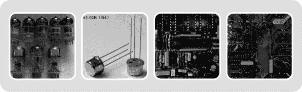
图 1-2　计算机的逻辑元件

“互联网＋”是创新 2.0 下的互联网发展的新业态，是知识社会创新 2.0 推动下的互联网形态演进及其催生的经济社会发展新形态。人们的日常生活习惯越来越离不开互联网的存在，同时，传统产业也被“互联网＋”进行升级改造。“互联网＋”更像是一种生活方式，让我们的生活变得更美好，如图 1-3 所示。

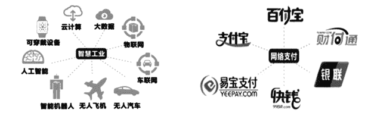
图 1-3　互联网应用

大数据的产生实际上是互联网的副作用之一，人类过去所有时代的数据总和，都比不上互联网时代产生的数据体量，信息的爆炸性增长催生了很多与之息息相关的领域，如大数据，区块链技术，人工智能等等。大数据是为了实现用户信息利益最大化，区块链技术是为了解决数据溯源，人工智能是大数据的未来形态，通过大数据的智能分析实现用户行为的有效预测。

### 1.2　人工智能概述

#### 1.2.1　人工智能的发展

##### 1. 起始阶段

“人工智能”（ARTIFICIAL INTELLIGENCE）一词最初是在 1956 年在 DARTMOUTH（达特茅斯）学会上，由计算机专家约翰·麦卡锡首次提出的。达特茅斯会议被广泛认为是人工智能诞生的标志，从此人工智能走上了快速发展的道路。这个阶段人工智能的研究特点是：过度重视问题求解的方法，却忽视了知识的重要性。机器只是具备了逻辑推理能力，还远远达不到智能化的水平。

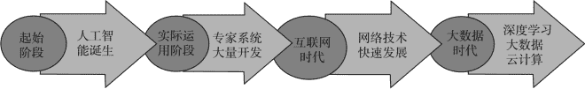
图 1-4　人工智能研究与发展阶段

##### 2. 实际运用阶段

从 20 世纪的 60 年代末到 70 年代，人们认为要让机器变得有智能，就应该设法让机器学习知识，于是专家系统得到了大量的开发。专家系统的出现将人工智能的研究再一次推向高潮。DENDRAL 化学质谱分析系统、MYCIN 疾病诊断和治疗系统、PROSPECTIOR 探矿系统、Hearsay-II 语音理解系统等专家系统的研究和开发，将人工智能引向了实用化。并且，1969 年成立了国际人工智能联合会议（International Joint Conferences on Artificial Intelligence 即 IJCAI）。

##### 3. 互联网时代

20 世纪 90 年代后，网络技术的出现和发展为人工智能的研究提供了新的方向。人工智能的研究已经从曾经的单个智能主体研究开始转向基于网络环境下的分布式人工智能研究。不仅研究基于同一目标的分布式问题求解，而且研究多个智能主体的多目标问题求解，将人工智能更面向实用。另外，由于 Hopfield 多层神经网络模型的提出，使人工神经网络研究与应用出现了欣欣向荣的景象。人工智能已深入到社会生活的各个领域。

IBM 的计算机系统“深蓝”战胜了国际象棋世界冠军，美国制定了以多 Agent 系统应用为重要研究内容的信息高速公路计划，基于 Agent 技术的 Softbot（软机器人）在软件领域和网络搜索引擎中得到了充分应用，同时，美国 Sandia 实验室建立了国际上最庞大的“虚拟现实”实验室，拟通过数据头盔和数据手套实现更友好的人机交互，建立更好的智能用户接口。

##### 4. 大数据时代

2010 年至今，深度学习、大数据、云计算和强人工智能迅速发展，随着各种机器学习算法的提出和应用，特别是深度学习技术的发展，人们希望机器通过大量数据分析，能自动学习知识并实现智能化水平。这一时期，随着计算机硬件水平的提高，大数据分析技术的发展，机器采集、存储、处理数据的水平有了大幅度的提高。

在最近几年引爆了一场商业革命。谷歌、微软、百度等互联网巨头，还有众多的初创科技公司，纷纷加入人工智能产品的战场，掀起又一轮的智能化狂潮，而且随着技术的日趋成熟和大众的广泛接受，这一次狂潮也许会架起一座现代文明与未来文明的桥梁。

##### 5. 人工智能的大事记

1946 年，全球第一台通用计算机 ENIAC 诞生。它最初是为美军作战研制，每秒能完成 5000 次加法，400 次乘法等运算。ENIAC 为人工智能的研究提供了物质基础。

1950 年，艾伦·图灵提出“图灵测试”：如果电脑能在 5 分钟内回答由人类测试者提出的一系列问题，且其超过 30%的回答让测试者误认为是人类所答，则通过测试。这篇论文预言了创造出具有真正智能的机器的可能性。

1956 年，“人工智能”概念首次提出。在美国达特茅斯大学举行的一场为期两个月的讨论会上，“人工智能”概念首次被提出。

1959 年，首台工业机器人诞生。美国发明家乔治·德沃尔与约瑟夫·英格伯格发明了首台工业机器人，该机器人借助计算机读取示教存储程序和信息，发出指令控制一台多自由度的机械。它对外界环境没有感知。

1964 年，首台聊天机器人诞生。美国麻省理工学院 AI 实验室的约瑟夫·魏岑鲍姆教授开发了 ELIZA 聊天机器人，实现了计算机与人通过文本来交流。这是人工智能研究的一个重要方面。不过，它只是用符合语法的方式将问题复述一遍。

1965 年，专家系统首次亮相。美国科学家爱德华·费根鲍姆等研制出化学分析专家系统程序 DENDRAL。它能够分析实验数据来判断未知化合物的分子结构。

1968 年，首台人工智能机器人诞生。美国斯坦福研究所（SRI）研发的机器人 Shakey，能够自主感知、分析环境、规划行为并执行任务，可以根据人的指令发现并抓取积木。这种机器人拥有类似人的感觉，如触觉、听觉等。

1970 年，能够分析语义、理解语言的系统诞生。美国斯坦福大学计算机教授 T·维诺格拉德开发的人机对话系统 SHRDLU，能分析指令，比如理解语义、解释不明确的句子并通过虚拟方块操作来完成任务。由于它能够正确理解语言，被视为人工智能研究的一次巨大成功。

1976 年，专家系统广泛使用。美国斯坦福大学肖特里夫等人发布的医疗咨询系统 MYCIN，可用于对传染性血液病患诊断。这一时期还陆续研制出了用于生产制造、财务会计、金融等多个领域的专家系统。

1980 年，专家系统商业化。美国卡耐基·梅隆大学为 DEC 公司制造出 XCON 专家系统，帮助 DEC 公司每年节约 4000 万美元的费用，特别是在决策方面能提供有价值的内容。

1981 年，第五代计算机项目研发。日本率先拨款支持，目标是制造出能够与人对话、翻译语言、解释图像，并能像人一样推理的机器。随后，英美等国也开始为 AI 和信息技术领域的研究提供大量资金。

1984 年，大百科全书（Cyc）项目。Cyc 项目试图将人类拥有的所有一般性知识都输入计算机，建立一个巨型数据库，并在此基础上实现知识推理，它的目标是让人工智能的应用能够以类似人类推理的方式工作，成为人工智能领域的一个全新研发方向。

1997 年，“深蓝”战胜国际象棋世界冠军。IBM 公司的国际象棋电脑深蓝 DeepBlue 战胜了国际象棋世界冠军卡斯帕罗夫。它的运算速度为每秒 2 亿步棋，并存有 70 万份大师对战的棋局数据，可搜寻并估计随后的 12 步棋。

2011 年，Watson 参加智力问答节目。IBM 开发的人工智能程序“沃森”（Watson）参加了一档智力问答节目并战胜了两位人类冠军。沃森存储了 2 亿页数据，能够将于问题相关的关键词从看似相关的答案中抽取出来。这一人工智能程序已被 IBM 广泛应用于医疗诊断领域。

2016～2017 年，AlphaGo 战胜围棋冠军。AlphaGo 是由 Google Deep Mind 开发的人工智能围棋程序，具有自我学习能力。它能够搜集大量围棋对弈数据和名人棋谱，学习并模仿人类下棋。Deep Mind 已进军医疗、保健等领域。

2017 年，深度学习大热。AlphaGoZero（第四代 AlphaGo）在无任何数据输入的情况下，开始自学围棋 3 天后便以 100∶0 横扫了第二版本的“旧狗”，学习 40 天后又战胜了在人类高手看来不可企及的第三个版本“大师”。

2018 年 11 月，美国研究团队首次成功建立了多人脑对脑接口合作系统 Brain Net，3 个人只靠脑电波，通过分享意念，成功合作完成俄罗斯方块的游戏，平均准确率高达 81.25%。“脑联网”建立了以人脑为基础的“社交网络”，使人们即使不说话、不见面，也能完成“意念交流”。

#### 1.2.2　人工智能的概念

##### 1.人工智能的定义

人工智能＝“人工”＋“智能”。

智能可以简单理解为人们用思维和脑力认识和改造客观世界时所体现出来的智慧和能力。人们能够通过视觉、听觉、触觉等感知客观世界，从而获得各种信息，通过大脑进行记忆、联想、比较、分析、判断、推理、决策、规划等思维活动，然后通过口、手、足等器官对外界的刺激做出反应，并采取行动，这是人类智能的一个活动过程。由此可知，人类智能主要包含三个方面：思维能力、感知能力、行为能力。

人工智能简称 AI（artificial intelligence），是研究、开发用于模拟、延伸和扩展人的智能的理论、方法和技术。其实质是生产出一种新的能以类似人类智能的方式做出反应的智能机器，该领域的研究包括机器人、语言识别、图像识别、自然语言处理和专家系统等。人工智能不是人的智能，但能像人那样思考，如图 1-5 所示。

图 1-5　人工智能研究范畴

##### 2.人工智能的结构原理

人工智能是一种科技领域，属于社会科学和自然科学的交叉，涉及了数学、心理学、神经生理学、信息论、计算机科学、哲学和认知科学、不定性论以及控制论。从数学的角度可以用一个等式帮助人们理解人工智能的组成结构，即人工智能＝人造物（计算机）＋智能（程序），如图 1-6 所示。

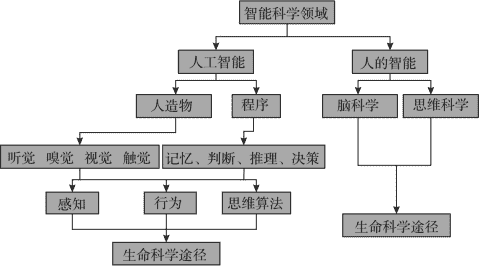
图 1-6　人工智能结构原理

简而言之，人工智能是物理过程，需要接受人类指令，没有自觉性、社会性、理性。人类智能是生物过程，具有自觉性、主观能动性、有情感，每个个体思维不同，有丰富的想象力、创造力，感性。

##### 3.人工智能的分类

（1）弱人工智能。弱人工智能的英文单词就是 Artificial Narrow Intelligence，简称为 ANI，弱人工智能是擅长于单个方面的人工智能。比如有能战胜象棋世界冠军的人工智能阿尔法狗，但是它只会下象棋，如果我们问它其他的问题那么它就不知道怎么回答了。只擅长单方面能力的人工智能就是弱人工智能，如图 1-7 所示。

图 1-7　弱人工智能应用

（2）强人工智能。强人工智能的英文单词就是 Artificial General Intelligence，简称 AGI，这是一种类似于人类级别的人工智能。强人工智能是指在各方面都能和人类比肩的人工智能，人类能干的脑力活它都能干。创造强人工智能比创造弱人工智能难得多，我们现在还做不到。强人工智能就是一种宽泛的心理能力，能够进行思考、计划、解决问题、抽象思维、理解复杂理念、快速学习和从经验中学习等操作。强人工智能在进行这些操作时应该和人类一样得心应手。

（3）超人工智能。超人工智能的英文单词就是 Artificial Super Intelligence，简称 ASI，科学家把超人工智能定义为在几乎所有领域都比最聪明的人类大脑都聪明很多，包括科学创新、通识和社交技能。超人工智能可以是各方面都比人类强一点，也可以是各方面都比人类强万亿倍的。

#### 1.2.3　机器人技术

我国古代涌现出许多能工巧匠，如西周的偃师研制出能歌善舞的伶人，春秋时期著名的木匠鲁班曾造出过一只木鸟，如图 1-8 所示。科学家张衡不仅发明了地动仪，还发明了能自动离合的指南车，如图 1-9 所示。诸葛亮造出“木牛流马”，运送军粮，如图 1-10 所示。这些都是最早机器人的雏形，体现了我国劳动人民的聪明智慧。

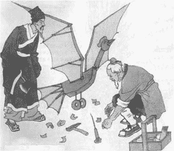
图 1-8　木鸟

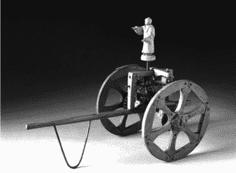
图 1-9　指南车

图 1-10　木牛流马

##### 1.机器人的概念

通俗地说，机器人是一种由计算机控制可以编程的自动机械电子装置，能感知环境、识别对象、理解指令，有记忆和学习功能，具有逻辑判断思维，能按程序进行自动操作代替人进行某种工作，完成一定任务的自动化设备。机器人具备一些人或生物相似能力，它的外形不一定像人，但可以代替人在各种环境中工作。

##### 2.机器人的特征

（1）机器人的动作具有类似于人或其他生物体某些器官的功能，能通过“感官”系统获取外界环境信息（如声音、光线、物体温度等），并做出反应；如图 1-11 所示，在人机的围棋对弈中，机器人感官灵敏，反应灵活。

（2）机器人具有通用性，工作种类多样，动作程序灵活易变，是柔韧加工的主要组成部分。

（3）机器人具有不同程度的智能，如记忆、思考、感知、推理、决策、学习等信息加工和处理能力，在图 1-11 中机器人表现出很强的推理和决策能力。

（4）机器人具有独立性，完整的机器人在工作中可以不依赖人的干预，如图 1-11 中，机器人可以独立对弈。

图 1-11　人机围棋对弈

##### 3.机器人的原理及结构

简单地说，机器人的原理就是模仿人的动作、思维、控制和决策。

不同类型的机器人其机械、电气和控制结构也不相同，通常情况下，一个机器人系统由三部分、六个子系统组成。这三部分是机械部分、传感部分、控制部分；六个子系统是驱动系统、机械系统、感知系统、人机交互系统、机器人－环境交互系统、控制系统等，如图 1-12 所示。

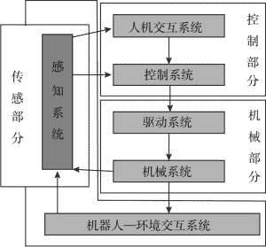

图 1-12　机器人系统

##### 4. 机器人的分类

国际上，专家学者从应用环境出发将机器人分为两类：制造环境下的工业机器人和非制造环境下的服务与仿人型机器人，即工业机器人和特种机器人。
工业机器人就是面向工业领域的多关节机械手或多自由度机器人，如图 1-13 所示。特种机器人则是除工业机器人之外的、用于非制造业并服务于人类的各种先进机器人，包括：服务机器人、水下机器人、娱乐机器人、军用机器人、农业机器人、机器人化机器等，如图 1-14 所示。

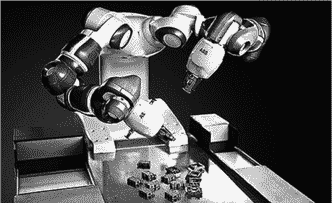

图 1-13　工业机器人

图 1-14　特种机器人

### 1.3 大数据概述

## 1.3.1 大数据的产生

### 1. 大数据产生的背景

现代信息技术产业已经拥有 70 多年的历史，其发展的过程先后经历了几次浪潮。先是 20 世纪六七十年代的大型机浪潮，此时的计算机体型庞大，计算能力也不高。20 世纪 80 年代以后，随着微电子技术和集成技术的不断发展，计算机各类芯片不断小型化，兴起了微型机浪潮，PC 成为主流。20 世纪末，随着互联网的兴起，网络技术快速发展，由此掀起了网络化浪潮，越来越多的人能够接触到网络和使用网络。
近几年随着手机及其他智能设备的兴起，全球网络在线人数激增，我们的生活已经被数字信息所包围，数据以自然方式增长，其产生不以人的意志为转移。而这些所谓的数字信息就是我们通常所说的“数据”，我们可以将其称为大数据浪潮，也可以进一步看出，智能化设备的不断普及是大数据迅速增长的重要因素，如图 1-15 所示。

图 1-15　“数据爆炸”时代

智能设备的普及、物联网的广泛应用、存储设备性能的提高、网络带宽的不断增长都是信息科技的进步，它们为大数据的产生提供了储存和流通的物质基础。
数据产生方式的变革促成大数据时代的来临。传统 IT 企业业务系统、门户网站大约占大数据主要来源的 15%。随着数据生产方式变得自动化，数据生产融入每个人的日常生活，伴随着社交网络兴起，大量的用户自生成内容、音频、文本信息、视频、图片，出现了非结构化数据。目前，图像、视频和音频数据所占的比例越来越大，物联网产生的数据量更大，加上移动互联网能更准确，更快速地收集用户信息，如环境、位置、生活信息等数据，使得数据量处于急剧加速增长的趋势。根据 IDC 做出的估测，数据一直都在以每年 50%的速度增大，人类在最近两年产生的数据量相当于之前产生的全部数据量，如图 1-16 所示。
大数据产业包括了 IT 基础设施层、数据源层、数据管理层，数据分析层、数据平台层和数据应用层。在不同的层面都已经形成了一批引领市场的技术和企业。

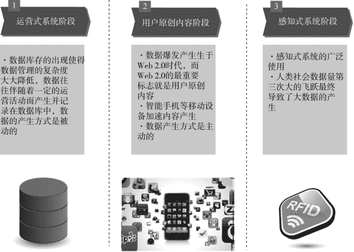

图 1-16 数据生产方式的演变

### 2. 大数据的发展历程

（1）萌芽时期（20 世纪 90 年代至 21 世纪初）。“大数据”概念最初起源于美国，早在 1980 年著名未来学家阿尔文·托夫勒所著的《第三次浪潮》书中将“大数据”称颂为“第三次浪潮的华彩乐章”。随着 90 年代复杂性科学的兴起，不仅给我们提供了复杂性、整体性的思维方式和科学研究方法，还给我们带来了有机的自然观。1997 年，NASA 阿姆斯科研中心的大卫·埃尔斯沃斯和迈克尔·考克斯在研究数据的可视化问题时，首次使用了“大数据”概念。他们当时就坚信信息技术的飞速发展，一定会带来数据冗杂的问题，数据处理技术必定会进一步发展。1998 年，一篇名为《大数据科学的可视化》的文章在美国《自然》杂志上发表，大数据正式作为一个专用名词出现在公共刊物之中。
（2）发展时期（21 世纪初至 2010 年）。21 世纪的前十年，互联网行业迎来了飞速发展的时期。2001 年，美国 Gartner 公司率先开发了大型数据模型。同年，分析师道格·莱尼提出数据增长的挑战和机遇有三个方向：量（Volume，数据量大小）、速（Velocity，数据输入输出的速度）、类（Variety，数据多样性），合称“3V”。在此基础上，麦肯锡公司增加了价值密度（Value），构成“4V”特征。
2005 年大数据实现重大突破，Hadoop 技术诞生，并成为数据分析的主要技术。2007 年，数据密集型科学的出现，不仅为科学界提供了全新的研究范式，还为大数据的发展提供了科学上的基础。2008 年，美国《自然》杂志推出了一系列有关大数据的专刊，详细讨论了有关大数据的一系列问题，大数据开始引起人们的关注。2010 美国信息技术顾问委员会（PITAC）发布了一篇名为《规划数字化未来》的报告，详细叙述了政府工作中对大数据的收集和使用，美国政府已经高度关注大数据的发展。
（3）兴盛时期（2011 年至今）。2011 年，IBM 公司研制出了沃森超级计算机，以每秒扫描并分析 4TB 的数据量打破世界纪录，大数据计算迈向了一个新的高度。紧接着，麦肯锡发布了题为《海量数据，创新、竞争和提高生成率的下一个新领域》的研究报告，详细介绍了大数据在各个领域中的应用情况，以及大数据的技术架构。2012 年世界经济论坛在瑞士达沃斯召开，会上讨论了大数据相关的系列问题，发布了名为《大数据，大影响》的报告，向全球正式宣布大数据时代的到来。
2011 年之后，大数据的发展进入了全面兴盛的时期。大数据渗透到各行各业，不断改变原有行业的技术，创造新技术，大数据的发展呈现出旺盛的趋势。

## 1.3.2 大数据的概念

### 1. 大数据的定义

大数据（Big data），指无法在一定时间范围内用常规软件工具进行捕捉、管理和处理的数据集合，是需要新处理模式才能具有更强的决策力、洞察发现力和流程优化能力的海量、高增长率和多样化的信息资产。
随着云时代的来临，大数据（Big data）也吸引了越来越多的关注。分析师团队认为，大数据（Big data）通常用来形容一个公司创造的大量非结构化数据和半结构化数据，这些数据在下载到关系型数据库用于分析时会花费过多时间和金钱。大数据分析常和云计算联系到一起，因为实时的大型数据集分析需要像 Map Reduce 一样的框架来向数十、数百或甚至数千的电脑分配工作。
大数据需要特殊的技术，以有效地处理大量的容忍经过时间内的数据。适用于大数据的技术，包括大规模并行处理（MPP）数据库、数据挖掘、分布式文件系统、分布式数据库、云计算平台、互联网和可扩展的存储系统。

### 2. 大数据的特征

（1）数据量大（Volume）。包括采集、存储和计算的量都非常大。大数据的起始计量单位至少是 P（1000 个 T）、E（100 万个 T）或 Z（10 亿个 T）。
（2）类型繁多（Variety）。包括结构化、半结构化和非结构化数据，具体表现为网络日志、音频、视频、图片、地理位置信息等等，多类型的数据对数据的处理能力提出了更高的要求，如图 1-17 所示。
（3）价值密度低（Value）。随着互联网以及物联网的广泛应用，信息感知无处不在，信息海量，但价值密度较低。以视频为例，连续不间断监控过程中，可能有用的数据仅仅有一两秒，但是具有很高的商业价值。
（4）速度快时效高（Velocity）。数据增长速度快，处理速度也快，时效性要求高。比如搜索引擎要求几分钟前的新闻能够被用户查询到，个性化推荐算法尽可能要求实时完成推荐。这是大数据区别于传统数据挖掘的显著特征，如图 1-18 所示。
（5）数据是在线的（Online）。数据是永远在线的，是随时能调用和计算的，这是大数据区别于传统数据最大的特征。现在谈到的大数据不仅仅是大，更重要的是数据变得在线了，这是互联网高速发展背景下的特点。

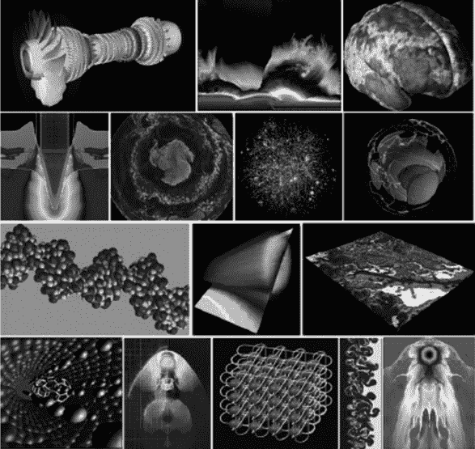

图 1-17 数据类型繁多

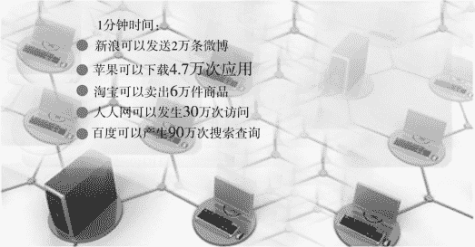

图 1-18 数据处理速度快

## 1.3.3 大数据技术

### 1. 大数据的基本处理流程

大数据处理流程主要包括数据收集、数据预处理、数据存储、数据处理与分析、数据展示/数据可视化、数据应用等环节，如图 1-19 所示。其中数据质量贯穿于整个大数据流程，每一个数据处理环节都会对大数据质量产生影响作用。

图 1-19　大数据处理基本流程

#### （1）数据收集
在数据收集过程中，数据源会影响大数据质量的真实性、完整性、一致性、准确性和安全性。对于 Web 数据，多采用网络爬虫方式进行收集，这需要对爬虫软件进行时间设置以保障收集到的数据时效性质量。比如可以利用易海聚采集软件的增值 API 设置，灵活控制采集任务的启动和停止。

#### （2）数据预处理
大数据采集过程中通常有一个或多个数据源，这些数据源包括同构或异构的数据库、文件系统、服务接口等，易受到噪声数据、数据值缺失、数据冲突等影响，因此需首先对收集到的大数据集合进行预处理，以保证大数据分析与预测结果的准确性与价值性。
大数据的预处理环节主要包括数据清理、数据集成、数据归约与数据转换等内容，可以大大提高大数据的总体质量，是大数据过程质量的体现。
①数据清理技术包括对数据的不一致检测、噪声数据的识别、数据过滤与修正等方面，有利于提高大数据的一致性、准确性、真实性和可用性等方面的质量。
②数据集成则是将多个数据源的数据进行集成，从而形成集中、统一的数据库、数据立方体等，这一过程有利于提高大数据的完整性、一致性、安全性和可用性等方面的质量。
③数据归约是在不损害分析结果准确性的前提下降低数据集规模，使之简化，包括维归约、数据归约、数据抽样等技术，这一过程有利于提高大数据的价值密度，即提高大数据存储的价值性。
④数据转换处理包括基于规则或元数据的转换、基于模型与学习的转换等技术，可通过转换实现数据统一，这一过程有利于提高大数据的一致性和可用性。
总之，数据预处理环节有利于提高大数据的一致性、准确性、真实性、可用性、完整性、安全性和价值性等方面质量，而大数据预处理中的相关技术是影响大数据过程质量的关键因素。

#### （3）数据处理与分析
①数据处理。大数据的分布式处理技术与存储形式、业务数据类型等相关，针对大数据处理的主要计算模型有 Map Reduce 分布式计算框架、分布式内存计算系统、分布式流计算系统等。Map Reduce 是一个批处理的分布式计算框架，可对海量数据进行并行分析与处理，它适合对各种结构化、非结构化数据的处理。分布式内存计算系统可有效减少数据读写和移动的开销，提高大数据处理性能。分布式流计算系统则是对数据流进行实时处理，以保障大数据的时效性和价值性。
总之，无论哪种大数据分布式处理与计算系统，都有利于提高大数据的价值性、可用性、时效性和准确性。大数据的类型和存储形式决定了其所采用的数据处理系统，而数据处理系统的性能与优劣直接影响大数据质量的价值性、可用性、时效性和准确性。因此在进行大数据处理时，要根据大数据类型选择合适的存储形式和数据处理系统，以实现大数据质量的最优化。
②数据分析。大数据分析技术主要包括已有数据的分布式统计分析技术和未知数据的分布式挖掘、深度学习技术。分布式统计分析可由数据处理技术完成，分布式挖掘和深度学习技术则在大数据分析阶段完成，包括聚类与分类、关联分析、深度学习等，可挖掘大数据集合中的数据关联性，形成对事物的描述模式或属性规则，可通过构建机器学习模型和海量训练数据提升数据分析与预测的准确性。
数据分析是大数据处理与应用的关键环节，它决定了大数据集合的价值性和可用性，以及分析预测结果的准确性。在数据分析环节，应根据大数据应用情境与决策需求，选择合适的数据分析技术，提高大数据分析结果的可用性、价值性和准确性质量。

#### （4）数据可视化与应用环节
①数据可视化是指将大数据分析与预测结果以计算机图形或图像的直观方式显示给用户的过程，并可与用户进行交互式处理。数据可视化技术有利于发现大量业务数据中隐含的规律性信息，以支持管理决策。数据可视化环节可大大提高大数据分析结果的直观性，便于用户理解与使用，故数据可视化是影响大数据可用性和易于理解性质量的关键因素。
②大数据应用是指将经过分析处理后挖掘得到的大数据结果应用于管理决策、战略规划等的过程，它是对大数据分析结果的检验与验证，大数据应用过程直接体现了大数据分析处理结果的价值性和可用性。大数据应用对大数据的分析处理具有引导作用。
在大数据收集、处理等一系列操作之前，通过对应用情境的充分调研、对管理决策需求信息的深入分析，可明确大数据处理与分析的目标，从而为大数据收集、存储、处理、分析等过程提供明确的方向，并保障大数据分析结果的可用性、价值性和用户需求的满足。

### 2. 大数据关键技术

大数据有两大核心技术：分布式存储和分布式处理，如图 1-20 所示。
（1）分布式存储。分布式存储系统，是将数据分散存储在多台独立的设备上。分布式网络存储系统采用可扩展的系统结构，利用多台存储服务器分担存储负荷，利用位置服务器定位存储信息，它不但提高了系统的可靠性、可用性和存取效率，还易于扩展。
比如，Google 大约管理着超过 50 万台服务器和 100 万块硬盘，而且 Google 还在不断扩大计算能力和存储能力。其中，很多的计算能力和存储能力的扩展都是在廉价服务器和普通存储硬盘的基础上进行的。这大大降低了其服务成本。因此，可以将更多的资金投入到技术研发之中。

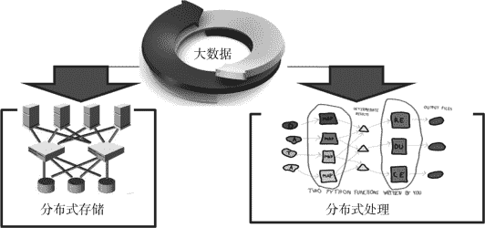

图 1-20　大数据核心技术

（2）分布式处理。分布式处理系统，可以将不同地点的或具有不同功能的或拥有不同数据的多台计算机（或服务器）用通信网络连接起来，在控制系统的统一管理控制下，协调地完成信息处理任务。
Map Reduce 是一种云计算的核心计算模式，一种分布式运算技术，也是一种简化的分布式编程模式。
Map Reduce 模式的主要思想是：首先将数据自动分割的、要执行的问题（例如程序）拆解成 Map（映射）和 Reduce（化简）的方式；在数据被分割以后，通过 Map 函数的程序将数据映射成不同的区块，分配给计算机机群（或服务器集群）进行处理，达到分布式运算的效果；然后再通过 Reduce 函数的程序将运算结果汇总整理，最后输出开发者需要的结果。
Hadoop 是一个实现了 Map Reduce 计算模式的、能够对大量数据进行分布式处理的软件框架。它是以一种可靠、高效、可伸缩的方式进行大量数据处理的。

### 3. 大数据技术的应用发展前景

（1）大数据自身能够创造出更多的价值。大数据相关技术紧紧围绕数据价值化展开，数据价值化将开辟出广大的市场空间，重点在于数据本身将为整个信息化社会赋能。随着大数据的落地应用，大数据的价值将逐渐得到体现。目前在互联网领域，大数据技术已经得到了较为广泛的应用。
（2）大数据推动科技领域的发展。大数据的发展正在推动科技领域的发展进程，大数据的影响不仅仅体现在互联网领域，也体现在金融、教育、医疗等诸多领域。在人工智能研发领域，大数据也起到了重要的作用，尤其在机器学习、计算机视觉和自然语言处理等方面，大数据正在成为智能化社会的基础。
（3）大数据产业链逐渐形成。经过近些年的发展，大数据已经初步形成了一个较为完整的产业链，包括数据采集、整理、传输、存储、分析、呈现和应用，众多企业开始参与到大数据产业链中，并形成了一定的产业规模，相信随着大数据的不断发展，相关产业规模会进一步扩大。

# 1.4 大数据与人工智能的关系

大数据和人工智能代表了 IT 领域最新的技术发展趋势，两者相辅相成，互促发展，既有区别又有联系，如图 1-21 所示。

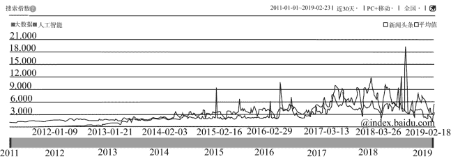

图 1-21　人工智能和大数据的百度指数

## 1.4.1 大数据和人工智能的区别

人工智能与大数据一个主要的区别是大数据是需要在数据变得有用之前进行清理、结构化和集成的原始输入，而人工智能则是输出，即处理数据产生的智能。

### 1. 达成目标和实现目标的手段不同
人工智能是一种计算形式，它允许机器执行认知功能，例如对输入起作用或做出反应，类似于人类的做法。传统的计算应用程序也会对数据做出反应，但反应和响应都必须采用人工编码。如果出现任何类型的差错，就像意外的结果一样，应用程序无法做出反应。而人工智能系统不断改变它们的行为，以适应调查结果的变化并修改它们的反应。
支持人工智能的机器旨在分析和解释数据，然后根据这些解释解决问题。通过机器学习，计算机会学习一次如何对某个结果采取行动或做出反应，并在未来知道采取相同的行动。
大数据是一种传统计算。它不会根据结果采取行动，而只是寻找结果。它定义了非常大的数据集，但也可以是极其多样的数据。在大数据集中，可以存在结构化数据，如关系数据库中的事务数据，以及结构化或非结构化数据，例如图像、电子邮件数据、传感器数据等。

### 2. 使用上有差异
大数据主要是为了获得洞察力，例如 Netflix 网站可以根据人们观看的内容了解电影或电视节目，并向观众推荐哪些内容。因为它考虑了客户的习惯以及他们喜欢的内容，推断出客户可能会有同样的感觉。
人工智能是关于决策和学习做出更好的决定。无论是自我调整软件、自动驾驶汽车还是检查医学样本，人工智能都会在人类之前完成相同的任务，但速度更快，错误更少。

## 1.4.2 大数据和人工智能的联系

虽然它们有很大的区别，但人工智能和大数据仍然能够很好地协同工作。

### 1. 人工智能需要数据来建立其智能，特别是机器学习
例如，机器学习图像识别应用程序可以查看数以万计的飞机图像，以了解飞机的构成，以便将来能够识别出它们。人工智能实现最大的飞跃是大规模并行处理器的出现，特别是 GPU，它是具有数千个内核的大规模并行处理单元，而不是 CPU 中的几十个并行处理单元。这大大加快了现有的人工智能算法的速度，现在已经使它们可行。

### 2. 大数据技术为人工智能提供了强大的存储能力和计算能力

大数据可以采用这些处理器，机器学习算法可以学习如何重现某种行为，包括收集数据以加速机器。人工智能不会像人类那样推断出结论。它通过试验和错误学习，这需要大量的数据来教授和培训人工智能。

人工智能应用的数据越多，其获得的结果就越准确。在过去，人工智能由于处理器速度慢、数据量小而不能很好地工作。也没有像当今先进的传感器，并且当时互联网还没有广泛使用，所以很难提供实时数据。

如今，人们拥有所需要的一切：快速的处理器、输入设备、网络和大量的数据集。毫无疑问，没有大数据就没有人工智能。

## 第 2 章 大数据与智能制造

“工业 4.0”，这样一个词，“工业 4.0”是德国推出的概念，按美国的说法就是“工业互联网”，在中国，我们称之为“中国制造 2025”。这三者虽然叫法不同，但本质内容是一致的，那就是“互联网＋制造”，指向一个核心，就是智能制造，如图 2-1 所示。

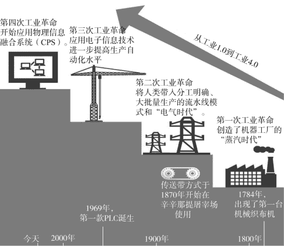

图 2-1 四次工业革命

## 2.1 智能制造概述

智能制造（`Intelligent Manufacturing`，`IM`）的涵义，目前业界还没有公认的定义。简单来说，是在人工智能技术带动下的生产、制造行为，是智能化的制造。智能制造系统则是一种由智能机器和人类专家共同组成的人机一体化智能系统，它在制造过程中能进行智能活动，诸如分析、推理、判断、构思和决策等。

毫无疑问，智能化是制造自动化的发展方向。正如图 2-2 所示，智能制造“金字塔”中所呈现的一样，在制造过程的各个环节几乎都广泛应用人工智能技术，它是智能制造的四个层次，主要包括以下十个内容。

- 智能产品（`Smart Product`）
- 智能服务（`Smart Service`）
- 智能装备（`Smart Equipment`）
- 智能产线（`Smart Production line`）
- 智能车间（`Smart workshop`）
- 智能工厂（`Smart Factory`）
- 智能研发（`Smart R&D`）
- 智能管理（`Smart Management`）
- 智能物流与供应链（`Smart logistics and SCM`）
- 智能决策（`Smart Decision Making`）

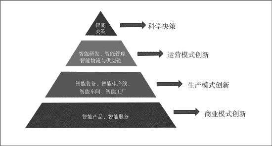

图 2-2 智能制造的关键内容层次模型

## 2.2 从大数据到智能制造

### 2.2.1 大数据与智能制造的关系

大数据并不是目的，而是一个现象，或是看待问题的一种途径和解决问题的一种手段。通过分析数据，从而预测需求、预测制造、解决和避免不可见问题的风险，和利用数据去整合产业链和价值链，这才是大数据的核心目的。

大数据与制造之间的关系可以用图 2-3 表示，这里面有 3 个重要的元素。

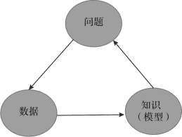

图 2-3 大数据和制造的关系

（1）问题：制造系统中显性或隐性的问题，比如质量缺陷、精度缺失、设备故障、加工失效、性能下降、成本较高、效率低下等。

（2）数据：从制造系统的 5M 要素中获得的，能够反映问题发生的过程和原因的数据。也就是说数据的获取应该是以问题为导向，目的是去了解、解决和避免问题。

（3）知识：制造系统的核心，包括制程、工艺、设计、流程和诊断等。知识来源于解决制造系统问题的过程，而大数据分析可以理解为迅速获取和积累知识的一种手段。

因此大数据与智能制造之间的关系可以总结为：制造系统中问题的发生和解决的过程中会产生大量的数据，通过对大数据的分析和挖掘可以了解问题产生的过程、造成的影响和解决的方式；当这些信息被抽象化建模后转化成知识，再利用知识去认识、解决和避免问题。当这个过程能够自发自动地循环进行时，即我们所说的智能制造。从这个关系中不难看出，问题和知识是目的，而数据则是一种手段。在图 2-3 的要素中，当把“数据”换成“人”之后就是“工匠精神”，换成“自动化生产线和装备”之后就是德国的“工业 4.0”，换成“互联网”之后就变成了“互联网＋”。

今天利用大数据实现智能制造，是因为大数据的研究已经成为一个日益受到关注的行为，而在制造系统和商业环境变得日益复杂的今天，利用大数据去推动智能制造，解决问题和积累知识或许是更加高效和便捷的方式。

### 2.2.2 大数据推动智能制造的方向

（1）把问题变成数据，利用数据对问题的产生和解决进行建模，把经验变成可持续的价值。

（2）把数据变成知识，从“可见解决问题”延伸到“不可见问题”，不仅要明白“how”，还要去理解“why”。

（3）把知识再变成数据，这里的数据指的是生产中的指令、工艺参数和可执行的决策，从根本上去解决和避免问题。

### 2.2.3 大数据是智能制造的核心驱动力

实现智能制造，就是数字化转型是实现智能制造的唯一途径。数字化转型是把数字作为智能制造的核心驱动力，需要利用数据去整合整个生产过程。

企业在运营当中，已经产生了大量的数据，包括生产现场采集的实时生产数据，设备运行的数据，产品质量相关的数据，产品运输的数据，产品运营的数据，来自社交网络的与公司有关的数据……这些数据统称为工业大数据（`Industrial Big Data`）。对这些工业大数据的分析与利用，就需要引入大数据分析方法与工具。通过数据分析和挖掘，我们可以了解问题产生的过程、造成的影响和解决的方式，找到创造附加价值的新形式。利用大数据的工具和思维，帮助制造业实现商业模式的转变，改造和提升客户体验，完善内部操作流程。

在工业互联网的普及应用方面，发达国家有着先发优势。在工业设计、产品研发、供需链条、企业管理等各个方面都充分依托大数据应用，取得了较大发展成果。中国工程院院士、中国互联网协会理事长邬贺铨曾在分析了美国的产业互联网模式后感慨道，未来 20 年，最有潜力从根本上改变制造产业的就是工业大数据。

### 2.2.4 中国工业大数据

国内也有不少制造业企业也做了数字化工作，但往往只限于其中的某个环节，并没有覆盖整个工业生产流程。而真正的制造业数字化应当覆盖全产业链，大数据在制造业的应用也应当贯穿所有的环节，并涵盖上下游的各种关系。

除大数据覆盖面的问题外，在推动智能制造的过程中最严重的问题之一就是因设备标准不统一带来的数据类型杂乱的问题。2017 年，工业和信息化部、国家标准化管理委员会联合发布《国家智能制造标准体系建设指南》，致力于解决智能设备、传感设备标准不一的老问题。

此外，我国工业行业产生了大数据但并没有收集足够大的数据量，应用的更少，面对当前这样的问题，专家指出，企业应该依托大数据，以互联网和软件做支撑，把装备作为终端去调整，改变生产模式，通过数据分析和软件定义，在互联网上抓生产，实现装备的智能化，提升生产效率、改进产品质量、节约资源消耗。

## 2.3 智能制造之关键技术——工业机器人

随着人工成本的激增，使用自动化设备或使用工业机器人替换人工将成为未来的趋势。科技不断发展，国家支持力度越来越大，工业机器人的种类越来越多，应用也越来越广，不难看出机器人市场即将爆发。

工业机器人成为智能制造和工业自动化的关键技术。在新兴产业和传统产业的转型过程中，机器人都扮演着“催化剂”的角色。工业机器人技术是先进制造技术的代表，它正向着高度智能化方向发展，而智能工业机器人将成为未来的技术制高点和经济增长点。要想跟上现代制造业的高速发展，首要任务就是提高工业机器人的智能化技术，提高机器人的工作能力和使用性能。虽然目前还有很多问题需要解决，但随着科学技术的进步，会逐渐改进发展。未来的智能化方向不会改变，并且会将机器人产品拓展到更多行业，形成完备的系统。在工业 4.0 的大环境下，工业机器人必将迅速发展，逐渐成为工厂自动化生产线的主要发展形式。

### 2.3.1 什么是工业机器人

工业机器人是集机械、电子、控制、计算机、传感器、人工智能等多学科先进技术于一体的现代制造业重要的自动化装备。自从 1962 年美国研制出世界上第一台工业机器人以来，机器人技术及其产品发展很快，已成为柔性制造系统（`FMS`）、自动化工厂（`FA`）、计算机集成制造系统（`CIMS`）的自动化工具。然而关于工业机器人分类，国际上没有制定统一的标准，但其中的焊接机器人、搬运机器人、喷涂机器人、装配机器人、码垛机器人、切割机器人却是重中之重。

根据“品牌网”的不完全统计，目前排名世界前 5 的工业机器人品牌分别是日本的`Fanuc`发那科、欧洲`ABB`、德国`KUKA`库卡、日本`Yaskawa`安川和中国沈阳的`SIASUN`新松。世界知名的品牌还有日本的`Kawasaki`川崎、意大利的`Comau`柯马，中国广州起帆等。中国的工业机器人技术已有了一定竞争力，每年自有品牌的市场占有率也不断追赶世界领先企业。工业机器人的产品如图 2-4，2-5，2-6，2-7 所示。

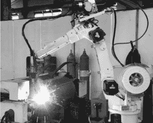

图 2-4 焊接机器人

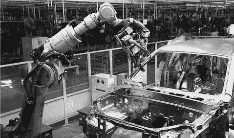

图 2-5 装配机器人

图 2-6 激光切割机器人

图 2-7 喷涂机器人

### 2.3.2 工业机器人在中国的发展历程

我国工业机器人起步于 20 世纪 1970 年初期，经过 20 多年的发展，大致经历了 3 个阶段：70 年代的萌芽期，80 年代的开发期和 90 年代的适用化期。我国于 1972 年开始研制自己的工业机器人。进入 80 年代后，国家投入大量资金，对工业机器人及其零部件进行攻关，完成了示教再现式工业机器人成套技术的开发，研制出了喷涂、点焊、弧焊和搬运机器人，如图 2-8 所示。从 90 年代初期起，我国掀起了新一轮的经济体制改革和技术进步热潮，我国的工业机器人又在实践中迈进一大步，先后研制出了点焊、弧焊、装配、喷漆、切割、搬运、包装、码垛等各种用途的工业机器人，如图 2-9 所示，并实施了一批机器人应用工程，形成了一批机器人产业化基地，为我国机器人产业的腾飞奠定了基础。21 世纪以来，我国机器人技术的开发与研究得到了政府前所未有的重视与支持，数据统计显示，自 2013 年起，我国就成了全球最大的工业机器人应用市场，2018 年产量已经突破 14 万台。其中，国产工业机器人市场份额正在不断扩大，在 2019 年上半年国产品牌占比 35.8%，中国工业机器人市场仍在持续高速的扩张中。

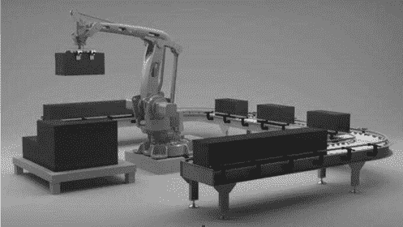

图 2-8 搬运机器人

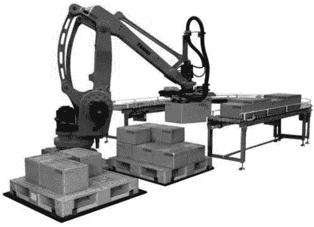

图 2-9 码垛机器人

### 2.3.3 工业机器人的发展趋势

随着人工智能技术的不断发展，将各种技术融合后的工业机器人也有了全新的优化。在保持并且发展了工业机器人精度高、应用范围广的特点的同时，克服了其操作复杂、成本高昂的缺点，使得在人工智能时代的工业机器人得到了更好的发展。在未来，工业机器人在人工智能时代发展的趋势主要有以下几点。

（1）工业机器人整体性能增强，适用范围更广。随着近些年来科学技术的快速发展，越来越多类型的工业机器人进入工业生产中，比如搬运机器人、清洁机器人等。例如，工业机器人的机械手通过仿造人类的手臂完成物体的抓取以及搬运工作，通过自动装备的控制作用，工业机器人高效地完成重复性工作。机械手的工作将运用于多个领域，其中包括包装以及安装工作。随着人工智能的发展，工业机器人的机械手的性能在不断地提高，实现高效率、高精度的工作。未来的工业机器人不断地融入人工智能技术，更加智能，适应性更强，更大范围使用工业机器人成为可能。

（2）工业机器人将更具生物性和仿生性，成为人类最好的帮手。在工作人员的工作过程中，受到人类生理限制，难以完成工作任务。比如，在半导体工业中，有一项工作程序必须在真空环境下完成，真空机器人就可以很好的胜任此工作。工业机器人的生物性和仿生性还可以代替人类在危险的工作环境中工作，以此保证工作人员的安全。比如，在恶劣环境中工作的蛇形工业机器人，它们可以在无阻的环境中进行工作，以帮助人们达到工作目的。在工业机器人的发展过程中，随着人工智能技术的不断深化，机器人的生物性和仿生性会不断加强，从而更好地代替人类完成工作生产，如图 2-10 所示。

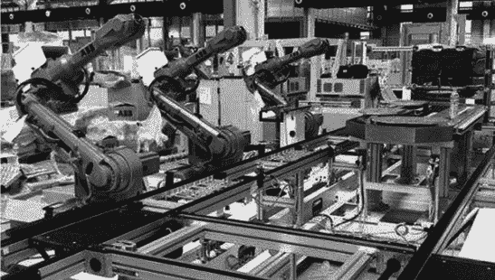

图 2-10 工业机器人

（3）工业机器人的控制系统不断完善，操控更加简单便捷。随着科学技术的不断发展，工业机器人控制系统也将不断地优化，从而完善工业机器人的应用过程。在这个过程中，其中关键的变化在由封闭性转向开放式的控制系统。因为控制系统的开发性可以使得工业机器人的操作更加便捷，从而节约大量的人工培训成本。此外，工业机器人也因此网络化特征明显，逐步发展为标准化和统一化，这将从根本上解决工业机器人操作门槛高的问题。

（4）工业机器人融合配置技术不断完善，工作更加精细、准确。综合传感器融合配置技术，加快工业机器人智能化的实现。例如，对于电弧焊接的工业机器人来说，通过多种传感器的融合配置，将视觉传感器、机器传感器结合在一起，在多种传感器相互配合下协同工作，保证工作的精确度。多传感器的融合配置技术，是工业机器人发展的一个新台阶，对工业机器人的智能化有着极其重要的作用。人工智能时代的工业机器人也将会朝着这个方向，不断完善其融合配置技术。

总的来说，工业机器人在早期的发展主要体现生产量、应用率的提升，核心在“量”。而在达到一定的产量和普及率之后，厂家就会更加重视工业机器人的“质”，对工业机器人的工作强度、精确度、耐用性、智能化等性能要求会越来越高。有需求就有动力，我们相信，未来工业机器人将更加智能化，具有更好的人机配合能力，以满足飞速发展的工业生产需求。

### 2.3.4 工业机器人应用案例

1. 智能码垛

众所周知，仓库中货物的搬运、摆放、存取，仅仅依靠人工，是不可能实现高效运转的。自动化程度比较高的仓库，通过采用`AGV`移动小车、配套各种码垛机器人等，来实现高效快速地存取货物。因此，码垛机器人在仓储物流中获得了广泛的应用，如图 2-11 所示。

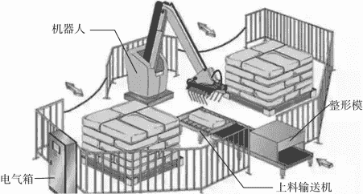

图 2-11 码垛机器人应用案例

由码垛机器人替代人工进行搬运、码垛作业，能迅速提高产量和生产效率，同时也能减少人工作业造成的差错。机器人码垛系统可全天候 24 小时工作，负载可达几百公斤，搬运能力可以达到千次/小时，码垛机器人速度和质量远远高于人工，大幅节约人力成本，达到减员增效的效果。

每台码垛机器人有独立的控制系统，重复精度可达±0.2mm，完全可以满足物流码垛作业的定位要求。在控制网络方面，码垛机器人可以通过“点对点”通信，也可以通过不同的国际标准总线接口或者以太网，方便快捷可靠地与周边设备和上位机进行信号与数据的交换，现场实现网络化控制。通过软件编程，设定并灵活地优化不同的运动路径，可以实现作业中不同产品种类的多样化搬运需求。

码垛机器人可以通过采用`2D`（2 维平面）和`3D`（3 维立体激光）视觉系统，自动识别被抓取物体的位置，使得码垛作业更为灵活，减少了产品输送带定位设备和人力成本的费用支出等。

码垛机器人对纸箱、袋装、罐装、啤酒箱、瓶装等各种类型的包装成品都能适应，可以满足化工、饮料、食品、啤酒、塑料等各行各业的要求。

2. 抛光打磨

由于去毛刺打磨抛光工况相对都是比较恶劣的，打磨产生的火花、粉尘及噪音严重影响工人的身心健康；工人无法长时间集中精力从事紧张、重复的劳动，容易发生工伤事故；人工打磨质量要依照工人经验去判断好坏，使得打磨质量无法得到保证；熟练工的缺失，工效低下且招工困难；人工成本不断抬高，而且恶劣的工作环境必须为工人支付更高的薪酬。基于以上原因，抛光打磨工作由工业机器人取代工人成为必然趋势，如图 2-12 所示。

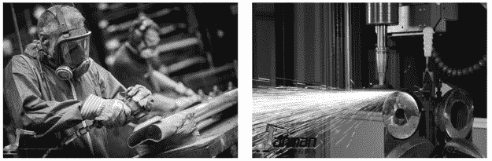

图 2-12 人工打磨与工业机器人打磨

比如，使用专业机器人对刀具刀柄的打磨、拉丝。首先，进行水磨拉丝，上料后，机器人夹持刀具开始根据既定轨迹进行打磨，打磨完后将刀具卸料到原始位置。该系统可用于对刀具刀柄部位打磨，可满足夹心柄、塑料柄、金属注塑、焊接刀柄等多款刀柄类型打磨、拉丝，如图 2-13 所示。

图 2-13 工业机器人打磨效果

利用专用专业机器人打磨抛光的技术优势有：

（1）密闭式的机器人工作站，将高噪音和粉尘与外部隔离，减少环境污染。

（2）操作工不直接接触危险的加工设备，避免工伤事故的发生。

（3）机器人能保持产品加工精度的一致性，不仅保证了质量的可靠，而且降低了废品率。

（4）机器人替代熟练工，不但降低人力成本，而且也不会因为操作工的流失而影响交货期。

（5）机器人可 24 小时连续作业，生产效率大幅提高。

（6）可再开发性，用户可根据不同样件进行二次编程，缩短产品改型换代的周期，减少相应的投资设备。

## 2.4 智能制造之核心组成——智慧工厂

### 2.4.1 什么是智慧工厂

智能制造是现代工厂信息化发展的一个新阶段。是在数字化工厂的基础之上，利用物联网的技术和设备监控的技术加强信息的管理和服务；清楚地掌握产销的流程、提高了整个生产过程的可控性，减少了生产线上的人工的干预，即时正确地对生产线上数据进行采集，以及合理的编排生产计划与生产的进度。智慧工厂融合新兴的技术于一体，致力于构建一个高效节能、绿色环保、环境舒适的人性化的工厂。

智慧工厂是智能制造的重要组成部分，智能的生产过程在智慧工厂中进行，而智能生产则是最终实现智能制造的重要环节。智能工厂的核心特点是：产品的智能化、生产的自动化、信息流和物资流合一。目前来看，世界范围内，很多企业都在向着智能工厂的方向发展。

### 2.4.2 智慧工厂的特点

“智慧工厂”的发展，是智能工业发展的新方向。它是由完整的智能化生产系统构成的。它应具有以下特点：

1. 具有自主改进、维护的能力

可采集与接受外界及自身的信息，并以此为依据分析判断及改进自身行为。同时可以进行自我学习，可以自动执行故障诊断，并具备对故障排除与维护的能力。

2. 具有可视化的生产过程

集合信号处理、推理预测、仿真及多媒体技术为一体，实现生产现场的可视化和透明化。

### 3. 具备协调、重组及扩充特性
系统中各组承担为可依据工作任务，自行组成最佳系统结构，同时在需要的时候可以方便地进行设备扩充。

### 4. 人机协调互动的系统
人机之间具备互相协调合作关系，各自在不同层次之间相辅相成。

### 5. 具有环保、节能、舒适的人性化设计
合理设计、利用智能化软件与设备，降低能源消耗；降低工业污染；减少生产中存在的安全隐患；实现废料的回收和再利用；在危险和污染的环节，优先用工业机器人替代人工。

## 2.4.3 智慧工厂应用案例
服装制造企业又是一个传统生产型的密集型行业，主要依赖的还是人工操作，目前，面临人工成本每年 10%的递增，企业的加工成本更是雪上加霜。要想降低加工成本，关键环节还是减少人力，提高工作效率，控制管理过程中的浪费。而要实现这些目标就要求我们必须从服装“制造”晋升为服装“智造”，打造“智慧型工厂”而非传统的生产工厂，这是服装制造企业的必然走向，如图 2-14 所示。

### 案例背景
目前国内大中型（1000 台衣车以上）制衣厂普遍采用非自动传送的人工流水线生产方式，采用传统的生产流程。如表 2-1 所示。

图 2-14 智能工厂

表 2-1 服装厂传统生产流程

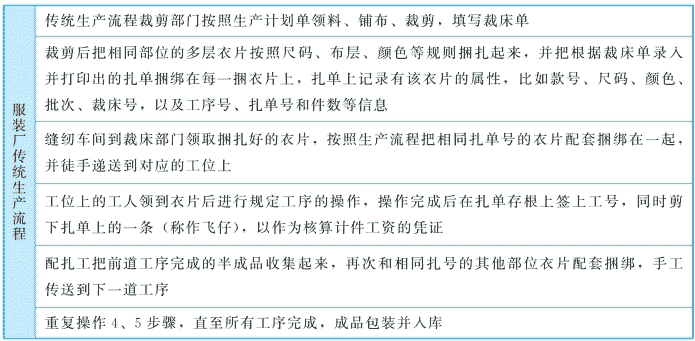

值得注意的是，传统的生产流程把扎单作为标记生成对象、记录生产流程、记录工人工作过程及工作量的载体，把所有的生产作业环节联系在一起的关键工具。然而，这可能产生的各种繁琐、不可预知、不易控制与管理的问题。传统生产流程存在的问题，如表 2-2 所示。

表 2-2 传统生产流程存在的问题

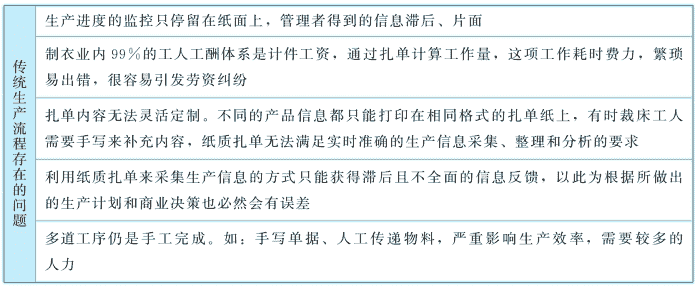

### 解决方案
以采用 RFID（射频识别）技术的电子扎牌代替纸质扎单，将加工信息记录其中并捆扎到衣片上。电子扎牌跟随衣片被传递到各道工序；在每个工位上布置 RFID 数据采集终端，所有读头都与主服务器连接构成一个系统网络。当衣片被传递到规定工序进行加工时，工人在数据采集终端上扫描电子扎牌，系统记录该加工工序的起始时间，加工完成后，工人按结束键，通知系统该工序已经完成。每个员工都配有 RFID 工卡，进入工位时以工卡进行登记，这样该工位所执行的所有操作都与员工工卡相关联，从而实现自动统计工作量，自动结算工资，并可以追溯质量责任。

### 实施利益
实施生产线数据实时采集系统能帮助生产企业提高生产效率。已经使用类似系统的制衣企业总结，系统实施后整体效率提高 10%～25%不等。有了真实准确的生产线数据资料，生产管理者能够更准确地监控生产状态，立即获得生产效率分析数据，从而对变化做出快速反应，并且能够提前预测可能发生的事件状况，及时调整生产布置；有了生产状态实时报表和图表，企业管理者不必在工厂就可以对所有的工作进展进行密切的监督与控制，任何时候都能获得必要的决策支持依据。这套系统的实施还可以极大地提高工人工资结算效率和准确率，并且帮助工厂对各道工序进行更科学合理的定价，而且还可以追溯到瑕疵工序的操作者。

## 第 3 章 大数据时代的智能交通

## 3.1 智能交通系统概述

### 1. 智能交通系统的概念
智能交通系统 ITS（Intelligent Transportation System）是将先进的信息技术、数据通讯传输技术、电子传感技术、控制技术及计算机技术等有效地集成并运用于交通系统，从而提高交通系统效率的综合性应用系统。其目标在于提高运输效率，保障交通安全，缓解交通拥堵，减少空气污染。

如图 3-1 所示，在该系统中，车辆靠自己的智能在道路上自由行驶，公路靠自身的智能将交通流量调整至最佳状态，借助于这个系统，管理人员对道路、车辆的行踪将掌握得一清二楚，智能交通系统是未来交通系统的发展方向。

图 3-1 城市智能交通系统

### 2. 智能交通系统的特点
智能交通使得交通系统中三大主体“人、车、路”的相互作用关系以新的方式呈现，主要通过交通信息的广泛应用与服务，提高现有交通设施的运行效率，通过人、车、路的和谐、密切配合，提高交通运输效率，提高路网通过能力，缓解交通堵塞，减少交通事故，降低能源消耗，减轻环境污染。实践证明，智能交通是解决目前经济发展所带来的交通问题的理想方案。

由于人、车、路与环境是非常复杂的，其要求不同行业以及不同部门综合交通工程、信息工程、通讯技术、控制工程、计算机技术等众多科学领域之间协同工作，共同完成智能交通系统的建设。

### 3. 智慧交通
智慧交通是在智能交通的基础上，融入物联网、云计算、大数据、移动互联网等新技术，通过汇集交通信息，提供实时交通数据的交通信息服务。大量使用了数据模型、数据挖掘等数据处理技术，实现了智慧交通的系统性、实时性、信息交流的交互性以及服务的广泛性，如图 3-2 所示。

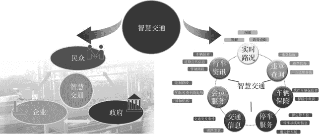

图 3-2 智慧交通

### 4. 城市智慧交通的组成
城市智慧交通系统是一个以现代电子信息技术为基础，实时、准确、高效的综合运输和管理服务系统。它的突出特点是以信息的收集、处理、发布、交换、分析以及利用为主线，为交通参与者提供多样性的服务，如图 3-3 所示。

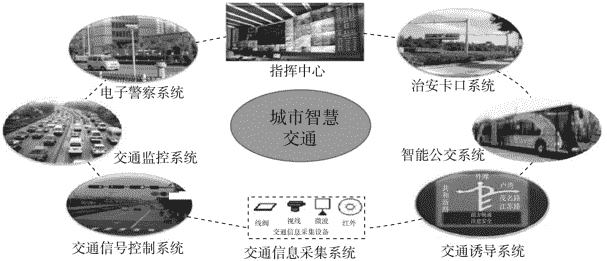

图 3-3 城市智慧交通组成

## 3.2 智能交通与大数据

### 3.2.1 交通大数据的来源和特点
与我们生活紧密相关的交通领域，人、车、路每天都产生海量的数据。交通大数据的来源主要有三个方面：基于互联网的公众出行服务数据，基于行业运营的企业生产监管数据，基于物联网、车联网的终端设备传感器采集数据，包括车辆相关动态数据。如：视频监控、卡口电警、路况信息、管控信息、营运信息、GPS（北斗）定位信息、RFID 识别信息等等，每天产生的数据量可以达到 PB 级别，并且是指数级的增长。

交通大数据与传统数据相比具有四大特征，即“4V”（Volume、Variety、Value、Velocity）特点：

（1）规模大。交通大数据涉及交通系统的各个方面，如人员数据、车辆数据、线路数据、环境数据、管理数据等，导致交通大数据在规模上比传统数据规模更大。

（2）种类多。交通系统中人、车、路、环境等不同的交通数据具有不同的属性，如人、车的空间位置数据与移动轨迹数据、各个监控摄像头视频数据、天气变化数据、交通事故数据等，导致交通大数据种类繁多。

（3）价值密度低。由于交通大数据规模大、种类大，不同类型的交通数据具有不同的属性，交通大数据在具体的应用过程中需要从海量数据中筛选出有用数据，难度较大，导致交通大数据的价值密度较低。

（4）速度快。交通大数据具有实时性，数据实时采集，更新速度快，以交通大数据为城市居民提供基本出行服务为例，根据视频摄像头、感应线圈等专用设备采集到的数据，通过实时处理，剔除无效数据，挖掘交通数据的基本变化规律并及时反馈给出行者，出行者根据反馈的信息选择出行线路与出行方式。

### 3.2.2 大数据在智能交通中的意义
交通大数据的应用主要以数据驱动的方式，分析交通状况、出行规律，建立智能交通系统的分析、评价、预测模型，用于交通规划、管理、决策、控制和服务。大数据之于智能交通意义重大，主要表现在以下几个方面：

（1）大数据的虚拟性解决了跨越行政区域的限制。交通大数据的虚拟性有利于其信息跨越区域管理。跨行政区域的数据被整合在一起，交通管理突破行政区划的限制，建立一盘棋的整体管理意识，有助于政府部门更有效地进行交通设施建设，更合理地进行交通路线规划。

（2）在治理交通拥堵、提升交通通行能力方面，大数据技术采用的方法是对交通拥堵的时段、地段、原因等信息进行分析和整合，从而因地制宜地进行合理疏导和治理，减少对土地等资源的占用，实现交通设施和系统的内在良性循环。

（3）大数据具有信息集成和组合效率的优势。大数据有助于建立综合性立体的交通信息体系，通过将不同范围、不同区域、不同领域的“数据仓库”加以综合，构建公共交通信息集成利用模式，发挥整体性交通功能，从而创造新价值，带来新机会。例如气象、交通、保险部门的数据结合起来，可高效率地研究交通领域防灾减灾。

（4）通过对大数据的分析、挖掘和整合，找出一些规律，得到我们想要的交通信息，可以合理调配人力、物力，提升道路交通资源的合理利用，辅助交通管理制定出合理的统筹与协调解决方案，交通管理更趋智能，如图 3-4 所示。

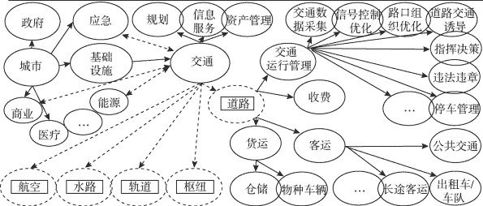

图 3-4 大数据获取交通数据

（5）大数据的快速性和可预测性能提升交通预测的水平。通过大数据构建交通预测模型，有效模拟交通未来运行状态，验证技术方案的可行性。而在实时交通预测领域，大数据的快速信息处理能力，对于车辆碰撞、车辆换道、驾驶员行为状态检测等实时预测也有非常高的可靠性。

（6）提高交通运行效率。大数据技术能促进提高交通运营效率、道路网的通行能力、设施效率和调控交通需求分析。交通的改善所涉及工程量较大，而大数据的大体积特性有助于解决这种困境。

（7）提高交通安全水平。主动安全和应急救援系统的广泛应用有效改善了交通安全状况，而大数据技术的实时性和可预测性则有助于提高交通安全系统的数据处理能力。在驾驶员自动检测方面，驾驶员疲劳视频检测、酒精检测器等车载装置将实时检测驾车者是否处于警觉状态，行为、身体与精神状态是否正常。同时，联合路边探测检查车辆运行轨迹，大数据技术快速整合各个传感器数据，构建安全模型后，综合分析车辆行驶安全性，从而可以有效降低交通事故的可能性。在应急救援方面，大数据以其快速的反应时间和综合的决策模型，为应急决策指挥提供辅助，提高应急救援能力，减少人员伤亡和财产损失。

（8）提供环境监测方式。大数据技术在减轻道路交通堵塞、降低汽车运输对环境的影响等方面有重要的作用。通过建立区域交通排放的监测及预测模型，共享交通运行与环境数据，建立交通运行与环境数据共享试验系统，大数据技术可有效分析交通对环境的影响。同时，分析历史数据，大数据技术能提供降低交通延误和减少排放的交通信号智能化控制的决策依据，建立低排放交通信号控制原型系统与车辆排放环境影响仿真系统。

## 3.3 大数据在智能交通中的发展现状和发展趋势
放眼全球，各国都非常重视交通大数据的利用和开发，很多国家（包括我国）已经上升到国策化，已成为国家战略，加大资金投入到基于交通大数据的智能交通建设上，尤其是公共交通的发展，使交通变得更加人性化、更惠民，并且注重数据标准化的建设。目前，政府和企业都在努力研究相关的大数据交通平台，这些平台在保障交通高效运行的同时，也为民众出行增添了诸多便捷。无人驾驶等新技术的研发和应用。

### 3.3.1 国内发展现状
中国紧跟大数据技术浪潮，一大批如国家重点基础研究发展计划、国家高技术研究发展计划、国家自然科学基金等重大计划都已经把对大数据及其相关技术的研究列为重大研究课题。大数据技术在我国交通领域的发展正处在猛涨期，交通信息获取、存储和使用平台也不断涌现，政府非常重视交通运输业的发展，政府大量投入资金，通过国家科技计划对智能交通发展持续给予了支持，针对车路协同、交通状态的感知和交互、车联网、环境友好型的智能交通、多模式的交通协同、道路安全的智能化管控等智能交通的核心关键技术，进行了持续的深入研究和应用推动，促进了智能交通与信息技术最新成果的融合与集成应用，鼓励人工智能、大数据技术在交通运输业中的发展，全国各大城市都在不断探索和应用人工智能、大数据技术去提升交通效率，使得城市交通更为通畅。

近十几年来，发展较显著。目前，智能交通系统已经成为解决城市道路拥挤、提高行车安全和运输效率的重要手段。

例如北京，以“一个中心、三个平台、八大系统”为核心的智能交通管理系统，如图 3-5 所示。该系统高度集成了视频监控、122 接处警、GPS 警车定位、信号控制、集群通信等 171 个应用子系统，强化了智能交通管理的实战能力，同时建立的现代化交通指挥控制中心具有指挥调度、交通控制、综合监控、信息服务四大功能群。

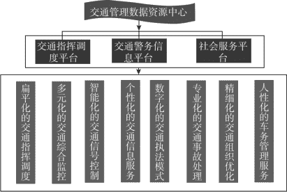

图 3-5 北京交通管理数据中心

随着网络的大规模普及，交通设施、路线等基础设施的快速增长，交通大数据资源的量也在急剧膨胀。随着电子警察、摄像头、感应器等设备数量的增加，以及互联网数据传输速度的加快，大数据在交通领域的利用呈现井喷式的发展。建设智能交通云平台，以实现交通行业大数据服务产品的全覆盖，构建交通大数据融合仿真“一张图”。“一张图”包含融合城市客运许可数据、重点运输车辆卫星定位数据、中心城区路网数据等。高速公路电子不停车收费 ETC 已经在全国应用，覆盖了全国 29 个省（市、区），实现全国 29 个省（市、区）联网。基于移动互联网的出行服务模式和产业在不断地创新发展，形成智能交通的新业态和新模式，以满足公众便捷、舒适出行的现实需求。

以出租车为例，出租汽车服务管理信息系统：具有监控指挥、信息发布、企业在线、综合运营分析、电召服务、服务质量监督考评、动态监管稽查等七大功能。出租车车载系统即 GPS 系统，具有车辆定位、轨迹回放、车内监听、图像上传、反劫报警等功能，如图 3-6 所示。

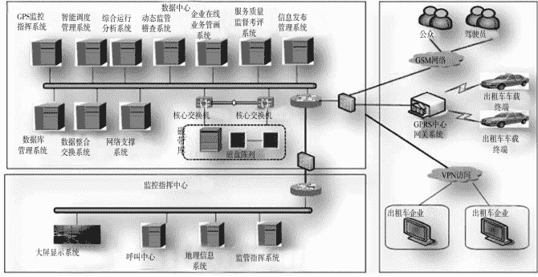

图 3-6 出租车 GPS 系统

### 3.3.2 国外发展现状
国外城市智能交通系统（ITS）包括智能交通管理系统、交通信息服务系统、车联网系统、自动驾驶系统等，其中以美国、欧洲、日本较为成熟。

美国作为全球大数据应用的发源地和全球大数据发展的中心，加上美国政府对大数据应用的政策支持，以及美国交通网络的完善，都使得美国的大数据交通发展成为全球大数据交通发展的旗帜，其技术的先进性和经验的丰富性都远超其他国家和地区。在洛杉矶，全市架设摄像设备以及磁路传感器，将收集到的数据汇总至中央计算机系统，让电脑进行计算分析，并自动控制 1215 平方千米的 4500 个交通信号灯，大大改善了交通拥堵情况，交通通行速度提高了 16%以上。交通状况的改善也减少了汽车尾气排放，从而提高了空气质量。

美国拥有完善的交通信息服务载体，道路交通信息作为美国开放的数据资源之一，公众可随时登录交通路况查询网站，查询和开发利用美国近 40 个州 100 多个城市的实时道路交通路况，包括对交通事故发生情况、交通监控路段实景视频等进行实时查询，如图 3-7 所示。

图 3-7 美国洛杉矶交通数据

国外的道路交通信息服务系统结合各国家和地区的特点已基本成熟，目前处于大规模应用及不断提高精度的阶段。道路可变信息板（固定及移动式）所提供的实时道路交通信息服务——覆盖全路网的实时道路交通信息服务（便携移动智能终端的发展及车载终端）。比如日本 VICS（Vehicle Information and Communication System）能够实现从车载终端、交通部门采集、交通数据中心、VICS 中的全路网覆盖，如图 3-8 所示。

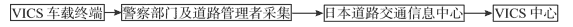

图 3-8 日本 VICS

20 世纪 70 年代开始，美国、英国、德国等发达国家开始进行无人驾驶汽车的研究，目前在可行性和实用性方面都取得了突破性进展。虽然自动驾驶系统尚未走向应用，但汽车辅助驾驶技术在近年来得到了较大的发展。比如宝马公司的 Connected Drive，除汽车信息服务，还包括了多项辅助驾驶功能，如限速信息、周边视景、尾部摄像机、停车辅助、夜视辅助、车道偏离报警、车道变换报警、碰撞报警，如图 3-9 所示。

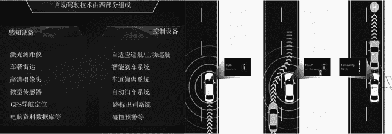

图 3-9 自动驾驶

为了实现无人驾驶的功能，谷歌无人驾驶汽车上配备了大量传感器，包括雷达、车道保持系统、激光测距系统、红外摄像头、立体视觉、GPS 导航系统、车轮角度编码器等，这些传感器每秒产生 1GB 数据，每年产生的数据量将达到约 2PB，如图 3-10 所示。

图 3-10 谷歌无人驾驶汽车

大数据分析技术将帮助无人驾驶系统做出更加智能的驾驶动作决策，比人类驾车更加安全、舒适、节能、环保。

### 3.3.3 大数据在智能交通系统存在的问题

#### 1. 数据共享交换机制
交通数据分散在不同部门，部门之间又缺乏开放互通，造成了交通数据资源的条块化分割和信息碎片化，要从政策和技术上突破交通数据资源互通、共享的壁垒，消除信息分散、内容单一等问题。数据共享交换机制还没有完全形成，存在数据孤岛问题。

#### 2. 检测标准
交通检测方式多样，信息模式复杂，造成数据种类繁多，且缺乏统一的标准；而且数据缺乏统一管理、难以支持精细化管理和科学化决策，数字资源综合利用率低。

#### 3. 数据保存
历史数据由于存储手段、存储格式、存储介质等原因，难以很好的保存和利用，出现历史数据资产流失。

#### 4. 数据监管
确保交通数据资源的安全性有待进一步完善，在数据开放的同时，需要加强数据的安全监管，尊重和保护相关政府部门、交通企业以及个人的机密和隐私不受侵犯。

### 3.3.4 大数据在智能交通中的发展趋势
在大数据时代，基于人工智能、云计算以及物联网等前沿技术作为支撑的交通智能化建设正在全面铺开，通过大数据带来的技术突破推动城市交通迈向全面信息化时代，通过城市交通的快速发展推动大数据更加落地。

未来的交通场景应朝向车路协同，主动安全方向发展，如图 3-11 所示。产生实效的城市交通大数据的集成和未来的挖掘应用对于智能交通的发展具有重要作用，重点开展以下几个方面的工作：

（1）持续提升交通感知智能化水平，完善网络化的交通状态感知体系；

（2）加强交通数据标准化建设，进一步整合数据资源；

（3）创新交通大数据分析应用，实现基于大数据技术的交通系统高效运营和管理；

（4）建立基于大数据分析的新一代智能交通信息服务系统，改善和提高公众出行的智能化服务水平；

### (5) 构建并完善智能交通技术创新体系，加强交通信息服务产业化进程。

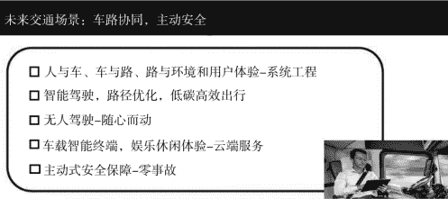
图 3-11　未来交通场景

2040 年，预计所有的汽车将完全转变为无人驾驶模式，届时，我们将迎来全新的交通生态系统，在这个生态下，所有的车辆都是集中控制模式，如图 3-12 所示。基于无人驾驶的自动交通运输将像供电、供水一样，成为日常生活中的基础设施。得益于改进的导航系统及传感器对路面和车辆老化状况的检测，传统汽车行驶中的交通事故由现在的每年超过百万起降低至几乎零事故。

无人驾驶驱动的公共交通对资源的有效共享与分配，整个城市的交通系统只需要较少量的汽车便可以正常运行。一方面能源的使用效率将被极大程度地提高，另一方面将大规模地替代使用新能源，空气污染将被大规模地降低。

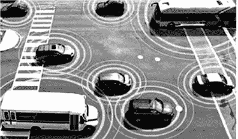
图 3-12　未来无人驾驶场景

## 3.4　基于大数据的智能交通特点及应用实例

### 3.4.1　智能化

智能化就是通过大数据的分析和挖掘，交通参与所有的环节和信息传递能够自主、自助，管理人员对道路、车辆的行踪将掌握得一清二楚，交通管理者能够及时响应，一切交通行为都能按照既定的规则有序运行，效率极大提高，安全指数极大提升。

民众的交通出行智能化，如图 3-13 所示。出门前，手机 APP 或者车联网会实时推送上班路上的交通状况，你可以根据实际情况选择出门时间或者选择最佳的路线出行。乘坐高铁，可以通过 APP 购买车票，进站检票时，只需要刷身份证件或者使用人脸识别系统，短短一两秒内就能完成验票进站的工作，大大提高了出行效率。

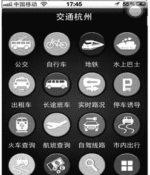
图 3-13　智能出行 app

交通监控智能化。“聪明”红绿灯自行优化配时，“红绿灯”不再只是“灯”了，它能通过多渠道自行感知和收集相关交通数据，再运用自己的“大脑”进行分析研判，给出信号控制和交通组织的最佳方案，实现区域自适应信号控制。即依据实时监控到的动态交通数据，自动切换和调配信号灯时间，红绿灯时间不再固定，甚至能做到全程绿灯不停车，实现“一路绿灯”，减少了行车、停车延误，实现整个区域的交通流量最大化，降低区域内车辆、行人在路口的等待时间，有效提升区域内的通行效率。

### 3.4.2　实时掌控

大数据智能交通掌握城市路网的动态运动状况，为动态交通引导提供支撑，实现道路状况实时掌控。智慧交通大数据平台集成视频监控系统、智能卡口系统、交通流检测系统、信号控制系统等交通业务系统，实现道路交通状况远程实时监控，实现交通事件的精确定位，交警部门实时发布堵车、交通事故、道路维修、自然灾害等路况信息，向用户发出预报提醒，为人们日常出行及交通疏导提供实时、精确的指引。

传统的交通，实时交通信息是无法知晓的，即使前方出现拥堵，司机也无法及时知晓，从而避开拥堵路段，盲目的交通方式往往浪费了司机的时间，也浪费了交通资源，造成环境污染。在大数据时代，智能交通掌握城市路网的动态运动状况，所有的道路和车辆都是在实时掌控之中，如图 3-14 所示。通过将人工智能技术应用到城市交通管理工作中，就可以与大数据、云计算等有机融合到一起，通过收集公众出行信息为他们安排最合理的出行路线，避免大家都拥挤到一条交通路线上，产生交通路线拥堵。

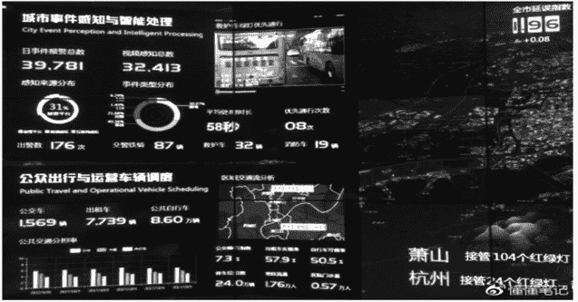
图 3-14　城市交通实时感知与智能处理系统

### 3.4.3　精准需求

精准匹配需求和精准提供服务，是大数据时代极为明显特征之一。在交通领域，要想做到精准，服务者与被服务者都必须具备精准的数据，需求与服务才能完美匹配。当数据足够海量和丰富时，经过量化的需求就会凸显出来，此时，提供精准的需求服务就不再是难事。在大数据交通建设过程中，精准的需求匹配会让未来的交通运输更加“不挤、不贵、快速”，更加智能，符合了国家倡导的“绿色出行，节能减排”的交通要求。

“定制公交”实现公共交通的精准需求。在传统交通，对很多上班族等公交车是很麻烦的事，因为时间不确定，错过一辆要等不少时间，有的地方又不好打出租车，价格也贵，所以上下班去坐车时，都比较焦虑。在大数据时代，通过“定制公交”就能很好地解决这一难题。所谓定制公交，也称商务班车，是从小区到单位，从单位到小区的一站直达式班车。市民们可以通过专门的网站提出自己的需求，公交公司根据收集到用户出行需求和客流情况设计出公交线路，然后在定制公交平台上招募乘客、预订座位、在线支付，如图 3-15 所示。根据约定的时间、地点、方向开通定制公交，乘客不用再像普通公交一样去站台等车，省时省力，方便快捷，大大缓解了需要在两个地点往返的许多上班族的交通压力。同样，大学城的学生们在周末和节假日也可以享受“定制公交”。在节假日，学生乘坐“定制公交”安全快捷地到达客车站和火车站，不用担心挤不上公交车，最后导致上不了火车回不了家了。

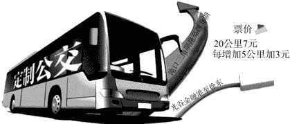
图 3-15　定制公交

通过对交通大数据挖掘分析，提前预判实现客户的精准需求。利用大数据技术将在交通系统中通过观测得到的数据，建立区域交通状态监测和预测模型，预测早晚高峰、节假日等重大节日的道路拥堵情况，以提高交通管理水平和用户出行质量。交通路况预测系统将成为智慧交通不可或缺的一部分，它将助力城市交通管理，方便广大机动车主实时了解交通道路行驶状况，避免交通拥堵，为车主出行选择行使路线提供有效参考。通过对现有大数据的分析预测，优化交通运输过程中的某些环节，精准发现无谓浪费的资源等；通过大数据精准发现交通运输过程中的危险，并向交通参与者精准推送信息，避免不必要的损耗。

### 3.4.4　共享经济

随着互联网＋、第三方支付平台、大数据等技术的兴起，新的商业模式——共享经济应运而生。共享经济就是对资源进行合理再配置，提高了资源利用率，降低了资源拥有者的成本，也减少了浪费，对整个社会的经济效益提升有着明显的效果。共享模式下，民众出行更加便捷，用户在使用交通工具的时候都有着很强的目的性，再配合大数据挖掘下的精准方案，使得民众没有了以往出行的盲目性，交通拥堵由此得以缓解。共享经济模式使得城市交通更智能、更环保。

共享租车、共享驾乘、共享自行车、共享停车等都是交通行业内的共享经济模式，如图 3-16，3-17 所示。以汽车分时租赁为例，汽车分时租赁是一种以汽车使用权替代拥有权，满足人们短时用车需求的新型交通模式。一般由第三方经营的会员制用车公司来解决车辆调配、保险和停放等问题，用户根据需求预订车辆并按照实际使用量支付费用。有别于传统汽车租赁，分时租赁汽车定位于短时出行需求居民，操作便捷，通过手机 APP、互联网或者电话预约等即可实现取车和还车的自助服务，用车时间可按分钟、小时或天数计算，费用结算通过预付费卡或信用卡划账，无办公时间限制。比传统租车业务更加灵活、便捷、低廉，正在发展成为一种日常的用车模式，共享汽车填补了公共交通和私家车之间的空白，满足了中距离出行及其他特殊出行需求。

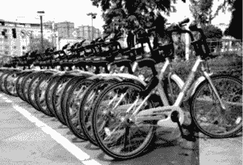
图 3-16　共享单车

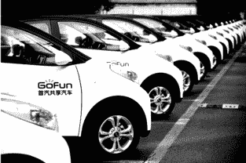
图 3-17　共享汽车

### 3.4.5　资源充分利用

在传统的交通，相当一部分交通问题，如长期拥堵、事故高发，均可归结到交通规划不合理，包括城市规划、道路规划、方向规划、交通灯设置、道路转向设置等等。大数据时代，基于海量交通大数据的分析结果，就可更有效地进行交通规划决策，进而提升整体效率，尤其是公共交通规划。公交路线、地铁班线、出租车配额，诸多公共交通资源配置决策均基于大数据进行的。在以往的交通模式当中，汽车空座率很高，一直是令交通管理者头疼的问题。大数据时代下的交通，在拼车和顺风车模式当中，闲置资源得到了最大程度的利用，解决了汽车空座率高的难题，使得这种模式成为缓解交通压力的一个有效手段。乘客在打车时选择拼车，滴滴司机就可以同时接送几位前往不同目的地的乘客，这便减少了上路的交通工具数量，还保障了乘客正常的交通出行，交通拥堵也因此缓解了不少。

“滴滴打车”推出的顺风车模式或拼车模式，5 座的车辆，由以往的 1 乘车变成 5 人共乘一辆车，路上就会减少 4 辆车，减少了交通拥堵，减少了汽车尾气对环境的污染。最重要的是，通过顺风车和拼车出行，政府和企业获得了民众出行的一手真实数据。从这些数据中，政府的交通疏解方案、决策等将更有依据，而企业的服务也将更加精准。另外，除了小型汽车拼车外，还有以拼车的形式进行巴士定制、火车定制等等，充分利用了现有的交通资源，减少了浪费，而且，其留存在平台上的数据是最真实且具有价值的，大数据交通正是在这些数据的支撑下，才更加有效率，更加智能化。

## 第 4 章　人工智能与大数据在安全领域的应用

## 4.1　概述

安全一直是备受热议的问题，它是一个长期的、复杂的全球性问题，关系到国家安危，人们的生命安全，不容忽视且应严肃对待，需借助多平台、多技术且多方发力去解决。大数据技术与人工智能的创新与应用，不仅能够应对数据爆炸带来的挑战，AI 的技术突破使得场景理解变得越来越准确，可以让更多的传统行业进行转型升级，还能够创造出巨大的价值，提升社会生产率。现阶段是数字化高速发展的阶段，新时代的信息基础设施已广泛运用，其中包括互联网、物联网、云计算等。大数据背景之下，合理利用以上信息技术可以有效解决安全问题。大数据技术与人工智能在各个领域得到了广泛应用，尤其在安全方面发挥重要的作用，如金融大数据安全、城市安全和应急管理、环保大数据、食品大数据、舆情监控等都有非常突出的优秀表现。

## 4.2　食品安全信息监管中人工智能与大数据的应用

食品安全大数据的应用对于建立基于预防的食品安全体系起着至关重要的作用。随着互联网和信息技术的发展，我国营造了良好的政策环境以推进食品安全大数据建设。目前，我国正处于新一轮改革发展的关键时期，人工智能技术提供了一个弯道超车的机会。食品安全大数据是一项集食品工程、统计分析、数据库信息管理及计算机网络等领域和技术于一体的复杂工程。人工智能在食物辨别、后厨监控和感官评定方面也有应用，人工智能与食品安全大数据的结合加强了食品监管。

信息技术在食品安全中的具体应用如图 4-1 所示。通过物联网可追溯系统获取食品原料的产地信息，并进行实时跟踪；云计算是物联网海量数据的储存、计算中心；大数据解决的是数据的挖掘与融合工作，是人工智能的基础，是人工智能发展的推动力；人工智能则是一项新技术，通过计算机技术对所收集的数据进行加速处理，达到模拟人类思维的效果，其在食品行业中的地位与日俱增。

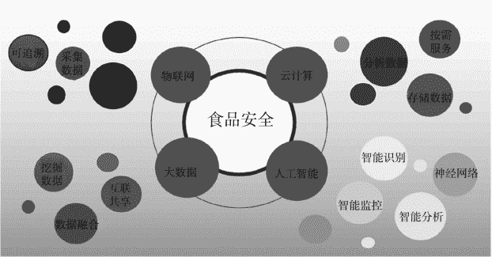
图 4-1　信息技术在食品安全中的应用

### 4.2.1　食品安全大数据分析处理

食品安全监管贯穿生产、采购、库存与销售等关键环节，通过对从各环节采集的数据信息的分析整合，反作用于食品安全监管的推进，充分展现食品安全大数据的价值。食品安全大数据的基础技术可分为以下方面。

1.食品安全大数据采集与预处理

高效的数据采集和科学分析，能够为长久的食品安全监控发展提供数据支撑，利用传感器、互联网、物联网及 ZigBee 技术等设备采集特定的数据。食品安全数据的预处理效果将对食品安全数据的挖掘效果产生直接影响。食品安全大数据预处理就是运用数据融合技术，包括数据融合、数据集约、数据清理等，在食品安全数据中消除噪声和冗余点，综合收集多来源数据，以获取更有效、更有价值的食品安全信息。

2.食品安全大数据的传输与存储

互联网技术使得大数据传输变得异常方便和快捷。在食品安全监控领域中，由传感器、摄像头所产生的即时数据可以运用树莓派、蓝牙、物联网及 WiFi 等途径传输，云计算、互联网、Yee Link 能够分类储存不同的数据，并且对这些数据进行有效的分析，大大提高了处理大批量数据的能力。同时，由于现代化互联网技术的不断发展，使得一些数据高效压缩，大幅度减少了数据的储存容量，可对数据进行更方便、有效的管理。

3.食品安全大数据挖掘技术

目前贝叶斯网络在食品欺诈预测中有应用，能够预测已知产品类别和进口产品的食品欺诈类型，该模型可以正确预测 80%的食品欺诈类型。决策树能对食品中化学物质进行监测，有助于对化学物质进行分类，可作为风险监测计划的工具。人工神经网络技术可以学习和模拟对奶酪的感官评定等。这些数据可以在网络订餐、食品包装、食品溯源、风险评估及联合执法等场景中得到应用。

4.食品安全监管

食品安全监管以政府监管为主导，行业、企业协同管理，社会和消费者共同监督，其中，政府主要通过质检总局、食药总局、农业局、商务局、卫计局、经济和信息化局等部门跟进落实，多管齐下，从而打造一个全方位监管环境，如图 4-2 所示。

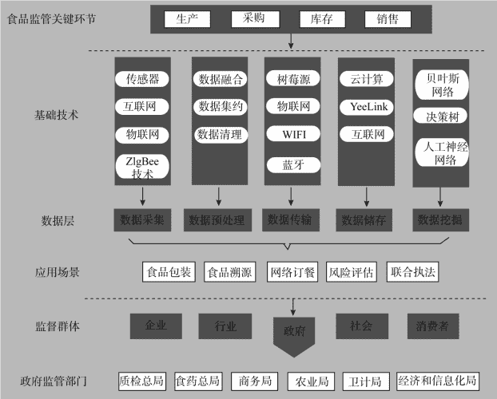
图 4-2　食品安全监控网络

### 4.2.2　人工智能在食品安全大数据中的应用

在工业 4.0 时代，重复率高且重劳力的工作被智能机器人取代的案例比比皆是。同理，在食品行业中例如监管、配餐、开发新产品和检测方面，人工智能可以利用其独特的分析计算与自主学习能力发挥巨大的作用。人工智能在食品行业中的应用如图 4-3 所示。

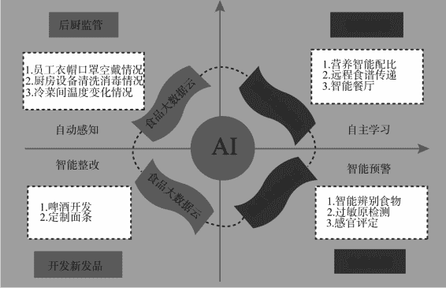
图 4-3　人工智能在食品行业中的应用

1.人工智能在后厨方面

智能识别 AI 可在食堂或餐厅后厨监控工作人员有无按规定穿戴衣帽口罩和有无老鼠等热血生物出现，还可标记出厨房内的设施设备（清洗、消毒、保洁设施），厨房内的工具、容器和其他设备，厨房内的清洗水池（水池配置、标识区分），并记录其使用状况。

相对于传统的监管模式，人工智能监控模式大大降低了监管过程人力物力的损耗，明显提升了食品风险预警的准确率，有效降低其安全风险的发生率。人工智能赋能于食品安全监管，监管水平与监管效能大幅提高，并在行业内、企业间树立了相应的威慑力，在监督市场乱象、维护市场秩序的同时，很好地规范了企业的生产行为。借助于人工智能，通过实时监测，发现问题可及时报警，并自动留取相关证据，很大程度上节约了政府的监管成本，提高了监管精确度，拓展了监管维度，为政府相关政策的决策部署提供有效数据支撑，强化了食品监管的精细度与透明度，同时也维护了食品安全禁区的高压线。

2.人工智能在智能配餐方面

人工智能配餐可针对特定人群的不同情况进行科学合理的食材搭配，根据其口味和营养需求定制专属食谱，为消费者提供膳食均衡的营养餐；由于人体健康状况并非一成不变，所以食谱的定制需要考虑多样化、个性化和周期性问题，而智能配餐日常为用餐者提供的食谱能解决该问题。结合人工智能发展契机，智能餐厅较传统餐饮企业大大节约了人工成本，自动炒菜机可以花更少的时间成本使同一菜品的口味高度统一，精细化的菜品、定制化服务完全迎合当下消费者的个性化需求，提升了消费体验。同时，结合大数据与云服务对每位顾客的用餐信息和餐厅每天的盈利情况进行智能分析，促进餐厅的优化升级，更好地抢占餐饮市场。

3.人工智能在开发食品新产品方面

人工智能具有人类所没有的处理庞大数据的优点，可根据各种仪器检测得来的数据进行准确的分析。嘉士伯与微软、丹麦奥胡斯大学和丹麦科技大学合作进行啤酒开发，利用人工智能感应啤酒的口味和气味差别，从而提升在开发新品、产品品控和质量检测时的精确度。人工智能还可定制面条，根据个人口味选择烹饪面条的方式、软硬度等。

4.人工智能在食品检测方面

可使用一种可穿戴式设备（eButton）检测食物，这种可穿戴式设备可以连续自动记录佩戴者面前的场景。对 eButton 传输的数据进行交叉数据集测试，其中一半数据集用于训练，另一半数据集用于测试，食物检测的总准确率分别为 91.5%和 86.4%。

结合人工智能发展的契机，与食品安全碰撞出蕴含无限可能的火花，一方面可加强监督并整治食品市场乱象，削弱政府榜单里的“黑榜”力量，另一方面，顺应当前消费市场的走向，及人民对高质量生活的追求，保证食品的安全无害，还要让人民吃得营养、健康，切实解决 13 亿多人民最基本的民生问题，致力于国家的高质量发展之路，让人民有更多的获得感与幸福感。所以，激发人工智能在食品安全领域的创新、创造活力，并持续发光发热，可谓前景广阔。

## 4.3　大数据在生态环境安全的应用

当前，我国正处于环境质量改善的关键时期，传统的生态环境管理决策手段难以满足新时期环境保护的复杂性、动态性和系统性要求。伴随着环境问题复杂性日益凸显和国家对生态环境保护的高度重视，传统生态环境管理和决策手段已经难以满足时代环境治理需要。推动大数据技术及其应用是重要的国家战略，生态环境大数据技术是环境学科热门研究领域之一。

### 4.3.1　生态环境大数据系统主要功能

生态环境大数据系统主要功能主要有数据采集与挖掘、数据处理与管理、大数据分析与应用和决策与支撑等四个方面的应用，如图 4-4 所示。

1.数据采集与挖掘

构建与环境监测系统相匹配的数据信息采集平台，实现两者的互联互动，将环境监测系统数据实时动态上传至大数据平台。对系统采集的多介质数据进行加工预处理和智能校核，进行各项数据的空间匹配和网格化赋值计算，实现与环境基础信息数据库的衔接。基于计算机深度学习和智能评估技术，对系统上传的各项数据进行动态评估和反馈，不断优化数据采集方案。基于高性能计算机技术，实现生态环境大数据系统的并行批量处理和动态更新，进行大数据挖掘分析和数据展示。

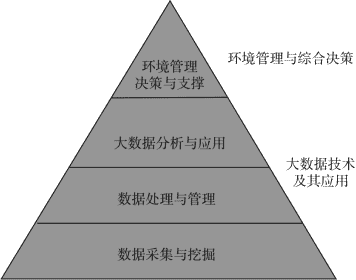
图 4-4　生态环境大数据功能图

2.数据处理与管理

基于多源数据采集和互联网大数据挖掘技术，搜集处理研究区域不同空间尺度、长时间序列的自然地理、气象水文和经济产业、社会人口、资源利用、污染排放和环境质量等基础数据，比较分析不同来源口径数据的可靠性和一致性，将不同数据源、不同格式的多源数据加工处理为互相可对应、可识别、可提取与利用的信息，并对不同类型的基础数据进行空间匹配，建立环境基础信息数据库。建立大数据系统高效的数据查询和索引子系统，包括文件系统、数据库和数据处理等功能模块，实现多源数据库系统管理的性能最优化。依托数据存储系统和基础网络设施，通过图形化的配置界面实现分布的、异构的、跨网络的信息资源的交换共享，以统一标准对外提供数据服务，并对数据进行综合、全面的分析与监管。

## 3. 大数据分析与应用

生态环境大数据技术及其应用，将进一步深化大数据应用和环境系统分析等领域科学研究，完善生态环境大数据与模拟平台的理论基础、方法体系和技术框架，对于系统认识区域发展与生态环境保护之间的关系、模拟资源环境承载能力变化与预警、预测生态环境质量变化趋势等具有重要意义。当前，生态环境大数据分析常见方法包括机器学习、深度学习和云计算等，已被广泛应用于生态环境预测评估和管理决策中。

## 4. 生态环境管理决策与支撑

面向区域环境协同调控和综合决策的需求，结合区域发展战略、环境保护目标、政策制度、标准规范、成本效益、技术进步和环境风险管控等要求，在生态环境大数据分析的基础上，结合区域环境系统分析和数值模型等工具，研究开发多环境介质综合模拟和协同调控系统，实现区域环境多环境介质协同调控和生态环境管理决策支撑等功能。

### 4.3.2 大数据在生态环境中的应用

随着经济的持续发展，我国的生态环境保护问题变得越发复杂。生态环境的保护问题，具有复杂性和时变性，涉及多部门、多地区和多领域，需要处理海量的各类数据，这为问题的解决增加了不小的难度。大数据技术的出现，正好适应了生态环境保护问题的发展现状。建设生态环境大数据决策分析应用系统是生态文明建设的需要，是促进社会可持续发展的必要之举。

本案例以某地区环保厅数据中心建立的生态环境大数据分析应用示范平台为例，如图 4-5 所示。以大数据的思维建立数据质量评估模型，对流数据、结构化数据、半结构化及非结构化进行挖掘，实现对在线监控数据的质量评估和自动监控系统问题的深度分析，帮助环保部门实现污染源的精细化管理。

图 4-5 某地区数据中心

重点污染源自动监控大数据分析是生态环境大数据分析应用示范平台的一个应用模块。

#### 1.流数据存储及分析

为了对自动监控数据的质量进行分析，采集了自动监控实时数据（分钟数据），接入平台的自动监控企业超过 450 家，每天分析的实时数据量超过 400 万条。大量连续产生的实序数据如何处理和分析，是关键技术难点。本案例采用了`openPlant`云平台来进行流数据的存储及分析，如图 4-6 所示。

`openPlant`云平台是针对物联网及大数据分析应用特点，设计研发的海量流数据采集、存储、分析、展示于一体的国产基础软件。具备高稳定性、高可靠性、高扩展性和高性能处理能力外，同时具有独特安全认证机制，能够保障国家信息安全。

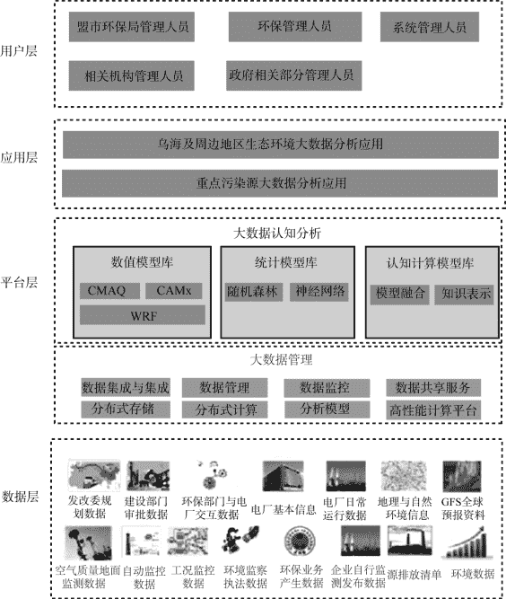

图 4-6 openPlant 云平台

流数据的处理流程如图 4-7 所示：

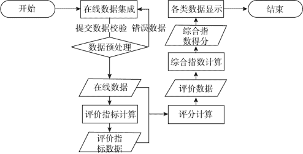

图 4-7 流数据处理流程

#### 2.非结构化数据分析和挖掘

在实际环保管理活动中，除了有大量的关系型数据和流数据，还有大量待分析挖掘的非结构化数据，包括以 WORD、EXCEL，PDF、图片、音频、视频等形式记录的数据。这些数据不仅提取困难，产生周期、频率也存在不确定性，与其他数据之间看似没有明显的关系，用传统的分析手段很难产生实际的价值。对自动监控系统的各类 WORD，EXCEL 格式的检查报告进行了处理，对自动监控系统现场检查结果进行了深度挖掘。

平台对非结构化数据的处理主要分为两个部分，一是提供一种类似全文索引的功能，二是提供了现场检查问题的关键词提取的功能。

全文索引技术是一项用来检索存储在计算机系统中的文本信息的技术。利用全文索引技术，可以极大地提高从海量的信息中检索所需要的信息的效率。

平台预先将非结构化数据进行处理，将数据进行清洗、转换、分类、分组处理，存储在特定的文件中，同时支持数据的实时更新，当用户检索的时候，首先会进行分词处理、剔除助词、语气词等没有实际含义的词，然后会从特定的文件中读取数据，最后将与此对应的文件展示出来，以此提高检索效率，并且提供在线下载。

#### 3.功能成果

坚持以应用为导向，围绕重点污染源自动监控数据的质量分析展开建设，建设重点污染源自动监控数据质量评估体系，包括：数据质量预警功能、数据质量评估体系管理功能、数据质量得分查询功能、数据质量状况分析功能、数据质量改善分析功能；建设重点污染源自动监控数据分析应用，包括：现场检查问题字符云功能、现场检查问题分布功能、现场检查问题分析功能、污染物排放情况自助分析功能，如图 4-8 所示。

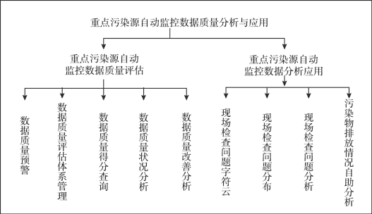

图 4-8 重点污染源自动监控数据质量评估体系

（1）数据质量预警。通过重点污染源自动监控大数据分析平台的数据质量分析模型，可以自动对自动监控数据的异常情况进行识别并预警。该功能详细展示出现数据质量问题的企业名称、指标名称、开始结束时间、发生频率、质量问题描述等信息，并可以通过趋势分析功能，对报警时段的数据趋势进行查询，实现了企业在线监控数据质量的精细化监控。并预留与移动执法系统对接的接口。

（2）数据质量评估体系管理及现状分析。在线监控数据经过质量分析后，根据数据质量评估模型，对每个企业的数据质量进行综合评分，并以盟市维度、行业维度进行汇总，以表格、图表、地图等多种可视化的方式，展现内蒙古自治区重点污染源自动监控数据的质量现状。评估模型可根据系统运行结果进行调整。

（3）数据质量改善分析。在数据质量改善分析功能中，以盟市、行业、企业的横向比较和各个维度的纵向比较得出数据质量的变化趋势以及需要改善的方向和管理目标。

（4）现场检查问题分析。通过对“自动监控系统现场检查报告”“工况监控报告”“数据传输有效率报告”“自动监控报告”等 WORD 和 EXCEL 格式的报告进行分析，提取自动监控系统热点问题，分别以盟市、行业、企业、时间为维度，进行频率分析、聚类分析，通过词频字符云、词频分布与数据关联、问题分类挖掘的形式展现分析结果，为自动监控系统的管理对象、管理政策调整提供数据支持。

（5）自助查询。针对全区在线监控废气排放企业及废水排放企业，采用自助式报表工具，实现最终用户对主题对象多维度全方位的自助式查询分析。

#### 4.应用效果

生态环境大数据平台中关于重点污染源自动监控大数据的应用，对全区重点污染物的排放情况进行了统计分析，结合在线监控数据质量的评估结果、现场检查报告及工况报告的监察问题分析，让管理部门能掌握全区重点污染源排放情况的全貌。

（1）制定了科学的数据质量预警规则，建立了灵活可配的重点污染源（非电力）自动监控数据质量评估体系，对企业违规违法行为进行预警，支撑了环境监察执法从被动响应向主动查究转变，从全面监察执法到重点监察执法进行转变，实现了排污企业的差别化、精准化和精细化管理。

（2）通过设定语义编码条件、自动编码、热词提取、关联分析、聚类分析对自动监控系统现场检查等多种报告中出现的问题进行提取，利用全文索引技术，提高从海量的信息中检索所需要的信息的效率，为自动监控系统的市场准入、运维规范及打击企业造假提供数据支撑。

（3）采用自助式报表工具，实现了最终用户对主题对象多维度全方位的自助式查询分析，支持数据表格、图表等多种格式的分析结果导出。

大数据蕴含大信息，大信息提炼大知识，大知识将在更高的层面、更广的视角、更大的范围帮助用户提高洞察力、提升决策力，为环保管理创造前所未有的重大价值。

### 4.4 大数据在信息安全领域的应用

在现如今的阶段，我们国家的信息安全问题越来越重要，具备良好的信息安全一方面能够从根本上保证个人的信息不受泄露，另一方面对于国家的安全也能够产生十分深远的影响，因此，应该引起人们的关注和重视。目前的网络攻击一方面具有组织性，另一方面还具有周密性。在这样的情况下，原有的防护思想和安全防御机制法人应对能力逐渐的遭到了削弱。不能够在最短的时间内对黑客的攻击及时的发现并采取有效的措施进行应对。长此以往，使得传统防御方式自身所固有的不足逐渐的显现出来。面对这样的情况，将大数据运用于海量数据的处理，通过这样的方式来对各种未知的危险进行有针对性的检测，能够为安全防护带来积极的保护作用，具有积极的影响和意义。

棱镜计划（PRISM）是一项美国国家安全局（NSA）和联邦调查局（FBI）于 2007 年启动的绝密电子监听计划，代号为“棱镜”。该秘密监控项目直接进入美国网际网络公司的中心服务器里挖掘数据、收集情报，包括微软、雅虎、谷歌、苹果等在内的 9 家国际网络巨头皆参与其中，如图 4-9 所示。PRISM 计划能够对即时通信和既存资料进行深度的监听。许可的监听对象包括任何在美国以外地区使用参与计划公司服务的客户，或是任何与国外人士通信的美国公民。国家安全局可以接触到大量个人聊天日志、存储的数据、语音通信、文件传输、个人社交网络数据。

图 4-9 棱镜计划

#### 4.4.1 大数据技术防御网络攻击

##### 1.利用大数据技术应对 DNS 安全威胁

DNS 作为互联网最基础的设施之一，经常被不法分子利用，发起各种网络攻击。比如 DNS 劫持、DNS DDoS 攻击等，目前互联网企业常用的防御方式就是通过网络安全公司接入防劫持/防 DDoS 服务。我国应积极争取获得域名服务器的运营管理权，构筑完整的安全防范体系，积极利用大数据技术，研发高性能、抗攻击的安全 DNS 系统。依托大数据技术建立 DNS 应急灾备系统，缓存全球 DNS 系统的各级数据。同时还可以利用 DNS 解析的大数据来分析网络攻击，积极推动下一代域名服务安全。

##### 2.利用大数据技术防护 DDoS/CC 攻击

目前 DDoS/CC 攻击依然是最常见的网络攻击方式之一，如图 4-10 所示。市场上有很多网络安全公司针对 DDoS/CC 流量型攻击、DNS 攻击以及各类应用层入侵推出了相应的网络安全防护策略，同时还提供加速、缓存、数据分析等功能。可以利用大数据技术对海量日志大数据进行分析，挖掘和发现新的网站攻击特征、网站漏洞等，还可以通过对大数据进行挖掘，有助于定位攻击来源以及获取黑客信息。

图 4-10 DDoS/CC 攻击

##### 3.利用大数据技术防范恶意软件/木马

基于大数据和云计算技术实现的云安全系统，可以为防范恶意软件/木马起到很大作用。为了对抗 APT 攻击，采用大数据分析技术研发 APT 攻击检测和防御产品，分析定位终端木马的分布、感染的目标终端，可以在大时间窗口下对企业内部网络进行全流量镜像侦听，对所有网络访问请求实现大数据存储，并对企业内部网络访问行为进行建模、关联分析及可视化，自动发现异常的网络访问请求行为，溯源并定位 APT 攻击过程。

基于云计算和大数据技术的云杀毒软件，已经广泛地应用于企业安全信息保护，如图 4-11 所示。云杀毒通过网状的大量客户端对网络中软件行为的异常监测，获取互联网中木马、恶意程序的最新信息，传送到云端，利用先进的云计算基础设施和大数据技术进行自动分析和处理，能及时发现未知病毒代码、未知威胁、0day 漏洞等恶意攻击，再把病毒和木马的解决方案分发到每一个客户端。

图 4-11 云杀毒软件

#### 4.4.2 大数据分析预防犯罪

大城市是人类高度繁华的文化的体现，但也是滋养罪恶的温床，大城市存在着大量的犯罪事件，其犯罪事件远高于其他区域。因此，大城市的警察部门极其盼望能够更好地理解和预测犯罪事件，从而预防和避免犯罪事件给人们带来的伤害，芝加哥警方就试图通过数据分析来解决这一问题。

芝加哥警方首先基于芝加哥的城市网站构建了其分析的数据集，这里存放了芝加哥近十年来所有的犯罪记录。这些数据详细记录着犯罪的信息，包括详细的犯罪记录，犯罪时间、地点，处理信息和处罚信息等，并基于分析的需要进行了相应的整理，以便进行更进一步的分析。

借助 JMP 的卓越的探索性分析功能，芝加哥警方对这些数据进行了大量的分析工作，例如，去探索犯罪行为同犯罪地点之间的行为模式，基于时间节点的犯罪类型分析等。基于上述的数据分析，芝加哥警方开展了大量的预防犯罪的工作，从而大大减少了犯罪事件的发生，减低了犯罪带来的危害。

##### 1.分析数据准备

数据准备的首要任务就是基于犯罪类型对数据进行整理，对于类似的犯罪行为，也会根据危害程度进行更为细致的分组，这些都是进行精确分析的必要准备工作。由于 JMP 强大的图形化分析功能，不仅仅在分析阶段大量使用了 JMP 的图形化分析，在数据准备阶段也大量采用了 JMP 的快速制图。例如，由于对犯罪类型进行过多的分类，反而增加了识别趋势的难度，这时就需要基于分类的情况进行调整，使得犯罪的类型更为合理。通过对数据进行清洗、删减和整合，得到了分析所需的全部的标准化数据，

##### 2.图形化的分析

JMP 丰富的图形化分析工具，帮助芝加哥快速地进行各项犯罪事件的分析。警方采用了大量的图形化进行分析工作，如条形图，折线图，等高线图等等。

例如，警方采用柱状图和等高线图进行基于犯罪类型和地理区域的分析工作。通过使用柱状图，警方能够对各种犯罪类型进行分类，这样就可以很清晰地看到不同犯罪类型的情况。

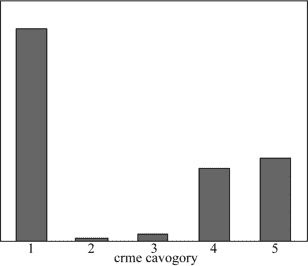

图 4-12 整体犯罪类型分析

如图 4-12 所示，通过柱状图便可以很清晰地看到不同类型的犯罪类型的数量以及整体对比的情况，使得对芝加哥整体的犯罪情况有了一个大致的了解。接下来，通过时间，星期等更多的维度对犯罪情况进行更加深入的分析，可以查看不同种类的犯罪类型在不同时段的变化情况，如图 4-13 所示。

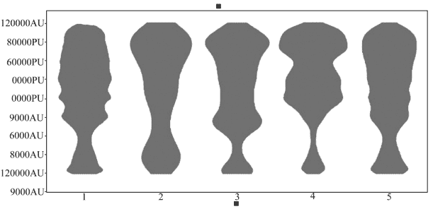

图 4-13 基于时段的犯罪类型分析

除此之外，还可以对日期和经纬度信息对犯罪类型进行分析，查看不同日期和地理信息的地点的各类犯罪的对比情况，从而使得警方对犯罪情况有一个更加深入的认识，如图 4-14 所示。

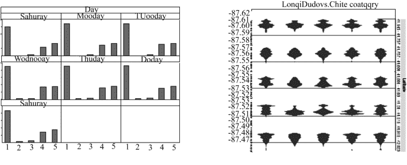

图 4-14 基于日期和经纬度的犯罪类型分析

通过上述的图形化分析，芝加哥警方对犯罪类型有了更加清晰的认识，具体如下：

（1）盗窃（包括抢劫和偷盗）是最为常见的犯罪，它们多发生在周五和周六；

（2）周二和周五是犯罪事件发生最多的两天；

（3）不同的区域对于犯罪类型也存在着一定的差异，如，抢劫是第 1 区域最为普遍的犯罪类型，而人身伤害则在第 4 区域发生最多；性骚扰在第 2 区域发生最多；毒品滥用则是在第 5 区域；其他犯罪则在第 1 区域发生最多；

（4）犯罪多发时间段为下午 3 点到 12 点，不同时间段也存在着犯罪类型的变化。

通过 JMP 灵活的图形化分析手段，芝加哥警方进行了快速的犯罪事件分析，很快就发现了犯罪事件的相关规律，为更好地进行犯罪事件的预防提供了保障。除了这些常规性的图形分析之外，JMP 还提供了基于六西格玛质量改善的全套工具，帮助警方能够快速识别犯罪类型及其原因，从而帮助芝加哥警方有效改善犯罪事件的发生，为创建一个更为安全的都市提供了极大的帮助。

## 第 5 章 大数据与智能航运

## 5.1 概述

### 5.1.1 智能航运

智能航运主要是指将传统的航运业和新一代的信息技术与人工智能相结合的新业态，将传统船舶与智能船舶相结合实现最大权益化、和谐相处的航运，旨在打造安全便捷高效绿色经济的航运。智能航运包括 5 个方面：船舶、港口、监管、应急和服务，如图 5-1 所示。

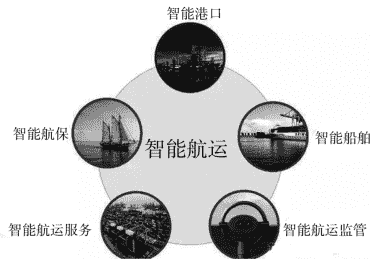

图 5-1 智能航运

### 5.1.2 航运大数据

航运大数据（Shipping Big Data）是将大量零散、动态的航运数据沉淀、搜集、整理、建模后形成多维基础大数据模型，利用大数据的处理、加工和展现方式，利用大数据的方法和思维，通过大数据服务和创新产品提升海运服务效率。

基于大量的船舶类型、航线、船期等数据，分析全球大宗商品的实时走向，可以了解全球各大港口的货物类型、囤积情况等。比如通过对全球运输大豆船舶的实时监控，如果发现南美即将进口的大豆出现压港，无法按期抵达中国，就能在第一时间推断国内大豆价格可能会出现上涨。“利用航运大数据，可以推算出船舶的活动情况、货物的流动情况以及港口的作业情况，能够对期货投资决策产生重要影响。”

未来智能航运的发展，需要完备的数据基础、完善的基础设施、航运大数据的人才以及先进的航运大数据分析技术，打破信息孤岛的现象，实现数据的互联互通，将航运业与物联网进行深度结合。大数据是智能航运的核心。

## 5.2 航运大数据的应用

### 5.2.1 航运数据

航运数据可以分成六类：地理数据、监测数据、统计数据、业务数据、文本数据、多媒体数据，如图 5-2 所示。这些数据都是有分图层的，比如坐标位置的或者带有矢量信息的，它不是很好的结构化数据。

图 5-2 航海数据分类

地理数据和监测数据对计算机来说容易理解，但是很难和商业业务（如统计数据和业务数据）挂钩。大数据时代下，可以使用技术手段把一个看上去跟业务不相关的数据转化为跟业务相关的数据，这样的过程就是数据结构化的过程。

在航运业应用大数据技术，实时数据、历史数据有其实用价值。比如通过计算航行计划、船舶航速、船舶排气、气象洋流方面等实时数据，能够为船长提供节能减排的经济航速建议；通过统计分析各个航道通过量，实时计算航道的拥挤情况，预警海事风险；分析市场工具、商品市场景气情况等实时数据，预测航运景气情况等。而融合实时和历史数据分析，挖掘业务及运营数据，还为企业提供预测市场淡旺季、订舱安排、生产计划预测以及风险管控成本和效益分析等服务。

## 5.2.2 大宗商品贸易跟踪

对大宗商品贸易商和期货投资者来说，矿石原油粮食等大宗商品的进口货量信息是市场研究和商业决策的关键数据。

与传统通过海关公开的数据获取渠道不同，近几年国际上开始出现通过基站、卫星等跟踪海运物流从而获取贸易数据的全新技术手段。与传统方式不同，通过大数据技术获取的货量数据是实时的，甚至可以对未来的货量做出精准预测，可以获取全球的全局数据，而颗粒度可以从国家细化到一个港口甚至一个泊位。

大宗商品的运输高度依赖海运。而海运是个高度国际化的行业，有统一的技术标准和法律体系。2002 年开始国际航行船舶开始逐步装配一种叫做船舶自动识别系统（AIS）的新装配，如图 5-3 所示。自动报告船舶身份和动态信息。通过岸基接收基站以及低轨道卫星就可以获取全球船舶实时 AIS 数据。

图 5-3　船舶自动识别系统（AIS）

通过对全球船舶 AIS 数据，连同船舶档案数据（见图 5-4）、港口资料（见图 5-5）、航线数据（见图 5-6）等多维度数据进行深度数据挖掘，即可完整地描述全球大宗商品贸易流情况，给出精确的货物进出口数据、海运在途货量数据、预到港货量数据等。

图 5-4　船舶实时位置

图 5-5　港口货物信息

图 5-6　铁矿石航线图

通过全球海运信息的监控，利用大数据挖掘技术获取的数据，可以帮助贸易商和期货投资者准确监测现货市场的走势，政策制定者可以通过数据即时跟踪宏观经济走势。

## 5.3 智慧港口

### 5.3.1 人工智能在码头无人驾驶设备中的应用

作为人工智能等技术在汽车领域、交通领域的延伸与应用，无人驾驶近几年在世界范围受到了密切关注。当前人工智能的主要细分技术，包括机器视觉、深度学习、GPU 等均在自动驾驶领域发挥着重要的作用。随着人工智能技术新一轮的发展浪潮，人工智能与港口集疏运设备的自动驾驶也愈加契合。

2018 年 1 月，西井科技与振华重工联合研发出一款无人跨运车，如图 5-7 所示，并成功在某码头完成了多次实际场景路测。该无人跨运车无须事先埋设磁钉，依靠人工智能技术，即可实现自主定位、自主导航的无人驾驶决策，不但可以自动规避障碍物，还可以做出减速、刹车或绕行等遭遇突发状况的各种决策。同时，无人跨运车可根据码头实际路况，自主规划出集装箱水平运输的最优驾驶线路。

在无人集装箱卡车方面，2018 年 1 月，西井科技与广东珠海港集团合作的全球首辆港口作业无人集装箱卡车正式亮相珠海港，如图 5-8 所示。根据事先的作业计划，这辆车“大脑”自主启动行驶程序，无人操控方向盘，识别着周围的集装箱、机械设备、灯塔等物体，精准驶入龙门吊作业指定位置。

图 5-7　无人跨运车

图 5-8　全球首辆无人集装箱卡车

### 5.3.2 人工智能在自主箱号识别技术中的应用

集装箱箱号是集装箱在整个港区装卸船、堆放、验残、出关等作业时流转的依据，对整个港口大数据流转、理货公正性等有着直接影响。由于集装箱的作业通常在露天环境，易受到港口所在地气候、光线条件等影响，且集装箱的箱号横竖排列不定、存在曲面、油漆脱落等情形，实现集装箱箱号快速、精准的识别成为技术难点。

人工智能的计算机视觉以及深度学习算法的突破，使机器在“看”这一认知能力上的加强。利用人工智能，可以实现箱号自主识别，提高箱号识别的效率和准确率，并可在此基础上进一步实现港区无人智慧闸口、无人智慧吊装等功能。2017 年 3 月 17 日，西井科技自主研发了一套类脑智能智慧港口系统 Well Ocean（一期：智慧理货）。该系统运用全球领先的神经形态学技术原理，自主研发的硬件和算法相结合，具有“自我学习，自我实时提高”的特点，通过机器学习，箱号识别准确率接近 100%。Well Ocean 系统实现基于人工智能实现的铅封识别、铅封/前后箱门自主识别等功能，如图 5-9，5-10 所示。

图 5-9　WellOcean 系统快速识别出前箱门

图 5-10　WellOcean 系统快速识别出后箱门和铅封

### 5.3.3 人工智能在智慧船舶配载中的应用

船舶配载是海上货物运输中的重要环节，集装箱船舶配载指在确保船舶适航性和经济性的前提下，根据船公司要求，按照一定装箱规则绘制预装船图，以便将集装箱合理地装于集装箱船舶上。集装箱船舶配载是一项复杂、全面、综合性强、技术含量高的工作，对操作人员综合素质的要求较高，其配载质量直接影响码头装卸作业效率和船舶的安全性能。

船舶配载和堆场运动是可以更具预测性的领域，人工智能技术可结合船舶的箱量分布、箱型比例、挂靠港等信息，以及实时的货物堆存信息、机械设备状态、班轮航线、泊位、货源等信息，利用人工智能算法，在预测的基础上，自动完成最优配载图，将货物安全、高效装船，帮助提升船舶有效积载。Well Ocean 系统，即时用人工智能技术来生成实时船图，如图 5-11 所示，实现自动确认装船集装箱 BAY 位，有效提高了生产效率。

图 5-11　实时 BAY 位船图系统

### 5.3.4 人工智能在码头智能调度中的应用

未来港口智能调度将借助物联网技术、人工智能等成果，结合实时的生产现场机械设备状态、泊位、车辆运输等相关数据，并与船舶行驶状态实时交互，通过预测，制定最优决策方案，实现信息系统指令与码头机械设备控制功能的无缝衔接；提高作业效率和准确率，保证生产过程的连续、协调、均衡和经济运行，以求实现生产效益的最大化。

2018 年 1 月，鹿特丹港务局（PoRA）和 IBM 宣布打造的“未来港口”，通过沿着码头的墙壁、系泊柱和道路从鹿特丹市到北海的 42 公里的陆地和海洋进行安装传感器，收集有关潮汐和潮流、温度、风速和风向、水位、泊位等数据，利用物联网和人工智能对这些数据进行分析，转化为鹿特丹港可用于制定决策的信息，以缩短等待时间，确定停靠、装载和卸载船舶的最佳时间。

### 5.3.5 人工智能在码头设备故障诊断中的应用

随着港口吞吐量的增加及集装箱船大型化的发展，港口机械设备越来越高端，出现的故障也越来越复杂。如果设备发生故障，对港口企业将带来不可估量的损失，因此，对机械故障进行准确诊断并及时采取应对措施是一项重要的任务。随着人工智能技术的发展以及相关领域学科研究的深入，智能故障诊断为提高复杂系统的可靠性开辟了新的途径。针对大型港机装备进行信号传感、布设、数据采集、联网传输和监测，通过机器学习等算法进行分析，可预测港机设备可能出现的问题，并对此做出反应，以减少和避免港口作业中断、安全事故的发生。

上海振华重工（集团）股份有限公司通过为设备安装“大脑”和“感知系统”，利用传感器、大数据、人工智能、云计算、3D 仿真等技术，已能基本实现港口装备的远程监测和诊断，为用户提供“4 级危害故障预警”等服务。

## 第 6 章 大数据在生物医学领域的应用

## 6.1 流行病预测

### 6.1.1 百度疾病预测

百度疾病预测（`http：//trends.baidu.com/disease`）就是具有代表性的互联网疾病预测服务，其基本原理是：流行病的发生和传播有一定的规律性，与气温变化、环境指数、人口流动等因素密切相关，每天网民在百度搜索大量流行病相关信息，汇聚起来就有了统计规律，经过一段时间的积累，可以形成一个个预测模型，预测未来疾病的活跃指数，如图 6-1 所示。

图 6-1　百度疾病预测模型

### 6.1.2 谷歌流感趋势（GFT）

谷歌公司发现，每年大约有 9000 万美国居民使用互联网来查询与自身相关的疾病、药物或者医院信息，而关于流行性感冒的搜索量可以及时地反映当时流感的现状；因此他们使用互联网搜索记录来即时预测美国疾控中心延迟发布的疑似流感病例占比。该研究利用 2003～2007 年这五年的流感数据做模型，其推论在 2008 年的测试数据中得到很好验证，如图 6-2 所示。之后很长一段时间的流感预测结果也与实际情况非常一致，至此，大数据在谷歌流感趋势（GFT）中的应用是成功的.此后十几年时间，该系统都能对流感准确预测。

图 6-2　流感发病率与 GFT 对比图测

## 6.2 智慧医疗

智慧医疗（smart health-care）指的是通过打造健康档案区域医疗资讯平台，利用最先进的物联网技术，实现患者与医务人员、医疗机构、医疗设备之间的互动。智慧医疗，是人工智能技术与医疗健康领域的不断融合加深。随着人工智能领域，语音交互、计算机视觉和认知计算等技术的逐渐成熟，人工智能的应用场景越发丰富，人工智能技术也逐渐成为影响医疗行业发展，提升医疗服务水平的重要因素。其应用技术主要包括：语音录入病历、医疗影像辅助诊断、药物研发、医疗机器人、个人健康大数据的智能分析等，如图 6-3 所示。

图 6-3　人工智能在医疗领域的应用

### 6.2.1 区域卫生系统

区域智慧医疗通过互联网、移动信息化、大数据分析和应用等技术，配合强大的运营流程体系，打造形成一整套完整高效的技术服务运营体系，包括：互联网医院、远程会诊中心、移动急救视频系统、居民健康管理中心、区域公共卫生系统等。这些系统环环相扣，通过整体运作，统一部署，大幅提升了医疗服务效率，同时降低医疗费用开支。

从 2006 年开始，我国各级政府积极建立省级、市级健康信息集成平台，通过建设居民电子健康档案和医院电子病历应用来实现全面医疗健康信息共享。医疗数据采集不再局限于医院内部，还包括社区卫生服务、私人诊所、实验中心等机构的病人数据与医疗机构病人临床信息。丰富多样的记录，为医院、科研人员以及医药公司提供了大量有效的数据支持，通过对医疗数据的分析，人类可以监控和改善公众健康，如预测流行疾病的爆发趋势、避免感染，慢性疾病的检测与管理等，还能让患者享受到更多的便利服务。

随着中国老龄化社会的到来，慢性病已经成为最主要的健康威胁。而医疗大数据的建立可以利用先进的信息化技术形成全民参与慢性病管理模式，提升慢性病管理的效率和质量，帮助人们更好地预防、检测慢性病。例如各种可穿戴的生理信号监测设备被研制开发出来，如图 6-4 所示，这种设备可以时刻监测用户的生理体征。基于手机的移动健康管理软件，可以实时记录用户的运动状态，血压，血糖，血氧，心率等信息，一旦发现异常就会报警。

图 6-4　可穿戴设备

四川省某医院联合成都社区卫生服务中心共同探索打造的糖尿病管理新模式——“社区糖管家”，结合四川慢病患者情况，利用大数据技术，制定的针对糖尿病的单病种个案管理，由该医院专科医生、社区全科医生、糖尿病个案管理师，通过面访与信息化相结合的方式，共同对患者进行全程管理。某糖尿病患者通过手机 APP 获取的血压，血糖等信息，被网络传输到社区卫生中心，社区卫生中心的健康管理师，通过分析数据对该患者进行饮食起居指导。“社区糖管家”自试行后，患者反馈良好。

### 6.2.2 智慧医院系统

医院的智能化系统是利用计算机、通信、自动控制等多项技术，结合医院的特点及功能需求，将医院建设成高效、舒适、安全的理想环境，提升医院的医疗服务水平。智慧医院智能化系统不但能减轻管理人员的劳动强度，更能提升就医患者的用户体验，最终达到节约成本增加收益的目的。

智慧医院系统由数字医院和提升应用两部分组成。数字医院包括医院信息系统（即 Hospital Information System，HIS）、实验室信息管理系统（Laboratory Information Management System，LIS）、医学影像信息的存储系统（Picture Archiving and Communication Systems，PACS）和传输系统以及医生工作站四个部分。实现病人诊疗信息和行政管理信息的收集、存储、处理、提取及数据交换。提升应用包括远程图像传输、海量数据计算处理等技术在数字医院建设过程的应用，实现医疗服务水平的提升。比如：远程探视，避免探访者与病患的直接接触，杜绝疾病蔓延，缩短恢复进程；远程会诊，支持优势医疗资源共享和跨地域优化配置；自动报警，对病患的生命体征数据进行监控，降低重症护理成本；临床决策系统，协助医生分析详尽的病历，为制定准确有效的治疗方案提供基础；智慧处方，分析患者过敏和用药史，反映药品产地批次等信息，有效记录和分析处方变更等信息，为慢性病治疗和保健提供参考。

如图 6-5 所示，某市人民医院“智慧医院”系统集成平台。该系统以电子病历为中心，电子病历用于记录医疗过程中生成的文字、符号、图表、图形、数据、影像等多种信息，并可实现信息的存储、管理、传输和重现，不仅可以记录个人的门诊、住院等医疗信息，还可以记录个人的健康信息，如免疫接种、健康查体、健康状态等。各类临床系统，是电子病历的信息源，它们以各自业务为中心来管理病人某一方面的信息。该系统是一个集成的框架，能够实现与多信息系统的集成。如门诊信息系统，通过入院注册时住院号与门诊号的唯一对应，实现在住院电子病历上查询门诊就诊信息；PACS 系统，医院所有医生均可查询放射报告与放射图像；LIS 集成，医生在检验系统中输入检验项目，就可以查询该病人按时间序列排序的所有检验报告。

图 6-5　智慧医院系统平台

### 6.2.3 家庭健康系统

家庭健康系统通过对健康生理数据采集、传输和分析，并通过可视化技术将健康状态分析结果实时展示给用户，还可依据健康指标的阈值，对潜在的健康问题进行预警，可让用户足不出户便知道自己的身体健康状况。

家庭健康系统是最贴近市民的健康保障，包括针对行动不便无法送往医院进行救治病患的视讯医疗，对慢性病以及老幼病患远程的照护，对智障、残疾、传染病等特殊人群的健康监测，还包括自动提示用药时间、服用禁忌、剩余药量等的智能服药系统。

## 6.3 生物大数据

### 6.3.1 生物信息学

生物信息学是研究生物信息的采集、处理、存储、传播、分析和解释等方面的学科，也是随着生命科学和计算机科学的迅猛发展、生命科学和计算机科学相结合形成的一门新学科，它通过综合利用生物学、计算机科学和信息技术，揭示大量而复杂的生物数据所蕴含的生物学奥秘。和互联网数据相比，生物信息学领域的数据更是典型的大数据。

生物大数据使得我们可以利用先进的数据科学知识，更加深入地了解生物学过程、作物表型、疾病致病基因等用大数据分析技术，可以从个人健康档案中有效预测个人健康趋势，并为其提供疾病预防建议，达到“治未病”的目的。

### 6.3.2 生物大数据的来源

生物大数据将主要来源于四个方面：研发数据、诊疗数据、患者的行为和感官数据和医保数据，如图 6-6 所示。

（1）研发数据主要指药企或科研机构进行研发获得的数据。包括药企从临床前、I－III 期临床、IV 期临床、上市后大量人群中进行疗效和副作用跟踪获得的数据；还包括最新的科研进展。

图 6-6　生物大数据的四个来源

（2）诊疗数据主要指患者在医院进行就医行为产生的数据。包括病历（电子病历），传统检测手段（生化、免疫、PCR 等）、新兴的检测手段（二代测序、基因芯片等）、医生的用药选择、诊疗路径记录等。

（3）患者的行为和感官数据指患者自身的、在院外的行为和感官所产生的数据。包括患者的家族病史、服药的依从性以及通过各种可穿戴设备、即时监控设备、智能手机采集到的疾病管理、健康管理数据；还包括患者在互联网上的一些网络行为产生的数据，例如寻医问药、与患友交流等。

（4）医保数据是指一切与付费方相关的审核记录、报销记录。包括参保人的病史、报销记录、药物经济学评价、同病种下人群诊疗路径比对等。

### 6.3.3 生物大数据应用广泛

生物大数据包罗信息多、价值大，若能有效挖掘，医药行业的每个参与方均有望从中受益，如图 6-7 所示。

（1）临床决策支持，“精准医疗”的实现依赖于生物大数据。“精准医疗”指针对同一种病、根据每个患者的不同情况采用不同的临床路径。其背后依赖于对各个患者多方面数据的积累，包括各种生物组学数据（基因组、蛋白组等）、患者病史、生活习惯、行为习惯等多方面，对比过往患病人群到相关数据，通过大数据分析，找出最优的治疗方案。这一理念的实现，依赖于生物大数据的积累以及后续对这些数据的挖掘。

（2）生物大数据可帮助患者更好地进行健康管理和疾病管理。健康管理和疾病管理在我国刚刚起步，考虑到人口老龄化、慢性病发病率升高、居民健康意识提升等多方面因素，未来是极有潜力的市场。大数据模式下的健康管理和疾病管理，通过收集对象的健康档案、疾病档案、生活状态、睡眠质量、心理表现等生理或心理方面的行为数据，进行分析、处理，监测该对象的身体状态，通过行为干预，帮助人们改善不合理的行为习惯，实现积极健康的生活方式。

图 6-7　生物大数据的受益方

### (3) 帮助提升药企研发效率
大数据可以从多方面提升医药行业的研发效率：①各种组学数据的积累，推动最上游基础科学的研究，包括了解疾病分子机理、开发新靶点、新技术等，下游产业研发受益于上游知识的进步；②药企临床研究过程中，通过大数据分析寻找最适宜的病人作为临床对象，提高药品应答率，节约不必要的时间、经费成本；③药品上市后，通过对产品在实际应用的大批量患者中的有效率和副反应率相关数据的积累和挖掘，反馈给研发管道上游，及早发现潜力项目。

### (4) 患者行为
患者行为通过互联网数字化和网络化，有效的数据挖掘对公共健康管理价值无限。互联网和移动端的普及，越来越多的患者开始通过网络寻医问药，搜索行为、购买行为、地域分布这些信息本身构成了新一维度的生物大数据。大型搜索平台如 google，已可以实现通过各地人群搜索行为本身进行流行病学预警；国内也有如阿里巴巴这样的企业通过终端过往购买行为、浏览行为的数据分析后进行精准营销。随着互联网逐渐渗透到医药行业的每个角落，积累数据的挖掘潜力值得期待。

## 6.3.4 “精准医疗”
“精准医疗”的核心是生物大数据分析，如图 6-8 所示。精准医疗和循证医疗的核心区别在于精准医疗是依据个体的生物大数据设计临床方案。传统的循证医学，是针对同一病种患病群体的大概率解决方案（循证医学在患同一病种的患者中进行试验，采用的是可以治疗大部分患者的解决方案并作为此类病种全部人群的标准解决方案），忽视每个病人的个体差异。个性化医疗或精准医疗的理念，是力求综合考虑每个患者的全部信息（目前对临床上有直接指导意义的是基因靶点信息，未来希望可以包括进含基因组蛋白质组在内的其他“组学”、患者的生活习性、过往病史、家族基因谱、甚至是最新的研发进展等多方面信息），综合分析以后提出解决方案。因此精准医疗得以实现的核心，在于积累患者各方面的生物大数据，还在于建立起这些生物大数据和疾病、疾病解决方案之间的联系。

图 6-8　精准医疗

## 6.4 基于大数据的线上线下医疗健康综合服务平台

### 6.4.1 服务平台的设计
构建覆盖全生命周期、内涵丰富、结构合理的以人为本的全面连续的综合健康服务体系，利用大数据技术和智能设备技术，提供线上线下相结合的公众健康服务，实现“未病先防、已病早治、既病防变、愈后防复”，满足社会公众多层次、多方位的健康服务需求，提升人民群众的身心健康水平。

线上线下综合医疗健康服务平台，如图 6-9 所示。通过健康云服务平台和互联网技术，对接现有的社会公共医疗卫生机构、医生以及普通市民，改变传统的医疗模式，减轻大医院的资源浪费，通过网络为患者提供完整全面的诊前、诊中、诊后诊疗服务，既节省了医疗资源，也降低了患者的看病成本。

图 6-9　基于大数据的线上线下综合医疗健康服务平台架构图

### 6.4.2 服务平台的功能实现
线上线下医疗健康综合服务平台建设主要实现的功能包括：

（1）通过建立线上线下综合医疗健康服务平台，实现专家、医生、社区、家庭的医疗服务的线上服务到线下服务的全方位连接。目前的医疗服务系统平台存在服务覆盖比较小，主要重点服务于医院或社区，并且重视信息管理方面的服务。对家庭的医疗、信息服务比较少，并且没有实现它们之间的有机结合。信息不对称，信息覆盖不全，不能满足高质量的医疗信息服务要求。此外，现有的网络医院也没有实现线上服务到线下服务的全方位连接。

（2）建立智能导诊平台。智能导诊平台区别于传统的导医服务，它采用大数据和人工智能技术为缺少就医信息的病患提供可靠、便捷、合适的就医信息服务，为病人选择最合适的医院和医生，实现病人分流分治。避免看病难、看病贵、小病大治、浪费宝贵的医疗资源。同时，病人也可避免被“假医导”诈骗。

（3）通过建立名医网上工作室，医生、护士网上工作室，为专家、医生和护士提供一个多点执业工作平台。医生和护士可以利用工作室平台利用自己的业余时间为病人提供更贴心的健康服务，也可以获得一定的报酬，增加个人收入，改变工资收入低的状态。必要时，还可由医生所在医院（或合作医院）、机构等提供线下服务。

（4）通过建立社区重点人员健康信息档案，实现独居老人、残障人员甚至吸毒人员等重点关注人员的健康信息跟踪和一对一的个性化医疗健康服务。通过建立家庭健康档案系统，实现对家庭成员健康状况的管理，保证家庭成员生活质量。此外，平台的运行需要以门户网站为依托。

### 6.4.3 未来展望
提高平台的移动服务的智能化程度也是未来发展的重要方向。手机 APP、移动网站、语音、短信等方式是实现现有功能服务延伸和扩展的重要形式，通过移动服务平台，可以提高医疗服务业务的实时性，用户可以获得更好的服务体验。线上线下综合医疗健康服务平台的服务模式是以个人用户体验为核心，构建了一个融“‘线上服务/线下服务’、‘自动智能服务/人工服务’、‘健康管理/咨询服务’”于一体的互动式智能型医疗健康服务平台，避免单家医院低效率运行以及重复投资建设，充分整合了各医院的资源，分流病患，分级就诊，减缓就医压力，让老百姓享受优质的医疗服务。平台通过沟通“线上”“线下”两个环节，可以实现医院导航、智能导诊、健康咨询等线上服务及送医、送药、保健等线下服务的连接。同样，线下服务也可以延伸到线上服务。此外，平台还可充分利用互联网及智慧医疗的建设成果引导居民更关注日常健康管理，改变长期以来以疾病管理为核心的健康和医疗管理思维。

# 下篇 应用实战篇

## 第 7 章 Python 概述
Python 是一种面向对象的、解释性的计算机程序设计语言，也是一种功能强大且完善的通用型语言，由荷兰人 Guido van Rossum 于 1989 年开始开发，至今有二十多年的发展历史，已经非常成熟稳定。它拥有非常简洁而清晰的语法特点，易于学习，几乎可以在所有的操作系统中运行，功能非常强大，可扩展性强，已逐渐成为最受欢迎的程序设计语言之一。

### 7.1 Python 的发展历程
Guido van Rossum 是 Python 编程语言的创始人，他在 1989 年的圣诞节期间，为了打发无聊，以当地马戏团为名，决心开发一种新的程序设计语言，并将这门新的语言命名为 Python，他希望这种语言既能够全面调用计算机的接口功能，又可以轻松地编程，让编程语言变得容易阅读，容易使用，容易记忆，容易学习，以此来激发人们学习编程的兴趣。于是，在 1991 年诞生了第一个 Python 编译器，它用 C 语言来实现，并能够调用 C 语言的库文件。

Python 语法很多来自 C 语言，但又受到 ABC 语言的强烈影响。Python 从一开始就特别在意可拓展性。Python 可以在多个层次上拓展。从高层上，用户可以直接引入`.py`文件。在底层，用户可以引用 C 语言的库。Python 就好像是使用钢构建房一样，先规定好大的框架，而用户可以在此框架下相当自由的拓展或更改。

Python 将许多机器层面上的细节隐藏，交给编译器处理，并凸显出逻辑层面的编程思考。让用户可以花更多的时间用于思考程序的逻辑，而不是具体的实现细节。这一特征吸引了广大的学习者，Python 开始流行。

### 7.2 Python 的优点
Python 语言具有诸多优点，是一种实际应用较为广泛的编程语言，具有优点如下：

1.免费
Python 的使用和分发是完全免费的，不管是用于个人还是商业用途，开发人员都无须支付任何费用，且不用担心版权问题。

作为开源软件，免费并不代表无支持，恰恰相反，Python 的在线社区对用户需求的响应和商业软件一样迅速。用户可以获得 Python 的源代码及无尽的文档资源，极大地提高了用户的开发实力。

2.简单易学
Python 的设计理念是：优雅、明确、简单，提倡用一种方法，最好是只用一种方法来做一件事，因此，Python 语言的语法简洁、代码易读。Python 中不强调数据类型，变量在使用之前也无须定义其数据类型，同一个变量还可以存储不同的数据类型，方便易学。国外的知名大学，如麻省理工学院、卡耐基梅隆大学早就开始使用 Python 语言来讲授编程基础等课程。

3.面向对象
从根本上讲，Python 是一种面向对象（OPP）的语言，它的类模块支持多态、运算符重载和多重继承等高级概念。事实上，即使不懂这些术语，仍会发现学习 Python 比学习其他面向对象语言要容易得多。

4.跨平台
Python 是用 C 语言实现的，C 语言因其跨平台及良好的可移植性，使其成了经典的程序设计语言。这意味着 Python 也具有良好的跨平台行，可在目前所有的主流平台上运行。如在 Windows 下编写的 Python 程序，可以轻松地在 Linux 等其他系统中运行。

5.功能强大
从特性的观点来看，Python 是一个混合体，它既属于脚本语言，也属于高级语言，因此，Python 既有脚本语言的简单、易用特性，也具有高级语言的强大功能，具体如下：

（1）动态数据类型：Python 在代码运行过程中随时跟踪对象的种类，不需要在代码中关于复杂的类型和大小的声明。

（2）自动内存管理：Python 用户无需关系内存的使用和管理，Python 可以自动分配和回收内存。

（3）大型程序支持：为了能够建立更大规模的系统，Python 包含了模块、类和异常工具，允许应用于大型程序开发。

（4）内置数据结构：Python 提供了常用数据结构支持，如：列表、字典、字符串等都属于 Python 内置对象，它们可以根据需求扩展收缩，灵活易用。

（5）内置库：Python 提供了丰富的标准库，从正则表达式匹配到网络都支持。

（6）第三方工具集成：Python 很容易集成第三方工具，通过扩展包将其应用到各种不同领域。

6.使用简单
运行 Python 程序，不需要像其他语言经历编译和链接等中间步骤。Python 提供了简洁的语法和强大的内置工具，编写实现相同功能的程序，用 Python 比采用 C，C＋＋编写的程序更为简单、小巧、灵活。

### 7.3 Python 的应用领域
作为一门优秀的程序设计语言，Python 被广泛地应用于各种领域，从文本、图像处理到网站开发，甚至航天领域都可以找到 Python 的身影。

1.系统编程
Python 可以访问操作系统`API`，为其编写可移植的系统维护和管理工具。Python 程序可以访问系统目录和文件，可以运行其他程序，也可以用进程或线程进行并行处理。

Python 的标准库绑定了`POSIX`（可移植操作系统接口）以及其他常规操作系统工具：环境变量、文件、进程、多线程、正则表达式模式匹配、命令行参数、标准流接口、文件扩展名等。大部分系统工具继承了 Python 的可移植性。

2.科学与数学计算
Python 被广泛应用于科学和数学计算中，Python 中的`Num Py`提供了大量的标准数学库的接口，`SciPy`和`Matplotlib`扩展工具也为 Python 提供了快速数组处理、数值运算及绘图功能。这些扩展库使 Python 更适用于工程技术、科研试验数据处理、图表处理，甚至开发科学计算应用程序。

相比于流行的计算商业软件`MATLAB`，Python 是完全免费的，`MATLAB`主要专注于工程和科学计算，而 Python 通过各种扩展库，可以在满足计算的同时，实现文件管理、界面设计、网络通信等高级任务。

3.数据库编程
Python 提供了所有主流的数据库接口，包括`MySQL`、`Oracle`、`ODBC`、`SQLite`等，Python 还自带了一个`Gadfly`模块，提供了完整的 SQL 环境。

4.组件集成
Python 被称为胶水语言，既可集成各种`C/C＋＋`库，也可以将 Python 嵌入到其他语言中。

5.Web 应用
Python 包含了标准的 Internet 模块，可用于实现各种网络任务。如 Python 可通过`URL`获取网页，可从网页中解析`HTML`和`XML`，可生成、解析和分析`XML`文件，可处理`Email`，可通过`XML－PRC`、`SOAP`和`Telnet`通信等。

6.游戏、多媒体、人工智能、机器人等
（1）可利用`Pygame`扩展包进行图形和游戏应用开发。
（2）可利用`Py OpenGI`模块开发 3D 应用。
（3）可利用`Py Ro`工具包进行机器人控制编程。
（4）可利用`Py Brain`扩展包来开发人工智能应用。

7.企业、政务及教学辅助的应用
目前，全球已经有很多公司采用 Python 进行企业级的软件开发和应用，同时，通过 Python 技术，也成功地实现了许多政务应用。此外，Python 可以应用在教学活动中，利用 Python 语言设计的教学辅助工具可以完成教学工作中重复性的工作，提高工作效率。

### 7.4 Python 编程环境
Python 是一种跨平台的编程语言，这意味着它能够在所有主流的操作系统中运行。在所有安装了 Python 的现代计算机上，都能够运行你编写的任何 Python 程序，然而在不同的操作系统中，安装 Python 的方法存在细微的差别。

#### 7.4.1 Python 的下载和安装
目前，Python 有两个版本，一个是 2.x 版，一个是 3.x 版，这两个版本是不兼容的。由于 3.x 版越来越普及，我们的教程将以最新的 Python 3.7 版本为基础。可以从 Python 官方网站下载 Python 安装程序和源代码，在 Windows7 中下载、安装 Python 的具体操作步骤如下：

（1）从 Python 官方网站下载 Python 安装程序，下载地址为：Windows：`https://www.python.org/downloads/windows/`，找到 Python 3.7.0 的安装包，如果 Windows 版本是 32 位的，则单击“Windows x86 executable installer”版本，然后下载。如果 Windows 版本是 64 位的，则单击“Windows x86-64 executable installer”版本，然后下载，如图 7-1 所示。

图 7-1　python3.7.0 下载

（2）下载完成后，双击运行所下载的文件运行`Python-3.7.0.exe`，启动 Python 安装向导，此时会弹出一个 Python 安装向导的窗口。勾上“Add Python 3.7 to `PATH`”，然后单击“Customize installation”按钮，如图 7-2 所示。

图 7-2　Python 安装向导

（3）单击 Customize installation 选项后，打开图 7-3 所示对话框，默认选择，单击“Next”按钮。在弹出的窗口中可以修改安装路径，如图 7-4 所示，然后单击“Install”执行安装。

图 7-3　选择 Python 工具

图 7-4　选择 Python 高级选项

（4）等待安装完之后，会弹出安装成功的窗口，如图 7-5 所示。

图 7-5　完成安装

（5）安装完成后，打开命令提示符窗口，敲入`python`后，出现如图 7-6 所示情况即代表 python 已安装成功。

图 7-6　打开命令提示窗口

#### 7.4.2 PyCharm 下载安装和使用
`PyCharm`是由 JetBrains 打造的一款 Python IDE，带有一整套可以帮助 Python 开发者提高工作效率的工具，比如调试、语法高亮、Project 管理、代码跳转、智能提示、自动完成、单元测试、版本控制。

`PyCharm`还提供了一些高级功能，以用于支持`Django`框架下的专业 Web 开发。还提供了一些很好的功能用于`Django`开发，同时支持 Google App Engine，并且`PyCharm`支持`IronPython`。这些功能在先进代码分析程序的支持下，使`PyCharm`成为 Python 专业开发人员和刚起步人员使用的有力工具。

`PyCharm`可以跨平台使用，分为社区版和专业版，其中社区版是免费的，专业版是付费的，对于初学者来说两者差距不大。在使用之前需安装`PyCharm`，具体安装步骤如下。

（1）打开`PyCharm`官网（`https://www.jetbrains.com/pycharm`），单击“DOWNLOAD NOW”位置。选择 Windows 系统的社区版，单击“DOWNLOAD”键即可进行下载，如图 7-7 所示。

图 7-7　`PyCharm`下载

（2）下载完成后，双击安装包进行安装，单击“Next”按钮。自定义软件安装路径，建议不要使用中文字符，`Pycharm`需要的内存较多，建议将其安装在 D 盘或者 E 盘，不建议放在系统盘 C 盘。单击“Next”按钮，如图 7-8、7-9 所示。

图 7-8　`PyCharm`安装界面

图 7-9　`PyCharm`路径选择

（3）在图 7-9 所示窗口中单击“Next”按钮，根据自己电脑的系统选择位数，创建桌面快捷方式并关联`.py`文件，单击“Next”按钮，如图 7-10 所示。

图 7-10　`PyCharm`安装选项

（4）单击“Install”按钮默认安装。安装完成后，单击“Finsh”按钮，如图 7-11 所示。

图 7-11　安装完成

### 7.5 课后练习
一、选择题

1.下列选项中，不属于 Python 语言特点的是（）。

A.简单易学

B.开源

C.面向过程

D.可移植性

## 选择题

### 2.下列关于 Python 的说法中，错误的是（）。

A.`Python`是从`ABC`发展起来的
B.`Python`源程序需编译和连接后才可生成可执行文件
C.`Python`是开源的，它可以被移植到许多平台上
D.`Python`是一门高级的计算机语言

### 3.下列领域中，（）不是`Python`的主要应用领域。

A.Web 应用开发
B.科学计算
C.操作系统管理
D.3D 游戏开发

### 4.`Python`源程序文件的扩展名为（）。

A..exe
B..txt
C..py
D..obj

### 5.`Python`中的单行注释是以（）开始。

A.`＃`
B.`//`
C.`”””`
D.`‘‘’`

## 二、简答题

### 1.简述在 Windows 环境下搭建`Python`开发环境的方法。

### 2.简述`Python`的特点。

### 3.简述`Python`的应用领域。

## 三、编程题

### 1.编写程序，输出如下语句。

这是我的第一个`Python`程序！

### 2.编写程序，输出如下语句。

`∗∗∗∗∗∗∗∗∗∗∗∗∗∗∗∗∗∗∗∗∗∗∗∗∗∗∗∗∗∗∗∗`

这是我的第二个`Python`程序！

`∗∗∗∗∗∗∗∗∗∗∗∗∗∗∗∗∗∗∗∗∗∗∗∗∗∗∗∗∗`

## 第 8 章 Python 语法基础

## 8.1 Python 程序基本结构

### 8.1.1 标识符与关键字

标识符是计算机语言中允许作为名称的有效字符串集合，`Python`标识符字符串规则和其他大部分用 C 编写的高级语言类型，有以下规则：
1.名字必须以字母或者下划线开始，数字不能作为首字符。当名字包含多个单词时，可以使用下划线来连接。
2.除了首字符，名称可以包含任何字母、数字和下划线组合。
（1）在`Python`里，标识符由字母、数字、下划线组成。
（2）在`Python`中，所有标识符可以包括英文、数字以及下划线`\_\_`，但不能以数字开头。
3.`Python`中的标识符是区分大小写的。
4.以下划线开头的标识符是有特殊意义的。以单下划线开头（`\_\_foo`）的代表不能直接访问的类属性，需通过类提供的接口进行访问，不能用`from xxx import *`而导入。
以双下划线开头的（`\_\_foo`）代表类的私有成员，以双下划线开头和结尾的（`\_\_foo\_\_`）代表`Python`里特殊方法专用的标识，如`\_\_init\_\_()`代表类的构造函数。

关键字是`Python`中的特殊单词，不能用来作为标识符的名称，也就是`Python`中的标识符不能与`Python`的关键字同名，关键字如表 8-1 所示。

表 8-1 Python 的关键字

### 8.1.2 Python 中的代码注释

代码注释是为程序添加说明性文字，`Python`注释有单行和多行注释。`Python`在运行程序时，会自动忽略被注释的内容。

单行注释以`＃`开头，`＃`之后的内容不会被执行，例如：

多行注释是用三个英文的单引号`'''`或双引号`"""`作为注释的开始和结束符号，例如：

### 8.1.3 Python 中的缩进

`Python`与其他编程语言不同之处在于，其用缩进来表示代码块，也就是键盘上的 Tab 键，而不是`{}`，同一个代码块语句必须保持相同缩进数。缩进的空白数量是可变的，但是所有代码块语句必须包含相同的缩进空白数量，这个必须严格执行，例如：

以下代码执行将会报错：

错误提示如下：

错误表明，使用的缩进方式不一致，有的是 tab 键缩进，有的是空格缩进，改为一致即可。因此，在`Python`的代码块中必须使用相同数目的行首缩进空格数。在每个缩进层次使用单个制表符或两个空格或四个空格，切记不能混用。

### 8.1.4 Python 中语句换行

通常，`Python`中的一条语句占一行，没有 Java 中的分号等语句结束符号，在遇到较长的语句时，使用斜杠`\\`将一行的语句分为多行显示，如下所示：

## 8.2 Integral 类型

`Python`在声明变量时不需要设置变量类型，但它还是有基础数据类型的。`Python`提供了两种内置的`Integral`类型：`int`与`bool`，即整型与布尔型。

### 8.2.1 整数类型

在`Python`中整数类型被指定为`int`类型，整数类型对应于数学中的整数概念。可以执行的运算有`＋`、`－`、`*`、`/ `，以及一些其他操作。

所有常见的数学函数与运算符都可以用于整数，如表 8-2 所示。有些功能由内置函数提供，比如`abs()`函数。`abs(i)`可以返回整数`i`的绝对值。有些功能由`int`运算符提供。

表 8-2 数值运算符与函数

### 8.2.2 布尔型

布尔类型已成为`Python`的一种正式的数据类型。布尔类型有两个值`True`和`False`，分别用于表示逻辑真和逻辑假，`True`和`False`是两个预定义的内部变量。从面向对象的角度看，布尔类型是`int`类型的子类，`True`和`False`是布尔类型的实例。用于计算时，`True`对应的整数是 1，`False`对应的整数是 0。

## 8.3 浮点类型

### 8.3.1 浮点数

浮点型用来处理实数，即带有小数的数字。`Python`的浮点型相当于 C 语言的双精度浮点型。实数有两种表示形式，一种是十进制数形式，由数字和小数点组成，并且这里的小数点是不可缺的，如`2.32`，`105.3`等；另一种是指数形式，如`56e3`、`56E3`表示的是`56×10³`，字母`e`（`E`）之前必须有数字。字母`e`（`E`）之后可以有正负号，用来表示指数的符号，如果没有则表示正号；此外，指数必须为整数。浮点数代表实数，但只是近似值。例如：`2.0/3.0`的运算结果是一个无限值，但计算机的内存量有限，因此实数只能表示真实值的近似值。

### 8.3.2 复数

复数是由实数部分和虚数部分组成，一般的形式为`x＋yj`，其中`x`是复数的实数部分，`y`是虚数部分，这里的`x`和`y`都是实数。例如：`2＋3j`，`0.5j`，`3＋0j`等。可以用`complex`函数来创建复数。

复数数据类型可以作为函数进行调用。不给定参数进行调用则返回`0j`，指定一个复数参数时，会返回该参数的拷贝；对其他任意参数，则尝试将其转换为一个复数。用于转换时，`complex()`接受的是一个字符串参数或者 1 至 2 个浮点数，如果只给定一个浮点数，那么虚数部分被认为是 0。

## 8.4 运算符

`Python`常用运算符有算术运算符、赋值运算符、比较运算符、逻辑运算符、位运算符。算术运算符一般会返回一个数，而比较和逻辑运算符会返回布尔值`True`或`False`。位运算符是把数字看作二进制来进行计算的。身份运算符用于比较两个对象的存储单元。

表 8-3、8-4、8-5、8-6、8-7、8-8、8-9 分别展示了算术运算符、赋值运算符、比较运算符、逻辑运算符、位运算符、成员运算符和身运算符的描述及实例。

表 8-3 算术运算符

表 8-4 赋值运算符

表 8-5 比较运算符

（续表）

表 8-6 逻辑运算符

表 8-7 变量中`a`为 60，`b`为 13。

表 8-7 位运算符

（续表）

以下实例演示了`Python`所有位运算符的操作：

以上实例输出结果：

除了以上的一些运算符之外，`Python`还支持成员运算符、身份运算符。

表 8-8 成员运算符

身份运算符用于比较两个对象的存储单元。

表 8-9 身份运算符

`Python`语言支持以上类型的运算符，运算符间具有优先级，表 8-10 列出了从最高到最低优先级的所有运算符。

表 8-10 运算符优先级

## 8.5 字符串

字符串是一种有序的字符集合，用于表示文本数据，是`Python`中最常用的数据类型。字符串中的字符可以是 ASCII 字符、各种符合一级各种 Unicode 字符。严格意义上，字符串属于不可变数据类型，就是不能直接修改字符串（即不能原处修改）。字符串中的字符按照从左到右的顺序，支持索引、分片等操作。

### 8.5.1 字符串创建

创建字符串很简单，只要为变量分配一个值即可，可用单引号，双引号，3 个单引号或 3 个双引号表示，例如：

### 8.5.2 转义字符

转义字符用于表示一些不能直接输入的特殊符号。`Python`常用转义字符如表 8-11 所示。

表 8-11 常用转义字符

### 8.5.3 字符串基本操作

1.求字符串长度
字符串长度指字符串中包含的字符个数，可用`len`函数获得字符串长度。例如：

2.包含性判断
字符串为字符的有序集合，所以可用`in`操作符判断字符串的包含关系。例如：

3.字符串连接
字符串连接是把多个字符串按照顺序合并成一个新的字符串。例如：

4.字符串迭代
可用`for`循环迭代处理字符串。例如：

5.索引和分片
字符串作为一个有序的集合，其中的每个字符都可以通过偏移量进行索引或者分片。字符串中字符按从左到右的顺序，其偏移量一次为 0，1，2，……，`len－1`（最后一个字符偏移量为长度减 1）；按从左到右的顺序，偏移量取负值，依次为`－len`，……，`－2`，`－1`。

索引是通过偏移量来获得字符串中的单个字符。例如：

分片是利用范围从字符串中获得连续地多个字符（即子字符串）。分片的基本格式如下：

表示返回变量`x`引用的字符串中从偏移量`start`开始，到偏移量`end`之前（不包含偏移量`end`对应的字符）的子字符串。`start`和`end`参数均可省略，`start`默认为 0，`end`默认为字符串长度。例如：

### 8.5.4 字符串方法

字符串作为`str`类型对象，`Python`提供了一系列方法用于字符串处理，常用字符串方法说明如表 8-12 所示。

表 8-12 字符串方法说明

（续表）

### 8.5.5 字符串输出

`Python`支持格式化字符串的输出。尽管这样可能会用到非常复杂的表达式，但最基本的用法是将一个值插入到一个有字符串格式符`%s`的字符串中。例如：

### 8.5.6 控制台输入及输出

`Python`利用内置函数`input()`来实现标准键盘输入。`input()`以字符串的方式获取用户输入，可以接收一行文本，并将返回该文本。例如：

`Python`利用内置函数`print()`来实现标准输出。在`Python`中，输出格式化使用与 C 中`sprintf`函数一样的语法。例如：

## 8.6 课后练习

### 一、选择题

1.下列可作为`Python`变量名的是（）。
A.`1name`
B.`name_1`
C.`break`
D.`a*plv`

2.在`Python 3`中，下列输出变量`a`的正确写法是（）。
A.`print a`
B.`print(a)`
C.`print＂a＂`
D.`print(＂a＂)`

3.设`a＝1`，`b＝2`，`c＝3`，`d＝4`，表达式`a＞b and c＜＝d or 2∗a＞c`的值是（）。
A.`False`
B.`True`
C.`－1`
D.`1`

4.假设`A＝3`，`B＝5`，`C＝2`，则表达式`not（B＜C）and A＞C`的值是（）。
A.`True`
B.`False`
C.表达式错误
D.不确定的

5.假设`X＝3`，`Y＝5`，`Z＝2`，则表达式`（X²＋Y）/Z`的值是（）。
A.`1`
B.`5`
C.`3`
D.`2.0`

### 二、填空题

1.`Python`变量名中可以包括`\_\_\_\_\_\_\_\_\_\_\_`、`\_\_\_\_\_\_\_\_\_\_\_`和`\_\_\_\_\_\_\_\_\_\_\_`，但是不能以`\_\_\_\_\_\_\_\_\_\_\_`开头。
2.在`Python`中查看关键字，需要在`Python`解释器中执行`\_\_\_\_\_\_\_\_\_\_`和`\_\_\_\_\_\_\_\_\_\_\_`这两条命令。
3.数学式`3＋（a＋b）2`对应的`Python`表达式是`\_\_\_\_\_\_\_\_\_\_\_`。
4.表达式`\[（x＋y）＋z\]X360－50（c＋d）`有错误，其正确的形式是`\_\_\_\_\_\_\_\_\_\_\_`。
5.下面语句的输出结果是`\_\_\_\_\_\_\_\_\_\_`。

6.`13　&9`的结果是`\_\_\_\_\_\_\_\_\_\_`。
7.在表达式`“x，y，z＝1，hello＇，＇python，＇”`中变量`z`的值是`\_\_\_\_\_\_\_\_\_\_\_`。

### 三、编程题

1.编写程序，实现输入用户姓名、年龄和地址，然后使用`print()`函数输出。
2.编写程序，实现从键盘输入某商品的单价和数量，求出商品的总价并输出。

### 四、问答题

1.请列出`Python`中的比较运算符，至少 4 个，并简述它们的意思。
2.请列出`“2＞3 or 18！＝16”`这个表达式的输出结果，并简述它们的意思。

## 第 9 章 Python 常用语句

人们利用计算机解决问题，必须预先将问题转化为计算机语句描述的解题步骤，即程序。计算机程序一般分为三种基本结构：顺序结构、选择结构以及循环结构。利用这三种基本结构，可以编写出各种复杂的应用程序。

## 9.1 顺序语句

顺序结构是程序设计中最基本的结构。在该结构中，各语句按照出现的先后次序从上到下依次执行，其执行流程如图 9-1 所示。顺序结构是任何程序的主体结构。如果将选择结构和循环结构看作一个整体，从宏观上，所有的程序都可以看作是顺序结构。在`Python`中，组成顺序结构的语句通常包含数据输入语句、数据处理语句以及数据输出语句等。

图 9-1 顺序结构执行流程图

# 【例 9-1】计算矩形的面积：由用户输入矩形的宽和长，计算矩形的面积并输出结果。程序运行的结果如下：

请输入矩形的宽：7

请输入矩形的长：9

矩形的面积是　63

## 说明

### （1）`input（）`函数

Python 提供了内置函数`input（）`从标准输入设备读入数据，默认的标准输入设备是键盘。`input（）`函数的基本格式为：

说明：`input`函数里的提示字符串是可选项，如果有提示字符串，则运行时原样显示。该函数接收控制台输入，返回输入的字符串。如下代码：

该行代码运行后会先显示“please input your name：”，然后等待用户输入，此时，若用户输入“Lily”，则会把“Lily”赋值给`name`。`name`的类型为字符串类型。

如果要得到数值型数据，可以使用类型转换函数将字符串转换为数值。比如例 9-1 的第一行代码：

该行代码运行后会先显示“请输入矩形的宽：”，然后等待用户输入，此时，若用户输入“20”，则首先`input（）`函数接收到的是字符串“20”，接着`int（）`函数再将字符串“20”转换成整型数值 20，最后再把整型数值 20 赋值给`width`。例 9-1 中在第二行代码以同样的方法得到矩形的长`length`的值之后，程序执行第三行代码求出计算矩形的面积`area`。

### （2）`print（）`函数

Python 提供了内置函数`print（）`来实现标准输出。`print`函数的一般形式为：

说明：输出项之间用逗号分隔，没有输出项时输出一个空行。`sep`表示输出时各输出项之间的分隔符（默认分隔符是空格），`end`表示输出时的结束符（默认以回车换行结束）。

以上程序第一行代码实现了将 3 赋值给`x`，将 5 赋值给`y`，接着四条`print`语句实现了输出。具体输出结果如下：

在实际应用中，经常需要将数据按照一定格式输出。在 Python 中格式化输出时，采用`%`分隔格式控制字符串与输出项，一般格式为：

格式控制字符串`%`（输出项 1，输出项 2，…，输出项 n）

以上代码的输出如下：

其中，以上程序第三行代码中“my name is%s and age is%d”属于格式化字符串，该格式化字符串中包含一个“`%s`”占位符和一个“`%d`”占位符，它们依次会被后面圆括号中的第一个输出项`name`的值“Lily”和第二个输出项`age`的值“18”代替。`%s`表示以字符串形式输出，`%d`表示以十进制整数输出。对于不同类型数据的输出，Python 采用不同的格式说明符描述。常见的格式说明见表 9-1。

表 9-1　`print（）`的格式说明符

另外，在 python 中还有其他的格式化输出方式，比如也可以使用`str.format（）`函数来格式化输出值。因篇幅原因，在此不详细展开阐述。

## 9.2　选择语句

在实际应用中，有很多情况需要根据给定的条件做出不同的选择，执行不同的操作。我们可以使用选择结构来处理此类问题。在 Python 中，选择结构根据程序分支的数目，分为单分支结构、双分支结构和多分支结构，分别用`if`语句、`if…else…`语句和`if…elif…else…`语句来实现。接下来将分别对它们进行详细讲解。

### 9.2.1　`if`语句

`if`语句是最简单的条件判断语句，表示选择结构中只有一个分支，只有满足给定的条件才能执行该分支的语句。`if`语句的语法格式如下：

其中，首先计算“条件表达式”的值，如果值为 True，则执行冒号下面的语句块；如果值为 False，则不执行冒号下面的语句块。其流程图如图 9-2 所示。

图 9-2　单分支结构流程图

说明：

（1）`if`语句中，条件表达式后面要使用冒号“：”。

（2）语法格式中的条件表达式，可以为关系表达式、逻辑表达式或算术表达式。如果是算术表达式，则非 0 值表示 True，0 表示 False。

（3）语法格式中的语句块，可以是一条或者多条语句。如果是多条语句，这些语句必须保持相同的缩进数；如果是一条语句，也可以将该语句与`if`写在同一行中。

【例 9-2】编程实现：用户输入一个整数，如果该整数是 7 的倍数，则输出“该数能被 7 整除”。

程序第一次运行的结果如下：

程序第二次运行的结果如下：

【例 9-3】输入两个数`a`、`b`，如果`a`小于`b`，则交换两数。

程序的运行结果如下：

### 9.2.2　`if…else…`语句

双分支结构表示选择结构中有两个分支，当满足给定的条件时，执行分支 1，否则执行分支 2。双分支结构`if…else…`语句的语法格式如下：

其中，首先计算“条件表达式”的值，如果值为 True，则执行语句块 1；如果值为 False，则执行语句块 2。其流程图如图 9-3 所示。

图 9-3　双分支结构流程图

【例 9-4】编写程序实现判断一个整数的奇偶性。

程序第一次运行的结果：

程序第二次运行的结果：

【例 9-5】输入两个数`a`、`b`，求两数中的最大值。

程序运行的结果如下：

### 9.2.3　`if…elif…else…`语句

在开发程序时，经常会遇到需要针对某一事件的多种情况进行处理，这时我们可以使用多分支结构`if…elif…else…`语句。`if…elif…else…`语句的语法格式如下：

其中，首先计算“条件表达式 1”的值，如果值为 True，则执行语句块 1，且执行完后结束整个多分支语句结构；如果值为 False，则接着计算“条件表达式 2”的值；如果“条件表达式 2”的值为 True，则执行语句块 2，且执行完后结束整个多分支语句结构；如果“条件表达式 2”的值为 False，则接着计算“条件表达式 3”的值……；依次类推，如果“条件表达式 n”的值为 True，则执行语句块 n，且执行完后结束整个多分支语句结构；如果“条件表达式 n”的值为 False，则执行`else`下面的语句块 n＋1。其流程图如图 9-4 所示。

图 9-4　多分支结构流程图

说明：

（1）无论有多少个分支，程序一旦执行了某一个分支后则退出整个`if…elif…else…`语句，其余分支不再执行。

（2）`elif`子句的数量没有限制，可以根据需要使用任意多个`elif`子句。

（3）在某些情况下，可能有多个条件表达式的值都为 True，但只执行第一个条件表达式为 True 所对应的语句块，执行后就退出整个`if…elif…else…`语句。

【例 9-6】输入学生的百分比成绩，判断其等级。等级判定规则：90 分～100 分为“优秀”，80 分～89 分为“良好”，70 分～79 分为“中等”，60 分～69 分为“及格”，0 分～59 分为“不及格”。

程序运行时，根据用户输入的分数不同，将得到不同的结果。比如用户输入 78，则运行结果如下：

说明：程序中设置条件表达式“80 分～89 分为良好”时，只限定了“`score`＞＝80”，而没有限定“`score`＜90”，主要是因为如果程序执行到该处，则说明第一个条件表达式“`score`＞＝90”的值为 False。如果“`score`＞＝90”表达式的值为 False，则`score`值必然是小于 90 分，所以此处不需要写成“80＜＝`score`＜90”。

### 9.2.4　选择嵌套

在一个选择结构的语句块中包含另外一个选择结构，称为选择结构的嵌套。选择结构的嵌套可以是同一种结构的嵌套，也可以是不同结构之间的嵌套。比如双分支`if…else…`语句中的`if`分支和`else`分支中可以完整地嵌套另一个单分支`if`语句、双分支`if…else…`语句或者多分支语句`if…elif…else…`语句，同样嵌套的语句里又可以再嵌套这些分支语句。这里举一种常见的嵌套格式为例，其语句形式如下：

其中，首先计算“条件表达式 1”的值，如果“条件表达式 1”的值为 True，则继续判断“条件表达式 2”的值；如果“条件表达式 1”的值为 False，则继续判断“条件表达式 3”的值。

说明：

（1）在使用嵌套的选择结构时，内层的选择结构只能处于外层选择结构某个“语句块”的位置，内外层的选择结构不允许交叉。

（2）同一层的选择结构具有相同的缩进数。

【例 9-7】输入一个整数，判断该整数能否同时被 5 和 7 整除，还是只能被 5 或者只能被 7 整除，还是既不能被 5 也不能被 7 整除。

程序的运行结果一：

程序的运行结果二：

程序的运行结果三：

程序的运行结果四：

【例 9-8】输入 3 条线段长度，判断这 3 条线段能否构成三角形，如果可以构成三角形，进一步判断是否是直角三角形。

程序的运行结果一：

程序的运行结果二：

程序的运行结果三：

## 9.3　循环语句

在实际应用中，我们也经常遇到需要重复处理的问题，如果仅仅使用之前介绍的顺序结构或者选择结构，则会使程序显得冗长、繁琐、有时候甚至难以实现。循环结构用来重复执行一条或多条语句，使用循环结构可以减少源程序重复书写的工作量，简化程序结构。在 Python 中，循环结构的流程控制语句主要有`while`语句和`for`语句，下面将对这两者进行详细的讲解。

### 9.3.1　`while`循环

`while`循环语句在条件表达式的值为真时，重复执行一段代码。`while`语句的一般语法格式如下：

`while`语句的执行步骤：

（1）计算条件表达式的值；

（2）当条件表达式的值为真时，循环条件成立，执行循环语句块，然后继续步骤（1）；

（3）当条件表达式的值为假时，循环条件不成立，不执行循环语句块，执行`while`语句的后续代码。

`while`语句的循环流程图如图 9-5 所示。

图 9-5　`while`循环流程图

说明：

（1）当循环语句块中只有一条语句时，与`if`语句的语法类似，可以将该语句与`while`写在同一行中。

（2）当循环语句块由多条语句构成时，必须用缩进对齐的方式组成一个语句块来分隔子句，否则会产生错误。

（3）如果条件表达式的值永远为真，则循环将会无限循环下去。

【例 9-9】输出 1～100 这 100 个整数。

程序的运行结果如下：

【例 9-10】利用`while`语句求 1＋2＋3＋…＋100 的和。

程序的运行结果如下：

【例 9-11】编程实现拉兹猜想。拉兹猜想，又称“3n＋1 猜想”、“奇偶归一猜想”，是指对于每一个正整数，如果它是奇数，则对它乘 3 再加 1，如果它是偶数，则对它除以 2，如此循环，最终都能够得到 1。

程序运行的结果如下：

### 9.3.2　`for`循环

`for`语句是使用较广泛的一种循环控制结构，可用于遍历可迭代对象中的元素。`for`语句的一般格式为：

`for`语句的执行过程是：将可迭代对象中的元素逐个赋值给变量，对每一次赋值都执行一遍循环语句块。当可迭代对象中的每个元素都被遍历过，则结束循环。`for`语句的执行流程图如图 9-6 所示。

图 9-6　`for`语句循环流程图

# 9.3 循环语句

## 9.3.2 for 语句与可迭代对象

可迭代对象可以是列表。

### 例 9-12 用 for 语句遍历列表

程序的运行结果如下：

说明：

`num_list`是一个列表（“`list`”），列表是 python 的数据类型之一，在下一章会详细介绍。在例 9-12 中，列表中有 6 个元素，`for`语句的执行过程是：将列表中的元素 6，3，4，5，1，9 依次逐个赋值给变量`num`，每一次赋值都执行一遍语句`print（num）`。整个程序实现了遍历列表中的每个元素，并把元素打印输出。

可迭代对象可以是`range（）`函数返回的指定范围的数字序列。如果我们要用`for`循环输出 1～100，在列表中写 100 个元素是比较不切实际的，python 提供了一个很方便的函数`range（）`，它可以生成一段序列。`range（）`函数原型如下：

函数说明：`range`生成的数字序列从`start`开始，默认是从 0 开始，到`end`结束（包含`start`，但不包含`end`）。参数`step`指定了可选的步长，序列按照步长`step`的增量改变，`step`可以为正数，可以为负数；`step`如果省略，则步长默认为 1。

`range（5）`的序列为 0　1　2　3　4　5；
`range（3，8）`的序列为 3　4　5　6　7；
`range（0，10，3）`的序列为 0　3　6　9；
`range（2，－20，－4）`的序列为 2　－2　－6　－10　－14　－18。

### 例 9-13 用 for 语句输出 1～100

程序运行的结果是：

### 例 9-14 用 for 语句输出 1～100 中的偶数

程序运行的结果是：

### 例 9-15 利用 for 语句求 1＋2＋3＋…＋100 的和

程序运行的结果是：

### 例 9-16 利用 for 语句求 10 的阶乘

程序运行的结果是：

可迭代对象也可以是字符串。

### 例 9-17 用 for 语句遍历字符串“python”中的每个字符

程序运行的结果是：

此外，可迭代对象还可以是元组（`tuple`）、字典（`dict`）、迭代器对象（`iterator`）、生成器函数（`generator`）等。具体的`for`语句使用方法将在后续章节结合相关概念讲解。

## 9.3.3 循环嵌套

在一个循环结构的循环体内包含另一个完整的循环结构，则称之为循环的嵌套。循环语句`while`和`for`可以互相嵌套。在使用循环嵌套时，应注意以下几个问题：

（1）外层循环和内层循环控制变量不能同名，以免造成混乱。
（2）循环嵌套不能交叉，即在一个循环体内必须完整地包含另一个循环。

### 例 9-18 找出所有的三位数

找出所有的三位数，使得它满足如下条件：它的各位数字的立方和正好等于这个三位数。例如 153＝1³＋5³＋3³。

分析：假设所求的三位数的百位数字为`a`，十位数字为`b`，个位数字为`c`，则

程序运行结果如下：

## 9.3.4 其他控制语句

有时候需要在循环体中提前跳出循环，或者在某种条件满足时，不执行循环体中的某些语句而从头开始新的一轮循环，此时可以用`break`、`continue`、`pass`、`else`等循环控制语句。下面分别进行介绍。

### 9.3.4.1 break 语句和 continue 语句

`break`语句和`continue`语句可以用来辅助控制循环执行，更改语句执行的顺序。

`break`语句在`for`循环和`while`循环中都可以使用，一旦`break`被执行，将提前结束循环，继续执行循环结构后面的语句。如果`break`使用在嵌套循环中，则将停止执行所在层的循环，而外层循环将会继续进行。

`continue`语句用来跳过本轮循环剩余的语句，提前进行下一轮循环。

由例 9-19 和例 9-20 可以看出`break`语句和`continue`语句的区别。

#### 例 9-19 break 在循环体中的使用

程序运行的结果如下：

#### 例 9-20 continue 在循环体中的使用

程序运行的结果如下：

### 9.3.4.2 pass 语句

`pass`语句是一个空语句，它不做任何操作，代表一个空操作。`pass`语句用于在某些场合下语法上需要一个语句但实际上却什么都不做的情况，相当于一个占位符，有时候起到保证格式或者语义完整性的作用。

例如，在 Python 中，循环结构中的循环语句块，可以包含一条语句，也可以包含多条语句，但是却不可以没有任何语句。如果只是想让程序循环一定次数，但是循环过程中什么也不做，就可以使用`pass`语句。如下代码循环了 100 次，但是除了循环以外，它什么也没有做：

### 9.3.4.3 else 语句

在 Python 中，循环语句`for`语句和`while`语句都存在一种扩展用法，可以附带一个`else`子句（可选）。

`else`子句在`while`循环语句中的语法格式如下：

`else`子句在`for`循环语句中的语法格式如下：

不管条件表达式是真还是假，`else`中的子语句块会在循环正常执行完的情况下执行。但是如果循环是以非正常方式（如`break`语句、`return`语句等）退出，那么`else`子句将不会被执行。

#### 例 9-21 循环正常执行下 else 用法

程序第一次运行的结果如下：

程序第二次运行的结果如下：

#### 例 9-22 循环非正常退出下 else 用法（猜数字游戏）

## 9.4 综合实例

#### 例 9-23 打印九九乘法表

程序运行的结果如下：

#### 例 9-24 输出一个由∗组成的菱形

程序运行的结果如下：

#### 例 9-25 打印输出不大于 500 的最大斐波那契数

分析：斐波那契数列，指的是这样一个数列：0、1、1、2、3、5、8、13、21、…在数学上，斐波那契数列以递归的方法定义：`F（0）＝0`，`F（1）＝1`，`F（n）＝F（n－1）＋F（n－2）`（`n＞＝2`，`n∈N∗`），

要求不大于 500 的最大斐波那契数，可根据公式一直循环求出，因不知道确切的循环次数，可采用`while`循环。具体代码如下：

程序的运行结果如下：

#### 例 9-26 打印 2～200 的全部素数

程序运行的结果如下：

#### 例 9-27 猴子吃桃问题

猴子第一天摘下若干个桃子，当即吃了一半，还不过瘾，又多吃了一个。第二天早上又将剩下的桃子吃掉一半，又多吃了一个。以后每天早上都吃了前一天剩下的一半零一个。到第 10 天早上想再吃时，见只剩下一个桃子了。求第一天共摘了多少。

程序的运行结果如下：

#### 例 9-28 百鸡问题

假设公鸡每只 5 元，母鸡每只 3 元，小鸡 1 元 3 只。现有 100 元，要买 100 只鸡。试编程求出公鸡、母鸡和小鸡各买多少只。

程序运行的结果是：

## 9.5 课后练习

一、选择题

1.阅读以下程序：

程序运行后，如果从键盘上输入 5，则输出结果是（）。

A.－5
B.0
C.5
D.10

2.向横线处加入合适的语句，使程序正确运行（）。

A.`x%2＝0`
B.`x%2＝＝0`
C.`x%2＝＝1`
D.`x%2`

3.请阅读下面一段程序：

下列语句中，能够填写到程序中横线处的是（）。

A.`pass`
B.`else`
C.`elif`
D.`for`

4.下列代码段的输出为（）。

A.3,
B.0,1,2,
C.0,1,2,3,
D.1,2,3,

5.以下代码的含义是（）。

A.计算 1＋10 的和
B.计算 1＋9 的和
C.计算 1～9 的所有整数和
D.计算 1～10 的所有整数和

6.python 中表示跳出循环的语句是（）。

A.`continue`
B.`break`
C.`close`
D.Esc

7.python 中表示跳过本轮循环剩余的语句，提前进行下一轮循环的语句是（）。

A.`continue`
B.`break`
C.`close`
D.Esc

8.请阅读下面一段程序：

运行程序后，最终执行的结果为（）。

A.0
B.10
C.11
D.15

9.下列 Python 语句正确的是（）。

A.`min＝x if x＜y else y`
B.`ax＝x＞y?x:y`
C.`if(x＞y)print x`
D.`while True:pass`

二、填空题

1.计算机程序一般分为三种基本结构：顺序结构、\_\_\_\_\_\_\_\_\_ 以及\_\_\_\_\_\_\_\_\_。
2.如果希望循环是无限的，我们可以通过设置条件表达式永远为\_\_\_\_\_\_\_\_\_ 来实现无限循环。
3.Python 中的\_\_\_\_\_\_\_\_\_ 表示的是空语句。

三、编程题

1.请按照以下要求操作。

要求如下：
（1）通过变量`radius`接收用户输入的一个整数，表示圆的半径；
（2）计算该圆的周长，并输出；
（3）计算该圆的面积，并输出。

2.请按照以下要求操作。

要求如下：
（1）通过变量`num1`和`num2`接收用户输入的两个整数；
（2）比较这两个整数的大小。

3.请按照以下要求操作。

要求如下：
（1）通过变量`year`接收用户输入的一个数值，表示年份；
（2）判断该年是否是闰年。

4.请按照以下要求操作。

要求如下：
（1）通过变量`num1`和`num2`接收用户输入的两个数值；
（2）定义一个表示计算符号的变量`calculate`；
（3）如果`calculate`为“＋”，计算`num1`和`num2`的和；如果为“－”，计算它们的差；如果为“∗”，计算它们的乘积；
（4）如果`calculate`为“/”，必须保证`num2`的值不能为 0。如果`num2`的值为 0，则输出相应提示“除数不能为 0”，如果`num2`的值不为 0，则输出`num1`和`num2`相除的结果。

5.用`for`循环编程实现求 2＋4＋6＋…＋100 的和。
6.用`while`循环编程实现求 1＋4＋9＋16＋25＋…＋100 的和。
7.用`while`循环，输出如下九九乘法表。

8.请按照以下要求操作。

（1）通过变量`n`接收用户输入的一个数值；
（2）求 2 至`n`之间有多少个素数。

## 第 10 章 列表、元组和字典

现需要统计某学校某专业的学生某门课程的成绩情况，例如计算课程的平均分、最高分、最低分等。假设该专业的学生有 180 人，用前面所学的知识，我们需要定义 180 个变量来存储每位学生的成绩，这样做会显得很繁琐。

在 Python 中，可以使用序列来解决上述问题。序列是 Python 中最基本的数据结构。序列中的每个数据被称作元素，每个元素都分配一个数字——它的位置或索引，第一个元素的索引是 0，第二个元素的索引是 1，以此类推。在 Python 序列的内置类型中，最常见的是列表和元组。除此之外，Python 还提供了一种存储数据的容器——字典。接下来，本章将对列表、元组和字典等进行详细讲解。

## 10.1 列表

### 10.1.1 概述

列表`List`是 Python 中使用最频繁的数据类型。可以通过方括号来创建一个`list`结构，方括里可以放任何类型的元素，并支持嵌套，元素间用逗号分隔开。列表没有长度限制。列表的具体定义格式如下：

列表名＝\[元素 1，元素 2，元素 3，…\]

其中，列表中的元素可以都是相同数据类型的数据，也可以是不同数据类型的数据。

#### 例 10-1 定义列表

# 10.1 列表

在例 10-1 中，列表`List_example0`是一个空列表。列表`List_example1`和`List_example2`里的元素都是相同的数据类型，其中，`List_example1`由 5 个整型数据构成，`List_example2`由 4 个字符串构成。而`List_example3`的元素由不同类型的数据构成，第一个元素是整型数据，第二个和第三个元素是字符串，而第四个元素则是一个列表。

## 10.1.2 列表元素的访问

我们可以通过索引（下标）和截取（切片）的方式来进行列表元素的访问。

### (1) 单个列表元素访问

单个列表元素访问的语法格式为：`列表名[下标]`。

列表下标从 0 开始表示第一个元素，1 表示第二个元素，以此类推；而-1 表示倒数第一个元素，-2 表示倒数第二个元素，以此类推。下标访问不要越界。

#### 【例 10-2】通过索引访问列表元素

程序运行结果如下：

### (2) 列表截取

列表截取的语法格式为：`列表名[起始下标：终止下标：步长]`。

列表被截取后返回一个包含所需元素的新列表，结果不包含终止下标对应的元素。若起始下标省略，则表示下标默认从 0 开始；若终止下标省略，则表示取列表最后一个元素；若步长省略，则默认值为 1。

#### 【例 10-3】通过截取访问列表元素

程序运行结果如下：

## 10.1.3 列表的嵌套

列表的嵌套指的是一个列表的元素又是一个列表，比如：

在`list_example`列表中，有 3 个元素，每个元素又是列表，分别是`['a','b','c']`、`['d','e','f']`和`['g','h','i']`。例 10-4 的程序演示了访问第二个元素`['d','e','f']`以及第二个元素列表中的第三个子元素`'f'`的代码。

#### 【例 10-4】列表的嵌套

程序运行结果如下：

## 10.1.4 列表的常见操作

### 10.1.4.1 添加元素

在列表中添加元素可以通过`append()`方法、`extend()`方法和`insert()`方法。接下来通过例子说明这三种添加元素的方法。

#### (1) 使用 append 方法可以在列表的末尾添加新的对象。

##### 【例 10-5】用 append 方法添加元素

程序运行结果如下：

#### (2) 使用 extend 方法可以在列表末尾一次性追加另一个序列中的多个值（用新列表扩展原来的列表）。

##### 【例 10-6】用 extend 方法添加元素

程序运行结果如下：

将例 10-6 中第三行代码改为`list_name1.append(list_name2)`，则程序的运行结果变为：

由例 10-6 可以看出，`extend()`方法是将一个列表`list_name2`里的元素依次地添加到另外一个列表`list_name1`中，作为`list_name1`列表中的第四个元素、第五个元素和第六个元素；而`append()`方法将`list_name2`整个列表作为一个元素插入到`list_name1`，成为`list_name1`的第四个元素。

#### (3) 使用 insert 方法可以将指定对象插入列表的指定位置。`insert()`方法的语法格式为`insert(index, obj)`，其中，`index`表示指定对象要插入的索引位置，`obj`表示要插入列表的对象。

##### 【例 10-7】用 insert 方法添加元素

程序运行结果如下：

在例 10-7 中，通过`insert()`方法在列表`list_name1`中的第 2 个索引位置插入了新的元素`'Xiao Ming'`。

### 10.1.4.2 删除元素

在列表中删除元素可以通过`del`语句、`pop()`方法和`remove()`方法等。接下来通过例子说明这三种删除元素的方法。

#### (1) 使用 del 语句可以删除指定下标的列表元素，也可以将整个列表删除。

##### 【例 10-8】使用 del 删除列表中指定下标的元素

程序运行结果如下：

##### 【例 10-9】使用 del 删除整个列表

程序运行结果如下：

在例 10-9 中，因为在代码中使用`del list_example`语句将整个列表删除了，所以在下一行输出列表的时候，程序报错。

#### (2) 使用 pop 方法可以移除列表中的一个元素（默认最后一个元素）。`pop()`方法的语法格式：`pop([index=-1])`，其中`index`为可选参数，表示要移除列表元素的索引值，不能超过列表总长度，默认值为-1，表示删除最后一个列表值。

##### 【例 10-10】使用 pop 方法移除列表中的元素

程序运行结果如下：

#### (3) 使用 remove 函数移除列表中某个值的第一个匹配项。语法格式：`remove(obj)`，其中，参数`obj`表示列表要移除的对象。

##### 【例 10-11】使用 remove 函数移除列表中的元素

程序运行结果如下：

### 10.1.4.3 修改元素

在列表中修改元素通过下标就可以完成。

##### 【例 10-12】在列表中修改元素

程序运行结果如下：

### 10.1.4.4 查找元素

在 Python 列表中，可以通过成员操作符判断某个元素是否存在于列表中，主要有以下两种：

(1) `in`：如果元素在列表中，返回 True，否则返回 False。

(2) `not in`：如果元素不在列表中，返回 True，否则返回 False。

##### 【例 10-13】在列表中查找元素

在例 10-13 中，创建了一个包含 4 个元素的列表，接着通过`input()`函数接收一个要查找的数据，然后在`stu_name`列表中查找刚刚`input()`函数接收的数据是否存在。

程序第一次运行的结果如下：

程序第二次运行的结果如下：

### 10.1.4.5 其他操作

Python 其他常见的函数与方法：

##### 【例 10-14】列表的排序操作（升序）

程序运行结果如下：

##### 【例 10-15】列表的排序操作（降序）

程序运行结果如下：

##### 【例 10-16】用指定元素对列表进行排序

程序运行结果如下：

## 10.1.5 列表的遍历

对列表中的元素进行遍历，可以使用`for`循环或者`while`循环进行遍历。

##### 【例 10-17】使用 for 循环遍历列表

程序运行结果如下：

##### 【例 10-18】使用 while 循环遍历列表

程序运行结果同例 10-17。

# 10.2 元组

## 10.2.1 概述

元组（`tuple`）与列表类似，不同之处在于元组的元素不能修改。元组写在圆括号里，元组里的元素之间用逗号隔开，元素类型可以不相同，和列表类似，也支持嵌套。元组的具体定义格式如下：

`元组名 = (元素 1, 元素 2, 元素 3, …)`

##### 【例 10-19】定义元组

程序运行结果如下：

在例 10-19 中，首先定义了一个空的元组`tuple_first`；接着定义了一个包含 5 个元素的元组`tuple_second`，5 个元素分别是字符串、整型数据、布尔类型数据、元组、列表；然后创建了一个包含 3 个字符串类型元素的元组`tuple_third`；最后创建了只有一个元素的元组，需要注意的是当元组中只包含一个元素时，需要在元素后添加逗号，否则括号会被当作运算符使用。

## 10.2.2 元组元素的访问

与列表类似，可通过索引和截取的方式访问元组的元素。

##### 【例 10-20】元组元素的访问

程序运行结果如下：

## 10.2.3 元组的常见操作

### 10.2.3.1 元组的连接

元组中的元素是不允许修改的，但可以对元组进行连接组合。

##### 【例 10-21】元组的连接

程序运行结果如下：

### 10.2.3.2 元组的删除

元组中的元素也是不允许删除的，但可以使用`del`语句来删除整个元组。

##### 【例 10-22】元组的删除

在例 10-22 中，首先定义了一个元组`tuple_first`，接着`del`语句将整个元组删除了，所以在最后输出元组的时候程序报错了。

### 10.2.3.3 元组的内置函数

##### 【例 10-23】元组的内置函数的使用

程序运行结果如下：

# 10.3 字典

## 10.3.1 概述

字典是一种可变容器模型，可以存储任何类型的对象。与列表相似，字典可以存储多个元素，每个元素都由两部分组成，分别是键和值。字典的每个键值对用冒号分隔，每个对之间用逗号分隔，整个字典包括在花括号中。具体语法格式如下：

`字典名 = {键 1：值 1，键 2：值 2，键 3：值 3，……}`

##### 【例 10-24】字典的定义

程序运行结果如下：

在 Python 的字典中键值对中，键是唯一的，创建字典时如果同一个键被赋值多次，则最后一个值会被记住，如例 10-25 所示；同时，字典中的值可以是任何的类型，但键必须是不可变的（如字符串、数字或者元组），键用列表就会出错，如例 10-26 所示。

##### 【例 10-25】字典中的同一个键被重复赋值

程序运行结果如下：

##### 【例 10-26】字典的键必须是不可变

在例 10-26 中，因为第一个元素的键用了列表，所以程序运行时，报错了。程序运行结果如下：

## 10.3.2 字典中值的访问

在 Python 中，可以通过键来访问字典里的值。

##### 【例 10-27】字典中值的访问

程序运行结果如下：

在例 10-27 中，创建了一个包含 4 个键值对的字典`stu_info`，并且使用“`字典名[键]`”的形式访问了键`name`和键`age`所对应的值。如果使用不存在的键进行访问，则程序会报错。

## 10.3.3 字典的常见操作

### 10.3.3.1 添加及修改元素

字典是可变的，在字典中添加或修改元素可以使用“`字典名[键] = 值`”完成。当字典中不存在这个键的时候，则会在字典中新增加一个键值对，实现元素的添加；当字典中这个键已经存在了，则字典中该键对应的值会被新值替换，实现元素的修改。

##### 【例 10-28】元素的添加及修改

程序运行结果如下：

## 10.3.3.2 删除元素

在字典中删除元素可以通过`del`语句或者`clear`方法实现。其中，`del`语句用于删除整个字典或者字典中的某个元素；`clear`方法用于清空字典中的元素。接下来通过例子进行演示。

### 【例 10-29】删除元素

程序运行结果如下：

## 10.3.3.3 字典中键、值及元素的获取

在 Python 字典中，可以使用`keys()`方法获取字典的键视图，使用`values()`方法获取字典的值视图，使用`items()`方法获取字典的元素视图。

### 【例 10-30】字典中键、值及元素的获取

程序运行结果如下：

## 10.3.4 字典的遍历

对字典的键、值、元素等进行遍历，可以通过`for`循环来完成。

### 【例 10-31】字典的遍历

程序运行结果如下：

## 10.4 课后练习

1.下列语句中，变量类型属于列表的是（）。

A.`a＝[1,'a',[2,'b']]`

B.`a＝{1,'a',[2,'b']}`

C.`a＝(1,'a',[2,'b'])`

D.`a＝"1,'a',[2,'b']"`

2.请阅读下面一段程序：

运行程序，其最终执行的结果为（）。

A.`['One','Two','Three','Four']`

B.`['Three','Four','One','Two']`

C.`['One','Two','Four','Three']`

D.`['Three','Four','Two','One']`

3.阅读下面一段示例程序：

运行程序，其最终执行的结果为（）。

A.`['A']`

B.`['A','B']`

C.`['B','A']`

D.程序出现`TypeError`异常

4.下列选项中，只能删除列表最后一个元素的是（）。

A.`del`

B.`pop`

C.`remove`

D.`delete`

5.下列方法中，用于列表倒置的是（）。

A.`reverse`

B.`pop`

C.`sort`

D.`convert`

6.请阅读下面的程序：

上述程序最终执行的结果为（）。

A.`[1,2,3,5,2]`

B.`[2,5,3,2,1]`

C.`[5,3,2,2,1]`

D.`[1,2,2,3,5]`

7.请阅读下面的程序：

上述程序最终执行的结果为（）。

A.`cd`

B.`12`

C.`34`

D.程序出现错误

8.请阅读下面的程序：

上述程序最终执行的结果为（）。

A.(`[1,2]`,`[3,4]`)

B.(`[1,2]`,`[3,40]`)

C.(`[40,2]`,`[3,4]`)

D.程序出现错误

9.请阅读下面的程序：

执行上述程序，最终输出的结果为（）。

A.`bc`

B.`12`

C.`34`

D.`ab`

10.下列方法中，能够返回字典键值对的是（）。

A.`keys()`

B.`values()`

C.`items()`

D.`item()`

11.下列方法中，能够返回字典所有键的是（）。

A.`keys()`

B.`values()`

C.`items()`

D.`item()`

12.阅读下面的程序：

运行该程序，将输出（）。

A.`{1:2}`

B.`{1:2,3:4}`

C.`{1:2,3:None}`

D.`{1:3,3:4}`

13.阅读下面的程序：

运行该程序，将输出（）。

A.`{1:2,3:4,5:6}`

B.`{1:4,2:8,3:12}`

C.`{2:2,4:4,6:6}`

D.`{2:4,4:8,6:12}`

14.下列选项中，正确定义了一个字典的是（）。

A.`x＝['a',1,'b',2,'c',3]`

B.`y＝('a',1,'b',2,'c',3)`

C.`z＝{'a':1,'b':2,'c':3}`

D.`t＝{'a',1,'b',2,'c',3}`

15.执行下面的操作后，`list_two`的值为（）。

A.`[4,5,6]`

B.`[4,3,6]`

C.`[4,5,3]`

D.A，B，C 都不正确

## 第 11 章 函数

## 11.1 函数概述

模块化程序设计是大型程序设计的常用方法，它是指按照要实现的功能把一个大型程序划分为多个模块，每个模块完成一个基本功能，然后按模块来编写和调试程序，最后再把它们按照一定的调用关系组合起来，完成指定的功能。

函数就是一组实现某一特定功能的语句集合，是可以重复调用、功能相对独立完整的程序段。只要给函数输入数据就能得到结果，而函数内部究竟是如何工作的，外部程序是不需要知道的。

在编写程序时，使用函数具有明显的优点。一是实现了程序的模块化，降低了编程的难度，把复杂问题分解成了一系列的小问题，解决起来方便。二是代码重用，函数可以在一个程序的多个位置使用，也可以用于多个程序，还可以把函数放在一个模块中供其他程序员使用。

从用户的使用角度来讲，函数可分为以下两种：标准库函数（标准函数）和自定义的函数。标准函数是由系统提供的，只要在程序前面导入该函数原型所在的模块，就可以在程序中直接调用。它们作为内置函数，为用户提供了丰富而强大的功能。如最常用的输出函数`print()`，以及导入`random`模块后，就可以使用`random.randint()`等函数。用户自定义的函数是由用户按需要自己编写的一段程序，用以实现特定的功能。

本章主要介绍创建自定义函数的相关概念及应用。

## 11.2 函数的定义和调用

### 1.函数定义

在 Python 中用户可以定义一个自己想要实现某种功能的函数，自定义函数的一般形式为：

函数定义时要注意：

（1）使用关键字`def`进行函数的定义，行尾加冒号，函数体必须缩进。

（2）函数名的命名规则和变量的命名规则一样，即只能是由字母、数字和下划线组成，不能以数字开头，并且不能跟关键字重名。

（3）函数的参数必须放在圆括号中，可以是零个、一个或者多个，各个参数之间用逗号分隔。

（4）`return`语句是可选的，它可以在函数体内任何地方出现，表示函数调用执行到此结束。如果没有`return`语句，会自动返回`None`；如果有`return`语句，但是`return`后面没有表达式也返回`None`。

### 【例 11-1】定义函数，求两个数的最大值。

程序如下：

### 2.函数调用

程序通过函数调用来进行函数的控制转移和相互间数据的传递，并对被调函数进行展开执行，Python 要求函数先定义、再调用，函数调用的一般形式为：

函数调用时传递的参数是实参，实参可以是变量、常量或表达式。当实参个数超过一个时，用逗号分隔。对于无参函数，调用时实参表列为空，但括号`()`不能省略。

### 【例 11-2】编写一个求阶乘值的函数，求输入数的阶乘。

分析：以编写阶乘函数为例，说明函数的调用过程。

程序如下：

如图 11-1 至图 11-7 所示该程序运行、函数调用的过程，浅色箭头代表刚执行过的语句，深色箭头代表即将执行的语句。

（1）开始运行，从程序的第一行代码开始。

图 11-1 开始运行程序

（2）执行第一行，遇到定义的函数`f`时（需要注意，函数`f`代码块中的语句并不是立即就执行的，而是等到函数被程序调用时才会执行），先跳过函数体，执行第 7 行的主程序。

图 11-2 执行主程序

（3）输入`n＝5`后，将主调函数的实参传递给对应的形参。

图 11-3 调用函数

（4）执行被调用函数，为函数体内的变量分配内存单元，执行函数体内语句。

图 11-4 执行函数`f`

（5）执行函数体内语句。

图 11-5 执行函数体内语句

（6）在函数`f`体内遇到`return`语句时，返回主调函数并带回返回值，释放形参及被调用函数中各变量所占用的内存单元。若程序中无`return`语句，则执行完被调用函数后回到主调函数。

图 11-6 返回主程序

（7）返回到主调函数继续执行后续语句，直到程序结束。

图 11-7 继续执行主程序

## 11.3 函数的参数

在函数定义的时候，函数名后括号中变量称为形式参数，简称形参。形参的个数可以有多个，多个形参之间用逗号隔开。与形参相对应，当一个函数被调用的时候，在被调用处给出对应的参数，这些参数称为实际参数，简称实参。函数中的参数起到了传递数据的作用，函数调用者可以通过函数参数把函数内部需要的数据从外部传递过去。

函数调用可以通过不同的参数类型来进行，包括位置参数、默认参数、可变参数、关键字参数等。

### 11.3.1 位置参数

函数调用时的参数通常采用按位置匹配的方式，即实参按顺序传递给相对应位置的形参，实参的数目应与形参的数目完全匹配。

如计算一个数的平方的函数，代码如下：

对于函数`power_x(x)`来说，参数`x`就是位置参数，执行`power_x(3)`调用数数时，实参值`3`按位置赋值给`x`。

如果我们要计算`x³`、`x⁴`、…、`x^n`，可以定义一个函数`power_x_n(x, n)`，用来计算`x^n`，这样可以提高函数的通用性，代码如下：

程序运行后：

函数`power_x_n(x, n)`有两个参数：`x`和`n`，都是位置参数，执行`power_x_n(6, 3)`调用函数时，传入的两个实参值`6`和`3`按位置顺序依次赋值给`x`和`n`。

### 11.3.2 默认参数

定义函数时，可以给函数的参数设置默认值，这个参数就被称为默认参数。当调用函数时，由于默认参数在定义的时候已经被赋值，如果默认参数没有传入值，则直接使用默认的值；如果默认参数传入了值，则使用传入的新值。

函数`power_x_n(x, n)`解决了计算`x^n`问题，但考虑到要经常计算`x²`，即参数`n`为`2`是常用的，这样的问题可以采用默认参数来解决，默认参数能简化函数的调用。设置默认参数时要注意，必选参数的位置写在前面，默认参数需要放在参数列表的末尾，否则程序会报错。

程序运行后：

函数`power_x_n(x, n)`有两个参数：`x`和`n`，其中`x`没有默认值，`n`作为默认参数有默认值。执行`power_x_n(6, 3)`调用函数时，传入的两个实参值`6`和`3`依次赋值给`x`和`n`，程序会使用传给`n`参数的值`3`，计算`6³`，运行结果为`216`；执行`power_x_n(6)`，只给`x`参数传入值，程序会使用`n`参数的默认值`2`，计算`6²`，运行结果为`36`。

### 11.3.3 可变参数

在定义一个函数时，如果希望函数能处理的参数个数比定义的时候参数个数多，可以在函数定义时使用可变参数，也称不定长参数。可变参数就是传入的参数个数是可变的，可以是 1 个、2 个、任意个，还可以是 0 个。在参数前面加上`*`就是可变参数。其一般形式为：

在上面的函数定义中，`*参数`为可变参数。当调用函数的时候，函数传入的参数会优先匹配普通参数表。如果传入的参数个数与普通参数表的个数相同，可变参数会返回空的元组；如果传入的参数个数比普通参数的个数多，那么会以元组的形式存放这些多出来的参数；

例如计算`a² + b² + ……`值的函数：

程序运行结果：

函数`clac(*n)`有一个可变参数`n`。执行`print(calc(1, 3, 5, 7))`时，传入的实参值`1`、`3`、`5`、`7`，以元组的形式存入`n`中。

### 11.3.4 关键字参数

在定义一个函数时，如果在参数前面加上`**`就是关键字参数。允许传入 0 个或任意个包含名称的参数，这些关键字参数在函数内部自动组装成一个字典，它可以扩展函数的功能。其一般形式为：

在上面的函数定义中，`**参数`为关键字参数。当调用函数的时候，函数传入的参数会优先匹配普通参数表。如果传入的参数没有指定名称，关键字参数会返回空的字典；如果传入的参数指定了名称，那么会以字典的形式存放这些参数；

例如：

程序运行结果：

函数`person(name, age, **kw)`中，`name`和`age`为普通参数，`kw`为关键字参数。执行`person('Jack', 25)`时，函数只传入两个参数`'Jack'`和`25`，而`kw`参数因为没有接收到数据，所以其为一个空字典`{}`。执行`person('Adam', 45, gender='M', job='Engineer')`时，函数传入四个参数`'Adam'`、`45`、`gender='M'`和`job='Engineer'`，其中有两个含名称的参数`gender='M'`和`job='Engineer'`，所以`kw`以字典`{'gender': 'M', 'job': 'Engineer'}`的形式存放这两个参数。

## 11.4 函数的返回值

函数体中`return`语句的结果就是返回值。如果一个函数没有`return`语句，其实它有一个隐含的`return`语句，返回值是`None`，类型也是`'None Type'`。

### 1. 例如函数定义内有 return 语句

输出结果：

### 2. 例如函数定义内没有 return 语句

输出结果：

函数`show_plus(x)`中没有`return`语句，则`number`变量得到的返回值为`None`。

### 3. return 语句位置与多条 return 语句

一个函数也可以存在多条`return`语句，但只有一条可以被执行，如果没有一条`return`语句被执行，同样会隐式调用`return None`作为返回值。

函数调用中执行了`return`语句，函数就会立刻结束调用，`return`之后的其他语句都不会被执行了。

### 4. 返回值类型

无论函数定义中`return`语句的返回值是什么类型，`return`只能返回一个值，但这个值可以存在多个元素。

#### (1) return 返回一个值：

输出结果：

#### (2) return 返回多个值：

输出结果：

`return a, b, c`和`return (a, b, c)`看似返回多个值，隐式地被 Python 封装成了一个元组返回。例如`return [1, 3, 5]`是指返回一个列表对象，`1`、`3`、`5`分别是这个列表的元素。

## 11.5 函数的嵌套调用

在一个函数中调用了另一个函数，叫做函数的嵌套调用。

【例 11-3】求 3 个数的平均值。

如图 11-8 至图 11-14 所示该程序运行、函数嵌套调用的过程，浅色箭头代表刚执行过的语句，深色箭头代表即将执行的语句。

(1) 程序跳过`sum_3_number`和`average_3_number`两个函数的定义部分，从程序的第 12 行代码开始执行。

(2) 执行第 12 行，执行函数`average_3_number`调用语句，转去执行第 6 行，将实参值`5`、`6`、`7`分别传给形参`a`、`b`、`c`。

(3) 执行第 7 行，执行函数`sum_3_number`调用语句，转去执行第 2 行，将值`5`、`6`、`7`分别传给形参`a`、`b`、`c`。

图 11-8 开始运行程序

图 11-9 调用`average_3_number`函数

图 11-10 调用`sum_3_number`函数

(4) 执行第 3 行，遇到`return`语句，返回`a`、`b`、`c`的和`18`。

图 11-11 结束`sum_3_number`函数调用，`return`返回值`18`

(5) 返回`average_3_number`函数，变量`sum_result`被赋值为`18`。

图 11-12 返回`average_3_number`函数

(6) 执行第 8 行，将表达式计算结果`6.0`赋值给变量`ave_result`，然后`return`语句，返回`ave_result`的值`6.0`。

图 11-13 结束`average_3_number`函数调用，`return`返回值`6.0`

(7) 返回到第 12 行，执行后续语句，直到程序结束。

图 11-14 继续执行主程序

## 11.6 函数中变量的作用域

### 11.6.1 LEGB 规则

在 Python 程序中创建、改变、查找变量名时，都是在一个保存变量名的空间中进行，我们称之为命名空间，也被称为作用域。命名空间是对变量名的分组划分，不同作用域的相同名称的变量视为两个独立的变量，因此位于不同作用域（即命名空间）的变量名可以重复。

由于 Python 一切皆对象，所以在 Python 中变量名被视为字符串对象。

例如：

表示建立字符串对象`a`与数值对象`10`之间的对应关系。由于这是一种映射关系，所以可以使用键-值的形式来表示，即`{name: object}`。

Python 的作用域就是对多个键-值对的分组划分，即键值对的集合。因此 Python 的作用域就是一个字典，字典内保存了变量名称与对象之间的映射关系，因此，查找变量名就是在作用域字典中查找键-值对。

Python 有多个作用域，`LEGB`就是用来规定在多个作用域中查找变量顺序的规则：

`L` - `Local(function)`：函数内部的作用域，包括局部变量和参数。

`E` - `Enclosing function locals`：外层嵌套函数的作用域，常见的是闭包函数的外层函数。

`G` - `Global(module)`：函数定义所在模块（文件）的全局作用域。

`B` - `Builtin(Python)`：Python 内置模块的作用域。

`LEGB`规定了查找一个变量的顺序为：`L`→`E`→`G`→`B`，即 Python 检索变量的时候，会优先在函数内部的作用域中查找，如果没有找到，去外层嵌套函数的作用域中找，再找不到，就会去全局作用域中找，最后再去内置模块的作用域中找。

### 11.6.2 全局变量和局部变量

根据作用域的不同，变量分为局部变量和全局变量。在一个函数内或者语句块内定义的变量称为局部变量。局部变量的作用域仅限于定义它的函数体或语句块中，任意一个函数都不能访问其他函数中定义的局部变量。在所有函数之外定义的变量称为全局变量，它可以在多个函数中被引用。因此，在不同的函数之间可以定义同名的局部变量，虽然同名但却代表不同的变量，但不会发生命名冲突。

变量作用域测试如下：

运行结果为：

图 11-15 全局变量和局部变量

如图 11-15 所示，全局变量`a`和变量`b`，与`fun`函数内部的局部变量`a`和`b`，在不同的作用域。程序执行到第 8 行，`LEGB`查到全局作用域的变量`a`和变量`b`，输出结果为：`a=10`，`b=20`。当执行`fun`函数调用语句后，根据`LEGB`原则，先查找到`fun`函数内部的作用域的变量`a`和变量`b`，输出结果为：`a=1`，`b=2`。当程序返回主程序后，`LEGB`查到全局作用域的变量`a`和变量`b`，输出结果为：`a=10`，`b=20`。

使用全局变量可以减少变量的个数，减少由于实际参数和形式参数的数据传递带来的时间消耗，但同时全局变量的值可能随时发生变化，使函数的代码可读性降低，也影响了函数的独立性。因此全局变量的使用需要慎重考虑。

### 11.6.3 global 关键字和 nonlocal 关键字

如果需要在函数内部修改全局作用域或外层嵌套作用域的变量时，可以使用`global`和`nonlocal`关键字。

#### 1. global 关键字

如果想在函数内部修改全局变量，需要在函数内部使用`global`关键字进行声明，下面我们把程序进行修改，示例代码如下：

运行结果为：

图 11-16 `global`关键字

如图 11-16 所示，全局变量`a`和变量`b`，与`fun`函数内部的局部变量`b`，在不同的作用域。程序执行到第 9 行，`LEGB`查到全局作用域的变量`a`和变量`b`，输出结果为：`a=10`，`b=20`。由于在函数内部使用关键字`global`对全局变量`a`进行声明，在`fun`函数内部，根据`LEGB`原则，分别查到全局作用域的变量`a`和`fun`函数内部的作用域的变量`b`，输出结果为：`a=1`，`b=2`。当程序返回主程序后，`LEGB`查到全局作用域的变量`a`和变量`b`，输出结果为：`a=1`，`b=20`。

#### 2. nonlocal 关键字

使用`nonlocal`关键字可以在函数内部的作用域中修改嵌套作用域中的变量。

运行结果为：

上述代码是一个函数的嵌套定义，其中`fun`为外层函数，`fun_in`为内层函数。`fun`函数中定义了一个变量`a`，在函数`fun_in`内部重新定义了变量`a`，两个变量的作用域不同，因此在`fun`函数中输出变量`a`的值为`1`。

若要修改外层函数`fun`中的变量`a`，则需要在`fun_in`函数内部使用`nonlocal`关键字对变量`a`声明，修改后的代码如下：

运行结果为：

由运行结果可以看到，内层函数`fun_in`中查找到的是外层函数`fun`的变量`a`，成功修改了变量`a`的值，因此在`fun`函数中输出变量`a`的值为`10`。

## 11.7 函数的递归

递归（`recursion`）是一种直接或者间接调用函数自身的算法，其本质是把问题分解成规模缩小的同类子问题，然后递归调用表示问题的解。

能够设计成递归算法的问题必须满足两个条件：能找到反复执行的过程（调用自身）和能找到跳出反复执行过程的条件（递归出口）。

【例 11-4】计算`n!`的值（`n! = 1*2*3*……*n`）。

分析：`n! = (n-1)! * n`，由此可设计函数`func(n)`用递归表达：`func(n-1) * n`

代码如下：

运行结果为：

阶乘`5!`的算法执行原理如图 11-17 所示：

图 11-17 计算阶乘`5!`的执行过程

## 11.8 Lambda 函数

`lambda`关键字用来在同一行内创建函数，这个函数称为匿名函数，也称`lambda`函数，就是没有实际名称的函数。`lambda`表达式主体仅是一个表达式而不需要使用代码块。

`lambda`函数适合于处理不再需要在其他位置复用代码的函数逻辑，可以省去函数的定义过程和考虑函数的命名，让代码更加简洁，可读性更好。其通式为：

例如：输入两个数，输出它们的积`x*y`，自定义函数如下：

用`lambda`来实现：

函数对象名可以作为函数直接调用，如：

对一个整数列表，按照元素的绝对值大小升序排列。用`lambda`函数实现代码如下：

字典是无序的，不能直接对字典排序，如果需要对字典按照键降序排序，可以采取间接的办法，先把字典的键-值对转换为列表，即`d.items()`，再对列表嵌套的元组按第一项（键）排序，用`lambda`函数可以方便地获取元组的第一项。代码如下：

程序运行结果：

如果需要对字典按照值升序排序，则修改`lambda`函数即可：

运行结果：

## 11.9 程序实例

【例 11-5】编写一个函数，功能是计算传入列表的最大值、最小值和平均值，然后调用该函数。

程序如下：

程序运行结果：

最大值是`96`，最小值是`12`，平均值是`44.9`。

图 11-18 程序执行过程

分析：

(1) 程序中引用了`random`模块。Python 中的`random`模块用于生成随机数，它提供了很多函数，其中`random.randint(a, b)`返回一个随机整数`N`，`N`的取值`[a, b]`。需要注意的是`a`和`b`的取值必须为整数，并且`a`的值一定要小于`b`的值。

(2) `fun`函数里的`return`返回一个元组类型来间接达到返回多个值。返回的元组可以省略括号，而多个变量可以同时接收一个元组，按位置赋给对应的值，所以，函数返回多值其实就是返回一个元组，这样写起来更方便。

【例 11-6】求`1! + 2! + 3! + …… + 10!`的值。程序如下：

运行结果：

## 分析
这是一个求和的问题，为简化程序，先编写求阶乘的函数`fact`，然后调用函数，使程序的结构化程度提高。

## 注
`python`自带的`math`库包含有阶乘函数`factorial`，使用`factorial`函数程序修改如下：

### 【例 11-7】按每行 10 个输出 100～200 的素数以及个数。
程序如下：

程序运行结果：

`100-200`之间共有`21`个素数。

## 分析
（1）首先编写求素数的函数`isprime`。判断数值`n`是否为素数的算法是使用`for`循环遍历从`2`到`n-1`的序列，用这个数`n`去除这个序列中的每一个值，如果遇到其中有一个数被`n`整除，也就是判断`n%i==0`为真，函数体通过`return`语句返回值为`False`，否则返回值为`True`。
（2）主程序使用`for`循环遍历从`100`到`200`的序列，调用`isprime`函数，如果函数值为`True`输出这个素数。
（3）程序中通过判断表达式`k%10==0`为真，输出一个换行，实现每输出 10 个数据换一行。

# 11.10 课后练习

## 一、选择题
1.下列选项中不属于函数优点的是（）。
A.减少代码重复
B.使程序模块化
C.使程序便于阅读
D.便于发挥程序员的创造力
2.关于函数的说法中正确的是（）。
A.函数定义时必须有形参
B.函数中定义的变量只在该函数体中起作用
C.函数定义时必须带`return`语句
D.实参和形参的个数可以不相同，类型可以任意
3.以下关于函数说法正确的是（）。
A.函数的实际参数和形式参数必须同名
B.函数的形式参数既可以是变量也可以是常量
C.函数的实际参数不可以是表达式
D.函数的实际参数可以是其他函数的调用
4.在 Python 中，对于函数定义代码的理解，正确的是（）。
A.必须存在形参
B.必须存在`return`语句
C.形参和`return`语句都是可有可无的
D.形参和`return`语句要么都存在，要么都不存在
5.在一个函数中，若局部变量和全局变量同名，则（）。
A.局部变量屏蔽全局变量
B.全局变量屏蔽局部变量
C.全局变量和局部变量都不可以用
D.程序错误
6.欲将两数中较小的数返回，应定义的匿名函数为（）。
A.`mymin=lambda x,y:x if x>=y else y`
B.`mymin=lambda x,y:x if x<y else y`
C.`mymin=lambda x,y:if x<y x else y`
D.`mymin=lambda x,y:if x<y:x else:y`
7.已知`f=lambda x,y:x+y`，则`f([4],[1,2,3])`的值为（）。
A.`[1,2,3,4]`
B.`10`
C.`[4,1,2,3]`
D.`{1,2,3,4}`
8.下面程序运行后，`y`的值为（）。

A.`100`
B.`125`
C.`35`
D.`9`
9.函数定义如下：

程序运行的结果为（）。
A.`6`
B.`3`
C.`1`
D.语法错误

输出结果为（）。
A.`1 2 5`
B.`1 4 5`
C.`2 4 5`
D.`1 2 0`
11.下面代码的运行结果为（）。

A.`"spam"`
B.`"new"`
C.`0`
D.A 或 B

## 二、填空题
1.函数定义时确定的参数称为`形参`，而函数调用时提供的参数称为`实参`。
2.使用关键字`global`可以在一个函数中设置一个全局变量。
3.函数定义以关键字`def`开始，最后以`...`结束。
4.没有`return`语句的函数将返回`None`。
5.已知`g=lambda x,y=3,z=5:x*y*z`，则语句`print(g(1))`的输出结果为`15`。
6.Python 中包含了数量众多的模块，通过`import`语句，可以导入模块，并使用其定义的功能。
7.根据变量的作用域，可将变量分为`局部变量`和`全局变量`。
8.可变数量参数接收的值将以`tuple`类型传入函数。
9.已知函数定义`def demo(x,y,op): return eval(str(x)+op+str(y))`，那么表达式`demo(3,5,'*')`的值为`15`。
10.已知函数定义`def demo(x,y,op): return eval(str(x)+op+str(y))`，那么表达式`demo(3,5,'-')`的值为`-2`。
11.表达式`list(map(lambda x: len(x), ['a','bb','ccc']))`的值为`[1,2,3]`。

## 三、判断题
1.函数是代码复用的一种方式。（）
2.定义 Python 函数时必须指定函数返回值类型。（）
3.定义 Python 函数时，如果函数中没有`return`语句，则默认返回空值`None`。（）
4.在函数内部，既可以使用`global`来声明使用外部全局变量，也可以使用`global`直接定义全局变量。（）
5.创建只包含一个元素的元组时，必须在元素后面加一个逗号，例如`(3,)`。（）
6.在同一个作用域内，局部变量会隐藏同名的全局变量。（）
7.同一个列表对象中所有元素必须为相同类型。（）
8.定义函数时，某个参数名字前面带有一个`*`符号表示可变长度参数，可以接收任意多个普通实参并存放于一个元组之中。（）

## 四、编程题
1.编制函数`Aver()`，功能是计算列表所有元素的平均值。产生一个有 10 个随机二位正整数的列表，调用该函数计算列表的平均值。
2.编写函数`Arms()`。功能是判断一个数是否是水仙花数，是则输出。调用该函数输出所有的水仙花数。水仙花数是一个三位数字，该数字正好等于组成该三位数的各位数字的立方和。例如：`1**3+5**3+3**3=153`。
3.编写函数`f()`，接收 3 个参数`a`、`b`、`c`，返回一元二次方程：`ax**2+bx+c=0`的解。
4.编写一个函数`overlaping()`，比较两个列表，如果两个列表有公共元素，则返回`True`，否则返回`False`，然后调用该函数，列表 1 和列表 2 用户在程序代码中自己确定。
5.编写一个函数，判断传入的字符串参数是否为“回文联”（回文联即用回文形式写成的对联，即可顺读，也可倒读。例如：上海自来水来自海上）。
6.四位数黑洞 6174，把一个四位数的四个数字由小至大排列，组成一个新数，又由大至小排列组成一个新数，这两个数相减，之后重复这个步骤，只要四位数的四个数字不重复，数字最终便会变成 6174。例如 3109，`9310-0139=9171`，`9711-1179=8532`，`8532-2358=6174`。而 6174 这个数也会变成 6174，`7641-1467=6174`。编写一个函数功能是显示四位数黑洞 6174 的变化过程。

## 第 12 章 文件

## 12.1 文件操作概述
文件是存储在外部介质上的数据集合，可以包含任何数据内容。从文件编码和数据的组织方式上来看，文件通常可以简单地分为文本文件和二进制文件两种类型。
文本文件是基于字符编码的文件，其文件的内容就是字符，可以通过字处理软件创建、修改和阅读。Python3 中文件默认的编码格式是`UTF-8`，字符串的编码格式是`Unicode`。
文件的操作包括对文件本身的基本操作和对文件中信息的处理。只有通过文件指针，才能调用相应的文件，然后才能对文件中的信息进行操作，进而达到从文件中读数据或向文件中写数据的目的。
文件的一般操作步骤：
（1）建立或者打开文件。打开文件就是将指定文件与程序联系起来，为下面进行的文件读写工作做好准备。如果不打开文件就无法读写文件中的数据。当为进行写操作而打开一个文件时，如果这个文件存在，则打开它；如果这个文件不存在，则系统会新建这个文件，并打开它。当为进行读操作而打开一个文件时，如果这个文件存在，则系统打开它；如果这个文件不存在，则出错。
（2）从文件中读取数据或者文件中写数据。从文件中读取数据，就是从指定文件中取出数据，存入程序在内存中的数据区，如变量或序列中。向文件中写数据，就是将程序中的数据存储到指定的文件中，即文件名所指定的存储区中。

## 12.2 文件的打开与关闭
在对文件进行读写操作之前要先打开文件，实际上是建立文件的各种有关信息，并使文件指针指向该文件，以便进行其他操作。

### 1.打开文件
所谓打开文件就是在程序和操作系统之间建立起联系，程序把所要操作文件的一些信息通知给操作系统。这些信息中除包括文件名外，还要指定读写方式及读写位置，如果是读操作，则需要先确认此文件是否已存在；如果是写操作，则检查原来是否有同名文件，如果有则先将该文件删除，然后新建一个文件，并将读写位置设定于文件开头，准备写入数据。
Python 中使用`open()`函数来打开文件并返回文件对象，其一般调用格式为

其中：
第一个参数是传入的文件名，可以使用包含盘符、路径和文件名的绝对路径，如果使用只有文件名的相对路径，会在当前文件夹中去找到该文件并打开。
第二个参数“打开方式”是可选参数，表示打开文件后的操作方式，文件打开方式使用具有特定含义的符号表示，如表 12-1 所示。
第三个参数“缓冲区”也是可选参数，表示文件操作是否使用缓冲存储方式。
表 12-1 文件的打开方式

例如：打开一个名称为“data.txt”的文本文件，代码如下：

### 2.文件对象属性
文件一旦被打开，通过文件对象的属性可以得到有关该文件的各种信息，表 12-2 是文件对象相关属性的列表。
表 12-2 文件对象属性

文件属性的引用方法为：文件对象名.`属性名`，看下面的程序：

运行该程序将产生以下结果：

### 3.文件对象方法
Python 文件对象有很多方法（函数），通过这些方法可以实现多种文件操作。表 12-3 先概要列出了文件对象常用方法，后面还要详细介绍。
表 12-3 文件对象常用方法

（续表）

### 4.关闭文件
当处理完一个文件后，需要使用以下语句关闭文件：

当一个文件使用结束时，就应该关闭它，以释放文件对象所占用的系统资源，并防止其被误操作而造成文件信息的破坏。

## 12.3 文本文件的读写

### 12.3.1 文本文件的读取
Python 对文本文件的读取是通过调用文件对象方法来实现的，文件对象提供了三种读取方法：`read()`、`readline()`和`readlines()`。

#### 1.read() 方法
（1）`read()`方法的用法如下：
`文件对象.read()`
`read()`方法的功能是一次性读取从当前位置直到文件末尾的内容，该方法通常将读取的文件内容存放到字符串变量中。
例如，有“chunxiao.txt”的文本文件，其内容如下：
春眠不觉晓，
处处闻啼鸟。
夜来风雨声，
花落知多少。
程序如下：

`f.read()`方法一次性将文件内容读取，并存放到变量`s`中，`print(s)`输出 chunnxiao.txt 文件里的所有内容。
（2）`read()`方法也可以带有参数，其用法如下：
`文件对象.read(count)`
其功能是读取从文件当前位置开始的`count`个字符，并作为字符串返回，赋值给变量。如果文件结束，就读取到文件结束为止，如果`count`大于文件从当前位置到末尾的字符数，则仅返回这些字符。
例如用记事本建立文本文件“data.txt”，其内容如下：

执行下列语句：

`fo.read(6)`方法从文件的开始读取了 6 个字符，所以运行结果为`'Python'`。

#### 2.readline() 方法
`readline()`方法的用法如下：
`文件对象.readline()`
其功能是读取从当前位置到行末（即下一个换行符）的所有字符，并作为字符串返回，赋值给变量。通常用此方法来读取文件的当前行，包括行结束符。如果当前文件指针处于文件末尾，则返回空串。
例如：

用`open()`方法以只读方式打开“data.txt”，文件指针指向文件开始的首字符。当第一次调用`fo.readline()`方法，从开始位置读取到文件中的第一行末尾所有字符。第二次调用`fo.readline()`方法，从第二行的首字符开始读取到第二行末尾所有字符。由于文件指针这时候已经处于文件末尾，所以当第三次调用`fo.readline()`方法时，返回空串。

#### 3.readlines() 方法
`readlines()`方法的用法如下：
`文件对象.readlines()`
`readlines()`方法其功能是读取从当前位置到文件末尾的所有行，并将这些行保存在一个列表变量中，每行作为一个元素。如果当前文件指针处于文件末尾，则返回空列表。例如：

可以使用循环输出列表方法，将`readlines()`读取的内容按行输出，程序如下：

运行结果：
春眠不觉晓，
处处闻啼鸟。
夜来风雨声，
花落知多少。
思考：把`print(line, end="")`语句改成`print(line)`会得到什么结果？为什么？

### 12.3.2 文本文件的写入
向文件中写入数据，通常使用`write()`方法，有时也使用`writelines()`方法。

#### 1.write() 方法
`write()`方法的用法如下：
`文件对象.write(字符串)`
`write()`方法的功能是在文件当前位置写入字符串，并返回写入的字符个数。例如：

#### 2.writelines() 方法
`writelines()`方法的用法如下：
`文件对象.write(字符串元素的列表)`
`writelines()`方法的功能是在文件的当前位置处依次写入列表中的所有元素。例如：

由于文件读写时都有可能产生异常，一旦出错，后面的`f.close()`就不会执行。所以，为了保证无论是否出错都能正确地关闭文件，可以使用`try...finally`来实现：

但是每次都这么写太繁琐，所以 Python 引入了`with`语句来自动帮我们调用`close()`方法：

`with`语句在文件使用后能自动关闭，这和前面的`try...finally`是一样的，但是`with`语句代码更加简洁，并且不必调用`f.close()`方法。

### 12.3.3 文件的定位

前面讨论的文本文件由一个位置指针从文件的第一个数据开始，依次进行读写，每读写一次指针向后移动一次（一次移动多少字节，由读写方式而定），这种读写方式称为顺序文件。但在实际对文件的应用中，还往往需要对文件中的某个特定位置的数据进行处理。这时我们需要使用`seek()`方法对文件的读写位置进行定位，使用`tell()`方法获取文件当前的读写位置。

### `tell()` 方法

`tell()`方法的用法如下：

`文件对象.tell()`

其功能是返回文件指针的当前位置，即相对于文件开始位置的字节数，下一个读取或写入操作将要发生的当前位置。例如：

这是文件刚打开时的位置，即第一个字符的位置为 0.

例如：

例如：

虽然在上面的代码中，`fo.read(3)`中只读了三个汉字，但是因为一个汉字占两个字节，所以`tell()`方法返回的是读取三个汉字后指针相对于文件开始位置的字节数 6。

### `seek()` 方法

`seek()`方法的用法如下：

`文件对象.seek(偏移[，参考点])`

其功能是更改当前文件指针的位置。其中偏移参数表示要移动的字节数，偏移参数为正数表示朝文件尾方向移动，偏移参数为负数表示朝文件头方向移动；文件指针移动时以设定的参考点为基准，如果参考点被设置为 0，表示以文件的开始位置为基准开始偏移。如果设置为 1，则是以当前位置作为基准开始偏移。如果设置为 2，则以文件的末尾作为基准开始偏移。如果参考点不写取默认值 0。例如：

"`data.txt`"是一个文本文件，可以用文本方式读取，也可以用二进制方式读取，两者的差别仅仅体现在换行符的处理上。二进制读取时需要将"\\n"转换成"\\r\\n"，即多出一个字符。当文件中不存在回车换行符时，文本读与二进制读的结果是一样的。此外，文件所有字符被读完后，文件读写位置位于文件末尾，再读则读出空串。此时可以移动文件位置。

从文件开始处移动 10 个字节后读取文件全部字符。

看下面文件位置移动的结果。

注意：Python3.x 限制文本文件只能做相对于文件起始位置进行偏移，即参考点的值为默认值 0 时，才能指定移动的字节数。如果参考点的值为 1 或 2，偏移量只取 0。`seek(0,1)`定位于当前位置值，`seek(0,2)`定位于文件末尾。例如：

## 12.4 二进制文件的操作

二进制文件的存储内容为字节码，甚至可以用一个二进制位来代表一个信息表示单位（位操作）。而文本文件的信息表示单位至少是一个字符，有些字符用一个字节，有些字符可能用多个字节。二进制文件一般采用随机存取。

使用`open()`函数打开文件时，在打开方式中加上"b"，如"rb"、"wb"、"ab"等，以打开二进制文件。文本文件存放的是编码对应的字符，而二进制文件直接存储字节编码。

### `read()` 方法与 `write()` 方法

二进制文件的读取和写入可以使用文件对象的`read()`方法和`write()`方法，下面看一个例子。

【例 12-1】从键盘输入一个字符串，以字节数据写入二进制文件；从文件末尾到文件头依次读取一个字符，对其加密后反向输出全部字符，加密规则是，对字符编码中的中间两个二进制位取反。

分析：对中间两个二进制位取反的方法是将读出的字符编码与二进制数 0001100（也就是十进制数 24）进行异或运算，将异或后的结果写回原位置。

程序输出结果如下：

程序执行第 1 行，输入的字符串为"abcd"。因为第 3 行是以二进制格式打开"`12-1.txt`"只用于写入，所以执行`write(s)`方法之前，在程序的第 2 行就调用`encode()`函数将字符串转换为字节类型，否则程序会抛出`TypeError`异常。第 7 行，初始化一个空列表`lst`对象。程序执行到第 6 行，是以二进制格式打开了一个文件用于只读。从第 8 行到第 12 行为`for` `in`循环，程序循环变量`n`从 1 递增到字符串的长度，一共循环 4 次。在每次循环中，第 9 行调用`seek(-n, 2)`的方法，以文件的末尾为基准开始偏移-`n`个字节。第 10 行调用`read(1)`方法读取一个字节，第 11 行再将这一个字节的字符用`decode()`先转成字符串型，再调用`ord()`函数取得这个字符的 ASCII 码值，然后与 24 做异或运算，然后再调用`chr()`函数转为字符。第 12 行，调用`append()`方法将字符`s`追加列表`lst`中。因为程序的执行结果是倒序从字符中读取字符并加密，然后顺序写入列表`lst`中，运行结果为"|{zy"。即"d"加密后为"|"，"c"加密后为"}"，"b"加密后为"z"，"a"加密后为"y"。例如"d"的 ASCII 为十进制值为 100，二进制值为 01100100。01100100⁰⁰⁰¹¹⁰⁰⁰ 的计算结果为 01111100，十进制为 124，对应的 ASCII 码是"|"。

### `struct` 模块

`read()`方法与`write()`方法是以字符串为参数，对于其他类型数据需要进行转换。Python 没有二进制类型，但可以存储二进制类型的数据，就是用字符串类型来存储二进制数据。Python 中的`struct`模块中的`pack()`和`unpack()`方法可以处理这种情况。

`pack()`函数可以把整型（或者浮点数）打包成二进制的字符串（Python 中的字符串可以是任意字节）。例如：

此时`bytes`就是一个 4 字节字符串，如果要写文件可以这样写语句。

反过来，读文件的时候，可以一次读出 4 个字节，然后用`unpack()`方法转换成 Python 的整数。

注意：`unpack()`方法执行后得到的结果是一个元组。

### `pickle` 模块

字符串很容易从文件中读写，数值则需要更多的转换，当处理更复杂的数据类型时，例如列表、字典等，这些转换更加复杂。Python 带有一个`pickle`模块，用于把 Python 对象（包括内置类型和自定义类型）直接写入到文件中，而不需要先把它们转化为字符串再保存，也不需要用底层的文件访问操作把它们写入到一个二进制文件里。

在`pickle`模块中有 2 个常用的方法：`dump()`和`load()`。

`dump()`方法的用法如下：

`pickle.dump(数据, 文件对象)`

其功能是直接把数据对象转换为字节字符串，并保存到文件中。例如：以下程序创建二进制文件`file1`。

`load()`方法的用法如下：

`pickle.load(文件对象)`

其功能正好与上面的`dump()`方法相反，`load()`方法从文件中读取字符串，将它们转换为 Python 的数据对象，可以像使用通常的数据一样来使用它们。例如：以下程序显示二进制文件`file1`的内容。

程序运行结果如下：

## 12.5 一二维数据的格式化和处理

数据是程序中最重要的对象，根据数据的空间结构我们可以构建一维、二维甚至多维的数据存在形式，不同的程序选取最恰当的数据形式有利于设计出性能高效的指令集合。

### 12.5.1 一维数据的表示和处理

一维数据由对等关系的有序或无序数据构成，采用线性方式组织，对应于数学中数组的概念。一维数据非常常见，任何表现为序列或集合的内容都可以看作一维数据。

一维数据的表示：一维数据是最简单的数据组织类型，由于是线性结构，在 Python 语言中主要采用列表形式表示。采用列表类型表示一维数据的时候需要注意每个数据的数据类型。

一维数据的存储：一维数据的文件存储有多种方式，总体思路是采用特殊字符分隔各数据。常用分隔符包括下面几种：

（1）采用空格分隔各元素，例如：

伊朗　伊拉克　土耳其　叙利亚　约旦　黎巴嫩　以色列

（2）采用逗号分隔各元素，例如：

伊朗，伊拉克，土耳其，叙利亚，约旦，黎巴嫩，以色列

（3）采用其他的符号来分隔元素，比如可以用换行符等，一般不提倡用特殊的符号。

例如："一带一路"涉及的国家和地区中西亚 18 国成员之间是对等关系，可以表示为一维数据，内容如下：

伊朗、伊拉克、土耳其、叙利亚、约旦、黎巴嫩、以色列、巴勒斯坦、沙特阿拉伯、也门、阿曼、阿联酋、卡塔尔、科威特、巴林、希腊、塞浦路斯、埃及西奈半岛

一维数据用 Python 语言的列表表示的形式如下：

`ls = ["伊朗","伊拉克","土耳其","叙利亚","约旦","黎巴嫩","以色列"]`

一维数据的处理：对一维数据进行处理首先需要从 CSV 格式文件读入一维数据，并将其表示为列表对象。

例子：将一维数据写入 CSV 文件。

首先需要创建一个空白的`csv`文件，通过下面的程序就可以将一维数据存储在`csv`文件中了。

### 12.5.2 二维数据的表示和处理

有些数据在空间结构方面可以看成是两维的，就可以用二维数据的形式来表示。

表 12-4　2019 年 10 月部分大城市新建商品住宅销售价格指数

环比：上月＝100　同比：上年同月＝100　定基：2015 年＝100

二维数据的表示：二维数据由多个一维数据构成，可以看作是一维数据的组合形式。因此，二维数据可以采用二维列表来表示，即列表的每个元素对应二维数据的一行，这个元素本身也是列表类型，其内部各元素对应这行中的各列值。

二维数据的存储：二维数据由多个一维数据构成，用 CSV 格式文件存储。CSV 文件的每一行是一维数据，整个 CSV 文件是一个二维数据。

国际上通常采用以逗号作为分隔符来存储数据，并且把这种格式称为 CSV 格式，比如一维数据中如果采用逗号作为分隔符来存储数据的话，这也是 CSV 格式。

一般的编辑软件（比如 excel 表格处理软件）都可以产生或转换为`csv`格式，`csv`是数据转换的通用的标准格式，组成的文件的扩展名为`csv`。利用编辑软件创建`csv`格式文件时有相关要求：

（1）以行为单位，开始不留空行，行之间没有空行。

（2）每行表示一个一维数据，用多行来表示二维数据。

（3）列数据之间用逗号做分隔，列数据为空时也要保留逗号。

（4）字段名放在第一行的各列。

（5）逗号为英文半角逗号，逗号与数据之间无额外空格。

二维数据采用 CSV 存储后的内容如下：

城市,环比,同比,定基

北京,99.8,104.3,141.8

上海,100.4,103.0,149.2

天津,99.6,101.3,132.8

重庆,100.2,109.0,141.3

广州,99.9,108.7,157.5

深圳,100.4,102.9,149.9

二维数据用 Python 语言的列表表示的形式如下：

二维数据的处理：对二维数据进行处理首先需要从 CSV 格式文件读入二维数据，并将其表示为二维列表对象。

例子：导出二维数据的`csv`文件到列表。

## 12.6 文件程序实例

【例 12-2】求出 1000 以内的素数，存入文件中。

分析：

（1）自定义函数`prime()`用来判断一个数是否是素数；

（2）主程序调用函数，把素数加到列表中；

（3）把列表中的素数按一定格式写入文件中。

程序如下：

程序运行后，得到的素数如图 12-1 所示。

图 12-1　1000 以内的素数

【例 12-3】根据学生的考试分数，按以下标准给出学生学习成绩的等级：

（1）每门课达到 80 分且总分达到 170 分为优秀；

（2）每门课都达到 60 分为合格；

（3）有任意一门课未达到 60 分为不合格。

编程要求：从`score.txt`文件中读取学生成绩数据，判定等级并写入`level.txt`文件中。

学生成绩原始数据如图 12-2 所示。

图 12-2　学生成绩原始数据

程序方案分析：

（1）读取文件数据到列表`list1`中。

列表`list1`中的数据项对应着文件中的每条学生记录，通过遍历`list1`，提取需要的学号和二门课的成绩，并存放在列表`x`中。

（2）判定学科等级。

列表`x`包含 3 个数据项，`x[0]`为学号，`x[1]`和`x[2]`分别为"英语"和"数学"课程的成绩，需要转换为整数类型以便进行数值运算。通过选择结构，求出成绩等级。

（3）将学号和等级结果按一定格式写入文件`level.txt`中。

代码如下：

程序运行结束，得到学生成绩的等级如图 12-3 所示。

图 12-3　学生成绩的等级

【例 12-4】统计"I Have a Dream"一文中每一个单词出现的次数，输出词频最高的 20 个单词。

分析：

（1）读取文件，不区分大小写，按空格分隔所有单词并加入列表中；

（2）利用字典统计词频；

（3）把字典转换为列表，并按词频降序排序；

（4）输出前 20 项。

程序如下：

程序运行结果如图 12-4 所示：

图 12-4　程序运行结果

## 12.7 课后练习

一、选择题

1.关于 Python 内存管理，下列说法错误的是（）。

A.变量不必事先声明

B.变量无须先创建和赋值而直接使用

C.变量无须指定类型

D.可以使用`del`释放资源

2.将一个文件与程序中的对象关联起来的过程，称为（）文件。

A.读取

B.写入

C.打开

D.关闭

3.在读写文件之前，用于创建文件对象的函数是（）。

A.`open`

B.create

C.file

D.folder

4.关于语句`f=open('demo.txt','r')`，下列说法不正确的是（）。

A.`demo.txt`文件必须存在

B.只能从`demo.txt`文件读数据，而不能向该文件写数据

C.只能从`demo.txt`文件写数据，而不能向该文件读数据

D."r"方式是默认的文件打开方式

5.下列哪项不是 Python 对文件的读操作方法？（）。

A.`read`

B.`readline`

C.`readall`

D.`read lines`

6.以下 python 代码片段：

其中"r"的含义是（）。

A.读写模式

B.只写模式

C.只读模式

D.二进制只读模式

7.下列程序的输出结果是（）。

A.Pyth

B.Python

C.Py

D.th

8.下列程序的输出结果是（）。

A.1

B.10

C.gramming

D.Python

二、判断题

# 文件操作与 Python 基础练习

## 判断题
1. 以写模式打开的文件无法进行写操作。（）
2. `Pandas`库是用于图像处理的库。（）
3. `read()`函数返回的是列表。（）
4. `readlines()`函数返回的是列表。（）
5. `close()`函数用于文件关闭。（）
6. 第三方模块要先安装才能使用。（）
7. `Plotly`库可以画柱形图。（）

## 填空题
1. 根据文件数据的组织形式，Python 的文件可分为\_\_\_\_\_\_\_\_\_ 文件和\_\_\_\_\_\_\_\_\_ 文件。一个 Python 程序文件是一个\_\_\_\_\_\_\_\_\_ 文件，一幅 jpg 图像文件是一个\_\_\_\_\_\_\_\_\_ 文件。
2. Python 提供了\_\_\_\_\_\_\_\_\_、\_\_\_\_\_\_\_\_ 和\_\_\_\_\_\_\_\_\_ 方法用于读取文本文件的内容。
3. 如果以写入的方式打开一个不存在的文件，会\_\_\_\_\_\_\_\_\_。
4. 读取整个文件的方法是\_\_\_\_\_\_\_\_\_，逐行读取文件的方法是\_\_\_\_\_\_\_\_\_。
5. Python 的\_\_\_\_\_\_\_\_ 模块提供了许多文件处理方法。
6. `seek(0)`将文件指针定位于\_\_\_\_\_\_\_\_\_\_，`seek(0,1)`将文件指针定位于\_\_\_\_\_\_\_\_，`seek(0,2)`将文件指针定位于\_\_\_\_\_\_\_\_。
7. 对文件进行写入操作之后，\_\_\_\_\_\_\_\_\_ 方法用来在不关闭文件对象的情况下将缓冲区内容写入文件。
8. Python 内置函数\_\_\_\_\_\_\_\_\_ 用来打开或创建文件并返回文件对象。

## 编程题
1. 有一个英文文件`example.txt`，请编写一个程序将大写字母变为小写字母，小写字母变成大写字母，其他字符不变，结果写入文件`result.txt`。
2. 统计文本文件`letter.txt`中各类字符个数：分别统计字母（不区分大小写）、数字及其他字符的个数。
3. 统计一篇英文中每一个单词出现的次数，把结果按词频降序排序并保存到文件中。
4. 已知文本文件中存放了若干数字，请编写程序读取所有数字，排序后保存到另一个文件中。
5. `scores.txt`文件存放着某班学生的计算机课成绩，包含学号、平时成绩、期末成绩三列。请根据平时成绩占 40%，期末成绩占 60%的比例计算总评成绩，并按学号、总评成绩两列写入另一个文件`scored.txt`中。同时在屏幕上输出学生总人数，按总评成绩计算 90 分以上、80～89 分、70～79 分、60～69 分、60 分以下各成绩区间的人数和班级总平均分（取小数点后两位）。

## 第 13 章 面向对象程序设计

## 13.1 面向对象的概念
Python 是一种脚本语言，也支持面向对象程序设计。面向对象程序设计（`obiectoriented programming`，`OOP`）是一种程序设计方法，它把对象作为程序的基本单元，一个对象包含了数据和操作数据的函数。`class`是面向对象程序设计的基础，它把数据和作用于这些数据上的操作组合在一起，是封装的基本单元。对象是类的实例，类定义了属于该类的所有对象的共同特性。面向对象程序设计具有三个基本特征：封装、继承和多态。在 Python 中一切都是对象，类本身也是一个对象（类对象），类的实例也是对象，变量、函数都是对象。

前面各章程序所采用的方法是结构化程序设计思想，它是面向过程的，其数据和处理数据的程序是分离的。一个面向对象的程序是将数据和处理数据的函数封装到一个`class`中，而属于类的变量称为对象。在一个对象内，只有属于该对象的函数，才可以存取该对象的数据，其他函数不能对它进行操作，从而达到数据保护和隐藏的效果。

面向过程的程序设计把求解问题的程序视为一系列的命令集合，即一组函数的顺序执行。为了简化程序设计，面向过程程序设计就是采用自顶向下的方法，分析出解决问题所需要的步骤，将程序分解为若干个功能模块，每个功能模块用函数来实现。而面向对象程序设计是把构成问题的各个事务分解成各个对象，建立对象的目的不是为了完成一个步骤，而是为了描述一个事物在整个解决问题的步骤中的行为。每个对象都可以接收其他对象发过来的消息，并处理这些消息，计算机程序的执行就是一系列消息在各个对象之间传递的结果。

面向对象和面向过程是两种不同的程序设计思想，没有哪一种是绝对完美的，要根据具体需求拟定开发方案。例如，开发一个小型软件或应用程序，工程量小，短时间内即可完成，完全可以采用面向过程的开发方式，而使用面向对象的开发方法，反而会增加代码量，降低开发效率。面向对象程序设计是面向过程程序设计的补充和完善，对开发较大规模的程序而言，可以显著提高软件开发的效率。

一个面向对象的程序一般由类的声明和类的使用两部分组成。类的使用部分一般由主程序和有关函数组成，这时，程序设计始终围绕类展开。通过声明类，构建了程序所要完成的功能，体现了面向对象程序设计的思想。在 Python 中，所有数据类型都可以视为对象。下面看一个具体的例子，直观地了解一下面向过程和面向对象在程序流程上的不同之处。

假设要处理一个班级的学生成绩，面向过程的程序如下：

如果采用面向对象的程序设计思想，首先要定义一个学生（`Student`）类，这个类有`name`和`score`这两个属性。打印成绩则要创建出学生类对应的对象，再给对象发一个`prt_score`消息，让对象把数据打印出来。面向对象的程序如下：

## 13.2 类和对象的创建

### 1. 类的定义
类是对具有相同属性和方法的一组对象的描述。Python 通过关键字`class`来定义类，格式如下：

其中，类名是 Python 的一个有效标识符，类名单词的首字母一般采用大写。类中的函数称为方法，类中包含初始化方法和其他方法。

以前面编写的学生类`Student`为例，它表示的不是特定的学生，对于学生，它们都有名字、学号和课程成绩等信息。我们声明一个`Student`类包含这些信息和行为，这个类让 Python 知道如何创建表示`Student`的对象。编写这个类后，可以使用它来创建表示特定`Student`的对象。

类中的函数称为方法，前面学到的有关函数的一切都适用于方法，它们主要的差别是调用方法的方式。类的所有方法都必须至少有一个名为`self`的参数，并且必须是方法的第一个形参，`self`参数代表将来要创建的对象本身。在类的方法中访问对象变量时需要以`self`为前缀。在外部通过对象调用对象方法时并不需要传递这个参数，如果在外部通过类调用对象方法，则需要显示为`self`参数传值。

`__init__()`是一个特殊的方法，每当根据`Student`类创建新对象时，Python 都会自动运行它。在这个方法的名称中，开头和末尾各有两个下划线，这是一种约定，避免 Python 默认方法与普通方法发生名称冲突。方法中定义了三个形参：`self`、`name`和`score`。Python 调用这个`__init__()`方法来创建`Student`对象时，将自动传入实参`self`，通过实参向`Student`传递名字和成绩。

方法`__init__()`内定义的两个变量都有前缀`self`。以`self`为前缀的变量都可供类中的所有方法使用，我们还可以通过类的任何对象来访问这些变量。`self.name = name`获取存储在形参`name`中的值，并将其存储到变量`name`中，然后该变量被关联到当前创建的对象。`self.number = number`的作用与此类似。可通过对象访问的变量称为属性。

`Student`类还定义了另外一个方法：`prt_score()`。由于这个方法不需要其他信息传递，因此它们只有一个形参`self`。

### 2. 对象的属性和方法
类是抽象的，要使用类定义的功能，就必须将类实例化，即创建类的对象。Python 使用赋值的方式创建类的实例，格式为：

`对象名 = 类名(参数列表)`

在上面`Student`类的定义中，`name`是一个属性，`prt_score()`是一个方法，与某个对象进行绑定的函数称为方法。一般在类里面定义的函数与类对象或实例对象绑定了，所以称为方法，而在类外定义的函数一般没有同对象进行绑定，就称为函数。

创建对象后，可以使用“.”运算符，通过实例对象来访问这个类的属性和方法。

【例 13-1】对象属性实例程序：

在`Student`类定义完成之后就产生了一个全局的类对象，`Student`类中定义了`name`和`score`属性。在定义了类之后，就可以用来产生实例化对象了，语句`stud = Student("张三", 90)`实例化了一个对象`stud`，然后就可以通过`stud`来读取属性了。这里的`name`和`score`都是公有的，可以直接在类外通过对象名访问。

## 13.3 面向对象的特征

### 1. 封装
封装是面向对象的主要特性。所谓封装，就是把客观事物抽象并封装成对象，即将数据成员、方法等集合在一个整体内。通过访问控制，还可以隐藏内部成员，只允许可信的对象访问或操作自己的部分数据或方法。Python 允许对类中的数据和方法进行封装。

【例 13-2】数据的封装实例程序：

该例封装了类中的数据，将名字、年龄和性别分别封装到对象`a1`中`self`的`name`、`age`和`sex`属性中。

在调用数据时，可以使用两种方式：通过对象直接调用，或通过`self`间接调用。

### 2. 继承
面向对象程序设计带来的主要好处之一是代码的重用。当设计一个新类时，为了实现这种重用可以继承一个已设计好的类。一个新类从已有的类那里获得其已有特性，这种现象称为类的继承。通过继承，在定义一个新类时，先把已有类的功能包含进来，然后再给出新功能的定义或对已有类的某些功能重新定义，从而实现类的重用。在继承关系中，被继承的类称为父类，继承的类称为子类。

【例 13-3】以学校的教师和学生为例，定义一个父类`University`，子类`Student`、`Teacher`可以分别继承类`University`。

程序如下：

运行结果

该例中`class Student(University):`语句定义了`Student`类，父类是在写括号中的`University`，它的属性有姓名、年龄，学生类有分数属性，教师类有工资属性。

### 3. 多态
多态，即多种状态，是指在事先不知道对象类型的情况下，可以自动根据对象的不同类型执行相应的操作。很多内建运算符以及函数、方法都能体现多态的性质。

例如：

## 13.4 面向对象程序实例
【例 13-4】`score.txt`文件中已以有学号、英语和数学成绩等学生的数据，请输出总分最高的学生信息。

学生成绩原始数据如图 13-1 所示。

图 13-1 学生成绩数据

分析：创建一个`Student`类，该类的对象是一个学生的信息记录，包括学号、英语和数学成绩等属性。创建`get Num`、`getScore`、`get Total`方法用来分别获取学号、英语和数学成绩、总分。

程序如下：

程序运行结果：

## 13.5 课后练习

### 一、选择题
1. Python 保留字（）开始了类定义。
A. `def`
B. `class`
C. `object`
D. `init`
2. 下列选项中，（）不是面向对象程序设计的基本特征。
A. 可维护
B. 继承
C. 多态
D. 封装
3. 下列说法中不正确的是（）。
A. 类是对象的模板，而对象是类的实例
B. 实例属性名如果以`__`开头，就变成了一个私有变量
C. 只有在类的内部才能访问类的私有变量，外部不能访问
D. 在 Python 中，一个子类只能有一个父类
4. 在方法定义中，访问实例属性`x`的格式是（）。
A. `x`
B. `self.x`
C. `self[x]`
D. `self.getx()`
5. 在 Python 的类定义中，对类对象的访问形式为（）。
A. `<对象>.<变量>`
B. `<对象>.方法(变量)`
C. `<类名>.<变量>`
D. `<类名>.方法(变量)`
6. 描述对象静态特性的数据元素为（）。
A. 方法
B. 类型
C. 属性
D. 消息
7. 下列说法中错误的是（）。
A. 面向对象的三大属性：封装、多态和继承
B. Python 不是面向对象的
C. 一般来说，面向对象是一种编程方式，此编程方式的实现是基于类和对象的使用
D. 类是抽象的模板，实例是根据模板创建出来的具体“对象”
8. 下列说法中错误的是（）。
A. 在类中可以根据需要定义一些方法，方法的定义一般采用关键字`def`
B. 在类中定义的方法可以没有参数
C. 类是现实世界中一些事物的封装
D. 定义类的关键字是`class`
9. 在类中，具有四个形式参数的方法通常在调用时有（）个实际参数。
A. 3
B. 4
C. 5
D. 不确定
10. 定义一个类的“私有”方法，Python 的惯例是使用（）开始方法的名称。
A. “private”
B. 两个下划线（`__`）
C. 井号（#）
D. 减号（-）
11. 将细节隐藏在类定义中，术语称为（）。
A. 虚函数
B. 子类化
C. 继承
D. 封装
12. Python 让方法和类变量不能从外部访问的方式是（）。
A. 方法和变量名全部大写
B. 方法和变量名前加单下划线
C. 方法和变量名前加下划线
D. 方法和变量名前加<

### 二、判断题
1. 创建对象是通过构造方法完成的。（）
2. 位于对象中的方法称为实例变量。（）
3. 一个对象可能只有一个实例变量。（）
4. 在 Python 类中，构造方法的名称是`__init__`。（）
5. 从类定义之外直接访问实例变量是不好的程序设计风格。（）
6. Python 中一切内容都可称为对象。（）
7. 父类从子类继承方法。（）
8. 在面向对象程序设计中，函数和方法是完全一样的，都必须为所有参数进行传值。（）
9. 定义类时，在一个方法前面使用`@classmethod`进行修饰，则该方法属于类方法。（）
10. 定义类时，在一个方法前面使用`@staticmethod`进行修饰，则该方法属于静态方法。（）

### 三、填空题
1. Python 使用\_\_\_\_\_\_\_\_\_ 关键字来定义类。
2. 类的定义如下：

该类的类名为\_\_\_\_\_\_\_\_\_，其中定义了\_\_\_\_\_\_\_\_\_ 属性和\_\_\_\_\_\_\_\_\_ 属性，它们都是属性。如果在属性名前加 2 个下划线（`__`），则属性是\_\_\_\_\_\_\_\_\_ 属性。将该类实例化创建对象`p`，使用语句为\_\_\_\_\_\_\_\_，通过`p`来访问属性，格式为\_\_\_\_\_\_\_\_、\_\_\_\_\_\_\_\_\_。
3. 创建对象后，可以使用\_\_\_\_\_\_\_\_\_ 运算符来调用其成员。
4. 可以从现有的类来定义新的类，这称为类的\_\_\_\_\_\_\_\_\_，新的类称为\_\_\_\_\_\_\_\_\_，而原来的类称为\_\_\_\_\_\_\_\_、父类或超类。
5. Python 类的构造方法是\_\_\_\_\_\_\_\_\_，它在\_\_\_\_\_\_\_\_\_ 对象时被调用，可以用来进行一些属性\_\_\_\_\_\_\_\_ 操作。类的析构方法是\_\_\_\_\_\_\_\_\_，它在\_\_\_\_\_\_\_\_\_ 对象时调用，可以进行一些释放资源的操作。
6. 如果在设计一个类时实现了`__contains__()`方法，那么该类的对象会自动支持\_\_\_\_\_\_\_\_\_ 运算符。
7. 下列程序的运行结果为\_\_\_\_\_\_\_\_。

8. 下列程序的运行结果为\_\_\_\_\_\_\_\_\_。

### 四、编程题
1. 定义一个`Circle`类，根据圆的半径求周长和面积。再由`Circle`类创建两个圆对象，其半径分别为 5 和 10，要求输出各自的周长和面积。
2. 定义一个类`Input Output`。类中至少包括两个方法，一个是`getString`，用来接受命令行窗口输入的字符串；另一个是`printString`，将字符串以全部字母大写的形式打印到屏幕。
3. 定义一个`change`类，用来实现角度和弧度之间的转换。

## 4. 设计一个类
名字为`QE`，`QE`类是用来计算二元一次方程`ax2 + bx + c = 0`的根。这个类包括：

（1）私有变量`a`、`b`和`c`表示三个系数。

（2）以`a`、`b`和`c`为参数的构造方法。

（3）`a`、`b`和`c`各自的`get()`方法。

（4）名为`detD()`的方法返回判别式，即：`b2 - 4ac`。

（5）名为`getRoot1()`和`getRoot2()`的方法分别计算方程式的两个根。这些方法只能在判别式`b2 - 4ac`非负时才有用，判别式为负时，则这些方法返回 0。

编写这个类。同时编写一个测试程序提示用于输入`a`、`b`和`c`的值，然后显示基于这个判别式的结果。如果判别式为正，显示两个根；如果判别式为 0，显示一个根；否则，显示“该方程式无根”。

## 第 14 章　第三方库的应用

## 14.1　第三方库概述

Python 拥有强大的标准库和丰富的第三方库。标准库是随着 Python 安装的时候默认自带的库，第三方库则是需要下载后安装到 Python 的安装目录下。它们调用方式是一样的，都需要用`import`语句调用。Python 提供了数量巨大的库及其丰富的功能，这是 Python 语言功能强大的重要原因，也是 Python 不断发展的保证。无论是专业数学计算、图像处理、大数据统计、机器学习，还是其他专业领域的研究，都可能找到开源的第三方库。第三方库可以显著地提高开发效率，因此在做某个项目之前应该查找一下是否有标准库或者第三方库来帮助完成部分或全部功能。第三方库大部分可在官方网站`https://pypi.org/`等站点上找到。常用库及主要功能见表 14-1。

表 14-1　常用库及主要功能

最常用的第三方库安装方式是采用`pip`工具安装。`pip`是 Python 官方提供的第三方库安装工具。在 Python 3.x 的版本中，可以采用`pip3`命令代替`pip`命令。注意，要在`cmd`命令行下运行`pip`程序。

`pip`支持安装（`install`）、卸载（`uninstall`）、下载（`download`）、列表（`list`）等一系列安装和维护子命令。

使用`pip`安装第三方库时需要联网，命令格式如下：

例如，需要安装数据分析库`NumPy`，`pip`工具会从网络上下载`NumPy`库安装文件并自动安装到系统中（见图 14-1）。

图 14-1　安装进度

绝大部分第三方库都可以通过`pip`进行安装。然而由于一些技术和政策等原因，还有一些第三方库无法用`pip`安装。这时，可以访问第三方库的主页，按照第三方库提供的步骤和方式进行安装。

`pip`的`uninstall`命令可以卸载一个已经安装的第三方库，命令格式如下：

例如，卸载`NumPy`库，卸载过程中需要用户的确认（见图 14-2）。

图 14-2　卸载确认

`pip`的`list`命令可以列出当前系统中已经安装的第三方库，命令格式如下：

执行效果如图 14-3 所示：

图 14-3　执行效果

## 14.2　PyInstaller 库

Python 脚本（扩展名为`.py`的文件）必须在配置好 Python 解释器的环境下运行，而且有些 Python 脚本引入了很多第三方库，安装和配置这些第三方库有时并不是一件容易的事。这时，我们可以使用`PyInstaller`将 Python 脚本打包成一个可执行文件。这样，打包后的程序可以在没有安装 Python 解释器的系统中作为一个独立的程序运行，方便传递和管理。

`PyInstaller`需要在命令行下使用`pip`工具安装，命令如下：

接下来，我们将脚本`showstar.py`打包成可执行文件，命令如下：

添加`-F`参数可以将`showstar.py`打包成一个独立的可执行文件，Python 程序所需的库文件也会被打包进这个可执行文件中。

`PyInstaller`打包成功后，会生成两个文件夹：`build`和`dist`。目录`build`是`PyInstaller`存储临时文件的目录，可以安全删除。目录`dist`中出现了`showstar.exe`文件。这个程序可以在没有 Python 解释器的环境上运行。

与`-F`使用方式类似，`PyInstaller`有一些常用参数，如表 14-2 所示。

表 14-2　PyInstaller 的常用参数

（续表）

需要注意的是，`PyInstaller`打包生成的可执行文件，只能在和打包机器同样的操作系统上运行。也就是说，这个可执行程序不能跨平台执行，必须针对不同的操作系统打包生成不同的可执行程序。

## 14.3　jieba 库

`jieba`是 Python 中一个重要的第三方中文分词函数库，能够将一段中文文本分割成中文词语的序列。`jieba`库需要通过`pip`指令安装，命令如下：

`jieba`库的分词原理是利用一个中文词库，将待分词的内容与分词词库进行比对，通过图结构和动态规划方法找到最大概率的词组。除了分词，`jieba`还提供增加自定义中文单词的功能。

`jieba`库支持 3 种分词模式：精确模式，将句子最精确地切开，适合文本分析；全模式，把句子中所有可以成词的词语都扫描出来，速度非常快，但是不能消除歧义；搜索引擎模式，在精确模式的基础上，对长词再次切分，提高召回率，适合用于搜索引擎分词。

### 14.3.1　jieba 库概述

`jieba`库主要提供分词功能，可以辅助自定义分词词典。`jieba`库中包含的主要函数如表 14-3 所示。

表 14-3　jieba 库常用的分词函数

（续表）

针对表格中的分词函数，举例如下：

### 14.3.2　分词实例

【例 14-1】《红楼梦》是中国古典四大名著之一，里面出现了几百个各具特色的人物。编写一个 Python 程序统计出其中出场最多的人物。

分析：人物出场统计涉及对词汇的统计。中文文章需要分词才能进行词频统计，这需要用到`jieba`库。分词后，先排除单个字符的分词结果，然后对其他词语进行计数。按计数结果进行降序排序，输出排名第一的词语。

程序如下：

程序运行结果：

## 14.4　网络爬虫

网络爬虫（Web Spider）是一种按照一定的规则、自动抓取万维网信息的程序或者脚本。如果将互联网比作一张大网，爬虫便是在这张网上爬来爬去的蜘蛛，如果它遇到需要的资源，就会抓取下来，程序员来控制抓取的内容。例如抓取一个网页时，在这个网中发现了一条道路，其实就是指向另外一个网页的超链接，爬虫就可以爬到另一张网上去获取数据。这样，整个连在一起的大网对这只蜘蛛来说触手可及，很容易抓取到想要的信息。通俗的讲爬虫就是通过程序去获取 web 页面上自己想要的数据，也就是自动抓取数据。

当你在浏览器中输入地址后，经过 DNS 服务器找到服务器主机，向服务器发送一个请求，服务器经过解析后发送给用户浏览器结果，包括`html`、`js`、`css`等文件内容，浏览器解析出来最后呈现给用户在浏览器上看到的结果。用户看到的浏览器的结果就是由`html`代码构成的，爬虫就是为了获取这些内容，然后通过分析和过滤`html`代码，从中获取我们想要资源。

爬虫的基本流程如下：

（1）发起请求：通过 HTTP 库向目标站点发起请求，也就是发送一个请求（Request），请求可以包含额外的头（header）等信息，等待服务器响应。

（2）获取响应内容：如果服务器能正常响应，会得到一个响应信息（Response），响应信息的内容便是所要获取的页面内容，类型可能是 HTML、Json 字符串、二进制数据（图片或者视频）等类型。

（3）解析内容：得到的内容可能是 HTML，可以用正则表达式，页面解析库进行解析；也可能是 Json，可以直接转换为 Json 对象解析；还可能是二进制数据，可以做保存或者进一步的处理。

（4）保存数据：保存形式多样，可以存为文本，也可以保存到数据库，或者保存特定格式的文件。

### 14.4.1　爬虫基础

1.统一资源定位符（Uniform Resource Locator，URL）

统一资源定位符，也就是我们说的网址。统一资源定位符是对可以从互联网上得到的资源的位置和访问方法的一种简洁的表示，是互联网上标准资源的地址。互联网上的每个文件都有一个唯一的 URL，它包含的信息指出文件的位置以及浏览器应该怎么处理它。URL 主要包含了三个部分：第一部分是协议（或称为服务方式）；第二部分是存有该资源的主机 IP 地址（有时也包括端口号）；第三部分是主机资源的具体地址，如目录和文件名等。例如`https://www.sina.com.cn/`。

HTTP 的全称是 Hyper Text Transfer Protocol，中文名叫作超文本传输协议。HTTP 协议是用于从网络传输超文本数据到本地浏览器的传送协议，它能保证高效而准确地传送超文本文档。HTTPS 的全称是 Hyper Text Transfer Protocol over Secure Socket Layer，是 HTTP 的安全版，简称为 HTTPS，现在越来越多的网站都已经向 HTTPS 方向发展。

爬虫抓取数据时必须要有一个目标的 URL，它是爬虫获取数据的基本依据。

2.HTML 网页结构

HTML（Hyper Text Mark-up Language）即超文本标记语言，超文本是指超链接，标记指的是标签，是一种用来制作网页的语言，这种语言由一个个的标签组成，用这种语言制作的文件保存的是一个文本文件，文件的扩展名为`html`或`htm`，一个 HTML 文件就是一个网页，HTML 文件用编辑器打开显示的是文本，可以用文本的方式编辑它，如果用浏览器打开，浏览器会按照标签描述内容将文件渲染成网页，显示的网页可以从一个网页链接跳转到另一个网页。

一个 HTML 的基本结构如下：

第一行是文档声明。

第二行的`<html>`标签和最后一行的`</html>`定义 html 文档的整体。

`<head>`标签和`<body>`标签是`<html>`的第一层子元素。`<head>`和`</head>`标签里负责对网页进行一些设置及定义标题，设置包括：定义网页的编码格式、外链 css 样式和 javascript 文件等，设置的内容不会显示在网页上，标题的内容会显示在标题栏。`<body></body>`内定义网页的正文，即网页上显示的内容。

CSS（Cascading Style Sheets）即层叠样式表，是目前唯一的网页页面排版样式标准。“层叠”是指当在 HTML 中引用了数个样式文件，并且样式发生冲突时，浏览器能依据层叠顺序处理。“样式”指网页中文字大小、颜色、元素间距、排列等格式。在网页中，一般会统一定义整个网页的样式规则，并写入 CSS 文件中（其后缀为`css`）。在 HTML 中，只需要用`link`标签即可引入写好的 CSS 文件，这样整个页面就会变得美观。

在 HTML 中，所有标签定义的内容都是节点。

3.HTTP 请求过程

浏览器向网站所在的服务器发送了一个请求，网站服务器接收到这个请求后进行处理和解析，然后返回对应的响应，接着传回给浏览器。响应里包含了页面的源代码等内容，浏览器再对其进行解析，便将网页呈现了出来。

请求由客户端向服务端发出，常见的请求方法有两种：`GET`和`POST`。在浏览器中直接输入 URL 并回车，这便发起了一个`GET`请求，请求的参数会直接包含到 URL 里，`GET`请求返回页面内容。服务器收到请求后会响应，并由服务端返回给客户端相关响应的内容。

4.选择器

在 CSS 中，使用 CSS 选择器来定位节点。例如，`div`节点的`id`为`container`，那么就可以表示为`#container`，其中`#`开头代表选择 id，其后紧跟 id 的名称。另外，如果我们想选择`class`为`wrapper`的节点，便可以使用`.wrapper`，这里以点（`.`）开头代表选择 class，其后紧跟 class 的名称。另外，还有一种选择方式，那就是根据标签名筛选，例如想选择二级标题，直接用`h2`即可。这是最常用的 3 种表示，分别是根据 id、class、标签名筛选。CSS 选择器还有更多的语法规则，请参考相关手册。

5.requests-html 使用方法

Python3 常用的爬虫库：`requests`、`Selenium`、`beautifulsoup4`、`pyquery`和`scrapy`等，`requests-html`只支持 Python 3.6 及更新的版本，是基于现有的框架`Py Query`、`Requests`等库进行了二次封装，用于解析 HTML 文档，使用更简单，在爬取网页等方面非常方便。

`requests-html`使用前需要安装，使用`WIN+R`打开运行窗口，输入`cmd`，打开进入`cmd`窗口，如图 14-4 所示。在命令行输入：`pip install requests-html`，自动安装完即可使用。

图 14-4　安装`requests-html`库

`requests-html`的简要使用方法如下：

发送`get`请求：

通过`css`选择器选取一个`Element`对象：

`find()`可以接收两个参数，第一个参数`css`选择器可以是`class`名称或`ID`，第二个参数`first=True`时，只选取第一条数据。

获取一个元素对象内的文本内容：`about.text`

【例 14-2】获取`requests-html`的首页`https://github.com/kennethreitz/requests-html`的所有超链接地址。

程序如下：

程序运行部分结果如下：

### 14.4.2　爬虫程序实例

【例 14-3】爬取本地城市天气

中国天气网（`http://www.weather.com.cn/`）是官方的网站，实时提供全国天气预报等各种气象信息。在网站上输入城市即可查询天气数据。打开网址`http://www.weather.com.cn/`，输入本地城市，例如，柯桥`http://www.weather.com.cn/weather/101210506.shtml`，查看七天天气预报的网页源代码，结果如下：

分析：通过代码可以看到我们需要的数据，全都包裹在`<ul class="t clearfix">`里，用 CSS 的选择器定位到这里，再筛选数据就得到结果。查看`data`可知只有一个元素的列表，元素的`text`属性即是需要的文本信息，进行适当处理后格式化输出。

程序如下：

程序运行结果：

思考：将运行结果保存到文件中，程序如何修改。

【例 14-4】爬取编程语言排行榜

TIOBE（The Importance Of Being Earnest）开发语言排行榜每月更新一次，依据的指数是基于世界范围内的资深软件工程师和第三方供应商提供，其结果作为当前业内程序开发语言的流行使用程度的有效指标。

TIOBE 排行榜的网页`https://www.tiobe.com/tiobe-index/`，用 chrome 打开，选择开发者工具，可以看到以下代码：

从网页中可以观察到，使用选择器`tbody>tr`就可以选取整个表格。获取表格后就可以对其中的数据进行处理。

程序如下：

程序运行结果如图 14-5 所示。

图 14-5　TIOBE 排行榜爬取结果

## 14.5　百度 AI 应用实例

百度正在成为一个人工智能（AI）公司，百度 AI 在图像、语音、自然语言、视频、知识图谱等方面取得了丰富的成果，百度 AI 技术通过 API、SDK 等简单易用的方式向企业及开发者全面开放。百度 AI 平台提供的各种人工智能服务，从学习和研究人工智能的实现效果，或者用来实际处理信息的应用角度而言，实现起来非常简单，测试效果也非常不错。

### 14.5.1　OCR 识别

OCR（Optical Character Recognition）即光学字符识别是指电子设备（例如扫描仪或数码相机）检查纸上打印的字符，通过检测暗、亮的模式确定其形状，然后用字符识别方法将形状翻译成计算机文字的过程。百度 AI 的 OCR 提供多种场景下精准的图像文字识别技术服务，总体识别准确率很高。下面介绍利用百度 AI 的 OCR 识别程序。

在写程序前先要获取百度 OCR 授权信息：

访问百度 AI 平台网站的主页`http://ai.baidu.com/`，注册百度账号，登录网站。

通过导航栏，选择产品→人工智能→文字识别→概览→点击创建应用。

根据你的需要填写相关内容，如果没有什么特殊需求，填上应用名字和描述就可以点击立即创建了。然后可以在应用列表中看到`AppID`、`API Key`、`Secret Key`的信息，如图 14-6 所示。

图 14-6　百度 OCR 授权信息

程序如下：

需要注意：`app_id`，`api_key`，`secret_key`这三项填写在百度 AI 平台中获取授权信息；`test.png`为测试图片名；通过`type(message)`分析可知，百度 AI 返回的信息是字典类型，文字识别的结果保存在键`words_result`的值中。

程序运行后能正确识别图片的文字。

### 14.5.2　图像识别

图像识别技术是人工智能的一个重要领域。它是指对图像进行对象识别，以识别各种不同模式的目标和对象的技术。百度 AI 平台有车型识别、动物识别、植物识别、红酒识别等应用项目。下面介绍利用百度 AI 的图像识别程序。

与 OCR 识别一样，需要先在图像识别中创建新的应用，以获得图像识别的`AppID`、`API Key`、`Secret Key`的授权信息。

程序如下：

程序运行，输入如图 14-7 所示图片，识别的结果如下：

该车是吉利远景的可能性是 95.90%

该车是吉利全球鹰 GC7 的可能性是 0.59%

该车是吉利金刚的可能性是 0.57%

该车是比亚迪速锐/（EV）（E5）的可能性是 0.42%

该车是吉利英伦 C5 的可能性是 0.26%

本例汽车分类器使用`car Detect(get_file_content(filePath), options)`，选择不同的分类器可以识别不同的物体，如：

图 14-7　测试图片

植物分类器：`plant Detect(get_file_content(filePath), options)`

动物分类器：`animal Detect(get_file_content(filePath), options)`

菜品分类器：`dish Detect(get_file_content(filePath), options)`

## 14.6　课后练习

1.利用百度 AI 平台编写批量植物识别程序，在校园内拍摄一些植物图片进行识别，观察识别效果。
2.安装`openpyxl`或`xlrd`、`xlwt`、`xlsxwriter`等第三方处理 Excel 文件的 Python 库，练习对`.xlsx`或`.xls`文件的简单处理。

# 附录　实验教程

## 实验一　Python 安装与开发环境搭建

### 实验目的

1.熟悉 Python 解释器。
2.熟悉 Python 集成开发环境（IDLE）。
3.掌握 Python 语言小程序的编写方法。

### 实验内容

1.安装 Python 解释器。
2.采用交互式和文件式两种方式运行 Python 程序。3.运行 Python 语言的小程序，并记录运行结果。

### 实验步骤

一、下载并安装 Python 解释器。
1.打开 Python 官方网站`http://www.python.org`。
2.下载`Python 3.x`最新版本。
3.在开始菜单中找到成功安装的`IDLE`，输入附图 1 中的代码，确保`IDLE`运行正常。

附图 1　安装代码

交互式运行 Python 程序指 Python 解释器即时响应用户输入的每条代码，给出输出结果。交互式一般用于调试少量代码。
4.文件式运行 Python 程序是常用的编程方式。用户将 Python 程序写在一个或多个文件中，然后启动 Python 解释器批量执行文件中的代码。在`IDLE`主窗口的菜单栏上，选择`File→New File`菜单项，将打开一个新窗口。在该窗口中，可以直接编写 Python 代码，如附图 2 所示。

附图 2　代码编写区
5.在代码编辑区输入 Python 代码`print("Hello World!")`，并选择文件路径，将其保存为`*.py`文件。如附图 3 所示。

附图 3　保存文件
6.在菜单中选择`Run→Run Module`菜单项（也可以直接按下快捷键`F5`），运行程序（见附图 4）。

附图 4　在菜单中选择`Run→Run Module`菜单项
7.运行程序后，将打开 Python Shell 窗口显示运行结果，如附图 5 所示。

附图 5　运行结果

二、运行 Python 语言的小程序，并记录运行结果。

实验题目 1：输入半径，计算圆面积。

实验题目 2：整数序列求和。用户输入一个正整数`n`，计算从 1 到`n`相加之后的结果。

实验题目 3：输出九九乘法表。

实验题目 4：根据斐波那契数列的定义，输出不大于 1000 的序列元素。

实验题目 5：列出五种不同食材，输出它们可能组成的所有菜式名称。

实验题目 6：计算 1！＋2！＋3！＋…＋10！的结果。

## 实验二　Python 简单编程

### 实验目的

1.掌握解决计算问题的一般方法。
2.熟练基本语法，包括缩进、变量、命名等。
3.掌握 3 种数字类型的概念和使用。
4.掌握字符串类型的概念和使用。
5.掌握字符串类型的格式化操作方法和应用。
6.了解 Python 标准库的使用。

### 实验内容

运行 Python 语言的小程序，并记录运行结果。

### 实验步骤

实验题目 1：由用户输入两个变量`x`，`n`的值，计算并输出`x`的`n`次幂。

方法 1：利用 Python 语言的算术运算符`**`。

方法 2：利用 Python 语言的内置函数`pow()`。

方法 3：利用`math`库的`pow()`函数。

方法 4：利用循环结构。

实验题目 2：输入一个表示星期几的数字（1～7），输出对应的星期字符串名称。例如，输入 3，返回“星期三”。

实验题目 3：回文数判断。设`n`是一个任意自然数，如果`n`的各位数字反向排列所得自然数与`n`相等，则`n`被称为回文数。请编写程序判断输入的整数是不是回文数。

分析：将用户输入的整数`n`当作一个字符串`str_n`，若`n`为回文数，则`str_n`是一个回文字符串。

方法 1：利用字符串切片，将字符串逆序。如果逆序后的字符串与原字符串相等，则字符串为回文字符串。

方法 2：利用字符串索引，将字符串中首尾对称的字符逐对比较。

方法 3：利用算术运算符`%`和`//`取得每一位数字，例如输入 1234，可以得到 4，3，2 和 1；再利用这些数字组成一个新的数字 4321；如果新组成的数字与原数字相同，则为回文数。

实验题目 4：获得用户的输入当作对齐模式，用户输入：左、右、中，分别表示：左对齐、右对齐和居中对齐，以`*`作为填充符号，30 字符宽度输出`PYTHON`字符串。

实验题目 5：输出当前计算机的系统日期和时间。

实验题目 6：使用`turtle`库的`turtle.fd()`函数和`turtle.left()`函数绘制一个六边形，边长为 100 像素。

尝试修改这个程序，依次绘制出三角形、四边形、五边形、八边形等。

## 实验三　分支结构

### 实验目的

熟练掌握分支结构程序的设计方法。

### 实验内容

1.运行 Python 语言程序，并记录运行结果。
2.编写程序，解决问题。

### 实验步骤

实验题目 1：输入一个年份，判断其是否为闰年。

分析：能被 4 整除但不能被 100 整除的年份为闰年，如 2004 年就是闰年，2001 年不是闰年；能被 400 整除的年份是闰年，如 2000 年是闰年，1900 年不是闰年。

注意：分支结构不是唯一的，上面程序可以修改为：

实验题目 2：请分析下面的程序，若输入`score`为 80，输出`grade`为多少？是否符合逻辑？修改程序，使其正常输出结果。

实验题目 3：温度的表示有两个体系：摄氏度和华氏度。编写程序进行两种温度的转换。

分析：计算机程序都有用来解决特定的计算问题。一般的程序都遵循统一的运算模式：输入数据、处理数据和输出数据。

•输入：带华氏或摄氏标志的温度值。例如 94F 表示 94 华氏度，20C 表示 20 摄氏度。温度标志可以是大写字母也可以是小写字母。
•处理：根据温度标志选择适当的温度转换算法。设`C`表示摄氏温度，`F`表示华氏温度，则转换公式为：`C = (F-32)/1.8`和`F = C*1.8+32`。
•输出：带摄氏或华氏标志的温度值。

实验题目 4：模仿实验题目 3，按照 1 美元＝6 人民币的汇率，编写一个美元和人民币的双向兑换程序。例如 D87.5 表示 87.5 美元，Y67 表示 67 人民币元。

实验题目 5：复利终值是指本金在约定的期限内获得利息后，将利息加入本金再计利息，逐期滚算到约定期末的本金之和。例如：本金为 10000 元，年利率为 7%，年限为 10 年，那么，10 年后的复利终值是：10000×（1＋7%）10。

假设某银行推出优惠利率政策，如附表 1 所示：

附表 1　银行优惠利率

请将代码补充完整，根据用户输入的存款金额`money`和存款年限`n`，设置不同的利率`rate`，计算并输出`n`年后用户可以得到的复利终值。

## 实验四　循环结构

### 实验目的

熟练掌握循环结构程序的设计方法。

### 实验内容

1.运行 Python 语言程序，并记录运行结果。2.编写程序，解决问题。

### 实验步骤

实验题目 1：输入一个整数，判断其是否为素数。

实验题目 2：100 以内的素数之和。

分析：素数指从大于 1，且仅能被 1 和自己整除的整数。在`[2,100]`范围内，逐一判断每个数是否为素数，然后求和。

实验题目 3：用户从键盘输入一行字符，编写一个程序，统计并输出其中英文字符、数字、空格和其他字符的个数。

分析：遍历字符串，使用内置函数`ord()`取得每个字符的 unicode 码。根据码值所属范围，进行统计计数。

实验题目 4：从键盘接收两个整数，编写程序求出这两个整数的最大公约数和最小公倍数。最大公约数可用辗转相除法求得，最小公倍数则用两个数的乘积除以最大公约数即可。

实验题目 5：输出所有的水仙花数。

分析：水仙花数是 3 位数的自幂数。自幂数是指一个`n`位数，它的每个数位上的数字的`n`次幂之和等于它本身。

例如：当`n`为 3 时，有`1³ + 5³ + 3³ = 153`，则 153 是一个 3 位数的自幂数，即水仙花数。

### 实验题目 6
在程序中预设一个 0～9 之间的整数，让用户通过键盘输入所猜的数，如果大于预设的数，显示“遗憾，太大了”；小于预设的数，显示“遗憾，太小了”，如此循环，直至猜中该数，显示“预测`N`次，你猜中了！”，其中`N`是用户输入数字的次数。

### 实验题目 7
改进实验题目 6。
1. 使用`random`库，由计算机随机产生预设的整数`magic`，范围在`[0，100]`中。
2. 加入异常处理，当用户输入非整数时，给出“输入内容必须为整数！”的提示。

# 实验五　组合数据

## 实验目的
1. 理解列表概念并掌握 Python 中列表的使用。
2. 理解字典概念并掌握 Python 中字典的使用。
3. 运用列表管理采集的信息，构建数据结构。
4. 运用字典处理复杂的数据信息。
5. 运用组合数据类型进行文本词频统计。

## 实验内容
1. 运行 Python 语言程序，并记录运行结果。
2. 编写程序，解决问题。

## 实验步骤

### 实验题目 1
在`list` `A`中存储了菜单，请把程序补充完整，以便增加一个“红烧肉”，去掉一个“水煮干丝”。

### 实验题目 2
在`dict` `Menu`中存储了双人下午套餐及其价格，请把程序补充完整，计算并输出消费总额。

### 实验题目 3
字典`D`＝{“张三”：88，“李四”：90，“王五”：73，“赵六”：82}，写出下列操作的代码。
1. 向字典中添加键值对““钱多多”：90”。
2. 修改“王五”对应的值为 93。
3. 删除“赵六”对应的键值对。

### 实验题目 4
由用户输入一组数据，计算其平均值和最大值。
分析：从控制台获得用户输入的数字，当用户按 enter 键时结束，所有数据存储在列表中。循环遍历列表求和，进而求得平均值；内置函数`max()`可求得列表中的最大值。

### 实验题目 5
用字典存储学生成绩单，求出其中的最高分。

### 实验题目 6
用字典存储学生成绩单，求平均成绩和最低分。

### 实验题目 7
列表`ls`中存储了 39 所 985 高校所对应的学校类型，请以这个列表为数据变量，统计输出各类型的数量。
分析：建立字典，统计各类型的数量。

### 实验题目 8
查询《三国演义》中主要人物的出场次数。
分析：人物出场统计涉及对词汇的统计。中文文章需要分词才能进行词频统计，这需要用到`jieba`库。

# 实验六　函数

## 实验目的
掌握函数的定义和调用方法。

## 实验内容
1. 运行 Python 语言程序，并记录运行结果。
2. 编写程序，解决问题。

## 实验步骤

### 实验题目 1
由用户输入一个整数，计算`n`！。请将程序填写完整。

### 实验题目 2
实现`isPrime()`函数，参数为整数。如果整数是素数，返回 True，否则返回 False。由用户输入一个数值范围，调用`isPrime()`函数，输出区间内的素数。

### 实验题目 3
实现`isNum()`函数，参数为一个字符串，如果这个字符串属于整数、浮点数或复数的表示，则返回 True，否则返回 False。
分析：使用内置函数`type()`得到对象的类型。

### 实验题目 4
写一个函数计算两个数的平方和，如果只给一个变量，则另一个变量的默认值为整数 10。
分析：记录程序运行的结果，熟悉函数参数传递的方式。

### 实验题目 5
写一个函数，参数为一个字符串。如果这个字符串是回文字符串，则返回 True；否则返回 False。

### 实验题目 6
求解一组不定长数据的平均值。定义`getNum()`函数从用户输入获得数据，`mean()`函数计算平均值。
分析：`getNum()`函数循环获得用户输入的数字，当用户按 Enter 键时退出，所有数据保存在`nums`列表中。列表`nums`初始化时定义为空，而后根据输入逐渐增加其长度。`mean()`函数中先对列表`numbers`求和，然后通过`return`语句返回平均值，`len(numbers)`用于计算列表的长度。

### 实验题目 7
改进实验题目 6，增加求最大值和最小值的函数。

### 实验题目 8
编写函数`gcd()`，参数为两个整数，返回值为两个整数的最大公约数。

### 实验题目 9
请编写函数`fib(n)`，实现求斐波那契数列第`n`项的值。
分析：斐波那契数列即著名的兔子数列：1、1、2、3、5、8、13、21、34、……，即该数列从第三项开始，数值为其前两个数之和。
方法 1：循环控制。

方法 2：递归法。

# 实验七　文件

## 实验目的
1. 掌握文件的读写方法以及打开和关闭等基本操作。
2. 掌握一二维数据的存储格式和读写方法。

## 实验内容
1. 运行 Python 语言程序，并记录运行结果。
2. 编写程序，解决问题。

## 实验步骤

### 实验题目 1
打开一个文件`test.txt`，如果该文件不存在则创建，存在则产生异常并报警。请将程序填写完整。

### 实验题目 2
从键盘输入一些字符，逐个把它们写到指定的文件，直到输入一个＃为止。
示例：

### 实验题目 3
`draw.py`是一个`turtle`绘图的 Python 源程序，该程序采用了`import turtle`模式引入`turtle`库，并绘制了一个图形。请编写程序，以该源文件作为文件输入，修改文件中代码，将`import`使用方式改为`import turtle as t`模式，并输出文件为`draw2.py`，要求`draw2.py`运行结果与`draw.py`一致。

### 实验题目 4
完成某课程的考勤记录统计。学生名单由文件`Name.txt`给出，某课程的考勤数据由`1.csv`给出。请编程求出缺勤学生的名单。

参考文献
\[1\]曾凌静，黄金凤.信息技术基础\[M\].北京：高等教育出版社，2017.
\[2\]侯家利，吴燕玲，徐建敏.计算机应用基础——计算与计算思维\[M\].西安：西安交通大学出版社，2018.
\[3\]胡大威，孙琳.大数据技术与应用\[M\].北京：中国铁道出版社，2019.
\[4\]林子雨.大数据导论（通识课版）\[M\].北京；高等教育出版社，2020.
\[5\]周欣，张宏彬.信息技术（基础模块）\[M\].北京：教育科学出版社，2019.
\[6\]林子雨.大数据技术原理与应用（第 2 版）.北京：人民邮电出版社，2017.
\[7\]陈春晖，翁恺，季江民.Python 程序设计\[M\].杭州：浙江大学出版社，2019.
\[8\]李东方.Python 程序设计基础\[M\].北京：电子工业出版社，2017.
\[9\]王小银，王曙燕，孙家泽.Python 程序设计\[M\].北京：清华大学出版社，2017.
\[10\]聂哲，肖正兴.人工智能技术导论\[M\].北京：中国铁道出版社，2019.
\[11\]黄悦军.Python 程序设计\[M\].北京：高等教育出版社，2018.
\[12\]黑马程序员.Python 快速编程入门\[M\].北京：人民邮电出版社，2017.
\[13\]嵩天.Python 语言程序设计基础\[M\].2 版.北京：高等教育出版社，2017.

