# 人工智能与大数据入门指南

# 前　言

大数据技术与人工智能正深刻重塑现代社会。学生不仅要掌握技术应用技能，更要培养运用 AI 与大数据进行逻辑思维的能力，激发创造美好世界的使命感。

本书立足当前技术水平与社会实战需求，旨在助力学生在未来高科技社会中精准定位。内容分为通识篇与应用实战篇两大板块。案例甄选遵循“真实世界的真实解决方案”理念，源自真实场景、目标清晰、操作性强，兼顾不同专业学生的能力基线。全书以 Python 为载体——其语法简洁、功能强大、可读性佳，引导学习者体悟编程思维、掌握程序运行逻辑，从而领会 AI 技术的核心思想与方法。

编写模式突破传统“讲授式”体例，采用“行业导向、任务驱动、问题探究”的自主学习单元制。教材融合知识与技能，配套微视频等资源，践行“学生主体、教师主导”理念，让学习任务具体化、行业标准贴近化、职业技能实效化、能力评价深度化，实现岗位操作与项目要求的有机衔接。

主编单位：福建船政交通职业学院。主编：曾凌静、黄金凤。分工如下：
- 通识篇（第 1–6 章）：第 1、4、5 章——曾凌静；第 2 章——杨薇薇；第 3 章——张传娟；第 6 章——黄金凤。
- 实战篇（第 7–14 章）：第 7、8 章——林君萍；第 9、10 章——陈小娥；第 11、12、13 章及附录——曾凌静；第 14 章——黄金凤。

感谢福建华众互联网科技有限公司、福州鑫桥信息科技有限公司等企业提供行业案例支持。

因水平有限、时间紧迫，疏漏在所难免，恳请读者批评指正。

编　者  
2020 年 4 月

# 上篇　通识篇

## 第 1 章　绪论

### 1.1　科技改变世界

回溯数千年，“钻木取火”点亮了人类科技文明的第一束火光。铁器普及跃升劳动生产率；“四大发明”推动文明车轮滚滚向前。近现代，蒸汽机与电力的广泛应用催生工业革命，极大丰富物质与精神生活。当下，电子信息、航天等前沿科技迭代加速，正以前所未有的速度重塑生活图景。

科技让生活更从容，驱动社会结构、生产力、经济形态的根本性变革，更赋予人类全新世界观，开启智慧纪元。智能手机、智能家居、智能出行、高铁网络……无不印证这一变迁。


图 1-1　智能工具

计算工具历经“结绳记事”绳结、算筹、算盘、计算尺、机械计算机等阶梯，由简入繁、由低向高，每一阶段都在各自时代发挥关键作用，亦为电子计算机研制提供灵感源泉。

集成电路突飞猛进，算力随之指数级跃升。

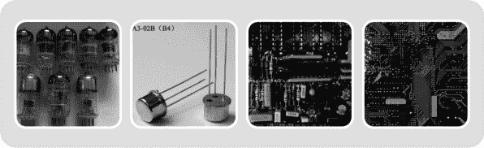

图 1-2　计算机的逻辑元件

21 世纪，科技渗透至人类生活的每个毛细血管。任一商品皆为科技结晶。以智能手机为例，方寸屏幕汇聚数千年科学成果、数百位科学家薪火相传，让“执世界于掌心”成为现实。

1969 年，美军资助 ARPANET 研发，开启联网研究序幕。80 年代，互联网迅猛生长，织就全球神经网络。1987 年首届神经网络国际会议召开，标志新学科诞生，各国投入激增，神经网络研究迎来春天。

“互联网+”是创新 2.0 语境下的新业态，是知识社会驱动下的形态演进与经济新形态。生活习惯深度依赖互联网，传统产业借力升级，“互联网+”已成一种生活方式，让日常更美好。

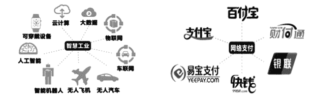

图 1-3　互联网应用

大数据是互联网时代的“副产品”之一：互联网产生的数据总量远超人类有史以来总和。信息爆炸催生大数据、区块链、人工智能等关联领域。大数据聚焦用户价值最大化，区块链破解数据溯源，AI 则是大数据的终极形态——通过智能分析实现用户行为精准预测。

### 1.2　人工智能概述

#### 1.2.1　人工智能的发展

##### 1. 起始阶段

1956 年达特茅斯会议上，约翰·麦卡锡首提“Artificial Intelligence”，被公认为 AI 诞生标志。此阶段过度迷信问题求解算法，忽视知识表征；机器仅具逻辑推理雏形，距真正智能尚远。

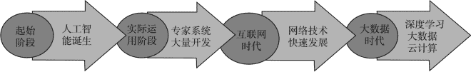

图 1-4　人工智能研究与发展阶段

##### 2. 实际运用阶段

60 年代末至 70 年代，学界意识到“赋予机器知识”是关键，专家系统井喷。DENDRAL（化学质谱）、MYCIN（疾病诊疗）、PROSPECTOR（找矿）、Hearsay-II（语音理解）等系统将 AI 推向实用化。1969 年国际人工智能联合会议（IJCAI）成立。

##### 3. 互联网时代

90 年代后，网络技术为 AI 注入新动能：研究从单体智能转向分布式多智能体协作，兼顾单目标与多目标求解，落地属性更强。Hopfield 多层神经网络模型推动神经网络研究繁荣。AI 渗透社会肌理：
- IBM“深蓝”击败国际象棋世界冠军
- 美国信息高速公路计划聚焦多 Agent 系统
- 基于 Agent 的 Softbot 在软件与搜索引擎大显身手
- Sandia 实验室建成最大“虚拟现实”实验室，探索数据头盔/手套交互

##### 4. 大数据时代

2010 年至今，深度学习、大数据、云计算、强 AI 飞跃发展。算法迭代（尤其是深度学习）+ 硬件算力跃升 + 数据采集存储处理能力质变，让机器能从海量数据自主习得知识、逼近智能化水平。

一场商业革命随之爆发：Google、微软、百度等巨头与无数初创公司涌入战场，掀起智能化新浪潮。技术成熟与大众接受度同步提升，这股浪潮或将搭建连接当代与未来文明的桥梁。

##### 5. 人工智能大事记

| 年份 | 里程碑 |
|------|--------|
| 1946 | 全球首台通用计算机 ENIAC 诞生，每秒 5000 次加法/400 次乘法，为 AI 奠基算力基石 |
| 1950 | 图灵提出“图灵测试”：5 分钟对话中 >30% 回答让人误判为人类，即通过测试；预言真正智能机器的可能性 |
| 1956 | 达特茅斯会议首提“AI”概念 |
| 1959 | 首台工业机器人诞生（德沃尔/英格伯格），可读取示教程序控制多自由度机械，无环境感知 |
| 1964 | MIT AI 实验室魏岑鲍姆开发 ELIZA，首实现人机文本对话（仅语法层面复述） |
| 1965 | 专家系统亮相：DENDRAL 能从实验数据推导未知化合物分子结构 |
| 1968 | 斯坦福研发 Shakey，首台具自主感知、规划、执行能力的 AI 机器人，可按指令抓取积木，拥触觉/听觉等类人感知 |
| 1970 | SHRDLU 系统能理解语义、消歧指令、操作虚拟方块完成任务，被视为重大突破 |
| 1976 | MYCIN 用于传染性血液病诊断，专家系统向制造、财务、金融等多领域扩展 |
| 1980 | XCON 为 DEC 节约年 4000 万美元，专家系统商业化落地 |
| 1981 | 日本启动“第五代计算机”项目，目标制造能对话、翻译、推理的机器；欧美跟进巨额投入 |
| 1984 | Cyc 计划试图将人类通用知识全部输入计算机，构建巨型知识库与推理引擎，开辟新研发方向 |
| 1997 | “深蓝”以每秒 2 亿步棋、70 万大师棋谱、12 步搜索深度击败卡斯帕罗夫 |
| 2011 | Watson 存储 2 亿页数据，战胜两位人类问答冠军，后广泛应用医疗诊断 |
| 2016–2017 | AlphaGo 自学海量棋谱击败人类顶尖棋手，DeepMind 进军医疗健康 |
| 2017 | AlphaGo Zero 零数据自学：3 天 100:0 横扫旧版，40 天超越“大师”版本 |
| 2018.11 | 美国团队建成首个多人脑机接口 Brain Net，3 人仅靠脑电波协作玩俄罗斯方块，准确率 81.25%，开启“脑联网”时代 |

#### 1.2.2　人工智能的概念

##### 1. 定义

AI = “人工” + “智能”。

智能可简化为：人类运用思维与脑力认知、改造世界时展现的智慧与能力。感知（视/听/触）→ 认知（记忆、联想、比较、分析、判断、推理、决策、规划）→ 行动（语/手/足），构成人类智能完整闭环。核心三维：思维力、感知力、行为力。

人工智能（AI）研究旨在模拟、延伸、扩展人类智能的理论、方法、技术。本质是造出能以“类人智能方式”响应的机器，涵盖机器人、语音/图像识别、NLP、专家系统等。AI 非人类智能，但能“像人一样思考”。


图 1-5　人工智能研究范畴

##### 2. 结构原理

AI 属社科与自然科交叉领域，融汇数学、心理学、神经生理学、信息论、计算机科学、哲学、认知科学、不定性论、控制论。数学视角可简化为：

**AI = 人造物（计算机硬件） + 智能（软件程序）**

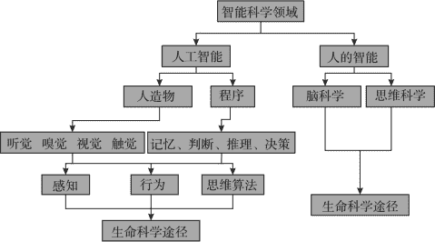

图 1-6　人工智能结构原理

本质区别：AI 为物理过程，需接受指令，无自觉性/社会性/理性；人类智能为生物过程，具自觉性、主观能动性、情感、个体差异、想象力、创造力、感性。

##### 3. 分类

| 类型 | 英文/缩写 | 特征 |
|------|-----------|------|
| 弱人工智能 | ANI | 单一领域超人（如 AlphaGo 仅会下围棋），跨域无能 |
| 强人工智能 | AGI | 全谱系人类级智能：思考、规划、解题、抽象、理解复杂概念、快速学习、经验迁移，均得心应手。难度远超 ANI，尚未实现 |
| 超人工智能 | ASI | 几乎所有领域远超最聪明人类大脑（科学创新、通识、社交）。可能仅强一点，也可能强万亿倍 |


图 1-7　弱人工智能应用

#### 1.2.3　机器人技术

中国古代机器人雏形璀璨：西周偃师造会唱会舞“伶人”；春秋鲁班制木鸟；张衡除地动仪外尚有自动指南车；诸葛亮“木牛流马”解军粮运输难题。彰显古人匠心与智慧。

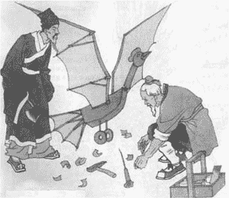

图 1-8　木鸟

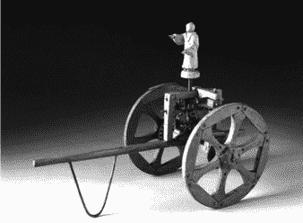

图 1-9　指南车


图 1-10　木牛流马

##### 1. 机器人概念

通俗讲：受计算机控制、可编程的自动机电装备。具备环境感知、目标识别、指令理解、记忆学习、逻辑判断，能按程序自主作业替代人工完成特定任务。外形不拟人，但能在多环境替人作业。

##### 2. 核心特征

1. **拟生物动作与感知**：通过“感官”获取声/光/温等环境信息并响应（如人机围棋对弈中感官敏锐、反应敏捷）。
2. **通用性与柔性**：作业品类多、程序灵活可变，是柔性制造核心。
3. **分级智能**：具备记忆、思考、感知、推理、决策、学习等信息处理能力（对弈中展现强推理/决策力）。
4. **自主独立性**：完整机器人可无人干预自主作业（如独立对弈）。


图 1-11　人机围棋对弈

##### 3. 原理与系统架构

核心逻辑：仿人动作、思维、控制、决策。

系统由**三大本体**（机械本体、传感体系、控制体系）与**六大子系统**（驱动、机械、感知、人机交互、机器人-环境交互、控制）构成。

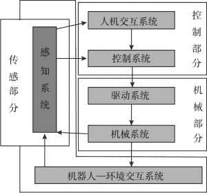

图 1-12　机器人系统

##### 4. 分类体系

国际通用按应用环境二分：
- **工业机器人**——制造环境
- **服务/仿人型机器人（特种机器人）**——非制造环境

# 1.3 大数据全景扫描：从诞生到核心技术

## 机器人分类速览

工业机器人专指面向制造业的多关节机械手或多自由度装备。与之相对，特种机器人涵盖了除工业机器人外，服务于非制造领域、直接面向人类需求的各类先进形态，包括服务型、水下作业、娱乐陪伴、军事国防、农业生产以及机器人化机床等。


图 1-13　工业机器人


图 1-14　特种机器人

---

## 1.3.1 大数据是如何“长”出来的？

### 1. 时代浪潮与技术基石

信息技术产业走过七十余载，历经大型机、微型机（PC）、互联网三大浪潮演进。早期计算机庞大且算力有限；微电子与集成技术突破推动芯片小型化，让 PC 走入寻常百姓家；互联网普及则打通了全球连接。

踩入移动互联时代，智能手机与穿戴设备爆发式增长，全网用户激增，生活被数字化信息全方位包裹。数据不再依赖人工录入，而是随着设备普及“自然生长”，呈指数级爆发——这便是“大数据浪潮”的来临。智能终端普及、物联网铺开、存储介质升级、带宽提速，共同构筑了大数据生成、存储与流通的物理底座。


图 1-15　“数据爆炸”时代

数据生产模式的根本变革是推手。过去，企业业务系统与门户网站贡献约 15% 数据源；如今，数据生产自动化、生活化、社交化，海量用户自发生成文本、图像、音视频等非结构化内容。其中图像、视频占比飙升，物联网感知数据更是惊人，移动互联更能精准、实时采集位置、环境、行为轨迹。IDC 预测：数据年增速 50%，人类近两年产出量等同于此前历史总和。

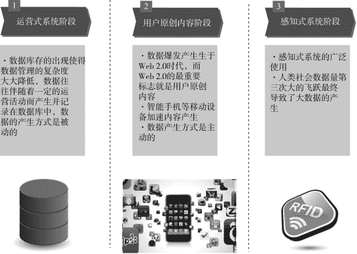

图 1-16 数据生产方式的演变

大数据产业已形成六层生态：IT 基础设施、数据源、数据管理、数据分析、数据平台、数据应用，各层级均涌现出头部技术与标杆企业。

### 2. 关键时间线：从萌芽到爆发

**萌芽期（90年代〜21世纪初）：** 概念源自美国。托夫勒《第三次浪潮》称其为“华彩乐章”；复杂性科学兴起提供方法论。1997 年 NASA 研究人员因可视化难题首提“大数据”；1998 年《自然》刊文使其正式入榜公共术语。

**发展期（21世纪初〜2010年）：** 互联网高速增长期。2001 年 Gartner 推大型数据模型，道格·莱尼提出“3V”（量、速、类），麦肯锡补“价值”成“4V”。2005 年 Hadoop 诞生，奠定分布式分析基石；2007 年数据密集型科学现身，提供范式支撑；2008 年《自然》出专刊，2010 年美 PITAC 报告，政府层面高度重视。

**兴盛期（2011年〜至今）：** 2011 年 IBM “沃森”以 4TB/s 刷新纪录；麦肯锡、达沃斯论坛（2012）相继发布重磅报告，正式宣告大数据时代到来。此后大数据渗透各行各业，重塑技术体系，呈现旺盛生长态势。

---

## 1.3.2 读懂大数据：定义与“5V”画像

### 1. 多维度定义

大数据指在规定时限内，常规工具无法捕获、管理、处理的数据集合；它要求新处理模式，以赋能强决策、洞察发现、流程优化，是海量、高增、多样的信息资产。

云视角下，大数据常指企业产生的海量非/半结构化数据，入库分析成本高、耗时长，故常借助 MapReduce 等框架，联动云计算分发至成百上千节点并行处理。适用技术栈涵盖 MPP 数据库、数据挖掘、分布式文件系统/数据库、云平台、可扩展存储等。

### 2. 五大核心特征（5V）

*   **量大：** 采集、存储、计算规模均巨大，起步单位为 PB、EB 甚至 ZB。
*   **类多：** 覆盖结构化、半结构化、非结构化，形态包括日志、音视频、图片、地理信息等，倒逼处理能力升级。
*   **价值密度低：** 感知无处不在，数据汪洋中高价值片段稀缺（如监控视频仅秒级有效），但商业价值极高。
*   **速度快、时效高：** 增长快、处理快、强调实时性（搜索引擎分钟级收录、推荐算法实时出结果），区别于传统离线挖掘。
*   **在线化：** 数据永久在线、随时可调度可计算，这是互联网高速发展下的核心分水岭——大数据不只是“大”，更在于“活”“在线”。

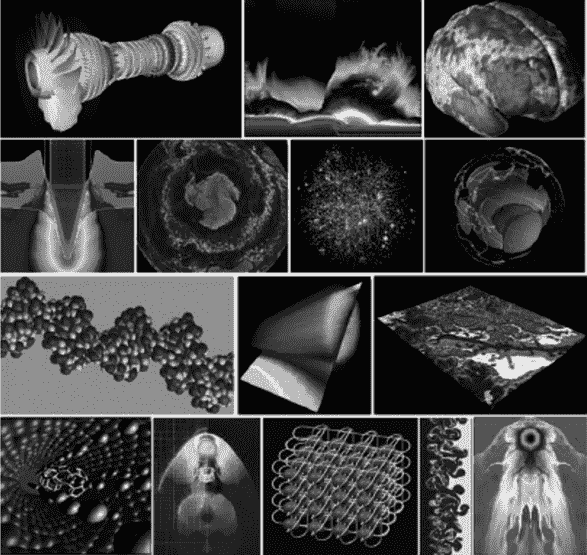

图 1-17 数据类型繁多

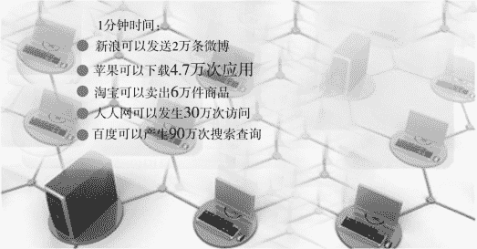

图 1-18 数据处理速度快

---

## 1.3.3 大数据技术深度解析

### 1. 端到端处理流水线

核心流程：收集 → 预处理 → 存储 → 处理分析 → 可视化/应用，**数据质量贯穿始终**。


图 1-19　大数据处理基本流程

**① 数据收集：** 数据源决定真实性、完整性、一致性、准确性、安全性。Web 端常用爬虫，需通过时间策略（如易海聚 API 灵活控制任务）保障时效性。

**② 数据预处理（质量炼金术）：** 多源异构数据易含噪声、缺失、冲突，必须“洗”净。四大支柱：
*   *清理：* 不一致检测、噪声识别、过滤修正 → 提升一致性、准确性、真实性、可用性。
*   *集成：* 多源融合为统一数据库/立方体 → 强化完整性、一致性、安全性、可用性。
*   *归约：* 不损准确性前提下压缩规模（维/数归约、抽样） → 提升价值密度。
*   *转换：* 基于规则/元数据/模型统一格式 → 强化一致性、可用性。
预处理技术是流程质量的关键杠杆。

**③ 数据处理与分析（双引擎）：**
*   *处理层：* 分布式计算模型选型看存储形态与业务类型。MapReduce 批处理并行、内存计算减少读写开销、流计算保实时。选型得当，直击价值性、可用性、时效性、准确性。
*   *分析层：* 统计分析（已知）+ 挖掘深度学习（未知）。聚类分类、关联规则、深度学习挖掘关联，构建模型海量训练提精度。分析环节定生死，需按决策场景选技术，保可用、重价值、求准确。

**④ 可视化与应用（最后一公里）：**
*   *可视化：* 图形化交互呈现，挖掘隐性规律辅助决策，是提升可用性、易懂性的关键。
*   *应用：* 结果落地决策、规划，验证分析成果，直接体现价值；反向引导前端收集处理方向。前期调研决策需求、明确目标，是全链路对齐用户价值的前提。

### 2. 双核心技术基石

大数据立身于**分布式存储**与**分布式处理**。

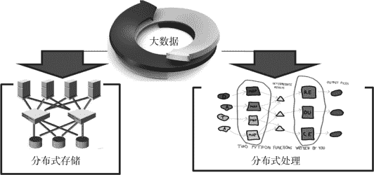

图 1-20　大数据核心技术

*   **分布式存储：** 数据打散至多节点，可扩展架构分担存储压力，位置服务器定位信息。高可靠、高可用、高吞吐、易扩展。Google 超 50 万台服务器、百万硬盘，多基于廉价商用硬件横向扩展，大幅压降成本，释放研发投入。
*   **分布式处理：** 网络互联多异构节点，统一调度协同完成任务。MapReduce 是核心范式：Map 阶段自动切分数据并行映射到集群，Reduce 阶段汇总输出。Hadoop 落地该模式，以可靠、高效、可伸缩著称。

### 3. 应用前景：价值、赋能、生态

1.  **数据价值化：** 技术围绕“变现”展开，数据赋能全社会，落地深入则价值显现，互联网领域已广泛受益。
2.  **科技引擎：** 溢出效应波及金融、教育、医疗等全域。AI 领域（机器学习、视觉、NLP）尤甚，大数据成智能社会基座。
3.  **产业链成型：** 采集、清洗、传输、存储、分析、呈现、应用七环闭环，企业集群入局，规模初具，未来空间广阔。

---

# 1.4 大数据与 AI：双子星的共生进化

大数据与 AI 代表 IT 前沿趋势，**相辅相成、互促共进，既分野又联系**。

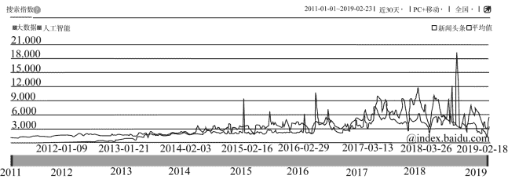

图 1-21　人工智能和大数据的百度指数

## 1.4.1 本质分野：输入 vs 输出，洞察 vs 决策

核心差异：**大数据是需清洗结构化的“原料输入”，AI 是数据处理后的“智能输出”。**

### 1. 目标与路径迥异
*   **AI：** 认知计算，模拟人类对输入作用/反应。传统应用硬编码规则，遇异常即失效；AI 系统依结果动态调整行为，持续进化。机器学习让计算机“学会”如何应对，举一反三。
*   **大数据：** 传统计算范畴，**不主动行动，只求“果”**。定义超大规模、高多样性数据集，囊括结构化事务、非结构化图像/邮件/传感器数据。

### 2. 使用场景错位
*   **大数据＝洞察：** 挖掘规律认知用户（如 Netflix 依观影习惯推荐），基于历史偏好推演未来。
*   **AI＝决策与进化：** 追求更优决策（自动驾驶、医疗诊断、自适应软件），以超人类速度、更低错误率完成同类任务。

## 1.4.2 深度耦合：数据喂养智能，算力托举模型

虽分野明显，协同效应极强。

### 1. AI 渴望数据，尤机器学习
图像识别需万张样本“看懂”飞机。GPU 大规模并行（千核 vs CPU 十核）让既有算法跑通、落地，是 AI 爆发的硬件拐点。

### 2. 大数据底座托举 AI
大数据技术栈提供海量存储与并行算力。ML 算法借此学习复现行为、收集数据加速训练。AI 非人类演绎推理，而是**试错式学习**，此过程极度依赖海量数据“投喂”与训练。

---

## 第 2 章 大数据赋能智能制造

数据喂养得越足，人工智能的“大脑”就越聪明。回溯往昔，受限于处理器性能瓶颈、数据稀缺、传感器技术落后以及互联网尚未普及，AI 难以施展拳脚，实时数据更是可遇不可求。而今，算力飞跃、感知设备遍布、网络互联互通、海量数据集就绪，所有拼图已然到位。毋庸置疑，**离开了大数据，人工智能便成了无源之水。**

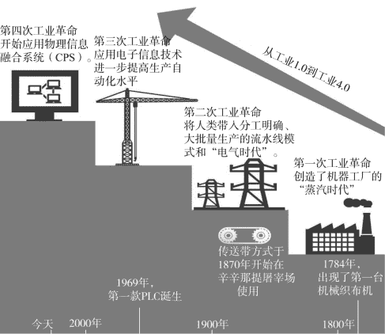

图 2-1 四次工业革命

### 2.1 破解智能制造内涵与层次

“工业 4.0”源自德国，“工业互联网”是美式表达，而“中国制造 2025”则是本土化落地。三者虽名号各异，内核却高度统一——**“互联网＋制造”**，直指终极目标：**智能制造**。

业界虽未对智能制造达成唯一标准定义，但其核心不外乎：**在 AI 技术驱动下，实现生产制造的智能化**。智能制造系统本质上是**人机协同的一体化智能系统**，由智能机器与人类专家共同组成，能在制造全过程中自主完成分析、推理、判断、构思与决策等高阶智能活动。

智能化，是制造自动化演进的必由之路。正如智能制造“金字塔”模型所示，AI 技术已渗透至制造全链路各环节，构建起四大层次、十大核心支柱：

- 智能产品
- 智能服务
- 智能装备
- 智能产线
- 智能车间
- 智能工厂
- 智能研发
- 智能管理
- 智能物流与供应链
- 智能决策

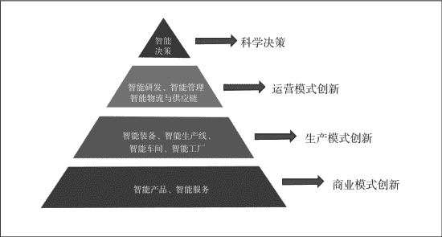

图 2-2 智能制造的关键内容层次模型

### 2.2 从大数据走向智能制造

#### 2.2.1 重新定义二者关系

大数据非终极目的，而是一种**现象、视角与工具**。其核心价值在于：通过数据剖析，实现需求预测、制造预判、规避隐性风险，并以此为纽带重构产业链与价值链。

大数据与制造的耦合关系可提炼为三大核心要素：

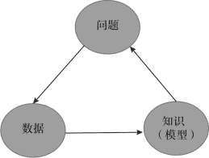

图 2-3 大数据和制造的关系

1.  **问题导向**：制造系统中的显性/隐性痛点（质量缺陷、精度偏差、设备故障、成本高企、效率低下等）。
2.  **数据支撑**：源自 5M 要素（人、机、料、法、环），能还原问题发生全链路的数据。**取数须以“解决问题”为导向，而非为数而数。**
3.  **知识沉淀**：制造系统的核心资产（工艺、工序、设计、诊断等）。知识源于解题过程，而大数据分析是**快速获取、积累知识的加速器**。

**关系闭环总结**：制造过程产生数据 → 数据挖掘还原问题全貌 → 抽象建模转化为知识 → 知识反哺识别/解决/规避问题 → **自发自动循环，即为智能制造**。  
由此可见，**问题与知识是“目的”，数据仅是“手段”**。图 2-3 模型极具延展性：将“数据”替换为“人”即得“工匠精神”，替换为“自动化产线”对标“工业 4.0”，替换为“互联网”则成“互联网＋”。

在制造系统与商业环境双重复杂度攀升的当下，以大数据驱动智能制造、沉淀知识资产，无疑是最高效、最便捷的破局之道。

#### 2.2.2 大数据推演智能制造的三级跳

1.  **问题数据化，经验资产化**：将问题转化为可建模数据，让经验沉淀为可持续增值的资产。
2.  **数据知识化，知其然更知其所以然**：突破“可见问题”解决的局限，触达“不可见风险”预判领域；从掌握“How”进阶至洞悉“Why”。
3.  **知识指令化，从根源消除隐患**：将知识还原为生产指令、工艺参数、可执行决策，实现问题的**源头治理与前置规避**。

#### 2.2.3 大数据：智能制造的核心引擎

**数字化转型是通往智能制造的唯一必经之路**，其核心在于**以数据为驱动力，贯穿整个生产全生命周期**。

企业运营早已积累海量“工业大数据”：实时产线数据、设备运维数据、质量追溯数据、物流轨迹数据、产品运营数据、社交舆情数据……激活这些沉睡资产，必须引入大数据分析方法论与工具箱。通过深度挖掘，我们能复盘问题成因、量化影响范围、复用解决方案、发掘增值新模式。大数据思维助力制造业完成三大跃迁：**商业模式重塑、客户体验升级、内部流程精益化**。

发达国家凭借先发优势，在工业设计、研发、供应链、企业管理等维度深度布局工业互联网，成果斐然。中国工程院院士邬贺铨在剖析美式产业互联网模式后指出：**未来 20 年，工业大数据将是重塑制造业版图的最强变量。**

#### 2.2.4 中国工业大数据：破局之路

国内制造企业虽已开展数字化探索，但多停留在**单点、单环节**，难以覆盖全产业链。真正的制造业数字化，要求**大数据应用贯穿全流程、渗透上下游生态**。

除覆盖面不足，**“数据巴别塔”问题最为棘手**——设备标准不一导致数据格式混乱。2017 年，《国家智能制造标准体系建设指南》出台，旨在统一智能/传感装备标准，破解这一顽疾。

此外，**“有数难用、有量不大”**是普遍现状。专家建议企业：**以大数据为核心，互联网与软件为支撑，装备为终端，重构生产范式**。通过“数据分析＋软件定义”，在云端掌控生产，推动装备智能化进化，最终实现**增效、提质、降耗**的三重奏。

### 2.3 智能制造“皇冠上的明珠”——工业机器人

劳动力成本飙升倒逼自动化替代，政策红利持续释放，机器人品类爆发式增长，**工业机器人市场正站在爆发临界点**。

它是智能制造与工业自动化的**关键技术锚点**，在新旧产业转型中扮演“催化剂”角色。作为先进制造技术的集大成者，工业机器人正向**高度智能化**进化，智能工业机器人将锁定**未来技术制高点与经济增长极**。提升机器人智能化水平、强化作业能力与泛用性能，是跟上现代制造业节奏的首要课题。虽存挑战，但技术演进大势不可逆，应用版图将持续外拓，形成完备生态。在工业 4.0 宏大叙事下，工业机器人必将成为工厂自动化产线的**主力军**。

#### 2.3.1 什么是工业机器人

集机械、电子、控制、计算机、传感、AI 等多学科尖端技术于一身，是现代制造业的**核心自动化装备**。1962 年美研制首台以来，技术迭代极快，已成柔性制造系统（FMS）、自动化工厂（FA）、计算机集成制造系统（CIMS）的基石。

分类标准虽未国际统一，但**焊接、搬运、喷涂、装配、码垛、切割**六大类当仁不让占据核心地位。

据“品牌网”统计，全球前五品牌格局为：发那科、ABB、库卡、安川、新松。川崎、柯马、起帆等紧随其后。**国产品牌市场份额逐年攀升，竞争力显著增强。**

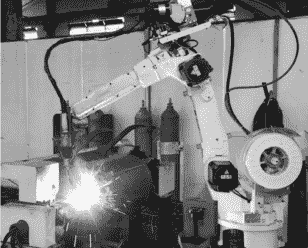 图 2-4 焊接机器人  
 图 2-5 装配机器人  
 图 2-6 激光切割机器人  
 图 2-7 喷涂机器人

#### 2.3.2 中国工业机器人：从跟跑到领跑的三部曲

起步于 70 年代初，历经三个关键阶段：

1.  **萌芽期（70 年代）**：1972 年启动自主研制。
2.  **开发期（80 年代）**：国家重金攻关，攻克示教再现成套技术，推出喷涂、点焊、弧焊、搬运机器人。  
    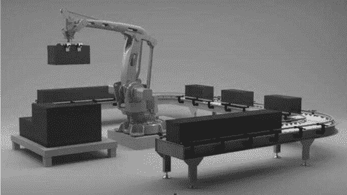 图 2-8 搬运机器人
3.  **适用化期（90 年代）**：体制改革激发活力，研制出装配、喷漆、切割、包装、码垛等全谱系产品，实施应用工程，建成产业化基地。  
    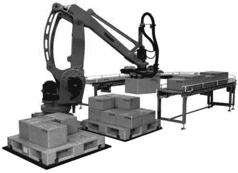 图 2-9 码垛机器人

21 世纪以来，国家战略级扶持前所未有。**2013 年中国跃居全球最大应用市场，2018 年产量破 14 万台**。2019 上半年国产品牌占比达 35.8%，市场持续高速扩容，国产替代加速跑。

#### 2.3.3 AI 时代下的四大进化趋势

AI 深度融合重塑工业机器人：守住高精度、宽应用优势，攻克操作复杂、成本高企痛点。

1.  **全能化进化，版图无界**：机械手仿生人手，配合自控系统高效执行重复性任务；AI 赋能下感知决策升级，**高精度、强适应性、大范围**应用成常态。
2.  **仿生化深化，最佳拍档**：真空环境用真空机器人，危险作业用蛇形机器人……**生物特性与仿生设计**，让机器人替人类踏入禁区、守住安全底线。  
    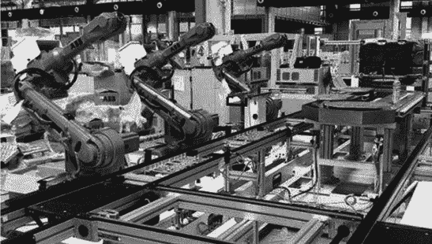 图 2-10 工业机器人
3.  **控制开放化，门槛归零**：封闭转开放，网络化、标准化、统一化，**大幅压降培训成本，从根本上打通“最后一公里”操作壁垒**。
4.  **融合精准化，质量零缺陷**：多传感器协同（视觉+力觉+位置等），如电弧焊接融合视觉与机器感知，**协同作业保极致精度**。传感器融合是智能化的关键台阶。

**阶段总结**：早期拼“量”（产能、普及率），存量时代拼“质”（强度、精度、耐用、智能、人机协同）。需求驱动创新，未来机器人必将更懂人、更像人、更好用。

#### 2.3.4 实战案例：机器人如何重塑产线

**案例一：智能码垛——仓储物流的“效率革命”**  
人工作业难支撑高效周转。AGV 小车+码垛机器人组合拳，重构存取流程。  
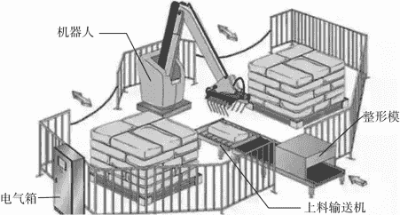 图 2-11 码垛机器人应用案例  
**硬核优势**：7×24h 不停机、百公斤级负载、千次/小时节拍、±0.2mm 重复定位精度、多总线/以太网灵活组网、软件编程快速切换产品、2D/3D 视觉随抓随放、**全品类包装兼容**（纸箱/袋装/罐装/啤酒箱/瓶装），服务化工、饮料、食品等全行业。**减员增效，立竿见影。**

**案例二：抛光打磨——从“脏累险”到“智慧造”**  
粉尘飞扬、火花四溅、噪音震耳、质量靠经验、熟练工荒、成本高企……人工作业痛点倒逼机器人替代。  
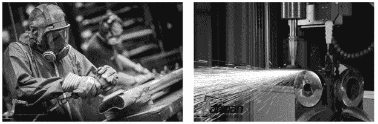 图 2-12 人工打磨与工业机器人打磨  
**实战场景**：刀具刀柄水磨拉丝。机器人按轨迹打磨卸料，兼容夹心柄、塑料柄、金属注塑、焊接刀柄等多款型号。  
 图 2-13 工业机器人打磨效果  
**六大技术红利**：
1.  密闭工作站隔离噪音粉尘，**绿色环保**；
2.  人机物理隔离，**本质安全**；
3.  精度一致性消除人为波动，**良率飙升**；
4.  去技能化依赖，**抗流失、保交期**；
5.  连续作业，**产能倍增**；
6.  二次开发灵活，**缩短换型周期、降设备投入**。

### 2.4 智能制造核心载体——智慧工厂

#### 2.4.1 重新定义智慧工厂

智慧工厂是数字化工厂的**进阶形态**。立足物联网与设备监控技术，重构信息管理服务体系：**贯通产销全链路、强化全过程可控性、最小化人工干预、实时化数据采集、科学化计划排程**。融合前沿技术集群，致力于打造**高效节能、绿色环保、环境友好、人性关怀**的新一代工厂。

它是智能制造的**核心组成单元**，智能生产在其中发生、落地，是实现智能制造的**关键落脚点**。三大核心标识：**产品智能化、生产自动化、信息流与物流深度融合**。放眼全球，头部企业无不以此为战略高地。

#### 2.4.2 智慧工厂的基因特征

作为智能工业新方向，智慧工厂由完整智能化生产系统构建，必备基因包括：

1.  **自主进化力**：具备自我优化、自我维护的闭环能力。

# 智能制造系统的五大核心特质与服装智造实战范本

智能制造系统并非简单的自动化堆砌，其核心竞争力体现在以下五个维度：

**1. 认知与进化的“智慧大脑”**  
系统能主动感知内外部环境数据，依托数据分析判断优化行为路径，具备自我学习进化能力。更关键的是，它内置自动故障诊断机制，能实现故障排查与设备维护的闭环。

**2. 全流程的“透明工厂”**  
深度融合信号处理、推理预测、仿真模拟及多媒体技术，打破信息壁垒，让生产现场的每一个细节都清晰可见、可追溯、可管控。

**3. 柔性重组的“积木架构”**  
子系统模块可根据任务需求自主寻优组合，快速形成最佳生产结构；同时预留标准化接口，支持设备按需无缝扩容，应对产能波动游刃有余。

**4. 人机共生的“协作新范式”**  
打破“机器替人”的单一逻辑，构建人机协同互补关系：机器承担高强度、高精度、高危险作业，人类聚焦决策、创新与异常处理，双方在不同层级实现增值共生。

**5. 绿色人本的“可持续基因”**  
以智能软硬件赋能绿色制造：能耗精准管控降本、清洁工艺减排、安全隐患前置预警、废料循环利用；尤其在高危高污工序，坚决落实“机器换人”，守护生命健康。

---

## 破局传统制衣：一场从“制造”到“智造”的突围战

### 困局：人海战术的边际效应递减
服装制造作为典型劳动密集型产业，长期依赖人工流水线。但面对年均10%的人工涨幅，传统加工成本已难以为继。降本增效的破局点极其清晰：**减人、提效、控损**。这倒逼企业必须跨越“制造”门槛，迈入“智造”新赛道——打造智慧工厂，已成必然选择。


### 痛点剖析：纸质扎单下的管理盲区
国内千台规模以上制衣厂普遍沿用非自动传送的人工流水线及传统流程。

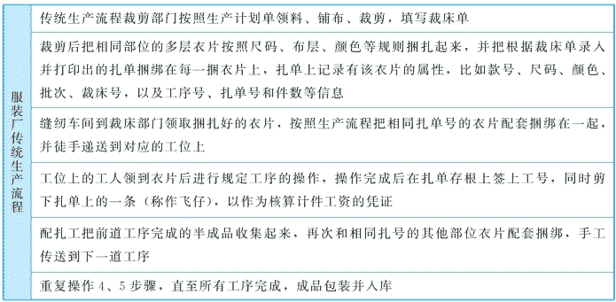

核心痛点在于**“纸质扎单”这一单一载体**承载了过重功能：既是生产指令单，又是流程追踪器、工序记录本、计薪依据。这种高度依赖人工流转的模式，必然催生�琐、失控、不可预知的管理黑洞。

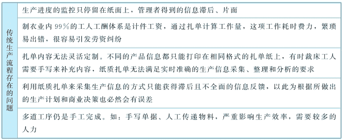

### 破局方案：RFID电子扎牌重塑数字神经
方案核心在于**“电子化身份证”替代“纸质户口本”**：
- **数据载体升级**：采用RFID电子扎牌捆扎衣片，全流程记录加工信息；
- **感知网络铺设**：各工位部署RFID采集终端，联网构建全厂神经中枢；
- **工序闭环验证**：工人扫码“开始/结束”，系统自动生成时间戳，杜绝虚报工时；
- **身份强绑定**：员工持RFID工卡登岗，操作行为与人员强关联，实现计件自动结算、质量责任精准溯源。

### 实战成效：数据驱动的降本增效账本
落地实时采集系统后，企业效率跃升**10%-25%**：
1. **决策可视化**：管理层远程获取实时看板，从“事后诸葛”转为“事前预判、事中干预”；
2. **薪酬自动化**：结算效率与准确率双提升，工序定价依托数据更科学；
3. **质量可追溯**：瑕疵直达责任人，倒逼工艺优化，构建质量闭环管理。

---

# 第 3 章 大数据时代的智能交通：重构城市流动新生态

## 3.1 智能交通系统（ITS）：让路网长出“智慧中枢”

### 概念重构：技术融合的综合体
ITS（Intelligent Transportation System）将信息技术、通讯传输、电子感知、自动控制、计算机技术深度集成植入交通肌理。核心使命直指四大民生痛点：**提效率、保安全、疏堵点、减污染**。


系统愿景描绘了理想图景：车辆自主智能驾驭、路网动态自我调优、管理者全域全时感知——这是交通进化的终极形态。

### 特征解码：人、车、路的“三体协奏”
智能交通重构了人、车、路的交互逻辑：依托海量信息服务盘活存量设施，通过三方和谐共舞提升路网通行力，实现拥堵缓解、事故减少、能耗降低、环境改善的多重奏效。其建设本质是**跨学科协同工程**，融汇交通工程、信息工程、通讯控制、计算机科学等多领域合力。

### 进阶形态：智慧交通——数据赋能的“超级大脑”
在ITS基因中注入物联网、云计算、大数据、移动互联网新基建，智慧交通实现质变：汇聚多源异构数据，输出实时动态服务；引入数据模型与挖掘引擎，赋予系统**系统性、实时性、交互性、泛在性**四大核心能力。

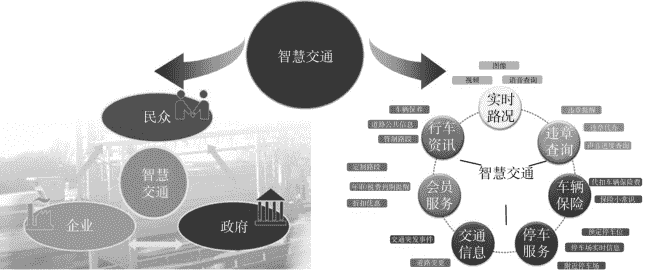

### 体系架构：以“信息流”驱动“服务流”
城市智慧交通是实时、精准、高效的综合运营服务体系。其骨架为**信息全生命周期管理**（采集-处理-发布-交换-分析-利用），血肉为面向交通参与者的多元化服务矩阵。

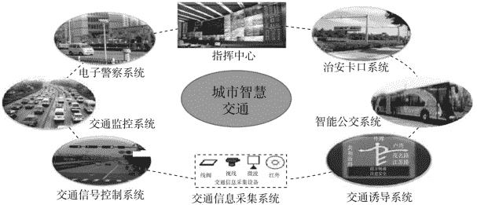

---

## 3.2 交通大数据：从“量变”到“质变”的核心燃料

### 3.2.1 来源广泛、特征鲜明的“4V”画像
人、车、路日常交互产生PB级、指数级增长的海量数据，源头三大类：
1. **公众出行服务数据**（互联网端）；
2. **企业生产监管数据**（行业运营端）；
3. **终端感知数据**（物联网/车联网端：视频、卡口、GPS/北斗、RFID、路况、管控、营运等）。

对比传统数据，呈现典型**“4V”特征**：
- **Volume（规模巨）**：覆盖人、车、路、环、管五大维度，数据池深不见底；
- **Variety（源头杂）**：轨迹、视频、天气、事故等多模态并存，异构融合难度大；
- **Value（密度低）**：海量沙砾中淘金，有效信息提取极具挑战；
- **Velocity（速度快）**：实时采集、实时清洗、实时建模、实时反馈，秒级响应出行决策。

### 3.2.2 大数据赋能智能交通的八大战略价值
数据驱动模式重塑交通规划、管理、决策、控制、服务全链条：

1. **打破行政壁垒，重塑“一盘棋”治理**  
   数据虚拟性天然跨域，整合跨区数据消除“条块分割”，支撑设施建设与路网规划的整体优化。

2. **精准画像拥堵，实施“外科手术式”疏导**  
   多维分析拥堵时空特征与成因，因地制宜精准施策，减少土地占用，激活系统内生良性循环。

3. **融合数据孤岛，释放“组合拳”效能**  
   打通气象、交通、保险等跨域“数据仓库”，构建公共信息集成模式，创造增量价值（如防灾减灾联合研判）。

4. **挖掘隐性规律，赋能资源精准配置**  
   数据洞察支撑人力物力科学调度，辅助管理层输出统筹协调方案，推动治理智能化。

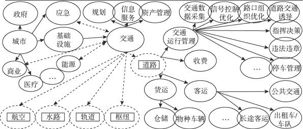

5. **预见未来态势，验证方案可行性**  
   构建预测模型模拟未来运行态，验证技术方案；实时领域利用高速处理能力，守护碰撞预警、换道辅助、驾驶状态监测等安全底线。

6. **提升运营效能，化解工程建设困境**  
   大体量数据特性匹配大工程治理需求，提升路网通行力、设施效率与需求管理水平。

7. **筑牢安全防线，主动防御与应急并重**  
   - **主动安全**：车载疲劳/酒精检测 + 路侧轨迹监测，多源融合建模评估行车风险，事前降事故率；  
   - **应急救援**：毫秒级反应与综合决策模型，辅助指挥抢夺黄金时间，最大程度减损。

8. **量化环境代价，倒逼绿色低碳转型**  
   建立排放监测预测模型，共享交通环境数据；历史数据反演优化信号控制策略，构建低排放控制原型与仿真系统，兼顾通行与环保。

---

## 3.3 发展图谱：从“野蛮生长”走向“标准化深水区”

全球共识：交通大数据上升为**国家战略**，资本与政策双轮驱动，公共交通向人性化、普惠化迈进，标准化建设成关键。无人驾驶等前沿技术加速落地，政企合力构建大数据交通平台，守护高效运行与便捷出行。

### 3.3.1 中国实践：政策引导下的“井喷式”布局
国家层面将大数据研究列入“973”“863”、自然科学基金等重大专项。交通领域进入**爆发增长期**：
- **顶层设计**：聚焦车路协同、感知交互、车联网、环保智能、多模协同、安全管控六大核心攻关，推动AI与大数据深度融合；
- **城市探索**：全国大城竞相引入智能技术提效疏堵。

**北京样本**：“一中心、三平台、八系统”架构，集成171个子系统，指挥中心具备调度、控制、监控、服务四大功能群。

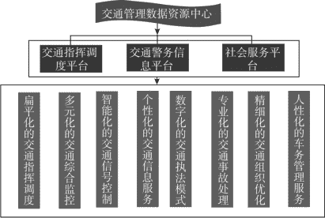

**基建爆发**：电警、感知器密度激增，网络提速催生数据井喷。建设**智能交通云平台**，推进大数据服务全覆盖；打造**“一张图”融合仿真底座**，融合客运许可、重点车辆卫星定位、路网数据；**ETC全国29省联网**打通收费壁垒；移动互联网催生出行服务新业态。

**出租车数字化转型**：服务管理系统覆盖监控指挥、运营分析、电召、考评七大功能；车载GPS系统集成定位、回放、监听、图传、报警，实现全程可视可管。

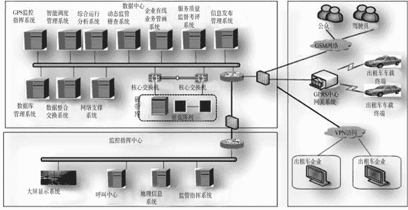

### 3.3.2 国际标杆：美欧日的差异化领跑路径
成熟体系涵盖管理、信息服务、车联网、自动驾驶四大板块。

**美国：数据开放与算法治理的双轮驱动**  
作为大数据发源地，政策、网络、技术三重红利加持。洛杉矶案例：全域摄像+磁感感知，中央大脑自动调控4500个信号灯，通行速度提升16%+，尾气减排改善空气质量。  
**开放生态**：近40州100+城市路况实时开放，事故、视频全公开，激活社会创新活力。


**日本：VICS体系的全网覆盖标杆**  
车载终端-交通部门-数据中心-VICS中心四级联动，实现全路网实时信息无缝触达。


**自动驾驶：从实验室走向量产前夜**  
70年代起步，辅助驾驶率先落地（如宝马Connected Drive集成限速、环视、泊车、夜视、车道偏离/变道预警、碰撞预警等）。

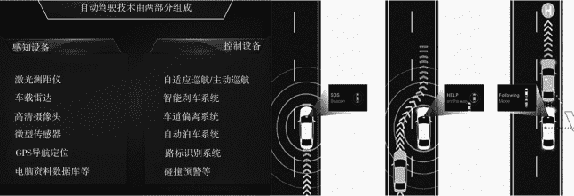

**谷歌无人车：传感器矩阵的数据怪兽**  
雷达、激光、红外、立体视觉、GPS、编码器全套武装，**单车秒产1GB、年产2PB数据**。大数据分析引擎将赋予其超越人类的安全、舒适、节能决策力。


### 3.3.3 直面痛点：四大“拦路虎”亟待破解
1. **数据孤岛顽疾**：部门分割导致资源条块化、碎片化，共享交换机制缺位，壁垒森严。
2. **标准缺失混战**：检测方式多、模式杂、标准无，数据难管、难用、利用率低。
3. **历史资产流失**：存储手段、格式、介质迭代导致历史数据难留存、难复用。
4. **安全监管滞后**：开放共享与隐私保护、机密防泄露的博弈中，安全监管体系亟待完善。

### 3.3.4 未来图景：AI+云+链，驶向全域智能新蓝海
大数据时代，以**人工智能、云计算、物联网**为底座的交通智能化建设全面铺开。技术突破倒逪城市交通迈入全面信息化纪元，城市交通的高速演进反哺大数据技术落地生根，形成**“技术-场景-数据”正向飞轮**，共绘智慧出行新图景。

# 未来交通演进：迈向车路协同与全自动驾驶新生态

未来交通图景将聚焦“车路协同”与“主动安全”两大核心方向（详见图 3-11）。高价值城市交通大数据的深度融合与挖掘应用，是推动智能交通跨越式发展的关键引擎，重点部署以下五大任务：

1.  **夯实感知基座**：持续跃升交通感知智能化水平，织就全域网络化的交通状态感知体系；
2.  **统一数据语言**：深化交通数据标准化建设，打破壁垒，实现多源数据资源的高效整合；
3.  **激活数据价值**：创新大数据分析应用场景，赋能交通系统实现精细化运营与科学化管理；
4.  **升级出行服务**：构建新一代智能交通信息服务平台，全面跃升公众出行服务的智能化体验；
5.  **筑牢创新底座**：健全智能交通技术创新体系，加速交通信息服务产业化进程。

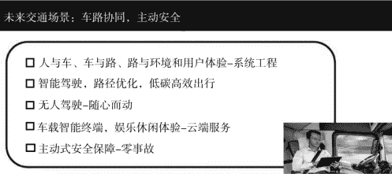

图 3-11　未来交通场景

展望 2040 年，汽车将全面进化为完全无人驾驶形态，人类将步入全新的交通生态纪元（详见图 3-12）。在此生态下，车辆将实现集中管控，自动驾驶运输将如水电般成为城市的基础设施。得益于导航迭代与传感器对路况、车况的精准监测，年均百万级的交通事故将趋近于零。

无人驾驶重塑公共交通资源配置逻辑：极少量的车辆即可支撑全城运转。这不仅极大提升了能源利用效率，更将大规模推动新能源替代，从根本上扭转空气污染局面。

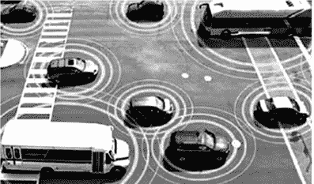

图 3-12　未来无人驾驶场景

## 3.4 基于大数据的智能交通：五大核心特质与实战范式

### 3.4.1 全域智能：让交通系统“长出大脑”

智能化的本质，是借助大数据挖掘，赋予交通全链路“自主决策”能力。管理层对路、车动态实现全息掌控，响应从“事后”转为“事前”，规则执行更刚性，效率与安全双提升。

**出行端智能化**（见图 3-13）：行前手机推送实时路况，助力动态调整出发时间与路线；高铁进站“刷脸”秒过，购票、验票一体化，极致压缩通行耗时。

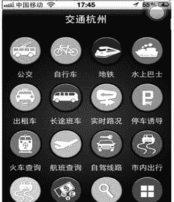

图 3-13　智能出行 app

**管控端智能化**：“聪明红绿灯”不再机械倒计时，而是内置“大脑”，多源感知实时流量，自研判、动态配时。实现区域自适应控制，红绿灯随流量呼吸，甚至打通“绿波带”，让车辆零等待通行，区域通行效率大幅跃升。

### 3.4.2 实时掌控：城市路网“透明化”

大数据平台融合视频、卡口、检测、信控等多系统，构建起城市路网的“数字孪生”神经中枢。路况实时可视、事件精准定位、预警即时触达，为交警指挥与公众出行提供“千里眼、顺风耳”。

对比传统盲目出行，大数据时代实现“路在脚下，全程掌控”。AI 与云计算融合，收集全员出行意图，宏观调度流向，从源头化解“所有人挤一条路”的结构性拥堵（见图 3-14）。

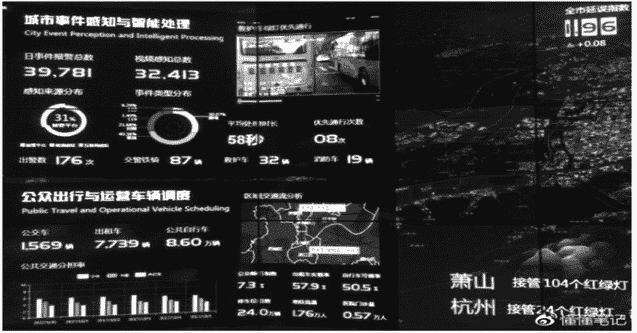

图 3-14　城市交通实时感知与智能处理系统

### 3.4.3 精准需求：供需匹配“零误差”

海量数据量化显性需求，让“精准供给”成为可能。交通运输由此向“不挤、不贵、快、智、绿”五大目标迈进。

**定制公交：通勤痛点的“定制解”**（见图 3-15）。传统公交时刻表不透明、打车贵难叫，定制公交按需开线——小区到单位“一站直达”。市民网上提需求、订座位、付费，企业按客流设线。上班族告别焦虑等待，大学生假期返乡直达枢纽，高效解决“最后一公里”及中长距离定点通勤难题。

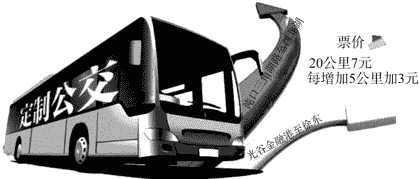

图 3-15　定制公交

**预判赋能**：挖掘历史与实时数据，构建拥堵预测模型，提前预警高峰与节假日路况。路况预测系统成智慧交通标配，助力管理决策、指引车主避堵、优化运输环节、精准识别资源浪费与风险点，实现信息精准触达、损耗最小化。

### 3.4.4 共享经济：盘活存量，重塑效率

互联网+、支付、大数据催生共享经济新范式。核心是资源再配置：提高利用率、降低持有成本、减少浪费。大数据精准画像消除出行盲目性，拥堵缓解，城市交通更智能、更低碳。

共享租车、共享驾乘、共享单车、共享停车全面铺开（见图 3-16、3-17）。以**分时租赁**为例：用“用车权”替“拥有权”，会员制、分钟级计费、全程自助、全天候响应。它填补公共交通与私家车间隙，精准承接中短途及特殊出行需求，成本更低、体验更灵活，正成为日常出行新常态。


图 3-16　共享单车


图 3-17　共享汽车

### 3.4.5 资源充分利用：用数据纠偏规划，用模式挖掘闲置

传统拥堵、高发事故多源于规划滞后（路网、灯位、转向等）。大数据时代，海量实证支撑科学决策，公交线网、地铁规划、出租配额均实现“数据说话”。

针对高空驶率顽疾，拼车/顺风车模式大显身手。滴滴数据显示：5座车从“1人独享”变“5人共乘”，单车减负 4 车位。拥堵缓解、排放下降，更沉淀下真实出行 OD 数据——政府疏堵有据、企业服务更精准。定制巴士、定制火车同理，盘活存量资源，数据沉淀反哺系统智能化闭环。

---

# 第 4 章 人工智能与大数据：筑牢安全领域的“数智防线”

## 4.1 概述：从被动应对到主动预判

安全关乎国本民生，是长期、复杂、全球性的系统工程。面对数据爆炸与多元风险，大数据与 AI 的深度融合不仅化解存储计算瓶颈，更让场景理解精准化，赋能传统产业转型，释放巨大社会生产力。数字基建（互联网、物联网、云计算）普及当下，善用新技术破解安全难题正当时。金融、城市应急、环保、食品、舆情等领域已结出丰硕成果。

## 4.2 食品安全：从“事后溯源”到“全程智控”

食品安全大数据是构建“预防型”监管体系的基石。政策东风与 AI 机遇叠加，这项融合食品工程、统计、数据库、网络技术的复杂工程正加速落地。AI 在食材辨识、后厨监控、感官评定上大显身手，与大数据合力筑牢监管高墙（技术架构见图 4-1）。物联网溯源管产地，云计算承载海量存算，大数据挖掘融合赋能 AI，AI 则以类脑计算加速处理，地位日益核心。

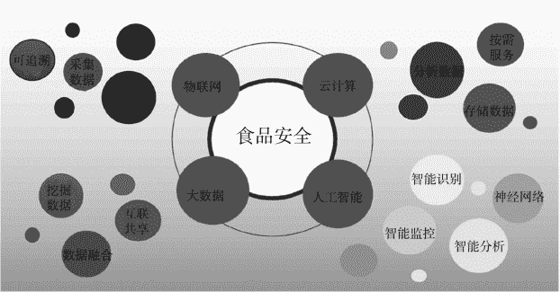

图 4-1　信息技术在食品安全中的应用

### 4.2.1 食品安全大数据全链路处理体系

监管贯穿产、购、存、销全链条，数据回流驱动监管迭代，核心技术模块四重奏：

1.  **采集预处理**：传感器、物联网、ZigBee 多源采集，融合、集约、清洗剔除噪点冗余，沉淀高价值信息。
2.  **传输存储**：树莓派、蓝牙、WiFi 等多链路高速传输，云计算分类存储分析，压缩技术降本增效。
3.  **挖掘建模**：贝叶斯网络预测欺诈（准确率 80%+），决策树监测化学风险，神经网络模拟感官评定，广泛服务于订餐、溯源、执法等场景。
4.  **协同监管**：政府主导（市场监管、农业、卫健等多部门联动）、行业企业协同、社会共治，织密全方位监管网（网络架构见图 4-2）。

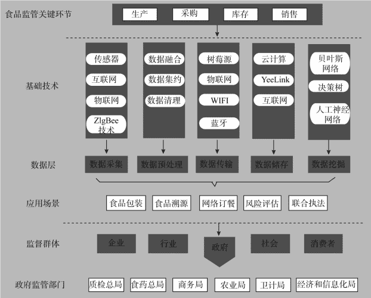

图 4-2　食品安全监控网络

### 4.2.2 AI 赋能食品安全：四大场景落地见效

工业 4.0 浪潮下，AI 以自主学习、强计算替代高危、重复、高强劳动，在监管、配餐、研发、检测四大赛道全面开花（应用全景见图 4-3）。

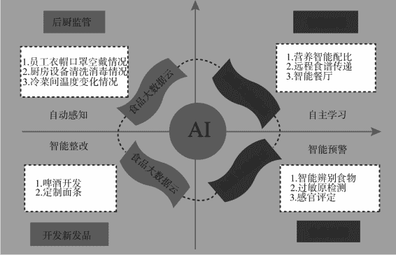

图 4-3　人工智能在食品行业中的应用

**1. 后厨“智慧眼”**：AI 实时核验人员着装规范、鼠患入侵，标记设施设备、工具容器、水池配置及使用状态。较人工巡检，大幅降本增效，预警精准、留证自动、威慑有力，助力政府决策科学化、监管透明化。

**2. 配餐“私人营养师”**：针对特定人群（学生、患者、老人）口味与营养需求，动态生成个性化食谱，解决多样化、周期性难题。智能餐厅引入自动炒菜机，标准化出品、降本增效，配合大数据分析顾客画像与经营数据，驱动运营迭代升级。

**3. 研发“超级品酒师”**：嘉士伯联合微软、高校，用 AI 感知风味差异，大幅提升新品开发、质控检测精度；AI 定制面条口感，满足微观个性化需求。数据处理广度深度远超人脑，重塑研发范式。

**4. 检测“可穿戴哨兵”**：eButton 设备连续记录饮食场景，交叉验证模型食物检测准确率超 86%-91%。技术赋能监管利剑，削减“黑榜”力量；回应民生期盼，守住“舌尖安全”，让 13 亿人吃得放心、营养、健康，共享高质量发展红利。AI 在食安领域创新迸发，前景可期。

## 4.3 生态环境安全：大数据赋能“精准治污、科学决策”

当前环保进入攻坚关键期，传统手段难支撑复杂性、动态性、系统性治理需求。大数据列入国家战略，生态环境大数据成学科热点。

### 4.3.1 生态环境大数据系统“四梁八柱”

系统构建“采集挖掘、处理管理、分析应用、决策支撑”四大核心功能闭环（架构见图 4-4）。

**1. 数据采集与挖掘**：建设匹配监测体系的采集平台，实现多介质数据实时上云。智能预处理、校核、空间匹配、网格化赋值，打通基础库。深度学习动态评估数据质量，优化采集策略；高性能计算支撑并行批处理与动态更新，挖掘分析成果直观呈现。

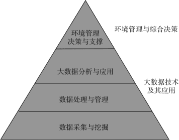

### 生态环境数据治理：构建多源融合的智慧底座

#### 数据汇聚与治理：从异构源头到标准资产

借助多源采集与网络挖掘手段，系统汇聚了跨空间尺度、长时间序列的自然地理、气象水文、社会经济、资源利用、排放排放及环境质量等海量基础要素。针对来源各异、格式不一、口径差异的多源数据，通过交叉校验甄别可信度与一致性，经清洗转化实现标准化、关联化、可计算化，并完成空间基准对齐，最终沉淀为统一的环境基础信息底座。

在存算调度层面，部署高性能查询索引引擎，涵盖文件存储、数据库引擎及计算模块，实现异构集群协同增效。依托分布式存储与网络设施，配合可视化编排界面，打破跨域、跨网壁垒，以统一规范对外交付服务，支撑环境数据全谱系研判与动态管控。

#### 算法赋能：深化机理认知与趋势推演

生态环境海量数据技术的纵深推演，不夯实模拟平台的理论根基与方法体系，更为洞察区域发展与生态保护的耦合机制、模拟资源环境承载力阈值预警、推演环境质量演变趋势提供关键支撑。当前，机器学习、深度神经网络、云端算力等前沿范式已成主流剖析手段，广泛嵌入环境预测评估与管理决策全链条。

#### 决策中枢：从单一管控迈向多介质协同

针对区域环境协同调控与综合决策诉求，融合发展战略、保护目标、法规标准、成本效益、技术演进及风险管控等多维约束，在海量数据研判基础上，引入系统分析与数值模拟工具体系，攻关多介质综合模拟与联动调控关键技术，实现区域环境多介质协同管控与生态环保决策科学化支撑。

---

### 实战范例：某地环保厅重点排污单位监管智慧中枢

#### 业务背景与建设逻辑

经济持续增长背景下，生态环保矛盾呈现复杂性、时变性、跨部门跨区域跨领域交织特征，海量多源数据处理成为破局关键。构建大数据决策分析系统，是推进生态文明、保障可持续发展的必由之路。

本案以某地环保厅数据中心打造的示范中枢为例（），核心确立“数据思维”，构建质量评估模型，对流式、结构化、半结构化及非结构化数据全谱系挖掘，实现在线监测数据质量画像与故障深度诊断，助力污染源精细化治理。

#### 核心技术攻关

**1. 高吞吐流式数据存算一体化（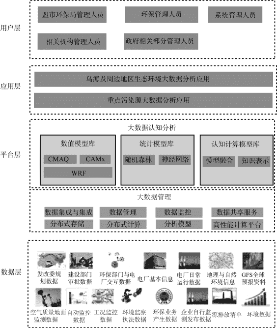）**
平台接入450余家重点监测单位，日均处理分钟级实时流超400万条。针对高并发连续流处理瓶颈，引入国产`openPlant`云中枢。该平台集采集、存储、计算、展现于一体，凭借高稳定、高扩展、高性能及独有安全认证机制，筑牢海量流数据处理基石。流数据处理遵循标准化管线（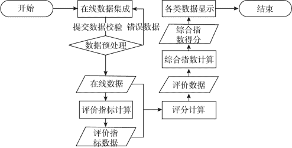），保障全链路高效流转。

**2. 非结构化资料深度挖掘**
环保业务积累海量文档、表格、PDF、影像、音视频等非结构化资料，特点是提取难、周期不定、隐性关联强，传统手段难以变废为宝。平台聚焦自动监测现场检查报告等文本，构建双引擎挖掘体系：
*   **全文检索引擎**：对原始资料清洗、分类、分词、去噪建立倒排索引，支持实时增量更新，实现毫秒级检索与下载，大幅提升信息获取效率。
*   **关键词提取引擎**：自动识别报告高频问题术语，为问题画像提供语义基础。

#### 功能矩阵：评估核心、分析延伸、服务赋能（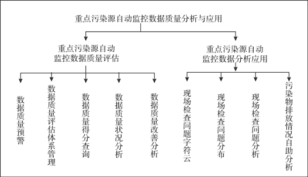）

平台坚持应用导向，构建“核心评估、延伸分析、自助服务”三位一体功能体系：

*   **数据品质评估核心**：
    *   **智能预警**：模型自动识别异常，精准定位单位、指标、时段、频次及描述，支持趋势回溯，预留移动执法接口，推动监管从“被动响应”转向“主动预警”。
    *   **评估管理与现状画像**：引入可配置模型，输出企业/区域/行业多维评分，以表、图、图形可视化呈现全域现状，模型支持迭代优化。
    *   **改善分析**：支持横向对比（区域、行业、企业）与纵向追踪，揭示演变趋势，明确整改方向与管理靶标。

*   **现场检查深度剖析**：
    对四大类报告（现场检查、工况监测、传输有效率、自动监测）实施语义编码、热词提取、关联聚类，通过词频云、分布关联、分类挖掘三维视图，精准刻画热点画像，为准入、运维规范及打击造假提供证据链。

*   **自助多维探索服务**：
    面向废气/废水排放单位，部署自助报表工具，赋能用户探索式分析，支持多格式结果导出。

#### 应用成效：重塑监管范式

1.  **监管模式质变**：建立科学预警规则与灵活评估体系，驱动执法从“全面撒网”转“重点突击”、从“事后查处”转“事前预防”，实现分级分类精准监管。
2.  **数据资产化**：攻克非结构化利用难题，挖掘隐性知识，为打击环保造假、规范市场秩序提供铁证。
3.  **决策触达一线**：自助工具降低使用门槛，实现“数据找人、服务到岗”。

> **核心洞见**：数据蕴含信息，信息提炼知识，知识终将在更高维度、更广视野、更大范围重塑洞察力与决策力，为生态环保治理创造前所未有的战略价值。

---

### 网络空间免疫体系：海量数据驱动的主动防御

#### 痛点与警示：静态防线失效与“棱镜”启示

当前网络攻击呈组织化、隐蔽化、持久化（APT）态势，基于特征库的静态防御在未知威胁、零日漏洞面前愈发乏力，难以在“黄金窗口”内完成检测响应。棱镜计划（）揭示大规模数据聚合与深度剖析在情报获取上的惊人潜能，倒逼我方必须掌握核心技术，实现从“被动防守”到“主动感知、溯源定位”的战略转型。

#### 4.4.1 关键基础设施防护与攻击溯源

**1. DNS安全：筑牢互联网“总入口”防线**
DNS劫持、DDoS攻击屡禁不止。对策包括：争取根服务器运营权，构建自主可控防护体系；研发高性能抗攻击安全DNS；建立应急灾备与全球数据缓存机制；利用解析日志反向溯源攻击行为，推动下一代域名服务安全演进。

**2. DDoS/CC流量洪峰防御（）**
针对高频流量型攻击，融合海量日志分析挖掘新特征与漏洞，结合清洗、加速、缓存一体化防护，实现攻击溯源、画像与精准拦截。

**3. 恶意代码/APT攻击全链路溯源（）**
*   **APT检测平台**：实施内网全流量镜像与长窗口存储，构建访问行为基线，通过关联分析与图形化自动发现异常，实现攻击链条全溯源、全定位。
*   **云端杀毒免疫网**：构建“端云协同”防御生态。海量终端采集异常行为上云，云端借算力优势自动分析未知病毒、零日漏洞，秒级下发特征码至全网端点，实现“一处发现、全网免疫”。

#### 4.4.2 智慧警务：数据洞察下的犯罪预防——芝加哥实践

大城市犯罪高发，芝加哥执法部门引入JMP平台，挖掘十年全量档案（时间、地点、类型、处置），通过探索性分析重塑预警体系。

**数据标准化构建**
按危害度细化分类，利用JMP可视化辅助清洗整合，消除过度分类干扰，输出标准化分析数据集。

**图形化多维洞察（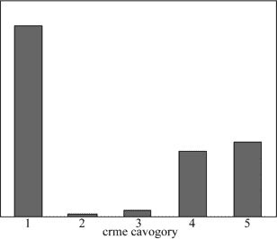-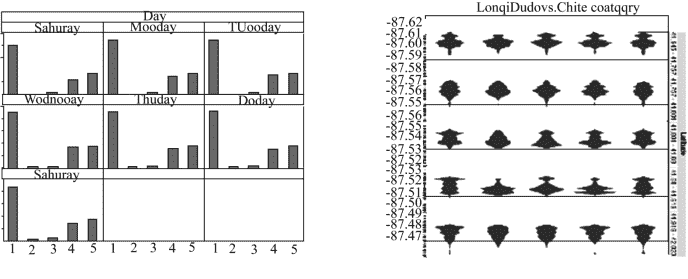）**
*   **宏观画像**：柱状图揭示盗窃/抢劫居首，周五周六高发（）。
*   **时段规律**：等高线与折线图拆解时段特征——下午3点至午夜为高发窗口，周二、周五案件峰值（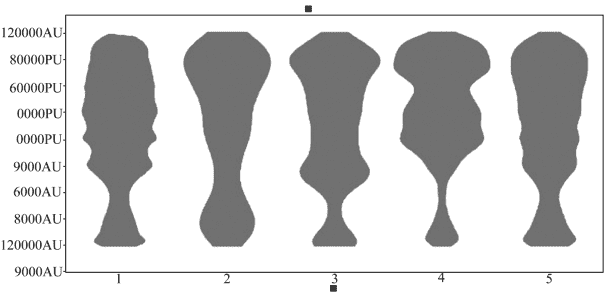）。
*   **空间差异**：不同警区犯罪谱系差异显著（如1区抢劫高发，4区伤害案多发，2区骚扰突出，5区毒品泛滥）（）。

**实战成果**：快速识别时空模式与类型成因，支撑警力精准布防、重点时段巡逻、高危区域专项整治。JMP六西格玛工具箱进一步助力根因分析与治理效果评估，显著降低犯罪率，构建更安全的城市空间。

---

### 第5章 智慧航运：数据要素领航海洋经济新蓝海

#### 5.1 概述：重新定义航运生态

**智慧航运**：融合新一代信息技术与AI，统筹传统船舶与智能船舶协同，覆盖船舶、港口、监管、应急、服务五大维度（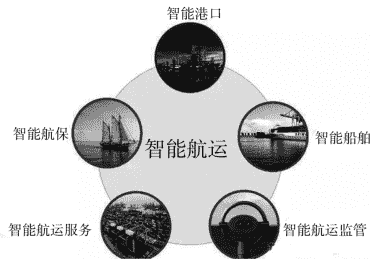），目标直指“安全、便捷、高效、绿色、经济”。

**航运数据资产**：将零散、动态的航运要素沉淀为多维基础模型，以数据思维重构服务流程。核心价值在于：
*   **透视全球物流脉络**：实时监控大宗商品（如大豆、铁矿石）运输航迹，洞察港口货类结构、堆存压港态势。
*   **赋能金融决策**：捕捉“南美大豆压港→国内现货供紧→期价上涨”传导链条，为期货投资提供另类数据阿尔法。
*   **三大核心推演**：船舶活动轨迹、货物流动轨迹、港口作业效能。

**未来图景**：打破信息孤岛，实现数据互联互通、航运与物联网深度融合。完备数据基础、夯实基础设施、培育复合人才、攻关分析技术——数据是智慧航运的“核心引擎”。

#### 5.2 航运数据应用：多源异构数据的统一语义

**5.2.1 六大类数据全谱系（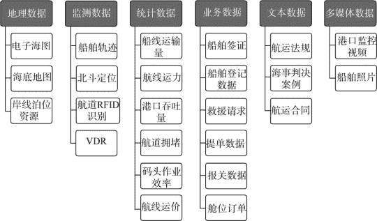）**
航运数据涵盖地理、监测、统计、业务、文本、多媒体六大类，天然具备多图层、矢量化、非结构化特征。这要求建立统一治理标准与多模融合技术栈，将“难用原料”炼制为“高价值资产”。

## 5.2.2 大宗商品海运追踪：从卫星视角洞察贸易脉搏

对于从事矿石、原油、粮食等大宗商品买卖的商家与期货投资人而言，入境货物数量情报是洞察市场行情、制定经营策略的核心依据。过去主要依赖海关发布的公开统计，但近年国际上兴起一条全新技术路径：借助地面基站网络与空间卫星系统追踪海运物流轨迹，进而反推贸易流向。这种基于海量数据的获取方式优势显著——信息不仅即时更新，甚至能精准预判未来货量；覆盖范围从全球宏观视野下探至微观细节，精度跨度可延伸至单个港口、乃至具体泊位。

大宗商品运输高度仰赖海运，而海运拥有统一的国际技术规范与法律框架。2002年起，从事国际航行的船只陆续强制安装船舶自动识别系统（AIS），如所示。该系统自动上报船只身份与动态状态，配合岸基接收网络与低轨卫星，便能构建全球船只实时动态数据库。


图 5-3　船舶自动识别系统（AIS）

通过对全球AIS动态信息，融合船只档案（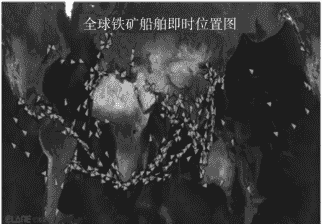）、港口资源（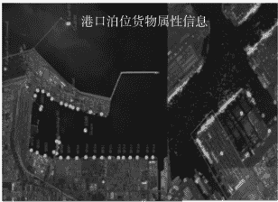）、航线网络（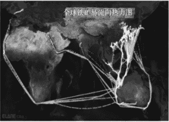）等多维资料开展深度挖掘，即可完整复刻全球大宗商品贸易流全貌，产出精准的进出口货量统计、在途货量及预计到港货量等核心指标。


图 5-4　船舶实时位置


图 5-5　港口货物信息


图 5-6　铁矿石航线图

依托全球海运监控网络与数据挖掘技术，贸易从业者与投资人得以精准把脉现货市场行情；宏观调控部门亦可借此实时追踪经济运行轨迹，实现决策的科学化与前瞻化。

## 5.3 智慧港口：AI重塑作业新范式

### 5.3.1 码头无人驾驶：从“磁钉导航”进化至“智能决策”

作为AI在车辆与交通领域的延伸应用，自动驾驶技术近年来备受全球瞩目。机器视觉、深度学习、GPU加速等核心技术的成熟，为港口集疏运设备的自动驾驶落地奠定了坚实基础。

2018年初，西井科技联合振华重工推出无人跨运车（），并在实操码头完成多轮实测。该设备摒弃了传统埋设磁钉的依赖，凭借AI独立完成定位、领航与决策：不仅能自动规避障碍，还能针对突发状况执行减速、急停或绕行等复杂策略，并依据实时路况自主规划集装箱水平短倒的最优路径。


图 5-7　无人跨运车

同期，西井科技携手珠海港集团发布全球首辆港口作业无人集装箱卡车（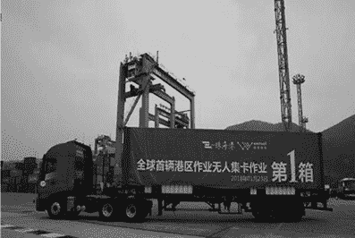）。车辆依据作业指令自主启动，无需人工干预方向盘，通过识别周边箱体、机械、灯塔等目标，精准驶入岸桥作业指定工位，标志着港口水平运输迈入“全自主”时代。


图 5-8　全球首辆无人集装箱卡车

### 5.3.2 自主箱号识别：攻克露天复杂工况下的“视觉难题”

集装箱箱号是港口装卸、堆存、查验、通关全流程的核心标识，识别精度直接关乎数据流转效率与理货公正性。然而，露天作业环境光线多变、箱号排列无序、箱体曲面反光、油漆剥落等痛点，长期制约着识别技术的突破。

AI机器视觉与神经网络算法的飞跃，赋予了机器媲美人类的“观察力”。2017年3月，西井科技发布类脑智能智慧港口系统Well Ocean（一期：智慧理货）。该系统融合神经形态学原理、自研硬件与算法，具备“自学习、实时进化”特性，将箱号识别精度推向近100%。系统已实现铅封识别、前后箱门及铅封自主识别等功能（、），为无人智慧闸口、无人吊装筑牢基石。


图 5-9　WellOcean 系统快速识别出前箱门


图 5-10　WellOcean 系统快速识别出后箱门和铅封

### 5.3.3 智慧船舶配载：让“空间博弈”变身“算法最优解”

船舶配载是海运核心环节，要求在保证适航性与经济性前提下，依规绘制预装计划图。这项工作复杂度高、综合性强、依赖经验，配载质量直接左右装卸效率与航行安全。

AI技术将配载从“经验驱动”转向“数据驱动”。算法融合船舶箱量分布、箱型比例、挂靠港序，以及堆存现况、设备状态、航线泊位、货源信息等即时数据，在预判基础上自动生成最优装船方案，实现货物安全、高效装船，大幅提升有效积载率。Well Ocean系统引入AI实时生成装船图（），自动确认贝位，显著跃升生产效能。


图 5-11　实时 BAY 位船图系统

### 5.3.4 码头智能调度：构建“感知-决策-执行”闭环

未来港口调度将深度融合物联网与AI，汇聚设备状态、泊位资源、车辆运输、船舶动态等即时数据流。通过预判模型输出最优部署，打通信息指令与设备控制的“最后一公里”，实现作业流程的连续、协调、均衡与经济运行，最大化生产效益。

鹿特丹港务局与IBM共建的“未来港口”项目即为标杆案例：在长达42公里的陆海区域部署密集传感器，采集潮汐、气象、水位、泊位等多源数据，经物联网与AI分析转化为决策依据，有效缩短等待时长，精准锁定靠泊、装卸最佳时间窗口。

### 5.3.5 设备故障智能诊断：从“事后维修”迈向“预测性维护”

随着吞吐量激增与船型大型化，港机设备日益高端、故障愈发复杂。单次故障停机可能造成巨额损失，精准诊断与快速响应至关重要。智能故障诊断技术的兴起，为复杂系统可靠性保障开辟新径。

通过传感器布设、信号采集、联网传输与监测，结合机器学习算法分析，可提前预判设备隐患并主动干预，规避作业中断与安全事故。振华重工为设备植入“大脑”与“感知系统”，融合传感器、海量数据、AI、云计算、3D仿真等技术，已基本实现装备远程监测诊断，提供“四级故障危害预警”服务，守护港口运营生命线。

## 第 6 章 大数据赋能生物医学：从疾病预警到精准医疗

## 6.1 流行病预测：搜索数据里的“流行病学侦探”

### 6.1.1 百度疾病预测：挖掘网民检索背后的统计特征

百度疾病预测（`http://trends.baidu.com/disease`）是互联网疫情监测的典型范例。其核心逻辑在于：传染病流行具备规律性，受气温波动、环境指标、人群流动等多因子驱动；海量网民每日检索疾病相关内容，汇聚形成统计特征，经时间积累构建预判模型，输出未来疾病活跃度指数（）。


图 6-1　百度疾病预测模型

### 6.1.2 谷歌流感趋势（GFT）：验证搜索数据预测流感的可行性

谷歌发现，美国每年约9000万居民通过网络查询疾病、药物、医院信息，流感相关检索量能实时折射疫情现状。据此，GFT利用2003-2007年五年数据建模，成功预测疾控中心滞后发布的疑似流感比例，2008年测试数据验证良好（），后续十余年持续保持高精度预判，确立了海量数据在流行病学监测中的里程碑地位。


图 6-2　流感发病率与 GFT 对比图测

## 6.2 智慧医疗：织就“患-医-机-药”全联接生态网

智慧医疗以区域健康信息平台为底座，借物联网技术打通患者、医护、机构、设备四端交互。随着语音交互、机器视觉、认知计算等AI技术成熟，应用场景全面绽放，成为提升医疗服务水平的核心引擎。主流应用涵盖：语音录入病历、影像辅助诊疗、新药研发加速、医疗机器人、个人健康大数据智能分析等（）。


图 6-3　人工智能在医疗领域的应用

### 6.2.1 区域卫生系统：打破数据孤岛，共享赋能全民健康

区域智慧医疗整合互联网、移动化、大数据分析技术，构建覆盖互联网医院、远程会诊、移动急救、居民健康管理、公共卫生等全链路服务体系，实现统一部署、协同运作，显著提效降本。

自2006年起，我国各级政府推进省市级健康信息平台建设，推动居民电子健康档案与电子病历互通共享。数据采集边界延伸至社区、私立诊所、检验中心等院外场景，多源异构数据的融合为临床科研、药企研发注入强劲动能。通过数据分析，可实现疫情趋势研判、感染阻断、慢病筛查管理，让患者享受更便捷服务。

面对老龄化社会挑战，慢病成首要健康威胁。医疗大数据支撑起全民参与的慢病管理新模式。可穿戴监测装备（）实时采集生理指标，移动健康APP记录运动、血压、血糖、血氧、心率，异常即时预警。四川“社区糖管家”模式即通过大数据实现单病种精细化管理：专科医师、全科医师、管理师三方协同，线上线下结合，患者数据实时上传，管理师远程指导干预，试运行反馈优异。


图 6-4　可穿戴设备

### 6.2.2 智慧医院系统：重塑院内流程，极致体验与效能并重

智慧医院融合计算机、通信、自控技术，构建高效、舒适、安全的就医环境，核心由“数字医院基座”与“提升应用”双层架构组成。

数字医院涵盖HIS（医院信息系统）、LIS（实验室信息管理）、PACS（影像归档传输）、医生工作站四大支柱，实现诊疗与行政信息全生命周期管理。提升应用层则聚焦服务升级：远程探视阻断院内感染、远程会诊优化优质资源配置、自动报警降低重症护理成本、临床决策支持系统辅助精准诊疗、智慧处方规避用药风险并为慢病管理提供依据。

某市人民医院“智慧医院”集成平台（）以电子病历为核心，整合门诊、住院、免疫、体检等多源信息，打通PACS影像、LIS检验、门诊信息等临床子系统，实现跨系统、跨业务的数据无缝流转与复用。


图 6-5　智慧医院系统平台

### 6.2.3 家庭健康系统：将专业守护延伸至生活最后一米

家庭健康系统聚焦生理数据的采集、传输、分析与可视化呈现，基于阈值预警潜在风险，让居民足不出户掌握健康状态。服务对象精准覆盖行动不便者、慢病/老幼患者、特殊群体（智力障碍、残疾、传染病），功能延伸至视讯就医、远程照护、健康监测、智能用药提醒（时间、禁忌、余量），构建家庭端的立体健康防线。

## 6.3 生物大数据：解码生命密码的“数据金矿”

### 6.3.1 生物信息学：跨学科融合下的“大数据原生地”

生物信息学聚焦生物信息的获取、处理、存储、传播、分析与诠释，是生命科学与计算机科学高速发展催生的交叉新学科。它综合运用生物学、计算机科学与信息技术，破解海量复杂生物数据背后的生命奥秘。相较互联网数据，生物数据更具典型大数据特征——量大、维高、结构复杂。借助先进数据科学手段，我们能深度洞察生物学过程、作物表型、致病基因，从个人健康档案中预测健康趋势、定制预防策略，践行“治未病”愿景。

### 6.3.2 生物大数据四大源头：构建全景数据版图

生物大数据主要汇聚自四大维度（）：

1.  **研发数据**：药企与科研机构全周期产出的数据资产。涵盖临床前、I-IV期临床试验、上市后大样本疗效与不良反应追踪数据，以及前沿科研成果。
2.  **诊疗数据**：患者就医过程产生的核心业务数据。含电子病历、生化/免疫/PCR等传统检测、二代测序/基因芯片等前沿检测、医师用药决策与诊疗路径记录。
3.  **患者行为与感官数据**：院外场景下的患者主观与客观数据。家族病史、用药依从性、可穿戴装备/即时监测终端/智能手机采集的病管/健管数据，及网络寻医问药、患友互动交流等数字足迹。
4.  **医保数据**：付费端的结构化记录。参保人病历、报销流水、药物经济学评估、同病种人群诊疗路径对标分析等。


图 6-6　生物大数据的四个来源

### 6.3.3 生物大数据应用全景：多方共赢的价值变现路径

生物大数据内涵丰富、价值高维，经有效挖掘，医药生态各方均可受益。从靶点发现、临床试验优化、精准招募，到上市后真实世界研究、商业决策支持；从辅助临床诊断、个性化治疗方案制定，到疾病风险预警、慢病精细化管理；从保险精准定价、支付谈判证据，到监管审评科学化、公共卫生政策制定，数据价值正在全链条释放。

## 6.3.4 精准医疗：数据驱动的个性化诊疗新范式

### 临床决策智能化：以“数据画像”重塑诊疗路径
精准医疗的本质，是摒弃“千人一方”的传统模式，转而依据患者独特的生物学特征与生活图谱，规划专属临床路径。这一愿景的落地，根植于海量生物数据资产的沉淀——涵盖基因组、蛋白组等多维组学谱系，以及病历轨迹、生活习性、行为偏好等全景信息。通过将个体特征与历史病例群体深度比对，借助数据挖掘提炼最优干预策略，方能成就“一人一策”的医疗理想。

### 健康全程守护：从“病后治”向“病前防”跨越
在老龄化浪潮、慢病高发及全民健康觉醒的多重驱动下，健康与疾病全程管控正孕育万亿级蓝海。生物大数据在此化身“智能管家”：聚合健康档、病历档、睡眠指数、心理量表等多模态指标，经智能研判后实现生理状态动态感知，进而施以精准行为矫正，引导公众践行科学生活方式，守护生命质量。


图 6-7　生物大数据的受益方

### 赋能医药创新：大数据贯穿研发生命周期
生物大数据正重塑医药研发全链条效能：
*   **筑牢基础高地**：多组学数据深度积淀，揭示疾病分子机制，催生新靶点与新技术，为下游转化输送核心“弹药”；
*   **重构临床试验**：借助智能画像精准匹配受试者，大幅跃升药物应答率，显著压缩研发周期与资金投入；
*   **闭环真实世界证据**：上市后海量真实用药数据（疗效与安全性）实时回流，助力早期捕捉潜力管线，构建“临床反哺研发”正向飞轮。

### 洞察患者画像：数字足迹里的公卫金矿
互联网与移动终端普及，将患者检索、消费、空间分布转化为全新维度的生物数据资产。谷歌借搜索热度实现流感预警，阿里凭消费轨迹精准触达，均印证了该数据层的战略价值。随着数字化渗透医药各环节，这座“数据富矿”的开采潜力将持续释放。

---

## 精准医疗核心逻辑：个体证据对决群体经验

**本质区别：循证医学求“最大公约数”，精准医疗寻“最优特解”。**

传统循证医学立足人群级临床试验，输出适用“大多数”的标准化方案，难免忽视个体异质性。精准医疗则志在整合患者基因靶点、全组学图谱、生活习性、家族谱系乃至前沿科研进展，经多维融合计算后，输出专属诊疗主张。


图 6-8　精准医疗

**落地双引擎：**
1.  **数据资产沉淀**：持续汇聚患者全维度生物数据；
2.  **知识图谱构建**：织就数据、疾病、方案三元映射网络。

---

## 6.4 基于大数据的线上线下医疗健康综合服务平台

### 6.4.1 平台架构设计：共筑全周期“以人为本”服务生态
建设目标直指痛点：依托大数据与智能终端，打通虚实两界，覆盖生命全程，践行**“未病先防、已病早治、既病防变、愈后防复”**十六字方针，回应公众多元健康诉求，提升国民身心福祉。

架构层面，借力健康云中枢与互联联接，实现**公立医疗机构、医师群体、普通居民**三方协同。此举不重塑就医范式，缓解三甲资源挤兑，更通过网络闭环“诊前-诊中-诊后”全链路服务，达成资源高效配置与患者负担双降。


图 6-9　基于大数据的线上线下综合医疗健康服务平台架构图

### 6.4.2 核心功能矩阵：四大支柱撑起服务闭环

#### 1. 全域互联：打破“数据烟囱”与“服务孤岛”
现存平台多困于院内或社区，重管控轻服务，家庭端缺位，线上线下割裂，信息不对称严重。本体系旨在贯通**专家、医师、社区、家庭**四大节点，消除壁垒，实现优质医疗信息服务的全域触达与有机融合。

#### 2. 智能导诊：终结“盲目就医”与“黄牛乱象”
区别于传统导医，引入AI决策引擎，为就医迷茫者精准匹配最适配医疗资源。这不仅落实科学分流分治，化解“看病难、贵、小病大治”，更从源头斩断“号贩子”生存链，保障就医公平。

#### 3. 名医云诊室：激活医者剩余价值
为专家、医师、护士搭建多点执业数字化阵地。利用碎片化时间输出线上专业指导，惠患者以名医贴心服务，利医者以拓收增收、改善薪酬结构；必要时无缝衔接线下实体诊疗，虚实结合，刚柔并济。

#### 4. 重点人群数字档案：织密“特殊群体”防护网
建立社区重点人员（独居老人、残障人士、戒毒康复者等）健康数字档案，落实动态随访与一对一精准干预；同步推广家庭健康账户，守护全家全周期生命质量。平台运营以门户官网为枢纽，统筹各端资源高效流转。

### 6.4.3 未来演进：智能化移动端，重塑“体验至上”新生态

演进锚点锁定**移动端智能化跃升**。APP、移动Web、语音交互、短信触达等多模态入口延伸，大幅强化服务即时性与用户体感。

平台将深度融合**“虚实融合”、“智人协同”、“管咨一体”**三大维度，构建交互式智能服务中枢：
*   **资源集约共享**：整合多院禀赋，杜绝单体低效与重复建设；
*   **分级诊疗落地**：科学导流分级，缓解就医压力，让优质医疗触手可及；
*   **双向闭环联动**：线上导航/导诊/咨询 ⇄ 线下转诊/配药/护理，虚实无界；
*   **认知范式转型**：借互联网智慧成果唤醒居民日常健康自觉，完成从“以病为中心”向“以健康为中心”的战略转身。

---

# 下篇 应用实战篇

## 第 7 章 Python：全栈开发的“瑞士军刀”

Python 是一门面向对象的解释型通用编程语言，由荷兰大神 Guido van Rossum 于 1989 年圣诞节期间“为消遣”而创立（语言名致敬蒙提·派森剧团）。三十余载迭代，它凭借**语法极简、上手极快、跨平台、生态极强**等特质，早已进化为成熟稳定、扩展性极佳的“全能选手”，稳坐最热门编程语言之一宝座。

### 7.1 发展简史：极客的圣诞礼物，演变成行业标杆

*   **初心**：Guido 希望造一门既能调用底层系统接口，又能像英语一样读写、极易上手的语言，点燃大众编程热情。
*   **里程碑**：1991 年首个解释器诞生（C 语言实现，可调用 C 库）。
*   **基因融合**：语法借鉴 C 语言，深受 ABC 语言影响，自带“可扩展性”基因——高层引入 `.py`，底层对接 C 库，宛如钢结构大厦，框架稳固、内装随心。
*   **核心哲学**：屏蔽机器细节，聚焦逻辑思考。这一“降维打击”式的设计，极大降低了认知门槛，吸引海量学习者入场。

### 7.2 六大核心优势：为何它是“第一语言”首选？

| 优势维度 | 关键解读 |
| :--- | :--- |
| **完全免费开源** | 个人/商业零成本，无版权顾虑。源码开放、文档海量、社区响应堪比商业级支持。 |
| **极简易学** | 信奉“优雅、明确、简单”，倡导“一种最佳实践”。无需声明类型，动态赋值，代码即伪代码。MIT、CMU 等名校均用它做入门教学。 |
| **纯正面向对象** | 原生支持多态、运算符重载、多重继承等高阶特性，却比 Java/C++ 更平滑易懂。 |
| **全平台零移植** | C 语言底座赋予天然跨平台性，Write Once, Run Anywhere（Win/Linux/macOS 无缝切换）。 |
| **功能强大的“混合体”** | 兼具脚本语言敏捷与高级语言纵深：<br>① 动态类型/自动内存管理（GC）甩锅给解释器；<br>② 模块/类/异常支撑大型工程；<br>③ 内置列表/字典/字符串等高级数据结构，灵活高效；<br>④ 标准库覆盖正则/网络/文件等全场景；<br>⑤ 第三方生态极其繁荣，即插即用。 |
| **开发极致高效** | 无编译链接等待，所写即所得。实现同等功能，代码量仅为 C/C++ 的 1/3~1/5，维护成本极低。 |

### 7.3 全域应用版图：无处不在的 Python

1.  **系统运维自动化**：调用 OS API，编写跨平台维护工具，文件/进程/线程/正则/命令行全搞定，标准库深度绑定 POSIX。
2.  **科学计算与数据科学**：**NumPy/SciPy/Matplotlib** “黄金三角”奠定霸主地位。免费替代 MATLAB，且能同时处理文件管理、UI 设计、网络通信等工程级任务。
3.  **数据库编程**：原生支持 MySQL/Oracle/SQLite/ODBC 等主流数据库，自带 Gadfly 内嵌 SQL 引擎。
4.  **胶水语言/组件集成**：无缝嵌入 C/C++，或将 Python 嵌入其他语言，打通技术栈壁垒。
5.  **Web 全栈开发**：标准库覆盖 HTTP/HTML/XML/Email/XML-RPC/SOAP/Telnet 等协议，框架生态繁荣。
6.  **前沿技术主力军**：
    *   游戏/多媒体：`Pygame`、`PyOpenGL`
    *   机器人控制：`PyRo`
    *   AI/机器学习：`PyBrain` 及 TensorFlow/PyTorch 等主流框架首选语言
7.  **企业级/政务/教育应用**：全球大厂核心业务支撑、电子政务系统、教学辅助自动化工具广泛落地。

### 7.4 环境搭建指南：从零到一的“保姆级”教程

Python 跨平台特性决定了“装好即用”，但各系统安装细节略有差异。以下以 **Windows 7 + Python 3.7** 为例演示。

#### 7.4.1 Python 核心环境安装

> **版本选择**：2.x 与 3.x 不兼容，3.x 早已成主流，教程基于 **Python 3.7**。

**步骤 1：官网获取安装包**
访问 `https://www.python.org/downloads/windows/`，按系统位数选择：
*   32位 → `Windows x86 executable installer`
*   64位 → `Windows x86-64 executable installer`


图 7-1　python3.7.0 下载

**步骤 2：启动向导·关键勾选**
双击运行 `.exe`，**务必勾选** `Add Python 3.7 to PATH`（自动配置环境变量），点击 `Customize installation` 进阶定制。


图 7-2　Python 安装向导

**步骤 3：可选组件与路径设定**
*   可选功能保持默认全选，点 `Next`；
*   高级选项建议全勾，自定义安装路径（避开中文/空格），点 `Install` 静待完成。


图 7-3　选择 Python 工具


图 7-4　选择 Python 高级选项

**步骤 4：安装成功确认**
弹出 `Setup was successful` 即大功告成。


图 7-5　完成安装

**步骤 5：CMD 验证**
打开命令提示符，输入 `python`，出现版本号及 `>>>` 提示符，环境就绪。


图 7-6　打开命令提示窗口

#### 7.4.2 PyCharm 专业 IDE 安装与上手

**为何选 PyCharm？**
JetBrains 出品，业界公认最强 Python IDE：智能补全、语法高亮、调试器、重构、版控、项目管理一应俱全。专业版更深度支持 Django、Google App Engine、IronPython，代码分析能力恐怖如斯。

*   **版本建议**：**社区版免费且功能足够入门/进阶**；专业版付费，Web 全栈开发者可考虑。
*   **跨平台**：Win/Mac/Linux 通用。

**安装三步走：**
1.  官网 `https://www.jetbrains.com/pycharm` 点 `DOWNLOAD NOW`；
2.  选择 Windows 版 **Community（社区版）**，点 `DOWNLOAD` 获取安装包；
3.  双击执行安装，一路 Next 默认即可，首次运行可导入配置或按引导个性化设置（主题、插件、解释器绑定）。

> **温馨提示**：安装完成后，建议先在 `Settings -> Project Interpreter` 确认绑定刚装好的 Python 3.7 解释器，再创建第一个 `Hello World` 项目，开启你的 Python 之旅！


图 7-7　`PyCharm` 获取安装包

（2）下载完毕后，运行安装程序，点击“下一步”按钮。接着设置安装目录，注意路径中最好别包含中文；考虑到 `PyCharm` 占用内存较大，推荐安装在 D 盘或 E 盘，尽量避开系统盘 C 盘。确认无误后继续点击“下一步”，操作界面参考图 7-8、7-9。


图 7-8　`PyCharm` 安装向导界面


图 7-9　`PyCharm` 安装路径设置

（3）在图 7-9 的窗口中再次点击“下一步”，根据自身系统位数勾选对应选项，同时建议勾选“创建桌面快捷方式”以及“关联 `.py` 文件”，随后点击“下一步”，见下图 7-10。


图 7-10　`PyCharm` 安装选项配置

（4）点击“安装”按钮开始默认安装流程。安装结束后，点击“完成”按钮退出向导，如图 7-11 所示。


图 7-11　安装向导完成

### 7.5 课后习题

#### 一、单项选择题

1. 以下选项中，哪一项**不**属于 Python 语言的特点？

    A. 简单易学  
    B. 开源免费  
    C. 面向过程  
    D. 可移植性强  

#### 单项选择题

### 2. 关于 Python 的描述，下列说法**错误**的是？

    A. `Python` 由 `ABC` 语言演变而来  
    B. `Python` 源程序必须经过编译和链接才能生成可执行文件  
    C. `Python` 是开源语言，可移植到多种平台运行  
    D. `Python` 属于高级计算机语言  

### 3. 下列领域中，哪一项**不是** `Python` 的主流应用方向？

    A. Web 应用开发  
    B. 科学计算  
    C. 操作系统管理  
    D. 3D 游戏开发  

### 4. `Python` 源程序文件的后缀名通常是？

    A. `.exe`  
    B. `.txt`  
    C. `.py`  
    D. `.obj`  

### 5. `Python` 中单行注释的起始符号是？

    A. `#`  
    B. `//`  
    C. `"""`  
    D. `'''`  

#### 二、简答题

### 1. 简述在 Windows 系统下搭建 `Python` 开发环境的步骤。

### 2. 简述 `Python` 语言的主要特点。

### 3. 简述 `Python` 的主要应用领域。

#### 三、编程实操题

### 1. 编写代码，在控制台输出：这是我的第一个 `Python` 程序！

### 2. 编写代码，在控制台输出以下内容（含分隔行）：

    ******************************
    这是我的第二个 `Python` 程序！
    ******************************

## 第 8 章 Python 语法基础

## 8.1 Python 程序基本结构

### 8.1.1 标识符与关键字

标识符指编程语言中合法的命名字符串集合。`Python` 的标识符命名规则与大多数 C 系高级语言类似，具体约定如下：

1.  命名必须以字母或下划线 `_` 开头，**不能**以数字开头。若由多个单词组成，通常用下划线连接（蛇形命名法）。
2.  首字符之后，可包含任意字母、数字及下划线的组合。
3.  **区分大小写**：`name` 与 `Name` 是两个不同的标识符。
4.  **下划线开头有特殊含义**：
    *   单下划线开头（如 `_foo`）：表示受保护成员，不建议直接访问，需通过接口；使用 `from xxx import *` 时不会被导入。
    *   双下划线开头（如 `__foo`）：表示类的私有成员。
    *   双下划线开头并结尾（如 `__foo__`）：系统预留特殊方法名，如 `__init__()` 为构造函数。

关键字是 `Python` 保留的特殊单词，**不能**用作标识符名称。完整关键字列表见下表 8-1。

表 8-1 Python 的关键字


### 8.1.2 Python 代码注释

注释用于在代码中添加说明，解释器执行时会自动忽略。`Python` 支持单行与多行两种注释形式。

*   **单行注释**：以 `#` 开头，该符号后至行尾的内容均不执行。示例：


*   **多行注释**：使用三个单引号 `'''` 或三个双引号 `"""` 包裹内容。示例：


### 8.1.3 Python 缩进规则

这是 `Python` 与其他语言最大的区别之一：它**强制使用缩进**（通常是 Tab 键或空格）来划分代码块，而非花括号 `{}`。同一代码块内的语句必须保持**完全一致的缩进层级**。缩进的空白数量虽可变，但同一层级必须统一，这一点极其严格。


**错误示范**：混用 Tab 和空格缩进会导致报错。


报错信息如下：


错误提示明确指出缩进方式不一致（混用制表符与空格），统一即可解决。因此，建议在每个缩进层级固定使用 **1 个 Tab、2 个空格或 4 个空格**，**严禁混用**。

### 8.1.4 Python 语句换行

通常一行写一条语句，无需分号结尾。若语句过长，可用反斜杠 `\` 实现隐式换行，将一行拆分为多行显示：


## 8.2 Integral 类型（整数与布尔）

`Python` 声明变量无需指定类型，但内部仍有基础数据类型。`Integral` 类型包含两种内置类型：`int`（整型）与 `bool`（布尔型）。

### 8.2.1 整数类型 (`int`)

对应数学上的整数集合。支持常见数学运算：`+`、`-`、`*`、`/` 等。所有常用数学函数与运算符均适用，部分由内置函数提供（如 `abs()` 取绝对值），部分由 `int` 运算符直接支持。详见表 8-2。

表 8-2 数值运算符与函数


### 8.2.2 布尔类型 (`bool`)

布尔类型是 `Python` 正式的数据类型，仅有两个值：`True`（真）与 `False`（假），均为预定义的内部变量。从面向对象视角看，`bool` 是 `int` 的子类，`True` 和 `False` 是其实例。参与数值运算时，`True` 等价于 `1`，`False` 等价于 `0`。

## 8.3 浮点类型

### 8.3.1 浮点数 (`float`)

用于处理实数（带小数）。`Python` 的 `float` 相当于 C 语言的 `double`（双精度）。两种表示形式：

1.  **十进制形式**：数字加小数点，小数点不可省略（如 `2.32`、`105.3`）。
2.  **指数形式（科学计数法）**：如 `56e3` 或 `56E3` 表示 $56 \times 10^3$。`e`/`E` 前必须有数字，后可跟正负号（缺省为正），指数部分必须为整数。

**注意**：浮点数在计算机中通常是**近似值**。例如 `2.0/3.0` 结果无限循环，受限于内存精度，只能存储近似值。

### 8.3.2 复数 (`complex`)

由实部和虚部组成，形式为 `x + yj`（`x` 为实部，`y` 为虚部，均为实数）。例：`2+3j`、`0.5j`、`3+0j`。可用 `complex()` 函数创建：

*   无参数：返回 `0j`。
*   单复数参数：返回副本。
*   其他参数：尝试转换为复数（接受字符串或 1~2 个浮点数；单浮点数时虚部视为 0）。

## 8.4 运算符

`Python` 常用运算符分类：算术、赋值、比较、逻辑、位运算。算术运算返回数值，比较/逻辑返回布尔值，位运算按二进制位计算，身份运算符比较对象内存地址。

表 8-3 至 8-9 分别列出了算术、赋值、比较、逻辑、位、成员、身份运算符的说明与实例。

表 8-3 算术运算符


表 8-4 赋值运算符


表 8-5 比较运算符


（续表）


表 8-6 逻辑运算符


表 8-7 位运算符（假设变量 `a=60`，`b=13`）


（续表）


位运算符操作演示：


运行输出结果：


此外，`Python` 还支持成员运算符（`in`、`not in`）和身份运算符（`is`、`is not`）。

表 8-8 成员运算符


身份运算符用于比较两个对象的内存存储单元（即 `id`）。

表 8-9 身份运算符


运算符之间存在优先级差异，表 8-10 按优先级从高到低排列。

表 8-10 运算符优先级


## 8.5 字符串 (`str`)

字符串是有序字符集合，用于存储文本，是 `Python` 最常用的类型。字符可为 ASCII、Unicode 等。**字符串是不可变对象**，即创建后不能原地修改内容。支持索引、切片等操作，顺序从左到右。

### 8.5.1 创建字符串

赋值即可创建，引号风格灵活：单引号、双引号、三单引号、三双引号均可。


### 8.5.2 转义字符

用于表示难以直接输入的特殊字符。常用转义字符见表 8-11。

表 8-11 常用转义字符


### 8.5.3 字符串核心操作

1.  **获取长度**：用 `len()` 函数返回字符个数。


2.  **包含性判断**：用 `in` / `not in` 判断子串是否存在。


3.  **字符串拼接**：用 `+` 将多个字符串按序合并生成新串。


4.  **迭代遍历**：配合 `for` 循环逐字符处理。


5.  **索引与切片**：
    *   **正向索引**：0, 1, 2 ... `len-1`。
    *   **反向索引**：`-len` ... -2, -1（-1 为最后一个字符）。
    *   **索引**：`s[i]` 获取单字符。


    *   **切片**：`s[start:end]` 获取子串（含 `start`，不含 `end`）。参数可省略：`start` 默认 0，`end` 默认长度。


    *   切片示例：


### 8.5.4 字符串常用方法

`str` 对象内置大量处理方法，常用者汇总于表 8-12。

表 8-12 字符串方法说明


（续表）


### 8.5.5 格式化输出

`Python` 支持格式化字符串输出。基础用法是用 `%s` 等格式符作为占位符，配合 `%` 操作符插入值。


### 8.5.6 控制台交互 (I/O)

*   **输入**：内置 `input()` 函数从标准输入（键盘）读取一行文本，**返回字符串类型**。


*   **输出**：内置 `print()` 函数向标准输出写入。格式化语法类似 C 语言 `sprintf`。


## 8.6 课后习题

### 一、单项选择题

1. 下列哪个**可以**作为合法的 `Python` 变量名？

    A. `1name`  
    B. `name_1`  
    C. `break`  
    D. `a*plv`  

2. 在 `Python 3` 中，输出变量 `a` 值的正确语法是？

    A. `print a`  
    B. `print(a)`  
    C. `print"a"`  
    D. `print("a")`  

3. 已知 `a=1`，`b=2`，`c=3`，`d=4`，表达式 `a > b and c <= d or 2*a > c` 的值为？

    A. `False`  
    B. `True`  
    C. `-1`  
    D. `1`  

4. 假设 `A=3`，`B=5`，`C=2`，表达式 `not (B < C) and A > C` 的值为？

    A. `True`

## 核心语法：掌握 Python 程序流程控制

### 知识自检：第 8 章重点回顾

#### 单项选择题
5. 已知 `X＝3`，`Y＝5`，`Z＝2`，求表达式`（X²＋Y）/Z`的值。
A. `1`
B. `5`
C. `3`
D. `2.0`

#### 填空练习
1. Python 变量命名规则允许包含`_____`、`_____`与`_____`，但首字符不能是`_____`。
2. 想在解释器中查看关键字列表？需依次执行`_____`和`_____`两条指令。
3. 数学公式 `3＋（a＋b）2` 对应的 Python 代码写法是 `_____`。
4. 表达式 `\[（x＋y）＋z\]X360－50（c＋d）` 存在语法错误，修正后的形式为 `_____`。
5. 以下代码片段的输出结果为 `_____`。


6. 位运算 `13 & 9` 的运算结果是 `_____`。
7. 执行赋值语句 `“x，y，z＝1，hello＇，＇python，＇”` 后，变量 `z` 绑定的值为 `_____`。

#### 编程实战
1. 编写脚本：接收用户输入的姓名、年龄与地址，并通过 `print()` 完整打印。
2. 编写脚本：录入商品单价与购买数量，自动计算并显示总金额。

#### 简答题
1. 列举 Python 中至少 4 种比较运算符，并简要解释其含义。
2. 给出表达式 `“2＞3 or 18！＝16”` 的执行结果，并说明判断逻辑。

---

### 9.1 顺序执行：程序的基石

任何软件的运行本质上都是将解题思路翻译成计算机可识别的指令序列。程序架构离不开三大基础结构：**顺序**、**选择**、**循环**。这三者组合构建起无限复杂的应用逻辑。顺序结构是最朴素也最核心的形态——指令自上而下、逐行执行，不走弯路（如流程图所示）。宏观视角下，即便剥离选择与循环，整个程序依然是一个巨大的顺序流。Python 中构成顺序结构的三要素分别是：获取数据（输入）、加工数据（处理）、呈现结果（输出）。


*图示：顺序结构执行流向*

#### 实战演练：矩形面积计算器
需求：提示用户录入宽与长，计算并输出面积。
运行示例：


**关键函数解析**

**1. `input()` —— 数据入口**
内置函数 `input()` 负责从标准输入（默认键盘）读取数据。
基本签名：

> **提示**：参数 `prompt` 可选，提供时会原样打印。函数会阻塞等待用户回车，**返回值永远是字符串（`str` 类型）**。

示例：

运行后控制台显示提示，用户输入 `Lily` 回车，变量 `name` 绑定字符串 `"Lily"`。

**类型转换实战**：数值运算需先转型。如示例首行：

流程：显示提示 → 接收字符串 `"20"` → `int()` 转整数 `20` → 赋值给 `width`。同理获取 `length`，最后计算 `area`。

**2. `print()` —— 结果出口**
标准输出函数 `print()` 语法灵活：

> **参数详解**：
> - 多项输出用逗号隔开，默认以空格分隔（`sep`），以换行结尾（`end`）。
> - 无参数调用即输出空行。

基础用法演示：

输出结果：


**进阶：格式化输出**
实际开发常需定制显示格式。Python 沿用 `%` 运算符连接格式串与数据：
`格式控制字符串 % (值1, 值2, ...)`
示例：

运行效果：

解析：`%s` 占位字符串，`%d` 占位十进制整数，按顺序替换。常用格式符速查：

> *注：`str.format()` 等新式格式化手段因篇幅略过，请自行拓展。*

---

### 9.2 选择结构：让代码学会做决定

现实逻辑充满“如果……那么……”分支。Python 提供 `if` 系列语句覆盖单分支、双分支、多分支场景。

#### 9.2.1 单分支 `if` —— 有条件才执行
语法骨架：

逻辑：求值条件表达式 → `True` 执行缩进块 → `False` 跳过。流程图见下。


**语法铁律**：
1. 冒号 `:` 不可漏。
2. 条件可为关系/逻辑/算术表达式（算术非 0 为真，0 为假）。
3. 缩进定义代码块边界；单语句可紧跟冒号同行（不推荐）。

**案例：7 的倍数筛选**

测试运行：


**案例：两数有序化**
输入 `a`、`b`，若 `a < b` 则交换。


结果：


#### 9.2.2 双分支 `if…else…` —— 二选一
语法：

逻辑：条件为真走分支 1，为假走分支 2。流程图：


**案例：奇偶判定**

运行示例：


**案例：求两数最大值**

输出：


#### 9.2.3 多分支 `if…elif…else…` —— 多情况分发
语法：

执行机制：自上而下评估条件，**首个为真者执行对应块并跳出整个结构**；全假则落入 `else`。流程图：


**核心规则**：
1. **互斥执行**：仅命中一个分支。
2. `elif` 数量不限。
3. **顺序敏感**：多条件同真时，仅第一个生效。

**案例：成绩分级系统**
规则：≥90 优，≥80 良，≥70 中，≥60 及，<60 不及格。

输入 78 时输出：

> **技巧**：第二个分支只写 `score >= 80`，因能走到这里必然 `< 90`，利用“短路”特性简化代码。

#### 9.2.4 嵌套选择：分支里的分支
在代码块内再嵌入 `if` 结构，形成多层决策。支持同构/异构嵌套。典型模板：

执行：外层条件 1 真 → 进内层判断条件 2；外层假 → 判断条件 3。

**避坑指南**：
1. 内层必须完整包裹在外层某分支块内，**严禁交叉嵌套**。
2. 同层级缩进对齐。

**案例：5 与 7 的整除关系**

四种运行结果：


**案例：三角形判别 & 直角校验**
输入三边长，先判成三角形，再判是否直角。

测试用例：


---

### 9.3 循环结构：自动化重复劳动

面对重复性任务，顺序/选择结构会导致代码膨胀甚至无法实现。循环以固定代码块反复执行，极大精简逻辑。Python 主力循环：`while` 与 `for`。

#### 9.3.1 `while` 循环：条件驱动的重复
只要条件为真，循环体持续运行。通用语法：

# 9.3 循环结构核心解析


`while` 结构的运作遵循固定三步曲：起始先对判断条件求值；若求值结果为真，认定条件满足，随即运行循环主体代码，随后回溯重新求值；倘若求值结果为假，条件不再满足，直接跳过循环主体，转而执行后续指令。该机制在流程图（图 9-5）中有直观呈现。


### 语法要点与常见陷阱

1.  **单行写法**：循环主体仅含单条指令时，可仿照 `if` 格式，将语句紧跟 `while` 之后。
2.  **缩进规范**：主体包含多条指令时，务必依靠统一缩进层级构成代码块，否则将引发语法报错。
3.  **死循环隐患**：若判断条件恒为真，程序将陷入无限运行，必须在主体内预设明确退出路径。

### 经典入门实战

**案例 9-9：顺序列出 1 至 100 全部整数。**


输出情况如下：


**案例 9-10：累加计算 1+2+…+100 总和。**


运行反馈如下：


**案例 9-11：代码验证“拉兹猜想”（亦称 3n+1 问题）。**
规则：正整数遇奇数乘 3 加 1，遇偶数除以 2，反复迭代终将回落至 1。


执行结果如下：


## 9.3.2 for 循环：遍历数据的利器

`for` 结构是遍历集合元素的主流选择，通用语法如下：


其运行逻辑为：从迭代源中逐个取出元素绑定给目标变量，每绑定一次即执行一轮循环主体，直至元素耗尽自动终止。对应流程见图 9-6。


### 列表遍历实战

列表是 Python 基础容器之一（详细用法下章细说）。

**案例 9-12：遍历列表 `num_list` 并逐个打印元素。**


解析：列表含 6 个元素，循环将 6、3、4、5、1、9 依次赋给变量 `num`，每轮执行 `print(num)`，实现全量输出。


### 善用 `range()` 生成数列

手写百元列表不切实际，`range()` 函数可按需产出整数序列，原型如下：


**参数详解**：
- `start`：起始值（含），默认 0。
- `end`：**不含**终止值。
- `step`：步长（可正可负），默认 1。

**示例速览**：
- `range(5)` → 0, 1, 2, 3, 4
- `range(3, 8)` → 3, 4, 5, 6, 7
- `range(0, 10, 3)` → 0, 3, 6, 9
- `range(2, -20, -4)` → 2, -2, -6, -10, -14, -18

**案例 9-13：输出 1~100 序列。**


运行输出：


**案例 9-14：筛选 1~100 间的偶数。**


运行输出：


**案例 9-15：再解 1 到 100 累加和。**


运行输出：


**案例 9-16：计算 10 的阶乘 (10!)。**


运行输出：


### 字符串及其他可遍历对象

字符串本质是字符序列，天然支持迭代。

**案例 9-17：逐字符拆解 "python"。**


运行输出：


除列表、区间、字符串外，**元组、字典、迭代器、生成器** 均可作为 `for` 遍历目标，后续章节结合场景展开。

## 9.3.3 多层循环嵌套技巧

若循环主体内完整包裹另一个循环，即构成多层嵌套。`while` 与 `for` 可任意组合嵌套。

**两大铁律**：
1.  **变量隔离**：内外层控制变量命名必须区分，防止逻辑错位。
2.  **结构闭合**：嵌套不得交叉，内层循环必须完整包含在外层主体内。

**案例 9-18：寻找“水仙花数”（三位数各位立方和等于自身，如 153）。**
设百位 `a`、十位 `b`、个位 `c`，通过嵌套遍历或数学分解验证。


运行结果：


## 9.3.4 流程控制关键字详解

当需要打破常规节奏时，`break`、`continue`、`pass`、`else` 四大关键字登场。

### 9.3.4.1 break 与 continue：掌控循环节奏

| 关键字 | 适用范围 | 核心作用 |
| :--- | :--- | :--- |
| **`break`** | `for` / `while` | **强制终结**当前层循环，跳转至循环外后续代码。嵌套时仅跳出所在层。 |
| **`continue`** | `for` / `while` | **跳过本轮剩余代码**，直接进入**下一轮**迭代判断。 |

**案例 9-19：`break` 实战演示。**


运行反馈：


**案例 9-20：`continue` 实战演示。**


运行反馈：


### 9.3.4.2 pass：占位的艺术

语法上需要语句、逻辑上无需操作时使用，如“空循环主体”占位。

```python
for _ in range(100):
    pass  # 单纯运行 100 轮，不执行任何实质操作
```


### 9.3.4.3 循环专属 else：正常结束的回调

Python 独有设计：`while/for` 后可跟可选 `else` 分支。


**触发时机**：**仅当循环自然耗尽（判断条件变假/遍历结束）时运行**。
**阻断情况**：遇到 `break`、`return` 等异常终止，**`else` 分支将被跳过**。

**案例 9-21：自然结束触发 `else`。**


首次运行输出：


二次运行输出：


**案例 9-22：猜数字游戏——`break` 导致 `else` 失效。**


---

## 9.4 经典案例实战演练

### 案例 9-23：九九乘法表
双层 `for` 嵌套，控制行列格式化输出。


运行输出：


### 案例 9-24：星号菱形打印
利用嵌套循环控制空格与星号数量，上下对称构建菱形。


运行输出：


### 案例 9-25：不超 500 的最大斐波那契数值
斐波那契序列：`F(0)=0, F(1)=1, F(n)=F(n-1)+F(n-2)`。
因轮次未知，选用 `while` 迭代逼近。


运行输出：


### 案例 9-26：筛选 2~200 全部质数
经典试除法，外层遍历候选数，内层判定因子。


运行输出：


### 案例 9-27：猴子分桃（逆向推导）
第 10 天剩 1 个，倒推第 1 天总数。每日剩余 = (前日剩余 + 1) × 2。


运行输出：


### 案例 9-28：百钱买鸡（多重循环穷举）
公鸡 5 元、母鸡 3 元、小鸡 1/3 元。100 元买 100 只，三重约束求整数解。


运行输出：


---

## 9.5 课后习题自测

一、单项选择题

**1. 追踪输出**
阅读代码，输入 5 时输出何值？

A. -5  B. 0  C. 5  D. 10

**2. 补全判断条件**
填空使程序正确运行（判断偶数）。

A. `x%2=0`  B. `x%2==0`  C. `x%2==1`  D. `x%2`

**3. 语法填空**
根据上下文填入关键字。

A. `pass`  B. `else`  C. `elif`  D. `for`

**4. 循环范围推断**
推断代码输出序列。

A. 3,  B. 0,1,2,  C. 0,1,2,3,  D. 1,2,3,

**5. `range` 求和边界**
代码实际计算哪个区间的和？

A. 1+10  B. 1+9  C. 1~9  D. 1~10

**6. 终结循环关键字**
Python 中跳出循环用？
A. `continue`  B. `break`  C. `close`  D. `Esc`

**7. 跳过本轮关键字**
Python 中直接进入下一轮用？
A. `continue`  B. `break`  C. `close`  D. `Esc`

**8. 代码阅读理解**
分析程序逻辑与输出。


## Python 核心语法速查与实战演练

**单选题**

**1. 代码执行完毕，屏幕输出的结果为（）。**

A. 0  
B. 10  
C. 11  
D. 15  

**2. 下面哪条语句符合 Python 语法规范？**

A. `min＝x if x＜y else y`  
B. `ax＝x＞y?x:y`  
C. `if(x＞y)print x`  
D. `while True:pass`  

**填空题**

1. 程序的三大基本构造：顺序、**____________**、以及 **____________**。
2. 让循环持续运行的关键，是让条件判断始终为 **____________**。
3. Python 中用 **____________** 作为空语句占位。

**编程实战**

1. **圆的几何属性计算**  
   （1）用 `radius` 保存用户录入的整数半径；  
   （2）求出周长并显示；  
   （3）求出面积并显示。

2. **两数大小比较**  
   （1）`num1`、`num2` 分别获取两个整数；  
   （2）判断大小关系。

3. **闰年判断器**  
   （1）`year` 接收年份数值；  
   （2）判断是否为闰年并给出结果。

4. **简易四则运算器**  
   （1）`num1`、`num2` 接收两个数值；  
   （2）`calculate` 存放运算符号；  
   （3）`+` 执行加法、`-` 执行减法、`*` 执行乘法；  
   （4）`/` 除法时需校验 `num2`。若为 0 则提示“除数不能为 0”，否则输出商。

5. **偶数累加（for 实现）**  
   用 `for` 循环完成 2 + 4 + 6 + … + 100 的求和。

6. **平方累加（while 实现）**  
   用 `while` 循环完成 1² + 2² + … + 10²（即 1+4+9+…+100）的求和。

7. **九九乘法表（while 实现）**  
   用 `while` 循环打印标准乘法口诀表。


8. **区间内质数统计**  
   （1）`n` 接收用户设定的上限值；  
   （2）统计 2 到 `n` 之间质数的个数。

## 第 10 章 数据容器进阶：列表、元组与字典详解

场景：某专业 180 名学生考试，若为每人建变量存分，代码繁冗难维护。Python 的**序列**类型专为批量存储设计。序列内每个数据称为**元素**，自带位置编号（索引），从 0 起序。最常用的序列是**列表**和**元组**，另有键值对利器**字典**。本章逐一深入。

### 10.1 列表：灵活多变的数据集合

#### 10.1.1 核心概念速览

列表（`List`）是 Python 使用频率最高的容器。用 `[]` 括起，逗号分隔，类型任意、可嵌套、长度无上限。

**定义模板：**  
`变量名 = [项1, 项2, 项3, ...]`  
成员类型统一或混搭均可。

**示例 10-1 列表定义演示**  


> **解析：**  
> `List_example0` 为空容器。  
> `List_example1`、`List_example2` 内部类型一致（整数/字符串）。  
> `List_example3` 展示混合嵌套：整数、字符串、另一列表共存。

#### 10.1.2 两大核心读取手段

获取数据靠**索引**取单值，**切片**取区间。

**(1) 索引定位单个成员**  
语法：`列表变量[下标]`  
- 正向：0 对应首项，1 对应次项……  
- 反向：-1 对应末项，-2 对应倒数第二……  
- **注意：** 下标切勿越界。

**示例 10-2 索引实战**  
  
输出：  


**(2) 切片批量截取**  
语法：`列表变量[起始:终止:步长]`  
- 返回**新列表**，含头不含尾。  
- 缺省规则：起始=0、终止=末尾、步长=1。

**示例 10-3 切片演示**  
  
输出：  


#### 10.1.3 多层嵌套与深层取值

列表套列表即嵌套（多维雏形）。  
例：`matrix = [['a','b','c'], ['d','e','f'], ['g','h','i']]`  
外层 3 行，内层各 3 列。


**示例 10-4 嵌套列表取值**  
取第 2 行 `['d','e','f']` 及该行第 3 项 `'f'`。  
  
输出：  


#### 10.1.4 列表“增删改查”全攻略

##### 10.1.4.1 新增成员

三大利器：`append()`、`extend()`、`insert()`。

**(1) `append(x)` — 尾部追加单个对象**  
**示例 10-5**  
  
输出：  


**(2) `extend(iterable)` — 尾部展开追加序列**  
将可迭代对象内的项**逐个**加入。  
**示例 10-6**  
  
输出：  


> **对比实验：** 若改为 `list_name1.append(list_name2)`，`list_name2` 会作为**单个整体**加入。  
>   
> **结论：** `extend` 拆散铺平，`append` 整体打包。

**(3) `insert(pos, x)` — 指定位置插入**  
**示例 10-7** 在索引 2 处插入 `'Xiao Ming'`。  
  
输出：  


##### 10.1.4.2 移除成员

常用 `del`、`pop()`、`remove()`。

**(1) `del` 语句 — 按下标销毁或整表销毁**  
**示例 10-8** 移除指定下标项。  
  
输出：  
  

**示例 10-9** 直接删除变量绑定。  
  
输出：  
  
> 后续引用该变量将抛出 `NameError`。

**(2) `pop([i=-1])` — 弹出并返回（默认末尾）**  
**示例 10-10**  
  
输出：  


**(3) `remove(x)` — 删除首个匹配值**  
**示例 10-11**  
  
输出：  


##### 10.1.4.3 原地修改

直接 `列表变量[下标] = 新值` 即可。  
**示例 10-12**  
  
输出：  


##### 10.1.4.4 成员判断（查找）

用 `in` / `not in`：  
- `in`：存在 → `True`，不存在 → `False`。  
- `not in`：逻辑相反。

**示例 10-13 交互式查找**  
  
首次运行（命中）：  
  
二次运行（未命中）：  


##### 10.1.4.5 进阶工具箱


**排序三部曲**  
- **升序（示例 10-14）**  
    
  结果：  

- **降序（示例 10-15）**  
    
  结果：  

- **自定义键排序（示例 10-16）**  
    
  结果：

#### 10.1.5 遍历全员

`for` 循环最地道，`while` 亦可实现。  

**示例 10-17 `for` 循环遍历**  
  
输出：  


**示例 10-18 `while` 循环遍历**  
  
效果同上。

### 10.2 元组：只读序列的特性与用法

#### 10.2.1 核心特性

元组（`tuple`）形似列表，但**创建后锁死**，不可增删改。用 `()` 定义，逗号分隔，类型任意、可嵌套。

**定义模板：**  
`变量名 = (项1, 项2, 项3, ...)`

**关键坑：** 单元素元组**必须**加尾随逗号，如 `(x,)`，否则圆括号视为优先级运算符。

**示例 10-19 元组定义大全**  
  
输出：  
  
> 涵盖空元组、混合类型、纯字符串、单元素元组。

#### 10.2.2 读取方式：沿用列表逻辑

索引、切片语法完全通用。  
**示例 10-20 元组读取操作**  
  
  
输出：  


#### 10.2.3 元组能干啥？

##### 10.2.3.1 拼接生成新元组

本体不可变，但可用 `+` 合并产出新元组。  
**示例 10-21 元组拼接演示**  
[PRE45]


代码执行输出如下：


### 10.2.3.2 元组的销毁操作

元组内部的元素无法单独移除，不过可以借助 `del` 语句将整个元组对象彻底销毁。

##### 【例 10-22】演示元组的删除


在例 10-22 中，先创建了一个名为 `tuple_first` 的元组，随后执行 `del` 语句将其整体删除，因此后续尝试打印该元组时，程序抛出了异常。

### 10.2.3.3 元组常用的内置函数


##### 【例 10-23】元组内置函数的实战应用


代码执行输出如下：


# 10.3 字典

## 10.3.1 基本概念

字典属于可变容器类型，能够存放任意数据类型的对象。它与列表类似，都能容纳多个元素，但字典的每个元素都由“键”和“值”两部分构成。键值对之间用冒号 `:` 连接，不同键值对之间用逗号 `,` 分隔，整个字典包裹在花括号 `{}` 之中。语法结构如下：

`字典名 = {键1: 值1, 键2: 值2, 键3: 值3, ...}`

##### 【例 10-24】字典的创建演示


代码执行输出如下：


在 Python 字典中，键具有唯一性。若在创建过程中同一个键被多次赋值，最终仅保留最后一次赋值的结果（详见例 10-25）；同时，字典的值可以是任意类型，但键必须是不可变对象（如字符串、数字、元组），若使用列表作为键会引发错误（详见例 10-26）。

##### 【例 10-25】键重复赋值的情况


代码执行输出如下：


##### 【例 10-26】键类型限制验证


例 10-26 中，由于首个键值对使用了列表作为键，程序运行时报错。错误信息如下：


## 10.3.2 字典值的读取

在 Python 中，通过键名即可获取字典中对应的值。

##### 【例 10-27】通过键访问字典值


代码执行输出如下：


例 10-27 创建了一个包含 4 组键值对的字典 `stu_info`，并采用 `字典名[键]` 的方式分别读取了键 `name` 和 `age` 对应的值。若尝试用不存在的键去访问，程序会抛出异常。

## 10.3.3 字典的常规操作

### 10.3.3.1 新增与修改条目

字典是可变的，可通过 `字典名[键] = 值` 的形式完成元素的新增或修改。若键在字典中不存在，则会新增一组键值对；若键已存在，则原值会被新值覆盖。

##### 【例 10-28】元素的新增与修改演示


代码执行输出如下：


## 10.3.3.2 删除操作

字典中的元素删除可通过 `del` 语句或 `clear()` 方法实现。其中，`del` 既可删除整个字典对象，也可删除指定键的单个条目；`clear()` 方法则用于清空字典内所有条目，保留空字典对象。下面通过示例演示。

### 【例 10-29】删除元素操作演示


代码执行输出如下：


## 10.3.3.3 获取键、值及键值对集合

Python 字典提供了三个视图方法：`keys()` 返回键视图，`values()` 返回值视图，`items()` 返回键值对视图。

### 【例 10-30】获取键、值、键值对演示


代码执行输出如下：


## 10.3.4 字典的遍历

对字典的键、值或键值对进行迭代，通常配合 `for` 循环完成。

### 【例 10-31】字典遍历示例


代码执行输出如下：


## 10.4 课后练习

1. 下列选项中，变量类型为列表的是（）。

A. `a=[1,'a',[2,'b']]`

B. `a={1,'a',[2,'b']}`

C. `a=(1,'a',[2,'b'])`

D. `a="1,'a',[2,'b']"`

2. 请阅读以下代码片段：


程序运行后，最终结果为（）。

A. `['One','Two','Three','Four']`

B. `['Three','Four','One','Two']`

C. `['One','Two','Four','Three']`

D. `['Three','Four','Two','One']`

3. 阅读下面的示例程序：


程序运行后，最终结果为（）。

A. `['A']`

B. `['A','B']`

C. `['B','A']`

D. 程序抛出 `TypeError` 异常

4. 下列选项中，仅能删除列表最后一个元素的是（）。

A. `del`

B. `pop`

C. `remove`

D. `delete`

5. 下列方法中，用于列表倒序排列的是（）。

A. `reverse`

B. `pop`

C. `sort`

D. `convert`

6. 请阅读下面的程序：


上述程序最终执行结果为（）。

A. `[1,2,3,5,2]`

B. `[2,5,3,2,1]`

C. `[5,3,2,2,1]`

D. `[1,2,2,3,5]`

7. 请阅读下面的程序：


上述程序最终执行结果为（）。

A. `cd`

B. `12`

C. `34`

D. 程序报错

8. 请阅读下面的程序：


上述程序最终执行结果为（）。

A. `([1,2],[3,4])`

B. `([1,2],[3,40])`

C. `([40,2],[3,4])`

D. 程序报错

9. 请阅读下面的程序：


执行上述程序，最终输出结果为（）。

A. `bc`

B. `12`

C. `34`

D. `ab`

10. 下列方法中，能返回字典键值对的是（）。

A. `keys()`

B. `values()`

C. `items()`

D. `item()`

11. 下列方法中，能返回字典所有键的是（）。

A. `keys()`

B. `values()`

C. `items()`

D. `item()`

12. 阅读下面的程序：


运行该程序，将输出（）。

A. `{1:2}`

B. `{1:2,3:4}`

C. `{1:2,3:None}`

D. `{1:3,3:4}`

13. 阅读下面的程序：


运行该程序，将输出（）。

A. `{1:2,3:4,5:6}`

B. `{1:4,2:8,3:12}`

C. `{2:2,4:4,6:6}`

D. `{2:4,4:8,6:12}`

14. 下列选项中，正确定义了一个字典的是（）。

A. `x=['a',1,'b',2,'c',3]`

B. `y=('a',1,'b',2,'c',3)`

C. `z={'a':1,'b':2,'c':3}`

D. `t={'a',1,'b',2,'c',3}`

15. 执行下面操作后，`list_two` 的值为（）。


A. `[4,5,6]`

B. `[4,3,6]`

C. `[4,5,3]`

D. A、B、C 均不正确

## 第 11 章 函数

## 11.1 函数概览

模块化设计是大型软件开发的主流手段，核心思想是按功能将庞大程序拆解为若干独立模块，各模块专司其职，分别编写、调试，最后按调用关系组装成完整系统。

函数即是实现特定功能的语句集合，具备可重复调用、功能相对独立完整的特点。使用者只需提供输入数据即可获得结果，无需关心函数内部实现细节。

引入函数优势显著：一是落实模块化，降低编程复杂度，将大问题化整为零；二是实现代码复用，同一函数可在程序多处、跨项目甚至打包成模块供他人使用。

从来源划分，函数分为标准库函数（内置函数）与用户自定义函数。标准函数由系统提供，导入相应模块即可直接调用，如常用的 `print()`、引入 `random` 后的 `random.randint()` 等。自定义函数则由开发者按需编写，实现专属业务逻辑。

本章重点讲解自定义函数的创建与应用。

## 11.2 函数的定义与调用

### 1. 函数定义

Python 允许用户自定义函数，通用语法格式如下：


定义时需注意：
（1）必须用 `def` 关键字开头，行末加冒号 `:`，函数体强制缩进。
（2）函数命名规范同变量：由字母、数字、下划线组成，不能数字开头，不可与关键字冲突。
（3）参数列表置于圆括号内，可为 0 个、1 个或多个，多参数间用逗号分隔。
（4）`return` 语句可选，可出现在函数体任意位置，表示终止函数并返回。无 `return` 或 `return` 无表达式时，默认返回 `None`。

### 【例 11-1】自定义函数求两数最大值

代码实现：


### 2. 函数调用

程序通过函数调用实现控制流转移与数据传递，展开执行被调函数。Python 要求先定义后调用，调用语法如下：


调用时传入的为实参，实参可以是变量、常量或表达式，多个实参用逗号分隔。无参函数调用时实参列表为空，但圆括号 `()` 不能省略。

### 【例 11-2】编写阶乘函数并调用计算

分析：以阶乘函数为例演示调用全过程。

代码如下：


图 11-1 至图 11-7 展示了程序运行及函数调用的动态过程，浅色箭头表示已执行语句，深色箭头指向即将执行语句。

（1）程序启动，从首行代码开始执行。


图 11-1 程序启动

（2）执行首行，遇到函数 `f` 定义时（注意：函数体内语句不会立即执行，需等待被调用），跳过函数体，转至第 7 行主程序。


图 11-2 执行主程序

（3）输入 `n=5` 后，主调函数的实参传递给对应形参。


图 11-3 调用函数

（4）进入被调函数执行，为函数体内变量分配内存，执行函数体语句。


图 11-4 执行函数 `f`

（5）继续执行函数体内后续语句。


图 11-5 执行函数体内部逻辑

（6）遇到 `return` 语句时，携带返回值回到主调函数，释放形参及函数内局部变量占用的内存。若无 `return`，执行完函数体后直接返回主调处。


图 11-6 返回主程序

（7）回到主调函数继续执行后续代码，直至程序结束。


图 11-7 继续执行主程序

## 11.3 函数参数详解

函数定义时，函数名后括号内的变量称为形式参数（形参），可多个，用逗号分隔。函数调用时，调用处提供的参数称为实际参数（实参）。参数的核心作用是传递数据，调用者借此将外部数据送入函数内部。

函数调用支持多种参数形式，涵盖位置参数、默认参数、可变参数、关键字参数等。

### 11.3.1 位置参数

函数调用默认按位置顺序匹配参数，即实参依次对应形参位置，实参数量必须与形参数量严格一致。

例如计算平方的函数，代码如下：


对于 `power_x(x)` 这个函数而言，`x` 属于位置参数。当我们执行 `power_x(3)` 时，实参 `3` 会按照位置顺序直接绑定给形参 `x`。

若想实现 `x³`、`x⁴` 乃至 `x^n` 的通用计算，可以构建一个 `power_x_n(x, n)` 函数，专门用于求 `x` 的 `n` 次方，这能显著增强代码的复用性。具体实现如下：


运行结果：


函数 `power_x_n(x, n)` 接收两个位置参数 `x` 和 `n`。调用 `power_x_n(6, 3)` 时，实参 `6` 和 `3` 会依次对应赋值给 `x` 和 `n`。

### 11.3.2 默认参数

定义函数时，若为参数预设初始值，该参数即为默认参数。调用函数时，若未向默认参数传值，则沿用预设值；若传入了新值，则覆盖默认值。

`power_x_n(x, n)` 虽解决了 `x^n` 的计算，但考虑到平方运算（`n=2`）高频出现，引入默认参数可简化调用。**注意：** 必选参数必须前置，默认参数只能放在参数列表末尾，否则会报错。


运行结果：


解析：`power_x_n(x, n)` 中 `x` 为必选参数，`n` 设默认值 `2`。
- 调用 `power_x_n(6, 3)`：实参 `6, 3` 分别赋给 `x, n`，按 `3` 计算 `6³`，得 `216`。
- 调用 `power_x_n(6)`：仅传 `x=6`，`n` 启用默认值 `2`，计算 `6²`，得 `36`。

### 11.3.3 可变参数

若希望函数能处理不定数量的实参（0 个、1 个或多个），可在定义时使用可变参数（不定长参数），只需在参数名前加 `*`。通用语法如下：


此处 `*参数` 即为可变参数。调用时，实参优先匹配普通参数；若实参数量与普通参数持平，可变参数收到空元组；若实参更多，超出部分将打包成元组存入可变参数。

例：计算 `a² + b² + …` 的函数：


运行结果：


`calc(*n)` 仅含一个可变参数 `n`。执行 `calc(1, 3, 5, 7)` 时，四个实参被打包成元组 `(1, 3, 5, 7)` 赋值给 `n`。

### 11.3.4 关键字参数

参数名前加 `**` 即定义关键字参数。它允许传入 0 个或任意个“键=值”形式的参数，函数内部会自动将其组装成字典，极大扩展了函数灵活性。语法形式：


`**参数` 为关键字参数。调用时，无名称的实参优先匹配普通参数；若无带名参数，关键字参数得空字典；若有带名参数，则以字典形式存储。

示例：


运行结果：


`person(name, age, **kw)` 中 `name、age` 为普通参数，`kw` 为关键字参数。
- `person('Jack', 25)`：仅传两位置参数，`kw` 为空字典 `{}`。
- `person('Adam', 45, gender='M', job='Engineer')`：后两个带名参数打包成字典 `{'gender': 'M', 'job': 'Engineer'}` 赋给 `kw`。

## 11.4 函数的返回值

函数体内 `return` 后的表达式结果即为返回值。若无 `return` 语句，函数隐式返回 `None`（类型为 `NoneType`）。

### 1. 含 return 语句


输出：


### 2. 无 return 语句


输出：


`show_plus(x)` 缺失 `return`，变量 `number` 接收到的返回值为 `None`。

### 3. return 位置与多条分支

函数可包含多条 `return`，但单次调用仅执行一条。若无一条被执行，则隐式 `return None`。一旦执行 `return`，函数即刻终止，后续代码不再运行。

### 4. 返回值类型

`return` 只能返回**单个对象**，但该对象可包含多元素。

#### (1) 返回单值


输出：


#### (2) 返回多值


输出：


`return a, b, c` 与 `return (a, b, c)` 本质相同：Python 隐式将其封装为元组返回。而 `return [1, 3, 5]` 则返回一个列表对象。

## 11.5 函数的嵌套调用

函数内部调用另一函数，即为嵌套调用。

【示例 11-3】求三数平均值。


以下流程对应图 11-8 至 11-14（浅色箭头：已执行；深色箭头：即将执行）：

1.  程序跳过函数定义，从第 12 行主程序入口开始。
2.  第 12 行调用 `average_3_number(5, 6, 7)`，跳转至第 6 行，实参绑定形参 `a, b, c`。
3.  第 7 行调用 `sum_3_number(5, 6, 7)`，跳转至第 2 行，参数传递同理。


图 11-8 程序启动


图 11-9 进入 `average_3_number`


图 11-10 进入 `sum_3_number`

4.  第 3 行执行 `return`，返回求和结果 `18`。


图 11-11 `sum_3_number` 结束，返回 `18`

5.  回到 `average_3_number`，变量 `sum_result` 接收 `18`。


图 11-12 回到 `average_3_number`

6.  第 8 行计算得 `6.0` 赋给 `ave_result`，随后 `return` 返回该值。


图 11-13 `average_3_number` 结束，返回 `6.0`

7.  返回第 12 行主程序，继续后续执行直至结束。


图 11-14 主程序继续

## 11.6 函数中变量的作用域

### 11.6.1 LEGB 规则

Python 中变量的创建、修改、查找均发生在“命名空间”（作用域）中。不同作用域同名变量互不干扰。因 Python 一切皆对象，变量名实为字符串对象，如：


这建立了字符串 `'a'` 与整数 `10` 的映射，可视为键值对 `{name: object}`。作用域本质是此类键值对的集合（字典），查找变量即在字典中查键。

Python 通过 **LEGB** 规则确定查找优先级：

- **L** - `Local(function)`：函数内部局部作用域（含参数）。
- **E** - `Enclosing function locals`：外层嵌套函数作用域（常见于闭包）。
- **G** - `Global(module)`：模块级全局作用域。
- **B** - `Builtin(Python)`：内置模块作用域。

查找顺序：**L → E → G → B**。优先查局部，找不到找外层函数，再找全局，最后找内置。

### 11.6.2 全局变量与局部变量

按作用域分，变量分为局部变量（函数/语句块内定义，仅内部可见）和全局变量（函数外定义，多函数可共享）。不同函数可同名定义局部变量，互不冲突。

全局变量虽能减少参数传递开销，但易导致状态不可控、降低代码可读性与函数独立性，使用需谨慎。

作用域测试代码：


运行结果：


图 11-15 全局与局部变量对比

如图 11-15：全局 `a=10, b=20` 与 `fun` 内局部 `a=1, b=2` 隔离。
- 第 8 行主程序：按 LEGB 查到全局，输出 `a=10, b=20`。
- 调用 `fun()`：优先查局部，输出 `a=1, b=2`。
- 返回主程序：恢复查全局，输出 `a=10, b=20`。

### 11.6.3 global 与 nonlocal 关键字

需在函数内修改外层作用域变量时，使用 `global`（针对全局）或 `nonlocal`（针对外层嵌套）。

#### 1. global 关键字

函数内修改全局变量前，须用 `global` 声明。修改代码如下：


运行结果：


图 11-16 `global` 关键字示意

图解：全局 `a=10, b=20`，`fun` 内局部 `b=2`。
- 第 9 行主程序：查全局，输出 `a=10, b=20`。
- `fun` 内：`global a` 声明使 `a` 指向全局，`b` 无声明故为局部。输出 `a=1, b=2`（全局 `a` 已被改为 `1`）。
- 返回主程序：全局 `a` 已变 `1`，`b` 仍 `20`，输出 `a=1, b=20`。

#### 2. nonlocal 关键字

用于在内层函数修改外层嵌套函数的变量。


运行结果：


上例为嵌套定义：`fun` 外层，`fun_in` 内层。`fun` 定义 `a=1`，`fun_in` 重新定义 `a=2`，作用域不同，故 `fun` 输出 `a=1`。

若要在 `fun_in` 修改 `fun` 的 `a`，需在 `fun_in` 内用 `nonlocal a` 声明。修正代码如下：


**执行结果显示：**


从结果可见，内部函数 `fun_in` 成功定位并修改了外部函数 `fun` 的变量 `a`，致使 `fun` 内输出的 `a` 变为 `10`。

## 11.7 函数递归详解

**递归** 是函数直接或间接调用自身的编程技巧。其核心思想是将大问题拆解为规模更小的同类子问题，通过自我调用求解。

要构建递归算法，必须满足两个核心要素：
1.  **递推关系**：找到重复执行的逻辑（即调用自身）。
2.  **终止条件**：明确跳出循环的边界（即递归出口）。

**【实战案例 11-4】阶乘计算（`n! = 1×2×3×…×n`）**

**思路拆解**：利用数学归纳法 `n! = (n-1)! × n`，即可构建递归函数 `func(n)` 表达为 `func(n-1) * n`。

**代码实现：**


**输出结果：**


`5!` 的递归执行流程如下图所示：


图 11-17 阶乘 `5!` 递归调用栈演示

## 11.8 Lambda 匿名函数：一行代码搞定简单逻辑

`lambda` 关键字用于单行定义无名函数（匿名函数）。它省去了 `def` 定义流程与命名烦恼，主体仅包含单个表达式，极适合**一次性、非复用**的简短逻辑，让代码更精简、阅读更流畅。

**通用语法：**


**对比示例：求两数乘积**

*   **常规函数写法：**

    

*   **Lambda 一行流：**

    

*   **调用方式一致：**

    

**进阶场景：自定义排序规则**

*   **场景一：列表按绝对值升序**

    

*   **场景二：字典按键降序**
    字典本身无序，需先用 `d.items()` 转为键值对列表，再对嵌套元组的第一项（键）排序。Lambda 轻松提取元组元素：

    

    **运行输出：**

    

*   **场景三：字典按值升序**
    仅需调整 Lambda 取值索引即可：

    

    **运行输出：**

    

## 11.9 综合编程实战

### 【案例 11-5】列表统计分析器
**需求**：编写函数计算列表的最大值、最小值、平均值并调用。

**代码实现：**


**运行结果：**


> 最大值 `96`，最小值 `12`，平均值 `44.9`。

**执行流程图解：**


图 11-18 程序运行逻辑图

**核心解析**：
1.  **`random.randint(a, b)`**：生成 `[a, b]` 区间内的随机整数（注意 `a < b` 且均为整数）。
2.  **多返回值本质**：`return max_val, min_val, avg` 实则返回一个**元组**。Python 支持拆包赋值，故调用端可直接用 `mx, mn, av = fun(lst)` 接收，省去了显式构建容器的麻烦。

---

### 【案例 11-6】阶乘累加求和：`1! + 2! + ... + 10!`

**代码实现：**


**运行结果：**


**设计思路**：遵循“高内聚、低耦合”原则，将阶乧逻辑封装为独立函数 `fact`，主流程仅负责累加调用，结构清晰易维护。

**标准库替代方案**：
Python 内置 `math` 模块提供 `factorial`，可直接替换自定义函数：


---

### 【案例 11-7】格式化输出 100-200 间素数（每行 10 个）

**代码实现：**


**运行结果：**


> 统计共发现 `21` 个素数。

**逻辑拆解**：
1.  **素数判定函数 `isprime(n)`**：遍历 `2` 到 `n-1`，若存在整除因子则返回 `False`，遍历结束无因子返回 `True`。
2.  **主循环遍历区间**：对 `100~200` 逐个调用 `isprime`，通过则打印。
3.  **换行控制**：计数器 `k` 累加，利用 `k % 10 == 0` 触发换行，实现表格化输出。

# 11.10 课后强化训练

## 一、单项选择题

1.  **下列不属于函数优势的是**：
    A. 消除代码冗余  B. 实现模块化  C. 提升可读性  D. **激发程序员创造力**

2.  **关于函数的正确描述**：
    A. 定义必须有形参  B. **函数内变量仅在函数体生效**  C. 必须含 `return`  D. 实参形参个数类型可随意不匹配

3.  **函数参数正确说法**：
    A. 实参形参必须同名  B. 形参可为变量或常量  C. 实参不可为表达式  D. **实参可以是另一函数的调用**

4.  **Python 函数定义机制**：
    A. 必须有形参  B. 必须有 `return`  C. **形参与 `return` 均可选**  D. 形参与 `return` 必须同时存在或同时缺失

5.  **同名局部/全局变量冲突时**：
    A. **局部变量屏蔽全局变量**  B. 全局变量屏蔽局部变量  C. 均不可用  D. 报错

6.  **返回两数中较小值的 Lambda 写法**：
    A. `lambda x,y:x if x>=y else y`  B. **`lambda x,y:x if x<y else y`**  C. `lambda x,y:if x<y x else y`  D. `lambda x,y:if x<y:x else:y`

7.  **已知 `f=lambda x,y:x+y`，求 `f([4],[1,2,3])` 结果**：
    A. `[1,2,3,4]`  B. `10`  C. **`[4,1,2,3]`**  D. `{1,2,3,4}`

8.  **代码运行后 `y` 的值**：
    
    A. `100`  B. `125`  C. `35`  D. `9`

9.  **函数定义输出结果**：
    
    A. `6`  B. `3`  C. `1`  D. 语法错误

10. **代码输出结果**：
    
    A. `1 2 5`  B. `1 4 5`  C. `2 4 5`  D. `1 2 0`

11. **代码运行结果**：
    
    
    A. `"spam"`  B. `"new"`  C. `0`  D. A 或 B

## 二、填空题

1.  定义时的参数叫 **形参**，调用时传入的叫 **实参**。
2.  用 **`global`** 关键字在函数内声明/设置全局变量。
3.  函数定义以 **`def`** 起始，以 **`:`** 结束（代码块缩进）。
4.  无 `return` 的函数默认返回 **`None`**。
5.  `g=lambda x,y=3,z=5:x*y*z`，执行 `print(g(1))` 输出 **`15`**。
6.  通过 **`import`** 语句导入模块以复用功能。
7.  按作用域分变量为 **局部变量** 和 **全局变量**。
8.  可变参数 `*args` 收集的实参以 **`tuple` (元组)** 形式传入。
9.  `def demo(x,y,op): return eval(str(x)+op+str(y))`，则 `demo(3,5,'*')` 值为 **`15`**。
10. 同题函数，`demo(3,5,'-')` 值为 **`-2`**。
11. `list(map(lambda x: len(x), ['a','bb','ccc']))` 结果为 **`[1, 2, 3]`**。

## 三、判断题

1.  函数是代码复用手段。（**√**）
2.  Python 定义函数必须指定返回类型。（**×**，动态语言无需声明）
3.  无 `return` 默认返回 `None`。（**√**）
4.  `global` 既可声明外部全局变量，也可直接定义全局变量。（**√**）
5.  单元素元组必须加逗号，如 `(3,)`。（**√**）
6.  同一作用域内，局部变量隐藏同名全局变量。（**√**）
7.  列表元素必须同类型。（**×**，Python 列表可存异构对象）
8.  参数前加 `*` 表示可变长参数，收集为元组。（**√**）

## 四、编程实战题

1.  **平均值计算器**：编写 `Aver()` 计算列表平均值。生成 10 个随机两位正整数列表并调用验证。
2.  **水仙花数猎手**：编写 `Arms()` 判断三位数是否为水仙花数（各位立方和等于原数，如 153），输出所有水仙花数。
3.  **一元二次方程求解器**：编写 `f(a, b, c)` 返回 `ax²+bx+c=0` 的根。
4.  **列表交集检测**：编写 `overlaping(list1, list2)`，若有公共元素返回 `True` 否则 `False`，自定义列表测试。
5.  **回文联识别器**：编写函数判断字符串是否为回文（正读反读相同，如“上海自来水来自海上”）。
6.  **6174 黑洞演示**：四位数数字不全相同时，循环执行“降序排列数 - 升序排列数”，最终必陷入 6174 黑洞。编写函数完整打印演变过程（如 3109 → 9171 → 8532 → 6174）。

---

# 第 12 章 文件操作全攻略

## 12.1 文件操作核心认知

**文件** 是持久化存储在外部介质（硬盘、SSD等）上的数据集合。按编码与组织方式分两大类：

*   **文本文件**：基于字符编码（Python3 默认 **UTF-8**，内存中字符串为 **Unicode**），可直接用文本编辑器阅读编辑。
*   **二进制文件**：按字节流存储（图片、视频、编译后程序等），需特定软件解析。

**文件操作本质**：通过 **文件对象/指针** 与操作系统交互，实现 **内存（变量） ↔ 磁盘（文件）** 的数据搬运。

**标准三部曲**：
1.  **打开/建立** —— 建立程序与文件通道。
2.  **读/写** —— 数据在内存与磁盘间流动。
3.  **关闭** —— 释放系统资源，落盘缓冲区数据（重点！）。

**打开模式细节**：
*   **写模式 (`w`)**：文件存在则**清空**重写；不存在则**新建**。
*   **读模式 (`r`)**：文件必须存在，否则**报错** (`FileNotFoundError`)。

## 12.2 文件打开与关闭：资源管理的第一课

### 1. `open()` 函数：获取文件通行证

Python 用内置 `open()` 打开文件，返回**文件对象**（句柄）。

**标准签名：**


**参数详解**：
*   **`file` (必选)**：文件路径。支持绝对路径（含盘符/全路径）或相对路径（相对当前工作目录）。
*   **`mode` (可选)**：打开模式，默认 `'r'` (只读文本)。常用模式速查表：

    

    > 💡 **提示**：`b` 表示二进制模式（如 `'rb'`, `'wb'`）；`+` 表示更新模式（可读可写，如 `'r+'`, `'w+'`）。

*   **`buffering` (可选)**：缓冲策略。`0`=无缓冲, `1`=行缓冲, `>1`=指定缓冲区大小, 默认 `-1` (系统默认)。

**示例**：以只读文本模式打开同目录下的 `data.txt`：


### 2. 文件对象属性：查看文件“身份证”

打开文件后，通过 `文件对象.属性名` 可获取元信息：


**实测代码：**


**输出结果：**


### 3. 文件对象常用方法：操作文件的“瑞士军刀”

Python 提供丰富方法实现读写控制，核心方法速览：


（详细用法将在后续小节深入实战演示……）


### 4. 关闭文件

文件处理完毕后，必须显式调用关闭操作：


这不仅能释放文件对象占用的系统资源，还能避免因误操作导致数据损坏。

## 12.3 文本文件读写实战

### 12.3.1 读取文本文件的三种姿势

Python 通过文件对象的方法实现文本读取，核心提供 `read()`、`readline()` 与 `readlines()` 三种方式。

#### 1. `read()`：一次性读全或按量读

**基础用法：**
```python
文件对象.read()
```
该方法会从当前指针位置一直读到文件末尾，返回字符串。

**实例演示：**  
假设有 `chunxiao.txt`，内容为：
> 春眠不觉晓，  
> 处处闻啼鸟。  
> 夜来风雨声，  
> 花落知多少。

运行代码：


`f.read()` 将全部内容一次性装入变量 `s`，打印即可输出全文。

**带参数用法：**
```python
文件对象.read(count)
```
可指定读取 `count` 个字符。若剩余内容不足，则按实际量返回。

**例子：**  
新建 `data.txt`，内容如下：


执行语句：


`fo.read(6)` 从头读取 6 字符，结果为 `'Python'`。

#### 2. `readline()`：逐行读取

```python
文件对象.readline()
```
功能是读取当前位置至下一个换行符的内容（含换行符），返回字符串。指针若已在末尾，返回空串。

**演示：**  


以只读模式打开 `data.txt`，指针指向开头。首次调用读首行，第二次读次行，第三次指针已至末尾，故返回空串。

#### 3. `readlines()`：全文读入列表

```python
文件对象.readlines()
```
将从当前位置到末尾的所有行装入列表，每行作为一个元素（保留换行符）。末尾调用则返回空列表。

**配合循环输出：**  


用循环遍历列表可按行打印：


**输出：**
> 春眠不觉晓，  
> 处处闻啼鸟。  
> 夜来风雨声，  
> 花落知多少。

**思考题：** 若将 `print(line, end="")` 改为 `print(line)` 会怎样？原因何在？

---

### 12.3.2 写入文本文件

写入常用 `write()`，批量写入可用 `writelines()`。

#### 1. `write()`：写入字符串
```python
文件对象.write(字符串)
```
在当前指针处写入字符串，返回写入字符数。  
示例：


#### 2. `writelines()`：批量写入列表元素
```python
文件对象.writelines(字符串列表)
```
依次将列表中各字符串元素写入文件。  
示例：


#### 3. 安全关闭文件的最佳实践

读写易触发异常，一旦报错 `close()` 易被跳过。  
**方案一：`try...finally` 保底**  


**方案二：`with` 语句（推荐）**  
Python 引入上下文管理器自动托管关闭：


`with` 块退出时自动调用 `close()`，代码更简洁、健壮，无需手动收尾。

---

### 12.3.3 文件指针定位：`tell()` 与 `seek()`

默认文本读写是顺序的，指针随操作后移。若需随机访问特定位置，需用定位方法。

#### `tell()`：获取当前指针位置
```python
文件对象.tell()
```
返回指针距文件开头的**字节数**（而非字符数）。

**示例：**  
  
刚打开文件，位置为 0。

  


  
注意：读取 3 个汉字，因每汉字占 2 字节（特定编码下），`tell()` 返回 6。

#### `seek()`：移动指针
```python
文件对象.seek(偏移量[, 参考点])
```
- **偏移量**：正数向尾部移，负数向头部移。
- **参考点**：`0`=文件开头（默认），`1`=当前位置，`2`=文件末尾。

**示例：**  


文本与二进制模式差异主要在换行符处理（`\n` 与 `\r\n` 转换）。无换行符时两者一致。读至末尾再读得空串，此时可移动指针复位。

  
从开头偏移 10 字节后读取剩余内容。

观察位置变化：
  


**⚠️ Python 3.x 限制：**  
文本模式下，**仅支持以文件开头为基准（`whence=0`）的绝对偏移**。若 `whence` 为 1 或 2，偏移量必须为 0（即 `seek(0,1)` 留在原地，`seek(0,2)` 跳到末尾）。  
示例：


---

## 12.4 二进制文件操作

二进制文件存储字节流，信息单位可细化到位，适合随机存取。  
打开模式加 `b`：`rb`、`wb`、`ab` 等。文本存编码字符，二进制存原始字节。

### `read()` / `write()` 直接处理字节

**案例 12-1：** 输入字符串以字节写入二进制文件；从末尾向头逐字节读取、加密、反向输出。加密规则：字符编码中间两位取反（与 `24` 异或）。


**输出：**  


**流程解析：**  
1. 输入 `"abcd"`。  
2. 写入前用 `encode()` 转字节，否则 `write()` 抛 `TypeError`。  
3. 只读模式打开，初始化空列表 `lst`。  
4. 循环 4 次（长度 4），`seek(-n, 2)` 从末尾倒退 `n` 字节。  
5. `read(1)` 读 1 字节，`decode()` 转字符，`ord()` 取 ASCII，异或 24，`chr()` 转回字符。  
6. `append()` 入列表。因倒序读、顺序存，结果为 `"|{zy"`。  
   - `'d'(100, 01100100) ^ 24(00011000) = 124(01111100) -> '|'`  
   - 以此类推。

### `struct` 模块：数值与字节互转

`read/write` 仅处理字符串/字节，数值需转换。`struct.pack()` 将整数/浮点数打包为字节串；`unpack()` 还原。

**打包写入：**  
  
`bytes` 为 4 字节串，写入：


**读取解包：**  
  
读 4 字节，`unpack()` 返回**元组**，取 `[0]` 获值。

### `pickle` 模块：Python 对象直接持久化

处理列表、字典等复杂对象，字符串转换麻烦。`pickle` 直接序列化对象到文件，无需手动编码。

核心方法：
- `pickle.dump(对象, 文件对象)`：序列化写入。
- `pickle.load(文件对象)`：反序列化读出。

**写入示例：**  


**读取示例：**  


**运行结果：**  


---

## 12.5 一/二维数据的格式化存储

数据结构决定存储形态。一维对应序列/集合，二维对应表格/矩阵。

### 12.5.1 一维数据：列表与 CSV

**表示：** Python 用列表 `ls = ["伊朗","伊拉克",...]`。  
**存储思路：** 用分隔符隔开元素。常用：
1. 空格分隔
2. 逗号分隔（CSV 标准）
3. 换行符等（少用特殊符号）

**案例：** “一带一路”西亚 18 国成员列表写入 CSV。  


### 12.5.2 二维数据：嵌套列表与 CSV

**表示：** 列表套列表，外层每元素为一行（内层列表），内层元素为列值。  
如表 12-4 房价指数：


**存储：** CSV 天然适配二维——每行一条记录，整文件即二维数据。

# CSV格式速览：数据交换的通用语言

在国际通用的数据存储标准中，CSV（Comma-Separated Values）格式占据核心地位。它以英文半角逗号为分隔符，无论是一维序列还是二维表格，均适用此格式。主流表格工具（如 Excel）皆支持该格式的生成与转换，文件扩展名统一为 `.csv`。

若需通过编辑器手动构建合规的 CSV 文件，须遵循以下规范：
1.  **行式存储**：文件开头不留空行，行与行之间紧凑排列，不插入空行。
2.  **维度映射**：单行对应一条一维记录；多行堆叠构成二维数据集。
3.  **分隔严谨**：列与列间严格使用半角逗号分隔，即便字段为空也必须保留占位逗号；逗号前后不允许存在额外空格。
4.  **表头前置**：首行固定存放字段名称（列标题）。

**二维数据 CSV 示例：**

城市,环比,同比,定基
北京,99.8,104.3,141.8
上海,100.4,103.0,149.2
天津,99.6,101.3,132.8
重庆,100.2,109.0,141.3
广州,99.9,108.7,157.5
深圳,100.4,102.9,149.9

同等数据若用 Python 列表（List）表达，结构如下：


**核心处理逻辑**：处理二维数据的第一步，便是从 CSV 文件读入内容，并将其重组为二维列表对象。
**实战演示**：将 CSV 文件导出为列表结构。


---

## 12.6 文件编程实战案例

### 案例一：千以内素数归档
**目标**：筛选 1000 以内的所有素数，并写入文件保存。

**思路拆解**：
1.  封装 `prime()` 函数，专司素数判定。
2.  主流程循环调用判定函数，将合格数字收集入列表。
3.  按预设格式将列表内容批量写入目标文件。

**代码实现**：


**运行产出**：素数列表呈现如下（参考图 12-1）。


### 案例二：学生成绩分级归档
**场景**：依据 `score.txt` 原始成绩单，按规则划分等级，结果输出至 `level.txt`。

**分级标准**：
- **优秀**：单科 ≥ 80 且 总分 ≥ 170。
- **合格**：单科均 ≥ 60。
- **不合格**：存在单科 < 60。

**原始数据样貌**：


**程序设计蓝图**：
1.  **数据入库**：读取文件至列表 `list1`，遍历解析学号、英语、数学三字段，暂存列表 `x`。
2.  **逻辑裁决**：`x[0]` 为学号，`x[1]、x[2]` 转为整型后代入分支结构判定等级。
3.  **结果落盘**：按格式将学号与等级写入 `level.txt`。

**核心代码**：


**执行结果**：分级名单详见图 12-3。


### 案例三：经典演讲词频统计
**任务**：分析 "I Have a Dream" 全文，输出高频词 Top 20。

**技术路线**：
1.  **分词入库**：全文读取、忽略大小写、按空格切分单词入列表。
2.  **字典计数**：键值对形式统计词频。
3.  **排序截取**：字典转列表，按值降序排列，取前 20 项。

**代码实现**：


**输出结果**：参考图 12-4。


---

## 12.7 课后强化训练

### 一、单项选择题
1. 关于 Python 内存机制，错误描述是（）。
   A. 变量免声明  
   B. 变量可未创建赋值直接使用  
   C. 变量无需指定类型  
   D. `del` 可释放资源

2. 将文件与程序对象建立关联的过程，称作（）文件。
   A. 读取  B. 写入  C. 打开  D. 关闭

3. 读写前创建文件对象的函数是（）。
   A. `open`  B. create  C. file  D. folder

4. 语句 `f=open('demo.txt','r')` 的错误说法（）。
   A. 文件必须预存  
   B. 仅可读不可写  
   C. 仅可写不可读  
   D. "r" 为默认模式

5. 非 Python 文件读操作方法是（）。
   A. `read`  B. `readline`  C. `readall`  D. `readlines`

6. 代码片段中 "r" 代表（）。
   
   A. 读写  B. 只写  C. 只读  D. 二进制只读

7. 代码输出结果为（）。
   
   A. Pyth  B. Python  C. Py  D. th

8. 代码输出结果为（）。
   
   A. 1  B. 10  C. gramming  D. Python

### 二、判断题
# 文件操作与 Python 基础自测

## 判断题
1. 写模式打开的文件不可写。（）
2. `Pandas` 库定位图像处理。（）
3. `read()` 返回列表类型。（）
4. `readlines()` 返回列表类型。（）
5. `close()` 用于关闭文件。（）
6. 第三方模块需安装后方可导入。（）
7. `Plotly` 库支持绘制柱状图。（）

## 填空题
1. 按数据组织形式分，Python 文件分为 \_\_\_\_\_\_\_\_ 文件与 \_\_\_\_\_\_\_\_ 文件。.py 程序属于 \_\_\_\_\_\_\_\_ 文件，.jpg 图片属于 \_\_\_\_\_\_\_\_ 文件。
2. 文本读取三大方法：\_\_\_\_\_\_\_\_、\_\_\_\_\_\_\_\_、\_\_\_\_\_\_\_\_。
3. 以写模式打开不存在的文件，会 \_\_\_\_\_\_\_\_。
4. 全量读取用 \_\_\_\_\_\_\_\_，逐行读取用 \_\_\_\_\_\_\_\_。
5. Python \_\_\_\_\_\_\_\_ 模块提供丰富文件处理工具。
6. `seek(0)` 定位 \_\_\_\_\_\_\_\_；`seek(0,1)` 定位 \_\_\_\_\_\_\_\_；`seek(0,2)` 定位 \_\_\_\_\_\_\_\_。
7. 写入后若不关文件，靠 \_\_\_\_\_\_\_\_ 方法刷新缓冲区入盘。
8. 内置函数 \_\_\_\_\_\_\_\_ 用于打开/创建文件并返回对象。

## 编程实战题
1. **大小写反转**：读取 `example.txt`，大写转小写、小写转大写、其余字符不变，输出至 `result.txt`。
2. **字符画像**：统计 `letter.txt` 中字母（不分大小写）、数字、其他字符的各自数量。
3. **词频榜单**：统计英文单词频次，降序排序后存文件。
4. **数字排序**：读取文本中所有数字，排序后写入新文件。
5. **成绩加权归档**：`scores.txt` 含学号、平时分、期末分。按 4:6 权重算总评，按“学号、总评”写入 `scored.txt`。屏幕输出：总人数、各分数段（≥90, 80-89, 70-79, 60-69, <60）人数、班级平均分（保留两位小数）。

---

# 第 13 章 面向对象程序设计（OOP）

## 13.1 核心思想：从“过程”到“对象”

Python 作为脚本语言，完美支持面向对象编程（OOP）。OOP 以**对象**为程序基本单元，将数据（属性）与操作数据的函数（方法）打包封装。`class`（类）是封装的基石，定义了一类对象共享的特征。**对象是类的实例化产物**。

OOP 三大支柱：**封装、继承、多态**。在 Python 世界里，万物皆对象——类本身是类对象，实例是实例对象，甚至变量、函数也是对象。

### 两大编程范式的对决
- **面向过程（结构化）**：数据与算法分离。自顶向下，将大问题拆解为函数序列，按步骤执行。适合小型、流程固定的工程，开发快、代码量少。
- **面向对象**：以事物为中心建模。对象间通过**消息传递**协作，程序运行即消息流转。虽前期建模成本高，但极大提升了大型系统的复用性、可维护性与扩展性。

**抉择建议**：小工具用面向过程轻装上阵；大系统用面向对象构建骨架。二者互补，非此即彼。

**程序架构**：典型 OOP 程序 = 类声明（定义能力）+ 类使用（主程序调度）。

### 直观对比：学生成绩处理
**面向过程风**：数据结构与处理函数分离，主流程显式调用函数流转数据。


**面向对象风**：定义 `Student` 类（属性：name, score；方法：prt_score）。创建对象 `stud`，发送消息 `stud.prt_score()` 让对象自打印。


---

## 13.2 类与对象：从蓝图到实体

### 1. 类的定义语法
```python
class ClassName:
    <语句体：属性与方法定义>
```
- 类名遵循驼峰命名（首字母大写）。
- 类内函数称为**方法**；首参数必须为 `self`，指代实例本身；内部访问属性需加 `self.` 前缀；外部调用时隐式传递 `self`。

### 2. 核心特殊方法：`__init__()`
- **构造器/初始化器**：实例化瞬间自动触发。
- 双下划线命名避免冲突。
- 例：`def __init__(self, name, score):` 内部执行 `self.name = name`，将实参绑定为实例属性。

### 3. 实例方法示例：`prt_score()`
仅含 `self` 参数，内部通过 `self.name`、`self.score` 访问属性完成打印。

**完整类定义示范**：


### 4. 对象的实例化与访问
**创建语法**：`obj = ClassName(args)`
**访问语法**：`obj.attribute` / `obj.method()`

**实战演示**：


> **解析**：`Student("张三", 90)` 触发 `__init__` 生成实例 `stud`。`name`、`score` 为公有属性，类外可直接通过 `stud.name` 读写。

---

## 13.3 OOP 三大特性深度解析

### 1. 封装：边界与隐藏
**本质**：将数据与行为聚合为独立单元，并通过访问控制隐藏内部细节，仅暴露安全接口。

**代码实证**：将姓名、年龄、性别封装于对象 `a1` 的私有/受保护属性中，提供公开方法供外界交互。

> **调用两式**：外部 `对象.公开方法()` 驱动内部 `self.私有属性`；或内部方法间通过 `self` 协作。

### 2. 继承：复用与扩展
**机制**：子类继承父类属性与方法，实现代码零拷贝复用。可新增功能，亦可重写（覆盖）父类行为。
**术语**：父类 = 基类/超类；子类 = 派生类。

**场景建模**：`University`（高校人员基类） → `Student`、`Teacher`（派生子类）。


**运行输出**：

> **看点**：子类实例自动拥有父类定义的 `show_info()` 等能力，体现“is-a”关系带来的复用红利。

---

# Python 面向对象核心与第三方库实战精讲

## 类的继承体系构建

在 Python 中，通过 `class Student(University):` 语法可建立父子类关系。此处 `Student` 为派生类，括号内的 `University` 为基类。基类封装姓名、年龄等通用字段；子类 `Student` 扩展 `score` 字段，教师类则可扩展 `salary` 字段，从而实现数据与行为的层级复用。

## 多态机制解析

多态意为“多种形态”，核心在于：即便编码阶段未知对象具体类别，运行时亦能依据实例类型自动分发至对应操作。Python 内置运算符、标准函数及方法普遍具备该特性，赋予代码极高的通用性与扩展性。


---

## 实战案例 13-4：筛选总分榜首学员

**背景**：文本文件 `score.txt` 记录学号、英语、数学三列数据，需定位总分最高者。

**原始数据快照**：


**设计思路**：
定义 `Student` 类映射单条记录，字段含学号、英语成绩、数学成绩；提供三个读取器：
- `get_num()` 取学号
- `get_score()` 取单科分数
- `get_total()` 算总分

**完整实现代码**：


**控制台输出**：


---

## 13.5 课后强化训练

### 单选题精选

1.  启动类定义的保留字：`class`（B）
2.  非面向对象三大支柱：可维护性（A）——封装、继承、多态才是核心
3.  错误论述：Python 仅支持单继承（D）——实则支持多继承
4.  实例属性访问语法：`self.x`（B）
5.  类对象成员访问形式：`<类名>.<变量>`（C）
6.  刻画对象静态特征的要素：属性（C）
7.  认知偏差：Python 非面向对象语言（B）——实为纯粹面向对象
8.  错误描述：类内方法可无参数（B）——实例方法至少需 `self`
9.  形参 4 个对应实参个数：3 个（A），`self` 隐式传递
10. 私有方法命名惯例：双下划线 `__`（B）
11. 实现细节隐藏的术语：封装（D）
12. 限制外部访问的手段：名称前加双下划线（C，选项表述为“加下划线”，通常指双下划线触发名称重整）

### 判断题

1.  **T**——对象诞生于 `__init__` 构造器
2.  **F**——方法表达行为，变量存储状态，二者本质不同
3.  **T**——实例变量数量动态可变
4.  **T**——构造器固定命名为 `__init__`
5.  **T**——外部直访字段违背封装原则，不推荐
6.  **T**——Python 世界万物皆对象
7.  **F**——继承方向反了，应为子类继承父类
8.  **F**——方法调用时 `self` 自动绑定，无需手动传入
9.  **T**——`@classmethod` 标识类方法
10. **T**——`@staticmethod` 标识静态方法

### 填空题

1.  `class`
2.   —— 补全：类名、两类属性名、私有属性、实例化语句、属性访问格式
3.  `.`（点号运算符）
4.  继承、子类、基类（或父类/超类）
5.  `__init__`、创建/实例化、初始化、`__del__`、销毁/回收
6.  `in` / `not in` 成员资格运算符
7.  
8.  
    

### 编程挑战

1.  **圆几何计算器**：`Circle` 类封装半径，方法实现周长（`2πr`）与面积（`πr²`），实例化 r=5、10 并输出。
2.  **字符串交互类**：`InputOutput` 含 `getString()` 读取控制台输入、`printString()` 大写回显。
3.  **角度弧度转换器**：`Change` 类实现度⇄弧度互换（`rad = deg × π/180`）。
4.  **一元二次方程求解器 `QE`**：
    - 私有系数 `a/b/c`
    - 构造器三参初始化
    - `get_a/b/c()` 取值器
    - `detD()` 返回判别式 `Δ = b²-4ac`
    - `getRoot1/2()` 依据 Δ 正/零/负返回双根/单根/0
    - 主程序交互输入系数，分情况输出根或“无实根”

---

# 第 14 章 第三方库生态与应用

## 14.1 库体系全景

Python 生态双翼齐飞：
- **标准库**：随解释器安装即可用
- **第三方库**：需经 `pip` 下载至 `site-packages`

二者调用统一用 `import`。覆盖数学建模、图像处理、大数据分析、机器学习等几乎所有领域。项目启动前检索 PyPI（`https://pypi.org/`）可大幅提效。

**高频库速查表**：


### pip 包管理器核心操作

| 场景 | 命令模板 | 实例演示 |
|------|----------|----------|
| 安装 | `pip install <pkg>` | `pip install numpy`  |
| 卸载 | `pip uninstall <pkg>` | `pip uninstall numpy`  |
| 列出 | `pip list` |  |

> **提示**：受编译依赖或网络限制，部分库无法直装，需至官网按文档手动部署。

## 14.2 PyInstaller：脚本打包为原生程序

**痛点**：`.py` 源码依赖解释器与众多库，分发部署繁琐。

**方案**：`PyInstaller` 将脚本编译为单一可执行文件（Windows 下 `.exe`），目标机无需装 Python 即可运行。

**安装步骤**：


**基础打包命令**：

- 参数 `-F` 产出单文件，内含全部依赖

**产物目录结构**：
- `build/`：临时构建缓存，可安全清理
- `dist/`：含最终分发程序 `showstar.exe`

**常用参数速查**：


**平台绑定特性**：产物与宿主 OS 强绑定，Win 打包得 `.exe` 仅能跑 Win，跨平台需在目标系分别构建。

## 14.3 jieba：中文分词首选

**定位**：基于词典 + 有向无环图 (DAG) + 动态规划的概率分词库，支持用户词典扩展。

**安装**：


### 三种切分模式对比

| 模式 | 策略 | 适用场景 |
|------|------|----------|
| 精确模式 | 最精准切分，无冗余 | 文本挖掘、NLP 建模 |
| 全模式 | 穷举所有候选词，速度快但含歧义 | 搜索引擎倒排索引构建 |
| 搜索引擎模式 | 精确基础上长词再切，召回率高 | 搜索查询分析 |

**核心 API 速览**：


**调用演示**：


### 实战：《红楼梦》核心人物出场频度统计

**流程**：
1. `jieba.lcut()` 精确分词
2. 过滤单字噪声
3. `Counter` 词频统计
4. 降序排序取 Top1

**代码实现**：


**统计结果**：


## 14.4 网络爬虫基础入门

**本质**：模拟浏览器发 HTTP 请求，解析响应体（HTML/JSON/二进制流），提取目标数据并持久化。

**标准四步走流程**：
1. **发起请求**：HTTP 客户端发 Request（可携带 Header/Cookie）
2. **接收响应**：服务端回 Response（HTML/JSON/图片/视频流）
3. **解析提取**：
   - HTML → 正则 / BeautifulSoup / lxml / XPath
   - JSON → `json.loads()` 反序列化
   - 二进制 → 落盘或后续处理
4. **数据落地**：文本/CSV/数据库/文件系统

### 14.4.1 URL 与 HTTP 核心要素

**URL 解剖**：`scheme://host:port/path?query#fragment`
- 协议、主机、端口、路径、查询串、锚点

**请求关键字段**：
- **Method**：GET/POST/PUT/DELETE 等语义动词
- **Headers**：`User-Agent`（反爬首要伪装）、`Referer`、`Cookie`、`Content-Type` 等
- **Body**：POST 载荷（表单/JSON）

**响应状态码速记**：
- 2xx 成功（200 OK）
- 3xx 重定向（301/302）
- 4xx 客户端错误（403 禁止、404 缺失）
- 5xx 服务端错误（500/502/503）

---

> **下篇预告**：实战 `requests` + `BeautifulSoup` 爬取真实站点，涵盖反爬对抗、异步并发、数据清洗入库全链路。敬请期待！

# 网络爬虫核心基础与实战：从 HTTP 到 AI 识别

统一资源定位符（URL），俗称网址，是互联网资源的“身份证”。它以简洁格式标明了资源的存放位置及获取方式，网络上每个文件都对应一个独一无二的 URL，内含定位信息与浏览器处理指令。URL 结构主要三段式：协议类型（服务方式）、服务器主机标识（IP 地址及端口）、资源在主机上的具体路径（目录与文件名），例如 `https://www.sina.com.cn/`。

超文本传输协议（HTTP）专司网络端超文本数据向本地浏览器的高效、精准传输。其安全升级版 HTTPS（HTTP over SSL/TLS）现已成为主流趋势，越来越多站点完成迁移。爬虫工作的起点即是目标 URL，它是数据采集的基石。

## 2.HTML 网页结构

超文本标记语言（HTML）由标签构建，文件后缀为 `.html` 或 `.htm`。本质是文本文件，编辑器中呈源码，浏览器中经渲染成可视网页，支持超链接跳转。

标准 HTML 骨架如下：


首行声明文档类型。`<html>` 标签包裹整个文档。`<head>` 与 `<body>` 为其核心子元素：`<head>` 负责配置（编码、外链 CSS/JS、标题），内容不显示在页面主体，仅标题现于标签栏；`<body>` 则承载页面可见内容。

层叠样式表（CSS）是网页排版的唯一标准。“层叠”解决多样式冲突的优先级，“样式”定义字号、色彩、间距、布局等。通常将样式集中写入 `.css` 文件，再在 HTML 中通过 `<link>` 引入，实现结构与表现分离。HTML 中，标签定义的内容均视为节点。

## 3.HTTP 请求过程

浏览器（客户端）向服务器发起请求，服务器处理后返回响应（含页面源码），浏览器解析渲染呈现网页。常用请求方法有 `GET` 与 `POST`：在地址栏输入 URL 回车即触发 `GET`，参数附于 URL 中，直接获取页面内容；服务器响应数据回传客户端。

## 4.选择器

CSS 选择器用于精准定位节点。三大基础用法：`#id名` 选 ID（如 `#container`）、`.class名` 选类（如 `.wrapper`）、`标签名` 直接选元素（如 `h2`）。语法规则远不止此，详见手册。

## 5.requests-html 使用方法

Python 爬虫库林立（`requests`、`Selenium`、`BeautifulSoup4` 等），`requests-html` 适配 Python 3.6+，基于 `PyQuery`、`Requests` 等二次封装，解析 HTML 更简便高效。

安装：打开命令行（Win+R 输入 `cmd`），执行 `pip install requests-html`。


核心用法速览：

发送 `GET` 请求：


用 CSS 选择器提取 `Element` 对象：


`find()` 接受选择器参数，`first=True` 仅取首个匹配项。获取元素文本：`about.text`。

**实战案例 14-2**：采集 `requests-html` 官网（`https://github.com/kennethreitz/requests-html`）所有超链接。


### 14.4.2　爬虫实战演练

**案例 14-3：本地天气抓取**

中国天气网（`http://www.weather.com.cn/`）提供权威气象数据。以柯桥七天预报页（`http://www.weather.com.cn/weather/101210506.shtml`）为例，源码分析见：


目标数据包裹在 `<ul class="t clearfix">` 中。定位此处后提取 `text` 属性并清洗格式化即可。


*延伸思考：如何将结果持久化存入文件？*

**案例 14-4：TIOBE 编程语言榜单采集**

TIOBE 指数月度更新，反映语言流行度。目标页 `https://www.tiobe.com/tiobe-index/`，开发者工具中观察结构：


选择器 `tbody>tr` 可锁定整张表格行，遍历处理单元格数据。


## 14.5　百度 AI 能力接入实战

百度全面拥抱 AI，在视觉、语音、NLP、知识图谱等领域成果丰硕，通过 API/SDK 低门槛开放。接入简单，测试效果优异，适合学习研究与实战应用。

### 14.5.1　OCR 文字识别

光学字符识别（OCR）将图像文字转为机器可读文本。百度 OCR 覆盖多场景，准确率极高。

**准入流程**：
1. 登录 `http://ai.baidu.com/` 注册/登录。
2. 导航至 “产品 → 人工智能 → 文字识别 → 概览 → 创建应用”。
3. 填写应用名及描述，创建成功后获取 `AppID`、`API Key`、`Secret Key`。


**核心代码**：


*关键点*：三大密钥填平台获取值；`test.png` 为待测图片；返回值为字典，识别文本在 `words_result` 键中。运行即得精准识别结果。

### 14.5.2　图像内容识别

图像识别涵盖车型、动植物、红酒、菜品等细分模型。同样需先创建应用获取专属密钥。

**车型识别示例**：


输入测试图（如图 14-7），输出概率排序：

> 吉利远景：95.90%
> 吉利全球鹰 GC7：0.59%
> 吉利金刚：0.57%
> 比亚迪速锐/EV/E5：0.42%
> 吉利英伦 C5：0.26%


切换分类器即可识别不同对象：
*   植物：`plantDetect(...)`
*   动物：`animalDetect(...)`
*   菜品：`dishDetect(...)`

## 14.6　课后实践

1.  **批量植物识别**：调用百度 AI 植物接口，拍摄校园植物照片批量测试，评估效果。
2.  **Excel 自动化操作**：安装 `openpyxl`/`xlrd`/`xlwt`/`xlsxwriter` 等库，练习 `.xlsx`/`.xls` 文件的读写处理。

# 附录　实验教程

## 实验一　Python 环境搭建与入门

### 实验目的
1. 熟悉 Python 解释器机制。
2. 上手 IDLE 集成开发环境。
3. 掌握小程序编写运行全流程。

### 实验内容
1. 部署 Python 解释器。
2. 体验交互式（即时调试）与文件式（工程开发）两种运行模式。
3. 执行示例程序并记录结果。

### 实验步骤

**一、解释器安装与验证**
1. 访问 `http://www.python.org` 下载最新 Python 3.x 安装包。
2. 启动菜单找到 IDLE，输入测试代码验证环境。


交互模式下，解释器逐行响应，适合片段调试。

**二、文件式开发模式（主流）**
1. IDLE 菜单 `File → New File` 新建脚本窗口。


2. 编写代码（如 `print("Hello World!")`），保存为 `*.py` 文件。


3. 菜单 `Run → Run Module`（或 `F5`）运行。


4. Shell 窗口输出结果。


**三、经典算法练习（文件式实现）**

*题目 1：圆面积计算* —— 输入半径，输出面积。


*题目 2：整数累加* —— 输入正整数 `n`，求 1+...+n。


*题目 3：九九乘法表* —— 格式化输出。


*题目 4：斐波那契数列* —— 输出不超过 1000 的项。


*题目 5：菜式组合* —— 给定 5 种食材，列出所有可能菜名组合。


*题目 6：阶乘求和* —— 计算 1!+2!+...+10!。


## 实验二　Python 基础编程训练

### 实验目的
1. 掌握计算问题通用解决范式。

## 实验二　Python 基础语法与字符串实战

### 核心目标
- 扎实掌握缩进规范、变量定义与命名规则等基本语法要素。
- 深入理解整型、浮点型、复数三大数值类型的特性与用法。
- 熟练驾驭字符串的创建、操作及多种格式化输出技巧。
- 初步探索 Python 标准库的调用方法。

### 实战任务：编写并运行小程序，记录执行结果

#### 挑战 1：幂运算的四种实现路径
**任务**：接收用户输入的底数 `x` 与指数 `n`，输出 $x^n$ 的值。

- **路径一**：直接使用算术运算符 `**`。  
  
- **路径二**：调用内置函数 `pow()`。  
  
- **路径三**：引入 `math` 库调用 `math.pow()`。  
  
- **路径四**：通过循环结构累乘实现。  
  

#### 挑战 2：数字与星期的映射转换
**任务**：输入 1~7 之间的整数，输出对应的“星期一”至“星期日”字符串。  


#### 挑战 3：回文数判断的三种思路
**任务**：判断输入的自然数是否为回文数（正读反读皆相同）。
**核心思路**：将数字转为字符串 `str_n`，问题转化为判断回文字符串。

- **思路一（切片逆序）**：利用切片 `[::-1]` 反转字符串对比。  
  
- **思路二（双指针对撞）**：通过索引比较首尾对应字符。  
  
- **思路三（数学分解重组）**：用 `%` 取余、`//` 整除拆解数字位，反向组成新数对比。  
  

#### 挑战 4：字符串对齐格式化输出
**任务**：根据用户输入的对齐模式（左/右/中），以 `*` 为填充符，在宽度 30 的区域内输出 `PYTHON`。  
  


#### 挑战 5：获取系统当前时间
**任务**：调用相关库输出本地当前日期与时间。  


#### 挑战 6：Turtle 绘图入门——正六边形
**任务**：使用 `turtle.fd()` 与 `turtle.left()` 绘制边长 100 像素的正六边形。  
**进阶尝试**：修改代码，依次绘制三角形、四边形、五边形、八边形等多边形。  


---

## 实验三　分支结构程序设计

### 核心目标
熟练掌握 `if-elif-else` 多路分支结构的设计与嵌套应用，解决多条件判断问题。

### 实战任务

#### 挑战 1：闰年判断逻辑实现
**规则**：能被 4 整除但不能被 100 整除，或能被 400 整除，均为闰年。  
  
  
**拓展**：分支结构非唯一，尝试重构上述逻辑（如合并条件表达式）。  


#### 挑战 2：成绩等级判断纠错
**任务**：分析给定代码，输入 `score=80` 时 `grade` 输出何值？逻辑是否正确？修复代码使其按预期分段输出等级。  


#### 挑战 3：摄氏度与华氏度双向转换器
**交互模式**：输入带单位标识的温度值（如 `94F`、`20c`，大小写不敏感）。
**核心公式**：
- $C = (F - 32) / 1.8$
- $F = C \times 1.8 + 32$
**流程**：解析输入 -> 识别单位 -> 选用公式计算 -> 输出带单位的结果。  


#### 挑战 4：人民币与美元汇率兑换仿写
**任务**：参照挑战 3 模式，按汇率 1 美元 = 6 元人民币编写双向兑换程序。输入格式示例：`D87.5`（美元）、`Y67`（人民币）。

#### 挑战 5：分档利率下的复利终值计算
**场景**：银行按存款年限提供阶梯利率（详见附表 1）。
**任务**：输入本金 `money` 与年限 `n`，自动匹配利率 `rate`，计算复利终值 $money \times (1+rate)^n$。  
  


---

## 实验四　循环结构程序设计

### 核心目标
精通 `for` 与 `while` 循环的控制流设计，结合 `break`/`continue` 解决累积、遍历、查找类问题。

### 实战任务

#### 挑战 1：素数判定
**任务**：输入整数，判断是否为素数（大于 1 且仅能被 1 和自身整除）。  
  


#### 挑战 2：百以内素数求和
**任务**：遍历 `[2, 100]`，筛选素数并累加求和。  


#### 挑战 3：字符分类统计
**任务**：输入一行字符，分别统计英文字母、数字、空格及其他字符的个数。
**提示**：遍历字符串，配合 `ord()` 获取 Unicode 码值，按区间分类计数。  


#### 挑战 4：最大公约数与最小公倍数
**算法**：辗转相除法（欧几里得算法）求最大公约数 (GCD)；最小公倍数 (LCM) = 两数乘积 / GCD。  
  


#### 挑战 5：寻找所有水仙花数
**定义**：三位数，各位数字立方和等于该数本身（如 $1^3+5^3+3^3=153$）。
**任务**：输出所有符合条件的三位数。  


#### 挑战 6：猜数字游戏（固定答案版）
**规则**：预设 0~9 整数，用户反复猜测。提示“太大/太小”，猜中后输出猜测次数 `N`。  


#### 挑战 7：猜数字游戏进阶版
**改进点**：
1. 引入 `random` 库，随机生成 `[0, 100]` 范围内的目标数。
2. 增加异常处理 `try-except`，捕获非整数输入并提示“输入内容必须为整数！”。

---

## 实验五　组合数据类型：列表与字典应用

### 核心目标
- 理解列表、字典的核心概念与常用操作（增删改查）。
- 利用列表管理序列数据，用字典处理键值映射关系。
- 综合运用组合数据类型完成文本词频统计任务。

### 实战任务

#### 挑战 1：列表菜单的动态维护
**任务**：列表 `A` 存储菜单，补全代码实现：新增“红烧肉”、移除“水煮干丝”。  


#### 挑战 2：字典账单总额计算
**任务**：字典 `Menu` 存储套餐与单价，补全代码遍历字典计算并输出总消费金额。  


#### 挑战 3：学生成绩字典的增删改查
**初始数据**：`D = {"张三":88, "李四":90, "王五":73, "赵六":82}`
**操作要求**：
1. 新增键值对 `"钱多多": 90`。
2. 修改 `"王五"` 成绩为 93。
3. 删除 `"赵六"` 的记录。

#### 挑战 4：动态输入数据的平均值与最大值
**流程**：循环读取用户输入（回车结束），存入列表 -> 遍历求和计算平均值 -> `max()` 取最大值。  


#### 挑战 5：字典存储成绩单求最高分  


#### 挑战 6：字典存储成绩单求平均分与最低分

#### 挑战 7：985 高校类型分布统计
**数据源**：列表 `ls` 包含 39 所 985 高校的类型标签。
**方法**：构建字典，以类型为键，出现次数为值，完成分类计数。  


#### 挑战 8：《三国演义》人物出场频次分析
**难点**：中文分词。
**工具**：引入 `jieba` 库分词，统计核心人物词频。  
  


---

## 实验六　函数封装与代码复用

### 核心目标
掌握函数定义（`def`）、参数传递（位置/关键字/默认/不定长）、返回值（`return`）及递归调用机制。

### 实战任务

#### 挑战 1：阶乘函数实现
**任务**：输入整数 `n`，函数计算并返回 $n!$。  


#### 挑战 2：素数筛选器 `isPrime()`
**规格**：参数整数，素数返回 `True` 否则 `False`。主程序输入范围，调用函数输出区间内所有素数。  


#### 挑战 3：数值字符串验证 `isNum()`
**任务**：判断字符串是否为整数、浮点数或复数的合法表示，利用 `type()` 或异常捕获实现。  


#### 挑战 4：带默认参数的平方和函数
**规格**：函数 `sum_sq(a, b=10)` 返回 $a^2 + b^2$。体会默认参数的调用灵活性。  


#### 挑战 5：回文字符串判断函数
**规格**：参数字符串，回文返回 `True` 否则 `False`。

#### 挑战 6：模块化统计套件（平均值版）
**架构**：
- `getNum()`：循环获取输入（回车退出），返回列表 `nums`。
- `mean(numbers)`：接收列表，返回平均值（`sum/len`）。  


#### 挑战 7：统计套件扩展（最大/最小值）
**任务**：在挑战 6 基础上新增 `max_val()`、`min_val()` 函数。

#### 挑战 8：最大公约数函数 `gcd(a, b)`
**任务**：封装辗转相除法，返回两整数的 GCD。

#### 挑战 9：斐波那契数列第 n 项 `fib(n)`
**数列定义**：1, 1, 2, 3, 5, 8... (第 3 项起为前两项之和)。
- **实现一（迭代循环）**：空间复杂度 O(1)。  
  
- **实现二（递归）**：直观但指数级时间复杂度，体会递归边界条件。  
    
  

---

## 实验七　文件读写与数据持久化

### 核心目标
- 精通文件打开模式（`r/w/a/x`）、读写指针控制、上下文管理器（`with`）。
- 掌握一维（文本/CSV）与二维数据的存储格式解析。

### 实战任务

#### 挑战 1：排他性创建文件（`x` 模式）
**任务**：打开 `test.txt`，若文件已存在则抛出异常报警，不存在则创建。补全代码。  


#### 挑战 2：键盘录入追加写入文件
**流程**：循环接收用户输入，逐行写入文件，输入 `#` 终止。  
  


#### 挑战 3：源代码文件的自动化重构
**场景**：`draw.py` 使用 `import turtle` 绘图。
**任务**：编写脚本读取 `draw.py`，将所有 `import turtle` 替换为 `import turtle as t`，同时修正后续调用语句（如 `turtle.fd` -> `t.fd`），输出新文件 `draw2.py`，保证运行效果一致。  


#### 挑战 4：课程考勤数据交叉比对
**数据源**：
- `Name.txt`：学生名单（全量）。
- `1.csv`：考勤签到记录（实到）。
**任务**：编程求出缺勤学生名单（集合差集运算思维）。


**核心书单：从信息技术到AI的进阶阅读清单**

想要系统构建计算机、大数据与人工智能的知识体系？这份精选的13本经典教材与专著，覆盖了从入门通识到专业进阶的完整路径，建议收藏备查：

1.  **夯实根基**：《信息技术基础》（高等教育出版社，2017），由曾凌静、黄金凤主编，是构建IT基础认知的基石之作。
2.  **思维觉醒**：《计算机应用基础——计算与计算思维》（西安交通大学出版社，2018），侯家利、吴燕玲、徐建敏联袂编写，深度解析计算思维内核。
3.  **大数据全景**：《大数据技术与应用》（中国铁道出版社，2019），胡大威、孙琳主编，系统梳理大数据技术生态与应用场景。
4.  **通识入门**：《大数据导论（通识课版）》（高等教育出版社，2020），林子雨倾力打造，非专业背景读者也能轻松跨越认知门槛。
5.  **模块教学标杆**：《信息技术（基础模块）》（教育科学出版社，2019），周欣、张宏彬编著，紧扣教学大纲，知识点条理分明。
6.  **技术进阶首选**：《大数据技术原理与应用》（第2版，人民邮电出版社，2017），林子雨再著力作，原理深度与工程实战并重。
7.  **Python名校课程**：《Python程序设计》（浙江大学出版社，2019），陈春晖、翁恺、季江民三位名师联合呈现，浙大教学大纲同步教材。
8.  **工程落地实战**：《Python程序设计基础》（电子工业出版社，2017），李东方著，聚焦工程规范与代码实战能力培养。
9.  **高校采用率极高**：《Python程序设计》（清华大学出版社，2017），王小银、王曙燕、孙家泽主编，权威经典，备受教学一线认可。
10. **AI认知启蒙**：《人工智能技术导论》（中国铁道出版社，2019），聂哲、肖正兴合著，拨开技术迷雾，直击AI核心本质。
11. **权威详实指南**：《Python程序设计》（高等教育出版社，2018），黄悦军编著，内容翔实，案例丰富，适合系统化学习。
12. **零基础极速入门**：《Python快速编程入门》（人民邮电出版社，2017），黑马程序员团队出品，以“快”、“实”著称，小白上手首选。
13. **语言核心深度剖析**：《Python语言程序设计基础》（第2版，高等教育出版社，2017），嵩天主讲，深度剖析语言底层机制与编程精髓。

这份书单串联起“通识基础 → 大数据技术 → Python编程 → AI导论”的完整进阶链路，适合不同阶段学习者按需阅读，循序渐进，稳扎稳打。

