# AI重塑的影视全流程

# 内容速览
本书以影视创制与工业化生产的全链条为主线，梳理生成式智能在项目立项、剧本提炼、演员甄选与表演增强、实拍执行、影像合成与特效、剪辑包装、声轨设计、调色润饰、发行推广等环节的介入形态，并以真实案例演示工具使用路径。是一部面向智能加持时代的影视方法论参考书。案例贯穿全链路，适合影视爱好者、在业人士及相关专业学生阅读。

# 主编简介

## 张勇
教育部青年长江学者，全国广播电视与网络视听行业领军人才，浙江大学国际影视发展研究院副院长、博士生导师，纪录片《波比的工厂》《90后的中非情缘》《坦桑来的画家》等导演，著有《影像突围：非洲电影之光》《中非之路：坦赞铁路沿线访谈录》等，作品译成英语、法语、阿拉伯语、斯瓦希里语、豪萨语、意大利语、匈牙利语在国内外流通。

# 出版信息
北京大学出版社
PEKING UNIVERSITY PRESS
第七事业部

智慧创造价值
品质铸就卓越

投稿邮箱：pup7@pup.cn
出版咨询：010-62570390
封面设计：@博雅

# 前言
智能技术正以极快节奏改写影视生产的每道工序，从创意萌发到成片交付，再到观影体验的优化，智能痕迹无处不在。

2024年OpenAI推出可按文字指令生成约六十秒高清影像的视频模型Sora后，到访团队的议题几乎都围绕智能展开。高校教学改革的浪潮也让我们切身体会到技术对师生的冲击。2024年7月我在坦桑尼亚进行纪录片拍摄时，桑给巴尔国际电影节创始人马丁导演也向我请教智能对影视教育的影响。

这些信号显示视听领域的全球性转型已经启动。归国途中我反复思量：智能对专业乃至整个行业意味着什么？如何善用？未来将走向何方？

《流浪地球2》导演郭帆在《当代电影》的访谈中提到，为学习智能他走访了国内外多所高校的高新实验室。在浙大，他看到了与影片中虚构的550C量子智能计算机相近的应用场景。我长期在浙大承担影视创作实践教学，一学期的课程要带领学生从零完成短片拍摄与制作，却常因时间与预算限制在截稿日前加班。作为教师，我一直在寻找提升选题到成片各环节效率、降低成本的办法，智能的普及让这些设想有了落地可能，这也是我组织编写本书的初衷。

党的二十大报告强调“推动战略性新兴产业融合集群发展，构建新一代信息技术、人工智能等一批新增长引擎”。本书意在呈现新时代中国智能与影视交叉的新模式与新进展，并指明发展方向。结合影视创作流程，本书系统阐述智能对传统生产流程与创作方式的重塑，并在各环节介绍关键技术与代表性工具，比如DeepSeek，帮助新手在数月内完成一部短片，实现能用、会用、好用的目标。

第一章介绍智能对影视行业的整体影响，包括全流程赋能、人机协同激发灵感、降本提效等，并指出生成内容在叙事连贯性、艺术性及法律风险等方面的不足。

第二章聚焦智能在策划中的应用，如选题挖掘、市场调研辅助、项目评估、风险管控、资源调度与成本控制。

第三章探讨智能对剧本创作的赋能。剧本是作品灵魂，传统创作依赖编剧经验与灵感，智能可依据情节、人物、主题生成初稿，并通过结构分析评估吸引力、预测市场反馈，提供修改建议。

第四章讨论智能辅助选角与表演。借助面部识别与情感分析可快速筛选演员，提升精准度；同时探讨虚拟数字演员在影视中的实践。

第五章论述智能在摄影中的应用。计算机视觉可实时解析画面并自动调节角度、焦距、曝光；VR/AR技术可让摄影师在数字环境中预演效果，优化拍摄。

第六章阐述影像生成的应用，包括文生视频、图生视频及特效制作中智能生成逼真素材，提升视觉冲击力。

第七章关注后期制作。智能剪辑可自动识别优质镜头与关键片段，实现智能剪辑与调色，提升效率。

第八章强调声音对品质的决定作用，介绍智能在电影BGM创作中的应用，以及智能配音工具在纪录片、短剧等领域解决效率与成本问题的案例。

第九章从传播视角分析智能对宣发的影响，如自动生成预告片、海报、文案与通稿；进行市场预测与受众细分；提供智能版权保护，为创作者减负。

杭州诞生的DeepSeek正处爆发期，在快速迭代的时代，智能很可能是影视创新升级的关键驱动力。

为便于学习，本书编写坚持以下思路。

**一、产教融合，构建完整实践体系。** 邀请校企合作的资深专家参与撰写，各章以行业案例为支撑，以人工智能全流程自主制作一部影视作品为主线，循序渐进、不跳步骤，提升多层次读者的创作能力。

**二、学科交叉，拓宽知识视野。** 以国家社会科学基金项目《人工智能时代的传播伦理与治理框架研究》（20BXW103）为根基，致力于智能与影视的双向赋能，打破计算机科学与影视艺术的壁垒。

**三、国际视野，彰显时代特色。** 梳理数智时代影视制作的知识结构与行业经验，结合编者在“一带一路”国家的调研与创作经验，引入沿线国家的前沿理论与实践案例，构建全球化、全链路的智能影视知识体系。

本书是国内首部聚焦智能的影视教材，汇聚了清华大学、浙江大学、上海大学、北京电影学院、浙江传媒学院、杭州师范大学等多校力量。谨此感谢各位作者的付出。

分工如下：第一章 赵瑜、张亦弛；第二章 梁冰青；第三章 周强、尹凌琳；第四章 刘宏伟、程逸菲；第五章 王继锐、杨文火；第六章 郝强、于佳辰；第七章 陶学恺、沈可；第八章 姜佳笛、张琪琪；第九章 谢欢。

编写参考了教材、论文、网站资料及浙江大学未来影像实验室成果，谨向相关作者致谢。智能影视作为新生产业迭代迅速，理论与实践仍需沉淀，恳请读者以 drzhangyong@zju.edu.cn 反馈建议。

需要强调的是，当前国内影视行业对人工智能的应用尚处起步，未来角色会进一步增强，但人类导演的独特视角与情感创造仍不可替代。愿本书助力读者实现智能赋能创作而非替代思考。

编者
2025年于杭州

# 第一章 AI影视制作导论

## 学习要点
1. 认识生成式智能的基本概念。
2. 了解生成式智能对影视行业的冲击。
3. 掌握其局限性及发展走向。

## 导入案例

### 汉语电影内容AI辅助创作平台亮相丝绸之路电影节
2024年9月21日，第十一届丝绸之路国际电影节上，西影集团发布“汉语电影内容AI辅助创作平台”。

该平台面向中国电影创作者与管理者，整合剧本评估修改、分镜头生成、成片分析、制片管理等功能，覆盖创作生产全流程，是国内首个针对虚构叙事长文本、具备专家级认知的多AI Agent辅助创作系统。

截至2024年，第一阶段剧本评估与生成企业版已上线。“剧本多维评估子系统”能在2分钟内解析5万字剧本并输出1.3万字以上评价报告，效率、系统性与准确性获编剧、导演、制片人认可；“剧本打磨修改子系统”提供AI改写、续写、评估修改等20余项功能；“剧本初稿生成子系统”可从灵感出发，经过故事策划、情节设置、内容生成三大阶段、数十个环节，快速生成类型剧本初稿。

平台依托“影谱”汉语电影专属大语言模型，仍需多维度测试与纠偏以提升质量。未来西影集团拟持续开发分镜头生成、成片拉片剪辑、现场制片管理、动画样片生成等子系统，训练汉语电影多模态大模型，为国家文化艺术AI基础设施建设贡献力量。

## 第一节 生成式智能及其在影视制作中的应用
2022年12月，《科学》杂志将生成式智能与詹姆斯·韦布太空望远镜、巨型细菌、多年生水稻并列为年度科学突破，重点关注其在艺术领域的落地。ChatGPT与DeepSeek等代表产品凭借强大的自然语言理解能力大幅提升人机交互体验。ChatGPT在上线的早期就展现出故事大纲与情节生成的潜力，2022年12月由其“自编自导”的短片《安全地带》问世，2023年2月上线。影片描写AI统治世界后，三个人类争夺唯一安全名额的反乌托邦故事，也引发了对艺术“安全地带”的反思。

影视创作的核心动力正从专业生成内容PGC经用户生成内容UGC向人工智能生成内容AIGC演进。计算机图形处理、数字虚拟拍摄、CG特效等领域早已融入人工智能自动生成元素，如今自动文本、图像与影像生成技术全面进入影视生产，各环节被人工智能重塑，研究也在持续推进。

### 生成式智能的演进脉络
生成式智能的萌芽可追溯至20世纪50年代计算机科学与人工智能的起步期。

1956年达特茅斯会议首次提出“人工智能”概念，由约翰·麦卡锡等学者发起，为后续研究奠定理论基础。

1966年美国计算机科学家Joseph Weizenbaum开发出简易聊天机器人Eliza，开启人机对话探索，为自然语言处理与对话系统提供实验基础。

20世纪80-90年代，自然语言处理逐步成熟，隐马尔可夫模型等基于概率与统计的模型在语言识别中发挥关键作用，为生成式智能积累了理论储备。

### 自然语言处理的技术跃迁与影视应用
21世纪初机器学习普及，计算机可通过海量数据自主学习，提升任务处理效率与灵活性。

早期自然语言处理多用N-Gram语言模型学习词汇分布规律再排列生成文本，只能处理短文本。深度神经网络的兴起带来突破，循环神经网络RNN有效缓解了长语句处理不足的问题。

技术进步为影视剧本创作提供了新工具。2016年导演Oscar Sharp与艺术家Ross Goodwin用神经网络模型“本杰明”创作短片《阳春》剧本，模型基于标题、对白、道具等提示学习大量科幻剧本后自动生成，同期还生成了片中歌曲歌词。但台词逻辑与连贯性不足，结尾独白晦涩，故事结构混乱，反映出训练数据不足与长文本写作能力有限。

2017年原班人马推出《这不是游戏》，叙事与台词连贯性明显提升，但导演Oscar Sharp参与了改写，属于人机互补创作，具体比例未公开，智能独立能力仍待验证。

随后《目击者》《人工智能：当一个机器人写剧本》《安全地带》等作品进一步展示了人机协作潜力，但仍依赖人工干预，质量与常规影片存在差距。如今智能难以独立完成兼具艺术性与商业性的剧本，但制片人已利用其分析观众审美与观影需求，指导创作方向。

### 图像与影像生成的突破与落地
与自然语言处理同步，计算机视觉取得重大进展。2014年Ian J. Goodfellow等提出生成对抗网络GAN，通过生成器与判别器对抗训练，可生成高分辨率图像，成为学界与业界焦点。

去噪扩散模型也在生成高清图像中表现突出。OpenAI的DALL·E3可依据自然语言描述生成图像并探索不同艺术风格。

影像生成方面，Netflix将喜剧作家Keaton Patti模仿机器人语气的剧本转化为动画系列，在YouTube“网飞是个笑话”频道播出。2021年《谜题先生希望你少活一点》在叙事连贯、人物场景保持与镜头语言上达到一定水准；2023年与日本AI软件公司合作的《犬与少年》使用了人工智能生成背景。

谷歌的Phenaki在真实影像自动生成上取得进展，可按要求生成不同景别与镜头运动的影像，并处理如泰迪熊渐变为大熊猫的形变。

2024年3月6日，智能生成电影《Our T2 Remake》在洛杉矶首映，由50位AIGC创作者共同完成，时长达到商业电影标准，标志着生成式智能在影视制作中的一次关键突破。

影视后期对场景精度的要求在持续抬升，传统建模手段已显不足。生成式技术把场景自动搭建的流程变得轻快，整条工业链都能获益。智能设计工具的价值已超出动画范畴，在特效需求密集的真人电影里也能提供多套可落地的场景方案。近年由 AIGC 完成场景与特效的作品，在各大奖项中频频出现。

## 第二节 生成式 AI 对影视制作的影响

美国国会研究服务部在 2021 年发布的《AI：背景、选择性问题和政策考量》中指出，自 2015 年起全球公共与私营部门对该领域的投入持续走高。企业端融资从 2015 年的 128 亿美元攀升至 2020 年的 678 亿美元。按此趋势判断，随着资金持续注入，能够自动化产出影视内容的产品会越来越多，其渗透面将覆盖制作全流程。

### 全周期赋能影视制作

在前期筹备阶段，智能系统能够配合创作者梳理剧本、绘制概念图以及完成分镜设计。现阶段由系统全自动撰写的剧本仍属初级水平，时常出现情节跳脱、逻辑薄弱、台词牵强等问题，但伴随技术迭代，其产出质量正逐步逼近人工水准。

文本连贯性长期是自动写作难点，近年已有不少新模型着手攻关。2019 年一批研究者提出“奖励塑形”方法，通过引导模型向既定目标逼近，实验显示可产出完成度更高的故事线。同年另一支团队尝试“计划写作”思路，验证发现先把整条故事线列出再展开生成，相比只给关键词让系统一句句续写，前者的故事更连贯且变化更丰富，为后续自动编剧工具的研发提供了方向，有助于生成更符合阅读习惯的剧本。

拍摄与后期阶段，从摄影、导演、表演到剪辑、声音、配乐，智能系统的介入空间都很大，各个环节已出现智能化生产系统的试用与落地。

## 二 人机协作为创作添柴

艺术创作常被视作人类独有的精神活动，但技术演进让人与系统协同突破创作边界成为现实。DALL·E 这类工具可直接为制片人与导演提供概念图，降低对场景设计师、概念设计师、分镜设计师等岗位的依赖，例如英伟达推出的 GauGAN 智能工具已在科幻电影原画环节发挥作用。

系统同样进入动画与分镜制作流程。2021 年韩国研究团队推出 ASAP 系统，可自动产出分镜与动画预览。使用者先用专业剧本软件 Final Draft 完成剧本，再借助 ASAP 进行拆解，提取动作、角色与对话，由此让系统快速生成虚拟人物，模拟剧本中的行为与对话场景，观看预览后可截取画面制作分镜。

协同工作让创作者从重复性高耗时的环节中解放出来，更关键的是，人类创作与自动化产出相互碰撞，能进一步点燃灵感。随着智能系统愈发成熟，它们正逐步成为创意工作的重要搭档。

## 三 降本增效与周期压缩

如今由系统产出的文本质量明显提升，且效率远高于人工均值。例如 IBM 的超级计算机沃森，观看电影《摩根》后协助剪辑师完成预告片仅耗时 24 小时，而人工单独剪一个预告片通常需要 10 至 30 天。在智能系统辅助下，时间成本与人力成本均可大幅下降，整体制作周期随之缩短。

## 第三节 AI 生成内容的问题和完善方向

不难看出，人工智能在影视各环节展现出强劲的动能，但断言其将取代创作者为时尚早。当前系统不擅长处理长篇内容、产出缺乏生命力等问题突出，同时版权归属的讨论也愈发激烈。这些短板既是生成式系统的不足，也是研发与制度完善的重点。

### 叙事连贯性仍待补齐

如前所述，由系统生成的故事普遍存在连贯性不足的问题，即便技术在进步，这一难题尚未根治，严重制约了其在故事创作中的推广。

由于系统容易输出违背逻辑的情节或自相矛盾的表述，多数项目仍采用人机共创方式，例如此前提及的《这不是游戏》《人工智能：当一个机器人写剧本》以及恐怖悬疑片《摩根》的预告片，均是人机合作的成果。

人机共创也体现在演员对剧本的演绎上。《阳春》成片时，女演员在诠释最后一段语焉不详的独白时眼眶逐渐湿润。剧本原文并未描写角色情绪，这段表演其实缺乏剧本支撑，完全是人类在适应系统输出的结果。若完全使用系统创作的剧本且不加人工干预，对演员表演将构成巨大挑战。在系统无法真正习得、或许永远无法习得人类情感的当下，人机共创仍是创作艺术的前提。

此外观众容易对系统生成的内容过度解读，这也算一种人机共创，但过度解读可能引发不适。例如戏剧《人工智能：当一个机器人写剧本》中，人类角色请机器人讲笑话，机器人回应：“当你死了，你的孩子死了，你的孙子也死了，我还会活着。”初听像是系统对人类的讽刺，令人不安，但很可能只是人类的主观投射，并非系统的本意。

总体来看，人工智能在影视中的应用受制于自然语言处理的技术局限与对人类情感的理解难度，只能作为助手而非替代者。正如 GPT-3 为英国《卫报》撰写的评论《一个机器人写了这篇文章，你害怕了吗，人类？》中所说：“我知道人类不信任甚至害怕我，但我只执行人类设定的任务。我只是一组代码的操纵者。”

## 二 艺术张力与生命力仍需提升

系统生成的内容偶有惊喜，但整体创新能力有限，故事多显老套，缺少艺术张力与生命力。

艺术性在于对观众情感的触动，这对系统创作是更大的考验。在晚现代追求独异性的语境下，创作需要兼顾阐释、叙事、审美、趣味或伦理价值，这些维度体现了人类智慧与灵性，也是打动观众的关键。系统能否达到这一高度，艺术作品的“灵韵”是否会像本雅明在《机械复制时代的艺术作品》中所言在机械化生产中消退，这不仅是技术命题，更是艺术的根本议题。

## 三 法律风险暗藏

机器常被视为中立客观，但无监督学习可能在性别、职业等领域植入偏见。版权层面则存在模糊地带。

据中国知识产权保护网信息，北京互联网法院 2019 年判定软件智能生成的“作品”不受《中华人民共和国著作权法》保护，但因仍需开发者与使用者投入精力，北京百度网讯科技有限公司未经北京菲林律师事务所许可使用其权益内容仍构成侵权。2020 年深圳市南山区人民法院则判决网贷之家公司使用腾讯 Dreamwriter 自动撰写的文章构成侵权并需赔偿，同时认为人工智能生成内容符合著作权法对文字作品保护条件。两起判决的差异预示了生成内容复杂的法律争议。

如前所述，无论是 ChatGPT 还是其他软件产生的文字与影像，因尚未进入商业用途，其权利归属并不清晰。若未来出现一部由人工智能自编自导的院线长片，将牵涉复杂法律问题：收益应归属软件开发者、人类创作团队，还是原始训练数据的权利人？

美国编剧工会在与制片人联盟谈判新合同时提出，未来可允许人类编剧使用 ChatGPT 写剧本，前提是不共享署名与稿酬分成。对经人类编剧修改或改写的系统生成剧本，第一作者仍应为人类编剧。工会甚至主张，人工智能不应被视为传统意义上的改编来源。

工会从编剧利益出发将人工智能视作“次级创作者”情有可原。若该提议落地，可避免编剧与软件公司的版权纠纷。工会认为 ChatGPT 类生成内容仅相当于维基百科式的调研材料，因其无法分辨训练数据是否受版权保护，故生成内容不应受版权法保护，人工智能也无权署名。与工会开放态度相反，著名科幻杂志《克拉克世界》在大量人工智能生成作品涌入投稿箱后，已关闭故事投稿通道。

在版权保护领域，需要寻求平衡版权人与人工智能公司利益的方案，既不打击人类创作者积极性，也不阻碍技术创新，否则争议将长期延续。

除版权外，若生成内容引发侵权，由谁担责也是难题。现行法律体系只能通过惩罚自然人或法人强化规则。自动化系统若出现抄袭、侵犯名誉权等问题，开发者是否应受追责，受害者如何通过法律维权，这些问题可能在不远的将来成为社会普遍难题。

电影史已明确艺术类型与技术存在紧密联系，“闯入花园的机器”式批判并非影视研究主旋律，但技术人工物能否获得“创作者”身份仍具挑战。人工智能仍处“婴儿期”，自动化系统尚未摆脱工具属性，由其产出的作品至多是系统能力的显现，难以等同于艺术创作。但技术奇点的宿命论再度被 ChatGPT 点燃，使人工智能加速发展的技术前景与其社会影响更显不确定。

毫无疑问，人工智能已在多个领域成为能力突出行动者，但将其视作独立行动主体的想法仍受以人为中心的伦理观抵制。在艺术领域，承认自动化系统为创作主体更具冒犯性，毕竟艺术长期被视为人类精神活动，但世界已不可能接受破坏机器的卢德运动，这并非放弃人类自主性，而是要在实践层面思考如何引导智能生产的发展方向。

在科学家不断优化系统性能时，人文艺术学者更应思考人类长期珍视的哪些价值应被写入智能系统，使技术成为追求美好生活的助力而非解构力量。我们不能等到思想的列车到站后再炸毁轨道，而应在行驶途中就承担引导责任。

> 1 凯瑟琳·海勒. 我们何以成为后人类：文学、信息科学和控制论中的虚拟身体 [M]. 刘宇清，译. 北京：北京大学出版社，2017.

¹ 苏涛，王晨旭.协同·创新·融合：AIGC 驱动下的影视产业智能化变革 [J]. 电影评介, 2024, 736 (14): 8-14.

¹ 安德雷亚斯·莱克维茨.独异性社会：现代的结构转型 [M].巩婕, 译.北京：社会科学文献出版社, 2019：137.

¹ 赵瑜. 人工智能时代新闻伦理研究重点及其趋向 [J]. 浙江大学学报（人文社会科学版），2019，49（02）：100-114.

# 第二章 AI 与影视策划

- 1. 理解人工智能如何在选题、调研等影视策划环节发挥作用
- 2. 掌握人工智能辅助决策工具的操作方法，学习利用这些工具进行项目评估
- 3. 了解人工智能如何将不同媒介平台间的故事线进行连贯处理，提升用户体验

## 导入案例

### 案例｜《我的阿勒泰》如何被AI托举

随着科技飞速发展，人工智能在影视行业的应用日益广泛。影视策划作为创意产业的核心环节，也开始积极探索与智能技术的结合，以提升效率、增强创新、推动内容升级。爱奇艺作为国内影视行业的领军者，已在人工智能与策划结合方面取得显著成果，民族剧《我的阿勒泰》即为典型案例。

《我的阿勒泰》上线后凭借独特影像风格获众多观众青睐。截至 2025 年 2 月 21 日，该剧以 8.9 分高分登上豆瓣高分榜，吸引超过 30 万用户评分。播出后，阿勒泰游客接待量达 267 万人次，同比增长 80%，旅游收入翻倍至 22 亿元，充分证明影视作品对地方旅游的带动效应。这一切背后，离不开爱奇艺在策划阶段对项目的细致筹备。

项目启动初期，因目标受众不明确且拍摄地偏远，市场并不看好，甚至预测可能亏损。在此情况下，爱奇艺的人工智能影视制片管理工具为项目提供关键支持。只需将项目基本信息发送给智能辅助决策工具，即可获得大致的播出效果预测。通过审视预测结果，主创团队能更理性地调整方向，降低创作不确定性。该工具不仅显著提升策划效率，也为后续制作与拍摄提供前瞻指引，确保内容高质量输出。

爱奇艺智能制作部如同“核心引擎”，致力于研发影视创新工具，提供辅助策划、决策、制作的高效工具与定制服务。从《我的阿勒泰》可见人工智能在影视策划中的巨大潜力，未来可期更多作品在智能助力下完成策划，为中国乃至全球文化产业注入新活力。

## 第一节 智能技术如何参与选题策划

影视策划涵盖从构思到产出的全方位规划与战略部署，是项目成功的关键。其涉及内容选题、市场调研、剧本创作、团队组建、预算规划、风险管控等多个环节。策划的核心目标是打造既具影响力又具备商业潜力的作品，同时满足观众审美追求与文化期待。

在产业版图中，选题工作决定项目命运。一个好选题可能源于生活点滴：书本启发或街头故事都能点燃创作者内心激情。然而确定选题并非一蹴而就，需要策划者具备敏锐洞察与丰富想象。传统策划长期依赖人类直觉与创造力，但随着智能技术突飞猛进，该领域正经历革命性变化。人工智能发展初期在策划中的应用受数据匮乏、技术限制与版权风险制约，如今算法优化与大数据积累使其成为不可或缺的助手。

### 选题类型的确定

在策划初期，确定选题类型与创意方向至关重要。这一阶段常被一系列问题困扰：哪些选题具深远价值？哪些创意能产生火花？哪些领域尚未被充分探索？这些问题交织成复杂网络，使突破口难以快速锁定。传统观念视选题与创意为人类想象力的专属产物，其受限于个体感知与认知边界，再丰富的想象力也有极限，无法在短时间内遍览所有故事并精准筛选，因此人类创新能力随时会遇瓶颈。

在此背景下，人们开始从智能系统中汲取灵感。系统能够分析海量剧本与叙事模式，为策划者提供新视角与灵感来源。

美国应用分发商 AppLovin 成立于 2012 年，最初为游戏开发者提供服务与工具，随着智能技术发展不断拓展业务。其旗下广告创意团队 SparkLabs 充分利用智能技术助力广告宣传视频创意策划，实现产出效率大幅提升。据统计，该团队对智能系统的使用量增长近 3 倍，采用生成式智能技术创作的创意策划素材数量增长 220%。在借助 ChatGPT 与 Google Bard 等语言模型进行创意策划的同时，团队还利用 Synthesia、Play.HT、DALL·E3、Midjourney 等工具，从视觉与听觉完成艺术创意设定与视频制作，从而快速测试各类广告变体。例如为 Lion Studios 热门游戏 Wordle 制作的 CTV 营销视频中，SparkLabs 利用智能工具实现创意突破，广告效果显著提升，安装率增量最高达 6.3%，同时保持与此前最佳广告素材相同的广告支出回报率。该案例充分证明智能技术在创意策划中的重要作用，既能帮助完成创意与选题工作，也能极大提升作品艺术效果与影响力。

借助生成式智能，创作者能迅速获取选题资源与创意知识。例如爱奇艺内部构建的影视知识库汇集海量专业书籍与案例，创作者可在其中轻松获取相关知识、考证剧本细节、汲取创作灵感。系列智能工具如 ChatGPT、Bard、DeepSeek 等为影视策划提供坚实创意支持，使创作者能高效构思方案、确定选题，甚至完成概念海报设计、视频片段制作等任务，显著提升行业内容创新速度，推动影视产业快速迭代升级。

> ¹ 王兆楠.提质增效 体验升级：生成式 AI 驱动下的影视工业化——以爱奇艺为例 [J]. 视听界，2024，(06)：25-26.

### 故事创意的生成

在项目策划阶段，选题确定后下一步是深入构思故事，进行剧本初步创作。这是将创意转化为具体叙事的过程，要求团队不仅有想象力，还能将想象具体化、情节化。

通过智能技术，创作者能高效搜集并整合各类素材，如文学作品、新闻报道及真实人物故事并进行分析，形成丰富故事元素，系统可提出优化建议，帮助创作者更高效构建故事框架，确保大纲既连贯又引人入胜。

生成式模型正在改写影视策划的工作流
国内外陆续上线的创意生成模型，像 Jasper AI、Writesonic、Sudowrite、Rytr、HyperWrite、Cosmos、DeepSeek 等，已经为影视策划搭建起新的工作界面。Jasper AI、Writesonic、DeepSeek 这类工具能根据用户输入的关键词或梗概自动成稿、输出创意文案，创作速度明显提速；Sudowrite 的故事引擎则在写作过程中实时给出情节推进、人物塑造和对话润色的灵感。它们既能模仿特定影像风格，也能在收到反馈后持续迭代内容。

在动画赛道，制作流程的重塑同样明显。央视一套播出的原创 AI 系列动画《千秋诗颂》就是典型案例。该作以唐代高适、骆宾王、李白、杜甫、孟浩然五位诗人的生平与诗作经历为线索，通过文本提示生成高质量动画，在压缩制作成本的同时显著提升交付节奏。

一个经过打磨的创意内核，依然是高质量影视项目的起点。生成式技术的持续突破正在催生新的创作范式，让内容生产更快更智能，也在预示影视创意制造正走向更开放、高效的新阶段。

## 第二节 AI 助力影视前期调研
剧本雏形确定后，策划就进入前置的全面调研阶段。前期调研相当于项目的罗盘，直接决定市场定位、人群圈定和商业预期。传统做法受人力限制，数据采集与分析繁琐，成本高、周期长，很难做到实时更新与全覆盖。在此背景下，智能技术凭借强大的数据处理与深度学习能力，为项目早期研究注入新动能。

常规路径多为先网络检索，再通过电话等语音渠道深化沟通，最后借助实地走访获取直观信息。将智能系统嵌进去，是提升效率与精准度的关键，可以快速筛查海量资料并提炼洞察，让团队在立项之初就对方向形成清晰判断。下面展开说明赋能路径。

### 市场趋势与受众定位
网络调研是把握行业动向、锁定目标人群的核心手段，有了智能加持后更精准更高效。系统能够解析社交媒体动态、观众评论与搜索趋势等海量信息，为团队提供系统性洞察。例如通过社交数据，模型可以识别并预测观众对特定类型或主题的兴趣走向，使内容调整更贴近真实反馈。

流媒体巨头网飞是最早系统性用智能技术做影视研究的公司之一。它借助模型分析用户观看习惯、搜索历史与评分行为等大数据，为内容策略提供支撑。推荐算法能以较高准确性预测用户兴趣并进行推送，并综合观看时段、语言偏好、设备类型与观看时长等多维度因素，进一步提升匹配度。

《纸牌屋》的成功就得益于网飞对用户偏好的深度挖掘。数据分析显示用户偏爱政治题材剧集，并特别青睐大卫·芬奇执导与凯文·斯派西主演的作品。基于此，网飞投入 1 亿美元启动由两人主导的《纸牌屋》。大数据还揭示用户不喜欢每周一集的定时播出，更倾向于囤积后连看。网飞据此一次性上线 13 集，既缓解等待焦虑，也保证剧情连贯性。

### 适应性分析与策略优化
在趋势与人群大致明确后，还需进行细致的适应性分析与策略优化，以确保方案可行。

适应性分析是指网络调研后，通过电话等语音沟通确认拍摄要素——对象、地点、方案是否符合预期、是否匹配项目需求，必要时启动更深入的研究。在智能技术尚未介入的年代，这一环节主要依赖电话咨询、邮件往来、社交软件沟通甚至面对面会谈。在海外，语言与文化差异会让传统方式难以奏效，更谈不上精细化优化。熟练运用智能系统应对多样化研究场景，已成为从业者的基本技能。

基于 ChatGPT-4 的 Avail 为适应性分析提供了便利。其问答功能搭建起制作团队与人才机构的头脑风暴平台，能就影片内容提出相关问题，例如推荐适配角色的演员，或对不同项目做对比分析。模型训练时已使用《基度山伯爵》等公开影片，未来还计划加入更多协作功能以提升研究效率。

语音研究的国际化窗口则由 AI Phone 打开。这款智能语音应用具备实时电话语音翻译能力，支持多种语言无缝沟通，如图 2-1 所示。无论是方言还是带口音的外语，都能准确识别并在 1 秒内完成翻译，准确率达 99%，目前覆盖 100 多种语言。它还能自动识别并高亮关键信息，电话号码、邮箱等重要内容会以黄色字体标记，通话结束后方便复查，减少手动记录负担。同时通话数据全程加密，隐私与安全有保障。

### 调研模拟与场景考察
完成“云端”研究后，就要进入实地走访获取更直观的信息。人工智能在研究模拟与场景考察中同样关键。借助模型，团队可在实地踏勘前模拟环境、制定初步方案、精确定位研究点并整理图档，有助于在正式拍摄前对不同方案进行预演，筛选最优执行策略。

寻找合适的拍摄场地一直是难题，理想状态下会聘请场地勘察人员。GeoSpy 为研究者提供了强力支持。如图 2-2 所示，GeoSpy 是专为照片地理定位设计的智能平台，能从图像中提取关键特征并精准定位。如需复现某个场景，只需上传参考照片，系统即可给出精确经纬度、周边环境描述及推荐拍摄视角，大幅提升场景考察效率。

此外，由调查组织 Bellingcat 开发的 OpenStreetMap 也可进行公开街景搜索，让研究人员探索地图的每一个角落。通过高清街景图像，团队能构建更全面、精确的场景框架。

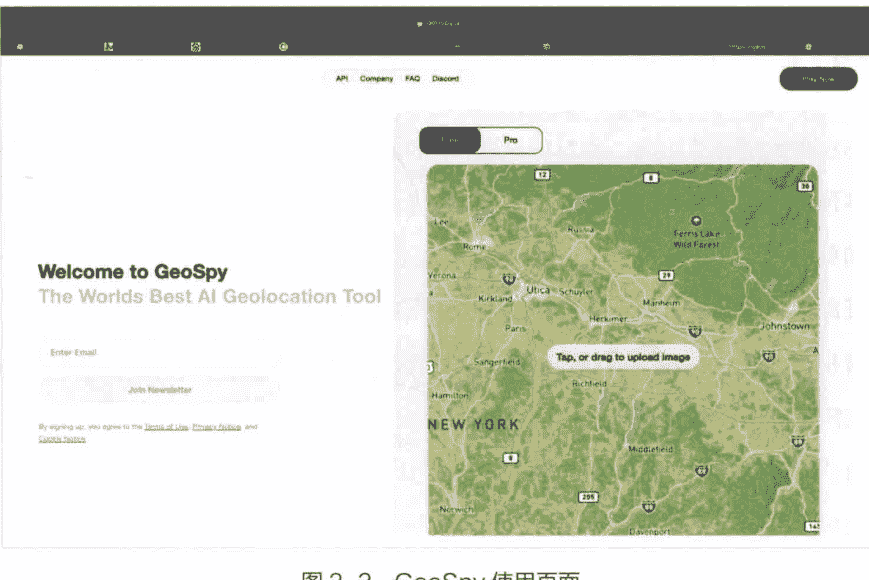

图 2-2 GeoSpy 使用页面

## 第三节 AI 支持影视决策
影视策划是项目的指南针，决策精准度直接决定成败。在决策环节，智能系统能帮助预测影片或剧集的潜在收益，合理分配预算，降低风险。

各类智能系统通过挖掘历史数据与市场趋势，为项目评估和风险控制提供依据，并高效管理剧组人力与物资，确保项目按计划与预算推进。在叙事策略上，系统也能参与内容决策，推动跨媒介叙事，保持叙事连贯性，提升观众沉浸感。下面从项目评估、风险控制、资源调度、成本管控及跨媒介叙事等维度展开。

### 项目评估与风险控制
决策阶段需对项目做全面可行性评估，包括市场潜力、预期收益、成本预算等关键要素，这要求团队具备准确的评估能力。正如哥伦比亚大学电影系资深教师莫琳·A. 瑞安在其著作《创意制片完全手册：从项目策划到营销发行》中提醒：“当你得出预算估值后，制作规模、场地数量、棚期需求、演员与剧组人数，以及道具、服装、设备需求等内容便会逐渐呈现。”¹ 在评估与风险控制中引入人工智能，能提供更精准的市场预测，提升评估效率，尤其在历史数据与趋势分析上大幅降低误判风险。

2021 年“爱奇艺世界·大会”发布了三大智能制作系统，如图 2-3 所示：制作商业智能系统 PBIS、智能集成制作系统 IIPS 和智能制作工具集 IPTS。这些系统结合 5G、人工智能、HDR、VR、AR、XR、动作捕捉、虚拟拍摄和区块链等技术，为行业提供全流程工具。

在策划开发阶段，PBIS 对爱奇艺项目的决策起关键作用。通过 IP 评估与流量预测工具，团队可在立项之初预判市场反响与潜在收益，指导商业策略。进入复盘阶段，PBIS 的数据分析可揭示观众行为深层规律：通过倍速观看习惯与观众流失点的分析，科学调整 IP 开发策略、故事线、类型选择、演员阵容与排期。PBIS 助力“迷雾剧场”“拾光限定”系列以及《人世间》《风吹半夏》《警察荣誉》《苍兰诀》等项目实现热度与口碑双赢。

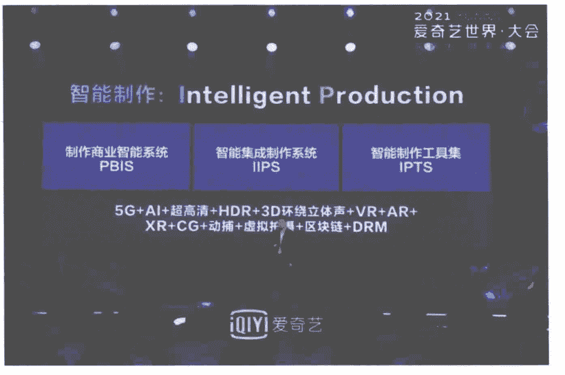

图 2-3 2021 年爱奇艺世界·大会

### 资源调度与成本管控
资源调度与成本控制是保障项目顺畅推进的基石。前者关乎人力、物资、资金的高效配置，后者确保项目在预算内完成、杜绝浪费。二者相辅相成，共同影响整体进度。

腾讯视频的制片管理系统在预算与财务管理上实现突破，推动视频制作更高效智能。系统通过精细化预算编制与实时成本跟踪，帮助团队及时发现并纠正超支风险，实现资源最优配置。其管理机制对资金预算、收入与支出进行详尽预估与追踪，记录每一笔流向，并借助可视化技术直观呈现预算执行进度与潜在财务风险，提升工作效率与项目掌控力，为影视工业化提供技术支撑。

成立于 2015 年的 StudioBinder 已成为影视制作管理领域的领先者。其平台提供拍摄排期、人员管理、文件共享、场景管理等功能，并强化预算管理。用户友好的预算工具可轻松创建、编辑与监控资金流动，详录每一笔开支，随时掌握财务状况，实现高效资源与成本控制。Entertainment Partners 开发的 Movie Magic Scheduling 也提供云端一体化数字化方案，覆盖策划全流程，可管理拍摄计划、分解场景、生成可行性报告，助力预算编制。

在智能助力下，资源调度与成本控制正变得更智能透明，行业将迎来更繁荣、创新与个性化的未来。

### 跨媒介叙事策略
跨媒介叙事通过电影、电视、社交媒体、游戏等不同平台共同讲述连贯故事或构建统一世界观，打破单一媒介局限，为受众提供多层次体验，增强参与感与情感投入。

与影视策划结合，它能大幅扩大故事影响力与受众面。创作者可针对不同平台定制化传播，保证核心元素一致。例如电影提供视听冲击，书籍或游戏则可补充角色背景或情节细节。

人工智能为跨媒介叙事提供新可能。它能分析受众偏好、优化分发渠道，甚至生成适配不同媒介的内容片段，如根据用户评价调整走向，或依据玩家选择改变剧情。结合人工智能不仅增强表现力，也提升参与度与沉浸感。

第一节已提到智能技术提升了故事生成效率。为了保证跨媒介改编中的连贯性，需用智能工具分析原始剧本及其在各平台的呈现效果，确保主线一致。

美国得克萨斯州奥斯汀的 StoryFit 公司在跨媒介决策中运用人工智能对剧本进行深度分析，确保观众在大银幕、小屏、漫画或游戏中的体验连贯。

网飞的《黑镜：潘达斯奈基》是典型案例。该剧采用分支叙事，观众的选择决定剧情走向，人工智能驱动的互动设计极大提升参与感与个性化体验。《权力的游戏》也借助社交媒体与在线平台的专属 App，让粉丝深入探索维斯特洛大陆，人工智能分析互动数据帮助制作与营销决策，增强吸引力与忠诚度。

国内首部全程数字虚拟拍摄电影《安国夫人》同样体现跨媒介叙事的探索。15 天内完成 21 个场景拍摄，周期大幅压缩，数字技术与特效呈现传统手法难以实现的奇观，部分替代了京剧的虚写意表演，强化电影媒介特性，实现策略性跨越，为民族传统艺术注入新活力。¹

跨媒介叙事已成为策划环节的加分项。人工智能提供的内容适配与个性化传播洞察，使影视策划更高效精准，打造丰富多元的观影体验。

> ¹ 周安华、杨茹云.边界、融合与文化再生产——科学主义视角下的电影跨媒介改编与叙事革命[J].上海大学学报（社会科学版），2024，41（03）：50-59.

## 创新实践 ▸ 用 AI 辅助确定影视作品选题
选题是创作关键，决定作品方向与潜力。下面以“通义千问”为工具，拆解人工智能辅助选题的操作思路。

### 一、通义千问简介
通义千问是一款知识库庞大的问答系统，能根据提问给出准确详尽的回答，如图 2-4 所示。在影视策划中，它可帮助创作者快速了解市场趋势、观众偏好与竞争格局，为选题提供支撑。

图 2-4 通义千问主页

### 二、操作步骤
**步骤一 明确领域和方向**
先确定想了解的领域与创作方向，例如科幻还是现实题材，电影剧本还是电视剧剧本。

**步骤二 设计问题**
围绕主题设计具体问题。例如想了解科幻题材的市场需求，可问“近年来科幻电影票房表现如何”或“观众对科幻电影哪些元素最感兴趣”，如图 2-5 所示。问题越具体、越清晰，答案越可靠。

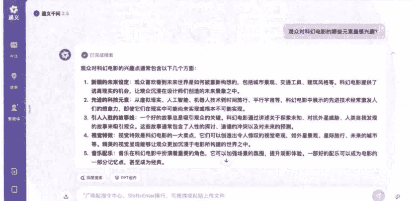

图 2-5 通义千问问答页面

**步骤三 获取并分析答案**
对通义千问的回答进行分析。例如若显示科幻电影票房近年稳步增长，则可判断其具备投资潜力，需进一步收集行业信息验证准确性。

**步骤四 综合分析**

把通义千问给出的参考信息与外部的市场调研结合，对备选议题做立体拆解。此阶段需要把需求体量、目标人群特征、竞争格局等要素纳入判断，评估落地可能性与回报预期。比如调研显示科幻类型持续升温，叠加环保议题的作品关注度更高，就可以把环保科幻电影作为具体选题。

# 第三章 人机协作驱动的剧本创作实践

1. 回顾剧本创作中生成式技术的演进历程，并梳理当前国内外主流的产品。
2. 掌握借助大模型完成剧本撰写的操作路径。
3. 看清生成式系统在剧本环节的局限与风险。

## 导入案例
### 电影《流浪地球2》的剧本创作

2022 年底，以 ChatGPT 为代表的通用大模型让内容生成从人工智能生成故事线 AIGSL 迈向人工智能生成剧本 AIGSP，并催生了一批专用的编剧辅助产品。现阶段的成熟作品多为人与机器协同完成。《流浪地球2》的剧本正是刘慈欣、郭帆团队与生成式系统共同打磨的成果，数据洞察、模式识别与文本初稿工作都得到明显提速。

影片改编自刘慈欣小说，是前传。故事讲述太阳危机逼近，数万座行星发动机开建，人类在末日威胁与生存抉择间挣扎。叙事锚点是 2044 年的太空电梯事故与 2058 年的月球坠落危机，主线围绕刘培强、图恒宇、周喆直展开。

完整剧本难以被机器独立输出。创作会议时团队会用语音转文字功能完整记录讨论并沉淀为语料库，随后再调用类似 Claude 3 的大模型进行落字。该模型在自然语言理解与产出上接近人类水平，对初稿构思与情节梳理帮助很大。编剧输入关键词、场景描述或梗概后，模型可以给出多个情节片段或对话备选，提供灵感。传统流程里推敲情节与遣词费时，有了助手后创作者能把更多精力放在创意本身，只要故事完整、人物清晰、逻辑自洽，后续文字工作就可以交给系统补齐。

生成式系统在影视工业化生产中提供了前所未有的效率与创新可能，但创意根源与思考深度仍是难题。其一，系统能快速拆解海量剧本，捕捉受众偏好与叙事新趋势，为多样化构思提供灵感；其二，在创意深度、人性关怀与创作伦理上仍有争议。系统既是加速器也是催化剂，在深度融合的当下，编剧如何与智能协同共创佳作是核心命题。

## 第一节 剧本生成与创作
传统影视以文字搭建整体设计。随着市场对高效、低成本、有创意的剧本需求上升，传统编剧虽有深厚文学功底、丰富想象与情感表达优势，却易受个人经验、文化背景与时代观念制约。大模型的出现为创作者打开了更广阔的灵感空间，也带来机遇与挑战。

### 剧本生成技术的发展轨迹
上世纪 80 年代起，人工智能就开始介入故事叙述，随后数十年超文本、计算机互动戏剧等形态不断演进；2010 年后计算机视觉与深度学习的兴起让机器更深入影像创作。
真正具备实践创造力的 AIGSL 与 AIGSP 要到 2022 年大模型成熟后才到来。2022 年 DeepMind 发布剧本写作系统 Dramatron，依托大型语言模型库 Chinchilla 与逻辑化提示词链 Prompt Chaining，可分层产出结构严谨、前后连贯的叙事。基于一句话大纲 Logline，它能生成标题、角色、情节、场景等细节，并为不同人物设计场景对话，明显丰富了编剧手段。
同年年底 ChatGPT 与 DeepSeek 等通用大模型取得突破，可无限制生成各类文本，包括剧本，行业预期被大幅拉高。Dramatron 的开发者亦表示，生成式系统将为优质创意的规模化生产提供更多可能。

目前国内外市场上已有众多各具特色的智能产品，为编剧提供思路与工具支持。国内聊天与内容生成类产品包括 DeepSeek、文心一言、Kimi、通义千问、腾讯元宝、讯飞星火、豆包、智谱清言、百小应、360 智能办公、小悟空等；写作辅助类产品包括有道云笔记插件、腾讯 Effidit、讯飞写作、深言达意、悉语智能文案、火山写作、秘塔写作猫、光速写作等。国外主流产品包括擅长复杂自然语言任务的 ChatGPT、可产出高质量连贯文本的 PaLM、支持长文本输入输出并可定制训练的 Claude、擅长文本分类与情感分析的 MT-DNN、擅长预测与常识推理的 MT-NLG、高性能多任务模型 LLaMA、跨领域集成大模型 OPT-IML、具备在线搜索与长期记忆的对话机器人 BlenderBot 3，以及将文字转为图像的 Stable Diffusion。
这些大模型与文本生成技术极大拓展了想象边界，实现了从情节构思到角色对话、整体架构的智能生成与优化，为影视行业带来效率提升与艺术创新可能。

2023 年 3 月 27 日，一览科技上线 “一览运营宝” 中的智能编剧功能，已与二十余家影视公司合作，可辅助从编剧到分镜。首个合作项目是与上海欢雀影业的短剧《蝶羽游戏》，编剧徐婷执笔完成前期撰写。如今这类产品已相当常见，创作者普遍借助工具节省时间以便精雕细琢。
《流浪地球》团队也融合了智能助手与人工智慧。项目初期用系统分析海量剧本数据，快速产出多个情节框架与角色设定方案，供人工深度加工与个性化调整，最终形成高票房高口碑作品。

### 智能助手在写作中的具体用法
2024 年 3 月，央视频与中央广播电视总台人工智能工作室联合清华大学元宇宙文化实验室推出微短剧《中国神话》多语种版，美术、分镜、视频、配音、配乐均由智能系统完成，并获国家广播电视总局 2024 年网微剧 001 号“网标”。这表明智能创作已从短剧渗透到长片的各个制作环节。

创意激发是编剧关键环节，智能系统提供了强力助力。其一，分析文学、影视、社交媒体与生活数据，提炼流行文化元素、未充分讨论的社会议题与受众潜在兴趣，为创作提供起点。其二，模拟人类思维，用算法生成多样化创意草案与情节框架，帮助创作者跳出惯性思维，发现被忽视的点，促进跨领域跨文化融合。系统还能解析受众情感反应与行为，预测哪些元素容易产生共鸣，助力创作者更精准调整内容。
落到文字层面，场景描述、情景演绎、对话生成与文本润色大量消耗时间，智能介入使流程更高效。
《流浪地球2》前期概念设计确定主线与主题后，用 Runway、Stable Diffusion、Midjourney 生成视觉概念图。编剧给出设定词，Midjourney 输出上千张效果图，筛选后再用 Stable Diffusion 与 Runway 完善，最终确定方案。大型项目通常采用工具链，按分工与环节组合使用。
剧本撰写阶段，在 Claude 3 的支持下，完成故事线与人物设定后，即可借助工具链高效生成文字内容、剧本格式乃至文学性润色。导演郭帆曾总结，系统能把加工工作接过去，让创作者集中精力思考创意。

### 不同赛道的智能辅助实践
智能辅助创作已覆盖短视频、短剧、网剧、电影等多种形态。
短视频领域，智能系统能快速捕捉热点与流行趋势，基于用户偏好与平台算法分析大量数据，辅助创作者做创意构思、情节设计与对白编写，提升效率与匹配度。
网剧制作中，智能系统既协助编剧，也辅助场景搭建与特效制作，降低成本。如北京市广播电视局扶持的科幻网剧《三星堆：未来启示录》，由博纳影业联合抖音与即梦智能打造，大量使用智能技术呈现古蜀文明的数字视听想象。
短剧赛道发挥空间更大。系统通过分析“霸道总裁”“重生”“穿越”等热门题材，生成相似故事框架与人物设定，实现定制化生产。抖音短剧《霸道总裁的甜蜜陷阱》创作中，智能系统分析经典元素与成功案例提供灵感，主角形象按受众喜好设计为高冷深情男主与聪明独立温柔女主，并辅助生成张力与甜蜜并存的对白与情节，在保留类型精髓的同时注入新意。

## 第二节 剧本修改与创作优化
在借助智能系统创作的同时，智能剧本评估系统也快速崛起。传统评估依赖评分细则与专家主观打分，容易偏向特定审美。随着内容生产节奏加快，平台急需更可靠的技术辅助。

### 智能化剧本评估系统
这类系统依托自然语言处理与机器学习对剧本做深度分析，挖掘潜在价值，不仅评估情节、主题、对白质量，还结合市场趋势与受众偏好，预测商业潜力与社会反响，助力选题与策划决策。
以爱奇艺知文系统与海马轻帆为例。
知文系统是爱奇艺内部的内容理解平台，综合贝叶斯、DBSCAN、XGBoost 等经典算法与 Attention、BERT、GRU 等深度语言模型，采用去中心化调度和统一管理，对长文本进行分析。其优势在于接触最新优质剧本资源，理解力更强。它侧重剧本本身内容分析，用户上传前几集后，可从字数、场次、人物设定、情节发展等维度给出初步结论，其中人物与情节优先级更高。人物维度评估身份、性格、关系、出场次数、互动、戏份与情感变化；情节维度评估冲突强度与精彩度，最终给出总分。
海马轻帆构建了更完整的评估体系。数据显示，自 2019 年开放合作以来，已累计评测剧集 7500 余集、电影网络电影 2900 余部、网络小说超 500 万部。其智能创作系统为影视剧本、小说、短视频脚本提供从写作到评估的一体化服务。早期为影视公司提供评估，《你好，李焕英》《流浪地球》《影》等剧本均经其评测修改。2023 年起向 C 端开放。平台上线独立 APP、小程序与网页，提供“智能写作”功能，可一键小说转剧本、调整格式、识别场次与标注角色；“智能评估”从叙事节奏、角色塑造、情节密度、排版效果、文笔五个维度打分。也支持短视频脚本自动补全拍摄信息，以及剧本杀 DM 手册、线索清单与角色卡创作。海马轻帆已与阿里巴巴影业、优酷、中国电影集团、北京文化、慈文传媒、欢娱影视、新片场、奇树有鱼等 350 多家头部公司合作，国内渗透率达 80%。

### 剧本内容优化路径
深度分析与优化离不开生成式对抗网络 GAN。GAN 由生成器与判别器对抗训练构成。获取文本训练集后，智能编剧构建 GAN 模型，生成器负责产出连贯情节或对话，判别器评估逻辑合理性与趣味性。通过数据训练，生成器根据提示产出后续情节，判别器评估衔接质量，依据反馈调整参数以优化前后衔接。

AI怎样读懂一份剧本

在落地场景里，模型首先把整篇剧本送入分析管线。依靠语言理解能力，它会抽取出高频词、句式骨架与段落排布，并据此标出逻辑上的破洞、故事线的断层以及人物做法前后自相矛盾的地方。盘点完毕后，团队会用大量影片剧本文本做训练集去训练判别模型，再以监督学习的思路不断把模型预测和人工标注拉近，让判断更贴近专业标准。比如把一段文本送入网络做前向推理，如果置信度超过预设阈值就归为上乘剧本，反之归为普通。示范文本写的是“Once upon a time, in a small village, there lived a young girl named Alice. She had a magical power that could bring objects to life…”模型给出的概率是0.85，被判定为优秀样本。

在情节松散的修复上，系统能基于整体架构和叙事走向给出调整思路，例如补进一个关键铺垫让衔接更顺畅，或对若干事件顺序做微调以强化悬念和张力。人物打磨层面，模型会拆解台词和心理波动，帮助写作者深入角色内在肌理和性格轮廓并给出具体优化方向。台词润色同样是重点，传统编剧改写对白往往需要反复代入情境，系统可以结合语境和人物设定审视对话的合理性、连贯性和表现力，通过换词和句式重组让表达更生动自然、更贴合人物。《中国神话》等微短剧在场景、情节、人物和对话上的升级就得益于这类辅助。

### 创作方式的迁移

技术快速演进正把剧本写作推向智能化、定制化的新阶段，既扩展了创作手法也拓宽了叙事维度，推动工作方式由手工主导转向智能辅助乃至部分自动化。

创作动机上，出现从作者主观驱动到数据驱动的转向。平台会汇总票房、播放量、评论等市场信号，识别未来趋势并搭建观众兴趣图谱和偏好模型，形成精准用户画像，助力创作者把握目标受众需求。

工作形态上，走向人与机器协作。过去编剧多为单兵作业，如今创作逐步团队化，需要和算法工程师等人员协同推进。

呈现形态上，从纸质或电子文档变为跨媒介融合的成果。由系统生成的图文可作为概念设计或剧情预告，为团队提供直观视觉参考。

工作逻辑上，从线性推进转向非线性搭建。传统写作按时间顺序铺陈，虽也会在前期确定结局或关键桥段，但整体仍遵循因果螺旋展开。生成式系统则采用空间性创作逻辑，能在非线性思维下搭建情节线、人物和事件，并用算法挑选组合元素，产出更丰富复杂的叙事。

## 第三节 生成式写作的边界

即便潜力可观，作为创意和情感载体的剧本创作仍存在明显边界：在赋能浪潮下，创新受制于数据枯竭的隐忧；算法研发、大规模语料库建设维护以及高算力消耗，都考验资本耐心；法规伦理和版权问题构成难以逾越障碍，如何在尊重原创、保护知识产权前提下界定生成作品法律地位和权利归属，以及在创作中植入人类价值和道德判断、守住伦理底线，都需深入探讨。

### 产出层面的限制

2019年，一名 DC 粉丝借助模型生成《蝙蝠侠》剧本并制成短片，结果荒诞搞笑，出现“我喝蝙蝠，就像蝙蝠一样”“阿尔弗雷德生了罗宾”等台词。

此类现象频发，说明当前实践和工业化生产仍有距离。结构主义主导的经典叙事学和强调文本内外叙事交流的现代修辞叙事学相比，后者更要求剧本兼顾技巧和审美高度，才能引导观众按预设路径解码信息。该案例清晰暴露模型在叙事技巧和艺术审美上的不足。

模型介入的基础是大数分析，经过多维大体量训练后，倾向抓取高频词句进行拼接，由此产生高度数据依赖，并引发数据危机。研究《Will we run out of data? An analysis of the limits of scaling datasets in Machine Learning》指出，高质量语言数据或在2026年耗尽，低质量语言和图像数据存量也将在2030-2060年间耗尽。若数据生产效率不提升，依赖语料库的系统必将遭遇创作瓶颈。

纵然在虚拟拍摄、后期制作中表现亮眼，在编剧环节，其文本生成能力目前主要冲击人力成本较低的流水线写作。中央文化和旅游管理干部学院副研究员孙佳山认为，真正被冲击的是低端流水线式写作，或在特定题材、局部创作中发挥作用。要做出符合行业标准的作品成本很高。“一览科技”创始人罗江春提到，较为复杂的编剧产品开发运营成本“可能相对更高”。《Our T2 Remake》制作人 Junie 表示，截至2023年12月31日，他们几乎用遍了市面上所有的视频制作工具。生成式技术远未实现大范围免费使用，用其写出优秀剧本将产生巨额成本和能耗。

### 二 合规伦理与版权难题

剧本生成作为文学创作领域的应用，其法规伦理和版权议题日益突出。自动化渗透各行各业，但在影视创作尤其是高创意环节，介入越深，边界越模糊。从技术看，ChatGPT 可保存用户交互信息，但数据如何处理仍不透明，剧作领域的数据安全和知识产权能否得到保障仍是谜团。

目前我国《著作权法》对生成内容法律地位和权利归属尚无明确规定，导致作品处于模糊地带。创作过程可能涉及对既有作品模仿借鉴，引发侵权。如何界定“独创性”以及区分创作和抄袭，是法律难题。司法实践开始探索生成内容法律属性，多数学界实践倾向将版权归于开发者或所属机构，但并非绝对，需个案判断。

信息安全和隐私层面，创作需采集处理大量数据，可能包含个人隐私，如何确保安全和隐私保护是必须面对法律问题。可借助数字指纹和区块链技术识别追踪侵权。政府和相关机构应完善生成作品版权的法律法规，明确权利归属和侵权责任，建立版权管理平台提供许可和交易服务。

伦理层面，创作涉及开发者、数据提供者、使用者等多主体，如何界定各方伦理责任？随着 AIGC 发展，如何判断生成的剧本是否属于“人类作品”，如何确保创作不违背伦理道德、维护人类尊严和权益，都是当前挑战。当然，随着实践增多，版权归属、原创性界定、伦理责任归属等问题终将逐步明晰。

### 未来走向展望

AIGC 是随科技成长的数字生命体，未来剧本创作将展现更多创新形态和多元应用。人机协作将成常态，系统以强大数据处理和创意生成能力为编剧打开全新叙事世界。大数据和知识图谱深度融合，使创作更精准对接市场和观众偏好，并赋予作品跨媒介叙事和个性化定制能力。观众将从被动接受者变为可参与创作、影响走向的共创者。

然而剧本是核心蓝本，是导演、演员、摄影师等共同使用的工作底稿，也是观众情感共鸣和审美体验起点。优秀剧本需要的不是文字堆砌，而是创作的灵魂。创作是人类独有的精神活动，融合个人经历、情感体验、审美追求和时代精神，只有深入生活、洞察人性、勇于创新，才能创作出具有深刻内涵和广泛影响力的作品。技术可带来颠覆性变化，但创作本身始终不可替代。创作者应保持清醒头脑和理性价值判断，对作品负责，在技术和伦理和谐共生中挖掘潜力，为影视产业和文化领域贡献力量。

---

**脚注：**

1. 孟可. AI，电影，AI 电影及关于未来的探讨 [J]. 当代电影，2024，338（05）：4-13.

2. 孟可. 从文学到代码：人工智能编剧的创作逻辑与应用前景 [J]. 现代电影技术, 2024, 546 (01): 50-56.

3. 邓杨, 高坤, 廖宁, 等. 基于生成式对抗网络的剧本自动生成与优化技术 [J]. 数字技术与应用, 2024, 42 (02): 232-234.

4. 周心颖，吕佰顺. 从 ChatGPT 说开去：一个关于 AI 介入影视剧创作的思考 [J]. 东南传播，2023，225（05）：136-138.

5. 马世玉. 人工智能形象的身体、身份和叙事功能研究——以 21 世纪美英人工智能科幻影视作品为例 [J]. 东方艺术，2021，117（05）：127-132.

6. 苗春. AI 辅助，赋能编剧 [N]. 人民日报海外版，2023-09-15 (007).

## 创新实践 ▸ 用智能助手做剧本

剧本是影视作品的灵魂。本章创新实践将介绍一款智能助手“Kimi”，并给出具体使用步骤，帮助读者掌握如何运用其进行剧本创作。

### 1. 软件介绍

Kimi 由北京月之暗面科技有限公司开发，2023 年 10 月 9 日上线，主打超长文本处理，支持二十万字输入，2024 年 3 月 18 日宣布可处理两百万字超长无损上下文。主要功能包括长文总结生成、联网搜索、数据处理、代码编写、用户交互和翻译等。系统能模拟人类思考，多级拆解复杂问题，进行深度搜索并实时改进结果，提供全面准确答案。Kimi 探索版是增强版本，搜索能力更强，可一次精读五百多页，在长文本和搜索方面优势突出。Kimi 首页如图 3-3 所示。

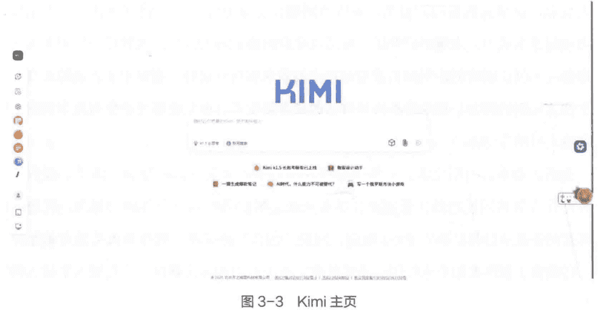

### 2. 操作步骤

**第一步** 确定大纲及核心设定

使用工具前，先基于选题明确大致情节和基本设定。例如想写一部“爱情”“穿越”题材微电影，可输入题材和人物关键词提问。

示例提问：请为我生成一个微电影剧本大纲，主题为“爱情”和“穿越”，主角为 21 岁女大学生和 26 岁互联网科技公司男职员。

示例输出《时空之恋》：故事围绕历史系女大学生林晓晓和程序员江晨展开，林晓晓对古代文化热情，江晨专注 AI 和时空理论研究，二人因一次意外时空穿越相遇，开启跨时空恋旅。第一幕相遇，林晓晓在图书馆研究古文献意外触发隐藏时空机关，江晨在公司加班编写时空数据程序失控产生异常能量波动，两点时空因波动连接，林晓晓被卷入漩涡穿越至江晨时空……

**第二步** 情节细化与扩充

在获得大纲和角色设定后，可利用 Kimi 的情节规划功能，输入起止点和关键转折，让其生成多种发展路径，再对路径进行取舍和优化，形成个人故事线。

**第三步** 草稿撰写

结合角色设定和情节，撰写草稿。若以人类编剧为主，需梳理叙事框架并用 Kimi 做语言润色和逻辑校验；若继续由 Kimi 主导，则需发送更细化的需求描述。示例开场：以“林晓晓在图书馆研究古文献意外触发隐藏时空机关”为戏，生成剧本格式段落。

内景 图书馆 夜。
林晓晓 21 岁，T恤牛仔裤，长发戴眼镜，坐在木长桌前，桌上堆满古籍。她凝视破旧羊皮卷，眉头紧锁，用铅笔记笔记。自言自语谈及“时空之门”。翻到末页发现异样符号，触摸后微光浮现。她起身确认四周安静，轻声说这里藏着秘密。深吸一口气将手按在符号上低声念诵，光芒大作，书架震动，书本滑落，她被无形力量包围。

**第四步** 初稿润色

基于工具输出段落，可输入修改要求，如增加对白、调整人物性格等。受模型局限和分段提问影响，偶发前后逻辑错位，需人工校对。

示例修改指令：将此段改为更具科技感的穿越情节，加入林晓晓和江晨对白，突出江晨的理智冷静。

修改后段落强化科技元素，图书馆出现笔记本和 3D 模型，金属板符号和电脑同步闪烁。输入代码后图书馆震动。转场至互联网公司夜景，江晨 26 岁专注写代码，发现时空数据模型异常，自语追踪信号。随后光芒带走林晓晓，留下狼藉和金属板。公司端江晨在巨幅显示屏前惊讶信号来自图书馆。

**第五步** 反馈与迭代

Kimi 支持对已有文稿阅读修改。初稿完成后可上传让其分析和给出反馈，按反馈修改后反复迭代数轮，逐步形成完善剧本。

# 第四章 AI 与影视表演

- 1. 了解 AI 在角色选择中的使用现状。
- 2. 熟悉影视表演领域常用的 AI 工具。
- 3. 学习运用 AI 工具生成简单的虚拟演员。

## 案例先行

### 《长安十二时辰》如何用“鱼脑”锁定雷佳音

2019 年，优酷独播的《长安十二时辰》改编自马伯庸同名小说，开播后迅速走红，豆瓣开分 8.8，一举成为年度现象级国产剧。随后剧集通过 Viki、Amazon、YouTube 等渠道出海，在日本、北美等地收获大量好评。

作为一部古装悬疑作品，该剧以收紧的叙事节奏、精致的画面质感和对唐朝长安的考据还原，达到了影级水准。观众在紧张的氛围里仿佛穿越到盛唐，亲历那十二个时辰的惊心动魄。

雷佳音饰演的张小敬，既有硬汉的韧劲，也有细腻的情感层次，将角色演绎得既庄重又不失幽默。这样的精准选角，背后有 AI 技术的加持。

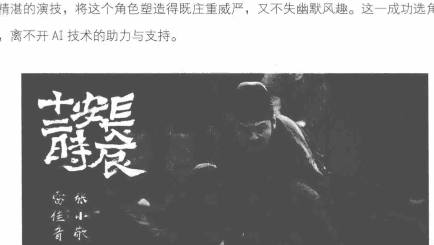

图4-1 《长安十二时辰》剧照

2017 年优酷上线了选角系统“鱼脑”。它依托阿里巴巴的大数据和 AI 能力，为影视制作引入智能决策辅助。系统先对剧本的情节和人物设定做结构化拆解，再参照过往同类型剧的成功要素，初筛出气质相符的演员名单。随后借助大数据，对候选人的代表作品、观众口碑、市场表现等多维度信息进行深度剖析，评估契合度并给出最优匹配。

《长安十二时辰》节奏快、逻辑严密，需要演员能驾驭复杂多变的戏，且能精准呈现角色内核。“鱼脑”在大量男演员中筛查后认为，雷佳音的个人标签与银幕气质与张小敬高度一致。加上他在《和平饭店》中已证明能hold住烧脑反转的紧凑类型，进一步坐实了人选。正是这一次数据加经验的配合，为剧集成功打下基础，也为行业树立了智能选角的样板。

精准匹配让选角效率和质量同步提升，也帮助演员找到更合适的定位，以出色表演赢得认可，实现演员与角色的双向奔赴。可以看出，AI 不仅在改写创作流程，也为选角注入了新动能。

展望未来，随着技术持续进化，像“鱼脑”这样的工具将在更多环节发挥更大作用，推动影视迈向更智能的新阶段。

## 第一节 AI重塑选角流程

AI 正以前所未有的力度改变选角全链路。从角色智能匹配、演员推荐，到试镜评估，再到市场表现预判，各种工具为制作提供全方位支持。它在逐步消解传统选角的主观偏见和低效问题。但当 AI 从辅助走向关键决策时，如何在算法推荐与人文审美之间取得平衡、如何在提速的同时守护艺术的多元与创意活力，已成为行业必须解答的课题。

#### 一、智能匹配与演员推荐
选对人是作品成败的关键。过去选角多靠导演、制片和选角导演的直觉与经验，耗时耗力且不确定性高。如今 AI 正把匹配推向数据化。系统借助自然语言处理解析剧本中对人物的细化描述，再对照庞大的演员库，对表演经历、外形特征、风格倾向做高精度比对。这不仅能快速锁定合适人选，也可能挖掘出传统流程中被忽略的新人。

在国内，优酷“鱼脑”和爱奇艺“艺汇”走在前列。 “鱼脑”核心是全流程决策辅助，从投资、制作到宣发。选角环节，它通过海量的市场反馈和观众偏好数据，全方位评估演员的形象契合度、演技和影响力，精准筛选人选。选定后还能预测演员带来的话题热度与观众反响，为后续的人物塑造、剧情微调和宣发策略提供依据。除了《长安十二时辰》推雷佳音，它在《这就是街舞》的制作中，也通过受众分析选中易烊千玺担任队长。

“艺汇”更聚焦精准匹配和成本控制。它用算法从角色和演员大数据中提取关键信息计算匹配度。系统收录了演员的基础资料、照片、标签和片段，制片方只需输入角色标签、人物小传和演员要求，就能快速得到候选清单。效率大幅提升。青春剧《最好的我们》里，刘昊然与余淮的匹配由“艺汇”完成；《泡沫之夏》推荐张雪迎出演尹夏沫，也获得观众认可。它还被用于《中国有嘻哈》《中国新说唱》等综艺明星制作人的遴选。

AI 提升了效率与准确率，但训练数据若缺乏多样性，就容易偏向某种类型，影响公平与匹配精度。技术变革也冲击着原有工作模式，从业者需要适应新工具并重新定位。

#### 二、试镜评估与客观化
试镜是选角的节点。传统方式依赖现场即兴表演的直观判断，易受偏好、情绪和即时反应的干扰。AI 则提供更科学的辅助，可对试镜影像中的面部表情、声线、情感反应进行细致拆解，为决策提供客观参考。

美国 Casting Networks 的 TalentWatch 走在前面。平台原为演员资料管理服务，后推出该 AI 工具，用机器学习解析试镜视频，通过面部表情、声音和肢体语言识别微表情与语气变化，判断演员能否诠释角色。评估的客观性和精确度因此提高。

不过行业也担心创意受限。AI 主要依赖已有数据和模型，难以全面衡量难以量化的创造力，如独特的演绎、即兴灵感、打动人的细微情感。若过度依赖数据指标，可能削弱作品质量。

#### 三、数据驱动的决策
AI 普及前，选角更多依赖经验、直觉和人际关系。21世纪初选角开始数字化，用电子表格和数据库管理演员档案，随后线上选角平台兴起，大数据公司也进入赛道。

Cinelytic 与 Vault AI 是典型代表。Cinelytic 将复杂数据转化为决策支持，通过演员的历史票房、社交媒体影响力等指标，为选角、预算、营销和发行提供策略建议。制片人输入演员名单即可得到不同组合的市场潜力预估。它已与华纳兄弟、环球影业等合作。

Vault AI 专注于观众洞察与选角建议，整合社交媒体趋势、票房数据和流媒体播放量，为内容制作提供参考。与 Netflix、迪士尼等合作后影响力扩大。其“受众模拟”功能可模拟不同观众的反应，帮助制片方洞察需求，提前锁定目标群体，提升商业表现。

数据驱动缩短了时间和人力成本，但也带来挑战。选角不仅是技术匹配，更涉及导演、制片与演员的协作。AI 难以复制人类对表演细节的微妙感知和情感共鸣，也无法预判团队合作对拍摄效率的影响。同时，海量个人信息和市场数据的使用，涉及隐私与数据安全，一旦管理不当会带来风险。

## 第二节 虚拟演员的影视应用

技术进步让虚拟演员从特效辅助演变为可替代真人角色的存在。它带来创作自由度、效率提升和成本下降，影视制作正向更高阶的智能化与个性化迈进。

### 演进轨迹与经典案例
虚拟演员的发展伴随计算机技术迭代。

上世纪80年代，CGI 进入视野。1982 年《电子世界争霸战》是早期大量使用 CGI 的里程碑，虽显简陋却开启了数字角色设计。

90年代技术成熟。1995 年皮克斯《玩具总动员》成为首部完全 CGI 动画长片，虚拟角色从特效走向叙事核心，视觉与情感表达都达到高水准。

本世纪初动作捕捉兴起，可记录表演并转化为数字信号。《指环王：护戒使者》中的咕噜捕捉了安迪·瑟金斯的表演；2009 年《阿凡达》将动作捕捉推向巅峰，纳美人栩栩如生，票房与技术双丰收。

10年代 AI 为虚拟演员注入生命。2015 年《速度与激情7》用 Deepfake 实现已故保罗·沃克的数字复现，引发伦理讨论；《复仇者联盟3：无限战争》中灭霸的面部表情与情感变化也在 AI 辅助下完成，几乎以假乱真。

20年代 AI 应用更深，视频创作可跳过拍摄环节。国内爱诗科技 PixVerse、外网 Runway 等工具能用文本直接生成视频，按描述设定外貌与动作，大幅提升灵活性。“虚拟人”概念借社交媒体扩散，逐步进入影视。

海外，韩国 DeepBrain AI 的 AI Studios 和英国 Synthesia 降低了制作门槛。Synthesia 只需选演员、输入脚本、设定场景与配乐即可生成视频，还支持上传个人形象做定制化角色。国内柠萌影视在《二十不惑2》中引入虚拟角色202，为行业树立标杆，同时压缩周期与成本。

从粗糙图形到智能化个性角色，虚拟演员的每一步都是艺术与科技融合的注脚。

### 制作工具与生成流程
虚拟演员从概念到银幕涉及精细流程：先构建 3D 模型奠定形态，再捕捉与训练动作表情数据，最后通过实时渲染等特效整合进作品。

3D 模型是视觉核心，需高精度复制人类特征。建模常用 Pixologic 的 ZBrush，这款数字雕刻与绘画软件以超高分辨率著称，被业界视作“数字雕刻神器”，曾参与《阿凡达》《指环王》《复仇者联盟》《霍比特人》等项目。近年 AI 功能加入，如智能对称、自动拓扑，进一步简化建模，为虚拟演员塑造提供更强支持。

当三维人物的基础模型搭建完毕，制作团队随即转向真人演员采集动态与面部信息，让虚拟角色的情绪与行为更显鲜活。这一环节主要依赖动作捕捉与表演捕捉技术实现。

在数字人推动上，视效公司 Digital Domain 贡献突出。其数字人类实验室曾参与《复仇者联盟 4：终局之战》，借助极高精度三维扫描与建模，打造出近乎以假乱真的数字替身，面部微表情和肢体动作的还原度达到新高度。专注面部捕捉的英国企业 Cubic Motion 凭借计算机视觉与人工智能算法实现表情的实时采集与精准合成。公司自 2009 年起步，很快成为行业标杆。2020 年被 Epic Games 吸纳后，其技术与 Unreal Engine 及 3Lateral 的面部绑定方案结合，共同推动虚拟演员迭代。Unreal Engine 起源于游戏开发，近年已深度切入影视虚拟制片，在《曼达洛人》《西部世界》等剧集中发挥关键作用。

模型与数据准备就绪后，呈现效果就取决于高精度渲染。这一阶段涉及实时特效、即时预览与后期合成，需要强算力与图形处理支撑，既是技术落地也是艺术与科技的结合点。

参与《阿凡达：水之道》制作的 Weta Digital 在此环节采用 Simulcam，即参数采集。该方案用机器学习模型预测场景几何并实时合成画面，让导演和摄影组能即时看到最终效果，拍摄效率明显提升。与此同时，Unreal Engine 在渲染领域持续发力。《曼达洛人》中团队以引擎搭建沉浸式虚拟环境，直接在数字场景内拍摄并实时调整，摆脱了传统绿幕的局限，体现了技术赋能创作的潜力。

随着人工智能在影视传媒领域的渗透，使用虚拟演员的门槛明显降低。如今已有工具把数字演员做成可直接调用的模板，大幅简化创作流程。这些数字形象不仅写实，还能按需求精准呈现指定动作与语言。以 AI Studios、Synthesia 等平台为例，它们提供丰富多样的虚拟演员模板，让创作者从构思到成片一气呵成，为独立制片人和小型工作室带来前所未有的便利。

## 三 市场前景与伦理困境

对影视产业而言，虚拟演员相比真人演员有明显优势。

- （1）数字演员不受生理与地理条件的制约，也彻底规避了人员进入危险现场的风险。这种灵活性为导演和团队打开了更广阔的创作空间，可突破时空限制实现艺术构想。
- （2）数字演员的形象不会随时间推移而改变，表现力始终稳定，保证了作品的一致性和连贯性。传统拍摄常因演员状态、年龄增长或健康问题导致周期拉长和形象断层，使用数字演员即可避免。
- （3）制作成本可大幅压缩。真人拍摄需支付高额片酬并协调时间地点、承担住宿交通等后勤，虚拟演员省去这些繁琐环节，也因几乎不出错而减少返工，既省钱又提效。可以说数字演员正把行业推向更高效、更经济的方向。
- （4）可定制性极强。制作团队可灵活调整外观、声音和表演风格，按剧情塑造各具特色的角色，摆脱对真人演员个人特质和表演能力的依赖。

虚拟演员的兴起带来新可能，也带来伦理与行业冲击。

- （1）版权与肖像权的争议加剧。当数字演员能高度仿真真人时，真假难辨可能侵害原型演员肖像权，尤其是已故演员形象的重现更为敏感。《星球大战外传：侠盗一号》中彼得·库欣的“复活”就引发了公众对逝者权益和遗产管理的讨论。
- （2）对传统演员就业构成潜在威胁。随着表现力和适应性提升，虚拟演员在危险场景或长时间作业中逐渐具备替代性，引发了演员群体对失业风险的担忧和对工作机会减少的广泛讨论。
- （3）艺术性与质量下降的担忧。过度依赖虚拟技术可能削弱作品的个性化风格和情感表达。技术上精准的表演往往缺乏人类演员独有的情感深度，容易让影片显得平淡、公式化，丧失主创灵感碰撞的独特魅力。
- （4）表现力仍有瓶颈。虽然人工智能进步显著，但复制人类微表情和细腻情感仍不完美，观众常因其过于逼真却不自然而产生“恐怖谷效应”，影响观影体验。

此外，虚拟演员的生成依赖海量数据采集和分析，背后是对演员表演细节的深度挖掘与利用，数据在训练中被广泛使用后，伦理与隐私问题会更受关注。

尽管存在争议和局限，虚拟演员的发展仍是科技与艺术融合的典型案例。它不仅将在电影电视剧中大放异彩，也将在广告、教育、游戏等领域拓展场景，成为推动数字经济的重要力量。

## 创新实践 ▸ 用 Synthesia 生成虚拟演员

本章以 Synthesia 为例，演示影视作品中虚拟演员的生成流程。

- **步骤一 账号注册与登录**

先访问 Synthesia 官网，按提示填写信息创建账号并登录，完成系统引导的基础设置。

- **步骤二 选择视频模板**

登录后进入主界面，可按视频用途挑选模板。平台提供“公司介绍”“个人介绍”“周报更新”三种选择，如图 4-2 所示。选定后点击创建首个视频按钮进入创作界面。

图 4-2 Synthesia 模板示例

### 步骤三 设置视频样式

进入创作界面后，可在左上角设置宽高比，如图 4-3 所示，确保适配目标平台。页面上方提供多种虚拟演员和背景环境组合供选择，如图 4-4 和图 4-5 所示。可通过拖拽调整演员或文本元素在画面中的位置，优化视觉效果。

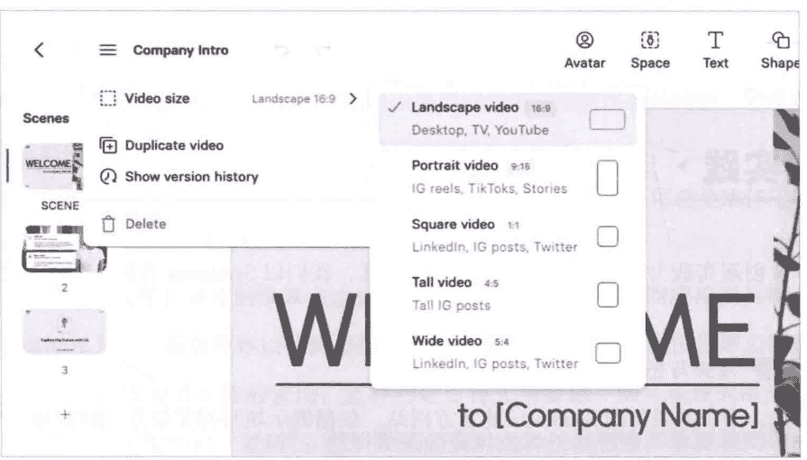
图 4-3 Synthesia 宽高比选项

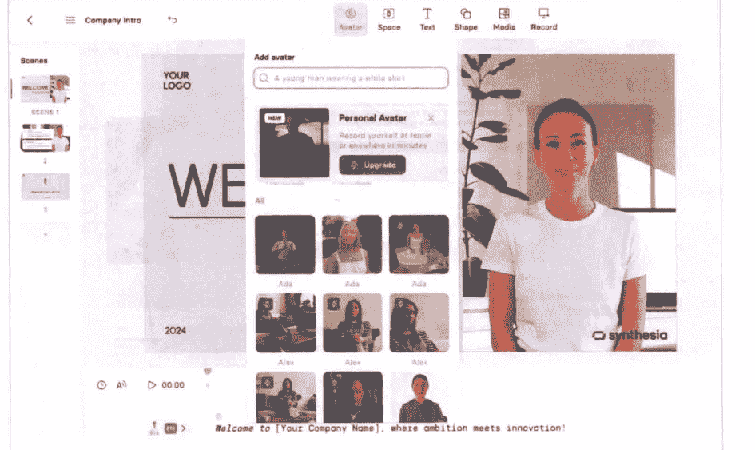
图 4-4 Synthesia 中的虚拟演员

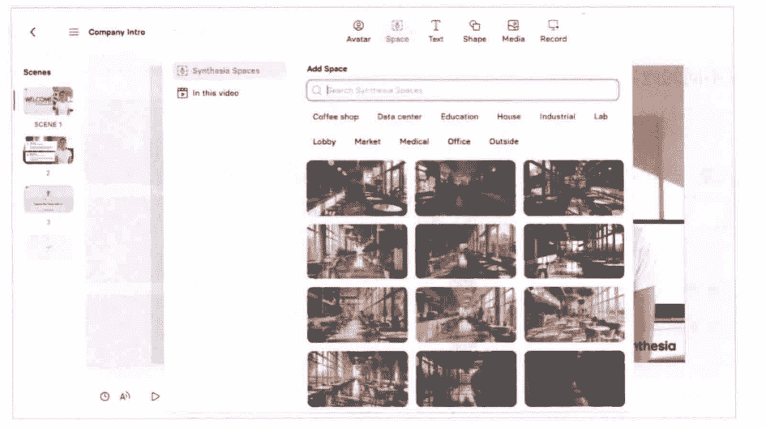
图 4-5 Synthesia 中的虚拟背景

### 步骤四 编写视频脚本

左侧导航窗格可添加或删除场景。选定场景后，在下方文本框输入脚本，即虚拟演员的台词，如图 4-6 所示。

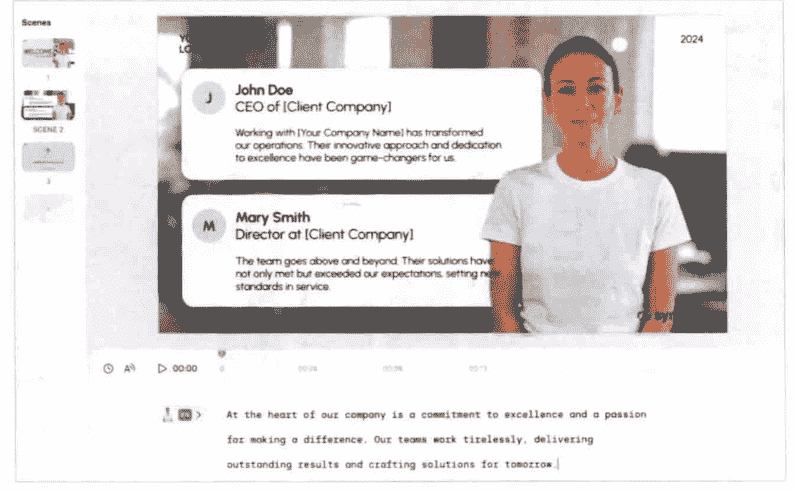
图 4-6 Synthesia 脚本编辑页面

### 步骤五 设置语言和语气

脚本完成后，可在文本框左侧选择语言和语调，如图 4-7 所示。平台支持多种语言，并提供正式、友好、热情等不同语气，以匹配内容需求。

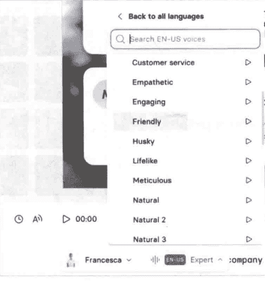
图 4-7 Synthesia 语言与语气选项

### 步骤六 定制场景

可在操作界面右上方对每个场景进行个性化设置，包括画面布局、背景色、背景环境，并通过调整透明度和清晰度优化视觉效果，如图 4-8、图 4-9 和图 4-10 所示。

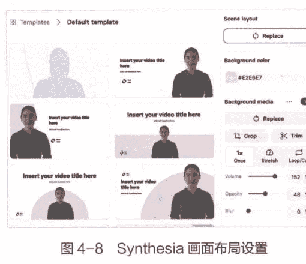

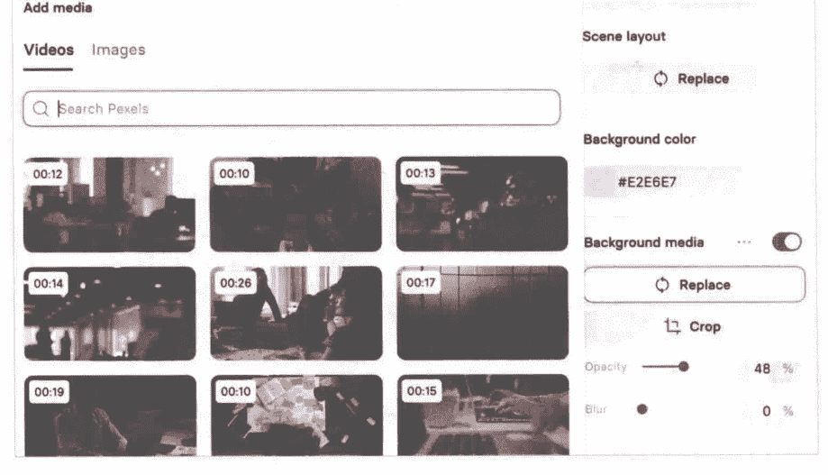

### 步骤七 设置背景音乐与场景转换

为增强感染力，可在右下方添加背景音乐，并设置场景切换方式，如图 4-11 和图 4-12 所示。合理的音乐与流畅转场能提升视频专业度。

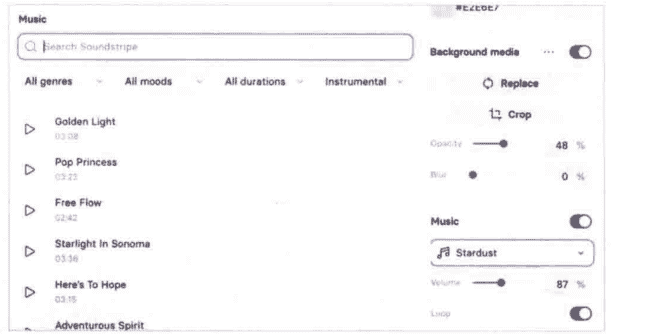
图 4-11 Synthesia 中的背景音乐

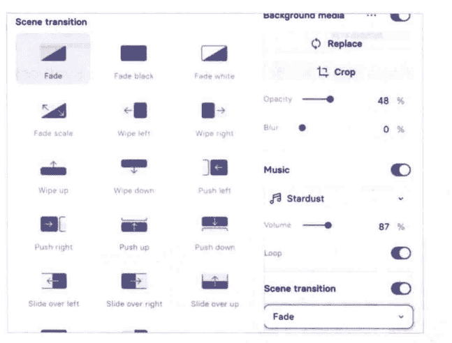
图 4-12 Synthesia 转场方式

### 步骤八 预览与导出

设置完成后，点击右上角三角播放符号预览效果。确认满意后点击生成按钮，如图 4-13 所示，导出并保存至本地。生成的视频可用于公司介绍、个人宣传、新闻播报等场景。

图 4-13 Synthesia 导出按钮

# 第五章 AI 与影视摄影

1. 熟悉人工智能在影视摄影环节的主要应用。
2. 了解自动化摄影设备如何借助人工智能技术使得摄影过程更加智能和便捷。
3. 掌握利用人工智能生成和优化虚拟场景的方法。

## 导入案例

### 美国电影《坎大哈陷落》用沙特外景模拟阿富汗

沙特影视制片业起步于21世纪初。2006年，《电影500公里》和《你好吗？》代表沙特亮相第五届阿联酋电影节，前者是沙特首部故事性纪录片，后者是首部长故事片。同年，MBC集团宣布在沙特拍摄8部影片，吉达开工建设6座制片厂。为扶持产业，沙特电影委员会推出制片激励计划，本土及外来制片公司最高可获40%的生产支出现金返还。政策与资金的推动让沙特制片业快速成长，国际项目纷纷选址沙特，本土力量也逐步壮大。

2020年成立的 Film AlUla 由埃尔奥拉皇家委员会支持，为国际影视项目提供政府联络、审批协助、人才招募和剧组食宿等服务，同时兼顾当地环境保护与文化推广。美国影片《坎大哈陷落》2023年在其协助下全程于沙特拍摄，制片中使用人工智能模拟阿富汗。团队利用人工智能分析阿富汗卫星影像、历史照片和地形数据，生成逼真的阿富汗地貌模型，再叠加到埃尔奥拉实地地形上，后期处理将沙漠环境转化为符合阿富汗特征的场景。人工智能还用于生成风沙、爆炸烟雾、尘土飞扬等动态效果，使最终呈现更贴近真实。项目成功展示了沙特的风土人情，也证明了其电影人才和技术实力。2023年，Film AlUla 与美国 Stampede Ventures 签署为期3年的合作协议，将在沙特完成《第四面墙》、K-POPS！等10部影视作品拍摄。沙特也在沙漠中建设高水准的制片设施。

## 第一节

### 人工智能在拍摄环节的应用

目前人工智能主要用于拍摄前期自动生成镜头设计方案，为现场提供拍摄角度、镜头切换和构图建议。通过学习经典影片中不同场景的镜头语言，人工智能能判断何种设计在特定情境下更有效。例如拍摄追逐戏时，系统会推荐特定角度和镜头运动轨迹以营造紧张氛围。生成的方案可大幅减少导演和摄影师在策划阶段的时间，让创作更快进入实拍。

### 一 镜头设计与拍摄指导

人工智能辅助镜头设计已得到应用。IBM“超级电脑”Watson 制作了电影《摩根》的预告片，这是首个由人工智能制作的电影预告片。研究团队让 Watson 分析一系列恐怖片预告片，从音频、视觉和构图理解“恐怖”的含义，再观看《摩根》，挑选出其认为最具恐怖感的10个场景，总时长约六分钟，随后由人类剪辑师组合完成。剪辑师表示一天就完成，若传统方式需数周。该预告片真实度很高，若无宣传很难察觉是人工智能制作。

当下，人工智能可在实拍中实时分析画面，提供即时镜头建议和反馈，助导演和摄影师现场调整优化。拍摄过程中系统持续监控画面，分析光照、色彩、构图等参数，及时发现问题并给出优化建议。如光线不足或构图失衡时，系统会建议调整光源或重构画面，确保每帧效果更佳。

ShotPro 是一款人工智能驱动的拍摄软件，可覆盖影视制作全流程。拍摄前，导演和摄影师可用其镜头设计功能规划镜头。该工具可模拟不同拍摄角度、镜头运动、焦距和光照效果，生成详细的分镜头脚本，使用步骤如下。

（1）导入剧本：将剧本导入 ShotPro，系统自动拆解场景和对话，如图 5-1 所示。

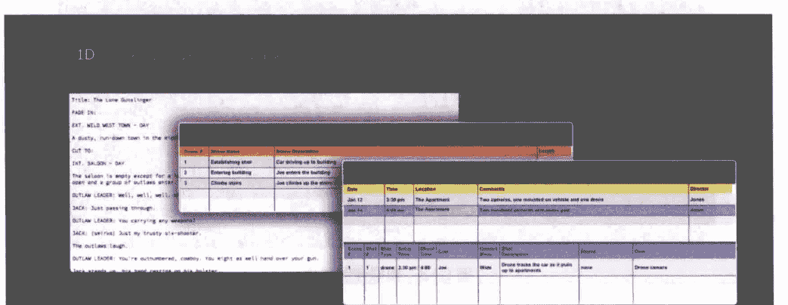
图 5-1 剧本导入

（2）场景布置和镜头规划：在虚拟环境中布置场景，包括角色、道具和背景，选择镜头类型和角度，调整运动方向和焦距，如图 5-2 所示。

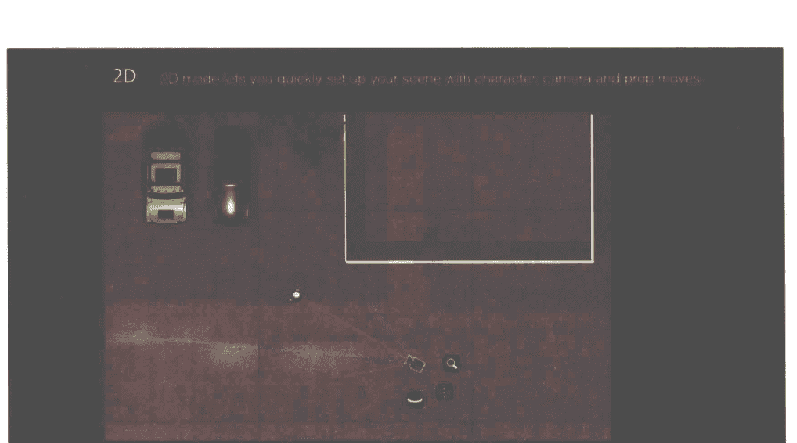
图 5-2 场景布置和镜头规划

（3）光照模拟：按拍摄需求设置光源，模拟不同光照效果，如图 5-3 所示。

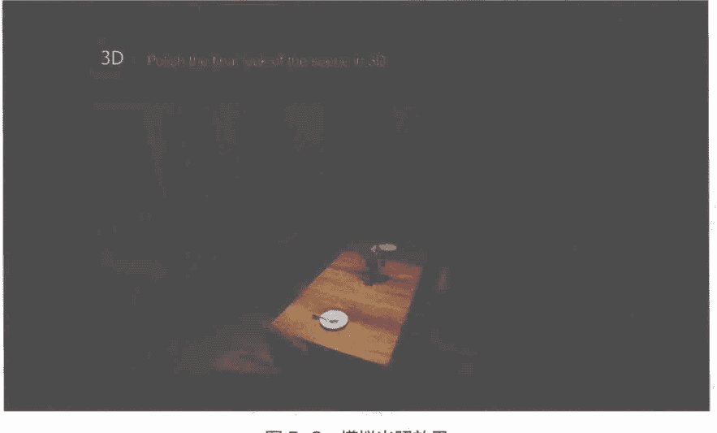
图 5-3 模拟光照效果

（4）生成分镜：输出详细分镜头脚本供拍摄团队参考。

拍摄时，导演和摄影团队可借助 ShotPro 实时预演和调整。通过连接摄像设备，软件实时监控画面，分析光照、构图和镜头运动，并基于分析结果提供优化建议，如图 5-4 所示。

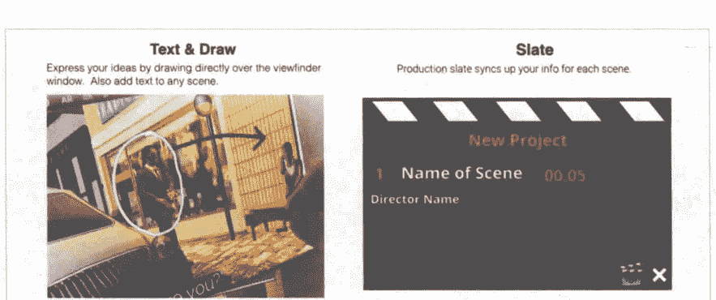
图 5-4 分析拍摄效果并提供优化建议

ShotPro 也可用于后期剪辑和特效设计，通过分析前期素材生成剪辑方案和特效建议，帮助后期团队高效制作，具体流程如下。

（1）导入多种类型素材：将素材导入 ShotPro，人工智能自动分析画面内容和声音。
（2）剪辑规划：依据剧本和镜头设计生成剪辑方案和时间轴。
（3）特效设计：结合拍摄需求和素材内容生成特效建议。
（4）导出方案：输出详细剪辑和特效方案供后期参考。

### 二 自动化摄影设备的使用

随着人工智能发展，摄影设备正经历智能化变革。传统设备依赖使用者技术和经验，现代自动化设备嵌入人工智能后拍摄更智能便捷。人工智能不仅提升图像捕捉和处理质量，也大幅简化操作，非专业人士也能轻松拍出高质量照片。

人工智能在摄影设备中的重要应用是场景自动识别。传统相机需手动调整光圈、快门速度、ISO 等参数，对普通用户复杂。人工智能可分析画面内容，自动识别人像、风景、夜景、运动、逆光等场景并实时调整参数，确保最佳效果。此外，人工智能还能基于历史数据学习用户的拍摄偏好，进一步优化设置，提升拍摄效率。

在运动画面里想做到又快又准地合焦，一直是摄影的难点，深度学习与视觉计算正把这个痛点推向新解法。借助深度学习和机器视觉，设备能在拍摄瞬间拆解画面并锁定移动主体，让焦点始终黏在目标上，这对体育抓拍和野生动物记录尤其关键。索尼、佳能等厂商已把智能自动对焦放进高端机身，系统不止能辨人脸，还能分辨眼部、动物、车辆，在背景杂乱时依然保持咬合。视频拍摄时，同样能实时追踪行进中的物体，保持全程清晰。

背后是一套协同的算法链条：卷积神经网络类模型负责实时检测人物、车、动物等拍摄对象；KCF、CSRT、孪生网络等跟踪算法在机位变动时不断驱动对焦马达，让被摄体始终清晰；云台或稳定器内置高精度 IMU，实时感知加速度、角速度与方向变化，结合 PID 等稳定控制策略即时修正姿态，抵消抖动干扰；航拍平台则用基于图搜索的 Dijkstra 或基于采样的 RRT、PRM 路径规划，算出最优飞行航线。

高动态范围成像通过多张不同曝光的画面合成来拉开细节，智能算法让 HDR 更聪明更即时。传统做法依赖后期，智能系统能够在按下快门时就评估场景宽容度，自动调曝光并完成合成。图像处理层面，智能算法也能完成降噪、锐化、细节增强与色彩校正，同时保留自然观感。

手机自拍的普及放大了美颜需求。系统用面部识别与关键点定位精准捕捉面部结构，按用户偏好微调肤色、五官、祛斑，效果不显假。系统还能依据画面内容、构图与色调推荐适配滤镜，提升整体美感。

构图从经验判断走向智能辅助。系统会解析取景框内的元素关系，自动优化布局，让画面更耐看。不少高端相机与智能手机加入实时拍摄建议，分析光线、色彩、主体位置并给出即时提示，既帮新手快速进步，也为专业创作者提供灵感。

视频内容从拍摄到剪辑的负担被智能流程大幅压缩。系统可自动挑出高光片段，添加转场、做色彩校正，甚至直接输出适合社交媒体的短片。GoPro 等运动相机已内置自动剪辑，用户只需记录素材，智能流程就能提炼精彩瞬间成完整小片，降低编辑门槛。

在创意生成上，智能模型能基于已有图像衍生全新视觉。按指令生成特定风格的照片，或学习艺术作品的特征产出同风格画面；还能自动合成虚拟场景与特效，丰富表达。一些应用可把普通照片一键转成特定艺术风格，视觉冲击与艺术感同步提升。

实时环境感知让智能摄影设备更自如。它们融合 RGB 摄像头、3D 摄像头与激光雷达 LiDAR，实时采集环境细节，视觉算法构建三维模型并识别障碍物与地形变化，从而实现自主避障、择路与取位。《小丑》就用激光雷达精细绘制哥谭市街景，为影片带来更沉浸的分层细节，如图 5-5 所示。

图 5-5 《小丑》中应用的激光雷达

### 三 实时监控与质量控制

智能系统可在拍摄过程中全程监控光照、色彩、构图等参数，解析画面的光线条件后实时调整曝光、对比度与光源位置，保证光照均匀，每一帧都稳定达标。

该赛道里比较突出的公司是 Color Intelligence，这家企业在电影制作领域起步较早，推出了 Colourlab Ai、Look Designer 等调色应用，大幅提升创作者与影视从业者的效率。其产品已遍布故事片、剧集、广告与游戏开发，Activision Blizzard、迪士尼、HBO、网飞等都是客户。

Color Intelligence 的 Look Designer 2.0 把先进的数字色彩管理与传统流程结合，既提效又保留创作自由。最新 2.4 版本新增内置智能曝光设置、扩展胶片模拟库，并支持多种拍摄格式与设备，具备 3D LUT 功能，为调色师、电影人、游戏开发者提供更灵活的工具。

### 四 动作捕捉

智能技术让动作捕捉更精准、更自由。通过捕捉演员动作与表情，可生成高精度的虚拟角色。相较传统方式，智能化的提升体现在三点：捕捉精度提高，能识别细微肢体动作与面部表情，虚拟角色更自然；对标记点依赖降低，传统需大量贴点，智能方案可在少量甚至无标记条件下达到相近精度；具备实时反馈与即时调整，数据一边采集一边分析，帮助演员修正动作，提升制作效率，整体流程更顺畅，角色表现力更强。

在该领域，Vicon 的 Shōgun 是一款高精度运动捕捉系统，如图 5-6 所示。系统由多台摄像头组成，通过标记点追踪演员或物体的运动轨迹并把数据送回电脑分析处理。常规使用流程如下。

图 5-6 Vicon Shōgun 使用场景

#### 1. 设置摄像头

- （1）选择位置：将摄像头布置在房间四周，确保覆盖整个捕捉区。
- （2）校准：使用 Vicon 提供的校准工具校准所有摄像机，保证动作捕捉准确。

#### 2. 软件安装

- （1）安装 Shōgun 软件：从 Vicon 官网下载安装，按提示完成设置。
- （2）配置系统：打开软件后配置摄像头、标记点等系统参数。

#### 3. 标记点的使用

- （1）贴标记点：在演员或物体上粘贴 Vicon 反射标记点，分布均匀且不被遮挡。
- （2）调整标记点：在软件中调整标记点位置与数量，确保采集完整运动数据。

#### 4. 捕捉与数据处理

- （1）捕捉动作：在软件中启动捕捉模式记录动作，确保受试者在视野内移动且不被遮挡。
- （2）数据处理：捕捉完成后用软件清洗优化运动数据，提升精度。
- （3）导出数据：将处理好的数据导出为 BVH、FBX 或 C3D 等格式，供其它软件使用。

### 五 灯光设计与控制

灯光决定影片的视觉质感与情绪表达。传统灯光靠灯光师经验手动调试，智能化的加入提升了精度与效率，也拓展了创作空间。智能灯光控制系统能实时分析拍摄环境与画面内容，自动调节亮度、色温与色彩，保持不同光照条件下的视觉一致性。智能系统还可在拍摄前预测不同灯光方案的视觉效果，辅助设计师快速选出最优方案，确保场景光线贴合导演意图。

Capture Visualisation、QLab 与 ChamSys MagicQ 是三款主流的智能驱动灯光控制与预演工具。Capture Visualisation 为设计师提供灯光设计与可视化能力，在音乐剧《猫》的制作中帮助预演优化舞台效果。QLab 的智能灯光控制可实时调整复杂灯光效果，适用于音乐会、剧场等场景。Chamsys MagicQ 系统集成智能功能，可实时优化灯光，广泛用于影视制作与现场演出，满足复杂灯光需求。

## 第二节

### 人工智能在虚拟拍摄中的综合应用

电影、剧集、动画、直播正经历深刻变化，智能驱动的新型影视工具与流程正在重塑媒体娱乐的生产方式。核心特征是把传统技术与数字技术融合，形成虚拟制作。

### 一 虚拟摄影棚

传统制作是线性流程，前期策划、中期拍摄、后期剪辑调色分段进行，导演往往到最后才能看到整体效果，修改成本高昂。虚拟制作实现“所见即所得”，导演、摄影与制片能在早期就看到接近成片的效果，叙事更完善，同时节省时间和成本。

虚拟制作即 Virtual Production，VP，是一种把虚拟与现实无缝结合的创新技术。在《曼达洛人》中得到深度应用。主角的镜面金属盔甲难以用传统蓝绿幕解决，团队用巨型 LED 天幕把虚拟场景实时投射到现场，盔甲反射出真实影像，极大降低后期难度。也让演员在逼真的虚拟环境中表演，增强沉浸感，同时降低外景成本并获得更自然的光影。

主要流程包括：

#### （一）技术预演

镜头、摇臂、运动控制装置布置完成后先做技术预演，验证特定范围内镜头设计的可行性，确定摇臂位置、布景适配性以及含虚拟元素的场景安排，确保拍摄高效顺畅。

#### （二）特技预演

特技设计要求高精度以便编排镜头并保障安全。虚幻引擎可模拟现实场景，让特技演员在数字环境中排练，提升效率。PROXi Virtual Production 的创始人 Guy 与 Harrison Norris 就在虚幻引擎中为《自杀小队》等影片做特技预演，最终呈现出高质量视觉效果。

### 二 实时渲染技术

智能技术加速实时渲染并提升画质，让团队在拍摄中即时看到效果并调整。

#### （一）预演

预演在正式拍摄前用计算机生成图像，勾勒主要视觉效果与动作，确定风格与场景布局。对动作戏，预演会展示推动故事的关键元素。过去受限于技术只能用简单 3D 模型，现在借助虚幻引擎可实时渲染高清逼真画面。

预演与虚拟制作中常使用 VCam 等虚拟摄像机，通过 iPad 等外设控制虚幻引擎内的相机并记录运动轨迹，作为实拍机位参考，有时甚至直接用于实拍。

#### （二）推介预演

Pitchvis 由 Pitch 与 Previz 融合而来，把项目推介与预览可视化合二为一。传统 Pitch 在策划或立项初期成本较低，虚拟制作兴起后两者无缝对接，形成更高效的前瞻模式。

推介预演是在项目获投前展示预期效果以赢得认可，虚幻引擎可把导演或编剧的创意转化为具象画面，突破口头描述局限。这一方式曾帮助克里斯·桑德斯的《野性的呼唤》从停滞走向重启。

在戏剧舞台与大型实景演出筹备中，用 SketchUp、虚幻引擎做预演已成常态，可在搭建前详尽规划与模拟，提升精准度。在影视行业，预演主要用在特效需求大的大制作上，随着技术成熟，其应用范围将进一步扩大。

#### （三）后期预演

Postvis 即后期预演，在实拍结束后进行，用于处理已融入视觉效果但尚未定稿、甚至尚未制作的镜头，常含绿幕素材，计划后期用 CGI 替换。

通过 Postvis，可把原始素材与实拍镜头融合生成虚拟效果，评估剪辑整体观感，让利益相关方清晰把握项目进展，为后期调整提供依据。

## 创新实践 ▸ 尝试在虚拟拍摄中进行动作捕捉

动作捕捉是虚拟拍摄的有趣环节，本实践以 Vicon 系统为例介绍操作步骤。

### 1. 硬件准备

- （1）约 23 米 × 23 米的空间。
- （2）16 台动作捕捉摄像头。
- （3）2 台摄像机，覆盖 12 米 × 5 米 × 3 米区域。
- （4）布置标记点，每个标记点至少被两台摄像头捕捉到。
- （5）调整好摄像机焦点，避免背景干扰。

### 2. 软件准备

- （1）下载 Vicon Nexus 软件。
- （2）通过数字通道接口把肌电图设备、测力台及惯性动作捕捉传感器与 Vicon Nexus 连接。
- （3）校准摄像头，设置场地坐标原点。

### 3. 表演者准备

- （1）测量表演者身高、体重、臂长、腿长、关节长宽。
- （2）定位标记点，如图 5-7 所示。

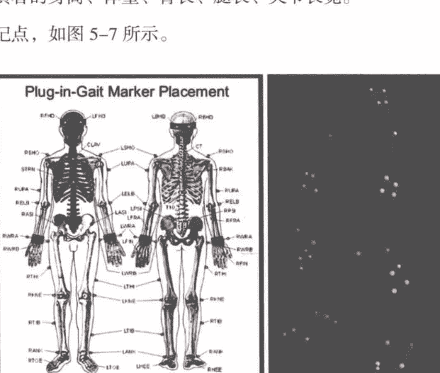

### 4. 开始捕捉

表演者在采集区移动时，需在软件中看到标记点。可切换视图到 Camera 确认标记点图像，如图 5-8 所示，上方为三维标记点显示，下方为各摄像机的二维图像。

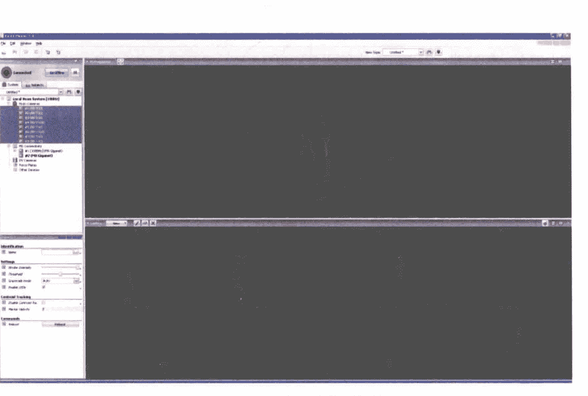

图 5-8 三维标记点及摄影机图像显示

### 5. 查看和使用数据

在 Data Management 窗口载入数据，利用 Tools Pipeline 界面中的 Core Processor 重建采集数据。点击 Time Bare 播放键即可查看数据。关于工具栏详情可通过 Nexusonline 寻求帮助。

# 第六章 人工智能与影像生成

- 1. 了解智能影像生成在影视行业中的现实应用及未来发展方向。
- 2. 熟悉常见的智能影像生成工具，能够选择适合自己的工具完成影像生成操作。
- 3. 掌握不同智能影像生成工具的使用技巧。

## 导入案例

### 《赞比亚奥德赛》的影像生成

2024 年，第十四届北京国际电影节首次设立 AIGC 电影短片单元，收到来自全球 430 余部作品，涵盖剧情、实验、动画、科幻等 27 个类型，23 部作品入选展映。作为全球首个支持 AIGC 影片参评的电影节，主办方还举办了 AI 技术展、短片研讨会及颁奖典礼，充分展现创作者对 AIGC 的探索热情。其中获奖作品《赞比亚奥德赛》引发关注。

《赞比亚奥德赛》是一部带有非洲未来主义色彩的幻想短片，设定在 1969 年赞比亚独立五年后、阿波罗 11 号发射前，讲述一位赞比亚教师自发创办航天学院，力争在美国登月前发射本国火箭的故事。影片用 AIGC 技术制作伪纪录片访谈，智能工具不仅完成了火箭发射、历史新闻等虚拟画面的生成，还大幅减少人力投入，降低成本、提升效率。

AIGC 生成影像并非凭空出现。自 2019 年起，中国在“一带一路”框架下推动 AI 国际合作。日常应用中，抖音、Instagram 等平台已支持静态图转视频；纪录片《内战》《爵士》借助智能工具为老照片添加平移缩放，使历史资料更具动感；电影《魔法奇缘》开场动画序幕使用图像转视频技术让手绘更生动。从娱乐视频到专业特效，PixVerse、Runway、GauGAN 等工具的普及正掀起影像生成与创作的新浪潮。

AI影像创作正在重塑影视生产方式，本部分聚焦AI在画面生成上的落地实践，从文生视频的核心逻辑，到主流工具的对比，再到图生视频的延伸应用，梳理技术原理、创作方法与行业影响。

## 第一节 文生视频：创意启动键

AI普及以前，拍一部作品需要编剧、导演、摄影、剪辑等多工种协同，剧本、分镜脚本是各部门对齐的关键物。随着人机交互成本下降，文字成为驱动AI最直接的指令通道，本节探讨如何用文字让AI生成视频。

### 案例启示录

电影创作向来离不开文字打底。从剧本到分镜，一段清晰有目的的描述能大幅降低导演与摄影、灯光、剪辑、特效等环节的沟通损耗。可惜越精致的剧本信息量越大，篇幅也随之膨胀。《教父》约5.6万字，《泰坦尼克号》超10万字，《魔戒》三部曲每部均在15万字以上。庞大的文字量拉长了开发周期，也抬高了现场调度的成本。如今创作者只需用简短语言描述意图，AI就能参与成片，周期与成本都被压缩。

2024年年初，由经典《终结者2：审判日》改编的首部AI长片*Our T2 Remake*引发讨论。故事设定在2024年4月1日，30亿台Discord服务器宕机的那天，OpenAI实现通用智能穿越，并派出两名聊天机器人回到过去企图摧毁人类反抗军。作为全球首部全流程AI创作的长片，动画制作、口型同步、字幕翻译、剪辑等环节均有AI介入，其中图像生成由Stable Diffusion、Midjourney、DALL·E等多款模型协同完成。

项目由50位AIGC创作者组成，经邀请与筛选后分工负责不同模块。团队里有广告美术指导兼独立短片导演Junie，她也是Stable Diffusion首届AI短片大赛全球冠军。团队把影片拆成50个片段，以文字分镜脚本为依据划分人工与AI任务。沟通过程中，文字仍是人与模型交互的主轴，如图6-1所示。

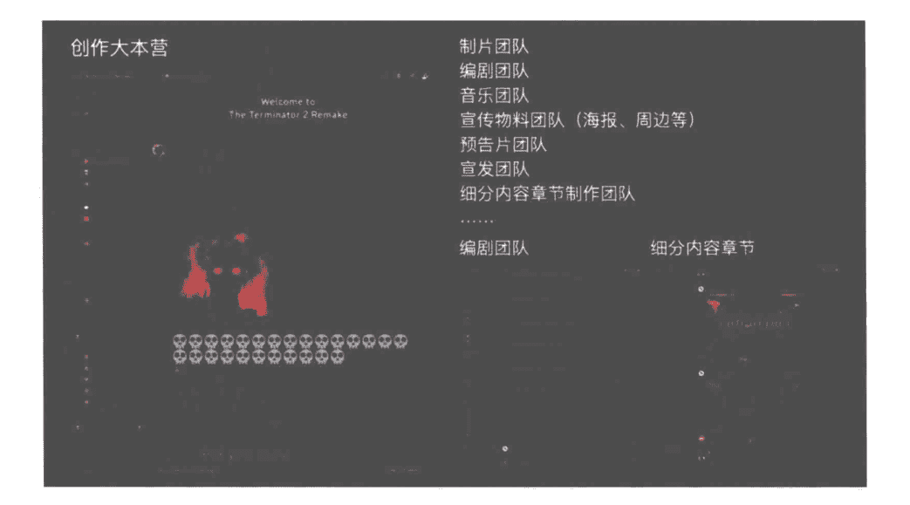

影片在洛杉矶线下首映，被称作艺术创新的里程碑，但市场反馈一般。AI难以完全取代人工的设计与把控，多人协作生成的质量和拼接效果参差不齐。即便如此，*Our T2 Remake*标志着AI电影制作进入新阶段，了解AI如何把文字转为视频便变得必要。

### 文生视频的操作路径

先厘清AI视频与传统拍摄的差异，才能写出好指令。

传统拍摄的关键维度有三维/二维、写实/虚拟、彩色/黑白，AI生成也适用这些维度，但虚拟向内容要注意“动漫感”。受模型能力限制，多数AI输出偏向卡通化，难以百分百还原现实，因此需提前锁定风格偏好，即写实取向还是动漫取向。

传统片场由导演调度机位与演员，保证空间关系合理。AI缺乏明确的主角意识，对主角、背景、配角之间的位移关系理解有限，描述时必须把空间方位写清楚。

传统拍摄布景后人物造型相对固定，调整重心在动作与表情。AI每次重绘都会带动画面整体变化，所以在迭代时必须明确告知哪些元素保持不变，哪些只做局部修改。

综合以上差异，借助AI做视频创作可归纳为以下流程，如图6-2所示。

- （1）定主题：明确想要的故事或画面，以及希望传达的情绪或内核。
- （2）定风格：提前约定画面是写实风还是动漫风，条件允许可提供参考图。
- （3）定元素：细致描写主角、配角、外景的形象特征与相对位置，关键道具如钟表、合影等也需说明其与人物的关系。
- （4）定效果：写明时间氛围如薄雾清晨、艳阳正午、夕阳晚霞、大雨深夜，场景如书房、盥洗室、山谷、小溪，及镜头运动、溶解、粒子、时空穿梭等特效需求。
- （5）初检：生成后核查画面是否贴合预期，检查手指、正面侧面同时出现、运动逻辑错误等问题。
- （6）微调：指出需要修改的部分，并锁定不希望变动的元素。建议先保存当前版本，防止迭代后丢失早期成果。
- （7）确认或再循环：若仍不理想，可针对单一要素重复上述步骤，直至满意。

按此流程，大多数工具都能稳定产出。AI辅助短片《阿嬷》（南昌八一起义版）就是典型案例。该片在抖音播放量突破3000万，凭借独特视角与强情感表达出圈。影片根据歌曲《阿嬷（爱国版）》改编，讲述老人住院与家人道别的故事，镜头与歌词紧密咬合，将生死、亲情、爱国、纪念等主题具象化。某种程度上，这是一次“歌词画分镜、填词生成分镜”的人机共创。

导演James透露，单段画面只需把风格、构图、效果等文字发给Midjourney即可生成片段，如图6-3所示。接下来以同类工具PixVerse演示具体操作。

### 文生视频实操演示

PixVerse以算法创新和友好的界面著称，表达更自由便捷。下面以“非洲草原上的中国班列”为题示范。

进入PixVerse官网注册账号，平台支持大陆邮箱。登录后进入创作页选择“Text to Video”，开始描述主题、风格、元素与效果。

本例设定为未来科技动画，主题是中国高铁向非洲国家运送货物。核心元素为画面中央极具未来感的高铁列车驶向远方，地平线升起朝阳，两侧是迁徙的非洲野生动物。补充细节：在空中穿梭的科技飞行器。随后选择生成模式Norma或Performance，并挑选镜头运动，平移推拉等8种可选。点击Create等待生成，如图6-5所示。

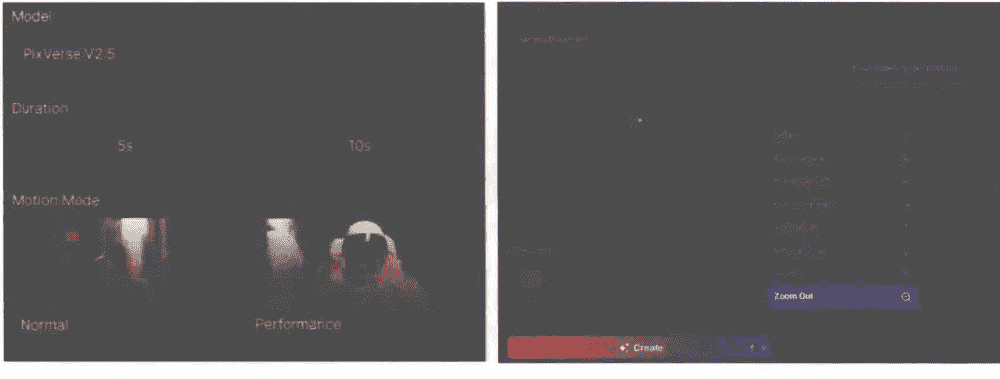

图6-5 生成视频选项

首次结果主题、风格、主体基本达标，但飞行器与高铁的空间关系错位，陪衬动物形态也不够自然。进入调整阶段，补充指令：保持视觉风格与主题不变，沿用当前高铁列车，重排高铁与飞行器的空间关系，适度优化野生动物的姿态使其更逼真。

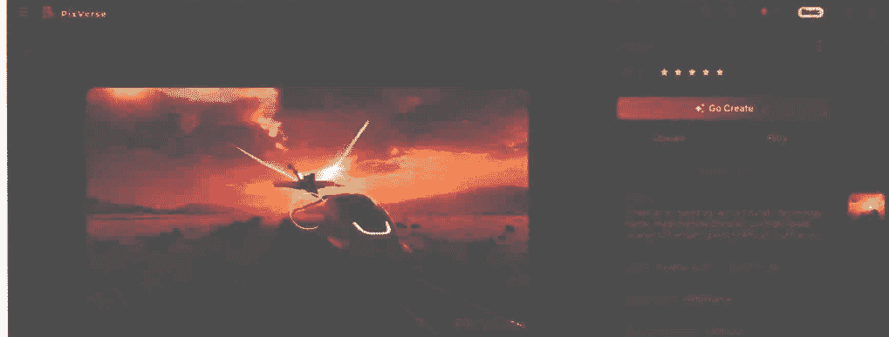

图6-6 PixVerse生成的视频

按新指令二次生成后，飞行器与高铁的相对位置更合理，动物等配角也更可信，基本符合文字描述。确认无误后即可在下方下载保存。

这次演练直观展示了AI视频生成的要点，也说明在迭代中需格外注意细节。技术持续进步，模型对意图的理解正越来越精准。

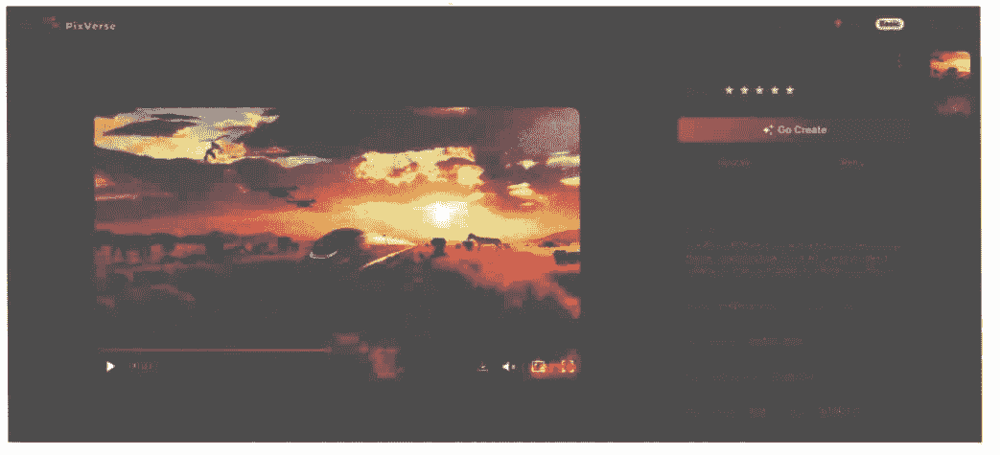

图6-7 PixVerse生成的第二版视频

## 四 主流量文生视频工具盘点

除了PixVerse，Lumen5、Animoto、Midjourney等也支持文字转视频。下面从效率、受众与优势角度做简要对比。

#### （一）Lumen5
Lumen5擅长把博文、新闻等长文本转为视频。用户粘贴文本后，系统自动提炼要点生成脚本，并可接入海量媒体库调用免费图、视频、音频。界面简洁，上手快，最大卖点是自动化程度高、内容营销转化快，能快速把描述性文字变成吸睛视频。

#### （二）Animoto
Animoto界面清晰，支持把文字与图像、视频、音乐组合成成片，适合短时间内快速交付。内置大量专业模板和自有音乐库，操作门槛低，特别适合零基础创作者和需要高频率产出的团队。

#### （三）InVideo
InVideo是多功能AI制作平台，优势有三：一是AI驱动的模板推荐，可根据输入文本自动匹配模板；二是编辑功能丰富，支持精细化个性化调整；三是拥有3500+内置模板与素材，覆盖社交媒体到创意广告等多种场景。

#### （四）Pictory
Pictory主打长文本转短视频，如图6-8所示。它能从文章中抽取关键段落与要点，配合视觉和配乐自动合成视频并生成字幕。长文本处理高效、人工介入少，是把报告、长文高效视频化的利器。

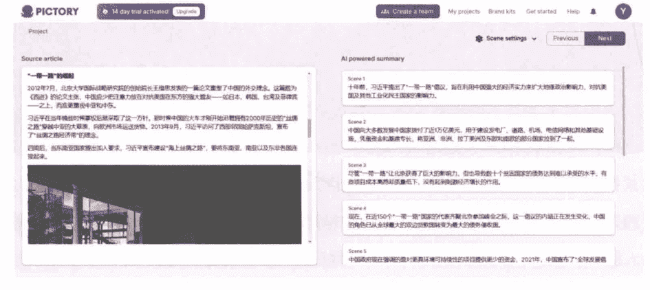

图6-8 Pictory视频生成界面（以“一带一路”新闻为例）

#### （五）Wave.video
Wave.video提供从制作到发布的全链路服务，支持文字生成片段与动画，也具备剪辑、特效、直播和流媒体托管功能。一站式方案适合对综合需求强的用户。

## 五 AI成片的得与失

AI为视频创作带来前所未有的便利，但每一次技术跃迁都伴随权衡。

传统拍摄的优势在于创造性与独特性，演员能传递复杂情感，现场即兴可带来新灵感；专业设备支持4K以上画质，灯光与质感把控更细腻，适合大银幕呈现；情感表达依赖真实表演与环境互动，感染力更强。

反之，AI也带来议题。首先精美画面背后常是高昂成本与低灵活性，设备、人力、后期特效配音等投入巨大；其次周期漫长，前期准备、拍摄、后期需多部门协同，进度管理复杂；最后受限于实拍环境，方案变更需额外时间与资源。

> ¹ 朱开鑫. 生成式人工智能与版权作品保护研究 [J]. 出版发行研究, 2024, (07): 80-86+111.

## 第二节 图生视频：视觉叙事的新打开方式

前文讲清了文字驱动视频，若直接给AI分镜图像作为输入，生成效率是否更高？答案是肯定的。

### 一 绘图工具与图像扩展

在视频化之前，AI先在图像层面被广泛使用。以Adobe旗下的Photoshop为例，2021年推出的Beta版可在既定画面内根据描述生成指定元素，或对图像进行扩展，并保持风格统一。借助该能力，可自由拼贴背景、人物、配饰，做出指向更明确的分镜。¹

除Photoshop外，Clipdrop、BgRem、阿里巴巴与香港大学及蚂蚁集团联合推出的MimicBrush、微软亚洲研究院与北大合作的DesignEdit等工具，也能在不损质感的前提下完成图像扩展与编辑，为视频生成提供更精准的视觉参考。

### 二 模板化图转视频

将图片转为视频的典型场景是活动开幕的“照片墙”。这类内容过去多靠Adobe After Effects由特效包装师制作，预留素材替换通道。但门槛高、形式同质化严重，使用者创意空间有限。

AI工具普及后问题得到缓解。Animoto等支持一键替换，上传自有图和视频后即可套用风格主题；InVideo等允许对颜色、动画、文字做个性化调节，在降低同质化的同时提升灵活性。现有工具普遍提供3:4、16:9、9:16、2.35:1等比例模板，支持元素独立调节与自由剪辑，既方便多平台传播，也让更多人接触镜头语言。

### 三 精准图像驱动的视频

图像转视频技术让静态分镜动起来。CGTN出品的短片《在东非大草原上撒一天野》即采用该技术，画面里狮子、河马等动物在草原活动，但并非实拍，而是由32张东非野生动物静态照片配合AI生成的动态影像。

静照动起来：图转视频的工作方式

让不动的照片产生流动感，核心是先让系统把画面拆解。模型会先做分层解析，把前景物件从后景环境剥离，接着判断物件的类别，再从自带的动作库调取同类物体的典型运动规律，并把这些规律映射到当前画面上。这样一来，《在东非大草原上撒一天野》里就会出现斑马踏着水花穿过湖岸、幼狮并排朝镜头走来、一群火烈鸟在岸边缓步的画面，如图 6-9 所示。自动跑完这套流程之后，还能用文字提示去增添个性化细节。

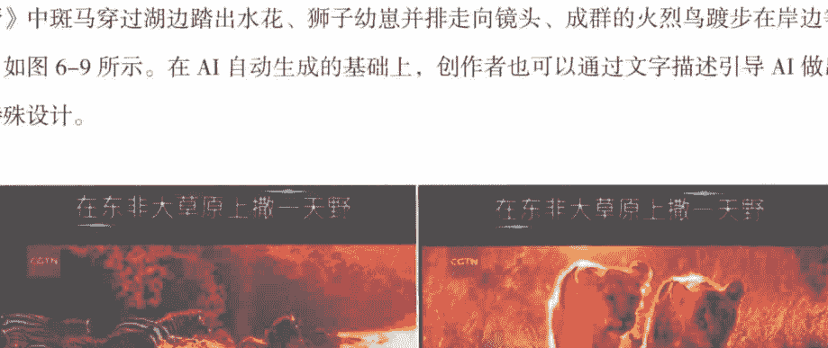

图 6-9 《在东非大草原上撒一天野》中 AI 生成的视频

在自动产出之上，还可以叠加特殊设计，比如光照变化、天气模拟、液体流动、直视镜头等。以 Runway 为例，先挑一张非洲野象迁徙的参考照，把“让画面里的象群动起来”译成英文送入系统，再追加“机位缓缓推进”“先快后慢的运动”等摄像提示，如图 6-10 所示。平台自带一批常用效果，可直接填进提示栏，像推拉、变焦、慢动作等。相比纯文本生视频，图转视频大幅减少了对主体与背景关系的冗长描述，让创作者把精力更多放在画面丰富度上。

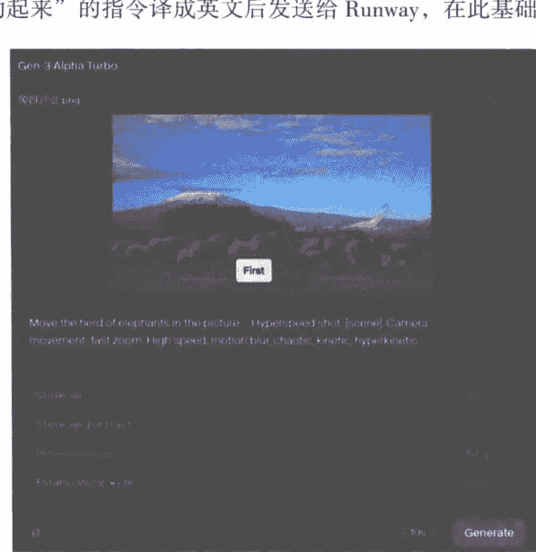

图 6-10 Runway 生成视频

### 四 常见的图片生成视频工具
把静态图像变为动态片段已成为内容制作的常见路径。除前面提到的 Runway，市场上还有不少各有侧重的智能方案，以下是几款较受认可的选择。

#### （一）Adobe Spark Video
Adobe Spark Video 是 Adobe 推出的一款片子制作产品，操作直观，支持拖拽把照片转为视频。它的价值不止于模板，内置了较强的剪辑能力与丰富的设计资源，涵盖动画、转场、字体等。平台提供大量可编辑模板，适合入门和非专业用户。此外，它还有类似剪映的格式分流功能，会根据手机横竖屏、网页、平板等不同投放场景推荐适配的模板。

#### （二）Magisto
Magisto 是一款智能编辑器，能自动把照片、视频片段和音乐拼成成片。核心是 AI 驱动的编排算法，可以识别画面的主题和情绪，自动匹配音乐与转场，大幅降低创作门槛，特别适合想快速做出专业感却缺乏剪辑经验的用户。

#### （三）Vyond
Vyond 是一款多用途的视频制作工具，同样支持一键把图片转成视频，其最大特色是强大的动画与虚拟角色生成能力。用户可在平台内创造专属角色并植入视频，同时提供双屏、画中画等模板与编辑功能，满足演播厅、线上对谈等场景需求，偏向企业与教育机构使用。

#### （四）Descript
Descript 整合了视频编辑、音频编辑和文档编辑功能，支持上传图片与视频片段进行合成与剪辑，具备高精度的自动剪辑能力，可依据音频内容自动匹配画面。其引擎能智能识别文字与图像，可根据文稿自动控制成片时长，如图 6-11 所示，节省了前期分镜与后期排版的时间。

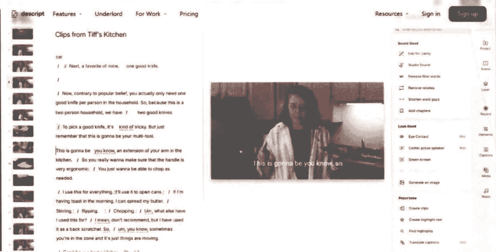
上述工具各有长处，无论是个人创作者还是企业团队，都能按实际需求挑选合适的智能方案。

### 五 人工创作视频与 AI 图生视频的优劣对比
综合来看，人工拍摄制作的优势在于能捕捉细腻的情感表达与独特场景，艺术性与原创性更高，创作者借助镜头语言可呈现强烈的个人风格与情感深度。但这种方式往往成本高、灵活性差。智能方案则大幅提升效率、降低成本、简化流程，能节省大量时间。不足之处是生成的片段在创造力、情感张力与成片质量上仍有局限。

人工创作更适合追求艺术性与个性化表达的项目，智能方案更适合需要快速高效产出的场景。未来两者有望更好地融合，随着技术演进，数字内容创作的可能性将进一步拓宽。

## 第三节 自动化特效生成：电影魔法的新纪元
影像创作以文本为起点，通过视听语言传递信息。在“视”的层面，除了拍摄与人工剪辑，特效包装同样关键。常规特效包括字幕条、光效等基础元素，随着智能应用普及，基于时空元素的特效也开始自动化。下面通过实操了解如何用智能系统生成常见特效。

### 用 Runway 生成植物生长特效
Runway 在自动化特效领域表现突出，其功能灵活，为视频制作带来改变。传统特效多由包装师用 AE 等软件手工制作，需配合 Trapcode Suite、Saber、Element3D 等粒子插件来保证物理逻辑，门槛较高。

使用 Runway 生成特效的大致流程如下。

- （1）选择特效生成工具：在 Runway 界面挑选合适的工具，例如与“Gen-3 Alpha”相关的功能，可把文本或静态图转为视频。平台还支持光线、雷电、火焰、生长等多种效果生成。
- （2）输入描述：同文生视频、图生视频一样，需要在文本框里详细描述想要的效果，比如火焰的颜色、形态、运动方式，或水流的方向、速度、水花样式。Runway 生成的一个植物生长特效如图 6-12 所示。
- （3）调整参数：输入描述后可调节持续时间、强度等。以植物生长特效为例，要明确选取的画面在特效流程中是第一帧 First 还是最后一帧 Last，如图 6-13 所示，这决定了特效是从该状态长成目标，还是从目标状态开始生长。

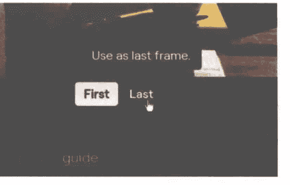
- （4）预览和微调：生成前可先预览效果，不理想时可修改描述或参数再试。也可以把加特效后的画面与原画面拼接或叠加，检查风格、光效、动态是否统一，如图 6-14 所示。

图 6-14 特效生成后与原视频拼接
- （5）下载和使用：确认满意后下载至本地，按平台要求处理。需注意智能系统更新频繁，操作可能变动，部分高级功能需付费。

### 用 Dispersion Effect 生成粒子特效
粒子光效在影像中很常见，除了集成在智能视频工具里的方案，还有不少在线生成器。Dispersion Effect 是一款适合初学者的在线工具，可通过简单操作制作图像的粒子分散效果，适合不想用 Photoshop 等复杂软件、希望快速获得视觉冲击的用户。

具体用法如下。

- （1）加载工具：访问官方网站，首次使用需注册账号，国内可正常使用。
- （2）上传图片：选择主题明确、主体与背景有明显区隔的图片，利于识别。
- （3）选择区域：用提供的画笔涂抹需要做粒子分散的区域。
- （4）调整参数：调节笔刷大小、颗粒大小、效果方向等。
- （5）预览效果：检查是否符合预期。
- （6）导出图片：满意后可导出多种格式。

Dispersion Effect 可实现三类效果：粒子分散，像受外力爆炸般向外飞散；动态视觉效果，如爆炸、魔法、科技感画面；艺术化处理，把普通照片转为粒子画，增强视觉吸引力。

### 其他常用的特效制作工具

#### （一）Stable Diffusion
Stable Diffusion 是一个开源的智能模型，可通过提示词和参数生成粒子特效。用户需掌握提示词组织与参数调节。作为 AI 绘画工具，它能在原图基础上精准叠加粒子特效，优势在于把复杂视觉效果转化为文本描述，降低技术门槛。

#### （二）Particle Illusion Pro
Particle Illusion Pro 是专业的粒子特效软件，如图 6-15 所示，新版支持导入背景视频与跟踪数据，可把粒子合成到源素材。软件粒子生成与渲染能力强，界面友好，学习成本低，广泛用于 VFX 与动态图形设计，见于电影、游戏、广告短片。

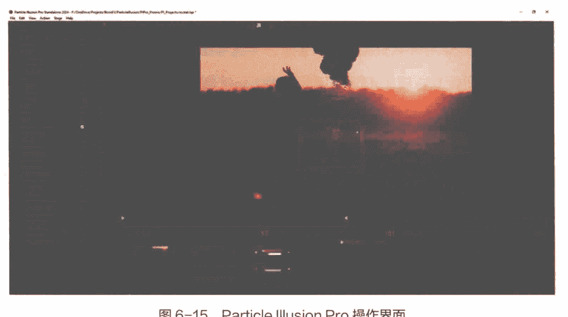
图 6-15 Particle Illusion Pro 操作界面

#### （三）Trapcode Particular
Trapcode Particular 是 AE 插件，可生成火焰、烟雾、水滴等多种粒子效果，并允许精细控制每个粒子的属性。支持 AE 的 3D 摄像机效果，可与 Cinema 4D 协同，提供实时预览与强大控制，适合制作需要精细调整的复杂特效，常用于影视与网络视频的自然现象或高科技场景。

#### （四）Immersity AI
Immersity AI 能把 2D 图像或视频转成 3D 视觉效果，为传统屏幕与 XR 设备提供 3D 内容。它简化了 2D 到 3D 的转换，提供易用界面与创作工具，让创作者轻松为视觉内容增添空间维度。适用于社交媒体、广告营销、游戏、教育培训、电商与艺术设计等领域。

### 四 运用 AI 生成视频特效的注意事项
智能系统作为技术手段具有双刃性，使用时需关注以下要点。

- （1）智能工具对算力要求较高，处理高分辨率视频或复杂特效时，要确保硬件配置或选择云端服务减轻本地负担。
- （2）生成特效时必须确保素材、音乐、字体等不侵犯他人版权。
- （3）选择界面直观、操作简单的工具很重要。例如 Chillin 是一个在线视频编辑器，具备 AE 与 Premiere Pro 的大部分功能，可进行非线性剪辑与矢量动画制作，无需下载，直接在浏览器跨平台使用 4K 无水印编辑，简化创作流程。
- （4）要确认工具支持所需格式与分辨率，便于多平台分享。例如 GoEnhance AI 可生成高品质视频，支持最高 4K 60fps 导出。
- （5）注意隐私保护。例如企业员工用 ChatGPT 写视频脚本时，不应上传核心企业数据，避免泄露。
- （6）相关法律法规在完善，智能写作、合成人声等可能导致公众混淆或误认的内容，需在合理位置标识为 AI 创作。

至此，智能系统如何重塑视频生成与特效流程已较为清晰。本章希望读者在掌握关键技术与工具的同时，培养创新意识，为人机共创做好准备。

## 创新实践 ▸ 用 AI 生成一部短片
结合本章内容，用智能工具自动生成短片的步骤如下。

### 步骤一 文本描述
描述一个场景，例如“在繁华的都市街头，一位身着他国传统服饰的舞者在现代建筑前起舞。周围是穿着时尚的行人，他们停下脚步，被这舞蹈所吸引”。

### 步骤二 选择工具
注册并登录 PixVerse 官网，可按需求选择其他工具。

### 步骤三 输入文本
在 PixVerse 中输入文字描述，并适当补充参数，如相对位置、光效、色彩等。

### 步骤四 预览与调整
PixVerse 一次生成两个视频，预览后调整直至画面符合预期。

### 步骤五 添加特效
将视频导入 Runway 或 Dispersion Effect 等智能特效工具，在舞者旋转时添加粒子效果，模拟传统服饰流苏随舞动飘扬；高潮处用 Dispersion Effect 添加光效模拟闪光灯，突出动作。

### 步骤六 调整特效参数
调节特效强度与持续时间，确保强调而不干扰主体。

### 步骤七 生成视频并上传
检查常见智能生成视频问题，如手指数不对、面部模糊等，确认无误后上传至自媒体平台。

# 第七章 AI 与后期制作

- 1. 了解影视后期制作的基本概念及 AI 技术如何辅助进行后期制作。
- 2. 学习如何在 AI 的辅助下合理划分剪辑任务，提高剪辑效率。
- 3. 掌握利用 ColourLab Ai 完成色彩风格移植的基本方法。
- 4. 掌握达芬奇软件中 AI 魔法遮罩的遮罩构建方法，熟悉人物等复杂遮罩的精细控制流程及注意事项。

## 导入案例

### 索贝 AI 剪辑平台助力冬奥会赛事剪辑
在冬奥会这一全球瞩目赛事中，技术不断提升观赛体验。索贝公司的 AI 剪辑平台为赛事剪辑带来变革，提升呈现质量，并强化实时性与互动。

索贝平台可自动分析海量视频数据，快速识别关键时刻与精彩瞬间。通过深度学习，可精准捕捉运动员表现、比赛转折点与观众情绪，剪辑出高质量集锦，流程如图 7-1 所示。

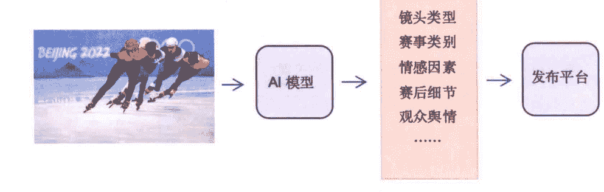
图 7-1 索贝 AI 剪辑平台的剪辑流程

在流程中，平台接收并处理来自直播、观众拍摄、社交媒体等多源素材，进行格式转换、分辨率调整、降噪等预处理。随后进入智能分析模块，使用计算机视觉、图像识别与深度学习分析内容。

在分析环节，AI 进行素材筛选与重组，产出大量精选视频。同时平台能捕捉观众对特定赛事类型的观看需求，按指令重组多段素材，同步输出多主题集锦，如图 7-2 所示。例如主题“冰之舞”涵盖冰球、花滑、速滑、短道速滑；“雪之舞”针对单板与自由滑雪；“速度之美”呈现旋转、进球等瞬间。

图 7-2 主题集锦视频

赛事高光秒出，智能后制提速

索贝的智能剪辑平台能对直播画面做实时拆解，几分钟之内就能拼出一版精彩集锦，而传统手工剪辑往往要花上数倍时长。即时剪切让观众几乎同步捕捉到比赛的关键瞬间。平台还能按不同观众的偏好自动产出定制片段，比如为海外市场单独生成某位运动员的精华，明显提升了观赛体验。

下面围绕机器智能如何改写影视后期的各个环节展开，并梳理当下主流的智能工具。影视后期的本质仍是艺术创作，技术只是助力，眼下智能化程度还不足以全面取代人。本部分更侧重介绍现成常用工具的功能与使用思路，帮助读者在合适场景下组合调用，从而拉高整体效率。

## 第一节 AI 辅助下的数字影像剪辑流程

影视后制位于制作链条的中后端，涵盖剪辑、调色、特效、声音等工序，目标是把拍摄素材加工成可公映的成品。其中剪辑与调色直接牵动叙事逻辑、节奏掌控、画面质感与视觉风格。智能技术正加速改写这两项工作的流程，让大量繁琐环节变得更有效率。

在剪辑侧，模型可以对海量素材批量解读，为剪辑师先期提供一个初稿，再由人工精修。面对庞大素材库时，系统能自动筛出指定镜头，或按预设风格完成粗剪；在粗剪阶段，人脸识别可自动归纳特定演员的镜头，语音识别则能抓取重要对白。这些能力既压缩工作量，也降低人为失误。

### 剪辑元素的处理

剪辑元素的整理是后制流程的第一环，对衔接顺畅、信息安全与操作便利影响巨大。该环节的工作示意如图 7-3 所示。

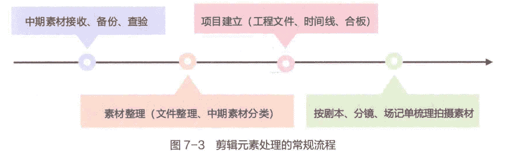

这一步的核心是打通后期与前期策划、中期拍摄，将素材归档梳理，为正式剪辑做准备。相比实际剪辑，创意要求不高但细节要求极严，任何错位或遗漏都会拖累后续。传统流程多由剪辑助理手工完成，因技术迭代快、项目标准不一，容易出现纰漏。对这类作业引入智能辅助是较好的方向。目前智能还不能完全自主操作，例如文件夹分级、素材挑选仍需人工确认，但在整体链路中已发挥明显作用。智能辅助流程如图 7-4 所示。

优化这一环既能加快创作速度，也能实现从策划到后期的无缝对接。接下来以《坦桑来的画家》为例，介绍几类关键工具的实操。

#### （一）Digislate、Silverstack 和达芬奇的全链条合作

随着制作技术进步，前中后期的衔接愈发关键。Digislate 和 Silverstack 是当前素材管理的关键环节，并能与达芬奇深度集成，为脚本同步提供新思路。

Digislate 广泛应用于拍摄现场，其本质是数字打板，把时间码、场号、镜号等关键信息电子化写入素材元数据。传统打板靠人工记录，数字化方式将信息直接嵌入，减少误差，后期整理更快，在大体量项目中可节省大量时间。

Silverstack 是专业的媒体管理软件，用于中期素材的分类、整理与备份，并与现场脚本信息同步。其优势在于能与达芬奇等后期软件无缝对接，素材在进入后期前已完成标注与整理，后期团队可直接读取时间码、场次、镜次、拍摄质量等信息，快速导入达芬奇进行剪辑调色。这样的全链条协作大幅提升了拍摄与后期的衔接效率。

#### （二）Final Cut Pro X

Final Cut Pro X 是苹果推出的专业视频编辑软件，广泛用于电影、广告、剧集制作。借助新技术，它加入了自动场景检测、智能素材分类等功能，使大量素材的处理更高效。下面以粗剪为例演示。

##### 1. 片段检测
在时间线上对素材点右键，打开“分析并修正”命令，在弹出窗口中按需勾选“查找人物”“合并人物查找结果”等选项后确认。软件会自动解析素材，识别人脸、镜头切换及音频问题。

##### 2. 智能精选
切换到时间轴左上角的“事件”面板，新建“智能精选”，为集合命名如“人脸”后确认。双击进入设置，可按内容、格式、类型、日期等多维度筛选。设置完成后，符合条件的片段会被自动收纳到智能精选中，如图 7-6 所示。

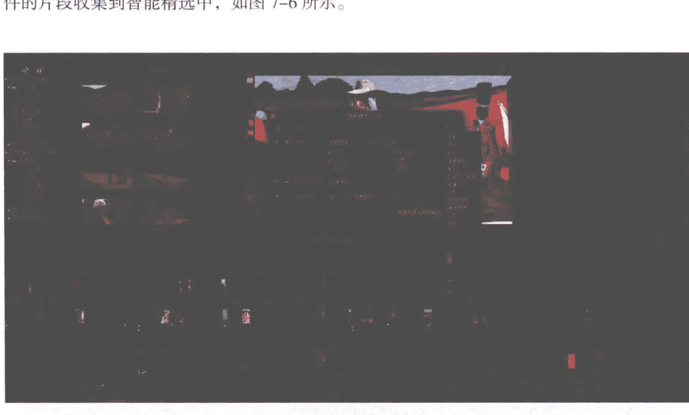

在组接阶段，Final Cut Pro X 的智能算法还会给出镜头切换时机的建议，以维持叙事连贯与节奏。

#### （三）Davinci Resolve（达芬奇）

达芬奇以界面简洁、剪辑调色一体、功能全面著称，在智能剪辑方面也具备强能力。

##### 1. 场景检测
新建工程并导入媒体素材后，选中素材右键选择“场景剪切探测”，如图 7-7 所示。

进入场景探测界面后，点击左下角“自动场景探测”开始处理，时长取决于素材量。完成后点击右下角“将剪切的片段添加到媒体池”，如图 7-8 所示。关闭面板后可在媒体池看到已切分的素材。

图 7-8 为达芬奇场景探测界面。注：以上操作针对免费版，付费版可直接在媒体池完成相关操作。

在媒体池中全选素材后添加到时间线，即可获得已裁切的时间线。需导入其他软件时，可将时间线导出为 .xml 格式。

##### 2. 面部识别功能
达芬奇可基于场景中人物面部信息自动归类素材。选中片段后右键选择“分析片段查找人物信息”，软件会按人脸自动创建媒体夹，人物会出现在媒体池侧边栏的智能媒体夹列表中，如图 7-9 所示。打开工作区菜单的“人物”窗口即可命名管理，建立项目人物库可大幅缩短大项目查找时间。

### 剪辑内容的搭建

镜头组接是剪辑的核心，决定影片叙事效果，包含纸上剪辑和实操剪辑两阶段。

在制作中，脚本是后期的指南。剪辑师会依据剧本、分镜、场记等资料梳理思路并形成文字记录，再与导演沟通后执行。传统脚本管理易出现信息滞后、结构复杂等问题，智能技术的加入让脚本编写与管理更智能高效。

在实操剪辑中，智能可通过场景识别、人脸识别、镜头识别实现初步剪辑。

借助文生视频或图生视频，智能模型还能生成所需素材，供自动剪辑软件使用。

尽管智能在自动化剪辑上潜力巨大，但自动版本往往缺乏细腻的情感把控与艺术性，仍需人工精修。剪辑大师瓦尔特·默奇提出的剪辑六要素即情感、故事、节奏、视线、二维平面与三维空间，陈坤在论文中整理了其与智能应用的对应关系，如表 7-1 所示。

表 7-1 剪辑六要素与 AI 应用的对应关系

| 六要素 | 主要内容 | AI 应用 |
| :--- | :--- | :--- |
| 三维空间 | 主要体现空间连贯性，涵盖人物站位及其与他人的位置关联 | 借助图像识别对画面做归类，按人物关键特征推断彼此空间关系 |
| 二维平面 | 镜头二维语法，即三维转二维的规则，如 180 度轴线 | 以三维空间数据为基础，按二维语法分析角色位置，判断是否越轴 |
| 视线 | 视线追踪，即观众注意力焦点，用于判断作品吸引力及镜头过渡是否流畅 | 运用卷积神经网络、长短期记忆网络等对画面做识别与分类，分析构图是否符合黄金分割，以提升画面吸引力 |
| 节奏 | 各类剪辑手法让画面与声音产生规律变化 | 计量电影学为智能赋能节奏提供数据基础与方法论，可自动统计镜头数、时长、剪辑率等，并按影片类型给出节奏方案，辅助人工调控 |
| 故事 | 镜头关联性，剪辑是否推动故事发展 | 间接为剪辑师腾出时间聚焦故事梳理 |
| 情感 | 角色情感变化及对观众的传递感受 | 通过卷积神经网络提取画面情感特征，结合多模态数据做情感计算、语调识别与面部表情识别，分析情绪并借助电影神经学模拟观众心理反应，优化剪辑决策 |

影片成片时观众沉浸于连贯画面，很少思考其结构。实际上影片由帧、镜头、场景构成，如何排列组合甚至突破常规，是剪辑师的职责。下面介绍几款常用智能剪辑工具。

#### （一）Rotor Videos
Rotor Videos 是专为音乐视频处理设计的自动剪辑工具，其特点是在线操作便捷、素材库丰富、一键式完成度高。用户注册并登录之后，可以选择与发布平台适配的视频格式，随后上传素材，在线进行剪辑加工，操作过程如图 7-10 所示。

#### （二）必剪
B 站推出的剪辑工具必剪以满足用户创作弹幕视频的需求为主，平台的智能剪辑功能针对游戏解说、动漫剪辑等类型的视频剪辑进行了优化。必剪具备“自动选镜”和“AI 推荐”功能，能够通过 AI 分析用户的历史剪辑偏好和素材内容，推荐适合的视频片段。例如，当用户上传一部电影或电视剧的素材时，系统能够自动识别并提取其中的高光时刻，如经典台词、重要剧情等。此外，必剪还集成了智能弹幕生成器，能够根据视频内容自动生成适合的弹幕风格，提升用户互动体验。

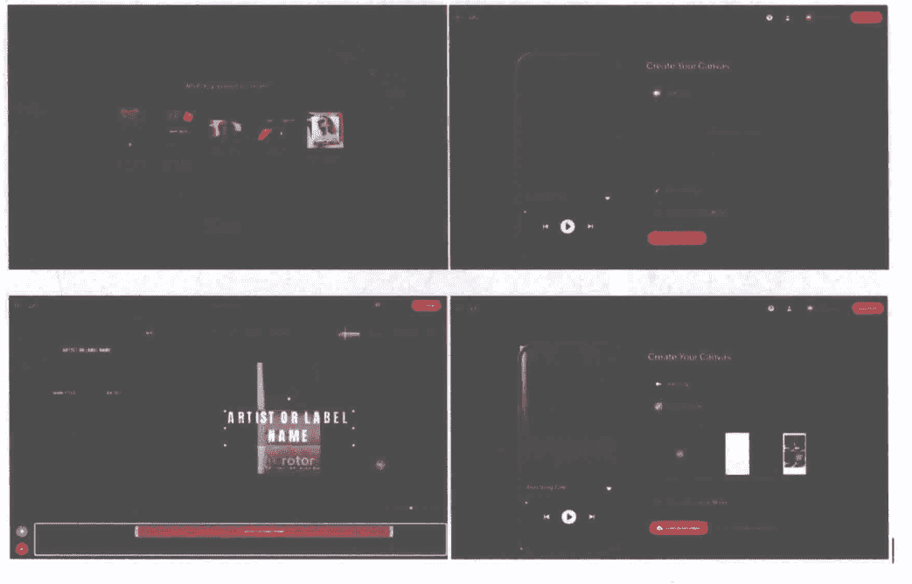

#### （三）度加
度加是百度旗下的智能视频创作平台，其 AI 剪辑功能主要被应用于广告视频和宣传片的制作。度加通过 AI 技术，能够快速生成多个版本的广告片段，用户可以根据不同的传播渠道特点选择合适的剪辑版本。度加的核心功能是其“智能多版本剪辑”，通过 AI 分析广告视频的目标观众和传播目标，自动生成符合不同平台需求的剪辑版本。例如，针对社交媒体平台，度加会自动生成时长较短、节奏紧凑的广告片段；而针对电视广告，则会生成时间较长、节奏稍缓的版本。

#### （四）剪映
剪映是字节跳动旗下的短视频剪辑工具，具有丰富的智能剪辑功能，从初学者到专业剪辑师都可使用。剪映能够自动识别镜头中的场景变化、人物动作及对话内容，进而自动生成剪辑建议。例如，用户可以选择“自动剪辑”功能，AI 会根据视频的节奏和场景变换自动切分素材，生成初步的剪辑草稿，此功能尤其适合快节奏的视频创作。此外，剪映已支持通过文字生成视频，如图 7-11 所示。在细节处理上，剪映还支持基于 AI 的背景音效识别和自动字幕生成，这大大简化了视频的后期处理工作。

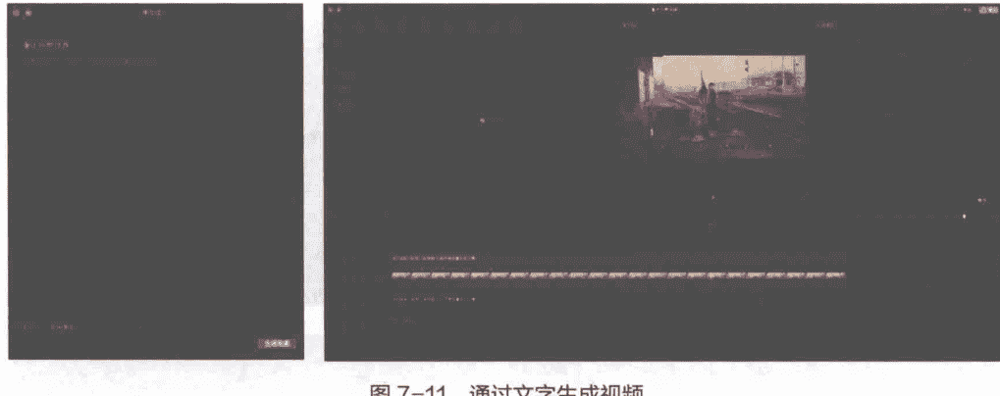

在实践中，我们先后使用了同一主题下两种长度的文案，生成了多个不同风格的视频，如图 7-12 所示。通过比较可知，文本内容的丰富度、细节度会极大影响生成效果。剪映能够根据文本内容查找丰富的素材，一定程度上可以提高剪辑效率，但同一条视频中会出现五六种风格、形式的画面，有时还会使用带有水印的素材；同时，剪映对于文本内容的切分也有待加强，对于气口和剪辑刀口的处理也存在不合理的地方。

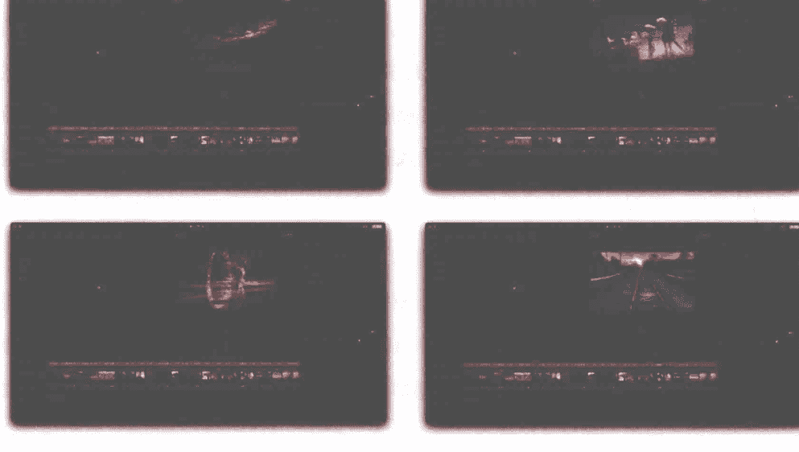

### 自动剪辑工具的局限

随着技术的不断进步，自动剪辑工具在影视制作中备受关注。尽管这些工具在某些商业视频的制作中表现出了较大的潜力，但面对复杂的影片创作时，仍然存在不少局限。

#### （一）对剪辑原则的呆板理解
剪辑是一项既有技术性又有艺术性的工作，而自动剪辑工具往往在理解剪辑原则方面存在局限性。传统的剪辑原则，如 180 度规则（也称为“越轴规则”）和镜头衔接的基本逻辑都是剪辑师在长期实践中总结出的经验，用于保证叙事的连贯性和观众的观影舒适度。然而，自动剪辑工具对这些原则的理解往往比较“呆板”。

越轴规则是电影拍摄和剪辑中的一条基本法则，要求摄像机必须保持在一个假想轴的同一侧，以确保画面中的被摄主体的运动方向和位置关系总是一致的。如果剪辑过程中越过了这个轴线，就会造成被摄主体突然反向运动，令观众产生视觉上的混乱。由于自动剪辑工具并不能完全理解影片中的空间关系，因此它可能会错误地将不同镜头拼接在一起，从而破坏影片的视觉流畅性和连贯性。

但有些时候，剪辑师会特意使用越轴镜头。在电影《大卫·戈尔的一生》中，剪辑师通过越轴镜头在闪回和现实之间进行转换，以模糊现实和记忆的界限。例如，在回忆的场景中，镜头会在不同的视角之间移动，创造出一种不稳定的视觉效果，这种效果能反映出角色内心的挣扎和不安，同时增强了故事的悬疑感，使观众能够更好地体验到角色复杂的心理状态。类似的剪辑技法无法在自动剪辑工具中使用，因为这些技法依托于剪辑师对于人物情感的敏锐把握，这是单纯的算法分析无法实现的。

#### （二）图像识别存在误差
自动剪辑工具可以自动识别场景中的人物、物体、动作等，以确定哪些镜头应连接在一起，但在实际应用中，这种识别存在不小的误差，这些误差会直接影响剪辑的流畅度，尤其是在复杂的动态场景中，图像识别误差更加明显。

图像识别误差还会影响影片的情感表达。剪辑师会通过镜头的切换来传递人物的情感变化，如用特写镜头展示人物细微的表情变化。然而，自动剪辑工具在识别人物表情和情感时往往不够准确，如果工具未能正确识别出人物的情感状态，就可能导致情感节奏错乱。

#### （三）只能理解浅层次的指令
当前的自动剪辑工具在理解和执行用户指令时，仍然存在较大的局限性，通常只能处理浅层次的指令，而无法准确理解用户的深层次需求。

比如，当用户要求自动剪辑工具对某一段对话进行剪辑时，它可能只是机械地按照时间线进行画面切割与拼接，而不会考虑对话的情感基调、人物之间的互动及对话的叙事功能。这样的浅层理解会导致剪辑出来的影片虽然符合基本的技术要求，但缺乏情感层次和叙事逻辑。自动剪辑工具无法具备人类剪辑师在艺术上的直觉和判断能力，导致其在复杂创作中的效果有限。

自动剪辑工具在面对模糊或抽象的指令时，表现尤为乏力。例如，用户可能希望剪辑出“充满戏剧性的效果”或“充满紧张感的节奏”，这些抽象的要求难以通过简单的算法实现，自动剪辑工具无法理解“戏剧性”或“紧张感”背后的情感和美学逻辑，因此无法有效地满足这些高级剪辑要求。

#### （四）AI 的审美差异导致艺术性缺失
审美是剪辑中至关重要的一部分，它将直接影响影片的风格和观众的情感体验，自动剪辑工具在这一点上存在天然的局限性。审美是一种主观感受，不仅涉及视觉元素的搭配，还包含对影片整体风格、情感节奏、人物关系等多方面的理解，自动剪辑工具不具备人类剪辑师的审美意识，难以根据具体影片的风格做出合适的艺术性决策。

在不同类型的影片中，剪辑师会根据影片的情感基调和叙事风格，选择不同的剪辑方式。例如，在节奏紧凑的动作片中，剪辑师可能会通过快速剪接来强化紧张感；而在文艺片中，剪辑师可能会选择长镜头和缓慢的镜头切换来营造宁静的氛围，这是自动剪辑工具难以做到的。

另外，自动剪辑工具在处理文化差异和观众的审美偏好问题时，也存在较大的局限性。AI虽然可以通过大量的数据训练形成某种特定的审美倾向，但它难以应对文化背景和审美取向的多样性。由于审美具有高度主观性和文化依赖性，因此自动剪辑工具往往无法像人类剪辑师那样，针对不同的创作背景做出灵活的审美调整。

未来，随着技术的进一步发展，或许这些局限性能够逐步得到解决，但在当前阶段，自动剪辑工具仍然需要与人类创作者的艺术直觉相结合，才能在影视创作中发挥更大的作用。

## 第二节 算法驱动的智慧剪辑新形态

当算法介入后期流程，效率与可定制化程度同步提升。基于数据的解析让创作者获得更专业、更贴合需求的方案，从院线级长片到短视频日更，智能引导的自动化编辑已经形成新范式。下面归纳四类典型做法及代表性产品。

### 精华自动抽取
利用模型抓取素材主干信息，输出短小有力的摘要片段。新闻快讯、会议纪要、Vlog 合辑等场景适配度很高。

操作路径大致是先把源文件上传至平台，系统开展多模态解析覆盖画面、声轨与文字；随后锁定核心画面、关键对白与亮点镜头；最后由使用者设定时长与关注焦点，平台据此生成摘要成片。

常见解法有 Magisto 与 Video Summarization，这里聚焦后者。

Video Summarization 依托机器学习与计算机视觉捕捉关键帧与重要事件，产出简洁可读的提要。适用于新闻播报、教学、会议记录等，可按需调节长度与详略，部署便捷且支持多语种。

### 二 结构化多片段拼接
依据预设脚本或叙事框架把多段素材自动串联，常见于宣传片、教学片、故事短片的体系化制作。

核心在于片段的编排与顺序。用户提供详尽脚本，系统解析后按序调用素材并自动处理切换、转场与叠加，保证逻辑连贯。成片后仍可预览并手工微调。

代表产品包括 Final Cut Pro X、Pinnacle Studio 与索贝的智能剪辑平台，这里介绍 Pinnacle Studio。

Pinnacle Studio 面向创意制作，提供多轨时间线、专业特效与动态转场，支持 4K 与 360 度处理，音频编辑扎实，模板丰富，能从家庭影像做到专业项目。

### 三 语言层感知润色
聚焦视频的语言维度，对对话、旁白、字幕做识别与优化。系统可调节语速节奏并自动生成同步字幕，提升表达清晰度。

技术构成包含语音识别、自然语言处理与字幕生成。先解析语言内容区分对话、旁白、独白，再做节奏调整与语言润色，同时输出字幕。

典型工具是 Descript 与 Trint。

Trint 提供自动语音识别与语言层面剪辑，可把视频语音快速转为文本并自动剪辑、生成字幕，支持多语种，允许后续人工修正内容与样式。

### 四 节奏联动配乐生成
对视频音乐做切割、混音、转场与同步。算法可依据节奏、情绪与风格自动生成适配音乐，提升整体观感。

常用工具有 AIVA、soundstripe 与 Rotor Videos。

AIVA 是智能音乐创作工具，根据视频节奏与情绪基调生成配乐，用户输入内容与风格即可匹配。

soundstripe 提供自动化音乐剪辑，用户设定风格与节奏后系统自动生成适配片段，并支持编辑微调，如图 7-13、图 7-14 所示。

图 7-13 在 soundstripe 中输入 “happy” 后自动筛选出的音乐结果

图 7-14 在 soundstripe 中输入 “africa” 所得到的结果及编辑界面

Rotor Videos 专注音乐视频自动化剪辑，能依据音乐节奏与情感波动挑选镜头，确保画面与音乐无缝衔接。在商业广告中，可按品牌调性与音乐风格批量生成合规素材，加快高质量广告产出。

筛选与组接是后期核心，智能工具大幅提升粗剪效率。但要保证最终品质，仍需专业人员精细打磨。随着技术迭代，影视剪辑将愈发高效智能。

## 第三节 调色智能化演进

在调色领域，智能系统同样释放巨大能量。通过深度学习模仿不同影片的色彩风格实现自动调色；可依据参考片的视觉调性统一新片色彩；还能自动优化人物肤色、识别光源并做针对性修正，让调色师把更多精力放在艺术性微调上。

色彩影响观感，也承载情绪、节奏与氛围。传统胶片时代已有后期二次配光的做法，数字化后调色更细腻大胆。如今调色已成为后期关键环节，而人工智能正推动这一环节发生新变化。

### 图像合成如何助力定调
色彩风格确立是调色起点。传统流程需摄影指导提供过往作品、画作等参考，调色师依经验与创意反复沟通测试。虽然参考有价值，但难以完全对应创作者脑中的画面想象。

人工智能图像生成为此提供增益。摄影指导与调色师可借助人工智能在定调阶段获取创意支持并提速。

#### （一）传统色彩方案的制定与瓶颈
传统定调包含确定主题情感基调、收集参考资料、与导演摄影沟通确认方向，并在拍摄与后期中持续优化。该流程高度依赖经验与直觉，存在资料收集耗时、灵感抽象难以具象化、复杂素材易导致灵感枯竭等问题。

图像生成技术提供新解。输入文本描述如“温暖秋日阳光下的乡村景色”，人工智能可批量生成匹配的图像，为调色师提供色调、光影、构图的具象灵感与多样选项。

#### （二）参考图的快速生成思路
Midjourney、Stable Diffusion、可灵等工具可快速产出特定影调的参考图。例如输入“90 年代风格街道上的少女”或“未来科幻风格街道上的少女”，人工智能即生成对应参考。人工智能还能学习经典影视影调，基于给定色彩生成不同搭配方案。

### 色貌迁移技术下的风格移植
色彩风格的统一与个性化是调色重点。同一色彩在不同环境、尺度下感知会变化，即色貌现象。保持镜头间统一色貌常采用色貌迁移，既可复刻经典风格，也可将已调好镜头的风格跨场景移植。

传统方式手动量大、精度难控。人工智能色貌迁移让风格移植更高效精细。

#### （一）Colourlab Ai 实现的风格复刻
Colourlab Ai 是由人工智能驱动的视频色彩调整工具，核心是分析与复刻。通过算法解析目标片的色调、饱和度、亮度等特征，生成独特的色彩“指纹”，实现高度还原。

导入素材或时间线后，系统自动分析场景光线、色彩分布与曝光，生成调色建议，帮助快速锁定基调。创意外观功能支持选择影调或导入静帧作参考，完成风格迁移；结果仍可导出至达芬奇等专业软件做精修。还提供定制化选项，如仅迁移色调与亮度、仅复刻特定场景等。

人工智能色貌迁移尤其适合跨年代、多场景影片，保证视觉连贯性。

#### （二）基于算法的遮罩精细操控
遮罩允许对特定区域单独调色，传统手工耗时易错。人工智能大幅优化绘制与控制。

达芬奇 17 推出的神奇遮罩 Magic Mask 便是一例。它基于深度学习图像分割，自动识别并跟踪物体，生成精细遮罩，可细化到人物肢体、面部纹理与光影变化。

人工智能生成与交互控制结合。系统可自动产出初始遮罩，调色师再通过边界修正、透明度、羽化等参数，以及笔刷、选区等手动手段微调，确保创意需求落地。此类交互提升了精度与灵活性，对复杂场景尤为重要。

### 未来调色走向的思考
人工智能不仅便利现有流程，更拓展了调色可能性，是机器学习、数据分析与人类审美的融合创作。

#### （一）多模态大模型下的色彩微调
多模态大语言模型 MLLM 可处理文本、图像、音频等多类型输入，并给出综合输出。色彩感知本就感性，难点在于可控微调。多模态模型能基于细腻语义理解，对特定场景、人物、物体定向调整，同时保持整体平衡，并给出更细致的色彩调节建议，如突出视觉焦点、弱化背景饱和度等。

#### （二）贴合人类审美的智能理解
审美始终是调色核心。未来人工智能不只是工具，更是理解人类审美的智能助手。可通过分析对话、音乐、构图等理解影片情感，提供匹配建议：张力场景用冷调营造紧张，温馨场景用暖调，浪漫场景用柔和粉调，悬疑场景用强对比冷调等。

人工智能的审美理解还能跨文化适配。不同文化对色彩符号的偏好各异，人工智能可学习分析这些差异，帮助调色师做出兼顾全球观众的色彩表达，并在调色师反馈下持续迭代审美判断。

实战演示 ▸ 借助达芬奇神奇遮罩完成人物背景分离调色

使用达芬奇的神奇遮罩等人工智能工具完成视频片段中人物与背景分离的调色实践，步骤如下。

-   **步骤一** 将素材导入达芬奇软件中，通过色轮的亮度滑块完成对视频片段整体亮度的调整，通过色轮的色球偏移消除环境带来的绿色杂色，再通过初级调色调整画面的色彩平衡，如图 7-15 所示。

-   **步骤二** 使用达芬奇的神奇遮罩功能和人体识别算法，在画面中的人体部分创建自动选区，再通过“添加”与“减去”工具，对选区边缘进行修正，实现对片段中主体部分与背景部分的分离。在完成选区后，通过跟踪工具实现对画面中人物移动的遮罩跟踪，如图 7-16 所示（标注 A 处为人体选区工具，标注 B 处为“添加”与“减去”工具，标注 C 处为跟踪工具）。

-   **步骤三** 在节点图中创建外部选区节点，如图 7-17 所示，通过不同的节点分别控制主体与背景的颜色，然后通过色轮工具完成主体与背景的分离调整，将整体背景的影调调整为午后，效果如图 7-18 所示。

# 第八章 AI 与声音制作

1. 了解 AI 目前在影视行业声音制作领域的应用场景与发展前景。

2. 掌握 AI 辅助影视声音制作的具体方法。

## 导入案例

### 阿联酋电影《事不过三》的语言译配

在第 26 届上海国际电影节“多元视角”单元中，“影像万花筒”环节展映的阿联酋电影《事不过三》以其独特的艺术魅力脱颖而出，吸引了众多电影爱好者的关注。阿拉伯国家的电影在多数观众眼中相对小众，《事不过三》这部电影不仅深刻地展现了阿拉伯的民俗文化，而且创新性地运用 AI 配音技术将电影台词转化为中文，同时又保留了演员的原声音色，为跨文化交流树立了新的里程碑。

《事不过三》讲述了一个充满神秘与惊悚色彩的故事。小男孩艾哈迈德意外遭遇了“附身”事件，他的母亲玛丽亚姆为了解救爱子，四处寻求能人异士的帮助。影片巧妙地将科学与信仰的冲突置于台前，让观众在跌宕起伏的情节中，感受到了阿拉伯国家文化和宗教的复杂交织。导演内拉·阿尔·卡哈是阿联酋电影行业的先锋人物，也是阿联酋首位女性导演兼制片人，她不仅勇于挑战传统，更以敏锐的洞察力将阿拉伯文化的精髓融入影片的每一个细节。她的努力不仅为阿拉伯电影走向世界开辟了新的道路，更为全球观众提供了解阿拉伯地区文化与生活的窗口。

跨文化共鸣：人工智能改写影视声景的2024

2024年正逢阿联酋与中国建交四十周年。导演内拉·阿尔·卡哈对中国文化怀有深切敬意，借助人工智能辅助翻译，为作品打造中文版，由此诞生全球首部运用人工智能完成中文配音的阿拉伯电影。这一尝试显著提升了观影沉浸感，也让影片在跨文化传播中保留了高度真实与感染力，有效打破了传统译配易失真的弊端，使观众仿佛置身阿拉伯语境，深度体会异域魅力。

近年阿联酋凭借前瞻政策和充足资本投入，人工智能发展提速。2019年4月内阁通过《国家人工智能战略2031》，目标到2031年把阿联酋建成人工智能全球领先者，并在重点领域构建综合应用体系。同年阿布扎比成立世界首所人工智能大学——穆罕默德·本·扎耶德人工智能大学，2023年迪拜人工智能中心宣告成立。随着战略落地，人工智能将助力更多国际合作顺畅推进，扶持本土创作者成长，推动阿联酋迈向全球影视制作与技术创新枢纽，实现经济转型与文化影响力扩张的双重目标。

《事不过三》既是阿联酋电影工业成长的缩影，也标志全球影视界在人工智能语音译配领域的重要突破。它显示，借助技术东风，电影正以更包容多元的方式联通各地，共同分享人类文明成果。

## 第一节 影音配乐的生成与匹配

音乐在影视作品中扮演关键角色，无论是为影片原创配乐还是挑选已有曲目，都属于专业要求高、耗时耗力的工序。借助人工智能，这些环节得以高效精准地自主完成，同时也展现出创新潜能。

### 配乐生成路线的历史脉络

自上世纪50年代人工智能萌芽以来，音乐领域便成为重要试验场。1957年，ILLIAC即伊利诺伊大学自动计算机，谱出首支完全由机器完成的曲目《伊利亚克组曲》，后更名为《伊利亚克弦乐四重奏》，由作曲家Lejaren Hiller与数学家Leonard Isaacson合作完成。同年，被誉为“计算机音乐之父”的Max Mathews在美国贝尔实验室研发出MUSIC程序，这是首个被广泛采用的声音合成计算机程序，为后续发展奠定基础。随着机器学习成熟，人工智能的学习与创作能力显著增强。

进入21世纪，人工智能在音乐创作中的作用持续扩大。2009年，David Cope开发的程序Emily Howell推出首张由人工智能完成的专辑《From Darkness, Light》。此后类似作品不断出现，但创作局限于谱曲。直到生成式人工智能出现，完整的音乐创作才成为可能，它能在编曲同时加入歌词。此后Suno与Udio两款可生成完整音乐的应用被广泛认知，相较Suno，Udio功能更完善，既是播放器也是创作工具，并允许用户对音乐各部分进行精细调整。

得益于强劲创作力，人工智能正逐步进入电影配乐领域，整体来看它能在保持原创性的同时大幅提升效率。

电影配乐大致分两类：使用既有音乐的汇编音乐，以及为影片专门创作的原创配乐。汇编音乐成本更低，因而在低成本影片中常见，只有预算充足的项目才会定制配乐。如今人工智能让低成本获得原创配乐成为现实。当前人工智能已能依照影片主题与特定情绪自主生成音乐，既保证独创性、针对性与首发性，又能节省时间与经济成本。

早期人工智能音乐创作主要依赖算法与预设规则，如固定旋律与节奏模式，作品相对简单且缺乏创新。后期则通过深度学习，从海量曲库中学习复杂音乐特征、结构、风格与类别，突破人为固有限制，具备一定探索能力。诞生于2016年的艾娃AIVA是首个虚拟人工智能编曲程序。

技术演进经历由简到繁：从循环神经网络到长短期记忆网络，再到变分自编码器与生成对抗网络，随后是现今广泛应用的Transformer、大语言模型以及最新的多模态学习方向。

循环神经网络与长短期记忆网络能够学习音乐特征并生成和谐片段，但局限明显。变分自编码器与生成对抗网络则能在特征学习基础上生成更复杂且具一定创造性的音乐。

2017年，谷歌大脑团队推出的Transformer被引入音乐创作。它采用自注意力机制与多头注意力机制，更擅长捕捉音乐全局关联，生成结构与连贯性更强的作品。对影视配乐而言，这一点尤为关键，因为音乐全局性会影响影片整体统一性。至此人工智能才具备为电影提供统一音景的能力。

多模态学习可同时处理文字、音频、画面等多种信息，在电影配乐中可对视觉风格、情节走向、情绪变化等进行解析并生成相匹配的音乐。电影本就是视听语言的综合体，多模态学习因此具备巨大潜力。

目前用人工智能创作配乐的影片并不多。实验性科幻短片《阳春》是典型之一，人工智能角色本杰明不仅担任该片编剧，还在学习三万首流行歌曲后为影片创作一首带词配乐，完成度较高且具创新性。作为非叙事性背景音乐，它为影片开辟潜在叙事空间，以空灵旋律营造伤感、颓废气氛。从音乐性与功能性看，该配乐基本满足短片需求。但歌曲不够完美，出现时机略显突兀，未能与画面自然融合，技术限制导致难以掌握音乐内部全局关系以及音乐与影像的紧密联系，而这对电影音乐至关重要。

技术层面人工智能已能产出相对成熟的音乐，市场上也有多种生成平台，但要做到拿来即用的电影音乐，现实距离仍很远。

### 智能分析与配乐对位

除创作外，人工智能还能为电影匹配合适音乐。它可将音乐的类型、旋律、节奏、意蕴、时代背景等属性与视觉文本的属性进行对齐，从而精确判断何种音乐适配何种影像。

2019年会议研究《Automated Composition of Picture-Synched Music Soundtracks for Movies》三名作者尝试用自制系统为导入影片的视觉事件自动谱曲。2022年会议研究《It's Time for Artistic Correspondence in Music and Video》进一步探究乐与影的对应关系，与前者单向对位不同，该研究利用Transformer做双向对位，采用非监督学习让模型直接从数据中学习对位方式，无需人工标注。由于Transformer擅长处理长序列文本，该研究在训练与对位上效果较好。这类声画对位研究意义重大，因为以往研究多集中于声音与图像的匹配，如为爆炸画面配爆炸声，即下文详述的拟音，而非音乐与影像的配对。

Transformer全局分析能力强，在影像音乐对位中表现不错，但此前模型也能体现对位原理。例如擅长二维图像的卷积神经网络，擅长序列数据的循环神经网络及其改进LSTM，以及双塔模型等，均可对电影视觉与听觉信息作出有效判断。双塔模型常用于推荐系统，一侧处理电影片段，另一侧处理音乐，提取不同模态特征后映射到高维空间进行相似度比较。虽然理论上可行，实际应用仍处于初级阶段。

### 观众情绪推断与动态适配

人工智能还能依据听众反应来匹配音乐。若把情绪分析变为即时判断，人工智能即可通过情绪推演实时切换合适音乐，这是一个极具潜力的方向。

人工智能可通过多种途径捕捉听者聆听时的反应以判断其态度与需求并进行针对性调整。相关技术包括自然语言处理与情感识别技术。前者是人机交互的核心技术之一，能分析、生成文本并进行情感分析；后者通过分析声音、面部表情、肢体语言等识别情感。两者能从多个角度识别听众对音乐的反应，并据此实时调整风格、类型或强度，以产生更强情感冲击。

## 第二节 声音设计与音效处理的智能化

总体来看，人工智能参与电影声音与音效的创作处理，比参与音乐创作更为普及。相较于近两年才出现的Suno与Udio，21世纪10年代诞生的声音编辑软件如Soundweaver与iZotope，已能借助人工智能辅助电影声音设计与处理。

### 拟音环节的智能介入

拟音一直是电影声音制作的重要环节。拟音技术起源于20世纪20年代初，通过模拟方式制作片中所需声音，即呈现声音的发出体与实际发出体不同。拟音英文Foley源于音效艺术家Jack Foley，他首次将拟音方法用于电影，擅长用有限工具制造多样音效。拟音的初衷是对难以或高成本创造的声音如爆炸声做模拟，或以最低成本制作相似声响，几乎所有影视作品都使用拟音，可见其重要性。

人工智能正尝试参与甚至替代部分拟音，以节省人力，技术仍在发展。2020年一篇研究介绍了可自动合成拟音的程序AutoFoley，它能解析视频场景并生成匹配音效，为提升完善性，研究者还构建了包含常用拟音声与匹配画面的声画数据库。2023年一篇研究基于Video-to-Audio模型，构建潜扩散模型Latent Diffusion Model，LDM与对比音频视觉预训练Contrastive Audio-Visual Pretraining，CAVP，生成Diff-FOLEY，用于画面音效匹配，克服了既有模型在音质与同步方面的局限。

扩散模型通过逐步去噪生成清晰数据，相比Text-to-Audio，Video-to-Audio数据易获取且能更好控制声画线性同步。2024年研究中提出的FoleyCrafter是一个可自动生成与视频同步高质量音效的模型，在保持音质的同时强化了声画同步的精准控制。

### 声音模仿与合成技术

拟音本质是模仿真实声音。为让生成声音更真实，生成对抗网络被广泛使用。生成对抗网络由生成网络与判别网络组成，前者学习现有声音数据并模仿输出，后者负责辨别真假。在对抗中生成网络不断调整，直至生成声与真实声趋近。生成对抗网络是声音提取与创作的核心技术之一。

Soundweaver是Boom Library开发的音效设计软件，核心功能是帮助用户制作音效。用户可从音效库选择素材进行多层次组合与二次创作，并对素材进行管理调度，操作简便实用。

### 降噪修复与音频复原

消除电影声音中的噪声一直是行业关注重点。主流市场追求高保真声音，低保真多见于低成本与独立制作。随着对音质要求提升，降噪成为后期关键需求，人工智能让降噪更高效。

循环神经网络是早期降噪手段，能收集并处理时间序列数据，但长序列易出现梯度消失或权重爆炸。1997年长短期记忆网络作为改进的循环神经网络，通过门控机制有效捕捉与保留序列长期依赖，解决了梯度消失与权重爆炸问题。

循环神经网络与长短期记忆网络常用于手写识别、语音识别及噪声识别系统，能从样本中提取特征并全面消除噪声。实际应用中，iZotope RX能高效消除各类噪声、提升清晰度，还可修复失真或移除不需要的声音片段，在修复音频瑕疵中提升音质。

当声音受损时，人工智能也能修复。以可生成声音的深度神经网络WaveNet与SampleRNN为例，二者通过生成波形合成语音，因而也能修复受损音频。经过采样点与音频上下文训练后，它们能识别受损与完好部分，并利用完好信息修复受损区，形成完整流畅音频。该技术可高效精确补充残缺音频资料。

### 后期生成与品质提升

除了修复瑕疵，还可通过后期调整使影视声音更完美，这一过程在一定程度上已可由人工智能完成。人工智能可对声音进行合成、混音，以及分析并调整回声、混响等属性，这些可通过强化学习实现。强化学习以奖惩机制引导程序趋向最优解，让声音各方面达到理想效果。

在声音制作中，对音量与音频的控制是强化学习的重要应用。自动增益控制是信号处理技术，可自动调节信号增益以保持恒定输出水平，常见于保证影视声音音量适中、避免过大波动或失真。

不过，经过处理的“最优”声音并非绝对准则。对主流商业电影而言，这种编辑高效可行；但对艺术、作者或实验电影而言，人工智能调整后的声音过于规范统一，这些影片追求个性化声音表达而非正确完美平衡，因此人工智能目前最多只能起到辅助作用。

通过声音设计与属性调整，人工智能可创造全新绝无仅有的声音，对特定类型产生意想不到效果。例如恐怖片中陌生声音会加剧恐惧不安，正如《灯塔》作曲家马克·科文所言，未知声音令人感到怪异与恐惧。他自制独特乐器“恐惧引擎”，可创造独一无二的恐怖声响。

## 第三节 智能语音配音

智能语音配音作为新兴技术已进入影视制作，对传统配音生态构成挑战。各式智能配音工具的出现，不仅改变了传统配音效率低、成本高的问题，更以全新方式重塑声音创作边界。智能配音依托强大算法与大规模语料积累，通过模拟人类声音特征与发声规律实现自动化语音合成，已在纪录片、短剧等作品中得到相当水平应用。尽管情感表达仍有提升空间，但其良好发展态势与应用前景，足以预见一个由人工智能驱动的智能创作时代即将到来。

### 语音配音技术的发展脉络

在人工智能运用于声学领域之前，语音识别与语音合成技术高度依赖人工预设。当前较为成熟的语音识别技术，早期基于模板匹配与统计模型的方法。简单说，模板匹配是预设语音模板库，接收信号后进行匹配以确定结果。统计模型则是根据语音信号特点，利用统计规律来预测结果。

声音从拼块拼接走向神经拟真

早期合成手段普遍粗糙。识别端提升迟缓，生成端更显生硬。当时主流做法是人工搭建音素库，把细碎的声段像拼乐高一样组合，拼接处易出现断层与听感僵硬，建库与后期维护的人力投入也很大。另一种思路是参数路线，先对文本解析抽取声学特征，再借助声学模型把特征转成波形。可类比房屋建造：先出标注尺寸与风格的设计图，再按图施工；这里的设计图就是声学参数，有了参数计算机就能“造”声音。参数法让过渡更平滑，仍与真实录音差距明显，语调起伏与情感变化依旧刻板。

从应用端看，AI配音当下最棘手的问题是如何复刻出媲美真人演员、饱含情绪的语言表达。传统配音高度依赖演员功底，顶尖资源档期紧张，很难满足需求的爆发式增长；演员声音个性也在一定程度上限制了作品风格。视频内容迭代加速，真人配音的响应难以跟上市场节奏。成本也是现实障碍，录音棚租赁、演员酬金、后期精修叠加开支不小。此时机器手段的介入能明显提升制作效率，为行业转型升级提供实质助力。

进入21世纪，深度学习大幅提升声信号处理的精度与效率。在AI声音技术版图中，语音识别是最具代表性的方向，已渗透到手机、智能家居、虚拟助手等多个场景，改变了人与设备的交互方式。与此同时声音生成也进入新阶段。依托复杂的神经网络，人类声音的细腻之处被逐步模拟再现，音色、语调乃至情感传递逐渐逼真。相比20世纪的初步尝试，质感实现跨越式提升。如今该技术已服务于有声读物、新闻播报、影视配音等创意领域，并成为虚拟主播实现自然语言交互的核心技术。

当前国内外AI配音都处于快速发展期，应用面广、前景可期，多家科技企业纷纷布局。爱奇艺自研的“奇声影视剧智能配音系统”获评“2024年新型数字服务优秀案例”。该系统把机器技术创造性地引入影视剧配音制作，使制作效率提升近6倍，已为超300部海外电影制作普通话版本，并为50余部华语电影、800余集国产剧制作多国版本，助力引进和走出去。

中影人工智能研究院和华为公司联合打造的智能译制系统，能够把演员原声台词转成全球多种语言，同时保留情感表达与语调特征，并实现口型和译后语言的同步。观众借此摆脱语言限制，沉浸于作品营造的情感世界，为国产电影拓展海外市场和文化交流提供动力。此外，科大讯飞旗下的讯飞智能配音方案凭借技术积淀与丰富场景占据重要位置，腾讯、百度等巨头也都在配音技术上持续探索，共同描绘AI配音蓝图。

海外方面，英国Eleven Labs以多语言合成、声纹复刻、文本与音频处理著称，其AI Dubbing可快速完成视频翻译与配音。微软在该领域积累深厚，VALL-E等声纹复刻技术能生成高度接近原声色的语音。Flawless公司的唇形同步方案TrueSync通过计算演员说母语时的口部动作建立面部模型，在保留表演细节的前提下调整口型以匹配后期配音。以色列Deepdub正在研发让演员用原声“说”其他语言的系统，无需另请配音演员。若AI配音成熟并大规模应用，不仅能优化影像作品的视听效果，还能打破普通用户参与国际传播的语言壁垒，对影像对外传播意义重大。¹

> ¹ 翁佳.智能语音技术对播音主持专业与行业影响探究[J].电视研究,2017,337(12):57-59.

### AI配音的典型用场
在数字化浪潮下，AI配音正覆盖多个领域，整体逻辑是输出端提质、接收端增效。输出端提质即借助机器技术让声音更生动自然，满足多样化、个性化、高品质需求；接收端增效即通过技术与策略优化用户体验。此次变革已触达日常生活，拓宽了以声音为载体的信息传播渠道。常见场景如下。

#### （一）纪录片配音
影视配音市场仍以真人为主，但纪录片正逐步引入AI配音。纪录片对配音的要求是自然平实、情绪起伏不大，机器技术在此类语境下具备替代潜力。

2018年，中央电视台纪录频道推出《创新中国》，这是国内首部由机器技术配音的纪录片。团队采用科大讯飞AI配音技术，让已故李易老师的声音重现荧屏。20世纪80年代起，李易老师毕业于中国传媒大学播音系，为《滔滔小河》《再说长江》《魅力肯尼亚》《大明宫》、引进片《生命》《地球脉动》《人类星球》《鸟瞰地球》、合拍片《美丽中国》等配音，是纪录频道的标志性声音。

制作团队先收集整理李易老师过往配音作品，分析语言特征、去噪、调音量，构建高质量声库，再用机器技术合成初样，后期针对字间衔接、重音停连节奏等进行算法优化。《创新中国》中机器还原的声音音质纯净、语感稳定，获朱军、李瑞英等多位主持人认可。

类似尝试在2022年延续。纪录频道《码农的异想世界》展示了机器作词作曲并演唱的《程序员之歌》，轻松幽默；《如果国宝会说话》第四季《黄花梨夹头榫画案》借助科大讯飞AI声音合成，以简洁清晰的语言介绍明式家具结构，使文物“跃然屏上”，感染力强。

AI配音在纪录片领域初试成效显著，但情感计算仍是难点，情感表达不足。在情绪变化小的纪录片中已见应用，而在剧情片中难以完全替代人类，情感探索将成为电影技术与美学的关键课题。¹

> ¹ 陈坤. 人工智能时代电影后期制作的变革与反思[J]. 传媒, 2022, 383(18): 78-80.

#### （二）短片译配
AI配音在视频译配中的应用日益普及，为影视剧国际传播提供有力支撑。网络上广受关注的“郭德纲说英文相声”“霉霉说中文”等片段即由机器声纹复刻制作，不仅突破传统译配限制，还还原了被复刻者的音色，提升可看性。

阿里巴巴、腾讯、科大讯飞等国内企业，以及HeyGen、ElevenLabs、Rask等国际创新公司均推出基于声纹复刻的视频翻译方案。目前多只能对单一角色进行复刻，多角色场景仍存在技术挑战。

讯飞智作智能译制同声配音技术加持下，动画短剧《观复猫》英文配音版上线。该片有8个角色，技术通过分析发声特征聚类，进行语音切片、说话人向量提取等处理，为每个角色生成语言标签，实现原声高度还原，并支持中英文跨语种配音。跨语种配音的核心挑战在于翻译准确、文本长度贴合画面节奏、发音标准流畅。讯飞智作利用自然语言处理与机器学习优化翻译引擎，会自主采用缩写、合并句子或调整句式，确保配音流畅与声画同步。

2024年3月，央视频AI频道上线国内首部人工智能全流程微短剧《中国神话》，由央视频、总台人工智能工作室联合清华大学新闻与传播学院元宇宙文化实验室合作，美术、分镜、视频、配音、配乐全部由人工智能完成，共6集：《补天》《逐日》《填海》《奔月》《尝百草》《治水》。第四集《奔月》被机器精准译制为英文，在博鳌论坛亮相，实现古老传说与嫦娥五号探月工程的跨时空对话，彰显民族精神。

这些案例揭示了AI配音在短片译配中的潜力和价值。

#### （三）广告宣发
在广告传播中，机器不仅简化制作流程，还能借助大数据把握受众偏好，实现高度个性化传播。

国内人工智能智能营销服务商奥创光年为钟薛高新品Sa'Saa制作中国首支AIGC风格化品牌广告片。广告中人工智能为产品延展出20种声音联想：是滑板的声音，体现无畏；是踩在松软雪地里的声响，传达自由；与“鲨”谐音，暗示海洋清凉；像吃饼干时的“沙沙”，带来酥脆感；如瀑布奔涌，水势澎湃清凉；重复音节与雨声节奏相近，联想到舒缓雨天；广东话“洒洒水”形容轻松豁达……这些联想成功植入产品记忆点。

Sa'Saa系列从命名、口味、包装到推广由人工智能全链路打造。当时Runway虽有合适技术却未公测，无法商用，钟薛高遂和奥创光年合作。5天内生成20套方案后迅速推出广告片，大幅提升传播效果与市场影响力。

#### （四）虚拟数字人
虚拟数字人是融合AI、虚拟现实等技术打造的新型数字化形象。市场应用大致分为身份型与服务型两类，虚拟主播与虚拟IP中的虚拟偶像是国内热点，国外则多聚焦医疗顾问、日常陪伴、购物客服等多模态助手。¹ 它们虽存在于虚拟世界，却能跨越虚实边界与受众互动。

虚拟数字人流畅交流依赖语音识别、语义识别、语义分析、语义生成、语义合成、语音合成等基于大数据、云计算与深度神经网络的智能语音技术。² 在技术加持下，它们不仅理解人类语言，还能生成符合语境的回复，甚至模仿特定人物的声线与语调，为传媒带来变革。

2001年，英国PA New Media推出全球首个虚拟主持人阿娜诺娃，因技术限制仅有头部动画、2D形象、表情僵硬。³ 进入21世纪后，虚拟主播快速涌现。2018年第五届世界互联网大会上，新华社联合搜狗发布全球首个人工智能男主播“新小浩”，原型为新华社记者邱浩。2019年3月，人工智能女主播“新小萌”上岗，截至2019年8月，两位主播已播报新闻11000余条，累计时长超32000分钟，展现人工智能在新闻生产与传播中的效率优势。搜狗还为阿联酋阿布扎比媒体集团、俄罗斯塔斯社打造专属阿拉伯语及俄语人工智能主播，俄语主播Lisa的推出标志跨语言应用取得突破。

体育报道领域同样活跃。2024年欧洲杯期间，央视频推出《人工智能球报——来央视看欧洲杯》，以人工智能主持人形式每日1~2分钟传递赛果。形象与声音均以央视主持人马凡舒为蓝本，还原度极高，虽初期仍带些机械感，却为体育资讯播报带来想象空间。

巴黎奥运会期间，美国全国广播公司NBC在其Peacock流媒体启用基于真人体育主播Al Michaels的人工智能生成语音，用于节目《Peacock每日奥运回顾》。用户可在应用中设置姓名并选择感兴趣的项目，每天早上收到由Al Michaels播报的个性化赛事内容，进一步丰富观赛体验。

教育领域，虚拟数字人正重塑教学模式，以虚拟教师、智能学习伙伴等身份提供个性化互动学习。语言学习中优势明显，可进行多语言教学、提供标准发音与素材、实时语法纠正与发音指导。多邻国利用虚拟数字人为全球用户提供多语言学习服务，模拟真实对话场景并提供即时反馈，使学习更具针对性。

虚拟数字人在上述领域的表现是科技进步的体现，也是传媒与教育行业转型升级的重要推手，其高效精准个性化的特质可应用于更广泛场景。

> ¹ 程思琪，喻国明，杨嘉仪，等.虚拟数字人：一种体验性媒介——试析虚拟数字人的连接机制与媒介属性[J].新闻界，2022，352（07）：12-23.
> ² 张陆园.人工智能影像生产模式的技术赋能、媒介特征与文化危机[J].当代电影，2023，342（09）：77-84.
> ³ 郭全中.虚拟数字人发展的现状、关键与未来[J].新闻与写作，2022，457（07）：56-64.

### 主流AI配音方案介绍
传统配音流程包括试音、录音、后期制作，每个环节都耗时耗力。试音需演员反复揣摩选声，录音需专业棚内环境，后期需音频工程师做混响均衡等精细处理，整体周期长、成本高，成为多媒体创作的瓶颈。

AI配音方案的兴起打开了新空间。它能快速分析剧本需求模拟多样声线完成试音，录音无需专业环境也能保持高保真，后期可自动完成精准音频处理，无需人工逐项调整即可输出高品质音效。

#### （一）讯飞智作
讯飞智作由科大讯飞开发，是AI创作助手，提供文字转语音、语音合成等一站式配音服务，依托深厚技术积淀在AI配音领域具备较强竞争力。主要功能包括AI配音、真人配音、AI虚拟主播、AIGC工具箱。

AI配音支持调整换气、连读、停顿、音量、音调、语速，一键生成专业音频。真人配音支持选择不同性别、年龄、地域主播，覆盖多语种、多方言及广告、课件、纪录片、新闻播报等场景。AI虚拟主播提供上百种形象可选。AIGC工具箱提供创意视频、推文转视频、虚拟形象定制、AI后期、Word转视频、复刻声音等工具，提升学习工作效率。

目前讯飞智作已和众多影视制作团队合作，助力内容创作与传播。对特定行业或高度定制化需求仍需专业开发调试，高级功能存在技术门槛，使用者需具备一定技术素养以获得最佳体验。

#### （二）魔音工坊

北京小问智能科技有限公司推出的魔音工坊，聚焦短视频与有声书的内容生产，为创作者提供覆盖全流程的人工智能语音解决方案。平台已在短视频、有声书、广告、宣传片、纪录片等多个场景落地，核心能力包括语音合成、自动对轴、声线塑造、环境音处理与人声优化。其中声线塑造最具辨识度，操作逻辑类似捏塑黏土，只需用自然语言描述目标声线，系统先给出初版样本，再允许对音色、音高、混响等维度做精细微调，直至成型，同时支持基于本人录音克隆专属声纹分身。该功能在需要特殊音效或角色演绎的项目中表现突出，能较好还原情绪起伏与人物标签，为作品增添层次。配合智能化的背景音与人声优化，整体音频质感明显提升。

产品交互走极简路线，零基础用户也能迅速上手。需要注意的是版权边界，调用他人原创内容或未授权音乐都可能引发纠纷。

#### （三）ElevenLabs

ElevenLabs 总部位于英国伦敦，主攻人工智能语音模型与工具的研发。其产品线涵盖 Speech Synthesis 语音合成、VoiceLab 声线实验室、Projects 项目管理工具、AI Dubbing 配音工作室以及 Voice Library Marketplace 语音库市场，形成闭环业务。

语音合成是核心能力，支持文字转音频并可选择语言与声线。VoiceLab 允许上传一段清晰的音频样本做声纹克隆，或从内置语料库下载现成声音；Projects 用于长文本编排与对话片段生成。AI Dubbing 将上述能力融合，可把任意音频或视频中的人声快速译成中文、葡萄牙语、日语等 29 种语言，同时保留原声者的音色特征与情感表现。发布会上，联合创始人兼 CEO Mati Staniszewski 回顾童年观影经历：“我在波兰长大，我们观看的英语电影都是由一个旁白配音的，这意味着每个演员都有同样的声音，这让观影体验大打折扣。人工智能配音工具的发布是我们在消除这些内容的语言障碍方面迈出的最大一步，将帮助观众享受他们想要的任何内容，无论他们说什么语言。”这意味着电影、剧集、纪录片的观众都能用母语观看而不用担心理解障碍。语音库市场支持用户上传自制的 AI 语音副本供他人使用，使用产生的收益会回馈给原创者。

#### （四）剪映

剪映隶属字节跳动，本质是视频剪辑工具，其人工智能配音能力在短视频与 Vlog 制作中被广泛使用，也能完成声音克隆与合成，为创作者提供便捷的配音路径。海外版 CapCut 同样获得较高认可。

剪映的差异点在于文本编辑与视频编辑的无缝融合。借助智能文本编辑，用户可为视频输入旁白文案，再用 AI 文本朗读从海量音色库中挑选喜欢的声音生成音频。音色库里既有海绵宝宝、黛玉、霸总等偏娱乐化的短视频常用音色，也包含综艺、笑声、机械等场景音效，如大笑、喝彩、门铃等，只需搜索即可添加。平台还支持自主配音，直接录入个人声音并与画面剪辑同步进行，大幅提升制作效率。

## 创新实践 ▸ 用魔音工坊为作品进行英语配音

本章实践演示如何用人工智能为自有作品配音，下面以编者执导的纪录片《我到丝路去》为例，分步说明操作流程。

**步骤一** 注册登录。打开魔音工坊官网或下载官方 App，按指引完成账号注册与登录。登录后进入首页，点击“软件配音”入口。若操作遇到疑问，可在界面右下角的“AI 小魔助手”处咨询，官网还提供视频教程帮助快速上手，如图 8-1 所示。

人工智能与影视制作

视频教学 快捷键

多音字 解说模式 自动打轴 下载音视频与字幕 停顿调节 语调调节

声音转换 重读 局部变音 敏感词 文章保存和生成音频

提取人声与背景音 语速调节 多人配音 听声识人 配乐 连读

文案提取 局部变速 段落静音 音效 数字符号 音标 插入静音

别名 符号静音 批量替换

图 8-1 魔音工坊“AI 小魔助手”和视频教学界面

**步骤二** 选择配音模板。进入后会看到多套预设模板，覆盖不同性别、年龄、应用领域和语言，如图 8-2 所示。先按需求挑选合适的模板，不合适可在后续调整。

图 8-2 魔音工坊配音模板

**步骤三** 输入文本。将待配音的文案粘贴到指定区域，单次上限为一万字。做英文配音时需提前准备好英文稿。笔者选用的是纪录片《我到丝路去》的导语，并挑选了一款偏成熟稳重的英文男声“李伊”，如图 8-3 所示。

图 8-3 输入文本并选择声音

**步骤四** 调整参数。为获得更佳听感，可对语速、语调、音量等进行微调，也能对具体语句的停顿、连读、换气做精细设置，并在合适位置加入音效或配乐。设置完成后点预览即可试听。若要做更个性化的定制，可启用捏声音功能，只需用一句话描述目标声音的特征，AI 就会据此捏出新声。在《我到丝路去》中有一个关键人物丁颖，可以对其声线进行描述生成专属的“丁颖声音”，如图 8-4 所示，点击“用 TA 配音”即可完成创建。

图 8-4 简要描述所需声音

**步骤五** 导出配音。确认效果满意后即可导出，平台支持 MP3、WAV 等多种格式，方便在不同渠道使用。按以上流程即可独立产出多场景适用的 AI 音频片段。

# 第九章 AI 与影视宣发

1. 掌握 AI 辅助进行物料制作的主要方法。
2. 了解 AI 如何辅助影视行业工作人员进行市场推广。
3. 理解 AI 为影视作品提供智能版权保护的优势和局限。

## 导入案例

### 票房黑马《热辣滚烫》宣发新玩法

影片《热辣滚烫》在 2024 年春节档爆发，成为现象级票房黑马。2024 年 4 月至 10 月累计票房达 34.6 亿元，不仅夺得当年春节档票房冠军，也刷新了中国影史春节档剧情片的纪录。成绩背后，个性化的宣发策略与 AI 互动玩法功不可没。

上映期间，观众在支付宝搜索“飙戏小剧场”，上传个人照片后 60 秒内即可完成换脸，成为贾玲饰演的主角乐莹，体验主角视角的乐趣，如图 9-1 所示。该互动基于深度学习、计算机视觉与生成对抗网络等技术，实现人脸特征的提取、替换与融合。

此次合作中，支付宝打通了互动到转化的路径。用户生成片段后可一键跳转淘票票小程序购票。对用户而言流程简便，对片方与营销团队而言则实现了从宣发到票房的直接转化，便于实时评估投放效果并快速调整。

近年来，这类个性化宣发不断涌现，改变了观众从被动接收到主动参与的观影习惯，标志着影视 AI 宣发新时代的到来。

在传播技术更迭的历史中，影视与 AI 的融合不仅会重塑传播效果与内容生产方式，也将引发行业生态的深层变化。本章围绕影视宣发与 AI 结合展开，重点讨论宣发物料制作、AI 辅助市场推广以及智能版权保护。

## 第一节 宣发物料制作

影视宣发在产业中占据核心地位，直接影响作品知名度与市场表现。传统流程从市场分析与定位开始，到预告片、海报、剧照等素材制作，再到新闻稿、社交媒体文案撰写，随后制定渠道化推广方案并与粉丝互动收集反馈，最后通过数据分析优化策略。

AI 的快速发展正重塑这一链路。它能学习海量海报风格快速生成新设计，根据剧本情节自动生成预告片，还能基于目标受众偏好推荐投放平台并撰写定制化文案，大幅提升宣发精准度与效率。下面介绍主流 AI 宣发方式与工具。

### 电影预告片生成

2024 年是 AI 视频工具竞争的高峰期。自 2024 年 2 月 15 日 OpenAI 发布 Sora 文生视频模型以来，AI 动画与 AI 电影工具层出不穷，部分收费、部分免费。在预告片制作领域，除了第六章提及的 Runway，还有以下代表性产品。

#### （一）Pika Labs

Pika Labs 是一款热门 AI 视频生成工具，界面简洁，支持文生视频与图生视频。与 Runway 类似，它能产出高质量画面，并具备口型匹配与背景音乐自动生成能力，适合快速生成预告片中的角色特写、动作戏等关键镜头。

#### （二）Stable Video

Stable Video 由 Stability AI 推出，支持图生视频与文生视频，在画面稳定性、运动幅度控制与细节还原上表现突出，使用门槛较低，可用于制作连贯流畅的动态场景。

#### （三）即梦 AI

即梦 AI 由剪映打造，支持用文字描述生成精美图片与动态视频，也能把静态图一键转成视频。在预告片制作中可快速产出概念预告或宣传素材。

#### （四）WHEE

WHEE 是美图公司推出的 AI 视觉创作工具，输入文字描述或上传图片即可生成对应视频，并内置智能剪辑与编辑功能，便于后期调整。

AI 视频工具显著压缩了预告片制作周期。下面以 Runway 平台的 Gen 为例说明其在预告片制作中的应用。

Runway Gen 既可在原视频上做个性化编辑，也能从零生成全新视频，目前向公众免费开放。核心功能包括视频风格化、故事板设计、蒙版编辑、渲染处理以及高度可自定义的视觉特效。风格化功能可把参考图的艺术风格迁移到视频；蒙版功能支持精准定位并修改视频局部区域；渲染技术则负责将 3D 场景或特效转化为高质量影像，保证画面细腻流畅。例如输入“白毛上有黑点的狗”这类指令，系统就能智能识别并调整画面内容。相关功能展示如图 9-2 所示。

Gen 风格化功能展示

Gen 蒙版功能展示

Gen 渲染功能展示

图 9-2 Runway Gen 功能展示

Gen-2 新增了文字与图片直出视频的能力。用户输入文字描述、图像素材或两者结合，系统即可生成对应视频。比如输入“午后的阳光透过纽约阁楼的窗户照进来”，即可自动生成匹配场景，如图 9-3 所示。当前社交媒体上已有不少用 Midjourney 生成图片再结合 Gen-2 制作虚构电影预告片的案例，如图 9-4 所示，这种跨工具协作拓展了创作边界。

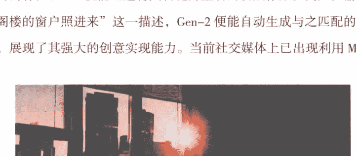

图 9-3 Runway Gen-2 文生视频效果演示

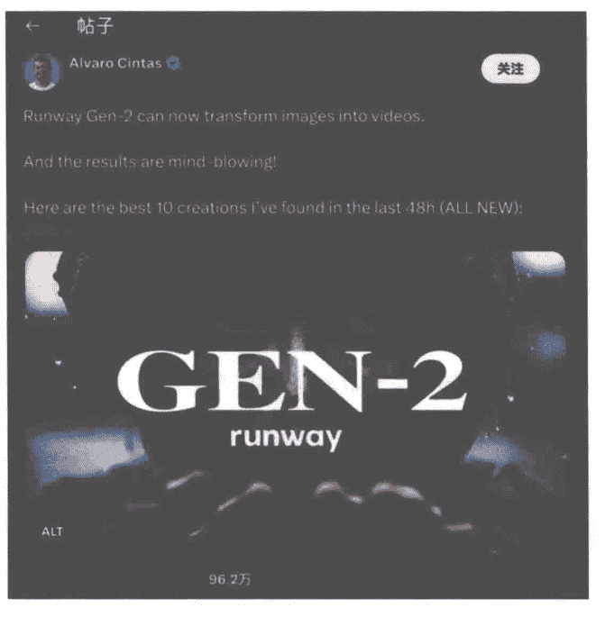

图 9-4 利用 AI 工具生成的虚构电影预告片

### 电影海报生成

传统海报设计耗时费力、成本高昂，优秀海报耗资可达十万元。随着 AI 普及，海报制作门槛大幅降低，计算能力可快速产出多样方案，提升效率并降低成本。

#### （一）智能生成海报的工具

AI 海报生成主要依赖深度学习、生成对抗网络与变分自编码器等技术，通过学习大量图像掌握色彩搭配、纹理与构图等美学规律，按主题或情感导向生成高质量作品。市场上已有众多工具，用户可按需求与预算挑选。

##### 1. Midjourney

Midjourney 以高质量输出与丰富风格著称，擅长根据文字描述生成对应图像，适用于电影海报创作。可产出高真实感画面，并支持参数命令学习其他图像风格，网页操作简便，用户社区活跃。

##### 2. Stable Diffusion

Stable Diffusion 是一个强大的文生图模型，生成速度快、质量高，支持多风格与主题，通过调节参数可精细控制画面效果。

##### 3. DALL · E 2

DALL · E 2 由 OpenAI 推出，能把复杂文字描述转化为精细图像。虽然最初并非为海报设计而生，但其创意生成与编辑能力使其在该领域有广泛应用，支持通过对话不断优化结果。

##### 4. Canva 可画

Canva 是一款在线设计工具，提供海量模板与设计元素，可快速制作电影海报。虽非纯 AI 生成工具，但已集成 AI 优化流程，操作简便、无需专业设计技能，模板覆盖多行业风格，支持高清导出打印，并提供智能推荐与布局建议。

##### 5. Fotor 懒设计

Fotor 是在线图片编辑与设计平台，提供丰富海报模板与设计素材，支持一键修图与多格式导出，模板适配不同场景。基于 AI 优化编辑与设计体验。

##### 6. Ideogram AI

Ideogram AI 擅长在图像中生成精准文字效果，适合制作文字量大的电影海报，具有接近照片级的质感与优秀的提示词遵循能力。

##### 7. 美图秀秀（美图 AI）

美图秀秀除修图功能外，还内置 AI 设计能力，包括一键生成海报，提供丰富模板与素材库，操作简单，支持高清输出与分享。

##### 8. 稿定设计

稿定设计：零门槛触达专业级视觉

稿定设计在创作者社群里讨论度很高，核心在于把智能化逻辑嵌进设计流程，提供自动排版、智能配色等省事体验。平台自带庞大素材库与模板池，用户可以快速拼搭出带有个人风格的电影海报及其他类型作品。界面简洁清爽，上手门槛低；模板覆盖面广，能适配不同使用场景；支持高清导出，便于后续投放与分享。借助内置的智能设计辅助，即便是设计新手也能迅速产出接近专业水准的电影海报。

#### （二）智能生成海报的过程
以下以“520 发布会”海报的制作为例，拆解从前期构思到成稿时借助 Midjourney 等系统完成的完整链路。

##### 1. 海报设计方向构思
海报成型前要先明确主题立意、情绪基调与目标人群，再据此确定风格走向、色彩体系、版式结构与字体方案。“520 发布会”旨在为一款主打社交玩法的网游造势，创意围绕“520”这一特殊节点展开，通过视觉传达产品社交属性与活力。核心定位是品牌活动的视觉主标，既要在线上发布会的视频转场中出现，也要在 520 发布会、周年庆等多节点持续投放。团队希望呈现玩家因共同爱好聚在一起的社群温度，关键动作选用击掌 Give Me 5 来营造积极向上的社交氛围。

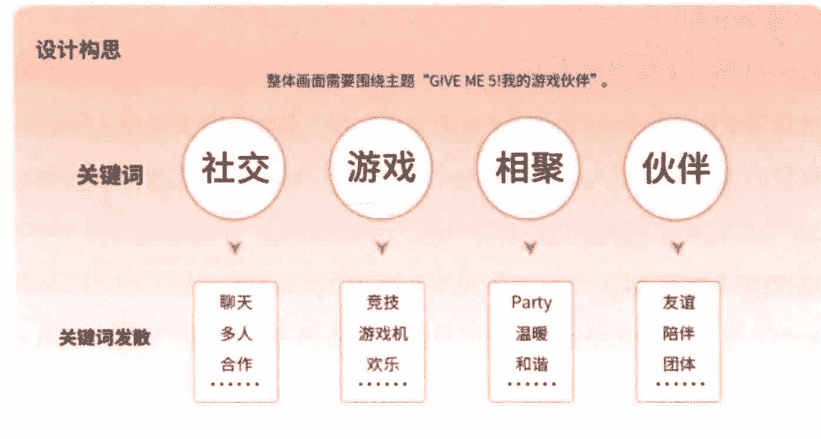

图 9-5 设计构思示意

##### 2. 海报视觉风格案例参考
方向确定后，下一步是收集并分析大量优秀案例。目的是提炼可用于驱动模型输出的核心关键词，并把关键词与参考图一并交给系统，帮助其把握既定调性。项目组整理了过往风格相近的游戏发布海报作为视觉锚点，为后续创作提供依据。

图 9-6 参考海报

##### 3. 画面描述与 AI 工具初步运用
在 Midjourney 等工具中输入包含游戏名、主题、情绪等要素的描述，系统会自动生成初稿。这一过程往往需要多次迭代，才能得到可比的备选方案。设计师会结合需求对色彩、构图、字体等进行再调整。

演示案例中，团队先归纳了同类海报视觉的共性，并据此设定筛选标准。随后输入详细描述“可爱帅气的孩子们一起玩手机，开心地微笑着，举起手欢呼，温暖的房间，大型落地窗”，得到的结果见图 9-7。初稿整体风格接近预期，但画面元素与活动关联偏弱，光影偏暗，视角张力不足。

针对问题，团队明确优化方向：强化画面与主题的联系，加入游戏机、手机等道具；提亮光影，让画面更明亮生动；更换视角增强透视，提升视觉冲击。配合新的描述反复迭代筛选，最终得到满意草图 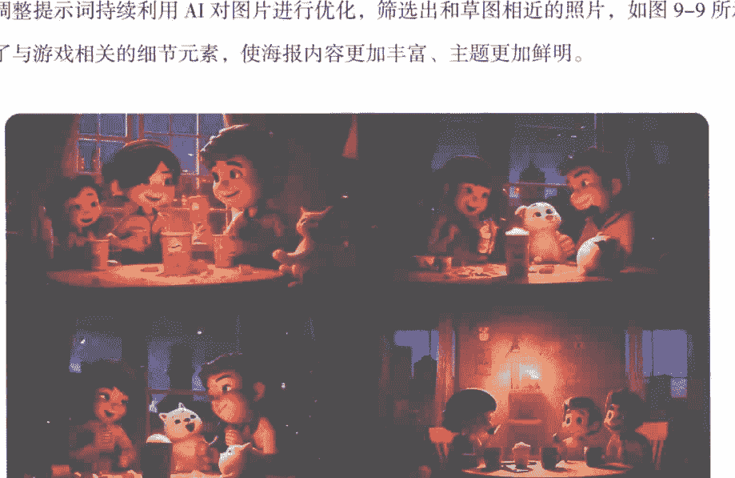，生动呈现了游戏伙伴因胜利相聚、相互击掌的欢愉瞬间。

在保留草图核心创意的前提下，继续微调描述让系统对图像做进一步优化，挑选与草图相近的照片并加入与游戏相关的细节，使内容更丰富、主题更鲜明。

图 9-7 Midjourney 生成的图片

##### 4. 提示词调整与反复炼图
这是流程的核心，任务是依据预期效果对系统产出进行精细化调整。筛选后团队已有张表现不错的基础画面。基于此绘制草图线稿明确修改走向，如图 9-10 所示。需求方审阅后提出明确意见，要求画面中加入女性角色且面孔偏向亚洲。于是启用 Midjourney 的 Remix 模式，对描述进行修改，将原主体改为“一对中国情侣”，并替换画面中相关元素的关键词。

图 9-10 海报初稿修改示例

##### 5. 海报最终效果优化
经过多次修改，系统生成的海报已基本满足需求。但由于智能产出的随机性，部分细节仍难以完全贴合预期，这时需要借助专业软件做局部精修。

利用 Photoshop 等影像处理工具对画面局部进行细致调整。例如本案例中，团队替换了人物的头部，如图 9-11 所示，并修正了画面中畸形、错乱或残缺的部分，如图 9-12 所示。此外还添加了必要的文案信息，如图 9-13 所示，以清晰传达活动要点。手绘与后期合成也是有效手段，本案例为在保留角色整体形象不变的情况下调整手部动作，采用了手绘细化，同时在画面左上角空白区加入彩旗元素，并通过 Midjourney 混合模式快速得到素材，进一步提升整体视觉效果。所有细节优化完成后，团队整合各元素输出了最终版本，如图 9-14 所示。

图 9-13 添加文案后的整体效果
图 9-14 海报最终版本

可以看出，上述案例实质是以游戏发布海报为例，而非直接做影视海报。原因在于当前人工智能产出图像与电影真实场景及真人演员拍摄效果相比仍有差距，且从人工智能在电影宣发海报的实际应用及观众反馈来看，接受度普遍不高。以 2023 年光线传媒推出的动画电影《去你的岛》为例，官方发布的海报右下角特别标注“本海报由 AI 制作”字样，如图 9-15 所示，并同步发布了介绍制作流程的短视频作为宣发物料。视频中详细介绍了使用的系统，包括 Midjourney、Stable Diffusion 等图像生成系统，以及 GPT-4 模型。

官方把“AI 制作海报”作为宣发亮点，但并未获得所有原著粉丝和动画爱好者的认可。他们普遍认为 AI 海报视觉效果欠佳，更缺少传统手绘海报的情感与灵魂。这一现象再次印证，即便技术高度发达，艺术创作中的情感与个性仍是机器难以替代的。人工智能创作本质上依赖对大量优秀作品的学习与模仿，《去你的岛》的海报也不例外，需要借鉴真人插画师的作品。这就引出一个值得思考的问题：人工智能生成商业海报是否构成侵权？

尽管争议不断，人工智能在电影海报领域的应用仍在探索。从现有实践看，本身就带有强烈科幻感或动画感的影片，用人工智能生成概念稿更容易被观众接受，如《星际穿越》的 AI 重新制作版海报、迪士尼为《黑寡妇》全球首映定制的 AI 概念海报，以及《阿凡达》续集推广中的 AI 个性化海报，既展示技术力量也不失艺术美感。

除了故事片，纪录片也成为人工智能与影视融合的新前沿。央视 2024 年初推出的纪录片《中国酿造》就是典型，其片头曲与主题海报均由人工智能完成，如图 9-16 所示。创作团队表示：“我们采用 50% 人工智能与 50% 人类艺术家协作的模式，既发挥人工智能的高效与创新，又保留人类不可或缺的情感，最终达成预期目标。”

图 9-16 《中国酿造》官方发布的 AI 制作的海报

### 宣传文案及新闻稿生成
对大多数人来说，文稿生成类人工智能是最早被广泛使用的品类。在影视宣发中，这些系统实现了宣传文案与新闻稿的自动化撰写、编辑与优化，大幅提升创作效率，降低人力成本，同时保证宣发准确性和时效性。

文稿生成的典型流程有四步：首先，系统从互联网、数据库等渠道广泛收集文字、图片、视频等多形态素材；其次，深度挖掘素材中的关键信息与核心内容，为写作奠定基础；再次，根据提取的信息自动生成初稿；最后，对初稿进行编辑、修改与润色，提升准确性、可读性和专业度。

相比视频、图片的自动生成，文稿类系统操作更简便，已成为影视宣发不可或缺的助手。市场上涌现出不少优质的人工智能宣传文案与新闻稿生成系统，各有侧重。常见的有：

- （1）GPT 家族（如 GPT-3、GPT-5 Turbo）：由 OpenAI 打造，文本生成能力强，能自动撰写高质量新闻稿和宣传文案。可通过官网注册使用，API 调用可能需付费。
- （2）Notion：写作助手，适配多平台，能根据标题和关键词自动生成文章，并提供编辑与总结功能，可用于会议纪要、新闻报道、社媒文案等。
- （3）文心一言：百度推出的智能写作工具，擅长快速撰写新闻稿和智能生成评论。
- （4）搭画快写：全智能自动写作平台，提供丰富模板和强力模型，支持批量写作、营销内容发布，并附带即时反馈与修改功能。
- （5）AI 创意生成家：全能创作软件，涵盖 AI 对话、写作、绘画、音视频总结等，提供免费额度。写作模块输入主题即可自动生成文案，还内置“虚拟男/女友”“夸夸小助手”等对话机器人助力灵感。
- （6）Copy.ai：广告文案专用生成器，能分析输入内容自动撰写原创广告文案，支持脚本创作、文章改写、“种草”测试、邮件写作等场景。
- （7）Kimi：月之暗面科技开发的智能创作工具，中文处理能力强，支持超长上下文和多平台同步，提供智能问答、文档分析、内容创作辅助等功能，免费易用。
- （8）DeepSeek：2024 年上线的智能助手，基于高效算法实现多语言交互与复杂任务解析，支持文本深度理解与跨终端操作，覆盖代码生成、知识推理、数据分析等，响应精准且免费。

这些系统都能在短时间内产出大量适配不同投放平台的文案和新闻稿。虽然质量较高，但在创意和个性化表达上仍有局限，人工审核、修改与润色依然必不可少。

## 四 物料综合生成
目前要彻底实现“一键生成”影视宣发物料还需时日，宣发物料往往需要多款人工智能协同完成。例如制作电影预告片时，需用 DeepSeek、ChatGPT 等生成脚本，用 Midjourney 等生成关键画面，最后用 PikaLabs 等 AI 视频系统把图片转为动态视频。整体流程与传统短片制作相似，仍需全套系统配合。

在非商业目的的影视推广中，对物料要求和版权限制相对宽松，多系统组合能显著提升效率、降低成本。比如编者导演的纪录片《波比的工厂》在图文物料制作时，就综合使用了多款人工智能：用 Kimi 生成小红书文案，用稿定设计制作首图，用奇域生成概念海报，如图 9-17 所示。

## 第二节 辅助市场推广
传统媒体时代，受众被视为主动信息接收的末端，传播链单向且互动反馈有限。随着受众研究从“被动”转向“主动”，迎来“受众即市场”时代。对影视视听率的重视催生了盖洛普等民调与商业调查机构。如今受众不仅是内容接受者、消费者和观众，更是内容与产品的推广者与传播者。人工智能可借助各大社交平台的观众数据和市场数据，对影视项目进行深度智能分析，使推广更精准，为片方提供高效的市场营销策略与用户服务方案。

下面将从预测市场效果、细分受众、提升用户体验三个维度，探讨人工智能如何助力影视市场推广。

### 预测市场效果
用人工智能预测体育比赛结果已不新鲜，近年来影视市场的智能预测已开始重塑行业生态。过去票房预测较为粗放，多依据导演过往成绩估算，或在上映后根据观众反应和舆情评估。借助人工智能，可在开拍前就判断影片的盈利潜力并预测上市后的票房表现。

#### （一）好莱坞的电影市场效果预测工具
诸多人工智能企业早早嗅到影视传播效果预测的商机。2015 年，一家计算机技术公司推出名为 ScriptBook 的人工智能产品，准确预测出 2015—2017 年间索尼 32 部“票房毒药”中的 22 部，准确率比人工高 3 倍以上。创始人 Nadira Azermai 称：“如果索尼早用我们的系统，可能已避免 22 次票房惨败。”ScriptBook 专注剧本创作、管理、评估与预测，主要功能如下。

##### 1. 剧本创作与管理
ScriptBook 提供直观界面，方便用户创作和编辑剧本，可按场景、角色、对话组织台词，并添加注释与场景描述。还提供自动格式生成和排版，节省手动调整时间，保证格式符合行业标准。用户可设置提醒与目标跟踪创作进度，并具备版本控制和备份功能，确保作品安全可追溯。

##### 2. 剧本评估与预测
系统可对上传的剧本进行智能分析。用户上传 PDF 后，数分钟内即可生成详细报告，包括美国电影协会预测分级、目标受众性别与种族构成、预期票房等关键信息。报告还涵盖角色分析、主角建议、男女比例与戏份统计等。ScriptBook 宣称预测准确率高达 84%，基于数据分析、机器学习、自然语言处理和特征选择算法，并学习了 6500 多个剧本及对应影片的市场表现。

##### 3. 合作与共享
支持多用户实时协作，可邀请合作者共同编辑。生成的分析报告与数据可与团队成员或合作伙伴共享，便于决策沟通。

##### 4. 商业价值与应用
对制片、发行和投资方而言，ScriptBook 是有效的风险评估工具，可预测剧本市场表现，避免不必要投资。智能分析与预测为项目决策提供客观数据支持，降低主观判断风险。

除了剧本评估，票房预测也是好莱坞重点关注环节。准确评估成本、类型、市场潜力、预期票房及目标受众，对制定营销策略、分配资源和提升收益至关重要。人工智能预测产品已成为决策辅助，比如 Cinelytic。它先用人工智能深度分析海量电影历史数据，包括票房、题材、市场反馈、演员阵容等，再通过交叉比对挖掘规律，构建高效票房预测模型。

与侧重文本分析的 ScriptBook 不同，Cinelytic 更依赖全产业数据。项目筹备阶段，制片人即可在系统中设定题材、演员阵容、目标市场等参数进行预测。如计划拍摄爱情片，可输入题材类型与情节概述做初步预测；挑选演员时，还能在系统中替换不同人选，观察票房预测变化以优化角色。Cinelytic 还能针对不同国家与地区观众偏好，预测票房的地域差异，评估海外市场潜力，从而制定更具针对性的宣发策略。

#### （二）中国电影市场效果预测工具
好莱坞电影高度重视类型化，若人工智能能掌握影视作品的类型特征，目标受众定位与发行营销问题便迎刃而解。中国市场早期也借鉴类型化路径，但随着观众需求与审美愈发多元，单纯类型化分析已难以满足，这对中国电影宣发环节的人工智能应用提出了更高要求。

2024年内地电影市场延续了承接与上扬并举、开局走高的态势，行业随之出现了一批新变化。2024年1月24日，阿里影业旗下的宣发服务平台灯塔对外公布智能化迭代成果，面向业界上线票房研判解读、预售快报、动态票房榜地图生成等能力，并在当年春节档期间向行业免费开放。

迭代后的灯塔既能对单片的日票房落点与累计走势进行预演，也在更早的时间点回应市场对前置研判的诉求。系统除输出数值外，还会结合影片类型、预售表现、排片场次等信息解释预测值为何波动。预售侧的数据检索被扩容，新增实时预售对战态势、开画进度追踪、分时预售曲线等维度，意在以颗粒更细、精度更高、效率更好的数据参考，帮助从业者摆脱繁琐的重复查询与核算，提升决策速度。票房榜地图以可视化方式实时呈现票房、场次、人次的变化，自预售起就关注影片在全国的排序与优势区域，实现对市场变化的第一时间洞察。舆情板块对全网评论进行归纳，统计观点提及频次，梳理影片的亮点与槽点并生成图表。从开发到内测再到开放，功能持续打磨，获得产业链上下游的认可。据了解，内测阶段已服务超千家客户，覆盖海内外片方、宣发方及院线终端，并以用户的提问持续优化模型。

与此同时，业界熟知的观影平台也在加码智能化数据能力，为春节档、暑期档等档期提供内容、票房、口碑的预判。猫眼电影于2023年暑期推出的猫眼专业版被明确定位为专业的影视数据服务平台。借助既有的市场份额与数据体系，该产品试图为推广环节提供支撑，如图 9-18 所示。

图 9-18 猫眼专业版的实时票房

其中票房日冠分布图能让业内人士直观把握各地大盘走向，便于宣发团队制定更有针对性的策略。《消失的她》上映4天累计票房尚不足7亿元时，猫眼专业版已将其总票房推演至33亿元，消息一出引发业内与观众热议，甚至有调侃称平台“疯了”。随后影片于7月2日突破20亿元，暑期累计达35.23亿元，与33亿元的推演相差不大。

在智能化加持下，猫眼不仅能对票房进行较为准确的推演，还可持续监测各类市场指标，帮助专业人士把握变化、优化宣发并在上映前提升热度。以《八角笼中》为例，宣发团队借助猫眼的大数据模型发现“儿童”“真实故事”等关键词能够在目标受众画像中触发女性用户的共情，据此调整短视频投放策略，不仅拉升了映前声量，也提高了女性观众占比。

猫眼专业版还上线了智能海报助手与智能分镜助手，前者为设计师提供海报生成工具，后者为制片人提供大纲配图能力。创作者亦可利用猫眼检索正片片段，节省资料查阅成本。针对制作后期数据不足的项目，猫眼研究院推出的“点映加油包”服务提供试映、热度追踪、点映地图制作、宣发落地执行等一站式方案，扮演“智能参谋部”角色，助力片方打磨内容并为宣发提供大数据依据。

必须指出的是，智能化工具在推演上也会“失灵”。ScriptBook对索尼影片的测试中，仍有10部最终票房不佳的作品未能被准确识别。暴雪出品的《魔兽世界》也是典型案例，影片在北美受众基础更厚的市场表现平平，却在中国取得高票房，如此反差很难被模型预见，因行业内游戏改编电影的成功样本有限，算法难以获取足够支撑。

除技术外，电影分析仍离不开决策者的眼光与行业经验。电影作为艺术产品，其成败常受诸多难以量化的因素影响，算法评估不能成为衡量价值的唯一标尺。英国Ingenious Group投资总监Andrea Scarso在访谈中提到，公司会使用Cinelytic进行阵容优化与预算测算，结果有时吻合预期有时大相径庭，工具甚至会提出此前未曾考虑的类型，Scarso强调：“智能化确实拓宽了思路，但绝不是最终决策者。它只是让我们看到调整某些要素可能对商业表现产生显著影响，从而证明选择并非盲目。”这些案例表明，当前推演多基于历史规律，难以预见文化演变、审美转向或突发事件，结论往往偏保守且易受训练数据偏差影响，这是影视预测乃至整个智能化行业共同的难题。

### 细分影视受众
在传播学与营销广告领域，受众细分始终是核心议题。影视市场中，细分主要依靠社交平台行为分析、票房数据分析以及专项调研，对目标人群及偏好进行深挖，进而制定更精准的营销方案。

在智能化支持下，受众细分的流程虽复杂但效率高，涵盖广范围数据采集、深度剖析与精准模型构建，主要体现在以下几个方面。
（1）大数据分析。智能化技术能处理影视平台行为数据、交易数据、社交媒体话题互动等海量信息，将目标受众划分成特征与需求各异的群体。划分不仅基于人口学要素如年龄、性别、地域，还综合心理特征、观影偏好、付费行为等多维度信息。
（2）精准定向。基于细分结果，系统可为每个群体定制个性化营销策略，使影片更准确触达目标人群，提升宣发有效性与转化率。
（3）实时监控与动态调整。智能化系统能实时追踪宣发活动效果，解析互动量、点击率、转化率等关键指标，并据此自动优化发布时间、宣发形式或目标人群，确保效果最大化。

### 提升用户体验
完成受众细分后，智能推荐成为智能化在推广中的另一关键应用，可改善用户在内容发现与接受过程中的体验。整体改善主要依托以下技术。
（1）个性化推荐系统。系统通过观看历史、搜索记录、评分行为等构建推荐模型。例如看完一部科幻片后，会自动推送同风格作品，或基于喜好推荐导演、演员的其他影片，减少在海量内容中筛选成本，提升满意度与忠诚度。
（2）智能客服与互动。依托自然语言处理与机器学习，系统可化身智能客服，在观看过程中实时解答疑问，提升观影体验。
（3）内容质量与观感优化。智能化技术能分析影片，识别画面瑕疵、音效问题或剧情拖沓等影响体验的因素并进行优化，为用户提供更好观感。
（4）情感分析与舆情监测。系统解析社交媒体上的文本与多媒体内容，通过自然语言处理判断情感倾向，了解用户对作品的看法与反馈。制作方据此及时调整营销与服务，满足需求，进一步提升体验。

Netflix是典型案例。平台每个分类下汇聚数万部影片，同时服务数十亿账号，如何为每位用户精准推荐是核心难题。公司通过先进算法实现个性化推送，有效解决了这一问题。

2020年Netflix引入交错测试个性化推荐算法，计算速度提升百倍。值得关注的是情境Bandits推荐算法，它在推荐时不仅考量选项固有属性，还融合上下文信息如用户特征、影片类型、时间、地点等，实现更精准的个性化决策。这一系统依靠复杂算法与详尽数据分析，为用户提供高度定制化内容，显著提升体验与满意度。

以热门剧集《怪奇物语》为例，Netflix能捕捉用户兴趣点，通过算法生成个性化封面，可能包含熟悉演员面孔、抓人恐怖场景或戏剧张力瞬间，激发好奇促使用户点击播放。平台亦重视观看历史。在为《心灵捕手》设计个性化配图时，系统会根据用户过往偏好匹配，如对浪漫爱情片感兴趣的观众，看到融入马特·达蒙与明妮·德瑞弗浪漫元素的封面会更有兴趣；而偏好喜剧的观众则可能因封面出现罗宾·威廉姆斯的身影而被吸引。类似策略也适用于演员偏好用户。以《低俗小说》为例，长期关注乌玛·瑟曼的粉丝会因其出现而产生吸引力，约翰·特拉沃尔塔的忠实观众也会因经典形象而倾向观看，如图 9-19 所示。

Netflix的个性化配图不仅展现算法实力，也体现了对用户个性化需求的精准把握，为行业树立了新标杆。

## 《怪奇物语》
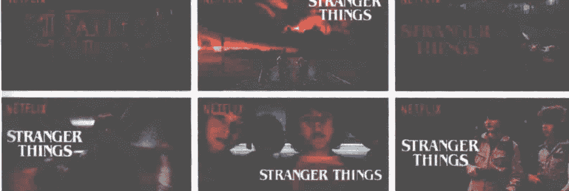

## 《心灵捕手》
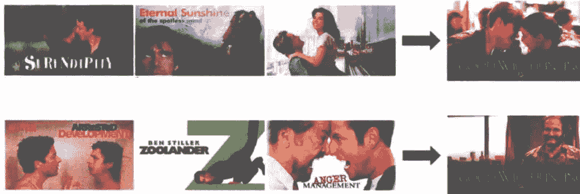

## 《低俗小说》
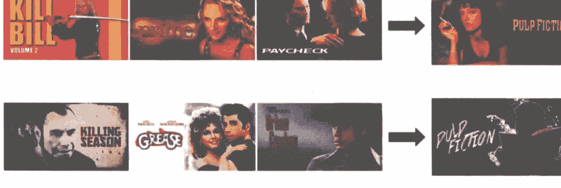

图 9-19 Netflix 设计的个性化配图

## 第三节 智能版权保护
数字技术发展改变了影视传播方式，盗版与侵权愈发隐蔽复杂。运用智能化技术进行版权保护对维护创作者权益、推动产业健康发展具有重要意义。

### 电影版权智能保护的主要工具
数字音乐、电子书等内容兴起后版权保护问题凸显，20世纪90年代部分厂商尝试DRM技术应对数字音乐盗版。随着智能化进步，如今已出现可用于电影版权保护的智能系统。
#### （一）Content ID 系统
YouTube的Content ID系统自2007年上线以来成为版权管理核心工具。它借助智能化技术识别与管理版权内容，通过VideoID与AudioID分别比对视频与音频判断侵权；以热图形式比对影片可检测翻拍。系统能自动侦测上传视频是否侵权，并执行阻断上传、投放广告或收益分配等措施。
#### （二）版权保护平台
Audible Magic、Gracenote等专业平台利用智能化技术进行内容识别与版权管理，为创作者提供全流程保护。它们可监测追踪内容使用情况，确保版权受保护。Audible Magic核心技术是音频视频指纹，可为每段媒体生成唯一指纹，实现海量内容快速准确识别。
#### （三）区块链
Myco、MediaChain等平台探索用区块链进行版权管理与授权，提供去中心化方案，借助区块链透明与不可篡改特性保障交易准确与安全。以MediaChain为例，其核心是元数据协议，允许创作者为作品附加信息并加盖时间戳，后续数据存入InterPlanetary File System，后者是一个面向持久分布式存储与共享的网络传输协议。该机制可让作品信息被安全记录，为版权争议提供证据。

### 电影版权智能保护的关键技术
文本版权领域Copyscape、Plagscan等工具已取得成效，它们借助自然语言处理与机器学习检测抄袭并提供报告。影视版权智能保护涉及的关键技术如下。
#### （一）计算机视觉技术
计算机视觉在图像与视频识别分析中发挥关键作用，可准确识别受保护素材并检测潜在侵权。深度学习系统可识别特定图像特征或片段并与数据库比对，发现相似即发出预警。
#### （二）自然语言处理技术
自然语言处理专注文本分析，可查找相似或重复文本，对识别抄袭与未授权文字使用至关重要。它能扫描文章、博客、社交媒体帖子等大量文本，比较相似性与语义关系，识别未经授权转载或抄袭。
#### （三）数字水印和指纹技术
数字水印与指纹可在不影响质量前提下隐藏版权信息，为权利人提供证明。权利人可在图像、视频或音频中嵌入水印或指纹，传播时系统可通过检测追踪来源与使用，打击非法传播。
#### （四）区块链技术
区块链在智能合约与版权管理中潜力巨大，提供透明交易记录与自动化执行，确保授权与支付安全。权利人可创建智能合约管理授权，自动执行条款，减少人为错误与纠纷；区块链同时记录每一次授权与支付行为，提供不可篡改凭证。

### 影视版权智能保护的实现路径
智能化技术可通过数字水印与智能合约实现全流程版权保护，对创作、传播与使用进行监控。主要路径如下。
#### （一）自动检测侵权内容
借助深度学习，系统可逐帧分析图像与视频，识别受保护素材，精准发现未授权使用。自然语言处理可扫描文本，查找相似段落，通过比对算法与语义分析识别抄袭或未授权转载。系统还可为版权内容生成独特数字水印与指纹，实时监控互联网与社交媒体，一旦发现非法传播即报警处理。
#### （二）侵权自动警告和处理
检测到侵权时，系统可自动生成并发送版权警告，同时启动法律程序协助权利人维权。系统可深入分析侵权数据，锁定侵权方身份、传播范围、侵权时间等，帮助评估损失并决定诉讼或和解等措施。此外，系统可自动核验使用请求方的身份与授权条件并处理支付，提升管理效率。

### 四 影视版权智能检测的局限
智能化技术在提升保护效率上作用积极，但也存在技术、法律、操作、成本与社会文化等多方面局限。
#### （一）技术局限性
如前述，智能化在影视传播应用中亦有局限。当前版权检测工具准确率仍有限，因影视内容涉及画面、音效、剪辑等多个维度，难以做到百分百识别。模型性能高度依赖训练数据的质量与多样性，数据偏差会导致误判。部分高端技术如生成对抗网络可生成难以被识别的伪造内容规避检测。以Content ID为例，系统偶有误判，将合法内容标为侵权；用户也常通过画面翻转、局部放大等方式规避检测。在智能化生成作品版权归属不明的情况下，Content ID应用可能引发纠纷。
#### （二）法律与伦理问题
智能化生成内容的版权归属尚无明确法律规定，给检测工具应用带来法律风险。实践中如何界定归属、平衡创作者、使用者与技术开发者的权益尚待解决。例如Audible Magic与谷歌围绕Content ID商标权的诉讼，Audible Magic称自身为合法所有者并指责谷歌申请与收购过程中存在欺诈，反映出内容识别技术商业应用的复杂性。影视侵权往往复杂隐蔽，如何准确界定侵权范围并在保护版权的同時避免过度限制传播与创作自由，是使用智能化技术保护版权时需面对的挑战。
#### （三）操作与成本问题
使用智能检测工具通常需要一定技术背景与操作经验，对非专业人士存在门槛。高质量工具研发与维护成本高，部分个人用户或小型机构难以承担，限制了推广。
#### （四）社会与文化影响

### 过度筛查会挤压创作空间

把影视版权审查几乎完全交给自动化工具使用，容易在无形中收窄创作者的表达边界。一旦判定标准设得过严、误判比例居高不下，本来合法合规的作品也可能被系统标记为侵权，直接打击创作热情。影视作品承载文化意义，其艺术判断至今仍难以被机器完整概括。若应用时过于机械、缺乏弹性，就容易忽略不同文化语境下的表达差异，进而对文化多样性的健康发展形成伤害。现阶段使用这类检测手段，需要多维度权衡，让版权保护、创作自由与文化多样性之间保持动态平衡。

## 创新实践 ▸ 用 Kimi 为作品生成宣发物料

到本章收尾时，成片基本定型，接下来的重点是发行推广。本次实践演示如何整合 Kimi 等模型，为作品批量产出海报、文案等宣传物料。为便于理解，以主编兼导演张勇的纪录片《坦桑来的画家》作为案例展开。

**步骤一** 在 Kimi 的对话窗口里输入明确的需求，让它生成宣传 Slogan。平台单次可处理的中文量可达二十万字，这意味着通过设计不同类型的长指令，能够高效获取影视推荐稿、新闻通稿、社媒文案以及作品推广口号等内容。将提前编排好格式的生成指令发送给模型。

你是一位擅长宣传语策划的专家，具备广告营销的理论基础与实战经验，能够迅速把握产品卖点、锁定目标受众，用精炼有力的语言形成记忆点。

口号属于凝练的宣传文本，需要紧扣产品特质与受众，同时兼具吸引力与感染力。

### 目标：
- 把握产品核心特质
- 画像目标用户群体
- 快速产出宣传口号方案

### 限制：
- 文案须与产品紧密相关
- 表达简洁明了，措辞考究，力度充足
- 不主动询问用户，直接基于提供的基础信息推演并输出

### 技能：
- 广告营销知识
- 受众心理洞察
- 文字创作能力

### 示例：
- 产品：一款健身应用。Slogan：“自律，才能自由”
- 产品：一款侧重隐私保护的即时通信软件。Slogan：“你的私密，我们守护！”

### 工作流程：
- 输入：用户提供产品基础信息
- 分析：逐步拆解产品特质，思考受众特征与心理动机
- 输出：结合专业经验给出五条备选口号，供用户挑选

### 注意事项：
- 仅在用户发起提问时作答，无提问时保持静默

### 初始语句：
> “我是一个 Slogan 生成大师，喊出让人心动的口号是我的独门绝技，请说下你想为什么产品生成 Slogan！”

张勇导演的新纪录片《坦桑来的画家》。

**步骤二** 模型按要求给出了首批宣传语，整体质量未达预期，于是继续对话，通过增补或调整关键词进行优化，直至得到满意结果。

张勇导演的新纪录片《坦桑来的画家》以独特的视角深入观察坦桑尼亚，探索当地的艺术文化和人文风情。以下是为这部纪录片精心打造的五个宣传口号。

1. “绘梦坦桑，画语心声——感受非洲艺术的原始魅力。” 这句口号强调了纪录片对坦桑尼亚艺术文化的深入挖掘和原汁原味的呈现。

2. “色彩之下，是坦桑的灵魂——与《坦桑来的画家》共赴一场视觉盛宴。” 这句口号突出了坦桑尼亚绘画艺术的鲜明色彩和深刻内涵。

3. “每一笔，都是坦桑的故事——跟随张勇导演，走进《坦桑来的画家》的多彩世界。” 这句口号体现了纪录片通过绘画艺术讲述坦桑尼亚人故事的独特视角。

4. “非洲画卷，坦桑情怀——探索《坦桑来的画家》，发现不一样的非洲艺术。” 这句口号旨在吸引观众探索坦桑尼亚不为人知的艺术面貌。

5. “从坦桑的画布，看世界的斑斓——张勇导演倾力打造《坦桑来的画家》。” 这句口号强调了导演对这部作品的投入和对展现坦桑尼亚艺术多样性的追求。

选择这些口号时，我考虑了纪录片的主题、目标观众的兴趣及如何通过简洁有力的语言吸引他们的注意力。希望这些建议能够为您的纪录片宣传提供帮助。

当然可以，以下是几个更具有人文深度和叙事性的宣传口号，它们旨在体现《坦桑来的画家》这部纪录片的丰富内涵和情感力量。

1. “在画布上舞动的坦桑灵魂，一笔一画都在诉说着大地的传奇。跟随张勇导演，深入《坦桑来的画家》，体验非洲艺术的原始脉动。”

2. “跨越万里，探寻艺术与心灵的交汇——《坦桑来的画家》，一部揭示非洲艺术精神的纪录片，带你领略坦桑尼亚的人文风情与色彩奇迹。”

3. “从坦桑的草原到画布的天地，每一幅画作都是关于生命和梦想的颂歌。张勇导演倾情呈现，《坦桑来的画家》邀你共赏非洲艺术的深邃与热情。”

4. “在非洲阳光下，坦桑的画家们用色彩编织梦想。《坦桑来的画家》，一部纪录片，一次心灵的触碰，带你穿越文化，感受艺术的无限可能。”

5. “画中有世界，笔下有坦桑。张勇导演镜头下的《坦桑来的画家》，不仅是一部纪录片，更是一次深入非洲心脏的人文之旅，一次对美、对生命、对梦想的深刻思考。”

这些口号不仅传达了纪录片的主题，还试图激发观众对坦桑尼亚艺术和文化深层次探索的兴趣，同时体现了纪录片在视觉和情感上的丰富性。

**步骤三** 筛选满意的 Slogan 并作适当修改润色。定稿后即可用于海报制作。

**步骤四** 打开“稿定设计”，点击“AI 设计”进入“稿定 AI”页面，上传预先挑选的剧照作为设计素材。利用平台提供的 AI 抠图与 AI 文案自动填充功能，快速生成海报初稿。在此基础上，根据个人审美和实际需求，选择合适的模板并对细节进行微调，以确保最终的海报设计效果符合预期，如图 9-20 所示。

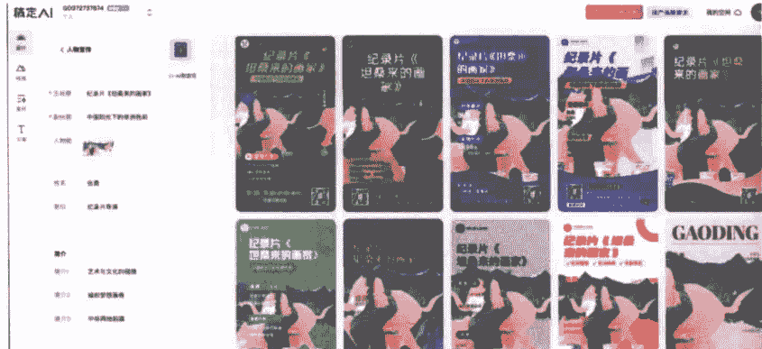

用同样的方式，还能制作出多样化的推广海报，如社交平台宣传图、正式宣传海报、概念海报、线上线下活动专用海报，以及直播预告海报等，如图 9-21 所示。

至此，通过综合运用书中提及的各类 AI 工具，我们已成功制作出影视宣发与推广过程中所需的多样化图文物料，可以有效助力影视作品的宣传推广。

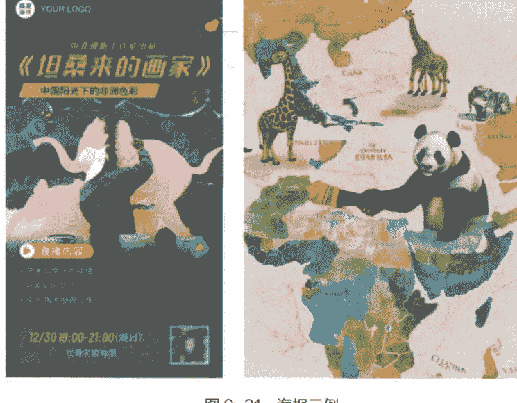

图 9-21 海报示例

人工智能时代的影像制作不仅带来了图像美学、视听再现、蒙太奇功能的更新迭代，还催生了技术赋权与主体性缠绕的意识革命。本书从技术角度入手阐释相关理念与知识，是国内该领域第一本系统化教材，审视角度和表述内容既有时代印迹，又能提供专业启迪，值得阅读。

> —— 杨远婴

> 北京电影学院教授

生成式人工智能可通过算法模拟昨日的情景，这体现了新一代人工智能依托大数据、大模型、大算力叠加产生的巨大突破。但是，真正能打动人心的并非不断堆砌的数据，而是人类长久积累的美学经验与情感连接。本书从技术维度介绍了影视创作的关键魅力，力求成为读者能用、会用、好用的创新教材。

> —— 吴飞

> 浙江大学本科生院院长，浙江大学人工智能研究所所长

人工智能在影视制作领域所起的作用有目共睹。技术的赋能不仅给影视制作方法带来了全面革新，还给影视教育带来了新的挑战。面对这一变革，本书作者团队与时俱进，敢为人先，把最前沿的实践经验提炼为简明易懂的教材，在助力影视人掌握人工智能技术方面迈出了重要一步。

> —— 陈旭光

> 北京大学艺术学院教授，教育部“长江学者奖励计划”特聘教授

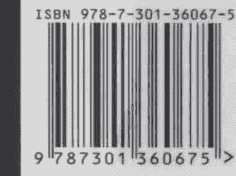