# 智慧制药·人工智能赋能

# 序言

药物研发与设计涉及一系列漫长繁复的环节，从靶点挑选与验证、先导物优化，到临床前研究、临床试验乃至生产落地。数十年来，药物化学与生物学家一直在追求更高效率的靶向药物开发。研发的高成本与漫长时间，是制约新药设计与产业化的核心难题。为缓解这一瓶颈，研究者广泛采用虚拟筛选、分子对接等计算手段，显著提升了先导化合物的初筛效率，但准确性与适用性仍存在明显短板。

人工智能的不断成熟，尤其是机器学习与深度学习方法，正为这一困局提供新解。与传统路径相比，AI能够以更简洁科学的方式触及实际问题，突破药物发现与设计的诸多限制。新技术可以很大程度上弥补传统计算方法的不足，压缩研发周期与投入。药物化学与生物领域的研究者已将AI算法深度嵌入设计流程。依托AI与机器学习的计算建模，可助力化合物筛选与确证、靶点发掘、肽类合成、毒性及理化性质评价、药物监测、疗效评估及老药新用。得益于机器学习与深度学习的推进，化学库中上亿级分子的虚拟筛选变得高效可行，AI模型也能降低源于靶标相互作用的毒性风险。

为系统梳理人工智能在药物研究各环节的应用与技术进展，本书应运而生。本书呼应党的二十大精神，概览了从机器学习到深度学习的演进脉络，以及大数据对药物发现的变革性影响。全书共7章。第1章回溯人工智能的起源与发展，聚焦经典与前沿机器学习方法；第2章探讨人工智能在蛋白质结构研究中的作用，涵盖活性与毒性预测及蛋白互作；第3章聚焦药物筛选中的成药性物理化学性质预测与构效关系建模；第4章阐述AI对传统发现流程的改进，包括初筛与复筛、毒性、释放与监测、剂量有效性、老药新用及多靶点效应与药靶相互作用；第5章从联合用药、药物反应评估与药药相互作用角度介绍AI在临床用药中的价值；第6章围绕多组学数据与生物网络，介绍药物代谢与药效相关基因，并给出AI驱动的药物基因识别方法与实践；第7章介绍制药工业智能制造体系架构、AI在生产环节的应用场景及我国智能制造的发展现状。

本书由常熟理工学院生物与食品工程学院孙先宇、何卫刚，常熟理工学院计算机学院王颖联合主编。第1、2章由孙先宇执笔，第3章由何卫刚执笔，第4、5、6章由王颖执笔，第7章由上海药坦研究开发有限公司郭利军执笔。

人工智能面广且迭代迅速，编者学识有限，书中难免疏漏，恳请读者批评指正。

编者
2023年9月

# 第 1 章 人工智能概览

人工智能作为新一代数字技术的代表，正从专业实验室走向日常应用。对局中，人类围棋冠军败给电脑；生活中，手机面部识别随手可得，自动驾驶车辆已在街头行驶；在医疗领域，监管机构已批准AI在多项诊疗场景中使用，例如糖尿病视网膜病变的常规筛查已可由算法完成，无需眼科医生逐例复核。

作为新一轮产业变革的核心动力，人工智能将催生新技术、新产品、新业态与新模式，重塑经济结构，提升整体生产力。当前发展进入新阶段，人工智能融合数学、神经生理学、计算机科学、信息控制论、生物学、语言学、心理学等多学科，是面向模拟、延伸和拓展人类智能的理论、方法、技术与应用系统的交叉学科。其研究涉及知识表示与知识图谱、自动推理、专家系统、群体智能等，目标是让机器完成过去只有人类才能胜任的复杂任务（图 1-1）。

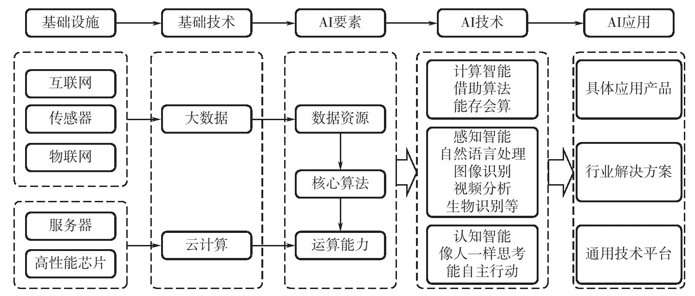

图 1-1　人工智能产业链

人工智能是概括性概念，指程序能像人一样思考与行动，而机器学习则超越了把数据与决策树、隐马尔可夫模型等算法输入机器的做法，使机器在无需显式编程的情况下自行学习。有人视机器学习为人工智能的主要应用，也有人视为其子集。随着神经网络发展，机器能够像人脑般对数据进行分类与组织，进一步推动了AI进步。进入二十世纪后，“深度学习”概念出现。深度学习是机器学习的子集，而机器学习是人工智能的子集，二者关系可表述为人工智能＞机器学习＞深度学习。

机器学习可采用监督学习，利用标注数据训练模型，或采用无监督学习，利用未标注数据挖掘重复模式。半监督学习结合两者；自监督学习先用无监督方式为未标注数据生成标签，再建立监督模型；强化学习在持续反馈回路中不断优化算法。深度学习则由多层机器学习算法堆叠而成，被视作受大脑启发的算法家族，但对计算资源与大数据依赖度高。

机器学习的萌芽可追溯至1943年，McCulloch与Pitts发表《神经活动中固有思想的逻辑演算》，给出首个神经网络数学模型。Alan M.Turing于1950年开创性论文中对机器学习进行理论化。1952年，Arthur L.Samuel为IBM编写棋盘游戏程序，首次推广“机器学习”一词。1957年，Frank Rosenblatt提出用于图像识别的感知器。1960年Henry J.Kelley提出连续反向传播模型，1962年Stuart Dreyfus提出基于链式法则的简化版本。1965年Ivakhnenko与Lapa研制出首个可实用的深度学习网络。约1980年，福岛邦彦研发出具有多层结构的新认知机，帮助计算机学习视觉模式，并据此构建了模拟动物视觉皮层的卷积神经网络。

## 1.1 AI总览

人工智能一词由John McCarthy于1956年达特茅斯会议提出，用以描述“制造智能机器的科学与工程”。这一初始定义至今仍然成立，只是内涵不断丰富。简言之，人工智能研究的是使感知、推理与行为预测成为可能的计算。AI既可独立执行任务，也可通过增强智能的方式放大人类能力。

斯坦福大学尼尔斯教授指出，人工智能致力于让机器具备智能，智能是实体在特定环境中反应与判断的量化指标。麻省理工学院温斯顿教授则认为，人工智能研究如何让计算机完成原本只有人类能做的智能工作。这些表述共同指向学科本质：研究人类智能活动规律，构建具一定智能的系统，使计算机承担人类大脑的工作。总体而言，人工智能是模拟、延伸与扩展人类智能的科学。

AI探索历程曲折，先后经历二十世纪中期浪潮、七八十年代低谷以及二十一世纪初黄金期。大数据、云计算、物联网等信息技术的发展，叠加泛在感知数据与图形处理器等平台，推动AI跨越科研与应用鸿沟。自1956年以来，发展大致划分为六个阶段（图 1-2）。

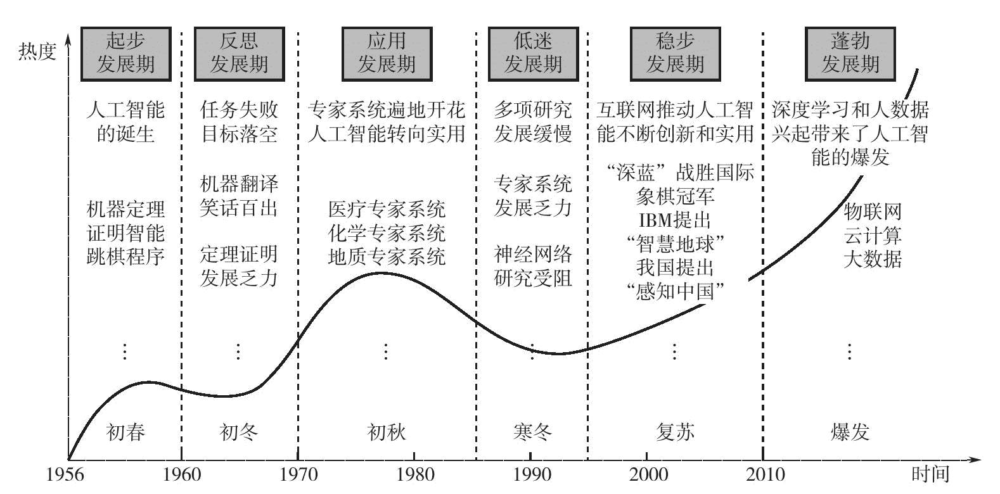

图 1-2　人工智能的发展历程

（1）起步发展期：1956—20世纪60年代初。
达特茅斯会议确立术语，随后出现跳棋程序、感知神经网络软件、聊天软件等，并用机器证明定理取得突破，掀起首次高潮。

（2）反思发展期：20世纪60—70年代初。
早期突破抬高了期望，研究者尝试更具挑战目标，但连续失败与落空，例如无法证明函数和的连续性、机器翻译闹笑话等，导致AI进入首次寒冬。

（3）应用发展期：20世纪70年代初—80年代中期。
70年代起，系统开始模拟专家知识与经验解决特定领域问题，实现从理论研究到实际应用、从通用推理到专门知识运用的转变。医疗、化学、地质等领域的成功使AI进入应用高潮。

（4）低迷发展期：20世纪80年代中—90年代中期。
随着应用扩张，专家系统暴露出领域狭窄、常识匮乏、知识获取困难、推理单一、缺乏分布式能力、难与数据库兼容等问题，AI进入第二次寒冬。

（5）稳步发展期：20世纪90年代—2010年。
网络尤其是互联网加速创新，推动技术实用化。1997年IBM深蓝击败国际象棋世界冠军卡斯帕罗夫；2002年iRobot推出首款家用自动扫地机器人；2006年深度学习出现；2008年IBM提出智慧地球概念；Siri、Alexa、Cortana等语音服务在智能手机普及。

（6）蓬勃发展期：2010年以来。
大数据、云计算、互联网、物联网与GPU等平台推动以深度神经网络为代表的技术飞速发展，技术鸿沟大幅缩小。图像分类、语音识别、知识问答、人机对弈、无人驾驶等从不可用到可用。同时政府、企业与非营利组织纷纷拥抱AI。第三次浪潮才刚刚开始，爆发式增长的大幕正在拉开。

作为多学科交叉领域，人工智能吸纳计算机科学、数学、心理学、语言学、哲学、神经科学等知识，助力其从纯理论走向解决生活各方面问题的智能系统。

## 1.2 机器学习概览

从20世纪50年代机器学习提出至今，多媒体、图形学、网络通信、软件工程乃至芯片体系结构均可见其身影。机器学习已成为重要技术进步来源。本节介绍其发展脉络与基础概念。

人工智能的重要分支是机器学习（图 1-3）。机器学习可定义为一组可从经验中学习并自我改进的算法，无需为特定任务显式编程。这一特性使其与经典计算方法本质不同。它借助统计与数据驱动规则，将算法输入映射为输出，规则由大量样本自动推导，而非人工指定（图 1-4、图 1-5）。

图 1-3　机器学习与相关学科

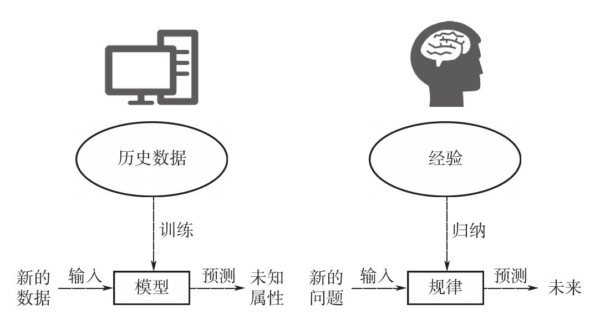

图 1-4　机器学习与人类学习对比

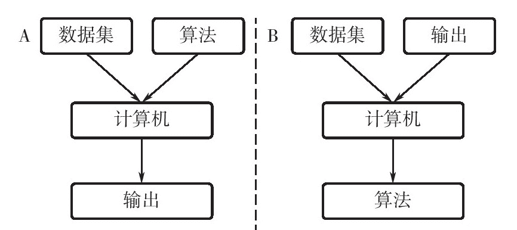

图 1-5　经典编程与机器学习模式

目前流行的算法包括随机森林、支持向量机、人工神经网络与深度学习。由于人工神经网络与深度学习在医药AI中占据主导地位，本节将重点展开。

机器学习是人工智能发展到一定阶段的必然产物。20世纪50—70年代初，人工智能处于“推理期”，认为赋予逻辑推理能力即可实现智能。随着研究深入，人们认识到仅靠逻辑不足以实现智能。E.A.Feigenbaum等人提出机器需具备知识，在其推动下，70年代中期起研究进入“知识期”，大量专家系统涌现并取得成果。但知识工程瓶颈显现，即将人类知识提炼并输入计算机十分困难，于是学者转而探索让机器自行学习知识。

### 1.2.1 机器学习发展历程

20世纪80年代，从样例中学习的主流是符号主义学习，代表为决策树与基于逻辑的学习。决策树以信息论为基础，以信息熵最小化为目标，模拟人类树状判断流程；基于逻辑的学习代表为归纳逻辑程序设计，是机器学习与逻辑程序设计的交叉。决策树简洁实用至今仍广泛使用，基于逻辑的学习表达能力强，能描述复杂关系。

20世纪90年代中期前，另一主流是基于神经网络的连接主义学习。连接主义在50年代已有进展，但因研究者偏爱符号表示，又因早期网络只能处理线性问题，甚至无法解决异或问题而受限。直至J.J.Hopfield用神经网络求解旅行商问题这一NP难题取得突破，连接主义重获关注。1986年D.E.Rumelhart等人发明BP算法，对发展产生深远影响，且长期以来是应用最广的算法之一。

20世纪90年代中期，统计学习崭露头角并迅速成为主流，代表技术是支持向量机。该领域研究始于60—70年代，统计学习理论已奠基，但直至90年代才占据主流。其一是有效SVM算法在90年代初提出并在90年代中期文本分类中展现优势；其二是连接主义局限显现后，研究者转向以统计学习理论为支撑的方法。SVM被普遍接受后，其技巧渗透机器学习各分支，成为基础内容。

21世纪初期，社会进入大数据时代，数据规模与计算能力的提升使连接主义焕发新生，掀起深度学习热潮。狭义上深度学习即多层神经网络，在语音、图像等复杂对象任务中表现优异。尽管模型复杂、参数众多，通过“调参”仍可获得良好性能。深度学习缺乏严格理论支撑，却显著降低了应用门槛，促进工程化落地。

### 1.2.2 机器学习策略与应用

机器学习是当前实现人工智能应用的主要手段，在体系中居于基础核心地位，广泛应用于计算机视觉、语音识别、自然语言处理、数据挖掘等领域（图 1-6）。

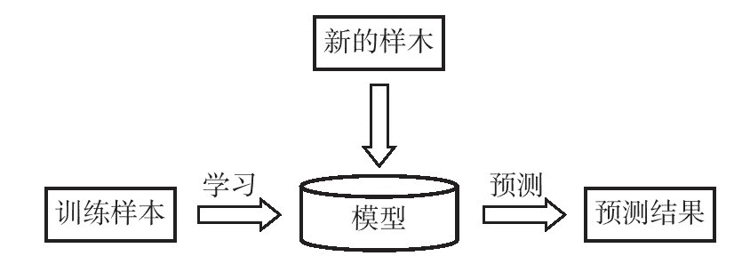

图 1-6　机器学习任务的一般流程

策略上可大致分为无监督学习与监督学习。无监督学习旨在发现数据变量间的潜在结构或关系；监督学习则将观测结果划分为一个或多个类别。监督学习需要预测变量与标注结果配对的数据集。特征选择对预测建模至关重要，机器学习在此尤为有用。

以医学为例，当观测结果带有“病例”或“对照”等标签并配以年龄、性别、临床指标等特征时即可进行预测建模。假设医生希望预测患者入院后30天内再入院风险，机器学习技术已证明可优于传统统计方法。设想临床医生拥有庞大但杂乱的电子健康记录数据，通常包含病历号、处方、用药记录、实验室指标、影像资料等。利用人口统计学、实验室值与生命体征，多类算法在临床意义上优于逻辑回归。

变量选择困难是实际难题。当自变量数量超过观测数量时，逻辑回归拟合在代数上困难，常采用单变量方差筛选或前向逐步回归。但这些方法生成的模型往往难以在其他数据集上验证，也不适用于个体患者。

机器学习可捕获传统方法难以描述的复杂变量交互。通过机器学习可利用这些复杂关系。由无监督学习生成的特征也常被纳入监督模型，并在特征选择比较中显示出实用价值。

可解释性不足是多数机器学习算法尤其是人工神经网络的主要缺点。难以准确理解网络如何逼近特定函数，形成“黑箱”。输入微小变化可能导致预测大幅波动，而对同一图像做人眼无法识别的重大修改却不改变网络分类结果。实践中，使用人工神经网络替代线性模型时，需权衡预测性能提升与可解释性损失。

药物发现项目中使用的大多数学习任务与技术可归为七大类：监督学习、无监督学习、半监督学习、主动学习、强化学习、迁移学习与多任务学习，每类各有优势与局限。

（1）监督学习

机器学习全景：范式、经典与前沿

有监督学习是当前落地最广的范式，其前提是训练集每条样本都附带明确标签。标签的存在让模型预测后可以直接对照真实答案，得到可度量的偏差。训练过程就在这个偏差信号的指引下不断修正参数，直到整体表现达到预期水准，模型的可靠性也随之提升。这类任务通常分为分类和回归，分类处理离散型结果，回归处理连续型结果。二分类常以正负来区分，多类则称为多分类。典型应用覆盖预测性分析、垃圾邮件识别、模式检测、自然语言处理、情感分析、自动图像分类等。整体目标是推断感兴趣的结果，本范式已被人口统计、临床预测、社会预测等大规模结构数据广泛采用。

### (2) 无监督学习
与有监督相反，无监督是在没有标签的数据上构建模型。缺失标签意味着无法计算精确误差。所得模型主要用来挖掘数据的内在结构，其中最经典的是聚类，它依据样本间的相似度把数据归并成若干组。聚类形成的小组往往对应潜在的概念划分，有助于理清数据内部秩序。以图形为例，聚类可以把三角形归为一类、圆形归为另一类，为后续分析提供基础。需要注意的是，聚类只能自动生成组结构，组的具体语义仍需人工命名。无监督的本质是发现数据集的规律，规律不一定用于划分，也不等同于分类。训练数据不带标签，使其适用面通常比有监督更宽，比如主成分分析、数据特征刻画等都属于此列。常见用途有对象分割、相似度检测、自动标注、推荐系统等。

无监督方法在描述性任务中尤为有效，能在没有结果测量时揭示结构间的联系。目标是捕捉潜在维度、成分、簇或轨迹。心理健康分类与心理测量中常用的主成分分析、因子分析、混合模型都归入此范畴。

这类方法还能发现未被观测的维度与轨迹，并判断如何把维度划分为亚型。基于数据驱动的维度与亚组发现，可能催生新的症状、表型或诊断假设。当纵向数据可得时，还能揭示症状或表型随时间演化的异质性。

### (3) 半监督学习
标注样本占比过低时，直接用有监督不可行，训练集难以代表整体分布；若完全用无监督，又会浪费已有的标签。半监督介于两者之间，是折中方案。

半监督的核心是利用海量未标注数据提升小样本有监督的效果。常见做法是用未标注数据学习输入分布的结构信息。例如输入分布若存在聚类结构，就可能暗示样本属于不同标签，这被称为聚类假设。若两样本落在同一聚类，它们很可能同类。聚类假设等价于低密度分离假设，认为决策边界应位于低密度区域。可以推断，高密度区的边界会把一个聚类切开，要求不同类的样本混在同一聚类中。

### (4) 主动学习
主动学习是从稀疏标注数据中提炼知识的常用手段。思路是挑选信息量最大的样本进行标注，从而压缩标注成本。大数据量大，手工打标昂贵，因此用少量精挑细选的标注即可训练出可用预测器，可显著降本增效。主动学习在多个领域持续改进，正逐渐成为医药研究的新工具。

### (5) 强化学习
强化学习是一类训练智能体与环境交互以实现特定目标的技术。可通过试错、示范或混合方式进行。智能体行动后，奖励与结果的迭代反馈会塑造其行为。可直接模仿专家，即行为克隆，也可通过反向强化学习推断专家的目标来学习。训练成功的关键是模型函数，它把环境感知信号作为输入，输出下一步行动。以深度学习作为模型函数的深度强化学习前景看好。

一个受益领域是机器人辅助手术。目前该类手术很大程度上依赖医生远程操控器械。深度学习借助计算机视觉感知术野，并用强化学习从医生肢体运动中学习，可提升稳健性与适应性。这些技术支撑高度重复且时效紧迫的任务自动化，如缝合与打结。例如计算机视觉可根据图像重建开放伤口地形，并通过求解路径优化问题生成缝合或打结轨迹，该问题需在关节限制与障碍等外部约束下寻找最优路径。类似地，经图像训练的递归神经网络可通过学习事件序列实现自主打结，此前该操作需医生亲手完成。

## 1.3 经典机器学习方法

药学相关研究可选用多种算法，下面介绍若干经典方法。

### (1) 线性回归
线性回归可视为机器学习里最基础的方法。回归分析的核心是刻画一个或多个数值特征与单一数值目标的关系。线性回归用一条直线拟合数据以解决回归问题。

单变量情形仅用一个特征预测目标，可写成斜率截距形式。

式中，系数 a 刻画斜率，表示 x 增大时直线在 y 方向的变化量。截距 b 表示直线与 y 轴的交点。线性回归采用该形式建模，任务是确定 a 与 b 使直线最佳关联 x 与 y。多变量情形思路相同，但包含多个权重，每个权重反映对应特征对目标的影响程度。

实践中很少有函数能完美贴合数据。衡量拟合质量需残差，概念上残差是预测值 y^ 与真实值 y 之间的垂直距离。机器学习中代价函数用于最小化模型误差。最小化过程涉及梯度下降这一迭代优化算法，具体数学超出现文范围。线性回归常用代价函数为 MSE，最小化后通常可得到较优的 a 与 b 估计。所有基于模型的学习都有代价函数，其目标是最小化以获得最佳拟合。

### (2) 逻辑回归
逻辑回归是一种分类方法，目标是寻找特征与特定结果概率之间的关联。不同于线性回归用直线估计类别概率，逻辑回归采用 S 型曲线进行估计。该曲线由 Sigmoid 函数决定，它把离散或连续数值特征 x 映射到 0 到 1 之间。

主要优点是概率被限制在 0 与 1 之间，不会出现负数或大于 1 的情况。可为二项式，即仅两种可能结果，也可为多项式，即三种或更多结果。

事实上，逻辑回归在分析二元结果时保留了线性回归的许多特性。它表示处于某一二元类别相对于另一类别的估计概率，而非估计连续结果。同时，自变量的线性关系以量表形式呈现，而非原始线性形式。尺度转换源于逻辑回归模型的基本参数。具体而言，二元结果以概率表示须在 0 到 1 之间，而自变量可取任意数值。

逻辑回归是一种有价值的研究方法，因其可广泛应用于不同研究环境。例如可检验结果与若干自变量间的关联，或评估从一组自变量预测结果的效果。还可控制特定自变量的影响，尤其是充当混杂因素的变量，它们与结果及另一自变量的关系会掩盖该自变量与结果间真实关联。后一种应用在不允许随机分组的环境中尤其有用，例如观察性研究。随机分组通常能充分控制混杂因素，因随机分组往往使混杂因素分布均衡。相比之下，观察性研究无实验操作，若不加解释，混杂变量可能成为问题，这正是逻辑回归在此情境下具有吸引力之处。

实践中线性回归常见，但不适用于某些医疗结果。对于二元事件如死亡率，逻辑回归通常是首选。与线性回归类似，逻辑回归可包含一个或多个自变量，多变量分析更具信息量，它揭示每个变量在调整其他变量后的独特贡献。变量选择的关键在于承认并解释潜在混杂因素。

如前所述，混杂变量指与结果和另一自变量均相关从而掩盖真实联系的变量。例如社会经济地位可能混淆种族与每年急诊就诊次数的关系，因它与种族及急诊就诊均相关。此类因果关系未必明显，应在变量选择中正式评估以确保恰当表征并建模。路径分析图在此方面尤为有用。

### (3) 决策树和随机森林
决策树是一种有监督技术，主要用于分类，也可用于回归。决策树从根节点开始，根节点是首个分割点，包含一个将数据最好地分割成各自类别的单一特征。每个分割产生一条边，可连接到含另一特征的新决策节点以进一步分割为同质组，也可连接到预测类别的终端节点。该过程称为递归分区。

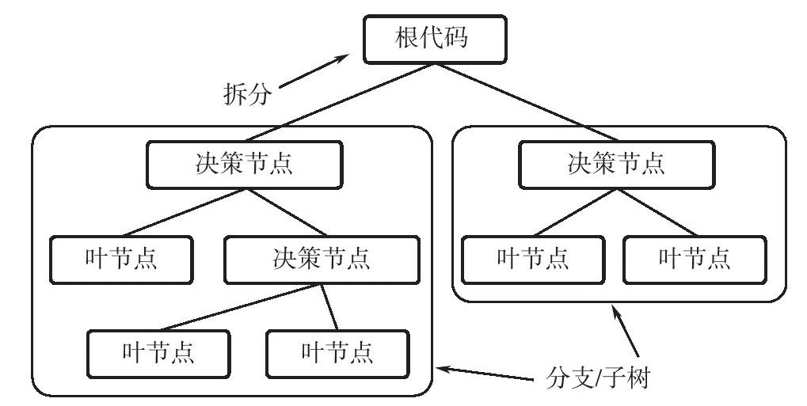
图 1-7　决策树

随机森林是决策树的扩展，属于集成方法，可生成多棵决策树。它不是为每棵树使用全部特征，而是使用特征子样本构建每棵树。然后每棵树对类别投票，多数票作为最终预测。

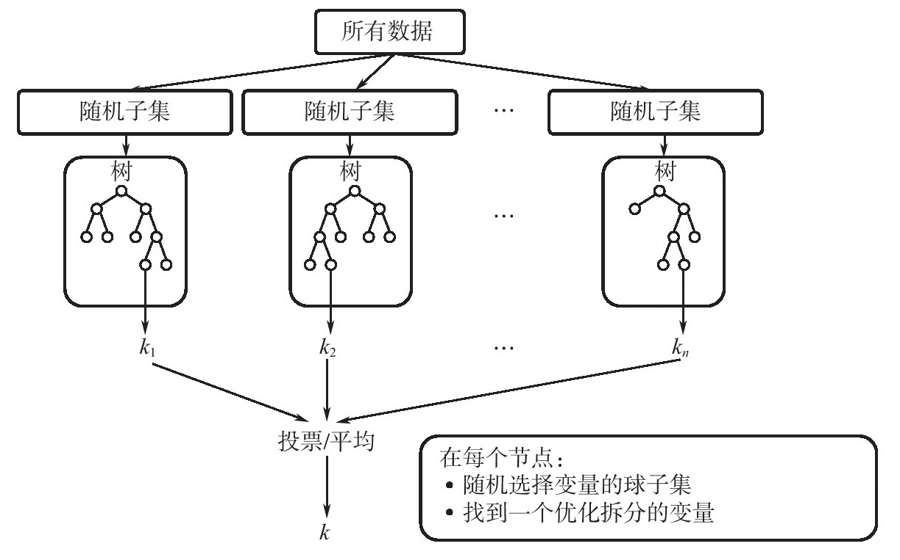
图 1-8　随机森林

随机森林是多棵树的预测组合，每棵树为其偏好类别投票，投票最多的类别提供最终预测。随机森林已广泛用于数据快速训练。研究表明，尽管由多棵树组合，随机森林通常不会过度拟合。

集成方法背后的核心原理是，一组弱描述符聚在一起可形成对数据集的强预测器。随机森林中每个分类器单独是弱描述符，整体合并后成为强预测器。随机森林运行较快，可处理不平衡与缺失数据。其弱点在于回归时无法预测超出训练数据范围，且在噪声数据上可能过拟合。

实现随机森林需设置两个参数：树数量与每个分割的特征数。使用默认参数即可获得令人满意结果。

### (4) 迁移学习
迁移学习又称归纳迁移、领域适配，是机器学习的重要课题，目标是将某个领域或任务中学到的知识或模型应用到不同或相关领域。具体是指利用数据、任务或模型间相似性，将在旧领域学习过的模型应用于新领域的过程。

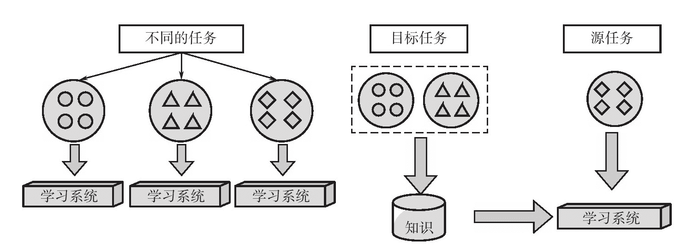
图 1-9　迁移学习与机器学习区别

整体思路是让学习算法最大限度利用有标注领域的知识辅助目标领域知识获取。核心是找到源领域与目标领域的相似性并合理利用。这种相似性很普遍，例如人体结构相似，骑自行车与骑摩托车的方式相似。找到相似性是核心问题。之后需考虑如何度量与利用相似性。度量工作有两个目标：一是定量与定性地给出相似程度，不仅判断是否相似；二是以内在度量为准则，通过学习手段增大领域间相似性，从而完成迁移。另外需说明，与半监督学习和主动学习等标注学习不同，迁移学习放宽了训练数据与测试数据服从独立同分布的假设，使参与学习的领域或任务可服从不同边缘概率分布或条件概率分布。

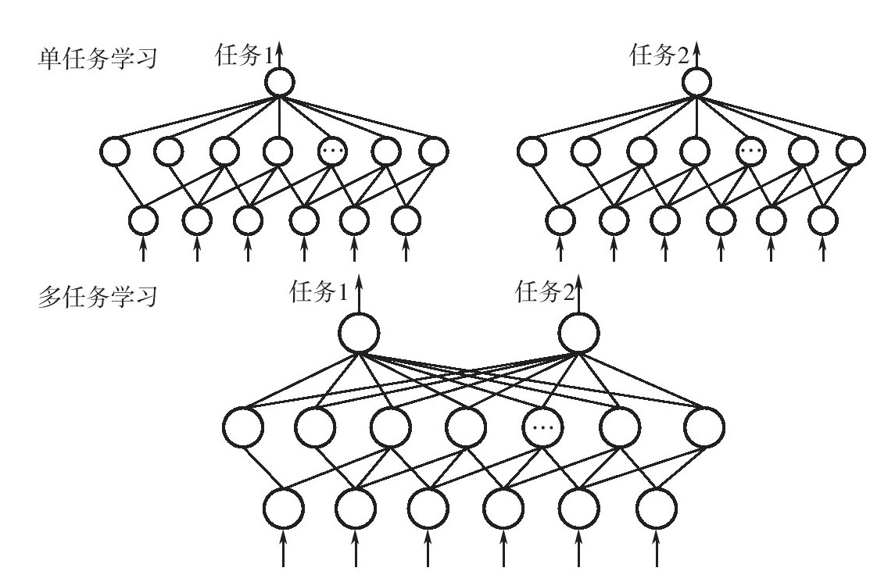
图 1-10　基于参数的迁移学习方法示意图

## 1.4 最新机器学习方法

### (1) 人工神经网络
人工神经网络是模仿人体神经网络创建的架构。人类对世界的感知依赖神经元相互作用。但每个神经元的刺激程度不一，有的对某些信号兴奋，有的抑制，可据此推断情绪状态。在感知器中通常引入权重代表对信号的兴奋程度。除兴奋度外，每个神经元都有固定阈值。

人工神经网络是一个计算系统，其工作原理基于生物神经网络的结构与功能如何通信、信息如何从一个神经元传递到另一个神经元以及如何产生结果。神经网络遵循相同过程，从给定数据集中获取信息并挖掘其中隐藏模式，最后通过适应未知情况给出高精度输出。人工神经网络是功能强大的分类器之一，也可实现更复杂功能。

人工神经网络

#### 概述与基本概念
人工神经网络适应性强，可表示各种形式和复杂度的线性与非线性函数。局限性包括需参数调优以及难以解释学习到的概念，这些概念被编码在权重中。

神经网络本质上是排列的人工神经元集合。人工神经网络自 20 世纪中叶起发展，最广应用的神经元模型称为乙状神经元。乙状神经元是一个基本单元，可视为生物神经元的模型。它接收一个或多个加权输入，决定激活程度。

每个神经网络包含若干节点，节点通过连接与其他节点通信。在生物神经网络中，若突触有关联输出会增强，神经网络中节点间连接根据提供期望结果的能力加权。

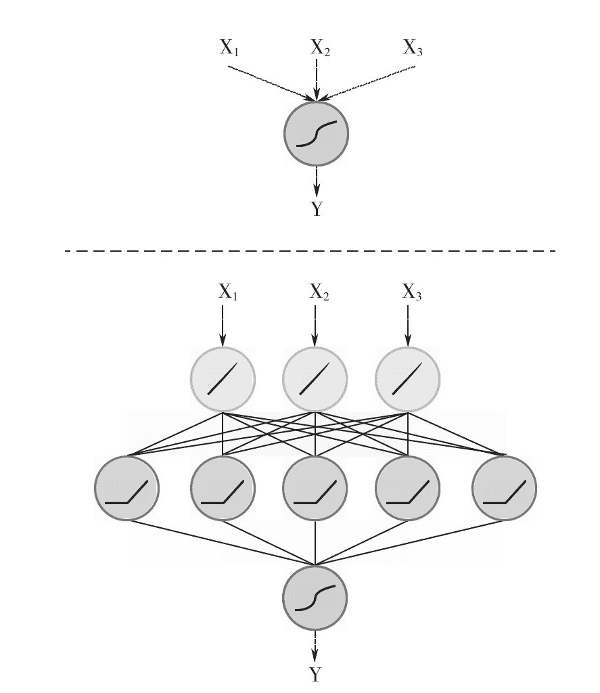
图 1-11　人工神经网络的结构

人工神经网络通常有输入层、可选隐藏层与输出层。一层的每个神经元都与下一层的每个神经元相连，因此称为全连接网络。每层神经元的最佳数量以及最佳层数需经验确定。

#### 训练与学习
在用于实际目的前需进行训练。第一步是为网络选择合适架构，需选择足够数量的隐藏层与适当神经元数。第二步涉及数据收集与组织。训练所需数据量与网络大小成正比。此外，出于技术原因，每块数据只能贡献学习过程的很小一部分。因此数据集通常由数十万条组成。数据需随机分为训练批与测试批，前者用于训练，后者用于评估训练完成后的性能。

学习步骤中，人工神经网络逐步将输入值映射到对应输出值。为实现该映射，需充分设置所有神经元权重。该过程可自动执行，使用反向传播搭配梯度下降等可用训练算法之一。经过适当训练，当输入神经元获得合适值时，每个输出神经元将提供相关输出值。

多种学习技术可用于训练，例如梯度下降算法包括随机梯度下降与反向传播。反向传播指把模型输出计算误差回传，将总网络误差分配给每个神经元，使梯度下降能找到更优解，即底层函数近似问题。误差反向传播主要用于监督学习，因其需要目标输出值计算误差，尽管也可用于量化或构造误差，使其适用于自动编码器等架构。

使用训练好的网络时，信息从输入层流向输出层，某一层的每个神经元输出成为下一层神经元输入之一。该信息处理称为前向传递。

#### 性能与局限性
人工神经网络受欢迎因其对函数近似非常有效。普遍近似定理证明，任何具有适当架构的前馈神经网络均可近似任意函数，包括复杂非线性函数。

基于该定理，人工神经网络可用于逼近分类问题中取离散值的函数，也可预测连续函数值，使其成为良好的回归工具。实践中，人工神经网络通常是逼近复杂非线性函数的最佳选择。然而，更简单的线性回归模型仍应用于估计简单函数，因其计算资源需求更少且更稳健。

人工神经网络有三个主要局限：首先，训练需要大量数据，这对罕见疾病患者使用 AI 是一项限制；其次，神经网络需要良好的预测因子以正确近似函数，即网络需提供与函数密切相关的可测量数据；最后，训练神经网络，特别是深层网络，需要大量计算资源。

另一个缺点是，网络的输入与输出通常可替代临床情境以最大化网络预测与临床情境的相关性。这种相关性不总是最优的。因此，当更简单的线性方法不能提供准确结果时，人工神经网络应优先用于大型复杂数据集。

#### 深度学习
深度学习概念在 20 世纪 80 年代与人工神经网络一起提出。当时模型开发数据有限，神经网络并未显示出显著优势。20 世纪 90 年代至 21 世纪初，计算机硬件仍不足以支撑多隐藏层神经网络或超大数据集的模型开发。如今 GPU 与云计算普及，使神经网络建模研究不再受硬件限制。

深度学习是机器学习子领域，近几年出现戏剧性复苏，主要得益于计算能力提升与大量新数据集可用。该领域见证了机器理解与处理数据能力的巨大进步，包括图像、语言与语音。医疗与药物学从中受益匪浅，因生成数据量巨大，医疗设备与数字记录系统数量也在不断增加。

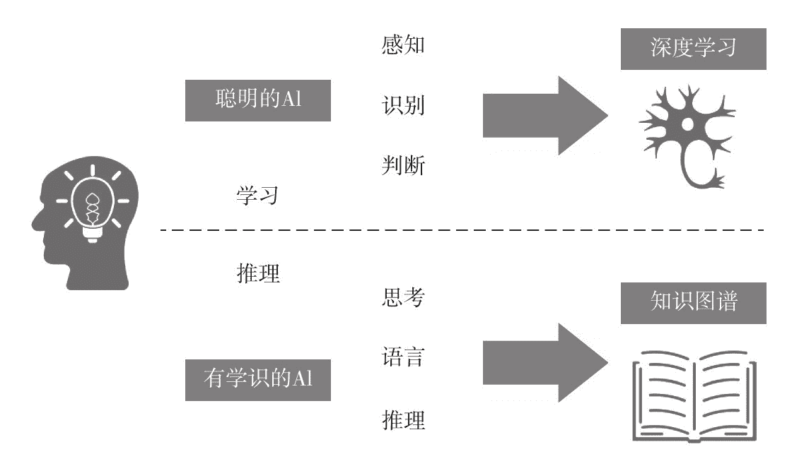
图 1-12　深度学习与知识图谱的关系

深度学习：由机器自主完成表征构建

传统机器学习做一个可用系统时，往往依赖领域专家手工搭建特征提取流程，将采集到的原始信息加工成模型可识别的模式。深度学习给出另一种思路，把未加工的输入直接交给网络，让网络内部自行生成层级化的表征。每一层由大量非线性运算构成，前一层的输出喂给下一层，抽象程度随层数递增。数据在逐层传递中被不断形变，直到样本在高层空间中变得可分。这种机制使系统具备拟合极复杂函数的能力。

这一思路听起来很新，神经网络与数据驱动编程的核心思想其实讨论已久。人类一直试图用已有数据推演未来，数据分析正是自然科学的基础，通过捕捉现象规律并估计不确定性来逼近真实。天气预报就是典型例子，利用大气流动的观测进行推算。要提高人类预测的准度，需要更精细的观测和更可靠的模型。类比到机器，图像识别的提升也依赖不断优化神经网络这类模型，让预测误差不断收敛。

讲到深度学习就绕不开神经网络，其灵感来自人脑神经结构。大脑中大量神经元相互作用形成认知，我们辨别照片中的动物、理解文字含义，本质都是神经元活动的结果。科学家长期试图仿制大脑，造出能思考的机器，而思考能力被归因于神经网络的工作原理。

深度学习源于人工神经网络研究，多隐层的多层感知器是典型形态。目前已有多种实现，诸如深度神经网络、卷积神经网络、深度置信网络与循环神经网络，它们已部署在计算机视觉、语音识别、自然语言处理、音频识别与生物信息学等方向，让机器模仿人类感官与推理，解决了大量模式识别难题。

这类模型容易扩展到大规模数据，部分原因在于专用计算硬件的支持以及随数据增长带来的持续改进，因而在不少经典方法上取得优势。系统可以接受多种数据类型作为输入，这在医药研究数据的应用中尤为突出。最常见的训练方式是监督学习，数据集由输入实例，例如药物靶点识别，与对应的标签，例如良性或一般 组成。

全连接结构通常只能容纳一到两个隐层，层数增多时网络更易拟合复杂函数。为突破浅层限制才提出深度神经网络，卷积神经网络是其中应用最广的类型之一。

总体而言，卷积神经网络与全连接前馈人工神经网络在架构上相近，区别在于层间并非完全相连。随着网络加深，隐层神经元数量逐步减少，参数总量下降，从而大幅降低训练与推理成本，网络可以做得更深并逼近更复杂的函数。

卷积神经网络对存在空间或时间依赖的数据例如图像、声音效果突出，因此常被用作图像或语音识别的强方案，也能高效处理大数据。

深度学习最明显的突破集中在计算机视觉，即处理静态图像和视频的对象分类、检测与分割等任务，这有助于判断药物分子能否有效结合作用靶点。

### 支持向量机

自 Vapnik 提出支持向量机以来，过去十年研究热度持续上升。支持向量机是一种非参数的最大间隔分类技术，目的在于把数据划分为两组，因而适用于二分类任务，但也被拓展到多分类。

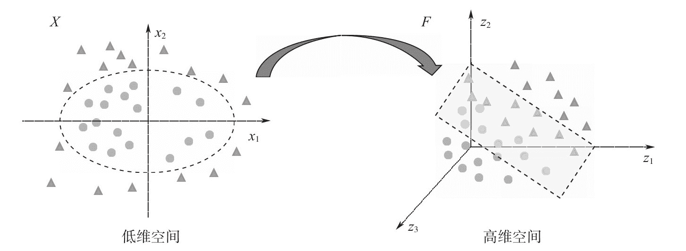

图 1-13　支持向量机

支持向量机是一种监督学习分类方法，能够挖掘复杂集合中的细微模式，已用于文本分类等多个领域。实质上它是一个二分类器：给定两类数据，多类情形通常采用成对策略。它学会区分类别并预测未见样本，将每个训练例视作高维空间中的点，寻找能分隔正负的超平面。该方法对稀疏数据适应良好，也能为难以用简单线性决策函数划分的数据建立分类规则或预测规则。

目前评估支持向量机中变量重要性主要有三类做法：过滤器、包装器与嵌入式方法。现有方法的局限在于多基于线性核。支持向量机可对径向基函数、S 型或多项式核进行非线性分类。

支持向量机泛化能力较好，对高维数据保持稳定。但模型可解释性差且对参数微调敏感，构成其主要局限，导致某些集合分离效率偏低，效率与数据结构相关。这一现象对线性模型尤为明显，灵活性不足故依赖案例强。传统规避手段是把核函数与其他特征映射结合构建非线性分类器。模型的训练与核参数对结果影响很大。

为缓解这些限制，非线性形式提出基于核函数或其他非线性特征映射的改进，从而消除上述缺陷。然而有效核或特征映射函数的挑选高度依赖数据结构。灵活的特征映射可在不同数据结构上使用，而不总需纠结于核的选择与调参。尽管已有诸多调参方法，其解常仅为局部最优。若缺乏基于规则的过程来挑选映射函数或核，更灵活的核虽可带来更准模型，却难以达到期望精度。

### k 近邻算法

k 近邻算法是一种依据特征空间中最邻近的训练实例对对象进行分类的方法（图 1-14）。面对新样本，算法在数据库中选取与其最接近的 k 条记录，并据此多数表决。新样本分类器选择最近的 k 个条目。k 近邻是一个非常简易的分类器，对基础识别问题效果不错。它利用距离测度的特性降低计算成本，部分实现可处理度量与非度量测度。

其基本原理是在校准集合中识别出与未知样本最接近的 k 个样本，再通过计算这 k 个样本响应变量的平均值确定标签。因此 k 的取值在性能中起关键作用。k 近邻属于基于实例的机器学习技术中最简单的代表之一，它存储全部训练数据并对新点分类。为获得最近邻，算法采用某种度量来计算数据项间距离，常用的是欧氏距离。

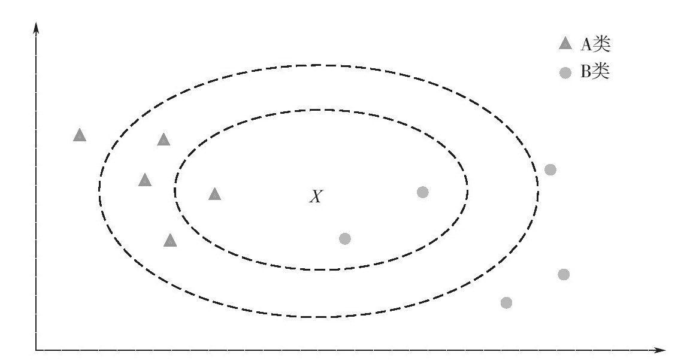

图 1-14　k 近邻算法

k 近邻还能为每个待分类的新数据点建立局部近似，近似可能因点而异。尤其当目标函数相对复杂时，用若干低复杂度的局部近似来描述是有利的。

作为一种强大的非参数模式识别技术，k 近邻得到广泛应用。但对于大型训练集，密集的相似性计算需求很高。过去三十年它一直是活跃的研究方向。虽然非度量相异度在模式识别中已有简要说明，但大多数现有快速算法仅在度量相异度下有效。用于加速 k 近邻的算法分两类：模板压缩与模板重组。模板压缩去掉模板集中的冗余模式，把压缩规则引入重组，产生一种基于压缩的树算法。

许多模板重组算法依赖度量相异度的基本性质如三角不等式，而适用于非度量的算法通常仅在低维特征空间有效。例外是基于凝聚的树算法，它适用于任何相异度测度、度量或非度量。利用三角不等式的算法在搜索与分类上更高效。

基于聚类的算法包含两个阶段：树生成与分类。与现有树分类法不同，该方法引入类条件聚类并为早期决策建立两层决策体系。树中决策层级是指每个节点及其子节点具有唯一类标签的层级。在决策层级上，可用 k 近邻分类判定不可见模板的类别。超层级的生成是一个类条件聚类过程，即把同类模板分组。超层级之上的层级仅依据一组节点间的接近度建立。具体而言，聚类过程基于当前层级的聚类中心位置迭代进行。所有聚类中心都是真实数据点，因此树生成与分类阶段可使用相同的相异度测度。

### 卷积神经网络

卷积神经网络是人工神经网络的特例，通过保留图像中像素间的空间关系克服了传统网络的缺陷。它不把单个像素作为输入，而是把图像块提供给下一层中特定节点，从而保留特征提取的空间上下文。这些节点学习提取特定特征，被称为卷积滤波器。

卷积神经网络也是一种深度学习算法，专为具有自然空间不变性的数据设计，已成为该领域核心。它在图像处理中广泛应用，用于模糊或锐化图像及边缘检测等任务。灰度可见光数字图像只是一个矩阵，彩色图像则是三个堆叠矩阵红绿蓝通道，取值通常为0到255，表示像素及各通道强度。

卷积滤波器是一个较小的方形矩阵，通常2×2到9×9。它在原始图像上滑动，每个位置执行逐元素矩阵乘法。输出映射到新矩阵即特征图，其值反映滤波器是否检测到感兴趣特征。

在卷积神经网络中，滤波器被训练从图像中提取特定特征如垂直线、多形物体，并在特征图上标记位置。一个深度卷积神经网络把特征图用作下一层的输入，用新滤波器创建另一特征图。

该过程可继续多层，提取的特征随之抽象但对预测很有用。最终特征图被压缩并输入前馈神经网络，按提取特征与纹理对图像分类，这就是深度学习。

卷积神经网络适用于可表示为图像或类似图像对象的数据。典型结构至少包含三部分：卷积层、池化层与密集连接层。卷积层按宽度、高度、深度描述，即在小感受野上捕捉x、y坐标信息，深度z对应不同信息源，并根据滑动时观测到的模式设定权重。其主要优点是权重共享机制减少参数量并逐步建立空间与构型不变性。

池化层本质上实现子采样，以降低噪声影响和学习参数数量，并为输入特征的微小位置与方向变化提供弹性。卷积层与池化层可形成卷积模块，每个模块在保持空间关系的同时学习识别特征。该特性使卷积神经网络具备平移不变性，可在输入场的不同区域识别相同特征。

因此大多数情况下，卷积层的输出会经过某种非线性激活函数，以允许网络处理更复杂关系。随着网络加深，会出现信息或梯度逐渐消失的问题。已有多种方法尝试解决，如建立早期层到后期层的路径，或以前馈方式将每一层连接到每一层以确保最大信息流。

与其它神经网络架构相似，超参数调优对卷积神经网络性能影响很大，可选数量多导致设计空间庞大难以手工搜索。为此已开发多种方法提供合理初始值并优化过程，包括网格搜索、随机搜索与贝叶斯优化等。

卷积神经网络最初为二维图像识别开发。典型网络中使用的池化等方法可降低表示维度并允许位置转移，这可能导致信息的丢失，从而在药物发现相关研究中表现不佳。先进架构如胶囊网络可在网络内部知识表示的层次关系进行建模，可能在药物发现研究中具备较大潜力。

对于图像识别任务，每个输入在前馈神经网络中对应图像一个像素。然而这并不理想，因为层内节点之间没有连接。实践中这意味着图像特征的空间上下文丢失。换言之，图像中彼此靠近的像素可能比相对两侧的像素更相关，但卷积神经网络没有考虑到这一点。

# 第 2 章 人工智能解开蛋白质结构谜团

寻找合适治疗靶点及建立相关疾病模型是新药研发初始步骤，靶点选择会显著影响后续进程。例如抗阿尔茨海默病新药研发中备受关注的抗β淀粉样蛋白相关靶点，多家制药公司均开展研究却多以失败告终，故新药开发靶点选择至关重要。到2022年，已明确治疗作用的药物靶点不超过500个，仍有大量可成药靶点待探索。人体体系极其复杂，大部分疾病发病机制仍不清晰，开发新靶点需耗费大量时间精力资源。尽管药物进入临床前已历经大量优化论证，仍有大部分不能顺利通过临床试验，许多失败原因可能是最初研究靶点的成药性缺陷。因此在研发初期挑选合适靶点并充分论证，可大幅提高后续成功率，减少财务损失与资源浪费。

人工智能方法与工具的快速迭代，提升了创新药物研究的时间与成本效益。虚拟高通量筛选已成为早期药物发现的重要组成部分，用于制定寻找新先导化合物的策略。临床后期阶段不可预测的毒性事件常导致巨大损失且耗时。人工智能与神经形态系统领域的快速发展，将为解决此类复杂预测难题提供更好路径。

大数据时代已至，基础数据量指数级增长。大数据集计算三维转换，对蛋白质结构进行信息学处理，可使先导物筛选事半功倍。现有技术能满足基本需求，但在预测毒理学领域对数据类型有特殊需求。

## 2.1 蛋白质毒性预测与机器学习概述

尽管人工智能与机器学习取得进展，这些技术在许多领域仍面临问题。其中一个主要问题是，与蛋白质毒素相关的质量数据作为输入可能是非结构化的，因此在任何基于预测的分析或建模前，需清理数据以获得有组织的训练集。例如实验产生的数据不能假定在现实世界中测量完美，这可能导致偏差输出。

同时，最新发现的大分子或毒素基序可能缺乏结构数据。为解决此问题，可设计一系列序列或同源模型作为诱饵集，对特定生物靶标计算模型，然后利用该模型作为数据集来设计新的非毒素候选机器学习模型。毒理学大数据由组学技术、高通量筛选数据和基因芯片等产生。除了高通量与组学技术获得的数据外，来自监测与流行病学的大型数据集也在快速增长。

这些数据可公开免费获取。但越来越多的数据，包括不相关数据，会产生更多噪声或虚假相关性。因此有必要确定适当、充分且相关的數據，并提炼足够信息，这些信息可能取决于所作预测的背景或要回答的毒理学问题。因此在有用数据方面的挑战，比单纯识别与选择相关数据以支持预测建模与安全性评估更具权重。尽管存在信息学与技术问题，预测毒理学与安全性评估的主要挑战是数据内容的整合、不同数据权重的评估，以及可能存在的差异与一般相关性对预测问题的影响。

具有多个不同描述符集的多视图学习或建模正向机器学习快速发展，并形成良好理论推动。多视图数据更易集成，未来将用于精准医学，并具备更好药物疾病关联预测能力。极限学习机是一种相对较新的基于单隐层前馈神经网络的经验风险最小化理论学习算法。为避免多次迭代、局部最小值与过拟合问题，极限学习机可作为构建毒物蛋白质组学模型的一种选择。

人工智能已开始用于细胞图像处理、物理生物活性与药物毒性预测。然而准确预测药物分子或靶蛋白毒性仍具挑战，计算方法有时表现不佳。首先，人工智能是数据挖掘方法，可用数据的数量与质量直接影响模型性能。其次，现有数据质量有时不足以进行有效学习。例如用不同方法测量的分子治疗指数可能产生完全不同的数据，无法相互比较。

最后，蛋白质解析工作非常困难，因为它需要在四个不同水平上分解与思考，氨基酸一级序列结构特征的一维预测；氨基酸间空间关系的二维预测；蛋白质三级结构的三维预测；以及多蛋白复合物四级结构的四维预测。由于这一组多样化信息片段，人工智能难以把这些信息串整合为基于多变量的分类模型。

更多公开数据以及新机器学习与深度学习方法的发展，已改变蛋白质组学领域。深度学习是人工智能的辅助部分，使用多层从原始输入逐步提取高级特征，已被用于预测蛋白质的三维结构，也擅长分子毒性预测。近年来，从分子或蛋白质组学数据库到三维结构数据集的多尺度数据集成，深度学习模型都锚定这些数据类型。

随着多组学发展，使用了随机森林、支持向量机与神经网络等已建立方法，深度学习的使用取得辉煌成果。由于计算性能快速发展，现在可实现适用于大数据问题的深度学习。

基于蛋白质一级序列的描述符可结合到简单物理化学性质上，而这些性质又可结合到复杂结构特征与高维特征或毒素载体上。因此深度学习算法可用于构建蛋白质组学特征的层次结构，这使深度学习非常适用于计算毒理学。

随着生物信息学深度学习进入更成熟阶段，细致基准与评估在已发表文献中变得越来越常见。由于架构与算法不断改进；实验数据不断累积；生物信息学与机器学习交叉增多，这一趋势可能持续数年。

一些疾病明显与蛋白质毒性相关，是主要致病机制之一，但细节仍不完全明了。治疗性蛋白或多肽的毒性图谱对人类临床开发与进一步研究至关重要。这些方法可通过各种体内方法来进行，如细胞毒性研究、溶血毒性，以及可在动物身上进行的标准毒性研究。通过利用计算方法如机器学习、分子建模及动力学技术，蛋白质或多肽的毒性效应可有效预测，甚至在初步阶段即可实现，从而使毒性预测成为一种合理方法。

现在，蛋白质毒性预测基础仍很模糊，在毒性蛋白质组学数据水平上，现已有不同方法，如利用一级序列信息，而很少有模型考虑二级结构特征与蛋白质一级序列信息。有几个基于Web的应用可用，它们能通过合理性能指标预测与分类蛋白质或多肽的有毒与无毒，这些服务器得到几种基于机器学习的技术的反向支持。毒性信息学的最终目标不仅是准确预测任务，而且能够理解潜在生物过程。毒性蛋白质组学人工智能或机器学习技术与计算建模的未来发展，需更多关注基于多肽的治疗方法，以增强治疗特性并筛选出低毒性的多肽类候选药物。

## 2.1 靶蛋白结构预测

在医药研发的赛道里，金钱投入常被形容为沉重且持续的负担，可最终能走到市场的小分子候选物每年屈指可数。新药诞生的第一道门槛，其实是找准、锁定并拿到手的药物作用点。所谓药靶，就是药物在体内能够结合的位点，涵盖基因位点、受体、酶、离子通道、核酸等多种大分子生物。能否挖掘出新颖且有效的靶点，几乎决定了整个发现链条能否突破。可惜的是，人体内结构与功能已被阐明清楚的靶点仅占极小比例，而全新的靶点往往是开启一串新药发现的钥匙。

传统实验驱动的靶点挖掘里，最常用的思路是借助化学修饰探针。小分子亲和探针能在配体与蛋白结合时实现无痕标记，其中活性依赖型蛋白谱 `ABPP` 已相当成熟。探针一般由反应基团与报告基团通过连接臂串联而成，反应基团共价结合靶蛋白后，借助质谱完成鉴定。还有一类策略是利用结合带来的热稳定性变化，通过监测热量的微小波动来锁定靶点。结合配体的蛋白更耐受蛋白酶降解，于是诞生了药物亲和反应靶点稳定性 `DARTS` 方法。基因层面则可通过改变序列或表达水平来筛选疾病相关靶点，`RNAi` 筛选与 `CRISPR` 基因编辑被广泛使用，尤其是 `CRISPR` 驱动的高通量平台能实现大规模 `CRISPR-KO`、`CRISPRi` 抑制或 `CRISPRa` 激活，观察表型变化后锁定潜在作用靶点。实验效率有限，计算方法正成为重要补充，药效团筛选、逆向对接、结构相似性评估等手段越来越多地用于预测配体的新靶标。

生物医学数据正呈现爆炸式增长，人工智能在解读复杂网络上显示出独特优势。深度学习近几年在生物医药里被大量应用，比如 Fabris 等人构建了一种模块化构架的深度学习模型，从基因或蛋白特征中学习模式，用于识别多种年龄相关疾病的致病基因。大型语言模型还能快速挖掘已发表的生物医学文本，通过串联疾病、基因和生物过程，推断发病机制并鉴定潜在药靶和标志物。创新药公司 Insilico Medicine 将先进的 LLM 聊天工具集成到 `Pan⁃daOmics` 平台，形成 `ChatPandaGPT`，研究人员可用自然语言与平台交互，高效导航和分析海量数据。微软推出的 `BioGPT` 同样基于生物医学文献训练。当真实数据稀缺时，AI 合成数据也提供了另一种路径，通过算法模拟多种生物场景，为罕见病等数据匮乏领域提供训练素材和新靶点线索。

理解蛋白折叠对把握蛋白异质性与分子功能至关重要，也是创新药物设计的基石。预测蛋白三维结构是分子生物学的核心难题。过去折叠量的测定主要依赖分子实验。新一代测序让蛋白序列发现速度极快，但实验手段耗时费钱，难以覆盖庞大序列库，因此亟需能够自动、迅速、准确地把未知序列归类到特定折叠类别的计算方法。折叠识别即对未知结构的蛋白进行分类，是解析三级结构的基础步骤。

早期蛋白结构多靠 X 射线晶体学和核磁共振光谱确定。后基因组时代序列激增，实验解析的结构与未解析序列的差距越拉越大，计算预测方法变得不可或缺。计算折叠识别大致分为三类：从头建模、基于模板和无模板建模。从头建模受制于计算耗时长、数据库需求大且多局限于小蛋白，因而研究重心转向后两者。

基于模板的方法依赖进化关系，其流程可概括为：从公共结构库中挑选序列相似度通常控制在 50%~70% 以下的模板蛋白；用多序列比对捕捉目标序列与已知结构蛋白的远期进化关联；再用 z 分数、e 值等评分函数评估查询与模板的轮廓相似性，重视对齐准确性；最后依据原子坐标和最优对齐构建三维模型，并经能量最小化、回路建模等优化。经典代表包括 Sanford Burnham 医学研究中心的折叠和功能分配系统，采用轮廓-轮廓对齐且不依赖结构信息，通过点积评分并计算显著性；其改进版 `3D-折叠和功能分配系统` 引入二级结构、溶剂可及性、残基深度等结构信息，性能明显提升。剑桥大学提出的 `赋格` 方法借助环境特异性替代表和结构依赖间隙搜索折叠库，属于线性规划类建模。`I-TASSER` 是一个整合序列到结构再到功能的在线平台。Sorbonne 新药研究中心基于成对比较并融合序列与结构进化信息的方案也得到应用，`TMFR` 使用特殊评分函数对齐序列并判断是否共享同一折叠。当前主流评估平台 `CASP` 为方法比对提供独立机制。但模板法仍受限于模板结构是否已知、对同源性依赖强，序列相似度高于 30% 时比对有效，20%~30% 区间关系模糊，且建模耗时。

为克服这些局限，无模板方法应运而生，仅凭氨基酸序列建模。常见机器学习工具包括隐马尔可夫模型、遗传算法、人工神经网络、支持向量机和集成分类器。核心假设是折叠类别有限，通过学习类别间差异建立预测模型，大规模筛选用途明显。集成分类器得到广泛应用，常见策略有：对固定特征描述符训练多个基分类器再集成；对多个特征描述符分别编码后训练基分类器再集成；固定单一分类器、换不同特征描述符训练后集成。

典型代表 `ProFold` 除常规的全局序列特征、`PSSM`、功能域、理化特征外，还引入了三级结构信息，利用 `DSSP` 从 `PDB` 文件计算八种二级结构状态，并提出新的集成构建策略。对比实验方法，机器学习在准确性、稳健性上表现良好，可覆盖后基因组时代海量未解析蛋白，并规避实验耗时昂贵的缺陷。但基准数据集仍有局限，各折叠类的样本量小，不平衡小样本易过拟合。现有在线服务多提供 27 倍类的预测，而 `SCOP` 数据库实际包含约 1800 个折叠类。集成分类器的分类能力已被证实，结合深度学习进行多类预测是有前景的方向。未来机器学习有望拓展到致病氨基酸变异预测、蛋白-蛋白互作位点预测、DNA-蛋白互作位点预测等领域。

蛋白的检测与定量是理解细胞生物学和疾病的关键，高分辨率质谱为此提供保障。肽的可检测性直接影响蛋白质组学中鉴定、定量与差异表达的研究。现有生物信息学流程常忽略该特征，而质谱仪对肽的选择具有随机性，导致统计分析困难。聚焦可被质谱检测到的蛋白型肽，能显著提升结果可靠性。

西班牙纳瓦拉大学生物信息学平台开发的 `DeepMSPeptide` 就是面向这一问题的工具，用 `Python` 实现，以氨基酸序列预测肽的检测性。模型采用卷积神经网络，输入为序列整数编码，每个氨基酸映射为整数，长度不同时做填充处理，单条向量长度为 81。网络首层为嵌入层，随后接入 dropout 层防止过拟合，再经一维或二十一维卷积层，64 个滤波器、窗口宽度 3，之后接两个隐藏层，输出层使用 S 型激活给出概率，损失函数为二元交叉熵。训练以 100 个样本为一批，总计 200 个周期，验证集与训练集比例约 1:4，损失连续 5 个周期稳定则提前停止。该数据库兼顾多种质谱类型，减少仪器偏差影响。相较随机森林等仅用序列信息的方法，卷积神经网络表现更优，且在 GPU 上运行速度提升约 46%。

## 2.2 多肽活性预测与蛋白质毒性预测

不考虑修饰肽时，`DeepMSPeptide` 可作为通用框架，若训练集中加入修饰氨基酸的整数编码，即可扩展至修饰肽的可检测性预测。

## 2.2 多肽活性预测

新肽的实验评估成本高、周期长，因此计算预测成为刚需。机器学习方法如支持向量机、随机森林、人工神经网络已广泛用于活性肽筛查，近年来深度学习进一步加速了小分子和多肽的发现。高质量肽数据库的建设对模型构建至关重要，因为大量肽段信息分散在不同来源。

构建机器学习肽预测模型通常包含数据收集、数据描述、模型构建和模型评估四个环节。以下数据库常被用作高质量实验数据来源。

`Peptaibol` 数据库收录了以氨基异丁酸和 C 端羟基化氨基酸为特征的非典型肽类，目前收录约 10 条结构。`AMPer` 数据库基于隐马尔可夫模型，可识别防御素等抗菌肽，包含 1050 条成熟肽和 255 条前肽。防御素知识库是该家族最大资源之一，提供超过 360 条记录和 64 个实验解析的三维结构，涵盖脊椎、节肢动物和植物来源的序列、结构与活性信息。`CyBase` 专注环状主链蛋白，收录 260 条蛋白序列、50 条核酸序列、40 个结构和 95 条活性条目，环状蛋白通常更稳定、亲和力更强。`PhytAMP` 汇总自 `UniProt` 等来源的 270 条抗菌植物肽，含分类学、微生物学和理化数据，并支持结构或功能关系预测。微生物肽数据库最初从 `NCBI` 收集 3800 多条抗菌序列，后扩展至 `UniProtKB` 和 `PDB`，总量超 10240 条，其中实验验证约 4900 条，预测约 5400 条，并总结出 50 个家族特异性序列签名。`YADAMP` 整合植物、动物和人类来源的抗菌肽，序列数量最多，对常见菌株的活性有明确标注，利于构建定量构效关系模型。

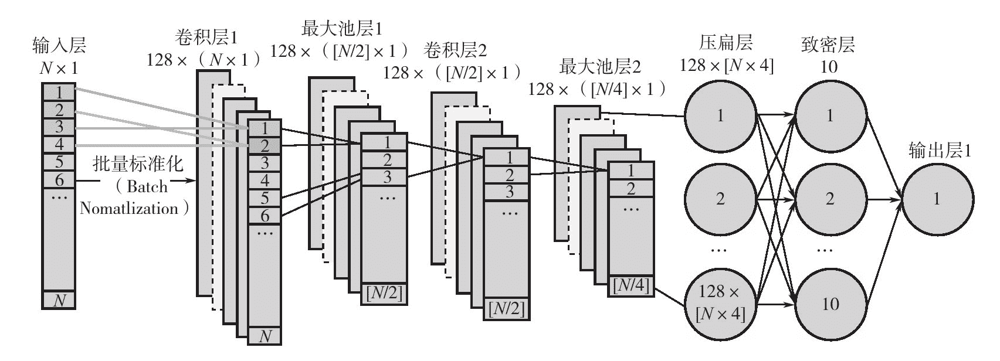

图 2-1 卷积神经网络筛选抗菌肽

训练分类模型前通常准备正负两类数据集。为将化学结构转化为数字特征，常采用分子描述符和分子指纹两种表征方式，随后借助统计筛选和机器学习软件建立分类模型。

# 多肽活性与毒性预测：机器学习在肽药物研发中的应用全景

模型搭建完成后，通常会先统计真阳性、真阴性、假阳性、假阴性四项计数，进而推算灵敏度、特异度、准确率等指标，并绘制ROC曲线求取AUC作为性能标尺。AUC取值介于0与1之间，1.0代表完全完美的分类，0.5则等同于随机猜测，毫无区分力。

抗炎肽和抗癌肽同属多肽类药物的核心分支。相较于小分子药物，抗炎肽凭借更高的靶向特异性与更低的毒副作用，展现出更强的临床潜力。抗癌肽被证实可通过与癌细胞膜产生静电作用，实现对癌细胞的选择性杀伤。PubMed的系统检索显示，已有若干针对这两类肽的预测工具面世。

印度Bhopal研究所的系统生物学团队曾用支持向量机和随机森林来区分抗炎肽与非抗炎肽。采用三肽组分构建的混合SVM在10折交叉验证中准确率达到78%，MCC为0.57。随机森林在该轮验证里表现更优，准确率为80.0%，MCC为0.59。但到了独立验证集，SVM的准确率72%和MCC 0.45反而超过随机森林。基于此，该组将SVM设为默认模型，随机森林作为备选。

IL-10pred是一个专门预测IL-10诱导肽的在线平台。IL-10是调控炎症的关键细胞因子，可抑制炎症、改善自身免疫病并延长移植存活。该平台以二肽组成驱动随机森林，取得最高准确率81.2%和MCC 0.60。

近期上线的AIPPred Web服务聚焦抗炎肽候选筛选。该工具整合极端随机树、SVM和随机森林，并结合最优特征集建模。在独立测试集上其AUC达0.814，优于现有抗炎预测方法及另外三种对照方法，有助于实现抗炎肽的高通量预测，推动相关研究进展。

除了已发布的数据库和在线工具，学界还有不少尚未产品化的机器学习研究用于预测多肽活性。机器学习常与其它策略融合以提升效果，例如自适应神经模糊推理系统用于模式识别型抗菌肽预测。该混合框架结合神经网络与模糊推理，能增强分类表现。

机器学习与基因编程的联用也能改善抗菌肽识别。以EFC-FCBF为例，该流程先从序列中构建并筛选更优特征用于抗菌肽初筛，再用逻辑回归搭建预测模型。该方法属顶尖水平之一，为抗菌多肽的理性设计提供了新思路。

回归模型对推断抗菌肽的预测与实验结果吻合度较高。区别于传统研究常用的AAC、PCP等一维或二维描述符，部分工作转向三维描述符。总体而言，机器学习已显著加速了多肽活性的计算预测。

计算资源与机器学习策略在多肽药物研发中扮演关键角色，近年来的突破极大推动了多病种活性多肽的发现。但该领域仍存在待突破的瓶颈。

其一，各多肽数据库的构建标准不一，对活性肽的截断阈值定义也各异；其二，部分数据库缺乏详细的结构信息，不利于跨数据集融合建模。未来需制定通用规范，整合更广数据，构建统一数据库。

高质量的阴性数据同样重要，可提升机器学习模型。迄今因文献报道有限，覆盖经实验验证无活性的肽数据库稀缺。建议推动建立阴性肽库，收录来自文献或高通量筛选证实的无生物活性多肽。

模型性能应基于权威基准集评估。目前尚无专门用于系统评估多肽预测模型的基准数据集，有待建立。

预测精度依赖于训练与测试集的规模和多样性，每个模型都应明确其适用范围。大量报道仍忽视此点，而超出适用域的预测缺乏意义。

相较小分子，肽特征的分子描述符选择更具挑战，肽存在多个手性中心等复杂特性。多数模型因缺乏生物学和分子机制解释，呈现“盲人摸象”特征。整合描述符以呈现配体-蛋白相互作用，有助于揭示预测背后的分子机制。

机器学习模型易过拟合。有效对策是选用更具相关性的特征并以外部验证集检验。近年来深度学习与集成分类器在药物发现中前景显著，如药物-靶点互作与药物毒性预测。采用深度学习或集成分类器替代传统机器学习可进一步提升精度。

## 2.3 蛋白质毒性预测

学术界不仅聚焦靶向递送系统，也高度重视活性肽疗法的开发。核心思路是利用受体特性设计多肽基药物。相较小分子，大分子的物理化学性质差异使其成为重要治疗方向。基于此，机器学习和人工智能已被用于构建多种计算模型推断蛋白结构，通过解析蛋白质理化与结构特征，探讨毒性机制并为治疗提供启示。

全球范围内宣称最优的蛋白质大分子毒性预测模型不少，但能够与其他模型竞争并给出令人信服的高准确率者寥寥。其方法学基础多显模糊，在毒理蛋白质组数据的利用程度上也存在差异。

计算技术已深度应用于蛋白质组学与药物设计，用于识别和刻画多肽与蛋白质的治疗及毒理属性。将这些技术用于蛋白功能、酶功能预测以及有毒蛋白/肽的鉴定与表征，可高效实现蛋白质组解析。

活性多肽的毒性检测是多肽药物发现的关键环节，却耗时耗力。为克服此限制，计算建模与模拟在早期药物筛选阶段被广泛采用于蛋白质组学毒性预测。

近几年活性肽作为候选药物的热度持续上升，多肽已用于抗癌、抗糖尿病、心血管疾病等领域。其高特异性、良好组织穿透性与相对低廉的生产成本，使其可与小分子和抗体并列为治疗选择。

体内外实验毒理学可评估未知蛋白或多肽毒性，但成本高、动物使用量大，现倾向采用分子建模与机器学习等计算手段进行毒性表征。相较小分子，多肽修饰更为便捷，而免疫原性、毒性与稳定性仍是多肽疗法需解决的核心难题。

随着合成技术的进步，可通过多种化学修饰调节多肽物理化学性质，在保持药理活性的同时降低毒性。与此同时，已有多款用于多肽毒性预测与蛋白疗法设计的计算工具问世，有助于对目标物理化学特性的治疗肽进行建模分析。

毒性评价是多肽药物研发与审批的必经环节。蛋白质毒素指特定蛋白或多肽大分子，可损伤机体或扰乱细胞周期。其常见特征为结构内在无序，构象变化常是活细胞毒性的主要驱动因素。毒素可诱发生理改变，因而蛋白质毒性常为致病核心。

作为维系组织器官结构与功能的基础，生物大分子因其独特的物理化学性质而成为治疗与诊断的重要手段。多年来，用于理解、预测与预防蛋白质对人及其他生物毒性的计算方法愈发受到关注。

监管机构与药企在评估基于蛋白的疗法时，会先评估毒性再考察其能否恢复为无毒的功能性状态。神经退行性疾病的病理常涉及蛋白毒性，帕金森、阿尔茨海默、亨廷顿等疾病患者多显示蛋白结构构象异常，这可能是致病关键之一，但确切机制仍待深入研究。

多肽与小分子相比在活性、特异性、生产成本与渗透率上具优势，已有多肽用于自身免疫、癌症、神经退行性疾病等。为提升研发效率，多种计算方法被用于设计保留疗效同时降低蛋白毒性的治疗多肽。

鉴于成本与准确性优势，机器学习正被用于蛋白质毒性预测。随机森林、遗传算法、人工神经网络等多种算法常被组合，以优化定量结构-毒性关系模型，预测蛋白类药物的毒性。

后基因组时代生物序列的爆发式增长大幅提升了人工智能在蛋白组学层面预测蛋白质/多肽物理化学、治疗和毒理特征的能力。为高效利用海量蛋白质组学数据推动肽药开发，研究者借助多种序列生物信息学工具推断序列信息，如细胞网络中的蛋白-药物互作、蛋白-蛋白互作及重组位点等。

序列与结构蛋白质组学的快速发展产生海量原始数据。借助机器学习和人工智能，可及时评估多肽疗法的效果，判断其是否具备理想的物理化学特性。

毒性蛋白质组大数据仍存在诸多未解难题，亟需有效的机器学习策略。受人脑启发，神经网络与深度学习等方法相继出现。部分研究探索更复杂的生物学数据表示，如峰值神经元模型结合突触可塑性整合时空信息，或基于峰值神经元的深度学习。这些方法正被有效用于化合物筛选和高效识别任务。

综上，人工智能与机器学习驱动的蛋白质毒性预测模型涉及四个核心要素：毒理蛋白质组数据的整理；模型开发所用的人工智能与机器学习方法；面向大分子毒性的预测工具与网络应用；模型的性能评估。

可靠的蛋白质毒性机器学习模型依赖充足的高质量示例。过去十年对蛋白质毒素的研究大量积累，相关文献信息已入库注释并便于检索，为模型训练提供数据基础。

### 蛋白质特征描述

蛋白质毒性预测复杂度高，常拆解为四个层次：一维层面基于氨基酸一级序列的特征；二维层面利用毒性肽的二级结构刻画氨基酸空间关系；三维层面关注毒性蛋白整体构象；四维层面涉及多蛋白毒素复合物的动态结构。

在构建毒性蛋白预测模型时，数据管理至关重要。原始的一级序列可从UniprotKB、PDB、蛋白质信息资源库等免费数据库获取。UniprotKB开放获取且收录高质量治疗相关信息。有毒蛋白序列常从其子库Swiss-Prot中获取，该库提供人工注释、文献提取信息及计算分析结果。检索可通过关键词或高级搜索实现，并借助人工审核提取数据。

训练集常以FASTA格式保存，可直接下载或手动粘贴序列生成。FASTA文件需经清洗与预处理后，才能进入后续的特征向量提取或数值编码流程。

二级结构常用来表征毒性，典型结构包括规则的α螺旋和β折叠，不规则的转角和环结构也具参考价值。基于这些参数，可用机器学习分析蛋白结构与毒性的关联。

提取二级结构特征时，可用DSSP程序处理毒性蛋白的PDB晶体结构文件。PDB提供α-碳原子坐标，可描绘整体三维形态，结构数据亦可从PDB获取。

虽然PDB的三维信息可用于机器学习建模，但毒理蛋白质组模型的成熟度仍不足，需进一步投入。结合实验验证的理化性质，也能用于构建未知蛋白毒性的预测模型。

数据收集完成后，需进入预处理阶段，以满足机器学习与神经网络建模的需求。

建模时应保证数据多样且冗余最小。预处理与数据转换包括序列/结构过滤排序、验证序列转录实验证据、用PyMol等可视化工具确认α螺旋、β折叠等二级结构、整合多源异构格式数据并统一文件格式，以便后续编码使用。

蛋白序列不能直接输入算法训练。若序列中含模糊氨基酸，需在描述符中体现。数据精细化对模型性能的影响往往超过单纯调参，是关键环节。

处理三维结构时，可按分辨率等指标筛选模型，并剔除质量过差或过好的理论模型。基于图像的深度学习将特征提取与分类耦合，也被用于蛋白功能预测。因此进行结构、功能或毒性预测时，三维结构需转成神经网络可接受的格式。

蛋白/多肽特征需以数值向量形式呈现，涵盖氨基酸组成、二级与三级结构特征及物理化学属性编码。机器学习算法依赖数值输入以构建有效模型。

表示氨基酸的文本编码技术众多。为捕捉残基耦合及局部序列效应，常采用二肽组成，即特定二肽出现次数占全部可能二肽总数的比例，生成400维向量。提取二肽组成可借助PyFeat、PseAAC等工具。

### 伪氨基酸组成与位置特异性评分矩阵

PseAAC通过将疏水性、亲水性、侧链质量等伪成分与传统氨基酸组成结合，生成50维描述符向量，其中前20维对应传统氨基酸组成。

位置特异性评分矩阵常通过迭代方式构建，维度为20×N，N为查询序列长度，每个元素反映特定位置上特定残基替换的频率，从而生成固定长度的训练输入向量。

位置特异性评分矩阵可分解为三类特征：基于5%序列块的平均轮廓；关注结构域转换相似性的特征；基于原始序列探测残基的理化性质特征。其中第二类在蛋白预测中表现最佳。该向量捕捉了序列上多类理化基团的保守信息，相关性质包括极性、疏水性、范德华体积、电荷与分子量等。

### 特征向量预处理

数据清洗是预测建模的persistent挑战，涉及检测和修复粗糙数据。若不处理，可能导致误导性分析。缺失值处理、异常值识别与剔除、重复值删除及不一致性修正，有助于避免错误与无关属性。

缺失值处理用于检查特征向量完整性。若向量中存在缺失，可删除含缺失的行或列，或用占位属性填充。确保向量完整是计算的关键步骤。

异常值检测对保障输入数据质量至关重要，可提升模型可靠性与可预测性。异常值常偏离正态分布，对训练影响显著。常用方法包括四分位距评分、z分数、基于邻近度的模型和高维离群检测。

数据需经规范化以适配特定范围。归一化是调整属性值至统一区间的预处理技术，在处理多单位多尺度属性时尤为重要，否则模型不完整且权重收敛不稳。常用方法包括重缩放、十进制缩放与标准化。

MinMax归一化即MinMax缩放，将特征映射到指定最小最大值区间，通常为0到1。它不消除异常值，但可使各特征尺度一致。

z分数归一化将特征转化为均值为0、方差为1的分布。其受经验均值估计限制，异常值会因特征尺度差异产生影响，故在存在异常时无法保证尺度均衡。

### 数据集划分

计算完所有毒性蛋白描述符后，可将数据集划分为训练集、测试集与验证集。常采用分层抽样按比例划分，训练集用于建模，测试集用于评估预测精度，验证集用于最终验证。

描述符计算完成后，可按需筛选最可靠的特征。特征过多易导致模糊并降低准确率，故特征选择是影响最终预测性能的关键步骤。

特征选择亦称变量或属性选择，用于自动挑选与预测问题最相关的数据属性。它与降维不同，后者通过组合生成新属性，而特征选择仅保留或剔除原有属性。目标是提升预测性能、提高效率并增强对底层机制的理解。

`Boruta` 是一种依托随机森林的包装式特征挑选策略，本质上是集成学习思路。它把多棵在不同有放回抽样数据上独立长成的弱决策树聚集成投票池，用多数表决完成分类。挑选过程从空集起步，每一轮从候选池里挑出一个加入当前特征子集，比较加入后分类器在交叉验证下的表现，保留提升最明显的那一个。每一组子集都要重新训练并交叉验证，运算负担远高于方差阈值这类过滤方法。

递归特征消除则走另一条路：先用全部属性建模算精度，然后把贡献最小的变量剔除，再基于剩余属性重建模型并重新评估。循环往复即可得到对目标变量有帮助的属性组合。采用非线性核的版本可以给变量排个序，却不会在同一轮内对所有变量做直接性能比较，这种排序方式能体现变量与响应间的关联强度，在生物医学研究中具有解释价值，最终输出按相关性排序的名单。

特征子集的搜索也可以交给遗传算法。该启发式方法借鉴达尔文进化思想，针对组学这类需要在模式分类中挑代表性属性的任务，通过适应度驱动的迭代产生、交叉、变异来逼近最优子集。

### 模型构建与评价
统计分类是监督学习的核心问题，类别事先已知，用于把新的概率观测归入预设类别。二分类情形下，任务就是判断未知序列或结构是否属于有毒蛋白。常用的建模手段包括支持向量机、随机森林、朴素贝叶斯以及人工神经网络，它们在多数基准上准确率较高。

模型验证旨在衡量训练数据所学模型的泛化能力。常用 `k` 倍交叉验证与独立测试集。原始数据被切成 `k` 份，通常取 5 或 10 份，`k-1` 份训练、1 份验证，轮换 `k` 次让每份都验证一次。交叉验证后，用表现最好的模型在测试集上检验。评价指标包括灵敏度、特异度、准确率和阳性预测值。

灵敏度指有毒蛋白被正确判为有毒的比例。特异度指无毒序列被正确判为无毒的比例。准确率是所有预测中正确的占比。阳性预测值是被分类器标记为有毒的序列实际为有毒的概率。其中真阳性为正确识别的有毒蛋白，真阴性为正确识别的无毒蛋白，假阳性为被误判为有毒的无毒蛋白，假阴性为被误判为无毒的有毒蛋白。

### 在线毒素蛋白预测平台
`ToxinPred` 是基于计算的肽毒性预测方案，仅适用于小分子多肽毒素。其提交模块可把上传的肽序列划分为有毒或无毒，模型以二肽组成作为特征，报道准确率约 95%。主要功能包括：①肽设计模块生成用户肽的所有单点突变类似物并预测毒性；②批量提交模块一次性评估多条肽；③蛋白扫描模块产出提交蛋白所有重叠肽段及其突变体并预测毒性；④ `QMS` 计算器接收 `FASTA` 格式查询肽，利用位置特异性定量矩阵对序列进行优化，以获得最大、最小或目标毒性，便于通过单残基调整得到期望性质的类似物。

`ToxClassifier` 可作为 Web 应用或独立工具使用，用于毒素分类并下载无毒蛋白序列。该模型在 `PDB` 得到的 8 093 条动物毒素和毒液蛋白上训练，准确率达 96%。

`ClanTox` 是面向小动物毒素的 Web 机器学习分类器，适用于毒性肽预测和动物毒性蛋白质组分析，还支持基于直方图的辅助分析。其分类器源自人工审核的离子通道毒素抑制剂正负样本集合，可对输入序列列表逐条判断是否可能为毒素，由增强型残基分类器驱动，使用序列导出的全局特征，并按置信度给出排序的阳性候选清单。

`NNTox` 利用基因本体论术语注释预测蛋白毒性，采用五层前馈神经网络，性能约 82%，`MCC` 约 0.8，`F1` 约 0.77，并扩展为可预测特定毒性类型的多标签模型。

## 2.4 蛋白质-蛋白质相互作用的预测
剖析蛋白质-蛋白质相互作用对药物开发至关重要。多数蛋白注释依赖有限的序列同源性，而高通量相互作用数据激增正成为新发现的基础，生物信息学需处理、分析和建模这些数据，计算模型因此被用来同时预测多项参数。

人工智能方法已用于研究相互作用与非相互作用，其中前者信息更丰富。预测可分为直接作用、存在间接功能关联的直接作用以及信号转导途径的作用。

机器学习与统计方法如 `k` 近邻、朴素贝叶斯、支持向量机、人工神经网络、决策树和随机森林常用于此任务。贝叶斯网络结合基因共表达、基因本体论及生物过程相似性用于预测相互作用，数据集成可提升网络的精确度与准确率。

`PCA-ELM` 即主成分分析集成极限学习机，仅使用蛋白序列信息进行分层预测，成为准确且运行更快的工具。

哺乳动物细胞信号多由非结构基序与球状蛋白结合结构域的相互作用调控。为预测多家族中的球状结合结构域，开发了定制的层次统计机械建模工具。

`PPI SVM` 是基于机器学习、结构域特征与频率表的相互作用预测工具。随着解析结构增多，多体线程方法 `MULTIPROSPECTOR` 被提出，其对已知模板结构进行重设计并评估与其他蛋白的相互作用、界面能和 `z` 分数。

除同源建模外，基于结构的线程逻辑回归工具 `Struct2Net` 是首个结构基础的相互作用预测平台，可评估相互作用概率。它基于基因簇共现思想，计算同源基因簇编码的查询蛋白直系同源物共现概率，也称结构域/基因共现，若基因在基因组上不邻近则预测可靠性下降。

### 利用诱导折叠指导药物靶点选择
深度学习在蛋白折叠上取得进展，即由氨基酸序列预测 `3D` 构象。`AlphaFold` 用 `PDB` 结构训练多层卷积神经网络，生成可精确定位残基对距离的模型。预测基于多序列比对中成对共进化的二维表示，若两残基进化相关则空间上更可能相近。进化信息结合氨基酸同一性和二级结构预测，距离约束通过逐层扩展卷积实现，滤波器感受野随层数扩大以整合邻域信息。

理论上每条链有唯一 `3D` 结构，实践中许多蛋白无法自主折叠，其完整性依赖结合伙伴，折叠选择来自诱导折叠集合。抗体常表现抗原诱导构象多样性，药物靶向蛋白也因结合不同配体而呈现多种复合形式。

诱导折叠意味着蛋白需伴侣维持结构完整性，配体从诱导集合中挑选构象。为构建合适的卷积架构，需先厘清结构完整性丧失的起因。主链氢键决定结构稳定性，主链酰胺与羰基的水合与分子内氢键形成竞争会导致结构破坏。

蛋白完整性取决于能否阻止主链水合，或蛋白的自主折叠程度与其对伴侣的依赖。未被包埋的主链氢键构成结构缺陷，即脱氢，氢键周围非极性侧链不足导致其暴露于破坏性的水合。延伸的未包埋区如脱氢簇易于无序，因为骨架水合可能压倒结构形成。诱导折叠可被视为对结合配体的最佳结构适应，以最大化未折叠区的屏蔽。

脱氢或包埋可由结构坐标计算并嵌入深度学习特征提取流程。该结构域定义了报告结构中主链氢键的微环境。脱氢处于结构数据库主链氢键 `w` 值分布的尾部。脱氢破坏完整性，促进结合以排出周围水，从而成为结合决定因素，减少电荷屏蔽可加强主链氢键的静电作用。

大量生物信息学证据显示脱氢驱动复合物形成，富脱氢区具灵活性，易发生结合诱导折叠。对诱导折叠状态的先验推断对理性药物设计至关重要，以便通过导向优化控制亲和力与特异性，从诱导集合中挑选完整形式。

利用深度学习预测诱导构象依赖于特征提取阶段蛋白链的包埋状态。结构包埋需适配张量表示，在分层架构的多维数组上处理。因此指导药物设计靶向结合能力诱导折叠，需要以靶蛋白一级序列为输入推断诱导集合。

与 `AlphaFold` 等模型相比，残基分析需额外信号，基于序列的内在无序预测可描述蛋白分离时沿链的非结构化倾向。预期无序区将依赖结合伴侣改善主链氢键包埋。

为从序列推断诱导集合，需将无序评分整合进残基分析。若蛋白视为自主折叠，螺旋可能部分不稳定，可随配体不同而被诱导折叠部分破坏或扭曲。

由主链氢键配对的残基可用成对共进化信息表示为二维阵列。若两残基在多序列比对中进化相关则空间相近。张量表示允许在张量流平台处理，应解码为 `3D` 渲染，指定包埋残基相对主链氢键的空间位置，以便片段结构连接其上。

### 基于诱导折叠的靶向药物设计
理性药物设计常难达预期，因靶蛋白并非固定，会随配体结构适应，产生药物诱导折叠问题，推动人工智能平台在药物开发中的应用。

深度学习可推断蛋白诱导折叠的可能性，复用于分层结构中的扩张卷积，有助于将非局部结构纳入预测，因为输入感受野随膨胀参数增大而逐步放大。

基于药物的靶向治疗旨在阻断功能失调蛋白，诱导折叠会带来难以预测的交叉反应，同时使靶点难以识别。深度学习可通过控制靶蛋白中诱导折叠来指导设计。

在诱导集合全基因组检查的指导下，对亲本支架进行化学修饰可消除有害交叉反应，同时引入治疗上理想的交叉反应。

深度学习系统旨在指导设计以诱导靶向结合能力构象。配体对诱导折叠的控制需与折叠预测因子不同的平台，整合结构紊乱信号以预测依赖有意设计的寡聚关系维持完整性的松软区域构象。该区域构象多样性形成诱导集合，深度学习指导的药物设计从中挑选靶向构象，实现具有治疗意义的药物-靶标复合。

过去数十年，机器学习已广泛应用于制药与毒理学数据集，实现前瞻性预测并提高效率、降低测试成本。

# 第 3 章 AI 助力结构性质预测更高效
## AI 让结构性质预测更触手可及
药物发现漫长昂贵，常被比喻为大海捞针。需找到同时满足生物活性、药代动力学、合成可及性等多项标准的化合物。从项目启动到得到临床前候选通常耗时 `3～5 年`，需合成并测试成百上千个分子。

从靶点确认为始，经候选发现与优化、系统临床前与临床研究到上市，研发投入巨大。新药从发现到上市约需 `10～20 年`，化学药物中约万分之一分子可进入临床，成功上市不足 10%。研发任一环节出现问题都可能导致终止，即使进入后期临床也可能因安全性被叫停，前期投入付诸东流。

可成药靶点枯竭使新药要求更高，研发难度与投入不断攀升。提升发现与临床成功率成为机构关注重点，人工智能已渗透研发各阶段提供助力。

人工智能在生产环节也受关注，随着“工业 4.0”推进，“制药工业 4.0”概念兴起，智能制造在生产作业、质量管控、物流仓储及企业管理方面前景广阔。目前国内药品智能制造仍处初期，随着装备智能化升级与过程智能化推进，水平将显著提升。

## 3.1 新药创制过程概述
新药创新大致分为发现阶段与开发阶段，后者再细分为临床前研究、临床研究与上市三个阶段。

## 药物研发与人工智能应用
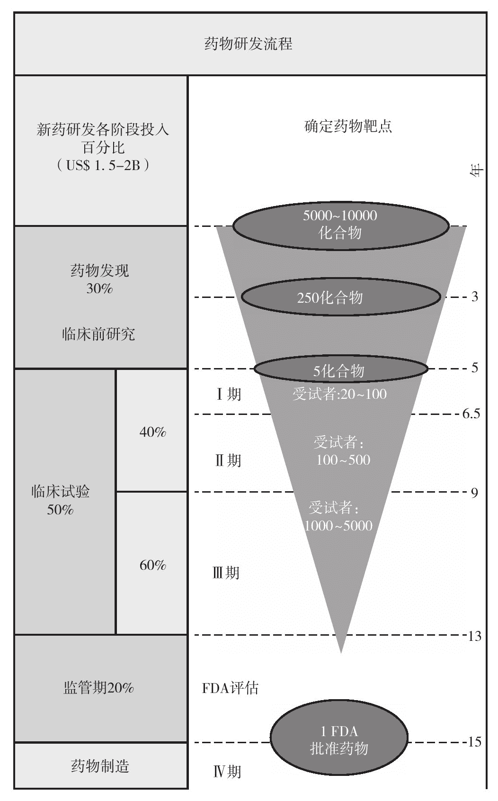
图 3-1　药物研发耗时及资金投入

药物发现主要包括靶分子确定与选择、苗头化合物筛选、先导化合物发现与优化，最终得到临床前候选化合物，是研究关键节点。

## 临床前研究
临床前研究涵盖药物制备方法及有效性、安全性的初步评价。工业化制备与工艺研究旨在实现稳定大批量生产，为后续研究与工业化奠基。评价包括药效学、药代动力学、安全性和毒理学，确认安全性与生物活性，为临床试验提供依据。

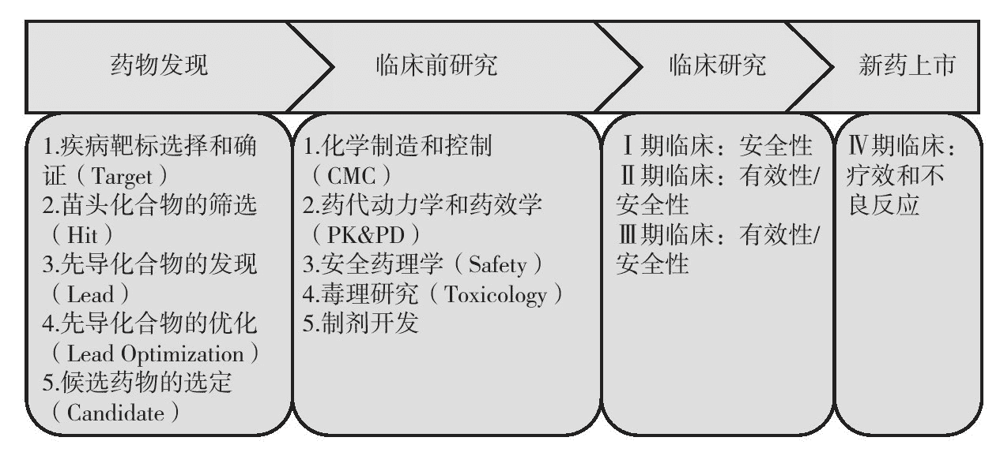
图 3-2　药物研发基本流程

## 临床研究
临床研究分Ⅰ至Ⅲ期。Ⅰ期在 20～30 例健康志愿者中评估安全性、耐受性及药代动力学。Ⅱ期在 100～300 例患者中评价疗效与安全性，并与对照药比较以确定适应症与最佳用药方案。Ⅲ期为随机双盲对照的大规模长期试验，受试者超过 300 例，用于确认疗效并监测副作用。

## 药物上市
完成上述研究后递交上市申请，获批后销售。上市后仍需进行长期安全性与有效性监测，即Ⅳ期临床试验。

## 人工智能在药物研究中的应用
人工智能可回答药物化学家与生物学家的两个核心问题：“下一个化合物应该是什么”以及“该结构是否可成药”。

过去二十年涌现大量计算药物发现技术，如定量构效关系与自由能最小化。机器智能方法用于区分细胞活性，包括决策树、随机森林、卷积神经网络、支持向量机、长短期记忆网络和梯度提升机。化合物以简化分子输入行字符串形式输入系统，作为自然语言处理式的输入而非化学描述符。采用不同截距与指标评估模型精度、准确率与曲线下面积，验证梯度提升机可实现数据均衡分布。

传统化学导向药物发现与计算药物设计结合，为未来研究提供平台。系统生物学、化学与计算科学家合作开发现代机器学习算法，加速药物发现与开发。

经典机器学习与深度学习均可分类细胞活性。双构效关系方法可预测渗透率，偏最小二乘方案与分层支持向量机方案可构建构效关系模型，后者在训练集、测试集与统计分析上表现更佳。对新化合物合成，化学家仍可依赖文献报道。

## 3.2　理化性质和生物活性的预测

AI 如何重写药物性质预测规则

小分子的理化画像由溶解度、分配系数、电离程度、跨膜速率等指标共同决定，这些画像直接影响体内处置行为与对靶点的结合强弱。设计新化学实体时，必须把这类理化要素前置考量。围绕该需求，业界涌现出一批以 AI 为核心的预测工具箱。常用的表征方式涵盖分子指纹、`SMILES` 编码、库仑矩阵与势能测定，这类输入被广泛用于训练深层神经网络。可以说，AI 通过先行估算理化属性，在发现与开发链条中提供了关键支撑。

治疗价值的根本在于与受体或靶点结合的好坏，缺乏足够结合力的分子难以具备成药潜力。提前判断化学实体与治疗靶点的相互作用模式对研发至关重要。近年来结合亲和力预测的精度在算法进步推动下持续提升，该流程利用了药物及相关靶点的相似性特征。目前已投入使用的网络工具包括 `Chem-Mapper` 以及各类相似性集成策略。

自上世纪六十年代起，药物化学就在不同程度上尝试把 AI 用于分子设计。监督学习是主流范式，借助有标签的训练集拟合模型。定量结构-活性关系 `QSAR` 就是典型代表，常用于估算 `LogP`、溶解度与生物活性等指标。而不依赖标签的无监督学习同样流行，分层聚类、主成分分析等手段被广泛用于把庞大的化合物库拆解成若干结构相近的子集。

把 AI 与机器学习引入药物发现的终极目的，是在医疗需求面前筛选出最具潜力的药物。具体而言，需要完成靶点辨识、先导化合物的发掘、对感兴趣的多重性质进行优化设计，以及规划可行的合成路线。

AI 常被误解为一键出结果的魔法按钮，仿佛输入无关紧要就能得到完美输出。现实是，从猫图训练的模型设计出完美猫图、实现零失误的自动驾驶、或造出安全有效的药物，都是极大的挑战。AI 并非万能解药，但作为工具，合理使用时能强化现有认知并推动新发现。在药物化学与发现领域，最有效的做法并非依赖单一自主设计新药的模型，而是让多套 AI 在靶点选择、命中确认、线索优化、临床前研究到临床试验的各环节协同工作，更好地理解与设计输入。

### （1）物理化学性质预测
进入临床候选阶段的分子需要同时满足多项门槛：对生物靶标具备足够效力、选择性足够高以避开非预期靶点，并拥有良好的理化与 `ADMET` 属性，即吸收、分布、代谢、排泄与毒性。复合优化因此是一个多维难题。为此行业大量使用计算预测手段。支持向量机 `SVM`、随机森林 `RF`、贝叶斯学习等机器学习技术已被证实有效。

属性预测离不开大规模数据，这是 AI 落地的先决条件。制药企业在化合物优化过程中积累了大量不同性质的数据。针对目标与反目标的大型数据集可以跨化学系列系统使用，用于训练机器学习模型以驱动优化。深层架构在性质预测上表现突出，相较于基线机器学习方法，深度神经网络预测性更强。随着应用边界扩大，AI 已渗透到化合物的从头设计、多肽设计以及合成规划等早期环节。

大量不受专利限制的数据集可用以构建可跨靶点预测活性的机器学习模型，这类模型可用于为现有药物挖掘新靶点。在 Kaggle 竞赛中，深度神经网络已被用于诸多属性预测任务。深度神经网络属于人工神经网络，是模仿大脑的系统，由大量相互连接的节点构成，每个节点类似神经元。不同节点的信号会被转换并逐级传递到下一层，输入层与输出层之间夹着隐藏层。训练时，各节点的权重与偏置会被不断调整。

深度网络的隐藏层与节点数远多于浅层架构，因而需要拟合海量参数以提升计算能力，同时需解决过拟合问题。用于 `ADMET` 表现与理化参数预测的卷积神经网络显示出不错效果，关键在于定义合理的参数集合。

### （2）亲脂性预测
亲脂性是药物发现中最核心的理化参数之一，它调控大量关键的药代过程。亲脂性影响膜通透性，进而影响转运、分布与清除；它还强烈影响与大分子的结合、代谢与毒性过程，以及几乎所有体内药物诱导的生物过程。衡量亲脂性的金标准是辛醇-水分配系数对数值 `log P` 或 pH 相关分布系数 `log D`，替代手段包括脂质体-水分配比与固定化人工膜色谱。

传统预测方法包括色谱法、量子化学驱动方法如真实溶剂的导体样筛选模型、单分子模拟以及线性或非线性 `QSPR`。近年来，研究者更倾向用 AI 把 `log P` 或 `log D` 与分子描述符集合关联起来。常用的描述符包括原子电荷、氢键作用、分子体积与表面积等。

神经网络已被用于预测辛醇-水分配系数，例如 `ADMET` 预测器。结合前馈网络与 k-最近邻算法的联想神经网络程序 `ALOGPS` 被证实能可靠预测低分子量化合物的 `log P`。构建模型时常使用两种描述符：结构片段与数字指数，通常借助遗传算法挑选有用子集。

现有模型的分子量覆盖范围有限，且所选描述符可能无法捕捉真实性质，因而需要引入更具物理意义的表示来改进 `log P` 预测。以辛醇-水体系为参照的 AI 方法能够在不同数据集上稳定预测 `log P` 或 `log D`，从而筛选出最有前景的化合物开展初步研究。预测 `log P` 或 `log D` 的主要难点与水溶度相关。AI 方法在准确性与效率上各有差异，但它们都基于实验数据训练，这在一定程度上限制了相对物理的手段如筛选模型或分子模拟的优势。

### （3）透膜能力预测
体外膜通透性数据的评估对药物发现与开发至关重要，因为大多数药物相关过程都涉及分子通过被动跨膜扩散或主动转运穿过生物膜。为此，科学家开发了很多预测小分子膜渗透行为的计算模型。大量 AI 辅助的预测因子已在不同化学类别及其实验渗透率数据上训练。这些数据常经平行人工膜渗透性试验 PAMPA、人结肠腺癌细胞系 Caco-2 等体外试验验证。

人工膜渗透性试验在药物发现中应用越来越广，收集初始数据集时需格外谨慎，训练集中应剔除所有已知的外排转运体底物。计算模型可以大幅加速发现进程，但必须仔细分析计算值与体内值的差异。

机器学习模型借助内部的 `AutoQSAR` 体系把 Caco-2 细胞模型的内在通透性与分子结构关联。不同项目中模型表现可能存在差异，项目团队常使用“渗透性决策树”，将预测的渗透性与亲脂性、分子量结合以指导设计。内在渗透性也能通过 `AutoQSAR` 方便评估。`AutoQSAR` 属于细胞法，优势在于成本低、时效好、对更宽 pH 范围与更高 DMSO 含量耐受，且易于高通量筛选。

构建预测 `AutoQSAR` 渗透性的模型时，通常拥有相对庞大的渗透率数据集，包含超过 5435 个结构多样性良好的化合物条目。数据收集时必须注意，除非在训练中整合条件信息，否则只能使用同一条件下测得的渗透率值。同时需考虑细胞系中表达的不同转运蛋白影响，以及对不同复合文库的需求。

近期文献显示机器学习方法在预测内在渗透率方面潜力巨大。这些研究表明，基于机器学习的模型可在药物开发早期以较高置信度筛除渗透性差的化合物，并把合成工作集中在渗透性潜力最佳的化学空间区域。

### （4）水溶性预测
足够的水溶性对口服药物不可或缺，因为药物必须先在胃肠液中溶解才能吸收。多年来出现了大量计算预测水溶度的方法，按原理可分为三类：量子化学方法、分子力学模拟，以及基于统计或机器学习算法的描述符方法。

水溶度预测通常依赖四大类描述符：相关理化性质、原子或基团贡献、量子化学性质与结构信息。具体而言，基于理化性质的描述符与可实验测量或计算得到的 `log P` 与熔点相关。经典的一般溶解度方程及其改进版正是从 `log P` 与熔点出发评估水溶性。虽然结果尚可，但它把水溶度预测转化为 `log P` 与熔点的测量或预测问题，增加了复杂性。原子或基团贡献法则通过统计原子或基团在分子中的存在，并依据实验数据估算其对水溶度的贡献。

结构法可依据分子拓扑、连接性或片段信息预测溶解度。除了可追溯至 Fuhner 研究的分子大小这一关键特征，多年来还发现了氢键数与多种分子连接性指数等相关特征。分子结构的表示方式多种多样，二元指纹在简洁性与预测能力间提供了良好平衡。

用于预测水溶解度的指纹示例包括扩展连接性指纹 `ECFP`，可编码两个化学键半径内各原子的分子环境，以及神经指纹，可直接从任意大小与形状的分子图生成。针对类药分子的水溶性预测，还出现了无向图递归神经网络 `UG RNNs` 与基于图像的卷积神经网络等深层结构与深度学习方法。

这些方法侧重学习局部环境信息，以构建任务特定的内部表示。前者通过枚举分子的有向无环图表示来学习描述符表示，后者通过对分子图进行卷积构建特定于任务的指纹图谱，与其他溶解度任务、辛醇溶解度与熔点方法相比表现显著提升。在这些案例中，可用于模型构建与测试的分子相对有限。

尽管设计了大量信息性描述符并纳入 AI 预测器，仍未出现完美准确预测溶解度的方法。对不同方法中多元线性回归、人工神经网络与聚类法的质量评估显示，没有一种方法能完美预测溶解度，尽管多元线性回归比更复杂的方法表现更好且过拟合概率更低。

除对内在复杂性认识不足外，模型预测能力受限的另一常见原因是文献中多源收集的溶解度数据存在噪声，实验数据的均方根误差约 0.6~0.7 个对数单位。近期研究表明，实验数据质量并不是限制类药分子水溶度预测的决定性因素。比较显示，使用从多篇文献提取、噪声较大的数据集，其误差也在 0.6~0.7 个溶解度单位。与预期相反，从 Cheqsol 实验数据得到的模型并不比从公开数据得到的模型更准确。可见水溶度虽是小分子药物的重要理化性质，但准确预测仍十分困难。每种预测方法各有利弊，最佳选择很大程度上取决于具体需求。对高通量分子筛选，高效的 AI 方法已成为可行且足够可靠的手段，可帮助扩大与精炼集合。而当需要对特定分子的物理与机制原理进行深入理解时，研究者更倾向使用基于量子力学或分子力学的物理意义更强的方案。

### （5）药物与靶标共晶型预测
药物分子可呈现多种形式，涵盖多晶型、水合物以及更复杂的多组分晶体。后者中靶标与辅助化合物形成新的分子间相互作用，可有效调控溶解度、生物利用度、密度、熔点等理化特性。

因此，多组分晶体在多个领域得到应用，并在药物配方中发挥关键作用。共晶体的潜力在于改变分子的理化性质，研究者对其设计兴趣浓厚。然而寻找能够形成共晶体的分子组合并不容易，这阻碍了目标晶型的有效探索。

多组分晶体的预测难度很大，新形式常被多次误判。与成盐不同，质子转移导致强离子作用，而溶剂化物与共晶体则通过较弱的非共价相互作用组装。功能团间的分子间相互作用常被用来合理化可能的聚集，但并不能保证假定的相互作用会实际出现。

多晶型盐与溶剂盐常采用自动高通量系统筛选，而共晶体的实验筛选仍耗时耗力且失败率极高。为缩短周期，现已有多种计算工具辅助发现成分或共构体的合适组合，如基于氢键的分析、基于分子描述符的统计建模、静电势图、晶体结构预测、分子动力学或像素计算等。

## 3.3 定量结构-活性关系预测（QSAR）
### （1）QSAR 建模
在药物设计与发现中，探究化学结构与其理化性质与生物活性之间的关系始终是核心。`QSAR` / `QSPR` 建模自五十多年前起已取得长足进步。对生物活性与药动学参数如吸收、分布、代谢、排泄与毒性的成功预测，证明计算模型对药物发现具有不可否认的促进作用。在基于配体的 `QSAR` / `QSPR` 建模中，分子的结构特征如药效团分布、理化性质与官能团常被转化为机器可读的数字，即分子描述符。

化合物的理化反应本质上是化学组成的函数，但定义这一函数仍具挑战。从原子论起源开始，化学家就致力于不经合成即可预测性质。`QSAR` 相关研究一直活跃，并推动了特定理化性质尤其是 `log P` 的常规化预测，用于计算辛醇 / 水分配系数。

随着 AI 发展，`QSAR` 建模技术、分子表示、数据量与可用计算资源显著增长。这些进步使得过去不适合深度学习等技术的数据集现在可以利用。当前可获取大量化学结构数据及其测量终点以生成预测模型，但数据总量仍有限，质量参差不齐。人们期望更聪明的机器学习方法能够处理这类有噪声数据。

手工制作的分子描述符种类繁多，旨在捕捉化学结构的各个层面。总体上，`QSAR` / `QSPR` 方法正从线性回归、k-最近邻等简单模型转向支持向量机、梯度增强等更普适的机器学习技术，用以解决化学结构与其理化 / 生物活性之间更复杂、潜在非线性的关系，通常以牺牲可解释性为代价。

深度学习并非全新技术，化学信息学中的人工神经网络在上世纪九十年代迎来首个高峰，当时诞生了深度与自适应网络架构、自组织映射、递归系统用于序列与时间序列分析以及自动编码器等概念。深度网络在 2012 年默克分子活性挑战赛取得突破后真正走红。虽然使用相同描述符集时深度模型是否优于梯度提升机存在争议，但深度学习提供自动特征提取等优势，即网络可在训练中自行学习特征。

图神经网络也称消息传递方法与递归神经网络，能够生成分子结构的内部上下文特定表示。在特定情况下，图神经网络通过在训练中学习潜在的原子与键表示来实现。因此，深度学习有望用于那些尚未设计经典描述符的任务，例如肽、大环与蛋白水解靶向嵌合体 `PROTACs` 的建模。深度架构的另一优势是适用于多任务学习，旨在为一组相关终点找到通用的内部表示，与不会明确利用任务间相关信息的多输出学习不同。

由于药物发现是多参数优化挑战，多任务学习可能更有效地利用相关数据，尤其在分子库未在所有感兴趣终点上穷尽测试且无需事先插补时。多输出 `QSAR` 建模的思路，即把预定义化学描述符与可观察终点关联，在深度学习流行前就已探索。尽管有多任务学习的潜力，迄今相比单任务模型的性能提升仅属适中。

深度学习的众所周知缺点是中小数据场景下表现较差。一些基于化学基因组的方法可能通过利用额外的基因组或生物相互作用数据为这些情况提供新见解。

沿此思路，纯粹数据驱动的分子性质预测方法在对未见化合物类进行推断与可靠预测的能力上，远不及全或部分基于物理的技术。物理化机器学习方法与额外的主动学习策略，即模型主动请求特定训练数据以改善泛化的方法，为克服这些限制提供了额外工具。这些策略的成功严重取决于其具体实现如何应对数据稀疏性，因为能够进行有效数据计算的合适来源往往稀缺。

深度学习模型也因调试困难与“黑盒”特性受到广泛批评。相比之下，手工开发的特定领域特征仍有潜力以更易理解的方式整合背景知识。可解释 AI 技术可部分缓解深度学习带来的问题。继续发展特征归因技术、基于实例的解释如反事实与基于用户查询的模型生成示例，以及基于注意力的网络，将有助于缩小深度学习与药物发现专家间的差距，因而跨领域密切合作十分必要。

深度学习方法的另一常见缺点是计算成本高昂。若无消费级 GPU 或张量处理单元等专用硬件，训练与评估时间通常长于许多其他机器学习方法。尽管如此，深度学习模型可自然利用随机梯度下降优化进行在线学习，其训练成本随数据集规模线性增长，无需一次性将全部训练数据载入内存。在连续随机小批量数据上训练的能力，使其在大规模数据场景下更具竞争力。

相关问题是，在许多实际场景中，预测性深度学习往往需要更多人类专业知识。例如，可相对轻松地训练一个表现良好的随机森林模型，但我们对当代深度学习方法的理解尚未达到可靠的默认水平，尽管近期理论暗示这一局面可能很快改变。

此外，神经网络可能出现误导性，即所谓的 Clever-Hans 现象，并倾向于产生过度自信的预测，即使预测明显错误。在药物发现性质预测背景下，这一问题进一步加剧，因为相似条件下的实验可能给出截然不同的测量结果。随着不确定性估计技术的广泛采用，这一缺陷有望在未来几年得到缓解，无论是使用直接嵌入不确定性的深度学习方法如贝叶斯神经网络，还是使用集成学习等后处理技术。

AI如何重塑药物活性与成药性预测

基于结构的信息预测蛋白质与配体活性，神经网络正带来明显突破。传统配体中心QSAR无需三维结构信息，而结构型方法必须依赖共晶结构或对接构象来推断靶标差异。早期经典方案给出了明确的预设蛋白-配体相互作用数学表征，主流是偏最小二乘或多元线性回归，目的在于量化单个描述符的贡献并估算物理化学性质。

进入2010年后，随机森林、支持向量机等非线性且更灵活的建模思路开始流行，配合描述符爆炸式扩展，出现了蛋白-配体原子对计数、属性编码的形状分布、基础原子相互作用等新特征。和配体方法相似，该分支随后迎来深度学习浪潮。最初的灵感来自计算机视觉与图像识别，卷积神经网络成为主要驱动力，最终落地到生物活性预测。也出现了图基方法、距离与角度编码等路线。在基于结构的虚拟筛选和先导优化竞赛里，部分方案相较既往实现渐进式提升，但也有声音质疑部分经典基准更利于机器学习打分函数而非传统打分函数。

伴随可解释人工智能需求上升，研究人员开始尝试解读结构型卷积模型，发现其能够以人类可读的方式凸显关键相互作用，例如氢键与π-π堆积。

不过，三维卷积网络存在理论短板：对输入的旋转缺乏不变性，而这正是原子体系建模的必要特性。如何解决这一问题已成热点。新一代架构把等变性直接嵌入设计，例如欧几里得神经网络和SchNet，能够在三维空间的旋转与平移下保持稳定。这些结构已用于分子电子性质等任务，预计未来将为结构建模打开新空间。

深度学习在药物发现的应用增速很快，但高度依赖大规模训练集，这放大了新模型开发、全面数据治理和恰当基准的需求。近年化合物库可用性与规模同步提升，ZINC、ChEMBL成为配体识别的常用起点。结构建模亦出现类似趋势，PDB-bind、BindingDB提供蛋白-配体复合物的精细结构与活性数据。蛋白质结构预测与解析的进展令人振奋，未来可获靶点结构将更多。

在化学信息学层面，机器学习开放与标准化投入持续加大。MoleculeNet基准套件即通过生物物理、物理化学、生理学等领域精心挑选的数据集，对众多深度架构进行时效评估。虽然公开数据快速增长，绝大多数结构-活性关系仍由商业研究机构、出版商与药企产生，被视作差异化资产而保密。近期研究提示分子结构可在一定程度上从描述符中部分恢复，这可能使数据共享在特征层面也变得复杂。

QSAR建模的核心是通过定量数学关系连接化学结构与生物活性。其主要价值在于从分子数据库中筛选可用于抗击疾病靶点的化学结构，优选后进入实验合成与体外体内验证。QSAR大致分为回归与分类两类。高斯过程回归是成熟的回归范式，擅长处理海量描述符并挖掘关键因子。近期工作用高斯过程实现了两种分类方案，一种是固有的高斯过程分类，另一种结合概率分析。

该方法可刻画非线性关联且无需主观设定模型参数。神经网络、深度学习、支持向量机等机器学习工具的进展，为QSAR提供了新动能。现已有VEGA平台、QSAR-Co、Meta-QSAR等网络化建模工具。

QSAR-Co已被用于多目标磷酸肌醇3激酶抑制剂的定量模型构建、抗癌ERK抑制剂筛选、K562细胞功能抑制剂预测、酚类化合物抗真菌性预测等。

机器学习模型普遍面临QSAR数据缺失值插补难题。缺失大致可分为三类：完全随机缺失，即缺失概率对所有样本一致；随机缺失，即缺失概率取决于其他可观测预测变量；非随机缺失，即缺失概率与未记录信息相关。

常用处理包括零值、均值、中位数或众数填充、随机值填充、模型 기반插补。每组数据缺失模式不同，需审慎处理以保证模型稳健。数据复杂性也应被削减，整理后可提升模型精度与可靠性。最初QSAR多用于预测小分子毒性与代谢，分子量通常小于1500Da。

除Hansch与Free-Wilson经典方法外，近年QSAR随描述符计算新手段、系统验证与受体结构信息丰富而演进。除先导优化外，QSAR已拓展至多肽QSAR、混合物毒性QSAR、纳米颗粒QSAR、离子液体QSAR、化妆品QSAR、植化QSAR和材料信息学等。

早期技术的准确性与可靠性仍有限。随着QSAR在可视化筛选、先导优化、靶点识别中作用扩大，药物化学家与生物学家不断追求更可靠方案。基于全息图QSAR、基于片段QSAR、基于集合QSAR等人工智能驱动方法，可数倍加速发现流程并弥补早期不足。

人工智能算法也在药物再利用与重定位中发挥作用。药物重定位指将已为某病开发的药物转向其他适应症，因多靶点参与多病机制而具备可行性。基因组学、蛋白质组学及体内外药理大数据为此提供路径。

近年涌现DrugNet、DRIMC、DP-DR-CPI等AI工具与平台。机器学习借助系统生物学视角，逐步取代传统化学相似性与分子对接方法来评估疗效。AI工具的出现为下一代研究提供平台。

技术进步推动计算科学家与实验科学家携手提升AI模型精度。分子对接在QSAR与重定位中不可或缺，用于解析靶分子与配体分子的相互作用。人工智能兴起后，对接正与分子动力学模拟及AI工具融合，应用于虚拟筛选、靶标识别、多药联用等。

分子动力学与AI可提升对接效率与准确性，并缓解其局限。对接传统上仅能处理晶体结构已知的靶标，而大量靶标结构缺失。AI辅助下类同源建模技术出现以克服障碍。PDB晶体结构数据指数增长，进一步拓展对接在药物发现中的适用范围。

### （2）QSAR 预测
上世纪90年代起，神经网络被广泛引入定量结构活性关系研究。QSAR是制药行业预测靶向与脱靶活性的常用技术，可帮助在发现早期排序实验优先级，大幅减少实验量。在大规模化合物排序场景中，每个单点预测的准确性尤为关键，尽管更高精度始终受追捧，但实际应用存在约束。

即使在高性能计算环境中，时间与内存仍受限。理想的QSAR方法应能在24小时内，利用万级分子描述符构建预测模型且无需人工干预。QSAR计算密集，或需调参众多敏感参数以适配单个数据集。

受此限制，众多机器学习算法中仅少数适合药物发现的常规QSAR。当前主流是随机森林与支持向量机的变体，高预测性与易用性使其占据主导。随机森林因精度高、操作简便、对调参适应性强，成为其他方法的参照基准，这一现象在非QSAR任务中亦成立。

QSAR与机器学习模型通常为单端点训练，尽管存在多端点。卷积神经网络支持多任务学习，将多个端点联合预测。多任务可提升质量，共享活性化合物的任务表现更好。数据量与任务数同时影响多任务收益。行业规模ADMET数据集研究也显示多任务有益，但改进高度依赖数据质量。

深度神经网络是机器学习的主流方向之一，在语音识别、计算机视觉等领域表现突出。与经典人工神经网络相比，深度网络拥有更多隐藏层且每层神经元更丰富，故更深更宽。

深度学习也被用于有机小分子势能预测，以快速机器学习替代耗算的量子化学计算。对大样本，可先计算DFT势能训练深层网络，网络随后能外推至训练集外甚至更大分子量的测试分子。

深度学习已在多种数据与任务上得到验证。比较研究中，卷积神经网络常优于成熟机器学习方法，性能逼近体外检测水平。多数研究回顾性展示架构在属性预测中的适用性。

实践中常使用ChEMBL等公共数据。该库生物数据多为单靶点，导致矩阵稀疏，跨靶学习具挑战性。在某些情形下，卷积神经网络因训练与参数优化成本相对较低而明显占优。基于自编码的化合物描述学习是 promising 方向，可实现问题依赖的特征优化。

经典神经网络存在实际困难，例如只能处理有限输入描述符。需先做描述符筛选或提取，将数千维降至数十至数百维，信息损失不可避免。为防过拟合与降低计算负担，隐藏层常限制为1层且神经元数受限。

随着方法论、优化算法与硬件进步，上述瓶颈多被缓解。如今多隐藏层且每层数千神经元的网络可常规应用于含数十万化合物与数千描述符的数据集，无需降维。即使权重达数百万，过拟合仍可控制。用户仍需设置可调参数。

默克结构化学实验室对15个QSAR数据集的评估显示，深度神经网络在多数情形下优于随机森林。当隐藏层数为2时，若神经元过少，性能下降。输入层后的信息传递受前层限制，神经元数少的层压缩表达能力，若关键变化被丢弃，后续层难以恢复，层数增加反而加大优化难度。

在任意隐藏层数下，一旦每层神经元足够大，进一步扩增收益递减。例如两层网络每层达128神经元后性能趋于平缓。继续增加神经元仍可带来提升。三层与四层网络表现类似两层，即更深网络需要更大宽度，单两层的神经元需求更低。

当网络仅有一个12神经元隐藏层时，其平均预测能力已与随机森林相当，相当于经典QSAR神经网络水平。部分数据集中r2相对随机森林的增益有限。

尽管推荐参数在单任务与联合任务下对多数数据集表现良好，但未必对特定数据集最优。例如多数单任务问题使用两层网络且神经元数降至1000与500时，r2仅微降而计算时间节省数倍。

随机森林与深度网络均可借助高性能计算加速，但方式不同。随机森林依赖节点级粗并行，易于集群并行。深度网络则擅长利用现代GPU的并行能力。随GPU硬件与资源普及，深度网络部署更经济，编程复杂度与传统Python相近。

默克研究还表明，联合训练15个数据集的深网络能略微提升训练样本较小的QSAR任务。15个数据集在分子类型与任务目的上差异显著。化学家通常一次处理一个数据集，对联合模型如何从不相关数据借鉴信息理解有限，需进一步研究。即便单独处理，深网络仍可优于随机森林。

深网络在众多机器学习场景中发挥关键作用，常提升QSAR预测能力。预训练为何有时损害性能尚未完全阐明，可能与子结构描述符特性相关。

未来方向包括为每个QSAR任务开发有效策略以精细调优深度网络可调参数。工业环境中，时间分割训练测试集更能模拟研发现实，传统交叉验证在时间分割场景下微调参数效果有限。需研发能更好反映时间分割泛化能力的新方法。

3.4 ADMET 属性预测
药物设计追求高活性和良好安全性。候选结构需与主要靶点最佳结合，同时避免非靶点相互作用带来的毒理事件。吸收、分布、代谢、排泄、毒性共同决定疗效与安全性，合称ADMET。

ADMET失衡是候选药物在后期失败的常见原因，也可能导致已上市药物退市。早期明确化合物ADMET特性已被广泛重视。计算模型因此受制药企业与科研机构青睐，可指导筛选库构建以降低风险。

人工智能被广泛用于将化学品ADMET特性与分子描述符直接关联，并从可用数据构建预测模型。随着对结构与物理化学性质关系认识加深，包括log P、log S、透膜性等，间接快速预测方法应运而生。这些方法旨在将工作导向更具前景的化学空间，而非在初期对特定化学基团设置严苛限制。

小分子候选药物的基础物理化学性质通过影响ADMET、效力与选择性，对最终成药成功格外重要。熟悉的物理化学参数常被用于对可能靶标家族进行分类。该启发式虽可能受小分子与me-too策略影响，仍具参考价值。小分子需具备足够溶解度与渗透性以到达作用部位并结合靶点。更深刻理解与更准确预测理化性质有助于设计具有理想药代与药效特征的分子。

早期ADMET预测有助于研究人员挑选优质候选并贯穿开发过程促进成药性。近年AI辅助ADMET预测快速进步，基于深度学习与大数据的下一代预测器将推动药物从实验室走向临床。

### （1）药物吸收度预测
药物吸收是分子跨越生物膜屏障进入血液的关键首步，过程复杂，受物理化学性质、给药途径、制剂与生理因素共同影响。预测模型大致分为物理化学与生理两类。

目前已有多种基于物理化学性质评估的简易过滤方法，包括log P、log S、内在渗透率等，用于快速预估生物利用度。这类方法可在先导优化早期提供判断，例如水溶性低的候选吸收风险较高。

但生物膜吸收机制多样，仅凭物理化学特征难以实现合理精度，且每个被排除分子都可能是潜在药效团。生理模型有助于建立可靠高通量方法。人肠道吸收是决定口服生物利用度的关键特性。基于体内体外数据，已推出大量计算分类与回归模型用于预测人肠道吸收。

机器学习在此领域应用广泛。多数已发表研究中预测精度在可接受范围，最大挑战是数据有限易导致过拟合。为缓解小样本问题，已有集成学习等技术被用于构建更稳健模型。

基于集成学习的预测模型在严格外部验证下展现良好的人肠道吸收预测能力。近期还出现了基于卷积神经网络的计算模型，可从分子描述符直接预测吸收潜力，无需显式特征工程。

遏制过拟合风险的常用策略之一，是搭建一个体量可观且来源多元的初始集。该集可在实际应用中充当预测候选物人体肠道吸收的基准，帮助培养出更稳健可靠的模型，进而对候选药物的吸收水平做出合理预判。

### （2）药物分布预测
药物分布描述的是分子自血液循环向全身各组织扩散或借助主动转运的过程，核心指向预期发挥作用的部位。

影响吸收的诸如脂溶性、分子尺寸、酸碱环境、电离状态等特性，同样会左右药物进入不同组织的速率与程度。除此之外，血浆蛋白的可逆非特异性结合也起关键作用，人血清白蛋白、脂蛋白、α-酸糖蛋白都是常见结合体。蛋白结合会改变可参与分布的游离分数以及药理和药代特征，因为只有游离态分子才能抵达生物靶点并产生治疗效应。因此不受血浆蛋白占据的化学片段是构建分布模型的核心参数。机器学习常被用于搭建人血浆蛋白结合的预测模型，典型手段包括人工神经网络、随机森林与支持向量机。

即便血浆蛋白结合的实验资料不少，各研究的出发点差异显著，要覆盖完整且一致的化学空间仍有难度。只有在经过广泛整理的集合上建立回归模型，才能较好地分辨分子的血浆蛋白结合能力。影响分布的因素中，生理屏障被反复提及，血脑屏障与胎盘屏障是代表。血脑屏障在保护大脑免受血液成分波动并维持脑稳态方面意义重大，同时也是中枢神经系统药物研发的一大障碍。

药物由血液进入大脑的速度主要取决于膜通透性。近年来借助于机器学习预测血脑屏障穿透性，大幅压缩了实验成本与周期。可用于量化穿透性的体内体外指标众多，学界最常用且认可度高的仍是血中浓度占比，血药比例越高往往对应脑内相对浓度越高。

与血脑屏障穿透相关的描述符被广泛用于建模，包括脂溶性、离子化状态、电荷描述符、氢键供体与受体数目、极性表面积等。公开数据匮乏使得建立分子描述符与穿透性的稳定关联仍具挑战。相较于肠道通透性，对限制血脑屏障通透的复杂机制的认知相对有限。

真核系统的穿透机制大致可归为被动扩散、被动携载与主动转运。被动扩散被认为是药物穿越血脑屏障最常见的方式，因此现有预测模型多集中于此而忽略其余通路。鉴于药物可经多种途径入脑，仅凭物理化学特征难以准确预测，近期出现借助临床表型进行预测的新思路。药物的中枢神经系统不良反应与血脑屏障穿透密切相关，依托文献中副作用数据的丰富度，用异构数据训练模型有望提升预测成功率。

### （3）药物代谢预测
异种生物在肝脏或其他器官中的化学转化即代谢，通常为酶介导过程。鉴于代谢酶的多效性、底物与抑制剂的多样性以及过程的复杂性，代谢预测被视为最具挑战的环节。代谢决定药物在体内的命运，进而影响安全性与疗效，并与疗效丧失、特殊不良相互作用、肝毒性、药物相互作用等密切相关。

绝大多数药物分子主要经由细胞色素 `P450` 亚型与葡萄糖醛酸基转移酶参与的Ⅰ期、Ⅱ期代谢推进，约 58% 的药物经由 `CYP450` 代谢。因此 `CYP450` 抑制试验常用于早期排除药代动力学特性不佳的分子。

近年来针对非 `CYP450` Ⅰ期代谢酶的研究日增。蛋白质-配体对接、分子动力学、分子力学-广义玻恩表面积连续溶剂化、量子力学等计算手段被用于研究 `CYP450s` 与 `UGTs` 等靶点的代谢位点、产物及酶的抑制或诱导。

人工智能可通过刻画电子在断键成键过程中的变化，研究特定体系与代谢机制的细节，并据此预测大量分子经特定酶 panel 代谢的可能性。一般而言，人工智能在代谢预测中的应用主要包括代谢位点定位、负责代谢的特定亚型判定、代谢药代动力学推断。代谢位点预测对药物研究至关重要，它为可能代谢物的衍生提供关键线索，指导开发更安全有效的药物。

目前已有若干基于人工智能的代谢位点预测模型，准确性令人满意。例如一种随机森林预测器结合层次化描述符，识别 `CYP450` 介导的类药物分子代谢位点，其形式类似支持向量机，并在训练时采用定制化的实例误差值。`XeNoSite` 是一种基于神经网络预测 `CYP450` 介导Ⅰ期代谢位点的工具。`FAME` 是另一款快速有效的 AI 预测工具，在其基础上提出改进方法并集成为新软件包 `FAME2`，现可在线免费使用。

人工智能也被用于对分子对代谢酶的抑制谱进行分类。除预测代谢位点外，还可推断Ⅰ期或Ⅱ期酶的特定异构体可能负责某一化合物的代谢。研究者对非 `CYP450` 酶介导代谢的预测兴趣日益上升，但目前基于人工智能的位点、亚型特异性及动力学参数预测模型报道仍有限。现有模型多仅对给定的初始分子进行代谢预测。

实际上许多初级代谢物会再经历一轮Ⅰ期或Ⅱ期代谢，形成次级有毒代谢物，例如多环芳烃氧化产生的环氧化物。因此量子力学与分子力学方法可模拟这些反应的热力学与动力学以及代谢生物转化的细节。量子化学已证明其在生成信息性分子表征方面的效用，也实现了药物优化回顾性预测的持续准确性。为了更真实地预测代谢物并在早期识别问题化合物，需要将当前的代谢组学与毒性信息与化学和酶反应机制的分子知识相结合，构建兼容的代谢预测平台。

### （4）药物排泄预测
药物排泄指从体内清除药物分子及其代谢物的过程，直接影响血浆浓度，在药物设计中扮演重要角色。排泄涉及多种消除途径，如胆道排泄与肾排泄，每种途径又包含若干过程。例如肾排泄由肾小球滤过、主动分泌与重吸收共同决定。排泄过程的复杂性制约了基于人工智能的排泄因子开发。近期出现的新方法是应用偏最小二乘线性法与随机森林非线性算法预测人体药物分布体积。

上述方法精心挑选分子描述符，并采用剔除法与独立测试集评估预测因子的表现。基于 750 个化合物的数据，结合物理化学描述符与结构片段，构建了用于预测人体血浆清除率的线性偏最小二乘预测因子，并建立了基于随机向量机的预测因子，使用从药物化学结构计算的描述符预测 141 种已批准药物在人体内的主要清除途径，显示出较高的预测性能。

### （5）药物毒性预测
药物毒性是指化合物本身或其代谢物对机体、细胞或器官产生的不良效应。毒性评价是药物发现开发中最关键也最具挑战的环节。高通量分析结果可靠却耗能耗时，因此寻找能够替代大规模体内外生物分析的快速、低廉、可靠的计算模型具有很高研究价值。目前已有多种 Web 工具与软件包用于毒性预测，如 `admetSAR`、`Toxtree`、`LimTox`、`pkCSM` 与 `DLAOT`。

与此同时，先进人工智能算法为毒性预测开辟了新路径，大量文献讨论人工智能在预测毒理学终点或有毒化合物分类方面的潜力。这些算法大致分为基于相似性与基于特征两类。基于相似性的方法通过计算化合物间的成对相似性矩阵预测分子毒性，再借助最近邻算法与支持向量机等进行分类。其假设是结构相似的分子倾向于表现出相似的生物学效应。基于特征的方法则通过选择或加权输入特征来预测毒性，包括随机森林与朴素贝叶斯模型。

与基于特征的方法不同，基于相似性方法成功的关键在于在特征向量或二维/三维图表示的分子之间进行有用的相似性度量。在这些表示中可识别不同的结构、物理化学与生化模式，如毒物团搜索、子图挖掘与图核。基于毒性实验数据训练后，所构建的人工智能预测因子表现出良好的整体性能。

测试集数据取自已报道的毒理学数据，使用实验动物进行评估，包括小鼠或大鼠口服急性毒性、呼吸毒性与泌尿毒性。综合不同任务的整体表现，支持向量机方法在构建可靠毒性预测模型时始终有效，在测试集中实现皮尔逊相关系数 10 倍交叉验证平方约 0.7。

此外，集成算法可从一组弱预测因子中生成强毒性预测因子。近期报道了一种集成技术，使用标记分类器对已批准药物的四种不同毒性效应进行评估。尽管上述方法开发出性能良好的模型，但一个关键限制是其无法自动学习并提取任务特定的化学特征。

准确预测模型的发展在很大程度上取决于合适的分子表示。近年来深度学习技术出现，使分子表示的新方法成为可能，并能够生成新的、抽象的、任务特定的特征。这些特征使深度学习方法非常适合预测毒性，这从其在 `Tox21` 数据挑战中的成功得到证明。

`Tox21` 挑战主要由美国食品药品管理局发起，旨在评估各类计算方法预测毒性的性能，并考察其减少体内实验数量的潜在价值。多位研究者参与了该挑战，以评估多任务深度学习方法在毒性预测中的表现。名为 `DeepTox` 的预测管道赢得了挑战，他以深度学习支持自动学习，输出结果与专家知识与经验确定的成熟毒物性质高度一致。

多任务学习允许一个任务从相关任务中“借鉴”特征，从而显著提升整体表现。这一发现得到偶然结果的支持。关于多任务目标的预测，最近还报道了多任务深度网络在四种药物数据收集上优于随机森林方法。模型中较低层倾向于学习毒物团的小成分，如磺酸基，而在较高层中这些成分合并成子结构或整个毒物团。

在大多数深度学习应用中，特定分子的编码由固定长度的向量表示，因此深度学习方法的成功很大程度上依赖于良好的编码功能将分子结构信息映射到向量中。部分开发者描述了通过从原始分子图中学习相关特征来预测毒性的深度学习体系结构，以克服这一限制。典型示例包括用于预测药物诱导肝损伤的无向图递归神经网络，以及用于预测急性口服毒性的改进分子图编码卷积神经网络结构。

使用大规模多任务网络进行虚拟筛选可显著提高预测精度，但这些网络需要在包含数百万数据点的庞大数据集上训练。这说明深度学习在预测毒性和药物开发领域的成功很大程度上取决于输入数据的数量和质量。为解决从少数数据点学习有意义化学信息的问题，引入了“一次性学习”技术以提高稀疏数据任务的预测能力。利用迭代求精与图卷积神经网络结合，形成一种新架构，通过在相关但不同的任务之间传递信息来训练模型。

一次性学习的成功需要三个关键要素。首先，通过使用相似度度量比较新数据点与可用数据并进行后续属性推断，使稀疏训练数据的影响最小化。其次，学习一个有意义的距离度量，使相似性可转移，以便信息在查询示例与支持集元素之间交换。最后，通过图卷积网络使用一个灵活且有意义的数据表示作为输入。该架构显著提高了在 `Tox21` 有限子集和内部集合上训练模型的性能，从而恢复了通常因输入数据较少而丢失的信息。

为了更准确地预测药物的 `ADMET` 值，需要更多研究来建立一个全球适用且可靠的 `ADMET` 预测因子。构建可靠的人工智能预测因子时应考虑多个因素，包括多物种毒性数据并考虑与计算相关的已知问题。此方法的重要前提是需要验证并仔细定义人工智能模型的适用性域，在模型中建立信任。尽管目前基于人工智能的 `ADMET` 预测因子仍不够精确，无法取代生物相关系统中的体外测量，但它们仍有助于推动药物化学朝着正确的方向发展，从而减少解决 `ADMET` 相关问题所需的合成周期。

# 第 4 章 AI 加速候选药物筛选

在药物发现中，第一步也是最重要的一步是识别与疾病病理生理学有关的适当靶点，如基因、蛋白质，然后找到可以干预这些靶点的适当药物或类药物分子。现在我们可以访问一系列生物医学数据库，这些数据库可在该方面提供帮助。此外，人工智能的发展使大数据分析变得更加容易，因为现在有无数的机器学习技术可用，这些技术可以帮助提取大型生物医学数据集中存在的有用特征、模式和结构。对于靶标识别，基因表达等特征被广泛用于了解疾病机制和寻找导致疾病的基因。

大数据可以定义为过于庞大和复杂的数据集，无法使用传统的数据分析软件、工具和技术进行分析。大数据的三个主要特征是体积、速度和多样性，其中体积表示生成的大量数据，速度表示这些数据的复制速度，多样性表示数据集中存在的异质性。随着微阵列、`RNA-seq` 和高通量测序技术的出现，每天都会产生大量的生物医学数据，因此当代药物发现已经过渡到大数据时代。

在制药行业，人工智能已经成为解决经典化学或化学空间的问题的可行方案，这些问题阻碍了药物的发现和开发。随着技术的进步和高性能计算机的发展，人工智能算法在计算机辅助药物设计中得到了增强。人工智能并不是科学家在药物发现和开发方面的新技术，如 `Hammett` 将平衡常数与反应速率联系起来，`Hansch` 对药物化合物的物理化学性质和生物活性进行了计算机辅助预测。`Hansch` 的成功为药物研究提供了一条途径，该研究侧重于化学结构的详细识别和预测，以及药效团和三维结构等特性的表征，并假设与预测化合物的化学表征和生物活性相关的复杂数学方程。然而，在当前时代，科学家的主要目标是通过基于经典化学活动的机器学习算法，以高精度和置信度分数改进药物发现和开发过程。

## 4.1 从零设计候选分子
开发从头设计算法来虚拟设计和评估化合物，有可能减少寻找合适分子的时间和成本，尤其是如果人工智能设计与自动匹配化学相结合的话。早期的从头设计算法使用基于结构的方法来设计在空间和静电上适合感兴趣靶的结合口袋的配体。通过这种类型的方法设计的化合物通常具有较差的 `DMPK` 性质和合成难处理性。另一种从头设计方法是首先列举大型虚拟图书馆，然后通过对接和相似性/药效团搜索来探索化学空间。

近年来，旨在发现新活性分子的从头设计，已经引入了许多方法和软件解决方案。将多目标优化法集成到设计工作流程中，是计算化学方法最直接的应用。从头设计可分为两种典型方法：基于配体的方法和基于结构的方法。基于配体的方法只使用配体信息，如分子相似性或活性模型，而基于结构的方法使用蛋白质结构，在目标结合位点存在的情况下优化设计的配体。

从头药物设计的一个中心问题是确定配体与受体的结合能力。配体识别评分算法，可以估计给定三维结构的蛋白配体复合物的结合亲和力。该方法使用经验评分函数来描述束缚自由能。相互作用参数包括范德华力、氢键、脱溶效应和金属螯合。该法使用线性模型建模解离平衡常数，引入原子类型来区分不同原子对之间的范德华力、氢键相互作用和金属螯合的参数。

在靶蛋白的结构已知的情况下，分子对接可以用来识别可能与之结合的分子。此阶段仅仅是药物与蛋白质结合。对接过程并不能直接预测这种结合的任何药理或生理后果。该分子是否真的能实际结合，更不用说作为抑制剂、激动剂、拮抗剂、反向激动剂等还需要后续研究。

发现可成药的小分子结构的主要挑战是，合成最少的分子目标，有效地探索化学空间。其中，多目标优化方法，通过对驱动药物设计成功因素的总结，扩大药物化学设计中应考虑的相应的参数数量，避免化合物相关的无效设计。

理想情况下，提高对生物靶点的效价和选择性应与亲脂性、解离度和适当的配体效率等因素一起进行评估，以增加代谢稳定性和膜通透性，同时最大限度地减少非靶点结合和转运体亲和力。

在实际药物发现过程中，大量的化学空间探索中需要优化的并发参数可能无法在单个分子中实现。近几十年来，快速平行合成化学技术取得了长足进步，多样性导向合成作为化学范式出现，但对所有化学空间的全面实验探索是不现实的。过早地将合成工作集中在化学空间的局部区域，可能会忽略更有可能满足更多参数要求的解决方案的机会。

客观地探索广泛的化学空间和解决多目标优化中的相关挑战，是计算化学应用的一项重要任务。通过使用计算机程序，自动评估非常大的化合物库，来识别在药物发现中的苗头和先导化合物的过程被称为虚拟筛选。

虚拟对接，包括将一个小分子最佳地拟合到一个大分子中，并评估该拟合的质量。从这两个分子的合适结构开始是很关键的，通常来说，期望蛋白质和配体的构象与之前相同是不现实的。同样地，将一个配体分子从蛋白质晶体结构中切割出来，然后将完全相同的构象对接到完全相同的空腔中，也是一个不切实际的简单测试。

对接方法的一个要求是彻底探索搜索空间，这样就不会错过蛋白质和配体或姿态的正确配置。即使蛋白质和配体都是刚体，没有构象的灵活性，搜索空间也已经是六维的，增加了配体的灵活性和蛋白质的一些构象自由，显著增加了有待探索的空间。这意味着，理想情况下，配体很适合结合位点，没有明显的冲突或空隙。

其中蛋白质和配体结合具有形状和化学互补性。这意味着，理想情况下，配体能很好地嵌入结合位点，不会产生明显的碰撞或空洞。氢键、极性和疏水基团也被适当地定位。使用一个具有能量维度的函数来近似蛋白质-配体复合物的自由能是很常见的，虽然不是强制性的。为了有更好的效果，需要一个快速评估的能量函数，既可以评估当前配置的质量，也可以指导寻找更好的解决方案。而且，尽管与真实模式有差别，但全局最小值尽可能接近正确的位置。分子力学力场可能提供适当的能量函数，特别是它们很可能产生梯度，可以引导搜索到能量分布上的局部或全局最小值。这是解决搜索和优化问题的众多方法之一。

从头药物设计旨在产生符合特定标准的化学物质，包括对靶点的疗效、合理的安全性、合适的化学和生物特性、足够的新颖性，以确保获得知识产权等。在新算法的帮助下，进行计算分子的设计和评价，从头药物设计被认为是一种有效的手段，以减少制备大量的新化学结构花费的时间、金钱，并高效地识别化学基因组研，从中找到可以作为先导物的起点结构。

早期的从头药物设计方法，无论是直接从蛋白质结构还是从已知配体的特性推断，几乎完全使用基于结构的方法，在目标的结合袋的约束内生长配体。这些早期方法的一个局限性是，生成的结构制备难度大，药物成药性差。

最近，基于配体的从头设计方法已经证明了其在药物化学中的适用性。生成的化合物库，可以通过评分函数进行额外的分析，该函数考虑了一些特性，如生物活性、合成可行性、代谢和药代动力学特性等。构建这样一个虚拟库的一种方法是使用化学反应子集、一组可用的化学构建块，以及一个合成可获得的分子池。

## 4.2 常见筛选手段概览
### （1）虚拟筛选

虚拟筛选与人工智能如何重塑药物发现

药物从构想到上市往往耗时漫长、投入巨大。虚拟筛选的核心价值在于用生物信息学先行，把买样、合成和实验测定的资源集中在真正有潜力的分子上。一次成功的虚拟筛选，本质上是用计算手段把候选池的活性富集度大幅提升，和原始化合物库相比，命中率提高数个量级。

虚拟筛选是一类计算工具集合，通过检索化学数据库找出对特定生物靶点有活性的分子。它的作用是先用算力把几乎不可能在传统生物学实验中产出的海量化合物筛掉，从而降低发现成本。

按信息需求分为两类。结构已知时可以用基于结构的策略；结构未知时只能走基于配体的路线，比如相似性搜索、药效团映射和机器学习。策略选择受数据可得性和计算开销制约。例如三维筛选通常需要为数据库里每个分子预先生成低能量构象，成本不低。

相似性搜索是基于配体方法里最常用也最简单的一种，只需一个已知活性分子作为起点。原理是“相似物有相似性”，结构接近的化合物往往物理化学和生物学行为也相近。实践中多用二维指纹编码分子片段，再用共同子结构数加简单相关系数来度量相似度。

（2）配体识别评分

基于结构的从头设计是计算机辅助药物设计的主流路径。依据靶点结构评估氢键、共价键、范德华等作用，锁定与蛋白结合优的骨架。能否准确预测结合能力至关重要，常用三种评分思路。

经验评分计算快、形式简洁，但很难建立亲和力与晶体结构建模之间的可靠联系。知识评分基于数据库的原子平均力场，计算原子间作用时常忽略环境效应，且训练集有限，化学类型覆盖不足。物理评分借助实验信息做量子力学计算，精度可期但成本高。

第一类是结合能预测。利用评分函数在给定构象下估计蛋白-配体复合物的结合自由能或亲和力。对接后可重新评估最优姿态。该函数不必同对接优化时的能量函数一致，也不必求梯度。实际仍常使用分子力学力场，有时加入溶剂环境。

第二类是经验函数开发。原则上评分项与结合自由能的热力学贡献对应，但参数来自数据经验拟合。通常只拟合总结合自由能，单项精度要求不高。

第三类是基于已知复合物的知识函数。只依赖结构数据，不需亲和力输入，对蛋白-配体原子距离采样后按准化学平衡处理，再用逆玻尔兹曼把距离直方图转为自由能函数。把所有原子对贡献相加后，平均结合能常比实验值高约十倍，却与实验相关性很好。

误差源于统计假设。液体气体中原子距离近似独立可采样，而蛋白-配体中拓扑连接使不同原子对距离强相关，信号概率被高估。试图通过粒度微调降低误差往往只能经验化处理。因此逆玻尔兹曼常被视作把距离直方图映射为具能量量纲的函数，而非严格物理证明。引入机器学习可获得更好的知识势，也能让函数同时利用亲和关系和结构信息。

共识评分常把多种函数合并预测，能更稳健地捕捉结合位点的共同特征，如氢键供受体、疏水基团、芳香环、带电基团等。

得到的模板即药效团。它是分子中需具备的一组特征及其几何约束，是相同结合位点产生相同药理效应的必要非充分条件。药效团源于活性分子，检验的是活性假设而非单纯结合，也可能存在与同一受体作用但不在模板覆盖范围内的分子。

即使靶结构已知，药效团仍可用作对接的替代。大分子坐标可直接构建药效团模型，用来在庞大化学库中检索命中。关键在于生成并搜索生物学相关的三维构象，该构象常与孤立或固态的最低能量构象不同。机器学习也能自动从晶体结构数据生成相互作用模型，用于虚拟筛选或指导从头分子设计。

（3）形状识别方法

配体识别可归为形状识别，用形式化的药效团模型把虚拟库结构与已知结合物比较，有时兼顾其他性质。该方法用分子间原子距离分布描述分子，具有三点优势：力矩描述与分子大小无关，可比较原子数差异大的分子；信息量远小于传统方法，整分子仅需12个描述符，而非3n个坐标；不依赖显式分子对齐。

（4）分子相似性搜索

虚拟筛选里最简单的方法之一仍是分子相似性搜索，目标是在库中找与已知活性物相近的分子。不同于形状描述符，这里用化学描述符定义相似性。基于相似性质原理，化学空间中靠得近的两个分子比远的分子更可能共享性质。该法不涉及靶结构信息，但可合理推断高度相似且活性相同的分子对靶的相互作用模式类似。

实现上可把化学结构表示为特征向量。特征可以是原子或原子团、拓扑指数、键片段计数、物理化学参数如logP、电子性质如轨道能、部分电荷、极化率、偶极矩，或形状、表面积、体积、分子量等。不同量纲常需归一化，因特征间相关，需降维或主成分分析。随后计算化学空间距离，如欧氏距离、曼哈顿距离，或相似系数如塔尼莫托系数，找到与已知活性物近的分子。

描述符和指纹没有唯一标准，验证方式是看相似度高的分子对是否同时具有相似结构和相似性质。

（5）多靶点预测

新化学实体的发现需要在效价、选择性、清除率、渗透性等多个标准间权衡。单指标优化易损害其他指标。这类冲突目标问题可转化为多参数优化、向量优化等计算框架，机器学习正被广泛使用。

多目标场景下需先为每个属性建立计算预测模型，再用多目标算法寻找一组权衡合理的分子。因为属性常冲突，理想结果是一组帕累托最优解，任一成员在某一属性上改进都必须在另一属性上妥协。该解集描绘出最优前沿。

追踪前沿的难点在于信息不完整。若能在项目启动时明确各标准的权重，传统优化即可求解。但药物发现是迭代过程，含有大量无法编码的人为判断，如药物化学家的经验直觉。因此多目标优化的价值在于产出一组不同权衡的优质候选，由专家进一步筛选。

基于相似性的方法可延伸至多靶点。每个分子都与大量已知靶点相关的化合物库做相似性评估，输出的不是单一活性而是一张生物活性谱，显示对各靶点的预测活性。

这对副作用的快速评估很有用，混杂相互作用可作为项目风险信号；积极来看，也有利于阐释多药理活性，即一种药物通过作用于多种蛋白发挥效果。在计算毒理学中，随着动物实验减少，计算预测将愈发重要。模型可从简单结构过滤发展到针对特定毒性终点或局部配体化学空间的量化模型。

（6）反向 QSAR

反向 QSAR 的出发点不同，不先生成虚拟库再打分，而是尝试建立分子描述符到分子的显式反向映射，从描述符空间的有利区域映射回具体结构。主要障碍是如何选择既适合正向 QSAR 又利于重建的信息丰富表征。

为提升多样性和新颖性，需使用大片段库，代价是片段交换和相似搜索成本上升。许多从头设计方法利用分子构建块或合成片段组装，以降低生成不可合成结构的风险。SMILES 语言模型被用来规避无效结构问题。

近年努力集中于用生成模型隐式学习转换。深度生成网络擅长处理序列数据的长程依赖，在无显式先验库前提下展现出从头设计的潜力。可训练多层感知机根据分子的潜在坐标预测性质，与重建任务联合训练：给定编码后的潜在向量，沿提升目标性质的方向移动再解码，即可得到新候选。模型还能预测电子性能，并在兼顾成药性和合成可行性后执行迭代梯度优化。

基于 SMILES 训练的循环神经网络既能生成描述符，也能生成与模板性质相似但骨架不同的候选。采用迁移学习先在大分子集上预训练，再用小规模活性分子微调，使采样偏向目标模板集。

在机器学习表征空间内识别分子属于新的训练集生成策略。先用字符级模型学习化学子集字符串中字符的概率分布，再后处理剔除价态、芳香性错误结构，模拟出性质相近但骨架不同的分子。细胞实验显示模拟化合物可抑制未折叠蛋白反应和 VEGFR2 通路，具备先导物潜力。

该类方法可在保留典型小分子合成可行性的同时引入天然产物样特征，并保证结构多样性。借助简化图描述符生成满足药物形态模板的参数后，能在可接受误差范围内生成具有指定分子量、分配系数、氢键供受体数、拓扑极性表面积等五项性质的类药分子，并可固定其它性质生成不同 logP 的类似物。

尽管从头设计在产业中尚未普及，主要是合成可及性问题。随着生成式人工智能的发展，该领域正迎来复兴。关于如何度量生成分子多样性仍有争论，方法可扩展到其他分子表示，并允许针对目标空间做精细采样调控。

4.3 人工智能辅助药物筛选

计算药物化学的未来可能更常规地使用信息学预测在靶和脱靶活性及潜在副作用。动物实验减少使毒理终点的计算预测愈发关键。大量药物靶向酶，随着机制研究的深入，药物设计与计算酶学界面的效率会提升，药物化学与系统生物学的相互促进也会增强。

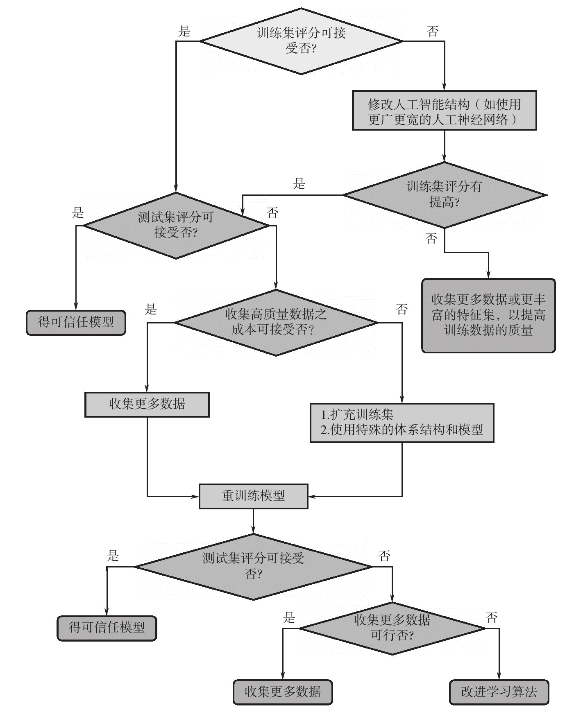

图 4-1 指导数据收集和模型改进策略的算法

人工智能虽带来新工具，也带来新挑战。生物学和免疫学进步明显，高通量合成和筛选普及，但新药研发仍慢，临床失败率高，因而需要低成本的创新方案。

长期以来计算机辅助药物设计被视为降本增效手段，随着学习和数据处理能力提升，它能更快锁定候选分子。过去小分子发现依赖高通量筛选，需制备大量结构，但体内环境的复杂多因素性使成功率极低。筛选需综合靶点结构、多靶点选择性、代谢、毒理等指标。

应用人工智能首先要找到合适的数据集。数据质量决定模型上限，即使算法完美，无代表性数据也无法解决问题。评估时需看数据是否覆盖建模重点，可靠的药理模型可缩短开发周期。

当前发表的药理论文已达千万篇，但体内数据仍稀薄有限。常用体外数据替代体内，但两者差异常很大。动物实验结果与人也不一致，体外蛋白结构与体内真实结构亦有差距。这些不确定性制约建模效率。人工智能药物设计的终极挑战是从零生成具有所需性质的新化学实体，而不依赖昂贵的高通量筛选。

其吸引力在于可构建数据驱动的隐式模型，通过大规模筛选产生数据并优先排序，实现决策能力的部分机器化，与人类专家的协同增强药物化学家的设计选择。

五大挑战与核心问题

为长期成功，人工智能药物设计需解决五个重大挑战：获取适当的数据集、生成新假设、多目标优化、缩短周期、改变研究文化与思维方式。该框架源于2018年关于人工智能重塑药物设计的会议。

适当的数据

输入数据的质量和范围是构建可用预测模型的前提。没有合适数据集和对其局限的认知，复杂模型也无意义。

化学设计的模式匹配

化学设计本质是模式匹配。20世纪90年代起的计算机再设计方法作为思想生成器被探索。如今生成式人工智能提供统计决策框架，与早期依赖显式化学转化和片段生长、链接规则的引擎不同，生成模型以数据分布概率隐式表达化学知识，使用的语言是从训练数据中学到的新语言而非教科书化学。

生成性人工智能的可解释性

该方法直击可解释性问题。前沿应用已显示生成式从头设计能产出具有所需活性和合成可及性的分子。相比传统方法，其优势在于项目快速再训练或微调、可扩展的近乎无限化学空间、软件可用性以及合成可及性，这些曾困扰早期从头设计。

数据复杂性与适应性

数据洪流下的制药创新

研发端正经历信息体量与科学假设同步攀升的阶段。限制发现效率的根本，是对人体生物学底层规律的认知仍有空白。药物设计的讨论背后，其实是方法需要随研究对象生命周期而自我调整的信号：随着新证据涌现，生物学解读在快速迭代，分析工具也必须跟上。于是当发现认知不断刷新时，AI 必须保持足够的灵活性来持续给出可用结论。

### 机制模型
与之对照的是，能够在基因、分子、细胞等多个抽象层面捕捉行为模式，并解释其演化与相互作用的机制模型。它恰好回应了前述两大难题。在计算化学范式里，这类模型常被视作数据驱动方法的互补力量，为 ML 挖掘出的相关性提供可解释的因果框架。于是模型既能产生新假设，也能衍生出新的 ML 模型，并提供检验假设、迭代优化所需的数据，形成假设—验证—再学习的闭环，构成一个自演化的学习系统。

## 机器学习方法概述

### （1）机器学习
信息化社会的特点就是数据无处不在。针对新药而言，对已有化合物的多维度数据做系统性挖掘，能够从不同角度刻画分子特质，而信息总量每年呈指数级增长，也为 AI 提供了庞大的训练池，为药物化学家提供了更丰富的结构表征维度。大数据在药物组合化学中发挥了关键支撑。

依托计算技术，AI 模拟化学家的设计思路，通过 ML 解析药物大数据来发掘全新骨架。大量生物制药企业已把 AI 与 ML 嵌入发现管线。辉瑞自 2016 年 12 月起与 IBM 展开合作，利用其云平台开展免疫肿瘤药物研究；赛诺菲也在与一家英国的 AI 驱动药物设计公司联手，探索代谢疾病疗法。

ML 大致可分为有监督、无监督和 RL，在分类与生成建模中均有应用。有监督学习中的分类与回归，依据输入输出数据预测模型表现。有监督 ML 在疾病诊断场景中尤为适用，分类手段对 ADMET 筛选帮助显著。

ML 借助生物活性与化学结构间的关联开展药物设计，通过学习技术预测并验证生物靶点如蛋白质结构、结构域、跨膜区、糖基化与磷酸化位点，建立定量构效关系模型、药效团模型，并开展分子对接分析与相似性搜索排序。技术还可对药代动力学与毒理学谱系进行分类，结合先导化合物的发现或优化，以及构建新配体模型，实现新药的发掘与设计。

与传统评分函数不同，ML 不局限于结构特征与结合亲和值间的预设函数形式，而是一种动态构建、优化模型以预测结合构象与亲和性的技术。它关注配体与靶标间的真实相互作用，规避了易出错的近似假设。随机森林、支持向量机、神经网络等方法引入了非线性依赖，使得基于 ML 的评分函数在结合能计算上表现更优。共识评分则通过整合多套分数降低个体误差，提高真正阳性的捕获概率。

针对亲和力预测与已知结合构象重现，学界对各类评分函数的效率进行了大量比较。现代评分函数在不同场景下的准确率各异，共识评分通常比单评分方法更稳健，已广泛用于生物信息研究。共识评分通过融合多个函数来弥补单一方法的局限，原理简单：重复实验的平均值更接近真实值，因而命中率得以提升。

ML 输出的质量受训练集多样性、活性和非活性化合物不平衡处理能力、参数定义精确度等多种因素影响，必须覆盖包含活性与非活性分子在内的完整化学空间。因而高效模型的开发目标是，在大规模库筛选中获得较少的假阳性与更多的活性化合物，这可通过构建包含预测非活性化合物的多元训练集来实现。

### （2）深度学习
人工神经网络属于受监督的神经启发式机器学习技术，已在语音与图像识别等领域取得成效。其原理类似大脑神经元：接收大量输入信号，经非线性激活函数计算加权和产生激活响应，再将输出传递给下游神经元。基本架构由输入层、隐藏层与输出层构成。

网络节点可全连接也可部分连接，从输入变量出发经隐藏节点映射至输出并计算结果。反向传播是迭代训练的核心手段。受过拟合、梯度消失等问题的困扰，早期传统神经网络逐渐被随机森林与支持向量机等方法部分取代。

DL 源自拥有多层隐藏层的网络。传统 QSAR 在处理大数据量的速度、多样性与准确性上难以兼顾。DL 正是一种擅长分析海量数据的机器学习范式，且架构灵活性高，可对具有相同分子描述符数量的化合物建模。

贝叶斯推理网络为基于相似性的虚拟筛选提供了一种有趣替代。它在活性分子结构高度同质时表现突出，但在结构异构的活性集合中效果欠佳。

DL 的转化效应已延伸至计算生物学与计算化学。以 Kaggle 赛事为例，一个深度神经网络赢得了分子活性预测挑战。随后 MolecularNet 基准测试与 DeepChem 开源库收录了更多分子数据集与预测任务。多种机器学习方法可预测不同活性类别的靶点。在回归任务中，最佳验证 r2 的物理化学范围约为 0.61～0.87，生物物理范围约为 0.45～0.51，量子物理范围接近 0.99。

### （3）强化学习
通过微调预训练集合可缓解上述问题。近期以序列图为基础、引入任务特定强化学习的方法被用于优化 logP 与成药性定量估计。奖励函数往往偏好结构相对简单的分子，因其有效性与属性分布概率更高，但设计合适的奖励函数并不容易。基于策略的强化学习通过“增强可能性”思路扩展了先前工作：预训练的化学空间网络与评分函数共同训练一个代理，使模型生成的示例既保持原始化学域代表性，又体现评分函数的设计意图。

该模型还能生成类结构查询分子。即便从训练集中剔除这些化合物，仍可产出结构相近的类似物。部分已被药理实验证实有效但未被纳入活性预测或生成模型训练的子结构，也能被复现。

迁移学习是另一种强化学习思路，旨在把先前任务中学到的洞见迁移到新相关任务。它能把小片段组装成更大的类药分子，无论在片段还是大分子上训练，性能基本相近。强化学习已应用于生成针对腺苷 A2A 受体的配体等方向。

### （4）递归神经网络
递归神经网络起初服务于自然语言处理，因其能处理顺序信息而被引入化学。以 SMILES 编码化学结构后，RNN 用于生成化学结构。训练时使用大量化合物，如 ChEMBL 或商用化合物库。结果显示 RNN 能够产出大量语法有效、可合成的字符串。

### （5）迁移学习
迁移学习是产生具有所需生物活性新化学结构的重要手段。第一步用网络收集大型训练集，第二步用具有目标活性的化合物进行训练。无需额外训练，即可使新化合物生成偏向活性分子占据的化学空间。该方法可结合多种架构探索新空间，生成分子的性质分布与训练空间保持一致，并能产出有效且有意义的新结构。

迁移学习常用于微调模型，生成与聚焦靶点结构相似的小分子库。从单个受体结合片段出发，循环神经网络模型可依次生长剩余片段。微调阶段仅需少量代表性分子即可生成具有相似结构特征的子集，用于有限数据下的同系列优化。实践中常采用两层编码器学习分子指纹变化、两层解码器重建输入、中间潜在层作为判别器。训练完成后，对采样潜在向量解码即可得到指纹向量与对应的药物浓度。

自动编码器在重建质量与大数据处理上常优于同构变分自动编码器，但会损失部分化学空间覆盖。VAE 与 AE 作为无监督生成模型，常用于预测水溶性。其局限包括使用二值化化学描述符向量，以及对化学文库筛选输出指纹的高要求。新一代自动编码器改进了原始监督对抗自动编码器结构，允许融合目标与潜在解纠缠变量，本质上是降低复杂度的过程。

变分自动编码器由编码器与解码器两个神经网络组成，解码器可把潜在空间向量转译为化学结构。该特性被用于在潜在空间寻找最优解，再经解码器反向转化为真实分子。大多数反向翻译以单一分子为主导，小幅结构修饰出现的概率较低。

对抗性自动编码器包含生成新化学结构的生成模型与区分真假分子的判别模型，二者对抗训练。在生成模式下，AAE 比 VAE 产出更多有效结构，并能得到目标特性改善的分子路径。

早期做法只是把标准化目标变量直接连接到分子的潜在向量表示。后期出现了两种改进：预测解纠缠，使用神经网络学习并去除冗余变量；联合解纠缠，训练网络区分真实的 z 与 y 变量对，以及噪声对与 y 变量的响应。

分子生成并非逐原子拼接以避免无效冗余。在生成阶段，模型在深度优先搜索中逐节点构建连接树，每个节点评估是否应有子节点，若有则添加并预测子结构标签。完成后对匹配标签的子结构进行评分与放置，得到完整分子。若连接图无有效候选节点，则重复对新节点操作。价规则被用于确保测试集上构建的分子有效。作为扩展，可在潜在空间训练药物可能性预测器，并用其指导采样轨迹，提升生成分子的定量药物可能性评分。

先导结构判定依赖多种目标特性，如对特定蛋白的活性、溶解度、制备难度等。基于人工智能的虚拟筛选结合体外合成与测试，展现出中等活性与靶点选择性的新颖结构候选潜力。

这些方法并非完美。模型可学习生成符合化学逻辑的新颖结构，但要同时满足所有期望仍具挑战。架构组合与跨领域新思路的融合，有助于完成支架类似物生成、成药性与合成可行性提升、理性设计等任务。在人工智能从头设计领域，几乎所有生成模型都未考虑靶蛋白结构信息，尽管已有预测蛋白-配体结合亲和力的案例。最常用的技巧是借助小分子活性，辅以对抗或强化学习引导生成过程，使其达到特定期望标准。

人工智能概念诞生于 20 世纪 70 年代，在 QSAR 研究提出后被引入药物发现。早期常用计算方法是线性回归，建模使用的化学描述符仅限于原子类型与片段描述符等结构特征。

人工智能在药物发现的进步首先归功于新型化学描述符的发展，如拓扑描述符与分子指纹，这极大扩充了从训练集计算出的描述符规模与类别。

分子指纹涵盖有限拓扑距离、官能团基本物理化学参数及复杂多点三维药效团排列，长度与复杂度差异很大。拓扑指纹因而在化合物聚类上特别有用，类似药物化学家按结构相关性分组的做法。结构关键指纹把预定义官能团、子结构或片段联系起来；药效团指纹聚焦三元或四元特征，将药效团特征分配给单个原子或原子组。

机器学习不使用全部可用描述符，而是把描述符选择集成到建模流程，如遗传算法与模拟退火。建模也不再依赖线性回归，转向支持向量机与随机森林等非线性算法。同时更强调模型验证，将其视为建模必备环节。模型需经交叉验证、外部验证或实验验证。

近年硬件算力与建模数据的显著提升进一步推动药物设计发展。早期对小训练集用简单算法建模无需显著算力。随着算力进步与生物数据的可得性，新建模技术得以应用。

人工神经网络由数百个人工神经元按量化权重连接而成。单个神经元预测能力有限，实际预测由成千上万神经元组成的网络完成。由于能够从输入数据中学习，人工神经网络是构建变量与目标生物活性间非线性关系的优秀机器学习方法。先进的深度神经网络需要强大算力支撑。

基于深度神经网络的多任务学习允许同时建模多个相关任务，通过对若干生物相关终点建模并分析共享相似机制的生物活性，用于药物发现。该方法通过减少过拟合、解决数据稀疏问题、从相关任务中识别变量，显示出优于传统 QSAR 的性能。

深度神经网络的高性能展示了深度学习在建模大数据集与挑选有意义特征上的优势。然而深度学习与传统机器学习建模的比较结果参差不齐。深度学习是计算机辅助药物发现中的新概念，尚未形成通用的建模参数选择或工作流程构建标准。

## 4.4 人工智能改造传统的药物设计

### （1）分子动力学模拟
计算方法长期以来改变了药物设计与发现全流程，但时间成本、计算成本与可靠性问题仍未消失。人工智能有望消除这些瓶颈，并增强其在药物开发中的作用。随着基于机器学习的工具出现，确定靶蛋白三维结构变得相对容易，而新药设计正是基于蛋白质的三维配体结合环境。

量子力学用于亚原子水平上确定分子性质，并估计药物开发中蛋白质与配体相互作用。量子力学计算昂贵且要求苛刻，会影响准确性，因而需要传统技术补充。

借助人工智能，量子力学变得更易用与高效。SchNOrb 是一种深度学习驱动工具，可准确预测有机分子的分子轨道与波函数。凭借这些数据可确定电子性质、分子周围化学键排列及反应位点位置，从而帮助设计新药。分子动力学模拟分析原子水平的分子行为与相互作用，在药物发现中用于评估蛋白-配体相互作用与结合稳定性。其主要问题是耗时且困难。人工智能能够加速模拟过程。

例如，执行分子动力学模拟可计算将 15000 个小分子从水转移到环己烷的自由能，再用这些自由能与原子特征训练三维卷积网络与空间图卷积神经网络。研究发现，训练好的神经网络预测转移自由能的精度几乎与分子动力学模拟一致，说明机器学习可替代并加速模拟，但需要大量训练数据。

AlphaFold 分两步预测蛋白质三维结构：先用卷积神经网络把氨基酸序列转换为距离矩阵与扭角矩阵，再用梯度优化技术把这两个矩阵转化为三维结构。类似地，哈佛医学院设计了一种基于深度学习的工具，输入氨基酸序列生成三维结构。该模型称为递归几何网络，使用单一神经网络计算连接不同氨基酸的化学键键角与旋转角以预测结构。

PISTON 是一种可利用自然语言处理与主题建模预测药物副作用与适应症的工具。DisGeNET 是文本挖掘驱动数据库，收录大量基因-疾病-变异关系信息，其数据可分析药物不良反应、疾病相关分子通路、药物对靶点的作用等。STRING 也是文本挖掘驱动数据库，包含多种生物体的蛋白质-蛋白质相互作用信息。STITCH 则是蛋白质与化学物质/小分子相互作用数据库，其信息可用于判断药物结合强度与药物-靶点关联性。

### （2）人工智能在初级和次级药物筛选中的应用
人工智能之所以成功且需求高，在于其节省时间且成本效益高。细胞分类、分选、计算小分子性质、在计算机程序帮助下合成有机化合物、设计新化合物、开发分析方法、预测靶分子三维结构等，均是耗时且繁琐的任务，借助人工智能可大幅压缩，加速药物发现。初级筛选主要包括通过图像分析对细胞进行分类与分选。

大量采用不同算法的机器学习模型能相当准确地识别图像，但在大数据分析时仍显吃力。

首先，为对目标细胞分类，需要训练模型识别细胞及其特征，本质上是通过对比目标细胞图像与背景分离、提取不同纹理特征图像并以主成分分析降维来实现。研究表明，最小二乘支持向量机的分类准确率最高，达 95.34%。关于细胞分类，机器需快速从样本中分离出目标细胞类型。图像激活的细胞分选是最先进设备，可测量细胞的光学、电学与机械性能。

二次筛选涉及化合物物理性质、生物活性与毒性的分析。熔点与分配系数是控制生物利用度的关键物理特性，也是设计新化合物的重点。分子表征方法包括分子指纹、简化分子输入线输入系统与库仑矩阵等。

这些数据可用作深度神经网络，网络包含生成阶段与预测阶段两个部分。虽然两者可分别以监督学习训练，联合训练时可对输出施加偏置，为特定属性赋权。

整个流程可用于强化学习。匹配分子对在构效关系研究中广泛使用，其指单一变化带来的生物活性影响。除匹配分子对外，还可结合深度神经网络、随机森林与梯度增强机等机器学习方法进行改造。已知深度神经网络在预测上优于随机森林与梯度增强机。随着 ChEMBL、PubChem、ZINC 等开放数据库的增长，我们可访问数百万化合物并标注其结构、已知靶标、可购买性等信息。匹配分子对配合机器学习可预测生物活性，如口服时间、清除率与作用机制等。

### (3) 人工智能在药物开发过程中的应用
药物发现与开发中最艰巨也最令人沮丧的步骤，是在千万级甚至亿级的化学空间中识别合适的生物活性药物分子。此外，整个过程被视为耗时且高成本。更令人无奈的是，超过九成的药物分子通常无法通过 II 期临床试验及其他监管审批。

# AI 把新药研发从头到尾串起来

过去的探索常被效率低和不确定性拖住，AI 现在正把每一段短板补齐，从分子构思到剂量把控，覆盖研发全流程。

### 1）多肽制造与小分子从头设计
多肽由十几到几十个氨基酸组成，能跨膜抵达作用位点，因而成为治疗研究的一大方向。围绕这一特性，研究者推出了多套 AI 发现平台。

Deep-AmPEP30 是一套深度学习方案，专用于短链抗菌肽活性的判别。该模型以卷积神经网络为核心，从基因序列推断短肽身份，并从光滑乳杆菌基因组里挖掘出新的抗菌肽。

IAMPE 是一个线上服务，把 13C-NMR 光谱特征与肽的理化属性一起喂给机器学习流程，用来甄别新分子。

ACP-DL 借助长短期记忆网络，也就是循环网络的进阶形态，用于把抗癌多肽与非抗癌多肽区分开。

分子量极小的有机小分子也在接受 AI 驱动的构思。GENTRL 采用生成张量强化学习做从头设计，依托它已得到一种新型 DDR1 激酶抑制剂。

### 2）活性预测与释放监测
挑选对特定靶点具强效性的配体，是化学环节的核心。现在化学家借助 AI 判断哪些化合物可能与疾病相关靶点结合。成药性评估与释放追踪原本耗时费力，随着智能工具出现，在线平台可解析释放过程并推断候选化合物的药理表现。药效团分析多基于化学特征建模。相关模型搭建了由计算生成物与文献报道实体结构组成的大型三维库。研究者可借助配体导向的化学特征做可视化探查。

除筛选活性剂外，成药潜力及其释放后的相互作用同样关键。给药后出现的意外有害乃至致死反应，是研发的重大风险点。上市前识别潜在风险能让开发更稳健。近期已有研究在产品公开前利用 AI 预判药物可能引发的不良事件。

SwissADME 是一款可公开访问的图形界面，用于评估兼容性与药代动力学表征。其数学模型同样服务于新药研发，常见做法是推算候选生物活性分子的载药能力。

### 3）结构与配体导向的虚拟筛选
在计算机辅助设计里，虚拟筛选是重要手段之一。它指从化合物库中挑出能与靶点结合的小分子，是高通量筛选的补充，却常受高成本低准确率困扰。通常分为结构导向与配体导向两类。

配体导向的筛选依赖活性与非活性分子的化学结构及经验数据，利用已知活性分子的理化相似性预测库中其他活性分子。它不依赖靶蛋白的三维信息，因而在结构缺失时精度偏低。结构导向的筛选则要求通过实验或计算已明确蛋白的三维构象。

该方法常用来预测活性配体与靶标的相互作用，并定位参与结合的氨基酸残基。相较配体方法，结构方法在精度与精密度上更优，并与致病蛋白数量增长及复杂构象相关。

把机器学习用在虚拟筛选上，需要由已知活性与非活性化合物构成的筛选训练集。监督学习训练后验证，若准确度达标再用于新集筛选目标分子。初筛候选随后需做 ADMET 评估，再进入生物测定与临床前研究。机器学习可加速筛选并降低假阳性。对接是结构筛选的核心原则，已出现 NNScore、CScore、SVR Score 与 ID Score 等 AI 评分算法。

随机森林、支持向量机、卷积神经网络与浅层神经网络已被用来预测结构筛选中的蛋白-配体亲和力。AI 算法也被用于结构筛选中的分子动力学模拟。配体筛选的各环节均在引入机器学习与深度学习以提速，例如高斯混合模型、隔离森林与人工神经网络被用于构建诱饵集。

目前已出现 PARASHIFT、HEX、USR 与 ShaPE 等面向结构筛选的机器学习模型。随着 AI 在医疗与制药的兴起，结构与配体筛选均出现了 TiOpenScreen、FlexX-Scan、CompCore、PlayMolecule、METADOCK 与 AutoDock Bias 等不同工具。

化合物库不断扩张，寻找潜在配体宛如大海捞针。结构与配体筛选大幅降低了针对致病靶点的治疗分子鉴定难度，且 AI 模型让流程更简便、精度更高。

### 4）分子设计
研发中常问：何种化学骨架能带来期望性质。从头设计把预测模型、分子相似性等优化参数与分子生成搜索结合，模拟设计-制造-测试全周期，提供候选清单。合成可行性仍是主要挑战。

近期方法使用进化类比物针对一组定义目标优化化学结构以产生期望轮廓，称为多参数优化。片段多目标自动替换算法通过初始化候选群体进行迭代评估、采样与评分来优化感兴趣的轮廓。该算法使用源自已知合成有机化学的构建块库，即合成断开规则，保留每种结合模式及其出现频率。

另一种拓扑结构快速对齐算法可选择性替换子结构，在探索替换与保留候选结构信息间取得平衡，其分子构建块列表生成方式间接考虑了合成可行性。鉴于化学多样性与反应规则复杂性，该可行性衡量并非普适。

解决自动化合成设计挑战的一种思路是使用基于合成规则的模型，将标准合成偶联构建块组合起来，但此类方法往往限制了化学空间的探索。

上述计算模型多在已知药物化学空间分子数据上训练，可视为对数据分布的学习，可据此采样新分子。近年多种神经生成方法被提出用于分子设计，其中递归神经网络尤为突出。然而合成路线可行性仍需在 AI 领域进一步完善。

研究显示没有一种方案能解决所有问题，需持续关注与合成与药理测试进展最相关的化学结构，据此探索与改善化学空间或药效团。最大挑战是预测可靠性，尤其是生物活性。优化生物活性与毒性是新药研发中最耗时最昂贵的任务，也是药物关键属性的必要数据。

### 5）合成路线设计
设计新化合物合成需要专业知识、经验与创造力。化学家可合成几乎所有目标，但部分化合物复杂度超出想象。从头设计可在数百万结构中筛选出潜在药物，却仅提供制造原因而非实现路径。计算机辅助合成可提供替代路线或帮助优选易合成化合物。

突破性进展是使用转换规则与启发式方式从目标结构不断拆分寻找最优合成路线，现称逆合成分析。机器学习甚至可在无特定输入下从化学反应数据中自主学习有机化学规则。该法先用深度神经网络学习最有前景的逆分析规则，再与现代蒙特卡洛树搜索算法结合进行反应预测。一项双盲研究显示其产生的路线与文献路线一致。

AI 也被用于升级合成路线设计。Chematica 即 SYNTHIA 是一个基于决策树的程序，可为目标分子设计新合成途径，收录上百万已知分子与反应。依托十万余条手工编码反应规则驱动的先进算法，该工具可细化逆合成可能性并检验已完成、可完成与可用起始材料。化学家输入目标分子即可在数秒内获得按成本、底物易得性、步骤数筛选的路线。每一步反应与产物均由反应评分函数与化合物评分函数打分。

AiZynthFinder 是基于人工神经网络的开源工具，利用蒙特卡洛树搜索进行逆向合成规划，基于 Jupyter notebook 实现快速简洁的逆合成分析。ICSYNTH 是另一款可借助机器学习模型生成的化学规则集合来产生新化学合成途径的工具。

此外各类文本挖掘工具正辅助传统药物发现。文本挖掘借助自然语言处理等方法将文献与数据库中的非结构化文本转为结构化数据以进行分析。自然语言处理作为 AI 分支，使计算机能通过算法处理人类语言。据此开发了多种基于文本挖掘的工具。

药物化学研究与药物发现形成闭环，相互支撑，实现“设计-制造-测试-设计”循环，设计的化合物必须合成与实验测试以提供反馈。该过程缓慢昂贵，生成实验数据常需数周。分子设计方法可生成具有适当轮廓的候选药物，甚至指导新结构制备，将简化流程。

因此可应用主动学习，有效决定下一个应标记的数据点或需合成测试的新结构。模型主动学习是机器学习领域，其优势之一是能同时预测推进项目的化合物，又更快确定应合成的化合物以改进模型。模型改进可间接促进简化药物发现，因主动学习模型能更快提升质量预测。

目前药物发现的主动学习已有探索，但仍需大量投入以证明其在制造与测试鉴定化合物方面的价值。要获药物化学家信任并挖掘具成药性、最终筛选出疗法的候选是艰巨工作。由此 AI 与机器学习不仅直接关联药物发现，也与依赖该系统合成测试化合物的科学家支持相关。

尽管许多 AI 与机器学习方法尚未将药物推向市场，可预见它们将在药物发现中愈发不可或缺。通过新技术可有效设计新化学结构、预测分子性质、甚至设计合成路线，形成科技共振推动各研究领域发展。

### 6）剂量与给药效果
任何剂量都可能导致不良乃至致命副作用，因而确定安全治疗剂量至关重要。长期以来寻找最小毒副作用下达效的最佳剂量是艰难挑战。

随 AI 出现，许多研究者借助机器学习与深度学习算法确定合适剂量。AI-PRS 是一个基于 AI 的平台，利用神经网络驱动方法通过抛物线反应曲线将药物组合与剂量与疗效关联，以确定抗逆转录病毒治疗艾滋病毒的最佳剂量与组合。研究发现，对 10 名 HIV 患者联用替诺福韦、依非韦伦与拉米夫定，在合适时机可将替诺福韦剂量降至起始剂量的 33% 而无病毒复发。AI-PRS 也可用于其他疾病的最佳剂量探索。

## 4.5 计算建模应用

### （1）模型构建（图 4-2）

在新药发现中应用特定 AI 算法是一个连续过程，需正确界定问题领域。通常包括问题定义、数据准备、AI 架构设计、模型训练与评估、理解与解释结果。

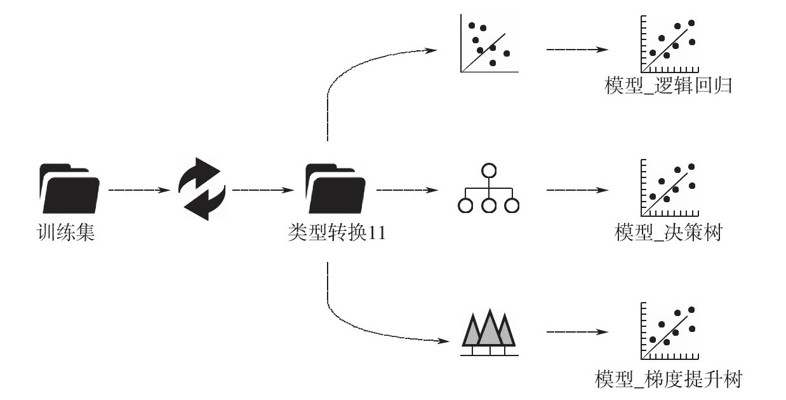

更具体而言，在做任何架构决策前应明确手头问题，因机器学习方法选择应适配研究问题。首先需判断该问题属于判别任务还是生成任务领域。基于建模任务，下一步是设计合适模型架构。

此步包括选择合适算法并为超参数设置合理初值。对判别任务，支持向量机、随机森林与人工神经网络是最常用算法。生成任务可使用深层信念网络、生成对抗网络、变分自动编码器与自动编码器等。总体而言神经网络是首选，因其具泛化与近似任意输入输出关系函数的能力。超参数随算法而异。神经网络结构参数包括神经元与层数选择、学习率与衰减、正则化参数以及层间连接。

确定临时架构后，准备数据集。初始数据代表性、质量与数量对 AI 模型质量至关重要。架构与数据集建立后即可开展模型训练与评估。

训练旨在搜索使预测误差最小化的参数集。最终 AI 模型应能表达分子表征，发现特定目的间潜在关联。若不能，检查具体示例有助于开发者构建新模型“生态系统”以达目标。

### （2）输入数据准备
AI 方法在新药发现中的应用倾向于通过部署最新方法改善整体性能。首先聚焦训练数据更具帮助，因其是基础。无论选择何种模型，高质量数据通常泛化更好。然而数据准备任务量大且繁琐。

开发者需了解训练数据来源与意义，如所表示实体类型与复杂度、数据量，以及更具体地在化学空间中的分布。总体问题是如何更好地填充可能的输入空间。若需更多数据，需决定预处理策略、未标记数据是否足够、哪种表示最适合编码所代表实体等。需注意并无普适规则。

在新药发现中，药物化学领域构建 AI 模型的输入 x 或输出 y 数据类型。主要输入是固定长度输入向量。该表示存在两大局限。向量往往很大，可编码所有可能子结构而无碰撞，导致模型参数过多，试图从稀疏输入中学习。相似性评估在高维化学空间易出错。为缓解此问题，人们利用可微神经网络计算输入的分子结构图，提出各类指纹图谱。

另一局限是难以建立输入向量与分子结构间一一对应，输入向量可从分子结构易生成，但反向推导极难，尤其当单一指纹对应多种化学结构时。

规避此限制的方法是使用 AI 深度生成模型作为分子表示。近年该组合已被广泛研究以产生具预期特性的新化合物。此情形下输出为字符串或指纹向量。大多数 AI 辅助药物发现项目的输出为数值、二元值对应二元分类、整数值对应多类分类，以及回归任务中的实值数字，通常为实验生化数据。

应特别关注初始数据代表性与基数。若数据集规模无法代表底层潜在任务，训练常导致过拟合与条件不良的平均误差，增加模型无法泛化到新数据的风险。

首先确认训练集性能是否有效，若不可接受，所选架构很可能不可行。若调整或尝试其他架构后仍无改善，则需考虑训练数据质量，检查训练分布是否平衡、输入输出对应是否逻辑。

若训练集性能可接受，则检验测试集性能。若训练与测试性能差距不可接受，收集更多数据是最有效方案之一。此时需权衡收集更多数据与以其他方式提升测试性能的相对成本，以及实现显著提升所需的预计数据量。

## 模型训练与泛化
对输入数据进行特征分层，以不同比例重训模型以获得通用性与稳定性，这是一种有用训练，最好以相对实惠成本收集更多高质量原始数据。高质量数据集收集往往成本高昂且难度大，这在生物数据新药发现中常见。

训练集可通过生成人工数据点，或使用多任务或迁移学习程序来丰富模型对相关数据的见解。模型可通过超参数优化、合并正则化，或采用更专门神经网络架构来改进，视任务目标而定。

若测试集性能仍远差于训练集，即使调整正则化超参数也无法收集更多训练数据，最简单方法可能是改进学习算法本身。再次强调初始训练数据不仅数量足够，质量也应足够。然而目前新药发现领域数据质量不佳，数量也不够大。

假设有 10000 个值可用，与用于构建视觉模型的大量信息相比，该数据量也近乎微小。高通量筛选生成的数据库常活性与非活性化合物不平衡，此时特定数据采样技术可用于平衡建模中的活性分布。

实际上数据集不完整且含错误。众所周知大多数药物具有多个生物靶点与活性，患者个体基因谱亦存在差异。这意味着在药物设计领域，因未知贡献因素与多对多非线性关系，我们面临大量难题。

标签噪声的半监督修正思路

在资料缺口的情形下，系统容易把缺乏实验佐证的分子直接归入无活性集合并标记为“非活性”。这类标注噪声可借助半监督思路来平抑。训练时把已确认的活性样本与未标注样本共同纳入，通过引导学习或噪声鲁棒型神经网络来估计既有标签出错的概率，再依据该概率对样本赋予差异化权重进行校正（图 4-3）。

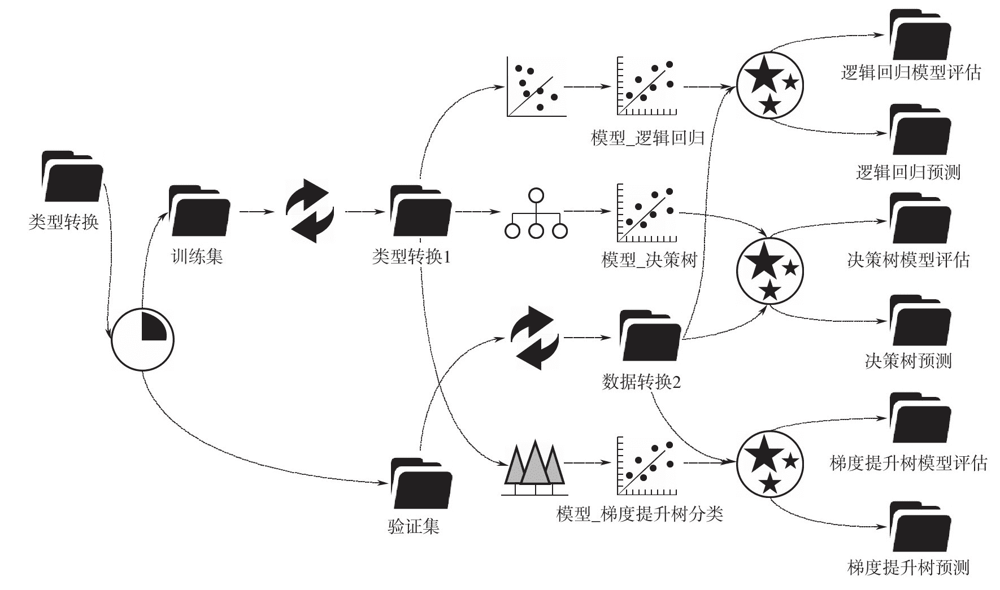

图 4-3　模型评估

## 应用实践

### (3) 应用实践

Michael Menden 团队把 77 个基因的突变谱与 608 个细胞系的 QSAR 特征拼接，构建半数抑制浓度预测模型。QSAR 特征用于刻画小分子的理化特性。训练集包含 38 930 条药物-细胞系配对，测试集 13 565 条。

单模型分别以神经网络与随机森林训练，训练集上实测与预测的吻合度约 0.72，测试集决定系数约 0.64。决定系数落在 0 到 1 之间，表征预测序列与真实值的匹配程度，1 为完美，0 为无关。通常训练集 ≥0.7 视为可接受，测试集 ≥0.6 具备预测价值。

经 8 倍交叉验证与独立盲测，IC50 的决定系数分别为 0.72 与 0.64。该类计算系统可优化药物-细胞筛选的实验设计，用计算替代大量实测估算未知 IC50，效用类似虚拟筛选：成千上万种药物可被系统评估潜在药理作用，并最终把个体基因组特征与药物敏感性关联以指导个体化用药。

模型以细胞系筛选数据训练机器学习预测药物敏感性。细胞系经梯度浓度处理后以 IC50 概括剂量-反应关系。癌细胞对药物的敏感性由细胞与药物的属性共同决定。细胞属性反映内部工作状态，药物属性涉及膜穿透、靶蛋白结合等理化性质。神经网络依据细胞基因组背景预测不同药物的 IC50。

已有大量基于化学性质预测全细胞活性的定量构效关系研究，但仅靠化学特征无法区分耐药与敏感细胞系。

该学习系统除引入细胞分子特征外，还把药物化学特征作为输入。双流融合既整合互补信息，又显著扩大可训练数据规模，是提升精度的关键。输入空间由 689 个药物化学描述符与 138 个细胞系基因组特征构成，共 827 维。

模型借助细胞系基因组信息与药物化学信息，用非参数学习算法推断缺失的 IC50。部分药物在宽浓度区间均有活性，系统能在更大动态范围保持相近精度。得益于化学描述符，多药物模型的训练数据量比单药物模型大约两个数量级。

当前模型尚未覆盖所有已知药物相关基因，随着药物敏感性与基因组数据持续扩增，预测力会提升。另一拓展方向是加入给药后的基因表达数据，这是一种强电子资源，可用于预测治疗结局、解析化合物作用模式并发现新老药再利用机会。表观遗传数据也有望进一步提升未来方法的性能。

与已知先验基因与蛋白网络联合时，转录谱对药物反应与作用模式的预测明显增强，并可据计算得到的冲击通路推断药物相似性。已知基因与转录数据间的调控关系可用于识别调控通路并联系其驱动的基因组，凸显子网络在药物反应中的作用。

系统可按输入特征对最终模型结果的贡献度排序，结合集成特征选择与降维技术能明确揭示特征与结果的关联。在建模层面，神经网络与随机森林是常用方法，因其灵活性而具有广泛应用前景。

不同数据稀疏度下的预测精度为设计需在覆盖率与精度间权衡的实验提供了实用参考。模型还能对尚未筛选的细胞系进行 IC50 预测，帮助判断是否值得扩大细胞系范围或聚焦少数精选系。这已超出优化筛选实验设计的范畴。模型建立后，可基于化学特征与相似性系统评估新药潜在作用，帮助评价新药活性，对已获批药物则可能揭示再利用机会，并识别对反应最敏感的疾病亚型。尽管细胞系不能完全复制真实肿瘤，但结合扩大的基因组与表观基因组数据，该预测框架有助于开发针对个体的定制化治疗策略。

## 4.6 应用实践

进入临床前的候选分子需具备活性、选择性与合适理化性质，以便后期展现理想的 ADMET 特性。药物发现与开发需经历多阶段优化，人工智能在分子设计、虚拟筛选、先导优化、性质预测、结构优化与临床前研究等环节发挥重要作用，前述章节已论述。此处列举若干代表性案例。

### (1) 筛选 Abl 阻断剂

Abl 激酶通过调控形态发生与运动性，并经由 Bcr-Abl 调控的 Src 家族激酶、PI3K、Ras、Myc、c-jun 与 STAT 通路激活促进细胞增殖与存活，在肿瘤中起关键作用。Abl 阻断剂在白血病等癌症临床试验中有效。耐药性的出现推动了新阻断剂的研发。

常见突变体的活性对多数阻断剂而言可忽略，在晚期癌症中仅见有限影响。部分患者出现与 Abl 激酶结构域突变相关的耐药。目前已有药效团、QSAR、支架组装、分子对接等计算方法用于 Abl 阻断剂的发现与设计。

这些方法识别潜在阻断剂的能力可观，但受限于化学空间的广度与稀疏性、靶标结构复杂性与柔性、结合亲和力与溶剂化效应估计的难度以及训练活性化合物的多样性不足。因此需要补充不依赖靶标柔性、亲和力与溶剂化建模的方法，以扩大化学空间覆盖、加快筛选并降低误报。

基于配体的虚拟筛选方法支持向量机，可从大型库中搜寻单一或多个活性物质，表现出高命中率与低误判率，能识别结构类型不同的活性骨架。

由稀疏活性化合物训练的支持向量机也能获得良好的可视筛选表现。其分类依据为区分活性与非活性以及活性化合物自身结构相似性，不依赖结构柔性、活性相关特征、结合亲和力与溶剂化效应的精确计算。此外 SVM 的快速与可扩展性使其能有效搜索巨大化学空间。

新加坡国立大学生物信息学与药物设计实验室将 SVM 应用于从大型化合物库中搜寻 Abl 阻断剂的虚拟筛选工具。5 折交叉验证中，模型以 708 个阻断剂与 65,494 个假定非阻断剂训练测试，阻断剂识别率 84.4%~92.3%，非阻断剂识别率 99.96%~99.99%。与使用相同数据与描述符的另一机器学习方法相比，SVM 准确率更高、假阳性更低，说明其可从大型库中搜寻 Abl 阻断剂。

团队开发了用于识别 Abl 阻断剂的 SVM 模型，并通过 5 折交叉验证与大型数据库筛选实验评估性能。5 折测试中，阻断剂与非阻断剂数据随机划分为 5 个大致相等子集，4 份训练、1 份测试，循环 5 次取平均。数据库筛选测试中，使用既往发表的 Abl 阻断剂评估准确性，且该阻断剂未纳入训练集，并与 PubChem 与 MDDR 库中结构与理化性质相似的化合物比对，以评估大规模文库的虚拟命中与假命中率。

PubChem 与 MDDR 含大量与 Abl 阻断剂明显不同的非活性化合物，易区分特征可被可视筛选良好呈现。尽管部分化合物具有激酶抑制活性或与已知 Abl 阻断剂相似，使用这些及理化性质相近的化合物可更严格检验筛选性能，使富集不仅是简单理化特征分离。为评估 SVM 是否预测阻断剂而非化合物家族成员身份，团队还分析了预测活性与非活性的化合物在家族中的分布。

#### 1) 数据集的收集和构建

从 Pubmed 与 BindingDB 共收集 708 个 Abl 阻断剂，IC50 < 50 μmol/L。该阈值覆盖了大部分报道的先导分子。因非阻断剂报道稀少，假定非阻断剂通过上述方法生成。

收集的阻断剂分布于 221 个家族。鉴于在 PubChem 与 MDDR 中寻找激酶阻断剂的广泛努力，未发现的 Abl 阻断剂家族数量预计有限，很可能不超过数百个。

假定非阻断剂训练集可通过从各家族提取不含已知阻断剂的代表性化合物生成，最大误判分类率 <15%，即使所有未发现阻断剂均不属于非阻断剂类。15% 错误阴性家族带来的噪声远小于 SVM 可容忍的最大 50% 假阴性噪声。在假定非阻断剂家族中，未被发现的阻断剂仍可被归类为阻断剂，即使其家族代表被划入非阻断剂训练集。

数据库筛选测试中，50% 的结构家族包含已报道 Abl 阻断剂，其代表性化合物被有意置于非活性训练集，假设其生物活性未知。这些错位家族中的大量阻断剂仍被 SVM 可视筛选工具预测为阻断剂。此外，这些假定非阻断剂集中有一小部分可能为未报道或未发现的阻断剂，其存在对假命中率估计影响有限。

#### 2) 分子描述符

分子描述符是对结构与理化特征的定量表达，已广泛用于 QSAR 与可视筛选。所有描述符以最佳形式覆盖化学空间。包括简单分子性质 18 个、化学性质类 3 个、电拓扑状态类 42 个、分子连通与形状类 35 个。

前三类非冗余。第四类部分描述符数学表达不同但在拓扑特征描述上存在重叠，如舒尔茨分子拓扑指数、古特曼分子拓扑指数、维纳指数、哈拉里指数与引力拓扑指数。拓扑描述符的重叠对 SVM 分类影响不大，因 SVM 对描述符冗余惩罚较小。

#### 3) 支持向量机方法

SVM 基于统计学习结构风险最小化原则，分类性能突出，受样本冗余惩罚小，过拟合风险低。

线性可分时，SVM 构建最大间隔超平面分离活性与非活性类。化合物由分子描述符向量 xi 表示，模型寻找向量 w 与参数 b 使 |w| 最小化并满足约束。

开发该可视筛选工具时采用硬间隔，σ 值 0.06。性能指标来自真阳、真阴、假阳、假阴数量。

概率神经网络架构由训练集化合物与描述符数量决定，共四层。输入层为模式层提供输入，神经元数等于描述符数。模式神经元数等于训练化合物总数。每个模式神经元计算输入与所代表训练样本的距离并交予非参数估计器。总和层每类一个神经元，对对应类成员的模式神经元输出求和，得到类概率密度估计。输出层单神经元通过比较各求和神经元的概率密度并选择最高者估计未知化合物 x 的类别。

从 MDDR 数据库的 659 个 SVM 虚拟命中中，20% 通过分子对接筛选，其中 128 个属于酪氨酸特异性蛋白激酶阻断剂类，提示一致性方法可富集真实命中。

许多 SVM 虚拟命中为抗肿瘤化合物，可抑制酪氨酸激酶及参与信号转导、血管生成等癌症相关途径的其他激酶。尽管这些激酶阻断剂可能是真正的 Abl 阻断剂，但多数预计为来自其他激酶阻断剂的错误选择。

98 个虚拟命中序列属于抗关节炎类。Abl 阻断剂格列卫对关节炎治疗有效，可能归因于其抑制 c-kit 与 PDGFR 等相关激酶。其他激酶也与关节炎相关。EGFR 样受体刺激滑膜细胞，其活性升高可能参与类风湿性关节炎发病。VEGF 与系统性红斑狼疮、类风湿性关节炎与多发性硬化等自身免疫病相关。FGFR 可能部分介导骨关节炎。PDGF 样因子刺激类风湿滑膜结缔组织细胞增殖与侵袭性表型。因此抗关节炎类中的部分 SVM 虚拟命中可能是这些激酶或其产生抗关节炎活性的激酶样物的阻断剂。

分析已识别阻断剂与非阻断剂的家族分布，19.6% 的已鉴定阻断剂属于不含已知 Abl 阻断剂的家族。对于含至少一个已知阻断剂的家族，每个家族中 >70% 的化合物被 SVM 预测为非阻断剂。结果表明基于 SVM 的可视筛选可识别 Abl 阻断剂而不局限于特定家族。部分确定阻断剂不属于已知阻断剂家族，可能作为潜在新型 Abl 阻断剂。SVM 具有从稀疏活性数据集中识别新活性化合物的能力。

### (2) 5-HT1A 激动剂

DSP-1181 被报道为首个完全由人工智能设计并进入临床试验的 AI 候选药物，由 Exscientia 与住友制药合作开发。DSP-1181 为长效 5-HT1A 激动剂，主要用于强迫症治疗，从初筛到临床前完成耗时不足一年，体现 AI 助力研发效率。项目成功得益于 Exscientia 的 AI 药物研发技术与住友制药在 G 蛋白偶联受体药物研发的优势，双方仍在推进。

### (3) 英矽智能的多平台落地

英矽智能是一家以端到端人工智能驱动的临床阶段生物医药公司，已构建三款 AI 研发平台，覆盖新药研发全流程，包括靶点发现平台 PandaOmics、化合物设计生成平台 Chemistry42 与临床试验预测平台 InClinico。成立数年间已助力多个创新药研发。

2019 年团队报道利用深度学习模型生成式张量强化学习 GENTRL，21 天内筛选 3 万个化合物，发现 6 个 DDR1 激酶阻断剂，其中一化合物在小鼠体内显示良好药代动力学。抗特发性肺纤维化项目 INS018055 是更成功的案例，从靶点发现到候选筛选均用 AI 完成，目前处于临床 II 期，是 AI 助力全新机制抗特发性肺纤维化药物研发的典型案例。研发周期仅 18 个月，费用约 200 万美元，证明 AI 加速研发。

近期英矽智能报道利用 AlphaFold 实现 CDK20 激酶阻断剂的快速研发，结合 AlphaFold2 与 PandaOmics、Chemistry42，30 天内完成靶点筛选、化合物设计、合成与活性测试，7 个合成物中 ISM042-2-001 显示良好 CDK20 抑制活性。继而 30 天内完成第二轮 AI 优化，最终获得候选化合物 ISM042-2-048。

# 第 5 章 人工智能辅助药物治疗

人工智能在药物治疗中最常见的应用是为患者匹配最佳药物或组合、预测药物-靶点或药物-药物相互作用并优化治疗方案。为患者选择最佳药物通常需整合遗传学、蛋白质组学等患者数据与药物数据以评价疗效。药物相互作用预测常依赖相似度指标，假设结构或靶点相似的药物效果相近，可能相互干扰。

个性化医疗时代已开启。基因组学快速发展为个体化诊疗提供大量与疾病、组织、动物与细胞系相关的基因组与转录组数据。同时数以千计的定量构效关系描述符与分子指纹被开发用于药物分子的定量与分类表征。研究人员利用新计算方法与数据开发引擎，帮助预测患者特异性治疗、优化剂量与用药计划，提高康复可能性与生活质量。

## 人工智能在药物治疗中的应用

人工智能在药物治疗中的目的是将数据压缩到医生可解释的规模，让临床医生获得此前难以考虑的信息，且辅助医疗行为需足够透明、易懂。遗憾的是简化通常以降低预测能力为代价。基于 AI 的决策支持方案准确性更高但透明度更低。人们对黑箱模型感到焦虑，因其决策过程难以被患者理解，若证明成功且患者生存率提升，压力或可缓解。因此必须进行广泛试验以证明医学黑箱模型的预测能力，因这类软件通常缺乏可解释性。

真正落地到临床之前，模型必须用患者预后得到实质性改善来证明自己的价值。深度学习一旦被广泛用于方案选择和药物治疗优化，系统的黑箱特性只会愈发明显。我们或许需要培养一种类似亲子间的信任，对机器的决策和建议给予恰当的依赖。

深度学习在计算机视觉、机器人、游戏与自然语言理解等赛道已完成范式级改写，如今正高速渗透基因组、疾病诊断与计算化学领域。其本质是一组擅长从海量样本中挖掘复杂关联的通用技术。当前的新一代神经网络在预测多样分子属性上已经超越既有基准，但受限于训练样本不足，实际使用仍多停留在单一分子层面。

癌症与药物研发早期的机器学习探索，往往只锁定单一基因组图谱。2012 年，药效学联盟发起了一项整合多组学数据的药物敏感性竞赛。44 套 AI 方案同台竞技，领先者集中在贝叶斯多任务多核学习和集成策略。随后另一场公开比拼里，31 种建模方法竞争预测药物对活性。虽然整体都优于随机猜测，却没有哪一套逼近理想水平。两个挑战均以排序为评价标准，因而难以直接对标实验室结果，且样本量偏小，分别是 29 对和 91 对单药配对，现实参考价值有限。

要为患者找到理想疗法，就必须把来自个体的全维医疗信息，比如基因组或蛋白质组数据，和刻画药物特性的描述符结合起来，往往还离不开药物与蛋白质、DNA、RNA、miRNA 等生物分子间相互作用的预测。对复杂常见病而言，这类系统化临床应用离不开多种方法协同。

预测药物靶点相互作用只是单药优化拼图的一部分，却不可或缺。它关系到老药新用、创新药发现，以及信号通路和代谢网络的理解。现有药物新用途的挖掘，常用到经 AI 解析的基因、转录组和不良反应数据。

目前该方向主要依赖两条人工智能分支。一条是基于网络理论，把描述药物作用蛋白网络的表征作为输入；另一条是经典机器学习，以支持向量机为代表，构建依托药物化学结构与治疗相似性指数的模型，用来挖掘新颖且意外的药物-靶点配对。支持向量机的思路是在多维空间中寻找分类面，以解析变量间的直接关联。

基于药物相似性推断、基于靶点相似性推断，以及基于二部图网络的推理，共同构成网络推理范式，用来预测未知的药物靶点配对。实践表明网络推理在后续验证中具备最强潜力。其流程先对输入的药物结构相似性、蛋白靶点序列相似性，以及输出的药物-靶点相互作用网络拓扑进行相关性探查，用于评估预测质量；随后利用结构相似性和序列相似性特征预测未知配对，常用方法包括轮廓法、加权轮廓法和二部图学习等独立统计手段。

把与疾病相关的遗传或蛋白质组学数据与化学信息如 QSAR 描述符融合，就能搭建面向肿瘤决策支持的联合用药预测引擎，判断药对是否协同。将整合模型迁移到独立药对集上，差异表达基因的贡献分析显示，药代动力学属性在协同预测上优于物理化学或靶点网络属性，而表现最优的系统得益于全球系统生物学数据的支撑，获得了更完整的图景。

### 5.1 临床研究
新药研发中临床试验是决定性环节。即便在获批人体试验前，药物的有效性和安全性已在实验室和动物模型中完成系统论证，进入人体后其真实活性和安全性仍存在大量不确定性。据统计，I、II、III 期开发中约有 33.6% 至 52.4% 的研究无法进入下一阶段。

受试者招募是试验启动的前提。近几年国内临床试验数量快速增长，入组标准也日益细化，在严格的时间窗内能否招到合格受试者，极大制约试验进度与结果，招募延迟已成为试验推迟的首要因素。试验对招募资格、匹配度、参与意愿和授权都有明确要求，AI 可以对患者档案进行识别并与试验条件自动筛选匹配，大幅提升效率。2020 年的一项对比研究用 Mendel.AI 复现了 3 项已完成的肿瘤试验的预筛选流程，在保持准确率的前提下，AI 能挖掘出更多潜在合格者，且筛选耗时从数十天压缩到数小时。心力衰竭器械公司 Ancora Heart 与数字健康公司 Egnite 的战略合作，正是看中后者 AI 试验加速器在精准识别符合条件的患者方面的能力，进一步印证了该方向的可信度。AI 还能主动爬取公开的试验数据库、公告和社交媒体，自动建立患者与试验的潜在匹配，提升可及性。

临床试验并非在普通人群中随机验证疗效，而是通过富集策略前瞻性地挑选更易显示疗效的亚群。FDA 认可的富集手段包括：降低人群异质性、挑选更易出现可测量终点的患者即预后富集、识别对治疗更敏感的人群即预测富集。AI 还用于参与者分层，例如在受试前预测严重不良事件概率，据此进行差异化监测或排除高风险个体。

完成招募、筛选与分组只是开始，只有受试者在全程保持依从并稳定采集数据，试验才能产生投资回报。仅约 15% 的试验未出现受试者脱落，脱落会导致二次招募并推高成本。脱落原因涵盖个体、环境、用药、研究者及流程等多方面。AI 可联合可穿戴设备构建节能、移动、实时、个性化的监测体系，传感器和视频能自动连续采集数据减轻患者负担。AI 还能动态预测个体脱落风险，通过捕捉依从性下降的早期信号，团队可提前介入沟通并解决问题。

AI 对方案设计本身也有助益。它可描述并预测给药后的药代动力学特征，从而优化剂量与给药频率，在罕见病、儿童和孕妇等数据稀缺人群中优势更明显。2023 年 5 月 10 日，FDA 发布《药物与生物制品研发中使用人工智能和机器学习的讨论性报告》，提到 AI 还可用于试验点选择、数据采集管理分析、临床终点评估等环节。

药物警戒关乎不良反应及其他与药物相关问题的发现、评估、理解与预防。上市前研究受时间限制，罕见不良反应、长期毒性及特殊人群表现往往难以穷尽，因而上市后监测至关重要。个例安全性报告是向监管部门上报不良事件的核心数据源，其来源和复杂度持续攀升，包括自发报告、临床试验、社交媒体、电话、邮件、主动登记和索赔数据等。人工处理费时费力，AI 在数据提取后可判断报告有效性、排序优先级、去重并进行编码分类。

典型实践是 FDA 药品审评与研究中心监督与流行病学办公室开发的信息可视化平台 InfoViP。该平台融合自然语言处理、机器学习与高级可视化，可自动扫描 ICSR 并提取临床信息，便于审评；还能评估不良事件与药物的因果关系并分级，使审评员优先处理高质量报告。其基于 NLP 的去重算法可大规模比对 ICSR 数据点，自动识别重复并提交确认。

### 5.2 联合治疗
联合用药对复杂疾病尤为有效。不同药物的协同可对抗耐药菌株和肿瘤，因其能在多层面攻击病理过程，但也可能带来毒性叠加。随着药物数量膨胀，组合数呈爆炸式增长，需要计算方法筛选毒性最低且最优的组合。基于 AI 的模型已被用于预测传染病和癌症等多种疾病的协同药对，非疾病特异性的预测因子也在发展，输入、输出与架构各异。

联合用药自 20 世纪 60 年代起用于抗癌，多数情况下优于单药，可克服固有耐药、延缓获得性耐药，同时通过剂量协同降低毒性。但新组合的发现极其复杂，传统上高度依赖医生临床经验，分子数据利用不足。

尽管潜在组合空间庞大，体外高通量筛选提供了可行路径。两两组合数量指数级增长，穷举不可行，数据驱动的发现是必然方向。已有大量工作尝试用机器学习预测抗癌药物的最佳协同配对。

AI 辅助的联用选择也在 HIV 治疗中得到应用。病毒蛋白酶和逆转录酶的耐药突变不断产生，迫使患者调整方案以控制病毒载量并降低毒性负荷。基于机器学习的计算方法可分析蛋白变化，人工神经网络、随机森林和支持向量机可依据病毒突变数据及临床生物标志物预测用药后的病毒学反应，准确性用 r² 衡量。

将基于规则系统的输出作为逻辑回归模型的输入，其表现可与纯机器方法对比。精度提升与模型中规则部分密切相关，脱离规则后表现与逻辑回归相近。总体上机器学习在预测精度上优于基于规则系统，支持用这种不透明方法压缩复杂生物数据的维度，为医生提供辅助决策建议。

预测特定癌症对治疗的反应是肿瘤个体化治疗的核心。通过研究基因组异质性癌细胞系对潜在化合物的活性，可揭示基因组改变与药物反应的关联。哈佛医学院 Michael Menden 等人构建机器学习模型预测细胞系对药物的反应，以半数抑制浓度量化细胞系基因组特征与药物化学特性。

### 5.3 评估药物反应
机器学习为量化肿瘤药物反应提供了协同高效的路径。既往研究多聚焦经典机器学习下的单药筛选数据，而大规模数据库的开放使深度神经网络系统建模成为可能。

模型在预测细胞系增殖和协同药对排序上已有不错表现，但仍有提升空间。加入更多细胞系后，分子特征的贡献可能进一步放大；药物浓度是被低估的信息源。未来需将多项单药筛选研究整合为统一的剂量反应预测框架，肿瘤类型和作用机制等辅助属性也可作为多任务模型的辅助目标。为了评估泛化能力，需要更系统的交叉验证来检验对新药、新细胞系和跨研究数据的预测力。

癌症的复杂性体现在单个肿瘤可累积上亿突变并导致耐药。联合疗法旨在同时作用于多个靶点，虽有部分组合基于细胞生物学知识，但多数相互作用机制仍未知。

机器学习模型的重要用途是高通量虚拟筛选。准确的模型可在推理模式下作为计算工具，降低实验成本。展望方向包括纳入更多药物特征如浓度、分子图卷积与原子卷积，采用更全面的计算描述符与指纹以扩大数据点，引入半监督学习编码分子特征与外部基因表达数据，探索先进网络架构并进行可扩展的超参数优化。

当前预测方法的主要痛点是推理不透明，难以指导治疗决策。机器学习往往在提升性能的同时牺牲可解释性。识别高协同组合固然重要，理解模型为何给出该预测同样关键。

应用实践一，芝加哥大学计算研究所基于真实对接筛选的最佳组合评分，为每个细胞系列出前 100 对药物对，汇总后按频率排序，前 10 个最有希望的组合与模型推断的生长分数预测结果对比，重合度达 90%。在此基础上构建了一个两阶段深度神经网络，用于预测药对反应，支持多种肿瘤特征并可扩展到三药及以上联合，性能良好且不存在对细胞系或药对的明显偏倚。特征实验显示模型并非记忆组合，药物描述符使 r² 提升 0.81。该回归模型预测连续值，正值为协同，负值为拮抗。输入包括 104 种药物的 QSAR 描述符与分子指纹，以及基因表达微阵列、miRNA 表达谱和 NCI-60 蛋白丰度。模型以均方误差、平均绝对误差和 r² 衡量精度，整合多源数据后效果最佳。药物化学描述符的贡献显著高于细胞系描述符。仅用基因表达与热编码药物名称时 r² 为 0.1272，加入化学描述符后跃升至 0.9005；加入蛋白浓度、表达水平与 RNA 表达后仅小幅提升至 0.9208。这表明化学信息对预测能力至关重要，同时也提示热编码可能比化学特征更能代表细胞系特性。

应用实践二，华盛顿大学计算科学工程中心基于极端梯度提升树构建模型预测协同得分，使用 8846 个特征覆盖细胞系基因表达、QSAR 描述符与分子指纹等，经树模型特征排序后发现仅用前 1000 个特征即可几乎不损失性能。排名前 100 的特征中仅 17 个来自基因表达，其余多为药物相关特征。由于计算规模差异，该模型未提供可直接对比的 r²，但相关性较高，支持该建模思路的实用性。协同预测明显更依赖药物特征、化学描述符、相似性指标和相互作用网络，而非患者特征和基因谱。

### 5.4 药物-药物相互作用
讨论联合治疗决策支持时，药物-药物相互作用不可回避。预测模型中的 DDI 信息对用药选择与给药至关重要，可减少不良反应并提升剂量效率。随着老年人口增加和复杂疾病多药并用风险上升，预测 DDI 的临床需求日益紧迫。

患者并用药物概率随年龄增长而上升，因共病数量增加。复杂疾病常需多靶点方案，因此必须建立临床可用的 DDI 预测方法，以避免多药治疗对健康产生负面影响。

AI 正重塑药物安全与精准诊疗

在新药获批链条里，药物配伍风险本就被列入审查清单，但可组合的药品数量庞大，相当一部分相互作用直到临床阶段才被发现。目前仍缺一套通用的先验预测标准，不过业界普遍认为必须建立并推广某种可用的预测路径。基于人工智能的建模正被寄望于从生物学、化学和药代动力学信息中提前识别配伍风险，推动预测能力向临床验证迈进。

机器学习预测配伍通常的做法是衡量两个分子的靶点、通路与结构相似度。随着新结构不断加入，不确定性激增且计算量呈指数级攀升，因此专门针对三种及以上药物组合的研究非常少。

衡量预测能力的常用指标存在局限，对类别分布偏斜的二分类任务尤其具有误导性。基于药物银行与双药银行的配伍数据，随机森林的识别表现最好。此类方法的短板在于它更依赖语义与拓扑信息，而非纯粹的定量 QSAR 描述符。

范德堡大学生物医学信息中心的团队借助朴素贝叶斯和逻辑回归，融合了表型、治疗、基因组和结构相似性等与药物组合相关的多源数据，构建了机器预测模型。朴素贝叶斯通过各类别的概率分布给出最可能类别。精度会随核函数类型的选择而波动。该方法通过估算两节点间存在连边的概率，结合描述网络相似性的拓扑指数，以及刻画治疗、化学、结构、副作用与文本分类相似性的语义特征。相对简单易用，但精度提升常伴随操作透明度下降的趋势。目前这已是药物组合预测的最佳水平，也进一步印证了协同效应预测更倚重药物本身数据而非患者个体数据。

5.5 剂量与给药时机管控
精准控制剂量和给药时机是实现个体化方案的关键。理想的给药应让体内药物浓度稳定地维持在最低有效浓度之上、最低毒性浓度之下，学界称之为零阶释放。计算模型被用来刻画接近零阶释放的释放过程，以提升疗效并降低副作用。

在真实临床中，实时传感器与软件联用可监测并优化试验药物的药代动力学特征，从而指导剂量和给药时机。部分模型专门模拟药物与各类转运体、膜结构的相互作用，涉及吸收、分布、代谢、排泄与毒性，从而解释机体对药物的反应。构建一套系统的特征筛选与参数优化流程，能显著改善 ADMET 预测的机器学习性能。

华西医学院生物治疗实验室的研究人员用遗传算法做特征筛选，结合共轭梯度法优化参数，搭建了四种药代动力学相关模型的支持向量机架构。共轭梯度法通过迭代寻找使误差下降最快的方向，直至逼近最小误差。遗传算法为每个特征向量打分，依据其对问题的信息贡献度，将高分特征与其他特征交叉配对，反复迭代直至精度不再提升，最终得到可达最小误差的参数权重集。这一特征选择与参数优化组合在构建 SVM 模型时表现出色。

应用 SVM 架构预测药代动力学特性，并引入上述优化手段，可带来明显收益。多个案例中最佳准确率都源于这些技术，但部分提升可能受预测类别严重失衡影响。若某个类别样本远多于另一个，准确率往往偏向多数类。可采用抗偏倚指标来验证模型独立于类别失衡的能力，也可用合成少数类过采样等技术矫正。

长期来看，精确预测肿瘤体积或疾病对药物的动态反应，对最大化疗效、减少不必要毒性至关重要，这要求把疾病进展看作药物敏感性、剂量和给药时机的函数。

### （1）应用实践一
蒙特利尔大学新药中心研发了一款循环神经网络，用于预测疾病的时间演变，名为循环边缘结构网络。该数学模型关联肿瘤体积与前一时点的大小，并纳入四个系数：①肿瘤生长速率；②辐射剂量、敏感性与暴露时间；③化疗剂量与敏感性；④偏倚项。目标是验证无偏的治疗反应预测与多步前瞻性能，以评估给药时间与剂量的影响。与多种基准及前沿方法对比，该模型均方根误差最低，显示其能随治疗变化实时调整且误差累积可忽略。按均方根误差衡量，其预测性能比传统方法高约 80.9%，比最先进的贝叶斯方法高约 66.1%。模型分两步：先编码患者当前疾病状态的表征，再用解码器推算特定给药方案在一段时间内治疗反应。

### （2）应用实践二
里昂大学药物研究实验室以蒙特卡罗树搜索启发的策略，构建替莫唑胺剂量与给药时机优化模型以缩小肿瘤。用药代和药效数据刻画替莫唑胺，以绝对中性粒细胞计数的最低点和骨髓抑制等生理指标描述毒性。基于这些技术与数据设计的方案，预测平均肿瘤收缩约 7.66 倍，95% 置信区间 7.36～7.97。该模型尚未在真实患者中验证，仍需建立体内试验转化路径。

5.6 辅助诊疗决策
在复杂疾病中，很多患者需要全新的治疗方案，人工智能作为药物方案选择与管理的辅助手段显得尤为必要。现代医学对疫苗、抗生素等普适性技术取得巨大成功，这些手段在不同患者间调整有限。精准个性化用药旨在应对那些没有统一解法的遗留疾病。只有借助人工智能驱动的计算工具整合海量生物、化学与医学数据，才能更透彻地理解并对抗癌症等复杂病症。人工智能可充当治疗推荐的骨架，而当前也在开发针对每种疾病、每个患者的用药选择与给药细节的专用工具。

与数学近似类似，AI 模型在不大幅外推输出区间时最可靠。收窄分类或回归的输出范围与数量，有助于提高准确性。

数据与建模方法的复杂性往往让决策过程超出人工可解释范围，这在一定程度上不可避免，因为我们难以同时考量并整合每个患者相关的全部生物、化学与医学信息。若能做到这一点，就无须 AI。

疾病遗传学信息有助于医生推荐疗法并提升诊断精度。核心难题是判断基因组中的新变异是否具医学意义，这依赖突变致病性预测，已有研究使用蛋白质结构与进化保守性等特征训练学习算法。随着深度学习在多模态数据融合上的优势，其致病性预测准确度有望超越现有水平。

人工智能与机器学习几乎渗透药物治疗全流程。在诊断场景中，机器学习为医生提供特征选择、常见缺陷等预测建模思路，并展示普通与重症医学的历史案例，帮助实现更精准的病理学与预后评估。其前景在于提供强分析工具，扩展医生的判断边界。全基因组测序、移动生物识别流数据等技术的临床应用，可贯穿从科研发现到诊断再到治疗选择的整个护理链，使实践更高效便捷且个性化。

医生长期需识别、量化并解释变量关系以改善护理。人工智能与机器学习提供多种方法让计算机通过算法学习数据的有效表示。这里“人工智能”与“机器学习”常被互用，更精确地说机器学习是一组实现人工智能的技术。经典机器学习与经典统计学差异更多在意图与文化：统计侧重参数推断，机器学习侧重数据结构表征与预测分类。二者相互渗透，边界并不清晰，可解决不同问题。

神经网络训练依赖大量高质量数据，这带来数据共享的困境。个人层面，限制访问、匿名化或提供不完整数据可保护隐私与机密性；集体层面，完整数据共享更有利于整体健康。多个国家正以不同方式修订数据保护法规，国内外尚无统一的大数据采集与共享标准。鼓励患者参与数据采集与登记，有助于缓解其对保密与共享的焦虑。

临床使用 AI 还会改变医患关系。患者在充分知情下寻求帮助，医生在尊重中接纳个体。信任、知识、尊重与忠诚是关系基石，且对结局有实际影响。不良关系会显著损害健康。AI 必然以复杂预测的方式重塑医患互动，但必须以最佳患者护理为前提。

近期多家大型企业加大医学 AI 投入。谷歌旗下 DeepMind Health 与英国国家医疗服务体系合作，在伦敦多家医院部署 AI 解决方案，旨在改善住院患者救治缺口。IBM 子公司沃森健康也在医学 AI 领域深耕。肿瘤学报道显示，沃森对 93% 的乳腺癌病例建议与肿瘤委员会一致，至少在实验室条件下成立。

私营企业参与可加速 AI 进入临床，但需注意平衡。公私合作若仅让临床医生提供数据、私企主导算法开发，可能迫使医生被动使用工具。均衡的伙伴关系更易确保患者由受训医生照护并获得最佳技术。

医学 AI 兼具利弊，可远程使用，有望为发展中国家提供尖端诊断与预后工具，但必须确保最脆弱群体真正受益。医疗培训是部署关键，医生需建立对 AI 算法的正确认知以安全使用，深入理解算法需高级数学知识，专业医生未必需完全掌握，因此应讨论医学教育与继续教育的调整。

AI 在临床应用为医患开辟广阔空间，但在伦理、培训、法规与责任方面挑战仍在。需更新临床实践指南以涵盖机器学习算法使用，在保护数据同时支持研究。

基本原则应包括：临床研究中使用的医学 AI 算法需在多中心、双盲、随机、前瞻性研究中评估，并用外部验证集检验其在异质人群中的可重复性；研究者须具备医学与 AI 的双重资质；上市后性能需持续监测并及时报告不良事件。这些举措可确保 AI 安全发挥诊疗辅助作用。

5.7 诊疗影像分析
数字病理学中 AI 已用于多层次图像处理与分类，从低层级的目标聚焦识别到高层级的基于图像模式的诊断与疗效预后。与具体应用无关，AI 最初通过提取合适的图像表征，为分割、诊断或预测任务训练分类器。部分应用旨在自动化病理学家耗时工作，使其聚焦高级决策，尤其面对混杂特征明显的疾病表现。AI 还越来越多地帮助肿瘤学家，例如开发评估疾病严重程度与结局的预后分析，以及预测治疗反应的方法。

基于 AI 的方案为缓解病理与肿瘤学挑战提供起点，且具备稳健性与可重复性。研究显示其准确性可与资深病理学家媲美。

病理与肿瘤医生常借助专业知识创建手工特征机器学习模型，也可在无先验领域知识下构建算法模块。手工特征常针对特定癌种或组织，发现其难以广泛迁移。例如乳腺癌分级中，有丝分裂图通常被定性评估，而手工特征可量化其计数。手工特征也可领域无关，如组织亚视觉纹理异质性、细胞核形态与大小的量化，可跨疾病使用。

常用特征需能量化离散组织单元，如细胞核、淋巴细胞、腺体，或不同单元间的空间分布、排列与结构。这些基于特征的领域识别与手工方法已用于前列腺癌、乳腺癌、口咽癌与脑瘤的亚型诊断、分级、预后与疗效预测。

卷积神经网络在图像诊断中成果显著，因其在对象分类上达到人类水平，学习从图像中辨识对象。迁移学习使其在仅有少量医学图像时仍表现强劲：先在大规模无关数据上学习自然统计规律如线条、曲线、色彩，再在高层微调以区分病理病例。

对象检测与分割算法定位图像中特定区域。CNN 将图像作为输入，经一系列卷积与非线性变换后，将原始矩阵映射为类别概率分布。

目前深度学习模型在多项诊断任务达到医生水平，包括黑色素瘤痣识别、糖尿病视网膜病变与心血管风险筛查、眼底与 OCT 图像转诊、乳腺 X 线病变检测、MRI 脊柱分析等。单一模型亦可跨影像模态使用。但人类与算法对比研究显示临床背景很关键，算法仅限于图像诊断，而现实中医生可结合病史、健康记录、额外检查与患者自述，任务难度因此提升。

临床实践中，医生开始在易漏诊的急症影像中使用检测与分析，如在不可逆脑损伤前用放射学图像标记大动脉闭塞，或在千兆像素病理切片中定位病变。训练好的 CNN 可辅助检测有丝分裂细胞或肿瘤区域，并量化病理切片中 PD-L1 表达量，这对免疫治疗选择至关重要。

结合高分辨率分析，CNN 还能发现与生存相关的组织生物学特征。构建监督深度学习的主要瓶颈是足够大的标注数据集。小样本易过拟合，数据增强可助泛化；大而未标注的数据集虽易获取，需转向半监督与无监督方法。

自然语言处理聚焦文本与语音分析，递归神经网络擅长处理语言、语音与时间序列等顺序输入，在该领域作用突出。机器翻译、文本生成、图像描述等是其代表成功。医药研究中，序列深度学习与语言技术助力电子健康记录分析。

预测方面，多数工作仍依赖结构化数据的监督学习，如实验室结果、生命体征、诊断代码与人口统计。解释结构化与非结构化数据已推动无监督方法，如自动编码器先压缩再重建未标注数据学习表征。近期研究用 CNN 与 RNN 对患者记录中的结构化事件时间序列建模，以预测未来医疗事件。

下一代语音识别与信息抽取模型有望打造临床语音助手，准确转录问诊。医生常花费大量时间处理电子健康记录，导致倦怠并减少与患者交流，自动化转录可显著提升效率。

数字病理学指用全玻片扫描仪将组织切片数字化，并以计算方法分析全玻片图像 WSI。最初指扫描过程，现也涵盖基于 AI 的检测、分割、诊断与分析。

计算机工程师与数据科学家正推动病理与肿瘤学新影像分析方法，开发工具提升诊断准确性并寻找肿瘤学新生物标志物。病理与肿瘤医生是主要使用者。常规诊断基于形态特征的视觉识别、半定量整合与背景信息。经系统培训后，病理医生能快速提取形态模式进行分类，最终形成书面报告。标准化指南虽提升一致性，但主观性与观察者差异仍是局限。

癌症中基因组改变影响细胞信号与微环境，改变治疗反应，需高敏感方法同时评估多特征。多数生物学特征为连续变量，临床决策需简化为分类或离散变量。生物标志物开发常一维且定性，难以解释肿瘤细胞与组织网络的复杂信号。AI 驱动的苏木精-伊红染色后，多亚视觉形态计量特征自动提取受采样与肿瘤异质性限制，但可减少主观视觉偏差，整合多项测量以捕捉组织结构复杂性。这些病理特征可与影像、基因组学与病理学测量结合，提供更客观、多维且功能相关的输出。

随着深度学习等机器学习方法成熟，以及 GPU 算力持续提升，基于人工智能的大数据挖掘已在医学等多个领域成为常态。这种技术让对复杂多样的生物现象进行更客观的解析成为可能，而客观解析恰恰需要对研究结论的外推性给出审慎判断。倘若讨论仅建立在有限样本之上，很容易只见局部而难窥全貌。相比之下，借助人工智能进行海量数据分析，能够更全面、更少遗漏地呈现生物学规律，对推动医学进步具有重要意义。

已有研究用傅里叶变换红外光谱采集血清样本，结合深度学习模型，探索其区分健康人、过敏患者以及正在接受过敏原特异性免疫治疗患者的潜力。另有工作以贝叶斯网络构建了代表基因-基因互作的上皮-间充质转化网络，发现该网络在样本层面的边贡献模式与肺癌患者的生存相关，分析所用公开数据为癌症基因组图谱聚焦的肺腺癌。也有研究通过深度学习与传统机器学习的联合多组学分析，实现预后佳与预后差组的有效分层，并挖掘出与肺腺癌患者生存相关的基因。高桥等进一步整合深度学习与机器学习，对由 6 组 TCGA 多组学数据构成的肺癌队列按预后分层进行分类。

## 5.8　临床决策

临床决策的复杂性常被认知科学中的双过程理论所描述。该理论认为决策存在两条路径：一条是直觉式的，被视作下意识、非语言且相对自动；另一条是分析式的，被视作有意识、语言化且审慎。

面对复杂临床问题，即便训练背景一致的病理医生也常出现判断分歧，诊断一致性难以保证。根源在于多因素共存的有效解难以确定。同时，非侵入或微创取样方式的普及，使得可获得样本的体积与质量下降，病理工作难度加大。与此同时，对精细诊断的需求在提升，需要报告具预后或预测价值的指标。即使转向更客观的分子分析策略，技术限制仍常干扰疾病生物学驱动因素的明确判定。患者的个人偏好与报销考量同样会进入决策链，临床团队需审慎权衡。伴随诊断与用于指导治疗的生物标志物缺乏统一标准，其可变性进一步放大了问题，这种异质性也源于样本在空间和时间上的生物学差异。

理性、批判性思维、反思以及沟通能力等被医生所期待的特质，更多归属于分析路径。而与直觉路径相伴的认知与情绪偏差，若未被充分认识和管理，会对临床判断构成威胁。

人工智能或可成为临床决策的有力助手，特别是在多数国家的医学教育中，专门面向临床决策与问题解决的课程仍属稀缺。人工智能不仅能帮助医生展开推理，还可提升其对自身认知与情绪偏误的觉察。

除决策本身，人工智能在临床医学中的应用还引发了对医学本质的理论讨论。20 世纪在科学与技术推动下，医学被视作艺术与科学并存。循证医学虽被广泛接受，专家意见仍是重要补充。如今医学人工智能的出现，使医学与硬科学尤其是数学和计算机科学的关联更加根本。

总体来看，在药物化学与药物发现领域，最优的人工智能并非单一可自主设计新药的系统，而是多种不同人工智能的协同。从靶点选择、苗头化合物确定、高通量筛选到临床前研究与临床试验，分工协作的 AI 体系更能理解并设计新的输入。人工智能并非万能，但合理使用时能有效提升研发效率并催生新发现。

# 第 6 章 AI 驱动的药物基因解析

## 药物基因识别的 AI 视角

药物在体内需经历吸收、分布、代谢、排泄等多个环节，单一维度研究难以解释整体过程。药物基因识别通过解读个体基因组信息来预测用药反应。随着基因检测技术发展，融合多组学信息与生物网络进行药物基因识别已具备可行性。作为新兴医学技术，药物基因识别在未来临床应用中将愈发广泛，为患者提供更精准个性化的治疗方案。本章梳理多组学数据与生物网络，介绍与药物代谢及药效相关的基因，并总结人工智能在药物基因识别中的方法与实践。

## 6.1　多组学数据与生物信息工具

### （1）多组学数据

多组学是测序技术衍生的研究范式，通常涵盖基因组学、转录组学、蛋白质组学、代谢组学、表观组学等多个层面。不同维度数据的整合弥补了单一组学解释生物学问题的局限，使生物体表征更为立体。

多组学数据之间的级联关系见图 6-1。

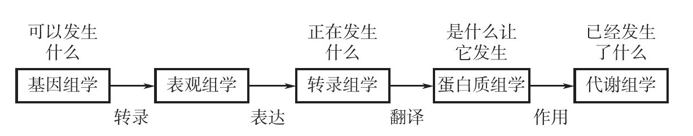
图 6-1　多组学数据之间的级联关系

基因组学是对生物体全部基因进行集体描绘、量化及比较的研究交叉学科，关注基因组的结构、功能、进化、定位与编辑及其对个体的影响。核心工作包括高通量 DNA 测序与生物信息学分析，用以组装并解读整个基因组的结构与功能。

转录组学在整体水平上研究细胞内基因转录状态及调控规律。从 RNA 层面反映基因表达，是连接基因型与表型的关键。转录过程是基因表达的第一步，受时间与空间限制，同一样本在不同生长阶段或环境下表达谱并不相同。

蛋白质组学以蛋白质集合为对象，研究其组成及变化规律，涵盖表达水平、翻译后修饰及蛋白-蛋白互作等，从而在蛋白质层面全面认知疾病发生和细胞代谢等过程。蛋白间互作是细胞代谢活动的基础。

代谢组学对生物体内全部代谢物进行定性定量分析，探寻代谢物与生理病理变化的关系。其研究对象多为分子量 1000 以内的低分子物质，是系统生物学的重要分支。

人类 miRNA 组学：miRNA 是一类长约 20-24nt 的高度保守内源性小 RNA，在转录后水平调控基因表达。通过与 mRNA 靶向结合抑制蛋白合成，据估计参与调控人类约 60% 的转录过程。miRNA 参与细胞增殖、分化、周期与凋亡等过程，与精神分裂症、帕金森病、血液病、糖尿病、艾滋病、心肌肥大、阿尔茨海默病等相关。超过 50% 的人类 miRNA 定位于与癌症相关的基因区段，包括乳腺、肺、直肠、皮肤、鼻咽、卵巢及神经细胞癌等。研究还显示 miRNA 在药物作用后的分子调控中发挥重要作用，在疾病诊断、治疗、预后及疗效评估中具有价值。

miRNA 生成加工机制如图 6-2 所示：核内 pri-miRNA 经 RNase III 核酸酶 Drosha 加工为 pre-miRNA，在 Exportin-5 协助下输出细胞核。pre-miRNA 约 60-90nt，呈发夹茎环结构，在细胞质中经核酸酶 III Dicer 剪切为 miRNA:miRNA* 双链，随后掺入沉默复合物发挥功能，而 miRNA* 多衰减。成熟 miRNA 携带 miRISC 功能，通过部分碱基配对识别靶 mRNA。

miRNA 通过与靶基因 mRNA 互补实现调控。动物中主要为不完全互补导致翻译抑制，植物中更多为近乎完全互补引发基因沉默。调控机制如图 6-3 所示。

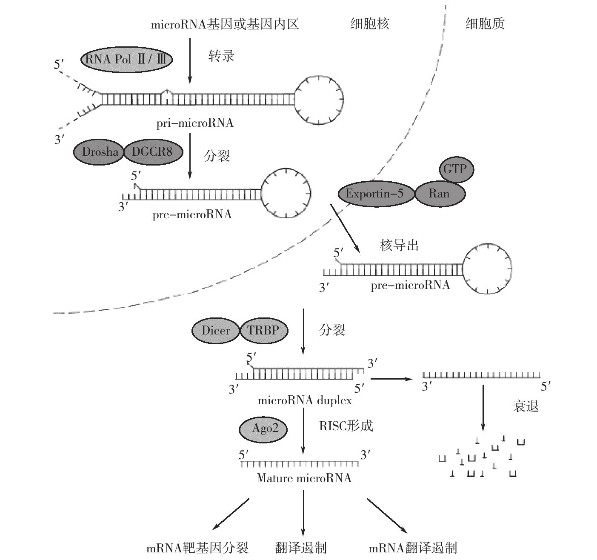
图 6-2　miRNA 生成机制

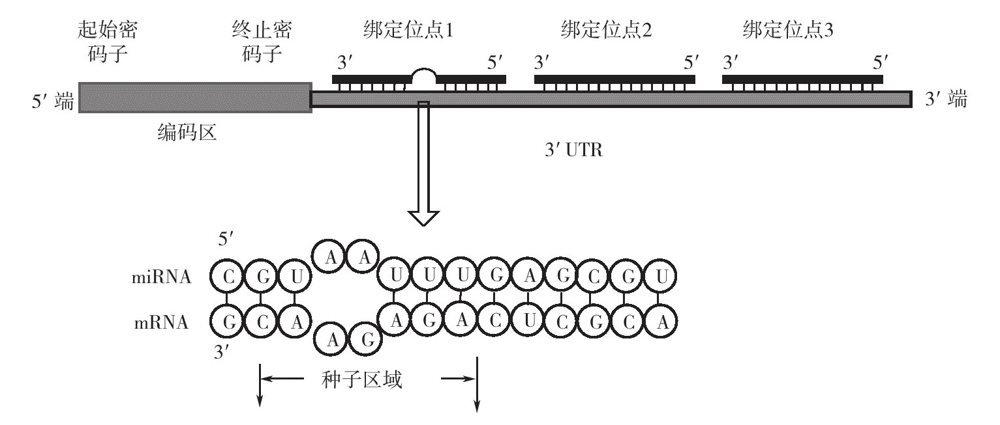
图 6-3　miRNA 对 mRNA 调控机制

作为非编码 RNA，miRNA 在药物多组学研究中占有重要地位，是疾病治疗与药物疗效的重要生物标志物。仅凭一滴血即可辅助疾病诊断与疗效分析。通过 miRNA 表达差异可评估药物安全性，实现个体化精准治疗。以 miRNA 为标志物的药物基因识别已成为研究热点之一。

表 6-1　miRNA 相关数据库

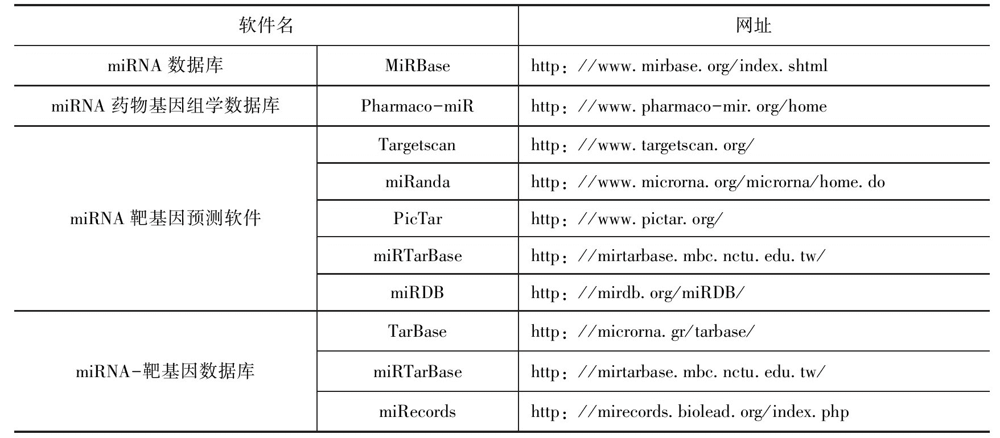

### （2）生物网络

生命活动依赖多系统协同，单一方向研究无法涵盖整体。过去数十年被较多研究的生物网络包括基因调控网、蛋白质互作网、细胞信号传导网、代谢网、遗传或小分子互作网及蛋白质磷酸化网等。以下主要介绍常用生物网络数据库。

表 6-2　生物网络数据资源

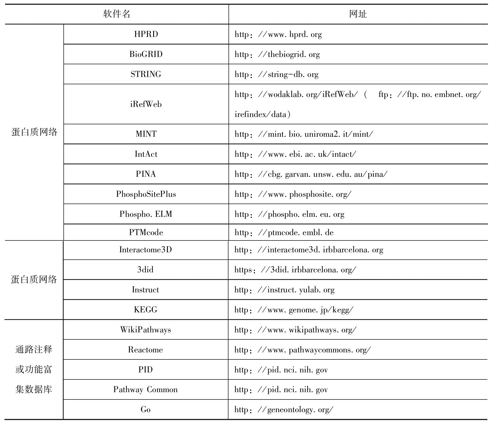

蛋白质互作网络由蛋白间相互作用构成，参与信号传递、基因表达调控、能量物质代谢及细胞周期等。系统分析蛋白互作有助于理解疾病状态下的信号与代谢反应机制，也是后基因组时代的热点。常用数据库如 HPRD 以可视化方式整合蛋白域结构、翻译后修饰、互作网络及疾病关联；BioGRID 收录大量出版物的蛋白与遗传互作、化学互作及翻译后修饰；STRING 提供跨物种蛋白-蛋白互作功能富集；iRefWeb 汇集疾病相关蛋白基因互作；MINT 覆盖多物种蛋白互作；IntAct 为分子互作证据数据库；PINA 整合多源数据用于肿瘤相关互作验证；PhosphoSitePlus 收录数十万翻译后修饰位点；Phospho.ELM 收录经实验验证的真核蛋白磷酸化位点；PTMcode 提供多种 PTM 类型的功能关联预测；Interactome3D、3did、Instruct 等则面向结构注释与高质量互作组解析。

通路注释与功能富集资源如 KEGG 用于从基因组等大规模分子数据中解析细胞、生物体与生态系统层面的高级功能；WikiPathways 整合基因、蛋白与小分子系统，涵盖受体结合、磷酸化、转位与转录调控等典型信号通路；Reactome 为开源的信号与代谢分子关系数据库；Pathway Common 汇集数千条通路与相互作用；GO 则系统描述从人类到细菌的基因功能知识。

## 6.2　药物代谢与药物基因

个体基因表达差异会导致药物代谢与药效存在差异。部分基因变异使药物代谢过快或过慢，进而影响体内存留量与疗效。识别影响代谢与药效的基因，可为临床提供精准用药方案，实现个体化用药，减少不良反应与治疗失败。本节从药物代谢与药效基因、药物代谢酶作用及基因检测三个层面展开。

### （1）药物代谢与药物基因

药物进入体内经吸收、分布、代谢、排泄等环节发挥作用。药物代谢与药物基因指参与药物代谢及效应调控的基因，其编码蛋白影响个体对药物的反应性与个体化治疗效果。药物作用的本质因子为蛋白，而蛋白受基因及 miRNA 等调控，表达改变会影响蛋白功能进而影响疗效。当前疗效问题面临耐药、安全性评估不足及个性化用药挑战，药物基因识别因此成为重要课题。

药物基因识别在系统网络水平，利用分子生物学与人工智能技术评估用药后基因表达变化，识别与药物代谢、药效及副反应相关的基因，明确不同人群基因差异，预测用药反应与不良反应程度，属于精准治疗范畴，打破传统试药模式。

网络水平研究以生物网络互作关系为基础，其中蛋白质互作网络尤为关键。蛋白互作是细胞机制的内在属性，蛋白网络可整合蛋白组中的域结构、翻译后修饰、互作网络与疾病关联。表达谱描绘特定状态下基因表达种类与丰度，动态反映基因功能与环境信息。整合蛋白网络与表达谱可挖掘疾病相关机制。miRNA 在转录后调控靶 mRNA，进而调控蛋白合成，据估计调控超过三分之一的蛋白质基因。蛋白互作网络结合基因表达谱可识别基因间特殊关联与关键功能模块，再整合 miRNA 表达谱可阐释 miRNA 改变与靶基因的关联。随高通量测序发展，多组学数据爆发式增长，为数据挖掘提供基础。生物网络模型近年成为多组学挖掘的重要分支，有望在药物疗效层面实现突破，助力新靶点与新策略发现。

### （2）药物代谢酶

用药指导型基因检测常涵盖与药物代谢和药效相关的酶，如细胞色素 P450 家族、UGT 家族、GST 家族、ABCB 家族、SLCO 家族等。这些酶主要分布于肝脏、小肠、脑与肺等组织，参与药物转化、消除及效应调控。下文重点介绍 CYP450 家族。

CYP450 为一类自身氧化的亚铁血红素蛋白，因在 450nm 有特征吸收峰而得名，参与内源性与外源性物质代谢。按氨基酸同源性分为家族、亚家族与酶个体三级。以 CYP2D6、CYP2C19、CYP3A4 等为例，家族用阿拉伯数字表示，亚家族用大写英文字母表示，酶个体用阿拉伯数字表示。人类肝脏至少有 9 种 CYP450 参与药物代谢，将疏水药物转化为更易排泄的亲水形式。生物转化通常分 CYP450 依赖的Ⅰ相反应与Ⅱ相结合反应。

## CYP450 酶在药物代谢中的作用

P450：决定药物命运的代谢引擎

肝脏里的细胞色素P450总量中，CYP1、2、3三个大家族加起来约占七成，也是绝大多数药物体内转化的主力军。就表达丰度来看，CYP3A约占肝脏P450总量的三成左右，CYP2系整体约两成；细分到亚型，CYP1A2约13%、CYP2E1约7%、CYP2A6约4%、CYP2D6约2%。除肝脏之外，小肠、胰腺、脑、肺、肾上腺、肾、骨髓、肥大细胞、皮肤、卵巢和睾丸等组织里也能检测到其余P450成员。

肝外代谢对整体清除贡献不小，尤其是胃肠道内的生物转化，对口服制剂的实际利用度有显著拉低作用。遗传多态、酶被抑制或诱导、以及生理状态波动都会改变P450活性，临床上可能表现为药代参数偏移、疗效不稳定、代谢减慢导致蓄积与毒性升高、毒性代谢产物增多，以及药物间相互作用。

在新药研发早期，CYP450是重点关注靶点。参与药物代谢的亚型主要集中在CYP1、2、3三大族。CYP1分支包括CYP1A1、1A2、1B1；CYP2是P450系统里规模最大的分支，含2A、2B、2C、2D、2E等亚家族，其中2C9、2C19、2D6、2E1被研究得较多，2A、2B相关资料相对较少。CYP3包含3A3、3A4、3A5、3A7四种基因亚型，约占肝内P450总量的28.8%，是口服药物首过效应的关键酶群，关注焦点多放在3A4及其近缘亚型上。

从基因到个体化用药

随着检测技术成熟，临床更倾向用基因信息来预测用药反应。基因检测为个体化治疗提供了技术抓手，可按个体差异定制方案，追求最优疗效。

常见手段包括全基因组测序、重组荧光免疫分析、聚合酶链式反应、基因扩增技术、定点突变检测及基因表达分析等。全基因组测序 Whole Genome Sequencing, WGS 属于高通量高灵敏的新型策略，能覆盖每条染色体上的基因及其变体，同时识别保守重复序列、同源基因簇与不同变异类型。重组荧光免疫分析 Multiplex Fluorescence Immunoassay, MFI 是一种基因芯片方案，结合荧光定量，通过特异抗体模板靶向捕获，可在单一样本中并行筛查多个基因片段，用于遗传病的筛查、诊断与预防。聚合酶链式反应 Polymerase Chain Reaction, PCR 模拟体内分子复制过程，配合荧光探针或DNA杂交提升特异性与定量能力，广泛用于基因表达、定点突变检测与等位基因判定。PCR也常用于基因或全基因组定点突变检测，以及DNA无水合成、扩增和基因重组。基因扩增技术 Polymerase Chain Reaction Amplification, PCRA 是一种计算机辅助的大规模扩增方法，通过专用扩增模式克隆含有单一序列的DNA片段，通常用于生物样本中特征基因或特定序列变异的检测。下面重点介绍全基因组测序背后的高通量技术。

高通量测序是对传统测序的革新，一次可并行读取数十万至数百万条DNA分子，使转录组和基因组全景分析成为可能，也被称为深度测序 deep sequencing。现有多平台仍在迭代，共性是超高通量，相比传统96通道毛细管测序，一次实验可获得40万到400万条读段。读长随平台在25~450bp之间，一次实验可产生1~14G碱基数据，远超传统仪器能力。高通量测序已用于全基因组mRNA表达谱、microRNA表达谱、ChIP-chip和DNA甲基化等。2008年Mortazavi团队对小鼠大脑、肝脏和骨骼肌进行RNA深度测序，展示了深度测序在转录组研究上的表达计数和序列解析两大进展。另一大应用方向是小分子RNA或非编码RNA ncRNA研究。测序能很好克服芯片在短序列、高度同源分子检测上的技术瓶颈，且小分子RNA长度与高通量测序读长匹配，数据利用率高，同时还能新发现小分子RNA。

## 6.3 人工智能算法及生物软件

### (1) 模拟退火
模拟退火算法 Simulated Annealing, SA 的雏形由N.Metropolis等在1953年提出，1983年S.Kirkpatrick等将其引入组合优化。算法基于Monte-Carlo迭代的随机寻优思路，灵感来源于固体退火过程与组合优化问题的相似性。流程从较高初始温度开始，随着温度参数逐步下降，结合概率跳跃特性在解空间中搜索目标函数全局最优，即在局部最优处有概率跳出并最终收敛到全局最优。SA是一种通用优化方法，理论上具备概率全局优化性能，已广泛用于VLSI、生产调度、控制工程、机器学习、神经网络、信号处理等领域。

SA源于固体退火原理，属于概率型算法。固体退火是将固体加热到足够高再缓慢冷却，加热时内部粒子因温度升高变得无序，内能上升；冷却时粒子逐渐有序，每个温度下达到平衡，最终在常温达到基态，内能降至最低。SA通过赋予搜索过程时变且最终趋于零的概率跳跃性，有效避免陷入局部极小，最终趋向全局最优。

具体步骤如下：
1）随机选取一个单元K并赋予随机位移，计算由此产生的能量变化ΔEK。
2）若ΔEK≤0，该位移被接受，后续状态作为起点。若ΔEK＞0，接受概率见式（6-1）。

式中，T为温度，随后在0~1区间均匀分布中抽取随机数R，若R＜PK，则以新状态作为下次起点；否则保留原状态。
3）重复执行第1步，直至系统达到平衡。

### (2) 线性规划
线性规划法 Linear Programming, LP 问题是在线性等式或不等式约束下，求解线性目标函数最大值或最小值的方法。目标函数表达决策者的期望，以极大或极小形式呈现；约束条件反映资源与内部限制，以一组等式或不等式表示。两者均为线性函数，故称线性规划。
s. t.约束条件，模型一般形式见式（6-2）、式（6-3）。

其中，c和x为 n 维列向量，A、Aeq为合适维数矩阵，b、beq为合适维数列向量。
标准型见式（6-4）、式（6-5）。

可行解是指满足约束条件的解。最优解即使目标函数达到最大值的可行解。可行域为所有可行解的集合。

### (3) 基因模块识别软件
为挖掘利福平相关功能模块，研究采用了基于模拟退火和线性规划的两个工具jActiveModules与BioNet。
BioNet基于线性规划实现功能模块提取，是bioconductor软件包，可基于测序数据的基因表达水平进行网络功能分析。
jActiveModules是cytoscape插件，用于功能模块识别，采用模拟退火策略进行功能子网提取，可调节搜索深度、节点重复率和模块数量。

### (4) DAVID
生物注释与可视化工具DAVID Database for Annotation, Visualization, and Integrated Discovery 提供了丰富的基因功能注释，主要使用其中的GO Gene Ontology 和KEGG Kyoto Encyclopedia of Genes and Genomes 资源。GO分析可挖掘统计显著富集的功能分类，涵盖分子功能 Molecular Function、生物过程 biological process 和细胞组分 cellular component 三类。

## 6.4 基因诱导的药物基因识别
miRNA通过调控蛋白功能实现自身效应，蛋白质承担结构、修复、调控、运输和能量供应等多种作用。蛋白质网络囊括蛋白-蛋白、蛋白-DNA、蛋白-RNA间的物理互作、调控、遗传互作及功能关联。蛋白互作可改变功能，直接互作的蛋白常组成复合体参与同一过程或实现特定功能。蛋白质网络涵盖人体已知全部蛋白互作，基因表达谱则反映特定条件下各类细胞或组织的表达种类与丰度，即RNA水平的分子变化。将两者整合，可从蛋白质组和基因组整体层面深入挖掘复杂生物过程机制。例如Zhang团队解析冠心病相关关键基因和模块，发现两个关键基因与疾病进展密切相关；Lin团队研究扩张型心肌病相关动态功能模块与共表达蛋白互作网络。研究表明，整合蛋白互作网络与基因表达谱有助于识别通路相关功能模块和关键基因。目前miRNA调控蛋白网络研究较多，但部分仅基于miRNA-靶基因网络，未结合丰富的蛋白网络；另一部分虽结合蛋白网络，但多局限于特定疾病或药物条件下的调控研究。此外，miRNA靶基因预测假阳性率高，导致构建的调控网络庞大，影响功能分析准确性。

利福平是自1960年问世以来广泛用于肺结核及其他感染的抗菌药，临床上用于调节药效或增强性能。研究表明利福平可诱导miRNA表达变化，进而调控药物代谢酶与转运蛋白。例如利福平改变P450 cytochrome P450 enzymes, CYPs 和miRNA表达，大量药物代谢酶为相关miRNA的靶点，如miR-27b靶向CYP1B1；体外研究显示miR-148a靶向pregnane X receptor PXR，而PXR是P450基因表达的重要调控因子，并持续下调CYP3A4表达；多条miRNA靶向肝细胞核因子4α hepatic nuclear factor 4α，HNF4A，而HNF4A是多药物处置基因的主要调控因子。现有研究多从单一角度探讨利福平对肝脏中药物代谢酶、转运蛋白和miRNA的调控机制，缺乏从全局整合多组学、多资源系统解析利福平作用后关键基因和miRNA功能的报道。

为此，研究者设计了一套基于蛋白网络的疾病和药物标志物挖掘方法，整合基因组与蛋白质组学，有助于发现重要通路和分子机制，可广泛应用于药物作用后以miRNA和基因为主的标志物挖掘。本节采用模拟退火和线性规划两种方法对miRNA调控蛋白网络进行功能模块识别，结合基因表达谱水平变化数据，降低miRNA靶基因预测假阳性对功能分析的干扰，有助于挖掘药物作用后miRNA调控的重要功能模块。该方法应用于利福平作用后人体肝脏miRNA和基因研究，可识别一系列重要miRNA、基因及通路，为利福平肝脏作用机制提供探索性研究。

### (1) 数据和方法
数据集包含四部分：基因表达谱、miRNA表达谱、蛋白互作网络、人类肝脏蛋白互作网络。
数据一和数据二是来自人类肝脏组织。样本来自七位捐献者，每位均有生物学重复，体外实验控制在组织分离后72~120h。肝脏组织经24h利福平10um处理，对照为0.01%甲醇。基因表达谱包含12780个基因表达水平。miRNA表达谱包含334个miRNA。基因表达数据处理流程为EZBead制备、下一代测序、短序列评估、序列比对。miRNA数据采用实时荧光定量PCR系统 Taqman OpenArray 获取。本文RNA-seq数据可从GEO数据库下载，号GSE79933；miRNA OpenArray数据下载地址为http://compbio.iupui.edu/group/6/pages/rifampin。
数据三为蛋白互作网络，取自人类蛋白质参考数据库 Human Protein Reference Database, HPRD。HPRD收录人类蛋白功能的多种信息，包括蛋白-蛋白关系、转录后修饰、酶-底物关系及疾病关联。注释信息来自人工收集的生物学家与专家发表的论文。HPRD已收录超过38000条高可信度人类蛋白互作数据，网络基于实验验证的互作与亚细胞定位数据构建。
数据四为人类肝脏蛋白互作网络 human liver protein interaction network, HLPN，映射肝脏相关蛋白组互作。网络涵盖肝脏功能维护的关键蛋白，富集代谢酶、肝脏特异性蛋白及肝病相关蛋白，共2582个蛋白及3484条互作，涉及系统生物学、疾病研究与药物发现等领域。

#### 1）整合多组学的 miRNA 功能识别方法
整合多组学miRNA功能识别方法原理如图6-4所示。
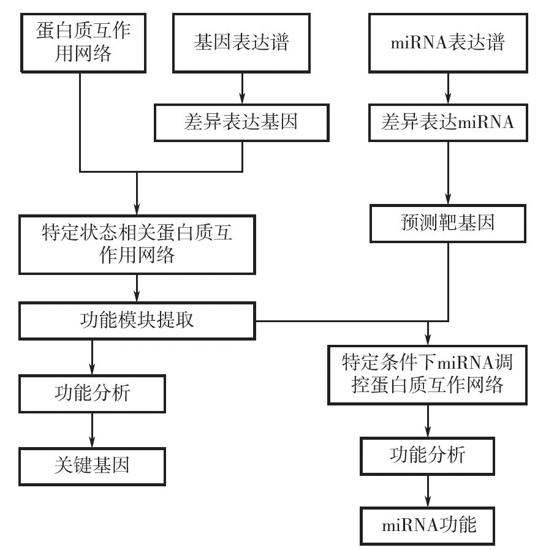
图6-4　整合多组学 miRNA 功能识别方法
为挖掘miRNA功能，提出miRFun omi方法，基于蛋白网络、基因表达数据和miRNA表达数据，流程如下：
第一步，通过基因表达谱筛选差异基因。采用正常组织与特殊状态组织进行t检验。t检验是常用统计方法，设某基因在正常与特定条件下的表达均值分别为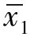和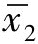，n1、n2为两组样本数，σ2x1、σ2x2为方差，则t值计算见式（6-6）。

据t值计算P值，设定阈值筛选差异基因。
第二步，构建特殊状态下的蛋白网络。设差异基因集Sgene={g1,g2,…,gi}，i为差异基因数；蛋白互作网定义为G=(V,E)，V为节点，E为互作关系，V={v1,v2,…,vi}，i为节点数；E={e1,e2,…,et}，t为互作数，则特定状态相关网络为GS=(VS,ES)节点与互作定义见式（6-7）、式（6-8）。

第三步，提取特定状态下蛋白网络的功能模块。特殊状态相关网络涉及基因较多，且基因间关系需考量。功能模块指在特定条件与正常条件下，蛋白网络中整体表达显著差异且内部节点密切连接的子网。功能模块整合表达水平与互作信息，可在系统分析中发现关键通路。本部分尝试模拟退火与线性规划两种功能模块识别算法，基于功能模块的差异表达分数定义见式（6-9）。

第四步，功能模块富集分析。对模块内基因进行功能富集，通过生物信息数据库与工具进行统计分析，挖掘显著相关生物功能与通路。
第五步，通过miRNA表达谱筛选差异miRNA，同样采用t检验。对差异miRNA进行靶基因预测，采用阈值设定与多工具结果取交集以降低假阳性。
第六步，构建miRNA调控的特定状态蛋白网络 miRNA-regulated-PIN Gmir-PIN=(Vmir-PIN,Emir-PIN)。设miRNA靶基因为Gtarget，则网络节点定义见式（6-10）。

网络互作定义见式（6-11）。

第七步，对miRNA-regulated-PIN节点基因进行功能富集，进一步识别miRNA相关功能。

#### 2）利福平作用于肝脏 miRNA 功能分析
基于miRFun_omi方法的利福平作用于肝脏miRNA功能分析流程见图6-5。

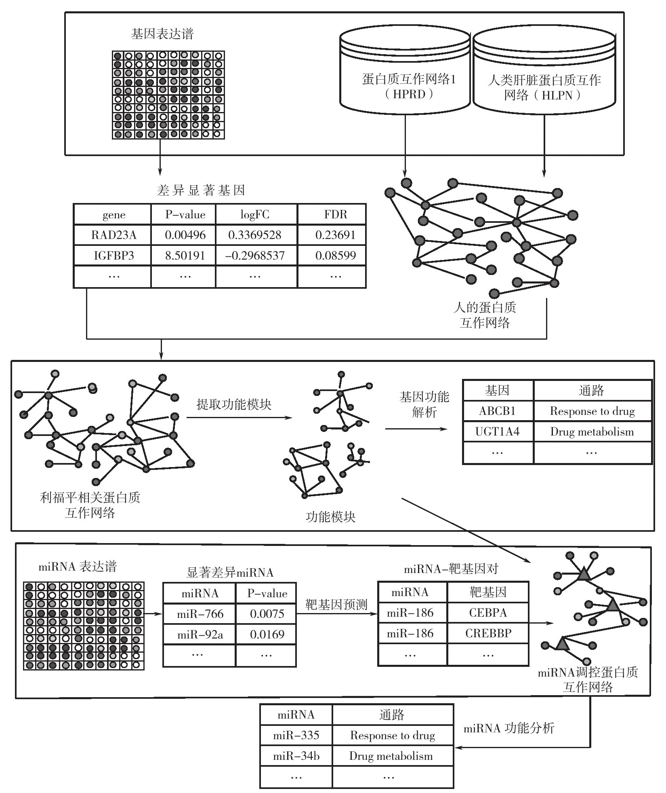

图 6-5　miRFun omi 框架下利福平干预肝脏 miRNA 的分析流程

#### 3）构建利福平相关的蛋白质互作网络
先对三类网络做符号化。`HPRD` 来源的互作集记为 `GHPRD` =（`VHPRD`，`EHPRD`）；人类肝脏特异蛋白网络记为 `GHLPN` =（`VHLPN`，`EHLPN`）；全人类蛋白互作网络记为 `GHPIN` =（`VHPIN`，`EHPIN`），形式化定义见式（6-12）、式（6-13）。

边集需满足 `EHPIN` 与 `EHPRD` 相交且与 `EHLPN` 相交，或 `EHPIN` 与 `EHLPN` 相交且与 `EHPRD` 相交。随后对基因表达谱进行 t 检验取值 p＜0.05 挑选显著差异基因，最后将利福平处理肝脏的差异基因映射到人类 PPI 上，得到利福平关联的蛋白互作网络。

#### 4）挖掘利福平相关功能模块
模块挖掘采用 `jActiveModules` 与 `BioNet` 两种基于模拟退火和线性规划的工具协同进行。

`BioNet` 生成最大子网的步骤为：导入节点、节点属性及蛋白网络；读取节点属性中的 P 值，若存在多值则以 `aggrPvals(pvals, order=1, plot=FALSE)` 合并；按 P 值对节点打分，评分函数为 `scoreNodes(network, fb, fdr)`，其中 `FDR` 控制模块规模并调节信噪分离，本研究分别取 0.01、0.001、0.0001 三档；再以 `runFastHeinz(network, scores)` 输出最大子网，并用 `plotModule(module, scores=scores, diff.expr=logFC)` 可视化，`logFC` 为表达倍数变化，正值上调负值下调。

为提升泛化性同步使用 `jActiveModules`。该方法基于模拟退火，支持设定搜索深度、节点重复率与模块个数。此处搜索深度设为 2，节点重复率 10%，模块数取 5。

#### 5）功能模块富集解析
结合研究目的，`GO` 重点考察包含“代谢”“药”关键词的条目。`KEGG` 将基因表达视作整体网络，覆盖代谢、膜转运、信号转导、细胞周期等生化过程，以及化学物质、酶、酶促反应等信息。结果按参与各过程的 P 值排序，优先讨论前列通路。

#### 6）差异 miRNA 筛选与功能解析
流程分为四步：先对 miRNA 表达谱做 t 检验，p<0.05 取差异 miRNA；再做靶基因预测。为降低假阳性并行使用 `Targetscan`、`miRanda`、`PicTar` 与 `miRTarBase`，`Targetscan` P 值阈值 0.05，`miRanda` 阈值 0.01，`PicTar` 假阳性低不设阈值，四者结果取交集。预测前用 `BiomaRt` 将基因号转为基因符号，参考 `hsapiens gene ensembl database`；随后取 miRNA 靶基因与功能模块节点交集并保留互作关系，构建利福平相关的 miRNA 调控蛋白互作网；最后对每条 miRNA 的靶基因分别做 `GO` 与 `KEGG` 分析以推断潜在功能。

### （2）数据分析方法
### 1）利福平作用肝脏的关联蛋白网络（图 6-6）

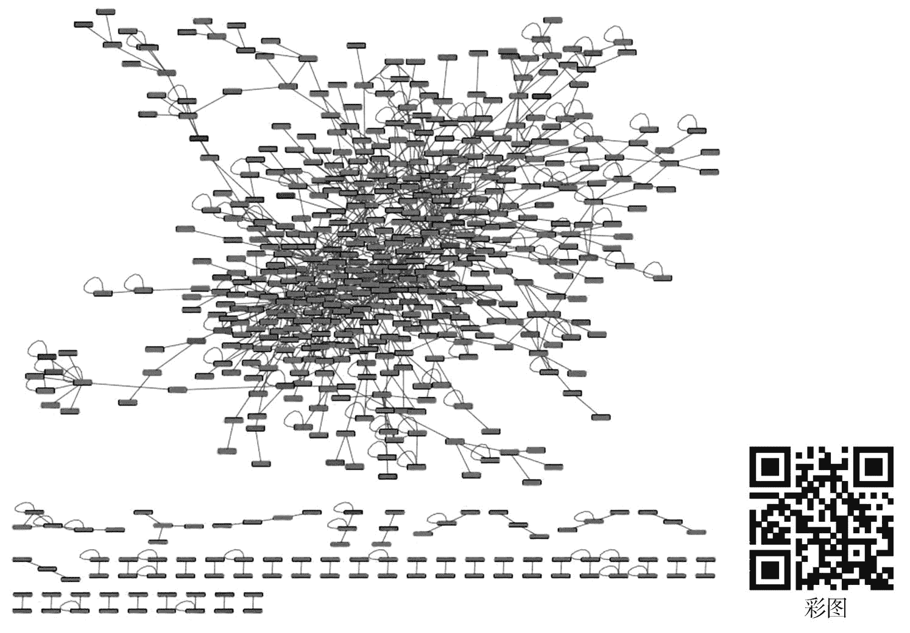

图 6-6　利福平处理肝脏的蛋白互作网络概览

**注**　节点颜色对应 `logFC`，红为上调绿为下调，深浅反映差异显著程度，越深越显著。

### 2）功能模块提取结果与解读
为捕获网络中紧密且差异显著的子结构，采用 `jActiveModules` 与 `BioNet`。`BioNet` 得到的最大功能子网含 84 个基因、89 条互作。`jActiveModules` 设定模块数 5、识别深度 2、模块间节点重复率 0，最终得到 5 个子网共 31 个节点、36 条互作。两种算法高度一致，`jActiveModules` 与 `BioNet` 的重叠率达 92%。两法共同揭示的利福平调控功能模块见图 6-7。

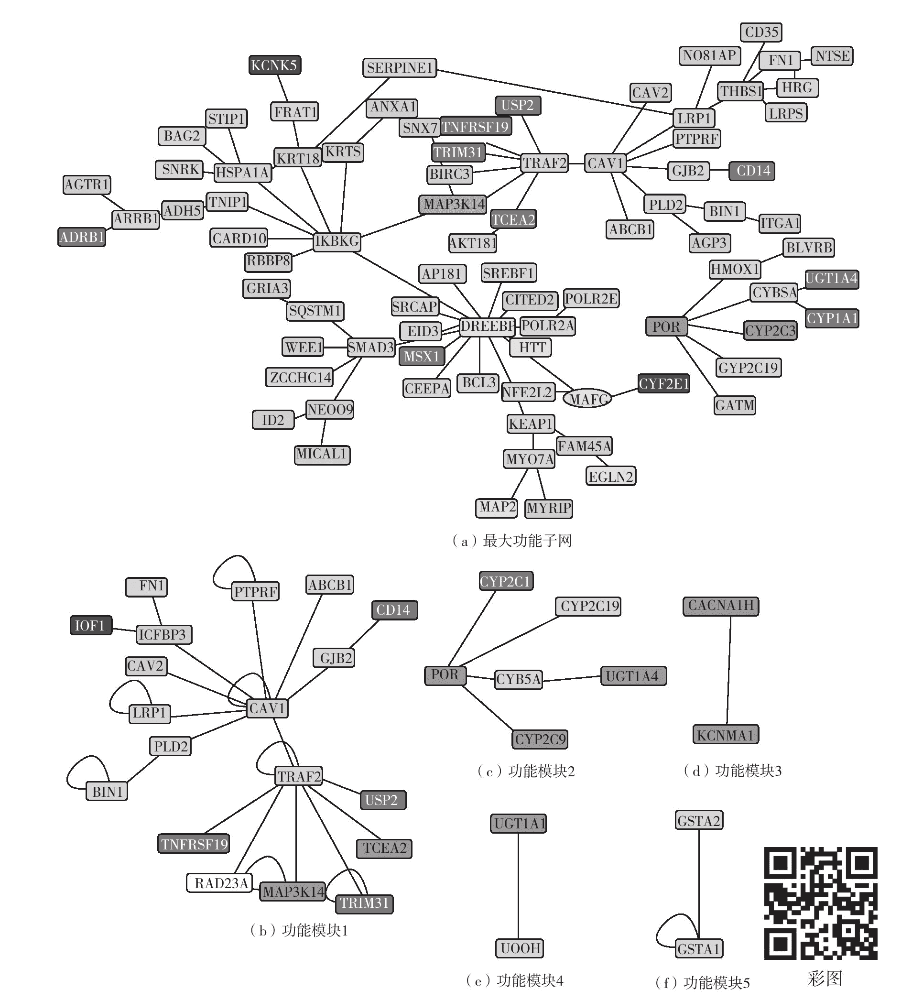

图 6-7　`BioNet` 与 `jActiveModules` 联合得到的利福平调控功能模块

**注**　颜色代表 `logFC`，红上调绿下调，深浅为显著性；节点形状代表分数，圆为负值方为正值。

最大功能模块 84 个节点的 P 值、表达变化倍数 `logFC` 与错误发现率 `FDR` 见表 6-3。

表 6-3　最大功能模块的 84 个节点基因

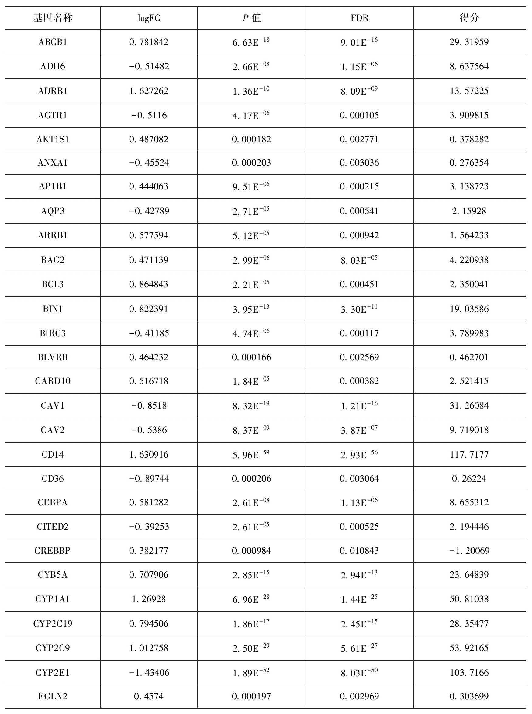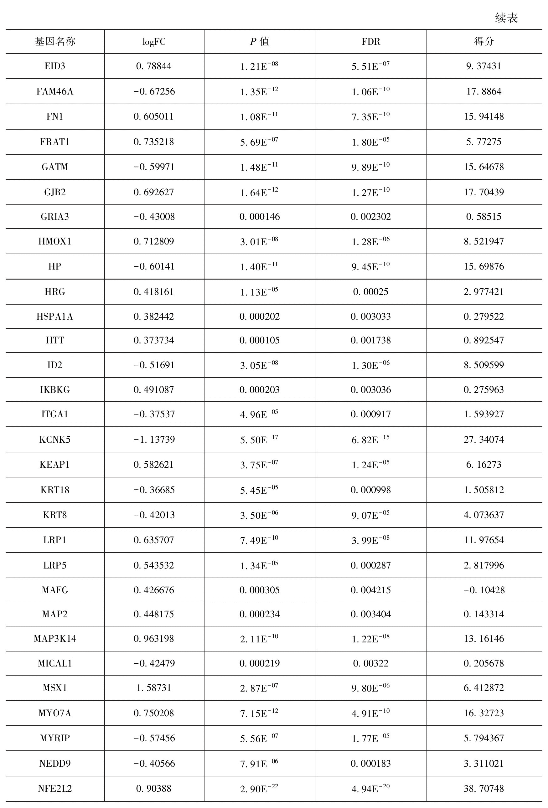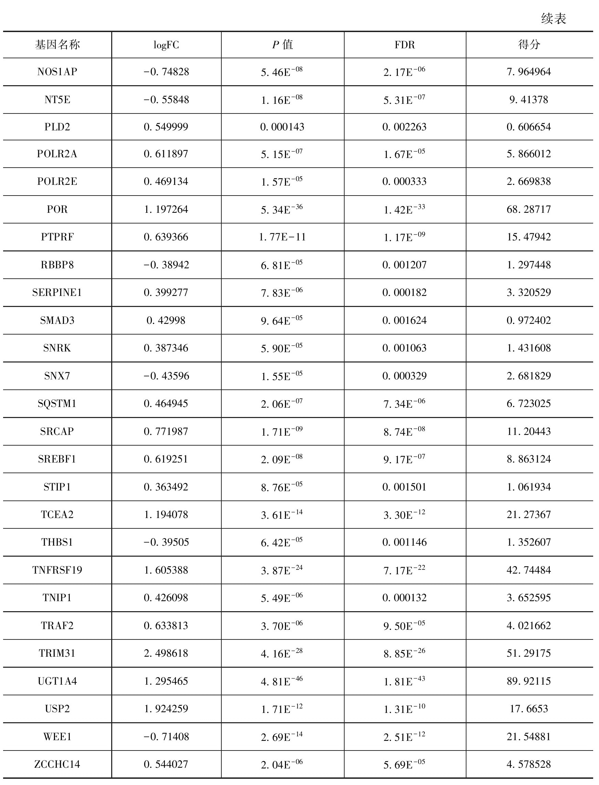

### 3）利福平肝脏功能模块富集结果
鉴于两法重复率高达 92%，选用节点更丰富的 `BioNet` 最大子网。`GO` 前 20 与 `KEGG` 前 10 见表 6-4。

表 6-4　功能模块前 20 `GO` 与前 10 `KEGG` 通路

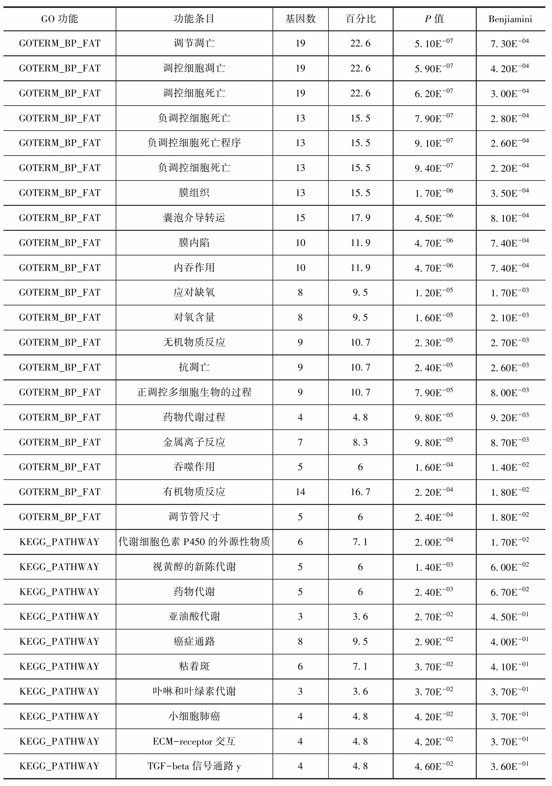

聚焦药物代谢，`GO` 侧重含“代谢”“药”的条目，`KEGG` 按 P 值排序重点讨论前五通路。最大功能网络富集解析见表 6-5。

表 6-5　最大功能网络富集解析

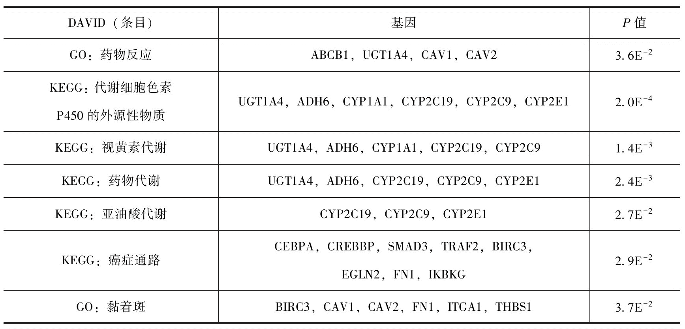

结果显示最大模块富集到 7 条通路：药物反应、细胞色素 P450 代谢外源物质、视黄素代谢、药物代谢、亚油酸代谢、癌症通路与黏着斑。其中视黄素代谢、药物代谢、亚油酸代谢基因重叠度高，功能相近，且与既往报道的利福平诱导效应一致：利福平改变肝脏药物处置与代谢并诱导代谢酶，同时作为抑制剂可快速阻断靶向癌细胞的血管生成与有丝分裂相关基因。

表 6-5 共涉及 19 个基因参与 7 条通路。为深入剖析，以这 19 个基因为种子扩展子网，得到 50 个节点、53 条互作，见图 6-8。

### 4）关键 miRNA 挖掘与功能解读
以 P 值＜0.05 筛选差异 miRNA，共得 20 个，其中上调 12 个、下调 8 个，见表 6-6。

`UGT1A4`、`ADH6`、`CYP1A1`、`CYP2C19`、`CYP2C9`、`CYP2E1` 与外源物质代谢、药物代谢、视黄醇代谢及亚油酸代谢相关。`BIRC3`、`CAV1`、`CAV2`、`FN1`、`ITGA1`、`THBS1` 与黏着斑、抗血管生成及抗肿瘤相关。提示利福平经上述六个代谢酶诱导药物代谢，并通过调控 `BIRC3`、`CAV1`、`CAV2`、`FN1`、`ITGA1`、`THBS1` 影响抗血管生成与抗肿瘤过程。文献亦证实 `UGT1A4`、`CYP1A1`、`CYP2C19`、`CYP2C9`、`CYP2E1` 为药物代谢酶，`ADH6` 调控药物依赖风险；`BIRC3` 抑制癌变活动，`CAV1`/`CAV2` 与肿瘤生长相关，`FN1` 为部分癌症标志，`ITGA1` 与 `THBS1` 与癌症风险相关。

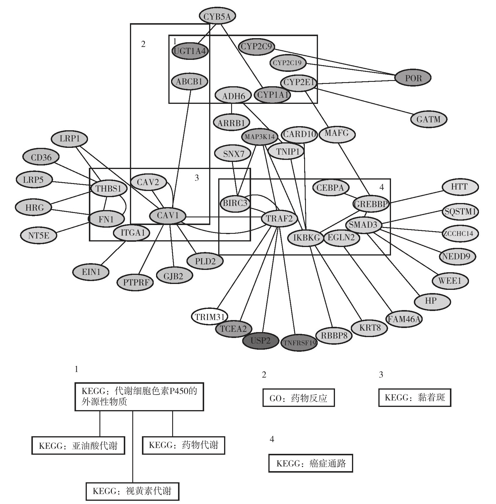

图 6-8　19 个核心基因与 7 条通路的扩展子网

表 6-6　差异显著 miRNA

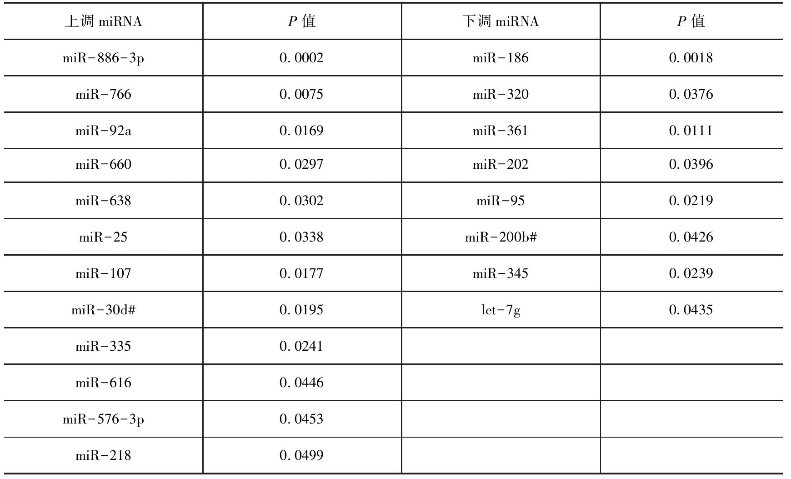

随后预测差异 miRNA 靶基因，保留落在最大功能模块内的靶基因-miRNA 对共 21 对，构建利福平肝脏相关的 miRNA 调控蛋白网络，见图 6-9，详见表 6-7。

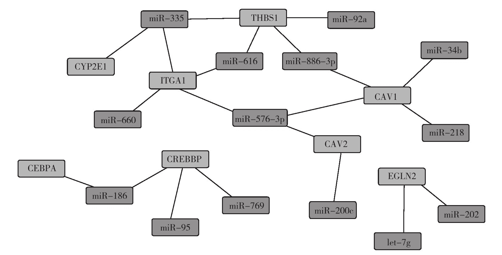

图 6-9　利福平肝脏相关的 miRNA 调控蛋白互作网络

表 6-7　miRNA 调控的蛋白互作网络

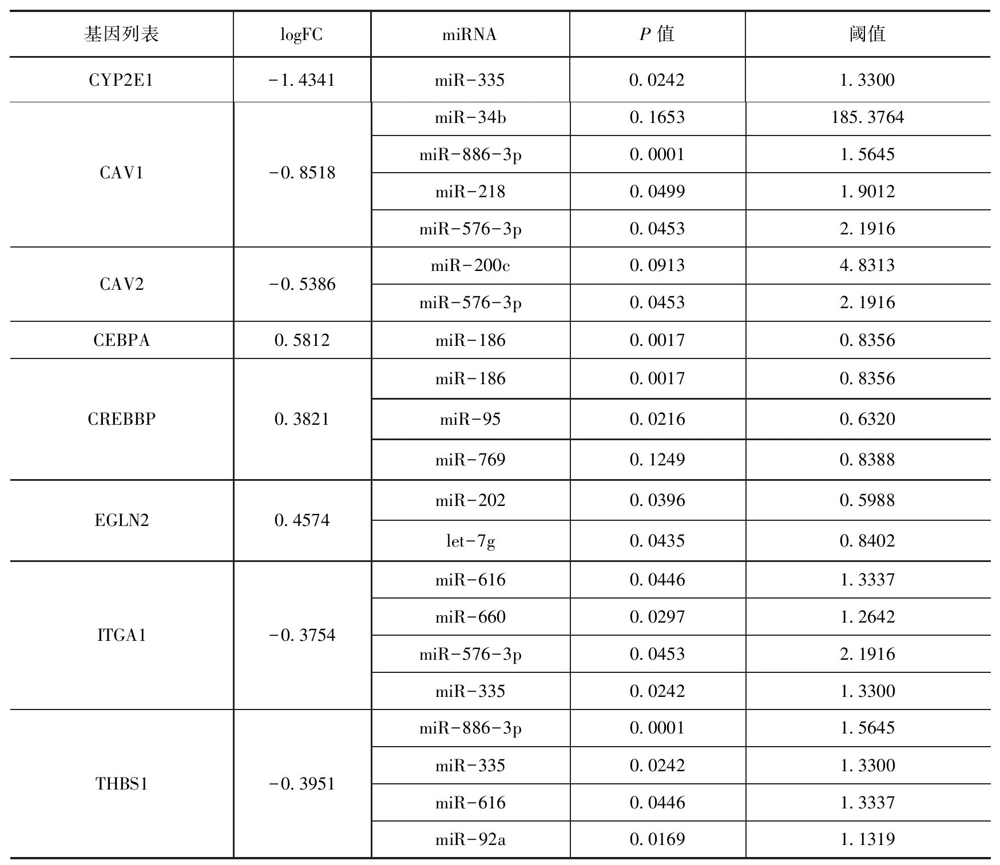

共提取 14 个 miRNA 与 8 个基因，每个基因受多个 miRNA 调控。miRNA 通过结合靶基因或抑制翻译调控表达，该网络可揭示新的调控规律。潜在功能见表 6-8。

表 6-8　miRNA 潜在功能

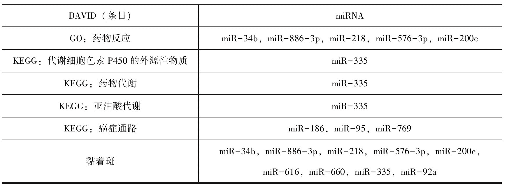

表 6-8 显示 12 个 miRNA 经 8 个基因关联 6 条通路：药物反应、细胞色素 P450 代谢外源物质、药物代谢、亚油酸代谢、癌症通路、黏着斑。提示 `miR-335` 负向调控 `CYP2E1` 影响药物代谢，`CYP2E1` 为药物代谢酶且受利福平影响，故推测利福平通过改变 miRNA 表达调控 `CYP2E1`。`MiR-186` 同时调控 `CEBPA` 与 `CREBBP`，两者与癌症通路相关。`MiR-186`、`miR-769`、`miR-95`、`miR-202`、`let-7g` 均与癌症通路相关。利福平通过调控 `miR-34b`、`miR-886-3p`、`miR-218`、`miR-576-3p`、`miR-200c`、`miR-616`、`miR-660`、`miR-335`、`miR-92a` 等抑制血管生成与有丝分裂，进而调控 `BIRC3`、`CAV1`、`CAV2`、`FN1`、`ITGA1`、`THBS1` 的表达。

### 5）与已有算法的对比
Matthew 等方法先识别差异 miRNA 再预测靶基因构建调控网，以腹部主动脉瘤为例获 8 个差异 miRNA 调控 222 个基因。Liu 等方法先筛差异 miRNA 再预测靶基因构建共表达网，以酒精肝为例获 26 个 miRNA 与 878 个差异基因，聚焦 6 个 miRNA 节点与 2 个基因节点。Zhang 等整合表达谱与蛋白网络识别差异基因相关网络，以冠状动脉疾病为例获 10 个关键模块，含 4 个 `GO` 相关基因与 12 个中心基因。

本文 `miRFun omi` 整合表达谱与蛋白网络获取条件特异性分子机制，先用模块提取算法筛选差异显著模块，再经靶基因预测筛选差异 miRNA 调控靶基因并构建 miRNA-靶基因网络进行功能分析。整合资源更全，理论依据更充分，miRNA 功能识别精度更高。

### （3）基因诱导的药物基因识别
多组学整合的 miRNA 功能识别是可行的，利福平肝脏实例验证显示其能挖掘重要功能模块、关键基因与 miRNA 功能，优势如下。

### 1）可靠的理论依据
miRNA 参与细胞生长、组织发育、增殖凋亡，与肿瘤发生诊断治疗预后密切相关，调控人类约 60% 转录过程与超三分之一蛋白基因。方法在此基础上融合蛋白组学、基因组学、RNA 组学，整合 miRNA 表达谱、基因表达谱与蛋白网络解析 miRNA 功能。

### 2）有效的处理策略
`miRFun omi` 采用 t 检验、功能模块识别、基因功能富集与 miRNA 靶基因预测。为提升泛化性，模块识别兼顾线性规划与模拟退火的最大模块与多模块策略并综合；富集解析结合关键词与 P 值兼顾功能与通路；靶基因预测采用多工具取交集以降低假阳性。

### 3）利福平肝脏实例验证
以利福平作用人体肝脏为对象，`miRFun omi` 识别出含 84 个基因、89 条相互作用的功能模块；锁定 19 个基因与 7 条通路；构建含 14 个 miRNA、21 对 miRNA-靶基因的调控蛋白网络；发现 12 个 miRNA 经 8 个基因关联 6 条通路。结果与大量文献一致。

本章提出融合蛋白组、基因组、RNA 组学的 miRNA 功能识别框架：整合蛋白网络、基因表达谱与 miRNA 表达谱构建条件特异性网络，提取功能模块，经多数据库富集解析识别关键基因与 miRNA。以利福平作用肝脏为例，揭示其诱导的通路变化，发现 19 个基因与 7 个关键通路相关：药物反应、细胞色素 P450 代谢外源物质、视黄素代谢、药物代谢、亚油酸代谢、癌症通路、黏着斑；并证实 12 个 miRNA 经 8 个靶基因参与利福平肝脏作用的 6 条重要通路。研究表明利福平引起 miRNA 与基因表达改变，进而调控多条通路，为利福平肝脏功能模块研究与药物处置研究提供新思路。

## 6.5　miRNA 诱导的药物基因识别

上一节系从基因出发预测 miRNA 功能，本节从 miRNA 出发，整合蛋白网络解析 miRNA 与基因功能。方法结合 miRNA 与 mRNA 表达谱，从差异 miRNA 出发预测靶基因，筛选负相关表达基因，整合 PPI 网络构建利福平相关的 miRNA 调控负相关表达蛋白互作网络 `MNePIN`，经功能富集评估潜在功能，预测利福平调控 miRNA 在人肝细胞的分子机制。技术路线见图 6-10。

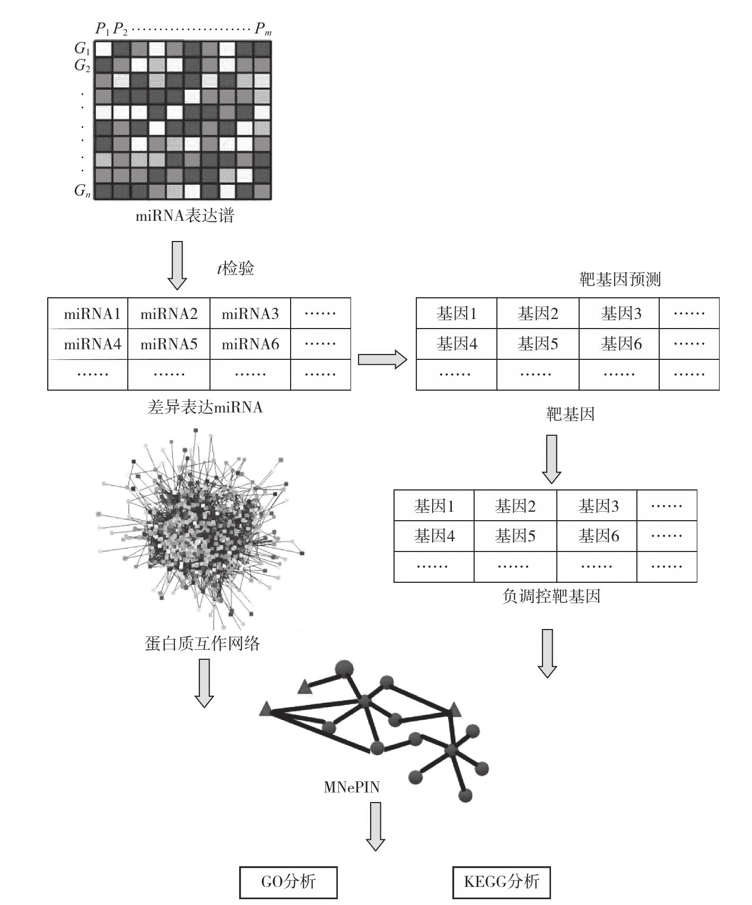

图 6-10　技术路线图

### （1）数据处理方法
miRNA 诱导的整合网络功能基因识别方法如下：

### 1）对基因表达谱与 miRNA 表达谱采用 Benjamini-Hochberg 校正计算假发现率 FDR，用未配对双尾 t 检验计算正常与利福平处理样本中每个 miRNA 与每个基因的 P 值。
### 2）定义 `p < 0.01` 时的 miRNA 具统计学意义，为差异表达 miRNA。利用 `BioMart` 将基因 `Entrez ID` 转为基因 `Symbol`，采用 `RmiR` 软件预测差异 miRNA 靶基因，使用的预测方法包括 `Targetscan`、`miRanda` 与 `PicTar`。

### 3）蛋白资源汇聚与互作网络绘制
`HPRD`收录约 30047 个蛋白条目及 41327 条互作，`HLPN`聚焦肝源性蛋白，涵盖 2582 个肝相关蛋白与 3484 条关联。本步将两库的蛋白与互作合并去重，并用 `cytoscape version 3.0.2` 绘制互作图谱。

### 4）利福平关联的 miRNA 负向调控蛋白网络搭建
把差异 miRNA、其负向调控的靶基因与人类蛋白互作信息叠加，构建反映利福平作用机制的 miRNA 负向调控蛋白互作网络 `MNePIN`。

### 5）功能富集与通路归类预测
调用功能注释工具 `DAVID` 对 `MNePIN` 的生物学过程与信号通路进行富集，并以 `GO` 与 `KEGG` 为框架对核心通路做功能分类，进而推断具功能性的 miRNA 及其靶基因。

### （2）数据结果解读

### 1）MNePIN 的搭建
差异 miRNA 先以 P 值 `p < 0.01` 挑选，上调以 `Fold Change > 1`、下调以 `Fold Change < 1` 判定，最终锁定 20 个分子，其中上调 12 个、下调 8 个。表 6-9　差异表达 miRNA

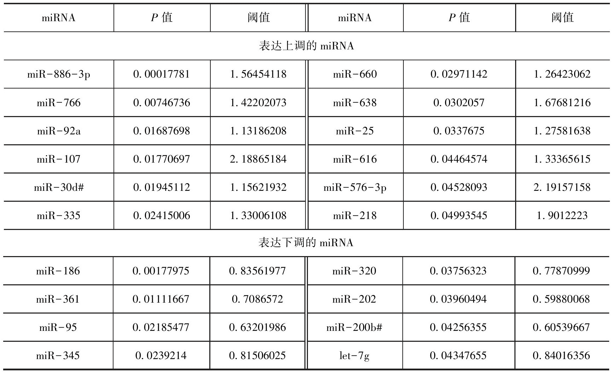

靶基因预测未设阈值，同时使用 `Pictar`、`Targetscan` 与 `miRanda` 三策略取并集。结合表达谱初筛得 6211 个基因，再按 `fold change` 筛选每个 miRNA 的负向调控靶标，保留 4115 个负相关表达基因，随后以 `P < 0.1` 取显著差异。

`HPRD` 与 `HLPN` 合并去重后，人类蛋白网络共含 10210 个蛋白、42521 条互作。整合差异 miRNA、负向调控的差异靶基因与蛋白互作网络后得到的 `MNePIN` 包含 632 个显著差异表达基因及 1187 对 miRNA-基因负相关配对。网络通过扩展基因的一级蛋白节点形成，由 20 个 miRNA 与 632 个蛋白构成 11219 条互作。在 1187 对负相关中，`miR-660` 调控基因数最多达 136 个，`miR-886` 最少仅 12 个。

### 2）miRNA 功能富集解读
`DAVID` 依据 `GO` 与 `KEGG` 对 miRNA 及 `MNePIN` 基因进行功能归类与通路描述，采用功能注释聚类提取主题。将含有“药物”“肝脏”“代谢”“反应”“伤口”“刺激”的 GO 条目与 KEGG 通路划为药物相关主题。富集的生物过程见表 6-10。

表 6-10　`MNePIN`中`miRNA`调控的基因和蛋白富集分析

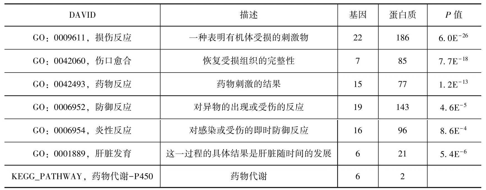

表 6-10 归纳出损伤反应、伤口愈合、药物反应、防御反应、炎症反应、肝脏发育、药物代谢-`P450` 共 7 类主题。关联的 miRNA 与基因列于表 6-11。

表 6-11　`MNePIN`的`miRNA`和基因

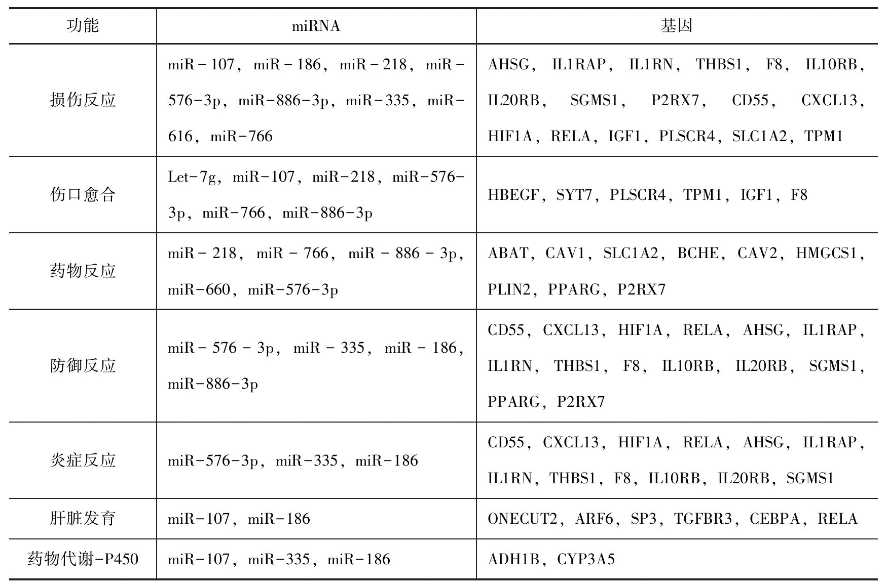

共鉴定出 33 个利福平相关基因，其中 `P450` 与 `CYP3A5` 在药物代谢中作用突出，`SP3`、`ARF6`、`CEBPA`、`RELA` 与肝脏发育相关，`CXCL13` 与 `RELA` 亦被报道为炎症标志物。

靶向这 33 个基因的 10 个利福平相关 miRNA 为：`miR-107`、`miR-186`、`miR-218`、`miR-576-3p`、`miR-886-3p`、`miR-335`、`miR-616`、`miR-766`、`miR-218` 和 `Let-7g`。既往研究提示利福平可改变基因与 miRNA 表达。结果显示 `miR-107`、`miR-186`、`miR-218`、`miR-576-3p`、`miR-886-3p`、`miR-335`、`miR-616`、`miR-766` 可通过直接或间接调控影响损伤反应；`let-7g`、`miR-107`、`miR-218`、`miR-576-3p`、`miR-799` 与 `miR-886-3p` 关联的 6 个基因与伤口愈合相关；`miR-218`、`miR-766`、`miR-886-3p`、`miR-660` 与 `miR-576-3p` 在药物反应中富集；`miR-107` 与 `miR-186` 为肝脏发育的候选者；`miR-107`、`miR-335` 与 `miR-186` 通过调控 `ADH1B` 与 `CYP3A5` 与药物代谢相关。

### 3）利福平相关 miRNA 与负调控基因关联
为揭示相关 miRNA 与基因的关联，构建了 miRNA-负相关表达基因网络。图 6-11　关键`miRNA`-基因负相关表达网络

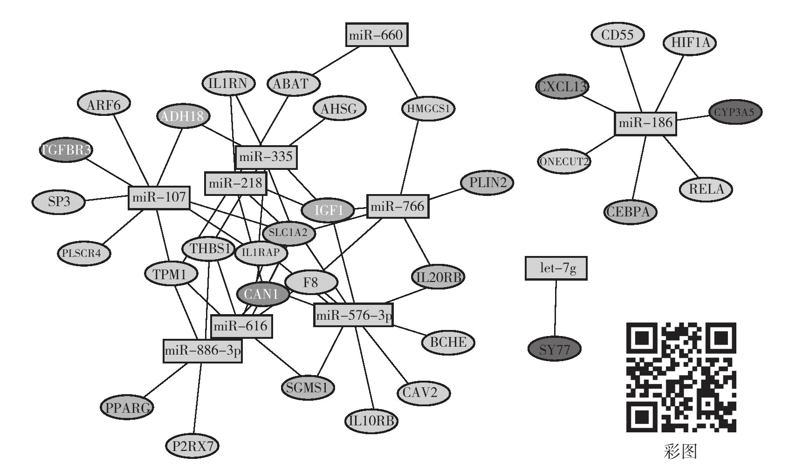

**注**　黄色和灰色矩形分别代表下调和上调的`miRNA`。圆圈表示`miRNA`调控的基因，用颜色表示调控关系，红色表示上调基因，绿色表示下调基因。颜色的深度表示折叠变化的大小。

网络中 10 个 miRNA 负向调控 33 个基因，共 62 对 miRNA-基因关系。`miR-576-3p` 被列为网络中最重要的节点之一，并被认为参与创伤反应、伤口愈合、药物反应、防御反应和炎症反应。`miR-186` 负调控包括 `CYP3A5` 在内的 7 个基因，提示其与药物代谢相关。`miR-335` 未对 `CYP3A5` 产生负向调控，但对 `ADH1B` 有负向调控，也与药物代谢相关。

这 33 个基因多通过蛋白直接或间接发挥作用。`ADH1B`、`IGF1`、`CAV1`、`SGMS1` 表达变化显著且受多重 miRNA 调控，`CYP3A5` 作为药物代谢关键基因亦差异表达，提示这 5 个基因在利福平诱导的生物过程中具有重要功能。

本节先提取显著差异 miRNA，预测其负相关表达靶基因 `MCeTG`，经蛋白关联网络扩展构建出 miRNA 调控负相关表达蛋白关联网络 `MNePIN`。经 `GO` 与 `KEGG` 富集挖掘功能，共获 20 个显著差异 miRNA 和 632 个调控基因，最终锁定 10 个 miRNA 与 33 个基因，与损伤反应、伤口愈合、药物反应、防御反应、炎症反应、肝脏发育、药物代谢 7 类功能相关。该研究为利福平在 miRNA、基因与蛋白层面的影响提供了线索。

换个视角，通过整合 miRNA 与基因谱，识别显著差异 miRNA 及其负向调控基因，再借助蛋白网络构建 miRNA 调控负相关表达蛋白关联网络，经 `GO` 与 `KEGG` 富集得到 7 类功能。总体表明利福平会改变多条 miRNA 的表达，为 miRNA 在利福平诱导的人肝细胞生物学过程中的调控作用提供了证据。

# 第 7 章 AI 重塑制药制造
参与 AI 制药的主体包括 AI 制药初创公司、互联网巨头与大型制药企业。初创公司多自研管线或药物发现平台，因临床试验成本高风险大，多数转向提供 CRO 服务。华为、百度、腾讯等互联网头部企业依托 AI 能力加速布局，并自建研发平台。传统药企则通过自建团队或合作推进 AI 药物研发。据 Deep Pharma Intelligence 统计，44 家世界头部传统药企中已有 93% 完成与 AI 制药企业的合作布局。Research And Markets 数据显示，2022 年全球 AI 制药市场规模约 10.4 亿美元，预计 2026 年达 29.94 亿美元。美国领先，国内近年快速增长，英矽智能、晶泰科技等获大额融资，多个 AI 新药管线进入临床试验阶段。表 7-1　处于临床试验阶段的人工智能新药

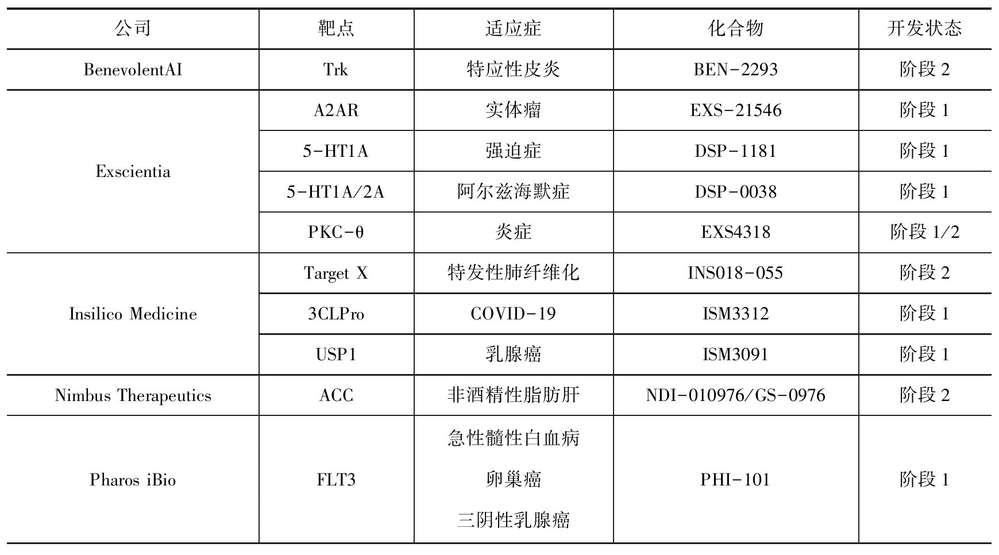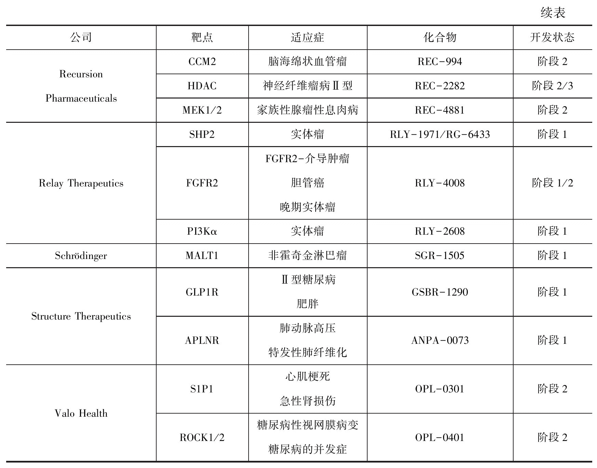

资料来源：F.Pun, I.Ozerov, A.Zhavoronkov.AI-powered therapeutic target discovery[J].Trends in Pharmacological Sciences，2023，44（9），561-572.

## 7.1 AI 制药的瓶颈与风险
数据制约：AI 制药依赖海量数据训练模型并提升准确性，当前数据多来自科研基金、公开出版物等，来源复杂、质量参差，需耗费大量精力甄别整合。计算机科学领域相对开放，而生物医药重在保密，二者形成矛盾。制药行业数据封闭，核心数据因知识产权不易公开。

人才短缺：AI 制药是信息技术与生物医药的交叉，研究人员既需 AI 技术能力，也需生物学、医学、化学等药物研发知识，这类复合人才极度稀缺，培养难度大，国内高校相关专业供给不足。

研发不确定性：新药研发周期长投入大，AI 制药虽潜力巨大，其安全性、预期效果及能否达到传统监管标准仍存质疑。尽管已有多个管线进入临床，仍缺乏上市产品验证其可靠性。

## 7.2 AI 生产制造演进路径
智能制造尚无统一定义。工信部与国家标准化管理委员会 2015 年 10 月发布的《国家智能制造标准体系建设指南》征求意见稿称：智能制造是将物联网、大数据、Cloud Computing 等新一代信息技术与设计、生产、管理、服务融合，具有信息深度自感知、智慧优化自决策、精准控制自执行功能的先进制造过程、系统与模式总称。工业 4.0 汇聚物联网、AI、机器人与先进计算，深刻改变制造业。《“十四五”医药工业发展规划》提出深入实施智能制造、绿色制造与质量提升行动，推动医药工业高端化、智能化、绿色化。制药 4.0 即工业 4.0 在制药业的应用，通过数字化、自动化、智能化生产系统实现高效、灵活、质量可控与可持续发展。

### （1）智能制造体系架构
根据《中国制药工业智能制造白皮书（2020 年版）》，制药工业智能制造目标是按法规要求实现生产记录与管控流程电子化、系统化，确保全过程合规透明，提升质量管控，降低人为合规风险。生产系统应以 `GMP` 为标杆，通过业务全程管控实现自动化与信息化协同，优化业务交互融合，实现整体化与协同能力提升。

总体架构分为设备层、控制层、业务管理层、运营管理层。设备层为物理基础设施，经 `PLC`、`PCS` 采集传感器数据实现完整记录。控制层由 `SCADA` 与自动化控制系统组成，提供数据采集与报警监控整体平台，实现全车间设备数据采集、存储与流程监控。业务管理层面向生产过程，覆盖生产运行与管理、设备、仓储、质量保证与质量控制、能源管理等，实现集成化与智能化。运营管理层覆盖产供销与供应链，实现经营管控整体化，并通过大数据分析实现决策智能化。

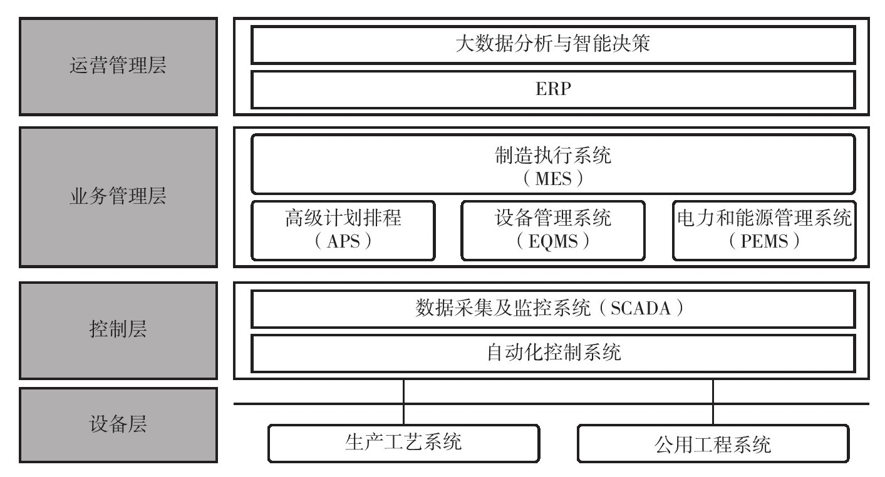

图 7-1　生产制造体系智能制造系统构架

资料来源：工业和信息化部产业发展促进中心和中国医药企业管理协会。

### （2）生产环节 AI 应用场景
工艺设计与放大：机器学习可分析过程开发数据，快速确定最优处理参数或放大方案，减少开发时间。AI 可辅助化学药合成路线设计、反应条件推荐，放大过程中实时模拟预测反应进程并调整参数，提升收率与安全性。

过程控制：在配方驱动生产中，`MES` 可监控重点参数确保按工艺执行，实现质量控制实时检测，替代传统离线实验室检测。先进过程控制 `APC` 建立基于工艺模型的多变量预测或监控模型，结合实时传感器数据实现精准控制，将更广泛应用于智能制造。

过程监控与故障检测：AI 可监控设备运行数据变化，判断维护需求，减少停机。过程分析技术 `PAT` 实现自动取样与关键参数实时监测。视觉识别可管理操作人员行为规范，预警不合规操作，并用于产品质量检测。

### （3）国内智能制造现状与趋势
制药工业智能制造基础薄弱，自动化与信息化水平偏低。行业机械化程度较高，局部自动化应用较多，但多局限于单单元，制剂自动化虽高却封闭，数据难外传，外部系统难控制。各系统集成度低，生产过程孤立，难实现端到端连续生产。物料转运与投放仍依赖人工，形成信息化孤岛。多数药企已具备 OA、`ERP`、`FCM`、`MES` 等信息化基础，但整体建设薄弱，企业间水平不一，且多用于管理办公，缺乏与生产过程深度融合。连续制造、过程分析技术、数字孪生、电子批记录、物联网、大数据、Cloud Computing 等新技术应用仍处探索期。

在政策与效率需求推动下，行业迎来机遇。工信部《医药工业发展规划指南》提出到 2020 年关键工艺自动化、MES 使用率达 30% 以上，建成一批智能制造示范车间。2015 年“中国制造 2025”提出制药智能化、信息化、可追溯要求。2021 年《“十四五”国家药品安全及促进高质量发展规划》强化全生命周期监管。随着监管提升，企业需健全质量体系，智能制造需求迫切。疫苗生产信息化已强制化，`GMP`《生物制品》附录第 59 条要求数据真实完整可追溯。药品上市许可持有人制度与集采加剧竞争，提升生产效率成为转型的内在动力。

对我国制药工业而言，实现智能制造需打好两层基础：底层提升制药装备与过程的自动化、数字化、网络化水平，构建信息物理系统 CPS 的智能物理基础；上层充分采用工业互联网、物联网、工业大数据、Cloud Computing 等技术，建立数据中心与支撑服务平台，实现智能决策、优化管理、协同发展与服务。

在“中国制造2025”战略持续深化、“工业4.0”理念加速落地的背景下，人工智能等关键技术愈发成熟，叠加合规监管对质量与安全的要求不断提升，本土药品生产企业正把握产业风向，加速向自动化与数字化方向探索升级。

与此同时，政务和行业组织对医药制造的智能化进程保持高度关注并持续给予牵引。工信部产业发展促进中心联合中国医药企业管理协会等机构，陆续推出了《中国制药工业智能制造白皮书（2020 年版）》和《制药企业智能制造典型场景指南（2022 版）》，为企业提供方法论指引与场景化落地的经验参考，助推行业智慧生产能力的整体提升。

[1]王颖.成熟`microRNA`识别及其功能预测方法研究[D].哈尔滨工程大学，2016.