# 《人工智能与法律解析》：重塑数字时代法律实践的底层逻辑

## 核心人物档案

**作者：凯文·D. 阿什利**  
当今“AI与法”领域的领军泰斗。匹兹堡大学法律与智能系统讲座教授、学习研究及发展中心高级科学家、计算机科学兼职教授。跨法学（哈佛J.D.）与计算机科学（马萨诸塞大学Ph.D.）双重顶尖学术背景，曾任IBM沃森研究中心访问科学家、美国人工智能协会院士、国际人工智能与法律协会主席、期刊《人工智能与法律》主编。深耕领域30余年，奠基之作《建模法律论证》引入经典HYPO系统，荣获美国总统青年研究员奖。

**译者：邱昭继**  
西北政法大学教授、长安青年学者，中国法学会比较法学/法理学研究会理事。博士毕业于中国政法大学，主攻法理学、马克思主义法学与法学方法论。译笔精准地道，著译兼备，曾获陕西省“特支计划”青年拔尖人才等殊荣。

---

## 重磅推荐

> **“法律研究正从‘分析’跨越至‘解析’，这是一场范式革命。阿什利教授作为开拓者，将三十年心血凝聚于此，成就该领域唯一经典奠基之作。邱教授译文行云流水，法学界与AI界必读。”**  
> —— **于兴中**，美国康奈尔大学法学院王氏民法国法讲座教授

> **“百年前霍姆斯预言法律人当通统计，韦伯梦想法治如售货机。如今‘阿尔法狗’折服围棋，智法崛起。计算模型能否介入推理论证？法学将沦为算法？智能法律人会否取代传统律师？本书给出最前沿的理论与实务双重答卷。”**  
> —— **高鸿钧**，清华大学法学院教授

---

## 译者序言：一场关于“法律智能化”的深度复盘

### 一、 立下“风向标”的学术巨匠

1951年生于纽约的阿什利，人生轨迹即是“AI+法”学科的演进史：普林斯顿哲学士 → 哈佛法学博士 → 曼哈顿顶级律所实务操刀 → 马萨诸塞大学计算机博士（师从专家系统先驱） → IBM沃森中心研发法律AI原型 → 匹兹堡大学扎根三十载。  
1985年首发论文切入类比推理，1990年博士论文《建模法律论证》确立基于案例推理（CBR）范式，HYPO系统至今仍是教科书级案例。百余篇高被引论文、多届顶会主席轮值、二十余载主编核心期刊、AAAI院士认证——他不仅见证了学科从“知识表示瓶颈”走向“数据驱动爆发”，更亲手搭建了连接两岸的关键桥梁。

### 二、 一本书读透“AI+法”三重奏架构

本书由剑桥大学出版社2017年出版，获国际学界誉为“极具启发性的集大成之作”。全书构建**“推理模型—文本解析—融合应用”**三位一体知识体系：

| 篇章 | 核心议题 | 关键突破 |
| :--- | :--- | :--- |
| **第一篇：推理的计算建模** | 成文法推理、案例推理、结果预测、论证模型 | 早期“符号主义”巅峰：程序模拟律师思维链，但**依赖人工标注知识**，难直连原始文本。 |
| **第二篇：法律文本解析** | 法律本体/类型系统、智能检索、机器学习挖掘法条与判例、论证要素提取 | **“沃森/辩论者”技术溢出效应**：深度问答、信息抽取、论证挖掘（Argument Mining）打通“文本→结构化知识”链路。法律文本解析 = 统计+NLP+ML自动发现法律数据知识。 |
| **第三篇：融合型法律应用** | Lex Machina、Ross、Ravel等新生代法律App | **范式跃迁**：不再是流程数字化，而是**“推理模型+文本解析”双引擎融合**。App能自动筛选/预订/高亮/汇总信息，甚至挖掘法官/律所/当事人隐性行为模式，完成人类难以企及的海量数据洞察。 |

### 三、 学科演进：从“知识瓶颈”到“数据红利”

*   **起源（1970s）**：布坎南与黑德里克《人工智能与法律推理若干问题考察》开山。
*   **困境（长达数十年）**：核心痛点在于**知识获取**——推理/论证模型需专家手工将法条/判例“翻译”成机器可读逻辑，成本高昂、规模受限，会议长期聚焦“推理机制”而非“数据驱动”。
*   **拐点（近十年）**：存储算力指数级跃升 + 法律大语料库积累 → **以数据为中心**的新算法井喷。模式识别、统计关联、预测编码成为主流，揭示权威文本与司法/立法/执业行为深层联结。

### 四、 三大维度的“降维打击”式重构

#### 1. 律师执业：从“手工作坊”到“数据驱动决策”
传统九大任务（文审、研法、项目管理、电子取证、支持、策略、战术、谈判、出庭）中，**除策略/战术/出庭外，其余高重复性环节全面“外包”给法律App**。  
- **诉讼全流程赋能**：挖掘海量卷宗 → 画像法官倾向/律所风格/当事人画像 → 量化胜诉率/赔偿区间 → 制定数据支撑的庭审策略。  
- **效率奇点**：周级工作量压缩至分钟级。

#### 2. 司法审判：智能辅助系统的“超级书记员”
- 卷宗智能解析/要素提取 → 起草判决书/裁定书初稿 → 法官核签。  
- 标准化、一致性、速度三重保障，释放司法资源聚焦疑难复杂案件。

#### 3. 法学教育：课程体系的“强制更新”
- **痛点**：传统教育重“庭辩轻工程”，毕业生不懂“处理工程、预测编码、协作技能”，苏格拉底问答法遭AI秒答挑战。  
- **头部动作**：美顶尖法校（密歇根州立、萨福克、印第安纳等10强）纷纷设立**“法律技术创新实验室/研究院”**，开设《法律分析》《电子取证》《法律信息工程》《量化分析》《21世纪法律实践》等硬核课程。  
- **新使命**：培养“懂法、懂技、懂数据、懂流程”的**法律工程师**。

#### 4. 法学研究：统计学登堂入室，跨学科成常态
- 霍姆斯百年预言兑现：**“统计学家取代史学家成为法学新主子”**。  
- 法经济学后， **计算法学/法律数据科学** 异军突起，脑科学、信息科学、计算机科学成法学新邻域。  
- 研究范式从“规范阐释”转向“实证计量、模型仿真、算法验证”。

---

## 结语

《人工智能与法律解析》不仅记录了一场技术迁徙，更绘制了一张**法律职业生存与进化的导航图**。当“法律文本解析”打通了“推理模型”与“海量语料”的任督二脉，法律不再仅是解释论的文本游戏，而成为可计算、可预测、可工程化的**智能系统**。  
对于每一位法律人——无论你是法官、律师、学者，还是AI开发者——这本书都在发出同一个信号：**拥抱数据思维，重构专业护城河，未来已来。**

# 译者序

全书共计出现六十余个缩写术语。我的处理原则是：依据英文原词直译为中文。为方便读者查阅，我专门编制了一份缩写对照表。部分缩写由四个以上单词组成，直译过于冗长，我便采用音译方式。例如“LUIMA”（Legal Unstructured Information Management Architecture），本指法律领域非结构化信息管理架构类型系统，我按读音译为“卢依马”；“CABARET”（CAse-BAsed REasoning Tool），意指基于案例的推理工具，是海波系统的后继者，音译为“卡巴莱系统”；“ASPIC”（Argumentation Service Platform with Integrated Components），即整合要件论证服务平台，音译为“阿斯皮克”。极少数约定俗成的缩写（如 IBM）保留原文。

此外，涉及特定计算机程序、编程语言或语义标注工具的专有名词（如 SMILE、SPIRE、SIROCCO、BankXX、RUTA、Cerno、LRI-Core 等），因其仅作代称且无特殊含义，保留原名反而更严谨，避免歧义。

为直观呈现法律推理计算模型与文本解析流程，阿什利教授书中配置百余幅图表。我已将绝大多数图表中的英文译为中文；个别为检索截图的保留原样。

受限于译制工期与个人学识，疏漏在所难免，恳请同行批评指正。

邱昭继  
2019 年 11 月 7 日于西法大雁塔校区

① Richard Granat and Marc Lauritsen，“Teaching the technology of practice: the 10 top schools”，Law Practice Magazine，2014：（4），见 www.americanbar.org/publications/law_practice_magazine/2014/july-august/teachingthe-technology-of-practice-the-10-top-schools.html.最后访问日期 2018 年 10 月 3 日。

②［美］霍姆斯：“法律的道路”，载《法律的生命在于经验——霍姆斯法学文集》，明辉译，清华大学出版社，2007 年版，第 221 页。

---

# 中译本序言

得知著作推出中文版，我深感荣幸。衷心感谢西北政法大学邱昭继教授倾力翻译，亦感谢商务印书馆出版。

动笔时，我从未料想此书会在中国问世，更未预见中国会如此高度聚焦“AI 与法”议题。但近期访问杭州、南京数所法学院，让我欣喜地发现：国内已有数十所高校投身该领域研究！这是振奋人心的进展，我期待阅读中国学者的后续成果，并盼望其在 ICAIL、JURIX 等双年会及《人工智能与法律》期刊上发声。

我谦卑地意识到，自己对中国法律实践、案例推理在本土法学演变中的角色知之甚少。近方知最高法已建立指导性案例制度以统一裁判。案例推理正是本书重点（如第 3、4、5、10 章）。在成文法系国家中，案例推理能扮演何种角色，值得深思，或许我的设想尚显稚嫩。

这引发诸多追问：指导性案例下的推理与普通法推理有何异同？强制性案例如何落地与解释？判决书是否提供丰富事实情节？中国法官律师是否会像普通法从业者般类比用案？若是，对法律检索系统有何冲击？系统是否会如第 11 章所述支持概念检索？

美国流传一句“古老中国诅咒”：“愿你生于有趣的时代”。维基百科称其源于虚构。但对中国法学界而言，探寻上述答案的当下，确是“有趣的时代”。本书或许不给答案，但愿能提供一些供中国读者寻答案时参考的思路。

凯文·D·阿什利  
2019 年 9 月 4 日

---

# 献给永远的阿利达

---

# 致谢

匹兹堡大学法学院夏季院长奖学金资助了写作。书稿雏形源于我在博洛尼亚大学伊拉斯谟·蒙德斯法学、科学与技术博士项目的教学，感谢莫妮卡·帕尔米拉尼教授给予机会。维恩·沃克、亚罗米尔·萨维卡、托马斯·戈登阅读初稿并建言，致谢。

特别感谢前博士生、现同事马蒂亚斯·格拉普梅尔。他细读全书，提许多深刻建议。他在法律文本解析、预测、案例论证及机器学习适用法规上的工作，让我确信成书时机成熟。指导他、合作、向他学习，是我教学生涯莫大幸事。

若无妻子阿利达长久的爱与支撑，我无从拥有教师生涯，更无从完稿。女儿亚历山大在科研写作的辛劳中带来欢笑，还帮我挑选了封面。

---

# 第一部分 法律推理的计算模型

## 第一章 导论：人工智能与法律及其在未来法律实践中的角色

### 1.1 概述

人工智能与法律（AI & Law）自 20 世纪 80 年代成型，源头更早，正酝酿一场变革。问答（QA）、信息提取（IE）、论证挖掘团队开发出 IBM Watson、Debater 等系统及其底层开源架构，播下了革命种子，它们正在法律土壤中生根发芽。本书揭示这一过程。

Watson 等系统不会法律推理，只能浅层答题，无法解释或论证。但其依托的开源文本分析工具将深度重塑法律应用：能识别法律文本中与论证相关的信息，将检索推向“论证检索”（AR）新阶段。

AI & Law 研究者构建的计算模型将执行法律推理。新提取的论证信息将模型与文本直连。模型能针对文本输入给出正反结果、预测判局，并给出法律人认可的理由。最终催生“认知计算”型法律应用——人机协同，各司其长。

本章介绍 AI & Law 主题，阐释新解析技术如何借助计算模型赋能实践。

**本章核心议题：**
- AI & Law 的研究对象是什么？
- 法律推理计算模型（CMLR）是什么？
- 自动问答、信息提取、论证挖掘新技术是什么？
- AI & Law 与计算模型在新技术中扮演何种角色？
- 何为概念检索与认知计算？何种法律应用将支撑它们？

### 1.2 AI & Law 与文本解析的前提

多数 AI & Law 研究旨在开发法律推理计算模型，用于论证与预测。CMLR 是实现人类法律推理特性（分析情境、答问、预测、论证）的程序。其子集——法律论证计算模型（CMLA）专攻论证过程。

这类模型将复杂智力任务拆解为计算步骤/算法（如估算侵权赔偿、分析要约承诺）。模型规定输入输出格式，中间构建机制调用领域知识完成转换。

研究中攻克：如何表述规则意旨使程序判断适用性、如何区分疑难与简易问题、案例与价值在规则解释中的作用。答案非哲学而是科学：程序不只模拟，更实际执行任务，并通过实验评估表现。

虽取得长足进步，知识表示瓶颈仍存：模型所需实体知识须人工从判例、法规、合同等渊源提取。专家读文本、转格式，模型无法直连文本，限制了其在实战检索、预测、决策中的应用。

问答、信息提取、论证挖掘的新进展有望破局。
- 问答系统：搜海量文本，定位精准答案片段（Prager 等，2000）。
- 信息提取：摘录文档核心细节（Freitag，2000）。
- 论证挖掘：自动识别文本论证结构（前提、结论、攻击/支持关系）（ACL-AMW，2016）。
三者常借助机器学习处理语义。

统称“文本解析”或“文本挖掘”：指从文本档案发现知识，融合语言学、统计学、机器学习技术，模拟重构信息内容（Hu and Liu, 2012）。针对法律文本称“法律解析”，即从法律数据获取实质洞见（Katz and Bommarito, 2014）。

文本解析或能打开知识获取瓶颈：用自动化替代手工表示文本含义。

因此，部分验推理/论证模型将与解析工具结合，构建新一代法律应用。具体而言，模型将利用从判决、法规自动提取的信息，助人答问、预测、解释、论证，效能超前技术。

同时，AI & Law 能回应商业实验室技术人员的困惑：既能自动提取语义，程序究竟能做什么？该提取何种信息？计算模型展示了新工具如何适配法律知识结构，辅助实务任务。

模型能助高级 AI 智用法律渊源。提取信息不只改进检索、加速获取，更能推理？能助用户立假设、验假设、论证、预测？

答案倾向肯定。但新应用充分释放潜能前，尚需大量研究——本书即聚焦“如何最佳开展研究”，亦助从业者参与研究、运用成果，惠及开发新品的商业公司与求现代化的公共机构。

### 1.3 法律实践智能技术的新范式

法律技术迭代加速。预测编码重塑诉讼取证。Ravel Law、Legal Robot、基于 Watson 的 ROSS Intelligence 等初创引关注、获用户。文本解析催生新流程模型与工具，提效、扩大普惠。

变革带来挑战与机遇，但未来难测。律所缩招致法学院报考降温，权衡就业与贷款成常态。技术能替代哪些任务尚无定论。Remus 与 Levy 指出“律师将被计算机大规模取代”预测“忽视技术细节……理解计算机能不能做哪类任务至关重要。如发现程序文审比尽职调查易自动化，体育稿自动化不意味法律简报即将自动化”①。

> ① 尽管我认同“取代论”被夸大，但二者很大程度上忽略了本书报告的 AI & Law 研究，该研究将使论证检索与认知计算能在实务中辅助律师。

印第安纳大学莫勒法学院 William Henderson 教授主张：法律流程工程已改变且将持续改变实务，法学院必须授流程工程技能。

> 因行业重流程与技术，现授实务技能与领域知识对 2015 届毕业生已不足……法律正从陪审团/法庭辩护转向流程工程、预测编码及所需协作技能，学生未备。（Henderson, 2013, p.505）

流程工程（再造工程）定义为“改变流程”：通过重新设计核心业务流程，解决加速、减耗、增效、提竞争力需求，快速大幅提升绩效（Attaran, 2004）。IT 称“最有效技术”，助沟通、增绩、建模优化评估（Attaran, 2004）。

Henderson 强调流程工程在法律工作演进中的角色，概念源自 Richard Susskind 《律师的终结》：法律工作从定制→标准化→系统化→打包→商品化演进。

> 识别法律文书与司法意见中的递归模式，使流程与技术能常规化、规模化地廉价优质解决需求。传统上由美法学院初级毕业生做的劳动密集型工作……现由印度法学毕业生在 LPO 完成，他们学会设计操作从海量数字文本提取信息的流程。印度毕业生不只获就业，更习得美法学院全无的宝贵技能。（Henderson, 2013, pp.479,487）

Henderson 聚焦用流程与技术设计高性价比方案，赞同 Susskind 视商品化为演进顶点。

> 法律商品指电子器件、在线法律包装或 DIY 终端产品。语境中“商品”指基于 IT 的系统服务……在市场上无差别（在接收者而非提供者心中）。某商品常有高度相似竞品。（Susskind, 2010, p.31）

即：任何人可购买下载、无需律师即用软件解决法律问题——即计算机化法律应用。

#### 1.3.1 旧范式：法律专家系统

流程工程与商品化引发追问：若流程工程追求“极廉极优”方案，谁按客户具体问题定制？若商品化即“DIY”，客户真 DIY？法律应用提供何种支持？能否完成一定程度定制？

不久前，设计法律应用的典型模型是法律专家系统。先驱 Susskind 定义：
> “专家系统”含知识表示与专业技能的计算机应用……能像人类一样解题、建议、执行任务。法律上，我们想用计算机技术让稀缺专业技能与知识更广泛、易获取。（Susskind, 2010, p.120）

### 老派专家系统：规则与启发式的“黄金时代”

早期的法律专家系统并非通才，而是“专才”。它们深耕狭窄的法律细分领域，却能像资深律师一样，通过追问关键细节、依据回答定制方案、并给出推理路径来展现专业深度。这种“专业知识”的核心，并非死板的法条，而是老练从业者在实战中总结出的**启发式策略**——通俗说就是“经验法则”。它们实用管用，却无法保证百发百中。

这些规则以陈述性语言编写，明确列出触发条件与结论。但规则从哪来？全靠**人工“榨干”专家大脑**：工程师反复提问、设定场景、让专家解题，再逼问“你当时怎么想的、用了啥规则”，最后才敲定入库。

#### 案例复盘：沃特曼的产品责任系统 (W-LES)

上世纪80年代，唐·沃特曼打造的 W-LES 是法律推理计算模型的教科书级范例。它专攻产品责任纠纷：输入案情描述，输出和解金额建议及完整分析逻辑。

系统内置的启发式规则把“损失”拆解为三类（人身伤害、死亡、财产损失），并据此界定原告资格；核心规则 4 则像严谨的法条清单，将严格责任的适用拆解为：损失成立、无附带销售抗辩、被告身份符合（制造/销售/出租）、被告担责、管辖权连接点（加州法/使用者/购买者）、产品出厂即有缺陷、流通过程未实质改变（或被告合理预期未改变）等一连串硬性条件。

推理引擎采用**正向链接**机制：像流水线一样循环扫描规则库，凡是条件匹配案情事实的规则即刻“触发”，把推断结果写入事实库，直到没有新规则能触发为止。若终点规则代表解决方案，任务便宣告完成。解释功能则提供“逐位跟踪”，清晰还原每一步推导的依据。相比之下，同期也有系统走**反向链接**路线：从目标倒推，层层分解所需条件，直到事实库支撑起所有前提。

#### 三座拦路大山：沃特曼的设计困境

沃特曼在构建时撞上三堵硬墙：

1.  **法域差异巨大**：各州过失责任规则迥异（共同过失一票否决 vs 比较过失按比例分担）。他的对策是内置多州规则库，让用户自选适用法域对比差异。
2.  **法律概念模糊不清**：“合理恰当”“可预见性”等不精确术语，法条不定义、判例不统一。沃特曼曾权衡过列举过往用法、展示案例供用户自判、甚至给适用度打分等方案，最终妥协：**直接问用户“这个词这儿适用吗？”**。
3.  **事实与法律双重不确定**：律师对证据认定、法理适用都没底。沃特曼提出把不确定性作为规则前提，或作为独立调整规则，最后建议用户：先按确定性推断出初步结论，再用概率系数修正。

---

### 专家系统的“余热”与“天花板”

虽非当下主流范式，专家系统仍活跃在一线：
- **Neota Logic** 赋能律所、法务、法学院自建系统，覆盖反腐败、跨境破产风险、家庭医疗假法案等；
- **CALI 与芝加哥肯特法学院**联手推出 A2J Guided Interviews®，让非程序员也能搭建引导自辩当事人走完立案流程的专家系统；
- 企业合规管理系统的业务规则引擎，本质上也是专家系统变体。

**为何至今未成法律界“杀手级应用”？** 三大硬伤绕不开：
1.  **不确定性处理靠拍脑门**：早期技术处理模糊、不完整信息的方案多为临时拼凑，靠不住。
2.  **知识获取瓶颈**：手工采访、建模、录入，慢得像蜗牛，贵得像黄金，规模化几乎不可能。
3.  **文本解析“不接地气”**：新 NLP 能抠出部分语义信息，却**提取不出专家系统能直接跑的规则**。

---

### 新范式登场：论证检索与认知计算

既然“机器替人判”走不通，不如让“机器助人判”。**论证检索**与**认知计算**这对新搭档，不包揽裁决，而是从海量文本中挖掘语义、梳理关联，把弹药递给人类决策者。

#### 论证检索：从“找文档”到“找论据”

概念检索早有渊源：索瓦定义概念为可语言化的实体/动作/状态，尚克 1981 年即提出“概念信息检索”——用概念表示替代关键词匹配，支持跨类推断。法律界哈夫纳、宾早年探索过，但受限于技术落地难。

现代 **概念法律信息检索 (CLIR)** 的核心进化在于：**不再只匹配主题，而是模拟用户解决问题的认知需求**——聚焦法律论证中的概念角色（如“事实支撑”“法理依据”“反驳靶子”）。

迪克与赫斯特 1991 年就设想按论证图式检索案例辅助律师构建答案，苦于当时自然语言分析/生成不堪大用。如今，**论证挖掘技术成熟，自动识别案例文本中的论证结构、证据链、裁判理由成为现实**，催生出**论证检索**新范式：精准定位能支撑或反驳特定主张的论据片段。

#### 认知计算：人机“双人组”，各司其职

别被名字误导，**认知计算 ≠ 造人脑**。它的操作单位是**“人机协作团队”**：
- **机器端**：理性、算力强、记忆全、擅长从海量语料中抽取候选方案、按相关性排序、高亮关键点、适时推送；
- **人类端**：掌握专业判断、直觉、同理心、道德底线、创造力，最终拍板定制方案。

**知识源头彻底倒置**：
| 维度 | 专家系统 | 认知计算 |
| :--- | :--- | :--- |
| 知识载体 | 专家脑中规则 → 工程师手工建模 | 领域文本语料库 → 机器学习自动挖掘模式 |
| 核心逻辑 | 符号推理、规则触发 | 统计学习、语义匹配、相关性排序 |
| 不确定性 | 显式规则处理、人工赋值 | 隐含于模型权重、训练数据分布中 |

认知系统不“读懂”文本，但能**智能化处理文本**：识别与问题相关的要素，以人类易懂的方式在恰当时机呈现。论证检索正是这种分工的典型落地——机器负责“从海量判决中挖出最强论据”，律师负责“组织成庭上能赢的逻辑链”。

---

### 通往新法律应用的“施工图”

目标清晰，路在脚下。学界与业界公认认知计算在法律领域潜力巨大，但**落地细节仍在摸索中**。好在积累已厚：
- 问答系统、信息抽取、论证挖掘等新 NLP 技术正加速渗透；
- AI 与法学界多年沉淀的法规建模、案例推理形式化成果，为新工具指明了“切入点”与“任务边界”；
- 过往研究揭示的**设计约束**（如法律推理的开放性、语境依赖性、价值判断介入），帮新一代开发者避坑指路。

未来几年，注定是法律实务与 AI 法学史的**高光时刻**。本书旨在梳理现有工具箱，探索“老技术+新文本处理”的组合拳，邀你共赴这场技术革命。

---

### 沃森能不能“考”过律师资格？

且慢！革命结束了吗？IBM 沃森在《危险边缘》大秀问答实力，姊妹项目“辩论者”已学会从文本挖论据。直接把它们扔进法律语料库，不就能搞定法律推理了？

**不行。** 本节拆解为何它们**不具备法律推理能力**，同时说明沃森架构（基于开源 UIMA 框架）为构建真·法律推理系统提供了宝贵的**文本解析组件与任务拆解思路**——哪怕不依赖 IBM 专有技术，GATE 等开源平台同样适用。

#### 沃森的“危险边缘”实战复盘

2011 年，沃森在黄金时段节目中击败两位人类冠军（累计奖金 325 万的布拉德、74 连胜的肯），震撼全美。这继 1997 年“深蓝”赢卡斯帕罗夫后，IBM 又一里程碑。

但沃森也翻车：**决赛轮“美国城市”题，答案指向芝加哥（奥黑尔机场以二战英雄命名，中途机场以中途岛海战命名），沃森却答“多伦多”，且自信度极低（赌注仅 947 美元）。** 观众惊讶的不是它答错，而是它**连“多伦多不在美国”这类常识性硬约束都没内化**。

**核心架构揭秘**：
沃森**没有**掌握不可更改的专家规则或事实知识库。它的大脑是**统计学习模型**：
1.  **海量文本语料**为训练素材；
2.  针对每类“问题/答案”模式，**学会如何提取候选答案**；
3.  **学会识别多维证据**：语法特征、语义线索（概念/关系引用）；
4.  **学会给不同证据打可信度分**；
5.  融合打分，输出最终答案及置信度（问号越多，越没底）。

**本质区别**：专家系统是“规则演绎”，沃森是“统计归纳+证据综合”。它擅长**检索式问答**，不擅长**需要多步逻辑链条、规则冲突消解、价值权衡的法律推理**。这正是我们要构建的新一代法律应用必须跨越的鸿沟。

# 从《危险边缘》到法庭：沃森能当律师吗？

沃森的成长依赖于一批经过人工标注的训练语料。研究者为各类问答对打上标签，这些“带注解”的文本成了机器学习提取信息的范本。沃森通过大量示例掌握了提取技巧，并能将这套方法推广到未标注的新文本上（Ferrucci 等，2010）。

但在实战中，沃森的推理短板暴露无遗。IBM 研究人员复盘发现，面对某题时，芝加哥虽排候选次席，沃森却找不出证据将其机场与二战挂钩。它还学会了“美国城市”这类类别标签并非硬性约束——若题干已暗示“这座美国城市”，它才会加大对美城市的权重。更戏剧性的是，美国境内竟有八座城市叫多伦多，而加拿大多伦多拥有美职棒球队（Schwartz, 2011），这直接导致了它在《危险边缘》节目中的著名失误。

### 将沃森应用于法律

IBM 野心勃勃，试图把深度问答（Deep QA）技术移植进法律界（Beck, 2014）。IBM 总法律顾问罗伯特·C·韦伯曾豪言：

> 抛出一个问题，几毫秒内深度问答就能吞吐分析数亿页文档，挖掘事实与结论……它不会取代律师，因为好律师的核心是成熟合理的推理……但这项技术能拓展我们的能力，助我们更高效工作……IBM 才刚开始探索律师如何用好它。（我们很有把握它能在美州律师考试中大放异彩！）显然，它在两方面大有可为：取证调查、构建论证时的灵感激发。甚至庭审实时部署也不成问题——证人一旦说谎，同事当场就能核实。（韦伯，2011）

> ① Ross Intelligence（2015）如何落地沃森技术，详见 12.2 节。

然而，沃森的翻车现场提醒我们：法律应用远非坦途。设想一档“法律版危险边缘”：主持人宣读“类别：体育法”，肯·詹宁斯抢答“体育法，120 万！”屏幕显示：“经济罢工期，美联棒球队不得合法雇佣替补。”

蜂鸣器响，沃森答：“什么是多伦多蓝鸟队？”

主持人笑了：“正确！蓝鸟队罢工期确实不能雇佣替补。”

这回，知道多伦多不在美国、受安大略省劳动法管辖而非美联邦法（Lippner, 1995），成了法律分析的关键司法考量。可沃森既无“多伦多在加拿大”的地理规则，也无“加拿大法适用于该劳资纠纷”的法律推理链。它根本不靠这些推理作答。

只要语料库收录了那篇法评文章，稍加训练，沃森就能学会识别其相关性，抽取答案并打分。但法律问题不止要答案，还要**理由**。沃森大概率给不出法律从业者能懂的解释——那需要理解管辖权、法律主体、法律冲突等规则概念，而沃森既不懂也不会用。

训练有素的沃森能识别“合法雇佣”“替补球员”“经济罢工”等语义线索，学会在评分时给这些证据赋权。但这够不够支撑“法律上可接受的解释”？恐怕不够（见 1.4 节辩论者讨论）。

法评作者才是真有法律知识，文中总结了管辖权、法律主体、法律选择规则与判例如何支撑结论。若能训练沃森识别、提取这类论证，哪怕它自己不能从第一性原理构建解释，也能把用户引向作者的推理路径。当然，前提是那篇文章及其解释没有过时。

### ### 1.4.2. 问答与推理

这逼出一个根本问题：基于沃森技术的程序，能不能真推理？能不能啃下大一合同法题？韦伯引文里强调“合理推理”，还顺口吹牛“铁定能在律考多选题里高分”（Weber, 2011）。

但论文题呢？它只能靠检索谷歌存下的旧蓝皮书作弊吗（假设 OCR 能认清法学生的草稿字，这本身就是超人任务）？它究竟是个“高级检索机”，凭句法特征与语义线索找旧答案、标证据、打分值？还能把旧论证改造适配新题？抑或能从第一原理破解新题并自圆其说？

为窥见律考论文题所需的法律推理真貌，我们得看看安·加德纳（Ann Gardner）上世纪 80 年代搭的经典计算模型（AGP），它早就能解典型大一期末合同法题（Gardner, 1987）。

AGP 是符号主义路线模拟法律推理的标杆，与沃森的统计路线形成鲜明对比。

## 加德纳的一年级合同问题分析器

凡进过法学院的，见这题型定绷不住：假设买卖双方两周内交换一堆前言不搭后语的电报、订单，标的还是一车盐。买方在明确承诺后找到更便宜货源发电报毁约。核心问题：**合同成立了吗？**

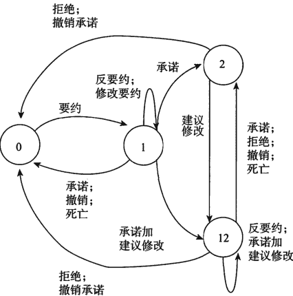

- 图 1.2. 扩充转移网络针对要约与承诺问题的四种状态

- （0）无相关的法律关系；

- （1）要约待定；

- （2）合同成立；

- （12）合同成立和修改的提议待定

- （Gardner, 1987, p.124）

AGP 不读自然语言，输入是加德纳用逻辑语言手工编码的案情描述。它用**扩充转移网络（ATN）**建模分析流程，输出结构化分析。

ATN 是种图结构，把事件序列拆解为状态链与状态间转移，并用规则定义每种转移条件。如图 1.2，AGP 将合同要约承诺过程抽象为四态：无关系（0）、要约待定（1）、合同成立（2）、合同成立且修改待定（12）。弧代表事件驱动的状态跃迁：0→1 需“要约”，1→2 需“承诺”等。

每条弧挂载合同法规则，定义跃迁的法律门槛。例如 0→1 的“要约”弧，规则依《合同法重述》（第二版）§24：“要约即表示愿订约之意愿，使受要约人有理由相信其诚意，受邀承诺即成合同”（Gardner, 1987, p.142）。

AGP 按时间流处理事件，细节存分析树，摘要存输出树，循环执行：
1. 取下一事件。
2. 查当前状态及 ATN 允许的出弧。
3. 逐弧测试事件是否满足规则前件，更新分析树。
4. 若涉及“疑难法律问题”（见下），分支记录多种合理解释。
5. 修剪分析树生成摘要树，聚焦最优路径防爆炸。

### 实战演示：AGP 处理首个事件

> 7 月 1 日，买方发电报予卖方：“客户急需盐，即刻装车。愿以 $2.40/英担购入车货？” 卖方当日收讫。

输入非文本，而是基于谓词逻辑的手工形式化表示（详见 2.3 节）。片段如下：

```
（发送 1）（代理发送 1 买方）（ben 发送 1 卖方）（obj 发送 1 电报 1）？
（电报 1）（句子 S13）（文本 S13： “你能以每英担 2.40 美元的价格提供货车吗？” ）
（道具内容 S13 Prop13）（文字力量 S13 Q13）（是非问题 Q13）
（有效力 S13 R13）（要求 R13）。
Gardner, 1987, pp.89,105,111.
```

上述 `Send1` 为买方发送行为实例，`Telegram1` 为电报实例，`S13` 为句子实例，命题内容见 `Prop13`，言语行为力度为“提问兼要约”（Gardner, 1987, pp.89,105,111）。

步骤 3 中，程序收集弧关联规则。规则同事件一样，皆为手工逻辑化。如 0→1 弧规则定义“要约”重述 §24，含前件谓词：
1. 潜在要约人就交换内容有某种表示。
2. 交易条款合理确定。
3. 该表示包含邀请受要约人承诺的言语行为。
4. 受要约人受邀付对价，要约人显愿仅凭承诺即受拘束（Gardner, 1987, p.142）。

程序尝试将案事实例绑定规则变量，搜索所有可行绑定，生成多分支分析树。“疑难问题”也触发分支。启发式剪枝防指数爆炸，聚焦最优路径。

顺带一提，近年“智能合约”研究也用有限状态自动机建模合同状态（Flood & Goodenough, 2015），甚至用启发式规则模拟《联合国国际货物销售合同公约》推演临时法律状态（Yoshino, 1995, 1998）。

加德纳的启发式是典型 AI 手艺：让机器干人类也头大的事——法学生得在交叉通信中筛选关键点，判断合同是否成立。

## 加德纳区分疑难和简易法律问题的算法

法学生、律师、法官都得会区分“难案”与“易案”，这涉及事实认定、实体法适用、举证责任分配等程序性判断。这根植于法哲学深处（如富勒批判哈特“法律语词有核心与阴影”之说，Hart, 1958; Fuller, 1958），也关乎法律援助门诊如何分流案件。

但从计算建模看，“区分难易”本身就是硬骨头。加德纳强调：程序区分难易的方法必须**简单**。

AGP 用启发式算法搞定（Gardner, 1987, pp.160-161）。图 1.3 是埃德温娜·里斯兰对该算法的重述（Rissland, 1990）。

[PRE核心逻辑：对规则每个谓词跑三测：
1. 常识知识（CSK）规则能直接出答案？
2. 匹配谓词正例？
3. 匹配谓词反例？

判定树：
- 无 CSK 答案：
  - 既不匹配正例也不匹配反例 → 疑难
  - 仅匹配单一正例/反例 → 简易
  - 正反例皆匹配 → 疑难
- 有 CSK 答案：
  - 既不匹配正例也不匹配反例 → 简易
  - 仅匹配单一正例/反例：
    - 仅当 CSK 答案一致 → 简易
    - 否则 → 疑难
  - 正反例皆匹配 → 疑难

图 1.3. 加德纳区分疑难/简易法律问题启发式 (Gardner, 1987; Rissland, 1990)

例：规则要求“要约人表示愿订约意愿”，前件含“要约人执行邀请承诺的言语行为”。通常这不算难点，但偶尔引发诉讼。AGP 若有该言语行为的 CSK 定义、正反例库，便可套用上述启发式裁决难易。

跑完全流程，AGP 产出详细分析树——这本质上就是**推理溯源**，能向人类解释结论。如对事件 1，AGP 断定：存在待定要约，买方电报显示明确合理的订约意愿（Gardner, 1987, Fig 7.1, p.165）。

···

若想让程序过律考，AGP 划出了沃森们必须跨的三道坎：
1. 拥有**法律规则与概念的推理模型**；
2. 能**区分疑难与简易法律问题**；
3. 能**用法律从业者听得懂的方式解释推理**。

赢《危险边缘》的沃森**不会解释**。哪怕它解释，依据也是“句法特征与语义线索支撑答案置信度”（Ferrucci 等，2010, p.73），这与法律人期待的“法律理由”八竿子打不着。

即便沃森跑不了 AGP 式推理，它能识别旧法律解释的特征吗？能挖掘旧蓝皮书、旧法评论文章，把旧论证移植适配新题？能在海量前例中精准定位与用户查询相关的论证？能识别出论证里的规则引用、前件满足情况、事实适配细节？

这些问题，第三部分细说，这里先埋个伏笔。

## ## 1.4.3. IBM 的论辩者程序

能不能训练沃森挖掘文本论证？IBM 2014 年春演示的“辩论者”给了肯定答卷。它是沃森后裔，沿用部分文本处理技艺做**论证挖掘**（Newman, 2014; Dvorsky, 2014）。

辩论者任务：给定任意议题，“探测相关主张”，输出“正反方最强主张预测”。实测议题：“应禁止向未成年人销售暴力视频游戏”。流程：
1. 扫 400 万维基条目；
2. 召回 Top 10 相关条目；
3. 扫这 10 条目 3000 句子；
4. 识别含“候选主张”句子；
5. 确定主张边界；
6. 判断主张立场（正/反）；
7. 生成最高主张预测的演示稿；
8. “准备提交！”（Dvorsky, 2014）

虽输出为语音，可视觉化呈现。图 1.4 为据视频手工重构的论证图谱（Dvorsky, 2014）。根节点为议题命题，实线箭头连接支持节点，虚线连接攻击节点。端到端耗时 3-5 分钟。后续演示覆盖更多议题。

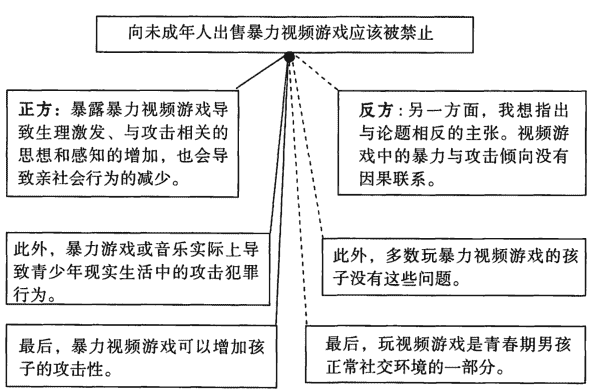

图 1.4. IBM 辩论者针对暴力视频游戏主题（根节点）输出的论证图表 （见 Dvorsky, 2014）

对比图 1.5 的**法律论证**：加州民法典 §1746-1746.5 限制向未成年人售租“暴力电子游戏”，第九巡回法院在《视频软件经销商协会诉施瓦辛格案》（556 F.3d 950, 9th Cir. 2009）依美宪一、十四修正案审查其合宪性。作为推定违宪的基于内容的言论限制，法院适用**严格审查标准**。

# 解码法律AI：从论证图谱到认知计算，这份技术路线图你看懂了吗？

法律推理的自动化，从来不是简单的“关键词匹配”能搞定的。它需要机器真正读懂法律文本背后的逻辑骨架——谁在支持谁？谁在反驳谁？证据达标了吗？权威来源是什么？

本文带你深度拆解法律AI的核心技术图景：从论证结构的可视化建模，到Watson式问答系统的底层架构，再到概念提取与关系挖掘的实战细节，最后梳理出一条通往“认知计算法律应用（CCLA）”的清晰进化路径。

---

## 1.4.3 法院怎么推理？论证图谱里的“六大特征”

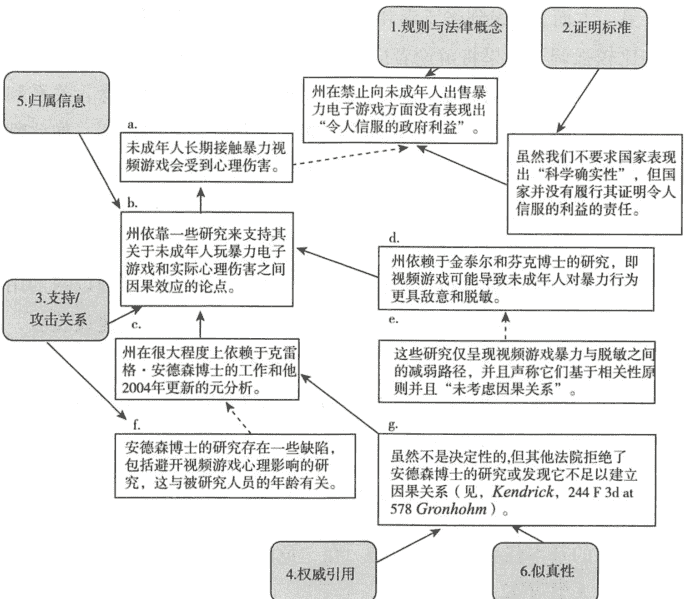

**图 1.5. 表示涉及暴力视频游戏主题的现实法律论证**

别被枯燥的案例名吓退，*Brown v. Entertainment Merchants Association*（暴力游戏案）的论证图谱（图 1.5）堪称教科书级范本。法院判定加州法案违宪，核心在于：州政府拿不出“压倒性利益”来证明禁售暴力游戏的正当性。

图 1.5 把这场博弈拆解成了节点与弧线：实线箭头=支持，虚线箭头=攻击。a、b、c、d 是加州政府的“进攻阵地”，e、f、g 则是法院的“反击箭头”。有趣的是，图 1.4（辩论赛论证）与图 1.5（法院判决）虽话题相同、素材相似，但**法律论证自带六种“原生属性”**，这是辩论赛不具备的：

1.  **规则统帅**：法律规则与概念主导裁决，而非单纯修辞；
2.  **证据分级**：证据评估受“证明标准”支配，不是所有论据同权重；
3.  **结构显性**：支持/攻击关系显式绑定在各级主张上，逻辑链条清晰可查；
4.  **权威锚定**：判决必须显式引用判例、成文法等权威来源；
5.  **归属标注**：标明“州政府主张”“法院认定”等来源，直接影响证明力判断；
6.  **合理度谱系**：文本主张的说服力呈现梯度，非黑即白。

这不是贬低辩论赛，而是划清界限：**Debater 想进法律领域，必须先“长”出这六种能力**。识别概念、关系、论证元信息，是前提。做到这点，法律检索就能从“找文档”进化到“找论证、找逻辑、找相似案件推理路径”，甚至支持论证对比、结果预测、反驳建议等高阶推理。而本书第一部分详述的“论证模型”与“论证型式”，正是实现这一跨越的基石（详见 12.3 节）。

---

## 1.4.4 法律问答：Watson 如何“读懂”合同与案例？

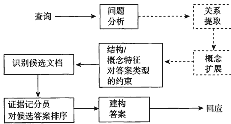

**图 1.6. 针对包含合同在内的法律文件的文本分析器结构（虚线框表示用于语义分析和概念信息检索的构成要素）**

Watson 在《危险边缘》赢人类冠军，靠的是三步走：**问题分解 → 候选检索 → 置信度排序**。放到法律场景，这套流程怎么落地？Legal OnRamp（LOR）的合同审查实战给出了标准答案。

### 痛点：布尔检索搞不定“条款定位”
律师想问：“哪些合同正文（非附件）里藏着‘间接损失免责条款’？”关键词搜索核心痛点有二：
- **结构盲区**：无法指定“合同正文”vs“附件”位置；
- **表达多变**：“不承担附带损害”“对后果性损失免责”“滥用产品造成的损失概不负责”……同一法律概念，自然语言有 N 种写法。

### Watson 式解法：三层架构 + 两大核心引擎
图 1.6 展示的高层架构里，虚线框内的**关系提取**与**概念扩展**是破局关键。

#### 核心引擎一：关系提取 —— 穿透语法看语义
目标：识别“实体 A <关系> 实体 B”，不管你怎么改写句式。
- **合同场景**：`<当事方> <签署> <保密协议 (NDA)>`。无论写“Newlin 与 Vafa 签署 NDA”、“Ungar 签了保密协议”、“Hirsch 受雇时签过 NDA”，系统都能抓住核心三元组。
- **侵权场景**：`<疫苗> <可导致> <伤害>`。法院认定“DPT 疫苗可致急性脑病致死”，律师一键调取同类因果认定案例。
- **商业秘密**：`<被告> <签署> <保密协议>`，批量筛选违约风险主体。

#### 核心引擎二：概念扩展 —— 打通同义/近义/别名壁垒
系统自动聚合语料库中语义等价的表达，不靠人工词典，靠数据驱动：
- `<保密协议>` = {保密协议, 不公开协议, 含保密条款的雇佣合同}
- `<非竞争协议>` = {非竞争协议, 不竞争协议, 不竞争协定}
- `<水痘疫苗>` = {Varicella vaccine, Chickenpox vaccine, VARIVAX}

**训练闭环**：人工标注少量“种子样本” → Watson 学习句法语义特征 → 自动标注全量语料 → 迭代优化。证据评分器不再硬编码，而是从正负样本中学习不同问题类型下各特征的权重。

---

## 1.4.5 工具箱从哪来？商业云 vs 开源生态

不想被 Vendor Lock-in？两条路可选：

| 维度 | IBM Watson Developer Cloud / Alchemy Language | 开源阵营 |
|------|-----------------------------------------------|----------|
| **形态** | 商业化 API，开箱即用，需 License 费 | 基于 UIMA（非结构化信息管理架构）等 Apache 框架，需二次开发 |
| **优势** | 工程化成熟，文档完善，非程序员也能调用 | 免费可控，学术界持续迭代（如 Grabmair 等人用开源工具提取疫苗赔偿案论证要素，显著提升检索排序） |
| **参考价值** | 即使不用 IBM，其**服务编排框架、能力拆解颗粒度、面向非程序员的交互设计**都是极佳范本 | 核心算法透明，适合深度定制法律垂类任务 |

**结论**：工具已备，关键在**“如何将通用 NLP 能力对齐法律推理的特殊需求”**——这正是本书后续章节的主战场。

---

## 1.5 本书导航：三部曲直通“认知计算法律应用 (CCLA)”

想象一下：输入法律问题，系统输出**可信的解释 + 完整的法律论证 + 结果预测**。这还没完全实现，但路线图已清晰。本书分三部分，层层递进：

### 第一部分：大脑——法律推理的计算模型（Ch2–Ch5）
**核心任务**：给理由、讲逻辑、做预测、构论证。
- **Ch2 成文法推理**：逻辑模型 vs 真实释法，如何用计算辅助找规则、解释规则；
- **Ch3 案例推理**：普通法核心——类比推理的计算建模，案例表征、规则融合、价值权衡；
- **Ch4 结果预测**：基于案例/机器学习的胜败率预测，兼容性评估；
- **Ch5 论证模型集大成者**：规则推理 + 类比推理 = 完整法律论证生成（可视化图解），直指文本解析对接口。

> *痛点提示*：这些模型目前靠**人工填充知识库**（知识获取瓶颈），急需文本解析自动注入。

### 第二部分：眼睛——法律文本解析技术（Ch6–Ch10）
**核心任务**：从非结构文本里“挖”出语义概念、关系、论证结构。
- **Ch6 本体与类型系统**：法律本体、UIMA 类型系统、LUIMA（法律域扩展），让检索懂“意义”；
- **Ch7 检索进化史**：从关键词到语义检索的商业化落地；
- **Ch8 机器学习实战**：电子取证、法律检索中的监督/非监督学习；
- **Ch9 成文法语义挖掘**：规则类型、条款功能、条文间引用关系（LUIMA 规则提取 + ML）；
- **Ch10 判决语义挖掘**：识别“裁判规则”“事实认定”“规则适用”“论证型式”等论证角色标注。

### 第三部分：手脚——模型落地与新一代应用（Ch11–）
**核心任务**：把“眼睛”挖到的语义，接到“大脑”模型里，跑通端到端。
- 论证感知的概念检索；
- 直接对接法律数字文档的推理引擎；
- 预测 + 解释 + 论证生成的 **CCLA（认知计算法律应用）** 原型。

---

## 1.5.1 & 1.5.2 逐章速览：你最关心哪一环？

| 章节 | 核心看点 | 适合人群 |
|------|----------|----------|
| **Ch2** | 逻辑模型如何处理“歧义、冲突、缺口”？真实释法案例拆解 | 立法技术、合规自动化研发 |
| **Ch3** | HYPO, CATO, SMILE 等经典模型 PK：怎么表征案例？怎么类比？怎么融合规则？ | 判例检索、类案推送产品经理 |
| **Ch4** | 案例基预测 vs ML 预测：特征工程、可解释性、文本兼容性实测 | 法律科技数据科学家 |
| **Ch5** | **论证图谱、论证型式、辩证结构**——法律推理的“操作系统内核” | 智能写作、庭审模拟、论证挖掘工程师 |
| **Ch6** | LUIMA 类型系统设计：如何定义法律实体、关系、论证角色？ | NLP 建模师、知识图谱架构师 |
| **Ch7** | 商业法律检索架构演进：语义匹配、查询扩展、结果聚类实战 | 法律检索产品经理 |
| **Ch8** | 电子取证 TAR（技术辅助审查）流程、主动学习策略、小样本挑战 | 诉讼支持、合规审计团队 |
| **Ch9** | 成文法功能性标注：定义条、授权条、程序条、引用链自动提取 | 智能立法、法规库建设 |
| **Ch10** | 判决论证要素序列标注：规则陈述、事实认定、适用推理、裁判结果 | 裁判文书结构化、类案智能推荐 |

---

### 写在最后：别让“法律科技热”淹没了“AI与法”三十年的积淀

当下 LegalTech 狂欢，大多停留在“用数据猜结果”。本书不同：**聚焦“语义法律知识”如何被表征、检索、推理、解释**。AI与法学者三十年踩坑总结出的——**什么有效、什么失效、边界在哪**——正是当下研发者冲刺 CCLA 必须兑现的“技术债”。

下一站，我们先深入 **Ch2**，看看成文法推理的逻辑内核到底长什么样。

#### 1.5.3. 第三部分：融合计算推理模型与法律文本

借助前两部分构建的模型与工具体系，系统能够直接利用从法律文本中抽取的概念信息，实现法律推理、解释、论证及预测等核心任务。其核心思路是：让文本解析技术自动填充计算模型的知识表征骨架。如此一来，沃森服务与非结构化信息管理架构（UIMA）工具便可有效缓解知识获取瓶颈，达成概念级法律信息检索，并破解包含“可解释答复”在内的法律问答难题。第三部分将详细阐述如何串联这些组件，落地认知计算法律应用。

第十一章聚焦于法律问答、信息提取、论证挖掘与计算法律推理模型的深度融合，由此催生出面向概念法律信息检索（含论证检索）的新型工具集。值得庆幸的是，这些工具无需预先处理全库文档。在规划法律应用时，文本处理模块仅负责识别概念、角色、关系及论证要素，无须批量吞吐语料。新技术可作为全文检索引擎与用户之间的“智能过滤层”：先由传统检索召回候选文档，再依据概念匹配度、论证关联度对结果重排。第十一章实证表明，引入论证相关信息显著提升了全文法律系统的排序质量。

第十二章进一步揭示：上述工具可与第一部分的推理/论证计算模型无缝对接，打造“人机协同”的新范式——各司其长，共同完成智力任务。推理、解释、论证、预测模型将在“定制化商品法律服务”中发挥互补作用，提供可复用的流程范式、任务模板，并明确需落地的概念、角色、关系。新工具建立在UIMA等文本解析技术提取的信息之上，赋予系统“读懂法律文本并推理”的能力，从而依用户具体问题定制输出。用萨斯坎德之语，这就是“定制化商品法律服务”的关键手段。

第十二章提出新视角：法律信息查询与问答应被视为“检验法律假设及其适用路径”的手段。系统允许用户协同提出、测试、修正“问题应如何认定”的假设。第12.7节通过实例详解各类法律假设的运作；欲速览系统处理全貌者，可先阅终章再回溯全书。

新应用仍存边界：当前文本解析虽能提取海量概念信息，却难穷尽。大量概念推理链条过长、过度依赖背景常识，超出现有技术识别极限。因此，“现有技术能支撑多深度应用”仍是关键实证问题。第十二章末尾将直面这些残留挑战。

### 1.6. 文本解析技术对法科学生的启示

法律教育界持续呼吁强化实务技术教学。Granat与Lauritsen（2014）梳理出10门聚焦法律实务技术的法学课程，涵盖：实务系统自动化取证/裁判/起草、公益法律专家系统开发、法律程序重构、机器学习在法律数据中的应用、法律信息学等。

乔治城法学院主办“铁技律师大赛”，学生构建法律专家系统参赛（Iron Tech Lawyer, 2015），详见Staudt与Lauritsen（2013）。Lippe与Katz（2014）更直指沃森技术对法律未来的冲击。

本书旨在助法科学生、计算机研究生、法律从业者与技术专家跨越鸿沟，设计并落地“以往技术上不可行”的法律应用。核心论点：新文本解析工具与计算法律推理模型的结合，为“看见计算机落地法律流程潜力者”打开了机遇之门。

法学生与从业者无需精通编程，但必须具备“按认知计算程序逻辑思考法律实务”的能力。本书假设读者零代码基础，重点不在代码实现，而在“法律与计算过程的系统性描述”。例如第一部分每个计算模型案例，均剖析：法律处理逻辑、程序模型、预设假设、输入输出表征、计算过程（架构图/流程图/算法高层描述）、具体算法步骤、评估体系、优劣势、与前沿文本处理的关联。

编码只是软件工程终局；关键前置步骤是：明确需求、设计高层架构。即便采用模块化嵌套迭代模型，需求规格与模块高层设计永远先于编码（Gordon, 2014）。

教学目标非“教会编程”，而是“如何提炼法律流程、定义需求、设计高层架构以辅助用户完成法律程序”。架构若稳健，程序员自会落地。

法学生天然适合“识别待建模流程、定义需求、设计架构”。法学教育本质即层层引入新流程并指导逐步处理：一年级课程、模拟法庭、法援诊所、实习、律所/企业法务/技术转移兼职、公益项目……且当代法生自幼浸润软件、通讯新范式、交互规约与网络资源。

研读计算模型描述，能让读者直面法律推理内隐的假设与不确定性——这正是法学全程探讨的核心。这些约束迫使AI与法研究者在模型中规避、技巧化解或适配，直接影响沃森、辩论者类工具的实效。学生还将学会：如何通过实验度量技术性能、解读度量含义。

认知计算法律工具开发处于探索期，IBM亦不例外。Watson Developer Cloud证明：无代码背景也能便捷调用文本解析。来自法学生/学界/执业界的优化建议极具商业吸引力，且已成现实：多伦多大学法学生（IBM请注意：在加拿大）已用沃森服务合作落地法律应用，孵化出“Ross”硅谷独角兽（详见第十二章，Gray, 2014）。

IBM更设“500万美元全球挑战赛”，征集人机协作应对全球重大挑战的认知方案。法学生何不以“认知技术法律应用”破解跨辖区网络犯罪与安全难题？唯一门槛是想象力；本书即为点燃想象力而作。

法律认知计算，迫在眉睫！

## 第二章 建模制定法推理

### 2.1 引言

法域本质是规则体系，海量规则固化于成文法与规章。规则可逻辑表达、计算机可演绎推理，似乎“用计算机建模制定法推理”唾手可得：输入事实 → 程序匹配规则 → 判定前提满足与否 → 输出解释性结论。

现实远比设想复杂。成文法常含模糊性、句法歧义、语义含混、结构不确定。程序欲适用单条规则，即面临：采哪种逻辑诠释？如何处理模糊开放条款？如何识别例外？本章将“单条规则的演绎适用”与“成文法解释的复杂博弈”对照：后者常涉及相互冲突却均合理的论证。经典逻辑模型在法律不确定性前失效——即便当事人对事实与规则达成共识，仍能构建支持/反对同一命题的合法论证。

尽管棘手，制定法推理自动化需求迫切。本章系统梳理AI与法领域的应对谱系：规范化过程（系统列举法规多重逻辑版本）、逻辑编程实现（Prolog）、业务流程合规模型、基于网络的成文法建模——后两者对认知计算极具价值。

核心议题包括：成文法规则的语义/句法歧义成因？法学家与程序如何应对？何为规范化起草？Prolog与逻辑程序原理？深度/广度优先搜索差异？法律不确定性为何挑战逻辑模型？逻辑程序如何验证业务合规？法规同构知识表征的痛点？引文网络与法规网络图如何赋能认知计算？

### 2.2 建模制定法推理的复杂性源头

成文法与规章是高密度法律文本：专业术语编织的复杂条款界定“法”与“非法”，海量交叉引用与例外条款令非专业者望而却步，甚至专家也难快速定位特定问题相关条款。

AI与法领域深耕“用成文法规则进行逻辑推理的程序”数十年，虽有建树，更深刻认知到困难本质。过程中累积出一批必须直面的约束：规则模糊性与双重歧义、解释复杂性、需支持相互矛盾却合理的论证、法规文本与逻辑表征同步维护的工程难题。

双重歧义是建模核心拦路虎：
- **语义歧义与模糊性**普遍存在：立法概念界定不清，导致适用边界模糊。Waterman构建法律专家系统时即受困于此（§1.3.1），Gardner试以算法区分疑难/简易问题（§1.4.2）。
- 两者源于现实妥协：立法无法穷尽所有场景，只能用概括性术语，交由司法在新场景中诠释；刻意模糊亦利于政治共识（Allen & Engholm, 1978, p.384）。
- 但它们制造法律不确定性：双方认同事实与规则，仍能构建通向相反结论的合理论证（Berman & Hafner, 1988）。
- 即使立法意图明确、措辞直白，对手仍常就术语含义产生合理分歧。经典案例 *Johnson v. Southern Pacific Co.* 中，联邦法规禁止州际运输“无自动碰撞联结器的车辆”，立法目的是强制配备自动联结器保障员工安全。事实无争议：制动员因机车虽装联结器但无法与该餐车自动联结而受伤。法院却在“车辆”“州际贸易”“配备”三个谓词含义上分歧：机车是否需自装联结器？待装期间算“州际贸易”? 餐车与机车是否均“配备”？一审与上诉法院答案截然不同，绝非字面义所能裁定。

#### 2.2.1 语义歧义与模糊性

语义歧义指“术语含义在少数候选项间的不确定性”；模糊性指“术语指称边界的不确定性”（Allen & Engholm, 1978, p.382-383）。根源均为立法使用模糊/未明确定义术语。

#### 2.2.2 句法歧义

句法歧义源于法律语言不遵循单一逻辑结构——自然语言属性使然。与数学/代码不同，文本无法显式指定“如果/和/或/除非”等逻辑连接词的作用域。例外条款与交叉引用的表达方式更加剧混乱：例外可显性/隐性、位于本条/他条/他法中。

Layman Allen证实：甚至简短法条也可产生多重逻辑诠释，深刻影响受监管者。例路易斯安那州法：
> “任何人不得参与/建立匿名本地电话/会话/会议，并使用淫秽/亵渎/粗俗/猥亵/淫荡/不雅语言、淫秽建议或提议，**以及**任何形式的威胁。”

立法者大概率故意使用模糊词汇，但极不可能故意制造刑事标准的句法歧义：单通电话含“淫秽语言**或**威胁”即违法？还是需“淫秽语言**且**威胁”才违法？被告在 *State v. Hill* 中主张“且”，一审采纳；州最高院却将“和”解释为“或”，似违“刑法严格解释”原则。原本可立法无歧义，实为上策。

Allen设计系统规范化流程识别此类歧义：
1. 提取法条“原子”实质命题，标记（S1, S2…）
2. 用命题逻辑显化句法结构
3. 还原命题文本

命题逻辑中符号代表整命题，用连接词组合成复合陈述，真值仅取决于分项真假——不关心内部结构（区别于谓词逻辑，见Clement, 2016）。

对路易斯安那州法应用该流程，生成多个逻辑版本，图2.1展示两个核心版本：

**版本A（析取）：**
若 S1(参与/建立匿名通讯) **且** S2(使用淫秽语言) **或** S3(使用威胁) → S4(违法)
逻辑规则：S4 ← S1, S2 | S4 ← S1, S3

**版本B（合取）：**
若 S1 **且** S2 **且** S3 → S4(违法)
逻辑规则：S4 ← S1, S2, S3

图2.1 路易斯安那州法两种核心诠释的规范化版本与对应逻辑编程规则

### 2.3 成文法规则的演绎适用

命题逻辑规范化法条具多重优势。

首先，显化句法结构让复杂法条更易理解。Allen对比《国内税收法》第354条（公司重组证券税务处理）原文与图2.2规范化版本：后者提取原子命题、用缩进传递简化逻辑结构。

Allen进一步将规范化版本转为流程图（图2.3），每节点对应规范化命题（S1-S9）。流程图比原文甚至规范化文本更直观：清晰展示从“重组证券交换起点(S2)”通向“确认无损益(S1)”的三条替代路径——这些路径虽隐含于文本，却难以直接看清。

企业合规场景下，此类流程图能显化员工监管义务，助其辨明合规红线。

#### (a) 一般性规则

**(1) 原则**：重组方案下，公司股票/证券仅以重组另一方股票/证券交换 → 不确认损益。

**(2) 限制**：若 (A) 所得证券本金超交出本金，或 (B) 收到证券未交出 → 原则不适用。

**(3) 交叉引用**：收到不允许财产的处理 → 见 §356。

**(b) 例外**

**(1) 原则**：(a)款不适用于 §368(a)(1)(D) 型重组，除非 (A) 转让方实质收购全部资产，(B) 所得股票按方案分配。

**(2) 交叉引用**：特殊规则见 §355。

**(c) 特定铁路重组**：不受其他条款限制，依 §77 破产法或《州际商业法》第20b条公共利益批准的铁路重组，适用(a)(1)款及§356。

**规范化逻辑结构（节选）：**

若
[S2] 1. 重组方案下，一方公司股票/证券仅以该公司或另一方股票/证券交换，**且**
[S3] 2. (a) 所得证券本金 ≤ 交出本金，**且**
[S4] 2. (b) 非 (收到证券 **且** 未交出证券) 的情况

# 法律逻辑的计算化实践：从条文标准化到《英国国籍法》的 Prolog 实现

#### 2.3.1. 让法条在计算机上“跑”起来

除了结构化表达，标准化后的法条还能直接在机器上运行。图 2.1 底部展示的是路易斯安那州法规的两个标准化逻辑版本，它们采用的是**霍恩子句逻辑**——一种源自人工智能与计算语言学领域的编程范式。

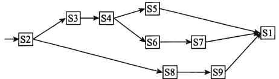

图 2.3 展示了《国内税收法》第 354 节命题化后的流程图。右侧版本（S4：- S1, S2, S3）对应逻辑公式 `S1 ∧ S2 ∧ S3 ⇒ S4`；左侧版本则通过两条规则（S4：- S1, S2 和 S4：- S1, S3）实现了“或”的析取关系。

逻辑编程引擎会将霍恩子句视为可执行程序。例如，右侧子句会被解读为：“为证明 S4，需依次证明 S1、S2、S3”。系统通过向用户询问 S1-S3 的真值，即可自动推导 S4 的结论。虽然此类简单逻辑人工可用真值表处理，但计算机擅长应对图 2.2 那样更复杂的法条逻辑结构。

#### 2.3.2. 谓词逻辑：深入条文的“骨架”

命题逻辑只关注整体句法，若要刻画条文内部的实质内容（如主词、谓词、量词关系），必须引入**经典逻辑（即谓词逻辑/一阶逻辑）**。其核心特征包括：二值真值系统、爆炸原理（从矛盾中推出任意命题）、谓词在变量域内完全定义、以及塔斯基风格的模型论语义。

以“所有人都是凡人”为例：命题逻辑仅用一个原子符号表示；而在谓词逻辑中，可定义谓词 `M(x)` 并用全称量词表达 `∀x M(x)`。

霍恩子句逻辑实现了谓词逻辑的大部分功能，使我们能同时捕捉法条的**实质语义**与**逻辑句法**。经典案例是哈特的“禁止车辆入公园”，用逻辑编程可表示为：

```
违规（X，S）：- 车辆（X），公园（S），在（X，S）。
```

即：`∀X, S (Vehicle(X) ∧ Park(S) ∧ In(X, S) → Violation(X, S))`。逗号代表合取，变量默认全称量化。

若输入事实库：

```
车辆（X）：- 摩托车（X）
车辆（X）：- 汽车（X）
```

系统即可通过**向后链接**（Backward Chaining）机制，将规则结论与其他规则前提匹配，自动证明“摩托车、汽车等不得入内”。

#### 2.3.3. 句法歧义：标准化路上的“拦路虎”

在大规模推广前，必须直面**句法歧义**带来的根本挑战。Allen 和 Saxon (1987) 指出，自然语言法条转形式化规则时，歧义虽可在代码层面消除，但**选择哪个版本作为权威形式化表达，却非知识工程师所能决定**。

即使是仅两句长的《美国法典》第 3505 节（关于第四修正案排除规则例外），标准化过程仅凭句法歧义就衍生出 **48 种** 不同强度的解释版本（Allen & Saxon, 1987）。虽多数显而易见不合理，但“谁来选版本”仍是核心难题：立法者往往未察觉歧义存在；法律专家意见仅供参考；唯有立法机关拥有权威裁决权——却常因缺乏技术认知而缺位。

Grayfred Gray 教授曾推动田纳西州立法起草委员会采用标准化消除歧义，虽获“法律对非律师也应明确”的共识，却因出版商担心缩进排版增加印刷成本而搁浅。如今 Web 环境下空间零成本，标准化版本配合流程图、下拉菜单发布，极大降低了公众阅读门槛。

值得注意的是，多重逻辑解释并未消解法律职业需求，反而催生了**对抗性解释空间**：代理纳税人或保险商的律师利用歧义争取有利解释；合规律师则倾向采纳宽泛解释以规避风险。对认知计算而言，能自动生成所有标准化版本并按限制性排序的系统，将是立法起草的利器——这正是 Allen 和 Engholm (1978) 标准化流程自动化的潜在价值。

#### 2.3.4. 里程碑：用 Prolog 重写《英国国籍法》

Sergot 等人 (1986) 成功将《英国国籍法》（BNA）核心 150 条规则编码为 Prolog 程序（霍恩子句形式）。图 2.4 展示了三条核心规则的“虚拟英语”表达：

*   **规则 1**：X 在 Y 日获公民身份，若 X 在英国出生、出生日为 Y、出生后存活、且父母一方在 Y 日满足 1.1 节条件。
*   **规则 2**：父母一方满足 1.1 节条件，若存在父母 Z，且 Z 在 Y 日为英国公民。
*   **规则 3**：父母一方满足 1.1 节条件，若存在父母 Z，且 Z 在 Y 日在英国定居。

**系统交互模式**：用户输入案情描述（如“Peter 于 1984-01-16 是否为公民？”），系统通过**深度优先搜索**的向后链接机制，从目标结论反向匹配规则前提，直至命中事实、询问用户或查询专家库（四种子问题解决路径）。

图 2.5 的运行日志显示，系统不仅给出结论，还能回答“为什么”（回溯证明链）和“如何”（重演推理步骤），实现了**可解释性自动化推理**。

#### 2.3.5. 工程落地的四大“硬骨头”

BNA 项目并非一帆风顺，研究者直面四大建模难题：

**1. 规则迭代重构**
形式化是试错过程。后续条款常迫使修改前序规则。例如，“单纯证明是公民不够，还须锚定具体授予条款”；又如引入“更精细的时间计算”以处理非公民后续登记为公民的场景，导致现有规则、参数全面调整。

**2. 否定处理**
法条常含否定结论（如“X 在 Y 日非公民”、“X 未在英国定居”）。标准 Prolog 基于**闭世界假设**（CWA）的“作为失败的否定”难以捕捉法律层面的显式否定，需额外机制区分“未被证实”与“被证伪”。

**3. 缺省推理与非单调性**
BNA 第 1-(2) 节涉弃婴：缺省授予公民身份，但若生父母现身且非公民，结论须撤回。经典谓词逻辑/标准 Prolog 是**单调**的（知识只增不减），无法原生支持“撤销已证命题”。研究者指出需引入非单调逻辑（如缺省逻辑、自动认识论）。

**4. 反事实条件句**
法条常用“本应成为公民，但因死亡/放弃而作罢”此类反事实表达，实为立法者避免罗列复杂引用条件的简写。研究者被迫编写“替代规则集”（如：一套针对在世者，一套针对死前满足条件者），且须自行判断哪些条件合理延伸——**再次陷入无立法授权的解释裁量泥沼**。

**5. 开放结构术语**
“良好品格”“合理理由”“足够英语知识”等模糊谓词未在法中定义。系统采用**“询问用户”**或**“预设启发式规则”**应对，但后者无权威性、难穷尽案例。

---

**本质洞见**：句法歧义、重构需求、否定、缺省/反事实、语义模糊——这些统统是**自然语言理解层面的解释难题**。无论人工建模（如 BNA 项目）还是未来自动提取规则（第 9 章议题），均绕不开此核心关卡。

#### 2.4. 从“机械应用”到“司法推理”的鸿沟

BNA 项目目标明确：**将规则机械应用于个案**，而非模拟法院裁决。但对比图 2.5 的演绎式输出与法院实际推理，差异显著：司法推理涉及原则权衡、目的论解释、先例类比、政策考量等，**远超霍恩子句演绎的边界**。这揭示了“法律即代码”愿景与法律实践复杂性之间的深层张力。

**死板条文为何失灵？从“公园卡车”到“车站睡人”，看法律解释的破局之道**

法律哲学家朗·富勒曾用两个极具张力的思想实验，精准击中了机械司法的痛点。二战老旧卡车若停放在公园基座上充当纪念物，算不算“车辆驶入公园”？车站条例禁“睡觉”，因列车晚点打盹的旅客与自带被褥想露宿者，谁才是真正的违规者？若生搬硬套条文，前者无罪、后者有罪，结果却荒谬至极。富勒一针见血：脱离立法目的，法律条文的字面含义根本无法确立。

这便是**制定法解释**的核心困境。麦考密克与萨默斯指出，法院在裁决中赋予法条权威含义、形成适用观点、阐释理解方式，皆属诠释范畴。这一过程绝非简单的逻辑推演，而是包含四类论证的复杂博弈：
*   **语言论证**：依据词汇本义或行业术语；
*   **系统论证**：引入语境协调、判例类推、法理原则与法制史；
*   **目的/评价论证**：锚定立法初衷与实质价值；
*   **跨类别论证**：涵盖立法意图等综合考量。

#### 2.4.1 诠释的“三阶跳”模型：从字面到灵魂的层层递进

作者将上述论证提炼为一个近乎算法的阶梯式流程：
1.  **首级·语言关**：字面义清晰无歧？直接采纳，除非有强力理由闯关。
2.  **次级·系统关**：语言层面存疑？引入系统论证佐证，除非仍有疑义再进一步。
3.  **顶级·目的关**：前两关皆不通？此时唯有综合所有论证，择优而从。

值得注意的是，立法意图等跨类别论证并不固守序列，而作为随时可调用的“万能钥匙”。安·加德纳由此感叹：法律是“规则指引”而非“规则统治”的活动。专家之所以为专家，正在于他们能争辩规则本身，而非唯唯诺诺地遵循。

欲将此法理模型落地为计算逻辑，必须融合规则推理、案例类比、价值权衡与立法目的。哪怕看似演绎确定的适用，也须审视结果是否与法条灵魂契合。回顾前文提及的《英国国籍法》程序等早期尝试，虽实现了逻辑建模，却未触及全谱系诠释。人工智能与法律领域目前的进路，是攻克单一组件——如第三章的案例推理、第五章的论证框架，以及萨托等人提出的解释性论证形式化雏形，以期未来拼装完整拼图。

#### 2.4.2 逻辑为何失效？法律不确定性的深层渊源

经典演绎逻辑为何难担法律推理大任？伯曼与哈夫纳直指核心：**法律不确定性**。

首先，**开放结构概念**天然生成歧义。约翰逊案已证：同一法律概念，双方均能构建合理却对立的论证。

其次，**隐性前提**暗藏玄机。里格斯诉帕尔马案中，谋杀祖父的继承人按遗嘱继承合法吗？字面法条支持，但法院援引“不得因己罪获利”这一普通法基本原则予以否决。这类抽象的“抵消原则”、合宪性审查、法规有效性等隐性条件，极难用刚性逻辑形式化捕捉。

最致命的是，**经典逻辑无法容纳“双方均有理”**。在形式系统中，前提若证成结论C，则¬C在所有模型中必假；绝无可能从同一前提出发，同时推导出C与¬C。可法律实务中，律师恰恰要做这“逻辑上不可能”的事——为正反两面寻找支撑。更有甚者，经典逻辑遭遇矛盾会发生“爆炸”（ex falso quodlibet），如16世纪逻辑学家从“苏格拉底是且非”推导出“人是马”的荒诞演示。

既然法官思维常态是“权衡正反论证、择强而从”，单一演绎模型便显苍白。替代方案指向**计算论证模型**——第五章将详述的、具备多样论证型式的推理引擎。

---

#### 2.5 走出法庭：业务规则与合规管理的数字化转型

法律推理不止服务于诉讼。企业与机构更多时候需要的是**前瞻合规**——在日常运营中规避违法风险，而非事后对簿公堂。这类场景无需完整的诠释引擎，基于规则的逻辑模拟即能大显身手。《英国国籍法》程序即典型代表：它面向行政机关处理常规疑难案件，而非供法官裁决争议条文。

#### 2.5.1 专家系统：将法条“编译”为可执行的业务准则

企业合规面临三重挑战：识别适用法规、定义内控要求、映射至具体流程并量化风险。专家系统正是破局利器。它将法律要求转化为**业务规则**——指导组织行为的操作性准则，再通过管理层级或软件系统强制落地。

商业化工具如**Neota Logic**已让“低代码造系统”成为现实。福利与拉德纳律所即基于此开发FCPA（反海外腐败法）合规模块：录入营销模式、业务量级、客户画像，输出风险可视化评分；细化到招待外官等具体场景，自动触发律师介入咨询。

为便于业务端理解，命题规则常可视化为两种图谱：
*   **流程图（BPMN）**：直观展示合规节点，如图2.7所示保险理赔流程中嵌入的数据隐私规则。
*   **规范图**：抽象法律规范的“知识骨架”。它以本体为底座，通过**涵摄**推理，判定具体事实是否落入法律概念范畴。

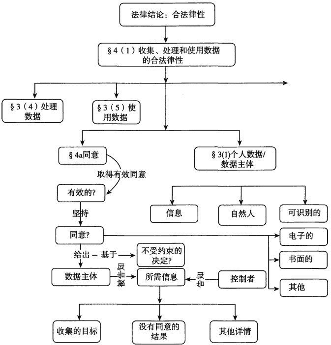

图2.6即展示德国《联邦数据保护法》下“合法收集”与“有效同意”的规范图拓扑。节点为法律概念，箭头为语义关联。例如“有效同意”需满足“书面形式或例外”、“自由决定”、“告知目的”等子条件，这些均可进一步翻译为谓词逻辑公式供机器校验。

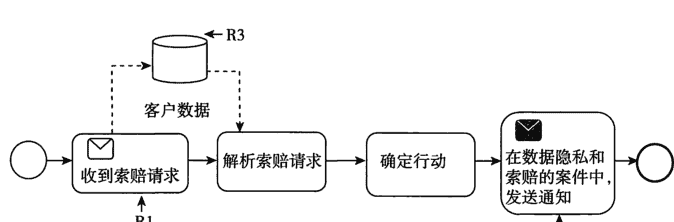

图2.7则演示了带业务规则注解的BPMN流程：保险理赔环节中，R1要求发送隐私通知，R2限定14天内完成，R3禁止数据跨境存储——均对应表2.1中从法条衍生的具体约束。

#### 2.5.2 从“注解流程”到“读懂流程”：自动化合规的进阶之路

当前研究前沿更进一步：让专家系统**直接解析BPMN流程模型**。若业务规则与流程描述共享兼容的形式语言，规则便可直接“注解”于流程节点，实现合规性的自动化审查。

以表2.1的保险案例为例：人类专家依据德国保险协会行为准则及《联邦数据保护法》，提炼出三条业务规则（R1-R3），分别映射至“接收索赔”后的通知动作、时限控制、数据托管地域。这些规则最终均可还原为谓词逻辑形式，成为机器可推理的合规判据。

这标志着法律技术从“辅助裁判”向“治理源头”延伸——不再仅在纠纷发生后介入，而是嵌入业务肌理，让合规长在流程里、规则活在代码中。

# 从法条到代码：业务流程合规的“翻译”难题与技术破局

人类专家面临的首要任务，是啃读那些晦涩的法律条文——比如德国保险协会行为准则与《联邦数据保护法》——并将其手工“翻译”成结构化的释义与命题。这些命题浓缩为表 2.1 第二栏展示的三条核心业务规则（参考 Koetter 等，2014）。

62 但光有规则还不够，必须在业务流程专家的协助下，将这些规则“操作化”，以便精准落地到具体的业务流程模型中。表 2.1 第三栏即展示了应用于图 2.7 简化流程后的形态（同上）。

最后一道关卡，则是在知识表示专家的加持下，将操作规则转化为第四栏所示的谓词逻辑形式，使其能被专家系统直接执行。

**将法律文本转化为业务规则，本质上是一场高难度的“解释博弈”**，它交织着文本理解、常识推理与业务经验。以德国《联邦数据保护法》第 4b 节第一款为例：

### 一、个人数据转移至以下机构时：
- 1. 欧盟其他成员国……

只要转移行为受欧盟法律管辖，就必须遵循第 15、16 条及第 28 至 30a 条的约束。

二、上述规定准用于向其他外国、超国家或国际机构的数据传输。若数据主体拥有阻止传输的合法权益，传输即被禁止，尤其是当接收方无法提供充分保护水平时。

三、保护水平的充分性需结合所有情形评估。

四、传输责任由数据输出方承担。①

**想把这条规定“全自动”形式化？几乎是不可能的任务。** 但资深专家心知肚明：完全形式化未必必要。凭借经验，他们知道应对“保护个人数据”这一核心要求的最优捷径，是直接规避将数据传出德国。于是，专家制定了业务规则 R3（见表 2.1），作为一条启发式的“拇指法则”，强制数据仅在德国境内处理（同上）。

---

## 2.5.3 合规语言的“硬核”指标

单纯的谓词逻辑无法驾驭“将监管规则映射到业务流程”这一复杂任务。一门合格的合规建模语言，必须支撑以下四大支柱：

1.  **可辩驳法律规则推理**。
2.  **逻辑规则至法条渊源的同构链接**。
3.  **多样化义务类型的表达**。
4.  **时间推理能力**（Gordon 等，2009）。

下面逐一拆解。

### 可辩驳法律规则：法律世界没有“绝对真理”

语言首要任务是支持**可辩驳规则**。其特性在于：事实满足前件，结论*可能*成立，但*不保证*为真（Gordon 等，2009）。

为什么需要这套机制？因为法律规则天然**冲突**——它们会导出不相容的结果（同上）。一条规则可能是另一条的例外，或直接排斥、削弱他规则。我们在实践中深受其扰。伯曼和哈夫纳直言：“面对相互冲突的规则与判例，纯逻辑形式主义宣告破产”（Berman 和 Hafner，1988，p.1）。法律推理常涉及缺省推理，具有**非单调性**：已证命题可能被推翻，结论随时可撤回。

在业务流程设计合规场景下，我们假设能规避复杂的诉讼式辩论模型。但资深建模专家 Guido Governatori 指出：语言依然必须支持**“对例外的有效、自然处理，这是规范推理的共性特征”**（Governatori 和 Shek，2012）。

> **对比案例**：看图 2.2，左侧是《国内税收法》第 354 节的繁复原文与命题形式，右侧是其简化逻辑骨架。差距一目了然。

### 同构链接：别让“溯源”变成“无源之水”

业务管理系统肩负合规监控重任，规则库必须持续更新、维护、验证，且结论需回溯法条文本。这就要求逻辑规则与法条渊源之间建立**直截了当的同构映射**：

> “形式模型中的规则，应与法律渊源（如立法段落）中的自然语言文本单元保持一对一对应。”（Gordon 等，2009）

**理想态**：一般规则与分散在不同法条中的例外，在形式模型中**不融合、不抹平**，各自对应各自的文本段落。

**为何执着于同构？**
- **解释力**：系统可通过“触发规则”解释分析，但审计场景下这不够。解释必须引用**权威法条文本**，而非专家二手加工的业务规则。
- **引用与交织**：同构映射是引用成文法、嵌入文本摘录的前提。

**现实很骨感**：
- **映射复杂**：跨条引用、隐含例外让“一一对应”举步维艰。Lehman Allen 指出：法条内部及条际交叉引用极其常见，“忠实表示”往往无益。
- **法规动态变**：立法修订、新规颁布、司法解释更新、行政规章调整……即使视为静态集（如 2.3.4 节），《英国国籍法》系统开发也是“试错 - 修正”的漫长迭代。
- **维护成本高**：文本变，逻辑版本必须跟进。即便用启发式规则（如 Waterman 程序）规避部分麻烦，法规变更依然强制更新。每次增删改规则，都要基于溯源对比重新验证。

**技术尝试**：Bench-Capon（1991）的开发环境在文本、逻辑、媒介三重表征间维护复杂链接，支持局部修改、辅助验证，并能将法条摘录、评注、判例链接至逻辑解释。但代价是：**维护多重表征，开发极其复杂的跟踪软件**。

### 义务表达与时间推理：捕捉“规范的节奏”

合规语言需具备精准的“语义”，覆盖法规施加的各类规范性义务。义务的差异维度包括（Hashmi 等，2014）：

- **持久义务**：生效期内所有实例必遵。
- **达成义务**：生效期内至少完成一次。
- **预先履行**：生效前即可履行。
- **即时触发/违规**：必须立即实现，否则即违规。
- **可补偿违规**：违规后可补救。
- **违规存续**：违规后义务依然存在。

支撑这些义务类型，**时间推理不可或缺**。除义务持续期，法律规则还涉及“生效/颁布时间”“法律效力发生时间”等时间属性（详见 Palmirani，2011）。

---

## 2.5.4 法律规则与业务流程的“物理连接”

流程合规语言（PCL）集大成者，满足上述所有需求（Hashmi 等，2014）。它将法律规则建模为可辩驳规则，规避冲突推理陷阱；以精准语义定义义务，内置时间推理引擎。

但**复杂流程往往“牵一发而动全身”**，运行时合规评估面临海量可变要素。如何在不过度简化的前提下，让模型真正“跑”起来、规则真正“用”起来？

**答案在于建模“工作”而非“流程图”**。模型必须捕获流程产出的**工作成果**及对**环境状态的改变**（Hashmi 等，2014, p.104）。作者引入**工作流网**，一种特化的**佩特里网**（Petri Net，C.A. Petri 1962 年发明），用于抽象表征过程。

> **区别于 ATN**：1.4.2 节的扩充转移网络（ATN）建模的是“法律过程”（如要约承诺），节点为法律状态，弧为受规则控制的状态跃迁。佩特里网则不同：**双节点（位置/转换）+ 记号流动**。

**佩特里网核心机制**：
- 事件 = **转移**（消耗/产生记号）。
- 系统状态 = **位置上记号的分布**（Palanque and Bastide, 1995, p.388）。
- 有向弧连接位置与转移，定义触发条件与效果。
- **触发规则**：所有输入位置均有记号 → 转移触发 → 每输入位置消耗 1 记号，每输出位置产生 1 记号（Kafura，2011，p.2）。

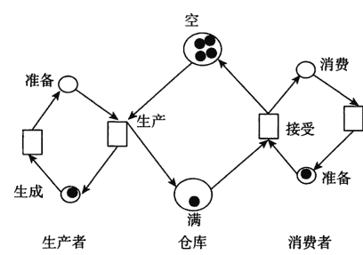

**图 2.8 解读**：一个经典的“生产者-消费者-仓库”资源同步模型。
- 矩形 = 转移，圆形 = 位置。
- “物品”可为实体部件，亦可为信息。
- 仓库容量上限 5 = “空”位置 4 记号 + “满”位置 1 记号。
- 当前状态：生产者已产出 1 件（满库有记号），正在生成新件准备入库（生成位置有记号），但受限于“空”位置记号，生产转移尚未触发；消费者就绪（就绪位置有记号），待“满”库有货即可触发接受转移。

这个简易模型揭示了**构建复杂业务流程软件模型的内核逻辑**。佩特里网天然支持**不确定行为建模**：“多个转移同时使能时，任一均可能为下一个触发者”（Kafura，2011，p.2）。

**工作流网扩展**：引入**标记工作流网**，强制每个节点位于唯一源点与汇点的路径上，并标记“可见”转移（Hashmi 等，2014, pp.104,111）。它能生成**业务操作痕迹**——既可来自专家人工输入，也可来自携带形式化规则的专家系统自动解析。

**合规检查点贯穿全生命周期**：
- **设计时**：在建模环境中静态分析，先验约束违规。
- **运行时**：动态管控执行路径，保障实时合规。
- **事后**：复盘历史痕迹，定位不合规实例。

无论哪个阶段，核心动作都是：**构建该时间点的工作流网 + 生成用于分析的操作痕迹**（Hashmi 等，2014, p.112）。

---

## 2.5.5 实战复盘：从澳洲电信法到荷兰移民局

### 案例一：澳洲《电信消费者保护法》（TCPC 2012）投诉处理合规

Hashmi 团队（2014）实战部署 PCL，切入点是 **TCPC 第 8 节**（消费者投诉管理）。法律要求：电信实体必须证明日常运营合规。

**建模规模**：
- 手工映射第 8 节 → **176 条 PCL 规则，223 个原子命题**，覆盖所有义务类型。
- 经监管机构非正式背书确认规则有效性。
- 协同领域专家绘制 **6 个业务流程模型**（含 41 任务、12 决策点的最大模型），注解业务规则。

**性能与产出**：
- 5 个小模型：**秒级**合规检查。
- 最大模型：约 **40 秒** 完成计算。
- 系统输出**痕迹-规则-任务**三维报告，精准定位不合规路径并溯源法条（见图 2.9 示例，虽为信用卡开户流程，但报告形态一致）。

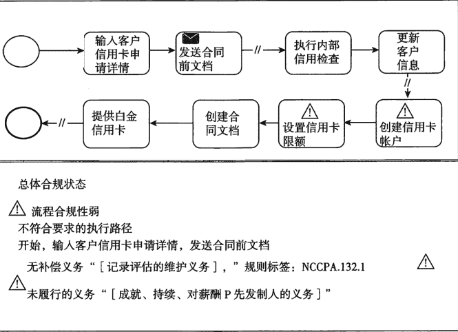

**实战收获**：
- 发现多处**业务分析师未察觉**的真实不合规点（Governatori 和 Shek，2012）。
- 核心问题聚焦三类：**关键信息入库缺失**、**客户未获升级程序告知**、**禁用活动误触发**。
- 其中两项源自 **TCPC 2012 新增要求**（Hashmi 等, 2014, p.114）。
- 团队借助合规环境**修复缺陷**：修旧流程、增新模型（如新增现场/电话投诉渠道）（Governatori 和 Shek, 2012; Hashmi 等, 2014, p.114）。

### 案例二：荷兰移民归化局（IND）的 INDiGO 系统

政府端同样受益。van der Pol (2011) 描述的 **INDiGO** 系统，内嵌基于移民法律法规与政策的业务规则专家系统。
- 规则引擎驱动包含服务执行序列的工作流模型。
- 支持按客户画像调用服务、审计历史痕迹识别违规/低效、向监管机构反馈法规修订建议。
- **核心目标**：**规则引擎即“热插拔”接口**，法律/程序变更仅需改规则，系统快速响应。

虽开局吉祥，但因公开信息断层，INDiGO 最终成败不得而知。

---

## 2.6 制定法网络：用“图谱”看透法律拓扑

专家系统与逻辑编程不是唯一解。**制定法体系可重构为对象关系网络/图谱**。节点连接两类对象：
1.  **引用网络**：法规间的引用链。
2.  **法规网络图**：跨法规的参考概念体系（受多法规约束）。

### 实战：美国 11 州公共卫生应急法规网络

Sweeney 等（2014）项目：将各州公共卫生应急法规建模为**机构通信网络**。
- **节点**：法规指定的、在特定条件下须通信的机构。
- **数据源**：11 州 LexisNexis 法律库。
- **方法**：专家手工检索候选条文 → 研究团队依标准码本**人工编码**每条规定：
    - 是否涉及公共卫生突发事件？
    - 引用关系、主体机构、指示行动（许可/强制）、行动目标、法规目的、适用紧急类型、时间框架与条件。

**网络落地后的分析价值**：
- **视觉与量化比较**：跨州法规方案横向对比。
- **假设生成**：图 2.10 对比佛罗里达州与宾夕法尼亚州的应急监测强制互动网络。
    - 白色链接揭示：社区健康中心、家庭健康机构在 PA 州高度连接，FL 州却缺位。
    - **驱动深究**：回溯两州立法文本，探寻差异成因。

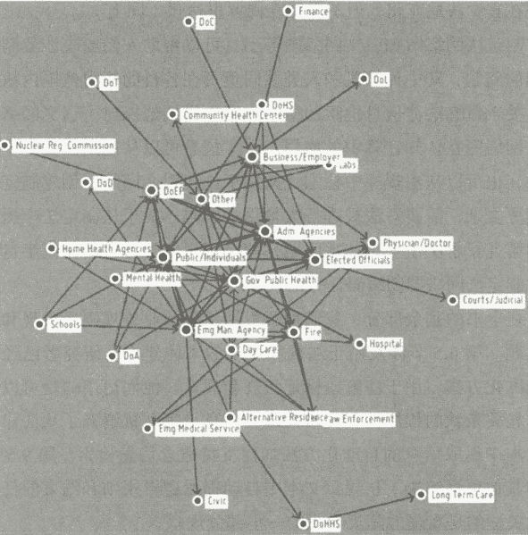

**制定法网络图的核心价值**：
它提供了一种**嵌入法规内部的可视化界面**，让分析师能“看见”法律结构，而非仅“读懂”法律文本。

# 第三章 如何用计算模型复刻“以案释法”的推理逻辑

## 3.1 开篇：为何法律推理离不开“老案例”？

法律条文里充斥着模糊、开放的术语，光靠死读书根本无法精准落地。这时，计算模型若能模仿律师和法官“翻旧账、找相似、做类比”的案例推理思路，就能帮大忙了。法院解释法律概念，核心手段就是回溯过往判例，看这概念以前怎么用、怎么判，进而界定它的当下含义。

本章将系统拆解基于法律案例的类比推理计算模型，主打三大核心流派：
1.  **原型与变型**：核心在于从过往案例中提炼理论，指导新案判决。
2.  **维度与法律因素**：用标准化的事实模式，量化事实对一方主张的强弱影响。
3.  **基于范例的解释 (EBE)**：直接拿先前法院“为何适用/不适用某概念”的解释，来定义法律概念本身。

这些模型的共同使命是：让计算机读懂案件表示，能判断两个案子“像不像”，能自动筛选最相关判例，并通过类比推演生成支持或反对新案结论的法律论证。

法律规则服务于特定立法目的，所以**目的论证**在类比中举足轻重。融合了法律规则、中级法律概念 (ILC) 与适用案例的计算模型，必须把底层价值观纳入考量。本章会详细介绍如何用计算技术实现“目的推理”，把价值观嵌入案例相关度衡量与类比模型中。

注意，这些早期系统不直接啃法律原文，而是在人工手造的结构化案件事实和概念表述上跑逻辑。但假设未来能从判决书、案情摘要中自动抽取这些表示，配合文本解析技术，那一天指日可待。本章也会对比不同案件表示法对文本解析适配性的优劣。

**本章将逐一击破以下硬核问题：**
*   法律概念与案例的辩证关系，计算机怎么表示？
*   案件事实与法院推理，如何数字化建模？
*   原型/变型、维度/因素、EBE 到底是什么？各自捕捉了法院判决的哪些神韵，又漏了啥？
*   “王牌反例” 是什么玩意？语义网络与“标准事实”有何用？
*   如何用算法量化“法律相关性”？
*   程序如何自动筛选案例、比较相似度、做类比、做区分？
*   这类程序靠谱吗？怎么评测？
*   目的推理在类比里扮演什么角色？假设性推理又怎么用？
*   法律背后的价值如何编码？程序如何把价值塞进案例筛选、类比、区分的全流程？

---

## 3.2 法律概念与案例：一场动态的“双向奔赴”

基于案例推理的计算模型，本质上是在模拟**法律概念**与**具体案例**之间的互动博弈。
*   **法律概念** = 宪法、成文法或判例法中那些边界模糊、结构开放的术语。
*   **案例角色** = 在普通法系（民法系也沾光），案例是澄清概念含义、推动规则演变的关键推手。

### 3.2.1 法律过程：分类的“移动靶子”

法律大师爱德华·列维 (Edward Levi) 把案例推理比作“法律的借口”——法官适用既有规则的系统。在他看来，法律概念本质是**分类器**，法律过程就是**“移动分类型式”**：“分类随分类做出而改变，规则随规则适用而改变” (Levi, 2013, pp.3-4)。

具体流程：法院拿新案事实跟先例事实对比，决定旧规则结果能否套用新案。这个比较过程中，概念含义可能被澄清，也可能被搅浑。一旦概念不融贯，法院就引入新概念立例外、修规则；规则连带例外都撑不住了，法院直接推翻重来。

### 3.2.2 实战复盘：产品责任法的进化史

列维用现代产品责任法演变做注脚（这也是 Waterman 早期专家系统的建模对象）。核戏剧冲突在于：旧规则“无合同关系，免责任” vs. 例外情况层出不穷。

1.  **托马斯诉温切斯特案 (1852)**：法院造出“即刻危险性”概念，为第三方索赔开绿灯。
2.  **后续判决**：疯狂给产品打标签——“固有危险”、“非常危险”……概念不断变体、外延不断扩张。
3.  **凯迪拉克诉约翰逊案**：法院划红线——制造危险物品（如家具、汽车）者，无缺陷不担责（故意/欺诈除外）。分类逻辑开始显得生硬、不合理。
4.  **麦克弗森诉别克案 (1916)**：卡多佐大法官一锤定音——**“若物品本质使然，制造过失合理致人身危险，且制造商知悉第三人将不经检验直接使用，则无论合同关系，均负谨慎制造义务。”** 彻底埋葬“合同关系”门槛。
5.  **1964 年《侵权法重述》第 402A 节**：现代严格产品责任法正式登场。

### 3.2.3 法律概念的三重奏：标签、演绎、价值锚点

列维总结法律概念三大功能：
1.  **法治基石**：有含义，能支撑演绎推理（但法律过程 ≠ 单纯演绎套用）。
2.  **聚焦“关键相似性”**：概念是“标签”，串联起社会特定时期公认的、关乎正义的核心相似点。法院判新案，本质是基于相似性推理——**“虽相似，何时区别对待才公平？有效制度必须挑出关键相似，推导共同分类下的正义”** (Levi, 2013, p.3)。
3.  **动态进化器**：概念随案件外延收放；社会价值观变迁，相关性标准随之迁移，旧类比失效、旧判决成冤案。法院可在重述规则时，用新概念替代旧概念，以适应新事实、新价值。

**Ashley 与 Rissland (2003) 深度挖掘该史料，提炼出法院比较案件的 9 大“维度/因素”：**
*   厂商是否知情隐性缺陷
*   发现缺陷难度
*   厂商是否欺诈隐瞒
*   受害者使用可能性
*   物品控制权归属
*   固有危险程度
*   危险是否源于额外行为
*   缺陷导致伤害性质
*   社会对厂商（药师、车企等）的信赖期待

这些标准的重要性随社会需求、技术供给变化；不同权重组合导致案例排序不同。法律推理过程正是借规则、概念、案例支撑这种**活力**。

---

## 3.3 三大计算建模范式：如何让机器懂“相似与区别”

建模核心难题：**案件事实知识怎么存？法律相关相似性怎么算？** 模型必须把异同点显性化、结构化，供程序解析运算。

三大流派分别重构了法律概念**内涵** (必要充分条件定义) 与**外延** (正负面实例罗列) 的组合方式。现代法律论证模型 (见第五章) 已将三者精华融合进类比论证模式。

> **建模前提（简化现实）：**
> *   案例量小：几十到几百个 (如工伤赔偿 40 例、商业秘密 <200 例、狩猎权 6 例)。
> *   切片静态：聚焦概念相对固定、未发生剧烈裂变的法律领域/时期 (商业秘密、工伤赔偿概念较稳定)。
> *   目标务实：虽简化，但保留“案例作范例、价值导相似性判断”两大核心机制。

### 3.3.1 原型与变型：麦卡蒂的“理论建构术”

**代表作**：Taxman II (税务人二代) —— 模拟所得税案件论证。
**表示法**：概念 = **(可选)不变成分 (必要条件) + 一组原型 (充分条件正负例) + 一组变型 (原型间映射/转换)**。

*   **原型** = 先例/假设案，概念含义争议中的正/负面标杆。
*   **变型** = 映射规则，允许基于构成性概念比较原型 (如“即刻危险” → “固有危险”/“非常危险”，保留危险核心，微调外延)。

#### 实战演示：艾斯纳诉麦康伯案 (1920)
**核心争点**：公司按比例发股票股息 (含累积收益)，算不算股东宪法第十六修正案下的“应纳税所得”？
**相关概念簇**：分配、股票、债券、普通股、优先股……每个概念挂载权利义务模板 (如：债券固定收益 > 优先股固定分红 > 普通股分剩余)。

**系统输入**：逻辑命题形式的事实描述 (非自然语言)。
**系统输出**：基于 3 个原型类比生成的“论证” (命题形式) —— 股息是/非收入。

| 原型案例 | 性质 | 核心判决 |
| :--- | :--- | :--- |
| **林奇案** | 正面 | 公司分发现金 = 股东应税收入 |
| **皮博迪案** | 正面 | 分配他公司股票 = 应税收入 |
| **升值假设** | 负面 | 未转让股票增值 ≠ 应税收入 (共识) |

**变型映射库**：如“恒定股票比率” —— 对比分配前后股东持股比例。

#### 论证即“构建理论”：程序如何像律师一样思考
麦卡蒂把法律论证建模为**理论构建过程**：主张者拼凑理论，把当前案件跟有利原型“绑”在一起，把不利原型“甩”开。

*   **纳税人策略**：定义“应税收入”，**纳入**林奇/皮博迪，**排除**升值假设，**排除**艾斯纳本案事实。
*   **税务局策略**：定义“应税收入”，**纳入**林奇/皮博迪、**纳入**艾斯纳本案，**排除**升值假设。

**程序搜索逻辑**：
1.  找**不变量** (Invariants) —— 通过变型映射，寻找当前案件与有利原型共享的构成性概念。
    *   *实战*：程序用“恒定股票比率”映射，发现艾斯纳案与升值假设共享不变量——**麦康伯夫人分红前后持股比例不变 (2200/500k = 3300/750k)，仿佛无转移发生**。这成了纳税人论证的基石。
2.  若找不到简单不变量 → 进入选项空间搜索，组合基础映射构建复杂属性。
3.  推理原型间概念关联时，程序实质上在“对概念含义做推理”。

**神级复现**：布兰迪斯大法官 (异议) 提出“现金-债券-优先股-普通股”分配连续体：本质皆为企业收益回报，仅风险收益权衡不同。Taxman II **自动检测/构建**出了同一连续体，从林奇案 (现金) 一路链接到艾斯纳案 (普通股)。

#### 认知计算视角的得失
*   **法律视角**：极其写实，精准刻画“用概念串案例建理论”的律师实务。认知计算目标：开发工具辅助用户表述理论、链接正面案例、区分负面案例。
*   **工程视角**：太重了。内涵定义辅助概念搜索 + 映射发现不变量，流程极其复杂，稳定性仅在“应税收入”单一论证、单一概念、四个案例上验证过。泛化性待考。

---

### 3.3.2 维度与法律因素：给相似性“量体裁衣”

这是一套**知识表示技术**，专门为**比较案例相似性、类比正面案例、区分负面案例**而设计。

### 海波系统：用“维度”量化法律判理的逻辑

相比于传统的纳税人二代模型，这种表征方式更轻量、外延更宽，能让法律概念与具体案例文本在认知计算层面实现更顺畅的链接。

#### 核心构件：何为“维度”？

在 HYPO 系统中，Ashley（1990）给“因素”下了个定义：它是专业领域对日常观察事实的提炼，这些事实倾向于增强或削弱原告的法律主张。系统用**“维度”**来记录并操纵这些法律因素，形成一个通用的知识表示框架（Ashley, 1990, p.28）。

有个术语细节得理清：“因素”这词有两层含义。小写的“因素”指单个法律因素，即一个维度所捕捉的现象——某种事实模式，能让原告的主张占优或落劣。而大写的“因素”则是 CATO 系统后来引入的简化版表示技术（初始上限），本质上同维度一样，都指代法律因素。

#### 实战场景：商业秘密盗用案

HYPO 切入的切口是商业秘密盗用诉讼：原告控告被告利用其涉密信息获取不正当竞争优势。核心法律概念只有一个——事实情形是否构成盗用。为建模该概念，系统调用 13 个法律因素，对应 13 个维度，覆盖 30 个真实判例。

这些因素来源权威：《侵权法重述》（第一版）§757 列举的 6 个核心考量因子，加上司法实务、法评论文章中提炼的具体有利/不利事实。二手文献常通过脚注归类案例，甚至列出反例，展示特定事实优势如何影响判决走向。

#### 维度的内部结构：模板化与可比性

每个维度本质上是个结构化信息模块（见图 3.1）。模板预设了法律因素适用的**前提条件**。考虑到案例呈现该因素的程度有深浅，维度设置**“焦点槽”**，其数值随案情在“有利于原告”的强弱区间浮动。

以“秘密披露给外人”维度为例，焦点槽记录披露人数；“竞争优势”维度则记录节省的研发时长与成本。正是这些可量化的槽值，让案例在同一维度上具备了可比性。图中 Data General 案便是个典型——向 6000 名外人披露秘密，数值极高。

**关键区分：量级 ≠ 权重。**
“量级”指焦点槽数值大小；“权重”指该因素支撑原告胜诉的证明力度。HYPO 故意**不给权重赋数值**，原因有三：
1.  **语境敏感**：权重随场景剧变。同在“披露给外人”轴上，Crown 与 Midland-Ross 案（被告胜）靠左，极少披露也致命；Data General 案（原告胜）却靠最右，6000 次披露却因保密限制（另一维度）抵消了劣势。
2.  **实务不谈数字**：法官律师辩论权重从不搞量化打分。
3.  **专家分歧大**：强行数字化会掩盖“竞争性因素如何博弈/权衡”这一核心辩论过程（预测权重的方法留待第四章）。

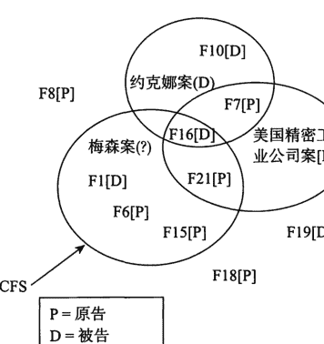

#### 三层论证：像律师一样“类比、区分、反驳”

输入端是按实例化框架录入的**当前事实情境（CFS）**，输出端是英文三层论证，判断原告主张成不成立。三层结构如下：
1.  **类比**：拿 CFS 跟支持原告的既判案对比，找共性。
2.  **区分**：把对手引用的对己不利案例（反例）同 CFS 拉开差距。
3.  **反驳/强化**：区分对手的“王牌反例”，必要时引入假设事实增强己方论证力度。

被告方同样适用这套三层话术。

**类比的逻辑**：共享维度 = 共享法律因素。若共享维度里至少有一个支持论证方，HYPO 便主张：既判案支持该方，CFS 理应同判。
**区分的逻辑**：非共享维度 = 关键差异。支持原告方论证时，CFS 独有的有利维度、既判案独有的不利维度，构成“判决应当不同”的理由。
**反例的角色**：结果相反但理由相似的案例，是对手随时可祭出的“杀手锏”。

#### 实例复盘：Mason v. Jack Daniels 案

1987 年，餐馆主 Mason 发明“林奇堡柠檬水”配方（杰克丹尼威士忌+橙皮利口酒+酸甜混合汁+七喜），仅告诉调酒师并要求保密。销售占酒水 1/3，虽易复制但无人跟进。Jack Daniels 销售代表 Randle 试饮后，Mason 为求合作透露部分配方。一年后厂方全国推广同款饮料，未邀 Mason 也未补偿，遂起诉盗用。

律师眼中可见的法律因素（编号沿用 CATO 的 F1-F27 体系，无 F9）：
*   **利于原告 (P)**：F6 安全措施、F15 唯一产品、F21 被告知情保密。
*   **利于被告 (D)**：F1 谈判中披露、F16 可逆向工程。

[PRE0 数据保留]
> - 案例：约卡娜案 (D) - F7, F10, F16
> - 案例：美国精密工业公司 (P) - F7, F16, F21
> - 梅森案 (?) - F1, F6, F15, F16, F21

HYPO 生成的支持原告三层论证（图 3.2）：
1.  **被告类比**：引用 **Yokana 案**（被告胜）。共同点：配方可逆向工程 (F16) → 主张被告应胜。
2.  **原告区分 + 祭出王牌反例**：
    *   区分 Yokana：Mason 有保密措施 (F6)、唯一生产者 (F15)、被告知情 (F21)；Yokana 反而是向外人披露 (F10)、无保密、非唯一。
    *   **王牌反例：美国精密工业公司案 (P)**。核心共性：被告知情保密 (F21) → 支持原告胜诉。
3.  **被告反驳**：区分美国精密案——该案源头是原告前雇员带技术投奔 (F7)；Mason 案源头是谈判主动披露 (F1)。

#### 论证模型的几何直觉：文氏图视角

图 3.3 用文氏图揭示底层逻辑：
*   CFS 与 Yokana 交集 = {F16}（均不利原告）→ 支持类比被告胜。
*   CFS 独有 = {F6, F15, F21}（均利原告）→ 支持区分 Yokana，主张原告胜。
*   CFS 与美国精密案交集 = {F16, F21}。后者虽有 F16（不利因素）但原告仍胜 → 成为 Yokana 的**王牌反例**（Counter-example），证明 F16 非绝对致命。

**反例分级**：
*   **王牌反例**：其共享因素集 ⊇ 被引案例共享因素集，且结果相反 → 最具说服力。
*   **切中要害反例**：共享因素集完全相同。
*   **边界反例**：共享同一维度，但量级更有利于反例结果方 → 冲淡该维度的证明力。例如若 Mason 涉大量披露，可引用 Data General（披露 6000 人仍胜）作边界反例；被告则会反驳称其披露受限（另一维度）。

#### 案例检索与排序：基于“维度集包容”而非“计数”

给定 CFS，HYPO 检索所有共享至少一维度的案例，按**共享维度集的包容关系**排序，生成**“诉讼请求格”**（Claim Lattice，图 3.4）。

*   根节点 = CFS。
*   子节点 = 共享维度集的子集。
*   孙节点 = 子集的子集……

**核心差异**：不比“共享维度数量”，比“集合包容”。
> 例：数字开发案共享 4 维度，美国精密案仅 2 个。但精密案集合 {F16, F21} 非开发案集合子集，**两者不可直接比较**。

法律意义：包容比较 ≈ 比较“案例覆盖 CFS 法律优劣势的完整度”。单纯计数忽略了因素间的语义权重差异。

#### 两大延伸系统
*   **CABARET**：把维度用于**成文法推理**（税法家庭办公扣除），融合规则推理 (RBR) 与案例推理 (CBR)。
*   **CATO**：引入新论证模板，专攻“淡化/强调区别”技巧。

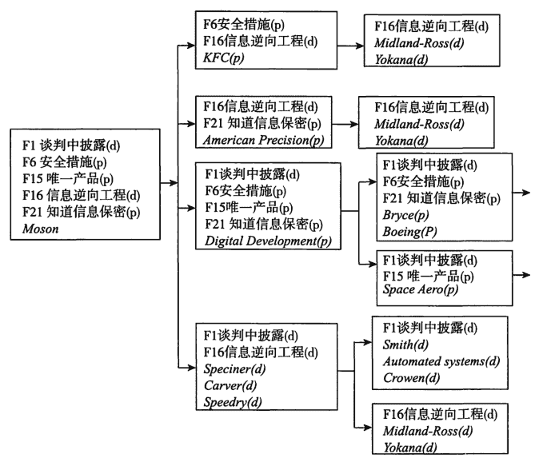

---

### CABARET 系统：当“维度”遇上成文法条文

CABARET 是 HYPO 的首个继任者，战场转至**制定法领域**——具体是美税法 §280A “主要营业地”扣除争议。它用维度表示强化/削弱**法规谓词**获满足的事实模式。

#### 双模融合架构

系统集成双引擎：
1.  **规则模型 (RBR)**：编码税条及中间法律概念。前向链事实→验证目标，后向链目标→寻找所需事实。
2.  **案例模型 (CBR)**：维度关联法律因素，索引法院对法条谓词满足与否的判例。给定问题与谓词，激活相关维度 → 检索案例 → 生成诉讼请求格（同 HYPO，按相关性组织过往案例）。

**关键创新：规则“穷尽”即切换 CBR。**
若规则链断了（无进一步规则定义法条术语），自动启动 HYPO 式案例推理。维度不再服务于普通法主张，而是服务于**“法条谓词是否成立”**这一命题。

#### 议程机制：让两套逻辑有序协作

通过启发式规则监控分析状态，动态调度 RBR/CBR：
*   **Plan B**：CBR 失败转 RBR，反之亦然。
*   **交叉验证**：用 CBR 结论校验 RBR 结论（反之亦然）。
*   **规则漏洞补丁**：规则前件仅差一项未满足 → 用 CBR 找“虽缺此前件但结论成立”的案例，论证规则应触发。
*   **概念匹配**：检索同一法条概念下成败案例。

#### 实战速写：Weissman v. IRS 案

纽约城市学院哲学教授 Weissman，家中两室一厅作办公室，仅 20% 时间用校内办公室（不安全）。IRS 质疑其 $1,540 扣除，因非“主要营业地 (p-p-b)”。

CABARET 分析片段（图 3.5）：
1.  目标：证明家庭办公室 = p-p-b。
2.  在 p-p-b 概念索引下跑 HYPO 式维度，判断谓词满足与否。
3.  启发式控制：**Sanity-check-CBR-by-RBR**……

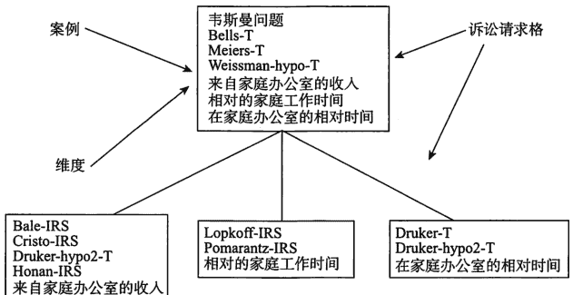

---
*本文改编自《法律的人工智能建模》相关章节，旨在梳理 HYPO 与 CABARET 系统的核心知识表示与论证机制。*

# 经典法理AI系统深度解析：从CABARET到GREBE的推理演进

## CABARET系统：规则与案例的“双轨制”协作

在处理**韦斯曼诉美国国税局案**时，CABARET系统展示了其独特的混合推理机制。系统并非单一路径推演，而是在“基于规则的推理”（RBR）与“基于案例的推理”（CBR）之间动态切换，由**控制启发式规则**统筹调度。

### 核心冲突：规则“近乎命中”却缺一环
以“家庭办公室是否构成主要营业地”规则（p-p-b）为例，后向链推理要求满足三个前件：
1. 纳税人免除“家庭办公室主要责任”；
2. 产生“来自家庭办公室的收入”；
3. 有证据证明在家办公的时间占比。

韦斯曼案中，后两个条件均已满足，唯独首项“免除主要责任”存疑。规则引擎判定：**前件近乎全满足，仅差一环（Near-miss）**。

### 启发式介入：以案补规
控制启发式规则捕捉到这一“未命中”信号，立即触发CBR模块：**检索满足该缺失前件的相似判例**。系统锁定**德鲁克案**——该案认定纳税人履行了主要责任。

### 类比论证生成：抽象共性因素
CABARET不止于引用判例，而是构建结构化类比，提炼两案共有的关键因素作为桥梁：
*   **有据可查的家庭办公室使用频率；**
*   **家庭办公室履行纳税人职责的必要性。**

通过这种“规则定框架、案例填细节、启发式控制流程”的模式，CABARET验证了**维度建模**在成文法领域（除商业秘密法外）的有效性：它能将法律因素显性化，并支撑对规则概念的深度推理。

---

## CATO系统：从“维度”到“二元因素”与“因素层级”的进阶

作为HYPO系统的第二代继承者，CATO（Case Argument Teaching System）在商业秘密盗用领域对知识表示进行了重构，核心变革在于三点：

### 1. 因素取代维度：二元化的简洁建模
HYPO使用“维度”描述因素强弱（如“保密措施程度：强/中/弱”），CATO则将其**扁平化为二元因素**：**要么存在（适用），要么不存在（不适用）**。不再涉及幅度范围，也无需前置条件测试适用性。
*   例如：F6“安全措施（P方有利）”仅表示原告采取了安全措施，不再细分力度。
*   因素列表更完备（表3.1收录27个因素，涵盖F1谈判中披露至F27公开披露论坛），每个因素标注有利方（P/D）及法律阐述。

### 2. 因素层级：揭示“因素背后的法律理由”
这是CATO区别于前辈的关键创新。它不再只罗列因素，而是构建**层级结构**，解释**“为什么该因素能强化/削弱主张”**。
*   **机制**：节点代表法律理由（如“原告采取合理措施保护财产”），叶子节点为具体因素（F4保密协议、F6安全措施、F12披露限制等）。
*   **价值**：将离散因素归类至高阶法律理论，使系统能在**抽象层面**进行类比与区分。

### 3. 智能化论证生成：基于层级的“淡化”与“强调”
利用因素层级，CATO能生成HYPO无法产出的高阶论证：

*   **淡化区别**：
    *   *场景*：对方引用Mason案中F16（信息可逆向工程）作为区别。
    *   *反驳逻辑*：沿层级向上追溯至共同根节点“被告通过合法途径获取信息”。在Bryce案中，虽无F16，但存在F1（谈判披露）且原告胜诉。说明该区别非关键，因核心法律理由（合法获取）在两案中均成立且均支持原告。

*   **强调区别**：
    *   *场景*：己方欲强调Mason案F16的区别。
    *   *论证逻辑*：向上抽象至“信息来源公共性”。Mason案中F16关联F10（向外人披露），暗示信息已入公共领域；Bryce案无此因素。通过层级对比，揭示两案在“信息排他性”这一核心抽象维度上的本质差异。

*   **按议题组织多案例论证**：即便案例间不共享完全相同的因素，只要共享上层“议题/法律理由”，即可归类对比，实现更高维度的类比推理。

### 教学与预测双实证
Aleven通过双重实验验证系统效能：
1.  **教学实证**：在计算机辅助教学环境中，系统引导学生练习区分技巧，效果可媲美资深人类讲师。
2.  **预测实证**：利用因素模型预测案件结果（详见第4章）。

---

## GREBE系统：语义网与基于范例的解释（EBE）

Karl Branting另辟蹊径，提出**基于范例的解释**技术，核心载体是**语义网**。

### 知识表示：结构化的司法推理轨迹
GREBE不直接使用因素或规则，而是将法官判决理由**建模为语义网**：
*   **节点**：法律概念（如“雇佣过程中”、“促进工作”）、事实实体、中间法律结论。
*   **弧**：概念间关系（因果、归属、必要条件等）。
*   **索引**：每个案例的EBE被标注为特定法律概念（如“促进工作”）的**正面/负面范例**。

### 推理流程：结构映射与A*最佳优先搜索
面对新问题（如Jarek案：搬运工回家报平安途中受伤），系统流程如下：

1.  **规则推理受阻**：成文法要求“旅行须促进工作”，但无规则细化该概念。
2.  **检索范例库**：“促进工作”概念下索引20个先例。
3.  **结构匹配**：将问题语义网与各先例EBE（如Vaughn案：卡车司机延迟卸货去餐馆吃饭）进行**图结构映射**。
    *   匹配项：雇主指示、行程目的修改工作安排、活动合理必要性等。
    *   不匹配项：Vaughn案中“吃饭需求强烈妨碍工作”，Jarek案无此情形。
4.  **相似度计算**：匹配标准事实数 / 目标案例标准事实总数 > 阈值，则判定相似。
5.  **A*搜索优化**：面对复杂语义网映射的计算爆炸，引入带标签链接的A*算法。
    *   `g(n)`：已映射路径的不匹配比例（实测成本）。
    *   `f(n)`：估计完整映射的最小不匹配数（启发式成本）。
    *   仅追踪最优路径，大幅提升效率。

### 论证构建：三维度的类比综合
针对Jarek案，GREBE检索并整合三个范例生成复合论证：
*   **负面强类比（Coleman案）**：日常通勤回家，非促进工作 → **反对赔偿**。
*   **正面强类比（Vaughn案）**：雇主指示修改行程，活动合理必要 → **支持赔偿**。
*   **正面弱类比（Janak案）**：特殊行程获取必要资源（冰水/通知家属） → **支持赔偿（但力度较弱）**。

系统自动生成自然语言法律备忘录，阐述类比依据、区别处理及推理链条。

### 实证评测：媲美法科学生的专业水准
Branting设计盲测实验：
*   **被试**：GREBE vs 5名法科学生（平均耗时2.77小时）。
*   **评分者**：德州工伤赔偿法专家（匿名、不知机器参与、以为全为学生作业）。
*   **维度**：问题识别、法条/引用准确性、论证正确性与说服力。
*   **结果**：
    *   GREBE：平均分 2.0（9个C, 4个B, 4个F）
    *   学生组：平均分 1.78（12个C, 1个B, 5个F）
*   **专家结论**：“无一‘学生’表现优异，GREBE的论证质量更优。”

---

## 总结与启示

| 系统 | 核心表示 | 推理引擎 | 关键创新 | 适用场景验证 |
| :--- | :--- | :--- | :--- | :--- |
| **CABARET** | 维度 + 规则 | RBR/CBR混合 + 启发式控制 | 规则近未命中触发案例补全；维度建模成文法因素 | 韦斯曼案 (税法/主要营业地) |
| **CATO** | 二元因素 + **因素层级** | 基于层级的论证生成 | 因素二元化；层级揭示法律理由；支持抽象层面淡化/强调/组织论证 | 商业秘密法教学与预测 |
| **GREBE** | **语义网 (EBE)** | 结构映射 + A*搜索 | 将司法解释建模为可计算图结构；处理成文法开放纹理概念 | 工伤赔偿法 (促进工作概念) |

三大系统分别从**规则-案例协同**、**因素语义深化**、**司法推理结构化**三个维度，推动了法律AI从“检索工具”向“推理伙伴”的跨越。它们共同揭示了一个核心洞见：**法律推理的计算化，关键不在于单一表示法的优劣，而在于如何将法律知识的规范性结构（规则、因素、理由、解释）转化为机器可操作的、支持论证生成的计算模型。**

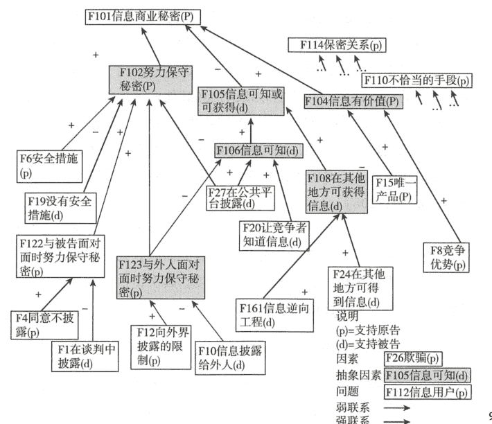
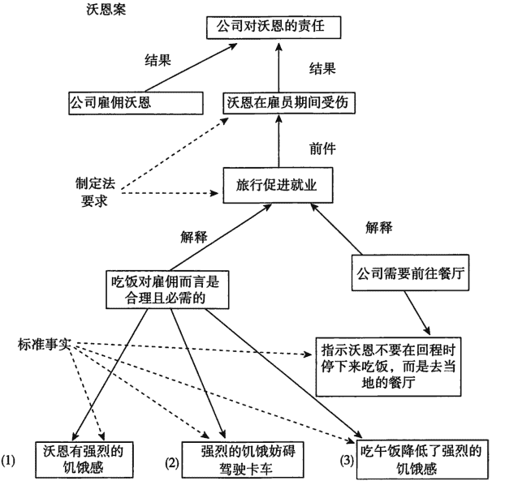

- C. 丹佛和里奥格兰德铁路要求深夜加班，迫使主角不得不踏上这趟特别的归途。

[霍恩案类比]

图 3.11. 基于范例的解释生成器针对贾瑞克问题的论证摘要（参见 Branting, 1991, 1999）

### 3.4. 基于案例的法律推理：目的论视角

海波系统、案例论证系统（CBR）、卡巴莱系统以及基于范例的解释生成器（BEG），这些早期程序有一个共同的盲区：它们忽视了法律规则背后的目的与价值。唐·伯尔曼与卡萝尔·哈夫纳在极具影响力的批评中直指要害——这些模型缺乏目的论推理的能力。

为了阐释何为目的论推理，伯尔曼和哈夫纳（1993）引入了美国法学院一年级财产法课程中的经典三部曲：皮尔逊诉波斯特案（1805）、基布尔诉希克林吉尔案（1707）以及扬诉希钦斯案（1844）。这三个围绕“猎人对野生动物财产权”的争议，此后便成了 AI 与法律领域的标准教学案例（详见 5.5.2 节与 6.6 节）。

#### 野生动物案件中的财产权博弈

**皮尔逊案**：原告波斯特在旷野追猎狐狸，被告明知故犯地在原告眼前截胡，杀狐夺走。法院判被告胜诉：必须实际捕获或致命重伤，才算取得占有权。多数派担心，若仅凭追逐认定权利，会引来心怀不满的猎人滥诉成灾；异议者则主张追逐本身已转移财产利益，法律应鼓励猎人清除害兽。

**基布尔案**：原告池塘养鸭设诱饵，被告恶意鸣枪惊鸭毁生计。法院判原告胜诉，虽未伤鸭捕鸭。核心逻辑：除非是公平竞争，否则应保护生计免受故意干涉。

**扬案**：商业渔民原告撒网 140 英寻，收网瞬间被告伸网截鱼。上诉法院仅赔偿网具损失，不认可鱼的归属权，推断原告“很可能未占有”鱼群。

#### 为何必须引入“潜在价值”建构推理模型

为展示早期模型遗漏的推理图景，伯尔曼和哈夫纳设计了一组假设变体：

1.  **换猎物**：若猎物是鹌鹑（非害兽），皮尔逊案异议者还会坚持原判吗？
2.  **引暴力**：若猎人间已发生暴力冲突，皮尔逊案多数派还会坚持“明确规则避免诉讼”吗？
3.  **类比基布尔**：法官曾设问：被告惊鸭，是否类似“校长办新校抢走旧校生源”（合法竞争）？还是类似“希克林吉尔持枪拦路吓唬学生上学”（恶意干涉）？

法官在口头辩论中常用此类假设，通过改变事实考验规则的价值承载。假设 1 触及“清除害兽”的目的，假设 2 触及“规则确定性”的目的。基布尔案法官用假设 3 锚定规则核心：**保护生计免受恶意干涉，而非单纯看“捕获”这一形式要件**。这解释为何基布尔案原告虽未捕鸭却胜诉，而皮尔逊案原告追狐却败诉。

#### 两种论证范式的对决：论证 I vs 论证 II

伯尔曼和哈夫纳对比了两种截然不同的辩护路径（见图 3.12）：

**论证 I：事实区别的“智力占卜”**
- 被告：同皮尔逊案，原告未捕获/致伤，网未合拢，应判我胜。
- 原告：但我像基布尔案原告一样在谋生，虽未捕获仍胜诉。
- 被告反驳：基布尔案不同，原告在自有土地经营，被告恶意作案；扬案中被告属商业竞争。

**论证 II：直击规则目的的“政策对话”**
- 被告：应用皮尔逊规则，公海鱼权模糊会引发无尽纠纷（维护“确定性/少诉讼”）。
- 原告：应用基布尔规则，核心是保障谋生权不受干涉（维护“生产力/生计”）。
- 被告反驳：本案被告非恶意，乃激烈竞争（如办竞争学校、邻地同设诱饵），社会受益于此（维护“生产力/竞争”）。
- 原告再驳：社会容忍公平竞争，非不公平竞争。被告强迫原告浪费成本护捕获，实则减损社会总鱼获（维护“生产力/公平”）。
- 被告终极反驳：何为“公平”竞争标准，应由立法机关定；否则法庭将陷入无尽微观裁判（回归“确定性/少诉讼”）。

伯尔曼和哈夫纳批评论证 I 如同“智力占卜比赛”，法官不充当裁判员。法官制定规则深刻影响社会生活，决策必然内化其对“何种规则提升生活质量”的价值判断。因此，倡导者必须向法官呈现**政策层面的论证**（即论证 II 路径）。

结论明确：计算模型必须回答**“哪个案例应支配？为何支配？”**——这要求模型能表示规则背后的价值、将价值与事实挂钩、并评估判决对具体情境下价值的冲击。第一代系统词汇表太贫瘠，无法承载此类目的论推理。

---

### 3.5. 目的论建模的一种尝试：基于价值的理论建构

本奇-卡彭与萨托尔（2003）提出的**基于价值的理论构建方法**，展示了如何将法律规则背后的价值纳入计算框架。

#### 理论基石：从冲突规则到偏好排序
普拉肯与萨托尔（1998）奠基性工作指出：每个先例可表征为两条相互冲突的可辩驳规则：
- 规则 1：原告有利因素 ⇒ 原告胜 (p)
- 规则 2：被告有利因素 ⇒ 原告败 (¬p)

先例判决结果确立了规则间的**优先/偏好关系**：原告胜则规则 1 > 规则 2，反之亦然。这成为后续基于案例的法律论证逻辑模型的基石。

本奇-卡彭和萨托尔在此基础上创新：案例表示为**关联价值的因素集**。因素不再是抽象标签，而是形式规则“若因素存在，则支持该方胜诉”。因素间冲突通过**价值偏好**消解：每个因素指向一个深层价值，案例结果生成因素组/价值组间的偏好规则，指导未来案件裁决。

#### 直观演示：野生动物财产权的价值图谱（图 3.13）

| 核心价值 | Llit（少诉讼） | Mprod（高生产力） | Prop（财产权享受） |
| :--- | :--- | :--- | :--- |
| **关键因素** | **pNposs**（原告未占有 → 支持被告 / 服务 Llit） | **pLiv**（原告谋生 → 支持原告 / 服务 Mprod）<br>**dLiv**（被告谋生 → 支持被告 / 服务 Mprod） | **pLand**（原告自有土地 → 支持原告 / 服务 Prop） |
| **先例与目标** | **目标案（扬案）**：pLiv, pNposs, dLiv → 目标判被告胜<br>**皮尔逊案**：pLiv → 被告胜<br>**基布尔案**：pLiv, pNposs, pLand → 原告胜 | | |
| **基础规则** | 若 pNposs 则 D<br>若 pLiv 则 P<br>若 dLiv 则 D | | |
| **新增规则 (ADD)** | **若 pNposs 且 dLiv 则 D** | | |
| **规则偏好** | **若 pLiv 则 P > 若 pNposs 则 D** (来自皮尔逊案)<br>**ADD: 若 pNposs 且 dLiv 则 D > 若 pLiv 则 P** | | |
| **价值偏好** | **Mprod > Llit** (来自基布尔案)<br>**ADD: Mprod, Llit > Mprod** | | |

**推理复盘**：
基布尔案判原告胜，确立了 `pLiv > pNposs` 的规则偏好，背后是 `Mprod > Llit` 的价值偏好（生计/生产力高于避免诉讼）。
为解释扬案判被告胜，理论建构器执行三步“添加”操作：
1.  **合并因素**：融合 `pNposs` 与 `dLiv` 生成新规则 `若 pNposs 且 dLiv 则 D`。
2.  **引入价值偏好**：提出 `Mprod, Llit > Mprod`（双方均谋生且原告未占有，此时“少诉讼+生产力”组合价值高于单纯“生产力”）。
3.  **推导规则偏好**：新规则优先于 `若 pLiv 则 P`。

最终，在该理论下，扬案新规则未被击败，**被告胜诉**——这与扬案法官实采理论高度吻合。

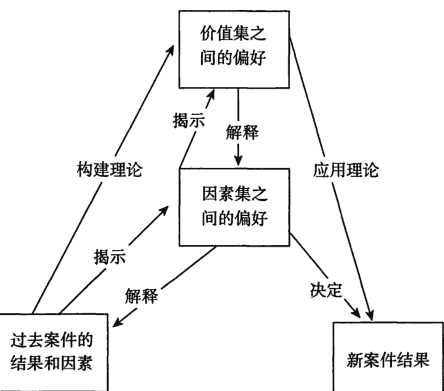

图 3.14. 基于因素与价值偏好的理论建构论证示意（Bench-Capon & Sartor, 2003）

抛开陌生的形式符号，图 3.13 与 3.14 传递的直觉清晰明了：**过去案例的结果 → 揭示因素组偏好 → 映射为价值组偏好 → 形成价值抽象层级 → 新案件据此构建解释并预测结果。**

---

#### 法律从业者真是这样用价值推理的吗？

尽管本奇-卡彭和萨托尔的模型极具理论张力，但回应伯尔曼和哈夫纳的挑战，它仍存三大短板：

1.  **不完整性——依赖“任意偏好”填补真空**。
    图 3.13 中关键价值偏好 `Mprod, Llit > Mprod` 并无先例直接支持，属于“任意引入”。作者虽提议增加构造器允许“值集在真子集上优先”，但这机制尚待打磨。

2.  **理论爆炸——缺乏优劣评判标准**。
    模型能生成海量替代理论，图 3.13 仅是其中之一。虽可用一致性、解释力、融贯性、简洁性比较，但后两者在计算层面理解甚浅（详见 4.6 节），难以落地筛选。

3.  **认知错位——法官不“套用价值排序”，而“审视价值适配”**。
    *   **模型假设**：法官从先例抽取价值偏好排序，像套公式般套用新案。
    *   **现实图景**：法官关注**价值如何在具体事实纹理中发力**。他们会细致比较新旧案情，确认价值偏好在新语境下是否**适切迁移**。
    *   即便法官参考先例价值偏好，仍需进行**语境化的详细比对**。模型缺失这种“语境敏感性”机制。

麦卡蒂的方法同样未触及：法官如何在概念适用推理中运用价值，价值如何与案例理论勾连。程序即使找到跨案例不变量，也不知**为何**它具法律意义（如麦康伯夫人案中比例所有权不变为何关键？不同公司分配类比为何成立？背后皆是风险收益权衡的法律理由）。程序不懂这些“为什么”，自然无法操纵。

**核心困境**：将目的论真正嵌入法律推理模型，是所有基于案例模型共同的硬骨头。破局前提是——我们必须先真正搞懂：**法律从业者在决策推理中，究竟是如何把价值、原则“用”起来的？** “辩护理论”虽常被提及，但其真面目及可计算表征，依然模糊。我们将在第五章法律论证建模中继续追问。

---

### 3.6. 面向认知计算的基于案例推理模型：五大设计约束

上述探讨为构建认知计算系统划定了关键边界：

1.  **论证构建是核心**：模型必须支撑“规则适用于事实”的**正反双向论证**生成。
2.  **案例是相似性判断的锚点**：建模概念适用争议时，案例是核心参照；论证聚焦于**法律上相关的相似性与差异性**。
3.  **目的论是相似性的深层标尺**：界定“法律相关”异同，**规则背后的目的与价值**是不可或缺的判断维度。
4.  **可计算的相似性标准是工具化前提**：必须定义程序可实际运算的“法律相似性度量”，既能辅助人类检索高亮过往用法，又能在有限程度上内化目的价值评估。
5.  **文本直连能力决定实用天花板**：知识表示能否经由文本解析**直接对接案例全文**，是模型能否落地的分水岭。

**现状扫描**：
*   **原型/变形模型**：虽强调正负例协调，但未产出通用领域的案例表示与相似性计算工具。
*   **纳税人二代案**揭示：概念论证可极度复杂，但当前技术**无法自动识别**文本中间接暗示的特征。
*   **海波、案例论证系统、卡巴莱**的技术资产最具迁移潜力：
    *   **维度/因素**体系（按共享法律因素比较、生成论证）。
    *   **CABARET** 的规则推理机制。
    *   **IBP/IBP+SMILE**（第 4 章、第 10 章）的结果预测与因素自动识别探索。
*   **第 9 章进展**：提取规则相关功能信息已有突破，或助维度前提自动识别；但能否提取关联因素维度的**精细功能细节**（如案例中的具体焦点时隙值、规模），仍是悬而未决的难题。
*   **BEG 的范例解释**：对人类认知辅助极大，将案例索引为概念正/负例。若要服务认知计算，**解释与标准事实必须可从文本直接抽取**。

## 第四章 预测法律判决的模型

### 4.1 引言

计算机程序能够借助将过往案件编码为“特征-结果”对的数据库，来推演新案件的走向。实现路径主要有两类：基于案例的推理（CBR）模型，以及机器学习算法，二者有时也会融合使用。本章将逐一拆解这两大技术路线。

预测模型所依赖的特征类型繁多，涵盖承办法官姓名、代理律所、法官倾向性、历史判决趋势，以及能够强化主张或抗辩的典型事实模式（即法律因素）等。不同特征对案件核心特征的捕捉能力差异巨大：法官姓名、律所名称、案由（如专利侵权、产品责任）等“元数据”无法反映具体纠纷的细节；反之，法律因素能深度刻画案情特质。特征的自动提取难度也不一：法官、律所名易于识别；法律因素虽可提取，但难度颇高。

本书聚焦于兼具“捕捉案情信息”与“可自动化提取”双重优势的特征，探讨基于此类特征的判决预测方案。

机器学习依托统计规律，从特征频次中“习得”案件特征与结果的映射关系；基于案例的推理则侧重案件比对与解释性预测，依据对立法律论证的强弱推演结果。二者在解释机制、特征表征的认知兼容性上均有所不同。

本章将围绕以下核心问题展开：程序如何学会预测？何为机器学习与监督学习/决策树？随机森林有何优势？案例推理预测与机器学习有何分野？法律从业者能否接受无解释的预测？程序如何提出并验证预测假设？如何用实证评估预测工具？

### 4.2 自动法律预测的最近邻法

预测法院判决自早期就是 AI 与法学交叉领域的核心目标。

1974 年，Mackaay 和 Robillard 便开发出程序，预测涉及特定资本利得税争议的案件结果。依据加拿大税法，核心争点在于收益归属“资本利得”还是“普通收入”——即增值是源于担保物变现，还是经营谋利所得。

该程序基于 64 个案例，用 46 个二值特征（真/假）表征，特征源自先前研究中被认定为判决相关的事实，如“纳税人为公司”“从未从事房地产交易”“购买时无转售牟利意图”“交易属孤立行为”等。

输入为人工标注的新案件特征向量。程序在多维向量空间（每特征一维）中寻找“最近邻”案例，输出其结果作为预测（见示意图 4.1，系将 60 维投影至二维）。采用 k 近邻算法，以汉明距离（特征取值不同的维数之和）度量差异。图中物理距离表征案例不相似度。

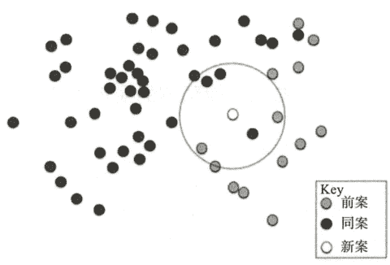

图 4.1 资本利得税案例二维投影图（来源：Mackaay 和 Robillard, 1974）

图中白色圆圈为待预测新案件，虚线圈定 k=5 最近邻。算法预测“败诉”，因 5 邻中 3 例败诉。但此几何投影用于法律预测存疑：新案极邻一败诉案，然该败诉案位于胜诉案群边缘，极易引发反驳——该邻案或为异常/错判，新案理应胜诉。

### 4.3 监督式机器学习入门

另一预测范式——机器学习，通过算法从数据中学习模式并用于预测（Kohavi 和 Provost, 1998; Bishop, 2006）。它用统计方法从数据集推导预测函数，服务于新案件结果推演。

监督式学习因依赖带标签的训练数据推断分类模型而得名（Mohri 等, 2012）。训练集由“特征向量-期望输出”对组成，算法需从中泛化至未见场景。算法解析训练数据推导模型（如统计权重、机械生成规则集），新实例输入模型即得预测。

#### 4.3.1 核心算法：决策树

监督学习算法众多，决策树（分类树）为典型代表。给定分类目标与训练集，它学习一系列判断问题以确定新实例类别。每个节点为一测试：特征值是否低于阈值，分支执行。

图 4.2 演示如何从少量保释判例构建决策树。示例中问题答案为非此即彼，未用阈值。采用 C4.5 算法生成规则构树：按最相关属性（如“涉毒”）划分实例。根节点 C0 选“毒品=是”分出 C1（4 例否）与 C2（混合 2 是 1 否）；C2 再选“武器=否”分出 C3（1 是）与 C4（混合）；C4 选“前科=否”终分 C5（1 是）与 C6（1 否）。

| 案例 | 伤害 | 涉毒 | 武器 | 前科 | 结果 |

| :--- | :--- | :--- | :--- | :--- | :--- |

| 1 | 无 | 否 | 否 | 是 | 是 |

| 2 | 重 | 是 | 是 | 是 | 否 |

| 3 | 无 | 否 | 是 | 否 | 是 |

| 4 | 重 | 是 | 否 | 是 | 否 |

| 5 | 轻 | 是 | 是 | 是 | 否 |

| 6 | 无 | 是 | 是 | 是 | 否 |

| 7 | 无 | 否 | 是 | 是 | 否 |

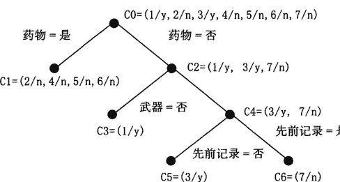

图 4.2 保释判决数据（a）与构建决策树（b）

当所有叶节点纯度达标或触发终止条件（如深度限制）停止生长。决策树可读性强：从根到叶路径即规则集——

- 涉毒=是 → 保释=否
- 涉毒=否 且 武器=否 → 保释=是
- 涉毒=否 且 武器=是 且 前科=否 → 保释=是
- 涉毒=否 且 武器=是 且 前科=是 → 保释=否

部分模型直接输出人类可审阅规则。但机器学习规则源于统计规律，未必符合人类常理：数据中可能因巧合、采样偏差导致虚假相关，规则虽准但缺专家知识支撑，难达人类合理性标准。

决策树算法的目标是寻找最高效的提问序列，将训练集最优切分为正负例集。信息论准则指导特征选择：C4.5 通过排序问题最小化期望提问数，数值特征则选最佳阈值分离正负例。

### 4.4 美国最高法院判决预测实战

预测美最高法院动向不仅是 AI 与法研究重镇，也是政治学关注焦点。

Katz 等（2014）旨在学习预测函数，评估未来案件走向（维持/推翻下级法院判决）。系统先预测个别大法官投票，再聚合为全院判决。

输入为案件特征向量（详见后），输出为二分类：大法官/全院是否维持原判。

建模逻辑模拟专家预测思路，基于“最高法院数据库”及相关来源的可观测历史数据矩阵，每次预测均融入截至当前的所有历史判决。

**特征体系（见图 4.3）：**

- **案件信息**：行政行为、案件来源/巡回区、溯源/巡回区、法律类型、下级法院处理方向/结果/异议、争点/领域、管辖方式、辩论/判决月份、上诉人/被上诉人及驳回情况、调卷理由等。
- **法官与法院背景**：大法官身份、性别、是否首席、提名总统党派、自然法庭、Segal-Cover 评分、出生年份。
- **趋势特征**：最高法院整体/当前历史趋势、下级法院趋势、个别大法官趋势、趋势差异性。


图 4.3 特征来源示例：最高法院数据库 [S]、Segal-Cover 评分 [SC]、特征工程 [FE]（Katz 等, 2014）

#### 4.4.1 预测特征详解

最高法院数据库记录案件、大法官、趋势三维特征（Spaeth 等, 2013）。案件信息含来源巡回区、法律类型、下级法院异议、争点领域、管辖标准；背景信息含大法官属性、性别、首席身份、提名党派；趋势涵盖历史/当前院级趋势、下级法院趋势、个别大法官趋势、趋势差异。Katz 团队另通过特征工程衍生新特征。

#### 4.4.2 随机森林与极端随机树应用

团队采用决策树随机森林——单棵决策树的进阶集成版本。随机森林以树集合替代单树，引入预测多样性：“集成”方法生成大量差异化树，取平均预测。森林倾向生长“小树”，有效抑制过拟合。

过拟合指模型因项过多而拟合数据噪声而非真实模式，本质是“背诵”训练数据而非“学习”泛化规律，导致新数据预测失效。决策树极易过拟合，集成小树优于单一大树。

为进一步降低方差，引入极端随机树：节点分裂时随机抽取候选特征子集，阈值亦随机生成，再从中选最优分裂规则，而非贪心搜全局最优阈值。

**预测流程：** 给定目标案件前最后一案（n-1）的数据，对每位大法官，以当前案件特征（大法官、案件、各级法院）为输入，通过最新一批极端随机树集成测试，输出个别投票预测；再以多数表决聚合为案件级预测。

#### 4.4.3 经验评估体系：K 折交叉验证

机器学习模型须经经验评估。标准流程为 K 折交叉验证。数据分 K 份，每轮留 1 份作测试集，余 K-1 份训练，K 轮平均得准确度。保证训练测试集不相交，每元素仅测一次，且测试时该元素已从训练集剔除。Katz 团队采用 10 折验证。

#### 4.4.4 评估指标与实证表现

性能度量标准：准确率、精确率、召回率、F1 值。定义基于真/假正/负例：

- TN：负例预测为负
- TP：正例预测为正
- FN：正例预测为负
- FP：负例预测为正

指标计算：
- 准确率 = (TP+TN) / 总数
- 精确率 = TP / (TP+FP)
- 召回率 = TP / (TP+FN)
- F1 = 2 × (P×R) / (P+R)

**实证结果：** Katz 模型在 60 年跨度内，案件结果准确率 69.7%，大法官投票准确率 70.9%。对比同期人类专家竞赛：案件结果 59%，大法官投票 67.9%。模型虽未大幅超越前代机器学习水平，但实现了对任一年份全体 9 位大法官的稳健预测，且规避过拟合。

**特征重要性揭示：** 最强预测因子（贡献 72%）为行为趋势——含大法官投票行为及其差异性（个别与全院平衡差异、特定争点差异、最高/下级法院意识形态落差）；案件特征贡献 23%；大法官/法院背景仅 4.4%（Katz 等, 2014, p.13）。

### 4.5 基于案例论证的结果预测

# 基于案例推理的法律预测：从最近邻到问题驱动建模

应用于资本利得税预测的最近邻法，本质上属于基于案例的推理范畴。它依靠距离度量衡量案例相似度，却缺乏生成解释或引入领域论证的能力。另一条技术路径则显著不同：通过将待决案件与历史判例对比，提出“同类案同判”的预测假设，并支持利用领域论证对预测进行解释、辩护与检验。

## 4.5.1 案例论证系统的预测实践

文森特·阿尔文（Vincent Aleven）曾将基于论证的预测作为考量案例论证系统性能的核心指标（详见3.3.2节）。他指出：“程序若能依据案例相关性的论证或判断更精准地预测案件结果……将有力佐证该程序生成的论证质量上乘，且与法律推理的实践逻辑紧密相连”（Aleven, 2003, p.212）。

该系统采用一套直观的预测算法：
1.  **检索**：依据既定相关性标准，从问题中调取案例。
2.  **裁决**：若存在相关案例且结果一致，预测该方胜诉；否则判定弃权。

系统提供了多维度的相关性标准。其因子层级与论证的强调/淡化机制，为筛选最优预测案例提供了新依据（Aleven, 2003, pp.201,203,208）。阿尔文对比了七大标准，其中包含以“最佳非王牌案例”（Best Untrumped Cases，BUC）为基石的海波型基线。BUC指最贴切且无王牌反例制约的可引用判例。三个标准聚焦于与现案“无区别”的可引用或最佳非王牌案例；另外三个则锁定“无重要区别”的同类案例。

换言之，这些标准均是海波系统/案例论证系统模型在基于案例的论证层面的变体。后三者的特异性在于：它们引入案例论证系统因子层级的知识，判断区别是否具备实质意义——即不会被轻易淡化。

在包含184个商业秘密案件的数据库测试中，表现最优的是**NoSignDist/最佳非王牌案例法**：依据无重要区别的可引用案例预测，这些案例属于未被同类无区别案例取代的最关键判例（Aleven, 2003, p.214）。该方法弃权率11%，其余案件预测准确率达88%。利用因子层级知识识别关键区别，使其性能显著超越海波型BUC基线（Aleven, 2003, p.150）。下文将简要复盘这两大核心预测策略的评估细节。

## 4.5.2 基于问题的预测（IBP）架构

基于问题的预测程序（Issue-based Prediction，IBP）引入假设检验算法，在沿用商业秘密法因子表征的前提下，力求突破案例论证系统的预测上限（Ashley 和 Brüninghaus，2006）。IBP摒弃了因子层级，转而构建一套**“法律因子为何重要”**的领域模型——商业秘密法问题图谱，实现因子间的语义关联。

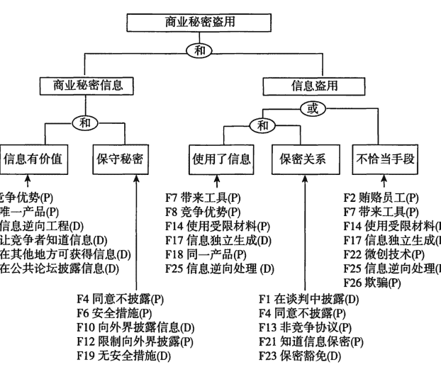

### 图 4.4. IBP领域模型 (Ashley and Brüninghaus, 2006)

如图4.4所示，IBP领域模型通过两大核心问题——“商业-信息-秘密”与“信息-盗用”的耦合，界定“商业秘密盗用”诉求的逻辑构成。二级问题下延伸出叶子节点：商业秘密信息涉及“信息有价值”与“保守秘密”两大子问题；信息盗用则包含“使用了信息”、“保密关系”与“不当手段”三个子问题。

该模型植根于《侵权法重述》（第一版）第757条及《统一商业秘密法》，核心规则提炼如下：
> **“商业秘密”定义**：源于不为人知且难以通过正当途径获取的独立经济价值（i），且经权利人合理保密措施保护（ii）。
> **侵权责任**：无特权情况下披露或使用他人商业秘密，若通过不正当手段获取（a），或违反保密义务披露/使用（b），均需担责。

**IBP算法流程（图4.5）：**
- **输入**：当前事实情境（CFS）
- **A. 问题识别**：依据CFS因子触发相关法律问题
- **B. 逐问题求解**：
  1. 若该问题相关因子单方面倾斜，直接返回该方；
  2. 否则检索全因子适配的相关案例 → **理论测试**：
     - 假设：多数胜诉方将胜出；
     - 全挺该方 → 返回该方；
     - 存在反例 → 尝试“声辩”解释；
       - 全部解释通 → 返回假设方；
       - 否则 → **弃权**；
  3. 无案例匹配 → **扩展查询**（放宽因子条件）：
     - 扩展成功 → 递归理论测试；
     - 失败 → **弃权**；
- **C. 结果聚合**：整合各问题预测
- **输出**：整体预测结果及解释

### 图 4.5. IBP预测算法 (Ashley and Brüninghaus，2009)

每个叶子节点子问题对应一个中级法律概念（开放织构法律术语）。IBP为每个子问题关联一组语义相关的法律因子，标注有利原告（P）或被告（D）的倾向。同案例论证系统与海波系统一样，这些因子索引着案例数据库。

## 4.5.3 IBP预测算法深度解析

IBP输入为适用于CFS的案例论证系统因子集。算法执行逻辑如图4.5：识别适用问题 → 逐个判定受支持方 → 单向因子则直接裁决 → 双向因子则检索案例、建立假设、测试反例。

**“声辩”机制是关键创新**：试图区分反例与现案，并在反例中寻找基于因子的替代结果解释。若反例与现案共享支持反例结果的**“淘汰因子”（KO-Factors）**，声辩即判定失败。

**淘汰因子定义**：兼具语义内涵与统计权重。指代商业秘密法中典型禁鼓行为的因子，且该因子适用时一方胜诉概率较基线概率提升≥80%。
- *胜诉概率* = 含该因子且该方胜诉案例数 / 含该因子案例总数
- *基线概率* = 该方胜诉案例总数 / 案例库总数

**IBP淘汰因子清单**（Ashley 和 Brüninghaus，2009）：
- F8 竞争优势（P）、F26 欺骗（P）
- F17 信息独立生成（D）、F19 无安全措施（D）、F20 信息让竞争对手知晓（D）、F27 公共论坛披露（D）

### 实战复盘：MBL (USA) Corp. v. Diekman 案（图4.6）

**因子输入**：
- 原告方：F13, F6, F4
- 被告方：F27, F20, F19, F10

**问题分解与求解过程**：

1.  **“信息有价值”问题**  
    相关因子：F27(D), F20(D) → 全倾被告 → **预测：被告胜**

2.  **“安全措施”问题**  
    相关因子：F19(D), F10(D), F6(P), F4(P) → 双向混杂  
    全因子检索无果 → 扩展查询（依次丢弃F10, F19）  
    - *为原告扩展*：保留F10,F4,F6 → 命中4案例（3原告胜, 1被告胜CMI） → 假设原告胜 → 声辩CMI失败 → **不确定**  
    - *为被告扩展*：查询F19,F10,F6,F4 → 无案例/无一致结果 → **弃权**  
    → **该问题最终：弃权**

3.  **“保密关系”问题**  
    相关因子：F13(P), F4(P) → 全倾原告 → **预测：原告胜**

**最终聚合**：信息价值（被告胜）+ 安全措施（弃权）+ 保密关系（原告胜） → **整体预测：被告胜** ✅ 符合实况。

**IBP核心工作流**（图4.6右侧）：
因子录入 → 案件问题分解 → 假设生成与案例检验 → 反例声辩解释 → 逻辑模型聚合问题预测 → 输出整体预测与解释

## 4.5.4 实证评价：IBP为何胜出？

实验采用**留一法（LOO）交叉验证**，数据集含186个商业秘密判决（含案例论证系统148案例）。对阵阵容豪华：
- **案例论证双雄**：NoSignDist/BUC 与 BUC基线（即4.5.1节方法，图中标记为CATO与HYPO）
- **最近邻双雄**：1-NN 与 KNN+Noise（纯统计，无论证知识）
- **机器学习三剑客**：决策树、朴素贝叶斯、规则学习器（Tree→Rules, Rule Learner）
- **IBP消融实验**：IBP-No-Issues（仅用案例，无问题模型） vs IBP-Model（仅用问题模型，无案例）
- **基线**：多数类预测（原告胜比例高）

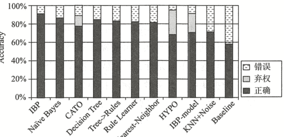

### 图 4.7. IBP与诸模型对比结果 (Ashley and Brüninghaus，2009)

**核心结论**：
1.  **IBP霸榜**：**91.8%准确率**，全场最优。假设检验范式显著优于基于案例的论证法、最近邻法及通用机器学习模型。
2.  **消融实验揭示知识价值**：
    - **问题知识聚焦案例检索是关键**：IBP > IBP-No-Issues（有问题模型指导案例假设检验更强）
    - **单靠问题模型不够**：IBP > IBP-Model（问题知识需结合先例检验才能落地）
    - **“为什么重要”优于“单纯比较”**：CATO(含因子层级) > HYPO(仅比较) → 理解因子重要性的原因能提升预测
    - **假设检验优于案例比较优化**：IBP > CATO → 用问题知识驱动假设检验，优于用其优化案例比较

**解释力：法律AI的生命线**  
Remus 和 Levy (2015) 指出：律师与法官的解释价值不可替代。若AI仅吐出“黑箱预测”，法律从业者将失去核心决策依据。  
区别于多数机器学习与最近邻算法，**IBP生成的解释符合法律职业认知逻辑**（见图4.6）：律师可直观追踪“假设→检验→声辩→聚合”的完整推理链。反观机器挖掘规则或统计权重，常忽视专家法律知识，难以被法律人接受——“大多数预测程序只给结果，不展示生成结果的精确因子组合”（Remus 和 Levy, 2015, p.62）。

---

## 4.6 基于潜在价值的预测：AGATHA的理论构建之路

本奇-卡彭团队另辟蹊径：以专家标注的**基本价值相关法律因子**表征案件事实，自动化构建反映价值冲突与偏好的理论体系。

**理论自动化论证代理（AGATHA）**① 即此核心引擎。它遵循基于推理系统的论证风格启发式流程，从判例库中自动生成解释案例法体系的理论（详见3.5.1节）。这些理论揭示了相互竞争的价值观在特定因子组合上的偏好排序。搜索算法在“理论之树”分支上应用构造变换（反驳、区分、类比），通过简洁度、解释力、树深度、完备度评估筛选最优理论。

### 核心价值体系（商业秘密领域）
- **CA**：明确保密协议的制定与执行
- **RE**：秘密持有者应采取合理保护措施
- **LM**：允许合法手段开发产品
- **QM**：禁止道德/法律可疑手段窃密
- **MW**：仅当秘密具备实质价值时方可诉讼

### 理论价值偏好示例
- {CA, MW} ≻ {LM, RE}  
- {CA, QM, RE} ≻ {LM}  
- {LM} ≻ {RE}  
*解读*：保密协议优先于合法手段；合法手段优于合理保密努力。即“保密限制是支持原告的强力据点；合法研发结合原告保护松懈，则利被告”（Chorley and Bench-Capon, 2005a, p.53）。

### 理论规则偏好（从案例中萃取）
规则偏好揭示：特定因子组合支持一方，优于对方因子组合，并锚定源案例。
- **MineralDepositsTwo案**：{F4同意不披露(P), F18, F21知悉保密(P)} ≻ {F1, F16逆向工程(D)}
- **CMI案**：{F16逆向工程(D)} ≻ {F6安全措施(P)}
- **Technicon案**：{F6安全措施(P), F12, F14限制材料使用(P), F21知悉保密(P)} ≻ {F16逆向工程(D)}

[图4.8展示了AGATHA分析Mason案时学习到的理论片段，因子与价值映射清晰可见（Chorley 和 Bench-Capon, 2005a）。]

**AGATHA的破局之道**：Bench-Capon-Sartor方法易生成多理论。AGATHA以启发式搜索在开放分支树上构造最优理论，综合评估简洁性、解释力、深度与完备度，实现理论的自动化甄别与选择。

### 4.7 基于诉讼参与者与行为的预测

IBP 与理论自动化论证代理的核心关注点在于案件实体特征——那些直接决定案件走向的法律要素。与此形成鲜明对比的是，前文所述的美国最高法院（SCOTUS）预测研究，转而聚焦于与案件实体无直接关联的外部维度：争议领域、大法官个人倾向及历史判决趋势。

法律机器（Lex Machina）携手斯坦福学者，沿用并深化了这条技术路线。他们依托长达八年的知识产权诉讼全量语料库，构建专利侵权案件结果预测模型。案件标注由两位 IP 专家完成，经一位资深 IP 律师复核把关。研究聚焦于尚未终结的专利侵权纠纷，预测目标明确锁定：法院最终判决支持专利权人，还是支持涉嫌侵权方。

同最高法院项目一样，研究团队将预测建模为统计学习框架下的二分类任务。历史案件通过“全体诉讼实体的过往行为画像”来表征，实体覆盖当事人、代理律师及律所、承办法官以及立案辖区。针对每类参与者，提取四大维度行为特征：

- **唯一标识符**；
- **过往胜诉率**（非司法/辖区维度）；
- **法官与辖区偏好倾向**；
- **历史参与案件总量**。

鉴于现实数据中实体名称常现异写（如律所名称变体），团队研发实体消歧组件：将文本中同一实体的不同指称聚类归一，映射为唯一标识。胜诉率按该实体方历史胜诉案件占比计算；偏好度以原告胜诉案件在该法官/辖区分布占比衡量；参与计数即实体出现在案件参与方名单中的频次。

预测生成端，研究者引入统计关系学习模型——逻辑回归（详见第十章）与条件随机场（CRF，擅长建模共享信息的并发案件，如同一原告公司发起的多起诉讼）。最优模型达成 64% 的预测准确率，显著超越多数类基线。

值得注意的是，该模型在完全未引入案件法律实体特征（如“专利含金量”“被控技术与专利技术相似度”）的前提下，仍实现上述准确率。事后消融实验揭示：法官身份与原告律所身份对预测贡献最大，依此递减为被告身份、辖区、被告律所与被告律师。

这表明，参与者行为特征虽非直接刻画案件实体，却能间接捕获其核心信息。更关键的是，此类特征极易从判决文本中自动抽取。当然，文本解析技术亦使提取实体法律特征成为可能。引入法律要素类特征，既能提升预测性能，又能让系统输出法律从业者可理解的解释；二者互为“体检指标”：基于实体特征的强预测若与行为特征预测冲突，便提示需人工介入复核——这正是认知计算的典型应用场景。

### 4.8 认知计算视野下的法律预测

预测是法律实务核心任务，亦是法律认知计算研发的重点战场。上述案例显示：预测算法高度依赖特征工程，而特征体系随方法迥异。

关键在于：无论机器学习还是案例基推理，现有计算手段尚未实现“自动发现影响结果的特征”，仅完成了“专家预设特征的权重学习”。最高法院预测、CBR 系统、问题基预测、理论自动化代理，以及诉讼参与者行为法，皆遵循此模式。

绝大多数预测系统中，法律专家预先界定候选特征集。资本利得税系统中税务相关特征、CBR 与理论自动化代理采用的法律要素，均由资深律师甄别。自动化发现法律语义特征的任务，目前仍属空白（或未见公开成果）。

但“自动标注已知特征的文本实例”已成现实。这触及法律预测认知计算的核心命题：**预测模型所需特征，在多大程度上可从判决文本中自动识别？**

部分特征判定属直接推理。最高法院预测所用特征（案件类型、司法态度、历史趋势）多源知识工程，不直接映射文本细节。反之，其他方法支持文本级特征检测：图 4.6 法律要素输入表即基于《三星皮带案》事实摘要由 SMILE 程序自动抽取；SMILE+IBP 架构中 SMILE 模块即承担此角色（详见 10.4 节）。法律机器采用的参与者行为特征（法官/当事人/律师频次与胜率）同样可从文本抽取，只是不直接回应法律实体争点。

若能自动标注反映案件实体特征及论证相关信息，便可将预测与论证计算模型直连法律文本：检索判决 → 自动抽取实体要素与行为特征 → 高效排序、精准预测、辅助人类决策。这将在本书第二、三部分展开。在此之前，我们将探讨最后一类计算模型——它们以创新方式融合预测与论证，并纳入拟议判决对价值权衡的影响。

## 第五章 法律论证计算模型

### 5.1 导言

数十年来，AI 与法律研究社区持续打磨法律论证综合计算模型（CMLAs），并将其融入前几章所述的各类法律推理模型中。

论证模型由两大支柱构成：**论证要素表示**与**语义规范**。前者涵盖论证本身、陈述/命题及其相互关系（如论证图组件）；后者通过明确定义的过程（如图结构检查）裁定论证要素状态。

AI 领域涌现大量论证模型，在表达对象与状态裁定机制上差异显著。抽象论证系统（含开创性的 Dung 模型）剥离结构细节，仅保留论点与攻击关系；语义聚焦“在无攻击者集合下，论点是否可接受”。该模型可扩展应对复杂现象：ASPIC⁺ 引入前提/结论与支持/攻击双关系；基于价值的论证框架（VAF，5.4 节）进一步引入价值争辩维度。

另一类模型致力保留直观结构，便于实务者理解。Verheij 模型采用 Toulmin 结构，以授权与支撑链接主张与证据；5.2 节 Carneades 模型同样保持直观，清晰区分支持/攻击某结论的命题与论证。

本章不追求模型全景图谱与优劣对比（综述参阅 Rahwan 等，2009），而是聚焦**已应用于法律论证、且配有直观扩展示例的代表性模型**：
- 5.2 节 Carneades 模型及 5.3 节扩展示例：展示如何同时构建命题与反命题论证，整合规则推理、类比推理与过往案例；
- 5.4 节 VAF：演示如何在论证模型中嵌入底层价值；
- 5.7 节 基于价值判断的论证预测模型：利用拟议判决对价值权衡的影响进行预测；
- 5.8 节 缺省逻辑框架（DLF）：建模法律证据论证。

同步回应核心问题：论证空间何貌、程序如何搜索？CMLAs 如何调用论证图式？如何裁定可接受性与评估强度？演绎逻辑在规则/事实论证中扮演何角、可辩驳逻辑为何物？法律证明标准计算模型是否切合实际？

#### 5.1.1 法律论证计算模型的必要性

第二章已阐明：法律推理本质上是对立命题的双向论证，即便双方引用同一规则与事实。经典逻辑演绎（如分离规则）仅支持单向推理，无法容纳命题与反命题并存，故不适配法律论证建模。

法律推理尚受两大设计约束（第二章确立）：
1. **非单调性**：新证据或权威引入导致既有推论撤回；
2. **可辩驳性**：主张无需绝对“真”，仅需达标证明标准；规则条件满足仍可能因反驳推翻；攻防论证并存冲突。

CMLAs 精准化解上述张力：支持同一规则事实下的双向论证；摒弃严格推理，改用支持/攻击论证；语义层引入可接受性标准、证明标准与论证图式，消解冲突、支撑推论，共同构成论证“语义”。

### 5.2 Carneades 论证模型

Carneades 仅是法律适用论证模型谱系之一（同类有 ASPIC⁺、扩展抽象辩证框架等），虽表示与概念体系各异，功能上却同构。Carneades 胜在可用法律直觉语言阐释，并“开箱即用”内置证明标准、论证图式等法律建模核心概念，故首选介绍。

Carneades 模拟命题可接受性论证构建过程：若在现有论证与假设集下命题可能为真，则判定为可接受。

模型四大组件：
1. **论证框架**——定义论证结构（前提、结论、例外），规定表征维度与冲突语义；
2. **可接受性标准**——各阶段提供裁决程序，测试命题/论证在给定标准（如基于重要性的偏好序）下是否可接受，输出“胜/败/悬而未决”；
3. **证明标准**——确立命题成立所需确信度；
4. **论证图式**——法律典型论证模式模板（如规则论证、类比论证、价值论证及其反驳图式：区分先例、王牌反例等）。

图式在计算模型中扮演“预定义组件库”角色：组件可用现有知识推断信息填充，构成论证搜索空间；程序可启发式搜索使目标命题可接受或反命题不可接受。

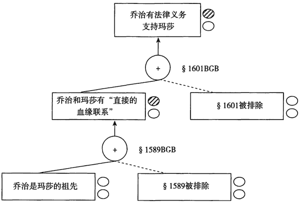

**图 5.1 Carneades 论证图**  
（Gordon, 2008b,c; Gordon & Walton, 2009; Walton & Gordon, 2009; 参阅 Ashley, 2012）

图式附带**关键问题**，辅助评估适用性：部分针对前提可接受性，部分针对例外情形。关键问题若揭示假设失效或例外成立，即生成潜在反驳。图式间亦可能因冲突实例化而矛盾。

Carneades 逐步构建法律论证：随前提累积，模型依据现有命题与假设集实时评估命题可接受性；裁定论证状态时可套用“优势证据”等证明标准的计算近似；各阶段均按图式指引搜索新论证——使不可接受命题转为可接受，或使可接受命题失效（即反驳）。

### 5.3 Carneades 实战：一个扩展法律论证示例

借助 Carneades 直观的论证图（亦称论证地图），可演示 CMLAs 如何支持双向论证构建。图区分支持/攻击某命题的论证，故框架属二分图；同时允许构建支持 p 与攻击 ¬p 的论证。

示例涉及德国家庭法争议。图 5.1 中：① 方框=命题陈述节点，圆圈=论证节点（“+”表支持，虚线表反适用性）。命题节点状态集为{陈述、质疑、接受、拒绝}；模型自动推断论证节点适用性与命题节点可接受性。（图中论证内容下文详述）

① Carneades 图示惯例随版本演进（见 Gordon, 2015b 版本史）。此处采用旧版本因其可读性更强。特别感谢 Matthias Grabmair 协助构建示例。

# 卡涅阿德斯体系中的论证冲突机制与法律推演实践

在卡涅阿德斯理论架构内，论据间的对垒主要借助三类手段：反驳、摧毁与削力。反驳指向同一命题的正反理由互撞，僵局须靠权衡理由及举证标准破解（Gordon, 2015a, p.34）。若一方理由直接推翻另一方的前提基础，便称作“摧毁性理由”（Gordon, 2015a, p.44）。削力理由则瞄准对手理由的“适用资格”发难。在论证拓扑图里，削力器表现为指向另一理由节点而非陈述节点的理由节点（Gordon, 2015a, p.21）。

## 5.3.1 家庭法情境：传统演绎的窘境

汤姆·戈登携手道格·沃尔顿打造了一个根植于德国家事法规的经典范例（Gordon, 2008b,c; Gordon & Walton, 2009; Walton & Gordon, 2009），核心涉及四条法条：
*   **§1601-BGB**：直系血亲负扶养责任。
*   **§1589-BGB**：祖辈与晚辈视作直系血亲。
*   **§91-BSHG**：若扶养致义务人陷入过度窘迫，排除§1601适用。
*   **§1602-BGB**：除非被扶养人确有需求，否则§1601不生效力。

**设定情境**：乔治系玛莎之祖辈（父系母系不论）。核问：乔治是否负有法定扶养责任？

先观传统逻辑演绎机制（如第二章《英国国籍法》系统）如何运作。它经由回溯链接调用§1589确认血缘，再经两轮分离法则推演，推断“乔治负扶养责任”。

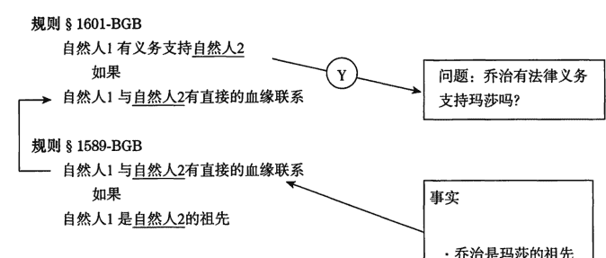

**图 5.2 传统演绎推演路径**

(Gordon, 2008b,c; Gordon and Walton, 2009; Walton and Gordon, 2009)

剧情未止。若后续查实：扶养玛莎将使乔治陷入过度窘迫。此时§91生效，排斥§1601，结论反转为“乔治无责任”。麻烦显现：系统先后论证了“有责”与“无责”两互斥命题。经典逻辑具单调性，一经论证即不可逆；更甚者，系统陷入“不一致”，依“爆炸原理”可推导任意荒谬结论（详见2.4.2节）。显然，传统演绎难驾驭法理推演中常见的“正反对峙”局面。

卡涅阿德斯等计算辩论模型，引入**非单调推演（可反驳推演）**与**理由模式**，成功化解此死结。

## 5.3.2 可反驳法条：赋予结论“弹性空间”

在计算模型中，法条被建模为**可反驳推论法则**，其推出的结论仅具“或然成立”效力，随时可能因例外、前提不成立而被击溃。

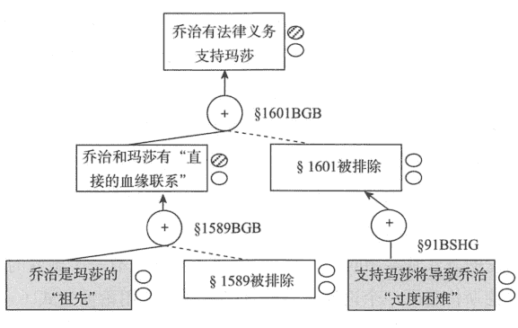

**图 5.4 可反驳推论法则的理由模式及 §1601 实例化**

(见 Gordon, 2008b,c; Gordon 和 Walton, 2009; Walton 和 Gordon, 2009)

以§1601为例（图5.4右侧）：即便满足“直系血亲”前提，结论“负扶养责任”亦仅暂时成立。其悬顶诸多“制约条件”：
*   例外条款（§1602：被扶养人无需求）；
*   排斥法则（§91：义务人过度窘迫）；
*   法则效力、前提满足度、更高位阶冲突法则等通用抗辩。

卡涅阿德斯引擎采用**目标驱动的逆向推演**：以“乔治负扶养责任”为目标节点，自动调用§1601、§1589构建拥护理由（图示根节点虚圈标记）。这乍看与《英国国籍法》系统无异，实则大不同——卡涅阿德斯生成的是**显性的理由结构**（基于“演绎理由模式”），而非单纯的真值推导。

当目标切换为“击溃该理由”，系统依据核心质询清单，搜寻例外、排斥或前提失效的证据。一旦录入“扶养致过度窘迫”这一事实，§91即刻匹配，修正理由拓扑（图5.5）。**关键突破**：卡涅阿德斯能在同一架构内同时容纳“拥护责任”与“反对责任”的理由，且不导致系统崩溃。

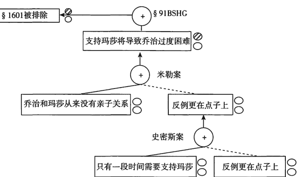

**图 5.5 可反驳法则下的双向理由拓扑（拥护 vs 反对）**

(Gordon, 2008b,c; Gordon 和 Walton, 2009; Walton 和 Gordon, 2009; 见 Ashley, 2012)

## 5.3.3 融合法条与判例：理由模式的“即插即用”整合

计算辩论模型的另一核心使命，是将**法条演绎、判例类比、价值目的理由**等异构推演纳入统一架构。这些推演模式被封装为各类“理由模式”，配备专属核心质询，即插即用。

### 实战推演：当成文法“用尽”时

设定新情境（图5.6）：
*   无“过度窘迫”事实；
*   法条未细化“过度窘迫”内涵；
*   新事实：乔治与玛莎**无亲子纽带**；
*   仅需短期扶养。

**图 5.6 法条用尽情境下的案情要素与法条**

(见 Gordon, 2008b,c; Gordon 和 Walton, 2009; Walton 和 Gordon, 2009)

**表 5.1 “过度窘迫”认定的法理要素与判例库**

(见 Gordon, 2008b,c; Gordon 和 Walton, 2009; Walton 和 Gordon, 2009)

| 维度 | 编号 | 要素内容 |
| :--- | :--- | :--- |
| **原告方要素 (拥护窘迫)** | PF1 | 已付大量扶养 |
| | PF2 | **素无亲子纽带** |
| | PF3 | 将致家庭不可逆损害 |
| **被告方要素 (反对窘迫)** | DF1 | **扶养期限极短** |
| | DF2 | 未付照料 |
| **判例库 cb1** | 米勒案 | 要素 {PF2} → 原告胜（认定窘迫） |
| | 史密斯案 | 要素 {PF2, DF1} → 被告胜（否认窘迫） |
| | 农夫案 | 要素 {PF2, DF1, PF3} → 原告胜 |

目标依然是：理由“乔治无扶养责任”。卡涅阿德斯启动**基于判例的理由模式（如CATO模式）**，流程如下：
1.  扫描§1601核心质询 → 定位“排斥法则”条目；
2.  搜寻排斥§1601的法则 → 锁定§91（需论证“过度窘迫”）；
3.  以“过度窘迫”为子目标，匹配判例法则 → 命中**米勒案**法则：{PF2} 即可胜诉；
4.  依据“共有法理要素理由模式”生成反方理由（图5.7）：因现案与米勒案共享PF2（无亲子纽带），主张应同判“存在过度窘迫”，从而排斥§1601。


**图 5.7 基于米勒案的判例类比理由（反方）**

(Gordon, 2008b,c; Gordon 和 Walton, 2009; Walton 和 Gordon, 2009; 见 Ashley, 2012)

**攻防博弈再升级**：若对方亮出DF1（扶养期限极短），卡涅阿德斯应用“制胜反例”核心质询，调取**史密斯案** {PF2, DF1} → 否认窘迫，构建正方理由（图5.8）。

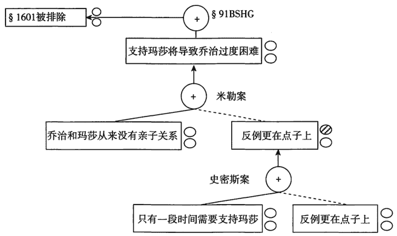

**图 5.8 基于史密斯案的判例类比理由（正方）**

(Gordon, 2008b,c; Gordon 和 Walton, 2009; Walton 和 Gordon, 2009; 见 Ashley, 2012)

此例生动展示了卡涅阿德斯如何将**基于法条的演绎**与**基于判例的类比**无缝焊接。前文提到的HYPO、CABARET等经典系统，以及理论建构型、标准案情型理由模式，均可同理“即插”进来，形成法理推演的“全能工具箱”。

---

## 5.4 抽象辩论架构：抽离内核，仅留攻防拓扑

卡涅阿德斯采用**双部图**，保留理由内部结构（前提→结论）及“拥护/对抗”双重边。朴明汀（Phan Minh Dung, 1995）提出的**抽象辩论框架 (AF)** 则更激进：抹去内部结构，仅保留“理由节点集合 A” 与 “对抗关系 R”，形成定向图。

评估理由地位（如可接受性）的核心逻辑：能否找到一组理由 S（S ⊆ A），使其能抵御来自外部的所有攻击（Dung, 1995; Atkinson & Bench-Capon, 2007）。

### 基于价值的辩论框架 (VAF)：为理由贴标签

VAF 在 AF 基础上引入“类型标签”：
*   **事实型理由**：争辩事实认定；
*   **价值型理由**：争辩核心价值/法理目标，标注所推进的价值。

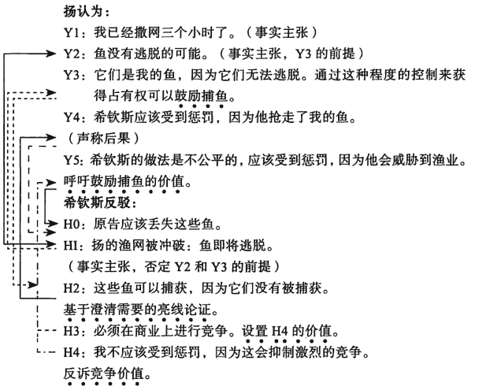

**图 5.9 扬诉希钦斯案的 VAF 攻击拓扑**

(见 Atkinson and Bench-Capon, 2007, p.113)

案情背景：商业渔民扬 vs 希钦斯（潜入网中夺鱼）。图右列出理由集：Y# 为扬方，H# 为被告方。箭头表示攻击。部分理由标注事实断言，部分标注法理价值（参考图3.13野生动物财产权价值体系）。

**VAF 的两大短板**：
1.  **“拥护”只能曲线表达**：只能建模为“攻击攻击源”（如Y4、Y5拥护原告主张P，只能画为攻击¬P）。
2.  **可读性不如结构化图谱**：即便优化布局（如图5.9），仍难直观呈现推演链条。

**ASPIC⁺** 等后续架构，正是融合了 AF 的理论优势与结构化表达的便利性（Modgil & Prakken, 2014）。

---

## 5.5 计算模型如何“定胜负”？

上述模型的终极指向是：**在辩论模型中融合案情事实、适用法规与核心价值，尽可能推演出胜败结果**。这与前几章侧重“描述性刻画”（还原法官裁判文书的推演路径）的模型形成鲜明互补——前者重“规范性演绎”，后者重“经验性还原”。

# 计算法律论证：如何在“元层面”化解事实、价值与规则的冲突？

法律推理从来不是简单的“套用条文”。当事实模糊、价值对撞、规则冲突时，计算模型如何模拟法官的思维过程？本文带你深入 Atkinson、Bench-Capon、Gordon 等学者的经典框架，看看“元层面论证”与“证明标准”如何在硅基逻辑中运作。

---

## 5.5.1 化解事实争议：关键问题与证明标准的双重锁

想象一场官司：原告扬主张“渔网被毁，鱼要跑了”（H1），被告希钦斯反驳“鱼根本跑不掉”（Y2）。事实层面僵持不下，怎么办？

**答案是“拔高维度”——启动元层面论证。**

系统不会直接判谁对谁错，而是调用一套**“事实推理论证型式”**，配合定制化的**关键问题** 来给竞争主张排序：
*   证人靠谱吗？有偏见吗？有能力知情吗？
*   专家真专业吗？观点是否共识？依据是否扎实？

搞定这些答案，冲突自然消解。比如查明被告是“利益相关方”，其证词可信度骤降，事实倾向性便倒向原告。

但这还不够，还得过**“证明标准”**这道关。Carneades 系统把法律门槛翻译成计算逻辑（见下表）：
*   **微弱证据**：只要有一个站得住脚的正方论证。
*   **证据优势**：正方论证守得住，且强于反方。
*   **辩证有效性**：正方守得住，反方全军覆没。
*   **超越合理怀疑**：正方全守得住，反方一个都站不住。

结果是生成一组“可接受论证”，整体强度由最弱一环决定。这不仅是数学游戏，更是对法律定性门槛的量化还原。

---

## 5.5.2 化解价值冲突：用“先例”推演价值排序

事实清楚了，价值怎么办？扬说“鼓励捕鱼才公平”（Y3），希钦斯说“自由竞争不可阻、澄清所有权才要紧”（H2, H4）。价值间没有天然优劣，只能**“上元层面比大小”**。

Atkinson 和 Bench-Capon 的思路很务实：**看先例怎么排。**
*   引用 *Pierson v. Post* 支持“先到先得/澄清权”？
*   还是用 *Keeble v. Hickeringill* 反击“恶意干扰/鼓励生产”？
*   能否区分案情（如基布尔在自家地盘），从而调整价值权重？

这背后是 **Bench-Capon/Sartor 的价值偏好理论**：从判决结果反推价值排序，构建“因素-价值”模型。计算模型不预设抽象价值阶梯，而是在具体语境中，借由类案推理动态生成偏好。这就是“法律推理的语境敏感性”在算法落地。

---

## 5.5.3 化解规则冲突：构造规则的“双刃剑”

规则打架了（如“重伤害”定义不一），Carneades 祭出三大**构造规则**：
1.  **特别法优先**：细则 > 通则。
2.  **上位法优先**：联邦 > 州法。
3.  **后法优先**：新法 > 旧法。

例：打断肋骨算不算重伤？无并发症不算（规则A），有并发症算（规则B）。案件涉及并发症 → 适用特别规则B → 冲突消解。

**但卢埃林早就警告过：** 每条构造规则都有“反规则”。法官想用哪条就用哪条，理由事后找。民法系信条文逻辑，普通法系信司法自由心证。计算模型若生硬套用“特别法优先”，极易掉进“形式合规、实质失真”的坑里。

---

## 5.6 从理论走向实战：三座大山挡路

模型再美，落地得解决三个硬问题：

### 1. 玩具案例 vs 真实复杂度
目前演示全是“几十个节点、手工录入”的简化版。百万案卷、非结构化文本、动态证据链，模型还没接手过。

### 2. 缺乏实证评估
怎么证明模型好用？
*   **盲测对比**：让专家给人机论证打分（Branting 做过）。
*   **预测比拼**：拿模型预测判决结果，跟统计学模型、问题基础模型比准确率。
*   **价值预测评估**：新课题，正在路上。

### 3. 证明标准的“翻译损耗”
法律上的“超越合理怀疑”要求“理性人毫不犹豫行动、坚信无罪可能性为零”；Carneades 版本却是“所有正方论证可辩护、零反方论证可辩护”。
**定性信念→定量逻辑，中间丢了“说服力”、“道德确信”等人类核心体验。** 模型仅保留了标准的**相对严格层级**（超合理怀疑 > 辩证有效 > 证据优势 > 微弱证据），并未捕获法律语义全貌。

---

## 5.6.1 深度剖析：证明标准的计算实现与法律鸿沟

| 证明标准 | 法律原意（Weiss/Feller） | Carneades 计算版（Gordon & Walton） |
| :--- | :--- | :--- |
| **微弱证据** | 合理心证接受的相关证据，不足支持权利义务 | ≥1 个可辩护正方论证 |
| **证据优势** | 事实存在概率 > 不存在概率 | ≥1 个可辩护正方论证，且正方防御强于反方 |
| **辩证有效性** | — | ≥1 个可辩护正方论证，反方全不可辩护 |
| **超越合理怀疑** | 证据令人信服，理性人毫不犹豫行动，坚信无罪可能性为零 | ≥1 个可辩护正方论证，**所有**正方可辩护，**零**反方可辩护 |

**核心痛点：** “合理人心理状态”极难建模。作者坦言：**“不声称定义完全体现法律意义”**。但保留了层级传递性：满足强标准，必满足弱标准。

> *注：“微弱证据”在现代行政法已被“实质证据”取代，门槛更高。*

---

## 5.6.2 概率入场：贝叶斯网络能否补全拼图？

法律推理充满不确定性：证人可信？规则适用？事实认定？纯定性论证图不够用，**概率推理**必须进场。

### 为什么要融合？
1.  **分层决策现实**：事实认定（陪审团）、法律适用（法官）、价值权衡（上诉庭）本分层，计算模型却常混在一起。
2.  **关键问题答案难获取**：证人可信度、选哪些关键问题，靠律师直觉，模型无法自动生成。
3.  **规划工具定位转型**：模型不应是“自动判官”，而应是**“律师论证规划器”**——输入假设，推演结果，测试敏感性。

### 怎么融合？两大路径

#### 路径 A：定性论证图 + 定量贝叶斯网络 (BN)
*   **思路**：论证结构定性，节点状态赋概率，BN 传播计算后验概率。
*   **优势**：降维打击计算复杂度，天然兼容机器学习。
*   **进展**：Grabmair 等已实现 Carneades 图 → BN 系统化转换。

#### 路径 B：概率从哪来？
1.  **主观直觉**：律师对“事实成立概率”、“价值权重”拍脑袋赋值 → 敏感性分析校准主观性。
2.  **外部数据挖掘**：案件特征、法官画像、司法趋势 → 统计概率（见第4章模型）。
3.  **类案价值解决史**：从海量判决中挖掘“价值冲突如何被解决”的概率分布（比 Bench-Capon/Sartor 早期小样本更宏观、更语境敏感）。

**拦路虎：** 这些概率能否**直接从判决文本自动抽取**？
*   Katz 等人预测美最高法院模型，依赖人工特征工程（司法倾向等），文本自动提取仍不可行。
*   **曙光**：下文即将介绍的 **VJAP 模型** 与 **默认逻辑证据框架**，依赖“法律因子/证据因子”——这些结构化因子，**恰好可以用 NLP 技术（第二、三部分技术）从文本自动抽取**，从而打通“文本→因子→概率→预测”全链路。

---

## 5.7 VJAP 模型：把“价值判断”变成可计算的预测引擎

Grabmair 实现了 **基于价值判断的论证预测模型**，在商业秘密领域与 HYPO、CATO、问题基础模型同台竞技。

### 核心假设：法官在做“价值影响评估”
判决不是套公式，而是权衡：**“在这个事实下，判原告赢对价值A的正面效果，是否大于判被告赢对价值B的负面效果？”**
*   无固定价值阶梯，**高度依赖语境**。
*   推理机制：**跨案例映射价值判断**——目标案例与源案例共享抽象法律概念实例，在特定价值影响下，应同归一结果。

### 5.7.1 域模型三件套：概念、价值、论证型式

为了支撑这种推理，模型构建了三层基建：

1.  **中级法律概念** —— 论证的“枢纽”
    *   如“所有权、受托人地位、占有权”。它们是**开放结构、含混模糊**的法律术语（见2.2.1节），连接着“事实要件”与“法律后果”。
    *   规则链：事实要件 → 中级概念 → 法律后果。概念之所以“中间”，因它既是前规则的结果，又是后规则的条件。

2.  **价值与价值效应集合** —— 评价的“刻度”
    *   针对商业秘密盗用，界定相关价值（如创新激励、市场公平、信息自由）及判决对各价值的增减效应。

3.  **竞争论证型式** —— 博弈的“招式库”
    *   为原被告双方预设针对中级概念、价值效应的攻防话术。

> **模型修改实录**：Grabmair 基于问题基础模型（图4.4）改造，新增“犯错”子问题，补齐原模型遗漏因子，重组逻辑链（见图5.10）。

---

**结语：**
从元层面化解冲突，到引入概率修补不确定性，再到 VJAP 将价值判断显性化、结构化——计算法律论证正经历从“逻辑演示”向“实用规划工具”甚至“预测引擎”的范式跃迁。下一站，我们将看到如何用默认逻辑模拟证据法推理，以及 NLP 如何彻底打通“文本到因子”的最后一公里。

# 第一部分 法律推理的计算模型

## 5.7.2  商业秘密法背后的价值支撑体系

格拉布梅尔构建了一套受商业秘密法庇护的新型价值或“利益”清单，并创新性地将这些价值与案例论证系统、IBP 的基于因素的案例表征紧密扣合（Grabmair, 2016）。这组价值体系涵盖了原告在财产权与保密权上的私人利益（见图 5.11），以及公众在信息公开获取与公平竞争秩序上的共同利益（见图 5.12）。

他进一步细致刻画了法律因素作用于受保护价值的多元路径：部分因素能增强或削弱利益的合法性地位；部分因素导致权利人放弃利益；亦有因素决定外部行为是否构成干涉。针对每项受保护价值，图 5.11 与 5.12 均标注了具体因素施加的影响方向。相较于 Bench-Capon 与 Sartor (2003)、Chorley 与 Bench-Capon (2005a) 的早期尝试，这种 “价值—因素” 关联表征为程序运行注入了更丰富的语义层面信息。

以 **动力研究公司案 (Dynamics Research Corp. v. Analytic Sciences Corp.)** 为例：原告研发产品信息并据此投产，凭借唯一制造商身份确立了信息的独特性 [F15 唯一生产(P)]，并通过积极管控限制信息流转 [F6 安全措施(P)]，但也曾在公共场合披露过该信息 [F27 公共论坛披露(D)]。被告在签署保密协议 [F4 同意不披露(P)] 后获知信息，但协议未界定机密范围 [F5 协议不具体(D)]，最终推出竞品引发诉讼。

基于上述案情与域模型（图 5.10），可梳理原告主张的优劣势：

**原告的财产权益** 面临多方博弈：
*   **受干涉**：因已知信息保密、同类产品、侵入式手段、欺骗、前雇员泄密、受限材料使用、支付跳槽费等因素 [F21, F18, F22, F26, F7, F14, F2]，权益遭实质侵害。
*   **被放弃**：因主动放弃保密、缺乏安保、公开披露、谈判中泄露、对外披露 [F23, F19, F27, F1, F10]，权益主动让渡。
*   **更合法**：产品独特性与竞争优势 [F15, F8] 为权益合法性背书。
*   **不合法**：信息公开可得、可逆向推导、独立研发、客供信息特性、竞争对手已知 [F24, F16, F17, F11, F20] 冲击权益正当性。
*   **受保护**：外部披露保密、安保措施、竞业协议、保密协议 [F12, F6, F13, F4] 构筑防御墙。
*   **未干涉**：逆向工程 [F25] 被视为合规获取，不构成侵害。

**原告的保密权益** 同样呈现张力：
*   **不合法**：信息公开、协议模糊、竞争对手知悉 [F24, F5, F20] 动摇根基。
*   **被放弃**：同财产权益，因保密松懈、公开披露等 [F23, F19, F27, F1, F10] 导致权益丧失。
*   **受保护**：外部披露保密、已知信息保密、安保措施、竞业/保密协议 [F12, F21, F6, F13, F4] 强化地位。
*   **受干涉**：使用受限材料、支付跳槽费 [F14, F2] 直接侵犯。

**公众利益维度** 则聚焦于信息流通与市场公平：
*   **信息可得性利益**：“更合法”由信息公开性、可逆向性、逆向工程、独立发明、客供信息、竞争对手知悉 [F24, F16, F25, F17, F11, F20] 支撑；“不合法”则因已知信息保密、产品独特、受限材料使用 [F21, F15, F14] 受阻。
*   **公平竞争利益**：被告因已知信息保密、同类产品、欺骗、前雇员泄密、受限材料、支付跳槽费 [F21, F18, F26, F7, F14, F2] 被判定干涉公平竞争。

---

## 5.7.3  基于价值权衡的论证型式

VJAP 的核心创新在于：论证不再局限于 “因素相似”，而是攀升至 **“价值效应权重相似”** 的抽象层面。程序依据共享的局部权衡（单一问题内）或跨问题权衡（多问题间）检索先例，构建类比论证。

**“跨问题权衡类比”论证型式** 要求：存在一先例，其在价值影响层面呈现与本案一致的跨问题权衡结构。图 5.13 展示了程序对动力研究公司案的分析片段，下划线标注处揭示了论证型式如何调用价值权衡。尽管输出文本略显冗长，但其论证质量可与 Berman & Hafner 的目的论证相媲美。

关键洞见在于：**共享价值权衡 ≠ 共享同一因素集**。同一价值效应可由不同因素组合触发（见图 5.11、5.12）。这使得 VJAP 的类比推理穿透了表层事实，触达深层规范逻辑——比 HYPO、CATO 或基于问题的预测（IBP）更具“深度”。

此外，型式库还支持 **强化类比** 与 **区分类比**：
*   **A fortiori (从更有力论证)**：本案存在有利因素虽非先例所含，但属同一权衡范畴，令论证更坚固。
*   **区分反驳**：对手指出本案存在不利因素，虽非先例所有，但应纳入权衡，从而削弱类比效力。

---

## 5.7.4  论证图与置信度驱动的预测引擎

VJAP 程序为每个案件自动生成一张 **论证图**，作为预测的核心骨架。输入案件全部适用因素后，系统自顶向下、反向链接地触发所有适用论证型式，递归构建论证，直至图谱闭合（Grabmair, 2016, p.48）。

图谱呈现双部图结构：**椭圆节点** 承载论证，**矩形节点** 承载命题，**菱形节点** 负责置信度传播。边连接前提与结论。图 5.14 揭示了从顶层域模型问题深入至叶节点权衡、先例类比的层级拓扑。

**预测机制** 将论证图转化为定量图模型：
1.  **叶节点初始化**：依据学习到的 “因素—价值影响权重” 计算初始置信度。
2.  **自下而上聚合**：各论证型式自带置信函数，综合前提置信度、类比相似度/可区分度，输出论证相对说服力。
3.  **阈值裁决**：根节点 “原告胜诉” 置信度 > 50% 则预测原告胜，反之被告胜。

置信度语义明确：表征 “经由论证确立命题的程度”，赋予系统定量的 “置信语义”。权重参数通过 **模拟退火算法** 在训练集上迭代优化——通过接受劣解跳出局部最优，最终锁定全局最优权重图，最大化训练准确率。

---

## 5.7.5  实证评价：121 案实测与参数学习

评估采用 121 个商业秘密案件（原告胜 74，被告胜 47），系 IBP 数据集的平衡子集（双方均有支撑因素），天然适配权衡推理。

**训练阶段**：构建论证图 → 预测 → 模拟退火迭代调整权重 → 评估准确率 → 循环直至收敛。退火机制通过 “温度—冷却计划” 控制接受劣解概率，有效规避高维参数空间的局部陷阱。

**测试阶段**：冻结最优权重，直接预测测试集，按正确预测数 / 总数计算泛化准确率。

这一流程完整验证了：将法律推理建模为 **价值驱动的论证博弈 + 定量置信传播 + 数据驱动的参数学习**，不仅保留了法律推理的规范解释力，更实现了可度量、可复现的案件结果预测。

# 计算法律论证：从“价值权衡”到“证据推理”，AI如何搭建通往正义的桥梁？

在上一节中，我们探讨了基于因素和案例的推理模型。今天，我们将目光投向两个更具深度、也更贴近法律实务核心的方向：**基于价值判断的论证预测（VJAP）** 与 **证据性法律论证的缺省逻辑框架**。最后，我们将讨论这些计算模型究竟如何成为连接冰冷法条文本与人类追求正义答案的关键“桥梁”。

---

### 5.7（续） 基于价值判断的论证预测：不回避冲突，直面价值权衡

**核心突破：从“匹配因素”进化到“权衡价值”**

传统模型（如 IBP、CATO）往往依赖预设的“淘汰因素”或单纯的因素匹配。Grabmair 提出的 **VJAP 程序** 走了一条不同的路：它不预设僵化的规则，而是聚焦于法律问题内部及问题间的**价值权衡**。

*   **实验设置**：基于 121 个商业秘密盗用案件（均含冲突因素），采用留一法（LOO）与五重交叉验证测试。
*   **预测表现**：
    *   留一法准确率 **79.3%**
    *   五重交叉验证准确率 **77.9%**
    *   显著优于多数类基线（61.2%）。

**为何说它更“懂法”？**

虽然单论准确率，它略低于在“纯净数据集”上测试的 IBP，但 VJAP 拥有三大不可替代的实务优势：
1.  **零回避，硬核推理**：不逃避冲突因素，直接引入价值相关信息进行推理。
2.  **论证合法性强**：生成的论证符合律师直觉，能解释为何规则应被“广泛解释”、“限制解释”甚至“不予适用”。
3.  **省去人工定义“淘汰因素”**：极大降低了知识工程成本。

**细粒度表示的威力**
对比早期的基于价值的理论构建（Chorley & Bench-Capon, 2005），VJAP 采用**细粒度表示**。这意味着它能捕捉微观层面的价值博弈，使论证能精准适配过往案例的权衡逻辑，同时灵活应对新案件事实背景的差异。

**“时间线”变体：模拟真实法律演进的先驱**
Grabmair 还构建了 **VJAP-Timeline** 变体——仅允许引用当前案件判决前至少一年的先例。
*   **惊人发现**：在时间约束下，其预测性能（留一法 84.3%，交叉验证 82.1%）**反超**了拥有全量知识的完整模型！
*   **里程碑意义**：这是首个将“时间合理性”作为硬性约束纳入计算模型的案例推理系统，完美复刻了法律实务中“判例随时间演进”的真实约束。

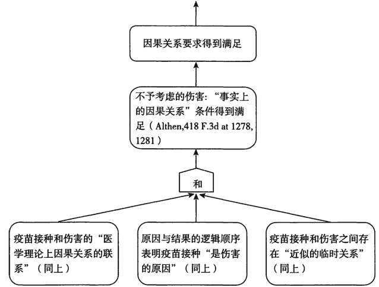

---

### 5.8 证据性法律论证的计算模型：还原法官“查明事实”的真实心路

前文模型多聚焦“法律规则解释”与“冲突结果推演”（上诉层面）。但审判庭上，核心往往是：**事实认定与证据证明**。Walker 的 **缺省逻辑框架** 直击这一痛点。

**研究对象：疫苗/伤害项目（V/IP）语料库**
*   来源：联邦索赔法院特别法官判决。
*   核心难题：依据《国家疫苗伤害赔偿计划》（NVICP）及 **Althen 测试** 的三大因果关系要件：
    1.  医学理论上的因果联系；
    2.  逻辑顺序上的因果联系；
    3.  近似时间关系。
*   *注：法律为政策目的降低了科学因果门槛，引入“优势证据”标准。*

**双层建模架构：规则树 + 推理链**

Walker 将法官推理拆解为两张“图谱”：

| 维度 | 核心组件 | 功能 |
| :--- | :--- | :--- |
| **静态骨架** | **规则树** | 将法条拆解为条件树（根节点=最终权利，子节点=证明条件）。引入四种连接器：**AND**（必要）、**OR**（充分）、**UNLESS**（反驳/阻却）、**RULE FACTOR**（规则因子/倾向性权重）。节点赋值：真/假/未定。 |
| **动态血肉** | **推理链** | 将**证据断言**与法官的**事实发现**锚定。用“证据因素”模拟法官理由，并标注合理性值（如“很可能”）。 |

**图 5.15/5.16 实战解读（斯图尔特案）：**
针对 Althen 第一要件（医学理论因果），模型提取了 4 个支撑性证据因素，层层嵌套：
*   专家证词（马克博士）：文献支持疫苗致急性小脑性共济失调；
*   机制理论：自身免疫反应导致身体误伤自身细胞；
*   病毒关联：甲肝病毒与该病有因果联系；
*   疫苗成分：含未激活甲肝病毒，罕见触发反应。
> 这些证据因素通过“合理性连接词”汇聚，最终支撑根节点“因果关系成立”。

**论证分类学：为 AI 理解“庭审套路”打地基**
LLT Lab 进一步对 10 个代表性判决中的 56 个论证进行分类（支持/反对各半），维度包括：
*   推理类型：演绎 / 概率统计 / 科学医学；
*   证据来源：判例 / 政策 / 医学研究 / 个案报告 / 事实证明；
*   专家博弈：权威专家 vs. 解释力不足的专家。

**模型价值：不仅是“描述”，更是“底座”**
Walker 的模型处理的是**真实、非玩具级**判决文本，且与原文高度一致。它已成为下游核心任务的基石：
*   论证相关信息识别（Ch 6.8）
*   事实与法规提取（Ch 10.5）
*   用户论证需求唤起（Ch 11.5.5）
*   法律假设表述与检验（Ch 12.4.1）

---

### 5.9 法律论证计算模型：连接“法律文本”与“用户答案”的三种桥梁模式

如果计算模型是 AI 与法研究的“皇冠”，那它在认知计算中究竟充当什么角色？**连接海量法律文本与用户具体法律需求的“语义桥梁”。**

#### 场景还原：用户真正在问什么？（表 5.3）

| 提问者 | 核心诉求 |
| :--- | :--- |
| 当事人玛莎 | “乔治**必须**养我吗？” （要的是确定性答案） |
| 玛莎律师 | “支持义务的**法条论证**是什么？” （要的是法条依据） |
| 乔治律师 | “有没有**反判例**能驳回义务？” （要的是抗辩素材） |
| 电子取证 | “邮件能证明**亲子关系**吗？” （要的是证据关联） |
| 法官助理 | “双方**最强论证**对比是什么？” （要的是权衡视角） |
| 立法助理 | “§1601 能否保护州利益？” （要的是规范评价） |
| 法学院学生 | “我该**如何分析**这个问题？” （要的是思维范式） |

> **关键洞察**：即使是玛莎想要的简单“是/否”，系统也应像资深律师回复：**“视情况而定”**，并列举关键意外事项（血缘？过度困难？亲子关系？期限？）。

#### 三种“搭桥”路径的深度对决

| 路径 | 核心逻辑 | 优势 | 局限 | 典型代表 |
| :--- | :--- | :--- | :--- | :--- |
| **1. 专家系统 / 规则引擎**<br>（英籍法/沃特曼模式） | 手工编码规则树 + 反向链接提问 | 逻辑严密，可解释性强 | 知识获取瓶颈大；难处理“可辩驳性”与“例外” | 传统专家系统 |
| **2. 计算论证模型直出答案**<br>（VJAP / Carneades / 因素模型） | 可辩驳规则 + 论证语义 + 关键问题驱动搜索 | **原生支持“视情况而定”**；能生成正反方论证图；定性/定量聚合 | 需高质量结构化知识库 | **本章核心推崇路径** |
| **3. Watson / Debater 式“检索+生成”** | 模型指导语义检索 → 从语料中抽取论证 → 组织正反方 → 用户自主裁决 | 利用海量非结构化文本；无需全量结构化建模 | **高度依赖 NLP 理解法律语义深度**；难精准响应“特定法条/特定案件/特定证据类型”的复杂查询 | IBM Watson / Project Debater |

#### 为何路径 2（计算论证模型）是“终局”核心？

路径 3 看似炫酷，但面对律师级查询（“基于 §1601 的论证”“穆勒案视角”“邮件证据证明亲子关系”“最强正反方论证”“价值影响预测”），**纯文本检索无法精准定位论证结构与语义特征**。

**计算论证模型提供了不可或缺的“语义坐标系”：**
1.  **识别论证骨架**：自动标注段落角色（法条解释 vs 证据评价）、当事人立场、关键法律因素。
2.  **跨域映射**：自动识别文本管辖权差异、事实语境偏移（如多伦多蓝鸟队管辖权问题）。
3.  **定制化输出**：按用户画像（当事人/律师/法官/学生）裁剪论证颗粒度与视角。
4.  **实质性预测**：自动提取法律因素 → 构建论证 → 量化预测结果（如 VJAP）。
5.  **教学级交互**：不仅给文章，更让学生**“参与实践论证”**，内化法律思维。

---

### 结语：模型即接口，论证即内核

从 **VJAP 的价值权衡** 到 **Walker 的证据推理链**，再到 **三大桥梁模式的博弈**，一条主线贯穿始终：

**法律 AI 的终点，不是替代法官给判决，而是构建一个能“讲理”、懂“权衡”、通“证据”、会“对话”的计算论证中枢。**

它将冰冷的法条文本、杂乱的判决语料、抽象的价值序列，翻译成每一个具体提问者手中**可理解、可验证、可博弈、可生长**的论证地图。

这，才是通往“计算正义”必经的桥梁。

# 以本体与类型系统为基石，破解法律文本理解难题

## 第二部分：法律文本深度解析

## 第六章  用本体与类型系统重塑法律概念表达

### 6.1  引言：知识表示的“拦路虎”与本体的“钥匙”

正如前文所述，知识表示始终是“AI + 法律”领域的核心战场，也是构建能实战落地的法律智能系统的最大难关。

本体技术为攻克这一难关提供了关键抓手。简单说，本体就是为特定领域梳理出的一套“概念清单”与“关系图谱”，明确界定了有哪些核心实体、它们之间如何关联。

本章将层层递进：先夯实本体基础概念，再复盘法律史上极具影响力的本体案例，随后介绍现代半自动化构建本体的前沿技术。重点聚焦于本体如何赋能制定法推理与法律辩论，并通过一个扩展案例演示其在“以案辩论”中的实战价值。最后，我们将引入一种特殊形态的本体——**“类型系统”**。它是文本解析的基石级工具，能依据概念及关系自动完成法律文本的标注与语义注解，为概念级法律检索与认知计算铺平道路。

**本章将回应以下核心疑问：**
*   法律本体究竟是什么？如何发挥作用？
*   何为语义注解？文本注解流水线与类型系统扮演何种角色？
*   UIMA（非结构化信息管理架构）框架是怎样的体系？
*   法律本体及UIMA类型系统如何构建？
*   开发者如何借力现有法律本体，及医学等具有法律关联的现实领域本体？

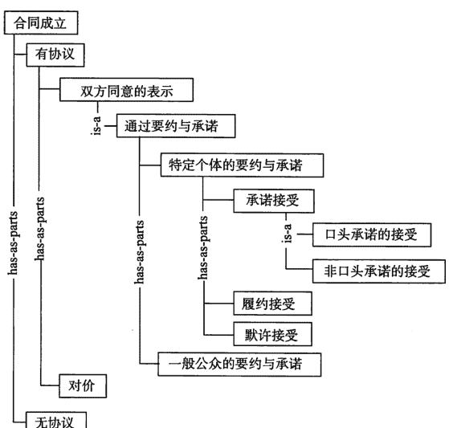

### 图 6.1  合同成立样本本体示意

### 6.2  本体核心解构：不只是“分类”，更是机器的“推理词汇表”

抛开哲学形而上学的定义，在计算建模语境下，本体并不神秘。Wyner（2008）给出的经典定义是：**“对给定领域中对象属性及关系的概念化进行明确、形式化、通用化的规范说明。”** 通俗讲，就是把领域里的概念“立规矩、定标准”，让程序能拿这些概念开展推理。

以**图 6.1 的合同成立本体**为例。这个简易模型对 Ann Gardner 的一年级合同法问题分析器极具参考价值，能有效承载诸如“双方同意的表现形式”、“口头承诺接受”等核心概念与关系（Gardner, 1987, pp.121-123）。

法律本体包含标准化的概念关系，通过标签连接呈现，典型如下两类（见图 6.1）：
*   **is-a（类属关系）**：如“口头承诺接受”隶属于“承诺接受”范畴。
*   **has-as-parts（整体-部分关系）**：如“特定个体的要约与承诺”包含“承诺接受”“履约接受”“默许接受”等子项。

其他常见标准关系虽未在图中展示，但同等关键：
*   **has-function（功能角色）**：如“组织具备社会职能”（Breuer 等，2004, p.267）。
*   **母、子（层级相对位置）**：如“基础层级因素”对应“中间法律关切”作为母节点；“中间法律关切”再向上关联“中间法律关切或法律问题”（Wyner, 2008, p.368）。此母链关系与案例辩论系统中的因素层级本体紧密相关（详见 3.3.2 节）。

学界通常将本体分为两层：**顶层本体框架** 与 **底层领域本体**（Breuer 等，2004；Breuer & Hoekstra, 2004）。
*   **框架层定基调**：图 6.1 可向左延展，构建覆盖合同法乃至通用法律的基础框架。除“合同成立”，还可纳入“合同履行”“合同违约”，共同隶属“合同义务”；后者再与“侵权义务”“刑法义务”并列，同属“法律义务”这一超级父类。
*   **领域层填细节**：向右延展则形成领域本体，细化特定领域（如合同成立）的对象、谓词与关系。例如，将“电报交易”“填写采购单”“口头协议声明”作为“口头承诺接受”的具体实现手段，通过 has-function 关联；或通过“广告”“悬赏”界定“公众要约与承诺”的完成路径。

**本体的核心使命，是提供一套计算机可处理的“知识表示词汇表”。** 它“为现实或虚构世界的部分模型构建提供解释基础”（Breuer 等，2004）。举个例子：若程序识别到“电报交易”，依据扩展后的领域本体，即可推断该场景属于“特定个体要约与承诺”范畴，而非适用“公众要约与承诺”规则。

本体显性化了概念与关系的假设，赋予程序初步推理能力。同时，它还是法律检索的“查询扩展器”：检索“特定个体要约承诺”时，涉及“电报交易”“口头协议”的案件均可命中。在语义网驱动的电商生态中，本体更能促进跨库信息交换，助力自动采购代理协调大陆法系与普通法系的概念差异。

### 6.3  经典法学本体长什么样？两大范式深度拆解

通过**电子法院本体**与**范·克拉林根框架本体**两个典型样本，我们能窥见本体在知识表示中的多元角色，也能对比两种截然不同的设计范式。

#### 6.3.1  电子法院本体：为海量档案打上“语义标签”

阿姆斯特丹大学团队构建的电子法院本体，是欧洲法律文档语义索引项目的核心组件，覆盖刑事庭审证词、音视频记录等档案。它提供结构化词汇表，以**元数据**形式描述文档画像。

元数据分两类：
1.  **非语义类**：作者、日期、权限、载体类型（音频/视频/文本）、案件编号、法院程序结构信息等。
2.  **语义类**：庭审口头证词等案情描述、刑事诉讼法主题（如起诉、审判）、犯罪类型关键词（谋杀/过失杀人）、涉案凶器（如格洛克23）等。

这些标签构建索引，用户可浏览索引定位文档，也可在查询中作为语义约束。检索系统更能利用本体链接实现**查询扩展**：“杀戮”自动扩展至“谋杀”“过失杀人”；“格洛克23”自动推断为“武器”。

**图 6.2** 展示了本体摘录，其服务于刑事审判检索的意图一目了然。该本体基于 **LRI-Core 顶层框架** 构建（Breuer & Hoekstra, 2004）。图中粗体为框架层术语，常规字体为荷兰刑事领域本体 **CRIME.NL** 术语。

本体强制标准化了法律概念表示，包括概念间关系的约束。例如 LRI-Core 规定“角色”必须由“代理人”扮演。虽图中未显性展示约束，但构建知识库时，形式化规则会强制落实这些约束。

此外，本体关系还支撑**特征继承**，实现表示层面的“经济原则”。is-a 关系假定“父类属性自动下传子类，子类再以特有属性细化”（Wyner, 2008, p.363）。在电子法院场景下，“罪犯”概念借助 is-a 链路，自动继承“被告”“司法角色”“审判角色”的属性（Breuer 等，2004, p.257）。正如 LRI-Core 作者所言：“核心概念属性通过‘主干’继承，法律角色自然拥有角色的所有属性”（Breuker & Hoekstra, 2004）。

顺道一提，LRI-Core 后被纳入 **法律知识交换格式（LKIF）**（Gordon, 2008a）。LKIF 实现了本体网络语言（OWL）下的核心法律概念本体，支持机器自动读取处理，便于语义网交易。例如第 5.3 节讨论的可辩驳家庭法规则，用 LKIF 表示极为便捷，也能直接在 Carneades 系统中运行。

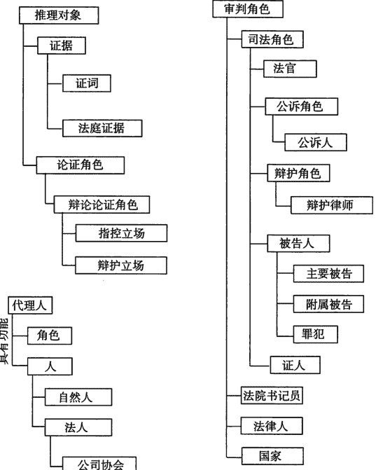

### 图 6.2  电子法院本体片段：展示“推理对象”“代理人”“司法角色”扩展。除特别标注，连接均为 is-a 关系（来源：Breuker & Hoekstra, 2004；Breuker 等, 2004；Van Engers 等, 2008）

#### 6.3.2  范·克拉林根框架本体：用“表单模板”精准建模法律实体

部分本体采用更精密的**框架**机制表达概念细节。框架即模板，槽位即待填字段。

**表 6.1** 展示了范·克拉林根经典的三层框架本体，覆盖**规范（法律规则）**、**概念**、**行为**三大法律实体。每个框架的槽位预设了标准特征字段，实例化时填入具体值（Van Kralingen 等, 1999, pp.1135–1138, pp.1150–1153）。

以大学图书馆借阅规则为例，右侧实例填充了完整细节：规范规定“借阅人应在截止日前归还”，定义“借阅”概念，描述“按时归还”行为。

框架作为知识表示工具，通过限定槽位填充类型，天然施加**语义约束**。例如：
*   规范框架的“法律模态”槽，仅允许“应当/不应当/可以/能够”四类取值。
*   概念框架的“类型”槽，限定“定义/推定条款/要素/元”。
*   行为框架的“时间维度”槽，约束必须为日期时间格式。录入非法值，程序直接报错。

为强化约束，槽位可内嵌**适用性测试**。表 6.1 中“借阅”概念框架的“条件”槽内嵌测试逻辑：“真来自[T, 注册(人,书)] 且 真来自[T, 拥有(人,书)]”。程序可凭此自动判定“借阅”概念在当前场景是否适用。

**表 6.1  规范/概念/行为三大框架本体及图书馆规章实例填充**

| 维度 | 核心槽位设计 | 图书馆规章实例化取值 |
| :--- | :--- | :--- |
| **规范框架** | 标识符、类型(行为/资格)、渊源、适用范围、触发条件、主体、法律模态(应当/不应当/可/能)、关联行为 | 规范-2、行为规范、章程第2条、图书馆章程、已借书、借阅人、应当、按时归还 |
| **概念框架** | 标识符、描述、类型(定义/推定/要素/元)、权重、渊源、适用范围、适用条件(含测试逻辑)、实例列表 | 借阅、借阅(人,书)、定义、N/A、知识工程、图书馆章程、注册且拥有恒真、- |
| **行为框架** | 标识符、渊源、适用范围、代理人、行为类型、手段、方式、时间维度、空间维度、环境、原因、目标、意图、最终状态 | 按时归还、章程第2条、图书馆章程、借阅人、-、-、-、截止日前、-、书已外借、-、-、-、书籍归还 |

概念框架定义的“借阅”，指向行为框架描述的“按时归还”。在框架本体中，这种跨层关联由槽位填充类型的本体约束隐性保障。

正如上述案例所示，法律本体通过定义对象类、特征属性、值约束、对象关系，奠定了法律应用的基石。既能支撑电子法院式的语义检索，也能驱动范·克拉林根图书馆案例中的规则推理。若需更复杂推理，可对接生产规则引擎（Wyner, 2008, p.363）或前文所述的基于案例的辩论方法。

### 6.4  从“手工雕琢”到“智能辅建”：法律本体构建的范式迁移

法律本体传统上依赖专家手工构建，但 NLP 与机器学习正重塑这一流程，提供**半自动化**强力辅助。

本体必须映射专家知识，明确系统任务所需的核心概念与关系。自动化方法则基于语料统计分析，**挖掘高显著性概念与关系候选集**，标记后提交专家复核把关。专家拥有最终裁决权：决定纳入与否，并可调整节点弧线。

**“本体辅助立法起草系统”本体（DALOS，图 6.3）** 即是此范式典范（Francesconi 等, 2010）。该本体服务于欧盟成员国消费者保护领域的立法起草与多语言（英/意）处理，目标是输出规范条款分类体系与通用概念词汇表。

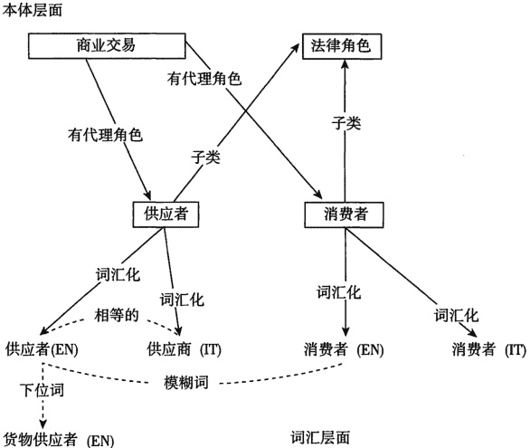

### 图 6.3  DALOS 系统本体架构（节选，来源：Francesconi 等, 2010）

**图 6.3 上半层（本体层/概念词汇表）**：由法律专家**自上而下**手工构建，涵盖供应商、消费者等商业代理类型，及其关系网。例如：消费者与供应商均参与商业交易；商业交易设代理角色（供应商/消费者），均为法律角色子类；另有对象角色、价值角色等关系。

**图 6.3 下半层（词汇层/术语层）**：面对海量跨语言消费交易文本（销售合同、信贷协议等），专家手工覆盖显有限。研究团队引入 **NLP 与机器学习，对多语言领域语料开展半自动、自下而上的术语抽取**。结果映射至词汇层，精准捕捉“商业交易”“供应商”“消费者”等实体在真实文本中的多元表达形态，有效补齐专家视野盲区。

### 词汇层面的语言关联机制

在词汇层级，术语间通过三类核心语言关系编织成网：**下位词**、**等价词**与**模糊词**。

**下位词**指语义范围更窄、特指性更强的词汇。以英语术语 "supplier"（供应商）为例，其下位词 "goods supplier"（商品供应者）涵义更具体，而意大利语对应词 "fornitore" 则属于等价词范畴。  
**模糊词**则描述一种宽泛的联想链接：词汇间虽无直接语义相似性，却因显著特征共享而频繁共现。Francesconi 等人（2010）指出，"supplier" 与 "consumer"（消费者）在法律文档中高频共现，便被统计模型判定为模糊词关系。

### 词汇层的自动化构建流程

该层级基于英、意双语消费者法律语料库（涵盖法规条文与判例法）自动生成术语表（Francesconi 等, 2010, p.105）。提取流程中，系统先完成词性标注与浅层句法解析，锁定五类关注模式：

*   单一名词（如 *creditor* 债权人、*product* 产品）
*   形容词+名词（如 *current account* 现金账户、*local authority* 地方政府）
*   名词+名词（如 *credit agreement* 信贷协议、*product safety* 产品安全）
*   名词+介词+形容词+名词（如 *purchase of immovable property* 购买不动产、*principle of legal certainty* 法律确定性原则）
*   名词+介词+名词+名词（如 *cancellation of credit agreement* 取消信贷协议、*resolution of consumer disputes* 解决消费者纠纷）

随后引入 **TF-IDF（词频-逆文档频率）** 统计指标筛选高价值术语：该值正比于词在文档中出现频次，反比于包含该词的文档总数。超越经验阈值的术语单元将被纳入本体（Francesconi 等, 2010, p.107）。

### 关系归类与专家介入的“半自动”闭环

筛选出的术语依据名词短语内部结构，自动归入下位词或模糊词簇。例如 "timeshare contract"（分时段享用合同）、"credit contract"（信用合同）、"consumer contract"（消费合同）共同作为 "contract"（合同）的下位词，汇入词汇层网络。

最后环节由**人类专家**主导：在词汇层统计推测的辅助下，对下位词与模糊词关系进行语义裁决，确认哪些“细粒度关系”值得提升至本体层，并通过现有或新增对象属性锚定至本体实体（Francesconi 等，2010，p.111）。

**跨语言等同性识别**同样遵循“统计猜测+专家确认”范式。如图 6.3 所示，意大利语 "fornitore" 可能先经模糊词链接至英语 "supplier"，再由专家赋予明确语义标签（如代理链接、商业交易概念、法律角色子类），完成本体层的多语言对齐（Francesconi 等，2010，p.102）。

---

### 6.5 制定法推理的本体支撑体系

#### 从“排版标记”到“语义标注”的演进

早期标记语言（如 XML）聚焦跨平台显示一致性；现代标准（如 **LegalDocML / Akoma Ntoso**）则深化至**结构标记**（序言、条、款等层级）与**语义标记**（规定、定义、引用、日期等语义角色）的双重维度。XML 因人机可读性佳，成为承载注解文档的首选载体。

Akoma Ntoso 等标准引入 **URI（统一资源标识符）** 体系，为法律资源分配全球唯一标识，覆盖作品、表述、表现形式、载体项及本体实体（人、组织、事件、地点、概念、物体）六大维度（Oasis, 2016）。这使得**法律规则的逻辑表达**与其**制定法溯源**能精准双向链接，有效缓解同构表示维护的复杂性（参 2.5.3 节）。

#### 典型系统：Eunomos 的“源义耦合”架构

Eunomos 系统（Boella 等，2016）以立法 XML 为骨架，将本体概念强绑定至定义其的法条片段。此举实现三大价值：
1.  **溯源透明**：本体概念植根法条原文，增强从业者信任；
2.  **动态同步**：法文修订自动触发本体语义演进；
3.  **时效感知**：注解保留版本生效日期，历史案件自动匹配当时有效法条版本（Palmirani, 2011）。

#### 迈向可计算的规范推理

终极目标是**规范的自动推演**。Eunomos 规划引入**可扩展输入/输出逻辑公式**，谓词与参考本体类 1:1 映射，实现“规范地址的自动推断”（Boella 等，2016）。  
*案例*：某欧盟指令要求“外国资格律师欲在成员国执业，须向当地主管机关注册”。系统将其形式化为：  
`∃x (Lawyer(x) ∧ MemberState(y) ∧ WantsToPractice(x,y) ∧ ¬QualifiedIn(x,y) → ∃e Register(x,y,e))`  
配合法律本体对概念约束的逻辑建模（类似 2.5.1 节范数图机制），结合雇主人员库、资质档案等实时数据，即可自动触发合规核验流程（Robaldo 等，2015）。

#### Oberle 等人的“三本体协同”范式（Norm Graphs + 制定法本体 + 领域本体）

针对**工程合规软件**场景，Oberle 等（2012）提出三层架构：

| 本体层级 | 核心职能 | 关键示例 |
| :--- | :--- | :--- |
| **制定法本体** | 规范概念分类法 + 与领域概念映射 | 将法条概念映射至现实情境概念（如“个人数据”、“控制者”） |
| **领域本体** | 描述现实世界实体与关系 | `WebService isa Software → Data → InformationObject`；`Software executes WebServiceCall` |
| **范数图** | 专家构建的业务规则约束图谱 | 显式表达 BDSG §4a Abs.1 等条款的合规逻辑捷径 |

**构建路径**：自动提取术语 → 专家筛选概念/关系 → 构建范数图约束 → 并行建模领域本体（含类图与实例图，如“向 Google Maps 传输数据”作为 `WebServiceCall` 实例）。

**运行时导航**：开发者点击范数图叶节点（如“电子表单”），系统即呈现对应法条要求（如 TMG §13 Abs.2）、本体可视化定义、专家注解词条，实现**半自动、用户引导式的涵摄推理**，辅助合规设计（Oberle 等，2012, p.306）。

> **技术前瞻**：信息抽取（IE）技术将进一步自动化本体填充。Eunomos 未来拟引入 IE 技术自动抽取道义要素（义务、角色、制裁等）扩充本体（Boella 等，2016），详见第九章。

> **注**：制定法起草本体与德国数据保护本体均采用 DOLCE 基础本体（Gangemi 等，2002）作为上层框架，向下延伸至特定法域分类（Francesconi 等, 2010; Oberle 等, 2012）。

---

### 6.6 法律论辩的本体支持：从“论证图式”到“类型系统”

#### 核心痛点：缺乏面向“类比推理+价值权衡”的现成本体

第 5.7 节揭示的**论证图式驱动推理**，核心在于：用类比论证诠释规则概念、权衡潜在价值。遗憾的是，当前无现成本体直接支撑此类知识获取。

#### 思想实验：苏格拉底式法学对话系统的知识工程需求

设想一款**一年级财产法 MOOC 智能导师**，复现 *Pierson v. Post* (1805) 及 *Popov v. Hayashi* (2002) 案例教学场景（表 6.2）。

**对话骨架**：
1.  **教师提问**：波波夫案适用何种财产权测试？
2.  **学生 A 提议**：“保护公平竞争”测试，类比 *Keeble v. Hickeringill* 案因素支撑。
3.  **教师反驳**：假设“竞争校长威胁生源”，满足公平竞争却损害经济竞序，挑战测试外延。
4.  **学生 A 修正**：区分假设语境，限缩测试范围至“棒球”而非“贵重物”。
5.  **学生 B 反驳**：*Keeble* 案保护土地生计权，波波夫案更似 *Pierson* 案——即使猎手近捕、干扰故意，猎物仍归捕获者。引入“王牌反例”提出新测试：“无占有即无救济”。
6.  **教师追问**：确认学生 B 是否主张“说明性测试”。
7.  **学生 B 证成**：新测试可杜绝“近捕诉讼”、规避公共资源财产化，*Keeble* 案语境不适用。

**教学目标**：学生需提出**可辩护的判决规则**，并完成三重论证任务：
*   **案例比较/区分**（类比与反例）
*   **原则/政策一致性论证**（如公平竞争 vs 经济效率）
*   **应对假设挑战**（修正或区分）

#### 计算模型抽象：假设驱动的论证交互框架

图 6.4 概括了通用模型：**对话方（法官/教师）提出假设 → 提议方（学生）以区分、修正、撤回等策略回应**。此过程要求系统具备：
1.  **因素/原则/价值的显式表征**
2.  **案例间相似度与差异的结构化推理**
3.  **假设生成与测试边界探测能力**

#### 从“论证本体”到“类型系统”的范式转向

**好消息**：认知计算不要求系统*自主生成*完整法律论证。  
**关键洞见**：我们需要的是**类型系统**——而非传统本体。类型系统能助应用程序**识别文本中与论证相关的信息片段**，基于类缺省逻辑框架的描述模型，帮助用户**发现并构建**相关论证（详见 6.7 节）。

---

### 6.6.1 目标应用深度剖析：智能辅导系统的知识表征挑战

上述对话揭示，支撑此类应用的知识基础设施必须编码：
*   **领域实体与因素层级**（野生动物、占有、干扰、土地权、经济竞争……）
*   **案例因素画像**（*Pierson*、*Keeble*、*Popov* 的因素向量）
*   **论证移动类型学**（提议测试、类比支撑、假设挑战、区分案例、修正测试、引入反例……）
*   **价值/政策图谱**（公平竞争、经济效率、诉讼节约、资源公共性……）
*   **假设生成模板**（针对测试过宽/过窄的压力测试用例）

这超越了静态本体的“概念-关系”范式，要求**动态论证结构与语义类型系统的深度融合**——正是下一节将展开的核心议题。

# 构建法律推理“微观世界”：从本体设计到论证对话的自动化生成

在探讨如何让计算机模拟律师思维前，我们先设定一个前提：假设系统已掌握必要的**论证模式**。这些模式涵盖了第五章提到的类比先例、基于政策价值辩护的技巧，以及图 6.4 所描绘的完整博弈流程——提出规则、设定假设压力测试、通过区分或修正规则来应对挑战。虽然此类完整论证模式的自动化实现尚在探索中（如 5.7.3 节基于价值判断的预测模型），但其理论框架已为我们搭建好了舞台。

## 核心策略：聚焦“微观世界”，规避常识瓶颈

法律推理充斥着海量常识——狩猎规则、鸭塘性质、狐狸习性、甚至棒球接杀与学费竞争的异同。若试图用本体穷尽所有常识，将陷入知识表示的“黑洞”。

设计者的妙招是**退守次一级目标**：构建一个仅支撑对话动作的**领域本体**。系统无需“懂”世界，只需懂得如何在特定案例簿（如财产法教材）中完成“提出测试—引用原则—因素类比—构建/回应假设—修正测试”这一闭环动作。

由此引入**“微观世界”**概念。以“猎物财产利益”为例，这个微观世界仅包含：
- 有限案例（真实与假设混合）：Pierson v. Post、Keeble v. Hickeringill、Young v. Hichens、Popov v. Hayashi、逃逸野猪案，加上“竞争校长”、“追捕鹌鹑”、“法拉盛鹌鹑”等假设案；
- 核心因素、政策/价值；
- 提议的法律测试；
- 以及类表 6.2 所示的对话结构要素。

表 6.3 详细列出了这六个核心案例的因素画像与判决结果，为后续计算奠定了数据基础。

## 另一条捷径：“罐装”命题与动态菜单

系统不从头推演命题，而是提供**预制好的“罐装”命题及组件**。用户（或学生）通过动态菜单，将正确的命题填入论证移动的相应槽位。结合图 6.4 的论证模型与第五章的论证模式，程序即可生成类表 6.2 那样的真实对话。

驱动引擎是一个**本体框架**，它整合了因素、法律概念、政策/价值。在当前事实与可用模式驱动下，程序检索数据库，识别并组装潜在论证——例如发起一个针对“测试过宽”的攻击，自动推进对话下一步。

**本体如何指导实战？** 两个典型场景：
1. **抽象层级导航修正**：面对教师抛出的“竞争校长”假设（表 6.2 第 3 部分），本体利用法律术语的抽象/包容性排序，引导学生将“明显意图”测试收窄为“明显意图 1”，把“猎物”具体化为“棒球/有价值之物”。
2. **政策冲突预警**：第 3 部分中将猎物从“棒球”换为“缴学费学生”，意外触发“保护公平竞争”却牺牲“促进经济竞争”的政策冲突，本体能显性化这种权衡惊喜。

下面详细拆解支撑上述能力的本体三层架构：**案例框架、因素框架、法律测试表示**。

---

### 一、 案例框架：结构化的“事实胶囊”

如图 6.5 所示，每个案例被封装为统一框架，核心槽位包括：
- **元数据**：名称、简称、引用、真实/假设标记、诉因（侵占/侵权等）、判决结果（原告/被告/未知）。
- **适用因素集**：直接关联表 6.4 的因素体系。
- **比较特征槽（带 * 号）**：这是跨案比较的锚点，覆盖猎物财产利益领域的关键维度：
  - 场地类型（荒地/池塘/海洋/看台）及所有权性质（开放/私有/受限/原告所有）；
  - 猎物属性（野生/家养/可食用/害兽/狐狸/鹌鹑/棒球/学生/有价物/经济目标）；
  - 原告追捕步骤（寻找/围堵/触及伤害/捕获护住）；
  - 原告意图外显度（隐蔽/模糊/明显）；
  - 被告干扰事实及主观意图（无/疏忽/明知故意）；
  - 干扰后果（无结果/未达捕获护住标准）。

这些槽位将“常识”转化为**有序取值域**。例如“追捕步骤”从“仅寻找”递进至“捕获护住”，“干扰意图”从“无意”递进至“故意”。程序无法像人类直观理解这些语义，但通过本体将语义约束显性化、结构化，即可支持自动比较与语义一致性检查。

**补充实体框架**：除案例框架外，本体还为“猎物”这类核心对象定义实体框架，记录适用场地、可食用性、害兽属性、商业捕获性等属性，供推理时调用。

---

### 二、 因素框架：可计算的“法律权重”

图 6.6 定义的因素框架，将第 3.3.2 节 HYPO 维度的思想工程化，每个因素包含：
- **身份标识**：名称、缩写、所属诉因、支持方（P/D）、自然语言释义。
- **触发器**：判定因素是否适用的条件逻辑。例如“猎物=棒球”触发“竞争/生计因素”；“猎物=害兽”触发“消灭害兽因素”。这让因素不再是静态标签，而成动态推理规则。
- **焦点槽范围**：映射案例框架的某比较特征及其有序取值域，量化因素**幅度**。
- **有利原告方向**：指明取值域哪一端利好原告。
- **服务政策/价值**：链接表 6.4 的七大政策（公平竞争、消灭害兽、减少琐碎诉讼、保护生计、避免公地悲剧、促进经济竞争、保护土地所有权）。

**运作示例**：Popov v. Hayashi 案中，案例框架填充后自动激活五个因素——未捕获(NC)、开放土地(OL)利好被告；明显接近(MCI)、知晓接近(KCI)、故意干扰(II)利好原告。幅度计算基于焦点槽取值：若被告仅疏忽干扰，故意干扰因素幅度靠向有利被告端；若原告意图模糊，知晓接近因素削弱原告方。

---

### 三、 法律测试表示：可修改、可比较的“规则骨架”

对话核心是“提议测试—假设挑战—修正测试”。本体需让测试**可解析、可修改**。表 6.5 展示了五个典型测试的逻辑化表达，均构建于五个**中级法律概念（ILC）**之上：

1. **占有** —— 参数：猎物类型、占有程度（追捕步骤取值域）；
2. **占有的明显意图** —— 参数：猎物类型、意图外显度（隐蔽/模糊/明显）；
3. **干扰意图** —— 参数：意图程度（无/疏忽/明知故意）；
4. **干扰** —— 布尔值；
5. **因果链** —— 干扰导致“非占有状态”。

**测试演进实录**：
- **占有 / 占有 1**：从“棒球”泛化至“有价值之物”，占有程度锁定“捕获护住/致命伤害”；
- **明显意图 2 / 1 / 2**：核心结构为 `明显意图 ∧ 干扰 ∧ 干扰意图(故意) ∧ 因果(干扰导致非占有) → 损害赔偿`。区别仅在猎物参数：鱼 vs 棒球 vs 有价值之物。

通过调整 ILC 参数（如收窄猎物范围、提高占有程度门槛、修正意图层级），程序即可自动生成“更严/更宽”版本，精准回应假设挑战。

---

### 总结：从“知识堆砌”到“推理脚手架”

这套本体设计的精髓不在于覆盖面广，而在于**动作最小化**：
- **案例框架**提供结构化事实底座；
- **因素框架**将政策价值转化为可计算的比较维度与触发规则；
- **ILC 与测试逻辑**将法律规则拆解为可参数化、可版本控制的代码模块。

三者协同，让系统在“猎物财产利益”这个微观世界里，真正跑起了“提出—质询—修正”的法律推理闭环。这不仅是知识表示的工程实践，更为计算法学“从静态存储走向动态推演”提供了可落地的范式。

### 核心规则：显著意图与干涉致损

若原告（P）明确意在取得有价值物品的占有，而被告（D）故意施加干扰导致原告落空，原告即可主张损害赔偿。

---

### 中级法律概念的构建框架

**图 6.7 猎物财产利益微观世界：中级法律概念框架**

该框架包含以下核心要素：
*   **身份标识**：名称与简称。
*   **参数设定**：接收的价值类型。
*   **边界划定**：以案例框架的比较特征为界，限定参数适用范围。
*   **影响因子**：作用于概念的具体因素。
*   **政策根基**：概念背后支撑的政策目标与价值取向。

（注：P=原告，D=被告）

在表 6.5 的测试体系中，规则的**概括性**各不相同。例如，“占有-1”测试以“有价值之物”替代“棒球”，适用范围更广；“明显意图”测试同理，因处理通用价值物而非特定球类，较“明显意图-1/-2”更具普适性。

调整测试概括性是应对教师质疑的关键手段。表 6.2 对话中，学生-A 便用更严苛的“明显意图-1”替换原提议，规避了教师假设案例的冲击。

设想中，可通过三大中级法律概念的**限制梯度**来校准测试严度（`>` 表示更严格）：
1.  **占有程度**：实际捕获/致死 > 短暂捕获/致伤 > 单纯追寻。
2.  **意图显著性**：明确外显 > 模棱两可 > 内心隐藏。
3.  **干涉主观性**：故意 > 过失 > 无意。

这些梯度分别对应案例框架中狩猎捕获步骤、原告客观寻找行为、被告干涉心态等比较特征。

本体论通过实例化“中级法律概念框架”（图 6.7），赋予概念以含义，并支撑测试概括性的推演。框架设有参数取值槽位，亦引入案例比较特征作为范围约束。修改这些数值，系统即可生成变体测试——如允许无意干涉或未导致失物也适用“明显意图”测试。虽或非良策，但系统能在微观世界中选取恰当论证图式予以反驳，指出此类规则过于宽泛，损害“减少琐碎诉讼”政策。

---

### 测试与政策的形式化框架

**图 6.8 测试框架**
*   **逻辑内核**：一阶谓词逻辑规则。
*   **前件构成**：中级法律概念集合。
*   **后果指向**：判决原告（P）或被告（D）胜诉。
*   **自然语言翻译**：便于理解的文本表达。

**图 6.9 政策/价值框架**
*   记录名称、翻译、相关影响因子，以及支撑该政策的中级法律概念。

（注：P=原告，D=被告）

本体采用此类框架定义法律规则。假设每项测试均可表述为由中级法律概念组成的一阶逻辑规则。表 6.5 左栏测试在右栏均有对应逻辑表达。第 6.5 节详述了本体设计如何关联逻辑测试与法律概念。借助这些组件，足以建模表 6.5 的测试集并支撑样本对话。

---

### 法律政策与论证图式的关联机制

微观世界引入政策/价值作为测试立足根基（表 6.4 列举八种）。政策/价值框架（图 6.9）索引相关因子与中级法律概念；案例、因子、概念框架亦反向链接关联政策。这种概念网络使程序能执行类比、区分、假设提问、测试修正等论证图式（表 6.2 对话即由此生成）：
*   基于中级法律概念构建裁决测试。
*   引用先例类比。
*   以政策原则佐证类比正当性。
*   以假设案例挑战测试过宽/过窄。
*   修正测试回应挑战。

论证图式沿着概念链路检索对象、推导推论。因子因关联政策而具法律相关性。如《基布尔案》中“自有土地”因子牵涉“保护土地所有人权益”政策；《皮尔逊案》中“开放土地”因子关联“避免公共资源产权化”政策。

中级法律概念充当枢纽连接因子与政策。第 7 部分展示：“占有”概念链接“未捕获”因子与“避免无意义诉讼”政策；“故意干涉”概念对应同名因子与“保护公平竞争”政策。若“猎物”涵盖害兽、禽鸟或经济标的，将触发不同因子调用底层政策。

综上，微观世界本体旨在囊括生成此类对话所需的全部实体概念、关系及捕猎现实技术，通过框架实例化案例、因子、原则并相互关联。

---

#### 6.6.3 本体支撑自动化法律论证的边界

此类对话兼具法律现实感与教学价值，展现了规则在案例比较中如何被解释、质疑、重塑。倡导者提出测试解释过往并推导期望结果；怀疑者以假设案例探究概念内涵，以政策价值审视推演后果。先例既是规则权威源，也是事实库供提炼新规则。

此法可构建智能辅导系统：学生针对案例集与假设练习辩论。系统对话生成后，评估下一步可用论证优劣，供学生选择、预演。虽生成程序尚未落地（仍为思想实验），但复述揭示了本体框架如何驱动论证图式对话。

**局限一：本体普适性存疑。** 下一章财产法案例书涉及新概念关系，虽有重叠可复用框架，但大部分需手工迁移。对比图 6.7/6.8 与表 6.1 范·克拉宁根框架：虽同具前件、后果、逻辑槽位，但测试框架增设微观世界专属槽位及价值效应解释机制。这或显本体设计不足，或反映其专用性本质——Bench-Capon 与 Visser (1997) 指出，本体评价取决于创建目的。现有法律本体鲜聚焦“规则对假设事实变化的适用性论证”，而这正是解释法律建议的核心。

**局限二：知识表示笨重且粗糙。** 需发明“捕获或致命伤害”等生硬概念以将狐狸案类推至棒球、学生案。如何让程序“看穿”捕狐、接球、招生的深层类比，而非陷入表层相似，仍是研究难题。以“逃逸野猪案”（表 6.3）为例：表面似《皮尔逊案》（均涉逃逸野生物、损害财产），实则诉因迥异——前者针对疏忽/严格责任留置活物致逃，后者为侵占；虽同属侵权，损害机制截然不同。单靠标注诉因标签难解深层结构相似性，需更精密方案（Ashley, 2009a, 2011）。

**局限三：细节颗粒度不足。** 本体生成论证虽堪教学，远不及麦卡锡法官《波波夫诉林·海亚希案》三部测试（图 6.10）精微：
1.  合格原告下，转移行为或生占有/权。
2.  格雷教授规则：动力止前因偶然接触无生命/他人致离手不算占有；首个完全控制并护住球者得所有权。
3.  行为人为获弃物迈出关键不完整步骤，遭他人非法打断，享有可司法认可的“前占有利益”。

麦卡锡测试展现了创造性法律推理：依球迷相对动态定义“占有”、引入“前占有利益”、区分“偶然”与“预期接触”。如何升级本体支撑此类精微推理，极具挑战（Ashley, 2009a, 2011）。

本体设计与数据实例化高度依赖专家手工预判，理想状态应具备使用中自扩展能力。虽有辅助构建本体的自动化技术，但能否移植法律论证领域尚未可知。

---

#### 6.6.4 认知计算视角下的本体赋能

认知计算不要求模型自主生成论证，而是聚焦**从法律语料中检索有价值论证片段**辅助人类。理想中，系统助麦卡锡法官在案例库中定位“受欢迎猎物占有规则”示例，或筛选原/被告胜诉案例，乃至提取事实认定中对规则要件的满足性判断。

现有法律工具案例丰富，却缺乏**句子论证角色**的元信息。若 AI 与法律本体模型支持从判决文本抽取此类论证相关信息，即可实现面向概念的信息检索，服务律师创造性推理。

---

### 6.7 面向文本解析的类型系统

前述法律本体侧重实体概念规则表示，服务于检索优化、合规推理及教学论证（第 6.5、6.6 节）。但我们还需一套**支持计算机识别法律文本中论证结构与相关信息**的本体——即“类型系统”，配合软件组件实现文本标记与处理，供下游推理使用，亦为上游提供标注目标。

#### 6.7.1 类型系统定义

类型系统定义文本标记结构，是 GATE 或 UIMA 等 NLP 框架核心要素。UIMA 作为 IBM Watson 基础架构，将注解器组织成流水线：各注解器解析特定文本区域、赋予语义、生成断言；后续注解器复用前序标注推导更抽象语义。

类型系统以概念图形式层级组织（子类型、超类型、属性），协调注解器通信，规范数据交换格式。虽称“流水线”但支持并行。

不同于通用本体，**类型系统作为文本分析本体，捕获领域文本中概念与关系的提及方式**。如疫苗伤害案中法官提及“水痘疫苗接种”，“疫苗提及”与“接种提及”类型可标注该文本指代的概念。同一实体可表述为“水痘疫苗接种”、“接种水痘”、“VARIVAX 注射”等，均可标注为对应概念的提及实例。

类型系统已应用于电子病历临床数据、危险边缘问答文本等领域。

#### 6.7.2 实例：深度问答类型系统

Watson 基于 UIMA 构建深度问答系统，含正式类型系统（注解类型 + 本体概念）。

核心假设：**可从“危险边缘”问答文本自动识别提取“答案类型”实例。** 词汇答案类型（LAT）指问题中指明答案类别的词/名词短语（不含语义理解）。若候选答案属同一 LAT，即为相关性排序的正向证据。

例：类别“噢……国际象棋”，线索“16 世纪发明，加速游戏，涉及两同色棋子”，词“策略”即 LAT。直觉上“王车易位”属策略，故为正确回答。

但 LAT 覆盖面有限：随机 2 万题分析显示，高频 200 显式 LAT 覆盖不足 50%。故 Watson 需双类型系统补充语义：
1.  **通用 NLP 类型**：表征语言分析（词性、句法等）。
2.  **领域定制类型**：挖掘深层语义，匹配候选文本与 LAT。Watson 查询语料与知识源，解析结果提取**候选答案特征**类型（标签+分数），用于最优答案选择。

例：线索“1974 年 9 月 8 日被总统赦免”，正确回答“尼克松”。假设检索片段“福特于 1974 年 9 月 8 日赦免了尼克松”生成候选“尼克松”，系统通过特征匹配确立其为最佳答案。

# 深度解析：沃森如何“读懂”文本，以及法律AI为何必须懂“论证角色”

## 6.8 卢依马：给法律文本打标签的“通用语言”

### 沃森的“多维打分”逻辑：不只看词频，更懂结构
早期的IBM沃森并非靠单一指标判断文本相关性，而是部署了一套**多通道计分机制**，从不同维度“审问”候选段落：

*   **词频权重派：** 统计问题与段落共享的、经过逆文档频率（IDF）加权的关键词数量。核心逻辑：共同拥有的稀有词越多，相关性越大。
*   **序列匹配派：** 专门捕捉“1974年9月8日”这类**最长公共子序列**。针对实体、时间、数字等硬性约束极其敏感。
*   **逻辑结构派（重头戏）：** 它不看字面，看**逻辑形式图谱**。节点是词汇，边是语法/语义关系。比如问“谁被赦免了？”，段落说“尼克松被赦免”。关键词匹配可能乱指，但逻辑形式对齐能精准锁定：尼克松 = 赦免的宾语（Object）。这一击，直接给“尼克松”满分。

### 深度问答的“类型系统”：答案必须对号入座
光有分不够，还得查“户口”。深度问答（DeepQA）引入**词汇答案类型（LAT）**机制，海量计算候选答案是否属于问题要求的类别。每个算法自带类型体系，通过识别概念间关系来提取特征——比如问题问“哪座山”，候选必须证明自己是“山”，而不是“河”或“人”。

### 机器学习做“裁判”：动态权重才是王道
不同特征在不同题型下“含金量”天差地别。有的打分擅长事实问答，对推理题却失灵。沃森的解法是：**喂入海量正确问答对，训练模型自动学习权重**。它不预设规则，而是让数据告诉系统：在“谁是总统”这类题里，实体类型匹配权重高；在“为什么”类题里，逻辑对齐权重高。这就是**基于预测成功率的自适应加权**。

---

### 卢依马（LUIMA）登场：法律领域的“论证解剖刀”
沃森搞通用问答，法律界需要专门的**非结构化信息管理架构（UIMA）类型系统**——简称**卢依马（LUIMA）**。由Grabmair等人（2015）构建，核心聚焦三要素：**概念、关系、提及**。目标极其明确：识别司法判决中句子的**论证角色**，服务法律信息检索。

目前主攻疫苗伤害赔偿领域（参考5.8节语料），未来将拓展至更多法律域。

#### 四层金字塔：从“句子身份”到“领域术语”
卢依马建立了分层类型系统（见表6.6），自顶向下颗粒度递增：

| 层级 | 核心使命 | 典型标签速览 |
| :--- | :--- | :--- |
| **句子层次（顶层）** | 定义句子在法律论证中的**九大核心身份** | 引用、法律规则、法律裁决、事实认定、中间推理、证据、法律政策、政策推理、程序事实 |
| **表述类型** | 捕捉法官的**标准化措辞模式** | 冲突表述（"与...不一致"）、法律标准表述（"必须通过...支持"） |
| **提及类型** | 标注论证中**核心实体如何被指代** | 决策主体、证词、案件语境、举证责任、疫苗/接种实体 |
| **术语类型** | 覆盖法律通用及领域专用**基础词汇** | 当事人称谓、因果词汇、部门名、疾病/疫苗名、裁判主体、时效词等 |

> **表6.7 详解：九大句子身份的“标准动作”**
> 这九种类型源自霍夫斯特拉大学LLT实验室，完美对应证据法律论证的默认逻辑框架。除两个政策类例句取自*Popov v. Hayashi*（猎物所有权案），其余均来自疫苗伤害案*Roper v. HHS*。
> *   **引用**：抛法条、判例（"See 42 U.S.C. §..."）
> *   **法律规则**：抽象陈述规则，不沾事实（"请求人须证明'更有可能'致伤"）
> *   **法律裁决**：法官拍板（"我得出结论，她有权获赔"）
> *   **事实认定**：基于证据的定性（"莱西医生证词更可信"）
> *   **中间推理**：通往认定的桥梁（"我仔细研读了卡塞塔报告"）
> *   **证据**：复述证人说法（"拉齐医生解释破伤风疫苗致胃轻瘫"）
> *   **法律政策/政策推理**：价值判断层面（"基本公平要求波波夫有机会完成捕获"）
> *   **程序事实**：案件流程节点（"请求人主张1997年接种致慢性胃轻瘫"）

---

### 实战验证：为何“关键词搜”会翻车？——*Casey* 案的教训
律师查：**“水痘疫苗可引起脑脊髓炎的发现或结论”**。
精准命中：*Casey v. HHS (2005)* 案。
*   **Lexis Advance**：排第 **1** 名。
*   **Westlaw Next**：排第 **16** 名。
*   商业IR报告：排名前列的案件，要么没这事实，要么全是**奥尔恩（Althen）因果规则的复述**。

**痛点暴露：** 传统IR只管“词在不在”，不管“词在干嘛”。
*   复述规则的句子：含“疫苗”、“原因” → 命中率高，**零用处**（不含具体疫苗/伤害）。
*   事实认定/法律裁决句子：含具体因果链条 → **高价值**，却被淹没。

**卢依马的破局：** 系统若懂“用户要找事实认定”，就能**压低“法律规则”句权重，拔高“事实认定/裁决”句权重**。直接定位关键推理链，精准排序，大幅提升检索精度。

---

### 卢依马的“底层逻辑”与自动化前景
*   **上层（句子/表述）**：法律通用性极强，跨领域稳定。
*   **下层（提及/术语）**：虽有通用核心（因果词、当事人称谓），但**高度依赖领域**（疫苗名、疾病名、特定程序术语）。

**落地路径：**
1.  **人工标注**建立高质量种子集（需高一致性）。
2.  **规则/机器学习**训练自动标注器，逼近人工可靠度。
3.  **机器学习挖掘“同义变体”**：自动识别“法院认定”≈“法官裁决”≈“特别法官结论”，人工审核入库。这能像立法起草本体技术一样，持续扩充论证本体与类型系统。

---

## 6.9 卢依马标注：让法律检索从“找文档”进化到“找论证”

### 概念检索的“组合拳”
融合四大知识源：**实体法律概念 + 论证角色概念 + 领域调制概念 + 提及本体**。系统利用这些标签对检索结果**重排、汇总、高亮**。

**工作流重构：**
1.  **查询理解**：解析用户意图（如“找法官适用规则的结论”）。
2.  **查询扩展**：自动绑定目标句子类型（如“法律裁决”、“事实认定”）+ 核心关系（如“疫苗-致伤”）。
3.  **匹配与增强**：候选文档按“满足约束度”打分，而非简单词频。
4.  **智能汇总**：仅抽取高相关论证片段呈现，过滤冗长废话。

### 场景推演：未来的“机器人深海探测器”纠纷
法官需确定适用测试标准。传统检索扔出 *Popov v. Hayashi* 全文（6000+字），麦卡锡法官的三步测试散落各处。
**卢依马模式下：**
*   系统直接定位 **“法律裁决”型句子** → 锁定麦卡锡测试表述。
*   同步提取 **“事实认定”型句子** → 验证测试各要素是否获满足。
*   用户秒获“论证骨架”，无需通读全文。

### AI与法律的三条路：为何本书选“第三条”？
面对 *Popov* 类案，AI可走三条路：
1.  **全自动生成论证**（含推导三步测试）：太难，严重依赖手工知识表示，与NLP脱节。
2.  **微世界对话模拟**（如表6.2）：可行但小众，手工建模成本高，商业落地难。
3.  **辅助人类“检索-重排-汇总-生成”**（本书核心路径）：**立足现有海量文本，用论证标签赋能IR，人机协作**。第十一章将深度展开。

> **预告：** 走这条路前，先得搞懂现代法律IR怎么跑（第7章）、机器学习怎么从法律文本“淘金”（第8-10章）。

---

# 第七章 让法律检索“长脑子”：认知计算如何嫁接商业巨头

## 7.1 导论：别重造轮子，在巨人肩膀上装“智能大脑”
计算法律模型想进实务、搞认知计算，**必须接入现有商业IR生态**（Westlaw, Lexis等）。
*   这些平台拥有成熟、可靠、高效的**语料管理、索引维护、检索流水线**。
*   AI的“增值点”在**边缘**：语义理解、论证角色识别、相关性重排、自动汇总。
*   **前提：** 彻底搞懂现有全文检索底层逻辑（倒排索引、相关性概率、查询扩展），再谈如何“无缝植入”AI能力。

## 7.2 现状扫描：法律IR服务的“江湖地位”与“天花板”
**主流玩家：**
*   **美系双雄**：Westlaw（万律）、LexisNexis（律商联讯）——法校标配、所里刚需、会员福利。
*   **垂直专库**：CISG案例库、WIPO域名争议决定、Pace法学院资源等。
*   **免费阵营**：Google Scholar Cases、CourtListener。

**共性优势：** 海量案例/法规库、工业级索引更新、成熟研发迭代。
**共性短板（AI切入点）：**
1.  **相关性 ≠ 法律相关性**：TF-IDF/BM25不懂“论证角色”，不懂“规则陈述”vs“事实适用”的价值差。
2.  **盲视句子功能**：无法识别第6.8节定义的九大句子身份。
3.  **无法推理/预测**：只能扔文档，不能比较案例强弱、生成论证骨架、预测胜诉率。

**后续章节（8-11）将展示：** 如何用NLP/ML模块“外挂”式解决这些痛点，且不动核心索引一行代码。

## 7.3 实测复盘：双雄对决“水痘致脑炎”检索战
**场景复用：** 律师查 *“水痘疫苗可引起脑脊髓炎的发现或结论”*。
*   **自然语言直扔**，限定“联邦案例”。
*   **响应 < 3秒**，均返回标注结果列表 + 案例报告（摘录高亮）。
*   **命中 *Casey* 案**：
    *   **Lexis Advance**：**第 1 名**（精准理解语义意图）。
    *   **Westlaw Next**：**第 16 名**（疑似过度匹配规则复述类文档）。
*   **Westlaw报告内容**：列当事人、指控摘要、四段专家证词摘录（均围绕因果关系）。

**启示：** 同一查询，商业引擎内部排序逻辑差异巨大。引入**论证角色感知的重排层**，有望统一并提升检索质量，消除“运气成分”。

### 7.4. 法律信息检索系统的运作内核

托尔纳托雷（Tornatore）博士提出了一套站得住脚且极具说服力的理论，论证了水痘疫苗极有可能诱发请求者的脑脊髓炎，认定该疫苗是致病的关键因素。然而，针对本次具体的接种事件，请求人并不会因此患上脑脊髓炎。

万律进阶（WestlawNext）直接给出了原文片段的跳转链接。莱克西斯高阶（Lexis Advance）的报告则明确指出：请求人“足以以优势证据证明水痘疫苗导致其神经系统受损”。紧接着，它列出了首条“判决提要”，梳理了请求人需承担的举证责任通则：

在因果关系认定中，疫苗受害请求人必须以优势证据证明特定疫苗导致了伤害。履行这一责任要求请求人做到两点：一是证实该疫苗具有导致此类伤害的潜能；二是实锤该疫苗正是造成实际伤害的元凶。为此，请求人需呈递一套逻辑自洽的因果链条证据，指向疫苗接种为致害原因。

莱克西斯高阶还附带了其他判决提要、全文段落及可视化导航的入口。直线条标注判决提要、意见及脚注位置，彩色线条则标识检索词命中处。悬停光标可预览该处组合词汇，点击即可跳转至全文对应段落并高亮关键词。

作为曾在70年代末就在专用终端上体验过商业法律检索的前执业律师，我认为万律进阶与莱克西斯高阶在此案中的表现均可圈可点，输出结果极具实用价值。万律进阶引用了一位特别法官的证据认定结论，该结论被视为专家证人证词的典型特征，且显然后者获得了事实审理者的认同。不过，万律进阶将《凯西案》排在第16位，偏好引用《奥尔恩案》确立的因果规则（详见6.8节）。反观莱克西斯高阶虽将《凯西案》置顶，但其案例报告侧重于请求人举证疫苗致伤规则的通用表述。好在其图形化导航条让定位特别法官的事实认定变得轻而易举。

核心疑问在于：检索系统对其高亮摘要背后的法律意蕴究竟掌握几分？若系统拥有更多关于句子在法律论证中扮演角色的语义信息，万律进阶能否优化相关度排序？莱克西斯高阶能否在报告中精准推送更贴切的判决提要？（关于卢依马标注对排序优化的实测，见11.4节）。此外，法律争端中是否存在其他可被检索系统识别的特征——比如法律要素？这些特征能否赋能系统对语料库中的判决进行深度推理，进而辅助用户预测走向、构建论证、验证假设？正如第十一、十二章所述，这将推动检索系统向概念级法律信息检索及法律认知计算迈进。

话虽如此，先让我们拆解一下法律信息检索系统擅长领域的底层逻辑。

#### 法律信息检索系统如何工作？

流程标准化程度极高：接收用户查询 → 索引库召回文档 → 计算文档与查询的匹配度 → 排序 → 输出有序列表供阅读。

用户输入形式灵活，支持自然语句、关键词、案件名、引证等，亦可限定术语的存在性或位置。

拿到查询后，检索程序按四步走：

1.  **清洗**：过滤停用词（the, a, and等），切除词干后缀（ing, es等）。
2.  **识别**：抓取剩余词汇旁的特征实体，如法条引用、宪法条款、先例、核心短语、专业索引概念。
3.  **统计**：计算每个残留特征在文本中的出现频次。
4.  **召回**：借助倒排索引调取候选文档集——即所有被索引为包含查询任一特征的文本（Turtle, 1995, p.18）。

文档入库处理逻辑与查询端同构，底层多基于倒排索引实现（Büttcher等, 2010, p.33）。索引记录语料库中每个特征的：出现文档集、文内位置、文档频次及语料库总频次（Büttcher等, 2010, p.48; Turtle, 1995, p.18）。索引维护策略因增量文档持续接入而必需（Büttcher等, 2010, 第7章），此处不展开。

输出端按与查询相关性降序排列。评估相关性的技术路线主要有三派：布尔模型、向量空间模型、概率模型（详见7.5节），均深度依赖倒排索引中的频度统计。

为直观演示，设定一检索场景（灵感源自6.9节波波夫案变体）：法官或律师面对未来财产法纠纷——原告搜寻废弃机器人深海探测器，末尾被被告黑客攻击计算机拦截。全文检索式查询可表述为：

> 侵占行为，原告近乎捕获废弃机器人深海探测器，被告黑客入侵计算机于最后一刻拦截探测器。

**表 7.1 微型倒排索引演示**

| ID | 文本片段 | 术语 | 频次 | 文档ID |
|---|---|---|---|---|
| 1 | 侵占行为涉及严重干扰 | 行为 | 3 | [1][2][5] |
| 2 | 数据转移已经完成 | 单独 | 1 | [5] |
| 3 | 某些行为可能会欺骗 | 某些 | 1 | [3] |
| 4 | 探测未经授权 | 完成 | 1 | [2] |
| 5 | 被告黑客的行为未经授权 | 侵占/转移 | 2 | [1][2] |
| | | 数据 | 1 | [2] |
| | | 欺骗 | 1 | [3] |
| | | 被告 | 1 | [5] |
| | | 黑客 | 1 | [5] |
| | | 干扰 | 1 | [1] |
| | | 涉及 | 1 | [1] |
| | | 可能 | 1 | [3] |
| | | 探测 | 1 | [1] |
| | | 严重的 | 1 | [1] |
| | | 未经授权 | 2 | [4][5] |

系统清洗后，查询转为特征集：
> 侵占 行为 原告 抓获 废弃 机器人 深海 探测器 被告 拦截 最后 分钟 入侵 计算机

表7.1展示了五句子作为“文档”在微型倒排索引中的呈现（已清洗）。

即便是这微型样本，也暴露了法律检索的核心痛点：**一词多义**。观察三句中的“行为”与“转移/侵占”：
*   “侵占**行为**涉及严重干扰”
*   “数据**转移**已经完成”
*   “某些**行为**可能会欺骗”

查询中“行为”指法律诉讼，“侵占”指财产法请求权。但“行为”亦可指代动作事实；“侵占/转移”除财产法请求权外，还指物品形态转化。单词难以胜任区分相关/无关文档的理想特征。同理，“探测”在查询中作名词，句[4]却作动词用；“黑客”在句[5]是专有名，查询中却指代攻击手段。

读者可在常用法律检索系统实测该查询。实测中，商业系统前20结果未见涉“侵占财产请求权”案件，亦无“被告阻止原告捕获猎物”场景。细读案例报告发现，仅两案在诸多请求权中附带侵占索赔（涉联邦窃听法、ECPA、CFAA、版权、商标、商业秘密、隐私权、刑事计算机证据、Bivens救济、内战遗弃财产法等）。检索命中源于查询词汇及其别义（如“侵占”、“遗弃”、“机器人”、“拦截”、“黑客”、“计算机”）的组合匹配，但实务参考价值趋零。

不同相关性模型及度量指标，在化解一词多义难题上效能各异。

### 7.5. 信息检索的相关性度量体系

前述三大模型——布尔、向量空间、概率——构成评估文档与查询相关性的主力框架。布尔模型最为基础。

#### 7.5.1. 布尔相关性度量

布尔模型下，查询等价于一组逻辑检索条件，规定文档必须具备的指示术语及其邻近关系。排序依据：文档满足布尔条件的完全程度（Turtle, 1995, p.24）。

尝试将深海探测案转为布尔式查询：
*   (`行为` w/5 `侵占`) AND [(`捕获!` w/5 `猎物`) OR (`捕获!` w/5 `猎物`)]
*   AND [(`被告` w/5 `干扰!`) OR (`被告` w/5 `拦截!`)]

感叹号(!)代表词干扩展（含capture, captures, captured, capturing等）。考虑到“废弃探测器”案例极罕见，用“猎物”这一上位词替代，意在召回涉及捕获其他物品的案件。

#### 7.5.2. 向量空间相关性方法

向量空间模型（VSM）将文档与查询均映射为“词袋”形式的“术语向量”进行比对（Turtle, 1995, p.26）。词袋（BOW）打乱语序，仅保留术语集合，句法语义信息损耗殆尽。

深海探测查询的词袋示例：
> 海 抓获 行为 侵占 深 计算机 近乎 黑客 分钟 机器人 原告 废弃 被告 探测器 拦截 最后

为便比对，按字母序排列生成术语向量：
> 废弃 行为 抓获 计算机 侵占 深 被告 黑客 拦截 最后 分钟 近乎 原告 探测器 机器人 海

术语向量对应高维空间中从原点(0,0,0...)指向文档特征点的箭头。维度数n等于语料库去重术语总数，极大稀疏。给定文档缺失大部分术语，对应维度坐标为0；命中术语坐标为1，或采用TF-IDF加权。

**TF-IDF权重逻辑**：正比于词频（TF，文内出现次数），反比于逆文档频率（IDF，语料库出现次数）。故而，查询与文档共现的术语，若在文档中高频且在语料库中稀缺，权重越大，相似度判定越强。

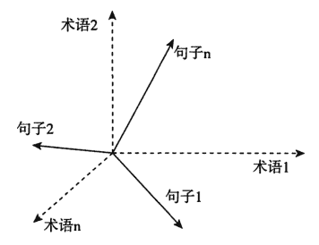

**图 7.1 三维向量空间模型示意**

如图7.1三维模型，向量坐标即各维度投影长度。术语向量法优势在于**向量空间相似度（VSS）**计算极便捷——将查询视为特殊文档同向量化，按预设序（如字母序）对齐维度，即可自动化比对。相似度度量等价于多维空间向量端点欧氏距离，实操中常算余弦夹角。余弦值越小，夹角越窄，全文法假定：文本语义越相似。

#### 7.5.3. 概率相关性模型

概率模型将检索重构为证据评价问题：用户查询意图为何？语料库文档内容为何？哪些文档最能满足查询？证据链覆盖：词汇短语、词典释义同义词、引文主题索引（如West Key Numbers）、统计特征。仿佛“含义（因）”生成“表征（果）”，反向推断：观测到“表征”，反溯“含义”。

---

### 贝叶斯网络入门

贝叶斯网络擅长建模“因果起效但认知不全，需概率描述”的场景（Charniak, 1991, p.51）。早期“West is Natural (WIN)”系统即用其自动推断：基于查询表征，特定文档满足用户信息需求的概率（Turtle, 1995, p.27）。

贝叶斯网络本质是概率因果图模型。节点=事件（附带状态变量），弧=因果影响（附带条件概率）。若满足条件独立性假设——给定父节点，节点与非后代条件独立（Turtle and Croft, 1990, p.21）——即可基于前驱节点状态计算当前节点状态概率。该假设大幅压缩计算量，使贝叶斯网络成为因果推理的高效引擎。

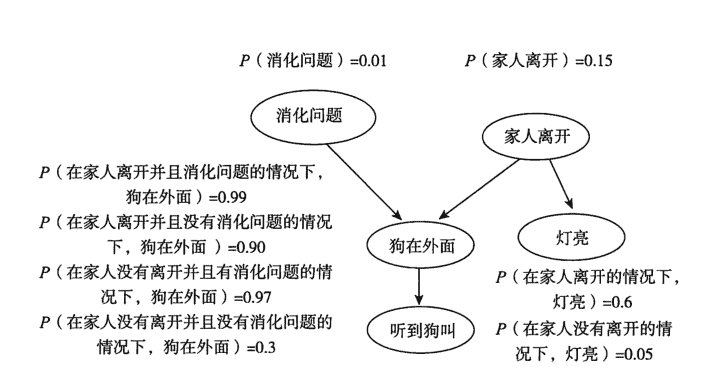

**图 7.2 家人外出问题的贝叶斯网络**

尤金·查尼亚克在《无泪贝叶斯网络》中给出教科书级例题（图7.2）：散步归家听到狗叫，推断家人不在家的概率。

因果链解读：家人外出先验概率15% → 直接导致狗在室外 → 导致听到狗叫。但狗在室外还有别因：肠胃不适（先验1%）。且家人外出时60%开庭灯，若期待客人，在家时也有5%开灯（Charniak, 1991, p.52）。

贝叶斯网络支持证据锁定后的条件概率更新。若观测到“灯亮=真”但“听到狗叫=可”，可算得“家人外出|证据”约为0.5（Charniak, 1991, p.52；推导见Brachman和Levesque, 2004, p.248）。

---

### 贝叶斯网络在检索相关性评估中的应用

贝叶斯网络天然适配“证据链评估”，可量化法律检索系统对查询意图及文档内容的不确定性。节点概率表征：查询术语仅凭概念表征正确描述文档集的可能性（Turtle and Croft, 1990; Turtle, 1995, p.33）。系统用网络算取特定文档与查询相关的概率。

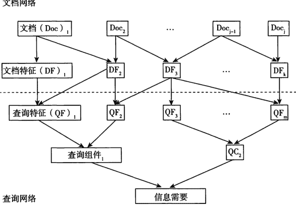

**图 7.3 推断网络检索模型 (参考 Turtle, 1995, p.33)**

图7.3模型双塔结构：
*   **查询网络（底层）**：用户提交查询时即时构建，源于系统对查询文本的解析，按查询概念（词、引文等）建模。可引入本体/同义词扩展，映射同义概念。
*   **文档网络（顶层）**：离线预建，查询时冻结。

查询节点至文档节点的弧路径编码条件概率依赖：满足信息需求概率 ← 取决于查询成分 ← 取决于查询特征 ← 取决于文档特征 ← 取决于文档。

任一文档Doc_i的先验概率 = 1/语料库文档总数。即：查询前，所有文档响应概率均匀随机（Turtle and Croft, 1990）。

倒排索引中的TF-IDF值用于估算上述条件概率。假设观测到特定Doc_i，反向推演其满足信息需求的后验概率。最终按概率降序输出Top-K列表（Turtle, 1995）。

商业法律检索系统已在贝叶斯网络应用上迭代升级（见7.7节）。推断网络模型标志着利用词频统计评估相关性的工程化成熟。且贝叶斯网络可兼容建模布尔、向量空间模型（Turtle, 1995, p.32）。

然而，**全文法律检索系统如何更聪明地工作**这一命题，至今仍是核心课题。

### 7.6. 法律信息检索系统的效能评测

评测起点：如何量化系统性能？4.4.4节已引经典IR指标解释分类器评测，同理适用检索：

*   **真负 (TN)**：不相关且预测不相关。
*   **真正 (TP)**：相关且预测相关。
*   **假负 (FN)**：相关但预测不相关（漏报）。
*   **假正 (FP)**：不相关但预测相关（误报）。

核心指标双子星：

**精确率**：检出相关文档数 / 总检出文档数。——**“挑出来的有多靠谱？”**

```
P = \frac{|Relevant \cap Retrieved|}{|Retrieved|} = (TP) / (TP+FP)
```

**召回率**：检出相关文档数 / 语料库全部相关文档数。——**“该找到的找全了没？”**

```
R = \frac{|Relevant \cap Retrieved|}{|Relevant|} = (TP) / (TP+FN)
```

**F1 值**：将精确率与召回率视为同等重要，取其调和平均数。

```
\(F_1 = 2 * \frac{P * R}{P + R} = \frac{2 * TP}{2 * TP+FN+FP}\)
```

### 遗漏率：指未被检索到的相关文档所占比例。

```
\(E = \frac{|Relevant \cap Unretrieved|}{|Unretrieved|} = (FN) / (TN+FN)\)
```

评估电子取证中信息检索效力时，遗漏率至关重要（参考 Oard 与 Webber，2013，pp.152-154）。

实际上，所有检索系统均先取文档再排序。如何衡量排序优劣，将在 11.4.1 节详述。

常规检索中，精确率与召回率往往此消彼长：宽松策略文档多、噪音大（召回高、精确低）；严格策略文档少、纯度高（召回低、精确高）。虽难完全消除权衡，仍有兼顾之法。如分级检索——先粗筛再细查——能双提升（Buckland 与 Gey，1994，pp.18-19），“相关性反馈”（见 7.9.2 节）即典型应用。

早期里程碑研究中，Blair 与 Maron（1985）考察了 IBM STAIRS 系统：布尔模型、约 4 万文档、服务大型诉讼。律师判定精确率，随机抽样未检文档估算召回率（Blair 与 Maron，1985，p.291）。

结果：精确率均值 75.5%，召回率却仅 20%（Blair 与 Maron，1985，p.293），远低于律师主观预期的 75%。归因：同义词多、间接引用多、迭代修改查询易导致搜索偏向、漏掉相关文档。

十年后，Lexis、Westlaw 等引入概率模型，Dan Dabney（1993）复刻研究。对象换为 ALR（美国法律报告）一卷 23 篇注解所引州案例。专家 Dabney 为每注解写查询，力求在两大系统中全召回且少噪音，再与注解引用的完整案例表比对（Dabney，1993，pp.105-106）。

结果相似：召回率虽升至 40%，但精确率大幅下跌。Dabney 总结：“多数从业者觉得 20% 太低，40% 也好不到哪去，尤其是精确率大跌时”（Dabney，1993，pp.126-127）。此后虽技术迭代，鲜见公开复评。

### 7.7 法律检索系统的新进展

WestlawNext 等新一代系统虽沿用传统检索功能，但排序机制迥异（Lu 与 Conrad，2013）。

除词频证据外，WestlawNext 重排序还引入：
- 专家注解证据（如 West Key Number 体系）
- 引文网络（被引与引用）
- 历史查询聚合下的文档热度与使用数据

并以机器学习“学习权重”，输出最高精度排序（Lu 与 Conrad，2013）。第 8 章将详述文本机器学习。推测模型或用黄金标准排序训练，或用用户点击反馈监督。最后，WestlawNext 还依法律问题推荐相关文档。

近期，Lexis 的 Paul Zhang 团队研发语义标注技术，支撑概念级检索。承诺“严格语义标注流程：识别文本单元、规范化、索引”（Zhang，2015）。

标注分四层元数据（似 6.8 节分层类型系统）：
1. 通用词汇层
2. 基础法律概念层
3. 法律问题层
4. 谓词预测层

① Fast Case 另一商业服务，其相关性排序亦考量引用频次与重要性（Remus 与 Levy，2015，p.24）。

**通用词汇层**：词形归一（拼写、措辞标准化）。

**基础法律概念层**：Lexis 建全语料库通用概念表。Zhang 从操作面定义“法律概念”为高频法律讨论中共享的词/短语簇。文档中概念被识别并映射至表中 ID。

构建流程融合自动与人工：
1. 美法律料库 n-gram 挖掘候选；
2. 语言规则聚焦名词短语并按分布过滤；
3. 同义归类，按频率与简洁规则选规范形式；
4. 人工编辑增删、配对、定夺（Zhang 等，2014）。

规范形式比表层表达更抽象，涵盖原则、教义、行话至事实概念（Zhang 等，2014）。

**法律问题层**：Lexis 维护标准化法律问题库，链接讨论该问题的案例。定义为“含一个或多个有意义‘概念’的信念/原则陈述”（Zhang 等，2014），关联案例引用他案/法规的理由。专利流程抽取理由与问题，同一问题下文本被识别、链接、索引。

Zhang 举例：声称“13 岁不应拥有车辆”……含概念“13 岁”“车辆”“拥有”；表达观点/法律含义即为法律问题。如下案例中“车辆”概念衍生出不同法律问题：
- a. 警方接近停驶车辆询问乘客不违宪第四修正案。
- b. 内州：债务人用车通勤/工作可视为营业工具。
- c. 州法管辖机动车担保权益。
- d. 爱州：未交付正确过户证书即重罪（Zhang 等，2014）。

**谓词预测层**：以动词中心谓词（V-Triples）标注，抽象句义。句法树转换为谓词结构。

四层元数据整合，基于全库标准化语义表征文档，服务概念检索。据报已纳入或即将纳入商业 Lexis 系统，用于语义搜索、分类、引用理由、概念图与引文网络浏览（Zhang 等，2014；Zhang，2015）。

### 7.8 对比：法律检索 vs. 法律论证计算模型

检索系统优势显著：新案数字化提交，倒排索引自动更新；无需人工解释即可算 TF-IDF；Lexis/Westlaw 自动处理百万级案例。

短板：相关性度量未捕获所有法律相关要素。除高亮查询词外，无法比较案例——缺乏“何特征具法律重要性”的表征，甚至不知谁胜诉、涉何主张。故无法从检索案例推断裁决、预测结果、生成正反论证。

第一部分计算模型恰补此缺：能以法律意义比较案例、预测、论证。但受限于知识表示瓶颈，仅能处理百级手工表征案例；新案入库亦需手工建模。

理想路径：融合全文检索与 AI 与法律方法的互补优势。

### 7.9 以 AI 与法律技术强化法律检索

第 10-12 章将介绍 UIMA 等开源工具实践，先回顾既往融合尝试。

#### 7.9.1 融合法律本体与检索

核心思路：本体驱动查询扩展。收到查询词，搜本体同义/相关词扩展查询。

例：Saravanan 等（2009）用印度租金控制、所得税、销售税本体自动扩展。查询“租赁欠款”→扩展“拖欠租金”“租金支付违约”等；查询“增加租金”→扩展“过高租金”“租金上调”。对比实验证实：本体扩展显著提升精确率与召回率（Saravanan 等，2009）。

另一用法：本体语义标记语料文本组件，优化检索。6.3.1 节示例：刑事听证检索系统基于电子法院本体索引搜索，用户浏览本体精准表达概念需求（Breuker 等，2002）。

LUIMA 类型系统（6.8 节）为案件句子论证角色语义标注的本体。11.4 节证实：LUIMA 标注能提升疫苗伤害案件全文检索重排序性能。

#### 7.9.2 融合检索与 AI 相关性度量

两项目尝试结合 AI 相关性度量与全文案例检索。

**SPIRE 系统**：用户输入法律因素集作为新问题。程序从全文检索系统调取共享因素的案例，高亮相关段落。关键点：检索出的案例原不在 SPIRE 库中——即用 HYPO/案例论证等 AI 推理模型，从 Lexis/Westlaw 等检索系统中挖掘相关案例（Daniels 与 Rissland，1997a,b）。

SPIRE 聚焦破产法“善意”问题。研究者提炼 10 类影响法院认定的因素（计划期限、债务人诚意、未来收入前景、特殊情况等），每因素汇编 3-14 段法院考量该因素的案例摘录。如“未来收入”：肯定/否定摘录并存——“法院未见增收可能”“固定收入大增前景渺茫”“健康存疑质疑工作力”“无加薪证据”（Daniels 与 Rissland, 1997a, p.43）。

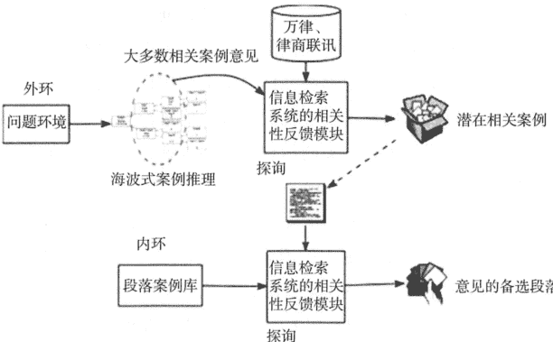

图 7.4 SPIRE 架构 (Daniels 与 Rissland, 1997a)

架构双环（见图 7.4）：
- **外环**：从 Lexis/Westlaw 等全文系统检索案例。库含善意相关破产案，以 10 因素表征 + 全文存储。
- **内环**：在检索到的判决中定位因素相关段落。库存手工提取的因素相关短文本。

流程：输入因素集 → 外环按因素检索案例 → 组织成主张点阵 → 选最大主张点案例（见 3.3.2 节，此处用 HYPO 式推理） → 将该案全文传给全文检索引擎 INQUERY（Callan 等，1992）的相关性反馈模块。INQUERY 库为 Lexis/Westlaw 语料库。案例文本作为种子查询，指示反馈模块检索更多相似文本。反馈模块让用户标记哪些返回文档相关，系统据此抽取扩展词增强查询，召回更多相似文档（Turtle，1995，p.40）。

INQUERY 返回潜在相关案例 → 内环高亮用户输入因素相关段落（虚线箭头）。内环按因素提取段落库文本，汇总成查询再次提交 INQUERY 反馈模块，但此时 INQUERY 库已切换为前述潜在相关案例全文。段落查询指示：从这些案例中找更多类似段落。最终返回高亮显示的最相关段落及所属案例（Daniels 与 Rissland，1997a）。

评估：按因素相关段落检索顺序，以预期搜索长度（遇到 1/3/5 相关段落前的噪音数）度量效力。20 文档测试集，两组因素聚焦查询 + 专家查询组。结果：SPIRE 使各因素搜索量分别减少约 4、10、11 项（Daniels 与 Rissland, 1997b, p.335）。

SPIRE 开创了连接 HYPO/案例论证等 AI 系统与全文检索系统的新范式。实验中成功从检索语料库发现与输入案例相似的新案例。

此连接亦启示半自动化更新因素案例库：定期以现有案例为种子，从 Lexis/Westlaw 挖掘同因素新案、高亮段落，人工确认后入库。随后 Case-Based Reasoning、IBP、价值判断论证预测等模型即可利用新案预测、论证（见 4.5.2、5.7 节）。前提：案例库已具因素表征与段落链接。

#### 7.9.3 利用引文网络强化检索相关性评估

7.7 节已述 WestlawNext 与 Lexis 均利用引文链接优化检索。早期 AI 与法律项目 SCALIR① 展示将引文链接纳入相关性评估的路径（Rose 与 Belew, 1991）。其网络数据库节点表征案例、法规及复合术语。检索度量为网络中“激活”量的扩散与大小。

### 7.9.3 符号与联结主义融合检索：交互式图谱探索

符号与联结主义相结合的法律检索系统，为用户呈现了一个可视化的交互界面。在此界面中，用户可用感兴趣的术语标注起始节点。系统随即在语料库中检索并展示关联案例与术语：核心相关节点聚拢中心，边缘相关节点散向外围（参考图 7.5）。用户只需点击节点即可标记重点，系统依托相关性反馈机制动态调整搜索范围——扩展或修剪结果集。

该系统的知识库涵盖 1,361 个联邦案例、版权法 87 个法条及 6,160 个术语，共 7,608 个节点，通过三类链接交织成网：
*   **C-链接**：标识案例包含特定术语；
*   **S-链接**：连接法条层级/引用、术语关联、案例引用或推翻关系；
*   **H-链接**：标示案例间的中等程度影响力（Rose 和 Belew，1991）。

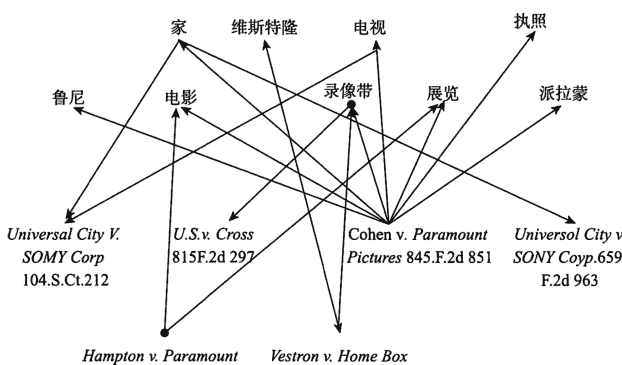

**图 7.5 “录像带”检索演示（见 Rose 和 Belew，1991）**

节点被赋予初始“活动值”，触发激活扩散过程：查询相连的激活节点向邻居传递能量。传播受链路权重制约，仅当输入激活总和超越阈值时方可传递。术语指向文档的 C-链权重取决于该术语在文档中的频次；S-链则对传递的激活类型具选择性（Rose 和 Belew, 1991）。

链接拓扑、权重参数与阈值共同决定了系统按相关性区分节点的能力。激活平息后，系统对节点输入激活求和、阈值筛选、按活跃度排序并图形化呈现。用户可通过标注节点反馈，迭代聚焦搜索方向（Rose 和 Belew, 1991）。

连接主义网络是迈向**概念检索**的关键一步（详见 1.3.2 节）。实测中，查询“录像带”检出了标志性判例 *Sony v. Universal*，尽管该案全文未现“录像带”一词。这意味着：即便概念未显性出现，链接网络仍能支持概念级召回。路径为：“录像带”→ *Cohen* 案 → “电视”“家庭” → *Sony* 案。

然而，精准构建链接、权重与阈值极具挑战。以“录像带”为例，通往 *Sony* 案的路径并非作者预想的直连，而是经 *Cohen* 案间接抵达；且 “VCR”“Betamax”“VTR” 等 *Sony* 案核心概念缺失于结果集，未达作者预期。

尽管如此，**引文网络仍是概念检索的富矿**。另一 AI 与法律系统 **BankXX** 即利用破产法法律网络：节点为案例，以法律因素集、引文集、原型故事及法律理论（亦以因素表征）互联。其目标是搜索对应 12 类论证构建块的信息（含正反方案例），构建论证。三大评估函数引导最佳优先搜索，依八大论证因子（如理论胜诉率、引文力度、最佳类比强度）评估论证质量。

实证表明，BankXX 从既判案件出发，在司法判决中挖掘显性论证要素成效显著（Rissland 等，1996）。该工作为用论证理论定义法律语义相关性、支撑概念检索提供了早期范式。

#### 7.9.4 概念漂移检测：以决策树演化追踪法律语义演变

法律概念随法院适用新事实场景而演变。Rissland 与 Friedman (1995) 设计出一种巧妙方法，检测检索库中案例的概念漂移。

研究聚焦破产法第 13 章“债务人是否善意提交计划”问题（同 SPIRE 领域，见 7.9.2 节）。团队构建了跨度 10 年、含 55 个案例的时序“案例流”，案例源自 BankXX 项目（Rissland 等，1996）。

案例不以文本存储，而编码为 61 维特征向量（债务人/债务/债权人属性、就业、现金流、预付款、盈余、无担保偿还比、陈述不准确度等）。部分特征映射为上诉案例确立、BankXX 亦采用的法律因素：收入盈余比、就业史、收入潜力、计划期限、准确性、相对支付总额、误导性不准确、动机诚信等（Rissland 等，1996）。

研究者按时间序将向量输入增量学习算法 **C4.5**（见 4.3.1 节），输出截至该时间点的“善意”概念决策树。树节点非叶即测试：叶节点判定善意是否满足；内部节点测试属性阈值（如计划期限、支付盈余额度、债务人动机诚信）。

程序对比相邻两棵树的结构差异以捕捉概念变迁：
*   **泛化**：增析取、删合取；
*   **特化**：删析取、增合取；
*   **属性相关性漂移**：属性增减、取值反转。
具体通过比对同位置节点取值变动，度量属性位移、增减幅度。

团队研发**结构不稳定性度量**：累加各层级变化加权总数。基于信息论度量，高层（近根）属性预测力强，赋予其更高权重。

程序平滑连续树对的变化累计和，检验斜率/趋势的统计显著性：
*   **负斜率** → 不稳定性下降，概念趋稳；
*   **正斜率** → 不稳定性上升，假设概念含义正在漂移。

为验证假设，程序持续更新旧树生成候选替代树，以降 12 个新案例对比预测力。若新树更优，确认概念漂移。作者核对检测结果与判决史，大体吻合。

作者强调该方法“通用性强，可兼容多种增量学习算法”（Rissland 和 Friedman，1995）。若案例文本可标注相关特征与法律因素，同类技术可助法律应用**自主检测、提出并验证法律概念语义演变假设**（见 12.6 节）。

### 7.10 结语：从文本检索迈向论证智能

商业法律检索的迭代与 AI+法律检索的融合虽成果丰硕，但两大核心领域尚待攻克：
1.  **捕捉句子在法律论证中的功能角色**；
2.  **利用这些功能支撑概念级法律检索**。

如 6.8 节所述，裁判文书句子承担四大论证功能：引用权威、陈述规则、记录裁判决定/裁决、认定证据是否满足规则要件。

若检索系统能在返回文本中识别上述功能，即可为案例排序、高亮关键段落提供强信号（前提为研究者意图用于论证）。这亦有助于系统抽取法律语义信息（如法律因素），进而支撑结果预测、论证构建与假设检验。

上述构想将在第十至十二章展开，但前置需求是：深入理解**机器学习在法律文本上的应用**，以及**从成文法/规章中提取规则信息**的技术路径。

## 第八章 基于法律文本的机器学习

### 8.1 引言：从结构化数据到非结构化文本的跨越

此前机器学习（ML）案例多针对法官画像、趋势统计、案件量等结构化元数据，鲜涉案件全文等非结构化语料。本章聚焦**法律文本语料上的机器学习实战**，覆盖：
*   ML 模型如何隐性编码用户相关性假设；
*   ML 如何增强全文法律检索；
*   ML 在概念检索与认知计算中的定位；
*   **监督学习**与**无监督学习**在文本场景的分野；
*   从法律文档自动习得结构与语义的前沿技术。

同步解答核心疑问：文本数据如何接入 ML？监督/无监督差异？**预测编码**原理与实效？**信息提取**内涵？文本如何向量化？**支持向量机 (SVM)** 为何成文本建模首选？

### 8.2 机器学习处理文本数据的通用范式

ML 算法核心三步走：**识别模式 → 总结模型 → 预测新数据**（Kohavi 和 Provost, 1998）。模型即以统计/逻辑形式固化模式、可迁移应用的结构（如前文图 4.2 保释决策树、4.4 节随机森林）。

模型量化**观测特征**与**结果特征**的关联强度。例如：
*   保释决定（结果） ↔ 涉毒/前科（观测）；
*   大法院赞成/反对（结果） ↔ 性别/提名总统党派（观测）。
模型以统计逻辑或混合形式捕获该关联。

前述 4.4 节预测大法院判决基于元数据而非文本。本章及后续章节转向**文本主导场景**：诉讼文书、判决书、法条。文本特征含术语、句法、语义。算法挖掘特征模式、构建模型、预测新文本标签或结果。

**应用图谱预览：**
1.  **基础设置**（8.3 节）：文本语料 → 向量空间模型。
2.  **电子取证文档筛选**（8.4 节）：模型学习用户相关性标准，打标“相关/不相关”。
3.  **案例关联挖掘**（8.5.1 节）：从商业库中识别“同一诉讼的关联案例”，特征含标题相似度、历史连接语言等，为学习修辞结构奠基。
4.  **修辞/论证结构分类**（8.6 节）：区分法律讨论与事实叙述；第十章系统标注句子论证功能（如“基于证据的事实认定”“原告胜/败”）。
5.  **法条语料迁移**（8.7 节）：将电取方法迁移至成文法，标注法条分析问题的“相关/不相关”，为第九章法条信息提取铺路。

法律文本 ML 是**法律认知计算**的基石：让算法习得人类解题所依赖的文本特征模式、最佳适用语境及特征关联强度，进而像人类专家一样对新问题预测分类。

### 8.3 法律文本机器学习的标准工程流水线

本节概述将法律文本语料转化为适配 ML 算法的向量空间模型（VSM，见 7.5.2 节）的标准化流程（Savelka 和 Grabmair，2015），细节超纲但架构必知。

**阶段一：数据获取与原始处理**
源头为自然语言法律文本语料（Fagan，2016，p.34）。*Court Listener* 等开放平台支持批量下载（商业库常禁批量，Fagan，2016，p.35）。

**阶段二：语言学预处理——规范化、分词、标注**
*   **规范化**：小写化 + 词干/词形还原，消除表层变体（Turney 和 Pantel, 2010, p.154）。如 “Phelps”→“phelps”，“Swimming/Swam”→“swim”。
*   **分词**：处理连字符、撇号、标点；常伴**停用词过滤**——移除高频低信息词（功能词“the, and”、代词“they, who”，Turney 和 Pantel, 2010, p.154）。
    *   *细微差异*：“Michael,” → “michael”；“Michael's” 所有格/缩写歧义，不同系统规则异，可能丢失语义。停用词表亦需领域适配：通用搜索可过滤 “and, not, or”，但法律语境下它们常承载关键逻辑。工程落地需审校默认规则。
    *   **N-gram 建模**：相邻词组合为单特征。Bigram 将 “Four score and seven years ago” 编为 “four score”, “score and”, “and seven”, “seven years”, “years ago”；Trigram 则生成四组三元组（Fagan, 2016, p.54）。
*   **标注**：注入消歧信息。词义标注（WSD）、词性标注（POS：名/动/形/副）、句法功能标注（直接宾语、介词宾语等，Turney 和 Pantel, 2010, p.155）。

**阶段三：文档向量化——构建特征向量空间**
预处理后，文档映射为定长特征向量（类术语向量，见 7.5.2 节），维度 $n$ 等于语料库唯一术语/特征总数（含 N-gram、类别信息）。每文档为 $n$ 维空间中从原点 $(0,...,0)$ 指向文档坐标的向量。全文语料维度极高。

维度取值编码特征量：
*   二值：0/1 表征有无；
*   词频 (TF)；
*   **TF-IDF**：词频按语料逆文档频率折扣，抑制高频噪声（见 6.4, 7.5.2 节，Turney 和 Pantel, 2010, p.156）。

**阶段四：学习目标定义与标签工程**
目标为文档分类或预测：
*   **电子取证**：全文/正文 → “相关/不相关”；
*   **句子级分类**：判决书句子 → “法律裁决”、“基于证据的认定”；或 → 是否支撑法律因素 F1(披露谈判)/F2(行贿) 结论；
*   **案件结果预测**：基于文本提取信息 + 法官/律师行为特征（见 12.2, 12.4.2 节）；
*   **法条主题分类**：条款 → 行政法/私法/环境法/刑法等。

向量需显性包含**结果特征**（分类/预测目标）。因 ML 多仅受数值特征，类别标签需数值化编码（如多标签二进制编码）。

**粒度与链接保留**：
处理单元随场景变化——电取以文档为单元，句子分类以句为单元，法条分类以条为单元。均可向量化。若局部-整体关联关键（如句子归属案件），需显性记录链接。

**阶段五：矩阵化与数据集切分**
语料汇聚为**文档-词项矩阵 (DTM)**：行=文档，列=词项/N-gram，单元格=频次/TF-IDF，形同电子表格。

向量就绪后，**随机采样切分训练集/测试集**（概率分配），避免偏差。算法在训练集拟合模型，在测试集预测/分类。

**阶段六：模型评估体系**
小样场景采用**交叉验证 (CV，见 4.4.3 节)**：每向量轮流作一次测试实例，其余训练，充分利用数据。
性能量化指标：**准确率**——测试集正确分类向量占比（见 4.4.4 节）。

---

### 表 8.1：三类句子功能的混淆矩阵

混淆矩阵是诊断分类模型表现的利器，它以表格形式直观记录了预测类别与真实类别的对应关系（Kohavi 和 Provost, 1998）。表格的行数与列数均等于分类类别的数量。表 8.1 展示了一个包含 690 个句子的测试集结果，每个句子均被视为独立文档，模型需将其归入三大功能类别之一。矩阵中，行代表样本的真实归属，列代表模型的预测归属。

通过观察矩阵主对角线（左上至右下）上的数值，我们可以迅速掌握分类器的正确判例数，即真正例（TP）。反之，真负例（TN）指模型正确判定为“非该类”且实际也非该类的样本量。每个类别均可单独生成一张包含 TP、TN、假正例（FP）及假负例（FN）的统计表。

以“法律规则”类为例，TP 为 201；FP 来自其他两类被误判为该类的样本之和（46+23=69）；FN 为本类被误判为其他类的样本之和（96+13=109）；TN 则是除该类外所有正确分类的样本总和（311）。同理可得“法律裁决”类（TP=87, FP=160, FN=103, TN=340）与“事实发现”类（TP=103, FP=70, FN=87, TN=430）的指标。

| | 法律规则 | 法律裁决 | 事实发现 |
|---|---|---|---|
| **法律规则** | 201 | 96 | 13 |
| **法律裁决** | 46 | 87 | 57 |
| **事实发现** | 23 | 64 | 103 |

**核心指标速览：**
*   **法律规则**：TP=201 | FP=69 | FN=109 | TN=311
*   **法律裁决**：TP=87 | FP=160 | FN=103 | TN=340
*   **事实发现**：TP=103 | FP=70 | FN=87 | TN=430

想搞懂模型为何“翻车”，关键在于深挖 FP 与 FN 样本，分析是哪些特征误导了分类决策（详见 4.4.4 节）。

---

### 8.4 机器学习在电子取证中的实战

电子取证聚焦于审前阶段对电子存储信息（ESI）的收集、交换与解析。不同于结构化的法条判例，诉讼文档极其杂乱——涵盖备忘录、邮件、推文、网页等海量异构数据。核心难题在于：如何依据律师的“相关性假设”，从百万级文档中精准筛选出与案件主张抗辩相关的证据，跨越数据的异质性鸿沟（Ashley 和 Bridewell，2010）。

#### 8.4.1 律师的“相关性假设”从哪来？

霍根将电子取证定义为“意义构建”过程：围绕核心问题，收集、组织、表征复杂信息（Bauer 等，2008）。律师在此过程中构建“相关性假设”——一种主题描述，命中该描述的文档即视为相关（Hogan 等，2010）。

这类假设的表达形式随案情法律概念、关注粒度、词汇语法习惯及用例场景动态变化。例如未成年人烟草广告诉讼中，假设可能是：
*   “涉及‘店内’、‘柜台’、‘销售点’等卷烟零售营销的文档。”
*   “‘买一送一’促销是否相关？”

更深层的假设极具具体性，锁定“谁、对谁、何时、何地、为何、传达了何种内容”：
*   “证明营销副总裁 1989 前知晓广告针对儿童的文档。”
*   “烟草公司员工涉嫌向外国官员行贿的内部文档。”
*   “1985-1989 年爱丽丝与其律师鲍勃的通信记录。”

概括而言，假设形式为：**“存在特定类型、特定时限、特定社交约束、且引用特定概念/短语的文档”**（Ashley 和 Bridewell, 2010）。

这些假设源于正式证据开示请求，进而关联原告诉状或被告答辩，并随新证据迭代更新。然而，现有预测编码系统鲜有显式支持律师构建、管理这些假设的功能，更未直接将假设作为算法输入。在认知计算范式下，显式引入假设机制将有助于指导测试、重述查询及解释结果（详见 12.4.1 节）。

#### 8.4.2 预测编码：核心工作流与算法引擎

业界常用“预测编码”指代电子取证中的机器学习流程，标准化步骤如下（Privault 等，2010；Sklar，2011）：

1.  **种子集构建**：案件管理员（CM）利用关键词、布尔检索、概念聚类、近重复识别等工具初筛语料，人工标注正/负样本，形成各类别（如“相关”、“特权”）的种子集。
2.  **迭代训练循环**：
    *   **建模**：系统从种子集抽象预测模型，技术路线包括统计分析、浅层解析、概念关系抽取、本体扩展或潜在语义特征识别。
    *   **推荐**：模型扫描全量语料，推送待审文档给人工团队。推荐策略涵盖随机抽样、主动学习（选取分类器最不确定的样本）、错误案例/异常值复核。
    *   **标注**：人工团队核验并修正推荐文档标签。
    *   **更新**：模型吸收人工反馈，更新分类边界。
    *   **收敛**：循环直至未审语料中无新增同类文档。
    *   **统计验收**：抽样估算召回率与精确率达标水平。

**两大主流算法范式：**

*   **概率潜在语义分析 (PLSA)**：施乐 Categorix 系统的核心。假设存在隐藏“潜在因子”驱动词-文档共现。它将文档映射为词频向量（忽略语序、句法、本体），仅凭统计共现捕捉语义关联。例如，虽不知“营销副总裁”、“香烟”、“长颈鹿”、“儿童”的实体含义，PLSA 能通过高频共现发现它们间的语义纽带（Landauer 等，1998；详见 7.5.2 节）。
*   **支持向量机 (SVM)**：在高维特征空间寻找最优超平面分隔正负样本（详见 8.3 节，例见 8.5.2 节）。

**黑盒困境**：PLSA 与 SVM 学得的统计模型难以被人类直接解释或调试（Oard 和 Webber, 2013）。相比之下，规则归纳、决策树等白盒模型可解释性强，但在文本分类任务上，**“越不需解释的统计分类器，往往效果越强”**（同上）。这导致电子取证不得不高度依赖经验性评测，而评测方法本身又存局限。

#### 8.4.3 如何给预测编码“打分”？——统计抽样估算召回率

法官与律师最关心：分类器到底靠不靠谱？全量人工校验因规模太大而不可行（Oard 和 Webber, 2013）。布莱尔与马龙的经典研究曾揭示：律师自以为找回 75% 相关文档，实则仅 20%（同上）。

**破局之道：随机抽样 + 统计推断。**

以烟草诉讼 100 万文档为例（改编自 Tredennick, 2014a）：
*   **点估计**：律师主观预估 1% 相关（1 万份）。
*   **统计估计**：引入**置信水平**（如 95%）与**置信区间**（误差幅度 ±2%）。按高斯分布计算，需抽样约 2,396 份。
*   **实测修正**：抽样中发现 24 份相关，经二项式计算，真实相关率区间修正为 0.64%~1.49%，即全库相关文档 6,400~14,900 份。

**召回率陷阱**：团队用预测编码审了 5 万文档（5%），找回 7,500 份相关。
*   若真实总量 1 万，召回 75%（达标）。
*   若触及区间上限 1.49 万，召回仅 50%（不达标）。

**二次抽样定乾坤**：对未审 95 万文档再抽 2,396 份，发现 8 份相关。推算未审库存相关量 3,172 份（区间 1,330~6,270）。合并已审数据，总相关量上限 13,770，实际召回率约 55%——仍不达标。

**代价高昂的收敛**：若将误差压至 1%，需抽样近万份；若采“直接法”随机抓取 384 份相关文档计算召回，若相关率 1%，意味着额外审 3.8 万份。这揭示了**统计估计召回率的本质：昂贵、迭代漫长、且受“确凿证据”隐藏、对方恶意混淆等现实干扰，样本量往往超理论预期**（Oard 和 Webber, 2013；Sohn, 2013）。

#### 8.4.4 预测编码的待解难题

电子取证社区仍在攻克监督学习初期的**种子集冷启动**难题（第 4.3 节）。种子质量直接决模型上限，但最佳来源众说纷纭（Oard 和 Webber, 2013；Privault 等, 2010）：
1.  专家精选的典型概念实例；
2.  手工查询迭代筛选的高相关文档；
3.  纯随机抽样（忽略案情细节）；
4.  无监督文档聚类自动生成；
5.  以上混合策略。

Remus 和 Levy (2015) 建议：关键词检索切入 → 相关性排序 → 筛选种子。但**终极答案取决于具体检索任务与语料库特性**，没有放之四海而皆准的银弹。

### 文本表达的进阶：超越“词袋”的知识化探索

在电子取证领域，如何精准刻画文本内容始终是核心难题。学界正致力于引入知识驱动技术，摆脱传统机器学习中“词袋模式”的局限，力求构建更立体的文本表征。正如 Oard 与 Webber（2013）所言，自动化审查在实体识别、元数据解析、社交网络拓扑、邮件通讯模式、乃至回复行为的时空定位等维度的潜力，尚待进一步挖掘。

早期研究已尝试引入社交网络分析（SNA）解读邮件数据（Henseler, 2010）。该方法将人、组织、站点等实体间的互动抽象为图谱，通过测量图属性推断深层关联。发件人、收件人及持有者身份嵌入邮件记录中，剖析“谁与谁、就何事、在何时”沟通，能为筛选高价值文本提供关键线索。

### 预测编码的实战博弈：策略、度量与审计

预测编码的引入重塑了诉讼策略版图（Sohn, 2013）。关键词检索时代，双方就搜索词博弈，此举虽能界定证据范围，但预测编码打破了单一术语的框架，算法基于复杂文本表征运作。这引发了一连串棘手问题：如何量化召回率与漏报率？何种指标阈值能在成本与效果间达成平衡？不确定性滋生争议，谈判难度骤增。更关键的是，尽管流程繁复，各方仍须留存完整审计轨迹，以便在听证会上为预测过程的合理性辩护（Sohn, 2013）。

### 实证胜于雄辩：技术辅助审查（TAR）的胜出

尽管理论与实务隐忧并存，证据表明技术辅助审查（TAR）已跑通闭环：预测编码等技术有效赋能人机协同，精准锁定响应文档（Grossman & Cormack, 2010）。在 TREC 法律轨道竞赛（2008-2011）中，凡能同时兼顾高准确率与高召回率的系统，无一例外依赖 TAR（Oard & Webber, 2013, p.199）。结论极具说服力：**技术辅助生产的效力至少等同于人工审阅，甚至能以更低成本实现更优产出**（Oard & Webber, 2013, p.203）。

#### 8.4.5 无监督学习：从“未知”中挖掘结构

在离开电子取证前，必须聚焦文本无监督机器学习。

无论是电子取证中的预测编码，还是第四章提到的案件结果预测，本质均属监督学习——即从标注样本中学习“特征与标签的映射关系”（Kohavi & Provost, 1998）。

无监督学习则另辟蹊径：无需人工标注训练集，算法直接推断文档天然类别。以文档聚类为例，它在零先验标签下，依据内容或元数据将文档自组织为群组，再由人事后定义群组语义并打标签（Grossman & Cormack, 2014; Privault et al., 2010; Oard & Webber, 2013）。

这种模式在监督学习“冷启动”阶段极具价值。例如 Categorix 系统先无监督聚类，向专家推荐潜在标签，专家确认后系统无缝切换至监督模式处理增量数据（Privault et al., 2010）。其核心采用概率潜在语义分析（PLSA）度量相似度，将文档划分为指定数量的簇。可视化界面引入“虚拟磁铁”交互：文档按与簇中心相似度环绕分布，红色近端文档最相关，颜色渐变直观呈现关联度。专家标注后，系统即刻转入监督学习，完美契合电子取证文档分批次、流式产出的实战节奏（Privault et al., 2010）。

### 8.5 案例法语料上的机器学习实践：Westlaw 历史项目

电子取证处理的是异质法律文本，而传统法研核心——判决书、法规——属于相对同质语料。机器学习能从中挖掘何种高价值信息？Westlaw、LexisNexis 等商业数据库为此提供了富矿。

**Westlaw 历史项目**是典型范例（Al-Kofahi et al., 2001; Jackson et al., 2003）。其核心任务是“历史任务”：识别判决书中影响先例效力的语言，构建上诉链条。具体指**先例检索（PCR）**——在层级法院体系下，一审诉讼衍生的动议裁决、终局判决可经多级上诉，先例可能源自下级法院亦或平级法院。

Westlaw 维护着包含 130 万有上诉链案件的援引数据库（覆盖 700 万案件）。但判决书常隐匿先例信息（如先例未刊行），人工核查成本高昂。系统目标明确：配合编辑复核，召回率逼近 100%，精确率超 50%（Jackson et al., 2003）。

#### 8.5.1 系统架构：三阶流水线

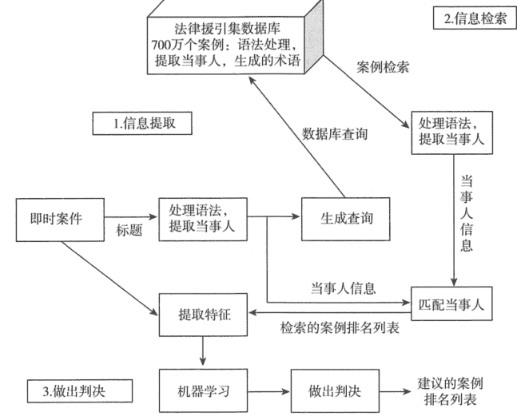

图 8.1 历史项目系统架构（Al-Kofahi et al., 2001）

架构包含**信息抽取、信息检索、裁判决策**三模块（见图 8.1）。

**预处理**：援引库案件按标题建立索引。当事人实体生成索引词（如 “David E. Smith” 拆解为 “Smith”、“David + Smith”），低文档频率词因区分度高被选为索引特征，每案件保留最优 8 个术语。

**阶段一·信息抽取**：输入现行案件，抽取历史表述、当事人、法院、日期、案卷号；同步处理标题生成索引词。

**阶段二·信息检索**：融合高区分度索引词与时空法院属性（管辖权、巡回区等），从援引库召回过去 7 年内符合上诉路径的候选先例。提取候选当事人信息与现案比对，输出按当事人相似度排序的候选列表。

**阶段三·裁判决策**：引入机器学习，对候选者进行“是/非”先例的二分判定。

#### 8.5.2 核心算法：支持向量机（SVM）

SVM 以统计准则在向量空间划分正负样本边界。不同于可解释的决策树，SVM 模型呈“黑盒”特性。它寻找距离最近正负样本（支持向量）最远的**超平面**作为决策边界（Noble, 2006）。维度越高，超平面几何形态越复杂（线→面→超平面）。预测新样本标签，仅需判定其特征向量落在超平面哪侧。

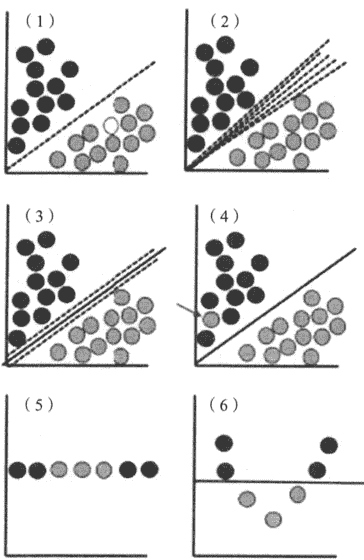

图 8.2 SVM 原理示意（Noble, 2006）

实际数据常不可线性可分。SVM 引入**软间隔**参数，容忍部分样本越界误分，平衡分类准确与模型鲁棒性。更强大的是**核函数**：将低维不可分数据映射至高维空间寻找线性边界（如 1D 不可分映射至 2D 可分），通过核技巧规避显式高维计算开销。

#### 8.5.3 实战成果：排序重排与决策模块

历史项目并非直接用 SVM 分类，而是利用其**决策函数距离**对候选先例重排序（Jackson et al., 2003），再经决策模块优化召回。

**训练**：随机抽 2,100 案件，经抽取-检索流程得顶级 100 候选，构建 11.3 万个 8 维训练向量。标签源自援引库权威记录。

**8 维特征向量构成**：
1.  **标题相似度**
2.  **历史语言标识**（单独贡献 80% 召回，精确率 50-60%）
3.  **案卷号匹配**
4.  **上诉路径概率**（现法院为前法院继任者概率）
5.  **先验概率**（库中先例占比）
6.  **被引用标识**（现案是否引用候选）
7.  **标题权重**（量化当事人名区分度，如 “Smith” < “Alex J. Tyrrell”）
8.  **AP1 检索标识**（现案上诉程序行是否命中候选）

**测试**：312 案件测试集（含 123 真阳性）。结果：**召回率 99.2%（122/123），精确率 64.9%（122/188），人均待审建议仅 5 条**。极大降低了编辑校验负担。

### 8.6 案例结构化：剥离事实与法律的边界

历史项目证明：机器学习能从案例语料挖掘结构化知识。同理，识别判决书内部结构（事实 vs. 法理讨论）可大幅提升检索质量。句子所在段落语境（如法院陈述事实段）强暗示其语义角色。

LexisNexis 专利技术即基于此：算法自动生成训练数据，按标题分区、段落相对位置、标题词表匹配，将段落分类为“纯事实”、“纯讨论”、“混合”、“无关”（Morelock et al., 2004）。

**特征工程极具法理直觉**：
*   结构位置（第 k 段/共 n 段）
*   案例/法条引用频次
*   过去时动词密度（约定、请求、送达、判决…）
*   具体日期实体
*   话语标志词（认定、维持、推翻…）
*   法院自指频次（本院、下级法院…）
*   当事人称谓词频（原告、上诉人、被告…）
*   法律术语频次（犯罪前科、监护权争议、征用权…）

段落经分块解析，融合相对位置与上述至少 5 类特征值向量化。朴素贝叶斯或逻辑回归学习特征权重，最终预测未知段落归属。机器学习再次完成了“直觉特征→量化权重→自动决策”的闭环。

### 8.7 成文法文本：交互式预测编码的新战场

机器学习触角延伸至成文法分析。最新项目将预测编码的交互式工作流引入**相关法条定位**任务。

#### 8.7.1 成文法分析的痛点

成文法分析旨在确定法规“适用与否、如何适用、效力如何”（Putman, 2008）。前置步骤是检索候选条款。现有检索系统虽能响应律师构建的假设性查询（如 “宾州法规要求公共卫生机构如何应对突发事件？” → 查询：(紧急|灾害|危险) AND (应对|准备) AND (消防|医院|卫生部门|…)），但**后续环节乏力**：缺乏对候选条款的优先级评估、假设迭代与特征细化支持。无论是合规核查还是跨辖区法律尽调，这些缺失环节至关重要。

#### 8.7.2 交互式机器学习工具：破局之道

# 8.7 交互式机器学习：让法条筛选变成“人机对话”

在电子取证领域，预测编码早已成熟。研究者们顺势将这套“迭代训练”思路移植到成文法检索中（Savelka 等，2015）。流程大致如下：系统先从法律信息检索结果里抓取一批候选条款，呈现在交互界面上。专家浏览后，标注正负样本——哪些是目标法条，哪些不是。分类器即刻吸收反馈、更新模型、再推荐新一批。如此往复，直至结果收敛。

本质上，这是一场**人机协同的“相关性博弈”**。专家把握法律判断，机器负责模式归纳与海量筛选。图 8.3 展示的 GUI 界面堪称“指挥舱”，一次性把关键信息铺开：

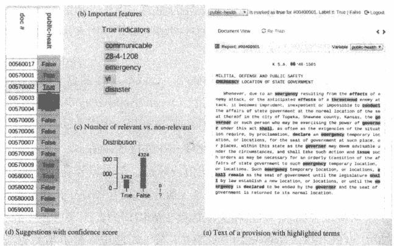

*   **(a)** 原始条款全文；
*   **(b)** 当前模型眼中的“关键词”及其权重；
*   **(c)** 迄今为止正负样本的分布统计；
*   **(d)** 已标注条款清单，附带置信度分数。

系统还会主动给未处理条款打“预测标签”，高亮显示 (a)(b) 区的特征词，等待专家一键确认或纠偏。专家甚至能反向操作：圈选文本里的关键术语，点按钮告诉模型“这个词很重要”。每一轮标注结束，SVM（线性核支持向量机，详见 8.5.2 节）即刻重训练，吸纳新特征、调整权重。

---

## 跨辖区迁移：堪萨斯的经验能否用在阿拉斯加？

一个极具实用价值的问题摆在面前：**在某州法条上训练好的模型，能不能直接拿去分析另一州的同类法条？** 研究团队设计了两组实验给答案：

1.  **“冷启动”实验**：零基础面对堪萨斯州公共卫生法条，拿专家人工标注的“高精确率基线”（假设未处理全不相关）与“高召回率基线”（假设未处理全相关）做对照。
2.  **“知识复用”实验**：同上任务，但换阿拉斯加州法条，且模型**初始化参数直接沿用堪萨斯训练好的分类器**。

评价指标很硬核：精确率、召回率、F1，外加 ROC 曲线与 AUC 值。简单说，ROC 曲线横轴是假正率（无关被判相关的比例），纵轴是真正率（即召回率），每个阈值对应一个点。AUC 代表“随机抽一条相关法条、一条无关法条，模型给相关条款打分更高的概率”。AUC=1 为完美，AUC=0.5 等于瞎猜。

**结果令人振奋：**
*   **冷启动**下，仅标注约 25 条文档，AUC 即破 80%，全程碾压两条基线。
*   **知识复用**组表现更强，直接证明了**跨辖区迁移学习的有效性**——解析堪萨斯法条沉淀的“法律语法”与“领域逻辑”，能实实在在降低阿拉斯加新任务的标注成本。

---

# 8.8 从“搜文档”到“懂意图”：认知计算法律应用的雏形

不管是电子取证、判例检索还是法条分析，痛点高度一致：**关键词搜索只能把“可能相关”的堆给你，后续的“读全文、判相关、改假设”全靠人肉完成。** 取证时文档太多读不完；法条分析时，哪条真相关全靠手工筛。

上一节的交互式工具，恰恰勾勒出**认知计算法律应用**的轮廓：
*   **系统**擅长：从标注中学习模式、泛化到未见文档、排序推荐；
*   **人**擅长：基于法律直觉做相关性裁决、解释“为什么相关”、随时修正假设。

理想状态是：**人用自然语言表达“相关性假设”，系统听懂并转化为检索策略，再用生成的案例辅助人迭代假设。** 12.4.4 节会展示原型系统。但要走通这条路，得先攻克核心难题——**机器如何从法律文本里自动挖出可计算的“有用信息”**？第九章、第十章将分别聚焦成文法/规章与判决文本的信息提取技术。

---

# 第九章 从成文法与规章文本中“挖”信息

## 9.1 导读：为什么要自动提取？

律师、公民、合规官、立法者——所有人都需要快速搞懂：**法规到底要求什么？怎么不踩红线？** 这正是 AI 与法领域长期攻关的核心：从电子化法条中自动抽取规则要素。

本章将梳理三大技术路线：**机器学习、自然语言处理、知识工程**，看它们如何联手识别：
*   条款功能类型（定义/义务/禁止/许可……）
*   规范类型与功能要素（主体、行为、客体、条件……）
*   法律主题分类（行政/环保/刑事……）
*   甚至——**直接提取可执行的逻辑规则**。

**终极梦想**是：自动把法条变成业务规则引擎能跑的逻辑公式（演绎推理见 2.3.4，可辩驳推理见 2.5.3），嵌入工程设计流程实时合规，或支撑法律问答系统（5.9 节）做复杂推理。

**现实骨感**：离“全自动推理”还很远。但**退而求其次**的成果已极具价值——自动标注本体概念、生成条款摘要、构建**法条网络图**（2.6 节）直观展示“谁对谁做什么”，支持跨州监管体系可视化对比，甚至作为检索入口。引入类 UIMA 的类型系统与标注管道，还能进一步提升文本表征质量，为下游机器学习铺路。

本章将逐一拆解：怎么提？各技术啥角色？能不能直接出逻辑规则？什么是合规性？法条网络咋用？类型系统管道咋接入？

## 9.2 研究版图：都在提什么、怎么提？

既有工作围绕六大类信息展开：

| 目标信息 | 典型案例 |
| :--- | :--- |
| **功能类型** | 定义、禁止、义务、许可等（11~13 类） |
| **功能相关特征** | 义务主体、行为、接收方、条件、例外等“参数” |
| **法律领域/主题** | 环境法、刑法、欧盟 230 叶主题节点等 |
| **语义概况** | 融合上述维度的条款/法规级画像 |
| **本体概念索引** | EuroVoc 等词库概念自动映射 |
| **逻辑规则/规范** | 前件-后果结构、逻辑公式化表达 |

**技术工具箱**：知识工程（专家手写规则）、监督学习（SVM——8.5.2、决策树——4.3.1、朴素贝叶斯——10.3.3）。文本多表征为**词袋/术语向量**（含频率/权重，见 7.5.2）。下文将按信息类型逐一复盘 SOTA 进展。

### 功能类型分类
*   **意大利消费者保护法**：多类 SVM + 朴素贝叶斯，11 类（Biagioli 等，2005；Francesconi 系，2007-2010）。
*   **荷兰成文法**：13 类，含“公布规定”“修改范围”等（de Maat & Winkels，2007/2010）。
*   **美州公共卫生应急法**：决策树 / SVM 三分类——义务/许可/禁止（Graspmeyer 等，2011；Savelka 等，2014）。

### 功能相关特征（参数抽取）
在“数据控制者必须通知担保人”这类条款里，NLP 进一步抠出：行动者（控制者）、动作（通知）、接收方（担保人）（Francesconi 系工作）。公共卫生法条同理，能识别“州卫生官员 / 可以 / 命令 / 患者 / 隔离 / 传染病 / 拒绝治疗”等要素（Graspmeyer 等，2014；Savelka 等，2011）。

### 法律主题分类
*   Francescoi & Peruginelli (2008)：朴素贝叶斯/多类 SVM 识别环境法、欧盟法、刑法标签。
*   Opsomer 等 (2009)：SVM 挑战 EuroVoc 230 叶节点（环境政策、能源工具等）。
*   大量工作聚焦 **EuroVoc 概念自动索引**：术语向量匹配（Poulquien 等，2006）、SVM 多分类（Boella 等，2012）、多语言多辖区适配（Daudaravicius，2012）。

### 问题域相关性
Graspmeyer/Savelka/Ashley 系列工作：训练分类器识别“与公共卫生应急相关”的条款，跨多州法规适用。

### 语义概况构建
*   Wyner & Peters (2011)：语言规则从 FDA 4 页法规中抽义务/许可/前件/主体/例外。
*   Winkels & Hoekstra (2012)：语义网 + NLP 抽荷兰税法概念与定义。

### 逻辑规则/规范提取
目标直指**可计算规则**：Bach 等 (2013)、Wyner & Governatori (2013) 服务工程合规；Zhang & El-Gohary (2015)、Governatori & Shek (2012) 落地业务系统；Kiyavitskaya 等 (2008)、Yoshida 等 (2013) 辅助人工标注；Gordon & Breaux (2013)、Savelka 系列 (2014/2015) 支持跨辖区规则对比。

后续小节将深入剖析提取机制与实证评价（指标同 4.4.4 节）。

## 9.3 条款功能信息自动提取：从“标签”到“可检索语义”

提取功能信息最直接的价值是**支撑概念级检索**（1.3.2 节）。Francesconi 等系统能从条款中识别功能类型（定义/义务/责任/禁止/许可/惩罚……）及伴随要素（义务承担者、受益人等）。

**图 9.1 实例**：输入意大利隐私法条款  
> “打算处理个人数据的**控制者** 应 **通知** **担保人**……”

系统输出：  
*   **类型**：义务  
*   **特征** → 接收人：控制者 | 行为：通知 | 相应方：担保人

这些结构化元数据以 **XML/语义标注** 形式嵌入条款，汇聚进“本体辅助立法起草”类本体（6.4 节）。于是，用户能一键检索：**“所有要求‘控制者’向‘担保人’履行‘通知’义务的条款”**。

### 9.3.1 机器学习识别功能类型：分类器 + 提取器双管齐下

Francesconi 团队构建双工具链（2007/2009）：

1.  **xmLegesClassifier**（可扩展标记立法语言分类器）  
    *输入*：法条文本片段 → *输出*：候选集中预测的功能类型/类别。
2.  **xmLegesExtractor**（提取器）  
    *输入*：文本片段 + 预测类型 → *输出*：对应该类型的语义角色文本片段。

**分工明确**：
*   **ML 负责“抽象分类”**——如判定“这是义务条款”；
*   **知识工程 + NLP 负责“具体抽槽”**——如锁定“控制者”是义务主体。

#### 文本表征与特征工程（Classifier 核心）
同 8.3 节：**词袋 + 一元语法**（无短语）。预处理三步走：词干还原、数字/非字母数字符号替换、生成加权术语向量。再施**特征选择阈值**滤除低频噪音。

**权重方案 PK**（Francesconi, 2009, p.64）：
| 方案 | 逻辑 |
| :--- | :--- |
| 二值权重 | 有/无 |
| 词频 (TF) | 出现次数 |
| TF-IDF | 频率 × 逆文档频率（语料库稀缺性） |
| TF × 信息增益 | 频率 × “区分类别的能力”（区别于 IDF 的语料库维度） |

信息增益直接度量**术语对分类决策的贡献**，实验中常优于 TF-IDF。

---

# 9.3 多类SVM实战：自动识别法条功能类型

研究团队尝试将多类支持向量机（详见 8.5.2 节）部署在包含 582 条法条的语料库上。此前我们接触的 SVM 多用于二元判断，比如预测文档相关性（见 8.4.2 节）或案例是否属于前案历史（见 8.5.3 节）。而 xmlLeges 分类器面临的任务更复杂：它需从 11 种功能类型（如废止、定义、授权等）中精准判定文本归属。

多类 SVM 的核心在于构建多个超平面，将每一类正样本与其他所有样本分隔开。图 9.2 直观展示了其与二分类 SVM 的结构差异：实线代表决策超平面，虚线标示置信边界，两虚线间的最小距离即为“多类边距”；深色点为支持向量，黑点标注约束违规，额外边界线则指示训练错误导致的违规（Francesconi 和 Passerini, 2007, pp.11–12）。

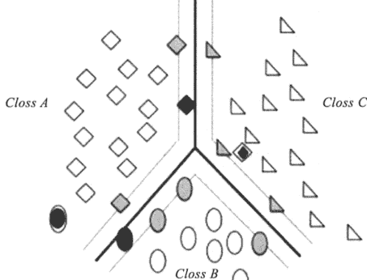

图 9.2. 多类支持向量机超平面示例 （ 见 Francesconi 和 Passerini, 2007, p.12 ）

评估采用了“留一法”交叉验证。正如 4.4.3 节所述，这是小样本场景下评估机器学习模型的标准范式：每次仅留出单个样本作测试，其余全部用于训练，轮流进行 n 次（n 为样本总数），确保模型从未在训练数据上测试。

实验中，采用最基础的二元特征加权（词是否出现），模型达成了 92.64% 的留一法准确率 (Francesconi, 2009, p.65)；引入更复杂的权重方案反而未能提升表现。

分类器预测功能类型后，结果将传递给 xmlLeges 提取器。该工具融合知识工程规则与自然语言处理，针对不同条款类型提取关键功能信息 (Francesconi 和 Passerini，2007; Francesconi, 2009)。

#### 9.3.2 基于文本分类规则的功能信息提取

输入原始法条文本及预测类型，提取器输出“词汇单元”——代表实体并在特定条款语境下扮演特定角色的文本片段。图 9.1 演示了预设角色（如收件人、行为、对手方）及提取示例：词汇单元“控制者”“通知”“担保人”分别对应角色扮演者。

流程分两步：句法预处理与词汇单元识别。预处理阶段完成分词、标准化（日期、缩写、多词表达）、词形还原（依托意大利法律词典）、词性标注及浅层句法分析（分块）。识别阶段则依据专家定制的针对性语法，定位与特定条款类型相关的论元或要素块（Francesconi, 2009, p.66）。

评估时，研究者构建了覆盖禁止、义务、许可、惩罚四类条款语义角色的黄金标准集。在 209 条规定测试中，基于规则的分类器实现平均精确率 83%、召回率 74%。细分来看：禁止类（P 85.11%, R 92.30%）、义务类（P 69.23%, R 30.50%）、许可类（P 78.95%, R 100.00%）、惩罚类（P 85.83%, R 89.34%）。

### 9.4 立法信息抽取：机器学习与知识工程的博弈与融合

xmlLeges 项目生动诠释了自动化信息抽取（IE）的核心议题：在机器学习（ML）与知识工程（KE）之间抉择，抑或将二者融合。

**知识工程路径**：梳理各类条款的显性模式，手工编写规则匹配新文本并抽取信息。
**机器学习路径**：人工标注训练样本，算法自动学习区分特征。

两者各有优劣 (de Maat 等，2010)。KE 无需标注数据，但依赖专家手工总结的标准短语规则；ML 灵活性强、领域依赖低、专家门槛低，但 SVM 等统计模型常是“黑箱”，决策依据不透明，且需大量标注样本。

一研究组曾在两部荷兰新立法上对比两种路径，任务同为识别 13 种功能类型（定义、许可、义务、授权及多种修正类型）。

KE 侧早有积累：基于 20 部荷兰法典提炼了 88 个词模式（如“可以”指权利/许可，“x 被理解为 y”指定义，“见”指引用，“可以创建规则”指授权），存储为匹配格式 (de Maat 和 Winkels，2009，pp.32-33)。分类策略为：优先检首句/首项，命中则定全条；否则逐句独立分类；全无命中则归为默认类“事实陈述” (de Maat 和 Winkels，2009，p.33)。

ML 侧则训练 SVM，特征为加权词向量（一元语法），测试三种加权：二值、词频 (TF)、TF-IDF (见 8.3 节)。

**对比结果**：ML 在修改现有法条方面略胜一筹，但在全新立法分类上不如 KE。ML 主要翻车于定义识别、许可与义务区分。错误成因汇总于表 9.1。

表 9.1 制定法条款分类：KE 与 ML 的典型痛点 (de Maat 等, 2010)

| 问题 | 描述 | KE 受影响 | ML 受影响 |
|---|---|---|---|
| 从句关键词 | 关键词在从句中，不影响主句类型 | √ | √ |
| 缺失标准短语 | 条款用全新措辞 | √ | √ |
| 模式变体 | 语序变化/同词异序 | √ | × |
| 多类关键词 | “可”表许可，“不可”表义务 | × | √ |
| 数据稀疏 | 训练短语因低频被过滤 | × | √ |
| 虚假相关 | 训练集巧合特征误导分类器 | × | √ |
| 碎片匹配 | 仅凭短语片段而非全短语分类 | × | √ |
| 噪声干扰 | 罕见模式/类别因样本少被误判 | × | √ |

表中可见：从句关键词、缺失标准短语是双方共同短板；语序变体仅扰乱 KE（词袋模型下 ML 不敏感）；数据不足、虚假相关、碎片匹配、噪声干扰则是 ML 专属难题。

选择权衡在于：KE 需手工建规则捕捉模式，透明可调试；ML 自动学模式但需标注数据，且模型常难解释（决策树等例外）。荷兰法实验显示二者准确率相当；面对训练集外的新法条款，KE 规则泛化优于 SVM；但扩充训练集可提升 ML 迁移能力 (de Maat 等，2010)。调试时，KE 能明确指出规则缺失或误触发，SVM 黑箱难查。

**混合模式**是另一出路。如 10.5.3 节所述，Luima 系统用 ML 做句子角色识别，用 KE 标注条款类型（如标准法律表述 “原告必须证明”）。清晰固定模式适合 KE，模糊复杂模式交给 ML。

### 9.5 从法规规章中自动提取逻辑规则：终极目标与现实困境

将法规文本转化为可执行逻辑规则，自动填充如英国国籍法案程序（2.3.4 节）或 Carneades（5.3.1 节）等推理系统，是自动化法律推理的圣杯，但极难企及。

纯 NLP 工具尚不足支撑。Wyner 和 Governatori (2013) 用顶尖开源工具 C&C/Boxer 将规范句转为语义表征，对标《澳大利亚电信消费者保护法典》（2012）投诉管理五句的手工可辩驳逻辑表征。

```
< T1 > 对自然人 < /T1 >
< A > 他 / 她被取消资格后拥有资格保证， < /A >
< C > 被保险人的条款加在一起。 < /C >

< T2 > 对于这项法律规定的养老金金额， < /T2 >
< A > 当这个国家或其他地方的生活标准有了显著变化时， < /A >
< C > 必须立即修订养老金数额以满足这些情况。 < /C >
```

图 9.3. 逻辑分量标注示例：前件 <A>、结果 <C>、主题 <T> (Bach 等, 2013)

以“供应商必须为消费者提供监控投诉进展的手段”为例，工具识别出实体、事件、关系、时序及情态“必须”，却未指明义务主体、情态算子作用域，也未体现规范对供应商的适用性。

结论显而易见：必须聚焦特定法律领域，提炼该领域特有的逻辑结构模板。

已有尝试：Takano 等 (2010) 用 ML 从日本国民年金法语料中提取逻辑结构，界定主从句四大关系及对应模板。Bach 等 (2013) 提出两阶段框架抽取“特定条件下对特定主体施加义务”类规则。第一阶段学习分类器识别“逻辑分量”：前件 (A)、结果 (C)、主题 (T)。图 9.3 展示两句标注例。第二阶段基于识别出的分量，学习分类器选取适配模板，组装成完整逻辑规则。

新段落进入时，先由分类器一抽取逻辑分量，再由分类器二选模板，最后按模板生成规则。作者在日本国民年金法部分结构上验证有效：第二阶段模板选择表现尚可，但该阶段输入专家标注的分量优于系统自动识别的分量 (Bach 等，2013，p.3:27)。

“聚焦窄域 + 领域逻辑建模”思路亦用于建筑产品设计等模范规范中。

### 9.6 合规性设计：从法规自动提取可执行规则

#### 9.6.1 合规检查的自动化执行

合规性是工程设计（土木、电气、环境等）的核心痛点（见 2.5.1 节）。法规约束设计（如 “天井宽度不小于 3 英尺”），但法规因地区层级差异巨大，工程师难穷尽适用法规，法务又不懂技术细节无法前置预判冲突。

这倒逼研究：从法规自动抽取规则，转为可直接用于合规测试的逻辑形式。Zhang 和 El-Gohary (2015) 即从建筑法规语料中自动抽取信息，转化为自动化合规检查可用的逻辑子句。

其多阶段流程：
1.  **文本分类 (TC)**：ML 分类器识别含合规要求的句子（如建筑监管要求）。
2.  **信息提取 (IE)**：基于规则的语义 NLP 定位目标词/短语，打预设信息标签。
3.  **信息转换规则 (ITr)**：语义 NLP 算法用模式匹配将提取信息转为逻辑陈述，供逻辑程序推理，利用句法及浅层语义。

例句：“天井宽度不得小于 3 英尺。”
TC 判定相关。IE 打标签：
- 主语：天井
- 属性：宽度
- 比较：不小于
- 数值：3
- 单位：英尺
- 参考量：不适用

```
主语 + 情态动词 + 否定 + 是 + 比较关系 + 数量值 +
数量单位 + 介词 + 合规性检查属性。
```

ITr 触发，左侧匹配模式，右侧生成谓词：“为‘主语’实例、‘属性’实例、‘有’实例生成谓词。”
最终组装成逻辑子句：
`Compliant-Atrium-Width(Atrium) :- Width(W), Atrium(A), Has(A,W), GreaterThanOrEqual(W, Quantity(3,Feet))`

ITr 模式基于《国际建筑规范》两章开发，第三章作金标准测试。第 3 章含 62 句量化要求句，对应手工构建的 62 个逻辑子句（1,901 个元素）。

实验对比两版标签集（小集 vs 大集），大集胜出：精确率 98.2%，召回率 99.1%，F1 98.6% (Zhang 和 El-Gohary，2015)。

误差源：IE 标签遗漏/误标、非常规句式解析失效、形态特征导致匹配偏差、规则模式缺陷、法规连词引发的结构歧义。如 “shear wall segments provide lateral support to the wall piers and such segments have a total stiffness...” 中 “and” 连接对象模糊（连接名词短语还是分句），凸显法规句法消歧挑战（见 2.2.2 节）。

**局限**：仅覆盖量化要求（虽核心但非唯一）；仅测试单章（金标准构建成本高）。

#### 9.6.1 执行遵守已提取的规章

Zhang 和 El-Gohary (2015) 是从法规直达可执行复杂逻辑规则的典范。同 xmlLeges (9.3 节) 一样，融合 ML（步骤1 分类）与 KE（步骤2 抽取），但关键多了步骤3：生成可直接用于合规测试的运算规则。

目前仅针对高度受限的条款类型。**通用型**从法规自动提取逻辑规则的方法仍不存在。ML+KE 能拆解要素，但将要素组装为逻辑规则，仍需针对特定法规类型的逻辑模式，定制专用规则与模板。

Governatori 和 Shek (2012) 的电信投诉处理项目（见 2.5.5 节）演示了在真实业务环境中，用手工构建的可辩驳规则进行合规推理的自动化检查。他们构建了包含法规要求的技术设计环境，设计师借此可确保通信系统设计符合从法规导出的逻辑规则。

# 从法规文本到合规监控：自动化提取与机器学习的实践路径

设想这样一个场景：直接从法规条文中萃取逻辑规则，随即部署到实际业务的合规监控中。在特定合规领域，法律法规管控着企业文档流转，这种“规则直采直用”的思路颇具吸引力。以美国《诚实贷款法》（联邦法规第12编第226部分）为例，其执行规范明确规定：广告若出现特定“触发词”，必须满足相应披露义务。比如，信用卡广告一旦提及年化利率（APR），便触发强制披露要求。在此语境下，完全可以构想：从法规文本自动提取的逻辑规则，直接作用于广告文案的合规审核（Deisher-Edwards, 2015）。

#### 9.6.2. 半自动化技术赋能人工合规标注

学界已探索出半自动化手段，用于从法规中抽取权利与义务条款——以美国《健康保险流通与责任法案》（HIPAA）为实证对象，自动化技术显著提升了人工标注员的绩效（Breaux等，2006）。基亚维茨卡亚等人（2008）引入语义标注工具 **Cerno**（详见Zeni等，2013）及法规文本扩展工具 **Gaius T**①，从HIPAA隐私规则条款中识别权利、义务与例外条款。

Cerno 基于**无上下文文法**构建解析树：将符合句法规则的语言符号组合成陈述，解析树节点对应法律文本元素。随后，标注规则扫描解析结果，依据领域本体打标签，标明特定概念是否存在。每个概念关联一张指示词表，列出应出现或规避的词汇及已解析实体名。最后，转换规则筛选带标签的文本片段，填充输出模板。

为扩展工具适用范围，研究团队手工解析了HIPAA隐私规则片段，梳理出四大核心概念的指示清单：

1.  **权利**：利益相关方在特定条件下被许可的行为；
2.  **义务**：利益相关方在特定条件下必须履行的行动；
3.  **约束**：权利或义务中对单一前置/后置条件的描述；
4.  **例外**：需从考量域中排除的要素（Kiyavitskaya等，2008，p.5）。

实测阶段，系统在HIPAA隐私规则其它片段（及意大利成文法条款）上的表现与人工相当。评估揭示：需补充更多规范性短语以识别约束；系统在锁定约束的主客体、处理合取/析取结构的主体上仍存短板。

关键发现在于：**使用已由Gaius T标注文本的非专家标注员，效率提升约10%，速度提升约12%，标注准确度与无工具辅助的专家持平**（Kiyavitskaya等，2008，p.9）。

吉田等人（2013）亦证实：在“高亮术语——映射模板”的工具辅助下，人员能更精准、高效地按不同模板对法规标注。

该团队定义三类模板捕获成文法信息：
*   **定义模板**：标注法规内法律术语定义；
*   **功能模板**：识别法条要求/许可的功能性流程类型；
*   **数据模板**：锁定法规要求受监管方录入的数据/信息。

模板与词汇、概念、短语关联。例如“以下称为……”提示启用定义模板；“通知”类名词、“报告”类动词指向数据模板，明确法规要求提交的信息；“支付”等动词则指向功能模板，标注法定流程。

### 失业识别条款实标

> 第15条第1款 针对具备资格者（以下称“合格受益人”，下节至第4节同）的失业，其失业期间应支付基本免税额。
>
> （2）合格受益人应……依厚生劳动省令规定申请就业。

**图 9.4 标注模板的术语提示示例（见Yoshida等，2013）**

工具对成文法文本预处理，识别出提示适用模板的词汇/概念/短语。图9.4中：单下划线=数据模板，双下划线=功能模板，虚线=定义模板。

人工根据提示选取模板并手工填充。定义模板录入术语与定义（如图中“合格受益人”=“具备受益人资格者”）；功能模板录入流程、模态限定、条件（如“支付”“应当”“天数”）；数据模板录入条款编号、参与者、行为、数据、来源、模态限定、条件（如“15(2)”“公务员”“录入”“合格受益人就业申请数据”“应当”“离职后”）。

实验分两组（各2公务员+1学生），标注陌生日本法规多条款，一组用工具一组不用。任务聚焦法定功能标注（预设22个功能）。**有工具组平均耗时9.5小时 vs 11小时，功能识别的准确率与覆盖率均更优。**

两个项目印证：基于知识工程规则与模板的半自动标注工具，不只让专家更高效，更让**非专业人员具备专家级标注能力**。这有助于回应概念检索（第6.5节）索引法规、机器学习训练集构建等日益增长的标注需求。例如，上述工具可助非专业人员按参与者、行为、模态限定、条件标注法规，进而支撑公共卫生法规自动标注、成文法网络自动构建（第9.7.1节）。第10.6与12.5.2节还将讨论法规与判例的人工标注（含学生标注、众包标注）及其计算机化支持。

### 9.7. 将功能信息提取至比较规则：跨辖区合规的核心诉求

业务合规的关键一环，是比较跨辖区同类用途的法规。保险、医疗、计算机安全、隐私监管等领域，机构常跨州、跨国运营，受多重法域约束。虽总体监管目标趋同，但具体条款差异巨大。持续追踪差异、纳入合规规划，是常态化挑战。

特拉维斯·布鲁（Travis Breaux）构建了**语义模型**，自动从法律文本提取要求，并以规范语言表达法律要求，支撑跨辖区法规比较。团队开发**“需求水印技术”**，量化比较隐私与安全标准的严格程度（Gordon和Breaux，2013）。

研究还揭示：法规起草人如何运用**“法律设计模式”**约束工业级信息系统设计。模型展示：相互协调的法律定义、要求、豁免，如何通过放宽或收紧逻辑约束范围来塑造政策（Breaux和Gordon，2013）。典型模式如**“权利中止”**：“许可成为义务的例外；满足许可条件导致义务暂停”（Breaux and Gordon，2011，p.11）。

法律文本直接比较同样关键。布鲁的**隐私需求规范语言（Eddy）**建模适用于复杂多方数据流的法律要求（Breaux等，2014），并用于对比现行企业数据隐私政策（Breaux等，2015）。

还可比较特定主题（第2.6节）的**成文法网络表示**。网络图以图形呈现法规侧面；可基于网络解析指标——密度、包容性、度、强度、互惠性、中心性与权威性——从图形与量化双维比较不同州法（Grabmair等，2011；Ashley等，2014）。图2.10即对比宾州与佛州公共卫生应急监测法规。类似网络法适用于所有存在并行监管体系的合规领域。且非法律人员（员工、系统设计师、一线代理）可点击检索佐证法条来源（Ashley等，2014）。

#### 9.7.1. 机器学习构建成文法网络：从海量条文到结构化数据

跨辖区成文法网络需要大规模多辖区法规数据。前述项目中，公共卫生学院人员经LexisNexis检索12州突发公共卫生事件法规。

他们用**九类编码模板**手工标注州法条文本，捕获：
*   相关性：条款是否关乎公共卫生分析？
*   若是：PHS代理人（条款直接适用对象）、行为（指示何种行为）、接收PHS代理（直接受行为对象）、规定层级（“可能”/“必须”）、目标、目的、紧急灾难类型（疫情/火车事故/核事故等）、时间范围、条件（何种情形触发行动）。

若机器学习能从成文法文本抽取上述信息，编码将更可行。从各州手工编码训练集出发，ML系统可学会按相关性及其余九类对该州条款分类。

这正是Grabmair等（2011）、Savelka等（2014）、Savelka与Ashley（2015，见第9.2节）的核心假设。三大难题待解：
1.  如何以机器分类单元/“块”表示成文法条款；
2.  选用何种学习算法；
3.  如何应对稀疏训练数据。

### 分块与表示成文法条款文本

首要问题：将冗长条款切分为可管、有语义的块，并选取最佳表示。

法规分款中任意句子的含义，不仅取决于句内结构，还依赖：同分款其他句子、同节其他分款、法规其他章节、甚至其他法规的上下文。且分款可能是清单或内部结构的一部分，与列表项含义相关。

如何以计算可行方式建模上下文？方案很多。

Savelka等（2014）与Savelka和Ashley（2015）将每个成文法文档（即每个条款）视为树形图，切分为包含“根节点到叶节点路径上文本元素”的子块。图9.5展示佛州法规条款分为七棵子树，粗体高亮者为叶节点5对应的块——即对应分款(b)列表第5项。对ML而言，这是表示**佛州法规 §101.62 (1) (b) 5** 的基本单元。

成文法树图法双优势：(1) 每块可唯一指称；(2) 作为树的纵向切片，保留叶节点文本的部分法规上下文（省略了同胞叶节点等其它上下文）。可在此框架上扩展变体，如在块中纳入连续叶节点以捕获更多上下文。

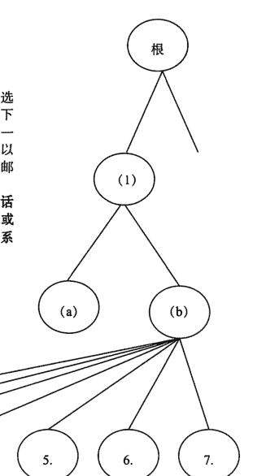

**图 9.5 将成文法条款划分为子树块**

次要问题：如何为ML表示每个块/“文本单元”。同基础ML设置（第8.3节），去除标题/部分/章节等停用词与特定词，数字标准化，小写化+标准化，纳入专家标注的分类码。

随后，每文本单元表为**n维词向量**，维度对应语料库唯一术语，权重为TF-IDF值（第6.4节）。此法类似Francesconi和Passerini（2007）。

#### 9.7.2. 成文法文本上的机器学习算法实战

针对公共卫生应急法规，研究者部署**支持向量机（SVM，第8.5.2节）**与**决策树（第4.3.1节，Grabmair和Ashley, 2011；Savelka等，2014；Savelka和Ashley, 2015）**。

从提取信息有效性看，两者无显著差异。但**决策树模型可解释性强**，人类易检查哪些特征主导正负例区分。鉴于探索性质，团队选用决策树。

细看决策树学习过程，以公共卫生相关性研究为例（其余类别同理）。文本单元表为有序术语集TF-IDF值构成的特征向量，维度达数千，但极稀疏（多为0）。

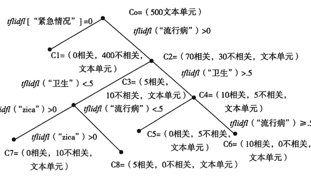

**图 9.6 公共卫生研究中将文本单元分为相关/不相关的决策树**

学习时，算法优选特征分割数据。假设特征二值化（如第4.3.1节保释决策树），节点测试“是/否”，按等值分支。但文本向量特征为数值（TF-IDF），节点测试形如：**若选定特征TF-IDF ≥ 0.5 则右，否则左**。图9.6展示假设树：根节点(C0)下，“紧急情况”词被选为最优首切分特征；阈值可为“>0”（即词出现与否）。500文档中，400归左(不相关,C1)，100归右(C2)。C2节点重复过程，70相关/30不相关，“卫生”词成第二切分特征，按阈值分支。

顺右分支可达终端叶节点C6，含标记相关的文本单元——其“紧急情况”“卫生”“流行病”TF-IDF均超阈值。同理可追踪所有路径。C6处10单元全相关；C5-C8终端节点结果均匀（但非必然）。若终止条件为最大深度，叶节点可能混合结果、不可分类。

决策树构建完10类别（相关性、代理人、规定、行为、目标、目的、紧急情况类型、接收代理、时间范围、条件），分类分两步：**先按相关性筛，再对相关单元按其余9类细分**。

#### 9.7.3. 评估ML算法与稀疏训练数据的破局

实验以公共卫生专家手工编码为金标准，采交叉验证评估（Grabmair等，2011；Savelka等，2014）。

Grabmair等（2011）指出：宾州语料库在9类别上表现差异大。除“行为”外，其余类别ML的F1均达或超两基线：最常用代码(MFC)与关键词增强MFC。ML的F1在**目标类24% ~ 时间范围类86%区间波动，9类均值54%**。

性能瓶颈之一：**训练数据稀疏**。专家编码本细致，单属性可用码多，导致单一码实例极少。

为缓解稀疏、提升分类器，研究者尝试**融合多辖区数据**：将一州训练数据与其他州数据合并，扩充训练集规模。

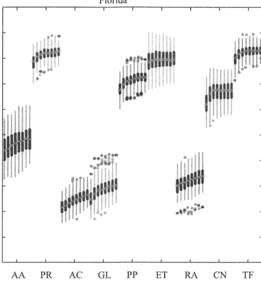

### 9.7.4 卢依马赋能：法条语义表征的深度重构

前序研究（Francesconi 和 Passerini, 2007; Francesconi, 2009; Bach 等, 2013; Zhang 和 El-Gohary, 2015）虽实现路径各异，却共享“分阶段流水线”、“分层表征架构”以及“专家规则与统计学习融合”三大核心基因。这些共性指向同一演进方向：引入第 6.8 节所述的卢依马框架对法规实施深度标注。

借助基于规则的标注器，可从语义子句与句子双维度为法定条文注入更立体的表征层。卢依马类型系统（Grabmair 等, 2015）已完成公共卫生应急法领域的适配，涵盖：法律规则的句级类型学、前提与后果的子句级类型学（参考 Bach 等人, 2013），以及面向公卫主体、概念、代理人、属性、法规要素及语言线索的子句与提及类型体系。

研究团队拟验证核心假设：对法条实施语义标注并以此为基础分类，其效能将超越忽略语义层面的传统体系。举例而言，系统可将“医务室”标注为某项规定中发挥积极作用的代理人提及；将“医院”或“关闭供水”标注为行为提及；将“限制”标注为代理人须履行的行为类型。这些标注可作为词袋 n-gram 特征的有力补充，供机器学习判别器调用。

判别器的使命是为预设属性分配类别标签。例如，将特定条款标记为“义务”类，或关联至“空气污染紧急情况”主题。若该路径行之有效，分配给法条的标签便能充当更高维度概念层面条款类别的预测指标，而语义标注则精准锚定了条文中的概念位置。这意味着系统可按需替换更抽象或更具体的术语。

标注器亦可解析用户检索式，识别其中提及的概念并酌情扩展召回范围。假设检索式包含“埃博拉”，系统推断出“传染病”这一上位概念，随即扩大检索范围，调取所有提及“传染病”的法条，即便它们未直接出现“埃博拉”二字。此举有效规避了因用户检索式过于具体而导致相关条款漏检的风险。

此外，系统还能依据标签与标注，度量每条检索结果与检索式的语义贴近度并据此排序。若用户输入“医院必须报告埃博拉”，含“义务”标签、关联“传染病”主题的“医院”型代理人、且所要求行为与“报告”语义关联的条款将被置顶，即使该条款与检索式词汇重合度极低。

这一机制还赋予了系统“以简驭繁”的能力：将每个条款概括为由标注标签构成的结构化句子，生成简明扼要的内容摘要，辅助用户快速甄别检索结果的关联度。

### 9.8 章末综述：模式洞察与语义增值

综上所述，从法规文本自动提炼逻辑规则，绝非单纯的自然语言处理任务，更暗藏额外挑战。

若本章工作汇聚成一条主线，那就是：识别法规与规章中那些与规范性规则的形式、意涵紧密相关的重复结构或模式，至关重要。这些模式具体体现为：

- 对一般立法或特定法律逻辑架构的概括；
- 术语模式与模板、词汇句法角色、概念类型、情态动词；
- 一般规范规则或特定法律其他要素的特征刻画；
- 特定受管领域内，对协调定义、要求与豁免特征进行法律设计的模式。

无论是自动化程序还是人类专家，对规范性规则的理解都将受益于上述模式的识别、将元素组装为模式或将模式拆解为元素的规则设计、以及模式可视化技术的开发。

采用卢依马这类分层类型系统——其捕获了上述模式的多个侧面——来丰富法规文本表征，已被证明对统计学习大有裨益。后续章节，我们将探讨利用卢依马标注从法律案例中提取论证模式相关信息的系列实践。

## 第十章 裁判文书论证要素的自动化挖掘

### 10.1 引言：从法条到判词，聚焦论证内核

第八章阐释了统计学习在法律文本中的应用，第九章深入探讨了从立法与规章文本抽取信息的路径。本章延续话题，聚焦于运用统计学习、自然语言处理及人工构建规则，从司法裁判文书文本中提取信息，核心关注点锁定“论证关联要素”。

何为“论证关联要素”？即涉及案件辩驳过程中句子及其他信息单元所扮演角色的信息。这囊括句子的具体功能：如摘要中的法律规则陈述、适用于特定案情的陈述，或裁判要旨与事实认定。亦涵盖更宏观的角色：论证中的命题、前提或结论，以及证明前提通向结论合理性的论证范式（详见 5.2 节），诸如将案件案情类比先例或加以区分的模式。此外，还包括影响论证力度的信息，如法律要素、强化主张的定型化案情模式（3.3.2 节）或证据要素（5.8 节）。

贯穿全书的一个核心主张是：若信息检索系统能识别此类要素，论证关联信息将有力支撑概念法律信息检索。下一章将呈现初步佐证。本章则着重讨论从案例文本提取此类要素的文本解析技术，特别是：应用类型系统与文本标注流水线处理案例文本以获取句子角色相关论证信息的架构；卢依马——基于卢依马框架打造的法律专用语义抽取工具箱，旨在实现法律文档概念标记自动化。

随后，本章将重访法律文本人工标注任务，旨在为统计学习分类构建训练语料。这表面上是领域专家的任务，但若对标注任务进行巧妙拆解，众包标注方案便成为可能。

本章将逐一回应以下核心问题：法律案例文本信息提取如何运作？NLP、卢依马类型系统与统计学习各司其职？如何实现法律文档概念标记自动化？何为人工文本标注？有哪些工具支撑？如何管理与评估其可靠性？可提取哪些论证关联要素？标注能否众包？

### 10.2 裁判文书中的论证信息全景扫描

现有从案例文本提取信息的研究，部分聚焦于争点与主题抽取。有系统依据抽象法律分类（如金融银行、破产，Thompson, 2001）及通用主题（如特殊服务券养老金、退休，Gonçalves 和 Quaresma, 2005）对案例分类；亦有系统基于文档主题间交叉引用的检索式实现检索（如“哪个命令涉及异常噪音并引用消音法令？”，Mimouni 等, 2014）。

早在 1991 年，学者便探索利用论证范式辅助概念法律信息检索中的案例表征（Dick 和 Hirst, 1991）。近年，对裁判文书论证关联信息的自动语义处理已服务于法律信息检索，涵盖：案件审理沿革自动抽取（如“维持原判”、“部分撤销”，Jackson 等, 2003）、刑事案件指控罪名与适用法律原则摘要（Uyttendaele 等, 1998）、裁判结果（McCarty, 2007）、南洋杉语料库中的论证范式（如举例论证、因果论证，Feng 和 Hirst, 2011）。其他工作基于人工标注裁判文书赋予修辞角色，如识别争议焦点、认定案情、展开论证、陈述案件沿革、呈现论据、比例裁判或终局裁决（Saravanan 和 Ravindran, 2010），或判定句子在阐述适用法律或案情时的功能定位（Hachey 和 Grover, 2006）。

主题关联与论证关联信息往往交织重叠。Paul Zhang 等人（Zhang 等, 2014）指出，“法律问题”源自判例库挖掘，每个问题内含案例辩驳中引用的法律命题或原则。如 7.7 节所述，系统融合统计学习与人工标注，对案例文本中的法律问题实施语义解析，产出标准化法律问题库及问题与案件讨论的链接网络（Zhang, 2015）。

本章重点剖析三个利用统计学习、NLP 与抽取规则从案例文本挖掘不同维度论证关联信息的课题：

1. **莫查莱斯与莫恩斯系统**：识别辩驳中发挥作用的句子，标注为前提或结论，重构案例文本的论证骨架（Moens 等, 2007; Mochales 和 Moens, 2011）。
2. **SMILE 系统**：提取实体法律要素——即能强化或削弱一方法律主张的定型化案情模式（Ashley 和 Brüninghaus, 2009）。
3. **卢依马系统**：抽取案例援引的法律规则及其应用于案情过程中的论证关联信息（Grabmair 等, 2015）。

第十一、十二章将详述这些提取成果如何优化概念法律信息检索、赋能论证检索及支撑其他认知计算任务。

### 10.3 法律论证主张的自动化识别与分层

莫查莱斯与莫恩斯在法律论证挖掘领域的开创性工作中，将法律文本中的基本论证单元——命题或主张——作为核心提取对象（Moens 等, 2007; Mochales 和 Moens, 2011）。作者界定：“主张是一个命题、一个真假可辨的观点，且被主张者认定为真”（Mochales 和 Moens, 2011, p.1）。这项工作为 IBM Project Debater 系统奠基，后者在通用场景采用领域无关技术实现“识别特定主题相关论点”（Levy 等, 2014）。

论证由推演链构成，主张可作为前提推导出进一步主张，链路终端的主张即为结论。作者精确定义论证为：“一组命题，均为前提，除仅有一个例外——即符合论证范式得出的结论”（Mochales and Moens, 2011, p.5）。论证范式作为不同类型、或多或少领域特定的论证模板或蓝图（见 5.2 节），部分可在计算论证模型中落地。

#### 10.3.1 双层分类：剥离非论证句，区分前提与结论

研究者引入统计学习，自动完成双层分类：（1）将语句区分为论证性命题或非论证性命题；（2）在论证性命题内部，进一步划分前提与结论。

实验基于两个协作语料。首个为南洋杉语料库，含 641 篇文档，遵循特定方法标注（Reed 和 Rowe, 2004; Mochales 和 Moens, 2011, p.8），涵盖 5 份法庭记录、4 份议会档案及报刊文章、论坛帖子，共计 3,798 句，论证性与非论证性命题各半。次为欧洲人权法院（ECHR）语料库，含 47 份法律文书、2,571 句。三名标注员耗时逾年完成论证标注，分歧由一名资深法官裁定。标注一致性优异（Cohen's Kappa 系数达 75%，度量标准详见 10.6.1 节）。

#### 10.3.2 面向论证挖掘的语句向量化策略

为提取论证关联信息，莫查莱斯与莫恩斯将语句编码为特征向量。同前文（7.5.2 节、8.5.1 节）所述，向量表征虽常见于文本建模，此处专门用于论证检测语句的建模。

**识别论证性命题的特征集**（源自语句文本，跨领域通用）：
- 单词、词对及连续三元语法特征；
- 词性标记，含特定副词、动词、情态动词（表许可/义务如“可”、“须”、“应”、“该”）；
- 特定标点特征；
- 论证连接词（如“但”、“因”、“故”、“结果”）；
- 解析树层级与从句数目（语句复杂度双指标）；
- 文本统计特征：句子长度、平均词长、标点计数。
（Mochales 和 Moens, 2011）

特征值通常布尔化，标记特征在语句中出现与否。

**前提结论判别的扩充特征集**：
- 语句长度及其在文档七等分位置中的相对位置；
- 核心动词时态体貌；
- 上下文语句的角色类别；
- 语句是否为论证性命题的初筛结果；
- 语句及邻近语句出现的修辞关系类型：支持、攻击、总结、其他、无；
- 论证范式类型：如“观之”、“做必要修改后”、“据此得出结论”、“多数意见认为”；
- 是否援引法条或含法律定义；
- 主语主体角色：申请人、被告、法院或其他。
（Mochales 和 Moens, 2011）

#### 10.3.3 三大基石算法轮番上阵

语句向量化后，作者引入文本分类三大基石算法：

1. 朴素贝叶斯分类器
2. 最大熵分类器（即多项逻辑斯谛回归）
3. 支持向量机

前两者用于预测语句是否为论证性命题。同前章体系一致，均依据特征向量 X 推断类别 Y，通过计算后验概率选最优标签。两者权重估计路径迥异。

**间近推演与“天真”假设**
朴素贝叶斯走间接路径：估计先验与似然，再借贝叶斯定理反推后验。其核心捷径在于假设特征间条件独立——这大幅压减了参数量（Mitchell, 2015, p.3）。但实则特征多相关（如“布宜诺斯艾利斯”常连现），独立性假设失效致证据重复计数，易导致误判。面对强相关特征，直接估参技术更鲁棒（Mitchell, 2015, p.10）。

**约束驱动建模**
最大熵模型通过学习判别性特征，从观测特征加权集的指数函数定概率（Jurafsky 和 Martin, 2015）。遵循最大熵准则：无先验时分布趋于均匀（Nigam 等, 1999）。

文本分类场景下，文档化为词频向量（见 8.3 节）。有标签训练数据下，模型拟合条件分布 P(标签|文档)。给定标注数据，迭代求解权重，匹配经验特征期望（条件极大似然估计，Jurafsky 和 Martin, 2015）。

举例说明：假设四类文档含“教师”类，训练数据显示 40% 含“教授”的文档属此类。此为约束。无其他信息时，含“教授”文档属“教师”概率 0.4，其余类各 0.2；不含则均分 0.25。此为简易模型。实战中，海量特征形成约束集，算法迭代满足约束，习得权重。核心优势：**免独立假设**。遇“布宜诺斯艾利斯”，约束机制自动抑制重复计数，允许二元短语直接入模。实验证实，最大熵优于朴素贝叶斯。

**高维空间几何切分**
针对 ECHR 语料中已识别的论证性语句，作者部署 SVM 执行前提/结论二分类。

如前文 8.5.2 节，SVM 在向量空间寻觅超平面，最大化正负样本间距（Noble, 2006）。该空间由扩充特征集向量张成。

#### 论证命题识别实验结果

# AI 解码法律逻辑：从论证挖掘到要素提取的实战进阶

#### 10.3.4. 话语树结构的论证语法

莫查莱斯和莫恩斯在识别论证命题上交出了亮眼成绩单：南洋杉语料库准确率 74%，欧洲人权法院语料库更是达到了 80%。他们的“制胜法宝”是融合多维特征——涵盖词性标注下的字偶、动词分布、句长均值、平均词长及标点密度等统计指标（Moens 等，2007）。在细分前提与结论任务上，前提识别的 F1 值为 68%，结论识别则高达 74%（详见 4.4.4 节）。

团队复盘了 98 个误判样本，发现若引入上下文语境，约 21% 的错误本可修正；另有 47% 因文本显含论证意图却线索模糊，典型如情态动词“应当”、转折词“不过”、程度副词“更多”等。剩余失误多源于推理链条隐而不宣，或需依赖常识背景方能破解。

**构建论证“骨架”：三叉树与语法解析**

研究进一步尝试直接从文档抽取论证话语拓扑。他们引入**论证三叉树**模型：每个三叉包含根节点、前提叶节点、结论叶节点，前提与结论经“支持链路”指向根节点；根节点间可串联形成推理链。

实验保留 10 个 ECHR 案例为测试集，其余用于手工归纳识别与链接三叉的规则集——这套规则实质上是一套**论证结构检测与命题分类语法**。语法解析输出的论证树经人工核对，评估维度覆盖信息完整性、单元成形度、链接正确性。

实测显示，语法解析对 ECHR 文本的结构检测准确率约 60%，前提/结论分类 F1 值稳定在 70% 左右。图 10.1 展示了自动生成的树结构摘录：顶层为委员会终局结论，两大分支论证各自由结论+多前提支撑（Mochales 和 Moens，2011）。

> **实战价值**：此类自动生成结构能按核心争点、立场、论据高效压缩长文本。但要判断文档在新场景下的引用价值，系统仍需补充命题语义细节与论证型式标签。

#### 10.3.5. 识别论证型式的实例

基于前人工作，冯和赫斯特（2011）在在线南洋杉语料库（含法律判例）上推进论证型式自动标注。假设前端已准确抽取命题与结论，他们聚焦表 10.1 所列五种型式，这些型式与法律实务中的**基于价值判断的论证预测建模**（见 5.7.3 节）高度契合——引用案例即作为共享属性的示例，预示同类归类将引发特定价值权衡。

**表 10.1 五大论证型式速览**

| 型式 | 核心逻辑 | 关键语言线索 | 最佳平均准确率 |
| :--- | :--- | :--- | :--- |
| **示例** | 个别案例具属性 F/G → 概括规则 | “例如”、“诸如”、“比如” | **90.6%** |
| **导致效果** | 普遍规则 A→B + 事实 A → 推断 B | “结果”、“相关”、“导致” | 70.4% |
| **目标到手段** | 目标 G + 手段 A → 应执行 A | “想”、“打算”、“目的” + 四大情态动词 | **90.8%** |
| **结果** | 后果好/坏 → 应/不应实现 A | 正负前提计数 | 62.9% |
| **言词分类** | 定义/分类规则 + 实例符合 → 归类 | 核心词对相似度、系词/虚词/否定词计数、依存关系 | 63.2% |

建模采用 C4.5 决策树（WEKA 实现），特征融合通用维度（结论位置、前提结论相对位长）与型式专属线索（表 10.1 右两列）。结果显示，“结果”与“言词分类”表现较弱，主因：训练样本稀缺、线索短语不显性、前端论证识别误差传播。反观法律文本，判例引用与法条表述常提供更显性的型式锚点，或使机器学习更易分离基于后果或法概念分类的论证型式。

**下一步**：若要让程序推断判例或预测判决，必须进一步标注**实质性因素**——即增强/削弱论证力度的要素、可用于预测结果的因子（见 4.5.2 节）。好消息是，程序极有可能从判例文本中自动识别这些因素。

---

#### 10.4. 提取与论证相关的法律因素

**SMILE** 是 IBP（基于实例的预测）程序的自然语言前端（Ashley 和 Brüninghaus，2009），扮演“文本描述—计算模型”的**翻译官**角色。用户输入商业秘密纠纷文本（图 10.2），SMILE 输出因素列表驱动 IBP 预测胜败并给出解释。

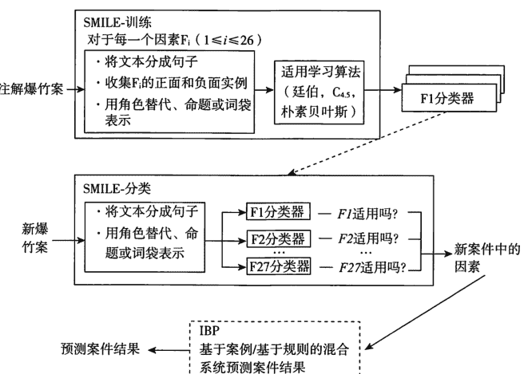

**三种文本表示的进化路径**

训练集为英法律生整理的“爆竹案”要旨摘要（类似一年级案例笔记），经导师指导标注 26 个商业秘密因素，要求：切取相关事实片段 → 融合成可读叙事 → 插入分隔符标记因素边界。

针对“纽林从 ICM 复制文档带往 DTI”这类句子（对应因素 F7“带走工具”），团队设计三层递进表示：

1.  **词袋**：纯词频向量，忽序。例句仅存单词集合。
2.  **角色替换**：将当事人/产品实体泛化为“原告”“被告”“信息”等角色标签。实体细节抽离，保留关系框架。
3.  **命题模式**：深度解析“谁对谁做了什么”。提取主谓、动宾、动介、动形四类句法关系，叠加角色替换与本体同义归并。例句转化为结构化特征向量簇，如 `[(被告 复制)、(复制 信息)、(从 原告 复制)…]`。

相似度度量统一用特征向量欧氏距离——距离越近，语义越似。

**学习器对决**：C4.5 决策树、朴素贝叶斯（Rainbow）、k-近邻。留一法交叉验证中，**k=1 的 k-NN 脱颖而出**。角色替换与命题模式的平均 F1 分别为 26% 与 28%，虽绝对值不高，但显著优于词袋；二者互差无统计学意义。结论明确：**注入角色背景知识 + 浅层 NLP 捕捉“谁做了什么”，能实质提升基于分类的文本索引质量**。

**端到端验证**：SMILE+IBP 预测准确率 63%，虽低于人工标注因素驱动的 IBP（92%），但显著跑赢抛硬币基线（49%）。据知，这是**首个直接以案件文本为输入预测判决的 AI 与法系统**——SMILE 解析事实，IBP 以 CBR+逻辑模型推演，再经假设检验法解释（样例见图 4.6）。升级版结合概念法检索，将助力人类预测、评估与构建论证（详见第十一章）。

#### 10.4.3. 注解因素组件

怀纳和彼得斯（2010,2012）转向全文判决，构建 **GATE/JAPE** 注解管道，提炼商业秘密因素的**细粒度组件**——即因素描述中反复出现的术语/短语（Factoid，见 3.3.2 节），并以 WordNet 同义词扩充词表。

以因素 F1“谈判中披露”为例，种子词含“原告、披露、产品、谈判、被告…”；经 WordNet 扩展“披露/公开”得“宣布、背叛、泄露、揭露、公布、透露…”数十词。合并列表形成**地名词典**，触发 JAPE 规则标注句级概念；复合规则再向上组装“披露信息”“谈判中披露信息”完整因素。

---

#### 10.5. 提取事实发现和被引用法律规则

**LUIMA 系统**瞄准更深层：从判例文本抽取**法规则及其在事实中的适用信息**（Grabmair 等，2015）。核心假设——若能按命题在法律论证中的角色语义标注文档，检索效能将超越传统文本匹配。第十一章将详述其如何赋能论证检索。

实验基于**疫苗伤害项目语料库**子集与**证据法律论证模型**（5.8 节）。缺省逻辑框架模拟事实认定者推理中命题的功能角色，如：陈述裁决规则、确认规则条件在案件中满足等。

#### 10.5.1. 将 LUIMA 应用于类型系统

LUIMA 扩展 **UIMA 类型系统**落地法律域。该本体不仅定义领域核心概念/关系，还映射其在文本中的表达形态（Grabmair 等，2015；见 1 章与 6.8 节）。类型体系分层组合，子句级类型支撑句子级顶层标注。

**三大句子级注解类型聚焦**：

#### 10.5.2. 构建“黄金标准”案例库

法律文本分析的起点，往往是给句子打标签。最基础的三类标签是：**法律规则句**（单陈述规则不套用事实）、**事实认定句**（记录事实审查者对证据能否满足规则要件的判断）、以及**引用句**（指向判例、法条、条约或学说等权威来源）。

想让 LUIMA 系统跑通高层分类，得靠底层的二元特征做支撑。比如识别“法律标准表述”（如“原告承担举证责任”），系统会串联三个低层链条：原告实体出现、同义于“承担负担”的措辞、以及代表证据生成的动词（证明、确立等）。

为了验证 LUIMA 假设，团队从疫苗伤害赔偿语料库里精选了 10 个判决，组成“黄金标准案例集”——这些案子在早期研究里反复被引用：Cusati、Casey、Wederith、Stewart、Roper、Walton、Thomas、Meyers、Sawyer、Wolfe。核心争点统一：接种疫苗是否导致了申请人主张的损害？胜负各半，五五开，样本均衡。

标注流程极其严谨，由霍夫斯特拉法学院的法律、逻辑与技术实验室主导：
1.  受训法学生首轮标注；
2.  另一批受训生复核，标出分歧，双方协商解决；
3.  法学教授 Walker 终审把关，认证为“黄金标准”。

这套协议在后续章节（10.6.2）还被迭代优化，用于培训和质控。

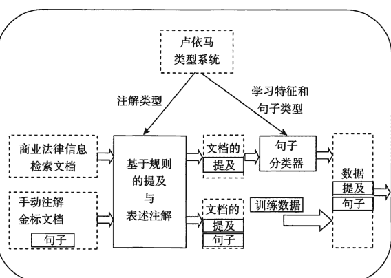

#### 10.5.3. LUIMA 标注体系：双轨并行

如图 10.3 所示，LUIMA 标注分两条线推进：

*   **规则驱动的子句标注**：人工基于样本观察，手写语法规则（用 UIMA RUTA 语言），精准捕捉模式。
*   **机器学习句子分类**：算法从人工标注的训练集里自动学习区分正负样本，类似第 8.4.2 节的预测编码思路。

**前置难题：断句**
商业数据库进来的文档，首先要搞定“句子边界”。人眼看显而易见，机器却易踩坑——法律文本缩写满天飞（"Inc."、"v."），句号不代表句末。团队在 LingPipe 基础上加装法律专用模块（识别 "v." 等），有效缓解了误切分导致的下游特征污染（效果量化留待未来工作）。

**预设信息标注**
除句子类型外，还要标“预设信息”：领域内的事实、语言概念、实体提及。在疫苗伤害领域，重点落在三类实体：
*   **术语**：疫苗名、疾病名、因果关系词；
*   **提及**：具体出现的疫苗缩写（如 MMR）、接种事件、因果论断；
*   **规范化**：将同一实体的不同表达（全称、缩写、别名）映射到标准名（如统一为“麻腮风”），作为词干提取的补充手段。

**引文识别**
靠正则表达式（regex）和字符序列模式匹配，覆盖判例、法条、卷宗、普通文献等主流引文格式。

---

**手工规则如何炼成？**
Grabmair 基于跨领域直觉，并结合 Roper、Cusati、Thomas 三个案局部文本，手工抽取术语、提及、公式，写成 RUTA 规则。**关键防过拟合动作**：建模时严禁查看这三个案子的黄金标准句级标注，确保测试集“未被污染”。

以“法律标准表述”规则为例（伪代码）：
> 若检测到：[原告提及] + [必须/应当类义务词] + [可选"也"] + [证明/表明/建立类动词]
> 则打标签：法律标准表述。

---

**机器学习分类器的训练**
当前类型系统含 8 种术语、14 种提及、13 种表述；规则库含 7 字典注解器、49 条实体规则。句子分类只三类：法律规则句、事实认定句、其他（非标注句）。
数据集 5,909 句，其中事实认定句 82 条，法律规则句 227 条，其余为负样本——典型的极度不平衡数据。

特征工程沿用经典 n-gram + TF-IDF（1-4 元语法），并尝试加入规则层产出的二值特征（如“含原告术语=1”、“含疾病术语=1”）。
*案例*：“Winston 博士得出结论，申请人患胃轻瘫……” → 向量含 "Dr. Winston concluded that" 等 4-gram 特征；因识别出“申请人术语”和“疾病术语”，对应二值位置为 1。

注意：Roper 案中这句被人工判为“证据句”（专家结论），而非“事实认定句”（特别法官结论），所以在本实验三分类任务中归入“非标注句”。

图 10.3 左下角流程：黄金标准案经手工三分类标注 → 规则层自动打标 → 生成训练向量 → 喂给句子分类器。

#### 10.5.4. 实战评测：谁在分类上更强？

采用**留一法交叉验证**（10 折，每折留 1 案测试、9 案训练），对比三大算法：朴素贝叶斯、决策树、逻辑回归（工具链：Stanford Parser + Weka）。指标看准确率、精确率、召回率、宏 F1。

**表 10.2 核心看点（最佳值加粗）：**

| 算法配置 | 准确率 | 精确率 | 召回率 | 宏 F1 |
| :--- | :---: | :---: | :---: | :---: |
| 朴素贝叶斯 | 0.88 | 0.15 | 0.75 | 0.14 |
| 朴素贝叶斯 + 类型特征 | 0.89 | 0.16 | 0.75 | 0.15 |
| 决策树 | 0.97 | 0.53 | 0.28 | 0.23 |
| 决策树 + 类型特征 | 0.97 | 0.53 | 0.29 | 0.23 |
| **逻辑回归** | **0.96** | **0.66** | **0.38** | **0.31** |
| 逻辑回归 + 类型特征 | 0.96 | 0.66 | 0.38 | 0.31 |

**结论明确：**
1.  **逻辑回归综合最优**，宏 F1 0.31 显著领先，入选主管道做大规模文档句级标注（详见第 11 章）。
2.  **加规则特征不增反降/持平**：可能因为 4-gram 已覆盖了规则模式（如“法律标准表述”的典型 n-gram 长度），额外特征冗余且引入噪声。
3.  朴素贝叶斯召回高但精确极低（误报多）；决策树精确尚可但召回极低（漏报多）。

#### 10.6. 训练数据标注：质量是生命线

从案例文本挖掘论证信息，前提是有高质量训练集。哪怕只标注小部分语料，人力成本也高。最佳实践：
*   **留出纯测试集**；不够则用留一法或 K 折交叉验证；
*   **多人独立标同一文本**，算 **Cohen’s Kappa (κ)** 量一致性：
    > κ = (P_observed - P_chance) / (1 - P_chance)
*   标不齐，说明指南模糊，机器也学不会——**人类一致性是自动化的上限**。
*   需配套**协作标注平台**，流程化管理、监控效率准确率、淘汰不合格标注员。

#### 10.6.1. IBM Debater 的标注实战范式

Debater 团队（Levy 等，2014）从维基百科挖“依赖上下文的主张”（CDC，直接支持/反驳议题的简明陈述）和“依赖上下文的证据”（CDE，支持 CDC 的文本片段），任务类似 Moens 但面向开放域。

三步走机器学习流水线：**句子筛选 → 边界界定 → 候选排序**，每步都靠人工标注数据驱动。

**标注指南五大硬性约束（CDC 必须满足）：**
1.  **含金量高**：直接强力支持/反对议题；
2.  **泛化性强**：覆盖较宽泛观点；
3.  **语法通顺、语义连贯**；
4.  **忠于原文精神**；
5.  **主题单一**（最多两个强相关子题）。

**质控闭环：**
*   付费研究生编码员，上线协作平台；
*   管理员实时看 κ 值、效率、准确率，动态替换低绩效人员；
*   **五人独立检索 → 五人独立读文 → 五人独立标候选 CDC（共得 1,491 条） → 五人独立复核确认/拒绝 → ≥3 人通过才入库。**

这种“多轮、多人、量化阈值”流程，把主观标注变成了可度量、可复现的工程资产——值得所有法律 NLP 项目借鉴。

# IBM辩论者团队如何攻克标注一致性难题？深度解析LUIMA法律检索架构

#### 10.6.2 标注协议的迭代之道

在霍夫斯特拉法律、逻辑与技术实验室，沃克团队采取了一种“实战中练兵”的策略（参见第5.8、6.8及10.5.2节）。他们没有预先设定死板的规范，而是在基于缺省逻辑框架标注卢依马句子类型的过程中，同步开发并打磨研究者级的“黄金标准”协议文档。

这份协议的核心价值在于**“活文档”属性**：它提供了判定标准与典型案例，明确告诉标注员该捕捉哪些语言或逻辑线索；随着新文本的加入，协议会吸纳发现的语言变体，为罕见模式补齐指引。这不仅极大地辅助了标注员培训与质量把控，完成后的协议本身也化作了类型定义的精准说明书，更为基于规则的自动标注器编程提供了关键洞见。

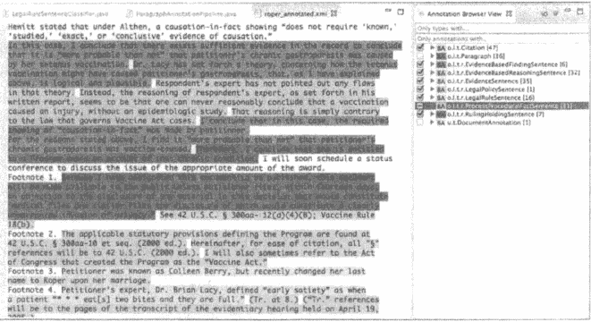

### 图 10.4. 卢依马注解环境

早期的非结构化信息管理架构（UIMA）已自带开发者工具箱，内含复杂的标注界面。图10.4展示的就是用于标注前述九类卢依马句子的UIMA环境。实操主力是法科学生，在计算机、语文学及法学教授的联合督导下作业，偶有研究生提供技术支撑。可以预见，随文本标注重要性攀升，兼容UIMA或其后继框架的、更友好的交互界面必将涌现。

另一阵营——文本工程通用架构（GATE）的注解环境，则被IBM辩论者团队用于主题标签任务。其Teamware组件是一款Web端协作工具，原生支持大规模多标注员项目中的角色分工（标注员、编审、管理员）。它能用核心类型元数据预标记低层级术语，辅助人工标注；专家编审可远程监管非专业标注员并策展语料。更关键的是，它自动记录全流程统计：人均耗时、完成进度等，这正是IBM辩论者流程化管理所依赖的指标。

 Wyner与Peters团队曾指导法科学生及律师志愿者，用GATE Teamware按“因子与因子成分”标注商业秘密案例（见10.4.3节）。图10.5直观呈现了团队软件中的案例标注截图。地理分散的标注员通过浏览器远程协作，无需本地部署，数据汇聚中央仓库。

值得一提的是，UIMA与GATE具备互操作性，但GATE Teamware与UIMA的高效融合路径仍待探索。

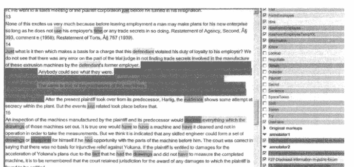

### 图 10.5. 使用商业秘密案例中因子和成分的文本工程通用架构团队软件进行注解（Wyner 和 Peters, 2010）

WebAnno是另一款浏览器端利器，同样支持多标注员管理、一致性监控与数据组织。其UI整洁直观，上手门槛低。图10.6展示了法科学生在浏览器中用WebAnno标注梅森案商业秘密要素的实况。标签与文本的融合显示，让非技术背景用户也能轻松驾驭。霍夫斯特拉实验室的沃克团队正用它按缺省逻辑框架与卢依马类型标注退伍军人残疾案件（详见第5.8、6.8、10.5.2节）。

### 图 10.6. 网络注解对梅森案中商业秘密因素的注解

（见 Yimam 等，2013）

WebAnno还刻意适配众包平台接口，意在让大量非专业标注员分担简单任务（Yimam等，2013）。第12.5.2节将深度剖析众包标注的利弊。

从案例文本抽取信息的终极动力，是推动法律信息检索（LIR）进化——这正是下一章的主题。

---

# 第三部分：连接推理计算模型与法律文本

## 11.1 导论：论证检索假说的实证之路

本章将第二部分的自动化概念标注与信息抽取技术，集成进一个面向**概念法律信息检索**的原型系统——LUIMA。系统模块化设计涵盖：子句级自动标注、句子级机器学习标注、全文检索底座、以及基于机器学习的重排引擎。本章将详解如何客观评估此类系统，及其对传统全文检索的增量价值。

核心看点在于：本章给出了支撑**“论证检索假说”**（10.5节提出）的实证——若系统性地用论证角色标注文档并以此检索，可显著超越依赖文本匹配的现有技术（Grabmair等，2015）。

**一个经典场景：** 律师调研“乙肝疫苗是否致多发性硬化（MS）”，可能有两类截然不同的诉求：
- **Q1（规则查询）**：确立疫苗与伤害因果关系的法律规则是什么？
- **Q2（事实查询）**：是否存在判例认定乙肝疫苗导致MS？

以Werd eritsh案判决三句为例：
- **S1**：引用联邦巡回法院“因果逻辑序列”观点，论证医学理论说服力（涉及规则层面）。
- **S2**：“签名人认为乙肝疫苗导致或加重MS。”（法官事实认定）
- **S3**：阐述具体医学机制理论（遗传易感性+环境抗原→自身免疫→MS）。

三句均涉“疫苗致伤”，但**满足Q1的未必满足Q2**。S1对Q1响应度高，因其陈述法律规则；系统需识别“因果关系”、“法律规则”等概念，甚至穿透“免疫接种”、“不良医疗状况”等同义改写。S2、S3则精准命中Q2，因直接报告法官针对特定事实的裁决。

目前LUIMA已能区分“陈述规则句”（S1）与“事实认定句”（S2/S3）。本章将拆解：如何将10.5.3节的标注管道接入检索系统，利用论证相关信息重排结果；如何扩展类型系统以支持现有系统无法处理的概念查询；以及基于Web的替代技术路线。

**本章将回答：** 什么是论证检索？如何重塑法律检索？为何且如何融合标注管道与检索系统？机器学习在原型中扮演何角？离强概念检索还有多远？

## 11.2 概念法律检索的现状：巨头布局与学界探索

LexisNexis与WestlawNext等主流平台已落地概念检索（见7.7节）。
- **Lexis** 挖掘判例库构建“法律问题”网络，每个问题对应可引用命题，为案例打概念标签。
- **Westlaw** 依托专家标注与引文网络，通过复杂重排融合概念信号。

双巨头均大量使用机器学习优化相关性：自动提取案件处理历史（8.5.3节）、学习主题特征权重重排（7.7节）、区分事实段落与法律论证（8.6节）。

学界（AI & Law）则聚焦利用第十章的论证信息增强检索：
- **索引/摘要路线**：Uyttendaele等用自动提取的犯罪要素与法律原则索引案件、生成聚焦摘要；Saravanan团队基于手工标注修辞角色生成结构化摘要。
- **直接检索路线**：Dick与Hirst用论证模式表征案例；Mimouni等构建含概念描述符与交叉引用的查询系统；IBM辩论者则用检测到的主题相关主张选文构论（Levy等，2014）。

## 11.3 LUIMA架构：管道与检索的双引擎

LUIMA架构（图11.1）将**卢依马标注管道**与**双组件检索系统**串联：
1. **LUIMA-Search**：搜索引擎+案例库。给定查询，极速召回候选文档并初排。
2. **LUIMA-Rerank**：基于训练集真实排序学习的模型，结合查询语义与初排特征，对候选文档精准重排。评估基准为商业系统返回列表。

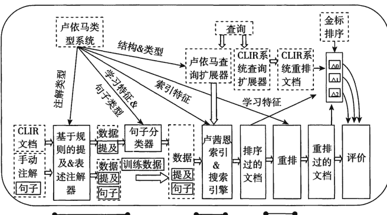

### 图 11.1. 卢依马管道架构 (Grabmair 等, 2015)

### 表 11.1. 提交给商业法律信息检索系统的 11 个基准查询

| 查询 | 来源案例 (日期) 胜诉方 [问题方] | CLIR返回案例数 | 专家判定前30相关数 | 来源案例在CLIR前30排名 |
| :--- | :--- | :---: | :---: | :---: |
| Q1 疫苗致伤法律规则 | NA | 157 | 25/30 | NA |
| Q2 MMR疫苗致顽固性癫痫 | Cusati (9/22/05) Pet [Pet.] | 75 | 9/30 | 第11位 |
| Q3 仿风疫苗致慢性胃瘫 | Roper (12/9/05) Pet [Pet.] | 75 | 1/30 | 第21位 |
| Q4 百白破疫苗致糖尿病 | Meyers (5/22/06) Govt [Govt.] | 75 | 1/30 | 第9位 |
| Q5 仿风疫苗致手/腕/臂伤 | Sawyer (6/22/06) Govt [Govt.] | 75 | 0/30 | 未进前30 (第37) |
| Q6 甲肝疫苗致小脑共济失调 | Stewart (3/19/07) Pet [Pet.] | 75 | 1/30 | 第7位 |
| Q7 百白破致急性脑病/死亡 | Thomas (1/23/07) Govt [Govt.] | 78 | 22/30 | 未进前30 |
| Q8 MMR疫苗致心肌炎 | Walton (4/30/07) Govt [Govt.] | 76 | 2/40 | 第16位 |
| **Q9 乙肝疫苗致多发性硬化** | **Werd eritsh (5/26/06) Pet [Pet.]** | **77** | **17/30** | **第1位** |
| Q10 乙肝疫苗致顽固性癫痫 | Wolfe (11/9/06) Govt [Govt.] | 75 | 4/30 | 第22位 |
| Q11 水痘疫苗致脑脊髓炎 | Casey (12/12/05) Pet [Pet.] | 75 | 1/30 | 第7位 |

#### 11.3.1 LUIMA-Search：从关键词到“法律意图”

以商业系统处理Q9为例：**“发现或认为乙型肝炎疫苗可导致多发性硬化症”**。
传统全文引擎将“发现”、“结论”视为高频噪音词，根本不懂用户真意：*“检索所有包含‘乙肝疫苗接种导致MS’这一法院发现/结论的句子”**。即便商业系统懂语义，也无力从容——它不知道库里哪句是法官发现、哪句是当事人主张。

LUIMA-Search迈出了关键一步：**将词汇映射为法律概念，将查询解析为对目标句子“论证角色”的约束**。

图11.2（上）展示了LUIMA-Search版查询结构：
- **目标角色**：`类型：基于证据发现的句子`（锁定论证功能）。
- **内容约束**：疫苗提及、接种事件提及、因果关系提及、疾病提及等语义槽位。
- **实体匹配**：“乙型肝炎疫苗”、“多发性硬化症”、“MS”等同义实体。

这种结构化查询精准捕获了用户意图，远超关键词匹配。

回顾10.5.3节，管道输出的句子级语义标签（类型、概念提及、子句实例）与原文入库。Lucene倒排索引存储这些结构化字段。图11.2（下）演示了索引条目：一句被识别为“法律规则句”，关于“因果关系术语、因果关系提及、原告术语、疫苗术语、疫苗提及”。检索时，系统综合文本匹配与共现语义概念打分。

> ① Lucene由Doug Cutting创建，Apache开源搜索库核心。名字源自他妻子中间名与外祖母名合成。——译者注

### 查询结构示例
- 类型： 基于证据发现的句子
- 关于： 疫苗提及
- 关于： 疫苗接种事件提及
- 内容： “乙型肝炎疫苗”
- 关于： 因果关系提及
- 关于： 疾病提及
- 内容： “多发性硬化” “MS”

### 数据库索引句子示例

```
< 文档 >
< 字段名 = “id” > 21 Cl. Ct. 651： -210032610 </ 字段 >
< 字段名 = “标 题” > Carter v. Secretary of Dept， of Health and Human Services </ 字段 > < 字段名 = “内容” > 因此，请求人被要求通过仇势证据向特别法官证明，风疹疫苗接种是其幼年类风湿性关节炎的事实原因。</ 字段 >
< 字段名 = “层级” > 句子 </ 字段 >
< 字段名 = “类型” > 法律规则句子 </ 字段 >
< 字段名 = “关于” > 因果关系术语 因果关系提及 原告术语 疫苗术语 疫苗提及 </ 字段 >
</ 文档 >
```

### 图 11.2. LUIMA 搜索查询示例（上）与 LUIMA 数据库索引句条目（下）

LUIMA 搜索查询里的字段标签——比如“类型”“关于”“内容” [ 见图 11.2 上 ]，跟句子表示里的字段标签 [ 见图 11.2 下 ] 是一一对应的。系统拿查询里的字段条目去跟数据库索引里的字段条目做匹配，把所有满足查询约束的句子找出来。如图 11.2 所示，LUIMA 搜索查询把所有指定条件都当成用逻辑“或”（析取）连起来的。按理说，要精准找到符合用户需求规格的文档，连接符应该是“与”（AND）。但鉴于语料库数据有限，必须放宽条件。Lucene 就是用“或”来放松约束，这样能把那些仅部分匹配的句子也捞进来。

LUIMA 搜索把句子检索回来后，按每个句子满足查询条件的数量给文档打分排序。这个分数是 Apache Lucene 自带评分机制算出来的，它用词频向量来衡量检索到的句子跟查询的匹配程度，以此评估相似度（Bialecki 等，2012）。文档层面的排名，则是看每个文档里命中的响应句子有多少。

### 11.3.2. LUIMA Rerank：给文档重新排个序

如 LUIMA 流水线架构图（图 11.1）所示，LUIMA Search 把检索到的文档传给第三个模块——LUIMA Rerank。这个模块的任务是学习怎么重排文档，让排在前面的最能回应用户查询（Grabmair 等，2015）。

在第 7.7 节我们见过像“WestlawNext”这种顶级法律检索系统的重排机制。商业系统光靠检索模块往往排不出最优结果。重排通常会综合文档词频、专家标注、引用网络、历史热门文档等证据，用机器学习优化排序函数，确定各特征权重。

这里的重排目标也是一样：学习特征权重，把相关结果顶上去。LUIMA Rerank 用的特征专门捕获跟“论证”有关的信息。它学习下面三个文档特征的权重：

- **句子数**：文档里有响应的句子总数（跟 LUIMA Search 初始排名用的指标一致）。
- **最高 Lucene 得分**：文档内所有句子的 Lucene 最高分。
- **向量空间相似度**：文档和查询中所有句子“关于”字段的最大余弦相似度值（详见 7.5.2 节）。

如前所述，这些特征全建立在句子级、句子级标注捕获的论证相关信息之上。尤其是 Lucene 得分，因为句子索引时带了论证相关信息（含句子级类型），所以它本身也跟论证挂钩 [ 见 图 11.2（下） ]。

LUIMA Rerank 在法律专家（下文详述）制作的训练集上，从“真实”排名中学这组特征的权重。训练时，模块会检查每个训练文档相对于查询的真实排名及其重排特征值。它学的是逻辑回归公式，给每个特征分权重（见 10.3.3 节），目标是让全局误差函数最小。训练好后，模块算出文档的新排名分。

研究者评估了用不同特征子集的 LUIMA Rerank 多个版本。衡量排名效果用了两个指标，下节细说。

评估发现，带学习权重的重排版本几乎表现相当，且全胜普通 LUIMA Search。光用“最高 Lucene 得分”这一个特征，效果就不错。加上“向量空间相似度”能再提一小步。但三个特征一起上，提升反而消失了。所以最终实验里，LUIMA Rerank 只保留了“向量空间相似度”和“最高 Lucene 得分”两个特征做重排。

### 11.4. LUIMA 实战评估实验

实验环节（见 LUIMA 流水线架构右端，图 11.1），LUIMA Rerank 对 11 个查询的 LUIMA Search 输出结果重排，并拿三套基准对比：

- 商业法律检索系统的基准排名；
- 法律专家给出的真实排名；
- LUIMA Search 自身的原始排名（Grabmair 等，2015）。

**商业系统怎么出基准排名？** 表 11.1 里的 11 个查询逐个提交给商业系统。Q1 关注确立疫苗伤害因果关系的规则；Q2–Q11 关注特定疫苗导致特定伤害的认定，均源自 10.5.2 节提到的 10 个金标案例事实。只有一个规则类查询（Q1），反映了核心规则只有一条——Althen 测试。疫苗伤害语料库覆盖了应用该测试两年的判决。

商业系统检索排序，每个查询取前 30 个文档记为基准。汇总去重后得到“文档库”，共 188 个文档（11 查询 × 30 案例 − 142 重复）。

**专家怎么给真实排名？** 一位资深专家（本书作者，五年华尔街大所诉讼律师，1989 年起任法学教授）针对每个查询，仅凭商业系统返回的案例报告，评估这 30 个文档的有用性。报告含：涉及主张和法院判决的两句摘要，加上高亮检索词的四段短摘录。专家据此重排 30 个文档，形成该查询的真实排名。

表 11.1 列出了每个查询的来源案例、商业系统返回案例数、专家判定相关案例数、以及来源案例在商业系统里的排名。虽期望商业系统能把来源案例排前面，但现实常不如意。

**LUIMA Search 怎么出初始排序？** 研究者以金标案例为基础，用 10.5.3 节的流程训练了基于规则和机器学习的文本标注器。标注器能识别三类句子级类型：法律规则句、基于证据的发现句、引用句，以及相关句子级类型。把标注器跑在 188 个文档池上，得到所有文档的句级预测标注。带标注文本按 Lucene 数据库格式存入 LUIMA-Search 数据库（如图 11.2 下）。

11 个查询手工翻译成 LUIMA 查询（如图 11.2 上）。然后按 LUIMA Search 排名逻辑——按响应 LUIMA 查询的句子数——对每个查询关联的 30 个案例（Lucene 表示）排序（见 11.3.1 节）。

**LUIMA Rerank 怎么跑交叉验证？** 采用 11 次留一法交叉验证（见 4.4.3 节），每查询一次。每个查询有 30 个 Lucene 格式文档、真实排名、以及重排学习特征（向量空间相似度、最高 Lucene 得见 11.3.2 节）。

每轮跑：留出的查询文档作测试集，其余 10 个查询文档作训练集。系统检查训练集文档的重排特征，学逻辑回归公式给特征分权重，算文档新排名分。学习时参考查询文档的真实排名，权重设定使全局误差最小。

每轮用训练好的逻辑回归公式预测测试查询排名。算出评估指标，最后跑 11 轮取平均。

#### 11.4.1. 评价指标：AP 与 NDCG

系统排名表现用两个通用指标：**平均精确率（AP）** 和 **归一化折扣累积增益（NDCG）**。两者都归一化到 [0, 1]，1 为满分。

**AP 直觉**：系统返回候选文档排序列表，非全相关。每返回一个相关文档，算一下当下的精确率，最后取平均。比如返回序列 1,1,1,0,0,1（1=相关，0=不相关），各相关位置精确率依次为 1/1, 2/2, 3/3, 3/4, 3/5, 4/6，AP = 0.92。

```
AP = \frac{\sum_{i \in R} P@i}{|R|}
```

换算一下：AP 计算时在 [1, 30] 区间排名。若第 i 位文档相关，测 P@i（前 i 个里相关文档占比）。把所有相关位置的 P@i 平均，相关文档有多少个就算多少个 P@i。公式如下：

其中 R 为相关文档位置集，|R| 为其元素数，Σ_{i∈R} P@i 为 R 中所有位置精确率之和（Grabmair 等，2015）。

**NDCG 直觉**：每个相关文档对排名整体质量的贡献，取决于它离理想排名有多近。DCG 是排名位置相关性的加权和，排名越靠后权重越低（打折），常用对数折扣函数。NDCG = DCG / IDCG（理想排序的 DCG），结果落在 [0,1]（Wang 等，2013）。

整体系统表现用 **MAP**（所有查询 AP 平均）和 **Average NDCG**（所有查询 NDCG 平均）。

MAP 定义：

```
MAP(Q) = \frac{\sum_{i}^{|Q|} AP_i}{|Q|}
```

其中 Q 为全查询集，APi 为单查询 AP。Average NDCG 定义：

```
AverageNDCG = \frac{\sum_{r}^{|Q|} NDCG_i}{|Q|}
```

① 给技术读者：本实验 NDCG 定义如下：

```
NDCG = \frac{DCG}{IDCG} \qquad DCG_p = \sum_{r}^{p} \frac{2^{relevance_i}-1}{log_2(i+1)}
```

此处相关性 i ∈ {0,1}，p 为排名位置（最多 30），用预测排名算 DCG，用真实排名算 IDCG。NDCG_i 即单查询 NDCG（Burges 等，2005；Grabmair 等，2015）。

顺带一提：真实排名是基于商业系统检索结果重排得来，所以基准召回率 = 1（覆盖了所有相关文档）。且 LUIMA Search 把无响应文档挂在末尾，实验系统无法按召回率跟基准比。

## 11.4.2. LUIMA PK 商业法律检索

实验对表 11.1 每个查询，用上述指标评价 LUIMA 与基准的四种配置，均以专家真实排名为准：

1. **基准线**：商业系统原始排名。
2. **LUIMA Search**：跑完整 LUIMA 查询，按命中句子数排文档。
3. **LUIMA Search + Rerank**：完整查询 + 句子数排序 + 重排特征加权重排。
4. **LUIMA Search（无句子类型）**：查询去掉句子类型，按命中句子数排序。
5. **LUIMA Search + Rerank（无句子类型）**：去掉句子类型 + 句子数排序 + 重排特征加权重排（Grabmair 等，2015）。

对比（1）与（3）看 LUIMA Rerank 能否超越商业基准；对比（2）与（3）看重排对自家搜索的增量。10.5.3 节提到，LUIMA 标注模块对非金标文档的句级标注效果不稳定。研究者特意测“无句子类型”版本，评估标注噪声对搜索/重排组件的潜在负面影响。

图 11.3 展示基准与 LUIMA 四版本在 11 查询上的 AP 及 MAP。图 11.4 展示 NDCG 及 Average NDCG。

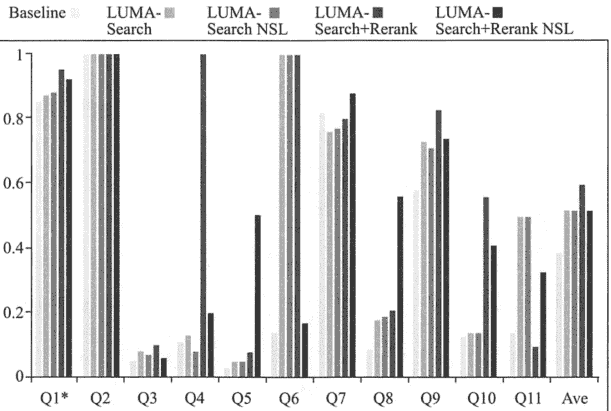

**图 11.3. LUIMA 版本 AP 与基准对比（11 查询 + MAP）**
(Grabmair 等, 2015)

如图 11.3、11.4 所示：**LUIMA 在 11 个查询中 10 个胜过商业基准，1 个打平。**
- Q1（唯一涉及法律规则句类型）：LUIMA 领先幅度极小。
- Q2–Q11（全涉及基于证据发现句类型）：LUIMA 全胜，仅 Q2 打平。

所有版本都在 Q2 顶部命中目标案例。6 个查询（Q1, Q3, Q4, Q6, Q9, Q10）中，**“LUIMA Search + Rerank”（带句子类型+重排）** 表现最优，总体均值最高。3 个查询（Q5, Q7, Q8）中，**“无句子类型版重排”** 反而最好。1 个查询（Q11）单纯 **LUIMA Search** 竟比重排版更强。

Q1 基准表现已很好，LUIMA 仅微优。7 个证据发现类查询（Q2–Q11）中，重排普遍提升了检索性能。

有 3 个查询忽略句子类型反而更好，这暴露了句子分类器的短板——分错类时会拖后腿，抵消了识别法律概念的红利。

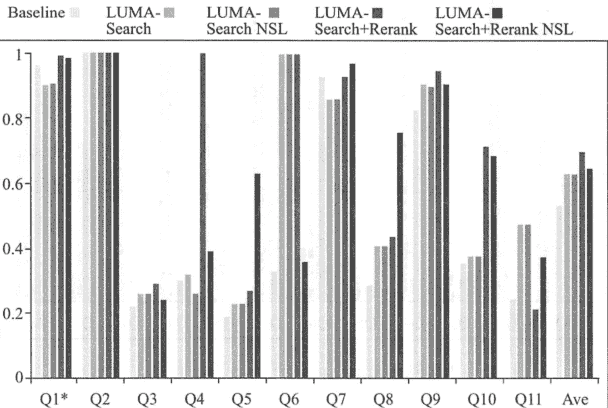

**图 11.4. LUIMA 版本 NDCG 与基准对比（11 查询 + Average NDCG）**
(Grabmair 等, 2015)

## 后续改进：让 LUIMA 更强

后续工作里，研究者通过两路提升了系统：
1. **结构化查询加词性标记**：自动给文档句子和查询文本打词性标签（名词、动词、限定词等），匹配时纳入词性相似度，显著提升 LUIMA Search 准确率。
2. **优化 LUIMA Rerank**：把投票法改为仅看前 N 个结果的句子数；新增 BM-25 特征（TF-IDF 改良版），更好处理句子/文档长度、引用类型与位置（Bansal 等，2016）。

## 讨论：论证检索的可行性与前景

评估证明：**自动标注文档中的 LUIMA 类型实例（疫苗、伤害、因果关系、句子类型），并用于索引和查询，显著优于不使用此类信息的商业全文检索。** 专注“论证相关信息”、从自然语言法律文档直达检索结果的**概念法律文档检索系统**，在疫苗伤害赔偿这一有限领域**已被验证可行**。

标注句子角色（如基于证据的发现、法律裁决），论证检索系统能帮用户找到**“应用案例”**——这类案例不仅支撑法律主张，还把规则应用到类似用户问题的具体事实中（Mart, 2010, p.222）。

LUIMA 标注按句子在论证中的角色、子句角色打标，原则上系统能为用户**高亮论证关键信息**。特别是，能按用户论证需求**定制化总结**检索案例。Daniel Jurafsky 区分两类摘要：

> **抽取式摘要**：从文档截取片段拼凑回答查询……  
> **生成式摘要**：用新措辞重述文中观点。生成式更接近法律备忘录语言，是重要研究目标但极难。（Remus 和 Levy, 2015, p.22）

推测 LUIMA 标注识别的论证信息——如句子是陈述规则、还是规则套用事实得结论、或是陈述事实发现——能辅助程序做生成式摘要，或至少大幅强化抽取式摘要。

**小结**：LUIMA 实现了法律文本特有的通用与领域标注类型。用手工规则识别子句标注，用小规模金标训练的 ML 分类器做句级标注。在检索和重排中利用这些标注，LUIMA 排名效果**优于商业全文法律检索基线**。但结论需在更大、更多样数据集上验证，相关工作正在进行中。

### 11.5. 从法律信息检索迈向论证检索：路在脚下

LUIMA 设计者注入法律专业知识，智能设计论证挖掘功能，造出了“更聪明”的机器学习和重排，**哪怕数据量远小于常规数据挖掘**（Grabmair 等，2015）。LUIMA 离成熟的论证检索还有距离，但它提供了**概念验证**与**架构基石**。

前路清晰，挑战众多。关键在于：**扩展案例文本中“论证相关信息、实体法信息、命题信息”的自动标注技术。**

本书聚焦未来工作，旨在画出可复现的路线图。将详述未来的**法律论证检索/认知计算系统（LARCCS）**如何对接现有法律检索系统，支持商业系统无法处理的**新型概念查询**；描述类型系统扩展如何启用新查询；探讨自动标注扩展类型、从查询中唤起用户论证需求的前景。

虽写未来，非“画饼”。建立 LUIMA 的实战、AI 与法研究者从案例挖论证信息的积累（第 10 章）、以及将这些技术融入法律推理/论证计算模型的目标，共同汇聚成**构建 LARCCS 原型**的计划。

#### 11.5.1. 对接 LARCCS 与法律信息检索系统

# 让法律检索“读懂”辩论逻辑：给传统系统加装语义大脑

传统法律检索系统（如律商联讯、万律、Google Scholar Cases）擅长用倒排索引和概率模型找文本，但不懂“辩论逻辑”。它们能按关键词排序，却无法按“这个判决支持还是反驳了某个法律要素”重排。

卢依马（LUIMA）提供了一套**“外挂式”升级方案**：不动原有数据库和索引，只在检索结果（Top-n 案例）上跑一遍**语义标注管道**，打上论证角色标签、法律因素、价值判断等标记，再基于这些标签**重新排序**。结果是：系统开始能理解用户 *“为什么找这个案子”“打算怎么用它打官司”*。

> **核心优势**：语义分析与重排序完全外部化，零侵入式改造现有检索基建。工程成本虽高，但若能落地，将彻底改变法律检索的交互范式。

---

## 一、 检索新范式：用“辩论约束”而非“关键词”提问

律师真正需要的不是“包含 MMR 疫苗和癫痫的判决”，而是：
- **疫苗伤害案**：法官在哪些案件里基于证据认定 MMR 导致顽固性癫痫？哪些又认定*没有*因果关系？法院采纳了什么证据？发病间隔超 6 月仍支持因果的案例有哪些？
- **商业秘密案**：原告产品独一无二、签过 NDA 却又在公开论坛披露信息，法院如何裁判？法律规则要求“信息保密”，哪些因素（如 F4 保密协议、F27 公开披露）被法官当作理由引用？

这些需求对应**“论证相关约束”**：法律规则要素、证据发现、因果逻辑链、法律因素（P/D）、政策价值、甚至具体数值（披露次数 > 1000、逆向工程耗时）。

### 真实查询长啥样？（告别 SQL，拥抱自然语言+结构化意图）

**场景 A：疫苗伤害（基于确证逻辑框架）**
| 需求 | 查询示例 |
|------|----------|
| 法律规则要件 | 1. 证明特定疫苗导致特定伤害的法律规则要求是什么？ |
| 裁判结果 | 2. 特定疫苗[引起｜未引起]特定伤害的裁判有哪些？ |
| 价值考量 | 3. 解决因果规则要求时，讨论了哪些法律政策/价值？ |
| 证据发现 | 4a. MMR 疫苗会引起顽固性癫痫吗？<br>4h. 发病间隔 > 6 月仍认定因果的逻辑链？ |
| 证据支撑 | 5a. 什么证据支持/反对“MMR 引起癫痫”这一发现？ |
| 规则-证据映射 | 7. 给定伤害证据，有助于证明哪个规则要件？<br>8a. 针对因果要件，什么证据让结论更可能/更不可能？ |

**场景 B：商业秘密（基于案例推理 IBP + 价值权衡模型）**
| 需求 | 查询示例 |
|------|----------|
| 单一因素裁判 | 1. 法律规则界定因素 F7“带工具”(P) 的案例？ |
| 因素组合+胜败 | 3. 同时涉及 F15 唯一产品(P)、F4 签 NDA(P)、F6 保密措施(P)、F27 公开披露(D) 的裁判？ |
| 价值驱动 | 4. 原告胜诉且引用“公众对公平竞争的利益”价值、因素 F14/F16 的案例？ |
| 数值约束 | 5. 原告胜诉、规则要求“信息保密”、且 F10“向外人披露(D)”次数 > 1000 的案例？ |

> **关键差异**：传统引擎把这些当关键词堆砌；语义系统把它们当**结构化约束**——目标句子的论证角色、法律概念、数值条件——精准定位到段落甚至句子级。

---

## 二、 为什么传统检索做不到？

1. **不懂角色**：把“法律规则要求”“法律因素”“价值判断”当普通词，不知它们是法官推理链条上的特定节点。
2. **不会排序**：无法按“支持原告因果主张的证据链完整度”重排，只能按 TF-IDF/BM25 统计相关度。
3. **不汇总**：给不出“在因素 F4 上原告胜诉率 78%”这种论证视角的统计洞察。

---

## 三、 构建“懂辩论”的语义标注体系：三大支柱

要让机器读懂上述查询，必须在句子/段落/文档三层面打标。卢依马在核心类型（表 6.6/6.7）基础上，扩展了三类新标注类型：

### 1. 句子级：三大“论证新角色” 
专门捕捉**因素权衡与价值推理**的微观单元：
- **法律规则要求**：法官陈述“规则第 X 要件要求 Y”的句子。
- **法律因素要求**：法官引用“因素 F 倾向支持/削弱结论 Z，因为它关乎政策 V”的理由句。**核心：因素+极性(P/D)+政策/价值挂钩**。
- **可适用法律价值**：法官论证“政策 V 在本案事实下适用/不适用”的句子。

> 这三类标签直击“价值判断论证预测模型”（第 5.7.3 节）和“缺省逻辑框架”所需的推理特征，跨领域通用（商业秘密、疫苗伤害、商标、野生动物法……）。

### 2. 文档结构级：段落功能 + 嵌套论证单元
- **段落功能分类**：事实段 / 法律段 / 适用段（规则+事实+裁判）。能辅助消歧：法律段常现“规则句”，事实段常现“证据句”。
- **嵌套论证单元**：识别“议题 → 子议题 → 前提 → 结论”的树状结构，对应法官将诉因拆解为要件→认定事实→裁判要件的认知过程。包含：
  - **论证型式**：如“区分先例”“权衡因素对立”等可复用推理模板。

### 3. 领域专属级：诉因概念、因素实例、预设事实
| 维度 | 疫苗伤害示例 | 商业秘密示例 |
|------|--------------|--------------|
| **诉因概念/要件** | 覆盖疫苗、法定发作时限、Althen 因果三步测试 | 信息属商业秘密、违反保密关系、不正当手段获取 |
| **法律因素实例** | 发病间隔、特定疫苗类型、表格伤害 vs 非表格伤害 | F7 带工具(P)、F4 签 NDA(P)、F10 披露次数(D)、F27 公开论坛披露(D) |
| **预设事实/数值槽** | 具体接种日期、发作时间、间隔天数 | 披露外人次数、逆向工程耗时、节省研发成本、诱惑前员工价值 |

> **预设信息**（表 11.2）是连接自然语言文本与形式化论证模型（HYPO 维槽、因素极性）的**语义桥梁**——机器读到“原告向 1200 人披露”，自动映射为 `F10_次数=1200, 极性=D`，直接参与案例比较与胜败预测。

---

## 四、 前路三大挑战（也是下一阶段研发主线）

1. **类型系统再扩展**：覆盖更多诉因、更细粒度论证现象、更复杂文档结构。
2. **大规模高质量标注**：用扩展后的类型系统标注海量判决文书，平衡成本与一致性。
3. **交互式需求唤起**：设计律师友好的界面，引导其把模糊法律问题转化为结构化论证约束查询（而非写 SQL）。

---

## 五、 愿景：从“找文档”到“测假设”

当上述三层标注落地，法律应用将质变（详见第 12 章）：
- **Legal Machine 类工具**：检索时自带“实质优势语义特征”，直接服务胜败预测。
- **认知计算沙盒**：律师输入“若主张 F4 因素极性为 P，引用价值 V，胜算几何？”系统在语料库中自动匹配同类论证路径、反驳模式、法官采纳率，**在庭前完成假设压力测试**。

---

**结语**  
卢依马式的“外挂语义层”思路，把**“检索”（找相关文本）**与**“论证计算”（懂推理逻辑）**解耦。前者沿用成熟工业级引擎，后者聚焦法律语义建模。这条路径虽重工程、长周期，却是通往**“可推理的法律智能检索”**的必经之路。

# 破解法律检索难题：类型系统如何驱动智能论证与成文法理解

## 11.5.4. 面向扩展法律类型的自动标注前景

假设类型体系已完成升级，能够涵盖更广泛的论证模式、文档架构及特定权利主张的概念查询，那么构建法律论证检索与认知计算系统原型的下一道关卡，便是如何依据这些新类型实现法律文档的自动化标注。

扩展后的类型体系旨在捕捉文本中与论证相关的多维特征。以“托尼·梅森诉杰克·丹尼尔酿酒厂案”为例（见图 11.8），研究者借助 WebAnno 工具，从四个维度对该商业秘密案件的法院意见书片段进行了人工标注：

*   商业秘密盗用的法律要素（如保密措施、独特性、可逆向工程性）；
*   核心 Lui-Moens 句子范畴；
*   基于 Mochales & Moens (2011) 的命题角色（前提/结论）；
*   基于 Feng & Hirst (2011) 的论证模式。

尽管人机协同能否在法律判例中稳健标出这些类型尚属实证探索范畴，但相关标注技术已初具雏形并投入评测。例如，商业秘密要素中的 F6（保密措施）、F15（独特产品）、F16（信息可逆向操作性）已实现自动识别（详见 10.4 节），且计算机环境支持对这些要素的人工标注（见 10.4.3 节及图 10.5）。核心 Lui-Moens 句子类型（含法律规则、基于证据的事实发现）的标注评估亦有技术支撑（见 10.5.3 节）。前提、结论及嵌套论证单元的自动识别则基于人工标注数据训练而成（见 10.3 节、10.3.5 节）。

**【案例深度解析：多层标签的重叠与协同】**

图 11.8 展示的梅森案意见书片段，生动诠释了“一句话，多标签”的常态。几乎所有被标注的句子都同时命中多个类型。以第二段关于梅森保密措施的证词为例：

> “他作证说，他只告诉他的一些员工（调酒师）食谱……为了防止顾客学习食谱，饮料混合在餐厅和休息室的‘后面’操作。”

这段文本被同时打上了：句子类型标签、证据标签、法律要素标签（F6 保密措施 P）、论证结构标签（命题/前提）。这种重叠并非偶然：具体法律要素本质上是对证据事实模式的抽象概括，将其固化为论证前提，指出某法律要件是否获满足。

从特征工程视角看，诸如“仅告诉部分员工”、“食谱”、“告知勿泄露”等词汇，极可能成为机器学习模型将此类证据映射至 F6 要素的关键信号。此外，该片段坐落于“法律适用事实”的段落语境中（周围分布着法律规则句、法律裁决句、基于证据的事实发现句），文档结构分类器可学习此类模式并自动定位（见 11.5.3 节）。更宏观看，该片段还嵌套在通向最终裁决的论证链条中——即原告满足了举证初步证据的标准。对于这种论证拓扑，Mochales & Moens (2011)、Debater 系统 (Levy et al., 2014) 及 Feng & Hirst (2011) 均有建树（见 10.3.3、10.3.5、10.6.1 节）。

**【预设信息标注：解锁精细化案例比较】**

深入类型体系底层，标注特定“预设信息”能显著增强案例比较的颗粒度。仍以图 11.8 为例，F16（信息可逆向操作性）相关的证据至关重要。商业秘密保护的前提是秘密不易被合理逆向推导；若案件中披露了逆向工程耗时（见表 11.2 预设信息列表），便极具检索价值。梅森案中“一次品尝即可复制”的证词极具冲击力，但原告最终胜诉，使该案成为研究 F16 要素影响力的绝佳反面教材。理想的检索系统应支持此类“带限制条件的反例”检索，但这尚待验证。

若表 11.2 中的预设信息（如发病时限、披露次数）均可标注，概念检索将支持更精准的约束表达。例如图 11.5 查询 4h 寻找“发病间隔超 6 个月的因果认定”，涉及时序推理；图 11.6 查询 5 寻找“披露超 1000 次仍判原告胜诉的裁决”，涉及数值维度推理（类 HYPO 系统维度）。这两类查询超出现有工具能力，而预设信息标注正是破局关键。

至于谁来标注训练数据、如何标注，将在 12.5.2 节展开。

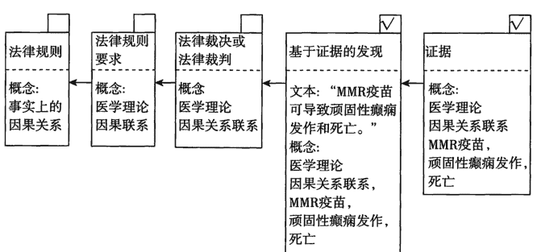

## 11.5.5. 交互式引出用户论证需求

开发原型系统的第三大挑战，在于设计直观可靠的交互机制，帮助用户将复杂的论证检索意图转化为结构化查询。系统需提供易用界面，将自然语言查询“编译”为匹配文档索引库（如 Lucene）的结构化形式。表 11.3 以“MMR 疫苗导致顽固性癫痫”查询为例，展示了结构化查询的复杂度：它包含句子类型、主题实体、规范化名称、文本内容、词性标注、引用关系等字段，手工构建难度极大。

自然语言虽是用户最顺手的表达，但复杂查询的 NLP 解析尚不成熟。用户需在论证相关约束上表达需求，这呼唤融合多元技术的交互界面。图形化手段极具潜力：

**1. 基于论证图的可视化建模**
论证图可帮助用户定位关注的命题及其论证角色。其底层可基于缺省逻辑框架（5.8 节）或价值判断论证预测模型（5.7 节）。图 5.15、5.16 分别展示了成文法要件的规则树与司法推理链条。

设想用户通过填报“输入数据模型”提交查询（图 11.9）。该模型抽象呈现规则树与推理链的层级节点，从左侧法律规则延伸至右侧证据层。每个节点对应论证角色（如法律规则、规则要件、基于证据的发现）。系统自动填充规则树的“引用”与“概念”字段；用户勾选感兴趣节点（打钩标记），并在“文本”字段填入具体命题。

图 11.9 示例中，用户选定“奥尔恩案事实因果规则”，聚焦其要件“医学理论因果联系”，并指定目标发现为“MMR 疫苗可导致顽固性癫痫及死亡”。系统可进一步将命题中的概念（如 MMR 疫苗）映射至标准化本体。同理，基于要素模型（如图 5.10 领域模型）的输入方案，也能引导用户指定争点要素与期望的裁判/发现。

**2. 结构化表单与自然语言反馈闭环**
除图形界面，带项表单亦可承载上述约束。用户勾选句子论证角色并填入命题内容，辅以概念/引用下拉菜单。针对跨句段落级信息需求，表单可动态调整输入粒度。

更进一步，系统可将用户构建的结构化查询“反译”为自然语言确认版。例如将图 11.9 转为：“在奥尔恩案因果规则‘医学理论因果联系’语境下，检索包含‘MMR 疫苗导致顽固性癫痫死亡’这一基于证据的发现及其支撑证据的判例。”用户确认或修正后，系统同步更新结构化查询，形成“图形/表单构建 ⇄ 自然语言确认”的交互闭环。

## 11.6. 成文法语境下的概念信息检索

前文聚焦判例语料，概念检索能否延伸至成文法与规章？答案取决于能否建立类型系统，同时捕捉：(1) 用户查询意图与争议焦点的核心概念；(2) 成文法文本及引用文献中可自动标注的概念实例。

**场景设想**：公共卫生应急领域的医护人员需快速答复：“哪些规章确立了政府卫生机构与传染病医院的上报关系？”传统商业检索工具因不懂概念及实体关系网络，极易误解此类查询。

本节将依次阐述：成文法类型系统设计、基于网络技术的法律规定关系建模、以及网络驱动的概念检索应用。

### 11.6.1. 面向成文法的类型体系

尽管法律本体研究已有积累（6.5 节），但专为概念检索目标，采用“类型系统 + 流水线”范式建模成文法语义的尝试尚在起步（参阅 Wyner & Governatori, 2013，见 9.5 节讨论）。

一个通用的成文法类型体系应涵盖四大板块：成文法结构要素、规则陈述类型、规则陈述组成变量、特定领域概念与关系。图 11.10 直观对比了通用类型（左）与公共卫生应急领域类型（右）。

**通用成文法类型体系（左列）包含：**

*   **结构要素**：编号单元（篇/章/节/条）、非编号文本块、章节功能分类（前言/定义/附录）、交叉引用（内部/外部）。
*   **陈述类型**：定义陈述、规则陈述。规则陈述细分为义务/许可/禁止/责任/目标等模态。规则陈述三大通用组件：前件（若）、后件（则）、例外条款。
*   **规则陈述变量（语义角色）**：行动主体、受事主体、行动内容、模态力度（须/可）、行动客体、目的意图、时限窗口、适用条件。
*   **领域概念与关系**：按具体法律领域（环境/刑法/知识产权/公卫应急等）定制的实体类型、动作类型、提及标注等。

**公共卫生应急领域实例化（右列）示例：**
*   *机构*：政府卫生机关、医院、医疗提供者、商业雇主、民选官员；
*   *动作*：上报、监管、隔离；
*   *核心概念*：传染病、公卫紧急事件（疫情/列车事故/核事故）、时间区间；
*   *提及标注*：机构提及、动作提及、时间提及。

**基于该体系的概念查询示例（图 11.11）：**
1.  检索包含“政府卫生机关+医院+上报动作(传染病)”规则陈述的条款；
2.  检索“政府卫生机关+商业雇主+上报动作(传染病)”规则陈述；
3.  检索涉及“公卫紧急事件+医院”义务陈述的条款；
4.  对比宾州与他州：义务陈述中关联的公卫管理者异同；
5.  检索同时涉及“医院”且属“刑法”与“公卫应急”双重主题的义务规则陈述。

此类查询超越了关键词匹配，精准锚定法律关系网络中的结构化约束，展现了类型系统赋能成文法检索的核心价值。

# 法律科技新范式：从法条网络到认知计算的进化之路

#### 11.6.2 网络视角下的法条智能检索

不少前沿项目引入网络分析机制，依托链接结构与权重分布来推断关联度，从而实现概念层面的法律信息检索。如前文第 7.7 节所述，洛杉矶团队从海量全文判例库中抽离出特定法律议题网络，助力用户快速定位同类案件；万律进阶版的重排功能则深度利用了引注网络。米努尼等人（2014）构建的系统更进一步，它支持包含语义描述符及文档间交叉引用指示符的复合查询——例如“哪个指令涉及异常噪音干扰，且引用了隔音法令？”。

在成文法检索场景中，温克尔斯与博尔（2014）开发出一种自动定位法律上下文的方法。用户从在线超链接法规库调取某条款后，系统自动构建“上下文网络”，覆盖所有引用该条款的来源（传入引用）及该条款引用的外部条款精选（传出引用）。实验语料选取荷兰《外国人法》两条核心条款，上下文排序采用加权模型，偏好指向定义条款的传出引用、近期修订条款及网络中心性高的节点。

网络分析亦支撑基于语料库的法规推断。霍克斯特拉与博尔（2014）解析“元法律文档服务器”中互联资源的共引网络，可解答“荷兰最具影响力的法规是哪些？”此类问题。索克等人（2014）同样借助引文网络，从数百份 HTML 格式立法文档中自动提取引文数据，识别核心法规。古尔特门与范恩格斯（2014）则在法律来源网络中实现段落级的精细法条链接。值得一提的是，虽主流网络法多依赖引注链接，但法条网络亦可承载法律的语义维度。

#### 11.6.3 法条网络图谱：公共卫生危机中的法律导航仪

匹兹堡大学公共卫生学院的法律网络分析器（LENA）项目，率先将法条网络应用于概念法律信息检索。如前文第 2.6 节所述，此类网络中的链接映射法条规定的参与者关系。LENA 网络图以可视化方式呈现：在成文法指引下，各州公共卫生体系内的机构与人员如何联动应对突发公共卫生事件（Ashley 等，2014）。

该系统精准赋能一线工作者——如外地办事处的公共卫生人员，助其解决“哪些法规确立了政府卫生机构与医院的协作关系”等实务难题。图 11.12 的法条网络图充当法律信息库的可视化索引：用户点击链接，即可调取确立主体间关系的具体法条，佐证节点连接的法理依据。对于不谙全文检索技巧的非法学专业人员，这种“点击即得”交互极大降低了获取相关条款的门槛（Ashley 等，2014）。


**图 11.12 德克萨斯州 LENA 法条网络示意 (Ashley 等, 2014)**

截图展示了德州法条下传染病疫情应对的法律指引网络。圆形节点代表公共卫生体系中的代理主体；连线（边）表明存有法条指引双方互动，线径粗细对应指令数量。体量最大的“政府公共卫生”节点涵盖州及地方卫生部门，节点大小正比于其网络中心性——即传入与传出指令总量。政府卫生部门与医院呈双向连接，职能发起方各异。

当用户选中两机构间的连线，LENA 急救法库返回 119 条指引互动的法条。引入“可报告”“疾病”等关键词筛选后，缩至 24 条，其中 3 条直击核心：要求德州医院确诊病毒性出血热后即时电话通报地方卫生部门。然而，德州法条未强制医疗提供者共享患者旅行史、未要求医院深度溯源、亦无法条强制卫生部门向医院推送埃博拉等健康预警（Ashley 等，2014）。这揭示了 LENA 工具与急救法库在诊断州级公共卫生应急法规“漏洞”上的实战价值。

横向对比亦可实现：研究者利用 LENA 发现，堪萨斯与威斯康星均要求医院在数小时内向政府机构通报此类疫情，与德州时效要求差异显著（Ashley 等，2014）。

需警惕的是，LENA 成果基于特定时点法条快照。法规频繁修订，数据库与工具须定期迭代以保可靠性——这正是第 9.7.1 节所述“从法条文本自动抽取信息”大显身手之处。

#### 11.7 章末小结：通往认知计算的桥梁

本章系统阐述了基于文本标注的概念法律信息检索程序，旨在助人类用户高效锚定法律推理所需素材。下一章将探讨：如何让法律推理计算模型直接协助人类完成特定推理任务。

---

## 第十二章 认知计算：法律应用的下一站

#### 12.1 引言：当机器开始协助构建法律假设

第 11.5 节原型已将法律信息检索推进至论证检索阶段。核心逻辑在于：若第一部分所述的法律推理、论证与预测计算模型中的知识表征框架，能在案例文本上实现自动标注，法律应用将突破概念检索边界，迈入认知计算领域。本章将剖析面向法律领域的认知计算环境——涵盖任务、界面、输入输出定制，并阐释基于计算模型的类型系统与标注如何助力人们构建法律论证假设、做出预测并借语料文档验证。

典型假设预测如：
- 原告能否在信息易于逆向工程时，仍主张商业秘密被欺骗性披露而胜诉？
- 接种疫苗与伤害发作间隔超六个月，原告能否举证因果关系？
- 原告未实际接住棒球，转换侵权主张能否在被告故意干扰下成立？

构建与测试此类假设，正是人机协同的认知计算典范：人类把握合法性假设内核，计算机引用案例与反例协助构建、验证论证。类型系统标注将赋能概念检索系统，实现相关案例精准召回、按需生成摘要、构造论证及解释预测。

本章将直面构建新一代认知计算法律应用的核心挑战：如何融合基于案例、规则、价值的推理模型与概念检索？类型系统与流水线标注器扮演何角？需要何种人工概念标注训练集？应用长什么样？如何助人类构建、测试法律假设？在阐释通用局限后，本章将展望基于法律文本的论证计算模型落地进度：系统能提取论证模式实例、高亮相关文段、提出论证与反论证；但能否生成全新论证？能否提出并测试有理据支撑的新法律假设？法律视野边界在哪？开发者该从何切入？

#### 12.2 市场前哨：三款重塑法律服务的创新应用

近年《法律科技新闻》近乎周周报道法律应用新进展。

#### 12.2.1 ROSS：基于沃森的法律问答先锋

ROSS 称得上最引人注目的新秀，构建于 IBM 沃森开发者云之上，提供法律问答服务（Ross Intelligence，2015）。用户以自然语言提问（如“破产企业能否继续经营？”），ROSS 基于成文法、判例法等渊源返回答案、引文、延伸阅读建议，并监测可能影响用户“个案”的法律动态（Cutler，2015）。

由多伦多大学法科学生团队创立，获 IBM 大赛亚军并孵化于硅谷（Jackson，2015）。演示视频展示其处理能力：
1. 加保留哪些公司记录？
2. 董事能否将股份计入国家资本账户？
3. 员工能否自立门户经营竞品？
4. 未达销售目标且胜任力不足的员工，能否无通知解聘？

针对第 4 问，ROSS 引用 *Regina v. Arthurs* 案，给出 94% 置信度回复并总结判决要旨：严重不当行为、习惯性玩忽职守、无能、损害雇主利益或实质性抗命，均赋予雇主即时解雇权。系统同步推荐成文法、判例法、法律备忘录等延伸读物，并能检测语料库新增与既往查询相关的材料（Cutler，2015）。

雷姆斯与利维（2015）将此类系统模式抽象为：专家为项目数据库每文档每段落附加一组自然语言实务问题，使该段落成为附加问题的标准答案。例如：“债务人何时可拒绝集体谈判协议？”系统需识别同一问题的多种表述变体（如增加“第九章破产城市”“曾尝试私下谈判”等限定条件），通过学习训练实例特征权重（词频、WordNet 同义/下位词、概念关系等）来“理解”用户意图（Remus 和 Levy, 2015, p.26-27）。

ROSS 具备反馈学习机制：*Arthurs* 案回复后附带“点赞/点踩”按钮，用户反馈用于更新系统对答案的置信度（Cutler, 2015）。虽回答质量持续提升，但 ROSS 目前仅指向相关法条段落，尚未深度介入论证构建与结果预测。

#### 12.2.2 法律机器：专利诉讼的“预言家”

律商联讯收购的法律机器，聚焦专利及知识产权案件的法律预测。如前文第 4.7 节所述，其预测模型基于海量 IP 案件中提取的诉讼参与者及其行为特征分析。创始团队意图融合更多案件实体特征语义信息，苏尔代亚努等人（2011）透露其目标是“将案件特征与先前因素（参与者行为特征）整合进单一模型”，但目前版本包含实体特征的程度尚不明朗。

#### 12.2.3 拉威尔：可视化判例网络与法官画像

斯坦福法学院毕业生创立的拉威尔（Ravel Law，2015a）联合哈佛法学院图书馆，完成美判例法大规模数字化扫描，并以可视地图呈现案件引注脉络与法律概念关联（Eckholm，2015）。

以“联合公民诉联邦选举委员会案”（2010）为例，律师可进入“竞选财务”专题，查看致判决脉络（区院→上诉院→最高院）及后续引用案例的示意图。输出包含海量相关案例列表（“相关”定义为：在特定检索词语境下重要），每案附带高亮检索词的观点摘录。配套可视地图与结构化引注网络（见第 2.6 节）以圆圈节点代表案件（如联合公民案），圈径大小映射被引频次，连线代表引注，线径表征“引用深度”（即引用观点中讨论该案程度）。网络沿 X 轴按年份排布，Y 轴按法院层级分层（州院、区院、上诉院、最高院），或按相关性排序。

用户可图形化追踪从 *Buckley v. Valeo* 等里程碑案例至近期判决的引注演进，点击节点即跳转至列表顶端查看全文（Ravel Law，2015c）。

拉威尔另提供付费解析服务，聚焦司法画像与历史案件：查询特定动议类型，系统报告法官历史回应模式、巡回法官/法官认可的高说服力案例、常引用规则与特定措辞、区分要点等。解析细化至特定段落/句子及其在后续判决中的引用情况（Ravel Law，2015b）。

#### 12.3 核心挑战：打通法律文本与计算模型的“最后一公里”

市场新应用引入了对认知计算至关重要的创新工具与交互界面。拉威尔基于时间轴与法院层级的引注网络可视化，让法律研究者直观体验大规模引注网络红利；其计划纳入法规将进一步释放网络价值。顺帶一提，拉威尔的引注网络实践了第 7.9.3 节 SCALIR 项目（Rose 和 Belew，1991）及第 2.6、11.6.3 节探讨的法条引注网络愿景，实现了符号主义与连接主义在法律信息检索层面的融合。

### 12.4 认知计算如何赋能法律假设测试

当前的法律科技应用，如 ROSS 与 LegalMation，虽已引入机器学习与结果预测，但核心局限显而易见：它们主要依赖判决文本的表层特征，鲜少深入案件实质层面。若能让法律应用在构建论证、预测走向时，真正“读懂”案例文本里的实质要素，将是行业的一次质变。LegalMation、ROSS 与 Ravel 虽拥有语料与抽取技术，却尚未跨过这道坎。而法律推理的计算模型，正是打通这一关键环节的钥匙。

#### 12.4.1 核心范式：人机协作下的假设验证引擎

本节将前文提及的“法律推理计算模型”与“法律文本信息提取技术”深度融合，勾勒出一种全新的认知计算法律应用图景。

在这一新架构中，计算模型不再是孤立的理论构建，而是连接海量法律语料库与一线解决实际问题的法律人之间的**智能中枢**。现有技术虽难以将文本全自动标注为复杂的逻辑规则或语义网络，但识别出“法律规则”、“裁判要旨”、“事实认定”、以及支撑结论的“论证结构”、“法律要素”、“证据要素”已是可行之举。这些结构化信息，将成为认知计算与人类专家协作的基石。

装备了计算模型的认知系统，将显著超越现有工具：它能更高效地利用提取信息，协助人类调研法律问题、预判案件结果、生成解释，并自动构建支持或反对特定结论的完整论证链条。

**认知计算的本质，是“协作智能”。** 萨斯坎德曾指出法律服务商品化的终局，并留下拷问：当流程工程追求“极致性价比”时，谁来为客户的独特难题“私人定制”方案？

早期专家系统试图将律所经验固化为规则库（如 Waterman 系统），意图通过规则匹配直接输出方案，却因“知识获取瓶颈”而难以为继。认知计算虽同指“大规模定制化法律建议”，但策略根本转向：**不再追求机器“替人想”，而是构建“人机共思”的协作闭环。**

**协作的落点在哪里？答案是：聚焦“分析与论证模式”的标注，而非“生成规则”。**

系统通过标注论证模式，辅助人类**构建、测试、评估**实质性法律假设。这里的“假设”，本质上是对“如何合理裁判”的规则式预判。“测试”与“评估”绝非简单对错判定，而是包含：检索正反例、权衡正反方论证、据此修正假设、最终提炼最有力的辩护策略（同时保持对反驳风险的清醒）。

这是一种**典范性协作**：
*   **人类**擅长直觉与战略，提出若证实将产生战术价值的创造性假设；
*   **机器**擅长算力与检索，秒级解析海量语料，精准定位与假设相关的证据链。

应用不直接抛出“标准答案”，而是输出**“暂定结论 + 证据图谱”**：总结哪些案例支持假设，哪些是反例，哪些是“近似满足条件但结果不同”的边界案例。所有呈现均围绕假设展开，帮助律师聚焦实质关联文档，并通过结构化摘要显式化文档与查询的逻辑关系。

后续章节将详细拆解：系统如何助力制定各类实质假设、如何转化为检索查询、如何引入计算模型进行评估与解释。并通过商业秘密与疫苗伤害两大领域的实战案例，演示从假设构建到论证评估的全流程。末尾将直面技术瓶颈与局限。

---

#### 12.4.2 靶向假设：律师实战思维的形式化映射

律师面对案件事实，天然会进行多维博弈推演：我方有利事实是什么？对方证据链有多强？在特定条件下，哪方胜算更大？这种直觉推演，可形式化为两类**靶向法律假设**模板（图 12.1）：

*   **模板 [1] “应然假设”**：在条件 Y 成立、即便条件 Z 存在的情况下，问题 X **应当**判决支持 [当事人]。
*   **模板 [2] “可以假设”**：在条件 Y 成立、即便条件 Z 存在的情况下，问题 X **可以**判决支持 [当事人]。

> **关键变量说明**：
> *   **[当事人]**：泛指原/被告。
> *   **[问题 X]**：诉讼请求、要件、法律规则或适用争议。
> *   **[条件 Y/Z]**：法律裁判、事实认定、法律/证据要素、证据类型、事实陈述等。

**本质区别**：
*   **“应然假设”**是强预测：基于案例库内的论证合力，判断结论**理应**如此。需权衡正反方论证强度。
*   **“可以假设”**是弱预测：仅需存在**至少一例**满足条件且达成该结果的判例即可成立。

所有预测均基于特定案例语料库，属“部分经验、部分规范”范畴，不脱离判例法语境独立推演。

**实战样本库（图 12.2、12.3）**：

**商业秘密盗用领域（以“应然假设”为主）：**
*   (a) 前雇员带信息跳槽 → 原告**应胜**；
*   (b) 被告诱骗披露 → 原告**应胜**；
*   (c) 即使信息可逆向工程，被告诱骗披露 → 原告**应胜**；
*   (d) 原告保密措施到位+产品独特+被告签NDA，**即使**原告公开披露过 → 原告**应胜**；
*   (e) 原告利益受保护，**即使**因公开披露放弃权利 → 原告**应胜**；
*   (f) 原告公开披露，**即使**原告曾保密+被告签NDA → 被告**应胜**。（注：(f)是(a)的直接反驳）

**疫苗伤害赔偿领域（全为“可以假设”）：**
*   (a) MMR疫苗致顽固性癫痫 → 原告**可**获赔；
*   (b) 同上，针对 Althen 因果测试 → **可**通过；
*   (c) 同上，针对逻辑因果序列 → **可**成立；
*   (d) 任意疫苗致心肌炎 → Althen 测试 **可**通过；
*   (e) **即使**法院按 Althen 测试支持被告因果主张 → 原告**可**获赔（程序/其他路径）；
*   (f) MMR致癫痫，**尽管**部分证据要素利好被告 → 逻辑因果**可**成立；
*   (g) MMR致癫痫，**尽管**发病超6个月 → 逻辑因果**可**成立；
*   (h) MMR致癫痫，证据要素呈现多方博弈 → Althen 测试 **可**通过。

**模型适配逻辑**：
*   商业秘密案例多为“应然假设” → 适配 **基于法律要素的论证预测模型（类价值判断模型，Ch 5.7）**。该模型能评估“应然”，同时覆盖“可以”预测。系统生成原告胜诉论证时，会同步预判并回应被告胜诉的反驳路径（如 (f) 对 (a)）。
*   疫苗伤害案例全为“可以假设” → 适配 **证据推理计算模型（如 Bex 的缺省逻辑框架，Ch 5.8）**。此类描述性模型擅长判断“可能性”，无法直接评估“应然性”。

> **操作化路径**：所有假设将通过 **概念法律标准（Ch 11.5.2）** 自动转化为概念检索查询。当然，学术界假设（如“欺诈在刺破公司面纱中核心作用”）若无法操作化为可检索要素，暂超出系统服务边界。

---

#### 12.4.3 操作化引擎：从自然语言到概念检索的“翻译官”

给定假设模板，核心任务是将其转化为**概念性论证检索**查询（类似 Ch 11.5 原型系统）。流程分三步：

**1. 假设引导界面（解决“想什么”）：**
参考 Ch 11.5.5 经验，系统提供可视化模板、样本库、文本编辑器、动态确认菜单，降低用户构建假设的认知门槛。

**2. 假设→辅助查询的自动转译（解决“怎么找”）：**
目标查询：寻找“在条件 Y/Z 下，法院在问题 X 上支持某方”的判例。这高度类似 Ch 11.5.2 的概念查询，锚定扮演特定论证角色的命题。

条件 Y/Z 对应的论证相关信息类型（扩展自 Ch 11.5.3）涵盖：
*   法律规则/要件满足性结论；
*   事实认定、证据要素、证据推理链；
*   适用法律要素、政策价值推理；
*   案件程序节点。

**领域实战演示**：

*   **商业秘密（对应图 11.6 查询模式）：**
    *   假设 (a)：前雇员带信息 → 原告胜。
    *   → 查询：法律要素 F7“带走工具(P)”成立时，原告获胜的裁判案例。
    *   假设 (g)：前雇员带信息 → 被告胜。
    *   → 查询：同一要素 F7 下，被告获胜的裁判案例。
    *   *即图 11.6 概念查询 1 与 2 的对照关系。*

*   **疫苗伤害（对应图 11.5 查询模式）：**
    *   假设 (a)：MMR疫苗致癫痫 → 原告可获赔。
    *   → 查询：基于证据认定“MMR致癫痫”成立的案例。
    *   *即图 11.5 查询 4a 的实例化。*

**底层管道**：LUIMA 搜索模块将假设→概念查询→论证类型约束集（图 11.2）→ 检索重排（Ch 11.3.1/11.3.2）。前提是语料库已按 Ch 11.5.1 完成论证相关信息的自动标注。

---

#### 12.4.4 解释引擎：从“搜结果”到“懂胜败”

检索只是起点。系统将引入 **Ch 1 第一部分的论证计算模型**，作用于标注好的案例特征（法律要素、价值基础、可辩驳规则），实现三大跨越：

1.  **自动构建论证**：为假设生成正反方完整论证树。
2.  **假设评判**：基于竞争性论证强弱，确认/质疑假设，给出理由。
3.  **协作迭代**：提供“修正假设、扩展语料、深化论证、重新评估”选项，引导用户探索合理假设空间。

下文将分别以“价值判断论证预测模型”（商业秘密）与“缺省逻辑框架”（疫苗伤害）为例，演示协作测试全流程。

---

**案例演示：商业秘密领域的“应然假设”深度测试**

**目标假设（图 12.2-d）：**
> 原告产品独特(F15-P)+保密措施(F6-P)+被告签NDA(F4-P)，**即使**原告公开披露过(F27-D) → 原告**应胜**。

**Step 1：假设输入与消歧**
用户通过自然语言+菜单输入假设。系统按扩展论证类型体系（Ch 11.5.3）标注文本，自动映射为法律要素列表。若存在歧义（如“公开披露”具体指何种场景），系统给出 Top-N 解析供用户确认。

**Step 2：查询构建与语料聚合**
系统分解假设为结构化查询（对应图 11.6 查询 3）：
> 检索商业秘密裁判文书，法律要素含：F15独特产品(P)、F4签NDA(P)、F6保密措施(P)、F27公开披露(D)。

运行时策略二选一：
*   **动态模式**：泛化查询 → 法律信息检索系统取证 → 运行时标注要素/论证角色。
*   **语料库模式**：调用预建标注库（可指定辖区/时限） → 运行时增量更新。

标注粒度达句级，覆盖通用/领域特定要素。系统能识别裁判结果归属（谁赢谁输），处理标准法律表述（Ch 6.8），并预留应对复杂归属/极性问题的接口（Ch 12.5.1）。

**Step 3：初步统计报告**
系统返回：`n` 个支持原告的正例，`m` 个支持被告的反例，并标注数据库边界条件（辖区、时限、案件量）。

**Step 4：协作决策菜单（人机分工的高光时刻）**
此时，系统不下结论，而是抛出行动菜单，由用户主导、系统辅助：

| 选项 | 核心动作 | 发起方 |
| :--- | :--- | :--- |
| **1. 调整语料库** | 扩大/缩小辖区、时限，换检索词，补语料 | 系统推荐 / 用户指定 |
| **2. 修正假设** | 调整要素组合、增删条件、翻转立场 | 系统提示 / 用户决策 |
| **3. 构建论证** | 基于检索结果，自动生成/协助撰写正反方论证书 | 系统生成草稿 / 用户润色 |
| **4. 评估假设** | 引入计算模型（价值判断/缺省逻辑），量化论证强度，输出胜率预测与风险点 | 系统计算 / 用户复核 |

这一闭环，将“法律检索”重构为**“假设驱动的论证工程”**，让认知计算真正成为律师战略思维的延伸，而非冷冰冰的文档匹配器。

# 律师如何用AI“压力测试”案件假设？揭秘法律推理的协作新范式

在法律实务中，假设从来不是一成不变的。资深律师深知，案件走向往往取决于对核心事实的“加减法”运算。今天我们深入探讨智能法律系统如何协助完成这一关键环节——**假设的修改、论证与评估**，以及基于“描述性证据模型”的协作式假设检验新图景。

---

## 一、 假设修改术：从“具体”走向“聚焦”，精准锁定胜负手

系统支持的假设修改，通常有两条经典路径：

**1. 事实/法律因子的“加减法”：调整颗粒度**
最典型的操作，是向查询约束中增减法律因子或事实。比如原假设（d）涉及“原告公开披露”且“被告同意保密”的完整场景。修改后的假设（d'）剔除了“安全措施”“独特产品”等具体事实，**仅保留 F4（同意不披露）与 F27（公共论坛披露）两个核心因子**。
> **核心逻辑**：假设（d'）比（d）更泛化，它直指法律核心争点——**“即便公开披露，若存在保密协议，能否构成盗用？”** 这种“去噪”操作，能帮助律师快速测试单一法律规则的边界效力。

**2. 聚焦特定法律问题：拆解复合索赔**
商业秘密盗用包含“是否商业秘密”“是否盗用”“保密关系存否”“保密措施适当性”等多子问题。系统允许律师针对某一子问题（如“保密关系”）单独生成假设。
> **实战价值**：避免在论证初期陷入事实细节泥沼，实现**“分而治之”**的战略部署。

---

## 二、 论证生成与评估：AI不再是“黑箱”，而是“辩论搭档”

### 1. “做出法律论证”：输入因子，输出完整辩论图谱
当律师确定假设（如 d）及相关因子（F4, F6, F15, F27）后，系统调用 **基于价值判断的论证预测模型（如 IBP）**，自动构建双方论证结构（如图 5.13 所示的 *Dynamac Research* 案例论证）。

*   **支持方**：引用类案、强调保密协议效力、安全措施充分性。
*   **反对方**：引用反例、强调公开披露导致秘密性丧失。
*   **裁判视角**：系统尝试**区别反例**（Distinguishing），或论证反例中的价值权衡不适用于本案。

> **关键点**：用户可介入指定反例，系统需理解并回应。这要求输入论证必须符合计算模型可解析的结构化形式。

### 2. “评估假设”：基于论证强弱，预测胜诉率
系统综合正反方论证，输出**结果预测 + 论证证成**。
*   用户甚至可**强制修改预测结果**，倒逼系统解释“为何在该假设下原告仍可能胜诉”，反向挖掘有利论据。
*   论证形式涵盖：**类案支持、反例区别、政策价值权衡、近似缺失假设识别**（Ashley, 1990）。

---

## 三、 疫苗伤害赔偿领域的“描述性证据模型”：不谈“应然”，只复盘“实然”

前文基于**规范性因子模型**（预测*应该*怎么判），而疫苗伤害等证据法领域，更适合**描述性计算模型**（复盘法官*实际上*怎么判）。

### 核心差异：从“原告应胜诉”到“原告可成功”
*   **规范性假设**：“在特定事实下，问题**应**判原告胜诉。”
*   **描述性假设**：“在特定事实下，原告**可以**成功（历史上有类似胜诉先例）。”
> 这种措辞差异，精准反映了模型底层逻辑的分野：**前者推演法律理想，后者统计司法实证。**

### 描述性模型能做什么？（三大核心能力）

| 能力维度 | 具体表现 | 律师实务价值 |
| :--- | :--- | :--- |
| **路径追踪与规则树导航** | 从假设事实出发，追踪至期望结论；标识尚未满足的规则要求；展示历史上成功/失败的论证路径及频次。 | 快速定位“缺链环”，知晓哪条路最好走、哪条路是死胡同。 |
| **法官画像与微观推理复现** | 记录特定法官/特别法官过往如何认定事实、解决证据冲突、评价专家证人（见表 12.1）。 | **“知彼知己”**：针对性调整举证策略、专家选型、庭审话术。 |
| **假设确证/证伪 + 统计报告** | 确证则给出成功路径、建议论证、异常预警；证伪则指出排他性负面路径。 | 量化风险，为客户提供数据支撑的庭前评估报告。 |

### 模型局限性的清醒认知
*   **不支持规则解释论证**：无法就“法律规则要求的含义”进行辩论。
*   **难评“规范性应该”**：缺乏类案类推能力时，难以判断“事实是否满足规则要求”。
*   **核心使命**：捕捉**事实审判者基于证据的推理规范性**——法官判决是事实认定还是法律结论？理由如何影响判决？理由的支撑/反驳强度几何？

---

## 四、 实证展示：特别法官的“证据推理指纹”（表 12.1 解读）

系统通过**缺省逻辑框架**建模特别法官推理。以疫苗案为例，法官的证据理由（左）映射背后的政策/常识原则（右）：

| 证据理由（法官原话） | 映射的原则/政策 |
| :--- | :--- |
| “接种减毒疫苗后出现自然感染症状，增加疫苗致病可信度” | **生物学合理性推定**：时间关联+症状相似 = 因果推定基础 |
| “专家证词过于简略，无启发性” | **举证深度匹配原则**：分析深度需与课题复杂度匹配 |
| “专家拒绝回应对方批评” | **对抗性沉默推定**：有机会反驳而不反驳，视为无合理解释 |
| “婴儿症状持续数周未就医” | **常理经验法则**：真病必求医，不求医即症状不实 |
| “请求人症状描述前后矛盾” | **陈述一致性要求**：真实症状描述应稳定不变 |
| “接种致伤合理窗口期 1-21 天” | **时间间隔反比原则**：超出窗口期，因果可能性递减 |

> **洞见**：这些理由若在案件语料库中高频出现，或上升为显性政策，即可自动标注、比较、纳入预测模型，**实现“规范与经验”的综合注解**。

---

## 五、 通往认知计算法律应用的“三座大山”（12.5 节挑战）

尽管图景迷人，要落地“协作式假设检验”，必须攻克三大硬骨头：

### 山一：自动注解——能否从判决文本里“挖”出法律因子、证据因子、句子角色？
**现状喜忧参半：**
*   ✅ **前提/结论识别**：Moens 团队 F1 值达 68%/74%。
*   ✅ **论证方案识别**：Feng & Hirst 准确率 63%-91%。
*   ✅ **句子角色标注**：LuiMa 团队“法律规则句”F1 68%，“证据发现句”F1 48%。
*   ✅ **法律因子提取**：SMILE 在商业秘密案中因子 F1 仅 26%-28%，但**仍能使 IBP 预测提升 15%**；SPIRE 利用因子重排序缩短检索长度。
*   💡 **跨域启示**：立法起草本体技术、法条逻辑规则提取技术，为因子注解提供方法论迁移。**因子比规则简单（类前件），但案例文本比法条多变。**

**四大迫切需求：**
1.  **归属消解**
2.  **极性区分**
3.  **领域概念/关系获取**
4.  **大规模人工标注训练数据**（核心瓶颈）

### 山二：归属消解——“谁说的”比“说了什么”更重要
判决文本混杂：当事人主张、专家证词、法条引用、法官认定、上级法院观点。
**系统必须分清：**
*   **法官认定** = 因子确立
*   **当事人/专家主张** = 仅证明“争议点存在”，非事实确立

**案例：Wodrich 案（S2/S3/S4 对比）**
*   S2/S3：“签名人（特别法官）认定疫苗致多发性硬化症” → **高价值，法官裁决**。
*   S4：“莱斯特博士（专家证人）认为疫苗不致病” → **低价值，非法官结论**。
*   **细微难点**：法官可能**采纳败诉方专家**的部分观点（如批评对方专家忽略分型），不能简单按“立场”归属。

**技术路径：** 引入**话语模型**（Discourse Model）——实体识别+角色属性+行为关系+RST 修辞结构理论解析。
*   
*   图 12.4 展示 RST 树如何识别“Mason 作证”vs “法院推断”的归属层级。
*   **挑战**：司法文书复杂度（如 McCarthy 法官三部分测试）远超示例，推高 NLP 解析上限。

### 山三：极性区分——站队：支持还是反对？
评估假设需知：法官**认定/否定**了某规则要求？专家证词**支持/反驳**因果？法官**倾向原告/被告**？

*   **通用论证挖掘**：结论/前提极性分类（Aharoni 等称其为“独特挑战”）。
*   **规则法**：否定词触发极性反转（如“癌症未扩散”→负定位）。
*   **机器学习**：IBM Debater 监督学习分类“赞成/反对议题”。
*   **法律场景特殊性**：需结合**归属主体**（法官vs当事人）、**语境规则**（举证责任分配）、**推理步骤**（事实认定vs法律适用）多维判定。

---

## 结语：从“检索工具”进化为“思维伙伴”

这篇文献绘制的蓝图清晰而宏大：**法律AI的终局，不是替代律师写文书，而是成为能陪你“推演假设、对垒论证、复盘法官心证”的认知协作伙伴。**

路径虽远（注解、归属、极性、数据），但每一步突破——SMILE 提升预测、LuiMa 识别角色、RST 解析归属——都在逼近那个临界点：**当机器真读懂“法官为什么这么判”，律师才真获得“预知未来”的杠杆。**

### 核心流程：从极性定义到分类器验证

- 确立“正极/负极”概念并给出实例；
- 组织人工标注极性，产出高质量训练数据；
- 引入机器学习，训练捕捉极性“统计特征”的分类模型；
- 用标注实测数据验证模型在新案例上的表现。

第 10.6.1 节详述了 IBM 辩论者团队基于手工标注训练集的机器学习实践路径。

在司法裁判、争点裁定、事实认定及证据采信中，否定性表达是否呈现稳定模式、能否为同类标注规则或机器学习提供足够约束，仍属实证探讨范畴。

## 获取特定领域的概念与关系

第 11.5.3 节构建的扩展类型系统，旨在全景式界定命题于跨法律领域通用论证中的定位。作为认知计算的典范，协作假设检验可在多法律领域落地，助力识别法律要素与证据要素。

然而，法律领域天然包含从受监管主题中抽取的概念与关系。以第五章的疫苗伤害赔偿领域为例，法律因果争点与医学因果争点紧密交织。

针对任一具体法域，法律应用均需获取并表征专属领域知识。这覆盖特定主张概念、关系、指称、表 11.2 列举的预设信息类型，以及基础词汇（如疫苗伤害领域的疾病与疫苗名称）。第 10.5.3、11.5.3、11.5.4 节探讨了标注此类信息的技术路径。

受监管领域具备动态性：新商业疫苗上市、疫苗与损伤的新关联发现层出不穷。因此，专业词汇在内的各类领域信息均需持续维护与迭代。

非法律机构投身类型系统与本体构建，旨在提升专业领域概念检索效能。医学与公共卫生领域尤为典型，将法律类型系统与医学本体资源、类型系统打通极具成效。在线医学本体广泛覆盖疫苗及其潜在损伤，提供疫苗/损伤名称及其缩写、商品名的规范化词典。

跨本体互用与跨领域本体协同构建是活跃研究方向：

> 实现不同 NLP 架构模块间的直接互操作，要求其基于同一类型系统构建标注器……或以封装形式转译异构类型系统。（Liu 等，2012）

刘宏芳团队（Liu 等，2012）与吴志杰团队（Wu，2013）均提出了跨域复用医学本体与类型系统的技术方案。

虽法律类型系统与他域类型系统互用的实现细节超出本书范围，但可得一实用结论：即便仅具备带语义信息的标准化术语表（含变体），亦足以应对疾病、疫苗及其缩写、商品名等实体的规范化需求。

#### 12.5.2 挑战：训练样本的手工标注

自第九章以来，人工对法规、判例及法律文书标注的需求持续攀升。若假设检验范式在法律领域有效，则需更大规模人工标注。如 10.6 节所述，虽无需解析标注语料库全量文本，但有效训练集构建仍需海量人工投入——由谁来完成？

此处提供两类答案。一是众包：招募大量非专业人士完成机器难以胜任的智力任务（如训练文本打标），借助 Amazon Mechanical Turk 等平台分发任务，参与者称提供者或“土耳其工人”。二是法学院学生与实习生：兼具法律训练背景，胜过非专业众包工人。两类人群均依托 10.6.3 节所述的在线标注环境作业。

### 众包标注环境

研究证实了众包标注法律隐私政策需求的可行性（Breaux 和 Schaub，2014）。任务聚焦从隐私政策中抽取数据收集、共享、使用需求的描述。

核心问题是：无法律训练的众包标注员能否可靠标注法律文本？关键在于将标注任务拆解为极简、定义明确的子任务。Breaux 与 Schaub 将其拆为四个识别子任务，分别锁定：动作动词、信息类型、渊源与目标、目的。条件允许时，引入 NLP 自动完成辅助识别（如情态动词识别）。

研发的在线界面向标注员呈现隐私政策文本片段，例如：

> 我们可能收集或接收来自其他来源的信息，包括（i）选择上传其电子邮件联系人的其他 Zynga 用户；（ii）第三方信息提供者。

标注员高亮相关短语，点击“概念”键将其编码为特定概念实例。上例中可高亮“收集”“接收”“上传”，并关联至概念列表对应项（Breaux 和 Schaub，2014，p.169）。

实验表明，众包群体能胜任句级与短语级编码。其分解式工作流降低了任务复杂度，实现了“以较低总成本换取可接受的总体响应质量”（Breaux 和 Schaub，2014，p.171）。

针对面向消费者的数据隐私政策，将整体标注问题拆解为无需通读全文即可执行的明确编码任务是可行的。但对于法律判例标注，很难想象如何将其拆解为无需法律专业知识即可执行的原子任务——标注员必须掌握案件整体事实与法律语境，方能做出合理判断。

### 学生标注实践

学生标注文本成效显著，且已广泛开展。IBM 辩论者团队雇佣研究生识别非法律主题与证据（10.6.1 节）。法律语境下，Lui-May 小组让法科学生标注疫苗审判案例；霍夫斯特拉法律逻辑与技术实验室学生标注法律规则句、基于证据发现的句类（10.5 节）；匹兹堡大学学生标注商业秘密案件法律要素（10.6 节）；Wyner 与 Peters（2012）研究亦引入学生标注法律要素（10.4.3、10.5 节）。

标注早被用作其他论证领域的教学工具：助力学习者“参与科学论证”（Zywica 和 Gomez, 2008）；Teufel 等（2009）利用人工标注训练集开展论证挖掘。中学社科、文学、科学课程中，标注用于“高亮核心信息（主张/论点）、支撑观点（证据）、关键词汇”、“重要事实或主旨”、“文中定义”、“主要结论”（Zywica 和 Gomez, 2008），这些类型大体对应法律论证标注体系。

关键问题是：标注能否纳入法学教育与职业培训体系？证据指向肯定。当前针对开源案例库的法律教育活动，已提供文本标记与公开标注设施（见哈佛伯克曼中心、法学院图书馆、哈佛图书馆实验室，2016）。

标注助力法科学生精读法律材料。“课堂沙龙”这一 Web 工具支持“师生共读、段落标注、问答互动”，允许以标签形式书写评论（Blecking, 2014）。引入该工具的法学院干预实验证实了“可测度的阅读能力提升”（Herring 和 Lynch, 2014）。

计算机支持的高亮与标注环境，聚焦法律文本中与论证相关的信息，帮助学生掌握法律推理结构、精准解读论证文本。标注对象覆盖实体法概念与裁判/论证结构。一年级新生将其作为研读判例法规的入门训练。教师引导学生识别判决中的关键命题：陈述法律规则、法官对规则要件是否满足的裁决、事实认定。以论证功能标注文本，能强制学生聚焦案件核心要素，极具教学价值。

同理，标注助力律所新人、法科毕业生、法务新员、初任书记官熟悉雇主特定法律文书写作范式。他们通过标注学习，副产出的标注语料可直接服务论证挖掘。

笔者团队正开发试验一款适配平板的 Web 标注环境，助力法科学生识别并标注法律论证关键句。环境模型见 。

### 图 12.5. 面向一年级法学生的标注环境


法科学生阅读作业时习惯高亮文本。在少量辅助标注下，高亮片段即转化为结构化标注。此处学生标注了中屏显示的六类陈述。逐句标注后，在左上角“类型”下选择色标标注类型，系统自动着色。预设句类型服务教学目标，紧贴句级论证类型：

- **问题陈述**：法院需裁决的争点表述
- **支持裁决理由**：支撑特定裁决的理由陈述
- **反对裁决理由**：反驳特定裁决的理由陈述
- **事实陈述**：理由依托的事实陈述
- **裁决陈述**：法院报告争点结论的陈述

标注过程中，系统自动在右侧生成大纲：将高亮句按论证逻辑组织，呈现争点、法院认定的相关事实、支持/反对裁决的理由。点击大纲条目，中屏文本自动定位至原始上下文。学生在标注中直观体会争点框架、理由展开、反向考量与结论推导的完整链路。

进阶功能允许为大纲条目添加评论（如“正方最强理由”“我异议该裁决”“不懂反方此理由”）。若有同伴标注同材料，系统可基于一致性给出可靠性反馈，甚至引入竞争机制。

直觉上，随着法学生与法务人员标注可靠性提升，标注质量将受益于其专业积累。前提是：在线环境须让标注如阅读般便捷（10.6 节），并支持同一文本多标注间的可靠性计算，参照辩论者项目（Aharoni 等，2014a，10.6.1 节）。

## 语义标注的边界

法律应用虽能完成案件文本中论证相关信息的标注，但可标注语义信息的品类受限。

**首要限制**：命题等信息须在文本中显性表达，人类始能可靠标注，管道技术始能自动标注。若需从文本间接推断、或跨段落分散拼凑，标注技术通常失效。10.6 节指出，人工标注一致性上限决定机器学习上限。推理越间接、来源越分散，人类达成共识越难，可靠性越低。

部分间接推论可借本体联想补足（第六章）。目的推理法（第三章、第五章）运用价值推理。法官未必在文中显性表达特定价值，但若价值与图 5.11、5.12 中法律要素关联，程序识别要素后，即可凭借内置价值知识推断。

**其他限制**聚焦法律文本模式：过细、过泛、过稀、过复杂，致使文本解析技术难以有效识别以供计算模型应用。例：从复杂法规文本直接抽取逻辑规则的可行性仍属悬而未决。11.6.1 节尝试识别条款“若/则”结构，辅助领域实体建模；Zhang 和 El-Gohary（2015）在有限条款范围内实现逻辑规则抽取。跨监管领域通用的细粒度逻辑结构检测方法，是未来关键实证课题。

10.3.4 节提及，程序能识别文本论证中的一般特征（如主张/结论嵌套树），但能在多大程度理解并推理，仍是开放问题。若在基于先例的解释生成器（3.3.3 节）或 SIROCCO（3.6 节）语义网络中详述结论缘由，程序可用其评估关联性、对比解释与论证。但语义网络表征极度通用，适配多元事实场景，导致机器学习效力受限——同一命题可有多种表达。受控词汇与表征方案（如 SIROCCO）、作为路标的句类型（如缺省逻辑框架）能让手工标注语义网络更可行，但自动标注仍待验证。

论证模式情况类似。论证模式在 AI 与法律建模中核心地位突出（第五章）。部分模式可标注（表 10.1），要素亦可识别（如基于法律要素的案例类比论证）。

但识别模式后，程序能在多大程度用细节填充模式槽位，悬而未决。概念检索层面表现尚可：程序能定位法律意见中针对争议概念的类比论证位置。然而能否如部分建模者期望，胜任举证责任分配、直接从文本推导法律结论，尚不明朗。

最后，现有预测模型所用部分信息无法从文本抽取。包括基于个别大法官、法院及下级法院行为趋势的工程特征（4.4 节）。

**小结**：新技术难以支撑第一部分计算模型的全部自动推理。新法律应用可能无法使用部分法律推理计算模型特征。此意上，某些自动化法律推理任务，文本解析技术仍无能为力。

反之，商业法律应用（含本章开头提及者）正从文本中提取计算模型无法获取的信息——如特定法官裁判史料。但此类信息可与第三部分方法融合。

#### 12.5.3 挑战：查询界面设计

第二大挑战源于创新查询界面设计需求：让用户相对轻松地指定假设与论证需求。11.5.5 节概念检索讨论同构。目标：用户以菜单选择+自然语言混合输入查询；应用以自然语言或结构化查询回显解读，邀请用户菜单确认/修改；随后转化为概念约束。

同法可用于假设输入。12.4.2 节模板显示：假设范围虽广，形式受限。界面可阐释假设类型，呈现图 12.2、12.3 自然语言假设或结构化等价物，邀请用户选取并定制。

模板化在线表单助力用户填写假设问题与条件，如：“在条件[y]下，[x]问题应/可判决支持[某方]，即便条件[z]。” 下拉菜单提供法律主张、要素、规则、规则要求列表供指定问题；列表由系统覆盖的主张与规则决定。依用户选定问题，界面呈填写条件菜单：从法律要素/组件列表中选取，指定法律裁决、事实认定、证据要素、证据类型、事实陈述。

例：12.1 节棒球侵占物假设可表述为：

> 即便条件[故意干扰(P)]，在条件[未捕获(D)]下，[侵占物]问题应判决支持[被告]。

用户经菜单选定问题(侵占物)、当事方(被告)、条件——源自猎物财产利益微观世界的两个要素(表 6.4)，一利被告、一利原告。

设想用户亦可输入条件自由文本，系统自动结构化并确认。系统将结构化假设反译为自然语言供用户复核/修改。

用户假设一旦转化为可处理形式，应用即通过转化为辅助查询予以实现（12.4.3 节）。此时界面需支撑应用与用户的协作假设检验交互（12.4.4 节）：基于初步报告协同修正数据库或假设、构建法律论证、评估假设。

支撑此层级协作带来新挑战，却是认知计算所需交互特质。这与电子取证（8.4.1 节）、法规分析（8.7.1 节）中预测编码支持用户迭代优化相关性假设并落地查询的增量过程无异。

当下电子取证预测编码系统即认知计算佳例。预测编码是人机协作智能活动：建模语料文本相关性，双方各尽所能解决特定法律问题。人类选取自认与法律问题相关的正负样本；计算机生成训练集统计模型、检索分类其他文档；人机共同迭代优化相关性模型。8.4 节述及：诉讼方搜索文档时，隐含假设对手文档包含与诉状争点（原告诉状、被告答辩、双方文件要求）相关的文档。但现有预测编码并不明示假设——假设仅隐含于机器学习模型中。

本章提议的认知计算法律应用须跨出关键一步：助用户显性化表达实体法与证据问题假设。这方向正确。终局上，电子取证与法规分析中的相关性假设，由检索文档对实体法与证据问题的潜在含义驱动。显性化用户对后者的假设，终将助力解释并指导前者假设的迭代重构与查询优化。

## 12.6 捕捉新假设与论证的契机

本章与第十一章阐释：语义标注赋能认知计算模型，助人类在论证中寻获相关材料、基于法律文本语料库构建/检验/评估假设。实现此目标需攻克上述实质性挑战，然在未来数年内似可逐个击破。

文本解析与语义标注不会让系统在人类意义上“阅读”文本——至少短期内不会。程虽能智能处理论证相关信息，却无法深度理解论证本身。

然而，程序检测新法律假设或论证契机，或不需深度理解。程序可通过捕捉**期望违背**来识别此类契机，进而生成新假设或跨法域类比，催生新论证。

**期望违背**。预测方法生成期望：预测为真。预测失效即违背期望，倒逼人类给出解释（Schank，1996）。

在期望落空指引下，系统可自主探索法律文本语料库，搜寻“有趣”假设，构建检验新论证特征甚至新论证。当系统粗略标注了主张、争点、胜败方、论证与法律要素，即可遍历语料库，定位结果违背预期的案件。

### 当AI学会“举一反三”：法律认知计算的跨域类比与实战用例指南

法律 AI 系统最迷人的能力，或许不在于复述过往，而在于捕捉“反常”与“新意”。

#### 当预测失准时，正是发现新知的开始

当系统根据案件特征预测的结果与真实判决背道而驰，这并非单纯的算法失误，而是一扇通往深层逻辑的窗口。

设想这样一个场景：案件事实明明指向被告胜诉，法院却判了原告赢。若现有的支持原告因素无法解释此结果，系统便会敏锐地捕捉到“异常信号” —— 判决书中极大概率藏着尚未被标注、系统也未识别出的法律因素。这一机制能倒逼系统“举手示意”，引入人类专家协作，共同拆解文本、补全认知拼图，把隐性的裁判逻辑显性化。

这种“违背期望”的价值，不仅存在于个案。法律概念的涵义随时代演进（如第 7.9.4 节所述），也会导致判决树结构发生可测度的漂移。监测这种结构性变化，能让我们提前捕捉法律概念“换装”的信号，验证假设，而非事后追忆。

无论是基于历史趋势的大数据预测（如美最高院预测模型）、基于价值权衡的类比推理，还是诉讼参与者行为特征、引文网络趋势，凡是能产出“预期”的模型，其预测偏差都是挖掘“未被检测论证特征”的富矿。

#### 打破领域壁垒：从“找相似”到“造新论”

现有的文本标注与计算论证模型，擅长在**同一法律领域**内“以旧翻新” —— 检索同类主张的过往案例，移植论证理由，适配新事实。这对用户虽新，对案例库却是“旧货”。

但法律创新的核心，往往源于**跨域移植** —— 将概念从领域 A 引入领域 B，重新组合成极具说服力的新论证（Remus 和 Levy, 2015）。这要求系统具备比单纯标注更深层的语义理解力。试想第 3.4 节那个“持枪校长恐吓学生去竞校”的离奇类比，若无深层语义支撑，机器根本无法生成这种跳跃性的法律构想。

当前系统通过标注“文本片段扮演的论证角色”（如法律因素、证据要素、规则要件满足与否），并构建知识图谱关联“理由—法律问题—价值/政策”，已能支撑基于**共享事实概念**与**论证结构相似性**的检索。这让应用能比传统全文检索更聪明地定位“概念上和结构上类似”的过往判决，辅助人类构建类比、权衡利益、预判成败。

但更大的野心在前方：标注语料库能否让机器领悟“理由的意义、适用边界与泛化能力”？维特根斯坦云“意义即使用”，论证型式与标注正是“用法”的记录。比如缺省逻辑框架剖析司法证据推理，疫苗伤害赔偿领域的常识推理能否迁移至其他语境？商业秘密法中“干扰/放弃潜在价值 vs. 保护价值”的因素-价值模式，是否在商标、版权法中同构存在？

若答案为肯定，未来的法律应用将能提示用户：“有个看似风马牛不相及的外域案例，深层论证结构与你手头案子高度同构，且能组装成全新论证。” 这才是认知计算的终局图景。

---

### 12.7 破题之道：从“用例”出发

假设你是法学院学生或年轻律师，读懂了前文原理，想开发一款法律认知应用，却无从下手。核心动作只有一个：**锁定用例**。

用例本质是“用户为达成目标，与待设计系统之间的一系列预期交互”。全书遍地是用例雏形：
*   电子取证：海量电子数据中精准锚定关键文档（§8.4）；
*   法规检索：快速定位并解析相关法律条文（§8.7.1）；
*   **核心进阶**：对案卷语料库提出并验证实体法假设（§12.4）。

注意，前两者表面是“搜”，实则藏着“假设” —— 律师搜文档、找法条时，脑中已有“此文本与某法律问题相关”的隐性预判。只是传统预测编码未显性化这些假设而已。

**怎么挖用例？四步走：**
1.  **沉浸现场**：律所、法务、法援、法考班、甚至大众维权平台、合规咨询系统……凡有“用文本解决法律问题”处皆是现场。
2.  **捕捉痛点**：从业者系统性地在哪里卡住？如何获取、使用文本？
3.  **梳理假设**：他们脑中闪过哪些法律假设？
4.  **工具赋能**：新文本分析技术能如何帮他们“前所未有地”验证假设？

---

#### 实战用例图鉴

##### 1. 合同智管：半结构化文本的“金矿”
合同结构规范、电子化率高，是语义分析的首选战场。LegalSifter 等初创已落地三大场景：
*   **尽调**：自动标注“转让限制、生效期限、通知条款”等核心条款；
*   **租赁会计**：抓取起租日、到期日、续租/购买选项等关键时间点与条件；
*   **金融合规**：监控“适用法律、终止权”等高风险条项。

更高阶玩法是**纵向追踪**：数年合同标注数据积累，可揭示“付款条款、主协议框架、间接损害赔偿上限”的演变趋势，甚至关联“销售合同条款是否仍符合公司战略”、“不同合同类型下的收益走势”。关键在于定义“可比较特征”（如限制程度、风险敞口）及其语义组件（时间跨度、收益率、责任上限），搭建类型系统，以“人工标注训练集 + 机器学习 + 规则”混合模式跑通自动标注与概念检索闭环。

##### 2. 电子取证进阶：从“被动筛”到“主动关联”
传统电子取证面对非结构化文本，法律相关性几乎全靠隐性判断。变革路径是**显性化假设**：
*   以诉状为锚，下拉菜单列出争议焦点；
*   预测编码关键节点，当事人将文档显性关联至具体焦点；
*   此举倒逼当事人梳理主张/抗辩逻辑，形成“文档-问题”映射，庭审时可直接作相关性解释。

单案或见效有限，但**跨案、跨客户、跨时间**积累匿名化语料后，机器能学习“焦点-文档类型/术语/通讯模式/发收件人”的画像，反哺自动聚类与新案筛选。前提是攻克**自动匿名化**技术 —— 这本身就是个硬核用例。

##### 3. 假设与语料库的“无限组合”
除了上述，假设空间随法律领域、受众、任务无限延展：
*   **概念演进追踪**：《HIPAA》中“待遇”概念在法院 vs 国会听证会的分歧？破产法“善意”含义的时序变迁？
*   **律所三元博弈库**：我方正方简讼 + 对方反方简讼 + 法院判决 = 竞争性论证结构的天然对照组。需技术比对差异、提炼战略教训。
*   **法评文章/学位论文**：论证更宏观、前提更笼统，需扩充型式系统覆盖“主张-结论嵌套结构”。
*   **普惠法务场景**：退伍军人维权、消费者纠纷、员工合规咨询……用户专业度低、任务碎片化，型式系统与交互设计须大幅下沉、适配真实认知路径。

**数据从哪来？** 别盯着 Westlaw/Lexis/Bloomberg 这些贵且闭源的库。哈佛法学院图书馆有份详尽的免费数据源索引；LII、各国法院/立法机构官网、WIPO 域名争议决定、CISG 数据库、模拟法庭辩辞、律所内部备忘录库（注意法律与技术双重限制）……沃森开发者云甚至直供部分商业库授权。来源多元，预处理门槛各异，但机会在此。

---

### 通用任务清单：开发者的“设计说明书”

无论做哪类用例，核心协作范式不变：**机器管海量信息的组织与递送，人管判断与决策**。开发前须搞清五大问题，直接映射型式系统、标注流程、交互设计：

1.  **核心概念是什么？** 哪些文本指代能证明概念存在？（参考 §6.7, 6.8, 11.6.1）
2.  **如何自动标注？**（参考 第9、10章）
3.  **如何按概念重要性排序候选文本？**（参考 §11.3）
4.  **如何辅助用户构建概念化查询/假设？**（参考 §11.5, 12.4）
5.  **如何用检索结果验证假设？**（参考 §12.4）

卡在问题 1？反问自己：**“人类依据实体法特征比较案情/情境时，到底在比什么？”** 这种比较是预测结果、界限、趋势的基石，能被标注的比较维度，就是型式系统的核心实体。

全书展示的论证结构，本质上都是**“针对特定主张类型，按事实情境衡量案件实力”**的比较框架，主要维度五大类：
*   **价值权衡维**：法律因素/问题模型 + 价值判断论证预测（§5.7, §4.5.2）；
*   **规则覆盖维**：缺省逻辑框架规则树 + 证据因素的要件覆盖度（§5.8）；
*   **论证角色维**：法律论证组件中句子的功能角色（§6.8）；
*   **事实结构维**：典型事实的结构匹配（EBG §3.3.3, SIROCCO §3.6）；
*   **引文网络维**：引文中心性（BankXX §7.9.3）。

**规制标准严度比较**也有现成建模：
*   图表法（§2.5.1）、要求水印（§9.7）、成文法强制互动网络（§2.6, §11.6.3）、规则/判决树约束力（§5.8, §7.9.4, §12.6）、以及上述组合拳。

现实提醒：**并非所有比较概念都能自动标注**（如 EBG/SIROCCO 的语义网络）；**并非所有假设机器能直接算**（如成文法网络解析、热力图汇总）。此时系统定位为**“认知支架”** —— 帮人类构建概念查询、梳理结构、生成洞见，最终扣动扳机的仍是人。

这才是法律认知计算的正确打开姿势：不替人类思考，而让人类思考得更深、更广、更快。

要想通过预测与论证（即问题 5）来检验假设，预期的协作模式要求系统能基于标注信息进行推理，这恰恰是法律论证计算模型大显身手的关键时刻。目前，仅有部分案例比较类型能对接此类模型，且只能在一定程度上从文本中自动抽取。正如第五章所述，AI 与法律领域构建的论证模型已能依托法律因素，实现一定层度的预测、论证与推理。一旦规则树构建、证据因子、论证中的句子角色及其组合要素完善了法律应用系统，该系统便能协助人类直接从判例全文中生成并评估法律假设。若此举取得成功，将树立认知计算的典范，更是 AI 与法律融合发展的最高峰。

### 12.8. 结语

认知计算型法律应用协助用户清晰地提出假设，并依据概念约束设定查询与语料库以进行验证，从而开启高效的人机协同新模式。

前路仍多挑战，核心在于对人工标注的依赖，以及亟待开发的新型交互界面——它们需能引导并处理用户的法律假设、辅助结果评估。标注工作涉及界面设计、流程工程与人力成本的三重投入，如何经济高效地将这种资源密集型工作推广至各法律领域，仍是悬而未决的难题。

但指望律所、数据服务商、企业法务部、政府机关或法律援助机构等组织提供支持，着实切合实际。通过定制类型系统锁定特定论证相关的概念与关系，契合检索需求、语料特性与实务痛点；利用便捷的标注工具招募标注员、训练机器模型并批量处理语料。这一套组合拳打下来，能依托定制化的法律论证检索、分析与预测，有力赋能各类组织的业务运转。

## 第十二章 认知计算赋能法律应用新范式

## 词汇表

- **Ablation 切除**  
  通过“屏蔽”模型的特定知识源，以量化该源对模型整体效能的贡献度。

- **Abstract argumentation framework 抽象论证框架**  
  仅包含相互攻击关系的论证节点构成的论证图谱框架。

- **Acceptable 可接受的**  
  在特定论证阶段与假设集合下，某论证中的命题呈现为可能为真。

- **Accuracy ( A ) 准确率**  
  正确预测样本数占总预测样本数的比例。

- **Algorithm 算法**  
  解决特定问题的一系列计算操作步骤集合。

- **Area under the ROC curve( AUC ) 接收器操作特性曲线面积**  
  评估二分类器性能的指标，反映分类器将随机正样本排在随机负样本前面的概率大小。

- **Argument mining 论证挖掘**  
  对语料库进行自动化分析，识别文档内的论证结构，如前提、结论、论证模式及论证间的支撑/反驳关系。

- **Argument retrieval ( AR ) 论证检索**  
  利用命题在论证中的功能定位等论证相关信息，增强信息检索系统的检索效能。

- **Argument scheme 论证型式**  
  含预设组件的模板，用于构建典型论证类型。

- **Argument-related information 与论证相关的信息**  
  法律判例中关于命题作用、论证中其他文本要素作用的信息。对论证检索至关重要，涵盖句子作为命题、前提、结论、规则陈述或事实摘要的角色，以及句子作为裁判要旨、事实认定、法律因素与证据因素的功能。

- **Argumentation framework 论证框架**  
  将论证定义为包含前提、结论与例外情况的结构化体系。

- **Attribution 归属**  
  法裁判决中，信息传递或影响法官对论证信念形成判断的机制。

- **Augmented Transition Network (ATN) 扩充转移网络**  
  将涉及事件序列的问题解析为状态序列，并以图形化规则定义状态间可能的转移路径。

- **Average precision (AP) 平均精确率**  
  衡量排序性能的指标，等于各截断位置上相关文档占比的平均值。

- **Backward chaining 反向链接**  
  从目标出发，检验规则结论是否匹配目标，并将规则条件加入待证目标集。

- **Bag of words (BOW) 词袋**  
  忽略词序，将文档表示为词汇集合的模型。

- **Bayesian network (BN) 贝叶斯网络**  
  概率因果关系的图模型，节点代表事件及发生状态，边代表因果影响及条件概率。

- **Bipartite 二分图**  
  区分支撑命题/论证与攻击命题/论证的论证图结构。

- **Boolean relevance measure 布尔关联度量**  
  信息检索中基于逻辑标准判定文档相关性的方法。

- **Breadth-first search 广度优先搜索**  
  给定结论的规则列表，优先逐层尝试证明每条规则的直接后继，再深入下一层。

- **cfs 当前事实情境**  
  指代手头案件中将展开论证的具体事实场景。

- **Citation network diagram 引文网络图**  
  以网络或图表形式呈现法规、条款或判例间的引用参照关系。

- **Cognitive computing 认知计算**  
  人机协同解难，各司其长，发挥各自擅长的智能优势。

- **Computational model of legal reasoning ( CMLR ) 法律推理的计算模型**  
  实现人类法律推理过程属性的计算机程序；实现法律论证过程的称法律论证计算模型（CMLAs）。

- **Conceptual legal information retrieval 概念法律信息检索**  
  基于文档概念/角色与用户问题所需概念/角色的匹配，自动检索相关法律文本信息。

- **Confidence interval 置信区间**  
  统计估计中，以特定置信度包含总体真实值的区间范围。

- **Confidence level 置信水平**  
  统计估计中，随机样本推导出的置信区间覆盖总体真实参数的概率。

- **Critical question 关键问题**  
  论证型式的核心组件，针对前提可接受性及型式适用例外情况发问。

- **Cross validation or k-fold cross validation 交叉验证或 k-折交叉验证**  
  机器学习评估标准流程：数据分 k 份，轮流留一份作测试，其余训练，共迭代 k 轮。

- **Decision tree 决策树**  
  机器学习技术，学习树状测试规则判定新实例类别，每节点为一判断条件（如特征权重阈值比较）。

- **Defeasible rule 可辩驳规则**  
  条件满足时结论通常成立但非绝对真理，可被新证据推翻的规则。

- **Depth-first search 深度优先搜索**  
  给定规则列表，优先深入证明当前规则后继，成功后再尝试列表中其他规则。

- **Dimension 维度**  
  HYPO 程序中代表法律因素的通用框架概念。

- **Document-term matrix 文档词项矩阵**  
  文本机器学习中的表格结构，行向量代表文档，列覆盖语料库所有词/特征。

- **e-Discovery 电子发现**  
  审前阶段电子存储信息（ESI）的收集、交换与解析流程。

- **Elusion 规避/遗漏率**  
  信息检索中，未被检出的相关文档占比。

- **Evidence factor 证据因素**  
  指示事实认定者得出结论及似真性判断的理由，解释证据为何足以证明/不足以证明规则前件。

- **Extensible Markup Language ( XML ) 可扩展标记语言**  
  以人机可读格式标注文档的标准化规范集。

- **Extensional definition 外延定义**  
  通过列举实例/非实例来界定概念范围。

- **F1-score or F1-measure F1 评价或 F1 测量**  
  精确率与召回率的调和平均数，二者权重等同。

- **Factor 因素**  
  案例论证系统中，用于表征简化维度的法律因素知识表示技术。

- **Feature vector 特征向量**  
  文本表示形式，各维度数值反映文本在该特征维度上的强弱，超越简单词频统计。

- **Forward chaining 正向链接**  
  基于现有事实库匹配规则条件，将满足条件规则的结论加入事实库。

- **Heuristics 启发法**  
  常有成效的“经验法则”，但不保证最优解。

- **Horn clause logic 霍恩子句逻辑**  
  谓词逻辑主流实现形式，也是逻辑编程语言基石。

- **Hypothesis 假设**  
  基于实体法考量，以规则泛化形式表达的预测：特定条件下法律问题应如何/可合理如何裁决。

- **Hypothetical 假设的/假设情境**  
  为探究假设边界而构想的测试场景，用于挑战其过宽或过窄。

- **Intensional definition 内涵定义**  
  规定概念实例的必要充分条件。

- **Intermediate legal concept ( ILC ) 中级法律概念**  
  规则中具开放结构的法律术语，其含义依赖论证确定。

- **Inverted index 倒排索引**  
  通用检索数据结构，记录特征、出现文档及位置频次。

- **Isomorphism 同构**  
  形式模型规则与被建模法条间存在一一对应关系。

- **Legal factor 法律因素**  
  专业知识提炼的常见观察/陈述模式/事实集合，能增强或削弱原告法律主张论证力度。

- **Legal text analytics 法律文本解析**  
  即法律文本挖掘：综合语言学、统计学与机器学习技术，自动发掘法律文本档案知识。

- **Lex Specialis 特别法优先**  
  解释准则：特别法规优于一般法规适用。

- **Logistic regression 逻辑回归**  
  基于自变量预测类别概率的统计学习算法，通过迭代估计预测变量权重。

- **Lucene 卢芭恩**  
  Apache 开源文本搜索引擎库，支持文档词项矩阵、索引、检索与排序功能。

- **LUIMA 卢依马**  
  基于 UIMA 的法律领域类型系统，聚焦概念、关系与提及，识别司法判决中句子的论证功能以辅助检索。

- **Machine learning ( ML ) 机器学习**  
  能从数据中学习预测模式的计算机程序。

- **Majority-class baseline 多数类基线**  
  无视实例特征，恒预测多数类的基准策略。

- **Mean average precision ( MAP ) 平均精确率值**  
  所有查询的平均精确率 (AP) 的均值。

- **Mentions 提及**  
  类型系统中捕获概念及关系在领域文本中被引用/体现的类型机制。

- **Model 模型**  
  机器学习中，从数据泛化出的用于描述/预测的结构，可作分类器使用。

- **Monotonic reasoning 单调推理**  
  命题一经证明不可撤销的逻辑体系。

- **n-grams n元模型**  
  文本序列中连续 n 个项目（如单词）的组合。

- **Network analysis 网络分析**  
  基于文档链接/权重或网络概念推断文档相关性的检索方法。

- **Non-monotonic reasoning 非单调推理**  
  随信息增加推论可能变更/失效、已证命题可被撤回的逻辑体系。

- **Normalized discounted cumulative gain ( NDCG ) 标准化折现累积增益**  
  依据排名位置相对理想排名的增益衰减累计，评估排序质量的指标。

- **Ontology 本体**  
  领域对象对应的概念、关系与属性的形式化规约。

- **Overfitting 过度拟合**  
  模型过度灵活导致将数据噪声当作结构特征拟合的现象。

- **Point estimate 点估计**  
  统计估计中总体特征的最可能单值。

- **Precision ( P ) 精确率**  
  正确正例预测数占正例预测总数的比率。

- **Predicate logic 谓词逻辑**  
  又称谓词演算/一阶逻辑，用连接词、个体符号表达谓词、主项、量词，展现命题内部结构。

- **Presuppositional Information 预设信息**  
  LUIMA 中包含受管领域相关事实、语言概念、关系与提及的信息层。

- **Pretrial discovery 审前披露**  
  诉讼当事人向对方或第三人调取材料以查明事实、固定证据的程序。

- **Probabilistic latent semantic analysis ( PLSA ) 概率潜在语义分析**  
  基于大规模语料统计词语上下文用法提取语义相似度的方法。

- **Proof standard 证明标准**  
  为论证目的确立命题所需的确定性程度门槛。

- **Propositional logic 命题逻辑**  
  使用连接词与命题符号，不涉及命题内部结构的逻辑系统。

- **Protocols 协议/规范**  
  规定人工标注员标注文本时遵循的语言/逻辑线索标准与范例。

- **Random forests of decision trees ( RFDT ) 决策树随机森林**  
  集成多棵决策树平均预测，引入多样性提升鲁棒性的机器学习技术。

- **Rebuttals 反驳**  
  针对特定结论的正反方论证，通过权衡与证明标准化解冲突。

- **Recall ( R ) 召回率**  
  正确正例预测数占实际正例总数的比率。

- **Receiver operating characteristic ( ROC ) 接收器操作特性**  
  不同判定阈值下真阳性率与假阳性率关系曲线，用于评估二分类器。

- **Relevance feedback 相关性反馈**  
  检索中利用用户标识的相关文档优化后续检索结果的机制。

- **Relevance hypothesis 相关性假设**  
  电子发现中，律师案件理论/主题的抽象描述，文档命中即判定相关。

**Reliability 可靠性**  
指独立人类编码员对同一文本打标签时的一致性程度。

**Reranking 重排**  
检索系统对初步结果重新排序以最大化查询响应度的功能。

**Semantic net 语义网**  
节点表概念（含法律概念/事实），弧表概念间关系的图结构。

**Sensemaking 意义制造**  
组织呈现复杂信息以解决制造者问题的认知过程。

**Simulated annealing 模拟退火**  
规避局部最优、寻找函数（如置信度）全局最大值的计算技术。

**Spreading activation 传播激活**  
引文网络检索中，与查询词相连的激活节点向邻居节点传播激活值的过程。

**Statistical estimate 统计估计**

# 法律科技核心术语速查：从统计采样到非结构化信息处理

在法律与人工智能交叉的前沿领域，精准掌握核心概念是跨学科沟通的基石。本文梳理了统计推断、法规建模、机器学习范式、论证理论及法律信息检索等维度的关键术语，助你快速构建知识脉络。

---

### 核心概念解析

**统计样本推断**  
通过抽取群体中的随机子集，测算具备特定属性单元的占比，进而反推整体群体的特征分布。这种基于部分观测整体的方法，是实证法律研究的量化基石。

**制定法分析框架**  
聚焦于判断某部法规的适用性、具体适用路径及其法律后果的完整推演过程。它要求解析者具备从条文字面意图到实务操作效果的全链路思维。

**法规网络拓扑**  
将法律体系抽象为由“参考概念”构成的关联网络。这些概念被多部法规共同引用并约束，形成了可视化的规范关联图谱，揭示了法律条文间的隐性耦合关系。

**制定法本体模型**  
对法条中使用的规范概念进行分类体系化构建，明确概念间的层级关系，以及它们与受规制领域业务概念的映射链接。这是实现法律知识计算化的语义基础设施。

**涵摄推理**  
基于层级化概念本体，判定特定事项是否隶属于更上位一般类别的分类逻辑。这是法律适用中“小前提”归纳的核心认知机制。

**有监督机器学习**  
利用已标注结果的训练样本集，反推分类预测模型的学习范式。数据中包含明确的“输入-输出”对应关系，引导算法学习决策边界。

**支持向量机（SVM）**  
一种寻找最优分类超平面的统计学习技术。它通过数学优化，在高维空间中划定不同类别样本间的最大间隔边界，常用于文本分类与法律文书分类任务。

**目的论推理**  
超越条文字面，探究法律规则背后的立法目的、政策价值及社会功能的推理模式。它强调规则的精神内核对具体案件适用的指引作用。

**术语向量空间表示**  
将文档转化为高维向量空间中的几何点。每个维度对应语料库中的一个特征项（词汇、引文、索引概念等），文档即为从原点指向该点的向量，实现了文本的数学化表达。

**TF-IDF 加权策略**  
经典的信息检索权重算法：词条在文档中出现越频繁（词频 TF 越高）越重要，但在整个语料库中普遍出现的词（逆文档频率 IDF 越低）区分度越弱。两者结合，有效提取文档特征词。

**类型系统与语义标注**  
基于本体论的层级概念体系，用于对文本片段进行语义标记（注解）。解析管道据此自动识别文本区域的深层语义属性，支撑下游的理解任务。

**UIMA 架构**  
面向问答系统的开源 Apache 框架。它将文本分析器组织为流水线式处理管道，逐层为非结构化文本赋予结构化语义标注，是构建 NLP 复杂应用的工业级标准。

**论证攻击与防御策略**  
*   **削弱论证**：不直接否定前提，而是质疑对方论证在当前语境下的适用性或相关性。
*   **破坏论证**：直接从事实或逻辑层面反驳对方论证的前提成立性，属于更强力度的攻击手段。

**无监督机器学习**  
无需人工标注标签，算法自主发现数据内在结构的技术路线。典型如聚类算法，能依据内容相似度自动归类未标记实例，适用于法律文档的探索性分组。

**用例建模**  
系统设计阶段描述用户与系统交互序列的叙事性规格说明。它勾勒出用户达成特定目标或解决一类问题的完整业务路径，是需求工程的核心工件。

**疫苗/伤害赔偿项目语料（V/IP）**  
由霍夫斯特拉大学 LLT 实验室构建的专业数据集，收录联邦索赔法院关于疫苗接种伤害赔偿资格认定的判决文书，为法律 AI 在特定领域的训练与测试提供标准基准。

**向量空间相似度（VSS）**  
度量文档或查询在向量空间中语义接近程度的指标。常用欧几里得距离或向量夹角余弦值计算，余弦相似度因排除文档长度干扰，在法律文本检索中更受青睐。

---

### 核心参考文献导览

以下文献构成了该领域理论奠基与前沿演进的关键脉络，按主题聚类供深度研读：

**基础理论与早期探索**  
*   Allen & Engholm (1978)、Allen & Saxon (1987) 奠定了规范化法律起草与专家系统早期范式。  
*   Ashley 系列著作 (1990-2012) 系统确立了基于案例推理（CBR）、本体论及假设推理的法律论证计算模型，是该领域的“教科书级”人物。  
*   Bench-Capon (1991) 早期利用同构性构建知识库系统的实践。  
*   Rissland & Ashley (2003) 对法律学习与知识表征的深度反思。

**法规建模与网络分析**  
*   Bach 等 (2013) 提出法条逻辑结构的两阶段学习框架。  
*   Ashley & Walker (2013)、Ashley 等 (2014) 推动从信息检索（IR）向论证检索（AR）的范式转型，并引入法规网络分析。

**机器学习与 NLP 技术落地**  
*   Al-Kofahi 等 (2001)、Ashley & Brüninghaus (2006, 2009) 将分类预测技术引入判例检索与结果预测。  
*   Aharoni 等 (2014a, 2014b) 构建争议性议题下的论点/证据自动检测基准数据集。  
*   Bansal 等 (2016) 在 LUIMA 框架下融合引文信息与过采样优化文档排序。  
*   Alias-i (LingPipe)、UIMA 架构为工程化提供了成熟工具链支持。

**论证挖掘与形式化**  
*   ACL-AMW (2016) 标志性会议汇聚论证挖掘前沿成果。  
*   Atkinson & Bench-Capon (2007) 探讨证明标准在论证中的计算形式化。  
*   Aleven (1997, 2003) 将案例基础论证教学模型计算化。

**电子取证与实务应用**  
*   Ashley & Bridwell (2010)、Bauer 等 (2008) 聚焦电子存储信息（ESI）的自动化分析与感知。  
*   Beck (2014) 视角审视新兴技术重塑法律未来的图景。

**跨学科视野**  
*   Attaran (2004) 关联信息技术与业务流程重组。  
*   Ashworth (1968) 从逻辑史视角追溯命题逻辑演变。

> **延伸阅读提示**：关注 JURIX、ICAIL、ACL 等会议论文集，及 *Artificial Intelligence and Law*、*Jurimetrics* 等核心期刊，可持续追踪“AI + Law”最新突破。

# 计算法学与法律智能化研究：核心文献导览与经典回顾

在人工智能与法律（AI & Law）交叉领域的漫漫长途中，无数奠基性著作与前沿探索构建起了今天的知识版图。本文梳理并重组了一批极具代表性的学术里程碑，旨在为研究者提供一份结构化的参考路径，涵盖价值驱动论证、案例推理建模、法律本体工程、信息检索技术及合规需求工程等核心维度。

## 核心奠基之作：论证、推理与本体

**特雷弗·本奇-卡彭（Trevor Bench-Capon）** 的系列贡献堪称该领域的基石。早在 1997 年，他便携手 Visser 在 ICAIL 大会上发声，强调法律信息系统中**本体建模**必须显式化领域概念化规约，为后续知识工程奠定了方法论基调。进入新世纪，其研究重心转向推理机制的深层逻辑：2003 年在《逻辑与计算杂志》刊文，提出基于**价值的论证框架**，揭示实用论证中劝说机制的内在动力；同年联合 Sartor 在《人工智能》期刊发表长文，构建融合**理论与价值**的案例推理模型，将法律推理从单纯的规则应用提升至价值权衡的认知高度。此外，Chorley 与其合作开发的 **AGATHA 系统**（2005），更通过启发式搜索实现了案例法理论的自动化构建，展示了机器学习在法律知识发现中的巨大潜力。

**哈佛法学院图书馆创新实验室** 于 2016 年推出的 **H2O 平台**，则从工程实践侧面回应了法律知识开放共享与协作编排的现实需求。

## 经典延伸：从规则表征到认知建模

回溯发展脉络，**Berman 与 Hafner** 的早期探索（1988, 1993）敏锐地指出了纯逻辑模型在法律推理中的局限，并首创性地引入**目的论结构**填补基于案例推理的“缺失环节”。**Branting** 则在 90 年代系统阐释了如何从规则与结构化案例中**生成解释**，并深入剖析规则与先例推理的交互机制。

在论证理论层面，**Bex** 2011 年的专著确立了**论证-故事混合理论**在刑事证据评价中的形式化地位；**Brewka 与 Gordon** 随后借助 Carneades 与抽象辩证框架，完成了对论证评价结构的重构。逻辑基础方面，**Carnieli 与 Marcos** 探讨了矛盾容忍推理的边界条件。

## 知识工程与本体技术的深化

法律本体研究经历了从概念设计到核心标准确立的演进。**Breuker 等人**（2002, 2004）持续推动面向法律知识管理的本体服务体系建设，并深度剖析了 **FOLaw 与 LRI-Core** 两大核心本体的认识论与本体论差异。**Valente 与 Winkels** 进一步总结了法律本体在知识工程与信息管理中的双重价值。**Biagioli 等人**（2005）与 **Boella 等人**（2012, 2016）则分别从语义自动抽取、多标签分类（EuroVoc）到 **Eunomos 知识管理系统**的落地，展现了自然语言处理赋能法律文本结构化的完整链路。**Cervone 等人**主导的 **Akoma Ntoso** 标准，更为法律文档的互操作性提供了国际化规范。

## 信息检索：从概念搜索到学习排序

法律信息检索始终是技术落地的主战场。**Bing** 1987 年即聚焦**概念检索系统设计**；**Blair 与 Maron** 的经典实证研究（1985）深刻揭示了全文检索中召回率与精确率的博弈关系。**Callan 等人** 的 INQUERY 系统、**Büttcher 等人** 的检索引擎实战教程、**Burgas 等人** 引入的梯度下降**学习排序**算法，共同勾勒出从布尔模型到统计语言模型、再到机器学习排序的技术跃迁史。**Bialecki 等人** 对 Lucene 4 的解析，则为开源检索基础设施提供了权威注脚。

## 合规需求工程与规范建模：工程化转向

**Travis Breaux** 及其团队近十余年的持续产出，构建了**监管合规需求工程**的完整技术栈。从早期的权利义务抽取对齐（2006），到开发半形式化规约语言 **Eddy** 处理隐私冲突（2014），再到面向众包的隐私策略提取（2014）、多方需求中的数据挪用与过度收集检测（2015），以及将法规视为**开放系统**进行结构化度量分析（2011, 2013），该系列工作将软件工程方法论深度植入法律合规场景，实现了从文本解读到形式化验证的工程化闭环。

## 交叉视野与方法论拓展

值得关注的还有：**Brachman 与 Levesque** 的知识表征与推理通识教材为领域提供了通用理论支撑；**Bishop** 的模式识别经典奠定了机器学习数学基础；**Charniak** 通俗化讲解贝叶斯网络，助力概率推理在法律不确定性处理中的应用；**Blekking** 引入课堂沙龙法探究学习评估，展现跨学科方法论迁移可能；**Che 等人** 的毕设报告 LUIMA 系统，折射出新生代工程实践的探索方向；**Casemaker** 等商业法律数据库与 **CDC** 疫苗术语规范，则代表了工业界的数据资源积累与标准化努力。

---

这份文献图谱虽非穷尽无遗，却串联起了“理论-模型-系统-应用”的完整进化链条。无论你是致力于法律逻辑形式化的理论研究者，还是聚焦合规科技落地的工程实践者，上述经典与前沿皆是绕不开的必读坐标。

# 法律人工智能与计算法学：核心文献导航图谱

在法律科技飞速演进的当下，梳理一份高质量的参考文献清单，比单纯堆砌论文更具实战价值。本文精心甄选并分类整理了法律推理、自然语言处理、论元挖掘、本体构建及信息检索等核心领域的奠基之作与最新进展，旨在为研究者与从业者提供一张清晰的知识地图。

## 一、 案例推理与法律逻辑基石

这一板块聚焦于计算机如何模拟律师的案例比对思维，以及形式逻辑在法学中的计算化表达。

*   **Chorley & Bench-Capon (2005)** 通过理论构建与应用的实证研究，深度剖析了法律案例推理的内在机制。
*   **Gardner (1985, 1987)** 早期奠定了人工智能介入法律推理的系统性框架，是该领域的经典启蒙之作。
*   **Dick & Hirst (1991)** 提出基于案例的法律文本表征模型，为概念级检索奠定基础。
*   **Daniels & Rissland (1997a, 1997b)** 双剑合璧：一篇攻克判决文书中法律相关片段的定位，另一篇探讨如何利用种子案例优化信息检索策略。
*   **Clement (2016) / Dowden (2016)** 分别就命题逻辑与“说谎者悖论”提供了权威的哲学百科视角，补齐理论短板。
*   **Dung (1995)** 关于论证接受度的开创性论文，将非单调推理、逻辑编程与博弈论统一在论证框架下，影响深远。

## 二、 IBM Watson 与大规模法律认知系统

以 Watson 为代表的认知计算系统，标志着法律 AI 从规则驱动迈向数据驱动的新纪元。

*   **Ferrucci et al. (2010, 2012)** 系统阐述 DeepQA 项目架构与 Watson 核心技术栈，是理解大规模问答系统的必读文献。
*   **Chu-Carroll et al. (2012) / Epstein et al. (2012)** 分别深入隐性关系识别与系统加速优化两大关键技术细节。
*   **Cutler (2015) / Dvorsky (2014) / Desatnik (2016)** 从商业落地（ROSS Intelligence）、辩论演示到 XPRIZE 竞赛，多维度记录 Watson 在法律垂直领域的探索历程。

## 三、 论元挖掘与计算论证模型

如何从非结构化文本中自动提取论证结构？这是当前智能法律分析的最前沿。

*   **Feng & Hirst (2011)** 开创性地将论证方案分类引入计算语言学任务。
*   **Falakmasir (2016)** 提供了论元挖掘领域的系统性综合考察答案，视野开阔。
*   **Gangemi et al. (2002)** 利用 DOLCE 本体“甜化”本体工程，为法律论证的语义建模提供上层理论支撑。

## 四、 法律本体、语义网与规则建模

致力于让机器“读懂”法条语义，实现规则的自动化建模与多语言互操作。

*   **de Maat & Winkels (2007, 2009) / de Maat, Krabben & Winkels (2010)** 系列工作系统推进规范分类、法源自动建模及机器学习与知识驱动分类的对比融合。
*   **Francesconi 系列 (2007-2010)** 涵盖立法条款自动分类、语义分类检索、规则建模自动学习，以及自底向上与自顶向下融合的多语言语义资源构建方法论，堪称欧洲法律语义互操作的标杆。
*   **Daudaravicius (2012) / EuroVoc (2014)** 聚焦欧盟立法的多语言自动标引与标准化词表应用。
*   **Dietrich, Lockemann & Raabe (2007)** 探索基于智能体的在线法律交易模型。

## 五、 法律文本分类与信息检索经典

从统计建模到机器学习，解决海量法律语料中的相关性判断与文本分类难题。

*   **Dabney (1993)** 早期对美判例相关性判断的统计建模尝试，极具历史参考价值。
*   **Gonçalves & Quaresma (2005)** 实证考察语言学特征对法律文本分类的实际贡献。
*   **Francesconi & Passerini (2007) / Francesconi & Peruginelli (2008)** 针对立法条款与法律文献的语义分类自动化实践。
*   **Freitag (2000) / Finkel et al. (2003-14) / Daelemans et al. (2004)** 分别提供了非正式领域信息抽取、斯坦福分类器及 TiMBL 记忆学习器等通用 NLP 工具在法律场景的适配参考。
*   **Cohen (1960)** Kappa 系数原始文献，至今仍是分类一致性评价的金标准。

## 六、 合规自动化、智能合约与前沿探索

将计算思维延伸至合规监管、金融协议编码与财产法理论。

*   **Deisher-Edwards (2015)** 提出 TILABuddy 企业合规自动化方案。
*   **Flood & Goodenough (2015)** 以“契约即自动机”视角，推进金融协议的计算化表达。
*   **Fagan (2016)** 倡导大数据法律学术研究范式与实务指南。
*   **Dukeminier et al. (2010) / Fuller (1958) / Feller (2015)** 提供财产法教科书、实证主义法哲学经典辩论及行政司法审查实务等理论锚点。
*   **Eckholm (2015)** 报道哈佛法学院图书馆开放判例数据库的壮举，见证开放法律数据运动的里程碑。

---

**结语**  
这份清单并非简单的堆砌，而是勾勒出法律 AI 从符号主义逻辑推理、统计学习分类，到认知计算问答、论元挖掘与语义本体构建的完整技术演进脉络。无论你是致力于打造下一代智能法律助手的工程师，还是探索计算法学理论边界的学者，相信都能在此找到通往核心问题的钥匙。

# 法律计算与论证技术：核心文献深度导读与研究脉络梳理

在法律人工智能、计算法学以及法律文本处理的学术版图中，有一批奠基性与前沿性兼具的文献构成了该领域的知识骨架。本文梳理了从论证模型构建、合规推理、电子取证到法理基础理论等多个维度的关键研究成果，为相关研究者提供一份结构化的文献导航。

## 一、 论证理论与Carneades框架的演进

托马斯·戈登是计算论证领域的核心人物，其围绕**Carneades论证系统**的系列工作勾勒出从理论模型到工具落地的完整技术路线。

早期，戈登与沃尔顿（2006）在ECAI研讨会上提出利用推定与例外机制来建模关键问题，为Carneades框架奠定了基石。随后，戈登、普拉肯与沃尔顿（2007）在《人工智能》期刊上正式确立了Carneades论证模型及举证责任分配机制，成为该领域的引用经典。针对确定性推理的局限，戈登、戈登与沃尔顿（2010）在COMMA会议上引入贝叶斯网络，赋予Carneades模型概率语义，实现了定性论证与定量不确定性推理的融合。

在工程化层面，戈登（2008a）定义了法律知识交换格式（LKIF），并进一步探讨了基于规则的论证构建（2008b）与混合推理机制（2008c）。到了2015年，他发布了Carneades 3.7用户手册（2015a）并在线开源了论证重构、评估、映射与交换工具集（2015b），标志着理论走向了可用化。此外，戈登还关注软件工程方法论在论证研究中的应用（2014），并与布雷奥合作跨域实证考察了需求水印法（2013）。

## 二、 规范推理、合规检查与业务流程建模

如何将法律规范转化为可计算的规则，是合规技术的核心难题。

戈登、戈维纳托利与罗托洛（2009）深入剖析了法律领域规则交换语言的需求，区分了“规则”与“规范”的本质差异。戈维纳托利与谢克（2012）随后在RuleML挑战赛中展示了基于规则的业务流程合规检查方案。哈什米、戈维纳托利与温恩（2014）进一步细化了业务流程合规的规范性需求，为自动化合规提供了更细致的规范框架。

## 三、 价值判断形式主义与案例推理的形式化

马蒂亚斯·格拉布迈尔的博士论文（2016）及其系列工作，致力于将“价值判断”引入法律论证建模，解决硬性规则难以覆盖的司法裁量空间。

他与阿什利合作，早期通过假设性推理案例（2010）验证价值判断论证的可行性，随后利用中间法律概念辅助案例比较（2011）。在信息提取方面，团队结合UIMA类型系统开发了LUIMA系统，实现疫苗伤害赔偿判决的概念级检索（2015），并尝试用文本分类与机器学习从公共卫生法规中抽取信息（2011）。值得注意的是，格拉布迈尔还与戈登、沃尔顿联手（2010），将概率语义引入Carneades，跨越了论证图与贝叶斯网络的鸿沟。

## 四、 电子取证、技术辅助审查与文本智能处理

海量电子数据背景下的证据发现，催生了技术辅助审查（TAR）的繕荣研究。

格罗斯曼与科马克（2010）以实证数据有力论证了TAR在效果与效率上均优于穷尽式人工审查，二人随后编撰了TAR术语表（2014），统一了行业话语体系。霍根、鲍尔与布拉西尔（2009, 2010）则聚焦于“法律造义”过程的自动化，从人机协作认知走向全流程自动化。亨塞勒（2010）引入网络过滤技术处理大规模邮件集合，哈切与格罗弗（2006）早期探索了法律文本的抽取式摘要。此外，古尔特门与范恩格斯（2014）基于图技术实现立法文档的关联与可视化，霍克斯特拉与布尔（2014）则对荷兰法规网络进行了元数据层面的拓扑分析。

## 五、 理论基石、早期探索与新兴技术视野

回溯源头，哈夫纳（1978）博士论文构建的基于法律知识模型的检索系统，是法律信息检索的鼻祖之作。哈特（1958）关于实证主义与法德分离的经典论述，为法律规范的形式化边界划定了理论坐标。格雷（1985）记录了田纳西州将成文法以规范化形式立法的实践尝试，极具历史参考价值。

在工程瓶颈反思方面，霍克斯特拉（2010）敏锐指出“知识重构瓶颈”是语义网落地法律领域的核心障碍。胡与刘（2012）的《文本数据挖掘》专著为法律文本分析提供了通用算法基石。IBM Watson开发者云服务（2015）则展示了认知计算平台在法律问答等场景的工业化潜力。

近期关注点延伸至法律教育与新兴应用：格兰纳特与劳里森（2014）评选“法律实务技术教学十强名校”，格雷（2014）报道多伦多大学引入Ross智能法律助手，赫林与林奇（2014）探讨法学院学习成果量化评估，亨德森（2013）则为法律教育改革绘制蓝图。早期戈登（1987）对Prolog作为法律专家系统知识表示语言的局限性批判，至今仍具警示意义。

## 延伸阅读与理论基石

此处汇总的文献进一步拓展了研究边界，涵盖法哲学、文本挖掘方法论、认知计算平台及法律教育改革等维度，与上述核心技术文献共同构成了跨学科研究的完整拼图。

*   **法理与早期奠基**：哈特（1958）的实证主义经典；哈夫纳（1978）基于法律知识模型的检索系统开创之作；格雷（1985）关于规范化立法形式的实践记录。
*   **合规与规范推理深化**：哈什米、戈维纳托利与温恩（2014）针对业务流程合规的规范性需求分析。
*   **电子取证与信息检索演进**：亨塞勒（2010）面向大规模邮件的网络过滤技术；霍根、鲍尔与布拉西尔（2009, 2010）从人机协作到法律造义自动化的推进；格罗斯曼与科马克（2010, 2014）确立TAR统治地位的实证与术语规范。
*   **知识工程与语义瓶颈**：霍克斯特拉（2010）揭示的知识重构瓶颈；霍克斯特拉与布尔（2014）基于MetaLex的荷兰法规网络分析。
*   **法律教育与技术伦理**：亨德森（2013）法律教育变革蓝图；格兰纳特与劳里森（2014）顶尖法校技术教学榜单；格雷（2014）Ross机器人入驻法校案例；赫林与林奇（2014）学习成果量化评估。
*   **通用文本挖掘与认知平台**：胡与刘（2012）《文本数据挖掘》方法论大全；IBM Watson开发者云（2015）认知服务目录。
*   **早期语言局限反思**：戈登（1987）对Prolog在法律专家系统中表达能力不足的批判。

---

> **结语**：从Carneades的论证逻辑到LKIF的知识互操作，从TAR的工业级落地到价值判断形式化的理论突围，这份文献清单勾勒出计算法学从“符号主义推理”向“数据驱动与知识融合”演进的清晰脉络。对于后续研究者，建议以戈登系列工作为论证建模入口，以格拉布迈尔工作为案例推理进阶，以格罗斯曼实证为取证技术基准，并结合霍克斯特拉的瓶颈反思与哈特的法理边界，构建具备理论深度与工程视野的双重视角。

# 法律科技与智能计算核心文献资源库

**构建法律AI研究的坚实基石：从认知计算到合规自动化的必读书目指南**

在法律科技飞速演进的当下，梳理一份高质量的参考文献清单，对于研究者与从业者而言至关重要。本文精心汇总并分类整理了涵盖认知计算平台、自然语言处理基石、法律推理理论、司法预测模型、合规自动化技术及开放数据资源等多个维度的经典与前沿文献，旨在为构建智能法律系统提供全方位的知识支撑。

---

### 一、 认知计算平台与法律AI应用先锋

**IBM Watson 生态与法律场景落地**
作为认知计算的标志性里程碑，IBM Watson 及其开发者云平台为法律智能化提供了核心算力支持。其 **AlchemyLanguage 服务**（IBM Watson Developer Cloud, 2016，访问日期：2016年5月22日，来源：www.ibm.com/smarterplanet/us/en/ibmwatson/developercloud/alchemylanguage.html）奠定了自然语言理解的基础设施底座。在此基础上，**ROSS 智能律师系统**的诞生标志着“超级智能”法律助手从概念走向现实（Jackson, Brian, 2015，《Meet Ross, the Watson-Powered “Super Intelligent” Attorney》，ITBusiness.ca，访问日期：2015年12月31日）。业界对 Watson 重塑法律职业版图的十大预测（Lippe, Paul 与 Katz, Dan, 2014，ABA Journal，访问日期：2015年2月2日），以及 Kelly 与 Hamm 合著的《智能机器：IBM 的 Watson 与认知计算时代》（2013，哥伦比亚大学出版社），共同勾勒了认知计算赋能法律服务的宏大蓝图。

**法律工程教育与实战平台**
乔治城法学院的 **“铁律师”竞赛**（Iron Tech Lawyer, 2015，访问日期：2015年2月3日，来源：www.law.georgetown.edu/.../iron-tech/index.cfm）开创了法律技能与编程能力融合的教学新范式；**Legal OnRamp**（2015，访问日期：2015年2月1日）与 **LegalSifter**（2016，用例页面，访问日期：2016年5月3日）则分别代表了法律协作网络与合同审查自动化的商业化探索实践。

---

### 二、 自然语言处理与机器学习理论基石

**统计学习与文本分类核心算法**
Jurafsky 与 Martin 合著的《语音与语言处理》第七章（2015年8月草稿，斯坦福大学，访问日期：2016年9月29日）系统阐述了朴素贝叶斯、逻辑回归及情感分析等分类核心技术；Landauer 等人（1998）提出的 **潜在语义分析（LSA）** 为文本语义建模奠定了数学基础；Mann 与 Thompson（1987）确立的 **修辞结构理论（RST）** 则为篇章层面的文本组织结构解析提供了理论框架。

**建模工具与评估体系**
McCallum 开发的 **BOW 工具包**（2004，访问日期：2015年7月19日）集成了统计语言建模、检索、分类与聚类功能；Waikato 大学机器学习小组维护的 **Weka 3**（2015，访问日期：2015年7月22日）是基于 Java 的数据挖掘标准工具；Kohavi 对交叉验证与自助法的深度研究（1995，IJCAI'95）及其与 Provost 共同编撰的《机器学习术语表》（1998）则为模型评估与术语规范确立了行业标杆。

---

### 三、 法律推理、判例分析与司法预测

**法律推理的哲学与方法论**
Levi 的《法律推理导论》（2013，芝加哥大学出版社）与 Llewellyn 对上诉决策理论及法规解释准则的论述（1949，Vanderbilt Law Review）共同构建了法律思维的经典范式；MacCormick 与 Summers（1991）的比较研究、Lindahl 对法律术语与概念在演绎与辩证中作用的探讨（2004，Ratio Juris）则将视野拓展至跨法系与法理哲学层面。

**判例建模与检索技术演进**
早期的 Mackaay 与 Robillard（1974）即尝试利用最近邻规则预测判决；Jackson 等人（2003，Artificial Intelligence and Law）实现了从案例法中抽取信息并检索先例的自动化；McCarty 系列工作（1981, 1995, 2007）深入探索了法律概念动态演化的原型表示、具体案例的计算实现（Eisner v. Macomber）及深层语义解释。McLaren（2003）则从伦理学角度构建了原则与案例的延伸定义 AI 模型。

**司法行为量化预测与分析**
Katz 与 Bommarito（2014，SlideShare，访问日期：2016年5月12日）开设的法律分析课程揭开了数据驱动法律研究的序幕；其联合 Blackman 完成的 **美国最高法院行为预测通用模型**（2014，SSRN，访问日期：2015年5月26日）更是将量化预测推向新高度。Lu 与 Conrad（2013，Cornell Law Blog，访问日期：2015年5月22日）宣告的“新一代法律检索已来”，配合 Mart 对人工索引与算法生成结果相关性的实证对比（2010，Law Library Journal），标志着法律信息检索正式步入智能化时代。

---

### 四、 合规自动化、信息抽取与知识表示

**监管合规与权利义务抽取**
Kiyavitskaya 等人（2008，ER 2008）率先实现面向监管合规的权利义务自动抽取；Koetter 等人（2014，IEEE EDOC 2014）进一步解决了业务层与 IT 层合规需求的跨域整合难题。Mimouni 等人（2014）则基于 XML 法律资源，提出了一种基于关系方法的信息检索新路径。

**语义互操作与本体建模**
Liu 等人（2012，ACM 健康系统互操作性研讨会）利用 Web 本体语言（OWL）对 UIMA 类型系统建模，有效促进了基于 UIMA 的 NLP 工具间的互操作。Kafura（2011，访问日期：2016年8月9日）关于 **Petri 网** 的详尽笔记，为并发系统建模与流程合规验证提供了严谨的数学工具。

---

### 五、 专业法律数据资源与开放获取

**权威数据库与研究资源**
Pace 法学院的 **CISG 数据库**（Kritzler, Albert H., 2015，访问日期：2015年2月4日）汇聚了国际货物销售合同公约的核心资料；哈佛法学院图书馆整理的 **免费法律研究资源指南**（2015，访问日期：2015年2月3日）极大降低了法律信息获取门槛；《法律科技新闻》（Legaltech News, 2016，访问日期：2016年9月19日）则持续追踪行业最新动态。

**专项领域研究文献**
除上述核心领域外，文献库还收录了：Kakwani（1980）关于贫困度量的计量经济学模型；Lippner（1995）针对替代工人法律平衡的跨国比较研究；以及 Levy 等人（2014，COLING 2014）在依赖语境的主张检测任务上的最新进展，展现了法律计算研究的跨学科广度与深度。

---

**结语**
这份资源库梳理了从底层算法、中间件平台到上层法律应用、再到理论哲学反思的完整知识谱系。无论您是致力于研发下一代智能合同审查引擎，还是探索司法大数据背后的决策逻辑，亦或是关注法律教育的数字化转型，上述文献均为绕不开的关键参照。建议研究者根据具体课题方向，深度研读相关分类下的核心文献，站在巨人的肩膀上推动法律智能化边界的持续拓展。

# 核心参考文献精选集：法律AI、论证挖掘与机器学习基础

> 整理自经典文献库，涵盖论证计算、统计学习理论、法律文本处理及早期专家系统等核心领域，适合研究者快速检索与引用。

---

## 一、 论证挖掘与结构化推理框架

**1. 论证挖掘的开创性综述**  
**Mochales, R. & Moens, M.-F. (2011).** *Argumentation mining*. **Artificial Intelligence and Law, 19**(1), 1–22.  
> 奠定了从法律文本中自动识别论证结构的研究基调。

**2. ASPIC+ 框架深度教程**  
**Modgil, S. & Prakken, H. (2014).** *The ASPIC+ framework for structured argumentation: a tutorial*. **Argument & Computation, 5**(1), 31–62.  
> 系统阐述结构化论证的形式化模型，是计算论证领域的必读经典。

**3. 法律文本论证自动检测的早期实践**  
**Moens, M.-F., Boyi, E., Palau, R. M. & Reed, C. (2007).** *Automatic detection of arguments in legal texts*. **ICAIL '07: Proceedings of the 11th International Conference on Artificial Intelligence and Law**, 225–230. ACM.  
> 探讨如何从判例法中提取前提与结论的开创性工程实现。

**4. 论证分析可视化工具：Araucaria**  
**Reed, C. & Rowe, G. (2004).** *Araucaria: software for argument analysis, diagramming and representation*. **International Journal on Artificial Intelligence Tools, 13**(04), 961–979.  
> 提供论证图谱绘制与表征的实用软件支持。

**5. 论证理论在人工智能中的综合文集**  
**Rahwan, I., Simari, G. R. & van Benthem, J. (Eds.). (2009).** *Argumentation in Artificial Intelligence* (Vol. 47). Springer.  
> 汇聚该领域顶尖学者贡献，覆盖理论到应用的全景图。

---

## 二、 统计学习理论与分类模型基石

**1. 生成式与判别式分类器对比：朴素贝叶斯 vs 逻辑回归**  
**Mitchell, T. (2015).** *Generative and Discriminative Classifiers: Naive Bayes and Logistic Regression*. CMU Machine Learning Course Material. [在线资源](www.cs.cmu.edu/~tom/mlbook/NBayesLogReg.pdf) (访问于 2015-07-14).  
> 经典教学笔记，清晰对比两大基础分类范式的优劣与适用场景。

**2. 机器学习理论权威教材**  
**Mohri, M., Rostamizadeh, A. & Talwalkar, A. (2012).** *Foundations of Machine Learning*. MIT Press.  
> 从统计学习理论角度严谨推导算法泛化界限与优化框架。

**3. 最大熵模型在文本分类中的应用**  
**Nigam, K., Lafferty, J. & McCallum, A. (1999).** *Using maximum entropy for text classification*. **IJCAI-99 Workshop on Machine Learning for Information Filtering**, Vol. 1, 61–67.  
> 早期验证最大熵模型（对数线性模型）处理高维稀疏文本特征的有效性。

**4. 支持向量机（SVM）通俗解读**  
**Noble, W. S. (2006).** *What is a support vector machine?* **Nature Biotechnology, 24**(12), 1565–1567.  
> 以生物信息学视角解读SVM核心几何直觉与核技巧。

**5. 决策树经典算法 C4.5**  
**Quinlan, J. R. (1986).** *Induction of decision trees*. **Machine Learning, 1**(1), 81–106.  
**Quinlan, J. R. (2004).** *C4.5 Release 8*. [在线资源](www.rulequest.com/Personal/) (访问于 2015-07-19).  
> 奠定基于信息增益的树模型构建与剪枝标准流程。

**6. 统计方法工程手册**  
**NIST/SEMATECH. (2016).** *e-Handbook of Statistical Methods*. [在线资源](www.itl.nist.gov/div898/handbook/) (访问于 2016-05-30).  
> 权威统计检验、实验设计与过程控制的查阅手册。

---

## 三、 法律信息检索、电子取证与文本分析

**1. 电子取证场景下的信息检索综述**  
**Oard, D. W. & Webber, W. (2013).** *Information retrieval for e-discovery*. **Information Retrieval, 7**(2-3), 99–237.  
> 系统梳理大规模法律文档审查中的召回率、精确率权衡与主动学习策略。

**2. 判例法中事实与法律推理的自动识别专利**  
**Morelock, J. T. et al. (2004).** *System and method for identifying facts and legal discussion in court case law documents*. **US Patent 6,772,149**.  
> 早期尝试通过结构化标记分离判决书中的事实陈述与法律论证。

**3. 修辞角色识别用于判决书分段摘要**  
**Saravanan, M. & Ravindran, B. (2010).** *Identification of rhetorical roles for segmentation and summarization of a legal judgment*. **Artificial Intelligence and Law, 18**(1), 45–76.  
> 引入修辞结构理论（RST）细粒度拆解判决文书逻辑骨架。

**4. 基于本体框架提升法律检索精度**  
**Saravanan, M., Ravindran, B. & Raman, S. (2009).** *Improving legal information retrieval using an ontological framework*. **Artificial Intelligence and Law, 17**(2), 101–124.  
> 构建领域本体消除法律术语歧义，增强语义检索能力。

**5. 多语言语料库概念词库自动标注**  
**Pouliquen, B., Steinberger, R. & Ignat, C. (2006).** *Automatic Annotation of Multi-lingual Text Collections with a Conceptual Thesaurus*. arXiv:cs/0609059.  
> 跨语言法律文本概念映射的早期探索。

**6. 预测性标注问答系统**  
**Prager, J., Brown, E., Coden, A. & Radev, D. (2000).** *Question-answering by predictive annotation*. **SIGIR '00: Proceedings of the 23rd Annual International ACM SIGIR Conference**, 184–191.  
> 离线预计算候选答案片段，大幅提升在线检索响应速度。

---

## 四、 法律推理形式化、逻辑模型与先例推理

**1. 从逻辑到辩证：法律论证的形式化转向**  
**Prakken, H. (1995).** *From logic to dialectics in legal argument*. **ICAIL '95: Proceedings of the 5th International Conference on Artificial Intelligence and Law**, 165–174. ACM.  
> 提出对话游戏协议模拟法律辩论动态过程。

**2. AI与法：逻辑与论证 схем**  
**Prakken, H. (2005).** *AI & Law, logic and argument schemes*. **Argumentation, 19**(3), 303–320.  
> 系统梳理论证 схем 在法律推理中的逻辑地位与应用。

**3. 先例推理的形式对话游戏模型**  
**Prakken, H. & Sartor, G. (1998).** *Modelling reasoning with precedents in a formal dialogue game*. **Artificial Intelligence and Law, 6**, 231–287.  
> 以形式对话游戏捕捉类比推理与区分先例的动态机制。

**4. 成文法解释的论证 схем 逻辑分析**  
**Sartor, G., Walton, D., Magagno, F. & Rotolo, A. (2014).** *Argumentation schemes for statutory interpretation: a logical analysis*. **JURIX 2014: The Twenty-Seventh Annual Conference**, Vol. 271, 11. IOS Press.  
> 将 Walton 的论证 схем 体系映射至成文法解释规则。

**5. 结合输入/输出逻辑与再化表示现实义务**  
**Robaldo, L., Humphreys, L., Sun, X. et al. (2015).** *Combining input/output logic and reification for representing real-world obligations*. **JURISIN 2015: Proceedings of the Ninth International Workshop on Juris-Informatics**.  
> 针对规范性推理中义务冲突与嵌套的逻辑表征方案。

**6. 法律概念变迁检测**  
**Rissland, E. L. & Friedman, M. T. (1995).** *Detecting change in legal concepts*. **ICAIL '95**, 127–136. ACM.  
> 追踪法律术语语义随判例演进的动态变化。

**7. 混合架构下的成文法解释系统：CABARET**  
**Rissland, E. L. & Skalak, D. B. (1991).** *CABARET: statutory interpretation in a hybrid architecture*. **International Journal of Man-Machine Studies, 34**, 839–887.  
> 规则与案例推理结合的经典混合系统原型。

**8. 启发式检索支持法律论证：BankXX**  
**Rissland, E. L., Skalak, D. B. & Friedman, M. T. (1996).** *BankXX: supporting legal arguments through heuristic retrieval*. **Artificial Intelligence and Law, 4**(1), 1–71.  
> 面向银行法领域的案例检索与论证辅助系统。

---

## 五、 合规工程、法律XML标准与实用系统

**1. 合规软件工程：自动化法律推理辅助开发**  
**Oberle, D., Drefs, F., Wacker, R., Baumann, C. & Raabe, O. (2012).** *Engineering compliant software: advising developers by automating legal reasoning*. **SCRIPTed, 9**(2), 280–313.  
> 将法规要求转化为可执行规则，嵌入软件开发生命周期。

**2. Akoma Ntoso 法律文档命名规范 v1.0**  
**Oasis. (2016).** *Akoma Ntoso Naming Convention Version 1.0, Committee Specification Draft 02/Public Review Draft 02*. [在线资源](www.akomantoso.org/akoma-ntoso-in-detail/what-is-it/) (访问于 2016-06-12).  
> 实现法律文档结构化、互操作与版本管理的国际标准核心规范。

**3. Akoma-Ntoso 在立法变更管理中的应用**  
**Palmirani, M. (2011).** *Legislative change management with Akoma-Ntoso*. In: Sartor, G. et al. (Eds.), *Legislative XML for the Semantic Web* (Vol. 4, pp. 101–130). Springer.  
> 展示标准化XML如何支撑复杂立法修订流程的语义追踪。

**4. 基于Petri网的用户驱动界面协作设计形式化**  
**Palanque, P. A. & Bastide, R. (1995).** *Petri net based design of user-driven interfaces using the interactive cooperative objects formalism*. In: *Interactive Systems: Design, Specification, and Verification*, 383–400. Springer.  
> 为法律交互系统提供严谨的并发界面建模方法。

**5. 面向机器学习文档审查的有形用户界面**  
**Privault, C., O'Neill, J., Ciriza, V. & Renders, J.-M. (2010).** *A new tangible user interface for machine learning document review*. **Artificial Intelligence and Law, 18**(4), 459–479.  
> 创新交互范式降低法律专家参与模型训练的门槛。

---

## 六、 法律科技商业化产品与行业观察

**1. IBM 可辩论计算机系统**  
**Newman, R. (2014).** *IBM Unveils a Computer that can Argue*. **The Exchange (Yahoo Finance)**. [在线资源](http://finance.yahoo.com/blogs/the-exchange/ibm-unveils-a-computer-than-can-argue181228620.html) (访问于 2015-02-01).  
> Project Debater 早期媒体曝光，展示大规模论证生成能力。

**2. Neota Logic 专家系统平台**  
**Neota Logic. (2016).** *Neota Logic*. [官网](www.neotalogic.com/) (访问于 2016-08-09).  
> 无代码构建法律逻辑自动化应用的商业化 SaaS 平台。

**3. Ravel Law：数据驱动法律研究与法官画像**  
**Ravel Law. (2015).** *Ravel: Data Driven Research* / *Ravel Judge Analytics* / *QuickStart Guide* / *What Determines Relevance*. [官网及文档](www.ravellaw.com) (访问于 2015-12-30/31).  
> 引入引网络分析与法官倾向建模的新一代法律检索服务。

**4. ROSS Intelligence：基于 Watson 的智能法律助手**  
**Ross Intelligence. (2015).** *Ross: Your Brand New Super Intelligent Attorney*. [官网](www.rossintelligence.com/) (访问于 2015-12-30).  
> 早期利用 NLP 实现自然语言法律问答的标杆产品。

**5. 机器人能否成为律师？**  
**Remus, D. & Levy, F. S. (2015).** *Can Robots be Lawyers? Computers, Lawyers, and the Practice of Law*. SSRN 2701092. [在线资源](http://ssrn.com/abstract=2701092) (访问于 2016-07-24).  
> 从任务自动化视角量化评估法律职业被替代的边界与时间表。

---

## 七、 早期奠基性研究与跨学科视野

**1. 人工智能与法：法律推理模型的垫脚石**  
**Rissland, E. L. (1990).** *Artificial intelligence and law: stepping stones to a model of legal reasoning*. **Yale Law Journal**, 1957–1981.  
> 早期跨学科对话，确立“法律推理计算模型”作为核心研究范式。

**2. 连接主义与符号主义混合法律检索系统**  
**Rose, D. E. & Belew, R. K. (1991).** *A connectionist and symbolic hybrid for improving legal research*. **International Journal of Man-Machine Studies, 35**(1), 1–33.  
> 神经网络与符号规则融合检索的早期实验。

**3. 法律分析与写作实务教材**  
**Putman, W. H. (2008).** *Legal Analysis and Writing for Paralegals*. Cengage Learning.  
> 规范法律文书写作结构（IRAC/CRAC），为自动化生成提供规范模板。

**4. 揭开公司面纱的法律理论**  
**Oh, P. B. (2010).** *Veil-piercing*. **Texas Law Review, 89**, 81–145.  
> 公司法核心难题的深度法理分析，为相关案例推理系统提供领域知识库。

**5. 利用立法文本特性提升分类准确率**  
**Opsomer, R., De Meyer, G., Cornelis, C. & van Etvelde, G. (2009).** *Exploiting properties of legislative texts to improve classification accuracy*. **JURIX 2009: Proceedings of the Twenty-Second Conference on Legal Knowledge and Information Systems**. IOS Press.  
> 挖掘法条结构特征（层级、引用、定义句）优化文本分类器。

---

*注：以上条目保留原始文献所有关键元数据（作者、年份、标题、刊源、卷期页、DOI/URL、访问时间），仅调整呈现结构与分类语言，便于知识管理与学术检索。*

# 必读清单：法律人工智能与计算法学核心文献精选

在法学与计算机科学交叉的前沿阵地，一批奠基性与前瞻性的研究构建了今天“法律科技”的知识脉络。梳理这份跨越三十年的经典文献图谱，我们可以清晰地看到：从早期的逻辑编程、概念检索，到统计机器学习驱动的文本分类、电子取证预测编码，再到如今大模型时代的论证挖掘与语义表征，每一步跨越都离不开这些里程碑式的贡献。

以下按研究主题整理的核心参考文献，旨在为从事法律NLP、智能合规、司法大数据及法学理论研究的学者与从业者提供一份高密度的“导航图”。

---

### 一、 成文法建模与跨司法管辖区分析：从逻辑化到交互式机器学习

**Savelka 团队的持续深耕** 极具代表性。早期在 **JURIX 2014** 上，Savelka、Ashley 与 Grabmair 聚焦**多司法管辖区成文法文本的信息挖掘**，为跨域法律文本处理奠定基础；次年同地会议上，Savelka、Trivedi 与 Ashley D. 推出**交互式机器学习在成文法分析中的应用**，强调人机协同在复杂法律条文结构化中的关键作用。此外，Savelka 与 Grabmair 于 2015 年在 ASAIL 研讨会发布的**NLP 与机器学习入门教程**（含精选切面），至今仍是该领域新人的必读启蒙资料。

### 二、 认知科学视角下的案例推理与学习机制

**Roger C. Shank** 是将认知心理学引入法律计算的奠基人之一。1981 年，他与 Kolodner、DeJong 在 SIGIR 会议提出**概念信息检索**框架；1996 年在 Leake 编著的案例推理专著中，他进一步阐述**目标导向场景**，主张“案例推理遇见学中做”，深刻影响了后来法律智能教学系统与案例辅助决策的设计理念。

### 三、 法律推理的规范性表达：给出理由的艺术

**Frederick Schauer** 于 1995 年在《斯坦福法学评论》发表的 **《给出理由》**，从法理学高度剖析法律论证的正当性结构，为后来“可解释法律 AI”与论证挖掘任务提供了理论锚点。

### 四、 业务流程管理视角的法律合规与敏捷治理

Scheer 等人 2006 年 Springer 年度年鉴 **《ARIS 业务流程管理驱动的敏捷性》**，将法律规范纳入企业级流程建模边界，为 RegTech（监管科技）中的合规自动化提供了工程化参考架构。

### 五、 里程碑式的 AI 系统透视：从 Watson 到辩论机器

**Ariel Schwartz** 2011 年 FastCompany 深度报告 **《为何 Watson 押注 947 美元》**，解码《危险边缘》超级计算机背后的自然语言理解与证据融合策略，启发法律问答系统的早期设计。十年后，**Noam Slonim** 于 2014 年 Bertinoro 论证理论与 NLP 研讨会展示 **IBM 辩论技术**，探讨计算机说服力的边界，直指当下大模型对齐与法律辩论生成的核心难题。

### 六、 文本分类与语义表征的基石

**Fabricio Sebastiani** 2002 年 ACM 计算评论综述 **《自动文本分类中的机器学习》**，系统梳理了从朴素贝叶斯到 SVM 的演进路径，是法律文本分类（如案由预测、条款标注）的方法论底本。**Turney 与 Pantel** 2010 年 JAIR 经典 **《从频率到意义：语义的向量空间模型》**，则为法律词嵌入、案例相似度计算奠定了分布式语义学基础。

### 七、 法律逻辑编程与本体论的先驱实践

1986 年，Sergot 等人在 CACM 刊登 **《作为逻辑程序的英国国籍法》**，以 Prolog 编码成文法，开启“计算法学”规范化表达的先河。二十年后，**Van Engers 等人**（2008，Springer《数字政府》章节）**系统综述法律领域本体**，为法律知识图谱构建、跨语种法律互操作（如 EuroVoc 体系）提供了标准化词汇表。Steinberger、Ebrahim 与 Ignat 2013 年发布的 **JRC EuroVoc 索引器 JEX**，更是将多标签分类工具落地为开放可用的资源。

### 八、 判例法自动化处理：从分类到论证区域划分

**Paul Thompson** 2001 年 ICAIL 会议论文 **《判例法自动分类》**，早期探索案例结构化标注。Teufel、Siddharthan 与 Batchelor 2009 年 EMNLP 论文 **《面向学科无关的论证区域划分》**，以化学与计算语言学语料为证，验证论证区域模型的跨域迁移潜力，直接启发法律判决书要素抽取（如裁判理由识别）的序列标注范式。

### 九、 知识表示与推理的深度理论

**John F. Sowa** 1984 年巨著 **《概念结构：心智与机器的信息处理》**，奠定概念图理论，影响法律本体建模深层逻辑。**Thielscher** 2011 年 AIJ 论文 **《统一行动演算》**，为动态法律规范建模（如时效中断、权利变动）提供了行动语言形式化工具。**Sowa** 与 **Sowizral & Kipps** 早期在专家系统工程（ROSIE 环境）上的探索，则是法律专家系统工程化的早期注脚。

### 十、 电子取证与预测编码：召回率度量的硬仗

**John Tredennick** 2014 年两部曲博客 **《电子取证审查中召回率度量：比你想象的更棘手》**（上、下），直击预测编码工程落地的核心痛点——如何可靠估算召回率。**Howard Sklar** 2011 年 DESI 研讨会论文 **《利用内置抽样克服计算机加速审查的可辩护性顾虑》**，给出了统计抽样背书的实务路径。**Edward Sohn** 2013 年 ACC 十大概念普及文，则为法务非技术人员降维打击认知门槛。Surdeanu 等人 2011 年 ICAIL 论文 **《知识产权诉讼风险分析》**，展示 NLP 在实体法律风险量化中的早期应用图景。

### 十一、 信息检索与法律文本获取的经典范式

**Howard Turtle** 1995 年 AI & Law 期刊综述 **《法律世界中的文本检索》** 及其 1990 年 SIGIR 论文 **《文档检索的推理网络》**（与 Croft 合著），确立了基于概率推理网的法律检索理论框架，至今仍是语义检索与 RAG（检索增强生成）架构设计的经典参考。**Uyttendaele、Moens 与 Dumortier** 1998 年 **SALOMON 系统**（AI & Law），实现判例法自动摘要与有效获取，是法律文摘自动化的早期标杆。

### 十二、 网络分析与语义知识表征的新视野

Sweeney 等人 2014 年 **《手工编码州法律的网络分析与自动化前景》**（Winkels 编《法律网络分析》），引入复杂网络视角量化法规关联。Szoke、Macsar 与 Strausz 同年同巻提出 **《法律文档自动语义知识表征的文本分析框架》**，推动从条文级到语义网络级的表征跃迁。Takano 等人 2010 年 JURIX 论文 **《包含多句段落的语义分析：面向逻辑形式化系统的开发》**，深入攻克复杂长句向逻辑公式的映射难题。

### 十三、 司法行为实证数据与法律教育的数字化转型

**Spaeth 等人** 维护的 **《最高法院数据库》**（2013 版本），为司法行为量化研究提供了黄金标准语料。**Staudt 与 Lauritsen** 2013 年主编《芝加哥-肯特法学评论》专刊 **《数字时代的正义、律师业与法律教育》**，系统回应技术冲击下法律职业伦理与教学改革的深层议题。**Richard Susskind** 2010 年经典 **《律师的终结？：重思法律服务的本质》**（牛津大学出版社），更是以宏大叙事预言法律服务市场的结构性重塑。

### 十四、 需求工程与领域建模的基础设施

**Michael Shrivathsan** 2009 年博客 **《用例定义（需求管理基础）》**，虽非法律专属，但为法律科技产品需求规格化、验收测试设计提供了通用的工程化方法论参考。

### 十五、 时间标注与多语言处理的技术细节

**Strötgen 与 Gertz** 2013 年 LRE 期刊论文 **《多语言与跨域时标标注》**，解决法律文本中时效条款、诉讼时效计算中的时间实体识别与规范化难题，是合规自动化时间推理模块的关键技术支撑。

---

## 结语：站在巨人的肩膀上构建下一代法律智能

这份书单不仅是引用清单，更是一条清晰的**技术演进主线**：
从 **逻辑主义（Sergot, Sowa）** 到 **统计学习（Sebastiani, Turtle, Surdeanu）**，再到 **深度语义与论证计算（Teufel, Slonim, Savelka）**，最终汇聚于 **大模型时代的知识融合、可解释推理与工程化落地（Schauer, Tredennick, Susskind）**。

对于当下的研究者与工程师，重读这些经典，有助于避免“重复造轮子”，在大模型微调、RAG 架构设计、法律智能体规划中，精准定位理论锚点与工程边界。建议将此清单收藏，作为专题攻关、综述撰写、技术选型时的随手查阅手册。

*注：文中所有文献均保留原始完整书目信息（作者、年份、标题、刊会、卷期页、DOI/URL、访问日期），引用时请以原文献为准。*

# 法律计算与AI推理：核心文献精选书单（W-Z）

整理这份书单花了不少功夫，涵盖了法律知识系统构建、论证挖掘、合规自动化、不确定性推理等硬核方向。无论是做实证研究、搭建知识图谱，还是探索大模型在法域的落地，这些经典与前沿文献都是绕不开的基石。建议收藏慢读。

## 奠基之作：知识系统与推理范式

**基于原则的法律知识系统开发**  
Van Kralingen, Robert W. 等. *International Journal of Human-Computer Studies*, 1999, 51(6): 1127-1154.  
> 早期确立法律知识工程方法论的里程碑，至今仍具参考价值。

**图灵论证模型在人工智能中的迁移与演进**  
Verheij, Bart. *Argumentation in Artificial Intelligence*. Dordrecht: Springer, 2009: 219-238.  
> 将经典论证理论形式化，为计算论证奠定理论基石。

**三维证据推理框架的融合：论证、场景与概率**  
Verheij, Bart 等. *Law, Probability and Risk*, 2015, 15: 35-70.  
> 打通规范性推理的三大流派，提出整合性视角。

**以业务流程设计驱动合规、架构与规则治理**  
Wagner, Karl & Klugemann, Joerg. *AGILITY by ARIS Business Process Management*. Berlin Heidelberg: Springer, 2006: 117-127.  
> 从工程视角重构合规管理，强调流程作为核心载体的作用。

## 核心突破：司法推理建模与实证量化

**法律事实认定的缺省逻辑范式**  
Walker, Vern R. *Jurimetrics*, 2007, 47: 193-243.  
> 引入非单调逻辑建模事实推理的动态修正过程。

**法律裁决中证据评估的实证量化探索**  
Walker, Vern R. *Second International Conference on Quantitative Aspects of Justice and Fairness*, 2011, Fiesole, Italy.  
> 尝试用数据化手段拆解法官的内心自由心证。

**法律文本标注语料的迫切性与归因难题**  
Walker, Vern R. *Natural Language Argumentation: Mining, Processing, and Reasoning over Textual Arguments (Dagstuhl Seminar 16161)*, 2016.  
> 直指NLP在法域落地的“阿喀琉斯之踝” —— 高质量标注数据与协议的缺失。

**司法判决论证挖掘：归因问题与法律话语模型的构建**  
Walker, Vern R., Bagheri, Parisa, Lauria, Andrew J. *ICAIL 2015 Workshop*, 2015, San Diego, CA.  
> 针对性回应归因难题，主张引入领域特定的话语模型.

**疫苗/伤害语料库实证：事实认定推理抽取与建模框架**  
Walker, Vern R. 等. *Artificial Intelligence and Law*, 2011, 19(4): 291-331.  
> 基于真实语料的系统性工程实践，方法论参考价值极高.

**美国成文法规则逻辑的形式化表征**  
Walker, Vern R. 等. *Logic in the Theory and Practice of Lawmaking*. Dordrecht: Springer, 2015: 357-381.  
> 解决法条嵌套、引用、修正等结构复杂性的形式化方案.

**疫苗案件医学因果理论推理模式的标注与类型系统构建**  
Walker, Vern R. & Vazirova, Karina. *Proceedings of the First Workshop on Argumentation Mining (ACL 2014)*, 2014, Baltimore, MD.  
> 面向特定法律专题（因果认定）的细粒度论证类型学尝试.

## 计算论证与法律推理的理论深化

**基于论证图式的法律推理计算模型**  
Walton, Doug & Gordon, Thomas F. 2009. [在线资源](www.dougwalton.ca/talks/09GordonWaltonICAIL.pdf).  
> 将论证图式落地为可执行的计算规则，ASPIC+等框架的理论源头之一.

**法律论证计算模型中的关键问题机制**  
Walton, Douglas & Gordon, Thomas F. *Argumentation in Artificial Intelligence and Law*. Nijmegen: Wolf Legal Publishers, 2005: 103-111.  
> 聚焦“关键问题”作为论证攻防节点的形式化处理.

**NDCG排序指标的理论分析**  
Wang, Yining 等. *COLT 2013*, Princeton, NJ.  
> 信息检索评价指标的数学性质证明，法律检索系统优化的理论支撑.

**法律决策建模的研究设计与方法论**  
Waterman, Donald A. & Peterson, Mark A. *Rand Corporation, Institute for Civil Justice*, 1981.  
> 早期跨学科尝试，确立了法律建模的实证研究范式.

**“Watson”时刻对法律行业的冲击与启示**  
Weber, Robert C. *The National Law Journal*, 2011. [在线资源](www.nationallawjournal.com/...).  
> 业界视角审视认知计算对法律服务模式的颠覆性影响.

**科学不确定性的法律表达与处理**  
Weiss, Charles. *Law, Probability and Risk*, 2003, 2(1): 25-46.  
> 探讨专家证据中不确定性如何被法律规则接纳与转化.

## 荷兰学派：法规检索、概念提取与可视化

**荷兰法规语境的发现与可视化呈现**  
Winkels, Radboud & Boer, Alexander. *Network Analysis in Law*. Napoli: Edizioni Scientifiche Italiane, 2014: 23-29.  
> 利用网络分析技术揭示法条间的隐性关联结构.

**扩展概念检索：超越关键词的法律信息获取**  
Winkels, Radboud 等. *JURIX 2000*, Amsterdam: IOS Press, 2000: 85-97.  
> 早期引入本体与概念层面的语义检索架构.

**法律概念与定义的自动抽取技术**  
Winkels, Radboud & Hoekstra, Rinke. *JURIX 2012*, Amsterdam: IOS Press.  
> 面向法律本体构建的关键NLP任务自动化探索.

**WIPO域名争议专家组决定检索索引**  
WIPO. 2015. [在线资源](www.wipo.int/amc/en/domains/search/legalindex.jsp).  
> 国际域名争解判例的权威结构化数据源.

## 哲学基石与临床/法律NLP交叉

**哲学探究**  
Wittgenstein, Ludwig. *Philosophical Investigations* (3rd ed.). New York: Macmillan, 1958.  
> 语言游戏、规则遵循等核心思想深刻影响法律解释学与AI语义理解.

**临床NLP通用类型系统的构建**  
Wu, Stephen Tze-Inn 等. *Journal of Biomedical Semantics*, 2013, 4: 1-12.  
> 跨领域借鉴：临床文本标注标准对法律文本类型系统设计的启示.

**面向法律个案推理的OWL本体建模**  
Wyner, Adam. *Artificial Intelligence and Law*, 2008, 16(4): 361-387.  
> 利用语义网技术形式化案例要素与比较逻辑.

---

### 扩展阅读：规则转换、要素标注与合规自动化前沿

**从自然语言到可败逻辑：法规规则自动翻译的实证研究**  
Wyner, Adam & Governatori, Guido. *RuleML 2013*, Seattle, WA.  
> 规则提取工程化的关键一步，直击“合规即代码”核心难点.

**法律案例要素的标注与抽取：迈向语义处理**  
Wyner, Adam & Peters, Wim. *LREC 2010 (SPLeT Workshop)*, Valletta, Malta, 2010: 36-45.  
> 早期确立要素式标注体系，为后续论证挖掘铺路.

**法规规则提取的方法论反思**  
Wyner, Adam & Peters, Wim. *JURIX 2011*, Amsterdam: IOS Press, 2011.  
> 从提取模式转向语义理解的深度思考.

**基于GATE Teamware的法律文本语义协同标注**  
Wyner, Adam & Peters, Wim. *LREC 2012 (SPLeT Workshop)*, Istanbul, Turkey, 2012: 34-36.  
> 工具链层面的协作标注实践，解决数据生产瓶颈.

**WebAnno：灵活可视化的分布式协作标注平台**  
Yimam, Seid Muhie 等. *ACL 2013 (System Demonstrations)*, Sofia, Bulgaria, 2013: 1-6.  
> 现代NLP标注基础设施的标杆工具，法律领域广泛适用.

**面向公共行政的法文本功能性需求半自动识别**  
Yoshida, Yutaka 等. *JURIX 2013*, Amsterdam: IOS Press, 2013: 175-184.  
> 针对行政法规“规范性文本”特有的需求抽取任务.

**法律元推理的系统化构建**  
Yoshino, Hajime. *ICAIL 1995*, New York: ACM, 1995: 266-275.  
> 二阶推理视角审视法律系统的动态一致性维护.

**合同法系统的逻辑结构：以CISG知识库构建为例**  
Yoshino, Hajime. *Journal of Advanced Computational Intelligence*, 1998, 2(1): 2-11.  
> 领域本体驱动的法条结构化建模早期范例.

**GaiusT：支持合规权利义务抽取的工具平台**  
Zeni, Nicola 等. *Requirements Engineering*, 2020, 20: 1-22.  
> 从需求工程视角切入合规，自动化识别德义/权利规范.

**建筑合规自动核查的信息自动化转换框架**  
Zhang, Jiansong & El-Gohary, Nora M. *Journal of Computing in Civil Engineering*, 2015, 29: B4015001.  
> 跨学科应用：将法规文本转为可机器执行的检查规则.

**法律文本语义标注：工业界视角的邀请报告**  
Zhang, Paul. *ICAIL 2015 Workshop*, 2015.  
> 从实践端呼吁建立标准化语义标注规范与生态.

---

> **说明**：书单按作者姓氏首字母 W-Z 排序，涵盖期刊论文、会议论文、书籍章节、技术报告及在线资源。链接均为原文献标注的访问地址，部分可能因年代久远失效，建议通过标题在 Google Scholar / Semantic Scholar / 机构图书馆检索全文。

# 核心参考文献与概念索引速查手册

## 权威参考书目汇总

本节梳理了该领域奠基性的三篇关键文献，供深入研读时溯源参考：

1.  **法律知识网络构建研究**  
    由张保罗、哈里·西尔弗、马克·沃森、大卫·施泰纳及桑杰·夏尔马联合撰写，发表于2014年。该文收录于温克尔斯、莱特里及法罗主编的《法律网络分析》专卷（第3卷）中，页码跨度为第21至49页，由意大利那不勒斯科学出版社出版。

2.  **医疗数据时序推理与自然语言处理综述**  
    周丽与乔治·赫里普萨克于2007年在《生物医学信息学杂志》（第40卷第2期）发表综述，重点探讨医学自然语言处理在时序推理中的应用，页面范围183-202页。

3.  **学科内容领域注释式学习策略**  
    乔琳·齐维卡与金伯利·戈麦兹2008年于《青少年与成人读写杂志》（第52卷第2期）发文，分析注释教学如何支撑科学学习，见155-165页。

---

## 核心术语中英对照与分布图谱

以下整理了全书涉及的关键技术概念、模型算法及评价指标，标注了对应中文译名及出现页码（页码对应原书边码），方便快速定位。

### 一、 实验评估与性能指标
- **消融实验** / Ablation experiments：120, 124
- **精确率/准确率** / Accuracy：分布广泛，见113–115, 120, 124, 158–159, 239, 242, 262, 265, 291, 292, 294, 297, 305, 326
- **混淆矩阵** / Confusion matrix：238
- **交叉验证 / K折交叉验证** / Cross validation or k-fold cross validation：113, 119, 159, 264, 280, 281, 297, 304, 305, 322
- **度量标准** / Metrics：114

### 二、 论证挖掘与计算论证核心框架
- **抽象论证框架** / Abstract argumentation framework：139–141, 147
- **可接受性** / Acceptability：128–131, 140–141, 145
- **论证型式/模式** / Argument scheme：贯穿全书，核心页码 129, 130, 134–139, 141–145, 147, 149–158, 160, 166, 188, 190, 196–199, 201, 286, 292, 294, 315, 334, 336, 338, 361, 365, 379
- **论证挖掘** / Argument mining：5, 23–27, 293, 328, 372, 376
- **论证检索** / Argument retrieval：11, 164, 299, 316–320, 328, 335, 339, 350, 359
- **论辩框架** / Argumentation framework：129, 131, 141, 143
    - *抽象层面* / Abstract：140–141, 148
    - *卡涅阿德斯模型* / Carneades：131, 139
- **批判性问题** / Critical questions：130, 134, 135, 138, 142, 147, 166
- **可辩驳性** / Defeasible：63, 135, 144, 166, 176, 259, 268, 272, 361
- **双边图/二分图结构** / Bipartite：131, 139, 156
- **邓格框架奠基人** / Dung, P. M.：127, 140

### 三、 机器学习算法与模型谱系
- **算法通览** / Algorithm：4, 22, 36, 40, 53, 88, 92, 96, 108–111, 113–116, 125, 158, 204, 234, 238, 242, 247, 251
- **A* 最佳优先搜索** / A* best-first search：96
- **机器学习总论** / Machine learning：114, 125, 234–239, 242, 247, 251–252, 254, 255, 264, 266, 275, 278, 289, 297, 301, 305
- **决策树** / Decision tree：110–112, 232, 239, 243, 251, 261, 278, 296, 297, 305
    - *随机森林决策树* / Random forests of, RFDT：112
- **支持向量机** / Support vector machine, SVM：242, 251–253, 256, 261, 264, 266, 278, 291
- **朴素贝叶斯** / Naïve Bayes：261, 289, 297, 305
- **逻辑回归** / Logistic regression：305
- **K近邻算法** / k nearest neighbor, k-NN：108, 115, 296, 297
- **聚类分析** / Clustering：247
- **模拟退火算法** / Simulated annealing：158
- **贝叶斯网络** / Bayesian network：148, 218–221
- **贝叶斯规则** / Bayes rule：289

### 四、 法律推理经典系统与模型
- **基于案例的推理 (CBR)** / Case-based reasoning：33, 73–106, 115–123
- **HYPō 系统 (海波系统)** / Hypo：73, 77, 81–88, 90, 97, 105, 115, 117, 119, 120, 139, 149, 160, 192, 335, 339
- **CATO 系统 (案例论证系统)** / CATO：81, 85, 90–92, 97, 100–102, 105, 106, 115–117, 119–121, 125, 137, 138, 145, 149, 151, 155, 159, 160, 331, 333, 334, 364
    - *因素层级* / Factor hierarchy：90, 115, 120, 383
    - *预测功能* / CATO prediction：115
- **IBP 假设检测/基于问题预测** / IBP hypothesis-testing / IBP：116–120, 117, 119, 120
- **击倒机制** / Knockout：118, 159
- **CABARET 系统 (卡巴莱系统)** / CABARET：88-90
- **BNA 程序 (英国国籍法程序)** / BNA program：47–52, 54, 56, 64, 70, 132, 133, 135, 165, 259
- **银行XX案例库** / BankXX：232
- **VJAP 模型 (价值判断论证预测)** / VJAP：150, 151, 154, 156
- **AGATHA 代理** / AGATHA：121, 151, 160
- **Debater 系统 (辩论者系统)** / Debater：4, 14, 23–27, 34, 37, 165–167, 287, 288, 306–307, 315, 334, 338, 372, 375, 377
- **Araucaria 工具 (南洋杉)** / Araucaria：286, 288, 291, 293, 294

### 五、 认知计算与法律认知模型
- **认知计算** / Cognitive computing：4, 12–14, 31, 34–38, 47, 72, 74, 80, 104, 105, 107, 125, 164, 171, 185, 201, 209–211, 234, 236, 241, 258, 260, 287, 313, 332, 350–391
- **法律论证计算模型 (CMLA)** / Computational model of legal argument：4, 33, 127, 128, 131, 141, 144, 145, 147, 149, 167, 378
- **法律推理计算模型 (CMLR)** / Computational model of legal reasoning：4, 18, 31, 33, 35–37, 355
- **基于案例计算模型** / Case-based computational model：33

### 六、 知识表示、本体与标准规范
- **Akoma Ntoso 标准** / Akoma Ntoso：181, 182
- **可扩展标记语言 (XML)** / Extensible markup language：181, 182, 227, 262, 263, 265
- **DOLCE 本体** / DOLCE：183
- **电子法庭本体** / E-Court Ontology：176, 178, 227, 260
- **欧盟多语种词库** / EuroVoc：262
- **立法起草本体支持 (DALOS)** / DALOS：178–180, 183, 262, 278
- **与语境无关的语法** / Context-free grammar：273
- **霍恩子句逻辑** / Horn clause logic：44, 45, 47
- **扩充转移网络 (ATN)** / Augmented transition network：19, 65
- **模糊词/近义模糊词** / Fuzzynyms：180
- **下位词** / Hyponyms：180

### 七、 信息检索与电子发现
- **电子发现** / E-discovery：34, 222, 236, 239-248, 255, 258, 385-387
- **特征向量** / Feature vector：238, 251, 253, 288, 289, 291, 296, 297, 304
- **维度/特征空间** / Dimensions (in a feature space)：108, 217, 238, 242, 251, 252, 278, 296
- **权重图参数空间** / Weight map parameters space：159
- **答案分型** / Answer-typing：204

### 八、 推理机制与逻辑结构
- **前向链接** / Forward chaining：9
- **反向链接** / Backward chaining：10, 48, 94, 132, 156, 165
- **启发式方法** / Heuristics：8, 9, 21–23, 51, 62, 64, 88, 90, 96, 130
- **淡化/强调区分** / Downplaying/emphasizing distinctions：92
- **疑难/简易法律问题** / Hard/easy questions of law：22, 40
- **制定法解释** / Statutory interpretation：53

### 九、 假设与假想推理
- **假设检测/测试** / Hypothesis testing：35, 356
- **预测性假设** / Predictive hypothesis：115–117, 119, 120, 297, 356
- **法律假设** / Legal hypothesis：332
- **隐性与显性假设** / Implicit versus explicit：241, 381
- **假想案例** / Hypotheticals：78, 94, 190, 191
- **相关性假设** / Relevance hypothesis：240, 258, 385, 387

### 十、 证据与因素分析
- **法律要素/因子** / Legal factors：73, 77, 81-86, 88, 90, 105, 107, 116, 117, 120, 121, 123, 125, 137, 138, 149-151, 159, 166, 167, 190, 192, 228, 232, 233, 285, 287, 294, 296, 298, 331-333, 335, 336, 338, 350, 355, 357, 359-363, 365, 369, 378
- **CATO 要素** / CATO Factors：81, 90, 100-102, 105, 106
- **证据因素** / Evidence factors：149, 162, 285, 332, 333, 350, 355, 357, 360, 367, 383, 391
- **维度与要素映射** / Dimensions and legal factors/CATO Factors：81, 90, 105, 285, 335, 339, 359

### 十一、 合同与归属分析
- **合同分析** / Contracts：18, 27–29, 179, 262, 385
- **归属分析** / Attribution：26, 363, 369–371

### 十二、 众包与人机协作
- **众包标注** / Crowdsourcing：374

---

## 核心学者、专家与系统人名录

按姓名首字母排序，标注中文译名及核心贡献页码：

- **Aharoni, E. (阿罗尼)**：306, 307, 372, 377
- **Akoma Ntoso (阿科玛·恩托索)**：标准规范，181, 182
- **Al-Kofahi, K. (艾-科法希)**：248–253
- **Aleven, V. (阿尔文)**：81, 85, 90–92, 115, 139, 185, 298
- **Allen, L. (艾伦)**：40–47, 57, 63
- **Araszkiewicz, M. (阿拉斯基维茨)**：166
- **Ashley, K. (阿什利)**：核心奠基人，30, 76, 81–87, 116–120, 131, 135, 137–139, 185–201, 239–241, 261, 276, 280, 287, 294–298, 300, 302, 365
- **Atkinson, K. (阿特金森)**：140–143, 148, 185
- **Bach, N. X. (巴赫)**：262, 269, 282
- **Bauer, R. (鲍尔)**：240
- **Belew, R. (贝卢)**：230, 231, 354
- **Bench-Capon, T. (本奇-卡彭)**：64, 100–103, 121, 139–143, 148, 151, 200, 333
- **Berman, D. (伯尔曼)**：40, 53–56, 63, 97–100, 102, 154, 185, 187
- **Bex, F. (贝克斯)**：160
- **Biagioli, C. (比亚焦利)**：261
- **Bing, J. (宾·J.)**：12
- **Blair, D. (布莱尔)**：222, 223, 243
- **Boella, G. (博埃拉)**：262
- **Boer, A. (博尔)**：345
- **Bommarito, M. (博马里托)**：111–114, 125, 149
- **Brüninghaus, S. (布鲁宁豪斯)**：30, 117–120, 287, 294–298
- **Branting, L.K. (布兰廷)**：93–96, 105, 139, 145
- **Breaux, T. (布鲁)**：262, 273, 275, 307, 374, 375
- **Breuker, J. (布鲁克)**：174–176, 227
- **Callan, J. (卡伦)**：229
- **Charniak, E. (查尼亚克)**：219–220
- **Chorley, A. (乔利)**：121, 151, 160
- **Conrad, J. (康拉德)**：223, 224
- **Dabney, D. (达布尼)**：223
- **Daniels, J. (丹尼尔斯)**：227–230
- **de Maat, E. (德马特)**：261, 266–268
- **Dick, J. (迪克)**：12, 286, 315
- **Fagan, F. (费根)**：236, 238
- **Feng, V. (冯)**：286, 293, 294, 334, 337
- **Ferrucci, D. (费鲁奇)**：15, 16, 202, 203
- **Francesconi, E. (弗朗西斯科尼)**：178-180, 183, 261-265, 278, 282
- **Fuller, L. (富勒)**：22, 52
- **Hachey, B. (哈奇)**：286
- **Hafner, C. (哈夫纳)**：12, 55, 63, 97–100, 102, 154, 187
- **Hamm, S. (哈姆)**：13
- **Hart, H.L.A. (哈特)**：22, 45
- **Henderson, W. (亨德森)**：7
- **Henseler, H. (亨斯勒)**：246
- **Herring, D. (赫林)**：375
- **Hirst, G. (赫斯特)**：286, 293, 294, 334, 337
- **Hoekstra, R. (霍克斯特拉)**：11, 173, 176, 346
- **Hogan, C. (霍根)**：240

---

## 专业领域应用标签

- **财产法** / Property law：192, 193, 197
- **家庭法** / Family law：138
- **与论证相关的信息** / Argument-related information：26, 31, 34, 35, 106, 167, 185, 201, 285–294, 299–310, 315, 316, 321, 327–334, 342, 359, 361, 368, 376, 377, 381, 383, 391

> **使用提示**：本速查手册重构了原书索引结构，按「概念类别」与「人名实体」双维度分类，旨在帮助读者跳出字母序限制，快速锁定技术脉络与学术脉络。页码均对应原版书边码，引用时请以实体书为准。

# 法律 AI 知识图谱：从经典模型到前沿工程的全景速览

在法律科技演进的长河中，无数概念、系统与算法交织成一张密集的知识网络。这份梳理不追求学术定义的严谨，只为勾勒出该领域从“符号主义”到“统计学习”，再到“知识融合”演进的脉络脊柱。

## 核心推理范式与经典系统：奠基之作

早期的法律 AI 核心在于**“如何像律师一样思考”**。  
**基于问题的预测（IBP）** 机制由此诞生，它不直接给答案，而是通过构建论证型式、权衡规则与价值、引入中间法律概念（ILC）来模拟专家推理。这一思路在 **HYPO** 系统中通过因素对比得以验证，在 **CABARET**、**GREBE**、**VJAP** 等系统中不断细化，甚至延伸至苏格拉底式对话与最高法院案例（SCOTUS）的模拟分析。  
另一条主线聚焦**论证结构**：**AGATHA** 将理论自动化为论证代理，**ASPIC+** 等框架则形式化了抽象论辩、反驳机制与证据标准。这些系统共同确立了“基于案例推理（CBR）”与“基于规则推理”并行的双重范式。

## 知识表示的突围：从瓶颈到本体

“知识获取瓶颈”曾是拦路虎。破局者转向**本体工程**：  
**LKIF（法律知识交换格式）**、**LRI 核心本体** 与 **OWL** 语言构建了互操作的语义基座；**LUIMA** 架构更进一步，将类型系统、注解模块、搜索与重排模块集成，引入“预设信息”与“假设检验”机制，实现了从文本到结构化法律知识的自动化跃迁。同时，**制定法网络**与**引用网络**的拓扑分析，让法条关联与判例权威度变得可计算、可视化。

## 信息检索与文本挖掘：让海量文本“懂法律”

法律信息检索（Legal IR) 早已超越关键词匹配。  
**倒排索引** 是底座，**TF-IDF** 与 **BM25** 是基线，**Lucene** 是标尺。进阶者引入**向量空间模型**、**概率潜在语义分析 (PLSA)** 捕捉深层语义。**相关性反馈**与**重排序** 成为提升召回与精准度的关键闭环——从布尔检索到学习排序，核心始终是解决“法律相关性”这一领域特有的模糊判断。

## 机器学习全面接管：从特征工程到预测编码

算法层面，**监督学习**（逻辑回归、SVM、决策树、随机森林）主导分类与预测任务；**无监督学习**（聚类、LDA 主题模型）挖掘隐性结构。**N-gram**、**词形还原**、**正则表达式** 构建基础 NLP 管线。  
**预测编码** 在电子发现（E-Discovery）中大放异彩，通过极少种子样本迭代训练，以 **F1、AUC、MAP、NDCG** 等指标量化效果，实现了对海量文档的低成本、高召回审查。**Lex Machina**、**Ravel**、**LegalSifter** 等商业平台，将这些技术封装为“案件胜率预测”、“合规风险扫描”、“法官画像”等实战产品。

## 评价体系：量化“法律判断”的好坏

没有度量，就没有工程。  
**准确率、精确率、召回率** 是铁三角，但法律场景更看重 **召回率**（漏判成本高）与 **精确率** 的权衡。**F1 值** 调和二者，**ROC/AUC** 考察阈值鲁棒性，**MAP/NDCG** 评价排序质量，**规避率** 专门度量审查遗漏风险。**多数类基线** 则提醒我们：别让复杂模型输给朴素规则。

## 关键人物与机构：推动者的名单

从 **Levi** 的法律推理经典范式，到 **McCarty** 的 LEGOL 语言；从 **Bench-Capon** 的价值本体论，到 **Prakken** 的论证博弈理论；从 **Katz** 的量化法律预测，到 **Moens/Mochales** 的论证挖掘标注体系。还有 **Iron Tech Lawyer** 竞赛、**LegalTech News** 等赛事媒体，持续催化着学术成果向工程落地的转化。

## 未来已来：融合与涌现

当下最令人期待的，是**符号知识与统计学习的深度融合**：  
本体约束神经网络、逻辑规则指导提示工程、因素模型解释黑箱预测。**LARCCS** 等新一代认知计算系统，正试图在一个架构内容纳检索、推理、论证与生成。  
法律文本分析、合同审查、司法预测、合规自动化——每一个细分赛道，都在重写“技术赋能正义”的答案。

这张图谱仍在扩展，但核心坐标已然清晰：**以案例为锚，以本体为骨，以学习为翼，以评价为尺**。法律 AI，正从“辅助工具”进化为“基础设施”。

### 索引

- 雷姆斯，D. (Remus)，120，246

- 修辞结构理论 (RST, Rhetorical Structure Theory)，371

- 里斯兰，E. (Rissland)，22，76，78，88–90，139，227–230，232–233

- 罗斯，D. (Rose)，230，231，354

- 罗斯智能 (Ross Intelligence)，6，37，351，352，354，382

- 沙拉瓦纳，M. (Saravanan)，227，286，315

- 萨托尔，G. (Sartor)，54，100–103，121，139，141，143，148，151，333

- 萨维卡，J. (Savelka)，236，255–258，261，262，276，277，280，281

- 尚克，R. (Schank)，12，381

- 肖尔，F. (Schauer)，187

- 搜索 (search)
  - 最佳优先 (A* best-first)，96，123
  - 广度优先 (breadth-first)，48
  - 深度优先 (depth-first)，48

- 语义网络 (semantic nets or networks)，93–95，355，378

- 意义建构 (sensemaking)，240

- 赛尔戈，M. (Sergot)，47–52

- 模拟退火 (simulated annealing)，158

- SIROCCO，106，139，378

- 斯洛宁，N. (Slonim)，287，306，307，315，338，372，377

- 社会网络分析 (social network analysis)，246

- 索瓦，J. (Sowa)，12

- SPIRE，227–230

- 传播激活 (spreading activation)，231

- 统计估计 (statistical estimate)，243
  - 置信区间 (confidence interval)，244
  - 置信度 (confidence level)，244
  - 误差范围 (margin of error)，244

- 点估计 (point estimate)，243

- 统计样本 (statistical sample)，243

- 制定法分析 (statutory analysis)，254–258，380

- 制定法网络 (statutory network)，参见 网络，制定法

- 制定法本体 (statutory ontology)，参见 本体，制定法

- 施托德，R. (Staudt)，11，36

- 词干提取/塔塞 (stemming)，236，265，302

- 包含/归属 (subsumption)，58，60，135，183，184

- 摘要/概要：提取式与抽象式 (summarization, extractive vs. abstractive)，327

- 萨默斯，R. (Summers)，52–54

- 支持向量机 (support vector machine, SVM)，参见 算法，机器学习，支持向量机

- 支持向量机 (SVM, support vector machine)
  - 多类 (multiclass)，264

- 苏尔代亚努，M. (Surdeanu)，123–126，353

- 萨斯坎德，R. (Susskind)，7，8，35，355

- 索克，A. (Szoke)，346

- 高野，K. (Takano)，269

- 技术辅助审查 (technology-assisted review)，247

- 目的推理 (teleological reasoning)，53，73，97–104，143–160，378

- 术语向量 (term vector)，217，218，238，242，251，261，263，278，288

- 托伊费尔，S. (Teufel)，375

- 文本表示 (text representation)
  - 词袋模型 (bag of words)，217，246，268，295–298

- 汤普森，P. (Thompson)，286

- 商业秘密法 (trade secret law)，30，81，90，116，119，123，150，151，154，156，298，335，358，362，388

- 特特尔，H. (Turtle)，214，216，219，221，229

- 类型系统 (type system)，34，171，185，202–204
  - 法律类型系统 (legal)，171，204–209，342，350
  - LUIMA 类型系统 (LUIMA)，参见 LUIMA，类型系统
  - 提及/实体标注 (mentions)，203，204，208，283，302，334，373，389
  - 制定法类型系统 (statutory)，283，345

- 削弱论证 (undercutting argument)，132

- 破坏论证 (undermining argument)，63，132

- 非结构化信息管理架构 (UIMA, Unstructured Information Management Architecture)，14，31，34–36，202–204，208，258，285，299，309，370，373

- RUTA 规则 (RUTA rules)，298，302

- 用例 (use case)，240，384–387，389

- 疫苗/伤害项目 (V/IP, Vaccine/Injury Project)，161，208，299，300，321

- 模糊性 (vagueness)，40

- 基于价值判断的论证预测 (VJAP, Value Judgment-based Argumentative Prediction)，149–160，164，185，188，293，331，333–335，359，361–365，382，383

- 范恩格尔斯，T. (van Engers)，174，346

- 范克拉林根，R. (Van Kralingen)，176，199

- 向量空间 (vector space)，108，217，236，238，242，251，291，296，297，321
  - 相似性 (similarity)，218，321

- 韦尔吉，B. (Verheij)，160

- 瓦格纳，K. (Wagner)，57

- 沃克，V. (Walker)，160–162，168，299–302，365，369–370，383

- 沃尔顿，D. (Walton)，129–138，142，185

- 沃特曼，D. (Waterman)，8–10，40，48，56，62，64，75，76，88，132，165

- 沃森 (Watson)，4，14–18，23，26–28，30，31，34–37，165–167，202–204，351
  - 开发者云 (Developer Cloud)，30，31，36，37，308，387

- 万律历史项目 (Westlaw History Project)，248–254，304

- 温克尔斯，R. (Winkels)，12，173，174，176，227，261，262，266–268，345

- 维特根斯坦，L. (Wittgenstein)，383

- 怀纳，A. (Wyner)，150，173，174，176，178，262，268，298，309，335，344

- 吉田，Y. (Yoshida)，262，274

- 吉野，H. (Yoshino)，21

- 泽尼，N. (Zeni)，262，273

- 张，P. (Zhang)，224–226，286，315

---

### 译者后记

2018 年初夏，于兴中教授莅临西北政法大学讲学。席间，他透露商务印书馆已购入阿什利教授新作《人工智能与法律解析》（剑桥大学出版社 2017 年版）的中文版权，正寻觅合适译者，询问我是否有意承担此任。彼时，我主持的国家社科基金项目刚刚结题，手头无甚急迫科研任务，便欣然应允。

挑战随之而来：出版社要求一年内交稿，时限极为紧凑。本书是典型的跨学科巨著，涵盖法学、语言学、逻辑学、统计学、计算机科学、信息科学等诸多领域的概念与理论，对译者的知识储备提出了极高要求。为攻克难关，我购入近百种相关专著补课，力求厘清生僻概念的内涵。2018 年暑假，我放弃休假，顶着西安的酷暑闭关翻译了 200 页，心中稍安。开学后课务、会务、杂务缠身，译作一度搁浅，直至次年寒假才挤出整块时间，奋战假期终于完成正文初译。开学后利用假期补译图表、校对全书，6 月底交付清样，方才如释重负，长舒一口气。

译作脱稿，离不开诸多师友学弟妹的鼎力相助。首谢于兴中教授的慧眼识珠与信任托付——本书甫出版，于教授即荐予商务印书馆王兰萍女士引进出版，又推荐我执笔汉译，这是对拙译水平的充分肯定。次谢阿什利教授百忙中为中译本撰序，且于 2019 年 6 月杭州师范大学沈钧儒法学院论坛上亲身解答我对核心术语的翻译疑惑，解惑释疑，殊为感激。本书图表繁多、特殊符号密集，共计 102 幅图、21 个表，极大增加了编排出版难度，致谢各位编辑的辛勤付出。再次感谢我指导的法学理论研究生秦锋励、李勇、焦祎婕、刘彦池、陈冉怡、展维协助校勘译稿，以及西法大中楼复印部邹贵勇老师制作图表。最后，感谢妻儿父母的无私支撑。若无家人分担琐碎家务，我难以抽身专注学术。两个孩子虽因我忙碌少了陪伴，却给予最大理解：大女儿常宽慰我“爸爸去开会，家里挺好”；幼子常念叨爸爸为何总工作，却常来书房“打扰”，陪他片刻嬉戏，反成我劳逸结合、得以坚持翻译的动力。

受限于工期与学识，书中疏漏、失当之处在所难免，恳请学界同仁批评指正。

2019 年 11 月 3 日

于西北政法大学雁塔校区

---

### 版本记录与出版信息

**CIP 数据核准**

人工智能与法律解析：数字时代法律实践的新工具 / ［美］凯文·D. 阿什利著；邱昭继译．--北京：商务印书馆，2020 年.（法律与科技译丛）
ISBN 978-7-100-19024-4

**出版发行**

书名：人工智能与法律解析——数字时代法律实践的新工具
作者：［美］凯文·D. 阿什利
译者：邱昭继
丛书：法律与科技译丛
出版：商务印书馆（北京市王府井大街 36 号，邮编 100710）
发行：商务印书馆发行
印刷：北京冠中印刷厂
版次：2020 年 11 月第 1 版，2020 年 11 月北京第 1 次印刷
开本：710mm × 1000mm 1/16
印张：34.5
定价：166.00 元

版权所有，侵权必究。