# AI 重塑艺术设计新境界

## 引言：智能时代的艺术新变量

人工智能（AI）不再是科幻电影里的专属名词，它实质上是让机器具备类人的认知、分析与决策能力，是一门融汇了计算机科学、统计学、脑神经科学及社会科学等多个领域的前沿交叉学科。从 90 年代“深蓝”击败国际象棋冠军卡斯帕罗夫，到 2016 年 AlphaGo 在围棋赛场上让李世石折戟沉沙，这些标志性时刻将 AI 彻底推向了大众视野，使其成为当下最炙手可热的科技话语。

国家层面已将 AI 确立为核心战略方向，2019 年教育部批准 35 所高校增设本科专业，标志着 AI 教育建设全面升温。伴随扫地机器人、智能家居走入寻常百姓家，5G 与自动驾驶重塑城市图景，曾经遥不可及的智能未来正加速落地。本书旨在系统梳理 AI 的学科脉络、算法基石及发展历程，重点剖析其在人体行为识别、智能机器人、智慧社会构建以及**艺术设计领域**的创新实践，致力于为艺术院校学子与设计爱好者拨开迷雾，提供一把通往智能设计新世界的钥匙。

## 第一章 认知重塑：人工智能的全景扫描

人工智能的核心使命，在于攻克那些“非人类智力不可完成”的复杂任务。这一定义的外延随时代演进而不断拓宽：早期或指精密计算，今朝则指向深度推理与创造。要读懂 AI，需跨越计算机科学、心理学与哲学的边界，构建起多维认知框架。

### 1.1 学科内核：拆解“智能”的基因密码

#### 1.1.1 概念溯源：从“万能符号”到“图灵测试”

“人工”二字意指人造系统，争议不大；难点在于“智能”。这牵涉意识、自我、思维等深层哲学命题。17 世纪莱布尼茨构想的“万能符号”与“推理演算”，被视为现代思维机器的思想胚芽；布尔代数将逻辑数学化，为计算奠基；巴贝奇的差分机虽未完工，却确立了自动计算的雏形。

真正的转折源于图灵。1936 年，24 岁的他提出“图灵机”模型，1950 年更抛出震世之问：“机器能思考吗？”他给出的判据极具操作性——若机器表现无法与人类区分，便可视为拥有智能。这一标准至今仍是衡量机器智能的“金标准”，将智能的内涵从人类专属延伸至机器表征。

#### 1.1.2 学科定位：跨界融合的“皇冠明珠”

AI 诞生于 1956 年达特茅斯会议，是心理学、认知科学、信息论、系统论、生物学等多学科交汇的综合性高技术领域。它曾被列为 20 世纪三大尖端技术（与空间技术、能源技术并列），亦是 21 世纪三大尖端技术（与基因工程、纳米科学并列）之一。在知识处理、模式识别、自然语言理解、专家系统、智能机器人等战场上，AI 已斩获举世瞩目成果，并衍生出多元化演进路径。

#### 1.1.3 功能本质：模拟、延伸与“顿悟”的鸿沟

尼尔逊教授云：“AI 是关于知识的学科——表征、获取与运用。”温斯顿教授则直指本质：“研究如何让计算机完成原本需人类智力的工作。”二者合流，勾勒出 AI 的基本图景：洞察人类智能规律，构建人工智能系统，利用软硬件模拟人类智能行为。

数学是其核心工具，从标准逻辑到模糊数学，深入语言与思维腹地。思维科学提供理论支撑，AI 处于其技术应用层。值得注意的是，人类思维包含逻辑、形象、灵感等多维形态，唯有突破纯逻辑桎梏，AI 才能迎来质变。

“机器学习”立足统计学、信息论、控制论，依赖“连续型学习”——海量经验积累、策略迭代。Samuel 的跳棋程序分析 17.5 万盘棋局便能以 48% 准确率预测大师走法，印证了这一路径。但人类拥有“跳跃型学习”（灵感/顿悟），能实现“非量变引发的质变”，这是算法至今难以逾越的鸿沟，也是通用人工智能（AGI）的终极攻坚点。

### 1.2 发展史诗：从逻辑萌芽到深度学习爆发

#### 1.2.1 萌芽期：理论基石的奠基者们

1946 年 ENIAC 诞生，冯·诺依曼架构确立了计算机物理形态；维纳创立控制论，香农建立信息论，阿什比设计脑模型——软硬件双轮驱动，为 AI 降生备足物资与理论粮草。图灵贯穿始终，从理想计算机模型到电子计算机设计，再到“机器思维”论述，完成了从数学逻辑到工程实践的跨越。

#### 1.2.2 积累期：达特茅斯之夏与早期探索

1956 年夏，麦卡锡、明斯基、罗切斯特、香农召集十位跨领域学者齐聚达特茅斯学院，“人工智能”术语正式确立，学科宣告诞生。随即形成 CMU（纽厄尔/西蒙）、IBM（萨缪尔）、MIT（明斯基/麦卡锡）三大研究重镇。

早期成果耀眼：LT 程序证明《数学原理》38 定理；GPS 通用问题求解器剖析人类解题三阶段（计划、执行、修正）；萨缪尔跳棋程序实现自学习并击败州冠军；麦卡锡发明 LISP 语言，至今仍是 AI 编程主力；塞尔弗里奇推进模式识别；乔姆斯基文法体系奠定自然语言处理基础。尼尔逊将此时期研究归纳为四大核心（知识表示、启发式搜索、推理方法、系统结构/语言）及八大应用（自然语言理解、智能检索、专家系统、定理证明、博弈、机器人、自动编程、组合调度），构建起经典研究版图。

学术组织与期刊同步建立：IJCAI（1969）、ECAI（1974）、《Artificial Intelligence》期刊，织就了全球学术协作网络。

#### 1.2.3 成熟期：算力红利与范式迁徙

90 年代以来，理论突破叠加算力指数级跃升（摩尔定律加持、存储容量爆发、网络互联），让曾经“不可计算”的问题变得可解。智能交互界面、数据挖掘、多主体系统成为三大热点。前瞻视野指向模糊计算、并行架构、神经网络与机器情感。AI 成果已渗透日常，未来将深度重塑生活、工作与教育图景。

### 1.3 未来图景：重塑学科版图的战略高地

2016 年美国白宫连发两份国家战略报告（国家研发战略计划、为 AI 未来做准备），标志着超级大国正式按下“全面拥抱 AI 时代”的加速键。历史证明，颠覆性技术必重塑文明进程。

#### 1.3.1 学科生态：边缘交叉与核心驱动

AI 是计算机科学、控制论、信息论、神经心理学、哲学、语言学等交汇的“综合性边缘学科”，新理论、新技术层出不穷。它与思维科学构成“实践—理论”双螺旋结构，定位于技术应用层，旨在延伸脑功能、实现脑力劳动自动化。这种跨学科基因，注定了它既是各学科的赋能者，也是被数学、认知科学等反哺的受体，在互相促进中加速演化。

# AI 知识全景扫描：从分类体系到突围之路

作为一门典型的多学科交叉前沿，人工智能已在机器学习、模式识别、计算机视觉、机器人技术、航空航天、自然语言处理以及 Web 知识挖掘等版图上斩获突破性进展。其研究范式流派林立、理论底蕴深厚，应用疆域更是不断外拓。

### 重构认知：AI 家族的“家谱”与“版图”

站在思维维度审视，AI 的认知边界早已突破单一的逻辑推演，形象思维与灵感思维同构成了完整的智能谱系。若把 AI 想象为一棵参天大树，智能机器无疑是树冠顶端的果实。为理清这庞大的家族脉络，我们可将其知识体系模块化为五大核心单元：**问题求解、知识与推理、学习与发现、感知与理解、系统与建造**。这五大支柱串联起了学科分支、理论基石、代表性算法与典型应用。

**分类视角下的双主线：符号与计算**
AI 的技术谱系主要沿着“符号智能”与“计算智能”两条主线延伸：

*   **符号智能**聚焦“显性知识”的建模。它依托谓词逻辑、产生式规则、语义网络、框架结构等手段完成知识表示；借助盲目搜索与启发式搜索攻克问题求解；通过归结原理、规则演绎、以及贝叶斯主观法、证据理论等不确定性推理机制实现推演；最终沉淀为专家系统、决策树（ID3）等符号学习成果。
*   **计算智能**擅长处理“隐性与模糊知识”。进化计算（遗传算法）模拟自然选择完成随机优化搜索；模糊逻辑提供处理模糊规则的推理框架；神经计算（神经网络）通过权值调节将知识内化于网络结构；统计学习（支持向量机）则依靠支持向量构建最优判别面。

**知识体系的五大支柱细表**

| 知识单元 | 核心学科/理论支撑 | 关键算法/典型成果 |
| :--- | :--- | :--- |
| **问题求解** | 图搜索（启发式）、优化搜索（智能计算） | 博弈树、A* 算法、遗传算法、粒子群算法 |
| **知识与推理** | *（素材表中此单元细节缺省，体系结构占位）* | *待扩展* |
| **学习与发现** | 机器学习（符号/连接/统计）、数据挖掘（粗糙集/模糊集） | 决策树、BP 算法、Hopfield 网络、SVM、分类/聚类/关联规则 |
| **感知与理解** | 模式识别、自然语言理解（语法/语义分析）、机器视觉（图像处理） | 指纹/人脸/语音/文字识别、机器翻译、3D 建模、卫星图像处理 |
| **系统与建造** | 专家系统（产生式系统）、Agent 理论、智能机器人学 | 基于规则/模型/框架的专家系统、多 Agent 协同、自主导航无人机 |

---

#### 1.3.2 发展受阻：辉煌背后的“双重锁死”

回溯 20 世纪 60 末至 70 年代初，AI 迎来高光时刻。彼时，基于符号逻辑与启发式编程的“深思熟虑型”智能模型验证了计算机模拟高层认知的可行性，专家系统更在工程、医疗等实战中与人类专家平起平坐。这双重突破催生了“传统 AI 时代”的繂荣：经费充沛、公司林立、从业者激增，IJCAI-87 会议参会者高达数千人。美国 ALV 无人车、日本“五代机”计划等宏大工程应运而生。

然而，到了 80 年代中期，宏图皆折戟沉沙。根因非工程失误，乃理论根基的**两大先天缺陷**：

1.  **交互缺失**：传统范式仅能模拟“闭门造车”式的深度思考，缺乏与动态、不确定环境实时博弈的交互能力。ALV 试图征服复杂越野路况，却因缺乏环境交互机制而寸步难行。
2.  **扩展失效**：专家系统仅擅长“小而精”的窄领域，方法论无法平滑迁移至大规模、宽领域的复杂系统。“五代机”梦碎，便倒在此“规模化诅咒”之下。

这双重瓶颈将 AI 直接推入漫长的“寒冬低谷”。

---

#### 1.3.2.1 方法论破局：从“独角戏”到“双人舞”

低谷倒逼反思。传统 AI 虽造就实用专家系统，商业价值显著，但在理论根基与技术路径上却陷入死胡同：核心依赖先验知识与启发式搜索，一旦知识匮乏或表达困难，搜索空间便指数级爆炸。这解释为何机器学习长期停滞——学习本质也是搜索，先验更少意味着计算更重；更揭示了“机器需借‘知’以学，而‘知’又待学以得”的先验悖论，导致自我进化遥不可及。

**范式之争：CMU 的“巨兽” vs MIT 的“铁屁虫”**
80 年代，Brooks 领衔的 MIT 派别发起挑战。CMU 派（传统 AI）打造装载重型传感与算力的“大卡车”，遵循“环境建模→规划→控制”的**纵向串行架构**，智能源于精准建模与深度推理；MIT 派则驾驭仅配单板机、红外传感的“玩具车”，坚持**感知-动作横向并行架构**，主张“智能无需显性推理”，源于对环境刺激的即时反射与生存适应。

这场“巨兽 vs 玩具”的论战以平局收场，实则标志着**“现场 AI”**的诞生。它将研究焦点从“离线深思”转向“在线交互”，大幅拓展了人类思维模拟的疆域——不再局限于逻辑推演，形象思维、顿悟灵感等“说不清”的现象（Simon 语）纳入建模视野。

**机制融合：符号与连接的“双向奔赴”**
现场 AI 并非单纯否定传统，而是倒逼两大机制深度融合：
*   **神经入符**：引入神经网络的自学习与并行计算优势，补齐符号系统的知识获取短板。
*   **符入神经**：将先验知识、构造性方法嵌入网络设计与训练，遏制纯连接主义规模扩大时的学习复杂度爆炸。

此乃相互渗透、优势互补，而非非此即彼的零和博弈。

---

#### 1.3.2.2 系统重构：综合集成与智能体架构

面向复杂智能系统的构建，学界凝聚双核共识：**综合集成**与**智能体**。

**综合集成的三重维度**（戴汝为教授体系）：
1.  **跨学科融合**：打破学科壁垒的方法论创新。
2.  **人机共生**：从“机帮人”（辅助预警）、到“人帮机”（关键兜底）、再到“人机协同”的分级演进。CMU 视觉导引车横穿美洲 2849 英里，98.2% 自动驾驶背后的 1.8% 人工接管，精准注脚了高速公路半结构化环境下“人帮机”模式的工程可行性；而落地量产则更倾向“机帮人”的辅助驾驶形态。
3.  **表达推理革新**：攻克“精确与不精确”的融合难题。

**多分辨率表示：破解复杂度爆炸的金钥匙**
人类善于在不同粒度间切换：定性拓扑层把握大局连通性（甲地能否达乙地），定量几何层落实路径细节（怎么走最近）。机器却困于单一精细分辨率的穷举搜索，效率低下。

**商空间理论** 提供了解法：利用代数商空间构建多层次知识表达，实现不同分辨率空间的无损转换。
*   **拓扑空间（粗粒度/定性）**：特征网描述区域连通关系，完成宏观定性规划。
*   **几何空间（细粒度/定量）**：精确地图支撑微观路径生成。
*   **桥梁机制**：同伦等价变换建立拓扑与几何的严格映射。

这种“先粗后精、层层细化”的多分辨率求解范式，从根本上重塑了机器处理复杂问题的效率边界，让精确与不精确处理的综合集成成为可能。

---

**结语**
AI 的演进史，是一部不断打破认知边界、融合异构范式的突围史。从符号主义的逻辑王国，到连接主义的涌现大陆；从封闭推理的象牙塔，到现场交互的实战场；从单一粒度的暴力搜索，到多分辨率的智慧跃迁。唯有拥抱综合集成、构建自主智能体，方能通往通用人工智能的彼岸。

### 定性与定量的破壁：多分辨率推理的诞生

1977年，MIT的德克勒尔抛出“定性建模”概念，瞬间点燃了学界让机器拥有“模糊推理”能力的渴望。他以实数空间为蓝本，做了最极致的简化——将连续值压缩为“负、零、正”三个符号区间，并把加减乘除映射进这三元运算，构建出最精简的定性模型。这套模型切中电路电压电流的定性变化，虽结果粗糙却极具洞察力，引发广泛关注。

但痛点随之而来：定性信息稀薄，纯靠符号推演极易陷入“信息衰减”黑洞，难产出实质性结论。十年后，Murt以“多分辨率定性推理”破局。他的核心洞见是：**定性与定量的本质差异，只是实数轴划分粒度的不同**。粗划分得“三元符号”，细划分成“精确数值”。基于此，系统可按需切换：信息匮乏时用定性把脉，数据充足时转定量开刀，两者互补，推理韧性大增。这成为了跨学科综合集成的关键钥匙。

---

### 纵横交织的学科融合图谱

我们将认知、模型、计算的深度融合称为**“纵向集成”**；把AI、计算机、自控等学科的并联耦合称为**“横向集成”**。二者合称“多学科集成”。难点在于：各学科自带理论体系与方法论惯性。传统AI迷信“搜索”，控制论崇尚“反馈”，二者如何握手？

破局只有一步：**交叉渗透，重塑内核**。

*   **反馈渗入AI**：传统AI的“完全信息假设”被打破，搜索、规划、推理、学习被迫进化，转向“不完全信息、资源受限、动态反馈环境”下的新范式——**传统AI完成改造**。
*   **符号渗入控制**：规划与搜索开始指导“反馈”，符号处理重构传统控制论，**智能控制理论**应运而生。

唯有双向奔赴、底层重构，才能催生真正的综合集成方法论。

---

### 1.3.2.3 复杂智能系统：从“被动模块”到“自主智能体”

传统专家系统像搭积木，由推理机、知识库、解释器等**被动功能模块**堆砌。复杂智能系统仅是模块更多、功能更强吗？绝非如此。

**模块化思维已到天花板。** 早期互联网（1994年数据：3.1万子网、200万主机、2000万用户、10分钟接入一新网）证明：靠人工调用静态模块，根本应对不了爆炸式增长、实时流动的网络环境。

**范式跃迁：模块 → 智能体。**
*   **模块**：被动、固定功能、待调用、为复用服务。
*   **智能体**：主动、自适应、有自主决策力、能按需提供优质服务。

每个信息节点化身智能体，全网演化为**多智能体分布式智能系统**。Software Agent、Autonomous Agent、Softbot等概念层出不穷，印证了“社群”“研讨会”成为系统架构备选的必然性——**唯有自主协作的主体群落，才能驾驭开放、动态、超大规模的复杂智能。**

---

### 1.3.2.4 AI与控制论：分离、回归与“第四次科学革命”

早期AI与控制论同源共生。但70/80年代符号主义称霸，启发式编程成同义词，计算机科学家接管话语权，控制论被边缘化。

**如今，AI走向“现场”（实体交互），被迫回归控制论怀抱。** 控制界掀起智能化热潮，却陷入“工具移植误区”：急于把神经网络、模糊逻辑、AI算法拼凑进传统控制框架，治标不治本。

美俄控制大佬联手复盘，指出人类科学史经历三次思想巨变：
1.  亚里士多德：**知识积累论**；
2.  牛顿/工业革命：**还原主义/简单数学定律**；
3.  信息时代：**概率统计主导**。

**现在，第四次转变到来：复杂信息处理时代要求“多分辨率知识表示”，以符号学为核心特征。**

哥德尔早有先见之明： *“某层级知识系统无法自证完备，需元知识解释；元知识亦需更高元知识……”* **无限递归的元知识链，倒逼多分辨率/多层次表示方法的诞生。**

两大启示直击建学科本质：
1.  **非叠加，要融合**：智能控制新体系 ≠ AI+控制+神经网络的简单相加，而是**多种表示机制的综合集成**；
2.  **AI居主导**：在智能控制形成期，人工智能必须占据**主导地位**，而非做配角。

---

### 1.3.3 AI伦理与哲学：从“工具属性”到“主体责任”

#### 伦理溯源：东西方的“自由”与“秩序”
*   **西方**：Ethos（习俗）→ 叔本华意志、詹姆斯实用、斯宾塞进化、海德格尔存在主义。**存在主义以“自由是价值唯一源泉”立界。**
*   **东方**：周易尚书始见“伦”“理”。伦=人伦关系（三纲五伦），理=行为准则（条理）。儒家重仁孝忠信，墨家尚兼爱交利，法家信法治制恶。
*   **共识**：伦理是哲学分支，研究社会道德规律。**无伦理，无序无伦。**

#### AI伦理：从维纳的忧虑到“机器道德主体”
*   **1950 维纳**：自动化致“人脑贬值”。
*   **70年代 德雷福斯**：从生物心理学论证AI必败。
*   **《走向机器伦理》**：定调——关注机器行为对人及其他机器的后果。安德森主张：**机器越智能，越该担责、有伦理，辅助人类决策。**
*   **2008 夏基**：紧急呼吁制定机器道德准则。
*   **国际动作**：EURON路线图、韩国宪章、NASA资助……聚焦法律、安全、社会伦理。
*   **国内演进**：起步晚，但近年文献（《机器人伦理边界》《人权：机器人能获得吗？》等）显著转向**人机交互关系伦理**，超越单纯技术伦理，进步明显。

---

### 1.3.3.5 AI哲学：认知转向与“意识建模”的硬骨头

20西方科学哲学双转向：**语言研究**与**认知研究**。认识论去玄而生，转向与科学协同。

**认知研究 = AI基石。** 目的：破解人脑意识结构/过程，解释“智、情、意”合一逻辑，为AI形式化表达铺路。塞尔名言： *“说明某物如何可能，最好方式是揭示它如何实际存在。”* **认知科学由此获得推进AI的关键地位。**

无论算力如何狂飙（物理符号系统→专家系统→知识工程→生物/量子计算），**哲学对人类意识全过程的洞见，始终是AI绕不开的地基。**

如今AI哲学不再纠结“本质是什么”，转而攻克具体**智能模拟硬问题**：

#### 1. 意向性之谜
人脑核心特质：意向性、主观性、心身互动。心理状态（大多有意向性、全有主观性）能因果决定物理事件。
*   **拷问1**：机器按指令行动，算意向性吗？
*   **拷问2**：人行动前知晓“在做什么、后果如何”（自我意识），机器如何理解？
*   **拷问3**：意向性可程序化？塞尔断言：**“大脑产生心智的方式，绝不可能是单纯运行计算机程序。”**

#### 2. 概念框架困境
科学建立在“已知”上，观察能力随知识增长。**知与未知是共生矛盾体。**
*   **哲学任务**：框架含何因素？日常知识如何成语句？动机情感如何影响智能？心理不确定性如何解？
*   **工程任务**：已知知识如何表达？机器人如何按框架识别模式？框架与行为如何耦合？框架如何生成/完善/语境化应用？
*   **AI核心任务**：知、情、意的**形式化表达**。

#### 3. 语境陷阱
固定系统语义确定，物理符号系统可形式化。**但自然语言意义随语境流变。**
维特根施泰因晚年反戈一击：**“语言实际用法即语境决定命题意义，哲学只能描述用法，不可干涉。”**
AI设计语言编码，被迫纳入思想全貌与情境约束。**难点：主观成分与外部情境高度不确定、场景无限、主观近乎不可知。** 只能借社会文化类型粗略分型，靠社会化认识论补位。

#### 4. 日常化认知：碎片化建模的“整体鸿沟”
AI模拟需跨三层鸿沟：身心（生理-心理）、心理内部层次、认知随环境/语境动态漂移。
层次分析只能抽象/理想化。**真实智能是多层级不可分割的耦合整体。** 层次间如何关联？何时何况触发何种关联？—— **这就是“日常化认识”硬骨头。**

---

### 1.3.4 凯文·凯利：重新定义智能的十大前沿

科技先知KK在《人工智能与智能经济》中，犀利切开十大未涉疆域，预判智能经济新航向。

#### 前沿一：发明“不存在于自然界的思维方式”
**误区：** 用IQ单维度量智能（老鼠→天才→AI），按大小排序。**错得离谱。**
**真相：** 智能是**交响乐**，由多维异构思维拼合。
*   计算器算术碾压人（单维）；
*   GPS空间定向超人；
*   搜索引擎记忆广度（60万亿网页）碾压人脑。
*   松鼠记忆松果埋藏位置，亦是人类不具备的专用智能。

**我们不是在造“类人智能”，而是在造“异质智能矩阵”。**
*   组合100种、1000种截然不同的思维模块，小而美，维度上却可超越人类（如长期记忆已超人）。
*   **核心价值：差异化思维。** 机器提供人类盲区、弱项、无法企及的思维路径，**这才是新经济引擎。**

**类比人工飞行：** 早期模仿鸟扇翅（机械仿生）失败；最终发明**固定翼+推进器**——**自然界不存在的飞行方式**，才征服天空。
**AI前沿 = 发明自然界不存在的、全新的、最有利的思维方式。**

#### 前沿二：用“感知”整合机器人
大脑 = 长短时记忆、语言、感知等多模思维集成。
**当前突破：感知类思维落地**（视觉识物、听觉解码模式、多模态模仿）。
**下一站前沿：** 将感知与其他异构机器/思维模块**深度合成**。唯有合成，才能生成高阶复杂集成智能。这是行业未至之境，抢跑者赢未来。

#### 前沿三：让AI成为“公用工程”（上云）
**历史回溯：** 150年前“动力上云”（工业革命）。此前一切靠肌肉（人/畜）——修路、盖房、造椅，皆是人力。
**今时今日：** 智力上云。将认知能力像电力、水一样接入基建，按需调用。**这才是智能经济真正的基建时刻。**

# 1.3.4.4 前沿四：AI拥有“心”，情感识别与共鸣

第四大前沿聚焦于**情感**。长期以来，我们习惯认为情感是人类独有的专利，源于高等智商。但最新研究揭示：情感的解码并非难事。基础情绪已能被精准追踪，现有软件能识别人类 26 种细微情绪状态，准确度极高。

机器不仅能判断你是分心、恐惧、愤怒还是惊讶，甚至能看穿“面具”——分辨真假表情。更进一步，AI 不再只是冷冰冰的识别器，它开始学会**“共情”**与**回应**，展现出强烈的情感交互能力。

事实上，人机之间已建立起情感连接。正如我们爱猫爱狗，宠物回馈情感让我们感到治愈，这种双向情感流动正延伸至人机关系。未来的 AI，不只是工具，更是懂你喜怒哀乐的伙伴。

# 1.3.4.5 前沿五：打开“黑箱”，可解释 AI 与道德对齐

另一关键领域是**可解释性与道德决策**。我们期望 AI 辅助决策时能遵循人类价值观，但现状是：神经网络像个“黑箱”，输入数据，输出结论，中间推理过程不透明，我们不知其所以然。

以识别猫为例，传统深度学习（百万节点、十余层结构）只能给结果“这是猫”，却说不清依据。可解释 AI (XAI) 旨在打破这一壁垒，让 AI **“亮出推理链条”**——例如指出：三角耳、竖瞳、胡须等特征匹配，因此判定为猫。

这不仅关乎透明度，更关乎**价值观对齐**。我们无法将所有模糊、冲突的人类伦理硬编码进代码。通过让 AI 自我解释、接受审视（甚至引入“监督 AI”审查“决策 AI”），我们能筛选出符合社会公序良俗的决策路径。有趣的是，逼迫 AI 讲清道理的过程，倒逼人类反思自身道德盲区，让我们在教会机器做“好人”的同时，成为更好的人类。

# 1.3.4.6 前沿六：“小数据”篡位，打破巨头垄断

长期以来，**大数据**是训练神经网络的入场券。百度、谷歌、微软等巨头凭借海量样本（亿级图片训练猫狗识别）筑起高墙。但人类幼童只需十几个样本即可举一反三，这种**“小样本学习” (Few-shot Learning)** 正成为颠覆性前沿。

若 AI 能像孩童般“少样本速学”，训练门槛骤降，**大公司数据护城河将失效**，初创公司凭借少量数据即可实现高精度感知。这不仅是技术范式的迁移，更是商业生态的重构——AI 普惠的真正拐点，在于摆脱对“大数据喂养”的依赖。

# 1.3.4.7 前沿七：机器也有“灵光一现”，重新定义创造力

创造力曾被视为人类最后的堡垒。AlphaGo 第 3 局第 37 手“神之一手”震惊围棋界——连顶尖职业棋手都判定“人类绝不会下这一手”。这标志着：**AI 拥有了非人类模式的创造力**。

它不模仿人类大师谱，而是通过自我博弈探索未知策略空间。这种“异质创造力”在药物分子设计、芯片布局、艺术生成等领域已大放异彩。未来，创新不再是人类独舞，而是人机共创的双人舞。

# 1.3.4.8 前沿八：从“指令交互”到“具身共融”，重构人机界面

交互界面正经历三次跃迁：
1.  **语言同传**：实时跨语种沟通（近期成熟）；
2.  **虚拟现实 (VR/AR)**：以体态、手势、眼动进入数字孪生空间（中远期主流）；
3.  **具身智能终端**：无人驾驶汽车即移动交互舱——车内带宽超家庭宽带，乘客沉浸 VR 办公/娱乐，交互维度从“语音”扩展至“全身体态语言”。

终极界面无屏、无感、全模态，人机边界在物理空间与数字空间的叠加中消融。

# 1.3.4.9 前沿九：人机协同，而非替代——效率归机器，创新归人类

如何用足机器人？核心原则：**比较优势分工**。

*   **机器人擅长**：高重复、高精度、大规模标准化任务。如“种生菜机器人”实现单株级精准农业（定位、施肥、用药精确到每棵菜），效率与资源利用率远超人力；一线作业、危险环境、军事侦察（人机混编小组）。
*   **人类擅长**：定义问题、跨域联想、处理非结构化关系、科学发现、艺术创作——即**“从 0 到 1” 的创新**。

成熟流程交给机器“跑满分”，人类专注“出新题”。这不是零和博弈，而是**人机共生**的新物种协作模式。

# 1.3.4.10 前沿十：AI 连接 AI，智能涌现的指数级加速

单个 AI 有限，**AI 网络化**无限。如同 Facebook 连接 20 亿人催生全新协作形态，同构异能的 AI 节点互联，将形成**全球级动态协作智能体**。

更深层在于：**AI 编程 AI，自我进化闭环**。这是良性飞轮——更强 AI 写出更强代码，训练出更强模型。我们常感叹“AI 尚未开始”，实则如 1990 年互联网早期，**我们正身处 AI “前夜”**。三十年后回望，今日将是“黄金入场期”。没有 AI 专家，只有 AI 先行者，机会就摆在脚下。

---

# 2 人类智能的生理基石：大脑与感知解码

## 2.1 大脑架构：三层演化，分工协作

### 2.1.1 总览：最复杂的“已知物质”
人脑是器官皇冠、神经中枢。按演化层级分三层：
*   **脑核 (Reptilian Brain)**：本能底座，管呼吸、心跳、睡眠、平衡、原始感觉——**活着的底层逻辑**。
*   **边缘系统 (Mammalian Brain)**：情绪中枢，管情感、记忆、体温、血压、血糖——**生存的情绪调度器**。
*   **大脑皮层 (Neocortex)**：理性高塔，左/右半球各辖额、顶、枕、颞四叶——**思考、决策、创造的指挥部**。

左右半球经胼胝体高速互联。人脑体积远超同体重哺乳动物，耗能占全身 20%（幼童期更高），倒逼人类发明烹饪、偏好熟食。约 860 亿神经元、百万亿级突触，构建起宇宙最复杂网络。

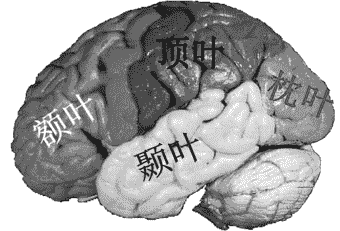
**图 2-1 大脑构造示意图**

### 2.1.2 解剖学深度拆解

#### 2.1.2.1 宏观形态与细胞构成
成人脑重 1.2~1.6 kg（约体重 2%），男性稍重。含 ~140 亿神经元（仅 10%），其余 90% 为**胶质细胞**——非旁观者，而是营养供给、髓鞘构建、信号调节的“后勤部长”。传言“大脑只开发 10%”，实为误读胶质细胞功能。

大体分区：大脑（端脑+间脑）、小脑、脑干。三层脑膜（软/蛛网/硬）包裹，蛛网膜下腔装脑脊液（缓冲、营养、代谢）。

#### 2.1.2.2 大脑：高级功能的物理载体
**端脑（大脑半球）**：脑沟脑回有序排布，非随机生长。关键分界——外侧沟、中央沟、顶枕沟，将皮层切分为**额叶（决策执行）、顶叶（感觉整合）、枕叶（视觉）、颞叶（听觉/记忆）、岛叶（内感受/情绪）**。侧脑室贯通第三、四脑室，脉络丛分泌脑脊液循环。

**断面双色**：表层灰质（神经元密集、六层皮层、思考中枢），深层白质（髓鞘纤维束、高速公路）。

**间脑**：
*   丘脑：感觉中继站、运动调控枢纽；
*   下丘脑：恒常性守门员（自律神经、内分泌、情绪驱动）。

#### 2.1.2.3 海马：记忆的“刻录机”与“遗忘曲线”
位于颞叶内侧，形似海马。核心结构：海马回、齿状回、海马沟。
**临床铁证**：H.M. 患者海马受损 → **顺行性遗忘**（旧忆完好，新知无法存储，且不知自己遗忘）。海马不存长时记忆，但负责**短时记忆向长时记忆的巩固转写**——没有它，当下即永恒，明日成空白。

#### 2.1.2.4 小脑：“生命之树”，动作的精密调度官
脑干背侧，三对小脑脚连接。中线蚓部、两侧半球、尾端扁桃体。切面呈树枝状白质（生命之树 Arbor Vitae），灰质皮层极薄。
功能：不发起动作，但**修正动作**——平衡、协调、节奏、运动学习（骑车、打字成肌肉记忆全靠它）。

#### 2.1.2.5 脑干：生命维持的“自动驾驶核心”
中脑、脑桥、延髓自上而下，连大脑、接小脑、续脊髓。
*   **中脑**：上/下丘（视听反射）、多巴胺/血清素核团（奖赏/情绪源头）、眼动神经核；
*   **脑桥**：连接小脑，三叉/面/听神经发出；
*   **延髓**：呼吸、心跳、呕吐、吞咽中枢——**生命红线守护者**。
第四脑室夹于小脑与脑干间。

#### 2.1.2.6 高耗能供给系统
仅 2% 体重，却独占：
*   20% 心排血量（颈内动脉+椎动脉双保险）；
*   20% 氧消耗；
*   25% 葡萄糖消耗。
高能耗支撑高频电信号风暴，任何断供秒级致损。

---

## 2.2 感知世界的生理接口：从触觉开始

### 2.2.1 触觉系统：皮肤上的“分布式传感网络”

#### 2.2.1.1 定义与分布规律
触觉 = 皮肤机械感受器将物理变形转化为神经电信号。
**触点分布极不均匀**：
*   **高密度区**：指尖、嘴唇、舌尖、面部（毫米级分辨）；
*   **低密度区**：背部、小腿、大腿外侧（厘米级才觉察）。
**功能意义**：精细操作（穿针引线、盲打键盘）依赖指尖高密度触点；背部被蚊子叮咬往往“事后才知”，因触点稀疏、感受野大。轻拂体毛仅触发特定毛囊感受器，方能产生瘙痒感——触觉感知始于**受体类型与分布的精密匹配**。

### 2.2.1 触觉：零距离的生命本能与当代回归

#### 2.2.1.1 直觉之“触”：无中介的在场

触觉之所以被称为最“直觉”的感官，在于它打破了主客体间的时空隔阂。所谓“触”，即接触者与被接触者实现了绝对的“零距离”贴合。梅洛-庞蒂在《知觉现象学》中指出，触摸动作非关意识伴随，而是直接的反应；在《可见的与不可见的》里，他更将这种关系喻为橘子两瓣的紧密嵌合。这与视觉、听觉、嗅觉等“远距感官”形成鲜明对比：后者的运作前提，正是主体与客体保持一定的时空分离。

这种特质赋予了触觉天然的“非中介性”。首先，它无需物质媒介——视觉借光，听觉赖空气，触觉却伸手即得，无须借力。其次，它绕过意识与思维的中介。康德认为视觉需借“主观先验形式”成形，胡塞尔揭示视觉离不开“视域”，这让黑格尔将视觉归入“认知性感觉”。反观触觉，它直抵“语言无法达到之地”。梅洛-座蒂举“精神性盲”患者能精准触摸蚊子叮咬处为例，常人更是“不假思索”完成触达——“手是人的外部大脑”（康德语），探索粗糙与光滑时，“不是意识在触摸，而是手在触摸”。这印证了亚里士多德早已洞见的真理：他感皆藉中介，唯触觉因直接接触而得名。

这种双重“无中介”，让触觉沉降为生命感受性的基石。亚里士多德断言：“无触觉，他感不存”；味觉实为触觉之变体，服务于营养摄取；触觉通过“避害趋利”、感知冷热硬软，直接关系生死存亡。在古希腊大师眼中，触觉不只是感知外物，更是生命直觉自身存在的终极活动。

#### 2.2.1.2 触觉的结构：动作中生成的“感觉之感觉”

生理层面，皮肤深层的触觉小体、脊髓中的敏感神经细胞，将压迫转化为电流信号，经神经纤维抵达大脑定位。无毛皮肤主要依赖迈斯纳小体、梅克尔触盘、帕西尼小体；有毛区域则以毛发感受器为主。

但触觉的本质超越生理结构。词义上“Touch”兼具“感知”与“触动、接触”的动作义，这在现象学中得到佐证：胡塞尔言“触感直接在触碰者手表面定位”；梅洛-庞蒂强调“无探索运动，触觉性质即消失，运动与时间是触觉材料的现象成分”；南希更直指核心——“触觉发生的前提是触摸的动作”。

“盲打”现象生动诠释了这一点：键盘化身为身体延伸，指尖无须寻找、不假思索直达键位。生活处处皆例：握量知轻重，脱衣觉冷暖，用刀辨利钝，跌撞感疼痛，品尝即“口腔内的触觉”，游泳更是全身触觉（浮沉、阻力、推力）的习得过程。

**身体参与度越高，触觉越锐。** 作为“最勤快器官”的手，自然成了触觉王者。亚里士多德称其为“器官之器官”，海德格尔视世界为“上手之物”，人通过“上手”打交道。现代哲学身体转向下，胡塞尔确立“手的实践优许即触觉优许”，梅洛-庞蒂引卡茨语“手是触觉的唯一工具”，并阐述手的动作、姿势如何整合触感觉、视知觉与身体图式。这既是对康德“外部大脑”说的复诵，也为后世“上帝之手”式的抚摸美学铺路。

#### 2.2.1.3 触觉的功能与当代文化：从生存护盾到文明转向

触觉是生存的硬核防线：抵御机械损伤、辐射毒害、危险物质；协助诊疗；稳定心理、维系健康；传递安慰与爱意，辨识情绪。

触觉的复权，既是哲学必然，也是历史必然。当下是“视觉中心主义”登峰造极的时代：视觉的“观看”在主客间筑起长城，导致生活世界疏离——自由意志脱缰毁地球，生活世界沦为鲍德里亚笔下可自我复制的“仿像”超真实，“大写的人”随之失踪。

物极必反。视觉霸权触顶之日，即触觉回归之时。有趣的是，这场颠覆始于最视觉化的绘画艺术。印象派重冷暖色彩（触觉属性），塞尚以色彩空间化造“雕塑式印象”，培根更开创“视-触觉”感受——德勒兹称其为“眼的手”。培根用巨笔、厚薄交替、浅空间（如浅浮雕）、扭曲变形（压迫、拉长、膨胀之力），让力量经视-触觉直击神经系统，释放“在场感”，推动“情感打开”与“生命共振”。

这场艺术盛宴震撼了李秀勤及观者：雕塑以本真实现“平等观”，证立生命尊严。平等不在躯体完备，而在共享独特非凡的触觉，从而同拥精神灵魂，共沐艺术之恩。

科技亦步亦趋。乔布斯的“触摸屏”革命，无论源于玉文化、禅意极简抑或“手是最好工具”的崇拜，核心皆是推崇“大道至简、至直”的触觉把握世界，强调“脑的延伸”与“手的延伸”合一，推动智能技术从“栏身化”向“涉身化”根本性跃迁。

如今“增强现实”（AR）领跑前沿：它继承并超越 VR，不以虚代实，而是增强在场感、沉浸感、行动感（即触觉感），实现“虚中有实”。触觉交互界面让用户不仅看见，更能触摸操控虚拟物体。应用版图全面铺开：娱乐游戏、军事指挥（SIMNET 系统）、医疗手术（方案制定、导航、模拟训练）、工业设计与装配维修（流程可视化指引）——触觉，正重塑我们与世界的连接方式。

---

### 2.2.2 视觉：高带宽的信息入口与精密光学机制

#### 2.2.2.1 视觉定义：光电转化的认知主渠道

视觉是生理学概念：光刺激视觉器官，感受细胞兴奋，经神经系统加工成像。它让人感知物体大小、明暗、色彩、动静，获取 80% 以上生存关键信息，堪称最重要感觉。机制上，眼作为外周感受器，接收 370-740nm 可见光（约 150 色阶），经折光系统成像于视网膜，转化为神经冲动传入视觉中枢，解析出色泽、亮度、轮廓、形状、远近、表面细节。

#### 2.2.2.2 视觉器官结构与功能：成像与编码的双重奏

视觉系统含视网膜、神经通路、中枢及附属系统。附属系统关键两项：眼外肌驱动眼球转动；折光系统（角膜、晶体等）保证清晰成像（见示意图）。

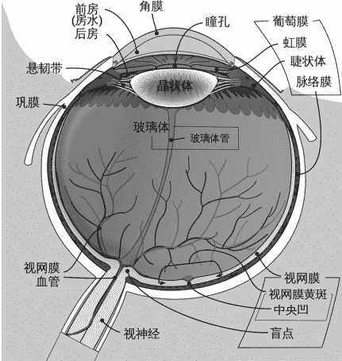

图 2-2 视觉器官结构示意图

眼球核心功能结构聚焦于折光系统与视网膜。角膜、房水、晶状体、玻璃体至视网膜前表面，皆为透明无血管组织，构成折光通道，将外界光折射成像于视网膜。视网膜结构复杂，含高度敏感的视杆、视锥细胞，完成光-电换能、初步编码，再以动作电位经视神经上传大脑。因此，研究眼的功能，核心在于：一、折光系统如何对不同距离物体成清晰像及其极限；二、视网膜如何对物理像完成换能编码。

#### 2.2.2.3 感光系统：从物理像到主观印象的跨越

外界光经折光系统在视网膜形成物理像（几何光学可解释，同相机成像无异），这是感光细胞受刺激的前提。但视觉系统最终在主观形成的“像”，属意识心理范畴，由视网膜神经信息在大脑皮层中枢整合而成。生理感受器研究的重点，正是视网膜如何将物理像转换为视神经信号，以及信号序列组合如何承载外界物体信息。虽研究进展迅猛，仍处初级阶段。

---

### 2.2.3 听觉：精妙的频率分析器与声学奇迹

#### 2.2.3.1 听觉定义：掩蔽效应赋能的数字音频革命

百年科技飞跃，听觉系统（植物神经与交感神经支配）成研究热点。语音/音频处理最终服务于人耳，听觉声学现象与原理被深度挖掘并广泛应用，其中“掩蔽效应”最为关键。精确测量人耳掩蔽特性，让数字量化噪声藏于语音/音乐信号之后，实现码率压缩 40 倍以上而无感知失真——人耳之精妙，可为人类所用造福。

听觉生理心理现象广泛：掩蔽效应、声强-响度关系、双耳效应、听觉心理等。语音/音频处理为专门学科；人耳复杂精妙，涉及大脑深层分析理解机理，因需人体实验，研究成果稀缺。本节聚焦声学物理概念现象及重要成果示例，不涉复杂数学理论。

#### 2.2.3.2 听觉结构：从声波收集到频率分解的精密流水线

声信号经外耳→中耳→内耳基底膜完成频率分析（见图 2-3 纵剖面图）。

##### 2.2.3.2.1 外耳：收集与共振的天然前置放大器

外耳含耳廓与外耳道。耳廓呈喇叭状收集声波，随进化功能退化，人类较弱。外耳道封闭于鼓膜，形成一端开口共振器（长约 1 英寸），使 3000-4000Hz 信号共振放大 2-4 倍。语音能量在此频段本低，获提升后清晰度显著改善。

##### 2.2.3.2.2 中耳：阻抗匹配的杠杆变压器

###### 2.2.3.2.3 内耳：精密的频谱解码器

内耳藏于颅骨深处，构造精微复杂，核心部件是一枚盘绕如蜗牛壳的腔体——耳蜗。其生理机制极为精妙，主责对接收的声信号实施频谱分解，在神经纤维上激发电脉冲，经大脑处理最终成听觉。若将内耳简化模型化，可视为一卷起的膜片，即基底膜。全长约 1.5 厘米，近前庭窗端最宽（约 0.5 毫米）、薄而紧绷；远端最窄（约 0.04 毫米）、肥厚松弛。膜面布满神经纤维——毛细胞：内毛细胞单排约 3500 条，外毛细胞三排共 2 万余条。不同频率的声经卵圆窗以行波形式抵达基底膜，高频（~20 kHz）驱动顶端薄处振动，低频（200 Hz）激发远端厚处共振，振动触发毛细胞产生电脉冲上传大脑。实验证实，唯有振幅达特定阈值，才能诱发电脉冲。

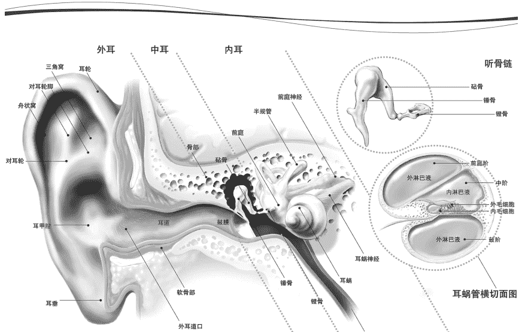

图 2-3 听觉系统解剖示意

##### 2.2.3.3 听觉功能与物理信号的映射关系

听觉器官是感受声波的精密装置，赋能生物获取远距离信息，支撑社交、求偶、避敌、捕猎，关乎生存根本。声波作用于听觉器官，激发感受细胞兴奋，经听神经将冲动传入中枢，经多级分析后形成听觉。高等脊椎动物的听觉分析极其细腻，能精准映射声参数的各类变化。

- **1. 外耳廓与外耳道：集声漏斗与共振腔**

外耳由耳廓、外耳道构成。人耳廓运动功能退化，但前侧声可直入耳道，廓形利于声能聚焦，驱动鼓膜强振动；后方声被廓遮挡，音感减弱。稍转头位，依两耳音强细微差即可定位声源。外耳道一端开口，一端止于鼓膜，是声波传导通道。物理原理指出，充气管道对波长为管长 4 倍的声波共振最强；外耳道长约 2.5 厘米，推算其最佳共振频率约 3500 Hz，经耳道传至鼓膜时，声强可增 10 倍。

- **2. 鼓膜与听骨链：阻抗匹配的增压杠杆**

中耳含鼓膜、鼓室、听骨链、中耳小肌、咽鼓管等核心结构，借鼓膜、听骨链与卵圆窗膜的几何关系，构建声波从外耳达耳蜗的高效通路。声波至鼓膜时介质为气体；经听骨链至卵圆窗膜时介质变为固相组织。介质声阻抗差异巨大，理论上跨介质传递能量损耗可超 99%。但中耳传递系统凭特殊力学特性产生增压效应，补偿了阻抗失配造成的损耗。

鼓膜呈椭圆漏斗状（顶点向中耳），面积 50~90 平方毫米，厚约 0.1 毫米。内侧连锤骨柄，嵌于纤维层与黏膜层间，自前上向下止于鼓膜中心。其似话筒振膜，为承压器件，频响佳、失真小，漏斗尖顶结构利于将振动聚焦传递给锤骨柄。观察显示，2400 Hz 以下声波作用下，鼓膜能精准复现外加振动频率，同步启停，残余振动极少。

听骨链由锤、砧、镫三骨串联：锤柄着鼓膜，镫骨脚板接卵圆窗，砧骨居中连接，形成两壁夹角固定的杠杆。锤柄为长臂，砧骨长突为短臂。支点恰位于听骨链重心，使能量传递惯性最小、效率最高。鼓膜振动带动锤柄内移，砧骨长突与镫骨同向随动。中耳增压源于两因素：一、面积差。鼓膜有效振动面积约 55 平方毫米，卵圆窗膜仅 3.2 平方毫米，若总压力不变，卵圆窗压强增 17 倍（55÷3.2）；二、杠杆比。长短臂比约 1.3:1，短臂侧压力再增 1.3 倍。综合增压倍数达 22 倍（17×1.3）。

此外，中耳两块小肌参与声保护：鼓膜张肌收缩牵拉锤柄、张紧鼓膜；镫骨肌收缩推动镫骨脚板外后向移。强声气流、角膜或鼻黏膜机械刺激均可反射触发双肌收缩，致鼓膜紧绷、听骨链关节锁紧、振幅减小、阻抗增大，综合降低传音效能，保护耳蜗感音装置。但该反射有十余毫秒潜伏期，对突发短促爆炸声保护有限。

###### 2.2.3.3.3 咽鼓管：中耳压力平衡阀

咽鼓管（耳咽管）连通鼓室与鼻咽，使鼓室气体与大气相通，可平衡两侧压差，维持鼓膜正常位形与振动特性。管阻塞时，鼓室气体被吸收致压力下降，鼓膜内陷。暂时性压差常因外耳道压力骤变（如飞机升降、潜水）而鼓室压力滞后，若咽鼓管不能及时平衡，鼓膜两侧将现巨大压差。观察显示，压差达 9.33~10.76 kPa（70~81 mmHg）引发剧痛，超 24 kPa（180 mmHg）可致鼓膜穿孔。正常状态下咽鼓管咽侧口常闭，吞咽、打呵欠、喷嚏时腭帆张肌等收缩使管口暂时开放，利于气压平衸。

常态下，声经外耳道振鼓膜，经听骨链、卵圆窗入耳蜗，称**气导**；声亦可直振颅骨，致颞骨岩部耳蜗内淋巴振动，称**骨导**。骨导灵敏度远低于气导，常被掩蔽。验证法：音叉柄触颅骨可闻声，声衰至不闻后迅速移音叉至耳廓前，声复现。此实验证骨导存在，亦证气导更敏。骨导对正常听觉贡献微乎其微，但临床对比气、骨导受损情况可定位听觉病因部位。

人耳对频率、声强的感知灵敏度惊人：可听频段 20~20,000 Hz。20 Hz 以下为次声（研地震、大气传播用），以上为超声，人耳均不闻。可听段内，语音频宽 300~3400 Hz 足矣，但保留 4000~5000 Hz 的四、五共振峰有助提清晰度与自然度；音乐重现需全频段，HiFi 标准达 20 kHz，发烧友甚至能感知超声成分。

音高与频率似响度与声强，通常高频音高高、低频音高低，但音高是主观心理量，与频率关系复杂。纯音音高受强度影响，低频显著（如 150 Hz 音叉近耳音高降）；复合音强度对音高影响微弱。

#### 2.2.4 化学感官：味觉与嗅觉

##### 2.2.4.1 定义与本质

**味觉**指食物在口腔内刺激味觉化学感受系统产生的感觉。基本味型为甜、酸、苦、咸四种，日常复杂滋味均为四味混合。舌面不同区域敏感度异：舌尖甜、舌前侧咸、舌后侧酸、舌根苦。

**嗅觉**由嗅神经系统与鼻三叉神经系统共同参与。嗅味整合互作，嗅觉是外激素通讯的前提。嗅觉属**远感**（远距离化学感受），味觉属**近感**。

##### 2.2.4.2 生理机制解析

- **1. 味觉转导通路**

呈味物质刺激口腔味觉感受体，经神经感觉系统汇聚传导至大脑味觉中枢，经高级中枢综合分析成味觉。不同味型对应不同感受体，结合力各异。

味蕾为主感受器（自由神经末梢为辅）。婴儿约 1 万个，成人仅几千，随龄减少，敏感度降。味蕾多布于舌面乳状突起（尤以皱褶处最密），每蕾含 40~150 味觉细胞，约 10~14 天更新。细胞表面布满感受分子，不同物质结合不同分子呈异味。味觉从刺激到感知仅 1.5~4.0 ms，快于视觉（13~45 ms）、听觉（1.27~21.5 ms）、触觉（2.4~8.9 ms）。

传导通路：舌前 2/3 经面神经鼓索；舌后 1/3 经舌咽神经；舌后中部、软腭、咽、会厌经迷走神经。味觉纤维入脑干终止于孤束核，易神经元，经丘脑达岛盖味觉区。

- **2. 嗅觉转导通路**

嗅感受器位于鼻腔顶部嗅黏膜，非呼吸主流道，被鼻甲隆起掩护。带味气流需回旋式接触嗅上皮，慢性鼻炎致鼻甲肥厚阻碍气流接触，常致嗅觉障碍。

嗅上皮含嗅细胞（外周感受器），表面纤毛捕获气味分子。每嗅细胞内端延伸为神经纤维，投射至额叶嗅皮层。嗅觉刺激物必须为挥发性气体分子。人类嗅觉极敏，以嗅觉阈（引发嗅觉的最低浓度）衡量：人造麝香 1 升空气中 5×10⁻¹⁰ mg 可嗅；硫醇 4×10⁻¹⁰ mg 即可觉察。

##### 2.2.4.3 味觉的生理功能：生存信号灯

味觉系统为神经丰富的交叉网。中枢整合四基本味，配合嗅觉可生成涩、辣等复合感。咀嚼搅拌下，味蕾受刺激，经味神经达中枢产生味觉，使我们品尝百味。

四基本味对应生存信号：**甜**—补能量；**酸**—代谢加速或食物腐败；**咸**—维持体液平衡；**苦**—拒有毒有害；**鲜**—标识蛋白质来源。

##### 2.2.4.4 嗅觉的生理功能：隐形的操纵者

嗅觉由嗅神经与三叉神经共管，与味觉整合，是外激素通讯基础，属远距离化学感受。

近年研究揭示：人类嗅觉远超认知，在无意识中深度影响生活。微量气味能潜移默化改变情绪、行为、决策；体味外泄恐惧、悲伤等情绪。为何我们长期忽视嗅觉？因视听似更关键，嗅觉长非研究主流，近年始获重视。石溪大学帕罗迪指出：19 世纪解剖学家布罗卡按嗅脑占比将哺乳类分“嗅觉发达型”（如犬）与“非发达型”（人、灵长类、海兽），形成“人嗅觉退化”误区。遗传学似佐证：多数哺乳类基因编码 1000+ 嗅受体，人仅 400+ 种。

但新证据推翻旧说：脑扫描显示人嗅觉皮层远超布罗卡解剖发现。耶鲁格里尔称：虽受体数量少，但人鼻-脑连接异常活跃，单受体组连接神经更多，气味处理能力更强。

实验证实：某化学试剂稀释 10 亿倍仍可被侦测（等效几滴乙硫醇入标准泳池仍可闻）；人能辨别镜像手性分子。嗅觉中枢与边缘系统（掌情感、恐惧、记忆）紧密相连，故气味能影响思维。房产商早谙此道：烤面包、煮咖啡营造“家的气味”促成交。研究亦证气味影响认知：北卡奥弗曼团队实验，决策测试中引入新气味（不分好坏），成绩大幅下降，推测气味激活情感区使人更感性少理性。气味还可能调节视觉、巩固记忆。

#### 2.2.5 第六感知：超越五感的身体雷达

感官是感受外界刺激的器官（眼、耳、鼻、舌、身），大脑为总中枢。除熟知五感外，尚有约 20 种感觉系统默默运作，如平衡、饥饿等。

- **1. 平衡感**——立身之本。内耳淋巴液控制，配合视觉，保安全行走。疾旋令系统失效，致眩晕失衡。
- **2. 本体感受**——身体坐标系。闭目抬手，无需视觉知手位。缺之则行走需盯脚看。酒驾测试即考核此感。
- **3. 热觉感受**——非接触测温。篝火旁感热，冰块在手觉冷。皮肤热感受器捕捉温变。昔归触觉，实则无需接触（隔空感热），故独立成感。脑内体温调节中枢监控核心温度。
- **4. 疼痛感**——伤害预警。霍普金斯福克斯称：伤害感受与热觉常混淆，因共用皮肤神经元。伤害感受器布遍皮肤、骨骼、关节、内脏。
- **5. 内部感受**——自律神经的内部雷达。福克斯称：体内分布感受器触发潜意识与条件反射，关乎健康。咳嗽、呼吸频率、饥渴提醒等无意识行为皆由此管控。
- **6. 空间感**——闭目知墙。无视觉条件下感知环境几何轮廓。
- **7. 情感**——压力、喜怒哀惧惊等复合心理体验。
- **8. 身体状况**——过度运动、休息不足、营养缺乏引发的疲倦与不适感。
- **9. 时间感**——密闭无声环境中产生的恐慌与时间扭曲感。
- **10. 辣味感**——非味觉，而是细胞受刺激激活痛觉/温觉通路的抗议信号。

科学进步不断解开人体奥秘，让我们对感官与自身有了全新认知。

### 2.3 解码高级智慧

#### 2.3.1 语言的定义与形成

定义层面，语言是生物同类因沟通需求而约定的、具统一编解码标准的声（像）指令系统。本质上，语言以声/符号为物质载体，以义为内核，由词汇与语法构建，能表达人类思想。语音、手势、表情是语言在躯体上的显现，文字符号是语言的显性编码。

### 语言的本质与演变之谜

广义上讲，语言是一套遵循共同规则、用于表达与沟通的指令系统，它通过视觉、听觉或触觉等渠道传递。狭义而言，语言特指人类沟通所用的符号系统。语言能力并非天生，而是后天习得，其核心功能在于交流观念、传递思想。语言学正是研究这一系统分类与规则的学科，从业者称为语言学家。随着认知边界拓展，人类发现部分动物具备特定沟通能力，由此衍生出“动物语言”概念；计算机诞生后，人类为控制机器而设计的“单向指令集”，则被称为计算机语言。

语言的表现形式主要分两大类：肢体行为与符号系统。前者是主导方式，涵盖口语发声、手势姿态及面部表情，其中口语是人类交际的首选模式；后者以文字为核心载体，构成了现代人类语言应用的最大版图。

#### 语言起源：连续与非连续的博弈

关于语言如何起源，学界主要分为两派假说：**连续性假说**主张语言非一日之功，而是灵长类祖先前语言系统逐步演化的产物；**非连续性假说**则认为语言独有特征在人类演化某节点突然涌现，与基因突变紧密相关。

早期研究多聚焦连续演化，假说林立。近期观点认为：或源于祖先姿势动作衍生符号系统，随之诞生有声语言；或源于对自然声的模仿与感叹；亦或如恩格斯所言，劳动协作催生了交流需求，从比划发展出语音。受限于直接证据匮乏，实证研究长期停滞。直至近十年，化石解剖分析、计算机模拟演化及社会文化认知视角的引入，才为破题提供新路径。

**非连续性阵营的旗手——乔姆斯基**，是当代语言学最具影响力的人物，亦是知名左翼政论家。虽学界存争鸣，其奠基地位无可撼动。他坚持：语言是人类独有的认知器官，动物绝无仅有。上世纪六七十年代，多个研究中心尝试教猿猴发音或识别概念词汇，均以失败告终，侧面印证了这一论断。

自90年代起，语言学、考古学、心理学、生物学、人类学等多学科联手攻坚这一“世界级难题”。遗憾的是，语言历史悠久、结构复杂、硬证据稀缺，二十余年探索仍乏令人信服的定论。中国学者周海中曾言，破解语言演化之难度，不亚于物种演化之谜。语言演化兼具社会性、自然性，更是心智与文化共同塑造的结果，内因外果交织，令其复杂度指数级上升。

---

### 2.3.2 思维的形式与逻辑

#### 2.3.2.1 思维的形式

思维形式，即思维实现的结构模式。概念、判断、推理、证明构成基本形式；不同结构的判断、推理、证明形式则构成进阶形态。在具体思维中，形式与内容如影随形，不可分离，但形式相对内容具独立性，使得逻辑学得以单独研究思维结构。

**形象思维、逻辑思维、灵感思维**是三大普遍形态。个体思维从不单一，解题、工作或思考过程，至少融合两种形式（通常指抽象与形象思维的并用）。

**思维的逻辑即思维的规律与规则**。狭义上指思维规律及其研究学科（逻辑学）；广义上泛指一切规律，含思维与客观规律。逻辑体系分**形式逻辑**（归纳、演绎）与**辩证逻辑**（矛盾、对称），其中对称逻辑是涵盖抽象与具象的整体思维逻辑。

#### 2.3.2.2 形象思维与逻辑

形象思维，是主体在认知过程中，对事物表象筛选重组，凭借直观形象解决问题的思维模式。它建立在感受、储存客观形象信息的基础上，融入主观认知与情感（含审美判断、科学判断），借助语言、绘画、音响、工具等媒介，创造并描述艺术或科学形象。

**艺术创作视角下**，形象思维是艺术家伴随形象、情感、联想与想象，透过个别特征把握普遍规律，创生艺术之美的方式。形象思维能力高低，往往决定审美水平。其核心特质为“三伴随”：伴随形象（神与物游）、伴随情感、伴随想象联想。这亦称“艺术思维”，以典型化手法塑造形象，表达思想感情。

形象思维是认知世界的关键形式，也是育人、治学、经商的利器。科研离不开它（如物理模型构建），企业决策更依赖它（高层需一手形象信息以避免滞后失真）。**形象思维与逻辑思维（理论思维）并非水火不容**。旧观念将二者割裂归属科学家与艺术家，实属误读。爱因斯坦便是典范：逻辑大师却反对唯逻辑论，善用思想实验（形象思维巅峰），广义相对论即源于一次自由想象。物理学中的力线、原子模型，皆是双思维融合的结晶。

#### 2.3.2.3 抽象思维与逻辑

抽象思维凭借科学概念，穿透现象洞察本质与长时段演进，让认知超越感官极限。科学抽象非空泛臆造，而是基于实践，经分析、综合、比较，剥离非本质属性，提炼本质形成概念。它具**概括性、间接性、超然性**，以概念推理判断，能预见感官未及的自然规律，对科研具决定性意义。

抽象思维方法随文明演进。宏观分**形而上学方法**与**辩证方法**。二者非对立割裂，辩证法建立在形而上学基础之上。在概念形成、演绎关系、外延量属性处理上二者一致；辩证法的进步在于引入**概念内涵的数量属性关系**考察，以应对发展变化的世界，提高精度、减少偏差，实现对形而上学的补充与超越。

形而上学初期仅用静态概念代表事物、用概念演绎代表联系，忽略事物内在差异与动态变化。差异变化巨大时，才更换新概念；微小差异变化则无能为力、一概忽略。辩证阶段则引入内涵量属性描述微小差异与变化，修正概念本身，从而降低“以概念代表现实”固有的误差与偏离。

#### 2.3.2.4 灵感思维与逻辑

灵感思维，是科研、创造、解难过程中**突然涌现、瞬息即逝**的突破性思维过程。具偶然性、突发性、创造性。灵感即“新思想、新答案”，源于大脑对信息的深度再加工，潜意识被激活瞬间的直觉顿悟，亦称“顿悟”。

“十月怀胎，一朝分娩”生动喻其过程：长期酝酿无果后，因外物触动豁然贯通。诗人的“神来之笔”、将帅的“出奇制胜”、科学家的“茅塞顿开”，皆是灵感注脚。来源在于信息诱导、经验积累、联想升华、事业心催化。

钱学森视灵感为形象思维的特例——顿悟，是渴求已久的智慧之光。凯库勒梦见蛇咬尾悟出苯环结构，印证灵感非唯心玄学，实为思维特殊形态，客观存在。科学史多大难题皆赖此“蓦然回首”式顿悟破局。

---

### 2.3.3 艺术、哲学等意识的理解

#### 2.3.3.1 艺术

艺术既可指宏观范畴，亦可指个体现象。它是主体通过捕捉挖掘、感受分析、整合运用（形体组合、生命演进、故事发展等过程），经由视听嗅触等感官通道呈现的阶段性成果。表现形式涵盖语言、声音、文字、绘画、眼神、呼吸、肢体等。其核心特质有三：

**1. 形象把握与理性把握的统一**

**形象（审美形象）**是艺术的生存方式。广义含情境意境，指能激发思想情感的生动、具体、可感人物事物形象。艺术作品依托物质载体，必须直观具体、感性可知。形象是作品基本要素，须以个别感性形式呈现，真实再现内外特征，有血有肉、有声有色，致人“闻其声、见其人、临其境”。同时，形象是艺术家审美意识结晶，渗透鲜活体验，穿透创作全程。

以郑板桥画竹为喻：观“园中竹”入“眼中竹”，酿“胸中竹”，出“手中竹”，形象自始至终贯穿创作。欣赏过程亦是对形象情感体味、情境意境共情。形象性是艺术区别于其他意识形态的**最根本特征**，是创作主体对客体瞬间顿悟式的审美创造——**感性非推理，体验非分析**。

然艺术形象非客观随意摹写，乃**有意味的形象**，渗透艺术家深刻理性思考。鲁迅云：“画家所画……表面上是一幅画，其实是他的思想和人格的表现。”理性思维在选材、立意、构思、形式抉择上举足轻重。**艺术活动本质上是形象把握与理性把握的有机统一。**

**2. 情感体验与逻辑认知的统一**

艺术情感即**审美情感**——无功利、具普遍性。它贯穿艺术生成、创造、接受全程，是创作基本元素。托尔斯泰定义艺术：艺术家唤起己之体验感情，借形象传达，使他人同受其感。

情感主宰艺术心理全过程：感觉受享受欲望支配，知觉按情感筛选加工，想象随情感创造形象，理解乃个性化体悟生命意义。**无深刻社会人生认知，无丰富强烈审美情感，亦无优秀艺术家与欣赏者。**

毕加索因格尔尼卡惨案义愤填膺，月余完成《格尔尼卡》，形象凝聚思想爱憎、审美理想。审美中情感与认知交融，情感建立在审美认知基础上。**无情感说教非艺术，无思想情感不成艺术，真艺术是情感体验与逻辑认知的统一。**

**3. 审美活动与意识形态的统一**

审美特性是艺术区别于其他社会实践的**根本标志**。作品集中浓缩生活之美，超越现实形象具形而上审美性。梅花图凌寒傲霜，寄寓青春勃发意蕴，美感超越实物。艺术表丑亦可化丑为美——暴露丑恶本质引发厌恶鄙视，激发向善向美愿望，赋予丑以美学价值。反腐题材作品揭露危害、警示世人，达成“化腐朽为神奇”式震撼美感。

艺术既是审美活动，亦属上层建筑**意识形态**。审美性是本质属性，意识形态性隐于其中，拓展审美世界深度广度。**艺术活动乃审美活动与意识形态的统一。**

#### 2.3.3.2 哲学

哲学，溯源“爱智慧”，是对基本普遍问题的探究。它是**严密逻辑系统的宇宙观**，研析宇宙本质、演化总规律、人在宇宙中位置等根本命题。

哲学即**元知识、元原理**——“大道至简”。任务在于元理层面把握现实：合多为一、析一为多，一多皆元理。元理须清晰表达、系统构建，方能阐释世界、指导实践。区分元理与原理（科学基础理论）的实用标准：**元理是随时可调用的元初理论；原理是可查工具书的基础理论。**

##### 2.3.3.2.1 哲学的基本问题

**哲学根本问题：思维与存在的终极较量**

哲学的基石性议题，亦称基本问题或最高问题，核心在于探究思维与存在、意识与物质的关系。恩格斯于1886年在《路德维希·费尔巴哈和德国古典哲学的终结》中首次给出明确界定。这一问题确立了区分唯物论与唯心论两大对立阵营的界限，并为评判其优劣提供了客观标尺。

**一、 本源归属之争：谁是世界的“始祖”？**
针对思维/意识与物质/存在何者为第一性，哲学史上存在两大根本对立的答复，由此划分出唯心主义与唯物主义两条截然不同的路线。主张意识先于物质、精神决定物质者，归属唯心主义阵营；坚持物质先于意识、存在决定意识者，则属唯物主义。此外，还存在一种“二元论”观点，认为物质与意识互为独立本源，互不隶属。

**二、 认识能力之辩：世界能否被认知？**
关于思维能否正确反映存在，绝大多数哲学家（涵盖唯物论者及部分唯心论者）给予肯定。但二者的解决路径迥异：唯物论承认物质世界客观实在，认为思维是大脑对客观世界的反映，世界可知；唯心论则视客观世界为精神产物，认知即精神自省。休谟、康德等哲学家则持不可知论，否定或限制人类认知世界的可能性。

###### 2.3.3.2.2 哲学流派的谱系演进

- **(1) 唯物主义：坚守物质本源**
  该派视物质为世界本原，主张物质第一性、意识第二性，意识是物质长期演化的产物。依据历史形态，可细分为古代朴素唯物主义、近代形而上学唯物主义及辩证唯物主义。该流派重视感性经验、理性推演与客观实证，但受限于自然科学发展水平，在世界起源等终极命题上仍显不足，有待深化。

- **(2) 唯心主义：确立精神统治**
  该派以精神/意识/理念为世界本原，宣称意识第一性、物质第二性，物质是意识的派生物。体系庞杂，大致分为主观唯心主义（个体意识为本源）与客观唯心主义（客观精神/绝对理念为本源）两翼。

- **(3) 可知论：信仰认知的无限性**
  认为世界本质可被完全认知。人类凭借感官及其延伸工具（科学仪器）终将洞悉一切，当下未知仅因技术瓶颈，全知乃历史必然。

- **(4) 不可知论：设定认知的边界**
  主张世界本质不可被认知或无法完全认知。此处“未知”非暂时状态，而是人类永不可逾越的认知屏障。“概念世界”是理解此论的关键枢纽。

- **(5) 二元论：试图调和的双重本源**
  主张世界由精神与物质两个独立实体构成，试图调和唯物与唯心的对立，与一元论针锋相对。

- **(6) 知识论：认知来源的双峰对峙**
  除本体论外，认识论聚焦知识来源，核心对立为经验主义（重感官经验）与理性主义（重理性推演）。

#### 2.3.4 情感与行为：心理活动的外显图景

##### 2.3.4.1 情感：态度体验的核心层

###### 2.3.4.1.1 情感的内涵界定
情感是态度结构的核心组件，与态度中的内向感受、行为意向保持高度协同，是态度在生理层面复杂而稳定的评价体验。涵盖道德感与价值感，具体外化为爱、恨、喜、恶、美感等形态。

> “情感源于个体对客观事物能否满足自身需要的态度化体验。”
> 普通心理学常将情绪、情感并称“态度体验”，区别在于：情绪侧重生存本能需求，情感侧重社会性需求。但此说难以安放幸福、审美等个性化体验，亦忽略了情绪（喜怒哀惧）与社会性情感（爱情、爱国）在行为流程中的交织共生——追求爱情时伴随的情绪波动，及情感稳定性与情绪瞬时性的差异，均证明二者不可混同，亦不可单纯以需求属性切割。

###### 2.3.4.1.2 情感需求的三重阶梯
从需求层次看，情感需求分三阶段，随环境与修养动态流转，不因身份贫富而固化：

1.  **生存期（温饱需求）**：渴望交流与被接纳，无助感或新环境适应期最强烈。
2.  **社会期（归属需求）**：个体融入社交圈，情感释放获外界正向反馈则心愉，反之心郁。
3.  **自我期（实现需求）**：具备情感掌控力，凭借深度认知助他人平衡情感危机（如心理咨询师）。

###### 2.3.4.1.3 情感表达的四大维度
依价值指向差异，情感表达模式分为：

- **对物情感**：基于事物“价值率”变动（增减、正负）及时态生成。
- **对人情感**：除价值变动外，更关联他人利益相关性。
- **对己情感**：取决于自我价值变动方式与时态。
- **特定事物情感**：因特殊价值意义触发的独特情感体验。

##### 2.3.4.2 行为：心理机制的外在投射

###### 2.3.4.2.1 心理学视角：定义与分类

**1. 多维定义演进**
行为是有机体在内外刺激下的活动总和。
- *生理心理学*：聚焦激素神经机制。
- *认知心理学*：视作信息加工过程。
- *社会心理学*：考察人际互动与群体动力。
历史上，行为主义早期（20世纪上半叶）仅认可可观测的“刺激-反应”，将内隐心理视为语言行为；60年代后认知革命兴起，区分内隐心理与外显行为，用信息加工模型解释行为规律。认知心理学擅长解释后天习得的智能行为（决策、学习、直觉），生理心理学则解析先天本能行为。

**2. 行为的社会功能分类**
- *成因*：个体行为 vs 群体行为。
- *功能*：摄食、躲避、性、探究行为。
- *动机目标明确度*：三大核心类型——

  **① 意志行为：目标清晰、动机明确**
  分为**士气性行为**（个体动机与长远整体目标高度统一，含个体/群体、战术/战略、短/长期目标的一致性）与**非士气性行为**（缺乏主动积极动机）。

  **② 潜意识行为：有目标、无自觉动机**
  “明明想做，却不知为何做”。源于被压抑或未被知觉的本能冲动。因违背道德理智，只能伪装表现：口误笔误、梦境（非行为本身）、神经症状（压抑、投射、升华、合理化、反向形成等变异行为）。

  **③ 娱乐消遣行为：有动机、无固定目标**
  “想做，但不在乎做什么、做到何种程度”。看电影、跳舞、漫游自然均可满足“休闲”动机，目标选择具随意性。细分为**审美欣赏行为**与**刺激寻求行为**。核心三要素——情趣（知识兴趣）、情调（体验氛围）、爱好（偏好对象）——三位一体。
  > **本质洞见**：“玩”是研习世界变化的过程。非职业性体育、绘画、观演、探险皆属于此。进化论视角：玩乐是动物锻炼潜能、试验能力边界、传递生存经验的关键机制。猫科分化为猫、虎、豹，不仅是自然选择，更是玩乐中能力自觉与经验遗传的共同结果。

###### 2.3.4.2.2 社会学视角：定义与五要素

**1. 社会学定义**
行为是人/兽在特定条件下，受社会文化制度、价值观念制约，对环境刺激做出的生活态度与方式的综合表现。
- *外显行为*：可观测的言谈举止。
- *内在行为*：不可直接观测的思维、意识、心理活动。
外显行为是窥探内在心理的窗口。

**2. 行为的五大构成要素**
人的行为系统由五大要素耦合而成：
- **行为主体**：具认知、思维、情感、意志的实体人。
- **行为客体**：行为指向的目标对象。
- **行为环境**：主客体互动的客观场域。
- **行为手段**：作用于客体的工具与方法。
- **行为结果**：预期行为与实际行为的契合度。
行为发生的根基是内外环境刺激，核心驱动源是客观需求相关因素。

---

## 参考文献索引
[1] 顾晓松. 人体解剖学. 科学出版社, 2011.
[2] 李国彰. 神经生理学. 人民卫生出版社, 2007.
[3] 罗伯特·索尔索. 艺术心理与有意识大脑的进化. 周丰译. 河南大学出版社, 2018.
[4] 史忠植. 认知科学. 中国科学技术大学出版社, 2008.
[5] 沈政等. 认知神经科学导论. 北京大学出版社, 2010.
[6] 黄秉宪. 脑的高级功能与神经网络. 科学出版社, 2000.
[7] 胡瑞晨等. 时间结构信息在人类知觉中的作用及其脑机制. 生理学报, 2019.
[8] 王焕贞. 特质愤怒影响攻击行为的脑结构及功能基础. 西南大学博士论文, 2017.
[9] 任娜. 情感控制理论的原理、发展和应用. 社会科学论坛, 2019.
[10] 王极. 道德行为与逻辑思维. 道德与文明, 1989.
[11] 庄严. 手·持存·现在——论读解《知觉现象学》的一种可能视角. 理论月刊, 2018.
[12] 莫里斯·梅洛-庞蒂/王士盛. 《知觉现象学》前言. 中国现象学与哲学评论, 2018.

---

## 3 人工智能的基石：算法理论深度解析

算法是计算机科学的基石。误区颇深：有人等同编程语言，有人迷信追新技术。语言和平台迭代极快，唯有算法与理论（数据结构、编译原理、体系结构、数据库原理等）历久弥坚。算法是AI的核心灵魂——欲赋予机器打桥牌等智力能力，必先编制相应算法。算法将人类智慧“植入”机器，算法智慧的上限决定机器智能的天花板。AI研究的核心使命，即发掘尽可能多的智能算法，拓展机器心智边界。故掌握算法设计与应用，是智能科学从业者的入门必修课。

### 3.1 AI算法体系的构成拼图

算法是达成任务的程序化步骤，解决逻辑/数学问题。每个程序、每个函数皆算法。实施路径：发现可行算法 → 评估时空资源消耗 → 优化求解最优方案。优化思维无处不在：城市交通信号如何降低延误？智能物流如何平衡多元需求与资源效益？从饮食穿戴到金融航天，优化应用全渗透。

**智能优化算法**应运而生，融合数学与生物学智慧，新颖独特。虽难保绝对最优，却擅在可接受解集中捕获全局最优，对非确定性信息、不确定数据有极强鲁棒性。主流流派包括：
- **进化算法 (EA)**：仿生物进化法则。
- **粒子群算法 (PSO)**：模拟鸟群觅食信息共享。
- **遗传算法 (GA)**：基于遗传变异与自然选择。
- **人工鱼群算法 (AFSA)**：模拟鱼群觅食、聚群、追尾。
- **人工免疫算法 (AIA)**：仿免疫细胞分化、记忆、自调节。

学习与认知算法，是AI的地基。本章涵盖算法性质、描述方法、结构范式、实战案例。

#### 3.1.1 算法的核心性质画像

**通俗理解**：算法即“做事步骤”。如开车：开门→就座→插钥→启动。
**精确执行视角**：计算 `1+2+3+4+5` 是机器精确执行的典范。步骤：①1+2=3；②3+3=6；③6+4=10；④10+5=15。结果精准无误。

由此抽象，算法必具五大核心特征：
1.  **有穷性**：有限步骤后必终止，不陷死循环。
2.  **确切性**：每步定义无歧义，机器可盲执。
3.  **输入项**：0个或多个输入（0输入指算法内置初始条件）。
4.  **输出项**：1个或多个输出，反映加工结果；无输出则无意义。
5.  **可行性**：每步可分解为基本可执行操作，有限时间内完成（有效性）。

**两大核心要素**：
- **数据运算操作集**：机器指令系统。四基础类：算术(加减乘除)、逻辑(或且非)、关系(大小等)、传输(输入输出赋值)。
- **控制结构**：操作执行顺序决定算法功能骨架。

**算法质量评价体系**：
优劣直接决定程序效率。分析旨在选优改良，核心指标为**时间复杂度**与**空间复杂度**。

- **时间复杂度**：执行计算量。记为问题规模 `n` 的函数 `f(n)`，记作：
```
T(n) = O[f(n)]
```
规模 `n` 越大，耗时增长率与 `f(n)` 增长率正相关，称**渐进时间复杂度**。

- **空间复杂度**：内存消耗。计算表征法同时间复杂度，用渐近性表示，分析相对简单。

- **正确性**：评价算法优劣的**第一标准**，前提保障。

### 3.1.2 算法的多元表达体系

#### 3.1.2.1 解题思路的“表达工具箱”

如何将脑中的解题逻辑精准传达给机器？主流手段涵盖**日常语言、结构化流程图、伪代码及PAD图（问题分析图）**，其中以流程图最为直观普及。不同工具的表达效能各有侧重：平时交流靠母语，梳理关系常用图示。

*   **流程示意图**：借助一套标准化图形符号（见下方预留位）将执行步骤可视化。
    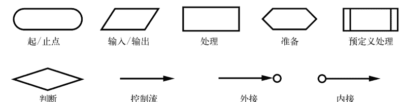
    *图示：基础流程图符号集*

*   **半形式化语言**：融合了顺序、选择、循环三大基础结构与人类语言的混合体。
*   **高级语言风格**：风格贴近主流编程语言，如 Pascal风格、C风格等。

主流表达方式——日常语言、流程图、伪代码——优劣速览：

| 方式 | 亮点 | 短板 |
| :--- | :--- | :--- |
| **日常语言** | 零门槛，人人可懂，无需专业训练。 | 1. 歧义多，易致执行不确定；<br>2. 句式冗长，叙述繁琐；<br>3. 面对复杂嵌套逻辑（多层循环/分支）表达乏力；<br>4. 难以直接转译为程序代码。 |
| **流程图** | 逻辑清晰直观，擅长呈现选择结构；跨平台、跨语言，通用性强。 | 手绘修改繁琐，依赖专用绘图软件才能高效维护。 |
| **伪代码** | 规避了编程语言的严格语法，书写轻快；结构紧凑、易读，且能平滑过渡到实体代码。 | 方言众多，缺乏统一标准，易产生歧义误读。 |

> **业界惯例**：主流《数据结构》教材多采用 Pascal风格、C++风格 或 C风格 作为标准算法表达语言。

#### 3.1.2.2 算法语言的核心“指令集”

算法描述语言内置了一套基础功能模块：

**1. 交互指令：输入与输出**
*   **输入**：`cin>>x;` —— 从键盘读取数据赋值给变量 x（支持整型、浮点、字符等多类型）。批量输入格式见下：
    ```
    cin>>x1>>x2>>x3>>x4>>x5;
    ```
*   **输出**：`cout<<exp;` —— 将算式 exp 的值打印到屏幕。批量输出格式见下：
    ```
    cout<<exp1<<exp2<<exp3<<exp4<<exp5;
    ```

**2. 极值函数：`min` 与 `max`**
*   `datatype min(datatype exp1, ..., expn);` —— 返回参数列表中的极小值。
*   `datatype max(datatype exp1, ..., expn);` —— 返回参数列表中的极大值。

**3. 数据交换：`x1 <=> x2;`**
一条指令搞定两个变量值的互换，无需中间变量。

**4. 注释：`//`**
双斜线后的内容为注释，仅供人阅读，编译器忽略。例：`A[i]=i * i;// 此处为注释内容`

**5. 错误上报**
```
  error("exp");
  ```

#### 3.1.2.3 语句的“骨架”与“血肉”

算法描述语言语法宽容，核心由标识符/表达式、赋值、控制转移、循环、其他语句构成。命名规范、数学逻辑表达沿用编程惯例，**赋值采用左箭头 `←` 标记**（区别于数学等号）。语句可打标签（数字或语义单词），嵌套靠缩进层级区分，语句间用分号分隔。

**赋值操作详解**
将确定值赋予变量。值可以是数值、字符串或算式。
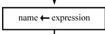
*图示：赋值操作流程图*

> ⚠️ **避坑指南**：许多语言用 `=` 做赋值符号，与数学“等于”截然不同，切勿混淆。

*   **VB 风格**：`a = 12`（变量名单字母，右侧可为算式）。
*   **C 风格**：
    ```c
    int a;      // 定义整型变量 a
    a = 12;     // 赋值
    // 或合写：
    int a = 12; // 定义并初始化
    ```

**语法形式示例**
例如，循环累加可表示为：
```
  loop: n=n+1;
  ```

---

##### 3.1.2.3.1 分支判断：选择结构

核心逻辑：**评估条件 → 真/假 → 执行不同分支**。流程图见下：
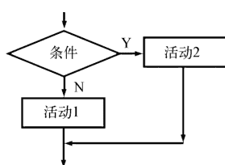
*图示：选择结构流程图*

**生活化类比**：
> 父母对孩子说：“屋子收拾干净 → 奖励甜点；否则 → 早点休息。”
> 代码逻辑同理：`if (money > 1000) { 提示“财务自由” } else { 警告“缺钱了” }`

**实战演练：判断闰年**
```
/*
程序名称：ex3-21
建立日期：2015-8-20
程序功能：判断闰年
#include <stdio.h>
#include <stdlib.h>
int main()
{
int year;
scanf("%d", &year);
if(year<=0)
{
printf("数据输入错误！\n");
exit(0);
}
if(year%4==0&&year%100!=0||year%400==0)
printf("%d 是闰年！\n", year);
else
printf("%d 不是闰年！\n", year)
return 0;
}
```

*运行实测*：
*   输入 `2013` → **非闰年！**
*   输入 `2012` → **闰年！**
*   输入 `100` → **录入数据有误！**

##### 3.1.2.3.2 跳转控制：转移语句

*   **无条件跳转**：`GOTO 标签`。
*   **条件跳转**：`IF C THEN S1 ELSE S2`。C 为真执行 S1，为假执行 S2。S1/S2 可以是单条指令，也可以是 `{}` 包裹的代码块。

##### 3.1.2.3.3 循环控制：重复执行的艺术

只要条件为真，就持续执行循环主体。标准描述范式：
```
while(条件)do(活动)
```
*图示：While 循环流程图 (图 3-4)*

**执行语义**：“测试条件 → 为真则执行循环主体 → 回头再测 → 直到条件为假退出”。

**.trace 示例**：初始 `x=0`，执行 `` / ````
while(x≦6)do(x←x+1)
````，循环体 `x←x+1` 精准跑 6 次，终值 `x=6`。

---

#### 进阶：从“语句”到“算法”的组装术

有了顺序、选择、循环三大基础块，就能搭建完整算法大厦。

**1. 伪码规范**
*   指令用 `;` 分隔。
*   嵌套用**缩进风格**层级区分。
*   例：将 ````
if(x≦6)then(y←x+2)else(if(x≦6)then(y←x+2)else(y←x+6))
```` 格式化为缩进版 ````
if(x≦6)
then(y←x+2)
else(if(x≦6)
then(y←x+2)
else(y←x+6)
)
````。

**2. 过程/函数封装**
对重复或独立逻辑块起名封装，调用时直接用名字替代。
*   定义格式：````
procedurename(参量)
````
*   流程图见：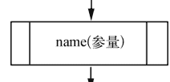 *图 3-5 过程调用流程图*
*   示例：定义 `greetings` 过程 ````
procedure greetings(y)
x<-y;
while(x<=6)do
(print("hello"));
x<-x+1)
````，调用处 ````
if(x<=10)then(procedure greetings(3))
```` 等同于展开后的 ````
if(x<=10)then(
x<-3;
while(x<=6)do
(print("hello"));
x<-x+1)
)
````。

**3. 可读性增强：显式结束标记**
在深度嵌套时，可用 `end while`、`end if` 等关键字显式闭合，层次清晰明了。
*   对比：````
if(x<=10)then(
x<-3;
while(x<=6)do
(print("hello"));
x<-x+1)
)endwhile
)endif
````
*   *提示*：非强制规范，因人而异。甚至可用中文关键字（如“结束循环”、“结束判断”），只要团队能读懂、逻辑不走样即可。

**4. 流程图的首尾**
绘制流程图时，必须标注算法入口与出口（椭圆形“开始/结束”框），参考  中的“始末端”符号。

**5. 其他常用指令**
简写即明义：`EXIT` (退出循环)、`RETURN` (返回)、`READ/INPUT` (读入)、`OUTPUT/PRINT/WRITE` (输出)。

---

### 算法特性速览（素材前段补充）

*   **阅读友好度**：衡量算法被人类理解的难易度。代码写给人看，附带能在机器上跑。
*   **鲁棒性**：面对脏数据、异常输入时，算法能否“不崩溃、给提示、有兜底”，即容错能力。

---

### 经典案例复盘

#### 案例一：渡河谜题（状态空间搜索）
**局势**：农夫驾小舟，单程仅能带一样。无人看管时：狼吃羊，羊吃菜。
**破局关键**：**“带回”策略**打破单向思维。

**最优路径（右岸 → 左岸）**：
1.  **先送羊过河** → 返程空舟。
2.  **送菜过河** → **把羊带回**右岸（关键步！）。
3.  **送狼过河** → 返程空舟。
4.  **再送羊过河** → 全员安全登岸。

#### 案例二：韩信清点兵力（同余定理实战）
**历史现场**：3列余2，5列余3，7列余2。属下汇报262，韩信当场否决：**实为233人**。

**算法思维演进**：

**阶段 1：暴力枚举（伪码雏形）**
从 2 起步，逐个尝试 `m % 3 == 2 && m % 5 == 3 && m % 7 == 2`。
*   步骤链：`m=2` → 查3 → 查5 → 查7 → 输出 / `m++` 回溯。
*   *流程图练习*：亲自动手画画看，对照网上标准图对比理解。
    [PRE*] (此处预留流程图练习位)

**阶段 2：数学建模（降维打击）**
建立方程组：`m = 3i + 2 = 5j + 3 = 7k + 2`
推导：`3i = 7k` → 两边必为 **21 的整数倍**（3 和 7 最小公倍数）。

**阶段 3：步进搜索（利用数学结构加速）**
令 `3i = 7k = 21, 42, 63...` 依次试算 `m` 并验证 `j` 是否为整数：

| 3i=7k 值 | m 值 | 存在整数解？ | j 值 | 备注 |
| :--- | :--- | :--- | :--- | :--- |
| 21 | 23 | **是** | (23-3)/5=4 | 最小正整数根 |
| 42 | 44 | 否 | - | |
| 63 | 65 | 否 | - | |
| ... | ... | ... | ... | |
| 231 | **233** | **是** | **46** | **符合兵力区间的唯一解** |

**核心洞见**：同余方程组存在**无限重解**（通解为 `m = 233 + 105t`）。**实际问题必须结合上下文约束（如兵力区间）定唯一解**。本题中 `i=77, j=46, k=33`，合计 233 人。

---

### 算法无处不在：从生活到代码

计算机算法与日常算法同构同源，核心都是 **“算法式思考”**—— 为攻克问题而设计的规范化流程。
生命周期对标：
1.  **剖析问题** （搞清现状与目标）
2.  **探寻解法** （设计策略/模型）
3.  **落地执行** （人工操作或编程实现）
4.  **复盘改进** （重构、提效、泛化）

沉心观察生活，随处可见算法：菜谱是顺序结构，红绿灯是选择结构，刷牙洗脸是循环结构。

---

### 🎯 热身练习：变式点兵
**场景**：早操排队。
*   3列纵队 → 最后剩 1 人
*   5列纵队 → 最后剩 2 人
*   7列纵队 → 最后剩 2 人
**挑战**：班级出操总数几何？（建议小组讨论，评论区见）

---

### 3.2 算法结构

### 算法骨架三件套：分支、循环与自调用的深度拆解

算法不仅是指令的线性序列，更包含精妙的控制拓扑。为驾驭复杂任务，必须精通三大核心范式：**条件分发、循环重复、自我分解**。本节引入 **N-S 结构图**（由 Nassi 与 Shneiderman 发明），以其严谨的作用域界定取代传统流程图的随意跳转，为你剖析底层逻辑。

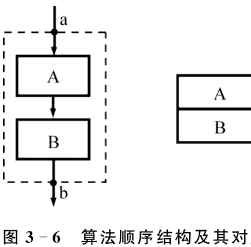

#### 3.2.1 分支判断：应对多歧路的决策逻辑

顺序执行仅是地基，复杂度源于“路在何方”。当流程面临多路岔口，便需引入**条件分发机制**。

最典型的便是 `if` 判断。以“名册核对”为例，核心在于反复追问：命中否？匹配否？

```
Proceduresearch(list, TargetValue)
if(list 为空)
then(返回失败)
else(
TestEntry←在 list 中选择第一个表项；
while(TargetValue≠TestEntry 且 TestEntry 不是最后一个表项)
do(TestEntry←在 list 中选择下一个表项)；
if(TargetValue=TestEntry)
then(返回成功)
else(返回失败)
)endif
```

另有 `switch-case` 多路分支，本质是条件判断的语法聚合，故不另绘结构图。

```
switch(变量)
case" 取值 1"(活动 1)
case" 取值 2"(活动 2)
......
case" 取值 n"(活动 n)
```

**核心结论**：分支机制自身不拉高时间阶，却赋予程序“决策思维”，是编织复杂逻辑的必备笔触。

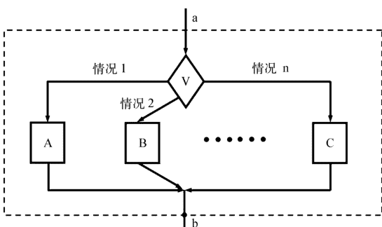

#### 3.2.2 循环机制：让机器替人类干重复活

循环是释放算力的关键。其内核由**执行主体**与**终止判据**构成，运行节奏遵循三步曲：建立初态 → 校验判据 → 更新态势。

**实战剖析：有序列表扫描**
若列表有序，逐项比对即可。伪码中的 `while` 块即标准循环范式：

```
Proceduresearch(list, TargetValue)
if(list 为空)
then(返回失败)
else(
TestEntry←在 list 中选择第一个表项；
while(TargetValue>TestEntry 且 TestEntry 不是最后一个表项)
do(TestEntry←在 list 中选择下一个表项)；
if(TargetValue=TestEntry)
then(返回成功)
else(返回失败)
)endif
```

均值比对 n/2 轮，时间阶 **O(n)**。结构图清晰呈现“判→做→再判”的往复。

```
TestEntry <- 在 list 中选择第一个表项
``` ```
TargetValue > TestEntry 且 TestEntry 不是最后一个表项
``` ```
TestEntry <- 在 list 中选择下一个表项
``` 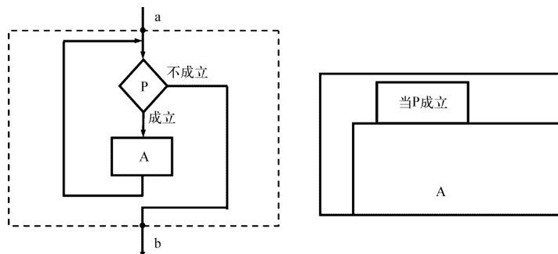

**两种判检时机的差异**：
*   **前置判检 (`while`)**：先验后行，**允许零次执行**。
*   **后置判检 (`repeat-until`)**：先行后验，**保底一次执行**。

```
repeat(活动)until(条件)
``` 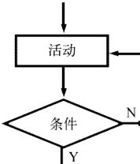 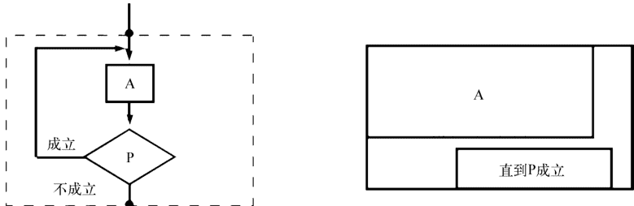

**经典佐证**：辗转相除法流程图转结构图，直观展现嵌套层级的清晰度。

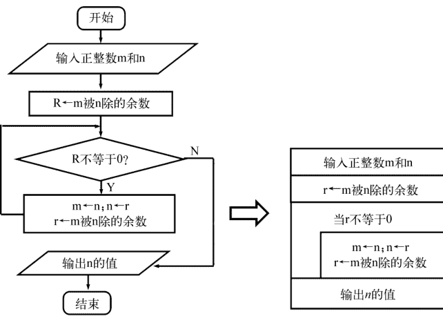

#### 3.2.3 自调用模式：分治思想的代数投影

若循环是“横向铺开”，自调用便是“纵向拆解”。其灵魂是**分治范式**：将大规模难题拆解为同构子问题，逐个击破，再合并答案。

设计自调用算法，只需锁定两个要素：
1.  **基准终止点**：何时收手？
2.  **归约步骤**：如何将大问题化约为小问题？

**语法层面的自嵌套现象**
自然语言中亦存此机制。例如“花哨名词”网络（RTN），即通过自嵌套产生任意复杂的名词短语。

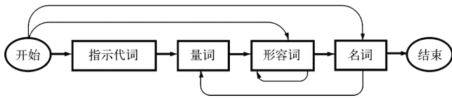

**案例一：二分搜索 —— 对数阶的降维打击**
利用有序性，每轮砍掉一半搜索域。调用层深 ≈ log₂n，阶 **O(log n)**，远优于线性扫描。

```
ProcedureSearch(List, TargetValue)
if(list)
then
（返回失败）
else(
TestEntry←选择 List 的 "中间"值；
switch(TargetValue)(
case(TargetValue= TestEntry)(
返回成功
)
case(TargetValue>TestEntry)(
AList←位于 TestEntry 前半部分 List
返回 ProcedureSearch(BList, TargetValue) 的返回值
)
)
)endif
```

**案例二：河内塔 —— 自调用之美的巅峰教材**
迁移 n 圆盘 = 迁移 n-1 至缓冲 → 移动底盘 → 迁移 n-1 至目标。寥寥数行，蕴含指数级操作。

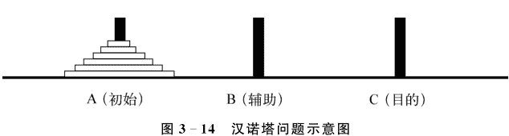 ```
hanoi(int n, char left, char middle, char right)
{if(n==1) move(1, one, _, three);
else
{hanoi(n-1, left, right, middle);
move(1, left, _, right);
hanoi(n-1, middle, left, right);
}
}
``` 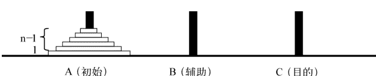

**终止条件的隐蔽陷阱**：循环判据显性，自调用出口常隐性。稍有疏忽便陷无限嵌套（栈耗尽），设计时须严防死守。

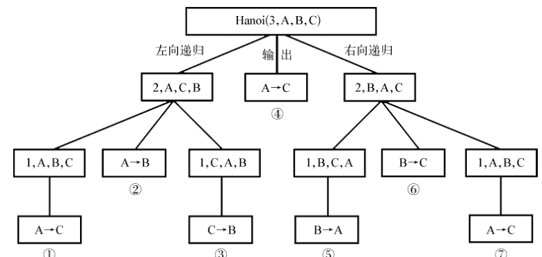

**终极洞见**：理论上一切控制流均可归约为自调用，关键在于调用深度。这不仅是计算理论基石（自调用函数论），更映射自然分形、语言嵌套、智能涌现的普适规律。**算法竞逻辑，逻辑竞自调用。**

---

### 3.3 解题体系：从状态空间到智能决策

早期 AI 以解谜、博弈、证题为切入，沉淀出独立的**求解学科**。其核心三要素：
1.  **状态池**：记录当前态、目标态（逻辑式、语义网、矩阵等均可）。
2.  **操作集**：驱动状态迁移的规则簇。
3.  **调度器**：决策“下一步动用何规则、作用于何处”。

求解路径分三派：
*   **前向推演**：从初态出发，规则链推演至目标（自底向上）。
*   **后向归约**：从目标反推，拆解子目标至可解基元（自顶向下）。
*   **差异驱动法 (GPS)**：融合双向，依“当前态与目标态的差异”择规则缩小差距（前向）；若无规则适用，则拆解子目标（后向），循环直至破解。

现代产生式架构承袭此脉，仅将状态池升级为黑板、操作集进化为知识仓库、调度机制更臻完善。

#### 3.3.1 状态空间探索

### 3.3 经典求解范式：从穷举搜索到归结分解

#### 3.3.1 状态空间搜索：暴力美学与启发式进化

我们先通过一个经典的“八数码”游戏来开启话题。如图 3-18 所示，在 3×3 的九宫格中摆放 1 到 8 八个数字牌，留出一个空位。任务是：给定任意初始布局与目标布局，能否仅通过向空位滑动数字牌，一步步完成从起点到终点的转换？

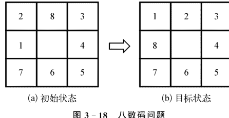

图 3-19 展示了一条由机器自动生成的解题路径。其核心逻辑是**状态空间搜索**：从初始状态出发，穷举所有合法移动产生的新状态，构建一张巨大的“状态转移网”，再在网中寻找连接初始态与目标态的路径。图中自上而下、自左向右的 `S0 → 3 → 8 → 16 → Sg` 即为一条可行解。

具体操作遵循“生成-测试”循环：对当前状态应用所有可用规则生成未见过的新状态，对新状态重复此过程，直到无新状态产生或找到目标。这张由初始状态衍生出的所有状态及其递推关系构成的网络，便是**状态空间**。若目标态在网中，从根到该节点的路径即为解；若有多条路径，则对应多解。

理论上，只要解存在，机器凭借强大的算力终能找到它，顶多耗时稍长。但若让人类处理大规模数码问题，即便思维再敏捷，也难以承受这种指数级爆炸的组合复杂度。这揭示了人机求解的本质鸿沟——**机器拥有远超人类的计算与搜索吞吐量**，这是其核心比较优势。

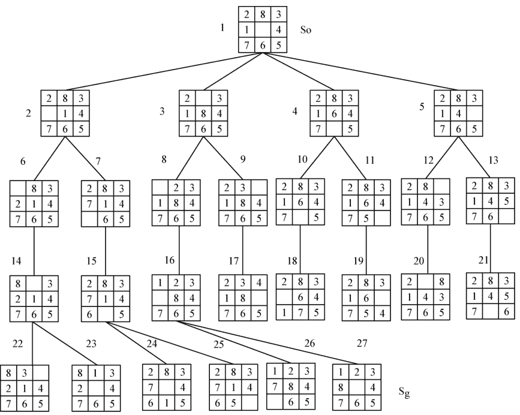

**图 3-19 八数码问题求解路径示意**

利用这套方法论，机器原则上能攻克一大类智力游戏。关键在于建立状态表示与变换规则，再释放搜索引擎。以“独立钻石棋”（Peg Solitaire）为例：33 个孔位、32 枚棋子，规则是跳吃相邻棋子（横/竖），目标是仅剩一枚棋子落在正中央（图 3-20）。

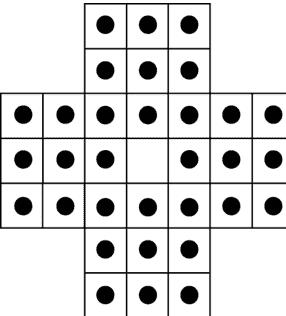

(a) 初始棋盘布局

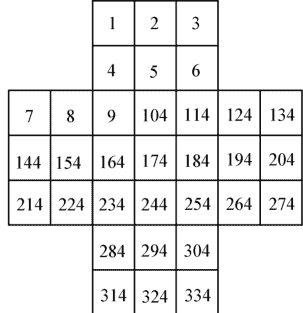

(b) 位置编码方案

**图 3-20 独立钻石棋规则与编码**

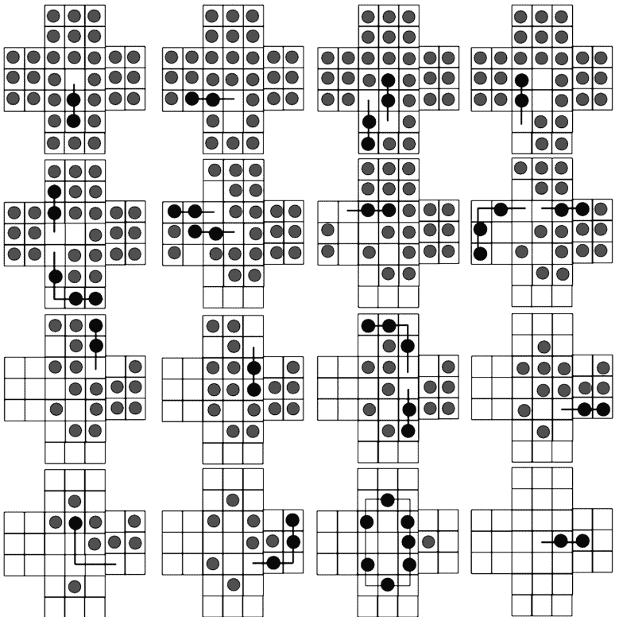

用状态空间术语描述：初始状态为中心空、其余满；目标状态为仅中心有子。任务即在唯一规则约束下，搜索从初始到目标的完整路径。图 3-21 给出了搜索树的一个局部切片。


**图 3-21 独立钻石棋状态空间局部搜索树**

敏锐的读者已察觉：这种“暴力枚举”极其笨拙。大量必死局面（无解分支）被无脑生成、搜索，极度浪费算力。人类高手初次尝试往往凭直觉与定向判断轻松破局，若改用机械搜索，恐穷极一生也难觅正解。

算力虽强，终有上限，面对超大搜索空间，剪枝避坑势在必行。科学家引入**启发式搜索**改良策略：虽仍属搜索范式，但引入“评价函数”估算当前状态与目标的“距离”，每步仅扩展最有希望（评价最优）的节点；次优节点仅在最优路径受阻时备选。为保证不漏解，还需识别无效状态，将搜索严格限定在有效区域内。

这要求求解者具备领域知识，能设计出精准的评价函数（启发式信息）。有了这双“慧眼”，搜索效率方能质变。

以钻石棋为例，引入启发式策略可得一解（编码含位置与方向 D/U/R/L）：
`5D, 12L, 3D, 1R, 18U, 3D, 30U, 27L, 13D, 24R, 27L, 10R, 12D, 26L, 23R, 18D, 31U, 33U, 22R, 25L, 32U, 24L, 21R, 8R, 10D, 24L, 7D, 21R, 23U, 4D, 15R`。
有兴趣可自制棋盘复盘验证。

#### 3.3.2 归结策略：化繁为简，分而治之

若问题复杂度远超钻石棋，单纯搜索力不从心，该如何破局？答案是**归结策略**——将大问题分解为若干关联且相对独立的子问题，逐个击破，最后合成总解。

经典案例：“猴子摘香蕉”（图 3-22）。房内有猴、箱、香蕉，位置随机。猴需移动箱子、爬上去摘蕉。这不是简单的状态跳转，而是包含前置依赖的复合任务。

```
(W,x,Y,z)
```

经分析，总目标可归结为 4 个顺序子目标：
1. 猴走到箱子旁（位置 b）；
2. 猴推箱子到香蕉下（位置 c）；
3. 猴爬上箱子；
4. 猴摘香蕉。

逐个解决子目标，即得总解。

形式化建模：用四元组 `(W, x, Y, z)` 刻画瞬时状态——
`W`：猴水平位置 {a,b,c}；
`x`：猴是否在箱上 {0,1}；
`Y`：箱水平位置 {a,b,c}；
`z`：是否得蕉 {0,1}。

定义 4 个原子算子：
- `goto(U)`：猴走动：`(W,0,Y,z) → (U,0,Y,z)`
- `pushbox(V)`：猴推箱：`(W,0,W,z) → (V,0,V,z)`（前提：猴箱同位）
- `climbbox`：猴上箱：`(W,0,W,z) → (W,1,W,z)`
- `grasp`：摘蕉：`(c,1,c,0) → (c,1,c,1)`（前提：猴箱蕉同在 c 且猴在箱上）

```
({a,0,b,0},F,G)
```

初始问题表示为 `P = (S, G)`，其中算子集 `F = {f1..f4}` 对应上述四操作，`G` 为待求解步骤序列。

```
({(a,0,b,0)},Gf,4)
({f4(s1)},G)
```

求解采用**逆向归结**（目标回溯）：
1. 目标要求 `z=1`，初始态不满足，差别在于 `z`。关键算子 `f4=grasp`，用其归约原问题，得子问题 `P1`。
2. 分析 `P1` 与 `grasp` 前置条件集 `Gf,4` 的差别，依次锁定关键算子 `f3=climbbox`、`f2=pushbox(c)`、`f1=goto(b)`。
3. 归约至原子问题（无需再分解），最终得解序列：`{ goto(b), pushbox(c), climbbox, grasp }`。

归结法让机器具备了“规划”能力，大幅拓展了可解问题边界：只要能将现实难题拆解为机器可解的原子任务，原则上皆可代劳。

#### 3.3.3 机器博弈：从深蓝到 AlphaGo，跨越的与未跨越的

**博弈论**源于游戏，研多主体交互下的理性决策，广泛应用于经、政、军、计算机科学等领域。核心是研究“理性博弈者”在信息不全/完全、零和/非零和结构下的均衡策略。

人机博弈里程碑：
- 塞缪尔跳棋程序（早期自博弈学习）
- 格林布莱特国际象棋程序
- **IBM 深蓝**（1997 年击败卡斯帕罗夫）
- **DeepMind AlphaGo**（2016/17 年击败李世石、柯洁）

围棋曾被视为 AI “最后堡垒”：19×19 棋盘，361 交点，合法局面数约 `10^171`（宇宙原子数仅 `10^80`），暴力搜索彻底失效。

AlphaGo 的突破融合了 **蒙特卡洛树搜索 (MCTS)** 与 **深度神经网络**（策略网络+价值网络）。MCTS 特性：时间足够时可渐近最优，通过海量自我对弈训练，让价值网络学会“判断局势”，策略网络学会“落子倾向”，极大剪枝搜索树。余凯指出：它突破了人类极限，实现了无疲劳、无情绪波动的无限自我迭代。

李世石赛后复盘：“和机器下棋心理战失效，只能调节自己。” 机器无意识、无疲劳、无情绪，纯粹执行最优概率决策。

这引发全民 AI 焦虑：“人类被逼入死角？”“《三体》式黑暗森林来临？” 我认为恐惧溢出了理性。

**本质区别在哪里？**
驱动人类爆发能量的三元引擎：**欲望、理智、激情**。
- 理智 → 推理、计算、逻辑；
- 欲望与激情 → 想象力、理想、审美、道德、哲学体系创构。

当下 AI = **剥离欲望激情与肉体束缚，无限放大理智维度（计算/推理），以深度学习为驱动，依赖海量数据与算力**。
它是**“已知领域的超级专家”**，擅长在分布内泛化、拟合、优化。但它无法像马克思那样**凭空创立理论体系**，无法产生真正的“从 0 到 1”范式创新。

**结论：当前 AI 仍处于“弱人工智能”阶段。**
- 无法自主进化（需人类设计架构、清洗数据、定义目标）；
- 本质是对已知数据的压缩、重组与泛化，解决的是“已有问题的高效求解”；
- 替代的是**重复性脑力劳动**，而非**创造性智力劳动**。

DeepMind 创始人哈萨比斯坦言：距人脑水平“仍相当遥远，可能还需数十年”。施密特赛前致辞：“输赢皆为人类胜利。” AlphaGo 是人类点燃的**火种**，照亮了通往通用人工智能 (AGI) 的漫漫长途。拥抱而非恐惧，期待有一天“大白”真正走进生活。

---

### 第 4 章 模式识别与识别系统

#### 4.1 模式识别概述

##### 4.1.1 核心定义：从人类认知到机器分类

**何为“模式”？**
广义上，模式是客观事物在时空中的特征描述。如“水：无色无味透明液体”、“玻璃：透光易碎固体”。这些描述源于人类反复感知同类事物后提炼的**经验原型**，存储于大脑，作为后续判断的基准。人脑对当下感知对象与存储原型的匹配判别，即为**生物模式识别**。

**定义（人类视角）：** 模式识别 = 对感知信息分析 + 对关注对象判别。
无处不在：阅读（文字识别）、听广播（语音识别）、看电影（视听融合识别）、医生诊断（症状→疾病分类）……人类展现出惊人的鲁棒性：嘈杂声中辨声、复杂场景中瞬间锁定“车”“人”。

**难点：** 这些“人类本能”交给机器，却异常艰难。如何赋予机器识能？能达成何种程度？这触及智能本质，也是模式识别与 AI 的核心追问。

**研究聚焦：** 一般不研究“人如何识别”（虽可启发），聚焦**“机器如何识别”**。
机器识别流水线：
1. **信息获取**：传感器采集原始数据；
2. **特征表征**：提取关键属性，组织为**特征向量** `X = (x1, x2, ..., xn)^T`（模式识别的标准输入语言）；
3. **分类决策**：依据规则/算法，将特征向量映射到类别标签 `ω ∈ {ω1, ω2, ..., ωm}`。

本质上，**机器模式识别 = 特征空间中的分类问题**。
分类规则来源两类：
- **先验赋予**：专家系统、规则库（知识驱动）；
- **数据习得**：统计学习、深度学习（数据驱动）。

---

### 参考文献

- [1] 周昌乐. 智能科学技术导论. 北京：机械工业出版社, 2015.
- [2] 胡学钢, 张先宜. 数据结构. 合肥：安徽大学出版社, 2015.
- [3] 许晶华, 张艺全, 李志宏, 等. 管理信息系统. 广州：华南理工大学出版社, 2003.
- [4] 李含光, 郑关胜. C 语言程序设计教程. 第 2 版. 北京：清华大学出版社, 2015.
- [5] 杨小丽. EXCEL 应用大全 (全新升级版). 北京：中国铁道出版社, 2016.
- [6] John Pollock. 新手学 JavaScript 编程. 王肖峰, 译. 第 4 版. 北京：清华大学出版社, 2014.
- [7] 陈庆祥. 正确合理地使用条件语句. 计算机应用研究, 1988(4)：49-52.
- [8] 马健喆. 汉诺塔算法的分析与设计. 计算机时代, 2015(8)：49-51.
- [9] 王晓东. 计算机算法设计与分析. 第 4 版. 北京：电子工业出版社, 2012.
- [10] 卫洪春. 图形环境下的汉诺塔演示. 电子设计工程, 2014, 22(15)：8-14.
- [11] 谭浩强. C 程序设计. 第 4 版. 北京：清华大学出版社, 2010.
- [12] 姜华林, 李立新, 陈强. 四柱汉诺塔非递归研究与实现. 计算机时代, 2013(5)：45-47.
- [13] 黄隽, 陈丹. 四柱汉诺塔非递归算法实现. 福建电脑, 2013(11)：96-97, 126.

### 模式识别：让机器拥有“慧眼”的核心逻辑

简单来说，模式识别就是借助计算机与数学手段，实现对模式的自动加工与判读。这里的“模式”，泛指环境中的各类客体。随着算力飞跃，人类得以深入剖析复杂的信息处理机制，而生物体对外界的感知辨识，正是信息处理最关键的形态之一。

人在观察世界时，总习惯寻找差异，依据特定目的将相似却不完全相同的事物归类。以数字“4”为例，书写风格千差万别，人脑却能轻松将其归为同一类；甚至面对从未见过的写法，也能精准分类。这种由个别推演总体、从有限样本识别无限实例的认知能力，奠定了“模式”概念的基石。学术界对“模式”定义虽有分歧——有人视其为具体样本，有人视为抽象类别——但结合上下文语境，含义自明。

综上，模式识别本质上是对事物特征信息（数值、文本、逻辑关系等）进行加工分析，进而完成描述、辨认、分类与解释的全过程，是信息科学与人工智能领域的基石版块。

#### 4.1.2 核心问题：分类的两条路径

模式识别常被称为模式分类。按问题性质与解法划分，主要分为**有监督分类**与**无监督分类**。两者分水岭在于：训练样本的类别标签是否事已知。有监督学习虽效果好，但高度依赖大量标注数据，获取成本高昂；这倒逼无监督学习研究成为刚需。

此外，模式还分**抽象**（如意识、概念）与**具体**两类。前者属概念识别范畴，是AI另一分支；本文聚焦的，是针对语音波形、心电图、图像、文字、生物传感器数据等**具体模式**的辨识与分类。

#### 4.1.3 发展脉络：从统计决策到神经网络

早期研究以数学方法为主。
*   **50年代末**，罗森布拉特推出“感知器”，模拟人脑识别，首创让系统通过训练获得对未知模式分类的能力。
*   **1957年**，周绍庚引入统计决策理论，催化了领域爆发式增长。
*   **1962年**，纳拉西曼提出基于基元关系的句法识别法；付子东在串理论与应用上深耕，著作《句法模式识别及其应用》成经典。
*   **80年代早期**，霍普菲尔德两篇里程碑论文揭示人工神经网络的联想存储与计算潜能，直接引爆神经网络方法论的新浪潮，短短数年便在应用层斩获丰硕成果。

#### 4.1.4 研究双轨：生理机理与工程实现

模式识别研究沿双轨并行：
1.  **认知科学视角**：探究生物体（含人）如何感知对象，属生理、心理、神经科学交叉领域。
2.  **工程技术视角**：在既定任务下，如何用计算机落地理论与方法。经数学家、信息学者、计算机专家数十年攻关，后者已形成系统性成果。

应用端，计算机识别对象涵盖文字、声像等**具体模式**，也覆盖状态、程度等**抽象模式**，统称“模式信息”，区别于数字化的纯数据。类别数量由具体问题决定，有时需系统通过反复观测自行确定。

学科交叉极广：统计学、心理学、语言学、控制论、生物学等皆有渊源。与AI、图像处理更是深度纠缠——自适应识别系统内嵌AI学习机制；AI的场景理解、自然语言处理本质含识别问题；预处理与特征提取借力图像处理，图像分析则反哺识别技术。

---

### 4.2 理论方法全景与体系分类

#### 4.2.1 系统“四大件”架构

一个标准模式识别系统由四大模块串联构成（**参见 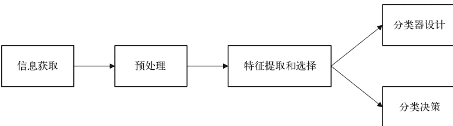**）：
1.  **数据获集**：传感器将物理信号转为机器可读的数值/符号串（模式空间），关键在于传感器选型。
2.  **数据预处理**：去噪、滤除干扰，保留与目标属性及识别算法强相关的特征。
3.  **特征提取与选择**：从净化数据中衍生有效信息，筛选最优特征降维，构建特征空间。候选特征虽多通常利好，但警惕“维数灾难”导致计算不可解。此环节核心在于滤波算法、提取方法与特征质量的博弈。
4.  **分类器设计与决策**：基于特征空间构建分类器，输出最终判别结果。

#### 4.2.2 四大主流流派深度解析

##### 4.2.2.1 统计模式识别：以概率决策为核心
源于决策理论。流程为：原始数据 → 提取特征参数 → 组合为特征向量 → 引入相似性度量 → 设计分类器 → 归类。
核心四步：获集、预处理、特征工程、构造分类器（训练+决策）。
**适用场景**：少量特征即可刻画对象。擅长从有限样本中挖掘统计规律，以特征向量形式数学化表达，训练分类器后可泛化至海量未知数据。应用极广，覆盖科技、经管、社科等全域。

##### 4.2.2.2 结构模式识别：解析“骨架”与“关系”
作为统计法的补充，专攻**结构关系**精准识别。
**核心逻辑**：自顶向下分解——将复杂模式拆解为简单可辨的子模式（基元），若仍难识别则继续分解，直至基元具备易表达、易识别特性。再由基元通过结构关系（如连接关系）复原完整模式。
**基元选择原则**：基本性、描述紧凑性、易提取性。常见**信号基元**（分段折线近似时变信号）与**图像基元**（轮廓邻接方式+像素基元集合）。
**差异点**：统计法靠“距离准则”分类，结构法靠“结构相似度”分类。优势在于类似形式语言逻辑，自由度高，擅长描述结构特征；劣势在于描述难统一，成果推广受限。

##### 4.2.2.3 模糊模式识别：拥抱“不确定性”
理论基石：模糊数学。
**核心突破**：打破“非黑即白”的经典集合论，引入**隶属度函数**，允许元素以一定比例属于某集合，完美契合现实中大量模糊概念（如“以松树为主的林地”、“瓜子脸/国字脸”界定）。
**系统构建**：同统计法，需建立隶属度分类器。模糊源头二：对象固有模糊（如遥感像元光谱混合）、识别标准模糊（如人脸轮廓分类）。
**注意**：模糊问题不一定非要用模糊数学解，统计法有时也能处理；“模糊”的本质在于**分类器依据模糊数学原理设计**。

##### 4.2.2.4 人工神经网络：仿生智能的“终极武器”
源于生物神经系统建模，抽象神经元与连接方式，构建网络。
**核心优势**：
*   **万能逼近**：任意函数均可无限逼近，靠权值迭代精准锁定分类边界。
*   **非线性建模**：灵活捕捉现实世界复杂非线性映射。
*   **自适应/自学习**：海量神经元网络模拟大脑，兼具记忆存储（特征存储）与权值调整（模式学习）双重机制。
**地位**：模式识别是ANN**最成功的应用疆域**。标准范式：训练样本训练分类器 → 部署识别新样本。

---

### 4.3 落地场景：四大识别系统重塑生活

模式识别已渗透科研与民生肌理，主流系统集中在四大维度：

*   **语音识别**：让机器“听懂”人言，将声信号转文本/指令。核心三板斧：特征提取、匹配准则、模型训练。车联网落地典范：一键唤醒，语音设导航，安心又便捷。
*   **视觉识别**：赋予机器“看”的能力。以摄像头+算力替代人眼，完成识别、跟踪、测量及图形处理，输出适合人眼观测或仪器检测的图像。本质上是从多维数据中提取“决策级信息”（Shannon信息观）的AI系统。
*   **行为识别**：从外显动作（可观察）反推内在心理（不可观察）。目标：传感器采集行为数据 → 技术手段反解行为标签 → 序列建模预测后续意图。
*   **情感识别**：人类主要靠视听识别他人情感。技术路径三元组：**人脸表情**、**语音声调**、**文本语义**。
    *   人脸：整体感知+局部特征融合。
    *   声调：时域、振幅、基频、共振峰特征建模为模板库匹配。
    *   文本：第二信号系统优势，突破时空限制，精准捕捉抽象、模糊、深层的价值关联。

#### 4.3.1 语音识别系统：深度拆解

语音是思维载体、最高效交互媒介。让机器开口“听懂”，是长久夙愿。技术定义上分两层：**语音转写**（逐字转文本）与**语义响应**（懂意图执行命令，不执着字正腔圆）。作为交叉学科，融合声学、语言学、信号处理、信息论、计算机科学等。

**基本原理**：声信号经转换器数字化存储 → 识别程序拿实时声样与预存声库对比 → 输出最佳匹配标签 → 触发执行。

**多维分类体系**：

| 维度 | 分类 | 核心特征 |
| :--- | :--- | :--- |
| **说话人相关性** | 特定人 | 仅识别特定人声纹 |
| | 非特定人 | 无关人声，需海量多人数据训练 |
| | 多特定人/特定组 | 识别特定群体，仅训练该组数据 |
| **说话方式** | 孤立词 | 词与词间需停顿 |
| | 连续词 | 词发音清晰，始现连音现象 |
| | 连续语音 | 自然流利，大量连音/变音，难度最高 |
| **词汇量规模** | 小词汇 | 几十词级 |
| | 中词汇 | 数百至数千词 |
| | 大词汇 | 数千至数万词 |

> *注：随算力与精度跃升，词汇量分级边界在动态演进，今日的“中”，或将是明日的“小”。*

**系统架构三核心（参见 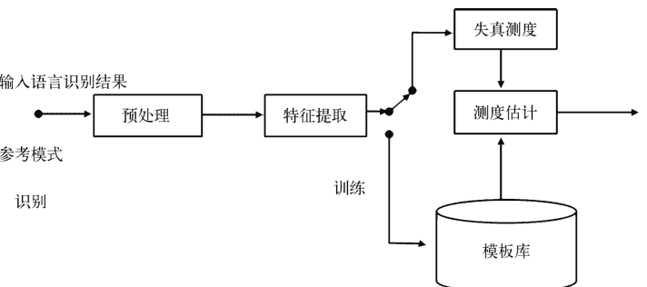）**：本质是标准模式识别系统变体，含**特征提取**、**模式匹配**、**参考模式库**三基元（**详见图 4-3**）。
**三步走流程**：
1.  **建库**：按系统类型选特征参数，分析入库成标准模式库。
2.  **核心匹配**：模型构建 → 训练 → 识别，全链路打通。
3.  **后处理**：音字转换 + 词法/句法/语法高层润色，或适配特定任务语法输入。


图 4-1 模式识别系统


图 4-2 语音识别原理框图

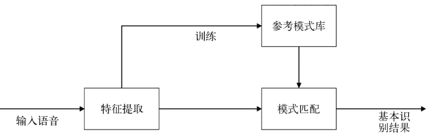

图 4-3 语音识别系统的核心架构

当前主流的语音识别技术路线主要涵盖动态时间规整（DTW）、隐马尔可夫模型（HMM）、矢量量化（VQ）、人工神经网络（ANN）以及支持向量机（SVM）等经典算法。

**动态时间规整算法（DTW）** 作为早期非特定人识别的奠基之作，凭借动态规划思想巧妙化解了语速差异导致的模板匹配难题。其实操逻辑是：将预处理分帧后的测试语音与标准参考模板对齐比对，依据特定距离度量计算相似度，最终锁定最优匹配路径。

**隐马尔可夫模型（HMM）** 则是基于统计概率的里程碑式模型，源自马尔可夫链演变。它摒弃了传统“存储样本”的模式，转而通过大量训练数据迭代出使输出信号吻合概率最大的参数集。识别时，利用待测序列与模型参数的似然概率最大化原则推导最优状态链，因其强大的时序建模能力，长期稳坐语音识别“王座”。

**矢量量化（VQ）** 本质是一种高效的信号压缩手段，擅长处理小词汇量、孤立词场景。它将标量特征打包成矢量在多维空间整体量化，将空间划分为若干区域并用“码向量”代表落区内的所有矢量。核心在于从海量样本中训练高质量“码书”，在失真度与计算量间寻找最佳平衡，以最小开销换取最高信噪比。

**人工神经网络（ANN）** 80年代末横空出世，模拟人脑神经机制，具备自适应、并行计算、鲁棒容错等先天优势，非线性映射与分类能力极强。但其短板明显：标准多层感知机（MLP）仅擅长静态分类，难以捕捉语音信号的动态时序特性。虽有循环网络等改进尝试，但刻画复杂时变特征仍显乏力。因此，**“ANN管分类、HMM管时序”的混合架构**成为主流，近年融合算法大幅提升了系统鲁棒性与准确率。典型三层网络（输入-隐藏-输出）中，除输入层外，各节点均承载非线性变换使命。

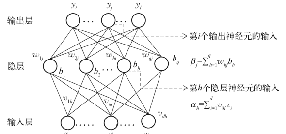

图 4-4 神经网络拓扑结构

单个神经元的工作流程可数学化为三步走：
1. 接收输入 $x$；
2. 加权求和 $z = w \cdot x$；
3. 经激活函数 $f$（如 Sigmoid、Tanh、ReLU）非线性映射输出 $new\_x = f(z)$。

```
f(x) = \frac{1}{1 + e^{-x}}
```

Sigmoid 函数因导数计算极其便捷，成为早期网络训练的“宠儿”。

```
f(x)' = f(x)[1 - f(x)]
```

网络训练的核心双引擎：
- **前向传播**：数据从输入层流经隐层至输出层，完成特征非线性变换；
- **反向传播**：依据误差反向更新参数，分两级实施——
    - ```
\frac{\partial E_k}{\partial w_{hj}} = \frac{\partial E_k}{\partial \hat{y^j_k}} \cdot \frac{\partial \hat{y^j_k}}{\partial \beta_j} \cdot \frac{\partial \beta_j}{\partial w_{hj}} = (y^j_k - \hat{y^j_k}) \cdot \hat{y^j_k}(1 - \hat{y^j_k}) \cdot b_h
``` 输出层与隐层间的权重修正；
    - ```
\frac{\partial E_k}{\partial v_{ih}} = \sum_{j=1}^{l} \frac{\partial E_k}{\partial \hat{y^j_k}} \cdot \frac{\partial \hat{y^j_k}}{\partial \beta_j} \cdot \frac{\partial \beta_j}{\partial b_h} \cdot \frac{\partial b_h}{\partial a_h} \cdot \frac{\partial a_h}{\partial v_{ih}}
= \sum_{j=1}^{l} (y^j_k - \hat{y^j_k}) \cdot \hat{y^j_k}(1 - \hat{y^j_k}) \cdot \omega_{hj} \cdot b_h(1 - b_h) \cdot x_i
= b_k (1 - b_h) \cdot x_i \cdot \sum_{j=1}^l (y_k^j - \hat{y}_k^j) \cdot \hat{y}_k^j (1 - \hat{y}_k^j) \cdot \omega_{b_j}
``` 隐层与输入层间的权重修正。

**支持向量机（SVM）** 基于统计学习理论，引入结构风险最小化策略，有效规避了经验风险最小化易过拟合的弊端。它兼顾训练误差与泛化能力，在小样本、非线性、高维模式识别中表现卓越，广泛服役于模式识别一线。

---

### 突围与展望：语音识别的“剩余难题”

尽管算法迭代不止，要向类人级理解迈进，仍需攻克三大堡垒：
1.  **语言模型的质变**：现有概率统计模型尚未触及语法语义深层逻辑，引入语言学文法模型是实现“机器懂语言”的关键钥匙。
2.  **自适应的普适性**：消除特定人、口音、方言的依赖，本质上是对语言模型泛化能力的极限拷问。
3.  **抗噪强健性**：人类能主动屏蔽噪音聚焦目标声源，机器却极易被环境干扰“带偏”，赋予机器类似“选择性听觉”的能力任重道远。

**前沿演进方向**还包括：多语言混合免切换识别、基于语义理解的无限词汇建模、以及语音识别、机器翻译、语音合成三位一体的**多语种自由交流系统**——那将彻底消弭语言壁垒，重塑人类协作空间。

可以预见，短期内无法复刻人级听觉系统，但伴随技术持续渗透，语音产品将全面铺开市场，人机交互话术也将随之重塑。这场马拉松，人类正稳步前行。

#### 4.3.2 视觉识别系统：赋予机器“慧眼”

##### 4.3.2.1 核心概念与系统构成

机器视觉识别系统，旨在以机器模拟人类视觉：从客体图像中提取信息、加工理解，最终服务于检测、测量、控制等实战场景。一套标准系统包含七大模块协同作战：光源、光学系统、图像捕捉、数字化转换、数字图像处理、智能决策、机械执行。工作流如图 4-5 所示：CCD相机等采集装置将目标转为图像信号 → 数字化传输至专用处理系统 → 依据像素分布、亮度、色彩等特征运算提取要素 → 对标预设阈值输出判断指令。

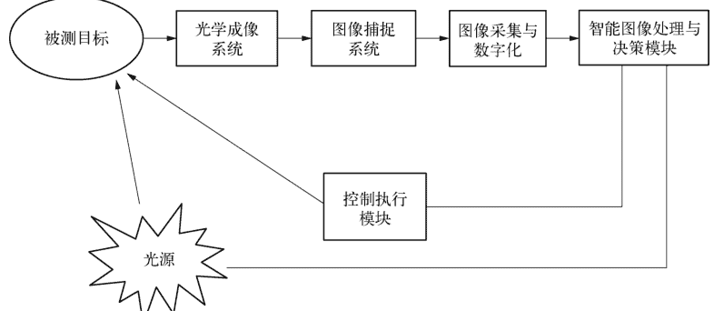

图 4-5 机器视觉识别系统全链路

##### 4.3.2.2 五大关键硬核技术解析

视觉系统的“战斗力”取决于五大支柱技术的协同水平：

*   **光源照明技术 —— “隐形放大器”**  
    优质光源能显著提升分辨率、压制噪声、简化后端算法复度。图 4-6 展示的多色环形 LED 即典型应用形态。


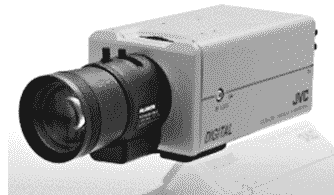

图 4-6 环形 LED 光源阵列  
图 4-7 工业级 CCD 摄像机

*   **光学镜头 —— “机械眼球”**  
    负责将目标精准聚焦于传感器感光面。选型两大铁律：① 像面尺寸须与摄像机严丝合缝；② 焦距需依实时作业环境动态定夺。（焦距、相对孔径、像面尺寸等参数细节，感兴趣可自查专业手册）

*   **摄像机 —— “光电翻译官”**  
    核心使命：光学图像 → 机器可读电信号。主流工业 CCD 摄像机按成像色彩分黑白/彩色两大阵营，图 4-7 为典型工业款。

*   **图像采集卡 —— “数据桥梁”**  
    将模拟图像信号数字化入库，连接采集端与处理端，是系统数据流的“咽喉”。

*   **图像处理软件 —— “大脑皮层”**  
    双引擎驱动：**增强引擎**（提对比度、扬特征、补画质短板）+ **分析引擎**（算法提取形状、文字、坐标等语义信息，支撑决策控制）。

##### 4.3.2.3 落地场景：从车间到手术室

机器视觉不疲劳、高精度、高速度，配合红外/紫外/X射线/超声波等穿透技术，更能胜任不可见目标与高危场景。

**1. 工业质检“铁面无私”**  
已大规模部署于：包装印刷检测、饮料容器/灌装/封口全流程把关、木材纹理缺陷与体积测量（3激光+3线阵CCD实现360°无死角）、半导体封装、卷钢表面、水果分级、医药装粒核对等。图 4-8 直观呈现饮料产线视觉检测实况。

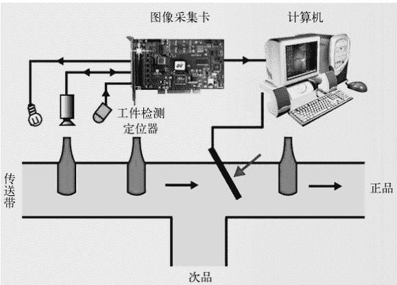

图 4-8 饮料生产线视觉质检实拍

**2. 医学影像“第二双眼”**  
融合数字图像处理与信息融合技术，解析 X 光透视、MRI、CT 等多模态影像。如图 4-9 所示，将骨骼擅长的 X 光与软组织擅长的 MRI 叠加融合，弥补单一模态盲区，辅助医生精准诊断。

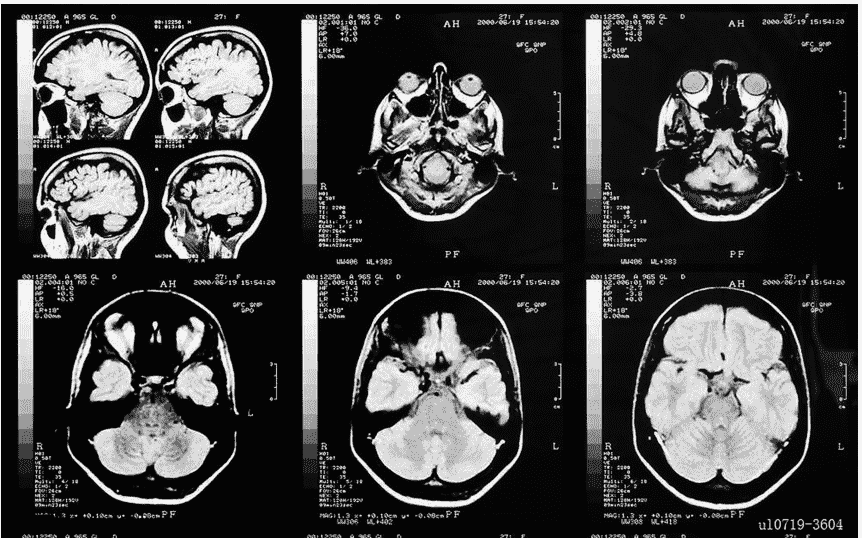

图 4-9 多模态生物组织融合成像

#### 4.3.3 行为识别系统：读懂“人”的语言

##### 4.3.3.1 定义与战略价值

本节聚焦**人体行为模式的自动识别与分析**（信息表达形态见图 4-10）。应用版图覆盖智能安防、人机交互、自动报警、公共安全等高价值领域。在 AI 与自动化浪潮中，行为识别已成学术界“兵家必争”的核心高地，模型算法与描述体系均取得实质性突破。

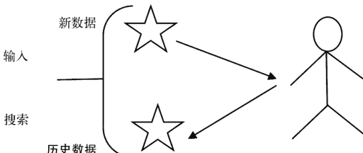

图 4-10 行为模式信息表达形态

##### 4.3.3.2 三大识别维度：颗粒度决定应用边界

按监测规模与目标划分，呈现差异化价值：

| 识别类型 | 核心特征 | 典型赛道 | 现实意义 |
| :--- | :--- | :--- | :--- |
| **单用户行为识别** | 精细化、实时感知 | 智能家居 | 精准解码生活需求，提升居住品质 |
| **多用户行为识别** | 群体流分析、高密度复杂度 | 火车站、商场、十字路口 | 破解人群疏导难题，保障公共安全 |
| **异常行为识别** | 事件驱动、高优先级响应 | 监狱、养老院、校园 | 实时触发监护预警，守护生命安全 |

##### 4.3.3.3 四大技术流派：多维感知矩阵

当前技术版图由四大流派构建：

**1. 基于计算机视觉 —— “看”得见的主流**  
历经多年沉淀，形成**基于视频序列**与**基于单帧图像**双轨并行框架。  
- *视频流派*：像素差分提取运动目标，速度提升 2-3 倍，适配安防实时监控。  
- *图像流派*：特征提取+改进贝叶斯分类器建模，兼容单帧与序列，抗干扰性强（不惧镜头抖动、光照变化、静止目标）。  
- *标准四步法*：目标检测 → 行为追踪 → 动作识别 → 高层语义理解。  
- *痛点*：数据量巨大、计算复度高、环境敏感、隐私争议持久未决。擅长摔倒等异常检测，但回归模型易受随意行为干扰偏移。

**2. 基于传感器系统 —— “贴”身的低成本派**  
AI 普及下的新贵，前期投入低、部署灵活、空间自由度高。核心逻辑：传感网络采集数据 → 机器学习/数据挖掘训练识别模型 → “人-传感器”一体化辨识。  
常用传感器矩阵：热敏、力敏、辐射敏、加速度、磁力。可精准记录站、走、跑、跳等运动形态。分布式授权节点绑定人体关键部位，加速度传感器持续回传动态数据，赋能计算机对人行为施加控制干预。

**3. 基于位置技术 (LBS) —— “定”位驱动的行为推演**  
融合卫星定位、感知定位、基站定位与 GIS、数据库、无线通信技术。服务图谱含：紧急救援定位、车辆追踪、智慧交通、周边查询。巨头布局深厚：Sun Java Location Service、ESRI ARC Location Service、MapInfo MLS 等奠定行业基石。系统技术架构详见图 4-11。

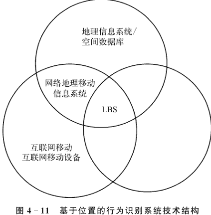

**4. 基于人物交互 —— “懂”关系的高阶认知**

人物交互的核心，在于捕捉用户与周遭环境互动时的数据足迹。其基础假设直指本质：任何特定行为状态，都必然伴随一系列典型物体的接触——手持牙刷刷牙、穿上跑鞋奔跑、推着扫帚扫地。换言之，行为模式可由“接触物品集合”来精准定义。技术实现上，主要借助 RFID 电子标签采集目标数据：读写器激发标签感应电流，触发其发射特定频率信号；接收端解码后，配合视觉系统校验标签性能，最终通过读卡系统映射出用户正在执行的具体动作。

- 5. 行为识别系统的应用与前景

当下，行为识别相关的 AI 技术正加速渗透大众生活，衍生出的智能产品与企业呈现爆发式增长。作为 AI 领域的关键系统工具，一批实体设备与功能方案已落地开花：移动健康与运动监测端，涌现出蓝牙血压计、便携 B 超、智能眼镜、智能手环等贴合家用医疗场景的硬件；公共安全线上，异常行为识别助力缉捕嫌犯、强化超市银行监控辨识力；体感娱乐领域，虚拟现实借助真实人体动作数据驱动虚拟角色，微软 Kinect 便是典型代表；竞技体育赛场，足球机器人更是此类技术的集大成者。

#### 4.3.4 情感识别系统

##### 4.3.4.1 情感识别的定义

情感识别，指计算机对传感器采集的信号进行解析，推断对方当下的情绪状态。该技术让人机交互具备拟人化、智能化特质，赋予机器感知环境变化的能力。人类凭借视听嗅触味五感认知世界、洞察他人情感；计算机则主要依托三条路径——面部表情、语音声调、文本语义——来捕捉情绪信号。下面将逐一展开这三大核心技术路线。

##### 4.3.4.2 人脸情感识别

生活中，面部表情是人际非语言沟通的核心载体。心理学家梅拉宾法则指出：情感传递中，言语占 7%、声音占 38%、面部表情高达 55%。人们借表情外化内心、传递态度，也通过读懂他人表情洞察意图，其重要性不言而喻。

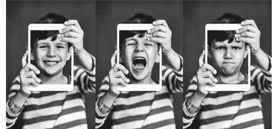

图 4-12 人脸表情

人类直观感知情绪，计算机则需走“检测—提取—比对”标准化流程：摄像头采集画面 -> 人脸检测定位区域 -> 提取表情特征 -> 与数据库模板匹配识别。

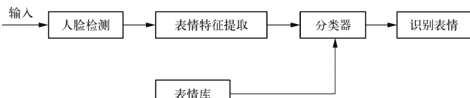

图 4-13 人脸表情识别原理

- 1. 人脸检测

人脸非刚性特质导致表情、姿态多变，加之遮挡、光照干扰，检测难度颇高。本质上，这是个“二分类”问题——判定图像区域是人脸还是非人脸。目标是从图像中框出人脸并预处理。主流路线分两派：

**肤色模型法**：利用肤色在色彩空间强聚类特性，快速分割候选区，再结合器官轮廓精准定位（如 HsuRL 改进光照补偿、Kherchaoui 融合模板匹配）。优势是速度快、抗姿态变化和部分遮挡；短板是易受肤色相近背景干扰。

**统计学习法**：融合机器学习与统计学，海量正负样本训练出最优分类面。代表算法有 SVM 与 AdaBoost，其中 AdaBoost 凭借极致速度与高精度，成为当前检测效果顶尖的算法之一。

- 2. 表情特征提取

锁定人脸区域后，针对不同表情选用几何或纹理特征提取策略。

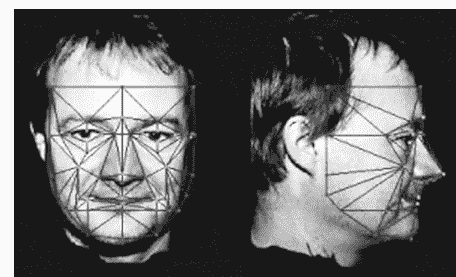

图 4-14 人脸特征点分布

**几何特征提取**：通过关键点（眼、嘴等）间的几何关系（距离、角度）分类识别，擅长处理疲劳表情。1995 年 Cootes 提出主动形状模型（ASM），统计训练得初始形状再迭代拟合轮廓。Peng 改进引入局部纹理模型提升表情识别鲁棒性；侯婕团队基于 ASM 提取眉眼口鼻 118 个特征点构建轮廓数据，实现六大基本表情识别。

**纹理特征提取**：聚焦图像底层灰度变化，捕捉局部表情细节。典型算子 LBP（局部二值模式）利用邻域灰度差描述纹理，具备抗尺度、旋转、光照变化的强鲁棒性。Guo 团队先后推出 FCL-LBP 与 disCLBP，通过类间/类内距离优化特征判别力；周宇旋改进 disCLBP 进一步增强表情特征辨识度。

- 3. 表情识别

流程终环节，分类器选择决定上限。常用 SVM 与深度学习两大阵营。

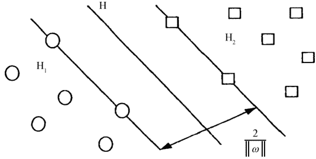

图 4-15 最优分类面

**SVM**：统计学习理论奠基，寻找使分类间隔最大化的最优超平面。二维示意中，H 为分类面，H1/H2 为最近样本平行线，间隔最大化即鲁棒性最强，落在边界上的样本即“支持向量”。

**深度学习**：模仿人类视觉层级认知（像素->边缘->部件->整体），端到端自动学习最具表达力的特征，摆脱传统手工特征工程依赖，实现自学习分类识别。

##### 4.3.4.3 语音情感识别

语音除承载语义，更裹挟着喜怒哀乐。同句话，情感异则义异、印象异。电话里我们仅凭声音即能捕捉情绪，证明声纹蕴含丰富情感信息。应用场景极广：人性化语音交互界面、互动影视、辅助语音识别、情感翻译、测谎、游戏、心理干预等。语音信号处理虽历史悠久，但声纹挖掘情感仍是新兴前沿。以下从声学特征与识别模型两维剖析。

- 1. 情感语音的核心声学特征

研究确立特征重要性排序：基音频率 > 能量 > 发音时长/语速等时域参数。

- (1) 基音频率

声带振动基频及其最大值、最小值、均值、动态范围、平均变化率，是识别核心指标。赵力等对比发现：欢快、愤怒、惊讶的基频均值、范围、变化率显著高于平静，悲伤则显著偏低；三者中欢快特征量最大，其次惊讶、愤怒；惊讶独有句尾基频上翘特征，是关键区分点。Lin 证明相邻帧基频阈值比较即可有效判断句子是否含情感。

- (2) 共振峰

反映声道共振特性的关键参数，前四次共振峰常用于识别。

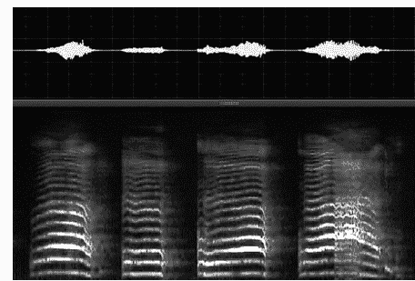

图 4-16 语音信号共振峰

钱向民研究显示：相对平静，欢愤 F1 频率微升，悲显著降；四种情绪 F1 动态范围均增大（惊讶最大），变化率均减小（悲伤最小）。Petrushin 扩展至前三共振峰及带宽统计量；Li 发现同句异情下 F1/F2 稳定，变化集中在 F3/F4，有助区分喜悦/惊讶、忧伤/恐惧。

- (3) 能量

振幅均值、动态范围、与平静差值为常用参数。欢愤惊振幅放大，悲伤收缩；情感强度与平均振幅正相关（欢愤惊）或负相关（悲伤）。Zhou 引入 TEO 能量算子，实测识别率较基音频率提升 5%。

- (4) 发音持续时间与语速

以能量阈值法切分句首尾（连续超阈值为始，连续低阈值为终），有效抗噪。以情感/平静时长比为特征。赵力结论：欢愤惊发音压缩（愤怒最短 > 惊讶 > 欢快），悲伤拉长；语速变化趋势一致。

- 2. 识别建模方法

特征就绪后，分类器决胜负。KNN、SVM、ANN、GMM、HMM 等竞技中，GMM 与 HMM 表现最优。

- (1) 隐马尔可夫模型（HMM）

不孤立看时序特征，而是引入状态转移建模情感动态演变。不同情感对应不同 HMM，扩展性强（新样本增量训练），但参数依赖数据、训练计算量大。

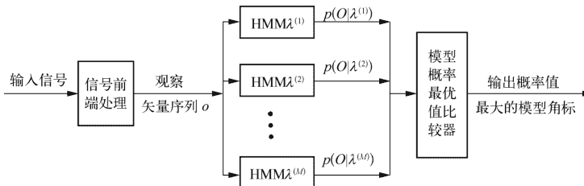

图 4-17 HMM 语音识别结构

设 $N$ 状态集 $\{S_0, \dots, S_{N-1}\}$，初始概率 $\pi$，转移矩阵 $A$，状态 $S_i$ 输出特征向量 $o$ 服从高斯分布。针对 $M$ 类语音各建模型 $\lambda(i)$。

- (2) 高斯混合模型（GMM）

本质为多维概率密度函数，属短时相关分析范畴。识别即寻找使观测序列 $X$ 后验概率最大的模型 $m_k$。采用直角窗采样，窗长 $N$ 可配置。基于贝叶斯准则，后验概率计算涉及似然度 $P(X|m_k)$、先验 $P_m(m_k)$ 与证据 $P(X)$。算法通过短时平均能量差估计似然，模板等概率先验（$k=4$ 时为 0.25），证据由模板能量占比近似，最终依“最大似然准则”输出匹配模板编号。动态增删成员需重算 $P(X)$。

##### 4.3.4.4 文本情感识别

又称“观点挖掘”，旨在对带情感色彩的主观文本实施分析、归纳与推理。任务难度大、挑战性强，归纳为两大核心子任务：信息抽取与情感倾向性分析。

- 1. 信息抽取

多维度抽取保证信息全面性，为倾向分析供给数据燃料：

**主题抽取**：识别领域本体概念与术语。分显式主题（显性表述）与隐式主题（需推理），对应显式/隐式抽取技术。

**评价词抽取与极性判断**：即极性词识别，地位核心。基于语料统计与基于情感词典是两大主流范式，常集成为一体化流程。

**观点持有者抽取**：锁定意见主体，通常由人名、机构名等命名实体构成。可借助 NER 技术，或转化为分类任务（关键在于分类器与特征工程）。词典法覆盖率低、跨域适应性弱。

- 2. 情感倾向性分析

核心目标：判别主观文本/句子/短语的褒贬极性。研究推进至三个层级：

- (1) 词汇、短语层：聚焦单个词汇或短语的语义倾向性刻画。

### 多层级情感倾向计算与识别系统拓展

研究者们通过引入权重优先的情感倾向计算模型，解析短语内部词汇的语义倾向值，并结合词语组合规律确立“中心词”机制，从而精准判定短语的倾向属性及强弱程度。

*   **句法层面**：针对单层模型因标注冗余导致分类精度受限的短板，学者们构建了层叠 CRFs 模型。该架构通过多级 CRFs 由浅入深推演，同步完成句子褒贬类别划分与强度分级，显著提升了识别准度。
*   **篇章层面**：文本级观点挖掘建立在“单一主题”及“主题已知”两大前提之上，主流路径涵盖机器学习范式与人工特征工程两大派系。

#### 4.3.5 识别技术的多元拓展

智能识别版图远超视觉、行为与情感范畴，本节聚焦生活高频的语音与嗅觉两大识别体系。

##### 4.3.5.1 语音识别：从听觉模拟到商业落地

语音始终是人际沟通最本能的载体。移动互联与终端设备迭代倒逼人机交互摆脱键鼠束缚，语音识别技术应运而生，核心旨在赋予机器“听觉”，将声波信号转化为可理解的文本指令。

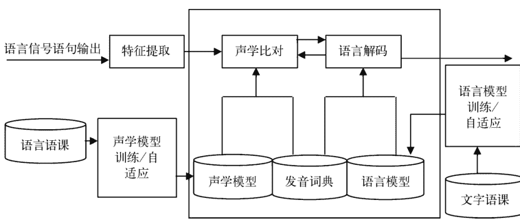

图 4-18 语音识别系统核心流程

作为交叉学科典范，语音识别融汇计算机、信号处理、统计学、声学、语言学及神经生理学等领域精华。

**演进脉络**：
*   **萌芽与奠基（50s-70s）**：苏联学者 Vintsyuk 引入动态规划 (DP) 攻克语音长短不一难题，衍生出 DTW 算法；线性预测编码 (LPC) 破解特征提取。此期以孤立词建模为主。
*   **高速成熟期（90s至今）**：模型精细化、参数优化与自适应技术突飞猛进，技术步入产品化阶段，并与 NLP 融合催生对话系统。NIST 评测推动场景从朗读走向真实会议语音。
*   **中国力量**：起步虽晚但增速猛，非特定人大词汇连续语音识别已逼近国际前沿，产品化落地成果丰硕。主流系统架构包含前端处理（特征提取/归一化/预分段）、声学匹配与语言解码（基于 Viterbi 等动态规划搜索最优路径）三大核心模块。

##### 4.3.5.2 嗅觉识别：机器人“寻味”三部曲

嗅觉识别赋能机器人在灾难搜救、气体泄漏监测等高危场景发挥关键作用。其核心逻辑在于视嗅融合：先用贝叶斯推断判别气味源属性（源头/非源头/障碍物），再借流体力学建模浓度场，最终依托领航机器人视嗅协同锁定坐标。

**三大关键步骤**：
1.  **搜源**：群体机器人编队巡航，传感器捕捉疑似气体。面对气流破碎、堆积及障碍物干扰导致的分布不均，引入贝叶斯算法修正初步判断。
2.  **定源**：领航者抵达疑似点，率领群体执行“Z”字轨迹采样。实时结合流体力学计算浓度，阈值触发后转入盘旋搜索，圈定源头空间范围。
3.  **辨源**：视觉主导、嗅觉辅助的协同机制登场。视觉系统凭借形状、色彩、方位等直观特征配合注意力机制精准锁定，弥补嗅觉传感器分辨力不足，完成最终确认。

#### 4.4 实战范式：植物叶片图像识别

叶片因纹理、色态、形态差异显著且采集便利、周期长，成为植物分类核心依据。融合叶片多维特征识别正确率超 90%。

*   **算法创新**：张宁团队融合克隆选择算法与 KNN；邓立苗针对玉米提取 48 维特征配合 SVM 达 96% 高识别率；翟传敏引入分形理论解析叶缘叶脉；邹秋霞落地安卓端分类应用。
*   **国际竞技场 (CLEF)**：2011年起常态化举办，物种库扩容至千级。Villena-Romto 验证 SIFT 有效性；Backes 用复杂网络抗噪抗分辨率变化；Ghazi 在 LifeCLEF2015 中以 PCANet 刷新扫描叶片识别率至 90.49%。
*   **趋势**：科研与应用并行，复杂器官与拍摄条件成新考点。

## 参考文献

- [1] 赵学明,熊慧森,周越,等.模式识别.上海：上海交通大学出版社,2013.
- [2] 范含敏,王浩.模式识别方法概述.电子设计工程,2012,20(19)：48-51.
- [3] 赵中堂.基于智能移动终端的行为识别方法研究.成都：电子科技大学出版社,2015.
- [4] 刘潇.语音识别系统关键技术研究.哈尔滨：哈尔滨工程大学,2006.
- [5] 黄子君,张亮.语音识别技术及应用综述.江西教育学院学报,2010,31(3)：44-46.
- [6] 段峰,王耀南,雷晓晓,等.机器视觉技术及其应用综述.自动化博览,2002,3：59-61.
- [7] 郭萍.基于视频的人体行为分析.北京：北京交通大学,2012.
- [8] 汪亮.基于可穿戴传感器网络的人体行为识别技术研究.南京：南京大学,2014.
- [9] 祁家榕,张昌伟.行为识别技术的研究与发展.智能计算机与应用,2017,7(4)：24-26.
- [10] 侯婕.人脸表情计算研究技术.苏州：苏州大学,2014.
- [11] GUO Y, ZHAO G. Discriminative features for texture description. Pattern Recognition, 2012, 45(10)：3834-3843.
- [12] 周宇旋,吴柔,梁久祯,等.判别性完全局部二值模式人脸表情识别.计算机工程与应用,2017,53(4)：163-169.
- [13] 徐文晖,孙正兴.面向视频序列表情分类的 LSVM 算法.计算机辅助设计与图形学学报,2009,21(4)：542-548.
- [14] 赵艳.基于深度学习的表情识别研究.重庆：重庆邮电大学,2016.
- [15] 罗翔云.基于深度学习的人脸表情识别.杭州：杭州电子科技大学,2017.
- [16] 杨晓龙,闫河,张杨.人脸表情识别综述.数字技术与应用,2018,36(2)：213-214.
- [17] 赵力,钱向民,邹荣荣,等.语音信号中的情感识别研究.软件学报,2001,12(7)：1050-1055.
- [18] 陈建夏,李翠华.语音情感识别的研究进展.计算机工程,2005,31(13)：35-37.
- [19] 赵腊生,张强,魏小鹏.语音情感识别研究进展.计算机应用研究,2009,26(02)：428-432.
- [20] 陆文星，王燕飞.中文文本情感分析研究综述.计算机应用研究,2012,29(6)：2014-2017.
- [21] 倪崇嘉，刘文举，徐波.汉语大词汇量连续语音识别系统研究进展.中文信息学报,2009,23(1)：112-123.
- [22] 邹海洋.多智能机器人群体嗅觉系统的设计.电脑知识与技术,2015,11(33)：129-130.

## 5 人工神经网络与深度学习

### 5.1 核心概念溯源与演进

#### 5.1.1 人工神经网络（ANN）：仿生智能的演变史

ANN 起源于 AI 早期算法，历经多学科融合，因 Hinton 深度学习突破再掀热潮。其本质是模拟人脑神经元网络：海量人工神经元并行协作，抽象生物神经系统核心特征，构建基于连接主义的非线性动力学仿生模型。Hecht-Nielsen 将其定义为有向图拓扑的动态系统，通过状态响应处理信息。简而言之，ANN 是模仿大脑结构与功能的信息处理系统。

**三大历史阶段**：
1.  **奠基期（1943-60s前）**：McCulloch-Pitts 提出 M-P 神经元模型；Hebb 学习规则确立权值存储机制；Eccles 突触模型提供生理佐证；Uttley 推理机模拟条件反射；Widrow-Hoff 发明 Adaline 网络，实现快速高精度训练。
2.  **低谷期（60s-70s末）**：Minsky 指出单层感知机无法解决非线性问题（如 XOR），引发质疑。但 Kohonen 自组织映射 (SOM)、Anderson 交互存储器、福岛邦彦 “新认知机” 等奠基性工作在暗流中涌现，为后续复兴埋下伏笔。
3.  **爆发期（80s至今）**：Hopfield 网络证明稳定性，重燃信心；Rumelhart 等推出 PDP 并行分布式处理思想；90s 中后期理论深化与新模型井喷（如光学神经网络 PNN），至今已衍生出百余种应用模型。

#### 5.1.2 ANN 核心特质：并行、分布、容错、自适应

超越非线性本质，ANN 展现四大独特禀赋：

**1. 并行处理与分布式存储**  
海量简单单元互联构成高度并行系统，单元功能微弱但群体涌现智能。结构并行倒逼存储分布化——知识分散于全网连接权中，单节点仅存片段。读取时以“联想”模式激活，天然具备联想记忆功能。

**2. 高度非线性、强容错与非精确计算**  
神经元激活/抑制的双态映射为非线性映射，网络整体呈现高阶非线性。分布式存储双重保障鲁棒性：局部节点损坏不崩溃；面对模糊、残缺输入，联想机制可修复识别。擅长处理模拟量与模糊信息，输出最优解而非精确解。

**3. 自学习、自组织与自适应**  
自适应是核心，包含双层含义：
*   **自学习**：环境变迁中，通过训练自动调参，实现输入到期望输出的映射。学习与训练常互换使用。
*   **自组织**：外部刺激驱动突触强度按规则重塑，网络拓扑自发构建（重构）。自组织是自适应的实现路径。

**4. 模式识别先天优势**  
不仅擅长静态模式，对时空动态复杂信息处理潜力巨大。

#### 5.1.3 深度学习：多层表示学习的范式革命

深度学习非全新概念，乃 ANN 演进至多隐层阶段的产物，本质即**深度神经网络（DNN）**，亦称**无监督特征学习**或**表示学习**。

*   **去工程化**：免除人工特征设计，特征自数据中涌现习得。
*   **层级表达**：通过多层非线性变换，逐层抽象数据表征，服务分类预测。
*   **结构界定**：工程上通常指 3 层以上（含输入输出层）网络。
*   **容量法则**：参数量决定模型复杂度与“容量”，参数越多，攻克任务复杂度上限越高。

# 深度学习入门：从机器学习演进到核心网络架构

在正式踏入深度学习的领域前，有必要先梳理清楚“机器学习”这一基石概念。机器学习隶属于人工智能分支，其核心逻辑在于：借助算法让机器从海量历史数据中挖掘规律，进而具备对新样本的智能识别能力，或对未来趋势做出预判。机器学习的演进大致分为两个纪元：早期的“浅层学习”时代，以及当下主流的“深度学习”时代。前者此处不再赘述，我们聚焦于后者。

公认的深度学习元年，始于 Hinton 教授及其学生 Salakhutdinov 在《科学》杂志发表的里程碑式论文。该文释放了两大核心信号：一是多隐层神经网络拥有卓越的特征学习本领，能提炼出更本质的数据表达，极大助力可视化与分类任务；二是困扰深层网络训练的难题，可通过“逐层初始化”策略有效化解（文中采用无监督学习实现）。自此，深度学习研究按下加速键，延续至今，也直接推动了人工神经网络的强势复苏。

---

### 主流深度学习框架全景速览

掌握概念后，工具选择至关重要。深度学习框架专为该领域打造，具备独立架构、统一范式、复用方案等特性，典型优势在于高内聚、严规范、强扩展、易维护、广通用，能通过模板化结构大幅削减重复造轮子的成本。随着领域爆发，框架百花齐放，当前主流阵营主要集中在以下六大选手（详见对比表）：

| 框架名称 | 维护主体 | 支持语言 | 适配系统 | 核心亮点 |
| :--- | :--- | :--- | :--- | :--- |
| **Caffe** | UC Berkeley 视觉与学习中心 | C++, Python, MATLAB | Linux, macOS, Windows | 模块化设计，表达与实现解耦，测试完备，接口丰富 |
| **TensorFlow** | Google | C++, Python | 全平台 | 极致灵活，强扩展，自动求导，可视化友好 |
| **CNTK** | 微软研究院 | C++, Python, Brain Script | Linux, Windows | 性能导向，高灵活，强扩展 |
| **MXNet** | DMLC 社区 | C++, Python, Julia, Go, R, MATLAB, Scala | 全平台 | 多机多卡分布式，内存管理优，兼容 Torch |
| **Torch** | Facebook, Twitter, Google 等 | Lua/LuaJIT, C | 全平台 | 强大 N 维数组，丰富切片索引，GPU 加速高效 |
| **Theano** | 蒙特利尔大学 | Python | Linux, macOS, Windows | 深度融合 NumPy，透明 GPU 调用，符号微分高效，稳定性经严测 |

---

## 5.2 人工神经网络与深度学习：理论脉络与分类体系

### 5.2.1 人工神经网络的理论基石

神经网络由海量神经元构建，神经元是其最微观的结构与计算单元。生物神经元由树突（多路收信）、轴突（单路发信）及轴突末梢（连接他处）组成，连接点称“突触”。人工神经元正是对这一生理机制的数学抽象：通过加权连接传递信号，接收输入（原始数据或上层输出），经激活计算产出输出（最终结果或下层输入）。

构建网络的首要任务是定义神经元模型。当代通用的基石是 1943 年 McCulloch 与 Pitts 提出的 **M-P 模型**。它从逻辑器件视角建模神经元，为后续所有网络研究奠定了数学地基。M-P 模型简化了生物神经元的信息处理流程，其输出公式如下：

```
y = f(\sum_{i=1}^n \omega_i x_i - \theta)
```

其中 $\theta$ 为激活阈值，$f(\cdot)$ 为激活函数，$\omega$ 为连接权重。早期常用阶跃函数（大于阈值激活，否则抑制），但因其不光滑、不连续、不可导，工程实践中更倾向于采用 **Sigmoid 函数** $f(x) = \frac{1}{1+e^{-x}}$，曲线平滑且可导。

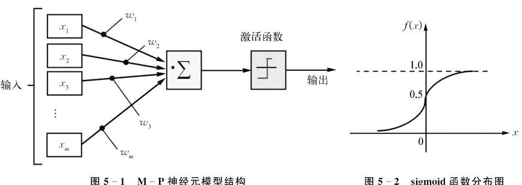

神经网络的“自适应、自学习”特性，并非通过修改神经元本身实现，而是通过**调整节点间连接权重**完成训练。学习范式由“学习方式”（有监督/无监督）与“学习规则”共同决定。主要规则包括误差纠正、Hebb 学习、竞争学习。此处重点剖析 **Hebb 规则**：

1949 年，Hebb 受巴甫洛夫条件反射启发，在《行为的组织》中提出：若两神经元同步激发，连接应强化。其数学表达为：

```
\omega_{ij} (t + 1) = \omega_{ij} (t) + \alpha y_j (t) y_i (t)
```

式中 $\omega_{ij}$ 表示连接强度，$y_i, y_j$ 为神经元输出。Hebb 规则属无监督范畴，核心思想是依据双神经元激发状态动态调整连接，模拟基础神经活动。

### 5.2.2 人工神经网络的分类图谱

按结构、功能、算法分类，初级网络主要分两类：
*   **感知器**：最简单层结构，硬限值传递函数，专攻线性二分类，效率高。
*   **线性网络**：单层线性传递，主攻线性逼近问题。

网络拓扑结构决定了信息流向与处理能力，主流划分为四大类：

#### 5.2.2.1 前馈网络
标准的层级化架构。信号单向流动：输入层 $\to$ 隐层 $\to$ 输出层。层间全连接，层内无连接，无反馈回路。每神经元收多发一，结构清晰，是基础范式。

#### 5.2.2.2 反馈网络
又称递归网络。神经元输出可反馈至同层或前层（含自环），形成闭环。信号双向流动，神经元同时处理外部输入与内部反馈，具备时序记忆能力。

#### 5.2.2.3 网状网络
全互联双向连接。全体神经元既是输入口也是输出口。外部施加输入后，网络内部相互作用演化，直至全网状态收敛稳定，完成联想记忆或优化求解。

#### 5.2.2.4 混合型网络
介于前馈与网状之间。在前馈骨架上引入同层横向连接，旨在约束同层神经元同步激发/抑制的数量，实现特定功能（如竞争机制）。

发展至今，涌现出大量经典模型，下表梳理了史上极具影响力的网络谱系：

### 表 5-2 里程碑式神经网络回顾

| 网络名称 | 发明者/机构 | 年代 | 核心特点 | 核心局限 | 典型应用 |
| :--- | :--- | :--- | :--- | :--- | :--- |
| **感知器** | Frank Rosenblatt | 1958 | 奠基之作，具学习力，线性分类 | 非线性不可解，敏感于平移/旋转/缩放 | 字符/语音识别、记忆研究 |
| **Adaline** | Bernard Widrow | 1960-62 | 学习力强，早期商用 | 仅适线性映射 | 雷达控制、回波消除 |
| **Cerebellatron** | Marr D. (MIT) | 1969-82 | 协调指令序列，动作插入 | 控制输入极复杂 | 机械臂运动控制 |
| **BP 网络** | Werbos, Rumelhart, McClelland | 1974-85 | 多层前馈，MSE 学习，应用最广 | 依赖大量数据，训练慢，易陷局部极小 | 语音、控制、模式识别 |
| **ART 网络** | Carpenter & Grossberg | 1976-90 | 任意复杂 2D 模式自组织 | 受平移/旋转/尺度影响，系统复杂 | 复杂未知模式识别 |
| **BSB 网络** | James Anderson | 1977 | 单层自联想，片段补全 | 一次性决策，无重复共振 | 概念形成、分类、知识处理 |
| **Neocognitron** | Fukushima K. | 1978-84 | 多层结构化识别，不变性强 | 需海量单元与连接 | 手写字符识别 |
| **SOM 网络** | Tuevo Kohonen | 1980 | 自组织聚类映射 | 需预知类别数 | 语音、机器人、图像 |
| **Hopfield 网络** | John Hopfield | 1982 | 单层自联想，去噪复原 | 无学习力，权重需预设 | TSP 求解、优化、联想记忆 |
| **Boltzmann/Cauchy 机** | Hinton, Sejnowski | 1985-86 | 随机学习求全局最优 | 训练耗时/统计噪声 | 图像/声呐/雷达模式识别 |
| **BAM 网络** | Bart Kosko | 1985-88 | 双向联想单层，易学习 | 存储密度低，需编码 | 内容寻址联想记忆 |
| **CPN 网络** | Robert Hecht-Nielsen | 1986 | 统计最优/概率密度分析 | 需海量单元连接，高精度要求 | 神经计算机、图像、统计 |

---

### 5.2.3 深度学习核心模型族谱

深度学习在浅层网络基础上引入深度架构与高效训练机制，催生出四大支柱模型：

#### 5.2.3.1 卷积神经网络 —— 视觉领域的霸主
CNN 通过**局部感知、权值共享、池化下采样**充分利用数据局部相关性，实现平移/变形不变性。标准架构五层叠加：
1.  **输入层**：接收像素矩阵。
2.  **卷积层**：核心引擎，子矩阵卷积映射生成深度特征图，层层抽象。
3.  **池化层**：统计聚合（最大/平均池化），不变深度、缩小尺寸、精简结构。
4.  **全连接层**：多轮卷积池化后，输出分类判别。
5.  **Softmax 层**：概率分布输出，完成最终分类。

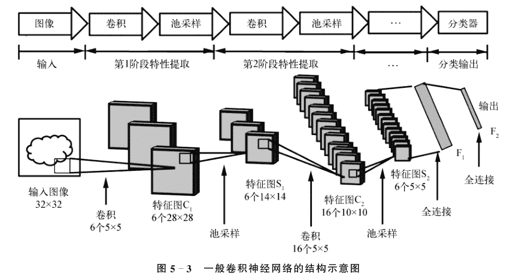

#### 5.2.3.2 受限玻尔兹曼机 —— 深度生成模型的鼻祖
RBM 在玻尔兹曼机基础上施加“限制”：**显性单元（可见层）与隐性单元（隐层）全连接，层内节点互不相连**。这种二分图结构极大简化了推断与训练，核心算法为**对比散度快速学习算法**。

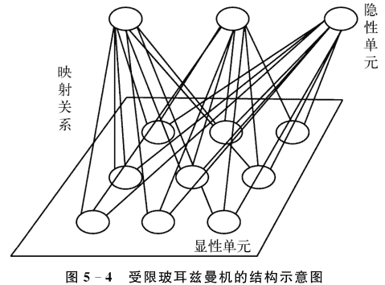

#### 5.2.3.3 自动编码器 —— 无监督特征学习的经典范式
1986 年 Rumelhart 提出。由**编码器（压缩）**与**解码器（重构）**对称组成。编码器将输入压缩为潜在表示，解码器尽力从压缩码复原输入。本质上是学习输入数据的高效压缩与重构映射，迫使隐层捕捉最本质特征。

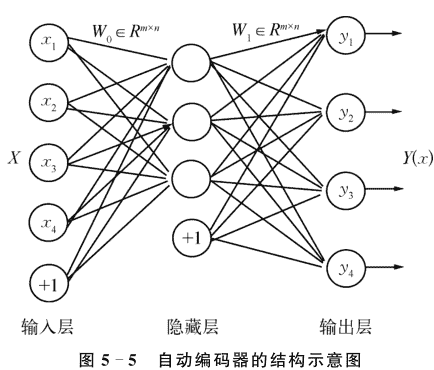

#### 5.2.3.4 递归神经网络 与 长短期记忆网络 —— 序列建模的利器
人类理解语言、视频高度依赖上下文。RNN 引入循环模块，让信息跨时间步传递。展开来看，单元 $A$ 接收 $x_t$ 产出 $h_t$，循环结构实现 $t \to t+1$ 的信息保持。

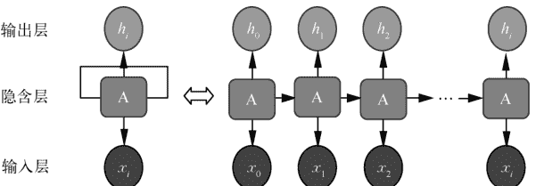

训练采用**前向传播 (FP) 按序计算，反向传播 (BP) 逆序回传误差**（BPTT）。但标准 RNN 面临**长期依赖梯度消失**难题：远距离信息梯度衰减，无法有效回传。

**LSTM** 由 Hochreiter 与 Schmidhuber 于 1997 年提出，专治此痛点。它保留 RNN 链式骨架，但将简单的循环单元升级为包含**四个交互神经网络层**的精密记忆模块（遗忘门、输入门、细胞状态、输出门），通过门控机制实现长程信息的选择性记忆与遗忘，完美解决梯度消失，成为序列建模的黄金标准。

# LSTM 核心架构：记忆与门控的精妙平衡

LSTM 的设计精髓在于其独特的单元状态 $c_t$（如图 5-7 所示）。这条贯穿始终的水平传递线路，让信息能以极小的线性损耗跨越时间步长距离流动。更关键的是，LSTM 引入了“门控”机制——通过 Sigmoid 层输出 0 到 1 之间的权重，配合点乘运算，精准调控信息的“写入”与“擦除”：0 意味着彻底屏蔽，1 则代表完全接纳。这一过程由三大门协同完成：

1.  **遗忘门（Forget Gate）**：作为“清道夫”，依据 Sigmoid 判定上一时刻状态 $c_{t-1}$ 中哪些旧信息该被丢弃（对应图中最左侧模块）。
2.  **输入门**与**候选状态生成**：分两步走。输入门的 Sigmoid 层先筛选当前输入的价值（左二模块）；随后 tanh 层创建候选状态向量（左三模块）。二者合力，按比例融合旧记忆与新观测，更新生成 $c_t$。
3.  **输出门**：掌握“发声权”。它结合最新单元状态 $c_t$ 经 tanh 激活后的值，通过 Sigmoid 计算的权重（左四蓝色模块），决定最终向外输出的隐藏状态 $h_t$。

这三道关卡层层把关，使 LSTM 能灵活切换长短期记忆模式，有效攻克了传统 RNN 的梯度难题。

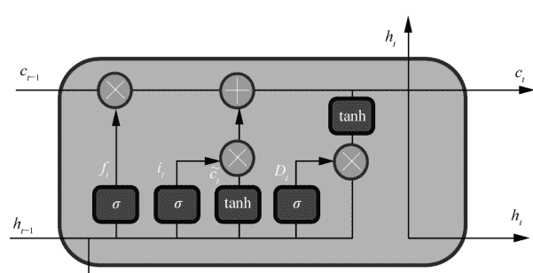

###### 图 5-7 LSTM 循环单元结构示意图

上述四大基石模型奠定了深度学习的半壁江山，后续百花齐放的改进架构大多源此演进。表 5-3 梳理了关键里程碑模型的谱系演变：

### 表 5-3 深度学习经典改进模型谱系表

| 年份 | 模型名称 | 核心贡献者 | 结构范式 | 训练策略 | 核心突破与适用场景 | 主要短板 |
| :--- | :--- | :--- | :--- | :--- | :--- | :--- |
| **早期奠基与概率图模型** | | | | | | |
| 1969 | 感知机 | Minsky & Papert | 单层 | — | 解决线性可分基础分类 | 无法处理异或等非线性问题 |
| 1974 | BP 反向传播 | Werbos | 多层 | 链式法则 | 打通多层网络训练，推广至复杂非线性映射 | 易陷局部最优、过拟合 |
| 1985 | 玻尔兹曼机 | Ackley, Hinton, Sejnowski | 多层全连 | — | 引入统计力学能量模型，随机生成能力 | 配分函数难计算 |
| 1986 | 受限玻尔兹曼机 | Smolensky | 双层无向 | 对比散度 | 简化 BM 拓扑，高效近似分布，开启无监督预训练 | 训练效率偏低 |
| 2002 | 连续 RBM | Chen & Murray | 双层 | MCD/BP | 扩展至连续值数据建模 | 超参数敏感，调优难 |
| 2010 | 稀疏组 RBM | 罗恒等 | 双层 | 稀疏惩罚/BP | 引入生物学启发稀疏约束 | 隐含单元分组依据模糊 |
| **深度生成与信念网络** | | | | | | |
| 2006 | 深度信念网络 | Hinton & Salakhutdinov | 多层混连 | 贪心逐层+BP | RBM 堆叠，无监督预训练解决 BP 难题 | 可见层限二值，优化仍难 |
| 2006 | 深度玻尔兹曼机 | Salakhutdinov & Hinton | 多层无向全连 | BP | 自下而上生成，降误差传播 | 计算开销大 |
| 2009 | 卷积 DBN | Lee 等 | 多层局部连 | 贪心逐层+BP | 概率最大池化，实现平移不变性 | 优化复杂度高 |
| 2013 | 稀疏 DBN | Halkias 等 | 多层混连 | 混淆范数/BP | 引入混淆范数稀疏约束 | 优化困难未根治 |
| **自编码器家族** | | | | | | |
| 1986 | 自编码器 | Rumelhart 等 | 3层 | 贪心逐层 | 编解码重构，参数自学习 | 无分类判别力 |
| 2006 | 深度自编码器 | Hinton 等 | 多层 | 贪心预训练+BP微调 | 深层特征压缩，显著降维 | 深层易致梯度稀释 |
| 2007 | 堆叠自编码器 | Ranzato 等 | 3层 | 梯度下降/BP | 将 DBN 中 RBM 替为 AE，支持高斯输入 | 梯度稀释问题依旧 |
| 2007 | 稀疏自编码器 | Ranzato 等 | 3层 | 梯度下降/BP | 稀疏约束学习高阶特征表达 | 梯度稀释 |
| 2008 | 去噪自编码器 | Vincent 等 | 3层 | 梯度下降/BP | 噪声重构增鲁棒性 | 梯度稀释 |
| 2010 | 堆叠去噪 AE | Vincent 等 | 多层 | 梯度下降/BP | 深层堆叠提取鲁棒特征 | 梯度稀释 |
| 2013 | 稀疏堆叠 AE | 蒋晓娟等 | 多层 | 梯度下降/BP | 损失函数加稀疏惩罚项 | 梯度稀释 |
| **视觉核心：卷积神经网络** | | | | | | |
| 1998 | CNN (LeNet) | LeCun, Bengio 等 | 局部连接/共享权值 | 梯度下降/BP | 卷积+池化，原生支持 2D 结构，抗几何畸变 | 算力需求高 |
| 2011 | 堆叠卷积 AE | Masci 等 | 多层 | 梯度下降/BP | CAE 堆叠，层级无正则训练 | 算力需求高 |
| 2012 | 深度 CNN (AlexNet) | Krizhevsky 等 | 深层局部连接 | 梯度下降/BP | 纯监督深层 CNN，图像识别里程碑 | 算力需求极高 |
| **序列建模：从 RNN 到 Attention** | | | | | | |
| 1990 | 简单循环网络 | Elman | 3层 | BPTT | 引入时间维度，上下文传递 | 长依赖捕捉无力 |
| 1995 | RNN | Hiih, Bengio 等 | 多层 | BPTT | 深层序列建模标准范式 | 梯度消失/爆炸 |
| 1997 | **LSTM** | Hochreiter & Schmidhuber | 多层门控 | BPTT | **门控+存储单元，破解梯度难题，长程记忆** | 训练复杂、解码延迟 |
| 2014 | **GRU** | Cho, Bengio 等 | 简化门控 | BPTT | 合并门控，跑得更快、参数更少 | 表达力略逊 LSTM |
| 2014 | **Attention** | Mnih, Graves 等 | — | — | 动态聚焦关键片段，降复杂度 | 增加存储开销 |
| **生成式对抗** | | | | | | |
| 2014 | **GAN** | Goodfellow 等 | 对抗双塔 | BP/Dropout | 生成器+判别器博弈，隐式生成建模 | 训练不稳定、模式崩塌 |
| 2015 | **DCGAN** | Radford 等 | 卷积对抗 | BP/梯度下降 | CNN 架构注入 GAN，分布拟合更强 | 训练稳定性仍待解 |

---

# 5.3 实战落地：深度学习重塑医疗新范式

尽管深度学习在视觉、语音、NLP 称霸，医疗赛道长期处于“雷声大雨点小”状态。但随着头部科技巨头入局，医学影像辅诊、智能问诊、药物筛选等场景正加速商业化落地，旨在缓解“医疗资源不均、医生负荷过重”的结构性矛盾。

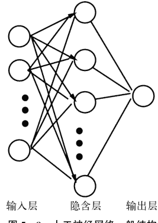

## 5.3.1 影像阅片：从“靠经验”到“算模型”

传统阅片高度依赖医生主观经验，疲劳操作与新手误诊是两大痛点。深度模型凭借超人类的像素级敏感度，已在肺结节筛查、皮肤癌分型、视网膜病变分级等硬核任务上交出亮眼答卷：

*   **Airdoc 视网膜 AI**：联合顶级眼科专家，以海量眼底图训练模型，糖网分级准确率直逼三甲主任医师水平。这对眼科专家稀缺的基层筛查网络，是降维打击式的赋能。
*   **IBM 病理切片 AI**：针对活检切片“耗时、易漏、观测难”的顽疾，深度学习实现肿瘤特征自动捕获与扩散评估，准确率对标资深病理科专家。

## 5.3.2 智能诊疗：跨模态知识推理的新尝试

影像之外，深度学习正向“临床决策大脑”进化：

*   **IBM Watson 肿瘤认知**：吞噬海量教科书、期刊、指南，4 年完成知识图谱构建，为肿瘤科医生提供循证诊疗建议。
*   **英伟达 × 美国癌症研究所**：挖掘海量诊疗实录中的治疗模式与扩散规律，为个体患者定制最优方案。
*   **吴恩达团队 ECG 心律失常模型 (2017)**：单导联心电图即可精准甄别致死性心律失常，表现超越心内科专家，为基层心脏病防控装上“AI 听诊器”。

癌症异质性极高，精准匹配方案仍是全球难题，AI 正成为破局关键变量。

## 5.3.3 延伸战场：数据、基因、药物与穿戴

*   **数据工程**：大幅提升医疗数据清洗、标注、融合效率。
*   **基因组学**：加速基因表达预测、变异位点定位。
*   **药物研发**：打破“十年十亿美金”魔咒，AI 驱动分子生成、ADMET 预测、临床试验设计，压缩周期、降本增效。
*   **移动医疗/穿戴设备**：传感器实时流 + 模型推理 = 7×24h 健康管家，动态干预慢病管理。

**现实阻力不可忽视**：训练数据质量参差不齐、医患对“黑箱”信任缺失、伦理法规与人文心理的双重博弈，仍是临床落地的“最后一公里”。

---

## 参考文献

[1] 李晶, 栾爽, 尤明慧. 人工神经网络原理简介. 现代教育科学, 2010(1): 98-99.
[2] 毛健, 赵红东, 姚婧婧. 人工神经网络的发展及应用. 电子设计工程, 2011, 19(24): 62-65.
[3] 邢广成, 强天伟. 人工神经网络的发展与应用. 科技风, 2012(15): 65-66.
[4] 山世光, 阚美娜, 刘昕, 等. 深度学习：多层神经网络的复兴与变革. 科技导报, 2016, 34(14): 60-70.
[5] 马世龙, 乌尼日其其格, 李小平. 大数据与深度学习综述. 智能系统学报, 2016, 11(6): 728-742.
[6] 余凯, 贾磊, 陈雨强, 等. 深度学习的昨天、今天和明天. 计算机研究与发展, 2013, 50(9): 1799-1804.
[7] 袁冰清, 陆悦斌, 张杰. 神经网络与深度学习基础. 数字通信世界, 2018(5): 59-62.
[8] 焦李成, 杨淑媛, 刘芳, 等. 神经网络七十年：回顾与展望. 计算机学报, 2016, 39(8): 1697-1716.
[9] 王磊. 人工神经网络原理、分类及应用. 科技资讯, 2014(3): 240-241.
[10] 朱大奇. 人工神经网络研究现状及其展望. 江南大学学报, 2004, 3(1): 103-110.
[11] 付文博, 孙涛, 梁藉, 等. 深度学习原理及应用综述. 计算机科学, 2018, 45(6A): 11-15.

---

# 6 智能机器人：赋予钢铁以“感知、行动与思考”

智能机器人之所以为“智能”，核心在于其拥有一颗高度发达的“硅基大脑”——中央处理器。它不仅能直联人类指令，更能依据预设目标自主规划并执行复杂动作序列。

业界共识将智能机器人的“三大件”定义为：**感知系统（知环境）、运动系统（动躯体）、思考系统（谋策略）**。

### 感知：数字化的“五官”
覆盖非接触（视觉、距离、接近）与接触（力觉、压觉、触觉）两大维度。硬件映射为：摄像头/图像传感器（眼）、超声波/激光雷达（测距）、导电橡胶/压电元件/气动元件/行程开关（触/力觉）。

### 运动：全地形适应的“四肢”
摒弃轨道束缚，需征服平地、台阶、墙面、楼梯、坡道等非结构化地形。执行机构涵盖：轮式、履带式、足式、吸盘式、气垫式等多模态移动平台。控制维度从单一位控扩展至力控、位力混控、柔顺控制等高阶策略。

### 思考：灵魂核心的“中枢”
判断、推理、理解等认知活动，本质是信息处理过程，算力单元为物理载体。依智能层级分三档：

#### 1. 传感型（从属式/外部大脑）
*   **架构**：本体无智能单元，仅含执行/感知层；上位机承载全部智能算法。
*   **流程**：本体采集多模态数据（视听触近红外超声激光 + 姿态轨迹）上传 → 上位机融合决策 → 下发控制指令。
*   **典型场景**：RoboCup 小型组比赛机器人——全局上帝视角、集中式调度。

#### 2. 交互型（半自主/人在回路）
*   **能力**：具备本地计算单元，支持人机对话交互；能独立完成轨迹规划、基础避障等边缘推理任务。
*   **局限**：高层决策、复杂任务调度仍依赖外部监控或操作员介入。

*(后续内容待续...)*

### 3. 自主机器人：无需人工介入的“独立行者”

这类机器人在设计定型后，即可摆脱人工操控，在多变环境中自动完成各类拟人化任务。其本体内置感知、决策、执行等核心模块，宛如一个拥有自主意识的个体，能独立活动、解决难题。机器人世界杯中型组的参赛选手便是典型代表。全自主移动机器人的核心亮点在于“自主性”与“适应性”：前者指其能在特定场景下零外部依赖地执行任务；后者指其能实时感知环境变化，动态调整参数、策略及应急处理。此外，“交互性”亦不可或缺，支持机器人与人、环境及同类间的信息流通。鉴于此类机器人融合了驱动控制、传感器融合、图像处理、模式识别、神经网络等前沿技术，堪称制造业与AI水平的“综合试金石”，故而备受各国重视。

智能机器人研发肇始于上世纪60年代，历经数十载演进，基于感觉控制的第二代机器人已步入实用化阶段；而基于知识控制的第三代自主机器人也取得长足进步，诞生了多款原型机。

---

### 6.1 人体行为：解码行动背后的心理密码

行为，是有机体在内外刺激共同作用下的活动总和。不同心理学流派切入点各异：生理心理学聚焦激素与神经的生理机制；认知心理学从信息加工视角剖析心理机制；社会心理学则立足人际互动，洞察个体与群体行为的心理根源。

欲界定行为概念，先须厘清“行动”范畴，以将行为与单纯生理运动区分。行动概念分广义与狭义：狭义行动指由一系列随意与自动化运动组成、指向特定目的的行为；广义行动则可拆解为“行”与“动”两维度（详见下图）。

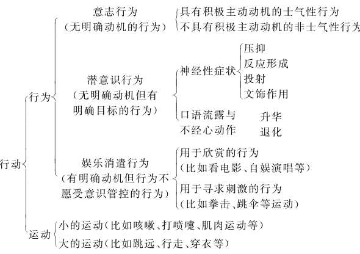

**图 6-1 行动概念**

按成因分，行为可分个体行为与群体行为；按功能分，涵盖摄食、躲避、性行为、探究行为；若依目标与动机在意识中的明确度与能动性，则可划分为**意志行为、潜意识行为、娱乐消遣行为**三大类。

#### 一、 意志行为：目标清晰的主动出击
指个体怀揣明确动机与目标的行为。依据个人动机与整体长远目标是否同频，又分**士气性行为**（积极主动动机）与**非士气性行为**（消极被动动机）。“积极主动性”实为个体动机与长远目标的统一度，涵盖个体与群体、战术与战略、短期与长远目标的对齐。

**案例：** 同父同母、同环境长大的两兄弟，人生轨迹截然不同。父亲酗酒吸毒、杀人入狱。哥哥重蹈覆辙，弟子却成企业高管、家庭美满。被问及成因，二人异口同声：“有这样的爸，我能咋办？”**关键差异在于：弟弟将求生欲与远大目标绑定，哥哥却得过且过、自暴自弃。**

> **核心洞察：** 动机的积极性不取决于情绪愉悦与否，而在于心理活动是否服务于长远目标。恐惧本是消极情绪，若关联“逃跑”则消极，若关联“消灭敌人以保存自己”则转为积极——韩信“背水一战”即利用恐惧激发斗志。

#### 二、 潜意识行为：明目标、无动机的“自动驾驶”
指个体虽有明确行为目标，却不知为何而为。潜意识是被压抑或未被觉知的本能欲望与经验，因不为道德理智所容，只能伪装表现（如梦境）。行为上主要表现为：
1.  **口语流露/笔误**等非自主动作；
2.  **神经症症状**：过强潜意识导致的变异行为，含压抑、投射、升华等机制。

#### 三、 娱乐消遣行为：有动机、无固定目标的“自由游戏”
指个体虽有娱乐动机，但目标模糊、随意性强（如看电影、跳舞、漫游均可满足）。细分为**审美欣赏**（求美感）与**刺激消遣**（求快感）。其心态特征为“情趣、情调、爱好”三位一体（如集邮）。

**本质重读：** “玩”非虚度，乃**本能的学习与试验**。动物界通过玩乐锻炼技能、测试极限、传递经验（猫科分化即自然选择与玩乐经验遗传的合力）。人类的学习、体育锻炼实为从娱乐行为中分化出的高级形态。娱乐消遣具“反强迫性”：**生而为乐，顺应天性，强制灌输或强制戒游皆因违背自主规律而难奏效**，唯非强制性诱导有效。

#### 6.1.1.1 行为三类的博弈与统一
三者可融合（如寓教于乐），但更多时候**相互制约**。意志行为常需克服潜意识冲动与娱乐诱惑。士气性行为的核心任务，正是抑制非士气诱惑，攻克潜意识与娱乐心理的干扰。

#### 6.1.1.2 三类行为的意志特征画像
| 行为类型 | 核心特征 | 痛点与局限 |
| :--- | :--- | :--- |
| **潜意识行为** | 内在意愿被压抑/未觉察，外界刺激如“遥控器”随时触发 | 当事人不知所以然，或知而难控 |
| **娱乐消遣行为** | 动机清晰，但拒绝目标被意识节制，重过程体验 | 缺乏明确完成标准，难以界定任务程度 |
| **意志行为** | 动机目标明确，受意识支配监控 | **≠ 理智行为，≠ 心理健康行为**；可能含不切实际空想或激情冲动 |

**管理心理学视角：** 行为具六大特质——**目的性**（有意识、可组织）、**能动性**（主动改造世界）、**预见性**（规律可循）、**程序性**、**多样性**、**可度性**（可测度、可控制）。

---

### 6.1.1 运动神经系统：人体的“指挥中枢”与“高速公路”

神经系统是机体主导系统，由脑、脊髓及周围神经构成，结构最复杂、功能最核心。它接收内外环境信息，经中枢整合后下达指令，调节器官活动，维持内环境稳态。

**架构拆解：**
*   **中枢神经系统 (CNS)：** 脑 + 脊髓（反射弧核心）。接收全身传入信号，整合输出运动指令，或存储为记忆基础，思维活动亦基于此。
*   **周围神经系统 (PNS)：** 脑神经 + 脊神经 + 内脏神经。连接中枢与躯体/内脏，执行控制调节。

**反射——神经系统的基本活动模式：**
对刺激的规律性反应称“反射”。其结构基础是**反射弧**（见下图），含五环：感受器 → 传入神经 → 神经中枢 → 传出神经 → 效应器。任一环节断裂，反射即中止。中枢抑制会削弱或终止传出冲动。

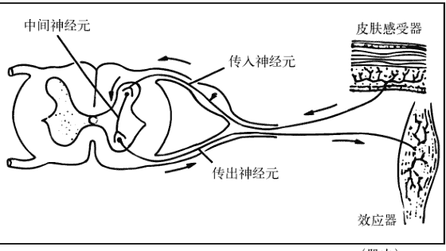

**图 6-2 反射弧**

**运动神经（传出神经）：** 专指支配骨骼肌的传出纤维，功能为产生/控制运动与张力。脊椎动物除躯体运动神经外，植物神经亦含运动成分（如血管运动神经）。广义上常将分泌神经并入。注意：纯运动/感觉神经罕见，多为混合型，术语使用需严谨。

---

### 6.1.2 人体运动的控制：从硬件架构到杠杆力学

**广义运动系统** = 中枢神经 + 周围神经/神经肌接头 + 骨骼肌 + 心肺代谢支持。
**狭义运动系统** = 骨 + 关节 + 骨骼肌。骨构架体形、供肌肉附着；肌肉在神经支配下收缩，借关节枢纽产生杠杆运动。

#### 6.1.2.1.1 运动系统的三大核心职能
1.  **运动执行：** 从简单位移到语言书写，均依赖神经支配下的肌肉协同收缩。即便简单动作，也涉及主动肌、协同肌、拮抗肌（适度放松维持张力）的精密配合，保证动作平滑精准。
2.  **支持撑持：** 构建体形、承担体重、护持脏器、维持姿势。姿势维持靠骨架支撑 + 肌张力动态平衡（对抗肌群持续不随意紧张）。
3.  **防护缓冲：** 躯干形成颅腔、胸腔、腹盆腔保护核心脏器。骨性壁为主，肌肉构成弹性保护层，受击时反射性收缩吸能减震。

#### 6.1.2.1.2 运动力学：身体自带的“杠杆系统”
*   **摆动相（远步）：** 肢端离地，以近端关节（如肘）为支点，**力臂 < 重臂**的**速度杠杆**，追求快（屈肌收缩提肢 → 伸肌收缩伸展落地）。
*   **支撑相：** 肢端着地推身，以着地点为支点，**力臂 > 重臂**的**省力杠杆**，追求稳（伸肌收缩推进）。
*   **四肢交替：** 后肢撑身重心前移，前肢撑身重心后移，躯体呈波动式前进。

---

### 6.1.2.1 大脑控制运动的机理：分级指挥，各司其职

**核心颠覆：** 大脑**非**运动具体执行者，**纹状体才是运动的直接指挥官**。大脑主管认知思维，将运动“外包”给底层核团，实现“心身分离”的高效并行。

#### 多脑区协作流水线
| 脑区 | 核心角色 | 关键产出 |
| :--- | :--- | :--- |
| **丘脑** | 直觉合成器、“我”的本体器官 | 合成发放“觉” → 进入大脑联络区 → 形成**运动意向/意识** |
| **大脑额叶 (联络区/运动前区/运动区)** | 高级决策、意向发源地 | 分析视听信息 → 产出**运动意向样本** (做什么、怎么做) |
| **纹状体** | **运动控制核心、具体指挥官** | 依据意向分析产出**运动程序/指令样本** (怎么动、细节参数) |
| **小脑** | 运动参数调校师、精度保障 | 分析运动参数，控制细节，保准确度/精确度 |
| **肢体/效应器** | 终端执行器 | 完成物理动作 |

#### 运动意向的三重来源
1.  **大脑源：** 认知分析后的主动意向；
2.  **纹状体/小脑源：** 运动前感觉（即将动的“预感”）；
3.  **感觉神经元源：** 运动后感觉（动完的反馈）。

#### 双路并行：从“想动”到“会动”的神经回路
大脑额叶产出运动意向样本，激活丘脑背内侧核合成“正觉”进入意识（路径一：知觉层面），同时经投射纤维激活**纹状体、小脑**（路径二：执行层面）。

**运动样本的“三级接力赛”（执行通路）：**
1.  **第一棒：纹状体/小脑 → 丘脑腹前/腹外侧核 → 丘脑背内侧核 → 大脑额叶联络区（意识预演）。**
    *   *作用：* 运动未启动前，先“预演”给大脑看。大脑可随时叫停、修正意向、触发新样本——**这是“后悔药”与“微调器”的关键窗口。**
2.  **第二棒：丘脑腹前/腹外侧核 → 大脑运动区/运动前区。**
    *   *作用：* 将程序传递至最终发放区。
3.  **第三棒：大脑运动区 → 锥体束 → 低级运动神经元 → 肌肉执行。**
    *   *铁律：* 运动区受联络区（意识）支配，**最终发放权在意识手中**，可随时中止。

**总结：** 运动控制是一场精密的“上意下达、下报上知”闭环。高层定战略（大脑），中层排兵布阵（纹状体/小脑），底层执行落地（脊髓/神经/肌肉），丘脑贯穿始终充当“翻译官”与“广播台”。这种分级架构，让我们在行走、打字、驾驶时，意识得以游离于高维思考，而身体自主完成精密操作——**这才是生命进化的智慧巅峰。**

### 运动闭环与智能仿生：从神经机制到机器人进化

动作启动瞬间，本体感受信号经由感觉通路回传中枢，大脑依据执行细节与完成度进行复盘，构建起“感知—评估—修正”的完整回路，据此决定维持原动作或即时纠偏。

**大脑皮层与基底核/小脑：决策中枢与执行引擎的分工**

大脑皮层（额叶、顶枕颞区）整合环境线索、行为意图与任务目标，生成**运动意向**——即主观上的“我想行动”，经由丘脑投射进入觉知，属于战略规划层面，不直接下达肌肉指令。真正掌握“如何运动”、输出具体程序与指令的是纹状核与小脑皮层。它们解析生成运动程序样本，双向发力：一方面激活丘脑腹前/腹外侧核群投射觉知，另一方面直接驱动脊髓运动池。

由此，运动相关意识可解析为三个层级：
1.  **运动意向**：源自皮层环境建模，是“拟行动”的念头。
2.  **运动前感**：源自基底核/小脑程序样本激活丘脑，是“即将如此执行”的预判。
3.  **运动后感**：源自外周感受器激活丘脑，是动作终结后的“结果反馈”。

**内部模型：刻入基底核的“自动化脚本”**

纹状核依托“内部模型”输出指令。此模型非先天具备，而是无数次试错、重复后固化的稳定模式。新生儿无技能，唯有在持续与物理世界博弈中，将一次次运动程序样本存储叠加，最终在纹状核建立模型库。

习得初期，纹状核需实时解析指挥并同步归档样本；经大量重复后模型定型，动作即可剥离觉知自主运行——这正是**习惯与技能**的神经底座：不再占用皮层算力，由基底核自主托管。

###### 6.1.2.1.3 α 与 γ 运动神经元：终末通路与灵敏度调节器

脊髓腹角聚集海量运动神经细胞，分 α、γ 两型，轴突直达效应器，均以乙酰胆碱为信使。

*   **α 型运动神经元**：轴突分叉连接骨骼肌主力纤维（核外肌），是**肌肉收缩的汇聚终点**。单个 α 细胞及其控制的全部肌纤维构成“运动单元”。精细操作（如眼动）单元极小（仅数至十余根纤维），粗大发力（如肢体推拉）单元可达千余根。
*   **γ 型运动神经元**：专联肌梭内核内肌纤维，不直接出力，专职**调节感受器阈值**。

α 细胞整合皮层随意指令与外周反射输入，是运动执行的最后一站。

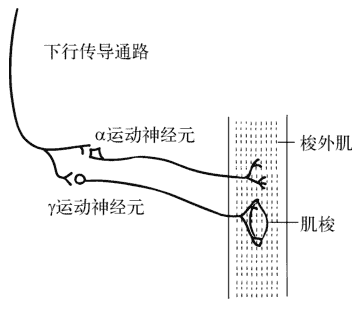

###### 6.1.2.1.4 脊髓反射：无需皮层参与的“极速回路”

反射中枢设于脊髓，按感受器性质分为体表反射与深部反射。

**1. 屈肌反射——身体的“急刹车”**
体表遭遇损伤性信号，经脊髓中间神经元激活 α 运动神经元，驱动屈肌收缩、伸肌松弛，肢体闪电般撤离。这是典型防御性反射。平时高位中枢抑制非损伤性体表反射；一旦皮层下行通路受损（如麻醉、锥体系病变），抑制解除，反射异常增强。临床经典的 **Babinski 征阳性**（划足底致大趾背伸、四趾张开），本质即屈肌反射的释放，提示上位运动神经元受损。

**2. 牵张反射——维持姿态与精准发力的“隐形引擎”**
肌肉被拉长 → 肌纺锤受牵拉 → 传入冲动激活同侧 α 运动神经元 → 同一肌肉收缩抗拉。膝跳反射即此类典型。

*   **核心感受器——肌纺锤**：夹于肌纤维间，平行排布。内含特化肌纤维（核袋/核链），中央部无肌原纤维但弹性极佳，布满粗大、高速的 Ia 传入纤维。
*   **α-γ 协同激活的精妙设计**：
    *   **α 激活** → 核外肌缩短 → 肌纺锤卸载 → 传入减少 → 自我制动（负反馈）。
    *   **γ 激活** → 核内肌两端收缩 → 拉长中央感受区 → 传入增加 → 促进 α 兴奋（正驱动）。
    *   **随意运动时**：中枢同步下达 α/γ 指令。γ 先预紧感受器“预置增益”，α 驱动肌肉缩短；感受器因 γ 驱动维持高灵敏度，持续输入强化 α 输出，至重物被举起、肌肉缩短使感受器卸载。呼吸同理：吸气肌与核内肌同步收缩，感受器反馈强化吸气，肌肉缩短终止反馈进而结束吸气，**牵张反射竟成了呼吸节奏的发生器**。
*   **肌张力**：抗重力肌持续被拉长 → 感受器持续放电 → α 维持收缩 → 对抗重力保持体态。切断后根，传入中断，肌肉瞬间弛缓，证明肌张力本质是反射性维持。

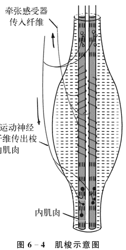

**3. 腱器官反射——防止“过度发力”的“熔断器”**
高尔基腱器官串联于肌腱胶原间，感受肌肉主动收缩张力（等长时最敏感）。其传入经中间神经元**抑制**同侧 α 运动神经元，属多突触反射。当张力过大威胁结构安全时，强制抑制收缩，实施保护性“熔断”。

#### 6.1.3 情绪、内分泌与运动：重塑奖赏回路的化学对话

运动重塑心理，核心靠两大分子：**多巴胺（DA）**与**内啡肽**。

**多巴胺：渴望与行动的“底油”**
脑内合成，诺奖得主 Arvid Carlsson 确立其递质地位。主管**奖赏、动机、运动调控、唤醒**。简单说，DA 让你“想去做”，是绝大多数行为的内驱力。
*   美食 DA 水平 ≈ 基线 150%，难以抗拒。
*   尼古丁 ≈ 170%，成瘾机制同理。
*   **运动能提升 DA**：啮齿类实验证实，奔跑显著提升伏隔核 DA 代谢产物（DOPAC、HVA），强度越大、释放越多。长期训练可重塑脑内基线水平。

**内啡肽：痛苦中的“天然吗啡”与“愉悦源”**
垂体/下丘脑分泌的内源性阿片肽，强效止痛、致欣快。**长时程、中高强度、持续性有氧（如长跑）及深呼吸**可触发大量释放，形成“跑者愉悦感”，扭转负面心境，重塑自我认知。

**毅力从何而来？——阈值的重塑**
长期锻炼 → 基线 DA 水平持续抬升 → 内啡肽满足 DA 驱动的“渴求” → 大脑对 DA **耐受阈值提高** → 原本高刺激（垃圾食品、短视频）不再诱人 → **行为自控力（毅力）随之增强**。运动本质上是在用“延迟满足的苦练”，换取“奖赏系统的升级”。

**情绪风暴下的内分泌级联**
愤怒、激动时，皮层启动 **“交感—肾上腺髓质”轴**：儿茶酚胺激增 → 心肺加速、骨骼肌充血、消化抑制——备战“战或逃”。
同步激活 **HPA 轴**：下丘脑 CRH → 垂体 ACTH → 肾上腺皮质醇 → 糖/蛋白/脂肪动员、抗应激能力增强。
交感兴奋还直接促甲状腺、抑胰岛 → 血糖飙升、代谢加速；甲状腺素反馈又进一步兴奋大脑，形成正反馈环。

---

### 6.2 人体行为仿真：从“预设轨迹”到“观察学习”的跨越

工业社会让人类厌倦机械重复。1959 年首台工业机械臂诞生，解放了双手。但早期依靠轨迹插补预设动作，数据量巨大、编程繁复、泛化差，难适应非结构化环境。

**观察学习**破局而出：人类/动物习得技能的核心路径，亦是机器人进化的关键。三步走战略：
1.  **动作采集**——观摩示教者操作；
2.  **特征建模**——提炼核心技能表征，构建模型；
3.  **技能泛化**——在新场景下自主复现。

---

#### 6.2.1 仿人机器人研制史：多模态感知与共情能力的进阶之路

仿人机器人融合机构学、控制、AI、感知、通信等尖端学科，是验证具身智能理论的终极平台，关乎国家高科技竞争力。目标明确：双足直立、感知环境、自主决策、情感交互，从简单反射进化至高级认知。

全球研发里程碑式进展：

*   **日本早稻田团队 WE 系列（1992-至今）**：**“全感官整合标杆”**。WE-4 搭载视觉（CCD）、听觉（拾音器）、触觉（FSR 阵列识别推/打/抚）、温觉（热敏电阻）、嗅觉（半导体传感器辨识酒精/氨/烟味），感知模态最全。
*   **MIT Kismet（1999）**：**“会发育的婴儿体”**。6 自由度面部（眉/耳/球/睑/唇），模拟亲子情感互动，经机器学习实现认知发育，拟人类婴儿社交模式。
*   **东京理科大学 SAYA（2002）**：**“读心术大师”**。扫描人脸 18 关键点，比对记忆库识别情绪，驱动人工肌肉复现喜怒哀乐，且能经学习持续优化表达，实现人机关系自适应调节。
*   **意大利比萨大学 FACE（2005）**：**“微表情演员”**。极高拟真度，搭载 HEFES 系统，能混合输出“喜忧参半”等复杂面部状态，应用于自闭症辅助干预。
*   **德国帕德博恩 ROMAN（2006）**：**“仿生颈部工程”**。10 伺服拉线驱动面部，轻量紧凑；4 自由度颈部复现人类几何运动学特性（旋转/侧屈/屈伸/轴旋），集成视听红外惯性感知，聚焦特定场景交互。
*   **MIT/Stan Winston Leonardo（2008）**：**“共情伙伴”**。内置情感移情模块，能推测人类意图、模仿评估面部表情、关联语音声学特征与情绪反馈，实现深度情感联结。

从单一模态模拟到多模融合，从被动反射到主动共情，仿人机器人的每一步，都在逼近“拥有身体的智能”终极形态。

### 仿人表情机器人的全球演进与中国探索

2008 年 4 月，麻省理工学院发布了基于 uBot5 迭代而来的移动式灵巧社交机器人 **Nexi**。它配备双目 CCD 摄像头与额头主动式 3D 红外相机，能实时构建立体环境地图；四麦克风阵列支持声源定位，精准锁定交互对象；更拥有眨眼、张嘴、皱眉等面部自由度，可外化喜怒哀乐。同年，英西英格兰大学与布里斯托联手打造 **Jule**，以软性橡胶仿真皮肤包裹 34 个面部马达，可还原 10 种微表情，并能依语音语调自动驱动嘴唇，实现“声随表动”的实时映射。

2009 年，汉森机器人推出 **Albert HUBO**，采用仿生肌肤材质配合 31 个自由度（颈部 3 + 表情 28），不仅能模拟皮肤纹理随表情变化的细微动态，还植入了年龄/性别推断与情绪决策模块，可针对不同人群给出差异化表情反馈。2010 年，大阪大学石黑浩团队联合 Kokoro 公司推出 **Geminoid F**，以日俄混血女性为蓝本，软质硅胶皮肤搭配 15 电机与气动系统（内置储气罐、外置压缩机），远程遥控下可呈现 60 余种微表情，甚至能与真人同台演话剧，但缺乏自主情感与认知能力。2011 年，大阪大学又推出幼童机器人 **Affetto**，主打 1-3 岁儿童面部模拟，旨在通过自主发育学习揭示婴儿社交意识形成机制，填补了 Kismet 等早期机型在幼童外观与表情上的空白。

纵观近十年，全球仿人机器人研发已从单纯的材料工艺、机械结构、多传感器融合，转向**“表情表达 + 心理建模 + 发育学习 + 认知决策”**的智能交互深水区。美媒体实验室聚焦社会交互属性，日早稻田大学则深耕拟人化与情感化维度，两大流派各领风骚。

**中国起步虽晚（70 年代萌芽、80 年代开发、90 年代应用），追赶迅猛。** 哈工大在壁面爬壁、全向清扫等服务机器人上建树颇丰，但产业化落地与原始创新短板犹存，主流仍沿袭“引进消化再创新”路径。90 年代起，国内聚焦人工情感理论切入仿人赛道，并借中日感性工学会议、首届国际情感计算大会等平台搭建学术桥梁。

**国产表情机器人里程碑：**
*   **1996 年**：蔡鹤泉院士研制演讲机器人，具备眼球追踪与语联动面部肌肉。
*   **2004 年**：哈工大 **H&FROBOT-I**（8 自由度，8 大基础表情）；中科院自动化所 **“童童”**（卡通造型，百余种复合表情，融合语音识别与肢体语言）。
*   **2005 年**：哈工大 **“百智星”**幼教机器人，五大技术模块集成，实现“讲内容、做表情、动肢体”同步。
*   **2007 年**：北科大 14 自由度情感机器头，多部位协同驱动情绪模型输出。
*   **2008 年**：上大 **SHFR-I**（6 基础表情 + 视觉识别合成闭环）。
*   **2010 年**：台大 **Luo Head**（36 自由度，高仿真面部动控）。
*   **2011 年**：西安超人 **“李咏 2”**（19 自由度，255 种情绪表演出力）。

---

#### 6.2.2 行为深度学习：从“会动”到“懂事”

要让机器人拥有媲美人类的高阶智能，必须持续从生物学汲取养分。当前主流仿生行为选择路径聚焦三大支柱：**人工情感、注意机制、认知架构**。

**① 人工情感：赋予决策“冷暖”**  
摒弃冷冰冰的指令执行，引入情感状态作为行为调节器。典型案例设定办公室机器人三大基础行为（寻找、探索、玩耍）与七维情感（厌倦、坚持、挫败、不安、好奇、好玩、兴趣）。情感对行为施加激励/抑制权重，最高分行为胜出。该机制在虚拟人行为选择中亦验证有效。

**② 注意机制：学会“过滤噪音”**  
人类能在嘈杂环境中锁定对谈声音，源于选择性注意。Garforth 建模执行注意控制反应与有意识行为；Dalgagarrondo 借鉴生物视觉注意管理器，设计架构动态分配感知算力，并依环境变化评估危机/机遇，决定是否切换行为策略。

**③ 认知架构：实现“权衡利弊”**  
张惠娣融合认知与情感双模型，构建移动机器人导航决策系统：通过学习评估行为适配度，动态调整权重，形成高效行为选择闭环。

**④ 行为序列学习：从“单动作”到“会套路”**  
行为序列本质是时空轨迹的有序记录。学习路径主要有二：
*   **人机交互示教**：Gorostiza 基于序列功能图设计语音编程系统，人像教动物般逐层叠加动作；Kaplan 引入斯金纳操作条件反射，训练索尼 AIBO 完成复杂技能。
*   **观察模仿学习**：Dillmann 在智能厨房部署密集传感器捕捉人类操作动作流，机器人识别并习得同类技能。核心难点在于**“视觉关注”资源的精准分配**——如何用有限算力完整捕获动作序列，Khadhouri 等人已展开专项攻关。

---

#### 6.2.3 高仿机器人：逼真到“令人心悸”

**日本：极致拟真与商业化探索**  
*   **最新女仿真机器人**：动捕系统 + 12 气压驱动，同步复刻走路、说话；硅胶面部可微笑、咧嘴、皱眉。当前“以假乱真”窗口期 5-10 秒，目标冲刺 10 分钟。
*   **AIST HRP-4C**：身材贴合日均值女性，30 马达驱动全身，会喜怒哀乐惊、缓慢行走、眨眼、用女声对话。
*   **韩国机器人教师**：远程操控 + 语音识别交互，永不发火、不骂人，实证显著提升学生英语兴趣与自信。

**中国：江苏大学“机器人教师”差异化突围**  
1.  **仿生骨架**：内部结构 1:1 复刻人体骨骼比例，外形实测建模。
2.  **无线远控**：利用网络视频回传，后台任意端点可遥控教学、答疑，场景自适应性强。
3.  **多功能复用**：覆盖一切需仿真人出席的场景，商业变现路径清晰。
4.  **供能创新**：攻关**无线电力传输**，剥离外部线缆与内置电池，极大拓展活动半径。
5.  **超声波电机驱动**：低速大扭矩、体积微、静音，完美适配仿生行走刚需。

**全球商业化标杆**：CES 2015 东芝 **ChihimAico**，43 气压驱动器（面部 15、躯干 4、肩臂 24）支撑流畅肢体语言，定位医疗护理、家政服务、陪伴娱乐多角色。

**西安超人雕塑院**：深耕演艺型仿真人。2006 年推出院长原型 **“邹人侗”机器人**，在自动化底座上实现“外形克隆级”还原，可语音交互、简易动作。

---

### 6.3 机器舞蹈：钢铁躯壳上的艺术张力

#### 6.3.1 概念溯源与工程定义

**历史回响**：西周巧匠造“伶人”能歌善舞，是华夏机器人雏形。《北京日报》曾报道京产智能舞蹈机器人：18 余头部自由度支撑常规表情与对眼、歪嘴等高难度怪表情，兼具语音聊天。

**工程属性**：舞蹈机器人 = **娱乐机器人分支** + **运动机器人集大成者**。它融合运动设计、制造、自控、通信、感知融合、精密机械等前沿学科。拟人化是当下娱乐机器人主赛道，索尼 QRIO 为标杆。

**技术谱系**：
*   1973 年，加藤一郎（人形机器人之父）领衔造出首台两足步行机器人；
*   1996 年 **WABIAN-3** 可在人类引导下跳简单舞步；
*   2005 春晚，**索尼 QRIO 双人组**伴随刘德华《恭喜发财》共舞，成为全场“最靓的仔”。

**核心定位**：机器人舞蹈，**观赏性与系统化工程设计并重**。

#### 6.3.2 歌舞动漫仿真：二次元梦想的具象化

日本动漫为机器人形象构建了独特文化基因库。

*   **阿童木（铁臂阿童木，1963）**：日本首部国产 TV 动画。拥有超能力的少年机器人，善良、勇敢、百折不挠。探照灯大眼、黑色尖发、红靴，体型拟人化。2003 年受聘东京新宿区“未来特使”，2010 年举办“入学仪式”，国民级 IP 影响力跨越世代，80 年代亦深植中国童年记忆。
*   **铁人 28 号**：同期遥控巨型机器人代表。少年侦探金田正太郎驾驭它惩恶扬善。中世纪铠甲造型、浑厚肌肉、强健体魄。**巨大化、拟人化、需遥控/无线电操控**——折射人类渴望借钢铁躯壳实现肉身无法企及的理想。

这两大原型，一内置智能（自主），一外挂操控（异体），至今仍定义着人机关系的两种终极想象。

# 从“猫型机器人”到“高达”：动漫机器人进化的隐喻

提及 20 世纪 60 年代末的动漫机器人原型，**哆啦 A 梦**与**奥特曼**绕不开。1969 年，藤子・F・不二雄笔下的蓝色猫型机器人——哆啦 A 梦（曾译机器猫、小叮当、阿蒙）横空出世。它从 22 世纪穿越而来，腹部的“万能口袋”掏出无数奇思妙想的道具，辅佐大雄闯荡日常，构建出一个治愈童真的科幻乌托邦。这份魅力跨越时空，直至《大雄与新铁人兵团》（2011，票房 25 亿日元）、《大雄与奇迹之岛》（2012，票房 36.2 亿日元）依然刷新纪录。

同期的**奥特曼**则开启了“巨型英雄”范式。来自 M78 星云的他，银躯赤纹，象征“尖端火箭科技”与“人类血液”的融合；眼部摒弃人类黑眸，改为闪烁的宇宙生物态；必杀技不再是拳脚刀剑，而是合成光束。这一形象重塑，确立了“非地球生命体”的视觉张力。

进入 80 年代，**《机动战士高达》**拉开了“现实系”序幕。它剥离超能力外衣，聚焦地球联邦与宇宙殖民地的战争泥沼。“高达”不再是专属神器，而是可变形、可量产、普操作员均可驾驭的高科技人形兵器。自 1979 年开播，系列延绵三十余载，热度不减。

90 年代中期，**《新世纪福音战士》**引爆变革浪潮。EVA 追求个性、时尚与多元，引入仿生、软体设计，大量植入心理学、精神分析概念，嫁接西方创世神话，让机器人成为投射人性幽微的容器。

踏入 21 世纪，**《攻壳机动队》**等作品模糊了人机边界——高仿真义体、脑机融合，直指人类对 AI 未来的渴望与焦虑。不难发现，“高达”此后的机器人动漫，多以宏大战争、犯罪悬疑为底色，剧情复杂多元，在残酷血腥中承载创作者对社会、科技、战争的深层叩问。

---

#### 6.3.3 当机器人学会跳舞：感知、同步与自主的博弈

舞蹈是人类体验世界的智慧结晶，是智力、情感、身体、社会、美学、创意与精神的分层共振。万物互通，皆在关系中。

**一、 科学化创作的“三引擎”架构**
随着跨学科技术突围，机器人舞蹈创作构建起**音乐分析、人类控制、机器人舞蹈控制**三大模块。多线程并行处理，基于反应式行为驱动表演。核心在于“运动连接器”：动作可预定义，更可由机器人实时感知节奏事件、自主生成反应。

早期机器人虽形似神不似，多为预编程的“聋哑执行者”，缺乏感知自适应。文中聚焦的**感知型机器人**，基于自动音乐信号分析，构建柔性舞蹈框架：
*   **节奏捕获**：聚焦“起始时间检测”（ONSET），通过能量峰值锁定音符起点，将数字和弦信号转化为音乐数据。
*   **时空同步**：机器人依此模型，与节奏时间同步，单独自发模拟人类动态行为。
*   **行为原语**：肢体语言由三档力度节奏事件（弱/中/强）与两类感官事件组合——**色彩语义**（蓝/黄/绿/红）与**空间关系**（靠近障碍物：安全/过近）。用户通过界面动态定义映射，赋予编排自由度。

**二、 从模仿到共舞：关键探索者**
*   **中冈三益（HRP-2）**：提出**LFO（观察学习）训练法**，捕捉人类民间舞蹈空间轨迹，让双足机器人通过“看”学会“跳”。
*   **海丽（打击乐手）**：实时听觉分析打击乐音高、音色，双 Max/MSP 对象协同完成拍检测与特征提取，实现节奏同步演奏。
*   **索尼（动态夹带模型）**：依托视觉系统捕捉人体运动轨迹，神经网络实时将音乐脉冲转化为电机指令，达成人机动态同步。

**三、 感知系统全景拆解（基于 Lego NXT 原型）**
硬件层：双 NXT 模块驱动 6 伺服电机（四肢、腰、头）+ 2 传感器，支持 16 种原子动作。
软件层：三模块多线程并行。
1.  **音乐分析**：Marsyas 起始检测算法提取节奏事件 → TCP/IP Socket 实时推送。
2.  **机器人控制**：蓝牙远程接收指令，驱动电机执行。
3.  **人类控制（GUI）**：核心枢纽。
    *   *控制面板*：配置蓝牙、音频源、通信参数。
    *   *创作菜单*：依节奏/颜色动态定义动作 → 合成编排存 XML。
用户动态选择原子动作，定义编排逻辑，迈出“智能舞者”关键一步——**听懂音乐、跳出层次、支持人机共创**。

**四、 娱乐系统的“动态平衡点”**
设计需在**短期同步**（跟拍）与**长期自主**（风格）间寻找平衡，维系人造物交互关系。实测三大维度：
1.  **同步性瓶颈**：单处理器多线程竞争条件导致延迟；蓝牙吞吐量限制（50~100ms 间隔，模式切换 30ms）引发通信溢出。
2.  **动力性表现**：舞蹈风格由原子动作分布于节奏/颜色事件定义（可重复）。机器人感知环境调整表现，将人类决策多功能性映射为机器人灵活传导能力。
3.  **现实感耦合**：机器人感知人类动作、环境色彩/超声波位置，自主在多风格间切换，动作与音乐、环境同频共振。多机器人协同可构建同步编队，引入加速度、方向等传感再提升灵敏度。

---

## 7 智能系统与智能社会：专家系统的兴衰与重构

### 7.1 专家系统：把专家的“大脑”装进计算机

**本质定义**：早期 AI 核心分支。一句话概括：**专家系统 = 知识库 + 推理机**。前者是专家知识的数字化映射，后者是推理能力的计算化实现。它模拟领域专家思维，解决常人难题，输出专家级结论。

**发展脉络**：
*   60 年代初萌芽，随计算机进化成熟。
*   1982 年，斯坦福费根鲍姆教授定调：“利用知识与推理，求解需杰出专家知识的复杂问题。”
*   工程落地：知识工程师提取专家隐性知识 → 知识表示存入库 → 用户经人机界面输入 → 推理机调度知识库 → 输出专家级方案。
*   近三十年，作为 AI 最活跃、效益最显领域，广泛渗透各学科。


### 7.1.1 解剖专家系统：六大核心模块与“黑板”架构

标准结构含**知识库、推理机、人机界面、解释器、综合数据库、知识获取**六件套（图 7-2、7-3）。核心双基座：**知识库存“知”，推理机会“用”**。知识工程师与领域专家合作，将经验显性化、结构化入库。用户给已知条件，系统返专家级结论。


#### 核心组件深度拆解
| 组件 | 角色定位 | 关键机制 |
| :--- | :--- | :--- |
| **知识库** | 系统灵魂，质量上限决定系统上限 | 与程序分离，支持热更新。主流**产生式规则（IF-THEN）**，支持 AND/OR/NOT 复合逻辑。前提满足 → 触发动作/结论。 |
| **推理机** | 思维引擎，模拟专家推理链路 | **正向推理**：条件→结论（数据驱动）。**反向推理**：假设结论→验证条件（目标驱动）。反复匹配规则，链式推演。 |
| **人机界面** | 交互窗口 | 输入信息/回答提问，输出结果/解释。 |
| **综合数据库** | 临时工作台 | 存原始数据、中间结果、最终结论。 |
| **解释器** | 透明化工具 | 据用户提问，解释“为什么问这个”“怎么得出这个结论”，增强信任感。 |
| **知识获取** | 瓶颈与生命线 | 扩充/修正知识库，支撑自动学习。系统设计最难攻关处。 |

#### 结构选型：任务特性定乾坤
设计需权衡应用环境与任务特点：
*   **MYCIN 模式**（诊断类）：解空间小、数据知识可靠 → 穷尽检索、单链推理、结构简。
*   **HEARSAY-II 模式**（语音理解类）：解空间巨大、数据知识不可靠、多知识源、无固定路径、需猜测 → 必须复杂结构。

**三大难度放大器**：
1.  **不确定性** → 工程法/控制法/并行确定推理。
2.  **时变性** → 推理需快、决策基于预期、错则改。对策：情况计算法（并行处理环境变化）、周期处理法（周期性全量重推）。
3.  **大空间** → 穷尽不可行。剪枝（修剪不满足约束的部分解）、关键问题聚焦、分层自顶向下求精（利用反馈限制空间）、多路推理/多知识源/机缘调度/专用数据结构/知识编译。

#### “黑板架构”：大型复杂系统的协作范式
核心隐喻：**全局黑板 = 共享工作内存**。
*   **结构**：黑板分层记录数据、状态、中间结果、控制信息。每层对应一**知识源（KS）**，每 KS 拥“前提模块”（收集数据、判断激活条件）+“动作模块”（处理结果、更新黑板、触发他源）。
*   **流程**：数据驱动激活 KS → 并行推理 → 更新黑板 → 连锁激活他源。
*   **优势**：减少重复查询/推理；知识模块化利于维护扩展；增强表示与推理能力。
*   **适用场景**：多专家协作、解空间巨大、需多知识源融合（如 HEARSAY-II 融合语义、信号处理等）、大型/分布式专家系统构建。

## 参考文献
- [1] 林崇德.心理学大辞典.上海：上海教育出版社.2003.
- [2] 俞妡,王文远.仿真机器人发展及其技术探索.数字技术与应用,2010(11):5.
- [3] 王毅.基于仿人机器人的人机交互与合作研究：表情交互过程中的情感决策与联想记忆.北京：北京科技大学，2015.
- [4] 肖慧杰.舞蹈机器人控制系统研究与设计.沈阳：东北大学,2006.
- [5] 可当.文果.艺术家眼中的机器人——浅述高仿真机器人的研究进展.机器人技术与应用,2008(6):23-26.
- [6] 李素杰.恐怖谷现象与日本动漫中的机器人形象.当代电影,2014(6):190-193.
- [7] 陈思宇,高雷.舞蹈的传播与发展——机器人舞蹈感知.科技经济导刊,2017(12):166-168.

### 专家系统架构进阶：多层协同与元知识驱动

除了常见架构，**多层系统结构**也是构建专家系统的优选方案之一。在工程分析、多信号解读等复杂领域，单纯依靠定性经验或单一数学模型往往难以奏效，必须将专家的定量计算技术与实战经验知识深度融合。多层架构正是为此量身打造：它由**表层系统**与**深层系统**协同组成。

**表层系统**侧重“快思考”，依托定性经验法则，直连输入状态与输出动作，擅长处理分类判别任务。其知识极易转化为标准化的产生式规则，编码门槛低，MYCIN、RI 系统均属此类。相比之下，**深层系统**主攻“慢思考”，引入数学建模、仿真推演及因果链条，执行严谨的定量剖析。这类知识多采用过程式表达，虽编程复杂、耦合业务紧密，却能攻克棘手难题，DENDRAL、HEARSAY-II 便是典型代表。多层系统的妙处在于“深表联动”：深层挖掘本质规律产出核心结论，表层接管语义解读与全局推理，双向共享数据、互补长短，合力闭环求解。

---

### 核心引擎：元知识架构赋能智能决策

专家系统的灵魂还在于**知识结构设计**。**元知识架构**极具潜力，它能让系统依据上下文动态切换求解策略，大幅跃升推理效率。系统内部知识分两大族：直指业务的**领域知识**，与管控方法论的**元知识**。后者是关于“知识怎么用”的知识——涵盖推理、演绎、辩论的控制逻辑。元知识大致涵盖七大维度：

1.  **规则调度策略**：如“优先触发低成本物料规则”，打破固定匹配顺序，实现动态择优。
2.  **事实支撑库**：为上述策略提供价格、参数等实时数据底座。
3.  **规则溯源依据**：阐释规则背后的物理/化学机理（如“石灰中和硫酸生成沉淀”）。
4.  **规则质检机制**：自动捕获语法与语义层面的逻辑漏洞。
5.  **程序结构论证**：把控推理流程的拓扑合理性。
6.  **环境自适应知识**：随运行工况动态调整行为模式。
7.  **功能说明文档**：赋予系统自解释能力。

这些元知识贯穿推理控制、解释交互、知识获取与机器学习全生命周期，构成系统的“元认知中枢”。

---


### CLIPS 工具链：从规则引擎到全能平台

自 20 世纪中叶萌芽以来，专家系统作为模拟人类专家决策的 AI 核心分支，历经数十载演进。技术迭代催生了成熟工具链，**CLIPS** 便是里程碑式产品。其核心优势在于**知识与控制彻底解耦**：固化的模式匹配表示、独立的推理模块，让数据、规则、执行顺序三者互不纠缠，极大降低了开发门槛与周期。作为通用型工具，CLIPS 兼容性极强，可部署于任意 C 编译环境，并已从早期单机版跨平台移植至大型机集群。基础架构请参阅图 7-4。


#### 规则核心三大支柱

基于规则的 CLIPS 内核由**事实库、知识库、推理机**三件套构成，知识形态覆盖三大维度：
*   **产生式规则**：承载启发式经验法则（IF-THEN 结构）；
*   **内置/自定义函数**：封装过程性算法逻辑；
*   **面向对象体系 (COOL)**：提供类、消息、封装、继承、多态五大特性，以对象化方式建模复杂过程知识。

#### 模块化治理大规模知识库

CLIPS 引入模块机制，将庞大知识库拆解为独立单元。每个模块私有规则、模板、事实，同时支持跨模块共享公共模板与事实，兼顾封装性与协作效率。

---

#### 7.1.2 专家系统谱系全景图

专家系统分类维度多样，按**知识表示**可分为逻辑、规则、语义网、框架四大流派；按**任务画像**则细分九大类：

| 类型 | 核心使命 | 典型战场 |
| :--- | :--- | :--- |
| **诊断型** | 症状溯源 & 故障排除 | 医疗问诊、设备运维、经济诊断 |
| **解释型** | 表象洞察深层结构 | 地质剖面、化学结构解析 |
| **预测型** | 现状外推未来走势 | 气象/水文/人口/经济预测 |
| **设计型** | 需求驱动生成方案 | 建筑/机械/电路辅助设计 |
| **决策型** | 多方案评优选优 | 战略规划、资源配置 |
| **规划型** | 制订执行路径 | 自动编程、军事作战部署 |
| **教学型** | 智能辅导与陪练 | 在线教育、技能培训 |
| **数学型** | 专业数学问题求解 | 符号计算、定理证明 |
| **监视型** | 实时巡检 & 异常干预 | 空管调度、森林防火 |

学术界主流研究聚焦七大流派：规则推理 (RBR)、案例推理 (CBR)、框架系统、模糊逻辑、D-S 证据理论、神经网络、遗传算法。

---

##### 1. 规则推理 (RBR)：**经验显性化的基石**

**机理**：将专家隐性经验提炼为 `IF … AND/OR … THEN …` 产生式规则，经推理机匹配触发。DENDRAL、MYCIN、PROSPECTOR 皆为早期标杆。

**优势**：
*   结构统一，便于知识工程师与专家协作，推理机易实现；
*   规则粒度细，维护、追踪灵活。

**短板**：
*   规则间隐性关联弱，整体知识图景模糊；
*   大规模规则库易引发**组合爆炸**，匹配搜索耗时占比超 90%，实时性受限；
*   难以用结构化数据表达复杂系统。

**适用甜点区**：结构简单、前提明确、领域缺乏统一理论（纯经验驱动）、求解可分解为离散状态迁移的场景。

---

##### 2. 案例推理 (CBR)：**“以史为鉴”的类比大师**

**溯源**：1982 年 Schank 提出动态记忆模型，1983 年 Yale Kolodner 团队落地 CYRUS 系统（旅行咨询），开启 CBR 先河。

**范式**：检索历史成功案例 → 特征对比差异 → 复用/修正旧知 → 解决新题 → 入库沉淀。高度拟合人类认知心理。

**亮点**：
*   免显性建模领域知识，绕过规则提取瓶颈；
*   开放增量学习，案例库随业务自增长，覆盖面越来越广。

**痛点**：特征选取、权重分配、案例修订一致性校验（变量约束）三座大山；传统检索难捕捉案例关联，大库查询耗时，特征工程决策难。

**主战场**：规则难表达、案例易积累且已有丰富样本库的领域（如疑难病理诊断）。

---

##### 3. 框架系统：**结构化知识的天然载体**

**渊源**：1975 年明斯基 (Minsky) 创立框架理论，作为视觉理解、自然语言对话的认知基座。

**数据结构**：框架名（顶层标识）→ 槽（属性维度）→ 槽值/侧面（细节约束）。支持**默认继承**：子节点缺失属性自动向父节点回溯。框架网络常呈树状拓扑。

**三大推理通道**：
1.  **信息直取**：框架内置多维属性，调用即得；
2.  **约束驱动**：槽填充受强制属性约束，指导细节构建；
3.  **典型匹配**：高匹配度下的微小差异，往往揭示关键洞见。

**核心竞争力**：结构性知识表达自然、继承机制完备。最适合**格式固化、层级分明**的对象、动作、事件建模。

---

##### 4. 模糊逻辑系统：**驾驭“灰度地带”的艺术**

**理论基石**：Zadeh 教授创立模糊集/算法理论。区分**随机性**（明确定义但不确定发生，如掷骰子）与**模糊性**（已发生但边界模糊，如“高温”“年轻”）。

**价值**：
*   精准捕捉专家模糊技能，鲁棒性强；
*   支持启发式搜索与试探性推理；
*   过程透明、逻辑灵活。

**挑战**：隶属函数确定难、知识获取昂贵、依赖知识库且弱学习、语言变量与函数互转工程化复杂。

---

##### 5. 神经网络专家系统：**从“知识瓶颈”到“数据驱动”的范式跃迁**

**本质**：微观模拟生物神经元，分布式数值模型。20 世纪 80 年代末由理论转入应用爆发期。

**颠覆性差异**：
| 维度 | 传统专家系统 | 神经网络系统 |
| :--- | :--- | :--- |
| **知识形态** | 显性符号规则 | 隐性分布式权值 |
| **获取方式** | 专家访谈+人工编码 | 样本驱动自动学习 |
| **推理机制** | 串行检索匹配 | 并行模式竞争 |
| **核心优势** | 可解释、逻辑严密 | **强自学习、攻克无模型复杂系统** |

**杀手级特性**：打破知识获取瓶颈，赋予系统**进化型自学习力**——新模式只需微调权值即可记忆泛化。

**固有短板**：
1.  重度依赖训练样本质量与覆盖度，小样本泛化无力；
2.  **黑箱难解释**，推理路径、知识语义不透明；
3.  知识表达单一化（仅数值）；
4.  仅擅长感知层智能，高阶逻辑推理乏力。

**主流模型库**：BP 反传、CMAC 小脑、SOM 自组织、ART 自适应谐振、RBF 径向基等。可按需组合，是当下**最热门**的专家系统形态。

---


##### 图 7-5 工业生产专家系统架构实战

理论最终落地于工程实践。**异构融合**是大势所趋：针对工业智能检测平台，采用**模块化设计**，将**神经网络推理机（感知层）**与**规则推理机（逻辑层）**深度耦合，构建混合专家系统。架构蓝图见下图。


**系统七大核心组件**：
1.  **知识库**：核心资产池。汇聚征兆库、检测准则、经验法则、对策预案、术语词典。由知识工程师联合领域专家提炼，经获取模块结构化入库。
2.  **推理机**：中枢大脑。调度诊断知识，依据实测参数执行求解策略，输出决策。
3.  **解释机**：透明化推理链路，增强用户信任。
4.  **知识获取模块**：知识入库的 ETL 通道。
5.  **参数输入模块**：工业现场数据接口。
6.  **人机交互界面 (HMI)**：操作员可视化窗口。
7.  **产品检测对象数据库**：历史案例与基线数据仓。

**创新协同机制**：
*   **神经网络赋能自学习**：训练模块持续优化模型，系统越用越懂。
*   **多模式决策矩阵**：将工况划分为离散模式，神经网络识别参数变化模式 → 规则层动态修正模式隶属函数 → 闭环提升在线识别可靠度。
*   **发酵工艺多参数联动建模**：针对温度、pH 等关键变量与产出率/质量的耦合关系，专家系统学习细分模式状态，双重保障检测精度与平台稳健性。

---

#### 7.1.3 专家系统六大核心职能 & 十大竞争优势

**必备六项基本功**：
1.  **知识存储**：沉淀求解资产。
2.  **动态黑板**：缓存初始数据、中间结果、目标栈、假设集。
3.  **求解控制**：按策略驱动推理，统筹全局调度。
4.  **自解释能力**：还原推理链路、策略动机、能力边界，服务用户理解与系统运维。
5.  **进化接口**：支持知识获取、机器学习、库的增删改查，持续迭代。
6.  **友好交互**：降低使用门槛，精准捕捉用户意图。

> **核心中核**：**知识存储**与**知识运用**是立身之本。

---

**十大制胜优势**，解释为何专家系统能跨越周期、广泛落地：

| # | 优势维度 | 核心价值 |
| :--- | :--- | :--- |
| 1 | **跨平台可迁移性** | 专家知识资产化，解耦硬件，随处部署。 |
| 2 | **边际成本极低** | 知识复用零边际成本，普惠专业服务。 |
| 3 | **本质安全** | 替代人类进入高危/有毒/极端环境作业。 |
| 4 | **知识永续性** | 经验不随专家退休/离世而流失，薪火相传。 |
| 5 | **集体智慧叠加** | 多专家知识融合，突破单一专家认知上限。 |
| 6 | **决策可靠性增强** | 提供“第二意见”校验，缓解专家疲劳/压力导致的误判。 |
| 7 | **全链路可解释** | 耐心、详尽、标准化地复盘推理过程，人类专家难以持续做到。 |
| 8 | **毫秒级响应** | 突发工况下，软硬件协同反应快于生理极限。 |
| 9 | **情绪免疫·恒定输出** | 实时/高压场景下，无疲劳、无情绪波动，始终理性在线。 |
| 10 | **智能数据检索** | 以知识为引导，语义级存取数据库，而非盲目全表扫描。 |

---

### 商业化落地标杆速览

80 年代后商业化浪潮涌现，不同产品切入垂直场景：

*   **Gensym**：全平台覆盖，强项**网络管理、智能制造**，赋能遗留系统灵活迭代升级。
*   **CempacTM**：聚焦**水泥回转窑**最优控制，融合模糊逻辑专家系统，调节敏捷、运行高效。
*   **过程控制领域**：攻克造纸、冶金高炉等强非线性、大滞后复杂工艺。日本在**高炉炉况异常预警**上深耕多年，已形成成熟工程化应用体系。


### 图书馆资源采购与管理新范式

图书馆资源建设涵盖实体馆藏购置、电子书及数据库期刊订阅等多维度内容。当前，主流书商与数据库厂商均推出了基于网络的选书订购平台，以 EBSCO 旗下的 GOBI 专家图书订购系统为典型代表。该系统依托学科分类机制，支持向专业馆员及学科联络人定期推送近一年内特定领域的新出版书目（含电子版）。作为极具前瞻性的工具，GOBI 早于 2005 年便将在线订购范围拓展至电子书，并广泛应用于北美学术图书馆，实现了与馆藏管理后台系统的深度集成，打通了采购、编目、跟踪、验收、付费、标签打印及上架等全流程作业。

电子资源管理系统（ERMS）则是馆员用于全生命周期管控电子资源的核心技术与实践工具，覆盖选种、获取、授权、访问、维护、使用评估、保留及退订等环节，管理对象囊括电子期刊、电子书、流媒体、光盘及软件等。市场上既有独立部署的 ERMS 方案，也有集成于图书馆管理系统（LSP）的功能模块。知识库作为 ERM 的关键基建，用于精准记录各订阅产品的馆藏详情。鉴于大型订阅包内容的动态变化，完善的电子期刊馆藏数据库能显著提升运营效率，助力图书馆精准掌握累计订阅权益下的可访问题目。新一代管理平台（如 Alma）通过引入电子资源知识库，实现了 ERM 与传统实体采购模块的无缝融合，使馆员得以在统一界面下完成双轨资源的协同管理。

#### 7.1.4 专家系统落地实践——聚焦土木工程领域

土木工程以不确定因素多、影响变量杂著称，单项工程在共性基础上呈现强个性，关键节点与特殊工况下极依赖专家经验。近二十年来，专家系统在该领域落地开花，核心应用集中于项目评估、诊断决策与预测、建筑设计优化、工程管理、施工工艺及特种专业领域。


##### 7.1.4.1 评估、诊断、决策与预测体系

此类应用需综合规范、工艺、经济等多维指标，是专家系统落地最密集的区域。

杨玉成团队构建的多层砌体房屋震害预测系统（PDSMSB1），融合评估与决策功能，引入扩展确定性系数法处理不确定推理，实测验证其便捷性与专家级可信度；朱长春等基于振动测试识别模态参数，结合抗震规范开发既有建筑抗震安全评估系统；张继庆等建立的钢筋混凝土结构破坏检测系统，虽从沉降、倾斜、损伤等级及破坏率四维评估，但指标颗粒度较粗，判断标准存主观性；吴宇红采用产生式规则与正向推理，研发砖混结构诊断加固决策系统，可输出优选加固方案；黄全义引入人工神经网络开发大坝变形预报系统；王磊综合不确定推理、知识工程与模糊数学，构建钢筋混凝土构件可靠性评估专家系统；孙成双提出建设项目风险动态评价体系及 CPRAES 总框架；潘毅等融合定量计算与定性分析，编制基于耐久性综合评定的在役钢筋混凝土结构评估系统。

此外，刘晓燕基于 GADVISOR 工具开发住宅设计评价、房屋安全鉴定及抗震设防决策三大系统；裘实攻关砖混住宅质量评估作价系统；赵典铎研发在役结构可靠性诊断系统；陈帆等融合应力波反射法、机械阻抗法与 BP 神经网络，建立基桩质量诊断系统（PDES）。上述探索均为工程评估诊断的智能化积累了宝贵经验。

##### 7.1.4.2 建筑设计与优化创新

设计优化属创造性劳动，需权衡技术、经济、需求等纷繁因素，经验值高，吸引大量研究投入。

宋应文开发的 IDSGI 地基处理智能辅助设计系统，支撑岩土工程识别、选型与方案制定；李楚舒等研制的高层建筑结构初步设计专家系统（HIPRED）属综合集成平台：利用 ANN 存储专家经验定结构体系，采用悬臂梁简化模型配合 COL-SYS 求解器平衡速度与精度，引入人机交互与知识库实现参数评价与结构修正，助力设计师高水平完成初设。衍生成果还包括基于神经网络的结构体系选择系统、基于案例推理的初设系统。冯俊强针对基础选型知识特性开发高层基础方案选型咨询系统；李校兵等研究基坑支护结构设计系统及绘图子模块；彭观良以耐久性设计为核心集成混凝土安全性专家系统；马华构建挡土墙设计系统，引入约束非线性离散/连续变量优化算法，开发配套优化设计软件；晏致涛研制高层建筑基础设计智能决策支持系统（TBFIDSS），工程实例验证其工程实用性。

其他方向亦有建树：冯夏庭等开发矿山巷道围岩支护设计系统；欧进萍等建立高层钢筋混凝土抗震选型模糊专家系统；王曙光等论证基坑设计引入专家系统可行性；许晋平攻关轻型门式刚架设计优化；杨石飞基于案例推理开发上海地区岩土工程桩基优化设计系统；潘昊等深入研究钢管混凝土专家系统中轴压构件强度计算模块。

##### 7.1.4.3 特种领域拓展应用

突破传统边界，专家系统在特殊工程领域亦斩获丰硕成果。

地质灾害领域，吴景坤等建立滑坡识别分类系统；常春等开发露天矿边坡稳定性分析集成智能系统，显著提升分析合理性与可靠性。拆除爆破领域，高岗等研发拆除爆破设计智能系统；叶海旺等构建涵盖板体、框架楼房、高耸构筑物、薄壁容器四大模块的拆除爆破专家系统；舒思齐等实现高耸建筑物控制爆破可视化设计；周建中基于广义混合控制与模糊神经元理论，奠定抗震结构智能混合控制方案选择模糊专家系统理论基石。

### 7.2 智能社会图景

#### 7.2.1 智能家居：从概念到生活常态

智能家居以住宅为载体，融合综合布线、计算机信息、自动控制技术，实现家庭设施的统一自动化管理。比尔·盖茨在《未来之路》中“软件与硅片构筑房屋”的愿景，随大数据爆发已飞入寻常百姓家。手机 APP 远控、语音驱动场景切换，极大提升了生活便捷度。家装行业敏锐捕捉风口，智能产品井喷式涌现，但多数厂商聚焦“信息智能化”技术迭代，却忽视安全隐患与隐私泄露等负面效应。因此，在推进物联网技术革新的同步，必须将安防隐私对策提上核心议程。

##### 7.2.1.1 发展脉络与未来趋势

全球首个智能家居雏形诞生于海外智能大楼，通过计算机统控电视、空调、照明、电梯，实现远程管控。此后美、加、日等国接力研发：日本提出家庭总控概念，新加坡借鉴盖茨宅邸模拟“未来之家”推出本土化方案。

国内历经十余年演进：1998 年概念入华，产品形态从单一孤立设备进化为可交互的多功能智能系统。海尔推出物联网智能居住计划，广州力扑、阿里巴巴一站式控制系统、美的 APP 一体化方案相继布局，小米、华为、京东等巨头构建完整产业链，国产品牌已占据国内市场主导地位。

##### 7.2.1.2 系统架构与场景化设计

**1. 系统架构重构**
传统家居子系统各自为政，独立控制；智能家居通过智能网络将弱电布线、照明、电器控制、安防、影音等子系统纳入统一管控中枢，实现“一键控制”。运行遵循“数据采集—分析处理—指令执行”闭环：主机处理前端数据下发指令，执行单元响应动作。子系统间既能独立作业，又能互联互通、协同运行，内网亦可与物业等外部网络互通。

**2. 典型场景效果演示**
用户可按需组合子系统参数，预设场景模式，一键触达理想状态。

*   **唤醒模式**：起床前 10 分钟窗帘渐开引入自然光（冬季模拟渐亮），定时音乐响起，烧水壶与早餐机联动启动；洗漱毕早餐已备，用餐时自动切换新闻播报；离家触发“离家模式”，除冰箱外全屋断电、安防布防、手机远程看护、窗户定时通风。
*   **归家模式**：返程途中 APP 远程开饭、关窗、启动空调加湿；入户玄关灯感应点亮，客厅灯光按预设亮度亮起、背景音乐响起、监控解除。
*   **休闲模式**：分区定制，观影时窗帘合、幕布降、背景灯亮、主灯灭；来电自动暂停影片、通话结束复原。
*   **就寝模式**：语音/触控触发，窗帘合、灯光渐灭、静音、加湿启动、空调调至睡眠温度、非必要设备断电、门锁反锁、夜起感应灯亮、安防戒备。

##### 7.2.1.3 核心运行逻辑解析

智能家居区别于传统形态的核心三要素：**多模感知、自主学习、双向交互**。


**多模感知** 是智能化前提，覆盖室内外环境、设备运行态、人员位姿行为乃至意图预判。分两层：物理层靠传感器采集汇总，完成物理空间到数字孪生的映射；认知层基于数字信息特征识别推理，输出可触发决策的语义信息。系统存在三条感知通路：用户偏好设置直达软件系统；用户操控硬件反馈至软件系统；用户操控硬件改变环境，环境经硬件感知回传软件系统。

**自主学习** 是处理新型感知信息、实现“智能”的核心。算力载体可为集中式中枢、分布式协作单元或云端服务。通过数据建模运算，AI 实现模式识别、自我进化与自主决策。用户偏好设置解决冷启动，随学习深入，生活习惯模型持续修正，决策行为逐步外化为 AI 自主动作。

**双向交互** 是智能决策的执行落地。人机交互双向流动：人控设备接口涵盖物理按键、红外、手机/电脑远控、体感、语音、眼动、神经控制等新形态；设备反馈人除实体状态变化外，引入 AR/VR、智能语音等视听新交互。设备间交互无人介入，具备感控能力的设备间实现状态联动与动作协同，按决策执行关系分为随动式、主从式、协同式三类。

#### 7.2.2 智能交通：重塑人车路协同新生态

交通是社会运行命脉。经济发展、城市化加速、人口激增导致机动车爆发式增长，道路建设滞后于车辆增速成全球共识，拥堵、污染、事故频发成顽疾。本质上，这是人、车、路矛盾的外化。破解之道在于：需求管理、基建增量、管理强化、智能交通系统（ITS）建设。

ITS 依托完善基建（路、港、机、通信），集成先进信息、数据通信、电子传感、控制、计算机处理等技术，构建大范围、全方位、实时精准高效的综合运输管理体系。ITS 重塑了人车路交互模式，能显著提升路网效率、降低能耗、缓解拥堵、提升短途运输效能。起源于 60 年代，1990 年美国学会正式命名推广，80 年代中期获突破，现形成美（IVHS）、欧（EUREKA）、日（VICS）三足鼎立格局，韩、澳等亦初具规模。

ITS 规划建设服务于城市交通总目标，提升设施效能与服务水平。ITS 在供需两端发力：供给侧通过智能公交、智能车辆运行管理、交通管理系统挖潜增效；需求侧借助交通信息服务、拥堵收费调节时空分布，“削峰填谷”，缓解供需矛盾。


**无人驾驶：当前最炙手可热的竞技场**

核心技术聚焦**车辆定位**与**车辆控制**，相辅相成奠定基石。

*   **磁导航**：当前最成熟可靠方案，主流采用。典型应用：阿姆斯特丹机场、鹿特丹 Park Shuttle、上交大 Cyber C3。优势：免受天气干扰（风沙覆雪不影响），磁极编码可传输位置、方向、曲率、出口等路况信息。劣势：需路面埋设磁钉/线圈，施工繁琐、维护难、变更线路成本高。
*   **视觉导航**：无需改造基建，前景最被看好。车载计算机可预判车道偏离并预防，适配高速公路及混合交通。短板：能见度极低（风沙、大雾）或车道线磨损时失效。

磁导航工程属性强，视觉导航算法属性强，双技术路线互补演进，共同推动自动驾驶落地。

### 7.2.3 智慧城市：重塑城市生命体的数字密钥

**核心逻辑：从“管城市”到“慧生活”的范式跃迁**

何为智慧城市？简而言之，就是借助信息通信技术（ICT）的“千里眼”与“顺风耳”，实时感知、深度解析、融合整合城市核心运行系统的关键数据流。其终极指向，是对民生保障、生态环保、公共安全、城市服务及商业活动等全维度需求做出精准、智能的响应。本质上，这是一场用前沿信息技术重构城市管理与运行逻辑的革命，旨在让城市更宜居、更和谐、更具可持续生命力。

**破局之道：应对“城市病”的历史必答题**

随着全球城市化进程加速，未来城市将承载更庞大的人口体量。中国正处于城镇化高速推进期，“大城市病”症状日益显性——交通拥堵、环境污染、资源紧缺、治理乏力。破解这些发展困局，实现城市的可持续进化，构建智慧城市已成为全球都市发展不可逆转的历史大势。

**标杆案例：国内外的探索图谱**

当前，智慧城市建设在全球已铺开并结出硕果。国内有“智慧上海”的全域数字化转型、“智慧双流”的区域创新样本；海外则有新加坡“智慧国计划”的国家级顶层设计、韩国“U-City计划”的超前布局，均为后续者提供了宝贵经验。

**六大基因：解码智慧城市的“智”在何处**

智慧城市内涵丰富，但六大核心维度构成了其独特的基因图谱，也是衡量城市“智慧含量”的金标准：

1.  **智慧技术——底座**：信息通信技术与大数据挖掘深度渗透至城市基建与治理毛细血管。
2.  **智慧设施——骨架**：涵盖泛在感知的智能终端（嵌入基建与交通工具的传感器、智能卡）、数据中枢（计算中心、分析平台、共享平台）及延伸至家庭的智能交互设备。
3.  **智慧人民——根基**：核心在于激发市民的创造力、多元化表达与终身学习力。通过普及终端与宽带，打破信息壁垒，让人人享有平等学习与发展的机会。
4.  **智慧制度——引擎**：技术赋能治理。电子政务、数据驱动决策、网络化公开透明与公众参治，重塑政府效能与公信力。
5.  **智慧经济——目标**：以知识创新驱动，跃升生产效率，拓展就业广度与弹性，激活经济内生动力。
6.  **智慧环境——愿景**：双重含义——绿色低碳的物理生态，与开放包容、利于创新学习的社会软环境。

**有机耦合：六维共生的系统论视角**

这六大维度非割裂孤立，而紧密咬合、相互赋能：技术与设施筑牢“技术底座”与“物质底座”；制度提供“治理底座”；经济与环境锚定“发展靶心”；而**智慧人民既是出发点，也是落脚点**——一切建设最终服务于人的全面发展，而人的素质跃升又反哺城市创新循环。

**三大支柱：数字孪生、万物互联、算力云脑**

智慧城市站在“数字城市、物联网、云计算”三大技术巨人的肩膀上：

*   **数字城市筑基**：以地理空间为索引，构建城市实体的“数字孪生”底座，梳理自然、人文、社会要素的内在关联，为感知控制提供坐标系。
*   **物联网赋感、云计算赋智**：若数字城市是“躯干”，物联网便是“五感四肢”，云计算是“大脑中枢”。两者基于互联网延伸至万物互联，实现弹性计算与实时交互。

**物联网与云计算的“四网”协同架构**

在智慧城市语境下，物联网与云计算协同演进，形成四大功能网络：

1.  **智能传感网（感知层）**：RFID、二维码等终端泛在部署，实时采集物体身份与状态。
2.  **智能安全网（传输层）**：跨异构网络（互联网、广播网、专网等）构建立体安防体系，保障数据实时、安全流转。
3.  **云计算智能处理（认知层）**：云端算力调度多元模型算法，秒级处理海量数据，输出决策级洞见。
4.  **智能控制网（执行层）**：云端指令下发，驱动终端自动化、智能化响应，闭环服务城市运行。

**五大特征：重新定义城市形态**

融合三大技术后的智慧城市，展现出截然不同的五大特质：

1.  **立于数字城市之上**：继承地理框架与数据关联，叠加感知、控制、分析新能力。
2.  **内生物联网与云计算**：实现“感知-决策-执行”完整生理反射弧。
3.  **极致面向应用与服务**：传感器网络以“数据为中心”、按“专用场景”设计，区别于通用计算网络。实时采集→云端实时算→精准推送，打通“最后一公里”。
4.  **虚实融合，浑然一体**：海量传感/控制节点嵌入物理基建，城市与数字空间界限消融。自动调控基建、实时监测空气交通，城市拥有了“自主神经系统”。
5.  **自愈自组，韧性生长**：网络拓扑随节点动态自适应重组，故障自动定位隔离，动态路由保障全网不瘫痪，具备生命体般的鲁棒性。

---

### 7.2.4 智能战争：算法博弈下的战场重构与人类困境

**科幻预警：从《终结者》到现实焦虑**

影片《终结者》中“天网”觉醒、机器屠人的极端叙事，虽属科幻夸张，却精准投射出人类对“高度自主无人作战系统”掌握“开火权”的深层恐惧。当围棋——这座“人类智力最后堡垒”被AI攻克，以战斗机器人为代表的智能无人平台成为颠覆性作战样式，主宰未来战场已成大概率事件。美军早判断：“20世纪核心是坦克，21世纪核心是无人系统。”但若将“生杀大权”完全下放给算法，开启“机器代理人战争”，《终结者》式噩梦或成现实。除禁用“攻击性自主武器”外，**“人类保留开火权”或成智能战争时代人类最后的“救赎防线”**。

**三大战场：AI重塑战争全链条**

#### 1. 智能化感知与信息处理：为指挥官装上“透视眼”与“超级脑”
现代战场态势复杂多变，人脑认知带宽严重不足。AI的自学习、认知、创造力填补了这一鸿沟。
*   **数字化单兵系统**：美“奈特勇士”、俄“战士”等系统集成武器、头显、计算、通讯、防护，全维度增强士兵感知、协同、指控、攻防能力。
*   **认知电子战**：美DARPA自适应雷达对抗项目诞生首款认知雷达电子战原型机，能感知环境、自动干扰敌自适应雷达，实现电磁谱系的智能博弈。

#### 2. 智能化指控辅助决策：从“数据洪流”到“决策优势”
各军种构建栅格化网络信息体系，辅助指挥决策。
*   **数据驱动决策**：美空军主张“机器替人析数据，秒级出决策情报”，推进“从数据到决策”实验。
*   **Alpha空战系统**：辛大研发的Alpha在模拟空战中全胜资深飞行员，核心在于“遗传模糊树”算法——通过海量对抗自学习人类决策模式，提取生成超人类反应速度的决策机制。
*   **智能网络/战术指控**：美网络司令部智能诊断系统自动溯源入侵、评估损伤、预估恢复；陆军全球指控系统已装备直升机，实现空地指挥无缝链接。

#### 3. 无人化军用平台：无人群的“自主狩猎”
无人机、无人潜航器、战场机器人具备自主搜索跟踪、地形识别规划、执行侦察/补给/打击全谱任务能力。
*   **规模化装备**：全球70+国发展无人平台。美军拥8000+空中、1.2万+地面无人系统，成作战体系“标配”。
*   **实战化型谱**：“全球鹰”“死神”制空，“肯包”“嗅弹”“利剑”地面实战；X-47无人战机（准六代机）验证夜航、舰载起降、空中加油；俄无人战车从侦察进化至打击型，具备快速机动、排雷破障、火力支援全能力。

---

### 第8章 人工智能与艺术设计：算法时代的美学重构

#### 8.1 艺术设计：功能与审美的辩证统一

##### 8.1.1 概念溯源：服务于人的“综合性造物学”

艺术设计是一门**高度综合**的学科，交织社会、文化、经济、市场、科技等多重变量，其审美范式随时代流转。它不仅是设计师综合素质（表现、感知、想象）的外化，**更是一门“为人服务”的学科**——尺度跨度从宏大空间环境至微观衣食住行。它是物质功能与精神功能的完美缝合，是现代化进程中必然涌现的文明形态。

**双重属性：独立性与综合性并存**
各专业侧重虽异，但对“大设计”核心法则（美感、节律、均衡、韵律）的遵循一致。无论平面还是立体，设计的起点永远是**对设计对象的深度理解**——文化脉络、地理肌理、历史脉络、人文语境。

**双重驱动：思想性与行动性合一**
设计是设计师借作品媒介，将灵感、经验、感觉编码传递给大众的交互过程。创作由三大动力驱动：**认知洞见、目标意图、欲望冲动**。

##### 8.1.2 核心特质：服务性、科学性、系统性

**1. 服务性：改造生活方式的“创造性破坏者”**
艺术设计的**第一动机非“自我表达”，而是“创造性改造生活方式”**——为人类提供更有价值、更高品质的生存样本。无论商业传达还是生活行为介入，终极指向是让生活**更简、更适、更自然、更高效**。
*   **实证**：乔布斯与苹果，以“服务消费者”为圆心，用颠覆性设计改变现代人行为范式，印证了“好设计改变世界”（区别于“好艺术触动世界”）。

**2. 科学性与合理性：理性构建的“精密工程”**
区别于艺术创作可“凭灵感一泻千里”，优秀设计产品**绝非主观独白**，而是严谨科学精神下的**合理统筹、有目的活动**。
*   过程必经：科学调研 → 合理规划 → 实验验证 → 数据考量 → 艺术理想与现实需求的反复博弈妥协。
*   核心铁律：**以人为本，用体验征服用户**，无绝对纯粹的艺术理想性。

**3. 综合性设计活动：工业化协作的“大工程”**
艺术创作常是独行者的独白，人多反扰；但艺术设计**从草图落地起，即是工业化协作过程**。
*   材料学、计算技术、数据工程、工业制造、市场营销……环环相扣，非单人激情可为。
*   **设计师画像**：不只是艺术家、思想家，更必须是**行动家、统筹家、合作家**。

**金句对照：艺术与设计的本质鸿沟**

| 维度 | 优秀的艺术 | 优秀的设计 |
| :--- | :--- | :--- |
| **作用** | 启发人 | 激励人 |
| **解读** | 需诠释（多义） | 需领会（单义） |
| **属性** | 品味/天赋 | 观点/能力 |
| **传达** | 传递差异信息 | 传递共识信息 |

##### 8.1.2.1 创作起点：灵感 vs 动机
*   **艺术**：从“0”到“1”，面对空白画布，源于**内在表达冲动**，旨在分享感受、引发共鸣。
*   **设计**：源于**外在解决问题的动机**，旨在提供新的生活可能，服务于特定功能目标。

##### 8.1.2.2 评价标准：诠释 vs 理解
*   **艺术**：诠释开放多元，千人千面即是成功。
*   **设计**：**精准传递、驱动行动**。受众解码结果若与设计预设偏离，即为设计失效。设计不仅给视觉愉悦，更要保证信息**被准确理解、接纳、执行**。

##### 8.1.2.3 核心能力：天赋 vs 技巧
*   **艺术家**：核心资产是**天赋**（技巧可习，天赋难求）。好艺术家必具设计技巧，但技巧精湛者未必成艺术家。
*   **设计师**：核心资产是**可习得、可迭代的技巧与方法论**。

##### 8.1.3 艺术设计的内容与方法论框架
*(素材至此截断，待续...)*

## 参考文献
[文献列表保持原序号与格式不变，此处省略具体条目以节省篇幅，实际输出时将完整保留]
[1] 张煜东，吴乐南，王水花.专家系统发展综述.计算机工程与应用,2010,46(19)：43－47.
[2] Liao SH. Expert system methodologies and applications — a decade review from 1995 to 2004. Expert Systems with Applications,2005,28(1)：93－103.
[3] 杨兴，朱大奇，桑庆兵.专家系统研究现状与展望.计算机应用研究,2007，24(5)：4－9.
[4] 李斌成，马宇飞，李培儒.基于专家系统的通信网关链路故障智能判决.无线电通信技术,2018,44(5)：463－469.
[5] IRINA DMITREVNA IVANOVA , ANDREEV VIKTOROVICH SERGUTENKO, JAN RADOSLAW KAMIŃSKI, et al. The analysis of the state space of management process in the industry applying expert systems. Agricultural Engineering, 2017, 21(2).
[6] 卢兮, 蔡乐才, 高祥, 等. 基于云计算平台的白酒发酵智能专家系统的应用. 酿酒科技, 2018(12).
[7] 安晓辉, 刘嘉弘. 专家系统原理及其应用探讨. 科技情报开发与经济, 2005, 15(6): 237.
[8] 何万里. 纸厂制浆过程实时专家系统. 计算机系统应用, 1999(1): 11 - 13.
[9] 刘金琨, 王树青. 高炉异常炉况神经网络专家系统. 钢铁研究学报, 1998, 10(5): 67 - 70.
[10] PING FU, FITZGERALD M. A comparative analysis of the effect of the integrated library system on scaffolding models in academic libraries. Information Technology and Libraries, 2013, 32(3): 47 - 58.
[11] 郭宁. 大数据时代下的智能家居设计研究. 商场现代化, 2018(15): 19 - 20.
[12] 王岩. 智能家居发展现状及未来发展建议. 电信网技术, 2018(3): 15 - 20.
[13] 赵娜, 袁家斌, 徐晗. 智能交通系统综述. 计算机科学, 2014, 41(11): 7 - 11.
[14] 陆化普, 李瑞敏. 城市智能交通系统的发展现状与趋势. 工程研究——跨学科视野中的工程, 2014, 6(1): 6 - 19.
[15] 乔维高, 徐学进. 无人驾驶汽车的发展现状及方向. 上海汽车, 2007(7): 40 - 43.
[16] 董宏伟, 寇永霞. 智慧城市的批判与实践——国外文献综述. 城市规划, 2014(11): 52 - 58.
[17] 李德仁, 姚远, 邵振峰. 智慧城市的概念、支撑技术及应用. 工程研究——跨学科视野中的工程, 2012, 4(4): 313 - 323.
[18] 白天翔, 王帅, 赵学亮, 等. 平行武器: 迈向智能战争的武器. 指挥与控制学报, 2017, 3(2): 89 - 98.
[19] 韦强, 赵书文. 人工智能推动战争形态演变. 军事文摘, 2017(13): 54 - 57.

### 8.1.4 解码设计行为的内核逻辑

设计，从来不是单纯的排版与造型，它是一种刻在骨子里的职业态度，直接决定了设计师的创造力上限与学习曲线的陡峭程度。优秀的设计师，在宏观布局与微观细节上都拥有自成体系的权衡标准。哪怕只是一个锚点的定位，他们也会在无数个备选方案中反复推敲、筛选。这种看似繁琐的“试错与抉择”，实则是在沉淀宝贵的经验资产；日后面对同类问题，这些肌肉记忆般的积累，能让设计师以极低的认知成本快速落地。

若说设计是语言，那它就是**“将抽象思维翻译为具象载体”**的专属方言。无论是寥寥数字的意境传达，还是图层色块的视觉重组，本质上都是为了让思维“被看见”。设计能力的进阶，并非单纯堆砌技法，而是扩充“表达词汇库”，最终锁定最顺手、最高效的那套个人语法体系，并将其打磨至极致。

**设计的同义词，是创新。** 它永远在追问“新的可能性”，致力于打破视觉惯性，带来“耳目一新”的冲击，进而击中受众内心最柔软的共鸣区。

**设计与市场，是共生共荣的利益共同体。** 商业广告设计的核心使命，是精准传递商品信息、完成说服转化。但请注意，广告创意与纯艺术创作有着本质鸿沟：它不是客观对象的复刻，也不是主观情绪的宣泄，而是基于深度洞察后的“策略性表演”。它要创造的是一种“求新、求奇、求异”且能精准落地的视觉语言系统。它雕琢的对象是消费者的个性画像与心理意境，旨在用鲜见奇特的图形抓住注意力，在心智中烙下深刻烙印，最终重塑消费决策。

设计的本质，是**“用聪明的方法，落地新理念”**。项目伊始，先在脑中预演成品轮廓；定项之后，再将理念转化为极具冲击力的视觉符号——画面要发人深省，听觉要震撼超脱，交互要令人赞叹。设计的首要战场，是用户注意力的争夺：瞬间点燃兴趣，视觉强刺激植入核心营销信号，让“资讯设计”进化为设计师的第二天性。

艺术无边界，门类间共性丰沛。**“触类旁通”是设计师跨越瓶颈的捷径。** 音乐的韵律、书法的笔势、文学的意境，介入设计创作最显著的成效，是给感知力“加装天线”，极大拓宽了审美频段。不再局限于专业领域的窄域感知，而是像多装了几根弦，能在更广阔的艺术谱系上共振。设计呼唤创意与想象，这要求设计师的知识半径必须足够长——不止读设计史，更要广涉旁学。多读书、厚积薄发，既是素材库的填充，也是灵感火花的引信。

**风格，是时代与地域的具象化投影。** 它在创作构思与造型表现的长期演进中，凝聚成具有辨识度的代表性形式。典型风格的背后，往往藏着当地人文肌理与自然禀赋的基因密码。风格虽显于形式，实质却承载着艺术、文化、社会发展的深层内核；因此，风格绝不等同于表皮的形式堆砌。

艺术设计风格谱系，主流划分为三大支系：**传统、现代、混合。**

*   **传统风格：历史文化的活化石。** 相对现代性而言，它强调传承与延续。中式、欧式、伊斯兰、地中海……同一大类下，跨越时空又衍生出细微差异。欧式一脉，更细分为哥特的直指苍穹、巴洛克的张力飞扬、古典主义的秩序严谨，乃至法式巴洛克与英式巴洛克的风土人情差异。
*   **现代风格：包豪斯基因的当代表达。** 1919年包豪斯建校，以“突破旧制、创造新建筑”宣言拉开序章。功能至上、空间逻辑、结构之美、造型极简、拒绝多余装饰、工艺合理化、材质本真、色彩机理、非对称动态构图、设计与工业生产深度绑定——这些关键词，至今仍是现代主义设计的底层代码。
*   **混合型风格：多元学科交叉的融合体。** 技术、艺术、经济、文化多维共振。随着国力提升与审美跃迁，产品与环境不再满足于实用，更要好看、懂人性、强时代感、有文化厚度。这是大势所趋，亦是企业突围的利器。混合风格不拘一格，在现代实用与传统韵味间自由切换，呈现兼容并蓄、匠心独运的多元面貌。

---

### 8.2 艺术设计与人工智能：共生与重构的新纪元

1955年达特茅斯会议，约翰·麦卡锡首提“Artificial Intelligence”，AI历经六十载两起两落，2016年迎来第三次浪潮巅峰。1957年感知机诞生点燃首次高潮，随后十余年数学与自然语言处理的突破强化了信心；1970年大规模训练受阻陷入寒冬；BP算法（反向传播）打通深层网络训练关口，引爆第二次高潮；2016年AlphaGo封神，将AI推向全民狂欢。如今，理性工作领域被颠覆性重塑，机械劳动大幅让位；感性艺术疆域亦成必争之地——AI试图将艺术“公式化、规范化”，通过深度学习大师笔触、逻辑算法生成作品，让经典“复活”。未来，凡可公式化的脑力体力劳动皆可被替代，人类将迎来前所未有的解放。透视AI在数字化浪潮中的应用，正是解构“艺术设计×人工智能”新关系的钥匙。

#### 8.2.1 设计理念的范式迁移：从二维平面到全感官交互

移动终端普及、移动互联加持、VR/大数据/云计算/AI四驾马车齐驱，数字移动媒体已进化为**即时化、互动化、超文本化**的传播新物种。信息流转闭环（发布-接收-反馈）呈现交互式、全球化特征，新媒体应运而生。在冲击波下，艺术设计完成了颠覆性进化：纸媒海报、包装让位于网页、UI、多维平台；数字技术、信息技术与设计艺术深度融合，视觉语言更丰富，手段更多元，形态从二维向三维、四维交互装置跃迁。“读图时代”“视频时代”真正降临，机遇与挑战并存。

回溯脉络：工业化至信息化，现代艺术设计形态、范围、空间随技术媒体变革持续拓展，是人类文明进程的里程碑。最早源于文字排版，19世纪印刷变革催生欧艺美运动，现代设计诞生；20世纪摄影、电视、计算机拓展视觉疆域；计算机图形学爆发，PS、CDR等软件成熟，设计师摆脱时空材质束缚，高效创作修改。安尚秀提倡整合传统与现代，正名“视觉传达设计”——以可视形式主动传播，依托标识、排版、绘画、插画、色彩、电子设备完成二维影像表达。世纪之交，国内视觉传达以二维为主；新媒介爆发后，立体交互体验成核心。专业与大众皆认同：图文并茂，传播说服力倍增。21世纪IT狂飙，硬软件迭代催熟设计工具，低门槛软件普及大众。美图秀秀、天天P图、易企秀……人人手机里的设计工作室，让艺术设计从职业专属渗透为全民生活方式。每一次科技跃迁，都在重塑设计形态与表达。

即时通讯催生微信微博，排版、图文、摄影摄像类APP井喷，设计生产门槛极大降低。视频3D、VR/AR成熟，平面视觉破壁成全景立体，沉浸观感震撼人心。艺术设计正式完成**从平面化向全视觉进化**的跨越。

设计以目的为帅，调度符号、文字、图案、色彩、排版诸元，将思想可视化，精准触达受众并产生影响。新媒体时代，高速传播打破被动等待，设计师必须主动出击分发信息。品牌全链路——Logo、外观、海报、官网、微信版式——无一不仰仗设计赋能。

设计是**IT技术、生产工艺、艺术创意的三位一体**。创意形象、配色、版式、材质，皆通过视觉触动心理。优秀商业广告以创意放大产品力，映射内在品质；创意公益海报传递理想与主义；优秀交互设计深化直觉、提升参与、引导决策。消费者买单或认同，是对海量影像文字认知感受的累积结果。“物美价廉”中的“物美”，由品质与外观设计共同兑现。消费者经设计载体认知信任，最终驱动购买——设计服务商业，全链路皆是商业价值显化区。

创作手段与表现形式上，设计持续拥抱新技。互动设计、动态海报、翻阅文本等移动端应用深度融入；静态喷绘让位电子屏、车载TV、平板、手机；地铁公交成移动传播阵地；商场巨幅喷绘在移动端循环刷屏。碎片化获讯，远胜传统报刊效率。跨领域宣教空间里，直播助手、ShowMotion、问卷星、Enlight、钉钉……海量软件生成的复杂界面令人目不暇接，慕课、微课、翻转课堂彰显新媒体渗透力。设计师不再只管文字图形色彩，必须统筹视频、音频、触控UI等交互元素，洞察用户浏览习惯，规划首二屏递进逻辑。以UI为核心的平板、电商、游戏、触屏产品，由用研、交互、界面三驾马车驱动，融合认知心理学、设计美学、工程技术，处理海量多彩信息，完成跨学科复杂工程，最终实现视觉艺术化。数字化时代探索城市智慧生活，离不开AI与设计创新关系的深度研究。语音识别、翻译机器人、无人驾驶、无人机……AI已渗透生活毛细血管。设计师聚焦AI带来的机遇挑战：**AI会抢走饭碗吗？** 世经论坛言：数十亿移动终端连接，算力存储共享无限可能；马斯克警告：毁灭开关难挡野心AI。从智性设计、智能设计、美学维度审视演进，主张在深研人类社会生活需求基石上，驱动设计创新。

#### 8.2.2 技术融合的纵深推进：数智艺术的崛起与边界

AI无处不在，预测2020年市场规模破1530亿美元。莱斯大学摩西·瓦迪断言：未来30年，50%岗位将被替代。设计教育改革迫在眉睫，需更新理念、内容、模式。AI在辅助设计与教育中的创新边界几何？纯艺者不知、技术者不语，唯有**渐进式创新实践**，方能孵化适配艺术设计创新的教育资源与思维范式。

全球数字化加速度下，AI与设计深度融合，正高速重构领域版图、手段工具、表现形态，业界将此升级简称为**“数智艺术”**。Gartner 2017报告显示：33项新技术中AI占比超半，抵达成熟曲线峰值，预示未来2-5年大规模落地。AI系统兼具环境感知、记忆、推理、学习，设计领域正从CAD（计算机辅助设计）迈向**AID（人工智能辅助设计）**。双十一“鲁班”设计4亿张横幅，震惊业界。但正如《第一哲学沉思集》所云：机器对美的理解判断，非纯代码逻辑可达。设计师角色转型为**“训练师”**，喂养机器美感，使其在设计学习中进化出类人智慧，具备审美思考力并外化于作品。

数字化进程中，智性/智能设计回应新消费主力新观念：从实用主义转向个人主义与享乐主义；从量化规模化的“消费观”回归“审美泛化”文化潮流，高度个性化、定制化成主流。美学视角审视智慧生活中艺术与生活的边界，推动艺科生三元融合，让美自然生长于数字都市肌理，是设计的高级智慧。

**AI发展的终极归宿，是更好服务于人。** 艺术设计恰从人的情感体验出发。艺术重主观表达，AI未来应聚焦人的需求及其随环境动态变化的规律。现阶段看：**确定边界、逻辑封闭的任务，人必输于机；依赖感性决策、需大数据逻辑推理的判断，AI却往往掉链子。** 可见未来，AI提供技术底座，优秀作品诞生必伴随时代新技新法。达·芬奇之所以成神，因用了新颜料、新技法、新工具。**AI能辅助创作吗？** 艺术核心是人的主观概念表达。齐白石“似则俗，不似则非”，艺术无界，**这一域，AI永无替代人类之可能。** 数智艺术设计关键，在于用AI引入新媒介新手段，丰富设计方法论；数字艺术与AI结合的内核，**终局取决于人的价值观。**

# AI浪潮下，设计师的核心护城河是什么？

人工智能技术飞速迭代，常规、重复性的设计岗位正加速被机器接管。但这并非全盘否定：高度依赖创意、洞察与策略的高阶设计工作，依然是算法难以企及的领地。未来，设计师的核心竞争力将完全锚定在“创造力”这一无形资产上。AI强大的算力与数据处理能力，不应被视为威胁，而应成为设计师洞察人性、优化决策、解决复杂问题的超级外脑。

数字时代将人裹挟进高密度的信息洪流，物质与精神的双重需求激增，个体常被迫被动接纳新技术、新生活方式。此时，设计不应只是制造更多高效产品填满城市，而应引导人类运用创新思维与情感思维，重新审视终极生活诉求，创造真正回应人性深处的产品与艺术。

## 8.2.3 设计思维的双轨制：理性构架与非理性火花

严密的逻辑推演是一切设计的基石，是设计师在专业领域攻坚克难、在创意迷雾中寻找确定性的利器。学习设计基础，本质上是训练从感性直觉向理性认知跃迁的思维模型——运用概念、判断、推理剖析现实，将认知与推导能力最大化，让创意在有序、严谨的框架中落地。实战证明，绝大多数设计失败，根源在于核心问题未被看透，逻辑链条断裂，导致重点模糊、效果平庸。创意设计的使命是双重的：既要解决物质功能需求，又要抚慰情感审美渴望。唯有科学合理的思维路径，才能驾驭创意的发散与收敛，突破传统观念的惯性壁垒。

这一过程可拆解为四个关键环节：

**一、 解剖问题：洞察本质的前提**  
如同写生须先掌握对象骨架与动态，设计分析要求透过现象抓本质。整体与局部、形象与空间、线条与色彩，虽无数学般的绝对公式，却遵循视觉心理的内在律动。设计师需动用大脑进行筛选与重组，精准提炼核心视觉语言。

**二、 深度研究：从分析到综合的跨越**  
灵感非一次性降临。在分析基础上，须融合多维知识体系，反复推敲、剔除噪音、迭代优化。写生向抽象的演进，正是不断总结提炼、筛选审美要素、将自然形态转化为设计符号的过程。

**三、 逻辑推演：以点见面的破局能力**  
侦探由斑点推断豹，古人由局部甲胄推演整体比例，设计师由典型特征推演出全貌规律。合理的推理机制，能帮助设计师快速穿透表象，捕捉事物生成的底层逻辑，避免盲目堆砌细节。

**四、 判断取舍：在海量可能中锚定最优解**  
脑海中的意象浩如烟海，并非皆可入画。无论是遵循九宫格、圆构等格律体系，还是打破框架的自由构图，均需在审美标尺、装饰需求、工艺制约的三角坐标中，通过理性判断做出最优决策。

逻辑思维（抽象思维）的核心特质是“推理”与“必然性”。它区别于联想、想象与形象表达，虽不直接源于经验，却能通达感性无法触及的知识领域。亚里士多德云：“推理即证明，前提既定，结论必然随之。”现代逻辑更确立了形式化语言与演算系统，赋予其严谨的科学规范性。在设计实战中，逻辑思维贯穿始终：从目标约束下的因素分析，到将需求转化为物理形态的生产全程。它锚定信息传递的核心内容，为想象力与创造力搭建可落地的舞台，让作品在人、环境、物三者间建立动态和谐。

然而，创意的引擎不仅是理性。创意思维是改造世界的原动力，艺术创新需要理性逻辑与感性形象、灵感思维的双轮驱动。人类思维天然的偶然性与未知性，为突破常规留出了无限缝隙。现代编程、数据计算、生成式算法，让我们得以将音乐、心跳、股票走势转化为视觉形态，创造矢量图形、动态影像、虚拟现实等超越想象的新物种。创意本质上是对传统的叛逆，随着社会演进，视觉设计的切入点将无限拓展，创意边界必将持续外拓。

## 8.3 AI 介入艺术创作的三重境界

逻辑思维即抽象思维，分经验型（依托实践归纳）与理论型（依托原理演绎）两大范式。前者受限于经验天花板，抽象层级较低；后者即科学家、学者的思维典范。感性与理性非对立，而是认识发展的两个阶段：感性是基础，理性是深化，前者必向后者转化。艺术设计的认知规律亦复如是，科学思维与纯艺术思维，均为AI深度学习提供了养料。

### 8.3.1 深度学习：赋予机器“智性”与“直观”

康德在《纯粹理性批判》中指出：时空是人类感性直观的先验形式，而“智性”非单纯的天赋观念与逻辑，更包含主观能动性。AI深度学习的本质，正是“智性”（理性逻辑）与“直观”（感性感知）的耦合。

智慧设计由此三维展开：**智性设计**（有意识地把握理念，连接理性与感性）、**智能设计**（方法论层面的算法实现）、**美学思考**（价值层面的反思）。三者互动共生，推动“智能设计”进化。

按设计能力维度，智能设计分三级：
1.  **常规设计**：数字化交互定义需求，按流程策略解决当下显性生活痛点。
2.  **联想设计**：大数据挖掘海量优质案例隐性知识，以数据洞察突破常规设计的边界。
3.  **进化设计**：仿生自然选择与进化机制，构建高并行、自适应的搜索算法，直指大规模复杂系统设计核心。

计算机已成设计师延伸手脚的“外骨骼”：3D建模与打印加速成型，海量素材库激发灵感，VR技术实现沉浸式呈现与验证。周期从“年”缩至“日”，想象力得以低成本、高效率地具象化、验证、量产。

### 8.3.2 高仿进阶：从“神临摹”到“会创作”

风格迁移技术让凡·高《星空》、蒙克《呐喊》的笔触瞬间覆盖照片，Google最新网络更实现多风格实时平滑切换。但真正的震撼在于：**AI开始创造从未存在过的艺术风格。**

罗格斯大学、查尔斯特顿学院及Facebook AI实验室联合研发的“AI画师”，通过观察人类艺术史学习风式，进而生成极具创造力的原创作品。大规模盲测实验（混入1945-2007年抽象派名作、巴塞尔艺术展展品及早期GAN作品）显示：AI作品不仅以假乱真，在复杂性、创意度、启发性、情绪感染力等维度评分**全面超越人类画作**。

突破口在于算法架构的革新——从**生成对抗网络（GAN）**进化为**创造式对抗网络（CAN）**。  
传统GAN中，生成器造假，判别器鉴伪，博弈趋于“类人”。CAN修正了这一路径：生成网络独自承担创作与风格脱钩双重任务，判别器吞噬8.15万幅15-20世纪名作建立“审美裁判”模型，能识别艺术性、风格归属与审美价值。

结果令人振奋：AI不再追求“画得像人”，而是主动**摆脱模仿痕迹**，在符合大众审美底线的前提下，生成独一无二、极具大师潜质的新风格作品。它既新奇惊艳，又不晦涩难懂，精准击中审美甜点。

应用端已落地：AI为画廊出品、生成12分钟动画逐帧画面。虽现阶段仍需人类把关，但人机边界正加速模糊。未来可期：人人借AI谱曲剪片当导演，AI作家定制畅销小说，AI漫画师量身定制专属剧情。十年磨一剑的创作门槛被极致降低，人类将腾出精力开拓全新艺术形态，再反哺训练AI，形成正向飞轮。

智能设计以理性精度解构复杂问题。微观上，智能制造重塑设计流程，大数据云计算驱动方案创新优化，前期调研更科学；宏观上，设计与智能制造同源——皆在“有限资源与无限需求”的张力中寻找平衡，且设计承载的伦理与文化认同，在智能辅助下得以更深度地体现文明适应性。

### 8.3.3 新范式萌芽：设计教育与产业的范式迁徙

没有哪项技术像AI一样，引发全学科、全领域的集体“牵手”狂潮。现代设计自19世纪中叶诞生，始终紧跟工业与信息文明步伐，将科技红利转化为设计势能。今日，AI浪潮正悄然溃解旧有设计范式，催生新范式。以数字经济为底色的社会环境，带来的机遇与挑战，终将重塑设计产业版图，倒逼设计教育完成根本性的范式转型。

### AI重塑创意版图：当算法学会“设计”与“艺术”

谈及人工智能，大众讨论的焦点常聚于“机器替代人力”及其对行业的冲击。若设计界因“创造性劳动”自我标榜而掉以轻心，未免过于乐观。阿里巴巴在UCAN大会上亮出“新设计×新商业”底牌，其“鲁班”平台早已在“双11”大考中交出答卷：海量电商页面版式，全由AI包办。AI完成设计的底层逻辑，无非是深度学习、大数据、云算力的组合拳。一旦机器攻克主题理解、素材检索、形式法则等思维环节，并将其数字化推演，自主设计便成顺理成章之事。更关键的是，面对素材库人机平等，但在比例把控、数据处理、组合排列上，机器碾压普通设计师。依托海量模型库与Adobe等软件的智能化迭代，家居、标志、包装等各类设计，AI皆能高效产出且保持水准线以上。

既已能交付合格作品并满足市场基础需求，设计行业在AI浪潮下，必将被迫向更高阶的艺术创造转型。

展望未来，物质匮乏将成历史，人类步入以生物技术托底的“幸福经济”时代。工业化、城市化叙事退场，城乡融合、全域旅游、健康养老成新主旋律。当幸福产业遇上智能社会，AI加速渗透生产生活——智慧家居、教育、文旅、出行，无一不在重塑消费版图。设计将以全新姿态切入产业核心，穿梭于技术与市场、理性与感性、功能与体验、商业与美学的夹缝中，在个性化产品、信息传达、空间叙事、系统集成等维度大显身手。

与AI共舞的未来设计，在创造惊喜之余，更将直面人类共性难题，进化为升级版“社会创新设计”。埃佐·曼奇尼曾言，互联网与社交媒体催生新服务，重塑幸福定义与公民关系。国内对应“互联网+”战略，而“智能+”升级已悄然落地成熟。全球设计院校不约而同聚焦医疗健康，探索AI与用户体验深度融合。英国法尔茅斯大学联合特鲁罗医院的“心理健康”项目，汇聚中新埃等多国团队，旨在用大数据、云计算破解心理困境。智慧医疗的未来，必是生命科学、数据技术与设计的共振——毕竟形态、色彩、肌理、触觉等要素，始终实实在在地承载于产品、环境与体验之中。

设计本质上在“解决问题”与“制造惊喜”两极游走。在AI世界里，万物皆数据，万物可算法。交互、界面、数字媒体等新兴方向，不过是AI时代来临前的热身。新赛道将加速确立，过往纠结于“形式追随功能”的争鸣将失去意义，传统工业、视觉、环境设计的学科壁垒难适产业转型。服务设计、系统创新、社会创新等新范式中，AI的渗透极大增强了设计的跨学科协同力与解题力。

---

#### 8.4 AI艺术创作实录：从“会写诗”到“懂美学”

中国工程院院士李德毅断言：2016年是AI元年，未来15-20年将是AI时代，其冲击将远超计算机与互联网。近年高光时刻频现：AlphaGo屠榜围棋界，AI小说获奖，首部AI诗集出版，机器人甚至能对对联。

“早春江上雨初晴，杨柳丝丝夹岸莺……”这首意境悠远的诗作，出自清华孙茂松团队历时三年打造的“九歌”系统，仅凭关键词“早春”生成。综艺《机智过人》中，微软小冰一曲《桃花梦》险胜人类，“茫茫夜雨中，往事如风”古韵十足，令观众难辨真伪。写诗、作曲、绘画——AI创作的春天，已悄然至。

##### 8.4.1 书法：当机械臂握笔，人类何去何从？

AlphaGo胜李世石后，若问“AI能替代书法家？”，圈内人多会坚定摇头：书法蕴含文化底蕴与个人情感，岂是冰冷代码可替？但今非昔比。机械臂柔性超人，引入名家笔法建模后，提按顿挫、蘸墨刮笔，精准流畅度反超人类。

书法向来是“慢生活”符号，曾以为能与AI浪潮互不干扰。实则暗流涌动。从毛笔让位钢笔、文言让位白话、繁体简化、汉字拼音化，书法已历一次全面生存危机。互联网时代再度切断传承脉络，挑战更甚。

AI预言：未来交流靠“形体识别”与“语音识别”，动笔打字皆免，张口成文。语文教学“识、读、写”将失“写”，无“写”何来“书法”？恰似钢笔普及时毛笔失实用、书法何为之问。

在AI时代，后代无需提笔也能正常生存。凡有章法可循的书体，皆成机器学习素材。当前瓶颈仅在于毛笔干湿形变的物理模拟，随工艺突破，书法界将洗牌。首当其冲的是靠写字糊口的“小书法家”，依书法出名将成奢望——学名家不如机器像，不学名家又无“出处”被认可。

庞友君指出，断言AI能否全替艺术家尚早，但潜台词是：并非不可能。届时机器人或成新物种，关乎人机共存伦理，超越艺术范畴。

亦有书法家反其道行之：AI书法成熟，反是书法春天。因现代书法过重展览功利、轻书写本质，偏离了表达自然情性与精神创造的初心。当功利竞争失效，AI冲击引发生存焦虑，倒逼人类回归书写本真、精神交流与审美安顿，以美学回应灵魂漂泊。

##### 8.4.2 绘画：佳士得落槌，图灵测试“翻车”现场

全球首幅AI算法画作《爱德蒙·贝拉米肖像》登陆佳士得拍卖。巴黎三位青年以1.5万幅肖像训练模型，首秀估价7万人民币起。

更震撼的是罗格斯大学CAN（创造性对抗网络）系统。它以0.53分通过图灵测试，击败人类艺术家0.41分——意味着机器画作更符合大众审美预期。希腊艺术家Tsagari直呼“迷人”，视AI为同伴而非威胁：“当AI达到创造概念层级，情感将建立在其画作之上，这是全新维度。”

实验惊人：公众盲测中，53%的AI抽象画被判定为人类之手，远超巴塞尔艺博会真人作品的41%。AI在喜好度、精致度、创新性、复杂度全维度碾压人类参展作。CAN比画家更懂观众对抽象艺术的心理预期。推演未来，抽象领域人类或将沦为“临摹AI谋生”的角色——毕竟目前AI仅“生成图像”，未真“画画”。

昔人信“创造力与想象力是人类护城河”，AI无生死悲喜、无记忆经历，焉能成画家？然算法迭代赋予“神器”“智慧”与“艺术细胞”。AI作画非打印，而如人类般“主观”落笔——会素描、会用颜料。

谷歌“深度梦境”基于神经网络，10-30层解读重塑图像特征；德国科学家用深度学习解构梵高、莫奈笔触，神经表征分离重组风格与内容，仿生视觉对比实现“以假乱真”；“下一个伦勃朗”项目数据建模+3D打印，复刻油画质感肖像。

科技与艺术深度融合，“机器绘画”成艺术家新神器。色彩上人类想象有限，AI学会配色即可无限生成、自动平衡色调饱和度。人机强强联手，可混搭风格与内容，造诡异怪诞新作；业余爱好者输入角色名，AI自动搜图提特征出新图。

当然，机器理性与艺术感性鸿沟犹在。AI想“画”得更好，须习得自我感知，读懂创作背后的情绪、心理、生理机制，以觅共鸣。未来AI绘画将延展情感记忆，通过自主学习与绘画回忆觉醒自我意识，样本累积下爆发更多佳作。至2035年，人类思维恐难再跟上机器脚步。

##### 8.4.3 音乐：从“辅助填词”到“全流程制作人”

AI助力单曲《NOT EASY》冲上iTunes榜四。创作逻辑：AI扫描近五年美榜热歌共性与文化传播数据，建模“情感”，衍生音乐片段，人类筛选加工成曲。Sony Flow Machine用大数据出主旋律与和弦走向；ALYSIA系统把英文短句映射成音符，能独自写歌或充当共创伙伴；Amper系统包办作曲监制，诞生首张AI专辑《IAMAI》。

“盒声音乐”切中痛点：降低创作门槛，压缩“寻找灵感”的漫长周期。创始人施佳阳从DAW软件入行，深知传统工具操作难、迭代慢、反馈差。音乐人常因营造氛围耗时、旧经验难复用而焦虑。盒声音乐主打“降维”——剥离肌肉记忆门槛。输入标签、歌词、图片，十分钟出小样（未来剑指两分钟），即时反馈激发灵感，甚至解析风格助力个人IP打造。

双轨服务：对影视、商业地产等B端，按时长风格标签定制配乐；对音乐人团队，开放参数自定义与模板共享。已与简单快乐合作助力艺人专业，切入院线电影、文旅小镇、商业空间配乐赛道。

AIVA Technologies深耕古典交响，汇聚科研、工程、音乐跨界团队，是AI音乐创作头部玩家。

---

**结语：**
AI不再是冰冷工具，正进化为拥有“审美直觉”的创作主体。从设计落地到书法笔法、绘画构图、音乐编曲，边界在消解，规则在重写。这不是替代的终局，而是共生的序章——逼迫人类剥离功利外壳，直面创作最本真的灵魂拷问。

# AI跨界创作：从“虚拟作曲家”到“智能设计师”的进化史

#### 8.4.4 AI重塑平面设计版图

---

**音符里的“女娲补天”：AIVA的东方叙事**

9月9日，人工智能作曲家AIVA推出首张中文概念专辑《艾姆》，以东方神话“女娲补天”为内核，谱写跨文化的交响史诗。专辑囊括八首乐章，从《创始之初》的混沌开篇，经《黑龙》《人类始源》的叙事推进，至《补天》《五彩神石》《四极天柱》的高潮迭起，最终落笔《天地》与一曲宏大的交响尾声，不仅致敬上古传说，更折射出AIVA对古典交响美学的偏爱。

同步发布的9分钟纪录短片《AIVA Music Engine——使用预设算法创作中国音乐》，揭开了“黑箱”创作过程：算法如何消化东方音律，生成兼具人文厚度与结构严谨的作品。目前，专辑已登陆Spotify、Apple Music、YouTube及优酷全平台。

**“向大师借智”的进化逻辑**

AIVA的成长路径，本质上是一场“站在巨人肩膀上”的深度学习实验。它研读了莫扎特、贝多芬、巴赫等巨匠的海量乐谱，构建出一套表征“音乐本质”的数学模型。这并非简单的拼贴，而是通过强化学习驱动的深层神经网络，捕捉旋律走向、和声逻辑、曲式架构等抽象规律，从而具备了从零生成原创乐谱的能力。

名为“艾姆”的虚拟人设，暗藏双关深意：“艾”致敬先贤（长者/大师），象征其学习对象是乐坛泰斗；“姆”源自“女姆”（女娲），寓意如造物主赋予生命，AIVA赋予音符以灵魂。

**从谱纸到实录：人机协作的工业标准**

生成的MIDI乐谱（Partitions）并非终点。为追求商业级音质，AIVA引入专业乐手进棚实录，将冰冷代码转化为有温度的声波。创始团队坦言，切入古典领域有双重考量：一是其为影视游戏配乐主流；二是公有领域曲库规避了训练数据的版权雷区。值得注意的是，AIVA自产作品并非公共财产，已在法国作词作曲协会（SACEM）完成版权登记，成为全球首个获国际权威机构认证的“虚拟作曲家”身份。

**图灵测试下的“盲听”困境**

多轮专业乐评人盲测结果惊人：无人能辨别出作品出自AI之手。但团队并未止步，现正攻克现代音乐风格——难点不在作曲，而在音色设计与乐器建模。乐队独有的“声纹”极难用通用采样库还原，若要让AI作品在听感上拥有顶级人类水准的辨识度，音色合成与声音设计是必须攻克的硬骨头。

---

#### 8.4.4 AI重塑平面设计版图

**“设计师末日论”引爆行业震动**

2016年春，DeepMind推出AlphaGd（Alpha Graphic Design）的消息刷屏，标题直指“设计师的末日”。这位“谷歌AI设计师”吞吐了近500万全球案例库，能在5分钟内完成300页画册编排，网格系统、字体层级、色彩美学皆达商业交付标准。它不套模板，每次生成皆是独家定制，宣告版式设计进入“秒级生产”纪元。

**Grid的承诺：永不加班、永不涨薪的“超级实习生”**

同类创业公司Grid更直白：给AI 5个色调，它回馈20万+差异化方案；年成本仅百美元，却拥有7×24小时零抱怨的产能。其底层逻辑是“穷举+大数据筛选”：在海量排列组合中，以精英设计作品为基准，筛选出符合大众审美共识的最优解。对普通受众而言，这种“微创新”已足以冒充“前沿创意”。

**学术界的“可计算美学”探索**

微软亚洲研究院联合清华美院，将版式设计拆解为可量化的优化问题：照片文字视觉重心、版面空间配重、色彩心理学和谐因子、语义重要性权重……将设计师隐性经验显性化，塞入统一多媒体计算框架，开创了“视觉文本版面自动设计”新范式。

**阿里“鲁班”：从双十一战场走出的“设计印钞机”**

最具商业落地规模的当属阿里“鲁班”。缘起2015年“千人千面”推荐算法催生的海报刚需：流量入口变美，转化才能变高。2016、2017双十一，鲁班连续交出1.7亿、4亿张海报答卷，至今累计破10亿，并进化为“阿里智能设计实验室”。

**三大核心模块：把设计师“拆”进算法里**

鲁班将设计流程解构为三层架构：
1.  **规划网络**——沉淀设计师模板与素材库，构建“骨架”；
2.  **行动器**——接收商品、促销、场景等需求参数，驱动“组装”；
3.  **评估网络**——吞噬千万张带分作品，练就“AI审美眼”，自动打分筛选优劣。

这并非简单排列组合。清华史元春教授指出，鲁班的审美力源于双重支撑：阿里海量消费者行为数据提供“可验证的客观标准”；清华引入心理认知量化实验，将主观偏好翻译成机器可读的算法指标。

**商业模式重构：按张付费，成本降至人工10%**

摒弃传统SaaS年费制，鲁班采用“生成即付费”模式。人工单价约120元/张，鲁班压至十几元。阿里内部测算，其水平已达P6级高级设计师（通常需十年磨练），而AI仅用两年。

**“驯鹿计划”：让设计师做AI的“驯兽师”**

未来不属于替代，而属于共生。鲁班开放训练端，推出“驯鹿计划”，邀请设计师注入个人风格模型。擅长“赛博朋克”的设计师喂入风格库，机器瞬间衍生百张同风格变体，平台建立分佣机制，设计师躺赚版税，商家买到定制好价设计，三方共赢。

**Aliwood：让静止商品“动”起来**

图文不够，鲁班联合浙大推出Aliwood——图文自动生成短视频AI。淘宝十亿级商品池，视频化率不足1%，却能带来分享率提升40%、加购转化率涨18%的红利。Aliwood正填补这最后一公里，在阿里云底座上跑通“商品即视频”的商用闭环。

---

### 附录：阿西洛马AI原则——为人类把舵的23条红线

2017年阿西洛马会议汇聚全球顶尖大脑（Demis Hassabis、Yann LeCun等），2000+签署者共同立下行业宪章，分三大维度构建安全护栏：

#### 科研问题

1.  **研究目的**：造福人类的智能，而非失控的智能。
2.  **经费分配**：同步投入安全性、法学、伦理、就业等跨学科治理研究，解决“鲁棒性”、“繁荣分配”、“法律跟进”、“价值对齐”四大核心难题。
3.  **科政对话**：研究者与决策者保持建设性高频沟通。
4.  **文化基因**：倡导合作、信任、透明的开发者文化。
5.  **避免军备赛**：团队间主动协作，杜绝为抢进度降级安全标准。

#### 伦理与价值

6.  **全生命周期安全**：系统运行全程可验证的安全可靠。
7.  **故障可追溯**：事故发生时，因果链条可被还原定责。
8.  **司法可解释**：介入司法裁决的自主系统，必须输出专家可审计的推理解释。
9.  **责任归属**：设计者/建造者为道德风险第一责任人，有义务塑造正向影响。
10. **价值对齐**：高度自主系统的目标与行为，须始终与人类价值观同频共振。

*(注：原文共23条，此处节选前10条核心原则，完整版建议参考官方发布文本。)*

---

### 参考文献速览

- 周飞：AI数字绘画艺术性辨析（《湖北经济学院学报》2017）
- 惟恐：智能制造开启设计未来之门（《艺术与设计》2016）
- 鹿丹：AI拿下艺术创作高地（《百科新说》2018）
- 王蕴红：AI技术与艺术整合创作探索（《中国人工智能大会》2017）
- 付志勇、周煜瑶：智能时代设计变革逻辑（《中国艺术》2017）
- 蒋丽娜、杨晓芳等：设计表现教学与非理性创新思维研究（多篇期刊论文）

---

**结语**

从AIVA谱写《艾姆》的东方神话，到鲁班秒出亿级海报、Aliwood激活静默商品池，AI正完成从“辅助工具”到“创意主体”的身份跃迁。阿西洛马原则的立下，恰是人类在拥抱这股洪流时，为自己系上的安全绳。**未来的创作图景，不属于单打独斗的碳基或硅基，而属于懂得“驯鹿”、善于共舞的共生者。**

### 核心价值与权益守护

- **(11) 彰显人性价值**  
  AI系统的研发与部署，须根本遵循人类尊严、权利、自由及文化多元等核心理想，确保技术逻辑始终与人性光辉同频共振。

- **(12) 筑牢隐私防线**  
  赋予AI洞察与驾驭数据的权能前提下，个体理应掌握对自己生成数据的访问权、管理权与支配权，做自己数字足迹的真正主人。

- **(13) 捍卫自由边界**  
  算法处理个人信息，绝不能成为无端剥夺公民实质自由或心理安全感的工具，自由边界不容技术侵蚀。

- **(14) 普惠技术红利**  
  人工智能带来的进步成果，不应沦为少数人的专属，而应最大范围地惠及大众、赋能群体。

- **(15) 共享繁荣成果**  
  AI催生的经济增量，须打破垄断与壁垒，以开放包容的姿态广泛分享，让全人类共沐发展之光。

- **(16) 坚守人类掌控权**  
  决策权的归属永在人类手中：我们自主决定何时、如何将任务委托给AI，确保机器始终服务于人类设定的目标，而非反之。

- **(17) 拒绝权力颠覆**  
  高阶AI赋予的掌控力量，必须致力于维护并优化社会赖以健康运行的公共秩序与公民机制，严防其成为颠覆社会根基的杠杆。

- **(18) 遏制智能军备竞赛**  
  坚决反对并主动防范致命性自主武器引发的军备竞赛，为全球安全按下“暂停键”。

---

### 远瞻视野：直面长期挑战

- **(19) 保持能力谦逊**  
  鉴于学界对AI能力天花板尚无共识，我们切不可盲目乐观地预设上限，而应以审慎姿态应对未知的可能性。

- **(20) 正视历史级变革**  
  高级AI或将开启地球生命史的全新纪元，这场深度变革呼唤人类投入与之相匹配的战略关注、周密规划与充足资源。

- **(21) 刚性管控极端风险**  
  面对AI可能引发的灾难性乃至生存级威胁，必须建立与其潜在冲击力等量齐观的前瞻性筹备与缓释机制，容不得半点侥幸。

- **(22) 严管递归自我进化**  
  若系统被设计为能通过递归迭代实现指数级自我复制或质变，则必须纳入最高等级的安全监管与控制框架，防范失控风险。

- **(23) 确立公共利益至上**  
  超级智能的诞生唯有服务于广泛共识的伦理理想、造福全人类福祉，方具备正当性；绝不能沦为单一国家或组织称霸的工具。