# 计算与生命的交汇

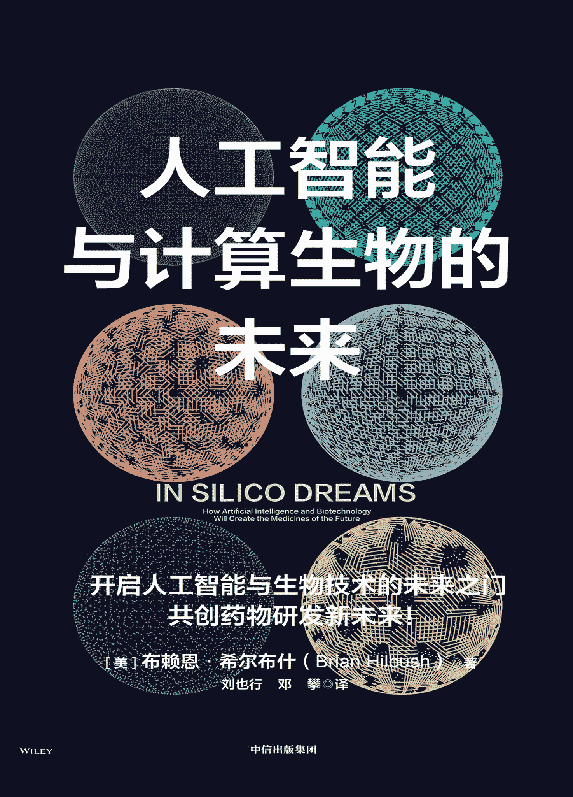

# 前言

我们正处在一个前所未有的技术拐点。计算科学、智能系统、基因编辑、神经研究与机器人等多个前沿的共同推进，正在重塑医学的整体走向。过去十年里，全球实验室在智能系统方向的突破尤为集中，视觉理解、语言处理与语音判别是最显眼的代表。亚马逊、谷歌、微软等平台型企业构建了庞大且可横向扩展的云算力体系，既支撑模型训练，也为临床转化提供基础设施。它们集中投入人才、算力与资本，期待以智能技术驱动医疗健康的下一轮跃迁。苹果等厂商已明确医疗布局与产品路线，媒体几周就会披露一款新系统在某项诊断任务上与专家持平甚至超越。算力攀升、算法迭代与百亿级代码规模的部署让创新节奏呈指数级加速，并对科研范式产生深远影响。机器学习与数据科学正在改变生物学、化学等传统学科的研究方式，并在药物研发中孕育全新实验模式。

生物技术的演进同样迅猛。过去基因克隆只能在试管里借助病毒或细菌的遗传物质做基础操作，如今已能在完整的人类基因组上实施位点级的精确编辑。聚焦新一代基因疗法与 T 细胞重编程的公司正在帮助肿瘤患者对抗癌症。核酸测序、医学影像与高分辨显微所产生的数据量呈爆炸式增长，为机器学习提供了海量训练素材，也让从巨量信息中挖掘生物规律成为可能。在此背景下，第一批以技术为核心的初创企业出现，开启智能与生命科学融合的时代。它们瞄准传统药物研发，试图以跨学科团队与新思路为制药业打开新局面。

本书讨论的是生物学与计算科学的创新如何塑造未来的医疗。基于疗法的工程化产业已显端倪。约两百年前，罂粟在欧洲被广泛用作止痛，伊曼纽尔·默克洞察到从中提取镇痛剂的商业价值，其灵感来自弗里德里希·瑟图纳。瑟图纳开创了从罂粟中分离鸦片生物碱的工艺，并将提纯的麻醉物命名为吗啡，以希腊梦神为名。德国人由此奠定现代制药的基石。往前数千年，制药多指炼金术士、医师或萨满将具疗效的天然物质制成成分不明的有毒混合体。有机化学规律的阐明彻底改变了小分子药物的制造方式与医学实践准则。

制药业兴起于工业革命，汲取多领域技术成果，尤其以煤焦油染料工业带来的化学创新为主。百年后二战结束，英美实验室重现了制药早期爆发式的创新态势。1952至1953年间，计算科学、分子生物学、神经科学、智能系统与现代医学基础研究几乎同步萌芽，与太平洋上首颗氢弹的闪光相互映衬。各学科前沿捷报频传。

医学同样受益于原子时代的发现。生物技术根植于分子生物学。1953年 DNA 双螺旋结构的揭示标志分子生物学开端，20世纪70年代重组 DNA 技术将其推向新阶段。如今全球销量前十的药物中，有七种源自生物技术创新。

同在1953年，美国食品药品监督管理局批准氨甲蝶呤用于临床抗癌，癌症化疗由此进入临床实践。早期化疗为选择性打击癌细胞提供了思路，并启发了数十年的新药研究。与此同时，临床医生在化疗药物试验评估中的核心作用凸显，他们与药物化学家、药理学家一起成为制药决策主体。

在神经科学领域，艾伦·霍奇金与安德鲁·赫胥黎于1952年提出神经元产生动作电位的统一理论。霍奇金-赫胥黎模型是生物学中最成功的定量模型之一，巧妙结合实验观测与理论描述。该成果推动科学家找到调控离子电导与突触活动的离子通道、受体与转运蛋白，这些成为过去五十年来神经科学药物发现的基础。

现代计算科学与智能系统萌芽于20世纪30年代，以1952年首台可存储程序的电子数字计算机 MANIAC I 成功运行为标志。历史学家乔治·戴森在2012年出版的《图灵的大教堂：数字宇宙开启智能时代》中指出：“这台基于艾伦·图灵构想、由约翰·冯·诺依曼实现的存储程序计算机，打破了描述事物数字与执行操作数字之间的界限，我们的宇宙从此改变。”六十年后，随着算力提升万亿倍，智能先驱终于以神经网络实现机器智能的梦想。

过去五十年，催生生物科技革命与数字革命的技术各自蓬勃发展。近十年来它们已具备非凡能力并得到广泛应用。两种技术的融合正在诞生全新学科，将深刻影响医疗诊断、药物研发，以及慢性病与心理健康的非药物干预。智能系统与生物技术的最新进展正革新药物研发的关键环节，提升预测、验证、精确度与效率，颠覆制药业传统模式。若一切顺利，科学家的计算之梦将在不久实现，其对医学的影响也将显现。

# 第一章

## 信息革命对生物学研究的影响

在我看来，21世纪最具颠覆性的创新将发生在生物与科技的交叉地带。就像我们迎来数字时代一样，另一个全新时代刚刚开启。

——史蒂夫·乔布斯

沃尔特·艾萨克森《史蒂夫·乔布斯传》

信息变革的力量影响了所有产业，从长远上重塑全球经济、政治与社会结构。在科学领域，物理学、天文学与大气科学最早受益，自20世纪60年代起就直接得益于大型计算机与超级计算机的发展。半导体电子、个人电脑与互联网的成熟进一步加速了信息革命，推动了最引人注目的科技进步。这些历史性创新成为生物科学、生物技术与制药行业的催化剂，赋予它们惊人的技术能力。

生物学进展高度依赖新技术与新设备的出现，依赖分辨率、精度与数据采集产生能力的持续提升。表1—1以十年为单位汇总了影响生物学领域的里程碑式技术创新。

表 1—1 里程碑式技术创新事件（以 10 年为单位）

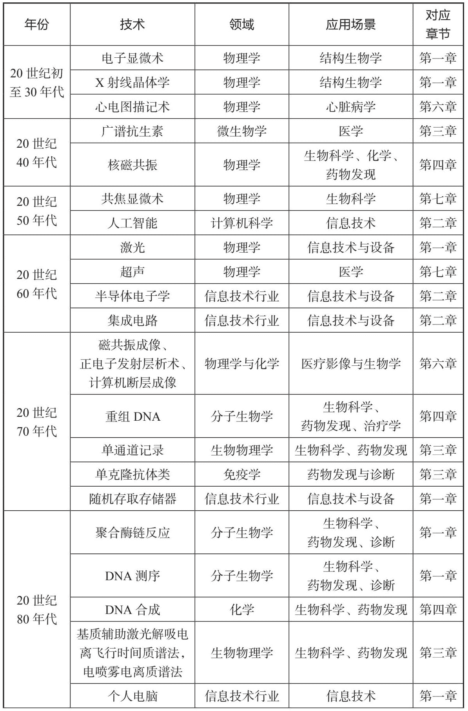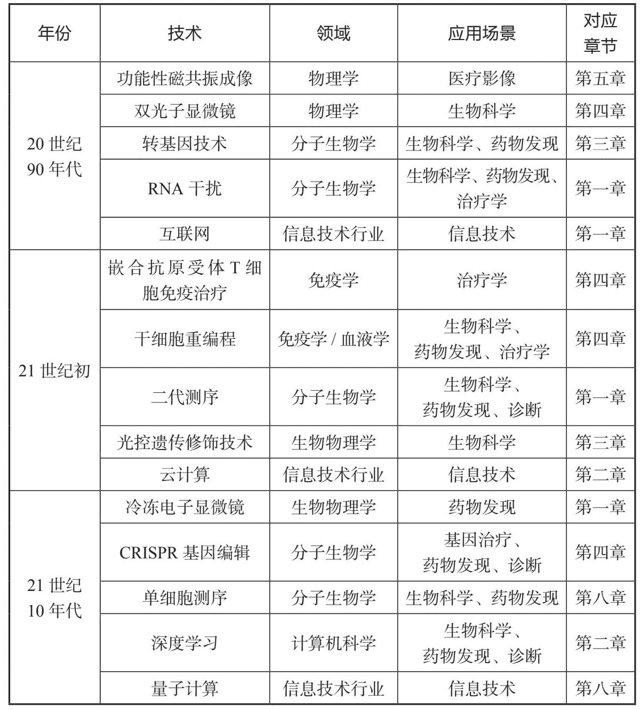

在20世纪大部分时间里，生物学研究借助物理学仪器观测细胞与大分子结构，测量原子尺度尺寸。数字化之前，实验观测与数据以纸张、磁鼓、磁带、X光片、照片等物理媒介记录。随后基于微处理器的计算实现了模拟到数字的转换，随之而来的是半导体电路上的随机存取存储器。数字化数据流与千万亿字节级存储对现代科学至关重要，它们既帮助研究者跟上信息洪流，也催生了网络科学与研究数据共享，而后者是科学进步的基本特征。

进入21世纪，信息革命对生物学的影响持续加深。指数级增长的算力催生出辅助数据获取、分析与可视化的复杂软件，并实现大规模高速数据通信。许多诞生于此时代的新学科都受益于高分辨率计算技术与工具。其中最重要成果包括：DNA 合成与测序设备为基因组学与计算生物学奠定基础；功能性磁共振成像催生计算神经生物学；冷冻电镜、核磁共振与超分辨率显微镜推动结构生物学；多种计算密集型光谱技术，如基质辅助激光解吸电离飞行时间质谱、表面等离子共振与高性能计算，打开了计算药物发现的大门。同样，20世纪物理学突破与计算技术的结合诞生了一系列成像技术，促进了医学发展。

^(¹)

信息革命让生物学从数据匮乏转向数据丰富，并带来出人意料而重大的影响：它引发了范式转换，使生物学成为定量科学。生物科学与生物医学研究从数据科学、数学与工程工具中获益，共同推动“大科学”的实现，包括人类基因组、蛋白质组与微生物组项目 ^(²)

本章探讨信息革命对生物学研究的影响。计算对工业的巨大影响被称为第三次工业革命，本书还将深入剖析第四次工业革命 ^(³)

## 生物数据的急速积累

全球医学界与学术界能以惊人速度应对新冠疫情大流行，正是信息革命的直接成果。互联网与无线通信基础设施让海量病毒基因组测序数据与流行病学数据可在全球实时共享，数字技术使公共卫生信息的日常收集、整合与传播成为可能。在私营药企，深度依赖计算的药物研发管线利用人工智能与生物技术创新加速化合物筛选、临床前检验与临床开发。无论政府、工业界还是其他组织支持的国际合作项目，几乎每一项努力都受益于云计算资源。堆积如山的数据帮助我们更好理解疾病本质，为快速研发有效疗法提供巨大希望。

生物医学研究与药物研发人员几乎立刻对疫情做出响应。这不仅因时间紧迫，也因其中蕴含的商业机会与科学突破可能。在数以千计的实验室里，研究人员利用病毒基因组序列、病毒与宿主相互作用以及健康医疗系统数据验证新治疗思路。

疫情早期，研究成果大量发布形成前所未有的知识库，medRxiv与bioRxiv平台上发表了超过5万篇相关早期研究，使我们能及时浏览病毒研究的各方面：从病毒复制机制的生物学与临床研究，到用于测试疫苗及其他疗法的复杂跨国临床试验不等。可惜的是，我们无法及时审核并验证这些思路、药物与重要公共政策。许多因不够成熟而最终失败，或成为阴谋论素材。技术只能做到这一步，新冠疫情也揭示了科学的局限。

2020年新冠疫情初期，基因组数据的发布对病毒追踪至关重要。更重要的是，它使我们能为基于基因组的诊断、疫苗与药物开发策略制定科学计划。通过将测序仪产生的包含数亿核苷酸的杂乱数据转化为字节，计算生物学家构建出约3万个核苷酸长的病毒完整基因组“组装体”。由此出发，研究人员在基因组上划定边界，绘制出线性分布的每个基因。

组装片段与确定序列身份都依赖于将序列片段与生物序列数据库中的已知基因组比对。通过算法可在拭子或液体样本中的短序列中找到与数据库高度相似的匹配，从而快速了解样本中包含的生物体。为了表征与分类病毒基因组，需将重新组装的DNA序列与通用数据库比较。该数据库包含数万种已知细菌物种、数千种病毒及其他致病基因序列的完整基因组。

### 利用基因组流行病学追踪新型冠状病毒

基因组序列提供的远不止病原体身份。基因组信息可用于流行病学、诊断学、疫苗设计与治疗学等四个主要领域。病毒学家、流行病学家与公共卫生体系几十年来一直在收集与分析各类病毒序列，直到近年，随着二代测序与第三代测序即纳米孔或单分子测序的兴起，我们才将流行病学病例中病原体基因组测序的完成时间从数月压缩到数天。这种基于基因组的方法与大量数据催生了全新的全球疫情追踪方式。

基因组流行病学的基石是借助参考基因组，可在单碱基分辨率尺度上检测序列变化。通过与同一家族、群落甚至种群内基因组比较，可获知每个位点的差异。这一方法能成功应用于流行病学的关键在于，病毒尤其是RNA病毒在宿主体内进行易错复制 ^(⁴)

在2013至2016年埃博拉大流行中，我们首次利用高通量测序对埃博拉病毒进行基因组监测。 ^(⁵)

2020年1月，新冠病毒测序结果出炉，数字化全球资源平台随即行动。亚洲、欧洲、北美及其他地区测序结果被上传至GISAID网站。贝德福德及其同事利用涌入的基因组序列重构病毒全球传播路径。其他研究者也在追踪疫情传播，利用基因组数据监测毒株变化。疫情暴发初期，大量基因组信息揭示了病毒重要特征。首先，突变数量稀少表明新冠感染近期才开始。与其他病毒相比，这种新型冠状病毒变异更慢、分支更少。图1—1展示了这棵新近出现的病毒进化树。

疫情全球蔓延初期，我们尚未准备好进行大规模基因组分析与溯源，追踪并不顺利。例如，加拿大、英国与澳大利亚新冠患者的病毒基因组高度相似，提示它们有关联；流行病学专家分析社交活动后发现，这些早期病例有一个共同点：近期到访过伊朗。没有基因组学帮助，几乎无法定位这种关联。基因组监测也提供了美国西雅图社区传播的最早期证据：一位患者携带的病毒与从武汉返回的本地“零号病人”基因特征几乎相同。 ^(⁶)

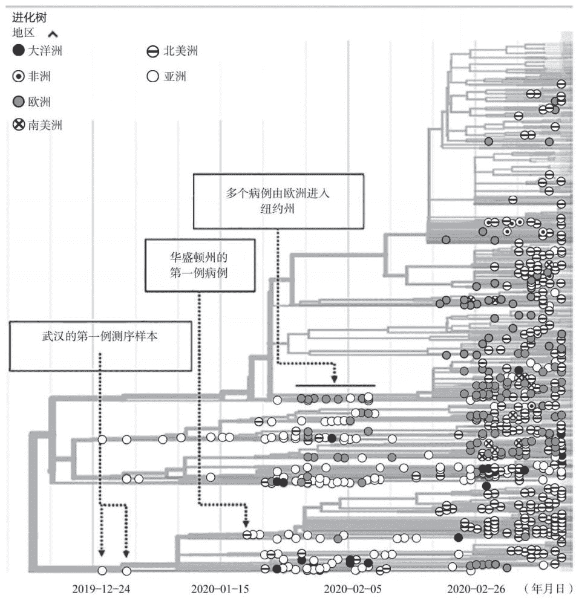

图 1—1 北美新冠疫情暴发期间的基因组流行病学

注：进化树展示了2019年12月至2020年3月新冠病毒感染个体体内828个病毒基因组间的关系。点表示个体，以图例中的地理来源标记。进化树是通过比较个体之间的病毒基因组序列生成的。突变会引入新的分支，垂直距离代表基因组之间的差异程度。处于同一水平线上的个体共享具有相同基因组的病毒，通过这种方法，这些病毒可以追溯到一个共同祖先。

疫情暴发数周内，我们便破译了传染病病原体的基因组信息，这是前所未有的。由于疾病病程复杂，再加上技术、医学与社会观念限制，发现人类免疫缺陷病毒是艾滋病元凶的过程十分缓慢。从1981年美国正式确诊首例艾滋病患者，到1984年发现新型病毒人类免疫缺陷病毒最初命名为HTLV-III ^(⁷)

艾滋病大流行使人们认识到人畜共患病毒的存在及其全球威胁。在艾滋病出现前，医学界多数认为工业化社会后外来病毒与鼠疫耶尔森菌不会再构成威胁。美国最后一例天花病例记录于1949年。借助全球疫苗接种计划，天花病毒于20世纪70年代末灭绝。1979年，美国排名前五的传染病分别是水痘、沙门氏菌病、甲型肝炎、梅毒与乙型肝炎。 ^(⁸)

21世纪初，病原体检测技术已不限于聚合酶链反应与传统病毒学方法。2002至2003年严重急性呼吸综合征出现时，高通量测序仪器已投入使用。当病毒分离完成，培养出的病毒粒子提取出足量遗传物质后，自动测序仪结合基因组组装算法在五个月内拼接出这种全新冠状病毒的基因组从2002年11月到2003年4月中旬，技术测序步骤仅需31天。 ^(⁹)

仅仅几个月后，2012年12月，当几内亚偏远村庄出现埃博拉疫情时，DNA测序技术很快派上用场。 ^(¹⁰)

## 生物研究的范式转换：让计算生物学成为可能

“那些认为‘科学等价于测量’的人，应该去达尔文的著作里找找数字和等式。” ^(¹¹)

——戴维·休伯尔，《自传中的神经科学历史》

“实验是科学对自然的提问，而测量是记录自然的回答。”

——马克斯·普朗克，《科学自传与其他论文》

### 计算视角重塑生命科学

毫不夸张地说，生物学与物理学长期与理论和数学保持距离。尽管两者高度依赖实验数据与观察，但生物现象的复杂性使描述基本原理的方程式难以发挥作用。自伽利略与科学革命以来，物理学建立起一套预测框架，帮助人们精确而定量地理解自然法则：麦克斯韦方程组、爱因斯坦的E=mc²、牛顿运动定律……生物学是否也能在某个时刻转变为一门定量科学，利用一系列方程从任何生物过程中做出预测？

毫无疑问，直到30年前，生物学家与大多数科学家都会坚定否定。进化论统一了生物学，而它完全建立在查尔斯·达尔文与阿尔弗雷德·拉塞尔·华莱士的观察之上。格雷戈尔·孟德尔的遗传定律更进一步，使用定量实验方法得出结论。在遗传学领域，最接近严格公式的是群体遗传学基本原理，即哈代-温伯格平衡定律。该定律表明，在非进化的大型群体中，等位基因与基因型频率将世代保持不变。当等位基因频率已知且满足特定条件时，哈代-温伯格方程可用于推算基因型频率；而与平衡状态的偏离可用来度量遗传变异。

^(¹²)

过去70年里，人们在分子生物学强大框架内研究遗传学原理。我们已详尽阐释DNA复制、RNA转录与蛋白质翻译即生物信息处理系统的机制细节。目前尚不清楚算法或方程式能否精确计算或描述基因调控网络如何控制极其复杂的细胞过程、构建神经系统、协调生物体发育以及驱动物种进化。自近一个世纪前克莱伯提出克莱伯定律 ^(¹³)

随着工具进步带来实验数据规模的指数级增长，新计算方法为复杂科学研究提供可能，人们逐渐开始质疑数学无法描述生物系统的观点。2000年，史蒂芬·霍金被问及21世纪是否会成为生物学的黄金时代，就像20世纪的物理学一样。霍金回答：“下一个世纪将是有关复杂性的世纪。” ^(¹⁴)

信息革命发生时，能够支持生物发现的大规模数据生产技术同步问世，它们共同推动了生物学研究范式转变。其一例是现代DNA测序仪的诞生对生物学的改变，例如圣迭戈基因组学公司因美纳制造的HiSeq 4000。现代DNA测序仪涉及复杂的化学与分子克隆过程，以及后期对数百万个合成测序法反应结果的高分辨率图像捕捉。它可在1.5天内产生1.5TB惊人数据，足以对6个人类基因组进行完整测序，其中每个基因组包含3×10⁹个DNA碱基。 ^(¹⁵)

对比计算机时代前后癌症研究进展速度，我们就能发现范式转变带来的影响。20世纪70年代，独立科学家通过病毒与细胞培养实验在生物实验室里发现首个致癌基因：通过一系列经典分子遗传学实验，彼得·迪斯贝格与彼得·沃格特在劳斯肉瘤病毒中发现了致癌基因src的转化DNA ^(¹⁶)

要弄清像 src 这样的癌基因到底编码出什么样的生化活性蛋白、癌症的底层逻辑是什么，必须先把目标蛋白从细胞里分离出来再做分析。1977 年，João Brugge 与 Ray Erikson 第一次用接种过 RSV 的兔血清把目的蛋白捕捉下来，该蛋白正是由 src 编码的产物。^(¹⁷)

Norman Bishop 和 Harold Varmus 揭示了病毒致癌基因的来源。他们提出病毒携带的致癌基因其实是从正常细胞中负责生长调控的基因劫持而来。那是否能在人或其他物种里找到与 src 同源的细胞蛋白？病毒获得这些序列后为何就致癌了？两人用放射性标记的探针做分子杂交，在几种鸟类基因组里都找到与 src 相似的片段，能与病毒 DNA 形成杂交体。需要说明劳斯肉瘤病毒的基因组是 RNA，实验前必须先用逆转录酶把 src RNA 反转成 DNA。^(¹⁸)

^(¹⁹)

20 世纪 80 年代初 DNA 定序技术走向实用，Bishop 与 Varmus 把病毒本身、包括劳斯肉瘤病毒及其近缘禽类肉瘤病毒，以及多种鸟类和人类基因组里的 src 相关序列测定出来。^(²⁰)

到 2000 年左右，历经一代人的积累，Robert Weinberg 与 Douglas Hanahan 在包括 src 研究在内的多年观察中提炼出“肿瘤标志物”概念，该框架迅速被学界与医学界接受。^(²¹)

伊马替尼上市后把慢性髓细胞白血病从绝症变成可控的慢性病，极大推动了分子靶向药物的研发。当时人类基因组初稿于 2001 年公布、完整版于 2003 年发表，给新药研发提供了大量潜在靶点。只看序列对肿瘤研究帮助有限，若没有基因组手段揭示基因功能、加深对肿瘤生长调控的理解，研究就会停滞。那时多数工作仍聚焦单个基因，临床医生习惯用解剖学视角划分肿瘤，如乳腺、肺或肝，很少有人关注不同癌种共有的分子层面特征。

基因组研究后来居上，把癌症研究推向更定量、更计算化的方向。2008 年二代并行定序成熟后，华盛顿大学圣路易斯分校基因组中心的 Elaine Mardis 与 Richard Wilson 在递交给 NIH 的申请里提出对整个人类肿瘤基因组进行定序。相比在特定癌种里对单一基因做假设检验，全肿瘤定序提供一种客观无偏的视角捕捉分子变化，即寻找出生后在易感组织中产生的体细胞突变。Mardis 与 Wilson 认为正常基因组数据对癌症帮助不大，但自动化定序与信息学工具已就位，可以尝试肿瘤与正常配对定序。评审专家却建议与其花 100 万美元做大规模定序，不如延续过去二十年对单个基因的传统路线。

申请被拒后，Mardis、Wilson 及同事仍利用 Illumina 最新仪器对一名急性髓系白血病患者的 DNA 完成定序。文章发表在 2008 年《自然》。二代定序以极高精度区分出肿瘤组织与正常皮肤细胞之间的 3,813,205 个单核苷酸多态位点。经计算分析剔除自然产生和非肿瘤特异位点后，最终锁定 8 个获得性体细胞突变，并逐一独立验证。论文摘要最后直指评审的短视：该工作把全基因组定序打造成无偏的致癌基因发现手段，那些以往被忽视的基因也可能成为靶向治疗的靶点。^(²²)

^(²³)

随后十年，癌症基因组图谱^(²⁴) 接连展开。

与这些进展对照的是，绝大多数癌症至今仍缺乏针对相关基因或信号通路的精准疗法。制药行业在抗癌新药研发上的产出有限，全球多数肿瘤药物项目的成功率仅约 10%，若计入流失，临床试验失败率高达 90%。高管一致认为要提升候选药物在临床管线的通过率、为承受化疗手术的患者争取生存机会，必须解决若干关键难题。免疫疗法在诸多癌种中展现奇迹后，大量资金涌向免疫疗法与嵌合抗原受体 T 细胞治疗。与此同时，经典的小分子靶向药物设计急需功能基因组研究提供新思路。候选药物为何未达预期？首先要确认药物所针对的致癌驱动蛋白是否真的是理想靶点，并思考如何提高疗效。多数筛选仍在癌细胞系中进行，我们是否足够了解这些模型的分子特征？应该像分析原发肿瘤那样对细胞系进行全面的分子画像。此外，部分药物虽未显示统计学上的临床获益，却能与靶点结合，且特定基因突变谱对此类药物更敏感。这正是精准医疗的雏形——在正确时机为合适的患者提供合适药物。人们期待通过深入解析基因组、表观组和临床数据，更好地预测患者对特定药物的反应，推动抗癌药物研发走向高度个体化。

来自英国的一支顶尖团队率先尝试。他们以数据驱动的方式整合功能基因组分析与药物筛选，并借助机器学习发掘可预测药物反应的癌细胞特征。^(²⁵)

随后，研究者对 265 种化合物在不同细胞系上的细胞活力影响开展了大规模药理基因组学实验，从超过 20 万条剂量-反应曲线中产生超过 100 万个数据点，每个化合物约 5 个。所有 IC50 值被输入基于统计学和机器学习的混合定量框架，输出可提示哪类药物更适合哪种癌症，以及哪类数据类型对敏感性预测效果最佳。药理模型揭示了大量具癌种特异性的药物-基因组交互作用，机器学习模型显示基因组特征即癌症驱动突变和基因扩增最适合用于敏感性预测。对某些癌种，DNA 甲基化数据比基因表达数据更能提升模型表现。药理模型提供了可进入临床测试的潜在新疗法，具有直接临床意义；机器学习模型则提示癌症临床诊断应侧重检测潜在 DNA 改变，而非其他分子特征如 DNA 甲基化和基因表达。若要研究单个基因如何影响癌症表型或药物反应，基于 CRISPR-Cas9 的基因组规模筛选是更有效的方式。^(²⁶)

类似思路使计算癌症研究成为热点。在一项研究中，Behan 及其同事设计了基因组水平的 CRISPR-Cas9 筛选实验，通过细胞活力检测找到对癌细胞存活至关重要的基因。^(²⁷)

## 结构生物学与基因组学

数据科学和计算方法正驱动着结构生物学。如果想更高效地锁定关键靶点蛋白或干预复杂细胞通路，研发人员必须依赖基因组研究与结构生物学共同提供的数据。中国科学家上传新型冠状病毒基因组数据数小时后，全球研究人员就能借助云计算解析序列、设计实验，并在实验室合成相关基因和蛋白开展后续研究。

谈到蛋白结构，科研人员通常指二级或三级结构，即蛋白在自然状态下折叠形成的形态。所有蛋白都由一串氨基酸构成，每种氨基酸属于 20 种通用氨基酸之一。独特的三维构象决定了生物学功能。一级结构只是氨基酸的线性排序，二级结构由一级序列的模式决定，重复序列可形成螺旋或片层等二级结构。

要获得三维数据，必须先找到基因并生产蛋白。先用常规分子生物学方法扩增并克隆基因片段，再把克隆材料导入细菌基因组，有时也用酵母等细胞培养，菌落会生产重组蛋白。纯化并冷冻保存的蛋白可送入冷冻电镜，或结晶后用 X 射线晶体学观察。

2020 年初，研究人员已从基因组序列解析出新型冠状病毒 3 个关键蛋白的原子级三维结构：刺突糖蛋白、主蛋白酶和依赖 RNA 的 RNA 聚合酶，它们是药物和疫苗设计的核心靶点。尽管新型冠状病毒基因组是目前发现的最大 RNA 病毒基因组之一，它仅编码不足 30 种蛋白质。相比之下，大肠杆菌等原核生物基因组约有 5000 个基因，苍蝇、马和人类等生物体则含 1.5 万至 3 万个蛋白质编码基因。

在处理了 7994 幅显微影片后，研究团队获得了分辨率达 2.9 埃、含 nsp7 和 nsp8 蛋白的冠状病毒依赖 RNA 的 RNA 聚合酶复合物图像，水分子直径约 2.75 埃。^(²⁸)

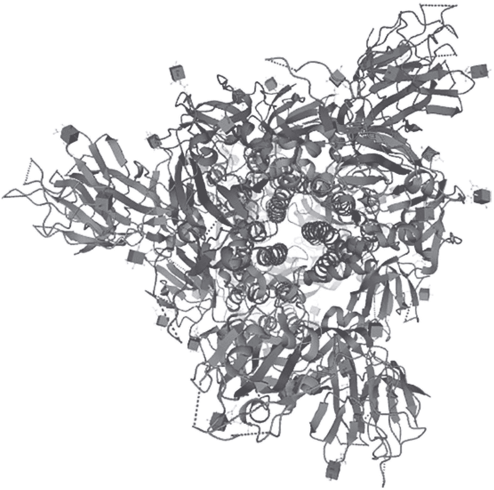

图 1—2 新型冠状病毒刺突糖蛋白结构 ^(²⁹)

从线性一维序列预测蛋白三维结构是结构生物学的圣杯问题。在能用上千计算节点运行折叠算法之前，已有多种尝试。例如华盛顿大学主导的 Folding@home 项目，始于 2000 年、由斯坦福大学维贾伊·潘德实验室发起，借助志愿者个人电脑的 CPU 进行分布式计算。^(³⁰)

DeepMind 宣称其“无模板”从头建模方法可预测新型冠状病毒部分蛋白结构。^(³¹)

## 人类基因组测序

其实，生物学真正需要的是一个庞大的信息库——对几种关键生物遗传结构的详尽了解。其中包括人类，原因显而易见。

——罗伯特·辛斯海默
圣克鲁斯工作室，1985 年 5 月

1939 年，爱因斯坦写给罗斯福的信启动了曼哈顿计划。信中据爱因斯坦对欧洲科学进展的判断，制造强力炸弹在技术上可行。该绝密计划实现了两种核链式反应途径，二战末期被制成原子弹投向长崎与广岛。此后美国能源部发起的“大科学”项目多以曼哈顿计划的组织形式与工程模式为范式。

随着生物技术诞生和人类遗传学进步，自 1985 年起，知名生物学家与能源部健康与环境研究办公室的管理人员在多次会议上提出并讨论对整个人类基因组定序的设想。^(³²)

^(³³)

在 1985 年圣克鲁斯会议上，与会者明确了几项必要条件。其中至少 3 项关键技术尚未成熟。首先需要分子技术构建基因组的物理与遗传图谱。戴维·博特斯坦首创的遗传定位技术带来曙光，当时正趋成熟，有望用于定位致病基因。^(³⁴)

自动 DNA 定序技术也是必备的。当时仅有一个实验室实现该技术。1985 年，第一台原型定序仪刚在帕萨迪纳加州理工学院的勒罗伊·胡德团队建成。^(³⁵)

圣克鲁斯会议上 12 位专家意见对半：麻省理工学院的博特斯坦是坚定反对者，他担心大型科学项目会挤压小型研究组从美国国立卫生研究院获得 RO1 经费的空间。另一些来自科学界与国会的反对者对预算提出异议，初步估算项目将在 15 年内花费 10 亿至 30 亿美元。人们还争议科学的政治化、项目组织以及谁来判定科学重要性。一些研究者认为获取染色体全部 DNA 序列意义不大，更关心外显子中的蛋白质编码序列。但从真核基因组 DNA 中难以轻易区分内含子与外显子。由于早期项目未包含基因发现算法开发，只能通过信使 RNA 转录物获取编码序列信息。

与之相对，分子生物学家和人类遗传学家热情高涨。他们设想全面解读人类基因组序列将极大帮助理解人类本质并带来医学突破。还原论者认为基因组信息将揭示每个基因的奥秘，是通向所有生物学秘密的钥匙。从遗传学视角，基因组研究将极大推动医学，他们期待定序与变异目录能揭示约 3000 种已知遗传病的病因。后来人们意识到这种想法过于理想化。例如精神分裂症，尽管积累了丰富的家族史和已知基因变化，仍对其神经病理学细胞基础知之甚少，针对神经递质系统的疗法也大多失败。

沃尔特·吉尔伯特是基因组计划的狂热支持者之一。他当时刚离开重组 DNA 技术疗法先驱公司渤健，回到哈佛。在詹姆斯·沃森领导的美国国家科学院探索人类基因组计划委员会中，吉尔伯特一直是异议者。^(³⁶)

吉尔伯特热衷于推动自己的人类基因组定序计划，并把基因序列信息转化为商业利润。这一想法引发担忧与伦理争议：私营企业能否拥有基因组信息？新定序的 DNA 片段是否可视为新颖的“物质组成”而申请专利？风投难以想象盈利模式，也不知如何评估基因数据市场规模。最终因 1987 年 10 月股市崩盘，基因组公司未能起飞。然而十年后，当政府资助的人类基因组计划推进时，生物学家兼生物技术企业家克雷格·文特尔创立私人公司塞雷拉基因组公司，与政府项目展开竞争。文特尔的目标是通过逐碱基定序实现基因组信息的商业化。

尽管美国国立卫生研究院学术界整体热情不高，国会却非常看好。1988 年国会向人类基因组计划拨款，资金流向能源部与国立卫生研究院，双方同意合作。计划草案于 1990 年 4 月公布，前 5 年目标为技术开发，第二阶段预计 2005 年完成完整定序，全周期预算约 30 亿美元。能源部工作由劳伦斯·利弗莫尔、劳伦斯·伯克利和洛斯阿拉莫斯国家实验室牵头。国立卫生研究院成立人类基因组研究办公室监管定序，沃森兼职管理。另一战略是招募全球顶尖研究中心实验室，以国际人类基因组定序联盟名义推动合作。数年后国立卫生研究院成立国家人类基因组研究中心，沃森 1992 年离职后由弗朗西斯·柯林斯领导。人类基因组计划于 2003 年完成，耗资 27 亿美元，比原计划提前两年、节约 3 亿美元预算。

^(³⁷)

自 2001 年人类基因组初稿发表以来，该计划成为载入史册的巨大成就，每一步突破都被详尽记录。^(³⁸)

^(³⁹)

计划初期，若沿用最初方式对嵌于大量克隆载体的重叠连续 DNA 片段定序，十年内无法完成。直到全基因组鸟枪法出现才成为可能。该概念 1981 年提出，后由基因组研究所的克雷格·文特尔实现大规模开发。^(⁴⁰)

表 1—2 DNA 定序的里程碑事件——从单基因到宏基因组

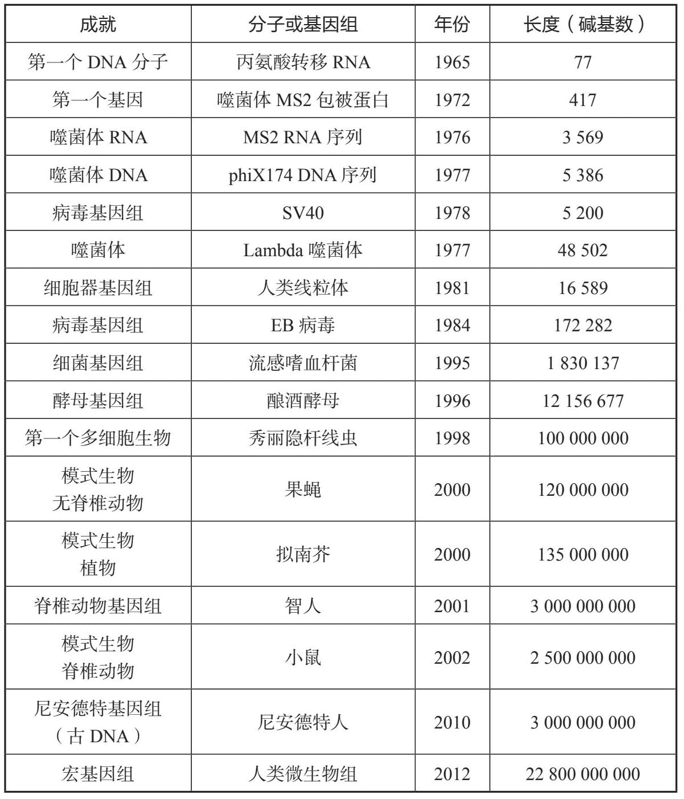

在人类基因组计划全周期中，生物信息学与计算生物学应运而生并发展。定序接近完成时，信息技术的重要性日益凸显，DNA 序列组装需要大量 CPU 与内存。该计划建立了全新的生物学研究框架，带来深远益处。此后科学家无需在实验前预设基因、变异或细胞机制进行假设验证，而是能客观全面地从基因组角度审视问题。从人类学到动物学，人类参考基因组序列的完成打开了跨领域发现之门。

现在看来，信息革命带来的强大能力是高科技赋予生物学的重要礼物。2003 年几位首席科学家回顾计算在计划中的作用。戴维·博特斯坦说计划完成中最令人惊讶的是，若无计算机便不会有人类基因组计划。梅纳德·奥尔森说：“此前整个计算基础体系都不存在。” ^(⁴¹)

我们意识到——我们有种走进历史的感觉，就是这样！这是世界——整个世界第一次看到它世代继承的基因遗产。人类是 38 亿年进化的产物。这就是我们的祖先历经无数次伟大胜利和沉重失败，为我们精心雕琢出的令人赞叹的信息序列。这是我们第一次阅读它。我们真的在阅读祖先传承下来的有关生命的密码。^(⁴²)

## 21 世纪的计算生物学

静态基因组的错误认知源于我们对细胞调控如基因转录、DNA 复制与修复以及表观遗传事件了解不足。后基因组时代的分子研究发现，一系列相互作用的调控分子与过程塑造出高度动态的三维基因组。此外还发现非编码 RNA 家族及新调控机制，包括微 RNA、干扰小 RNA 和长链非编码 RNA，它们转录后主要起抑制基因表达作用。微 RNA 与干扰小 RNA 可触发 RNA 干扰基因沉默途径，在多层面抑制表达。染色体区域可能处于“封闭”异染色质或“开放”常染色质状态，DNA 可及性变化严格调控复制与转录。RNA 干扰在 DNA 复制中起重要作用，并能抑制占据基因组约一半容量的转座因子表达。

另一项几十年前已知的知识同样是基因组复杂结构与调控的关键特征：超远距离增强子元件与近端基因启动子的相互作用。这两种元件距离常达 10 万个碱基，为调控基因活性需在三维基因组空间中靠近，使增强子上的基因激活转录因子能启动转录起始位点附近的启动子。近年来人们揭示了三维基因组的多项重要特性。基因组的 30% 至 40% 与核纤层相互作用，长达 10 兆碱基的 DNA 异染色质区域与核纤层共同形成核纤层相关结构域。^(⁴³)

表观调控的真实面貌正在被新的技术逐步照亮。外界环境与个人经历能够借助表观机制在遗传物质上留下可传递的印记，这种改变不触及碱基序列本身，而是通过对 DNA 或其结合的组蛋白进行化学修饰来调控转录活性。最典型的形式是对胞嘧啶的甲基化，以及组蛋白乙酰化与甲基化的可逆化。这些发现描绘出一个全新图景：基因组在三维核空间中持续重排，数以千计的分子在不同核区之间穿梭，共同决定大量基因组合的表达模式。表达的产物是蛋白质，承担细胞全部生化反应的执行工作。弗朗西斯·克里克提出的中心法则——DNA合成RNA再合成蛋白质——为系统增添了反馈维度的理解。因此过去十年学界更倾向把整套遗传信息视作一台 RNA 驱动的机器。^(⁴⁴)

### 参考基因组从实验室走向日常
^(⁴⁵)

对绝大多数计算生物学研究者来说，人类参考序列的获取已十分便捷，约 3.275 GB 的文件体量不大，下载只需短短一分钟，即可在网页或由美国博德研究所 ^(⁴⁶) 运营的基因组浏览器中浏览。任何人都能免费使用价值数十亿美元的测序产出与配套技术，这本身极具震撼力。类似的现象在各行各业都能看到，都是复杂工程以商业产品呈现，例如智能手机、新药或台式机显卡，其研发投入往往超过十亿美元，面向庞大市场摊销成本，利润可观，因而是长期划算的投入。而由纳税人资助的大型科学计划，则让全球研究机构共享成果并回馈社会。

人类基因组计划推进期间，多家中心与实验室建立了 DNA 测序工厂，产出了大量有价值的数据，主要成果可参见表 1—2。随技术成熟，测序对象早已超出最初的模式生物，已有数千种真核生物和数万种细菌的遗传组被完成。组学技术带来的海量实验数据被保存在各大核酸序列数据库中，美国国家生物技术信息中心的资源即为代表。

对新物种而言，拼接完整遗传组仍是门槛高且需要灵感的工作，高度依赖精细的计算组装与注释。但人类个体的遗传组测定已进入常规化阶段，无需再对原始数据进行组装，直接将测序结果逐碱基比对到最新的人类参考序列即可。

#### 健康相关场景下的变异检测用法

以下场景依托于不同模式的序列变异检测：整体基因组测定覆盖全部序列，外显子全覆盖测定捕获蛋白质编码区，基于二代平台的液体活检用于在血液、尿液等体液中检出游离 DNA，靶向测定则只检视特定基因子集或诊断相关组合。临床、消费、科研与制药领域的具体用法包括：

罕见病诊断测定：借助整体基因组测定定位致病突变，常联合父母序列一起分析。

癌症诊断测定：以整体基因组、外显子全覆盖或靶向测定对比肿瘤与正常组织进行临床评估；同时利用血液、尿液样本的液体活检进行测定。

产前诊断测定：通过无创产前检测筛查染色体异常，尤其是 21 三体综合征。

个人基因组测定：基于科研目的或直接面向消费者的整体基因组测定或 SNP 阵列，用于推断遗传特征与健康风险。

人群研究：以整体基因组或外显子全覆盖测定开展疾病相关基因发现、等位基因频率估算、人类进化与迁徙模式等基础研究。

病例对照研究：利用整体基因组或外显子全覆盖测定寻找与性状或疾病相关的遗传变异。

人口健康计划：国家为公共卫生目的开展的整体基因组测定，并与人口医疗记录联用。

药物基因组学研究：运用整体基因组、外显子全覆盖或靶向测定，在药物开发过程中评估基因型与药效的关联。

患者分层：在临床试验前，借助整体基因组或外显子全覆盖测定按基因型对受试者分组。

药物研发：通过整体基因组或外显子全覆盖测定鉴定风险等位基因、遗传修饰因子及致病性功能缺失变异，以识别或验证药物靶点。

借助 SNP 芯片或微珠阵列在特定位点进行基因分型，同样可用于遗传变异检测。

#### 如何解读基因组序列信息

基于测序的各项应用最终指向两个目标：阐明疾病的遗传学基础，以及对个体与群体层面的变异进行归类。根植于统计学、数学与计算机科学的计算生物学提供了实现路径。人类基因组计划完成后不久，很少有人预料到基因组测定会走向约 1000 美元的常规化操作。

正如新型冠状病毒测定所展示的，二代测定技术带来了突破。Illumina 将纳米孔阵列与合成化学测定结合，实现数十亿次反应的并行。采用鸟枪法策略，DNA 被剪切为数千万片段构建文库，片段长度约 100~300 bp，仪器可产生数十亿条序列读段，随后与人类参考序列比对。该方法的优势在于以一定覆盖倍数重复采样整个基因组，冗余数据配合统计方法即可推断准确序列及二倍体基因组两份拷贝的基因型。整体基因组和外显子全覆盖测定通常需要 30~50 倍覆盖。图 1—3 展示了二代测定数据的现代分析流程。

数据处理分为仪器端的初级分析如碱基识别、基于参考比对与多阶段变异识别的二级分析，以及第三阶段的注释与解释。其中最耗计算资源的是读段比对。举例而言，将十亿条读段映射回基因组，朴素做法需将每条读段与基因组每个位置逐一比对，100 bp 读段每移动一个碱基即产生 3×10⁹ 次比较，整体操作量达 3×10¹⁸ 次，且难以处理错配。实际方案采用索引机制，像电话簿一样快速定位部分匹配并记录最优位置，通过索引与筛选避免计算爆炸。^(⁴⁷)

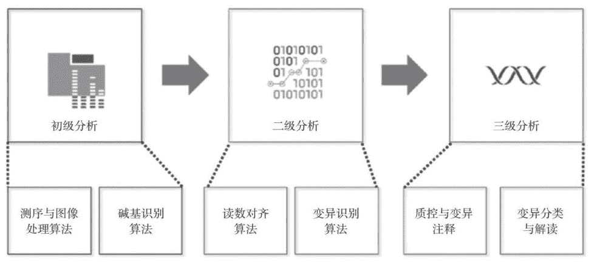

图 1—3 在因美纳测序仪上进行全基因组测序的基因组分析流程

变异识别阶段的核心是捕捉单个基因组的序列与结构差异、记录基因型并评估数据质量。计算生物学家历经十余年开发出适配二代测定参数的工具，算法需具备判断基因型为纯合或杂合的能力，并可识别：

・种系与体细胞单核苷酸变异。
・插入与缺失。
・拷贝数变异。
・结构变异。
・染色体断点位置。
・基因融合。
・新生突变。

^(⁴⁸)

多数工具以贝叶斯统计框架为基础，结合机器学习提升基因型预测精度。^(⁴⁹)

大数据分析的根本难题在于区分真实变异与测定或比对错误，仪器错误率约 0.25%。^(⁵⁰)

`P(H|D)=P(H)P(D|H)/P(D)`

在任一位置寻找变异需考虑 4 种纯合假设 `AA`、`CC`、`GG`、`TT` 与 6 种杂合组合 `AC`、`AG`、`AT` 等。基因型频率可从千人基因组计划等人群数据库估计，并用于更新贝叶斯先验。在 GATK 的 HaplotypeCaller 等工具中，通过计算基因型可能性而非概率来评估假设。贝叶斯方法在基因组学中的应用与之在其他行业中的成功类似。

尽管公众关注个体基因组，变异发现主要在家族或大规模人群中进行，通常需要上万甚至十万个体基因组才能发现新变异并检测变异与疾病关联。原因在于多数常见变异已知且多为中性，小样本易产生偏差，缺乏家族信息也难以识别新生突变。为此开发了联合变异识别算法，可利用家系信息同时对全部个体进行贝叶斯计算，当今的计算架构足以支撑家庭乃至人群的并行分析。^(⁵¹)

## 组学技术与系统生物学

信息革命催生了高通量 DNA 测定，推动了基因组学与计算生物学的建立，并衍生出众多新组学技术。它们现已广泛应用于生物学研究与药物研发，为大规模发现性研究提供基于不同分子或分子特征的功能基因组学数据，推动研究向无偏与定量方向转变。系统生物学则整合临床、分子、细胞及群体遗传信息，力求获得更整体的生理学结论。

组学研究是对细胞或组织中特定生物实体进行系统分子分析的工作流程：样品制备、自动化检测与原始数据采集、计算处理，最后以机器学习与统计方法挖掘信息。基因组学的计算流程如图 1—3 所示。DNA 与 RNA 分离技术已标准化，蛋白质样品制备则更为多样。整体标准化程度仍有限，新算法、统计方法与可视化工具持续涌现。

蛋白质组在理解由蛋白质驱动的复杂过程与表型方面至关重要，其复杂度远高于基因组。^(⁵²)

质谱法是蛋白质鉴定主要手段。鸟枪蛋白质组学与数据依赖采集可实现无偏覆盖，肽段在串联质谱仪中切割，常采用四极杆-轨道阱。属于自底向上的方法，样品上机前需酶解。几十年来肽段识别计算方法持续发展，常用策略是数据库搜索，将 MS/MS 谱图与蛋白质序列数据库比对，但仍有大量谱图无法解释。^(⁵³)

^(⁵⁴)

在新组学中，转录物组学对生物学与药物发现的影响最大。基于系统聚合酶链反应 ^(⁵⁵)

传统芯片或 RNA 测定利用大量细胞或组织纯化的信使 RNA。近年单细胞技术改变了批量平均结果的模式，推动单细胞分辨率下生物活性的描述，并催生了与单细胞 RNA 测定类似的技术。^(⁵⁶)

表观基因组学与转录物组学几乎同时兴起。真核细胞中基因表达受多水平调控，DNA 调控元件与转录因子通过增强子、启动子、绝缘子等作用。染色质免疫沉淀测定可捕获蛋白质-DNA 互作及其序列。Methyl-Seq 捕获 DNA 甲基化位点，ATAC-seq 量化染色质可及性，相关技术帮助描绘整体基因调控图景。

信息革命正通过系统生物学推动第三波创新：多组学数据整合与分析。RNA 测定信息与表观遗传数据的叠加可揭示单一模态难以发现的基因回路，多组学研究为个体化医疗提供新信息。跨模态相关性研究已成为可能。^(⁵⁷)

机器学习是处理大规模数据的有力工具。谷歌研究人员利用计算机视觉和卷积神经网络提升变异识别预测水平。^(⁵⁸)

对其他组学，训练神经网络所需数据量常成限制，遗传关联研究尤其突出，需数百万至数千万个体分型才能鉴定罕见变异统计显著关联。密码学领域的新型数据共享范式可助力依赖人群级数据集的研究。^(⁵⁹)

# 第二章

## 人工智能的新时代

我们幻想过。我和图灵曾经讨论过模拟整个人类大脑的可能性。我们真的能够创造出一台和人类大脑一模一样的计算机，或者远远超越大脑的计算机吗？

——克劳德·香农

《香农传：从 0 到 1 开创信息时代》

先驱们的梦想推动了人工智能诞生，核心人物是计算与人工智能之父艾伦·图灵与信息论创始人克劳德·香农。图灵于 1950 年发表《计算机器与智能》。^(⁶⁰)

几乎同时，香农在大西洋彼岸为盟军研制加密系统。1938 年在麻省理工学院的硕士论文将布尔逻辑与电路设计结合，成为现代计算的基石。^(⁶¹)

人工智能发展受两种思想流派影响：自顶向下与自底向上。自顶向下即符号主义，借助推理与逻辑模拟智能，依赖知识工程，被称为经典或符号人工智能。早期占据主导，通过预编程解决数学定理或让机器人执行简单任务，形成知识系统。相关技术包括可在决策点评估全部可能结果的前瞻搜索，以及模拟时序逻辑的 `有限状态机`。

自底向上派从简单组件出发，引入概率论与统计学构建机器学习算法。早期体现为受大脑启发的神经网络，即连接主义。1943 年，麦卡洛克与皮茨提出首个神经元数学模型。^(⁶²)

起步阶段研究者目标是让计算机用电路完成人类能力，如推理、知识获取整合与语言学习。1950 年左右图灵提出图灵测试，以对话是否能欺骗人类来衡量机器智能。若人类无法区分对话对象是人还是机器，即视为达到人类水平。尽管类人 AI 概念后来式微，评估仍常以人类能力为基准。

二战技术、神经科学、心理学与计算的进展曾让人乐观地以为 20 世纪下半叶可实现人类水平机器智能。进入 21 世纪仍有人预测通用人工智能近在眼前，雷·库兹韦尔在《奇点临近》中将可通过图灵测试的通用人工智能时间定在 2029 左右。^(⁶³)

## 走出布朗克斯区的人工智能

马文·明斯基与弗兰克·罗森布拉特代表人工智能初期的两大派别，他们的道路始于 20 世纪 40 年代纽约布朗克斯科学高中。^(⁶⁴)

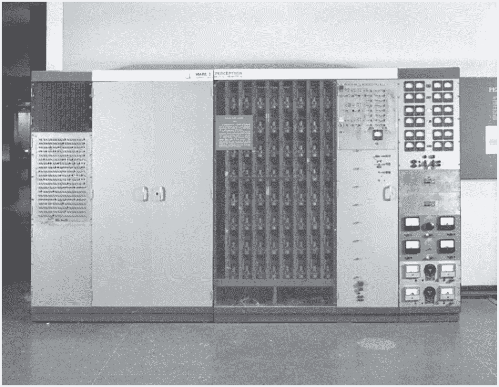

图 2—1 `Mark I` 感知机（经史密森尼学会许可使用）

罗森布拉特的部分认知心理学研究旨在验证机器能否模仿大脑理解语言或执行视觉分类等任务。`Mark I` 感知机并非为图灵通用性而建，而是配备摄像头与电位器，罗森布拉特此前在 IBM `704` 型计算机上编写过基于感知机的程序，目的在于构建机器分类器。其军事使用手册详细记录了分类器实验方法。罗森布拉特预期不久后即可开发出类人机器，这一愿景契合战后美国对科技的极度乐观。50 年代初，人工智能研究与原子时代并行，科幻小说与电影蓬勃发展。符号主义流派尤其带有盲目乐观。创造“人工智能”一词的约翰·麦卡锡大胆提出，在他与明斯基等先驱共同努力下，算法与计算机很快将赋予强大能力。

我们提议于 1956 年夏天在新罕布什尔州汉诺威的达特茅斯学院进行为期 2 个月、规模为 10 人的人工智能研究。该研究将基于一个基本猜想，即原则上，我们可以描述出有关学习能力或智力的任何特征，其精确性甚至可以让我们通过机器来模拟这一过程。我们希望尝试让机器学习语言，理解并生成抽象与概念，解决现在只有人类能够解决的各类问题，并不断改进自身。我们认为，如果有一个精心挑选的科学家团队来研究这些问题，那么其只需要投入一个夏天的时间，我们就可以在其中的一个或多个问题上取得重大进展。

约翰·麦卡锡、马文·明斯基、纳撒尼尔·罗切斯特与克劳德·香农，达特茅斯人工智能夏季研究项目提案，1955 年 8 月 31 日

# 符号主导到神经复兴的拐点

说麦卡锡与明斯基自负并非没道理，但两人对领域的影响力毋庸置疑。他们共同创办了麻省理工的人工智能项目，该项目后来发展为麻省理工人工智能实验室。明斯基在1961年发表的纲领性文章《迈向人工智能》，把符号操作确立为人工智能的基石，为此后半个多世纪的研究指明了走向。^(⁶⁵)

1970年至1980年代中期这段被称作第一次人工智能寒冬的时期，人工神经网络基本进入休眠，研究者不再借助它来解决模式识别、预测或学习新的数据表征等人工智能与计算问题。连接主义者暂时退守，却正好目睹了神经科学的爆发，哺乳动物视觉通路的组织与功能、神经元信号的传递方式以及突触化学基础的研究取得显著进展。计算能力的指数级膨胀开始改写实验室和产业的可能边界。更令人意外的是，算力和存储的提升直接带来了数据量的指数级膨胀。冥冥之中，这些趋势共同为神经网络的再次兴起搭好舞台，也让机器学习逐渐成为塑造人工智能的主流力量。

## 从神经元到猫脑的启发路径

哺乳类大脑的结构与认知能力长期以来为人工智能提供灵感，近几年更是被当作技术效果的评价参照。冯·诺依曼与艾伦·图灵两位定义现代计算的科学家，都从神经联结中获得过网络建模的灵感。神经系统处理信息尤其是视觉信息的方式与原则，为当代人工智能技术贡献了巨大价值。只不过单个神经元的复杂性，更不用说数千上亿个神经元构成的网络，要真正洞察大脑的终极奥秘仍极困难。人能在数十毫秒内认出一朵花，这种快速识别以及“花朵”意识的来源至今仍是谜。受限于对脑行为模式的理解，有人对以神经生物学为基础的机器智能提出质疑。没有完整把握大脑运行规律，就难以用计算机或数学模型复现类似神经认知的过程。尽管如此，自然已进化出这样一种智能装置，即便存在设计缺陷也不适合工厂化量产，许多关键突破的灵感仍源自于此——用概率与统计方法建模神经元群体如何处理感官信息。这与自上而下的逻辑和符号操作截然不同。

在人工智能早期，罗森布拉特等神经网络支持者先从对单个简化神经元的抽象模拟入手，后逐渐尝试建模部分视觉功能。为何偏好视觉？大脑接收的感知通道多样，包括光、味觉、嗅觉、声音、疼痛、热觉、触觉、平衡和本体感觉。承担主要感觉的感受器多集中在特定部位，如光感受器在眼，化学感受器在鼻口，机械感受器在耳肤，其余则广泛分布以感知本体感觉、温度和疼痛。视觉信息携带空间属性，只能由视网膜上按特定分布排列的感受野捕获。听觉的三维采集与体感的二维采集同样重要，对几乎所有感官而言时间维度也至关重要。其中视觉研究最直观，因为感知与“看见”高度相关。

由此不难推断，视觉感官数据更易于采集与解读，且特征丰富，涵盖对比度、边缘、深度、方向性、轮廓和纹理。来自视觉神经生理学的实验数据可用于更新建模策略并检验结果。研究视觉的另一好处是，计算机视觉所需的设备同时兼具科研、军事和商业用途。光学与投影系统处理光信号相对容易。正如罗森布拉特在`Mark I`感知机上的尝试，可以专门搭建一台携带摄像机的机器充当人造视网膜。

视觉在生物学上极其复杂，但掌握感受野、聚合与特征提取器等概念，理解感官信息从视网膜到初级视皮质再到高层皮质的层级处理流程，就抓住了启发神经网络设计的核心思想。这些通路绝大多数存在反馈或相互关联，后续章节会展开。人工智能先驱虽已知晓库夫勒、巴洛和哈特兰发现的感受野特性，却并不清楚大脑的层级处理方式与特征提取能力。不过20世纪70年代末至80年代出现的首批神经网络模型，已包含了这些基本概念。

### 视网膜中的视觉信息加工

・哺乳动物视网膜后方的感光细胞可捕捉光子并把光能转化为电信号输出。
・视网膜内部的并行神经通道进一步加工信息，最终由每只眼约120万个视网膜神经节细胞把结果送往大脑，该数值对应人类。
・视网膜神经节细胞以脉冲电位形式传递信号，并通过发放频率及脉冲序列的其他参数编码感知内容。
・视网膜神经节细胞的感受野以高度冗余方式铺满全视野，超过20种不同类型接收上游并行通道的输入。
・在特定条件下视网膜神经节细胞可充当像素编码器，直接把原始像素数据送入大脑，例如中央凹中视锥细胞与神经节细胞呈1∶1对应时。
・大多数视网膜神经节细胞的感受野是信息聚合的产物，多对一映射形成比单个感光细胞更大的视野范围。随着信号向皮质传递，感受野持续聚合，表征也变得更抽象，对应更广的视野。
・视网膜神经节细胞也是特征探测器，其感受野的中心—周边拮抗特性赋予了边缘和方向的选择性。
・图2—2呈现了视网膜神经节细胞感受野的中心—周边组织。

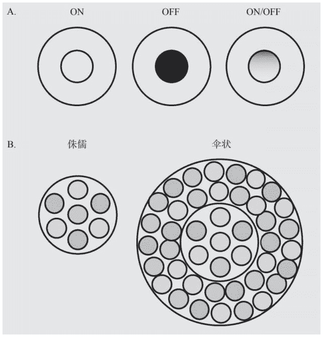

图 2—2 视网膜神经节细胞感受野

注：A.不同类型的视网膜神经节细胞感受野是由中心—外周的拮抗机制共同定义的。其中，中心为兴奋性，外周圆环域通常为抑制性。`ON`中心型视网膜神经节细胞会对刺激中心区域的光点做出响应，激活动作电位；当光点同时照射中心和外周区域，响应会被抑制。反之，`OFF`中心型视网膜神经节细胞对中心黑暗、外周明亮的刺激有反应。`ON/OFF`中心型视网膜神经节细胞对两者都有响应。

B.侏儒和伞状视网膜神经节细胞感受野。灰色阴影为来自视锥细胞的输入。在中央凹中，侏儒节细胞的感受野中心是单个视锥信号，通过它可以实现颜色（波长）的选择性。反之，较大的伞状节细胞可以通过中心和外周感受野获得混合视锥信号的输入。

^(⁶⁶)

在人类及其他灵长类中，超过三成的大脑皮质参与视觉与高级感知处理，凸显其对行为与生存的重要性。视觉信息由视网膜神经节细胞轴突经视神经送至下丘脑外侧膝状体核的神经元，再投射至后脑的视觉加工区`V1`区，即视皮质层级处理的起始阶段。在`V1`级别，视觉场的神经表征相对外侧膝状体核输入扩大了两个数量级。通过研究猫初级视皮质`V1`的感受野，胡贝尔与威塞尔首次揭示皮质神经元偏好对边缘、方向性条纹刺激反应而非光点。依据对简单视觉刺激的不同反应，他们把皮质细胞分为简单细胞与复杂细胞。这些实验表明视皮质对输入信号进行了转换。借助局部网络输入的整合，神经元可编码方向、方向选择性、空间频率和双眼性等属性。这一假说对后续模型如新认知机的发展起到关键推动作用 ^(⁶⁷)

^(⁶⁸)

更高层的抽象感受野由更基础的底层感受野构建，这种层级感受野的概念促使研究者寻找完成最终转换并表征图像识别的神经元。颞中区与下颞皮质两大上层区域备受关注，前者处理复杂运动与深度，后者处理图像的形态与颜色。自1960年代末起，多家神经生理学实验室，尤以普林斯顿大学查尔斯·格罗斯实验室为代表，发现了一类仅对面孔有反应的神经元。这类细胞可能对特定面孔，例如祖母的脸，产生特异反应。 ^(⁶⁹)

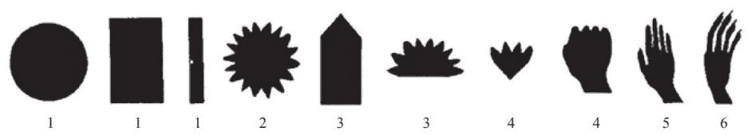

图 2—3 用于评估下颞皮质神经元反应的图像示例

注：对清醒灵长类动物下颞皮质神经元活动的记录显示，与其他手形图像或物体相比，神经元对于猴子的手部图像具有惊人的选择性。在实验中，每个图像或形状均会展示给动物。反应等级“1”表示无反应（左侧的 3 个图像）。反应最大等级为 6，出现在右侧的四指手图像展示中。这是最早揭示多层次视觉系统中存在复杂感受野的实验之一。

大脑皮质为大脑提供了一个大规模并行的生物计算架构。所有感觉系统都采用并行处理。显然，进化收敛到了这种能够提高信息处理能力的有效策略上。有大量证据表明，除视皮质区域外，所有其他感觉皮质也都拥有多级、分层组织的处理流程，整个皮质范围内共享一个 6 层的均匀层状结构。为了更好地实现“计算”目标，视皮质采取了许多策略来保证局部模块的连通性，以及不同层级结构间的连接性。兴奋性和抑制性神经元分处皮质结构的不同位置，图 2—4 展示了小鼠大脑皮质中的兴奋性锥体细胞。

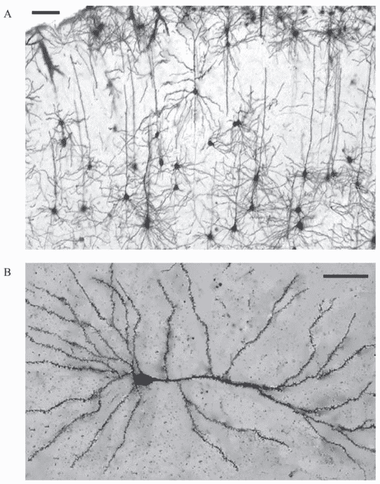

图 2—4 大脑皮质中的锥体细胞

注：A. 小鼠大脑的横截面。高尔基体染色的细胞为大脑皮质中的锥体细胞。放大倍数为 10 倍（左上角参考线为 100 微米）。染色揭示了皮质结构的层状组织，展示了锥体细胞在`II`层到`IV`层的位置。

B. 位于小鼠大脑皮质`II/III`层的锥体细胞（高尔基体染色）。此放大倍数下可以很容易地看到锥体细胞的树突树、细胞体和轴突投射（右上角参考线为 50 微米）。树突棘自树突末端延伸，建立神经元间突触连接。散布在整个图像的黑点是垂直于该神经元平面的神经突。

灵长类视皮质的第一个现代连接图于 1991 年制作完成，它揭示了一个复杂的视觉信息高速公路系统，其中，30 个视觉区域通过 300 个互连连接（见图 2—5）。 ^(⁷⁰)

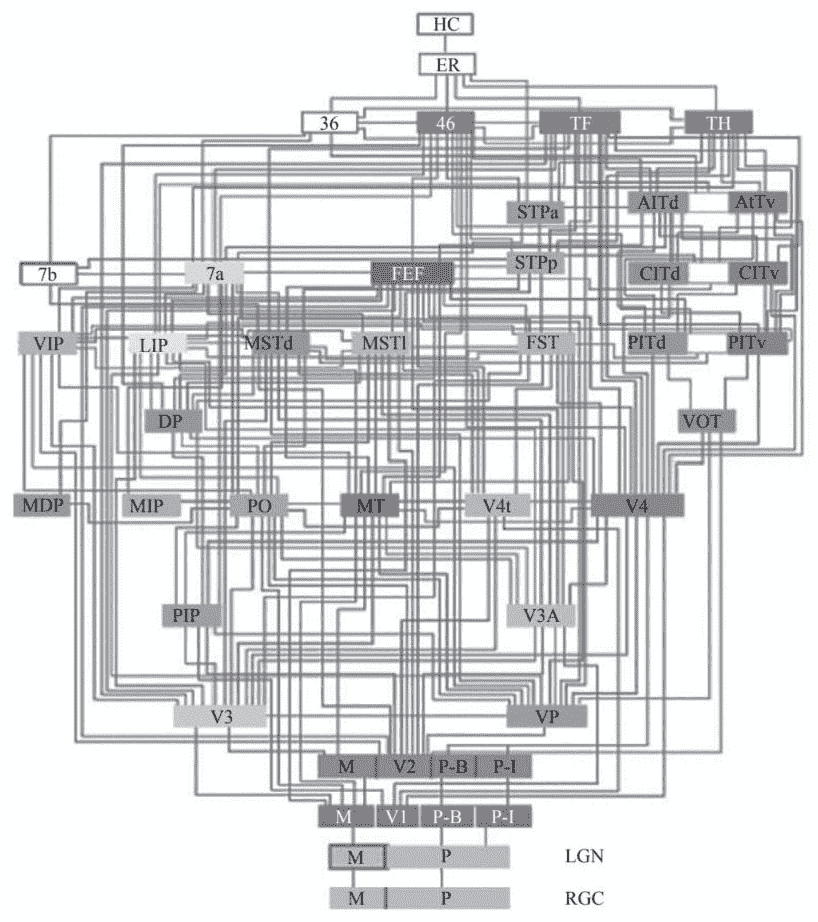

图 2—5 视觉区域的层次结构

注：费勒曼和范埃森的经典连接图综合了多年来对灵长类动物大脑中视觉信息处理和连接的研究成果。如同正文中讨论的，图中主要展现了由视网膜进入`RGC`（图表底部）并存在于主要视觉区域（如`LGN`、`V1`、`V2`和`MT`的子区域）的连接。

让计算机视觉实时完成复杂任务，复刻自然视觉系统是智能先驱的共同目标。20 世纪 60 年代，明斯基在麻省理工的研究团队获得了一台大型计算机。机器人团队认为，设计一个基于规则的程序便可以赋予机器人类似人类的视觉和运动控制能力。他们低估了图像解读与三维运动这两项任务的难度。最终，通往视觉模拟的道路并不是由符号操作实现的。同样，罗森布拉特的感知机与其中搭载的模型也无法完成简单分类任务，尽管这是罗森布拉特设计感知机的初衷。我们需要从根本上革新这种神经网络的思想和算法。最后，依然是视觉系统中的信息处理方法指引我们实现了重要突破。神经科学研究表明，层级信息处理方案可以完成从信号检测到特征提取的一系列任务，这为实现模式识别和终极目标——分类与图像感知任务，提供了基础。感受野聚合与大规模并行计算策略的应用为下一代神经网络指明了前进方向，推动神经网络发展出了“看”的能力。

## 机器智能与深度学习的关键突破

只有一条证据能让我们相信人工智能能够解决一个难题：通过进化，自然已经解决了它。

——特伦斯·谢诺夫斯基

《深度学习》

本书对人工智能的关注重点是人工智能在生物医药领域的当前与未来应用。我们现在所讨论的人工智能主要是指机器学习。数据科学家与机器学习领域的工程师通过设计算法来处理数据、进行预测，并从计算机科学、统计学、认知科学和其他学科中学习、汲取及融合相应的技术。机器学习技术之所以能够在药物开发领域展现出强大的能力，是因为我们可以从各个科学领域与工业应用中借鉴相关的建模技术，而不用重新“造轮子”。

人工神经网络也是如此。20 世纪 80 年代末，金融工业领域率先在商业应用中秘密使用了神经网络及算法。从那时开始，算法交易对金融市场以及对冲基金、银行和柜台交易员的盈利能力产生了深远的影响。到 2017 年，量化对冲基金占据了全美股票交易的 27%。20 世纪 90 年代，大型公司迅速采用了机器学习工具，通过大型数据库进行信用分析、欺诈检测和营销工作。在引领深度学习的一系列技术发展出现之前，机器学习方法在工业界得到了广泛的应用，从供应链预测到消费者行为分析，不一而足。这也为后来针对消费者的推荐系统的出现奠定了基础。1990—2010 年，信息革命带来了机器学习模型与训练范式的进一步完善，以及以`GPU`（图形处理单元）为代表的更加强大的计算硬件。

为了适应海量数据集，机器学习方法变得越来越复杂。这些方法的部署也让亚马逊等电子商务巨头接管了零售业，帮助谷歌和脸书等公司实现了基于社交网络数据挖掘的广告投放。基于人工神经网络的深度学习也在许多其他行业展现出了广泛应用。在这里，我们必须讨论深度学习为何能解决如此众多的问题，以及其能够发挥作用的基本（非数学）逻辑。本书结尾的“推荐阅读”部分列举了多篇详细介绍人工智能与深度学习概念、方法和架构的权威著作及科学评论。

神经网络也是一种计算机器，同时，它们作为分析工具发挥着神奇的作用。神经网络的核心优势是对非线性现象（例如，天气、股票价格、药物—靶标相互作用以及化学和生物学领域发生的诸多相变）建模。神经网络的设计方式非常灵活，其中一些最成功的神经网络是依据大脑中运行的神经网络模仿设计的。人工神经网络处理信息的第一步是利用节点（或者叫作神经元）模拟出一个高度互联的结构。图 2—6 展示了神经网络的基本结构（图中是一个没有任何隐藏层的`感知器`）。在多隐藏层、全连接的前馈神经网络中，信息向一个方向流动，网络执行的计算能够支持强大分类器的构建，而输入层神经元的数值只是简单的初始数据（比如实验数据点、房价等）。

## 神经网络与机器学习发展概览

### 神经网络信息处理基础

如图 2—6 所示，所有输入最终在输出层汇聚到同一个神经元上，由输入数据乘以边权值求和得到输出神经元的数值。神经网络的另一个重要特征是激活函数的引入。那些输入的和值会通过非线性函数的修正得到最终的输出。非线性函数可能是`tanh（x）`或 S 形函数，例如`exp（x）/［exp（x）+1］`。因此，人工神经网络中的神经元可以被理解为简单加权分类器叠加上用于输出修正的挤压函数。如果输入数据中存在线性不可分的类别，在输入和输出单元之间插入非线性转换层就尤为重要。这套流程类似于生物神经元的运行机制：一个神经元的活性是由相邻突触前输入的总和的函数决定的。尽管这种网络只是神经元的高度简化版本，但异常有效。不管是生物神经元还是人工神经网络，它们能够实现学习功能的关键都是修改突触输入，或者说边的权重。

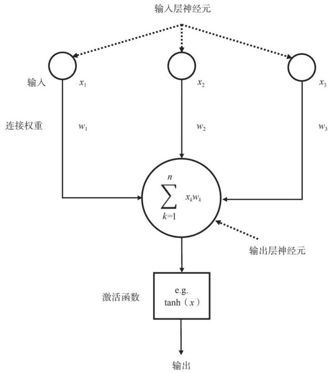

图 2—6 神经网络中的信息处理

注：神经网络的基本结构。神经元的值由外部数据（输入）或前馈神经网络中其他上游神经元的函数指定。将输入值（`x`）与连接权重（`w`）相乘后求和，再经过激活函数［例如`tanh（x）`］后输出的值便是下游神经元（输出层神经元）的值。神经元的最终输出可以作为网络下一层的输入。

*kk*

### 专家系统与机器学习的兴起

20 世纪 70 年代，当明斯基和佩珀特出版的《感知机》将单层神经网络描绘得一无是处、引发了许多领域的第一个“人工智能寒冬”的时候，符号人工智能作为主导范式继续向前发展着。20 世纪 70 年代至 80 年代，专家系统兴起。在专家系统的框架下，人们将精心设计的规则、知识或启发式方法写入计算机程序，程序通过分析输入数据来执行任务并生成答案。这些专家系统可以很好地处理特定任务，但它们丝毫不具备泛化的能力，即为一项任务设计的专家系统不能直接应用于新的问题领域。生物学和医学领域的专家系统有：用于临床诊断决策的 INTERNIST 系统，用于根据质谱数据确定有机化合物结构的 Dendral，以及用于分子生物学的 MOLGEN 程序。这些专家系统都是由斯坦福大学开发的。其中一位开发人员对专家系统的定义可以给我们带来一些启示：

“专家系统”是一种智能计算机程序，它使用知识和推理过程来解决具有一定复杂性、需要大量人类专业知识的问题。实现这一过程所需要的知识水平与推理能力，让我们可以认为专家系统模型拥有与相关领域顶级从业者相当的水平。

——爱德华·费根鲍姆

《20 世纪 80 年代的专家系统》

与此同时，另一种人工智能方法开始复兴。这种方法认为，机器可以从大量经验中学习规则，从而解决各种问题。其基本思想是，我们可以设计一个系统来接收输入数据以及答案（或标签），并通过学习算法发现输入数据与答案之间的对应规则。在这种机器学习范式中，系统通过训练而不是显式编程来实现从输入到输出的映射。这里的学习过程也不涉及符号逻辑或层次决策树结构，而是采用统计学思维。当然，这类新的学习算法并不等同于统计学。它们处理的是巨大且复杂的数据集，其中每个数据集可能包含数百万甚至数十亿个数据点。机器学习采用的各种技术与理论方法最终被佩德罗·多明戈斯总结为“机器学习的五大学派”。多明戈斯的著作《终极算法》详述了这些分类，我们在表 2—1 中简要展示了每种学派的典型风格、算法和优势。除了符号方法不一定需要数据参与学习过程之外，其他所有现代方法都结合了基于大数据的统计机器学习。

### 机器学习的五大学派

表 2—1 机器学习的五大学派

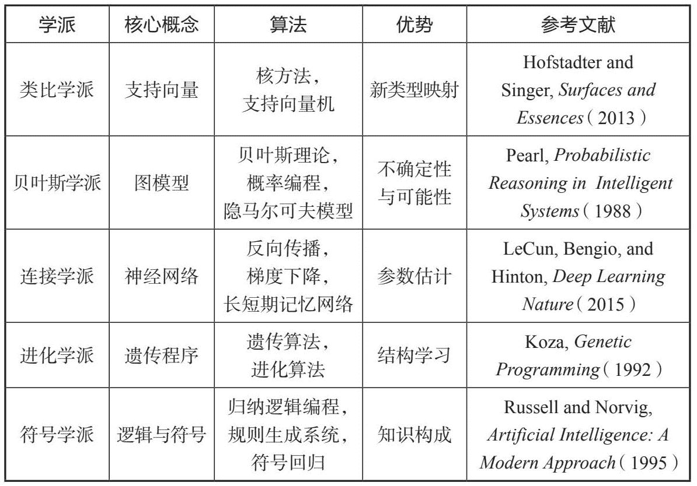

注：该表部分基于佩德罗·多明戈斯《终极算法》对“五大学派”机器学习算法的描述。多明戈斯和斯图尔特·罗素关于终极算法的工作指出了结合并统一部分或所有学习方法的可能性，例如，将逻辑引入概率算法。

^(⁷¹)

### 反向传播与卷积神经网络

连接学派与神经网络研究人员开发出了利用输入—输出对训练前馈神经网络的新方法——反向传播算法。这种随机梯度下降法通过对神经元之间的边权重进行多次微小迭代调整来减少输出结果的误差。^(⁷²)

第二项创新是利用哺乳动物视觉系统中的层级结构搭建新型神经网络——卷积神经网络。1989 年，多伦多大学的杨立昆最早提出卷积神经网络的概念。^(⁷³)

^(⁷⁴)

20 世纪 80 年代复兴的另一个重要的人工智能领域是强化学习。试错学习或通过环境交互学习的概念与计算一样古老。最初，心理学家和计算机科学家将这种概念引入了人工智能。克劳德·香农开发了一个从反复试验中学习国际象棋的程序。马文·明斯基同样对强化学习的计算模型充满兴趣。在讨论贡献度分配问题（强化学习领域的经典问题）时，明斯基在人工智能路线图中引入了一个重要的相关理论概念。^(⁷⁵)

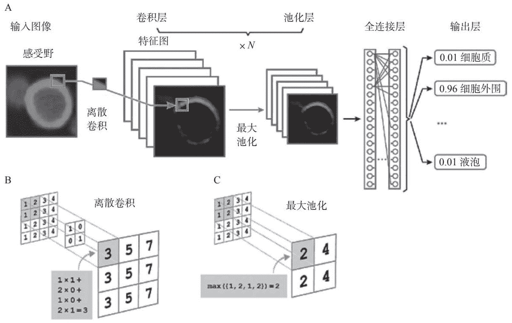

图 2—7 卷积神经网络的设计

卷积神经网络为何能大幅降参
卷积神经网络在设计上就做减法。第一是局部连接，和全连接不同，特征图里的一个神经元只与前一层的一小块区域相连，这个局部区域叫感受野。第二是权重共享，同一张特征图里的所有神经元共用一套参数，于是它会在前一层不同位置扫描同样的模式。正是这两点，让网络既能捕捉图像里不同方向的边缘，也能在基因组序列中揪出重复的模体。

神经元的激活本质上是感受野上的离散卷积再过激活函数。图中那个 2×2 的像素小矩阵就是卷积核，它像滤镜一样在图像上滑动，把原始像素抽成可用的特征。

在大多数视觉任务里，物体的确切位置和出现次数并不是最终判断的关键。池化层通过取最大值或平均值这类汇总方式，把邻近神经元的响应压成更平滑的表征。对间隔大于 1 的小块做同样的汇总，等价于对输入做下采样，进一步压缩模型规模。

### 机器学习的核心范式
机器学习模型都是围绕具体问题搭建的，用于预测时需要兼顾数据类型、算法选择和架构设计。按训练方式划分，常见的几类如下，将在第六到八章以药物发现为背景展开多任务、多模态、迁移和联邦学习等新形态。

监督学习通过带标签的实例教学。网络在预测值与真实目标的差距上不断调整权重，最小化损失。分类与回归是典型场景，图像分类、机器翻译、语音识别等工业主流应用都靠它。

无监督学习没有明确的目标标签，算法自行从数据里挖掘规律和结构。它是数据分析的基础，常用于降维和聚类。

半监督学习介于两者之间，适用于标签稀缺的情况。它能从少量标注中学习类间边界，常被用于生成式对抗网络。

强化学习面向序列决策，训练过程会影响后续动作。通过与环境交互的试错，奖励函数指引模型在每个状态下选择好坏行动，例如在国际象棋中评估一步走法的后果。

### 深度学习的爆发时代
深度学习的惊人进展在很短的时间内集中释放，离不开算法、算力和数据的三重突破。2006 年，杰弗里·辛顿在训练深度置信网络时找到了有效训练深网的方法，这是第一块多米诺骨牌。^(⁷⁶)

2011 年，神经网络的 CUDA 实现开始普及。斯坦福吴恩达与英伟达合作，用 12 块 GPU 达到过去需要 2000 块 CPU 才能实现的算力。海量可用于训练的数据集则提供了持续的燃料。

2012 年，AlexNet 在 ImageNet 竞赛中大放异彩，令整个行业为之振奋。^(⁷⁷)

深度学习的第一个商业落地是基于音素分类的自动语音识别。自然语言处理早已有之，CALO 等美国国防高级研究计划局支持的项目历经十余年，催生了 Siri、Google Voice、Alexa、Cortana 和百度的 Deep Speech 2 等产品。科技巨头也用 NLP 与其他机器学习技术搭建推荐系统。随后卷积神经网络驱动的计算机视觉和机器人视觉兴起，Waymo 和特斯拉在自动驾驶上领先。任何依赖大规模数据的公司都开始拥抱深度学习，并用领域专属 AI 强化竞争壁垒。

2013 年 DeepMind 发布 DQN，用强化学习结合卷积网络学会玩雅达利游戏，这证明了具备泛化能力的深度强化学习是可行的。2014 年初谷歌以约 6.5 亿美元收购 DeepMind。团队随后推出 AlphaGo 和 AlphaGo Zero，在围棋上击败世界冠军李世石。2017 年的对弈吸引了超过 2.8 亿观众，李开复在《AI·未来》中称之为中国 AI 的“斯普特尼克时刻”。^(⁷⁸)

药物研发里的早期尝试不算激进。约二十年前人工神经网络在分子信息学里出现过第一波热潮。2013 年默克公开的多项 QSAR 挑战中，深度网络夺冠，准确率比内部方法高 14%，《纽约时报》予以报道。英矽智能宣称其生成式张量强化学习模型发现的 DDR1 激酶抑制剂代表了 AI 制药的进展之一。^(⁷⁹)

狂热不等于停滞。2019 年卡内基梅隆的图奥马斯·桑德霍尔姆和诺姆·布朗在《科学》发表 Pluribus 的论文，标题为《用于多人扑克的超人 AI》。在信息不完全的博弈中，这篇论文代表了该领域的里程碑。^(⁸⁰)

多人策略游戏的难点来自随机性、不完全信息和高昂的搜索成本。作者将创新归为三类：限制搜索深度的算法使计算资源减少约 5 个数量级；基于线性蒙特卡洛反事实遗憾改进的均衡发现算法；以及内存优化的改进。该方法在自我对弈中实现实时策略更新。

### 主流神经网络架构解析
无论是做应用还是做数据分析，底层架构决定上限。图 2—8 归纳了最常见的几种结构。

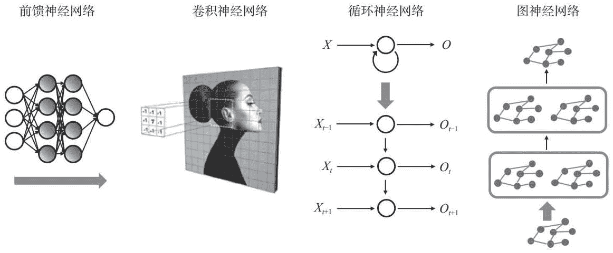

图 2—8 神经网络架构

注：常见神经网络架构示意。前馈网络把输入单向送入全连接隐层，见图 2—6。卷积网络用卷积核和池化处理网格数据，见图 2—7。循环网络示例有多种形态，每个神经元从前一时刻的神经元获取输入，如 t-1、t、t+1。图网络则利用隐层和过程处理非结构化图数据。

通过调节深度与宽度，组合卷积、循环等模块，选择合适的学习与搜索策略，可以衍生出无数结构。AlexNet 用 5 个串联卷积层加 3 个全连接层推动了图像分类。某医学分类任务中甚至出现 172 层卷积的极深网络。DeepMind 的雅达利 AI 以 AlexNet 的 5 层卷积做感知，结合搜索算法决定动作并驱动摇杆。AlphaGo Zero 的自对弈无监督训练用了 490 万场对局，模型是神经网络强化学习与蒙特卡洛树搜索的结合，网络由“大量卷积层的残差块”构成。^(⁸¹)

百度的 Deep Speech 2 是模块化设计的典范。目标是把录音转成文字。循环网络适合序列，但音频先要被理解。工程师把音频频谱图当成黑白图像处理，用卷积层提取语音特征，再送入大量循环层捕捉词序关系，随后接全连接层和标签对齐的新技术，并结合词频统计校正错误。例如系统会把“窃贼从出纳窗口拿走了信心”中的“信心”识别为误用，并据统计频率推断缺失词语。

AI 与神经网络在药物发现中的应用仍在起步，后文会深入循环网络和强化学习。它们在数字健康、行为与神经精神疾病的干预中可能发挥作用。第七、八章将介绍长短期记忆网络和生成式对抗网络在医学影像、基因组学和药物发现中的应用。

借鉴机器人控制与自动驾驶的经验或许有帮助。自动驾驶的主流三层架构源自 21 世纪初 DARPA 挑战赛：感知层处理传感器数据，理解地形，推理层包含路线规划、状态评估和运动规划，实现基于当前与预见情况的导航思考。未来药物和医学探索或可建立类似系统，模拟药效动力学、器官随时间变化的生理过程，甚至基因表达调控与疾病进程。

### 医学影像：深度学习的先锋战场
医疗健康很可能是 AI 最早受益的领域。深度学习在医学影像分析中的应用呈指数增长，凸显了其临床诊断潜力。

美国医疗体系在 2017 年产生了超过 8 亿张医学影像。2012 年 AlexNet 在图像分类上的突破预示了医疗与图像相关行业的巨变。2013—2014 年的会议报告和 2015 年第一篇期刊论文标志着卷积网络从学术走向医学影像的诊断尝试。2014 年左右风投开始涌入医疗 AI 影像创业，第六章将讨论投资热潮。如今医学影像分析几乎被深度学习主导，卷积架构仍占主流。

60 多年前医学界就提出了计算机辅助诊断的目标。那个时代也是计算机、AI 和统计机器学习兴起的时期。为什么几十年后仍未实现？早期人们就认识到统计可辅助诊断，并提出 1959 年的符号逻辑鉴别诊断、使用贝叶斯定理预测肿瘤类型等方法。^(⁸²)

20 世纪 70 年代 CT 和 MRI 的发明推动了基于计算机的诊断。1977 年首张 0.5T MRI 医学图像诞生，如今 7.0T 设备可观测亚毫米级的细胞，为皮质神经元活动研究提供可能。^(⁸³)

影像存储与传输系统于 1982 年提出，推动了临床、影像科与医院信息系统的整合。21 世纪初尽管专家系统和 PACS 已推广，CAD 的临床价值仍有限，难以替代训练有素的放射科医生，甚至增加负担。

放射学、病理学、皮肤病学和眼科学这四个高度依赖图像的领域急需达到人类水平的 CAD。目标是减少错误、减轻工作量并提供预分析。X 光、MRI、CT 和 PET 等领域需要强大的特征提取、模式识别和分类能力。肿瘤学任务通常包括异常检测、分割定义边界、诊断分类与分期，以及治疗响应的时序监测。通过提取三维形状、纹理等疾病相关特征，用 SVM、随机森林等机器学习模型训练，可为临床决策提供支持。量化是所有基于图像任务的前提。

大量研究显示深度学习在分割、器官检测和疾病表征上优于其他机器学习方法。超过 100 项临床研究采用了各种深度神经网络。余坤兴及其斯坦福迈克尔·斯奈德团队在 2016 年发表的工作展示了卷积网络在癌症数字病理中的进步，用癌症基因组图谱的组织病理切片区分非小细胞肺癌亚型。^(⁸⁴)

#### 表 2—2 机器学习方法在癌症基因组图谱测试集上的肺癌诊断性能的比较

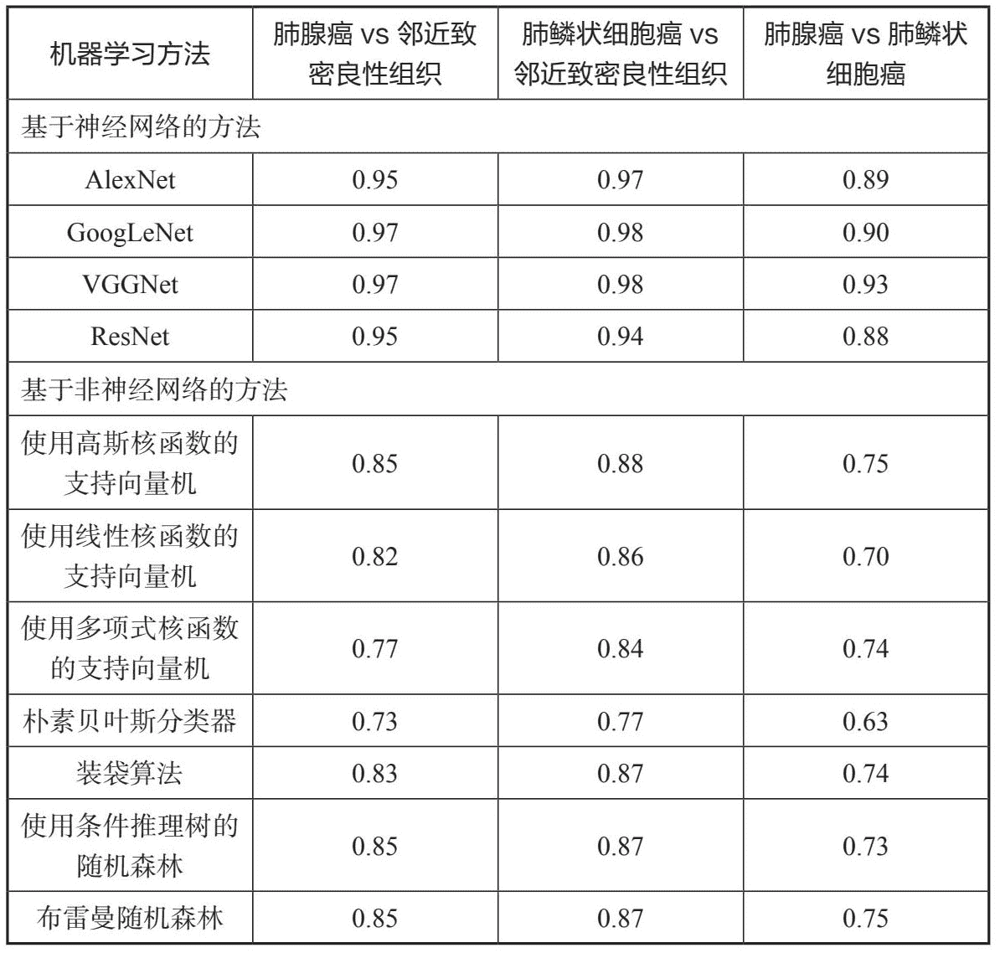

注：该表对比了区分肺腺癌与邻近致密良性组织、肺鳞状细胞癌与邻近致密良性组织、以及肺腺癌与肺鳞状细胞癌的分类器在 ROC 曲线下面积上的表现。

卷积网络能在医学成像中达到甚至超越人类水平，关键是数据战胜了领域经验。大数据让深度网络自动学习表示，捕捉浅层方法无法提取的抽象特征。PACS 积累的影像数据放大了这一优势。跨数据集或跨模态任务时，网络提取的特征泛化性优于手工特征；对个体差异鲁棒性更好；自动化特征学习省去繁琐的手工预处理。

2015 年基于 MRI 的前列腺癌诊断研究首次显示卷积网络可达人类水平。^(⁸⁵)

AI 如何安全融入医疗实践？证据表明深度学习可克服早期 CAD/特征工程的失败。一个方向是提供肿瘤、细胞或分子水平的定量指标，辅助病理学家做主观诊断。即使整合有限，结合医生实时反馈的自动化方法也能降低成本、改善疗效。若能解决数据收集、模型训练和临床部署的挑战，最先进算法即可进入安全验证的临床领域，见图 2—9。

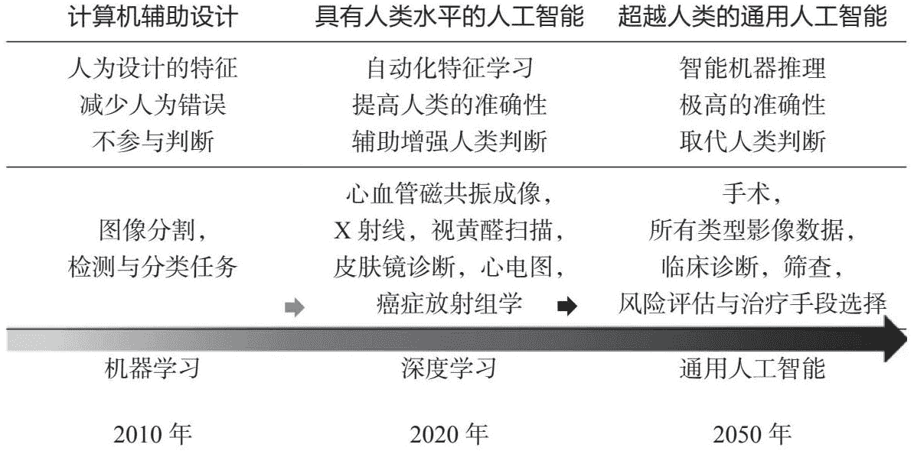

#### 图 2—9 将人工智能融入医疗实践的未来之路

注：该图描绘了从 2010 年的计算机辅助设计、2025 年左右的人类水平 AI，到 2050 年超越人类的通用人工智能的可能演进，标示了可能由机器执行的医疗与诊断程序。

## 深度学习仍有边界
众多知名研究人员对 AI 的局限性保持清醒，怀疑成熟 AI 的真实进展，并批评媒体过度炒作。AI 先驱期待机器能推理、理解幸灾乐祸、人权或不公正等抽象概念，看起来依然遥远。媒体不断挖掘超越人类智能的证据，导致期望膨胀。若以完全复现人类认知能力为标准，现阶段必然失望。毕竟大脑的工作原理尚未搞清。连接主义试图发展心智理论的神经科学家与人类脑计划的支持者都承认，理解大脑还有很长的路。早期研究者曾梦想用合适模型和算力解释意识甚至在机器中产生意识，如今这一目标几乎被放弃。

AI 经历过数十年的沉寂，近期技术进展才让商业与科学应用成为现实。深度学习的惊人进步表明其发展与技术工具紧密相关，而非像某些学科那样依赖持续的理论发现。虽然 AI 是工程领域，但在实验设计和假设检验上与生物学、物理学相似。正如第一章所述，算力推动了生物学进展，同样算力的提升也让 AI 达到甚至超过人类水平。

AI卡点到底在哪？为什么这些瓶颈一直绕不开？
现在学界的质疑主要分两条线：一条是通往全能型智能的路径本身受限，另一条是深层建模范式在拼凑通用能力时带来的先天缺陷。

如果方法体系里没有主动植入推理与规划的机制，达到通用智能的目标就很难实现，这一批评主要针对神经网络和特定任务导向的系统。
现有的通用智能方案普遍缺失情境理解力，导致对语音、时序信号乃至复杂场景的解读能力受限。
深层模型的理论研究推进缓慢，缺少坚实理论基础就盲目打造智能机器，会拉慢整盘进展。
在拟人化大脑层面，深层模型表现不佳，这暗示研究方向可能跑偏了，人类可以用极少样本完成学习。
泛化能力薄弱是另一大痛点，训练好的系统迁移到新领域时往往吃力。
过拟合现象严重，神经网络更像是在死记硬背训练样本。
眼下主流的深层方法不过是人类智能的初级仿制品，本质上是更精细的模式识别工具。
业界已有迹象显示深层网络的性能增速触顶，仅靠它实现全能型AI可能行不通。

制药行业的担忧更偏向落地，带有鲜明的行业烙印：

数据获取成本高、结构化数据稀缺且可靠性存疑，制约了深层建模的实际应用。
竞争壁垒阻碍数据共享，医疗隐私规范让临床试验相关的核心病历难以集中，关键数据难以规模化积累。
在新药研发中，深层建模的切入口相对狭窄，主要集中在虚拟筛选和定量构效建模上。
已有成熟高效的机器学习方案，企业认为未必需要深层网络或海量数据集。
AI带来的提升多属边际效应，投入数据科学、计算与高性能算力带来的效率或产出增幅，不足以支撑大规模投入。
可解释性缺失，深层模型多为黑箱，很难说清为什么会给出某项预测或结果。

社会层面同样伴随一连串争议，这些议题早已为人熟知，也常引发激烈讨论。核心担忧包括AI偏见带来的性别、种族、阶层与健康状况歧视、就业岗位被替代、潜在的社会动荡，以及人类决策自主权的削弱。对未来的恐惧集中在大量重复性工作将被算法和机器接管，成千上万从业者面临失业。以医疗健康为例，诊断的本质是汇集症状、观察、影像、病史、分子谱、遗传和社经等多维度信息，并据此预测结果、给出建议或推断病因。机器输出会包括病理状态、可能病因、治疗建议、下一步检查方案等，深层网络恰好擅长在高维数据中挖掘相关性并做预测。

医学界长期担心AI诊断会彻底取代放射科医生。未来学家尤瓦尔·赫拉利认为AI非常适合医疗诊断，未来会出现知识渊博、预测精准、表现超人的医疗机器人，医生的培养将成为历史。然而多数跨界专家并不认同短期替代论。埃里克·托普在《深度医疗》中指出，AI更可能扮演辅助角色，为医生提供另一视角，节省时间，让医生能更多与患者沟通。^(⁸⁶)

另一个隐忧关乎科技巨头的权力边界。脸书、谷歌、微软、亚马逊、苹果，以及百度、腾讯等公司手握庞大资源与全球影响力。它们将如何运用AI造福社会？加州大学伯克利分校的迈克尔·乔丹警示，需要全社会参与并设立全新工程学科来构建社会规模的决策系统。为缓解对AI的恐惧与伦理焦虑，学界与工业界曾共同行动：麻省理工学院的迈克斯·泰格马克于2015年在波多黎各召集首次会议；2017年加州阿西洛马会议再次强调技术影响评估的重要性，正如20世纪70年代同地DNA重组技术研讨会的先例。如今，AI进入新阶段：受大脑启发的计算将继续驱动各行业的数据应用，商业压力推动开源框架、算力与算法设计不断跃进。科技领域一直在推动这些进展与基础工程，属于制药行业的爆发时刻尚未真正到来。

# 第三章
## 新药诞生的曲折旅程

自然能够治愈疾病。

——希波克拉底

约公元以前460年

人类寻找具药用价值的天然或人工物质已有约一万年历史。即便在现代制药框架下，探索也长期依赖对大自然医典的随机试验。数千年间，这是一场对地球超过35万种植物宝库的无止境搜寻，成果包括数千种食用植物、活性分子、维生素，以及能缓解症状或逆转病程的珍贵植物衍生物。源自罂粟的止痛成分在两个世纪前奠定了制药业的基础。

文艺复兴以后到19世纪早期，几乎所有含药理活性成分的混合物与草药都未经历纯化。人们常以酒精等溶剂增溶以提升生物利用度。植物中具药用价值的化学物多为有机小分子。欧洲化学研究的蓬勃帮助药剂师、炼金术士乃至江湖郎中获得更高纯度的提取物。新工艺让患者获得更标准化的止痛制剂，却也让滥用风险上升。19世纪初，德国药剂师弗雷德里希·塞尔图纳从鸦片乳汁中成功分离吗啡，为药物工业化生产埋下伏笔。伊曼纽尔·默克发展出类似生物碱提取技术。1827年，默克嗅到扩大鸦片生物碱生产与销售的机会。19世纪30年代，其家族企业在德国完成从药房到工厂的转型，第一家工厂设在达姆施塔特。

伴随化学加工与工业革命，制药业在德国资本主义土壤中兴起。炼金术及其毒药神药逐渐退出医学实践，美欧开始从植物中分离单一成分，获取纯药用化合物。分析化学与有机化学的进步引发植物生物碱分离热潮，陆续获得咖啡因与奎宁1820、尼古丁1828、阿托品1833、可可碱1842、可卡因1860、毒蝇碱1870等纯化物质。默克与同行还分离出可待因、罂粟碱、蒂巴因，进一步巩固罂粟在人类药用史上的核心地位。

^(⁸⁷)

合成化学兴起后，药物发现进入新纪元。思路转变为改造自然物质、合成分子自然界并不存在的结构。当时西方医生仍在逐步放弃希波克拉底的四体液理论。炼金术士虽会混合金、汞、硫与酸及有机材料，却未尝试创造全新结构，也因缺乏生命与化学的科学概念而无法做到。随着拉瓦锡、普里斯特利、阿伏伽德罗等建立科学基础，叠加道尔顿原子理论，化学家开始设想改造现有化合物的可能。在工业制造能力成熟、大学完善药理学实验平台的背景下，新化合物设计与筛选应运而生。1905年，约翰·纽波特·兰利提出作用于单一受体的激动剂与拮抗剂概念，并衔接保罗·埃尔利希的化学受体工作。^(⁸⁸)

生物技术开启治疗发现第三阶段，成为生物制剂创新的核心驱动力。20世纪70年代，分子生物学家发明重组DNA技术，使新一代治疗药物的开发与制造成为可能。生物技术带来合成蛋白质产品的希望，可从细胞工厂获取与人体细胞几乎一致的蛋白制剂，如胰岛素与促肾上腺皮质激素等，过去仅能从动物组织提取。通过基因工程改造细胞，可从蛋白基因序列出发生成复杂生物大分子。1982年，礼来公司与基因泰克合作，获批全球首款生物技术药物重组人胰岛素优泌林，击败竞争对手。

单克隆抗体技术亦推动生物制剂进入临床。杂交瘤细胞技术可源源不断生产源自小鼠免疫系统的单一B细胞抗体。1986年，首个小鼠单克隆抗体获FDA批准，由杨森制药以Orthoclone OKT3上市，是一种识别T细胞CD3蛋白的免疫抑制剂，用于预防器官移植急性排斥。此后基因工程不断优化抗体工艺，如去除小鼠序列以降低免疫原性，后发展出完全人源化抗体。噬菌体展示技术则提供另一条通过遗传学与新细胞系发现构建抗体的新路径。^(⁸⁹)

尽管流程复杂，过去数十年生物药物持续涌现，用于抗癌、自身免疫、心血管与代谢紊乱等疾病。生物制剂已主导全球药销榜：单抗与重组蛋白占据前十名中的八席，2019年销售额近750亿美元。新冠疗法竞赛中，单抗是首批投入使用的武器，包括礼来的bamlanivimab与再生元的REGN-COV2抗体鸡尾酒，后者在2020年10月曾用于治疗美国总统特朗普的新冠感染。

第三次浪潮中，生物技术公司成为发现引擎。大药企纷纷重组，将生物技术能力纳入早期发现与临床前开发，补充小分子管线。先进的分子生物学、遗传学与免疫学工具让药物研究者从探索新化学结构转向识别新分子靶标。基因组数据与生理知识的指数级增长揭示大量可干预位点，许多靶点因过去缺乏合适小分子而被搁置。化学家与生物学家携手形成新范式：生物学家负责靶标发现验证与高通量筛选平台搭建，通过大规模分子库筛选寻找可调控靶点活性的化合物，即苗头化合物发现。基于生物学的高通量筛选已成为21世纪苗头发现的基础。

生物技术热度的另一层原因是它为战胜疾病提供了大量工具。第四阶段由细胞与基因治疗、基因编辑、细胞重编程与合成生物学主导，为治疗变革提供及时工具。新范式从自身细胞与基因出发，重编程细胞、重连神经回路、重写基因、重塑蛋白机器，这些正是第四阶段的特质，也指向医学未来。

## 治疗发现的 4 个时代

治疗发现经历了 4 个时代。

植物学时代：通过在自然药典中进行随机实验，发现植物化合物有医疗、娱乐和宗教用途。

化学治疗学时代：对植物化合物进行化学提取和纯化；新型化合物合成与制药工业的诞生。

生物治疗时代：生物技术公司引入生物制剂制造，催生了一系列新的治疗类别，包括抗体和重组蛋白等。

治疗工程时代：通过工程方法设计细胞和基因疗法而非发现，通过基因编辑生产设计生物分子，通过处方软件修改大脑活动行为，基于病毒载体、纳米颗粒或血液循环中的纳米机器人等精确药物输运系统的新型治疗手段。

## 医学的起源：自石器时代以来鸦片的作用

在全能的上帝赏赐给人类以减轻痛苦的所有药物中，没有一种比鸦片更普遍、更有效。

——托马斯·西德纳姆1624—1689

谁能离开鸦片世界？

——夏尔·波德莱尔

《人造天堂》1860

医学起源与人类历史紧密交织，与鸦片发现史步调一致。考古植物学显示，新石器时代北欧、西班牙与地中海地区均有罂粟痕迹。无论是青铜时代饰有罂粟荚的小雕像，还是现代医疗系统开具的数十亿药丸，都彰显其在人类文化中的分量。罂粟生物碱长期承担医疗、娱乐、宗教与经济功能，数千年间伴随文明演进。

新石器时代革命打开通往文明的大门，让人类学会种植、驯养与定居，随后才出现抵御疾病与精神弊病的医疗实践。7500多年前农业兴起，技术从新月沃地向西欧北欧传播。碳化植物分析显示小麦、豌豆、扁豆、大麦、亚麻等作物随之扩散，罂粟则是例外，似乎曾沿阿尔卑斯向东南移动，后又重返地中海。

约7300年前，线纹陶文化遗址出土了两种罂粟亚种种子。^(⁹¹)史前证据表明治疗发现的第一阶段即始于晚石器时代，人类在采集植物时寻找药用或致愉悦成分，包括用于宗教的致幻物，以及影响情绪与行为的兴奋剂与镇静剂，许多仍为今日娱乐性药物。草药随之兴起，几乎每个文化都有自己的疗法。17世纪前西方医学最重要的草药著作是迪奥斯科里德斯约公元50—70年撰写的《药物论》，记录600多种药用植物，为现代药典之源。该书受泰奥弗拉斯托斯《植物志》影响，后者于约公元前350—280年系统描述多种植物并记述树胶、树脂与果汁的提取用于药物。亚里士多德与希波克拉底讨论罂粟药用，亚里士多德知其催眠作用。

中世纪许多药典由波斯医学医生撰写，如阿维森纳1025年《医典》、12世纪伊本·祖尔与14世纪伊本·拜塔尔著作。中国认为草药始于5000年前，最早药典《神农本草经》约可追溯1800年前，收录365种草药。16世纪中叶，瓦勒留斯·科尔杜斯在德国撰写《药典》，是西欧权威之一。他系统的研究《药物论》所述药用植物并记录于《植物志》，为重要草药书之一。科尔杜斯在南欧寻药时感染疟疾，年仅29岁去世。

几乎所有这些药典都记载鸦片配方。即便约公元以前16世纪古埃及《埃伯斯纸草卷》^(⁹²)中已有记载：

小儿止哭方：罂粟荚，壁飞尘，合为一，滤，服四日，即见。^(⁹³)

中世纪后期，奥斯曼、波斯与大英帝国将鸦片用于医疗与娱乐。16世纪各文化使用模式分化：奥斯曼、波斯与莫卧儿偏好吸食，欧洲则由帕拉塞尔苏斯约在1500年发明鸦片酊，即鸦片生物碱与酒精混合液，近200年间备受推崇。1667年，英国医生托马斯·西德纳姆推出其鸦片酊配方，混入雪利酒、藏红花、肉桂与丁香，风靡欧洲后传入美国。1668年，弗里德里希·雅各布·默克在达姆施塔特收购天使药房，成为默克公司前身。^(⁹⁴)

18世纪中期，英国药剂师在配药与处方中角色增强。1776年，亚当·斯密戏称药剂师是穷人的医生，以及富人在小毛病时的医生。^(⁹⁵)19世纪之交，英法德社会变革、全球贸易与医学格局变化为破解鸦片之谜创造条件。弗雷德里希·塞尔图纳在研究鸦片催眠原理时首次分离出鸦片生物碱，并以希腊梦神摩耳甫斯命名为摩啡，后改为吗啡以符命名规则。消息迅速传开，改变药物市场经济模型。因鸦片在土耳其、埃及等地易得，制约获利的关键在于化合物分离。伊曼纽尔·默克抓住机会，1826年开发相似提取方案，并在1827年《医药和化学创新》内部文件中推动建立鸦片生物碱大规模生产线。不久，默克开始生产吗啡与可待因用于止痛、镇咳与腹泻。图3-1展示了罂粟荚膜天堂之乳、吗啡分子结构及植物中主要生物碱化合物。

鸦片贸易如何点燃了现代制药

19世纪上半叶，生鸦片及其生物碱已发展成一项跨国巨额生意，其不断膨胀的利润深刻改写了19世纪中叶的国际格局。1830年代，英国商船经广州港向华夏输入约一千四百吨生鸦片。吸食现象已蔓延至社会各阶层，统计显示到1830年代末，约有1200万中国人染上成瘾。清政府在与伦敦的通商谈判告吹后彻底禁止鸦片入境，这一硬性措施直接引爆了1840年的第一次鸦片战争。 ^(⁹⁶)

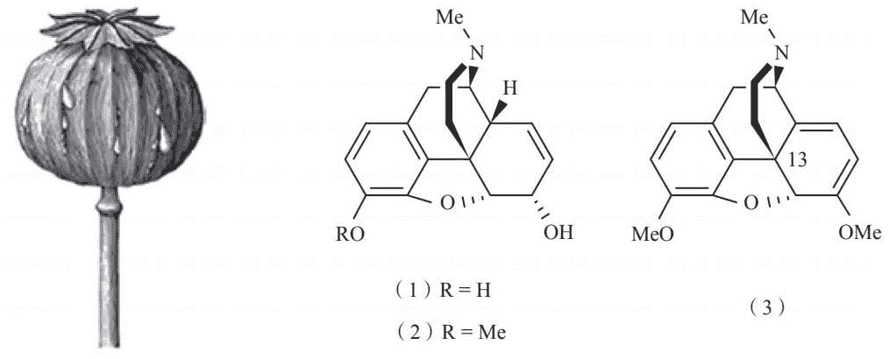

图 3—1 罂粟荚膜和鸦片生物碱

注：左图：罂粟荚膜；中图：植物中常见鸦片生物碱的母体化合物，其中，R 基为氢原子时即为吗啡（1），R 基为甲基时即为可待因（2）；右图：蒂巴因（3）。

^(⁹⁷)

从某种偶然性来看，止痛剂、阿片制剂以及各类麻醉品意外成为制药工业的奠基性药物。就科学理性而言，那个年代根本不具备针对疾病机理或传染病原体的特效药研发条件。在微生物致病学与细菌学说形成之前，医学实践的核心仍是缓解痛苦、提升生活质量。因此药房、医师与公众共同追求的是副作用更小、效力更强、剂量更稳定的制剂，而供给方早已就绪。依托吗啡、可待因的量产经验，默克于1862年将可卡因纳入产品线。拜耳则致力于寻找水杨酸的化学替代物，水杨酸虽有退热效用但不良反应明显。与此同时，拜耳研发主管卡尔·杜伊斯贝格与实验药理主管海因里希·德雷泽也在探索成瘾性更低的吗啡、可待因衍生物。1897年，费利克斯·霍夫曼首次实现乙酰水杨酸合成，该物上市后被命名为阿司匹林。研发团队化学家阿诺德·艾兴格林在1944年身处特莱西恩施塔特集中营时致信称，正是他建议霍夫曼开展水杨酸乙酰化研究。 ^(⁹⁸)

## 工业制药

除非尝试从未尝试过的方法，否则期望实现从未能实现的事情就是一种不切实际且自相矛盾的幻想。

——弗朗西斯·培根，《新工具》

1620 年

时间是评判科学成果的最佳标准。我深知一个工业发现很少能在其第一发明者手中展现出所有潜能。

——路易斯·巴斯德

1879 年

工业革命时期，全球制药工业大致沿两条商业路线成型。直接路线源于药剂师与药房传统，其职能是药品供应并试图把已知药物实现大规模标准化生产。德国默克以及几乎所有美国大型制药企业的前身都出自此脉，见表 3—1。另一条路线由合成化学驱动。化学工业价值被认识后，瑞士与德国的煤焦油染料公司开始进入医药领域。制药业的崛起与百年后科技产业的兴起有惊人相似，碳氢化合物构件推动了制药创新，而电气工程与集成电路则驱动了计算时代。

表 3—1 全球制药业的起源

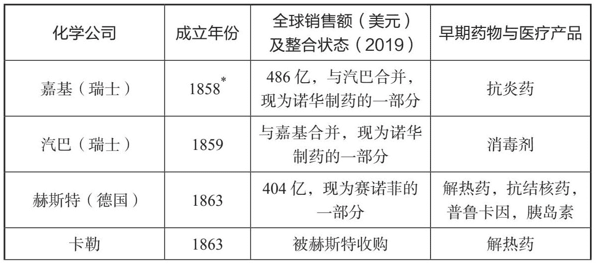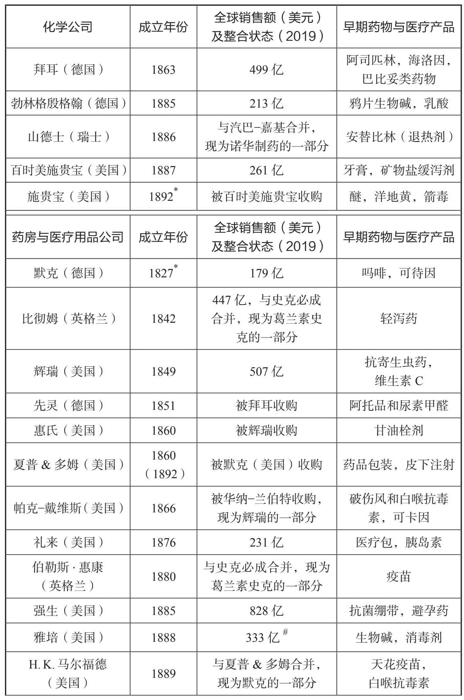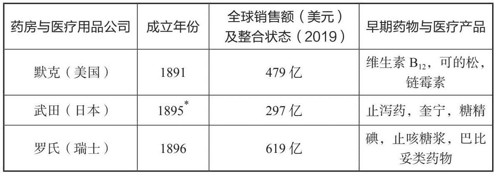

注：销售数据基于《福布斯》全球上市公司 2000 强榜单（www.forbes.com/global 2000/#f6c8ed7335d8，2020 年 5 月 13 日）、公司年报（勃林格殷格翰）或邓白氏（默克公司）。

雅培销售额是指艾伯维公司的销售额。雅培在 2013 年成立艾伯维，从而开展独立的制药业务。

* 在进入制药业前已经拥有悠久历史的公司：默克成立于 1668 年，最初是一家药店；嘉基最初成立于 1758 年；武田成立于 1781 年，最初是一家日本传统药物和中药销售商；施贵宝于 1858 年在布鲁克林建立了实验室。

### 制药和计算机行业的发展

制药与计算机产业成长所依赖的关键要素可归纳如下。

市场需求：需求提前形成且规模庞大。

资本：英国、比利时和德国为新兴产业提供资金。

资源：生产所需的原材料充裕且价格低廉。

劳动力：受专业训练的技术人才队伍不断壮大。

研发：研发活动天然嵌入成功企业，成为持续创新的引擎。

发明家和先驱：大学与产业界的紧密互动是创意与技术知识的重要来源。

19世纪50年代中期，纺织业快速扩张，英国、比利时、德国、法国和瑞士凭借机械化与蒸汽机占据主导。天然纺织染料价格昂贵、用量巨大且只能从植物获取，合成染料面前出现了一个巨大的待开发市场。瑞士与德国莱茵河沿岸的多家企业长期生产天然染料，地理位置靠近下游纺织厂商。1834年德意志关税同盟成立，消除各邦壁垒，商品自由流通重塑经济版图，随后英国与比利时的资本流入莱茵地区。

个人电脑与互联网早期的“硅谷神话”与药物研发初期的创业氛围颇为相似。1970年代，史蒂夫·乔布斯与史蒂夫·沃兹尼亚克在加州帕洛阿尔托的郊区车库里搭建出个人电脑原型；数十年后，无数创业团队在旧金山湾区的公寓与小隔间里萌芽。随着19世纪中叶工业革命在美国、英国、德国与瑞士推进，一批企业家开始探索，最终促成了化学生产与医药制造这两个相互关联的新行业。

在美国，医生爱德华·罗宾逊·施贵宝于1858年创立施贵宝。他在布鲁克林自家住所搭建创业实验室，一面研究醚的生产，一面谋求把重要药用化合物工业化。1856年，年轻化学家威廉·亨利·柏琴在伦敦东区联排别墅的阁楼上建立实验室从事合成化学研究。

多重因素共同推动了工业制药浪潮，而柏琴利用煤焦油化学物合成奎宁时的偶然发现正是浪潮的起点。当时18岁的柏琴是化学系学生，其导师是德国裔奥古斯特·威廉·冯·霍夫曼，专长于煤焦油成分与有机合成。到19世纪中叶，煤气与固体焦炭已成为欧洲与美国家庭及工业的主要燃料。煤焦油是高温炼煤制气与焦炭的副产物，因而是来源丰富的工业废料。霍夫曼认为煤焦油中的碳氢化合物可用于化学合成，并提出以煤焦油主要成分苯胺为起点合成奎宁。该设想被证实是可行的。

柏琴多次尝试制备奎宁均告失败。有一次他用重铬酸钾在硫酸中氧化苯胺，得到一种紫色染料，他称之为苯胺紫。 ^(⁹⁹)

德国在二战前长期主导全球化学与制药业，其根基在于深厚的科学底蕴与持续的研究投入。 ^(¹⁰⁰)

并非所有染料厂都具备大规模加工能力，苯胺染料工艺因而催生了新的上游原料市场——从煤焦油中提取染料所需的化学品。有机化学兴起与广阔市场吸引众多公司进入，但最终只有以研究为导向的创新者得以存续。当时激烈的商标竞争迫使染料企业走向国际，专利常被规避或忽视，如瑞士所示，而德国当时尚未建立专利保护。柏琴的专利价值有限，仅在英国有效。此后制药公司多以煤焦油染料化学公司的子部门形式出现，脂肪族与芳香族有机化合物在药物化学中得到广泛应用并带来丰厚回报。

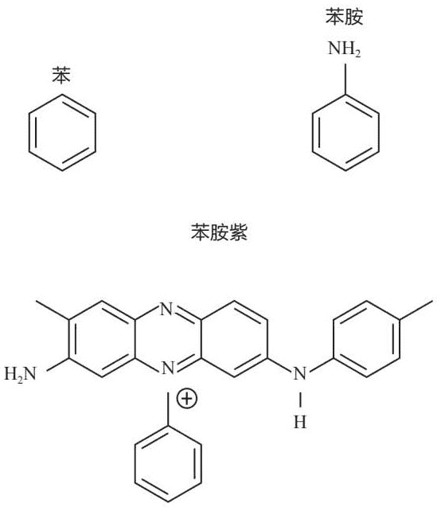

图 3—2 煤焦油染料行业的化学基础

注：苯、苯胺和苯胺紫的化学结构。凯库勒关于苯的结构和理论、霍夫曼关于染料的原料猜想以及柏琴的苯胺紫合成是推动煤焦油染料行业诞生的科学灵感。

## 保罗·埃尔利希与化学药物的诞生

19世纪末的化学公司与染料厂商若要从化工品、纺织染料转向人用药物，需要具备医学背景并关注化学与生物学关联的临床科学家。药理学与微生物学几乎同时出现，恰好为跨界提供桥梁。药物研发需要跨学科方法，而处于前沿的保罗·埃尔利希深知这一点。当时只有德国的拜耳、默克、赫斯特等企业拥有这种初具雏形的产业氛围。

埃尔利希在医学领域贡献巨大。他奠定免疫学与药理学多个理论基础并领导开创性治疗研究。1908年，他因阐明选择性毒性原理并展示化学物质对细胞的选择性清除，与他人共同获得诺贝尔生理学或医学奖。 ^(¹⁰¹)

停止抗疟研究后，埃尔利希在罗伯特·科赫指导下开展里程碑式的临床科学工作。科赫是医生、细菌学家，也是病原体理论的提出者。他希望埃尔利希与埃米尔·贝林合作，后者正尝试用“血清疗法”治疗白喉。当时国际上展开血清开发竞赛，各方试图从免疫动物中制备能抗白喉毒素的血清。科赫安排埃尔利希研究标准化制备方法。1894年，他们的免疫血清临床试验成功，赫斯特公司取得在欧洲生产推广“贝林-埃尔利希合成白喉疗法”的商业权利。美国方面，帕克-戴维斯成为首家生产免疫血清的公司。1901年，贝林因对抗这种致命儿童疾病及体液免疫理论的贡献，获得首个诺贝尔生理学或医学奖。

埃尔利希也曾获诺贝尔奖提名却未获奖，他与赫斯特的合作也未拿到全部应得报酬。但他并未止步。在抗疟原虫领域取得初步进展后，他在随后的20年里领导法兰克福的实验室与研究所继续开展基于染料的抗病原体药物研发。到20世纪初，埃尔利希已建立起一套完整的抗微生物药物发现体系。在由有机化学家、微生物学家和药理学家组成的团队中，他推动了史上首个真正的药物筛选项目，其模式被新兴制药业广泛借鉴。

锥虫是埃尔利希计划的下一个目标寄生虫。1896至1906年，一场毁灭性昏睡病席卷非洲，造成30万至50万人死亡。英国、德国和法国等殖民大国都急需遏制方法。阿方斯·拉弗朗在巴黎巴斯德研究所发现锥虫可在实验室动物上传播。埃尔利希与日本同事志贺洁建立了感染小鼠种群，并测试数百种新化合物。其中染料纳加那红在感染小鼠中显示振奋活性。随后埃尔利希向其他染料公司寻求结构相似但药用特性更佳的染料，经药物化学与药效筛选，他找到了台盼红。在对苯并嘌呤类染料化合物的系列测试中，他还意外揭示了一个永恒难题：微生物会产生耐药性，治疗不再能让小鼠获得免疫。非洲兽医的实地测试证实了实验室观察。

埃尔利希所研发的化学药物中影响最持久的是首个梅毒治疗药。梅毒周期性肆虐全球，埃尔利希实验室制备的化合物成为历史上第一种半合成抗微生物药物。1905年，埃尔利希的柏林同事埃里克·霍夫曼与弗里茨·绍丁确定梅毒病原体为苍白密螺旋体。霍夫曼建议埃尔利希用砷化合物治疗梅毒患者，理由是螺旋体病原体与锥虫在生物特性上相似。现今看来该建议相当牵强：除寄生生活方式外，苍白密螺旋体与锥虫并无关系。

首个具抗锥虫疗效的药物是砷酸，由法国生物学家皮埃尔·雅克·安托万·贝尚于1859年合成的金属毒物衍生物。埃尔利希与同事阿尔弗雷德·贝特海姆进行大量药物化学研究，试图合成毒性更低而可用于梅毒治疗的砷化合物。他的思路是将两个组分结合，一个与病原体结合，另一个负责破坏病原体——此处即砷毒。在筛选阶段，他们数年间生成数百个“先导化合物”候选分子。

将候选药物推进下一步的瓶颈是体内药理学实验，需用实验动物确定剂量、评估药理特性并分析毒性。刚加入实验室的日本学生秦佐八郎负责在兔子上测试埃尔利希与贝特海姆创建的新化合物库。经过对数百种新颖结构的多轮筛选，他们确定化合物606在兔子感染模型中活性最佳。随后进入人体临床试验。1910年，埃尔利希与贝特海姆公布化合物606用于梅毒治疗的首批结果，优异表现引发临床医生对该药的大量需求。研究所随即发放65000份免费样品推动更大规模试验。不久赫斯特公司签署销售协议，将其命名为砷凡纳明，并配上“拯救生命的砷”这一宣传语。在全球赞誉中，埃尔利希终于获得他梦寐以求的“神奇子弹”。

埃尔利希的理论为现代药物发现与实践打开了大门。20世纪初，他的受体理论、化学药物治疗原理及药物作用机制观点因过于革命而一度受争议。如埃尔利希在巴斯德研究所的竞争对手就曾质疑受体理论。当时学界对药物起效原因众说纷纭，我们如今知道其他理论完全错误，但它们曾流行数十年。 ^(¹⁰²)

在制药与治疗发现早期，德国的科赫、贝林、埃尔利希及法国巴斯德研究所的拉弗朗、梅奇尼科夫等人推动医学向科学方法加速靠拢。科学过程是理论与观测的互动，在医学中即为治疗方案与临床结局的互动。在埃尔利希的框架里，动物模型可作为临床假设检验的第一步，提供治疗可能成功或失败的证据，终点清晰。早期药物发现带有强烈试错色彩，后续一个世纪的流程基本保留了这一特性。埃尔利希研究昏睡病与梅毒时，致病病原体已确定。他希望“神奇子弹”能选择性靶向并摧毁微生物，却对分子靶点与化合物的相互作用或起效的生化过程一无所知。通过在不同剂量下试验数千种化合物，经反复尝试失败，他偶然得到少数几种产生预期效果的物质。砷凡纳明发现后数十年，科学家意外发现磺胺药物的抗菌特性，随后重新发现青霉素。

## 制药业：药品与战争

### 20 世纪的新药

> 构成动植物的丰富物质，以及它们神奇的形成和分解过程，自古以来就吸引了人类的关注，也引起了早期化学家们的极大兴趣。

> ——埃米尔·费雪
> 1902 年获诺贝尔奖时的演讲

20世纪上半叶，凭借卡特尔协议、专利保护以及对研究与制造技术的巨额投入，德国化学工业，尤其是拜耳和赫斯特等拥有制药部门的公司，长期占据全球商业主导。从某种程度上说，今天大型制药公司的版图就是那个时代的延续。曾大力支持拜耳早期合成药物研发的卡尔·杜伊斯贝格，也是从一战前到纳粹时期德国染料行业卡特尔化的核心人物。美国托拉斯，尤其是洛克菲勒标准石油，对竞争、定价、生产与分销的垄断控制，促使杜伊斯贝格将德国化学公司联合起来，复制类似模式。1905至1906年，拜耳与爱克发、巴斯夫组成Dreibund卡特尔；随后包括赫斯特在内的另外三家德国化学公司组成Dreierverband卡特尔。一战后1925年，杜伊斯贝格与巴斯夫总裁卡尔·博世联合德国六大化学公司成立臭名昭著的法本公司，即染料工业利益集团。此后直至二战，法本是欧洲最大企业，世界第四大企业，仅次于通用汽车、美国钢铁和新泽西标准石油。

以法本为首的德国化学卡特尔给世界带来了可怕后果。依托成员内部实验室的技术进步，德国摆脱了对外国供应的依赖，如智利硝酸盐。卡特尔化学家取得的重大突破哈伯-博世固氮工艺实现了化肥与烈性炸药的大规模生产。这些公司还生产了战争中有毒气体：一战期间的芥子气、光气和氯，二战期间纳粹在集中营用于种族灭绝的氰化氢毒气齐克隆-B。法本是希特勒战争机器的主要承包商，曾在奥斯维辛集中营剥削“奴隶劳工”生产合成燃料、塑料等。一战后，各大卡特尔的化学家、工程师和管理者在推动德国民族主义野心与军事化经济中发挥越来越重要作用。^(¹⁰³)

卡特尔的经济活动深刻影响地缘政治，也推动医药行业剧变，尤其在美国和英国。一战前，这两个国家几乎没有药物研究，公司聘用化学家的目的主要是依据美国1906年《联邦食品药品法》评估药物纯度。最终，战争与盟军在德国卡特尔面前的劣势催生了对合成化学家与合成化学研究的迫切需求。由于德国限制甚至停止向美国出口外科手术设备，占美国供应80%，以及药物如砷凡纳明、阿司匹林、苯巴比妥和普鲁卡因，一战伊始战场出现严重医疗物资短缺。新武器与壕沟战加剧伤亡，医疗危机不断恶化。

向欧洲战场输送药品、消毒剂与麻醉剂刻不容缓。从英吉利海峡到瑞士约4000英里的战线带来后勤挑战与医疗噩梦。抗生素要再等一代人。由于产气荚膜梭菌污染，任何暴露于有水战壕的伤口都可能致命感染。英国人用煤焦油化学技术制造消毒剂，并发现次氯酸钠可有效对抗这种致命细菌。德国士兵则可使用拜耳、默克和赫斯特生产的镇静与镇痛药物，包括强效巴比妥类药物佛罗拿、阿司匹林、安替比林、非那西丁和吡咯酮。其他镇静药还有缬草、溴化物盐、水合氯醛和三聚乙醛。战争后期，各方均出现严重吗啡和海洛因短缺。传染病占战争死亡的50%：战壕热、伤寒、麻疹、流感、脑膜炎、痢疾以及花柳病。

战前，砷凡纳明是全球处方量最大的药物，很快德国赫斯特的工厂停止生产。英国、美国、加拿大、法国和日本的化学家承受巨大压力寻找其合成方法，是一场与时间的竞赛。1915年6月，费城皮肤病研究实验室的杰伊·弗兰克·尚贝格及其同事自行生产出砷凡纳明。1917年获联邦贸易委员会许可并绕过德国专利后，他们成为陆海军梅毒药物的主要供应商。^(¹⁰⁴)

一战也改变了制药业进程。1917年《与敌贸易法》允许美国扣押外国资产，德国公司在美国的子公司被新美国利益集团接管或出售，包括默克、拜耳和赫斯特，以及数以千计的德国化学专利与商标，其中包括拜耳的阿司匹林。英国参战后采取类似行动：德国医药商标被叫停，英国政府从40所大学和技术学院招募化学专家，教授与学生投身药物活性成分发现，并与新兴制药业合作生产药品。

战后卡特尔、殖民地与寄生虫药的博弈

战火停歇后，德国在重建国家与重夺经济主导权两件事上同时发力，化工卡特尔迅速整合资源，重塑化学工业版图。史料记载，托拉斯性质的化学企业募集了十亿马克资本，用于扩建厂房并大幅提升硝酸盐产量。^(¹⁰⁵)

凡尔赛和约的另一项代价是割让四块非洲殖民地：多哥、喀麦隆、德属西南非洲即今纳米比亚，以及德属东非的卢旺达、布隆迪和坦桑尼亚。令人意外的是，卡特尔曾试图拿出医疗机密作为筹码，换回这些领地的归属。《纽约时报》1922年的报道与《英国医学杂志》1924年的评述都有记录。^(¹⁰⁶)

开战前拜耳就已察觉抗寄生虫制剂在非洲殖民地具备政治杠杆价值。承接埃尔利希约1904年对锥虫与台盼红的早期探索，拜耳化学家在随后十余年中以染料为起点筛选，合成了上千个结构日益复杂的分子。1916至1917年间锁定了最具活性的苏拉明，厂内代号拜耳205，后以日耳曼宁商品名上市。寄生虫得到控制后，英法占领当局得以在采采蝇活跃的地区作业，不再受疾病制约。英国政府识破了这场勒索企图，英法科学家随即破解拜耳205之谜，1924年巴斯德研究所的埃内斯特·富尔诺公开了其结构式。二战期间纳粹推出宣传片《日耳曼人：一个殖民行动的故事》，反讽地塑造了德国英雄与非洲人道主义的形象。值得注意的是，这款诞生近百年的药物至今仍被世界卫生组织列入基本药物标准清单。

## 合成抗菌药向微生物淘金的转向

把微生物确认为传染病根源，既带来早期治疗的突破，也让生物学家、化学家与药企看到技术创新的商业回报。在巴斯德推翻自然发生说、科赫揭示细菌致病的机制、斯诺开展霍乱流行病学调查之前，公众并不把微小生命与疾病关联。瘴气说占主流，腐败气味被当作病源。那时人体运行、药物作用与致病原因都还是空白。1882年科赫确立结核分枝杆菌与肺结核的因果关系，为医生与染料化学家指明方向。此后细菌学黄金年代相继发现霍乱、伤寒、炭疽、梅毒等二十余种病原。埃尔利希与拜耳在抗原虫领域虽有先发优势，市场仍在呼唤真正广谱的抗菌武器。

德国掀起寻找新型抗菌药的热潮。学界与企业间独特的协作加速了进程，1925年多家巨头合并组建法本。明斯特大学病理学家格哈德·多马克休假加盟法本研究所，探索苯胺类物质在细菌学中的应用。1932年他取得首个成果，一种抗菌化合物，后由拜耳制成皮肤消毒剂Zephirol即西非罗上市。更具开创性的是第二个项目，经过多年筛选，多马克获得一类能有效打击链球菌、金黄色葡萄球菌与淋球菌的全新广谱药物。首个分子是一种强效红色苯胺染料磺酰胺基黄，可用于人和动物的链球菌感染。首次临床试验中，多马克治愈了罹患链球菌败血症的亲女。经两年正式试验，该药于1935年以百浪多息之名面世，多马克因此获得1939年诺贝尔奖。纳粹曾迫使其放弃，战后他重新领回证书与奖章。

百浪多息却笼罩着谜团：实验室细菌学检测并未显示抗生素活性。法国巴斯德研究所研究人员偶然揭晓答案：真正起效的是其代谢产物，即结构更简且为人熟知的磺胺。这一意外推动了磺胺类药物的系统探索，也凸显药动学研究的重要性，而药动学已成为当今小分子药物发现的核心。随后数十年间，磺胺演变为药物研发的重要骨架，衍生出抗生素、降压药、利尿剂与抗糖尿病药等多种新药。^(¹⁰⁷)

^(¹⁰⁸)

百浪多息面世不久，青霉素的再发现开启了从地球微生物中提取化合物的新纪元。当然微生物药物时代早在1928年就已开启。那年亚历山大·弗莱明发现，一种霉菌污染了他制备的金黄色葡萄球菌培养皿，污染物产生的物质抑制了菌落生长。这种由青霉菌产生的活性成分被命名为青霉素。1929年相关论文发表后鲜为人知。^(¹⁰⁹)

其他药企相继建立微生物学平台，探索更多微生物来源药物。青霉素之后，从不同链霉菌中相继发现链霉素1943、氯霉素1947、四环素1948、红霉素1952等抗生素。大学与工业界实验室不断改良青霉素生产菌株。1951年转向产黄青霉，最终培育出超级菌株Q-176。此后所有青霉素生产菌株均源于Q-176。微生物为我们提供了大多数主要抗生素类别，包括β-内酰胺类青霉素、氨基糖苷类链霉素与新霉素、大环内酯类阿奇霉素与红霉素、四环素类、利福霉素、糖肽、链阳性菌素与脂肽。2000年以来用于治疗人类感染的20种新抗生素中，仅5种来自合成或半合成新类别。历经十亿年进化，为对抗生存环境中的竞争者，细菌防御体系造就了多种化合物，它们是对抗其他细菌近乎完美的武器。第四章将介绍细菌对抗噬菌体的防御系统CRISPR，在基因编辑治疗人类疾病的工具中，该体系已成最具前景者之一。

青霉素的发现对制药行业、医学实践与全球健康产生不可估量的影响。药企终于找到一条新路径：挖掘庞大的微生物化合物库。随着DNA的发现及其与蛋白质合成机制的明晰，人们才理解了这些早期药物的生化特性：它们多为DNA或蛋白质合成的抑制剂。早期研究揭示了药物在分子水平的作用机制与疗效的直接关联。弗莱明菌株青霉素产量低，反而意外推动了微生物基因工程的诞生，人们首次尝试重新设计代谢通路，从生物体而非试管中生产化合物。对医学而言，丰富的抗生素来源让普通医生也能用强力武器对抗从常见到罕见的细菌感染。如今世卫基本药物清单中约四分之一为治疗传染病的小分子药物。然而与抗菌药物耐药性及MRSA等超级细菌的永无止境战役，再次把抗生素发现列入医疗系统的紧急需求。自二战以来，青霉素及其他抗生素挽救了无数生命。抗生素出现前，人们主要靠改善公共卫生与个人卫生、提升生活水平来降低死亡率。抗生素的临床实践减轻了昔日传染病的影响，也为对抗源自人体的另一重阴影——癌症提供了重要启示。

## 癌症化疗如何起步

> 最有希望帮助我们理解并对抗肆虐的癌症的途径，是寻找癌细胞中的遗传损伤，并阐述相关损伤如何影响基因的生化功能。
> ——约翰·迈克尔·毕晓普
> 1989年获诺贝尔奖时的演讲

从拜耳推出阿司匹林与海洛因，到弗莱明青霉素实现批量生产，这半个世纪的制药业基本是在对生物学知识尤其是疾病成因一无所知的情况下发展的。抗感染领域，合成化学家与学术界合作试错，先在感染动物模型测试，再进行人体试验。当时既不了解候选药物的作用机制，也无法预测其安全性或疗效。早期抗癌药物研发亦沿此思路。20世纪40至50年代初，埃尔利希关于化学治疗与选择性靶向的理论引领新兴领域走向细胞毒性药物。大量案例与传闻证实药物破坏不同类型细胞的可行性。但化学合成物是否具选择性，不伤正常细胞呢？1917年7月12日，德军向比利时伊普尔投放化学武器，这场残酷袭击提供了首条线索。芥子气袭击战场，致死2000名士兵；幸存者烧伤严重、胃肠道受损、骨髓细胞被完全摧毁。两位美国病理学家检查幸存者后发现，其淋巴与血液组织及骨髓即白细胞发生地受损严重。当时无人知晓为何受此巨大影响，结果发表后即被遗忘。^(¹¹⁰)

临床观察到的化学毒素选择性细胞作用，提供了靶向破坏细胞群的首个可行性证据。数十年后，因担心新型化学武器出现，美国政府希望全面解密相关化学物质。1942年启动一项绝密计划。耶鲁大学路易斯·古德曼与阿尔弗雷德·吉尔曼开展绝密课题，研究硫芥与氮芥化合物的生物效应。在小鼠与兔子严密测试后，他们选择了一名48岁患淋巴肉瘤男性作为首位接受氮芥疗法的患者。方案设计为连续10轮“化疗”。第2轮结束后，患者大小肿瘤明显缩小；10轮完成，肿瘤完全消失。至此淋巴瘤首次化疗取得成功。1946年首份临床报告公开后，吉尔曼与弗雷德里克·菲利普斯在《科学》杂志讨论了化疗的潜在细胞作用机制：

> 此外，细胞的增殖活性似乎与它们对这些化合物的易感性有关。
> 我们相信，只有了解其对细胞作用的基本机制，我们才能实现对战争中刺激性气体伤亡案例治疗的重大突破。因此，我们对硫芥和氮芥影响细胞基本过程的作用机制进行了研究……我们还对氮芥在肿瘤治疗，特别是淋巴组织瘤治疗中的可能价值进行了严谨的初步试验。
> ——阿尔弗雷德·吉尔曼和弗雷德里克·菲利普斯
> 《科学》，1946年4月5日

氮芥可使DNA烷基化并产生DNA链间交联，造成广泛DNA损伤。这种化学修饰可触发基因组监测机制，引起程序性细胞死亡。^(¹¹¹)

### 阻断叶酸与核酸合成的突破

对抗癌症与对抗外来细菌不同。只有在更深入了解细胞生物学与药理学原理后，才能科学设计遏制肿瘤的针对性化疗。实现此目的有两个前提。首先，研究者必须掌握细胞生化与生长调控机制，明确抑制癌症生长的分子靶标。其次，同等重要的是，需从临床观察中获取药物反应、给药方案、毒性与意外事件的反馈。现代药物研发范式很好整合了这两个环节：临床前靶标发现与验证，以及受临床部门监管的临床研究与分期试验。在癌症治疗领域，制药公司尝试有限，学术界与医疗机构承担了大部分创新。最理想的开拓者应是兼具医学与科学素养的医学科学家。此人即在哈佛医学院与波士顿儿童医疗中心从事儿童白血病研究的儿科专家悉尼·法伯。

由DNA突变导致的白细胞不受控增殖会引起血液系统肿瘤。若突变位于淋巴组织白细胞则引发淋巴瘤；骨髓中白细胞前体特殊突变则引起白血病。20世纪40年代初，法伯提出全新白血病治疗思路：攻击癌细胞代谢通路。有证据显示维生素缺乏可能与急性白血病相关，因肿瘤快速生长患者血清叶酸即维生素B9常不足。法伯向数名白血病儿童注射了叶酸类似化合物丁蝶翼素与蝶酰二谷氨酸。不幸“治疗”加速了白血病进程。此结果促使法伯转向叶酸拮抗剂。他从纽约莱德利实验室获取几种合成化合物，发现其具有抑制肿瘤生长作用。随后挑选其中效果最佳的叶酸拮抗剂——氨基蝶呤，在16名急性淋巴细胞白血病儿童中进行小型临床试验。10人症状缓解，病情改善。可缓解只是暂时的。尽管部分患儿曾短暂康复，更多孩子病情仍持续恶化。^(¹¹²)

法伯研究抗叶酸类药物包括氨甲蝶呤的同时，乔治·希钦斯与格特鲁德·埃利恩在纽约伯勒斯·韦尔科姆实验室研究嘌呤与嘧啶类似物——另一种针对性癌症治疗策略。希钦斯相信这些化合物可通过阻断DNA合成抑制细胞生长。许多科学家认为此研究纯属盲赌，因当时尚未完全了解DNA在细胞中的角色与作用，对DNA与肿瘤生长关联所知甚少。合成化学家埃利恩富有创意地合成一种嘌呤拮抗剂2,6-二氨基嘌呤。该拮抗剂在细菌生长抑制测试中表现良好。1947年，团队将埃利恩的化合物送往斯隆·凯特琳研究所，该所拥有利用实验体系筛选癌症化疗药物的丰富经验。后续针对白血病患者的临床试验中，2,6-二氨基嘌呤展现强大潜力，但毒性强到难以承受。1951年埃利恩与希钦斯又开发出两种新化疗药物：硫鸟嘌呤与6-巯基嘌呤。在氨甲蝶呤耐药患者身上测试6-巯基嘌呤，约30%患者获得完全康复。快速验证后，6-巯基嘌呤与法伯的氨甲蝶呤于1953年获美国食品药品监督管理局批准用于治疗急性淋巴细胞白血病。

在这项奠基性化学治疗工作中，埃利恩与希钦斯采取了更合理的药物发现方式：基于基本生理化学机制的理解进行药物发现。其开创工作后很快取得更多突破。大鼠肿瘤模型生化分析催生了另一种与DNA与RNA合成相关的化疗策略。在动物模型中，肝癌细胞似乎比正常细胞更快消耗尿嘧啶——RNA的四种碱基之一。注意到此差异，威斯康星大学麦迪逊分校研究组提出，可利用尿嘧啶类似物靶向抑制尿嘧啶生物合成路径。查尔斯·海德尔伯格合成了5-氟尿嘧啶，随后与新泽西州纳特利的罗氏制药合作，将化合物制成药剂，在患“晚期恶性肿瘤”患者身上测试。^(¹¹³)

## 抗生素如何进入抗癌赛道

化疗竞赛还开辟出第三赛道：探索微生物化合物作为新药物的潜在来源。细菌会产生对增殖中人类细胞具细胞毒性的化合物吗？美国罗格斯大学塞尔曼·瓦克斯曼团队从放线菌中分离出几种抗生素化合物。斯隆·凯特琳研究所科研人员发现，其中一种特殊化合物——放线菌素A，可抑制小鼠肿瘤生长。在德国，拜耳实验病理研究所即格哈德·多马克发现广谱抗生素之地，研究人员得知抗生素可抑制肿瘤生长后，又找到一些新化合物，其中包括放线菌素C。瓦克斯曼测试放线菌素C，并于1953年分离出放线菌素D。他与法伯合作证实，放线菌素D能够治愈儿童肾癌——肾母细胞瘤。后来发现放线菌素D对其他几种癌症亦有效。20世纪60年代，法国、意大利与日本实验室独立研发出两种具类似细胞毒性的抗生素：柔红霉素与博来霉素。

## 癌症化疗小分子药物的机制图谱

以下为癌症化疗中的小分子药物及其在细胞中的作用机制。

DNA损伤化合物：DNA烷化剂包括氮芥、环磷酰胺、丝裂霉素与顺铂，主要通过引发DNA化学交联起作用。交联会激活DNA修复事件，导致细胞周期停滞，并能引发DNA损伤反应，通过凋亡诱导细胞死亡。

DNA合成抑制剂：抑制DNA前体分子合成的化合物，包括嘌呤类似物氨甲蝶呤与6-巯基嘌呤，以及嘧啶碱基类似物5-氟尿嘧啶。

DNA复制抑制剂：通过长春花生物碱如长春花碱、紫杉醇以及DNA拓扑异构酶抑制剂如喜树碱与柔红霉素干扰细胞分裂周期即抗有丝分裂作用。

RNA转录抑制剂：抗生素药物放线菌素D通过嵌入DNA并阻断聚合酶进程来干扰所有类别RNA聚合酶。

学术界科学家与临床研究人员与研究所或政府资助药物筛选项目通力合作，催生了代表第一代癌症疗法的药物发现与创新治疗方法。斯隆·凯特琳研究所地位日渐提升，同时为学术界实验室以及化学与制药公司提供服务。1955年，美国国家癌症研究所成立国家癌症化疗服务中心，恢复了其在美国的药物筛选项目，以进一步推动白血病研究。1957年欧洲启动类似计划，即欧洲癌症研究与治疗组织。尽管市场并不看好这些项目，其临床响应率也往往难以令人满意，但在鼓励制药公司承担癌症药物开发风险方面，这些药物筛选计划发挥了重要的早期作用。

癌症最可怕的特征之一是耐药性。几乎所有类型人类恶性肿瘤都可能发展出耐药性。肿瘤的遗传多样性意味着总有某个细胞亚群即亚克隆具有耐药机制，例如能够通过转运蛋白将化疗化合物泵出细胞，从而使该亚克隆继续不受抑制地生长。癌细胞有一系列机制可以抵抗有毒药物带来的选择压力。直到数十年试验与临床开发带来有效的联合疗法，我们才终于能够有效地控制癌症，制药公司也才开始看到成功的曙光。

将候选药物从基于细胞培养与动物模型测试的概念引入临床，仍面临许多实际挑战。肿瘤学中的小鼠模型无法用于精准的临床结果预测，癌细胞如何篡夺细胞生长调控也是20世纪七八十年代长期困扰人们的一大谜团。单克隆抗体技术以及分子生物学家对致癌基因与抑癌基因的揭示最终为我们指明道路：细胞增殖失控是由信号蛋白突变导致的，因此我们可以精准靶向这些突变蛋白。针对慢性髓细胞性白血病中过度激活的激酶即基因组重排产生的致癌BCR-ABL融合蛋白开发的靶向药物格列卫，引领了基于精准医学的新一代药物发现。

## 免疫疗法：唤醒自体防御

近一个世纪以来，癌症治疗范式专注于寻找选择性作用于癌细胞的化学疗法与药物，通过引入细胞毒性化合物扰乱癌细胞信号通路。另一边，免疫学家一直困惑癌症为何能如此成功逃避免疫系统。它们好像外来小混混，却能在体内环境中茁壮成长。研究人员早已了解T细胞如何识别细菌、病毒及其他外来肽，但T细胞信号传导与激活则更复杂，通过多种组分同时参与的分步过程才能实现免疫反应。詹姆斯·艾利森及其同事发现，免疫反应的最后一步涉及细胞检查点即“刹车”的移除，这个发现彻底颠覆了长期以来人们对免疫反应的认知。研究人员意识到，我们不必治疗癌症本身，而是可以治疗免疫系统。

^(¹¹⁴)

这种新方法被称为免疫疗法。一种叫作CTLA-4的T细胞受体起到了刹车的作用。相应地，通过抗体阻断CTLA-4功能则可能激活T细胞。1996年艾利森团队首次证明抗CTLA-4抗体可以抑制小鼠肿瘤生长。^(¹¹⁵)

我们在图3—3中概括了癌症疗法的发展历史。该图将最初的创新发现与最终的治疗模式联系起来，突出了从初始概念形成到产品获准之间的时间差——有时长达数十年。值得注意的是，新疗法的出现需要不断创新。同时，我们应该关注，有关免疫系统的基础发现如何为我们开辟出全新思路，让我们能够对抗各种狡猾而凶残的肿瘤。

## 21世纪的医药商业模式

制药研发的演进与瓶颈

治疗发现的脉络可以追溯到150年前的欧洲、英国与美国的煤焦油工厂以及街头药铺。有机化学为以合成或半合成分子构建新药典提供了方法论，也由此打开了庞大的商业空间。随着化学企业雨后春笋般出现，各自的制药部门里药物化学家和药理学家开始设想，新型合成手段会把构想变为商品。默克与拜耳是最早把流程优化置于中央实验室核心的企业，这种模式后来被广泛模仿。早期的成功并非完全自研，更多是吸收外部科学家的灵感。保罗·埃尔利希贡献了抗梅毒的砷凡纳明，马丁·弗罗因德发明了止血剂马钱子碱，埃米尔·费舍尔与约瑟夫·冯·梅林共同设计了首个巴比妥类药物佛罗拿，最初由拜耳与默克联合投放市场。微生物来源化合物被发现并开启抗生素时代，也印证了产学合作的价值，多马克、吉尔曼、瓦克斯曼、法伯等人都深度参与其中。二战后主流药企普遍设立微生物部门，扩建生产设施，并从细菌学、药理学、生物化学领域大规模引进人才。如今这些企业仍大量招募化学家、转化医学专家和疾病生物学家，去破解更复杂的生物学难题，在已深耕多年的治疗领域寻求突破。以诺华为例，心血管与精神疾病的积累已超半个世纪，免疫学也有半个世纪沉淀，肿瘤学则有约四分之一世纪的基础。这种纵深与广度形成了难以复制的竞争壁垒，让企业在擅长赛道上拥有更深刻的设计理念和规模化制造能力。

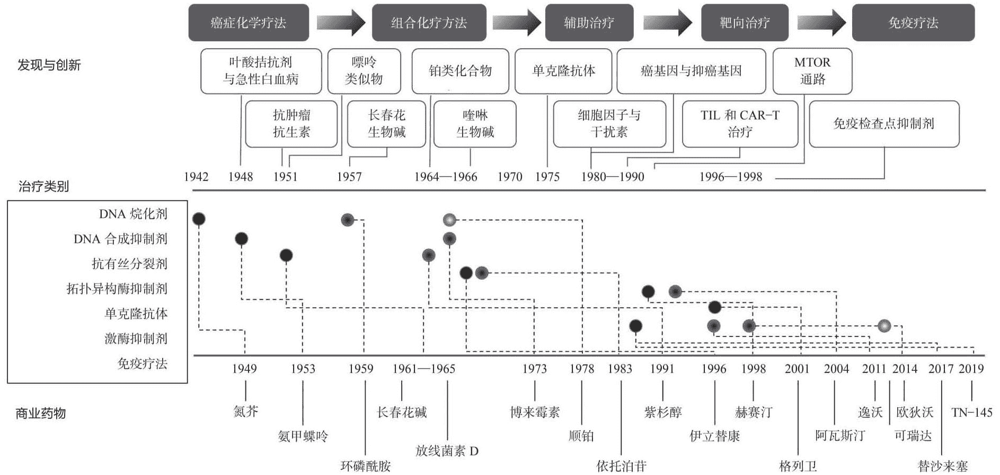
图 3—3 癌症治疗发展：从创新到落地

注：时间轴上方展示了为癌症治疗带来突破性进展的发现和创新事件；中部黑色圆圈代表首次引入某个分子类别或治疗方式的时间，第二代和第三代方法用不同的灰度加以区分。底部展示了这些治疗或药物类别所对应的最终商业产品的化学名称或品牌名称，与获得美国食品药品监督管理局批准的时间。

现代药物研发的关键支柱，是药企与医院医生、以及医疗体系核心的学术医疗中心之间的长期互动。从抗癌药开发可见，临床医生既是连接病人与监管方的桥梁，也在医学观念传播中发挥主导作用。处于肿瘤治疗前沿的机构和医生，对药物使用方式与新治疗形态的创新至关重要。更重要的是，医学界与监管方共同建立了以申办者—研究者为模式的临床试验框架，有力推动了临床开发的规范化。

一家公司的成败系于人体试验结果，这类研究在真实人群中开展，有明确终点，能为高管、投资者和监管机构提供决策依据。借助医生的合作，如今可开展更精细的设计，例如伞式试验和篮式试验。精准医学的核心是依分子特征划分的队列，即携带特定生物标志物的患者亚群。美国食品药品监督管理局及其他监管机构要求，候选药物必须在标志物阳性人群中显示临床获益，而在阴性人群中不应有效。对小规模研究而言，这种要求挑战很大。因此企业高度依赖统计学，以及来自分子检测的明确遗传信息，和真实世界数据源产生的证据，比如可穿戴设备传感器、实验室检测和患者自报结果。

制药企业的运作已拆分为从早期假设验证到 FDA 批准的独立又衔接的环节，具体见表 3—2。

表 3—2 小分子药物发现与研发流程

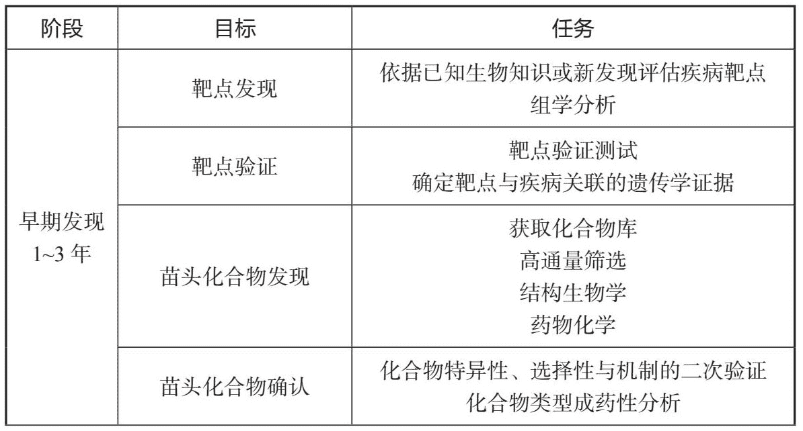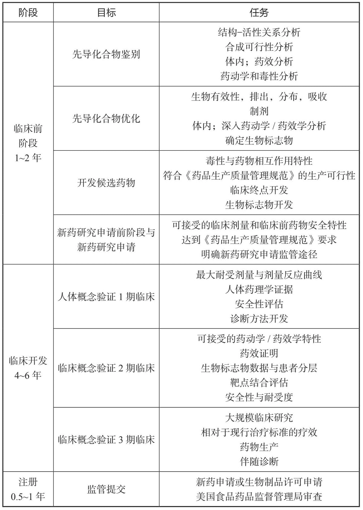

早期发现聚焦于基于生物学认知或合作伙伴最新成果对治疗假设的评估。起点是靶点的发现与验证，理想状态下能获得靶点与疾病关联的遗传学证据。随后进入小分子发现，寻找能结合靶标并改变其活性的化学实体。借助分析技术与高通量筛选，可发掘并验证苗头化合物，最终确定进入临床前开发的早期先导物。临床前工作围绕吸收、分布、代谢、排泄和毒性展开，并基于动物模型进行药代评估。一旦活性成分具备生产可行性，企业会决定是否递交新药研究申请。获批后进入以疗效与安全性为核心的临床开发阶段，即1期、2期、3期试验。表3—2未涵盖4期，4期是对上市药物进行的安全性和疗效持续监测。验证疗效与可接受安全性需要随机对照试验，首批随机对照试验可追溯到1940年代，因其提供客观无偏证据而成为金标准。严谨的随机对照试验包含三要素：试验药与对照药比较、患者随机分配、在伦理允许下对受试者和医生实施盲法。

## 制药行业的研发力挑战

^(¹¹⁶)

对商业企业而言，新疗法的开发风险常人难以想象，在其他工业领域很少见到类似情况。多个追踪研究显示，小分子领域平均约10%的新药研究申请最终能拿到FDA或EMA的上市许可。^(¹¹⁷)

多重原因导致药物流失率高、成本高企、行业研发效率受损。所有厂商都面临因安全性与毒性导致的流失，占比10%~30%，比例不大却很难根除。即使生物学机制非常清晰，新分子仍可能对人体产生伤害，出现毒性或不可接受的副作用。药物开发全流程中，约70%与安全性相关的失败发生在临床前，剩下30%因安全问题被淘汰的项目仍会进入人体测试。大约15%的总研发成本花在临床前安全评价上。即使高度靶向的小分子，也可能与人体内约十万种不同分子发生相互作用。

直到最近，预测随机相互作用与脱靶效应仍十分困难。候选药物的安全问题常在3期暴露。这个阶段往往动用上千名志愿者，与1期、2期动辄几十到几百人的规模相比，样本量的提升提高了发现严重不良反应的概率，也可能把项目拖向昂贵的“死刑”判决。试验设计、规划与执行的问题也会导致失败，例如在无应答人群中测试、患者分层不当。可以概括为在错误时间、错误剂量给药，或对新化合物人体药代动力学认识不足。

^(¹¹⁸)

新药研发失败的首要原因是临床阶段疗效不达标。2010年的一项分析覆盖108个2期试验，结果显示50%的药物因疗效不足被叫停，约30%因“战略”原因终止，20%因安全性与药代原因停止。^(¹¹⁹)

尽管行业拥有百年经验并投入巨额费用，新疗法的开发成本仍在飙升：2003至2013年间上涨145%，达到每款新药26亿美元。^(¹²⁰)

建成如此规模的管线并维持随规模扩张的运营与竞争优势，需要巨额资本投入研发、生产与营销。大型药企的研发预算动辄数十亿美元，用于创新、推进管线并在所选领域保持竞争力。2017年，罗氏、强生、辉瑞、默克与诺华五家最大药企的研发支出均在75亿美元到125亿美元之间，五家合计支出超过美国国立卫生研究院全年预算——340亿美元。

在数十年的时间里，尽管生物医学知识、制造经验、计算资源与化学创新都大幅提升，市场上新药的绝对数量却保持相对平稳。^(¹²¹)

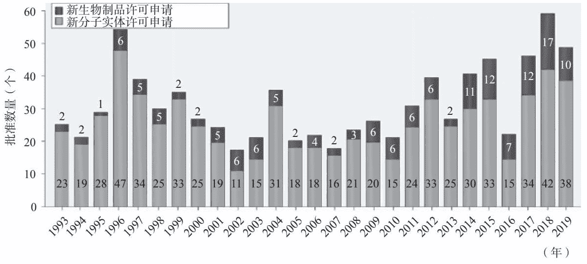
图 3—4 自 1993 年以来新的美国食品药品监督管理局批准数量

注：每年美国食品药品监督管理局药物评价和研究中心批准的新生物制品许可申请和新分子实体许可申请的数量。该图不包括生物药物评估和研究中心批准的疫苗和其他生物药物。

从商业视角看，药物开发最突出的特征是极高的技术风险。与能源和科技行业对比，油气勘探虽有位置与规模的不确定性，但自然资源终会在某处被找到，技术风险较低，市场供需风险更高。唯一可类比的是科技行业。例如半导体公司通常把20%的收入投入持续研发，集成电路制造遵循摩尔定律，核心是延续五十年的商业模式：靠工程技术和流程改进，让每一代计算设备性能翻倍而成本相对下降。

最先进的7nm制程需要在接近原子尺度的精度下组装物理元件，其芯片设计成本约3亿美元，与一款新分子实体的开发成本相当，不计入其他项目失败。像能源行业一样，芯片开发虽有风险，但与药物开发相比低得多。半导体研发的挑战主要体现在迭代周期延长，例如英特尔曾将7nm芯片交付推迟到2022年。直到近年，向更小节点演进的路线图都是数年前就规划好的。自1997年首次推出250nm节点以来，台积电到2018年才量产7nm。制药行业并不存在类似的可预期路线，也没有端到端工程化方法来解决研发生产力问题。

如何从组织层面提升运营效率与研发生产力？药物开发经济学要求管理者在提高研发生产力与药物价值的同时降低单药成本，即提升运营效率。生产力可表述为

`P` =（`WIP`×`pTS`×`V`）/（`CT`×`C`）

其中 `P` 为生产力，`WIP` 为在制品，`pTS` 为技术成功概率，`V` 为组合价值，`CT` 为周期时间，`C` 为成本。^(¹²²)

## 制药创新的源头：生物技术与新治疗模态

生物技术公司是生物制药行业新产品与技术创新的主要策源地。上世纪七八十年代的生物技术革命把治疗发现推向第三阶段，基因泰克、安进、渤健和依默奈克斯等早期企业成立之初就搭建了顶尖实验室。分子生物学家率先用重组DNA技术制造生物治疗药物，使可用靶点数量提升了一个数量级。到二十世纪末，小分子药物可作用的分子靶点约有500个，其中近半为G蛋白偶联受体，其余多为酶、离子通道和转运蛋白。^(¹²³)

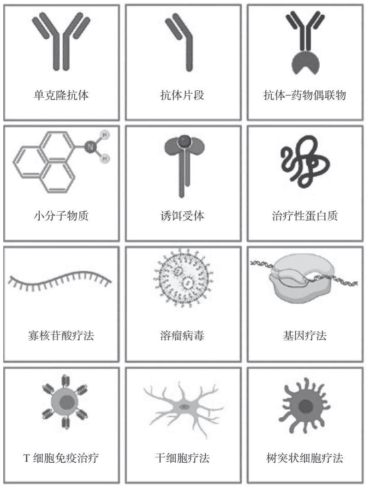
图 3—5 当前药物开发流程所涉及的治疗模态

注：生物技术促进了多种新型治疗模态的发展，包括单克隆抗体、抗体片段和抗体—药物偶联物（第一行）；诱饵受体和治疗性蛋白质是两类基于重组DNA技术的治疗方法（第二行）；另一组疗法：寡核苷酸疗法、溶瘤病毒和基因疗法均涉及将遗传信息传递到靶标细胞中（第三行）；细胞治疗包括对细胞进行基因改造的方法，例如 T 细胞免疫治疗，或者重新编程或纯化细胞，例如干细胞疗法和树突状细胞疗法（第四行）。

基于抗体的疗法极大改写了药物开发格局。自1986年美国食品药品监督管理局批准开创性单克隆抗体药物莫罗单抗以来，已经大约有100种单克隆抗体药物获得批准。其中一半的药物批准发生在2008年之后，它们主要用于治疗肿瘤和免疫系统疾病。如今，美国十大畅销药物中有七种是单克隆抗体。由于单克隆抗体惊人的靶标特异性与广泛适用性，它已经成为新药开发的首选治疗模态。

相比于生物技术公司，大型制药公司在创新方面历来大幅滞后，它们主要通过建立合作伙伴关系和收购来提高自己的研发生产力。大型制药公司的并购案例往往备受关注。1998—2012年，132家生物技术公司被收购，总收购价格超过了3000亿美元。^(¹²⁴)

创新是生物制药行业的命脉。大型制药公司会持续利用资金资源、规模优势和运营专长来提高生产力并将新药推向市场；生物技术公司将继续创新，并借助公开市场、风险投资、药厂合作伙伴和企业资金的投入，开发新的工具与治疗方法。来自其他领域的新技术逐渐在生物学和医学领域展现出应用价值，医药创新基础也有望随之扩大。其中最重要的技术就是分子尺度工程与人工智能。研究人员和临床团队开始开发专门针对癌症、罕见病与衰老的疗法，伴随着第四波治疗发现的浪潮，更多新药开始涌现。

## 扩大制药企业创新基础

以下是扩大制药企业创新基础的方法。

### 合成化学创新
最有代表性的例子是，关环复分解反应的实现催生了6种获批的丙型肝炎药物：西咪匹韦、帕利普韦、格拉瑞韦、伐尼瑞韦、伏西瑞韦和格卡瑞韦。这种新型化学反应让我们可以针对困难靶点生成具有生物活性的复杂分子。

### 天然产物筛选
在过去的25年中，大约40%的新型小分子药物起源于植物和微生物中的次级代谢产物发现。在生物体中发现的分子的结构复杂度远高于化学合成通常所能达到的水平：天然产物中平均每个分子含有6.2个手性中心，而化学合成库中的分子平均只有0.4个手性中心。大部分化学分子空间仍然未被开发。地球上存在着35万个物种和数百万种微生物，我们只了解其中15%的生化通路和化学组成。

### 网络药理学和多药理学
这是一种旨在发现多靶点药物作用机制的新方法。其主旨在于寻找靶点组合模式，而不再围绕单靶点开发药物。

### 计算化学、机器学习与量子计算
计算技术可能帮助我们进一步发现并优化新反应、设计催化剂以及预测反应结果。量子计算时代已经到来，它将很快实现分子性质预测和化学反应模拟。^(¹²⁵)

### 遗传、细胞和代谢工程
医学的未来可能在于借助足够的工业技术水平，通过工程改造细胞和基因来治疗癌症与罕见病。我们已经开始尝试将治疗方法引入肠道菌群，借助微生物代谢工程治疗人体疾病。

### 人工智能在发现研究和早期转化医学中的应用
在发现研究的早期阶段，基于人工智能的决策、风险分析和假设检验可以帮助我们在存在不确定性的情况下整合对药物性质和疾病干预需求的理解。

# 第四章

## 基因编辑与生物技术的新工具

该系统提供了一种直接的方法，可以在基因组中切割任何想要的位点，可以通过将其与众所周知的细胞DNA重组机制相结合，引入新的遗传信息。

——珍妮弗·杜德纳

在`CRISPR`突破发表在《科学》杂志上之后，2012 年

我们已经看到很多科学家和开发者迅速接受这项技术，并将其应用于他们自己的需求，来进行基因编辑以及对细胞和生物体进行工程改造。这项技术已经在生命科学、生物技术和生物医学领域产生了巨大的影响，使得治疗患有严重血液疾病的患者成为可能。

——埃玛纽埃勒·沙尔庞捷

个人通信，2020 年 12 月 2 日

1953 年，DNA 的双螺旋结构被确定，此后经过一代人的努力，在那些致力于开发操控生物体基因的学术研究实验室里，生物技术真正到来了。分子生物学家在细菌中发现了一系列酶，它们可以在序列特定的位置切割DNA，将双链片段黏合在一起，并在试管中合成副本。虽然这些科学家正在解决基础研究问题，但他们也创建了基本的实验室方法，为生物技术中应用的第一代工具奠定了基础。20 世纪六七十年代，出现了一些学习基因克隆“黑科技”的分子生物学家，之后涌现出一整代优秀的科学家，其中几乎所有人的学术血统都可以追溯到当时创立这门学科的嬉皮士科学家和开创性人物。在许多层面上，这是其他技术革命的回响。一旦实验室的冷冻库存中满是珍贵的酶和克隆载体，伴随着基因在细菌中剪切的步骤被记录、测试和验证，它们就变得像软件一样可以共享。分子生物学实验室的文化与黑客和软件开发人员之间的文化是相似的，这种文化发源于 20 世纪 70 年代末，今天仍然存在于分散的美国宿舍和公司办公室里。

重组DNA技术存在另一个显著特征，也是其发展的持久标志之一：它们是科学界最便宜、最通用和低技术含量的工具之一。通过应用生物技术揭示的基本发现不需要价值数十亿美元的望远镜、超级计算机或粒子加速器，也不需要理论团队来解读数据以窥探细胞的运作方式。其所需要的只是周密的基因和生物化学实验，一些精心挑选的微生物，大量的培养皿和试管，以及理解生命过程的创造力和好奇心。在细菌中创造新版本的基因，然后将它们转移到哺乳动物细胞中，这就使得科学家能够推导出控制细胞周期、肿瘤发生、DNA复制、RNA转录和蛋白质合成的分子规律，以及将新发现的基因组元素的观察与其生物学功能的预测联系起来。

生物技术公司的形成标志着基于基因工程的治疗发现的新时代。首个关于重组DNA技术的专利申请是由斯坦福大学在 1974 年提交的。经过美国专利商标局漫长的审批过程后，该专利在 1980 年获得批准。这是关于人类基因商业所有权争端的先兆，最终该专利在 2013 年 6 月 13 日被最高法院驳回。生物技术革命最初的承诺是以药物的形式提供像人类胰岛素这样的天然生物分子。对制药行业来说，这是一个崭新的领域，人们设想了一个漫长的成熟期。但是，生物技术初创公司证明这种想法是错误的，其成功到来的速度比历史上任何其他药物发现技术都要快。从 1976 年基因泰克成立到其第一种药物获得批准（授权给礼来公司），仅过去了短短的 6 年。显然，医学的发展使我们无须等待一代人的时光就能看到生物技术创新的成果。很快，基因捕手先驱和医学遗传学家扩大了视野，开始走上基因疗法的道路——试图使用重组DNA技术将新的遗传物质引入人体细胞，以克服遗传缺陷或替换导致严重遗传病的缺陷基因。

基因治疗的第一项临床试验始于 1990 年，此后在美国食品药品监督管理局的批准下，数百项基因治疗试验向前推进，直到受试者杰西·吉尔辛格于 1999 年死亡。^(¹²⁶)

以今天的标准来看，21 世纪初用于基因工程的重组DNA工具相当粗糙。分子生物学家日常使用的限制性内切酶不具备足够的特异性，无法精准靶向携带致病突变位点的人类基因组位点。基因治疗是通过将整个基因转移到体外的细胞中，或者使用病毒在体内传递替代基因的遗传编码物质的技术来实现的。当时还不存在能够在不引起意外大规模基因组变化，或在其他位置发生脱靶编辑的情况下，精确编辑基因组的技术。科学家和临床医生如何以激光般的精度引导分子机器到达基因组上的某个位置，并对单核苷酸变异进行精确的化学分析？解决方案将来自 10 亿年的共同进化过程和生物技术实验室中的现代蛋白质工程。

^(¹²⁷)

# 细菌自卫灵感点燃可编程编辑浪潮

令人意外的是推动第二轮生物技术浪潮的线索并非来自哺乳动物，而是来自原核世界。研究微生物基因组的人群鉴定出一类细菌自卫装置，其整体架构让人联想到哺乳动物的适应性免疫，且具备对核酸序列记忆与识别的能力。`CRISPR-Cas`的偶然发现，以及 Jennifer Doudna 与 Emmanuelle Charpentier 在 2012 年的工作，显示该分子机器可以被重新装配为可编程的基因编辑平台，这一转折宣告能够改写世界的第二代生物技术工具时代开启。^(¹²⁸)

与早期零散的进展不同，第二次浪潮吸纳了上一轮在计算、数据累积、高通量测序及分子克隆试剂盒上的全部红利，把生物学推向基因组工程阶段。拐点可追溯到 `CRISPR-Cas` 进入公众认知的时间点，如图 4—1 所示。

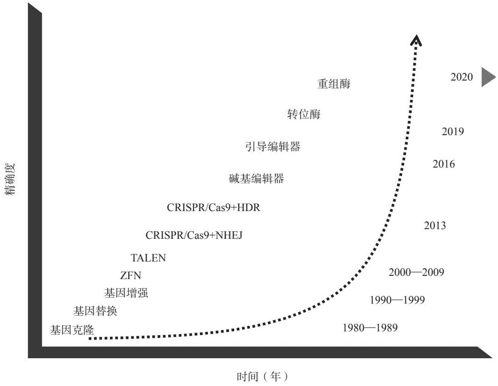

图 4—1 生物技术工具与精准基因组工程时代的加速进程

注：重组脱氧核糖核酸技术为操纵基因、性状乃至整个生物体的遗传信息打开了大门。20 世纪 80 至 90 年代的早期手段能够把基因片段重组并导入细胞或胚胎，却缺乏精准度。得益于可编程核酸酶的特性，基于 `CRISPR-Cas` 的第二代工具在精确性上实现明显跃迁。持续研发致力于打造更高效更精准的编辑方案，已借助有限零件完成泛基因组编辑的巨大跨越：一条可编程向导序列配合以 Cas 骨架蛋白构建的多功能蛋白，就能在多种场景中实现高精度基因组编辑。`ZFN` 即锌指核酸酶；`TALEN` 即转录激活样效应物核酸酶；`NHEJ` 即非同源末端连接；`HDR` 即同源定向修复。

研究者开始大规模部署基于 `CRISPR` 的基因靶向工具。首批应用之一是对原核生物进行工程改造。如今已形成庞大的工业微生物清单，众多菌株的基因组经 `CRISPR-Cas` 改写后，能更高效地合成药物、生化制品与生物燃料。^(¹²⁹)

在医学层面，精准基因组工程长期被视为“圣杯”。人们期待它最终为大量罕见遗传病患者和部分癌症患者带来永久性治愈。借鉴基因治疗的经验，基于 `CRISPR` 的策略能否克服人体基因组编辑固有的风险与局限，并被用于人类胚胎的生殖系干预？辅助生殖技术早在基因工程能力出现前就已临床化。`CRISPR-Cas` 结构极简，仅需向导 RNA 与 Cas 蛋白两大要素，这使得在技术、医学与社会尚未准备就绪时，胚胎编辑的非正规部署成为可能。随着 `CRISPR-Cas` 成熟，围绕基因组编辑的伦理、医疗需求与潜在危害展开了广泛讨论。好在第二代基因疗法中更具前景且相对更安全的方向，正通过临床试验探索镰状细胞病与某些血液恶性肿瘤，以及囊性纤维化、肌营养不良与遗传性视网膜营养不良。

2012 年的突破叠加学界持续创新，催生出全新生物技术公司生态。首批公司多聚焦疗法开发或为新兴 `CRISPR` 应用提供工具。疗法赛道的先行者包括 `CRISPR-Cas` 治疗学的开创者、诺贝尔奖得主 Jennifer Doudna 与 Emmanuelle Charpentier，以及哈佛大学的 George Church 与 Broad 机构的 Feng Zhang。^(¹³⁰)

## 分子生物学与生物信息流

脱氧核糖核酸所承载的信息是所有生命的基础，为复杂生物体的发育、复制与存续提供自然蓝图。只有厘清分子生物学所称的“中心法则”这一信息流向，基因组的破译才成为可能。James Watson 与 Francis Crick 于 1953 年揭示脱氧核糖核酸双螺旋结构后，核心问题是如何编码信息，即基因怎样产生蛋白质。十多年前，George Beadle 与 Edward Tatum 已证实基因与蛋白质存在一一对应。若成立，脱氧核糖核酸核苷酸的线性序列是否决定蛋白质中氨基酸的线性序列？更复杂的是，细胞内存在核糖核酸的迹象提示其可能参与蛋白合成。核糖核酸到底扮演何种角色？Watson、Crick 及剑桥的一小撮学者就此展开讨论。如图 4—2 所示，Francis Crick 以示意图描述了中心法则的概念模型，阐明思路，尽管当时尚未确定所涉核糖核酸类型，也不清楚全过程如何运作。上述疑问成为后续揭示遗传密码实验的基础。

20 世纪下半叶，生物学研究多为耗时费力的小规模实验室工作，未能充分借助计算机。对当时新生的分子生物学——亦称生化遗传学——研究者而言，这意味着要纯化酶、合成放射性示踪物、建立可重复的实验室测定，并在精心设计的实验中测试少量条件参数，实验周期可达数天至数月。结果记录于笔记本与 X 光胶片，数据规模通常仅数百点。科学进展的速度并非受概念理解限制，而是受制于生成数据的技术与仪器局限。尽管如此，这一挑战仍催生出美妙的科学创新时代。

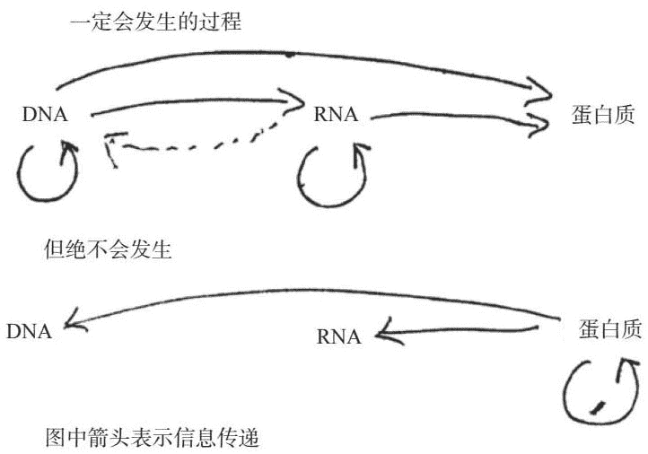

图 4—2 Francis Crick 于 1956 年绘制的首幅“中心法则”插图

为整合复杂的细胞生化，科学家需要更简化的体外测试系统，即将细胞提取物与纯化组分在试管中组合评估化学反应。体外方法的建立对拼凑科研谜题至关重要。假设必须经检验，观点要么被放弃要么被保留，而胜出的假设需进一步验证。Francis Crick 曾提出，或许存在适配体分子，能把氨基酸与脱氧核糖核酸所蕴含的信息关联。随着时间推移，美欧多实验室累积的证据支持其思路。在波士顿马萨诸塞总医院，Paul Zamecnik 与 Mahlon Hoagland 证实蛋白质合成发生于细胞核外细胞质的核糖体。核糖体由核糖核酸亚基构成，但这些亚基不适合传递遗传信息。不久后，同一团队发现另一类核糖核酸，即转运核糖核酸，它们能与氨基酸结合。^(¹³¹)

^(¹³²)
一系列实验揭示答案，证明信使核糖核酸是脱氧核糖核酸与蛋白质之间的中间体。1961 年 5 月 13 日，《自然》同期发表两篇论文标题已说明原委：Sydney Brenner、François Jacob 与 Matthew Meselson 等发表的《一种将基因信息携带至核糖体进行蛋白质合成的不稳定中间体》，以及哈佛大学 James Watson 与 Walter Gilbert 与巴黎巴斯德研究所同事合作的《通过大肠杆菌脉冲标记揭示的不稳定核糖核酸》。^(¹³³)

确定遗传密码需要多年工作与众多科学家贡献。Sydney Brenner 与 Francis Crick 在剑桥卡文迪什实验室合作提出构想，在手稿中阐述首个需实验证实的问题。仅用四字母——脱氧核糖核酸的 A-腺嘌呤、C-胞嘧啶、G-鸟嘌呤、T-胸腺嘧啶——如何指定二十种氨基酸在蛋白质中的位置？单字母代表二十种氨基酸的代码不足。同样，两个字母一次仅能编码十六种，也不够。因此至少需要三联体编码，最多提供六十四种组合，或使用四联体等。任何三联体或四联体系统都存在冗余，一种以上密码子可编码同一氨基酸。自然是否使用简并密码？密码长什么样？

Francis Crick 在卡文迪什实验室主导一系列探索。他与 Leslie Barnett、Sydney Brenner 与 Richard Watts-Tobin 于 1961 年底在《自然》发表《蛋白质遗传密码的普遍特性》，结合本团队及其他工作阐明了解码逻辑，解开了谜题。^(¹³⁴)

至 20 世纪 60 年代中期，脱氧核糖核酸结构的基础认知、由脱氧核糖核酸制造核糖核酸再制造蛋白质的信息流，即中心法则、核糖核酸转录与蛋白质翻译过程均已阐明。遗传密码是普适的，不会随生物体改变。然而直至二十多年后，帕萨迪纳加州理工学院 Leroy Hood 实验室开发的酶法荧光测序与仪器技术，才能够对约一百个核苷酸长度的小片段脱氧核糖核酸进行测序。人们期待技术改进，日测数百样本，并能测序长度在千至万核苷酸的基因。在计算与信息技术出现前，分析拥有 2.5 亿碱基对的人类第一号染色体不可想象。若在整本生命之书中只能阅读随机抽取的几句话，从基因组测序中学习的前景如何？直至 90 年代，储存在脱氧核糖核酸中的生命信息仍难以获取。

## 利用重组脱氧核糖核酸技术操纵遗传信息

20 世纪 50 至 60 年代，人类在界定原核生物遗传化学方面取得惊人成功，既振奋又具挑战。毫不奇怪，Paul Berg 等人不禁思考，真核生物特别是哺乳动物与人类细胞中更为复杂的基因结构是否以类似方式组织与发挥功能。具体而言，细胞分化与细胞间通讯，即多细胞生物的独特特征，是否需要新的基因组结构、组织、功能与调控模式？对高等生物遗传化学的探索，它仅仅是原核主题的变体，还是等待发现的全新原理？

——Paul Berg
诺贝尔奖演讲，1980 年

细菌遗传学的显著成功推动分子生物学进入新领域。斯坦福大学的 Paul Berg 与一批新分子生物学家希望超越细菌系统与噬菌体范畴，探索高等生物基因组结构、基因调控与功能的基本性质。在一系列幸运发现推动下，这些“基因骑师”可利用新开发的分子工具与想象力操纵生物系统，解决更大问题。当时普遍期待，基因操纵实验能力近乎无限。

最终首要目标是开发新技术框架，使实验者能够分离与扩增基因及其他脱氧核糖核酸片段，编辑序列，将它们组合并产生拷贝。由于所有进展都发生在原核系统中，相关工作自然从原核生物开始。相关人员已掌握来自细菌基因的功能脱氧核糖核酸元件、脱氧核糖核酸为底物的催化反应酶，以及用于设计新系统的病毒与质粒。最终目标是能从更高等生物体提取基因，重新配置后放回自然。构建转基因与转基因动物旨在研究基因对正常细胞过程的影响，并在某一时刻将基因变化引入疾病模型，以了解基因在疾病中的作用。

自 20 世纪初以来，现代生物学通过描述性研究取得进步，但干预细胞功能能力有限。化学家在试管中研究大分子合成，解析代谢途径，而非在活细胞中进行。遗传学家在玉米、果蝇、面包霉等偏好生物体中进行相对缓慢的基因杂交，然后测量后代表型特征，得出遗传、重组与基因组织的规律。唯一可研究的基因变异是自然种群中已有的变异，例如孟德尔的光滑或起皱豌豆，Thomas Hunt Morgan 的翅膀褶皱与白眼苍蝇。分子生物学能否扭转局面，提供技术改造基因，直接将特定功能编码到生物体中？

对分子生物学家而言，合乎逻辑的第一步是创造人工杂交脱氧核糖核酸分子：一部分来自细菌，一部分来自其他病毒或有机体。这个概念长期萦绕 Berg 脑海，他的实验室成为首个设计所谓重组脱氧核糖核酸的实验室。在与 Salk 研究所 Renato Dulbecco 合作研究 SV40——一种具有致癌潜力的脱氧核糖核酸病毒——的分子生物学后，Berg 设想用病毒策略将外源基因转移到哺乳动物细胞。重组脱氧核糖核酸分子将由含细菌半乳糖操纵子的 λ噬菌体脱氧核糖核酸片段与具有环状基因组的 SV40 组成。为打开环，SV40 的脱氧核糖核酸需被切割，然后 λ噬菌体脱氧核糖核酸可连接于两端并重新环化。1971 年春，Berg 实验室正准备制造这种重组分子，但命运与相关人员的过度谨慎在未来几年给重组脱氧核糖核酸技术踩了刹车。

该新兴领域正在创造自然界从未见过的分子，这与早期生物化学家基于理性设计创造非天然化疗药物的方向类似。斯坦福大学的 Herbert Boyer 与 Stanley Cohen 当时合作利用细菌质粒将外源脱氧核糖核酸导入细菌，这是一种实用替代方法。尽管 Berg 对用 SV40 作为进入细菌而非哺乳动物细胞的载体感兴趣，仍有人担心这种病毒在新的重组分子中可能有害，无意中成为某种生物病原体。Berg 的研究生 Janet Mertz 1971 年参加科尔德斯普林港夏季会议并透露实验室工作性质。首次得知后，科学家表达担忧：为何在早期实验中以潜在失控方式使用肿瘤病毒。当时 James Watson 招募到科尔德斯普林港新职员、在职科学家 Robert Pollack 在会议上提出关于 SV40 的警示，并致电 Berg 表达强烈反对。

不久之后，Berg 与其他人通话并安排会议，讨论所有潜在问题，并将讨论限制在美国一小批科学家之间。他们建议暂停使用 SV40 及其他包含未知潜在危险脱氧核糖核酸的重组技术，并进一步调查安全问题。1971 年底，Berg 自愿无限期搁置其团队关于重组脱氧核糖核酸的下一步研究，即继续将基因转移到大肠杆菌中并评估人工脱氧核糖核酸能否在细菌宿主中存活并复制。

在接下来的几年里，这类担忧在国际舞台爆发，Paul Berg 在引导折磨人的私人和公开辩论中发挥重要作用，召开科学会议制定相关指导方针，并在会后提出建议。1975 年 2 月下旬，由 Berg 组织并主持的重组脱氧核糖核酸分子国际会议在加州帕西菲克格罗夫阿西洛马会议中心召开，为期 3 天，将相关系列事件推向高潮。^(¹³⁵)

尽管 Berg 因 SV40 与癌症病毒联系而停止工作，世界各地其他实验室仍继续推进细菌病毒与质粒脱氧核糖核酸相关操作。在距离斯坦福北部 40 英里加州大学旧金山分校，Herbert Boyer 实验室恰好在做类似实验并纯化关键工具——一种叫 EcoRI 的细菌酶。这种分子生物学得力助手是一种可识别六碱基位点切割脱氧核糖核酸的分子剪刀。EcoRI 能够识别双链脱氧核糖核酸中的回文序列 GAATTC。尽管今天研究人员可从目录购买数百种此类限制性内切酶，当时研究者仍依赖少数科学家赠品做实验，只有他们拥有足够技术与能力鉴定纯化相关工具酶。这种酶当时共享给斯坦福实验室，令 Berg 高兴的是，该工具非常适合他的实验，因 EcoRI 只会切割 SV40 一次，打开并线性化病毒基因组。Berg 实验室 1972 年借助 Boyer 的 EcoRI 酶完成 SV40 与细菌脱氧核糖核酸第一次基因拼接实验并发表文章，重组脱氧核糖核酸技术诞生。^(¹³⁶)

Boyer 与斯坦福大学 Stanley Cohen 合作建立基于质粒的穿梭系统。与 Berg 类似，他们想开发细菌系统以提供保留与复制人工杂交或重组分子的方法。Cohen 是最早利用携带抗生素抗性基因的细菌质粒的人之一，他使用的第一个质粒是 pSC101，将他姓名首字母通过命名刻在重组脱氧核糖核酸历史里。^(¹³⁷)

旧金山湾区的两个实验室当时测试另一个有关重组脱氧核糖核酸的想法：抗生素抗性质粒能否用作获得新重组分子的细菌标识符？最初设计是使用携带四环素与卡那霉素抗性基因的两个抗生素抗性基因，导入非致病性大肠杆菌菌株 C600。若质粒功能正常，细菌可在含这些抗生素的琼脂平板上存活。他们使用分子生物学工具将人工序列剪切粘贴到质粒中，包括将两种质粒混合组分，通过在卡那霉素或四环素琼脂平板上培养抗生素抗性细菌，证明重组脱氧核糖核酸过程可行。更多实验证明重组脱氧核糖核酸分子具有生物功能。该方法具显著实际应用价值：首先，一旦细菌在含抗生素平板上形成菌落，可大量培养繁殖并回收提取相关质粒脱氧核糖核酸；其次，若分子克隆实验成功，你马上就会知道——具有抗生素耐药性的细菌菌落存活意味着外来片段成功连接在质粒上。关于 pSC101，论文作者得出结论：

抗生素抗性质粒 pSC101 构成了一个复制子，对于筛选人工构建的分子具有相当大的潜在用途，因为它的复制机制和四环素抗性基因在被 EcoRI 核酸内切酶切割后仍然保持完整。^(¹³⁸)

这些重要成果原计划在当年 7 月，即 1973 年 6 月在新罕布什尔州新汉普顿召开的核酸戈登会议后发表，然而在会议备受关注环节中，Boyer 被安排发言。Boyer 透露，将两种不同质粒的 EcoRI 切割片段克隆成重组分子是成功的，并且其对大肠杆菌的转化也成功，使这些细菌获得新的抗生素耐药性。这违背他在加州大学旧金山分校合作者 Stanley Cohen 意愿。学术震动随之而来。现在人类清楚认识到，凭借一些简单工具，研究人员可以从几乎任何地方获取外源脱氧核糖核酸，并在细菌中传播非天然脱氧核糖核酸序列。现在问题只不过是放入哪些感兴趣的脱氧核糖核酸片段而已，其中包括来自青蛙、老鼠甚至人类的病毒序列与非细菌基因。一群科学家几乎在会议刚结束时聚集起来，努力应对这项技术在没有指导下开展的潜在后果。他们给美国国家科学院与美国国家医学研究所院长们写信。以下摘录重要部分：

我们代表一些科学家写信给你，以表达我们的深度关切。几份科学报告……表明，我们目前具有将来自不同来源的脱氧核糖核酸分子共价连接在一起的技术能力……该技术可用于将来自动物病毒的脱氧核糖核酸与细菌脱氧核糖核酸结合，或者可以把不同病毒来源的脱氧核糖核酸组合起来。通过这些方式，人类最终可能会创造出具有生物活性且不可预测的新型杂交质粒或病毒。相关实验为推进基础生物学过程的认知和缓解人类健康问题提供了令人兴奋和有趣的潜在可能。

某些杂交分子可能会对实验室工作人员和公众造成危害。虽然目前尚未确定存在危险，但审慎起见，建议认真考虑潜在的危险。

这封信发表在 1973 年 9 月 21 日的《科学》杂志上，是第一次公开警告。^(¹³⁹)

回想起来，我们很容易看到科学与文化力量在起作用，使这份声明得以发出并表达谨慎前行愿望。在一个层面，最合理的担忧是，引入工程质粒到细菌中可能携带癌基因或其他遗传控制片段，可能导致不受控制生长或生成新的致病菌株。例如多数大肠杆菌菌株存在于人类肠道且无害，而一些菌株如大肠杆菌 O157 会引起严重肠胃炎。然而实验室创建的菌株可能无意中进入人类肠道，改变微生物群，并通过水平基因转移过程将基因转移到其他大肠杆菌种群。更糟的是，一些人思考来自流氓细菌的重组脱氧核糖核酸是否可进入人类肠道细胞并导致癌症。

从病毒到可编程基因：百年医学编辑史

分子生物学工具成型之初，主导研发的群体多为病毒学家，当时学界的主流判断把癌症归于病毒。回溯到1950年代，致癌原因至少存在三种被视作互斥的设想：病毒学派强调病毒诱发肿瘤，流行病学派指向外来化学致癌物引发的失控增殖，还有极少数声音认为根源在于基因组自身结构的改变。那时三条线索都缺乏有力证据。1960年，猿猴源病毒 `SV40` 在啮齿类动物模型里诱发肿瘤的实验点亮了第一缕火花，整个1960年代的研究焦点因此集中在厘清 `SV40` 如何推动癌变上。

1959年霍华德·特明用劳斯肉瘤病毒做了一次震动癌症圈的实验。他证明携带RNA基因组的病毒能在培养皿中制造癌症，似乎病毒遗传物质整合进了宿主细胞DNA。这一结果与当时公认的中心法则相悖。特明提出信息流可能逆向，即RNA先转录成DNA。十年后，1970年他与戴维·巴尔的摩各自独立发现逆转录酶，因该酶能以RNA为模板合成DNA产物，与经典法则相反，故得此名。

几乎同期，彼得·沃格特、彼得·杜斯伯格、史蒂夫·马丁等人借助遗传学与生化手段追踪赋予转化活性的基因。通过使用转化缺陷的突变病毒，他们锁定了名为 `src` 的基因，这是人类最早确认的癌基因。从病毒学视角看，致癌的分子机制似乎已近在眼前。

当病毒学界继续搜寻其他致癌病毒和能把基因与癌症关联的DNA指纹时，伯格等人正试图利用病毒特性搭建新技术，并期望有一天把这些工具推向真核系统用于医疗。早期重组DNA方法及其理念，正如伯格早期预见的那样，直接指向了基因治疗的应用可能。从1973年6月的戈登会议到1975年初的阿西洛马会议，有关如何支持与约束相关实验、如何缓解公众安全担忧的建议与争论此起彼伏。就在这段期间，科恩与博耶发表了重磅工作，他们用科恩 `pSC` 质粒将非洲爪蟾的两种基因导入细菌。^(¹⁴⁰)

经过三天激烈讨论，伯格与众多分子生物学家、未来的诺贝尔奖得主一起制定了重组DNA技术规范。规定要求实验室建立生物遏制设施，包含物理与生物屏障以防止潜在病原体污染与扩散。科学家得以自主达标，而不被模糊法规或禁令束缚，这成为里程碑。重组DNA因此获得公众认可，被视为造福人类的突破。阿西洛马会议被奉为应对可能永久改变社会与生态的基础性技术进步的范例。我将在后文再谈社会议题，因为21世纪人工智能与基因工程的指数级进展将把行业推向另一个挑战生命观念的领域。

## 基因图谱绘制与罕见病疗法探索

1970年代后期，随着重组DNA工具箱的持续扩充，核酸序列读取进入视野。分子生物学先驱发展出两种不同的读码策略。凭借蛋白质测序获诺贝尔化学奖的弗雷德里克·桑格创立了后来成为主流的方案。他使用对应四种碱基的链终止抑制剂，借助DNA聚合酶沿模板合成直至被双脱氧核苷酸终止。今天媒体上常见的X光胶片条带图，就是桑格反应的产物。艾伦·马克萨姆和沃尔特·吉尔伯特则采用化学修饰后再切割的路线，先对核酸进行化学修饰，再特异性切割碱基。与桑格式相比，马克萨姆-吉尔伯特法初始准确性更高，可用纯化样品无需克隆，但操作难度较大。1980年代初双脱氧测序改进后，各实验室最终多转向桑格式。测序是获取基因组信息的大门，接下来是把繁琐的实验室流程自动化，以服务基础研究、诊断与疗法开发。

尽管真正基于基因的治疗还要等几十年，罕见病倡导者和遗传学家已启动庞大的疾病基因发现计划，为新疗法提供线索。疾病基因作图与测序技术同步起航，依靠基因连锁分析和大尺度的家系图谱定位。通过追踪受累个体核酸标记的遗传信息，科学家能在染色体上搜寻致病等位基因的位置，并最终读出其序列。确认致病变异需要遗传学证据，即在其他具有家族史的无关家系中健康成员不携带风险基因型。突变的功能后果更需动物模型与生化研究，往往耗时数年，有时仍无法解开。亨廷顿病就是典型。

美国遗传病基金会、哥伦比亚大学的南希·韦克斯勒领衔的十年合作最终在4号染色体上找到亨廷顿病基因。进程始于韦克斯勒从委内瑞拉马拉开波湖周边家庭收集家系信息和血液样本，这些人是19世纪一名患病妇女的后代。图4—3中韦克斯勒手持一张巨幅家谱，标注受累个体与其他成员。

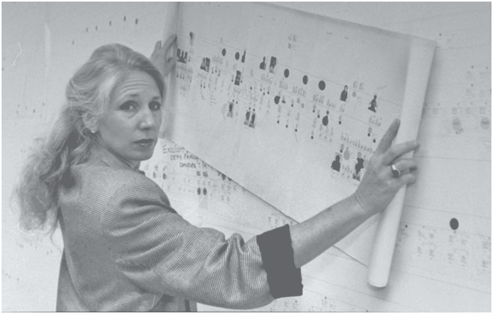

图4—3 南希·韦克斯勒与追踪亨廷顿病遗传的委内瑞拉家族谱系图

注：在哥伦比亚长老会医院，南希·韦克斯勒博士展开了她墙面大小的亨廷顿病家族遗传研究图的一部分。

韦克斯勒与马萨诸塞总医院的詹姆斯·古赛拉于1979年会议商定策略，计划使用博茨坦 `Botstein` 基于 `RFLP` 限制性酶切片段长度多态性的方法。到1983年研究组用 `RFLP` 确定亨廷顿病基因位于4号染色体短臂末端附近。这是首次以遗传标记和遗传模式把疾病基因定位到基因组具体位置。异常由基因编码区三核苷酸重复 `CAG` 导致，编码谷氨酰胺，重复长度可变。蛋白质序列未揭示功能，但人们后来发现其他神经疾病中也有类似不稳定元件。几十年努力未能阐明亨廷顿蛋白功能与大脑病理机制。

1993年亨廷顿病基因的发现和测序的完成 ^(¹⁴¹)

如今对驱动神经变性的细胞过程有了更多认识，但基因突变发现数十年后寻找疗法仍漫长。罕见病难治原因多：基因突变与蛋白质后果的联系并不直观，亨廷顿蛋白在正常人中的生理作用仍神秘。药物开发者可能找不到明确靶点，或蛋白质如亨廷顿蛋白难以成药。许多罕见病缺乏能精准复现人类疾病的动物模型。从商业模式看，市场小患者少，研发投入难回收。这种困境折射出患者与照护者的焦虑。

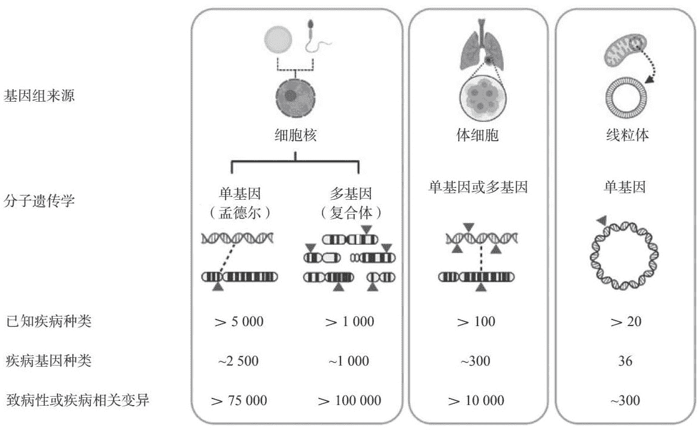

图4—4 人类遗传病的分子基础

注：人类疾病背后的 DNA 改变源于 3 种具有不同分子遗传特征的基因组。

左框：细胞核 DNA 包含从父母的生殖细胞（精子和卵子）获得的所有变异，其中致病变异被称为胚系突变。单基因疾病遵循孟德尔遗传模式，其中存在基因缺陷（如影响编码蛋白质功能或表达的单个碱基变化、插入或缺失），当常染色体（非性染色体）上的一个等位基因（显性）存在或两个等位基因（隐性）同时存在时会导致疾病。`ClinVar`数据库已经记录了人类基因组中 75000 个致病变异（截至 2020 年 8 月）。

中间框：体细胞中出现的 DNA 突变会导致癌症，这是少量基因突变驱动的结果。体细胞突变可以与癌基因或肿瘤抑制基因的胚系突变共同作用，使得个体易患某些类型的癌症。 ^(¹⁴²)

右框：线粒体基因组仅通过母体遗传获得。这个小小的环状基因组（~16000 个核苷酸）编码 37 个线粒体基因；其中 36 个基因在 300 个已知致病位点的突变将导致 20 种线粒体疾病。有许多线粒体疾病是由于核编码的线粒体蛋白质（超过 1100 种蛋白质被输入线粒体以支持这种细胞器的功能）的突变而引起的。 ^(¹⁴³)

在成千上万种已知疾病中仅约500种可用药，癌症是例外，其罕见亚型推动了研发。在韦克斯勒遗传性疾病基金会、国家罕见疾病组织等推动下，加上1971年尼克松《国家癌症法案》带来的公众关注，罕见病研究的齿轮开始转动。生物技术早期，监管与国会采取措施激励大学和制药企业承担风险。1980年《拜杜法案》允许大学对联邦资助研究产生的发明申请专利并保留所有权，为专利许可和技术转让商业化打开通道，大大加速美国生物产业发展。另一关键是1982年亨利·韦克斯曼提交、1983年里根签署的《孤儿药法案》。该法把美国患病人数少于20万的疾病产品定义为孤儿药。罕见病在美国影响3000万至4000万人，欧洲相近。

激励机制包括税收抵扣、费用减免和批准后7年市场独占，后者改变了游戏规则。1983—2017年，FDA对孤儿药的批准占所有新分子实体批准的25%以上。自2000年起生物制剂崛起，孤儿药占生物制剂审批的40%。肿瘤药物是孤儿药开发主力，占近年临床试验的一半以上。

精准基因组工程工具的出现可能让罕见病研发迎头赶上。对遗传病最普遍的致病变异是点突变或单核苷酸变异。表4—1列出 `ClinVar` 中遗传病变异类型及相对丰度。

表4—1 人类遗传病的致病变异类型

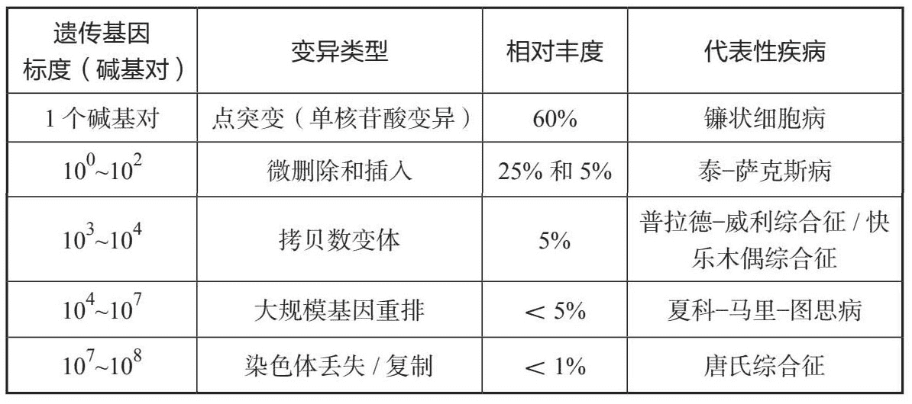

注：单核苷酸变异一词涵盖了 4 类被描述为临床良性（对蛋白质功能或表型无影响）、意义未知、可能致病和已知致病的变异体。

单基因病中点突变常破坏编码区，可能位于独特位点，也可能是成千上万变异中的一种。传统基因治疗不编辑基因组，而是通过非复制性病毒载体递送完整校正基因，替换或增补致病等位基因，使受体细胞制造所需蛋白纠正剂量或对抗有害产物。

多基因疾病如糖尿病、高血压、部分精神疾病仍是难题。研究揭示了许多风险等位基因，但尚未产生明确核酸水平疗法。大多变异位于非编码调控区，改变调控回路需组合策略。鉴于遗传基础和关闭单个调控位点的便利性，单基因疾病的基因开关受关注。通过可编程核酸酶进行基因组编辑解决所有致病变异类型，曾被视作幻想，如今进入可能。

## 第二代生物技术工具：`CRISPR-Cas9`和基因组编辑技术

^(¹⁴⁴)

最简单的生物体——原核生物，以及它们的类生命体捕食者 ^(¹⁴⁵)

新的 `CRISPR-Cas9` 系统设计简洁，直接影响是研究人员可在哺乳动物细胞中做实验，工程师可搭建多功能工具。最早系统里单个指导RNA对Cas9核酸内切酶编程。如图4—5所示，RNA启动序列特异性靶向，Cas9在目标位点制造双链断裂，留下平端，可由细胞修复机制或定向策略修复。各实验室竞相开发新系统并设想生物学与再生医学新用途。博德研究所的张锋团队率先重设计Cas9蛋白实现高保真修复，并在小鼠和人类细胞中展示功能。^(¹⁴⁶)

`CRISPR` 是第二波可编程核酸酶基因编辑技术。早期方法基于DNA修饰酶的蛋白工程，产生兆核酸酶、`ZFN` 锌指核酸酶和 `TALEN` 转录激活因子样效应物核酸酶。其可编程性来自把DNA识别序列与核酸内切酶活性融合。`ZFN` 和 `TALEN` 的蛋白工程优化繁琐、成本高，多由少数生物技术公司商业化。`CRISPR` 易操作及大量原核防御系统阵列（现知30多种亚型）已把基因组工程变成生物技术核心力量。

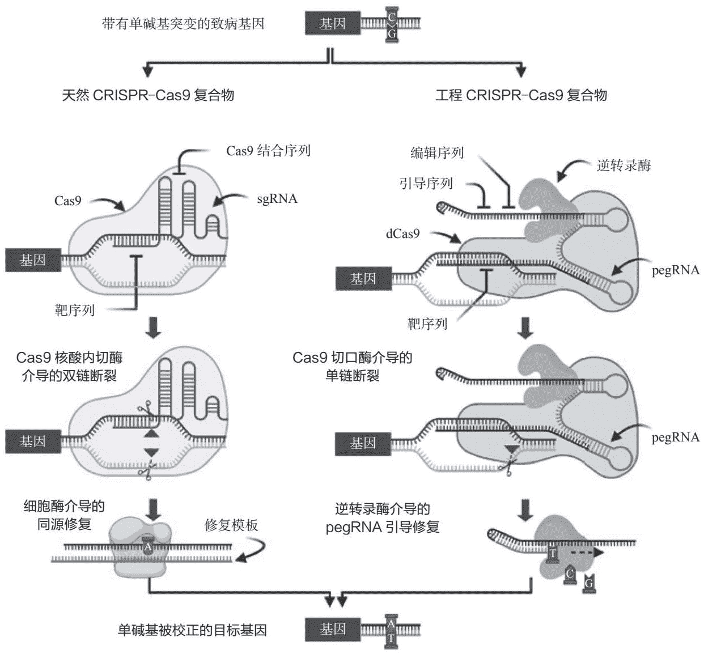

图4—5 应用可编程 `Cas` 核酸酶进行模板导向修复的基因组编辑策略

注：相应的基因组编辑技术始于对 `RNA` 的修饰和融合，需要这些 `RNA` 将目标 `DNA` 导入天然 `CRISPR-Cas9` 复合物（图的左侧）。可编程核酸酶的组成原件包括 `Cas9` 内切酶和单个指导 `RNA` 分子，该分子包含 `Cas9` 结合序列和与感兴趣的基因区域互补的长度为 20 个核苷酸的靶序列。

`sgRNA` 的结合和 `Cas9` 的构象变化激活了该酶在原位间隔区邻近基序（`PAM` 序列未显示）附近位点的核酸内切酶活性，从而在基因中引发双链断裂。该技术的第二个要素是利用细胞 `DNA` 修复机制来识别双链断裂，并指导酶使用修复模板来执行“编辑”。在这个例子中，基因的疾病形式有一个 `C∶G` 碱基对（图的顶部），编辑纠正了这一点，留下了一个完整的基因，在相同的位置有一个 `A∶T` 碱基对（图的底部）。当前的碱基编辑器无法执行此类型的编辑（转换）。遗传和蛋白质工程研发出了缺乏内切酶活性的 `Cas9`（`dCas9`），该分子基于其他结构组分而构建，用于执行不依赖细胞 `DNA` 修复过程的基因编辑。引导编辑器（图的右侧）使用重新配置的指导 `RNA`，其包含引导序列和编辑序列，以及基因靶向序列（`pegRNA`）。工程化的 `Cas9` 含有能在靶基因上产生单链断裂的切口酶；还含有逆转录酶，能通过合成基于编辑序列的新链来执行编辑。

### 基于工程化 `CRISPR-Cas` 系统的基因编辑工具

#### 目标破坏器

可编程的 Cas 核酸酶，如天然 Cas9，通过在目标序列内产生插入缺失来破坏基因组位点。首个 CRISPR 疗法基因编辑目标即用此工具破坏调控位点。Cas9 需要富含鸟嘌呤的 PAM 序列 `5’-NGG-3’` 紧邻靶标。Cas12a 变体使用富含胸腺嘧啶的 PAM，适合 A/T 富集靶标。Cas12a 和 Cas14a 能非特异性切割单链 DNA，已用于 CRISPR 诊断。多种 Cas9 变体被设计以降低脱靶并提升保真度（`sniper-Cas9`、`hypaCas9`、`SpCas9-HF1` 和 `eSpCas9`）或扩展靶向能力（`xCas9`）。基于蛋白工程的第三系统 Cas12b 也适用于人类基因组编辑。

#### `DNA` 碱基编辑器

单碱基编辑技术，针对转换型点突变。这些编辑器基于不引入双链断裂的 dCas9 底盘，并具备 Cas 切口酶单链切割活性。胞嘧啶和腺嘌呤脱氨酶整合进 dCas9 实现碱基专一编辑以提高效率。十几种类型通过定向进化设计。编辑窗口大小和序列上下文偏好可进一步分类，目前主要用于胞嘧啶碱基编辑器。

#### `RNA` 碱基编辑器

在 RNA 中引入编辑的碱基编辑技术。已设计两套系统，一套用 dCas13 与 ADAR2 融合命名为 `RESCUE`，另一套基于 RNA 靶向 Cas9 即 `RCas9`。

#### 引导编辑器

具备全谱点突变编辑（转换和易位）和小型插入缺失功能。工程化通过融合 Cas 切口酶与逆转录酶实现，需多组分指导 RNA（见图 4—5）。

#### 目标整合器

`CRISPR` 相关转座酶和重组酶可提供将大 DNA 片段插入或移动到基因组特定位点的能力。新兴工具结合 Cas 蛋白与转座子相关组分。此前研究者已把 `ZFN` 与位点专一重组酶催化结构域融合，CRISPR-Cas 重组酶融合正在进行。

## 人类基因组编辑与临床试验

医学进入新时代，`CRISPR-Cas` 工具将被用于治疗罕见单基因遗传病，并改进工程细胞疗法治疗癌症。 ^(¹⁴⁷)

基因编辑迈向临床的两道安全防线与mRNA疫苗的起飞

走向临床的应用，首先被放大的是两类紧密关联的风险。第一类与递送和免疫应答相关。像基因治疗一样，病毒来源的蛋白以及外源编辑元件本身都可能被机体识别，进而制约体内给药的可行性。于是不少团队转向免疫原性更低的AAV和慢病毒载体。另一条路径围绕脂质纳米颗粒展开，特别是包裹mRNA的LNP，已在Moderna Therapeutics与辉瑞BioNTech针对新冠疫苗的人体试验中得到安全性和可操作性的验证。

第二类风险指向编辑器的可控性。现阶段所有系统在设计位点之外都存在可检测的异常编辑，可能引发难以预料的脱靶，导致基因组关键区域出现有害突变甚至整条染色体受累。研究也报告，对早期人胚实施CRISPR-Cas操作后常出现杂合性丢失，提示大片段基因组或整条染色体在分裂细胞中被清除。^(148)

正因胚胎编辑存在造成灾难性改变的可能，编辑工具必须先在模式生物和人源细胞中经充分验证，才能进入干预性研究。为捕捉脱靶事件，后续出现了GUIDE-Seq与CIRCLE-Seq等二代测序技术。脱靶的根源在于单向导RNA的特异性，通过大规模筛选并挑选高特异性gRNA可缓解精度问题。无论体外还是体内给药，治疗性基因编辑的递送逻辑与基因治疗基本一致。图 4—6 展示了治疗性基因编辑中涉及的概念、方法和步骤。

近几年，源自天然细菌的CRISPR-Cas系统被不断改造，编辑范围从全部核苷酸替换扩展到缺失与插入，靶向精度、编辑保真度与效率同步提升，为临床转化铺路。DNA碱基编辑器的研发及其在哺乳动物细胞中的测试描绘了未来方向。最初胞嘧啶碱基编辑器与腺嘌呤碱基编辑器被寄予厚望，可在特定DNA位点实现单碱基转换，预期会成为临床工具。随着信心增强，研究者也发现部分碱基编辑器会对RNA转录本产生高度混杂的修饰——胞嘧啶编辑器在上万个转录本中诱发C向U的变化，腺嘌呤编辑器同样表现出RNA脱靶能力。意外的是，一个专为结合与改变DNA设计的CRISPR-Cas碱基编辑器竟然也能结合并修饰RNA。同组研究随后对识别模块重设计，构建目标识别功能，与初代相比保真度提升了数个数量级。^(149)

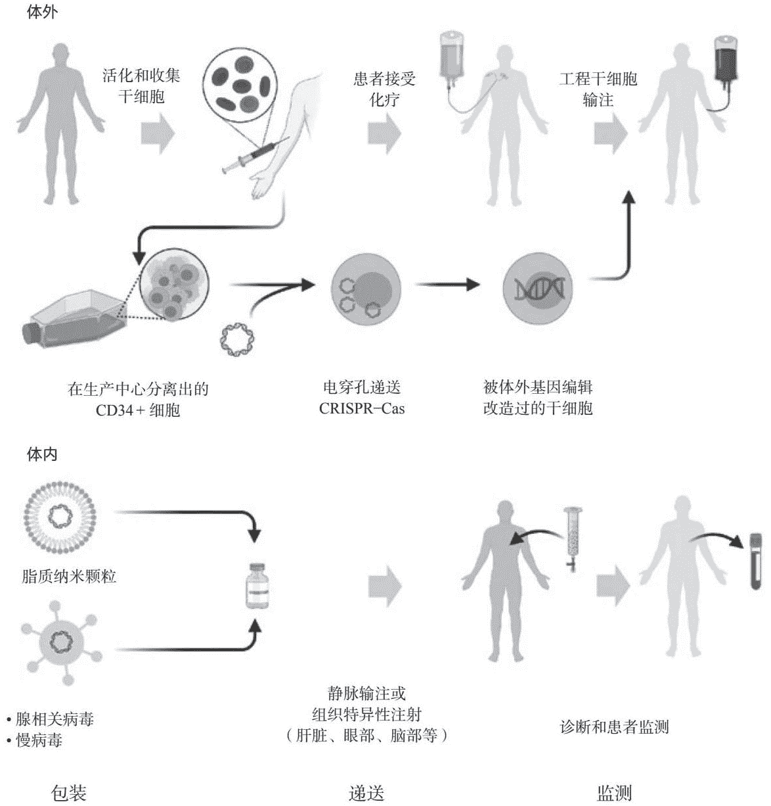

图 4-6 面向患者的`CRISPR-Cas`递送工程疗法策略概览

注：当前研究中使用两种常见策略，用以对病人实施基因治疗。

上图：主要用于生成基因编辑的`CAR-T`细胞或造血干细胞和祖细胞的培养。`CRISPR-Cas9`成分的递送是通过电穿孔完成的。（图中未展示的部分是，基因治疗试验中无须基因编辑的基因递送使用整合的慢病毒载体完成。）生成编辑干细胞的复杂步骤是在专门的制造设施中进行的。

下图：`CRISPR-Cas`组分在体内的递送是通过将`DNA`或`RNA`包装进脂质纳米颗粒或封装在病毒中完成的。所得到的药物制剂通过不同的途径给药，如图所示。

编辑平台仍面临多重挑战。对特定基因编辑而言，相关的细胞DNA修复通路、细胞状态与细胞类型仍了解有限。预期基因组改变会受细胞静止与活跃分裂状态以及特定细胞类型影响。例如依赖同源重组的CRISPR-Cas策略需要在不同细胞环境中优化化学组分，以实现最佳治疗效果并避免附带损伤。

得益于工程化CRISPR-Cas蛋白，基因编辑在技术层面已超越传统基因疗法。疾病干预可通过纠正单基因点突变、制造新型基因修饰，或经靶向插入与基因敲除干预基因位点实现。研究者还构建了转录调控系统，将转录抑制剂与激活剂与Cas蛋白偶联，并设计光控或小分子开关可诱导系统实现时序控制。

另一类思路是借用第二基因来拮抗或补偿致病等位基因的功能。第三类策略则用于增强细胞疗法，尤其是T细胞与造血干细胞疗法，如嵌合抗原受体疗法，此前这些疗法主要依赖其他基因转移手段。

尽管临床门槛极高，仍有一批企业家推动产业向前。珍妮弗·杜德纳、埃玛纽埃勒·沙尔庞捷、乔治·丘奇、张锋等领军人物创立公司并奠定行业基础。2014—2016年间作出首批关键决策时，Cas9核酸酶已被较好理解并可作为基因破坏工具，成为当时相对安全的首选。几乎所有参与者都聚焦血红蛋白病——镰状细胞病与β-地中海贫血，这两种病由编码血红蛋白β亚基基因的突变引起。携带一个突变拷贝通常无症状，携带两个拷贝则在出生后出现血管阻塞性疼痛、贫血、高血压、中风、器官衰竭甚至早逝。

2015年，CRISPR Therapeutics与Vertex签署研究协议，将镰状细胞病作为试验方向。疗法核心是CRISPR-Cas9在造血干细胞与祖细胞中破坏精挑细选的基因组靶点。蓝鸟生物同期进行的镰状细胞病基因治疗临床试验走的是基因替代路线，引入功能性人β-珠蛋白基因拷贝以抵消异常血红蛋白的危害。CRISPR路径可通过递送gRNA与Cas核酸酶实现靶向编辑，并借助细胞同源定向修复纠正缺陷序列，但在同源重组活性低的人多能干细胞中该方法效果不佳。更可行的选择是利用造血干细胞与祖细胞中活跃的非同源末端连接途径，在基因组位点诱发双链断裂，通过插入缺失破坏靶序列。

另一种策略是提升镰状细胞病成年患者的胎儿血红蛋白水平，胎儿血红蛋白已知可缓解镰状血红蛋白的病理后果。^(150)

治疗性基因组编辑目前正迈向首个药物批准节点。表 4—2 概括了可编程核酸酶基因编辑的临床试验。Sangamo Therapeutics的锌指平台比CRISPR-Cas平台更早进入临床。医学上早期结果并不理想，但安全性通过了关键评估。黏多糖贮积症I型与II型的试验患者获益有限，可能与剂量不足有关，其他项目也因种种原因被中止。除基因编辑初创公司外，专注细胞治疗的生物技术公司亦加入，肿瘤领域的CAR-T细胞正被可编程核酸酶改造以增强免疫治疗作用。结果初现但尚未带来重大突破，血液疾病治疗仍是最大希望。

表 4—2 利用可编程核酸酶进行基因编辑的临床试验

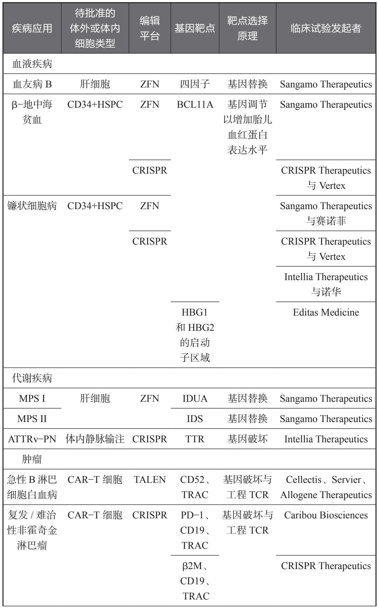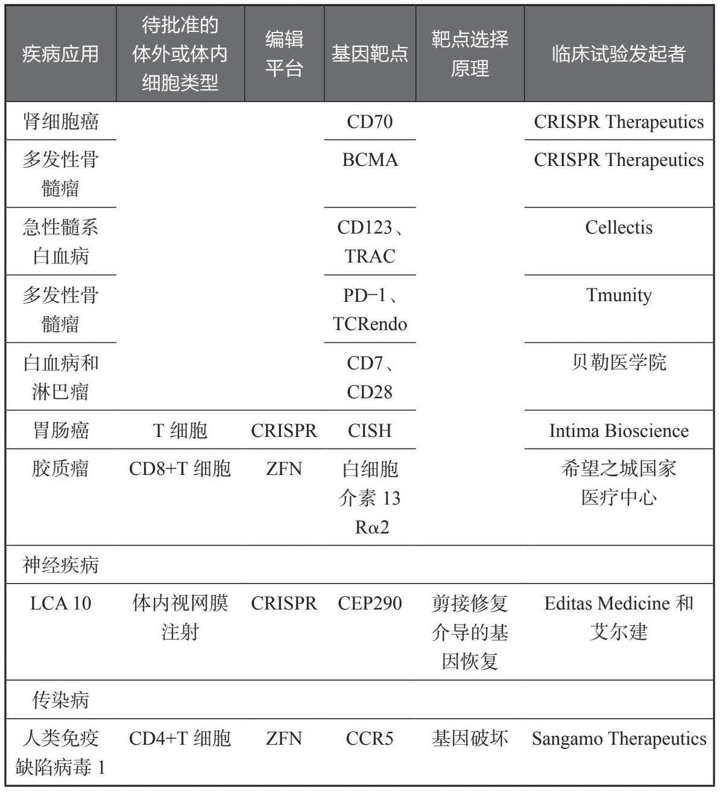

注：上述临床试验数据截至 2020 年 12 月 15 日，都是美国食品药品监督管理局监管下的在`Clincaltrials.gov`网站中列出的数据。`HSPC`：造血干细胞和祖细胞；`MPS I`：黏多糖贮积症 I 型；`MPS II`：黏多糖贮积症 II 型；`ATTRv-PN`；遗传性甲状腺素转运蛋白淀粉样变性伴多发性神经病；`CAR-T`：嵌合抗原受体 T 细胞；`TRAC`：T 细胞受体α基因座；`TCR`：T 细胞受体。

2020年12月，CRISPR-Cas9有望安全治愈人类疾病的消息集中释放。美国血液学会年会上公布10名患者数据，同时《新英格兰医学杂志》发表CTX001治疗两名患者的首篇科学报告。^(151)

首批临床数据令人振奋。输注数月后，两名患者均产生大量胎儿血红蛋白，干细胞持久植入带来长达18个月的持续表达。研究前他们多次出现血管闭塞危险，治疗数月后该风险消失。此前依赖输血的患者也停止了输血需求。另两名镰状细胞贫血患者与6名输血依赖的β-地中海贫血患者也呈现相似的剧烈改善。这一基于细菌防御系统的技术里程碑仅在6年前启动，已改写患者生活并书写医学史。

CTX001未来可能成为奇迹药物，但全球约300多万人出生即患镰状细胞病的人中仅能惠及极少数。昂贵的干细胞制备与住院护理将单例费用推高至百万美元量级。在撒哈拉以南非洲，每4名新生儿中有3名患病，50%~90%的患儿在5岁前死亡。尽管镰状细胞病是人类最常见的孟德尔疾病之一，精密生物技术疗法难以覆盖非洲等地区。现实是，财政限制可能削弱基因治疗对全球健康的意义，像部分癌症免疫疗法一样，基于基因编辑的疗法或将局限于富裕国家或极少数富人。

mRNA疫苗：数十年积淀换来数十亿人的覆盖

如果生物技术能造出廉价药物，在全球危机中拯救数十亿人，会是什么样？21世纪最惊人的成就之一就是基于信使RNA的新冠疫苗的极速开发。与CRISPR疗法快速迭代形成对比，mRNA药物与疫苗平台已历经数十年沉淀。CRISPR的崛起源于一次独特洞察，而mRNA潜力的觉醒则在关键技术成熟后才被放大。开发mRNA疫苗需要三项创新融合：确定化学稳定且低免疫原性的mRNA分子、建立高效递送系统、设计可在人细胞中诱发最佳免疫反应的病毒蛋白。

重组DNA革命把RNA推到幕后，DNA长期作为药物与疫苗的基因信息载体。中心法则把mRNA定位为从基因组到蛋白质的短暂中介。mRNA是一种不稳定大分子，细胞内有专门降解机制，信号传递后迅速清除，典型半衰期仅30分钟至1小时，足以制造数百个蛋白。降解本身是设计，mRNA周转是基因表达调控的关键。第二个不稳定因素是水解，RNA易受碱催化水解攻击糖-磷酸骨架，导致包装递送困难。DNA因缺乏易攻击的羟基而更稳定，甚至可在化石中被测序，而RNA从未完整保存。

基于不稳定mRNA的平台还必须规避先天免疫对外源RNA的监控。人类拥有强大的抗病毒先天免疫，双链RNA可触发干扰素介导的炎症。单链mRNA理论上可被忽视。然而20世纪90年代末，宾夕法尼亚大学的德鲁·魏斯曼与卡塔琳·卡里科发现，试图用卡里科合成的RNA制艾滋病疫苗成分时，单链RNA仍引发强烈免疫反应。卡里科长期梦想裸mRNA疗法，却对这种反应感到困惑。

随后数年二人展开探索。外源DNA与RNA的监控主要由Toll样受体家族执行，该家族可识别病原体相关分子模式。对DNA而言，模式是未甲基化的CpG基序，哺乳动物DNA中CpG胞嘧啶多被甲基化，而微生物基因组中未修饰，TLR9可检测该基序。卡里科与魏斯曼开始筛查可能引发免疫的RNA类型。转运RNA含有高水平假尿苷，可稳定三叶草结构，却几乎不引起炎症或树突状细胞活化。

2002年，卡里科建立单核细胞检测体系，测试不同RNA结构诱导白细胞介素-12分泌的能力。最强诱导剂之一是含长段尿苷的合成polyU，而polyA无此效应。两人由此意识到修饰mRNA尿苷位点的核苷可降低免疫触发。2005年发表的里程碑论文证明，用修饰核苷或假尿苷合成的RNA可绕过免疫触发机制。^(152)

疫苗开发的核心是免疫原选择，无论是灭活病毒、亚单位蛋白、DNA或RNA，亦或载体疫苗基因。20世纪90年代艾滋病全球蔓延时，美国国家过敏与传染病研究所所长安东尼·福奇组建疫苗研究中心推动技术创新。为对抗流感、呼吸道合胞病毒及2003年SARS与2012年MERS等冠状病毒，呼吸道病毒疫苗研发愈发迫切。其副手巴尼·格雷厄姆领导团队研究高性能中和抗体的结构基础，并用结构导向工程设计抗原以提升免疫原性。

2013年抗体抗原复合物的可视化揭示，呼吸道合胞病毒抗体的效力与病毒蛋白前融合构象中的表位相关。^(153)

视线转向冠状病毒。2017年，格雷厄姆团队用“2P设计”改良MERS刺突糖蛋白，在两个位点引入脯氨酸以稳定融合前构象。资金雄厚的Moderna在剑桥秘密推进mRNA寨卡与流感疫苗研究，2019年其改良核苷技术取得进展，签署多项制药协议后与美国国立卫生研究院疫苗小组合作研究尼帕病毒。同期Moderna已开发脂质纳米颗粒递送系统，将mRNA送入细胞并在脂质屏障后保持安全。^(155)

2019年底新冠暴发为最新mRNA平台提供考验。2020年1月10日病毒基因组序列公布后，研究者立即锁定刺突蛋白为靶抗原。3天后Moderna科学家在理论上设计出融合MERS冠状病毒2P设计的mRNA分子，项目内记为S-2P。45天内临床试验启动，BioNTech与辉瑞沿同一策略推进S-2P。两家公司公布三期结果，有效率近95%。mRNA平台在全球220余款新冠疫苗中脱颖而出。S-2P融合前稳定设计产生了有效中和抗体，被修饰且脂质纳米颗粒包裹的mRNA在细胞内稳定翻译。临床试验及大规模接种中基本未见人体对合成mRNA的严重不良免疫反应。在数十年学术积累与政府研究支持下，生物技术取得胜利。

mRNA平台的应用正扩展至疫苗之外，已有多项临床试验在进行。Moderna据报与阿斯利康合作的候选药物达40种，Alexion与Moderna合作聚焦罕见病，BioNTech、默克、Moderna等投入数亿美元将癌症疫苗推入临床前管线。

概念上，让机体细胞依据引入的mRNA制造蛋白，比重组蛋白生产或传统基因治疗更具优势。对mRNA疗法而言，生物反应器即正常生理部位，产量由细胞过程调控。基因疗法需DNA整合入基因组，带来不可预测风险。疫苗作为mRNA平台首测场景理想，因仅需一两剂注射。蛋白与mRNA疗法的缺点在于需持续给药，终身输注可能不可避免。目前尚不清楚脂质体或mRNA反复暴露是否会引发不良免疫或毒性。Moderna与阿斯利康正开发经心外膜注射递送血管生长因子VEGF-A的心脏病药物。其他例子包括Translate Bio公司的可吸入mRNA治疗囊性纤维化，以及Moderna公司静脉mRNA纠正丙酸血症、Arcturus公司mRNA纠正鸟氨酸氨甲酰基转移酶缺乏症。

生物技术持续迭代，催生出多类可用于纠正遗传缺陷的分子工具与干预策略，亨廷顿病的再启动研发就是典型案例。亨廷顿病为常染色体显性遗传，单个异常蛋白拷贝即可造成严重损伤，因此在源头阻断表达被视为合理路径。Intellia Therapeutics 正在用 `CRISPR-Cas9` 敲除亨廷顿病基因座；LocanaBio 则借助以 `Cas9` 为基础的 RNA 编辑技术切断携带毒性重复序列的转录本。RNA 干扰方向也在推进，UniQure 的 `AMT-130` miRNA 与 Voyager 的 `VY-HTT01` miRNA 正在测试对突变转录本的抑制，Triplet Therapeutics 则另辟路径，拟通过清除 DNA 损伤应答通路的关键因子来遏制重复扩增。

新一代工具把疾病干预的精度提升到以往难以企及的区间。这种精度跳跃源于治疗思路从经验试错转向工程化设计。随机筛选与挑选正被理性设计与定向进化取代。mRNA 疫苗的问世、免疫疗法与血液病中对干细胞和 T 细胞的改造、以及对人类、动物、植物与微生物基因组的大规模编辑以探索治愈手段，都体现了这一转向。`Cas9` 与 `Cas12a` 核酸酶被用于搭建高保真的 RNA 与 DNA 编辑系统，进而得到性质可微调的嵌合蛋白。机器学习帮助筛选表现最优的碱基编辑器，计算预测也在推动精准疫苗学进展。药物研发在生物技术创新生态的牵引下不断演进，但其步伐始终受限于人类对健康与疾病底层机制的认知水平。期待技术迭代、算力增长、AI 工具普及与生物学知识累积协同作用，才能持续激发创新并对新兴生物技术疗法做出更审慎评估。

# 第五章

## 巨头为何闯入医疗版图

进入21世纪，人类最棘手的难题之一是如何获得可及的医疗服务。新冠大流行等全球性公共卫生事件，把药品供给、创新节奏、交付方式以及背后的经济与人力成本都推到聚光灯下。无论是私立付费、公立体系还是全民覆盖，医疗供给的组织与维护本身都极其复杂。以美国为例，医疗开支长期抬升拖累家庭，数百万人无保险，基础诊疗和药品可得性不足。供给侧，基层医生被迫套用统一的十五分钟问诊模板，几乎没有时间倾听或将健康数据录入老旧的电子病历。舆论与政策风向的变动会显著影响制约行业多年的要素。另一条降本思路是通过重塑产业结构与激励机制。创新并非无用，它有望找到更高效的服务形态、用更低成本催生新药，甚至重塑整个医疗生态与技术底座。

过去，科学突破极大提升了药企在医疗版图中的权重与经济价值。行业针对关节炎、哮喘、咽峡炎等常见病推出多款疗法，但每一次新品上市都伴随支出激增。生物医学研究与生物技术的进展推动研发管线，并在新兴市场带来创新药物。制药企业早已熟练 blockbuster 药物策略，长期依赖小分子化学与标准化生产工艺的组合。即便生物技术创新、精准医学与生物制品整合的趋势明显，传统巨头的商业模式仍高度完整且根深蒂固。

医疗是一个约十万亿美元的全球产业，一端是制药、生物技术与生命科学企业，另一端是医院、居家护理、管理式医疗以及器械耗材。在美国、欧洲与亚洲发达地区，药品支出约占医疗总支出的10%到20%。整个制药板块持续反对价格管控，通常以研发成本计入定价并强调患者获益来为自身辩护。

慢性髓细胞性白血病药物格列卫是典型。2001年上市时年费用2.6万美元，到2015年专利到期已涨至12万美元/年，专利通过追加申请与首家仿制药商 Sun Pharmaceuticals 的协议延长了两年以上以延缓竞争。类似格列卫的特效药是成本攀升的核心推手，未来仍将是行业的盈利引擎。疫情前，医疗产业大部分利润集中在十家公司，其中九家为制药商。2019年第一季度，制药与生物技术企业的净利润率体现行业特征，从强生18.7%（季收入200亿美元）到礼来83%（收入50亿美元）不等。相比之下，药店零售巨头 CVS Health 同期收入610亿美元，净利润率仅2.3%。美国最大健康保险公司的利润率也只有个位数，同一季度联合健康集团为5.7%，Cigna 为3.6%。专利保护与规模化生产让制药牢牢掌握定价与运营效率。长期看，制药业务具备类似半导体代工厂或汽车制造的规模效率。现有顶级药企大多诞生于150多年前，至今仍是进入壁垒极高的盈利机器。短期内改变这一格局很难，那医疗还能在哪些环节实现变革？

21世纪初，似乎没有任何颠覆力量能介入医疗这一盘根错节的生态。停滞需要一股不可阻挡的力量打破。回头看，挑战来自科技界。世纪初信息革命引发产业巨变，互联网爆发、移动设备普及、算力变得廉价、虚拟化与无处不在。数字商业平台源自社交网络，信息技术成为颠覆的源头。在金融、媒体、通讯、交通、能源乃至零售领域，数字新技术与新商业模式正重塑传统做法。小创新者与大型数字化企业突然具备触达大众或为医疗机构开发产品服务的能力。

## 资本正涌向数字医疗

当投资人与创业者描绘技术驱动医疗应用的浪潮时，大量资金涌入数字医疗以捕捉机会。图5—1展示了数字医疗技术在行业中的定位。过去十年资金持续注入，数千个项目获得支持。绝大多数交易由传统风险投资与企业风险投资主导，覆盖数千家公司超过3000笔投资，约占总笔数的80%。^(¹⁵⁶)

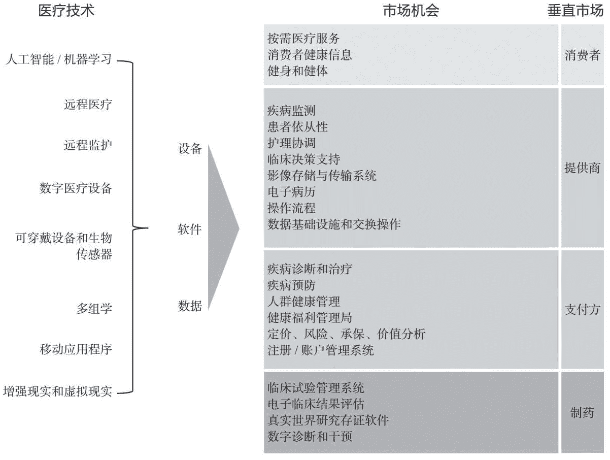

图5—1 数字医疗技术与应用

注：各类医疗技术（左）可单独或组合以设备、软件与数据形式落地，形成数字医疗工具。市场应用按垂直领域（右）细分，部分存在重叠，例如疾病诊断与预防横跨消费者、提供方与支付方。

多组学：涵盖基因组学、表观基因组学、蛋白质组学、代谢组学与脂质组学等分子分析技术。

数字健康以初创为主，部分成功，更多失败。独角兽中不乏 Tempus 依托人工智能与基因组学为癌症提供治疗指导，以及新型超声设备商 Butterfly。^(¹⁵⁷)

在硅谷“快速试错、最小可行产品”的氛围里，经风险投资支持的数字健康公司仅少数胜出。业内人士指出战略与执行失误，同时颠覆传统医疗的路径仍存多重阻碍。例如技术型创业者难以把方案整合进现有医疗信息基础设施。另一败因是把上一波互联网公司的过时商业模式套用到当下问题，例如用类似 `SnapChat` 或 `优步` 模式做面向消费者的健康应用并不奏效。最后，医生与医疗系统对技术的疑虑始终是阻碍采纳的重要因素。

医疗投资的复苏不止于风险投资支持的初创。美国医疗服务的私募股权资本从2000年的50亿美元增至2018年的1000亿美元，增长19倍。2018年交易涉及各类医疗服务，共855起。仅2019年私募股权交易规模就超过4500亿美元。私募股权机构采用买入—卖出的模式，把资本与管理专长投向被低估或表现不佳的企业以追求短期回报。其本质是逐利而非改革医疗。尽管如此，随着行业进一步整合，医疗体系企业的构成已被投资行为重塑。

新技术与创新商业模式共同传递出隐含承诺：医疗在多方面将得到改善，同时实现更可及的服务与慢性病预防管理，后者占医疗成本的90%。

### 推动医疗创新演进的关键因素

医疗技术创新的驱动可归纳如下。

・技术有许多机会解决卫生系统的可负担性、可及性、患者结局数据、医疗质量与患者体验问题。低效率带来挑战，也为创新提供激励，以解决核心痛点并实现以患者为中心的照护，激励可能来自外部也可能来自内部。

・支付方与提供方承受降低成本、提升运营效率的巨大压力。既有企业与新进入者均有机会利用创新改善资产负债表，同时降本增效。

・精准医疗计划为新技术创造机会以落实商业模式，并弥合群体医学与个性化护理的差距。

・来自制药公司与诊断实验室的分子分析新数据流，尤其在精准医疗应用中，成为日益强劲的驱动力。

・医疗技术投资者与企业提供大量资本推动创新。数字健康一直是催化剂，投资者看好患者参与、人工智能分析、云服务与新型照护模式的机遇。

・行业最大参与者把并购作为扩充技术储备的策略。围绕电子健康档案，支付方、提供方、医疗服务与技术公司收购了多种资产以强化数据与分析能力。

・美国《21世纪治愈法案》规定的监管要求为电子健康档案数据互操作性创造机会，提高数据透明度与消费者使用权限。

・总部位于美国的世界最大技术公司正竞相进入多个医疗领域，它们拥有广泛技术能力、与消费者健康相关产品及从业人员服务能力。这些技术巨擘已建立众多战略合作、完成收购、开设新业务单元以抓住全球医疗经济的巨大机会。

## 科技巨头能否颠覆医疗

全球科技经济规模与医疗行业相当，由五家美国公司主导：微软、苹果、亚马逊、谷歌、脸书。其中前四家位列全球最有价值企业前五，沙特阿美为最大。2021年初，这些科技公司的总市值约7.5万亿美元。这些巨擘平均成立30年，却已超越曾统治美国的百年巨擘通用汽车、福特、雪佛龙、德士古、埃克森美孚。科技主导集团掌控全球经济重要部分，领跑媒体、电子商务零售、软件等领域。在云计算赛道，`AWS`、谷歌云、微软 Azure 处于领先。哪家能够决意在医疗领域发挥决定性作用？

要判断技术巨擘能否进入医疗，需理解它们如何取得今日地位。归根结底，这些公司随着时间适应机遇、不断演化、最终化形。亚马逊起家于电商零售，后把计算基础设施孵化为独立云业务，如今是无可匹敌的云服务提供商。苹果电脑于2007年更名为苹果，史蒂夫·乔布斯将其塑造成奢侈品牌，产品超越台式电脑。谷歌20世纪90年代末以第18大搜索引擎进入，缺乏先发优势，凭借更优算法开创新商业模式，削弱传统媒体广告份额。十年内谷歌与脸书垄断广告技术与数字广告收入。微软是五巨头中相对保持初衷者，从 `MS-DOS` 到 `Windows`，从计算机操作系统到如今统治消费者与企业生产力软件王国。亚马逊、苹果、字母表、微软对医疗表现出明显兴趣，并在健康医疗应用投入巨资。信息技术行业具有商业中立性，跨界几乎任何行业都是公平游戏。那么技术与科技巨擘能否解决医疗的紧迫需求？答案是肯定的，但有条件，只要它们不直接行医，而仅扮演提供方角色。

以家庭护理趋势为例。这些公司已拥有面向患者照护模式几乎所有环节的技术支持。每家都有语音识别技术——亚马逊的 `Alexa`、苹果的 `Siri`、微软的 `Cortana`、谷歌的 `谷歌助手`。通过移动与智能家居设备，消费者可与照护者互动。患者门户与移动端数千款医疗健康应用促进沟通。远程医疗、可穿戴设备、智能服装、边缘计算、手持设备、药物与服务交付，均包含技术成分，其平台连接组件可将其嵌入医疗保健体系。这些年轻公司拥有勇气、全球影响力与能深刻改变医疗的技术。对部分巨擘而言，与消费者的关系可能是其在提供产品服务及引领行业转型时能走多远的关键。

## Alphabet的医疗布局图谱

在技术巨擘中，字母表在医疗领域的历史最长、布局最多元。也因隐私问题最受关注。谷歌无可匹敌的技术底座、人工智能能力与对世界信息的不懈组织，似乎正让医疗数据与健康记录成为公司医疗长期战略的核心。字母表与谷歌CEO 桑达尔·皮查伊在2020年达沃斯世界经济论坛年会上再次强调医疗对组织的重要性。^(¹⁵⁸)

谷歌首次进入医疗源于2006年秘密启动、2008年正式上线的患者健康记录项目谷歌健康。设想为消费者提供存储、检索、共享个人健康数据与医疗记录的门户。该服务未能在更广阔消费市场获得关注，2012年关闭。微软HealthVault及诸多承诺提供安全网络健康记录存储的初创也遭遇类似失败。问题部分在于时机——消费者兴趣与准备度，而非服务本身。谷歌搜索、地图、Gmail、云、安卓与广告等核心产品极其成功。1998年谷歌联合创始人谢尔盖·布林与拉里·佩奇立志以原创方式开拓信息技术新领域，像谷歌健康这类探索性项目自始即属谷歌DNA。他们是远见者，谷歌健康只是众多健康试点之一。

字母表对医疗的信念最初来自谷歌X，又称X实验室，该“登月工厂”约于2010年由创始人秘密建立。布林与佩奇在此孵化大胆项目，与硅谷传统企业研究院截然不同。自动驾驶汽车项目“司机”是早期代表，由机器人专家与人工智能先驱塞巴斯蒂安·特龙领导。谷歌大脑也在此诞生，由杰夫·迪恩、吴恩达、格雷格·科拉多主导发展深度学习能力。生命科学公司Verily则在2015年谷歌重组为字母表后成为集团医疗业务主体。

Verily与卫生机构及制药企业建立众多合作，开发临床研究与试验的数字工具。核心活动围绕基线项目展开，旨在评估纵向人群健康研究工具，并于2019年与诺华、赛诺菲、大冢制药、辉瑞签署协议。

另一项合作是利用Verily分析工具部署Dexcom的G7葡萄糖监测设备。Verily还与谷歌大脑研究人员合作推出人工智能驱动的糖尿病视网膜病变诊断工具。截至2021年初，Verily通过巨额融资轮彰显其成为医疗保健重要参与者的雄心，累计融资达25亿美元。其业务已扩展至医疗保险平台、慢病管理，与Onduo^(¹⁵⁹)相关。

战略投资也在推动字母表在医疗市场的野心。比尔·马里斯2009年创立谷歌风投，并孵化生物科技子公司Calico并下注。该公司聘请基因泰克资深人士阿特·莱文森开展抗衰老研究并开发衰老相关疾病潜在疗法。近年来谷歌风投在医疗领域投资了Foundation Medicine、Genomics Medicine Ireland、Editas Medicine、Gritstone Oncology、Flatiron Health等。除谷歌风投外，字母表还拥有企业风险投资部门及两个投资平台：聚焦人工智能的Gradient Ventures与独立增长基金CapitalG。庞大的投资网络让母公司得以前排观察具备前沿技术与商业创新的健康科技初创的想法萌发、演化与实现。

并购为字母表在医疗的进路描绘出最清晰图景。2014年底宣布拟收购DeepMind以强化人工智能技术组合。字母表资助DeepMind昂贵研发并给予高度自主，随后于2018年收购其医疗产品线。第二步是2014年以32亿美元收购Nest，由谷歌风投投资，以独特方式把谷歌带入家庭。Nest业务活动，尤其2018年收购Senosis Health，表明字母表将Nest智能设备定位为家庭数字健康解决方案的一部分。Senosis Health设计移动健康监测应用，将软件产品与Nest设备及谷歌语音助手技术整合，成为家庭健康支持设备。2021年谷歌以21亿美元完成对Fitbit的收购，让字母表拥有可与苹果手表竞争的可穿戴设备，并在健身健康品类领先于亚马逊Halo产品。另一项隐秘动作是2016年对Apigee的收购，字母表由此得到其API管理平台。尽管Apigee技术被视为区分谷歌云平台与亚马逊AWS企业客户策略的工具，其技术或将改写医疗互操作性的游戏规则。

2018 年换帅后，Google Health 重新发力，医疗数据再次被放回战略核心。与 Ascension Health 的合作因部分员工可访问患者隐私信息而爆发泄露风波，也为外界窥见其布局提供了切口。业务上，团队在推一个面向医疗领域的核心数据平台，目标不仅是提升 Epic 等电子病历系统的检索效率，更想沉淀为行业级的数据底座。同时与加州大学旧金山分校达成的协议，允许谷歌免费使用特定病历数据做分析测试。由 DeepMind Health 主导的临床助手 Streams 仍在研发中。Fitbit 的并入为健康研究团队打开了新场景，依托可穿戴设备开展心血管、睡眠和呼吸相关的临床研究成为可能。

Google Cloud 如今已形成一套用于整理健康信息与科研数据的工具组合，借助 AI 处理海量电子病历。工程团队打造了可自动扫描临床笔记的医疗自然语言 API，配套的 AutoML Entity Extraction 则提供机器学习手段，帮助医生快速定位记录要点并提炼医学洞察。这两款产品带动了对 Google Cloud 及 Cloud Healthcare API 的采用，即便用户也有绕开的空间。这一赛道正与亚马逊 HealthLake 直接竞争。

Verily、Calico、DeepMind 等 Alphabet 系公司在医疗赛道已多点布阵。整体来看，Alphabet 累积了临床硬件、决策支持系统、临床研究、医院基础设施软件、分析数据库、应用软件、医疗器械与可穿戴设备等一条长链。Fitbit 已覆盖美国 27 个州，并进入联合健康等巨头在 40 余个 Medicare Advantage 计划。项目广度与深度毋庸置疑，但收入结构严重失衡：2020 年一季度，谷歌广告收入达 409 亿美元，所有非广告业务加总仅 1.35 亿美元。母公司为何重注健康业务至今不明，现行商业模式也不擅长深度触达健康消费者或为医疗机构提供运营服务。成败尚待时间检验。

## 苹果：把健康做成消费品
“如果放眼未来，回顾过去，那么你会问‘苹果对人类最大的贡献是什么？’——答案将是关于健康的。”  
——2019 年 1 月，苹果 CEO 蒂姆·库克接受 CNBC 吉姆·克莱默采访时表示

让苹果跻身万亿美元市值的技术与经济逻辑，与谷歌依托搜索广告的变现路径截然不同。乔布斯把苹果从硬件厂商改造为消费奢侈品牌，靠产品热爱与隐私保护建立声誉和用户忠诚。不同于谷歌、脸书、亚马逊依赖数据上云变现，苹果在库比蒂诺总部的研发文化更聚焦产品工程而非信息采集。因此苹果看医疗的角度更偏消费者。

库克的表态乍听惊讶。若健康是长期愿景，为何投入重心仍在打造顶级袖珍相机，而非医疗器械或癌症算法？迄今苹果并未进入 FDA 监管的医疗设备、远程医疗或健康支付领域。最清晰的动作是在 iPhone 与 Apple Watch 上叠加大量健康吸引功能。过去二十年的并购也显示出整合增强型技术以丰富产品的意图，近年收购 Xnor.ai、Voysis、NextVR、Curious AI 等，为 iPhone 与 AR/VR 产品注入 AI 能力。公开交易中并未明显指向医疗垂直扩张，未来路线图更围绕可穿戴、AR/VR、自动驾驶，以及智能家居、网络安全与媒体。

苹果对健康的关注可追溯至 2014 年 iPhone 与 iPod Touch 上线的 Health 应用。虽在移动医疗浪潮中起步偏晚，但开发者、消费者与从业者的热情推动其快速成长。移动应用开发的便捷性为医疗创意进入个人设备建起高速公路。iPhone SDK 于 2008 年 3 月 6 日发布，被视作移动健康的起点。颇具讽刺的是，2009 年应用商店出现的应用 Health Cloud，由开发者打造，让谷歌健康用户能经 API 在苹果设备上查看电子病历。2009 年 iPhoneOS 3.0 预热时，负责 iPhone 软件的 Scott Forstall 已预见到医疗设备对接可能。发布会现场邀请强生子公司 Lifescan 演示蓝牙血糖仪如何把数据传到 iPhone 上的糖尿病管理应用。此后医疗健康应用爆发式增长。据 Statista 统计，自 2008 年医疗类目设立以来，应用数量从 82 个增至 2020 年的 46,608 个。^(¹⁶⁰)

COO 杰夫·威廉姆斯主导健康团队，并是 Apple Watch 的关键推动者。当时尚营销未奏效时，他将产品转向健身，推动传感器与算法升级，强化可穿戴的保健功能。策略奏效，销量攀升，睡眠追踪、心率监测、心电图、除颤与后来的血氧感应将设备与健康更紧密绑定。苹果还向开发者开放 HealthKit、ResearchKit 与 CareKit，分别用于健康应用、医学研究与临床试验、患者与提供者连接。对医疗而言，这是顶级产品团队把数字健康产品带向大众市场的重要一步。

苹果另一条线是让客户经 iPhone 直接连通电子病历。健康 App 的健康记录功能可对接医院系统，并与 Athenahealth、Cerner、Epic 等 EHR 巨头达成访问协议。提供者可把检验结果、治疗计划、用药记录等直接推送到设备。苹果拥有 15 亿活跃设备，覆盖美国超半数人口，接入复杂 EHR 系统后，对医疗信息流与存储的掌控力极强。

面向大众的同时，苹果也在与价值链其他主体合作：与 Aetna、UnitedHealthcare 等保险商、私人医保、Medicare Advantage 计划，以及礼来、强生等药企展开协作。保险方已计划以优惠价提供 Apple Watch 作为客户福利，显示苹果在保险端的突破。旗下 AC Wellness 还为员工开设健康诊所。

得益于传感器质量提升与 iPhone 的临床多功能性，苹果医学研究加速。标志性案例是与斯坦福心血管健康中心合作的 Apple Heart Study，8 个月内招募 419,297 名参与者。^(¹⁶¹)

即便生态与覆盖如此强势，苹果在医疗的动作仍算克制。公司对大规模获取用户生成健康数据的积极性存疑，而这类数据对预防医学至关重要。数据隐私风险也可能让其放缓。相较谷歌或亚马逊，建设与分析海量数据的基础设施并非其核心优势，或也因政策与监管快速变化而保持谨慎。

在所有科技巨头中，苹果最有潜力推动以患者为中心的去中心化医疗。不同于与集中式基础设施和一体化 EHR 竞争，苹果可成为守护隐私、把患者—医生关系置于中心的试验场。借助可穿戴与物联网设备的人工智能与软件技术，个人数据可在本地分析解读，再通过区块链或加密方式与指定的支付方与提供者共享。提供者反向请求诊断、财务与福利等信息，形成提供者为集成点的去中心化模式。这一思路与当前在社交、媒体、金融领域兴起的去中心化运动一脉相承，也更契合医疗对隐私的敏感。

## 亚马逊 用零售逻辑切入医疗
“作为一家公司，我们最大的文化优势之一是接受这样一个事实：如果你要创新，你就会造成颠覆。既得利益者是不会喜欢这种变化的。”  
——2011 年，杰夫·贝佐斯接受《连线》杂志史蒂ven·利维采访

1994 年贝佐斯辞去对冲基金分析师，横跨美国寻找融资支持其在线书店设想。亚马逊并非首个电商，但其远见重塑了零售。公司的“超能力”是拿下难题并以惊人规模调动资本，让对手望而却步。传统董事会追求最小投入与最低风险，而亚马逊的惯例是解决他人不敢碰的大问题。为客户提供无摩擦、低成本、免费配送的购物体验成本极高，公司用了 20 年才兑现收益。首个盈利年是 2003 年，净收入 3,500 万美元，总营收 52.6 亿美元。^(¹⁶²)

长期投资体现了对客户的执着，与医疗高度契合：零点击、语音一键购物、两小时达、持续推荐等体验直接创造价值。贝佐斯 2018 年称全球已有 1 亿 Prime 会员，约占美国家庭一半。^(¹⁶³)

亚马逊在医疗的可见进展来自云服务合作、药房收购与员工诊所。2019 年与 EHR 提供商 Cerner 的合作是典型案例。Cerner 希望成为医疗 SaaS 平台，日均服务 300 万名提供者，并欲从海量健康数据中挖掘价值。合作带来 AWS 机器学习平台 SageMaker，Cerner 基于此构建预测模型框架，采用匿名数据训练算法。AWS 后续以 Amazon HealthLake 提供同类能力，目标是将临床信息转化为可被预测分析与机器学习读取的结构化形态。

医疗数据格式多样，从结构化诊疗编码到医生笔记、化验报告等非结构化文本。人工整理或过时 OCR 易错慢，NLP 可从记录中抽取信息并结构化，使其可被检索与模型使用。AWS 正面向保险、提供者与药企推广工具与 AI 基础设施。

亚马逊正处在医疗数据爆炸与数字化转型的中心。高通量基因组学与医学影像的兴起与 AWS 推出时间重合。健康记录数字化带来巨大存储与治理需求，运营与非运营临床数据需被收集、归档、管理。随着时间推移，亚马逊的云管理模式与存储产品使其成为医疗 IT 架构的核心参与者。

2018 年，亚马逊与摩根大通、伯克希尔·哈撒韦组建 Haven 探索处方药可负担性、保险与初级保健新模式，该合资 2020 年无疾而终。市场普遍认为此前收购在线药房 Pillpack、并以 10 亿美元将其改造为 Amazon Pharmacy，是推动 Haven 失败的关键。进入处方药配送后，亚马逊与沃尔格林、沃尔玛、CVS 直接竞争。随后推出的 Amazon Care 最初服务西雅图员工，后与 Crossover Health 合作在达拉斯等物流中心周边试行初级保健，目标覆盖十余万员工。Amazon Care 与 Amazon Pharmacy 正逐步融合，成为零售巨头切入医疗的基础。

亚马逊也在自建健康硬件。Amazon Halo 是首款内部研发的健康产品，无屏幕设计，可采集身体成分、语音积极性、睡眠与活动数据，与 Apple Watch 与 Fitbit 类似。2020 年推出时，市场已有二十余款健身追踪器，显示其意图不在短期主导可穿戴，而在长期战略协同。结合 Echo 生态，Halo 为零售与健康建议增加连接层。收购 Health Navigator 则补充了临床决策支持与诊断工具。

凭借庞大物流与消费者触达，亚马逊以不同于谷歌、苹果与美国现行医疗体系的方式运营。零售专长与客户导向使其提供比较购物式的便捷护理服务，并经 Alexa 与云连接渗透家庭场景。毫无疑问，Alexa 与云服务也将进入医疗机构。借助仓储与运输网络，医院与诊所已与医疗用品供应链连接。若 Amazon Care 走向员工之外，其可能通过全食等线下网络在全国布点诊所。亚马逊不太可能投身药物制造或临床试验，但在交付与服务优势上，它仍能给医疗带来显著改变。

## 巨头之外谁在缺席？
技术与医疗的交汇覆盖芯片开发到面向消费者、保险与卫生系统的服务。微软与脸书并非当前改变医疗行业或运营医疗特许经营的强力竞争者。微软虽在 Azure 上构建健康数据管理系统，却缺乏面向患者的社交或产品支点。脸书拥有脸书与 Instagram 两个超大平台，日触达超 10 亿人，但其免费服务依赖广告变现，技术实力聚焦媒体帝国工具化，医疗与运营模式契合度低。

微软与 IBM、甲骨文等在医疗 IT 支出份额上竞争，但未给出明确目标将医疗确立为以企业为中心的软件帝国的支柱。IBM、Salesforce、SAP 等也受限于商业范围。英特尔、高通、三星等硬件与移动设备厂商虽涉足健康，但医疗落地意图并不突出，与苹果、谷歌存在竞争关系。

21 世纪科技巨头具备以转型方式解决医疗问题的要素。图 5—2 展示了苹果、亚马逊、谷歌、微软在医疗领域的定位。这些公司调用硬件、软件、数据科学与无与伦比的人工智能，具备惊人算力。其数据处理能力与数据密集型医疗、预测与预防医学高度互补。与金融机构、保险、电信等拥有数亿账户的行业不同，科技巨头将同等规模的用户触达与有形产品服务相结合，直接关联健康与医药。值得注意的是，制药等传统医疗巨头与消费者关系多为间接。凭借消费者行为洞察、更优的公众信任与品牌影响力，科技公司正逐步蚕食制药企业的领地。

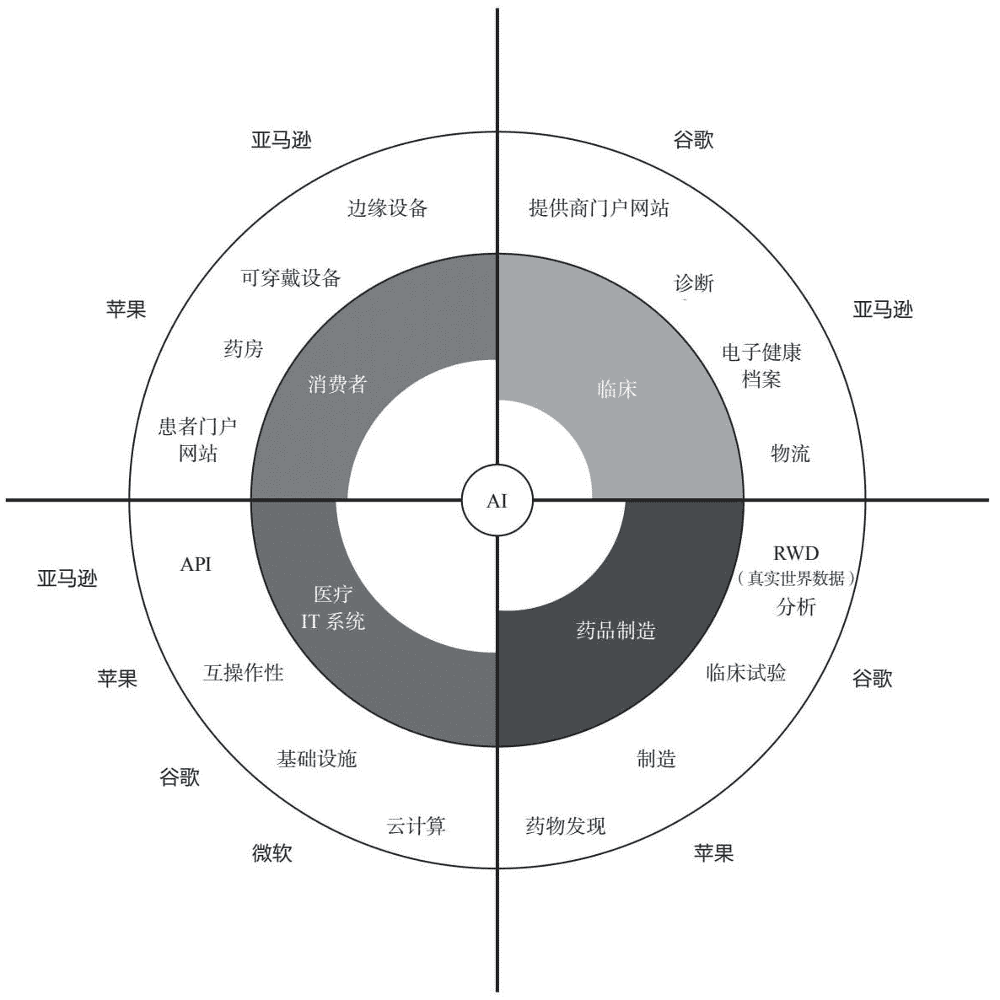

图 5—2 科技巨头与医疗行业——整个行业的竞争定位

医疗市场四象限与科技入场

从一种划分视角来看，健康产业被摊开成四块：面向普通大众的消费端、面向诊疗过程的临床端、负责药品器械制造的生产端，以及承载信息流转的医疗信息技术端。科技企业主要落位在其中一角，通过自有的研发能力为产品和服务提供差异化支撑。图中内环的半径暗示了AI在各细分领域的渗透深浅，外环则罗列出能够影响服务交付的技术集合。亚马逊、苹果、谷歌、微软四家巨头的现时位置被标示在图周。

这些巨头的进入意图并非亲自提供诊疗本身，而是借助工具、产品和更高效的交付方式撬动体系，并推动卫生系统照护模式的更新。部分厂商已在数字健康、数字医学和数字疗法方向加大投入。别期待谷歌、苹果或亚马逊的工程思维能造出《星际迷航》里的杀手级应用或医疗三录仪。对技术驱动型组织而言，真正可落地的价值在于帮助拆除阻碍社会医疗进步的结构性壁垒。

# 第六章

## 生物学和医学中基于人工智能的算法

未来的医生不会给患者提供药物，而是指导患者如何护理身体、调整饮食，并阐释疾病的起因和预防。

——托马斯·爱迪生

1903 年

如果我们允许有缺陷的机器代表我们做出改变生活的决定——允许它们确定谋杀事件的嫌疑人、诊断病情或接管汽车方向盘，我们就必须仔细考虑当事情出错时会发生什么。

——汉娜·弗莱

2018 年

人类生物学的认知在加深，新技术也在重塑社会，两者共同拉动当下医学的快速转型。医疗知识和服务借助互联网扩散，供给形态正从机构主导转向更分散的网络。21世纪，这一宏观走向已渗透到生活的诸多面向。医院与医生对资讯和决策的强控制在松动，背后是行业对以更低投入实现更高质量照护的诉求。若转型顺利，全球公共卫生有望得到实质改善。在此背景下，个性化医疗已经扎根，改变了药物研发路径与医患互动方式，也推动医疗向消费化演进。该概念源自大规模人群DNA测序，研究揭示了个体基因组变异的深度与复杂性。新的认知否定了“一刀切”诊疗的合理性，要求临床必须并重考量个人病史、社会经济与环境背景、独有的基因组特征，以及对治疗的生理反应。

因此行业正在扫除障碍，迈向更高水平的个体化照护。要实现此目标，分子诊断与数字健康成为获取个人健康数据的核心抓手。解析肿瘤分子特征的基因组学技术，或是监测心率、血糖的可穿戴传感器，都在引领产业走向个体化。

AI在许多行业的突破或预期，与医学领域已有的进展形成鲜明反差。

健康照护具有强烈的私密性与人际信任基础，这与把AI设想为医疗核心的理想化叙事相悖。目前医学界对AI的焦虑，多集中在机器是否终将在诊断全流程超越人类。像胸片筛查结核或癌症这类任务里，专家医生与训练好的AI模型对比显示，基于深层学习的算法在准确率上可达甚至超过人类水准。限制深层学习继续突破的瓶颈在于它难以理解上下文并进行推理。算法最终能植入多少常识与直觉，仍是未知数。

医学培养本质是长期学徒制，医生在此过程中学会鉴别与诊断。十年正规培训加上多年临床实践，培养出擅长用启发式方式快速评估的医生。正如斯克里普斯转化科学研究所所长兼联合创始人、《深度医疗》作者埃里克·托普所指出的：“医生能在不到五分钟内给出诊断，且准确率达95%，这种能力令人难以置信。”丹尼尔·卡尼曼将这种快速直觉式认知称为系统1思维，它绕开了系统2所需的审慎理性分析。对临床表现不确定的情况，医生必须依赖诊断推理。标准流程是通过评估当前症状与病史、体格检查、纳入阴性线索，再结合实验室或影像结果来锁定病因。医生还能借助多种诊断支持系统快速缩小搜索范围，广泛使用的症状自查工具包括 Isabel、Medscape consult。

直到最近，经过验证的机器学习工具几乎都依赖关联推理，即在症状与疾病间寻找相关性以推断结论。极少数模型采用了因果机器学习这一新思路，它把反事实推理纳入诊断算法。反事实推理会主动寻找对结果的替代解释，提供“如果……会怎样”的概率估计。例如，算法会评估在既定症状下，细菌感染是否也能合理解释患者的神经表现。里琴斯及其同事曾比较44名专家医生、一个关联模型和一个基于反事实的因果模型，诊断能力结果显示因果模型优于关联模型，在专家队列中位列前25%。^(¹⁶⁶)

要在主流医学诊断中承担核心角色，AI仍需完成大量算法与关键推理的工作。下面这个临床场景能说明直觉与经验如何共同抵达诊断与决策点。

### 现实世界中的医疗诊断：人工智能面临的挑战

设想一位52岁男性，主诉疲劳、轻度认知减退、睡眠障碍和易怒，症状模糊却令人担忧。既往史显示他在30、40岁时有酗酒与吸毒经历，如今可能正面临肝硬化风险。快速精神检查证实存在脑功能受损。在数百种脑病病因中，医生起初怀疑肝性脑病——一种继发于肝硬化的并发症，但诊断需要排除其他神经原因。诱因可能包括电解质紊乱、药物、胃肠道出血或感染。肝硬化时肝脏破坏导致氨无法转化为尿素排出，血氨升高具有神经毒性，可引发脑病。出于推测，医生安排了血氨检测，虽非肝性脑病的确诊指标，却能提供线索。结果显示氨水平进入高氨血症范围，存在永久性脑损伤风险。此时患者被收入院并立即开始使用清除氨的药物治疗。

如果医疗急诊室已部署基于AI的系统，机器能完成同样的判断吗？首先，对话式AI必须足够成熟，才能在医患交流中探明患者是否真的受损、是否醉酒或介于两者之间。接着，AI代理需要调阅临床记录，将其与既往肝硬化关联，并引导患者前往抽血、再解读实验室报告。它如何排除其他病因？一旦延误，永久性脑损伤、昏迷甚至死亡都可能发生。正因这类反复出现的真实情境，医生群体并不接受技术乌托邦主义者描绘的超人AI医疗图景。

尽管有这些警示，AI仍是医疗未来的核心技术。深层学习在图像识别上的惊人表现，催生了关于医生将被AI取代的报道与畅销书论调。AI在生物与医学中的应用在诊断学上天然有落脚点，模式识别与分类算法可大显身手。令人不安的并非AI在幕后辅助影像诊断，而是它直接参与医学诊断决策。

如表6—1所示，研究界正快速兴奋地测试并优化全范围的应用算法。几年前，医学AI的主要试验数据几乎局限于X射线影像这类数字原生图像。如今，模型数据已来自医学与分子诊断领域的几乎每个角落。

表6—1 基于人工智能的算法在医学中的应用现状

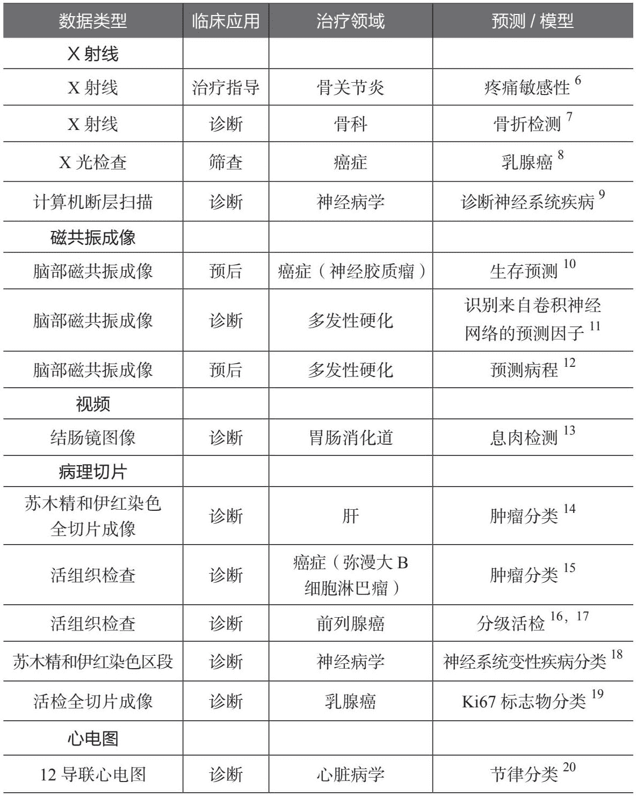

▲6 Pierson E, Cutler DM, Leskovec J, Mullainathan S, Obermeyer Z. An algorithmic approach to reducing unexplained pain disparities in underserved populations. Nat Med. 2021 Jan;27(1):136–40.

7 Kim DH, MacKinnon T. Artifi cial intelligence in fracture detection: transfer learning from deep convolutional neural networks. Clin Radiol. 2018 May;73(5):439–45.

8 Yala A, Mikhael PG, Strand F, Lin G, Smith K, Wan Y-L, et al. Toward robust mammo graphy-based models for breast cancer risk. Sci Transl Med. 2021 Jan 27;13(578).

9 Titano JJ, Badgeley M, Scheffl ein J, Pain M, Su A, Cai M, et al. Automated deep-neural network surveillance of cranial images for acute neurologic events. Nat Med. 2018 Sep;24(9):1337–41.

10 Mobadersany P, Yousefi S, Amgad M, Gutman DA, Barnholtz-Sloan JS, Vega JEV,et al. Predicting cancer outcomes from histology and genomics using convolutional networks. Proc Natl Acad Sci. 2018 Mar 27;115(13):E2970–9.

11 Eitel F, Soehler E, Bellmann-Strobl J, Brandt AU, Ruprecht K, Giess RM, et al. Uncovering convolutional neural network decisions for diagnosing multiple sclerosis on conventional MRI using layerwise relevance propagation. NeuroImage Clin. 2019;24:102003.

12 Zhao Y, Wang T, Bove R, Cree B, Henry R, Lokhande H, et al. Ensemble learning predicts multiple sclerosis disease course in the SUMMIT study. Npj Digit Med. 2020 Oct 16;3(1):1–8.

13 Poon CCY, Jiang Y, Zhang R, Lo WWY, Cheung MSH, Yu R, et al. AI-doscopist: a real-time deep-learning-based algorithm for localising polyps in colonoscopy videos with edge computing devices. Npj Digit Med. 2020 Dec;3(1):73.

14 Kiani A, Uyumazturk B, Rajpurkar P, Wang A, Gao R, Jones E, et al. Impact of a deep learning assistant on the histopathologic classifi cation of liver cancer. NPJ Digit Med.2020 Feb 26;3:1-8.

15 Li D, Bledsoe JR, Zeng Y, Liu W, Hu Y, Bi K, et al. A deep learning diagnostic platform for diffuse large B-cell lymphoma with high accuracy across multiple hospitals. Nat Commun. 2020 Dec;11(1):6004.

16 Bulten W, Pinckaers H, van Boven H, Vink R, de Bel T, van Ginneken B, et al. Auto mated deep-learning system for Gleason grading of prostate cancer using biopsies: a diagnostic study. Lancet Oncol. 2020 Feb 1;21(2):233–41.

17 Ström P, Kartasalo K, Olsson H, Solorzano L, Delahunt B, Berney DM, et al. Artifi cial intelligence for diagnosis and grading of prostate cancer in biopsies: a population based, diagnostic study. Lancet Oncol. 2020 Feb 1;21(2):222–32.

18 Cornblath EJ, Robinson JL, Irwin DJ, Lee EB, Lee VM-Y, Trojanowski JQ, et al.定义和预测神经退行性疾病的跨诊断类别。 Nat Biomed Eng. 2020 Aug;4(8): 787–800.

19 Narayanan H, Dingfelder F, Butté A, Lorenzen N, Sokolov M, Arosio P. 生物制品的机器学习：蛋白质工程、可开发性与配方的机遇。 Trends Pharmacol Sci. 2021 Mar;42(3):151–65.

20 Hannun AY, Rajpurkar P, Haghpanahi M, Tison GH, Bourn C, Turakhia MP, et al.使用深度神经网络对门诊心电图进行心律失常的心脏病专家水平检测与分类。 Nat Med. 2019 Jan;25(1):65–9.

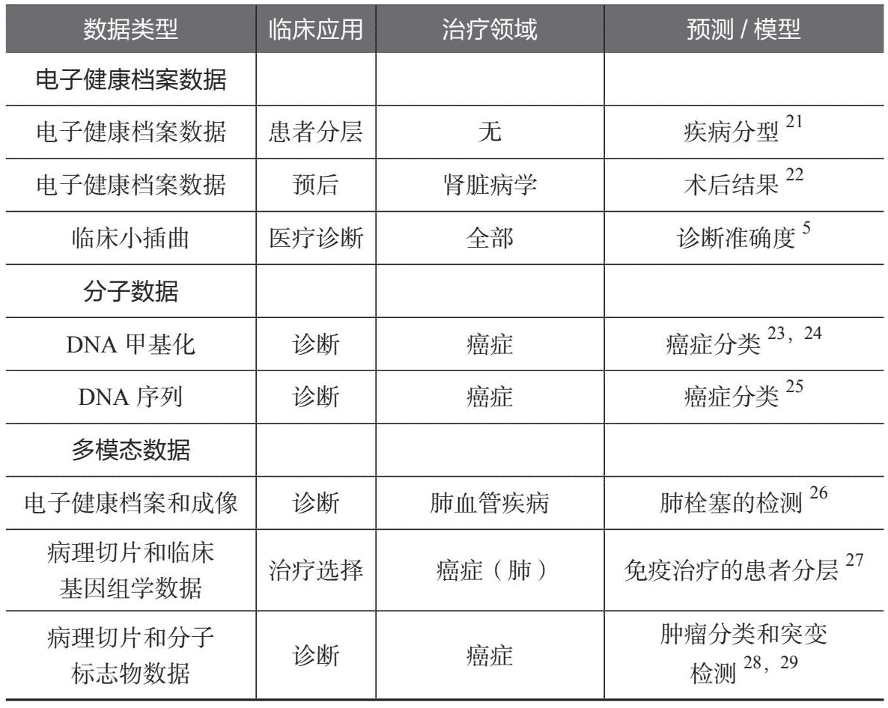

▲21 Landi I, Glicksberg BS, Lee H-C, Cherng S, Landi G, Danieletto M, et al. 深度表征学习电子健康记录以实现大规模患者分层。Npj Digit Med. 2020 Dec;3(1):96.

22 Hofer IS, Lee C, Gabel E, Baldi P, Cannesson M. 开发和验证一种深度神经网络模型，使用单一特征集预测术后死亡率、急性肾损伤和再插管。 Npj Digit Med. 2020 Dec;3(1):58.

23 Capper D, Jones, DTW, Sill M, Hovestadt V, Schrimpf D. 基于 DNA 甲基化的中枢神经系统肿瘤分类。 Nature. 2018 Mar 22;555(7697):469–74.

24 Jurmeister P, Bockmayr M, Seegerer P, Bockmayr T, Treue D, Montavon G, et al.DNA 甲基化谱的机器学习分析可区分原发性肺鳞状细胞癌与头颈部转移。 Sci Transl Med. 2019 Sep 11;11(509).

25 Jiao W, Atwal G, Polak P, Karlic R, Cuppen E, Danyi A, et al. 一种深度学习系统利用乘客突变模式准确分类原发性和转移性癌症。Nat Commun. 2020 Feb 5;11(1):728.

26 Huang S-C, Pareek A, Zamanian R, Banerjee I, Lungren MP. 利用深度神经网络进行多模态融合以利用 CT 影像和电子健康记录：肺栓塞检测的案例研究。 Sci Rep. 2020 Dec;10(1):22147.

27 Trebeschi S, Drago SG, Birkbak NJ, Kurilova I, Cǎlin AM, Delli Pizzi A, et al. 利用非侵入性放射组学生物标志物预测对癌症免疫治疗的反应。 Ann Oncol Off J Eur Soc Med Oncol. 2019 Jun 1;30(6):998–1004.

28 Kather JN, Heij LR, Grabsch HI, Loeffler C, Echle A, Muti HS, et al. 全癌症图像为基础的临床可操作遗传变异检测。 Nat Cancer. 2020 Aug;1(8):789–99.

29 Fu Y, Jung AW, Torne RV, Gonzalez S, Vöhringer H, Shmatko A, et al. 全癌症计算病理学揭示突变、肿瘤组成和预后。Nat Cancer. 2020 Aug;1(8): 800–10.

## 认识癌症的面孔

细胞和组织，皮和骨，叶和花，是物质的各个组成部分，正是遵循物理定律，它们的粒子才能够移动、重构和排列。它们也逃不脱“上帝总是进行几何化”这一规则。它们的形态问题首先是数学问题，它们的生长问题本质上是物理问题，形态学家因此成为物理科学的学生。

——达西·汤普森

《生长和形态》，1917 年

癌症的驱动并非单一突变所致，而是基因层面的改动在生理的多个维度上共同堆叠出可识别的特征。环境侵蚀和代谢紊乱会在漫长的生命历程中于 DNA 上留下细微的印记，最小的分子痕迹就是单个碱基的甲基化状态改变，这种改动遍布全基因组。如今被视作癌前信号的表观遗传漂移，往往在肿瘤真正形成前约十年就已经出现。随后致癌突变逐步累积，致癌驱动因子接管癌性基因程序，最先体现为 RNA 拷贝数波动与转录组的重塑；再往后则伴随染色质重排和染色体层面的修饰，例如端粒 DNA 的维持机制启动，以摆脱正常生长的管控。癌性增殖在形态上最直观的表现是细胞大小与形状的改变，以及组织中持续性的细胞重组，继而塑造出具有标志性的肿瘤微环境。一次涵盖上万例肿瘤的跨组学分类显示，癌症类型与组织来源和组织学分型高度重合，决定性因素仍是细胞的起源。

在肿瘤诊疗路径里，影像往往是第一道筛查。脑、肺、乳腺等部位的恶性征象会首先触发磁共振检查以定位病灶，必要时通过手术活检获取细胞以细化诊断并制定方案。正电子发射断层与 CT-PET 能够补充肿瘤进展和治疗反应的信息。最终分子诊断用于锁定具有治疗或预后价值的生物标志物。乳腺癌筛查与诊断的核心仍是乳房 X 光摄影，必要时借助超声或磁共振确认。阳性发现会进入活检流程，判断浸润与否，并由此展开一系列预后评估。病理检测主要确定 HER-2、雌激素受体和孕酮受体的存在情况，基因组级别的辅助检测如 Genomic Health 的 OncotypeDx 也被广泛使用。面对晚期、转移、难治或复发病例，分子检测用于指导下一步用药，同时结合血液检验评估肝肾功能、血细胞计数以及乙肝、丙肝或新冠病毒等可能影响方案的感染因素。总体而言，诊断从体格检查的宏观观察，到高分辨影像的异常生长识别，再到细胞级的肿瘤分型与细致的分子画像，构成了个体化干预与疗效监测的依据。

深度学习在医学中的潜力已引发肿瘤学界对临床全流程的系统审视。把 AI 辅助诊断工具真正落地，最先要回答的是医生因 AI 而变好而非受阻这一前提。斯坦福的吴恩达、珍妮·沈等人在 2019 年开展、2020 年发表的研究正围绕此展开。他们探讨 AI 助手对不同经验水平病理学家诊断表现的影响。模拟数字病理工作流后，病理学家先行肉眼评估并选取感兴趣区域，随后上传至云端运行预测模型，模型返回肝细胞癌或胆管癌的概率以供辅助决策。在胃肠专科医生、非胃肠专科医生和学员构成的四组实验中，三组里九位病理学家的准确率因辅助而提升。深入分析显示，AI 判断正确时，使用辅助的医生做出正确诊断的概率是不使用辅助者的约 4.3 倍。然而当 AI 预测失误时，辅助反而使医生做出正确判断的概率降至三分之一以下。由此可见，信任度高的智能建议可能导致医生放弃自身原本正确的判断。

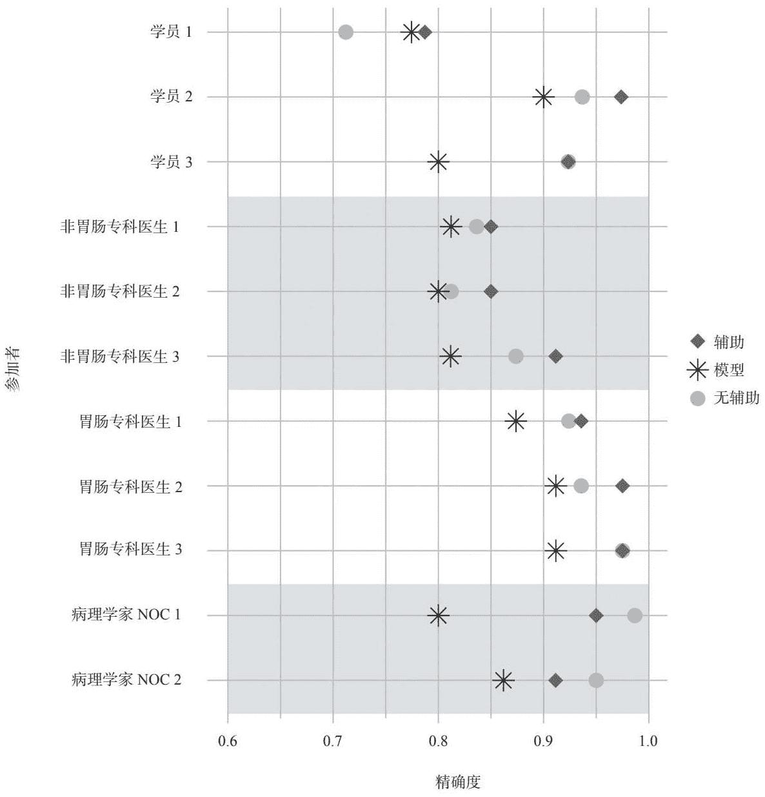
图 6—1 辅助对个别病理学家诊断绩效的影响

注：每位病理学家的平均诊断准确度基于 80 个全切片图像实验的集合绘制。圆形代表无辅助状态的准确度，星形代表单独模型基于病理学家所选补丁的准确度，菱形代表病理学家在模型辅助下的准确度。

对肿瘤医生而言，确诊转移性癌症之后如何预估生存期同样棘手。准确的预后有助于规划照护需求，尤其在终末期场景下对患者与家属的决策至关重要。AI 预后模型的构建与验证尚处起步，研究者希望以此改进早期的统计模型。首个大规模探索来自迈克尔·根斯海默团队的研究。若能借助电子病历数据训练算法，在众多情形下超越资深医生的预测，这将是重大突破。但与肝癌辅助场景类似，若预测不准可能损害患者；且顶尖学术医院观察到的预后表现是否适用于记录质量和护理标准不同的环境仍不明。回答这些问题需要前瞻性临床试验来完善算法与决策支持框架。

### 基于基因组特征深度学习的肿瘤分类
前文已触及 AI 在肿瘤临床应用的进展与风险。基于卷积神经网络的影像分析长期主导分类领域，而仅凭分子数据预测肿瘤类型的方向正变得令人兴奋。人工神经网络处理 DNA 甲基化、转录组特征与基因突变的数据正在成熟，未来诊断有望融合组织病理与分子信息以实现更精准的识别与分型。图 6—2 概括了这些研究与临床用途如何与 AI 模型和架构交叉。

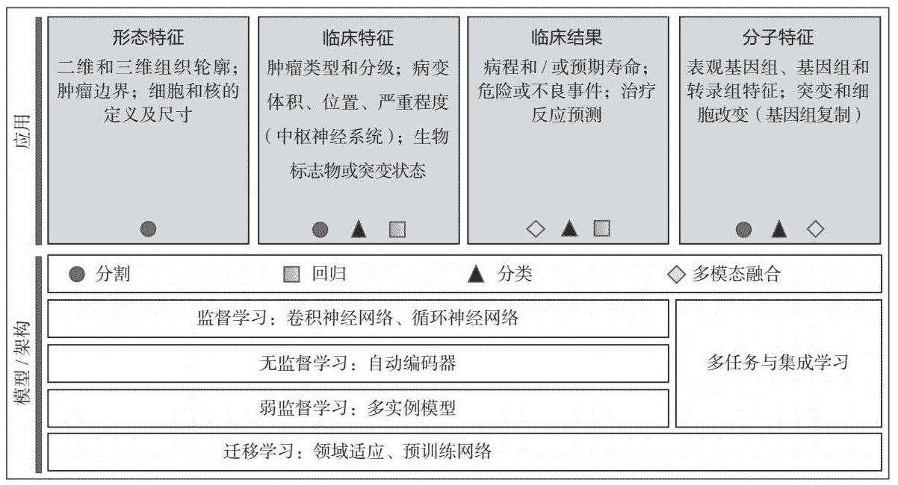
图 6—2 人工智能驱动算法在医学中的应用和模型

注：深度学习已可作用于多种数据源，提取医学和生物学重要特征。图中上方归纳了四类主要应用，下方对应用于算法开发的模型与架构。监督学习的卷积神经网络主导了分割与分类任务，用于细胞核边界检测、肿瘤状态分类及高维分子图谱的表征学习。迁移学习和多任务学习对利用生物数据开发新模型至关重要，多模态融合模型则适用于跨数据模式集成。

表观基因组研究因能将 DNA 甲基化模式与肿瘤类型关联而获益。一项国际协作使用全基因组甲基化芯片，对 2801 例肿瘤样本进行甲基化分析。目标是通过无监督与监督学习描绘组织学肿瘤类型的参考队列。结果识别出 82 个基于甲基化的类别，发现了多个此前未被怀疑或识别的新型肿瘤，并细化了已知亚型的划分。仅以脑肿瘤甲基化组为基础，AI 即可覆盖胚胎、胶质母细胞瘤、胶质神经元、间充质等所有组织学类别，显示出整合组织学与表观基因组学诊断的潜力。在 1104 例试验病例中，机器分类与人类专家一致约占 60%，另有 16% 的差异源于 AI 指出了病理学家未识别或分类体系未收录的亚型。整体一致性约 75%，分歧约 12.5%。经其他基因组方法复核后，92.5% 的机器分类被证实正确。

这一回顾性研究的发现对标准化多中心临床试验、DNA 甲基化图谱在临床中的使用具有明确意义。德国正在开展一项前瞻性研究以完善和验证用于儿童脑肿瘤分类的 AI 诊断工具，突出分子特征对临床决策价值的提升，但成本与数据整合的复杂性仍制约其快速进入常规显微镜工作流。

另一种概念相近的基因组分类策略是 2020 年由团队基于全基因组测序数据提出。基因组检测与分子图谱并非新概念，制约因素是成本高昂与反馈周期长。标志物驱动的分子诊断用于个体化治疗，如肺癌 EGFR 与部分黑色素瘤 BRAF 的致癌突变检测。反向思考变得可行：形态是否足以提示突变？AI 能否从图像推断基因型？结直肠癌中微卫星不稳定性与形态变化的关联已为此提供先例。

在癌症成像与分子图谱数据集上测试算法加速了对癌症生物学机制的探索。早期工作评估从组织切片预测单一分子变化的能力，结果首次证明深度学习 CNN 可从图像反向获取对病理诊断有用的遗传信息。该任务难度极高，因肿瘤存在异质性且等位基因频率随类型变化。研究还揭示形态学特征集合可与编码信号转导通路的基因关联，其对形态的影响通过调控数百个协同作用的生长相关基因实现。

纽约大学团队构建的深度学习分类器用于区分肺癌亚型与正常组织，对正常与肿瘤的区分接近完美，AUC 约 0.99。迁移学习在此展现强大能力，常见做法是在 ImageNet 上预训练，再用生物数据微调。网络低层捕捉的边缘、斑点、轮廓等通用特征可跨任务迁移，减少所需图像数量。Inception 架构的多尺度卷积模块尤其适合组织成像。

在成功预测分子细节后，研究者开始探索形态与更复杂的转录组或表观基因组图谱的关联。大量 RNA 测序数据可通过 GTEx 与 GDC 获取，结合切片与转录组信息可用于组织、癌症亚型分类，其解释性极强，可直接与基因联系并理解细胞状态共性。

逻辑上下一步是探究表观基因组对细胞形态的影响。DNA 甲基化或组蛋白修饰对形态的影响强度与位置如何？TCGA 队列中胶质瘤 342 例与肾细胞癌 326 例提供了甲基化与成像的配对数据。2020 年 7 月，两项独立研究发表于《自然·癌症》，为数字病理开辟新路径。

多家生物技术初创公司进入计算医学领域，研发用于肿瘤学的临床决策支持系统与 AI 辅助仪器。乳腺癌是重点应用方向。Cellworks Group 的 Cellworks Singula™ 报告通过模拟细胞信号、药物与辐射的下游分子效应预测疗法反应结果。SimBioSys 基于伊利诺伊大学研究构建的计算肿瘤学工作流程采用物理学原理，模拟细胞内外化学、物理与机械相互作用，以预测治疗反应并优化试验设计。

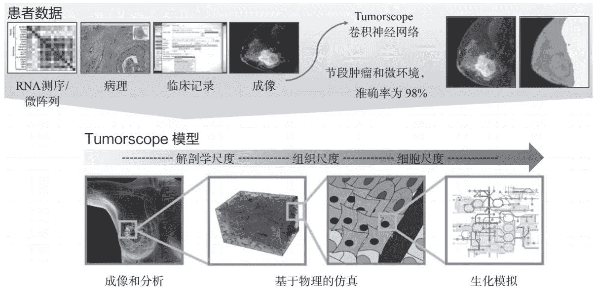
图 6—3 SimBioSys 的计算肿瘤学平台

注：上图展示计算工作流程的构成要素。下图 SimBioSys TumorScope® 为专有生物物理建模平台，通过计算模拟评估药物对个性化虚拟肿瘤的疗效。模拟引擎整合癌症变异的主要生物标志物，全面理解癌症，评估药物输运、敏感性、代谢与空间异质性对肿瘤生物学的影响。

对初创公司而言，AI 应用面临支付方与提供方的阻力，长期标准治疗难以撼动。虽然说服医生使用临床决策支持工具相对容易，但要求他们依据 AI 建议更换治疗方案则与传统护理标准相悖，可能需前瞻性临床试验证明其效率与准确性。

数据科学与 AI 对液体活检公司也至关重要。Grail、Thrive Earlier Detection 与 Freenome 等公司利用深度 DNA 测序与 DNA 甲基化信号，结合逻辑斯谛回归方法进行早期筛查与突变检测。

## 人工智能治疗神经系统疾病：了解和改变大脑
大脑的开放性与可塑性使其在不断变化的环境中保持适应。随着诺曼·道伊奇所言，我们的大脑正通过改变自身帮助我们感知世界。

神经系统疾病、急性脑损伤与精神疾病为神经病学 AI 应用带来挑战与机遇。神经疾病的异质性与癌症相似，包含大量未被发现的亚型，诊断难度高。遗传与环境共同塑造疾病表现，神经发育障碍如自闭症与精神分裂症在早期发育阶段扎根，大脑可塑性提供修复与再编程的可能。AI 可直接与大脑的运动、感知等可变功能互动，为临床医生提供新工具。

公司如 Modality 已设计对话式 AI 系统整合语音与面部反应以监测神经与精神状态，生成可用于评估治疗反应的数据。无论是通过家庭设备还是诊所接入，人机互动对改善神经障碍患者生活质量具有巨大空间。

神经病学同样高度依赖成像，AI 将重塑大脑影像的自动化特征提取与解释。阿尔茨海默病研究拥有类似 TCGA 的 ADNI 数据集，纵向收集超 3000 名参与者的 MRI 与 PET 扫描。加州大学旧金山分校的最新研究显示，基于 PET 数据训练的深度学习模型可在发病前六年检测到与无症状早期阶段相关的变化。

功能PET联动AI，阿尔茨海默预警能提早吗

一项把正电子断层显像与机器学习结合的先导探索，初步提示功能影像而非结构性磁共振也可用于推断神经退行改变。研究者同时提醒，模型的表现尚不能直接等同于可用的临床工具，但随着研究设计升级和算法精进，医生未来有望在阿尔茨海默病发作早期抓住干预窗口，而这一阶段预防效果最理想。与此同时，也有团队在验证以磁共振数据为基础的人工智能方案，作为成本更低、更易被医疗体系接纳的替代方向。

让阿尔茨海默病与其他神经变性疾病取得进展，必须直面脑内病理的极端复杂性以及临床表型高度重叠的双重困境。几十年的共识指向以病理性蛋白聚集为驱动的蛋白病。阿尔茨海默病中神经炎性斑沉积有毒β淀粉样蛋白，神经原纤维缠结堆积微管相关蛋白tau；帕金森病、多系统萎缩、路易体病以α突触核蛋白包涵体为标志；额颞叶痴呆可见tau或TDP-43包涵体；肌萎缩侧索硬化常在上运动神经元出现TDP-43胞质聚集体；克雅氏病由朊蛋白聚集体定义。更棘手的是，这些聚集体在患者脑内常相互作用，单个个体里往往混杂两种甚至多种沉积，可在细胞外斑块与细胞内包涵体中同时检出。

上世纪九十年代，DNA测序与遗传学研究为病理提供了首批线索。编码上述蛋白的基因突变会促进有毒聚集体的形成，或诱发错误折叠进而聚集。值得注意的是，绝大多数ALS患者并不携带TDP-43基因突变，但该蛋白仍被异常修饰。蛋白病启动的具体机制，以及聚集物在受累脑区最终破坏中扮演的角色，至今仍在争论。

临床上，神经科医生几乎无法准确区分这些症状重叠的疾病，因为患者通常同时符合多种诊断标准，而现有工具多只关注一到两种生物标志物。为应对这一难题，一项开创性工作借助统计模型，同时分析了几种易聚集致病蛋白的共同病理，以及15个脑区神经元丢失、胶质增生和血管病变的关系。^(181)

出乎意料的是，阿尔茨海默的初步诊断背后，真实病理远未结束。在这项大样本研究里，被标记为阿尔茨海默的个体分布于所有聚类或跨诊断亚群，背后潜伏着十余种其他神经退行疾病。路易体病这类常见痴呆，常作为重要继发诊断与阿尔茨海默并存。仅凭组织病理推断的分子信息揭示了这些共享联系，提示患者可能携带临床难以识别的潜在病理。研究者随后以认知测试分数结合生物标志物水平与基因分型训练逻辑斯谛回归，成功预测了6个类别的归属。这种数据驱动方法使疾病亚型的识别突破了神经学边界。

阿尔茨海默研究积累的脑影像资源，尤其是ADNI的海量数据，已溢出到其他神经学领域，迁移学习是典型受益者。Fabian Eitel团队以ADNI的921名受试者数据对深度学习模型进行预训练，用于区分多发性硬化患者与健康志愿者，准确率达87%。^(182)

深度学习的图像分类能力在癫痫、卒中以及出血、颅骨骨折等急性神经事件中同样出色。临床大量扫描为三维体积数据，这对人工智能训练构成额外挑战。Eric Ehrman团队搭建三维卷积神经网络，用3.7万余例计算机断层扫描和10万份标注放射学报告检测急性神经事件。他们还开展了一项随机前瞻性临床试验，对比人工智能放射学工作流与放射科医生的表现。该三维网络在优先筛查最紧急病例的能力上超过专家，速度快了150倍。这是贴近真实急诊场景的严格工作流验证。

### 监管审批与临床落地：AI医疗算法面临的双重难题

衡量人工智能对医学创新影响的关键指标之一是美国与欧洲基于人工智能/机器学习的医疗器械批件增速。一项系统调查显示，机器学习医疗器械软件的首批上市许可出现在2015年。^(183)

美国食品药品监督管理局负责医疗器械监管。软件作为医疗器械SaMD的批准可走三条路径。最严格的是PMA上市前批准，针对高风险设备，通常要求对照试验数据证明安全有效。510(k)途径适用于低风险用途，需证明与已上市设备的实质等同。第三条是de novo上市前审查，面向低中风险创新设备，允许其作为未来510(k)申报的参考模板。

欧洲监管较为分散，要求整体低于FDA。同期欧洲为240款人工智能/机器学习医疗器械产品授予CE认证，其中124款同时获得美国与欧洲许可。首批通过510(k)获批的算法来自Arterys，2016年推出用于心血管磁共振的深度学习分析，2017年再推肿瘤学DL产品。2018年FDA经de novo途径批准IDx的糖尿病视网膜病变软件，这是首批无需临床医生解读即可给出筛查决策的系统之一，用于筛查成年糖尿病患者的重度糖尿病视网膜病变。迄今批准的系统以影像为主，神经学和心脏病学占少数代表性类别，但应用面正迅速扩充。

深度学习进入医学时间不长，FDA一直在思考如何有效监控与管理自适应算法。过去器械内软件要求算法“锁定”，以维持性能与安全标准。在SaMD范畴，人工智能被视作临床决策支持软件。2018年2月的新闻稿里，FDA把人工智能算法定义为“可协助医护识别疾病并提供最佳治疗方案的临床决策支持软件”，并强调不可替代全面评估，也不可仅凭其作出或确认诊断。监管者面临的难题在于，这类算法带来独特挑战和新的患者风险。

^(184)

算法自适应性推动了SaMD新框架制定，FDA于2019年发布讨论文件，并在2021年1月推出行动计划。^(185)

传统器械监管范式并不适合可实时调整优化的自适应AI/ML技术。这类工具高度迭代、自主，需要覆盖全产品生命周期的监管方法，在保障安全有效的前提下允许快速改进。

——美国食品药品监督管理局关于人工智能与机器学习的讨论文件

指导重点在于对变更的追踪，尤其是架构、输入和预期用途的变化。训练过程和数据变更可带来性能提升。从FDA角度看，核心问题是何以确保新系统在实践中保护患者。建议企业提交变更控制计划并申请上市前许可。同时呼吁提升透明度以避免“黑箱”，并开展真实世界性能监测。这与业界对可解释、可控、可调试和更好指标的最佳实践倡导一致。

从业共识认为，系统巨大潜力和实时学习能力需要贯穿技术生命周期的监管。人们也清楚，算法需进一步完善才能临床落地，且要求因场景而异。胸部X线肺炎检测是临床AI最受宣传的案例之一，使用最先进技术和11.2万张影像。该深度学习算法仅略微超过极少数人类专家，AUC为0.76，参与专家仅4位。若现实中有更多专家参与，结果存疑，且准确率过低难以通过监管审查。最后，人工智能工程与医学界均需统一的基准数据集和性能测试标准，像Camelyon用于转移性乳腺癌的人工智能。^(186)

深度学习对放射学和临床肿瘤学影响深远，实现智能机器的肿瘤检出、分型、分级，并拓展到从单或多源数据进行突变检测、生存和疗效预测等新任务。未来十年，人工智能算法与医疗实践将高度重叠融合。可以预见，改变医学的愿景将在克服下文所述挑战后实现。

### AI临床落地阶段的常见障碍

泛化：基于数十万例基线或规范数据训练的模型，必须证明其在未见条件下的表现，例如新设备或新人群获取的影像。系统需在技术和生物学变化面前保持弹性，避免显著性能衰减或需要大量再训练。泛化差通常源于对训练数据的过拟合。

验证：当前研究需转向前瞻性试验中建立临床疗效证据，并在独立样本中复制。癌症领域对TCGA数据集的依赖是挑战，该数据仅限学术使用。神经学及其学术影像库存在类似担忧。第二个验证难题是在真实环境中采用随机对照试验进行严格测试，以克服采用障碍并满足FDA和欧盟监管要求。

适用性：实验室构建的AI未必契合真实世界问题，也不一定为临床评估与部署设计。系统可给出预测，却常不报告置信度，而这正是临床评估所必需的。科学家需要与医生和实验室主任协作，理解临床工作流，设计有助于决策的解决方案。

可解释性：医学界和监管机构都要求解决“黑箱”。医生在诊断或治疗建议时，可能需要系统呈现分类或预测的潜在特征。医院或需为AI决策负责，可解释性因此成为强制性要求。根据GDPR，可解释性和理解权已成为欧盟成员国的隐含要求。

因果关系：几乎所有机器学习都依赖关联推理进行诊断或为治疗分配概率，无法确定因果。医疗实践依赖医生借助因果推理解释症状序列或治疗效果。

偏见与公平获取：处理卫生系统决策个人数据的算法面临人群代表性挑战。例如皮肤癌AI在不同肤色输入下表现不一。采用AI的临床试验可能基于存在种族或文化偏见的数据训练。这种顾虑需在开发规划阶段消除。另一担忧是公平获取问题。科学界与社会需决定如何扩大AI增强医疗的覆盖面。

# 第七章

## 人工智能在药物发现和开发中的应用

在一般情况下，研究型科学家不是一个创新者，而是一个解谜者，而他所专注的谜题正是那些他认为可以在现有科学传统内陈述并解决的谜题。

——托马斯·S.库恩

《科学革命的结构》

自计算机时代起，人们便渴望在硅片上模拟生物现象或小分子药物的药理特性。虽然“计算生物学”一词可能在20世纪80年代末才出现，但从人工智能早期先驱的著作中可见，神经元乃至大脑水平的模拟，最早已在20世纪50年代初用简易计算设备尝试。在药理学与药物发现中，推导结构—活性关系的计算方法可追溯至20世纪50年代科温·汉施的基础工作。如今广泛使用的QSAR模型即源于汉施方程。用于支持有机合成计算的工作始于20世纪60年代。^(187)

完全在硅片上研究生物与化学一直是梦想。在细胞或系统水平预测模型建立前，有机化学很可能率先跨过纯计算研究的终点线。化学的规则与语法，加上薛定谔方程，为计算化学发展提供了便利。最新用于枚举化合物库和预测合成路线的计算工具可协同工作，从浩瀚化学空间中构建覆盖几乎所有可合成小分子有机化合物的庞大目录。将这些技术与人工智能结合，基于靶点三维结构和预测的药物—靶点结合亲和力搜索化学空间，可精确定位理想的临床候选分子，把化学实验室变为高效的药物工程工厂。缺失的环节仍是靶点发现以及对疾病或病理生理机制因果作用的生物学假设。制药业很大程度上把理解疾病生物学细节留给科研人员。然而，确定目标和理解药物作用的生物学背景对临床成功至关重要。一旦掌握相对完整的知识体系，生物学或许能变得更像化学，从而让人工智能系统常态化地破译复杂生物学并以高预测精度进行计算实验。

对药物猎人而言，人工智能的当下与未来应用仿佛《爱丽丝梦游仙境》里的场景。“该走哪条路”取决于前进方向。端到端自主药物设计的愿景值得称赞却遥不可及。在此愿景中，人工智能可在任何临床试验启动前高度确定地预测药物安全性和疗效。今天无人提议，但实现之日终会到来。在大型药企里，更集中的战略努力是验证人工智能技术和小范围胜利，例如部署工具提升小分子先导化合物的命中率，或实现预先医疗决策如诊断或临床决策支持。对于可复制的系统，更雄心勃勃的目标是可重复的人工智能能自主引导决策。其商业逻辑是提高命中率，从数据中挑选或排序最佳目标，并缩短从靶点发现到临床前候选的时间。正如任何新技术引入，这将是个缓慢过程，需密切关注AI能否整体提升制药业生产力。

要在药物发现中成功应用人工智能，需要重新思考传统解题方式并重构开发流程。今天的人工智能，尤其合成化学方面，可作为强大的假设引擎。化学家在咨询人工智能“预言家”后，能否从既有工具和直觉转向构建所需化合物？在早期研究和发现中，科学家需要关注如何生成和格式化AI模型所需的数据。与把AI用于医学影像和诊断相比，AI整合到药物发现的阻力更少。除了对效率和利润底线的伤害外，研发实验室在早期发现阶段的糟糕决策不会造成损失，因为开发过程中有足够制衡。再者，若AI在制药业的应用像其他行业一样成功，许多人预计医药生产率将提升。Dewpoint Therapeutics高管马克·默科说：“想象一下五年后的世界，基因文库拥有数万亿个化合物，评分功能相当好，合成成本相当低。这开始让人感觉相当强大。”^(188)

## 药物发现中的计算辅助方法概述

生物化学和分子生物学的巨大进步、物理有机化学的发展以及大型计算机的出现为药物化学的重构创造了机会。伴随每一轮新的期刊出版，与药物化学相关的科学成果都会大量出现，这迫使我们做出更大的努力，以更有意义的方式将这些信息汇集在一起。QSAR范式重新定向了我们对药物化学的结构化思考。

——科温·汉施

1976 年

在药理学建模与计算机药物发现领域，研究者起初致力于融合现代计算与统计技术，发展至今可利用指数级增长的数据生成化合物数据库。如同其他分析与知识驱动学科，化学信息学技术在几代研究者手中取得更高准确性和实用性。计算机模拟方法的发展，特别是计算机辅助药物设计，通过一系列方法的共同演进形成，包括所有形式的QSAR建模。二维、三维等。化学家用QSAR模型预测化学结构的生物活性。药理学建模则是通过量化结构特征来建立数学模型，借助统计技术将分子结构与药理特性联系。QSAR的推导与验证历程曲折，因已知机器学习算法在任何数据上均有缺陷，主要问题是过拟合与过度泛化。上世纪90年代，QSAR构建者陷入陷阱，把模型输出作为硬过滤器用于训练数据未覆盖的数据集，这正是当时化学数据库的缺陷。

早期的QSAR模型用基本多元回归关联效能，如抑制剂常用对数IC50、亚结构基序，以及分子量、溶解度log P、疏水性等理化因子。QSAR使用分子描述符作为化学结构的数字表征。描述符种类繁多，按计算所用化学表征维度分类。例如编码通用化学属性的描述符可直接估计分子大小、结构和亲脂性。尽管维度低，其中部分与利平斯基类药5原则相关。^(189)

理论上，QSAR可预测任何分子描述符可计算的化合物的目标属性。然而与训练集高度不相似的化合物，其活性预测可靠性很低。提升维度可改善性能。采用二维描述符拓宽了类药化合物的化学空间，这是在分析一系列抗癌药物后发现的。^(190)

除QSAR外，化学信息学工具箱已大幅扩展，广泛用于结合位点预测、分子对接、虚拟筛选、配体设计、相似性搜索、结合自由能估计、ADMET。^(191)

化学信息学工具如今是药物设计和项目筛选的关键起点。已有稳健软件可通过多种枚举技术计算生成虚拟化合物库，极大提升化学空间探索能力。最早案例之一是GDB-17，小分子库含1600亿种有机化合物，最多含17个原子。大药企已生产庞大化学文库，包括礼来的Proximal Collection约10¹⁰种化合物，默克的Accessible inventory MASSIV约10²⁰种化合物，阿斯利康基于Enamine数据库的文库约10¹⁷种化合物等。KNIME和DataWarrior为开源工具，MolSoft或Reactor来自ChemAxon，均可用于分子枚举的可访问化学库工具。

算力与结构数据的共振，让研发范式加速迁移

计算资源和小分子、生物大分子结构档案的指数式累积，正在同步推动基于计算的寻药和计算机化筛选的成熟。对工业研发而言，剑桥结构资料库 CSD 是一项关键坐标，收录自晶体学来源的低分子量化合物。X射线与中子衍射已积累超百万条记录，为键长、键角及力场构建所需的二面角提供量化参照，也为氢键等分子间作用的设计给出数值依据。蛋白质结构档案 PDB 则保存了十五万余组经实验解析的生物大分子三维信息，来源主要是 X射线衍射、溶液核磁与冷冻电镜。结构导向的 in silico 筛选会调用 PDB 及外部来源的三维信息，其中子集 PDBbind 常用于生物物理层面的机器学习与对接。QSAR 工作依赖内部或外部的 logP、pKa 数据，以及数万条物理有机反应的 Hammett 方程和用于活性的 Hansch 方程。瑞士生物信息学研究所的 click2drug.org 另行汇聚了大量数据库，并整理了计算机辅助制剂设计的工具目录。

研发实践中化学信息学工具已高度普及，支撑行业通用的设计-制造-测试-分析闭环。提出新结构、化学合成、生物学评价、结果解析再进入下一轮，构成耗时繁复的工作流。在先导优化阶段，研究者常借助 QSAR 或定性结构-活性关系模型来推断结构的生物学活性。

### 化学信息学与 HTS 之间的 in silico 筛选

当代实验室普遍运行 HTS 平台，借助机器人与微型化格式对百万级化合物进行评价。物理化合物的初筛可通过生化相互作用、细胞形态或表型、模式生物输出来捕捉候选。HTS 多作为发现计划的起点，但通量上限约 10⁶~10⁷ 且对类药化学空间的限制，使计算机化筛选成为重要补充。DNA 编码文库理论上可达 10⁹~10¹²，但需要专业经验且限于水相合成。总体上，基于靶点或配体的 in silico 筛选已融入流程，效率显著。

与技术驱动的 HTS 不同，in silico 筛选是知识驱动，需要靶点信息做 structure-based 筛选 SBVS，或依据已知活性配体做 ligand-based 筛选。^(¹⁹²)

图 7—1 展示了 SBVS 与下游 HTS 结合获得先导的典型路径。起点是靶点的立体结构，或对未知靶点通过同源建模得到的替代结构。开发方先对虚拟库做预过滤，保留类药性质、剔除合成困难或已知有毒的结构。分子对接软件依据候选物与蛋白结合口袋的契合度打分，随后借助层次聚类、主成分分析等计算手段以及机器学习，将巨大文库拆解为若干相似化合物簇，最终筛选出苗头或先导。文献报道的最大规模 SBVS 实验对接了 1.7 亿个化合物，鉴定出 45.3 万个多巴胺 D4 型受体配体，其中 30 个具有高亲和力。^(¹⁹³)

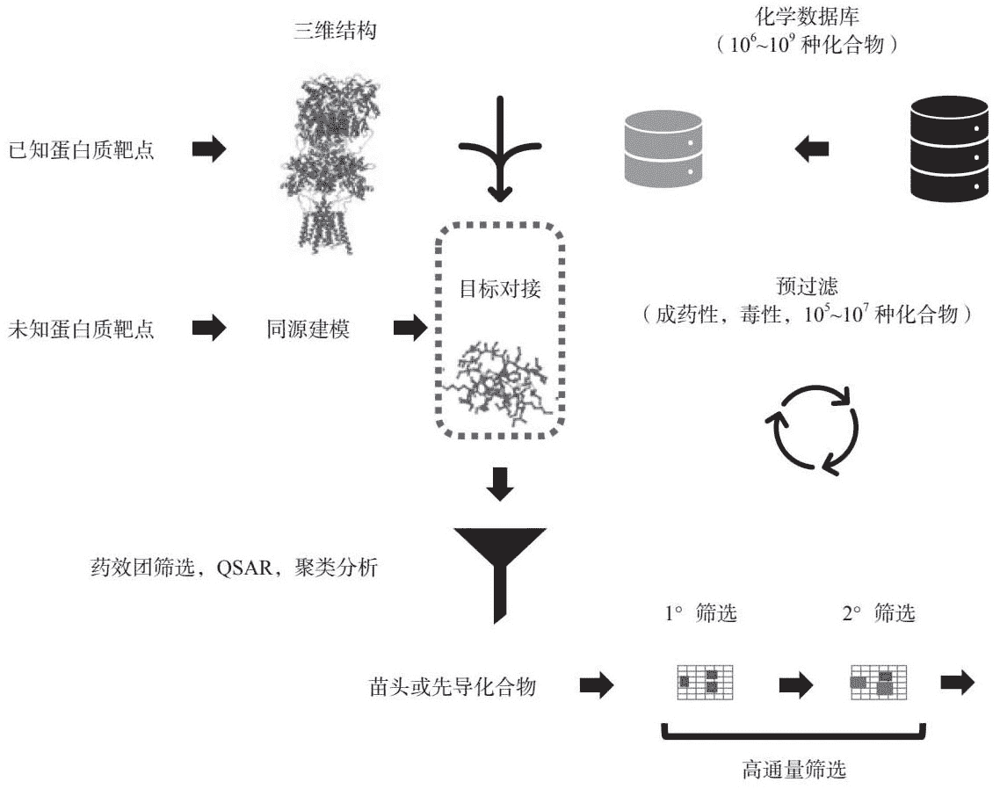

图 7—1 基于结构的虚拟筛选工作流程

注：上图呈现了基于结构虚拟筛选可能涉及的工作流程，虚拟筛选在拓宽化学空间探索的同时压缩了临床候选的发现周期。

初级 HTS 位于 in silico 筛选下游，主要测量化合物与蛋白的结合、激动或拮抗活性，或细胞表型变化，次级筛选则关注潜在毒性。此阶段仍需大量药物化学工作以提升选择性、体内暴露并降低毒性，进入先导阶段。这往往开启另一轮 DMTA，可能需测试数百至数千个分子才得到兼具活性与低毒的临床候选。

另一种常见策略是开发与现有药物功能相似的类药分子，或利用配体方法规避已知药物不良性质，或主动寻找具有有利特征的模拟物。计算机辅助设计可枚举候选并经实验验证。基于配体的筛选发展轨迹与其它 CADD 方法相似，长期以统计方法为主，化学相似性计算是核心。配体筛选很适合机器学习，已知配体可作为训练集区分相似与不同结构并建立预测模型。仅依赖相似性的搜索效果不及同时纳入靶点结构信息的搜索，评分排序更好但耗时增加，且仅在蛋白立体结构与结合口袋可用时才适用。

## AI 为计算型寻药带来新工具箱

在过去 60 年里，专家试图用手工启发式规则向计算机转述化学规律。我们预期，为机器配备通用规划算法、符号表示和从丰富化学历史中自主学习的能力，将是使其成为合成助手的关键。

——马尔温·泽格勒、马克·普罗伊斯和马克·沃勒，《自然》，2018 年

AI 能否成功融入制药研发，取决于能否证明其轻松超越传统能力或带来规模、效率与可解释性的新技巧。

药研既需要正向合成，从构建模块出发预测反应条件生成新分子，也需要逆合成，由目标产物倒推合成路径。逆合成任务是构建符合化学规则的构建模块与中间步骤树，找到通向目标的路线。

药物化学家主要依赖直觉与偏好，倾向使用已知稳定反应实现化学转化，这些反应可归纳为在结构多样底物上快速完成且可在常规实验室设备上进行的通用转化，本质上是更快、更好、更便宜。制药领域外的观察者可能惊讶，仅 5 类有机反应就占据了药物发现化合物合成反应的 60% 以上。^(¹⁹⁴)

专利文献综述描述了超过 100 万种反应类型。低分子药物的天文数字与可用的合成路线数量与行业发现流程显得不匹配。严格的化学与结构限制加上制造实际考虑大幅缩小了小分子宇宙，但发现范式仍显得刻意设限，而非探索新合成路线。

因此，传统方法在识别高质量候选或发现难靶点的先导方面存在明显局限。经过过滤的化合物文库为下游化学类型设限，对合成可行性的关注既源于化学本身，也源于研究文化与里程碑压力。

马尔温·泽格勒及其同事在有机化学逆合成的工作展示了 AI 完成以往计算方法难以实现任务的能力。基于已知前体构建可行合成途径在某些方面类似医学诊断，需要多步与差异化决策。组合化学极大支持智能机器。AI 不会威胁受训医生，未来受训的 AI 系统很可能取代合成与药物化学家。由多神经网络组成的模块化 AI 结合符号逻辑，在此领域将成为强力手段。

计算方法在逆合成中长期使用基于规则的设计工具，机器学习应用有限。目前有 3 个基于专家规则的逆合成规划软件：ICSYNTH、Synthia 和 ChemPlanner。泽格勒提出的模块化流程融合 3 个神经网络与蒙特卡罗树搜索，被命名为 3N-MCTS。^(¹⁹⁵)

^(¹⁹⁶)

过去十年机器学习技术实现了有机合成路线的高精度预测，近期方法涵盖逻辑与知识图谱应用。^(¹⁹⁷)

对化学合成预测产生持久影响的另一革命性方向是自然语言处理模型。图 7—2 展示了语言翻译与化学之间的类比。

自然语言处理在科学领域的发展迅猛，迅速涌入化学、生物与物理。IBM 研究所与瑞士伯尔尼大学的菲利普·施瓦勒首批将用于语言理解的 Transformer 架构应用于化学语法。^(¹⁹⁸)

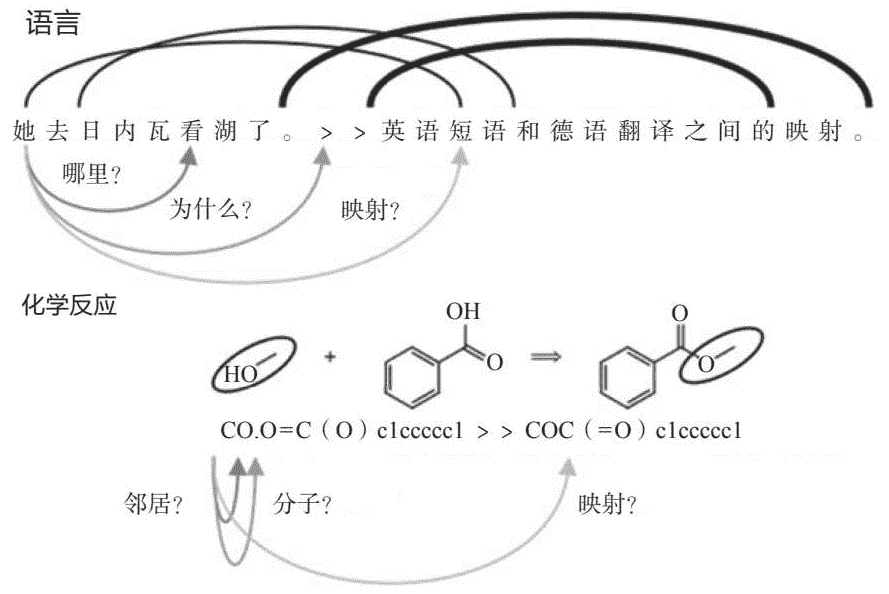

图 7—2 语言翻译与化学反应中的类比映射

注：上图为英语短语到德语的映射，下图为化学反应中反应物到产物分子的映射，以 SMILES 文本表示。

RXNMapper 表现突出，在近 5 万个原子映射任务中准确率达 99.4%，超越同类最好算法。对行业而言，该方法高度可扩展，无需有标注训练数据或精细专家规则。

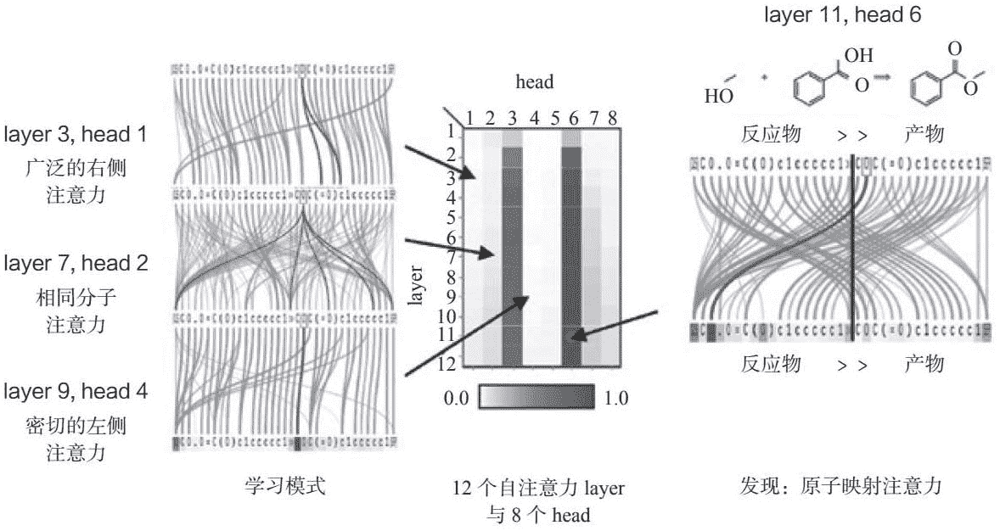

图 7—3 RXNMapper Transformer 模型工具概述

注：RXNMapper 使用基于 Transformer 的架构模拟化学语法，与语言任务中的典型用法不同。系统基于原子上下文构建表征并尝试关联概念。分子表征采用 SMILES 简化线性输入规范。

### AI 驱动的 in silico 筛选工具

预测靶点-配体复合物结合亲和力是极具挑战的计算任务，推动研究者探索深度神经网络方法作为 structure-based 筛选工具。目前三种方法最具潜力，可替代计算成本高昂的生物物理评分。它们依赖不同类型的卷积神经网络或其组合。

立体卷积神经网络模型使用体素化表示原子在空间中的位置。空间图卷积神经网络利用蛋白-药物复合物的图表示。两种风格以不同方式描绘化合物并使用不同推理机制预测结合自由能。第三种方法深度融合结合两种网络的特征以改善预测。

新冠疫情期间部署的深度融合模型展示了组合能力。美国能源部多个国家实验室与英伟达合作，对超过 5 亿个小分子与新冠病毒 4 种蛋白结构进行基于结构的虚拟筛选，评估了超过 50 亿种对接状态。^(¹⁹⁹)

### 生成式模型在药物从头设计中的应用

AI 在药研与合成化学中的溢出包括使用生成式模型推荐新化合物。化学信息学用于生成化学已有数十年，并作为评估新一代 AI 生成式模型探索化学空间性能的基准，代表工具包括 MOSES。^(²⁰⁰)

生成式对抗网络由生成器与鉴别器构成，训练时相互竞争。生成器构造人工数据，鉴别器试图区分真实与伪造数据。训练直至鉴别器无法区分为止。对变分自编码器，编码器承担生成器任务，解码器可对压缩潜在空间采样映射回分子表征。

^(²⁰¹)

生成式对抗网络首次用于分子生成始于 2017 年目标强化生成式对抗网络，随后推出结合强化学习的 ORGANIC。生成式对抗网络与自编码器、生成式对抗网络与循环神经网络结合的模型均被测试。^(²⁰²)

针对过去与未来生成模型的疑虑仍在。大量生成内容可视为人为产物，因合成不可行、不类药或仅为随机结构。训练集组成需更清晰，例如 RXR / PPAR 受体研究最后阶段训练的 25 个模拟物未公开。为通过审查，训练集需与分子生成协议细节一并公布。基准测试亦缺乏行业标准，模型在一种基准下通过可能在另一基准下失败。布什等发表的《分子生成器的图灵测试》为此类基准提供了示例。^(²⁰³)

## 医药创新新基地

我们试图用机器学习做的事情，并非人们以前做得很好的任务，因此我们所做并不是我所说的人工智能。我们正在将学习技术应用于大量数据，以解决非常困难的问题。

——达芙妮·科勒，《机器学习如何改变药物发现》，2021 年 1 月

除低分子化学研发外，生物技术是扩大制药研究创新基础的最佳模式。催化创新的生物技术工具天然适合基因研究、分子机制与生物药物递送。相比之下，AI 与信息技术似乎与药物发现相距甚远，但这对孪生技术已历经三代，技术、算力与统计方法大幅改进。信息技术进步远超生物学与医学。一旦深度学习的潜力在多行业得到验证，风险资本涌入追逐 AI 药物研发早期趋势。来自计算、数据驱动的生物学与药物发现的新见解催生了美国与加拿大生物技术中心的第一代创业公司、中国众多 AI 创业公司及欧洲的分散力量。表 7—1 列出首批及近年值得关注的公司。

表 7—1 将人工智能创新引入药物发现的公司

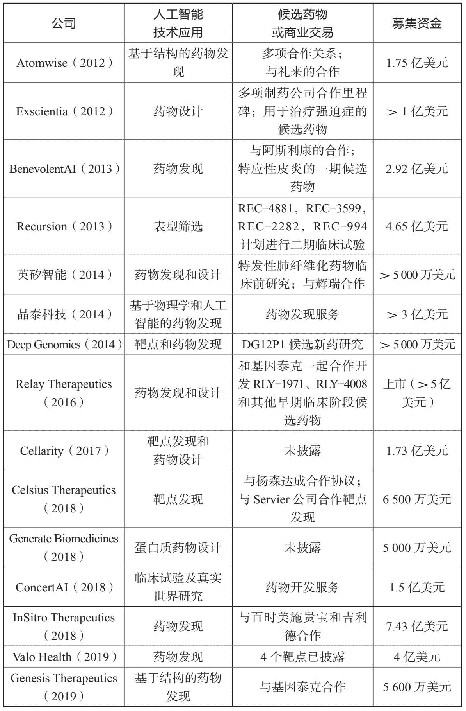

注：募集资金数据截至 2021 年 3 月。

### Atomwise 团队

Atomwise 成立于 2012 年，是利用 AI 发现基于结构小分子的先行者。机构开发基于卷积神经网络的 AtomNet 平台，预测小分子与蛋白靶点相互作用的能力。AtomNet 对立体蛋白结构与化合物结构建模，使神经网络推广到制药公司高度关注、且传统上无生物活性实验数据可用于苗头确定的新靶点。团队声称可筛选数十亿化合物，探索传统筛选无法触及的化学空间。Atomwise 在学术与工业合作伙伴中取得较大成功，已宣布与默克 2015 年和礼来 2019 年建立重要联盟，据报道合作伙伴总数达 285 个。2020 年完成 1.23 亿美元融资，并与以色列生物科技孵化器 FutuRx 成立合资企业 A2i Therapeutics，使用 Atomwise 技术从 160 亿种化合物中筛选免疫肿瘤候选分子。

### Recursion 实验室

Recursion 凭借 Recursion 操作系统方法，将表型筛选与计算机视觉 AI 应用推向新高度，用于生物靶点鉴别与药物发现。据 S-1 文件，团队在人类细胞中完成 6600 万次筛查实验，产生 8PB 数据。对一家生物技术初创公司而言这些数字惊人。与表 7—1 中第一代 AI 药物发现公司相似，Recursion 专注于制药公司常避开的药物发现生物学阶段。内部项目数量 37 个与临床阶段候选数量表明其已建立强大的发现引擎。团队不断完善 AI、自动化与化学能力。高通量筛选化合物库规模正接近大型制药公司，超过 100 万种化合物。

Recursion 构建了一系列 AI 与化学信息学工具以衔接湿实验与计算方法。关键组件是深度预过滤候选化合物的工具。表型组学流程验证：AI 筛选发现的形态学表型是否可用于药物发现的疾病表型，并评估或预测可逆转疾病表型的靶点。大规模筛选的另一目标是用数据构建千兆字节规模的推断关系目录。每一次新实验干预，如 CRISPR 敲除特定基因或添加细胞生长因子，平台即可在计算机上推断任意两个干预之间的关系。持续筛选与推理引擎已识别近 1000 亿个关系，这是迈向计算生物学的开拓性努力。

### Deep Genomics 团队

该初创公司由多伦多大学布伦丹·弗雷于 2015 年创立，运营 AI 工作平台分析基因组学数据集以发现靶点。据已发表报道，平台评估正常与疾病状态的基因组或转录组变异，预测具有治疗意义的变异。2020 年发表威尔逊氏症基因组分析结果，威尔逊氏症是一种罕见代谢紊乱，以铜转运蛋白功能丧失为特征，导致肝功能障碍与神经系统疾病。^(²⁰⁴)

### Relay Therapeutics 团队

机构开发名为 Dynamo 的分子动力学与蛋白建模平台，专注于精准肿瘤学的小分子药物发现。公司与 D.E.Shaw Research 达成协议，使用其 Anton 2 超级计算机进行长时间尺度分子动力学模拟。第二代 Anton 2 可模拟多达 70 万个原子的生物分子系统。平台本质是对蛋白分子运动建模，用于生成运动驱动的治疗设计假设。模拟数据可预测新结合位点并为调节蛋白行为提供见解。

# 第八章 生命科学的 AI 拐点

我们的任务不是去看别人还没看到的东西，而是去思考有关每个人都看到的但别人还没有想到的东西。

——埃尔温·薛定谔

携带着被过去的教训固化的思想，我们倒退着走向未来。

——韦恩·瓦格纳

在变革速度不断加快的当下做前瞻研判并不轻松。对部分人而言路径清晰，对另一部分人则像是被薄雾遮住。人工智能与机器学习正向科研与社会全方位渗透，其应用也被广泛误读，“雾”于是成了描述 AI 的恰当意象。学界普遍视 AI 为数字革命持续深化的主引擎。克劳斯·施瓦布在《第四次工业革命》中把当下浪潮归结为移动互联网与传感器、AI 与机器学习的共振放大。^(²⁰⁷)

二战后现代科研成形以来，计算科学与生命科学始终在靠近，最终形成了计算生物学等交叉学科。新的观念与技术浪潮不断触发范式迁移，学科趋同也在不同时空尺度上催生统一理论，比如生物、地质、古生物汇聚后进化论的诞生，原子量子理论对化学键认知的跃升，以及分子生物学与化学中中心法则对信息流的界定。

医学与生命科学的交融早有论述，麻省理工 2011 年的报告已指出方向。生命科学、物理与工程的交叉被认为会带来医学乃至更广领域的高速创新。这种融合已超越单纯的跨学科项目，数据科学与算法已成为生物学研究的必要底座，本书多处已展开。

学界与产业正把新一代技术、算法与架构落地，创新版图随之重塑。深耕医疗健康的技术专家与投资人已捕捉到 AI 与生物技术双轮驱动的研发机会。他们看到建模仿真取得成效、制药数据与临床试验结果更开放、群体级基因组信息可用、精准分子工程趋于成熟，价值拐点正在显现。

技术革命对生命科学最直接的贡献之一，是为压缩发现周期提供工具，如图 8—1 所示。提出假设是生物学与药物研发的基础。可检验的假设依赖精心设计的实验或计算平台产生数据。在临床中，疾病状态的辨析与确诊源于逻辑推理，鉴别诊断中假设被纳入或排除。诊断手段随检测与数据生成而进化。在生物、制药与医学领域，初级数据处理管道越来越多地依赖 AI/ML 工具包。为计算生物学、化学或医学诊断搭建的二级分析工具，提供学科与临床层面的洞见。AI 方法常驱动无假设探索，在数据集中搜寻关联模式。生成与检验假设被视作 AI 的核心优势之一。鉴于实验平台成本高昂，计算式的假设生成与评估将愈发关键。生物技术创新工具的精细化得益于这些领域积累的洞见。行业高度依赖 AI/ML 来优化工程平台，并筛选与优先化新的治疗方向。

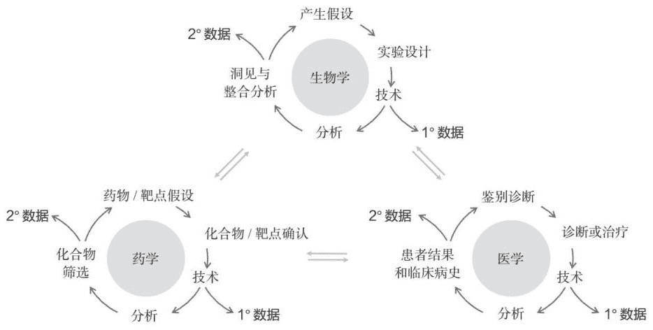

图 8—1 生物学、药学和医学中的发现循环

注：生物学见解、药物化合物的发现与医学实践被描述为三个既独立又相互关联的循环。生物学产生的疾病机制见解转化为药物假说。新药测试与临床试验为医疗实践提供信息。患者结局与临床病史则反过来完善疾病治疗与人类生物学的新假设。数据科学对这些循环中一手与二手数据的分析至关重要。

## 拆解分子与生命系统的工具箱

在过去的 15 年里，我们一直在用几种方法研究蛋白质的结构问题。其中一种方法是完整准确地测定氨基酸、肽和其他与蛋白质相关的简单物质的晶体结构，以便获得关于原子间距、键角和其他构型参数的信息，从而可靠地预测多肽链的合理构型。^(²⁰⁸)

——莱纳斯·鲍林、罗伯特·B.科里和 H. R.布兰森

1951 年

医药与生物技术的核心始终是生命分子的结构。细胞信息流的破解始于 DNA 结构解析、遗传密码确认及其普遍性的证实。这些只是今天持续展开的基因组与蛋白质组组织、结构、功能研究的前奏。染色体的高级结构与表观遗传修饰被认识到能够编码额外信息，调控基因表达、DNA 复制与细胞分裂。过去十年里，多项技术被用来检测并量化三维构象、兆碱基尺度的结构域与染色质可及区。近期机器学习也被用于预测这些结构与染色体修饰在 DNA 序列上的位置。

生物学中两大计算难题现在似乎都能由 AI 与机器学习攻克。首个是学界长期追逐的目标：仅凭一级氨基酸序列预测蛋白质原子级三维结构。摆脱对蛋白质晶体学的依赖将极大影响生物学研究。进化造就了数亿种独特蛋白，分布于数千万种生物。结构细节可迅速支撑或提出基于基因或蛋白序列的功能预测，这正是第二大挑战。仅靠一级序列往往不足以阐明功能，预测有时需要蛋白质所处微环境的信息。例如线粒体复合体 I 包含 45 个亚基，其部分亚基可能没有明显功能域或催化位点，却在复合物中承担结构支持作用。

几乎全部蛋白的三维细节及其功能被准确构建与记录，将是生物学的根本性进展。对医学之外，新型酶与生物催化工程的规模化需要加速。在哺乳动物系统理解转录调控与细胞功能，依赖额外信息，这些信息主要由 DNA-蛋白与蛋白-蛋白相互作用级联决定。这一层次的分子组织对阐明药物作用机制与疾病病理生理学至关重要。无论是预测转录因子结合、DNA 甲基化、翻译起始位点，或推断增强子与绝缘子在基因组中的位置，深度学习都推动了相关互动的分析。同样 AI 也用于发掘基因组中调控 RNA 结合位点的模式，并预测生理组织中的 RNA 表达图谱。

在更高尺度上，基因或蛋白互作网络主导或强烈调节细胞在正常与疾病状态下的反应与状态。因此网络分析成为重要研究方向，AI 模式识别算法正从中提炼对细胞行为的关键洞见。除细胞内网络外，细胞间通讯、蛋白互作网络追踪以及神经元连接模式的寻找，都是 AI 方法的目标。

## 从组学到全栈：生物技术的技术图谱

要全面揭示生物学谱系，机器学习的大规模应用需要海量数据，而“组学”技术目前是产生相关数据的最佳手段。这些包括基因组测序、染色质可及性检测 ATACseq、单细胞转录分辨率 scRNAseq、定位数百至数千个 RNA 的空间转录组学，以及基于质谱与抗体或寡核苷酸阵列的蛋白质组定义。几乎所有这些方法都需要计算生物学方法配合技术平台。图 8—2 展示了当前生物技术全栈的细分。

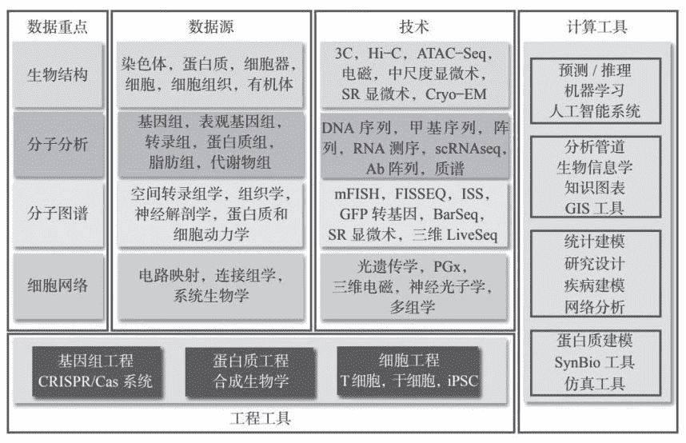

图 8—2 生物技术全栈图

注：现代生物学方法融合了技术、实验与工程框架以及计算手段。生物结构分析在从单分子到整体生物体的尺度上通过不同显微镜与图像分析完成。阵列与高通量仪器使各类组学分析成为可能，仪器与 AI 算法让空间剖面与连通性制图的分辨率持续提升。工程工具使基因与细胞操纵实验成为可能，通常结合统计与算法优化。

GIS：地理信息系统

SR：超分辨率

## AlphaFold 如何改写结构预测

2020 年 11 月，DeepMind 宣布在生物学领域取得奠基性进展。^(²⁰⁹)

此后学界等待 AlphaFold 的细节披露，因为它似乎解决了生物学中最重要也最艰难的计算挑战之一。考虑到可用的海量序列数据与模型容量，神经网络架构很可能是理想解法。该技术因准确性足以解析酶催化机制与药物-靶点作用位点而具有工业应用价值。学术界同样关心资源是否开放与费用，因为开发者归属于谷歌母公司字母表旗下。

结构解析的突破并非突现。AlphaFold 的两大核心构件数十年前已在相关领域出现。其一利用物理上邻近氨基酸对的共进化关系，转化为二元接触图以编码折叠所需的空间信息。其二评估相关序列的多序列比对以提取规则与进化约束。AlphaFold 系统结合了蛋白质数据库的三维结构与包含数亿序列的庞大序列库。

^(²¹⁰)

深度学习模型在蛋白质接触预测等结构分析核心任务上已超越其他方法，主要是通过在大量蛋白结构上训练的深度残差网络实现监督式接触预测。^(²¹¹)

## 基因组三维架构与调控元件的 AI 读码

过去十年，揭示基因组在三维空间的层级组织成为基因组学中最迷人且发展最快的方向之一。其重要性主要与基因组完整性、基因调控与 DNA 复制相关。染色质结构通过荧光原位杂交或超分辨显微成像、邻近连接 Hi-C、scHi-C、DNA-FISH 等分子方法以及无连接方法 ChIA-Drop、GAM、SPRITE 进行实验研究。后者归为染色体构象捕获技术，提供了从数十个核苷酸到兆碱基尺度拓扑与结构域的见解。关键调控特征包括启动子-增强子对、染色质环、数十至数百千碱基的 TAD 以及跨染色体兆碱基尺度的长程 TAD-TAD 接触。

如蛋白质折叠问题般，接触点的预测对定义驱动染色体构象与细胞核组织的序列决定因素至关重要。深度学习再次证明其价值，可仅用 DNA 序列或结合表观基因组衍生特征输入来预测接触点。近期用于预测接触的工具之一是基于卷积神经网络的 Akita。^(²¹²)

AI 算法在很大程度上已超越检测或预测基因组中调控元件、DNA-蛋白结合位点与表观修饰区域的技术。部分深度学习应用可同时识别多类特征，如 DanQ 可读取 DNA 序列并预测转录因子结合、组蛋白修饰与 DNase 超敏位点。^(²¹³)

## 用 AI 把遗传学线索连向疾病

过去一个世纪里，通过果蝇、小鼠与人类等模式生物的遗传学研究，人们寻找与疾病相关的基因及修饰疾病进程或严重程度的基因。过去二十年，全基因组关联分析与人类队列成为疾病基因发现的基础，得益于对数百到十万量级个体单核苷酸多态性的大规模调查。虽然部分里程碑研究是合作成果，但产生的药物开发线索比预期少。为此计算生物学家再次转向深度学习，以识别能引导药物开发人员找到疾病缓解途径或分子靶点的模式与信号。

遗传学的力量来自群体中自然对个体的“实验”。人类遗传学需要以家庭为基础的研究以降低跨人群遗传背景差异，并锁定致病突变。奥尔加·特罗扬斯卡亚与理查德·达内尔在 2019 年领导的基于遗传学与 AI 的 ASD 研究展示了深度学习处理海量基因组序列数据的价值。^(²¹⁴)

研究者已开发出深度学习框架来预测非蛋白编码区有害遗传变异的功能影响，因为绝大多数新发变异发生在基因组的“暗物质”区域。基于卷积神经网络、部署 2000 多个特征的 DeepSEA 改进模型即为一例。^(²¹⁵)

以人类基因组或人工衍生基因组为起点，研究人员设计 AI 系统进行计算机诱变，以预测可能驱动疾病进程的序列变异位置与特性。例如，可基于参考基因组与计算机诱变序列训练 AI 模型预测遗传变异影响，再用生成式对抗网络或其他模型区分与疾病表型相关的差异。另一种策略是对正常与疾病状态的功能影响分别预测，再比较评估差异以筛选候选致病变异。

## 量子计算在计算化学与生物学中的潜在角色

随着计算工具更新与蛋白质三维结构知识体系增长，确定新蛋白结构、功能与序列关系以及药物靶向性评估将迎来跃升。历史上生物信息学的重要任务是利用序列相似性搜索预测未鉴定的基因编码蛋白功能，对分子过程或细胞现象的建模较少，因其需要大量计算资源。生物学知识与化学计算能力的不足曾拖慢生物系统模型与化学量子力学模拟的开发。为应对挑战，量子计算以量子逻辑与大量计算执行复杂概率系统模拟，虽非必需，却展现出前景。

量子计算：从实验室到现实的距离

现在可用的商用量子硬件仍处试验阶段，离真正解决工业级难题还有一段路。量子计算的思路是用量子比特替代经典比特，让信息同时承载0和1的叠加态。最早的小规模原型普遍在百比特以内，Google 的 Bristlecone 约72 比特，Righetti 团队的 Aspen-9 约31 比特，IBM 与 Honeywell 的系列机型在同一量级。IBM 在路线图中曾披露2023 年推出1121 比特的 Condor 系统。这些设备多基于超导处理器并配合专属算法运行，开发入口可通过 Zapata Computing、IBM、Cambridge Quantum、微软、Google 等获取。

关于分子模拟与生物动力系统所需的规模，学界估计分歧较大，多数判断有效模拟化学体系至少需要上千比特量级。目前的主流工作仍以探索为主，常在小任务上做概念验证。工程上必须先攻克量子晶体管的研发与验证，证明在一千个物理比特中能编码出一个可执行逻辑操作的逻辑比特。等到比特在相关计算中实现稳定互作用，量子计算的潜力才会实质显现。引入量子纠错后，算法研究者才能同时处理指数级膨胀的数值，去碰最棘手的难题。

神经科学与人工智能：看见如何变成行动

把近乎自动的视觉转化为需要意志、注意与投入的行动，这一转换触及大脑功能与行为的核心。

—— 姆里甘卡·苏尔，麻省理工学院神经科学教授，2018年7月接受医疗媒体STAT采访

人脑既是决策枢纽，也是具备强可塑性、擅长学习记忆的多模态感知引擎，且带冗余的先天认知先验。过去半个世纪，单细胞记录的精度、小回路响应的测量以及近期的大尺度网络监测都有明显提升。现有技术已能实验性调控神经回路并以高精度呈现网络结构。数据累积很快，但现代神经科学仍缺解释脑运行原理的理论，也缺可信的建模路径。没有新的计算框架，相关理论难以诞生。

框架的重要性可追溯到学科起点。实验与理论结合的力量在霍奇金-赫胥黎模型里体现得淋漓尽致。1952 年两位学者在《Journal of Physiology》连发五篇论文，用定量模型整合实验发现，既为单细胞解释提供工具，也为回路理论奠基。宏观电流与动作电位的研究推动了离子通道及其调控因子的分子探查。再加上赫布法则——共同放电的神经元会形成连接——才形成关于神经元计算、布线与回路运行的基本原则集合。

系统神经生物学走向单细胞之外，研究反射弧等微回路的神经元群体，通过联合建模预测回路功能与动物行为。如今已绘制出疼痛处理、记忆巩固、下丘脑调控能量与血糖稳态、基底神经节参与的感觉运动控制与决策等精细图谱。定量建模在向全脑推广时遇到瓶颈，至今仍无令人满意的大脑涌现计算模型。

计算神经科学家与AI研究者长期尝试以人工神经网络模拟大脑。进展缓慢，直到21世纪GPU算力提升与大数据时代到来才提速。支持者指出计算机视觉的成功，以及深层网络学到的抽象表征与灵长类高级视觉区的相似性。2015 年，Nikolaus Kriegeskorte 提出推动该方向的技术框架构想。

人工智能在神经科学研究中迎来复兴，深度学习被用作建模运动控制、奖励预测、听觉、视觉、导航与认知控制的基座。大量成果揭示了一批在“AI任务集”中表现优异的原则。

该框架最具吸引力的地方在于，AI模型可能成为理解大脑涌现计算的指南。深度神经网络已显出此特性，而现有脑理论解释不足。对框架的检验将表明神经反应是目标函数、结构与学习规则相互作用的涌现结果。

长期以来，以人工学习系统建模大脑受质疑，理由是人工网络与真实脑网络差异大，神经元计算方式也不同。神经科学史不乏先被嘲笑后成基石的设想。Matthew Cobb在《大脑传》中写到，文艺复兴前主流观点认为思想与意识位于心脏而非头部。

大脑模块化：花岗岩攀岩带来的线索

DeepMind 联合创始人兼CEO Demis Hassabis 也是一名前沿AI研究者，他与英国学术同僚设想神经科学与AI研究形成相互促进的闭环。

关于大脑模块化运作的有趣例证来自极限运动。2017年6月3日，Alex Honnold 在约塞米蒂国家公园El Capitan的花岗岩大壁上完成无保护徒手攀登。无绳攀登需要的认知与运动感知能力远超常人。被建模的任务相当于让自动驾驶汽车在城市竞速或穿越沙漠抵达终点。Honnold 选的 Freerider 路线长约3000英尺，走向曲折复杂。

对顶尖攀岩者而言，登顶不仅是行动计划、运动控制、感觉感知与专注的问题。Honnold 的实时成功依赖多年记忆路线细节、学习感觉运动反馈、身体对运动控制的适应以及心理准备。他此前已徒手攀登过地球上多条最难技术路线，包括内华达红石的彩虹墙 V 5.12a 级1150英尺、约塞米蒂大教堂岩的 Crucifix IV 5.12b 级700英尺，以及2014年1月墨西哥 El Potrero Chico 的 El Sendero Luminoso V 5.12d 级1750英尺。

一种三层结构，如2007年DARPA挑战赛获胜车辆、卡内基梅隆大学 Tartan Racing 团队所用，在操作层面与攀岩者的复杂寻径场景高度共鸣。图8-3 示意了驱动 Honnold 攀爬的神经机械控制系统。底层硬件以尽可能少的抽象描绘登山者的四肢肌肉、传感器与内部GPS。第二层负责感知并保留环境模型，感知层位于大脑内，处理感觉数据并进行实时特征检测，例如岩壁岩檐位置与距离估计。心智模型包含地图细节与记忆存储，还包括身体在时空中的表征。第三层包含计划与执行运动的认知能力，模块包括主要在记忆中但可因障碍更新的路线规划器、具有情境感知的“游戏状态”模块，以及移动计划与动作执行的动作规划器。动作通过控制物理硬件完成，“游戏板”随之更新，Honnold 便沿计划路线攀上岩壁。

图8-3 从机器人到攀岩：采用模块化的三层架构模拟电机控制

机器人团队发现这类三层结构在顺序导航任务中非常成功。AI研究者走另一条路，用强化学习代理控制 Atari 游戏。Atari 游戏易被攻克，因为动作空间离散、可在模拟中学习确定规则、目标明确。在更复杂场景中，顺序模型能否模拟行为就不确定。没有路线图的探索式环境学习，如同动物在野外那样，是完全不同的挑战。DeepMind 的代理在《蒙特祖马的复仇》《私家侦探》等探索游戏中达到人类水平也十分困难。

Boss 机器人车辆的基础架构借鉴了认知科学对大脑运作的经典观点。模块对应感知、认知与运动控制，如图8-3 上层所示。该框架源于认知心理学和上世纪50年代把大脑视作信息处理系统的观点。此后认知神经科学一直沿此路径运作，试图把功能映射到特定脑结构并据此建模理解复杂行为。感知区采集外部感觉数据并形成内部环境表征，下一级皮质区执行认知功能产生对世界的理解并制订行为计划，随后运动回路执行动作。

图8-3 的简单架构对机器人导航概念上令人满意，但很难与哺乳动物脑的神经解剖统一。图8-4 显示的运动控制线路图就说明了问题。哺乳动物大脑不是被工程设计出来的，而是数百万年进化而来。简单的神经元回路逐渐发展为复杂的相互连接网络，例如哺乳动物大脑皮质的结构化分层。神经适应在现有电路约束下出现，为新行为提供专用功能。达尔文最早提出进化视角，认为心理学将建立在逐渐获得心智能力的新基础上。进化心理学即源于此。现代神经科学也有支持者，如 Paul Cisek，他希望通过“系统发育精练”建立生物学上合理的行为模型。

图8-4 运动控制电路

注：示意图描述了哺乳动物神经系统中参与运动意图、调节和运动启动的多个脑区与通路。基底神经节的分区在右侧以三个圆圈表示。许多上下行通路穿过脑干进入脊髓。来自运动皮质的上运动神经元通过皮质脊髓束投射到脊髓不同水平，并连接到脊髓腹角的神经元。腹角的下运动神经元向四肢投射，控制肌肉收缩。

人脑运动控制区提供了AI与神经科学融合的震撼案例。基础研究的应用非常深远，从为瘫痪者提供的脑机接口开始，正在开发的设备甚至可植入大脑读取思想并传输给机器或其他人。微电极阵列记录皮质单神经元活动，结合AI模式识别与解码，揭示了大脑中运动意图的表征。植入探针拥有100到200个微电极，记录约1平方毫米脑皮质活动，可分辨数百个神经元的单个峰值动作电位。

人类研究的基础来自非人灵长类动物。先前工作绘制了计划运动行为的精细地图，显示单神经元选择性。例如单个神经元对攀岩所需的抓握意图、眼手四肢运动计划等有选择性，且意图特异性局限于不同顶区。解码个人意图为构建辅助设备提供了前景，因为后顶皮质的信号会提前启动并激活运动皮质神经元。

2015年，加州理工学院与南加州大学 Richard Andersen 团队在四肢瘫痪患者身上取得首批人类现场记录结果。

在初级运动皮质附近使用微电极阵列的研究推翻了身体在运动皮质中地形图映射的传统观点。斯坦福大学 Krishna Shenoy 团队与 BrainGate 联盟同事发现这些区域在运动前区混合分布，并非头部、面部、手臂和腿部的不同地形图。

神经科学与AI融合取得实质进展的案例还有不少。同一斯坦福团队证明想象的笔迹可被电极捕捉，由AI算法解码并用于文本生成。

生物技术与人工智能驱动的药物工程

显而易见的是，进化是一台创新机器，自然的产物在分子育种者的培育下已准备好承担新功能。

—— Frances Arnold，2018年诺贝尔化学奖得主

生命科学、工程学与计算机科学的融合催生大量创造新药的技术方法。生物技术行业正在打造新一代AI驱动工具、医疗设备和工程平台，既基于新思想，也吸取第一、二代技术的经验教训。图8-5 显示围绕工程医学的创新在分子设计与发现、基因组工程、基因与细胞治疗、数字治疗、网络工程和神经技术方面蓬勃发展。机器学习指导的蛋白质工程等工具跟随生成化学脚步，利用基于知识的模型结合实验室数据生产具有治疗潜力的蛋白质。

图8-5 工程药物：新治疗方法的发展前景

注：代表性公司展示了基于工程原理开发新疗法的趋势，分布在生物技术的三个创新类别：分子设计、设备制造和工程平台。这些新平台生产的分子和设备有望在5到10年内上市，提升治疗行业整体生产力，并补充传统小分子药物发现管道。在基因编辑领域，多家公司探索RNA编辑技术，如Beam Therapeutics、Korro Bio、Locanabio，以及非CRISPR基因组修饰，如Tessera、Inscripta、Ring Therapeutics。

人类基因组编码约25000种蛋白质，其中功能未知部分重要。一个普通细胞中约有100亿个蛋白质分子在工作。蛋白质互作网络、动力学等特性尚未清晰描绘。快速蛋白质组学分析如质谱，无法提供与基因组测序同等的全深度数据。蛋白质组的探索才刚刚开始。

生物技术公司最初进入医学领域是生产大量已知人类蛋白，如胰岛素和各种抗体。Moderna 与 BioNTech 的信使RNA平台成熟，为疫苗量产和细胞治疗设计、生产与递送开辟新大道。下一个关键发展阶段是蛋白质的常规设计与计算方法，以预测其生化功能、医疗用途或疾病缓解潜力。算力和AI现在能够从DNA线性序列或氨基酸簇序列预测蛋白质结构与功能。多组已实现基于循环神经网络的架构，直接从一级序列对蛋白质功能分类。这些AI系统在UniProt注释数据集上训练，包含超过2000万条蛋白质序列。

从原始数据提取功能信息并预测工程蛋白质功能的能力，是生成式生物医药平台的核心。显微术进步使冷冻电镜可实现近原子分辨率解析。超分辨显微成像技术为研究蛋白质动力学提供工具，这是Eikon Therapeutics平台的组成部分。一批初创公司竞相开发蛋白质降解平台，因为许多蛋白靶点对小分子不可及，但可被新型降解分子拖入降解通路。领先公司包括Kymera Therapeutics、C4 Therapeutics和Arvinas。蛋白质组学领域其他有前景的初创还有Octant，研究同时调控多个靶点或信号通路的药物；Nautilus Biotechnology开发大规模评估G蛋白偶联受体信号通路的筛选技术。

基因组工程平台前景不断扩大，越来越多初创采用新方法逆转基因突变、掌握基因调控、纠正缺陷RNA。Beam Therapeutics 使用多种工程编辑工具，包括DNA和RNA碱基编辑工具、Cas12b核酸酶技术和prime编辑工具。RNA编辑领域其他公司包括研究作用于RNA的腺苷脱氨酶ADAR的Korro Bio，其方法利用细胞原生编辑工具，绕过递送CRISPR/Cas系统的步骤。Locanabio围绕RNA结合蛋白系统进行基因治疗的RNA靶向创新。Tessera Therapeutics开创利用可移动遗传元件生物学原理的基因组工程技术。Ring Therapeutics计划把药物改造成驻留在正常细胞中的病毒粒子，形成共生病毒体。生物技术下一个敢于冒险的黑马，很可能是有计算头脑的企业家，他可能创办计算公司，与特斯拉竞争，策划未来药物工程。

推荐阅读

Pedro Domingos, 2015 《The Master Algorithm: How the quest for the ultimate learning machine will remake our world》, Basic Books, New York.

Stuart Russell and Peter Norvig, 2020 《Artificial Intelligence: A Modern Approach》, 4th edition, Prentice Hall, Upper Saddle River, NJ.

Terrence J. Sejnowski, 2018 《The Deep Learning Revolution》, MIT Press, Cambridge, MA.

深度学习、AI 与药物发现核心读物及术语速览

**核心参考书目**

Ian Goodfellow、Yoshua Bengio 和 Aaron Courville 于 2016 年合著《Deep learning》，由 MIT Press 出版，出版地为美国马萨诸塞州剑桥。

Sutton 与 Barto 于 2018 年出版《Reinforcement Learning: An Introduction》，同由 MIT Press 发行，出版地为美国马萨诸塞州剑桥。

Gary Marcus 与 Ernest Davis 于 2019 年推出《Rebooting AI: Building Artificial Intelligence We Can Irust》，由 Pantheon Books 在纽约出版。

Jürgen Drews 著《In Quest of Tomorrow’s Medicines.》，1999 年由 Springer-Verlag 于纽约发行。

Donald Hirsch 与 Ogi Ogas 合著《The Drug Hunters: The Improbable Quest to Discover New Medicines.》，2016 年由 Arcade 在纽约出版。

Siddhartha Mukherjee 所著《The Emperor of All Maladies: A Biography of Cancer.》，2010 年由 Scribner 出版。

Charles Graeber 著《The Breakthrough: Immunotherapy and the Race to Cure Cancer.》，2018 年由纽约 Twelve、Hatchett Book Group, Inc. 发行。

**词汇表**

### A
**Active Learning（主动学习）**：一种循环迭代的训练范式，借助机器学习模型主动判定下一步最具价值的实验。常用来从模型中挑选最优训练样本，在保持性能前提下压缩监督学习所需标注量。

**Aliphatic（脂肪族）**：指分子结构中不含有芳香环的有机化合物或基团。脂肪烃由碳氢以直链、支链或非芳香环方式相连构成。

**Alkaloid（生物碱）**：含有杂环并带有至少一个氮原子的有机物类别。咖啡因、吗啡、可卡因均为典型代表。

**Aromatic（芳香族）**：分子中含有苯环这一特征性环结构的有机化合物。

**Artificial general intelligence（AGI，通用人工智能）**：具备类人智能水平的机器智能，能够跨领域解决问题、展现创造力并进行推理。

**AUC（曲线下面积）**：二分类任务中衡量判别能力的指标，以真正例率为纵轴、假正例率为横轴作图并计算曲线下方面积。亦称 AUROC 或 ROC 曲线下面积。

### B
**Backpropagation algorithm（反向传播算法）**：监督神经网络训练的核心方法，将误差信号自输出层反向传递以高效求得权重梯度，通过迭代不断缩小误差。被视为深度学习中最重要且最有效的优化手段之一。

**Binary threshold unit（二元阈值单元）**：人工网络中仅能输出两种离散状态的单元，其状态由综合输入是否超过预设阈值决定。

**Biologics（生物制剂）**：源自天然生物体的治疗产品，多由蛋白质等大分子组成，通常非化学合成获得。代表有单克隆抗体、重组人生长因子、疫苗、基因治疗及重组酶等。

**Biomarker（生物标志物）**：药物研发中用于决策的生物学测量指标。可为分子、组织学、影像学或生理学特征，既可单独使用亦可组合以输出可解读信息。

### C
**Chemical space（化学空间）**：按分子的物理化学性质如大小、形状、电荷和氢键能力等进行分类的概念空间，涵盖理论上可能存在但未必能合成或收录于实物库的庞大分子集合。

**Classical AI（经典人工智能）**：在当代神经网络与深度学习兴起前，以符号逻辑与规则推理为主的人工智能研究范式。

**Clinical trial（临床试验）**：招募自愿者开展的人体研究，用以评估新疗法或医疗产品的安全性与有效性。

**Cohort（队列）**：人类遗传学中因年龄、性别、疾病等共同特征而被归为一类并进行长期追踪的群体，如 60 岁以上男性糖尿病患者。

**Computer-assisted diagnosis（CAD，计算机辅助诊断）**：借助计算机软件辅助或增强医生判断的医疗流程，用于支持临床决策。

**Connectionist（连接主义者）**：主张用类脑的人工神经网络来模拟并解释智能行为的认知科学家或 AI 研究者。

**Convolutional neural network（CNN，卷积神经网络）**：至少含一个卷积层的深度模型，因分层特征提取能力在图像识别等视觉任务中应用广泛。卷积操作通过在前层特征图上滑动可学习权重模板完成。

### D
**Deep learning（深度学习）**：机器学习分支，依赖多层神经网络挖掘数据深层规律。通过堆叠多层抽象可学习复杂表征，如卷积神经网络。训练多采用随机梯度下降配合误差反向传播。

**Digital health（数字健康）**：依托数字技术实现的医疗服务形态，涵盖健康软件、移动医疗、医疗信息化、可穿戴设备、远程诊疗及个体化医疗等。

### E
**Epigenomics（表观基因组学）**：研究基因表达调控的领域，利用高通量分子测序解析 DNA 甲基化、组蛋白修饰、染色质结构及非编码 RNA 等表观遗传变化。

**Expert system（专家系统）**：基于人工智能技术开发的程序，旨在复现特定领域专家的经验与推理能力以完成专业任务。

### F
**Forward synthesis（正向合成）**：从简单起始原料出发，通过一系列有序化学反应逐步搭建目标分子的合成路线。

### H
**High-throughput screening（HTS，高通量筛选）**：实验室和药物研发中采用标准化高效率检测格式，批量评估大量化合物、基因或生物标志物活性的策略。

**Hit discovery（苗头化合物发现）**：药物研发早期环节，通过针对特定分子靶点的筛选，从化合物库中找出展现初步药效的小分子。

**Horizontal gene transfer（水平基因转移）**：细菌通过与环境共存生物进行基因交流，而非自身细胞分裂，获得外源遗传信息的过程。

### I
**Immunogen（免疫原）**：进入机体后能够触发免疫应答的物质，通常也称抗原。

**In silico biology（计算生物学）**：借助计算机模拟与建模技术，研究和解析各类生物学过程与现象。

### K
**Knowledge-based system（基于知识的系统）**：依靠预先构建的知识库进行问题求解的人工智能架构，输入的知识可指导其推理过程。

### L
**Ligand-based virtual screening（基于配体的虚拟筛选）**：利用已知配体结构信息而非靶点结构，通过计算方式预测和寻找潜在先导物的药物发现方法，适用于靶点结构未知或信息不足的情形。

### M
**Medicinal chemistry（药物化学）**：专注于药物分子设计、合成与理化性质表征，为新药开发提供化学基础的化学分支。

**Middle Eastern Respiratory Syndrome（MERS，中东呼吸综合征）**：由 MERS 冠状病毒引发的急性呼吸道传染病，该病毒于 2012 年首次在中东地区被确认。

**Molecular target（分子靶点）**：药物研发核心对象，通常依据实验或基因组数据挑选，可被小分子药物作用以干预疾病机制。

**Monoclonal antibody technology（单克隆抗体技术）**：一套用于制备针对抗原特定表位的均一抗体分子的细胞与分子方法。

**Multitask learning（多任务学习）**：让模型同时学习若干相关任务的策略，利用任务间共享知识提升整体性能，可应用于主动学习、监督学习和强化学习等多种场景。

### N
**Natural language processing（NLP，自然语言处理）**：用计算机系统对人类语言进行分析、解析和理解以获取语义信息。融合语言学与计算机科学，技术涵盖语音识别、文本分类、机器翻译和对话系统等。

**Neural network（神经网络）**：由众多简单互连的非线性单元构成的层级计算模型，通常至少包含一个隐藏层。

**New molecular entity（新分子实体）**：含有一项此前未在美国获批上市的活性成分的药物，通常限定于小分子药物范畴。

**Nucleoside（核苷）**：由含氮碱基与五碳糖结合而成的有机分子，与核苷酸不同，它不含磷酸基团。

### P
**Phage display（噬菌体展示）**：利用噬菌体外壳蛋白作为载体，将肽或蛋白序列呈现在细胞表面，从而捕获并筛选出具有结合能力的配体的分子筛选技术。

**Pharmacodynamics（药效学）**：研究药物作用于机体后产生的生理效应及其机制。

**Pharmacokinetic（药动学）**：关注机体对药物的吸收、分布、代谢和排泄等过程。

**Pharmacopeia（药典）**：汇集药物成分及其制备方法的权威出版物，也可泛指某一领域系统性的文献汇编。

**Picture Archive and Communications System（PACS，影像存储与传输系统）**：医院使用的数字影像存档与传输系统，用于集中管理与共享医学影像资料。

**Point mutation（点突变）**：DNA 或 RNA 中单个核苷酸的替换。可分为颠换，即嘌呤与嘧啶互换，如 A/G 变成 T/C；以及转换，即嘌呤内互换或嘧啶内互换，如 A↔G 或 C↔T。

### Q
**Quantitative structure-activity relationship（QSAR，定量构效关系）**：在药物研发中建立分子结构特征与理化性质、生物活性之间数学关联的建模方法。

### R
**Recombinant DNA technology（重组 DNA 技术）**：借助质粒等载体在体外构建全新 DNA 分子的分子生物学手段，常用于基因克隆和基因表达等目的。

**Reinforcement learning（强化学习）**：智能体通过与环境交互，学习产生累计奖励最大的行为策略，并根据历史动作的回报进行策略优化的机器学习范式。

**Retrosynthesis（逆合成）**：对复杂目标分子进行 retrosynthetic 分析，从产物倒推拆解为可获得的简单前体，并规划合成路径。

**RNA interference（RNAi，RNA 干扰）**：一种转录后基因沉默机制，通过细胞产生的短双链 RNA 识别并降解同源 mRNA，从而抑制基因表达。

### S
**Semi-supervised learning（半监督学习）**：利用少量标注数据配合大量未标注数据进行模型训练，借助未标记样本中隐含的结构信息推断标签并提升学习效果。

**Single nucleotide variant（SNV，单核苷酸变异）**：个体基因组中与参考序列在某一核苷酸位点上的差异，并非所有变异都属于在人群中具有一定频率的单核苷酸多态性。

**Structure-based virtual screening（SBVS，基于结构的虚拟筛选）**：利用蛋白质的三维结构信息，通过计算方式在化学库中检索与靶点高亲和力结合的配体。

**Supervised learning（监督学习）**：模型在带有标签的输入输出样本指导下学习映射关系的主要机器学习范式。

**Symbolic AI（符号人工智能）**：借助形式符号与逻辑规则构建智能系统的机器智能。

**Symbolist（符号主义者）**：主张在 AI 系统中采用规则与符号逻辑的流派支持者。

### T
**Toll-like receptor（TLR，Toll 样受体）**：一类 I 型跨膜模式识别受体，能感知病原体来源的分子特征，如外源核酸等。

**Transfer learning（迁移学习）**：将已在源任务上学到的知识迁移到新任务上的 AI 方法，以加速学习并提升泛化能力。

**Turing test（图灵测试）**：艾伦·图灵提出的 AI 能力评估，考察机器与人在对话中是否能达到难以区分的相似性。

**Universal Turing machine（通用图灵机）**：能够模拟并执行所有可计算过程的理论模型，体现了图灵对计算本质的定义。

**Unsupervised learning（无监督学习）**：利用未标注数据训练模型，自动发现数据内部隐藏结构与模式的机器学习方法。

### X
**X-Omics（X 组学）**：系统生物学研究的统称，包括基因组学、转录组学、蛋白质组学、代谢组学和脂质组学等对生物大分子的整体分析。

**参考文献**

1. Legrain P, Aebersold R, Archakov A, Bairoch A, Bala K, Beretta L, et al. The human proteome project: current state and future direction. Mol Cell Proteomics MCP. 2011 Jul;10(7):M111.009993.

↩

2. National Research Council. Mapping and sequencing the human genome. Washington,D.C.: National Academy Press; 1988.

↩

3. Schwab K. The fourth industrial revolution. New York: Crown Business; 2017.

↩

4. 易错复制，一种碱基错配率较高的遗传物质（DNA 或 RNA）复制方式。——译者注

↩

5. Holmes EC, Dudas G, Rambaut A, Andersen KG. The evolution of Ebola virus:Insights from the 2013–2016 epidemic. Nature. 2016 Oct;538(7624):193–200.

↩

6. Bedford T. Cryptic transmission of novel coronavirus revealed by genomic epidemiology[Internet]. 2020.

↩

7. Gallo RC, Montagnier L. The Discovery of HIV as the Cause of AIDS. N Engl J Med. 2003 Dec 11;349(24):2283–5.

↩

8. Annual summary 1979: reported morbidity and mortality in the United States. Center for Disease Control; 1980. Report No.: 28(54).

↩

9. Ksiazek TG, Erdman D, Goldsmith CS, Zaki SR, Peret T, Emery S, et al. A Novel Coronavirus Associated with Severe Acute Respiratory Syndrome. N Engl J Med. 2003 May 15;348(20):1953–66.

↩

10. Stadler T, Kühnert D, Rasmussen DA, du Plessis L. Insights into the early epidemic spread of ebola in Sierra Leone provided by viral sequence data. PLoS Curr. 2014 Oct 6;6.

↩

11. 达尔文的著作主要基于观察和归纳，很少涉及数学计算，这表明科学不仅仅是测量。——译者注

↩

12. Legrain P, Aebersold R, Archakov A, Bairoch A, Bala K, Beretta L, et al. The human proteome project: current state and future direction. Mol Cell Proteomics MCP. 2011 Jul;10(7):M111.009993.

↩

13. 克莱伯定律即基础代谢率水平与体重的（3/4）次幂成正比。——译者注

↩

14. 1. 2000年1月23日 Hawking S.在《San Jose Mercury News》刊发《霍金预测：统一场论正变得更近》的报道。↩
15. 1. Illumina 仪器可通过网络查询。↩
16. 1. 译者注：在癌症研究里，转化DNA通常被理解为携带有致癌基因的DNA片段，这类片段可使正常细胞发生癌变。↩
17. 1. Brugge JS 与 Erikson RL 于1977年9月22日在《Nature》第269卷第5626期346-348页发表《禽肉瘤病毒诱导的转化特异性抗原的鉴定》。↩
18. 1. Stehelin D 等四人1976年3月在《Nature》260卷5547期170-173页指出禽肉瘤病毒的转化基因相关DNA已存在于正常禽类基因组中。↩
19. 1. Legrain P 等2011年7月在《Mol Cell Proteomics MCP》第10卷第7期以编号M111.009993发表《人类蛋白质组计划：现状与未来方向》。↩
20. 1. Czernilofsky AP 等1980年9月在《Nature》287卷5779期198-203页报道了禽肉瘤病毒原癌基因src的核苷酸序列并给出其推测的氨基酸序列。↩
21. 1. Hanahan D 与 Weinberg RA 于2000年1月7日在《Cell》100卷1期57-70页提出《癌症的标志》。↩
22. 1. Ley TJ 等2008年11月在《Nature》456卷7218期66-72页完成细胞遗传学正常急性髓系白血病基因组的DNA测序研究。↩
23. 1. Legrain P 等2011年7月在《Mol Cell Proteomics MCP》10卷7期发表《人类蛋白质组计划：现状与未来方向》，文献标识M111.009993。↩
24. 1. Cancer Genome Atlas 研究网络等2013年10月在《Nat Genet》45卷10期1113-1120页介绍泛癌分析项目。↩
25. 1. Iorio F 等2016年7月在《Cell》166卷3期740-754页绘制癌症药基因组学相互作用图谱。↩
26. 1. Wang T 等2014年1月3日在《Science》343卷6166期80-84页论述CRISPR-Cas9系统在人类细胞中的遗传筛选应用。↩
27. 1. Behan FM 等2019年4月在《Nature》568卷7753期511-516页以CRISPR-Cas9筛选对癌症治疗靶点进行优先级排序。↩
28. 1. Gao Y 等2020年在《Science》368卷6492期779-782页解析COVID-19病毒RNA依赖性RNA聚合酶的三维结构。↩
29. 1. Protein Data Bank 为可在线访问的数据库。↩
30. 1. Folding@home 为网络分布式计算项目。↩
31. 1. Sinsheimer RL 1989年在《Genomics》4卷4期954-956页回顾1985年5月圣克鲁兹研讨会。↩
32. 1. National Research Council 1988年由华盛顿National Academy Press出版《绘制并测序人类基因组》。↩
33. 1. Legrain P 等2011年7月在《Mol Cell Proteomics MCP》10卷7期以M111.009993刊出《人类蛋白质组计划：现状与未来方向》。↩
34. 1. Amunts K 等2016年11月2日在《Neuron》92卷3期574-581页介绍为解码人脑而创建的人类脑计划欧洲研究基础设施。↩
35. 1. Smith LM 等1986年6月在《Nature》321卷6071期674-679页报道自动化DNA序列分析中的荧光检测方法。↩
36. 1. Watson JD 等著《DNA：遗传革命的故事》，由New York Knopf Publishing Group出版。↩
37. 1. Legrain P 等2011年7月在《Mol Cell Proteomics MCP》10卷7期发表《人类蛋白质组计划：现状与未来方向》，编号M111.009993。↩
38. 1. International Human Genome Sequencing Consortium 2001年2月在《Nature》409卷6822期860-921页发表人类基因组初始测序与分析成果。↩
39. 1. Legrain P 等2011年7月在《Mol Cell Proteomics MCP》10卷7期刊载《人类蛋白质组计划：现状与未来方向》，标识M111.009993。↩
40. 1. Anderson S 1981年在《Nucleic Acids Res》9卷13期3015-3027页提出利用克隆的DNAse I片段进行shotgun DNA测序。↩
41. 1. Anderson S 1981年在《Nucleic Acids Res》9卷13期3015-3027页描述基于克隆DNAse I片段的shotgun DNA测序方法。↩
42. 1. cshl.edu 为网络资源。↩

参考文献
43. 1. van Steensel B 与 Belmont AS 2017年5月18日在《Cell》169卷5期780-791页探讨层相关域与染色体结构、异染色质及基因沉默的联系。↩
44. 1. Amaral PP 等2008年3月28日在《Science》319卷5871期1787-1789页论述真核基因组作为RNA机器。↩
45. 1. Legrain P 等2011年7月在《Mol Cell Proteomics MCP》10卷7期以中文题名《人类蛋白质组计划：现状与未来方向》发表综述，编号M111.009993。↩
46. 1. 整合基因组浏览器为可在线使用的平台。↩
47. 1. Reinert K 等2015年8月24日在《Annu Rev Genomics Hum Genet》16卷1期133-151页综述下一代测序读段比对。↩
48. 1. Legrain P 等2011年7月在《Mol Cell Proteomics MCP》10卷7期发表《人类蛋白质组计划：现状与未来方向》，文献号M111.009993。↩
49. 1. Marth GT 等1999年12月在《Nat Genet》23卷4期452-456页提出一种单核苷酸多态性发现的通用方法。↩
50. 1. Pfeiffer F 等2018年7月19日在《Sci Rep》8卷1期10950页系统评估下一代测序中短读段的错误率与成因。↩
51. 1. Cleary JG 等2014年6月在《J Comput Biol》21卷6期405-419页介绍基于高通量测序数据的家系联合变异与新发突变鉴定。↩
52. 1. Aebersold R 与 Mann M 2016年在《Nature》537卷7620期347-355页探讨质谱对蛋白质组结构与功能的研究价值。↩
53. 1. Genome Aggregation Database Consortium 等2020年5月在《Nature》581卷7809期434-443页基于141456名人类变异给出定量突变约束谱。↩
54. 1. Legrain P 等2011年7月在《Mol Cell Proteomics MCP》10卷7期刊出《人类蛋白质组计划：现状与未来方向》，标识M111.009993。↩
55. 1. Sutcliffe JG 等2000年2月29日在《Proc Natl Acad Sci USA》97卷5期1976-1981页介绍TOGA自动化解析技术用于近乎全基因表达分析。↩
56. 1. Stegle O 等2015年3月在《Nat Rev Genet》16卷3期133-145页讨论单细胞转录组学的计算与分析挑战。↩
57. 1. 译者注：横截面相关性指在同一时点对两个或多个变量的相关性描述，常用于考察不同个体、群体或现象在特定时刻的相互关系，帮助挖掘数据中潜在趋势与规律，为后续研究提供参考。↩
58. 1. Poplin R 等2018年在《Nat Biotechnol》36卷10期983-987页提出基于深度神经网络的通用SNP与小片段插入缺失变异检测器。↩
59. 1. Duesberg PH 与 Vogt PK 1970年12月在《Proc Natl Acad Sci USA》67卷4期1673-1680页比较转化型与非转化型禽肿瘤病毒核糖核酸的差异。↩
60. 1. Turing AM 1950年在《Mind》59卷236期433-460页发表《计算机器与智能》。↩
61. 1. Shannon CE 1938年在《Trans Am Inst Electr Eng》57期471-495页发表《继电器和开关电路的符号分析》。↩
62. 1. McCulloch WS 与 Pitts W 1943年在《Bull Math Biophys》5期115-133页提出神经活动固有思想的逻辑演算。↩
63. 1. Kurzweil R 著《奇点临近：人类超越生物学》，2005年由New York Viking Press出版。↩
64. 1. 布朗克斯科学高中培养诺贝尔奖得主共8位，其中7位为物理学家，包含1972年超导理论获奖的Leon Cooper、1979年电弱理论获奖的Stephen Weinberg与Sheldon Glashow、1988年中微子束方法与基本粒子结构获奖的Schwartz、1993年共同发现脉冲星获奖的Hulse、2004年量子色动力学原理获奖的David Politzer、2005年光学相干性量子理论获奖的Roy Glauber等。↩
65. 1. Minsky M 1961年1月在《Proc IRE》49卷1期8-30页撰写《迈向人工智能的步骤》。↩
66. 1. Hubel DH 与 Wiesel TN 1965年在《J Neurophysiol》18期229-289页研究猫18区与19区非纹状视觉区的感受野与功能结构。↩
67. 1. Fukushima K 1980年4月在《Biol Cybern》36卷4期193-202页提出不受位置偏移影响的Neocognitron自组织神经网络模式识别模型。↩
68. 1. Hubel DH 与 Wiesel TN 1965年在《J Neurophysiol》18期229-289页报道猫两个非纹状视觉区感受野和功能结构。↩
69. 1. Gross CG 等1969年12月5日在《Science》166卷3910期1303-1306页报道猴下颞皮层神经元的视觉感受野。↩
70. 1. Felleman DJ 与 Van Essen DC 1991年1月1日在《Cereb Cortex》1卷1期1-47页阐述灵长类大脑皮层的分布式层级处理。↩
71. 1. Hubel DH 与 Wiesel TN 1965年在《J Neurophysiol》18期229-289页描述猫18区和19区的感受野及功能结构。↩
72. 1. Werbos P 1974年完成哈佛大学应用数学委员会博士论文《超越回归：行为科学预测与分析的新工具》。↩
73. 1. LeCun Y 1989年在多伦多大学联结主义研究组发表技术报告CRG-TR-894《泛化与网络设计策略》。↩

74. 1. 1965 年 Hubel DH、Wiesel TN 在 J Neurophysiol 第 18 卷发表文章，聚焦猫外纹状视觉区 18、19 的感受域与功能构造，页码 229 至 289。↩
75. 1. Minsky M 于 1961 年 1 月在 Proc IRE 第 49 卷第 1 期发表论文，论述迈向人工智能的若干步骤，页码 8 至 30。↩
76. 1. Hinton GE、Osindero S、Teh Y-W 在 2006 年 7 月 Neural Comput 第 18 卷第 7 期刊载研究，介绍深度信念网络的快速训练方法，页码 1527 至 1554。↩
77. 1. Krizhevsky A、Sutskever I、Hinton GE 的论文收录于 2012 年 Pereira F 等主编的 Advances in Neural Information Processing Systems 25 中，第 1097 至 1105 页，核心内容是基于深度卷积神经网络实现 ImageNet 图像分类。↩
78. 1. Lee K-F 出版于 2018 年 Boston：Houghton Mifflin Harcourt 的专著《人工智能超级强国：中国、硅谷与新世界秩序》。↩
79. 1. Zhavoronkov A 等人在 2019 年 Nat Biotechnol 第 37 卷第 9 期发表成果，利用深度学习快速筛选强效 DDR1 激酶抑制剂，页码 1038 至 1040。↩
80. 1. Brown N、Sandholm T 于 2019 年 8 月 30 日在 Science 第 365 卷第 6456 期报道多玩家扑克领域超越人类的 AI 系统，页码 885 至 890。↩
81. 1. Silver D 等在 2017 年 10 月 Nature 第 550 卷第 7676 期发表研究，展示在零人类先验知识下掌握围棋的系统，页码 354 至 359。↩
82. 1. Lodwick GS 等 5 位作者于 1963 年 2 月 1 日在 Radiology 第 80 卷第 2 期刊文，提出原发性骨肿瘤计算机辅助诊断思路，页码 273 至 275。↩
83. 1. Nowogrodzki A 在 2018 年 10 月 31 日 Nature 第 563 卷第 7729 期撰文，介绍全球最强 MRI 设备如何推动人体成像进入新阶段，页码 24 至 26。↩
84. 1. Yu K-H 等人在 2016 年发表于 Nat Commun 第 7 卷，文章编号 12474，利用全自动显微病理图像特征预测非小细胞肺癌预后。↩
85. 1. Litjens GJS 等在 2015 年 Eur Radiol 第 25 卷第 11 期发表临床评估，前列腺 MRI 计算机辅助诊断系统在判断癌症侵袭性方面的表现，页码 3187 至 3199。↩
86. 1. Sutton RS 于 1988 年在 Mach Learn 第 3 卷发表论文，系统阐述基于时序差分的预测学习方法，页码 9 至 44。↩
# 参考文献速览
87. 1. Langley JN 在 1905 年 J Physiol 第 33 卷第 4-5 期发表研究，探讨细胞与神经末梢对特定毒物的反应，重点涉及横纹肌对尼古丁与库拉里的响应，页码 374 至 413。↩
88. 1. Prüll C-R、Maehle A-H、Halliwell RF 于 2003 年在 Pharm Hist 第 45 卷第 1 期撰文，梳理药物与细胞互动并开创受体概念的历史，页码 18 至 30。↩
89. 1. Frenzel A、Schirrmann T、Hust M 在 2016 年 7 月 14 日 MAbs 第 8 卷第 7 期发表综述，讨论噬菌体展示技术来源的人源抗体在临床开发与治疗中的运用，页码 1177 至 1194。↩
90. 1. 再次引用 Langley JN 1905 年 J Physiol 33(4-5):374-413 的研究，内容同条目 87。↩
91. 1. Bakels C C 于 1992 年在 ANALECTA Praehist Leiden 第 25 卷发表研究，分析德国 Meindling 线性陶器定居点的果实与种子，并重点讨论罂粟 Papaver somniferum，页码 55 至 68。↩
92. 1. 该文献出自木乃伊墓葬，1873 至 1874 年间被转售给德国埃及学家乔治·莫里茨·埃伯斯，推测为美国埃及学家埃德温·史密斯携出，后者另购有以其姓名命名的著名纸草。↩
93. 1. Kapoor L 1997 年由 CRC Press 出版专著《罂粟：植物学、化学与药理学》。↩
94. 1. Scholtyseck J 等编著于 2018 年由 C.H. Beck 出版的《默克：从药房到跨国企业（第一版）》。↩
95. 1. Smith A 1776 年在伦敦由 W. Strahan 和 T. Cadell 出版《国民财富的性质和原因研究》第一卷。↩
96. 1. Inglis Lucy 于 2018 年由 New York London 的 Pegasus Books 出版《天堂之乳：鸦片历史》。↩
97. 1. 重复引用 Langley JN 1905 年同上文献。↩
98. 1. Sneader W 于 2000 年 12 月 23 日在 BMJ 第 321 卷第 7276 期发表文章，对阿司匹林发现史进行再评估，页码 1591 至 1594。↩
99. 1. 煤焦油经化学处理后可产生苯胺、邻甲苯胺、对甲苯胺的混合物；Perkin 所得非单一物质，而是含典型多环色素结构的混合物，正是该结构赋予亮紫色。参见 Plater MJ 2015 年 5 月 1 日 J Chem Res 39(5):251-259 的综述《WH Perkin、专利 AD 1856 No 1984：关于真正的 Mauveine 及其相关化合物》。↩
100. 1. 该纸草文献发现于木乃伊墓，1873-1874 年售予德国埃及学家乔治·莫里茨·埃伯斯，推测系美国埃及学家埃德温·史密斯带出，他另购入以其名字命名的著名纸草。↩
101. 1. Amyes SJB 2001 年由伦敦 Taylor & Francis, Inc. 出版《魔弹：失落的地平线：抗生素的兴衰》。↩
102. 1. Brenan Gerald 2008 年由 Penguin Press 出版《从格拉纳达向南》。↩
103. 1. Yeadon G、Hawkins J 2008 年由 Progressive Press 出版《美国纳粹九头蛇：一个世纪被压抑的历史》。↩
104. 1. 重复引用 Inglis Lucy 2018 年《天堂之乳：鸦片历史》。↩
105. 1. Renwick G 于 1919 年 12 月 3 日在 New York Times 发表报道《德国染料托拉斯为世界贸易而战》。↩
106. 1. Pope WJ 于 1924 年 3 月 8 日在 Br Med J 第 1 卷第 3297 期发表文章《合成治疗剂》，页码 413-414。↩
107. 1. Drews J 于 2000 年 3 月 17 日在 Science 第 287 卷第 5460 期发表论文《药物发现：历史视角》，页码 1960-1964。↩
108. 1. 重复引用 Langley JN 1905 年同上文献。↩
109. 1. Fleming A 于 1929 年在 Br J Exp Pathol 第 10 期发表研究，探讨青霉培养物的抗菌作用，特别是在分离流感杆菌 B. influenzae 中的应用，页码 226-236。↩
110. 1. Krumbhaar EB、Krumbhaar HD 于 1919 年在 J Med Res 第 40 卷第 3 期报道黄十字气体（芥子气）中毒时的血液与骨髓变化，致死病例骨髓改变，页码 497-508。↩
111. 1. 此文献源自木乃伊墓葬，1873 至 1874 年转售德国埃及学家乔治·莫里茨·埃伯斯，推测由美国埃及学家埃德温·史密斯携出，他亦持有另一部以其姓氏命名之著名纸草。↩
112. 1. Farber S 等于 1948 年在 N Engl J Med 第 238 卷发表案例，儿童急性白血病出现暂时缓解，由叶酸拮抗剂 4-氨基蝶呤谷氨酸（氨基蝶呤）诱导，页码 787-793。↩
113. 1. Curreri AR 等于 1958 年 5 月 1 日在 Cancer Res 第 18 卷第 4 期发表临床研究，探讨 5-氟尿嘧啶的疗效，页码 478-484。↩
114. 1. 重复引用 Langley JN 1905 年同上文献。↩
115. 1. Leach DR、Krummel MF、Allison JP 于 1996 年 3 月 22 日在 Science 第 271 卷第 5256 期报道通过阻断 CTLA-4 来增强抗肿瘤免疫，页码 1734-1736。↩
116. 1. 重复引用 Langley JN 1905 年同上文献。↩
117. 1. Hay M 等于 2014 年 1 月在 Nat Biotechnol 第 32 卷第 1 期发表分析，评估研究性药物的临床开发成功率，页码 40-51。↩
118. 1. 重复引用 Langley JN 1905 年同上文献。↩
119. 1. Arrowsmith J、Miller P 于 2013 年 8 月 1 日在 Nat Rev Drug Discov 第 12 卷第 8 期报道 2011-2012 年 II 期与 III 期试验脱落率，页码 569。↩
120. 1. DiMasi JA、Grabowski HG、Hansen RW 于 2014 年在 Tufts Center for the Study of Drug Development Briefing 发布的报告，主题为新药研发成本与制药行业创新的新估算。↩
121. 1. Newman DJ、Cragg GM 于 2020 年在 J Nat Prod 第 83 卷第 3 期发表综述，回顾 1981 年 1 月至 2019 年 9 月近四十年天然产物作为新药来源的情况，页码 770-803。↩
122. 1. Paul SM 等于 2010 年 3 月在 Nat Rev Drug Discov 第 9 卷第 3 期讨论如何提升研发生产力，指出制药行业面临的主要挑战，页码 203-214。↩
123. 1. Drews J、Ryser S 于 1997 年 12 月在 Nat Biotechnol 第 15 卷第 13 期发表短评，论述药物开发中创新的作用，页码 1318-1319。↩
124. 1. Evens RP、Kaitin KI 于 2014 年在 Clin Pharmacol Ther 第 95 卷第 5 期分析生物技术创新机器，探讨制药行业智能生物制药的来源——生物技术的成功图谱，页码 528-532。↩
125. 1. Google AI Quantum 等于 2020 年 8 月 28 日在 Science 第 369 卷第 6507 期发表成果，实现超导量子比特量子计算机上的哈特里-福克计算，页码 1084-1089。↩
126. 1. Stolberg SG 于 1999 年 11 月 28 日在 The New York Times 发表报道《Jesse Gelsinger 的生物技术死亡》。↩
127. 1. Doudna JA、Charpentier E 于 2014 年 11 月 28 日在 Science 第 346 卷第 6213 期发表综述《基因组编辑：CRISPR-Cas9 基因组工程新前沿》，文章编号 1258096。↩
128. 1. Jinek M 等于 2012 年 8 月 17 日在 Science 第 337 卷第 6096 期报道适应性细菌免疫中可编程的双 RNA 引导 DNA 内切酶，页码 816-821。↩
129. 1. Donohoue PD、Barrangou R、May AP 于 2018 年 2 月在 Trends Biotechnol 第 36 卷第 2 期综述利用 CRISPR-Cas 系统的工业生物技术进展，页码 134-146。↩
130. 1. Jennifer Doudna 曾任 Editas 创始人，后因加州大学伯克利分校与博德研究所间的专利争议离职，美国专利商标局最终认定张锋在人类细胞应用方面拥有更早发明。↩
131. 1. Hoagland MB 等于 1958 年 3 月在 J Biol Chem 第 231 卷第 1 期发表研究，探讨蛋白质合成中的可溶性核糖核酸中间体，页码 241-257。↩
132. 1. 重复引用 Doudna JA、Charpentier E 2014 年同上综述。↩
133. 1. Brenner S、Jacob F、Meselson M 于 1961 年 5 月在 Nature 第 190 卷第 4776 期报道携带基因至核糖体用于蛋白质合成的不稳定中间体，页码 576-581。↩
134. 1. Crick FHC 等于 1961 年 12 月在 Nature 第 192 卷第 4809 期阐释蛋白质遗传密码的一般特性，页码 1227-1232。↩
135. 1. Berg P 等于 1975 年 6 月 6 日在 Science 第 188 卷第 4192 期总结关于重组 DNA 分子的阿西洛马会议，页码 991-994。↩
136. 1. Jackson DA、Symons RH、Berg P 于 1972 年 10 月 1 日在 Proc Natl Acad Sci 第 69 卷第 10 期介绍将新遗传信息插入猿猴病毒 40 DNA 的生化方法，构建含 λ 噬菌体基因与大肠杆菌半乳糖操纵子的环状 SV40 DNA 分子，页码 2904-2909。↩
137. 1. Cohen SN、Chang ACY、Hsu L 于 1972 年 8 月 1 日在 Proc Natl Acad Sci 第 69 卷第 8 期报道细菌非染色体抗生素抗性：R 因子 DNA 介导的大肠杆菌遗传转化，页码 2110-2114。↩
138. 1. Cohen SN 等于 1973 年 11 月 1 日在 Proc Natl Acad Sci 第 70 卷第 11 期描述体外构建生物学功能性细菌质粒的方法，页码 3240-3244。↩
139. 1. Singer M、Soll D 于 1973 年 9 月 21 日在 Science 第 181 卷第 4105 期发表指南《DNA 杂合分子的制作》，页码 1114。↩
140. 1. Morrow JF、Goodman HM、Helling RB 于 1974 年在 Proc Nat Acad Sci USA 第 5 卷发表研究，探讨大肠杆菌中真核 DNA 的复制与转录。↩
141. 1. The Huntington’s Disease Collaborative Research Group 于 1993 年 3 月 26 日在 Cell 第 72 卷第 6 期报道亨廷顿病染色体上存在扩增且不稳定的三核苷酸重复序列新基因，页码 971-983。↩
142. 1. Campbell PJ 等于 2020 年 2 月在 Nature 第 578 卷第 7793 期发表全基因组泛癌分析，页码 82-93。↩
143. 1. Stenton SL、Prokisch H 于 2020 年 6 月 1 日在 EBioMedicine 第 56 卷发表综述，探讨线粒体疾病遗传学及有助于诊断的突变鉴定。↩
144. 1. 重复引用 Doudna JA、Charpentier E 2014 年同上综述。↩
145. 1. 译者注：此处所指类生命体捕食者即病毒。↩
146. 1. Cong L 等于 2013 年 2 月 15 日在 Science 第 339 卷第 6121 期报道利用 CRISPR/Cas 系统进行多重基因组工程，页码 819-823。↩
147. 1. 当前尚难以用 CRISPR-Cas 系统修复线粒体 DNA，主因是指导 RNA 难以递送至位于细胞器双层膜内基质中的线粒体基因组。↩
148. 1. Ledford H 于 2020 年 6 月 25 日在 Nature 第 583 卷第 7814 期报道人类胚胎中 CRISPR 基因编辑引发染色体混乱，页码 17-18。↩

149. 1. Grünewald J, Zhou R, Garcia SP, Iyer S, Lareau CA, Aryee MJ, et al. CRISPR 指导的 DNA 碱基编辑系统导致全转录组范围的非特异性 RNA 编辑. Nature.2019 May;569(7756):433–7.
↩
150. 1. Watson, Janet J. 针对镰状细胞性贫血患者幼稚红细胞呈现镰状形态的观察研究. Blood.1948 Apr 1;3(4):465–9.
↩
151. 1. Frangoul H, Altshuler D, Cappellini MD, Chen Y-S, Domm J, Eustace BK, et al.CRISPR-Cas9 基因编辑技术治疗镰状细胞病与 β-地中海贫血的临床研究. N Engl J Med.2020 Dec 5.
↩
152. 1. Karikó K, Buckstein M, Ni H, Weissman D. Toll样受体介导的 RNA 识别受到抑制：核苷修饰的效应及 RNA 进化的起源. Immunity. 2005 Aug 1;23(2):165–75.
↩
153. 1. McLellan JS, Chen M, Leung S, Graepel KW, Du X, Yang Y, et al. 呼吸道合胞病毒融合糖蛋白三聚体与融合前特异性中和抗体复合物的结构解析. Science. 2013 May 31;340(6136): 1113–7.
↩
154. 1. Doudna JA, Charpentier E. 基因组编辑新篇章：CRISPR-Cas9 开启基因组工程新前沿. Science. 2014 Nov 28;346(6213):1258096.
↩
155. 1. Kose N, Fox JM, Sapparapu G, Bombardi R, Tennekoon RN, Silva AD de, et al. 脂质包裹的 mRNA 编码高效力人源中和单克隆抗体可防御基孔肯雅病毒感染. Sci Immunol. 2019 May 17;4(35).
↩
156. 1. Safavi, KC; Cohen, AB; Ting, DY; et al. 2011 至 2019 年间医疗体系在数字健康领域的风险投资行为分析. Npj Digit Med. 2020 Aug 4;3(1):1–5.
↩
157. 1. CB Insights. 2019 年第二季度全球医疗保健行业报告. 2019.
↩
158. 1. Pichai, S. 达沃斯论坛上 Sundar Pichai 分享的见解与设想. 2020; Davos, Switzerland.
↩
159. 1. Onduo 是 Verily 与赛诺菲联合创办的合资企业。——译者注
↩
160. 1. Clement, J. 截至 2020 年第三季度 Apple 应用商店内可用的医疗类应用数量. Statista.October 2020.
↩
161. 1. Perez, MV; Mahaffey, KW; Hedlin, H; et al. 大规模试验评估智能手表在心房颤动筛查中的效果. N Engl J Med. 2019 Nov 14;381(20):1909–17.
↩
162. 1. Amazon annual report. 亚马逊 2003 年度报告. 2003.
↩
163. 1. Reisinger, D. Amazon Prime 用户规模及其影响力持续增长. Fortune. 2020 Jan.
↩
164. 1. Topol EJ. 高性能医学：人类与人工智能的协同新形态. Nat Med. 2019 Jan;25(1):44–56.
↩
165. 1. Muse ED, Godino JG, Netting JF, Alexander JF, Moran HJ, Topol EJ. 从第二诊疗意见到百位专家共识的全球医生远程会诊平台. NPJ Digit Med. 2018 Oct 9;1:55.
↩
166. 1. Richens JG, Lee CM, Johri S. 利用因果机器学习方法提升医学诊断准确性. Nat Commun. 2020 Aug 11;11(1):3923.
↩
167. 1. Hoadley KA, Yau C, Hinoue T, Wolf DM, Lazar AJ, Drill E, et al. 源细胞特征主导了涵盖 33 种癌症万例肿瘤的分子分型. Cell. 2018 Apr;173(2):291-304.e6.
↩
168. 1. Kiani A, Uyumazturk B, Rajpurkar P, Wang A, Gao R, Jones E, et al. 深度学习辅助系统对肝癌组织病理学分类准确性的影响. NPJ Digit Med.2020 Feb 26;3:1-8.
↩
169. 1. Gensheimer MF, Aggarwal S, Benson KRK, Carter JN, Henry AS, Wood DJ, et al. 自动化生存预测模型与主治医师判断在转移性癌症患者中的对比研究. J Am Med Inform Assoc. 2020 Dec 14.
↩
170. 1. Jiao W, Atwal G, Polak P, Karlic R, Cuppen E, Danyi A, et al. 基于乘客突变模式的深度学习方案可准确区分原发癌与转移癌. Nat Commun. 2020 Feb 5;11(1):728.
↩
171. 1. Kather JN, Pearson AT, Halama N, Jäger D, Krause J, Loosen SH, et al. 深度学习模型能够依据胃肠道癌组织学图像推断微卫星不稳定状态. Nat Med. 2019 Jul;25(7):1054–6.
↩
172. 1. Golia Pernicka JS, Gagniere J, Chakraborty J, Yamashita R, Nardo L, Creasy JM, et al. 初次 CT 评估中利用影像组学预测结直肠癌微卫星不稳定性. Abdom Radiol. 2019 Nov 1;44(11):3755–63.
↩
173. 1. Schaumberg AJ, Rubin MA, Fuchs TJ. 基于 H&E 全切片影像的深度学习可预测前列腺癌 SPOP 突变. Pathology; 2016 Jul.
↩
174. 1. Zheng H, Momeni A, Cedoz P-L, Vogel H, Gevaert O. 全切片病理图像映射人类肿瘤的 DNA 甲基化图谱. Npj Genomic Med. 2020 Mar 10;5(1):1–10.
↩
175. 1. Kather JN, Pearson AT, Halama N, Jäger D, Krause J, Loosen SH, et al. 胃肠道肿瘤组织形态可被深度学习直接用于判定微卫星不稳定. Nat Med. 2019 Jul;25(7):1054–6.
↩
# 参考文献
176. 1. Kather JN, Heij LR, Grabsch HI, Loeffler C, Echle A, Muti HS, et al. 基于全癌影像检测临床可干预基因改变. Nat Cancer. 2020 Aug;1(8):789–99.
↩
177. 1. Wen PY, Watson D, Kapoor S, Alam A, Alam A, Lala DA, et al. Cellworks Singula:MyCare-009-03 对胶质母细胞瘤患者疗效反应的优异预测能力. J Clin Oncol. 2020 May 20;38(15_suppl):2519–2519.
↩
178. 1. Kather JN, Pearson AT, Halama N, Jäger D, Krause J, Loosen SH, et al. 深度学习可由胃肠道癌组织学直接推断微卫星不稳定. Nat Med. 2019 Jul;25(7):1054–6.
↩
179. 1. 南加州大学影像与数据档案馆.
↩
180. 1. Ding Y, Sohn JH, Kawczynski MG, Trivedi H, Harnish R, Jenkins NW, et al. 基于脑部 18F-FDG PET 影像的阿尔茨海默病诊断深度学习模型. Radiology. 2018 Nov 6;290(2):456–64.
↩
181. 1. Cornblath EJ, Robinson JL, Irwin DJ, Lee EB, Lee VM-Y, Trojanowski JQ, et al. 构建跨诊断的神经退行性疾病分类体系并评估其预测价值. Nat Biomed Eng. 2020 Aug;4(8): 787–800.
↩
182. 1. Capper D, Jones, DTW, Sill M, Hovestadt V, Schrimpf D. 基于 DNA 甲基化谱的中枢神经系统肿瘤分型系统. Nature. 2018 Mar 22;555(7697):469–74.
↩
183. 1. Muehlematter UJ, Daniore P, Vokinger KN. 2015 至 2020 年美国与欧洲人工智能和机器学习医疗器械审批的对比分析. Lancet Digit Health. 2021 Mar 1;3(3):e195–203.
↩
184. 1. Kather JN, Pearson AT, Halama N, Jäger D, Krause J, Loosen SH, et al. 深度学习可直接从胃肠道癌组织学特征识别微卫星不稳定性. Nat Med. 2019 Jul;25(7):1054–6.
↩
185. 1. US FDA. AI/ML 驱动的软件医疗器械修改的建议监管框架.
↩
186. 1. Ehteshami Bejnordi B, Veta M, Johannes van Diest P, van Ginneken B, Karssemeijer N,Litjens G, et al. 深度学习算法在女性乳腺癌淋巴结转移检测中的诊断效能评估. JAMA. 2017 Dec 12;318(22):2199.
↩
187. 1. Corey EJ, Wipke WT. 计算机辅助复杂有机合成的设计方法. Science. 1969 Oct 10;166(3902):178–92.
↩
188. 1. Mullard A. 超大规模虚拟筛选助力发现高活性先导化合物. Nat Rev Drug Discov. 2019 Mar 5;18(243).
↩
189. 1. 类药 5 原则并非五条独立准则，而是四项指标均与数字 5 相关。——译者注
↩
190. 1. Lloyd DG, Golfi s G, Knox AJS, Fayne D, Meegan MJ, Oprea TI. 肿瘤学研究：绘制癌症药物化学空间图谱. Drug Discov Today. 2006 Feb;11(3–4):149–59.
↩
191. 1. ADMET 指药物的吸收、分布、代谢、排泄与毒性。——译者注
↩
192. 1. Jorgensen WL. 计算技术在药物发现中的多种作用. Science. 2004 Mar 19;303(5665):1813–8.
↩
193. 1. Lyu J, Wang S, Balius TE, Singh I, Levit A, Moroz YS, et al. 超大型化合物库对接用于发掘新型化学结构. Nature. 2019 Feb;566(7743):224–9.
↩
194. 1. Brown DG, Boström J. 药物化学合成方法演变分析：新反应为何减少. J Med Chem. 2016 May 26;59(10):4443–58.
↩
195. 1. Segler MHS, Preuss M, Waller MP. 深度神经网络结合符号 AI 实现化学合成路径规划. Nature. 2018 Mar;555(7698):604–10.
↩
196. 1. Tetko IV, Karpov P, Van Deursen R, Godin G. 基于增强 NLP Transformer 的直接与单步逆合成前沿模型. Nat Commun. 2020 Nov 4;11(1):5575.
↩
197. 1. Segler MHS, Waller MP. 模拟化学推理以实现反应预测与创新. Chem.–Eur J. 2017;23(25):6118–28.
↩
198. 1. Schwaller P, Hoover B, Reymond J-L, Strobelt H, Laino T. 从无监督化学反应学习中提取有机化学语法规则. Sci Adv. 2021 Apr;7(15):eabe4166.
↩
199. 1. Stevenson GA, Jones D, Kim H, Bennett WFD, Bennion BJ, Borucki M, et al. 深度融合模型对 SARS-CoV-2 蛋白靶点小分子抑制剂的高通量虚拟筛选. ArXiv210404547 Cs Q-Bio. 2021 Apr 9.
↩
200. 1. Polykovskiy D, Zhebrak A, Sanchez-Lengeling B, Golovanov S, Tatanov O, Belyaev S,et al. MOSES 分子集合：分子生成模型的基准测试平台. Front Pharmacol. 2020 Dec 18.
↩
201. 1. Tetko IV, Karpov P, Van Deursen R, Godin G. 增强 NLP Transformer 实现直接及单步逆合成的先进模型. Nat Commun. 2020 Nov 4;11(1):5575.
↩
202. 1. Putin E, Asadulaev A, Ivanenkov Y, Aladinskiy V, Sanchez-Lengeling B, Aspuru-Guzik A, et al. 强化对抗神经计算在从头分子设计中的应用. J Chem Inf Model. 2018 Jun 25;58(6):1194–204.
↩
203. 1. Bush JT, Pogany P, Pickett SD, Barker M, Baxter A, Campos S, et al. 对分子生成器的图灵测试评估. J Med Chem. 2020;8.
↩
204. 1. Merico D, Spickett C, O’Hara M, Kakaradov B, Deshwar AG, Fradkin P, et al. ATP7B 变体 c.1934T>G p.Met645Arg 通过诱导外显子 6 跳跃导致 Wilson 病. Npj Genomic Med. 2020 Apr 8;5(1):1–7.
↩
205. 1. Zhavoronkov A, Ivanenkov YA, Aliper A, Veselov MS, Aladinskiy VA, Aladinskaya AV, et al. 深度学习加速强效 DDR1 激酶抑制剂的筛选. Nat Biotechnol. 2019;37(9):1038–40.
↩
206. 1. Lowe D. AI 与药物发现：应聚焦关键科学问题. In the Pipeline. 2021.
↩
207. 1. Schwab K. 第四次工业革命. New.York: Crown Business; 2017.
↩
208. 1. Pauling L, Corey RB, Branson HR. 蛋白质结构：多肽链的两种氢键螺旋构型. PNAS. 1951 Apr 1;37(4):205–11.
↩
209. 1. The AlphaFold Team. AlphaFold：破解生物学五十年的难题. 2020.
↩
210. 1. Rao RM, Meier J, Sercu T, Ovchinnikov S, Rives A. Transformer 蛋白质语言模型作为无监督结构学习器. Synthetic Biology; 2020 Dec.
↩
211. 1. Senior AW, Evans R, Jumper J, Kirkpatrick J, Sifre L, Green T, et al. 借助深度学习势能优化蛋白质结构预测. Nature. 2020 Jan;577(7792):706–10.
↩
212. 1. Fudenberg G, Kelley DR, Pollard KS. Akita 模型基于 DNA 序列预测三维基因组折叠. Nature Methods. 2020 Nov; 17(11):1111–7.
↩
213. 1. Quang D, Xie X. DanQ：量化 DNA 序列功能的混合卷积-循环深度神经网络. Nucleic Acids Research. 2016 Jun 20;44(11):e107–e107.
↩
214. 1. Zhou J, Park CY, Theesfeld CL, Wong AK, Yuan Y, Scheckel C, et al. 全基因组深度学习分析揭示非编码突变对自闭症风险的贡献. Nat Genet. 2019 Jun; 51(6):973–80.
↩
215. 1. Zhou J, Theesfeld CL, Yao K, Chen KM, Wong AK, Troyanskaya OG. 基于深度学习序列从头预测变异对基因表达及疾病风险的影响. Nature Genetics. 2018 Aug;50(8):1171–9.
↩
216. 1. Kriegeskorte N. 深度神经网络：生物视觉与大脑信息处理的新建模框架. Annu Rev Vis Sci. 2015 Nov 24;1:417–46.
↩
217. 1. Bengio Y, LeCun Y. 将学习算法推广至人工智能领域。载于：《大规模核机器》。MIT Press；2007。
↩

文献速览改写

218. Nat Neurosci 2019年11月1日第22卷第11期1761至1770页刊载了 Richards BA 与 Lillicrap TP 等合作完成的神经科学专用深度模型架构研究。↩
219. 美国 Basic Books 于2020年在纽约出版了 Cobb M 的著作《大脑的观念》。↩
220. Neuron 2017年7月第95卷第2期245至258页收录了 Hassabis D 等人提出的借鉴神经科学思路设计 AI 的论文。↩
221. 编者说明：1英尺约等于30.48厘米。↩
222. 北美攀岩普遍使用约塞米蒂十进制体系划分难度，共三项要素。V类多指需多日绳索的多段线路；数字等级反映风险，5级意指无保护攀爬可能致死；技术等级从1到10并以a至d细分，d为最难。约塞米蒂的 Freerider 评为 V 5.12d，Alex Honnold 曾在3小时56分钟内完成该条无保护线路。↩
223. 2018年 MIT Press 在马萨诸塞剑桥发行了 Gerrish S 撰写的《智能机器如何思考》。↩
224. Synthetic Biology 2020年12月刊登了 Rao RM 等人展示 Transformer 蛋白质语言模型具备无监督结构学习能力的成果。↩
225. Atten Percept Psychophys 2019年10月第81卷第7期2265至2287页发表了 Cisek P 围绕利用系统发育方法重建行为的论文。↩
226. Rao RM 与 Meier J 等在2020年12月 Synthetic Biology 上刊发的论文进一步探讨了 Transformer 蛋白质语言模型作为无监督结构学习者的表现。↩
227. Science 2015年5月22日第348卷第6237期906至910页报道了 Aflalo T 等人从四肢瘫痪受试者后顶叶皮层解码运动想象的实验。↩
228. Aflalo T 等人于 Science 2015年5月22日第348卷第6237期906至910页刊发的成果聚焦瘫痪人群后顶叶皮层运动想象信号的解码。↩
229. Cell 2020年4月第181卷第2期396至409页e26中，Willett FR 等人指出前运动皮层手柄区以组合编码方式表征全身。↩
230. Nature 2021年5月第593卷第7858期249至254页介绍了 Willett FR 等人利用手写实现高效脑机文本通信的工作。↩
231. Angew Chem Int Ed Engl 2018年4月9日第57卷第16期4143至4148页刊载了 Arnold FH 关于定向进化激活新化学反应的综述。↩
232. Nature Methods 2019年12月第16卷第12期1315至1322页发表了 Alley EC 等人提出的以序列为基础的深度表征学习驱动的理性蛋白质设计方法。↩
233. 2020年12月 Synthetic Biology 收录的 Rao RM 等人论文验证了 Transformer 蛋白质语言模型在无监督情境下学习结构的能力。↩