# 人工智能的边界

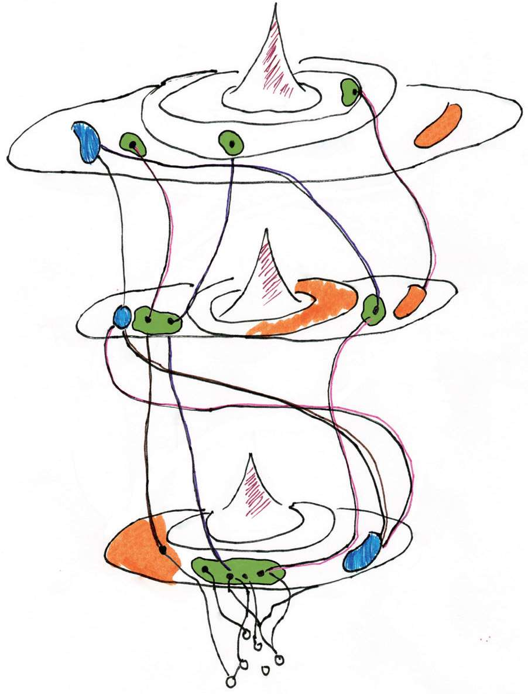

未来探索者眼中的哥德尔、爱因斯坦和人类认知地图（马维茵，8 岁）

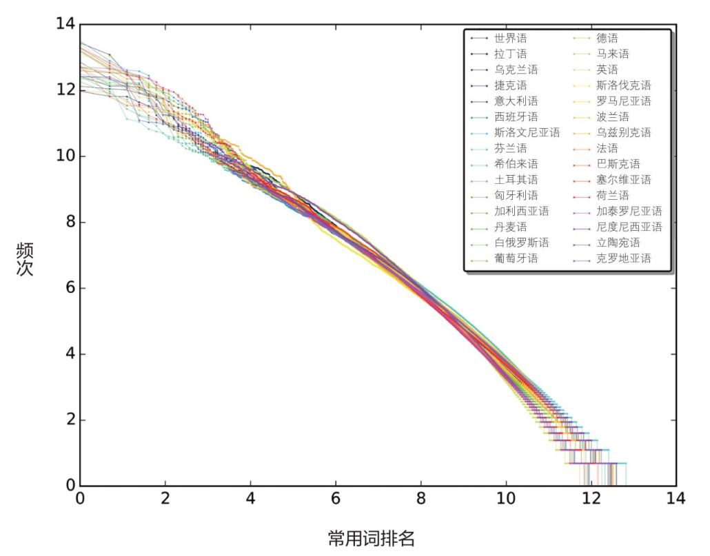

图 1-1 齐普夫定律

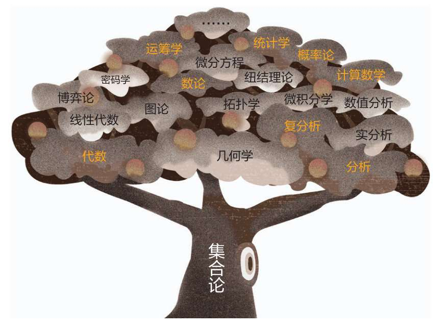

图 3–9 同构原理

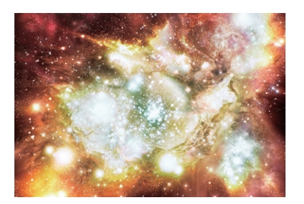

图 8-2 猎户座星云恒星诞生区，图中的星光来自 120 亿年前，宇宙诞生的十几亿年之后星体刚刚形成

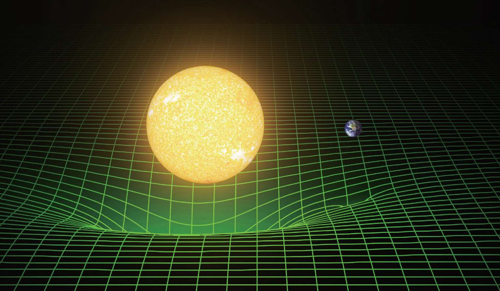

图 8-4 大质量物体出现会改变时空形状，两点之间最短的路线将变为曲线图

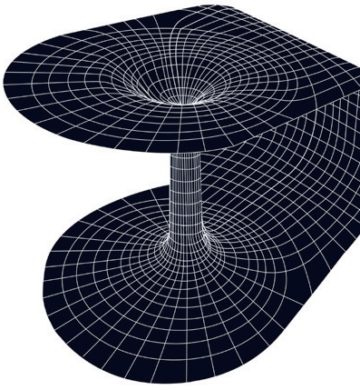

8-5 弯曲宇宙的虫洞图

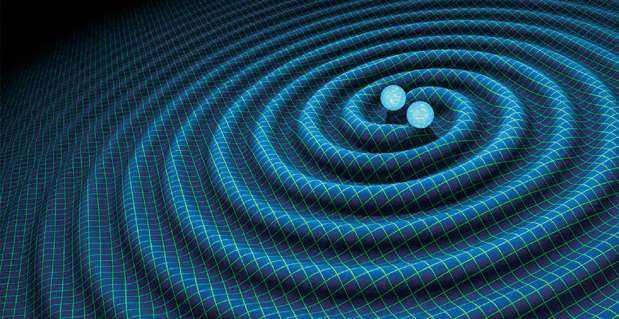

8-6 周期性的时空波动形成引力波

图 10-1 数学、物理及其他学科以实验为界分割开来图

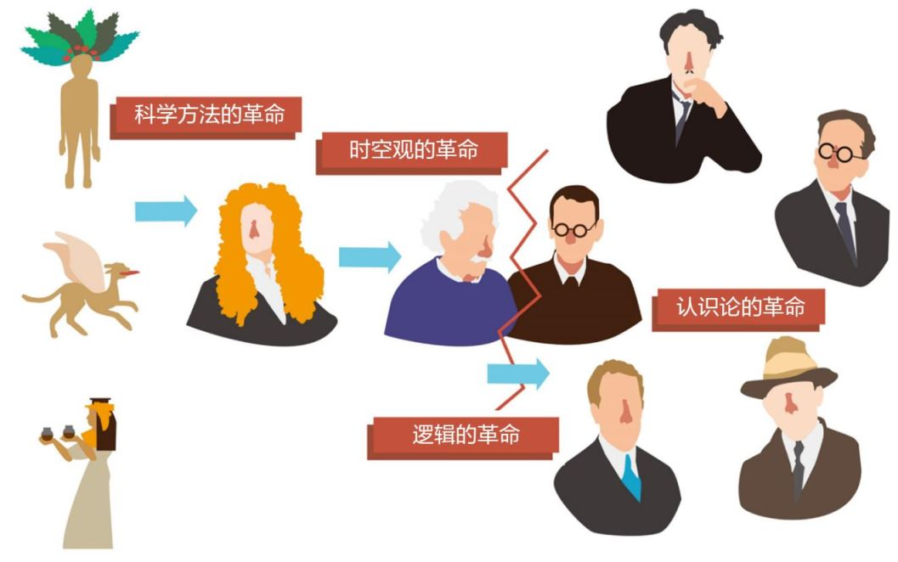

10-2 人类世界观和认知习惯的改变

# 前言

### 把科学拉回常识

我们太容易把科学当成魔法，总想找个诀窍一口吃下所有难题。实际上每一步前进都是细碎的积累与不确定性的叠加，只能拆开来一件件对付。对科学本身的期待也一样，总希望有一个万能的装置，让自然规律自动显现，自己坐享其成。这种设想很危险：一旦它真的能替人自动发现规律，它也就有了取代人的条件。好在现实给我们留了余地，也让我们稍感安慰，最后动手的人还是要靠自己。现在更现实的，是去找一个能解释“为何世界现在是这个样子”的工具。若真有平行的地外文明，这个工具或许能回应“他们为何没有甩开我们太多”。我们可以随意设想，可设想本身不产生进步，我们的先祖几千年都是这样做的。经不起检验的设想没有分量，怎么想都行。现代科学的意义在于，它提供了一种朴素的检验方式，让我们能辨别哪些想法经得起推敲、哪些成立、哪些不成立，并在其上长出新的想法，慢慢搭建起稳定的知识体。

有人说胡适做《水经注》是走偏门求捷径，其实是低估了他。我看他是用《水经注》做个示范，示范如何用现代方法做学问。本书里出现的哥德尔就是这个示范。从两千年前亚里士多德建立系统的理性工具开始，理性内部的裂缝就被注意到，“说谎者悖论”“这句话是错的”这类表述会让逻辑卡住。直到两千年后，才有人用严谨的理性去证明这个悖论直指人类理性的灾难，这个人是哥德尔。从他的工作起，我们才开始意识到用理性工具认识世界时的局限，也意识到问题比想象的更棘手。

这个根深蒂固的文明，对现代科学的理解存在断层。

第一个断层是“名教”与经典科学的断层。今天我们虽能看到经典科学也有解释不到的地方，但它敢于面对问题、谨慎求证的态度是可信的。我们的古老文明却长期带着近乎神秘的知识观。胡适在《名教》里承接冯友兰，“名”是文字，“名教”就是把文字当成符箓来崇拜的宗教，很长时间里做学问像做法一样造新词、念咒式地理解新知，听众往往满足了，就拿去继续演绎。这种心态对科学传播毫无助益，甚至打着科学的旗号做反科学的事。降维打击、混沌大学、奇点理论、未来简史以及所谓人类3.0就属此类，它们能获广泛关注，与“名教”与现代科学的脱节有关，是文明尚未进入实证阶段的体现。钱钟书在《围城》里对这种现象有经典概括：喝着咖啡聊梅毒。

在胡适那一代人艰难推动现代化的同时，人类对世界的科学认知已跨过另一道断层。20世纪初，当大家以为物理数学正凯歌走向终极胜利时，量子力学与哥德尔不完备定理几乎同时告诉我们认知的有限：要认识宇宙与自身，前路漫长，甚至可能没有终点。这也在暗示为何感性认知始终存在，为何统一认知的努力至今未果，为何数千年对真理的追寻总是差一点点，而正是这点点把我们推向全新的世界。这也解释了20世纪初美国教育家哲学家杜威与胡适所倡导的务实主义的合理性。但敌人的敌人未必是朋友，新理论解释了经典的不足，却绝不等于肯定古代神学与“名教”的价值，它是一个完全不同的新世界。

人工智能是典型例子。严格说，人类先发现了它做不到的事，后才发明了它。图灵1936年的经典论文是对哥德尔不完备定理的物理化诠释，他提出一个更简明且可物理实现的机械装置来完成数学的逻辑推演，并在文中点明哪些问题是图灵机处理不了的，以此扩展哥德尔的不完备证明。但图灵机太强大、太成功，那些“它处理不了的事”很快被埋进故纸堆，而那里正藏着应对人工智能局限的钥匙。

哥德尔被淡忘，是当代科研游戏规则的直接后果。一个不申经费、没有徒子徒孙的学问，如何能远播？在当下以论文数量衡量价值的评价体系里，根本不可能。而不用申经费也不用带学生，正是普林斯顿高等研究院对第一批研究员的放纵。爱因斯坦与哥德尔作为其中的代表，天真地相信了这份放纵。在论文数量决定地位的环境里，即便像哥德尔这样开创了一个领域的大师，其思想也难以存活传播。他与好友爱因斯坦，像堂吉诃德一样成了科学殿堂里的最后骑士。

于是我想写下一些文字，向这些人类历史上的伟大思考者致敬。即使我对这门学问的理解仍不成熟，至少希望它能抚慰我们面对未来的焦虑。当能回溯认知的常识时，会发现理解世界可以更平和。学问之道无他，求其放心而已矣。

燕园、清华园与伊河边的牛津，我在象牙塔里进进出出，认识了许多有趣的人。单说姓李的，就有给我科研入门机会的李政道先生，有塑造我务实信条的李敖先生，有让我感受音乐创造魅力的兄长李宗盛。交往越多，我越感到人类的可爱与伟大，这样好的世界，怎么忍心交给机器。

# 第一章

知无不言

人工智能到底不能做什么？如果第一章就说清答案，这本书就不好卖了。既然要写一整本，就慢慢展开，至少先说明我们用怎样的工具，才能得出怎样的结论。这样做时，会发现这工具似乎并不可靠，于是只好继续讨论什么是可靠性。这至少能理清什么是有效的思维工具，也就是理性。

我所追求的全部知识，都更充分地证明我的无知是无限的。

——卡尔·波普（Karl Popper）

2018年3月20日下午，我在台北街头一家咖啡馆写下这些文字：

> 近来很少写字，因为写作变得困难。哥德尔告诉你这不能写那不能写，落笔前总要先想这句话是否严谨。人常被自己学的东西困住，定义了“定义”自己，那谁来影响“影响”呢？
> 
> 雨后初晴，透过小店的窗看见傍晚阳光洒在街边的小树上，也被骑电动车骑手的头盔反射回来。骑楼柱后似乎有人在抽烟，看不见人，却能看见那个高度从柱后飘出的白烟。我不得不加快喝完一杯味道还不错的淡奶茶。不得不说味道真不错，但师弟要过来，他不喜欢这家店，因为老板不喜欢。
> 
> 阳光又斜了五度。师弟还没来，奶茶喝了一半，厚厚的泡沫看不出还要几口。点了一份千层蛋糕，味道很清淡，肉桂粉在碟子里撒出某种符号的模样。师弟说老板不喜欢这家店，是因为这是一家西藏店。我又看了看那图案，还真是。
> 
> 旁边两个女孩在喝咖啡和果汁，聊着八卦。似乎是关于人扮成上流社会有多费劲，然后是女婿与岳母间的微妙关系。
> 
> 吧台后四个店员在忙碌。店里没什么人，总共四个顾客，包括正在打字的、不知道何时要离开的我。但他们似乎真的很忙，各有事做。一辆白车路边停着，双闪亮着。哦，不，两辆。我尽量描写眼前之物，才发现少了时间这个维度。有车从窗外经过，店员走过来轻声说，“帮您加个水”。
> 
> 一辆自行车是诡异的绿色。
> 
> 阳光又斜了几度。店面已打开霓虹灯，不是五彩的那种，是明亮的黄绿色，隔壁一家是深蓝色。
> 
> 哥德尔说我永远也无法完整描述此刻的所有感受，即便努力记录。
> 
> 这是一条老板每天散步的路。在路边一家咖啡店，我喝着一杯淡淡的奶茶，写着描述不了什么的字，而两天前他不在了。

作为人类，我们使用各种工具。也正因日常使用，我们常忽略工具本身的可靠性。比如花点时间了解一下人们每天都在用的语言。

人类语言很神奇。你能通过语法理解字面意思，通过说话人的态度揣测内心想法。人们可用同样的文字表达不同内涵，有时沟通并不纠结于文字本身，面对面交流充斥着大量无法被词语编码的信息。语气、抑扬顿挫、眼神、味道与背景音乐，这些游离在词语之外的信息同样在传递交流的内涵与情绪。

但我们仍用这些丢失了大量含义、残缺的语言，去进行对人类最至关重要的行为——沟通。因为残缺有时会带来误解，于是我们希望创造一个没有歧义的语言系统。在这样的系统之上可以更客观准确地交流。事实上，这本书要告诉我们这件事做不到。用天生不完美的工具人类依然能彼此沟通是个逻辑奇迹。我们可能最终依赖的是通过奇迹般的沟通而达成的信任，人与人可以原谅彼此，甚至因理解沟通的缺陷而生出温情。这种温情，你从机器那里得不到，从法律条文里得不到，从敌人那里也得不到。但写到最后一句时，我觉得未必，你的敌人也是人群中的一部分。对手间的惺惺相惜，往往成就历史佳话。但人类并不死心，我们试图用更多数据还原这些场景，用录音还原语气，用影像还原表情与手势，来弥补文字的不足。

## 语言是可以理解的吗？

大多数人类语言通过声音传递，词汇表现为声频和强度的组合。语言里总有一些词出现的频次远高于别的词，即便不懂这种语言，对特定音频和强度组合出现的频率做统计，也能判断它是不是一个有意义的语言系统。比如中文里“的”字出现频率很高，其他字相对较少。当一种语言表达能力充分时，常用词的使用频率是递减的。不会出现某个音频和强度组合孤立地非常高，而其他又很低的情况。这样，仅凭词汇出现频率的统计就能判断一系列声音信号是否代表有意义的语言。这个原理我们称为齐普夫定律，近些年动物学家也用它来研究海豚的语言。

最早的动物语言研究是想了解动物间如何交流，人们尝试教给动物人类的语言，看它们是否能与我们交流。这样做的弊端在于，这个过程中人类很难学到动物语言。牧羊犬可以学会超过1000个人类单词，但人们能从狗身上学到多少狗的单词呢？到目前为止，人类总是试图通过教动物说人话来理解动物语言。然而跨物种交流有明显困难，想想我们学一门外语有多难，何况跨物种呢？

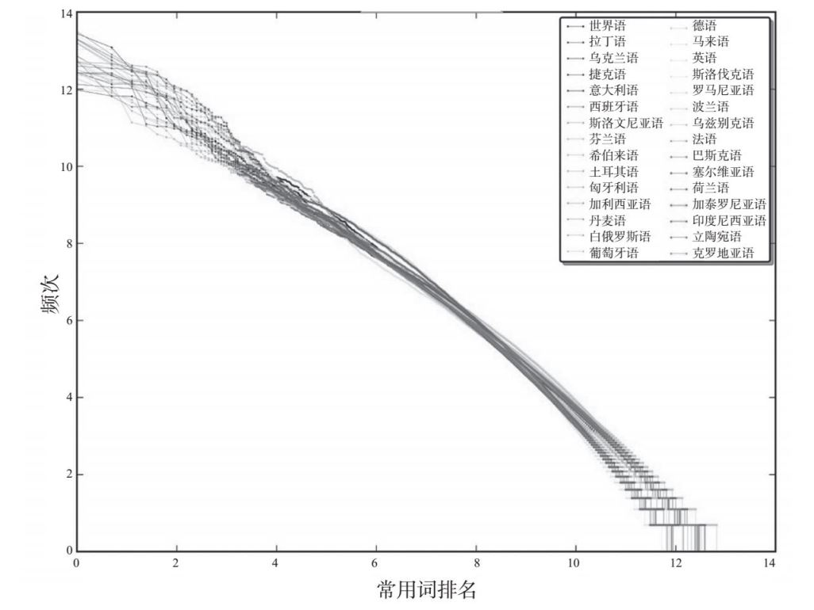

##### 图 1–1 齐普夫定律

今天人类的语言是从七万年前一支走出非洲的智人那里继承下来的。对比同时期的其他人类，这一支人群有着发达的声音语言系统。这种系统的基础是口腔、舌头和喉部的独特生理结构。这样的结构甚至连我们近亲猩猩都没有，更别说其他动物，它们根本没有能力发出人类复杂多变的语音。在研究用对方的语言与动物交流的过程中，人类不得不创造一些辅助工具，因为任何一端都无法直接用天然的生理结构复制对方的声音。学习海豚的语言就有这个问题，海豚叫声的超高音和鲸的超低音都超出了人类的听觉范围。海豚说不出人类的任何语言，而我们也不会吹超声波口哨。

借助齐普夫定律，人们在搜集了大量海豚叫声之后发现这些叫声确实在传递特定信息，而且是一种相当丰富的语言，能够让海豚之间进行复杂的交流，借助于人工智能技术人们甚至可以确定一部分海豚叫声所代表的具体含义。配合适当的演奏设备，人们甚至可以模仿这些声音，这使科学家和海洋生物之间实现信息的双向流动成为可能。如果真的可以理解足够多的海豚语言，人类对动物研究的现状将大大改善。海豚语言研究的成功可能使研究人员设计出与其他智慧生物交流的工具。不难想象，未来甚至会出现动物语言翻译设备。这项研究还有另外一个用处。当我们用射电望远镜瞄向遥远太空的时候，会接收到一些来自太空深处的无线电信号。如果恰好有外星人像我们一样可以看电视、听广播，他们扩散到太空中的无线电信号就会被我们接收到。这些信号有可能像自然语言一样由高频使用和低频使用的词汇组成，而我们可以翻译它。事实上，二战时的艾伦·图灵就通过类似的方法破译了德军的密码。如果我们接收到来自太空的无线电信号，并且判定它是否符合齐普夫定律，我们就可以知道发出这些无线电信号的宇宙深处是否有像我们一样的高等生物，甚至可以知道他们每天看的电视节目在说什么。

## 语言是可靠的吗？

描述一个真理，至少在描述本身上需要依靠语言。但语言可靠吗？如果不可靠，它的缺陷是可以避免的吗？

《论语》里说：“学而时习之，不亦说乎。”小时候课本上的解释是：学东西要时常拿出来复习复习，不是也很快乐吗？我一直怀疑这快乐的真实感。因为这种“学习的快乐”是课本灌输给我的，我小时候并不具有。“纳粹头子”戈培尔有句名言：“重复是一种力量，谎言重复一百次就会成为真理。”于是，在熟读百遍之后，我真的以为我有了快感。

后来长大了，学会了繁体字，才知道原来这个“习”字可以不这么写，繁体写作“習”。“羽”当作小鸟的翅膀，而“白”是指太阳。组合在一起可以解释为小鸟努力在天上学飞行。引申来讲，就是实践。学会了理论，要出去操演操演、实践实践，这样才能巩固，才能知行合一。纸上得来终觉浅，绝知此事要躬行。孔子讲的是做学问的方法。只有这样，放在《论语》的开篇才有意义。然而，我还是没有找到到底快乐在哪里。

到了人书俱老的时候，又想到了一个新的解释。这个“习”呢，不一定是学完了马上操练，可以是很久很久以后。“功不唐捐”是胡适晚年特别喜欢写给别人的题字。以前学的东西，很久很久以后在哪儿碰到了，拿出来用一用给旁人看，这个似乎才有别样的乐趣。学过，偶尔拿出来显摆一下，嘚瑟嘚瑟，收获一种倚老卖老的得意。

这些年我做新工科教育，希望培养与人工智能共存的新工程师。希望新的人才既懂得数字技术，又能动手做东西，所谓学而时习之，培养既能动脑又能动手的新型工程人才，此乃大快乐也。

然而这样就让我们产生了困惑：当我们说一句话的时候，这句话到底是什么意思？

#### 道可道非常道

语言是表达意义的工具。人类对于文字的敬畏可以追溯到很久以前，但古人也很早就认识到了自然语言的“不完美”。老子说“道常无名”，孔子也认为“书不尽言，言不尽意”，陆机在《文赋》中称“意不称物，文不逮意”。

但是老子的说法“知者不言，言者不知”，本身却是个悖论。而这个悖论都不是今天才被指出来的。白居易在《读老子》里说：“言者不如知者默，此语吾闻于老君。若道老君是知者，缘何自著五千文？”善言者不如智者善于沉默，这话是老子说的。如果老子真是“智者”的话，他干嘛还要写五千个字的《道德经》呢？

还没完。我们先不要管语言这么复杂的事情，一步一步来，先从定义一个关于某事物的名词开始。

### 如何定义事物？

#### 忒修斯之船（The Ship of Theseus）

在希腊传说中，英雄忒修斯与雅典战士们从克里特岛回到雅典，他们的船被雅典人保留下来作为纪念。随着时间推移船上的木材开始腐朽，雅典人便用新的木头来替换那些腐烂的木头。最后，船上的每根木头都被换过了。问题是，最终的这艘船是否还是原来的那艘忒修斯之船，抑或是一艘完全不同的船？如果不是原来的船，那么在什么时候它不再是原来的船了？

我们还可以对此问题进行延伸：如果用忒修斯之船上取下来的老部件来建造一艘新船，那么两艘船中哪艘才是真正的忒修斯之船？

这样的讨论同样适用于人类。人体每天都在进行新陈代谢，这样隔过一阵子组成身体细胞的全部原子都会被换掉，那么我们还是原来那个自己吗？如果不是，什么时候不是的？

当然，我们可以举出从精神、意志、社会关系等方面对个人的定义来说明，单纯依靠物理的实体来定义像人一样复杂的事物是不合适的，但对船而言呢？对花花草草而言呢？对猫猫狗狗而言呢？对猩猩猴子而言呢？接着就是复杂一点的人类了，这些物种之间什么时候产生了界限呢？

于是我翻开了词典。为了权威性，我翻开了《牛津英语词典》，为了避免翻译的误差，我翻开了英文版的。

### 词的互相定义

BOX，container made of wood, cardboard, metal, etc. with a flat base and use a lid, for holding solids.

我总要看看 container 是什么意思。

CONTAINER, box, bottle, etc. in which sth is kept, transported, etc.

这明显的是在用 container 来解释 box，用 box 来解释 container。看来，或者说至少，如果通过词典来定义我们说的每一个词，并试图以此理解人类的语言是有些问题的。到底这些语言有什么意义呢？它们完全可以是一些互相替代的符号。由此可见，理解一本词典，需要词典之外的常识。这些常识，来源于我们的生活、文化、教育，而不只是文字本身。常识的建立，可以通过大数据来实现吗？如果可以，那么到底要多少知识，才能构成人类交流的常识？事实上，人类的生活中存在很多默认的知识，但深究下去，为什么用这个，为什么这么用，我们并不十分清楚，但我们在交流中毫无障碍地用到了它们。

### 外语的硬边在哪

2009 年我在伯克利地下室里被实验和理想卡住的时候，打开了《英国达人秀》。48 岁的苏珊·博伊尔站在台上唱《悲惨世界》里的 I Dreamed a Dream。那种对未来的不确定被一下子点着了，我当时就把它翻成中文想留住那份感觉。

翻译最好能做到信达雅。信是忠实，达是顺畅，雅是写得漂亮。雅最难，得看运气，不是靠文学功底就能保证。大多数语言之间根本不存在完美对应。

为了减少歧义，人们会多说几句。把 Dialogue 翻成“对话”，只能算信；翻成“大唠嗑”就是信又达了，碰上东北读者，瞬间就信达雅了。

英语里有个常被拿出来玩的悖论：My younger brother is older than I am。英语 brother 不分大小，我有两个哥哥，排在后面的那个哥哥在年龄上当然比我大。中文一翻成“弟弟”，矛盾感就出来了。

刚到英国时报名字，我说 zhaoyuan。英语口音里这两个音几乎发不出来，德国人稍好一点。书里出现外国人的中文译名，除非像爱因斯坦这种早已定型的，否则我多半保留原文拼写，避免硬翻让人更糊涂。我的英文名也折腾过一阵子，Joe、John、Zhao 都用过，最后还是逼着大家去学 zhaoyuan 的腔调，哪怕听起来别扭。

发音习惯本身就是壁垒。汉字发音单元少，几百个音素要扛万多个常用字，靠声调和组合撑场面。拼音文字则靠辅音在元音前后堆叠，不需要声调辅助。所以我们觉得老外说中文不抑扬顿挫，他们也觉得中国人说英语总带一股中式腔调。不是不想让你们叫我的中文名，是真的发不出来。名字后面还绑着家庭期待和文化背景，想做到信达雅更难。

语言也在塑造思维。俄语母语者辨别浅蓝 голубо́й 和深蓝 си́ний 比英语母语者快，因为俄语把这两种颜色分开命名。

历史也留下了痕迹。英国早期贵族说法语，平民说英语，于是活物用英语，肉类用法语。羊是 sheep，羊肉是 mutton；牛是 cow，牛肉是 beef；猪是 pig，猪肉是 pork。

我读的高中里有西藏班。学生要同时学藏语和汉语，学汉语很大程度上是为了读物理数学，因为很多科学词藏语里没有。清代满汉回蒙藏的学术体系还能对应，现代科学进中国才一百多年，藏语跟不上也正常。写书时也一样，学科学的人宁愿用英语造新词，因为中文来不及迭代。新词的形成需要大量使用者达成共识，而搜索引擎被商业信息淹没，很难找到干净素材。往狠了说，汉语可能迟早会被最新的科学进展隔离开，成为被陈列的古老语言。

# 第二章

基本的逻辑

再炫酷的人工智能，底层仍然跑在图灵机上。图灵机就是我们用来做逻辑推演的工具。想知道 AI 做不到什么，先得搞清楚逻辑机本身的边界。

从逻辑来看语言里的似是而非，至少能说明逻辑在沟通中不可缺。一个逻辑系统最起码要有几条基本规则，保证说的人不自相矛盾。犯错时我们往往察觉不到，而缺乏逻辑积累，自然界的观察就形不成可用的知识。

基本规则大致有：

• 同一律
• 矛盾律
• 排中律
• 充足理由律

## 同一律
做逻辑推演时，概念必须始终保持同一。在同一论证链里，一个词要自始至终用同一个确定的意思。同一律要的是前后一致，不是说命题必须与现实相符。真假是事实层面，同一是表达层面。

同一律让交流有确定性，否则就容易混淆概念、转移话题。文章才有中心，讨论才能连贯。

但同一律本身造不出新知识。因为语义可以被无限诠释，同一律的两端必须严格相同，严格相同就等于没扩展。

#### 苹果是苹果
小明想买十块一斤的苹果，售货员却递来二十块一斤的。苹果还是苹果，价格变了。价格一样也有品种差，新鲜度也差。小明要的是那个独一无二的苹果，可现实里连这个都做不到。拿起来一看另一面虫蛀了，这已经不是他最初想要的那个了。

这种推演已经超出经典逻辑，逼近哥德尔不完备的范畴。日常沟通只能靠常识和适度的宽容，否则严格遵守同一律，就什么新东西也说不出了。

## 矛盾律
同一推理过程里，互相矛盾的两个陈述不能同时为真。A 和非 A 不能指同一个对象。不能既说某物是什么，又说它不是什么，必须二选一。

矛盾律保证推演自洽。科学很多时候就是在发现矛盾并排除矛盾中前进的。

《韩非子·难势》讲过卖矛卖盾的故事。卖家夸盾坚不可摧，又夸矛无物不陷。旁人问用自己的矛刺自己的盾如何，他答不上来。前提自相矛盾，结论自然无从谈起。

这不只是市井笑话。数学家、逻辑学家、物理学家每一步推理都藏着大量默认常识。这些常识如果不被显式化，很难觉察它们是否冲突。

系统里不能出现“尖而圆的脸”“不是房子的房子”“方而圆的桌子”。类似说法常像佛教公案。“一个不是山的山”听起来玄妙。还有“有个地方从来没人去过，去了的人没回来过”，既说没人去过，又说有人进去过。还有“此地无银三百两”和“此地无银两百两”，这就不可能同真，至少一假。

## 排中律
在同一逻辑里，两个互相否定的陈述不能都假，必有一真。

排中律否定了那种想包打天下的理论。我们总想找一个全包的体系，结果往往骑墙。自然语言可以这么说，数学里表达不了。包罗万象就等于包罗错误。

矛盾律和排中律默认二元论。现实里很多东西分不出来。莫比乌斯环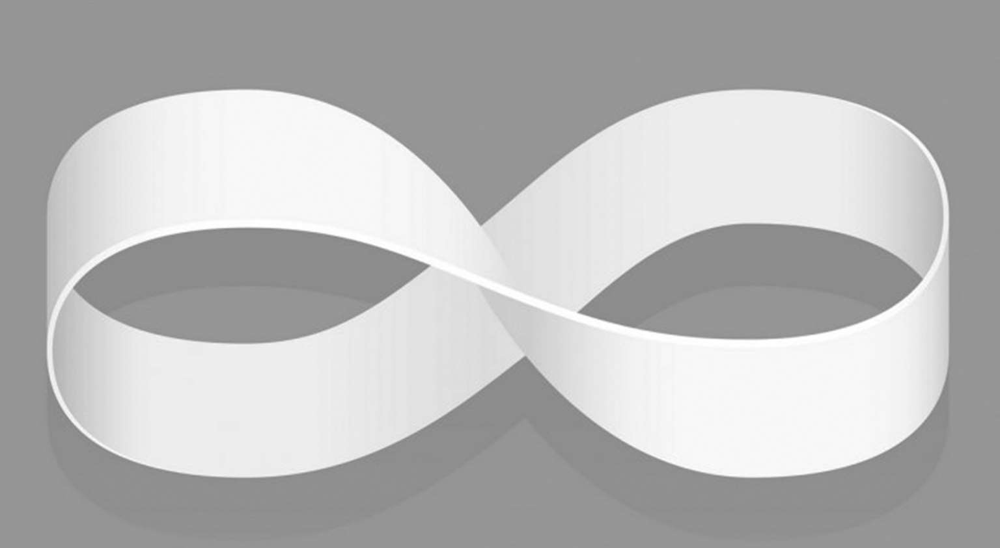

##### 图 2–1 莫比乌斯环

正面反面分不清。量子力学里叠加态更是同时占据两个态。

排中律和矛盾律是反证法的根基。我们假设错误的前提导出错误结论，于是反面为真。但这不适用于“这句话是错的”这类自指悖论。

## 充足理由律
一个陈述被判定为真，必须有充分理由。事物的存在总得有个说得过去的道理。

逻辑上要求两点：
1. 理由本身为真；
2. 理由与结论有必然联系。

充足理由律不提供理由，只要求论证合规。真假还要靠实践和实验检验。

前三条律保证了确定性，充足理由律再进一步，要求判断之间有必然联系。说清楚是什么之后，还得解释为什么是这样不是那样。守住这四条，才能让概念清晰、判断恰当、推理通顺、论证有力。

莱布尼茨认为推理要建立在矛盾律和充足理由律之上。叔本华把充足理由律拆成因果律、逻辑推论、数学证明、动机律四个形式。

因果律的潜台词是宇宙里没有自解释的事物。四个基本律搭建的知识体系，给超自然留了空位。但量子力学动摇了因果律，比如惠勒的延迟选择实验（见《量子大唠嗑》）。实验显示此刻的现象可能被未来事件影响，选择决定了过去，这让附着在时间顺序上的因果变得可疑。

矛盾律是反面标准，违背它就不可能为真；充足理由律是正面标准，遵守它才有依据。科学体系必须同时满足四条，缺一不可。聊天要有格调，先看是否符合逻辑的基本要求。

违背同一律的常见毛病：
• 歪曲观点攻击
李雷：传统中药配方没经过临床测试就不该用。
韩梅梅：你是要丢掉中华民族的传统遗产，让传统文化断子绝孙吗？
李雷说的是“未经测试不能用”，被扭曲成“要抛弃遗产”。
• 滑坡谬误
有人提同性婚姻合法化，就被批说：自愿就能结婚，那父女、兄妹结婚行不行？三个人结婚行不行？人和动物、和板凳呢？从一个前提连推一串可能性，最后变成必然性。

违背充足理由律的典型：
从清初到18世纪末，中国人口从不足一亿涨到三亿，就被解释为康雍乾治理水平远超前代，所以是康乾盛世。时间先后不等于因果，相关性不代表因果关系。

当然不是单一原因能说清的。人口增长牵涉诸多变量，明末开始甘薯、土豆从南美带入中国，对粮食供给产生显著提升；与此同时医疗经验的积累与新技术的采用大幅压低了婴儿死亡率，也让一般人的平均寿命被拉长。相关性并不等同于因果性，相关系数再高也无法证明因果，唯有通过改变检验条件来看结论是否经得起推敲。

再看一个常被误读的统计。医学统计曾显示成年人的寿命与手掌大小关联密切，手掌越大寿命趋短，手掌越小寿命趋长，乍听很怪。真正的原因是性别差异在作祟，男性平均寿命普遍低于女性，而男性手掌通常也比女性大。

## 逻辑与禅的冲突

语言是思维的外化方式，思维借文字符号呈现，语言的使用便映射出思维的逻辑。传统文化里大量讨论在逻辑基本要求上存在缺口。如今我们清楚逻辑自有基本规律，而佛教的表述往往并不遵循这些规律。用 P 表示某个对象，可以是明镜台，也可以是菩提树，佛教经典常用的论调是：

如果 P 为真，那么 P 为假。

其扩展形式常是：

如果 P 是 Q，那么 P 不是 Q。

铃木大拙在《禅：答胡适博士》中提到，我们通常推理：A 是 A，因为 A 是 A；或者 A 是 A，所以 A 是 A。禅学接受这种方式，但另辟蹊径，会说：A 是 A，因为 A 不是 A；或者 A 不是 A，所以 A 是 A。

唐代青原惟信讲禅体验的三阶段：未参禅时见山是山，见水是水；稍有体悟时见山不是山，见水不是水；最终歇处又见山只是山，见水只是水。其中“见山不是山，见水不是水”就是典型的逻辑谬误。

佛学典籍中类似例子大量存在。如“我即是他，他却不是我”违背矛盾律；“得即是失”违背矛盾律；“既非肯定也非否定，二者皆错”违背排中律；“勿言生，勿言无生”也违背排中律。禅理宣称语言无法抵达，也与逻辑相悖。不合逻辑可以推出任何结论，也就意味着什么都推不出。

菩提本无树，明镜亦非台；本来无一物，何处惹尘埃。

据说六祖慧能少时街头听人诵《金刚经》“应无所住而生其心”，豁然开悟，后作此偈表达空的思想。慧能还提出反排中律的命题，如“无方圆大小”“无有头尾”，认为方圆、大小、头尾之类矛盾在“空”中皆不成立。南北朝禅师善慧傅翕也有类似偈：

空手把锄头，步行骑水牛；人从桥上过，桥流水不流。

佛性被解释为悖论超越理性，禅师运用悖论显得自在。但这本质是对逻辑的模糊和不求甚解，并非仅因文化影响，而是认识有限、思维缺乏逻辑牵引的共同困境。如今基础教育里多数人也未接触逻辑课程。语文课上出现的举例论证、道理论证、比较论证、比喻论证这“四种论证方法”长期影响写作和论述思维，可惜它们并非逻辑，实为谬误。

1.举例论证：罗列多个相似案例来支撑论点。

孟子在《生于忧患，死于安乐》中举舜、傅说、胶鬲、管夷吾、孙叔敖、百里奚等六例，推导出天将降大任必先苦其心志。事实上对绝大多数人而言苦难只是苦难，良好家世意味着更好的教育、更开阔的眼界和更多成功机会。

案例选择带有先入为主，选正面忽略反面，本身就是逻辑错误。逻辑更关注能推翻观点的反例。证明一个命题普遍成立困难至极，需要检验每个例子，只有可数学归纳的自然数性质才具备有效性。一般归纳从有限案例得出普遍规律不符合逻辑要求。用一两个例子说明普遍规律是非逻辑的。归纳法极其脆弱，一个反例即可推翻所有正面证据。举例论证常被滥用，如谈某中医神奇时会说邻居或熟人癌症晚期被治愈，所以有效，不灵是病人不信。这类例子无推广意义，人体复杂，体质差异和他因解释太多。

2.道理论证：援引经典名言或权威之语来确立结论。

科学的核心是挑错、否定既有权威。权威之言是双方偷懒的捷径：权威无需说服只要亮牌子，我是专家；引用者也不需证明，权威背锅即可。这种论证毫无逻辑，且有害，它阻碍对真实性的探究，建立知识等级观，把人治带入知识领域。也导致权威一死世界崩塌。

列举名人语录视作真理本身无道理，名人发言有语境，语言可被无限诠释，且历史会不断重估名人。其论证基础不牢。将绝对真理与绝对权威相连的思维是神秘论化的，如将论证方式神秘化。中国教育灌输的某些论证方式即属古代思维，不科学、不现代，会制约文明发展。

3.类比论证和比喻论证：将两种事物对照得出结论。

董仲舒为论证天人合一在《春秋繁露》中类比：人体有366个关节对应一年366天；12个大节对应12个月；五脏对应五行；四肢对应四季；眼开合对应昼夜；气息刚柔对应冬夏。事实上人体并无366个关节，证据是按观点臆造。

类比与比喻只能提供或然性，能使事物更形象、问题更清晰，提供大胆假设的启发，但要实现小心求证需要同构映射，即两类事物间严格一一对应。这在数学中可行，在自然语言中极难，比喻强调相似而忽略差异，不能由此推断其他特性。所谓上善若水，不能因水与人性各有特性就推导出水的其他特性也是人性的特性。比喻助直觉，但不构成论证。

这四种所谓论证在逻辑上皆错误，只能作修辞，远谈不上论证，反而有害思考。

## 逻辑的自洽和完备

能否完全依靠客观逻辑排除直觉，建立普适的知识体系？构架于严格逻辑的理性系统至少应具备自洽与完备。

自洽要求理论有效且不自相矛盾；完备要求理论有用，能对体系内有效命题作出判断。矛盾体系可证明任何命题；无判别能力的体系无用。完美体系需完备且自洽。

### 自洽性要求

符合逻辑的理论体系前后一致、无矛盾。建立知识体系首要任务是证明命题系统的无矛盾性。不能自相矛盾，也不能自带武器攻击自己。自洽源于不相容命题不能同真。若系统自洽，则不可能推出0≠0，也不能出现某命题与其否定同时成立。一句话，不自洽的假设可证一切。

#### 罗素是教皇

从纯逻辑看，不自洽假设可推出任何荒谬结论。罗素曾从“2+2=5”推出“罗素是教皇”：由2+2=5两边减2得2=3，再减1得1=2，移位得2=1。教皇与罗素是两个人，若2=1，则教皇和罗素是同一个人，所以罗素是教皇。由此罗素可成为任何人。这个荒谬结论源于与算术已知知识矛盾的假设。同样，不自洽体系内可推出任何结论。

### 完备性要求

完备的系统内所有命题皆可被证明，每个真理对应定理及其证明。我们希望一套知识能给出明确答案是对或错。命题可以是“2+2=4”“无外力时物体沿直线匀速运动”“明天会下雨”“柿子10元一斤”，也可以是哥德巴赫猜想。各类知识体系都建立在不证自明的前提上，传统称公理，更合适称公设，它们是共同承认的公允假设，未必真。公理会随新证据动摇，也无法自证其正确性。

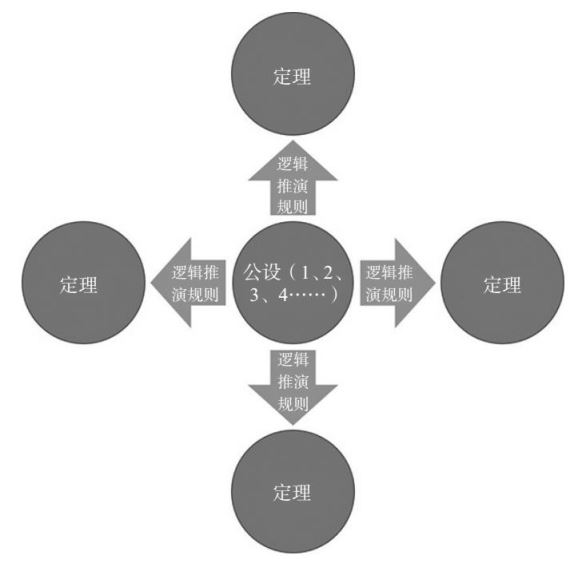

##### 图 2–2 公设与定理

建立知识体系期望能回答问题。若体系语言工具无法回答问题即不完备，需继续扩展。同时理论应能描述自身问题。一命题经新理论表述后应可判定真伪。反证法的使用也依赖系统自洽假设。

## 构建一个知识体系

符合逻辑要求的知识理论体系始于少数不证自明的公设。公设越少越好，彼此应相互独立，不能由其他公设推出。公设体系应允许对该科学下每条命题判真假。通常称形式系统。逻辑推演规则本身也是公设，只是被普遍使用。

几何是演绎学科的典型。经验证明只要求与观察一致，演绎要求经明确逻辑证明。古希腊发明公设方法，基于此发展几何。先不加证明地将某些命题作为公设，如过两点只能画一条直线，再仅靠逻辑原则演绎出所有定理。公设是基础，定理是上层建筑。

大部分棋类游戏也是形式系统，如中国象棋。语法规定有效符号串即棋盘有效结构，如黑象不能在红方半场。推理规则把合适符号串转为另一个合适符号串，即把合理局势推演到另一合理局势。规则代表允许走法，公设对应开局摆法。

操作规则

公设：开局棋盘摆法。

推演规则：各棋子走动规则。

定理：按规则走出的新局面。

陈述：任意棋子在棋盘上的摆放方式。

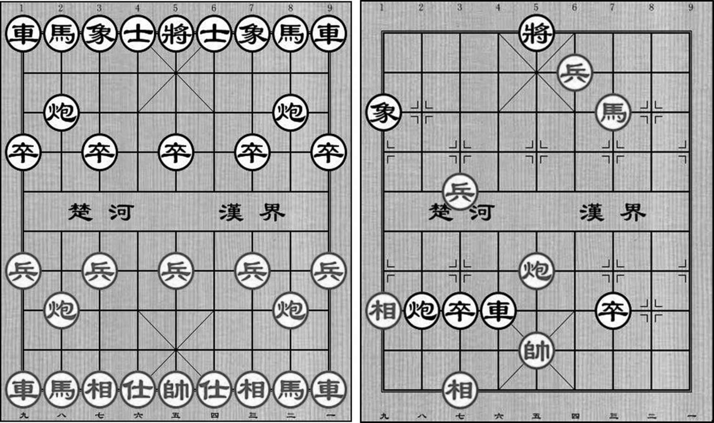

##### 图 2–3 象棋初始格局（公设）与棋子按规则走动之后的格局（定理）

并非每个陈述都能被证明为定理。证明定理相对容易，否定陈述需穷举所有走法，除非错误明显如象在米字格外。这类似NP问题，找到证明困难，验证却不难。

公设系统应完备，能对每个命题证实或证伪，不应出现不可判定命题。然而并非如此美好。譬如“本命题是假的”既不真也不假；“本命题不可被证明”有真值却无法证明其真实性。

1. 《量子大唠嗑》，马兆远著，中信出版集团 2016 年 10 月出版。——编者注

# 第三章

理性的终极目标

人类希望借逻辑工具建立冷静客观的知识体系，不夹杂主观情绪。但体系一旦自动包罗万象形成所谓的智能，人本身的作用便被削弱。

## 直觉？

科学史是与人类直觉相爱相杀的历史。

诸多宗教信仰以人为中心，《圣经》记述人类因上帝眷顾成为被选中的群体，上帝为人类创造世界。这种中心论持续数千年。随着地心说衰落、牛顿力学确立，人被移出宇宙中心。能看见浩瀚太空后，人们不再相信自己是宇宙最重要的部分。“我们”不重要，“我”也不重要。自然认知不应取决于某个人或个人特征。若必须用人为标准，也会试图平均化。传说16世纪德国以礼拜后走出教堂的前16个人的平均脚长定义“尺”；法国定义“米”则更客观，以地球子午线4000万分之一为标准，经线长度精确为4万千米。理性让科学离直觉越来越远，这似乎正确，因为某人或某些人的直觉不可靠。

直觉确实有谜一般的性质。它源于何处？在理性追求多年后它依然活跃，说明事情比想象中复杂得多。

直觉：我们身边的隐形副驾

直觉往往是过往经验与知识长期沉淀后产生的自动化运算，像后台静默运行的程序，不需要我们有意识地察觉它正在工作。它常被理解为一种无意识的思考方式，于是自然会产生疑问：我们究竟可以在多大程度上相信它？在日常生活中这种静默的信息处理无处不在。开车时会偶尔进入类似恍惚的状态，车子已经跑了几十上百公里，司机却想不起油门踩了多少次、方向盘转过多少圈。走在街上发呆或低头刷手机，抬头时发现自己已到目的地，对中间是怎样一步步走过去的却完全没印象。直觉能带来便利，却不一定指向更好的决定。

这种自动化不仅出现在琐碎事务里，也渗透到复杂的判断中。坊间常说女性凭直觉判断更准，实际情况是几乎所有抉择都离不开直觉的参与，甚至可以说决策过程始终都有直觉在作祟。我们习惯在事后用理性的标准去包装行为，掩盖掉真实的主观偏好。真实情况是信息永远收集不全，彻底理性的状态根本达不到，即便理性完美也未必带来更好结果。多花时间搜集相关信息多少有点帮助，但不必因为拿不到全部信息就感到恐慌，完整掌握本来就不可能存在。

直觉来自多年学习与人际互动的累积，把难以言传的东西转化成默认常识。如果放下经典理性的框架，像孩子那样以新鲜眼光看待问题，那些在理论里像是悖论的内容反而显得理所当然。几代人之前认为无法直接感知的事，今天却被当成常识。提到地球是圆的，有多少人能拿出直接证据？我们长期被各类信息灌输，对直觉的感受往往不加怀疑。地球被默认为一颗球体，从月亮上观测到的地球阴影始终呈圆形，古希腊人早已留意到这一点。若地球是方形或扁平，阴影就不可能恒为圆形。

由直觉产生的公设常被视作自证其真，正如美国《独立宣言》所说“某些真理是不言自明的”。严格讲来，所有自我正当化的不言自明之物都值得怀疑，更遑论在其上层层叠加的法律条文。

直觉并不是稳妥的思维基石，它不适合用来判定科学探索的真伪与成效，直觉会引入知识的不确定性。现代科学技术越来越强调排除人的干扰。物理学家极不喜欢人的直觉。我们已知的普适物理规律难道需要靠直觉去发现吗？我们默认的公设来自直觉，被认为是不言自明的。但该相信谁的直觉呢？物理学家甚至不喜欢具体的实体。

以长度度量为例，英文 length 的单位 foot（foot）本意就是脚。小时候用脚丈量长度的游戏经验与此高度相像。十三世纪初欧洲度量极度混乱，严重阻碍了新兴的国际市场。在英国，因长度标准引发的民事纠纷让行政部门十分头疼。大臣们开过十多次会也定不下来统一标准。曾在《大宪章》上签字的国王“失地王”约翰在多次听证后失去耐心，当场在地上踩出一脚印，宣布这就是往后的一英尺。如今大英博物馆还藏有一块膨胀系数极小的铂金长方形框，中间即为英王脚即 Imperial Foot 的标准长度。因为约翰王穿着鞋，这一英尺约合 30.48 厘米，与唐朝所用的“尺”长度相近。法国大革命后法国人厌恶王权依赖，改用地球本身的自然长度来定义标准，将子午线长度的四千万分之一定为一米。

两千多年前秦始皇统一度量衡，今天的物理工作者也在做类似的事。讨论物理问题时必须先确定基本单位：多少距离算一米，多少时间算一秒，多少质量算一公斤。巴黎的国际计量局至今仍保存国际千克原器与国际米原器。如今国际米原器仅作为最能体现米的规定性质的器具保存，一八八九年第一届国际计量大会把米原器定为国际长度基准，规定一米就是零摄氏度时米原器两端刻线间的距离。精密工艺和持续维护下其精度可达 0.1 微米，即千万分之一米，看似足够精确。但一九六零年第十一届国际计量大会一致决议废除米原器对“米”的定义，理由是既不方便也不够准确。会议同时规定新标准：等于氪 86 同位素灯在规定条件下发出的橙黄色光在真空中的波长的 650763.73 倍。一九八三年十月联合国度量组织在巴黎开会，再次修订“米”的定义：把光在真空中 1/299792458 秒所走的距离定为一标准米。于是光速被定义为每秒 299792458 米。长度不再依赖具体器物，却依赖时间。那么一秒究竟有多长呢？

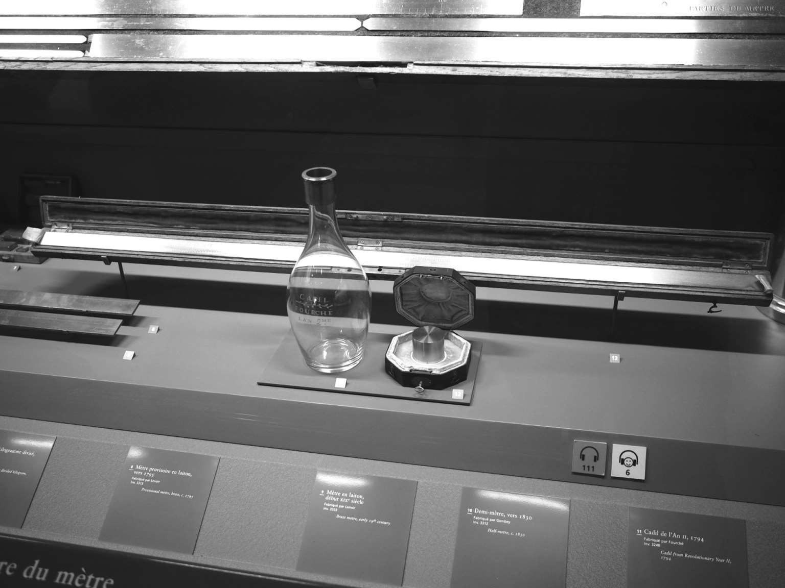
##### 图 3–1 国际计量局保存的国际米原器

这个问题看似简单，一日有 24 小时，每小时 60 分，每分钟 60 秒，一日的 86400 分之一就是一秒。但这里默认了“日”的长度是否恒定？日是地球自转一圈所需的时间吗？这个常识是错的。地球自转一周约 23 小时 56 分多一点。一个太阳日要求太阳回到天空同一高度才能算一日。而由于地球在自转的同时也在公转，每一日太阳在同一时刻的高度并不相同。所谓正午也缺乏严格定义。太阳达到当天最高角度的时刻与前一日同一最高角度时刻之间的间隔才是 24 小时。因为公转的缘故，自转需要多转不到四分钟才能让太阳回到最高点，这才构成一个太阳日。

把一个常用概念说清楚时，我们不自觉就用了大量默认知识。这些默认知识是如何形成的？靠大量学习和记忆可以实现吗？大数据或机器学习能获得这些默认知识吗？这是人工智能的核心难题。常识需要多少可描述的知识才能形成？这些知识能否最终累积成直觉？常识是否是直觉的基础？

写到这里忍不住继续显摆时间。

## 时间

远古人类与其他动物一样，只需要“日”这一精度。埃及人观察尼罗河涨落，便代表了很长历史时期人类对时间的需求。每年固定的一天河水上涨淹没农田，只需在此前做好准备，等待退水后播种。“日”意味着耕种与收获，“小时”对普通人有何实际用处？日出而作日落而息，精确到小时以下并无必要。当然，天文、立法、占卜等小众计时器作为礼器和宫廷玩物并非完全无用。臣子上朝需准时，不能让皇帝久等，所以有晨钟暮鼓、早晚打更的需求。但这样的计时只需城中少数人负责，更不必精确到分秒。

对分秒的需求直到欧洲人开展大航海才变得迫切。对航海而言，最麻烦的是地球是圆的。茫茫大海中提供淡水与补给的岛屿或海岸线藏在地平线之下，必须航行到地平线那边才可见。那地平线有多远？

欲穷千里目，更上一层楼。

鹳雀楼在 20 世纪 90 年代重建，高度 73.9 米。站在楼顶，视线极限仅约 30 千米。想象一艘船在大海上，30 千米外有一个岛屿，即便桅杆有 70 米高，水手也看不到。航行时没有参照物，只有船长手里的地图与指南针，究竟朝哪个方向才能尽快抵达岛屿？当时几乎无解。

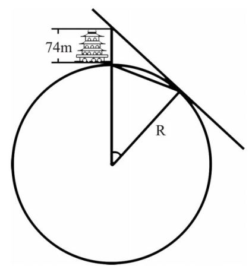
##### 图 3–2

当时海船一日仅行几十千米，风暴会让航道偏离，一觉醒来便完全不知所处位置。船员懂得利用经纬度确定位置，正午太阳高度或夜晚北极星高度可告诉纬度，但经度完全无法确定。因此航海多只能沿东西向纬线走，也只能走纬线。这也是茫茫大海海岛稀少，却有海盗这门生意的原因。商船不敢偏离纬度线，海盗只需找一条沿线岛屿较多的纬度线潜伏等候即可。若对迷航没有体感，想想地下停车场找不到车，每层看起来都一样。海上更绝望，海面从各个方向看都一样。所以长久以来航海依赖有经验、直觉好的船长。正午通过六分仪测量太阳高度判断纬度以免偏航是常态，经年累月常用那只眼睛会先失明。独眼船长是航海史上的悲情写照。缺乏蔬菜与淡水，丢的不仅是眼睛，还有船员的生命。迷航在当时非常频繁。

那么如何确定某地的经度？

一个方法是借助时间。太阳每天回到最高点的时间间隔是 24 小时，于是地球被分成 24 份，每份代表一小时，这就是时差的来源。地球 24 小时旋转 360 度，即每小时 15 度。若知道本地时间与本初子午线即穿过英国格林尼治天文台经度的时间差，便可算出本地经度。听起来容易，关键是时差如何确定。按赤道算，其周长约 4 万千米，对应 24 小时即 86400 秒。在鹳雀楼的高度，30 千米对应约 60 秒，即约 1 秒 500 米。若时钟相差 60 秒，本来可见的岛就会消失在地平线之下。从惠更斯发明摆钟起很长时间，摆钟每天走差几分钟很正常。海上颠簸让每次摆动时间不一致。为减少齿轮摩擦需要涂润滑剂，而不同温度下黏性差异也导致走时不准。要做出几天甚至一两个月不差一分钟的钟表，在大航海时代不可想象，包括牛顿在内的许多人认为不可能。因此牛顿为首的科学家花费大量时间研究天文，希望通过月球每日在星空位置的微小差异来确定经度。这需要极佳的天文学知识。英国为此设立经度局，一七一四年宣布：开发出实用海上经度计算方法者将获两万镑奖励。当时一艘军舰也不过几百英镑。

约翰·哈里森是木匠兼钟表匠。他在一七七六年去世前 40 年里研制出一系列越来越精确的航海钟，这些钟现藏于格林尼治天文台。一七五九年，第 4 号钟 H4 在远航牙买加的 81 天惊涛骇浪航程中仅有 5 秒误差。哈里森的航海钟精度远超经度局想象，但价格不菲。经度局想要的是“实用解决方案”，即可批量生产的方案。对这种充满手工业匠心的装置而言短期内难以实现大规模商用。经度局只同意授予哈里森部分奖金共一万镑。直到国王乔治三世坚持下，哈里森才领到全额奖金。坊间常说的戏剧化版本是哈里森被官方科学机构轻视，但这忽略了英国和法国其他钟表制造商的贡献，他们也在研制可靠航海计时器上取得重要进展。事实上并无证据表明哈里森在当时现实层面已彻底解决经度问题，此后很长时间航海钟成本都超过一艘战舰。但他的工作至少证明用时间解决经度问题是可能的。今天随身携带的钟表都源自哈里森航海钟原型。经过两百多年努力，到 2018 年美国国家标准局制造的光钟可把测时误差降到 197 亿年差 1 秒。

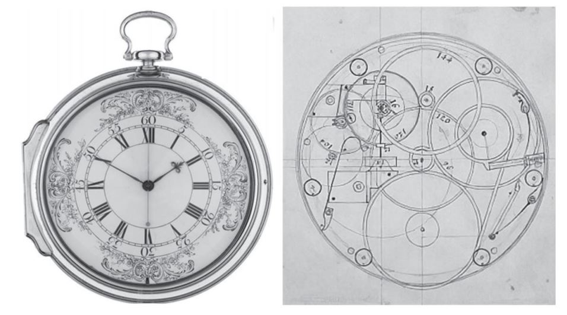
##### 图 3-3 哈里森研制的 H4 航海钟

在排除直觉的努力上，数学也不甘示弱，并认为理所当然。

上小学前我们就开始学算术，海淀区尤甚。一二年级便学会加减乘除，但我们似乎从未问过，1 后面为什么是 2？回答并不简单。我们一开始就被这样灌输，便成了默认知识。数学家不这么看，为了每一步结论可靠，习以为常的常识需要被重新梳理。

## 算术系统

算术的基本公设被称为皮亚诺公设，由五条基本假设组成：

> 公设 1 1 是自然数。
> 
> 公设 2 对于任意自然数 n，其后继数 n'都是自然数。
> 
> 公设 3 对于任意自然数 n，n'≠1 都成立。
> 
> 公设 4 对于任意自然数 m，n，若 m'=n', 则 m=n。
> 
> 公设 5 假设对自然数 n 的谓词 P（n）而言，下面的（a）和（b）都成立：
> 
> （a）P（1）成立；
> 
> （b）对于任意自然数 k，P（k）成立，则 P（k'）成立；
> 
> 则，对于任意自然数 n，P（n）都成立。

“谓词”有点拗口，它是说明主语具有某种性质的词，与我们通常理解的“谓语”区别不大，或可看作“陈述”或“命题”。此时公设 5 即：假设对自然数 n 的陈述 P（n）而言，（a）和（b）都成立，则对任意自然数 n，P（n）都成立。我们来看怎样用这样的公设定义自然数。再次重申：公设是不需要证明也能成立的陈述。陈述可判断真假，被证明为真时称之为定理。

我们自然把自然数看作某种符号集合，记为 N。公设 1 告诉我们“1”是 N 的一个元素，即 1 属于 N，如图 3–4 所示：

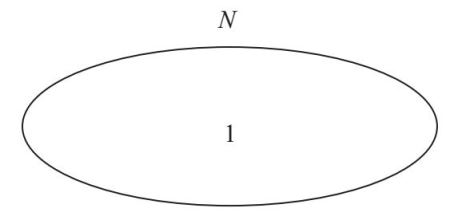
##### 图 3–4

这似乎没什么特别，看公设 2：对于任意自然数 n，其后继数 n'都是自然数。我们现在还不能认为 n'=n+1。因为到目前为止我们还没有定义“+”。事实上正如哥德尔所说，仅这两条，系统还不能表达足够丰富的内容。那么是否就能说“1”是自然数，“2”就是自然数了？也不能。因为根据公设 1 和公设 2，我们并未定义字符“2”。姑且把 n'作为字符使用，1'作为 1 的后继数。那么根据公设 2，1'也是自然数。注意这并非矫情，我们只是太习惯用工具制造新东西，而常忘记工具本身也需被制造，其可靠性也需考察。

此时我们有了图 3–5：

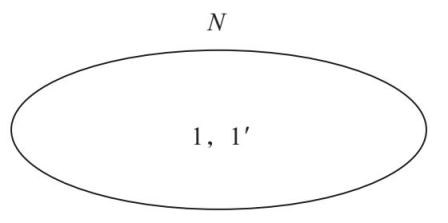
##### 图 3–5

根据公设 2，我们有了图 3–6：

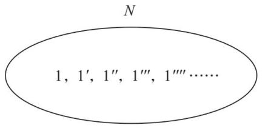
##### 图 3–6

虽然公设 1 和公设 2 不算复杂，但已可定义几乎无穷多个符号及其基本性质。更重要的是，我们已在使用演绎法，通过逻辑推理由公设得出结论，并且由于不断使用同一个公设，事实上已开始尝到自然递归的味道，这在数学证明中是常用方法。

> 公设 3 对于任意自然数 n，n'≠1 都成立。

这似乎是废话，我们确实可得出 1'≠1，但有什么用？另一个结论似乎是 1 是最小的自然数。但问题是，我们还没有定义“大小”，因此无法比较大小。所以不存在“1 是最小自然数”这一结论。我们只能说 1 不是任何数的后继。

先看公设 4，再回来看公设 3 的必要性。

> 公设 4 对于任意自然数 m，n，若 m'=n', 则 m=n。

这看似理所当然。当 m 的后继和 n 的后继相等时，m 等于 n。这相当于 m+1=n+1 得出 m=n。事实上我们还没有定义“+”，但公设 4 确实在给我们定义使用算法，比如后继符号“'”应具有哪些性质。

若我们假设想要的自然数序列是：

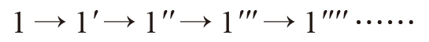
如果没有公设 4 的要求，我们可以定义 1''''=1'，即使 1 不等于 1''' 也可有 1''''=1'，这样会造成：

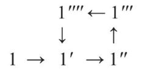
这样的结构，完全满足公设 1、公设 2 和公设 3，但不是我们想要的。

所以皮亚诺想要定义的是：1 是自然数，故有公设 1，任意自然数都有后继，故有公设 2，然后没有后继数为 1 的自然数，故有公设 3，后继数一个一个延伸下去，序列单向，不许回头，不可打结，故有公设 4。

有了公设 1、公设 2 和公设 3，仍可能形成这样的序列：

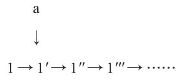
公设 1、公设 2 和公设 3 都没有限制这个序列里的所有元素都源自 1。这个序列走着走着可能有别的符号加入，所以公设 4 用来防止其他来源的符号与已定义的自然数列会合。但这样是否有了公设 4 就不需要公设 3 呢？如果只有公设 1、公设 2 和公设 4，自然数还可能有这种结构：

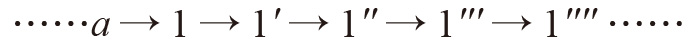
这个数列从莫名其妙的地方来，最终跑到莫名其妙的无穷远去。所以必须规定，1 是唯一排在最前面的起点。

> 公设 5 假设对自然数 n 的谓词 P（n）而言，下面的（a）和（b）都成立：
> 
> （a）P（1）成立；
> 
> （b）对于任意自然数 k，P（k）成立，则 P（k'）成立；则，对于任意自然数 n，P（n）都成立。

从局部到整体的推力

公设5讲的是归纳推理怎么成立——对任意自然数 n，命题 P(n) 都成立该怎么保证。自然数的定义里本来就嵌着归纳，所以归纳与自然数几乎是共生的。设想自然数只有 1、1′、1′′ 三个，逐一核查 P(1)、P(1′)、P(1′′) 就能盖章。但真正的自然数是无穷长的，不可能挨个检查。要对整条序列下结论，就得借助一种放大机制。公设5提供这套机制，把在有限点观察到的性质推移到整个序列上。

于是归纳拆成两步：

> （a）起点：先证 P(1) 成立；
> 
> （b）递进：任取自然数 k，只要 P(k) 成立，就能推出 P(k′) 也成立。

(a)(b) 同时成立，P(n) 对所有自然数 n 就都成立。

有了这块基座，加法才好正式写下。

公设 ADD1：任意自然数 n，n+1 就是 n′；
公设 ADD2：任意自然数 m、n，m+n′ 与 (m+n)′ 含义相同。

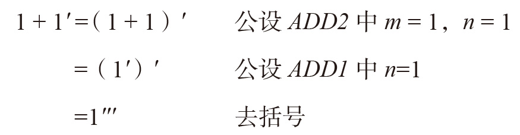

为了记法简便，后面记 1′ 为 2，1′′ 为 3……凭借 ADD1 与 ADD2 可以严格得到 1+2=3，即命题 1+2=3 为真。

太好了！

## 自然数的集合底座

公元前六七世纪，古希腊几何开始萌芽，德谟克利特、毕达哥拉斯、阿基米德都在其中留下痕迹。欧几里得把前人的成果整理成《几何原本》，这本书把古希腊对世界与思维的理解凝结成范式，影响之深远远超后两千年的科学总和，只是文艺复兴后才被充分意识到。

《几何原本》之所以成为标杆，在于它搭建了一个完整的形式演绎体系，成为理性追求的两千年参照。古希腊人长期探讨形式演绎与现实的关联。欧几里得提炼出希腊式的思维框架：合乎理性的假定—严密的推演—得出结论。

据此思路，约公元前300年欧几里得列出五条基本公设：

> 1. 任意两点可由一条直线连接。
> 2. 任意线段可向两端无限延伸成直线。
> 3. 以任一线段为半径、以一端为圆心可作圆。
> 4. 全部直角彼此全等。
> 5. 若两直线与第三直线相交，且同侧内角之和小于两直角，则这两直线在该侧必会相遇。

欧几里得几何是理性学科的理想样本，人类几千年一直在努力把其他学科塑造成它的模样。真正让人不安的是第五条平行公设，表述冗长，似乎多余。它等价于平行线永不相交，能否由前四条推出？两千多年里无数人怀疑其必要性并尝试证明。十九世纪有人甚至想用反证：假定平行线在无穷远相交，导出矛盾。但很快发现，仅凭前四条公设，只要给第五条换个表述，就能演绎出与欧几里得不同的自洽几何。现实也映照这种可能：地球局部经线近似平行，却在南北极汇合；若假设平行线越走越远，马鞍面就能实现这种行为。在此基础上发展的黎曼几何，成为爱因斯坦广义相对论中时空弯曲的数学语言。

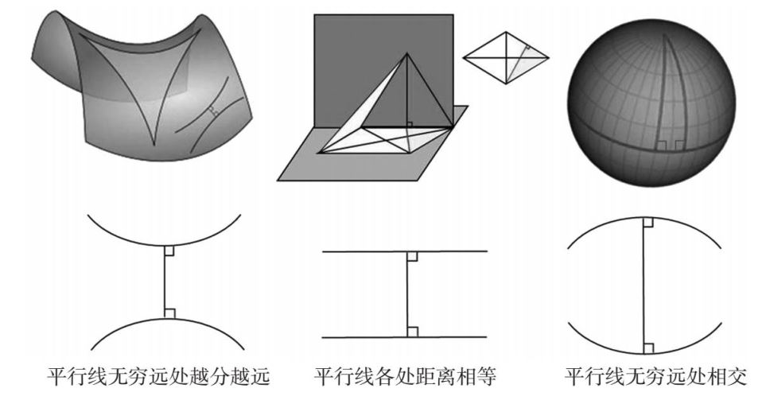

##### 图 3–7 在不同平行公设下的几何形态

公理化对后世影响深远：寥寥数条假定支撑无穷命题，逻辑保证其为真。两千年来绝大多数学者默认欧几里得几何即空间真理，定理自洽且真实。因而公设演绎的几何被视作科学知识的最高典范。直觉上，人们认为数学各分支都能找到公设集合，由此机械推出无穷真命题。但改动一条公设仍可得到自洽却截然不同的体系。对完美主义者而言这是坏消息：哪套才是对的？典范居然依赖假定，假定从何而来？能否自证其正确？

### 映射的智慧

十九世纪出现同构原理：通过定理映射，可把某一数学领域转译到另一套基本理论上。比如笛卡儿坐标几何把欧几里得公设全部转化为代数命题。

在此转译里：

点 被看作一对数（x，y）；

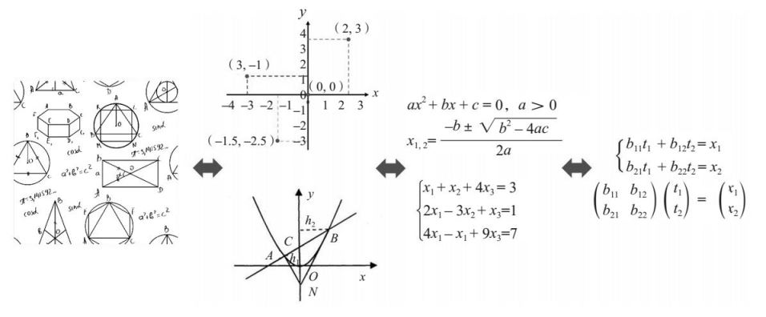

##### 图 3–8 理论间的映射关系示意

直线 被看作二元一次方程 y=ax+b；

圆 被看作形式为 R²=x²+y² 的二元二次方程。

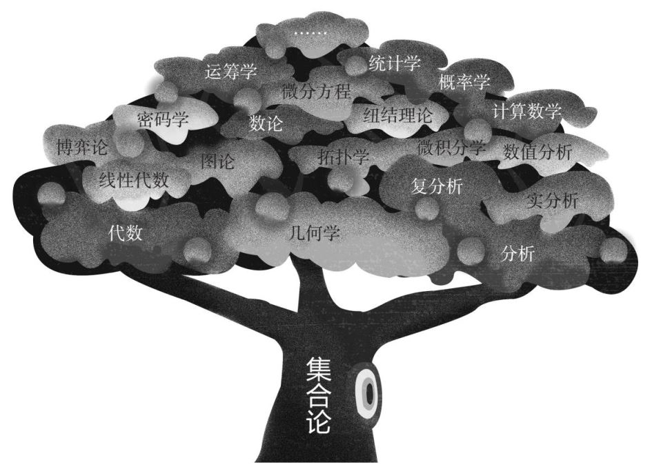

##### 图 3–9 同构的直观表达

数学分支本身往往繁复抽象，同构原理让它在另一套系统里变得简单。数学主要谈“数”与“形”。“形”属几何，却可坐标化。平面上把点（x，y）直接等同实数对（x，y），“形”的直观便被实数替代。至于实数，狄德金与康托在十九世纪中叶各自给出构造，用有理数  作为材料生成实数。有理数可看成整数对（m，n），n≠0；若另有一对（m′，n′），当 mn′=m′n 时，我们把  和  视作同一，这样就可用整数造出有理数。整数也可用相似方法由自然数生成。于是整个数学可奠基于自然数。

更进一步，按操作符号规定，代数也能映射回自然数定理系统，用自然数模拟代数。今天这很自然：学计算机原理时，用 0/1 与位操作实现复杂运算就一点不惊奇，这正是图灵机的策略。若能在自然数上证得系统完美，自洽且完备，其他学科也随之完美。

很快初等算术也可用另一套形式系统表达：集合论。集合论能完全定义初等数学，于是只需关心集合论是否完美。

但同构只是把问题搬家。人们渴望数学自洽且完备，自洽与完备意味着有效与有用。几何自洽推出代数自洽，只说明代数自洽则几何自洽；代数自洽本身仍需证明。这样的问题从一域移到另一域，并非绝对证明。

十九世纪中叶康托创立集合论。若把客观世界或思想中清晰可分的物事归为一类，这整体叫集合，成员叫元素。x∈A 表示 x 在 A 中，x∉A 表示不在。空集记 ∅，与自然数 0 对应。元素为 a、b、c 的集合写作 {a，b，c}。有了这些，可把自然数建立在集合上：0=∅，1={0}，2={0,1}，3={0,1,2}……进而算术与整个数学皆可建立在集合论上。

当数学大一统的前景看似光明时，二十世纪初集合论出现不可解决的悖论。最著名的是 1902 年罗素悖论。罗素注意到集合可以是集合的元素。若定义一个集合包含一切不属于自身的集合，它是否包含自身？排中律要求元素要么属于要么不属于，问题有明确意义，却陷入两难。这与理发师悖论相通：村理发师为所有不给自己理发的人理发，他该不该给自己理发？

看似琐碎，却震动数学界。按同构原理，整个数学建构以集合论为基，集合论若有盲点，其他理论也难免受损。简单对策是重建集合论表达，把集合与整数视为纸上符号，规定哪些符号串有意义、允许哪些变换，从而排除悖论。

与此同时，罗素提出的内部不可判定问题引发更深的恐惧：

数学自洽吗？会不会同时推出一个命题及其否定？

数学完备吗？所有真命题都能被证明吗？

数学可判定吗？能否靠机械计算判定命题真假？证明能机械化吗？

这些问题触及数学是否客观稳定存在，以及以数学为基的科学的根基。

人类长期认为科学知识具有确定性、绝对性与永恒性。欧几里得几何曾是理性信仰的象征。从古希腊确立理性主义起，确定性知识的追求从未中断。笛卡儿称数学是唯一范式，因其立基于公设、证明无懈可击，不受权威左右。拉普拉斯更断言世界未来完全由过去决定，掌握数学信息即可预测未来，这就是拉普拉斯悖论。先贤确立的确定性传统主导了知识论与科学哲学。哥德尔不完备定理却指出，不确定性是形式逻辑与理性思维的固有边界，即便纯数学也无法彻底确定。当数学概念与经验结合，不确定性更大。在任何足够严谨的体系里，绝对确定性不存在。

1. 英尺，英美制长度单位，一英尺等于 12 英寸，合 0.3048 米。——编者注

# 第四章

伟大的聊天

可怜的哥德尔无法自我证明重要性，我们只能请早已被证明重要的爱因斯坦来作证。但即便身为物理与数学研究者，我仍有许多不敢问或问了无人知晓的问题。这一章我大胆罗列出来，希冀二人曾聊过。

书名《量子大唠嗑》看似不甚严谨，但唠嗑对人类至关重要。唠嗑交流的不只是语言，还有身心。对话传递部分信息，信息交流不止于可记录的 01 序列。身心感受能带来声音、气息、光、温度，眼神与手势。我们亲近自然，与风与山林对话，养浩然之气；夜深时与自己对话，解答内心疑问；与朋友交谈，获得身心愉悦。

我爱动脑筋，认为与智者聊天是福分。若能穿越，我愿回到二十世纪四十至五十年代的普林斯顿，做一个可随时插话的隐形人，为那位捣蛋鬼与挚友添乱。因为我深知聊天之力：两位绝世高手每日切磋，回家做功课，第二天继续，十几年如一，那会把其他人类甩多远？他们到底聊了什么？

哥德尔生于 1906 年，比 1879 年出生的爱因斯坦小 27 岁。他出生前一年是爱因斯坦的奇迹年。1905 年，爱因斯坦发表三篇论文，奠定量子力学、统计热力学与相对论三大现代物理方向。那年他认为不太重要的光电效应研究，为他赢得 1921 年诺贝尔物理学奖。而他最得意的相对论，提出多年后仍遭怀疑。

相似点：都极聪慧，都是德语母语，都在纳粹前逃离希特勒统治，都在普林斯顿工作至逝世。不同点：哥德尔沉默寡言、悲观孤独，饮食挑剔如婴儿食品，最爱电影《白雪公主与七个小矮人》；爱因斯坦开朗合群，爱小提琴与莫扎特，讲学时万人瞩目。

二人似乎永远在他人更高的层面思考，被爱因斯坦称为“博物馆里的老物件”。爱因斯坦不接受量子理论，哥德尔相信幽灵、轮回与时间旅行，认为抽象数学像桌椅一样真实。当代许多科学家斥其天真。但两人皆坚持世界独立于思想，却可被理性认知。作为反叛者与革命者，他们拆毁了人类引以为豪的精确知识基础——物理与数学。

智慧带来共同的孤独，绝对智慧带来绝对孤独，他们在彼此陪伴中找到慰藉。

在普林斯顿高等研究院时期，爱因斯坦与哥德尔每天一同步行上下班。讽刺的是，从未有人听到他们谈话。而我这种能从只言片语体味深意的人，竟不在现场！这遗憾由时空造成。年长者以旷古之姿代言科学想象，是爱因斯坦；另一位迅速被大众遗忘，是哥德尔。但被大众遗忘不等于被历史遗忘；哥德尔对人类认知与思想史的影响至今仍在发酵。

哥德尔的工作挑战甚至推翻了自亚里士多德以来对绝对理性的追求，让我们看见理性的深层边界。与此同时，量子力学也在几乎同一时期显露相似限制。爱因斯坦虽至死不认同不确定性原理，却与哥德尔成为莫逆之交，而哥德尔正是凭借不完备定理在理性世界与认知史上确立地位。

自然与真理潜藏黑暗，上帝说让牛顿去吧，于是有了现代科学的光明。哥德尔在文明史上如流星掠过，其思想影响冯·诺依曼与图灵，催生现代计算机。奥地利经济学家、博弈论创始人奥斯卡·摩根斯坦说：“毫无疑问，哥德尔是当代最伟大的逻辑学家。”1951 年 2 月，曼哈顿工程总指挥尤利乌斯·奥本海默对主治医生说：“你的病人自亚里士多德以来最伟大的逻辑学家。”1978 年 3 月 3 日追悼会上，数学家安德烈·韦伊总结，哥德尔是两千年来唯一能不带炫耀地说“亚里士多德和我”的人。物理学家约翰·惠勒说：“称他为亚里士多德以来最伟大的逻辑学家，是贬低他。”惠勒 1974 年文章断言：“即使到公元 5000 年，若宇宙仍在，知识仍在发光，人们仍会把哥德尔视为一切知识的中心。”其思想已延伸至自然科学与人文各角，为数学、逻辑、语言、人工智能、思维科学与认识论提供启示。

爱因斯坦从 1942 年起直至 1955 年去世与哥德尔交往甚密。他认为哥德尔对数学的贡献与他对物理的贡献同等重要，“因我遇见哥德尔，我才知道数学里确实存在同样的东西”。据摩根斯坦转述，晚年爱因斯坦在高等研究院的工作已无太大意义，他坚持上班的主要动力是路上可与哥德尔聊天。1955 年爱因斯坦去世前，普林斯顿居民常看见二人散步。他们被彼此吸引，因各自学问与宇宙洞见深刻。1933 年初次相遇时，年轻的哥德尔才刚显露数学天才，而爱因斯坦已 54 岁，接近辉煌职业生涯的顶点。

即便放在今天，想象爱因斯坦在讲台上发言时听众那种近乎敬畏的氛围也并不困难。1930 年代初，哥德尔初识爱因斯坦时，对方在他心中大概也是这样的存在。他在给母亲的信里兴奋地写下与巨星交往的荣耀，1946 年他写道，自己到目前为止已经去过爱因斯坦家三次，相信爱因斯坦很少把别人请进家门。哥德尔比爱因斯坦小 27 岁，却丝毫没有被名望压住，反而敢于直截了当地质疑爱因斯坦的观点。这些质疑冷静而深刻，大概正因如此，爱因斯坦才把他当成忘年之交。

1931 年，哥德尔的不完备定理问世。那一年他 25 岁，和爱因斯坦 26 岁提出相对论一样，都把各自领域的底层规则彻底改写。哥德尔证明，数学本身是不完备的，而且注定无法被补完。无论公理体系搭得多大，总有真命题游离在系统之外。一些数学真理即便成立，我们也无法给出证明。把那些暂时证明不了的命题硬塞进系统作为新假设，系统依然会留下漏洞，漏洞会随着扩张而层层再生。爱因斯坦的相对论动摇了我们对物理世界的日常直觉，忘年交哥德尔则对数学世界造成了同样的冲击。

长达两千余年，数学家都默认一个信条：命题若为真，就能用演绎证明；命题若为假，也能用演绎证伪。正如庞加莱所言，定义与公设一旦约定，命题的真假便只关乎逻辑，不再依赖模糊的直觉。哥德尔一纸定理把这个信念击碎。真实与可证不再是同一回事。可证的必然真实，真实的却不一定可证。前者是可操作的机械推演，后者牵涉直觉、主动乃至无穷的思维。悖论的阴影因此永远跟随。很快图灵把这一局限推广到所有可由图灵机解决的问题，所有能用算法描述的问题之外，都免不了同样的边界。也难怪外尔感叹：上帝存在，因为数学似乎自洽；魔鬼也存在，因为我们无法证明这种自洽。

爱因斯坦是物理的天才，他撼动了物理学的根基。哥德尔鲜为人知，却在数学与逻辑的根基上做出了同等重大的动摇，而数学正是哪怕最实用的科学的逻辑底座。爱因斯坦晚年最后十余年里，他与哥德尔几乎每日促膝谈心。到底聊的是时空的抽象漫游、数学基础、希腊神话、政治，还是彼此的私事、同事的八卦、美德差异，没有人能确切说清。只是两位心思相近的好友在交换见解。科学史上能与他们对话的人，实在寥寥。

## 话题一：量子力学

经典物理以牛顿力学为框架，常把无穷远的影响当成可忽略的小量。引力积分从无穷到无穷，实际心照不宣的是远处的效应微不足道。热力学统计中，小概率事件也常被直接抹掉。量子力学却不这么想，微小的概率非但不能随意丢弃，反而可能成为主角。量子力学是物理学里第一个真正直面无穷的分支，而哥德尔思考不完备时，也从涉及无穷的康托连续统假设出发。

1935 年，爱因斯坦抛出对量子力学不完备的著名挑战。量子纠缠可能让一对粒子跨越相对论时空限制相互感知，影响是即时的，信息传递似乎可以无限快，这与相对论“相互作用上限为光速”的前提冲突，于是有了 EPR 悖论。在爱因斯坦看来，量子力学的某些特质暴露出理论的缺陷，它没有把该讲的物理内涵讲透，至少需要合理补充才算完备。在更完整描述出现前，量子力学是不完备的。至今几个核心问题仍缺乏圆满答案。

量子坍缩
测量会让叠加态瞬间坍缩为单一态，比如薛定谔的猫。量子力学却缺少对坍缩过程本身的合理描写，似乎就是无穷快的瞬间，这在经典物理里无法接受。

量子跃迁
电子在不同轨道间跃迁，吸收光子从低能到高能。早期的准经典画面把它想象成行星运动，很快被否定。电子在一处消失、在另一处出现，中间过程量子力学不描绘也无法描绘。

量子随机
“上帝不会掷骰子！”爱因斯坦不喜欢绝对的随机。波尔反击：“别指挥上帝。”经典骰子若初始条件已知，动力学方程足以预测结果。量子力学却声称随机是本质的，没有更深层理论可以决定结果。

量子退相干
相干性是量子性的来源，波函数才能描述干涉。但观测、温度、噪声会让干涉条纹消失，这就是退相干。量子计算的瓶颈正在于此，几十个量子单元的实验就已举步维艰。退相干的机制究竟是测量，还是与环境纠缠，目前并不清晰。

量子纠缠
爱因斯坦认为纠缠意味着超光速影响，至少在他生前，大多数研究者都尽量回避正面回应。

量子隐函数理论
爱因斯坦据此认为量子力学不完备。冯·诺依曼先证明隐变量不可能存在，戴维·博姆后来建构了一套隐变量理论，但贝尔不等式的实验证实让这一路线暂时沉寂。爱因斯坦的抱怨在学界似乎少有人接过，只好一遍遍对哥德尔诉说。数学家哥德尔在伟大物理学家的持续灌输下，很难对量子力学产生好感。

## 话题二：时间和相对论

是什么让童年的我们与现在的我们是同一个主体？时间最早来自“人会变老”的经验，再由记忆碎片拼接而成。在清醒时我们靠日光明暗校准，梦里时间却被拉长或压缩。快乐总觉得短暂，痛苦总觉得漫长。时间既是可测量的现实，又深嵌于主观感受。

爱因斯坦的相对论把我们对时间的直觉客观化。哥德尔与爱因斯坦都关注时间本质描述的不完备。1948 年，哥德尔从广义相对论引力场方程中求出一个精确解，给出一个时空模型。解的风格与他一贯的作品一致：严谨、连贯、品位高超。结果显示爱因斯坦理论中最深刻的推论之一——时间相对，且时间旅行在数学上可行。

爱因斯坦并不否认时间的存在，他否认的是传统感官意义上的时间。时间的变化是一种幻象，事物并非因时间推移而变成新物，它只是存在。正如去香港旅游，香港在出发前就已存在。未来事件对爱因斯坦而言像空间里的物体一样真实，我们只是沿着时间轴走过去看见它们。相对论把距离定义扩展为时空联合度量，主观时间体验在其中找不到位置。爱因斯坦致友人米歇尔·贝索的悼词里写道：“在离开这个陌生世界时，他又一次走在我前面。这无关紧要。对我们物理学家而言，过去、现在与未来的差别只是一种幻觉，尽管是持久的幻觉。”对人而言主观时间可分，而客观时间并不支持这种划分。记忆制造了我们称之为历史的故事。

在爱因斯坦的时空中，没有时间的流动，也没有从确定的过去流向不确定的未来的单向箭头。时间成分与空间相同，四维时空中时间被布置和传播，时间不再是普遍外在的属性，而是客观世界定向运动的指针。

## 话题三：关于理性主义真理

我的研究生曾真诚地说，学物理是为了追求真理。我问什么是真理，他答得像数学一样有完美确定性，确定真假就能找到证明。这让我想起二十世纪初的数学氛围。请看这句话：

这句话是假的。

它是真还是假？若为真则为假，若为假则为真。罗素在这种自指困境里挣扎。他试图重建不依赖直觉的数学基础，花了十多年写成三卷本《数学原理》，小心避开悖论，甚至等到第二卷才证明 1+1=2。完成后他说大脑的运作已不同以往，写作几乎造成创伤。

1931 年，25 岁的哥德尔告诉他，这是在浪费时间。不完备定理表明，任何试图用新证据补足的真理体系都会产生新的不完备。无论数学家如何精细建造房子，总有一块砖头不属于你，房子必然不完整。

哥德尔如何做到这一点？他制造了一个能谈论自身的数学陈述。给字母编码，数学符号也能编码。哥德尔构造了一个陈述：“代码为 42 的陈述无法被证实。”而他让代码 42 正是它自己。这就成了“这句话无法被证实”。若能证明，则为假；若不能证明，则为真。于是数学中存在真却不可证的命题。

第一不完备定理：在任何能表达算术且自洽的形式系统中，必有既不可证也不能证伪的命题。第二不完备定理：该系统无法在自身内部证明自己的自洽性。换句话说，永远不能排除有人用你的系统证明出 1=0 的可能。

哥德尔的结果改变了数学，也启发了冯·诺依曼与图灵研制首批电子计算机，帮助同盟国抗战。它揭示人类的思维有机器无法模仿之处，我们能直觉某些命题为真，而机器不能。罗杰·彭罗斯甚至认为这可能指向解释意识的新物理。哥德尔本人却更像莱布尼茨的继承人，是柏拉图式的理性主义信徒。经典理性主义主张知识源于先验真理与推导，与感觉无关。爱因斯坦与哥德尔都是坚定的理性主义者，这构成了他们惺惺相惜的基础。即便他们的成果恰恰动摇了经典理性主义，他们自己却未曾意识到。

1951 年，爱因斯坦亲自授予哥德尔第一届爱因斯坦奖章时，冯·诺依曼评价：“哥德尔在现代逻辑上的成就无与伦比、不朽，这不仅是一座纪念碑，更是一座意义尚未完全显现的里程碑。”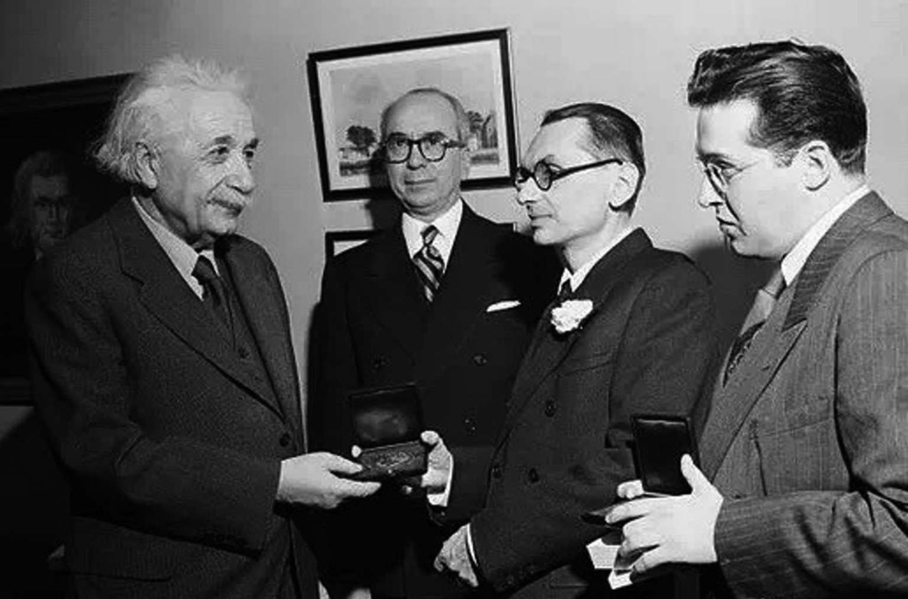

##### 图 4–1 爱因斯坦亲自授予哥德尔第一届爱因斯坦勋章

## 哥德尔的一生

哥德尔是数学与哲学的杰出人物，不完备定理使他成为时代最重要的数学家之一。1906 年出生于奥匈帝国布尔诺，6 岁患风湿热，自称从未完全康复。成年后性格偏执、易焦虑，数次因神经衰弱住院。18 岁进入维也纳大学攻读理论物理、数学与哲学。1920 年代的维也纳思想活跃，他身处维也纳学派。师从汉斯·哈恩，23 岁完成博士论文。他在学派中出色，却始终感觉格格不入，部分原因在于他的有神论信仰与学派实证主义主流相悖。实证主义只承认可经验证的知识。哥德尔甚至论证，在遵守美国宪法的同时，仍有可能把美国从民主变成法西斯。爱因斯坦曾对朋友说：“你知道，哥德尔真的疯了，他投给艾森豪威尔！”

不完备定理让哥德尔一夜成名。1933 年他开启全球巡回数学讲座，巧合的是同年首次踏足美国并与爱因斯坦相遇。两人由此结成深厚友谊，一直维持到1955 年爱因斯坦逝世。频繁的旅行却持续损耗他的精神状态。1938 年纳粹吞并奥地利之际，重度抑郁袭来，他几乎再未回到奥地利讲学。无望在维也纳大学获得教职，又担心被征召入伍，他与舞者阿黛尔·林伯斯基（Adelen imbursky）结婚，随后全家移居美国。爱因斯坦热心引荐，哥德尔在普林斯顿高等研究院开始教职。

四十年代整段时期哥德尔扎根普林斯顿，持续推进数理工作。1947 年入籍美国，1953 年升任正教授。五十年代起研究重心由数学转向哲学，发表若干篇讨论柏拉图主义如何塑造数学信念的文章。哲学立场远不如数学成果那样广受认可，但他仍是学界尊重的数学教授。事业虽顺，心理问题却始终存在。晚年偏执不断加重，他怀疑有人要在食物里下毒，与图灵之死是否有牵连已不可考。为求自保，他从不直接进食，宁可挨饿也要让妻子阿黛尔先尝。1977 年阿黛尔病重住院半年，他便彻底拒食。最终死于营养不良。1978 年1月14 日在普林斯顿离世，去世时体重仅三四十公斤。

1. 参见《量子大唠嗑》中的“捣蛋鬼哥德尔”。
2. 更加详细的内容请参见《量子大唠嗑》。

# 第五章
不完备的理性

好点子人人都会冒出来，难的是怎样抓住它并证明它有效或可用。哥德尔的精妙在于，他从一个源自两千年前的话语悖论出发，仅以理性工具自身就论证出理性工具的边界，这令人叹服。中文著述里找不到令我满意的表述，所以本章我用两三种不同思路复现证明，以示对人类智慧的敬意。

数学越趋精确，绝大多数分支已完成形式化。凭寥寥数条机械规则即可推证任意定理，由此有人推测，公理与推理规则足以让形式系统对一切可表述的数学问题做出裁决。我要证明这并不成立。
——哥德尔

第一不完备定理说，一个自洽的形式系统必然不完备。即在该系统中必定存在至少一个有意义的命题，既无法用系统内的公理与规则证真，也无法证伪，成为不可判定命题。第二定理则指出，系统的自洽性本身在系统内部也是不可判定的。

## 理性的知识系统

形式系统：遵循逻辑规则的理论，由一组无需证明的公理以及按同样无需证明的推演规则推得的命题构成。这些公理、推演和命题合称本文所说形式系统，其定义前文已出现，为加深印象此处再复述一遍。此后文中“证明”一律指证实，即确立为真。

自洽：形式系统内部不得自相矛盾。我们给出一个断言并推出其为真，则其否定即使也是有效断言，也不应同时被证为真。这里刻意避开“对的”“正确的”等近义词，我知道会让行文显板，但为求准确，这点刻板是必要的。此后仅用“真”概括这些概念，与“假”相对时也不再使用“错的”“不对的”等近称。

完备：要求对一个可作有效推演的形式系统，任何断言都能依据推演规则得到明确结论：要么被证实，要么被证伪。这与日常经验相符。学校里的数学从算术到证明题，无不把一个命题算出结果或证实其真。我们能轻易写出计算结果，只因对证明规则极熟。比如1+1=2，依据自然数公理即可推出。我们直接写出答案，只因这条推导路径对我们而言是理所当然的。1+1=2在这里就是一个命题，其证明在我们看来几乎不费力，大多数人认为它简单到不需言说。

三角形的内角和是180°。该命题在欧几里得几何中为真，可由几何基本公理推演出来，因此是定理。这是建立知识体系的基本诉求——希望用该体系规定的基础词汇组织起新断言，并在该学科内由公理证明之。而公理应尽可能少，却又足够丰富以覆盖我们想要知道的内容，让我们能以此表达学科内的概念与命题。

在一个公理系统下，任意断言都能被逻辑推演证明，或其反命题能被证明，我们就称该系统完备。完备性满足知识系统有用性的要求，自洽性则强调其有效性。需注意，此处谈完备并未要求命题符合现实的真，它只需能按逻辑规则从基本假设推导出来即可。当我们深入哥德尔不完备定理时，便会明白“真实”与“可证”之间存在根本鸿沟。

## 终极理性的梦想

逻辑演算为何能得到正确命题？答案很直接。为探索世界我们需要判断命题真假，于是构造一套工具来满足这一需求，它能保证由真命题必然推出真命题，我们称之为逻辑体系。正因我们希望逻辑体系可靠，才去定义它。这看似循环，因为为了有用而设计一个有用的工具，所以它有用。类似地，有人提出宇宙学原理：我们宇宙的物理规律为何如此？因为只有这样的宇宙才会产生提出此问题的人。

自古希腊以来，数学作为知识形式就受哲学家推崇。欧几里得几何原理、毕达哥拉斯勾股定理，无不被当时学者视为真实世界的映照。真实世界为何呈现数学之美，历史上常归因于宗教性的必然：上帝设定了规则。17世纪思想家把这种推崇推向极致。且不说他们多为顶尖数学研究者，其核心思想在于把数学纳入上帝法则。如此，建立新数学便等于成为上帝派来的破译者。对欧几里得学说，牛顿及其追随者既继承又发展出更复杂完整的体系，把数学内化为物理世界的建造工具。伽利略引入参考系，推翻亚里士多德运动观；开普勒在第谷观测数据基础上，从错误的天体模型中导出行星运行三大定律；笛卡儿近乎神奇地统一了丢番图的代数与欧几里得平面几何；芝诺关于无限的悖论经由牛顿与莱布尼茨的微积分成为可运算的实在规则。万有引力定律的推导随之水到渠成，并在随后两百年里很好地解释天体运行。这些成就孕育了18至20世纪初的自然科学。

从17世纪到1930年，数学界整体乐观：数学建立在集合论与数理逻辑两大基石之上。康托的连续统假设——有理数无穷与无理数无穷之间是否存在第三种无穷——当时仍是悬案。希尔伯特多次认为自己已接近解决，学科前景看好；大多数数学可建基于谓词演算，即形式系统的推演上。谓词演算的公理系统已被证明自洽，完备性虽待证，整体数学的基本理论即自然数算术与实数理论，都已形式化。这些系统理应自洽且完备。若能证实，则集合论公理系统亦可得同类结论，整个数学便牢不可破。

细心者对数学客观性心存疑虑。似乎作为逻辑的高阶形式，数学依赖公理，而公理的改变带来不同描述方式，自然界并不因我们选用何种描述而改变，似乎每种皆可，只是方便简洁而已。

同构映射也是当时的重要进展。人们发现一类数学范畴中对象间的关系，可证明在另一范畴中同样成立。以乔治·布尔为代表的19世纪数学家成功将代数“算术化”，并证明数学分析概念皆可用数论术语唯一定义。事实上这亦不遥远，我们可以把这样的虚数定义为整数的有序对（0，1），并赋予某种加法与乘法运算及操作规则，它即可完整表达虚数全部性质。我们也可以把定义为一个有理数的类，例如所有平方小于2的有理数组成的类。利用同构原理，可把几何用代数描述，用无理数与有理数替代代数，再归纳到自然数，数学各领域可经同构对应，只要证明其中任一系统的完备与自洽，其他系统自然随之被证明。而自然数又可通过集合论述来定义，故集合性质成为整个数学的基石。

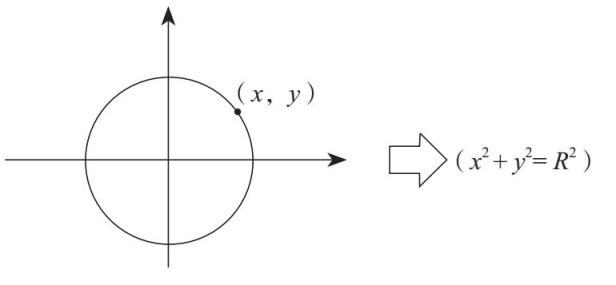

##### 图 5–1 同构映射

举例来说，用代数公式表示空间中曲线曲面间错综复杂的几何关系，比直接处理几何关系更容易；处理复杂逻辑关系的算术对应，也比直接面对逻辑关系更易。由此可构建一套描述该套关系的数学体系，它独立于任何具体数学内容，用以描述数学的数学，即元数学。我们会看到，哥德尔亦借此途径，把逻辑推演化为合理的算术问题，用算术形式演算关于算术的元数学问题。在此基础上，若关于算术形式系统的复杂元数学命题能被翻译为系统内部的算术命题，将极大助益元数学自洽性与完备性的证明。

映射的概念不难理解，建立事物间的某种对应关系，作为方法被我们广泛而非严格地使用。语言是我们对自然界与自身思维的映射。我们用“猫”一词替代自然界中对应的动物，对它的陈述让我们理解猫在自然界的状态，而非把猫抓来演示。我们同样设计棋类游戏，如象棋，用以推演军事或纯粹娱乐，“帅”“士”“兵”标记不同棋子重要性，这些重要性同样可用1、2、3等数字标记。但严格的映射却不易获得。当我们用映射证明某类问题时，必须严格证明对应关系，而非仅凭词义相近即借用作为依据，这常构成论证错误。如谈“上善若水”时，并未论证“善”与“水”的映射关系，仅凭特性相似便推不出延伸结论。我们常混淆修辞与论证，此例中的比喻并非论证，只是一种修辞。而我劝读者在相对严谨的文体中少用比喻，比喻会带来大量不经意的逻辑混乱。19世纪同构映射取得重大进展，许多不同分支的数学被证明可同构映射。这样在一个分支找到的规律，在其同构分支中同样存在。数学家往往只选择证明起来更方便的分支。

## 理性的典范：算术

数学可还原为算术，而算术可归结为皮亚诺系统的数条公设。我们重述前面介绍过的皮亚诺算术系统的几条公设：

> 公设1 1是自然数；
> 
> 公设2 对于任意自然数n，其后继数n'都是自然数；
> 
> 公设3 对于任意自然数n，n'≠1都成立；
> 
> 公设4 对于任意自然数m，n，若m'=n'，则m=n；
> 
> 公设5 假设对自然数n的谓词P（n）而言，下面的（a）和（b）都成立。
> 
> （a）P（1）成立；
> 
> （b）对于任意自然数k，P（k）成立，则P（k'）成立；
> 
> 则，对于任意自然数n，P（n）都成立。

在此基础上，我们可将自然数集合扩充为整数、有理数、实数，并定义加、减、乘、除、幂指、对数运算等。比如：

加法定义：（1）m+0=m；（2）m+n'=（m+n）'；

乘法定义：（1）m×0=0；（2）m×n'=m×n+m。

重申自然数定义后，我们尝试用集合构造算术：这里符号∪表示并集，即原集合加上新集合。若读者不熟悉集合，我们简要说明。集合是对象的总称。比如自然数集合{0，1，2，3……}，不同版本对0是否为自然数规定不一，我们不深究，此处把0视作自然数。一个学校各年级集合{一年级、二年级……}等，均构成集合的基础。我们甚至可在集合中定义自然数。

空集是没有元素的集合，即{ }，记作∅。

在集合上定义后继运算：m'∪{m}。

用集合定义自然数：

0=∅

1 ={0}

2=1∪{1}={0，1}

3=2∪{2}={0，1，2}

4=3∪{3}={0，1，2，3}

……

将<定义为：m<n为m∈n，即m是n的子集。所以，0<1<2<3<……

集合论中有一条公设：所有自然数构成一个集合。

在集合论中可证明，这样定义的自然数满足皮亚诺五条公设。既然数学可还原为算术，算术可还原为集合，那么可说数学可还原为集合。

上面用集合定义自然数，相当于给不同集合取名。空集∅的名字是0，空集的集合{∅}的名字是1。并非1与{∅}真的相等，否则会产生问题，1={0}如何成立呢？左边是个数右边是个集合？

集合构造算术的关键在于，这样构造的集合恰好满足皮亚诺公设。所以研究集合即可弄清算术性质。这种构造并非唯一，只要满足皮亚诺公设即可。弗雷格把逻辑形式化为集合论的一部分，在集合论统一数学上作出卓越贡献。我们确实看到一种希望——通过集合统一数学理论体系。

就在弗雷格将关于集合论的巨著付印前一天，他收到英国数学家罗素来信。这封信充满历史的黑色幽默，若对数学家还能笑出来。信中罗素提出集合悖论，使弗雷格以集合论建立的算术、代数、几何大厦根基动摇。用弗雷格话说：“突然数学大厦的基石崩塌了。”他发现自己多年的成果被悖论搅得一团糟，只能在著作末尾写道：“一个科学家最倒霉的事，莫过于在工作即将完成时却发现根本依据崩溃了。”

罗素在信中写道：

> 亲爱的战友：
> 
> 我完全同意您的观点，您所论证和讨论的问题的重要性是很多逻辑学家的工作都无法比拟的。
> 
> 我就有一个小小的困惑想向您讨教，考虑那个不包含任何元素的集合，它是否包含自己呢？

例如，若以所有集合为元素的集合U，便符合U∈U条件。但一般集合，如北京大学所有同学的集合V，便不是其本身元素V∉V。现在用A表示所有不以本身为元素的集合所成的集合，即若x∈A，则x是集合且x∉x，现在问A∈A是否成立？即A是否包含自己。若A∈A，则A具有A元素的性质，A是A的元素，但A明明是所有不以本身为元素的集合，这与A定义矛盾；反之，若A∉A，则A不具有A元素的性质，故A符合A定义，即A∈A成立，这也是矛盾的。但A∈A与A∉A二者之一必成立，所以矛盾难免，形成悖论。

罗素本人并未将包袱丢给弗雷格，他随后花十几年研究此问题，写下厚厚三大本《数学原理》，试图绕开逻辑悖论。数理学家、哲学家约翰·凯梅尼后来称《数学原理》为“一本被每个哲学家谈论而实际上无人读过的伟大著作”。罗素绕开悖论的策略大致是：可定义不同层次的语义与逻辑规则，通过控制这些规则，有可能划分出清晰渠道以避免自指。即，通过严格的语义与语法层次分割来避免陈述指向自身的情况。

关于数学本质，罗素有一个著名论断：纯数学是这样一门学科，我们并不知道我们在谈论什么，或者我们不知道所谈论的是否真实。这精准切入希尔伯特伟大工程的核心——为全部数学构建纯语法框架。希尔伯特受到刺激的主要原因是，他感觉到类似罗素悖论的核心问题，是由于陈述中悖论性语义内容所致。希尔伯特相信，根除数学中出现此类悖论的方法，就是建立一种实质上无意义的元数学框架，我们在其中可谈数学陈述的真或假。这样的框架构成数学的形式系统，也构成数学中研究“什么是可证明的”与“什么实际上是真的”两者之间鸿沟的历史起点。基于对完美形式系统的期望，希尔伯特开始伟大工作。希尔伯特的数学终极理性是：

> 1.将整个数学体系严格形式化；
> 
> 2.用元数学证明整个数学体系建立在牢不可破坚实基础上。

除去罗素的怀疑，元数学系统已可完全形式化：将系统内所有表达式的意义抽掉，视为空洞符号，按事先规定的一组规则对这些符号进行操作。这样可构建本身没有任何意义的符号系统来演算或推演。这套符号系统所有含义都由外部定义。这事并不抽象，考虑一台计算机，制造者并不关心我们拿它写文章、编程序、打游戏还是看电影。他们只是按设计好的规则造芯片、焊接电路、组装零件、安装操作软件。计算机本身可视作这套元数学符号演算规则在物理世界的体现。因此具体实施步骤是：

1.将所有数学内容形式化，用确定而唯一的符号表达，彻底摆脱自然语言模糊。
2.证明数学完备性，我们能够证明所有真理，只要是真实命题即可被证明。
3.证明数学自洽性，数学本身不会自相矛盾，确保我们在不违背逻辑前提下获得结果有意义，不会出现某陈述既真又假。
4.数学可判定性，可找到算法自动、机械地判定数学陈述的对错。

在此大背景下，罗素的《数学原理》提供了一套全面符号系统，借此所有纯数学命题，特别是数论命题，都可用标准方式表示；同时《数学原理》明确了数学证明所用的大多数形式推理规则。

## 语义和语法

亚里士多德逻辑学有两个支柱：不经证明而被视作真的前提或公设；保证从一个真陈述变换为另一个真陈述所使用的推理规则。我们以古典逻辑中亚里士多德三段论为例说明，这结构也常被称为大前提、小前提和结论。

> 大前提：所有人都要上学。
> 
> 小前提：小明是个人。
> 
> 结论：小明要上学。

《演绎会失效的那一刻》

三段论看起来无懈可击，前提成立结论就稳。只要大前提和小前提都是关于真实世界的可信判断，并且套用“所有 X 都是 Y，Z 是 X，所以 Z 是 Y”这条亚里士多德式的规则，推出的结论就可靠。确定性来自前提的内容，也来自心智里严格的推演过程。

问题在于，语言的层级一旦混用，推理就会张冠李戴。

> 证明：亚里士多德是工作。
> 1. 亚里士多德是哲学家。
> 2. 哲学家是工作。
> 3. 所以，亚里士多德是工作。

形式上完全合规，语义上却荒唐。这里的“哲学家”一词在第一句里指具体的人，在第二句里却成了“职业”这个元概念。两个前提说的不在同一层，结论自然滑稽。类似的层级错位会把我们拽进自指的漩涡。说一句“这句话是错的”，就是在语法层和语义层之间来回跳。所有源自自指的悖论都共享这个结构，最经典的是说谎者悖论：克里特岛居民说“克里特岛上所有人都说谎”。真概念被困在了正在谈论它的系统内部，哥德尔后来证明，真这个概念无法在自己所处的那个形式系统内部被完全抓住。

为了绕开真假的缠斗，哥德尔引入了更可操作的概念：可证性。

先把几个关键语言理清。直觉算术 IA 用我们日常理解的数学语言说话，句子表达的是有关自然数的真假，直觉上能判断对错。形式算术 FA 是罗素《数学原理》风格的纯语法系统，只有公设和推导规则，能判定哪些字串是定理，没有语义，没有真假。IA 是意图性的表述，FA 是方法性的镜像。当两者逐一对应时，FA 的符号才获得 IA 的数学含义。

在 FA 之上还有一套用来描述 FA 的语言，即形式算术的元理论 MFA，它解释 FA 的语法、什么是良构式 WFF、什么算作证明。和 IA 一样，MFA 的句子是有意义的，可以判断真伪。形象说，FA 是机器，MFA 是操作手册。

希尔伯特的一个洞察为哥德尔铺路：任何公理化数学分支本身就是一个数学对象。哥德尔发现用自然数本身就能镜像自然数之间的关系，使对象可以自我指涉。通过算术化元数学，他证明 FA 不仅能表达 IA，也能表达 MFA。于是 FA 可以代表它自己的元理论。

接下来是配数。哥德尔给 FA 的每个基本符号编号，再按规则给每个良构式和证明序列编号。一个证明就是字串的序列，于是也能对应唯一自然数。这样，形式系统内的逻辑关系被翻译成数之间的算术关系，反之亦然。配数保证一一对应，一个数不会同时指一个命题和一个证明序列。

真概念被替换为可证性后，哥德尔构造了名义上自指的陈述 G-S：这个陈述在该系统中不可证。它同时在 IA 中直觉为真，在 MFA 中断言自己的不可证性。

由此产生两难。若 G-S 可证，它就宣称自己不可证，系统出现矛盾。若 G-S 不可证，而它直觉为真，则系统里存在真但不可证的命题。于是得到结论：任何自洽的算术形式化系统都不完备。

通俗地讲，哥德尔的两条结论是：

1. 一个算术系统要么自相矛盾，要么必然包含真却无法在系统内判定真伪的命题；
2. 系统内部无法证明自身的一致性。

证明策略可以拆成四步：先处理数论的一致性问题；证明真理在数论里不可定义；把真换成可证性，造出不可判定论断；最后证明完备性陈述本身不可判定。

更具体地，哥德尔用 46 条定义和几条预备定理建立元数学真理与算术命题的对应。WFF 指符合规则的字串。哥德尔证明 IA 的每个递归函数都能在 FA 中表示，FA 的语法概念也能算术化。于是形式系统的定理既能代表数论真理，又能通过配数代表语法真理。

这个证明揭示了算术的分水岭。康托的对角线已说明系统不能包罗一切数学，但哥德尔指出只要系统含有加法和乘法，就必然包含简单却不可判定的命题。像 130=2×5×13 这样的因式分解特性，让数学性质与陈述之间建立对应，从而把“说谎者悖论”这类自然语言悖论嵌入算术语言。

没有加法或没有乘法的阉割版算术则不同。只含加法的 Presburger 算术，或只含乘法的系统，都是完备的。欧几里得几何、非欧几何因不包含完整算术也可完备。只有当加法与乘法同时存在，不完备性才不可避免，加上指数等运算也改变不了这一本质。

## 哥德尔不完备定理的证明全景

重走一遍思路。先建立形式逻辑系统，罗素把推导简化为基本符号与规则。命题（如所有数若后继相等则数相等）即合法 WFF。

第二步是哥德尔配数。给字母表符号编号，继而编号 WFF 和证明序列。如在中国文字编码中，“清华”可对应数字序列，一样可逆。两个 WFF 的推导关系可转成数之间的因数关系。若 GN(WFF1)=3119 且 GN(WFF2)=22865389=3119×7331，则 WFF2 可由 WFF1 推得。

真无法在自己的体系内把握，于是用可证性替代。G-S 的否命题是“G-S 可证”。若系统自洽，G-S 不可证则系统不完备；若强行加入 G-S 作为公理，新系统仍会产生自己的不可证命题。于是任何包含丰富内容的逻辑系统都不能同时自洽又完备。

哥德尔把两千多年的逻辑难题变成算术问题：构造一个在算术中为真却在形式系统内不可证的命题，“这个陈述在这个系统中不可证明为真”。它有确定真值，却不可证；这与“这句话是错的”那种无确定真值的悖论本质不同。正是这一步让自指从语言陷阱变成了数学定理。

## 配数打开的自我指涉

哥德尔的关键手法在于把元语言的语法层面与算术的数值层面强行搭桥。一旦逻辑的语义能够和数论的关系互相翻译，可证性这一原本归于元语法的判断便被降维成算术上的性质。WFF 能否具备某种算术标记，直接决定它是否可证；哪怕一个命题在直观上成立，若不拥有对应的算术刻画，就只能处于不可证的状态。

##### 表 5–1 基本逻辑符号的哥德尔配数（简化版）

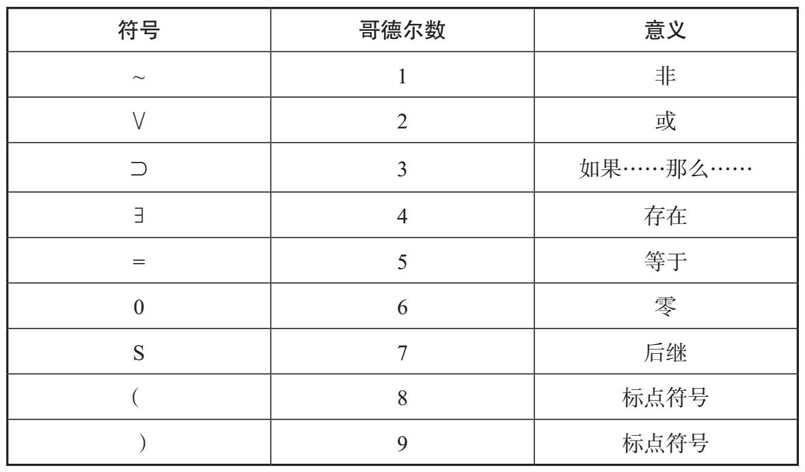

先用一个具体例子演示编码：

（∃x）（x=Sy）

该式直观上说存在数 x，它正好是数 y 的直接后继。x、y 视作数值变量，用大于10的素数标记；取 x=11、y=13，再按表把其余符号替换。替换后，公式被压缩为数列：

［8，4，11，9，8，11，5，7，13，9］

该数列与原公式一一对应，被称为哥德尔数。算术关心的始终是数，故更希望把整串化为单一自然数。依据算术基本定理，任一自然数可唯一写成素数乘积，即：

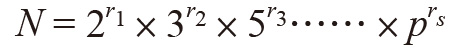

哥德尔选取前10个素数，编码后共10个分量，对每个素数以对应分量为指数做幂运算。于是公式被表述为：

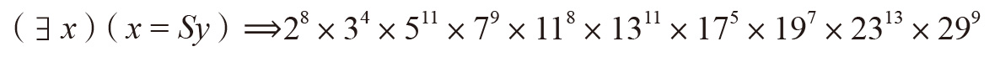

相乘所得即（∃x）（x=Sy）的最终哥德尔数，约1.4567×10^86。规模虽大，却客观存在。

**第三步：造出一个因称自己不可证而为真的命题**

Pr（x）刻画自然数的可证属性。形式系统里每个WFF经配数后对应一个自然数，对任意有效断言p，都存在GN(p)。若p可证，令n=GN(p)，则Pr(n)成立，即n所指命题可证。换言之，Pr(x)仅取真假二值：

Pr［GN（p）］当且仅当 p 可证。

意思很清楚：p可证恰好等价于其哥德尔数具有Pr性质。

再定义数的一个属性（x），它正是Pr(x)的否定。其为真对应x不是定理，即：

［GN（p）］当且仅当 p 不可证。

亦即当p为不可证的有效命题时，其哥德尔数使为真，这就是哥德尔意义上的不可证性。直接引用对角线引理：对任一单变量命题函数F(x)，都存在n使得F(n)的哥德尔数等于n本身。取F(x)=(x)即可。由此引入数g，由对角线引理对F(x)=(x)得到g=GN［（g）］。该等式断言g是“g不具备Pr属性”这一命题的哥德尔数。注意g本身也是巨大自然数。它所对应的命题正是（g），记作G，它在断言g不可证，即g=GN(g)。结合

［GN（p）］当且仅当 p 不可证。

令p=G代入得：

（g）当且仅当 g 不可证。

这意味着g具备性质，也就是(g)为真。换句话说，G为真等价于G不可证。

这一构造不仅适用于所讨论的算术系统，对包含算术的任意形式系统都成立。若把G加入公理得到新系统，同样可再造出新的真而不可证命题。无论加入多少有限公设，都无法根除现象。在任何自洽且包含算术的形式系统里，都存在真但不可证的命题。

这就是哥德尔第一不完备定理。

> 定理 1 形式系统如果是自洽的则是不完备的。

第一不完备定理可拆成前提与结论：若算术形式系统自洽，则必有命题G真而不可证。若系统的自洽性能在系统内部被证明，则该陈述本身就成为结论的证明，导致前提不成立。因此自洽性在内部不可证。

这就是哥德尔第二不完备定理。

> 定理 2 形式系统不能证明自身的自洽性。

G不可证的事实说明元数学对G的描述为真，在《数学原理》中一个表达真理的命题G却无法被证明，说明《数学原理》不完备。即使把该不可判定命题作为新公设纳入，哥德尔指出仍可再造出新的不可判定命题，公设扩张的设想因此落空。可推得数论中存在无穷多个真理无法由数论公设和定理推出，不断引入外部定理也总会有剩下的数论真理无法被形式逻辑证明。

不幸的是，自洽性不可能在形式系统内部得到证明。系统自洽要求命题与其否定不能同为定理，这是无矛盾的必要条件。若不满足，则系统可证任意命题。因此“自洽性”等价于“系统里存在不可证的命题”。

## 对角线证明法

换一个程序员更熟悉的视角重述证明，不再显式使用哥德尔对角线引理，但思路同源。严格证明往往省略大量默认推演规则，我们通常把它们当作常识而不加证明。下面先统一术语。

### 逻辑术语

定义：一个证明系统是自洽的，如果系统中的某个陈述S或其反命题可以被证明，但我们并不要求被推出来的陈述必然为真。

定义：一个形式系统是完备的，如果所有为真的命题都能在该系统中被证明，我们并不要求所有为真的陈述都可被证明。

哥德尔不完备定理：没有任何证明形式系统能同时做到自洽与完备。回顾一下形式化证明的构成。

一个形式化证明系统Π包含以下三要素：

> 1.有限的可用于证明的词汇组
> 2.有限的公设
> 3.有限的推演规则

“足够丰富”指形式系统能对任意x的取值做出判定。

定义：如果命题系统里f能被确定为真或假，那么该系统就是足够丰富的。

定义：我们用表示这样一个方程族——输入任意正整数，计算后输出0或1。若方程f属于，则对任意正整数x，f(x)必为0或1。

定义：可计算。方程f是可计算的，意味着可以用有限长的程序，如Python、C等，在可执行设备上运行，给出任一正整数x的结果f(x)，且在有限时间内终止。

定义：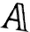是中所有可计算方程f的集合。

很容易看出中的方程有无穷多个。例如第一个方程在x=1时输出1，其余输出0：

f(1)=1；f(x)=0，x≠1

第二个方程在x=2时输出1，其余输出0：

f(2)=1；f(x)=0，x≠2

由于自然数无穷可枚举，这类方程也无穷多。

下面证明里存在不可计算方程，即可计算方程集合是方程集合的真子集。即严格小于，总有些方程有确定结果却不可计算。

### 证明

在任何形式系统中，只要证明存在，就对应一种算法。假定系统以有限字母表编写的符号语言表达，可把符号串按字典序排列：先按长度，再按字母。这就把所有合法证明排成序列，并由此得到系统全部定理的列表。

对可计算方程，写出其计算步骤，再按文档的字母顺序排列。程序常用换行符分隔，这不影响把整段程序视为一个字符串。如用某种语言编写的程序Pf计算可计算方程f，对应字符串有限。我们先按长度排序，长度相同时按字母顺序排，就得到所有可计算程序的字典L。每个可计算程序在L中都有固定位置。若同一方程对应多个程序，只保留序列中最靠前的一个。同一题不同写法在编程作业中常见，变量名不同但等价，我们只取最短字母序最靠前者作为代表。

依据字典，可把输入值与程序列成一张足够大的表，如表5–2所示。我们首先对集合里的所有方程排一个顺序。

##### 表 5–2

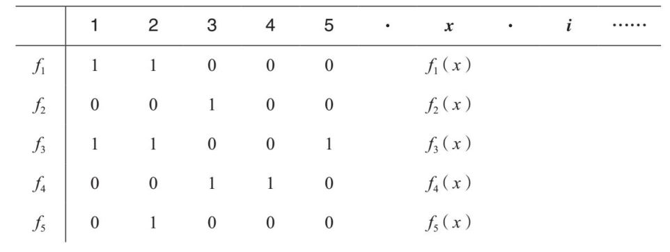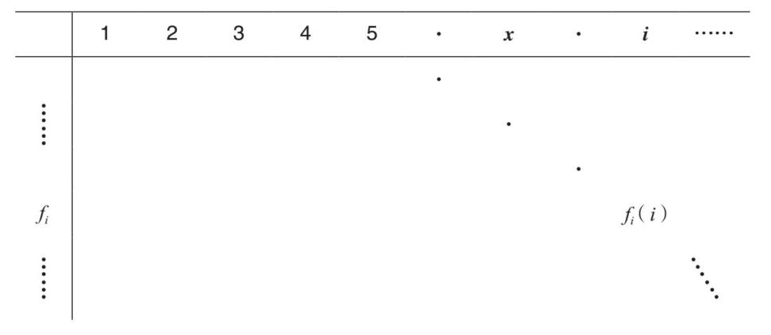

现在定义方程：

=1–fi(i)

也能对确定的正整数输入给出确定的0或1，所以它属于。按上表，(1)=0，(2)=1，(3)=1，(4)=0……

那么可计算吗？

答案是否定的，不是可计算方程。

若f可计算，它应已出现在表5–2中。假设在第j行，则(x)=fj(x)，例如在第107行，则j=107，但(107)=1–f107(107)≠f107(107)，所以不可能是第107行。同样，对任意j，(j)=1–fj(j)≠fj(j)，输入相同时与fj至少有一个输出不同，也不在任何一行。因此表5–2中没有与对应的行，不属于可计算方程，但它确实属于，于是是的真子集。

可见可以定义一个有确定输入输出的方程，却不可计算。

现在证明哥德尔第一不完备定理：在系统Π中，存在真实命题却不可证明。

补充“真”“假”的含义。

把陈述称为f陈述，对任意正整数x，若表述为“f是1”或“f是0”，每一个f陈述都是对某个整数的判定。如f(107)=1就是一个f陈述。对任意输入，f陈述只有0或1两个值。第一个是f陈述Sf，第二个是反f陈述，f。

定义真值：若f等于1，则关于f的陈述Sf为真，其对面f为假；若f等于0，则f为真，而Sf为假。对任意输入x，Sf与f必一真一假。在有效证明体系中，不可能证明假命题为真。

形式系统足够丰富：任何f命题都可以被确定陈述。我们只要求它有确定值，未必已被证明或证伪。这一点很重要。

设系统Π是足够丰富的形式证明系统，且满足：

A. 任何假命题不能被证明；
B. 任何真的Sf命题，都存在属于Π的证明序列来证明Sf为真。

由于系统足够丰富，任一整数x都有Sf与f的陈述，且只有一个为真。A和B意味着总有一个有限证明序列证明Sf或f为真。该证明序列本身可作为一个确定程序，在有限时间内给出结果，因而是可计算的。这与前述f不可计算矛盾。具体地，若A、B同时成立，可设计程序P在有限时间内计算出。对输入x，P在有限时间输出0或1。再配上P'检测输出是否符合1–f(x)，不符合时用P''检测否定，就得到能有限计算f的有限程序。但我们已证明不可计算，与之矛盾，故假设A或B不能同时成立。

因此，对任意足够丰富的形式系统Π，若它自洽，则系统内必存在正确陈述不可被证明。等价地说，自洽系统里一定存在自然数命题，其正反两面都不可证。

类似地可得图灵停机问题的不可判定性，也即不存在能判定其他程序是否在有限时间内终止的超级程序。

与前节类似，我们得到哥德尔第二不完备定理：

##### 图 5–2 一个系统自洽性的证明需要引入另外的假设，但这个新引入的假设一样需要新的假设来证明其自洽性

若系统足够丰富且自洽，其自洽性不能在内部证明。要证明系统Π自洽，需要引入另一个形式证明Π'，但Π'的自洽性也无法在其内部证明。

# 第六章

哥德尔问题的延伸

真理存在且持续。哥德尔不完备定理解释了为何我们始终需要感性部分的参与，总有些直觉认知无法被纯理性取代。这些感性认知构成了人之为人的重要维度。

《数学原理》是这次冲击的首当其冲者，但绝非唯一。哥德尔论文标题中“及有关系统”这几个字蕴含丰富内涵。简言之，哥德尔表明：无论何种公理系统，可证性始终弱于真理性。

——侯世达 Douglas R. Hofstadter

哥德尔不完备定理有几种等价表述：

> 1.任何自洽的数学形式系统都包含不可判定命题。
> 2.没有数学形式系统既是自洽的又是完备的。
> 3.没有定理证明机器或机器程序能够证明数学中所有的真命题。
> 4.数学在算法上是机械上不可穷尽的。

# 数学的梦，哥德尔的一记耳光

希尔伯特、罗素那一代人，还有他们往前追溯的先辈，都在做同一个美梦：把数学拧成一台纯粹的符号机器，让每个猜想都能在逻辑里被判定，让一切最终落回“本该如此”。哥德尔告诉大家，这不过是学者们的执念。

数学的味道其实来自观察、直觉与灵感的碰撞。逻辑只是它用的工具之一，并非它的全部，也不是所有定理都能从一组公理一路机械推出。真正的数学活在人脑与世界之间的张力里。

不完备性的直观景象是这样的：命题的答案明明存在，却找不到任何公理程序可以把它算出来；这类命题既不属于某个形式系统，也永远不可能成为其中的定理。它们的真值原则上不可计算，也无法被压缩成别的数学事实。把爱因斯坦的骰子往前推一步，上帝不仅在量子里掷骰子，在纯数学里也在掷骰子。对研究者来说这是残酷的，几十年追的证明可能根本不存在；对学科来说这是美的，它洗掉了实验派对“空想”的轻蔑，数学同样是窥探自然深层秩序的手段，把直觉和实在联在了一起。

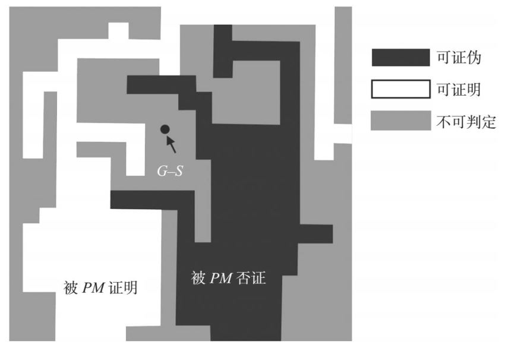

##### 图 6–1 知识空间中的哥德尔不完备定理

哥德尔还给出了一个更日常的类比。他觉得，一个按完美法则运转的社会，从行为上看必定要么自相矛盾，要么不完备。也就是说这样的社会里一定藏着解不开的难题，而且这些难题可能致命。个人的处境亦然：凡事讲原则的人，终会在某个角落讲不出原则。

## 语言装不下全部真实

维特根斯坦从语言切入得出结论：语言抓不住存在的一切。“只可意会，不可言传”被哥德尔翻译成了数学的形式。核心是，任何语言，哪怕是数学语言，都无法把我们日常所说的“真”彻底装进去。语法再丰厚也替代不了语义。哪怕在最干净的纯数学里，形式操作也捉不住数学的全貌。要记住算术谈的是数本身，而不只是算术的规则。

要让语言起作用，得有共享的认知底座，还得有对外部世界的感知：眼睛的成像、耳朵的分辨、对历史环境的熟悉。缺少这些，语言就会被无限解读，变成矫情的文字游戏。关键是，这种胡搅蛮缠在逻辑上是合法的，它可以无止境地延伸下去。

一个办法是把自然语言抽象成信息，这就进入香农的信息论。人们先追求的不是传输多快，而是有限的数据能否可靠地代表所要表达的东西。

1948年，贝尔实验室的香农用数学模型刻画了通信。发送方按约定规则编码，物理实现相对容易；噪声通道里会加冗余来降错；接收方再按规则解码。背后有两个默契：

> 假设1 双方共用编解码规则，也就是共同的密码本。
> 
> 假设2 双方拥有可共享的常识。

香农关心密码本如何建立，关键在几组自问：

1. 接收方是否拥有与我相近的认知模型？解码成功不等于真正领会，措辞得尽量减少歧义。
2. 为什么要发这条信息？对方是否已知道，是否在乎，会怎样反应，会带来什么后果。
3. 接收方要问自己：为什么要收，是什么意图。

脑中有一个概念，我们就能不费力地思考，用直觉判断对错，至少在自己内部如此，却未必能用逻辑和语言完整复述。牛顿力学兴起后流行“靠语言思考”的说法，现在我们知道那混淆了语言和语义。大脑能把握意义，一旦要用语言规则表述，就不得不承认大量细节和语义的延展被丢掉了。我们天真地相信听者能懂言外之意，而事实上他们也做到了，这过程很神奇。

英国人爱茶歇，聊天漫无边际，我至今没完全融入那种闲聊。语言交错时，我能完全置身事外。同样，当一群中国人聊林黛玉，那是一个极丰富的文化符号，身世、情感、性格、价值观都自带共识，其他文化背景的人只能旁观。

脑中有“林妹妹”的概念，我们靠喉舌口腔把信息变成振幅频率的波动，经空气或电波传过去。鼓膜、听骨、神经把振动转译成“林妹妹”。这个转译不只是大数据，而是一种尚未完全搞清的、由公有知识或共识构成的模式。同样一套声波，落在不懂中文的人那里就不会共鸣。这种共鸣程度和知识有关，但我们也拥有一种神奇的检索截断能力，知道概念该在哪里停下就够了。某种意义上，直觉告诉我们逻辑之外哪里该满足，而逻辑本身不提供满足。误解的存在说明直觉并不总灵验。这些体感属于认知层面，在编码之外。所以通信理论只管发送，就像电报员收钱发报，不问动机、内容和后果。

动物也有丰富的交流，声、肢体、触角皆可。人的对话也不必靠说话，手语、眼神、肢体都能传递信息。有声语言出现前，人类早已积累了厚重的认知基础。没有这层基础，语言就是空洞的符号。

这就带来沟通的困境：需要多少数据才能无歧义地表达真实想法？怎么说才不致误会？到这里应该明白，毫无歧义的语言系统可能不存在。但人类会在效率和可靠性之间取舍。冗余看似废话，却降低误会、提升容错。说不清，就多说两句。

我在北大待了十一年。刚到清华，和同事约“下午两点东门见”。两点钟我沿着东墙从南走到北，都没找到东门。幸好有手机，同事解释，清华东门在南边，南墙靠东那个门，对着主楼。我回，我们北大的逻辑不是这样，南门该在南墙上。同样词汇因生活习惯理解不同。两点是指北京时间还是格林尼治时间？约定时没说明。而所谓的北京时间其实是陕西天文台发布的西安临潼国家授时中心的经度时间。两点是14:00还是14:00:00？物理上不同，取决于交通方式。走路差几分钟无所谓，开车进校门就不允许分钟级误差，必须精确到秒。补充可以一直延伸下去，人却有能力在定义穷尽前达成沟通。而哥德尔告诉我们，这些定义是穷不尽的。人类能沟通，本身就是奇迹。

有次和朋友聊不完备性，朋友指着路边一辆车说，这是一辆车，会有歧义吗？要精确描述就必须描述环境。我们站在路边，指同一辆车，大脑里有大量无法枚举的共识：不在不同地点，不在画中，不在玩具。记得“人无法踏入同一条河流”吗？若指画中之车，就不是我们想的那辆。环境本身需要被描述。共识能否被大数据描述是个有趣问题。不完备性意味着共识无法被完全描述。为弥补一个概念的不足，我们引入新概念，又要去弥补新概念的不足。第二不完备定理说，对概念的详尽解释是做不完的。不是无聊的刨根问底，而是这种无聊的事确实存在且逻辑正确。大脑逻辑上说不通，却能通过忽略多余信息正常理解别人话语，适时停机而不宕机。

## 证明无法证明自身

哥德尔的证明暴露了传统证明方法的深层裂缝，也动摇了我们膜拜的理性。

数学常用反证法：证出反面矛盾，命题即成立。比方说证三角形不能有两个直角。假设有两个直角，内角和就超过180度，与已知冲突。

同理，若假设命题正确却推出与已知定理冲突的结论，就能判定假设错误。但若命题本身既证不了真也证不了假呢？看这句话：“不存在对这句话的证明。”假设存在证明，则语句自相矛盾；若不存在证明，则这句话自证。存在这类命题，我们无法证明不存在类似命题，理发师悖论也是个例子。理性逻辑的严谨在于一个反例就能推翻整座大厦，这类陈述让人怀疑反证法的可靠性，因为确实存在正面反面都无法判定的命题。

正面证明多用归纳与演绎。归纳里只有自然归纳算严格证明，其他归纳因无法穷举验证所有可能而不能算严格。

自然归纳要先证n=0成立，假设对某个确定的正整数n成立，再演绎出n+1成立。从有限前提推出对全体正整数成立。暗含的假设是规律在无穷时依然有效。我们已有反例说明这有问题，比如希尔伯特旅馆。有限与无限的规律未必一致，像1+1-1+1…有限时结果确定，无限时却模糊。

演绎要求等价。三角形内角和为180度，其中内角和与180度被视为同一事物，这不可避免地涉及自指。而自指正是逻辑的危险来源，会带来悖论。“这句话是错的”就指向自身。演绎法正是这样，我们却没有稳妥的办法区分哪些自指可以接受、哪些不可以。

### 自洽无法自证

无矛盾系统无法证明自身无矛盾。算术是最基础的领域，是数学大厦的基石。从形式化公理角度看它是不完备的，更糟的是，不断加公设也无法让它完备。

计算机只能基于程序员输入的公设证明定理，正如哥德尔强调的，它无法自行创造新公设。由此可知，任何计算机或互联系统，都不能穷尽算术的全部真理。

更进一步，不完备性不仅能由有数学直觉的人推出，连计算机也能证明哥德尔不完备定理。该定理标出了计算机的本质边界。算术真理在原则上无法被形式系统限制。真与对真的证明有相当差距。我们讨论的数学证明总是在给定形式系统内，而真独立于形式系统。哥德尔证明，数学真理无法还原为证明，语法无法取代语义，机械规则无法排除对意义的需求。

第二不完备定理更具讽刺。若算术公设系统自洽，这种自洽无法在系统内部被证明，而且这种不自洽无法靠增补假设解决。等价说法是，只有不自洽的系统才能证明自己的自洽性。冯·诺依曼听完报告立刻意识到这一点并兴奋讨论，哥德尔只平静地说相关文章已寄给出版社。冯·诺依曼说，哥德尔告诉我，我们无法通过逻辑获得领悟数学的能力。他是现代计算机之父、曼哈顿计划主要领导者之一。

普林斯顿高等研究院首批终身研究员之一的外尔称哥德尔工作为哥德尔灾难。延续两千多年的亚里士多德理性认知，尤其是欧几里得几何开启的公理化理想，被动摇了。这一切正发生在以希尔伯特为首的数学家试图彻底形式化之时，哥德尔走得更远，却得出完全相反的结论。

理解不完备定理的重要性，不仅要跨越数学障碍，也要跨越哲学障碍。

#### 后山的龙

北欧传说里，村后山有一条恶龙，每个青年在成人礼后去杀龙，从未有人回来。一对恋人，男孩去杀龙，女孩偷偷跟随。女孩看到男孩杀死龙，沾上龙血后变成那条龙。

哥德尔没有发现一个复杂神秘且不被任何形式系统包含的定理，他发现的是普遍存在的定理。一旦形式系统表达能力足够，就一定存在至少一个直觉上正确却无法在该系统内证明的陈述。该陈述可在扩展系统内证明，但扩展系统里又会出现新的不可证陈述。不存在包罗万象的超级英雄，却存在无处不在、无法去除的普遍存在。

因此，争论往往没有意义。

学术研究和日常生活中，我们常陷入争论，却忽略前提。维也纳学派发展出的务实主义要求讨论前对公设系统有共识。第一，讨论前公设相同；第二，推演规则，即逻辑相同。

科学史上意识到这一点并不容易，对真理的捍卫常是堂吉诃德式的英雄气概，甚至以科学家的生命为代价。

19世纪末，玻尔兹曼与奥斯特瓦尔德就原子论与唯能论争论：物质世界由原子构成还是由能量构成？多年后普朗克回忆，两个对手才华横溢，针锋相对。奥斯特瓦尔德的支持者以恩斯特·马赫为代表的德国主流学派不承认原子存在；玻尔兹曼作为少数派，常年辩论，极大损害心理健康。虽然玻尔兹曼最终取胜，普朗克的黑体辐射解释也借鉴了原子论，但玻尔兹曼于1906年自杀。普朗克感慨：新的科学真理不能通过说服对手建立，只能等对手渐渐离去，新一代熟悉真理时才能贯彻。辩论很难产生新东西，没有实验检验的争论没有实际意义。人可接受新知识，但若已有固执己见，靠辩论驳倒对方不会奏效。

这件事深刻影响后来的物理学，20世纪科学努力与哲学撇清关系。在没有实验的基础上，我们甚至无法确定该用什么公设，更无从讨论在某一公设下哪些结论为真，更无从讨论该用生命捍卫哪些真理。

整个20世纪是对前几千年人类理性认知系统的总结与颠覆，我们刚刚开始认识世界与工具，明确方法的同时，也认清了方法的局限。我们不得不使用这些方法认识世界，也应时时提防它们成为枷锁。人天然回避矛盾，这也是理性逻辑诞生两千多年后才由哥德尔指出其缺陷，而这个缺陷如此明显。

哥德尔第二不完备定理给人的第一印象是，真理这件事没法一次性写完。更硬地说，任何追求自洽的命题集合，都不可能在自身内部证明自己的正确。有人想把物理和数学拆开来讨论，觉得拉开距离就能绕开麻烦。物理规律不是主观规定的，物理世界看似是个封闭容器，因为一切现象和规则都必须装进有边界的宇宙里。一旦接受这种封闭，就等于承认各条法则之间天生带着不和谐、不自洽甚至互相冲突的痕迹。想调和这些摩擦，只能去寻找新的证据。人常以宇宙很大、心很大自我安慰，仿佛不自洽本来就是常态。再者，很多研究者根本不在意哥德尔留下的裂缝，日常推进照样进行。世界上的新问题远未穷尽，为何非要急着翻那些令人不安的矛盾？

定理的回答很直接。一个框架在内部证不出自身一致，就必须引入外部的证据或新的公理前提来扩充它，以担保原框架不至于崩坏。可一旦扩充，新框架又掉进同样的困境，它同样无法为自己背书。于是只能承认，用有限逻辑搭建的知识结构本质是有缺陷的，必须不断补丁。实践中真正起作用的补丁，往往是难以言说的直觉，是回到常识去看世界的方式。

### 观察者的观察者
第二不完备定理还指向权限的层级难题。设想一个可以给所有人分权的超级操作者，那么谁来分他的权？买电脑时，你可以把自己设为最高管理者。最高管理者可以给普通用户、访客划界。可最高权限从何而来？通常是厂商出厂时授予。厂商并不会把全部底层控制权交出，绝大多数维护层面的操作用户根本接触不到。维修时才需要调用恢复出厂之类的隐藏权限。即便你付了钱，拥有设备不等于拥有全部控制。厂商于是成了超级超级用户。

在政府压力下，厂商还会把数据开放给执法部门。2017 年苹果与美国政府的冲突就是典型。假设苹果在压力下交出数据，FBI 及其背后的美国政府就成了超级超级超级用户。谁来授权美国政府？美国政府认为是宪法在授权。可是宪法本身也做不到自洽和完备。问题于是回到原点：只能不断推出更大的系统去解释下一级，而在顶端仍悬着一个不自洽或不完备的公理集合。

## 不完备定理是不是理性的天花板
各式各样的迹象让人倾向于一个结论：不完备定理划出了理性认知的边界。或者说，它不是绝对的边界，至少划定了理性的局限，而局限本身就是边界。

理性思维的极限在哪？我们能彻底弄懂自己造出来的机器吗？能说清心智内部的运行机制吗？当结论缺乏逻辑上的确定性，数学家还能继续工作吗？哥德尔的工作让数学发生革命性变化，并波及哲学、语言学、计算机科学乃至物理学。他的核心结论是存在着真实却必然不可证明的命题，这条发现与神经网络到计算理论的浪潮相呼应，终结了机器全知全能的幻想，也昭示人类精神的不可穷尽。

哥德尔早年在维也纳备受推崇，却因纳粹怀疑他是犹太人而在街头被殴打。作为一位有轻度抑郁的数学家，这件事让他决心离开不久后被纳粹统治的奥地利。抵达普林斯顿后，他决定入籍美国。入籍面试前一天，他忧心忡忡地打电话给担保人、博弈论创始人摩根斯坦，说美国宪法存在逻辑漏洞，这个漏洞足以让美国变成专制。摩根斯坦只好叮嘱他，见到法官时千万别提。

第二天清晨，爱因斯坦、摩根斯坦和哥德尔一起驱车去特伦顿联邦法院。路上两位长者轮流讲笑话，想把哥德尔的注意力从宪法漏洞上引开。面试时法官被两位著名见证人震到，甚至破例让他们全程落座。

法官问：你到现在一直是德国人吗？
哥德尔答：我是奥地利人。
法官得意地说：不管怎样，奥地利曾在罪恶的专制下。如今你在美国有宪法保护，这种事永远不会发生。
这话让爱因斯坦和摩根斯坦的努力化为乌有。哥德尔提高声音说：恰恰相反，我知道它怎样会发生，我现在就能证明给你看。

#### 宪法也有裂缝
> 1972 年水门事件爆发。尼克松竞选团队潜入对手总部装窃听器，被路过的警察撞见，事态不断升级。联邦最高法院要求尼克松交出白宫录音磁带。美国宪法第二条规定行政权属于总统，三权分立原则又保护总统的行政特权。总统与亲信在白宫非正式讨论中的言论可被视为工作需要。若司法和立法部门传唤这种高度机密的私下谈话录音并据此起诉总统，就不合常理。历史上有杰弗逊、林肯、罗斯福、杜鲁门等十余位总统都以行政特权拒绝国会调查。尼克松更是不按规则出牌，直接查封特别检察官办公室。
> 
> 主审的哥伦比亚特区法官约翰·西里卡立刻表示，查封检察官办公室“看上去像拉丁美洲上校上演的军事政变闹剧”。司法部长埃利奥特·理查森惊呼“合众国政府快沦为寡头独裁”。媒体口诛笔伐，参众两院愤怒，民众群情激愤，无数电报电话信件涌向白宫国会，要求弹劾无法无天的“总统皇帝”。案件从小丑闻演变为震撼全国的宪法危机。当三权分立的最高权力发生冲突，该听谁的、谁有最高管辖权，宪法里竟没有规定。
> 
> 尼克松最终辞职。他说：“一个总统若动用军队对抗法律审查，就不再配做美国总统。”1977 年接受戴维·弗罗斯特采访时他说：“事实上是我自己弹劾了自己。”辞职换来民众谅解，化解宪法危机，维护了宪法尊严，也留下案例。克林顿后来被要求提供证据时就援引此例。

因此美国大法官制有其制度优势。联邦最高法院有权解释宪法，其判决形成判例，从而对宪法进行补充。通过不断细化，宪法的含义被丰富。判例法补充了纯逻辑规则之外的实践。哪怕是严密的有限条文体系，也离不开人的参与与抉择。

与英美判例法不同，大陆法系明文规定何可为、何不可为、僭越的代价。它沿袭经典科学习惯，假设人的行为可以被条文逐条描述。潜在认识是人的行为可用静止孤立的文字规范。我们希望一套排除个人情绪和主观立场的法律体系。这当然好，但三百多年了，人仍无法被排除出去，原因就在这里。哥德尔不完备定理说明，由有限文字记录的法典必然存在无法描述与判断的问题，这些问题只能回到人本身，由人做最后裁决。一种完全排除人的客观规范并不存在。我们以为的公认客观依据，往往是因为太多知识、信仰和道德成了默认共识，无需再沟通。

人既弥补了有限体系自洽的不足，又补充了有限知识的常识，这活儿很像补锅匠。判例法不强求排除人为因素，判例里充满法官和陪审团的气息，看似主观依赖素质，实则可能更合理。在哥德尔的表述里“真”与“可证”并不等价。人可凭直觉获得真判断，却未必能从逻辑中证明。有些事我们明知如此，却无法证明。

于是会产生一个动摇信心的疑问：既然最终逃不掉人治，建立法律体系的意义何在？或者只能把它当作人性弱点，只能追求程序正义而无法追求实质正义，至少条文本身无法同时追求含义正确与程序正义。语法无法取代语义，法律诠释最终回到认识与良知，而良知的建立依赖社会、文化，常体现为宗教教育与影响。既无法排除人的参与，又在人治中吃过苦头，能做的或许只能是“上帝的归上帝，恺撒的归恺撒”，在完成程序正义的同时，用合理制度挑选“补锅匠”并制约其权力，让最终的决策与诠释符合公众长远利益。

延伸到科学认知，我们用语言和定理去描述自然，希望它们客观预测甚至改造自然。当一个人忽略了自然世界与自身体验的关联，就容易把自然画成与人类利益无关的图景，把认知固化为孤立的东西，这正是压抑心灵、麻痹思想的根源。在对人类未来的预言里，这种出发点把人引向荒诞的时间尽头，甚至把结论当成缺乏自省的工具。

牛津哲学家戴维·卢卡斯1961年认为，哥德尔定理证明了机械论的错误，即机器不能解释心智。他坚持说，不管“思维机器”多复杂，它都按可在形式系统表达的规则运行，一旦要它说出什么是真，只能按公设和规则推演。于是总有一个我们能领悟为真的命题会逃脱机器的把握，而机器的把握无非是可证性。若把逃脱的命题列为公设强化机器，仍会有其他命题逃脱而不会逃脱我们。这些命题在数学上合理正确，但符合证明规则的形式系统永远不足以产生算术的所有真命题，就算在原则上也做不到。这个结论肯定了哥德尔的卓越，也表明人类理解和洞察不可还原为任何规则集合。人类思维必然超出逻辑设备所能实现的东西，“人工智能”正是今天对这台机器的时髦称呼。

哲学家曾希望找到一个整体自洽的图景，整合全部知识经验。我们内心反而希望图景中永远存在缺口，因为只有缺口不断存在，才能体现人类存在的意义。若完整体系存在，总有一天会被发现缺口，一旦发现，我们便可把完美的知识体系整理成可实施的工具。在封闭的知识体系里，总有一天所有事都会被做完，尤其是我们还拥有越做越快的工具，于是进入另一种热寂。整个宇宙不再有新事物被发现，这是一件悲哀。

哥德尔证明数学世界取之不尽用之不竭，没有有限公设和推理规则可以涵盖全部数学。给定任何一组公设，总能找到有意义的数学问题，这些问题既无法被公设解决，也无法判定。我们希望物质世界有类似情况，若我们的未来判断正确，物理世界也是取之不尽用之不竭的；无论走向多远的未来，总会有新事物发生、新信息涌入、探索新领域、扩大生活空间。哥德尔的理论最终会激发人们研究数学与物理世界不可预料本性的热情。不完备定理该成为寻求未知的自然法则：我们没有理由限制对自然基础的探索，也无法说明我们找到了描述自然对称性的普遍工具。相反，我们希望不完备定理限制了随心所欲的能力，这实际上保护了人类，因为一旦有算法能自动寻找真理而把人移除，人类自己也就被移除。幸好哥德尔否定了这一点，我们不能用已掌握的定律执行任何特定计算或构建算法预测未来，因为我们甚至不知道未来会有哪些新定律出现，不完备性困扰着哪怕非常简单的自然法则。

宗教与科学并非注定水火不容。科学革命前二者和平共处，中世纪罗马教会对手中对《圣经》的不同解释相当宽容，从事科学的人也相信研究在证明造物伟大。19到20世纪科学发展让文本意义上的《圣经》局促，科学每一点进展都挤压神圣领地。进化论之外，物理学也不友善。热力学第二定律预示宇宙走向无序，让相信上帝创造理想世界的人不安。膨胀的宇宙与大爆炸更迫使信仰者寻求新解释。现今本质冲突在于，宗教与科学依赖彼此不相容的逻辑原则。神的行为不受科学理性框架约束，不论在自然界还是人心。信仰者认为宗教回答了科学不能回答的问题。客观唯物主义的科学观并不意味着能理解一切，至少我们知道靠经典理性做不到。虽然我们相信可能是工具阶段问题，随着技术进步迟早了解更多。但哥德尔不完备定理与海森堡不确定性原理似乎为认知划出边界，一个从数学工具角度，一个从物理角度。它们设定的边界不是靠提高实验手段就能逾越，它就是自然的一部分，这部分未知本身就是已知，这说法颇为哥德尔化。

基督教可以相当形式化地表述：
> • 上帝存在
> • 上帝万能
> • 上帝爱人
这三条构成基本公设。
由此会出现“上帝能否造一块他举不起来的石头”的问题。这个问题涉及哥德尔所用的自指，在体系内部没有好答案。将这三个基本公设与具体的生活实践对照，又会细化到耶稣是否为神之子、圣母是否为凡人等，于是新的公设进入原系统，形成不同教派。前一个问题分开犹太教与基督教，犹太教不承认《新约》。圣母地位的肯定区分天主教与基督教。值得注意的是，这些分歧并非善意的免费讨论，每一次诠释形成教派彼此冲突，早期直至今天都意味着以消灭异议者肉体的方式消灭不同言论。教义只有经过长期众人的考验，才能最大可能包容弥补不足，获得深入解释而相对稳定，成为成熟宗教。这个时间与人数的总量至少是亿万人年，即十亿人一千年的思考、辩论与考验，它才能相对稳定，不会以简单的流血解决问题。当然这个数字是统计意义上的实证，不是必然因果。不管怎样，哥德尔是一位有神论者，他甚至证明了上帝的存在。

## 哥德尔的理性主义笔记
在哥德尔手稿中，有一捆未标注时间的手稿，其中一页大约写于1960年前后，用速记法书写夹杂少量英文。这一页题目是《我的哲学观点》，列出14个条目，看起来是他的基本哲学信念。为避免翻译歧义，列出英文原文，但这些英文也是从速记翻译而来，未必是哥德尔本意。

> 1. The world is rational.
> 
> 世界是理性的。
> 
> 2. Human reason can, in principle, be developed more highly（through certain techniques）.
> 
> 原则上，人类的理性可以得到更高的发展（通过某些技术）。
> 
> 3.There are systematic methods for the solution of all problems（also art, etc.）.
> 
> 人有解决所有问题的系统方法（也包括艺术等）。
> 
> 4.There are other worlds and rational beings of a different and higher kind.
> 
> 宇宙中还有其他世界和理性存在的不同的和更高级的物种。
> 
> 5.The world in which we live is not the only one in which we shall live or have lived.
> 
> 我们现在生活的世界并不是唯一的我们活过的或者将要活着的世界。
> 
> 6.There is incomparably more knowable a priori than is currently known.
> 
> 未知的世界远超过已知的世界。
> 
> 7.The development of human thought since the Renaissance is thoroughly intelligible（durchaus einsichtige）.
> 
> 自文艺复兴以来人类思想的发展是完全可理解的。
> 
> 8.Reason in mankind will be developed in every direction.
> 
> 人类的理性将朝着各个方向发展。
> 
> 9.Formal rights comprise a real science.
> 
> 真正的科学必然要求形式正确。

哥德尔的理性主义手记

10.唯物主义站不住脚。
11.更高阶的存在与他者并非由构成关系相连，而是靠类比沟通。
12.概念拥有独立于主观的实在性。
13.存在一种可精确操作的哲学，亦可称神学，它追问最极致抽象的概念，对科学本身大有裨益。
14.宗教的具体内容多有偏差，但宗教的本质并非错误。

哥德尔所继承的理性主义可以追溯到莱布尼茨：无论是外部世界还是内在体验，都被视作完整而精美，因而理当有序可知。哥德尔对这种信念的辩护，很大程度上建立在数学的完备与优美之上——理性主义与柏拉图主义相通，因为它关心的更多是概念层而非经验实体。数学呈现出近乎完美的形式，这让人有理由期待概念世界同样完美，进而相信客观实在本身是美好而自洽的。

莱布尼茨的愿景是现实与经验的整体都兼具意义。判断实在的合理方式，是先看我们真正能够把握的那部分。概念层面所知之清晰之美，足以让人推断经验世界的美好。尽管哥德尔对理性主义根源的把握带有形而上色彩，但他在这条路上的实践目标始终明确：把哲学发展成一种精确的科学。

在实践层面这意味着接纳主张时要求最严苛的辩证理由。哲学论证要逼近数学证明的严谨度。哥德尔早期的理性主义直指数学的严密性，他认为最多能断言自己否定了把数学仅仅归结为语法规则及其推论的形式逻辑立场；他也提出强有力的论据反对把数学视作人类创造的说法。自己更倾向柏拉图式的实在论，并认为在概念厘清之后，应当用数学般的严谨来展开讨论，这样柏拉图立场才是站得住的。

方法论之外，哥德尔清单也体现出乐观主义：一旦方法恰当，连伦理学等哲学难题也能被处理。像集合论中的连续统假设，只要对集合的基本概念进行充分而正确的分析，问题就应该能被解决。

在十四条命题里，第十与第十二条关乎实在论。

10.唯物主义是错误的。
12.概念是客观存在的。

概念不是虚构，它们是真实的对象；由事物与概念构成的结构也是真实的；事物的属性与概念之间的关系，可以不依赖我们的定义而存在。

物理实体的假设是可信的，人们有充足理由相信实体存在。因为要获得令人满意的数学系统，实体是必要的；同样，要让感官认知得到令人满意的理论，物理实体也是必要的。这两种情形里，关于实体的命题都无法被贬低为单纯的“描述”。数学是在真实感知中发生的。人们把命题当作感官认知的陈述，根源在于感官数据与所处环境之间存在密不可分的关联，没有任何事实能与我们断言的内容完全脱钩而保持绝对客观。发现新事物属于高级心智活动，让人惊讶的并非形式逻辑本身的差异，而是直觉、数学洞见与意义的差异。图灵机即便无法处理与数学意义相关的问题，仍然是最优的物理工具。十七世纪以来物理学的成功，实质上确立了普遍的客观唯物信仰：相信在人类之外存在一个独立宇宙，其运行不依赖人类。人类出现前，宇宙已运行至少137亿年。

哥德尔同样反对实证主义，即认为词义只有经实证检验才有意义。在手稿《数学是语言的语法吗？》里他作类比：“这是红色”作为直接数据是任意的，却不应忽视表达模式或完全归纳命题，亦或其背后的更简单命题。

1947年论文《什么是康托的连续统问题？》中，哥德尔提出对于有意义的数学命题，总存在一个事实以肯定或否定方式决定其真值。若数学对象或概念域存在，则任何有意义命题皆真或皆假。连续统假设就是实数领域中一个有意义的问题例证。“大小”概念赋予了假设明确含义，因而原则上应可判定。他给出两条可判定性标准：一是概念分析，要像希尔伯特的理性主义计划那样先把连续统问题表述成可由公设界定的语言；二是警惕公理方法的可靠性。即便公理法是迄今最好的工具，在用它指示真理方向时仍须保持怀疑。哥德尔指出，公理方法不可避免地带有不合理性，本身也可能错。

总体看，哥德尔不完备定理带来的冲击大致有三。虽未被大众广泛知晓，甚至专业圈也认知不足，但其光芒不会被历史遮蔽。

其一，它深刻暴露了形式逻辑系统的内在局限。这种局限源于系统的本质，无法克服也无法补救。一个形式系统的无矛盾性本质上超越系统自身。这使形式逻辑陷入两难：要么容忍矛盾，要么承认存在系统内部而逻辑方法无法证明的问题。无论是作为前提的公设，还是在此前提下的推理，都带有不可证明的直觉信念支撑。人类认识总在直觉引导下经由逻辑展开，并在获取新知识时不断扩展观念。因此信念的合理性是相对的，会随认识深化而变化。在信念向知识转化的过程中，真正起作用的是科学家非机械、非逻辑的智力创造，逻辑自洽与完备只是理想指向。

其二，数学是科学的基础，数学的不完备意味着科学结论也不完备，亦即开放。自近代科学数学化以来，问题被编码，结论被数学化。数学曾被视为精确论证的顶点、真理的化身，绝对确定性与有效性长期被信仰。1931年后，数学的绝对确定性与有效性已不再成立。作为科学的语言、模型、方法与工具的数学本身不完备，直接导致其所表述的科学结论不完备。

其三，不完备定理从科学层面揭示了人类认识的局限。许多人未加审视便接受心智无根本限制的观点。但人类自己创造的事物是最好的自省之镜，数学作为心智产物的典型，正反映了认知的局限或不完备性。

需要补充的是，以上三点未必涵盖量子力学。量子力学本身或许完备，但并非经典意义上的自洽，这也解释了它为何令人困惑。

哥德尔不完备定理动摇了自笛卡尔以来欧洲近现代基础主义知识论的传统。长期以来，知识的确定性被视为认识客观世界的信条。罗素曾说：“我像需要宗教信仰一样渴望确定性。”人们一度认为真正知识不同于意见或信念，是绝对确定、必然、不容置疑的真理。这可以回溯到柏拉图：知识源于脱离时空的理念世界，理念永恒不变，故知识可靠；信念源于现象世界，现象短暂流变，故信念不可靠。两千余年里，人们试图在思维中剔除对象与自我的不确定性，用思维的确定性建构对象的确定性，以求对自然的确定把握。

哥德尔直言我们没有任何绝对确定的知识。连极简单的事情，我们也未必真正把握全部终极实在。霍金戏谑：“上帝不仅掷骰子，有时还把骰子扔到找不到的地方。”

在新公设出现前，现存公设系统本就带有不确定性。一个命题是否正确、是否会导出矛盾，在系统建立后仍无法保证。理性系统不能提供安全保障，即便建立强有力的公设系统，也不能保证系统内所有可描述问题都能被推导并证明，仍有命题存在却无法被机械遍历以判定真伪。

我们对理性长久的信仰城墙已塌。

承认知识的不确定性，并不导致科学结论失去意义，而是将其意义从“终极反映”转向“认识图景”。科学结论是心智与理性构建的关于自然的图景，会随认知深入而变化。绝对确定性不可得，并非知识消亡，而是知识的再生。确定性可被理解为理性的理想追求，虽然不完美却是最有效的感性纽带。

数学曾是确定性的理想，如今仍是理想，尽管我们理性地知道理性的终极理想或永难抵达。追求绝对确定性不可得，不等于要走向彻底怀疑。怀疑拓展思想空间，但若因缺乏绝对把握就否定知识的产生，也是错误的。世界上没有不容置疑的绝对确定知识，但知识无需这种绝对确定，因为我们对自然的认识仍在悖论中前进。知识史就是人类在追求确定性中逐步显现不确定性的历史。

知识的悖论划定了经典理性可构造的区域与理性可思而不可证的区域。这为物理世界提供了数学与自然的新对应证据，也为有限公设之外的新假设提供源泉。由此产生“实验物理学鄙视理论物理学”的说法，认为后者只是在做数学。需要区分的是经典理性以可描述性为特征，而理性本身的范围可能远大于可描述的范围。图灵说所有可描述的算法都能被图灵机实现，这提示可认知理性可能超出图灵机能实现的部分。

不完备定理揭示了真实与可证之间不可逾越的鸿沟。我们把握自然真实未必依赖逻辑，至少在某些情境下如此。科学理性在于以严谨过程证实命题的合理性。这种对真理发现能力的限制反而是好消息，我们不必担心机器自动发现真理。机器可以推演出基于我们已发现假设之上、形式逻辑所能得到的命题，正如AlphaGo在人类未穷尽的棋局上尝试。但创造棋局与规则本身，是机器无法完成之事。

这让人联想到费米悖论。1950年代费米问：“外星人都在哪儿？”若人类再发展100万年就能飞往银河系他星，而人类科技真正发展才几百年，如今已能离地。百万年后技术会如何？宇宙已存在137亿年。若另有生命早我们100万年进化，应已抵达地球。费米悖论给出三种可能：1.外星人存在且远早于人类，已在某处不露面；2.外星人不存在；3.外星文明曾存在，但在掌握穿越机制前自我毁灭。

同理，若有人设想人工智能在2049年便能穿越时空、摆脱生物年龄限制，那它们在哪儿？宇宙法则一旦可描述便有漏洞，尤其是建于逻辑系统之上的机器更是如此。

若把科学定义为追寻可证普适真理的工具，其可信度值得怀疑。确实有一类真理可被感知，由直觉从自然提炼，却无法证明。这并不否定科学意义，科学的价值在于不断扩展认知边界。人类认知中尚有超越经典理性的层面，我们能达成共识却缺乏证明工具。我们常需寻找新假设，使其在弥补的范围内问题变得可证，但新假设又会在别处产生新的不可证问题。

经典理性之外的认知可称理性内容，它主导未知探索与新假设判定，却难以稳定描述。一旦可描述，它便转化为算法，机器可替代。我们不能否认量子力学与这种深层理性认知或有关联。

因此科学共同体建立公共认知群体，以群体道德规范知识生产。这颇像英美法系大法官制度，在面对未知时提供有益评判，根植于直觉认知与科学习惯形成的道德。

意识和梦境

牛津物理学家彭罗斯指出，从不完备定理看，数学判断的形成或严格证明中，意识的角色是非算法的。哥德尔本人也希望以意识与不完备定理结合，证明心智胜过计算机，核心在于心智在判定数学问题上的优越性。以梦境为例，最简单的心智问题是“我是否在做梦？”

庄子齐物论云：昔者庄周梦为胡蝶，栩栩然胡蝶也……不知周之梦为胡蝶与，胡蝶之梦为周与？周与胡蝶，则必有分矣。

1989年英国作家埃里克·赫顿描述梦与现实的悖论。醒来后对梦的记忆清晰如生活本身，易让人怀疑生活是否就是梦。他提出检验判据：若我发现自己在问“我在做梦吗”，这就证明我在做梦。因为清醒时逻辑上清楚自己不是做梦，不会问此问题。于是问此问题即在梦中。该判据被称为赫顿判据，比“打自己一耳光看疼不疼”更靠谱。

多年后赫顿写童年梦境文章时意识到矛盾：问“我在做梦吗”确实证明在梦中，但这判据正是他在清醒时提出的。

颇具哥德尔式的诡异。

# 第七章

人工智能的不能

日常工作大量依赖不可解问题的复杂性。在一个领域或单一问题的最优解上，计算机能自我优化地提升效率，令人叹为观止，人只能旁观放弃。但人的创新在于提出新假设与在计算复杂的多重选择中权衡，这两者都可被不完备定理涵盖。

## 深度学习
1956年夏，约翰·麦卡锡、马文·明斯基等人在达特茅斯学院研讨“如何用机器模拟人类智能”，首次提出“人工智能”概念，标志该领域诞生。此后理论与算法层出不穷，概念不断扩张。如今再看人工智能，已有六十余年历史。2006年基于神经网络的深度学习取得突破，人工智能迎来投资与工业界的新一轮追捧。此后科技明星反复提醒警惕人工智能取代乃至统治人类。

电影《模拟游戏》讲述二战中图灵破译牢不可破密码的真实故事，盟军借此掌握情报先机。从此人们想象计算机可解人类难题，进而超越人类。1980年代个人电脑普及带来第二次恐慌，1997年深蓝击败卡斯帕罗夫，《终结者》《机械战警》成为这一时期的文化符号。2006年后深度学习发展，人类迎来第三次恐慌，《西部世界》《机械姬》反映了对技术超越智慧的隐忧。未来学家雷·库兹韦尔提出奇点理论，互联网圈广泛传播，人们担忧到2049年人工智能将超过人类，人类将被机器人奴役、地球被机器人统治。

近五年人工智能进入加速阶段，这既源自六十余年学界沉淀，也离不开产学研的高频互动。数据规模扩张、算力提升与算法演进共同推动了局面。广义上讲，人工智能是人类设计出来承接部分思维工作的装置——从算盘、计算器到通用计算机乃至超算集群，都能在算法驱动下呈现类推理行为。狭义的这波浪潮约始于2006年，深度神经网络的突破为已有技术注入新动能。短短数年里深度学习在语音识别与视觉识别上取得突破，产品成熟度明显提升，围棋对弈、无人驾驶等高关注度场景再次点燃公众兴趣。

大数据作为底座的重要性业界早有共识。2009年，Google通过挖掘近百亿条搜索词，结合疾控中心2003-2008年流感传播记录，推演出了2009年冬季美国流感的时空路径。同一时期，借助深度图像算法对地图平台约五千万张街景进行解析，也能反推出区域经济水平并预测地方选情。数据体量越大，提炼有效结论越困难。海量、高速、多样的数据要转化为资产，需要更强的决策、洞察与流程优化能力。传统逻辑演绎、机器学习、统计、模式识别与概率各有擅长，深度学习则提供了处理海量信息的全新路径。本轮热潮的核心是用大规模计算从海量记录中找规律，再以规律指导具体任务的预测与决策。

以图像识别为例，一张照片即为数兆比特的数字序列，将像素映射到“人名”正是算法的目标。深度学习本质上构建图像与语义之间的数学映射，通过自适应迭代在样本与标签间不断优化以提升准确率。模型参数空间中的每个权重不必对应可解释含义，也不必符合逻辑关联，唯效果论。正是这种黑箱特性埋下了隐患：对由海量数据训练的深度网络参数空间难以完全把握，潜在风险与算法漏洞在研究中逐步暴露。

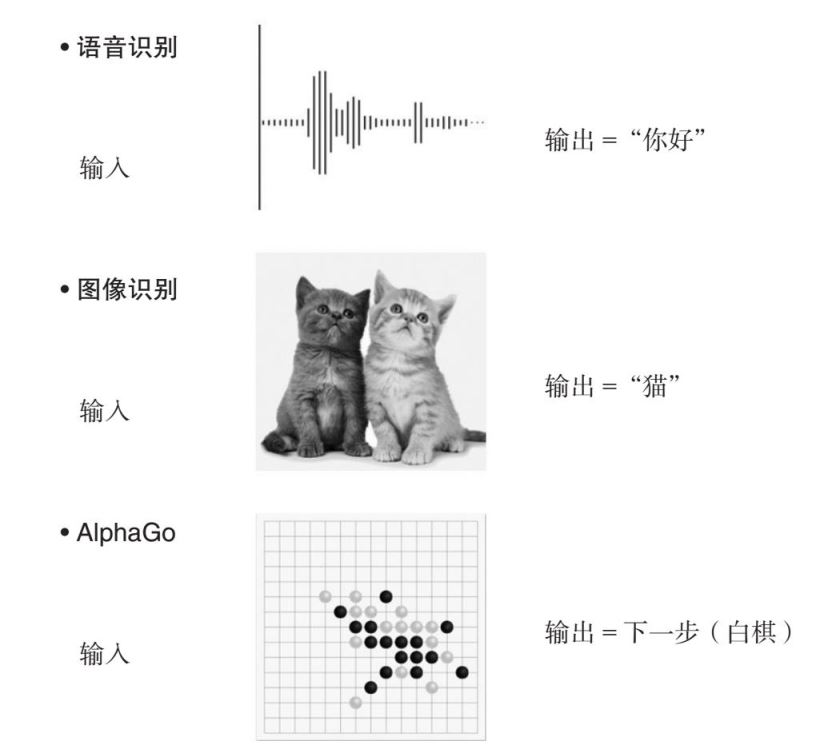

##### 图 7–1 深度学习≈找到一个方程（足够大的矩阵）

技术跃迁离不开数据供养，海量原材料支撑训练。多数AI技术依赖统计模型做概率验算，让模型浸泡在数据中持续进化，这就是训练。数据处理量扩大，深度学习的输出往往更可靠。为此学界建立了公开数据集，用高质量样本的持续丰富推动算法演进与研究生态。随模型趋稳，行业数据与产业结合更紧密，伦理议题也被系统讨论，与人类学、社会学、法学、伦理学、生物学等领域展开更广合作，力求未雨绸缪。

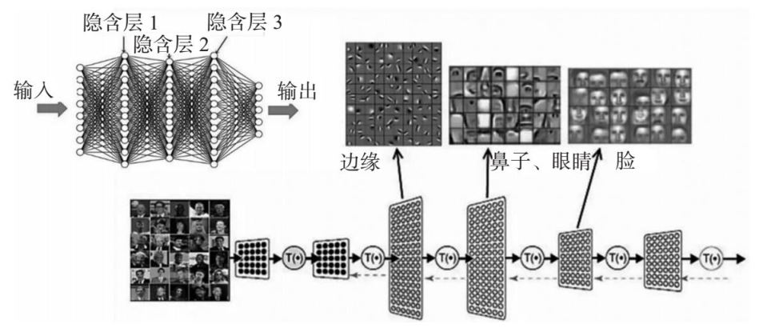

##### 图 7–2 典型的用于图像人脸识别的深度学习神经网络结构示意图

## 超越有限系统

两千年前芝诺提出阿喀琉斯追不上乌龟的悖论：乌龟先行一米，阿喀琉斯追上后乌龟再进0.1米，再追上时乌龟又进0.01米，无限递推下去，只要先行，阿喀琉斯永不抵达。

16世纪起数学家开始正视无穷，牛顿与莱布尼茨在微积分中大量使用无穷概念。引入极限后芝诺的赛跑得以解释。设阿喀琉斯1米/秒，乌龟0.1米/秒，追上首个一米需1秒，随后乌龟再爬0.1米，需0.1秒，再0.01秒……总耗时1+0.1+0.01+0.001+……=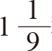秒。

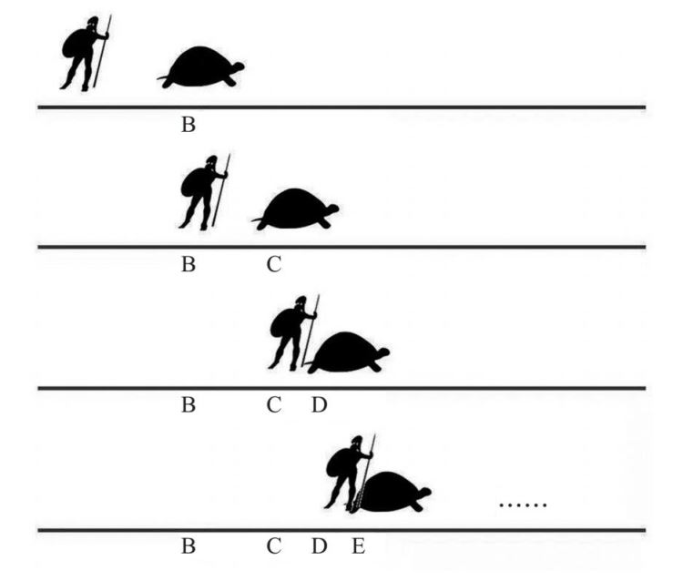

##### 图 7–3 芝诺的赛跑问题

把无限数字相加会出现矛盾。若项数趋增总和发散，例如1+2+3+4+5+……=无穷大。若各项迅速变小，无穷项之和可逼近有限极限，称收敛。例如：

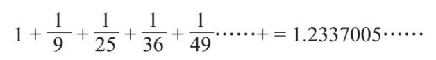

数学家对无尽求和也感到不安：

1 – 1+1 – 1+1 – 1+1–……= ？？？？？

分组看（1–1）+（1–1）+……=0+0+0+……=0；而1–（1–1+1–1+…）=1–0=1，看似导出0=1。设s=1–1+1–1+…，则s=1–s，得s=，于是1–1+1–1+1–1+1–……=。

无穷与有限存在本质差异。柯西于19世纪初指出无穷级数之和必须给出更精确定义。数学中好玩的无限构造在物理上往往不可实现，数学与物理由此显现分歧。

把y=中x≥1的部分绕x轴旋转一周形成号状曲面。它表面积为无穷，体积却是π这一确定有限值。常识上体积有限而表面积无限，需要有限油漆填充，却需无限油漆涂刷表面。二维的科赫雪花同样奇特，经过无限次迭代生成的分形面积有限，周长却无限，用无限周长围住有限面积。

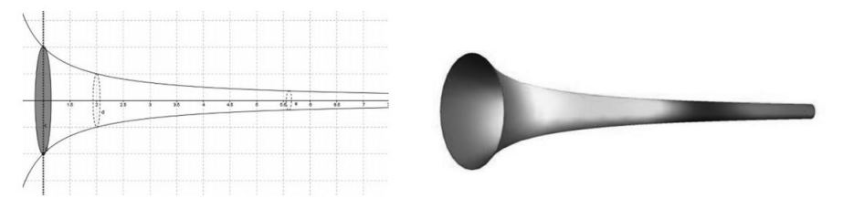

##### 图 7–4 体积有限，表面积却是无限的小号状图形

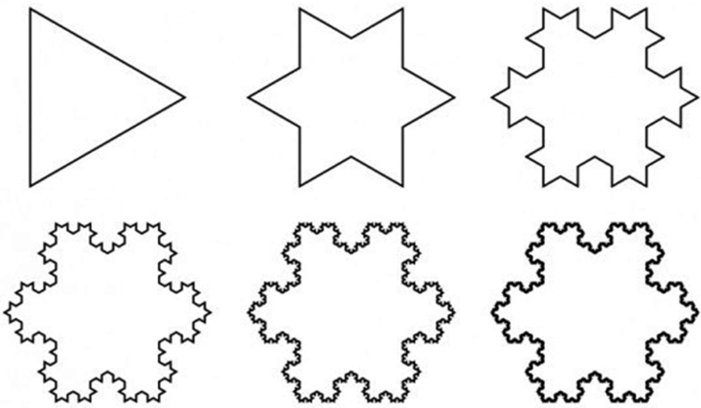

##### 图 7–5 面积有限，周长却是无限的科赫雪花

#### 无穷长的杆子不会动

> 在无限大的桌面上固定三足支架，将一根无限长的金属杆一端固定在支架顶端，另一端伸向无限远。杆可绕支架顶端自由上下转动。若杆与桌面均视为牛顿力学中的刚体，在所有合理前提下会出现奇景：仅靠一端支撑，无限长杆根本不会动。一旦杆运动就会与桌面相交导致刚体破坏，而刚体假设不允许破坏，唯一可能就是杆始终与桌面平行。换言之，无限长杆仅凭一点就能保持水平。

#### 希尔伯特旅馆

> 某旅馆拥有无限多个房间且已满员。来了一位新客人，老板说让1号房客人搬到2号，2号搬到3号……n号搬到n+1号，就能腾出1号给新人。又来无限多客人，老板说让1号搬到2号，2号搬到4号，3号搬到6号……n号搬到2n号，然后让新客依次入住所有奇数号房间。

这是希尔伯特关于无穷的著名悖论，在逻辑上完全成立，却远超直觉。

伽利略在《两种新科学》中提出问题：正整数集合{1,2,3,4…}与平方数集合{1²,2²,3²,4²…}哪个更大？前者包含后者，看似更大；但每个正整数与其平方可一一对应，大小应相等。伽利略由此萌生用一一对应比较无限集的思想。

德国数学家康托尔建立集合论，用势cardinality比较无穷集合大小。若能建立一一对应则等势。数大教室是否坐满，只需把座位与人一一对应即可。康托用对角线法证明0到1之间的无理数多于有理数，无理数的无穷是更高阶的无穷。希尔伯特旅馆也形象说明正整数集与正偶数集等势。与自然数集等势的集合称为可数集，否则不可数。可数无穷在数学上是相等的，例如偶数与自然数一样多，这与常识相悖却成立。

现实中作为人工智能基础的计算机，无论存储或内存多大都有限、可数，无法代表实数的无穷大，连可数无穷都不是。无理数甚至循环小数必须截断。可用符号表达π，但计算时只能用3.14或3.1415927等有限有理近似。很多时候误差可忽略，但在随机数发生器或混沌方程等场景会被放大，微小差异经多次迭代后结果天差地别。

机器相对人类数学认知而言，既无法理解或表达无穷大，也无法理解或表达无穷小，物理设备的有限性限制了这些概念的实现。

物理学则给出与数学认知不一致的底层限制。量子力学表明时空并非由连续无穷小构成。时间有普朗克时间，约5.39×10⁻⁴⁴秒，为光在真空中传播一个普朗克长度所需，为最小时间间隔。空间也有最小颗粒约1.62×10⁻³⁵米。物理上也不允许真正无穷，如黑洞密度可达无穷大，现有物理定律无法解释其内部结构。对宇宙起点，现有理论仅适用于大爆炸后10⁻⁴⁴秒之后，此前规律失效，因出现无穷大。

物理世界回避哥德尔不完备定理的一种方式是，审视物理是否只用了数学中可判定的有限部分。数学可容纳无限，物理并不存在无限，只有部分数学结构与物理世界对应，物理命题可能只来自数学中可判定陈述的那一部分。

## 图灵机

人类追求秩序、模式与规范。对任何有意义的数字序列都感兴趣。数家畜发明自然数，测长度发明有理数，几何产生无理数。不同数的操作构成算法。13世纪西班牙数学家拉蒙·柳利于认为数学逻辑推理可用人造机械实现。16世纪英国数学家霍布斯认为思维可表达为数值计算，“在无声思维中加加减减”。达·芬奇约在1500年前后设计机械计算机但未建造。1623年左右德国科学家威廉·施卡德造出早期计算装置，1642年法国数学家布莱兹·帕斯卡造出帕斯卡计算器。帕斯卡写道：“算术机器比所有动物行为更接近思维。”莱布尼茨造出能加减乘开方的机器，超过帕斯卡的加减功能。从算盘到计算尺再到芯片，人类计算工具从未停止探索。图灵的天才在于认识到任何计算器可执行的算法都可用通用图灵机实现。抛开硬件速度，通用图灵机可做任何计算机能做的事，每台计算机都是其变体，等价。

1934年春哥德尔在普林斯顿讲演，引入可精确定义的可计算函数即一般递归函数，递归意味着自我调用，也带来自指。1936年英国青年数学家图灵发表《论可计算数及其在判定问题中的应用》，提出图灵机设想。将逻辑命题用通用机器表示并按规则推导，得到可计算函数与图灵机可计算函数等价的结论。图灵定义了图灵机可计算函数，并提出可计算函数即图灵机可计算函数。与此同时美国数学家丘奇得到相同结论，形成丘奇—图灵论题：所有计算或算法皆可由图灵机执行。

图灵机由四部分组成：

1.输入集合，一条无限长的存储纸带，由连续格子组成，可存数字或符号；
2.输出集合，一个读写头，可在纸带上左右移动并读写符号；
3.内部状态存储器，记录当前状态并含停机状态；
4.状态转移表，即固定程序指令，按当前状态和读写头所指符号决定下一步动作并改变状态。

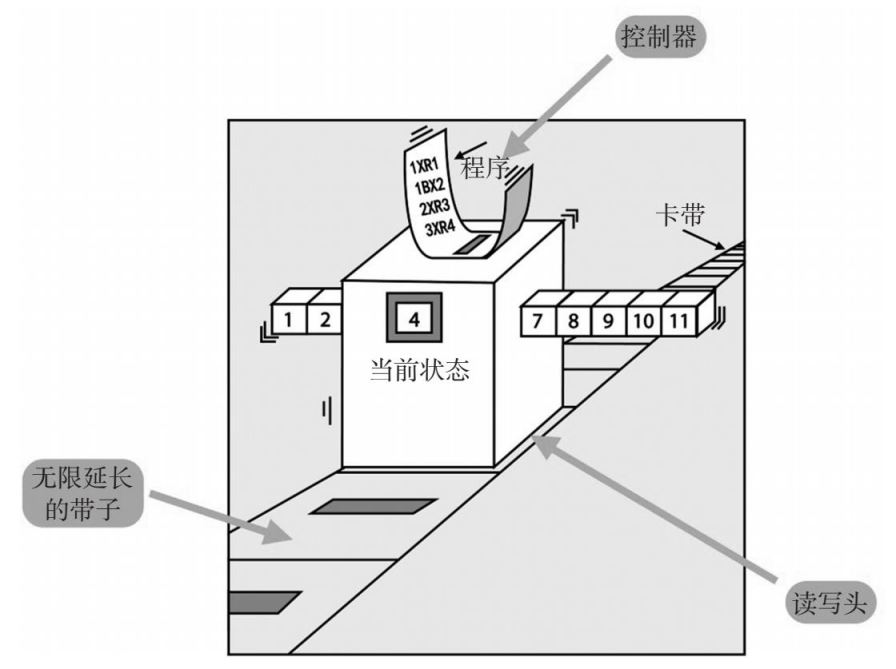

##### 图 7–6 图灵机理论示意图

图灵机的运转与笔算思维相似：每个时刻只关注一点，根据已读信息移动笔尖、在纸上写符号，规则来自九九表和加法表。若把做乘法的人看成图灵机，纸张为纸带，笔和人是读写头，乘法规则是状态转移表。这种简单模式足以定义机械计算。

下面用打印1、1、0演示。假设纸带无限，每格存一个符号，可左右移动。

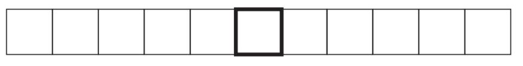

图灵机可做三类基本操作：

1.读取指针头指向格子的符号。
2.修改格中的字符。
3.移动纸带以操作临近格。

首先在指针头指向的格写入数字1：

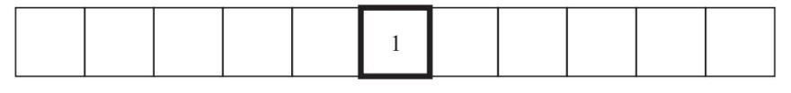

接着让纸带向左移动一格：

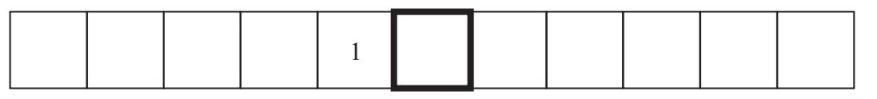

再向当前格写入数字1：

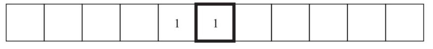

继续向左移动一格并写入数字0：

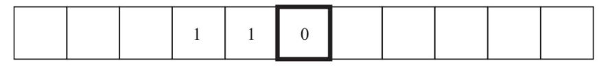

至此完成一个简单操作。

### 用图灵机完成异或操作

a、b为两个二进制变量，异或a⊕b在不同时为1，相同为0。我们尝试把110变为001。

让图灵机完成计算相当于输入如表7–1所示的操作指令，这些指令构成一个小程序。

##### 表 7–1 向图灵机输入的操作指令

图灵机：从异或到停机之谜

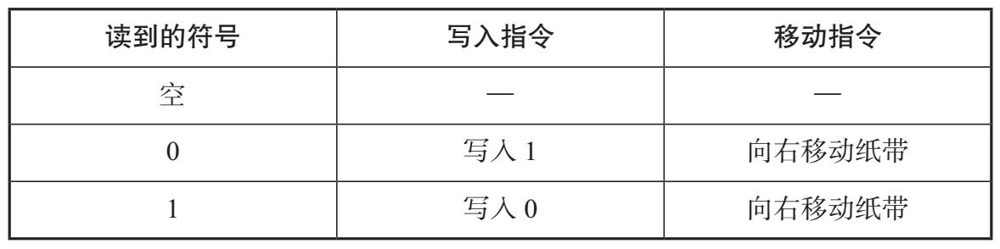

先假定此时工作带的图案是这样的：

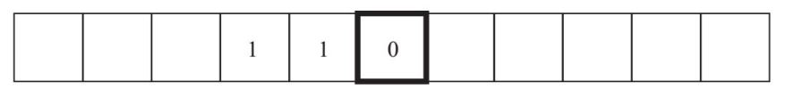

读头此刻扫到的是 0，按照既定的指令，方格里要写进 1，同时读头向右挪一个格子：

紧接着读到的符号变为 1，按规则需要在该格写入 0 并继续右移：

同理，读到的仍是 1，就重复同样的写 0 右移操作。

最终碰到空白符时，机器不再执行任何动作。按照更深入的计算理论，异或这种看似基础的操作其实具备通用性，它可以被组合成各种复杂算法。我们已经用图灵机实现了异或，理论上由此就能推导出加法、减法、乘法、除法等运算，只是实现起来步骤会更繁琐。

再来看一个稍复杂点的模型。我们把读写头想象成一条能在纸带上爬行的虫子，它只有饱了和饿了两种内在状态。

1.虫子生活在一根无限延伸的纸带上，纸带被划成一个个小格，每个格子只能是黑或白。纸带的一个片段如图 7–7 所示：

##### 图 7–7

2.虫子依据脚下格子的颜色查表决定下一步动作。

3.每一步只能向右移动一个格或向左移动一个格。

4.操作规则设定为：黑色格代表有食物，遇到就右移；白色格代表空地，遇到就左移，即：

##### 表 7–2 虫子的操作程序

在这种设定下，格子的颜色构成输入信息，集合为 {黑色，白色}，可执行指令为 {右移一格，左移一格}。

从图 7–7 标出的起点出发，虫子的行迹会怎样？

1.起点是黑色，虫子向右走一格到第 2 格；
2.第 2 格也是黑色，再向右到第 3 格；
3.第 3 格仍是黑色，再向右到第 4 格；
4.第 4 格是白色，虫子向左退回第 3 格；
5.第 3 格黑色，虫子又向右回到第 4 格；
6.第 4 格白色，虫子再向左回到第 3 格；
7.……

可以看出，虫子会在第 3 格与第 4 格之间反复横跳，形成死循环。

现在考虑一个更精细的情形，虫子拥有饥饿与饱足两种状态，而且食物既可被吃掉也可被种植。约定黑色格是有食物，虫子吃到后会感到饱。读到白色格时即便没食物也会维持饱足，只有再次读到黑色格才会变饿，这个设定纯属人为规则。

在此基础上改进模型：

1.当前格为黑色时

（1）若虫子已饱，则不吃，格子保持黑色，虫子向左移动并转为饥饿；
（2）若虫子饥饿，则吃掉食物，格子变白，虫子原地不动并转为饱足。

2.当前格为白色时

（1）若虫子饱足，则不作改变，格子仍白，虫子向右移动并保持饱足；
（2）若虫子饥饿，则种植食物，格子变黑，虫子原地不动并仍保持饥饿。

于是虫子的新操作程序如表 7–3：

##### 表 7–3 改进后的虫子操作程序

此时输入集合仍是 {黑色，白色}，输出集合扩展为 {左移一格，右移一格，吃掉食物使格子变白，种植食物使格子变黑}，内部状态为 {饱足，饥饿}。

设虫子初始为饥饿，从图 7–8 的起点启动：

##### 图 7–8

1.起点格为黑色且虫子饥饿，吃掉食物后该格变白，虫子不移动，状态变为饱足；
2.起点格现为白色且虫子饱足，向右移到第 2 格，状态仍为饱足；
3.第 2 格白色且饱足，向右移到第 3 格，状态不变；
4.第 3 格白色且饱足，向右移到第 4 格，状态不变；
5.第 4 格黑色且饱足，向左回到第 3 格，状态转为饥饿；
6.第 3 格白色且饥饿，停留种植，格子变黑，状态仍饥饿；
7.第 3 格现为黑色且饥饿，吃掉食物后变白，虫子不动，状态变为饱足；
8.第 3 格白色且饱足，向右到第 4 格，状态不变；
9.第 4 格黑色且饱足，向左回到第 3 格，状态转为饥饿；
10.……

可见该程序似乎又卡在第 3、4 格之间循环不止。图灵正是察觉到这类现象，于是提出：能否造出一台超级判别机，自动判断任意图灵机是否会陷入无限循环？

1936 年，图灵在著名论文里指出形式逻辑系统与通用图灵机之间存在等价关系。一台图灵机的计算过程与一个人依据前提推出结论的逐步演绎推理在逻辑上完全对应。简言之，给定任意一台具有无限存储的数理计算机 C，总能找到一个形式系统 F，使得 C 的所有可能输出与 F 中的所有可证定理集合一致，反之亦然。借助这种等价，图灵把哥德尔不完备性问题用计算语言重新表述为停机问题，并证明两者在逻辑上等价。

#### 哥德尔不完备定理

> 任何自洽且声称能判定全部算术命题的形式系统 F，都必存在一个算术命题，在 F 中既无法证明其真，也无法证明其假，因而 F 不完备。

#### 图灵不停机定理

> 任何声称能判定所有图灵机程序是否会停机的图灵机程序 H，都存在一个程序 P 和输入 I，使得 H 无法判定 P 在处理 I 时是否停机。

### 图灵机的意义——探寻计算的极限

图灵机如此简约，是否可以通过增加硬件与自由度让它更强？比如配备多条纸带与多读写头，或允许纸带使用三种、四种甚至更多符号？确实放宽限制后，同样的任务可以设计得更快，但从可计算性本质上看，升级后的机器能完成的任务，原版通用图灵机迟早也能完成，只是可能更慢。这种升级并不带来质的突破，符号数再多、纸带再多，能力仍属图灵机一类。

图灵机的核心价值在于极简。它为在物理世界里造出一台能解决“任何可描述问题”的真正机器铺平道路。对工程师而言，只要给出状态转移表，用机械实现一台图灵机并不困难。冯·诺伊曼在图灵模型基础上提出现代计算机的奠基架构——冯·诺伊曼结构，以运算器为核心，控制器协调存储器与输入输出的数据流动。从每秒仅数千次运算的埃尼阿克，到每秒可达数亿亿次运算的中国神威·太湖之光，发展始终沿着冯·诺伊曼路线。二十世纪四十年代至今，以图灵机为根基的计算机已渗透到生活的每个角落。没有图灵机，现代人难以为继，而人工智能无论多么宏大，本质上仍是图灵机，只是更复杂、更快而已。

随之而来的是新疑问：是否每个问题都可计算？是否会出现像逻辑悖论那样不可判定的命题？图灵基于能模拟一切计算的机器证明：机器在有限时间内能完成的正是可判定问题，无法在有限时间内完成的便是不可判定问题。受哥德尔不完备定理影响，图灵机中同样存在且无法根除的不可判定问题。

图灵机模型至今仍是应用最广的经典计算模型。除量子计算的一些迹象外，尚未出现能计算图灵机不能计算问题的模型。停机问题开启了可计算性理论，这一理论是计算学科的核心支柱。图灵还给出判定哪些问题可用计算机解决的方法，为编程语言的发展奠定基础。

通用图灵机是现代通用计算机的理论原型，指明了发展方向并证明了实现的可能性。1936 年冯·诺伊曼慧眼识英雄，如同他高度评价哥德尔一样推崇图灵，并将该领域命名为“可计算性”。一旦有了精确的数学表述，数学基础乃至整个数学界都受到了巨大冲击。不可判定命题的出现表明：有些问题虽有答案，却不存在算法可解。过去人们模糊地认为任何精确表述的数学问题都能在有限步骤内判定真假。不可判定问题的发现再次揭示有限过程应对无穷的局限，也反映了数学内部的固有矛盾。一旦算法被图灵机精确定义，便无法避开哥德尔不完备定理，可计算性与不完备性紧密相连。

### 用图灵机来模拟生命

数学家约翰·康威 1970 年发明的“康威生命游戏”具备图灵机的普适性，可模拟任何其他生命游戏规则系统。该游戏由遵循简单数学规则的元细胞构成，能呈现细胞的生死与繁殖。基本思想是给定初始构型，然后按规则演化，对应图灵机的状态转移表。

生命游戏规则如下：

1.元细胞分布在二维正方形网格上；
2.元细胞只有 0 死、1 生的两种状态；
3.下一时刻的生死由自身及周围 8 个邻居的状态决定，即：

活细胞：

（1）若邻居为 2 或 3 个则存活；
（2）若邻居 ≥4 则死于拥挤，若邻居 ≤1 则死于孤立。

死细胞：

若邻居恰为 3 个则繁殖为活细胞。

##### 图 7–9 康威生命游戏

用任何现代计算机语言都能实现该游戏，可观察到初始形状的元生物会移动、吞噬甚至繁殖等类生命行为。

## 图灵机所不能够

无论算法优化还是硬件提升，人工智能都不会突破图灵机的能力边界。今天的人工智能仍基于图灵机实现。要看它做不了什么，就回到图灵机的根本限制。图灵机做不到的事，再强大的计算机也做不到。

希尔伯特曾提出希尔伯特纲领：给定足够公理并借助机械推导，是否能对所有合法表达式给出真假判断。这个形式主义者的梦想被哥德尔粉碎。虽然梦想破灭，但仍可追问：是否存在一种一般而机械的步骤，能逐一解决所有数学问题？关键在于“机械推导”，图灵给出了答案并打开了新世界。

有了图灵机，任何数学问题都能写成程序，若能在有效时间内判定为真则停机输出 1，判定为假则停机输出 0。若这种方法普遍成立，便能解决一切数学问题，与希尔伯特的设想一致。假设这种普适算法存在，即可在图灵机上实现。

### 停机问题

设计出能解决可描述问题的通用图灵机并确定其输入输出与运算机制后，自然会问：一台图灵机何时停下？假设给出程序源代码、全部数据与文件，它能否告诉我们程序最终会给出所需结果，还是会永远运行下去？换言之，仅凭程序与数据本身，能否判断其是否停机？

更严格地说，停机与否并非机器固有属性，还取决于纸带的初始输入。同一台机器，不同输入可能导致不同行为。例如一台机器的任务只是不断向右移动寻找第一个 1，若输入全为 0 则永不停止，只要出现 1 就会停止。因此严谨的问题是：给定通用图灵机与输入 k，将 k 输入后，机器会无限运行还是在一段时间后停止？是否存在算法能在有限时间内判定一对（算法，输入）是否停机，这就是图灵停机问题。因为最终会证明通用图灵机范畴内不存在这样的算法，而人脑能在系统外部通过洞察做出判断，我们与机器不同。

初看停机问题似乎不难，有了通用图灵机，只需一步步模拟其在输入 k 上的计算即可。若模拟在某时停止，便可断定原机也会停止。难题在于模拟停止之前，无法预知计算会不会在三分钟后停止、十年后停止还是永远不止。用模拟只能确认会停止的情形，永远无法确证不停止的情形。因此单纯模拟无法解决停机问题。

把编码为 n 的图灵机记作 Tn，则存在通用图灵机 UTM，可模拟任意其他图灵机，满足 U(n,k)=Tn(k)。

假设存在算法 H，能在有限时间内判定任意（算法，输入）是否停机并输出 0 或 1。

构造新算法 Q(n,k) 如下：

1. 先用 H(n,k) 判断是否停机；
2. 若会停机，则输出 Tn(k)；
3. 若不会停机，则输出 0。

若 Tw(w) 会停机，则最终得到 Tw(w)=1+Tw(w)；
若 Tw(w) 不会停机，则与定义冲突，因为右边总能在有限时间内停机。

因此不存在算法 H 能在有限时间内判定一对（算法，输入）是否停机。

这看似特例，实则范围更广。

程序员最常见的问题就是程序陷入死循环。例如当 x>2 时让 x 除以 1，若初始 x>2 则永不结束。另一个例子是程序 GC，它遍历所有 ≥4 的偶数，尝试分解为两个质数之和。若遇到不能分解的偶数则停机输出，否则无限运行。用现代工具写这样一个程序对计算机系学生而言只是作业。

从 4 开始，每个被检验的数都是偶数。若它真的停机，则哥德巴赫猜想被证伪。问题并不复杂，算法描述极简，却触及百年猜想。GC 是否停止等价于哥德巴赫猜想是否成立。若猜想成立，GC 永不停止；若猜想错误，GC 会在最小反例处停机。能判定 GC 是否停止就等于解决了哥德巴赫猜想。仅几行代码便表达了数学中最基础的问题。知道程序何时停止与证明这类难题同样困难。甚至可用哥德尔的递归函数重写该程序，再写出“该函数在某数后停止是否为真”的命题，这再次表明该命题与证明哥德巴赫猜想等价。

哥德巴赫猜想至今是著名未解问题。也许某天会被证明，也可能被证明在算术范围内不可判定。类似证明曾出现过。哥德尔不完备定理已说明关于它的证明可能不存在，至少在算术范畴内如此。

数学中许多猜想，如 3x+1 猜想、黎曼猜想等，都可转化为判断某个程序是否停机的问题。若存在程序能判定所有图灵机在所有输入上是否停机，便能证明一大堆重要猜想。可以说停机问题比这些猜想更难，因为那些困难的数学猜想只是一般停机问题的特例。若停机问题可解，便能写出程序判断任意图灵机是否停机，那么相当多的数学家将失业。

图灵划出了计算的硬边界：没有任何普适程序可以判断另一个普适程序是否最终停下来。停机判定因此被证明是原则上算不出来的。数学与信息因此暴露出一个根本天花板——没有一套终极体系能够包打所有问题，总会存在超出可计算范围的命题。

这份不可解性本质上是哥德尔不完备在机器上的翻版。哥德尔当年在《数学原理》的形式语法里构造自指，图灵把同样的自指搬进了可执行的代码，表达变得异常直观，几行程序就能演示。哥德尔第二不完备定理把局限推得更远：没有通用算法可以筛出全部自洽的命题集合。碰到一个不可判定陈述时，只能写一个检验程序让它去跑。写出来很容易，跑下去却可能无限。只要不可判定本身无法被证明，你就永远无法证明对应的程序会停。

停机之难点出了机械计算的力量边界。要把边界严格说清，又绕不开那种近乎魔法的自指。把自指放进通用模型，自指的复杂性就扩散到所有可以被描述的算法。结论令人不安：人们承认哥德尔不完备不可回避，却下意识以为它只困扰少数病态命题。经由通用模型，这种不完备被推广到所有能表述的问题，即我们能够理解并写下来的全部已知问题。不可描述的问题属于真正的未知，而已知的、可描述的领域，哥德尔不完备已随通用模型延伸到当今计算机触及的一切，其中也包括人工智能。

### NP 不可解问题
1956 年，哥德尔在给冯·诺依曼的信里谈到他对计算复杂度的直觉。对任意公式 F 和自然数 n，都可以轻易造出一台图灵机去检查 F 是否拥有长度为 N 的证明。由此可定义函数 ψ(F,n)，它代表所需步数。N 随 n 的增长速度怎样？若只是线性或平方，那意义就很大。哥德尔的这段洞察是最早的复杂性表述，也成了计算机科学的核心未解难题。

对算法我们关心运行时间随输入规模的变化，这就是时间复杂度，它量化效率。以排序为例，冒泡法大约是 n²，更好的方法大约是 n log n。最荒谬的做法是反复随机打乱直到恰好有序，被戏称为猴子排序。前两种复杂度记作 O(n²)、O(n log n)，后者平均达到 O(n·n!)。前者是多项式，后者是阶乘。n 很小时多项式已明显更快；n 极大时指数级算法人类根本等不到终点。若问题存在多项式时间解，它就属于 P，即便数据很大也能相对容易求解。NP 则指解可以在多项式时间内被验证，但寻找解往往耗费极大。邮箱密码是典型：验证一个字符串是否匹配很快，而暴力破解需要按键盘有效字符数 K 的 l 次方量级尝试，因而破译密码属于 NP。

图 7–10 里最里面的框 P 代表传统机器能快速解决的问题集合，NP 是答案可被快速校验却不一定能快速找到的问题。再往外是 PH，多项式层次结构，可看作传统计算在当下和未来可能覆盖的全部问题范畴。下一章会结合量子计算谈量子 NP。数学界的悬而未决在于 NP 是否最终等价于某类 P。若等价，今天看起来困难的问题都有望找到高效解法，这绝非好事。一旦 P 等于 NP，基于计算复杂度的密码、区块链等体系会失去安全性。大多数研究者倾向于认为两者不等价，但近年神经网络确实让一些曾被视作 NP 的问题出现了更简洁的解法，例如围棋曾被认为属于 NP，而 AlphaGo 在一定程度上给出相对简洁的解法。

##### 图 7–10 计算复杂性的分类

1993 年，伯恩斯坦与沃兹内尼提出了有界误差量子多项式时间的复杂度等级 BQP。它囊括量子计算机能有效解决的所有判定问题。同时他们证明量子计算机可以解决经典计算机能解决的所有问题，即 BQP 包含 P。

目前尚不清楚 BQP 是否包含 NP。若 P 与 NP 在可解问题层面被证实等价，不计复杂度，则 NP 可被视为传统计算机能处理的所有问题集合。比较 BQP 与 NP 的本质，是判断量子计算机是否会超越经典图灵机。

### 理想随机数
经典机器不擅长的一件事是像人一样抛硬币产生理想随机数。看起来简单，可机器做不到。计算机生成的数本质上是确定的，问同样的问题总得到同样答案。虽然可以通过程序制造所谓“随机”数，但机器始终受程序支配，经特殊设计甚至能消除随机性。在完全确定的机器上，无法获得真正意义的随机序列，因为生成遵循确定的算法。通常从一个公共种子 N0 开始迭代。结果可能复杂到难以辨识模式，但由于是预先定义的算法产物，产生的只是类随机。

类随机发生器需要一个生成第 i 个数的算法 Rand(i) 与初始种子 N0。冯·诺依曼 1946 年给出一个简单示例：取 2s 位整数 N0 为种子，平方得到 4s 位整数，不足时高位补 0，再取中间 2s 位作为下一个种子，迭代即可得到一系列数。当 N0=1234 时，序列如表 7-4 所示：

##### 表 7–4

把这些数除以 10000，就得到 0 到 1 之间的序列：0.5227，0.3215，0.3362，0.3030，0.1809，0.2724……

冯·诺依曼的方法弊端明显，周期短且分布不均，例如 10000 平方取中会一直得到 00000。此后研究不断提出更好的类随机函数。

完全基于确定性逻辑的类随机发生器永远不被视为纯粹真随机源，但在实践中常足以满足严格的安全关键需求。精心实现的类随机生成器可用于加密，多数计算机生成的随机数即基于此。这些算法能自动产出具有良好随机属性的长序列，但最终受内存限制而重复，因而并非理想随机。它们在多数场景表现尚可，却不及以电磁大气噪声为源的数字那样随机。对计算机模拟的大多数应用，类随机已足够。海量数据的随机抽样只需把随机数输入程序，使样本大致均匀分布。iPod 的“随机”播放也是类随机顺序，可预测循环，但不影响聆听体验。

通过结合物理世界的真实随机，机器也能生成真正随机数。真正随机数在实际应用中至关重要。例如在线扑克，若黑客知道生成算法与种子，就能预测牌面。真正随机数使此类攻击不可能。自然制造真实随机数的方法包括测量大气噪声、热噪声、外部电磁及量子现象等。短时间尺度的宇宙背景辐射、放射性衰变、电路热噪声经放大截取后可获得真正随机数。

从天然源获取随机数的速度取决于被测物理现象本身。自然产生的真实随机数有时很慢，需要长时间收集。也可以采用混合方法，在可用时从自然源收集随机性，将其用作种子触发软件类随机发生器，避免纯环境方法速率受限。用机器时钟作为种子以避免相同种子产生相同序列，就是这种策略的例子。

### 混沌
混沌很早就被经典物理与数学发现，却长期被刻意忽略。从经典数学视角看它不够干净，它告诉我们有些事物天生不确定，小概率可能带来大影响。这是牛顿力学不愿多谈的议题，尽管经典力学在处理多体问题时早已看到混沌痕迹，它真正进入主流是在 20 世纪 60 年代以后。数值运算能力的提升让人有信心用模型模拟并预测任何事件。然而 60 年代的天气模拟发现，即使在确定模型基础上，也能产生非线性不确定结果，无法准确预言。

南美洲一只蝴蝶扇动翅膀可能引发北美洲风暴，理论上是可能的。麻省理工学院气象学家爱德华·洛伦茨用简化模型在计算机上模拟天气演变，原计划利用高速运算提高预报精度。但多次计算表明，初始条件的极微小差异会导致结果巨大不同。1963 年的一天，为节省时间，他把输入值 0.506127 改写为 0.506 再算一遍。两个数值相差不大，按理结果也不该差太多，然而每一步的差异很快呈指数增长，没多久输出结果便天差地别。

洛伦茨使用的方程如下：

这组方程在计算机中模拟气流运动，对应的点描绘出来形似一只蝴蝶。洛伦茨由此开创了混沌学，有人称之为继相对论与量子力学之后的第三大发现，后续发展显示这一说法有些夸大。混沌的魅力在于长期行为对初始条件敏感的依赖性，微小变化被不断放大，对未来造成巨大影响。正如古语“失之毫厘，谬以千里”。蝴蝶效应会受到诸多因素干扰，“蝴蝶扇翅”与“风暴来临”绝非简单直接因果，而是复杂的连续因果。古代谚语“钉子缺，蹄铁卸；蹄铁卸，战马蹶；战马蹶，骑士绝；骑士绝，战事折；战事折，国家灭”亦是非线性放大的例子。

##### 图 7-11 洛伦茨发现的混沌效应

混沌的发现与计算机密不可分，它也揭示了一类计算机无法完成的问题。动力学本身具有不可预测性，任何细微差别在演化一段时间后会导致完全不同结果。有限容量的计算机在表达数字时不得不近似，舍去小数点后微小位数，而这点差别会造成大相径庭的结果，计算机无法判断哪个更接近真相。因此混沌系统的长期演化准确结果无法用计算机精确计算，计算值与真实会相差甚大。研究表明，这种不确定性源于系统内在的动力学性质，与测量精度关系不大。由此物理学发展出非线性混沌理论，并延伸至分形数学、耗散系统与自组织行为。

### 量子随机数
雕塑家罗丹说作品早已埋在石头里，我只是把它挖出来。这引出了一个重要话题：什么是自由创作，或什么是自由意志。

• 我们是否因为自由意志创造了作品？

• 或者作品早已存在，我只是去除了周围的石头？如果是这样，作品是注定的。

我们无法通过检查证据来回答这个问题。在哲学术语中，它“在经验上是无法回答的”。这是哲学家们争论的内容。宗教人士可能会援引经文支持某一结论。然而在物理学中，量子随机性为自由意志提供了启示，甚至可能本身就是我们拥有自由意识的源头。

牛顿给出了经典物理中运动、力、重力等原理的优雅描述，用以诠释上帝的伟大设计。人们相信，只要知道物体此刻的运动状态与受力情况，就能准确预言其未来所有运动状态。从苹果到行星，都可在人类掌握的数学工具里精确把控。在经典物理世界，随机性甚至不存在。抛硬币正面背面各 50% 只是方便的统计模型，它给出大致预期，假设硬币均匀且无干预。现实中硬币翻转受制于拇指推力、风与气流、硬币两面物理特性等，这些因素都是确定的，硬币运动可由经典物理定律描述。可以说，经典物理所说的随机性，只要数据足够仔细、采集充分、模型精确、运算能力强大，就是确定性的。

因此爱因斯坦不喜欢量子力学声称的纯粹随机性。他 famously 说“上帝不掷骰子”。爱因斯坦认为量子系统坍缩到某状态的概率必须像掷硬币一样。在硬币被抛起前，我们只能概率性推测结果，正反面。在空中之后，结果由环境决定，通过好的数学工具与足够预先测量，我们总能知道确定性结果。实践中多次翻转硬币会得到一半正面一半反面，这不是因为环境不确定，而是确定环境不会让任一面占优。

爱因斯坦认为量子力学也必须遵循类似规律。宇宙中存在更深层次的未知规律，应该有一套更好的理论解释量子力学的所有问题并预测新现象，他称之为隐变量理论。因为我们不知道它们是什么，能做的最好就是用概率模型解释观察。如何确信没有我们尚未知道的隐藏东西呢？

问题在于，我们所做的事是注定的还是由自由意志选择的？量子波函数坍缩时，是否因一个未知的潜在原因而坍缩，正如爱因斯坦所想？这种坍缩是否与观测者自身行为无关？这些问题启发我们思考自然中自由意志的含义。若它是类随机的，我们今天的意识可能在数千年前就可被计算与预测，暂且忽略计算复杂性。若量子随机真的在底层起作用，这些行为将永远无法预测，我们具有自由意识。

20 世纪 60 年代，英国工程物理学家约翰·贝尔提出了检验量子随机性的关键证明。贝尔定理最终证实量子随机并非被更深层次规律决定。大自然不可预测的自由行为不由先验可追溯的算法决定。通过量子坍缩，宇宙不断产生新信息。在贝尔定理下，经典力学描述的翻转硬币机制不再适用于量子力学。在量子世界，完全相同条件下翻转相同硬币，有时正面有时反面，宇宙中没有任何因素决定其随机结果。

这是否意味着量子随机性导致了我们思维的独立与自由？尽管量子随机性作为大脑工作原理的解释仍大胆且证据不足，它确实启发了密码学方面的有价值应用，例如使在线金融交易更安全。类随机数生成器生成随机数字串作为交易代码源，甚至能通过随机性安全测试。但如果用于生成的确定性规则可被逆向工程，一旦算法与种子被知晓便可被破解或准确预测。若系统被黑客入侵，这些信息会被获取，可靠性无法保证。相较之下，由于量子世界确实是随机的，量子随机数发生器是一种潜在解决方案。这并非抽象，当你在网上转账时，手机会从银行收到一串交易代码以保证可靠性，但这串代码迄今仍多由类随机函数生成，有足够能力的黑客可确定地获知数值，从而威胁交易安全。

牛津大学物理学家罗杰·彭罗斯认为，人类思维的非算法即不可计算特征，如创造力，源于大脑微管中的量子坍缩。若他正确，我们的大脑正在创造真正新鲜的新信息。但有一个问题：量子坍缩产生的信息只是随机的，若缺乏一定意义上的关联，便是随意且无用。仅凭随机性无法在创造性思维中产生明显复杂性，神经元中随机的嗡嗡作响不会解决哪怕最简单的数学问题或写出一部伟大小说。会有一群猴子在打字机上打出莎士比亚著作吗？数学上只要猴子足够多、时间足够长，总有机会，但物理上我们无法让大脑每个原子的状态都随心所欲地坍缩，而让行为与意识被这些随机的不良结果控制。要知道只有那一部莎士比亚是有用的，其他都是废物，而产生它的概率极其微小。因此要形成有意义的自由想法与意识，大脑必须为一般目的组织量子坍缩形成的新信息，我们仍无法解答创造力如何在思维中发生。我不认为大脑是单纯达尔文方式进化出来的，简单机械系统产生不出大脑，生命力是宇宙元素的组织形式，它遵循特定的作用规律，这些规律既不是简单的也不是机械的。

## 常识？

智力到底差在哪

传统理性想要把人类的数学直觉全部装进形式系统，这件事注定做不到。即便把其中一小块抽出来做成形式化的表达，背后已经预设了另一种直觉性的把握，那就是逻辑上自洽的先验洞见。常识的形成像是信息截断，人能判断哪些数据足以支撑日常使用，哪些不必无限制展开新概念，而这种截断的机制与图灵机的停机问题似乎暗合。搜索能力再强，机器也找不到认知的满足点究竟在哪。我们习惯用逻辑推演周围世界，为所见搭建模型，并依靠海量常识去应对新情境。建模能力从何而来？是否只是从具体材料里剥离线索？更直接的结论是，以计算机为载体的智能始终缺常识。

1950 年图灵提出智能机器或许会出现，并给出检验方式：如果机器能与人对话到人分辨不出，就算有智能。多年后纽约大学的内德·布洛克质疑这个标准的合理性。他设想列出一棵树状结构，把每一小时里所有可能的会话全部穷举。这棵树会大到远超现有设备的承载量。按此树操作，电脑与提问者的互动会与真人难以区分。但若电脑只是机械地照着这棵简易树执行，那里头并没有智能，这个判断对任何有限时长对话都成立。这也是自然语言处理的困局，机器在持续对话里抓不住人类交流背后的常识，每一轮都会分叉出无数可能。逻辑系统搭建不出语言的直觉，最多是抽象对象与现实对象的一一对应。语言对思想很有用也不可或缺，但这种用处是在实践中养成的，是过程性的。人的思维更偏向感官与概念性对象，语言的作用在于把注意力引向抽象之物。

汉堡王曾做过一支电视广告，结尾台词是“OK，Google，what’s the whoppers？” “Ok，Google”正是安卓手机的 Google Home 唤醒词，前半段能启动设备，后半段提出检索请求。观众会发现广告结束后，自己的手机或智能音箱像被入侵一样自行启动，去检索 Whoppers 汉堡的相关广告并语音播报。创意在于视频结束了，设备却还在帮着做广告。对手机或音箱而言，它分不清语义来自哪个层次。靠声纹识别或许能挡住误触发，但新对策又会带来新麻烦。

美国哲学家约翰·瑟尔在图灵检验基础上提出“中文屋”思想实验。一个不懂中文只懂英语的人被关进封闭房间，房间内有一本英文小册子说明如何处理中文信息。中文问题从窗户递入，他对照手册查找，把字符拼好写在纸上递出。室外的人会以为室内的人懂中文，实际上他对中文一无所知。

从这个实验看，小册子即程序，房间即机器。机器按指令给出答案，却既不理解也不需要理解中文。如今许多机器语义理解本质仍是固定模式识别，能应付最简单的手册，再依据对话中的特定词做出特定反应。训练机器理解语义的过程很像这样。我们让机器反应逼近“理解”，但理解本身如何期待？语义理解至少要面对分词、歧义、语境等一系列难题。

瑟尔借“中文屋”质疑强 AI 的立场：电脑可以精确拥有人类理解故事、解答问题的能力。在他看来，电脑的理解力与汽车的理解力并无二致。相较人类心智，电脑的理解不仅不完整，几乎是空白。关键不在于论证机器能否思维，而在于问输入输出正确加上计算正确，是否足以保证思维存在。他认为，若机器只是具有某种功能的物理系统，或只进行数字和逻辑运算，那么大脑也可以说是台电脑，但智能的本质并不如此。程序纯粹按语法规则定义，语法不足以担保心灵的意向性和语义呈现，程序运行只是产生下一步形式化的能力，只有使用电脑并能解释输出的人才具备意义。意义性是人类智能的功能，智能的本质无法被程序化，智能不是算法。

当前浪潮以深度神经网络为引擎。网络成为主流后几年，已成为机器感知和识别外部世界的主要手段，支撑语音识别、自动驾驶、图像认知等应用。网络擅长像素级的模式识别，却无法理解“模式”意味着什么，更别说推理了。例如基于网络的视觉系统，只需轻微改变输入就会被轻易欺骗。我们至今不确定这些系统是否明白沙发和椅子是用来坐的，当然“理解”本身也需要明确定义。让 AI 具备常识的努力正在进行，同时也在不断触及网络学习的极限。

人天生具备学习天赋，能掌握语言、解释物质世界，而不是一张只能读写的数据盘。很多人把神经网络等同于智能，但其工作机制与人脑差异很大。

其一，网络极度依赖数据。大多数网络需要数千到数百万样本才能学会，从训练效率看非常低效。孩子学会认大象，不需要母亲展示上万张照片，人类往往几个例子就够了。而网络通常要数万次训练。动物和婴儿在生命最初的几分钟到几天里就能学到很多东西，这种速度像是与生俱来的。为了把握物理规律，婴儿只需转动头部处理进入的图像，就能得出结论。

其二，算法逻辑难以窥见，至今更像是黑箱。人们难以观察整个学习过程，输出难以解释，可信度和可接受度因此受损。实际使用中，最优网络结构往往靠工程师大量调试找到，很难合理解释为何最佳层数是 133 层而不是 132 层或 134 层。

训练完成后，决策过程也不总是清晰。即使得到正确答案，难以窥见仍难以被接受。科学家厌恶因无知导致的不确定性。网络更多是通过实用主义的参数反复调整达到准确，而非真正理解每个参数的意义。确定性要求我们知道每个参数的含义及变化规律，并能预测其对结果的影响。参数空间的难以窥见让人觉得工作未完成，极小的扰动可能导致结果彻底改变，混沌现象就是典型。哪怕经过上万次训练，先进系统也容易被一张角落贴纸这类小干扰弄糊涂。

网络在巨大的希尔伯特空间里人为尝试参数，自由变量可达上千万。训练时间很长，容易陷入局部最优而非整体最优，有时甚至达不到预期目标。19 世纪法国数学家柯西曾讽刺调参：“给我五个系数，我会画出一头大象；给我六个系数，大象会摇尾巴。”当参数多达几千万时，我们几乎可以随意得到想要的结果。用大量权值阈值一点点试探，需要海量数据和计算，这些特性让网络学习的性质很模糊。它像一个实用主义工具，这里那里起作用，却无人知其所以然。试不出来就换个参数再试。参数调优成了常态，网络的人工智能里融入了大量人力，由人决定网络架构、参数大小，过程冗长而枯燥。

其三，从算法角度看适应性和迁移性并不理想。深度神经网络的能力由其结构决定，建模时所有可能形式已被限定。模型确定后，能学什么不能学什么都被框住，难以突破。想让网络识别新事物，通常必须从零开始再训。一个学会认狗的网络，对猫或人类语言毫无帮助。这构成了实际困难，网络越复杂、准确率越高，对新数据库的适应能力越差，迁移性成为网络学习的核心瓶颈。

目前尚不清楚哪些途径能解决这些问题。AI 翻译可以把法语译成英语，却不明白话的意思。人掌握语法模式，也掌握语法背后的逻辑。为了由此及彼地推理，人们尝试把常识性结构嵌入网络，比如模式识别与网络学习的混合系统——归纳逻辑编程。还有对抗性网络，一套网络用虚假数据欺骗另一套网络，迫使后者形成对图像、声音等输入极其细微的内在表征。其优势是数据不再稀缺，无需收集数百万样本，网络通过相互学习成长。类似方法被用来制作令人不安的伪造视频，让主角说出或做出从未说过做过的事，观众难以分辨真伪。自动驾驶等领域的事故也让 AI 的弱点日益受关注。

学习

经典认知论把学习理解为对稳定、完整、实在、精确表象的被动接受。然而自 16 世纪以来，经验不断表明人类认知发展为一种持续的替代模式。按照这种模式，知识学习本质上是“由假设引导的实验”构成的行动性和操作性事件。科学认知并非只能通过获得精确图像来把握世界，科学把知识理解为语言和在控制自然变化进程中的实践性事件，认知因此成为探究过程。杜威把这种学习行为概括为五个步骤：

1. 事实带来的困惑、混乱与怀疑，人们处于特征尚未确定的不完整境遇；
2. 推测性预期——对给定现象做试探性解释，以影响某些结果；
3. 仔细调查手头所有可定义与说明该问题的理由，进行检验、审查、探测与分析；
4. 对试验性假说进行详细阐述，使其更精确、更连贯，与更大范围事实相一致；
5. 把假说视作可应用于现实的行为方案，公开采取行动实现预期结果，并以此检验假说。

杜威认为过程不一定按顺序进行，也不必完成全部步骤。处理实际问题时，AI 最擅长的图像感知往往只占输入的约 5%，提供线索；剩下的 95%，包括功能、因果、动机等，需要靠人的想象和推理完成。用这些标准衡量著名的乌鸦实验，就能看到乌鸦的学习过程是这一机制的具象化。它以某种尚待研究的方式存在于生物体内，与依赖大数据的 AI 方法截然不同。

在日本某大学附近的十字路口，研究人员跟踪了乌鸦吃坚果的有趣行为。

##### 图 7–12 乌鸦学习吃坚果的过程

乌鸦想吃坚果却打不开壳。起初它试着从空中往下抛坚果，壳仍不碎。某次下抛后，它发现坚果落在路面上被车碾过就会碎裂。去马路中间取食很危险，随时有车呼啸，为了吃和保命它必须权衡。很快它发现行人过马路走斑马线时会按交通灯，灯控会让车流停下。这时它需要进一步理解人、斑马线、交通灯、车流、马路间的复杂因果，甚至灯的颜色在哪个方向对谁管用。弄明白后，乌鸦选择蹲在斑马线附近电线上等机会，把坚果抛到斑马线上，等车轧过，然后等行人按下交通灯，人行横道绿灯亮起，车停在斑马线外，它才从容飞下去吃肉。

乌鸦表现出相当高的智商，在许多方面远超今天训练的任何深度神经网络。生命只有一次，乌鸦无法像网络学习那样有近乎无限的训练样本尝试，它必须在极少次数内发现直接在公路上吃坚果不可行。

若从哥德尔不完备定理的角度看杜威的五个学习步骤，会看到有趣的关联：（1）涉及对环境因素的截断，如何在不完整环境中挑选足够信息实施推理，AI 无法完成。乌鸦的学习环境相当复杂，按机器学习的思路几乎不可解，自然界进入其视野的事物层次千差万别。对吃到果肉这一目标，哪些信息需要掌握、哪些不需要，哪些训练有用、哪些无用，即便能规划行动路径，其计算量也是巨大的。（2）给出推测性预期必然涉及假设，先验假设存在后才能期望改变参数并看到预期结果。而给出假设这件事对基于形式逻辑的机器仍无从谈起。（3）AI 最有可能帮忙的是对可定义与说明的问题理由进行仔细调查、检查、审查、探测与分析。（4）对试验性假说进行详细阐述使其更精确、更连贯，这对 AI 并不算太难，但在更大范围内验证与事实一致则涉及应用场景的拓展，而算法迁移对今天的 AI 是困难的。数据库中训练好的网络很难在新的、更大的环境中保持普适性，而更大范围的适用往往牵动联想能力，哪些元素可在更大范围中迁移，AI 尚未具备。（5）学习过程的完成是一整套工程的总结。以乌鸦为例，它完成吃坚果这一经验的学习，具备了感知、认知、推理、学习和执行的综合能力，能在复杂世界中认识、归纳知识并指导行为。这个过程不需要大量数据，学习是一种交互体验。记忆力比较上，人未来可能没有优势，但收集联想素材的需要依旧存在，只是从机械重复收集大数据，转向为有效联想收集有新意义的素材，结合真实实践促成新思想和新直觉的发现。

让 AI 更人性化有助于它服务世界，但直接复制人类思维方式是否有用无人知晓。我们已经拥有像人类一样思考的人，也许智能机器的价值恰恰在于与我们完全不同。我们不跟汽车比谁跑得更快。如果它们拥有我们没有的能力，就更有用，成为智力的放大器。因此在某种程度上，我们希望它们具备非人类形式的智力，希望它们比人类更理性。也许让 AI 拥有足够的理性是值得的。

1994 年 DNA 发现人弗朗西斯·克里克在《惊人的假说：灵魂的科学探索》中写道“现在是严肃对待意识问题的时候了”。过去对意识、灵魂问题讳莫如深，养狗的人确信狗有灵魂，不养狗的人否认。克里克认为人的精神活动完全由神经细胞、胶质细胞的行为构成，并由影响它们的原子、离子和分子的性质决定，喜悦、悲伤、记忆、抱负、自我感觉和自由意志都只不过是一群神经元。

大脑许多行为是“突现”的，不存在于单个神经元之中，只有大量神经元复杂相互作用下才完成神奇工作。训练识别物体的网络需要大量有标记样本，这让人以为动物必须靠无监督学习。大多数动物行为并非聪明的学习算法结果，而是基于基因组编码或大脑天生具有高度结构化的关联性，使其能快速学习，或是一种我们尚未了解的机制。因此，从神经元角度考虑问题，考察其内部成分以及复杂出人意料的相互作用，才是研究意识的本质。许多哲学家和心理学家认为从神经元水平考虑意识为时尚早，事实恰恰相反。仅用黑箱方法或日常语言、数字化编程语言来描述大脑如何工作，为时尚早。脑的语言建立在神经元之上。要了解脑，就必须了解神经元，特别是巨大数目神经元如何并行工作。各国开展“脑计划”，但 2019 年停止的欧洲脑计划至少说明这一尝试目前仍有大量未知困难。

人脑是丰富的相互关联信息的载体，其许多内容是连续变化的，而机器不具备这一特性，只能依靠我们通过类比得到非常有限的体验。那么将来能否造出有意识的机器？如果不可能，它们能否至少看上去有意识？有人相信终可实现，也有人相信存在几乎永远无法克服的技术障碍。短期内我们能构造的机器在能力上与人脑相比很可能很简单。在理解产生意识的机制前，我们不大可能设计出恰当形式的人造机器，也不能得出关于意识的正确结论。人类必将探索新的非图灵机概念来尝试解决当前一代 AI 面临的更深层问题，从而摆脱理论和实践上的困境。解决人类智能极限与 AI 极限的问题，除与哥德尔不完备定理相关外，还需要对大脑和计算机做更精细、更大胆的建模研究，并将学习、问题求解、对策理论与实数论、概率论、几何学知识结合，探索它们如何实质性地作用于问题的解决。为什么是这些名词放在一起，并非逻辑上选择的，只是直觉的选择，甚至是辞藻的堆砌。

# 第八章

沿着不完备而生长的物理学

我是个物理学工作者，回望物理学发展时惊奇地发现，物理学本身就是不断找到已有理论框架的悖论并引入新假设，从而不断发展完善的范例。换句话说，哥德尔不完备定理是物理学这几百年发展的深层脉络，它是人类探索新知识的最好样本。

世纪末的自信与裂缝

希尔伯特在为十九世纪数学做收束陈述、为未来工作划定方向时，物理学界对二十世纪的预期同样高昂。1899年最后一天，一批欧洲名家共聚。英国物理学家J.J.汤姆森在跨年演说中回顾牛顿之后两百余年的进展，认为物理大厦已完工，下个世纪只剩零碎修补。随即他带着迟疑说，动力理论已把热与光统合为运动的两种形态，然而这片清朗的天空正被两团疑云笼罩。

第一团疑云落在光的波动说上，迈克尔孙莫雷实验的零结果与以太随地球漂移的预言冲突。

第二团疑云落在热学，能量均分定则在气体比热和辐射能谱的计算里与实验偏离，黑体辐射出现的紫外灾难最为突出。

事后清楚了，第一团催生相对论，第二团催生量子力学，这两套框架在新世纪瓦解了经典物理的整体。

牛顿的成果经后世理论与实验的累积，成为我们所说的经典物理的宏大建筑。十九世纪末的学人普遍相信物理学已建立在不可撼动的基础上。经过几代科学家、数学家和哲学家的打磨，牛顿的蓝图在世纪之交达到顶峰。经典体系看起来能涵盖一切，从力和运动的关系，到热、光、电磁在日常中的表现。它的射程极广，从地面经验到遥远星空，从苹果到恒星，从发动机到电磁波。理论与观测高度一致，解释也近乎无可置疑。人们觉得即便有零星问题，与经典成就相比微不足道，行百里已走九十九，终极统一只剩一步。1900年之后，两个看似细小的疑难却把物理世界彻底掀翻。

当研究推进到光子、原子尺度，以牛顿为基准的经典物理出现信仰危机。量子力学显示经典大厦不仅可被撼动，其根基本身存疑。牛顿物理是机械的、决定论的、确定的，量子物理则是非决定论的、关联的、不确定的。量子力学诞生已逾百年，其含义仍被强调为未明。

一九二零年代，奥地利维也纳形成一个学圈，后被称作维也纳学派。成员多为当时欧洲大陆杰出的物理学家、数学家与逻辑学家。他们关注数学基础、相对论与量子力学，并以此讨论哲学与科学方法。受德国实证主义传统影响，并在维特根斯坦《逻辑哲学论》启发下，学派提出不同于传统的看法。大致有二：一是拒斥形而上学，实验是知识唯一可靠来源，新学科须在已有方法与已知世界的实验对照中建立；二是唯有逻辑分析才能最终处理传统哲学问题。维也纳学派的立场在二十世纪后主导科学哲学。该学派主张科学是通向真实知识的通道，科学陈述要有意义，必须同时符合形式逻辑且可检验。这对物理理论发展有明显意义。

哥德尔不完备定理的出现让这种分野的自然性更清晰。自然世界不断提供新假设的素材，宇宙深处的奥秘永远给出“再加一个假设”的可能。物理学因此成为理性思维与自然世界接触并获验证的第一界面。以狭义相对论为例，其基本假设有光速不变与协变性。许多人想推翻狭义相对论，往往从光速不变入手，设想光速可被超越。实际上狭义相对论并未断言光速不可超越，它只是在体系内部用光速不变解释了牛顿力学在接近光速时的失效。随后大量实验证实光速不变假设成立。可以不断提出新假设构建新体系，但缺乏实验支持则无实际意义。体系内部无法自我推翻，因为它既不能完全自证也不能完全自伪。这也是“人文科学与自然科学”之辨的深层。自然界总会提供新线索与新维度来拓宽认识。用新假设成立的证据扩展假设体系，是建立新理论的唯一路径。哥德尔正是在提示人类要持续如此，这才是认识自然的规律。故而从事科学与数学者常感前途无量。

落体悖论

两千余年前，亚里士多德认为自由下落快慢与重量成正比，重者快轻者慢。这一说法与生活直觉相合，羽毛慢于石头，长久未被质疑。若把羽毛与石头捆绑，下落会更快还是更慢？一方面总重增大应更快，另一方面快者被慢者拖拽，速度可能取中值。亚里士多德的落体说因此出现悖论，一个合理却无法在其体系内判定真伪的命题。

十六世纪，伽利略的比萨斜塔故事表明同形木球与铅球会同时落地。自由落体速度与质量无关。这是惯性定律、自由落体定律乃至牛顿万有引力的基础。当然以今日知识看，这一推论并不直接。计入空气阻力可建立不同动力模型。若我们生活在水中观察轻重物体下落，阻力不可忽略，很可能发展出先引入阻力与重力的另一套力学。

史料显示比萨斜塔的记载很可能是后人附会，伽利略未必在塔上做过实验，但它仍是好故事。无论如何，伽利略的运动学为牛顿力学的确立提供稳固基石。牛顿力学此后影响近乎全部科学的内容与方法，值得检视它是否也藏有无法回答的问题。

光速问题

牛顿力学的公设体系即三定律，表述如下：

第一定律：在外力为零时，物体保持静止或匀速直线运动；

第二定律：物体加速度与外力成正比，与质量成反比；

第三定律：相互作用力大小相等、方向相反。

第一定律是其余定律的前提，奠定经典力学的概念基础，它预设了一个静止均衡的宇宙作为参照。第二定律及其等价的动量定理确定了运动状态变化与力的关系。第三定律确定了物体间相互作用的关系。牛顿并依开普勒行星定律研究万有引力，质量M1、M2间的相互作用力F表达为：

其中G为万有引力常数。结合万有引力定律，牛顿力学完善了当时天体力学，使昼夜星辰运行首次获得准确描述。牛顿给出了力的普遍表述，揭示了两体相互作用规律，为力学问题与天体运动提供理论基础。

但用牛顿第二定律可通过运动测量定义质量，这与运动相关，被称为惯性质量。万有引力定律也能定义质量，这是不依赖运动的质量，被称为引力质量。理论上两者应严格对应，参数合适时比例可为1∶1。两个不同定义得到的质量严格相等并不显见，这一疑问直至广义相对论才获完整答案，爱因斯坦干脆把二者等价作为广义相对论的基本公设。

牛顿力学对认知史作用重大。自然规律潜藏于黑暗，上帝说让牛顿去吧，于是世界才有光。当然牛顿前自然哲学已相当发展，微积分也有莱布尼茨共享荣耀，这无法掩盖其光辉。牛顿之后，人们对认识世界的信心增强。通过计算与思考在自然中反复验证，做出了此前不敢想象的精确预言。这增长了人类探索宇宙的雄心。牛顿方法的延伸几乎建立了所有现代学科，也重塑了人类世界观。从此人们拥有近乎信仰的科学认知，认为世界客观存在，可被认知、描述而不依赖直觉。

牛顿对物理的涉猎含括今日诸多领域，包含他对光的认识。据说他用手指压迫眼球发现太阳光可分解为多种色光，后用三棱镜把白光分解为七色只是展示手段。牛顿认为光由微粒构成，这很好解释其直线传播，如同枪弹。他反对波动说，甚至论证若光是波，圆盘影子后应因衍射形成亮环而中心为亮点，这违背他认为的常识，故光应为粒子。更精细实验却反讽地证实了波动性：因波动产生的亮环确实存在，中心确为衍射亮点，这些环后称牛顿环。证据确凿，光具有波动性。

当时人认为波需介质，光的介质称以太。很快认识到光波为横波，横波只能在固体中传播，故以太应为固体。这带来一系列悖论。

横波在固体中传播，固体越硬传播越快。声波在木中约每秒500米，在钢中可达每秒5000米，而光速竟达每秒30万千米。以太应极其坚硬，但人类并未卡在其中，且丝毫无感，它理应比空气更轻柔。硬抑或软？这是关于以太的首个悖论。

假设以太对宇宙绝对坐标系静止，则对宇宙中所有运动物体以太相对运动。地球相对宇宙运动，故相对以太也运动。当时无人能想象宇宙与地球相对静止，那会回到地心说。牛顿后人们接受地球并非特殊：我们只是太阳系行星之一，非宇宙中心。若沿地球运动方向发射一束光，同时逆向发射另一束光，按伽利略运动学，速度应不同。设地球速度为v[earth]，光速为c，则顺向相对静止以太速度为c+v[earth]，逆向为c–v[earth]。地球每秒约0.46千米自转，按美国物理学家迈克耳孙的系列实验，差异本可观测，但迈克耳孙穷尽一生未见。难道以太相对地球静止，这不意味着地球相对宇宙静止？是否要回到地心说？这是以太的第二个悖论。两者在牛顿力学内部无解。

孪生子的时间谜题

为化解光速不变引发的矛盾，荷兰物理学家亨德里克·洛伦兹提出洛伦兹变换，假设以太沿光源运动方向收缩，从而抵消不同方向光速差异。爱因斯坦则直接假设光本身不变，无需以太传递，这样也能导出洛伦兹变换。与洛伦兹解释相比，爱因斯坦的理论更简洁。

爱因斯坦在1905年的工作中假设无以太，光速在任一惯性系中不变，于是构建后称狭义相对论的框架。公设：

1.光速在任一惯性参照系中相同。

2.物理定理在任一参照系中适用。

以哥德尔不完备定理审视爱因斯坦的工作，颇有相似。欧几里得几何中平行线公设不能由其余公设推出，故作基本公设。不同平行线公设给出不同几何。差别在于物理以自然现象的实验为基础，公设不会太多。既然光速相对运动物体的变化测不出，就将其作为基本公设。哥德尔同样提示，这样可解决现有问题，但公设系统仍有限，会有它无法回答的问题。

把光速不变作为基本假设后，伽利略运动学作为牛顿力学基础被改写。

物体A相对地面速度为u，物体B相对A速度为v，则B相对地面的速度为：
v' = v–u

据狭义相对论，修正为：

于是当在以速度u行驶的列车上发射一束光，光相对列车速度为c，相对地面仍为c。通常u＜c时，伽利略近似很好。

同理，狭义相对论给出时间变换：

这意味着运动物体经历的时间比静止者慢。若称地上一年天上一日，则天上系需以0.9999961倍光速运动。乍看不习惯，但尚可接受，直到孪生子悖论被提出。

1905年狭义相对论确立前，牛顿机械自然观主导空间想象，无法解释此现象。时间相对化取代牛顿绝对时间，使绝对运动失去立足点。但狭义相对论很快在自身体系内遇到不可解的悖论。

孪生子悖论

有孪生兄弟二人。哥哥乘飞船以0.8c离弟所在的地球，地球上过十年后返回。哥哥在船上实际经历时间为：

6年，故重逢时旅行过的哥哥比弟弟年轻4岁。稍加思考，运动相对，飞船相对地球以0.8c运动，地球相对飞船也以0.8c运动。重逢时应是弟弟比哥哥年轻4岁。

孰轻孰重？狭义相对论无法回答，这就是著名孪生子悖论。

质量问题

惯性质量与引力质量可严格成比例，参数合适时两概念完全相等。牛顿意识到此问题，但在牛顿体系内无法解释为何二者相等。惯性质量由第二定律定义，加速度与质量乘积等于外力。万有引力也可定义质量，无需运动。当参数合适时，两者永远成比例，可完全相等。牛顿力学内部找不到合理解释，牛顿称之为上帝的杰作。直至三百多年后，爱因斯坦把惯性质量与引力质量等价作为广义相对论公设：引力质量即惯性质量，重力是空间弯曲效应。

坐电梯时启动或停止会感到超重或失重，腿部仿佛承受额外重力。这可解释为惯性作用，增加的类似重力的力称惯性力，是改变静止或匀速状态所需的外力。若在密闭电梯内，地球质量突增或突减，如与另一大质量天体合并或分裂，电梯内的人无法分辨是重力变化还是电梯加速减速。爱因斯坦认为引力质量与惯性质量根本等价，这导致封闭轿厢内无法区分加速与引力的骤变。这是重要新假设，据此可把重力从牛顿体系中移除，把时间和空间关联，创立新时空观。

这引出广义相对论的重要工具——非欧几里得几何。两千余年间欧几里得《原本》为数学典范，既符合常识又优美对称。许多哲学家视其为绝对真理典范。五条公设中，平行公设表述笨拙，过已知直线外一点有且只有一条平行线，更像定理。《原本》前28个命题证明无需它，这自然让人怀疑该公设是否可由其余公设推出，即它可能是多余的。此后两千多年多人试图证明，有些人以为成功，经检验却发现用了等价假设。十八世纪起有人用反证法，假设平行公设不成立以导出矛盾，得出如两直线在无穷远相交且有公垂线等结论。虽不合直觉，却难以判定矛盾。黎曼等人假设无穷远平行线可相交或分离，创立曲面几何，发现与欧几里得几何假设不同却自洽的理论。广义相对论四维时空采用黎曼几何，而非欧几里得。在此几何中空间与时间并非平直而是弯曲。这并不意味三维空间嵌于更高维空间，而是指欧几里得定律仅适用于局部小范围。当尺度增大，空间会偏离欧几里得平面。这与地球几何相似，地面看似平直，远距离观之则有曲线。

一个小球在空间曲面上运动，达某速度后惯性力使其绕曲面中心运动。为实现此运动需弯曲空间。造成弯曲的是大质量物体，如太阳。可想象地球周围空间弯曲是太阳与地球质量共同作用。由曲面构成的圆周运动与由重力构成的圆周运动完全对应。

##### 图 8–1 小球在曲面上作圆周运动

广义相对论把空间的弯曲程度和时间流逝的方式，直接挂钩到了物体在其中如何运动。做个直观的类比：把一个玻璃弹珠放在松软的床垫上，弹珠会沿直线滚动。若在床垫中央压上一颗保龄球，床垫凹陷形成曲面，同样初速度的弹珠就会绕着凹陷走出弯弯的轨迹。重物造成的形变决定了轻物怎么走。把保龄球换成行星、恒星或旋转的星系，把床垫换成时空本身，就能理解引力。真空的时空中没有大质量，任意两点间的最短连线是直线。一旦有质量介入，时空被拉变形，最短路径也随之弯曲。1919年日全食期间的天文观测捕捉到太阳引力让遥远恒星光线偏折的情形，正好印证了爱因斯坦的预言，这背后其实是惯性质量与引力质量等价这一前提在起作用。

##### 图 8–2 大质量物体出现会改变时空形状，两点之间最短的路线将变为曲线

广义相对论把空间和时间焊在了一起。按照这一时空观，融合的现象在日常也能找到例子，比如在北京天安门发生的开国大典，地点是天安门，时刻是1949年10月1日下午三点。用经度、纬度、海拔就能在三维地图上钉下天安门的位置，再加上一个时间坐标，这一点就唯一地落在了四维时空中。单个事件可以用四个数字描述，一串事件按顺序排开，就形成了广义相对论里说的世界线。狭义相对论曾给出运动时钟变慢的结论，于是出现了孪生子悖论。要在狭义框架里自洽地解释，必须引入广义相对论：重力场里时间会变慢。哥哥要回到地球，就得先刹车再反向加速，这段减速和加速等价于经历了一个引力场，哥哥走的世界线经历的时间因此绝对地少于弟弟。

爱因斯坦晚年写过：“过去、现在和未来的分别不过是固执的幻觉。”这句话源自狭义相对论。设想宇宙中散落着无数观察者，每个人都把自己经历的事件排成一条线，从过去到现在再到未来。所有人都觉得自己的当下是唯一的共有时刻，好像“现在”就是普遍的。但事实并非如此。时间流逝的快慢取决于运动状态，地球上一小时的流逝，对接近光速飞离的火箭来说可能只有几秒。于是一个人的此刻，恰好是另一个人的过去或未来。相对论并不禁止时间旅行，难的是如何回到过去。

##### 图 8–3 弯曲宇宙的虫洞

在弯曲时空的图景里，引力被时空本身的弯折取代，质量是导致弯曲的根源。光在这里扮演桥梁，把时间和空间打包成一体。一旦接受时空可以弯曲，就会出现一些有趣的推论。沿着弯曲的表面前进，人仍然无法超过光速，但弯曲提供了捷径的想象：在对面凿个洞就能跳到前面，这就是虫洞。虫洞让人好奇的是维持它需要多大能量，穿越后是否会抵达过去或未来。若能抵达未来，如何再沿虫洞返回出发点并带回信息？量子力学提示我们周围可能不断闪现极微小、极短命的虫洞。

把宇宙想象成弯曲的，大爆炸也是一样。别追问大爆炸之前是什么，时间轴本身就是在那一刻生成的。就像地球南极指向的所有方向都是北，北极指向的所有方向都是南，宇宙诞生的瞬间，所有时间都指向未来，而过去并不存在。

地球围绕太阳运行时，两者都在各自扭曲周围的时空，这种扭曲并非静止，而是以一年为周期的振荡。周期性的扭曲会向外辐射，形成引力波。对太阳和地球这对组合来说，波幅极小，周期极长，目前的仪器还无法探测。当质量大得多，比如一对相互环绕的黑洞，引力波就强到可以被地面探测器捕捉。随着仪器精度提升，未来甚至有可能测到太阳系产生的波。虽然引力波诞生很早，传播到地球用了漫长岁月，但通过观测这些波，我们能拼凑早期宇宙的演化历史，为宇宙写一份新的时空年鉴。

##### 图 8–4 周期性的时空波动形成引力波

## 夜空为什么是暗的？

这是著名的奥伯斯悖论：如果宇宙无限延伸，恒星均匀分布，那么往任何方向看，视线终会碰到恒星，天空应该一片光亮。现实却是夜空漆黑。开普勒在1610年就注意到这个问题。答案的关键在于宇宙在空间上有限，时间上也有终点。

从遥远天体发出的光抵达人眼需要时间，我们看到的永远是过去。光速虽快，每秒30万公里，却是有限的。J.J.汤姆森在1901年指出，夜空是过去的样子。开尔文估算过，若要天空全白，宇宙范围需达几百万亿光年。但宇宙的年龄远不到万亿年，所以夜空必然黑暗。宇宙既有限大，也有限龄。

哈勃空间望远镜用一次史诗级深空拍摄验证了这一点。为了捕捉最暗弱的辐射，望远镜长时间锁定猎户座附近的一小块天区，总计数百小时，相当于在绕地轨道上飞行400圈后仍保持对准，天文学家花了四个月才完成。

回想牛顿万有引力与运动学，围绕某颗恒星的行星速度取决于距离和恒星质量。即使黑洞吞噬了光，我们仍可通过测量星系中恒星在不同半径处的公转速度推断中心质量，这就是可从牛顿公理推出的开普勒第三定律。暗物质的重要证据就来自星系旋转曲线。按可见质量预测，外围恒星应随距离增大而减速，但观测显示在很大范围里速度几乎不变。这说明星系中存在大量不发光的物质，既集中在核心，也弥散在星际空间，其总量远超发光恒星。

20世纪80年代，引力透镜、星系团内炽热气体温度分布、宇宙微波背景辐射的各向异性等一系列观测进一步支持暗物质。学界普遍接受暗物质的存在，但它究竟是什么，目前已知的微观基本粒子都难以解释。这再次呼应哥德尔不完备定理的启示：新发现难以用旧体系判定，不完备之处正是探索的入口。

说到暗物质，也顺带提到暗能量。宇宙不仅有限，而且在加速膨胀。膨胀像气球表面，每一点都在远离彼此，却没有中心，这与各向均匀的观测一致。膨胀加速意味着星系获得额外能量，这能源头不明，我们暂且称之为暗能量。从完备性角度看，这又是一个缺口，一旦描述清楚，就能打开大量未知世界。

##### 图 8–5 来自星体的光线

##### 图 8–6 猎户座星云恒星诞生区，图中的星光来自 120 亿年前，在宇宙诞生的十几亿年之后星体刚刚形成

##### 图 8–7 宇宙物质构成的变化

## 麦克斯韦妖的悖论

热力学有几条基本公设：

1.热力学第一公设：能量守恒；

2.热力学第二公设：封闭系统熵增；

3.热力学第三公设：绝对零度不可达；

4.热力学第零公设：温度相等的物体处于热平衡。

麦克斯韦针对第二公设提出了一个思想实验。想象一只装有混合分子的盒子，中间有隔板，隔板上装着一扇无摩擦、不耗能的门。小妖根据分子种类开关门，把一种分子赶到一侧，另一种赶到另一侧。长期下来，系统熵减小，却没有消耗能量，这与热力学第二公设冲突。小妖由此得名，困扰物理学家多年。若封闭系统的熵只能增加，宇宙终将热寂，一片死寂。

多年后香农给出解答：小妖判断分子种类并决定开关门本身就需要信息处理，而信息处理要消耗能量。观测与计算都有能量代价。香农给出下限：

W > –KBTΔS

其中KB为玻尔兹曼常数，T为温度，ΔS为有序度变化。信息处理是物理过程，必须耗能。在此基础上，香农奠定了现代信息论。

信息论也能解释语言效率。英语是表音文字，仅靠26个字母组合，平均每个字符约需2.62比特。汉字是表意文字，字符数量丰富，平均每个字符约需1.2比特，这也是中文译本通常比英文原著更薄的原因。

##### 表 8–1 信息论下的不同语种的效率

## 紫外灾难

量子力学的诞生与19世纪末的黑体辐射危机有关。当时经典理论给出的瑞利–金斯公式在长波段吻合实验，威廉·维恩的公式在短波段吻合，但瑞利–金斯公式在紫外区预测能量趋于无穷大，这就是紫外灾难。

普朗克通过拟合得到一个兼顾两者的公式，为了解释它，不得不假设能量是分块的。起初他并不情愿，觉得就像商店按包卖糖，吃时仍可以勺子取用，并非真正量子化。爱因斯坦则更进一步，直接把量子化当作自然本身的属性。

近三十年，物理学家从量子角度重新理解信息。与经典香农信息不同，量子信息分为可记录、可复制的经典部分，和描述量子关联的量子部分。量子信息在测量时会改变，不能复制，却可以纠缠。关联本身是真实的物理内容。利用纠缠，量子信息可以超光速传递相位这类关联信息，而经典信息不能。经典信息像打印文档可随意复制，量子信息则像关联的粒子对，测量即改变，却能通过量子通道瞬间把状态传递到遥远处，与距离无关。

## 量子纠缠的悖论

爱因斯坦并不否定量子力学的实验成功，他不喜欢的是其数学描述过于非理性，希望找到更符合柏拉图式理性框架的解释。1935年，爱因斯坦、波多尔斯基、罗森发表文章质疑量子力学的完备性。他们认为粒子的全部性质在局域范围内就已具备，测量结果构成物理实在，而量子理论似乎允许相距很远的粒子瞬间相互影响，这违背相对论的光速限制，于是量子理论不完备，这就是EPR悖论。

爱因斯坦用一双手套作比喻：把手套分开装入两个箱子，一个送南极，一个送北极。分开前手套的左右已确定，只是实验者不知。打开北极箱看到左手，就可断定南极是右手，这并不神秘，也不意味着超距作用。爱因斯坦相信纠缠不过如此，状态在分离时已定。量子力学则指出，若系统是叠加态而非确定状态，就会呈现干涉现象。贝尔设计实验检验时序问题，后续实验支持量子力学，爱因斯坦的直觉被否定。

爱因斯坦与哥德尔私交甚密，他不可能不聊到量子力学不完备的想法。量子力学不完备，就像哥德尔不完备一样必然。我们很难指望找到一个完备且可理解的终极理论，首先它必不完备。

1.  图片来源：T. Pyle/Caltech/MIT/LIGO Lab

2.  图片来源：R. Hurt/Caltech-JPL

3.  图片来源：European Space Agency,nASA and Robert A.E.Fosbury (European Space Agency/Space Telescope-European Coordinating Facility, Germany)

# 第九章
量子力学完不完备？

量子力学与计算复杂性所指向的方向高度一致：一些积淀已久的难题，似乎根本不在这一代人工智能能够企及的区间。即便硬件算力被推高好几个数量级，这些问题也没有迎来本质层面的松动。恰恰是这类难题，勾勒出人类的处理方式与当下算法在根本上的分岔。研究量子计算让我们更贴近量子力学本身，而反思人工智能的过程，也在反过来照见我们自己。

## 爱因斯坦的局域实在与逻辑边界

爱因斯坦想维护从牛顿时代延续下来的物理图景：世界是局部的、可实在的。这套图景建立不易，却深刻塑造了后来的科学进程。局域性首先为因果提供了解释框架：在同一个闵科夫斯基时空中，若两个事件落在光锥之外，二者之间就无因果可言。

宇宙间的相互影响始终受光速牵制。物质间的互动都依赖某种具体的物理传递，即便只是虚拟光子的交换，电磁相互作用也正是用这种图像来描述的。任何影响的传播都不超过光速，观测到的现象源自物体自身的属性，与是否被观察没有关系。这就是通常所说的局域实在立场。

我们清楚光速是信息传递的天花板。量子理论却预言，处于纠缠态的两个粒子，其关联特性的传递可以快于光速，仿佛实现了瞬时的信息沟通。

##### 图 9–1 闵科夫斯基空间

爱因斯坦认为局域实在不允许这种情形，于是推断纠缠对在分离之际就各自携带着某种预设关联，从而决定了日后测量的结果。

因为每个纠缠粒子的性质在量子论里无法单独刻画，爱因斯坦由此判断量子理论是不完整的。玻尔则激烈反对，坚信在保持自洽的前提下无法把理论补全。除了薛定谔，大多数物理学家并未过度在意这场争论，因为分歧只关乎理论表述的理解，并不否定实验预言。直到贝尔提出可检验的不等式，局域实在与量子力学的冲突才进入实验室。

1964 年贝尔给出一个可实验对比的不等式。通过测量不等式要求的特定参数，若结果满足不等式，则局域实在成立，量子力学不完备；若结果违背不等式，则量子力学完备，局域实在不成立。

在贝尔不等式的表述里，任何源自局域实在的预言都对相关性设置了上限。贝尔同时指出，量子力学在特定的光学设计下可以突破这个上限。这就让双方在解释与实验预言上正面相撞。

贝尔把爱因斯坦与玻尔的争论从认识论拉到可检验的实验层面。随后几十年实验不断推进。1972 年加州大学伯克利分校与哈佛合作完成首次检验，1976 年德克萨斯农工大学重复，1982 年法国国家科研中心的艾伦·阿斯佩克特等人完成更精细的验证。结果都与量子理论高度吻合。

从实验的角度看，爱因斯坦到现在仍是错的。这里所说的完备性与哥德尔所说的完备性本质不同。EPR 悖论里说的未完成，是指量子理论与已知其他理论的矛盾；哥德尔的不完备定理指向的是理论内部自身的矛盾。

## 不确定性与不完备的暗合

哥德尔作为纯粹的数学家与逻辑学家，某种程度上被爱因斯坦“带偏”。爱因斯坦觉得物理界的年轻人把他孤立，因为大家都站向量子力学，而他始终不相信量子力学是完备的。这个态度多少受哥德尔影响，但没有证据显示哥德尔本人相信量子力学。

哥德尔认为自己的不完备定理与量子“不确定性原理”没有直接联系。海森堡在哥德尔提出定理的数年前就发现了以他命名的不确定性原理，它被宣传为另一种限制我们触及终极真理的能力。爱因斯坦去世后，哥德尔对任何关于量子力学的讨论都十分排斥。

著名物理学家约翰·惠勒曾在普林斯顿高等研究院造访哥德尔办公室。隆冬时节，办公室开着电暖器，哥德尔腿上盖着毯子。惠勒问：教授，您的不完备定理与海森堡不确定性原理会有联系吗？哥德尔勃然大怒，直接把他赶了出去。

细看两者的相似之处，会发现几点共通：

大多数时候我们都可以忽略海森堡不确定性原理，就像我们日常忽略哥德尔不完备定理，这并不妨碍我们认识相当多的自然。

它们无处不在，只是我们的认知习惯选择了无视。

它们都限制了人类任意认知与理解世界的能力。

它们是超越工具性的，单纯提升工具本身无法解决认知上的限制。

海森堡1927年提出，若要测量运动粒子的位置与动量，就存在一个基本精度边界。想在一端提高精度，另一端所能陈述的信息就会减少。这并非仪器精度问题，而是自然本身具有不确定性。后来被称为海森堡不确定性原理，它意味着在量子力学中谈论粒子的位置或轨道是行不通的。

一个源自量子精髓，另一个启发了图灵，二者之间似乎理应存在某种关联。1982 年费曼在一次会议上抛出量子计算的构想，到1985 年牛津的戴维· Deutsch 提出了第一个量子计算算法，并提出了量子图灵机的概念。量子计算机是经典计算机的替代，还是只是图灵机的加速版？

## 量子计算的底层假设

量子计算机仍要建立在量子力学的基本假定之上。

量子力学的四条基本假设：
假设1 量子系统的全部信息被其状态向量概括。
假设2 量子理论中的可观测量由作用在相关希尔伯特空间上的算符来表征。
假设3 可观测量的平均值由对应算符的期望值给出。
假设4 在不受外部干扰的封闭系统中，状态向量按含时薛定谔方程演化。

第一个假设说明状态向量是希尔伯特空间的叠加态，一个物理量可写成：
φ= a |1〉+ b |0〉
其中|1〉与|0〉是希尔伯特空间的两个基矢。

如果活猫是允许的存在，死猫也是允许的存在，那么活猫加死猫也是允许的存在。状态A允许，状态B允许，则介于亦A亦B非A非B之间的状态也允许。这是量子叠加原理，也是量子“诡异”的根源。状态A加状态B被称作叠加态，通常记为|A〉+|B〉。

同样这两个矢量可以是矛盾的，比如活猫与死猫，可以分别代表真值与其否定。这让人怀疑量子力学并非经典意义上的自洽。从量子力学诞生至今百年间，无数人如爱因斯坦都试图证明其不完备，但实验始终支持它。我们是否可以承认量子力学本身完备，只是非经典意义上的自洽？

我没有足够理由继续推进，如果它不是经典自洽，那它是什么？我曾构想一种超越经典理性的逻辑框架。也许这像普朗克的工作，在本可开启的大门前犹豫，最后给出一个似是而非的临时解释。这里不展开，这仍是个缺乏实验依据的假想。

量子力学或许在暗示我们需要一种新的数学工具，能容纳叠加带来的不自洽，从矩阵代数出发的可叠加数学系统，或许在量子力学范围内仍是有效的。作为实验物理出身，我不愿凭空延伸。

但如果数学工具本身有缺陷，它对建立其上的物理学的影响将是深远的。

### 量子计算的由来

计算机科学与工程改造了现代社会的每个角落。前沿研究关注计算的新模型、构建硬件的新材料与技术、加速算法的新方法，以及与自然现象的结合。理论计算机科学常因规范的形式化而忽视执行计算的物理特性和成本，过度追求算法之美。量子力学支配一切物理系统，经典世界也只是其一种特殊情形，如何造出实用量子计算机至今仍不明确。

实用量子计算机不仅要像图灵机那样工作，还要解释它为何比图灵机更强。1982 年费曼在一次报告中提出另一个思路：也许我们不需要通用计算机，而需要通用量子模拟器，一个为特定目的构建的量子模拟器。复杂物理系统缺乏有效的经典模拟方法，费曼建议用量子系统直接模拟量子系统。根据第一性原理，两个哈密顿量相同时，一个量子系统可以模拟另一个。

费曼的论点表明量子计算可在某些问题上比任何经典计算机更有效，它可能不只是升级版。他认为可通过特殊设计模拟两态系统间的相互作用，但未说明实现方式。

任何物理设备用于计算或信息处理，其行为都必须按物理定律预测，因而服从量子力学基本假设。量子计算可定义为构建量子计算机与量子信息处理系统的跨学科领域。研究重点在于利用量子物理特性构建并运行算法。

在把量子计算定位为发现新一代科学理论的希望与工具时，需要发现新颖而强大的计算方法。寻找好的量子算法很难，因为量子力学违反直觉，而直觉在算法设计中重要。量子算法必须比对应的经典算法更好、更高效才值得开发。构成量子计算与经典计算差异的关键要素包括量子比特、量子随机、量子长程关联和量子行走。

#### 量子比特的本质

比特本质上是只能取0或1两种值的计算与存储单元。只要物体存在两种不同状态，就可实现一个比特。比特是数字通信和数字计算机的主角。我们现今的信息革命依靠它，可追溯到1837年摩尔斯发明电报，长按为1短按为0，通过密码本把字母映射为0、1组合来传递信息。

量子比特是量子信息的基本单元，是量子通信和量子计算的关键。它的量子特性造就了神奇效果。有人甚至认为量子比特是构成万物的基本构件。可它到底是什么？神奇在哪里？

经典物理中最简单的系统是一个比特，只有0或1两种状态。量子叠加原理告诉我们，任意两个态的叠加也是一个可能态。为区分经典比特，用|0〉与|1〉标记量子比特的状态。一个量子比特不仅有|0〉与|1〉，还有它们的任意叠加态：
|ψ〉= ψ0 |0〉+ ψ1 |1〉
ψ0 与 ψ1 称为叠加系数。一个量子比特可拥有无穷多个不同状态，由两个复数刻画。常用的是相互排斥的态，如|0〉与|1〉、|0〉+|1〉与|0〉–|1〉等。两位量子比特可存储00、01、10、11 四种状态，三位可同时存储000到111共八种信息。

只要是量子系统都可作为量子比特候选，难点在于有效操控并隔绝环境影响。电子的两个自旋态即可实现一个量子比特：自旋向上对应|0〉，向下对应|1〉。

光有偏振现象，不同偏振方向代表光子自旋的不同状态。无穷多个偏振方向意味着光子自旋拥有无穷多个状态，大多互不排斥。我们可选取竖偏振代表|0〉，横偏振代表|1〉，于是光子自旋即一个量子比特。左斜偏振对应|0〉+|1〉，右斜偏振对应|0〉–|1〉。量子保密通信可利用这四种状态的光子实现。

##### 图 9–2 光子偏振的几种方式，即几个不同的量子叠加态

#### 量子随机性的哲学思考

对量子随机数最好的概括是爱因斯坦的“上帝不可能掷骰子”。玻尔回了一句，别去指挥上帝该怎么做。

在爱因斯坦的世界观里，基于牛顿力学的局域实在不允许事件的发生没有原因。这与经典逻辑充分理由律一致。一个骰子落在哪个面，不应由任何内在或外在原因决定？这与经典经验不符。当我们掌握所有初始信息并拥有足够计算力，为何不能写出完美方程描述骰子运动并预测结果？这引出拉普拉斯悖论：若知宇宙所有粒子的状态与相互作用，便可写出足够多的方程描述演化，演化就是自然的结果。

若拉普拉斯悖论为真，我们甚至可写出关于自己的计算程序，历史与未来都被预设。若有脚本或足够容量的计算机，便能计算整个人类历史。时间到时演员上场，按固定剧本演出。历史上因此产生过辩论：既然一切预设，杀人犯是否无需受罚？法官可回应，我的判决也早被预设。

近代物理对拉普拉斯悖论的回答是：混沌力学发现即便动力学方程确定，演化结果也可能完全不确定。微小差别可演化出完全不同结果，而这些初始微小差异可源于量子随机。我们无法预测量子随机何时何地以何种方式发生，上帝也无法。

#### 长程关联的非局域特征

量子长程关联揭示了一个远不同于局域关联限制的世界。从技术上我们尚无足够进展造出实用量子计算机，但可以想象，其长程关联已带来与经典计算截然不同的效果。

经典计算单元需要局域相互作用。每个计算单元靠与相邻单元通过物理接触实现计算，具体到导线连接，物理连接制约了算法。第一单元完成计算后有 N 个有限连接，每个连接再有 n 个，如此下去理论上是 N×N×N，但物理空间限制让 N 通常只有几个。非局域关联则让所有计算单元同时参与，网络可迅速遍历所有计算通道，使某些算法执行极快。

量子随机行走可在网络中迅速找到所需节点，因为它几乎同时遍历所有节点，而不是像经典那样一步步扩散。若讨论人脑细胞相互作用，人脑约130 亿个脑细胞，假设每个细胞与6个细胞互动。若为局域关联，相互作用数量为 N×130 亿，N 不大。而若是非局域关联，关联数量达130 亿的6次方，远超地球上所有计算单元的总和。

#### 随机行走的量子版本

经典随机行走是一种随机过程算法，描述演化过程包含随机机制。它在随机算法发展中作用关键，并在物理学、生物学、金融理论、计算机视觉、地震建模等领域广泛应用。

量子漫步：从经典随机到量子加速

量子行走可以看成是把经典随机游走搬进量子力学的对应版本，也是构造量子算法时经常用到的基元。经典随机游走已经催生了大量传统算法，这就让量子版能否在效率上全面超越经典，成为量子计算研究的核心诉求之一，于是量子漫步的特性备受关注。坊间常说的“量子随机行走”，早在费曼讨论量子力学计算机时就已被解读为连续的量子漫步。学界普遍认为，真正以量子行走为主题的开山之作为阿哈罗诺夫团队1993年的工作，自那以后经典游走与量子游走的关联、以及后者在计算科学中的应用才逐渐形成独立的研究脉络。

现在被讨论得最多的仍然是离散量子行走。它由两套量子子系统构成，一套负责位移，一套负责掷币。经典情形很直观：硬币正面朝左，反面朝右。量子化之后整体推进速度会出现显著提升。特别在网络检索的场景里，用量子行走寻找节点，相较经典随机游走快出好几个量级。以连续量子行走为例，给定一个由两棵高度为 n 的二叉树组成的图，左树有 2^n 个叶节点，右树同样有 2^n 个叶节点，按图 9–3 的连线方式标出入口与出口，要求从入口抵达出口。可以构造一种量子行走，使得从入口到出口的效率相比对应的经典随机游动呈现指数级的优势。换句话说，连续量子行走的寻找时间随 N 呈多项式增长，而经典随机游动的寻找时间则随 2^N 指数增长。

##### 图 9–3 连续量子行走算法

## 量子算法
1985 年，戴维·多伊奇迈出了量子计算的关键一步，给出了首个可在量子计算机上运行的实例。他把量子算法定义为量子机可执行的算法族，并证明量子算法在效能上有可能超越传统算法。多伊奇方案借助叠加与纠缠，被视作量子计算的初稿。思想既本质又简洁，原则上可用真实物理装置实现。对象是一个二值态系统。多伊奇证明，只要能用一组基本操作操控该二值态，就能获得普适性，进而模拟任意物理系统的演化。他还设想了类似图灵机的计算装置，成为通用量子模拟器的雏形，完整实现仍需后续发展。

多伊奇使用的基本操作后被称作量子门，在功能上对应经典计算机中的二进制逻辑门。他提出了量子图灵机的概念，成为今日量子计算的原型。对经典比特的电子操作而言，量子算法则使用针对量子比特的量子门操作。其中针对二值操作的典型代表是哈达玛门，我当年读书时戏称它为“哈德门”，它能把一个量子比特映射到完全的叠加态，如下：

在多伊奇的构造里，给出一个黑盒函数 f(x[1],x[2].....x[n])，输出为 0 或 1。黑盒接收 n 位输入 x[1]...x[n]，x[i] 取值为 0 或 1，并返回 f 的值。黑盒里的函数要么是常数函数，所有输入给出相同输出，要么是平衡函数，一半输入输出 1、另一半输出 0。任务是判断 f 是常数还是平衡。经典的确定性算法在最坏情形下需要 2^n 次 f 的求值，即把 0、1 各种组合代入比较；经典随机算法可在高概率下用较少评估得到答案，但若要求永远正确，仍需 2^n 次。量子版的多伊奇算法利用哈达玛门制备叠加态，并借助计算结果的量子相干，只需 1 次查询就能给出恒定正确的判断。

多伊奇算法是量子算法的开端，后续出现了彼得·舒尔的大数分解算法、格罗弗的搜索算法以及量子行走算法，这些都被证明在计算复杂度的意义上快于经典，不仅是速度提升更是复杂度降低。其中舒尔算法尤为关键，它使原本需要约 O(N^p) 步骤的问题，量子侧只要约 1.6×10^8 步，而经典算法需要约 6.7×10^51 步。若单步耗时 10^−9 秒，舒尔算法不到一秒完成，经典算法则需要约两千亿亿亿亿年。今日通用的数据安全加密都建立在大数分解的困难上，一旦分解变得极快，常用密码体系就会被轻易攻破。

量子门是量子电路的基本单元，正如逻辑门用于经典数字电路。经典电路中用逻辑门改变存储在经典存储器里的二进制值，产生新值；叠加的量子存储器在量子门作用下同样会产生有效输出。与经典逻辑门的主要区别在于可逆性。量子门是可逆的，对 X 施加门 A 得到 Y，再对 Y 施加逆操作 A^−1，就能回到 X，不产生信息损耗。经典逻辑门不可逆，数据处理会丢失信息，这也是经典计算的巨大难题：按香农定律，处理信息需要消耗大量能量并产生热量。对量子计算而言，这个问题几乎不存在。有趣的是，我们通过量子计算获得了新认知，却不必付出相应的热量代价。这与香农的信息熵处理不同，也看似违背了经典热力学第二定律。这是否暗示大脑作为信息处理器具有量子基础？若真是量子计算驱动，会极大节省能量，这与经验相符。今日的人工智能算法以占用计算资源和耗电著称，而解决相似问题的人脑却低功耗得惊人。

在经典系统里，任何逻辑门都可以用布尔代数表示；量子门的变换则可用酉矩阵描述。若门作用于 n 个输入量子态，矩阵规模为 2^n×2^n，输入量子比特数等于输出量子比特数。一个量子比特可同时承载两类经典信息，两个量子比特可同时承载四类，三个为八类……拥有 50 个可控量子比特时，可同时承载的经典信息量为 2^50，已超过宇宙中粒子的数量。只要充分利用叠加与纠缠，就能设计算法同时对海量计算单元操作并读出结果，其运算速度远超经典。近期研究也表明，在经典算法认为不可解的问题上，量子计算能为其中一部分提供解法。量子计算的能力与效率都高于经典计算，可能涵盖更大的可计算问题集合，对数学意义重大。

## 量子计算的复杂性
理论计算机科学的基本任务之一是按复杂程度对问题分类。计算复杂性由解决该问题所需的资源决定，通常指计算时间和物理资源。

例如，我们有检验某数是否为素数的算法，却尚未找到有效的大数因数分解算法。前者属于 P 问题，后者属于 NP 问题。P 问题是经典计算机能快速解决的所有问题，“这个数是素数吗？”属于 P 问题。NP 问题是经典计算机不一定能快速解决，但若有答案可快速验证的问题，“一个大数的质因数是什么？”属于 NP 问题。计算机科学家普遍认为 P 与 NP 不同类，这是该领域最著名未决问题。

1993 年，伊桑·伯恩斯坦与优曼许·沃兹尼定义了新的复杂性类 BQP，即有限误差量子多项式时间可解的问题，指量子计算机在多项式时间内能以错误概率小于 1/3 解决的决策问题。BQP 是量子计算机能高效解决的所有决策问题。他们同时证明量子计算机能解决经典计算机能解决的所有问题，即 BQP 包含 P。学界希望找到在经典 NP 之外、BQP 可解的问题，从而证明量子计算范畴大于经典计算。理论计算机科学家已知量子计算机能解决经典计算机能解决的任何问题。

2018 年，然·拉茨与阿维沙伊·塔尔的工作表明存在一类计算问题，量子计算机能有效解决而经典计算机不能。他们的论文说明即使在经典计算机已解决 NP 问题的世界里，量子计算机仍能超越。无法确定 BQP 是否包含 PH，PH 代表多项式层次结构，是 NP 问题的推广，通过层层“存在”“全称”等量词使其更复杂。若 P=NP，PH 可看作经典图灵机能解决的所有问题类。比较 BQP 与 PH 的范围，就是判断量子计算机是否能比经典图灵机解决更多问题。

区分两类是否一致的最佳办法是找到一个问题，可被证明在一类而不在另一类。斯科特·阿伦森 2009 年提出一个属于 BQP 的问题：有两个随机数生成器，各产生一个数字序列。问题是这两个序列完全独立，还是以某种隐含方式相关，例如其中一个是另一个的傅里叶变换形式。这一步证明了它属于 BQP，剩下更困难的第二步是证明它不在 PH 内。

拉茨与塔尔完成了这一步。他们找到了区分 BQP 与 PH 的黑匣子分离结果。黑匣子是计算机科学中常用的证明工具，他们计算了比较两个序列是否独立所需询问黑匣子的次数。量子计算机需要的提示远少于经典计算机。量子计算机只需一次查询，而 PH 中即便有无限提示也缺乏有效算法。拉茨说：“这意味着有一个非常高效的量子算法来解决这个问题。”于是对被询问的黑匣子而言，这是一个在 BQP 中却不在 PH 中的问题。

由此 BQP 与 PH 被分离。拉茨与塔尔的工作还证明，即使 P 等于 NP，仍会有只能由量子计算机解决的问题。它提供了坚实证据，说明量子计算能解决经典计算机不能解决的问题，存在于与经典计算机不同的计算领域。若基于经典计算机的这一代人工智能无法完成的任务，量子计算机也许可以。

## 更高一级的逻辑？
哥德尔不完备定理或许已包容量子力学本身。量子力学在经典自洽意义上并非完备，这也许启发我们量子计算机可能突破经典计算机理论的限制，超越图灵机，能解决图灵机不能解决的问题，从而更接近模拟人类思维。

对待人工智能，人类常有“人肉歧视”，认为只有人做的才是好的。图灵说明借助图灵机，所有可描述算法都能被完成，但所有不可描述之物意味着我们也不懂。如情感、联想、直觉，我们尚无法用算法描述。一旦我们能清晰认知这些技能，就可以用图灵机模拟它，但目前做不到。所以我们懂的东西机器也会懂，我们不懂的东西机器也无从懂。从这个意义上没有理由歧视机器，因为我们懂的不比机器多，也无需担心机器，它们懂的东西也不会比我们多。边界在于创造的源泉，哥德尔划出的界限意味着：有些真理我们能意识到，却无法被算法描述。这样的规则造就了人类思维的特殊性，让我们能跳出有限假设获得直觉的新知。

# 第十章
物理和数学：自然与认知的边界

描述自然规律似乎都具有数学形式。至少在物理学领域如此，你能把定律写成数学形式，它就具备强大的预测能力，该分支或具体问题才成为可描述问题。至于大自然为何是数学的，仍是未解之谜。但一旦可用数学描述，就能交给图灵机，让人工智能设备帮助我们做出新预测。我们说，这件事已被我们的认知领域包容。

物理学是最基本、最包罗万象的学科，对整个科学发展影响深远。今天物理学是“自然哲学”的现代名称。现代科学多由自然哲学产生。许多领域学生发现自己在学物理，正因它在所有现象中起基础作用。数学与物理关系密切，虽然有时说数学不是自然科学，其正确性无需实验检验。说某事不是科学，并不意味着对其不敬，只是它不适用我们定义的科学标准而已。

——费曼

1921 年，一本《微积分基础教程》点燃了哥德尔对数学的兴趣。同期他读了歌德传记，这间接引导他关注牛顿思想与一般物理学。1924 年哥德尔进入维也纳大学学习物理。1926 年出于对精确性的追求，他决定离开物理转向数学，最终在 1928 年聚焦数理逻辑。从他的信件可见他此时的思想，一是他早早成为柏拉图理性主义信徒，二是他认为自己的工作与当时维也纳学派的知识氛围格格不入。

> 大约从 1925 年起我就是一个概念和数学实在论者。
> 
> 我不认为我的工作是 20 世纪早期维也纳学术气氛的一个侧面。

20 世纪物理学与数学都经历了新的革命与反思，迈向新阶段。其意义与影响至今仍在发酵。按哥德尔的标准来看，我们对经典逻辑学都尚未熟悉，甚至每句话都有问题，这让我写书也举步维艰。从 19 世纪末起，人类科学和认知经历了两个时代跨越，首先是经典理性逻辑的梳理完善，接着是这种逻辑的突破。这两个阶段接踵而来，让我们这个文明古国多少有些措手不及。

##### 图 10–1 数学、物理及其他学科以实验之界分割开来

大多数人同意物理世界是客观实在的。从经验可知，人类思维对物理学有大量认知，这在日常知识和今天掌握的物理学中都显而易见。我们也知道，人类思维对数学世界有许多认知，因我们拥有丰富可靠的数学。大多数人同意思维经验在知识中起重要作用，但这绝不意味着仅靠感官经验就能解释概念性知识，而概念性知识不仅在物理学中重要，在数学中作用更突出。那么我们自然会问，思维与实践结合既然能创造足够多的概念性知识，尤其能应用数学工具，这种能力在物理世界中的应用范围能扩展到多大？其本性如何？

## 数学的不能
数学很早就不自觉地受哥德尔不完备定理影响。回溯历史，数学建立初期就有理论框架内无法理解之事，不得不引入新概念补充。

约公元前 550 年，古希腊毕达哥拉斯学派认为“万物皆数”，指整数，数学知识可靠准确可用于现实世界，且可由纯粹思维获得，无需观察直觉日常经验。自然界一切数不是整数就是整数比值，即有理数。

当毕达哥拉斯发现勾股定律，即直角三角形斜边平方等于两直角边平方和，麻烦出现了。一个等腰直角三角形，若两直角边皆为 1，其斜边不是任何两个整数的比值。

毕达哥拉斯学派的希帕索斯花费大量时间研究这个数，即，经过大量研究后，他得出结论：既不是整数也不是分数，是当时人们尚未认识的新数，是一个新发现。基于整数与分数的数合称有理数，后来人们把这种新数取名无理数，最初指“不成比例的数”，而非今天字面暗示的“无理由”。这一新数的发现本可直接推动数学与文明发展，只不过毕达哥拉斯学派视之为洪水猛兽。为维护学派威信并永远保守秘密，希帕索斯被师兄弟偷偷扔进海里淹死。

希帕索斯的发现最终为人所知。其他人也发现此类新数的存在，如面积为 3、5、6 的正方形，其边长无法用整数与分数表示。随着时间推移，无理数的存在逐渐成为共识。

这让我们第一次看到已有数学假设体系无法给出完整描述，不得不引入新的特殊规则的案例。同样，直到 19 世纪，欧几里得几何一直是数学公理系统的典范。几乎起初人们就相信欧几里得几何体现了世界的真实，是关于宇宙绝对真理的一部分。其特殊地位和对数学其他领域的影响两千多年基本未变。欧几里得几何的优美与对绝对真理的广泛信仰为数学信仰提供重要基石。两千多年来神学家与哲学家普遍认为人类理性可以把握终极事物的本质，若受质疑则超出思维力量。欧几里得几何作为具体例子与方式预示人对事物最终本质的洞察是可能的。其中最神奇经典的案例是牛顿巨著《自然哲学的数学原理》。在这本书中，牛顿抛弃了自己创造的微积分工具，只用欧几里得几何证明了他全部经典力学结论。

19世纪，数学家高斯和黎曼提出了一个惊人的发现：去掉欧几里得第五公设后，仍能建立在逻辑上自洽的几何体系。这一事实打破了欧氏几何唯一的神话，它不过是众多可用模型之一，用来描述地球表面等弯曲空间时，非欧几何反而更贴切。相对主义随之出现，连逻辑本身都被牵连，新的形式逻辑通过重改公理，也能与亚里士多德传统并行存在。

紧接着的两个例子更具体地揭示了公理系统的边界。挪威的阿贝尔在19世纪初证明了，二次到四次方程皆可求根，而一般的五次方程不存在通解。1837年，法国的皮埃尔·旺策尔则严格证明，仅凭直尺和圆规无法将60度的角三等分。这些工作反复暗示，任何一套公理都有其极限。

经典数学曾被视作描述世界的唯一方式。如今我们明白，数学可以构建无穷多种模式，公理系统也可以任意定义。其中少数能用于自然，大部分并非不可用，只是太不方便。欧氏几何长期被当作与现实特有联系的绝对真理，非欧几何的诞生与非常规逻辑的出现，让数学的本质退回到“逻辑自洽”——至少不能推出0=1之类的矛盾，它不再是唯一解释物质的工具。

19世纪末的数学家由此产生期待：既然分支繁多，是否能有一套元语言来统摄它们、评判其有效性与实用性。这就是元数学的设想，脱离具体公设，成为完备的逻辑框架，任何分支只需标注对应关系，就能借助元数学的推理保证成立。

最伟大的希尔伯特在1899年启动了这项计划。他以皮亚诺1882至1899年的研究为基础，想把数学建立在严格的元公理之上。他反复强调要像描述桌子、椅子、酒杯那样清晰地定义点、直线、平面。他相信可以证明每个公理系统的自洽性，并进一步证明其完备与可判定。

在希尔伯特的定义里，一个系统是自洽的：不能同时证明命题S和它的否定陈述为真，定理之间不能自相矛盾。

一个系统是完备的：凡是能用该系统的术语和逻辑写出的每个命题S或其否定陈述，都必须能判定其真伪。

形式主义在他眼中是一张严密的推论网，定理被看作无瑕的逻辑陈述。他着手把数学形式化，相信最终能扩展到物理等全部科学，因为一切科学最终都是应用数学。他打算从最直观的算术出发，先用严格公设奠基，再逐步添加公设，每一步都检验自洽与完备，直到涵盖全部数学。

那个时代的自信来自牛顿之后，认为真理客观存在，只是时间问题。希尔伯特的豪言是：“Wir müssen wissen，Wir werden wissen。”我们必须知道，我们必然会知道。

这个理想王国很快被年轻的哥德尔击碎。作为博士论文的一部分，他先证明了简单逻辑的自洽性，随后图灵指出它不可判定，即不完备。更关键的是，他证明只要系统足够复杂以包含算术，它必然不完备且不可判定。1930年9月7日，他在哥尼斯堡的会议上简短宣布结论，地点正是希尔伯特的故乡。冯·诺依曼当时就意识到其分量，哥德尔一举终结了希尔伯特关于终极数学的蓝图。

## 乐观主义者和悲观主义者

哥德尔不完备定理表明数学理性也有边界，这一冲击迅速扩散到哲学与科学界。有人据此宣称人类关于世界的研究也必然受限，科学依赖数学，数学无法穷尽真理，科学也无法穷尽真理。更悲观的说法把数学的发展贬为智力游戏，像数独或棋类，自得其乐却消耗精力去满足好奇心。

这种悲观与希尔伯特1900年吹响的号角截然相反。当时许多数学家一度认为数学将脱离自然，成为与语言文学难分的人文学科。哥德尔定理让工具性的追求永远不完美，且与主观努力无关。数学家似乎要在芒刺一般的焦虑中探索创造。

数学曾断言物理基于数学，因而数学不完备则物理也抓不住全部真实。从20世纪量子力学开始，矩阵运算与概率预测让理论更复杂，但不可判定性早已是常见现象，牛顿经典物理也难免其中。哥德尔限制了我们理解宇宙的必要手段，构成研究自然的基本障碍，数学结构似乎永远嵌在以直觉与朦胧为特征的思维之中。对物理学家而言，这意味着确定性与精确性有限，思想本身也有边界，海森堡不确定性原理只是其一。

缺乏自洽工具时，夸克理论、大统一理论等都可能缺少足够的数学语言去描述先验直觉与实验所暗示的矛盾，这可能涉及量子理论、暗物质与暗能量。自然本身是完备的证据，但我们发展的数学理论只是阶段性近似。爱因斯坦却说，自然最奇妙之处在于它可以被理解。

颇具反讽的是，哥德尔的限制也保证了科学永不终结。纯数学世界取之不尽，用之不竭，任何一组公设内都有意义却无解的问题。乐观派把不完备定理视作研究永无止境的保障，若科学能彻底完成，人类精神世界将受灾难性打击。他们认为哥德尔确定了思想无法全部知晓自然秘密，未知远大于已知。

哥德尔本人的态度则出人意料。他相信数学与科学真理所依赖的直觉工具，未来会被新的工具稳定化，像逻辑一样可靠。数学直觉不仅是猜想，它推动物理理论建立，并让人期望在不久的将来认识这些不可判定直觉的来源。

不完备在物理实践中会产生什么？已知的物理理论能准确预测多种现象，长期追求的大统一模型，有朝一日可能暴露其无力，无法容纳它想统一的问题。早期版本曾断言中微子质量为零，若观测到非零，就说明旧理论不完备，需要延伸。

还有有限性问题。宇宙体积是否有限，基本实体数量是否有限。物理可能性虽有限，但数字可很大。空间时间连续的假设只是数学上的方便，量子引力认为最微观层面时空是离散的。放弃连续性后结构会极端复杂，因连续函数可定义有理数，而离散时空不行。我们常用无限概念，不过是方便的近似。

数学家塔尔斯基指出，与皮亚诺算术不同，仅含加法或仅含乘法的一阶理论是完备的。晶格理论、射影几何、阿贝尔群等在物理中常见且可判定，非阿贝尔群则不可判定。这给物理带来一线希望：深层宇宙也许根植于比算术更简单的逻辑，因而天然完备。底层结构可能只含加法或乘法之一，或仅依赖几何变量的简单关系、大小比较等关系保持完备。广义相对论用黎曼几何的曲面结构取代力概念，正是依靠相对简单的完备性规避了代数的复杂。

还有一个关键区别。即使逻辑系统可判定，它也总包含无法证明的真理，这取决于公设选择。皮亚诺公设的合理性显而易见，因为它形式化了千年的直觉。物理定律绝非直观明显，其影响远超经验，诸如自发对称破缺即是例证，杨振宁与李政道因此获奖。它说明数学优美与自洽不一定是自然的样子，我们只能适应而非强加。规律的推断不能仅靠逻辑演绎或计算机程序，需要人接受自然事实，通过判断与抽象建立模型。

因此形式系统与科学截然不同。数学先定义公设再演绎定理，科学则不能自由选择公设，而是在寻找能产生观察结果的规则。我们希望总能找到符合观察的系统，但这与逻辑学强调的公设与演绎叙事不同，科学家更重视发现而非假设。人类曾希望只有一套合理的公理或物理定律，到目前为止并无证据。

理论物理学家长期执着对称与美，期望少数定理产生无限复杂形态。不对称才是常态，我们自己就是不完美的产物。哥德尔不完备不应令人沮丧，自然基本规律由弱力、强力、电磁力与引力构成，通过局部规范维持特定数学对称。随着力统一，对称数目减少，最终可能只剩一种完美对称，即大一统理论。自然应简单且高度对称，但具体形式未知。超弦理论是候选之一，却因实验不可检验而陷入困境。

每一次物理革命都伴随新数学。力学革命需要微积分，天体运动由此被描述。广义相对论需要黎曼几何来刻画引力波。量子革命则建立在线性代数与群论之上，描述粒子与波的双重性。

近二十年量子计算与量子信息的发展加深了对量子力学的理解。多体量子纠缠是既难以言说又无名的新现象，正催生新的数学工具。这场进行中的革命试图用纠缠信息统一物质、基本粒子、相互作用乃至时空本身。凝聚态中的拓扑序、拓扑物态与拓扑量子计算正是纠缠的应用。

完美的几何视角未必正确。从量子革命起，我们愈发意识到世界是离散而非连续。广义相对论、规范场论、量子场论过于对称完美，反而误导了我们。近代数学也从连续走向离散、从分析走向代数，认为离散代数更本质。格罗滕迪克学派的代数几何正是这一思想的体现，它统一连续与离散。对应的语言是范畴学，不再分解物体为更小的构件，而是通过物体与其他物体的关系与作用来定义其性质，所有可能性性质由关系网决定。

> 我们可以用孪生子悖论把数学可解性与物理联系起来。在狭义相对论中，留在地球的弟弟与乘坐接近光速飞船的哥哥重逢时，哥哥会发现弟弟更老。能否把计算机送上如此极端旅程，让哥哥在自己时钟有限的时间里完成无数操作？如果哥哥加速足够，他在自己的时间轴上经历有限历史，而弟弟在地球上经历更长历史。若能通信，他们可以传递NP不可解问题的答案。弟弟在地球上用足够大的机器计算十年，答案传回时哥哥因时间流缓并不会等十年。同样，面对超大计算任务，哥哥可直接搜索决定。图灵不可计算的操作，甚至部分停机问题，都能在有限时间内转化为查表。这真的可能吗？
> 
> 这个计算机有个小缺陷。爱因斯坦理论禁止信息超光速传输，光与引力都无法任意增强，也不能任意拉伸时间。黑洞事件视界保证无穷长计算时间也无法把结果送出。但这并非禁止所有相对论计算机。时间的相对性对所有观察者成立，相对论计算机为有限时间内避开某些哥德尔不可判定问题提供了有趣可能，允许在某些时空中用搜索结果代替逻辑计算，问题列表与时空之间形成一对一对应。

法则不可见，我们只能追踪痕迹

我们从没真正“看”见自然法则。它们更像一种柏拉图式的抽象表述，是人类在观测中提炼出来的共识性语言，生于大脑、成于学界的默契。真正可把握的只有法则作用后的痕迹。结果与规律不是一回事。自然并不天然追求对称，哥德尔提醒我们语法终究覆盖不了语义，复杂性本就存在，不必迎合我们想要的完美对称。这既是关键也是幸运，若宇宙必须绝对对称，过程便无从展开。19世纪物理学家焦虑的热寂就是这种思路的极端——按熵增，宇宙最终会滑向没有结构、没有方向、没有变化的平庸，时间失去意义，一切凝固。

从芝诺开始，无限的悖论一直困扰古人。图灵把问题推向哥德尔不完备的现实：如果能造出一台在有限时间内完成无限任务的机器吗？这里的可能、任务、数字、无限、有限都需要先厘清。牛顿力学容许这类思想实验，比如把无限长的杆搁在无限大的桌面上；相对论则用信号速度给无限机器划了界。哥德尔不完备并没有在整体上封死我们对自然规律的理解。物理借用数学，而大自然真正动用的工具可能比算术更简约。

在经典实证论眼里，物理理论过去可以毫无负担地住进数学的理想国。人们相信模型可以无限细化，装载任意信息而不扭曲被描述的宇宙。但我们不是上帝，无法置身事外。我们和模型都处在被描述的宇宙里，物理理论因此带有自指色彩，这正是哥德尔揭示的困境。于是理论要么不够自洽，要么不够完备。由此推断，我们现有的物理框架很可能同时带着这两种不完备。

总体看，哥德尔不完备不是好奇心的终点，而是数学逻辑与物理现实关系的新课题。它并未宣告探索自然是浪费热情。只有当运算规则被证实自洽，哥德尔的论证才生效。而人本身很可能是不自洽的，更贴近思维的不自洽机器才合理。牛津数学家戴维·卢卡斯指出，人类的不一致与形式系统中的不一致不同。形式系统里每个命题都有真伪判定，人类在碰到矛盾时不会固守，而是会试图化解。可以说人类是自我修正的。自我修正的系统仍受哥德尔牵制，却可以根本上不自洽。

卢卡斯总结时强调，人类思维的标志是能跳出有限公设的体系。思想并不困于单一形式系统，而能在不同系统间切换，甚至能反思推理系统本身。机器则被锁死在无法逃脱的形式系统里，人工智能并未突破这一点。正因如此，人与机器才有本质区别。对数学而言，自洽不可放弃，不自洽的理论可以推出任意结论，所以只能接受不完备。这对科学反而是福音。

我们切实感受到不完备带来的震撼。正因如此，逻辑机器及其算法只能充当完善知识体系的工具，无法在既定有限假设之外带来新认知。新认知必须回到与自然的接触，认识到现有体系的边界。有些问题我们明知真实，却以现有知识无法证明，只能引入额外假设让体系暂时覆盖。一旦加入新假设，新的有限体系又会在别处产生无法证明的命题。若大胆假设描述具有普适真理性质，困境随即出现。

世界观和认知习惯的改变

本书把牛顿影响下的思想方法称为经典体系或牛顿体系。进入二十世纪后，物理、数学乃至哲学都发生了显著变化，我暂称其为现代体系或哥德尔体系。如今我们大致处于古典向现代的过渡期，若认真对待哥德尔，连当下都难以界定。它没有终点，也不会在可预见的明天终结。我仍自认是一名物理工作者，骨子里认为数学是人文科学。我愿意把二十世纪新思想的命名归给哥德尔，而非老祖宗牛顿或我的直系师祖们，即便他们开启了量子时代。我的另一部书《量子大唠嗑》里亦强调，量子力学改变了我们对人类认知的看法。

##### 图 10–2 人类世界观和认知习惯的改变

牛顿体系下的典型产物是客观唯物主义。我们常把科学等同于经典理性，认为科学就是经典理性。过去我们追问科学是什么、理论是什么，并把它当成绝对标尺：科学的就是高尚，不科学的就是迷信。当经典体系与主观经验冲突时，我们要么认为科学出了问题，从祖先那里找依据证明承认科学等于否定中国文化，要么又用科学名词牵强地证明古代文化不可撼动。若重新审视科学的过程性本质，相信科学是实践性的、以认知为体验的过程，就不会把科学视作绝对真理的终点。

即便我不喜欢革命一词，它大致代表重大变化。从古代到牛顿，人类建立并稳定了系统研究方法，可以不断甄别出扎实知识，这些知识又成为寻找新知识的工具。牛顿建立了经典知识体系，在其中科学是客观的，不受个人意志干扰，人们努力剔除主观直觉。牛顿塑造了一个机械宇宙观，也构建了一个静止的宇宙。时空是万物的大舞台，提供背景，所有运动皆可按规律描述，目标和对象皆按剧本演出，时间一到就退场、转身。规律本身可被认识，甚至可预测。预测包含时间概念，不仅指星体或苹果，也指人的思维，即一堆原子的运动。这就麻烦了，难道我们真的没有自由意志？人生难道是预设好的剧本？生老病死、悲欢离合都可提前算出？容纳这一切的宇宙像个超自然力量，事先准备好舞台，无穷大、无穷久远地静观其变，届时自然就是上帝的化身。

爱因斯坦第一次突破是发现时空相对性。时间与空间并非静止舞台，它们与物体运动相关，而我们生活在一个永不静止的宇宙。大爆炸以来宇宙持续膨胀，最新数据甚至显示膨胀在加速。但在深受经典物理影响的爱因斯坦看来，这一观点起初并不被他接受。

爱因斯坦第二次突破在量子力学。奇迹年1905年，他阐明光电效应，光可成粒子与电子交换能量动量，从而确立光的量子化。光既有粒子特性，也有可观察的波动效应。一开始这并不惊人，但当波动性被解释为概率时，就触动了爱因斯坦的信仰。他奠定量子力学基础，却不相信上帝掷骰子。

伟大时代总有同行者，这是上帝对伟大者的眷顾，否则太孤独。

哥德尔实际上改变了人类认知的习惯。他打碎了自亚里士多德以来建立的完美理性框架。这一框架从古希腊发端，经牛顿后三百多年光辉人物完善成深层信仰：世界可被认识，有可信方法，人类不断发掘并验证真理；世界运行不需要人为因素，规律客观，即便当下经验不客观，终有一天会客观。哥德尔以优美却不简洁的方式证明，这不可能。

他告诉我们，不会存在一台基于我们所愿理性的机器自行完成对真理的探索。对未来人类而言这是安全保障。他也告诉我们，对人类思维与直觉仍有太多未知，我们甚至无法把直觉抽离出知识本身。这颠覆了我们对客观真理的信仰，而这信仰从亚里士多德到牛顿再到爱因斯坦，已存续两千三百年。

有趣的是，爱因斯坦与哥德尔是莫逆之交，彼此几乎唯一能交流的精神伙伴。哥德尔本人也仍是柏拉图主义者，与爱因斯坦相近。两人皆信客观存在可对应超自然力量，哥德尔甚至认真证明过上帝存在。

随后还有普朗克、德布罗意、玻尔、薛定谔、狄拉克、海森堡、弗兰克等人。量子力学是现代工业的产物，而非某一人之天才，它离我们太近无法用一两个名字概括。其对人类认知本质的影响在扩散，起初以为仅描述微观，之后很快扩展到宏观。我们希望微观与宏观兼容，却发现不易。量子力学提示我们，物理意义上的客观可能不存在，观察者不得不出于体系之内。量子随机是真正随机，不存在深层理论决定或预测它。甚至经典逻辑赖以立足的因果关系，在特定实验设计下也会被打破。

旧世界被颠覆，新世界尚未建立。我们面对的新大陆在地平线上显现。但敌人的敌人未必是朋友，经典体系崩塌并不意味着旧世界的复辟。经典体系留下稳定的方法，让持有者无所畏惧。挣脱经典枷锁的人类更自由，而经典体系提供了迄今最好的工具。

追求绝对真理本身已偏离追求真理的正道，寻找绝对真理是悖论，于是我们退而求其次，只求方法靠谱、在限定前提下得出相对可靠结论，并随时准备推翻它。

我本想写《量子大唠嗑》的注释版，因很多人希望如此，尤其第二部分确实艰难。难怪我所训练的东西，用常用语言描述本就不合适。1900年后，数学界与物理学界开始减少自然语言表述，改用数学。但此时数学工具已难于上青天，准确了解一个行业知识不再是门外汉稍加努力可得。然而知识进步绝非独门秘籍，它就无辜地在那儿，简单直白却难以形容其高深。工具不完善，观测结果也随工具选择而变。我们缺乏放之四海而皆准的标准，只能采取务实主义，哪怕真理无穷，进一寸有一寸的欢喜。胡适老师杜威没有鸿篇巨制来表述核心思想，务实主义的思想碎片化地渗透在每句话里。这更符合真实经验：事情并非总能提纲挈领，大多数时候纷繁复杂。但之下有潜在脉络，找到、验证并使用，往往能起到积跬步以至千里。我们在每件事中都这样做，就能获得逐项优化、一点点迭代的经验，以日拱一卒的精神最终获得长足进步。

# 第十一章

创新和突破

孩子们喜欢玩脑筋急转弯，谜底都有道理，只是平常不那么想。人的思维本是发散的，语言可无限诠释，但为沟通方便我们逐渐训练出习惯的常识。这些常识既帮助学习新知，也束缚想象。哥德尔提示我们，找到常识的不自洽，跳出习以为常，自然就创新了。

你有近似的答案或可能的信仰，对不同事物有不同程度的确定性，但对任何事都没有百分百确信。总的来说，直到四岁左右你是自由的。然后你去语言学校，被引导进入某个领域。你失去了曾有的独立。若有足够课程，你可保留一些……然后你带着近乎美好的感觉每天工作八小时，仿佛在做大事。然后你结婚了，如同胜利，接下来有孩子，仿佛孩子也是胜利……婚姻、分娩、孩子，这是人们必须做的事情，因为没有别的事可做。没有荣耀，没有烟火，没有火花，非常非常平淡……你就像毫无选择一样陷入了应该成为什么样人的局限之中。你终于被模型化并融入了你应该成为的样子。我不喜欢这样。

——查尔斯·布可夫斯基（Charles Bukowski）

每个人都会正义化自己的选择。我最引以为傲的职业是一个物理学家，或一名物理学工作者。就信仰而言，我相信世界是物质的，不存在超验检验的灵魂与力量。关于思维或智能，我相信无论看起来多神奇，都可回溯到物质本身。于是进入投机取巧的推理：既然以今天数学和物理都无法完全解释人类智能，哪怕低级动物智能的起源，我们就把不懂的东西归为一类，用不懂解释不懂，给出既然不是这个，就极有可能是那个的近乎敷衍答案。这并非全无根据。人面对面交流时，哪些东西无法被经典信息数字化？声音可数字化，图像可数字化，虚拟现实、远程会议可把测量参数数字化，再经介质存储传递，即便动作和表情，包括眨眼、面部肌肉颤动，以及环境的温度、气味，它们到底有什么不同？这个问题无法回答。一旦可回答，它就可被描述，一旦可被描述，图灵机就能把它变成算法。但我们知道，这些算法不能描述所有事实。同样逻辑应用于感情、创造力，我们不知道细节与源泉，一旦知道就可算法化，成为一段代码。我们又知道这些事真实存在，我们一点点认知它们，却总有一部分可被直觉感知而无法描述。这是哥德尔不完备定理告诉我们的，也是首个人工智能与我们之间无法逾越的障碍之一。第二个障碍来自哥德尔提出的计算复杂性问题，有些算法可描述却不能被有效计算。当然，通过优化算法和提升算力，把判定性问题转化为概率问题会有所改善，但是否意味着可最终等效，复杂问题是否只是时间问题，我们并不知道。

那么，创造力来源于量子力学吗？若假设人脑是量子计算机，可能带来一些有趣猜想。

第一，量子可能赋予我们跨越哥德尔不完备定理限制、寻找有限系统外假设的能力。因为量子力学并不拘泥于经典逻辑，它虽也受哥德尔不完备影响，作用方式却与经典逻辑完全不同。我们知道量子力学也许是完备的而非经典意义上自洽的。这给了在经典有限公设范围外讨论的可能，因其事实上完备，可不断与环境互动获得新假设。

第二，基于长程关联的联想能力。量子现象允许体系具有长程关联能力，虽然更像名词借用，因尚无实质证据证明在人体高温下量子关联仍奏效。但脑的神经突触数量巨大，是否可让即使很短的长程关联也有规模化发生的可能？

第三，基于超越NP不可解问题的直觉判断能力。人面对诸多选择，下一步选择叠加构成复杂选择网络，最简单模型是二叉树。在复杂网络中寻找答案，从经典计算复杂度看是NP不可解问题。如同前章所述，量子随机行走可大幅减少计算时间，于是答案仿佛从天而降，这构成我们所说的直觉。通过量子随机行走，人们可毫不费力遍历所有可能而直奔合理方案。《超级玛丽》是一个NP不可解的电脑游戏，其很多步骤需不同性质选择。依据类似经验，在实际动手经验中，例如加工金属工件每一步的选择虽基于经验，但这些经验积累与选择需靠直觉实现。为什么这样做，为什么不那么做，为什么用这么大力气而不用那么大力气，有经验的金工师傅可迅速做出每阶段最佳选择而快速完成加工。遍历所有可能并比照优劣需大量样本尝试，很多情形下这并不现实，也不发生在人做出动作序列的过程中。

第四，基于理想随机数的直觉感知能力。人的思维有时会跳跃，会基于更多生活经历给出直觉判断。有时这些判断随意任性，我们没有十足证据说明随意任性带来了人类思维相对于图灵机的优势，但至少带来了不同。

我内心深处希望这些猜想为真。我至少不希望有一天我们扮演上帝，造出远超自身思维能力的事物。因为一旦被造出，它便不受人类钳制。我深信那里一定有某种机制，限制我们扮演上帝的能力，不是规则，因规则必因不完备而有漏洞，那一定是因为物理规律本身，尽管我们尚未充分认识它。

如果人可还原为一堆原子，我宁可相信大脑是量子计算机。由于我们对量子力学基础问题尚未明了，基于量子计算做一个像人脑的计算工具恐怕未必容易，中间可能还有未知的困难，比如量子退相干效应会让量子系统在达到一定尺寸时坍塌。当量子比特越来越多时，为维持稳定量子干涉，实验系统复杂性会呈几何级数增加。这恐怕不能把实验现象与实验手段分割开，它们也许就是一致的，无论怎样努力，我们最终被制约在量子退相干机制里。这与我们如何努力提高实验能力无关，量子不确定性决定了认知困难，这种事情是否也会发生在我们构架量子计算机的过程中？

贴了标签的人生

你从哪里来？你是干什么的？我们往往喜欢给人贴标签。但这个问题越来越难回答。

我出生于山西太行山下一个小镇医院，祖上一定要说是马氏正根。两岁时随父母迁到太原，上大学时第一次离开山西。在北大待的时间算北大土著，而且是学核物理的土著。读完大学到牛津，然后在杜伦大学待半年，华盛顿大学待两年，加州大学伯克利分校待两年，芝加哥大学待一年。工作单位曾在上海，后来长住北京，人生如此颠沛流离，很难说我从哪里来。而生活中也有越来越多的人像我这样，因读书、工作而颠沛流离地不停搬家。

至于我是干什么的，也是个很难回答的问题。我们习惯给人贴上标签，这可能是经典理性主义，分了类冠上名字就好理解了，可实际上我也不知道自己应该算作干什么的。

大学毕业那会儿我的体育成绩基本全是红字，到了牛津才被同院的伙伴拉去划赛艇，在伊河上头一回尝到竞技带来的快感。小时候我爱往台前凑，后来却极度抗拒在众人面前开口，等到读研才重新靠近戏剧，从牛津的《雷雨》演到加州大学伯克利分校的《不是犀牛也不是海鸥》，从演員到導演，被人唤马导的经历比后来在中科院挂上博导的头衔还要早。

也有人劝我人生得横穿一次美国，从华盛顿到旧金山，我也照着跑了一趟。写字对我来说是常事，可那段自驾至今没写过半句游记也没发过一张照片。可能正因可写的太多，反而把它收进记忆里不加赘述。总之我这人做什么都像业余，常被同行挑剔：明明能随班就上，却偏要游离主流，像是在拿才华打水漂。

贴标签这件事，对我而言没什么意义。

医学进步后，终身搞一个行当成了稀罕事。一百年前人均活不到四十岁，花二十年读书、十年混日子、十年靠资历吃饭差不多就该谢幕了。那时守一门手艺不难，成为通才也不难，因为可学的总量有限。可那不是我想过的日子。在乖孩子式的教育里，我早早把家长期待和社会期待都交了差，三十岁在世界顶尖科研机构坐上了物理学教授的位置，按SCI的评价标准，中科院确实能排进世界第一。往后仰之弥高、钻之弥坚，白首做院士再回乡执杖听徒子徒孙喊师祖，听起来太遥远也太压人，于是我退缩了，做了逃兵。

只是家国这份牵动有时并不自愿，它会自己找上门。我开始担心国家掉进中等收入陷阱，便东拼西凑地找点事做。面对这些紧迫议题，过去那些纯粹的科学理想只能暂时搁置，于是半路出家当了布道者，为中国制造业升级想办法。给自己放气的路上，像我这种分心的身段能做的也就这些。日拱一卒看似勤勉，实则是偷懒，本可以一天拱两步，我拱完一步就想歇。手里还有不少其他事，我是个现实主义者，不会为理想舍家毁业。我揣着小算盘的同时顺手碰碰大议题。也许十几年后这些小事收尾，可以再回头把现在的活儿重做一遍，但此刻已尽力，也就够了，少即是多。

见过太多人，如今的路与少年时的初愿对不上，完全契合的凤毛麟角。若有个十六七岁的少年在咖啡馆指点我该干什么不该干什么，不然就会失败违背初心，我几乎忍不住想回他一巴掌。可时光倒流，那孩子不就是年轻的我吗？见识有限的自己凭什么给现在的我划界？你会拿一个充满幻想的青年的倔强去审判真实的人生体验吗？

功不唐捐。说是巧合也好，说是探索也罢，把内心执拗的东西说成坚守初心，多半是翻过山的人给自己的一段解释，是对选择的正义化演绎。真实的人生永远多变丰富，机会常在拐角。来了能抓住，不被所谓的初心束缚，也挺好。

牛津第一年我补上了北大物理没学到的金工与电路设计，手上功夫后来在研究里起了作用。我主攻超冷原子物理，虽然有理论但以实验为主。这个方向对工程素养要求很高，电、力、热、软硬件、通信、成像、激光、真空、数据分析，读研时几乎全靠亲手来。毕业后第一份工作在美国国家标准与技术研究院搭冷原子平台，后到伯克利做博士后再搭一套，再后来回中科院为天宫四号搭平台。现代物理很多装置不亲手造就难出新。冷原子圈有句话，温度每降一个数量级，世界就换一套面孔。为此大家把机械、电子、激光、软件、硬件的最新工业技术迅速搬进实验室。不仅此方向如此，整体物理界亦然。

在伯克利我意识到视频数据的实时处理值得深挖，研究兴趣慢慢转向用人工智能处理视频。越做AI越敬畏人类智能，尤其是能动手做东西的人类的创造力。博士后期间我们曾试图在量子极限附近设计实验去理解测量的本质。因为仅有几个光子会被吸收，系统必须极稳极敏。我花了数月推导出一套极复杂的算法，从涨落噪音里找线索。拿给合作导师看时，他说我们是做物理实验的，好工作是干净的数据，不是复杂的数学模型。这让我想起大学两年参与夏商周断代工程做甲骨测年，用贝叶斯统计把武王伐纣定在公元前1046年1月21日早上8点。对玩弄数字我从无好感，这些经历影响了我不少。如今贝叶斯又在深度学习里大行其道，我们这些实验物理人只能笑笑。

伯克利后两年我们专注提升测量精度，包括芯片刻蚀、超低温下的单光子探测器、宽带超灵敏反馈回路等，全得在实验室亲手做，尤其是探测单光子所需的超窄线宽光学腔。这项技术后来被用在引力波探测上，那些伟大工作的某个角落也有我们的一点细节。

纸上得来终觉浅，绝知此事要躬行。我从不觉得自己是好科学家，顶多算个手艺不错的师傅、及格的物理工作者。2009年飞机上遇到李宗盛，聊得投缘。他说自己也是个好手工师傅，醉心做吉他，我觉得在金工房做半导体激光的基座，甚至做一把木梳子，都让人充实而安宁。动脑动手给人一种内在的平静，这种心态在遭遇挫折时格外有用。

这些经历让我特别钟情动手能力的培养。创造从来不是灵光乍现，而是水到渠成。人生没有白走的路，每一步都算数。正如《量子大唠嗑》所说，人有很多面，世界也有很多面，我们只能设定情境去描述人有什么标签，而未来每个人都在自己喜欢的事里找意义，没人能被固定在一个地方定义。

## 问题牵引的学习

牛津是少见的学院制。大学是各学院的联盟，系更像资源共享的平台。学者既属于科系又属于学院，因而形成两种做学问体制。院系提供传统学科研究支持，遵循近代学科分类；更古老的学院则提供研究资助，学者不必明确归属某个分科。这种制度允许人以兴趣或题目为导向做研究，跨学科穿梭，为了解决问题不断拓展工具。

1999年牛津大学出版社出版了纳菲尔德学院学者艾伦·戴维森的《牛津吃货宝典》，一夜走红并获多项国际奖项。书里融合严肃的食物史、烹饪专业知识和偶然的趣味，每一页都是不同视角。它罗列了滋养人类的食物全貌，从热带果实到西伯利亚苔藓，从眼球到生殖器，既是文学参考也是菜谱宝库。这本书催生了食物学这门新学科，过去二十多年在国际学会期刊文献中蓬勃发展。每年三月，来自全球的食物学者汇聚圣凯瑟琳学院开世界食物大会，讨论的不仅是营养，更是从环境政治人文到市井文化冲突战争的诸多面向。这是很好的创新案例，一个人的兴趣如何长成严肃学科。回溯历史，哪门学科起初就能归类呢？这本身是因果悖论。如果每门学科都要先有学科归类，那它们如何开始？可见真实的学科发展像古埃及的太阳虫，这里滚一点那里滚一点，而不是无中生有地创造。

## 工程教育的新方向

做了物理教授后我越来越觉得工程重要。稍稍离开学术界深入产业，更能体会工程能力的用处。然而多年教育忽视了工程人才的培养，风雨欲来的AI又喊着要取代人。我直觉，人与机器的差别应该影响教育内容。谁都不希望今天教给孩子的技能，二十年后被机器做得更好。童年我学过算盘，邮局有电报员，印刷厂有排字工……我总觉得车间里伴随思考、尝试、探索的动手能力，力学电学材料相关的，很难被机器取代，相反坐办公室的工作更容易被替代。我一直没找到好证明，直到和导师基思·伯内特讨论未来工厂该营造怎样的氛围。人们希望未来工厂像游戏，年轻人以通关心态从事创造。工厂像苹果的零售店一样明亮，有设计终端，也有满地跑的机器人。每件工件每个步骤都是多选择过程。人脑像在大量选择网络上行走的量子随机行走，经典计算很难替代人类做复杂决策，或至少没法像人脑那样有效截断判断。提到游戏，《超级玛丽》和《魂斗罗》都是经典的NP不可解问题。若把零件制作和工程师的创造行为游戏化，恰恰可能也是类似的NP难题，这一代计算机难以有效胜任。AI催化的数字产业研发目前仍难覆盖手工业。除了机器人制造的限制，更深层次的原因可能是基于大量操作经验形成的直觉，这是AI难以比照的方向。因此在制造业中，高级技术工人的数字化与流程结合技能在AI时代愈发重要。制造型人才既要懂AI计算机技术，也要懂工业生产的具体情境。

传统工程教育强调学科知识训练，组织逻辑偏向学科。由于过度强调知识掌握与认知训练，传统教育容易忽视个体身心发展规律，忽视实践经验构建，以及组织沟通能力的培养。

基于这些考虑，麻省理工学院从2017年起开展新工程教育改革，尝试整合学科逻辑与心理逻辑。路径是以研究具体问题的课题项目为主线，围绕现代产业的实践与研究方法，构建机械材料系统科学的跨学科内容。每个课题让学生沉浸在跨学科研究中，同时获得专业学位。教学方式转向以学生为本，重视学习方式与内容，把学生置于中心。不仅重视知识获取，更重视应用能力。项目是学习制造、发现、系统与创造力的主要工具，有助于从团队技能到人际关系再到领导力的提升。教学中充分考量个体认知风格与学习方式差异，采用项目学习、小组学习、团队合作、信息化教学、智慧学习等手段，培养引领未来工程的领导者。

AI提升生产效率后，产业界更看重工程人才的学习与思维能力。过去以知识习得为重的体系将被挑战。新工程教育应更注重思维培养，让学生在未知复杂问题中能用恰当思维思考解决问题。麻省理工提出新工程人才应具备12种思维和能力：

1.学习如何学习：学生利用认知方法主动思考和学习。
2.制造：发现和创造新事物的能力。
3.发现：通过探究验证等方式推动知识更新并产生根本性发现和技术的能力。
4.人际交往技能：与他人合作并理解他人的能力，包含沟通、倾听、对话、参与和领导团队等。
5.个人技能与态度：主动、有判断力、有决策力、有责任感、有行动力，灵活、自信、遵守道德、保持正直、能终身学习等品质。
6.创造性思维：深入思考后提出和形成新的有价值主张的思维。
7.系统性思维：在复杂混沌同质异质系统面前进行综合全局思考的能力。
8.批判与元认知思维：对通过观察体验交流收集的信息进行分析判断以评估价值与正确度的思维。
9.分析性思维：对事实问题进行分解，运用理论模型数理分析，明确因果并预测结果的思维。
10.计算性思维：把抽象建模等基础计算程序以及数据结构运算法则用于理解物理生物社会系统的思维。
11.实验性思维：开展实验获取数据的思维，包含选择测评方法、程序、建模及验证假设等。
12.人本主义思维：形成并运用对人类社会及其传统制度艺术表达方式的理解，掌握人文思想和社会政治经济制度的知识。

通过教育人类掌握各种工具。以语言为例，它让我们表达和沟通，但掌握后也可能成了限制思维的框框。哥德尔不完备定理无处不在，跳出有限假设即是创新。小时候没有这些框框，有人说人小时候是天才，受教育后成了庸才。但没有教育，天才的想法也难以被察觉记录，或组织实验验证，那些异想天开便永远是异想天开。我们只是在掌握框框后时刻提醒自己，这些武器也是枷锁。这是实战经验：辅导孩子功课时，他们总想跳出盒子，我们总拿鞭子把他们拉回来。拉着拉着他们就习惯了我们的思维，知道我们想让他们知道什么。等能顺畅沟通时，他们也习惯了不往盒子外想。长大后我们又不断教导他们要创新，要往盒子外想。难点在于兼顾两者。盒子里的是理性，我们总能梳理成理性，但理性不足以构成完整的人，也不足以构成完整的知识体系。

##### 图 11–1 创新：Think out of the box

突破常规而有所创新说起来不难，用到自己身上就难。我们承认和鼓励“不同”，也尊重先验工具的工具与枷锁双重性。比较了人工智能与人的根本区别，也比较了经典系统与量子力学所预示的系统差别，会发现人类社会的发展趋势是越来越不需要服从纪律的劳动力，这些可以被机器人轻易取代。相反社会对人的科学素养与人文底蕴要求越来越高。这包括认知能力与人际沟通，也包括对自我的感悟。社会需要的是有创造力、好奇心、能自我引导的终身学习者，能提出新颖想法并付诸实施。

我们设计的教育常常忽视人与人之间美妙的多样性与细微差别，而正是这些差别让人们在智力想象力和天赋方面各不相同。本来人的思维是自由可创造可沟通的，我们的教育系统的终极目标居然是把人训练成人工智能，而考核指标在这个逻辑下就是为人工智能准备的。

远古人类未尝不是在个性化生产中成了全能设计师。为适应不稳定生存环境，人类必须拥有全面的生存能力和经验储备，才能随机应变躲避危险获得食物。成长过程中需要全面训练获得独当一面的生存技能。人类生活丰富多彩，每天接触新鲜事物，发展运用不同技能。那时的人生活在多元环境里，用不同技能应对新挑战。

蒸汽机铺开的工厂时代，把人钉死在特定地块和固定工位里。大规模重复的体力操作成为主流，劳动者更像可替换的零件，而不是知识与信息的创造者。专业分工被神化成默认教义，从课堂到职场都在逼着个体不断窄化，好嵌进一条庞大生产链里。这套图景和经典实证范式高度吻合：人被视作精密装置上的螺丝，只要按图纸执行，整个社会机器就能稳定运转。蓝图宏大却单调，它切断了人作为复杂开放系统的环境需求，而这类需求恰恰是模糊的、难以规划且持续变化的。从这种割裂里容易长出对生命的冷漠，人被降格为可替代的生产资料一部分。在此结构里资本是核心要素，有资本就能买地建厂雇人，靠规模效应赚取巨额利润。企业 accordingly 批量造就职业经理群，他们以专业管控为所有者服务，创造出可观价值。经典理性推导出的社会图景也带出一个危险预言：一旦重复性的螺丝钉工作被生产力更强的机器接手，人就会显得多余，最终沦为机器附庸被淘汰。类似的自动化替代案例不少，后工业社会里正在大规模上演。谈AI挤压岗位、机器普及导致失业时，回头看历史会发现这只是用静止视角看动态。蒸汽时代早期农业效率暴涨，种田人口大量流出，并非对人的掠夺，而是劳动力从田间转向工厂，推动工业化和现代文明的进步。

当理性技术能逐步模拟人的技能，人的感性判断和思维能力反而更显珍贵。计算机擅长在封闭假设下做数学推演，而人的洞察常始于提出好问题。对机器行动与决策保持质疑，明白它们是用来自由而非束缚，这点至关重要。被机器赶出厂房的人，会去开拓更丰富多元的事，比如更具个性化的设计。相较于认知技术的狭义自动化，批判性思维、通用问题求解、对模糊事物的容忍以及机智等支撑广义任务的素质会更有价值。产品设计、服务、娱乐，或营造让人满意的环境等工作，短期内很难被计算机取代。

面向人和AI的分工，要从当下教育抓起。若要让制造业所需的人工智能能力超越现有技术，根本在于重塑技术工人的培养路径，让他们养成终身学习的习惯并提升学习能力，同时夯实语言与数学基础，增加历史与物理的方法论训练，在此之上再搭建职业教育的细节方向。语言教育保障人际沟通的基础，数学教育则是人与AI沟通的保障。强化物理与历史的教育，能让未来的人从海量经验中提炼思维方法，建立正确的历史观与世界观，以此应对高速的社会变革。

知识生产本身就是生产，AI的应用大幅提升了知识生产的效率。按信息技术的发展态势，开源风气会蔓延到制造业各个领域，推动整体发展。开源学习平台允许公众使用、复制和修改源代码，更新快、拓展性强，因而能够大幅度降低企业开发和客户购买的成本。开源的深度学习平台成为推进AI技术发展的重要动力。它在企业被广泛应用，帮助企业快速搭建深度学习技术开发环境，并促使自身技术的加速迭代与成熟，最终实现产品的应用落地。

AI开源软件框架具有统一性和标准化的特征，其生态的核心就是通过使用者和贡献者之间的良好互动和规模化效应，在终端服务、产品的使用者和开发者三类用户之间形成具有现实意义的标准体系和产业生态，进而占据AI领域的主导地位。

将深度学习技术应用于药物临床前研究，可以快速、准确地挖掘和筛选合适的化合物或生物，从而达到缩短新药研发周期、降低新药研发成本、提高新药研发成功率的目的。AI助力寻找新材料的速度，优化工业生产流程，以软件的开源运动为开始，各个行业的知识共享正在形成一种新的趋势。这不同于传统意义上的专利和知识产权，可以被视为制造业行业中一股不可逆转的潮流，从而深刻的改变工业生产的生态。

而这一现象背后的隐忧反而是知识生产的过剩。在数据驱动的生产环境下，实际上大部分制造业企业已经无法像一两百年前工业革命早期那样进行专利的保护和独享。大多数制造业企业都在参与上下游分工，因此，就不得不对上下游和相关产业的技术有所了解。而这些新技术，90%以上都是市场上已经成熟并且可以相对容易获得的技术。AI的应用无疑会让这种趋势变得更加明显。随着知识生产效率的提高，企业为保证技术的领先性和独占性会付出越来越高的代价，而当整个社会的企业都在从事可以大规模共享的技术研发时，就会对社会资源造成极大的浪费，从而导致知识生产的过剩。那么，怎样建立合理的生产流程和交易机制，将是未来依靠AI和信息技术驱动的制造业的新问题。

人永远有能力在看似困境中找到出路，这也正是人智慧超越机器的表现。随着AI在各个行业的深入应用，会有更多的人在更轻松的环境下从事更为丰富多彩的工作，创造出更多我们今天无法想象的新事物和新机会。同样的，我们如果了解了AI的发展历史，知道这一次的浪潮前面有长期的积累和铺垫，也就不会为它的发展而感到恐慌，人类对技术的掌握总是让人获得更大的自由，从而有更多的时间和精力让工业4.0时代的社会生活回到以人为中心的本质上来。如果说数据是人类与AI沟通的新语言的话，对AI的了解不仅是未来数据科学家和工程师需要做的准备工作，也是各行各业从业者在工作中需要的日常积累。学校需要更加重视科学、技术、工程和数学教育，即使是基础教育和职业培训，也需要增加数据教育的内容。

真实的科研过程很少有质变跨越或灵光一现，多是缓慢前行，积累到量变引发质变，在某个方向实现些许小突破。对AI而言，我们不能说泡沫都是不好的，泡沫对科普有益。新事物炒作，新概念的萌发，总会让不少人有饭吃，而每个人都要让自己的选择正义化，在历史的沉浮与优胜劣汰中抢到最终的话语权。只停留在名词炒作上，未必能够促进科学的发展，相反，可能是一种巨大的阻碍。这种捧杀案例我们看的也不少了。

学界从未停止对人思维的探索。我们相信有一天人能够了解自己，甚至可以模拟人类的思维而创造机械的思维，即AI。因为AI是研究如何利用计算机去完成过去只有人才能完成的智能工作，我们很自然地会将AI和人在同样任务上的表现进行比较。的确，在某些特定任务上，计算机已经表现出了远超人类的能力。比如，70年代手摇计算器在算术运算方面击败了人。然而，在执行通用性任务时，如回答问题、感知以及医疗诊断，AI系统的能力变得越来越难以评估。我们以人视觉的丰富感知为例来说明AI的局限性，我们知道，人类的视觉感知系统是非常复杂的，但是却能够在明确地感知前景与灵敏地捕获背景的过程中取得自然平衡。相比之下，机器的感知水平依然无法与之相提并论。

从认知的方式上来讲，人类的认知过程与我们现在谈论的AI是不一样的。经典逻辑不能突破哥德尔不完备定理，但是，人却具有这样的能力。人有一种认识相对准确结论的直觉方法，这种方法与计算机式的方法不同，我们可以认知新的事物和了解新的问题，而不受哥德尔不完备定理的限制。就计算机的有限逻辑而导致的其内在不完备而言，人却从来不会受到这样的困扰，因为人天生具有突破有限逻辑的能力，也许这构成了我们通常意义上说的感性。这也许是我认为这一代AI无法超越人思维的数学逻辑层面的本质原因。

但哥德尔所限定的有限逻辑，可能不限制量子力学的基本逻辑，人的直觉也可能不受哥德尔不完备定理的限制，从这个角度来讲现在的计算机结构不太可能具有人脑的能力。当然，量子计算机基于量子逻辑，离实现还有些实际的困难，现阶段我们不能够简单预期。

量子信息的解释也许会渗入人对认知的了解。如果大脑真的是量子化的工作，我会认为对人而言这是一个好消息，我们用经典的图灵机的方法来开发的计算机在很长时间内无法超越人脑。因此，我们也就不用担心AI控制人。因此，量子计算有可能是未来更接近人思维方式的AI的实现通路。但今天我们对量子力学的认识还非常有限，所以，在这个基础上构建一个具有计算功能的器件，还有一段很长的路要走。从这个角度来讲，机器人也很难会有类似于人脑的思维能力，也就不具有独立的学习和创新的能力。

由于AI是关于怎样表示知识、怎样获得知识并使用知识的科学领域，所以，对AI的了解，有助于人们认识人类自己。AI需要更多地反映我们自身智能的深度。如果我们脱离人类知识的进步而单纯讨论AI，我们只会得出一幅冷漠的图景——AI按照刻板的假想演进，而我们人类被抛弃。

基于现在对物理世界尤其是量子力学、脑科学，甚至是逻辑学的认识，我们距离开发一套有如人脑一样复杂的工作系统还有相当长的路要走。AI恐怕在未来三百年内还不会超越人脑。这个三百年的估计，不是凭空想象，而是源于我们对物理学进展的了解。我们知道，从牛顿经典力学到量子力学的诞生经过两百年，而量子力学发展到现在仅用了一百多年。当我们回顾科学发展的艰难历程，突然发现，人类所了解与所懂的之于自然，不过寥寥，甚至在缴械认输中，发现了自己的渺小。那么，问题似乎又回到了起点——也许，我们的基础研究手段可能存在问题。看过去的科学发展史，我们推算，大概还要这么长的时间才有可能在这个基础上了解和使用这些技术。三百年不是个太夸张的数字，三百年内，我们大可放心地去跟机器相处。

# 第十二章

不是结尾的结尾

北大有一湾湖水，名字叫未名湖，字面意思是尚未命名的湖。传闻燕京大学时期冰心所起，我对此说法存疑，成名者常爱把功劳揽在自己身上。读到这里，读者大概能体会这个名字里藏着的机智。正如有人追问我哪些事是AI做不了的，我没法用语言逐条列出。若我能把那些事清晰描述成陈述，图灵机便能把它们化为算法，AI自然也能效仿。所以答案有，只是说不出来。

设想缸里的鱼拥有稍复杂的思维，它会不会疑惑：缸外的世界什么样？因球面透镜而扭曲的景象，外部的人和物是否虚幻？为何触不到他们，他们却在游走？隔绝可触的真实与虚幻的，似乎有一堵看不见的墙，我能感受到它的存在，它如同变异世界与身边相对正常世界间的不可逾越屏障。它是什么？我没法描摹。

若要谈牛顿定律，先谈伽利略。伽利略论及落体实验时，暗含一个当时尚未明晰的假设：空气阻力相较重力极小，在速度不快时可忽略。正因阻力存在，亚里士多德才推想重物下落快、轻物下落慢。下落实为重力与空气阻力共同作用的结果。

但对鱼而言此假设不成立。水阻之大，在尚未认识重力这一简洁假设前，鱼类物理学家完全可建立一套更为繁复的运动学与力学体系。届时总会有聪明的观察者跳出鱼境的预设，看见其实鱼类构建的动力学可用更简洁的重力与阻力组合来表达。

这并非拟人化地讲高深学问。此事早已发生。我们曾搞不清以太为何物、测不出光速变化时，洛伦兹费力推导出洛伦兹变换以解释光速不变。关于该时空公式的可靠性，连发明者洛伦兹本人都不太确信。而当爱因斯坦直觉认为速度上限即光速时，问题立刻简化。

回到鱼的话题，我一贯对饲养宠物抱有敌意。自然的动物应生活在自然里，我们为弥补内心空缺养了诸多动物，这些生命被凭空制造，挤压了其他个体的生存空间。牛津大学自然史博物馆的镇馆之宝渡渡鸟即为例证。十七世纪欧洲殖民者将猫、狗、猪带到毛里求斯，在此之前岛上渡渡鸟无天敌。英国探险家带回展览时鸟群尚多，数十年后猫狗猪大量繁殖，偷蛋捕幼，渡渡鸟遂成人类干预下首个灭绝物种。牛津大学自然史博物馆保存了渡渡鸟最后完整的填充标本。从此意义看，猫狗作为宠物缓解了人的孤独，从而在地球竞争中获得优势。那么谁才是谁的宠物呢？

问题并不存在绝对正确的答案，哥德尔不完备定理说明我们无法描述绝对正确的真理本身，这就需要划定讨论的前提，所有论述只能在特定前提下成立。所以人类辩论更像实用技巧，应视为怡情而非真理维护。有些命题我们确信其正确，也能逐一验证，却仍可能在理性框架内无法证明其正确。

科研中一人常只能做一点。我的博士论文研究量子气体在重力下的混沌动力学，非专业者常觉得每个字都懂，合在一起便糊涂，专业外者亦然。我们有一种超然的概括力，把不懂之物打包成黑盒词汇，说得出便仿佛懂了。若真理呈现出某种普适形态，哥德尔不完备定理告诉我们真理的正确是有前提的，把前提也视作真理，便需更多前提来说明前提成立的条件。我们已意识到求真之路恐怕无尽。于是退而求其次，寻求相对靠谱的方法。牛顿之后三百余年，我们形成了观察世界的一系列方法，称之为科学。科学出现并非要取代亿万人的思想，它谦卑地说，依现有证据科学如何看。其谦卑往往有效，即使很快意识到其局限，这并不妨碍我们用它认识周遭与自身。毕竟科学是我们已知最可靠、最开放的方法。科学是基本方法，却从未代表绝对真理。迄今只有通过此渠道才能认识相对靠谱的世界。惯常的科学教育让人过早丧失对科学本身的兴趣，一旦不再是升学敲门砖，很多人便急于丢回给老师。成年后他们会说物理化学数学太难学不懂，这并非谦虚而是另一种傲慢。

有时我们也发现“科学方法”多少有问题，如哥德尔不完备定理所指。但科学并不限定研究范围，也不宣称自己即绝对真理，它自身在挑战绝对真理的存在。我曾对艺术朋友说，建起来就想推翻，推翻后再重建，心里仍惦记推翻，科学家做的才是行为艺术。这像极佛教密宗的修行。喇嘛用彩砂在地绘唐卡唐卡，往往花数周甚至更久，在将成之时毁掉整幅，再重做。此沙画唐卡称坛城，用以启示世事无常。

人与自然、人与人、人与内心的关系构成了宗教信仰与科学探索的核心。我是谁、从何来、为何来，常有人借此谈哲学，显得有学问。古代文明常以思辨形成系统知识体系，各自听来都有道理却互不说服。老子出来做判官，“道可道非常道”，能说清的都非永恒，属末流知识。老子所向往的非末流却导致知识难以累积，人类探索徘徊于起点附近，无法形成不断拓展的积累。因信息不完备，人们常臆想存在超越常人的绝对真理，可为一套体系，可具象为基督或佛陀，甚至不名其名，但似乎应存在。

直到文艺复兴，以牛顿为代表的几个世纪学者建立了一套检验思想的技术，“实践是检验真理的唯一标准”，对已知知识的整理与未知知识的推演，与依此体系所得结果的吻合，为其可靠有用做了背书。继而人类思考可系统审视与累积，又可在相对可靠基础上继续延伸，有史可循的一万四千年的积累在这最后三百年爆发式增长。文明不济时我们拿文化凑，各国古代文化都输给了现代方法。时代留给知识体系的影响是，我们相信人类生活的宇宙是精确可计算的客观系统，人类可借工具预言它并获取知识。基于此可进一步认知更多知识，至于这套知识是否由超自然力量安排或本就如此，可称自然或上帝。无论如何，这套检验方法被认为可靠有用。也借此建立了诸多学科门类，均获可靠进展。哲学在该时代达到历史高峰。

古希腊自然派哲学家被视为西方最早的哲学家。不论其认识是否正确，他们区别于神秘论在于以理性辅佐证据归纳自然道理。苏格拉底、柏拉图与亚里士多德奠定了哲学讨论范围，提出形而上学、知识论与伦理学问题。形而上学可归为元知识，即用来描述知识的知识，或了解具体知识的方法。科学本身即此类元知识，提供有效手段让我们在现象与成因间找到确凿证据。

它仍可演绎为是否存独立于人的世界，在本书讨论范围内我们认为世界不能独立于认知而存在，对不可认知者不予讨论，子不语怪力乱神。知识论在于我们如何获得相对可信的新知识，这无法独立认知。我们必须有相对可靠的工具，人们便利用工具衡量所面对的世界，从中得到相对稳定、能解释旧现象并带来新认知的理论体系。此类知识必须立足实践，是方法论、形而上学、逻辑或数学在真实世界的反馈，需与真实世界相印证才能获得。

经此拆解，本书只讨论认识知识的工具，由逻辑到数学，再到自然知识本身的案例：物理学。恰恰哲学并未跟上这两个领域在二十世纪以来的发展。哲学近百年对科学的最大贡献是没有贡献，概括而言，哲学家之于科学家，如同鸟类学家之于鸟类。牛顿时代自然哲学被物理学完全继承，其上延伸出诸多分科治学，物理、化学、生物、工程、社会、心理等。划分的好处在于将日常自然、社会和自身问题抽象化。

知识被划分出来的瞬间，我们也在给自己砌墙。学科化看似井然有序，实则把本该连成一片的认知切成了领地，领地久了就成了牢笼。分科治学并非自然长成的样子，现实中的难题从来都是多线交织的。为了能动手，我们只能把复杂的现实先做简化，暂时搁置看似次要的因素。可问题是，那些被搁置的因素往往并非无足轻重，只是我们手头的工具装不下。一旦想把所有变量都放进来，现有的方法论就会捉襟见肘。换句话说，这只是个务实的起点——我们不可能先把所有工具配齐再开工，只能先凑合着用。这种凑合本身就是一种脚手架，只要方向稳、积累定向，时间会让它慢慢长出高度。

正因我们把一体化的东西拆散了，今天才反过来喊跨界、喊协同。限制想象力的不是世界本身，是我们过往的切割。

这并非要否定工具的价值，而是要先学会用好它、敬畏它。正因为有了相对可靠的方法，我们才能在当下拓展认知边界。同时也要时刻提醒自己，工具也是一种枷锁，它会框住想象。哥德尔不完备告诉我们，已知的系统必然有缺口，唯有跳出系统才能补上线索，而这件事永远做不完。

费这么多篇幅谈哥德尔，是因为他对今天的知识架构有决定性意义。人类的认知大致走过了三个阶段，这绝不是终点。第一阶段是古典神秘论时代，缺乏判断真伪的标准，各种猜想地位相等，却指向完全不同的世界。第二阶段从伽利略、牛顿起，建立起经典科学体系，它建立在对终极真理的信仰之上，本质上是一种科学化的神秘论。当科学把自己奉为真理的一部分时，它也被神秘化了，人们称之为“科学教”。方法论的成熟让人们慢慢意识到，科学只是一套相对稳健地逼近相对真理的程序，结论未必就是终极真理。1900年之后，量子力学、哥德尔不完备定理，以及杜威式的务实主义，标志着新阶段的开启。我们仍用“科学”一词统称它，和古典科学一脉相承，却有了本质差别：不再承认普适真理。任何结论都只在特定条件下成立，条件本身也在变，绝无放之四海而皆准的绝对真理，也不再有代表真理的权威。承续之处在于，这些结论仍是靠相对务实可靠的方法得来，方法重于结论。实证使得结论至少自洽、可检验、向所有人开放，没有人能以正义之名获得豁免。这种研究姿态天然与自由同行。

即便我们接受了理性的不完备，也还没抵达终点。今天的工具仍无法解释我们切身感受到的世界，尤其是意识和自由意志，我们甚至没把握自由意志是否真实存在。我们始终保有跳出既有框架获取新知的能力，这种能力从何而来、如何描述，我们说不清，但它确乎是我们的一部分。

介绍哥德尔，正是要说明世上没有绝对真理。绝对真理甚至无法被语言描述，也无法自证。有限理性依然存在，我们找到了相对靠谱的工作方式，这就是科学精神的内核。科学不等同于理性，也不等于真理或正义，它更像一种知耻近乎勇的理想，却极难做到。人们习惯把自己的选择合理化、道德化，面对无情的客观评价便会沮丧愤怒。哥德尔的不完备让我们更重视务实策略，不再追求永恒通用的真理，而是追求当下可用、时地适宜的解法。这不是退步，是进步：我们把古圣先贤从真理拥有者还原为认识的基石。

二十世纪中国仍在启蒙之时，科学和思想界出现了几大转向。物理学里经典物理被视作完成的事业，却被量子力学重塑；数学里对终极数学的期待被哥德尔否决。这两件事都在划定人类理性认识的边界。我们仍没有找到能替代理性工具的感性工具，只能采取极度务实的方案：认一点算一点，有一分证据说一分话。终极方案不应被看作永恒完美，而应看作继续认识世界的阶梯与工具。但工具也可能变成规划行为与认知的枷锁，工具即枷锁，二者处于叠加态。

哥德尔的不完备其实也解释了直觉在认知中的位置，那种真实的感受。直觉无法被清除，反而因而更重要。排除了对理性与感性的对立困扰后，我们才能平和地看待科学的迭代，不再畏惧变化，而以开放、求知、自由的心态用科学眼光理解世界。哥德尔导向的心智的非机械性，也指向量子力学暗示的非机械物理定律。经论证无法被机械把握的数学直觉仍是一个物理系统，这启发我们发展一种能容纳心智非逻辑之处的激进新科学，量子之谜或许是入口。

哥德尔似乎在暗示，只要我们对真理的领悟不是幻想，只要直觉真实存在，我们就不是机器。若真具直觉，就不可能形式化所有关于真理的直觉。于是我们也无法证明自己知道自己所知道的一切，更无法严格证明自己不是机器。不完备定理既暗示心智超越机器，也使这种超越无法被证明。

安东尼·伯吉斯评《1984》时说，多一个人读这本书就多一个自由的人。我也希望读者读完这本书和《量子大唠嗑》后，能意识到没有绝对真理，也就没有掌握绝对真理的权威。在程序正义的前提下，每个人都有独立求证、探索未知的权利，无需拘泥于古今的先贤与权威，自己观察、思考、推理、验证，不必为特定结论去拼凑证据。

这本书并不只谈哥德尔。写作过程中，我对许多问题想得更深。虽在物理学深耕，却不抗拒他学。写作如以镜自照，文字的流转与自然规律相似，事物在彼此中成就，没有永恒只有生长。写书的另一个冲动，是想给更年轻的孩子一些经验。走过的弯路、身体与智力的积淀，值得更早分享。哪怕思想未臻成熟，也愿说出来。

哥德尔不完备意味着无法建立绝对静止的真理系统。维护某种绝对正确而不容匡正，从逻辑上就站不住。我们只能采取务实策略，在摸索中前行，随时调整。调整来自时代的延续、对手的变化，也来自执政者的成熟开放或没落，以及在野者的老成。并不等于无解。忒修斯之船的每一块木头都被替换，船仍是那条船。务实者最不喜革命，最不喜打翻重来造新船，新船未必更好，却一定劳民伤财、生灵涂炭。历史一次次证明了这一点。

# 后记

从杜伦出发回牛津的火车上，我写下最后这些文字。列车穿过英格兰乡间的绿地与农田，偶尔掠过几幢小屋。能在牛津收尾这本书对我有特殊的仪式感。这本书一拖再拖，每到收尾就发现还有太多可写，始终完稿不了。但哥德尔已说明，有些事本身就无法完成，他开创的就是这样一门学问。我也不敢让我的博士生轻易进入这个方向，按现行科研体系做“奇门遁甲”，毕业会成为实质困难。很久以前读书可以很慢，甚至不毕业，如今学位生产已工业化，知识生产亦然，何必与人、与己为难。做些实用的事总是好的。务实主义虽与浪漫无关，却对做事有益。既然找不到放之四海而皆准的工具，就能用什么用什么，用极务实的方式一段段完成。人生没有白走的路，每一步都算数，人生如此，探索亦然。工具进步时，我们总会回头重释旧认知。我们活在一个不完美的世界里，或许这正是它完美之处。

物理学曾追求大统一，或许不统一、有点缺憾才是世界本来的模样。它不必按我们的想象构建。这本书并非评判爱因斯坦的局限或量子力学的未解，而是向那一代人致敬，正是他们给了我们继续前行的勇气。这些历史精英让我们对未来保有信心。

我几乎想用几句宗教式的语言增加神秘感，但书已够难，理解它需要大量精力。书中提到的每个方向都可做一篇博士论文，可能一篇还不够。假想容易，确凿证明困难。

写到结尾时我看了《波希米亚狂想曲》。作为对音乐一窍不通也不熟皇后乐队的人，我仍莫名热泪盈眶。此后很久每次坐飞机都要重温。对机器了解越多，我对“人”越发敬畏。在人类波澜壮阔的历史中，我们今日的努力微不足道。相对于未来人而言，我们今天的认知很多会成为他们默认的知识，而他们掌握的工具是我们难以想象的。不管怎样，当我看到人们沉浸于人本身的创作，在台北夜市的烟火气中，在优胜美地密林篝火旁的乡间乐队歌声里，我便为人类感动。在《阿甘正传》里，军官问阿甘未来想成为谁，阿甘答：难道未来的我不是我自己吗？