# AI 情感计算：让机器读懂人心

## 1 综述：从萌芽到爆发

### 1.1 发展脉络：跨学科的漫长跨越

四十多年前，诺奖得主西蒙便指出：解决问题的逻辑离不开情感的干预。情感识别与表达不仅是信息流通的基石，更是人类核心心理诉求。认知、决策、社交、群体协作，无不受情感驱动。在人际交往中，情感更是意图传递的隐形通道。因此，赋予机器“识别、分析、理解、表达”情感的能力，是智能交互进化的必经之路。

早在《心智社会》中，AI 奠基人明斯基便断言：情感是机器实现真智能的关键拼图。90 年代初，耶鲁大学萨洛维提出“情感智力”，戈尔曼将其推广为与 IQ 并重的 EQ，彻底点燃了学界赋予计算机情感能力的热情。

**奠基之作：** MIT 媒体实验室皮卡德教授是学术界系统研究的先驱。1995 年她首创“情感计算”概念，1997 年专著《Affective Computing》正式确立了定义——**研究情感产生、影响及表达的计算理论，让机器具备类人的情感观察、理解与生成能力。** 随着多媒体与 AI 技术迭代，机器情感识别水平必将迎来质变。

**全球布局：**
*   **日本：** 70 年代提出“感性工学”，将感性需求植入产品设计。筑波大学原田昭主导的“感性评价构造模式构筑”项目，汇聚 50 位跨国专家，通过远程操控美术馆机器人观展，解码审美过程中的心理机制。
*   **欧盟：** 重点攻克表情识别、车载情感系统、可穿戴计算。日内瓦大学、布鲁塞尔自由大学、伯明翰大学均设立专项课题组。德国 Embassi 系统更将消费者心理建模引入电商助手。
*   **中国：** 90 年代起步，98 年列入国家自然科学基金高技术探索主题。2003 年首届学术会议召开，2004 年获批重点基金项目，2005 年成立专业委员会，随后承接“973”计划课题，研究队伍与领域双双爆发式增长。

---

## 1.2 核心概念：拆解“情感”与“计算”

### 1.2.1 何为“情感”？

**词源溯源：** “Emotion” 源于希腊 “pathos”（悲剧引发的共情），拉丁语前缀 “e-” 加 “move” 暗示“移动/扰动”，后经詹姆斯引入心理学，指代精神状态的连续变动。

**学界分歧与共识：** 达尔文视其为生物本能的非理性冲动；《心理学大辞典》定义为“对客观事物满足需求与否的态度体验”；达马西奥分为“原发性”（与生俱来）与“继发性”（高阶认知产生）；拉塞尔则从“核心情感”（神经状态）与“心理建构”（行为表达）二维切入。理论派别超 150 种，定义至今未一。

**皮卡德区分：** 情绪 = 持久的情感状态；情感 = 更深刻、稳定，影响态度、认知、行为，且常由重复情绪体验积累而成（如反复完成任务愉悦 -> 热爱该任务）。
**NLP 视角：** 文本难捕无意识的深层情感，仅能检测有意识的“情绪表征”及其构成因子。
**本文约定：** 统一使用“情感”统称。

**情感三要素：**
1.  **主观体验：** 个体内部的自我感知。
2.  **外部表现：** 面部肌肉（表情）、躯干肢体（姿态）、声调节奏（语调）的量化输出。
3.  **生理唤醒：** 自主神经系统的激活水平（心率、皮电、脑电等），呈特定反应模式。

---

### 1.2.2 何为“情感计算”？

**核心命题：** 明斯基 1985 年直指要害：“问题不在机器能否有情感，而在无情感机器能否成智能。” 皮卡德 1997 年将其定义为：**针对人类外在表现，能测量、分析、施加影响的计算。** 目标是让人机交互如人际般自然。

**双路研究范式：**
| 维度 | 切入点 | 核心逻辑 |
| :--- | :--- | :--- |
| **生理学路径** | 传感器采集生理参数（面部、脉搏、脑电、体动） | 以生理信号为锚点，反推情感状态 |
| **心理学路径** | 传感器接收环境交互信息 | 为人造机器建模其所处的“情感状态” |

**学派之争：** 皮卡德主攻生理信号处理成果丰硕；但森格斯、胡克等学者倡导“现象学视角”，主张情感源于人机互动的建构过程，强调赋予用户反思与修正反应的体验，而非单纯的生物学还原。

**系统工程视角：** 情感计算是创建**“感知 -> 识别 -> 理解 -> 智能/灵敏/友好响应”**闭环的复杂系统。受时空环境、对象经历等多变量制约，需融合表情、语言、动作、触觉等多模态线索。
*   **典型流程：** 用户建模（操作习惯、表情、认知风格...) -> 识别当下状态 -> 选合适模型呈现信息 -> 即时反馈 -> 预判意图 -> 主动推送新信息。
*   **MIT 实例：** 摄像头捕捉微表情 + 生物传感器监测生理指标 -> “情感助理” 识别困惑 -> 自动重播讲解或补充解释。
*   **国内聚焦：** 传感器获取生理/行为信号 -> 提取关键特征 -> 建立“情感模型” -> 落地个性化计算系统。

**跨学科融合：** 计算科学 + 心理/认知科学 -> 解码人人/人机交互情感特征 -> 构建具情感反馈的交互环境 -> 实现界面和谐化（感知情境、理解意图、适配反应）。

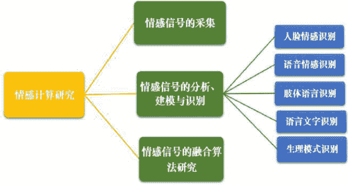

> **图 1 情感计算研究内容全景**

#### 1.2.2.1 情感信号采集：感知的“触角”

**传感器研制是基石。** 无有效信号，无后续计算。硬指标：无感佩戴（轻量、耐压）、医学级生物相容性、数据隐私安全、低成本易量产。
**MIT 媒体实验室领跑：** 已量产胀压、皮电、汗液、肌电等传感器矩阵。
*   *皮电传感器*：实时监测导电系数变化 -> 量化紧张度。
*   *脉压传感器*：捕捉心率驱动的脉压波动。
*   *汗液传感器*：带状伸缩结构 -> 同步监测呼吸与出汗关联。
*   *肌电传感器*：微伏级捕捉肌肉激发电位。

**测量三维度：** 情感维度（问卷主观评分）、表情维度（面部动作编码）、生理指标（血压、肾上腺素、皮电反应）。
**维度理论争鸣：** 情感空间究竟是二维、三维还是四维？主流二维模型锚定 **“效价/愉悦度”**（惊反射测生理）与 **“唤醒/激活度”**（皮电反应测生理）两大轴线。

---

#### 1.2.2.2 信号分析、建模与识别：破解“隐变量”

**建模难点：** 情感状态是隐藏在多重生理/行为特征背后的**不可直接观测变量**。常用数学工具：**隐马尔可夫模型 (HMM)**、**贝叶斯网络**。MIT 提出的 HMM 可基于情感概率流推演走向。

**识别双通道：**
1.  **生理通道：** 呼吸、心律、体温、皮电、脑电...
2.  **行为通道：** 面部表情、语音韵律、身体姿态。

---

**【通道一：人脸情感识别】**

面部是最高频、最自然的情感舞台，核心区：眉、眼、颊、口、额。微小动作（如皱眉）即映射心态。
*   **FACS 编码体系：** Ekman (1972) 定义的面部动作编码系统，通过动作单元 (AU) 组合合成复杂表情（喜怒哀乐...），成工业标准，广泛用于自动识别与合成。
*   **MPEG-4 标准：** 融入通信编码，定义人脸定义参数 (FDP)、动画参数 (FAP) 等，参数幅度表征情感强度，支持混合表情合成。
*   **技术演进：** 从 2D 向 3D 精细建模迈进，引入复杂纹理与几何变换算法，追求生动度。

**识别三大流派（相互渗透）：**
1.  整体法 vs 局部法
2.  形变提取 vs 运动提取
3.  几何特征 vs 外观特征

**关键特征量：** 灰度值分布、关键点运动轨迹、频域分解差异（速度优势明显）。
**视频优于静态：** 动态捕捉表情生成演化全过程，信息量更大。

**认知仿真视角：** 机器识别流程模拟人脑视觉通路：
视频流输入 -> 人脸检测/预处理/特征提取 -> 与脑库“基本表情脸谱”模糊匹配 -> 锁定最近邻表情 -> 激活对应情感体验区 (边缘系统) 与强度调控区 (网状结构)。

---

**【通道二：语音情感识别】**

语音是最高带宽的情感直连通道。无视觉时，仅凭语气词、语调起伏即可解码情绪（如“你真行”可赞可讽）。
**声学特征核心：韵律变化。**
*   怒：语速加快、音量增大、基频升高。
*   音素级特征（共振峰、声道截面）亦含情感信息。

**任务定义：** 计算机自动判定输入语音的情感标签。
**跨语言规律：** 不同语言的时域、振幅、基频、共振峰构造分布各异，但均有迹可循。建立模式库即可跨语言识别。

**中科院自动化所突破：** 针对语言“焦点现象”，首创**情感焦点生成模型**，为语音合成中的情感状态自动预测提供理论支撑，配合高保真声学模型，推动情感语音合成与识别率先落地实用化。

# 情感识别：从语音到生理的多模态挑战

语音情感解码的难度远超面部表情。面部信号主要承载身份特征与表情状态，不涉及语言编码；而语音则是说话人特质、情绪波动、语义重音与语法结构的复合载体。这导致计算机在语音情感识别与合成上的突破相对缓慢。随着多媒体技术演进，能感知、理解媒介中情感信息的拟人化系统愈发受瞩目。语音既是人机交互的核心通道，也是情感传递的关键媒介，深度挖掘其中的情感内核势在必行。人脑处理语音的过程堪称精密：听觉接收声波后，大脑会对时域、振幅、基频、共振峰等物理特征完成检测与特征提取，随即调取记忆库中各类基础情感的声学模版进行模糊匹配与对比分析，最终锁定最贴近的情感标签。

## 肢体语言：难捕捉、高价值的隐性通道

体态姿势随交互动态流转，传递着非言语信息——手势放大暗示强调意图，躯干摇晃暴露焦虑情绪。相较于语音与面部的显性规律，姿态模式更隐晦难测，但因其让表达更生动立体，依然备受学界业界追捧。科研人员开发出动捕系统、数据手套、智能座舱等专用采集硬件；MIT、IBM 等巨头以此构建智能空间；车载智能座椅更落地应用于驾驶员情绪动态监测与疲劳预警。

## 语言文字：第二信号系统的抽象优势

语言文字脱离具体事物的直接刺激，构建起人类认知的高阶通道，支撑对抽象、本质、遥远、模糊事物价值关系的深度把握。无论经由听觉接收语音，还是视觉解码文字，大脑均执行语义解析：评估事物价值指向、演变趋势、时态脉络及利益关联，以此为依据选定情感表达模式。

## 生理模式：从信号噪声中提纯情感指纹

生理信号特征可作为情感识别的客观坐标。计算机在特定表情诱发下同步采集多通道生理数据，通过统计学关联分析锁定「生理模式-情感状态」的强耦合组合，再反用于新样本的情感推断。该领域尚处探索期。实验表明，在「愤怒-悲痛-尊敬」或「愤怒-快乐-尊敬」的三分类任务中，识别率最高。前者组合的最优特征对为 EMG 均值与标准化信号一阶差分绝对值均值；后者则为 EMG 均值与 EMG 一阶差分绝对值均值。

# 1.2.2.3 情感信号融合：单一通道不足，多源协同为王

单一生理或行为指标无法唯一映射情感状态，情感判读本质是多模态证据的融合裁决，亟需信息融合理论支撑。融合技术即利用算力对多时序、多源、异构传感器数据执行自动关联、综合、优化，输出精准的态势感知与决策估计。其核心在于：多传感器构建硬件底座，多源数据作为加工原料，协同优化算法为核心引擎。流程覆盖采集、传输、汇聚、清洗、关联、合成，实现情报快速图形化呈现与自动化研判。

# 1.3 理论分野：范畨观与维度观的博弈

心理学提供两套元理论框架：

**范畨观**主张情感由离散基本类别构建，各具独特表发生理特征。优势在于符合直觉、利落应用、便于推理因果链；短板是基础类别清单无共识，且定性描述难量化。

**维度观**认为情感可投影至连续空间。从冯特三维说（愉悦度、唤醒度、紧张度），到 Osgood 的 EPA 三因子，再到 Mehrabian 与 Russell 确立的 **PAD 模型**（愉悦度-唤醒度-支配性），该范式奠定了量化建模基石，广泛赋能基础与应用心理。但「维度几何几何」与「必要维度集」仍是悬而未决的难题。

# 1.4 认知困境：可行性、本体论与双刃剑

情感计算虽硕果累累，核心认知分歧依存。

## 1.4.1 可能性之争：哲学终极拷问

**悲观派**坚持：情感专属人类，离体即伪；模拟非真实。达马西奥脑损伤案例揭示：逻辑语言完好者仍丧失生活决策力，擅逻辑的机器难以胜任情感计算。且情感表达海量多变，生理底层数据（脑电、神经递质）采集近乎不可能；个体差异与动态漂移让精准识别、精细建模遥不可及。

**乐观派**（以 Picard 为代表）反驳：情感外显于生理、表情、语言，可测可算。可穿戴设备实验已跑通 80%+ 识别率；多实验室落地有价值模型——MIT 隐马尔可夫模型、早大 WE-3RV 3D 情感空间、Kshirsagar 多层「情绪-心境-性格」架构等。

## 1.4.2 理论基石之辩：心理学 vs 统一价值论

主流建模立足心理学「五基本情绪」（喜、焦、悲、怒、恶），采维度法由生理行为特征反推状态，却屡遭「指标选哪个」「同指标如何去噪」困扰。异见者主张转向 **统一价值论**：情感是大脑对「人-物价值关系」的主观映射。用数学形式精确定义情感，建立价值分析模型，实现情感合并/合成运算，按价值变化特征分类，将「情感计算」重构为「价值计算」。

## 1.4.3 技术双面性：福音与潘多拉魔盒

技术派描绘美好图景：情感识别助力自我觉察与共情；远程教育优化人机协同；可穿戴设备护航健康；安全交互与娱乐体验双升级。伦理派敲响警钟：人机情感关系冲击人际伦理底线；社会角色重组引发秩序重构风险；技术红利可能不足以覆盖衍生出的道德与社会隐患。

# 2 技术篇：多学科交叉的攻关图谱

情感计算横跨传感、计算、认知、心理、生理、哲学、社会等域，终局目标是赋予机器类人情感能力。路径漫长，每个技术节点的突破都将反哺相关学科。本篇梳理传统与新兴技术路线，并复盘代表性获奖成果，勾勒领域全貌。

## 2.1 传统三驾马车：文本、语音、视觉

按情感外显模态划分，经典路线三足鼎立。

### 2.1.1 文本情感计算：从词典到深度语义

**演进脉络**：90 年代末起步。Riloff/Shepherd 构建语义词典，McKeown 揭示连词对形容词语义的制约，Turney 引入点互信息扩充极性词典（通用语料准确率 74%），Pang 用 SVM/MaxEnt/NB 对影评二分类（SVM 破 80%），Narayanan 融合多粒度特征再创佳绩。算法迭代与行业落地同步推进。

**标准管线三阶段**：
1. **采集**：爬虫抓取评论语料；
2. **特征提取**：自然语言转机器可计算表征；
3. **分类建模**：输出情感极性/类别。

核心聚焦「文本特征 ↔ 情感状态」映射机制，攻关重点落在特征标注、提取、分类三环。

#### 特征标注：词典是基石，语境是变数
将词/语义块打标（褒贬、语气、离散情绪），自动或人工汇聚成情感词典。词典法简单快速但鲁棒性弱——同词异域极性翻转（如「轻薄」在 3C 领域变褒义），否定前置、双重否定、口语化、表情符号等语境现象严重干扰判读。实战中必须引入上下文与场景建模。

#### 特征提取：从词频向结构与语义深潜
预处理后初筛语义特征项，按判别力评分截取高阈值子集。特征质量直接决策上限。长期看，自动特征工程将成熟，研究重心从统计词频转向文本结构与情感语义深层建模。

#### 分类技术：规则让位统计，深度学习接棒
80 年代规则派靠语言学家经验写语法，成本高、扩展难、性能瓶颈明显。90 年代统计学派上位：训练样本驱动特征选择与参数学习，形式化输入分类器裁决。当前深度神经网络已成主流范式。

**工具箱速查**：十大主流文本情感 API 备选（IBM Watson、Qemotion、AYLIEN、PreCeive、Indico、Microsoft Cognitive Services 等），覆盖语气分层、关键情绪抽取、多任务 NLP、Json 结构化输出等差异化能力，供工程快速集成参考。

## 表 1 十大文本情感分析 API 概览

| 名称 | 核心能力 | 访问地址 |
|------|----------|----------|
| IBM Watson Tone Analyzer | 先进机器学习模型，三维语气检测：情感/语言/社交 | `cloud.ibm.com/apidocs/tone-analyzer` |
| Qemotion | 演讲情绪指数、关键主导情绪、全自动文本情感分析 | `rapidapi.com/Qemotion/api/text-to-emotions` |
| AYLIEN API | 15 项 NLP 任务全家桶：情感分析/标记、语种检测、语义抽取 | `docs.aylien.com/textapi` |
| PreCeive API | 文本处理利器，聚焦情感/情绪分析 | `theysay.docs.apiary.io` |
| Indico API | 5 大基本情绪（怒/喜/惧/悲/惊）检测，标准 JSON 输出 | `indico.io/docs/#emotion` |
| Microsoft Cognitive Service | 微软云原生：情感分析、关键词提取、语言检测 | `docs.microsoft.com/.../Text-Analytics/overview` |

# 常用文本情感分析 API 速览

| 服务商 | 核心功能与特点 | 官方文档地址 |
| :--- | :--- | :--- |
| **Bitext** | 主打基于情绪的精准多语言话题分析，现提供实体/概念提取、情感分析、文本分类三大语义服务，支持 8 种语言处理。 | [链接](https://www.bitext.com/api/#How-accurate-is-the-analysis) |
| **Google Cloud Natural Language API** | 谷歌出品的文本处理工具，可深度解析语义与结构，涵盖情感分析、实体识别及文本标注。 | [链接](https://cloud.google.com/natural-language/docs/reference/rest/) |
| **NlpTools** | 面向在线新闻媒体的轻量级 NLP 接口，专注情感分析与文本分类任务。 | [链接](http://nlptools.atrilla.net/web/api.php) |
| **Sentigem** | 专为英文文档及文本块设计的情感分析工具，特点是接入简单、上手快。 | [链接](https://sentigem.com/#!/) |

## 2.1.2 语音情感计算

### 发展脉络回顾
真正意义上的语音情感识别研究起步于 20 世纪 80 年代中期，早期奠基工作确立了用声学统计特征做情感分类的范式。1985 年 Minsky 教授倡导“赋予计算机情感能力”，推动 AI 界重视情感智能，随之而来的是科研机构的大规模入场。80 年代末至 90 年代初，MIT 媒体实验室打造“情感编辑器”，融合生理、面部、语音多模态信号实现初步情感识别与反应；1999 年 Moriyama 提出语音-情感线性关联模型，并在电商系统落地语音情感识别界面。这一阶段研究仍处起步期，聚焦声学特征分析，语料库普遍规模小、自然度低、语义简单，虽有不少成果但缺乏公认的系统性理论体系。

步入 21 世纪，多媒体处理与 AI 技术飞跃为语音情感识别注入新动力。2000 年爱尔兰举办的 ISCA 语音与情感研讨会首次汇聚领域学者。近十余年，情感描述模型、情感语料库构建、特征分析等维度全面开花。下文将从数据采集、标注体系、声学特征三大维度展开论述。

### 语音情感数据库的采集策略
数据库质量直接决定识别系统上限，核心评价指标在于情感表达的**真实性**与**自发性**。按激发方式划分，主流分为三类：

1.  **表演型**：邀请专业演员模拟愤怒、悲伤等情绪。早期被视为可靠来源，因演员能精准复现典型声学特征（如愤怒的高幅值、高强度）。缺点是表演夸张、缺乏自发性，基于此训练的模型在真实场景泛化能力受限。
2.  **诱发型**：在实验室等受控环境中，通过观影、游戏等手段诱导受试者产生真实情绪。目前主流构建方式，情感特征真实度显著高于表演型。
3.  **自发型**：源自真实电话会议、影视片段、广播新闻等非受控场景。拥有最高生态效度，最适合实用系统训练，但受伦理道德与版权制约，落地应用受阻。

### 语音情感数据库的标注体系
采集完成后，标注质量直接关乎算法研发效能，主流分为离散型与维度型两大流派。

#### 离散型标注：基于基本情感理论
将情感划分为愤怒、快乐、悲伤、恐惧、惊讶、厌恶、中性等有限类别。源于心理学“基本情感论”，类比中国传统“喜怒哀乐恐悲惊”七情。但心理学界对基本情感分类至今无统一共识，导致不同语料库类别不一，难以跨库公平评测模型性能。更关键的是，现实情感具有连续性与动态性（如话语前半段喜悦、后半段突转愤怒），离散标签难以捕捉此类过渡过程。

#### 维度型标注：基于情感空间模型
为突破离散局限，心理学家提出用连续数值描述情感状态。主流模型包括：
*   **二维“激活-效价”模型**：**激活维**反映生理唤醒/行动就绪度（主动-被动）；**效价维**反映主观评价倾向（积极-消极）。此模型接受度最高、应用最广。
*   **三维“激活-效价-控制”模型**：引入**控制维**（支配感/控制感），配合多模态研究实现更精细描述。

**注**：两类标注非互斥，可通过映射函数相互转换。

### 情感声学特征分析：核心与难点
特征参数优劣直接决定识别上限，流程含提取、选择、降维三步。

#### 1. 声学特征提取：三大支柱
*   **韵律特征**：基频、振幅、发音时长、语速等。早期首选，能体现部分情感信息，区分度高，是当前**最广泛、必不可少**的基础特征。
*   **音质特征**：共振峰、频谱能量分布、谐波噪声比等。解决韵律特征难以区分“激活维”相近情感（如愤怒 vs 快乐）的痛点，能表达“效价维”且部分反映“控制维”。**韵律+音质双流融合**已成主流提取范式。
*   **谱特征**：反映短时功率谱特性，**MFCC** 为典型代表。缺陷在于仅捕捉短时静态特性，忽略全局动态信息。近年改进方向包括：层次谱特征、调制谱特征、基于共振峰加权的谱特征等。

#### 2. 声学特征选择：降维增效
海量特征构成高维空间，含冗余、计算昂贵、且易因“维度灾难”降性能。特征选择旨在筛选最优判别子集：
*   **封装式**：以下游分类器精度为评价准则，依赖具体算法，通常效果好但计算重。
*   **过滤式**：利用数据内在统计特性（如相关性、互信息）评价，独立于分类器，速度快、通用性强。

#### 3. 声学特征降维：映射重构
将高维空间映射至低维子空间。
*   **线性方法**：**PCA**（保留最大方差）与 **LDA**（最大化类间可分性）是经典代表，广泛用于情感特征线性嵌入。
*   **非线性流形学习**：基于人类认知机理，更适合非线性流形结构的语音特征。但原始算法多为无监督学习，**未利用类别标签信息**，实际提升有限；且对邻域数等超参敏感，缺乏理论指导最优值确立方法，仍需深入研究。

---

## 常用语音情感数据库速查表 (表 2)

| 数据库名称 | 核心概况 |
| :--- | :--- |
| **Belfast 英语情感库** | Queen 大学录制，40 人（18-69 岁，男女各半）演绎 5 段文本，每段 7-8 句，覆盖怒/悲/喜/惧/中性 5 类。 |
| **柏林 EMO-DB 德语库** | 柏林工大录制，10 位演员模拟 10 句语料的 7 种情绪（含无聊/厌恶），共 800 句。专业录音室环境，语义中性文本，经 20 人听辨验证识别率 84.3%。 |
| **FAU AIBO 儿童德语库** | 51 名儿童（10-13 岁）与电子宠物 AIBO 交互的自然语音（Wizard-of-Oz 机制），9.2 小时，11 类标签。部分数据用于 INTERSPEECH 2009 竞赛。 |
| **CASIA 汉语情感语料库** | 中科院自动化所录制，4 人在高信噪比环境下演绎 500 句文本的 5 类情绪（含惊吓），经筛选保留 9600 句。 |
| **ACCorpus 系列汉语库** | 清华大&中科院心理所合作，含 5 子库（多模态/语音识别/情感分析/人脸视频/人脸图像）。语音识别子库 SR 由 50 人演绎 5 类情绪，含段落与指令两类型。 |
| **VAM 数据库** | 德语电视访谈节目实录，纯自然无脚本交流。音频子库含 47 位嘉宾 947 句，标注于 V-A-D 三维连续空间（-1~1），取多标注者均值。 |
| **Semaine 数据库** | 面向自然人机交互，20 用户与 4 种性格迥异的虚拟角色（由人扮演）对话。专业影棚多模态采集（5 摄像头+4 麦克风），标注 V-A-P-E-I 五维度。部分用于 AVEC 2012 竞赛。 |
| **Maribor 数据库** | 斯洛文尼亚 Maribor 大学录制，8 类情绪，跨 4 种语言（英/斯洛文尼亚/法/西），每类 186 句。 |
| **Kids' Audio Speech Corpus** | 科罗拉多大学 Cole 团队录制，旨在积累儿童音视频数据以推进面向电子教师的视听识别系统。 |
| **Emotional Prosody Speech and Transcripts** | 宾大录制，细分 15 类情感（如冷怒/热怒、惊恐焦虑、绝望、羞耻、自豪、鄙视等）。 |

## 2.1.3 视觉情感计算

面部表情是人类外化情感的核心通道，蕴含丰富内心状态线索。但让机器“读懂”表情极具挑战：人类视觉系统在准确率、速度、鲁棒性上全维度碾压现有计算机视觉算法。自动表情识别的进展，既仰赖计算机视觉、模式识别、AI 等学科突破，也依赖于对人类视觉认知机制的深度解码。

研究历程始于 70 年代（早期以心理/生物学为主），随计算机技术演进，90 年代进入高活跃期。文献显示范式已从**二维静态图像 → 三维数据、从离线静态识别 → 实时视频跟踪**。下文将从视觉信号获取、情感识别、理解与表达三维度切入。

### 视觉情感信号获取：痛点与瓶颈
当前参数提取主要针对二维静态或序列图像，面临三大核心难题：
1.  **微表情捕捉困难**：细微、快速的表情变化（如微笑抑制）难以判断，限制了情感表现力的精细度。
2.  **个性化建模缺失**：现有方法难以体现个体独特的表情风格（如同样的“喜悦”不同人面部动作幅度/速度差异大）。
3.  **环境鲁棒性不足**：在光照变化、大姿态偏转（侧脸、低头）等非受控条件下，参数提取效果大幅下降，尚无满意方案。

## 视觉情感信号解析

三维图像因蕴含更丰富的信息量，能提供抗光照干扰、不受头部姿态影响的鲁棒特征，极大地降低了人脸表情识别中特征提取的难度。基于此，前沿研究普遍采用多模态图像数据捕捉微表情参数。该技术融合三维深度与二维彩色信息，通过对特征区域的深度纹理与色彩特征进行联合分析，实现微表情特征的精准提取，进而构建人脸三维模型及微表情变化描述机制。

视觉情感信号的识别核心聚焦于面部表情与手势两大维度：

**面部表情识别**要求机器具备媲美第三方观察者的情感洞察力。尽管面部表情易于伪装，识别结果未必反映真实内心，但其可视化特性使其成为解读个体意图表达的关键窗口。主流模型多将情感离散化处理，将表情归类为有限类别，如“喜悦”、“悲伤”、“愤怒”等。1971年，Ekman与Friesen界定了六大基础表情（高兴、悲伤、惊讶、恐惧、愤怒、厌恶），并建立了包含上千张面部图像的标准库。六大表情的具体面部动作特征详见下表。1978年，二人深入研究情感关联，开发出面部动作编码系统（FACS），依据解剖结构将面部划分为约46个相互关联的动作单元（AU），详细记录了各单元的运动特征、控制区域及关联表情。典型面部识别器处理单一表情耗时约五分钟，准确率可达98%。

马里兰大学的Yaser Yacoob与Larry Davis另辟蹊径，提出基于动作能量模板并结合子模板（如口部区域）与规则库的识别模型。例如“愤怒”表情通过眉毛内聚下压（眼部子模板）与嘴部紧闭（口部子模板）的组合即可精准刻画。后续研究多融合生物特征识别与计算机视觉，依托面部生物学特征，将表情类别与面部运动细节（几何网格变形）映射，通过采样、特征提取、分类器构建完成识别。不过，现有公开数据库多源于志愿者刻意摆拍，与真实自然场景存在偏差。

## 表 3 面部表情动作单元详解

| 表情 | 额头与眉毛区 | 眼部区域 | 面部下半区 |

|---|---|---|---|

| 惊讶 | 1. 眉毛上扬、变高弯曲 2. 眉下皮肤被拉伸 3. 额头可能出现横贯皱纹 | 1. 眼睑大幅张开，上抬下落 2. 瞳孔上方/下方可能露出眼白 | 下颌下垂，嘴巴张开，唇齿分离但无张力 |

| 恐惧 | 1. 眉毛上扬并向中间聚拢 2. 额头皱纹仅集中中部 | 上眼睑上提，下眼睑上移 | 嘴巴张开，唇部微紧或后拉；或呈拉长状后拉 |

| 厌恶 | 眉毛下压，带动上眼睑下沉 | 下眼睑下部出现横纹，脸颊上推但不紧绷 | 1. 上唇上提 2. 下唇上推上唇，嘴角下拉，唇微突 3. 鼻翼皱起 4. 脸颊上抬 |

| 愤怒 | 1. 眉毛聚拢下压 2. 眉心现竖直皱纹 | 1. 下眼睑紧绷上提 2. 上眼睑紧绷，眉毛下压 3. 瞪眼，眼球可能凸出 | 1. 唇部两态：紧闭嘴角下拉，或张开似呐喊 2. 鼻翼可能扩张 |

| 高兴 | 眉毛微微下弯 | 1. 下眼睑下缘有纹或微鼓，无紧张感 2. 鱼尾纹自眼外角向外延伸 | 1. 嘴角上扬后拉 2. 嘴巴可张大露齿 3. 鼻翼至嘴角延伸皱纹 4. 脸颊上抬 |

| 悲伤 | 眉毛内侧上扬聚拢，牵动眉下皮肤 | 眼内侧上眼睑上提 | 1. 嘴角下拉 2. 嘴角可能颤动 |

**手势识别**系统由采集、分类、识别三大模块及分割、跟踪、识别三大流程构成。采集端含摄像头、采集卡、存储；多目布局环绕用户，单目需保持与手部运动平面平行。分类模块含分类器与反馈比较器，用于校正识别结果。识别模块映射语法单元与跟踪机制，将手部形状转语义指令。分割流程逐帧提取手部区域，细化至指掌形态；跟踪流程持续定位并预测下一帧位置；识别流程依据知识库赋予手势含义并触发响应，异常手势则报警、记录或引导用户交互纠偏。基础架构如下图所示：

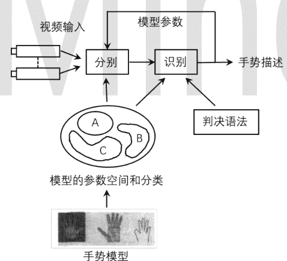

图 2 手势识别基础架构

## 情感理解与表达机制

经获取、分析、识别环节，计算机可感知用户情感状态。情感计算本质是：传感器捕获情感引发生理信号 → “情感模型”识别分析 → 理解情感并响应。核心在于：依据识别结果，输出最适配的情感反馈。随捕获技术精进与数据资源扩充，多特征融合的情感理解模型将迎来突破。

前序研究侧重“由表及里”（视觉/行为推断情感），情感表达则研究“由里及表”——给定情感状态，如何通过面部合成、手势合成等视觉行为外化，赋予机器情感交互能力。

下方汇总常用视觉情感数据库供参考：

## 表 4 经典表情分析数据集速览

| 数据集 | 核心特点 | 获取链接 |

|---|---|---|

| KDEF / AKDEF | 面向心理医学研究，光照均匀，着装统一，无配饰妆容。70人（男女各半，20-30岁），7种表情×5角度，共4900张高清彩图（562×762）。 | [链接](https://link.zhihu.com/?target=http%3A//www.emotionlab.se/kdef/) |

| RaFD | 拉德堡德大学出品，高质量面部库。67名模特（含不同年龄、种族），8种表情（含蔑视、中性），3注视方向×5相机角度，共8040张。 | [链接](http://www.socsci.ru.nl:8180/RaFD2/RaFD?p=main) |

| Fer2013 | 低分辨率，6大表情（怒、恶、惧、喜、悲、惊）+中性，共7类标签。 | [链接](https://github.com/npinto/fer2013) |

| CelebA | 商汤科技大规模名人人脸属性集，20万+图像，40维属性标注，涵盖大姿态/复杂背景，约10万带微笑标签。 | [链接](http://mmlab.ie.cuhk.edu.hk/projects/CelebA.html) |

| SCface | 非受控室内监控场景，5种摄像机（可见光/红外），130主体，4160静态图。 | [链接](http://www.scface.org/) |

| JAFFE | 10名日本女性，7种表情（6基础+中性），213张图，经60人主观评分标注6维情感形容词。 | [链接](http://www.kasrl.org/jaffe.html) |

## 表 5 常用手势分析数据集速览

| 数据集 | 核心特点 | 获取链接 |

| :--- | :--- | :--- |

| LISA_HD_Static | 聚焦车内驾驶行为，标注手/手机/方向盘，判定驾驶中玩手机风险。 | [链接](http://cvpr.ucsd.edu/vivachallenge/index.php/hands/hand-detection/) |

| 11k Hands | 190名受试者（18-75岁），1600×1200高清。张开/握拳双手，统一白背景固定距离拍摄掌背/掌心。含ID、性别、年龄、肤色、左右手、部位、配饰/指甲油等详尽元数据，免费学术可用。 | [链接](https://arxiv.org/abs/1711.04322) |

| VGG Hand Dataset | 牛津/Google发布，含代码，针对静态图片手部检测定位。 | [链接](http://www.robots.ox.ac.uk/~vgg/data/hands/index.html) |

| Thomas Moeslundts | 1996年早期数据，深色背景下演示手语字母。 | [链接](http://www-primia.inrialpes.fr/FGnet/data/12-MoeslundGesture/database.html) |

---

引入心理学维度重构大数据，能质变情感计算效能。心理学提供维度标定（如冷暖、软硬）及效应模型（连贯性、视觉显著性、平衡性等），将这些注入大数据对有效样本进行情感标标维度化处理，可显著提升机器拟人情感的精度。网络海量数据呈现五大社会化情感属性：

- **群体共振效应**：社群平台聚合群体情绪，通过情感传染影响个体决策。
- **图像视觉驱动**：海量图片的色调、亮度、内容直接塑造观看者情绪体验。
- **强关系传染**：社交网络中好友动态（微博/微信）情感冲击力远超陌生人，个体情绪优先受好友主导。
- **角色情境适配**：个体在不同群组扮演不同角色，情感表达随角色切换而变异。
- **动态时序演变**：情绪随环境、事件阶段流转，同一事件不同语境下情感投射迥异。

全球头部独角兽Affectiva即实证此道：将实验室迁至真实世界，构建覆盖75国、500万+视频（20亿真实面部帧）的数据护城河。海量实况数据配合前沿机器学习，大幅提升有限条件下识别率，更能量化文化、性别、年龄、场景（居家/驾驶等）对情绪表达的调节作用。

## 2.2 前沿探索

### 2.2.1 网络海量数据情感计算

网络融合现实与虚拟，为情感计算开辟宏大数据疆域，支持对海量样本的持续情感追踪。每日映射上网的情绪数据呈指数级增长，善用这些数据可反向验证甚至反哺心理学理论。单纯大数据处理因分布广、样本杂，难提取有效情感因子，统计效能低。但若引入心理学维度标定（冷暖/软硬）与效应机制（连贯/显著/平衡），对数据施以情感标准化划分，赋予数据情感维度，便能让计算机情感模拟精度跃升。上述五大社会化情感属性（群体、图像、好友、角色、时间）在此同样适用。

Affectiva案例再证实战价值：实验室转实景，打造跨国、跨文化、跨场景的真实情感数据资产，以广度换精度，实现对情绪表达影响因子的量化建模。

### 2.2.2 多模态融合计算

单一模态（面部/姿态/语音）虽能独立表意，但人际交互本质是多通道信息的协同呈现。构建集自然语言、语音、手语、面部、唇读、头势、体势于一体，支持编码、压缩、融合、多媒体联合处理的多通道人机界面，才是最自然的交互范式。多模态已成情感计算主流赛道。各模态传递的情感信息量与维度差异显著，且交互中常面临维度缺失、不完备问题。因此，分析需全维度介入，补齐单一通道短板，最终通过多结果拟合裁定情感倾向。

该领域关键分支——情感机器人与虚拟人研究，MIT、东工大、CMU均有示范系统落地。中科院自动所模式识别国家重点实验室已将情感计算融入语音/人脸多模态交互平台，结合情感语音合成、人脸建模、视点模型等前沿技术，打造拟真情感虚拟头像，并推进嵌入式、游戏平台落地应用。

当前方法论融汇模式识别、AI、语音图像技术成果：声学特征配合线性统计/神经网络实现语音情感识别原型；面部动作编码结合HMM等模型构建面部特征识别；姿态运动分析探索肢体情感分类。但受限于信号捕获瓶颈与大规模标注数据匮乏，多特征融合理解模型仍待深化。未来将涌现更高效的机器学习机制。

## 2.3 情感计算国际学术会议

本节梳理ACM MM、ACM ICMI等顶会中情感计算相关研讨会及代表作。

- **ACM MM —— AVEC 专题**

ACM MM（ACM International Conference on Multimedia）是多媒体领域顶会（CCF A类），年会自1993年起举办。热点涵盖大规模视频分析、社交媒体、多模态交互、计算视觉/摄影等。Workshop含SUMAC、MMSports、MAHCI、**AVEC**、HealthMedia等。**AVEC（International Audio/Visual Emotion Challenge and Workshop）**聚焦多媒体处理与机器学习驱动的情感计算，旨在提供多模态数据集汇聚跨域专家，基准测试各类情感计算算法。以下为历届AVEC代表性论文：

## AVEC 2018 “双相障碍与跨文化情感”

# 回顾 AVEC 2018：聚焦双相情感障碍与跨文化情感

AVEC 2018 以“双相情感障碍与跨文化情感”为核心议题，致力于探索多媒体处理与机器学习技术在自动化音频、视觉及视听健康情感感知中的应用效能。此次竞赛旨在为多模态信息处理建立一套通用的基准测试平台，汇聚音视频情感识别领域的研究力量，横向对比各类自动化健康与情感分析算法的优劣。另一大驱动力在于推动识别系统进化，使其具备应对海量未分段、非原型、非预选数据中完全自然行为的能力——这正是人机/人机器人交互接口迈向真实世界的必经之路，因为现实场景下的多媒体数据多属于此类“野生”状态。本届赛事设置了三大子任务：双相情感障碍识别、跨文化情感识别与金标准情感识别。

## 2018 子任务获奖成果速览

**双相情感障碍子任务**
- **唤醒度直方图特征与身体姿态结合识别法**：Le Yang 等人提出基于唤醒度直方图特征与身体姿态的识别方案。
- **多尺度判别性音频时域表征**：Hengyin Du 团队利用多尺度音频时域表征实现障碍识别。
- **基于 GBDT 的多模态层级召回分类**：Xiaofen Xing 等人采用梯度提升决策树构建多模态层级召回模型。
- **音视频模态自动化筛查系统**：Zafi Sherhan Syed 团队开发了面向音视频模态的自动筛查方法。

**跨文化情感子任务**
- **基于显著事件感知响应的连续情感预测**：Kalani Wataraka Gamage 等人研究声情感爆发与跨文化情感下的感知响应学习。
- **数据增强驱动的循环神经网络多模态识别**：Jian Huang 团队结合数据增强技术优化 RNN 多模态连续情感识别。
- **双人交互下的多模态多文化维度情感识别**：Jinming Zhao 等人聚焦双人互动场景的跨文化维度情感建模。

**金标准情感子任务**
- **特征凝聚与离群正则化去噪建模**：Chen Wang 团队通过特征凝聚与离群值正则化优化连续情感标注质量。
- **多数投票三元组嵌入融合标注**：Brandon M. Booth 等人提出融合标注的新范式。

---

# AVEC 2017：真实场景下的抑郁与情感

第七届 AVEC 2017 聚焦“真实场景下的抑郁与情感”，旨在对比多媒体处理与机器学习在情绪及抑郁自动视听分析上的表现。核心目标在于在严苛可比条件下，评估视听情感识别与抑郁严重程度估算方法的相对优势，并探究多模态融合的可行性与收益。竞赛动力源于推动多媒体检索技术在人人、人机真实交互中的可靠感知应用。AVEC 2017 有效缩小了情绪/抑郁认知领域优质研究与低可比性结果之间的鸿沟，推动了基于真实生活捕获视听数据的检测标准化进程。赛事包含情感与抑郁两大子任务。

## 2017 子任务获奖成果速览

**情感子任务**
- **LSTM 循环神经网络多模态连续预测**：Jian Huang 团队利用长短期记忆网络实现多模态情感连续预测。
- **多模态多任务学习框架**：Shizhe Chen 等人构建面向维度与连续情感识别的多任务学习模型。
- **词级情感特征与不确定性融合预测**：Ting Dang 团队探究词情感特征及概率预测融合中的不确定性建模。

**抑郁子任务**
- **精神运动迟滞生物标志物预测重度**：Zafi Sherhan Syed 团队基于精神运动迟滞生物标记预测抑郁严重程度。
- **音视频文本混合分类估计**：Le Yang 等人融合音频、视频、文本三模态进行混合分类与估计。
- **深度学习模型多模态测量**：Le Yang 团队应用深度学习模型实现多模态抑郁测量。
- **精选文本特征随机森林回归评估**：Bo Sun 等人采用特征筛选后的随机森林回归法评估抑郁。
- **基于主题建模的多模态检测**：Yuan Gong 团队引入主题建模机制进行多模态抑郁检测。

---

# AVEC 2016：抑郁、情绪与情感

第六届 AVEC 2016 以“抑郁、情绪与情感”为主题，旨在横向比较自动化音频、视觉及生理信号层面抑郁与情绪分析的多媒体机器学习方法。目标是提供共享基准测试集，连接抑郁/情感识别社区与音视频生理处理社区，共同评估各路方法优劣。本届设置情感检测与抑郁识别两大任务。

## 2016 子任务获奖成果速览

**抑郁识别任务**
- **声面语多线索融合检测**：James R. Williamson 团队整合声学、面部、语义沟通线索。
- **OA RVM 阶梯回归与性别依赖性分析**：Zhaocheng Huang 等人改进相关向量机并分析数据选择与性别差异。
- **音视频文本高低层特征融合评估**：Anastasia Pampochidou 团队融合多模态高低层特征。
- **DepAudioNet：高效音频深度分类模型**：Xingchen Ma 等人提出专为音频抑郁分类设计的高效深度网络。
- **语音与面部关键点多模态多尺度检测**：Md. Nasir 团队结合语音与面部关键点进行多尺度建模。
- **视频模态几何高层特征预测**：Raphaël Weber 等人利用视频几何高层特征进行情感预测。

**情感检测任务**
- **多模态卡尔曼滤波在线情感追踪**：Krishna Somandepalli 团队引入卡尔曼滤波实现在线追踪。
- **回声状态网络连续多模态估计**：Mohammadreza Amirian 等人采用回声状态网络估计人类情感。
- **AVEC 2016 多模态情感识别系统**：Filip Povolný 团队构建完整挑战赛识别系统。
- **探索连续情感识别的多模态视觉特征**：Bo Sun 等人挖掘适用于连续情感识别的视觉特征。

---

# ACM ICMI 旗下 EmotiW 挑战赛：野外情感感知的先锋

ACM 国际多模态交互会议（ICMI）是多模态人机交互、界面与系统开发多学科研究的顶级舞台，聚焦理论基石、组件技术及组合处理技术。会议下设多个挑战赛，其中**“野外情感识别挑战赛”** 历时最长、参与规模最大。EmotiW 直击无约束条件下的情感感知难题，涵盖基于嵌入式音视频的情感分类与基于图像的组级面部表情识别，高度还原真实世界场景。以下梳理近年代表性获奖成果（以 2017 为例）。

## EmotiW 2017 子任务获奖成果速览

**音视频子任务**
- **受监督评分集成学习**：Ping Hu 团队提出学习型监督评分集成策略。
- **大规模人脸预训练 CNN 迁移分类**：Boris Knyazev 等人利用大规模人脸数据集预训练 CNN 迁移至视频情感分类。
- **时序多模态融合野外分类**：Valentin Vielzeuf 团队攻克野外环境下的时序多模态融合难题。

**组级子任务**
- **个体面部 CNN 与全局图像 CNN 协同**：Lianzhi Tan 等人融合个体面部情感 CNN 与全局场景 CNN。
- **深度模型挖掘场景、面部与骨骼**：Xin Guo 团队综合利用图像场景、面部及骨骼信息进行组级识别。

# 情感计算核心文献盘点与全球人才版图洞察

## 一、 视频与群体情感识别：代表性工作梳理

学术界在视频序列情感分析及群体情感建模上沉淀了大量经典成果，主要脉络可分为两大流派：

**视频维度：从混合架构到野外鲁棒性**
早期工作聚焦网络结构创新，如融合 CNN-RNN 与 C3D 的混合体系，旨在兼顾时空特征提取；后续研究转向“野外”非受控场景，HoloNet 通过架构设计增强抗噪能力，另有学者利用图像序列直接建模视频情感。多线索融合范式则通过整合面部、音频、上下文等异构信号，显著提升复杂环境下的判读精度。

**群体维度：深度框架与动态建模**
群体情感识别近年呈现“深度化、序列化”趋势。新型深度学习框架确立了端到端建模基准；幸福度预测引入多重回归处理时序输入，几何特征配合数据重平衡技术有效缓解样本不均；LSTM 循环网络则同步攻克个体动态情感与群体整体情绪的联合识别难题。

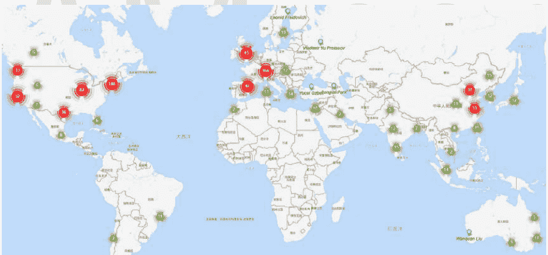

---

## 二、 ACM MM 获奖溯源：情感计算的高光时刻

回顾近年 ACM Multimedia 大会获奖名单，情感计算相关佳作频现，折射出领域热点演进。

### 2018 最佳演示奖 | AniDance：音驱舞动，实时生成 3D 舞蹈
**团队**：清华大学 唐陶然、毛汉阳、贾佳  
**技术内核**：系统采集真人舞蹈构建三维动作库，核心在于训练 LSTM 自编码器捕捉旋律与动作的深层映射关系。用户播放乐曲即可驱动虚拟角色实时起舞，交互体验极大降低了舞蹈创作门槛，兼具娱乐与教学双重价值。  
**原文直达**：[论文链接](https://hcsi.cs.tsinghua.edu.cn/Paper/Paper18/MM18-TANGTAORANDEMO.pdf)

### 2016 最佳论文奖 | 跨模态多视角挖掘，全景还原社会舆情脉络
**团队**：中科院自动化所 钱胜胜、张天柱、徐常胜  
**核心贡献**：针对社交热点事件的多源异构特性，提出多模态多视角主题观点联合挖掘框架。利用不同媒体立场差异反推观点演化，实现从碎片化信息到全景式态势感知的跨越。评委会肯定其选题前瞻性、跨平台技术创新性及实战有效性。  
**原文直达**：[论文链接](http://www.millenniumsoftsol.com/courses/IEEETitles/Java/Multi-Modal-Event.pdf)

### 2014 最佳学生论文奖 | “Say Cheese” 还是微笑？剥离语音伪影，还原面部真实情感
**团队**：密歇根大学 Yelin Kim、Emily Mower Provost  
**关键洞察**：面部肌肉运动受发音驱动时会产生类情感表达干扰。文中构建专用面部分析模型，显式建模并剔除语音发音导致的面部运动分量，使识别器聚焦纯粹情感信号，大幅提升识别可靠性，为情感人机交互与心理健康监测扫清关键障碍。  
**原文直达**：[论文链接](https://cn.aminer.cn/archive/say-cheese-vs-smile-reducing-speech-related-variability-for-facial-emotion-recognition/555045d945ce0a409b5a118)

### 2012 大奖赛一等奖 | 声学情感高斯模型（AEG）：赋能音乐视频自动生成
**团队**：中研院资讯科技创新研究中心 Ju-Chiang Wang 等  
**模型创新**：AEG 作为生成式概率模型，直观诠释音乐情感感知生成机制。通过引入潜在特征集桥接声学特征空间与情感语义空间，实现端到端语义映射。在 MER60、Muturk 双语料验证中，其情感标注与检索性能超越基线，并首创基于情感检索的量化评测协议。  
**原文直达**：[论文链接](https://cn.aminer.cn/archive/the-acousticvisual-emotion-guassians-model-for-automatic-generation-of-music-video/53e9ad4fb7602d9703736369)

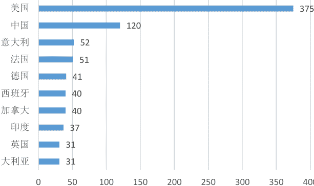

---

# 三、 人才版图：全球情感计算学者全景扫描

基于 AMiner 学术大数据，回溯 2009-2018 年十载核心刊会（涵盖 IJCAI、AAAL、IEEE TMM/TKDE/TAC、ICASSP、KDD、ICME、ACM MM 等），锁定高产学者 1000 余位，绘制领域人才全息图。

### 3.1 宏观画像：地理、性别与影响力

**全球分布：双极核心，东亚崛起**  
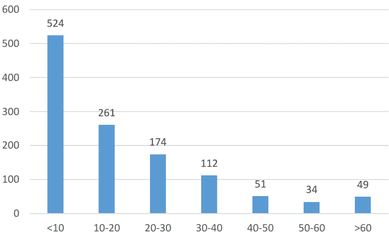  
热力图显示北美、西欧构成人才双极，东亚地区紧随其后，南美、非洲尚显空白。国家层面，美国储备量断层领先，中国稳居次席，意大利、法德等欧陆强国跻身前十梯队。

**性别剪刀差显著**  
男性学者占比高达 92.7%，女性仅 7.3%，领域性别结构严重失衡，亟待多元化人才引入。

**学术影响力呈长尾阶梯分布**  
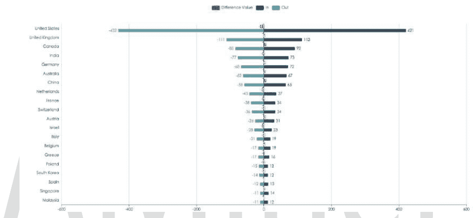  
H-index 分布曲线陡峭：中低段位学者为绝对主力，h-index < 10 群体超 43%（524人）；高段位（50-60）不足 4%（46人），顶尖梯队稀缺性凸显。

### 3.2 流动与合作：活跃的学术生态

**人才迁徙：美国为枢纽，中国净流入**  
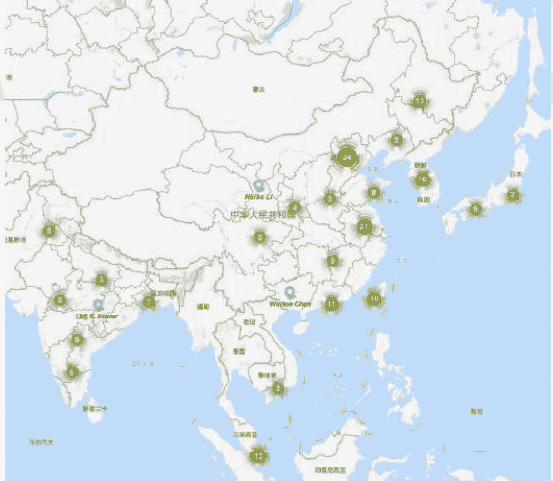  
全球 TOP 学者流动网络中，美国是当之无愧的“流动中心”，流入流出规模均居首位但呈净流出态势；英、加、印次之；中国呈现净流入优势。高频人才流动激活学术交流，加速理论技术迭代，形成良性循环。

**中外合作：中美轴心主导，中瑞质量标杆**  
  
合作数据揭示三大特征：  
1. **中美为绝对核心轴**——论文量（178篇）、总被引（8603次）、合作学者数（468人）三项指标均碾压式领先。  
2. **欧陆合作广泛深入**——前十合作国中欧洲占据半壁江山（英、瑞、德、瑞典、法）。  
3. **中瑞合作质量最高**——虽量级仅 8 篇，但篇均被引高达 112 次，远超中美（48次）及中英（51次），彰显高水平合作成色。

### 3.3 国内版图：京津领跑，沿海聚集，内陆待振

**区域分布与经济高度正相关**  
热力图显示京津地区人才虹吸效应最强，东部沿海省份次之，中西部内陆明显薄弱。横向对比日韩东南亚，中国在亚洲区域已确立显性优势。

**省级 TOP 10**：北京（32人）一枝独秀；黑龙江（12人）、台湾/山东（10人）并列次席；湖北、浙江、上海、江苏、广东、香港梯次分布。

---

## 四、 标杆人物：国际领军者画像

依据刊会论文关键信息提取，遴选代表性学者档案（注：“国外学者”指任职海外科研机构者）。

### Rosalind W. Picard — 情感计算奠基人
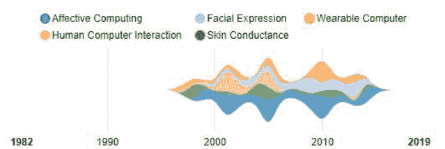  
**学术身份**：麻省理工学院 (MIT) 教授  
**影响力指标**：H-index 87 | 总被引 35,352 | 论文产出 420 篇 | 学术活跃度 53.35 | 社会影响力 15.54  
**核心研究版图**：情感计算理论奠基、面部表情分析、可穿戴计算、人机交互、生理信号处理（皮肤电/电皮肤活动）、图像纹理与处理技术。

*(更多典型学者档案持续更新中...)*

### 情感计算开山鼻祖：Rosalind W. Picard

身兼麻省理工学院媒体实验室情感计算研究群组创建人暨掌舵者、IEEE 资深会员、Affectiva 与 Empatica 双创企业合伙人，Picard 于 1995 年率先确立“情感计算”学术范式，为智能科学筑牢基石。她将其界定为：聚焦人类外显行为，实施量化测度与解析，并能施加情绪干预的计算体系。此开创性主张旨在赋予机器洞悉与流露情感的能力，推动人机对话迈向拟真境界。其团队现依托高阶动态手段，持续捕捉多元情绪轨迹，深度剖析情感涌现机理。

### 面部编码权威：Jeffrey F. Cohn

Cohn 执教于匹兹堡大学心理、精神医学及智能系统系，兼任卡内基梅隆大学机器人所计算机科学讲席。他长期牵头跨界联合攻关，攻克面部动作与语韵自动解析合成难题，成果广泛服务于情感机制、社会化进程、非语言传递、精神病理及生物医学等前沿疆域。科研经获美 NIH、NSF、自闭症基金会、海军科研办及 DARPA 等重量级机构注资。学术服务履历丰富，曾统领 FG 系列会议（2008/15/17/20）、ACII 2009、ICMI 2014 等国际盛会，长期把持 IEEE TAC、TPAMI、CVIU、PR-L 及 ACM TIIS 等顶刊编委席位。

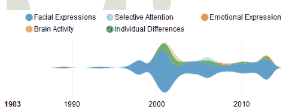

### 观点挖掘与数据洞见领军：刘兵

现任伊利诺伊芝加哥分校计算机系正教授，爱丁堡大学 AI 博士。学术版图覆盖观点计算、机器学习、数据发掘及自然语言理解。治理学术声望极高，曾掌舵 KDD、ICDM、CIKM、WSDM、SDM、PAKDD 等顶级年会，担任 TKDE、TWEB、DMKD 等权威刊物编委。集 ACM、AAAI、IEEE 三大院士荣誉于一身，高被引成果硕果累累，两度荣膺 KDD “十年长青奖”。著作等身，三部专著中两部深耕观点分析，一部聚焦网络数据发掘。

### 听觉情感智能先锋：Björn Schuller

现掌德国帕绍大学复杂智能系统研究院院长兼讲席教授，audEERING UG 联合创始 CEO。曾任情感计算促进会会长（2013-2015），现掌 IEEE 情感计算汇刊主编权柄。2015 年入选达沃斯论坛“40 岁下 40 位明日科学之星”，累计引入外部经费超 700 万欧元。核心突破聚焦：以智能视听与复杂系统工程重塑机器学习范式，落地人机/人形机器人交互及多媒体检索中的情感感知。亦受聘为哈工大计算机学院及日内瓦大学荣誉客座教授。

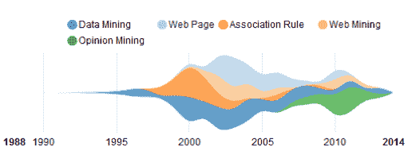

### 面部行为交互开拓者：Maja Pantic

现任伦敦帝国理工情感行为计算讲席教授，兼领剑桥三星 AI 中心（SAIC）研究舵轮。深耕面部动作自动解读（FIFAI），早期获荷兰 NWO-VENI 青年才俊基金三年资助；后主导自然非语言多模态解析计划（MAHNOB），斩获欧盟 ERC 启动基金五年长周期支持。2011 年凭博士毕业十年内对计算机科学卓越贡献，独享 BCS Roger Needham 奖——全英年度唯一得主。

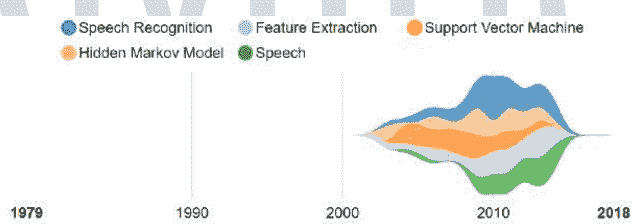

### 纹理特征与人脸识别奠基巨擘：Matti Pietikäinen

执掌芬兰奥卢大学机器视觉中心，IEEE 与 IAPR 双料资深会员。曾任 IEEE TPAMI 与 Pattern Recognition 副主编，现司职 Image and Vision Computing 及 IEEE TIFS 副编辑。在局部二值模式（LBP）算法、纹理驱动的图像视频分析、人脸表征等领域奠基立说。2014 年因 LBP 人脸描述子的里程碑价值，荣膺 Koenderink 奖。

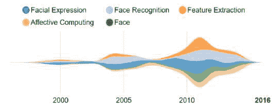

### 多模态交互与生理计算专家：Thierry Pun

长期深耕瑞士日内瓦大学计算机系，发表视觉论文 200 余篇，持有 7 项专利，主导多项国家级重大攻关。其 CVML 实验室下属 MMI 小组，聚焦视觉（眼动）、听觉（3D 声场）、触觉及生理信号融合交互与情感感知。三大核心攻关向：脑电基脑机接口（BCI）与脑源重构；情感计量与情绪量化评估；面向视障及银发群体的电子辅具研发。

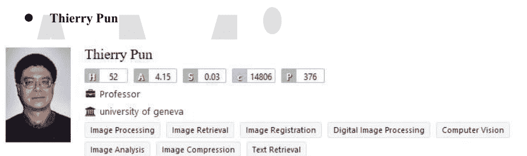
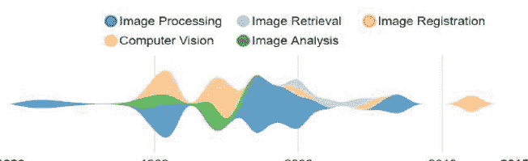

### 认知计算与情感 AI 探索者：Erik Cambria

现任南洋理工大学计算机工程学院助理教授，SenticNet 缔造者。兼任 Elsevier KBS、IPM、IEEE CIM、Springer AIRE、Cognitive Computation 等刊副编，及 IEEE IS 情感计算与观点分析部编辑。荣誉加冕：2018 “AI 十大新星”、2019 IEEE 杰出创业奖。亦为脑科学基金会成员，该基金会由已故图灵奖得主 Minsky 与 SenticNet 创始团队共同发起指导。

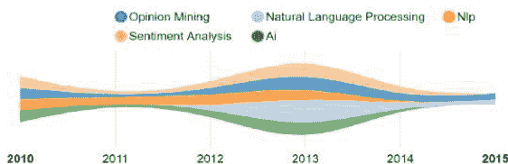

### 计算心理学与跨模态智能学者：James Ze Wang

1997 年获斯坦福计算机与数学双硕，2000 年取医学信息学博士，现任宾州州立大学信息科学技术系教授。研究触角延伸至生物医学影像信息学、计算心理学、气象大数据、视觉艺术及可解释基础学习等交叉前沿。曾获美 NSF 职业成就奖及 PNC 技术讲席。学术服务包括：主编 IEEE TPAMI 专刊“实景图像标注检索”，担任 ACM 多媒体信息检索大会总主席。

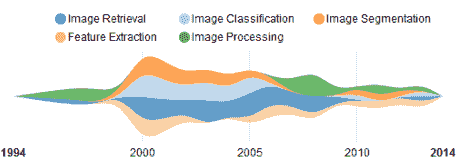

### 人机体验度量与说服技术权威：Wijnand IJsselsteijn

任职埃因霍芬理工大学，专攻人机交互中的认知影响力。致力于解构媒介技术对人类心理的作用机制，反哺设计优化。核心聚焦量化数字生态（沉浸媒介、严肃游戏、情感计算、量化自我）中的人类体验，服务学习、健康与福祉。高度关注数据科学、AI 与心理学三角互动，推动可穿戴传感与虚拟环境创新，兼顾方法论严谨性与生态效度，拓展行为追踪新范式。

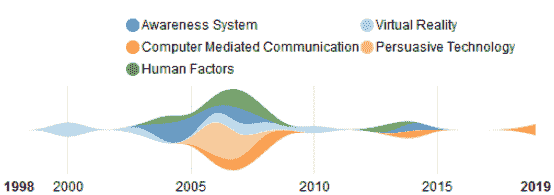

### 虚拟代理与社交机器人领军：Elisabeth André

执教奥格斯堡大学应用信息学院计算机系，统领多媒体系。研究矩阵覆盖多通道界面、多模态解析（生理、注视、语音、手势）、情感计算与社会信号处理、社交机器人与嵌入式会话实体、技术增强学习、有形感知界面。学术治理显赫：掌《IEEE 情感计算学报》主编，兼任 TIOT、ACM TIIS 副主编，历任 AAMAS 2018、AIED 2017 联席主席。2019 年入选德信学会“德国 AI 史影响力十大人物”。

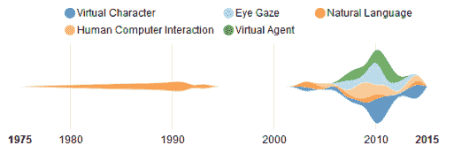

### 3.2.2 本土情感计算领军群像

#### 模式识别与生物特征识别泰斗：谭铁牛

中国科学院自动化所所长、中科大自动化系主任，兼中国人工智能学会副理事长、中国图象图形学学会理事长。在图像处理、计算机视觉、模式识别三大支柱领域建树卓著，早倡数字化人类情感，探索和谐人机共生环境下的情感计算。1996 年入选中科院“百人计划”，历任模式识别国家重点实验室主任，兼 IEEE 北京分会副主席、国际视觉监控研讨会创始主席。主持“973”“863”、国自然重点/杰青、中科院百人等国家级重大项目，深度参与《Pattern Recognition》《Image and Vision Computing》《自动化学报》《中国图象图形学报》等中外核心刊物编务。

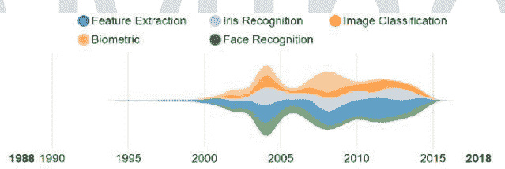

#### 中文自然语言处理领军：刘挺

深耕哈尔滨工业大学计算机学院，核心版图锁定自然语言处理、依存句法分析、中文信息处理、语义角色标注、搜索引擎与信息检索、词义消歧等关键技术环节，致力推动机器对中文语义的深度理解与落地应用。

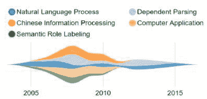

# 情感计算领军人物与核心基地全景扫描

哈工大计算机学院刘挺教授，领衔社会计算与信息检索中心，誓要攻克机器理解人类语言情感的难关。作为国家高层次人才计划领军人才、国家重点基础研究发展计划（973）及高技术研究发展计划（863）项目负责人，他长期聚焦文本情绪研判。据剑桥统计，2012-2017年间其在自然语言处理顶级会议发文量位居世界前列。他主导构建的“语言技术平台LTP”与“大词林”已成为行业基础设施，荣获国家科技进步奖二等奖、省部级科技进步奖一等奖。

### 纪荣嵘

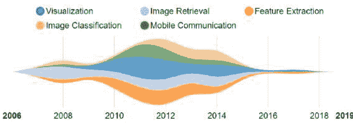

### 张艳宁

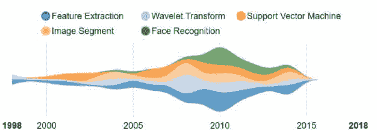

该学者为西北工业大学计算机学院院长，兼具“长江学者”、国防973首席科学家、国家高层次人才计划领军人才等身份。她将前沿视觉技术精准对接航天航空国防重需，主持国家级重大任务40余项。在TPAMI、TIP、CVPR、ICCV等殿堂级刊会刊发学术成果百余篇，授权专利超50项，专著3部，斩获国防技术发明奖一等奖、国家教学成果奖二等奖等荣誉，实现了从理论突破到战场应用的跨越。

### 黄民烈

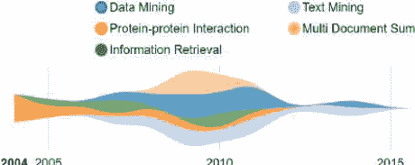

### 秦兵

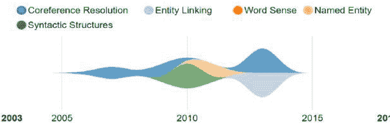

### 贾珈

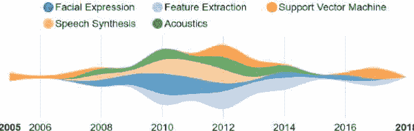

### 陶建华

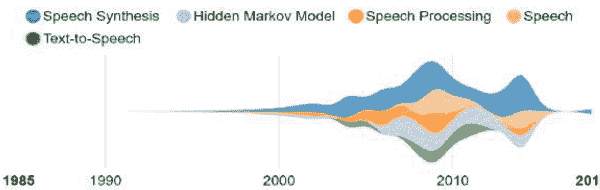

### 金琴

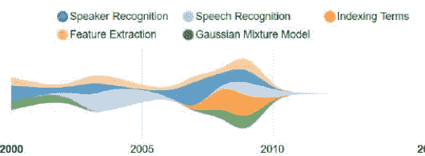

### 胡斌

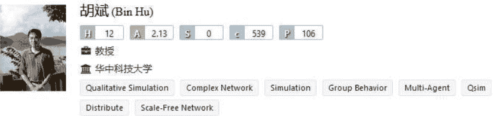

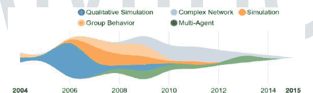

华科大管理学院现代化管理研究所所长胡斌，主持国家自然科学基金重点/面上项目多项。著作等身，出版专著7部、论文百余篇，成果获上海市科技进步三等奖、湖北省自然科学三等奖及中国大学出版社图书奖优秀学术著作二等奖，在管理科学与信息管理交叉领域深耕细作。

### 蒋冬梅

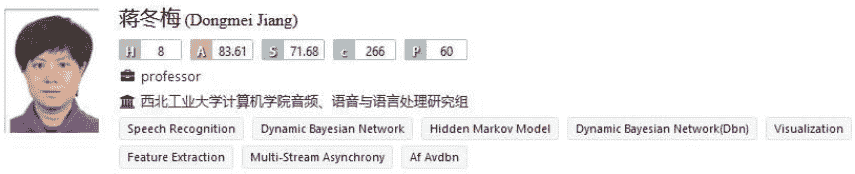

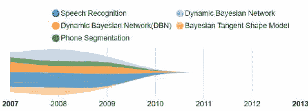

西工大计算机学院教授蒋冬梅，长期担任中比“听视觉信号处理联合实验室”中方负责人。她聚焦视听语音信号处理，覆盖识别合成、面部动画、情感表达、虚拟声场等全链路，主持国家自然科学基金及国际合作项目多项，发表论文30余篇。所在团队建于1995年，依托陕西省重点实验室，已构建起语音交互、音频处理、多模态信息处理、多媒体分析四大核心方向，底蕴深厚。

## 3.3 研究机构

**清华大学人机交互与媒体集成研究所**  
以史元春教授为所长的清华“媒体所”，依托国家实验室普适计算部、清华-腾讯联合实验室等国家级平台，聚焦媒体智能处理、人机交互、普适计算三大支柱。近年承担973、863、重点基金等重大项目，顶刊会论文高产且屡获最佳论文奖，斩获5项国家级奖励。研究版图覆盖智能信息处理(视觉/图形/多媒体)、和谐人机交互(情感/语音)、普适计算环境三大方向。

**中国科学院模式识别国家重点实验室**  
作为首批国家重点实验室，中科院模式识别国重室（依托自动化所）历经马颂德、谭铁牛至刘成林三代主任传承。现承担百余项国家级项目(含973、重大基金、863等)，获国家科技进步二等奖及院自然科学二等奖。四大核心方向直指模式识别理论基石、图像视觉、语音语言处理、脑网络组研究，构建起从认知机理到脑科学的完整研究生态。

**哈尔滨工业大学社会计算与信息检索研究中心**  
2000年创立的哈工大社计中心(SCIR)，由刘挺教授掌舵。累计承担973、重点基金、863、企业合作等项目60余项，孵化出业界广泛使用的“语言技术平台LTP”并获钱伟长奖一等奖。六大研究方向——语言分析、信息抽取、情感分析、问答系统、社会媒体处理、用户画像，构建起完整的社会计算技术体系。

**华中科技大学智能媒体计算与网络安全实验室**

# 情感计算：顶尖实验室、落地场景与未来趋势全景扫描

## 国内头部实验室实力盘点

### 华中科技大学：智能媒体计算与网络安全实验室
近五年间，该实验室斩获国家重点研发计划、863重点项目、国家自然科学基金等各级纵向课题50余项，横向企业合作项目亦在列。学术产出丰硕：在《计算机学报》、IEEE TPDS、IEEE CG&A、IEEE TMM等权威期刊及顶会发表论文150余篇，SCI/EI收录超百篇；专利与软著累计50余项；荣获湖北省科技进步二等奖、日内瓦发明展金奖各一项。核心研究版图覆盖数字媒体处理与检索、视频情感计算、增强现实、网络安全与大数据、多核计算与流编译、教育信息化六大方向。

### 合肥工业大学：情感计算与系统结构研究所
2011年建所，孙晓教授掌舵。聚焦先进智能、情感计算、大规模数据与知识获取基础理论。自建多模态数据资源库——文本语料、面部表情、动作-情感库，其中中文情感语料库规模全球最大，已授权全球近300家机构使用。形成了基于多源情感大数据的感知-推理-交互完整方法体系，推动我国先进智能与情感机器人跻身世界第一方阵。承担973预研、863、国自然等多项国家级课题；2011年获批国内首个以“情感计算”冠名的省级重点实验室。研究延伸至自然语言处理、听觉/视觉认知计算、情感可穿戴、机器人云理论等六大细分领域。

### 东南大学：情感信息处理实验室（AIPL）
2004年创建，依托生医工学院及儿童发展与学习科学教育部重点实验室，郑文明教授领衔。深耕情感计算二十载，主持973计划、国自然重点项目等国家级课题多项。在IEEE Transactions系列、ICCV、ECCV、NIPS、IJCAI、AAAI等顶刊顶会发表论文百余篇；成果获国家技术发明二等奖、教育部自然科学二等奖（两次）、江苏省科技进步二等奖。研究聚焦情感计算、模式识别、计算机视觉、机器学习及其在儿童智能发展、教育、医疗中的跨学科应用。

---

# 应用篇：从课堂到诊室的情感智能实践

MIT媒体实验室Picard团队已孵化近50个情感计算应用项目：医疗端辅助自闭症干预、术后疼痛评估；教育端实时捕捉学习状态、动态调整教学节奏；生活端依据情感反应推荐个性化音乐。本节深度解析课堂教学、情绪监测、医疗康复、舆情监控四大落地场景。

## 4.1 课堂教学：让“隐形”的学习状态显性化

### 面部识别量化专注度
美公立学校预算紧缩致师生比失衡，教师难以兼顾每个学生。近三年，SensorStar实验室将面部识别引入一线教学：摄像头采集学生课堂反应，经EngageSense算法分析微笑、皱眉、声调、眼神轨迹，输出专注度与情绪波动报告——何时兴趣最高？何时走神最久？教师据此动态调整教案。比尔&梅琳达·盖茨基金会资助的传感器手环，通过腕部微弱电流变化量化“课程兴奋度”，提供生理层面的佐证。

Paul Ekman对5000+面部动作单元的编码体系，为Emotient、Affectiva、Eyeris等商业公司奠定微表情识别基石。技术早期服务于执法与市场调研，现已延伸至医疗——圣地亚哥团队正试用该技术评估儿童术后疼痛等级。

### 机器学习定制个性化学习路径
TechCrunch旗下在线平台引入“精熟学习”理念，用实时评估破解Bloom著名的“Sigma 2 Problem”：深度学习模型对学习效果数据分层建模，实时推荐习题、调整内容难度与教学节奏。北卡州立大学开发的表情分析软件，让在线课程能根据面部反馈自适应变换。Intel等头部厂商已商用化：Emoshape等情感计算系统自动解析表情数据，生成个性化教学回馈。

**核心共识**：AI与大数据不取代教师，而是作为“超级助教”，识别个体差异、补全关注盲区、辅助制定精准教学策略。隐私保护与效率平衡是行业持续攻关的课题。

## 4.2 情绪监测：无感知的“心跳雷达”

MIT CSAIL研发的**EQ-Radio**，在**零穿戴、零摄像**条件下，仅凭无线信号捕捉呼吸与心跳的微米级波动，以**87%准确率**四分类识别“激动/开心/愤怒/忧伤”。Katabi教授预判其将重塑三大场景：
- 影视广告：实时测试观众真实反应
- 智能家居：据情绪自动调温、建议呼吸练习
- 健康护理：长程无感监测心理状态

**传统痛点**：面部表情≠内心状态；胸带/心电贴等穿戴式传感器佩戴繁琐、位移即失真。  
**EQ-Radio破局**：发射监测生理信息的无线信号，算法聚焦心跳间期（R-R interval）微变。消极情绪映射为“忧伤”，正向高唤醒映射为“激动”。虽个体基线不同，但情绪-心律耦合模式具内在一致性，建立个性化基线后即可跨场景泛化。

实验设计：受试者自选最能诱发五种情绪（含中性）的2分钟音视频，建立个人情绪-心律指纹库。对标微软Emotion API（视觉面部识别），EQ-Radio在喜悦、忧伤、愤怒三类上精度更优；中性情绪两者相当（无表情最易识别）。  
**当前攻关点**：剥离呼吸运动伪影——肺部起伏幅度远大于心跳，干扰心率提取精度。

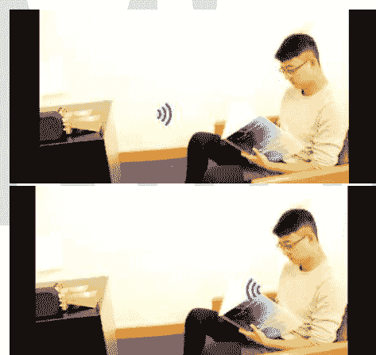

图 9 EQ-Radio 无线信号监测原理示意

## 4.3 医疗康复：情感机器人走进自闭症干预

### 可穿戴情感假肢
MIT情感计算组正打造全球首款社交智能假肢：微型相机捕捉面部与头部动作推断认知情感状态；“galvanivator”手套通过皮电反应（EDA）量化唤醒度，LED阵列实时可视化生理亢奋水平，让不可见的情绪“看得见”。

### NAO机器人：标准化的情绪教学伙伴
SoftBank NAO（约60cm高、超级英雄造型）通过眼色、肢体语言、声调三维度表达情绪。35名中日塞自闭症儿童（3-13岁）参与35分钟交互：从漠视到拥抱大笑，多数儿童视NAO为“真实的人”而非玩具。**关键优势**：机器人表情输出高度一致、可复现，避免人类治疗师表情差异带来的认知干扰，帮助儿童建立稳定的情绪-表征映射。

图 10 NAO 机器人交互现场

### 个性化深度学习：比专家更懂孩子
MIT团队为每个儿童构建专属深度学习网络：输入面部表情、头体姿态、手势、心率、体温、皮电等多模态流数据，融合诊断分级、文化背景、性别等先验信息。网络对儿童“高兴/不安/投入/表现”四维状态的估计，经五位人类专家连续编码验证，**机器人估计更具体、更清晰**。深度学习的层级抽象能力，恰好契合面部/身体/声音多特征融合与抽象概念（如“投入感”）理解的需求。

## 4.4 舆情监控：大数据语境下的群体情感画像

传统“调查-统计-文本挖掘”三板斧，在数据量爆发、产生极快、冗余高的大数据环境下失效。新一代舆情技术聚焦**数据获取→文本分析→挖掘→语义理解**全链路，核心攻关三大任务：

| 任务 | 核心手法 | 典型案例 |
|------|----------|----------|
| **话题识别与跟踪** | 聚类检测新话题，TDT技术实时跟踪演化轨迹 | 社交媒体热点全生命周期复现 |
| **意见领袖识别** | 用户建模为节点，融合结构/行为/情感三维特征，传播过滤挖掘关键节点 | 曹玖新等三维度挖掘模型 |
| **情感倾向判别** | 构建领域情感词典+语义规则+依存关系计算，提升分类器精度 | 王永等面向产品特征的评论挖掘；Twitter正负向舆论导向分析 |

金融、电商、公共治理均已大规模落地：从舆情预警到商业洞察，情感倾向分析成为最高频、最高价值的单点应用。

---

# 趋势篇：数据视角下的学科演进地图

## 5.1 论文研究趋势：2亿论文挖掘出的十大热点

基于AMiner 2亿论文库的**Trend Analysis**（trend.aminer.cn）深度挖掘，还原技术“生-演-灭”全周期，助力快速定位前沿。当前情感计算领域**热度Top 10**话题：

1. Affective Computing  
2. Social Robot  
3. Emotion Recognition  
4. Human Computer Interaction  
5. Feature Extraction  
6. Support Vector Machine  
7. Facial Expression  
8. Human Robot Interaction  
9. Behavioural Sciences Computing  
10. Face Recognition

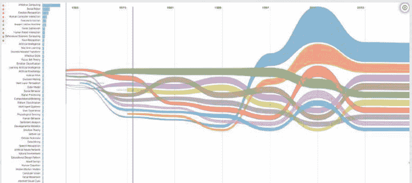

图 11 情感计算发展趋势热力图

### 关键演进规律
- **Affective Computing** 自90年代起热度指数级跃升，五年内超越早期霸主 *Emotion Recognition* 登顶，至今稳居榜首，论文产出持续领跑。  
- **Social Robot** 紧随其后同步上扬，近年反超 *Emotion Recognition* 占据次席，彰显“具身智能+情感交互”成主流范式。  
- **Feature Extraction** 经历低迷期后强势回归Top 3，得益于深度表征学习重塑特征工程。

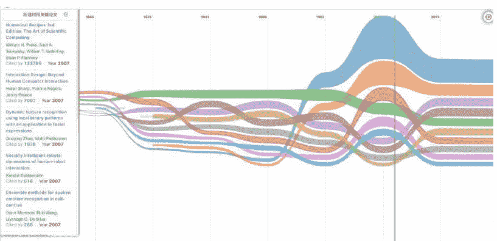

图 12 2007年经典高被引论文快照

### 时光机：拖动时间轴回溯2007
左框呈现当年被引Top 5经典之作：
1. *Numerical Recipes 3rd Edition: The Art of Scientific Computing* (123,789引用) —— 计算基础设施级教材  
2. *Interaction Design: Beyond Human Computer Interaction* (7,007引用) —— HCI教科书式奠基之作  
3. *Dynamic texture recognition using local binary patterns with an application to facial expressions* (1,878引用) —— LBP动态纹理入表情识别，开创局部纹理流派  
4. *Socially intelligent robots: dimensions of human-robot interaction* (616引用) —— 社会化机器人交互维度理论框架  
5. *Ensemble methods for spoken emotion recognition in call-centres* —— 集成学习入声情识别，工程落地早期范例

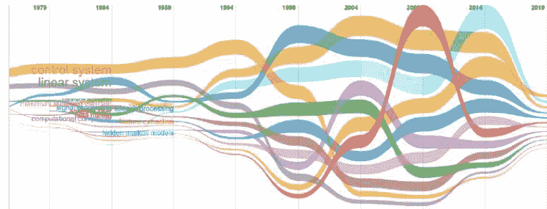

图 13 1970-2019 论文研究方向趋势演变全景

半个世纪演进轨迹清晰可见：从早期心理理论建模、信号处理特征工程，到2000年后机器学习范式确立，再到2010年以来深度学习与多模态融合、社会化机器人、具身情感交互全面爆发。下一个十年，**大模型驱动的泛化情感理解**、**脑机接口级无感知监测**、**跨文化跨个体的自适应情感生成**将成三大必争高地。

# 情感计算半世纪演进：从控制理论到深度学习的范式迁徙

AMiner 团队基于 1970 至 2019 年五十年间的情感计算领域学术论文，利用数据挖掘手段勾勒出研究脉络的演变轨迹。样本核心源自 ACMMM、KDD 等国际顶级会议及其相关研讨会。分析显示，早期主导的控制系统研究逐渐退潮，而语音识别、隐马尔可夫模型、信号处理与特征提取等方向则呈现持续增长态势。各阶段核心研究热词演变如下表所示：

**表 13  1970-2019 分阶段核心研究关键词 Top 10**

| 1970-1979 | 1980-1989 | 1990-1999 | 2000-2009 | 2010-2019 |
| :--- | :--- | :--- | :--- | :--- |
| 控制系统 | 控制系统 | 控制系统 | 语音识别 | 隐马尔可夫模型 |
| 最优控制 | 线性系统 | 语音识别 | 信号处理 | 特征提取 |
| 线性系统 | 传递函数 | 信号处理 | 数据挖掘 | 语音识别 |
| 自动控制 | 信号处理 | 隐马尔可夫模型 | 隐马尔可夫模型 | 信噪比 |
| 传递函数 | 最优控制 | 参数估计 | 特征提取 | 信号处理 |
| 微分方程 | 自动控制 | 语音处理 | 计算复杂度 | 语音处理 |
| 特征值与特征函数 | 数字滤波器 | 自适应滤波器 | 神经网络 | 计算建模 |
| 随机过程 | 充分条件 | 神经网络 | 语音处理 | 压缩感知 |
| 状态估计 | 特征值与特征函数 | 线性系统 | 最大似然估计 | 支持向量机 |
| 随机系统 | 随机过程 | 传递函数 | 自适应滤波器 | 噪声测量 |

## 5.2 情感计算技术前瞻洞察

研究团队依托近十年文献库，融合大数据分析、机器学习与人工智能技术，构建算法模型并开发演示系统，深度挖掘领域技术热点。

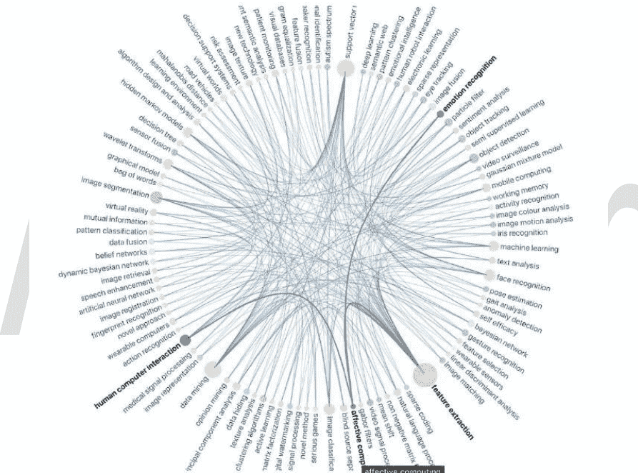

**图 14  情感计算技术预见网络图**

*注：图中节点大小反映技术热度（由相关论文量决定，文献越多热度越高），节点间连线表示两关键词在至少 5 篇论文中共现。*

依据图 14 网络拓扑结构，情感计算领域关联度最高的三大核心技术为：**特征提取**、**人机交互** 与 **情感识别**。

进一步按技术前沿度排序，可梳理出关键技术词汇及其历年演变趋势（文献发量变化）与代表性成果，详见下图：

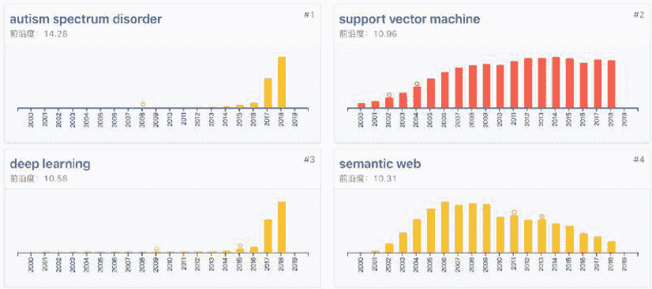

**图 15  情感计算预测热词前沿度分布**

图 15 揭示，前沿度指数领跑的四大热词依次为：**自闭症谱系障碍**（前沿度 1428）、**支持向量机**（1096）、**深度学习**（1058）及 **语义网**（1031）。

## 5.3 情感计算未来演进路径

- **构建多元化、动态完备的情感数据库**
  现有原型系统多依赖单一模态情感源，数据库短板明显：训练样本稀缺，体态识别局限于舞蹈、手势、步态等有限动作集，且多重内部效度而忽外部效度。未来亟需拓展情感分类维度，重点攻克婴幼儿及儿童情感数据库的建设难题。

- **深化神经科学与情感计算的交叉融合**
  人脑情感机制的神经解剖基础错综复杂，认知尚浅，难以直接为情感计算模型提供坚实理论支撑，跨学科深度对话迫在眉睫。

- **攻克动态情境下的情感测评建模**
  交互过程中心理状态呈非匀速变化。虽有 Picard 以“微波炉间歇加热”喻“爱恨交加”、“冷热水混合”喻环形模型中“愉悦+低唤醒=放松”，但真实情境下的情感复合远超二元范式。构建能适应多变情境的动态数字孪生模型极具挑战，因情感输入输出机制高度依赖具体语境。

当前，国际学界已启动深层情感计算探索。如 Ayush Sharma 团队利用 LDC 语料库中的情感韵律语音文本，推进深层韵律特征提取与分类识别。展望未来，**多模态认知与生理指标融合**、**动态完备数据库落地** 以及 **高科技智能硬件赋能** 将成为三大主流趋势，推动用户行为预测、反馈与调控的精准化，最终实现更自然流畅的人机共生[18]。

# 参考文献

- [1] 王志良, 解仑. 我国人工心理与人工情感研究现状与进展[J]. 中国科学基金, 2013, 27(01): 14-17.
- [2] Izard CE. Basic emotions, natural kinds, emotion schemas, and a new paradigm[J]. Perspectives on psychological science, 2007, 2(3): 260-280.
- [3] Osgood CE. Dimensionality of the semantic space for communication via facial expressions[J]. Scandinavian journal of psychology, 1996, 7(1): 1-30.
- [4] Bradley MM, Lang PJ. Measuring emotion: the self-assessment manikin and the semantic differential[J]. Journal of behavior therapy and experimental psychiatry, 1994, 25(1): 9-59.
- [5] Backs RW, Da Silva SP, Han K. A comparison of younger and older adults’ self-assessment manikin ratings of affective pictures[J]. Experimental aging research, 2005, 31(4): 421-440.
- [6] 李佳源. 情感计算的研究现状与认知困境[J]. 自然辩证法通讯, 2012, 34(02): 23-28+125.
- [7] 张瑞. 文本情感计算研究综述[J]. 管理观察, 2017(13): 28-30.
- [8] 文本情感分析有什么好资料、网站、工具推荐呢？ https://www.zhihu.com/question/20631050/answer/512693661
- [9] 张石清, 李乐民, 赵知劲. 人机交互中的语音情感识别研究进展 [J]. 电路与系统学报, 2013, 18(02): 440-451+434.
- [10] 韩文静, 李海峰, 阮华斌, 马琳. 语音情感识别研究进展综述[J]. 软件学报, 2014, 25(01): 37-50.
- [11] Ververidis D, Kotropoulos C. A review of emotional speech databases[C]//Proc. Panhellenic Conference on Informatics (PCI). 2003: 560-574.
- [12] 钟新波. 基于计算机视觉的情感计算[J]. 现代计算机(专业版), 2008(07): 44-47.
- [13] Does Emotive Computing Belong in the Classroom? https://www.edsurge.com/news/2017-01-04-does-emotive-computing-belong-in-the-classroom.
- [14] 在美国，情感计算是如何应用到课堂教学中的？ https://www.jianshu.com/p/6e79a65c1267.
- [15] Detecting emotions with wireless signals. http://news.mit.edu/2016/detecting-emotions-with-wireless-signals-0920
- [16] MIT 将个性化深度学习网络应用于机器人，让 AI 更有效地评估和治疗自闭症儿童. http://wemedia.ifeng.com/66986311/wemedia.shtml.
- [17] 张璐. 基于情感计算的网络社区舆情分析预警技术研究[D]. 北京邮电大学, 2018.
- [18] 认知心理学与人工智能的交叉：情感计算综述. http://www.sohu.com/a/83873777_297710.

# 版权声明

本研究报告知识产权归 AMiner 团队独家所有，保留全部著作权。报告内容系 AMiner 团队基于后台大数据自动分析得出的咨询成果，仅供订阅用户内部参考决策。未经书面授权，严禁任何形式的公开传播、复制、分发或篡改原意引用；合规引用需标注来源“AMiner.org”。因报告内容引发的任何投资或决策风险，AMiner 团队概不负责。

- 顾问：金琴、唐杰
- 责任编辑：刘佳
- 编辑：景晨
- 封面设计：边云风

