# 人工智能之数据挖掘【文字版】


# 摘要

数据挖掘（Data Mining）是一个跨学科的计算机科学分支。它是用人工智能、机器学习、统计学和数据库的交叉方法在大规模数据中发现隐含模式的计算过程。基于大数据时代的背景，本研究报告对数据挖掘这一课题进行了简单梳理，包括以下内容：

**数据挖掘的概念与研究概况。** 首先从数据挖掘的定义、分类、过程与功能四个方面介绍了数据挖掘；整理并分析了数据挖掘领域顶级会议 ACM SIGKDD 近六年的信息。

**数据挖掘的算法与实现。** 按照数据挖掘应用的方向，从大数据、机器学习、社会网络、自然语言与统计数据分析五个方面介绍了数据挖掘的算法。基于大数据的数据挖掘主要介绍了数据采集层、数据存储层、数据处理层和服务封装层四个层的基本架构，和部分大数据平台实例；基于机器学习的数据挖掘主要介绍了非监督学习方法与监督学习方法，重点是监督学习方法，包括训练集、验证集与测试集、决策树模式、kNN 算法、神经网络、回归分析；社会网络中的大数据挖掘主要介绍了图的基本要素、图的度量算子，并从行为分析算法、社区发现算法等方面介绍了社交网络上的算法；自然语言中的数据挖掘先介绍了词的表示分析，并从语言模型与话题模型两个层面进行算法介绍；统计数据分析与前三个方面均有交叉，主要从数据描述性分析、回归分析、关联分析、聚类分析三个方面进行介绍。最后具体分析了数据挖掘领域顶级会议 SIGKDD 最近几年在数据挖掘基础理论、社交网络分析和图数据挖掘、大数据挖掘等几个方面的国内外的主要研究成果。

**数据挖掘领域专家介绍。** 基于 AMiner 数据，对数据挖掘领域专家进行深入挖掘和介绍。包括顶尖学者的全球与中国分布、迁徙概况、学者机构分布、h-index 分析，并依据 AMiner 评价体系，从代表学者与近十年代表学者两个层面选取学者进行详细介绍。

**数据挖掘的应用领域与发展趋势。** 数据挖掘无论是在科学领域还是工程领域、理论研究还是现实生活中，其应用都十分广泛，有着极为广阔的发展前景。本文对其在物流业、旅游业、零售业等相关领域的应用情况进行了介绍，并基于 AMiner 数据，对近期数据挖掘领域研究热点进行可视化分析，对未来数据挖掘方向进行了预测：隐私保护、可视化、与专业领域结合、多媒体数据挖掘等。

报告（电子版）实时更新，获取请前往：
https://www.aminer.cn/research_report/5c3d5a5ceeb160952fa10b76?download=true&pathname=datamining.pdf。

# 1 概述篇

## 1.1 数据挖掘基本概念

数据挖掘（Data Mining），是指从大量的数据中自动搜索隐藏于其中的有着特殊关系性的数据和信息，并将其转化为计算机可处理的结构化表示，是知识发现的一个关键步骤。数据挖掘的广义观点：从数据库中抽取隐含的、以前未知的、具有潜在应用价值的模型或规则等有用知识的复杂过程，是一类深层次的数据分析方法¹。数据挖掘是一门综合的技术，涉及统计学、数据库技术和人工智能技术的综合，它的最重要的价值在于用数据挖掘技术改善预测模型。

早期数据挖掘并不是作为单独学科存在，追溯到 30 年前，Gregory I. Piatetsky-Shapiro（也是 KDnuggets 的创始人）等人于 1989 年 8 月在美国底特律的国际人工智能联合会议（IJCAI）上召开了一个专题讨论会（workshop），首次提出了知识发现（Knowledge Discovery in Database，KDD）这一概念。KDD 涉及数据库、机器学习、统计学、模式识别、数据可视化、高性能计算、知识获取、神经网络、信息检索等众多学科和技术的集成，再后来的 30 年间 KDD 逐渐形成了一个独立、蓬勃发展的交叉研究领域。

后来经过若干年的培育，1995 年，在加拿大蒙特利尔正式召开了第一届“知识发现和数据挖掘”国际学术会议 KDD。1995 年在美国计算机 ACM 年会上，开始把数据挖掘视为知识发现 KDD 的一个基本步骤。随后成立了 ACM 专委会 SIGKDD 以及对应的国际数据挖掘与知识发现大会（ACM SIGKDD Conference on Knowledge Discovery and Data Mining，简称 SIGKDD），到目前为止 SIGKDD 已是数据挖掘领域的顶级国际会议。会议内容涵盖数据挖掘的基础理论、算法和实际应用，详见 1.2 近年 SIGKDD 概况。

数据挖掘的对象可以是任何类型的数据源，可以是关系数据库，此类包含结构化数据的数据源；也可以是数据仓库、文本、多媒体数据、空间数据、时序数据、web 数据，此类包含半结构化数据甚至是异构型数据的数据源。发现知识的方法可以是数字的、非数字的，也可以是归纳的，最终被发现了的知识可以用于信息管理、查询优化、决策支持及数据自身的维护等²。

数据挖掘是 KDD 的一个关键步骤，下表对二者做一比较。

表 1 数据挖掘和 KDD 对比图

| | 输出不同 | 共同点 |
|---|---|---|
| 数据挖掘 | 模型 | 输入的都是学习集（learning sets） |
| 知识发现 | 规则 | 目的都是尽可能多的自动化数据挖掘过程 |

¹ http://www.kdd.org/curriculum/index.html

² 王惠中，彭安群 数据挖掘研究现状及发展趋势 [J] 矿业自动化，2011（2）


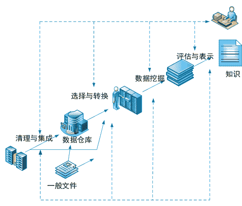

图 1 数据挖掘是知识发现的过程之一

早期比较有影响力的发现算法有：IBM 的 Rakesh Agrawal 的关联算法（IBM Fellow、后来 MS Technical Fellow、第一届 ACM SIGKDD 的创新奖得主）、UIUC 大学韩家炜（Jiawei Han）教授等人的 FP Tree 算法（第四届 ACM SIGKDD 的创新奖得主）、澳大利亚的 John Ross Quinlan 教授的分类算法（第十一届 ACM SIGKDD 的创新奖得主）、密歇根州立大学 Erick Goodman 的遗传算法。同时已经有一些国际知名公司纷纷加入数据挖掘技术研究的行列，如：美国的 IBM 公司于 1996 年研制的智能挖掘机 Intelligent Miner，用来提供数据挖掘解决方案，此后出现了 SAS 公司的 Enterprise Miner、SGI 公司的 SetMiner、Sybase 公司的 Warehouse Studio，还有 CoverStory、EXPLORA、Knowledge Discovery Workbench、DBMiner、Quest 等等。

### 1.1.1 数据挖掘分类

表 2 数据挖掘分类表

| 分类依据 | 文字型 | 网络型 | Time 型 | Space 型 |
| :--- | :--- | :--- | :--- | :--- |
| 按挖掘的数据库类型 | 文字型 | 网络型 | Time 型 | Space 型 |
| 按挖掘的知识类型 | 高抽象层 | | 原始数据层 | 多个抽象层 |
| 按所用技术类型 | 模式识别 | 神经网络 | 可视化 | 统计学、面向数据库或仓库技术 |

- 按挖掘的数据库类型分类

由于数据库有约定俗成的分类方式，例如数据模式、数据类型、应用环境等分类种类，以上几种数据库都有属于自己特有的数据挖掘技术；数据库之间可以互相对应，根据数据库类型定义数据挖掘技术的方法可行。数据挖掘技术若按照数据类型进行分类，可以分为文字型、网络型、Time 型、Space 型等³。

3 王桂芹，黄道 数据挖掘技术综述 [J] 电脑应用技术 2007 (69): 10-11.

- 按挖掘的知识类型分类

数据挖掘技术可以按照数据挖掘技术的功能划分，可划分为分析数据的内在规律、分析数据间的内在联系、定义描述等。一个数据挖掘全过程会同时由以上二个、三个或者多个功能组成。数据挖掘还可以划分为广义知识、原始层知识、多层知识等类别。也就是专业术语所说的高抽象层、原始数据层、多个抽象层等类别。经典的数据挖掘技术通常能够找到多层知识。数据挖掘技术也能够按照其内在规律和奇特的异常性进行分类。通常来说，数据的内在规律可以通过分析相关性数据、找出数据之间的内在联系、定义描述、集合类的对象为多个类和估算等方法挖掘⁴。

- 按所用的技术类型分类

数据挖掘按照技术类型划分为：模式识别、神经网络和可视化、机器学习、统计学、面向数据库或仓库技术等；也可按照数据分析方法划分为：建模并模拟神经网络、进化算法、集合类似的对象为多个类、分类树、推演规律等。大型的数据挖掘系统通常包含二种或三种以上挖掘方法，或者吸取多种挖掘方法的优点来处理数据挖掘。

- 按应用分类

数据挖掘技术应用的领域不同，分类也不同。比如生物医学行业、交通行业、金融行业、通信行业、股市行业等都有自己合适的且已广泛应用的数据挖掘方法。因此不可能做到用同一个数据挖掘技术应用到各个行业领域。

### 1.1.2 数据挖掘过程

数据挖掘是指一个完整的过程，该过程从大型数据库中挖掘先前未知的、有效的、可实用的信息，并使用这些信息做出决策或丰富知识。下图描述了数据挖掘的主要步骤和过程。

数据挖掘过程中各步骤的大体内容如下：

第一步：确定挖掘目的。认清数据挖掘的目的是数据挖掘的重要一步。挖掘的最后结果是不可预测的，但要探索的问题应是有预见的。不能盲目的为了数据挖掘而数据挖掘。

第二步：数据准备。数据准备分为三个阶段。①数据的选择：搜索所有与目标对象有关的内部和外部数据信息，并从中选择出适用于数据挖掘应用的数据。②数据的预处理：研究数据的质量，为进一步的分析做准备，并确定将要进行的挖掘操作的类型。③数据的转换：将数据转换成一个分析模型。这个分析模型是针对挖掘算法建立的。建立一个真正适合挖掘算法的分析模型是数据挖掘成功的关键。

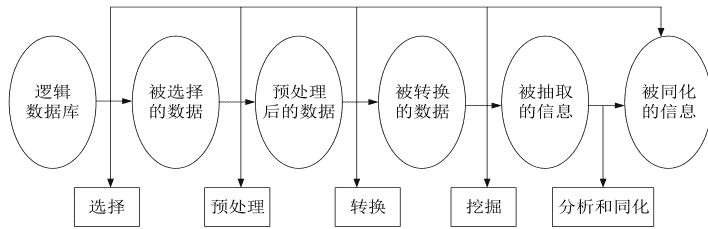

图 2 数据挖掘过程基本步骤

第三步：进行数据挖掘。对得到的经过转换的数据进行挖掘。

第四步：结果分析。解释并评估结果，其使用的分析方法一般应视数据挖掘操作而定，通常会用到可视化技术。

第五步：知识的同化。将分析所得到的知识集成到所要应用的地方去⁵。

### 1.1.3 数据挖掘功能

目前数据挖掘的主要功能包括概念描述、关联分析、分类、聚类和偏差检测等。概念描述主要用于描述对象内涵并且概括此对象相关特征，概念描述分为特征性描述和区别性描述，特征性描述描述对象的相同特征，区别性描述描述对象的不同特征；关联分析主要用来发现数据库中相关的知识以及数据之间的规律，关联分为简单关联、时序关联、因果关联；分类和聚类就是根据需要训练相应的样本来对数据分类和合并；偏差分析用于对对象中异常数据的检测。

### 1.1.4 大数据与数据挖掘

大数据是近年随着互联网、物联网、通信网络以及人类社交网络快速发展的结果，成为一个交叉研究学科，和数据挖掘紧密相连。一方面大数据包含数据挖掘的各个阶段，即数据收集、预处理、特征选择、模式挖掘、表示等；另一方面大数据的基础架构又为数据挖掘提供上层数据处理的硬件设施；最后大数据的迅速发展也使得数据挖掘对象变得更为复杂，不仅包括人类社会与物理世界的复杂联系，还包括呈现出的高度动态化。这使得很多传统数据挖掘算法不再适用，传统数据挖掘算法必须满足对真实数据和实时数据的处理能力，才能从大量无序数据中获取真正价值。

大数据具有 4V 特性，对 4V 特性的解释有多种，包括美国国家标准技术研究院 NIST 的解释：即规模庞大（Volume）、种类繁多（Variety）、增长速度快（Velocity）和变化多样（Variability）。IBM 给出了类似的解释，但 Variability 变成了真实性（Veracity），后来将数据价值（Value）引入了进来，成为了大数据的 5V 特性。麦肯锡全球研究机构（McKinsey Global Institute）后来给出了大数据定义，综合了“现有技术无法处理”和“数据特征定义”定义，这也是目前比较公认的定义：即规模庞大（Volume）、种类繁多（Variety）、变化频繁（Velocity）和价值（Value）。

大数据的快速发展极大的促进了数据挖掘领域的发展。

## 1.2 数据挖掘知识图谱

本节分析了近年来数据挖掘领域的高水平学术论文，挖掘出了包括社交网络、大数据、情报分析、聚类分析、文本挖掘、用户行为、推荐系统、离群检测、专家系统等相关关键词近年来全球活跃的学术研究。此外，结合知识图谱技术，本报告将以上研究领域表示为三级图谱结构，具体分析和处理的方法如下：

- 1. 使用自然语言处理技术，提取每篇论文文献的关键词，据此，结合学科领域知识图谱，将文章分配到相应领域；
- 2. 依据学科领域对论文文献进行聚类，并统计论文数量作为领域的研究热度；
- 3. 领域专家按照领域层级对学科领域划分等级，设计了三级图谱结构，最后根据概念热度定义当前研究热点。

下图是数据挖掘二级知识图谱的可视化表示，三级详细数据可以参见本报告附录，或到 https://www.aminer.cn/data 中直接下载原始数据。

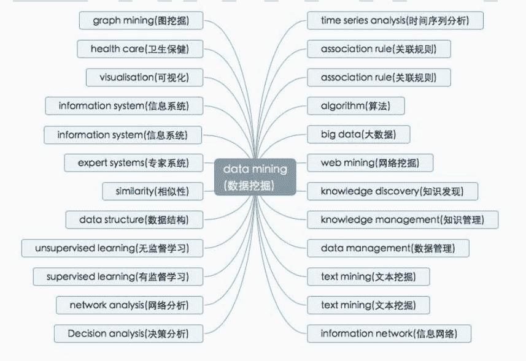

图 3 Data Mining 知识图谱

## 1.3 近年 SIGKDD 概况

国际知识发现与数据挖掘大会（ACM SIGKDD Conference on Knowledge Discovery and Data Mining, 简称 SIGKDD）是数据挖掘领域的顶级国际会议，由 ACM 的数据挖掘及知识发现专委会负责协调筹办。会议内容涵盖数据挖掘的基础理论、算法和实际应用，SIGKDD 主会期间，除了学术研究论文，自 2010 年起还设有面向工业和政府应用的专题研讨会，以及工业应用博览的邀请报告会。

SIGKDD 发展的历史可以追溯到 1989 年，一系列关于知识发现及数据挖掘的研讨会从那时开始组织。自 1995 年以来，SIGKDD 以大会的形式连续举办了 24 届，论文的投稿量和参会人数呈现出逐年累增的趋势。由于 SIGKDD 的学科交叉性和广泛应用性，吸引了来自统计、社会网络分析、机器学习、大数据挖掘、数据库、万维网、生物信息学、多媒体、自然语言处理、人机交互及高性能计算等众多领域的学者。

SIGKDD 每年的大都会都会吸引大量的研究界和工业界的投稿。图 4 和图 5 分别给出了 KDD 近几年研究性论文（Research Track）和工业界论文（Industrial Track，最近改为 Applied Data Science Track）的投稿和录用情况。总的来说研究性论文投稿相对比较稳定，录用率也一直在 14%-20%之间；而工业界论文近年呈现明显快速增长趋势。尤其 2018 年达到近 500 篇投稿。投稿录用率也降到 20%以下。这与近年深度学习、人工智能、大数据等相关算法在工业界大量应用密不可分。

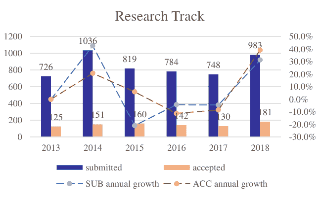

图 4 2013-2018 KDD 研究性论文投稿与接收情况

### Applied Data Science Track

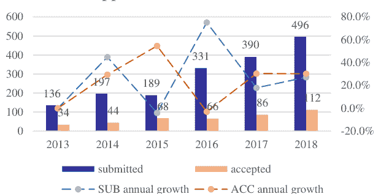

图 5 2013-2018 KDD 工业界论文投稿与接收情况

下面就近几年 SIGKDD 大会分别做一个简单概述，相信读者能够对整个 SIGKDD 乃至数据挖掘领域有个更深入的了解。

### (1) SIGKDD 2013

2013 年 8 月 11-14 日，第 19 届知识发现与数据挖掘大会（SIGKDD 2013）在美国芝加哥召开，此次大会的主题是大数据挖掘。

SIGKDD 2013 大会的主席是前通用汽车高级研究经理 Ramasamy Uthurusamy 博士和伊利诺伊芝加哥大学的 Robert L. Grossman 教授，研究性程序委员会主席由来自德克萨斯奥斯丁大学的 Inderjit S. Dhillon 教授和 Google 的 Yehuda Koren 博士担任，另外有 50 名高级程序委员会委员和 300 名程序委员负责论文评审。吸引了来自全球 50 多个国家 1200 多人参加。

SIGKDD 2013 大会收到来自 50 多个国家的 726 篇论文投稿，每篇文章由至少 3 名审稿人评审，然后由相应领域的高级程序委员协调讨论并推荐，最后由程序主席决定是否接收。最终录用论文 125 篇（录用率约 17.2%），其中大会报告论文 66 篇（仅 9.1%）、张贴报告论文（Poster Presentation）59 篇。

SIGKDD 2013 大会邀请了微软的 Raghu Ramakrishnan、斯坦福的 Andrew Ng、威斯康辛的 Stephen J. Wright 以及 Google 的 Hal Varian 四位在产业界与学术界均产生重要影响的专家进行大会主题报告。

SIGKDD 2013 的具体获奖情况如下：

- 最佳研究性论文
- 最佳论文奖
- Simple and Deterministic Matrix Sketching
- 简易及确定性矩阵草图

作者：Edo Liberty

摘要：该论文研究的问题是针对给定的矩阵 A，如何能找到一个更小的压缩矩阵 B 对原矩阵 A 进行估计，这是基于社交网络大数据分析中的一个关键问题。

地址：https://www.aminer.cn/archive/simple-and-deterministic-matrix-sketching/53e9b500b7602d970402e5e6

### 最佳论文奖第二名

### Querying Discriminative and Representative Samples for Batch Mode Active Learning

批量模式主动学习的查询判别样本和代表性样本

作者：Zheng Wang, Jieping Ye

摘要：他们解决了在主动学习中如何能够挑选同时具有代表性又具有区分性的样本。

地址：https://www.aminer.cn/archive/querying-discriminative-and-representative-samples-for-batch-mode-active-learning/53e9bba7b7602d97047f32a6

### 最佳学生论文奖

### A space efficient streaming algorithm for triangle counting using the birthday paradox

一种利用生日悖论的空间高效三角形计数流算法

作者：Madhav Jha、C. Seshadhri、Ali Pinar

摘要：该论文设计了一种节省空间的算法，该算法近似于传递性（全局聚类系数）和总三角形计数，只有一次通过作为边缘流给出的图形。模型基于经典的概率结果，即生日悖论，作为单通道流式算法，通过存储极小部分的边缘来维持图的三角形的传递性/数量的实时估计。

地址：https://www.aminer.cn/archive/a-space-efficient-streaming-algorithm-for-triangle-counting-using-the-birthday-paradox/53e9999eb7602d97021e514e

### 最佳学生论文奖第二名

### Recursive Regularization for Large-scale Classification with Hierarchical and Graphical Dependencies

具有层次结构和图形依赖性的大规模分类的递归正则化

作者：Siddharth Gopal、Yiming Yang

摘要：该篇论文的目的是为大范围的层次分类，提出一种规则化框架，一次解决两个问题：1.利用 class-labels 间的层次依赖性提升性能；2.同时保持大规模的层次间的可扩展性。

地址：https://www.aminer.cn/archive/recursive-regularization-for-large-scale-classification-with-hierarchical-and-graphical-dependencies/53e9aac3b7602d97034430d3

### 最佳工业界与政府论文

### 最佳论文奖

### Amplifying the Voice of Youth in Africa via Text Analytics

通过文本分析放大非洲年轻人的心声。

作者：Prem Melville 及 UNICEF 的多名研究人员

摘要：他们的课题是通过文本分析，让世界听到非洲的年轻一代发出的声音，从某种程度上也体现了 KDD 注重将数据挖掘用于为世界公益做出贡献的精神。

地址：https://www.aminer.cn/archive/amplifying-the-voice-of-youth-in-africa-via-text-analytics/53e9b09fb7602d9703b07333

### 最佳论文奖第二名

### Query Clustering based on Bid Landscape for Sponsored Search Auction Optimization

基于竞价格局的查询聚类对赞助搜索竞价优化

作者：微软公司以 Ye Chen 为代表的一众人

摘要：集群查询更小但更有效的微市场，定义为基于集群的拍卖参数。

地址：https://www.aminer.cn/archive/query-clustering-based-on-bid-landscape-for-sponsored-search-auction-optimization/53e9af2cb7602d9703964e4f

### 最佳博士论文

### 最佳博士毕业论文

### Mining Heterogeneous Information Networks

挖掘异构信息网络

作者：Yizhou Sun 博士，其导师为韩家炜（Jiawei Han）教授

摘要：论文从许多将互连数据视为同构图或网络的现有网络模型中，研究了挖掘异构信息网络的原理和方法，半结构化异构信息网络模型利用了类型化节点和链接的丰富语义。这种半结构化异构网络建模为挖掘互联数据提供了一系列新原则和强大的方法。

地址：https://www.aminer.cn/archive/mining-heterogeneous-information-networks-a-structural-analysis-approach/53e9ae3cb7602d9703851185

### 最佳博士毕业论文第二名

### Machine Learning in Health Informatics: Making Better use of Domain Experts

健康信息学中的机器学习：更好地利用领域专家

作者：Byron Wallace 博士，其导师为 Carla Brodley 教授。

摘要：此次他们集中关注了临床信息学和具有大量信息的典型案例，发现因为临床信息学内在特性的原因，解决相关问题需要专业领域的知识，而该领域现有的机器学习技术普遍性能表现较弱。该论文目的旨在使用新奇的机器学习与数据挖掘方法，让现实世界中的学习系统更加有效率。

地址：https://www.aminer.cn/archive/machine-learning-in-health-informatics-making-better-use-of-domain-experts/56d890a4dabfae2eee4ca4d

### SIGKDD 创新和服务大奖

### 创新贡献奖: Jon Kleinberg (康奈尔大学)

2013 年创新奖（Innovation Award）由康奈尔大学的 Jon Kleinberg 教授获得，以表彰他在社交网络和信息网络分析中的传递行为以及用户个体行为建模方面的工作。Jon Kleinberg 是社会网络分析方向的知名学者，三十余岁时即当选为美国科学院、工程院、艺术与科学院院士，代表算法是 HITS。

SIGKDD 创新奖是知识发现与数据挖掘领域（KDD）的最高荣誉，授予对这一领域做出重大技术贡献的研究人员。根据评审要求，其研究成果必须在数据挖掘理论或商业数据挖掘系统的开发上能够产生深远的影响。这是 SIGKDD 每年最重头的奖项，也是数据挖掘领域最高技术奖项。

### 服务贡献奖: Gabor Melli (索尼互动娱乐)

2013 年杰出服务奖（Service Award）由 Gabor Melli（索尼互动娱乐）获得。Gabor Melli 博士因其对数据挖掘实践和应用的重大技术贡献，以及对全球 KDD 社区的杰出服务而受到表彰。他长期为 KDD 社区服务，从 1997 年开始，他在 datasetgenerator.com 上发布了合成数据集生成器。在 2005 年，他与伙伴共同创立了数据挖掘案例研究研讨会系列（dataminingcasestudies.com），并成为 SIGKDD 信息总监。从那时起，他参与组织了许多 KDD，ICDM 和 CIKM 国际会议，担任出版主席，研讨会主席，赞助主席，竞赛主席，展览主席和演示主席等职务，同时担任 KDD，CIKM，PAKDD 的评委和 ACM 计算调查。2013 年，Gabor Melli 博士启动了一个半自动创建广泛的 KDD 概念网络知识库（www.gabormelli.com/RKB/）的项目。

SIGKDD 杰出服务奖主要授予在知识发现及数据挖掘领域作出重大服务贡献的个人或团队，包括主办会议、主持学术团体等服务性工作，并在数据挖掘教学及财务性事务等方面的工作。该奖主要奖励对知识发现及数据挖掘领域作出重大服务贡献的个人或团队，考察的因素主要包括主持学术团体、主办会议等服务性工作，教育学生、研究者和实践者，资助研发活动，为传播技术信息提供专业志愿服务，并通过知识挖掘应用为社会做出贡献，改善全球性医疗、教育、灾难 / 危机管理及环境等议题。

### KDD CUP 竞赛

- 第一名: Algorithm 队


### 第二名： Dmitry & Leustagos & BS Man 队

KDD CUP 2013 由微软的学术搜索系统提供数据集，共开设两个专题，任务分别是识别作者与论文的对应关系，和作者的名字消歧，分别吸引了 561 和 241 支队伍参赛。最终两个专题的冠军皆被国立台湾大学的林智仁教授、林守德教授和林轩田教授带领的团队斩获。

## (2) SIGKDD 2014

2014 年 8 月 24-27 日，第 20 届国际知识发现与数据挖掘大会（SIGKDD 2014）在美国纽约市召开。本届大会的主题为 “Data Science for Social Good”（数据科学推动社会进步），旨在呼吁和推动数据科学家投身和致力于解决实际社会问题。

本届大会的主席由 Facebook 公司的数据科学家 Sofus Macskassy 博士和 Distillery 公司的首席科学家 Claudia Perlich 博士共同担任，研究性程序委员会主席由斯坦福大学 Jure Leskovec 教授和加州大学洛杉矶分校的 Wei Wang 教授共同担任，工业界程序委员会委员会主席由芝加哥大学 Rayid Ghani 教授（曾任奥巴马政府首席科技顾问）和 Social Alpha 创始人兼首席执行官 Prem Melville 博士共同担任。吸引了 2320 人注册参加。

SIGKDD 2014 共收到 1036 篇研究性论文和 197 篇工业和政府应用性论文投稿，双双高于 SIGKDD 2013 相应投稿数量的 40%以上。每篇投稿文章由至少 3 名审稿人评审及 1 名相应领域的高级程序委员协调讨论并推荐，最终由程序委员会主席决定是否录取。在 46 名高级程序委员和 340 名评审人的共同努力下，本次大会最终录取 151 篇研究性论文（录用率约 14.6%）和 44 篇工业和政府应用性论文（录用率约 22%）。

中国大陆学者作为第一作者在本届大会共发表 13 篇相关研究论文，作者来自清华大学、南京大学、浙江大学、上海交通大学、中国人民大学、吉林大学等科研院校，共有 80 余位大陆学者参加了 SIGKDD 2014。

SIGKDD 2014 邀请了艾伦人工智能研究所首席执行官 Oren Etzioni 博士，微软雷蒙德研究院院长 Eric Horvitz 博士，伊坎基因组织学和多尺度生物学研究所所长 Eric Schadt 博士，哈佛大学经济系 Sendhil Mullainathan 教授以及彭博资讯公司首席执行官 Dan Doctoroff 先生进行大会主题报告。

SIGKDD 2014 除了经典的最佳论文、最佳学生论文等奖项外，还设置了与会议主题有关的论文奖项，具体的获奖情况如下：

- 最佳研究性论文

### 最佳论文奖

### Reducing the Sampling Complexity of Topic Models

减少主题模型的采样复杂度

作者：Aaron Q. Li、Amr Ahmed、Sujith Ravi 及 Alexander J. Smola

摘要：该论文研究如何降低主题模型求解过程中的采样复杂度，其提出的算法比传统方法提高一个数量级的时间复杂度。

地址：https://www.aminer.cn/archive/reducing-the-sampling-complexity-of-topic-models/5550453745ce0a409eb549bd

### 最佳学生论文奖

### An Efficient Algorithm For Weak Hierarchical Lasso

弱层次套索的一种有效算法

作者：Yashu Liu、Jie Wang、Jieping Ye

摘要：分层套索是一种有效的方法，用于规范试图捕获非线性特征交互的模型的参数。本文提出了解决使用这种正则化器时出现的非凸性的算法。

地址：https://www.aminer.cn/archive/an-efficient-algorithm-for-weak-hierarchical-lasso/5550453745ce0a409eb549c3

- 最佳主题论文

### Targeting Direct Cash Transfers to the Extremely Poor

定位极度贫困人口直接发放现金

作者：Enigma、Give Directly 的研究者们

摘要：他们的论文主要针对社会问题，通过分析肯尼亚贫困村庄的卫星遥感数据来鉴别极度贫穷家庭，以此为根据为他们提供无条件的人道主义关怀和金钱资助。

地址：https://www.aminer.cn/archive/targeting-direct-cash-transfers-to-the-extremely-poor/5550453645ce0a409eb549aa

- 最佳工业和政府论文

### Style in the Long Tail: Discovering Unique Interests with Latent Variable Models in Large Scale Social E-commerce

长尾设计：在大型社交电子商务中通过潜在的变量模型发现独特的兴趣

作者：Diane J. Hu, Rob Hall 和 Josh Attenberg

摘要：该论文描述了在 Etsy 站点上部署两个基于样式的新推荐系统的方法和实验。其使用了 Latent Dirichlet Allocation (LDA) 来发现 Etsy 上的趋势类别和样式，然后用它们来描述用户的“兴趣”配置文件。还探索了散列方法，以便在 map-reduce 框架上执行快速最近邻搜索，以便有效地获取建议。这些技术已经成功实施，大大改善了许多关键业务指标。

地址：https://www.aminer.cn/archive/style-in-the-long-tail-discovering-unique-interests-with-latent-variable-models-in-large-scale-social-e-commerce/5550453645ce0a409eb5491d

### 最佳博士论文

### Reconstruction and Applications of Collective Storylines from Web Photo Collections

将来自网页照片集合中的集合故事线重构、应用

作者：Gunhee Kim 博士，其导师为 Eric Xing 教授

摘要：该论文的目标是通过联合推断图像集的时间趋势和重叠内容，来创建集体故事情节，还利用重建的照片故事情节，来探索新颖的计算机视觉和数据挖掘应用程序。提出了分支故事情节图的重建算法。

地址：https://dwz.cn/qeyTTacH

### 时间检测奖（“Test of Time”，也就是十年最佳论文）

SIGKDD 大会从 2014 开始设立 Test of Time 最佳论文奖，旨在表彰过去 20 年 KDD 大会上发表得有重大影响力的优秀论文，该奖项最初两年各颁发给三篇论文，之后将每年颁发给一篇论文。

以下三篇论文在 2014 年获此殊荣：

### A Density-Based Algorithm for Discovering Clusters in Large Spatial Databases with Noise (KDD 1996)

一种基于密度的具有噪声的大型空间数据库集群发现算法

作者：Martin Ester、Hans-Peter Kriegel、Joerg Sander、Xiaowei Xu

摘要：该论文提出的 DBSCAN 算法对基于密度的聚类算法产生了巨大的影响，并已成为聚类算法中公认的重要算法之一。

地址：https://www.aminer.cn/archive/a-density-based-algorithm-for-discovering-clusters-in-large-spatial-databases-with-noise/53e9bd7bb7602d9704a1d173

### Integrating Classification and Association Rule Mining (KDD 1998)

集成分类和关联规则挖掘

作者：刘兵、Wynne Hsu、LinkedIn 公司的 Yiming Ma

摘要：该论文率先提出了整合关联规则和分类算法来帮助数据挖掘分类的思想，该方法激发了一系列后继工作的发展。

地址：https://www.aminer.cn/archive/integrating-classification-and-association-rule-mining/53e9aefcb7602d9703930008

### Maximizing the Spread of Influence through a Social Network (KDD 2003)

通过社交网络最大化影响力扩散度

作者：David Kempe、Jon Kleinberg、Eva Tardos

摘要：该论文是社交网络中影响力最大化问题研究的里程碑式工作，其在数学上证明了求解该类问题算法的性能指标界限，为此领域后续研究工作提供了理论支持。

地址：https://www.aminer.cn/archive/maximizing-the-spread-of-influence-through-a-social-network/53e9b6d1b7602d970425d749

## SIGKDD 创新和服务大奖

### 创新贡献奖：Prof. Pedro Domingos (University of Washington)

SIGKDD 2014 创新奖由华盛顿大学的 Pedro Domingos 教授获得，以表彰他在流式数据分析，马尔可夫逻辑网等方面的基础性工作。在此之前，Pedro Domingos 教授曾获 SIGKDD、AAAI、UAI 和 NIPS 等国际会议的最佳论文奖。

### 服务贡献奖：Dr. Ted Senator (Leidos)

### KDD CUP

KDD CUP 2014 由在线慈善机构 DonorsChoose 提供数据集，它要求参赛队伍识别具有潜力的优秀学生项目申请，以此为根据提供经济和其它方面的支持。此次比赛吸引了 652 名人员组成的 472 支队伍参与，比赛冠军最终由“STRAYA”团队获得。

## (3) SIGKDD 2015

2015 年 8 月 10-13 日，第 21 届国际知识发现与数据挖掘大会（SIGKDD 2015）在澳大利亚悉尼市召开。本届的主题是数据科学和大数据。

本届大会主席由澳大利亚悉尼科技大学工程与信息技术学院操龙兵教授和悉尼科技大学信息技术学院 Chengqi Zhang 教授共同担任，研究性程序委员会主席由康奈尔大学 Thorsten Joachims 教授和莫纳什大学的 Geoff Webb 教授共同担任，工业界程序委员会委员会主席由波音科技高级研究员 Dragos D. Margineantu 博士和 Pexip 公司董事会成员 Graham Williams 共同担任。

SIGKDD 2015 大会收到了 1008 篇稿件。其中研究论文 819 篇，录用 160 篇（录用率约 19.5%）；政府和工业界应用论文 189 篇，录用 68 篇（录用率约 35.9%）。中国大陆学者作为第一作者在本届大会共发表 14 篇相关研究论文，作者来自清华大学、北京大学、中国科技大学、上海交通大学、西南交通大学、中国科学院、以及中国电子科技大学等科研院校，共有 90 余位大陆学者参加了本届大会。

本届 SIGKDD 大会邀请了来自微软的杰出科学家 Ronny Kohavi 博士，来自悉尼大学的 Hugh Durrant-Whyte 教授，Coursera 的总裁和联合创始人 Daphne Koller 博士，斯坦福大学商学院的 Susan Athey 教授进行大会的主题报告。

SIGKDD 2015 的具体获奖情况如下：

### 最佳研究性论文

### 最佳论文奖

### Efficient Algorithms for Public-Private Social Networks

公共-私人的社交网络高效算法

作者：Flavio Chierichetti、Alessandro Epasto、Ravi Kumar、Silvio Lattanzi 及 Vahab Mirrokni

摘要：该论文研究利用草图化和采样这两种大规模图计算中有效的范式来加速公开和私密相结合的社交网络中的计算问题。

地址：http://epasto.org/papers/kdd2015.pdf

### 最佳学生论文奖

### Edge-Weighted Personalized PageRank: Breaking a Decade-Old Performance Barrier

边缘加权个性化网页排序：打破十年来的性能障碍

作者：Wenlei Xie、David Bindel、Alan Demers 和 Johannes Gehrke

摘要：该论文的目的旨在个性化个人的网页排序，让人们在进行问题搜索时，得到最符合个人倾向的搜索结果。

地址：https://www.aminer.cn/archive/edge-weighted-personalized-pagerank-breaking-a-decade-old-performance-barrier/5736973c6e3b12023e62b916

### 最佳博士论文

### 最佳博士毕业论文

### Mining Latent Entity Structures from Massive Unstructured and Interconnected Data

从大量非结构化和互连的数据中挖掘潜在的实体结构

作者：Chi Wang 博士，其导师为韩家炜（Jiawei Han）教授。

摘要：大数据时代背景下，信息量之庞大，覆盖人类日常生活的方方面面，但有价值且相连的信息通常隐藏在大量无结构和组织的数据背后，该论文目的是提供一种挖掘框架，整合、解决一系列的数据挖掘关联问题。

地址：https://www.aminer.cn/archive/mining-latent-entity-structures-from-massive-unstructured-and-interconnected-data/555048b845ce0a409eb70bc0

### 最佳博士毕业论文第二名

### Modeling Large Scale Social Network in Context

从语境中模拟大型社交网络

作者：Qirong Ho 博士，导师为 Eric Xing 教授

摘要：如今社交网络和互联网包含数以百万计甚至数十亿计的节点，以及大量的侧信息（上下文），如文本、属性、时间、图像和视频数据。而该论文的目标就是丰富如此社会规模的网络分析，这种理论基于两点：（1）建模和算法技术将网络环境纳入现有的基于统计模型的网络分析算法；（2）策略对网络数据表示、模型设计、算法设计和分布式多机编程，在一起，确保可伸缩性很大的网络。本文提出的方法将统计模型的灵活性与数据挖掘和社会网络社区的关键思想和经验观察相结合，并得到基于原始分布式系统研究的集群计算软件库的支持。这些努力最终形成了一个新的混合成员三角形 motif 模型，该模型可以轻松扩展到仅在几个集群机器上就有超过 1 亿个节点的大型网络，并且可以很容易地扩展到使用本文中介绍的其他技术来适应网络上下文。

地址：http://reports-archive.adm.cs.cmu.edu/anon/ml2014/CMU-ML-14-100.pdf

### Computing Distrust in Social Media

社交媒体的不信任度计算

作者：Jiliang Tang 博士，其导师 Huan Liu 教授

摘要：该论文的主要目的是去解决发现一些创新性的研究及新奇的方法。一种带有新奇框架的预测不信任被提出，让不可见不信任变得可见，开发有原则的方法去应用不信任在各大社交软件。因为不信任是消极链接的一种特殊类型，我论证了消极链接的不信任算法和特性概括。

地址：https://repository.asu.edu/items/28550

- 时间检测奖（Test of Time Award）

### Mining High-Speed Data Streams (KDD 2000)

挖掘高速数据流

作者：Pedro Domingos、Geoff Hulten

摘要：该论文提出了 VFDT 这一实时数据流挖掘系统，用于快速处理不断增长的数据记录。

地址：https://www.aminer.cn/archive/mining-high-speed-data-streams/53e9b055b7602d9703ab8cf1

### Optimizing Search Engines Using Click-Through Data (KDD 2002)

使用可点击数据来最优化搜索引擎

作者：Thorsten Joachims

摘要：该论文率先提出了通过挖掘利用用户点击数据从而提高搜索引擎结果准确率的方法，该方法激发了一系列后继工作的发展并成为目前学术界与工业界搜索引擎研发的公认基础方法。

论文地址：https://www.aminer.cn/archive/optimizing-search-engines-using-clickthrough-data/53e9b042b7602d9703aa0d88

### Mining and Summarizing Customer Reviews (KDD 2004)

挖掘与汇总消费者点评

作者：Minqing Hu、刘兵教授

摘要：该论文是电子商务等互联网应用中用户评价挖掘的里程碑式工作，为此领域后继研究工作以及在业界产品中的广泛应用起到了指导性的作用。

地址：https://www.aminer.cn/archive/mining-and-summarizing-customer-reviews/53e9af46b7602d97039827ec

- SIGKDD 创新和服务大奖

### 创新贡献奖：Prof. Hans Peter Kriegel (University of Munich)

创新奖（Innovation Award）由慕尼黑大学的 Hans Peter Kriegel 教授获得，以表彰他在数据挖掘，尤其是聚类分析、异常值检测以及高维数据分析等工作中做出的杰出贡献。在此之前，Hans Peter Kriegel 教授曾获 2014 年 KDD Test of Time 论文奖，并当选 ACM fellow。

### 服务贡献奖：Prof. Jian Pei (Simon Fraser University)

服务贡献奖（Service Award）授予西蒙佛莱迪大学的 Jian Pei 教授，用以表彰他为推动数据挖掘领域技术发展所作出的杰出成就以及为领域学术进步所作出的杰出服务，包括组织 SIGKDD、ICDM、SDM 以及 CIKM 等相关会议、担任 TKDE 主编以及其它一些主要刊物的副主编等。

- KDD CUP 竞赛

第一名：the Intercontinental Ensemble

KDD CUP 2015 由清华大学的唐杰和以色列海法大学的 Ron Bekkerman 一起担任共同主席，由中国大规模在线教育网站学堂在线（XuetangX.com）承办，竞赛的任务是要求参赛队伍预测在线课程中学生退课的情况。此次比赛吸引了来自 26 个国家的 1263 名参赛者组成的 821 支队伍参与。比赛冠军最终由多国军团—“the Intercontinental Ensemble” 团队获得。

## (4) SIGKDD 2016

2016 年 8 月 13-17 日，第 22 届国际知识发现与数据挖掘大会（SIGKDD 2016）在美国旧金山市召开。大会主题包括：图挖掘和社交网络、深度学习、推荐系统、时间序列和流数据挖掘、应用数据科学等。


## SIGKDD 2016

SIGKDD 2016 大会主席由 IBM 公司的 Balaji Krishnapuram 博士和 BOSCH 公司的 Mohak Shah 博士担任，研究性程序委员会主席（PC Co-Chairs）由卡耐基梅隆大学（现 Amazon 公司）的 Alex Smola 教授和 IBM 公司的 Charu Aggarwal 博士共同担任；今年开始还将原来的工业和政府 Track 改名为应用数据科学 Track（Applied Data Science Track），本届主席由 IBM 公司的 Rastogi Rajeev 博士和中国百度的 Dou Shen 博士共同担任。此次大会吸引了来自 88 个国家的 2726 人注册参加，创下历史记录。

SIGKDD 2016 大会收到 784 篇研究性论文和 331 篇应用数据科学论文投稿，其中研究性论文的数量相比 2015 年的 1008 篇和 2014 年的 1036 篇有所减少，而应用数据科学论文则相比往年有了很大的增加。本次大会最终录取 142 篇研究性论文（录用率约 18.1%）和 66 篇应用数据科学论文（录用率约 20%）。

SIGKDD 2016 大会邀请了微软新英格兰研究院和纽约研究院院长 Jennifer Chayes 博士，加州大学伯克利分校电子工程与计算机科学系 Joe Hellerstein 教授，全球风险投资公司恩颐投资（NEA）合伙人 Greg Papadopoulos 博士，和牛津大学教授、Google DeepMind 首席科学家 Nando de Freitas 博士，进行了四场大会主题报告。2015 年 ACM 图灵奖得主、斯坦福大学 Whitfield Diffie 教授受 SIGKDD 邀请在本届大会作了图灵特邀报告。

### 具体获奖情况

#### 最佳研究性论文

##### 最佳论文奖

##### FRAUDAR: Bounding Graph Fraud in the Face of Camouflage

欺诈者：面部伪装中的边界图片欺诈

作者：Bryan Hooi、Hyun Ah Song、Alex Beutel、Neil Shah、Kijung Shin、Christos Faloutsos

摘要：这篇论文研究如何在用户商品评论数据中识别假的评论，提出的方法能够识别伪装，比传统方法更加有效。

地址：https://www.aminer.cn/archive/fraudar-bounding-graph-fraud-in-the-face-of-camouflage/57aa28de0a3ac518da9896dc

##### 最佳论文奖第二名

##### Ranking Causal Anomalies via Temporal and Dynamical Analysis on Vanishing Correlations

基于消除相关性并通过临时、动态分析排序来排序异常现象的因果关系

作者：Wei Cheng、Kai Zhang、Haifeng Chen、Guofei Jiang、Zhengzhang Chen、Wei Wang

摘要：为了解决这些局限性，本文提出了一个基于网络扩散的框架来识别重要的因果异常并对其进行排序。该方法能有效地模拟故障在整个不变网络中的传播，并能同时对结构模式和时变断裂不变性模式进行联合推理。因此，它可以定位真正导致相关性消失的高置信度异常，并可以弥补系统中的非结构化测量噪声。在综合数据集、银行信息系统数据集和燃煤电厂网络物理系统数据集上的大量实验证明了我们的方法的有效性。

地址：https://www.aminer.cn/archive/ranking-causal-anomalies-via-temporal-and-dynamical-analysis-on-vanishing-correlations/57aa28de0a3ac518da9896ca

#### 最佳学生论文奖

##### TRIEST: Counting Local and Global Triangles in Fully-dynamic Streams with Fixed Memory Size

在固定内存大小的全动态流中计算本地三角形和全局三角形

作者：Lorenzo De Stefani 等人

摘要：该论文提出了一种单遍历流式算法用于对动态网络中全局和局部三角形数量的无偏、低方差、高质量的估计，比现有方法更好更快。

地址：https://www.aminer.cn/archive/tri-st-counting-local-and-global-triangles-in-fully-dynamic-streams-with-fixed-memory-size/599ee0589c05d3074f0123ac

##### 最佳学生论文奖第二名

##### Predicting Matchups and Preferences in Context

预测语境下的匹配与偏好

作者：Shuo Chen、Thorsten Joachims

摘要：该论文提出一个综合的概率框架，用于预测两两匹配的结果（两人体育赛事）和偏好配对（产品偏好），从电脑游戏到电子商务推荐，两方面运用都很广泛。

地址：https://www.aminer.cn/archive/predicting-matchups-and-preferences-in-context/57aa28de0a3ac518da9896cb

#### 最佳应用数据科学论文

##### 最佳论文奖

##### Ranking Relevance in Yahoo Search

排序雅虎搜索中的关联性

作者：Dawei Yin、Yuening Hu、Jiliang Tang、Tim Daly Jr.、Mianwei Zhou、Hua Ouyang、Jianhui Chen、Changsung Kang、Hongbo Deng、Chikashi Nobata、Jean-Marc Langlois、Yi Chang

摘要：这篇论文总结了雅虎搜索 20 多年的探索和努力，介绍了排序函数、语义特征、查询重写三大关键技术，以及时间、位置相关的搜索。

地址：https://www.aminer.cn/archive/ranking-relevance-in-yahoo-search/57aa28de0a3ac518da98974b

##### 最佳论文奖第二名

##### Matrix Computations and Optimization in Apache Spark

Apache Spark 中的矩阵计算与最优化

作者：Reza Bosagh Zadeh、Xiangrui Meng、Alexander Ulanov、Burak Yavuz、Li Pu、Shivaram Venkataraman、Evan Sparks、Aaron Staple、Matei Zaharia

摘要：该论文中主要阐述了一种集群程序框架运算 Apache Spark 中可用的矩阵计算。论文中的主要贡献已经合并入 Apache Spark，在 Spark 安装时属默认设置可用。

地址：https://www.aminer.cn/archive/matrix-computations-and-optimization-in-apache-spark/56d845aedabfae2eeeac4830

##### 最佳学生论文奖

##### Contextual Intent Tracking for Personal Assistants

用于个人助理的上下文意图追踪

作者：Yu Sun 等人

摘要：这篇文章研究了如何为个人助理软件提供准确的用户意图分析。

地址：https://www.aminer.cn/archive/contextual-intent-tracking-for-personal-assistants/57aa28de0a3ac518da98974c

##### 最佳学生论文奖第二名

##### Firebird: Predicting Fire Risk and Prioritizing Fire Inspections in Atlanta

Firebird（数据库）：预测亚特兰大火灾风险并预先进行火险安全检查

作者：Michael Madaio、Shang-Tse Chen、Oliver L. Haimso、Wenwen Zhang、Xiang Cheng、Matthew Hinds-Aldrich、Duen Horng Chau、Bistra Dilkina

摘要：与 Atlanta Fire Rescue Department（AFRD）合作，作者们开发了 Firebird 框架，使用机器学习、地理编码和信息可视化，以帮助亚特兰大市政消防部门识别和优先安排商业财产火灾检查。Firebird（数据库）计算了该市 5000 多座建筑的火灾风险得分，实际正确率高达 71%。根据 AFRD 的检验标准，已经确定了 6096 处潜在的商业地产进行检验。此外，通过交互式地图，Firebird 整合和可视化火灾事件、财产信息和风险评分，帮助 AFRD 对火灾检查做出知情的决定。火鸟已经开始在地方和国家两级产生积极影响。它改进了 AFRD 的检查流程和亚特兰大居民的安全，并被美国国家消防协会（NFPA）列为使用数据通知消防检查的最佳实践。

地址：https://www.aminer.cn/archive/firebird-predicting-fire-risk-and-prioritizing-fire-inspections-in-atlanta/573695fe6e3b12023e511d3c

#### 最佳博士论文

##### Dissertation: Exploring and Making Sense of Large Graphs

毕业论文：探索理解大规模图形

作者：Danai Koutra 博士，其导师为 Christos Faloutsos 教授。

摘要：图形代表的信息从网页之间的链接到大脑神经元之间的连接，通常跨越数十亿个节点。在海量的数据中，我们如何找到它最重要的结构？我们如何能检测到关键事件，如计算机系统攻击，或人类大脑中的疾病形成？目前我们已经将我们的方法应用于大量数据，包括 66 亿条边的网络图，18 亿条边的 Twitter 图，以及 9000 万条边的大脑图。

地址：http://reports-archive.adm.cs.cmu.edu/anon/2015/CMU-CS-15-126.pdf

#### 最佳博士论文第二名

##### Mining Disparate Sources for Question Answering

挖掘不同来源以供解答

作者：Huan Sun 博士，其导师为 Xifeng Yan 教授

摘要：论文中完善的方法论和框架为一系列研究铺垫了道路，如通过使用不同和互补的数据源，进行各种领域的问答，如健康医疗，商务智能。同时结合人类智能与机器智能，通过问答交互解决一系列问题并做出决策。

地址：http://web.cse.ohio-state.edu/~sun.397/ResearchProj.html

##### Scalable Multivariate Time Series Analysis

可扩展的多元时间序列分析

作者：Taha Bahadori 博士，其导师为 Yan Liu 教授

摘要：时间序列数据已经在很多应用领域无处不在，如气象科学、社交媒体和健康医疗。利用各种领域大规模收集到的时间序列数据的分析创造出了多种新的挑战和机遇。基于这个论点，我们对大规模时间序列数据进行分析的关键挑战进行了研究，提出了不同的且具扩展性的解决方案。

地址：http://digitallibrary.usc.edu/cdm/ref/collection/p15799coll3/id/593708

#### 时间检测奖（Test of Time Award）

##### Graphs over time :densification laws, shrinking diameters and possible explanations

(KDD 2005)

时间推移图：致密化法律、缩小直径和可能的解释

作者：Jure Leskovec 博士、Jon Kleinberg、Christos Faloutsos

摘要: 这篇论文研究了真实网络如何随时间进行演变，发现随着时间增长，真实网络通常变得越来越稠密，即边数关于点数非线性增长，并且两点之间的平均距离逐渐缩小，而非传统认为的缓慢增长。

地址: https://www.aminer.cn/archive/graphs-over-time-densification-laws-shrinking-diameters-and-possible-explanations/53e9a515b7602d9702e37973

#### SIGKDD 创新和服务大奖

##### 创新贡献奖: Philip S.Yu 教授（伊利诺伊大学芝加哥分校）

2016 年创新奖（Innovation Award）颁发给伊利诺伊大学芝加哥分校 Philip S. Yu 教授，以表彰他在大数据挖掘、融合和匿名性上富有影响力的研究工作。此前，Philip S. Yu 教授还获得过国际数据挖掘大会（ICDM）颁发的研究贡献奖。

##### 服务贡献奖: Wei Wang 教授（加州大学洛杉矶分校）

服务奖（Service Award）用于表彰为数据挖掘领域的学术交流和团体发展作出突出贡献的学者，今年的获奖人为加州大学洛杉矶分校 Wei Wang 教授，以表彰她为数据挖掘学术界所作的专业贡献。

#### KDD CUP 竞赛

- 第一名：burebistas 队（Adform 公司 Vlad Sandulescu, Bitdevelop 公司 Mihai Chiru）
- 第二名：T310B 队（清华大学 Yujie Qian, Yinpeng Dong, Ye Ma, Hailong Jin, Juanzi Li）
- 第三名：browniepointsreturns 队（LatentView Analytics 公司 Mohan Manivannan, Nachiappan Palaniappan）

KDD CUP 2016 竞赛由微软公司组织，竞赛题目为“谁的论文被录用最多？致力于研究机构的影响力度量”。组织者预先指定了 8 个计算机科学不同领域的顶级会议，让参赛队伍预测今年这些会议上各个研究机构发表论文情况的排名。与往届的 KDD CUP 不同，今年的比赛是个名副其实的预测问题。在比赛结束之前组织者和参赛者都不知道会议的真实论文录取情况，因此在比赛过程中没有数据可以用于检验预测的准确性，参赛者需要自己设计并评价预测算法，这使得比赛更加有趣和富有挑战。在综合三个阶段的比赛排名之后，最终丹麦 Adform 公司 Vlad Sandulescu 等人的队伍获得冠军，清华大学 Yujie Qian 等人的队伍获得亚军，印度 LatentView 公司 Mohan Manivannan 等人的队伍获得季军。获奖队伍在 KDD CUP 研讨会上分享和讨论了比赛中使用的模型和算法。

## SIGKDD 2017

2017 年 8 月 13-17 日，第 23 届国际知识发现与数据挖掘大会（SIGKDD 2017）在加拿大哈利法克斯召开。

SIGKDD 2017 大会主席由渥太华大学的终身教授、达尔豪斯大学大数据分析研究所所长 Stan Matwin 教授，和 LinkedIn 科学家 Shipeng Yu 博士共同担任，副主席由 IBM Watson Watson Health 小组的首席科学家和高级经理 Faisal Farooq 博士担任；研究性程序委员会主席由 Google 的 Ravi Kumar 博士，与美国东北大学的 Tina Eliassi-Rad 副教授共同担任；工业界程序委员会主席由 Google 的工程总监和研究科学家 Roberto.J. Bayardo 博士，与亚马逊研究科学家、加州大学圣地亚哥分校计算机科学与工程系的 Charles Elkan 教授共同担任。

KDD 2017 有来自 51 个国家 1656 名注册参会人员。

SIGKDD 2017 研究领域的审核总论文数为 748 篇，收录 130 篇，包括 64 篇 oral，66 篇 poster，录用率分别占 8.6% 及 8.8%。应用数据科学领域共审核 390 篇论文，收录 86 篇，包括 36 篇 oral，50 篇 poster，录用率分别占 9.2% 和 12.6%。

SIGKDD 2017 大会邀请了微软研究院杰出科学家、哈佛大学的 Cynthia Dwork 教授，加州大学伯克利分校电子工程与计算机科学系的 Bin Yu 教授，多伦多大学计算机科学系的 Renée J. Miller 教授进行大会主题报告。

### 具体获奖情况

#### 最佳研究性论文

##### 最佳论文奖

##### Accelerating Innovation Through Analogy Mining

通过类比挖掘加速创新

作者：Tom Hope、Joel Chan、Aniket Kittur、Dafna Shahaf

摘要：这篇论文探讨了学习大型概念资源库更简单的结构表征的可行性和价值，特别是“问题模式”，它规定了产品的目的，以及实现该目的的机制。论文中的方法结合众包和 CNN，提取产品描述中的目的和机制向量表示。

地址：https://www.aminer.cn/archive/accelerating-innovation-through-analogy-mining/5992a1185ba2006b76482dcf

##### 最佳论文奖第二名

##### Toeplitz Inverse Covariance-Based Clustering of Multivariate Time Series Data

多变量时间序列数据的 Toeplitz 逆协方差聚类

作者：David Hallac、Sagar Vare、Stephen Boyd、Jure Leskovec

摘要：我们利用期望最大化（EM）算法的一个变化，通过交替最小化来解决 Toeplitz Inverse Covariance-based Clustering（TICC）问题。通过动态规划和交替方向乘子方法，分别

推导出了可扩展高效求解这两个子问题的闭型解。我们通过一系列综合实验将 TICC 与几个最先进的基线进行比较来验证我们的方法，然后在一个汽车传感器数据集上演示如何在真实场景中使用 TICC 来学习可解释的集群。

地址：https://www.aminer.cn/archive/toeplitz-inverse-covariance-based-clustering-of-multivariate-time-series-data/599c798a601a182cd264948c

- 最佳应用数据科学论文

## 最佳论文奖

### HinDroid: An Intelligent Android Malware Detection System Based on Structured Heterogeneous Information Network

HinDroid: 基于结构化的异构信息网络的智能 Android 恶意软件检测系统

作者：Shifu Hou、 Yanfang Ye、 Yangqiu Song、 Melih Abdulhayoglu

摘要：这篇论文中，为了检测 Android 恶意软件，不再仅仅使用 API 调用，而是进一步分析它们之间的不同关系，并创建更高层次的语义，这就让攻击者更难逃避被检测，将 Android 应用、相关的 API、及其与结构化异构信息网络（HIN）的丰富关系作为代表。然后使用基于元路径的方法来表征应用程序和 API 的语义相关性。

地址：https://www.aminer.cn/archive/hindroid-an-intelligent-android-malware-detection-system-based-on-structured-heterogeneous-information-network/59a02e2db161e8ad1a7b6db4

## 最佳论文奖第二名

### DeepSD: Generating High Resolution Climate Change Projections through Single Image Super-Resolution

DeepSD: 基于单个图像的超级解析生成高解析度的气候变换预测

作者：Thomas Vandal、 Evan Kodra、 Sangram Ganguly、 Andrew Michaelis、 Ramakrishna Nemani、 Auroop Ganguly

摘要：论文中，我们提出了 DeepSD，一个广义地堆叠超级分辨率卷积神经网络 (SRCNN) 框架用于气候变量的统计降级。DeepSD 为 SRCNN 增加了多尺度的输入通道，以最大限度地提高统计缩减的可预测性。我们提供了美国大陆日降水量从 1 度 (~100km) 降至 1/8 度 (~12.5km) 的偏差校正空间分辨和三种自动统计降水量方法的比较。此外，还讨论了一个使用美国国家航空航天局地球交换 (NEX) 平台的框架，用于在多个发射场景下缩小 20 多个 ESM 模型。

地址：https://www.aminer.cn/archive/deepsd-generating-high-resolution-climate-change-projections-through-single-image-super-resolution/599c796a601a182cd263b2d1

## 最佳博士论文

### 最佳博士毕业论文

### Local Modeling of Attributed Graphs: Algorithms and Applications

属性图的局部建模：算法与应用

作者：Bryan Perozzi 博士，其导师为 Steven Skiena 教授

摘要：本文重点研究了属性图的可扩展算法和模型。数据可以被看作是离散的或者连续的，我对两种情况都做了检验。具体来说，我利用近期深度学习的研究成果展示线上学习算法，制作出丰富的图嵌入。这种新方法编码的社会关系多重尺度对于网络中的标签分类和回归任务是有用的。

地址：http://perozzi.net/publications/16_thesis.pdf

## 最佳博士论文第二名

### User Behavior Modeling with Large-Scale Graph Analysis

用户行为：基于大规模图形分析的建模

作者：Alex Beutel 博士，导师为 Alex Smola 教授和 Christos Faloutsos 教授。

摘要：论文中，我们通过建模图理解用户行为。用户间的交互不只是在线上社交网络中，同时也直接影响着他们的所处的世界，包括支持政治家、看电影、买衣服、搜索餐厅和看病。这些交互通常伴随具有深度信息的属性，例如交互时间，变化率或评价。

论文地址：http://alexbeutel.com/papers/CMU-CS-16-105.pdf

### Mining Large Multi-Aspect Data: Algorithms and Applications

挖掘多方面数据：算法与应用

作者：Evangelos E. Papalexakis 博士，其导师为 Christos Faloutsos 教授。

摘要：这篇论文中，提到了开发出具备快速、可扩展性与可解释性的算法（着重强调张量分析），并用于解决多种类、多方面的数据问题。

地址：http://h5ip.cn/EDpe

## 时间检验奖（Test of Time Award）

### Training Linear SVMs in Linear Time, KDD 2006

作者：Thorsten Joachims 教授

摘要：论文提出了第一种线性 SVM 的通用训练算法，这种缩放对于高维和稀疏数据非常有吸引力。该算法利用简单的切割平面算法来训练线性 SVM，该 SVM 被证明是收敛的。与以前的方法相比，该算法具有几个优点。第一，它非常简单易于实施。其次，它比现有的大分类问题分解方法快几个数量级。第三，该算法具有与训练误差直接相关的有意义的停止标准。这避免了将解决优化问题的时间浪费在不必要的更高精度上。最后，该算法可以处理大数据集的序数回归问题。开辟了几个新的研究领域。

地址：https://www.aminer.cn/archive/training-linear-svms-in-linear-time/53e9a5fb7602d9702edbd06

## SIGKDD 创新和服务大奖

### 创新贡献奖：裴健博士（西蒙弗雷泽大学）

创新奖（Innovation Award）由裴健博士（西蒙弗雷泽大学，SFU）获得。他因对数据挖掘和应用基础的开创性贡献而受到认可，特别是在模式挖掘和空间数据挖掘方面。他是几种模式增长方法的主要发明者，包括 FP-growth 和 PrefixSpan，它们已被业界广泛使用，并被数据挖掘教科书和开源软件工具包所采用。作为数据挖掘中被引用最多的作者之一，他的多产出版物被引用了数万次之多。

### 服务贡献奖：杨强博士（香港科技大学）

杰出服务奖（Service Award）由杨强博士（香港科技大学，HKUST）获得。为表彰杨强博士在服务和推广数据挖掘和人工智能领域的杰出的贡献。他曾担任 ACM KDD 2010 的 PC 联合主席，北京 ACM KDD 2012 大会主席和 2015 年 IJCAI PC 主席。他曾担任 ACM IUI 2009，ACM RecSys 2013 和 IEEE 等会议的联合主席。他曾担任数据挖掘和人工智能的许多委员会主席，包括 2017 年 ACM SIGKDD 时间试卷奖委员会，2017 年 IJCAI 奖委员会和 2017 年 IEEE AI Ten-to-Watch 委员会。他是 ACM 智能系统与技术交易（ACM TIST）的创始主编，ACM TIST 已成为近期 ACM 中引用最多的期刊之一。他还创办了 IEEE 大数据交易期刊，并担任主编，是香港科技大学大数据研究所的创始董事。杨博士是中国数据挖掘、机器学习和 SIGKDD 的强力支持者。

## KDD CUP 竞赛

### 旅行时间预测（Travel Time Prediction）组：

- 第一名：Convolution 队（微软的 Ke Hu，北京航空航天大学的 Huan Chen，微软的 Pan Huang，美团公司的 Peng Yan）
- 第二名：好想有个队友队（浙江大学的 Huang Yide）

### 体积预测（Volume Prediction）组：

- 第一名：Convolution 队（微软的 Ke Hu，北京航空航天大学的 Huan Chen，微软的 Pan Huang，美团公司的 Peng Yan）
- 第二名：Black-Swan 队（京东的 Yitian Chen，华东师范大学的 Jie Zhou，南京理工大学的 Jie Lin，腾讯的 Hao Lin，京东的 Yang Guo）

KDD CUP 2017 由阿里巴巴集团云计算部门阿里巴巴云的团队组织，今年的竞赛题为“高速公路收费公路交通流量预测”，旨在通过数据驱动的先发制人措施，为交通管理部门提供支持，并为交通瓶颈的整体和现实解决方案铺平道路。该竞赛旨在利用先进的数据技术解决所有行业的现实。在交通运输领域，京东开发了先进的能力，提供实时交通预测和中国旅游路线的建议，京东期待与世界各地的人才合作，以应对交通拥堵挑战。KDD CUP 2018 共分为旅行时间预测（Travel Time Prediction）与体积预测（Volume Prediction）两个子竞赛，共有来自世界各地的 3547 支队伍参加了比赛。Convolution 队（微软的 Ke Hu，北京航空航天大学的 Huan Chen，微软的 Pan Huang，美团公司的 Peng Yan）包揽两个冠军。

## (6) SIGKDD 2018

2018 年 8 月 19-23 日，第 24 届国际知识发现与数据挖掘大会（SIGKDD 2018）在英国伦敦召开。

本届大会主席由伦敦帝国理工学院计算机系计算科学教授、帝国理工学院数据科学研究所的创始主任、tranSMART 基金会的首席技术官 Yi-Ke Guo 教授，和 IBM Watson Health 小组的首席科学家和高级经理 Faisal Farooq 博士共同担任，副主席由时任清华大学计算机科学与技术系副教授唐杰副教授担任；研究性程序委员会主席由国立台湾大学计算机科学与信息工程学院 Chih-Jen Lin 教授，和新泽西州立大学管理科学与信息系统系的 Hui Xiong 教授共同担任；工业界程序委员会委员会主席由 Google 的杰出科学家 Andrei Broder 博士和马格德堡计算机科学系的 Myra Spiliopoulou 教授共同担任。共有来自 99 个国家的 3377 名学者注册了 KDD 2018。

KDD 2018 共收到投稿论文 1479 篇，其中研究性论文 983 篇，创下新高，其中有 107 篇 oral，录用率 10.9%；74 篇 poster，录用率 7.5%。共收到应用数据科学论文 496 篇，创下新高，其中有 40 篇 oral，录用率 8.0%；72 篇 poster，录用率 14.5%。

KDD 2018 大会邀请了伦敦帝国理工学院医学的高级研究员和荣誉教授 David Hand，斯坦福大学的经济学教授、哈佛大学经济与工商管理荣誉教授、2012 年诺贝尔经济学奖得主之一的 Alvin E. Roth，牛津大学统计系的统计机器学习教授、DeepMind 的研究科学家 Yee Whye Teh，Avanessians 数据科学研究所所长、哥伦比亚大学计算机科学系的 Jeannette M. Wing 教授，进行了四场大会主题报告。

SIGKDD 2018 具体获奖情况为：

## 最佳研究性论文

## 最佳论文奖

### Adversarial Attacks on Classification Models for Graphs

对图形分类模型的对抗性攻击

作者：Daniel Zügner、Amir Akbarnejad、Stephan Günnemann

摘要：为了解决离散域问题，提出了一种利用增量计算的高效算法。我们的实验研究表明，即使只进行少量的扰动，节点分类的准确率也会显著下降。更重要的是，我们的攻击是可转移的：学到的攻击方式可以推广到其他最先进的节点分类模型。

地址：http://h5ip.cn/uy96

## 最佳学生论文奖

### XiaoIce Band: A Melody and Arrangement Generation Framework for Pop Music

XiaoIce Band: 流行音乐的旋律与编曲生成框架

作者：Hongyuan Zhu、Qi Liu、Nicholas Jing Yuan、Chuan Qin、Jiawei Li、Kun Zhang、Guang Zhou、Furu Wei、Yuanchun Xu、Enhong Chen

摘要：音乐对人们的生活有着重要的影响。然而，创作音乐需要大量的专业知识和技能。近年来，如何利用机器学习技术自动进行音乐创作成为人工智能领域的热门话题。由于音乐元素的复杂性，如歌曲不同的和弦进行、乐段中结构鲜明的节奏型、不同特性的音轨（乐器）需要保持和谐一致等，使得高质量的单音轨作曲、多音轨编曲算法的设计充满了挑战性与特殊性。为此，论文基于深度神经网络和多任务学习等方法，从历史音乐数据（如十万多首歌曲）中学习音乐的音程关系、结构以及各种乐器的演绎特色，设计了一种基于和弦的节奏和旋律交叉的生成模型（CRMCG）来产生带有和弦进行的旋律；更进一步，通过构建多个任务（即多个音轨，乐器序列）关联模型，为乐器的相互配合搭建了信息交互的桥梁，实现了一种多乐器联合编曲模型（MICA）。

地址：https://www.aminer.cn/archive/xiaoice-band-a-melody-and-arrangement-generation-framework-for-pop-music/5b67b45517c44aac1c8607e9

## 最佳应用数据科学论文

## 最佳论文奖

### Real-time Personalization using Embeddings for Search Ranking at Airbnb

在 Airbnb 中使用嵌入式做搜索排名来实现实时的个性化

作者：Mihajlo Grbovic (Airbnb)和 Haibin Cheng (Airbnb)

摘要：嵌入式模型是为 Airbnb 量身定制的，能用于捕捉顾客的短期或长期兴趣，传递有效的住房推荐清单。在完全将他们部署到产品线上前，我们已经做了严谨的线上线下测试。

地址：https://www.aminer.cn/archive/real-time-personalization-using-embeddings-for-search-ranking-at-airbnb/5b67b45517c44aac1c8607cb

## 最佳学生论文奖

### ActiveRemediation: The Search for Lead Pipes in Flint, Michigan

积极整治：密歇根弗林特主管道搜索

作者：Jacob Abernethy (Georgia Institute of Technology)、Alex Chojnacki (University of Michigan)、Arya Farahi (University of Michigan - Ann Arbor)、Eric Schwartz (University of Michigan) and Jared Webb (Brigham Young University)

摘要：除了统计与机器学习方法外，我们基于收入信息自适的统计模型，与政府就需要检验和替换的管道，提供推荐名单，进行沟通。最后，根据关于增加联邦政府基础建设投入的讨论，我们探索出了适用于全国范围内的方法。

地址：https://www.aminer.cn/archive/activemediation-the-search-for-lead-pipes-in-flint-michigan/5b67b45517c44aac1c860889

- 最佳博士论文

## 最佳博士毕业论文

### Mining Entity and Relation Structures from Text: An Effort-Light Approach

从文本中挖掘实体和文本关系：一种轻量的方法

作者：Xiang Ren 博士，其导师为韩家炜（Jiawei Han）教授。

摘要：本文的重点是开发一种有原则的、可扩展的方法来提取类型化实体和与轻量人类注释的关系，以克服处理各种领域、流派和语言的文本语料库的障碍。

地址：https://www.ideals.illinois.edu/bitstream/handle/2142/101001/REN-DISSERTATION-2018.pdf?sequence=1&isAllowed=y

## 最佳博士论文第二名

### Probabilistic Models for Credibility Analysis in Evolving Online Communities

用于线上社区可信度分析的概率模型

作者：Subhabrata Mukherjee 博士，其导师为 Gerhard Weikum 教授。

摘要：我们提出了概率图形模型，它可以利用在线社区中多个因素之间的联合相互作用——比如用户交互、社区动态和文本内容——来自动评估用户贡献的在线内容的可信性，以及用户的专业知识及其演变。

地址：https://d-nb.info/1137509414/34

### Characterization and Detection of Malicious Behavior on the Web

网页中恶意行为的特性描述和检测

作者：Srijan Kumar 博士，其导师为 V.S. Subrahmanian 教授。

摘要：本文描述开发出的一套五种模型和算法，用于在多个 web 平台上准确地识别和预测几种不同类型的恶意行为——汪达尔人、恶作剧者、傀儡、巨魔和欺诈评论者。这些算法的分析对网络上的恶意行为形成了可解释的理解。

地址：https://drum.lib.umd.edu/handle/1903/19420

- 时间检验奖（Test of Time Award）

### Factorization meets the neighborhood: a multifaceted collaborative filtering model, KDD 2008

作者：Yehuda Koren

摘要：这篇文章被奉为利用矩阵分解所推荐的教科书级论文。作者也是 Netflix 大赛得了 100 万美元的团队主力。论文提出了一个单一的框架，将邻域模型与潜在因子模型（现在通常称为“嵌入模型”）相结合，从而利用两种方法的优势：邻域模型在检测非常局部化的关系时最有效，而潜在因子模型则更多有效地估计与大多数或所有项目同时相关的整体结构。直到今天仍然有着它的实用意义。

地址：https://www.aminer.cn/archive/factorization-meets-the-neighborhood-a-multifaceted-collaborative-filtering-model/53e9bc74b7602d97048f4169

- SIGKDD 创新和服务大奖

### 创新贡献奖：刘兵教授（伊利诺伊大学芝加哥分校）

创新奖（Innovation Award）由伊利诺伊大学芝加哥分校的刘兵教授获得。刘兵教授是数据挖掘重量级人物，是语义分析、观点挖掘研究领域的开创者之一。他是伊利诺伊大学芝加哥分校（University of Illinois at Chicago，简称 UIC）计算机科学系优秀教授，于爱丁堡大学获得人工智能博士学位。他曾于 2013 年担任 ACM SIGKDD 的主席（2013 年 7 月 1 日至 2017 年 6 月 30 日）。曾担任许多其他数据挖掘领域会议主席（包括 ICDM, CIKM, WSDM, SDM 和 PAKDD），他担任 TKDE, TWEB, DMKD 等期刊的副主编；ACM、AAAI 和 IEEE 的会士（Fellow）。

### 服务奖：唐杰副教授（清华大学）

2018 服务奖（Service Award）由清华大学的唐杰获得。唐杰是 AMiner 研发者，他是清华大学计算机科学与技术系教授。他发表了 200 多篇期刊/会议论文，拥有 20 项专利，引用

超过 10,000。他曾担任 CIKM'16、WSDM'15、ASONAM'15、SocInfo'12、KDD 2018 副主席，组织 KDD'11-18 联合主席、IEEE TKDE/TBD 副主编的 PC 联合主席和 ACM TKDD/TIST。

- **KDD CUP 竞赛**

第一名：First floor to eat Latiao 队（中南大学的 Haoran Jiang 和 Binli Luo，北京邮电大学的 Jindong Han、Juan Liu 和 Qianqian Zhang）

第二名：getmax 队（微软的 Zhipeng Luo，北京大学的 Jianqiang Huang，阿里巴巴的 Ke Hu）

KDD CUP 2018 基于预测伦敦及北京空气质量问题，组委会在比赛中提供中国北京和英国伦敦的数据。比赛选手需要预测未来 48 小时内 PM2.5、PM10 和 O3 的浓度（伦敦只需要预测 PM2.5 和 PM10）。今年比赛共有来自 4180 支团队的 5687 位参赛者参与，覆盖超过 3000 所大学/机构的 49 个国家。First floor to eat Latiao 获得本次赛事的第一名。由罗志鹏（微软）、胡可（阿里妈妈）、黄坚强（北京大学）组成的 Getmax 团队今年 KDD Cup 获得两项第一，一项第二，是唯一包揽三项大奖的团队。去年该团队成员带领的 Convolution 团队也包揽了 KDD CUP 2017 的双料冠军。

除此之外，SIGKDD 2018 还颁发了最佳审稿人奖和初创团队奖。最佳审稿人奖由 George Valkanas 获得，这一奖项经由 SPC 提名，审稿质量及相应讨论表现突出。初创团队奖（startup award）六支获奖团队分别是智能一点、ASTOUND、氪信科技、FactMATA、Inflect 及 Zugata。

## 1.4 近年 KDD 部分文章解读

本节简要回顾一下最近六年在 KDD 上发表的代表性文章（部分是指最佳论文或者最佳论文候选）。

### （1）SIGKDD 2013 论文解读

KDD 2013 大会上，最具代表性的两个 Session 是大数据和社交网络分析，在大数据分析框架的 Session 中，来自伯克利大学的论文提出结合 CPU、GPU 以及全新的算法设计来提高大数据挖掘能力。来自康奈尔大学的论文则探讨了如何应对大数据上的复杂分析问题，论文试图将大数据上的复杂分析任务分解为一系列的简单任务。来自韩国 POSTECH 大学的文章则提出一个并行图计算引擎：TurboGraph。以下是这三篇论文的介绍：

| 字段 | 内容 |
|---|---|
| 标题 | Big Data Analytics with Small Footprint: Squaring the Cloud |
| 作者 | John Canny Huasha Zhao |
| 论文地址 | https://static.aminer.org/pdf/20160902/loc-conf/KDD/KDD-2013-1103.pdf |
| 论文解读 | 论文提出名为 BID 的大数据处理引擎，并基于该引擎开发了 BIDMat 工具包用于矩阵计算和 BIDMath 用于机器学习，论文以聚类和分类算法为例，证明了这种新设计可以将单台 PC 机处理数据的速度提高数十倍。 |

标题：Beyond Myopic Inference in Big Data Pipelines
作者：Karthik Raman, Adith Swaminathan, Johannes Gehrke, Thorsten Joachims
论文地址：https://static.aminer.org/upload/pdf/1365/1623/470/552e6c2545ce5a3f931832a0.pdf
论文解读：论文提出一个概率管道模型（Probabilistic Pipeline Model），该模型能够将复杂的概率推断问题分解为多个简单的概率计算过程，有效的提高了概率模型的推断计算过程，论文分别分析了 Top-K 推断、Fixed Beam 推断以及 Adaptive 推断的实际效果。

标题：TurboGraph: A Fast Parallel Graph Engine Handling Billion-scale Graphs in a Single PC
作者：Wook-Shin Han, Sangyeon Lee, Kyungyeol Park, Jeong-Hoon Lee, Min-Soo Kim, Jinha Kim, Hwanjo Yu
论文地址：https://static.aminer.org/upload/pdf/365/1693/1669/552e7c5145ce5a3f931832ac.pdf
论文解读：相比传统的图计算引擎（如：GraphChi），TurboGraph 有效的提高了输入输出的并发性。论文还提出一个叫做 pin-and-slide 的并行执行模式，从引擎底层实现了大规模图的并发分析。

在另一个大数据分析算法的 Session 中，四篇着重探讨了如何对现有算法进行改进从而应对大规模数据带来的挑战。一个思路是如何在有限内存中实现传统挖掘算法在大数据上的计算和学习；另外还有两篇文章则对传统的矩阵分解方法进行扩展，使其能够处理大规模异构网络。

在社交网络分析方面，三个最热的话题是：网络用户行为建模、用户影响力以及网络信息传播。在用户行为建模和分析方面，既有单独探讨用户分享行为为可信度验证的问题，也有论文开始探讨如何将不同社交网络网站的用户集成起来进行统一的用户行为建模；还有探讨网络用户群体智能的产生过程。在用户影响力方面，几篇有意思的文章分别探讨了网络用户行为的隐含影响力学习问题，社会影响力中的从众现象，数据中的影响力学习，还有一些工作开始将社会影响力应用到其他数据挖掘问题中，如利用社会影响力提高聚类精度和利用影响力分析方法做话题发现。在信息传播方面，今年比较有意思的一篇文章是讨论信息传播对网络结构演化的影响，另外也有文章讨论网络用户在传播信息时的可信度问题。

### （2）SIGKDD 2014 论文解读

2014 年 KDD 上社交网络、机器学习和数据挖掘等领域吸引了最多的投稿，以社交网络为例，大会主会共设有 6 个专题分会场报告讨论其最新进展。为响应今年 SIGKDD 大会主题“Data Science for Social Good”的号召，越来越多的数据科学研究人员致力于使用数学挖掘技术帮助解决社会性问题，例如，此次大会设有 3 个面向医疗领域的专题分会场以及多个面向环境、教育、交通、劳动力等方面的分会场。与此同时，大会还吸引了联合国官方媒体全球脉搏的关注和报道。联合国官方媒体全球脉搏（United Nations Global Pulse）参加了当年的 SIGKDD 大会，并从 200 余篇文章中选中 5 篇具有代表性的数据科学如何解决社会性问题的文章进行逐一报道。该报道认为这 5 篇文章在全球可持续发展及人道主义关怀大背景下具有现实世界的可应用性。以下是 5 篇论文简介：

标题：Inferring User Demographics and Social Strategies in Mobile Social Networks
作者：Yuxiao Dong, Yang Yang, Jie Tang, Yang Yang, Nitesh V. Chawla
论文地址：https://www.aminer.cn/archive/inferring-user-demographics-and-social-strategies-in-mobile-social-networks/5550453645ce0a409eb54966
论文解读：该文章发现了人类社交策略随着其人生不同阶段社交交往需求的变化过程，例如年轻人更趋向于不断扩展他们的朋友圈，并且积极与异性保持联系；随着年龄增长，当人至中年或老年，则更多趋于保持小数量的但是更亲密的同性朋友圈。基于此发现，该团队根据人类手机的通话和短信使用模式准确地预测了使用者的性别和年龄信息。

- 标题：EARS (Earthquake Alert and Report System): a Real Time Decision Support System for Earthquake Crisis Management
  作者：Marco Avvenuti, Stefano Cresci, Andrea Marchetti, Carlo Meletti, Maurizio Tesconi
  论文地址：https://www.aminer.cn/archive/ears-earthquake-alert-and-report-system-a-real-time-decision-support-system-for-earthquake-crisis-management/5550453545ce0a409eb548e1
  论文解读：该团队设计了一个基于实时社交媒体数据的地震预警和损害评估系统，该系统可以实时报告地震中人口和基础设施层面的信息，并提供决策支持。

- 标题：Prediction of Human Emergency Behavior and their Mobility following Large-scale Disaster
  作者：Xuan Song, Quanshi Zhang, Yoshihide Sekimoto and Ryosuke Shibasaki
  论文地址：https://www.aminer.cn/archive/prediction-of-human-emergency-behavior-and-their-mobility-following-large-scale-disaster/5550453645ce0a409eb54982
  论文解读：该文章使用日本东部大地震和福岛核泄漏事件后 160 万日本人的 GPS 轨迹数据来分析和预测人类在紧急事件和灾难发生后的群体移动行为。

- 标题：Targeting Direct Cash Transfers to the Extremely Poor
  作者：Brian Abelson, Kush R. Varshney, Joy Sun
  论文地址：https://www.aminer.cn/archive/targeting-direct-cash-transfers-to-the-extremely-poor/5550453645ce0a409eb549aa
  论文解读：他们的论文主要针对社会问题，通过分析肯尼亚贫困村庄的卫星遥感数据来鉴别极度贫穷家庭，以此为根据为他们提供无条件的人道主义关怀和金钱资助。

- 标题：Inferring Gas Consumption and Pollution Emission of Vehicles throughout a City
  作者：Jingbo Shang, Yu Zheng, Wenzhu Tong, Eric Chang, Yong Yu
  论文地址：https://www.aminer.cn/archive/inferring-gas-consumption-and-pollution-emission-of-vehicles-throughout-a-city/5550453545ce0a409eb548e2
  论文解读：该论文基于北京 32000 辆出租车的 GPS 轨迹数据分析实时路况，预测不同时间和地区内该市的汽油消耗和污染排放情况。

KDD 2014 程序委员会主席 Jure Leskovec 教授和 Wei Wang 教授以及 SIGKDD 创始人之一 Gregory Piatetsky 的报告显示，社交和信息网络分析是今年 SIGKDD 大会上最热的话题，其流行趋势已经在 SIGKDD 大会上延续了近 10 年。

2014 年有六个直接相关的大会报告专场，包括研究报告专场：网络信息传播，社交网络分析，网络社团发现，社交与信息网络，工业和政府报告专场：社交媒体以及工业和政府应邀报告专场：社交和新兴业务，相关报告论文 25 篇，图挖掘也有 3 个大会报告专场。总体来说，网络信息传播以及社团发现分别有一个独立的报告专场，成为本次大会社交网络研究中最流行的话题。在网络信息传播方面，网络结构和信息传播的相互影响成为一大热点，另外社会影响力建模仍然占据着一席之地。在社团发现方面，研究人员从基于节点属性、网络用户相关性、热核的社团发现和动态社团演化等方向上探讨了最新进展。而其他社交网络分析专场中，网络用户建模，微观网络结构及动态网络演化分析则都有最新研究成果。

此外，随着大数据浪潮的推进，大数据挖掘吸引着数据科学家和与会者的高度关注，其中 4 个专题分会场报告大数据技术发展的最新动向。

| Session 1 | 第一个为基于统计技术的大数据挖掘专场，该专场聚焦于并行吉布斯采样，非参贝叶斯模型，在线中国餐馆过程，以及概率知识融合等； |
| Session 2 | 第二个为可扩展大数据分析方法专场，主要探讨如何将数据挖掘算法应用在大规模数据上； |
| Session 3 | 第三个为可扩展大规模图算法专场，该专场报告了最新的图节点 Betweenness 属性，PageRank 算法，图采样以及图切分算法在大规模网络或图结构中如何扩展并进行低时间复杂度计算； |
| Session 4 | 第四个为大规模优化和学习技术专场，其主要重心为讨论如何在大规模及流式数据上进行随机优化，数据摘要以及在线机器学习等技术和模型的发展。 |

### (3) SIGKDD 2015 论文解读

在研究热点方面，KDD 2015 最热的论文包括：社交网络挖掘、Web 挖掘以及流数据挖掘、城市计算、图采样算法以及一些新应用场景下的推荐算法等，这些话题都吸引了众多投稿。以图采样算法为例，大会主会共设有 5 个专题分会场报告讨论其最新进展。而一些传统研究如推荐算法，则更多地向一些新的具体应用转换，例如地点推荐和路径推荐等。此外，随着近年知识图谱的迅猛发展，实体挖掘、实体关系映射等传统问题又被重新重视起来。

社会网络及图挖掘近年来是 KDD 领域非常火热的研究方向。当年获得最佳论文奖及最佳学生论文奖的两篇论文均出自该主题。除此以外，来自清华大学知识工程实验室的论文，研究了社交网络中隐藏元素（如用户社会角色、社区等）及可见元素（如用户、用户间的关联关系，以及用户行为等）的关联关系，可应用于提高用户行为预测和社区发现等精确度。清华大学和美国圣母大学合作的耦合网络上的链接预测问题是有别于传统链接预测的新型链接预测问题。

标题：CoupledLP: Link Prediction in Coupled Networks
作者：Yuxiao Dong, Jing Zhang, Jie Tang, Nitesh V. Chawla, Bai Wang
论文地址：https://www.aminer.cn/archive/coupledlp-link-prediction-in-coupled-networks/5736973c6e3b12023e62b5ca
论文解读：论文提出的耦合框架要胜过若干个其他的方法。耦合连接预测和相应框架的问题，都在科技及商业应用上得到了印证。

现今图数据规模往往十分庞大，为了能够高效地处理图数据，可以采用采样的方式，近似计算大规模图的目标算法。

如来自德州卡菲基恩大学的工作，描述了如何利用图采样，计算图中 3-profile（即任意三个结点的各种组成结构，如三角形）的出现次数。此外，来自卡内基梅隆大学的工作，研

再比如来自韩国科学技术院的工作，设计了一个动态采样算法，用于统计网络中的局部三角形个数。清华大学和亚利桑那州立大学合作研究的基于图上的随机路径采样方法来快速计算大规模图中两个结点之间的相似度。该方法在一个大约 50 万个结点、500 万条边的图上比已有方法快大约 300 倍，并且能够成功在 10 亿条边的图上计算任何一个结点的 Top-5 相似结点。

Web 挖掘（Web Mining）专题分会。互联网是当前学术和工业界共同关注的热点话题，在互联网环境下的数据挖掘问题同样也是 KDD 会议中的一大关注热点。在当年 KDD 中专门设立了一个有关 Web Mining 的主题研讨会。以下是该专题部分论文简介：

标题：ClusType: Effective Entity Recognition and Typing by Relation Phrase-Based Clustering
作者：Xiang Ren, Ahmed El-Kishky, Chi Wang, Fangbo Tao, Clare R., Voss, Jiawei Han
论文地址：https://www.aminer.cn/archive/clustype-effective-entity-recognition-and-typing-by-relation-phrase-based-clustering/5736973b6e3b12023e62b1e3
论文解读：作者提出基于短语关系实体识别框架，利用数据驱动的方式生成实体名称及关系短语，并判断实体类型。

标题：TimeMachine: Timeline Generation for Knowledge-Base Entities
作者：Tim Althoff, Xin Luna Dong, Kevin Murphy, Safa Alai, Van Dang, Wei Zhang
论文地址：https://www.aminer.cn/archive/timemachine-timeline-generation-for-knowledge-base-entities/5736973b6e3b12023e62b0b7
论文解读：介绍了基于数据的时间轴自动建立方法。这一方法将问题形式化为数据压缩的问题，提出了高效的 TIMECRUNCH 算法寻找动态图中的时序模式。这一方法有着很多现实的应用场景。

标题：Entity Matching across Heterogeneous Sources
作者：Yang Yang, Yizhou Sun, Jie Tang, Bo Ma, and Juanzi Li
论文地址：https://www.aminer.cn/archive/entity-matching-across-heterogeneous-sources/5736973b6e3b12023e62b38a
论文解读：论文介绍了跨领域的实体匹配问题。这一问题的主要挑战在于由于表达方式不同，不同领域对实体的介绍性文档在内容上的重叠度很低。文章提出了交叉采样方法用于从不同数据源抽取话题，并利用话题层面对实体进行关联度匹配。

标题：COSNET: Connecting Heterogeneous Social Networks with Local and Global Consistency
作者：Yutao Zhang, Jie Tang, Zhilin Yang, Jian Pei, Philip S. Yu
论文地址：https://www.aminer.cn/archive/cosnet-connecting-heterogeneous-social-networks-with-local-and-global-consistency/5736973b6e3b12023e62b502
论文解读：文章提出利用结合局部与全局一致性的方法，将用户配对相似度、网络相似度以及跨网路匹配的传递性进行统一建模。文章提出的方法已被成功应用于 AMiner 学术网络分析与挖掘在线系统中。

流数据挖掘（Stream Data Mining）专题分会。随着大数据爆炸式增长，流数据类型以及采样方法的研究持续受到关注。以下是专题相关的部分论文：

标题：Stream Sampling for Frequency Cap Statistics
作者：Edith Cohen


- 论文地址：https://www.aminer.cn/archive/stream-sampling-for-frequency-cap-statistics/5736973b6e3b12023e62b384
  论文解读：论文是基于 Google 研究院的流数据的统计量计算方法，例如某一属性的唯一值数量以及属性数值之和这两种统计量。他们的主要贡献是提出一个针对非聚集流数据类型的通用采样架构。其核心思想是定义随机打分函数，用于有效地近似估计统计量的值。

- 标题：Efficient Online Evaluation of Big Data Stream Classifiers
  作者：Albert Bifet, Gianmarco de Francisci Morales, Jesse Read, Geoff Holmes, Bernhard Pfahringer
  论文地址：https://www.aminer.cn/archive/efficient-online-evaluation-of-big-data-stream-classifiers/5736973b6e3b12023e62b516
  论文解读：他们指出流数据上分类器的评估存在几个关键问题，例如已有的交叉验证和显著性检测等验证方法，直接用在流数据环境下会带来错误估计，流数据的不平衡特征导致样本偏向于一个类别，从而使 F1 和 Accuracy 等检测指标也不再适用等。他们的主要贡献是提出适应流数据的方法来分别解决上述问题。

- 标题：A PCA-Based Change Detection Framework for Multidimensional Data Streams
  作者：Abdulkahim Qahtan, Basma Alharbi, Suojin Wang, Xiangliang Zhang
  论文地址：https://www.aminer.cn/archive/a-pca-based-change-detection-framework-for-multidimensional-data-streams-change-detection-in-multidimensional-data-streams/5736973c6e3b12023e62ba04
  论文解读：他们提出一个基于主成分分析方法的检测多维流数据变化的框架。其主要思想是将数据映射到低维空间，使其能够促进密度估计和分数变化的计算。

### 大数据（Big Data）专题分会
大数据研究仍然在升温。以下是该专题部分论文：

- 标题：Large-Scale Distributed Bayesian Matrix Factorization using Stochastic Gradient MCMC
  作者：Sungjin Ahn, Anoop Korattikara, Nathan Liu, Suju Rajan, Max Welling
  论文地址：https://www.aminer.cn/archive/large-scale-distributed-bayesian-matrix-factorization-using-stochastic-gradient-mcmc/5736973c6e3b12023e62baf7
  论文解读：主题是用随机梯度蒙特卡罗法求解大规模分布式贝叶斯矩阵分解。他们的算法基于分布式 Gradient Langevin Dynamics，不但能够达到标准蒙特卡罗（如 Gibbs 采样）的精准度，而且效率更高，媲美随机梯度下降法。此外，他们对算法进行了并行化，使其能够适应大规模数据的贝叶斯矩阵分解。

- 标题：Scaling Up Stochastic Dual Coordinate Ascent
  作者：Kenneth Tran, Saghar Hosseini, Lin Xiao, Thomas Finley, Mikhail Bilenko
  论文地址：https://www.aminer.cn/archive/scaling-up-stochastic-dual-coordinate-ascent/5736973b6e3b12023e62b35d
  论文解读：SDCA 是通过最小化凸优化方法来求解大规模监督学习问题的经典方法。该研究提出了两种针对该问题的对偶问题进行提速的方法并通过两组数据进行了有效验证。

- 标题：Network Lasso: Clustering and Optimization in Large-Scale Graphs
  作者：David Hallac, Jure Leskovec, Stephen Boyd
  论文地址：https://www.aminer.cn/archive/network-lasso-clustering-and-optimization-in-large-graphs/5736973c6e3b12023e62b9e3
  论文解读：他们提出一种通用的 network lasso 方法对图数据上的聚类和优化问题进行建模和快速求解。

- 标题：Petuum: A new Platform for Distributed Machine Learning on Big Data
  作者：Eric P. Xing, Qirong Ho, Wei Dai, Jin Kyu Kim, Jinliang Wei, Seunghak Lee, Xun Zheng, Pengtao Xie, Abhimanu Kumar, Yaoliang Yu
  论文地址：https://www.aminer.cn/archive/petuum-a-new-platform-for-distributed-machine-learning-on-big-data/573696486e3b12023e555e1
  论文解读：他们研究并实现了一个大数据环境下的通用分布式机器学习平台。其核心思想是同时考虑了容错性，动态结构和不一致的收敛性，使其不同于传统的面向操作的程序。实验结果展示了在 100 多台机器上运行的结果。第五篇论文是来自威廉与玛丽学院和微软研究院的对大规模分布式深度神经网络模型进行快速求解的研究工作。

### 推荐系统（Recommender Systems）专题分会
推荐算法与系统的热度依然不减。以下是专题部分论文简介：

- 标题：A Collective Bayesian Poisson Factorization Model for Cold-start Local Event Recommendation
  作者：Wei Zhang, Jianyong Wang
  论文地址：https://www.aminer.cn/archive/a-collective-bayesian-poisson-factorization-model-for-cold-start-local-event-recommendation/5736973b6e3b12023e62b427
  论文解读：该模型综合考虑了用户反馈，社交关系，以及事件的组织者，地点和文本内容等因素来解事件推荐的冷启动问题。

- 标题：Inferring Networks of Substitutable and Complementary Products
  作者：Julian McAuley, Rahul Pandey, Jure Leskovec
  论文地址：https://www.aminer.cn/archive/inferring-networks-of-substitutable-and-complementary-products/5736973b6e3b12023e62b11d
  论文解读：该研究同时考虑了产品的替代和补充方面的因素，将产品推荐问题形式化为链接预测问题，并采用主题模型对该问题进行建模和求解，同时考虑了商品的细粒度分类类别。在 Amazon 的真实数据上进行了实验验证，实验结果极大地优于其它传统方法。

- 标题：Regularity and Conformity: Location Prediction Using Heterogeneous Mobility Data
  作者：Yingzi Wang, Nicholas Jing Yuan, Defu Lian, Linli Xu, Xing Xie, Enhong Chen, Yong Rui
  论文地址：https://www.aminer.cn/archive/regularity-and-conformity-location-prediction-using-heterogeneous-mobility-data/5736973b6e3b12023e62b330
  论文解读：该研究同时考虑了用户行为的规律性和从众性特征，并使用了三种行为数据来建模，使用时间相关的矩阵分解来学习从众性，使用 Sparse group Lasso 模型来学习规律特性。

- 标题：SCRAM: A Sharing Considered Route Assignment Mechanism for Fair Taxi Route Recommendations
  作者：Shiyou Qian, Jian Cao, Frédéric Le Mouël, Issam Saher, Minglu Li
  论文地址：https://www.aminer.cn/archive/scram-a-sharing-considered-route-assignment-mechanism-for-fair-taxi-route-recommendations/5736973c6e3b12023e62baa2
  论文解读：该工作一方面为竞争的出租车司机提供了公平的推荐平台，另一方面不牺牲他们的运作效率。该工作使用大量的出租车历史路线数据来测试模型的性能，结果表明该模型在这两个方面都优于之前的方法。

## (4) SIGKDD 2016 论文解读

下面介绍 KDD 2016 会议的几个主题，包括图挖掘和社交网络、深度学习、推荐系统、时间序列和流数据挖掘、应用数据科学等。

### 深度学习专题分会
本次 SIGKDD 专门设置了一个深度学习和表示学习（Deep Learning and Embedding）的专题讨论当下炙手可热的深度学习在数据挖掘—尤其是图数据挖掘中的应用。以下是深度学习专题分会部分论文：

- 标题：node2vec: Scalable Feature Learning for Networks
  作者：斯坦福大学 Aditya Grover 博士生和 Jure Leskovec 教授
  论文地址：https://www.aminer.cn/archive/node-vec-scalable-feature-learning-for-networks/57aa28de0a3ac518da9896d5
  论文解读：文章介绍了一种新的网络数据表示学习的算法。通过重新定义节点的上下文（Context），node2vec 可以同时学习出节点之间距离的信息和节点的局部网络结构的信息。

- 标题：Smart Reply: Automated Response Suggestion for Email
  作者：Anjuli Kannan, Karol Kurach, Sujith Ravi, Tobias Kaufmann, Andrew Tomkins, Balint Miklos, Greg Corrado, László Lukács, Marina Ganea, Peter Young, Vivek Ramavajjala
  论文地址：https://www.aminer.cn/archive/smart-reply-automated-response-suggestion-for-email/57aa28dd0a3ac518da9896a6
  论文解读：研究者通过深度学习实现了一个端到端的自动生成简短邮件回复的模型，这个模型已经在 Gmail 上进行使用，现在已帮助约 10% 的邮件进行自动回复。还有一个有趣的工作是来自清华大学和加拿大西蒙弗雷泽大学团队的“Asymmetric Transitivity Preserving Graph Embedding”，他们提出了一个保留网络非传递性的表示学习算法，可以更好地刻画图的结构信息。

### 推荐系统分会
推荐系统一直是数据挖掘领域的一个重要的话题。在 SIGKDD 大会中的推荐系统（Recommender Systems）专题中，让人看到了一篇令人耳目一新的文章：

- 标题：The Limits of Popularity-Based Recommendations, and the Role of Social Ties
  作者：Marco Bressan, Stefano Leucci, Alessandro Panconesi, Prabhakar Raghavan, Erisa Terolli
  论文地址：https://arxiv.org/abs/1607.04263
  论文解读：这篇来自罗马大学和谷歌的文章通过经济学的角度尝试回答这样一个问题：推荐系统会多大程度上扭曲市场（改变原来的供求关系），而用户之间的社会联系在其中又扮演了什么样的角色？

### 时间序列和流数据挖掘分会
本次 SIGKDD 大会中为期 2 天的专题和研讨会报告中，专门设置了一个时间序列挖掘和学习研讨会（SIGKDD Workshop on Mining and Learning from Time Series），这也迎合了时间序列和流数据挖掘近几年热门的趋势。

在研究性论文中，有一篇论文名为“Recurrent Marked Temporal Point Processes: Embedding Event History to Vector”：

- 标题：Recurrent Marked Temporal Point Processes: Embedding Event History to Vector
  作者：Nan Du, Hanjun Dai, Rakshit Trivedi, Utkarsh Upadhyay, Manuel Le Song
  论文地址：https://www.aminer.cn/archive/recurrent-marked-temporal-point-processes-embedding-event-history-to-vector/57aa28de0a3ac518da9896e7
  论文解读：尝试使用递归神经网络对时间序列数据进行建模，同时刻画时间和事件的信息。

而来自日本熊本大学的工作“Regime Shifts in Streams: Real-time Forecasting of Co-evolving Time Sequences”则讨论了如何对若干个同时进化（Co-evolving）的时间序列进行建模和预测，并同时保证算法的高效和高可扩展性。

### 应用数据科学
和研究性论文不同，应用数据科学的论文更加强调数据挖掘的技术、实践和应用，也更加强调对实际数据的理解和对实际问题的解决。在录取的应用数据科学论文中，无论是老牌的科技公司如微软和雅虎，还是业界新锐如 Pinterest 都和大家分享了他们在实践中和产品中是与大数据打交道的心得和技术。2016 年最佳获奖应用数据科学论文：

- **标题：** Ranking Relevance in Yahoo Search
  **作者：** Dawei Yin、Yuening Hu、Jiliang Tang、Tim Daly Jr.、Mianwei Zhou、Hua Ouyang、Jianhui Chen、Changsung Kang、Hongbo Deng、Chikashi Nobata、Jean-Marc Langlois、Yi Chang
  **论文地址：** https://www.aminer.cn/archive/ranking-relevance-in-yahoo-search/57aa28de0a3ac518da98974b
  **论文解读：** 这篇论文总结了雅虎搜索 20 多年的探索和努力，介绍了排序函数、语义特征、查询重写三大关键技术，以及时间、位置相关的搜索。

- **标题：** Matrix Computations and Optimization in Apache Spark
  **作者：** Reza Bosagh Zadeh、Xiangrui Meng、Alexander Ulanov、Burak Yavuz、Li Pu、Shivaram Venkataraman、Evan Sparks、Aaron Staple、Matei Zaharia
  **论文地址：** https://www.aminer.cn/archive/matrix-computations-and-optimization-in-apache-spark/56d845aeadbaf2eeeac4830
  **论文解读：** 该论文中主要阐述了一种集群程序框架运算 Apache Spark 中可用的矩阵计算。论文中的主要贡献已经合并入 Apache Spark，在 Spark 安装时属默认设置可用。

- **标题：** Contextual Intent Tracking for Personal Assistants
  **作者：** Yu Sun 等人
  **论文地址：** https://www.aminer.cn/archive/contextual-intent-tracking-for-personal-assistants/57aa28de0a3ac518da98974c
  **论文解读：** 这篇文章研究了如何为个人助理软件提供准确的用户意图分析。

- **标题：** Firebird: Predicting Fire Risk and Prioritizing Fire Inspections in Atlanta
  **作者：** Michael Madaio、Shang-Tse Chen、Oliver L. Haimso、Wenwen Zhang、Xiang Cheng、Matthew Hinds-Aldrich、Duen Horng Chau、Bistra Dilkina
  **论文地址：** https://www.aminer.cn/archive/firebird-predicting-fire-risk-and-prioritizing-fire-inspections-in-atlanta/573695fe6e3b12023e511d3c
  **论文解读：** 与 Atlanta Fire Rescue Department (AFRD) 合作，作者们开发了 Firebird 框架，使用机器学习、地理编码和信息可视化，以帮助亚特兰大市政消防部门识别和优先安排商业财产火灾检查。Firebird（数据库）计算了该市 5000 多座建筑的火灾风险得分，实际正确率高达 71%。根据 AFRD 的检验标准，已经确定了 6096 处潜在的商业地产进行检验。此外，通过交互式地图，Firebird 整合和可视化火灾事件、财产信息和风险评分，帮助 AFRD 对火灾检查做出知情的决定。火鸟已经开始在地方和国家两级产生积极影响。它改进了 AFRD 的检查流程和亚特兰大居民的安全，并被美国国家消防协会(NFPA)列为使用数据通知消防检查的最佳实践。

## (5) SIGKDD 2017 论文解读

2017 年的 SIGKDD 大会的两个研究热点为：时序数据和图算法。Research Track 和 Applied Data Science (ADS) Track 的论文录取率分别为 21% 和 17%，中国学者贡献了 20 篇论文。

Applied Data Science (ADS) Track 的最佳论文由 Yanfang Ye 等人获得，具体如下：

标题： HinDroid: An Intelligent Android Malware Detection System Based on Structured Heterogeneous Information Network
作者： Yanfang Ye, Shifu Hou, Yangqiu Song
论文地址： https://www.aminer.cn/archive/hindroid-an-intelligent-android-malware-detection-system-based-on-structured-heterogeneous-information-network/59a02e2db161e8ad1a7b6db4
论文解读： 针对安卓手机及安卓软件的爆炸式增长而带来的安卓恶意软件的增加问题，该论文使用基于元路径的方法来描述应用程序和 API 的语义相关性。并使用每一个元路径来制定一个在安卓应用程序上的相似性度量，且使用多核学习聚合不同的相似性。然后利用学习算法对每个元路径进行自动加权，进行预测。这是第一个使用结构化 HIN 进行安卓恶意软件检测的工作。实验表明本文开发的系统 HinDroid 优于其他的安卓恶意软件检测技术。

SIGKDD 2017 的 Research Track 最佳论文由 Tom Hope 等人获得，具体如下：

标题： Recurrent Marked Temporal Point Processes: Embedding Event History to Vector
作者： Tom Hope, Joel Chan, Aniket Kittur, and Dafna Shahaf
论文地址： http://www.kdd.org/kdd2017/papers/view/accelerating-innovation-through-analogy-mining
论文解读： 在这些大型的、混乱的、真实的存储库中找到有用的类比仍然是人类或自动化方法面临的持久挑战。在本文中，我们探讨了学习更简单的结构表示的可行性和价值，特别是“问题模式”，它指定了产品的目的和实现该目标的机制。我们的方法结合负载和递归神经网络，从产品描述中提取目的和机制向量进行表示。我们证明，这些学习向量使我们能够找到比传统信息检索方法更高的准确性和回忆类比。实验中，我们的模型检索到的类比与传统方法检索到的类比相比，显著增加了人们产生创造性想法的可能性。我们的结果表明，支持大规模计算类比的一种有前途的方法是学习和利用较弱的结构表示。

此外，SIGKDD 2017 还评选了观众最欣赏奖，由亚马逊的 Daniel Hill 等人获得，具体如下：

标题： An efficient bandit algorithm for realtime multivariate optimization
作者： Daniel N. Hill, Houssam Nassif, Anand Iyer, Yi Liu, and S.V.N. Vishwanathan.
论文地址： https://www.aminer.cn/archive/an-efficient-bandit-algorithm-for-realtime-multivariate-optimization/59a02d63b161e8ad1a7b6d54
论文解读： 优化通常用于确定网页的内容，例如最大化登录页面的转换或搜索引擎结果页面的点击率。这个问题是一个指数级大决策空间上的组合问题。随机试验在该问题上的效果较差，因此，实践中，通常只限于一次优化网页的一个方面。本文提出一种新的方法，该方法中页面的不同组件之间可能的交互被显示建模。运用 Bandit 方法有效地探索了布局空间，并利用爬山实时选择最优内容。我们的算法还扩展到布局选择的上下文化和个性化。仿真结果表明，该方法适用于内容交互作用强的大型决策空间。并在亚马逊上部署应用。

## (6) SIGKDD 2018 论文解读

2018 年的 KDD 论文还是分为两个 Track 分别是 Research Track 和 Applied Data Science (ADS) Track。Research Track 接收的论文中，Deep Learning，Representation、Embedding 相关的论文达到了 46 篇，是此次会议最受关注的主题；Supervised, Unsupervised, Transfer Learning 相关的论文有 41 篇紧随其后，Graph, Social, Temporal, Spatial 相关的论文也有 31 篇。

ADS Track 接收论文的话题分布方面，Learning Methods & Infrastructures 相关的论文最多，共有 34 篇；Nature & Natural Sciences 相关的论文 27 篇，Commerce, Profiling & Recommendations 的论文 21 篇。


# 2 技术篇

在当今的大数据时代，数据在社会中扮演着重要的角色。然而数据通常并不能直接被人们利用，如何从大量的看似杂乱无章的数据中揭示出其中隐含的内在规律，发掘出有用的知识以指导人们进行科学的推断与决策，是需要对这些纷繁复杂的数据进行分析的。数据挖掘从一个新的视角将数据库技术、统计学、机器学习、信息检索技术、数据可视化和模式识别与人工智能等领域有机结合起来，它组合了各个领域的优点，因而能从数据中挖掘到运用其他传统方法不能发现的有用知识。这里从数据挖掘的应用领域这一视角来阐述数据挖掘的方法。

其实大数据对我们来说并不陌生，举一个例子，新浪微博就是拥有海量数据的资讯平台，截止到 2017 年 12 月，微博已拥有接近 4 亿活跃用户，内容存量超千亿，“大 V ”的一举一动和社会热点话题都会引起大量的评论与转发，掀起一股“数据风暴”。如图 5 所示，2017 年 5 月 27 日，世界围棋第一人柯洁九段对战 AlphaGo 的三番棋落下帷幕，柯洁以 0:3 惨败，他赛前的豪言壮志与赛后绝望的泪水令网友动容。“人工智能”瞬间成为微博上热议的话题，引起了千万级别的评论与转发。到底是哪些人对人工智能感兴趣呢？为了形象直观地了解关注者群体的年龄、性别比例、职业等，我们需要对数据进行数据描述性分析，平均数、中位数、分位数、方差等统计指标可以帮助我们粗略了解数据分布，峰度、偏度等则描述了更细致的特征。在关注程度层面，很多人仅仅是转发，有的用户则是有感而发，年龄、职业等因素是否会影响对该话题的关注程度呢？回归分析、方差分析等方法则可以帮助我们解决这个疑惑。

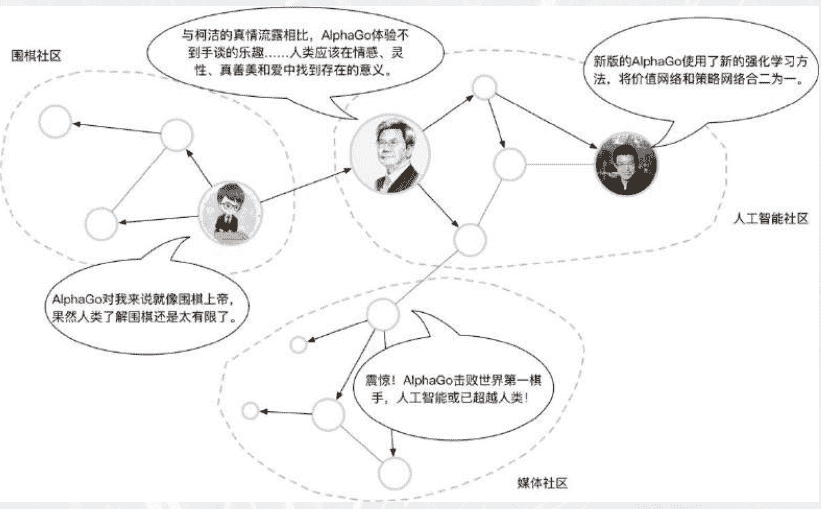

图 6 柯洁乌镇大战 AlphaGo 不敌后的微博热议

简单的统计分析可以帮助我们了解数据，如果希望对大数据进行逐个地、更深层次地探索，总结出规律和模型，则需要更加智能的基于机器学习的数据分析方法。柯洁与 AlphaGo 对战引起了围棋和人工智能两类群体的密切关注，一些聚类分析的方法可以高效准确地将关注者聚为两类。针对人工智能，乐观派认为会使得人类生活更加美好，也有悲观的人认为技术失控则高度危险。许多分类方法可以帮助我们鉴别用户观点与情感。微博的关注网络是典型的社会网络，尽管图是数据分析领域最为棘手的结构之一，许多研究表明社会网络的许多独特性质可以帮助我们设计更加高效的算法。例如，社会网络中的聚类被称为社区发现，许多精心设计的高效算法可以很好地处理上亿用户的大规模网络。微博上每个用户的言论、转发内容等都蕴藏着用户个人的兴趣、话题等信息，对文字内容本身的智能分析理解也是数据分析领域长久以来孜孜不倦追求的目标。微博中出现的“强化学习、神经网络”等词语可以帮助我们迅速定位这条微博大概率属于“人工智能”话题，词向量和语言模型则是近些年自然语言处理新浪潮的基础。下面首先介绍基本统计分析方法，然后介绍数据挖掘/机器学习算法。

## 2.1 统计数据分析

在统计数据分析中，最简单而直接的方式是对数据进行宏观层面的数据描述性分析，例如均值、方差等。

### 2.1.1 基本统计分析方法

表 3 两个比较受欢迎的微博名人在 2018 年 3 月到 2018 年 5 月间的一部分微博数据

| 发布时间 | 点赞数量 | 转发数量 | 发布时间 | 点赞数量 | 转发数量 |
|---|---|---|---|---|---|
| 18.3.18 | 3056 | 187 | 18.5.8 | 3398 | 1175 |
| 18.4.29 | 1169 | 511 | 18.3.6 | 4849 | 253 |
| 18.3.3 | 2743 | 177 | 18.3.18 | 4246 | 211 |
| 18.4.29 | 1616 | 215 | 18.4.28 | 4342 | 113 |
| 18.2.22 | 2391 | 92 | 18.3.14 | 3464 | 206 |
| 18.3.19 | 930 | 119 | 18.5.2 | 1819 | 1067 |
| 18.4.8 | 968 | 331 | 18.5.1 | 2300 | 1056 |
| 18.5.2 | 1011 | 51 | 18.4.8 | 2955 | 120 |
| 18.5.10 | 1386 | 36 | 18.4.17 | 3023 | 104 |
| 18.4.18 | 936 | 38 | 18.3.14 | 2560 | 229 |

在大数据分析中，我们获取到数据后，第一时间所想的往往是从一个相对宏观的角度来观察一下这些数据长什么样子，也就是分析一下它们的特征。比如对于微博上的名人，我们可以通过近三个月来发布的消息数量来描述他们的活跃度，或者通过平均每条消息被转发的数量来评价它们在粉丝群体中的受欢迎程度。这些能够概括数据位置特性，分散性关联性等数字特征，以及能够反映数据整体分布特征的分析方法，我们称之为数据描述性分析。

在表示数据的位置特征方面，均值是最常用的指标之一。我们假设一组数据共有 n 个一维数据，分别是\(x_1, x_2, ..., x_n\)，则均值\(\bar{x}\)可以表示为：

$$
\bar{x} = \frac{1}{n} \sum_{i=1}^{n} x_i
$$

均值可以用来反映数据的平均水平，比如在表 3 的两个名人的 20 条微博数据中，W 的微博平均点赞数量是 1620.6，Z 的平均点赞数量是 3295.6。也就是说 Z 的微博受欢迎程度看起来更高一些。需要注意的是，影响这一数值的包含很多因素，比如 Z 发表的微博往往带有图片，同时 Z 本身有着更多的粉丝数量。因此单从均值来看只能得到一些最直观的信息，若想得到更为细节性的结论仍需进一步对数据的考察。

与均值有着类似表达能力的还有中位数。中位数顾名思义，是数据中按照大小顺序排序后，处于中间位置的数。中位数M可以表示成：

$$
M = \begin{cases} x_{\frac{n+1}{2}}, & n \text{ 为奇数} \\ \frac{1}{2}(x_{\frac{n}{2}} + x_{\frac{n}{2}+1}), & n \text{ 为偶数} \end{cases}
$$

相较均值，中位数有着更好的抗扰性。均值虽然能够反映数据的平均表现，但是如果数据本身的差距较大，均值会极大地受到影响。比如在 99 个年收入 10 万的人中加入 1 个年收入 1000 万的可以把平均年收入提高到 19.9 万，但这一均值实际上并没有很好地反映出这个人群的收入特征。而中位数对于这种问题并没有那么敏感。

如果我们把中位数的概念推广可以得到 p 分位数\(M_p\)，也就是排在序列长度 \(p(0 \leqslant p \leqslant 1)\) 位置的数。\(M_p\)可以表示成：

$$
M_p = (1 + [(n + 1)p] - (n + 1)p)x_{[(n + 1)p]} + ((n + 1)p - [(n + 1)p])x_{[(n + 1)p] + 1}
$$

其中四分位数（p=0.25 和 p=0.75）最为常用。箱型图即是四分位数的一种常见应用，有兴趣的读者可以查阅相关资料。两个微博名人的微博点赞数据的箱型图如图 7 所示。

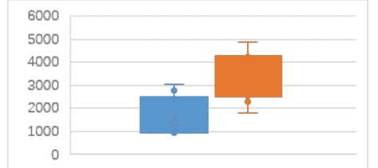

图 7 两个微博名人的微博点赞数据的箱型图

回到上述的年收入例子，对于两组数据：一组包含 99 个年收入 10 万的人和 1 个年收入 1000 万的人；另一组包含 60 个年收入 10 万的人和 40 个年收入 34.75 万的人，我们发现这两组数据无论是均值还是中位数都完全一样。然而第二组数据虽然数据间的差异也很大，但比第一组还是要“均匀”了很多。方差$s^2$就是用来反映这种数据分散性程度的最常用的一种指标。其算术平方根被称为标准差s。这两种指标的值越大，数据的分散性程度越高。

$$
s^2 = \frac{1}{n}\sum_{i=1}^n (x_i - \bar{x})^2
$$

$$
s = \sqrt{s^2} = \sqrt{\frac{1}{n}\sum_{i=1}^n (x_i - \bar{x})^2}
$$

两组数据前一组的方差是 9801 而后一组则是 148.5，可见前一组的数据比后一组的数据要分散得多。反映到年收入的问题上也就是说，第一组的 100 个人整体上的贫富差距更加悬殊。另一种忽略了数据内部差异而仅关注数据上下界的指标是极差 R，它被定义为最大值 xmax 与最小值 xmin 之差。

$$
R = x_{max} - x_{min}
$$

上述的一些指标更多地从单个数值的大小上来反映数据的特征。然而从上述的年收入的例子中我们可以看到，这些指标即使在一些差别很大的数据上仍有可能呈现出相同结果，如果想要更加准确地把握住数据的整体情况，我们不能忽视其分布特征。

对于有限的数据，我们可以通过频率分布直方图来观察数据的分布。如图 5 所示，首先将数据取值范围划分成若干区间（一般取等间隔，间隔大小称为组距），统计数据落入每一区间的频率。当数据量足够多的时候，如果我们把组数不断加大，让组距小到趋近于 0，把纵坐标的频率除以组距，我们可以得到概率密度函数(Probability density function) $f_X$。其在某一区间上的积分就是数据落在这一范围内的概率。

$$
P(a \le X \le b) = \int_a^b f_X(x)dx
$$

进一步我们有累积分布函数(Cumulative distribution function) $F_X$。

$$
F_X(x) = \int_{-\infty}^x f_X(u)du
$$

从而有：

$$
P(a \le X \le b) = F_X(b) - F_X(a)
$$

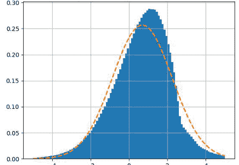

图 8 组数较大组距较小的频率分布直方图

这里，我们其实是在尝试拟合获取的样本数据背后的分布。这是什么意思呢？比如拿微博数据来举例，我们拿到的可能只是 10 条微博数据，然而一个人在过去三个月可能有成百上千条微博数据，我们称之为总体；这 10 条获取到的数据，我们称为样本。我们想通过样本来了解总体的信息，就可以通过样本的数值信息去估计总体的信息。

这里涉及到较多的概率论与数理统计的内容。我们通过一些推导可以发现，样本均值x是总体数学期望μ的一种无偏估计，而总体方差σ²的一种无偏估计是：

$$
s^2 = \frac{1}{n - 1} \sum_{i=1}^{n} (x_i - \bar{x})^2
$$

需要注意的是，这和我们之前提到的数据的方差有些许区别。透过概率密度函数和累积分布函数，我们可以更加直观地看到数据的分布。有时数据的分布会偏向于某种特定分布，其中正态分布（高斯分布）是其中最为常见的一种。数据的分布往往不是对称的。偏度g₁是用来衡量数据对称性的一种指标。

$$
g_1 = \frac{n}{(n - 1)(n - 2)s^3} \sum_{i=1}^{n} (x_i - \bar{x})^3
$$

在偏度近于零时，数据分布相对比较对称；偏度大于零时，比均值更小的数据更多一些，反之则是比均值更大的数据较多。

另一方面，如果我们以正态分布作为标准，不同分布的数据在均值附近的集中程度也不同：有的分布可能会显得“平坦”一些，有更多的数据分布在两侧；有的分布则看起来比较“尖锐”，数据更多地集中在均值附近。峰度g₂是用来度量分布形状的指标。峰度为正意味着有更多的数据分布在两侧极端，峰度为负则意味着数据较多地集中在均值附近。

$$
g_2 = \frac{n(n + 1)}{(n - 1)(n - 2)(n - 3)s^4} \sum_{i=1}^{n} (x_i - \bar{x})^4 - \frac{3(n - 1)^2}{(n - 2)(n - 3)}
$$

QQ 图（Quantile-Quantile Plot）可以用来帮助判断数据的分布是否服从某一指定分布，同时还可以获得数据的偏度和峰度信息。对于数据分布的检验问题以及其他相关内容涉及较多概率论与数理统计的基础知识，有兴趣的读者可以深入学习。

上述的各种度量指标都是针对一维数据的。然而最开始给出的微博数据，实际上包含了三个维度：发布时间、点赞数量和转发数量。在现实中，我们做数据分析处理时，往往面对的是多维数据，不光有数值型数据（比如年收入），也有具有固定几个属性值的数据（比如性别和职业）；可能有二值型数据（比如是否是会员），也可能有日期这样特殊格式的数据；数值型数据不光有连续值的（比如身高、体重），也有离散值的（比如年龄）。这里我们采用统一的方法来表示多维数据。设一组数据中有n个k维数据x1, x2, ..., xn。其中每一个数据xi(1≤i≤n)可以用一个k维向量(xi1, xi2, ..., xik)T表示。其中二维数据的两个维度常常用(X, Y)T表示其总体，每一个数据可以用(xi, yi)T来表示。类似一维数据，多维数据也有均值向量x̄，以及对应于方差的协方差矩阵(Covariance Matrix) S。

$$
\bar{\mathbf{x}} = (\frac{1}{n}\sum_{i=1}^n x_{i1}, \frac{1}{n}\sum_{i=1}^n x_{i2}, \dots, \frac{1}{n}\sum_{i=1}^n x_{ik})^T
$$

$$
\mathbf{S} = [s_{ij}]_{k \times k}, \quad s_{ij} = \frac{1}{n-1}\sum_{u=1}^n (x_{ui} - \bar{x}_i)(x_{uj} - \bar{x}_j)
$$

其中根据协方差矩阵可以计算 Pearson 相关矩阵 R。

$$
\mathbf{R} = [r_{ij}]_{k \times k}, \quad r_{ij} = \frac{s_{ij}}{\sqrt{s_{ii}}\sqrt{s_{jj}}}
$$

协方差矩阵和 Pearson 相关矩阵都是对称矩阵，而且 Pearson 相关矩阵对角线为 1。当维度为 2 时，s12 被称作 X, Y 之间的协方差，r12 被称作 Pearson 相关系数。这里的相关系数和相关矩阵，反映的是两变量之间的线性相关性。直观地来讲，如果两变量同步上升同步下降则表现出正向线性相关性；如果一个上升另一个下降，两变量朝相反方向变化，则表现出负向线性相关性。与均值向量类似，多维数据中也有中位数向量。在相关性方面，除了上述 Pearson 相关矩阵，还有采用秩的 Spearman 相关矩阵，对应二维情况有 Spearman 相关系数。

对于多维总体, 我们也可以将一维情况下的分布函数以及概率密度函数扩展到多维情况下，感兴趣的读者可以阅读相关书籍了解。

### 2.1.2 回归分析方法

相比于上节所讲的单个变量的统计分析或两个变量相关分析，在实际生产生活中存在着更多的变量。而在多变量的数据分析过程中，我们有时候会对这些变量之间的作用关系感兴趣。比如房价问题。在一个时间区间内，一个房子的价格会受到其空间大小、卧室数量、卫生间数量、所处层数等数值变量的影响，还有朝向、地理位置等其它变量的影响。那么，我们直观上会认为，越大的房间越贵，拥有更多卧室的房间会更贵一些。那么这些因素是如何

综合影响房价的呢？我们可以简单地建立这样的模型：房价Y是由空间大小X1，卧室数量X2，卫生间数量X3等 k 个变量决定的。也就是：
$$Y = f(X_1, X_2, ..., X_k) + \varepsilon$$

其中 \(\varepsilon\) 是由于我们没有考虑进去的各种因素所产生的误差。特别地，当 \(f\) 是关于 \(X_1, X_2, ..., X_k\) 的线性函数时，我们有：
$$Y = \beta_0 + \beta_1 X_1 + \beta_2 X_2 + \cdots + \beta_k X_k + \varepsilon$$

称作线性回归模型。其中 \(\beta_0, \beta_1, ..., \beta_k\) 是未知参数，也称为回归参数或回归系数。我们假设 \(\varepsilon\) 是数学期望为 0 的随机误差。

对于线性回归模型，当我们有了 n (n 一般较大, n>=k) 个房子的数据时，我们便可以使用这些数据去估计未知参数。设第 i 个房子的数据为 \((x_{i1}, x_{i2}, ..., x_{ik})^T\)，对应房价 \(y\)（实际上 Y 也可以是多维变量）。采用向量的方式表示就是：
$$\boldsymbol{Y} = \boldsymbol{X}\boldsymbol{\beta} + \boldsymbol{\varepsilon}$$

我们采用最小二乘法来估计回归参数。即最小化：
$$S(\boldsymbol{\beta}) = \boldsymbol{\varepsilon}^T \boldsymbol{\varepsilon} = \sum_{i=1}^n (y_i - \sum_{j=1}^k \beta_j x_{ij})^2$$

分别对 \(\beta_0, \beta_1, ..., \beta_k\) 求偏导并令其得零。得到正规方程：
$$\boldsymbol{X}^T \boldsymbol{X} \boldsymbol{\beta} = \boldsymbol{X}^T \boldsymbol{Y}$$

由于 \(\boldsymbol{X}^T \boldsymbol{X}\) 是实对称正定矩阵，我们可以得到 \(\boldsymbol{\beta}\) 的最小二乘估计为：
$$\widehat{\boldsymbol{\beta}} = (\boldsymbol{X}^T \boldsymbol{X})^{-1} \boldsymbol{X}^T \boldsymbol{Y}$$

由于 \(S(\boldsymbol{\beta})\) 的 Hessian 矩阵正定且上述最小二乘估计为唯一解，因此 \(S(\widehat{\boldsymbol{\beta}})\) 为 \(S(\boldsymbol{\beta})\) 的极小值点。代回得到：
$$\widehat{\boldsymbol{Y}} = \boldsymbol{X} \widehat{\boldsymbol{\beta}} + \boldsymbol{\varepsilon}$$

为回归方程。此时，我们就完成了对于未知参数 \(\beta_0, \beta_1, ..., \beta_k\) 的估计，接下来我们便能使用这个回归方程去根据新房子的大小等信息估计或者预测它的房价了。

我们的分析到这一步，其实就已经完成了大部分。在应用中，我们用上述的过程建立模型，利用已有数据拟合模型并应用在未知的数据上。最小二乘法保证了，当我们的模型采用上述的线性模型时，上述的解就是最优解。然而，即使是最优解也会存在误差。毕竟，现实中这些变量之间的关系总是复杂的，不一定像我们假设的那样是简单的线性关系。那么，在我们研究的问题上，线性模型究竟合适不合适呢？接下来，我们分析一下这个线性模型对于训练数据究竟能够拟合到什么程度。

我们在得到回归方程后，将估计参数时使用的观测值，代回方程，将观测值 Y 与拟合值 \(\widehat{Y}\) 作差得到残差向量：
\(\widehat{\boldsymbol{\varepsilon}} = \boldsymbol{Y} - \widehat{\boldsymbol{Y}} = \boldsymbol{Y} - \boldsymbol{X}(\boldsymbol{X}^T \boldsymbol{X})^{-1} \boldsymbol{X}^T \boldsymbol{Y} = (\boldsymbol{I} - \boldsymbol{H})\boldsymbol{Y}\)

进而我们可以定义残差平方和 SSE ( Sum-of-Square Error ) 来衡量误差大小。

$$SSE = \sum_{i=1}^n (y_i - \hat{y}_i)^2 = \hat{\epsilon}^T \hat{\epsilon}$$

SSE 越小，拟合得到的模型对于拟合时使用的数据估计越准确。进而定义复相关系数R:

$$R^2 = 1 - \frac{SSE}{\sum_{i=1}^n (y_i - \bar{y})^2}$$

来衡量模型的线性显著性。R 越接近 1，就代表线性模型对于该问题越合适。如果 R 很小，那么我们就需要去考虑是不是少考虑了某些重要因素，或者说问题本身就无法用线性模型来解决。

上述过程在大数据分析中，观测样本数 n 往往较大，求解回归方程时采用迭代法求解会更快更高效一些。而对于定性变量与因变量之间的关系，我们可以使用方差分析。对统计感兴趣的读者可以阅读相关书籍中线性回归关系的显著性检验、假设检验一般方法以及方差分析深入了解。

### 2.1.3 关联分析

关联分析方法可以发现隐藏在大型数据集中有意义的联系。这种联系可以用关联规则来表示。在使用关联规则时，需要考虑两个问题：一是从大数据集中发现模式可能效率很低；二是所发现的某些关联可能是毫无意义的。支持度这一度量可以删除那些毫无意义的关联规则，置信度可以度量规则的可能性大小。关联分析的算法主要有：Apriori 算法、DHP 算法、DIC 算法和 FP-增长算法等。其中最常用的是 Apriori 算法，下面对它做一介绍。

关联模式中最著名的是 Apriori 算法，它由 R. Agrawal 等人首先提出来⁶，其算法思想是：首先找出频繁性至少和预定义的最小支持度一样的所有频集，然后由频集产生强关联规则。最典型的例子就是沃尔玛尿布和啤酒事件，在此例中，商家利用统计这两种商品在一次购买中共同出现的频数，将出现频数多的搭配转化为关联规则。

Apriori 算法的实现是通过对数据库的多次扫描来发现所有的频繁项目集。在每一次扫描中只考虑具有同一长度的所有项目集，在进行第一次扫描中，Apriori 算法计算数据库中所有单个项目的支持度，生成所有长度为 1 的频繁项目集；在后续的每一次扫描中，首先以第 1 次扫描所生成的所有项目集为基础产生新的候选项目集，然后扫描数据库，计算这些候选项目集的支持度，删除其支持度低于用户给定的最小支持度的项目集；最后生成频繁项目集。重复以上过程直到再也发现不了新的频繁项目集为止。

由此可见，若要提高 Apriori 算法的效率，可以减少对数据库的扫描次数或者减少不必要的频繁项目集的生成，对 Apriori 算法的改进主要方法有：基于划分的方法；基于抽样的方法；增量更新方法；概念层次的方法和基于散列和压缩技术的方法⁷。

### 2.1.4 聚类分析

聚类分析是将数据划分成具有意义的组进行多元统计分析，是一种定量方法。讨论的对象是大量的样本，要求能够合理地按照各自的特性进行合理的分类，没有任何模式可供参考或依循，即是在没有先验知识的情况下进行的。

聚类分析的基本思想是认为研究的样本或变量之间存在着程度不同的相似性（亲疏关系）。根据一批样本的多个观测指标，指出一些能够度量样本或变量之间相似程度的统计量，以这些统计量作为分类的依据，把一些相似程度较大的样本聚合为一类，直到把所有的样本都聚合完毕，形成一个由小到大的分类系统。选择用哪种聚类算法由数据类型、聚类目的和应用决定。主要的聚类方法有以下几种。

- 1. 划分聚类

给定一个有 N 条记录的数据集，以及要生成簇的数目 K。划分方法首先给出一个初始的分组方法，然后通过反复迭代的方式改变分组，使得每一次改进之后的分组方案都比前一次好。该方法常用的算法有：K-means 算法、K-MEDOIDS 算法和 CLARANS 算法等。

- 2. 层次聚类

层次方法是对给定的数据对象集合进行层次分解，层次方法可以分为凝聚和分裂。该方法在合并、分裂的时候要检测大量的记录和簇，因而伸缩性比较差。比较常见的方法有四种：BIRCH、CURE、ROCK 和 Chameleon。

- 3. 基于密度的方法

基于密度的方法与其他方法的一个本质区别是：它不是基于距离作为相似性度量的，而是基于密度的。这就能克服基于距离的算法只能发现类球状聚类的缺点。最具代表性的是 DBSCAN 算法、OPTICS 算法和 DENCLUE 算法。

- 4. 基于网格的方法

这种方法首先将数据空间划分成有限个单元的网格结构，所有的处理都是以单个的单元为对象。这么处理的一个明显优点就是处理速度很快，通常这是与目标数据集中记录的个数无关的，它只与把数据空间划分的单元数量有关。代表算法有：STING 算法、CLIQUE 算法、WAVE-CLUSTER 算法。

- 5. 基于模型的方法

基于模型的方法给每一个聚类假定一个模型，然后寻找数据对给定模型的最佳拟合。这样的一个模型可能是数据点在空间中的密度分布函数或者其它。通常有两种方案：统计的方案和神经网络的方案。

## 2.2 基于机器学习的数据挖掘

所谓“机器学习”，是基于数据本身的，自动构建解决问题的规则与方法。一般来说，统计特征只能反映数据的极少量信息。例如图 9，均值、方差是一样的，但是具有巨大的差别。这时候，就需要借助更精确的方法来区分这些情况。当然，是可以通过人工添加规则的方式来进行分析，寻找合适的规则是一件非常艰难的事，即使偶有所得，对于数据而言，可行的分析规则又远不止这寥寥几条。为解决数据分析不精准的难题，本章从非监督学习方法和监督学习方法的角度，来介绍一些机器学习的方法。

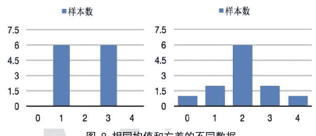

### 2.2.1 非监督学习方法

非监督学习是建立在所有数据的标签，即所属的类别都是未知的情况下使用的分类方法。对于特定的一组数据，不知道这些数据应该分为哪几类，也不知道这些类别本来应该有怎样的特征，只知道每个数据的特征向量。若按它们的相关程度分成很多类，最先想到的想法就是认为特征空间中距离较近的向量之间也较为相关，倘若一个元素只和其中某些元素比较接近，和另一些元素则相距较远。

这时候，我们就希望每一个类有一个“中心”，“中心”也是特征向量空间中的向量，是所有那一类的元素在向量空间上的重心，即他的每一维为所有包含在这一类中的元素的那一维的平均值。如果每一类都有这么一个“中心”，那么我们在分类数据时，只需要看他离哪个“中心”的距离最近，就将他分到该类即可，这也就是 K-means 算法的思路。

K-means 算法，在 1957 年由 Stuart Lloyd 在贝尔实验室提出，最初用于解决连续的图区域划分问题，1982 年正式发表。1965 年，E.W. Forgy 发明了 Lloyd-Forgy。James MacQueen 在 1967 年将其命名为 K-means 算法。

实际的 K-means 算法过程如下：

- ① 选择常数 K，随机选取数据中的 k 个点作为“中心”；
- ② 对每个数据，计算他们与所有“中心”之间的距离，将他们归入最近的“中心”；
- ③ 更新“中心”的位置——“中心”的位置为分在此“中心”中所有元素的重心；
- ④ 返回②，进行迭代，直到结果收敛为止；
- ⑤ 输出每个“中心”的位置以及分类方式。

图 10 是以随机生成的数据点为例，k=3 的 K-means 算法的迭代过程，其中五角星为聚类中心，点的颜色是其类别。在实际应用中，为了获得一个比较好的特征空间，使得“数据之间的相似性与他们在特征空间上的距离有关，距离越近越相似”这句话尽可能成立，我们往往会构建模型来把原数据变换到这么一个特征空间，然后使用 K-means 算法来进行分类。

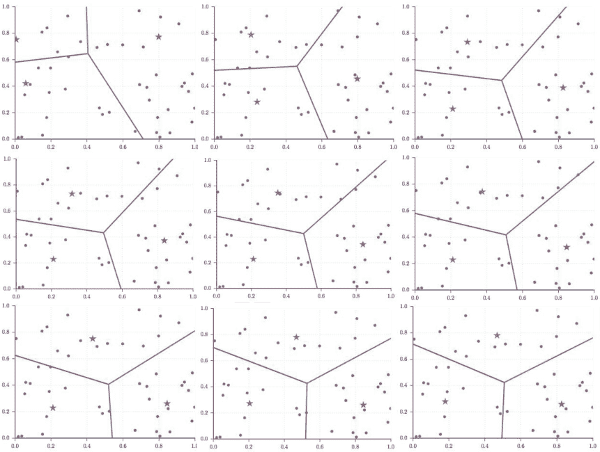

图 10 k=3 的 K-means 算法迭代过程

在 K-means 算法之后，人们还提出了 K-means++，x-means 等扩展 K-means 的聚类方法。

### 2.2.2 监督学习方法

不同于非监督学习，若已知一些数据上的真实分类情况，现在要对新的未知的数据进行分类。这时候利用已知的分类信息，可以得到一些更精确的分类方法，这些就是监督学习方法。首先简单介绍下数据集的划分，而后重点介绍决策树模型，以及神经网络等。

- 1. 训练集、验证集与测试集

数据集划分对于监督学习方法非常重要。定义测试集，是需要使用算法来帮助处理分类的数据。在实际应用中，这些数据需要直接实时地被处理，一般情况下，无法在处理的过程中知道这些数据的实际类别。即使全部处理完毕，也无法得知我们的模型给出的结果在这些数据上正确与否。但由于这些是实际需要处理的数据，模型在测试集上的正确率或者其他参数定义的表现好坏，将决定我们的模型的实际应用价值。

除了自动学习的部分以外，机器学习模型一般会有一些需要人工设置的超参数，如 K-means 里的中心数量等。对于同样的模型和训练集，使用不同的超参数进行学习，最后得出的结果可能相差很大。为了在测试集上取得尽可能好的结果，但又不知道测试集上数据的真实分类标签，一般需要在我们知道真实情况的数据集中划分训练集和验证集。在训练模型时，我们只使用训练集中的数据，而使用验证集中的数据进行模型正确率的检验。这样，通过验证集上的检验，我们就可以对于不同超参数在当前任务下的好坏有一个大致的了解，从而选择正确的超参数训练模型并在测试集上取得好结果。

一些研究性质的数据集的目的是为了检验模型的好坏，整个数据集中，训练集和测试集都是预先划分好的，有的此类数据集会提供训练集、验证集、测试集的划分，只提供给研究者训练集与验证集，并采用有限次提交答案评测的方式来评测模型在测试集上的表现好坏。

有的数据集则是只给了训练集和测试集。这里特别要注意的是，在真实应用场景中，测试集数据的标签是完全未知的。因此，对于这些只给了训练集和测试集的数据集，正确的数据分析方法是自行在训练集上划分训练与验证集，根据验证集调整对应的超参数后，将最终的模型在测试集上仅进行最后的一次测试得出的结果作为模型的表现。切忌在测试集上进行超参数的调整，可能会导致过拟合，使测得的表现与模型在真实世界中的实际表现不符。

近年来，深度学习在图像识别领域发展迅速，但很多深度学习算法和数据集中并没有考虑到这点，往往不使用验证集，而使用训练集训练后在测试集上表现最好的一组超参数或模型结构，作为模型的结果。近年来有研究指出，许多在 CIFAR-10 数据集上表现很好，准确率达到 90%甚至 97%以上的算法，对使用与 cifar-10 数据集相同规则生成的新测试集，准确率均下降了 4%-15%，这便是这些模型没有使用验证集造成过拟合导致的结果。

### 2. 决策树模型

### (1) 通用的决策树模型

所谓决策树，即是一种根据条件来进行判断的逻辑框架。其中，判断的条件，即提出有区分性的问题，以及对于不同的回答下一步的反映，以及最终的决策给出标签。

决策树算法：

- a. 选取包含所有数据的全集为算法的初始集合 A0;
- b. 对于当前的集合 A，计算所有可能的“问题”在训练集上的 F(A,D);
- c. 选择 F(A,D)最大的“问题”，对数据进行提问，将当前的集合由“问题”的不同回答，划分为数个子集；
- d. 对每个子集，重复 b、c，直到所有子集内所有元素的类别相同；
- e. 在实际应用中，数据往往有很多特征，因此，“问题”往往是选取数据的某一特征，而“回答”则是此特征对应的值。

前面讲了决策树的框架。可以看出，在决策树中，效度函数F(A,D)的选择非常重要。决策树的发展历史，也基本是围绕着F(A,D)的优化而展开。从 1963 年的 AID 算法，1972 年的 THAID 算法，到 1980 年代的 ID3 和 CART 算法，到 1993 年的 C45 算法，贝叶斯 CART 算法等。这些方法的主要差别F(A,D)的选取。这里我们介绍几种基础的算法。

- a) ID3 方法

一个简单的想法是选择区分度最大的特征。我们引入一个信息熵的概念。对于一个特征，假设有 n 种可能的取值，每种值取到的概率分别为 p1, p2 ...pn, 0<i<=n, 第 i 种发生的概率为 pi,我们定义信息熵 H 为：

```
H = - \sum_i P_i \log(P_i)
```

H 越大，这个特征更能够“区分”数据，提供的信息量越大。选取F(A, D) = H,即为 ID3 算法。这一算法是由悉尼大学的 Quinlan 提出的，据说在 1970 年代就已经被发明，但在 1986 年才得以发表。Quinlan 也因此获得 SIGKDD 2011 的创新奖（Innovation Award）。

- b) C4.5 方法

信息熵反映了特征对于原数据的区分能力大小，但并没有反映特征对于标签的区分能力。换言之，如果修改训练集上的标签，对于决策树而言，是不会改变我们选取的特征的，最多只会在决策树层数上有所影响。这样，选取的特征就有可能对标签并没有用，更有可能形成过拟合。

如何将“特征对标签的区分程度”也考虑进我们的算法中呢？Quinlan 在 1993 年提出的 ID3 算法的进化版——C4.5 算法就能做到这一点。引入“标签信息熵”，记 T 为某个特征，a 为训练集的一种标签状态：

```
H ( T | a ) = - \sum_v \frac{N (X_a = \mathcal{V})}{N} H ( T | X_a = v )
```

其中，N 为训练集的总元素数，N(Xa = V)为标签为 v 的元素数，H(T|Xa = V)为选取标签为 v 的元素，关于特征 T 求信息熵。

一个自然的想法是，我们选择在考虑标签情况下，能提供最多信息的特征。而IG ( T , a ) = H(T) - H(T|a)代表着我们从这一特征可以获得的信息增量，就符合这一标准。令F(A , D) = IG ( T , a )即可。

- c) CART 算法

ID3 方法和 C4.5 方法都很注重特征本身提供的信息。下面介绍另一种更注重对于数据原本标签分类的决策树分类方法。


对于一个数据集 X 的集合标签状态 a，定义 Gini 函数代表了集合中标签的凌乱程度，Gini 值越大，集合中标签越为混乱，反之，Gini 值为 0 时，集合中所有元素均为同一标签。

```
Gini(X, a) = 1 - \sum_v P(x_a = v)^2
```

```
G(T, a) = Gini(X, a) - \sum_v \frac{N(x_a = v)}{N} Gini(X | x_a = v, a)
```

1984 年由 Breiman 提出的 CART 算法，则是要在每一步的分类中，尽可能地降低在经过决策树判断后分成的子集的加权平均混乱程度。即选取原决策树框架中的 F(A, D) = G(T, a)。

除了介绍的这几种确定F(A, D)的方法外，还有 FACT, GUIDE, BART 等等众多不同的 F(A, D) 函数不同的决策树生成方法。

### d) 决策树的剪枝

上述方法可以使我们在训练集上生成一棵完美的决策树。一般在决策树生成完毕后，为了降低过拟合，还要对其进行剪枝，剪去一些没有实际作用的特征。首先，定义剪去某个特征的方法——对于决策树上的某个节点，原本根据某一特征而进行的分组，现在不再使用这一特征，改为直接将所有元素分到其子节点中在训练集出现元素数量最多的一组。随后的一切分类规则按照在原先在此子节点中的分类规则而定。

对于训练集上训练出的决策树，使用验证集进行剪枝。一个最简单的剪枝方法——减小错误剪枝：从叶子节点开始，遍历决策树的每一个节点，计算在当前子树下删除此节点前在验证集中的正确率a0，和删除此节点后的正确率a1，若a1 >= a0，则删除此节点。另一个稍微复杂一些的方法是最优效率剪枝，这一剪枝不仅考虑了验证集上正确率的变化，还考虑了决策树的大小：

- a. 定义剪枝前的叶节点数目 L0, 和剪枝后的叶节点数目 L1;
- b. 定义“节点效率” E = (a0 - a1)/(L0 - L1);
- c. 设置阈值 α，从叶子节点开始，遍历决策树的每一个节点，若某一节点在当前决策树下的”节点效率“ E < α，则减去此节点。

### e) 多决策树分类

单一决策树容易受到训练集中噪音的影响，导致过拟合。在单个模型噪音很大时，最好的方法是训练多个模型取平均。因此，一种减小过拟合的方式是多决策树分类（bagging）。

- a. 在完整训练集中随机选取一部分元素，组成一个小“部分训练集”；
- b. 在“部分训练集”上训练一棵决策树；
- c. 反复执行 a、b，训练 N 棵不同的决策树；
- d. 在测试时，对于每一个测试样例，将其放入所有的决策树中，将这些输出结果进行投票，取最多的输出作为实际输出。

这种多决策树分类，由于每棵决策树都是在原训练集上的一个随机的子集上进行训练得出的，有效地防止了训练数据中一个或几个噪声数据对决策树造成的影响。

### f) 随机森林

很多时候，有一部分特征与分类结果的相关性最大，在所有的决策树中都会出现。这些特征虽然是好的特征，但却导致训练出的不同决策树大同小异，使“取平均”失去了意义，带来过拟合，也阻碍了相关度中等的特征发挥他们本来可能发挥的作用。

为了解决这个问题，1995 年，Ho Tin Kam 提出了“随机森林（Random forest）”的方法，即在“多决策树分类”每次随机选取一个训练集的子集生成决策树的基础上，把这个子决策树使用的特征也限定在所有特征的一个随机的子集，其具体步骤为：

- a. 在完整训练集中随机选取一部分元素和一部分特征，使用这些元素在这些特征上的值作为一个“部分训练集”；
- b. 在“部分训练集”上训练一棵决策树；
- c. 反复执行 a、b，训练 N 棵不同的决策树；
- d. 在测试时，对于每一个测试样例，将其放入所有的决策树中，将这些输出结果进行投票，取最多的输出作为实际输出。

随机森林由于在很大程度上降低了过拟合，在实际应用中，往往可以达到在决策树算法中效果最好。

### 3. kNN 算法

只知道每个数据在特征空间下的特征向量情况下，可以对数据采用无监督分类方法 K-means。如果我们拥有了其中一部分数据的标签，我们就可以利用这些标签进行 kNN 分类。

数据之间的相似性与他们在特征空间上的距离有关。距离越近越相似，越可能拥有相同的标签。假设我们已经有了很多既知道特征向量也知道具体标签的数据，对于新的只知道特征向量却不知道具体标签的数据，我们可以选取离这个特征向量最近的 k 个已经知道标签的数据，然后选取他们中间最多的元素所属于的那个标签，作为新数据的预测标签。也可以根据他们与新数据的特征向量之间的距离加权（如最近得 5 分，第二近得 4 分等），取权重总和最大的标签作为预测标签。

kNN 算法不需要构建模型或者训练，和 K-means 算法一样，往往是和某个构建特征空间的模型一起使用。

### 4. 回归分类

决策树预测的每一步都取决于数据某个特征的值。在模型中，数据某个特征的值确定了数据属于某个类中的哪一个子类。在实际世界中，特征的值的实际作用，可能是影响属于某个类的概率，回归分析模型便是基于这一思想构建的模型。

### (1) 最大似然原理

假设有一个模型，针对每个数据输出他成为某个标签的概率Pil，同时拥有这些数据的实际标签Li，假如模型给出的概率是真实的，那么实际标签发生的概率 P。不同的模型可能就这些数据给出不同的概率，得出不同的“假如模型给出的概率正确，实际如此发生的概率”P。如果数据量足够大，给出P越大的模型，对于数据标签给出的概率就越接近真实概率，这就是最大似然原理：

P = \prod \rho_{tli}
P_{til} = \frac{e^{c_{til}}}{\sum_k e^{c_{tik}}}

因此，如果有多个模型，按这些模型在训练数据上的结果与真实标签比对得到 P，P 越大说明模型给出的概率越接近真实概率。

### (2) 回归分析模型

从数据的特征得到数据属于某个标签的概率：假设标签只有 0 和 1 两种情况，而为两种情况的概率与特征的值有关。假设标签为 0 的概率为P0，我们就能通过计算得到这一概率，从而得到某一模型在训练集上的P0、a1...an 和 b 为模型的参数。

P_{0} = \frac{1}{1 + e^{\alpha_1 l_1 + \alpha_1 l_1 + \cdots + b}}

多标签情况下，往往为每一个标签设立一个单独的通道，将所有特征加权求和再加上阈值作为此标签对应的值，然后按照 P_{ti} 作为预测第 i 个数据具有某标签 1 的概率。C_{ti} 为模型对该标签对应的通道上的输出值。加权求和的权重以及每个通道上的阈值为模型的参数。

### (3) 回归分析模型的训练

根据最大似然原理，我们需要选择 P 最大的模型。由于 P_{ti} 关于模型的每个参数都可微，整个过程全程可以求导，因此可以使用梯度下降或者牛顿迭代等迭代法进行训练，直到训练到 P 收敛或迭代进行到一定次数为止。

### 5. 神经网络

大脑是自然界的奇迹。通过神经元的相互连接，大脑可以非常高效地处理海量信息。神经网络是一种模拟大脑工作的模型。神经网络的使用，近年来在图像识别、大数据分析、自然语言处理、人工智能等领域，取得了令人难以想象的突破。下面我们就来介绍这种模型。

### (1) 神经元

神经元是神经网络的基本单位。如图 10 所示，每个神经元都有很多输入和一个输出。神经元的作用是将所有输入相加，减去触发阈值，然后经过一个激活函数进行非线性变化，最后提供输出。激活函数的非线性，是神经网络能够拥有极强表达能力的原因。

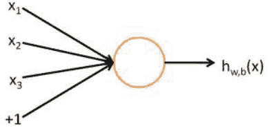

图 11 神经元

### (2) 激活函数

激活函数需要是一个非线性的函数。当今神经网络中，最常用的激活函数是 RELU 函数。

ReLU(x) = x(x > 0),0(x <= 0)。另外 leaky_Relu 函数，sigmoid 函数，tanh 函数等，也是常用的激活函数。同一个网络中可能使用多种不同的激活函数，也可能在输出层不使用激活函数。

```
sigmoid(x) = \frac{1}{1 + e^{-x}}

tanh(x) = \frac{e^{x} - e^{-x}}{e^{x} + e^{-x}}
```

### (3) 神经网络的结构

神经网络由多层神经元组成，如图 12 所示，每一层神经元都与前一层或前某些层的一部分或全部神经元相连接，每个神经元使用前面层与其相连的所有神经元的输出来以他们连接的连接强度作为输入，同一个神经元的输出会作为后面所有与其相连的不同神经元的输入（乘以连接强度之后）。第一层是输入的特征向量，最后一层是输出的特征向量。

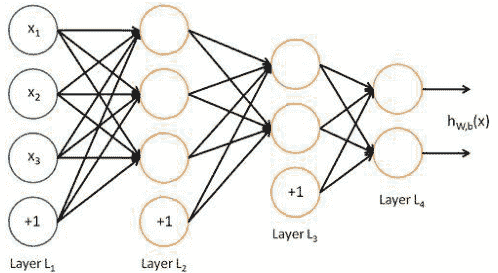

图 12 神经网络

在分类问题中，往往按类别数量为每一个类安排一个单独的神经元进行输出，然后最后再输出结果最大的那个神经元对应的类作为分类结果。神经网络的参数就是每条连接的连接强度和每个神经元的阈值。此处可以看出，回归分析模型，其实是一种只有两层且无激活函数的神经网络。

### (4) 神经网络的训练方法

梯度下降是对于一个神经网络的模型，使用训练数据进行训练的常用方法。先定义损失函数，不同的模型经常拥有不同的损失函数，在分类问题中，经常以输出结果和实际标签的交叉熵作为损失函数。对于两个离散分布，交叉熵的定义是Σi p_i ln q_i。

在使用 kNN 的模型中，往往以同类数据在输出空间中的距离减去不同类数据在输出空间中的距离作为损失函数。损失函数越小，模型在训练集上表现越好。

由于神经网络整个过程都是可以求导的，因此很容易求得损失函数相对于某一个参数的导数。这样就可以求得损失函数相对于所有参数的导数，即损失函数在参数空间上的梯度，选取梯度最大的方向进行梯度下降。在训练过程中，往往使用随机梯度下降的方式，即每一步随机选取训练集中的一个子集进行梯度下降。

关于神经网络训练的具体方法，在实际应用中涉及到一些其他的技巧，但这些技巧大部分都是基于梯度下降的方法。

### 6. 朴素贝叶斯分类

贝叶斯分类算法是统计学的一种分类方法，它是一类利用概率统计知识进行分类的算法。朴素贝叶斯分类算法可根据少量的训练数据估计出必要的参数。

朴素贝叶斯分类算法的思想：对于给出的待分类项，在假定其每个特征相互独立的情况下，求解此项出现的条件下各个类别出现的概率，出现概率最大的类别即该待分类项所属类别。

### (1) 条件概率与相互独立

将在条件 B 下事件 A 发生的条件概率定义为：

```
P(A|B) = \frac{P(AB)}{P(B)}
```

将 A 与 B 相互独立定义为：

```
P(AB) = P(A)P(B)
```

在 A, B 相互独立的条件下，

```
P(AB|C) = P(A|C)P(B|C)
```

### (2) 贝叶斯公式

P(y|x) = \frac{P(x|y)P(y)}{P(x)}

其中，P(y)为先验概率，表示每种类别分布的概率；P(x|y)为类条件概率，表示在类别 y 中 x 发生的概率；P(y|x)为后验概率，表示 x 发生时属于类别 y 的概率；P(x)表示 x 发生的概率。

### (3) 分类

- a. 当前有类别集合C = {y1, y2, ......, yn}，设X = {x1, x2 ......, xm}是一个待分类项，xi，(i = 1,2,3, ......, m)为 x 的特征属性。
- b. 计算P(y1|X), P(y2|X), ......, P(yn|X)。
- c. 如果P(yk|X) = max{P(y1|X), P(y2|X), ......, P(yn|X)}, 则X ∈ yk。

### a) P(yi|X)的计算

对P(yk|X)的计算，可利用贝叶斯公式，

P(yk|X) = \frac{P(X|yi)P(yi)}{P(X)}

由于对各个类别，P(x)均相同，则P(yk|X) ∝ P(X|yk)P(yk)。因此只需计算出P(X|yi)P(yi)即可。当 X 的各个特征属性{x1, x2 ......, xm}相互独立时，

P(X|yi)P(yi) = P(x1|yi)P(x2|yi) ··· P(xm|yi)P(yi)

其中P(xi|yi)通过训练计算得到。

### 分类过程

- a. 根据具体情况确定特征属性，并对每个特征属性进行适当的划分。
- b. 人工对一部分待分类项按照特征属性划分进行分类，形成训练样本集合。
- c. 利用特征属性以及训练样本，计算每个类别在训练样本中的出现频率及每个特征属性划分对每个类别的条件概率估计，并记录结果，生成分类器。分类器的质量很大程度上由特征属性、特征属性划分及训练样本决定。
- d. 使用分类器对待分类项进行分类，得到待分类项到类别的映射关系。

### b) P(xs|yi)的计算

在计算P(xs = a|yi)时，当特征属性为离散值时，可以通过统计训练样本中各个划分在每个类别中出现的频率来计算P(xs = a|yi)。当特征属性xi为连续值时，通常可以假定其服从正态分布（又称高斯分布），即

P(xs = a|yi) = \frac{1}{\sqrt{2\pi}\sigma} e^{-\frac{(xs-\mu_i)^2}{2\sigma_i^2}}

其中 μi 是类别yi中特征属性xs的期望，σi是类别yi中特征属性xs的标准差。

## 2.3 社会网络中的大数据挖掘

下面用社交网络为例，介绍数据挖掘算法在实际数据上的具体应用。

社交网络的主要结构形式是图，图数据不同于简单的连续性或离散型数据，其结点之间的关系由于图的拓扑结构而变得复杂，其分析方法也不同于一般的统计和机器学习的数据分析。本节主要介绍一下社会网络中数据分析的基本技术，即社交网络的主要组织形式：图结构的度量算子和一些基本的算法。

### 2.3.1 图的度量算子

为了解决“在社会网络中，谁是中心角色（具有影响力的用户），谁是志趣相投的用户，如何找到这些相似的个体”这类问题，需要量化用户中心性，用户相似度的度量方案。这些度量方案的输入信息通常是表征社会媒体交互信息的图结构。通过定义中心性度量方案，可以识别不同类型的中心结点。

### 1. 中心性

中心性定义了网络中一个结点的重要性。这里主要介绍以下几个中心性度量，包括度中心性、特征向量中心性、PageRank 和中间中心性。

### (1) 度中心性

在真实世界的交互中，一般认为具有很多连接关系的人是重要的，度中心度就是利用了这种思想。在无向图中，结点\(v_i\)的度中心性\(C_d(v_i)\)定义为：

```
\(C_d(v_i) = d_i\)
```

其中\(d_i\)是结点\(v_i\)的度。因此对于有更多连接关系的结点，度中心性度量方法认为他们具有更高的中心性。在有向图中，可以利用入度或者出度，也可以将两者结合作为度中心性值。为了使度中心性度量方法可以用来比较不同网络中的中心性值，通过使用度数之和来进行归一化，其中 m 是边的总数：

```
\(C_d^{sum}(v_i) = \frac{d_i}{\sum_j d_j} = \frac{d_i}{2m}\)
```

### (2) 特征向量中心性

在度中心性度量中，我们认为具有较多连接的结点更重要。然而更进一步，拥有很多朋友并不能确保这个人就是重要的，拥有更多重要的朋友才能提供更有力的信息。因此可以用邻居结点的重要性来概括本结点的重要性。设\(C_e(v_i)\)表示结点\(v_i\)的特征向量中心性，则其求解公式如下：

```
\(C_e(v_i) = \frac{1}{\lambda} \sum_{j=1}^n A_{j,i}C_e(v_j)\)
```

其中 A 是邻接矩阵，\(\lambda\) 是某个固定的常数。这是个递归定义的函数，设\(C_e = (C_e(v_1), C_e(v_2), \cdots, C_e(v_n))^T\) 是所有结点的中心向量，上式可以重写为：

\(\lambda C_e = A^T C_e\)

其中\(C_e\) 是邻接矩阵 A 的特征向量，\(\lambda\) 是对应的特征值。

### (3) PageRank 中心性

PageRank 度量方法被谷歌搜索引擎用来对网页的检索结果进行排序。网页以及它们之间的连接关系是一个巨大的网络，PageRank 为网络图中的所有结点（网页）定义了中心性度量。当用户在谷歌中检索时，和查询相匹配的且具有较高的的网页将最先显示。

\(C_p = \beta(I - \alpha A^T D^{-1}) \cdot I\)

其中\(D = diag(d_1^{out}, d_1^{out}, \cdots d_n^{out})\) 是一个关于度的对角矩阵，\(\alpha, \beta\) 是两个常数。

### (4) 中间中心性

另一种中心性度量方法是考虑结点在连接其他结点时所表现出的重要性，它是指网络图中某一结点与其他各点之间相间隔的程度，表示一个人在多大程度上是图中其他结点的“中介”，这类结点通常具有沟通桥梁的作用。其中一种方法是计算其他结点通过结点\(v_i\) 的最短路径的数目，也就是说，我们在度量结点\(v_i\) 在连接结点 s 和结点 t 时所表现的重要性。这种度量方法称为中间中心性：

\(C_b(v_i) = \sum_{s \neq t \neq v_i} \frac{\sigma_{st}(v_i)}{\sigma_{st}}\)

其中，\(\sigma_{st}\) 是从结点 s 到结点 t 的最短路径数目，\(\sigma_{st}(v_i)\) 是从 s 到 t 经过\(v_i\) 的最短路径数目。为了对结点进行跨网络的比较，我们将\(\sigma_b(v_i)\) 除以中间中心性的最大值(n-1)(n-2)，得到归一化后的中间中心性：

\(C_b^{norm} = \frac{C_b(v_i)}{(n-1)(n-2)}\)

### 2. 相似性

本节来讨论网络中两个结点间相似度的方法，在社会媒体中，这些结点可以表示关系网络中的个体或者是一些相关的事物。这些相关联的个体的相似度既可以基于它们所嵌入的网络，即结构相似度，也可以基于他们所产生的内容，即内容相似度来计算。采集网络信息时，结点间的相似度可以通过计算他们的结构等价性来获得。此外，SimRank 相似度也是一种流行的计算结点相似度的方法。

### (1) 结构等价性

为了计算结构等价性，需要考虑两个结点间共有的邻接结点。从网络拓扑结构角度出发，考虑两个结点的共同邻居数，是基于网络半结构信息定义相似度的最简单的方法。共同邻居数越大，说明两个结点越相似。结点的相似度定义如下：

\(\sigma(v_i, v_j) = |N(v_i) \cap N(v_j)|\)

对于规模较大的网络，结点可能共享很多邻接结点，所以这个值会迅速增长。一般的，相似度被看做一个有界的值，通常是在[0,1]范围内。对此可以使用多种归一化方法，例如 Jaccard 相似度或者余弦相似度：

\(\sigma_{jaccard}(v_i, v_j) = \frac{|N(v_i) \cap N(v_j)|}{|N(v_i) \cup N(v_j)|}\)

\(\sigma_{cosine}(v_i, v_j) = \frac{|N(v_i) \cap N(v_j)|}{\sqrt{|N(v_i)||N(v_j)|}}\)

### (2) SimRank 相似度和近似 SimRank 相似度

Simrank 算法的思路是“指向相似结点的结点也相似”

\(S(a, b) = \frac{C}{|I(a)||I(b)|} \sum_{l=1}^{|I(a)|} \sum_{j=1}^{|I(b)|} S\left(I_l(a), I_j(b)\right)\)

其中 C 为 0 到 1 之间的一个常数。时间复杂度是\(O(In^2d^2)\)，其中\(I\)是迭代次数，\(n\)是网络中所有结点数，\(d\)是结点的平均度数。其效率太低，若考虑不再直接计算任意两个结点之间的 simrank 值，定义：

\(Partial_{I(a)}^j = \sum_{i \in I(a)} S(i, j), (\forall \in I(b))\)

那么有：

\(S(a, b) = \frac{C}{|I(a)||I(b)|} \sum_{j \in I(b)} Partial_{I(a)}^j\)

那么其算法的时间复杂度是\(O(In^2d)\)，其中\(C\)在0~1之间。

为了更进一步加快相似度计算，可以使用基于随机游走的 SimRank 算法，是对结点相似度的一种较高精度的估计算法。

算法描述如下：

- a. 随机生成 R 条长度为 T 的路径 P，建立倒排索引 Index；
- b. 对结点 v，根据 Index 获得 v 所在的路径 P’；


- c. 对于 P'，遍历每条路径可以找到所有与 v 共同出现的结点。通过累加频次计算两个点之间的近邻相似度，得到 O';

- d. 获得与结点 v 的相似度最大的 K 个结点的列表 L。

### 2.3.2 社交网络上的算法

这一小节主要介绍社交网络上的流行算法，主要包括网络上的行为分析算法，社区发现算法。社会网络中的聚类被称为社区发现，许多精心设计的高效算法可以很好地处理上亿用户的大规模网络。

### 1. 行为分析算法

个体在社交网络中所表现出不同的行为，作为个体或者更大范围的群体行为的一部分。当讨论个体行为时，我们的关注点集中在一个个体。在个体行为分析方面，最典型的应用是用户行为的传播，比如在一个社交网络中，一个用户转发了一个信息，之后他的朋友看到这条信息就有可能转发或评论这条信息，那么这条消息传播的过程中是否转发的行为，就体现了用户行为的激活与否。

在一个网络中，对于一个结点 v 而言，有两个状态，激活和未激活。结点 v 的激活可能导致其邻居结点 w 的激活。接下来我们介绍两种影响力传播模型，包括线性阈值模型和独立级联模型来模拟影响在社会网络中的传播过程。

### (1) 线性阈值模型

每个结点 v 都有一个随机的阈值\(\theta_v \sim U[0,1]\)，表征当 v 的邻居结点被激活时，v 被激活的潜在趋势。结点 v 被它的每个邻居 w 所影响，根据权重\(b_{v,w}\)，且有约束条件为：

```
\sum_w b_{v,w} \le 1
```

若 v 的已激活邻居结点\(w_a\)的权重和大于等于其阈值时，v 将被激活，即：

```
\sum_{w_a} b_{v,w_a} \ge \theta_v
```

最开始，给定一个随机的阈值，和一个初始集合\(A_0\)，在步骤 t，所有步骤 t-1 的激活的结点仍是激活的，且通过上面的条件激活新的结点，直到不再有新的结点被激活为止。

### (2) 独立级联模型

与线性阈值模型步骤基本相同，区别在不再通过结点 v 的所有已激活邻居的权重和达到阈值来激活，而是对每个已激活结点 v，都有单个机会来激活其未激活邻居结点 w，其激活概率为\(P_{v,w}\)，不管是否成功，在之后的步骤中，v 都不能再次激活其他结点。

从另一个角度来考虑，在公司推广产品时，如何利用有限的资金和资源找到那些影响力较大的用户来推广产品，通过“口碑效应”和“病毒式营销”的推广方式使得新产品的影响达到最大化也是一个热点问题。影响力最大化的目的是，对于一个参数 K，确定如何选择一个具有 K 个结点的集合A0，使其具有最大的传播影响力(A)。

### (3) 链接预测问题

社交网络上的行为导致新链接的产生，比如交朋友的行为，它可以链接到用户；比如购买行为，可以链接到实体；如加入行为，可以链接到社区。因此，我们可以将这样的行为形式化为**链接预测问题**。

设G(V_train, E_train)为训练的图，则链接预测生成一个V_train × V_train - E_train中最有可能的边的排序列表。列表中第一条边是算法认为最有可能很快出现在图中的边。链接预测算法给V_train × V_train - E_train中的每一条边e(x,y)赋一个分值σ(x,y)，通过对各个边的分值进行递减排序，就能得到顶点预测结果的排序列表。σ(x,y)的预测可以通过不同的方法得到，因而计算两个结点之间相似度的任何方法都可以用于链接预测。

### 2. 社区发现算法

社区发现是网络研究中的重要课题，吸引了众多研究者的关注。给定一个表征网络的图数据，社区往往指代不同集合的结点，其中同一社区的结点之间的连通性往往高于不同社区间的结点。例如在社会网络中，一个社区可以表征在一起上学、工作、生活的人们。在这里主要介绍 Girvan-Newman 算法，标签传播算法以及 Louvain 算法。

### (1) Girvan-Newman 算法

直观来看，在社区内部结点之间相互连接的边密度较大，因此，通过边来识别社区是一种较为直观的社区发现算法。Girvan-Newman 算法即在该启示下发展而言，如果去除社区之间连接的边，留下的就是社区。对于社区而言，较先去除的边，中心性较低，而中间中心性则较大。因此，逐步去除中间中心性最大的边，直至结束。

Girvan-Newman 算法的详细步骤为：

- a. 计算网络中所有边的中间中心性；
- b. 去除中间中心性最高的边；
- c. 重新计算去除边后的网络中所有边的中间中心性；
- d. 跳至步骤 b，重新计算，直至网络中没有边存在。

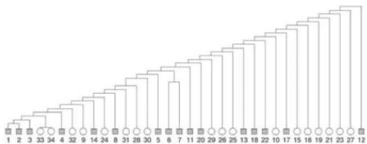

图 13 Girvan-Newman 算法结果

Girvan-Newman 算法所得到的结果实质上是网络中结点的树图，如图 13 所示。该算法给出了如何去除边得到社区结构。但在得到最终的社区数之前，还有一个问题没有得到解决，即如何确定合适的社区数，使社区划分结果最优。他们随后提出了模块度 Q 的概念：

$$Q = \sum_{i}^{K}(e_{ii} - a_i^2)^2$$

考虑一个将网络分成 K 个社区的分割算法，定义一个 k x k 矩阵 e，其中 e_ij 代表连接到社区 i 中的点的边的个数与社区 j 中的边数之比，而 \(a_i = \sum_j^K e_{ij}\)。

Q 值能够体现网络划分为社区后社区结构的质量，该值越趋近于 1，说明社区结构越明显，该值逼近于 0，则社区结构不明显。对于同一个网络而言，不同算法可能得到的 Q 值不同，Q 值高则代表了该算法较优。

利用 Q 值寻找合适的社区数的思路如下：在上面 Girvan-Newman 算法中每去除一次边，则计算一下所得社区结构的 Q 值，寻找到 Q 值最大时的社区数量。一般而言，计算时不可能会在所有去边过程中都计算 Q 值，往往是寻找某一区间的 Q 值，取得局部最大值即可。在下面的图 14 中可以看到，当社区数量为 4 时，所得 Q 值最大，因此该网络划分为 4 个社区最优。

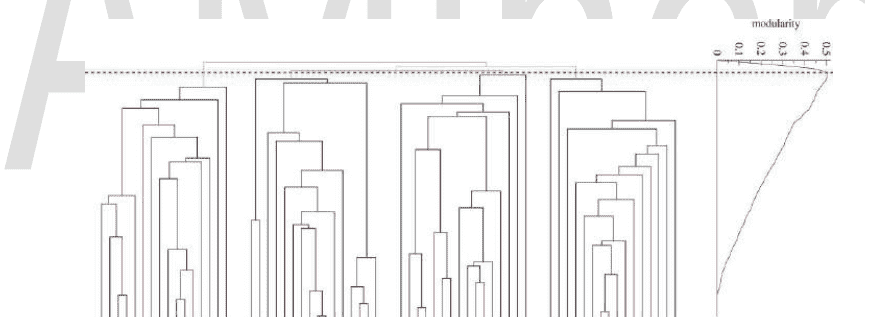

图 14 基于优化 Q 值的算法结果

### (2) 标签传播算法

标签传播算法很简单，其核心思想是相似的结点应该具有相同的标签。

标签传播算法的详细步骤为：

- a. 初始化所有结点，为每个结点分配唯一的标签；
- b. 随机选择一个结点，令其及其所属社区的结点标签更换为它的大多数邻居所属的标签，若有几个这样的标签，随机选择一个；
- c. 若每个结点标签都已和其多数邻居的相同，则停止算法，否则重复步骤 2。

标签传播算法最吸引人的地方，在于它的简单核心思路的简洁，并且很容易实现。一个简单的算法意味着易于理解，并且容易在它之上做很多有针对性的改良。它的另一个极大的优点在于可伸缩性，标签传播算法非常适合用来处理大规模图数据，因为算法的实质是以结点为中心的，所以其实是可以在 Map-Reduce 上实现它。标签传播算法不需要预先给定社区的数量，基于聚类的算法一般都需要预先给定聚类个数，而标签传播不需要任何的先验知识。

### (3) Louvain 算法

Louvain 算法是基于模块度（Modularity）的社区发现算法，该算法在效率和效果上都表现比较好，并且能够发现层次性的社区结构，其优化的目标是最大化整个图属性结构（社区网络）的模块度 Q：

Louvain 算法的详细步骤为：

- a. 对于每个结点，令其所属社区的结点标签更换为它的其中一个邻居所属的标签，选择方式是选择使其 Q 增益最大，直到所有结点的社区标签都不再改变，计算 Q；
- b. 若 Q 不再改变，则停止算法。否则重构网络，令同一个社区中的点“凝聚”成一个结点，社区内的边成为新网络的自环，社区之间的边成为新网络的边，这时边的权重为两个结点内所有原始结点的边权重之和，重复步骤 b。

迭代这两个步骤直至算法稳定，它的执行流程如图 15 所示：

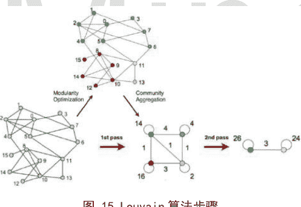

## 2.4 自然语言中的数据挖掘

自然语言处理是人工智能的一个重要领域，也是数据挖掘的一个重要应用载体，本节以自然语言为例介绍与自然语言相关的数据挖掘算法和应用。语言是人类区别与动物的根本标志，因此自然语言处理体现了人工智能的最高任务与境界。至今，自然语言处理的发展与真正的语义理解仍然差之甚远，但这并不妨碍自然语言数据的研究，如果采取有效的分析方法，我们仍然可以从中获得知识来帮助我们的各项任务。本节将从词、句、话题三个层次简介自然语言中数据分析的基本方法。

### 2.4.1 词表示分析

文本中的单词是自然语言的基本结构，对于单词的研究，除了简单的词频统计等，词的表示学习饱受关注。词的表示学习，又称为词嵌入（word embedding），指为每个单词找到一个向量表示，理想状况下向量之间的距离和线性关系可以反映单词之间的语义联系。通过词向量，我们可以通过可视化分析词的关联，也有利于进一步分析。下面介绍三种最为重要的词表示方法：

### 1. 词袋模型

词袋模型（Bag of Words）是最简单的词向量表示方法。该模型忽略掉文本的语法和语序等要素，将其仅仅看作是若干个词汇的集合，文档中每个单词的出现都是独立的。词袋模型使用一组无序的单词来表达一段文字或一个文档。基于文本的词袋模型的一个简单例子如下：

首先给出两个简单的文本如下：

The more the data, the better the performance of machine learning algorithms.

Which one is more important in machine learning, data or algorithms?

基于上述两个文档中出现的单词，构建如下一个词典：

```
{"the ": 1, "more": 2,"data": 3, "better": 4, "performance": 5,"of": 6, "machine": 7,
"learning": 8,"algorithms": 9, "which": 10,"one": 11, "is": 12,"important":13, "in":14, "or":15}
```

上面的词典中包含 10 个单词，每个单词有唯一的索引，那么每个文本我们可以使用一个 10 维的向量来表示，如下：

```
[4, 1, 1, 1, 1, 1, 1, 1, 0, 0, 0, 0, 0, 0]

[0, 1, 1, 0, 0, 0, 1, 1, 1, 1, 1, 1, 1, 1]
```

该向量与原来文本中单词出现的顺序没有关系，而是词典中每个单词在文本中出现的频率。词的这个表示方法很容易想到，但是却又不少缺点，如频率与文本长度有关，导致不同长度文本难以比较；词的重要性不突出，例如 “algorithm” 可以表明这很可能是计算机科学相关的文本，而 “the” “is”这种词却不能。

### 2. tf-idf 模型

TF-IDF（Term Frequency-Inverse Document Frequency）是一种用于信息检索常用加权表示法。在一段文本中，词频（Term Frequency，TF）指的是某一个给定的词语在该文件中出现的频率。这个数字是对词数的归一化，以防止它偏向长的文件（同一个词语在长文件里可能会比短文件有更高的词数，而不管该词语重要与否）。对于在某一特定文件里的词语 $t_i$ 来说，它的重要性可表示为：

```
f_{ij} = \frac{n_{ij}}{\sum_k n_{kj}}
```

上式中$n_{ij}$是该词$t_i$在文件$d_j$中出现的次数，而分母是在文件$d_j$中所有字词出现的次数之和。

逆向文件频率（Inverse Document Frequency，IDF）是一个词语普遍重要性的度量。某一特定词语的 IDF，可以由总文件数目除以包含该词语之文件的数目，再将得到的商取对数得到：

```
idf_i = log(\frac{|D|}{|\{j: t_i \in d_j\}|})
```

其中|D|为语料库中文件的总数，|\{j: t_i \in d_j\}|为语料库中包含t_i的总数。之后可以得出词语的 tf-idf 为：

```
tfidf_{ij} = tf_{ij} \cdot idf_i
```

### 3. Word2Vec 模型

词袋模型和 tf-idf 都是 20 世纪出现的稀疏向量词表示方法，但是这种方法具有很大的弊端，首先就是当语料库中的词语数量很多时，会受到“维度灾难”现象的影响，导致很多分析不准确；另外这种表示方法忽略了语义关联，也就失去了进一步分析语义的可能性。

为了解决这些缺陷，Hinton 等人提出了词语的分布式表示（Distributed Representation），将单词转换为低维度连续空间的向量。这种分布式表示方法可以将语义信息融合到词向量中，根据两个词向量之间的距离就可以判断两个单词语义相关程度。

Word2Vec 模型就是由谷歌提出的一类高效训练词语分布式表示的模型，其在神经网络语言模型(Neural Network Language Model，NNLM)基础上进行了改进。该模型通过不断地“阅读”文本，并且“拉近”文本中相邻较近的模型对应的词向量。

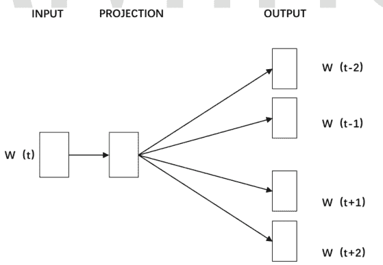

图 16 Skip-Gram 模型架构

下面我们具体地介绍最常用的 word2vec 模型，Skip-Gram 模型。Skip-Gram 模型分为输入层、投影层和输出层三部分，如图 16 所示。我们称单词的“上下文”是该单词在句子中附近小窗口内的其他单词。模型是根据当前词w_t预测其上下文w_{t-2}, w_{t-1}, w_{t+1}, w_{t+2}出现的概率。

给定一个长度为T的单词序列w1,w2,...,wT， Skip-Gram 模型的目标函数如下：

```
argmax 1/T sum_{t=1}^T sum_{-c <= j <= c, c != 0} logp(w_{t+j}|w_t)
```

其中，c表示上下文窗口的大小，在有充足的训练数据时，增大窗口c的大小一般可以获得更高的准确率，不过对应的训练时间也会加长。Skip-Gram 模型往往使用 Softmax 函数来计算p(w_{t+j}|w_t)：

```
p(w_o|w_i) = exp(v'^T_{w_o} v_{w_i}) / sum_{w=1}^W exp(v'^T_{w_o} v_{w_i})
```

上式中v_w和v'_w分别为单词w的输入和输出的词向量表示，W表示整个语料库中所有单词的数目。通过 2.2.2 监督学习方法中神经网络一节介绍的梯度下降的方法优化目标函数，不过由于每次计算条件概率需要 Softmax，校验每个词典中的每个词，需要的时间代价非常大（与W的大小成正比），在实际中应用非常困难。

为了解决这个问题，可以使用层次化 Softmax(Hierarchical Softmax)来计算p(w_o|w_i)，降低计算复杂度。层次化的 Softmax 利用哈夫曼编码的方式构建了一个包含W个单词的哈夫曼树，并用其叶子节点来作为输出层。

通过使用层次化的 Softmax 可以把p(w_o|w_i)的计算复杂度降低到O(L(w))，算法的平均复杂度即变成了O(log(w))，大幅提升了时间效率。除了层次化的 Softmax 之外，还可以使用负采样（Negative Sampling）的方法对模型做出优化，负采样的目标函数定义如下：

```
logσ(v'^T_{w_o} v_{w_i}) + sum_{i=1}^k E_{w_i~P_n(w)}[logσ(-v'^T_{w_o} v_{w_i})]
```

用此公式代替原 skip-gram 中目标函数的每一个logp(w_o|w_i)项，这样优化目标即转变为使用逻辑回归从 k 个噪声分布为P_n(w)的负样本中找出最优的目标单词w_o。

通过使用层次化的 Softmax 和负采样两种技术，可以大幅降低 Word2Vec 的时间复杂度，提升词向量训练效率。

### 2.4.2 语言模型

在实际应用中，可能需要解决这样一类问题：如何计算一个句子的概率？例如在中文输入法中，若打出“nixianzaiganshenme”这一字符串时，其目的是打出“你现在干什么”，但是“你西安在干什么”也是合乎音字转换的句子，从语义上判断，显然 P(你现在干什么|nixianzaiganshenme)应该大于 P(你西安在干什么|nixianzaiganshenme)。

形式化地，对于一个含有 n 个词的句子S = {w1, w2, ..., wn}，语言模型可以计算产生 S 的概率，即：

```
P(S) = P(w1, w2, ... wn) = P(w1)P(w2|w1)...P(wn|w1, w2, ..., w_{n-1})
```

在估计模型参数时，通过采用极大似然估计，我们知道计算$P(w_i|w_1, w_2, \cdots, w_{i-1})$的方法是对子串$\{w_1, w_2, \cdots, w_{i-1}\}$和$\{w_1, w_2, \cdots, w_i\}$在语料库中统计其出现的次数$C(w_1, w_2, \cdots, w_{i-1})$和$C(w_1, w_2, \cdots, w_i)$，并做除法：

$P(w_i|w_1, w_2, \cdots, w_{i-1}) = \frac{P(w_1, w_2, \cdots, w_{i-1}, w_i)}{P(w_1, w_2, \cdots, w_{i-1})} = \frac{C(w_1, w_2, \cdots, w_{i-1}, w_i)}{C(w_1, w_2, \cdots, w_{i-1})}$

但是这里有两个重要的问题：1.对很多子串来说，在语料库中根本没有出现，其条件概率值为 0，因此数据稀疏问题很严重；2.要计算一个新句子的概率，需要若干项条件概率，而要计算并存储它们有很大的代价，无法实用。

通常，我们会放宽标准，使用马尔科夫假设（Markov Assumption）来计算 S 的近似概率：下一个词的出现仅依赖于它前面的一个或几个词。具体来说，若假设每个词出现的独立于其他词，即依赖于前面的 0 个词，则为 unigram 模型：

$P(S) = P(w_1)P(w_2)P(w_3)\cdots P(w_n)$

若假设下一个词的出现依赖它前面的一个词，则为 bigram 模型：

$P(S) = P(w_1)P(w_2|w_1)P(w_3|w_2)\cdots P(w_n|w_{n-1})$

假设下一个词的出现依赖它前面的两个词，即 trigram 模型：

$P(S) = P(w_1)P(w_2|w_1)P(w_3|w_1, w_2)\cdots P(w_n|w_{n-2}, w_{n-1})$

以此类推，下一个词的出现依赖前面 n-1 个词的模型被称为 n-gram 模型。n 越大的话，对下一个词出现的约束信息更多，模型具有更大的辨别能力。n 越小的话，在训练语料库中出现的次数更多，具有更可靠的统计信息。在实际应用中，由于计算资源的限制，往往使用 bigram 或 trigram。n-gram 参数估计的方法也是极大似然估计。

### 2.4.3 话题模型

分析文本的话题是一种重要的数据分析手段，通过区分微博中不同话题文本量，可以了解社会热点；通过联系话题和常见词，可以加深对词的理解，优化词向量学习；文本话题对于构建用户肖像、优化推荐系统等任务也至关重要。

本世纪初十年，以隐含狄利克雷分布(LDA)为代表的概率生成模型在话题挖掘方法取得了突破性的进展，这类模型也被直接冠以“话题模型”（topic model）的称号。LDA 是一个描述离散数据（这里以文本数据为例来阐述，每个单词可以看作一个随机变量，在所有的单词词典里取值）的生成模型。它假定文本中的每个单词是由一些混合的“话题”产生的，每个“话题”都有一定的权重，即$p(w) = \Sigma p(w|z)p(z)$，而p(z)又由一个狄利克雷(Dirichlet)分布产生。LDA 是概率隐含语义分析(PLSA)的延伸。

提出这些模型的动机都是为了分析文本的潜在结构，也就是“话题”。这些话题能够捕获文本的语义信息，帮助找到文本里意思相同或相近的单词，这使得信息检索时能够找到和

查询中的单词语义相关的文档而不只是包含查询的单词的文档。我们定义超参数 $\alpha$ 和 $\beta$，生成单词的过程可以使用一个概率图模型表示出来，如表 4 与图 17。

**表 4 LDA 模型中的变量和标记**

| 标记 | 含义 |
| :--- | :--- |
| M | 语料库中的文档个数 Number of documents in the corpus |
| K | 潜在的话题个数 Number of latent topics |
| V | 词典中单词个数 Number of unique words in vocabulary |
| $\alpha$ | 话题先验分布的参数 Hyper-parameter on the topic (K-vector or scalar if symmetric) |
| $\beta$ | 单词先验分布的参数 Hyper-parameter on the word (V-vector or scalar if symmetric) |
| $\theta$ | 文档生成话题的概率 Notation for $p(z|d)$, document-topic distribution, size $M * K$ |
| $\Phi$ | 话题生成单词的概率 Notation for $p(w|z)$, word-topic distribution, size $K * V$ |
| N | 文档中的单词个数 Number of words in one document |
| $z$ | 文档中每个单词的话题 Topic assigned for each word in each document |
| $w$ | 文档中的单词 Word in each document |

图 17 中，箭头表示生成的前提，超参数 $\alpha$ 和 $\beta$ 分别可以确定分布 $\theta=p(z|d)$ 和 $\Phi=p(w|z)$，分布 $\theta$ 进行采样可以得到话题 z，已知 z 和条件分布 $\Phi$ 则可以采样生成单词。只考虑话题的话，我们可以抛弃掉单词之间的顺序，认为每个单词都是通过如上采样过程产生的。

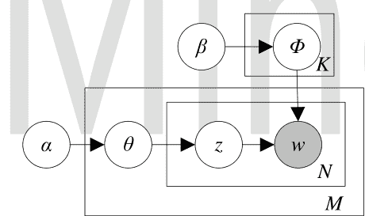

**图 17 话题模型的概率图**

## 2.5 大数据处理

### 2.5.1 基本技术架构

从技术架构角度，大数据处理平台可划分为 4 个层次：数据采集层、数据存储层、数据处理层和服务封装层，详见图 18。

大数据处理平台
服务封装层：可视化 | 数据查询 | 统计分析 | ...
数据处理层：数据挖掘 | 机器学习 | 搜索引擎 | ...
引擎：批量处理引擎 | 图处理引擎 | 流处理引擎
数据存储层：分布式文件系统 | 关系数据库 | NoSQL数据库
数据采集层：批量采集 | 网络爬虫 | ... | 流采集
数据安全与隐私保护
数据源：业务数据 | 互联网数据 | 物联网数据 | ...

**图 18 大数据处理平台技术架构图**

1. 数据采集层。主要负责从各种不同的数据源采集数据。常见的数据源包括：业务数据、互联网数据、物联网数据等。对于不同的数据源，通常需要不同的采集方法。对于存储在业务系统中的数据，一般采用批量采集的方法，一次性的导入到大数据存储系统中。对于互联网上的数据，一般通过网络爬虫进行爬取。对于物联网产生的实时数据，一般采用流采集的方式，并存储到大数据存储系统中或是直接发送到流式处理系统进行处理分析。

2. 数据存储层。主要负责大数据的存储和管理工作。大数据处理平台中的原始数据通常存放在分布式文件系统（例如：HDFS）或是云存储系统（例如：Amazon S3）。为了便于对大数据进行访问和处理，大数据处理平台通常会采用一些非关系型（NoSQL）数据库对数据进行组织和管理。针对不同的数据形式和处理要求，可以选用不同类型的非关系型数据库。常见的非关系型数据库有键值（Key-Value）存储数据库（例如：Redis）、列存储数据库（例如：HBase）、文档型数据库（例如：MongoDB）、图形（Graph）数据库（例如：Neo4J）等。

3. 数据处理层。主要负责对大数据的处理和分析工作。针对不同类型的数据，一般需要不同的处理引擎。对于批量的静态数据，一般采用批量处理引擎（例如：MapReduce）。对于动态的流式数据，一般采用流处理引擎（例如：Storm）。对于图数据，一般采用图处理引擎（例如：Giraph）。基于处理引擎提供的各种基础性的数据计算和处理功能，大数据处理平台中通常会有一些提供复杂数据处理和分析的工具，例如：数据挖掘工具、机器学习工具、搜索引擎等。

4. 服务封装层。主要负责根据不同的用户需要对各种大数据处理和分析功能进行封装并对外提供服务。常见的大数据相关服务包括：数据的可视化、数据查询分析、数据的统计分析等。

除此之外，大数据处理平台一般还包括数据安全和隐私保护模块，这一模块贯穿大数据处理平台的各个层次。

### 2.5.2 大数据平台实例

基于上述技术架构，我们可以设计并实现一个基于开源系统的大数据处理平台，如图 18。该平台能够支持对批量数据、流式数据和图数据等不同类型大数据的处理和分析。根据具体的应用场景和需求，可以对该开源平台进行裁剪，例如：如果不需要对图数据进行处理，可以裁剪掉相应的模块和子系统（Giraph 和 GraphX）。下面将参照下图的技术架构设计，具体介绍平台各层中的开源系统。

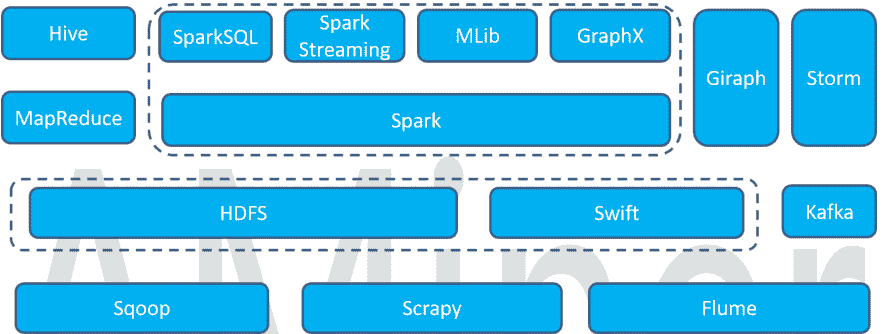

**图 19 基于开源系统的大数据处理平台架构**

#### (1) 数据采集系统：

- Sqoop 是一个用于在 Hadoop 与关系型数据库间进行数据转移的开源工具，可以将一个关系型数据库（例如：MySQL ,Oracle ,Postgres 等）中的数据导进到 Hadoop 的 HDFS 中，也可以将 HDFS 的数据导出到关系型数据库中。

- Scrapy 是一个基于 Python 语言开发的开源 Web 并行爬取框架，它能够快速爬取 Web 站点并从页面中提取自定义的结构化数据。Scrapy 使用 Twisted 异步网络库来处理网络通信，用户只需要在 Scrapy 框架的基础上进行模块的定制开发就可以轻松实现一个高效的爬虫应用。

- Flume 是一个高可用的、高可靠的、分布式的海量日志采集、聚合和传输的开源系统，主要作用是数据的收集和传输，支持多种不同的输入输出数据源，并提供对数据的简单处理。

#### (2) 数据存储系统：

- HDFS（Hadoop Distributed File System）是参考 Google 的 GFS（Google File System）实现的一个开源分布式文件系统，是 Hadoop 框架中的一个核心模块，具有高容错性、高吞吐量等特点。

- Swift（OpenStack Object Storage）是 OpenStack 开源云计算项目的子项目之一，是 OpenStack 云存储服务的重要组件。Swift 能在比较便宜的标准硬件存储基础设施之上提供高可用、分布式、持久性、大文件的对象存储服务。

- Kafka 是一种分布式的、基于发布/订阅的消息系统，其功能类似于消息队列。Kafka 可以接收生产者（例如 Webservice、文件、HDFS、HBase 等）的数据，并将其缓存起来，然后发送给消费者（例如 Storm、Spark Streaming、HDFS 等），进而起到缓冲和适配的作用。

#### (3) 计算引擎：

- MapReduce 是开源大数据处理框架 Hadoop 的核心计算引擎，它是 Google MapReduce 的开源实现，主要用于对批量数据的处理。

- Storm 是 Twitter 支持开发的一款分布式的、开源的、实时的大数据流式计算系统。Storm 能够快速可靠地处理源源不断的消息，并具有良好的容错机制。

- Giraph 是一个采用 BSP 模型（Bulk Synchronous Parallel，整体同步并行计算模型）的开源并行图处理系统，主要参照 Google 的 Pregel 系统并基于 Hadoop 实现。

- Spark 是一个专为大规模数据处理而设计的快速、通用的计算引擎，是 UC Berkeley AMP 实验室开源的类 Hadoop MapReduce 的通用并行框架。Spark 扩展了 MapReduce 计算模型，高效地支持除了批量计算以外的更多计算模式，包括流式计算、图计算等。

#### (4) 数据分析工具：

- Hive 是基于 Hadoop 的一个数据仓库工具。所有 Hive 的数据都存储在 Hadoop 兼容的文件系统（例如，HDFS、Amazon S3）中。Hive 提供了一系列的工具，可以用来进行数据提取、转化、加载（ETL）以及通过类 SQL 查询语言 HiveQL 进行统计分析和查询工作。Hive 将 SQL 语句转换为 MapReduce 任务进行运行。

- Spark SQL 是基于 Spark 的一个数据仓库工具，其架构和功能与 Hive 类似，只是把底层的 MapReduce 替换为 Spark。

- Spark Streaming 是 Spark 提供的对实时数据进行流式计算的工具，支持对实时数据流的可扩展（scalable）、高吞吐（high-throughput）、容错（fault-tolerant）的流处理。支持从多种数据源获取数据，包括 Kafka、ZeroMQ、Kinesis 以及 TCP sockets。从数据源获取数据之后，可以使用诸如 map、reduce、join 和 window 等高级函数进行复杂算法的处理。

- MLlib 是一个基于 Spark 的机器学习函数库，它是专门为在分布式集群上并行运行的情况而设计的。MLlib 中包含许多常用的机器学习算法，可以在 Spark 支持的所有编程语言中使用。

- GraphX 是一个基于 Spark 的分布式图（Graph）处理工具，提供大量进行图计算和图挖掘的简洁易用的接口，极大地方面了用户对分布式图处理的需求。

# 3 人才篇

## 3.1 学者情况概览

AMiner 选取数据挖掘领域影响力排名前 1000 的专家学者绘制了该领域学者全球分布地图，如下图。从国家来看，数据挖掘领域的人才在美国最多，中国次之，英国和意大利等国也较为集中。从地区来看，美国东部人才最为集中，西欧人才分布也比较多，其次是中国大陆等地区。

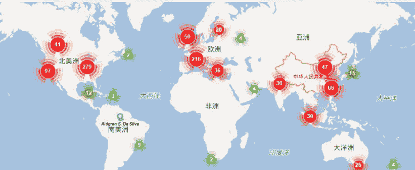

**图 20 全球学者分布地图**

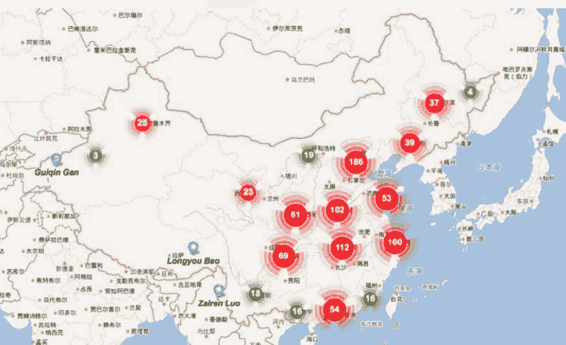

**图 21 国内学者分布地图**

选取数据挖掘国内影响力排名前 1000 的专家学者绘制了学者国内分布地图，国内学者集中分布在北京上海两地，湖南和四川地区的学者分布也相对集中。从整体来看，东部学者数量远多于西部。

AMiner 对数据挖掘排名前 1000 学者的迁徙路径做了分析。由下图可以看出，美国数据挖掘顶尖人才的流失和引进是相对比较均衡的，其中美国是自然语言处理领域人才流动大国，人才输入和输出幅度都大幅度领先，且从数据来看人才流出大于人才流入。德国、中国和加拿大等国落后于美国，其中德国和加拿大有轻微的顶尖人才流失现象。

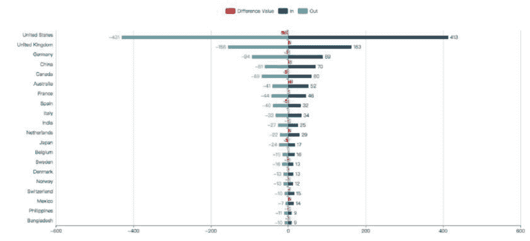

**图 22 数据挖掘领域全球 Top1000 学者迁徙图**

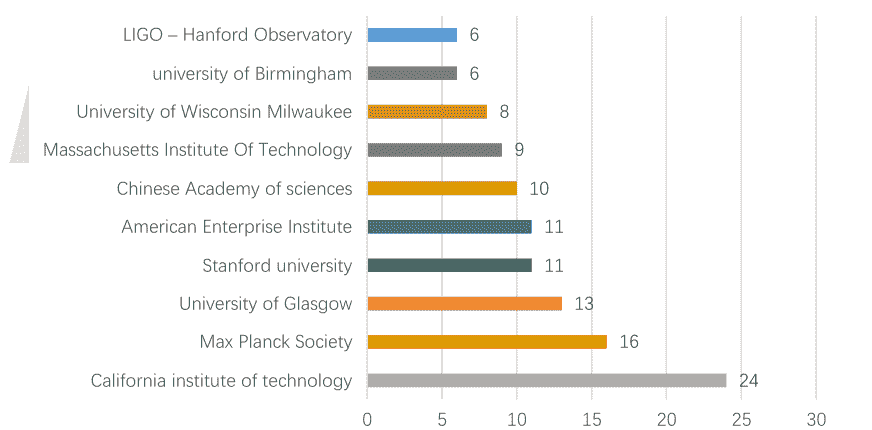

**图 23 数据挖掘全球 Top1000 学者机构分布**

上图是对全球排名前 1000 学者所在机构进行了统计表，数据显示多名学者就职于同一机构的现象较为普遍，机构所拥有的学者数量越多，越能反映出该机构的科研与创新能力，直观的印证其在该领域具备更强的竞争力，因此我们对最表现突出的机构进行了以下排名。在数据挖掘领域，排名前 1000 的学者中加州理工学院拥有 24 人，位列第一；Max Planck 有 16 人，位列第二。

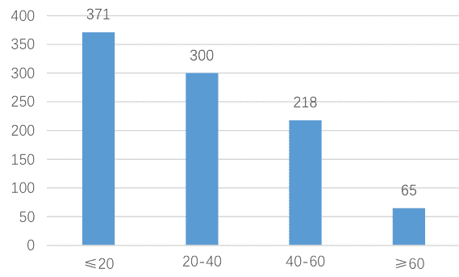

**图 24 数据挖掘全球 Top1000 学者 h-index 分布图**

全球排名前 1000 学者 h-index 平均数为 29，h-index 为 20 及以下的学者人数最多，有 371 人，占比 37%，h-index 在 20-40 之间的学者人数次之，有 300 人，占比 30%，h-index 为 60 及以上的学者人数最少，占比 0.6%。

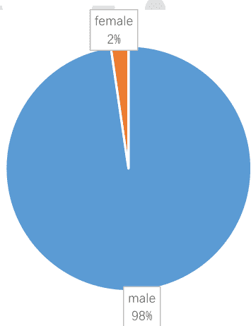

**图 25 数据挖掘全球 Top1000 学者性别比**

数据挖掘领域全球排名前 1000 学者男性占比 98%，女性占比 2%，男女比例不均衡。

## 3.2 学者简介

学者选取来自近期将要发布的全球 AI 十年影响力人才发展报告，我们选取了 KDD 会议，对所涉学者及其论文关键信息进行抽取。依据各学者论文被引用的次数，来进行此次十年最具影响力人才的排名。我们依此排名对国内外学者进行介绍。

### 3.2.1 发展过程中代表学者简介

在数据挖掘发展过程中，有很多重要的研究学者在这一领域起到了推动作用，以下是有史以来在 SIGKDD 上发表论文的引用量排在前十名的学者。

- **1 Martin Ester**
  h-index: 61 | Paper: 180 | Citation: 29805
  Professor
  Computing Science, Simon Fraser University
  Data Mining Social Network Spatial Database Collaborative Filtering Clustering Algorithms
  5045 views

- **2 Hans-Peter Kriegel**
  h-index: 95 | Paper: 546 | Citation: 73258
  Professor
  Ludwig-Maximilians-Universität München
  Data Mining Similarity Search Spatial Database Indexation Database System
  25737 views

- **3 Jon M. Kleinberg**
  h-index: 107 | Paper: 413 | Citation: 81716
  Professor
  Cornell University, Department of Information Science
  Social Network Computational Geometry Algorithms Complexity Computer Algebra
  24649 views

- **4 Jiawei Han (韩家驹)**
  h-index: 176 | Paper: 1225 | Citation: 194188
  Professor
  University of Illinois at Urbana-Champaign
  Data Mining Relational Database Index Association Rule Data Cube
  93782 views

- **5 Bing Liu (刘兵)**
  h-index: 83 | Paper: 245 | Citation: 50186
  Professor
  Department of Computer Science, University of Illinois at Chicago (UIC)
  Data Mining Web Page Association Rule Web Mining Opinion Mining
  26501 views

- **6 Jörg Sander**
  h-index: 38 | Paper: 90 | Citation: 26418
  Professor
  Department of Computing Science, University of Alberta
  Clustering Algorithm Spatial Database Sensor Network Data Mining Hierarchical Clustering
  3771 views

- **Philip S. Yu (徐士钝)**
  h-Index: 154 | Paper: 1051 | Citation: 101868
  Professor
  University of Illinois at Chicago
  Data Mining Index Social Network Distributed Database Data Stream
  32195 views

- **Christos Faloutsos**
  h-Index: 125 | Paper: 792 | Citation: 85039
  Professor
  Department of Electrical & Computer Engineering, Carnegie Mellon University
  Data Mining Social Network Large Graph Power Law Range Query
  28809 views

- **Pedro Domingos**
  h-Index: 77 | Paper: 172 | Citation: 37052
  Professor
  Department of Computer Science and Engineering, University of Washington
  Machine Learning Markov Logic First Order Logic First-order Logic Markov Logic Network
  5581 views

- **XiaoWei Xu (徐哌伟)**
  h-Index: 31 | Paper: 81 | Citation: 19317
  Professor
  Information Science Department, University of Arkansas at Little Rock
  Data Mining Clustering Algorithm Complex Network Social Network Spatial Database
  3543 views

### Martin Ester

Martin Ester
h: 61 A: 148.58 S: 47.23 ... P: 180
Professor
Computing Science, Simon Fraser University
Data Mining Social Network Spatial Database Collaborative Filtering Clustering Algorithms Clustering Satisfiability Algorithms

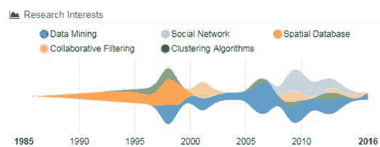

Martin Ester，在数据挖掘和机器学习领域拥有 20 多年的应用研究经验，探索了数据挖掘在支持精准医学方面的潜力，被认为是该领域的国际领导者。他是加拿大不列颠哥伦比亚


不列颠哥伦比亚省的西蒙弗雷泽大学（Simon Fraser University，简称 SFU）的计算机科学系教授，1990 年于瑞士苏黎世联邦理工学院获得计算机科学博士学位。他的研究领域为：社交媒体中的数据挖掘、生物网络中的数据挖掘、数据库系统、大数据在精准医学中的应用。

Martin Ester 博士是 SFU 数据库和数据挖掘实验室的联合主任、SFU 计算机科学学院院长、TKDE 副主编、NSERC 资金委员会成员。曾任 2014 ASONAM 的程序委员会主席

他致力于癌症标记物发现，患者分层和药物目标相互作用的预测，与 SFU 的 Fiona Brinkman 博士实验室共同开发的 PSORTb 仍然被广泛用作细菌中蛋白质亚细胞定位预测的最先进工具。

- Hans-Peter Kriegel

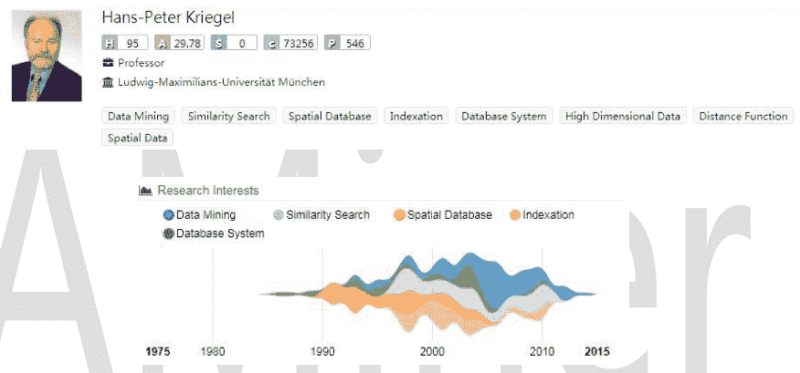

Hans-Peter Kriegel，因其在数据挖掘聚类、异常检测和高维数据分析（包括基于密度的方法）中的贡献而受到认可。他是德国慕尼黑大学（Ludwig Maximilian University of Munich）信息学教授，并领导计算机科学系数据库系统小组。研究领域为：相关聚类、高维数据索引和分析、空间数据挖掘和空间数据管理以及多媒体数据库。

Kriegel 教授是国际计算机协会（ACM）的研究员（2009）。因其在聚类、异常检测和高维数据分析（包括基于密度的方法）中的数据挖掘方面的影响，而获得了 SIGKDD 2015 创新奖（Innovation Award），这是数据挖掘领域的最高奖项。Kriegel 教授是“A Density-Based Algorithm for Discovering Clusters in Large Spatial Databases with Noise (SIGKDD 1996)”的作者之一，该论文提出了 DBSCAN 算法，获 SIGKDD 2014 时间测试奖（Test of Time Award），对数据挖掘领域做出了突破性贡献。此外，他还曾获 2013 IEEE ICDM 研究贡献奖。

- Jon M. Kleinberg


Jon M. Kleinberg
H 107 A 133.44 S 69.51 C 81716 P 413
Professor
Cornell University, Department of Information Science

Social Network, Computational Geometry, Algorithms, Complexity, Computer Algebra, Computer Science, Approximation Algorithm, World Wide Web

### Research Interests

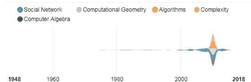

Jon M. Kleinberg，计算机科学领域公认的天才，HITS 算法发明人，社会网络分析方向的知名学者。他是康奈尔大学（Cornell University）计算机教授，1993 年于康奈尔大学获得了计算机科学学士学位，于 1996 年获得麻省理工计算机科学博士学位。研究方向为：社会网络与信息网络分析的基础理论，算法设计，万维网，计算机代数，近似算法。

Jon M. Kleinberg 教授是美国国家科学院（NAS）、美国国家工程院（NAE）、美国人文与科学院（AAAS）三料院士，是康奈尔大学的 University Professor（美国大学给教授的最高头衔）。曾获 NSF 职业奖，ONR 青年研究员奖，麦克阿瑟基金会奖学金，帕卡德基金会奖学金，斯隆基金会奖学金，2000 年 ACM 数据库系统原理研讨会最佳论文奖，2006 奈曼林纳奖（Nevanlinna Prize）。

- 韩家炜


Jiawei Han (韩家炜)
H 175 A 507.60 S 212.16 C 192992 P 1217
Professor
University of Illinois at Urbana-Champaign

Data Mining, Relational Database, Index, Association Rule, Data Cube, Data Analysis, Data Structure, Social Network

### Research Interests

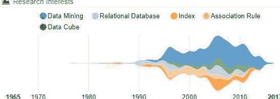

韩家炜，被称为“数据挖掘第一人”，是具有国际影响力的著名科学家。他是伊利诺伊大学香槟分校（University of Illinois at Urbana-Champaign，简称 UIUC）计算机系教授，1985 年于美国威斯康星大学（University of Wisconsin System）获计算机系博士学位。他的研究领域为：数据挖掘、数据库和信息网络；目前从事的项目有信息网络学术研究中心：构建和采矿生物网络、社交媒体数据的多维结构的总结与挖掘、构建和挖掘结构、大型网络的嵌入式研究。

韩家炜教授是 IEEE 和 ACM 的会士（Fellow），曾任美国 ARL 资助的信息网络联合研究中心主任，曾担任 KDD、SDM 和 ICDM 等国际知名会议的程序委员会主席，创办了 ACM TKDD 学报并任主编。

他曾获 2009 年 the McDowell Award、ACM SIGKDD 2004 创新奖（2004 ACM SIGKDD Innovation Award）、ICDE 2002 杰出贡献奖。他出版的数据挖掘专著《Data Mining: Concepts and Techniques》，是国内外数据挖掘领域经典教材。在谷歌学术的 h-index 中，名列全球计算机科学领域高引作者前三。

- Bing Liu (刘兵)

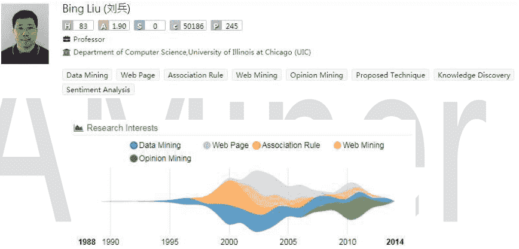

刘兵，数据挖掘重量级人物，是语义分析、观点挖掘研究领域的开创者之一。他是伊利诺伊大学芝加哥分校（University of Illinois at Chicago，简称 UIC）计算机科学系优秀教授，于爱丁堡大学获得人工智能博士学位。他的研究兴趣包括：语义分析和观点挖掘，机器学习，假/欺骗性意见检测，自然语言处理（NLP）。

他曾于 2013 年担任 ACM SIGKDD 的主席（2013 年 7 月 1 日至 2017 年 6 月 30 日）。曾担任许多其他数据挖掘领域会议主席（包括 ICDM, CIKM, WSDM, SDM 和 PAKDD），他担任 TKDE, TWEB, DMKD 等期刊的副主编；ACM、AAAI 和 IEEE 的会士（Fellow）。

刘兵教授于 2018 年获 SIGKDD 创新奖（Innovation Award），这是数据挖掘领域最高奖项。他的两篇论文（“Integrating Classification and Association Rule Mining (KDD 1998)”与“Mining and Summarizing Customer Reviews (SIGKDD 2003)”）分别获得 2014 年与 2015 年的时间测试奖（Test of Time）。

## Jörg Sander

Jörg Sander
H 38 A 73.43 S 60.94 C 26148 P 90
Professor
Department of Computing Science, University of Alberta

Clustering Algorithm, Spatial Database, Sensor Network, Data Mining, Indexes, Energy Efficient, Projected Cluster, Hierarchical Clustering

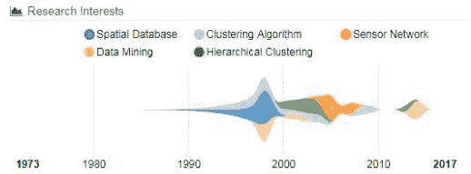

Jörg Sander, DBSCAN 算法创始人之一，聚类分析领域顶尖学者。他是阿尔伯塔大学（University of Alberta，简称 UA）计算机科学系教授，于 1998 年获得慕尼黑大学计算机科学博士学位。他的研究领域包括：数据库中的知识发现，空间数据挖掘，时空索引，生物信息学。目前关注聚类分析、生物数据库中的数据挖掘与动态位置数据。

Jörg Sander 教授是多个数据挖掘领域期刊的审稿人（包括 IEEE TKDE, The International Journal on Very Large Databases, DAMI, Information Systems, Transactions on Pattern Analysis and Machine Intelligence, KAIS, JAIR, JMLR, VLDB, Machine Learning, Systems Man and Cybernetic, PAA, Pattern Recognition Letters）。曾任第二届国际时空数据管理研讨会的研讨会联合主席和组织者，2002 ACM SIGKDD 知识发现与数据挖掘国际会议主席。

他曾获 2015 年 ACM 杰出会员奖，他在论文“A Density-Based Algorithm for Discovering Clusters in Large Spatial Databases with Noise (SIGKDD 1996)”中提出的 DBSCAN 算法，对基于密度的聚类算法产生了巨大的影响，并已成为聚类算法中公认的重要算法之一，这篇论文获 2014 年 SIGKDD 时间测试奖（Test of Time）。

## 俞士纶

Philip S. Yu (俞士纶)
H 155 A 246.64 S 62.22 C 102675 P 1074
Professor
University of Illinois at Chicago

Data Mining, Index, Social Network, Distributed Database, Data Stream, Database System, Relational Database, Mobile Computer

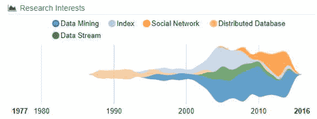

俞士纶，大数据挖掘领域领军人物。他是美国伊利诺伊大学芝加哥分校（UIC）计算机科学系教授，1978 年于斯坦福大学获得电气工程博士学位。他的研究领域为：数据挖掘，隐私保护发布和挖掘，数据流，数据库系统，互联网应用和技术，多媒体系统，并行和分布式处理以及性能建模。

俞士纶博士是 ACM 和 IEEE 院士（Fellow），现担任 ACM TKDD 主编、ACM CIKM 会议指导委员会成员、清华大学数据科学研究院院长，信息技术领域 Wexler 讲座教授。加入 UIC 之前，曾在美国 IBM Watson 研究中心工作多年，创建了世界知名的数据挖掘及数据管理部门。他还曾担任 IEEE ICDE 和 IEEE Data Mining 会议指导委员会成员，IEEE TKDE 主编。

因在大数据挖掘、融合以及匿名化方面深具影响力的研究和科学贡献，俞士纶博士曾获 2016 年 ACM SIGKDD 创新奖（2016 ACM SIGKDD Innovation Award）；因在大数据的可扩展性索引、查询、搜索、挖掘以及匿名化问题上开创性和基础性的创新贡献，获得 2013 年 IEEE CS 技术成就奖；因在数据挖掘领域开创性的贡献，获得 2003 年 IEEE ICDM 研究贡献奖。此外他还曾获 2014 年 EDBT 时间检测奖（Test of Time Award）、2013 年 ICDM 十年最有影响论文奖。

- Christos Faloutsos


Christos Faloutsos

H 125 A 378.86 S 222.92 C 85039 P 792

Professor
Department of Electrical & Computer Engineering, Carnegie Mellon University

- Data Mining
- Social Network
- Large Graph
- Power Law
- Range Query
- Information Retrieval
- Index
- Graph Theory

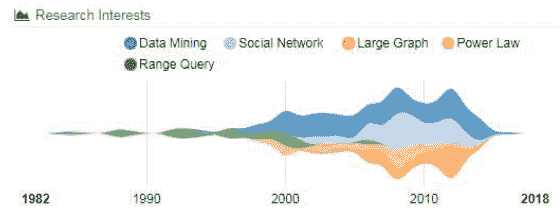

Christos Faloutsos，多媒体数据挖掘顶尖学者。他是美国卡耐基梅隆大学（Carnegie Mellon University，简称 CMU）计算机科学系教授，1989 年于牛津大学获得博士学位。研究领域为：数据挖掘、数据库性能、空间和多媒体数据库，图数据挖掘，生物与医学数据库索引。

Christos Faloutsos 教授是 SIGKDD 执行委员会成员、ACM（国际计算机学会）会员、IEEE TKDE 副主编，曾任 1999 年 ACM SIGMOD 主席、2003 年 ACM KDD 主席。

Christos Faloutsos 教授曾获 1997 年 VLDB 10 年论文奖、2010 年 SIGKDD 创新奖（Innovation Award，数据挖掘领域最高奖项）、2016 年 ICDM 10 年最高影响力论文奖。他是 SIGKDD 2016 的最佳研究论文“FRAUDAR: Bounding Graph Fraud in the Face of Camouflage”的作者之一，这篇论文研究如何在用户商品评论数据中识别假的评论，提出的方法能够识别伪装，比传统方法更加有效。除此之外，他曾获 1989 年“青年研究者奖”，这是美国国家科学基金会授予的青年科学家最高奖，1994 年 SIGMOD 最佳论文奖、2005 年 SIGKDD 最佳研究论文奖、2006 年 ICDM 研究贡献奖。

- Pedro Domingos

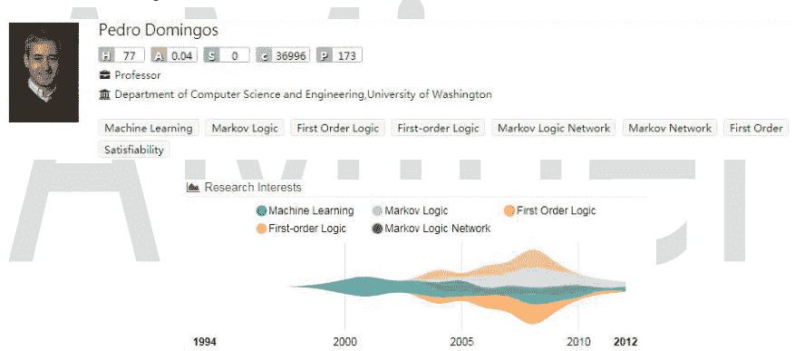

Pedro Domingos，VFDT 实时数据流挖掘系统创始人。他是华盛顿大学（University of Washington，简称 UW）计算机科学与工程系教授，1997 年于加州大学欧文分校（University of California, Irvine，简称 UCI）获信息与计算机科学博士学位。研究领域为：机器学习和数据挖掘，统计关系学习，可追溯的深度学习，机器阅读，集体知识基础，大规模机器学习。

Pedro Domingos 教授是 AAAI 会士（Fellow）、机器学习期刊（Machine Learning journal）的编辑委员会成员、国际机器学习协会（International Machine Learning Society）的联合创始人。曾任 SIGKDD 2003 联合主席、SRL-2009 联合主席、JAIR 副主编，曾在 AAAI, ICML, IJCAI, KDD, NIPS, SIGMOD, UAI, WWW 等项目委员会任职。

Pedro Domingos 教授曾获 SIGKDD 2014 创新奖（Innovation Award，数据挖掘领域最高奖项）、SIGKDD 2014 创新贡献奖、SIGKDD 1999 最佳基础研究论文奖，他与 Geoff Hulten 的论文“Mining High-Speed Data Streams (SIGKDD 2000)”曾获 SIGKDD 2015 时间测试奖（Test of Time），该文提出了 VFDT 这一实时数据流挖掘系统，用于快速处理不断增长的数据记录。除此之外，他还曾获 2015 年第二十四届国际人工智能联合会议杰出论文奖、2009 年自然语言处理经验方法会议最佳论文奖、2005 年第九届欧洲数据库知识发现原理与实践会议最佳论文。

- 徐晓伟

Xiaowei Xu (徐晓伟)
H 31 A 0.03 S 0.02 C 19117 P 81
Professor
Information Science Department, University of Arkansas at Little Rock

Data Mining, Clustering Algorithms, Complex Network, Bioinformatics, Social Network, Support Vector Machine, Microarrays, Clustering

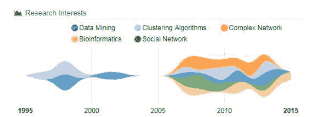

Xiaowei Xu，基于密度的聚类算法 DBSCAN 创始人之一。他是美国阿肯色大学小石城分校（University of Arkansas at Little Rock，简称 UALR）信息科学系教授，1998 年于慕尼黑大学（Ludwig-Maximilians-Universität München，简称 LMU）获得计算机科学博士学位。研究领域为：图数据挖掘，潜在结构数据挖掘，非常大的图形数据管理和生物信息学。Xiaowei Xu 教授现任国家毒理学研究中心（NCTR）的 ORISE 教师研究计划成员，曾任 SIGKDD 2015 计划委员会成员。

他是论文“A Density-Based Algorithm for Discovering Clusters in Large Spatial Databases with Noise (SIGKDD 1996)”的作者之一，该论文获 SIGKDD 2014 时间测试奖，文中提出的 DBSCAN 算法对基于密度的聚类算法产生了巨大的影响，并已成为聚类算法中公认的重要算法之一，截止于 2018 年 9 月其 AMiner 引用次数为 12870 次。该算法还被 FDA 用于 atBioNet，一种基因组学和蛋白质组学的知识扩展，网络建模和可视化的集成网络分析工具。

- Hector Garcia-Molina

Hector Garcia-Molina
H 139 A 35.29 S 1.31 C 90879 P 618
Professor
Stanford University

Digital Library, Distributed System, Computer Science, Database System, Web Page, Indexes, Distributed Database, Data Warehousing


Hector Garcia-Molina，网络数据挖掘领域顶尖学者，在学术领域与应用领域均享有很高声誉。他是斯坦福大学计算机科学和电气工程系的教授，1979 年于斯坦福大学获得计算机科学博士学位。他的研究领域为：分布式计算系统、数字图书馆和数据库系统。

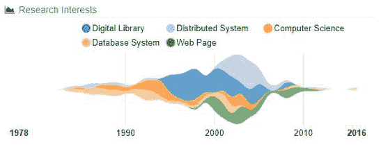

他是美国计算机协会（ACM）研究员、美国艺术与科学学院（AAAS）研究员，美国国家工程院（NAE）院士，苏黎世联邦理工学院的荣誉博士，现任总统信息技术咨询委员会（PITAC）的成员、Onset Ventures 的风险投资顾问、Oracle 董事会成员、State Farm Technical Advisory Council 的成员。他曾担任谷歌联合创始人谢尔盖布林的顾问。

他的论文 “The Evolution of the Web and Implications for an Incremental Crawler, VLDB 2000” 获 2010 VLDB 10 年最佳论文奖，研究了如何构建有效的增量爬虫，结合了最佳的设计选择，提出了增量爬虫的架构。此外他还曾获 2009 SIGMOD 最佳演示奖、2007 ICDE 影响力论文奖、1999 ACM SIGMOD 创新奖。

- Duncan J. Watts

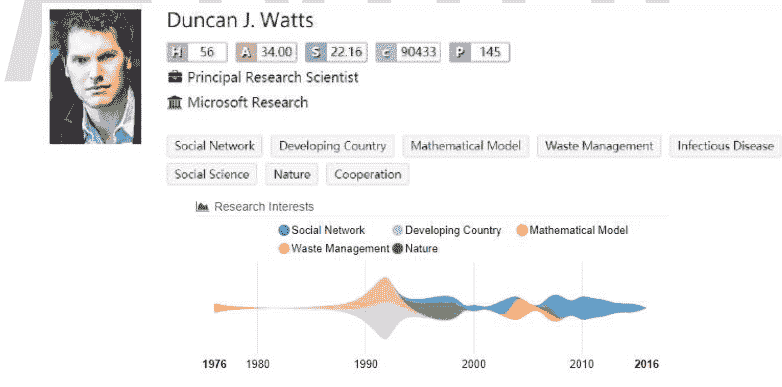

Duncan J. Watts，卡内基梅隆大学计算机科学系教授，1997 年于康奈尔大学获应用力学博士学位。他的研究领域为：图形和流的挖掘、数据库性能评估、生物和医学数据库的索引、数据挖掘。

Duncan J. Watts 教授是 Microsoft Research 的首席研究员，也是 MSR-NYC 实验室的创始成员。他还是康奈尔大学的 AD White Professor。在 2012 年加入 Microsoft Research 之前，他于 2000 年至 2007 年在哥伦比亚大学担任社会学教授，之后在雅虎担任首席研究科学家。他曾担任多个国际会议主席，如 ACM SIGMOD、SIGKDD 2013。他还曾获 2014 年埃弗雷特·罗杰斯奖、2013 年拉格朗日-CRT 复杂性科学基金奖。

- Padhraic Smyth


**Padhraic Smyth**

| H | A | S | C | P |
|---|---|---|---|---|
| 82 | 56.52 | 30.50 | 66746 | 346 |

Professor
Department of Computer Science, University of California, Irvine

Data Mining Mixture Model Probabilistic Model Hidden Markov Model Machine Learning Unsupervised Learning Data Analysis Pattern Recognition

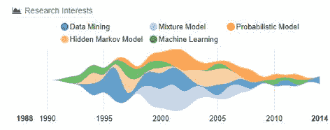

Padhraic Smyth，他是加州大学欧文分校（University of California, Irvine，简称 UCI）信息与计算机科学系教授，1988 年获得的加州理工学院博士学位。他的研究领域为：机器学习、数据挖掘、数据识别、应用统计。

Padhraic Smyth 教授是国际计算机学会（ACM，2013）与美国人工智能协会（AAAI，2010）的会士（Fellow），他曾任 2014 年 UCI 数据科学计划的创始董事（2007-2014）、Netflix 奖项竞赛的学术顾问（2006-2009）、帕萨迪纳喷气推进实验室（Jet Propulsion Laboratory）的技术组组长（1988-1996），曾担任 Machine Learning Research、ASA、TKDD 等期刊的编辑和顾问职位。他与 eBay，东芝，三星，甲骨文，诺基亚和 AT&T 等公司均有合作。

他曾获 SIGKDD 2009 创新奖（innovation award），这是数据挖掘领域的最高奖项。除此之外，他还曾获 SIGKDD 2002 最佳论文奖、2001 IBM 教员合作奖、SIGKDD 2000 最佳论文奖第二名、SIGKDD 1998 最佳论文奖第二名、SIGKDD 1997 最佳论文奖、1997 国家科学基金会职业奖（CAREER award）、1997 UCI ACM 教学奖。

## 排名靠前的其他学者简介：

- Wei Wang


**Wei Wang**

| H | A | S | C | P |
|---|---|---|---|---|
| 78 | 3.11 | 1.16 | 28030 | 770 |

Professor
University of California

Data Mining Partial Discharge Aging Index Genetics Electrosinning Gene Expression Spectrum

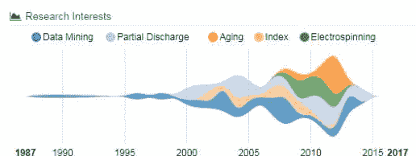

Wei Wang, Leonard Kleinrock 加州大学洛杉矶分校（UCLA）计算机科学讲座教授，可扩展分析研究所（ScAi）主任。她于 1999 年获得加州大学洛杉矶分校计算机科学博士学位。她是北卡罗来纳大学教堂山分校计算机科学教授，卡罗莱纳基因组科学中心和 Lineberger 综合癌症中心的成员。从 1999 年至 2002 年，她是 IBM TJ Watson 研究中心的研究人员。Wang 博士的研究兴趣包括大数据分析，数据挖掘，生物信息学和计算生物学以及数据库。

Wei Wang 博士曾获 2000 年和 2001 年 IBM 发明成就奖，2003 年 UNC 初级教师发展奖，2005 年 NSF 教师早期职业发展（CAREER）奖。2005 年被任命为微软研究院新任教师，2007 年 UNC Phillip 和 Ruth Hettleman 艺术与学术成就奖，2012 年 IEEE ICDM 杰出服务奖，2013 年大川基金会研究奖，2016 年 ACM SIGKDD 服务奖。

Wei Wang 博士曾担任 IEEE TKDE（知识与数据工程交易），IEEE Transactions on Big Data, ACM TKDD, KNOWL INF SYST, WIRES DATA MIN KNOWL, J COMPUT BIOL, IEEE ACM T COMPUT BI, IIKDB 的 associate editor（副主编）；INT J DATA MIN BIOIN 的 editorial board member（编委会成员）。她是国际会议组织和计划委员会的成员，委员会包括 ACM SIGMOD, ACM SIGKDD, ACM BCB, VLDB, ICDE, EDBT, ACM CIKM, IEEE ICDM, SIAM DM, SSDBM, ISMB, RECOMB, BIBM。她于 2015 年被选为 ACM Bioinformatics、Computational Biology（计算生物学）和 SIGBio（生物医学信息学）特别兴趣小组的董事会成员。

- Thorsten Joachims


Thorsten Joachims

| H | A | S | C | P |
|---|---|---|---|---|
| 77 | 81.99 | 36.95 | 82680 | 221 |

Professor
Department of Computer Science and Information Science, Cornell University

Support Vector Machine Machine Learning Information Retrieval Search Engine Structural SVM Implicit Feedback World Wide Web Language Model

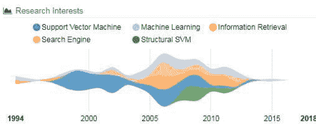

Thorsten Joachims，搜索引擎算法革新的重要推动者。他是美国康奈尔大学（Cornell University）计算机科学系教授，2001 年于多特蒙德工业大学获 AI-unit 博士学位。他的研究领域为：机器学习，人类行为学习数据和隐性反馈，搜索引擎算法，推荐算法，人与教育相关算法；目前从事的项目有 Propensity SVM-Rank、POEM、反事实评估与学习。

Thorsten Joachims 教授现任 ACM、AAAI 与 Humboldt 的会士（Fellow）。他曾与莫纳什大学的 Geoff Webb 教授共同担任 SIGKDD 2015 程序委员会主席，曾与 Johannes Furnkranz 教授共同担任 2010 ICML 程序委员会主席，曾任 JMLR（2004 年-2009 年）、DMKD（2005 年-2008 年）MLJ 的行为编辑，JAIR 顾问委员会成员。

他曾获 2017 WSDM 最佳论文奖、2009 ICML 最佳十年论文奖，他的论文 “Optimizing Search Engines Using Click-Through Data (SIGKDD 2002)” 获 SIGKDD 2015 时间检测奖（Test of Time），论文率先提出了通过挖掘利用用户点击数据从而提高搜索引擎结果准确率的方法，该方法激发了一系列后继工作的发展并成为目前学术界与工业界搜索引擎研发的公认基础方法。此外他还曾获 SIGKDD 2016 最佳学生论文奖亚军、ISMIR 2014 最佳学生论文奖、ECML 2009 最佳论文奖、ICML 2005 最佳论文奖。

- Eamonn Keogh

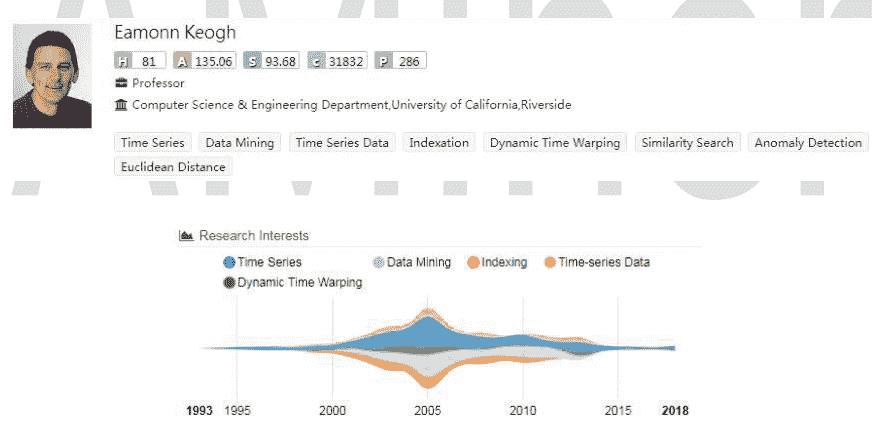

Eamonn Keogh，时间序列领域顶尖学者。他是加州大学河滨分校（University of California, Riverside，简称 UCR）计算机科学与工程系教授，2001 年于加利福尼亚大学欧文分校（University of California, Irvine，简称 UCI）获计算机科学博士学位。研究领域为：时间序列、数据挖掘、指数化、动态时间扭曲、相似性搜索、异常检测。

Eamonn Keogh 教授曾获 2017 IEEE ICDM 最佳论文奖、2007 IEEE ICDM 最佳论文奖，他是论文 “Searching and Mining Trillions of Time Series Subsequences under Dynamic Time Warping” 的作者之一，获 SIGKDD 2012 最佳论文奖。除此之外他还曾获 SIGMOD 2001 最佳论文奖、SIAM SDM 2010 最佳学生论文，与 Bilson、JCDL 2009 最佳学生论文、SIGKDD 1997 最佳论文奖亚军。

### Rakesh Agrawal

| H | A | S | C | P |
|---|---|---|---|---|
| 105 | 89.04 | 57.51 | 115473 | 778 |

President
Microsoft Search Labs

Data Mining Database System Energy Conservation Information Retrieval Relational Databases Transitive Closure Association Rule Thermodynamics

Research Interests [Chart]

Rakesh Agrawal，是基础数据挖掘概念和技术开发的关键人物，开创了数据隐私的关键概念。他是 Data Insights 实验室的总裁兼创始人，微软研究实验室研究员，1982 年于威斯康星大学麦迪逊分校（University of Wisconsin-Madison，简称 UW-Madison）获计算机科学博士学位。研究领域为：数据挖掘、数据库系统、信息检索、关联法则、数据隐私。主要成就有：IBM 的商业数据挖掘产品 Intelligent Miner、DB2 Mining Extender、DB2 OLAP Server、WebSphere Commerce Server、Polyglot 面向对象类型系统、Alert 主动数据库系统、Ode（对象数据库和环境）、Alpha（具有通用传递闭包的关系数据库的扩展）、Nest 分布式系统。

Rakesh Agrawal 博士是美国国家工程院（NAE）院士、ACM 会士、IEEE 会士，曾任 IBM 院士，并在 IBM Almaden 研究中心领导 Quest 小组，《科学美国人（Scientific American）》将他列为首批 50 位顶尖科学家和技术专家。

Rakesh Agrawal 博士是因关联规则，挖掘序列等方面的开创性工作，获 2000 SIGKDD 创新奖（首届），他是 “Order preserving encryption for numeric data” 与 “Mining association rules between sets of items in large databases” 的第一作者，这两篇论文分别于 2014 年与 2013 年获 SIGMOD 时间测试奖。除此之外，他还曾获 2000 ACM-SIGMOD Edgar F. Codd 创新奖、2004 VLDB 10-Yr 最具影响力论文奖、ICDE 2008 最具影响力论文奖。

### Wynne Hsu

| H | A | S | C | P |
|---|---|---|---|---|
| 51 | 42.90 | 0.81 | 18446 | 250 |

Provost's Chair Professor
Department of Computer Science, School of Computing, National University of Singapore

Data Mining Indexation Association Rule Mining Association Rule Data Structure Experiment Result Feature Extraction Data Cleaning

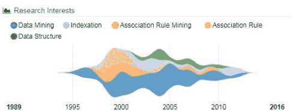

Wynne Hsu，图数据、医学数据挖掘领域的顶尖女性学者。她是新加坡国立大学（National University of Singapore，简称 NUS）计算机科学系教授，于普渡大学（Purdue University）获电气与计算机工程博士学位。研究领域为：数据挖掘，视网膜图像数据，生物医学数据挖掘。正在进行的项目为医学 AI，社交媒体分析。

Wynne Hsu 教授曾任 2013 VLDB 的副主编、2010 ICDM 的研究会副主席、2011 SIGMOD 的程序委员会成员、2010 COMAD 的程序委员会成员、2001-2009 年 SIGKDD 的程序委员会成员、2009 ICDM 的程序委员会成员。除此之外，她还曾担任多个数据挖掘领域会议的程序委员会成员，如 DASFAA，SAC，PRICAI，DEXA，ADMA，PAKDD。

Wynne Hsu 教授与伊利诺伊大学芝加哥分校的刘兵、LinkedIn 公司的 Yiming Ma 合作了论文“Integrating Classification and Association Rule Mining（KDD 1998）”，该文获 SIGKDD 2014 时间检测奖（Test of Time），该论文率先提出了整合关联规则和分类算法来帮助数据挖掘分类的思想，该方法激发了一系列后续工作的发展。

- Mohammed J. Zaki


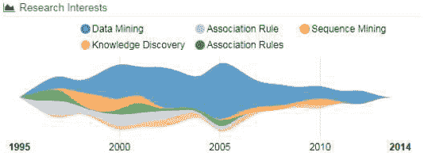

Mohammed J. Zaki，文本挖掘、社交网络与生物信息数据挖掘领域十分活跃的学者。他是伦斯勒理工大学（Rensselaer Polytechnic Institute，简称 RPI）计算机科学系的教授，1998 年于罗切斯特大学（University of Rochester）获计算机科学博士学位。他的研究领域为：新颖数据挖掘和机器学习技术的开发，特别是在文本挖掘，社交网络和生物信息学中的应用。

Mohammed J. Zaki 教授是 BIOKDD 系列研讨会的创始联合主席、Data Mining and Knowledge Discovery 的副主编、ACM SIGKDD 的董事会成员、ACM 杰出科学家和 IEEE 研究员。他曾任 CIKM 2018、IEEE Big Data 2015、ICDM 2012、CIKM 2012、BIBM 2011、SIGKDD 2009、PAKDD 2008、SDM 2008 的项目联合主席。他还曾担任 SADM 的区域编辑和 ACM TKDD、DMKD、SADM、IEEE TKDE 等期刊的副主编。是 2014 年剑桥大学出版社出版的数据挖掘和分析教科书的作者。

他在 2010 年、2011 年和 2012 年三次获惠普创新研究奖，2003 年获得 ACM 服务奖，2002 年获得能源部早期职业首席研究员奖，2001 年获国家科学基金会职业奖。

- David Kempe

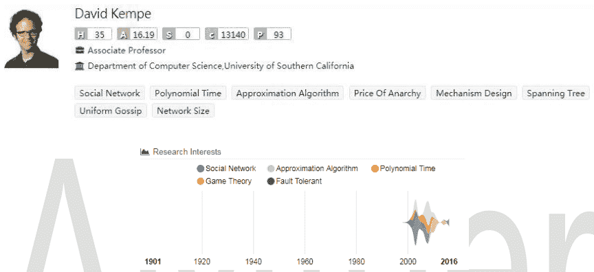

David Kempe，社交网络数据挖掘领域的学者，年轻有为。他是南加州大学（University of Southern California，简称 USC）计算机科学系副教授，2003 年于康奈尔大学（Cornell University）获计算机科学博士学位。他的研究领域为：计算机科学理论和算法的设计和分析，特别强调社会网络，经济学和计算交叉的主题，以及算法学习问题。

David Kempe 博士曾与 Ilias Diakonikolas 合作担任 2018 STOC 的区域主席，与 Shaddin Dughmi 和 Hamid Nazerzadeh 共同主持 2015 年 NEGT。

David Kempe 博士与康奈尔大学的 Jon Kleinberg、Eva Tardos 的 “Maximizing the Spread of Influence through a Social Network (SIGKDD 2003)” 获 SIGKDD 2014 时间检测奖（Test of Time），该论文是社交网络中影响力最大化问题研究的里程碑式工作，其在数学上证明了求解该类问题算法的性能指标界限，为此领域后续研究工作提供了理论支持。他曾获 ACM-EC 2014 最佳论文奖、SIGKDD 2003 最佳论文奖。除此之外他还曾获 2011 年 ICML 2011 年会议杰出论文奖、2009 年南加州大学梅隆分校优秀导师奖、2008 年海军研究办公室青年研究员奖、2005 年 NSF 职业奖等等奖项。


### Inderjit S. Dhillon

Inderjit S. Dhillon  
H 77 A 299.26 S 184.42 C 32302 P 277  
Professor  
University of Texas at Austin  
Clustering Machine Learning Eigenvectors Objective Function Eigenvalues K Means Tridiagonal Matrix Graph Clustering

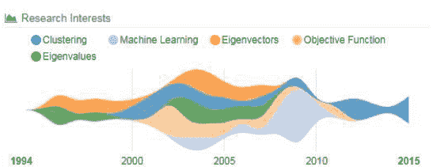

Inderjit S. Dhillon 是德克萨斯大学奥斯汀分校（University of Texas at Austin，简称 UT-Austin）计算机科学系教授，1997 年于伯克利加州大学（University of California, Berkeley）获计算机科学博士学位。他的研究领域为：机器学习，数据挖掘，数值线性代数，数值优化，网络分析，生物信息学；目前的一些研究课题为：高维数据分析，大数据分析的分治方法，社交网络分析与基因疾病预测。

Inderjit S. Dhillon 教授是 ACM、IEEE、SIAM、AAAS 的会士（Fellow），UT Austin 的 Gottesman 家族百年教授，同时担任 ICES 大数据分析中心的主任，A9 亚马逊的高级研究员。曾任 JMLR 编委、IEEE TPAMI 编辑、SIMAX 编辑、《Foundations and Trends in Machine Learning》编辑。

Inderjit S. Dhillon 教授的 “Scalable Coordinate Descent Approaches to Parallel Matrix Factorization for Recommender Systems” 获 ICDM 2012 最佳论文奖。他还曾获 ICES 2013 杰出研究奖，SIAM 2011 杰出论文奖，2010-2011 Moncrief Grand Challenge 奖，SIAM 2006 线性代数奖，2001 大学研究卓越奖和 2001 NSF 职业奖。

### 3.2.2 近十年代代表学者简介

以下是近十年在 SIGKDD 上发表论文的引用量排名靠前的学者。其中，俞士汶、Christos Faloutsos 和韩家炜三位学者在数据挖掘发展历史中做出了很大贡献，上一节已做介绍，本节不再赘述。

- **Jure Leskovec**

h-index: 84 | #Paper: 225 | #Citation: 48493  
Associate Professor  
Department of Computer Science, Stanford University  
Social Network Information Cascade Information Network Social Media Recommender System  
2973 views

- **Philip S. Yu (俞士汶)**

h-index: 154 | #Paper: 1051 | #Citation: 101868  
Professor  
University of Illinois at Chicago  
Data Mining Index Social Network Distributed Database Data Stream  
32195 views

- **Christos Faloutsos**

h-index: 125 | #Paper: 792 | #Citation: 85039  
Professor  
Department of Electrical & Computer Engineering, Carnegie Mellon University  
Data Mining Social Network Large Graph Power Law Range Query  
28810 views

- **Yehuda Koren**

h-index: 53 | #Paper: 121 | #Citation: 20592  
Staff research scientist  
Google  
Collaborative Filtering Graph Drawing Recommender Systems Recommender System Data Visualisation  
949 views

- **Jiawei Han (韩家炜)**

h-index: 176 | #Paper: 1225 | #Citation: 194188  
Professor  
University of Illinois at Urbana-Champaign  
Data Mining Relational Database Index Association Rule Data Cube  
93782 views

- **Jie Tang (唐杰)**

h-index: 53 | #Paper: 269 | #Citation: 10867  
Associate Professor  
Department of Computer Science and Technology, Tsinghua University  
Social Network Semantic Web Social Influence Topic Model Data Mining  
16370 views

- **Carlos Guestrin**

h-index: 68 | #Paper: 196 | #Citation: 24948  
Professor  
Department of Computer Science and Engineering University of Washington  
Sensor Network Wireless Sensor Network Graphical Model Gaussian Process Optimization Problem  
951 views

- **Gionis Aristides**

h-index: 57 | #Paper: 214 | #Citation: 16717  
Professor  
Department of Computer Science of Aalto University  
Data Mining Social Network Search Engine Social Networks Clustering  
3298 views

- **Huan Liu (刘欢)**

h-index: 92 | #Paper: 358 | #Citation: 38578  
教授  
Computer Science & Engineering, SCIDSE/SCI, Arizona State University  
Data Mining Feature Selection Social Media Social Network High Dimensional Data  
23409 views

- **Jimeng Sun**

h-index: 54 | #Paper: 216 | #Citation: 10331  
Associate Professor  
School of Computational Science and Engineering at College of Computing, Georgia Institute of Technology  
Machine Learning Predictive Modeling Visual Analytics Dimensionality Reduction Social Network Analysis  
3995 views

### Jure Leskovec

H 85 A 269.52 S 171.87 C 48702 P 227  
Associate Professor  
Department of Computer Science, Stanford University  
Social Network Information Cascade Information Network Social Media Recommender System Machine Learning New Media Degree Distribution

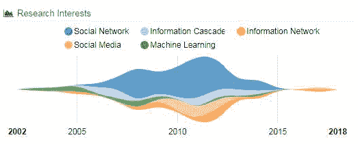

Jure Leskovec 是数据挖掘应用方面的顶尖学者。斯坦福大学计算机科学系副教授，2008 年于美国卡耐基梅隆大学（Carnegie Mellon University，简称 CMU）获得计算机科学学院机器学习系博士学位。研究领域为：大型社会和信息网络的数据挖掘和建模，大数据网络与媒体。

Jure Leskovec 副教授是 Chan Zuckerberg Biohub 的研究员。他是 SIGKDD 2017 最佳学生论文亚军的导师，他是 “Toeplitz Inverse Covariance-Based Clustering of Multivariate Time Series Data” 作者之一，获 SIGKDD 2017 最佳研究性论文亚军；他是 “Modeling information diffusion in implicit networks” 作者之一，获 ICDM 2010 最佳应用论文奖；他是 “Graphs over time: densification laws, shrinking diameters and possible explanations” 作者之一，获 SIGKDD 2005 最佳研究性论文。除此之外，他还在 JWRPM、SIGKDD、WSDM、ICDM、WWW 等多个期刊会议中多次获奖，如 SIGKDD 2010 最佳研究性论文奖亚军、JWRPM 2008 最佳研究性论文奖、SIGKDD 2007 最佳学生论文奖。

### Yehuda Koren

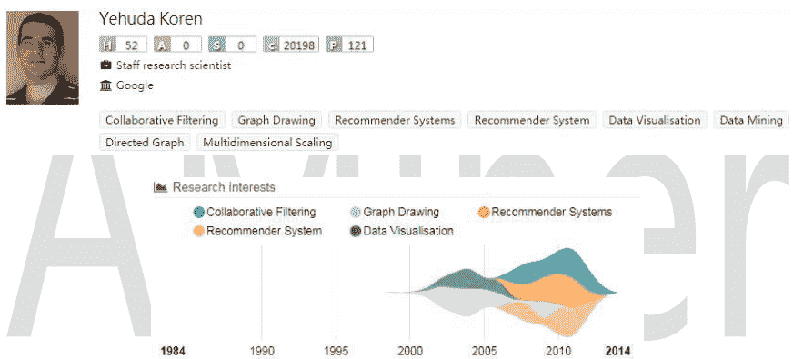

Yehuda Koren，推荐系统领域的顶尖科学家。于 Weizmann Institute（魏茨曼科技学院）取得计算机科学博士学位。他的研究领域为：推荐系统（recommender system）、数据挖掘、机器学习、信息可视化。

Yehuda Koren 博士现任 Google 的高级研究员（staff research scientist），此前，他历任 Yahoo!的高级研究员（staff research scientist, 2008-2012 年），AT&T Labs-Research 的研究员与主要成员（2003-2008）。他是 SIGKDD、ICDM、RecSys、WSDM、CIKM 的高级计划委员会（senior program committee）成员；IEEE TKDE 和 ACM TIST 的编委。

他的论文 “Factorization meets the neighborhood: a multifaceted collaborative filtering model” 曾获 SIGKDD 2018 时间检测奖（Test of Time Award），该论文提出了一个单一的框架，将邻域模型与潜在因子模型（现在通常称为“嵌入模型”）相结合，从而利用两种方法的优势：邻域模型在检测非常局部化的关系时最有效，而潜在因子模型则更多有效地估计与大多数或所有项目同时相关的整体结构。直到今天仍然有着它的实用意义。他曾带领团队在 Netflix Prize competition 两次赢得 progress awards，是 Netflix Grand Prize 获奖团队的成员。曾获 2011 RecSys 最佳论文奖、SIGKDD 2009 最佳论文奖、INFOVIS 2005 最佳论文奖。

### 唐杰

Jie Tang (唐杰)  
H 54 A 171.59 S 63.02 C 10959 P 312  
Associate Professor  
Department of Computer Science and Technology, Tsinghua University  
Social Network Semantic Web Social Influence Data Mining Topic Model Predictive Model Recommender System Ontology

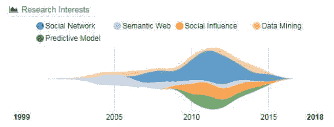

唐杰，AMiner 大数据平台的研发者，数据挖掘领域顶尖年轻学者。他是清华大学计算机科学与技术系教授、系科研办公室主任，2006 年于清华大学获计算机科学与技术工学博士学位。他的研究领域为：社会网络分析、数据挖掘和语义 Web。

他发表了 200 多篇期刊/会议论文，拥有 20 项专利，吸引了超过 10,000 项引用。他首次提出基于隐含话题的异构社会网络建模和社会网络影响力分析模型；针对 Web 信息的不同特点，提出多种有效的语义标注方法；提出的基于贝叶斯决策的多策略本体映射模型，在国际评测 OAEI 中获得多项第一的优秀成绩。研发的学术搜索系统 AMiner 的系统用户已覆盖 180 个国家。研究成果还在与 IBM、Google、Nokia、搜狐等多个国际合作和企业合作项目中得到推广应用。

唐杰教授曾担任 CIKM'16，WSDM'15，ASONAM'15，SocInfo'12，KDD 2018 副主席，组织 KDD'11-18 联合主席，IEEE TKDE / TBD 副主编的 PC 联合主席和 ACM TKDD / TIST。他曾参加国家中文新闻置标语言和分类标准的制定。

唐杰曾获数据挖掘顶会 KDD 2018 杰出服务奖、2018 北京市科学技术奖一等奖、2016 AMiner 数据挖掘领域最具影响力学者（2016 AMiner Most Influential Scholar Award in Data Mining）、2012 年国家优秀青年科学基金、2011 北京市科技新星、2011 Scopus 全国青年科技之星、2010 年度清华大学学术新人奖（清华青年教师的最高学术荣誉）、2010 年 IBM 全球创新教师奖以及 ECML/PKDD'2011 Best Student Paper Runnerup、牛顿高级奖学金、CCF 青年科学家奖和 NSFC 优秀青年学者奖。

### Carlos Guestrin


H 68 A 100.12 S 26.08 C 24948 P 196  
Professor  
Department of Computer Science and Engineering  
University of Washington  

Sensor Network Wireless Sensor Network Graphical Model Gaussian Process Optimization Problem Value Function Mobile Robot Sensor Placement

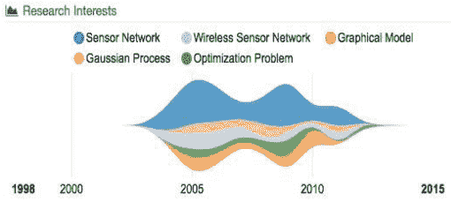

Carlos Guestrin 是亚马逊机器学习专家，拥有斯坦福大学的博士学位，曾经在卡内基梅隆大学和华盛顿大学任职，主要授课内容为机器学习。他的研究方向主要有传感器网络、无线传感器网络、Graphical 模型、高斯过程和优化问题。 Carlos Guestrin 获得过许多会议和期刊的奖项，美国《大众科学》杂志曾将他评为“2008 年十大科学杰出人才之一”。他获得过两次 SIGKDD 的最佳论文奖，分别是，与 Dafna Shahaf 合作的论文“Connecting the Dots Between News”获得第 16 届 ACM SIGKDD 的最佳论文奖；论文 “Cost-effective Outbreak Detection in Networks” 获得第 13 届 ACM SIGKDD 获得的最佳论文奖。

### Gionis Aristides


H 57 A 142.11 S 87.99 C 16717 P 214  
Professor  
Department of Computer Science of Aalto University  

Data Mining Social Network Search Engine Social Networks Clustering Large Graph Satisfiability Algorithms

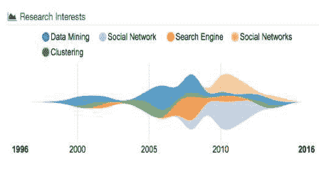

Gionis Aristides 是阿尔托大学（Aalto University）计算机科学系的一名教授，是 EIT 数字数据科学专业的专员，也是 DMKD 和 TKDD 的编辑成员。他的研究领域是数据挖掘和算法数据分析，尤其是图表算法、社交网络分析和网络规模数据算法。

Gionis Aristides 教授的团队有五篇论文被 2018 年 IEEE 国际数据挖掘大会（ICDM）收录，他引用量最多的论文是 “Reducing Controversy by Connecting Opposing Views”，在这篇论文中，Gionis Aristides 阐述了算法技巧在社交媒体上的应用。

### 刘欢 (Huan Liu)


H 92 A 113.85 S 13.34 C 38578 P 358  
教授  
Computer Science & Engineering, SCIDSE/SCI, Arizona State University  

Data Mining Feature Selection Social Media Social Network High Dimensional Data Machine Learning Empirical Study Feature Extraction

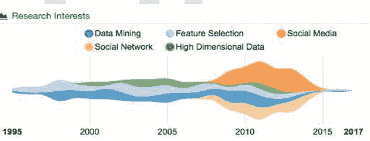

刘欢，美国亚利桑那州立大学计算机科学与工程、信息学与决策系统工程系教授。本科毕业于上海交通大学，1985 年前往美国南加州大学 (University of Southern California)学习，获得了南加州大学的计算机科学的硕士学位和博士学位。他目前的研究方向主要为机器学习、数据挖掘和社交网络的计算方法。

由于他在 Data Mining 和 Knowledge discovery 方面的突出贡献，在 2012 年被任命为 IEEE Fellow。在 2018 年 12 月初，被选为 ACM Fellow。2018 年 12 月中旬，被选为 AAAI Fellow。新入选 AAAI Fellow 的七位学者中有两位华人，刘欢教授便是其中一位。

### Jimeng Sun


H 54 A 121.85 S 81.35 C 10331 P 216  
Associate Professor  
School of Computational Science and Engineering at College of Computing, Georgia Institute of Technology  

Machine Learning Predictive Modeling Visual Analytics Dimensionality Reduction Social Network Analysis Data Mining Similarity Measure Feature Selection


Jimeng Sun，佐治亚理工学院计算机学院副教授，曾任 IBM TJ Watson 研究中心研究员。他的研究领域为数据挖掘和健康分析，尤其是在深度学习方法和大规模预测建模系统方面。

Jimeng Sun 发表过 120 多篇论文，提交了 20 多项专利。他获得了 SDM/IBM 2017 年度职业研究奖，在 2008 年获得了 ICDM 的最佳研究论文奖，在 2007 年获得了 SDM 最佳研究论文奖，在 2008 年 KDD 论文的亚军。

## 其他排名靠前的学者介绍:

## 林智仁


林智仁，在机器学习算法与软件领域有突出贡献。他是国立台湾大学计算机科学系的教授，1998 年于密歇根大学获工业和运营工程博士学位。他的研究领域为：机器学习、数据挖掘与数值最优化。

林智仁教授是电气和电子工程师协会（IEEE）会士（2011）、美国人工智能协会（AAAI）会士（2014）、国际计算机学会（ACM）会士（2015）、ACM 杰出科学家（2011）。

他曾获 2015 东元奖（Teco Award）、ACM RecSys 2013 最佳论文奖、SIGKDD 2010 最佳论文奖。他的 NTU 团队曾获 2013 年、2012 年、2010 年 SIGKDD CUP 冠军。

其开发设计的软件包 LIBSVM，是目前应用最广泛的支持向量机 (SVM) 软件，据 Google Scholar 统计已被引用超过 18000 次。

## 谢幸


Xing Xie (谢幸)
H 73 A 148.06 S 63.58 C 20309 P 387
Senior Researcher
Microsoft Research Asia

- Mobile Device
- Image Retrieval
- Trajectory
- Data Mining
- Web Pages
- Mobile Communication
- Information Retrieval
- Global Positioning System


数据挖掘与人工智能领域优秀年轻学者。他是微软亚洲研究院现任主管研究员，2001年于中国科技大学获得计算机软件博士学位。他的研究领域为：空间数据挖掘、位置服务、社交网络、普适计算。

谢幸是 ACM Fellow、IEEE Fellow 和计算机学会高级会员，现任互联网搜索与挖掘组主管研究员，并任中国科技大学兼职博士生导师，多次担任 WWW、UbiComp、ACM SIGSPATIAL、KDD 等顶级国际会议程序委员会委员。他是 ACM TSC、ACM TIST、ACM IMWUT、GeoInformatica、Elsevier Pervasive and Mobile Computing、CCF TPCI 等杂志编委。他参与创立了 ACM SIGSPATIAL 中国分会，并曾担任 UbiComp 2011 大会程序委员会共同主席。

谢幸多次在 KDD、ICDM 等顶级会议上获最佳论文奖，并被邀请在 ASONAM 2017、MobiQuitous 2016、SocInfo 2015、W2GIS 2011 等会议做大会主题报告。

## 吕荣聪


Michael R. Lyu (吕荣聪)
H 85 A 190.31 S 61.40 C 32064 P 581
Professor
Department of Computer Science and Engineering, The Chinese University of Hong Kong

- Software Reliability
- Computer Science
- Software Testing
- Fault Tolerance
- Fault Tolerant
- Web Service
- Application Software
- Support Vector Machine


吕荣聪，国际知名软件可靠性工程及软件容错技术学者，是该领域最早的研究者之一。他是香港中文大学计算机科学与工程系教授，1988 年于加州大学洛杉矶分校获计算机科学博士学位。他的研究领域为：软件可靠性工程、分布式系统、容错计算、服务计算、多媒体信息检索和机器学习。

吕荣聪教授是 IEEE Fellow（2004）、AAAS Fellow（2007）、Croucher Senior Research Fellow（2008），国家教育部第八批“长江学者奖励计划讲座教授”。他创立了香港中文大学无线互联网视像技术实验室并出任主任。他曾在美国喷气式推进实验室、Murray Hill 贝尔实验室、Morristown 贝尔通讯研究公司工作。他还曾担任 IEEE Transactions on Reliability，IEEE Transactions on Knowledge and Data Engineering，Journal of Information Science and Engineering 的副主编。

## 裴健


裴健，加拿大西蒙弗雷泽大学计算机科学学院教授，统计与精算学系和健康科学院兼职教授，现任京东集团副总裁。

主要研究兴趣为数据科学、大数据、数据挖掘和数据库系统等领域，尤其是数据密集型应用设计开发创新性的数据业务产品和高效的数据分析技术。

他是国际计算机协会（ACM）院士和国际电气电子工程师协会（IEEE）院士，ACM SIGKDD 现任主席，ACM 和 IEEE Fellow、加拿大大学研究讲席教授（Canada Research Chair, Tier I）。

因其在数据挖掘基础、方法和应用方面的杰出贡献，裴健教授获得数据科学领域技术成就最高奖 2017 ACM SIGKDD Innovation Award（ACM SIGKDD 2017 创新奖）和 IEEE ICDM Research Contributions Award（IEEE ICDM 研究贡献奖），以及 2015 ACM SIGKDD Service Award（ACM SIGKDD 2015 杰出服务奖）。

## 杨强


Qiang Yang (杨强)
H 92 A 48.37 S 4.92 C 40122 P 511
Department of Computer Science and Engineering, Hong Kong University of Science and Technology, 香港科技大学计算机系

- Data Mining
- Machine Learning
- Transfer Learning
- Case Base Reasoning
- Web Page
- Support Vector Machine
- Collaborative Filtering
- Decision Tree


杨强，人工智能研究的国际专家和领军人物，在学术界和工业界做出了杰出的服务和贡献，尤其近些年为中国人工智能(AI)和数据挖掘(KDD)的发展起了重要引导和推动作用。现任香港科技大学新明工程学讲席教授、计算机科学和工程学系主任，大数据研究所所长，1989 年于马里兰大学获得计算机科学博士学位。他的研究领域为：机器学习、数据挖掘和自动规划。

杨强教授是 IEEE、AAAI、AAAS 和 IAPR 的 Fellow，是诺亚方舟研究实验室创始人。他于 2013 年 7 月当选为国际人工智能协会（AAAI）院士，是第一位获此殊荣的华人，之后又于 2016 年 5 月当选为 AAAI 执行委员会委员，是首位也是至今为止唯一的 AAAI 华人执委，2015 年 IJCAI 大会、2010 年 ACM KDD 大会的学术委员会主席（PC Chair），以及 2012 年 ACM KDD 大会主席。2017 年 8 月他当选为国际人工智能联合会（IJCAI）理事会主席，是第一位担任 IJCAI 理事会主席的华人科学家，《ACM TIST》期刊和《IEEE 大数据》期刊的创始主编。

杨强曾获 Nokia MDC 2012 两项冠军、ACM CIKM 2011 最佳跨学科论文奖、ACM KDDCUP 2011 评级预测第三位、2005 ACM KDDCUP Competition 冠军队教练、2005 第一届 ICAPS 合作冠军、2004 ACM KDDCUP Competition 冠军队教练，获 SIGKDD 2016 杰出服务奖（ACM SIGKDD 2016 Service Award）。

## 吴信东


Xindong Wu (吴信东)
H 56 A 283.13 S 194.64 C 19893 P 529
Professor
School of Computing and Informatics, University of Louisiana at Lafayette

- Data Mining
- Learning
- Artificial Intelligence
- Machine Learning
- Pattern Matching
- Associated Rule
- Computer Science
- Data Stream
- Feature Selection


吴信东，国际著名的数据挖掘研究与应用学者，对多数据源的知识发现、不同种类的噪音对知识发现精度的影响，以及数据挖掘在生物、影像数据库中的应用等方面有自己的突出贡献。他是合肥工业大学教授、博士生导师，1993 年于英国爱丁堡大学（University of Edinburgh）获人工智能博士学位。他的研究领域为：大数据分析、数据挖掘、机器学习、人工智能等。

吴信东教授是 IEEE、AAAS 的会士（Fellow）、国家“千人计划”入选者、长江学者、明略数据公司首席科学家、美国路易斯安那大学计算机科学终身教授、兼任该校计算与信息学院院长，他还是 KAIS 主编、IEEE ICDM 指导委员会主席、AI&KP 主编。他曾任 IEEE TKDE 主编，IEEE TCII 专委会主任，IEEE/ACM ASONAM’14、ACM CIKM 2010、ACM SIGKDD 2007、ACM/WIC/IEEE WI 2006、IEEE ICDM 2003、PAKDD 1998 等国际会议的程序委员会主席/联合主席。

吴信东教授曾获 2012 IEEE 计算机学会技术进步奖（Technical Achievement Award）、2012 IEEE/WIC/ACM WI 最佳论文奖、2006 IEEE ICDM 杰出服务奖（Outstanding Service Award）、2011 与 2005 IEEE ICTAI 最佳论文奖、2004 ACM SIGKDD 杰出服务奖（Service Award）。

## 3.3 部分国内数据挖掘研究

### 3.3.1 数据挖掘基础理论

最早的数据挖掘理论基础主要源于统计，机器学习和数据库系统。经过近 20 年的发展，数据挖掘领域逐渐形成了一套自己的基础理论，主要包括规则和模式挖掘，分类、聚类、话题学习等。近年，随着网络数据的规模和复杂性的快速增长，时间序列和空间数据挖掘、以及基于大规模网络图的稀疏学习也得到越来越多的重视。以下简要介绍国内学者在数据挖掘基础理论上的最新成果。

在分类学习方面，清华大学的张长水团队研究了多任务的特征学习方法，提出了名为 rMTFL 的学习方法。该方法首先将多任务和不同特征的关系用矩阵表示，并基于 Group Lasso 的思想抽取出相关任务的特征空间，并因此找出孤立任务。

清华大学的靳晓明等人针对跨域的文本分类，提出跨域的主动学习方法⁹。该方法有效地结合了不同数据源的特征，自动从多数据源中抽取同质特征并区分异构特征，从而有效的选取样本进行主动学习。

南京大学的周志华带领的课题组提出分类算法中应使用代价区间（cost interval）而不是精确的代价值，因为实际应用中，用户常常只能判断各类错误的相对严重性而无法给出精确描述。他们提出的 CISVM 算法将 cost interval 应用于 SVM，比使用任何单一代价的标准 SVM 减少了 60% 的风险¹⁰。他们还进一步提出名为 MAHR 的分类算法。该算法可以自动发现分类结果之间的关联关系，从而提高分类精度¹¹。在多类标的学习中，由于每个样例可以和多个类标关联，可能的类标集非常多，导致多类标分类和预测常常比较困难。

东南大学的张敏灵等人使用贝叶斯网络刻画类标之间的依赖关系，将多类标学习问题分解为一系列的单类标分类问题，从而在多个数据集上超越了现有方法的效果¹²。流数据分类是分类学习中的一个重要分支，集成学习是对流式数据进行分类的常用方法，但线性扫描每个分类器会带来很大的时间开销。

中科院的张鹏等人提出了一种新颖的 Ensemble-tree（E-tree）方法，利用类似 R-tree 的高度平衡的结构将流数据分类中集成学习的复杂度由线性降低到次线性¹³。概率图模型是数据挖掘中的重要基础工具，北京大学的宋国杰等人提出基于重叠分解的概率图模型¹⁴，其基本思路是将原始的概率图分解为若干小的概率图进行求解。其论文给出理论证明，求解出这样的近似分解和对原始概率图模型进行一步正则化处理是等价的。

中国科技大学的俞能海等人还将概率图模型应用于个人简介的自动抽取，基本思路是用马尔可夫逻辑网络实现信息抽取并自动生成类似维基百科的页面¹⁵。

无监督的聚类和话题学习，是数据挖掘领域研究的另一个核心问题。

清华大学的张长水等人提出了从多重相关、随时间变化的语料库中挖掘文本簇演变的方法。他们通过加入相邻时间片的依赖，将层次化 Dirichlet 过程（HDP）扩展为 evolutionary HDP（EvoHDP）。这种方法可以发现文本簇的产生、消失，以及语料库内部和多语料库之间的演变¹⁶。

⁹ L. Li, X. Jin, S. Pan et al. Multi-domain Active Learning for Text Classification[C]. Proc. KDD 2012. pp. 1086-1094
¹⁰ X. Liu, Z. Zhou. Learning with Cost Intervals[C]. Proc. KDD 2010. pp. 403-412.
¹¹ S. Huang, Y. Yu, Z. Zhou. Multi-Label Hypothesis Reuse[C]. Proc. KDD 2012. pp. 525-533
¹² M. Zhang, K. Zhang. Multi-Label Learning by Exploiting Label Dependency[C]. Proc. KDD 2010. pp. 999-1008.
¹³ P. Zhang, J. Li, P. Wang et al. Enabling Fast Prediction for Ensemble Models on Data Streams[C]. Proc. KDD 2011. pp.177-185
¹⁴ L. Han, G. Song, G. Cong et al. Overlapping Decomposition for Causal Graphical Modeling[C]. Proc. KDD 2012. pp.114-122.
¹⁵ X. Liu, Z. Nie, N. Yu et al. BioSnowball: Automated Population of Wikis[C]. Proc. KDD 2010. pp. 969-978
¹⁶ J. Zhang, Y. Song, C. Zhang et al. Evolutionary Hierarchical Dirichlet Processes for Multiple Correlated Time-Varying Corpora[C]. Proc. KDD 2010. pp.1079-1088

浙江大学的蔡登等人研究了非监督学习中特征选择问题17。针对传统方法忽略了特征之间的联系，他们提出融合流型学习和一阶正则化方法，选择能使原始数据的簇结构保留得最好的特征，并提出了一个高效的聚类方法 Multi-Cluster Feature Selection。

浙江大学的张仲非等人还将半监督的学习方法应用于图片标注，他们提出的半监督的层次化 Dirichlet 过程方法（SSC-HDP），在图片标注的实验中比现有的 MoM-HDP 和 Corr-LDA 模型取得更好的效果18。

浙江大学的何晓飞和亚利桑那州立大学的叶杰平，共同研究了无监督的数据补齐这一极具挑战的问题，对矩阵补齐问题进行了深入研究，提出解决该问题的一个高效算法 Accelerated Singular Value Thresholding（ASVT）。该方法将原来 SVT 的收敛速度从 O(1/N) 加速到 O(1/N²)（N 是算法中的迭代次数）19。

北京大学的张铭等人提出利用话题模型对社交网络中的用户生成内容进行建模的方法。他们通过构建不同的上下文来增强话题模型的效果，避免社交网络中的数据稀疏问题。

北京大学的王厚峰和微软的周明等人将话题模型应用于 Twitter 数据以生成面向实体的用户观点摘要20。其基本思路是利用 Affinity Propagation 算法对 Twitter 内容中的 Hashtag 进行聚类，然后再对实体相关的情感进行分类。

西安电子科技大学的研究团队也研究了多信息源的半监督学习问题21。

从海量数据中挖掘出潜在规则和模式，是数据挖掘中的基础问题。

清华大学的王建勇研究了不确定性数据上判别模式（Discriminative Pattern）的挖掘问题，提出了 uHARMONY 算法，从数据库中直接找出判别模式，无需进行耗时的特征选择，使用 uHARMONY 的 SVM 相比经典不确定分类算法有 4%~10% 的性能提升22。

哈尔滨工业大学的李建中等人研究非确定图中的频繁子图挖掘问题，引入 Φ-频繁概率来衡量一个子图的频繁程度。他们提出了一种近似算法，估计并证明了找到解的概率23。

### 3.3.2 社交网络分析和图挖掘研究

社交网络分析是指利用统计方法、图论等技术对社交网络服务中产生的数据进行定量分析。社交网络分析和图挖掘无疑是近年来数据挖掘领域最热的话题之一。从总的趋势来看，数


据分析和挖掘的任务变得更加细化。从社交网络分析情况来看，其中三个最热的话题是：网络结构分析、群体行为和影响力建模以及网络信息传播的分析；从图挖掘方面来看，其中最热的研究问题是：图模式挖掘和基于图的学习算法研究；此外也有很多关于社交网络和图挖掘的应用，例如社交推荐、社交搜索等。下面分别从这几个方面总结一下研究进展。

在网络结构分析方面，从宏观的网络聚类关系数估计、到中观的网络社区发现、再到更微观的网络关系挖掘都有不少的研究工作发表。

清华大学的唐杰等人和 UIUC 大学的韩家炜等人合作对社交网络关系进行深入研究，他们发现通过对网络用户的行为和用户交互进行挖掘，能够自动识别出用户之间的社交网络关系来；他们提出基于时间的概率因子图模型，实现了无监督的自动学习[24]。网络用户行为，尤其是群体行为是社交网络分析区别于传统信息网络分析的关键因素；社会影响力又是网络用户行为的驱动力。在社会影响力方面，清华大学的唐杰等人提出基于话题的影响力度量模型[25]，模型基于主题的网络关系图，能够定量且细粒度地衡量结点之间的影响。针对大网络数据，他们还基于 Hadoop 设计了模型的并行算法。他们还进一步探讨了如何基于社会影响力对网络用户行为进行预测，提出网络用户行为的容噪预测模型 NTT-FGM。该模型同时对网络结构、用户属性和用户历史行为建模，显著提高了用户行为预测的精度[26]。

影响力传播最大化是社会影响力研究中的另一个重要问题，北京大学的宋国杰等人对该问题进行了深入研究，他们基于移动网络的特点，利用账号信息的传播探测网络中的社区，进一步使用动态规划选择一些社区中最有影响力的 K 个节点，并且证明了近似算法的精度界[27]。在用户行为建模方面，中科院和 IBM 中国研究院的项亮和袁泉等人提出了 Session-based Temporal Graph（STG）来刻画用户随时间变化的长期、短期偏好，并基于 STG 模型提出了新颖的时序推荐算法 Injected Preference Fusion，在两个实际数据集上相对经典方法取得了 15%~34% 的性能提升[28]。

西电的黄健斌等人研究了网络社区发现问题，提出基于网络密度聚类的算法，该算法不仅可以发现任意大小和形状的网络社区，还可以自动检测网络关联节点（Hub）和孤立节点[29]。东北大学的于戈等人深入研究了图聚类算法，该算法也可以应用于网络数据的社区发现问题[30]。

- 24 C. Tan, J. Tang, J. Sun et al. Social Action Tracking via Noise Tolerant Time-Varying Factor Graphs[C]. Proc. KDD 2010. pp. 1049-1058.
- 25 J. Tang, J. Sun, C. Wang et al. Social Influence Analysis in Large-scale Networks[C]. Proc. KDD 2009. pp. 807-816.
- 26 C. Tan, J. Tang, J. Sun et al. Social Action Tracking via Noise Tolerant Time-Varying Factor Graphs[C]. Proc. KDD 2010. pp. 1049-1058.
- 27 Y. Wang, G. Cong, G. Song et al. Community-Based Greedy Algorithm for Mining Top-K Influential Nodes in Mobile Social Networks[C]. Proc. KDD 2010. pp. 1039-1048.
- 28 L. Xiang, Q. Yuan, S. Zhao et al. Temporal Recommendation on Graphs Via Long- and Short-Term Preference Fusion[C]. Proc. KDD 2010. pp. 723-732.
- 29 J. Huang, H. Sun, Q. Song et al. Revealing Density-Based Clustering Structure from the Core-Connected Tree of a Network[J]. IEEE Trans. Knowledge and Data Engineering, 25(8): 1876-1889, 2012.
- 30 Y. Gu, C. Gao, G. Cong et al. Effective and Efficient Clustering Methods for Correlated Probabilistic Graphs[J]. IEEE Trans. Knowledge and Data Engineering, 25(7): 2013.

用户行为模型有很多相关的实际应用。例如：清华大学的王建勇等人利用用户兴趣模型来提高 Twitter 数据中的命名实体识别精度。唐杰等人研究了网络用户行为的从众现象，提出名为 Confluence 的概率模型对用户行为进行建模和预测[31]。该模型很好地区分了用户的个体从众性和群体从众性，在多个社交网络数据集上的试验验证了该方法的有效性。

信息传播是社交网络研究中的一个核心问题，传统的信息传播研究主要集中在传播模型的设计和分析上，例如：疾病传染模型 SIR 模型和 SIS 模型以及小世界网络中 SIR 模型等。近年的热点和趋势在于从线上社交网络的大规模用户交互数据分析信息是在线网络中的传播机理。清华大学的唐杰等人提出基于网络流差最大化模型来自动识别网络中控制信息在不同社区间传播的“结构洞”用户（Structural Hole Spanner）[32]，该工作证明了从大规模网络中自动发现结构洞用户的问题是一个 NP-Hard 的问题，并提出了具有理论近似度的求解算法，在 Twitter 网络和学术网络上都取得了很好的验证效果。

清华大学的崔鹏等人还基于逻辑回归算法对腾讯微博上的信息传播模式进行预测[33]。社交网络相关的应用研究很多，其中最重要的就是社交推荐，包括信息推荐和好友推荐等。

清华大学的唐杰等人研究了社交网络跨领域（跨社区）的推荐问题，提出跨域话题学习方法（Cross-domain topic learning）[34]。该方法解决了跨领域推荐的三个关键难点：链接稀疏性、知识互补性和话题偏斜性，提高了交叉领域合作者推荐的精度。

王建勇等人利用异构网络建模的结果来提高个性化的标签推荐精度，其基本思路是利用有向随机游走模型学习不同类型关系和不同类型节点对标签推荐的重要性[35]。他们还进一步研究了社交网络中基于位置信息的用户群组推荐方法[36]。此外，他们还基于关键词传播的思想设计了网络视频的描述信息补齐和噪音消除算法[37]，该算法结合了文本相似度和时间相似度，在优酷的数据集上取得了很好的效果。李国良等人也研究了基于位置的推荐方法，他们的核心思路是提高数据索引的效率，提出将结构和内容相结合的基于 R-tree 的索引方法[38]。

北京大学的崔斌等人提出名为 LCARS 的推荐模型，LCARS 使用话题模型对社交数据中的位置、内容以及用户兴趣同时进行建模[39]，他们在国内豆瓣网（www.douban.com）的数据上进行了实验验证，得到了更高的推荐精度。

- 31 J. Tang, S. Wu, J. Sun. Confluence: Conformity Influence in Large Social Networks[C]. Proc. KDD 2013. pp. 347-355.
- 32 T. Lou, J. Tang. Mining Structural Hole Spanners Through Information Diffusion in Social Networks[C]. Proc. WWW 2013. pp. 837-848.
- 33 P. Cui, S. Jin, L. Yu, F. Wang et al. Cascading Outbreak Prediction in Networks: A Data-Driven Approach[C]. Proc. KDD 2013. pp. 901-909.
- 34 J. Tang, S. Wu, J. Sun et al. Cross-domain Collaboration Recommendation[C]. Proc. KDD 2012. pp. 1285-1293.
- 35 W. Feng, J. Wang. Incorporating Heterogeneous Information for Personalized Tag Recommendation in Social Tagging Systems[C]. Proc. KDD 2012. pp. 1276-1284.
- 36 W. Zhang, J. Wang, W. Feng. Combining Latent Factor Model with Location Features for Event-Based Group Recommendation[C]. Proc. KDD 2013. pp. 910-918.
- 37 J. Zhang, X. Fan, J. Wang et al. Keyword-Propagation-Based Information Enriching and Noise Removal for Web News Videos[C]. Proc. KDD 2012. pp. 561-569.
- 38 G. Li, Y. Yang, T. Wang et al. Location-Aware Publish/Subscribe[C]. Proc. KDD 2013. pp. 802-810.
- 39 H. Yin, Y. Sun, B. Cui et al. LCARS: A Location-Content-Aware Recommender System[C]. Proc. KDD 2013. pp. 221-230.

南京财经大学的武之昂和北京航空航天大学的吴俊杰研究了推荐系统中的“托攻击”现象，提出基于 MC-Relief 的特征选择方法以及半监督简单贝叶斯的托攻击判别模型。

和社交网络相关的其他应用还包括：搜索、情感分类、信息抽取等。举例来说，厦门大学的洪文兴等人通过对信息抽取、用户行为分析建立了厦门市的人才招聘实用系统。上海交通大学朱燕民等人和惠普实验室合作，基于对长期 GPS 数据的分析建模，实现利用 GPS 数据更新地图数据的功能。他们对比了现有的不同方法，并在上海的 2000 多个出租车数据和芝加哥的多个公交车数据上进行了实验分析。

清华大学的唐杰等人研究了社交网络中基于用户层次的情感分类模型，并在 Twitter 的数据上进行了验证。

### 3.3.3 大数据挖掘

大数据又称海量数据，指的是所涉及的数据规模巨大，以至于目前已有的软件工具无法在合理时间内，处理、管理、挖掘这些数据，并将其整理成为帮助企业经营决策更积极目的的信息。在维克托·迈尔-舍恩伯格及肯尼斯·库克耶编写的《大数据时代》中大数据特指不用随机分析法（抽样调查）这样的捷径，而采用所有数据的方法[40]。大数据的 4V 特点：Volume、Velocity、Variety、Veracity。大数据领域的研究进展主要包括可扩展性、并行性、分布式算法等方面。

中国人民大学的李翠平等人将 GPU 用于 SimRank 算法的加速。SimRank 是用网络结构信息计算节点相似度的经典算法，但算法复杂度较高。通过 GPU 的并行加速，SimRank 可以得到 20 倍的加速比[41]。上海交通大学的余勇团队利用大规模的广告投放数据，研究广告投放价格和公司广告预算之间的策略优化问题。他们将该问题模型化为一个带约束的优化问题，通过求解该优化问题可以得到最优的广告投放策略[42]。清华大学的朱军等人提出可扩展的最大化边界的话题模型[43]。该模型不仅可以学习话题的概率分布，还可以同时学习一个预测模型，并通过将两个学习任务结合来提高模型精度。崔鹏等人则针对大范围的相似性搜索提出了基于关系的异构哈希框架（Relation-aware Heterogeneous Hashing），通过对不同数据类型构建 Hamming 空间，做到同时优化同构和异构映射关系。论文利用腾讯微博和 Flickr 的数据集证明了 RaHH 框架较目前的哈希方法的性能有显著提高[44]。北京大学张岩等人利用机器学习的办法，自动从大规模维基百科的数据中抽取概念，用于增强 WordNet 的能力，研发出 WorkiNet。该工具可以及时发现新出现的词，因此取得更高的覆盖率，可以有效地帮助多个文本挖掘任务[45]。

- 45 S. Jiang, L. Bing, B. Sun et al. Ontology Enhancement and Concept Granularity Learning: Keeping Yourself Current and Adaptive[C]. Proc. KDD 2011. pp. 1244-1252.

# 4 应用篇

数据挖掘技术从一开始就是面向应用的。目前，在很多领域数据挖掘都是一个很时髦的词，尤其是在如零售业、旅游业、物流业、医学等领域，数据挖掘技术的使用，可以大大提高行业效率和行业质量。

## 4.1 零售业

数据挖掘技术源于商业的直接需求，虽然它在各种领域都存在广泛的使用价值，但零售领域是数据挖掘的主要应用领域之一。这是因为由于条形码技术的发展，零售业的销售部门可以利用前端收款机系统收集存储大量的售货数据、顾客购买历史记录、货物进出状况和消费与服务记录等等。零售业也同其他数据密集型企业一样积累了大量的数据，这些数据正是数据挖掘的基础。数据挖掘技术有助于识别顾客购买行为，发现顾客购买模式和趋势，改进服务质量，取得更高的顾客保持力和满意程度，减少零售业成本。数据挖掘在零售业中的具体应用有以下：

- （1）了解销售全局。通过分类信息按商品种类、销售数量、商店地点、价格和日期等了解每天的运营和财政情况，对销售的每一点增长、库存的变化以及通过促销而提高的销售额都可了如指掌。零售商店在销售商品时，随时检查商品结构是否合理十分重要，如每类商品的经营比例是否大体相当。调整商品结构时需考虑季节变化导致的需求变化、同行竞争对手的商品结构调整等因素。

- （2）降低库存成本。通过数据挖掘系统，将销售数据和库存数据集中起来，通过数据分析，以决定对各个商品、各色货物进行增减，确保正确的库存。数据挖掘系统还可以将库存信息和商品销售预测信息，通过电子数据交换直接送到供应商那里，这样省去零售业中介，而且供应商负责定期补充库存，零售商可减少自身负担。

- （3）商品分组布局、购买推荐和商品参照分析。通过从代销记录中挖掘相关信息，可以发现购买某一种商品的顾客可能购买其他商品。这类信息可用于形成一定的购买推荐，或者保持一定的最佳商品分组布局，以帮助客户选择商品，刺激顾客的购买欲望从而达到增加销售额，节省顾客购买时间的目的。

- （4）促销活动的有效性分析。零售业常常通过广告、优惠券、各种折扣和让利的方式搞促销活动，以达到促销产品，吸引顾客的目的。但只有充分了解客户，才能定位促销活动，提高客户响应率，降低促销活动成本。利用数据挖掘技术可以分析出应该在什么时间、在什么地点、以何种方式和对什么样的人搞促销活动，能真正达到促销目的，避免企业资源的不必要浪费。同时，数据挖掘也可以使用过去有关促销的数据来寻找未来投资中回报最大的用户。

- （5）市场和趋势分析。利用数据挖掘工具和统计模型对数据库的数据仔细研究，以分析顾客的购买习惯、广告成功率和其它战略性信息。利用数据库通过检索数据库中近年来的销售数据，作分析和数据挖掘，可预测出季节性、月销售量，对商品品种和库存的趋势进行分析。还可确定降价商品，并对数量和运作做出决策。

- （6）顾客忠诚度分析。各个零售企业往往通过办理会员卡的方式，建立了顾客会员制度来跟踪顾客的消费行为。通过对顾客会员的信息进行数据挖掘，可以记录一个顾客的购买系列，顾客的忠诚和购买趋势可以按系统的方式加以分析。由同一顾客在不同时期购买的商品可以分组为序列。序列模式挖掘可用于分析顾客的消费或忠诚度的变化，据此对价格和商品的花样加以调整和更新，以便留住老客户，吸引新客户[46]。

## 4.2 旅游业

旅游大数据及挖掘在旅游业中的广泛应用，不仅为现代化旅游企业的飞速发展提供了有利的促进作用，同时对于人们对旅游信息的科学化搜集和掌握也提供了一定的便利，不仅对客流的趋向有着准确的预知性，同时对于游客的喜好也有着直接性的掌握，并对现代化旅游公共服务的改善有着极其有利的作用[47]。数据挖掘在旅游业中的具体作用如下：

- （1）对有价值的旅游信息加以挖掘。挖掘有价值的旅游信息的过程中，通过对游客对旅游网站日志的点击率进行分析，并分析用户较为常见的一种浏览行为，进而对游客较为感兴趣的旅游目标进行掌握和搜集。结合大数据挖掘的信息，旅游管理相关部门就要对旅游信息网站进行优化设计，并尽可能地保证网站的优化设计和游客的实际需求有着一定的吻合度，并保证现行的旅游服务更优质和更全面。

- （2）对潜在旅游客户挖掘。在对潜在旅游客户进行收集的过程中，通过对数据进行聚类性的分析，并结合游客的一些访问记录，对游客的相关知识进行综合性的分析和总结，及时地关注和搜集潜在客户的喜好，并将客户最感兴趣的旅游信息加以推荐。

- （3）旅游路线的优化。旅游大数据及挖掘在旅游行业应用的过程中，通过挖掘游客对旅游线路和目的地的访问情况，并进行综合性的分析，进而对最具有市场潜力的旅游路线加以选择，进而合理地规划好相关性的旅游路线，对旅游网站的结构进行动态性的处理，并将网站的粘性有效增加，进而将网站的访问量全面提高。

- （4）旅游项目和目的地的推荐。旅游大数据及挖掘在旅游行业的引用中，借助于数据挖掘，对不旅游项目和目的地有着一定的推荐作用，通过对涵盖所有目的地的旅游数据库创建，并借助于数据挖掘工具，对客户的行为和兴趣爱好进行分析，并形成不同类型的旅游服务方案，集合游客的实际旅游爱好，对最佳旅游项目和其目的地进行推荐，尽可能地将旅游客户的满意度全面提高[48]。

- 46 安建华 数据挖掘技术在零售业中的应用研究 [D] 东北财经大学 2005
- 47 徐蓉艳 旅游大数据与挖掘及其在旅游行业的应用方向 [J] 中国市场 2014（51）：204-208
- 48 罗成奎 大数据技术在智慧旅游中的应用 [J] 旅游纵览 2013（8）：59-60


## 4.3 物流业

数据挖掘技术能够帮助企业在物流信息系统管理中，及时、准确地收集和分析客户、市场、销售及整个企业内部的各种信息，对客户的行为及市场趋势进行有效的分析，了解不同客户的爱好，从而可以为客户提供有针对性的产品和服务，大大提高各类客户对企业和产品的满意度。数据挖掘在物流业中的具体应用有：

- (1) 数据挖掘在客户关系管理中的作用。利用数据挖掘可以找出来潜在的客户，利用数据挖掘整理出资料的特点，找出最有兴趣的客户群，让他们有机会接触到该项产品和服务，并最终成为真正的客户。面对真正的客户，数据挖掘可以发现客户的消费嗜好，通过刺激客户的消费嗜好显然可以提高企业收入，通过关联规则挖掘还可以增加交叉销售，促使客户购买尚未使用的产品和服务，并且数据挖掘还可以判断哪些客户对促使他们将现有产品和服务升级的增量销售有意义。面对历史客户，数据挖掘可以通过建立流失模型，发现客户离开的原因，预测什么样的客户有离开的意向，找到解决方法，从而避免将来类似的客户再次流失。

- (2) 数据挖掘在物流配送中的应用。数据挖掘可以提高车辆的利用率，如何安排车辆路线和进行车辆调度既能满足配送任务，又使车辆运行总里程最短。利用一定的算法，可以得出一个最优解，节省物流配送中的成本。

## 4.4 医学界

### 4.4.1 医学应用研究

随着信息时代的到来，数据挖掘被越来越多地应用于临床实践。利用信息技术，医疗记录和随访数据可以更有效地被存储和提取。同时，从医学数据中寻找潜在的关系或规律，可以获得对病人进行诊断、治疗的有效知识；增加对疾病预测的准确性，及早发现疾病，提高治愈率。数据挖掘对医学实践的重要性主要体现在四个方面：

- (1) 医学数据挖掘会大大增加产生新知识的速度，利用计算机技术分析电子病历中包含的非结构化数据能够更好的进行自动化的数据采集。

- (2) 医学数据挖掘可以帮助进行知识传播，大量的研究使得知识的转化非常困难，大部分临床医生难以跟上最新的证据来指导临床实践。这个问题可以通过分析现有的电子病历产生一个仪表板来指导临床决策。如 IBM 的沃森超级计算机与斯隆凯特林癌症中心合作，利用这个方法来辅助临床医生对癌症患者做出诊断和提出治疗方案49。

- (3) 通过整合系统生物学与电子病历数据，医学数据挖掘可以为个性化医疗计划转变为临床实践提供机会。

- (4) 通过直接向病人提供信息来转化卫生保健知识，让病人在治疗过程中发挥更积极的作用⁵⁰。

### 4.4.2 交叉研究分析

根据全局热点与近期热点的趋势图，我们选取 Data Mining & Health Care 等进行笛卡尔交叉分析。通过对两个领域的知识图谱的计算，再对两个领域的细分子领域进行笛卡尔乘积热点挖掘，我们挖掘了历史数据分析和未来趋势预测两部分。本节主要探讨 2008 年至今的研究状况。

领域交叉热力值由交叉研究的论文的引用量等数据加权计算得出，热力值越高，表明这两个交叉子领域交叉研究的越深入和广泛。每个交叉热点中的研究学者，发表论文，中外学者和论文对比等数据均可以获得。用作展示时，研究学者和论文分别按照交叉领域研究影响度和论文相关度作为默认排序。学者研究影响度由交叉领域内论文量，h-index 等计算得出；论文相关度由交叉领域内论文的关联程度和引用数量等计算得出。对比分析中“中外研究人员对比”和“中外研究论文对比”是专家数量和论文数量的直接对比；而“中外论文影响对比”是论文引用量的对比。

# 5 国内外工业界在 KDD 上的研究

数据挖掘引起国际、国内工业界的广泛关注。本章针对国际工业界（以谷歌、亚马逊、微软、脸书为例）和国内工业界（以阿里巴巴、腾讯、百度为例）介绍国内外工业界在数据挖掘方面的研究工作（发表在数据挖掘顶级国际会议 KDD 上的相关论文）。这些工作既包括理论性的研究也包括一些实际应用的研究工作。

下面首先以谷歌、亚马逊、微软、脸书为例简单介绍一下国际工业界在数据挖掘领域顶级国际会议 KDD 上发表的研究工作。

## 5.1 Google

几乎每年谷歌都会发表一些让人惊艳的研究工作，包括之前的 MapReduce、Word2Vec、BigTable，近期的 BERT。数据挖掘是 Google 研究的一个重点领域。2018 年 Google 全球不同研究中心在数据挖掘顶级国际会议 KDD 上一共发表了 7 篇全文（见下表，其中有三篇是与访问学生一起合作的）。下面简要解读一下这几篇文章。

| 标题 | 作者 | 收录会议 |
|---|---|---|
| Q&R: A Two-Stage Approach toward Interactive Recommendation. | Konstantin Christakopoulou (University of Minnesota), Alex Beutel (Google Inc), Rui Li (Google Inc), Sagar Jain (Google Inc), Ed H. Chi (Google Inc) | KDD'18 |
| Collaborative Deep Metric Learning for Video Understanding. | Joonseok Lee (Google AI Perception), Sami Abu-El-Haija (Google AI Perception), Balakrishnan Varadarajan (Google AI Perception), Apostol (Paul) Natsev (Google AI Perception) | KDD'18 |
| Anatomy of a Privacy-Safe Large-Scale Information Extraction System Over Email. | Ying Sheng (Google), Sandeep Tata (Google), James B. Wendt (Google), Jing Xie (Google), Qi Zhao (Google), Marc Najork (Google) | KDD'18 |
| Scalable K-means Clustering via Lightweight Coresets. | Olivier Bachem (Google Brain & ETH Zurich), Mario Lucic (Google Brain), Andreas Krause (ETH Zurich) | KDD'18 |
| Optimal Distributed Submodular Optimization via Sketching. | MohammadHossein Bateni (Google), Hossein Esfandiari (Harvard University), Vahab Mirrokni (Google) | KDD'18 |
| Sequences of Sets. | Austin R. Benson (Cornell University), Ravi Kumar (Google), Andrew Tomkins (Google) | KDD'18 |
| Modeling Task Relationships in Multi-task Learning with Multi-gate Mixture-of-Experts. | Jiaqi Ma (University of Michigan, Ann Arbor), Zhe Zhao (Google Inc.), Xinyang Yi (Google Inc.), Jilin Chen (Google Inc.), Lichan Hong (Google Inc.), Ed H. Chi (Google Inc.) | KDD'18 |

前三篇都是 Applied Data Science Track 的文章，也就是 KDD 原来的 Industrial Track，近年变得越来越火，近年投稿已经接近 500。也从某种角度说明工业界在研究上的投入越来越大。

“Q&R: A Two-Stage Approach toward Interactive Recommendation” 一文主要探讨交互式推荐问题，提出一个两阶段的交互推荐方法。传统的推荐一般都是首先分析用户兴趣，然后基于用户兴趣和推荐信息之间的匹配度进行推荐，然而这种方法很难精准捕获用户的实时兴趣以及用户查询场景的真实意图，交互式推荐是近年业界备受关注的问题。本质上这是一个 Active Learning（主动学习）或者 Online Learning（在线学习）问题。该文提出一个基于 RNN 的问题（话题）自动生成方法（第一阶段），也就是系统会根据用户兴趣自动生成话题，主动询问用户，然后在第二阶段根据用户反馈修正推荐结果，最后该方法在 YouTube 上进行了验证。基于深度学习的话题生成可以大大提高最终的推荐结果。图 17 给出了文章的主要思想和结果，其中左图是系统主动提问的界面；右上图是文章使用的基于 RNN 的话题自动生成模型（当然第二阶段还有一个混合模型）；右下图是针对自动生成话题的评估结果。


图 26 两阶段的交互推荐方法

“Collaborative Deep Metric Learning for Video Understanding” 是 Google AI Perception 的一篇文章，这篇文章是提出了一个新的深度学习框架，大大提高了视频理解的精度。传统的视频分析的研究大多针对特定问题，比如视频分类、视频搜索、个性化推荐等；这篇文章提出一个新的表示学习方法，把传统的几个问题都归一化为统一表示的学习问题。最后在 2 亿多个 YouTube 视频数据上的实验表明，无论视频分类还是视频推荐都比传统方法好的多。本质上，这篇文章解决的视频理解的问题可以用下图的例子来解释


图 27 视频推荐（左）和视频搜索（右）

从方法论文，这篇文章的方法其实很简单，首先对视频的内容进行表示学习，具体来说用的是 Inception-v3 网络，另一方面对音频信息也进行表示学习，这里用了一个基于 VGG 的音频模型和 ResNet-50 的网络结构。学习的时候使用了排序的 Triplet loss，也就是给定三个视频（Anchor、Positive、Negative），保证学习的时候 Anchor 视频和 Positive 更相似，和 Negative 更不相似（Negative 可以随机选择一个）。学习的时候把刚才单独学习到的表表示为 Triplet Loss function 的输入，然后学习每个视频的混合表示（包括视频和音频）。混合策略可以有 Early Fusion（右下图中的第一个混合策略），或者 Late Fusion（右下图中的第一个混合策略）。


图 28 方法框架

最后在视频推荐和视频检索方面的效果都很不错。下图是视频推荐的评测结果以及在 YouTube-8M 数据集上的视频检索的例子。

| Output Dim | Quantization | Size (byte) | T2E | E2T |
|---|---|---|---|---|
| 512 | original | 2048 | 2.99% | 5.68% |
| 256 | original | 1024 | 2.96% | 5.61% |
| 32 | original | 128 | 2.19% | 4.20% |
| 128 | 8 bit/dim | 128 | 2.87% | 5.47% |
| 256 | 4 bit/dim | 128 | **2.94%** | **5.58%** |
| 512 | 2 bit/dim | 128 | 2.87% | 5.47% |
| 128 | 4 bit/dim | 64 | **2.84%** | **5.40%** |
| 256 | 2 bit/dim | 64 | 2.75% | 5.23% |
| 128 | 2 bit/dim | 32 | 2.48% | 4.74% |

图 29 视频推荐的评测结果


图 30 YouTube-8M 数据集上的视频检索

“Anatomy of a Privacy-Safe Large-Scale Information Extraction System Over Email” 也是一篇 Applied Data Science Track 的文章，这也是 Google Gmail 团队最近几年若干实用型文章中的一篇。记得 SIGKDD 2010 的时候他们团队就有一篇推荐相关收信人的文章，方法非常简单、实用，而且很快该方法就迅速上线到系统，目前已经成为 Gmail 的标配。这次发表的文章是从 Gmail 的邮件内容中抽取结构化信息，例如个人相关的账单信息，飞机行程信息等。和传统的信息抽取不同，这里的抽取更关键的是要保证规模以及抽取中可能遇到的隐私问题。下图是整个抽取系统的架构图。


图 31 抽取系统的架构图

这个全新的抽取架构叫做 Juicer，核心的技术方面一个是把传统的基于模板的方法进行了扩展，此外在抽取的时候加入了对隐私保护的考虑。例如具体抽取模板的时候使用了 k-anonymity 方法进行了匿名化，而且初始的标注数据是一个很小的由用户自愿拿出来的标注集。另外还有个很大的挑战是数据质量，由于训练数据比较少，所以数据的偏差性很大，系统通过一些观察，比如偏差主要是倾向资深用户，所以系统的训练主要是用老/资深用户的数据进行训练，这一定程度上纠正了偏差问题。最后在几个不同案例的抽取上，系统取得了很好的效果。

| Model | Structural Templates Existing | Structural Templates New | Sender-Subject Templates Existing | Sender-Subject Templates New |
|---|---|---|---|---|
| Bills | 84.6 | 66.8 | 94.1 | 76.2 |
| Offers | 100.0 | 87.8 | 100.0 | 87.4 |
| Hotels | 97.7 | 98.7 | 100.0 | 78.0 |

图 32 数据偏差

“Scalable k-Means Clustering via Lightweight Coresets” 是 Google Brain 团队在 KDD Research Track 上的一篇文章，这是 Google 在瑞士的团队作品，瑞士这帮忙还是比较喜欢理论的，这篇文章也是和社会网络中比较喜欢理论研究的、瑞士理工的 Andreas Krause 教授合作的文章。基本思想就是做一个快速 K-means 算法或者说适用于大规模数据的 K-means 算法，具体思路是利用抽样的方法从原始数据中抽样出一个足够小的子集（称为 Coresets），然后在这个 Coresets 上进行训练，最后得到的结果和在大规模数据上的结果相当。文章理论证明了保证精度的情况下 Coreset 大小和数据集的特征个数 d 以及聚类个数 k 的乘积成正比 \( O\left( \frac{dk \log k + \log \frac{1}{\delta}}{\epsilon^2} \right) \)。

由于是一个理论文章，所以文章的实验相对比较简单，对比了两种方法，一种是随机抽样（Uniform），还有一种是 Lucic 等人提出的经典算法 CS。几个数据集运行，都相对比较小，看来作者真的不想做实验。最后的结果也表明作者提出的方法 LWCS 可以把误差降低到 16%，并且同时保持两个数量级的加速度。下表给出了在这几个数据集（KDD—KDD CUP2004 里面的一个匹配蛋白质序列的竞赛、CSN—手机加速传感器的数据、Song—预测音乐的年份、RNA—预测 RNA 的序列对）上的实验结果。

| k | Data | Method | m = 1000 | m = 2000 | m = 5000 | m = 1000 | m = 2000 | m = 5000 |
|---|---|---|---|---|---|---|---|---|
| | | | Relative error vs. Full | Relative error vs. Full | Relative error vs. Full | Speedup vs. Full | Speedup vs. Full | Speedup vs. Full |
| 100 | kdd | UNIFORM | 195.1% ± 20.7 | 105.9% ± 12.9 | 33.8% ± 3.4 | 2244.0× | 809.1× | 183.0× |
| | | LWCS | 18.5% ± 0.2 | 12.1% ± 0.2 | 6.8% ± 0.2 | 828.1× | 506.0× | 190.2× |
| | | CS | 16.0% ± 0.3 | 10.1% ± 0.2 | 5.1% ± 0.1 | 124.8× | 113.3× | 81.1× |
| | csn | UNIFORM | 190.5% ± 6.2 | 123.8% ± 4.2 | 75.2% ± 4.0 | 557.7× | 210.9× | 48.7× |
| | | LWCS | 24.6% ± 0.5 | 16.2% ± 0.3 | 8.4% ± 0.3 | 293.5× | 174.0× | 62.2× |
| | | CS | 18.0% ± 0.4 | 10.5% ± 0.3 | 5.0% ± 0.3 | 61.4× | 55.6× | 35.2× |
| | song | UNIFORM | 22.4% ± 0.3 | 16.0% ± 0.2 | 10.0% ± 0.1 | 8027.1× | 2912.1× | 639.8× |
| | | LWCS | 14.9% ± 0.1 | 9.9% ± 0.1 | 5.2% ± 0.0 | 1168.2× | 957.5× | 509.3× |
| | | CS | 14.6% ± 0.1 | 9.3% ± 0.1 | 4.9% ± 0.0 | 144.9× | 139.1× | 127.0× |
| | rna | UNIFORM | 98.5% ± 9.8 | 46.8% ± 4.3 | 23.5% ± 1.6 | 773.9× | 414.2× | 161.3× |
| | | LWCS | 29.5% ± 1.0 | 18.3% ± 0.8 | 8.4% ± 0.6 | 114.7× | 101.9× | 71.8× |
| | | CS | 20.7% ± 0.7 | 12.4% ± 0.5 | 5.3% ± 0.5 | 11.2× | 11.2× | 10.4× |
| 500 | kdd | UNIFORM | 231.0% ± 26.6 | 200.2% ± 27.2 | 64.5% ± 6.1 | 979.8× | 648.8× | 240.6× |
| | | LWCS | 33.1% ± 0.2 | 24.6% ± 0.2 | 15.9% ± 0.1 | 820.0× | 655.5× | 260.7× |
| | | CS | 32.9% ± 0.4 | 23.4% ± 0.2 | 14.3% ± 0.1 | 101.7× | 97.1× | 83.3× |
| | csn | UNIFORM | 521.5% ± 18.3 | 361.7% ± 9.7 | 212.3% ± 8.0 | 79.3× | 60.9× | 35.9× |
| | | LWCS | 77.5% ± 0.9 | 46.5% ± 0.4 | 24.5% ± 0.2 | 74.6× | 69.1× | 39.8× |
| | | CS | 57.8% ± 0.8 | 32.4% ± 0.3 | 15.8% ± 0.2 | 31.8× | 31.2× | 26.7× |
| | song | UNIFORM | 43.0% ± 0.2 | 32.3% ± 0.2 | 21.4% ± 0.1 | 4951.6× | 2866.3× | 992.2× |
| | | LWCS | 31.4% ± 0.1 | 22.7% ± 0.1 | 14.2% ± 0.0 | 2740.6× | 2051.8× | 914.1× |
| | | CS | 33.0% ± 0.1 | 23.9% ± 0.1 | 14.7% ± 0.0 | 137.8× | 134.1× | 128.4× |
| | rna | UNIFORM | 786.5% ± 75.3 | 312.1% ± 19.3 | 163.4% ± 9.2 | 58.2× | 52.4× | 48.4× |
| | | LWCS | 189.2% ± 8.7 | 88.0% ± 2.7 | 39.5% ± 2.0 | 49.8× | 48.7× | 39.0× |
| | | CS | 68.8% ± 1.0 | 36.4% ± 0.4 | 17.8% ± 0.2 | 8.0× | 7.8× | 7.5× |

图 33 数据集的实验结果

“Optimal Distributed Submodular Optimization via Sketching” 是 Google 纽约团队的工作，传闻 Google 要在纽约扩大团队，看来研究先发力呀。这篇文章提出了一个针对 Submodular 优化的分布式算法。Submodular 是数学、数据挖掘、优化等很多领域中的一个共性问题，早先几年在社交网络、尤其是影响力最大化传播中使用非常多，当然传统的数学问题就是 Set Cover。Submodular 比较流行是因为它虽然是一个 NP 难问题，但能找到一个非常简单的贪婪算法，并且能够保证很好的最优效果的近似（大约 54-66%）效果。这篇文章是提出一个分布式算法，算法保证了很好的空间复杂度、优化效果。下图给出了不同 submodular 问题下文章方法和传统方法在理论上的比较结果，这是一个非常有意思而且很 Solid 的结果。其中 Dominating Set 就是影响力最大化的基础问题。


| Problem | Credit | # rounds | Approximation | Load per machine |
|---|---|---|---|---|
| k-cover | [23] | \( O(\frac{1}{\varepsilon \delta} \log m) \) | \( 1 - \frac{1}{e} - \varepsilon \) | \( O(mkn^\delta) \) |
| k-cover | [28] | 2 | 0.54 | \(\max(mk^2, mn/k)\) |
| k-cover | [15] | \(\frac{1}{\varepsilon}\) | \( 1 - \frac{1}{e} - \varepsilon \) | \(\frac{\max(mk^2, mn/k)}{\varepsilon}\) |
| facility location | [26, 35] | \( O(1) \) | \( 1 - \frac{1}{e} - \varepsilon \) | \(\tilde{O}(nm/k)\) |
| k-cover | Section 2 | 4 | \( 1 - \frac{1}{e} - \varepsilon \) | \(\tilde{O}(n)\) |
| facility location | Section 3 | 4 | \( 1 - \frac{1}{e} - \varepsilon \) | \(\tilde{O}(n)\) |
| set cover w. outliers | Section 2 | 4 | \( (1 + \varepsilon) \log \frac{1}{\lambda} \) | \(\tilde{O}(n)\) |
| submodular cover | [30] | \(\Omega(n^{\frac{1}{\delta}})\) | \(\Omega(n^{\frac{1}{\delta}})\) | \(\tilde{O}(mn)\) |
| submodular cover | [32] | \( O(\frac{\log n \log m}{\varepsilon}) \) | \( (1 + \varepsilon) \log \frac{1}{\lambda} \) | \(\tilde{O}(mn)\) |
| dominating set | Section 4 | 4 | \( (1 + \varepsilon) \log \frac{1}{\lambda} \) | \(\tilde{O}(n)\) |

### 图 34 不同 submodular 的比较结果

“Sequences of Sets” 是康奈尔大学的一个年轻教授 Austin Benson（以前 Jure Leskovec 的学生）和 Google 两个大佬（Ravi Kumar 和 Andrew Tomkins）一起发表的一篇文章。其实论文研究的问题是数据挖掘里面一个非常基础的问题：给定一个集合序列，也就是序列中每个点都是一个集合，这个集合可以是比如社交网络中的用户行为，当然连续两个点的行为可能是一样的，也可能非常不同，Sequence of sets 里面最重要的事情就是自动挖掘出里面隐含的模式。论文提出一个随机模型，用于挖掘这种和时间相关的隐含模型，模型能否挖掘出两个方面的关联，一个是序列中相邻集合之间的关联关系；一个是最近参数模型（使得模型更好描述最近的信息）。

“Modeling Task Relationships in Multi-task Learning with Multi-gate Mixture-of-Experts”是一篇基于神经网络的多任务学习模型。本质上，这是个多任务学习的扩展，多任务学习在很多实习系统中都有应用，比如推荐。基于神经网络的多任务学习本质上就是在多个任务之间加一个共享表示层，从数学上可以证明这个共享表示层可以起到正则化的效果，提高模型的泛化能力，最简单的共享层就是如下图(a)所示。本文是提出一个多层共享表示层的模型，如下图(c)，MoE（Mixed of Experts），也就是在多个任务之间学习多个共享层，然后 mixture 起来。在 mixture 的时候可以加上单 gate 和多 gate 的学习机制。


### 图 35 共享表示层

最后在 UCI 的数据集上，这个方法相比传统方法有一定的提升。下图是一个实验结果。

| Group 1 | AUC/Income best | mean | AUC/Marital Stat w/ best income | mean |
|---|---|---|---|---|
| Single-Task | 0.9398 | 0.9337 | **0.9933** | 0.9922 |
| Shared-Bottom | 0.9361 | 0.9295 | 0.9915 | 0.9921 |
| L2-Constrained | 0.9389 | 0.9359 | 0.9922 | 0.9918 |
| Cross-Stitch | 0.9406 | **0.9361** | 0.9917 | 0.9922 |
| Tensor-Factorization | 0.7460 | 0.6765 | 0.8175 | 0.8412 |
| OMoE | 0.9387 | 0.9319 | 0.9928 | 0.9923 |
| MMoE | **0.9410** | 0.9359 | 0.9926 | **0.9927** |

### 图 36 UCI 数据集的实验结果

后来作者还在 Google 的大规模数据上进行了实验，也取得一定的提升。

| Metric | AUC@2M | AUC@4M | AUC@6M | R2@2M | R2@4M | R2@6M |
|---|---|---|---|---|---|---|
| Shared-Bottom | 0.6879 | 0.6888 | 0.6900 | 0.08812 | 0.09159 | 0.09287 |
| L2-Constrained | 0.6866 | 0.6881 | 0.6895 | 0.08668 | 0.09030 | 0.09213 |
| Cross-Stitch | 0.6880 | 0.6885 | 0.6899 | 0.08949 | 0.09112 | 0.09332 |
| OMoE | 0.6876 | 0.6891 | 0.6893 | 0.08749 | 0.09085 | 0.09230 |
| MMoE | **0.6894** | **0.6897** | **0.6908** | **0.08978** | **0.09263** | **0.09362** |

### 图 37 Google 数据的实验结果

## 5.2 Amazon

亚马逊公司近几年发展势头超级猛，前几年华丽的转身：从一个网上商店公司变为云平台公司再转变到目前的人工智能公司，亚马逊也在数据挖掘领域开始占有一席，尤其是在人才网罗、开源、核心技术研发。2018 年亚马逊在数据挖掘顶级国际会议 KDD 的 Applied Data Science Track（应用数据科学 Track）上一共发表了 2 篇全文（见下表），另外还有两个应用科学的邀请报告。下面简要解读一下这几篇文章。

- **Buy It Again: Modeling Repeat Purchase Recommendations.**
  - 作者： Rahul Bhagat (Amazon.com Inc.), Srevatsan Muralidharan (Amazon.com Inc.), Alex Lobzhanidze (Amazon.com Inc.), Shankar Vishwanath (Amazon.com Inc.)
  - 收录会议： KDD'18
- **OpenTag: Open Attribute Value Extraction from Product Profiles.**
  - 作者： Guineug Zheng (University of Utah), Subhabrata Mukherjee (Amazon.com), Xin Luna Dong (Amazon.com), Feifei Li (University of Utah)
  - 收录会议： KDD'18
- **Challenges and Innovations in Building a Product Knowledge Graph.**
  - 作者： Xin Luna Dong (Amazon.com)
  - 收录会议： KDD'18 应用科学邀请报告
- **Algorithms, Data, Hardware and Tools - a Perfect Storm.**
  - 作者： Alex Smola (Amazon Web Services)
  - 收录会议： KDD'18 应用科学邀请报告

“Buy It Again: Modeling Repeat Purchase Recommendations” 是亚马逊总部 Seattle 研究院的工作，问题非常简单，就是研究网络用户的重复购买行为，传统研究一般是根据用户兴趣研究用户未来可能购买什么东西（大家骨子里的思维方式都是用户不会再购买已经买过的商品，比如电视机），然而事实上很多购买行为都是重复购买，比如买牙膏、或者买某些消费品，用户反而倾向于买已经买过的商品，作者把这个问题叫做 Repeat Purchase。这篇文章提出一个 Poisson-Gamma 模型（PG）以及他的扩展版本（MPG），后来在离线数据上得到了一定的提升。

| Models | Precision (%Lift) | Recall (%Lift) | NDCG (%Lift) |
|---|---|---|---|
| ATD | +8.22% | +5.56% | +5.70% |
| PG | +32.34% | +29.04% | +37.11% |
| MPG | +36.51% | +30.33% | +39.42% |

### 图 38 PG 模型、MPG 扩展版本

在真实的在线系统里面的 A/B 测试，该方法也得到了很好的提升。这里也能看出 KDD 的应用科学 Track 比较喜欢上线的工作。类似的工作在算法本身上可能新意并不大，但在实际系统中效果很好，并且帮助到实际系统了，往往比较容易在 KDD 的 ADS Track 上发表。


| Control | Treatment | CTR (%Lift) | p-value |
|---|---|---|---|
| Existing Recommendations | BIA Recommendations using ATD model | +7.1% | 0.001 |
| BIA Recommendations | BIA Recommendations using MPG model | +1.3% | 0.015 |

### 图 39 在线系统的 A/B 测试

“OpenTag: Open Attribute Value Extraction from Product Profiles” 这篇文章是亚马逊的实习生做的。做的是个老问题，就是从产品页面抽取产品描述的属性值，但不同的是这里抽取的属性值可能是之前没有出现（定义）过的。作者提出用双向 LSTM 来学习特征，然后用 CRF 来提高抽取精度，然后又加上了一个 Attention 机制来提高可解释性，最后还加上了一个主动学习方法来降低标注工作量。下图描述了整个模型框架。总的来说该架构很好的融合了现有的一些技术。


### 图 40 框架结构

最后的实验结果也取得不错。

| Datasets/Attribute | Models | Precision | Recall | Fscore |
| :--- | :--- | :--- | :--- | :--- |
| Dog Food: Title Attribute: Flavor | BiLSTM | 83.5 | 85.4 | 84.5 |
| | BiLSTM-CRF | 83.8 | 85.0 | 84.4 |
| | OpenTag | **86.6** | **85.9** | **86.3** |
| Camera: Title Attribute: Brand | BiLSTM | 94.7 | 88.8 | 91.8 |
| | BiLSTM-CRF | 91.9 | **93.8** | 92.9 |
| | OpenTag | **94.9** | 93.4 | **94.1** |
| Detergent: Title Attribute: Scent | BiLSTM | 81.3 | 82.2 | 81.7 |
| | BiLSTM-CRF | **85.1** | 82.6 | 83.8 |
| | OpenTag | 84.5 | **88.2** | **86.4** |
| Dog Food: Description Attribute: Flavor | BiLSTM | 57.3 | 58.6 | 58 |
| | BiLSTM-CRF | 62.4 | 51.5 | 56.9 |
| | OpenTag | **64.2** | **60.2** | **62.2** |
| Dog Food: Bullet Attribute: Flavor | BiLSTM | 93.2 | 94.2 | 93.7 |
| | BiLSTM-CRF | 94.3 | 94.6 | 94.5 |
| | OpenTag | **95.7** | **95.7** | **95.7** |
| Dog Food: Title Multi Attribute: Brand, Flavor, Capacity | BiLSTM | 71.2 | 67.4 | 69.3 |
| | BiLSTM-CRF | 72.9 | 67.3 | 70.1 |
| | OpenTag | **76.0** | **68.1** | **72.1** |

### 图 41 实验结果

“Challenges and Innovations in Building a Product Knowledge Graph” 是亚马逊 Xin Luna Dong 的邀请报告。KDD 每年 ADS Track 都会专门邀请一些工业界的讲者来做报告。Luna 在这个报告中主要讲了产品知识图谱构建的挑战，包括概念抽取、知识集成、重要知识概念发现以及如何结合用户的知识图谱。Luna 以前在 Google 做过 Google 的知识图谱，目前在亚马逊负责知识图谱项目。

“Algorithms, Data, Hardware and Tools - a Perfect Storm” 是 KDD 的老熟人、原来 CMU 教授，现在在亚马逊 Web 服务部门负责机器学习的 Alex Smola 和 Edo Liberty 一起做的。他在 KDD 拿过多篇最佳论文，在机器学习方面很有独到的见解。在这个报告中，它主要讲了超大规模数据时代，统计机器学习面临的一系列来自算法复杂度、硬件的挑战以及未来的机遇。

## 5.3 Microsoft

微软是老牌论文王国，一直以来都在学术界特别活跃，因此在 KDD 上每年和微软有关的论文非常多，因此这里只统计了微软作为第一作者的文章。2018 年在数据挖掘顶级国际会议 KDD 上一共发表了 6 篇全文（见下表），另外还有一个应用科学的邀请报告，这些文章和报告都更多的从大数据的角度在思考如何更有效，更快速的分析。下面简要解读一下这几篇文章。

| 文章标题 | 作者 | 收录会议 |
| :--- | :--- | :--- |
| Applying the Delta Method in Metric Analytics: A Practical Guide with Novel Ideas. | Alex Deng (Microsoft Corporation), Ulf Knoblich (Microsoft Corporation), Jiannan Lu (Microsoft Corporation) | KDD'18 |
| Web-Scale Responsive Visual Search at Bing. | Houdong Hu (Microsoft), Yan Wang (Microsoft), Linjun Yang (Microsoft), Pavel Komlev (Microsoft), Li Huang (Microsoft), Xi (Stephen) Chen (Microsoft), Jiapei Huang (Microsoft), Ye Wu (Microsoft), Meenaz Merchant (Microsoft), Arun Sacheti (Microsoft) | KDD'18 |
| BigIN4: Instant, Interactive Insight Identification for Multi-Dimensional Big Data. | Qingwei Lin (Microsoft Research), Weichen Ke (Peking University), Jian-Guang Lou (Microsoft Research), Hongyu Zhang (The University of Newcastle), Kaixin Sui (Microsoft Research), Yong Xu (Microsoft Research), Ziyi Zhou (Microsoft Research), Bo Qiao (Microsoft Research), Dongmei Zhang (Microsoft Research) | KDD'18 |
| RapidScorer: Fast Tree Ensemble Evaluation by Maximizing Compactness in Data Level Parallelization. | Ting Ye (Microsoft), Hucheng Zhou (Alibaba Group), Will Y. Zou (Microsoft), Bin Gao (Microsoft), Ruofei Zhang (Microsoft) | KDD'18 |
| Recurrent Binary Embedding for GPU-Enabled Exhaustive Retrieval from Billion-Scale Semantic Vectors. | Ying Shan (Microsoft Corporation), Jian Jiao (Microsoft Corporation), Jie Zhu (Microsoft Corporation), JC Mao (Microsoft Corporation) | KDD'18 |
| Efficient Attribute Recommendation with Probabilistic Guarantee. | Chi Wang (Microsoft Research), Kaushik Chakrabarti (Microsoft Research) | KDD'18 |
| Planet-Scale Land Cover Classification with FPGAs. | Joseph Sirosh (Microsoft) | KDD'18 应用科学邀请报告 |

“Applying the Delta Method in Metric Analytics: A Practical Guide with Novel Ideas” 也是一篇 Applied Data Science 的文章，不过这篇文章的思想还是很有意思的，提出一个在大数据环境下如何做算法效果评估的 Delta 方法。论文基本想法是基于大数定律，即中心极限定律：如果样本满足独立同分布，即每个样本有相同的均值和方差，则当样本个数趋于无穷大

的时候，所有样本的均值偏差满足正态分布。论文主要探讨了 Delta 方法，以及该方法的 4 个应用。相比于传统的 Fielder 方法，Delta 方法提供了一个更简单的解法，而得到的精度基本和传统方法相当。

“Web-Scale Responsive Visual Search at Bing” 主要介绍了在 Microsoft Bing 里面上线的一个可视化搜索。如下图所示，给定一个图片（左图是桌面版），系统可以自动检测图片中的重要元素，用户也可以根据自己的喜好选择图片中的对象，系统则自动找出和对象相关的产品；下图右边是一个手机版。


图 42 Microsoft Bing 的可视化搜索

该系统已经索引了数十亿图片，每个图片也预先抽取了上千特征，针对用户定制的可视化搜索可以做到 200 毫秒。算法则使用了 DNN 来抽取特征，然后用 N-nearest 方法进行匹配。从应用的角度，这还是一个很有意思的工作。


图 43 算法展示

“BigIN4: Instant, Interactive Insight Identification for Multi-Dimensional Big Data.” 介绍了一个从高维大数据中通过交互方式进行快速查询的方法， BigIN4 可以在 data cube 中做到快速查询（比传统抽样方法快 50 倍）。该方法的本质是做了一个降维处理，见下图。第 2 个图则给出了 BigIN4 可能挖掘出来的 Insights: 包括 Outstanding（就是某些数据模式和其他数据显著不同）；Dominance（某个因素对数据分布起着绝对性作用）；Top Two（某个维度的两个取值占了整个数据样本的大多数）；Outlier（时间序列上的显著差异）；Increase/Decrease（时间序列上的递增或者递减）。


图 44 降维过程

“RapidScorer: Fast Tree Ensemble Evaluation by Maximizing Compactness in Data Level Parallelization” 也是发表在 Applied Data Science Track 上，但其实内容更像一篇研究性文章。论文提出一个树状模型的集成算法，并将其应用于搜索引擎。论文的方法是在已有方法 RapidScore 的基础上进行扩展的，本质上就是决策树的模型合成。最后在两个公开数据集 MSN 和 AdsCTR 上进行了验证。效果比 XGBoost 等算法都要好。

“Recurrent Binary Embedding for GPU-Enabled Exhaustive Retrieval from Billion-Scale Semantic Vectors” 提出一个 Recurrent Binary Embedding（RBE）方法来学习搜索场景下对象的低维表示，该方法最大的特色是可以增量的在二进制的表示中加入二进制残差向量。该模型可以很快速的在超大规模搜索系统中快速定位最相关的对象。RBE 模型其实就是利用残差网络计算查询 Query 和关键词 Keyword（例如广告商定义的关键词）之间的匹配度。下图给出了 RBE 模型的总体架构。RBE 的二进制向量最大的优点就是存储比较小，可以把内存开销缩减一个数据级，这对于检索来说尤为重要，因为一般检索系统中需要服务的搜索次数非常多，如何提高检索效率非常重要。


图 45 RBE 模型

“Efficient Attribute Recommendation with Probabilistic Guarantee” 介绍了大数据分析里面一个非常基础的问题，就是给定两个数据集，如何找到这两个集合中，差异最大的属性。最简单的方法是直接遍历两个集合中所有的数据，然而这样的计算复杂度很高。这篇文章给出了一个近似算法，并且分析了算法的理论误差界。最后在真实数据上，该方法可以比传统方法速度提高一个数量级，误差接近 0。

“Planet-Scale Land Cover Classification with FPGAs” 是一个受邀的工业界报告。报告人是微软商业智能部门的 CTO Joseph Sirosh 博士。Joseph Sirosh 博士以前是 Amazon 的全球创新平台的副总裁。Joseph 主要介绍了微软利用卫星图片来做的大数据分析，建立了美国农业图像大数据库，从模型的角度实现了基于 DNN 的模型，在架构方面，比较有意思的是该工作使用了基于 FPGAs 的深度学习架构。该工作可以实现 10 分钟内处理 20T 的高清图片，大约每秒 40 多万张图片。

## 5.4 Facebook

Facebook 2018 年在数据挖掘顶级国际会议 KDD 上一共发表了 2 篇文章（见下表），这两篇文章都是发表在 KDD 的 Applied Data Science Track。下面简要解读一下这两篇文章。

| 内容 |
| --- |
| Rosetta: Large Scale System for Text Detection and Recognition in Images. |
| 作者：Fedor Borisyuk (Facebook Inc.), Albert Gordo (Facebook Inc.), Viswanath Sivakumar (Facebook Inc.) |
| 收录会议：KDD'18 |
| A Real-time Framework for Detecting Efficiency Regressions in a Globally Distributed Codebase. |
| 作者：Martin Valdez-Vivas (Facebook), Caner Gocmen (Facebook), Andrii Korotkov (Facebook), Ethan Fang (Facebook), Kapil Goenka (Facebook), Sherry Chen (Facebook) |
| 收录会议：KDD'18 |

“Rosetta: Large Scale System for Text Detection and Recognition in Images” 这篇文章介绍了 Facebook 的图像文字识别 OCR 系统 Rosetta。Facebook 每天用户都上传大量图片，从这些图片中识别出文字可以帮助提高搜索和推荐效率。这里面的挑战主要是两个，一个是图片中的文字字体、文字语言多样，而且还可能有很多自定义词汇以及一些特殊的字符，例如网页链接等；另一个挑战是每天需要处理大量的图片。Rosetta 的目标是做到实时处理（识别图片中的文字）用户上传的图片。从算法来说，Rosetta 使用了一个两阶段的识别策略，第一阶段是用 Faster-RCNN 快速识别图片中包含文字的区域，第二阶段则是使用了一个全卷积网络进行文字识别。下图描述 Rosetta 的两阶段抽取架构。


图 46 Rosetta 的两阶段抽取架构

“A Real-time Framework for Detecting Efficiency Regressions in a Globally Distributed Codebase” 探讨了一个 Facebook 非常实际的在线运营问题，当 code 改变的时候，哪些 code 改变会引起严重的系统效率问题。Facebook 每月的月活用户超过 20 亿，而且在 Facebook 平台上运行了大量的复杂系统，包括应用程序等。因此，如何保证在线代码改变可能带来的效率下降成为一个挑战。从数据挖掘的角度，其本质问题是一个实时数据的异常检测问题，传统的实时数据异常检测包括三种方法：点异常检测（突发异常）、模式异常（一组点的连续异常）、持续点异常（异常点逐渐变化，导致最终差异较大）。这三个问题其实都有很多大量的研究，当然从异常点检测本身来说，其关键挑战是定义什么是异常。这篇文章主要描述了 Facebook 的持续点异常检测问题，其解决思路是使用了一个 CUSUM 算法进行持续点异常，最后进行了一个可扩展的实现。

## 5.5 阿里巴巴（Alibaba）

阿里巴巴在电子商务方面做了大量的数据挖掘研究。尤其是在表示学习和增强学习做了几个很有意思的工作。2018 年阿里巴巴在数据挖掘顶级国际会议 KDD 上作为第一作者单位一共发表了 8 篇全文（见下表，表里还包括了部分 2017 和 2016 文章）。下面简要解读其中的部分文章。

- Reinforcement Learning to Rank in E-Commerce Search Engine: Formalization, Analysis, and Application.
  作者：Yujing Hu (Alibaba Group), Qing Da (Alibaba Group), Anxiang Zeng (Alibaba Group), Yang Yu (Nanjing University), Yinghui Xu (Zhejiang Cainiao Supply Chain Management Co., Ltd.)
  收录会议：KDD'18

- Perceive Your Users in Depth: Learning Universal User Representations from Multiple E-commerce Tasks.
  作者：Yabo Ni (Alibaba Group), Dan Ou (Alibaba Group), Shichen Liu (Alibaba Group), Xiang Li (Alibaba Group), Wenwu Ou (Alibaba Group), Anxiang Zeng (Alibaba Group), Luo Si (Alibaba Group)
  收录会议：KDD'18

- Billion-scale Commodity Embedding for E-commerce Recommendation in Alibaba.
  作者：Jizhe Wang (Alibaba Group), Pipei Huang (Alibaba Group), Huan Zhao (Hong Kong University of Science and Technology), Zhibo Zhang (Alibaba Group), Binqiang Zhao (Alibaba Group), Dik Lun Lee (Hong Kong University of Science and Technology)
  收录会议：KDD'18

- Visual Search at Alibaba.
  作者：Yanhao Zhang (Alibaba Group), Pan Pan (Alibaba Group), Yun Zheng (Alibaba Group), Kang Zhao (Alibaba Group), Yingya Zhang (Alibaba Group), Xiaofeng Ren (Alibaba Group), Rong Jin (Alibaba Group)
  收录会议：KDD'18

- Deep Reinforcement Learning for Sponsored Search Real-time Bidding.
  作者：Jun Zhao (Alibaba Group), Guang Qiu (Alibaba Group), Ziyu Guan (Xidian University), Wei Zhao (Xidian University), Xiaofei He (Zhejiang University)
  收录会议：KDD'18

- Learning and Transferring IDs Representation in E-commerce.
  作者：Kui Zhao (Alibaba Group), Yuechuan Li (Alibaba Group), Zhaoqian Shuai (Alibaba Group), Cheng Yang (Alibaba Group)
  收录会议：KDD'18

- Deep Interest Network for Click-Through Rate Prediction.
  作者：Guorui Zhou (Alibaba Group), Xiaoqiang Zhu (Alibaba Group), Chengru Song (Alibaba Group), Ying Fan (Alibaba Group), Han Zhu (Alibaba Group), Xiao Ma (Alibaba Group), Yanghui Yan (Alibaba Group), Junqi Jin (Alibaba Group), Han Li (Alibaba Group), Kun Gai (Alibaba Group)
  收录会议：KDD'18

- Learning Tree-based Deep Model for Recommender Systems.
  作者：Han Zhu (Alibaba Group), Xiang Li (Alibaba Group), Pengye Zhang (Alibaba Group), Guozheng Li (Alibaba Group), Jie He (Alibaba Group), Han Li (Alibaba Group), Kun Gai (Alibaba Group)
  收录会议：KDD'18

- Cascade Ranking for Operational E-commerce Search.
  作者：Shichen Liu (Alibaba Group), Fei Xiao (Alibaba Group), Wenwu Ou (Alibaba Group), Luo Si (Alibaba Group)
  收录会议：KDD'17

- KunPeng: Parameter Server based Distributed Learning Systems and Its Applications in Alibaba and Ant Financial.
  作者：Jun Zhou (Ant Financial Services Group), Xiaolong Li (Ant Financial Services Group), Peilin Zhao (Ant Financial Services Group), Chaochao Chen (Ant Financial Services Group), Longfei Li (Ant Financial Services Group), Xinxing Yang (Ant Financial Services Group), Qing Cui (Alibaba Cloud), Jin Yu (Alibaba Cloud), Xu Chen (Alibaba Cloud), Yi Ding (Alibaba Cloud), Yuan Alan Qi (Ant Financial Services Group)
  收录会议：KDD'17

- A Hybrid Framework for Text Modeling with Convolutional RNN.
  作者：Chenglong Wang (Alibaba Group), Feijun Jiang (Alibaba Group), Hongxia Yang (Alibaba Group)
  收录会议：KDD'17

- Local Algorithm for User Action Prediction Towards Display Ads.
  作者：Hongxia Yang (Alibaba Group), Yada Zhu (IBM Research), Jingrui He (Arizona State University)
  收录会议：KDD'17

- Optimized Cost per Click in Taobao Display Advertising.
  作者：Han Zhu (Alibaba Group), Junqi Jin (Alibaba Group), Chang Tan (Alibaba Group), Fei Pan (Alibaba Group), Yifan Zeng (Alibaba Group), Han Li (Alibaba Group), Kun Gai (Alibaba Group)
  收录会议：KDD'17

“Deep Reinforcement Learning for Sponsored Search Real-time Bidding” 介绍了阿里巴巴展示广告里面的实时投标系统的设计与实现。以前的系统一般是通过广告搜索来做的，包括定义大量的复杂特征，通过特征学习来实现。然而这样的系统很难实现迁移。这篇文章主要介绍了一个深度增强学习方法可以有效的在复杂环境下进行自学习。下图给出了该系统的总体设计。系统底层还是一个搜索系统，再用增强学习方法通过 TensorFlow 进行学习。


图 47 系统的总体设计

“Reinforcement Learning to Rank in E-Commerce Search Engine: Formalization, Analysis, and Application” 在搜索结果排序方面提出了在考虑利用不同步排序结果的联系的基础上，通过利用增强学习实现最大化预期累积奖励的排序策略。文章中正式定义了 search session Markov decision process（SSMDP）的概念并以此表示了电子商务搜索场景下的多步排序问题；在此基础上，作者通过证明最大化累积回报的必要性从而证明了不同步骤的排序之间是存在紧密的联系，而并非是相互独立的；作者提出了利用 DPG-FBE（deterministic policy gradient with full backup estimation）算法来解决高回报差异以及不平衡的回报分配问题，实现了 SSMDP 下的最优排序策略。


图 48 DPG-FBE

图中表示了在策略 $\pi$ 下，用户进行商品搜索时的三种行为及对应行为发生的概率：购买（B, b）、继续浏览（C,c）、离开（L,l），浏览项目历史（h）及对应的状态转移，并定义了状态值函数：


“Visual Search at Alibaba” 介绍的是阿里巴巴的一个可视化搜索工作。和前面介绍的微软的可视化搜索相似，基本的使用场景就是用户可以实现手机端或者桌面端的基于图片的搜索。如下图的两个例子，当用户选择一个图片的时候，系统自动识别图片中的实体对象，然后搜索相似或者相关的图片。


图 49 阿里巴巴的可视化搜索

在具体实现方面，阿里巴巴采用词典和特征相结合的方法，首先离线对所有图片进行表示学习（表示学习的时候同时利用了图片内容信息和对象识别结果），然后构建词典，也就是将图片映射到词典中。在在线系统中通过 CNN 进行图片内的对象识别和表示学习。最后和已有的索引进行匹配。下图给出了可视化搜索系统的离线学习和在线搜索系统的总体架构。具体实现方法是结合分类建模和近邻搜索技术减小了搜索范围，实现了更加精准有效的类别预测方法。利用 softmaxloss 函数对 GoogLeNet V1 网络进行图像分类训练，得到每一种图像类别的概率；通过检索最相似的 Top30 图像，并对每个图像进行加权计算概率；最后，将以上得到的两个概率进行加权平均，得到最终结果。此外，通过弱监督学习方式并基于深度 CNN 架构，实现了目标检测和特征表示的联合学习；通过直接使用用户的点击图像的行为作为样本来训练模型。最后通过二值特征索引和重排序技术，实现了用户移动端毫秒级别的响应。


图 50 可视化搜索系统的离线学习（左）在线搜索系统的总体架构（右）

“Perceive Your Users in Depth: Learning Universal User Representations from Multiple E-commerce Tasks” 在推荐算法方面，Yabo Ni 等人提出通过多任务的综合分析学习来了解用户的普遍行为，实现更精确的预测和推荐。1）文章提出了一种基于多任务学习的表示学习，DUPN（Deep User Perception Network），该网络可以从多个任务中生成一种普通的用户行为表示，这种表示能够从用户的复杂行为中提取主要特征，并可以被用到其他任务中；2）文章提出了一种新的基于注意力机制网络和 RNN 的深度架构，将电子商务中用户和项目建模为序列行为，并利用一种新的上下文行为的注意力机制来整合相应的内容和行为信息来使得能够更好地学习用户的行为向量。


图 51 基于注意力机制网络和 RNN 的深度架构

模型将用户行为序列作为输入，并将每个行为传递到一个嵌入的向量空间。然后，使用 LSTM 和 Attention-based Pooling 来获得一个用户表示向量。LSTM 帮助建模用户行为序列，注意力网帮助从序列中提取不同权重的信息。不同人物之间可以共享这些用户表示。系统维护一个 item 集。对给定用户的查询，系统检索标题中包含查询词的条目，对条目进行排序，并向用户提供 rank 最靠前的 list。


图 52 排序过程

“Billion-scale Commodity Embedding for E-commerce Recommendation in Alibaba” 一文介绍了 Jizhe Wang 等人和香港科大的 Huan Zhao 等人在十亿级的电子商务网络中商品的表示学习（见下图）。他们从用户的行为历史中构建了一个项目图，并用提出用图嵌入算法来学习图中项目的表示向量，从而得到一个基于计算相似性得到的项目集；在图嵌入算法方面，在 Base Graph Embedding(BGE)的基础上，他们提出 Graph Embedding with Side Information（GES）算法，通过利用辅助信息来解决与其他商品联系较少的商品问题，并进一步提出了 Enhanced Graph Embedding with Side Information(EGES)，通过加权机制来实现对不同辅助信息的有效利用。此外，为实现十亿级别的用户和商品计算，他们将该图嵌入系统部署在了 Xtensorflow(XTF)上。


图 53 电子商务网站中商品的表示学习

下图中 SI 代表辅助信息，“SI0” 为商品本身。在实际中，1）Sparse features 常常是商品和不同辅助信息的 one-hot-encoder 向量集，2）Dense Embedding 是商品的表示和相应的 SI。3）Hidden representation 是一个商品和其对应的辅助信息的嵌入集。


图 54 SI 辅助信息

“Cascade Ranking for Operational E-commerce Search” 提出了适用于运营电子商务搜索的多级级联排名模型（CLOES）。该模型综合考虑了搜索精确度、计算成本、搜索延迟以及搜索结果规模，并且在降低计算成本的同时提高了搜索的精确度。这是第一次将级联模型用于大型电子商务搜索的公共研究（见下图）。该模型在级联的前期阶段通过利用简单并且代价较小的特征和模型过滤掉一些相关性较低的项目；之后的阶段利用更加精确但是更复杂的特征和模型来实现更加精确的排名，并提出了修改的逻辑回归补偿函数来处理前一阶段“数量过少”和“搜索延迟过高”的情况。在文中，逻辑 sigmoid 函数被用作单阶段分类器。2017 年用于淘宝的 3-stage 级联模型在保证搜索精确度的情况下能够降低 20% 的 CPU 消耗。

### A Hybrid Framework for Text Modeling with Convolutional RNN


图 55 多级级联排名模型

“KunPeng: Parameter Server based Distributed Learning Systems and Its Applications in Alibaba and Ant Financial” 介绍了蚂蚁金服提出了基于参数服务器的分布式学习系统“鲲鹏”。“鲲鹏”使得现有的一系列算法在十亿级别的样本和特征数据上的性能及效率有了极大的提高。鲲鹏的总体架构的核心模块包括以下几部分：Server nodes: 对模型做分片存储、Worker nodes: 对训练数据做分片并计算、Coordinator: 控制算法整体流程，如初始化，迭代，终止等、ML Bridge: 使用脚本形式的工作流对数据进行预处理、PS-Core: 核心的参数服务器组件(servers/workers/coordinator)、Fuxi: 监控所有机器运行状态，必要时进行容错。下图给出了鲲鹏的总体架构。


图 56 鲲鹏的总体架构

鲲鹏的使用流程对用户是完全透明的，而且开发者能够通过非常简单的代码实现复杂的通信和调度过程。鲲鹏架构使得常用的机器学习算法的大规模化成为了可能，截止目前，已经有众多机器学习算法在鲲鹏上得以实现和应用，包括但不限于 LR, FTRL, MART, FM, HashMF, DSSM, DNN, LDA。

“A Hybrid Framework for Text Modeling with Convolutional RNN” 在文本分类方面提出了 conv-RNN 框架。conv-RNN 综合使用和 CNN 和 RNN 并且整合了两个模型在不同方面的优点——RNN 模型对不定长跨度的上下文依赖的编码能力以及 CNN 模型中常用的最大池化机制，增强了机器学习和分类的能力。conv-RNN 结构：Word embedding 层：原始输入句子S 中的词映射为对应的词向量，并用矩阵来表示句子；Bi-RNN 层：双向 RNN 层，得到正向的 hidden state 和反向的 hidden state；Convolution layer：在 RNN 层得到的 hidden state 的基础上进行卷积，使用 ReLU 作为激活函数；Pooling 层：用 max-pooling 作为池化函数，对每个卷积得到的向量进行 max-pooling 操作得到其中最大值。则生成对应的输入向量。


图 57 conv-RNN 框架

文中提出了基于句子分类的 conv-RNN，在 conv-RNN 之上加一个联合层，将 conv-RNN 得到的 Xq 以及之前的得到的两个 HIDDEN STATE 向量拼接起来 \( X_{join} = \left[ h'^f_{|s|}, X'_q, h'^b_{|s|} \right]' \) 作为输入文本的最终表示。最后经过 softmax 层将向量表示映射到各个类别上，完成分类预测。

在 conv-RNN 语义编码算法基础之上，进一步提出了一种新的问答匹配模型。此外，在该模型中，还引入了一种“权值共享”机制以及 attention 方法，用以进一步提升 question-answer 匹配效果。

## 5.6 腾讯 (Tencent)

2018 年腾讯在数据挖掘顶级国际会议 KDD 上作为第一作者单位一共发表了 2 篇全文（见下表，表里还包括了部分合作文章）。下面简要解读其中的部分文章。

| 论文标题 | 作者及会议信息 |
| --- | --- |
| MIX: Multi-Channel Information Crossing for Text Matching. | 作者：Haolan Chen (Mobile Internet Group, Tencent), Fred X. Han (University of Alberta), Di Niu (University of Alberta), Dong Liu (Mobile Internet Group, Tencent), Kunfeng Lai (Mobile Internet Group, Tencent), Chenglin Wu (Mobile Internet Group, Tencent), Yu Xu (Mobile Internet Group, Tencent)<br>收录会议：KDD'18 |
| On the Generative Discovery of Structured Medical Knowledge. | 作者：Chenwei Zhang (University of Illinois at Chicago), Yaliang Li (Tencent Medical AI Lab), Nan Du (Tencent Medical AI Lab), Wei Fan (Tencent Medical AI Lab), Philip S. Yu (University of Illinois at Chicago & Tsinghua University)<br>收录会议：KDD'18 |
| An Efficient Two-Layer Mechanism for Privacy-Preserving Truth Discovery. | 作者：Yaliang Li (Tencent Medical AI Lab), Chenglin Miao (State University of New York at Buffalo), Lu Su (State University of New York at Buffalo), Jing Gao (State University of New York at Buffalo), Qi Li (University of Illinois at Urbana Champaign), Bolin Ding (Alibaba Group), Zhan Qin (University of Texas at San Antonio), Kui Ren (State University of New York at Buffalo)<br>收录会议：KDD'18 |

“MIX: Multi-Channel Information Crossing for Text Matching” 提出利用多通道信息交叉进行文本匹配模型 MIX。MIX 融合了 CNNs 和注意力机制，通过提取多个粒度的特征得到 MIX 表示的文本片段，然后通过 semantic information channel 和 structural information channel （用作 attention mechanism）进行文本匹配得到精确的匹配结果。下图给出了多粒度建模的总体框架。具体方法分为三步：

- Step1: 句子在不同的粒度被分割成不同的片段；
- Step2: 在 attention units 部分，通过提取语法信息来设计 attention channels 中的注意矩阵。
- Step3: 如图 weighted channels 和 2D-convolution 部分所示，通过交叉局部匹配通道和注意通道，提取显著特征组合进行局部匹配。


图 58 局部匹配图

“On the Generative Discovery of Structured Medical Knowledge” 在智能医疗领域，芝加哥大学的 Chenwei Zhang 和腾讯的 Yaliang Li 等人引入了一种生成式的视角来研究关系医学实体对发现问题，旨在在最小化数据需求的同时，扩大高质量而又新颖的结构化新医学知识的规模。他们提出了 Conditional Relationship Variational Autoencoder（CRVAE）模型，在没有复杂特征工程的情况下，通过单独地从不同维度表达的实值对学习共性，该模型可以生成性的发现特定医疗关系下的实体对，并在模型编码的过程中获得关系增强的实体表示。


图 59 关系增强的实体表示

编码器接收关系医疗实体对和关系指示作为输入，通过训练来加强医疗实体对的表示，并编码对每一种医疗关系的不同种实体对表示，作为潜在空间QΦ。解码器进行共同训练，并重建实体对Pθ。生成器与解码器结构相同，然而，它并没有重建输入中给出的关系医疗实体对，而是直接从学习到的潜在变量分布中抽取样本，为特定关系生成有意义的医疗关系。


图 60 生成有意义的医疗关系

## 5.7 百度（Baidu）

2018 年百度在数据挖掘顶级国际会议 KDD 上作为第一作者单位一共发表了 2 篇全文（见下表，表里还包括了部分 2017 和 2016 文章）。下面简要解读其中的部分文章。

| 论文标题 | 作者 | 收录会议 |
| --- | --- | --- |
| Du-Parking: Spatio-Temporal Big Data Tells You Realtime Parking Availability. | Yuecheng Rong (Baidu), Zhimian Xu (Baidu), Ruibo Yan (Baidu), Xu Ma (Baidu) | KDD'18 |
| Exploring the Urban Region-of-Interest through the Analysis of Online Map Search Queries. | Ying Sun (Institute of Computing Technology, CAS, University of Chinese Academy of Sciences, & Baidu Inc.), Hengshu Zhu (Baidu Inc.), Fuzhen Zhuang (Institute of Computing Technology, CAS & University of Chinese Academy of Sciences), Jingjing Gu (Nanjing University of Aeronautics and Astronautics), Qing He (Institute of Computing Technology, CAS & University of Chinese Academy of Sciences) | KDD'18 |
| Prospecting the Career Development of Talents: A Survival Analysis Perspective. | Huayu Li (University of North Carolina at Charlotte & Baidu Talent Intelligence Center), Yong Ge (University of Arizona), Hengshu Zhu (Baidu Talent Intelligence Center), Hui Xiong (Rutgers University), Hongke Zhao (University of Sci. and Tech. of China) | KDD'17 |
| Recruitment Market Trend Analysis with Sequential Latent Variable Models. | Chen Zhu, Baidu Inc., Hengshu Zhu, Baidu Inc. & Baidu Research-Big Data Lab, Hui Xiong, Rutgers University, Pengliang Ding, Baidu Inc., Fang Xie, Baidu Inc. | KDD'16 |
| Days on Market: Measuring Liquidity in Real Estate Markets. | Hengshu Zhu, Baidu Research-Big Data Lab, Hui Xiong, Rutgers University, Fangshuang Tang, University of Science and Technology of China, Qi Liu, University of Science and Technology of China, Yong Ge, University | |


“Du-Parking: Spatio-Temporal Big Data Tells You Realtime Parking Availability” 提出了基于时间和空间大数据的实时停车可用性方案 Du-Parking。他们提出了一种基于 DNN 的学习方法（Du-Parking），它由三个主要部分组成，分别建模速度、时间和一般影响，通过利用在线传感器以及多种数据库的结合并对时间和空间特征有区别的处理，来提供实时停车可用性信息。下图给出了整个框架图。


图 61 提供实时停车可用性信息的框架图

### GRID COMPUTING

该组件是一个离线分布式系统，主要为三种功能：

- 1) 基本静态特征提取: POI 相关特性被从百度地图的数据仓库中提取出来用于训练和预测。
- 2) SAMPLE PROCESSING: 系统将每 30 分钟从百度地图获取的实时停车场占用数据转换为标记样本数据。

存储在数据库中的示例数据，用于离线学习和评估。

- 3) 模型训练: 训练数据集由带标签的样本数据和所有由静态特征和动态特征组成的特征生成。该模型分别针对每个 POI 类别进行了训练。

### Real Time Streaming Computation

一个实时处理地理位置坐标、导航数据的流计算系统。系统获取地理坐标和导航轨迹，并将每个坐标映射成一个地理网格索引。然后将映射的数据存储在内存数据库中进行在线预测。

### Online Service

通过获取 POI 相关特性,从数据库检索实时位置和导航轨迹,将所有特性融合成一个单一的特征向量，通过训练的模型预测停车可用性水平。

“Exploring the Urban Region-of-Interest Through the Analysis of Online Map Search Queries” 提出通过 Region-of-Interest 来研究城市中人的活动，并通过对在地图查询日志中大规模数据的挖掘提出了一套系统性的研究方法。


图 62 研究城市中人的活动

他们首先将城市地区分成小的网格区域，然后通过提取查询数据中区域网格之间的流动量形成一个转移矩阵，然后通过 PageRank 算法计算出每个网格的流行度，并进一步利用密度算法对网格进行聚类以检测 ROIs。

在第二个任务中，设计了一个时空潜在因子模型 URPTM，用于发现 ROI 访问者潜在的旅游主题。在模型中，每个 ROI 都被看作是一个文档，而地图查询中的时间、原点和 POI 标记则被看作是单词。在学习模型后，我们可以得到每个 ROI 的访问者的时空偏好，这可以用于很多应用，比如旅游需求分析和目标 ROI 分割。

“Recruitment Market Trend Analysis with Sequential Latent Variable Models” 用序贯潜变量模型分析招聘市场趋势，首次尝试了利用无监督学习方法对招聘市场的趋势进行自动建模。为招聘市场分析提供了新的研究范式。文中提出了一种名为 MTLVM 的新的顺序潜在变量模型，它是为了捕获企业招聘状态的时间依赖性而设计的，能够在贝叶斯生成框架中自动学习潜在招聘主题。此外，为了捕获随时间变化的招聘主题，文中为 MTLVM 设计了分级 Dirichlet 流程。这些过程允许动态生成招聘主题。最后，文中实现了一个基于大规模实际招聘数据的原型系统来对其的方法进行实证评估。该模型生成的方法可以发现招聘市场趋势，为招聘人员和求职者提供指导。

在样本中通过 Dirichlet 过程生成的潜在因子 \(G_c\) 以及结合现有招募状态 \(c_{e,t}\)，来生成招募要求 \(D_e\)。再由 \(D_e\) 生成招募主题 \(\Phi_{e,t,m,n}\)，每一个招募职位 \(\chi_{e,t,m,n}\) 都由相应的 \(\Phi_{e,t,m,n}\) 决定的多项式分布生成。


图 63 大规模实际招聘数据系统

“Prospecting the Career Development of Talents: A Survival Analysis Perspective” 介绍 Huayu Li 等人研究的企业内部人才职业发展问题，提出了一种基于多任务学习和排序约束公式的新的生存分析方法对员工的生涯路径进行建模。在不同的排名约束和预测目标下，它能够对人才管理中的两个关键问题——人员流动和职业发展——进行建模。具体来说，为了对员工的离职行为进行建模，文中通过考虑将每段时间间隔的预测作为任务，从而将每隔一段时间序列的生存状态预测作为多任务学习的问题。为了对经过过审查和未经审查的数据进行建模，并利用非周期性和周期性事件捕获一般生命周期建模中显示出的本质属性，文中对每一对不同的生存状态标签施加了排名约束。对于职业生涯发展的建模，文中将每个时间间隔的相对职业水平预测作为一个任务，使用不同等级的排名约束来提高性能准确率。最后，在真实世界的数据上的广泛实验结果清楚地验证了模型的有效性。

# 6 趋势篇

## 6.1 发展趋势

AMiner 根据数据挖掘领域的相关论文画了分别绘制了数据挖掘领域的近期热点、全局热点和早期热点图，旨在基于历史的科研成果数据的基础上，对数据挖掘各个时间段的热度甚至发展趋势进行研究。图中，每个彩色分支表示一个关键词领域，其宽度表示该关键词的研究热度，各关键词在每一年份（纵轴）的位置是按照这一时间点上所有关键词的热度高低进行排序。


## 6.2 技术预见

AMiner 根据数据挖掘领域的近十年的相关论文可以从数据挖掘的技术层面进行分析，可以更直观的展现数据挖掘相关的关系图和发展趋势图，旨在基于历史的科研成果数据的基础上，对数据挖掘技术发展趋势进行研究。

选取的热门关键词分别为： social network, big data, association rule, clustering, time series, text mining, user behavior, recommender system, outlier detection, expert system。


图 67 data mining 技术预见

## 6.3 交叉研究热度分析

为了研究 Data Mining 与其他领域交叉研究的情况，我们做了以下尝试。

先选取 Data Mining 域近期热度、全局热度最高、相关性最强的 11 个相关领域作为研究对象，它们分别是：

- 1. data mining
- 2. social network
- 3. big data
- 4. association rule
- 5. clustering
- 6. time series
- 7. text mining
- 8. user behavior
- 9. recommender system
- 10. outlier detection
- 11. expert system

同时选取 Health Care 域近期热度、全局热度最高、相关性最强的 11 个相关领域作为研究对象，它们分别是：

- 1. health care
- 2. electronic health records
- 3. patient safety
- 4. health economics
- 5. clinical decision support
- 6. public health
- 7. biomedical research
- 8. risk factors
- 9. breast cancer
- 10. cancer cells
- 11. cancer research

对两个领域的细分子领域进行笛卡尔乘积热点挖掘，得出历史交叉热点图如下所示：

| 特征子领域 | Health Care | Electronic Health Records | Patient Safety | Health Economics | Clinical Decision Support | Public Health | Biomedical Research | Risk Factors | Breast Cancer | Cancer Cells | Cancer Research |
|---|---|---|---|---|---|---|---|---|---|---|---|
| Data Mining | 2911 / 948 | 858 / 221 | 168 / 40 | 30 / 12 | 500 / 145 | 841 / 231 | 2096 / 467 | 1437 / 356 | 1488 / 490 | 441 / 84 | 336 / 56 |
| Social Network | 2515 / 900 | 105 / 34 | 40 / 15 | 72 / 26 | 24 / 10 | 2159 / 727 | 1519 / 385 | 1449 / 370 | 339 / 96 | 27 / 9 | 89 / 20 |
| Big Data | 694 / 255 | 275 / 117 | 3 / 9 | 26 / 11 | 62 / 31 | 307 / 122 | 533 / 140 | 81 / 28 | 108 / 22 | 8 / 4 | 57 / 24 |
| Association Rule | 195 / 66 | 67 / 18 | 20 / 3 | 6 / 2 | 44 / 12 | 88 / 24 | 138 / 28 | 117 / 41 | 125 / 35 | 4 / 1 | 11 / 3 |
| Clustering | 11797 / 2162 | 573 / 112 | 473 / 74 | 470 / 83 | 364 / 62 | 13413 / 2403 | 20603 / 3900 | 31670 / 5880 | 12759 / 2001 | 10717 / 1551 | 2596 / 349 |
| Time Series | 1595 / 371 | 156 / 41 | 223 / 43 | 96 / 34 | 175 / 27 | 2029 / 491 | 2280 / 487 | 1084 / 276 | 271 / 72 | 167 / 35 | 60 / 10 |
| Text Mining | 878 / 226 | 294 / 71 | 107 / 25 | 69 / 14 | 40 / 12 | 1067 / 234 | 56161 / 14152 | 1659 / 304 | 1112 / 223 | 989 / 175 | 321 / 63 |
| User Behavior | 87 / 27 | 26 / 7 | 8 / 2 | | | 17 / 6 | 57 / 13 | 7 / 3 | 8 / 1 | | |
| Recommender System | 275 / 76 | 24 / 8 | 4 / 1 | 1 / 1 | 34 / 13 | 29 / 10 | 89 / 18 | 21 / 5 | 118 / 15 | 1 / 1 | 1 / 1 |
| Outlier Detection | 28 / 11 | 8 / 2 | 1 / 1 | | 2 / 2 | 15 / 5 | 77 / 16 | 16 / 4 | 22 / 8 | 10 / 3 | 8 / 1 |
| Expert System | 420 / 145 | 58 / 13 | 11 / 3 | | 286 / 80 | 62 / 19 | 123 / 27 | 147 / 46 | 82 / 36 | 4 / 2 | 6 / 2 |

图 68 2007 至今 Data Mining 与 Health Care 领域交叉分析

图中方格的底色代表研究热度，颜色越深，交叉研究热度越高。同时计算得出，2007 年至今，全球共有 170757 位专家投入了 Data Mining 和 Health Care 领域的交叉研究中，共产生了交叉研究论文 38219 篇。

10 余年间最热的交叉研究点包括 text mining & biomedical research、clustering & risk factors、clustering & biomedical research、clustering & breast cancer 以及 clustering & public health 等。

基于历史数据，我们对未来三年可能的交叉热点进行了预测，趋势预测图如下图所示。

| 特征子领域 | Health Care | Electronic Health Records | Patient Safety | Health Economics | Clinical Decision Support | Public Health | Biomedical Research | Risk Factors | Breast Cancer | Cancer Cells | Cancer Research |
|---|---|---|---|---|---|---|---|---|---|---|---|
| Data Mining | 416<br>144 | 220<br>96 | 23<br>7 | 3<br>1 | 90<br>38 | 179<br>61 | 359<br>89 | 225<br>70 | 174<br>88 | 29<br>28 | 80<br>16 |
| Social Network | 372<br>188 | 19<br>9 | 2<br>1 | 14<br>7 | 4<br>4 | 353<br>193 | 390<br>81 | 161<br>72 | 42<br>23 | | 16<br>4 |
| Big Data | 318<br>179 | 128<br>95 | 6<br>7 | 9<br>3 | 21<br>13 | 133<br>101 | 246<br>87 | 59<br>30 | 59<br>19 | 3 | 37<br>16 |
| Association Rule | 24<br>10 | 16<br>5 | 6 | | 12<br>4 | 22<br>7 | 21<br>4 | 11<br>13 | 10<br>2 | | 1 |
| Clustering | 1866<br>478 | 142<br>56 | 106<br>28 | 93<br>26 | 64<br>22 | 2354<br>684 | 5212<br>960 | 3850<br>1145 | 1440<br>446 | 1688<br>520 | 313<br>50 |
| Time Series | 267<br>97 | 40<br>15 | 40<br>10 | 15<br>5 | 19<br>8 | 361<br>138 | 602<br>119 | 163<br>53 | 34<br>15 | 10<br>4 | 21<br>3 |
| Text Mining | 170<br>52 | 60<br>42 | 26<br>7 | 19<br>1 | 15<br>7 | 201<br>54 | 12437<br>2566 | 374<br>74 | 202<br>41 | 246<br>41 | 107<br>15 |
| User Behavior | 14<br>4 | 3<br>2 | 3 | | | | 9<br>1 | | | | |
| Recommender System | 68<br>25 | 10<br>3 | 1<br>1 | | 10<br>4 | 9<br>6 | 36<br>10 | 3 | 40<br>6 | | |
| Outlier Detection | 5<br>5 | 3<br>1 | 3<br>1 | | 3<br>1 | 1 | 13<br>2 | 6 | | | |
| Expert System | 37<br>10 | 17<br>5 | 1 | | 39<br>18 | 5<br>2 | 26<br>6 | 10<br>6 | 4<br>8 | | |

图 69 Data Mining 与 Health Care 未来 3 年交叉研究趋势预测

根据历史数据，我们预测未来三年内运用交叉较热领域包括以下，可以看出目前热力较高的交叉领域热度还将延续。

- 1. Text Mining & Biomedical Research
- 2. Clustering & Biomedical Research
- 3. Clustering & Risk Factors
- 4. Clustering & Public Health
- 5. Clustering & Cancer Cells

随着数据量的日益增大和技术的进一步发展，可以预见，数据挖掘将有如下几个发展趋势：

### 隐私保护

随着信息技术的发展，越来越多的数据涌入了网络，其中包括大量的个人信息，而挖掘技术的发展和科技的更新，使得各行业可以利用这些数据，得到有用的数据信息或结果，从而帮助决策者制定更好的决策，但是在数据挖掘促进各行各业的运行更加有效率的同时，也使大量的个人信息受到了威胁，因此保护隐私的数据挖掘方法愈显重要⁵¹。

### 可视化

数据库日益庞大、计算机硬件处理能力飞速发展，需要存储和表现于用户之前的信息也不断增长，但是人类的视觉系统和大脑不足以满足人类以数据本身的形式来工作的要求，因此，可视化的工具成为迫切的要求。利用可视化技术和新型计算机的处理能力可以使用户在发现知识的过程中进行很好的人机交互，推动着人们主动进行知识发现⁵²。

### 与专业领域的结合

数据挖掘是为了应用而生，数据挖掘的另一个发展趋势就是与各个专业领域的结合越来越紧密。目前，数据挖掘在零售业、物流业、旅游业、医学等领域已经得到了广泛的应用，随着信息社会的来临，各行各业的数据爆炸式增长，数据挖掘与各个专业领域的结合将会越来越广泛。

### 多媒体数据挖掘

目前的数据挖掘大多集中在文本的挖掘，随着数据形式越来越丰富，视频、音频等多媒体数据的大量涌现，形成了很多海量的多媒体数据库。多媒体数据挖掘就是对大量多媒体集中，通过综合分析视听特性和语义等，发现隐含的、有效的、有价值的、可理解的模式，进而发现知识，得出事件的趋向和关联，为用户提供问题求解层次的决策支持能力。未来，多媒体数据的挖掘将会是一个热点趋势。


# 参考文献

## KDD 历史高引论文

- [1] Kempe D， Kleinberg J， Tardos, éva. [ACM Press the ninth ACM SIGKDD international conference - Washington, D.C. (2003.08.24-2003.08.27)] Proceedings of the ninth ACM SIGKDD international conference on Knowledge discovery and data mining, - KDD '03 - Maximizing the spread of influence through a social network[J]. 2003:137.

- [2] Hu M， Liu B. Mining and summarizing customer reviews[C]// Proceedings of the Tenth ACM SIGKDD International Conference on Knowledge Discovery and Data Mining, Seattle, Washington, USA, August 22-25, 2004. ACM, 2004.

- [3] Joachims T . Optimizing Search Engines using Clickthrough Data[C]// Acm Conference on Knowledge Discovery & Data Mining. ACM, 2002.

- [4] Koren Y . Factorization meets the neighborhood : a multifaceted collaborative filtering model[C]// Proceedings of the 14th ACM SIGKDD International Conference of Knowledge Discovery and Data Mining, 2008. ACM Press, 2008.

- [5] Joachims T . Training linear SVMs in linear time[C]// Acm Sigkdd International Conference on Knowledge Discovery & Data Mining. ACM, 2006.

- [6] Cho E， Myers S A ， Leskovec J . Friendship and mobility: User Movement in Location-Based Social Networks[C]// Acm Sigkdd International Conference on Knowledge Discovery & Data Mining. DBLP, 2011.

- [7] Jeh G， Widom J . SimRank: a measure of structural-context similarity[C]// Eighth Acm Sigkdd International Conference on Knowledge Discovery & Data Mining. ACM, 2002.

- [8] Pedro Domingos, Matt Richardson. Mining the network value of customers[C]// Proceedings of the seventh ACM SIGKDD international conference on Knowledge discovery and data mining. ACM, 2001.

- [9] Domingos P, Hulten G. Mining high-speed data streams[C]// Proceedings of the 6th ACM SIGKDD International Conference on Knowledge Discovery and Data Mining. ACM, 2000.

- [10] Lars Backstrom, Dan H， et al. Group formation in large social networks: membership, growth, and evolution[C]// Proceedings of the 12th ACM SIGKDD international conference on Knowledge discovery and data mining. ACM, 2006

## KDD 近十年高引论文

- [1] Koren Y . Factorization meets the neighborhood : a multifaceted collaborative filtering model[C]// Proceedings of the 14th ACM SIGKDD International Conference of Knowledge Discovery and Data Mining, 2008. ACM Press, 2008.

- [2] Cho E， Myers S A ， Leskovec J . Friendship and mobility: User Movement in Location-Based Social Networks[C]// Acm Sigkdd International Conference on Knowledge Discovery & Data Mining. DBLP, 2011.

- [3] Koren, Yehuda. Collaborative filtering with temporal dynamics[J]. Communications of the ACM, 2010, 53(4):89.

- [4] Leskovec J , Backstrom L , Kleinberg J . [ACM Press the 15th ACM SIGKDD international conference - Paris, France (2009.06.28-2009.07.01)] Proceedings of the 15th ACM SIGKDD international conference on Knowledge discovery and data mining - KDD '09 - Memetracking and the dynamics of the news cycle[J]. 2009:497.

- [5] Chen W , Wang Y , Yang S . [ACM Press the 15th ACM SIGKDD international conference - Paris, France (2009.06.28-2009.07.01)] Proceedings of the 15th ACM SIGKDD international conference on Knowledge discovery and data mining - KDD '09 - Efficient influence maximization in social networks[J]. 2009:199.

- [6] Chen W , Wang C , Wang Y . Scalable Influence Maximization for Prevalent Viral Marketing in Large-Scale Social Networks[C]// Proceedings of the 16th ACM SIGKDD International Conference on Knowledge Discovery and Data Mining, Washington, DC, USA, July 25-28, 2010. ACM, 2010.

- [7] Chen T , Guestrin C . XGBoost: A Scalable Tree Boosting System[J]. 2016.

- [8] Tang J , Zhang J , Yao L , et al. ArnetMiner: extraction and mining of academic social networks[C]// Acm Sigkdd International Conference on Knowledge Discovery & Data Mining. DBLP, 2008.

- [9] Wang C , Blei D M . Collaborative topic modeling for recommending scientific articles[C]// Acm Sigkdd International Conference on Knowledge Discovery & Data Mining. ACM, 2011.

- [10] Sheng V S , Provost F , Ipeirotis P G . [ACM Press the 14th ACM SIGKDD international conference - Las Vegas, Nevada, USA (2008.08.24-2008.08.27)] Proceeding of the 14th ACM SIGKDD international conference on Knowledge discovery and data mining - KDD 08 - Get another label? improving data quality and data mining using multiple, noisy labelers[J]. 2008:614.

## KDD 近十年最佳论文

- [1] Basu S , Bilenko M , Mooney R J . A Probabilistic Framework for Semi-Supervised Clustering[C]// 2004.

- [2] Yang G . The complexity of mining maximal frequent itemsets and maximal frequent patterns[C]//Proceedings of the tenth ACM SIGKDD international conference on Knowledge discovery and data mining. ACM, 2004: 344-353.

- [3] Wu X , Srihari R . Incorporating Prior Knowledge with Weighted Margin Support Vector Machines[C]// Tenth Acm Sigkdd International Conference on Knowledge Discovery & Data Mining. DBLP, 2004.

- [4] Kolter J Z , Maloof M A . [ACM Press the 2004 ACM SIGKDD international conference - Seattle, WA, USA (2004.08.22-2004.08.25)] Proceedings of the 2004 ACM SIGKDD international conference on Knowledge discovery and data mining, - KDD '04 - Learning to detect malicious executables in the wild[J]. 2004:470.

- [5] Jiang D , Pei J , Ramanathan M , et al. [ACM Press the 2004 ACM SIGKDD international conference - Seattle, WA, USA (2004.08.22-2004.08.25)] Proceedings of the 2004 ACM SIGKDD international conference on Knowledge discovery and data mining, - KDD '04 - Mining coherent gene clusters from gene-sample-time microarray data[J]. 2004:430.

- [6] Leskovec J , Kleinberg J , Faloutsos C . Graphs Over Time: Densification and Shrinking Diameters[J]. 2006.

- [7] Radlinski F , Joachims T . Query chains: learning to rank from implicit feedback[C]// Acm Sigkdd International Conference on Knowledge Discovery & Data Mining. 2005.

- [8] Xin D . Summarizing Itemset Patterns: A Profile-Based Approach[C]// Eleventh Acm Sigkdd International Conference on Knowledge Discovery & Data Mining. DBLP, 2005.

- [9] Kolter J Z , Maloof M A . [ACM Press the 2004 ACM SIGKDD international conference - Seattle, WA, USA (2004.08.22-2004.08.25)] Proceedings of the 2004 ACM SIGKDD international conference on Knowledge discovery and data mining, - KDD '04 - Learning to detect malicious executables in the wild[J]. 2004:470.

- [10] Norén, G. Niklas, Orre R , Bate A . [ACM Press Proceeding of the eleventh ACM SIGKDD international conference - Chicago, Illinois, USA (2005.08.21-2005.08.24)] Proceeding of the eleventh ACM SIGKDD international conference on Knowledge discovery in data mining, - KDD '05 - A hit-miss model for duplicate detection in the WHO drug safety database[J]. 2005:459.

- [11] Joachims T . Training linear SVMs in linear time[C]// Acm Sigkdd International Conference on Knowledge Discovery & Data Mining. ACM, 2006.

- [12] Aristides Gionis E A . Assessing Data Mining Results via Swap Randomization[C]// Acm Sigkdd International Conference on Knowledge Discovery & Data Mining. ACM, 2006.

- [13] Li P , Hastie T J , Church K W . [ACM Press the 12th ACM SIGKDD international conference - Philadelphia, PA, USA (2006.08.20-2006.08.23)] Proceedings of the 12th ACM SIGKDD international conference on Knowledge discovery and data mining, - KDD '06 - Very sparse random projections[J]. 2006:287.

- [14] Mei Q , Xin D , Cheng H , et al. Generating semantic annotations for frequent patterns with context analysis[C]// Twelfth Acm Sigkdd International Conference on Knowledge Discovery & Data Mining. DBLP, 2006.

- [15] Agarwal D , Merugu S . [ACM Press the 13th ACM SIGKDD international conference - San Jose, California, USA (2007.08.12-2007.08.15)] Proceedings of the 13th ACM SIGKDD international conference on Knowledge discovery and data mining, - KDD '07 - Predictive discrete latent factor models for large scale dyadic data[J]. 2007:26.

- [16] Chi Y . Evolutionary spectral clustering by incorporating temporal smoothness[J]. 2007.

- [17] Leskovec J , Krause A , Guestrin C , et al. Cost-effective outbreak detection in networks[C]//Proceedings of the 13th ACM SIGKDD international conference on Knowledge discovery and data mining. ACM, 2007: 420-429.

- [18] Mei Q , Shen X , Zhai C X . Automatic labeling of multinomial topic models[C]// Acm Sigkdd International Conference on Knowledge Discovery & Data Mining. ACM, 2007.

- [19] Asur S , Parthasarathy S , Ucar D . An event-based framework for characterizing the evolutionary behavior of interaction graphs[C]// Acm Sigkdd International Conference on Knowledge Discovery & Data Mining. ACM, 2007.

- [20] Zhang X , Zou F , Wang F . FastANOVA: an efficient algorithm for genome-wide association study[C]// Acm Sigkdd International Conference on Knowledge Discovery & Data Mining. KDD, 2008.

- [21] Sheng V S , Provost F , Ipeirotis P G . [ACM Press the 14th ACM SIGKDD international conference - Las Vegas, Nevada, USA (2008.08.24-2008.08.27)] Proceeding of the 14th ACM SIGKDD international conference on Knowledge discovery and data mining, - KDD 08 - Get another label? improving data quality and data mining using multiple, noisy labelers[J]. 2008:614.

- [22] Fujiwara Y , Sakurai Y , Yamamuro M . SPIRAL: efficient and exact model identification for hidden Markov models[J]. Ieice Technical Report Data Engineering, 2008, 108:247-255.

- [23] Bilgic B M , Getoor L . Effective Label Acquisition for Collective Classification (bibtex)[C]// Acm Sigkdd International Conference on Knowledge Discovery & Data Mining. ACM, 2008.


- [24] Zhou W, Xiong H. Volatile correlation computation: a checkpoint view[C]// ACM SIGKDD International Conference on Knowledge Discovery & Data Mining. ACM, 2008.
- [25] Pei J. Context-aware query suggestion by mining click-through and session data[C]// 2008.
- [26] Zhang Y, Surendran A C, Platt J C, et al. [ACM Press the 14th ACM SIGKDD international conference - Las Vegas, Nevada, USA (2008.08.24-2008.08.27)] Proceeding of the 14th ACM SIGKDD international conference on Knowledge discovery and data mining - KDD 08 - Learning from multi-topic web documents for contextual advertisement[J]. 2008:1051.
- [27] Koren, Yehuda. Collaborative filtering with temporal dynamics[J]. Communications of the ACM, 2010, 53(4):89.
- [28] Wu M, Song X, Jermaine C, et al. A LRT framework for fast spatial anomaly detection[C]// ACM SIGKDD International Conference on Knowledge Discovery & Data Mining. DBLP, 2009.
- [29] Chen Y, Pavlov D, Canny J F. Large-scale behavioral targeting[C]// ACM SIGKDD International Conference on Knowledge Discovery & Data Mining. ACM, 2009.
- [30] Patnaik D, Marwah M, Sharma R, et al. Sustainable operation and management of data center chillers using temporal data mining[C]// ACM SIGKDD International Conference on Knowledge Discovery & Data Mining. DBLP, 2009.
- [31] Mohammed N, Fung B C M, Hung P C K, et al. Anonymizing healthcare data: a case study on the blood transfusion service[C]// ACM SIGKDD International Conference on Knowledge Discovery & Data Mining. ACM, 2009.
- [32] Backstrom L, Kleinberg J M, Kumar R. Optimizing web traffic via the media scheduling problem[C]// ACM SIGKDD International Conference on Knowledge Discovery & Data Mining. ACM, 2009.
- [33] Li A Q, Ahmed A, Ravi S, et al. [ACM Press the 20th ACM SIGKDD international conference - New York, New York, USA (2014.08.24-2014.08.27)] Proceedings of the 20th ACM SIGKDD international conference on Knowledge discovery and data mining - KDD '14 - Reducing the sampling complexity of topic models[J]. 2014:891-900.
- [34] Maehara T. Efficient SimRank Computation via Linearization[J]. Eprint Arxiv, 2014:1426-1435.
- [35] Liu Y, Wang J, Ye J. An efficient algorithm for weak hierarchical Lasso[J]. ACM Transactions on Knowledge Discovery from Data, 2015, 10(3):283-292.
- [36] Chen W, Chen Y, Weinberger K Q. Fast flux discriminant for large-scale sparse nonlinear classification[J]. 2014.
- [37] Chierichetti F, Epasto A, Kumar R, et al. Efficient Algorithms for Public-Private Social Networks[J]. 2015.
- [38] Flaxman S R, Wang Y X, Smola A J. Who Supported Obama in 2012?: Ecological Inference through Distribution Regression[J]. 2015.
- [39] Xie W, Bindel D, Demers A, et al. Edge-Weighted Personalized PageRank: Breaking A Decade-Old Performance Barrier[C]// ACM SIGKDD International Conference on Knowledge Discovery & Data Mining. ACM, 2015.
- [40] Hooi B, Song H A, Beutel A, et al. FRAUDAR: Bounding Graph Fraud in the Face of Camouflage[C]// Proceedings of the 22nd ACM SIGKDD International Conference on Knowledge Discovery and Data Mining. ACM, 2016.
- [41] Cheng W, Zhang K, Chen H, et al. Ranking Causal Anomalies via Temporal and Dynamical Analysis on Vanishing Correlations[C]// ACM SIGKDD International Conference. KDD, 2016.

- [42] De Stefani L, Epasto A, Riondato M, et al. TRI-VEST: Counting Local and Global Triangles in Fully-dynamic Streams with Fixed Memory Size[J]. 2016.
- [43] Chen S, Joachims T. Predicting Matchups and Preferences in Context[C]// ACM SIGKDD International Conference on Knowledge Discovery & Data Mining. ACM, 2016.
- [44] Yin D, Nobata C, Langlois J M, et al. Ranking Relevance in Yahoo Search[C]// ACM SIGKDD International Conference on Knowledge Discovery & Data Mining. ACM, 2016.
- [45] Zadeh R B, Meng X, Staple A, et al. Matrix Computations and Optimization in Apache Spark[J]. 2015.
- [46] Sun Y, Yuan N J, Wang Y, et al. [ACM Press the 22nd ACM SIGKDD International Conference - San Francisco, California, USA (2016.08.13-2016.08.17)] Proceedings of the 22nd ACM SIGKDD International Conference on Knowledge Discovery and Data Mining - KDD '16 - Contextual Intent Tracking for Personal Assistants[J]. 2016:273-282.
- [47] Madaio M, Chen S T, Haimson O L, et al. Firebird: Predicting Fire Risk and Prioritizing Fire Inspections in Atlanta[J]. 2016.
- [48] Hope T, Chan J, Kittur A, et al. Accelerating Innovation Through Analogy Mining[J]. 2017.
- [49] Hallac D, Vare S, Boyd S, et al. Toeplitz Inverse Covariance-Based Clustering of Multivariate Time Series Data[J]. 2017.

- [50] Applied Data Science Track:
- [51] Hou S, Ye Y, Song Y, et al. HinDroid: An Intelligent Android Malware Detection System Based on Structured Heterogeneous Information Network[C]// ACM SIGKDD International Conference on Knowledge Discovery & Data Mining. ACM, 2017.
- [52] Vandal T, Kodra E, Ganguly S, et al. DeepSD: Generating High Resolution Climate Change Projections through Single Image Super-Resolution[J]. 2017.

## KDD 近年的 Test of Time 论文

- [1] Ester M, Kriegel H P, Xu X. A density-based algorithm for discovering clusters in large spatial databases with noise[C]// International Conference on Knowledge Discovery & Data Mining. 1996.
- [2] Liu B, Hsu W, Ma Y. Integrating classification and association rule mining[C]// International Conference on Knowledge Discovery & Data Mining. AAAI Press, 1998.
- [3] Kempe D, Kleinberg J, Tardos, éva. [ACM Press the ninth ACM SIGKDD international conference - Washington, D.C. (2003.08.24-2003.08.27)] Proceedings of the ninth ACM SIGKDD international conference on Knowledge discovery and data mining. - KDD '03 - Maximizing the spread of influence through a social network[J]. 2003:137.
- [4] Joachims T. Optimizing Search Engines using Clickthrough Data[C]// ACM Conference on Knowledge Discovery & Data Mining. ACM, 2002.
- [5] Domingos, P. and Hulten, G. (2000) Mining High-Speed Data Streams. Proceedings of the 6th ACM SIGKDD International Conference on Knowledge Discovery and Data Mining, Boston, 71-80.
- [6] Hu M, Liu B. Mining and summarizing customer reviews[C]// Proceedings of the Tenth ACM SIGKDD International Conference on Knowledge Discovery and Data Mining, Seattle, Washington, USA, August 22-25, 2004. ACM, 2004.
- [7] Leskovec J, Kleinberg J, Faloutsos C. Graphs Over Time: Densification and Shrinking Diameters[J]. 2006.

- [8] Joachims T. Training linear SVMs in linear time[C]// ACM SIGKDD International Conference on Knowledge Discovery & Data Mining. ACM, 2006.
- [9] Koren Y. Factorization meets the neighborhood : a multifaceted collaborative filtering model[C]// Proceedings of the 14th ACM SIGKDD International Conference of Knowledge Discovery and Data Mining, 2008. ACM Press, 2008.

## KDD 最相关的基本著作

- [1] Jiawei Han, Micheline Kamber, Jian Pei, et al. 数据挖掘： 概念与技术[M]. 机械工业出版社, 2012.
- [2] Tan P N, Steinbach M, Kumar V. 数据挖掘导论[M]. 人民邮电出版社, 2006.
- [3] Segaran T. 集体智慧编程[M]. 电子工业出版社, 2015.
- [4] Liu B. Web Data Mining[M]. Springer Berlin Heidelberg, 2011.

# 附录

Data Mining 知识图谱（共包含二级节点 15 个，三级节点 93 个）：

| 领域 | 二级分类 | 三级分类 |
| :--- | :--- | :--- |
| data mining(数据挖掘) | time series analysis(时间序列分析) | data streams(数据流) |
| | | time series data(时间序列数据) |
| | | real time(实时) |
| | | time series(时间序列) |
| | | complex dynamical networks(复杂动态网络) |
| | | dynamic system(动态系统) |
| | | nonlinear dynamics(非线性动力学) |
| | | system dynamics(系统动力学) |
| | | time frequency analysis(时频分析) |
| | association rule(关联规则) | rule induction (规则归纳) |
| | | rule learning (规则学习) |
| | | sequential pattern(序列模式) |
| | | frequent itemsets(频繁项目集) |
| | | pattern mining(模式挖掘) |
| | | pattern matching(模式匹配) |
| | | pattern classification(模式分类) |
| | | frequent pattern(频繁模式) |
| | algorithm(算法) | algorithm design and analysis(算法设计与分析) |
| | | upper bound(上界) |
| | | prediction algorithms(预测算法) |
| | | efficient algorithm(有效算法) |
| | | computational modeling(计算模型) |
| | | predictive models(预测模型) |
| | | reinforcement learning(强化学习) |
| | | neural networks(神经网络) |
| | | computational complexity(计算复杂性) |
| | | probabilistic logic(概率逻辑) |
| | | structural risk minimization (结构风险最小化) |
| | | constrained least squares (约束最小二乘) |
| | | incremental learning(增量学习) |
| | | pruning technique(修剪技术) |
| | | matrix decomposition(矩阵分解) |
| | | generative model(生成模型) |
| | | hidden markov models(隐马尔可夫模型) |
| | big data(大数据) | dynamic databases(动态数据库) |
| | | heterogeneous data(异构数据) |
| | | text data(文本数据) |
| | | data models(数据模型) |
| | | sensor data(传感器数据) |


| | | |
|---|---|---|
| | | data warehouses(数据仓库) |
| | | query processing(查询处理) |
| | | data structure(数据结构) |
| | | data analysis(数据分析) |
| | | data privacy(数据隐私) |
| | | personal data(个人数据) |
| | | cloud computing(云计算) |
| | | user behavior(用户行为) |
| | | parallel processing(并行处理) |
| | | graph data(图形数据) |
| | | data intensive computing(数据密集型计算) |
| | | data stream(数据流) |
| | | distributed databases(分布式数据库) |
| | | data handling(数据处理) |
| | | data center(数据中心) |
| | | data management(数据管理) |
| | | data warehouse(数据仓库) |
| | | data security(数据安全) |
| | | data warehousing(数据仓库) |
| | | privacy preservation(隐私保护) |
| | | database management systems(数据库管理系统) |
| | | data generation(数据生成) |
| | web mining(网络挖掘) | web search (网络检索) | |
| | | information retrieval(信息检索) |
| | | link analysis (链接分析) |
| | | image retrieval (图像检索) |
| | | utility mining(效用挖掘) |
| | | relevance feedback (相关反馈) |
| | | recommender systems(推荐系统) |
| | | mobile computing(移动计算) |
| | | location based services(基于位置的服务) |
| | | web pages(web 页面) |
| | | collaborative filtering(协同过滤) |
| | | social network(社交网络) |
| | | social interaction(社交互动) |
| | | social media(社交媒体) |
| | | information filtering(信息过滤) |
| | | social network analysis(社交网络分析) |
| | | graph theory(图论) |
| | | sentiment analysis(情感分析) |
| | | opinion mining(意见挖掘) |
| | | semantic web(语义网) |
| | | social web(社交网页) |
| | | online social network(在线社交网络) |
| | | world wide web(万维网) |
| | | web 2.0(网络 2.0) |
| | | linked data(关联数据) |
| | | social tagging system(社交标签系统) |
| | | user generated content(用户生成内容) |
| | | social tagging(社交标签) |
| | | tag recommendation(标签推荐) |
| | | link prediction(链接预测) |
| | | web usage mining(web 使用挖掘) |
| | | online community(网络社区) |
| | | interaction network(交互网络) |
| | | web forum(web 论坛) |
| | knowledge discovery(知识发现) | | |
| | knowledge management( 知识管理) | project management(项目管理) |
| | | information technology(信息技术) |
| | | information system(信息系统) |
| | | database management(数据库管理) |
| | | customer relationship management(客户关系管理) |
| | | management system(管理系统) |
| | data management(数据管理) | data integration(数据整合) | |
| | | data compression(数据压缩) |
| | | data point(数据点) |
| | | spatial database(空间数据库) |
| | | time series data(时间序列数据) |
| | | range query(范围查询) |
| | text mining(文本挖掘) | text analysis(文本分析) | |
| | | text classification (文本分类) |
| | | information retrieval(信息检索) |
| | | natural language processing(自然语言处理) |
| | | language model(语言模型) |
| | | retrieval models(检索模型) |
| | | feature selection(特征选择) |
| | | text mining technique(文本挖掘技术) |
| | | information retrieval models(信息检索模型) |
| | | text data(文本数据) |
| | | topic model(主题模型) |
| | | recommender system(推荐系统) |
| | | opinion mining(意见挖掘) |
| | | feature extraction(特征提取) |
| | | event detection(事件检测) |
| | | information filtering(信息过滤) |
| | | opinion analysis(舆情分析) |
| | | sentiment analysis(情感分析) |
| | | social media(社交媒体) |
| | | disastrous event(灾难性事件) |
| | | text summarization(文本摘要) |
| | | query language(查询语言) |
| | | query expansion(查询扩展) |
| | | language modeling approach(语言模型方法) |
| | | machine translation(机器翻译) |
| | | biomedical text(生物医学文本) |
| | image mining(图像挖掘) | | image reconstruction(图像重建) |
| | image mining(图像挖掘) | | image segmentation(图像分割) |
| | image mining(图像挖掘) | | image classification(图像分类) |
| | image mining(图像挖掘) | | object recognition(目标识别) |
| | information network(信息网络) | | information network mining(信息网络挖掘) |
| | information network(信息网络) | | heterogeneous information network(异构信息网络) |
| | information network(信息网络) | | graph theory(图论) |
| | information network(信息网络) | | online social networks(在线社交网络) |
| | information network(信息网络) | | recommender system(推荐系统) |
| | information network(信息网络) | | graph mining(图挖掘) |
| | information network(信息网络) | | location based service(基于位置的服务) |
| | information network(信息网络) | | network analysis(网络分析) |
| | information network(信息网络) | | link prediction(链接预测) |
| | information network(信息网络) | | graph data(图数据) |
| | information network(信息网络) | | factor graph(因子图) |
| | information network(信息网络) | | complex network(复杂网络) |
| | information network(信息网络) | | network topology(网络拓扑) |
| | information network(信息网络) | | homogeneous network(同构网络) |
| | information network(信息网络) | | information network analysis(信息网络分析) |
| | information network(信息网络) | | graph classification(图分类) |
| | information network(信息网络) | | graph clustering(图聚类) |
| | information network(信息网络) | | graph structure(图结构) |
| | information network(信息网络) | | random walk(随机游走) |
| | information network(信息网络) | | biological network(生物网络) |
| | information network(信息网络) | | computer networks(计算机网络) |
| | information network(信息网络) | | information integration(信息集成) |
| | information network(信息网络) | | graph database(图数据库) |
| | information network(信息网络) | | large graph(大图) |
| | information network(信息网络) | | heterogeneous network(异构网络) |
| | information network(信息网络) | | entity recognition(实体识别) |
| | graph mining(图挖掘) | | large graph(大图) |
| | graph mining(图挖掘) | | graph classification(图分类) |
| | graph mining(图挖掘) | | random graph(随机图) |
| | | directed graph(有向图) |
| | | undirected graph(无向图) |
| | health care(卫生保健) | electronic health records(电子健康档案) |
| | health care(卫生保健) | gene expression(基因表达) |
| | health care(卫生保健) | biomedical research(生物医学研究) |
| | health care(卫生保健) | adverse drugs reactions(药物不良反应) |
| | health care(卫生保健) | genome wide association study(全基因组关联分析) |
| | health care(卫生保健) | patient care(病人医疗护理) |
| | health care(卫生保健) | computational biology(计算生物学) |
| | health care(卫生保健) | biological sciences(生物科学) |
| | health care(卫生保健) | medical research(医学研究) |
| | visualisation(可视化) | information visualization(信息可视化) |
| | visualisation(可视化) | data visualization(数据可视化) |
| | visualisation(可视化) | visual analytics(可视化分析) |
| | visualisation(可视化) | data visualisation(数据可视化) |
| | visualisation(可视化) | data analysis(数据分析) |
| | visualisation(可视化) | network visualization(网络可视化) |
| | visualisation(可视化) | visualization technique(可视化技术) |
| | visualisation(可视化) | visual content(视觉内容) |
| | visualisation(可视化) | visualization tool(可视化工具) |
| | visualisation(可视化) | interactive visualization(交互式可视化) |
| | visualisation(可视化) | graph visualization(图形可视化) |
| | visualisation(可视化) | graphical user interfaces(图形用户界面) |
| | visualisation(可视化) | computer animation(计算机动画) |
| | visualisation(可视化) | visual representation(视觉表征) |
| | information system ( 信息系统) | | |
| | fuzzy data mining(模糊数据挖掘) | fuzzy set theory(模糊集合论) |
| | fuzzy data mining(模糊数据挖掘) | fuzzy set(模糊集) |
| | fuzzy data mining(模糊数据挖掘) | fuzzy clustering ( 模糊聚类) |
| | expert systems(专家系统) | knowledge management(知识管理) |
| | expert systems(专家系统) | knowledge representation(知识表达) |
| | expert systems(专家系统) | knowledge discovery(知识发现) |
| | similarity(相似性) | kernel operator (核算子) |
| | similarity(相似性) | similarity relationship (相似关系) |
| | similarity(相似性) | nearest neighbor (近邻) |
| | similarity(相似性) | dissimilarity (相异性) |
| | similarity(相似性) | citation matching (引文匹配) |
| | similarity(相似性) | similarity search(相似搜索) |
| | similarity(相似性) | similar kernel function(相似核函数) |
| | similarity(相似性) | earth mover's distance(EMD 距离) |
| | similarity(相似性) | kernel function(核函数) |
| | similarity(相似性) | search problems(搜索问题) |
| | | string matching(串匹配) |
| | | similarity measure(相似性度量) |
| | | keyword search(关键字检索) |
| | | semantic similarity(语义相似度) |
| | data structure(数据结构) | data hierarchy (数据层次) |
| | | complex data(复杂数据) |
| | unsupervised learning(无监督学习) | clustering (聚类) |
| | | document clustering (文档聚类) |
| | | hierarchical clustering (层次聚类) |
| | | image clustering (图像聚类) |
| | | data clustering (数据聚类) |
| | | fuzzy clustering (模糊聚类) |
| | | collaborative filtering (协同过滤) |
| | | nonnegative matrix factorization (非负矩阵分解) |
| | | cluster-based retrieval (聚类检索) |
| | | fuzzy clustering (模糊聚类) |
| | | clustering algorithms(聚类算法) |
| | | outlier detection(孤立点检测) |
| | | topic modeling(主题模型) |
| | | subspace clustering(子空间聚类) |
| | | pattern recognition(模式识别) |
| | | mixture of gaussians(混合高斯模型) |
| | | gaussian processes(高斯过程) |
| | | density estimation(密度估计) |
| | | dimensionality reduction(降维) |
| | | dimension reduction(降维) |
| | | maximum likelihood estimation(最大似然估计) |
| | | matrix decomposition(矩阵分解) |
| | | nonnegative matrix factorization(非负矩阵分解) |
| | | sparse representation(稀疏表示) |
| | | sparse matrices(稀疏矩阵) |
| | | probability distribution(概率分布) |
| | | probabilistic model(概率模型) |
| | | hidden markov model(隐马尔可夫模型) |
| | supervised learning(有监督学习) | classification (分类) |
| | | feature selection (特征选择) |
| | | neural networks (神经网络) |
| | | inductive learning (归纳学习) |
| | | markov processes(马尔可夫过程) |
| | | belief propagation(置信传播) |
| | | decision tree(决策树) |
| | | support vector machines(支持向量机) |
| | | semi supervised learning(半监督学习) |


| | | |
|---|---|---|
| | | action recognition(行为识别) |
| | | pattern recognition(模式识别) |
| | | statistical analysis(统计分析) |
| | | sparse coding(稀疏编码) |
| | | object detection(目标检测) |
| | | object recognition(目标识别) |
| | | probabilistic logic(概率逻辑) |
| | | regression(回归) |
| | | manifold learning(流形学习) |
| | | linear programming(线性规划) |
| | | convex programming(凸规划) |
| | | active learning(主动学习) |
| | | random forest(随机森林) |
| | | inference mechanisms(推理机制) |
| | | bayes methods(贝叶斯方法) |
| | | neural network(神经网络) |
| | | classification algorithms(分类算法) |
| | | bayesian methods(bayes 方法) |
| | | random processes(随机过程) |
| | | deep learning(深度学习) |
| | | feature extraction(特征提取) |
| | | recurrent neural network(递归神经网络) |
| | | restricted boltzmann machines(受限玻尔兹曼机) |
| | | hidden markov model(隐马尔可夫模型) |
| | | boltzmann machine(玻尔兹曼机) |
| | | bayesian inference(贝叶斯推断) |
| | | convolutional neural networks(卷积神经网络) |
| | | conditional random field(条件随机场模型) |
| | | generative model(生成模型) |
| | | probability distribution(概率分布) |
| | | probabilistic model(概率模型) |
| | | deep belief network(深度信念网络) |
| | | logistic regression(logistic 回归) |
| network analysis(网络分析) | | social network(社交网络) |
| | | social media(社交媒体) |
| | | graph theory(图论) |
| | | sensor networks(传感器网络) |
| | | network analysis(网络分析) |
| | | information diffusion(信息扩散) |
| | | community detection(社区发现) |
| | | network structure(网络结构) |
| | | link prediction(链接预测) |
| | | dynamic network(动态网络) |
| | | network formation(组网) |
| | | social learning(社会学习) |
| | | social science(社会科学) |
| | | information cascades(信息追随) |
| | | communication networks(通讯网络) |
| | | social influence(社会影响) |
| | | complex network(复杂网络) |
| | | network theory(网络理论) |
| | | social interaction(社交互动) |
| | | shortest path(最短路径) |
| | | social behavior(社交行为) |
| | | social life networks(社交生活网络) |
| Decision analysis(决策分析) | | decision support systems(决策支持系统) |
| Decision analysis(决策分析) | | decision making(决策) |
| Decision analysis(决策分析) | | data envelopment analysis(数据包络分析) |
| Decision analysis(决策分析) | | information resource management(信息资源管理) |

# 版权声明

AMiner 研究报告版权为 AMiner 团队独家所有，拥有唯一著作权。AMiner 咨询产品是 AMiner 团队的研究与统计成果，其性质是供用户内部参考的资料。

AMiner 研究报告提供给订阅用户使用，仅限于用户内部使用。未获得 AMiner 团队授权，任何人和单位不得以任何方式在任何媒体上（包括互联网）公开发布、复制，且不得以任何方式将研究报告的内容提供给其他单位或个人使用。如引用、刊发，需注明出处为“AMiner.org”，且不得对本报告进行有悖原意的删节与修改。

AMiner 研究报告是基于 AMiner 团队及其研究员认可的研究资料，所有资料源自 AMiner 后台程序对大数据的自动分析得到，本研究报告仅作为参考，AMiner 团队不保证所分析得到的准确性和完整性，也不承担任何投资者因使用本产品与服务而产生的任何责任。


主编：唐杰 刘佳

编辑：陈博文 邵洲 何杨 唐丽杭

封面设计：李娜


