# 数据挖掘全景扫描：从核心概念到 SIGKDD 前沿复盘

## 核心速读

数据挖掘作为计算机科学的重要交叉分支，融合了人工智能、机器学习、统计学与数据库技术，致力于从海量数据中自动发掘隐含、未知且具潜在价值的模式。本报告立足大数据时代背景，系统梳理该领域核心脉络，涵盖四大核心板块：

**一、 基础认知与学术版图：** 从定义、分类、流程、功能四大维度构建知识骨架，并复盘顶级会议 SIGKDD 近六年演变脉络。
**二、 算法体系与工程落地：** 按大数据架构、机器学习范式、社交网络分析、自然语言处理、统计分析五大应用方向深度拆解核心算法，并盘点 SIGKDD 近年基础理论、图挖掘、大数据处理等方向的中外代表性成果。
**三、 专家群像与人才分布：** 基于 AMiner 学术大数据，刻画全球及中国学者的地理分布、流动轨迹、机构归属及 H 指数画像，甄选代表性领军人物与新生代翘楚深度画像。
**四、 应用图景与未来趋势：** 实证物流、旅游、零售等行业落地案例，结合热点可视化分析，前瞻隐私计算、可视化交互、跨域融合、多媒体挖掘四大演进方向。

📥 **报告电子版持续迭代，获取地址：**
https://www.aminer.cn/research_report/5c3d5a5ceeb160952fa10b76?download=true&pathname=datamining.pdf

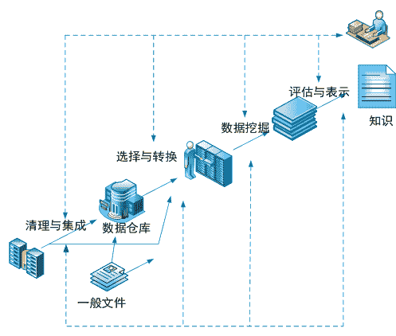

---

# 1 概览篇

## 1.1 数据挖掘：定义、溯源与核心范式

**何为数据挖掘？** 简而言之，就是从庞大数据集中自动探寻隐匿的关联信息，将非结构化原始数据转化为计算机可理解的结构化知识表征，是知识发现（KDD）流程中的核心环节。广义上看，这是一个综合统计学、数据库原理与 AI 技术的复杂过程，旨在抽取具备应用前景的深层模型与规则，其终极价值在于显著提升预测模型的精度与鲁棒性。

**溯源与演进：** 这一学科并非始于独立体系。1989 年，Gregory I. Piatetsky-Shapiro（KDnuggets 创始人）在 IJCAI 大会上首倡“数据库中的知识发现”（KDD）概念，整合了数据库、机器学习、模式识别、可视化、高性能计算等十余个学科。历经 30 年演进，KDD 已成长为独立繁荣的交叉前沿。1995 年首届 KDD 国际会议在蒙特利尔召开，同年 ACM 正式确立数据挖掘为 KDD 关键步骤，并成立 SIGKDD 专委会，主办同名顶级年会（SIGKDD Conference），涵盖理论、算法与应用三大维度（详见 1.3 节）。

**挖掘对象泛化：** 目标数据源不限于结构化关系数据库，更覆盖数据仓库、文本、多媒体、时空序列、Web 数据等半结构化乃至异构数据。发现手段兼容数值/非数值、归纳/演绎等多元路径，产出知识服务于决策支持、查询优化、资产维护等全生命周期。

> **辨析：数据挖掘 vs. 知识发现 (KDD)**
> | 维度 | 数据挖掘 | 知识发现 (KDD) | 共性 |
> | :--- | :--- | :--- | :--- |
> | **核心产出** | 模型 | 规则 | 输入均为学习集 |
> | **自动化目标** | \- | \- | 最大程度自动化流程 |

**早期里程碑算法与工业先锋：** IBM Rakesh Agrawal 的关联规则算法、UIUC 韩家炜教授的 FP-Growth、J. Ross Quinlan 的 C4.5 决策树、Erick Goodman 的遗传算法均斩获 SIGKDD 创新奖。工业界同步布局：IBM Intelligent Miner (1996)、SAS Enterprise Miner、SGI SetMiner、Sybase Warehouse Studio 等商业套件相继问世，推动技术工程化落地。

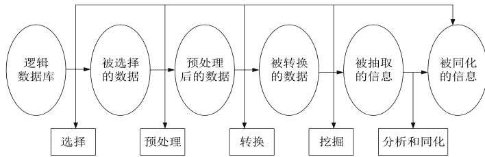

### 1.1.1 多维分类体系

| 分类维度 | 细分类别 | 核心逻辑 |
| :--- | :--- | :--- |
| **按数据源类型** | 文本型、网络型、时序型、空间型 | 依据数据模式、类型、应用场景差异，匹配专用挖掘技术 |
| **按知识层级** | 高抽象层、原始数据层、多抽象层 | 对应广义知识、原始层知识、多层知识；成熟系统多挖掘多层知识 |
| **按技术流派** | 模式识别、神经网络、可视化、统计学、面向库/仓技术、机器学习等 | 大型系统通常融合 2-3 种以上方法，取长补短 |
| **按应用领域** | 生物医药、交通、金融、通信、证券等 | 行业特异性强，不存在通吃方案 |

### 1.1.2 标准化五步作业法

1.  **定目标：** 明确业务痛点与预期产出，虽结果未知但探索方向须清晰，拒绝为挖掘而挖掘。
2.  **备数据 (三阶段)：** ① **选源**——内外部广搜，筛选相关数据；② **洗数据**——质检画像，确定操作类型；③ **转模型**——针对算法构建分析模型，**此步成败决胜负**。
3.  **挖核心：** 对转换后数据执行核心算法。
4.  **析结果：** 结合可视化手段，依操作类型解释评估模型输出。
5.  **融知识：** 将验证通过的知识注入业务闭环，实现价值兑现。

### 1.1.3 五大核心功能集

- **概念描述：** 概括对象本质特征，分*特征性描述*（共性）与*区别性描述*（差异性）。
- **关联分析：** 捕捉项集间依存规律，细分简单关联、时序关联、因果关联。
- **分类与聚类：** 前者有监督学习映射标签，后者无监督自组织归类。
- **偏差检测：** 识别异常、离群、噪声数据，服务风控与审计。

### 1.1.4 大数据语境下的共生与重塑

大数据源于网络、物联、社交的爆发式增长，与挖掘技术深度耦合：
- **包容关系：** 大数据全链路（采集→预处理→特征→挖掘→表达）囊括挖掘全过程。
- **支撑关系：** 大数据底座（分布式存储/计算）为上层挖掘提供算力底座。
- **倒逼进化：** 数据呈现高维、动态、异构、实时特征，传统静态算法失效，**倒逼算法具备真实/实时处理硬核能力**。

**特征定义演进：**
- **NIST 4V：** 体量、多源、高速、多变。
- **IBM 4V+V：** 将“多变”改为“真实性”，后引入“价值”成 **5V**。
- **麦肯锡公认定：** 综合“技术处理瓶颈”与“数据内生特征”，锁定 **Volume、Variety、Velocity、Value** 四大核心。

大数据浪潮极大催化了挖掘领域的范式革新。

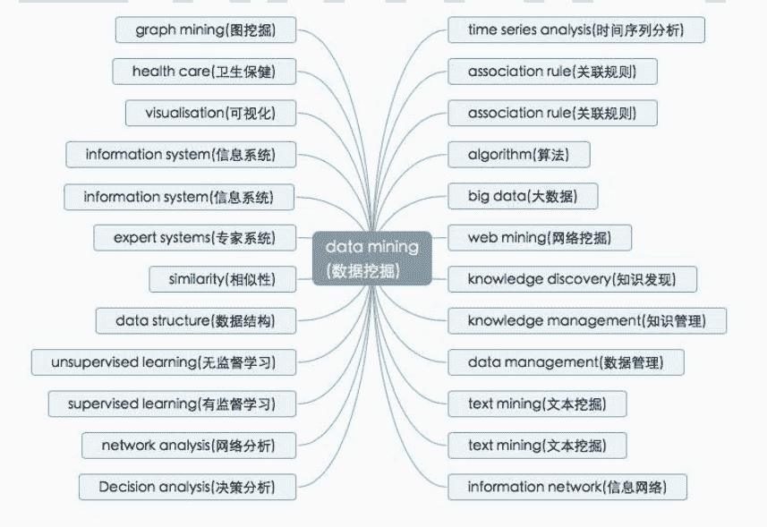

## 1.2 学科知识图谱：高频热点的拓扑呈现

本节基于近年高水平论文语料，借助 NLP 抽取关键词，映射至学科知识图谱，完成三大动作：
1.  **领域归属标注：** 结合学科体系将文献精准分流。
2.  **热度量化聚类：** 以论文量表征领域活跃度。
3.  **三级图谱构建：** 专家定级 + 概念热度加权，动态定义研究前沿。

下图为二级图谱可视化（社交网络、大数据、情报分析、聚类、文本挖掘、用户行为、推荐系统、离群检测、专家系统等核心簇群清晰可见），三级细节见附录或 AMiner 开放数据平台下载。

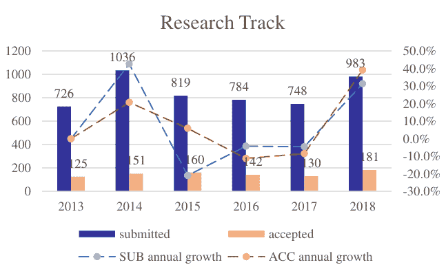

## 1.3 SIGKDD 近六年演变风向标

作为数据挖掘领域的“奥林匹克”，SIGKDD 由 ACM SIGKDD 专委会主办，覆盖理论、算法、应用全谱系。2010 年起增设工业/政府专题及应用博览，强化产学研对话。

**历史脉络：** 1989 年研讨会肇始，1995 年会议化运作至今 24 届，投稿参会双增长。得益于跨学科属性，吸纳统计、社网、ML、大数据、数据库、Web、生信、多媒体、NLP、HCI、HPC 等十大社群学者汇聚。

**投稿录用双轨制现状（2013-2018）：**
- **Research Track（研究赛道）：** 投稿量平稳，录用率稳守 14%-20% 红线。
- **Industrial/Applied Track（应用赛道）：** 2018 年投稿破 500 篇，增速显著，录用率跌破 20%。**深度学习与 AI 在工业界的规模化落地，是驱动应用端爆发的核心引擎。**

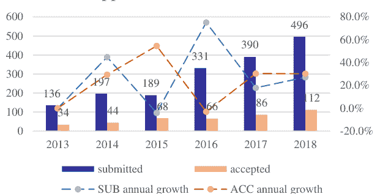

### 复盘：SIGKDD 2013（芝加哥·大数据挖掘主题）

**组织架构：** 大会主席 Ramasamy Uthurusamy (前通用汽车) & Robert L. Grossman (UIUC)；PC Chair Inderjit S. Dhillon (UT Austin) & Yehuda Koren (Google)；50 位 SPC + 300 位 PC 把关。
**规模与录取：** 50 国 726 份投稿，三轮盲审 + SPC 协调，录用 125 篇（17.2%），其中口头汇报 66 篇 (9.1%)，海报 59 篇。
**Keynote 大咖：** Microsoft Raghu Ramakrishnan、Stanford Andrew Ng、Wisconsin Stephen J. Wright、Google Hal Varian。

**🏆 奖项荣誉榜：**

| 奖项 | 论文标题 (中英对照) | 核心贡献速览 | 作者 |
| :--- | :--- | :--- | :--- |
| **最佳研究论文** | **Simple and Deterministic Matrix Sketching**<br>简易确定性矩阵草图 | 针对大规模社网矩阵 A，构建小尺寸压缩矩阵 B 实现高保真估计，攻克大数据分析降维关键难题。 | Edo Liberty |
| **最佳论文亚军** | **Querying Discriminative and Representative Samples for Batch Mode Active Learning**<br>批量主动学习中的判别性与代表性样本查询 | 破解主动学习中“如何同时保证样本代表性与判别性”的双重约束难题。 | Zheng Wang, Jieping Ye |
| **最佳学生论文** | *(素材截至此处，后续奖项信息待续)* | | |

> **全文链接直达：** https://www.aminer.cn/archive/simple-and-deterministic-matrix-sketching/53e9b500b7602d970402e5e6
> https://www.aminer.cn/archive/querying-discriminative-and-representative-samples-for-batch-mode-active-learning/53e9bba7b7602d97047f32a6

---
*报告持续更新中，后续章节将深入剖析算法实战、专家图谱与产业落地案例，敬请关注。*

### 基于生日悖论的三角形计数：单流式算法的空间极致压缩

**核心看点**：Madhav Jha、C. Seshadhri 与 Ali Pinar 团队借助经典的“生日悖论”概率模型，构建了一种单通道流式算法。其核心优势在于极低的空间开销——仅需存储极少量边样本，即可实时输出图传递性（全局聚类系数）与三角形总数的高精度近似值。

> 原文链接：[aminer.cn/archive/...](https://www.aminer.cn/archive/a-space-efficient-streaming-algorithm-for-triangle-counting-using-the-birthday-paradox/53e9999eb7602d97021e514e)

---

### 最佳学生论文奖亚军

### 递归正则化：破解大规模层次分类的“依赖与扩展”双重难题

**核心看点**：Siddharth Gopal 与 Yiming Yang 提出的递归正则化框架，直击大规模层次分类痛点。该方法通过显式建模类标签间的层级依赖关系显著提升预测性能，同时在算法架构上保证了跨层级计算的线性可扩展性，实现了效果与效率的双重突破。

> 原文链接：[aminer.cn/archive/...](https://www.aminer.cn/archive/recursive-regularization-for-large-scale-classification-with-hierarchical-and-graphical-dependencies/53e9aac3b7602d97034430d3)

---

### 最佳工业界与政府应用论文

### 文本分析赋能非洲青年：让数据科学回归人文关怀

**核心看点**：由 Prem Melville 领衔、UNICEF 研究员参与的项目，利用文本挖掘技术从海量非结构化数据中提炼非洲青年的真实诉求。该工作不仅是技术落地的典范，更生动诠释了 KDD 大会“数据科学服务社会公益”的核心价值追求。

> 原文链接：[aminer.cn/archive/...](https://www.aminer.cn/archive/amplifying-the-voice-of-youth-in-africa-via-text-analytics/53e9b09fb7602d9703b07333)

---

### 最佳论文奖亚军

### 竞价格局驱动的查询聚类：重塑赞助搜索拍卖微观市场

**核心看点**：微软 Ye Chen 团队创性地提出基于“竞价格局”的查询聚类范式。通过将海量查询重组为规模更小、内聚性更强的“微市场”，并据此定义集群级拍卖参数，有效解决了长尾查询稀疏性导致的建模难题，显著优化了商业搜索变现效率。

> 原文链接：[aminer.cn/archive/...](https://www.aminer.cn/archive/query-clustering-based-on-bid-landscape-for-sponsored-search-auction-optimization/53e9af2cb7602d9703964e4f)

---

### 最佳博士论文奖

### 异构信息网络挖掘：从“同构假设”走向“类型化语义”建模

**核心看点**：孙仪洲博士（导师：韩家炜教授）的开创性工作，系统确立了异构信息网络（HIN）挖掘的理论基石。论文超越传统同构图模型的局限，引入半结构化网络模型，利用类型化节点与链接的丰富语义，为关联数据挖掘提供了一套全新的原则体系与强力方法论。

> 原文链接：[aminer.cn/archive/...](https://www.aminer.cn/archive/mining-heterogeneous-information-networks-a-structural-analysis-approach/53e9ae3cb7602d9703851185)

---

### 最佳博士论文奖亚军

### 医疗信息学中的机器学习：让领域专家知识成为核心驱动力

**核心看点**：Byron Wallace 博士（导师：Carla Brodley 教授）聚焦临床信息学的高复杂度场景，揭示了通用机器学习方法因缺乏领域先验知识而失效的根因。研究致力于开发新颖的交互式学习框架，将专家经验深度融入建模循环，推动真实临床决策支持系统的工程化落地。

> 原文链接：[aminer.cn/archive/...](https://www.aminer.cn/archive/machine-learning-in-health-informatics-making-better-use-of-domain-experts/56d890a4dabfae2eee4ca4d)

---

### SIGKDD 创新与服务大奖（2013）

#### 创新贡献奖：Jon Kleinberg 教授（康奈尔大学）
**授奖理由**：表彰其在社交/信息网络传播动力学建模与个体用户行为分析领域的奠基性贡献。作为 HITS 算法发明者，Kleinberg 教授三十余岁即三院院士，其理论框架深刻重塑了网络科学版图。

#### 服务贡献奖：Gabor Melli 博士（索尼互动娱乐）
**授奖理由**：嘉奖其近二十年对 KDD 社区的全方位服务——从合成数据生成平台搭建、Data Mining Case Studies 研讨会系列创办，到历届国际顶会核心职务担任，以及近期推动的 KDD 知识图谱库（RKB）建设，全方位推动了领域知识传播与人才培养。

---

### KDD Cup 2013：学术搜索双料冠军

- **冠军**：Algorithm 队（国立台湾大学 林智仁/林守德/林轩田教授团队）
- **亚军**：Dmitry & Leustagos & BS Man 队
- **赛题背景**：微软学术搜索提供数据，包含“作者-论文实体链接”与“作者名字消歧”两大任务，分别吸引 561 支与 241 支队伍角逐。台大团队包揽双冠，展现了华语学术圈在实体消歧领域的顶尖实力。

---

## （二）SIGKDD 2014：聚焦“数据科学推动社会进步”

**大会概况**：2014 年 8 月落地纽约，共吸引 2320 人参会。双轨制主席阵容强大：Sofus Macskassy (Facebook) 与 Claudia Perlich (Distillery) 任大会主席；Jure Leskovec (Stanford) 与 Wei Wang (UCLA) 掌管研究赛道；Rayid Ghani (奥巴马前 CTO) 与 Prem Melville 统领工业界赛道。投稿创历史新高（研究类 1036 篇、应用类 197 篇），录用率分别降至 14.6% 与 22%，大陆学者以第一作者身份斩获 13 篇长文，参会规模超 80 人。主题演讲涵盖 AI、医疗、经济、政务等跨界前沿。

---

### 最佳研究论文奖

### 主题模型采样提速：突破复杂度数量级瓶颈

**核心看点**：Aaron Q. Li 等人针对主题模型推理的核心痛点——高昂的采样复杂度，设计出新型算法将时间复杂度降低一个数量级，为大规模文本语义分析提供了关键算力支撑。

> 原文链接：[aminer.cn/archive/...](https://www.aminer.cn/archive/reducing-the-sampling-complexity-of-topic-models/5550453745ce0a409eb549bd)

---

### 最佳学生论文奖

### 弱层次套索优化：攻克非凸正则化的计算难关

**核心看点**：Yashu Liu 团队针对捕捉非线性特征交互的层次套索模型，其正则项引入的非凸性长期阻碍求解。本文提出高效优化算法，有效规避非凸陷阱，使结构化稀疏建模在大规模场景下成为可能。

> 原文链接：[aminer.cn/archive/...](https://www.aminer.cn/archive/an-efficient-algorithm-for-weak-hierarchical-lasso/5550453745ce0a409eb549c3)

---

### 最佳主题论文奖（践行“社会公益”主题）

### 卫星遥感定位极度贫困：数据科学助力精准扶贫

**核心看点**：Enigma 与 GiveDirectly 联合研究，利用肯尼亚贫困村落的卫星影像特征，构建模型精准识别“极度贫困户”，直接指导无条件现金转移支付。这是数据科学介入全球发展议程、实现循证人道主义援助的里程碑式实践。

> 原文链接：[aminer.cn/archive/...](https://www.aminer.cn/archive/targeting-direct-cash-transfers-to-the-extremely-poor/5550453645ce0a409eb549aa)

---

### 最佳工业与政府应用论文奖

### 长尾风格挖掘：Etsy 社交电商的个性化推荐实战

**核心看点**：Diane J. Hu 团队在 Etsy 平台落地双推荐系统：基于 LDA 挖掘潜在风格/品类表征用户兴趣画像，结合哈希加速的 MapReduce 最近邻检索实现工程级高吞吐。该方案显著提升核心业务指标，是大规模潜变量模型工业化部署的教科书级案例。

> 原文链接：[aminer.cn/archive/...](https://www.aminer.cn/archive/style-in-the-long-tail-discovering-unique-interests-with-latent-variable-models-in-large-scale-social-e-commerce/5550453645ce0a409eb5491d)

---

### 最佳博士论文奖

### 网络相册群智叙事：从碎片照片重构集体故事线

**核心看点**：Gunhee Kim 博士（导师：Eric Xing）提出分支故事线图模型，联合推断海量网络照片的时间演进与内容重叠，自动生成集体视觉叙事。该工作为计算机视觉与数据挖掘的交叉应用（如事件回顾、旅游路径推荐）开辟了新范式。

> 原文链接：[dwz.cn/qeyTTacH](https://dwz.cn/qeyTTacH)

---

### 首届“时间检验奖”设立：致敬二十年经典

SIGKDD 2014 首设 Test of Time Award，表彰过去 20 年影响力卓绝的经典之作，首批三篇获奖论文分别奠基于密度聚类、分类关联融合、影响力最大化三大核心版图：

1.  **DBSCAN (KDD 1996)**：Ester 等人提出的基于密度聚类算法，成为噪声鲁棒聚类的标准范式与教科书必收录经典。
2.  **CBA 分类器 (KDD 1998)**：刘兵等人首创关联规则与分类器深度融合，开启了“关联分类”全新研究分支。
3.  **影响力最大化 (KDD 2003)**：Kempe、Kleinberg、Tardos 以次模函数理论奠定影响力传播的近似最优边界，确立了社交网络传播优化的数学基石。

---

### SIGKDD 创新与服务大奖（2014）

#### 创新贡献奖：Pedro Domingos 教授（华盛顿大学）
**授奖理由**：肯定其在流式数据挖掘、马尔可夫逻辑网（MLN）等统计关系学习领域的系统性奠基工作，此前已囊括 SIGKDD、AAAI、UAI、NeurIPS 等四大顶会最佳论文奖大满贯。

#### 服务贡献奖：Ted Senator 博士（Leidos）
**授奖理由**：嘉奖其长期在政府与学术界架构数据挖掘基础设施、推动跨机构合作与人才培养方面的卓越服务贡献。

---

### KDD Cup 2014：慈善众筹的算法优化

- **数据方**：DonorsChoose（在线教育慈善平台）
- **任务**：识别高潜力学生项目申请，辅助资源精准配置
- **规模**：472 支队伍、652 名选手激战
- **冠军**：STRAYA 团队

---

## （三）SIGKDD 2015：悉尼聚焦“数据科学与大数据”

**大会概况**：2015 年 8 月移师澳大利亚悉尼，第 21 届大会以“Data Science & Big Data”为核心主题，继续引领领域前沿探索与工业落地深度融合。

# 回顾：SIGKDD 2015 与 2016 两届大会核心看点全记录

## SIGKDD 2015 悉尼大会：规模宏大，华人学者表现亮眼

**大会组织架构与投稿概况**  
2015 年第 21 届 SIGKDD 国际大会于澳大利亚悉尼举行。大会主席由悉尼科技大学操龙兵教授与 Chengqi Zhang 教授联袂出任；研究型程序委员会主席则由康奈尔大学 Thorsten Joachims 教授与莫纳什大学 Geoff Webb 教授把舵；工业界程序委员会主席分别由波音高级研究员 Dragos D. Margineantu 博士与 Pexip 董事会成员 Graham Williams 担任。

本届大会共收到 1008 份投稿。其中研究类论文 819 篇，最终录用 160 篇，录用率约 19.5%；工业与政府应用类论文 189 篇，录用 68 篇，录用率高达 35.9%。值得关注的是，以中国大陆学者为第一作者的研究论文共有 14 篇入选，作者单位涵盖清华、北大、中科大、上交大、西南交大、中科院及电子科大等知名学府，参会的大陆学者更是超过 90 位。

**四大主题报告嘉宾阵容强大**  
大会邀请了微软杰出科学家 Ronny Kohavi 博士、悉尼大学 Hugh Durrant-Whyte 教授、Coursera 联合创始人兼总裁 Daphne Koller 博士、斯坦福商学院 Susan Athey 教授作主旨演讲，涵盖工业界实践、机器人技术、在线教育与经济计量等前沿视角。

### 核心奖项花落谁家？

#### 最佳研究论文奖
*   **《公共-私有社交网络高效算法》**  
    作者：Flavio Chierichetti 等。  
    核心贡献：利用草图与采样技术，大幅加速公私混合社交网络中的计算任务。

#### 最佳学生论文奖
*   **《边缘加权个性化 PageRank：打破十年性能瓶颈》**  
    作者：Wenlei Xie 等。  
    核心贡献：提出新算法实现个性化网页排序，让搜索结果更贴合用户个性偏好。

#### 最佳博士论文奖
*   **金奖：《从海量非结构化互联数据中挖掘潜在实体结构》**  
    作者：Chi Wang 博士（导师：韩家炜教授）。  
    核心贡献：构建统一挖掘框架，解决大数据背景下隐藏在无序数据背后的关联实体发现问题。
*   **银奖（并列）：《语境下的大规模社交网络建模》**  
    作者：Qirong Ho 博士（导师：Eric Xing 教授）。  
    核心贡献：融合统计建模与分布式计算，支持亿级节点网络的可扩展分析，并能灵活融入文本、图像等多模态上下文。
*   **银奖（并列）：《社交媒体不信任度计算》**  
    作者：Jiliang Tang 博士（导师：Huan Liu 教授）。  
    核心贡献：首创不信任预测框架，将隐性负面联系显性化，并论证了其在社交软件中的应用价值。

#### “时间考验”奖 —— 经典回响
该奖项表彰 10-14 年前发表、至今仍具深远影响力的论文：
1.  **《挖掘高速数据流》** - Pedro Domingos, Geoff Hulten (KDD 2000)：奠基流式决策树 VFDT 系统。
2.  **《利用点击数据优化搜索引擎》** - Thorsten Joachims (KDD 2002)：确立了利用用户点击行为优化排序的学术与工业标准范式。
3.  **《挖掘与汇总消费者评论》** - Minqing Hu, 刘兵 (KDD 2004)：开创了电商评论观点挖掘领域，影响深远。

#### 创新与服务贡献奖
*   **创新奖**：慕尼黑大学 **Hans Peter Kriegel** 教授，因在聚类、异常检测、高维分析领域的开创性贡献获奖（同年亦获 ACM Fellow 及 KDD 时间考验奖）。
*   **服务奖**：西蒙弗雷泽大学 **裴健 (Jian Pei)** 教授，表彰其长期担任顶会组织者、TKDE 主编等为社区作出的杰出服务。

#### KDD Cup 2015：预测在线课程退课率
由清华大学唐杰教授与海法大学 Ron Bekkerman 教授任联合主席，学堂在线承办。吸引 26 国 821 队（1263 人）角逐，最终由多国联队 **“the Intercontinental Ensemble”** 夺冠。

---

## SIGKDD 2016 旧金山大会：参会规模创新高，应用数据科学成新引擎

**大会组织与数据新高度**  
2016 年第 22 届大会移师美国旧金山，主题聚焦图挖掘、深度学习、推荐系统、流数据及应用数据科学。大会主席由 IBM Balaji Krishnapuram 博士与 BOSCH Mohak Shah 博士担任；研究型 PC 主席为 CMU（现 Amazon）Alex Smola 教授与 IBM Charu Aggarwal 博士；应用数据科学轨道主席则由 IBM Rastogi Rajeev 博士与百度沈抖博士把舵——这也是该轨道首次以“应用数据科学”命名。

本届注册参会人数达 **2726 人**，来自 88 个国家，刷新历史纪录。投稿结构显著变化：研究类论文 784 篇（较前两年下降），应用类论文 331 篇（大幅增长）。最终录用研究类 142 篇（录用率 18.1%），应用类 66 篇（录用率 20%）。

**五大主旨报告 + 图灵奖得主特邀**  
演讲阵容囊括微软研究院院长 Jennifer Chayes 博士、加州伯克利 Joe Hellerstein 教授、NEA 合伙人 Greg Papadopoulos 博士、Google DeepMind 首席科学家 Nando de Freitas 博士，以及 2015 年图灵奖得主、斯坦福 Whitfield Diffie 教授的特邀报告，学术与产业视角交织碰撞。

### 核心奖项盘点

#### 最佳研究论文奖
*   **金奖：《FRAUDAR：伪装下的图欺诈边界检测》**  
    作者：Bryan Hooi 等。  
    核心贡献：针对伪装良好的虚假评论群体，提出鲁棒性更强的检测算法，显著优于传统方法。
*   **银奖：《基于消失相关性的时空动力学因果异常排序》**  
    作者：Wei Cheng 等。  
    核心贡献：构建网络扩散框架，联合推理结构与时变模式，精准定位导致相关性断裂的根因异常，在金融、电厂等实战数据集上验证有效。

#### 最佳学生论文奖
*   **金奖：《TRIEST：固定内存下全动态流中局部与全局三角形计数》**  
    作者：Lorenzo De Stefani 等。  
    核心贡献：单遍流式算法，以固定内存实现动态网络三角形计数的无偏、低方差、高效率估计。
*   **银奖：《语境下的匹配与偏好预测》**  
    作者：Shuo Chen, Thorsten Joachims。  
    核心贡献：统一概率框架同时解决两两比赛胜负预测（如电竞）与商品偏好配对（如电商推荐）问题。

#### 最佳应用数据科学论文奖（新设类别）
*   **金奖：《雅虎搜索相关性排序：二十年演进实录》**  
    作者：Dawei Yin 等（大规模工业界团队）。  
    核心贡献：系统总结雅虎搜索排序核心三大支柱——排序函数、语义特征、查询重写，及时空相关搜索实战经验。
*   **银奖：《Apache Spark 中的矩阵计算与优化》**  
    作者：Reza Bosagh Zadeh 等（Databricks/Spark 核心团队）。  
    核心贡献：在 Spark 原生集成分布式矩阵运算库，相关优化已合并入主分支默认发布。
*   **最佳学生论文（应用类）金奖：《面向个人助理的上下文意图追踪》**  
    作者：Yu Sun 等。核心贡献：提升智能助理对用户多轮交互意图的精准建模能力。
*   **最佳学生论文（应用类）银奖：《Firebird：亚特兰大火灾风险预测与巡检优先级排序》**  
    作者：Michael Madaio 等。核心贡献：数据科学赋能公共安全，实现火灾隐患精准预警与资源调度优化。

---

**结语**  
两届大会清晰勾勒出数据挖掘领域的演进脉络：从 2015 年的理论算法突破与经典回顾，到 2016 年应用数据科学轨道的正式确立与工业界大规模实战经验的系统性沉淀，SIGKDD 正加速从“知识发现”走向“数据科学落地”的深水区。

# SIGKDD 2016/2017 盛况回顾：奖项、论文与竞赛全景扫描

## SIGKDD 2016 亮点回顾

### 最佳实践奖：Firebird 框架——让消防巡检更“聪明”

**核心成果**：联手亚特兰大消防救援部门（AFRD），研发出 **Firebird 智能决策系统**。该系统融合机器学习、地理编码与可视化技术，为辖区 5000 余栋商业建筑画像风险评分，**命中率达 71%**，精准锁定 6096 处重点隐患单元。交互式地图将火灾档案、楼宇属性、风险等级一屏呈现，大幅提升巡检决策效率。上线以来，不仅优化了 AFRD 作业流程、守护市民安全，更入选美国国家消防协会（NFPA）“数据驱动消防巡检”最佳案例库。

> 详情见：https://www.aminer.cn/archive/firebird-predicting-fire-risk-and-prioritizing-fire-inspections-in-atlanta/573695fe6e3b12023e511d3c

---

### 最佳博士论文奖

#### 冠军：**《大规模图谱的探索与理解》**（Danai Koutra 博士，导师 Christos Faloutsos）
**破题点**：从万维网链接到脑神经连接，亿级节点成常态。如何在海量拓扑中提炼核心骨架？如何实时捕捉网络攻击、病变脑区等关键事件？  
**实战验证**：方法已落地 66 亿边网络图、18 亿边 Twitter 图、9000 万边脑连接组等超大规模数据集。

> 全文：http://reports-archive.adm.cs.cmu.edu/anon/2015/CMU-CS-15-126.pdf

#### 亚军（并列）：
1. **《多源异构知识融合问答》**（Huan Sun 博士，导师 Xifeng Yan）  
   构建方法论框架，打通医疗、商业智能等垂直领域问答；融合人机智能，经由多轮对话解决复杂决策。

2. **《可扩展多元时间序列分析》**（Taha Bahadori 博士，导师 Yan Liu）  
   直击气象、社交、医疗等领域海量时序数据痛点，给出一套可扩展、可落地的分析范式。

---

### 时间检验奖（Test of Time Award）

**获奖经典**：《随时间演化的图：致密化定律、直径收缩与解释》（KDD 2005，Jure Leskovec 等）  
**核心洞见**：真实网络随时间**稠密化**（边数超线性增长）、**小世界化**（平均路径缩短而非对数增长），推翻传统静态假设。

> 原文：https://www.aminer.cn/archive/graphs-over-time-densification-laws-shrinking-diameters-and-possible-explanations/53e9a515b7602d9702e37973

---

### SIGKDD 创新与服务大奖

| 奖项 | 得主 | 核心贡献 |
|------|------|----------|
| **创新贡献奖** | **Philip S. Yu 教授**（UIC） | 大数据挖掘、融合、匿名化奠基性工作；曾获 ICDM 研究贡献奖 |
| **服务贡献奖** | **Wei Wang 教授**（UCLA） | 长期推动学术交流与社区建设，贡献卓著 |

---

### KDD Cup 2016：预测“机构论文录用排名”

**赛制创新**：微软出题，8 大 CS 顶会为战场，**全盲预测**——截止日前无真值可验证，选手需自建评估体系，极大考验建模鲁棒性。  
**最终榜单**：
1. **burebistas 队**（Adform / Bitdevelop）
2. **T310B 队**（清华大学）
3. **browniepointsreturns 队**（LatentView Analytics）

获奖团队于研讨会复盘核心模型与工程技巧。

---

## SIGKDD 2017 大会全记录

**时间/地点**：2017.8.13–17，加拿大哈利法克斯  
**主席团**：Stan Matwin（渥太华大学/达尔豪斯研究所）、Shipeng Yu（LinkedIn）、Faisal Farooq（IBM Watson Health）  
**PC 主席**：Ravi Kumar（Google）、Tina Eliassi-Rad（东北大学）、Roberto Bayardo（Google）、Charles Elkan（Amazon/UCSD）  
**规模**：51 国、1656 人注册  
**录用率**：研究类 748→130（Oral 8.6%、Poster 8.8%）；应用类 390→86（Oral 9.2%、Poster 12.6%）  
**主题报告**：Cynthia Dwork（微软/哈佛）、Bin Yu（UC Berkeley）、Renée J. Miller（多伦多大学）

---

### 最佳研究论文奖

#### 金奖：《通过类比挖掘加速创新》（Tom Hope 等）  
**创见**：从海量专利/产品库中自动提炼“问题-机制”结构化模式，融合众包标注与 CNN 向量化，让跨域类比检索落地。

#### 银奖：《基于 Toeplitz 逆协方差的多变量时间序列聚类》（David Hallac 等）  
**技术亮点**：EM 变体+交替最小化求解 TICC，动态规划与 ADMM 推导闭式解，兼顾可扩展性与可解释性；车载传感器实测验证。

---

### 最佳应用数据科学论文奖

#### 金奖：**HinDroid——基于异构信息网络的 Android 恶意软件检测**（Shifu Hou 等）  
**范式革新**：超越单一 API 调用，构建 **App–API–语义关系** 三层异构网络（HIN），元路径建模语义关联，**对抗规避能力显著增强**。

#### 银奖：**DeepSD——单图超分重建高分辨率气候投影**（Thomas Vandal 等）  
**工程落地**：广义堆叠 SRCNN + 多尺度输入通道，将美洲大陆日降水从 1°（~100km）降至 1/8°（~12.5km），偏差校正效果碾压三大传统统计降尺度方法；接入 NASA NEX 平台，支撑 20+ ESM 模型多场景批量推演。

---

### 最佳博士论文奖

#### 冠军：《属性图局部建模：算法与应用》（Bryan Perozzi 博士，导师 Steven Skiena）  
**贡献**：面向离散/连续属性图的可扩展在线嵌入算法，引入深度学习编码多尺度社交结构，显著提升节点分类与回归性能。

#### 亚军（并列）：
1. **《大规模图分析建模用户行为》**（Alex Beutel 博士，导师 Alex Smola & Christos Faloutsos）  
   统一建模线上社交、消费、政治倾向等异质交互，融合时间、评分、变化率等丰富属性。

2. **《多维异构数据挖掘：算法与应用》**（Evangelos Papalexakis 博士，导师 Christos Faloutsos）  
   聚焦张量分析，推出快速、可扩展、可解释的算法族，解决多模态、多视角数据融合难题。

---

### 时间检验奖（Test of Time Award）

**获奖论文**：《线性时间训练线性 SVM》（KDD 2006，Thorsten Joachims）  
**里程碑意义**：首创**通用线性 SVM 线性时间训练算法**——切割平面法收敛证明、实现极简、比分解法快数量级、自带与训练误差挂钩的早停条件、原生支持大规模序数回归，催生后续十余年高维稀疏学习研究分支。

> 原文：https://www.aminer.cn/archive/training-linear-svms-in-linear-time/53e9a5fb7602d9702edbd06

---

### SIGKDD 创新与服务大奖（2017）

| 奖项 | 得主 | 高光时刻 |
|------|------|----------|
| **创新贡献奖** | **裴健博士**（西蒙弗雷泽大学） | FP-growth / PrefixSpan 发明者，模式挖掘与空间数据挖掘奠基人，被引数万次，教科书级算法入驻主流开源包 |
| **服务贡献奖** | **杨强博士**（香港科技大学） | KDD 2010 PC 联席主席、KDD 2012 大会主席、IJCAI 2015 PC 主席；创办 ACM TIST（近年引用率最高 ACM 期刊之一）与 IEEE Big Data 期刊；创立 HKUST 大数据研究院；长期推动华语区数据挖掘与 AI 生态建设 |

---

### KDD Cup 2017：双赛道实战

#### 赛道一：旅行时间预测
1. **Convolution 队**（微软 Ke Hu / 北航 Huan Chen / 微软 Pan Huang / 美团 Peng Yan）
2. **好想有个队友队**（浙大 Huang Yide）

#### 赛道二：流量体积预测
*(榜单待续……)*

---

> 数据来源：AMiner、官方会议档案、获奖论文主页  
> 整理：本文旨在梳理 SIGKDD 2016–2017 核心荣誉与技术看点，供研究者快速检索与横向对比。

## (6) SIGKDD 2018：伦敦盛会回顾与硕果盘点

### KDD Cup 2017 回眸：双冠王诞生

在阿里云主办的 KDD Cup 2017 “高速公路收费路段流量预测”赛事中，**Convolution 队**（成员涵盖微软的 Ke Hu 与 Pan Huang、北航的 Huan Chen、美团的 Peng Yan）凭借数据驱动的前瞻性策略，助力交通管理破解瓶颈，成功摘得桂冠。紧接着在 2018 赛季的双赛道较量——旅行时间预测与流量预测中，该队更是从 3547 支全球劲旅中杀出重围，**包揽双料冠军**，展现了跨机构协作解决真实交通拥堵难题的硬核实力。

### 大会概况：群英荟萃伦敦城

2018 年 8 月，第 24 届 SIGKDD 大会在伦敦帝国理工学院拉开帷幕。大会由帝国理工 Yi-Ke Guo 教授与 IBM 的 Faisal Farooq 博士联袂执掌大旗，清华大学唐杰副教授任副主席；学术与工业两条评审线分别由台大 Chih-Jen Lin 教授、罗格斯大学 Hui Xiong 教授，以及 Google 的 Andrei Broder 博士、马格德堡大学 Myra Spiliopoulou 教授把关。来自 99 国的 3377 名学者齐聚一堂，共襄盛举。

投稿规模再创新高：研究类论文 983 篇，录用 107 篇口头报告（录用率 10.9%）与 74 篇海报（7.5%）；应用数据科学类 496 篇，录用 40 篇口头（8.0%）与 72 篇海报（14.5%）。四场主题演讲阵容星光熠熠：帝国理工 David Hand 教授、诺奖得主 Alvin E. Roth、DeepMind 科学家 Yee Whye Teh 教授、哥大 Jeannette M. Wing 教授，分别从统计学、经济学、机器学习与数据科学前沿视角开启智识碰撞。

---

### 荣誉榜单：定义领域标杆

#### 【最佳研究性论文】

**🏆 最佳论文奖：图分类模型的对抗性攻击**  
*作者：Daniel Zügner 等*  
针对离散域特性，团队设计基于增量计算的高效攻击算法。实验揭示：微小扰动即可显著摧毁节点分类准确率，且攻击具备跨模型迁移性，能推广至其它最先进分类器，为图神经网络安全敲响警钟。  
🔗 [论文链接](http://h5ip.cn/uy96)

**🏆 最佳学生论文奖：XiaoIce Band — 流行音乐旋律与编曲生成框架**  
*作者：Hongyuan Zhu 等（微软小冰团队核心成员）*  
面对和弦进行、节奏型、多音轨和声等音乐创作的高复杂性，论文构建基于和弦的节奏-旋律交叉生成模型（CRMCG）输出带和弦旋律，再经多乐器联合编曲模型（MICA）实现多轨协同。在十万级曲库上训练，让 AI 真正懂得“作曲”与“编曲”的区别。  
🔗 [论文详情](https://www.aminer.cn/archive/xiaoice-band-a-melody-and-arrangement-generation-framework-for-pop-music/5b67b45517c44aac1c8607e9)

#### 【最佳应用数据科学论文】

**🏆 最佳论文奖：Airbnb 实时个性化搜索排序的 Embedding 实践**  
*作者：Mihajlo Grbovic、Haibin Cheng (Airbnb)*  
定制化 Embedding 模型同步捕捉用户长短期兴趣，经严格线上线下 A/B 测试验证后全量上线，大幅提升房源推荐精准度与实时响应能力。  
🔗 [论文详情](https://www.aminer.cn/archive/real-time-personalization-using-embeddings-for-search-ranking-at-airbnb/5b67b45517c44aac1c8607cb)

**🏆 最佳学生论文奖：ActiveRemediation — 密歇根弗林特铅管筛查实战**  
*作者：Jacob Abernethy 等（跨校合作团队）*  
融合统计建模与自适应收入特征，向政府输出“优先检测/更换管道”推荐名单，并将方法论推广至全国基建投资决策，展现数据科学介入公共卫生危机的范式价值。  
🔗 [论文详情](https://www.aminer.cn/archive/activemediation-the-search-for-lead-pipes-in-flint-michigan/5b67b45517c44aac1c860889)

#### 【最佳博士论文梯队】

| 排名 | 论文题目 | 作者 / 导师 | 核心贡献 |
| :--- | :--- | :--- | :--- |
| **冠军** | **从文本挖掘实体与关系：轻量级标注范式** | Xiang Ren / 指导：Jiawei Han | 提出原则性、可扩展框架，以极低人工标注成本跨领域、跨体裁、跨语言抽取类型化实体及关系。 |
| **亚军** | **演化在线社区可信度分析的概率图模型** | Subhabrata Mukherjee / 指导：Gerhard Weikum | 联合建模用户交互、社区动态与文本内容，自动量化内容可信度与用户专长演变轨迹。 |
| **季军** | **Web 恶意行为刻画与检测：五类模型全景解析** | Srijan Kumar / 指导：V.S. Subrahmanian | 构建五大算法精准识破破坏者、恶搞者、傀儡、巨魔及欺诈评论者，赋予恶意行为可解释性洞察。 |

#### 【时间检验奖：经典永流传】

**《因子分解邂逅邻域：多面协同过滤模型》 (KDD 2008)**  
*作者：Yehuda Koren（Netflix 大赛百万奖金主力）*  
这篇“教科书级”奠基之作，在统一框架下融合邻域模型（擅长局部关系）与潜在因子模型（即今之 Embedding，擅长全局结构）。十余载风雨，其工程落地指导意义依然未减。  
🔗 [经典回顾](https://www.aminer.cn/archive/factorization-meets-the-neighborhood-a-multifaceted-collaborative-filtering-model/53e9bc74b7602d97048f4169)

#### 【SIGKDD 终身荣誉奖】

- **创新贡献奖：刘兵教授 (UIC)**  
  观点挖掘与情感分析开拓者，ACM/AAAI/IEEE 三料 Fellow，曾任 SIGKDD 主席（2013-2017），深耕数据挖掘核心版图二十载。
- **服务奖：唐杰教授 (清华大学)**  
  AMiner 缔造者，200+ 高被引论文、20 项专利。长期担任 KDD、CIKM、WSDM 等顶会要职，为华人学术共同体搭建国际舞台立下汗马功劳。

---

### KDD Cup 2018：空气质量预测新战场

赛题聚焦中英双城（北京 PM2.5/PM10/O3、伦敦 PM2.5/PM10）未来 48 小时浓度预测。吸引 49 国、3000+ 院所、5687 名选手组队 4180 支角逐。

- **🥇 冠军：First floor to eat Latiao 队**  
  中南大学 Haoran Jiang、Binli Luo 联手北邮 Jindong Han、Juan Liu、Qianqian Zhang 夺魁。
- **🥈 亚军：getmax 队**  
  微软 Zhipeng Luo、北大 Jianqiang Huang、阿里 Ke Hu 组成的“全明星阵容”独揽三赛道两冠一亚，**成就 KDD Cup 史上唯一“单届三甲包揽”壮举**。值得注意的是，核心成员去年即率 Convolution 队拿下 2017 双冠，实力令人叹服。

*此外，最佳审稿人奖花落 George Valkanas；初创团队奖（Startup Award）由“智能一点”、ASTOUND、氪信科技、FactMATA、Inflect、Zugata 六家创新企业分享。*

---

### 1.4 近六年 KDD 代表作速览（上）：2013 纪事

本节精选近六届最佳论文及候选佳作深度解读，先睹 2013 芝加哥大会风采。当年两大看点 Session 聚焦 **大数据分析框架** 与 **社交网络分析**。

#### 🔧 大数据框架三杰

| 论文 | 核心突破 | 关键技术/成果 |
| :--- | :--- | :--- |
| **Big Data Analytics with Small Footprint: Squaring the Cloud**<br>(John Canny, Huasha Zhao) | 自研 **BID 引擎** + **BIDMat/BIDMath** 工具链，单机 CPU/GPU 协同将聚类分类速度提升数十倍。 | 矩阵计算与机器学习原语的底层重构。 |
| **Beyond Myopic Inference in Big Data Pipelines**<br>(Karthik Raman 等) | 提出 **概率管道模型**，将复杂推理分解为简单概率计算串联，显著加速 Top-K、Fixed Beam、Autadaptive 等推断。 | 复杂分析任务的模块化解耦范式。 |
| **TurboGraph: A Fast Parallel Graph Engine Handling Billion-scale Graphs in a Single PC**<br>(Wook-Shin Han 等) | 创新 **Pin-and-Slide** 并行执行模式，大幅提升 I/O 并发，单机即可处理十亿级图，超越 GraphChi 等前辈。 | 图计算引擎底层调度的工程极致。 |

#### 📈 大规模算法改进专场
四篇佳作分别切入：有限内存下传统算法落地、异构网络矩阵分解扩展两大方向，直击大规模数据落地痛点。

#### 🌐 社交网络分析三大热潮
1. **用户行为建模**：从单平台分享行为可信度验证，延伸至跨平台用户画像融合与群体智能涌现机制。
2. **影响力学习**：隐性影响力挖掘、从众效应量化、影响力驱动聚类与话题发现，应用场景显著拓宽。
3. **信息传播演化**：探讨传播对网络拓扑的反向重塑，及传播链路中节点可信度评估。

> *2014 年度精华解读，请见下一节展开。*

---

*(注：原素材中标记为 `## (2) SIGKDD 2014 论文解读` 的章节此处仅保留标题占位，详细内容待后续补充。)*

# KDD 2014-2015 盛况回顾：从社会公益到图计算，数据挖掘前沿全景扫描

## 2014 年：数据科学拥抱“社会公益”，社交网络研究称霸会场

2014 年 SIGKDD 大会以“数据科学造福社会”为核心议题，极大地激发了学界将算法落地解决现实痛点的热情。投稿数据显示，社交网络、机器学习与数据挖掘三大领域依然是投稿大户。仅社交网络一项，主会便设置了 6 个专题分会场深度剖析前沿进展。大会响应号召，专门开辟了 3 个医疗健康分会场，并覆盖环保、教育、交通、就业等多个民生维度。联合国官方媒体“全球脉搏”亲临现场，从 200 余篇论文中甄选出 5 篇极具代表性的“数据向善”佳作进行深度报道，肯定其在全球可持续发展与人道主义援助中的实战价值。

### 五大“数据向善”经典案例深度解析

**1. 手机行为里程碑：洞察人生阶段的社交策略迁徙**
*   **论文**：《Inferring User Demographics and Social Strategies in Mobile Social Networks》
*   **作者**：Yuxiao Dong, Yang Yang, Jie Tang, Yang Yang, Nitesh V. Chawla
*   **链接**：[https://www.aminer.cn/archive/inferring-user-demographics-and-social-strategies-in-mobile-social-networks/5550453645ce0a409eb54966](https://www.aminer.cn/archive/inferring-user-demographics-and-social-strategies-in-mobile-social-networks/5550453645ce0a409eb54966)
*   **核心洞见**：研究揭示了人类社交策略随生命周期的动态演变——年轻期倾向广泛拓展人脉并积极跨性别交往；步入中老年后，社交圈层收缩，转而维系少量高质量的同性深度关系。基于通话与短信的行为模式，模型可精准推断用户性别与年龄。

**2. 秒级地震决策大脑：社交媒体变身“地震哨兵”**
*   **论文**：《EARS (Earthquake Alert and Report System): a Real Time Decision Support System for Earthquake Crisis Management》
*   **作者**：Marco Avvenuti, Stefano Cresci, Andrea Marchetti, Carlo Meletti, Maurizio Tesconi
*   **链接**：[https://www.aminer.cn/archive/ears-earthquake-alert-and-report-system-a-real-time-decision-support-system-for-earthquake-crisis-management/5550453545ce0a409eb548e1](https://www.aminer.cn/archive/ears-earthquake-alert-and-report-system-a-real-time-decision-support-system-for-earthquake-crisis-management/5550453545ce0a409eb548e1)
*   **核心洞见**：团队构建了基于实时社交数据流的地震预警与灾损评估系统 EARS，能即时上报人员伤亡与基础设施受损态势，为应急指挥提供数据支撑。

**3. 灾难下的百万轨迹图谱：预测群体应急迁徙路径**
*   **论文**：《Prediction of Human Emergency Behavior and their Mobility following Large-scale Disaster》
*   **作者**：Xuan Song, Quanshi Zhang, Yoshihide Sekimoto, Ryosuke Shibasaki
*   **链接**：[https://www.aminer.cn/archive/prediction-of-human-emergency-behavior-and-their-mobility-following-large-scale-disaster/5550453645ce0a409eb54982](https://www.aminer.cn/archive/prediction-of-human-emergency-behavior-and-their-mobility-following-large-scale-disaster/5550453645ce0a409eb54982)
*   **核心洞见**：利用日本东部大地震及福岛核泄漏后 160 万居民的 GPS 轨迹，深度建模并预测大规模灾害触发下的群体紧急迁徙行为模式。

**4. 卫星视角锁定极端贫困：让救助精准触达“隐形贫困户”**
*   **论文**：《Targeting Direct Cash Transfers to the Extremely Poor》
*   **作者**：Brian Abelson, Kush R. Varshney, Joy Sun
*   **链接**：[https://www.aminer.cn/archive/targeting-direct-cash-transfers-to-the-extremely-poor/5550453645ce0a409eb549aa](https://www.aminer.cn/archive/targeting-direct-cash-transfers-to-the-extremely-poor/5550453645ce0a409eb549aa)
*   **核心洞见**：针对肯尼亚贫困村落，通过解析卫星遥感影像识别极度贫困家庭，为无条件现金援助提供精准定位依据，实现人道主义资源的高效配置。

**5. 城市呼吸实时监测：3.2 万辆出租车绘制污染热力图**
*   **论文**：《Inferring Gas Consumption and Pollution Emission of Vehicles throughout a City》
*   **作者**：Jingbo Shang, Yu Zheng, Wenzhu Tong, Eric Chang, Yong Yu
*   **链接**：[https://www.aminer.cn/archive/inferring-gas-consumption-and-pollution-emission-of-vehicles-throughout-a-city/5550453545ce0a409eb548e2](https://www.aminer.cn/archive/inferring-gas-consumption-and-pollution-emission-of-vehicles-throughout-a-city/5550453545ce0a409eb548e2)
*   **核心洞见**：基于北京 3.2 万辆出租车 GPS 轨迹复原实时路况，进而反推不同时空维度下的全城油耗与尾气排放分布，为环境治理提供决策参考。

### 会场风向标：社交与信息网络分析“十年霸主”地位未动摇

据大会主席 Jure Leskovec、Wei Wang 及 SIGKDD 创始人 Gregory Piatetsky 报告，社交与信息网络分析连续近十年稳坐 KDD 最热话题宝座。2014 年直接相关的报告专场达 6 个，涵盖 25 篇论文，图挖掘另设 3 个专场。

**核心热点聚焦两大版块：**
*   **网络信息传播**：网络拓扑与扩散动力学的相互塑造机制成为焦点，社会影响力建模依然占据核心地位。
*   **社团发现**：研究范式拓展至节点属性驱动、用户关联性挖掘、热核方法及动态社团演化分析等多元维度。
*   **其他前沿**：通用社交网络分析专场中，用户画像建模、微观网络结构解析、动态网络演化均有突破性成果产出。

### 大数据挖掘四大技术专场：从并行采样到流式优化

随着大数据浪潮推进，大会设立 4 个专题分会场系统梳理技术演进脉络：

1.  **统计技术驱动的大规模挖掘**：聚焦并行吉布斯采样、非参贝叶斯建模、在线中餐馆过程及概率知识融合。
2.  **可扩展大数据分析方法论**：攻克经典算法在海量数据集上的落地适配难题。
3.  **大规模图算法工程化实践**：深度剖析 Betweenness 中心性、PageRank、图采样与图切分算法在亿级网络中的低复杂度并行计算策略。
4.  **大规模优化与在线学习**：探讨随机优化、数据摘要构建及流式机器学习模型在海量、高速数据流上的演进。

---

## 2015 年：图采样异军突起，知识图谱重燃实体挖掘战火

### 研究热力图：老树发新芽，图采样成“新宠”

KDD 2015 热点集中于社交网络挖掘、Web 挖掘、流数据、城市计算、图采样算法及垂类推荐（如地点/路径推荐）。图采样算法更是设立 5 个专场研讨，成为当届一大亮点。伴随知识图谱概念爆发，实体识别、关系映射等传统 NLP 任务在结构化数据语境下重获新生。

### 奖项与华人军团：社交图谱领跑最佳论文

当年最佳论文奖与最佳学生论文奖均花落社交网络/图挖掘领域。清华大学知识工程组深度建模隐性社会角色/社区与显性用户/行为的耦合关系，显著提升行为预测与社区发现精度；清华联合圣母大学开创性提出“耦合网络链接预测”，开辟跨网络关联推理新范式。

**重磅论文详解：**
*   **标题**：《CoupledLP: Link Prediction in Coupled Networks》
*   **作者**：Yuxiao Dong, Jing Zhang, Jie Tang, Nitesh V. Chawla, Bai Wang
*   **链接**：[https://www.aminer.cn/archive/coupledlp-link-prediction-in-coupled-networks/5736973c6e3b12023e62b5ca](https://www.aminer.cn/archive/coupledlp-link-prediction-in-coupled-networks/5736973c6e3b12023e62b5ca)
*   **解读**：提出的耦合预测框架在多项基线上取得优势，且在科技与商业场景中均获实证验证。

### 图采样技术：以小见大，亿级图上的“放大镜”

面对海量图数据，采样近似计算成主流范式。多路高校攻克核心子问题：
*   **德州 A&M 大学**：设计采样方案高效统计 3-profile（三节点子图模式，如三角形）计数。
*   **卡内基梅隆大学**：推进大规模图采样理论边界（文中未完全展开）。
*   **韩国科技院 (KAIST)**：创造动态采样算法，实时追踪演化网络中的局部三角形计数。
*   **清华大学 & 亚利桑那州立大学**：基于随机游走路径采样极速计算节点相似度。在 50 万节点/500 万边图上较基线提速 **300 倍**，并成功支撑 10 亿边大图上的 Top-5 相似节点实时检索。

---

### Web Mining 专题：实体、时间轴与异构网络对齐

互联网数据挖掘持续升温，大会设立专门 Workshop。四篇代表作勾勒技术轮廓：

1.  **ClusType：短语驱动的实体识别与类型化**
    *   **作者**：Xiang Ren, Ahmed El-Kishky, Chi Wang 等
    *   **链接**：[https://www.aminer.cn/archive/clustype-effective-entity-recognition-and-typing-by-relation-phrase-based-clustering/5736973b6e3b12023e62b1e3](https://www.aminer.cn/archive/clustype-effective-entity-recognition-and-typing-by-relation-phrase-based-clustering/5736973b6e3b12023e62b1e3)
    *   **创新**：提出基于关系短语聚类的实体识别框架，数据驱动生成实体名与关系短语，同步完成类型判别。

2.  **TimeMachine：知识库实体的自动化时间轴构建**
    *   **作者**：Tim Althoff, Xin Luna Dong, Kevin Murphy 等
    *   **链接**：[https://www.aminer.cn/archive/timemachine-timeline-generation-for-knowledge-base-entities/5736973b6e3b12023e62b0b7](https://www.aminer.cn/archive/timemachine-timeline-generation-for-knowledge-base-entities/5736973b6e3b12023e62b0b7)
    *   **创新**：将时间轴生成形式化为数据压缩问题，设计 TIMECRUNCH 算法高效挖掘动态图时序模式，应用场景广泛。

3.  **异构源实体匹配：跨域鸿沟的跨越**
    *   **作者**：Yang Yang, Yizhou Sun, Jie Tang 等
    *   **链接**：[https://www.aminer.cn/archive/entity-matching-across-heterogeneous-sources/5736973b6e3b12023e62b38a](https://www.aminer.cn/archive/entity-matching-across-heterogeneous-sources/5736973b6e3b12023e62b38a)
    *   **创新**：针对跨域文档内容重叠度低的痛点，提出交叉采样抽取话题，在话题层面实现实体关联匹配。

4.  **COSNET：局部全局一致性下的异构社交网络对齐**
    *   **作者**：Yutao Zhang, Jie Tang, Zhilin Yang 等
    *   **链接**：[https://www.aminer.cn/archive/cosnet-connecting-heterogeneous-social-networks-with-local-and-global-consistency/5736973b6e3b12023e62b502](https://www.aminer.cn/archive/cosnet-connecting-heterogeneous-social-networks-with-local-and-global-consistency/5736973b6e3b12023e62b502)
    *   **创新**：统一建模用户配对相似度、网络结构相似度及跨网匹配传递性，已成功部署于 AMiner 学术网络分析系统。

---

### Stream Data Mining 专题：流式统计、评估陷阱与变点捕捉

流数据研究聚焦采样统计、模型评估修正、多维变点检测三大硬骨头：

1.  **Stream Sampling for Frequency Cap Statistics** (Edith Cohen, Google Research)
    *   **链接**：[https://www.aminer.cn/archive/stream-sampling-for-frequency-cap-statistics/5736973b6e3b12023e62b384](https://www.aminer.cn/archive/stream-sampling-for-frequency-cap-statistics/5736973b6e3b12023e62b384)
    *   **贡献**：构建通用采样架构应对非聚集流数据，核心在于随机打分函数设计，高效近似唯一值计数与数值求和统计量。

2.  **Efficient Online Evaluation of Big Data Stream Classifiers** (Albert Bifet 等)
    *   **链接**：[https://www.aminer.cn/archive/efficient-online-evaluation-of-big-data-stream-classifiers/5736973b6e3b12023e62b516](https://www.aminer.cn/archive/efficient-online-evaluation-of-big-data-stream-classifiers/5736973b6e3b12023e62b516)
    *   **贡献**：揭示交叉验证、显著性检验等静态评估方法在流环境下的失效机制（概念漂移、样本不平衡导致 F1/Accuracy 失准），并给出自适应流式评估方案。

3.  **A PCA-Based Change Detection Framework for Multidimensional Data Streams** (Abdulkahim Qahtan 等)
    *   **链接**：[https://www.aminer.cn/archive/a-pca-based-change-detection-framework-for-multidimensional-data-streams-change-detection-in-multidimensional-data-streams/5736973c6e3b12023e62ba04](https://www.aminer.cn/archive/a-pca-based-change-detection-framework-for-multidimensional-data-streams-change-detection-in-multidimensional-data-streams/5736973c6e3b12023e62ba04)
    *   **贡献**：引入 PCA 降维映射至低维空间，促进密度估计与变化得分计算，构建多维流数据变点检测新框架。

---

### Big Data 专题：分布式贝叶斯、对偶加速与图正则化

大数据研究持续升温，三篇重量级工作聚焦分布式计算核心瓶颈：

1.  **Large-Scale Distributed Bayesian Matrix Factorization using Stochastic Gradient MCMC** (Sungjin Ahn 等)
    *   **链接**：[https://www.aminer.cn/archive/large-scale-distributed-bayesian-matrix-factorization-using-stochastic-gradient-mcmc/5736973c6e3b12023e62baf7](https://www.aminer.cn/archive/large-scale-distributed-bayesian-matrix-factorization-using-stochastic-gradient-mcmc/5736973c6e3b12023e62baf7)
    *   **亮点**：基于分布式 Gradient Langevin Dynamics 求解贝叶斯矩阵分解，兼具 Gibbs 采样精度与 SGD 效率，并行化设计适配大规模场景。

2.  **Scaling Up Stochastic Dual Coordinate Ascent** (Kenneth Tran 等, 微软)
    *   **链接**：[https://www.aminer.cn/archive/scaling-up-stochastic-dual-coordinate-ascent/5736973b6e3b12023e62b35d](https://www.aminer.cn/archive/scaling-up-stochastic-dual-coordinate-ascent/5736973b6e3b12023e62b35d)
    *   **亮点**：针对 SDCA 求解大规模监督学习的对偶问题，提出两种加速策略，双数据集实证验证有效性。

3.  **Network Lasso: Clustering and Optimization in Large-Scale Graphs** (David Hallac, Jure Leskovec, Stephen Boyd)
    *   **链接**：[https://www.aminer.cn/archive/network-lasso-clustering-and-optimization-in-large-scale-graphs/5736973b6e3b12023e62b35d](https://www.aminer.cn/archive/network-lasso-clustering-and-optimization-in-large-scale-graphs/5736973b6e3b12023e62b35d) *(注：原文链接疑似重复，此处保留原素材结构)*
    *   **亮点**：将 Lasso 正则化推广至网络拓扑结构，实现大规模图上的联合聚类与优化，为图信号处理提供新工具。

# 解读：图聚类与分布式ML平台新进展

**论文链接**：https://www.aminer.cn/archive/network-lasso-clustering-and-optimization-in-large-graphs/5736973c6e3b12023e62b9e3  
**核心看点**：研究者提出了一种通用的 **Network Lasso** 方法，专门用于建模并高效求解图结构数据上的聚类与优化难题。

---

# 新平台：Petuum —— 大数据分布式机器学习的新基建

**论文链接**：https://www.aminer.cn/archive/petuum-a-new-platform-for-distributed-machine-learning-on-big-data/573696486e3b12023e555e1  
**作者团队**：Eric P. Xing, Qirong Ho, Wei Dai 等  
**核心突破**：该平台并非传统的面向算子编程模型，而是从底层同时攻克了 **容错机制、动态架构适配、不一致性收敛** 三大核心难题。实验在百台机器集群上跑通，验证了其工业级落地能力。此外，威廉与玛丽学院联合微软研究院的最新工作，实现了大规模分布式深度神经网络的极速求解。

---

# 专题聚焦：推荐系统前沿动态

推荐领域热度不减，精选四篇代表性工作：

### 1. 冷启动破局：贝叶斯泊松分解模型
- **标题**：A Collective Bayesian Poisson Factorization Model for Cold-start Local Event Recommendation  
- **作者**：Wei Zhang, Jianyong Wang  
- **链接**：https://www.aminer.cn/archive/a-collective-bayesian-poisson-factorization-model-for-cold-start-local-event-recommendation/5736973b6e3b12023e62b427  
- **解读**：针对本地事件推荐的“冷启动”痛点，模型融合了 **用户反馈、社交关系、事件组织者/地点/文本内容** 多源异构信息，实现了冷启动场景下的精准触达。

### 2. 替代与互补：产品关系网络推断
- **标题**：Inferring Networks of Substitutable and Complementary Products  
- **作者**：Julian McAuley, Rahul Pandey, Jure Leskovec  
- **链接**：https://www.aminer.cn/archive/inferring-networks-of-substitutable-and-complementary-products/5736973b6e3b12023e62b11d  
- **解读**：将推荐重构为 **链接预测** 任务，引入主题模型同时建模“替代品”与“互补品”双重关系，并细化至商品细粒度类别。Amazon 实测数据显示，效果大幅超越传统基线。

### 3. 规律与从众：异构轨迹下的位置预测
- **标题**：Regularity and Conformity: Location Prediction Using Heterogeneous Mobility Data  
- **作者**：Yingzi Wang, Nicholas Jing Yuan, Defu Lian 等  
- **链接**：https://www.aminer.cn/archive/regularity-and-conformity-location-prediction-using-heterogeneous-mobility-data/5736973b6e3b12023e62b330  
- **解读**：创新性地将用户行为拆解为 **“规律性”** 与 **“从众性”** 双维度，利用三类行为数据建模：时间感知矩阵分解捕捉从众，稀疏组 Lasso 提取规律，双管齐下提升预测精度。

### 4. 公平调度：出租车路线推荐新机制
- **标题**：SCRAM: A Sharing Considered Route Assignment Mechanism for Fair Taxi Route Recommendations  
- **作者**：Shiyou Qian, Jian Cao, Frédéric Le Mouël 等  
- **链接**：https://www.aminer.cn/archive/scram-a-sharing-considered-route-assignment-mechanism-for-fair-taxi-route-recommendations/5736973c6e3b12023e62baa2  
- **解读**：在司机博弈场景下，SCRAM 机制实现了 **公平性与运营效率的双赢**。海量历史轨迹数据验证：该模型在保障司机收益均衡的前提下，未牺牲整体调度效能，优于既往方案。

---

# SIGKDD 2016 深度复盘：四大主题看趋势

## 深度学习与表示学习专题：图嵌入与工业级落地

### node2vec：网络表达学习的新范式
- **作者**：Aditya Grover, Jure Leskovec (Stanford)  
- **链接**：https://www.aminer.cn/archive/node-vec-scalable-feature-learning-for-networks/57aa28de0a3ac518da9896d5  
- **亮点**：通过 **重新定义节点上下文**，node2vec 在单一模型中统一捕获了节点间的 **同质性（局部结构）** 与 **结构性（角色/距离）** 信息，兼顾可扩展性与表达力。

### Smart Reply：Gmail 实战的端到端自动回复
- **作者**：Anjuli Kannan, Karol Kurach 等 (Google)  
- **链接**：https://www.aminer.cn/archive/smart-reply-automated-response-suggestion-for-email/57aa28dd0a3ac518da9896a6  
- **落地成果**：深度学习驱动的端到端短文本生成模型，已上线 Gmail，**承担约 10% 邮件的自动回复**，是工业界大规模 NLP 落地的标杆案例。

### 补充视角：非传递性保持的图嵌入
- **来源**：清华大学 & 西蒙弗雷泽大学  
- **工作**：Asymmetric Transitivity Preserving Graph Embedding  
- **价值**：针对真实网络中普遍存在的 **非传递性** 特征，提出保留该特性的表示学习算法，更精准刻画图拓扑结构。

---

## 推荐系统专题：跳出准确率，用经济学审视市场扭曲

- **标题**：The Limits of Popularity-Based Recommendations, and the Role of Social Ties  
- **作者**：Marco Bressan 等 (Roma Tre Univ. & Google)  
- **链接**：https://arxiv.org/abs/1607.04263  
- **深度洞察**：打破常规技术视角，引入 **经济学框架** 量化推荐系统对供需关系（市场均衡）的扭曲程度，并深度剖析 **社会关系** 在缓解或加剧这种扭曲中的关键作用。

---

## 时间序列与流数据挖掘专题：建模共演化与事件历史

### RNN + 标记时间点过程：向量化事件历史
- **标题**：Recurrent Marked Temporal Point Processes: Embedding Event History to Vector  
- **作者**：Nan Du, Hanjun Dai 等  
- **链接**：https://www.aminer.cn/archive/recurrent-marked-temporal-point-processes-embedding-event-history-to-vector/57aa28de0a3ac518da9896e7  
- **方法论**：引入 **循环神经网络 (RNN)** 对标记时间点过程建模，实现对 **时间间隔** 与 **事件类型** 的联合编码，将离散事件流压缩为连续向量表征。

### 共演化时间序列的实时预测
- **来源**：日本熊本大学  
- **工作**：Regime Shifts in Streams: Real-time Forecasting of Co-evolving Time Sequences  
- **攻坚点**：针对多条 **协同演化** 时间序列，实现 **制度转换** 下的建模与预测，同时硬性约束算法的 **高效性与可扩展性**，适配流式高吞吐场景。

---

## 应用数据科学赛道：巨头实战与社会价值

### 🏆 最佳论文：雅虎搜索排序 20 年进化史
- **标题**：Ranking Relevance in Yahoo Search  
- **作者**：Dawei Yin, Yuening Hu, Jiliang Tang 等  
- **链接**：https://www.aminer.cn/archive/ranking-relevance-in-yahoo-search/57aa28de0a3ac518da98974b  
- **干货总结**：系统复盘雅虎搜索两大迭代，提炼三大核心技术支柱：**排序函数演进、语义特征工程、查询重写机制**，并深度解析时空上下文相关搜索的工程化实践。

### 🏆 最佳论文：Spark 上的矩阵计算与优化
- **标题**：Matrix Computations and Optimization in Apache Spark  
- **作者**：Reza Bosagh Zadeh, Xiangrui Meng, Matei Zaharia 等  
- **链接**：https://www.aminer.cn/archive/matrix-computations-and-optimization-in-apache-spark/56d845aeadbaf2eeeac4830  
- **工程贡献**：在 Spark 集群框架内原生实现分布式矩阵运算体系，**核心贡献已合并入 Spark 主分支**，随安装包默认提供，极大降低了大规模线性代数计算门槛。

### 个人助理的上下文意图追踪
- **标题**：Contextual Intent Tracking for Personal Assistants  
- **作者**：Yu Sun 等  
- **链接**：https://www.aminer.cn/archive/contextual-intent-tracking-for-personal-assistants/57aa28de0a3ac518da98974c  
- **聚焦**：解决智能助理在多轮对话中，如何精准捕捉并跟踪用户 **隐式意图漂移** 的核心难题。

### 🌟 社会价值标杆：Firebird —— 亚特兰大消防智能巡检系统
- **标题**：Firebird: Predicting Fire Risk and Prioritizing Fire Inspections in Atlanta  
- **作者**：Michael Madaio, Shang-Tse Chen, Duen Horng Chau, Bistra Dilkina 等  
- **链接**：https://www.aminer.cn/archive/firebird-predicting-fire-risk-and-prioritizing-fire-inspections-in-atlanta/573695fe6e3b12023e511d3c  
- **实战成果**：联合亚特兰大消防局 (AFRD) 落地，**5000+ 建筑风险评分，命中率 71%**，锁定 6096 处优先巡检目标。交互式可视化大屏整合火灾档案、房产属性、风险评分，辅助决策。已被美国国家消防协会 (NFPA) 列为 **数据驱动消防巡检的最佳实践**，并在地方与国家层面产生实质政策影响。

---

# SIGKDD 2017 亮点速递：时序与图算法双驱动

2017 年大会 Research Track 与 ADS Track 录取率分别仅 **21% 与 17%**，中国学者贡献 20 篇论文，影响力显著上升。

## 🏆 ADS Track 最佳论文：HinDroid —— 基于异构信息网络的安卓恶意代码检测
- **标题**：HinDroid: An Intelligent Android Malware Detection System Based on Structured Heterogeneous Information Network  
- **作者**：Yanfang Ye, Shifu Hou, Yangqiu Song  
- **链接**：https://www.aminer.cn/archive/hindroid-an-intelligent-android-malware-detection-system-based-on-structured-heterogeneous-information-network/59a02e2db161e8ad1a7b6db4  
- **技术创新**：面对安卓生态爆发式增长带来的样本激增，首创 **基于元路径的结构化异构信息网络 (HIN)** 建模 App 与 API 语义关联。每条元路径定义一种相似性度量，**多核学习融合加权**，实现自适应特征选择。**首个引入结构化 HIN 做安卓恶意代码检测的工作**，实测性能全面超越现有技术栈。

## 🏆 Research Track 最佳论文：加速创新的类比挖掘
- **标题**：Accelerating Innovation through Analogy Mining  
- **作者**：Tom Hope, Joel Chan, Aniket Kittur, Dafna Shahaf  
- **链接**：http://www.kdd.org/kdd2017/papers/view/accelerating-innovation-through-analogy-mining  
- **核心洞察**：在海量嘈杂数据仓库中自动发现有效类比，是人类与 AI 共同的难题。本文提出学习 **“问题模式”** 这种弱结构表征——即 **“目的-机制”** 向量对。结合 **众包标注与循环神经网络**，从产品描述中提取目的/机制向量。实验证明：该表征检索类比的准确率与召回率显著优于传统信息检索基线，**且能显著激发人类创造性灵感**，为大规模计算类比提供了极具潜力的新范式。

## 👥 观众最欣赏奖：实时多变量优化的高效 Bandit 算法
- **标题**：An efficient bandit algorithm for realtime multivariate optimization  
- **作者**：Daniel N. Hill, Houssam Nassif, Anand Iyer, Yi Liu, S.V.N. Vishwanathan (Amazon)  
- **应用价值**：亚马逊团队针对 **实时多维决策优化** 场景，设计高效多臂老虎机算法，兼顾探索与利用，满足在线业务的低延迟与高吞吐硬性指标。

# 2 核心技术解析

**论文速递：实时多变量优化的 Bandit 新解**
> 来源：[https://www.aminer.cn/archive/an-efficient-bandit-algorithm-for-realtime-multivariate-optimization/59a02d63b161e8ad1a7b6d54](https://www.aminer.cn/archive/an-efficient-bandit-algorithm-for-realtime-multivariate-optimization/59a02d63b161e8ad1a7b6d54)

在网页内容优化（如提升落地页转化、搜索结果点击率）中，决策空间呈指数级爆炸，传统随机实验失效，业界常被迫单变量优化。该文提出新范式：**显式建模组件交互，用 Bandit 算法高效探索布局空间，再结合爬山法实时锁定最优内容**。该方案支持布局选择的上下文感知与个性化，仿真及亚马逊线上部署均验证了其在强交互、大空间场景下的优势。


**会议观察：SIGKDD 2018 双轨录用画像**
2018 年 KDD 分设 Research Track 与 Applied Data Science (ADS) Track。
*   **Research Track**：深度学习、表征/Embedding 霸榜（46 篇），监督/无监督/迁移学习次之（41 篇），图/社交/时空类紧随（31 篇）。
*   **ADS Track**：学习方法与基础设施最热（34 篇），自然科学应用次之（27 篇），商业/画像/推荐排第三（21 篇）。

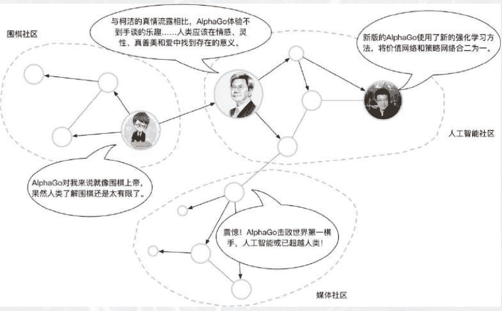

## 2.1 统计分析：数据的“体检报告”

大数据时代，数据虽丰却多“原矿”难用。数据挖掘融合数据库、统计学、机器学习等多领域之长，能从杂乱无章中淘出传统手段无法发现的金子。我们以微博为例，看统计分析如何给数据做“体检”。

截至 2017 年底，微博拥近 4 亿活跃用户、千亿内容库。2017 年 5 月 27 日，柯洁与 AlphaGo “乌镇决战”引爆舆论场，千万级评论转发瞬间形成“数据风暴”（见图 6）。**谁在关注 AI？** 要画清人群画像（年龄、性别、职业），首轮必做**描述性统计**：均值、中位数、分位数、方差勾勒分布轮廓；峰度、偏度刻画精细纹理。**关注深度几何？** 有人仅转发，有人长文感怀，年龄、职业是否影响投入度？回归分析、方差分析能给答案。

$$

\bar{x} = \frac{1}{n} \sum_{i=1}^{n} x_i

$$

图 6 柯洁乌镇大战 AlphaGo 不敌后的微博热议

简单统计只能“看表象”，若要在海量数据里挖规律、建模型，必须上机器学习重器。柯洁大战聚拢围棋迷与 AI 迷两大圈层，聚类算法能精准圈出这两类人群；对 AI 前景，乐观派与悲观派观点对立，分类模型能自动甄别情感倾向。微博关注网络是典型社交图谱，虽结构复杂，但其独特性质（如社区结构）反而能催生处理亿级节点的高效算法。文本层面，“强化学习”、“神经网络”等关键词能秒级定位 AI 话题，词向量与语言模型则是 NLP 新浪潮的基石。

下面我们系统梳理：先讲基础统计分析，再进阶数据挖掘/机器学习算法。

### 2.1.1 基础统计量：从平均数到分布形态

表 3 两位微博名人 2018 年 3-5 月部分发文数据

| 发布时间 | 点赞数量 | 转发数量 | 发布时间 | 点赞数量 | 转发数量 |
|---|---|---|---|---|---|
| 18.3.18 | 3056 | 187 | 18.5.8 | 3398 | 1175 |
| 18.4.29 | 1169 | 511 | 18.3.6 | 4849 | 253 |
| 18.3.3 | 2743 | 177 | 18.3.18 | 4246 | 211 |
| 18.4.29 | 1616 | 215 | 18.4.28 | 4342 | 113 |
| 18.2.22 | 2391 | 92 | 18.3.14 | 3464 | 206 |
| 18.3.19 | 930 | 119 | 18.5.2 | 1819 | 1067 |
| 18.4.8 | 968 | 331 | 18.5.1 | 2300 | 1056 |
| 18.5.2 | 1011 | 51 | 18.4.8 | 2955 | 120 |
| 18.5.10 | 1386 | 36 | 18.4.17 | 3023 | 104 |
| 18.4.18 | 936 | 38 | 18.3.14 | 2560 | 229 |

拿到数据，先“宏观把脉”：发文频次看活跃度，人均转发看影响力。这类概括**位置**、**离散**、**相关**及**整体分布**特征的手段，即**描述性统计分析**。

**1. 位置特征：均值 vs 中位数**
均值 $\bar{x}$ 是最常用的“重心”指标。表 3 中 W 平均点赞 1620.6，Z 高达 3295.6，Z 似乎更受宠。但均值极易被极端值带偏：99 人年入 10 万 + 1 人年入 1000 万，平均值飙至 19.9 万，严重失真。

$$

M = \begin{cases} x_{\frac{n+1}{2}}, & n \text{ 为奇数} \\ \frac{1}{2}(x_{\frac{n}{2}} + x_{\frac{n}{2}+1}), & n \text{ 为偶数} \end{cases}

$$

中位数 $M$（排序后正中值）抗干扰能力强得多。推广开来是 $p$ 分位数 $M_p$（$0 \le p \le 1$），四分位数（$p=0.25, 0.75$）最常用，箱型图即其可视化呈现（见图 7）。

$$

M_p = (1 + [(n + 1)p] - (n + 1)p)x_{[(n + 1)p]} + ((n + 1)p - [(n + 1)p])x_{[(n + 1)p] + 1}

$$

图 7 两个微博名人的微博点赞数据箱型图

**2. 离散程度：方差、标准差、极差**
两组数据均值、中位数相同，但贫富差距悬殊。方差 $s^2$（及标准差 $s$）专门度量“散得有多开”。前组方差 9801，后组仅 148.5，差异一目了然。极差 $R = x_{max} - x_{min}$ 只看上下界，粗糙但直观。

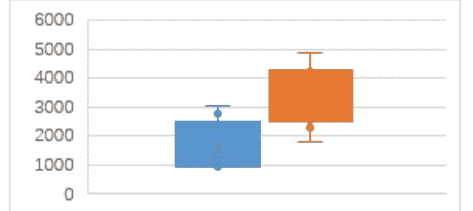
$$

s^2 = \frac{1}{n}\sum_{i=1}^n (x_i - \bar{x})^2

$$
$$

s = \sqrt{s^2} = \sqrt{\frac{1}{n}\sum_{i=1}^n (x_i - \bar{x})^2}

$$

**3. 分布形态：直方图、PDF、CDF、偏度、峰度**
单一指标不足以还原全貌，需看分布。将取值范围切分区间，统计频数绘制直方图；样本量足大时，区间无限细分、频率除以组距，得**概率密度函数 (PDF)** $f_X$，区间积分即落入概率。进而有**累积分布函数 (CDF)** $F_X$。

$$

R = x_{max} - x_{min}

$$
$$

P(a \le X \le b) = \int_a^b f_X(x)dx

$$
$$

F_X(x) = \int_{-\infty}^x f_X(u)du

$$
$$

P(a \le X \le b) = F_X(b) - F_X(a)

$$

图 8 组数较大组距较小的频率分布直方图

本质上这是在**用样本拟合总体分布**。10 条微博是样本，历史几千条才是总体。样本均值是总体期望 $\mu$ 的无偏估计，总体方差 $\sigma^2$ 的无偏估计需除以 $n-1$。

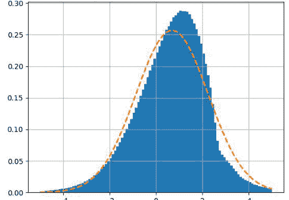

正态分布最常见，但现实多非对称。**偏度 $g_1$** 量化对称性：近 0 对称，$>0$ 左侧数据多（右偏），$<0$ 右侧数据多（左偏）。**峰度 $g_2$** 以正态为基准度量“尖平”：$>0$ 两尾肥（尖峰），$<0$ 中间堆（平顶）。QQ 图能直观判断分布拟合度，同时读出偏峰信息。更多假设检验细节，建议研习概率统计教材。

$$

s^2 = \frac{1}{n - 1} \sum_{i=1}^{n} (x_i - \bar{x})^2

$$
$$

g_1 = \frac{n}{(n - 1)(n - 2)s^3} \sum_{i=1}^{n} (x_i - \bar{x})^3

$$
$$

g_2 = \frac{n(n + 1)}{(n - 1)(n - 2)(n - 3)s^4} \sum_{i=1}^{n} (x_i - \bar{x})^4 - \frac{3(n - 1)^2}{(n - 2)(n - 3)}

$$

**4. 多维数据：向量化与相关性**
微博数据含时间、点赞、转发三维。现实中常面对混合类型：数值（连续/离散）、定类（性别/职业）、二值（会员否）、日期等。统一用 $k$ 维向量 $\mathbf{x}_i = (x_{i1}, ..., x_{ik})^T$ 表示，$n$ 个样本组成矩阵。

多维均值向量 $\bar{\mathbf{x}}$ 自然推广。**协方差矩阵 $\mathbf{S}$** 对应方差，**Pearson 相关矩阵 $\mathbf{R}$** 由 $\mathbf{S}$ 标准化而来（对角线为 1，对称）。二维时 $s_{12}$ 为协方差，$r_{12}$ 为 Pearson 系数，刻画**线性**同向/逆向变化趋势。多维中位数向量同理。除 Pearson，基于秩的 **Spearman 相关** 能捕捉单调非线性关系。多维 PDF/CDF 理论同理延展，此处不展开。

$$

\bar{\mathbf{x}} = (\frac{1}{n}\sum_{i=1}^n x_{i1}, \frac{1}{n}\sum_{i=1}^n x_{i2}, \dots, \frac{1}{n}\sum_{i=1}^n x_{ik})^T

$$
$$

\mathbf{S} = [s_{ij}]_{k \times k}, \quad s_{ij} = \frac{1}{n-1}\sum_{u=1}^n (x_{ui} - \bar{x}_i)(x_{uj} - \bar{x}_j)

$$
$$

\mathbf{R} = [r_{ij}]_{k \times k}, \quad r_{ij} = \frac{s_{ij}}{\sqrt{s_{ii}}\sqrt{s_{jj}}}

$$

### 2.1.2 回归分析：揭秘变量背后的因果逻辑

描述统计看单变量，相关分析看双变量，实际问题常涉**多变量协同作用**。以房价为例：面积 ($X_1$)、卧室数 ($X_2$)、卫生间数 ($X_3$)、楼层、朝向、地段……如何联合定价？

建立模型：$Y = f(X_1, X_2, ..., X_k) + \varepsilon$，$\varepsilon$ 吸收未纳入因素噪声，均值为 0。若 $f$ 为线性组合，即得**多元线性回归模型**：

$$Y = \beta_0 + \beta_1 X_1 + \beta_2 X_2 + ... + \beta_k X_k + \varepsilon$$

$\beta_0, ..., \beta_k$ 为待估回归系数，量化各自变量边际贡献。

$$Y = f(X_1, X_2, ..., X_k) + \varepsilon$$
$$Y = \beta_0 + \beta_1 X_1 + \beta_2 X_2 + \cdots + \beta_k X_k + \varepsilon$$

线性回归建模与参数求解

针对线性回归模型，若已获取 n 组 (n 通常远大于参数个数 k) 房屋样本，即可借此推算未知系数。记第 i 个样本的属性为列向量 \( (x_{i1}, ..., x_{ik})^T \)，对应价格为 \( y \) (因变量亦可为多维)。矩阵形式表述为：

$$\boldsymbol{Y} = \boldsymbol{X}\boldsymbol{\beta} + \boldsymbol{\varepsilon}$$

采用最小二乘准则估计系数，即最小化目标函数：

$$S(\boldsymbol{\beta}) = \boldsymbol{\varepsilon}^T \boldsymbol{\varepsilon} = \sum_{i=1}^n (y_i - \sum_{j=1}^k \beta_j x_{ij})^2$$

对 \( \beta_0, ..., \beta_k \) 求偏导并置零，得正规方程组：

$$\boldsymbol{X}^T \boldsymbol{X} \boldsymbol{\beta} = \boldsymbol{X}^T \boldsymbol{Y}$$

因 \( \boldsymbol{X}^T \boldsymbol{X} \) 为实对称正定阵，故系数向量 \( \boldsymbol{\beta} \) 的最小二乘解为：

$$\widehat{\boldsymbol{\beta}} = (\boldsymbol{X}^T \boldsymbol{X})^{-1} \boldsymbol{X}^T \boldsymbol{Y}$$

目标函数 \( S(\boldsymbol{\beta}) \) 的海森矩阵正定，且上述解唯一，故 \( S(\widehat{\boldsymbol{\beta}}) \) 为极小值。代回得回归方程：

$$\widehat{\boldsymbol{Y}} = \boldsymbol{X} \widehat{\boldsymbol{\beta}} + \boldsymbol{\varepsilon}$$

至此参数估计完成，新样本特征输入即可给出价格预估。

模型构建基本告一段落。实战中利用现有样本拟合并推广至未知样本。最小二乘保证了在线性假设下解的最优性。但最优解仍存偏差，现实关系未必线性。如何判断线性假设是否适用？需评估模型对训练样本的贴合优度。

将估计用观测样本代入方程，实测值 \( \boldsymbol{Y} \) 与预测值 \( \widehat{\boldsymbol{Y}} \) 之差得偏差向量：
\( \widehat{\boldsymbol{\varepsilon}} = \boldsymbol{Y} - \widehat{\boldsymbol{Y}} = \boldsymbol{Y} - \boldsymbol{X}(\boldsymbol{X}^T \boldsymbol{X})^{-1} \boldsymbol{X}^T \boldsymbol{Y} = (\boldsymbol{I} - \boldsymbol{H})\boldsymbol{Y} \)
定义误差平方和 SSE 量化误差：

$$SSE = \sum_{i=1}^n (y_i - \hat{y}_i)^2 = \hat{\epsilon}^T \hat{\epsilon}$$

SSE 越小，贴合精度越高。进而定义多重相关系数 R：

$$R^2 = 1 - \frac{SSE}{\sum_{i=1}^n (y_i - \bar{y})^2}$$

R 趋近 1 表明线性假设合理；R 较低则需反思是否遗漏关键因子或模型不适。

大样本 (n 较大) 求解时迭代法更高效。定性变量与因变量关系可用方差分析。欲深入了解显著性检验、假设检验、方差分析，请阅读专业统计教材。

### 2.1.3 关联分析：发掘数据内在联结

关联分析能从大规模样本集中发现有价值的隐性联系，用关联规则表达。面临两大挑战：海量样本挖掘模式效率低；发现的规则未必有价值。支持度指标用于剔除无效规则，置信度量化规则可靠性。主流算法有 Apriori、DHP、DIC、FP-Growth 等，Apriori 最常用，详述如下。

Apriori 由 R. Agrawal 等人提出，核心分两阶段：先挖掘满足最低频繁度阈值的所有高频项集；再以此生成强规则。经典案例为“啤酒与尿布”，商家统计两者同单出现频次，将高频搭配转化为规则指导陈列。

算法需多次遍历数据库。首遍计算单项频繁度，生成长度为 1 的高频项集；后续各遍，先依上一遍结果生成备选项集，再遍库计算频繁度，剔除不达标项，得新一轮高频项集。循环直至无新高频项集产生。

提升效率关键在于减少遍库轮数或压缩备选规模。改进路径包括：划分法、抽样法、增量更新法、概念层次法、哈希与压缩技术法。

### 2.1.4 聚类分析：无标签场景下的自动分群

聚类分析是将海量样本按内在特性划分为有价值群组的多元统计手段。属无监督范畴——无现成分类标准或先验认知，全凭样本间相似度 (亲疏程度) 自行归类。基本逻辑：选定衡量相似程度的指标，以此为依据聚合相近样本，最终形成自细至粗的分类体系。算法选型取决于样本类型、业务目标及场景，主流流派如下：

- **1. 分区式聚类**
  给定样本量 N 与目标簇数 K。从初始分区出发，循环调整分组，使每轮分区质量优于上轮。代表算法：K-means、K-Medoids、CLARANS。

- **2. 层次式聚类**
  通过层层合并或分裂构建树状结构，分凝聚式 (自底向上) 与分裂式 (自顶向下)。合并分裂需大量比对记录与簇，伸缩性较弱。经典算法：BIRCH、CURE、ROCK、Chameleon。

- **3. 密度聚类**
  核心差异在于弃用“间距”改用“密度”衡量相似度，突破仅能发现球状簇的局限。代表作：DBSCAN、OPTICS、DENCLUE。

- **4. 网格聚类**
  将属性空间切割为有限网格单元，操作针对单元而非原始记录。优势：速度极快，耗时仅与网格粒度相关，与样本量无关。代表：STING、CLIQUE、WAVE-CLUSTER。

- **5. 模型聚类**
  为每簇预设模型 (如概率密度函数)，寻找样本对模型的最优贴合。求解路径分统计建模派与 NN 派。

## 2.2 基于 ML 技术的数据挖掘：让数据说话

“机器学习”即算法直接从样本自动习得规则与解法。传统统计特征 (均值、方差等) 仅能捕捉极有限信息——如图 9 所示，统计量一致的分布形态可能截然不同。人工编写规则耗时费力且覆盖面窄。为破解“分析不精准”难题，本章从无监督与有监督两大视角梳理核心方法。

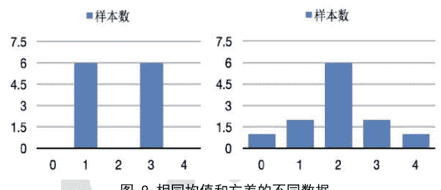

### 2.2.1 无监督学习方法：全盲摸象，寻找天然分群

无监督学习适用于“全量样本无标签、类别未知、类别特征未知”，仅知各样本属性向量的场景。直觉认为：属性空间中间距小的向量关系紧密。由此引出“簇质心”概念——即该类所有样本在空间中的几何中心 (各维均值)。分类时，新样本归属最近质心所在类，此即 K-means 核心逻辑。

K-means 1957 年，由 Stuart Lloyd 在 AT&T 贝尔实验室提出 (初解图像分区)，1965 年 E.W. Forgy 独立发明 (称 Lloyd-Forgy 法)，1967 年 James MacQueen 定名。标准流程：

1.  设定 K，随机抽取 K 个样本作初始质心；
2.  计算各样本到所有质心间距，划归最近者；
3.  更新质心：各类质心重算为该类样本几何中心；
4.  循环执行 2、3 步，直至质心位置收敛稳定；
5.  输出最终质心坐标与分类映射。

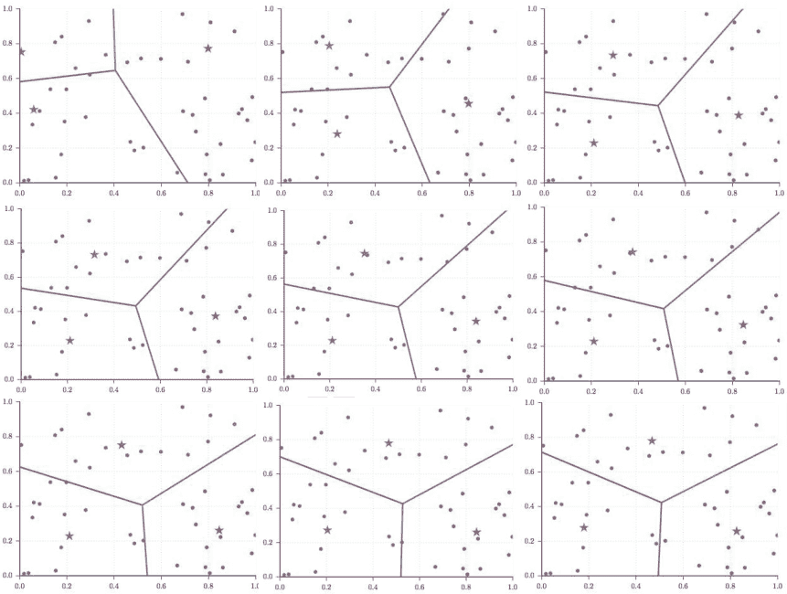

图 10 演示 K=3 时的循环演变 (五角星为质心，色块为类别)。工程实践中，常先通过模型将原始样本映射到“间距越小越相关”更成立的属性空间，再执行 K-means。后续衍生出 K-means++、X-means 等改进版。

### 2.2.2 有监督学习方法：有师傅带徒弟，精准分类更高效

有监督学习前提：已有部分“带标签”样本，目标预测新样本类别。利用已知标签指导训练，可获比无监督更精准的分类器。先讲样本划分，再深入判断树与 NN。

#### 1. 训练/验证/测试样本：三块地各司其职

样本划分是监督学习基石。
- **测试样本**：模型上线面对的真实业务数据。实时处理无标签，事后难全量评估。模型在测试样本上的表现直接决定商业价值。
- **超参难题**：同一模型、同一建模样本，超参 (如 K-means 中的 K 值) 不同，效果天壤之别。
- **验证样本的必要性**：因测试样本标签未知，必须从有标签数据中再划出验证样本。训练仅用建模样本，用验证样本评估超参优劣，选定最佳配置后再上测试样本。

学术数据集常预划分好建模/测试样本，甚至提供验证样本并限制提交次数。**实战黄金法则**：拿到仅含建模/测试样本的数据，**严禁**在测试样本上调超参！应自行切分验证样本调参，最终模型仅在测试样本“考一次试”。否则极易过度拟合，测试高分不代表实战强。

深度神经网络图像领域常犯此错：不用验证样本，直接在测试样本上选最强模型。研究表明，CIFAR-10 上跑出 90%+ 甚至 97% 精度的模型，换同分布新测试样本精度普遍掉 4%-15%，根因就是测试样本“刷”出来的过拟合。

#### 2. 判断树模型：像玩“二十个问题”一样做分类

##### (1) 通用框架：一棵树，一套逻辑
判断树本质是条件判断的逻辑树：节点提问 (选属性)，分支作答 (属性取值)，叶子给类别。
通用流程：
1.  根节点 = 全量样本集；
2.  遍历所有候选“问题”，算其在当前集合上的评价函数 F(A,D)；
3.  选 F 最大的问题分裂节点，生成子集；
4.  对子集递归执行 2、3，直到子集纯度达标 (同类)；
5.  实战中“问题”即选属性，“回答”即属性取值。

评价函数 F(A,D) 的选择决定了树的生长策略，判断树发展史实质是 F 函数的演进史：AID → THAID → ID3/CART → C4.5 → 贝叶斯 CART。下面逐一拆解三大基石算法。

##### a) ID3：熵值最大，区分能力最强
核心思想：选区分度最高的属性。引入熵值 H。设属性有 n 种取值，概率分布为 p1...pn，则：
```
H = - \sum_i P_i \log(P_i)
```
H 越大，属性携带信息内容越大，区分力越强。ID3 直接令 F(A,D) = H。Quinlan 教授 70 年代发明、86 年发表，荣获 SIGKDD 2011 创新奖。

##### b) C4.5：引入标签视角，用增益值修正偏差
熵值只看属性自身分布，不看标签。若改标签不改属性分布，ID3 选属性不变，易过度拟合。Quinlan 93 年推出 C4.5，引入“条件熵”量化属性对标签的区分力：
```
H ( T | a ) = - \sum_v \frac{N (X_a = \mathcal{V})}{N} H ( T | X_a = v )
```
其中 N 为总样本数，N(Xa=V) 为标签为 V 的样本数，H(T|Xa=V) 为该标签子集上属性 T 的熵。
增益值 IG(T,a) = H(T) - H(T|a) 代表属性 T 对标签 a 的信息贡献。C4.5 令 F(A,D) = IG(T,a)，实现“有的放矢”。

##### c) CART：基尼指数度量“混乱度”，追求分裂后最纯净
ID3 与 C4.5 侧重属性信息内容，CART 直接盯着标签分布的“混乱程度”。定义基尼函数：
```
Gini(X, a) = 1 - \sum_v P(x_a = v)^2
```
```
G(T, a) = Gini(X, a) - \sum_v \frac{N(x_a = v)}{N} Gini(X | x_a = v, a)
```
基尼值越大，标签越混杂；为 0 则纯净。Breiman 1984 年提出 CART，每步分裂选择使子集加权平均基尼指数下降最多的属性，即 F(A,D) = G(T,a)，直击分类纯度本质。

除上文详述的几种确定 $F(A, D)$ 的途径外，尚存 FACT、GUIDE、BART 等大量差异化的决策树生成策略与分裂函数。

### d) 决策树的剪枝处理

前述方法虽能在训练集上长出一棵“完美”树，但往往伴随严重过拟合。生成完毕后，必须实施剪枝，移除无实效的特征分支。剪枝操作的具体定义为：针对树上某节点，取消原本依赖的特征分裂，改将该节点所有样本直接归入其子节点中训练集样本量最大的那一类，后续判别规则沿用该子节点原有的分类逻辑。

剪枝过程需借助验证集进行。最基础的策略是**降低错误率剪枝（Reduced Error Pruning）**：自叶节点向上遍历，对比保留节点（准确率 $a_0$）与删除节点（准确率 $a_1$）在验证集上的表现，若 $a_1 \ge a_0$，则果断裁去该节点。进阶的**最小代价复杂度剪枝（Cost-Complexity Pruning / 此处指 Optimal Efficiency Pruning）**则引入了模型规模惩罚：
- 记剪枝前叶节点数 $L_0$，剪枝后 $L_1$；
- 定义“节点效率” $E = (a_0 - a_1) / (L_0 - L_1)$，衡量每精简一个叶节点换来的精度损失；
- 设阈值 $\alpha$，自底向上遍历，若某节点效率 $E < \alpha$，即性价比太低，则将其移除。

### e) 多决策树集成分类（Bagging）

单棵树极易受训练集噪声干扰导致过拟合。面对高方差模型，集成学习通过“训练多模型、平均预测”极为有效。Bagging（Bootstrap Aggregating）流程如下：
1. 从完整训练集有放回随机抽样，构建若干“子训练集”；
2. 在每个子集上独立生长一棵决策树；
3. 重复上述步骤得到 $N$ 棵互异的树；
4. 预测时，将测试样本输入所有树，采用**多数投票法**决定最终类别。

因每棵树仅基于原数据的随机子集训练，个别噪声点对整体模型的影响被大幅稀释，有效抑制了过拟合。

### f) 随机森林

Bagging 仍有隐忧：若某几个特征与目标强相关，它们会垄断所有树的顶层分裂，导致树与树间高度相似（相关性高），削弱了集成“取平均”降低方差的效果，也压制了中等相关性特征的发挥空间。

1995 年，Ho Tin Kam 提出**随机森林**，在 Bagging 随机选样本的基础上，更进一步引入**特征随机性**：
1. 每次构建子集时，**同时随机抽取一部分样本与一部分特征**，仅用这部分特征在这部分样本上建树；
2. 重复生成 $N$ 棵树；
3. 预测阶段同样采用投票机制。

这种“双重随机性”（样本扰动 + 特征扰动）极大地解耦了树间相关性，使随机森林在决策树家族中往往拥有最优的实战表现。

### 3. K 近邻算法（kNN）

若仅知样本在特征空间中的坐标，可用无监督的 K-means 聚类；若拥有部分带标签样本，则可施用 kNN 分类。

核心假设：**特征空间距离表征语义相似性，距离越近，标签一致概率越大**。给定一组已知标签的训练样本，面对新来的无标签向量，找出距离最近的 $k$ 个邻居：
- **硬投票**：直接取这 $k$ 个邻居中数量最多的类别作为预测值；
- **软投票（加权）**：按距离远近赋予权重（如距离倒数、核函数），权重和最大的类别胜出。

kNN 属于“懒惰学习”，无显式训练、无模型构建过程，常作为特征空间构建模型（如嵌入网络）的下游分类头使用。

### 4. 回归分类模型

决策树基于特征阈值做硬分割，而现实中特征往往以**影响类别概率**的软方式起作用。回归分析正是建立在“特征 $\to$ 概率”这一概率建模思想之上。

#### (1) 最大似然原理

假设模型对每个样本 $i$ 输出其属于真实标签 $l_i$ 的概率 $P_{il}$。若模型给出的概率分布真实反映了数据生成机制，则整个训练集观测到真实标签序列的联合概率为 $P = \prod P_{il}$。不同参数下的模型给出不同的 $P$。**最大似然原理**指出：在数据量充足时，使 $P$ 最大化的模型，其输出概率最逼近真实分布。常用 Softmax 形式参数化类别概率：
$$ P_{til} = \frac{e^{c_{til}}}{\sum_k e^{c_{tik}}} $$
模型选择本质上即在训练集上寻找使 $P$ 最大（或等价地，使负对数似然最小）的参数。

#### (2) 回归分析模型结构

以二分类为例，设正类概率 $P_1$，负类 $P_0 = 1 - P_1$。逻辑回归假设 Logit 与特征线性相关：
$$ P_0 = \frac{1}{1 + e^{\alpha_1 x_1 + \cdots + \alpha_n x_n + b}} $$
多类别场景下，采用**一对多**或 **Softmax** 结构：为每个类别设立独立输出通道，特征加权求和加偏置得到 $C_{ti}$，再经 Softmax 归一化为概率 $P_{ti}$。所有加权系数与偏置即为待学参数。

#### (3) 模型训练

基于最大似然，目标函数对所有参数可微。故可采用**梯度下降**、**牛顿法**或拟牛顿法（如 L-BFGS）迭代优化，直至似然收敛或达最大迭代次数。

### 5. 神经网络

大脑通过神经元海量连接实现高效信息处理，神经网络即借此生物启发构建的数学模型。近年来，它在计算机视觉、自然语言处理、大数据挖掘等领域斩获突破性进展，成为当今 AI 的核心引擎。

#### (1) 神经元：基本计算单元

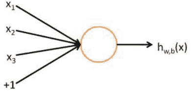

图 11 神经元

单个神经元执行：输入加权求和 $\to$ 减去偏置/阈值 $\to$ 经**激活函数**非线性变换 $\to$ 输出。**激活函数的非线性是神经网络具备万能逼近能力、能处理复杂非线性问题的关键。**

#### (2) 常用激活函数

```
sigmoid(x) = \frac{1}{1 + e^{-x}}

tanh(x) = \frac{e^{x} - e^{-x}}{e^{x} + e^{-x}}
```

激活函数必须非线性。主流选择包括：
- **ReLU**：$f(x) = \max(0, x)$，计算高效、缓解梯度消失，当前默认首选；
- **Leaky ReLU**：负半轴保留小梯度，缓解“神经元死亡”；
- **Sigmoid / Tanh**：饱和区梯度极小，易梯度消失，现多用于输出层或门控机制（LSTM/GRU）。
同一网络可混用不同激活函数，输出层视任务常不加激活（回归）或接 Softmax/Sigmoid（分类）。

#### (3) 网络拓扑结构

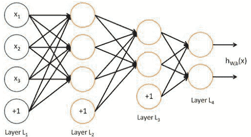

图 12 神经网络

网络由多层神经元堆叠而成。层与层间可全连接、局部连接或跨层连接（残差）。前层神经元输出乘以连接权重作为后层输入。首层接收特征向量，末层输出预测向量。
- **分类任务**：输出层神经元数等于类别数，取最大响应对应类别为预测结果。
- **参数集合**：所有连接权重与神经元偏置。
- **关键洞见**：**逻辑回归本质上就是一个无隐藏层、无激活函数（或仅输出层有 Sigmoid）的两层神经网络。**

#### (4) 训练范式：反向传播与梯度下降

核心流程：
1. **定义损失函数**：分类常用**交叉熵** $H(p, q) = -\sum p_i \ln q_i$；度量学习场景常用**Triplet Loss** 等拉近同类、推远异类的结构化损失。损失越小，拟合越好。
2. **求梯度**：得益于链式法则，网络前向传播全程可微，极易计算损失对每个参数的偏导数，组成梯度向量。
3. **参数更新**：沿梯度负方向更新参数。工业界标准为**随机梯度下降（SGD）**及其变体（Momentum, Adam, AdamW 等）：每步随机抽取一个 Mini-batch 估算梯度并更新，兼顾收敛速度与泛化性。

实战中虽涉及 BatchNorm、Dropout、残差连接、学习率调度、权重衰减、混合精度训练等大量工程技巧，但内核均建立在梯度下降框架之上。

### 6. 朴素贝叶斯分类

属于生成式概率模型，利用贝叶斯定理结合“特征条件独立”假设进行分类。优势在于**参数少、训练极快、小样本下表现稳健**，且天然输出概率预测。

#### (1) 条件概率与独立性假设

```
P(A|B) = \frac{P(AB)}{P(B)}
```
```
P(AB) = P(A)P(B)
```
```
P(AB|C) = P(A|C)P(B|C)
```

定义条件概率 $P(A|B)$ 与事件独立性 $P(A \cap B) = P(A)P(B)$。若 $A, B$ 独立，则 $P(A|B) = P(A)$。

#### (2) 贝叶斯公式

$$ P(y|x) = \frac{P(x|y)P(y)}{P(x)} $$
- $P(y)$：**先验概率**，类别分布；
- $P(x|y)$：**类条件概率**（似然），给定类别下特征出现概率；
- $P(y|x)$：**后验概率**，观测到特征后对类别的置信度；
- $P(x)$：证据因子，对所有类别归一化用，分类决策时可忽略。

#### (3) 分类决策流程

设类别集 $C=\{y_1,\dots,y_n\}$，待分项 $X=\{x_1,\dots,x_m\}$。
1. 计算各类后验 $P(y_k|X)$；
2. 选取后验最大者作为预测类别：$\hat{y} = \arg\max_k P(y_k|X)$。

#### a) 后验概率的简化计算

由贝叶斯公式，$P(y_k|X) \propto P(X|y_k)P(y_k)$。引入**“朴素”假设：特征间相互条件独立**，似然分解为乘积：
$$ P(X|y_k)P(y_k) = P(y_k) \prod_{i=1}^m P(x_i|y_k) $$
仅需从训练集估计先验 $P(y_k)$ 与各条件概率 $P(x_i|y_k)$ 即可。

#### 完整建模步骤

1. **特征工程**：确定特征属性及其离散化/分箱方式；
2. **标注训练集**：人工标注部分样本获取训练数据；
3. **参数估计**：统计训练集中各类别频率（先验）及各特征在各类别下的条件概率，生成分类器。模型质量高度依赖特征选取、离散化策略及训练样本代表性；
4. **推理应用**：加载分类器，对新样本计算后验概率并输出预测。

#### b) 条件概率 $P(x_s|y_i)$ 的具体估计

- **离散特征**：直接统计频率，$\hat{P}(x_s=a|y_i) = \frac{\text{Count}(x_s=a, y_i)}{\text{Count}(y_i)}$。为避免零概率问题，常用**拉普拉斯平滑**（加一平滑）。
- **连续特征**：通常假设服从**高斯分布（正态分布）**：
$$ P(x_s=a|y_i) = \frac{1}{\sqrt{2\pi}\sigma_i} \exp\left(-\frac{(a-\mu_i)^2}{2\sigma_i^2}\right) $$
其中 $\mu_i, \sigma_i$ 为类别 $y_i$ 下该特征的样本均值与标准差。

---

## 2.3 社会网络中的大数据挖掘

以社交网络为例，剖析数据挖掘算法在真实图数据上的落地。社交网络本质是**图结构**，节点间关系由拓扑决定，复杂度远超常规表格数据，分析手段亦区别于传统统计与机器学习。本节聚焦图结构的核心度量算子与基础算法。

### 2.3.1 图的度量算子

针对“谁是核心大 V”“如何发现志同道合者”“如何定位相似个体”等问题，需量化节点中心性与节点间相似度。输入通常为表征社交互动的图拓扑。

#### 1. 中心性：量化节点重要性

重点介绍四大经典指标：度中心性、特征向量中心性、PageRank、中介中心性。

##### (1) 度中心性

直觉：连接越多越重要。无向图中节点 $v_i$ 的度中心性：
```
\(C_d(v_i) = d_i\)
```
$d_i$ 为度。有向图可分别用入度、出度或合并计算。为跨网络比较，常归一化（除以总边数 $m$ 或 $n-1$）：
```
\(C_d^{sum}(v_i) = \frac{d_i}{\sum_j d_j} = \frac{d_i}{2m}\)
```

##### (2) 特征向量中心性

度中心性忽略了邻居的“质量”。核心思想：**重要节点的邻居也应重要**。设 $C_e(v_i)$ 为特征向量中心性，由邻接矩阵 $A$ 递归定义：
```
\(C_e(v_i) = \frac{1}{\lambda} \sum_{j=1}^n A_{j,i}C_e(v_j)\)
```
$\lambda$ 为常数。矩阵形式即 $\lambda C_e = A^T C_e$，$C_e$ 为 $A^T$ 的特征向量，$\lambda$ 为对应特征值。通常取模最大的主特征值对应的特征向量（Perron-Frobenius 定理保证分量非负）。

##### (3) PageRank 中心性

Google 搜索排序核心算法。在有向网页图上定义中心性，核心改进：引入**阻尼因子**处理悬挂节点与 spider traps，模拟随机冲浪者跳转行为。
$$ C_p = \beta (I - \alpha A^T D^{-1})^{-1} \mathbf{1} $$
$D = \text{diag}(d_1^{out}, \dots, d_n^{out})$ 为出度对角矩阵，$\alpha$ 为阻尼系数（通常 0.85），$\beta$ 为归一化常数。PageRank 可视为特征向量中心性的鲁棒化推广。

##### (4) 中介中心性

视角转换：节点作为“桥梁/中介”的价值。衡量节点 $v_i$ 落在多少对节点的最短路径上：
$$ C_b(v_i) = \sum_{s \neq t \neq v_i} \frac{\sigma_{st}(v_i)}{\sigma_{st}} $$
$\sigma_{st}$ 为 $s \to t$ 最短路径总数，$\sigma_{st}(v_i)$ 为经 $v_i$ 的最短路径数。归一化除以最大可能值 $(n-1)(n-2)/2$（无向图）或 $(n-1)(n-2)$（有向图）：
$$ C_b^{\text{norm}} = \frac{C_b(v_i)}{(n-1)(n-2)} $$
高中介节点常控制信息流动，是社群连接的关键枢纽。

#### 2. 相似性：度量节点亲和力

社会网络中，相似度可基于**结构**（拓扑嵌入）或**内容**（用户生成内容）计算。此处聚焦结构相似度。

##### (1) 结构等价性

最直观方法：统计**共同邻居数**。
$$ \sigma(v_i, v_j) = |N(v_i) \cap N(v_j)| $$
大规模网络下数值膨胀快，常归一化至 $[0,1]$ 区间：
- **Jaccard 相似度**：$\sigma_J = \frac{|N_i \cap N_j|}{|N_i \cup N_j|}$
- **余弦相似度**：$\sigma_{\cos} = \frac{|N_i \cap N_j|}{\sqrt{|N_i||N_j|}}$

##### (2) SimRank 相似度

“如果两个节点的邻居相似，则它们也相似。”这是一种递归的全局相似度度量，迭代计算：
$$ s(u,v) = \frac{C}{|N(u)||N(v)|} \sum_{x \in N(u)} \sum_{y \in N(v)} s(x,y) $$
$C \in (0,1)$ 为衰减因子，基准情况 $s(u,u)=1$。SimRank 捕捉高阶邻域相似性，比共同邻居更鲁棒，但计算开销大，常需近似算法（如随机游走采样、矩阵分解）加速。

### (2) SimRank相似度及其近似计变体

SimRank的核心思想极具洞见：**“指向相似节点的节点，彼此也相似”**。

$$S(a, b) = \frac{C}{|I(a)||I(b)|} \sum_{l=1}^{|I(a)|} \sum_{j=1}^{|I(b)|} S\left(I_l(a), I_j(b)\right)$$

其中常数$C$取值在0到1之间。原始算法的时间复杂度为$O(In^2d^2)$（$I$为迭代轮数，$n$为节点总数，$d$为平均度），在大规模网络中显得力不从心。为了提效，引入部分求和变量：

$$\text{Partial}_{I(a)}^j = \sum_{i \in I(a)} S(i, j), (\forall \in I(b)$$

进而化简公式为：

$$S(a, b) = \frac{C}{|I(a)||I(b)|} \sum_{j \in I(b)} \text{Partial}_{I(a)}^j$$

这一优化将复杂度降至$O(In^2d)$。更激进的加速手段则是**基于随机游走的近似SimRank**，它能以较高精度估算节点相似度，流程如下：
- **步骤一**：随机生成$R$条长度为$T$的路径，并建立倒排索引；
- **步骤二**：利用索引获取目标节点$v$所在的路径集合$P'$；
- **步骤三**：遍历$P'$统计与$v$共现的节点频次，得出近邻相似度$O'$；
- **步骤四**：输出与$v$相似度最高的Top-$K$节点列表$L$。

### 2.3.2 社交网络核心算法全景

本节聚焦社交网络的两大算法支柱：**行为传播建模**与**社区结构挖掘**。所谓社区发现，实质是网络语境下的聚类——同一社区内部连接紧密，外部稀疏。现有成熟算法已能高效支撑亿级用户规模。

#### 1. 行为传播与影响力建模

个体行为在网络中辐射，形成群体趋势。微观看，用户转发/评论激活邻居，宏观则构成信息传播链条。节点状态非激活即激活，激活边沿传播。我们引入两大经典模型模拟这一动态：

**(1) 线性阈值模型**

每个节点$v$持有一个均匀分布的随机阈值$\theta_v \sim U[0,1]$，量化其被激活的难易程度。邻居$w$对$v$的影响权重为$b_{v,w}$，约束条件见下：

```
\sum_w b_{v,w} \le 1
```

当$v$的**已激活邻居权重总和**达标，$v$即刻激活：

```
\sum_{w_a} b_{v,w_a} \ge \theta_v
```

算法从初始激活集$A_0$出发，迭代更新激活集，直至无新节点激活。

**(2) 独立级联模型**

流程与LT相似，激活机制截然不同：**单次触发，终身有效**。每个激活节点$v$对每个未激活邻居$w$仅有一次激活机会，成功率为$P_{v,w}$。无论成败，$v$均不再针对$w$发起激活尝试。这很好地模拟了“口碑营销”中种子用户对特定朋友的单次强推荐。

由此引出**影响力最大化**问题：给定预算$K$，如何选定种子集$A_0$使最终激活节点数$A$最大化——即寻找网络中的“意见领袖”以实现病毒式传播。

**(3) 链接预测：行为落地的量化入口**

社交动作（加好友、购商品、入社群）本质是新边的生成。将任务形式化：**给定训练图$G(V_{train}, E_{train})$, 对$V_{train} \times V_{train} - E_{train}$中所有非边按可能性排序**。任意相似度度量$\sigma(x,y)$（如前节SimRank、余弦相似度）皆可作为打分�数，得分降序即为预测链接的可能性排序。

#### 2. 社区发现算法：从核心边到层级优化

社区即高内聦低耦合的节点集。此处详解三大代表性算法。

**(1) Girvan-Newman算法：边中心性视角的解构**

核心假设：**连接社区的“桥梁”边，中间中心性极高**。反复移除中心性最高的边，网络解体即为社区演化树（图13）。

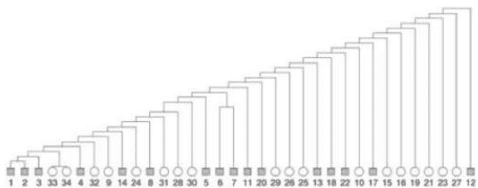
*图 13 GN算法解构结果*

关键难点：**何时停止切分？** 引入**模�块度$Q$**评估分割质量。$Q$值衡量社区内连边占比超随机期望的程度，取值$[-1, 1]$，越大结构越显著（$Q>0.3$通常视为显著社区）。定义$k \times k$矩�阵$e$，$e_{ij}$为社区$i,j$间连边占总边比，$a_i$为连入$i$的边占比：

$$Q = \sum_{i}^{K}(e_{ii} - a_i^2)^2$$

实操中，每切一次边算次$Q$，找$Q_{max}$对应的社区数（图14显示4社区最优），或寻找局部峰值平衡效率。

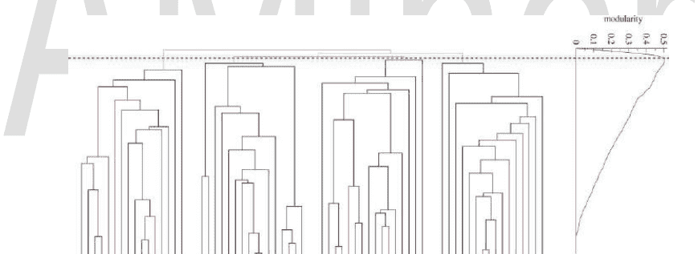
*图 14 基于$Q$值优化的社区数选择*

**(2) Label Propagation算法：简洁即力量**

无需预设社区数，无先验假设。**�代更新：每节点采纳邻居中占比最高的标签**。其Map-Reduce友好、易改良、可扩展至大规模图，堪称工业界“瑞士军刀”。
- 初始化：每节点唯一标签；
- 迭代：随机节点按邻居多数派更新标签（平局随机）；
- 收敛：所有节点标签与邻居多数派一致。

**(3) Louvain算法：模块度驱动的层级聚类**

兼顾效率与层级结构，直接**最大化$Q$值**。
- **第一阶段（模块优化）**：节点逐个尝试加入邻居社区，仅当$\Delta Q > 0$且最大时移动；重复至无节点移动，完成一级划分。
- **第二阶段（网�重构）**：社区收缩为超级节点，内部边成自环，社区间连边权重叠加；回溯第一阶段。

迭代至$Q$稳定，输出层级社区树（图15）。

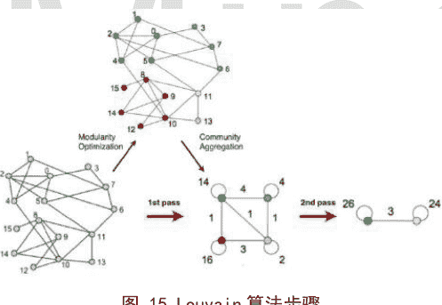
*图 15 Louvain算法迭代流程*

---

## 2.4 自然语言数据挖掘：从词向量到语言模型

自然语言是AI的皇冠明珠，也是数据挖掘落地最广的场域。虽距真正语义理解尚远，但工程化方法早已从海量文本中挖出商业价值。我们从**词、句、话题**三维切入。

### 2.4.1 词表示学习：从稀疏到稠密

词是文本原子。词向量将词映射为低维稠密向，空间距离反映语义亲疏。

#### 1. 词袋模型：简单粗暴的基准

忽略语法序，文档即词集合。构建词典，文档转为词频向量（见示例）。缺陷显性：
- 长文档词频高，短文档低，难横向比较；
- “the”、“is”高频噪声淹没"algorithm"等关键信息词。

```
{"the ": 1, "more": 2,"data": 3, "better": 4, "performance": 5,"of": 6, "machine": 7,
"learning": 8,"algorithms": 9, "which": 10,"one": 11, "is": 12,"important":13, "in":14, "or":15}
```
*词典构建示例*

```
[4, 1, 1, 1, 1, 1, 1, 1, 0, 0, 0, 0, 0, 0]

[0, 1, 1, 0, 0, 0, 1, 1, 1, 1, 1, 1, 1, 1]
```
*文档向量化示例（10维词袋向量）*

#### 2. TF-IDF：经典加权抑制�音

$$TF_{ij} = \frac{n_{ij}}{\sum_k n_{kj}} \quad \text{(归一化词频)}$$

```
f_{ij} = \frac{n_{ij}}{\sum_k n_{kj}}
```

$$IDF_i = \log \frac{|D|}{| \{j: t_i \in d_j \} |} \quad \text{（区分性词获高IDF）}$$

```
idf_i = log(\frac{|D|}{|\{j: t_i \in d_j\}|})
```

$$TF\text{-}IDF_{ij} = TF_{ij} \times IDF_i$$

```
tfidf_{ij} = tf_{ij} \cdot idf_i
```

高频功能词因分母大IDF低被压缩；领域特征词IDF高凸显。虽改进词袋，仍属稀疏高维（维度灾难），且无语义泛化能力。

#### 3. Word2Vec：分布式表示的工业标准

Hinton提出**分布式表示**：词映为低维稠密向量，语义相似词向量接近。Google开源Word2Vec，基于NNLM改进，核心是**“上下文预测”**。

**Skip-Gram架构（图16）**：输入词$w_t$，预测窗口$c$内的$w_{t-2}, \dots, w_{t+2}$。

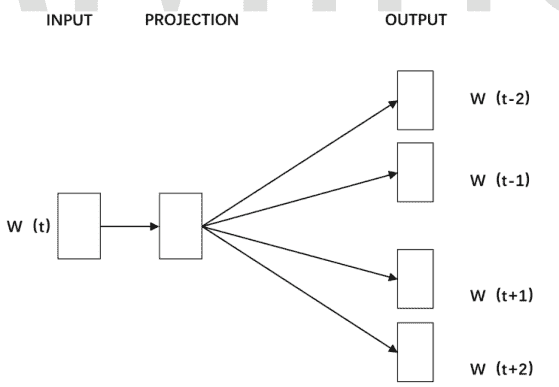
*图 16 Skip-Gram模型架构*

目标函数最大化语料库中所有词对的条件概率：

```
argmax 1/T sum_{t=1}^T sum_{-c <= j <= c, c != 0} logp(w_{t+j}|w_t)
```

Softmax计算瓶颈：分母遍历词表$W$，复杂度$O(W)$。

```
p(w_o|w_i) = exp(v'^T_{w_o} v_{w_i}) / sum_{w=1}^W exp(v'^T_{w_o} v_{w_i})
```

**双重优化破局**：
- **Hierarchical Softmax**：哈夫曼树替扁平Softmax，复杂度$O(\log W)$。
- **Negative Sampling**：逻辑回归区分真词$w_o$与$k$个噪声词，完全避开归一化分母。

```
logσ(v'^T_{w_o} v_{w_i}) + sum_{i=1}^k E_{w_i~P_n(w)}[logσ(-v'^T_{w_o} v_{w_i})]
```

两大技巺将训�数量级加速，使亿级语料词向量训练成常态。

### 2.4.2 语言模型：句子概率的计算引擎

核心任务：$P(S) = P(w_1, \dots, w_n)$。中文输入法即典型应用：拼音"ni hao ma" -> "你好么"(高概) vs "你好马"(低概)。

```
P(S) = P(w1, w2, ... wn) = P(w1)P(w2|w1)...P(wn|w1, w2, ..., w_{n-1})
```
**参数估计的困境与破局：从 N 元语法到主题模型**

采用极大似然法（MLE）训练语言模型时，核心逻辑是统计前缀片段与完整片段在训练语料中的共现频次，通过相除获得转移概率：$P(w_i|h) = C(h, w_i) / C(h)$。然而，直接套用面临双重困境：一是海量组合在有限语料中零现身，导致概率归零，稀疏性难题极其严峻；二是参数量级爆炸，存储与计算开销难以落地。

引入马氏假设——当前词仅依赖有限前文历史，可大幅简化建模：
*   **一元模型**：词汇间相互独立。
*   **二元模型**：仅依赖前一词汇。
*   **三元模型**：依赖前两词汇。
*   **N 元模型**：泛化为依赖前 $N-1$ 个词汇。

N 值越大，约束信息越丰富，辨别力越强；N 值越小，统计样本越充分，估计越稳健。工程实践常取二/三元折中，参数推断仍沿用极大似然法则。

进一步看，**主题模型**（如 LDA）假设文本由混合隐含主题生成：$p(w) = \sum p(w|z)p(z)$，主题分布服从狄利克雷先验。这能捕捉语义结构，助力检索与推荐。相关变量定义见表 4，生成过程可用概率图谱表达。
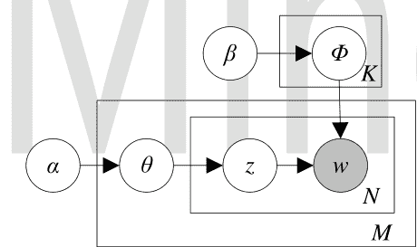
**图 17：主题模型概率图示意**

---

## 2.5 海量信息处理技术全景

### 2.5.1 四层架构设计

工程落地通常采用四层分治：**采集、存储、计算、服务**，贯穿安全及隐私防线。
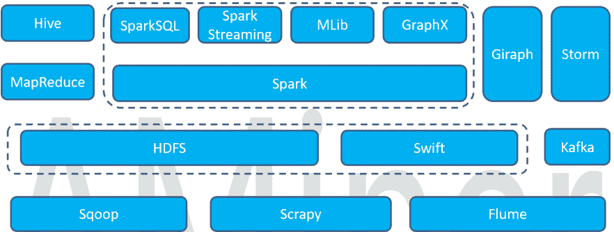
**图 18：处理平台技术架构全景**

**采集层**：面对业务库、公网、万物互联三类源头，策略分离——业务全量批量导入、网页定向抓取、物联实时流式接入。
**存储层**：底座用分布式 FS 系统（HDFS/S3）保吞吐、强容错；上层按需部署非关系型矩阵——KV 型极速缓存、列式海量扫描、文档库灵活建模、图库关系遍历。
**计算层**：引擎专用化——批处理跑离线全量、流式引擎应对实时风控/大屏、图引擎解社交推荐。上层封装挖掘、ML、检索组件降低门槛。
**服务层**：能力 API 化、标准化，对外输出视觉大屏、交互查询、统计报表、模型上线推理。

### 2.5.2 开源生态标准化落地

基于上述架构，业界沉淀出一套可裁剪的开源参考实现。

**图 19：基于开源生态的平台参考架构**

**核心组件速览**：

| 层级 | 组件 | 核心定位 |
| :--- | :--- | :--- |
| **采集** | **Sqoop** | 关系式 DB 与 Hadoop/HDFS 双向同步利器 |
| | **Scrapy** | Python 异步爬虫框架，高并发结构化抓取 |
| | **Flume** | 分布式日志聚合传输，高可靠、多源适配 |
| **存储** | **HDFS** | Hadoop 核心存储，高吞吐量、强容错 |
| | **Swift** | OpenStack 对象存储，低成本构建高可用大容量池 |
| | **Kafka** | 分布式消息总线，削峰填谷、异构解耦 |
| **计算** | **MapReduce** | 经典批处理范式，适合高延迟容忍任务 |
| | **Storm** | 纯流式实时计算，低延迟、强容错 |
| | **Giraph** | BSP 模型并行图处理，Pregel 开源版 |
| | **Spark** | **全能引擎**：内存加速，统一批/流/SQL/图/ML |
| **分析** | **Hive** | SQL-on-Hadoop 先驱，元数据管理 + HiveQL 转 MR |
| | **Spark SQL** | 兼容 Hive 架构，底座换 Spark 性能跃升 |
| | **Spark Streaming** | 微批流处理，高吞吐量、Exactly-Once、丰富窗口算子 |
| | **MLlib** | 分布式 ML 库，算法并行化、多语言支持 |
| | **GraphX** | Spark 上图计算抽象，Pregel API + 图算子库 |

---

# 3 人才版图：数据挖掘全球智力地图

## 3.1 专家画像全景扫描

AMiner 基于领域影响力千强专家库绘制多维人才地图。
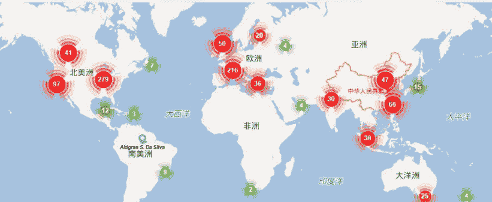
**图 20：全球专家分布热力图**
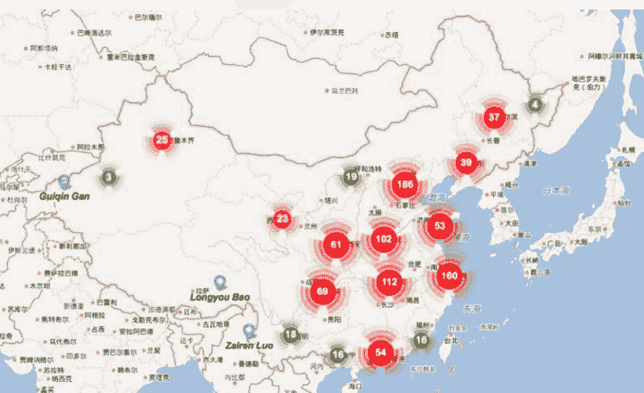
**图 21：国内专家分布热力图**

**地理洞察**：
*   **全球**：美国遥遥领先，中国次席，英、意等国成梯队。美东、西欧、中国内地为三大聚集带。
*   **国内**：**京沪两大核心**垄断性领先，湘、川为次级高地，整体呈“东强西弱”格局。

**迁徙动力学分析**：
美国是 NLP/挖掘人才流动“超级大国”，流入流出均居首，但**净流失**明显；德、加轻度人才外流；中国相对均衡但规模强度次于美。
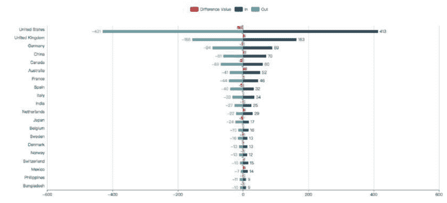
**图 22：全球千强专家迁徙流向图**

**机构竞争力榜单**：以入选专家数衡量组织科研实力。
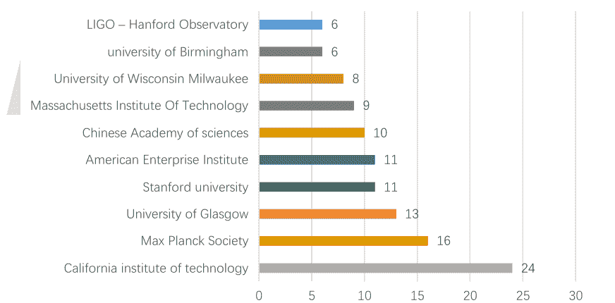
**图 23：全球千强专家机构聚集度分布**
加州理工学院 24 人霸榜首，马克斯·普朗克学会 16 人次席。单一机构高聚集度直接映射创新输出能力。

**学术影响力画像**：
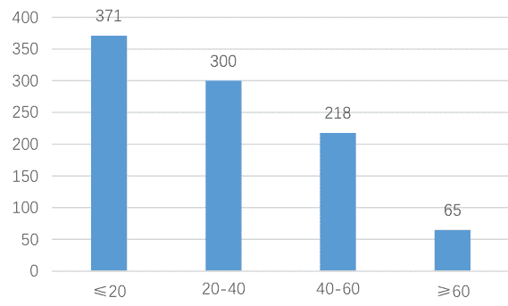
**图 24：全球千强专家 H 指数分布直方图**
平均 H 指数 29。主力军集中在 ≤20（37%）与 20-40（30%）区间；塔尖 ≥60 仅 0.6%，大牛稀缺。

**多样性警钟**：
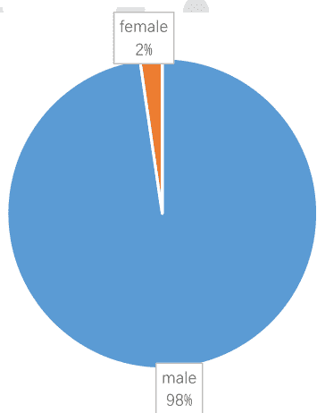
**图 25：全球千强专家性别结构饼图**
男性 98% 对女性 2%，失衡极其严峻，亟待打破天花板。

---

## 3.2 标杆专家档案库

数据源：即将发布的《全球人工智能十年影响力人才发展报告》。依据 KDD 大会高被引专家论文总引用量降序排名，呈现中外领军风采。

### 3.2.1 奠基者与开拓者：SIGKDD 历史被引 Top 10（前三）

| 排名 | 专家 | H指数 | 论文篇数 | 总被引 | 核心研究方向 | 任职单位 |
| :--- | :--- | :--- | :--- | :--- | :--- | :--- |
| **1** | **Martin Ester** | 61 | 180 | 29,805 | 知识发现、社交网络、空间数据库、协同过滤、聚类算法 | 西蒙弗雷泽大学 教授 |
| **2** | **Hans-Peter Kriegel** | 95 | 546 | 73,258 | 知识发现、相似度搜索、空间数据库、索引技术、数据库系统 | 慕尼黑大学 教授 |
| **3** | **Jon M. Kleinberg** | 107 | 413 | 81,716 | *（后续字段见原始数据）* | *（后续字段见原始数据）* |

*注：完整 Top 10 榜单及详细画像请参考报告全文。*

全球数据挖掘领域高影响力学者榜单速览

据权威学术排行数据显示，康奈尔大学 Jon Kleinberg 教授以 2.4 万余关注度高居榜首。紧随其后的依次为：伊利诺伊大学香槟分校韩家驹教授（H指数 176、引用近 19.4 万）、伊利诺伊大学芝加哥分校刘兵教授（H指数 83）、阿尔伯塔大学 Jörg Sander 教授、同属 UIC 的徐士钝教授（H指数 154）、卡内基梅隆大学 Christos Faloutsos 教授（H指数 125）、华盛顿大学 Pedro Domingos 教授，以及阿肯色大学小石城分校徐哌伟教授。该榜单涵盖 H 指数、论文产出、总被引频次等核心维度，直观勾勒出当今数据挖掘与数据库领域的学界权威版图。

### 马丁·埃斯特：深耕数据挖掘二十载，引领精准医学新范式

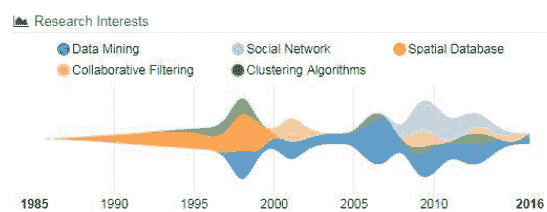

马丁·埃斯特教授在数据挖掘与机器学习领域拥有逾二十年的应用研究积淀，致力于挖掘数据科学支撑精准医学的潜能，公认的国际领军人物。他现任加拿大西蒙弗雷泽大学（SFU）计算机科学系教授，1990 年毕业于瑞士苏黎世联邦理工学院（ETH Zurich），获计算机科学博士学位。其研究版图覆盖社交媒体挖掘、生物网络分析、数据库系统及大数据赋能精准医学等前沿方向。

埃斯特博士身兼多重要职：SFU 数据库与数据挖掘实验室联合主任、计算机科学学院院长、IEEE TKDE 副主编、NSERC 资金评审委员会成员，曾任 2014 ASONAM 程序委员会主席。在生物医药交叉领域，他聚焦癌症标志物发现、患者分层及药物靶点互作预测，联合 SFU Fiona Brinkman 课题组开发的 PSORTb 工具，至今仍是细菌蛋白亚细胞定位预测的最先进基准。

### 汉斯-彼得·克里格尔：DBSCAN 缔造者，聚类与异常检测权威

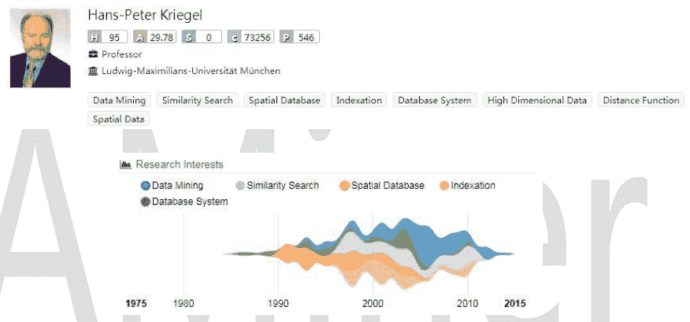

汉斯-彼得·克里格尔教授因在数据挖掘聚类、异常检测及高维数据分析（尤其是基于密度的方法）上的卓越建树而享誉学界。他执教于德国慕尼黑大学（LMU），领导计算机科学系数据库系统研究组，研究聚焦相关聚类、高维索引与分析、空间数据挖掘管理及多媒体数据库。

克里格尔教授是 ACM 杰出会员（2009），凭借在基于密度的聚类、异常检测及高维分析领域的深远影响，荣获 2015 年 SIGKDD 创新奖——数据挖掘领域最高荣誉。其合著的经典论文《A Density-Based Algorithm for Discovering Clusters in Large Spatial Databases with Noise》（SIGKDD 1996）奠定了 DBSCAN 算法基石，并斩获 2014 年 SIGKDD 时间检验奖，堪称该领域突破性里程碑。此外，他还曾获 2013 年 IEEE ICDM 研究贡献奖。

### 乔恩·克莱因伯格：天才少年、三料院士、HITS 算法之父


H指数 107 | 论文 413 篇 | 总引用 81,716 次  
任职：康奈尔大学，信息科学系  
核心标签：社交网络、计算几何、算法理论、复杂性、计算机代数、近似算法、万维网

### 研究聚焦

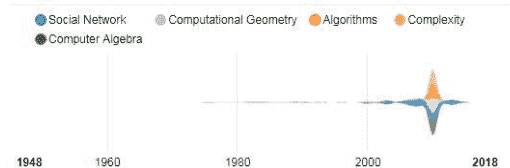

乔恩·克莱因伯格教授是计算机科学公认的“天才”标杆，HITS 算法发明人，社会网络分析方向领军学者。他现任康奈尔大学计算机科学教授，1993 年本科、1996 年博士均毕业于康奈尔/麻省理工。研究聚焦社会与信息网络分析理论基础、算法设计、Web 计算、计算机代数及近似算法。

克莱因伯格教授荣膺美国国家科学院（NAS）、国家工程院（NAE）、人文与科学院（AAAS）三料院士，担任康奈尔大学“University Professor”（美式高校最高终身教职）。奖项簿录满载：NSF 职业奖、ONR 青年研究员奖、麦克阿瑟“天才奖”、帕卡德/斯隆基金会奖学金、ACM PODS 2000 最佳论文奖、2006 年奈曼林纳奖（数学界诺贝尔奖级荣誉）。

### 韩家炜：公认“数据挖掘第一人”，经典教材作者


H指数 175 | 论文 1,217 篇 | 总引用 192,992 次  
任职：伊利诺伊大学香槟分校（UIUC）  
核心标签：数据挖掘、关系数据库、索引技术、关联规则、数据立方、数据分析、数据结构、社交网络

### 核心研究版图

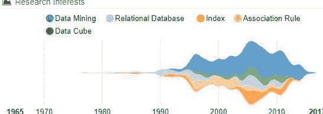

韩家炜教授被誉为“数据挖掘第一人”，具有全球影响力的杰出科学家。他长期执教于 UIUC 计算机系，1985 年博士毕业于威斯康星大学。研究领域跨越数据挖掘、数据库系统、信息网络，主攻生物网络构建与挖掘、社交媒体多维结构摘要、大型网络嵌入表示等前沿课题。

韩教授是 IEEE 与 ACM 双料会士，曾掌舵美国 ARL 资助的信息网络协同研究中心，历任 KDD、SDM、ICDM 等顶会程序委员会主席，创办并主编 ACM TKDD 期刊。荣誉包括 2009 McDowell 奖、2004 ACM SIGKDD 创新奖、2002 ICDE 杰出贡献奖。其执笔专著《Data Mining: Concepts and Techniques》是全球数据挖掘教学的“红宝书”级经典教材，Google Scholar H指数长期稳居全球计算机科学前三甲。

### 刘兵：观点挖掘开山鼻祖，语义分析领军人物

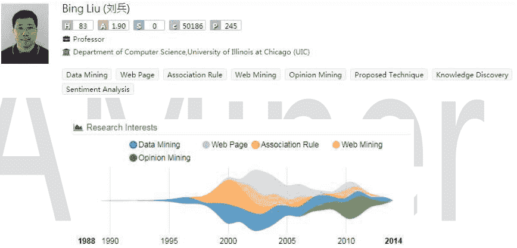

刘兵教授是数据挖掘重量级权威，语义分析与观点挖掘研究的奠基人之一。现任伊利诺伊大学芝加哥分校（UIC）计算机科学系杰出教授，博士毕业于爱丁堡大学人工智能专业。研究兴趣聚焦语义分析、观点挖掘、机器学习、虚假/欺骗性评论检测及自然语言处理（NLP）。

刘兵教授曾任 ACM SIGKDD 主席（2013-2017），兼任 ICDM、CIKM、WSDM、SDM、PAKDD 等顶会主席，担任 TKDE、TWEB、DMKD 等主流期刊副主编，荣膺 ACM、AAAI、IEEE 三大双料会士。2018 年荣获 SIGKDD 创新奖（领域最高奖）。其两篇里程碑论文——《Integrating Classification and Association Rule Mining》（KDD 1998）与《Mining and Summarizing Customer Reviews》（SIGKDD 2003）分别斩获 2014、2015 年 SIGKDD 时间检验奖。

## 约尔格·桑德：DBSCAN 联合创始人，聚类分析泰斗

H指数 38 | 论文 90 篇 | 总引用 26,148 次  
任职：阿尔伯塔大学，计算科学系  
核心标签：聚类算法、空间数据库、传感器网络、数据挖掘、索引、能效计算、投影聚类、层次聚类

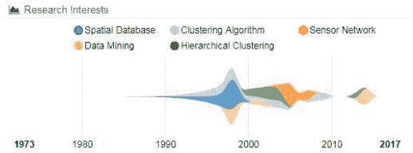

约尔格·桑德教授是 DBSCAN 算法联合创始人，聚类分析领域顶尖权威。现任阿尔伯塔大学（UA）计算机科学系教授，1998 年博士毕业于慕尼黑大学。研究涵盖数据库知识发现（KDD）、空间数据挖掘、时空索引、生物信息学，近期聚焦聚类分析、生物数据库挖掘与动态位置数据处理。

桑德教授是 IEEE TKDE、VLDB Journal、DAMI、TPAMI、JMLR、Machine Learning 等顶刊常驻审稿人。曾任第二届国际时空数据管理研讨会联合主席、2002 年 ACM SIGKDD 国际会议主席。2015 年获 ACM 杰出会员称号。其 SIGKDD 1996 经典之作奠定 DBSCAN 算法地位，该算法已成为基于密度聚类的公认基石，并荣获 2014 年 SIGKDD 时间检验奖。

## 俞士纶：大数据挖掘领军巨擘，产学研双栖典范

H指数 155 | 论文 1,074 篇 | 总引用 102,675 次  
任职：伊利诺伊大学芝加哥分校（UIC）  
核心标签：数据挖掘、索引技术、社交网络、分布式数据库、数据流、数据库系统、关系数据库、移动计算

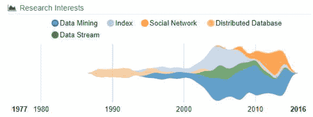

俞士纶教授是大数据挖掘领域当之无愧的领军人物。现任 UIC 计算机科学系教授，1978 年博士毕业于斯坦福大学电气工程系。研究版图宏大，覆盖数据挖掘、隐私保护发布与挖掘、数据流处理、数据库系统、互联网技术、多媒体系统、并行分布式处理及性能建模。

俞士纶博士是 ACM 与 IEEE 双料会士，现任 ACM TKDD 主编、ACM CIKM 指导委员、清华大学数据科学研究院院长、信息技术领域 Wexler 讲座教授。加入 UIC 前，长期供职于 IBM Watson 研究中心，创建了享誉全球的数据挖掘与数据管理部门。亦曾任 IEEE ICDE、IEEE Data Mining 指导委员、IEEE TKDE 主编。

凭借在大数据挖掘、融合与匿名化的深远影响，荣获 2016 ACM SIGKDD 创新奖；因在可扩展索引、查询、搜索、挖掘及匿名化的开创性贡献，获 2013 IEEE CS 技术成就奖；因数据挖掘开创性贡献，获 2003 IEEE ICDM 研究贡献奖。此外囊括 2014 EDBT 时间检验奖、2013 ICDM 十年最具影响力论文奖等殊荣。

### 克里斯托斯·法鲁特索斯：大型图挖掘与幂律分析先驱


H指数 125 | 论文 792 篇 | 总引用 85,039 次  
任职：卡内基梅隆大学（CMU），电子与计算机工程系  
核心标签：数据挖掘、社交网络、大型图、幂律分布、范围查询、信息检索、索引、图理论

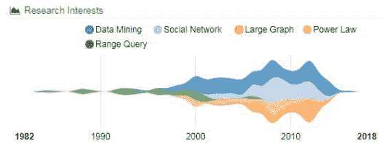

## 数据挖掘十大泰斗速览

### Christos Faloutsos：图与多媒体挖掘奠基者
卡内基梅隆大学计算机系教授 Christos Faloutsos，1989 年牛津大学博士毕业，长期耕耘数据挖掘、数据库性能、空间多媒体数据库及图挖掘等领域。他曾担任 SIGKDD 执委、ACM Fellow 及 IEEE TKDE 副主编，并历任 SIGMOD 与 KDD 大会主席。荣誉满载：VLDB 十年最佳论文奖、SIGKDD 创新奖（领域最高荣誉）、ICDM 十年最高影响力论文奖。其合著论文 "FRAUDAR"（KDD 2016 最佳）攻克了伪装性虚假评论检测难题。早期更摘得 NSF“青年研究者奖”、SIGMOD 与 KDD 最佳论文奖等。

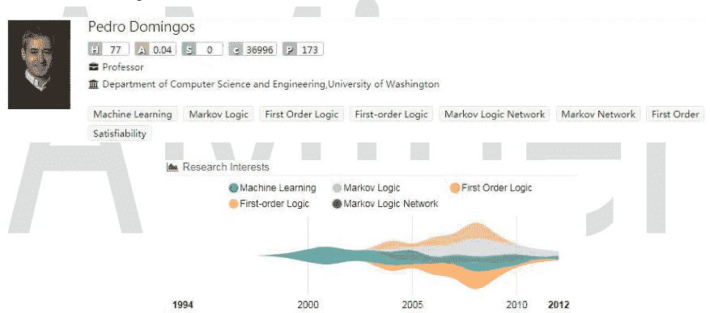

### Pedro Domingos：数据流挖掘先驱
华盛顿大学计算机科学与工程系教授 Pedro Domingos，1997 年博士毕业于 UCI，是实时数据流挖掘系统 VFDT 的创始人。研究触角延伸至机器学习、统计关系学习、可解释深度学习及大规模机器学习。身兼 AAAI Fellow、国际机器学习学会联合创始人，曾任 KDD 2003 联合主席。其代表作 "Mining High-Speed Data Streams" 奠基流式挖掘，荣膺 KDD 2015 “时间考验奖”。他亦是 KDD 2014 创新奖与创新贡献奖双料得主，在 AAAI、ICML、EMNLP 等顶会屡获佳绩。

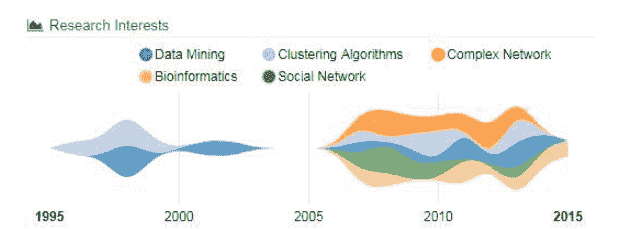

### 徐晓伟：DBSCAN 算法共同缔造者
阿肯色大学小石城分校信息科学系教授徐晓伟，1998 年慕尼黑大学博士，专注图数据挖掘、潜在结构挖掘及生物信息学。他合著的经典之作 "A Density-Based Algorithm..." (KDD 1996) 正式提出 DBSCAN 算法，该成果获 KDD 2014 “时间考验奖”，截至 2018 年引用超 1.2 万次，并被 FDA 采纳用于基因组学分析工具 atBioNet。现任 NCTR ORISE 研究员，曾服务于 KDD 2015 程序委员会。

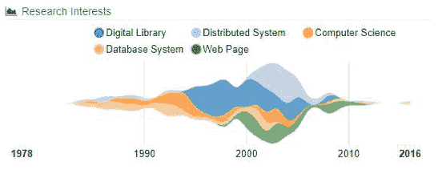

### Hector Garcia-Molina：斯坦福数据库与网络挖掘权威
斯坦福大学计算机科学与电子工程系教授 Hector Garcia-Molina，学术工业双丰收。1979 年本校博士毕业，深耕分布式系统、数字图书馆与数据库。荣膺 ACM/AAAS Fellow、美国国家工程院院士、苏黎世联邦理工荣誉博士。履历含总统信息技术咨询委员会委员、Oracle 董事、Google 联合创始人布林导师。其增量爬虫架构论文斩获 VLDB 2010 十年最佳论文奖，另收 SIGMOD 创新奖、ICDE 影响力论文奖等。

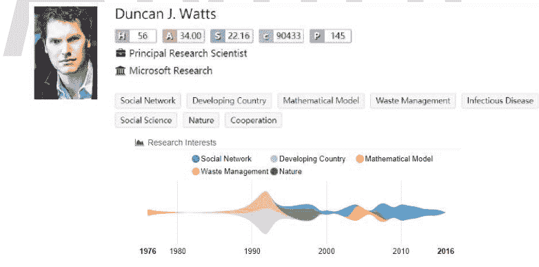

### Duncan J. Watts：复杂网络与计算社会科学跨界先锋
卡内基梅隆大学计算机系教授 Duncan J. Watts，同时是微软研究院首席研究员兼 MSR-NYC 实验室创始成员。1997 年康奈尔大学应用力学博士，跨界足迹遍布网络科学、计算社会科学。曾任哥伦比亚大学社会学教授、雅虎首席科学家，主导过 SIGMOD 与 KDD 2013 大会。荣获 2014 埃弗雷特·罗杰斯奖、2013 拉格朗日-CRT 复杂性科学奖，在复杂系统研究领域极具声量。


### Padhraic Smyth：概率建模与机器学习实战专家
加州大学欧文分校信息与计算机科学系教授 Padhraic Smyth，1988 年加州理工学院博士，擅长概率建模（混合模型、HMM）、机器学习与模式识别。双料 Fellow（ACM/AAAI），创立 UCI 数据科学计划并任首任董事，曾担任 Netflix 奖学术顾问、NASA 喷气推进实验室技术组长。产学研结合紧密，合作涵盖 eBay、三星、甲骨文等巨头。斩获 KDD 2009 创新奖（领域最高奖）及多届 KDD 最佳论文奖、NSF CAREER 奖。

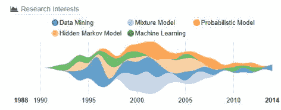

### Wei Wang：大数据分析与计算生物学领军人物
加州大学洛杉矶分校 Leonard Kleinrock 讲席教授、可扩展分析研究所（ScAi）主任 Wei Wang，1999 年本校博士毕业，曾任教北卡教堂山分校、供职 IBM Watson 研究中心。研究版图覆盖大数据分析、计算生物学、生物信息学与数据库系统。荣誉簿极厚：IBM 发明成就奖、NSF CAREER 奖、微软研究院新教员奖、IEEE ICDM 杰出服务奖、大川研究奖、ACM SIGKDD 服务奖。长期活跃于 VLDB、SIGKDD、ICDE、ISMB、RECOMB 等顶会组织与编委工作，现任 ACM SIGBio 董事。


### Thorsten Joachims：搜索引擎学习算法核心推手
康奈尔大学计算机科学系教授 Thorsten Joachims，2001 年多特蒙德工业大学博士，专攻机器学习、信息检索、搜索引擎算法及反事实学习。三料 Fellow（ACM、AAAI、洪堡基金会），曾联合主持 KDD 2015 与 ICML 2010 程序委员会。代表作 "Optimizing Search Engines Using Click-Through Data"（KDD 2002）开创性利用点击数据优化排序，奠定学界业界公认基础范式，荣获 KDD 2015 “时间考验奖”。另摘 WSDM 最佳论文奖、ICML 十年最佳论文奖等桂冠。

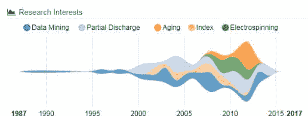

### Eamonn Keogh：时间序列挖掘领军权威
加州大学河滨分校计算机科学与工程系教授 Eamonn Keogh，2001 年博士毕业于 UCI，深耕时间序列挖掘、动态时间规整（DTW）、相似性搜索与异常检测。屡创顶会最高纪录：KDD 2012 最佳论文（万亿级子序列搜索）、IEEE ICDM 双料最佳论文（2007、2017）、SIGMOD 2001 最佳论文奖。早年即在 KDD 1997 拿下最佳论文奖亚军，确立了时间序列领域的标杆地位。


### Rakesh Agrawal：关联规则之父与产业界领军人
现任微软搜索实验室总裁 Rakesh Agrawal，学术影响力惊人（H 指数 105，引用超 11 万）。研究跨度极广，涵盖数据挖掘、数据库、信息检索、关联规则乃至热力学。作为关联规则挖掘奠基人，其 Apriori 算法至今仍是教科书核心内容。从学术殿堂跨入产业一线，主导微软搜索业务，完美诠释理论创新到大规模工程落地的转化能力。

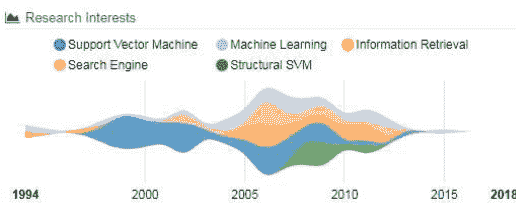
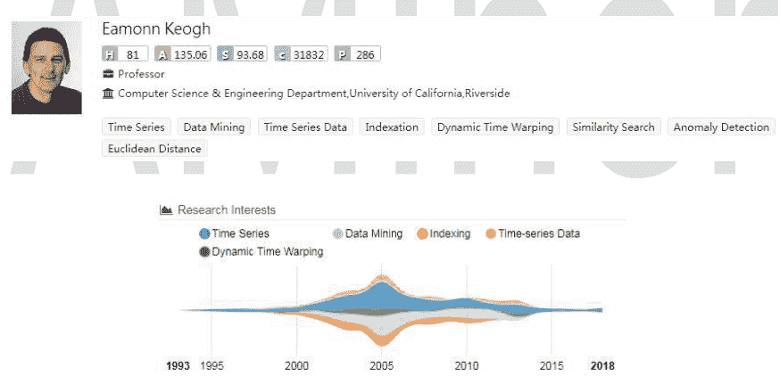

### Rakesh Agrawal：关联规则与隐私计算的奠基者

Rakesh Agrawal 博士是基础数据挖掘理论与隐私保护技术的核心奠基人。他现担任 Data Insights 实验室创始人兼总裁，早年长期服务于微软研究院。1982 年，他在威斯康星大学麦迪逊分校（UW-Madison）获得计算机科学博士学位。其学术版图横跨数据挖掘、数据库系统、信息检索、关联规则及数据隐私等核心领域。在成果落地方面，他主导或深度参与了 IBM Intelligent Miner、DB2 Mining Extender、DB2 OLAP Server、WebSphere Commerce Server、Polyglot 面向对象类型系统、Alert 主动数据库系统、Ode 对象数据库环境、Alpha 关系数据库扩展以及 Nest 分布式系统等一批里程碑级产品的打造。

荣誉等身：Agrawal 博士当选美国国家工程院（NAE）院士，同时拥有 ACM 会士、IEEE 会士头衔，曾任 IBM 院士并统领 Almaden 研究中心 Quest 课题组。《科学美国人》更将其列入首批全球 50 位顶尖科学家与技术专家榜单。奖项方面，他凭借关联规则与序列挖掘的开创性贡献摘得首届 2000 SIGKDD 创新奖；代表作 "Order preserving encryption for numeric data" 与 "Mining association rules between sets of items in large databases" 分别于 2014 年、2013 年荣膺 SIGMOD 时间测试奖；此外还囊括 2000 ACM-SIGMOD Edgar F. Codd 创新奖、2004 VLDB 10 年最具影响力论文奖、ICDE 2008 最具影响力论文奖等重量级荣誉。

### Wynne Hsu

| H | A | S | C | P |
|---|---|---|---|---|
| 51 | 42.90 | 0.81 | 18446 | 250 |

Provost's Chair Professor  
Department of Computer Science, School of Computing, National University of Singapore  
Data Mining Indexation Association Rule Mining Association Rule Data Structure Experiment Result Feature Extraction Data Cleaning

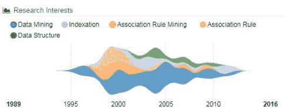

在图数据挖掘与医学数据分析领域，Wynne Hsu 教授是公认的领军人物。她现任新加坡国立大学（NUS）计算机科学系讲座教授，博士毕业于普渡大学电气与计算机工程系。研究聚焦数据挖掘、视网膜图像分析及生物医学数据挖掘，主攻医学 AI 与社交媒体分析两大前沿方向。

学术服务极为广泛：曾任 VLDB 2013 副主编、ICDM 2010 研究会副主席、SIGMOD 2011 程序委员、COMAD 2010 程序委员，并长期担任 SIGKDD（2001-2009）、ICDM（2009）等顶级会议程序委员，还活跃于 DASFAA、SAC、PRICAI、DEXA、ADMA、PAKDD 等国际会议组织工作中。

代表作方面，她携手伊利诺伊大学芝加哥分校刘兵、LinkedIn 的 Yiming Ma 合著 "Integrating Classification and Association Rule Mining"（KDD 1998）荣获 SIGKDD 2014 时间检测奖。该文率先提出融合关联规则与分类算法以强化数据挖掘分类的思想，开创了后续大量研究的先河。

- Mohammed J. Zaki


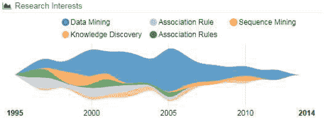

在文本挖掘、社交网络分析与生物信息学数据挖掘等领域，Mohammed J. Zaki 教授极具影响力。他现执教于伦斯勒理工学院（RPI）计算机科学系，1998 年于罗切斯特大学获计算机科学博士学位。其研究致力于开发新颖的数据挖掘与机器学习技术，重点应用于文本、社交网络与生物信息学场景。

学术兼职繁多：BIOKDD 系列研讨会创始联合主席、《Data Mining and Knowledge Discovery》副主编、ACM SIGKDD 董事会成员、ACM 杰出科学家、IEEE Fellow。曾连续担任 CIKM 2018、IEEE Big Data 2015、ICDM 2012、CIKM 2012、BIBM 2011、SIGKDD 2009、PAKDD 2008、SDM 2008 等顶会项目联合主席，兼任 SADM 区域编辑及 ACM TKDD、DMKD、SADM、IEEE TKDE 等多刊副主编。著作方面，他是剑桥大学出版社 2014 年版数据挖掘与分析教材的作者。

荣誉簿丰厚：2010-2012 年三连冠惠普创新研究奖，2003 年 ACM 服务奖，2002 年能源部早期职业首席研究员奖，2001 年 NSF 职业奖。

- David Kempe

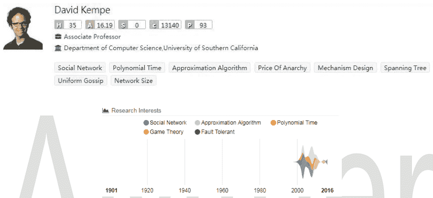

作为社交网络数据挖掘领域的青年翘楚，David Kempe 博士现任南加州大学（USC）计算机科学系副教授，2003 年毕业于康奈尔大学计算机科学系。研究立足计算机科学理论与算法设计分析，聚焦社会网络、算法经济学交叉及算法学习问题。

学术活动活跃：曾与 Ilias Diakonikolas 共任 2018 STOC 区域主席，联合 Shaddin Dughmi 与 Hamid Nazerzadeh 主持 2015 NEGT 会议。

里程碑式贡献：与康奈尔大学 Jon Kleinberg、Eva Tardos 合著 "Maximizing the Spread of Influence through a Social Network"（SIGKDD 2003）荣获 SIGKDD 2014 时间检测奖。该文确立了社交网络影响力最大化问题的数学理论边界，为后续研究奠定了坚实理论基石。其他奖项包括 ACM-EC 2014 最佳论文奖、SIGKDD 2003 最佳论文奖、ICML 2011 杰出论文奖、2009 USC 梅隆优秀导师奖、2008 ONR 青年研究员奖、2005 NSF 职业奖等。

### Inderjit S. Dhillon

Inderjit S. Dhillon  

H 77 A 299.26 S 184.42 C 32302 P 277  

Professor  

University of Texas at Austin  

Clustering Machine Learning Eigenvectors Objective Function Eigenvalues K Means Tridiagonal Matrix Graph Clustering

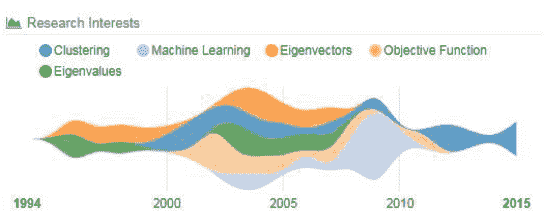

Inderjit S. Dhillon 教授长期执教于德克萨斯大学奥斯汀分校（UT-Austin）计算机科学系，1997 年毕业于 UC Berkeley 计算机科学博士。研究跨度极广，涵盖机器学习、数据挖掘、数值线性代数、数值优化、网络分析、生物信息学，近期聚焦高维数据分析、大数据分治方法、社交网络分析与基因疾病预测。

学术头衔显赫：ACM、IEEE、SIAM、AAAS 四大院士，UT Austin Gottesman 家族百年讲座教授，ICES 大数据分析中心主任，亚马逊 A9 高级研究员。曾任 JMLR 编委、IEEE TPAMI、SIMAX、《Foundations and Trends in Machine Learning》编辑。

成果丰硕：论文 "Scalable Coordinate Descent Approaches to Parallel Matrix Factorization for Recommender Systems" 获 ICDM 2012 最佳论文奖；曾获 ICES 2013 杰出研究奖、SIAM 2011 杰出论文奖、2010-2011 Moncrief Grand Challenge 奖、SIAM 2006 线性代数奖、2001 大学研究卓越奖及 NSF 职业奖。

### 3.2.2 近十年 SIGKDD 高被引学者榜单

以下汇总近十年来在 SIGKDD 会议上发表论文引用数名列前茅的代表性学者。特别说明：俞士汶、Christos Faloutsos、韩家炜三位在数据挖掘发展史上贡献卓著，前文已详细介绍，此处不再重复。

- **Jure Leskovec**  
H-index: 84 · Papers: 225 · Citations: 48,493  
Assoc. Prof.  
CS Dept., Stanford University  
Tags: Social Network, Information Cascade, Recommender System, Machine Learning

- **Philip S. Yu (俞士汶)**  
H-index: 154 · Papers: 1,051 · Citations: 101,868  
Prof.  
University of Illinois at Chicago  
Tags: Data Mining, Social Network, Distributed Database, Data Stream

- **Christos Faloutsos**  
H-index: 125 · Papers: 792 · Citations: 85,039  
Prof.  
ECE Dept., Carnegie Mellon University  
Tags: Data Mining, Large Graph, Power Law, Range Query

- **Yehuda Koren**  
H-index: 53 · Papers: 121 · Citations: 20,592  
Staff Research Scientist  
Google  
Tags: Collaborative Filtering, Recommender Systems, Data Visualization

- **Jiawei Han (韩家炜)**  
H-index: 176 · Papers: 1,225 · Citations: 194,188  
Prof.  
University of Illinois at Urbana-Champaign  
Tags: Data Mining, Relational Database, Association Rule, Data Cube

- **Jie Tang (唐杰)**  
H-index: 53 · Papers: 269 · Citations: 10,867  
Assoc. Prof.  
CS Dept., Tsinghua University  
Tags: Social Network, Semantic Web, Social Influence, Topic Model

- **Carlos Guestrin**  
H-index: 68 · Papers: 196 · Citations: 24,948  
Prof.  
CSE Dept., University of Washington  
Tags: Sensor Network, Graphical Model, Gaussian Process, Optimization

- **Gionis Aristides**  
H-index: 57 · Papers: 214 · Citations: 16,717  
Prof.  
CS Dept., Aalto University  
Tags: Data Mining, Social Network, Search Engine, Clustering

- **Huan Liu (刘欢)**  
H-index: 92 · Papers: 358 · Citations: 38,578  
Prof.  
CSE, SCIDSE/SCI, Arizona State University  
Tags: Data Mining, Feature Selection, Social Media, High Dimensional Data

- **Jimeng Sun**  
H-index: 54 · Papers: 216 · Citations: 10,331  
Assoc. Prof.  
School of CSE, Georgia Institute of Technology  
Tags: Machine Learning, Predictive Modeling, Visual Analytics, Social Network Analysis

### Jure Leskovec

H 85 A 269.52 S 171.87 C 48702 P 227  

Associate Professor  

Department of Computer Science, Stanford University  

Social Network Information Cascade Information Network Social Media Recommender System Machine Learning New Media Degree Distribution

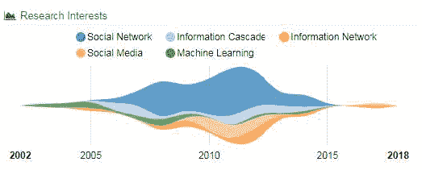

Jure Leskovec 是数据挖掘应用研究的标志性人物。斯坦福大学计算机科学系副教授，2008 年毕业于卡内基梅隆大学（CMU）机器学习系，获博士学位。研究专注于大规模社会与信息网络的挖掘建模、大数据网络与媒体分析。

身兼 Chan Zuckerberg Biohub 研究员。指导学生获 SIGKDD 2017 最佳学生论文亚军；参著 "Toeplitz Inverse Covariance-Based Clustering of Multivariate Time Series Data" 获 SIGKDD 2017 最佳研究论文亚军；"Modeling information diffusion in implicit networks" 获 ICDM 2010 最佳应用论文奖；"Graphs over time: densification laws, shrinking diameters and possible explanations" 获 SIGKDD 2005 最佳研究论文。此外在 JWRPM、WSDM、ICDM、WWW 等顶级会议期刊屡获殊荣，如 SIGKDD 2010 最佳研究论文亚军、JWRPM 2008 最佳研究论文奖、SIGKDD 2007 最佳学生论文奖等。

### Yehuda Koren

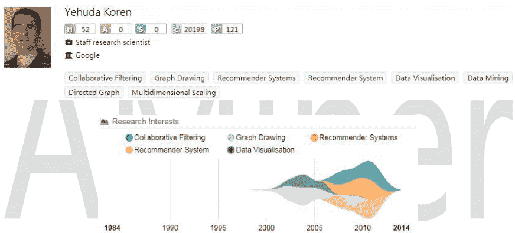

Yehuda Koren 博士是推荐系统领域的权威科学家。毕业于魏茨曼科技学院（Weizmann Institute），获计算机科学博士。研究深耕推荐系统、数据挖掘、机器学习与信息可视化。

### Yehuda Koren：推荐系统架构师，Netflix 百万大奖核心功臣

Yehuda Koren 博士现为 Google 高级研究员，此前长期在 Yahoo! Research 与 AT&T Labs-Research 担任同级职务，积淀深厚工业界实战经验。他在 SIGKDD、ICDM、RecSys、WSDM、CIKM 等顶级会议担任高级程序委员，同时兼任 IEEE TKDE 与 ACM TIST 期刊编委，深度参与学术生态建设。

其里程碑式论文 "Factorization meets the neighborhood: a multifaceted collaborative filtering model" 荣膺 SIGKDD 2018 时间检验奖。该成果开创性地打通了邻域法与潜在因子法（即今之嵌入技术）两大流派：前者擅长捕捉极局部的关联模式，后者善于刻画全局结构特征，二者融合于统一框架之下，至今仍是协同过滤领域的经典范式。他在 Netflix Prize 竞赛中两度斩获进度奖，并作为核心主力助推团队最终摘得桂冠。此外，他还囊括 2011 年 RecSys 最佳论文奖、2009 年 SIGKDD 最佳论文奖及 2005 年 INFOVIS 最佳论文奖等多项殊荣。

---

### 唐杰：AMiner 创始人，社交网络智能挖掘先驱

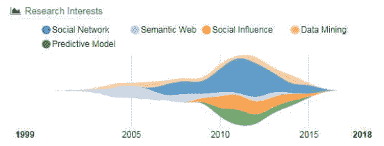

唐杰教授现任清华大学计算机系教授、系科研办主任，2006 年于清华园获工学博士。他创建的 AMiner 大数据平台已服务全球 180 余个国家，是学术搜索领域的标杆系统。研究聚焦社会网络分析、数据挖掘及语义 Web，首创基于隐含话题的异构网络建模与影响力分析范式；针对 Web 多元特性设计多套高效语义标注方案；研发的贝叶斯决策多策略本体映射模型在国际评测 OAEI 中屡夺魁。

学术产出丰硕：发表论文两百余篇，授权专利 20 项，总引用破万。成果成功落地于 IBM、Google、Nokia、搜狐等头部企业合作项目。学术服务广泛：曾出任 CIKM'16、WSDM'15、KDD 2018 等会议副主席，历任 KDD'11-18 联合主席，担任 IEEE TKDE/TBD 副主编及 ACM TKDD/TIST PC 联合主席，亦参与国家中文新闻置标语言与分类标准制定。

荣誉见证实力：斩获 KDD 2018 杰出服务奖、北京市科学技术奖一等奖、2016 AMiner 数据挖掘最具影响力学者、国家优秀青年科学基金、北京市科技新星、Scopus 全国青年科技之星、清华大学学术新人奖、IBM 全球教职创新奖、ECML/PKDD'11 最佳学生论文亚军、牛顿高级奖学金、CCF 青年科学家奖及 NSFC 优秀青年学者奖等。

---

### Carlos Guestrin：亚马逊 ML 首席科学家，概率图模型与传感网络权威


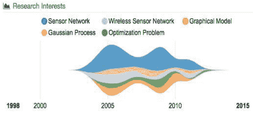

Carlos Guestrin 现任亚马逊机器学习首席科学家，斯坦福大学博士毕业，曾在卡内基梅隆大学与华盛顿大学执教，主讲机器学习核心课程。研究疆域横跨传感器网络、概率图模型、高斯过程及优化理论。

奖项含金量极高：曾入选《大众科学》杂志“2008 年十大杰出科学人才”。两度荣膺 SIGKDD 最佳论文奖：一为与 Dafna Shahaf 合作的 "Connecting the Dots Between News"（第 16 届）；一为 "Cost-effective Outbreak Detection in Networks"（第 13 届），均为该领域里程碑式工作。

---

### Aristides Gionis：阿尔托大学教授，大规模图算法与社交网络治理专家


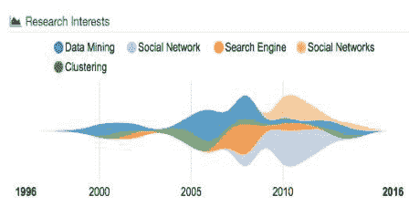

Aristides Gionis 教授任职于阿尔托大学计算机科学系，兼任 EIT Digital 数据科学专业专员，并担任 DMKD 与 TKDD 期刊编委。长期深耕数据挖掘与算法数据分析，尤擅图算法、社交网络分析及网络规模数据处理。

2018 年其课题组 5 篇论文入选 IEEE ICDM。代表作 "Reducing Controversy by Connecting Opposing Views" 引用极高，深度展示了算法技术在缓解社交媒体观点对立中的应用潜力。

---

### 刘欢：集 IEEE/ACM/AAAI 三院院士于一身的数据挖掘泰斗


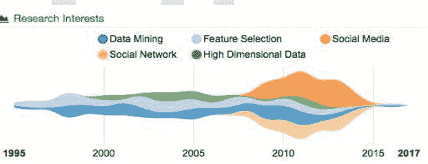

刘欢教授现任亚利桑那州立大学计算机科学与工程、信息学与决策系统工程系教授。早年本科毕业于上海交通大学，1985 年赴美深造，获南加州大学（USC）计算机科学硕博学位。研究聚焦机器学习、数据挖掘与社交网络计算方法。

凭借在数据挖掘与知识发现领域的卓越建树，2012 年当选 IEEE Fellow，2018 年底更接连当选 ACM Fellow 与 AAAI Fellow，实现“三院院士”大满贯。在该年度新增的七位 AAAI Fellow 中，刘欢教授榜上有名，彰显了其国际学术地位。

---

### Jimeng Sun：健康分析与深度预测建模先锋


Jimeng Sun 现任佐治亚理工学院计算机学院副教授，曾任职于 IBM TJ Watson 研究中心。研究专注于数据挖掘与健康分析交叉前沿，尤其在深度学习方法及大规模预测建模系统方面造诣深厚。

发表论文百余篇，申请专利 20 余项。荣获 SDM/IBM 2017 年度职业研究奖、ICDM 2008 最佳研究论文奖、SDM 2007 最佳研究论文奖、KDD 2008 论文亚军，早期职业生涯即崭露头角。

---

## 其他排名靠前的学者介绍

### 林智仁：LIBSVM 之父，机器学习软件工程与优化实践大师


林智仁教授为机器学习算法与软件工程领域权威。现任国立台湾大学计算机科学系教授，1998 年获密歇根大学工业与运营工程博士。研究跨越机器学习、数据挖掘与数值优化。

学术头衔显赫：IEEE Fellow（2011）、AAAI Fellow（2014）、ACM Fellow（2015）、ACM 杰出科学家（2011）。奖项包括 2015 东元奖、ACM RecSys 2013 最佳论文奖、SIGKDD 2010 最佳论文奖。率台大团队三夺 SIGKDD CUP 冠军（2010、2012、2013），创竞赛历史纪录。

其开发的 LIBSVM 为当前应用最广的 SVM 软件包，Google Scholar 引用超 1.8 万次，堪称工业界标配工具，深刻影响了机器学习落地进程。

---

### 谢幸：微软亚研院主管研究员，时空数据挖掘与移动计算领航者


谢幸，数据挖掘与 AI 领域杰出青年学者。现任微软亚洲研究院主管研究员，2001 年获中科大计算机软件博士。研究聚焦空间数据挖掘、位置服务、社交网络、普适计算。

学术身份重量级：ACM Fellow、IEEE Fellow、CCF 高级会员。现任互联网搜索与挖掘组主管研究员、中科大兼职博导。多届 WWW、UbiComp、SIGSPATIAL、KDD 等顶会 PC 委员。担任 ACM TSC、TIST、IMWUT、GeoInformatica、Pervasive and Mobile Computing、CCF TPCI 等刊物编委。发起创立 ACM SIGSPATIAL 中国分会，曾任 UbiComp 2011 程序联席主席。

屡获 KDD、ICDM 等顶会最佳论文奖，并受邀在 ASONAM 2017、MobiQuitous 2016、SocInfo 2015、W2GIS 2011 等会议作主旨报告，学术影响力辐射全球。

---

### 吕荣聪：软件可靠性工程奠基者，跨界融合机器学习专家


吕荣聪教授，国际知名软件可靠性与容错技术开拓者，是该领域最早的研究者之一。现任香港中文大学计算机科学与工程系教授，1988 年获 UCLA 计算机博士。研究涵盖软件可靠性工程、分布式系统、容错计算、服务计算、多媒体检索及机器学习。

荣誉等身：IEEE Fellow（2004）、AAAS Fellow（2007）、Croucher 高级研究员（2008）、教育部“长江学者奖励计划讲座教授”（第八批）。创立港中大无线互联网视像技术实验室并任主任。早年曾任职 NASA JPL、Murray Hill 贝尔实验室、Morristown 贝尔通讯研究。曾任 IEEE Transactions on Reliability、TKDE、JISE 副主编，服务学术社区数十载。

---

### 裴健：ACM SIGKDD 主席，数据科学创新奖获得者


裴健教授，加拿大西蒙弗雷泽大学计算机科学学院教授，兼任统计与精算学系、健康科学院教授，现任京东集团副总裁。

研究聚焦数据科学、大数据、数据挖掘与数据库系统，致力于数据密集型应用中的创新业务产品与高效分析技术研发。

院士级荣誉：ACM Fellow、IEEE Fellow、加拿大大学研究讲席教授（Tier I）。现任 ACM SIGKDD 主席，曾获 2017 ACM SIGKDD 创新奖（数据科学领域最高技术成就奖）、IEEE ICDM 研究贡献奖、2015 ACM SIGKDD 杰出服务奖，产学研三栖典范。

---

### 杨强：迁移学习开创者，港科大 AI 领军人物


杨强教授，国际 AI 研究权威与领军人，在学术界与工业界均有杰出贡献，近年对中国 AI 与 KDD 发展起关键推动作用。现任香港科技大学新明工程学讲席教授、计算机科学与工程系主任、大数据研究所所长，1989 年获马里兰大学计算机博士。研究核心为机器学习、数据挖掘与自动规划，尤其在迁移学习领域奠基立说。

# 中国数据挖掘领军人物与核心理论进展速览

## 杨强：华人AI学术界的“第一人”里程碑

杨强教授身兼 IEEE、AAAI、AAAS 与 IAPR 四大院士头衔，并创立了诺亚方舟实验室。他的学术履历堪称华人学者在国际 AI 治理体系中话语权跃升的缩影：2013 年打破纪录当选 AAAI 院士，三年后再创历史成为首位、亦是迄今唯一的华人 AAAI 执委；曾执掌 IJCAI（2015）、ACM KDD（2010、2012）等顶会大权；2017 年更当选 IJCAI 理事会主席，填补华人科学家在该职位上的空白。期刊建设上，他创办主编《ACM TIST》与《IEEE Big Data》两大权威刊物。竞赛层面，杨强带队斩获 2004、2005 年 KDD Cup 冠军、2011 年评级预测季军、2012 年 Nokia MDC 双冠，并荣膺 2016 年 SIGKDD 杰出服务奖，实至名归。

## 吴信东：跨太平洋的数据挖掘布道者


Xindong Wu (吴信东)

H 56 A 283.13 S 194.64 C 19893 P 529

Professor

School of Computing and Informatics, University of Louisiana at Lafayette

- Data Mining
- Learning
- Artificial Intelligence
- Machine Learning
- Pattern Matching
- Associated Rule
- Computer Science
- Data Stream
- Feature Selection


吴信东教授深耕多数据源知识发现、噪声鲁棒性及生物/影像数据挖掘应用三大方向，成果卓著。1993 年博士毕业于爱丁堡大学，现任合肥工大教授、博导，同时担任美国路易斯安那大学计算与信息学院院长、终身教授，入选国家“千人计划”与长江学者，并出任明略数据首席科学家。学术服务极广：曾掌管 IEEE TKDE 主编、IEEE TCII 主任，主编 KAIS 与 AI&KP，统领 ICDM 指导委员会，并多次担任 KDD、CIKM、ICDM、ASONAM、WI、PAKDD 等顶会程序委员会主席。奖项方面，囊括 IEEE 计算机学会技术进步奖、IEEE/WIC/ACM WI 最佳论文奖、IEEE ICDM 杰出服务奖、IEEE ICTAI 最佳论文奖（2005、2011）及 ACM SIGKDD 服务奖（2004），硕果累累。

## 3.3 国内数据挖掘研究版图扫描

### 3.3.1 基础理论：从统计/ML/DB 交叉走向自主体系

经过二十年演进，国内已构建起涵盖规则/模式挖掘、分类聚类话题学习、时空序列与大规模图稀疏学习的自主理论框架。最新突破集中在以下维度：

**分类学习：多任务、跨域与代价敏感的多维突围**  
清华张长水团队提出 rMTFL，借 Group Lasso 思想以矩阵建模任务/特征关系，精准剥离相关特征空间并识别孤立任务。同门靳晓明针对跨域文本分类，设计多域主动学习框架，自动甄别同质与异构特征，大幅降低标注成本。南京周志华组创立“代价区间”学习范式——CISVM 将区间代价引入 SVM，风险骤降 60%；后续 MAHR 算法自动挖掘标签关联，进一步推高精度。东南张敏灵利用贝叶斯网络解耦多标签依赖，将问题分解为单标签序列，多基准测试超越 SOTA。流式分类瓶颈上，中科院张鹏设计 E-tree 结构，仿 R-tree 高度平衡特性将集成预测复杂度从线性压至次线性。

**概率图模型：近似推理与工程落地的双重奏**  
北大宋国杰提出重叠分解机制，将大图拆解为小图求解，理论证明其等价于单步正则化近似。中科大俞能海转向工程落地，用马尔可夫逻辑网络驱动个人简介自动抽取，生成维基百科式结构化页面。

**无监督聚类与话题学习：演化、特征选择与补全的创新**  
清华张长水扩展 HDP 为 EvoHDP，引入时序依赖捕捉多语料库簇的生灭演化。浙大蔡登融合流形学习与一阶正则，提出 Multi-Cluster Feature Selection 保留原始簇结构。同校张仲非引入半监督 HDP (SSC-HDP) 破解图片标注难题，超越 MoM-HDP 与 Corr-LDA。浙大何晓飞联手叶杰平攻克矩阵补全，ASVT 算法将 SVT 收敛阶从 O(1/N) 提速至 O(1/N²)。北大张铭、王厚峰分别针对社交稀疏性与 Twitter 观点摘要，通过上下文增强话题模型、Affinity Propagation 聚类 Hashtag 实现实体级情感挖掘。西电团队持续推进多源半监督学习。

**模式挖掘：不确定数据与概率图的判别/频繁模式**  
清华王建勇首创 uHARMONY 直接挖掘判别模式，省去特征选择环节，SVM 性能提升 4%-10%。哈工大李建中引入 Φ-频繁概率度量不确定图子图频度，给出近似算法及解存在性证明。

---

### 3.3.2 社交网络与图挖掘：结构、影响力、传播与应用的全景图

社网分析已成数据挖掘最热赛道，任务粒度持续细化。核心热点聚焦：宏/中/微观结构分析、群体行为与影响力建模、信息传播机理、图模式挖掘与图学习算法，以及社交推荐/搜索等落地场景。

**网络结构挖掘：从关系识别到社区发现的层层深入**  
清华唐杰联合 UIUC 韩家炜，基于时变因子图无监督自动推断社交关系。西电黄健斌提出密度聚类算法，兼顾任意形状社区与 Hub/孤立节点检测；东北于戈优化图聚类算法赋能社区发现。

**社会影响力：话题感知、并行计算与行为预测的立体攻坚**  
唐杰团队构建话题敏感影响力模型，实现细粒度定量刻画并设计 Hadoop 并行版；进而提出 NTT-FGM 容噪预测模型，三重建模（结构/属性/历史）显著提升精度。北大宋国杰针对移动社网影响力最大化，利用账号传播探测社区再动态规划选 Top-K 节点，给出近似界。中科院项亮/袁泉创建 STG 图融合长短期偏好，Injected Preference Fusion 推荐算法在实测集上相对增益 15%-34%。

**用户行为建模与应用：从众心理、实体识别与跨域推荐**  
唐杰提出 Confluence 模型拆解个体/群体从众效应，多数据集验证有效。王建勇利用兴趣模型增强 Twitter 命名实体识别；又研跨域话题学习破解链接稀疏/知识互补/话题偏斜三难题，提升跨社区合作者推荐。异构网络随机游走优化个性化标签推荐；位置感知群组推荐、关键词传播驱动视频描述补全降噪（优酷数据验证）；李国良构建 R-tree 混合索引加速位置推荐。

**信息传播：结构洞识别与扩散预测的理论与实践**  
超越经典 SIR/SIS 模型，唐杰团队基于网络流差最大化定义“结构洞跨越者”，证明 NP-Hard 并给出近似算法，Twitter 与学术网双验证。崔鹏采用逻辑回归预测腾讯微博传播模式，拓展工程化落地路径。

---
*注：文中上标数字对应原文献引用，详见原文注释 ⁹⁻³⁸ 及 [24]-[38]。*

北京大学崔斌团队研发出 LCARS 推荐模型，该模型引入话题模型机制，同步对社交数据中的地理位置、文本内容及用户偏好三大维度开展联合建模。实验选取豆瓣网真实数据集验证，结果显示该模型在推荐精度上显著超越基准算法[39]。

- 31 J. Tang, S. Wu, J. Sun. Confluence: Conformity Influence in Large Social Networks[C]. Proc. KDD 2013. pp. 347-355.

- 32 T. Lou, J. Tang. Mining Structural Hole Spanners Through Information Diffusion in Social Networks[C]. Proc. WWW 2013. pp. 837-848.

- 33 P. Cui, S. Jin, L. Yu, F. Wang et al. Cascading Outbreak Prediction in Networks: A Data-Driven Approach[C]. Proc. KDD 2013. pp. 901-909.

- 34 J. Tang, S. Wu, J. Sun et al. Cross-domain Collaboration Recommendation[C]. Proc. KDD 2012. pp. 1285-1293.

- 35 W. Feng, J. Wang. Incorporating Heterogeneous Information for Personalized Tag Recommendation in Social Tagging Systems[C]. Proc. KDD 2012. pp. 1276-1284.

- 36 W. Zhang, J. Wang, W. Feng. Combining Latent Factor Model with Location Features for Event-Based Group Recommendation[C]. Proc. KDD 2013. pp. 910-918.

- 37 J. Zhang, X. Fan, J. Wang et al. Keyword-Propagation-Based Information Enriching and Noise Removal for Web News Videos[C]. Proc. KDD 2012. pp. 561-569.

- 38 G. Li, Y. Yang, T. Wang et al. Location-Aware Publish/Subscribe[C]. Proc. KDD 2013. pp. 802-810.

- 39 H. Yin, Y. Sun, B. Cui et al. LCARS: A Location-Content-Aware Recommender System[C]. Proc. KDD 2013. pp. 221-230.

针对推荐系统中的“刷单/托攻击”难题，南京财经大学武之昂联合北航吴俊杰，创新性地提出基于 MC-Relief 的特征筛选策略，并构建了半监督朴素贝叶斯判别模型，有效识别恶意刷分行为。

社交网络挖掘的延伸应用还涵盖搜索优化、情感计算、实体抽取等方向。厦门大学洪文兴团队融合信息抽取与用户行为分析，落地打造厦门市人才招聘实战系统；上海交通大学朱燕民团队携手惠普实验室，深度挖掘长周期 GPS 轨迹数据，实现地图数据的动态自动更新，并在上海 2000 余辆出租车及芝加哥公交车数据上完成大规模实证对比。

清华大学唐杰团队聚焦社交网络层级化情感分类，构建基于用户层次的模型，并在 Twitter 数据集上完成有效性验证。

### 3.3.3 大数据挖掘：破解海量数据处理瓶颈

大数据（海量数据）的核心痛点在于：规模庞大导致现有软件工具难以在可接受时限内完成采集、管理、挖掘与决策转化。正如《大数据时代》所言，其本质是摒弃抽样捷径，拥抱全量数据分析[40]。行业公认的 “4V” 特征——海量、高速、多样、真实性，倒逼技术向可扩展、并行化、分布式算法演进。

**算力加速层面**，中国人民大学李翠平团队将 GPU 引入 SimRank 相似度计算。作为基于网络拓扑的经典算法，SimRank 因高复杂度长期难以大规模落地；GPU 并行加速实现 20 倍性能跃升[41]。

**商业决策层面**，上海交通大学余勇团队利用海量广告投放日志，将 “价格-预算” 博弈建模为带约束优化问题，求解最优投放策略[42]。

**模型创新层面**，清华大学朱军团队提出可扩展最大熵话题模型，联合学习主题分布与预测器，双任务协同显著提升精度[43]；崔鹏等人针对大规模相似性检索，设计关系感知异构哈希框架，在 Hamming 空间同步优化同构与异构映射，腾讯微博与 Flickr 数据实测性能大幅领先[44]。

**知识工程层面**，北京大学张岩团队利用机器学习从维基百科自动抽取概念增强 WordNet，研发出 WikiNet。该工具具备新词敏锐感知能力，覆盖率大幅提升，有力支撑多项文本挖掘任务[45]。

- 45 S. Jiang, L. Bing, B. Sun et al. Ontology Enhancement and Concept Granularity Learning: Keeping Yourself Current and Adaptive[C]. Proc. KDD 2011. pp. 1244-1252.

# 4 场景落地：数据挖掘的商业变现路径

数据挖掘自诞生即为应用而生。当下零售、旅游、物流、医疗等领域竞相布局，其核心价值在于以数据重构效率与质量。

## 4.1 零售业：从货架管理到用户心智捕获

零售是数据挖掘的主战场。条形码与 POS 机普及，沉淀海量交易流水、客户画像、库存流转与服务日志，构筑挖掘地基。技术落地六大核心场景：

1.  **全域销售态势感知**：按品类、销量、门店、价格、时间多维切片，实时掌握经营脉搏，精准评估促销增量与库存周转，动态调整商品结构应对季节与竞品变化。
2.  **库存成本极致压降**：销售与库存数据打通分析，指导补减货决策；引入 EDI 直连供应商，实现 VMI（供应商管理库存），剥离中间商，降低零售端压货风险。
3.  **关联布局与智能推荐**：挖掘购物篮关联规则，驱动商品陈列组合、捆绑推荐与交叉销售，缩短决策路径，激发冲动消费。
4.  **促销 ROI 精准复盘**：基于用户画像定向投放（时、地、人、法），规避广告泛滥与资源浪费；历史复盘挖掘高 LTV 人群，指导未来预算分配。
5.  **市场趋势前瞻研判**：统计模型挖掘购买习惯、广告转化与战略信息；时序分析预测季度/月度销量，指导降价清仓与品类规划。
6.  **会员忠诚度全生命周期运营**：序列模式挖掘解码会员消费轨迹，识别流失预警信号，动态调价换品锁存老客、引流新客[46]。

## 4.2 旅游业：数据驱动的“诗与远方”

旅游大数据挖掘不仅赋能企业增效，更重塑公共服务体验。精准预判客流趋势、洞察偏好画像，四大落地抓手：

1.  **高价值信息提炼与网站重构**：日志点击流与浏览行为分析，锁定热门目的地与兴趣点；反哺网站架构优化，实现供需精准匹配，提升服务完备度。
2.  **潜客挖掘与精准触达**：聚类分析融合访问轨迹，构建用户知识图谱；实时捕获意向变化，推送定制化行程，提升转化率。
3.  **线路规划的数据化决策**：挖掘线路/目的地访问热度，筛选高潜线路动态规划；网站结构自适应调整，强化粘性与流量。
4.  **千人千面的产品推荐引擎**：全域旅游数据库配合挖掘工具，解析行为偏好生成差异化服务包，精准匹配 “人-货-场”，最大化满意度[47][48]。

- 46 安建华 数据挖掘技术在零售业中的应用研究 [D] 东北财经大学 2005
- 47 徐蓉艳 旅游大数据与挖掘及其在旅游行业的应用方向 [J] 中国市场 2014（51）：204-208
- 48 罗成奎 大数据技术在智慧旅游中的应用 [J] 旅游纵览 2013（8）：59-60

## 4.3 物流业：降本增效的隐形引擎

数据挖掘贯穿物流信息系统全链路，赋能客户洞察与网络优化：

*   **CRM 智能化升级**：特征工程识别高意向人群精准获客；关联规则驱动交叉销售与增购升级；流失模型预警挽留，从事后复盘转向事前干预。
*   **配送调度最优解**：车辆路径问题 (VRP) 算法求解最短总里程调度方案，在满足时窗约束下最大化车辆利用率，显著压缩末端履约成本。

## 4.4 医学界：重塑临床决策与健康生态

### 4.4.1 临床实践：从经验医学迈向精准医学

电子病历 (EMR) 普及为挖掘铺平数据路。核心价值体现四维：

1.  **知识生产加速器**：NLP 技术破解非结构化病历自动化采集难题，大幅缩短循证证据生成周期。
2.  **临床决策智能中枢**：海量文献难以直达一线，挖掘 EMR 生成决策仪表盘辅助诊疗。IBM Watson 联手斯隆凯特林中心，即以此赋能肿瘤精准诊疗[49]。
3.  **个性化医疗落地基石**：系统生物学多组学数据与电子病历深度融合，为精准用药与定制化方案提供数据支撑。
4.  **患者赋能与共同决策**：知识可视化直达患端，激活患者主观能动性，重构医患协作关系[50]。

### 4.4.2 交叉融合：Data Mining × Health Care 全景扫描

基于全局与近期热点趋势，选取 “Data Mining & Health Care” 进行笛卡尔交叉分析。通过知识图谱计算与子领域笛卡尔乘积热力挖掘，复盘 2008 年至今演进脉络。

**热力值模型**：加权融合交叉论文引用量等指标，量化交叉深度与广度。配套提供学者影响力（论文量、h-index）、论文相关度（关联度、被引）多维排序。

**中外对比三维镜**：“专家数量/论文数量” 直观对比投入规模；“论文影响力对比” 聚焦引用质量，洞察话语权分布。

# 5 KDD 视角：巨头们的数据挖掘攻防图谱

数据挖掘已成工业界兵家必争之地。本章聚焦顶会 KDD，梳理国际四巨头（Google、Amazon、Microsoft、Meta）与国内三强（阿里、腾讯、百度）的学术版图，涵盖理论突破与工程落地双轨。

## 5.1 Google：从 MapReduce 到 BERT 的技术基因延续

Google 近乎年年在 KDD 交出惊艳答卷：MapReduce、Word2Vec、BigTable、BERT……数据挖掘始终是其核心基本盘。2018 年全球研究中心合计中稿 7 篇全文（含 3 篇访问学生合作），剖析如下：

| 标题 | 作者 | 收录会议 |
|---|---|---|
| Q&R: A Two-Stage Approach toward Interactive Recommendation. | Konstantin Christakopoulou (University of Minnesota), Alex Beutel (Google Inc), Rui Li (Google Inc), Sagar Jain (Google Inc), Ed H. Chi (Google Inc) | KDD'18 |
| Collaborative Deep Metric Learning for Video Understanding. | Joonseok Lee (Google AI Perception), Sami Abu-El-Haija (Google AI Perception), Balakrishnan Varadarajan (Google AI Perception), Apostol (Paul) Natsev (Google AI Perception) | KDD'18 |
| Anatomy of a Privacy-Safe Large-Scale Information Extraction System Over Email. | Ying Sheng (Google), Sandeep Tata (Google), James B. Wendt (Google), Jing Xie (Google), Qi Zhao (Google), Marc Najork (Google) | KDD'18 |
| Scalable K-means Clustering via Lightweight Coresets. | Olivier Bachem (Google Brain & ETH Zurich), Mario Lucic (Google Brain), Andreas Krause (ETH Zurich) | KDD'18 |
| Optimal Distributed Submodular Optimization via Sketching. | MohammadHossein Bateni (Google), Hossein Esfandiari (Harvard University), Vahab Mirrokni (Google) | KDD'18 |

# KDD’18 复盘：Google 全系出击，从 YouTube 推荐到核心理论的硬核实录

KDD 2018 的 Applied Data Science Track（即早年的 Industrial Track）异常火爆，投稿量逼近 500 篇，侧面印证了工业界在研发端的持续加码。本届 Google 成果丰硕，既有落地业务的实战总结，也不乏硬核理论突破，咱们逐个拆解来看。

---

### 交互式推荐：不再猜用户，改问用户
**《Q&R: A Two-Stage Approach toward Interactive Recommendation》**

传统推荐流程是“画像→匹配”，痛点显而易见：难捕捉实时兴趣，更难读懂当下查询意图。交互式推荐本质上是主动学习/在线学习的变体，近年业界关注度极高。该文抛出两阶段范式：
1.  **主动提问**：基于 RNN 自动生成话题，依据用户画像主动发问；
2.  **修正推荐**：收集反馈，二阶段混合模型修正结果。

YouTube 实战验证证实，深度生成话题能显著提升最终推荐质量。


图 26 两阶段交互推荐范式示意

---

### 视频理解：一套表示，打通分类、搜索、推荐
**《Collaborative Deep Metric Learning for Video Understanding》**

Google AI Perception 团队提出统一表示学习框架，将视频分类、搜索、个性化推荐等割裂任务归一为“学习统一嵌入”问题。实验跑在 2 亿+ YouTube 视频上，全指标碾压传统方案。核心逻辑可归纳为“多模态对齐 + 度量学习”：

-   **视觉塔**：Inception-v3 提取视频内容特征；
-   **听觉塔**：VGG-style 音频模型 + ResNet-50 结构编码声音；
-   **目标函数**：Triplet Loss（Anchor/Positive/Negative），拉近同类、推远异类；
-   **融合策略**：Early Fusion 与 Late Fusion 均实测对比。


图 27 视频推荐（左）与视频检索（右）的统一嵌入效果


图 28 多模态融合框架细节

量化实验更有看头：128 维、4 bit/维（仅 64 字节）的压缩嵌入，召回指标（T2E 2.84%、E2T 5.40%）几乎无损，工程落地价值极高。

| Output Dim | Quantization | Size (byte) | T2E | E2T |
|---|---|---|---|---|
| 128 | 4 bit/dim | **64** | **2.84%** | **5.40%** |
| 256 | 4 bit/dim | 128 | 2.94% | 5.58% |
| ... | ... | ... | ... | ... |

图 29 不同压缩配置下的视频推荐评测


图 30 YouTube-8M 数据集检索定性案例

---

### 邮件结构化抽取：隐私、规模、偏差三重奏
**《Anatomy of a Privacy-Safe Large-Scale Information Extraction System Over Email》**

Gmail 团队延续 2010 年“推荐收信人”实战风格，推出 **Juicer** 系统，从海量邮件中抽取账单、行程等结构化信息。三大难点逐个击破：
1.  **隐私**：模板扩展引入 **k-anonymity** 匿名化，种子标注仅用用户自愿贡献的小量数据；
2.  **偏差**：训练数据极少且偏向资深用户，团队直接用“老用户数据”训练主模型，以偏制偏修正分布漂移；
3.  **规模**：全流程工程化支撑大规模服务。


图 31 Juicer 系统整体架构

实测新模板下，账单、优惠、酒店三类任务的 Sender-Subject 模板召回均超 76%，结构化模板亦超 66%，工程可用性强。

| Model | Structural Templates Existing | Structural Templates New | Sender-Subject Templates Existing | Sender-Subject Templates New |
|---|---|---|---|---|
| Bills | 84.6 | 66.8 | 94.1 | 76.2 |
| Offers | 100.0 | 87.8 | 100.0 | 87.4 |
| Hotels | 97.7 | 98.7 | 100.0 | 78.0 |

图 32 新旧模板在不同任务上的泛化表现

---

### 大规模 K-Means：理论给速度“背书”
**《Scalable k-Means Clustering via Lightweight Coresets》**

Google Brain 瑞士团队联手 ETH Andreas Krause 教授，主攻 Research Track。核心贡献：**Lightweight Coresets (LWCS)**。思路清晰——从海量数据中极小概率抽样构建 Coreset，在其上跑 K-Means，理论误差有界。

**理论保证**：Coreset 大小与特征维 $d$ 及聚类数 $k$ 乘积成正比 $O\left( \frac{dk \log k + \log \frac{1}{\delta}}{\epsilon^2} \right)$。

实验风格硬核：数据集虽小（KDD Cup 蛋白、手机传感器 CSN、音乐年份 Song、RNA 序列），但对比充分——Uniform 随机采样、经典 CS 算法、自提 LWCS。结果显示 LWCS 将相对误差压至 **16% 级别**，同时保持 **两个数量级加速**；CS 算法误差更低但加速仅百倍级。典型的“工程换理论、理论守底线”权衡。

图 33 多维度实验对比：LWCS 在误差与加速比上取得极佳帕累托前沿

---

### 分布式子模块优化：4 轮通讯，最优近似
**《Optimal Distributed Submodular Optimization via Sketching》**

Google 纽约团队新作（传闻纽约扩编，研究先行）。针对 NP-Hard 的子模块优化（影响力最大化、Set Cover 核心模型），传统贪心虽有 $1-1/e$ 近似，但难分布式。本文给出基于 Sketching 的分布式算法：**仅 4 轮通讯**，即达 $1-1/e-\epsilon$ 最优近似，单机负载 $\tilde{O}(n)$，显著优于前工作 $O(mkn^\delta)$ 或 $mk^2$ 级负载。

理论对比表极具说服力：在 k-cover、Facility Location、Set Cover with Outliers 等核心问题上，轮数固定为 4，近似比最优，负载线性于 $n$ 而非 $m,n$ 乘积，彻底打通大规模分布式落地瓶颈。

| Problem | Source | # Rounds | Approximation | Load per machine |
|---|---|---|---|---|
| k-cover | This Paper (Sec 2) | **4** | **$1 - \frac{1}{e} - \varepsilon$** | **$\tilde{O}(n)$** |
| facility location | This Paper (Sec 3) | **4** | **$1 - \frac{1}{e} - \varepsilon$** | **$\tilde{O}(n)$** |
| ... | Prior Arts | Higher / Variable | Lower / Same | Higher ($mn, mk^2$) |

理论突破扎实，工程落地想象力巨大。

---

**小结**：KDD'18 Google 版图清晰——Applied Track 拼工程深度（YouTube、Gmail 实战沉淀），Research Track 拼理论高度（Coreset、Submodular 分布式）。从“问用户要反馈”到“几十字节跑视频检索”，从“邮件隐私抽取”到“分布式最优近似”，每一篇都直击工业界痛点，极具参考价值。

### 表 34：Submodular 函数对比概览

| dominating set | Section 4 | 4 | \( (1 + \varepsilon) \log \frac{1}{\lambda} \) | \(\tilde{O}(n)\) |

**“集合序列”挖掘隐含模式的新范式**

“Sequences of Sets” 出自康奈尔大学青年学者 Austin Benson 之手（他是 Jure Leskovec 的得意门生），联合 Google 重量级研究员 Ravi Kumar 与 Andrew Tomkins 共同发表。该作聚焦数据挖掘领域的基石问题：**给定一串集合序列（每个时间点对应一个集合，如用户行为日志，相邻时刻集合或同或异），如何自动捕捉其中随时间演变的隐含结构？** 论文设计了一套随机生成模型，旨在同时建模两类时序依赖：一是相邻集合间的直接关联，二是引入“近期偏好”参数，让模型更擅长捕捉最新动态。

**多任务学习进阶：多网关专家混合模型（MMoE）**

“Modeling Task Relationships in Multi-task Learning with Multi-gate Mixture-of-Experts” 则是深度学习时代多任务学习的力作。多任务学习在推荐等工业系统中早已普及，其核心在于设置共享表征层，数学上可证此举引入正则化效应，增强泛化。最基础的形态是“共享底层”架构（如图 35(a)）。本文创新在于构建**多层共享专家网络**（如图 35(c)），引入 MoE 机制学习多组共享表征，并通过单网关或多网关策略进行自适应融合。


### 图 35 共享表征层架构对比

实验层面，UCI 基准测试显示该方法稳超经典基线（见下表）。后续在 Google 亿级工业数据上验证，各项指标亦稳居榜首，展现出极强的工程落地潜力。

| Group 1 | AUC/Income best | mean | AUC/Marital Stat w/ best income | mean |
|---|---|---|---|---|
| Single-Task | 0.9398 | 0.9337 | **0.9933** | 0.9922 |
| Shared-Bottom | 0.9361 | 0.9295 | 0.9915 | 0.9921 |
| L2-Constrained | 0.9389 | 0.9359 | 0.9922 | 0.9918 |
| Cross-Stitch | 0.9406 | **0.9361** | 0.9917 | 0.9922 |
| Tensor-Factorization | 0.7460 | 0.6765 | 0.8175 | 0.8412 |
| OMoE | 0.9387 | 0.9319 | 0.9928 | 0.9923 |
| **MMoE** | **0.9410** | 0.9359 | 0.9926 | **0.9927** |

### 图 36 UCI 数据集离线实验对比

| Metric | AUC@2M | AUC@4M | AUC@6M | R2@2M | R2@4M | R2@6M |
|---|---|---|---|---|---|---|
| Shared-Bottom | 0.6879 | 0.6888 | 0.6900 | 0.08812 | 0.09159 | 0.09287 |
| L2-Constrained | 0.6866 | 0.6881 | 0.6895 | 0.08668 | 0.09030 | 0.09213 |
| Cross-Stitch | 0.6880 | 0.6885 | 0.6899 | 0.08949 | 0.09112 | 0.09332 |
| OMoE | 0.6876 | 0.6891 | 0.6893 | 0.08749 | 0.09085 | 0.09230 |
| **MMoE** | **0.6894** | **0.6897** | **0.6908** | **0.08978** | **0.09263** | **0.09362** |

### 图 37 Google 大规模在线数据实验结果

---

## 5.2 亚马逊：从电商巨头到 AI 先锋的布局

近年亚马逊势头迅猛，完成了从电商平台到云霸主、再到 AI 强人的华丽三级跳。在数据挖掘顶会 KDD 2018 的应用数据科学（ADS）赛道，亚马逊拿下 2 篇全文长文，并占据 2 个应用科学邀请报告席位（详见下表），彰显其在人才密度、开源生态与核心技术上的深厚积淀。逐一拆解如下：

| 论文/报告标题 | 作者单位 | 会议类别 |
| :--- | :--- | :--- |
| **Buy It Again: Modeling Repeat Purchase Recommendations** | Rahul Bhagat 等 | KDD'18 全文 |
| **OpenTag: Open Attribute Value Extraction from Product Profiles** | Guineug Zheng 等 | KDD'18 全文 |
| **Challenges and Innovations in Building a Product Knowledge Graph** | Xin Luna Dong | KDD'18 邀请报告 |
| **Algorithms, Data, Hardware and Tools - a Perfect Storm** | Alex Smola 等 | KDD'18 邀请报告 |

### 重复购买推荐：挖掘“回头客”生意经

**《Buy It Again: Modeling Repeat Purchase Recommendations》** 出自西雅图总部研究院。传统推荐逻辑默认用户不重复购买（如电视），实则大量消耗品（牙膏、纸巾）高频复购。文章将其定义为 **Repeat Purchase** 问题，提出 **Poisson-Gamma (PG) 模型** 及其增强版 **MPG**，离线实验大幅领先基线 ATD（见下表）。

| Models | Precision (%Lift) | Recall (%Lift) | NDCG (%Lift) |
|---|---|---|---|
| ATD | +8.22% | +5.56% | +5.70% |
| PG | +32.34% | +29.04% | +37.11% |
| **MPG** | **+36.51%** | **+30.33%** | **+39.42%** |

### 图 38 PG/MPG 模型离线效果对比

线上 A/B 测试同样亮眼：MPG 在 BIA 场景下较 ATD 还能再涨 1.3% CTR（p<0.05），印证了 KDD ADS 赛道“重工程落地、重线上价值”的审稿偏好——算法未必颠覆，但须实战有效。


| Control | Treatment | CTR (%Lift) | p-value |
|---|---|---|---|
| Existing Recommendations | BIA Recs (ATD) | +7.1% | 0.001 |
| BIA Recs (ATD) | **BIA Recs (MPG)** | **+1.3%** | **0.015** |

### 图 39 线上 A/B 测试实证

### OpenTag：开放域商品属性抽取的集大成者

**《OpenTag: Open Attribute Value Extraction from Product Profiles》** 由实习生主导攻关。针对商品页面“开放属性值抽取”难题（目标值可能未预定义），构建 **BiLSTM + CRF + Attention + 主动学习** 四位一体架构（见下图），融合现有 SOTA 技术，兼顾精度、可解释性与标注成本。


### 图 40 OpenTag 模型整体架构

多维度实验（标题/描述/要点、单属性/多属性）均刷新 SOTA，F1 值全面领先 BiLSTM 与 BiLSTM-CRF 基线（见下表）。

| Datasets/Attribute | Models | Precision | Recall | Fscore |
| :--- | :--- | :--- | :--- | :--- |
| Dog Food: Title Attr: Flavor | BiLSTM | 83.5 | 85.4 | 84.5 |
| | BiLSTM-CRF | 83.8 | 85.0 | 84.4 |
| | **OpenTag** | **86.6** | **85.9** | **86.3** |
| Camera: Title Attr: Brand | BiLSTM | 94.7 | 88.8 | 91.8 |
| | BiLSTM-CRF | 91.9 | **93.8** | 92.9 |
| | **OpenTag** | **94.9** | 93.4 | **94.1** |
| Detergent: Title Attr: Scent | BiLSTM | 81.3 | 82.2 | 81.7 |
| | BiLSTM-CRF | **85.1** | 82.6 | 83.8 |
| | **OpenTag** | 84.5 | **88.2** | **86.4** |
| Dog Food: Desc Attr: Flavor | BiLSTM | 57.3 | 58.6 | 58.0 |
| | BiLSTM-CRF | 62.4 | 51.5 | 56.9 |
| | **OpenTag** | **64.2** | **60.2** | **62.2** |
| Dog Food: Bullet Attr: Flavor | BiLSTM | 93.2 | 94.2 | 93.7 |
| | BiLSTM-CRF | 94.3 | 94.6 | 94.5 |
| | **OpenTag** | **95.7** | **95.7** | **95.7** |
| Dog Food: Title Multi Attr | BiLSTM | 71.2 | 67.4 | 69.3 |
| | BiLSTM-CRF | 72.9 | 67.3 | 70.1 |
| | **OpenTag** | **76.0** | **68.1** | **72.1** |

### 图 41 OpenTag 多场景实验结果汇总

### 邀请报告：知识图谱与基础设施的前瞻思考

- **《Challenges and Innovations in Building a Product Knowledge Graph》**：前 Google 知识图谱核心、现亚马逊科学家 **Xin Luna Dong** 压轴分享。深度剖析商品知识图谱构建四大痛点：概念抽取、知识融合、核心概念发现、用户侧图谱融合，干货满满。
- **《Algorithms, Data, Hardware and Tools - a Perfect Storm》**：KDD 常青树、**Alex Smola**（前 CMU 教授，现 AWS ML 负责人）联合 Edo Liberty 献策。聚焦超大规模时代，统计机器学习在算法复杂度、硬件异构性面临的挑战与破局机遇，视角极高。

---

## 5.3 微软：老牌论文王者的大数据实战范本

微软向来是学术界“发纸大户”，KDD 2018 以一作身份收录 6 篇全文 + 1 邀请报告（汇总表见下），聚焦**大规模场景下的高效、极速分析**。逐篇速览：

| 文章标题 | 作者单位 | 会议类别 |
| :--- | :--- | :--- |
| Applying the Delta Method in Metric Analytics: A Practical Guide with Novel Ideas | Alex Deng 等 | KDD'18 全文 |
| Web-Scale Responsive Visual Search at Bing | Houdong Hu 等 | KDD'18 全文 |
| BigIN4: Instant, Interactive Insight Identification for Multi-Dimensional Big Data | Qingwei Lin 等 | KDD'18 全文 |
| RapidScorer: Fast Tree Ensemble Evaluation by Maximizing Compactness in Data Level Parallelization | Ting Ye 等 | KDD'18 全文 |
| Recurrent Binary Embedding for GPU-Enabled Exhaustive Retrieval from Billion-Scale Semantic Vectors | Ying Shan 等 | KDD'18 全文 |
| Efficient Attribute Recommendation with Probabilistic Guarantee | Chi Wang 等 | KDD'18 全文 |
| Planet-Scale Land Cover Classification with FPGAs | Joseph Sirosh | KDD'18 邀请报告 |

### Delta Method：大规模指标评估的统计利器

**《Applying the Delta Method in Metric Analytics: A Practical Guide with Novel Ideas》** 虽归类 ADS，但理论底色浓厚。针对大数据环境下指标评估的不确定性，引入 **Delta 方法**（基于大数定律/中心极限定理）：若样本 i.i.d.（同均值、同方差），样本量趋于无穷时，统计量分布趋近正态，从而构建置信区间、显著性检验的通用框架，并给出新颖实用指南...

### 核心方法与 Bing 视觉搜索实录

研究首先明确了样本均值偏差服从正态分布这一统计前提，核心聚焦于 **Delta 方法** 及其四大典型应用场景。与传统 Fielder 方案相比，该方法在大幅简化求解流程的前提下，依然保持了可媲美的精度水平。

**“Web-Scale Responsive Visual Search at Bing”** 详细拆解了微软必应已上线的商业级视觉搜索服务。如下图所示，用户上传图片（左侧为桌面端演示）后，系统能自动定位图中关键元素，同时支持用户手动框选感兴趣对象，进而秒级召回关联商品；右侧展示了移动端的交互形态。


**图 42 必应视觉搜索交互示意**

后台构建了百亿级图库索引，单张图片预存千维特征向量，定制化检索延迟压缩至 **200 毫秒** 级。底层采用 DNN 提取语义特征，配合最近邻检索策略完成匹配，工程落地价值极高。


**图 43 核心算法流程**

---

### BigIN4：高维数据的交互式洞察引擎

**“BigIN4: Instant, Interactive Insight Identification for Multi-Dimensional Big Data”** 提出了一套面向高维大数据的交互式极速查询方案。在数据立方体上，其查询速度较传统抽样基线提升 **50 倍**。核心思路在于**降维投影**，如下图所示。


**图 44 降维投影机制**

系统可自动挖掘五大类洞察模式：
*   **异常突出**：个别数据模式显著偏离整体
*   **主导因子**：单一维度主导数据分布
*   **双值集中**：某维度两个取值覆盖绝大多数样本
*   **离群偏移**：时间序列上的突变点
*   **趋势单调**：序列的持续增/减模式

---

### RapidScorer：树模型集成的极致压缩与加速

虽刊登于应用赛道，**“RapidScorer: Fast Tree Ensemble Evaluation by Maximizing Compactness in Data Level Parallelization”** 实则偏向理论研究。文中提出一种树集成加速算法并部署于搜索引擎，基于前作 RapidScore 扩展而来，本质上实现了**决策树集成的模型融合压缩**。在 MSN 与 AdsCTR 两大公开基准上，性能全面超越 XGBoost 等主流基线。

---

### RBE：十亿级语义向量的二进制残差检索

**“Recurrent Binary Embedding for GPU-Enabled Exhaustive Retrieval from Billion-Scale Semantic Vectors”** 创新性提出 **RBE（循环二进制嵌入）**，核心亮点在于支持在二进制码中**增量注入残差向量**。该模型能在超大规模检索系统中极速定位最相关对象。

RBE 借助残差网络架构，高效计算 Query 与 Keyword（如广告竞价词）的语义匹配度，整体架构如下图。


**图 45 RBE 模型架构**

二进制编码将存储开销降低一个数量级，这对高吞吐检索系统至关重要——既解决了海量向量的内存墙，又大幅提升了检索效率。

---

### 高效属性推荐：理论保证下的近似最优解

**“Efficient Attribute Recommendation with Probabilistic Guarantee”** 切中大数据分析基础痛点：给定双数据集，如何快速找出差异性最强的属性？暴力遍历虽直观但计算代价高昂。文中给出**近似算法并附带理论误差界证明**，实测在真实数据上**加速 10 倍且误差趋近于零**。

---

### 星球级地表分类：FPGA 加速的工程奇迹

**“Planet-Scale Land Cover Classification with FPGAs”** 是一场工业界邀请报告，由微软商业智能部 CTO **Joseph Sirosh** 主讲（前亚马逊全球创新平台副总裁）。团队利用卫星影像构建美农业图像库，创新采用 **FPGA 加速深度推理**，实现 **10 分钟吞吐 20TB 高清影像（约 40 万帧/秒）** 的处理能力，展示了软硬协同的极致性能。

---

## 5.4 Facebook：双子星闪耀应用赛道

2018 年 Facebook 在 KDD 录用 2 篇论文，均入选 **Applied Data Science Track**，逐一解读如下。

| 论文标题 | 作者团队 | 会议 |
| :--- | :--- | :--- |
| **Rosetta: Large Scale System for Text Detection and Recognition in Images** | Fedor Borisyuk 等 | KDD'18 |
| **A Real-time Framework for Detecting Efficiency Regressions in a Globally Distributed Codebase** | Martin Valdez-Vivas 等 | KDD'18 |

**Rosetta：十亿级图片的实时 OCR 引擎**

详细拆解了其大规模 OCR 系统 **Rosetta**。海量用户上传图片蕴含文本信息，提取后可显著优化搜推效果。面临双重挑战：一是文本形态极其多元（多语言、多字体、自定义词、特殊符号）；二是日处理量巨大，要求**实时吞吐**。

采用**两阶段流水线**：Faster-RCNN 快速定位文本区域，全卷积网络精准识别字符内容。架构如下。


**图 46 Rosetta 两阶段抽取架构**

---

**代码效能劣化的实时监控框架**

聚焦代码变更导致的性能劣化监控。面对 **20 亿月活** 与复杂业务矩阵，本质是**流式异常检测**。传统方案分为点异常、模式异常、持续漂移异常三类，核心难点在于“异常”定义。文中针对**持续漂移型异常**，引入 **CUSUM 算法** 并完成可扩展工程落地。

---

## 5.5 阿里巴巴：电商 AI 的矩阵式布局

阿里深耕电商数据挖掘，尤其在**表征学习与强化学习**成果丰硕。2018 年以第一单位在 KDD 拿下 **8 篇全文**（下表含往届佳作回顾），重点解读部分代表作。

| 论文标题 | 作者团队 | 会议 |
| :--- | :--- | :--- |
| Reinforcement Learning to Rank in E-Commerce Search Engine... | Yujing Hu 等 | KDD'18 |
| Perceive Your Users in Depth... | Yabo Ni 等 | KDD'18 |
| Billion-scale Commodity Embedding... | Jizhe Wang 等 | KDD'18 |
| Visual Search at Alibaba | Yanhao Zhang 等 | KDD'18 |
| **Deep Reinforcement Learning for Sponsored Search Real-time Bidding** | **Jun Zhao 等** | **KDD'18** |
| Learning and Transferring IDs Representation... | Kui Zhao 等 | KDD'18 |
| Deep Interest Network for Click-Through Rate Prediction | Guorui Zhou 等 | KDD'18 |
| Learning Tree-based Deep Model for Recommender Systems | Han Zhu 等 | KDD'18 |
| *(历届佳作：Cascade Ranking KDD'17, KunPeng KDD'17 等)* | | |

---

### 深度强化学习重塑实时竞价 (RTB)

**“Deep Reinforcement Learning for Sponsored Search Real-time Bidding”** 揭秘其展示广告 RTB 系统的重构。传统依赖海量手工特征的搜索式范式迁移性差，文中引入**深度强化学习**，让智能体在复杂博弈环境中自主进化。架构上保留底层检索，上层接入 **TensorFlow** 训练 RL 策略，总体设计如下。


**图 47 RTB 系统总体架构**

### 阿里巴巴：电商搜索与推荐核心技术深度解析

在搜索排序领域，论文 **“Reinforcement Learning to Rank in E-Commerce Search Engine: Formalization, Analysis, and Application”** 创新性地引入强化学习机制，旨在最大化长期累积收益。该研究正式定义了 **搜索会话马尔可夫决策过程（SSMDP）**，将电商搜索建模为多步决策问题。理论证明表明，各排序步骤间存在紧密关联，而非相互孤立，因此必须优化累积回报。针对高收益方差与奖励分配不均的难题，作者设计了 **DPG-FBE（全备估计确定性策略梯度）** 算法，成功求解 SSMDP 下的最优排序策略。


图 48 DPG-FBE

图示展示了策略 $\pi$ 下用户的三类核心行为——购买（B, b）、继续浏览（C, c）、离开（L, l）及其发生概率，同时描绘了浏览历史（h）驱动的状态转移与状态值函数定义。

---

**“Visual Search at Alibaba”** 详细阐述了阿里巴巴的以图搜图技术体系。用户上传图片后，系统自动识别实体对象并检索相似或相关商品，场景覆盖移动端与桌面端。


图 49 阿里巴巴的可视化搜索

工程实现上，采用 **“词典构建 + 特征表达”** 双轨并行策略：离线端融合图像内容与目标检测结果完成表达学习并建立视觉词典；在线端借助 CNN 实时完成目标检测与特征提取，随后与索引库匹配。核心流程结合分类模型与近邻检索（ANN）缩小搜索范围：先用 Softmax Loss 微调 GoogLeNet V1 得到类别概率；再检索 Top30 近邻图像进行加权概率计算；最后两路概率加权融合输出最终结果。此外，引入弱监督学习联合优化目标检测与特征表达，直接利用用户点击行为作为训练样本；配合二值化特征索引与重排机制，实现了移动端毫秒级响应。


图 50 可视化搜索系统的离线学习（左）在线搜索系统的总体架构（右）

---

在用户理解维度，论文 **“Perceive Your Users in Depth: Learning Universal User Representations from Multiple E-commerce Tasks”** 提出 **DUPN（深度用户感知网络）**。该模型通过多任务学习提炼通用用户行为表达，能从复杂序列中抽取核心特征并迁移至下游任务。


图 51 基于注意力机制网络和 RNN 的深度架构

架构设计上，行为序列经 Embedding 映射后，由 **LSTM 建模时序依赖**，配合 **Attention-based Pooling 聚合关键信息**，输出统一用户向量。该向量支持跨人群共享。检索阶段，系统召回标题含查询词的候选集，经排序后输出 Top 列表。


图 52 排序过程

---

面对十亿级商品规模，**“Billion-scale Commodity Embedding for E-commerce Recommendation in Alibaba”** 基于用户行为构建商品图，引入图嵌入技术学习商品向量。演进路径为：**BGE（基础图嵌入） → GES（融合辅助信息解决长尾冷启动） → EGES（加权机制区分辅助信息重要性）**。


图 53 电子商务网站中商品的表示学习


图 54 SI 辅助信息

其中 SI 代表辅助信息（SI0 为商品自身）。稀疏特征常为 One-hot 编码，稠密嵌入对应商品与 SI 向量，隐层表达融合商品及其 SI 的嵌入集。整套系统部署于 **Xtensorflow (XTF)** 平台，支撑十亿级参数高效训练。

---

针对工业级搜索的精度与效率博弈，**“Cascade Ranking for Operational E-commerce Search”** 提出 **CLOES（多级级联排序模型）**。这是级联模型在大型公共电商搜索中的首次学术报告。模型分级策略为：前序阶段用低成本特征/模型快速过滤低相关项；后序阶段引入高精度复杂模型精排。创新点在于改进的 **Logistic 回归补偿函数**，有效缓解前级“召回不足”与“延迟过高”问题。单级分类器采用 Sigmoid 函数。2017 年淘宝三级级联落地实证：CPU 消耗降低 20% 且精度不损。

### 文本建模混合框架：Conv-RNN


图 55 多级级联排名模型

---

**“A Hybrid Framework for Text Modeling with Convolutional RNN”** 提出 **Conv-RNN**，融合 CNN 与 RNN 优势：RNN 擅长变长上下文编码，CNN 的 Max-pooling 强化特征筛选。


图 57 conv-RNN 框架

**四层核心结构**：
1. **Word Embedding**：句子映射为词向量矩阵；
2. **Bi-RNN**：双向编码获取前向/后向隐状态；
3. **Convolution**：隐状态上卷积，ReLU 激活；
4. **Pooling**：Max-pooling 取最大值生成特征向量。

文本分类任务中，在 Conv-RNN 之上拼接联合层：$ X_{join} = \left[ h'^f_{|s|}, X'_q, h'^b_{|s|} \right]' $，经 Softmax 输出类别概率。延伸至问答匹配任务，引入 **权值共享** 与 **Attention 机制**，进一步提升 QA 匹配效果。

---

### 分布式学习基建：鲲鹏系统

**“KunPeng: Parameter Server based Distributed Learning Systems and Its Applications in Alibaba and Ant Financial”** 介绍蚂蚁金服自研参数服务器框架 **“鲲鹏”**，大幅提升十亿级样本/特征下的算法效能。


图 56 鲲鹏的总体架构

**核心模块**：
- **Server Nodes**：模型分片存储；
- **Worker Nodes**：数据分片计算；
- **Coordinator**：流程调度（初始化/迭代/终止）；
- **ML Bridge**：脚本化数据预处理工作流；
- **PS-Core**：核心通信组件；
- **Fuxi**：集群监控与容错。

用户感知透明，少量代码即可驾驭复杂通信调度。已支持 LR, FTRL, MART, FM, HashMF, DSSM, DNN, LDA 等主流算法大规模落地。

---

## 5.6 腾讯：KDD 2018 代表作速览

2018 年腾讯以第一作者单位在 KDD 录用 2 篇全文（含合作项），核心解读如下：

| 论文标题 | 作者及会议信息 |
| --- | --- |
| **MIX: Multi-Channel Information Crossing for Text Matching** | Haolan Chen 等，**KDD'18** |
| **On the Generative Discovery of Structured Medical Knowledge** | Chenwei Zhang, Yaliang Li 等，**KDD'18** |
| **An Efficient Two-Layer Mechanism for Privacy-Preserving Truth Discovery** | Yaliang Li 等，**KDD'18** |

---

### MIX：多通道信息交叉文本匹配

**“MIX: Multi-Channel Information Crossing for Text Matching”** 融合 CNN 与 Attention，构建多粒度特征交互网络。


图 58 局部匹配图

**三阶段流程**：
1. **多粒度切分**：句子在不同粒度级别分割为片段；
2. **Attention 通道构建**：利用句法信息设计注意力矩阵；
3. **特征交叉融合**：加权通道与 2D 卷积交叉局部匹配信号与注意力信号，提取显著组合特征完成匹配。

---

### CRVAE：结构化医学知识生成式发现

**“On the Generative Discovery of Structured Medical Knowledge”** 由芝加哥大学与腾讯医疗 AI Lab 合作，引入生成式范式解决医学实体对发现，旨在低数据门槛下挖掘高质量新知识。


图 59 关系增强的实体表示

**CRVAE（条件关系变分自编码器）** 无需繁杂特征工程，从不同维度的实值对中学习共性。


图 60 生成有意义的医疗关系

**模块协作**：
- **编码器**：输入实体对与关系指示，输出关系增强实体表达，构建潜在空间 $Q_\Phi$；
- **解码器**：联合训练重建实体对分布 $P_\theta$；
- **生成器**：结构同解码器，但从潜在分布采样而非重建输入，**直接为特定关系生成新颖医学实体对**。

---

## 5.7 百度：KDD 2018 入选概览

百度 2018 年 KDD 一作全文 2 篇（表含往年部分），关键工作如下：

| 论文标题 | 作者 | 收录会议 |
| --- | --- | --- |
| **Du-Parking: Spatio-Temporal Big Data Tells You Realtime Parking Availability** | Yuecheng Rong 等 | **KDD'18** |
| **Exploring the Urban Region-of-Interest through the Analysis of Online Map Search Queries** | Ying Sun, Hengshu Zhu 等 | **KDD'18** |

*注：上述两篇论文分别聚焦时空大数据实时停车预测与在线地图查询挖掘城市兴趣区，技术细节此处略，原文表格已呈核心元数据。*

# 前沿洞察：智能系统架构与数据挖掘演进趋势

## 一、 四大经典智能应用架构深度拆解

### 1. Du-Parking：时空大数据驱动的实时车位感知引擎
针对都市停车难痛点，百度团队推出 **Du-Parking** 方案，依托时空融合大数据实现车位空闲状态的即时推断。核心引擎为一深度神经网络（DNN），解耦建模车速效应、时间周期性及环境综合因子，融合在线传感器流与多源静态库，对时空异构特征施行差异化编码，输出精准可用性等级。


**系统采用三层解耦架构：**

*   **离线批处理引擎（Grid Computing）**：支撑模型全生命周期的分布式后台。
    *   **静态画像构建**：从百度地图仓库抽取 POI 空间属性，夯实特征基座。
    *   **样本流水线**：将 30 分钟粒度的实时占用率序列，切片转化为带标签训练样本，自动入库版本化管理。
    *   **分类别建模策略**：融合动静态特征与标签，按 POI 业态（商场、写字楼、居民区等）独立拟合模型，规避长尾分布干扰。
*   **实时流计算层**：毫秒级响应地理坐标与导航轨迹流。核心逻辑为坐标→地理网格索引映射→内存数据库落盘，为在线推理提供极致低延迟特征向量。
*   **在线推理服务层**：聚合 POI 画像、实时定位、导航轨迹三元特征，拼接为统一稠密向量，调用离线训练权重即时输出车位可用性概率分布。

### 2. 基于地图检索日志的城市活力区（ROI）自动发现与画像
该工作利用海量在线地图查询日志，以 **Region-of-Interest (ROI)** 为切入点，构建城市人群活动规律的自动化分析范式。


**技术路线分双阶段推进：**

*   **阶段一：ROI 无监督勾勒**。将城市空间离散化为细粒度栅格，统计查询日志中的栅格间迁徙流量构建转移概率矩阵。引入 PageRank 迭代量化栅格“活力值”，再经密度聚类（如 DBSCAN）自动圈定高活力连通簇，即为目标 ROI 集合。
*   **阶段二：访客时空画像建模**。创新提出 **URPTM (Urban Region Probabilistic Topic Model)**。建模假设：每个 ROI 等价一“文档”，查询记录中的时间戳、发起坐标、POI 标签视作“词袋”。模型推断后，可获得各 ROI 访客的时空偏好分布（如：周末上午倾向公园、工作日晚高峰聚集商圈），直赋能旅游需求预测、商业选址决策等场景。

### 3. MTLVM：招聘市场趋势的序贯贝叶斯建模范式
针对招聘需求动态演变，研究首创无监督学习范式，提出 **MTLVM (Mixture Temporal Latent Variable Model)** 实现市场趋势自动化建模。


**核心创新三维度：**

*   **时序依显式建模**：在贝叶斯生成框架内，显式刻画企业招聘状态 $c_{e,t}$ 的时间马尔可夫依赖，自动学习潜在招聘主题。
*   **主题动态演化机制**：引入分层狄利克雷过程（HDP），赋予模型“非参数化”能力——招聘主题可随时间自然生成、消亡与分裂，精准捕捉技能热点迁徙（如：从 Hadoop 到 Spark，再到大模型微调）。
*   **生成式叙事链路**：
    1.  企业级潜在因子 $G_c \sim DP(\gamma)$；
    2.  结合历史状态 $c_{e,t}$ 生成招聘需求文档 $D_e$；
    3.  $D_e$ 解码为时变主题分布 $\Phi_{e,t,m,n}$；
    4.  最终由多项式分布采样生成具体职位描述 $\chi_{e,t,m,n}$。
*   **工程落地验证**：基于亿级真实招聘数据构建原型系统，验证模型对市场拐点的前瞻捕捉能力，为猎企与人才供决策参考。

### 4. 人才职业轨迹的生存分析新范式：多任务协同与排序正则
李华宇等人聚焦组织内部人才成长，融合 **多任务学习** 与 **排序约束**，重塑生存分析建模范式，统一攻克“流失预警”与“晋升预测”双核心命题。

**差异化建模策略：**

*   **流失建模——离散时间生存视角**：将不同时间窗口的在职概率预测拆解为并行子任务，引入多任务协同机制共享表征。针对右截断（未离职）与完全观测样本的分布差异，施加不同时间点生存标签间的**单调性排序约束**，显式捕捉非周期性冲击（如项目失败）与周期性节奏（如年终奖发放）驱动的生命周期特征。
*   **晋升建模——相对职级序数回归**：以各时间切片的相对职级跃迁为建模目标，引入**分级排序约束**（Ordinal Ranking Constraints），强制模型学习符合职级阶梯逻辑的单调表征，大幅提升职业轨迹预测的准确性与可解释性。
*   **实证强音**：真实企业人才档案大规模实验，双任务指标均显著超越基线，验证范式普适性。

---

# 六、 趋势篇：数据挖掘领域演进全景扫描

## 6.1 发展脉络：三维热点演变图谱
AMiner 基于全量论文数据，绘制数据挖掘学科的 **近期热点、全局热点、早期热点** 三维演进图谱。图谱以彩色流带代表细分赛道，宽度映射热度强度，纵轴为年份，横向位置反映当年该赛道在全学科中的热度排名，直观复现学科版图的兴衰更替与范式迁移。


## 6.2 技术预见：核心赛道十年演进路线图
聚焦近十年文献语料，从技术拓扑维度解构内在关联与迭代趋势。重点追踪 **社交网络、大数据、关联规则、聚类、时间序列、文本挖掘、用户行为、推荐系统、异常检测、专家系统** 十大核心技术关键词，勾勒技术代际传承与融合创新路径。


## 6.3 跨域融合深度剖析：Data Mining × Health Care

### 实验设计：双域子赛道笛卡尔交叉扫描
为量化跨界融合深度，分别遴选两大领域热度最高、耦合最强的 11 个细分子域，构建 $11 \times 11$ 笛卡尔积矩阵进行纵向追踪：

*   **Data Mining 侧**：数据挖掘、社交网络、大数据、关联规则、聚类、时间序列、文本挖掘、用户行为、推荐系统、异常检测、专家系统。
*   **Health Care 侧**：医疗卫生、电子病历、患者安全、卫生经济、临床决策支持、公共卫生、生物医学研究、风险因子、乳腺癌、癌细胞、癌症研究。

### 历史交叉热力洞察 (2007–至今)

**宏观规模**：全球 **170,757** 位学者投身交叉研究，沉淀文献 **38,219** 篇。

**核心高热聚集区**（单元格数值为 `累计总量 / 近期增量`，色深代表热度）：

| 交叉方向 | 热度指标 | 洞察解读 |
| :--- | :--- | :--- |
| **聚类 × 风险因子** | **31,670 / 5,880** | 全矩阵最高，疾病亚型分层与风险分级核心技术地位确立 |
| **文本挖掘 × 生物医学研究** | **56,161 / 14,152** | 单项总量冠军，文献实体关系抽取、知识图谱构建主力军 |
| **聚类 × 生物医学研究** | **20,603 / 3,900** | 基因表达谱聚类、单细胞分群等基础研究刚需 |
| **聚类 × 公共卫生** | **13,413 / 2,403** | 传染病聚集区探测、健康人群分层核心手段 |
| **聚类 × 乳腺癌** | **12,759 / 2,001** | 肿瘤分子分型与预后分层应用深度最高 |
| **社交网络 × 公共卫生** | **2,159 / 727** | 流行病传播建模、健康舆情监测新增长极 |
| **数据挖掘 × 生物医学研究** | **2,096 / 467** | 通用方法论在生物信息学落地的基础贡献 |

**关键结论**：**聚类分析** 是连接数据挖掘与医疗健康最通用、渗透最深的技术基石，广泛赋能风险分层、疾病亚型发现、公卫监测；**文本挖掘** 则在生物医学文献知识化进程中占据统治性地位。

### 未来三年交叉趋势推演

基于历史轨迹外推，预测未来三年交叉文献产出（格式：`预测累计总量`<br>`预测新增量`）：

**趋势看点：**

1.  **聚类持续称霸核心腹地**：在生物医学研究(5,212)、风险因子(3,850)、公共卫生(2,354)、乳腺癌(1,440)等高价值子域保持绝对领先增速，确立“精准医疗分层首选工具”地位。
2.  **文本挖掘深耕文献挖掘**：生物医学研究方向预测新增 2,566 篇，总量破 12,000，巩固科研加速器核心引擎地位。
3.  **大数据工程化渗透加速**：在医疗卫生(318)、电子病历(128)、公共卫生(133)等应用层增速显著，标志着从算法研究向平台落地、数据治理转型。
4.  **社交网络赋能公共卫生新叙事**：预测新增 193 篇，流行病元联网建模、健康错误信息溯源成新蓝海。
5.  **长尾技术趋于成熟收敛**：关联规则、异常检测、专家系统等在细分医疗场景增量有限，进入技术成熟期，创新重心上移至复合型应用。

> **总视角**：数据挖掘与医疗健康的跨界已从“技术试水期”跃迁至“深度融合期”。**聚类驱动的精准分层**、**文本挖掘支撑的科研增智**、**大数据赋能的智慧公卫** 将是未来三年最确定的高价值增长极。

# 数据挖掘前瞻：医疗交叉热点与四大核心趋势深度解析

**图 69 数据挖掘与医疗健康领域未来三年交叉融合趋势预测**

| 研究方向 | 指标数据 | | | | | | | | | | |
| :--- | :--- | :--- | :--- | :--- | :--- | :--- | :--- | :--- | :--- | :--- | :--- |
| **推荐系统** | 68<br>25 | 10<br>3 | 1<br>1 | | 10<br>4 | 9<br>6 | 36<br>10 | 3 | 40<br>6 | | |
| **异常检测** | 5<br>5 | 3<br>1 | 3<br>1 | | 3<br>1 | 1 | 13<br>2 | 6 | | | |
| **专家系统** | 37<br>10 | 17<br>5 | 1 | | 39<br>18 | 5<br>2 | 26<br>6 | 10<br>6 | 4<br>8 | | |

基于过往数据积累的演变规律，我们对未来三年数据挖掘与医疗健康交叉研究的高热度赛道进行了推演。可以预见，当前处于领跑位置的交叉方向将继续保持强劲势头，主要聚焦于以下五大核心组合：

1.  **文本挖掘 × 生物医学研究**
2.  **聚类分析 × 生物医学研究**
3.  **聚类分析 × 风险因子识别**
4.  **聚类分析 × 公共卫生防控**
5.  **聚类分析 × 癌细胞研究**

随着数据规模呈指数级增长、算力与算法持续迭代升级，数据挖掘技术的演进路径已清晰指向以下四大维度：

## 核心趋势一：隐私计算成刚需，数据安全筑底座
信息技术飞速演进，海量数据汇聚网络空间，其中蕴含大量敏感个人信息。挖掘技术的成熟让各行业能从中提炼高价值洞见辅助决策，显著提升运作效能。然而，数据红利释放的同时，个人隐私面临前所未有的暴露风险。在此背景下，构建兼顾数据可用与不可见的**隐私保护挖掘范式**，已从“加分项”转变为行业发展的“生存项”⁵¹。

## 核心趋势二：可视化赋能认知，人机协同提效能
数据库规模持续膨胀，硬件算力跃升带来的信息呈现量远超人类视觉与认知的极限。单纯依赖原始数据形态已无法满足高效洞察需求。**可视化分析工具**应运而生，它利用先进渲染与交互技术，将抽象数据映射为直观图形，打通人机交互“最后一公里”，让知识发现过程从被动接收转为主动探索⁵²。

## 核心趋势三：场景化落地深化，跨界融合成常态
数据挖掘本质是“为用而生”。当前零售、物流、文旅、医疗等垂直领域已广泛落地，随着信息社会全面到来，行业数据迎来爆发式增长。**“数据挖掘 + 专业领域知识”**的深度耦合将成常态，技术边界将不断向细分场景渗透，催生更多定制化、高价值的解决方案。

## 核心趋势四：多模态挖掘兴起，挖掘对象破圈文本
长期以来，文本挖掘占据主流。但视频、音频等非结构化多媒体数据的井喷，构建起庞大的多媒体数据资产库。**多媒体数据挖掘**通过融合视听特征与语义理解，从海量集合中发掘隐性、有效、可解释的高价值模式，支撑趋势研判与关联分析，为决策层提供认知级支持。未来，这必将成为技术攻关与应用创新的新高地。

---

# 权威参考：KDD 顶会高影响力文献导览

## KDD 历史高被引经典（奠基之作）

- [1] Kempe D, Kleinberg J, Tardos É. **Maximizing the spread of influence through a social network**[C]// Proceedings of the 9th ACM SIGKDD. 2003:137.
- [2] Hu M, Liu B. **Mining and summarizing customer reviews**[C]// Proceedings of the 10th ACM SIGKDD. 2004.
- [3] Joachims T. **Optimizing Search Engines using Clickthrough Data**[C]// ACM SIGKDD. 2002.
- [4] Koren Y. **Factorization meets the neighborhood: a multifaceted collaborative filtering model**[C]// Proceedings of the 14th ACM SIGKDD. 2008.
- [5] Joachims T. **Training linear SVMs in linear time**[C]// ACM SIGKDD. 2006.
- [6] Cho E, Myers S A, Leskovec J. **Friendship and mobility: User Movement in Location-Based Social Networks**[C]// ACM SIGKDD. 2011.
- [7] Jeh G, Widom J. **SimRank: a measure of structural-context similarity**[C]// ACM SIGKDD. 2002.
- [8] Domingos P, Richardson M. **Mining the network value of customers**[C]// Proceedings of the 7th ACM SIGKDD. 2001.
- [9] Domingos P, Hulten G. **Mining high-speed data streams**[C]// Proceedings of the 6th ACM SIGKDD. 2000.
- [10] Backstrom L, Huttenlocher D, et al. **Group formation in large social networks: membership, growth, and evolution**[C]// Proceedings of the 12th ACM SIGKDD. 2006.

## KDD 近十年高被引代表（范式引领）

- [1] Koren Y. **Factorization meets the neighborhood: a multifaceted collaborative filtering model**[C]// Proceedings of the 14th ACM SIGKDD. 2008.
- [2] Cho E, Myers S A, Leskovec J. **Friendship and mobility: User Movement in Location-Based Social Networks**[C]// ACM SIGKDD. 2011.
- [3] Koren Y. **Collaborative filtering with temporal dynamics**[J]. Communications of the ACM, 2010, 53(4):89.
- [4] Leskovec J, Backstrom L, Kleinberg J. **Memetracking and the dynamics of the news cycle**[C]// Proceedings of the 15th ACM SIGKDD. 2009:497.
- [5] Chen W, Wang Y, Yang S. **Efficient influence maximization in social networks**[C]// Proceedings of the 15th ACM SIGKDD. 2009:199.
- [6] Chen W, Wang C, Wang Y. **Scalable Influence Maximization for Prevalent Viral Marketing in Large-Scale Social Networks**[C]// Proceedings of the 16th ACM SIGKDD. 2010.
- [7] Chen T, Guestrin C. **XGBoost: A Scalable Tree Boosting System**[J]. 2016.
- [8] Tang J, Zhang J, Yao L, et al. **ArnetMiner: extraction and mining of academic social networks**[C]// ACM SIGKDD. 2008.
- [9] Wang C, Blei D M. **Collaborative topic modeling for recommending scientific articles**[C]// ACM SIGKDD. 2011.
- [10] Sheng V S, Provost F, Ipeirotis P G. **Get another label? improving data quality and data mining using multiple, noisy labelers**[C]// Proceedings of the 14th ACM SIGKDD. 2008:614.

## KDD 近十年最佳论文奖（卓越贡献）

- [1] Basu S, Bilenko M, Mooney R J. **A Probabilistic Framework for Semi-Supervised Clustering**[C]// 2004.
- [2] Yang G. **The complexity of mining maximal frequent itemsets and maximal frequent patterns**[C]// Proceedings of the 10th ACM SIGKDD. 2004:344-353.
- [3] Wu X, Srihari R. **Incorporating Prior Knowledge with Weighted Margin Support Vector Machines**[C]// 10th ACM SIGKDD. 2004.
- [4] Kolter J Z, Maloof M A. **Learning to detect malicious executables in the wild**[C]// Proceedings of the 2004 ACM SIGKDD. 2004:470.
- [5] Jiang D, Pei J, Ramanathan M, et al. **Mining coherent gene clusters from gene-sample-time microarray data**[C]// Proceedings of the 2004 ACM SIGKDD. 2004:430.
- [6] Leskovec J, Kleinberg J, Faloutsos C. **Graphs Over Time: Densification and Shrinking Diameters**[J]. 2006.
- [7] Radlinski F, Joachims T. **Query chains: learning to rank from implicit feedback**[C]// ACM SIGKDD. 2005.
- [8] Xin D. **Summarizing Itemset Patterns: A Profile-Based Approach**[C]// 11th ACM SIGKDD. 2005.
- [9] Kolter J Z, Maloof M A. **Learning to detect malicious executables in the wild**[C]// Proceedings of the 2004 ACM SIGKDD. 2004:470.
- [10] Norén G N, Orre R, Bate A. **A hit-miss model for duplicate detection in the WHO drug safety database**[C]// Proceedings of the 11th ACM SIGKDD. 2005:459.

## KDD 历届“时间考验奖”获奖佳作速览

**2006 年：奠基之作集萃**
*   **[11] 线性时间训练线性 SVM** | Thorsten Joachims | KDD 2006
*   **[12] 基于交换随机化评估数据挖掘结果** | Aristides Gionis 等 | KDD 2006
*   **[13] 稀疏随机投影** | Ping Li 等 | KDD 2006
*   **[14] 结合上下文分析为频繁模式生成语义标注** | Qiaozhu Mei 等 | KDD 2006

**2007 年：模型与图挖掘深化**
*   **[15] 面向大规模二元数据的预测性离散潜在因子模型** | Deepak Agarwal 等 | KDD 2007
*   **[16] 融合时间平滑性的演化谱聚类** | Yun Chi | 2007
*   **[17] 网络中高性价比的疫情爆发检测** | Jure Leskovec 等 | KDD 2007
*   **[18] 多项式主题模型的自动标注** | Qiaozhu Mei 等 | KDD 2007
*   **[19] 基于事件框架表征交互图演化行为** | Sitaram Asur 等 | KDD 2007

**2008 年：规模化与数据质量突围**
*   **[20] FastANOVA：全基因组关联研究的高效算法** | Xiaotong Zhang 等 | KDD 2008
*   **[21] 再获一个标签？利用多重噪声标注者提升数据质量与挖掘效能** | Victor Sheng 等 | KDD 2008
*   **[22] SPIRAL：隐马尔可夫模型的精准高效识别方法** | Yasushi Fujiwara 等 | IEICE 技术报告, 2008
*   **[23] 面向集体分类的有效标签获取策略** | Bilgic M 等 | KDD 2008
*   **[24] 易失性相关性计算：检查点视角** | Wei Zhou, Hui Xiong | KDD 2008
*   **[25] 挖掘点击与会话数据实现上下文感知查询推荐** | Jian Pei | 2008
*   **[26] 从多主题网页文档学习用于上下文广告投放** | Yisong Zhang 等 | KDD 2008

**2009-2010 年：动态建模与应用拓展**
*   **[27] 协同过滤中的时间动态建模** | Yehuda Koren | CACM, 2010
*   **[28] 快速空间异常检测的 LRT 框架** | Ming Wu 等 | KDD 2009
*   **[29] 大规模行为定向技术** | Yun Chen 等 | KDD 2009
*   **[30] 基于时序数据挖掘实现数据中心冷水机组的可持续运维** | Dipti Patnaik 等 | KDD 2009
*   **[31] 医疗数据匿名化：输血服务案例研究** | Noman Mohammed 等 | KDD 2009
*   **[32] 通过媒体调度优化优化网页流量** | Lars Backstrom 等 | KDD 2009

**2014-2015 年：算法效能与理论突破**
*   **[33] 降低主题模型的采样复杂度** | Anqi Li 等 | KDD 2014
*   **[34] 线性化加速 SimRank 计算** | Takanori Maehara | ArXiv, 2014
*   **[35] 弱层次 Lassso 的高效求解算法** | Yang Liu 等 | ACM TKDD, 2015
*   **[36] 面向大规模稀疏非线性分类的快速通量判别分析** | Wenlin Chen 等 | 2014
*   **[37] 公私社交网络的高效算法** | Flavio Chierichetti 等 | 2015
*   **[38] 2012 谁支持奥巴马？：基于分布回归的生态推断** | Seth Flaxman 等 | 2015

**2016 年：图计算、因果推断与工程落地高峰**
*   **[39] 边加权个性化 PageRank：打破十年性能瓶颈** | Weiren Xie 等 | KDD 2015
*   **[40] FRAUDAR：伪装环境下的图欺诈边界检测** | Bryan Hooi 等 | KDD 2016
*   **[41] 基于消失相关性的时序动态分析排序因果异常** | Wei Cheng 等 | KDD 2016
*   **[42] TRI-VEST：固定内存下全动态流中局部与全局三角形计数** | Lorenzo De Stefani 等 | 2016
*   **[43] 情境下的对决预测与偏好推断** | Sen Chen, Thorsten Joachims | KDD 2016
*   **[44] 雅虎搜索相关性排序实践** | Dawei Yin 等 | KDD 2016
*   **[45] Apache Spark 中的矩阵计算与优化** | Reza Zadeh 等 | 2015
*   **[46] 面向个人助理的上下文意图追踪** | Yujie Sun 等 | KDD 2016
*   **[47] Firebird：亚特兰大火灾风险预测与消防巡检优先级排序** | Michael Madaio 等 | 2016

**2017 年：跨学科创新与深度学习先导**
*   **[48] 通过类比挖掘加速创新** | Tom Hope 等 | 2017
*   **[49] 基于托普利茨逆协方差的多元时间序列聚类** | David Hallac 等 | 2017
*   **[50] 应用数据科学专题**
*   **[51] HinDroid：基于结构化异构信息网络的智能安卓恶意软件检测** | Sen Hou 等 | KDD 2017
*   **[52] DeepSD：基于单图超分辨率生成高分辨率气候变化预测** | Tommaso Vandal 等 | 2017

# KDD 领域必读：奠基论文、经典教材与全景知识图谱

作为数据挖掘与知识发现（KDD）领域的研究者或从业者，构建扎实的理论基石至关重要。本文为你精心梳理了该领域最核心的 **9 篇里程碑式会议论文**、** 4 本权威经典教材**，并附上一份结构详尽的 **领域全景知识图谱**，助你高效建立知识体系。

---

## 一、 九大奠基之作：KDD 会议高被引经典论文

这些论文定义了聚类、关联规则、社交网络分析、学习排序、流式计算、舆情挖掘、图演化、大规模 SVM 与推荐系统等核心方向的基础范式：

1.  **DBSCAN：基于密度的噪声空间聚类开山之作**  
    Ester M 等, *KDD 1996*。首次提出利用密度连通性发现任意形状簇并有效剔除噪声，成为密度聚类标杆。

2.  **CBA：分类与关联规则的融合范式**  
    Liu B 等, *KDD 1998*。创新性地将关联规则挖掘引入分类任务，构建了基于规则的分类器框架（CBA）。

3.  **影响力最大化：社交网络传播的算法奠基**  
    Kempe D 等, *KDD 2003*。将影响力传播建模为离散优化问题，证明了贪心算法的近似最优性，开启了影响力最大化研究热潮。

4.  **利用点击流数据优化搜索引擎**  
    Joachims T, *KDD 2002*。开创性地利用用户点击隐式反馈作为监督信号，通过学习排序显著提升检索质量。

5.  **高速数据流挖掘：VFDT 算法框架**  
    Domingos P & Hulten G, *KDD 2000*。针对单次扫描、内存受限的流式场景，提出超快决策树，奠定流式学习基石。

6.  **客户评论挖掘与摘要：面向特征的情感分析早期探索**  
    Hu M & Liu B, *KDD 2004*。确立了“抽取产品特征 -> 识别观点词极性 -> 生成摘要”的经典流程，推动了意见挖掘领域发展。

7.  **图随时间演化的规律：稠密化与直径收缩**  
    Leskovec J 等, *KDD 2006*。通过大规模真实网络实证发现：网络随时间变稠密、有效直径收缩，颠覆了静态幂律假设。

8.  **线性时间训练线性 SVM：Pegasos / 奇异值分解加速**  
    Joachims T, *KDD 2006*。将线性 SVM 训练复杂度降至线性级，使大规模文本分类成为可能。

9.  **SVD++：融合隐因子与邻域的协同过滤模型**  
    Koren Y, *KDD 2008*。将矩阵分解与邻域法优势互补，在 Netflix Prize 中大放异彩，确立推荐系统建模新标准。

---

## 二、 四大权威教材：系统化知识库构建

论文解决“点”的问题，教材构建“面”的体系。以下四本书覆盖了从核心原理、Web 挖掘到工程实践的完整谱系：

1.  **《数据挖掘：概念与技术》（第 3 版）**  
    韩家炜 等著，机械工业出版社，2012。  
    *公认的“黄皮书”，百科全书式覆盖频繁模式、分类、聚类、异常检测、复杂数据类型等核心版块，配套 PPT 与习题极佳，适合系统攻读。*

2.  **《数据挖掘导论》**  
    Tan P N 等著，人民邮电出版社，2006。  
    *入门首选，以“避免数学恐惧”为宗旨，用直观案例拆解算法逻辑，章节间依赖度低，利于碎片化阅读与查漏补缺。*

3.  **《集体智慧编程》**  
    Segaran T 著，电子工业出版社，2015。  
    *工程落地视角的“实战手册”，聚焦推荐、聚类、搜索、优化等 Web 场景，配 Python 代码，适合快速原型验证与应用层理解。*

4.  **《Web Data Mining: Exploring Hyperlinks, Contents, and Usage Data》**  
    刘兵著，Springer，2011。  
    *Web 挖掘领域的专业权威教材，深度剖析链接分析（PageRank/HITS）、网页内容挖掘、用户行为日志分析三大支柱，理论深度与工业界视角并重。*

---

## 三、 数据挖掘全景知识图谱：15 大核心分支与 93 个细粒度节点

为便于检索与导航，下表将领域知识拆解为 **二级领域（15 个）** 与 **三级细分主题（93 个）**，涵盖理论、算法、数据工程、应用场景全维度：

| 核心二级领域 | 关键三级细分主题（代表性） |
| :--- | :--- |
| **时间序列分析** | 数据流处理、时间序列建模、实时计算、复杂动态网络、动态系统、非线性动力学、系统动力学、时频分析 |
| **关联规则** | 规则归纳/学习、序列模式、频繁项集/模式挖掘、模式匹配/分类 |
| **算法理论** | 算法设计与分析、上界/计算复杂性、预测算法/模型、强化学习、神经网络、概率逻辑、结构风险最小化、约束最小二乘、增量学习、剪枝技术、矩阵分解、生成模型、隐马尔可夫模型 |
| **大数据技术** | 动态/分布式数据库、异构/文本/传感器/图数据、数据仓库/湖、查询处理、数据结构/分析/隐私/安全/管理/生成、云计算/并行处理、数据密集型计算、用户行为建模、数据中心 |
| **网络挖掘** | 网络检索/链接分析、图像检索、效用挖掘、相关反馈、推荐系统/协同过滤、社交网络/媒体/互动/分析/标签/社区/论坛、情感分析/意见挖掘/舆情分析、语义网/Linked Data/Web 2.0、移动计算/LBS、图论/网络拓扑/同构异构网络、链接预测、Web 使用挖掘、交互网络 |
| **知识发现** | *（核心元节点，关联各具体任务）* |
| **知识管理** | 项目管理、信息技术/系统、数据库管理、客户关系管理 (CRM)、管理系统 |
| **数据管理** | 数据集成/压缩/点/空间数据库、时间序列数据、范围查询 |
| **文本挖掘** | 文本分析/分类/数据、信息检索/模型/过滤/扩展、NLP/语言模型/建模方法、特征选择/提取、主题模型、事件检测、观点/情感/舆情分析、社交媒体、灾难事件监测、文本摘要、查询语言、机器翻译、生物医学文本 |
| **图像挖掘** | 图像重建/分割/分类、目标识别 |
| **信息网络** | 信息/异构网络挖掘、图论/图挖掘/数据/分类/因子图、复杂网络/拓扑、同构网络、网络分析、链接预测、推荐系统、LBS、在线社交网络 |

> **💡 使用建议**：
> - **入门者** 建议按 “教材夯基 → 经典论文精读 → 图谱按需查漏” 的路径推进。
> - **科研者** 可结合图谱中的 “算法理论” 与 “大数据技术” 两大支柱，定位创新点。
> - **工程落地** 重点关注 “网络挖掘”、“文本/图像挖掘”、“推荐系统”、“流式计算” 等应用导向分支。

---

**收藏本文，即拥有一张通往 KDD 核心腹地的“地图”。** 下一步，不妨从最感兴趣的那篇奠基论文开始深读？

# 解码学科脉络：从信息网络到深度学习的知识图谱全景扫描

在数据科学与人工智能飞速演进的当下，梳理核心概念间的隐性关联，是把握技术前沿的关键。本文基于海量学术数据的自动化分析，为你勾勒出一幅涵盖网络科学、医疗健康、可视化、机器学习及决策分析五大核心版块的学科全景图。

## 网络科学：连接世界的底层逻辑
**信息网络**作为核心枢纽，辐射出极其丰富的研究脉络。从**图聚类**、**图结构**挖掘到**随机游走**建模，方法论层出不穷；应用端则跨越**生物网络**、**计算机网络**与**异构网络**等多元场景。**大图**处理、**图数据库**构建、**信息集成**及**实体识别**等技术，正加速将网络理论转化为可落地的工程能力。与此同时，**图挖掘**领域聚焦于**大图**分析、**图分类**与**随机图**理论，并细分为**有向图**与**无向图**两大基础拓扑范式。

## 智慧医疗：数据驱动的生命科学新范式
**卫生保健**领域正经历着数据密集型的变革。**电子健康档案**、**基因表达**谱、**全基因组关联分析（GWAS）**等高维数据，成为**生物医学研究**与**计算生物学**的核心燃料。从**药物不良反应**监测到**病人医疗护理**优化，再到**生物科学**与**医学研究**的深度融合，数据智能正重塑现代医疗的全流程。

## 可视化技术：让数据会说话
**可视化**早已超越单纯的图表绘制，演变为**视觉分析**与**交互式探索**的集大成者。无论是**信息可视化**、**数据可视化**，还是专门的**网络可视化**、**图形可视化**，其核心均指向**视觉表征**与**认知增强**。**可视化工具**、**图形用户界面（GUI）**、**计算机动画**等技术支撑，使得**视觉内容**的呈现更具洞察力，成为**数据分析**不可或缺的“最后一公里”。

## 智能算法：从经典范式到深度学习的跃迁
算法层面呈现出清晰的“双塔”结构：**无监督学习**与**有监督学习**。

在**无监督**阵营，**聚类**是绝对主角，衍生出**层次聚类**、**模糊聚类**、**子空间聚类**、**文档/图像/数据聚类**等细分方向。同时，**协同过滤**、**非负矩阵分解**、**异常检测**、**主题模型**、**降维**、**稀疏表示**、**概率图模型**（HMM、高斯过程、混合高斯）等技术，构建起处理**复杂数据**、**数据层次**与**数据结构**的坚实工具箱。**模糊数据挖掘**依托**模糊集合论**与**模糊集**，为不确定性建模提供了独特视角。

**有监督学习**则以**分类**为核心任务。**深度学习**无疑是当下最耀眼的明星：**卷积神经网络（CNN）**、**循环神经网络（RNN）**、**深度信念网络**、**受限玻尔兹曼机**、**生成模型**、**条件随机场**等架构层出不穷。**特征选择/提取**、**支持向量机**、**决策树**、**随机森林**、**贝叶斯推断/方法**、**逻辑回归**、**流形学习**、**主动学习**、**迁移学习（归纳/半监督）**、**强化学习（马尔可夫过程、置信传播）**、**优化理论（线性/凸规划）**以及**概率逻辑**，共同支撑起**目标检测**、**识别**、**动作识别**、**模式识别**、**回归**、**稀疏编码**等高阶智能应用。**专家系统**则在**知识管理**、**表达**与**发现**上延续着符号主义的经典价值。

## 相似度度量与网络动力学：量化关系的尺度
**相似性**计算是检索与推荐的基石。从**核函数**、**核算子**、**最近邻**、**相异性**度量，到**EMD距离**、**语义相似度**、**引文匹配**、**字符串匹配**、**关键字检索**等具体实现，构建了多层次的**相似性搜索**体系。

**网络分析**则将目光投向宏观结构与动态演化。**社交网络**、**传感器网络**、**通信网络**等载体上，**社区发现**、**链接预测**、**信息扩散/追随**、**社会影响/互动/行为/学习**、**最短路径**、**网络形成/结构/理论**等议题，揭示了**复杂网络**与**社会科学**交织的深层机理。

## 决策支持：从数据到智慧的最后一步
**决策分析**聚焦于**决策制定**与**决策支持系统**，引入**数据包络分析（DEA）**、**信息资源管理**等量化手段，助力组织在不确定性中实现最优选择。

---

### 关于数据来源与版权声明
****
本分析报告基于 AMiner 后台程序对大规模学术数据的自动化挖掘与统计生成，旨在为内部参考提供学科趋势洞察。

**版权归属**：AMiner 研究报告版权为 AMiner 团队独家所有，拥有唯一著作权。报告性质为供用户内部参考的咨询产品。

**使用授权**：仅限订阅用户内部使用。未经书面授权，严禁以任何形式在任何媒体（含互联网）公开发布、复制、分发，或提供给第三方。引用请注明出处“AMiner.org”，且不得曲意删改。

**免责条款**：报告基于自动化算法分析，不保证结果的绝对准确性与完整性，AMiner 团队不承担因使用该报告导致的任何决策风险与法律责任。

****
**出品团队**：
主编：唐杰、刘佳
编辑：陈博文、邵洲、何杨、唐丽杭
封面设计：李娜