# AI产品经理进阶：重塑PM核心竞争力

联合荐读：梁宁、老曹、阿德、谢耘、苏杰 五大产品领军人物联合背书

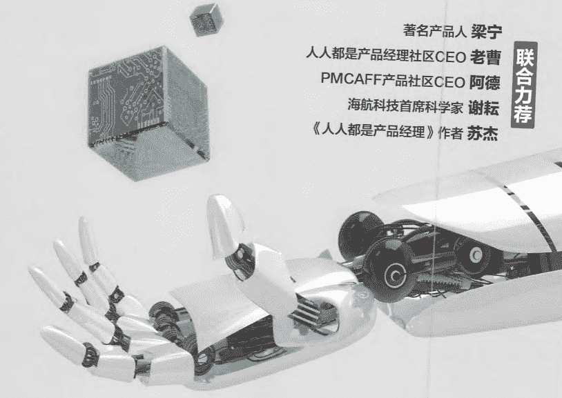

## 作者：张亮宇（特里）

墨尔本大学信息系统硕士、全球金融工程委员会委员、“Back & Forth”思维模式创始人，现任世界500强企业AI产品总监。

早年受邀以青年学者身份赴第十五届全球金融年会作英文报告。长期深耕机器学习产品设计、大数据分析及AI技术商业化落地，主导多款AI产品上线，其中教育类产品用户覆盖全国400万+在校生。

在NLP自然语言处理、CV计算机视觉领域持有多项发明专利，其“基于网络日志的用户负面情绪预测方法与系统”专利申请时间早于Facebook同类自杀倾向预测功能。

特里亦为“人人都是产品经理”“PMCAFF”社区专栏作家，“AI产品经理”系列文章广受推崇。

公众号：特总侃AI（pmaihome）

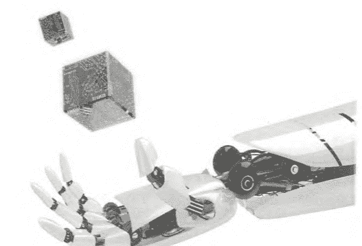

## 前言：认知升维，跨越从技术到商业的鸿沟

科技浪潮汹涌，人工智能（AI）早已从实验室走进学术殿堂与寻常百姓家。业界公认：这轮变革的深度与广度将远超互联网，堪称新形态“工业革命”。

资本与人才双向奔赴，招聘数据显示AI岗薪资显著领跑普通IT，算法工程师更成高薪标杆，企业陷入“抢人”狂欢。然繁荣背后暗流涌动：企业对AI本质认知浅薄，人才甄别机制缺位。

招聘错位频现：JD挂“AI科学家/专家”，技能要求却全是“神经网络搭建、特征工程、聚类分类”——这分明是算法工程师画像。科学家岂止于写算法？

AI职业版图与互联网迥异，盲目招聘隐患极大。大致分两类：
1. **技术落地派**：算法工程师为主，按场景细分图像、推荐、自动驾驶、语音等。
2. **价值转化派**：融会技术、业务、产品，将AI转化为商业回报的关键角色——**AI产品经理**。

危机感驱使企业优先囤技术，却常忽视AI PM的战略杠杆作用。麻省理工成果转化数据揭示残酷比率：**科研投入1美元，需配套100美元资源（人财物）才能成产品**，若含市场推广，比例更惊人。技术到商业，隔着漫漫长途。

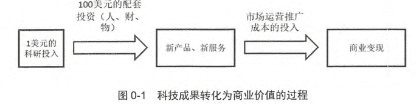

> **图 0-1 科技成果转化商业价值路径图**

本书旨在助力企业与PM完成认知跃迁，直击核心命题：何为AI PM？企业为何非其不可？传统PM需补哪些课？如何跨部门协作、规避投资坑、造血业务？

## 阅读地图：从理论到实战的进阶阶梯

建议按序阅读。全书遵循“理论→实践”逻辑，重构AI产品管理知识体系，覆盖底层认知、技术背景、工作流、沟通术、思维模型。

- **第1章**：奠基逻辑与背景，定义AI时代产品特性与PM新坐标，从思维、知识、工程三维指引入门。
- **第2章**：深度解析行业Know-how价值，定义行业专家标准，赠送“修炼行业专家”方法论。
- **第3章**：重构“需求分析”核心技能，对比新旧范式差异，从量化维度提高门槛。
- **第4章**：拆解AI产品构建原理与核心组件，快速建立具象产品轮廓，去魅AI。
- **第5章**：从ML工程实践出发，助PM从本质、流程、算法、平台四维构建机器学习知识图谱。
- **第6章**：全景复盘AI产品工程流程——预研、设计、研发参与、运营，每环附赠实战锦囊。
- **第7章**：独创端到端产品管理法，传授跨部门沟通术与“CEO视角”决策思维。

## 你能收获什么？分人群精准赋能

**想转型的传统PM**：无论原赛道何处，本书提供全新视角——用AI思维解决传统难题。助你建立完整认知框架，对标能力缺口与思维差距，附赠工程实战案例消化流程，直击转型痛点给方案。

**零基础入行者**：构建职业宏观认知。本书不讲交互设计、用研等基础功，聚焦方法论与思维模式拆解各环节，助你寻找适配的学习与工作路径。

**企业决策者**：获取决策地图——AI产品本质是什么？对传统模式冲击几何？如何借势智能化升级？招人看啥？投钱避啥坑？答案全在书中。

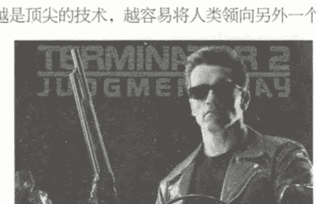

## 第一章：AI时代，重塑产品经理定义

- 1.1 AI产品的独特基因
- 1.2 AI产品经理的价值坐标
- 1.3 “软硬兼施”是入场券
- 1.4 零基础入门避坑指南

AI普惠时代到来，传统PM面临工作流、价值定位、协作模式的三重重塑。互联网重构的是**要素配置效率**（如出行平台匹配供需），AI升级的是**生产要素本身**（如自动驾驶赋能车辆智能）。前者优化组合，后者重塑核心。**转型本质，是价值观与方法论的范式迁移。**

技术狂飙催生无限产品形态，PM肩负更重社会责任。如《终结者2》中T-800与T-1000，同为顶尖技术造物，失去伦理底线，技术越强毁灭性越强。

> **图 1-1 影片《终结者2》中的AI产品 T-800**

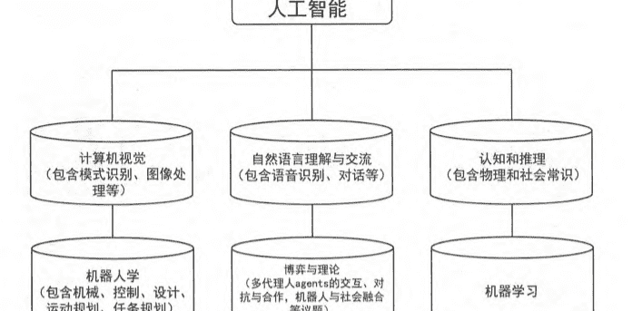

> **图 1-2 影片《终结者2》中的AI产品 T-1000**

### 1.1 AI产品的独特基因

#### 1.1.1 既是工具，更是新一代产品设计底层逻辑

2006年深度学习爆发，叠加算力与数据红利，AI产品在机器人、金融、医疗、自动驾驶、多模态交互等领域全面开花，商业价值兑现。所有应用本质受益于AI主流研究方向演进。

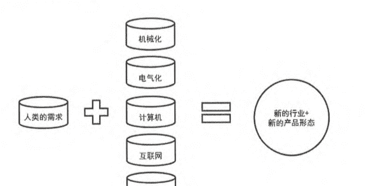

> **图 1-3 人工智能主流研究方向**

纵观史册，技术进步必引领产品性能跃迁，本质皆为：需求驱动技术，技术催生新业态新形态。

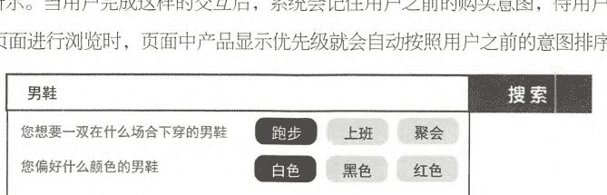

> **图 1-4 新行业与新产品的诞生逻辑**

从此视角看，AI是解决需求的工具，常用于改良传统方案。**但AI产品的基因核心，是“概率”。**

概率论是AI推理基石，每次推断预测都伴随不确定性——这是一场必须参与的“博弈”，不博弈也有风险。若不遵循概率规则，必被遵循者淘汰。故我们必须用概率论量化AI系统行为与价值。

人类认知世界本质也是概率：医生诊断、司机驾驶、投资经理配资，无不如此。AI作为工具，辅助甚至替代人类决策，核心仍是概率判断与预测。

AI概念虽早，产品迟迟不普及，症结在于**概率表现未达用户心理阈值**。85%诊断准确率，医患皆不敢信；99.99%才可能成辅助工具。不同场景容错率不同，导致AI落地速度参差不齐。

**AI终极指向：推断概率无限逼近100%，替代人类判断，甚至超越人类认知。**AI PM的核心职能，是在具体场景里平衡“概率最优”与“成本投入（资金、技术、周期）”。

实战中，PM需判断：AI能达成的概率能否解决诉求？用户最低接受线在哪？超预期线在哪？据此定投入策略。**切忌完美主义，商业化成败永远是第一位的。**

除概率论，数理统计、生物遗传、进化论等跨学科理论均支撑AI产品设计，PM需理解这些逻辑对产品的影响。

#### 1.1.2 AI赋能传统产服的五大核心范式

按目标归纳，AI产品落地五大基本形态：
1. **个性化精准服务**（金融智能推荐）
2. **替代简单重复劳动**（自动驾驶）
3. **提升效率与准确率**（反欺诈系统）
4. **重塑交互体验**（语音控制智能家居）
5. **自主创作生成**（Deep Dream绘画、Sunspring编剧）

**本质上，这颠覆了传统产品设计范式。**

旧范式：设计确定交互流程，越细越好，PRD不详细研发就喷。新范式：过度确定的逻辑反成枷锁。同一款产品，千人千面——内容、交互、形态皆动态生成，PM无法穷举每个点击后的结果。

非说AI产品不设计流程，基础交互逻辑仍是基本功。电商PM仍懂后台逻辑，社交PM仍研用户习惯——这些属**行业知识**，短期不变。**变的是：将传统流程注入AI擅长的能力范围。AI PM的核心功课，是找到“用户诉求”与“新技术”的交汇点。**

**实战复盘：电商搜索的进化**

搜索是电商核心入口。传统PRD只定两件事：默认查询词、实时预测匹配逻辑与展示上限。

如今，NLP/NLG/知识图谱/强化学习成熟，搜索进化为**深度智能交互**，旧设计失效。现在通过实时分析用户行为（搜词、买记、浏览记），在线预测意图，用“引导式销售”话术确认需求，闭环转化。

用户搜“男鞋”→系统问“穿啥场合？”→选“跑步”→问“配色？”→选“白”→问“平路还是山地？”……用户可随时打断或深聊。交互完成，系统记忆意图，全站商品排序动态适配。

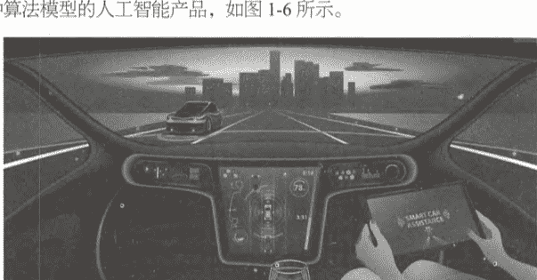

> **图 1-5 深度智能交互的引导式搜索演示**

#### 1.1.3 AI产品无固定形态：中台赋能，终点是价值

看到这里你会问：AI产品长啥样？**答案：没有标准形态。**

AI只是赋能手段。将训练好模型（输入数据→输出结果的“中间件”）、传感器、软硬件模块，嵌入传统产服体验链路。

自动驾驶车 = 传统车体 + 雷达/测距/摄像头/高精地图/算法模型集成。

> **图 1-6 自动驾驶汽车架构拆解**

极简Web搜索、App端聊天机器人、萌系家庭机器人……皆可成AI产品。

> **图 1-7 家庭陪伴型机器人**

**别给想象力设限。工具属性不变，创造用户最大价值、提供最佳体验，才是产品永恒的北极星。**

### 1.1.3 构成人工智能产品的三要素

# AI 产品经理：驾驭“算法、算力、数据”三驾马车，定义核心竞争力

过去几年，人工智能的飞跃式进步，本质上是深度学习在图像、语音、NLP、检索、翻译、社交筛选、生物信息及药物研发等领域大规模落地的成果。作为机器学习分支的核心代表，深度学习能否在具体场景跑通，仰仗的是**算法、算力、数据**这“铁三角”支撑（见下图）。这三大支柱技术的快速迭代与厚积薄发，才是 AI 技术走出实验室、规模化应用的根本动力。

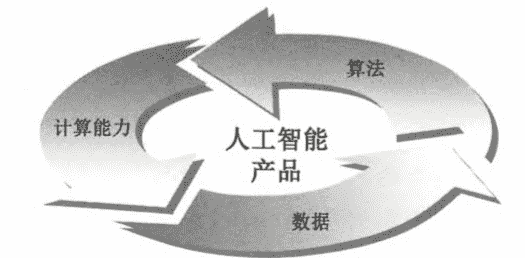

**图 1-8 AI 产品核心“铁三角”**

- **算法侧**：成熟开源框架与社区生态的爆发，极大降低了模型落地的技术门槛。
- **算力侧**：以 GPU/TPU 为核心的大规模集群普及，硬件成本下探，算力瓶颈基本被击穿。
- **数据侧**：互联网与移动互联网的红利期，为模型训练沉淀了海量高质量语料。

既明确“三要素”地位，AI 产品经理就必须贯穿**规划、研发、运营全生命周期**，为技术团队打造最优的“三要素”生存环境。

### 算法层：认知对标，量化决策
产品设计必须与公司现有算力研发实力匹配，杜绝“仰望星空”或“重复造轮子”。这要求 PM 具备主流模型与框架的基础认知，更要能**量化评估**不同算法在特定场景下的实战效能（详见第 4 章深度解析）。

### 算力层：需求牵引，权衡投入
从业务需求反推模型架构，评估硬件开销，决策 **PaaS 上云还是自建集群**。例如，实时语义搜索与个性化推荐并存的产品，对在线学习系统要求极高，势必涉及大量 GPU 卡位投入，PM 需在成本与性能间找到平衡点。

### 数据层：数据为王，协同制胜
“数据质量 > 算法花哨”是铁律。数据集足够大且干净时，算法选择对性能影响边际递减。因此，**数据从哪来、质量怎么控、治理怎么推**，必须在立项之初就规划好。这往往考验 PM 的跨部门协调与资源整合能力（详见第 7 章实战指南）。

单一要素无法筑起护城河。PM 应在定义核心竞争力时，主动寻找**算法、算力、数据三圆交叉的“黄金重叠区”**（见下图），这既是筑高竞争壁垒的关键，也是吸引资本青睐的核心筹码。

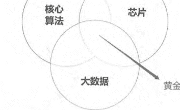

**图 1-9 AI 产品的“黄金重叠区”**

---

## 1.1.4 AI 产品成功的“铁律三角”

很多企业盲目招兵买马搞 AI，核心原因是看不清**“技术落地 → 产品成型 → 商业变现”**这条漫长链路。复盘成功案例，**核心技术、产品化能力、商业化闭环**缺一不可。

### 核心技术：从“功能比拼”转向“维度降维”
AI 时代产品竞争，早已超越可见的功能层面，转入多维度深水区。最顶级的技术往往是**“零感知”**的——用户零学习成本、甚至察觉不到高科技存在，却体验到了质变。

以 3D 人脸识别为例（见下图），融合 VCSEL 红外激光、多重滤波与深度感应模组，配合复杂算法与端侧算力，实现了 2D 技术无法企及的金融级安全。这不仅是解锁手段的升级，更催生了人体追踪、SLAM 导航、三维重建等全新应用场景。掌握此类核心技术，意味着在未来竞争中占据**降维打击**的制高点。

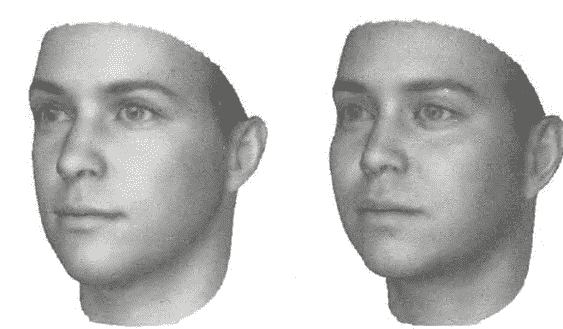

**图 1-10 3D 人脸重建技术架构**

### 产品化：让技术“听得懂、用得上、留得住”
技术再强，若使用门槛高、价值传递慢，即为废铁。产品化演进遵循**“低门槛触达 → 高效价值得到 → 持续价值延展”**三部曲（见下图）。

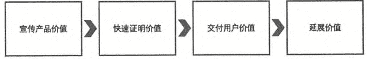

**图 1-11 产品化演进三阶段**

AI 产品在每阶段面临的挑战远超传统品类：
1.  **建立信任**：黑盒算法难解释，新品牌首战即是“信任战”。
2.  **速赢价值**：若无法让用户瞬间感知收益，付费意愿难激发。
3.  **长期稳定**：效率、便捷、人性化体验需经得起时间考验。
4.  **深度绑定**：唯有融入生活、制造依赖，才能挖掘用户全生命周期价值（LTV）。

### 商业化：定价锚定“用户痛点”，而非“技术成本”
产品化决定价值上限，商业化决定变现效率。AI 产品研发投入不确定、效果难预估，**不能用传统经验定价**，必须站在用户视角拆解场景与痛点。

**经典反面教材：食堂 AI 结算机器人。**
表面看：视觉识别 + 极速结算 = 省下高峰期收银员人力 = 完美生意。
深挖后：收银员闲时还要洗碗、擦地、帮厨。机器人只能替代“收费”这一单一动作，无法覆盖人工的全时段边际价值。**定价上限，由“替代成本”而非“技术成本”决定。**

由此，PM 必须透彻洞察场景全貌，在价值评估与成本核算间制定策略，必要时调整产品定位，方能实现商业闭环。

---

## 1.2 AI 产品经理：三重关键角色定位

进入 AI 时代，PM 角色被迫重构，驱动力来自三点：
1.  **组织架构重塑**：分工细化催生新协作模式，PM 角色随之迁移。
2.  **生命周期变革**：技术引入改变迭代规律，管理流程需重构。
3.  **风险前置**：技术边界拓宽带来法律/伦理红线，PM 作为第一责任人须守底线。

在此背景下，AI PM 需进化为公司的**三大关键角色**：

### 1. 市场与技术双前瞻的“领航员”
回溯 iPod 诞生：乔布斯团队捕捉到东芝 1.8 英寸 5GB 微硬盘，乔布斯瞬间定夺——“把 1000 首歌装进口袋”。
**启示：缺乏技术敏感度，伟大产品不复存在。** 实验室里躺着大量未商用的前沿算法/模型。若 PM 甘当研发的“需求记录员”，任由技术反推产品，企业将面临“技术自嗨、业务脱节”的死亡陷阱。**PM 必须牵着研发走，而非被研发牵着走。**
兼具**市场洞察（找痛点、定赛道）与技术前瞻（匹配方案、判趋势）**，任何一侧偏科，都是产品失败的温床。

### 2. 技术赋能创新的“点火器”
研发沉迷造轮子，往往因缺乏“技术转化业务”的正确路径。PM 若只管创新、不管赋能，就是推手。
**破局之道：把研发拉到用户面前。** 让算法工程师直面用户满意度、触达功能价值、听取真实反馈（好评差评全同步）。当成就感来源从“模型精度提升 0.1%”转移到“帮用户解决了实际问题”，团队内驱力将质变。**“技术驱动创新”的本质，是 PM 搭建起“市场反馈 → 研发动力”的高速公路。**

### 3. 道德与伦理的“守门人”
《西部世界》中福特博士既是创世神也是毁灭源，隐喻**PM 的一念之差，决定 AI 是造福人类还是制造深渊。**
设计人机交互时，必须将**弱势群体（老幼病残、少数族裔）的特殊属性**纳入考量，规避歧视、隐私泄露、物理伤害风险。这正是美企纷纷设立**独立伦理审查委员会**的原因——以专家制衡商业冲动，为用户权益兜底。
**新时代考核 PM，技术与商业只是及格线，道德水准才是高线。**

---

## 1.3 AI 产品经理：硬核技术懂，软性实力强

### 1.3.1 “懂技术”重新定义：从“会用”到“懂原理、能决策、识趋势”
互联网时代“PM 需不需要懂技术”争论不休，AI 时代**答案确定：必须懂，且要懂得深、懂得透。**

**何为“懂”？三个维度定分数：**

#### (1) 通晓研发全链路原理，做团队“翻译官”与“参谋长”
虽不亲自调参、选特征，但需对研发每个技术动作的**底层逻辑、最佳实践、优劣势**烂熟于心，能熟练对内对外阐释。
- **向上汇报**：老板问功能原理，能从工程化视角拆解，横向对比主流/竞品方案，量化输出己方伣劣。
- **对外销售**：客户问核心优势，能从模型精度、算力效能、技术路线差异化等硬指标建立信任。

#### (2) 深度嵌入研发流程，输出算法团队“真正需要的弹药”
互联网 PM 输出原型/交互稿；AI PM 面对算法团队，**核心交付物是“高质量训练数据”与“明确优化目标”**。
*案例：肺癌筛查引擎 PM。* 目标单一——提升预测准确率。关键杠杆：**专家级医生标注的高质量数据集**及**规模**。医疗标注周期长、专业门槛高、非用户行为可隐式采集（如电商推荐）。**PM 的核心价值 = 想尽一切办法搞定标注资源、建立数据闭环。**（实操详见第 6 章）

#### (3) 掌握前沿技术“落地条件与最佳组合”，做架构级决策
AI 本质是用“软硬基建 + 数据 + 算法”替代人力，升级生产力。PM 需在海量组合中找到**当前场景下的“最优解”**。
*案例：机器视觉产品 PM。* 需摸清：主流架构适用场景？传感器精度/芯片算力/功耗曲线？2D/3D 视觉方案选型？生物识别原理？软硬研发成本/风险/ROI 试算？**唯有完成全维度技术调研与量化权衡，才能输出有竞争力、有前瞻性的产品规划。**（后续章节将系统拆解“PM 该懂什么技术”及“如何用技术筑护城河”）

### 1.3.2 一切用数字说话：量化目标，量化过程，量化结果
传统 PM 靠原型图传递意图；AI PM 必须**将设计目标、迭代指标、验收标准全部“数学化”**。

*电商搜索案例：* 核心指标 = **千次搜索 GMV 提升率**。若 PM 不长期追踪历次迭代 GMV 曲线，便无法判断算法优化真实收益。
A/B 测试是降低发布风险的标配，但**无量化基线，A/B 测试即失去裁判标准**。后果：研发无成就感、领导不买单、资源倾斜断裂。**（需求量化深度实战见第 4 章）**

### 1.3.3 沟通协作艺术：在复杂系统中做“超级润滑剂”
AI 时代，PM 协作能力的权重被指数级放大，源于三大结构性变化：

#### 1. 组织架构“碎片化”重组
算法落地深入，衍生出**模型研发组（如 Seq2Seq 专项）、知识图谱维护组、数据评测组**等高度细分职能。PM 必须读懂新分工、新流程，在碎片化资源中穿针引线、整合合力。

#### 2. 技术迭代“周期化”加速
SOTA 模型更迭以周计。PM 需保持**极速学习与适应**节奏，将前沿进展及时转化为产品迭代红利，而非沦为技术变更的“被动接收者”。

#### 3. 研发流程“跨域化”协同
数据采集、标注、清洗、模型训练、评测、部署、监控、反馈……每一环都牵涉多部门。PM 的**横向协调与向上争取资源能力**，直接决定项目能否按节点交付、按质量上线。

---

# AI时代产品经理：跨界协作与认知重塑指南

身处智能浪潮，产品经理的协作版图已悄然扩张。过去我们对接前后端、交互、UI，如今算法工程师成为核心搭档。若对算法原理一窍不通，便无法与他们深度对话，失去沟通桥梁，也就丧失了驱动技术创新的主导权。深度学习等前沿技术日新月异，算法同学需啃论文、追最佳实践，产品经理更得紧跟节奏，疯狂充电、拓宽知识边界，唯有如此，才能在前瞻性与创造力上超越对手。

不过，PM 学技术的“姿势”得讲究策略，这与研发同学的路径截然不同。

**一、善用“外脑”，拒绝死记硬背**
机器学习公式繁多，PM 无需逐个推导证明，只需掌握关键算法的落地策略与工程特性。互联网让检索极便，知识点用时调取即可，核心是建立“索引”而非填满“硬盘”。

**二、以业务为引，带着问题去学**
动手前先问：为什么学？解决什么痛点？带着任务去攻克技术，效率最高。比如想摸清行业 AI 应用现状，常逛开源社区看工程落地案例，或订阅顶刊追踪垂直领域论文，皆为高效捷径。

**三、高频对齐，打破认知壁垒**
日常积累外，常与内部技术大牛过招：把你的理解讲给他们听，看视角是否一致，有歧义及时校准。AI 本是跨学科“杂交体”（物理、数学、心理、认知、控制、生物……），PM 更需跨界交流，拓宽思维半径——创新往往诞生于不同领域的交叉路口。

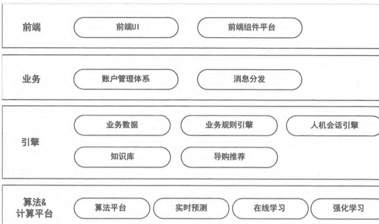

图 1-12 电商平台中的智能人机交互产品架构

从架构图可见，AI 产品工程流程长、依赖重，跨部门协作是常态。数据源头分散、海量加工挖掘在所难免，PM 需牵头数据科学团队联合攻关。在统一数据平台未建成前，PM 就是数据整合的“发动机”。谁最懂业务？谁最懂行业？数据治理本质是业务驱动，这活儿非 PM 莫属。

## 1.4 AI 产品经理入门指北

读完全文，显而易见：相比传统 PM，AI 时代对数据分析、软硬融合、团队协同提出了更高阶要求。那如何成为合格的 AI PM？有几条建议供转型者参考。

### 1.4.1 重塑思维底座：资源、方案、目标三驾马车

无论是否身处 AI 赛道，优秀 PM 的养成都始于思维训练。传统 PM 耗时于逻辑、流程、页面，而 AI 产品比拼的是硬件算力、算法模型、训练数据的“组合拳”。深度学习倒逼硬件架构频繁迭代，软硬模块重构成常态，PM 必备**系统性思维**——跳出局部，放入全局权衡利弊，求解最优。

结合 AI 特质，产品管理思维可拆解为三类：

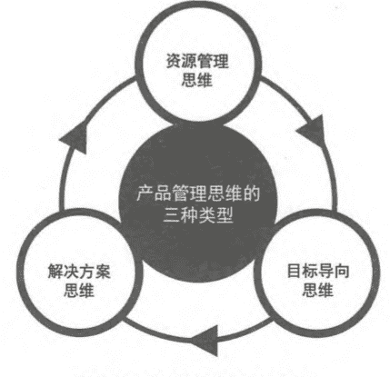

图 1-13 产品管理思维的三种类型

**1. 资源管理思维：统筹算力、数据、算法的“三角博弈”**
设计 AI 产品，核心资源投入不外乎三项：算法模型、数据资源（训练/验证/测试集）、硬件资源（芯片、存储、组件）。
*   **不确定性高**：模型训练调优充满变数，预设硬件架构常跟不上算法需求，周期与效果难按旧经验估算。
*   **数据成本高**：高质量数据集获取烧钱费时，PM 必须在获取成本与模型效果间找平衡点。
*   **集成定成败**：如自动驾驶，融合传感器、SLAM、高精地图等多厂商软硬件，系统集成度极高。PM 需在工程实战中练就资源统筹与风控能力，从三大核心资源维度核算投产比，给出落地方案。

**2. 解决方案思维：做资源整合的“前锋”**
用户买单的是“解决方案”，而非孤立技术或产品。将硬件、数据、算法等跨部门资源以最优方式拼装成方案，唯 PM 能为。
早期 AI 浪潮技术驱动，很多公司把找方案甩给研发，导致“研发牵着 PM 鼻子走”。反面教材：PM 被动等研发定好架构、数据、目标，再反推需求。但研发离用户远、需求把控弱，且多团队（算法、数据、底层）难自发协同，这条路走不通。
PM 必须主动出击，像足球前锋靠嗅觉创造机会，而非等传球。这需要非线性思维与资源优化能力。

**3. 目标导向思维：以终为始，层层分解**
资源整合、团队协作的前提是明确目标。AI 产品特殊性让这点更关键。
*   **前瞻定目标**：需具备前瞻视野，定义出有市场竞争力的靶子。
*   **落地可量化**：结合技术现状与资源禀赋，确保目标可达、可测。从调研到运营全链路拆解节点、标准、交付物，将压力传导至人。端到端管理细节见第 7 章。

### 1.4.2 搭建知识大厦：六大核心模块

AI PM 知识体系至少覆盖六大板块（理解深度随行业场景灵活把控）：

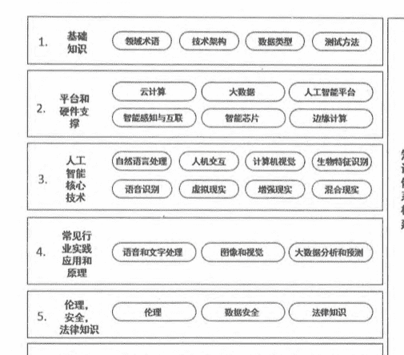

图 1-14 人工智能产品经理知识体系

1.  **落地基础识**：领域术语、技术架构、数据类型、测试方法等。
2.  **平台与硬件支撑**：云计算、大数据、AI 平台（ML 平台、流计算）、感知互联（传感器、通信）、智能芯片、边缘计算等。
3.  **AI 核心技术谱**：NLP、HCI、CV、生物识别、ASR、VR/AR/MR 等，懂算法常识，明场景与最佳实践。
4.  **典型应用三大类**：
    *   语音文本处理（AI 写稿、智能客服）；
    *   图像视觉（自动驾驶、医疗影像、机器人分拣、人脸识别）；
    *   大数据分析预测（搜索推荐、金融风控、健康管理）。
5.  **行业知识体系**：详见第 2 章深度展开。
6.  **合规护城河**：伦理、数据安全、法律法规，体系化认知以规避风险。
7.  **跨界延展带**：心理、哲学、数学、认知科学……AI 终极目标是服务人类的高级智能，涉猎学科远超互联网产品。

AI 产品诞生依赖复杂技术框架与系统集成，单点突破难建护城河，竞争维度已变。全维知识储备赋予 PM 更广视野与更准判断，第 4 章将详解产品体系各环定义与价值。

### 1.4.3 深度参与工程实战

实践出真知。哪怕只是一个二分类小模型，跑通“需求定义→拿数据→预处理→训练预测→评估”全流程，也能让你在与研发配合中精准找到介入点、输出价值。
将实战复盘固化为个人工作流方法论，换公司、换业务皆通用。PM 之间的差距，终究拉大在经验沉淀与方法论上。更多实战细节见第 6 章工作流详解。

# 第 2 章 懂行业，才是 AI 时代 PM 的“护身符”

## 2.1 AI 时代的公司新物种分类

技术重塑分工与商业模式，传统业务被 AI 赋能后完成跃迁。未来无公司与 AI 无关，或直接变现，或采购中间件自赋能，变革已至。公司大致分三类：

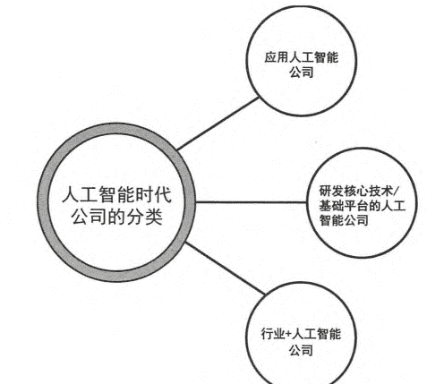

图 2-1 人工智能时代公司的分类

**1. “行业+AI”公司（主流存量）**
靠深厚领域积累，输出 AI 赋能后的产品/服务。如福特、通用、日产深耕自动驾驶，虽有百度、特斯拉搅局，但传统车企凭借造车底蕴并未显弱。

**2. “应用型 AI”公司（能力提供商）**
封装基础能力（人脸、语音等）为 API，客户调用即得，无需自研。中小厂借此低成本、快速对齐大厂能力；供应商边际成本低，还能反哺算法迭代。

**3. “核心技术/基础平台”公司（基建者）**
解决数据从哪来、算力怎么建、自建平台 ROI 如何等底层痛点。从硬件单元、数据治理、建模到部署，打通全链路“基础设施”。大厂也布局 PaaS 平台，中小厂调用组件即可大幅降本增效。

### 2.1.2 三类公司对 PM 的差异化画像

PM 需按座次找定位，匹配提升方向。切勿盲目啃算法——垂直领域 PM 若不磨行业功夫，跑去自学 LSTM 往往事倍功半。本书后续将助你按需学习。

*   **行业+AI 公司：行业洞察是核心竞争力**
    不懂业务只懂技术，凭什么向老板要资源？老板亲手从 0 到 1 打江山，行业坑坑洼洼全是真金白银趟出来的，岂能交给“半桶水”随意发挥？**先做行业专家，再借 AI 增值。**

*   **应用型 AI 公司：商务 + 项目管理 + 运营指标双修**
    TO B 为主，KPI 常挂回款。PM 需兼具售前销售技能与项目管理经验。标品与定制品边界要守住，考验需求管理。同时盯紧 CAC（获客成本）、LTV（生命周期价值）、PBP（投资回收期）三大指标，动态调整市场、运营、战略策略。

*   **核心技术/平台公司：硬核技术底座是敲门砖**
    如基于 TensorFlow 优化的 ML 平台，要超原生训练深度，PM 必懂底层通信、稀疏参数更新等原理。此类公司偏爱研发转型 PM。

## 2.2 何为真正的“懂行业”

曾看乔布斯谈“电视行业创新困境”，逻辑层层剥洋葱：
1.  困境根源在推广策略；
2.  “补贴模式”致机顶盒泛滥；
3.  用户不愿自购机顶盒；
4.  后果：HDMI 接口被占满，UI 碎片化，遥控器成堆；
5.  破局唯一路径：推倒重来，统一 UI 机顶盒，但受限于现有推广策略不可行（非技术/远见问题）；
6.  手机靠 GSM 全球标准搞定运营商，电视却陷入各国标准与监管泥潭。

寥寥数语，尽显大师级行业洞察：**现状拆解、竞争格局、用户痛点、困境本源、跨行对比、政策标准壁垒**。渗透至每个关键节点。

自问：你能否对自己的产品、赛道有这般透彻认知？若无此认知，谈何远见与创新？

AI 时代产品设计、规划、创新门槛水涨船高。界面流程同质化加剧，重复设计将被 AI 取代，PM 的想象力与创新力成稀缺资产。**深谙行业，是 PM 立身之本；离业务谈创新，如缘木求鱼。**

### 2.2.1 破局关键：产品经理必修的六大行业洞察维度

以往从未有哪个时代，像当下这样，因AI技术的黑盒特性与系统架构的复杂度，倒逼产品经理必须具备极深的行业洞察。不信？咱们先看个实战案例。

做过NLP的都知道，情感分析（Sentiment Analysis）是块硬骨头。这玩意儿核心在于挖掘主观文本里的情绪倾向，商业价值巨大——能帮品牌实时监控口碑、对标竞品、精准决策。但在工程落地时有个致命坑：**情感词的“水土不服”**。同一个词，换个赛道、换个语境，极性就能反转。拿“薄”字举例：评价羽绒服“薄”是差评（不保暖），评价轻薄本“薄”却是夸奖（便携）。这导致构建情感词典时，没法一套打天下，必须结合具体领域语料定制策略。

这时候，懂行业的产品经理就是“外挂”。如果你能主动把“冬季服装薄=负面”“电子产品薄=正面”这类领域常识、行业背景喂给算法同学，帮他们在启发式规则、图模型、词对齐、表示学习这些建模路径里快速选型、避坑，研发效率直接起飞。别等着研发来问，得主动出击，把行业课上给技术团队——这才是AI产品经理的核心杠杆。

---

那么，到底啥叫“懂行业”？我把它拆解为六个硬核维度（见下图），你可以按自家业务特点增减：

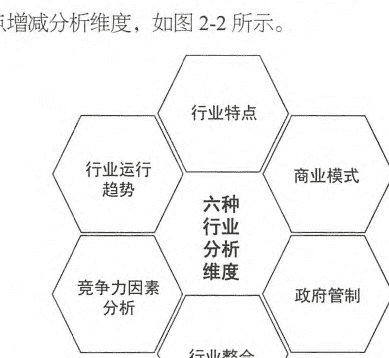

**图 2-2 六大行业分析雷达图**

1.  **行业基因画像**：别光看当下，得拉长周期看。历史包袱、增长天花板、宏观周期共振、固有雷区、海外成熟市场的演进规律——这些决定了你能不能活过周期。
2.  **趋势前瞻雷达**：必须主动出击扫描国内外动向。波特五力模型（供应商/买家议价、同行厮杀、头部巨头痛点、可复制成功经验、新入局/替代品威胁）要烂熟于心。特别要盯着：**别的领域跑通的新技术，会不会成咱们的下一个爆发点？** AI重塑牌局的当口，旧规律失灵，能不能“预判-顺势-布局”，是核心素养。
3.  **竞争力拆解器**：价格、品控、渠道、上游、成本、差异化、技术护城河、管理、地缘……传统维度一个不少。但AI时代，**数据积累、算法沉淀、算力储备**这“铁三角”权重最高，产品经理必须亲自管、亲自规划。
4.  **行业整合动态**：集中度怎么变？外资咋进？并购潮暗藏什么玄机？看懂棋局，才知下一步落子何处。
5.  **政策红线与红利**：准入门槛、法规税收、进出口壁垒。全球立法都跟不上AI迭代速度。美帝2016年连发《联邦自动驾驶政策》《人工智能未来筹备报告》《国家AI研发战略》，重点卡知识产权、隐私安全、数据标准。国内跟进立法是大概率事件，**产品经理必须把合规当功能做，提前卡位，别等铁拳砸下来再整改。**
6.  **商业模式闭环**：产品经理既是落地执行者，也是探路先锋。搞懂行业怎么赚钱、产业链怎么转、价值链怎么分。前五个维度全服务于此。只有立得住“行业专家”人设，拿得着内外部认可，资源、客户才会向你靠拢。

---

### 2.2.2 实战复盘：如何从零吃透一个赛道？（以家庭服务机器人为例）

光说不练假把式。假设你接手个人/家庭服务机器人这条线，怎么快速建立认知优势？

**第一步：给市场做分层（看图说话）**
别一股脑全塞进去。按产业化成熟度、需求体量切分赛道（参考下图分类逻辑）。

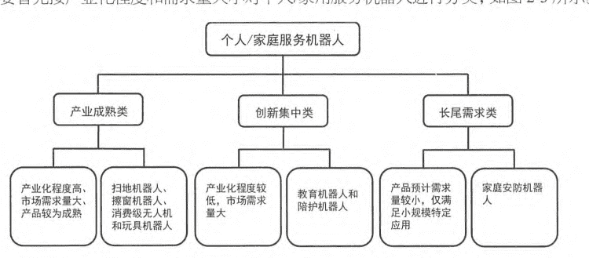

**图 2-3 家庭服务机器人赛道分层图（数据源：安信证券）**

**第二步：拉长时间轴看销量（历史+预测）**
历史跑出来多少？未来三年怎么涨？心里得有数（见下图趋势）。

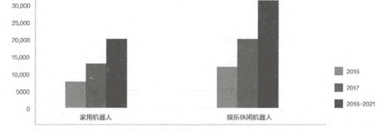

**图 2-4 家用/娱乐机器人销量实况与预测（数据源：IFR）**

**第三步：拆解产业链，找关键增量**
服务机器人 = 软件 + 电子 + 机械 三位一体。
*   **上游**：芯片、传感器、激光雷达（硬核供给侧）；
*   **中游**：OS厂商、AI引擎商、云服务商（大脑与神经）；
*   **下游**：集成商、场景应用端（触达用户面）。

产品经理得把供应链每家厂商的底细（优劣势、市场份额）摸透，这直接决定找谁合作、怎么集成最划算。

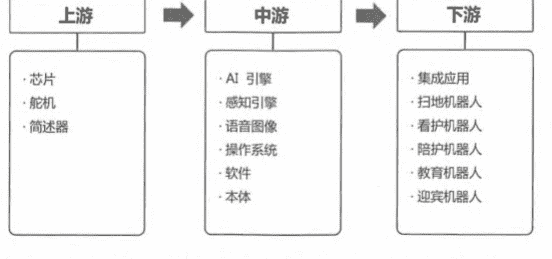

**图 2-5 产业链全景拆解（数据源：安信证券）**

**第四步：透视系统架构，锁定核心价值区**
架构五层：应用软件、AI引擎、操作系统、核心零部件、本体。**价值高地集中在中间三层：核心零件、AI引擎、OS。**

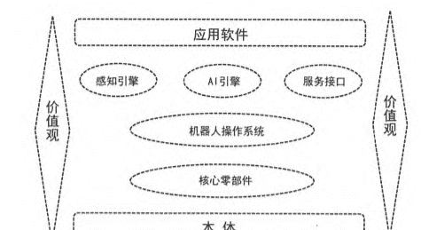

**图 2-6 系统架构五层模型（数据源：图灵机器人）**

*   **硬骨头：核心零部件（技术驱动型）**
    CPU/GPU/FPGA/NPU跑感知计算、视觉深度学习。选型即婚姻——量产后换血极难、成本极高。但反过来，搞定独家核心组件就是最硬护城河。乔布斯收购Prime Sense拿下3D感知，直接撑起iPhone X的Face ID、AR、Animoji全家桶。这嗅觉，考验产品经理的战略眼光。
*   **快变量：AI引擎（数据+算法驱动型）**
    ASR语音、CV视觉……迭代快、开源多、平台门槛低。创业队伍涌入、传统巨头借资源下场，红海必至。**比拼点不在论文指标，而在“能不能用算法实打实解决业务痛点”**。这考验人才密度、行业数据积淀、工程落地硬功夫。
*   **长周期：机器人操作系统 ROS（生态驱动型）**
    核心层、库、功能模块、场景应用四层架构，干硬件抽象、进程通信、分布式计算的脏活累活。主流有Android、ROS、国产Turing OS/iBot OS/SOS等。OS是生态护城河，但周期长、投入大，**初创团队慎入，除非你有极强资源整合能力。**

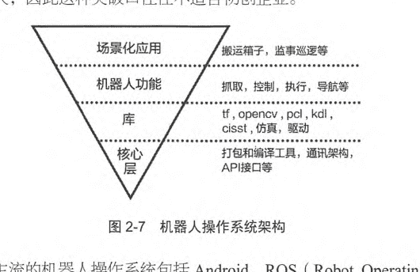

**图 2-7 ROS标准架构分层**

**图 2-8 实体机器人形态参考：Otonaroid & Kodomoroid（图源：中新网）**

**第五步：标准法规要比研发还早懂**
别等产品做完了再查标准。**越早吃透行业标准，越少踩坑、越快定需求。**
能参与制定标准最牛（话语权）；不能制定，也得倒背如流。
*   性能规范、安全要求 → 指导非功能需求设计；
*   系统集成标准 → 保方案通用、合理；
*   模块化设计总则 → 指导架构解耦。

国家已发布标准清单（见下表）建议收藏备查。

**表 2-1 机器人行业国家/行业标准速查表**

| 分类 | 标准编号 | 标准名称 | 状态 |
| :--- | :--- | :--- | :--- |
| 产品/机器人 | GB/T 33267-2016 | 机器人仿真开发环境接口 | 已发布 |
|  | GB/T 29825-2013 | 机器人通信总线协议 | 已发布 |
|  | GB/T 33266-2016 | 模块化机器人高速通用通信总线性能 | 已发布 |
|  | GB/T 33262-2016 | 工业机器人 模块化设计规范 | 已发布 |
|  | GB 11291.2-2013 | 机器人安全要求 第2部分：系统与集成 | 已发布 |
|  | GB/T 29824-2013 | 工业机器人 用户编程指令 | 已发布 |
|  | GB/T 12642-2013 | 工业机器人 性能指标及试验方法 | 已发布 |
|  | GB/T 20868-2007 | 工业机器人 性能验收实施规范 | 已发布 |
|  | GB/T 33261-2016 | 服务机器人模块化设计总则 | 已发布 |
|  | GB/T 34454-2017 | 干式清洁机器人性能测试方法 | 已发布 |
|  | GB/T 33265-2016 | 教育机器人安全要求 | 拟研制 |

---

### 2.3 进阶之路：从“懂行业”到“成专家”的三重境界

囤再多行业知识也是死的，得在产品规划、管理实战里活用。总结三层进阶心法，环环相扣、层层深入。

#### 2.3.1 第一境：以“点”破局 —— 精准锁定高价值场景

“点”就是场景。核心任务：**在“有商业价值的场景”和“我们能搞定的能力”间找最大公约数。**
创业公司试错成本高，选错场景死得快。AI PM得从两个维度练“点”的功夫：

1.  **练场景判断力，定准定位。**
    *   先筛“价值场景”（需求真、盘子大）。
    *   再拆场景细节：谁、何时、何地、干啥、啥目的、旧方案啥样、用户真心期待啥。
    *   **关键动作：挖干系人、挖关联场景。** 上下游咋配合？利益咋分？有没有更大机会点在隔壁？用好“干系人分析清单”不漏项。

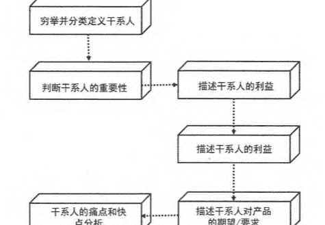

**图 2-9 干系人分析清单（实操工具）**

2.  **练技术判断力，知己知彼。**
    *   **向外看**：语音、翻译、视觉、分类……这些技术在本行业或别的行业落地成啥样了？有无成熟案例可复用？
    *   **向内看**：天天和算法工程师对齐。团队算力、数据、模型能力在行业里排第几？
    *   **合拍**：场景拉着技术跑，技术托着场景底。别让场景飞起来、技术跟不上；也别技术自嗨、找不到场景落地。**“点”拿捏准不准，决定能不能进行业门、拿种子用户。**

#### 2.3.2 第二境：深挖“点”成“线” —— 从卖产品到交付解决方案

德鲁克说：“企业目的在于创造并留住客户。”
AI早期靠技术跑通单点创新；同质化来袭，跑通“点”后必须极速延展成“线”：**给客户持续的新价值、新惊喜，把普通用户养成贡献大头利润的“超级用户”。** 互联网拼流量，AI拼超级用户留存。

怎么把“点”拉成“线”？

1.  **延伸服务链条，做“解决方案”而非“单品”。**
    电商做极致体验不够，自建物流延链（赚钱+沉淀会员）；用户没钱？上金融让赊账（衍生金融业务）。**链条越长，品牌护城河越宽。** 找到这条“线”，是AI PM的天命所在。
2.  **挖数据金矿，造“惊喜”时刻。**
    做租房平台？别光挂房源。分析行为习惯建信用模型，筛优质租客免押金、减租金、精准匹配房东、换房推荐个性化建议。**用AI把量变引爆成质变，把服务做成会呼吸的“线”，锁死忠诚度。**

#### 2.3.3 第三境：横向拓“线”成“面” —— 构建生态护城河

“点”变“线”立住了，再往外拓成“面”。“面”有双重含义：
*   **对外**：整合外部资源，建紧密协同，覆盖更广场景，和用户产生更多触点；
*   **对内**：打通内部数据与基础设施，孵化内部产品生态。

AI PM如何操盘“线”变“面”？

1.  **外部资源整合，组局共生。**
    AI架构重、数据/算法/算力三座大山难独自速攀。**对外协作是捷径。**
    *   高质量数据共享/交易；
    *   与传统方案商、头部客户深度绑定（数据换场景、资源互补）；
    *   软件找硬件、硬件找软件，软硬融合组局。
    产业链协作才起步，未来必是常态。**保持与外部资源的高频链接，既是公司战略储备，也是个人行业影响力的放大器。**

### 2.4 核心回顾：认知重构与进阶路径

本章伊始，以全新坐标系重绘了 AI 时代的企业版图。产品从业者需跳出传统行业框架，以“社会分工重组”视角洞察：旧有竞争护城河正被智能技术悄无声息地拆解重塑。随后拆解了六大行业认知维度——属性特质、演进脉络、竞争要素、整合趋势、监管红线、商业闭环，本质皆围绕“竞合博弈”与“内外部视角”展开。最后复盘实战，提炼出“点-线-面”三层级专家进阶思维模型。

**黄金法则：想做 AI 产品，先懂行业，别上来就卷 Python、钻 CNN/RNN。** 硬核技能固然关键，但若连产品经理的本职定位都站不稳、核心职责跑偏，代码写得再漂亮、模型调得再极致，招聘方也不会买单。

此外，打造专属知识内化体系至关重要。每个人认知路径差异巨大，关键在于找到“高效获取-深度内化-实战验证”的个人闭环。初入陌生赛道无需焦虑，掌握方法论、勤于复盘总结、多向一线高手取经并快速落地迭代，你终将成长为合格的 AI 产品负责人。

## 第3章 AI 产品需求定义：重塑分析范式

- 3.1 重塑需求分析范式
- 3.2 需求量化分析实战

翻阅各大招聘 JD 会发现，跨行业、跨职级，“需求”始终是产品经理岗位的最高频核心词。从管理、定义、验收到跟踪，这一套动作构成了岗位的及格线。产品经理是产品的“首席负责人”，产品存在的意义是精准击中用户特定痛点，因此即便进入智能时代，**“以需求定义产品”这一底层逻辑纹丝未动**。

回溯互联网纪元：电商重构“人-货”连接，解决高效决策购买；社交重塑“人-人”链路，压缩沟通成本；医院 HIS 系统梳理“医-患-械”协同，实现信息流数字化。

而 AI 纪元产品的内核，是**对上述全场景技术手段的全维升维**，实现用户体验与方案效率的双重跃迁。互联网 PM 搭建的是底座设施，在人、物、数据间架桥铺路，核心优化的是信息存储与流转，战略聚焦入口与流量；AI 则驱动产业质变，聚焦产品自生的核心价值（如图 3-1 所示）。

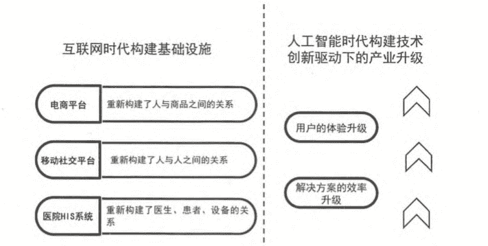

图 3-1 从互联网时代到人工智能时代

本章将从功能清单与质量属性两大维度，重构 AI 产品需求分析的工作流与设计思维。

### 3.1 重塑需求分析范式：六大趋势洞察

智能技术的跃迁为产品设计注入新变量，新范式可归纳为六大维度：

#### 1. 交互回归自然，认知门槛大幅压降
核心目标是让操作回归人类本能行为。语音指令替代键鼠触屏，一句自然语言闭环唤醒-查询-执行；人脸认证取代“账号+密码+验证码”，抬眸即通。技术范式迁移倒逼 PM 抛弃“线性流程思维”，拥抱“破局式设计思维”，深挖技术边界重塑交互形态。

#### 2. 商业视角切入，优先验证高 ROI 场景
智能系统架构复杂、落地成本高，但功能价值常与投入不成正比。PM 必须锚定最易变现、商业价值显性的需求为破局点。尤其在 0-1 阶段或新赛道，效果与价值难预判，应直击用户“最核心痛点”或“直接利益挂钩点”。这也解释为何智能制造落地最快（如图 3-2）：研发投入虽重，但为用户带来的直接收益极高，投入产出比极其可观。精准广告投放、搜推场景同理，价值显性、效果可感，PM 应在所在领域寻找此类“高确定性”切入口。

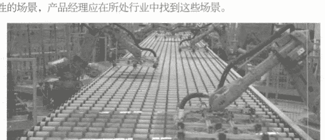

图 3-2 人工智能在工业场景中的实践应用

#### 3. 黑盒信任赤字，需场景化兑现逐步填平
复杂模型对用户端呈“黑箱”状态，连研发侧难以精准解释推演路径。若无法在垂直场景兑现“有效、准确”承诺，用户拒付费、甚至产生品牌排斥。例如推荐系统若引发“被冒犯隐私”而非“被精准服务”感知，必引发投诉流失。
破局路径：在细分场景用“预测与推断”能力兑现技术承诺，树立专业标杆，步步为营赢取信任。初创期更忌大步冒进，激进反而加速用户抛弃。

#### 4. 感知硬件跃迁，解锁多模态交互新空间
智能算法与感知硬件形成正向飞轮：数据喂养模型，模型反哺采集效率。以自动驾驶为例，感知层（多模传感器）、认知层（高精地图/ADAS）、决策层（车联网）协同进化。感知硬件成本下探让 ADAS 从豪车专属普及至大众车型。
日新月异的感知技术不仅在机器人、自动驾驶落地生根，更为产品定义打开了想象空间。**PM 应掌握多传感器融合应用，创造更多元的交互范式满足诉求。**

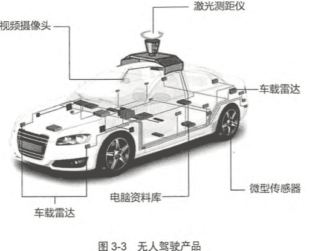

#### 5. 告别确定因果，拥抱统计关联驱动设计
传统模式下，PM 挖掘显性需求 -> 产出原型 -> 落地一致。AI 产品思维截然不同：不再执着寻找确定性因果链，而是用数据探勘发掘“设计与诉求的统计关联”，以数据驱动决策。
PM 交付物不再是固定页面，而是**规则与策略集合**。以 Google AdWords 为例（图 3-4），PM 无法预设“给谁推什么”，只需提供广告主后台配置偏好、管理效果的能力；最终呈现由“商家策略+用户画像”实时博弈生成，实现真正的“个性化分发”。

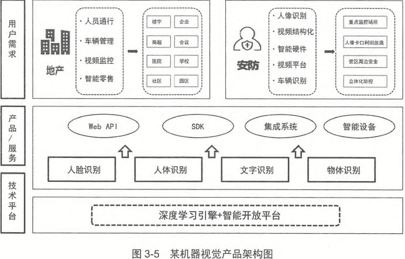

图 3-4 Google AdWords 关键词竞价广告示意

#### 6. 宏观定调：架构层面的战略对齐
智能产品体系复杂，单点功能常牵一发动全身，且高性能指标往往需巨额资源托底。PM 必须具备“全局架构视野”，清晰把握全景蓝图，在框架内评估：候选项是否符合战略？落地后能否反哺全局？此举可前置筛选偏离战略的伪需求，明确优先级，亦利于统一高层与一线认知，自上而下达成共识。
以某机器视觉企业架构为例（图 3-5），体系分基座技术层、产品服务层、行业方案层三级。PM 需定位需求归属层级，结合基座技术积累评估上线风险与成本，在明确架构中锚定目标合理性。

图 3-5 某机器视觉产品架构图

#### 7. 微观落地：指标化驱动功能交付
宏观筛选出高优先级项后，微观层面需给出明确业务背景、可度量指标（如电商 GMV 提升率）。PM 需联合模型工程师在定义阶段即锁定：哪些指标可量化？依赖何种数据样本？如何验证效果？这不仅利于 PM 精准调度内外部资源获取高质量数据集，更能统一团队迭代目标。量化细节详见 3.2 节。

### 3.1.2 隐形基石：非功能性需求的定制化定义

非功能性需求刻画产品的“质量属性/目标”，是评价系统运行服务水准的标尺。**它不仅决定产品质量上限，深度制约功能清单设计，更是 AI 软硬件架构成败的关键变量。**

定义缺失或模糊，往往在上线后引爆隐患，抵消功能价值。然而实操中，功能清单常被误等同于全部需求，非功能性需求——规范设计实施条件（体验、稳健、扩展、安全等）的核心约束——因属架构师关注领域、非 PM 擅长而频频缺位。**强烈建议架构师前置介入需求拆解，通过技术可行性分析尽早落地质量指标，指导架构设计。**

针对 AI 产品，重点梳理五大类质量属性：安全管控、使用体验、运行稳健、性能指标、运维支撑。具体指标强关联行业与用户画像，无标准答案，需 PM 定制化设计。

#### 一、 安全管控

**1. 访问管控（可得性）**：数据与功能是否遵循显性权限体系，有效拦截越权访问？授权主体能否持续访问？权限是否受时段、空间动态约束？是否需多因子认证？所有授权条件是否已显性化？
随着智能体代劳任务增多，控制权限设计成刚需。主流语音唤醒机型多缺乏严格权限策略，未来能力边界拓宽，严格授权机制将成标配。更进阶地，智能体需通过识别人类情绪生理状态判断指令合理性——**即便主体有权限，若操作可能致身心损伤（如分贝超阈值仍要求增大音量），系统应拦截预警。**（如图 3-6 家用智能体原型）

图 3-6 居家机器人原型

**2. 数据私密（私密性）**：存储资产受保护，未授权者不可见。AI 产品常上云利于模型迭代、异常上报，但各国隐私法规下，用户仍抗拒数据出域。尤其家用智能体涉及视频、音频、环境感知等极度隐私数据，**应优先落地本地化存储，构建局域网内物联设备本地通信协议。**

#### 二、 使用体验

依据 ISO 9241-11，体验度指“特定人群在特定环境下，有效、高效、满意地达成目标的程度”。它是软件质量核心指标，直指用户侧：能不能用、快不快、爽不爽。用户主观感受很大程度上由体验度兜底。描述需覆盖人群类型、任务目标、环境上下文，越细致，UI/UX 设计目标越明确，测试基线越清晰。这要求 PM 深度洞察用户习惯、期望、终极目标与真实场景。

**1. 上手难度（易用性）**：含可理解性、可学性、可操作性、吸引性四维。
*   **可理解性**：用户易识别产品价值、适用任务与边界，依托文档与首因效应。
*   **可学性**：用户掌握使用方法的难易度。
*   **可操作性**：用户操控产品的流畅度。
*   **吸引性**：视觉、交互设计吸引用户的能力（参考 ISO 9241 标准）。
上手难度考验 PM 换位思考。为老年群体设计护理智能体，需针对性提升语音识别鲁棒性、强化交互反馈、物理按键采用高对比度醒目配色。**低门槛是产品化必经关卡，唯有快速交付价值才能跟上需求迭代加速的节奏。**

**2. 一致性标准**：流程、页面、控件、操作全链路强一致。涵盖设计目标一致（防偏离）、视觉元素一致（风格统一）、交互行为一致（如确认弹窗交互统一）。高一致性降低认知负荷，加速习惯养成。

**3. 品牌调性（观感需求）**：描述产品外观风格、特质与意图（如科技感、文化底蕴、高端定位）。AI 产品融合颠覆性技术，观感是品牌识别关键。自动驾驶座驾必须区别于传统车，强识别性既是品味标识也是对用户的尊重（如图 3-7 特斯拉 Model X）。注意：观感需求描述意图与抽象目标，非具体设计方案。

#### 三、 运行稳健（可靠性）

指产品在规定条件与时限内完成功能的能力。大量智能产品设计期忽略稳健指标，上线后才暴雷。在金融结算、医疗辅助、交通驾驶等零容错场景，缺失稳健性将酿成灾难。**唯有需求阶段显性化定义稳健指标，测试用例编写、架构设计才能有的放矢，输出对应交付物。**

# AI产品硬核指北：非功能指标体系与量化闭环实战

构建AI产品，功能清单仅是皮毛。真正决定生死存亡的，是藏在水面下的“非功能性基线”以及能否把模糊期望翻译成精准的“数字语言”。本文拆解稳健性、运行效能、演进支撑三大支柱，并深度复盘指标量化的全链路打法。

---

## 一、 稳健性：为“不确定性”立规矩、画红线

AI系统的稳健性评估，离不开**运行环境、时间窗口、能力边界**三大坐标。核心在于：特定上下文、特定时长内，核心承诺能否兑现。

### 核心考量维度：

**1. 故障频次与等级上限**
别只喊“要稳”，得立规矩。例：在锁定硬件型号、OS版本、依赖库、数据规范、操作手册的前提下，单位周期内允许几次翻车？P0级崩溃能否零容忍？**脱离运行上下文谈稳健性，全是空谈。**

**2. 自愈时效（MTTR）**
核心链路崩塌后，多少秒内必须自动拉起？这既是稳健指标，也是效能指标。引入在线学习、模型热更后，后台策略漂移、识别偏移成常态。传统人工全量回归已跟不上节奏，**PM需沉淀工程风险库，倒逼架构端与测侧共建自动化监控平台**（持续回归分类场景、精准定位故障环节、自动生成工单）。

---

## ###### 4. 运行效能：PRD阶段就要“钉死”的硬指标

效能常被甩锅给测试同学，但**架构定型后再看LoadRunner报告，黄花菜都凉了**。基线必须在需求文档落笔，重点卡控四大维度：

### 1. 响应时延：2/5/10秒法则的AI新解
*   **<2s**：极致丝滑（用户感知“秒开”）。
*   **2-5s**：可接受区间。
*   **5-10s**：体验临界点，流失率指数级跳升。
*   **>10s**：默认失败。

> **PM实操**：AI推理链路长（召回-粗排-精排-重排），场景差异巨大（离线推荐vs实时对话）。必须分场景摸排用户忍受度，给出分档SLA，拒绝一刀切。

### 2. 吞吐率：系统承载力的“硬通货”
单位时间处理请求数（QPS/TPS、并发连接数、日单量、字节吞吐）。
*   **存储视角**：SQL执行频次。
*   **网络视角**：带宽流量。
*   **AI典型场景**：智能音箱并行处理多轮指令的能力，直接决定交互成败。

**PM需结合业务峰值模型，给出分场景吞吐基线。**

### 3. 并发规模：警惕“在线人数”的统计陷阱
公式 `C = nL/T` 算出的平均并发，掩盖了真实压力分布。
*   **案例**：视频站8000并发，实则仅30%看视频产生真压力，50%逛首页压力极低，20%挂机零压力。
*   **结论**：并发数易沟通但失真，**必须结合业务动作权重、思考时间、资源消耗模型多维校准**，才能指导软硬件预算。

### 4. 资源水位：把硬件“榨干”才是本事
GPU/CPU/内存/磁盘IO的水位线，直接映射成本与稳定。
*   **异构计算趋势**：GPU擅长稠密矩阵，稀疏场景CPU协作更高效（CPU+GPU混合架构）。
*   **错峰调度**：夜间低谷释放的算力，可调度训练任务，大幅降本增效。

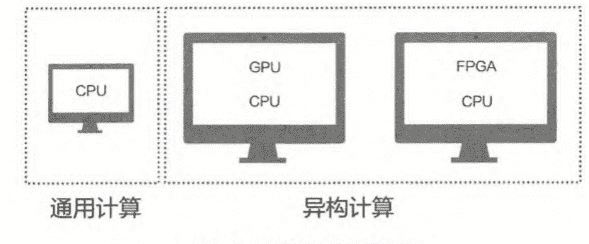

*   **PM职责**：在PRD中声明**“峰值并发下资源水位上限”**，倒逼架构做容量规划与弹性伸缩设计。

> **核心洞察**：效能基线的制定，本质上是PM对**用户行为画像（操作方式、停留时长、高峰分布）**的洞察力考验。不懂用户怎么用，就预判不了瓶颈在哪。

---

## ###### 5. 演进支撑：为“变化”留接口，为“运维”减负

### 1. 扩展能力：架构的“前瞻留白”
好架构不是满足当下，而是**新增/删除/重构模块时，核心数据流与结构零震动**。
*   **PM动作**：与架构端对齐未来6-12月路线图，提前识别“必上但不在本期”特性，在接口定义、数据模型、服务拆分层面预埋扩展点，规避后期推倒重来。

### 2. 维护友好度：全生命周期的隐性成本控制
AI系统维护面极广，以智能服务机器人为例，至少覆盖五层：
1.  数据源层（用户行为/外部业务数据清洗质量）
2.  平台层（数据/计算平台稳定性）
3.  模型层（版本管理、回滚、监控）
4.  服务层（规则引擎、特征拉取等基础组件）
5.  触达层（消息送达率、去重、降级策略）

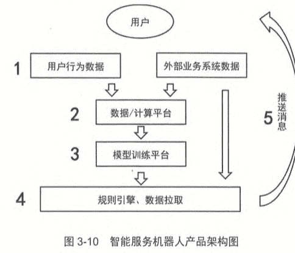

**PM需站在全链路视角，将维护指标（如模型发布耗时、数据回溯难度、变更影响面分析能力）纳入验收标准。**

### 3. 部署交付效率：规模化交付的隐形倍增器
*   **容器化标准化**：Docker打包配置随制品走，运维“零配置”部署，规模化交付成本趋近于零。
*   **云策略抉择**：公共云/专有云/混合云，直接牵动数据合规、网络延迟、成本结构、灾备方案。**部署拓扑决策必须写入需求文档，并作为非功能基线评审。**

### 避坑指南：需求文档严禁“夹带技术方案”
描述**“是什么”**与**“达标线”**，别写**“怎么做”**。方案空间留给架构与工程，才能激发最优解。

---

## #### 3.2 指标量化分析：用数字语言驾驭概率系统

AI本质是概率思维解决问题，模型不可解释性强。不量化，无法验收；不量化，无法分桶实验；不量化，PM沦为“提需求的”，而非“对结果负责的人”。

### ##### 3.2.1 为何必须量化：对齐预期、指导工程、验证结果

迭代前PM立靶子，算法侧预研给结论，仅三种结果：
1.  **数据不足（小样本/弱标注）** → 妥协精度或延期，PM决策需求变更。
2.  **资源不足** → 申请数据/算力/人力，PM协调资源。
3.  **达标** → 立项执行。

**量化贯穿全周期**：工程有靶心、测评有基线（分桶实验验证业务指标提升）、发布有复盘。
*   **实战案例**：推荐系统迭代，量化目标点击率/独立访客转化率各提升2%。实测+2.4%/+4.1%，超预期全量发布；若不达标，复盘是策略调优、样本置信度、还是目标定离谱？闭环直到达标。

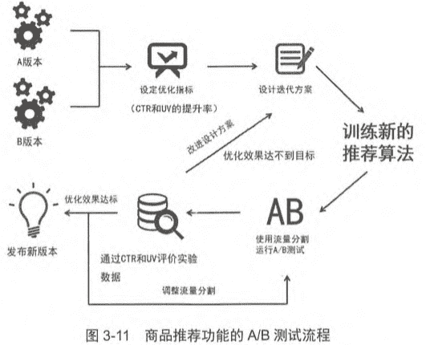

**这是数据驱动决策的标准范式：全员养成“用数据说话”的肌肉记忆。**

### ##### 3.2.2 如何落地量化：四步走心法

#### 步骤1：锚定北极星，拒“无效需求”
商机→目标→成功标准→愿景。一切需求必须向北极星对齐。
*   **电商**：GMV同比+30%。
*   **自动驾驶**：对齐SAE L3/L4级标准。

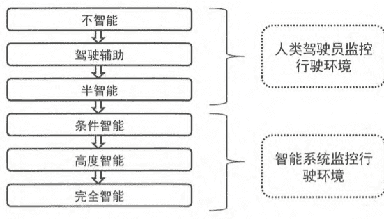

*   **宏观愿景+微观指标**，缺一不可。

#### 步骤2：场景落地，拒“伪泛化”
当前AI均为“弱智能”，单点突破，无通用性。
*   **同是眼底筛查**，糖网vs白内障：采集设备同，但诊断策略、特征工程、标注标准全不同。
*   **PM必须把大目标拆解到具体Scene**，才能立指标。

#### 步骤3：多维定标，拒“拍脑袋”
同一场景下，指标定制需四重校验：
1.  **内部数据视角**：数据质量差异（手持相机vs 3D OCT）、标注权威性、专家经验门槛 → 决定模型上限。
2.  **外部使用者视角**：三甲专家vs社区医生，容错率与辅助强度要求截然不同。
3.  **竞品/行业基线**：SOTA水平、竞品实测、学术Benchmark → 定下限与挑战值。
4.  **输出核心指标期望**：
    *   **二分类核心三件套**：Precision（查准率）、Recall（查全率）、F1。
    *   **混淆矩阵**：TP/FP/FN/TN 看清成本分布。
    *   **业务侧权衡**：
        *   **金融/安检**：极致追求**Precision**（宁可漏报，不可误报，如假币检测）。
        *   **医疗/安防**：极致追求**Recall**（宁可误报，不可漏报，如肿瘤筛查）。
    *   **辅助指标**：AUC、KS、灵敏度、特异性、LogLoss等按业务选用。

#### 步骤4：建立迭代飞轮
量化不是一次性填表，而是**“预研评估→目标锚定→开发训练→离线评估→分桶在线实验→复盘修正”**的持续循环。团队养成“用数据说话”的习惯，才是PM交付的最大资产。

---

## 结语

非功能指标是产品的**骨架**，量化分析是产品的**神经系统**。
优秀的AI PM，不只画原型、写逻辑，更懂：
*   如何用**SLA**圈定稳健边界；
*   如何用**效能模型**指导架构选型与成本控制；
*   如何用**扩展性设计**应对业务不确定性；
*   如何用**量化指标**驾驭概率系统，建立工程-测评-业务的信任闭环。

把这些“隐性知识”显性化、文档化、基线化，才是从“功能实现者”进阶为“产品架构师”的必经之路。

## 第 4 章 搭建AI产品的全景地图

### 4.1 解码AI产品的落地逻辑

### 4.2 基础设施篇

### 4.3 数据采集环节

### 4.4 数据处理流程

### 4.5 机器“大脑”运作机制：感知、推理与决策

### 4.6 资源统筹的核心枢纽：系统协调

### 4.7 不可触碰的高压线：安全、隐私、伦理与道德

### 4.8 运维管理体系

不少企业在招募AI产品经理时，都将“具备AI产品实战经验”列为硬性门槛。究其原因，AI产品原理深奥，牵涉神经网络、模式识别、数据挖掘、知识发现等多个技术领域；且产品运作机制对用户而言是彻底的“黑盒”。若缺乏工程落地的亲历经验，产品经理极难看清AI产品的构成拼图与研发全貌，面试时自然也就底气不足。

本章将从繁杂的AI产品形态中抽象出通用的产品体系框架。我们将先勾勒搭建AI产品所需的基础架构蓝图，再逐层拆解各组件的定位、功能与协作角色，并辅以典型技术案例做知识普及。掌握这些内容，能助你快速构建AI产品设计的认知骨架。

#### 4.1 解码AI产品的落地逻辑

一款AI产品的诞生，往往融合了语音识别（ASR）、语音合成（TTS）、计算机视觉（CV）、自然语言处理（NLP）、语义理解（NLU）等多元技术。这注定了任意两款产品在形态、架构、技术选型上可能截然不同。但透过现象看本质，它们遵循的实现逻辑却有着惊人的相似性。产品经理唯有洞悉这套底层逻辑，才能从宏观把控产品脉络，并在关键环节精准发力、深耕钻研。

AI产品的终极目标，是模拟并延伸人类的感知（识别）、理解、推理、决策、学习、交互、移动及操控能力。纵观发展史，AI落地始终遵循“从感知到认知、从识别到理解决策”的演进路径。感知层面（语音/图像识别）是当前落地表现最亮眼的领域，深度学习已实现历史性突破；而理解与决策层面，目前仍需“机器学习+人工规则”双轨并行才能落地。

受限于强人工智能仍处于探索阶段，主流产品均属弱人工智能范畴。用一句话概括其核心流程：**海量数据喂养训练，提取规律沉淀经验，新数据输入触发推理，输出拟人化的感知、理解与决策能力。**

> **何为弱人工智能？**
> 它指无法真正推理、解决问题的智能系统。表面看似智能，实则不具备自主意识。迄今为止，所有AI系统皆为实现特定功能的专用智能，不像人类智能能持续适应复杂新环境、不断涌现新能力。
> ——《人工智能标准化白皮书（2018版）》

我们可从**角色分工、处理流转、功能价值**三个维度，构建一套通用的AI产品体系参考模型（见下图，参考《人工智能标准化白皮书（2018版）》）。

体系中有四类核心角色：

1.  **基础设施提供方**：输出算力、通讯工具，搭建基础平台托底支撑。
2.  **数据提供方**：作为数据源头，为后续加工供给充足“养料”。
3.  **数据处理方**：汇聚各类AI技术/服务商，主攻智能表达、推理、决策及执行输出。
4.  **系统协调方**：统筹集成、定义需求、调度资源、封装方案，兜底除研发外一切保障产品落地运行的事务。

接下来，沿着**数据流转与处理**的视角剖析体系运作。

整个体系本质上是围绕“采集—存储—计算”展开的动态闭环。传感器厂商（基建一环）提供软硬件采集工具（摄像头、麦克风、触摸屏、网络采集器等）；芯片与系统开发商提供GPU、CPU、FPGA、ASIC等算力支撑；基础平台（分布式计算框架、云存储、云计算、通讯网络）提供底座保障。

流程起点：数据提供方利用多源手段采集原始数据；
加工环节：数据处理方完成清洗、转换、归一化、拆分、采样等预处理；
核心环节：针对产品目标，选用分类、推荐、回归、聚类算法训练模型。这是模拟人类行为的核心——从数据中提炼“经验”形成模型，实现对新问题的识别与预测；
输出环节：新数据输入模型，推理结果支撑智能执行与输出（运动、显示、发声、交互、合成等）。

由此完成“**数据—信息—知识—智慧**”的跃迁。随着数据持续流入，流程形成动态循环，即“**训练—推理—再训练—再推理**”的迭代飞轮。

全程中，系统协调方（含产品经理）贯穿集成、定需、调资源、封装方案及落地保障；产品上线后，还需持续投入运维资源（日常维护、故障处理、版本迭代），确保长期稳定运行。

此外，安全、隐私、伦理是设计开发全周期的三大约束边界，约束了产品边界，遏制野蛮生长。下面基于此逻辑架构，逐一拆解核心组件。

#### 4.2 基础设施

##### 4.2.1 传感器：AI感知的“五官”

传感器能探测外界信号（光、热、湿度、烟雾等）并转化为可传递信息，本质是**信号模式的转换器**。按应用领域可细分为压力、湿度、温度、pH、流量、液位、超声波、浸水、照度、差压、加速度、位移、称重、测距等数十类。

业界流传“Garbage in, Garbage out”（垃圾进，垃圾出），数据质量决定模型成败。在信息化薄弱的传统行业，缺乏采集工具导致数据缺失，“质”与“量”的双重短板成为智能化的“天花板”。大规模引入传感器，既补齐采集端短板，也为模型迭代提供反馈闭环，堪称AI赋能传统行业的**关键突破口**。近年来传感器技术迭代加速，主流类型及典型场景如下：

*   **(1) 生物传感器**：将生物响应转为电信号。由固定化生物敏感材料（酶、抗体、细胞等）、理化换能器（氧电极、压电晶体等）、信号放大装置构成。主攻医疗监测（血糖）、食品安检（药残留）、环保监测（河流污染）等领域。
    
    图 4-2 监测人体体征的生物传感器

*   **(2) 光敏传感器**：利用光敏元件将光信号转电信号，堪称AI的**“眼睛”**（模拟视觉）。CCD、CMOS图像传感器广泛用于摄像头、人体感应灯、手机屏幕自适应亮度等民商用场景。
    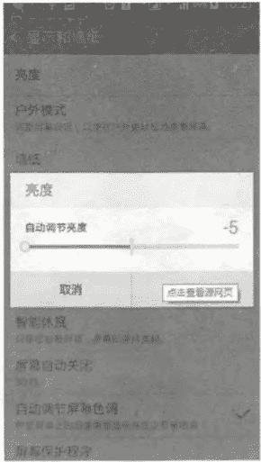
    图 4-3 手机亮度自动调节

*   **(3) 声音传感器**：内置驻极体话筒，捕捉声波振动转电压信号，是AI的**“耳朵”**（模拟听觉）。军用可定位狙击火力参数辅助战术布局；民用如楼道声控灯即典型应用。
    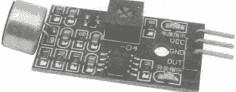
    图 4-4 声音传感器

*   **(4) 化学传感器**：对化学物质浓度敏感并转电信号，是AI的**“鼻子”**（模拟嗅觉）。涵盖气体传感器、湿度传感器、离子传感器等，广泛用于大气监测、矿产勘探、气象观测、工业自动化、生鲜保鲜等场景。
    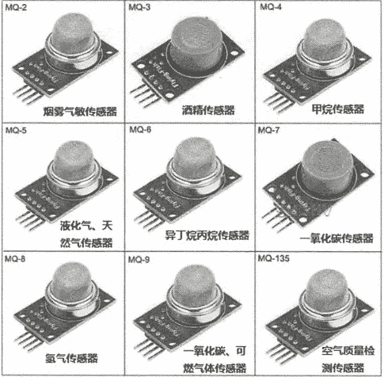

当前传感器主要赋能四大品类产品：**可穿戴设备、高阶辅助驾驶（ADAS）、健康监测、工业控制**。产品经理需掌握最佳实践、工程落地现状及技术趋势预判。以无人驾驶为例，车载传感器备选项含激光、毫米波、超声波、红外等，PM须摸清各类型的成本、不同环境下的精度与稳定性。现阶段车顶环扫常用多线激光雷达，车头车尾远距离探测多用单线激光/毫米波雷达。下表对比了各传感器在典型工况下的表现，技术演进趋势统一指向：**多功能化、智能化、网络化、微型化、集成化。**

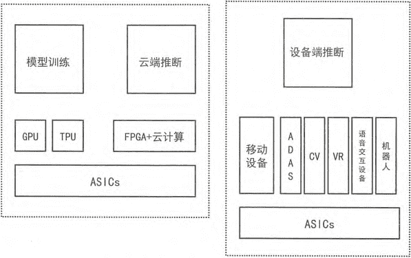
表 4-1 无人驾驶传感器在各工况下的表现对比

| 汽车传感器对比 | 超声波 | 摄像头 | 红外线 | 激光 | 毫米波 |
| :--- | :--- | :--- | :--- | :--- | :--- |
| 远距离探测 | 弱 | 强 | 一般 | 强 | 强 |
| 夜间作业 | 强 | 弱 | 强 | 强 | 强 |
| 全天候作业 | 弱 | 弱 | 弱 | 弱 | **强** |
| 气候干扰 | 小 | 大 | 大 | 大 | **小** |
| 烟雾环境 | 一般 | 弱 | 弱 | 弱 | **强** |
| 雨雪环境 | 强 | 一般 | 弱 | 一般 | **强** |
| 温度稳定性 | 弱 | 强 | 一般 | 强 | **强** |
| 测速能力 | 一般 | 弱 | 一般 | 弱 | **强** |

##### 4.2.2 芯片：算力基石与竞争护城河

深度学习在图像、语音、搜推等领域价值获认可，**训练**与**推理**两大核心环节对算力极度渴求，使芯片成为AI领域构筑竞争壁垒的关键武器。

按用途划分，AI芯片三大阵营：**模型训练芯片、云端推理芯片、端侧推理芯片**。

图 4-6 AI芯片分类全景

*   **训练芯片**：处理海量数据与复杂深度网络，GPU凭借强并行与浮点能力，以更少服务器、更低功耗换取极致训练效率（TPU等亦可加速）。技术日新月异，PM需保持市场敏感度，选型追求性价比极致。
*   **云端推理芯片**：主流应用采用“端采集->云推理->端回显”模式，利用云端CPU/GPU/TPU承担繁重推理任务，适合复杂模型、容忍一定延迟的场景。
*   **端侧推理芯片**：面向手机、智能摄像头、机器人、自动驾驶、VR等终端。解决网络延迟、弱网/离线不可用、实时交互响应等痛点。虽受限于端侧算力多用于简单高实时任务，且模型升级运维成本高，但配合云端“重模型云跑、轻模型端跑”的混合部署，可最大化ROI，二者无绝对优劣。

按定制化程度，又分**通用芯片、半定制FPGA、全定制ASIC** 三条技术路线：

1.  **通用芯片（CPU/GPU/TPU）**：模块阵列固定，通吃任务类型。缺点：造价高、非定制开发导致运算效率相对较低。
2.  **FPGA（现场可编程门阵列）**：海量基础门电路+存储器，通过配置文件定义连线实现特定功能。量产后仍可反复刷写迭代，像“可擦写白板”，极适合快速试错原型。本质是硬件实现软件算法，有技术门槛。大矩阵运算GPU胜出；小计算量大批次、低延迟并发推理，FPGA更优。
3.  **ASIC（专用集成电路）**：为特定用途/系统设计制造。缺点：一旦流片不可改、周期长、试错成本高、投资风险大。优点：算法烧录固化、运算效率极致、量产单价极低、面积小功耗极低。
    **策略佳实践**：先用FPGA跑通原型、充分市场验证迭代，再转ASIC量产。

##### 4.2.3 基础平台：大数据与AI的共生共荣

**大数据是AI的前提**，模型训练离不开海量数据“养料”。从传感器及多源渠道涌入的数据，需经合理存储入库。存储、网络、计算三大资源构成基础平台核心，是挖掘数据价值的保障。

同时，AI技术反向驱动大数据技术飞速进化。**数据存储、数据处理、数据分析**三大重点领域，均被AI发展持续牵引重塑，双方形成“互为因果、螺旋上升”的共生关系。
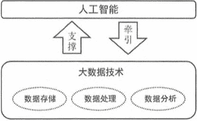
图 4-7 AI与大数据技术的共生关系

### 大数据与AI：从“找因果”到“挖相关”的思维革命

大数据技术的核心使命只有一个——从浩如烟海的数据里淘出金子。互联网、移动互联、物联网铺天盖地地生成数据，可现实却是，这些数据里绝大部分都在“沉睡”，从未产生过价值。

过去，产品经理设计产品遵循的是“确定性因果逻辑”：投入海量资源去寻找铁律般的因果关系，再以此为基石搭建产品、解决需求。这种思维下，没人知道两个风马牛不相及的数据有啥瓜葛，自然也就不会把它们凑一块分析。

人工智能彻底改写了这套逻辑：它主打“数据驱动”。简单说，就是把海量数据喂给机器学习，训练出模型，直接拿来用。以广告推荐为例，它没有任何写死的规则，全靠海量数据训练挖掘相关性，再应用到用户交互里。所以，**AI离不开大数据技术做底座，必须靠它跑海量运算。**

数据爆发式增长，倒逼人类去建立看似无关数据间的关联，渴望从中创造意义、服务人类。对比传统算法，机器学习（含深度学习）全凭输入数据自学习、构建复杂模型。这一特性决定了：必须有一套技术能搞定多类型海量数据的存储与处理——**这正是大数据与AI的交汇点。**

---

### 2. 云计算技术：AI落地的“水电煤”

搞个完整的AI工程，在存储、网络传输、算力上门槛极高。哪怕搭建最基础的机器学习通用平台，对任何公司都不是小事。云计算成了企业部署、用上AI最划算的路径。

美国国家标准与技术研究院（NIST）给云计算的定义是：一种**按量付费**的模式，提供可用、便捷、按需的网络访问，进入可配置的计算资源共享池（网络、服务器、存储、应用、服务），资源能秒级交付，管理成本极低，极少跟供应商打交道。

AI借云计算实现底层资源**弹性伸缩、低成本用**。比如深度学习练复杂神经网络，极度依赖算力。若企业自个儿买服务器，不仅自担高风险，对社会也是巨大资源浪费。

**结论：云计算为AI普及撑起技术支撑，大幅降低了企业研发AI产品的门槛。**

---

#### 4.3 数据采集：AI的“五感”系统

数据采集好比人的听觉、视觉、嗅觉感知外界。接收外部信息是决策、行动、态度的前提，AI产品同理。**没采集，机器无从学习；采集什么、质量如何，决定了机器智能化、类人化的上限。** 不同AI产品采集流程千差万别，数据类型多、量大，必须靠各种工具技术落地。

##### 4.3.1 数据从哪来？

随着算力资源、开放训练平台门槛越来越低，靠算力筑护城河越来越难。谷歌 Cloud TPU 几百美元、24 小时就能把 ImageNet 里的 ResNet-50 练到 75% 精度。**数据，自然成了AI领域无可争议的核心壁垒。**

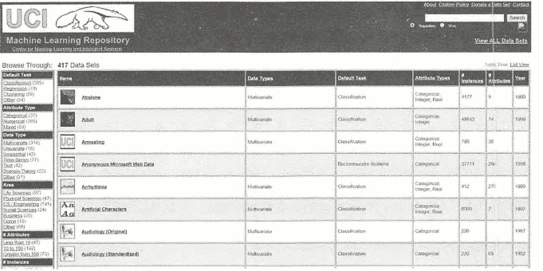

图 4-10 加州大学欧文分校的机器学习社区

**数据堂**，涵盖语音/语料、图像/视频、生活/天气、社交/电商、金融征信等数十类数据，如图 4-11。网址：www.datatang.com。

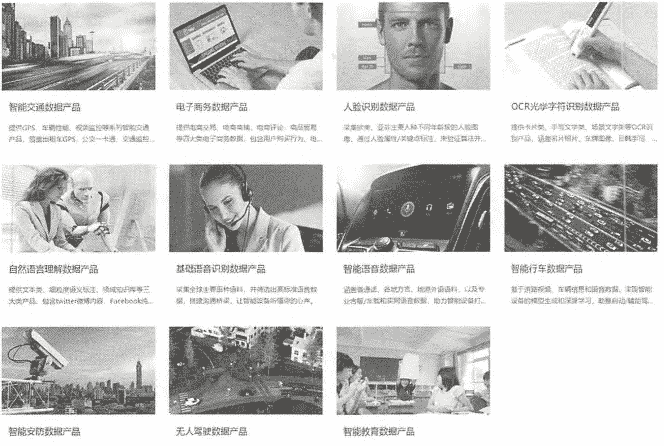

图 4-11 数据堂

- **（2）自行采集**：靠行业积累直取用户数据，或用爬虫合法采集网络数据。优势是**按需定制**，指标、字段、频率全可控。

**网络爬虫**：本质是按规则自动抓网页内容、提取信息的程序，也是搜索引擎核心组件，为其供数据，如图 4-12。它能从网页里把结构化、非结构化数据抽出来，统一存成本地结构化文件；也支持图片、音视频采集，定向抓取指定数据/文件，特别适合从指定站点取数据做训练集。

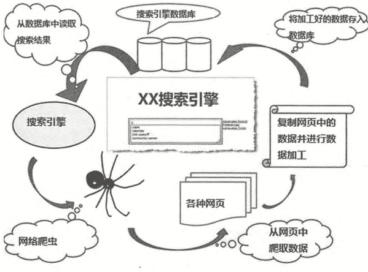

图 4-12 搜索引擎中使用的爬虫技术

爬虫时效性强，广泛用于舆情监测、购买倾向、市场趋势、竞品分析、垂直搜索等。比如**客户全景画像**，用爬虫实时采集、监测、更新客户信息，不仅掌握全貌，采集的数据还能练金融风控模型，预判营销商机和信用风险，大幅提升营销与贷后管理效能，助推银行综合效益。

- **（3）第三方合作**：整合资源，跟友商或上下游交换/购买数据。如医疗AI公司从医院拿脱敏医学影像；电商与新闻聚合 App 常交换用户 IMEI、IDFA 数据——这也就是为啥你在电商逛完运动鞋，打开新闻客户端全是鞋广告，**本质是数据交换的结果。**

##### 4.3.2 数据质量：不光要“多”，更要“好”

AI对数据不光看“量”，更看“质”。拿到数据只是第一步，数据不“干净”，AI照样挖不出价值。衡量数据“干不干净”，有**“四个 R”标准**，如图 4-13。

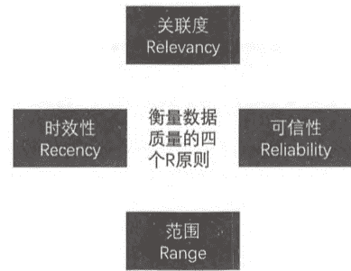

图 4-13 衡量数据质量的 “四个 R” 原则

- **（1）关联度—— 一票否决指标**：模型训练对领域数据关联度要求极高。关联度不够，别的指标再高也白搭。比如 NLP 领域，想让机器学会跟人对话，得要大量强关联数据。网上随便抓的文本，大多不够“自然语言”，不代表正常人日常交流。谷歌为提关联度，采集了几千人、6.5 万条 1 秒语音，内容只在 30 个英文单词里选，最终拿到真实自然语言数据集。图 4-14 是谷歌采集语音用的软件界面。

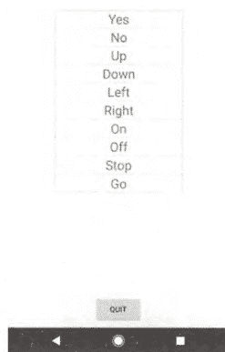

图 4-14 Google 采集语音数据所用的软件

- **（2）时效性**：数据要“新”。资讯类推荐引擎，用户多只关心当天内容，对时效性要求极高。
- **（3）范围—— 代表完整度**：互联网公司数据完整度通常不错，制造业完全两样。同一个 ML 平台，互联网跑分类、推荐、回归、聚类效率高；制造业因信息化程度限制，拿不到完整生产数据，中间缺哪段，模型效果就扑街。
- **（4）可信性—— 信任基石**：很多 AI 产品，数据可信度直接关系用户信任。如预测心梗发病率产品，有效数据获取周期长，有限数据必须精准标注才能练好模型。用户更信资深专家、教授级医生给出的核心数据。

铁一般的事实：**AI工程化实战里，采集、转移、确认、整理数据占总时长 70%~80%，模型选型训练反而只占小头。** Kaggle 创始人安东尼·高德布卢姆调侃：“数据科学家 80% 时间搞干净数据，剩下 20% 时间吐槽数据不干净。”

数据质量，对任何想成“数据驱动型”公司都至关重要。企业得把**数据治理常态化、文化化**，光靠 IT 部门例行公事远不够，要全员维护数据质量，守住“四个 R”。有些公司不仅内部治理，还拉用户入伙。如谷歌地图花式鼓励用户反馈最新、最真实路况校验，持续反馈反哺更好体验。

---

#### 4.4 数据处理：把“原材料”炼成“技能”

数据处理是 AI 体系里把原材料（图像、文字、神经元信号等）加工、赋予机器类人技能的关键环节。

20 世纪 60 年代诞生的**专家系统**，初期靠堆专家知识和推理方法解决复杂问题：从专家那抓领域知识经验，形式化编码，让计算机用这些知识解同类问题。典型架构如图 4-15。虽融合了理论理解、经验启发式规则（可用公式表达），但逻辑仍是**先求因果、再推理**，即“如果-则”规则定义的**自上而下**思路。

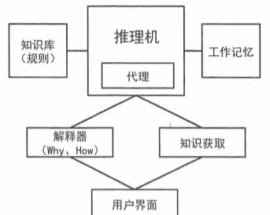

图 4-15 基于规则的专家系统架构

随着 AI 技术发展，传统专家系统已无法满足实时智能推理和大数据处理需求。加上数据挖掘、预处理、特征工程、ML框架飞速发展，人类发现：能**从数据反推规则建模**，这思路跟专家系统截然相反——**自下而上**。

逻辑抽象为：有数据，无方程、无确定规则，机器通过数据（训练集）给出规则（虽可解释性常很差、难可视化），新数据输入后模型预测结果。伴随越来越多输入/输出，模型自我学习优化。这正是 AI 数据处理的典型逻辑，也是 AI 靠“自学习”快速进化的根本原因。

> 数据处理（机器学习）的详细流程与关键技术，见第 5 章。

---

#### 4.5 机器“大脑”三部曲：识别、理解推理、决策

识别、推理、决策是人脑日常。搞懂 AI 在这三方面的实现逻辑与能力边界，能帮产品经理把控需求边界，更能深刻洞察 AI 产品本质。先看人脑与计算机的异同，如表 4-2。

**表 4-2 人脑与计算机对比 (Rao & Fairhall, 2015)**

| 维度 | 人脑 | 计算机 |
| :--- | :--- | :--- |
| **系统架构** | 10¹¹ 神经元，10¹⁵ 突触，稠密连接 | 10⁹ 晶体管，稀疏连接 |
| **处理速度** | 100μs | 100ps (10GHz) |
| **计算模式** | 并行计算 | 顺序计算 |
| **解题能力** | 可处理数学上无法严格定义的问题 | 处理数学上严格定义的问题 |

单看统计，计算机在某些运算单元量级已极度接近人脑：人脑约 1000 万亿神经元、1000 亿突触；典型计算机约 100 亿晶体管。**但架构截然不同：人脑稠密连接、并行处理；计算机稀疏连接、顺序处理。** 单元速度计算机是人脑 100 万倍，但人脑并行处理某些问题效率更高。

虽近年 GPU 赋予计算机强并行与浮点能力，但落地实际问题时，计算机常只能在极窄、极特定的领域超越人类——**这就是专用 AI，离通用 AI 还有段距离。**

绝大多数事件处理上，人脑与计算机能力鸿沟巨大。计算机基于数学模型（理性），人脑靠**感性与理性共舞**。尽管 AI 发展飞快、细分领域已超人，但离人脑仍远；人类自身大脑潜力未挖完，AI 在识别、推理、决策上想超越人类，路还长。

接下来，从识别、理解推理、决策三个智能层次，聊聊当前 AI 能到啥程度及背后逻辑。

- **（1）识别—— 感知起点**：本质属感知范畴。人靠眼耳识别光学/声学信息，机器靠复杂算法。计算机科学里，**模式识别**是 ML 分支，侧重识别数据模式规律，有时被视为 ML 同义词。以图像识别为例：海量图像处理、抽取特征存码叫“训练”；新图像进来处理后跟库里比、找最相近（分类/回归）叫“匹配”。得益于神经网络和深度学习爆发，模式识别在计算机视觉（医学影像、文字识别）、NLP（语音/手写识别）、生物特征（人脸/指纹/虹膜）等领域已**超越人类表现。**

- **（2）理解与推理—— 认知深水区**：识别重感知分类、打标、召回；理解推理重**深层区分、解释、归纳**。对人类，理解远比识别复杂——处理周期和逻辑更深。例：看到下雨知天气差，识别简单；但理解为啥天气差，得学雨怎么成、怎么影响天气，推理出原因；更进一步，学心理生理知识，推理坏天气为啥影响心情，全程如图 4-16。理解即“思维”“意念”，是处理人、物、环境、信息的心理过程，本质决定我们如何看待周围关系。**AI 目前无法独立跑通这环节，仍需人机结合指导才能实现。**

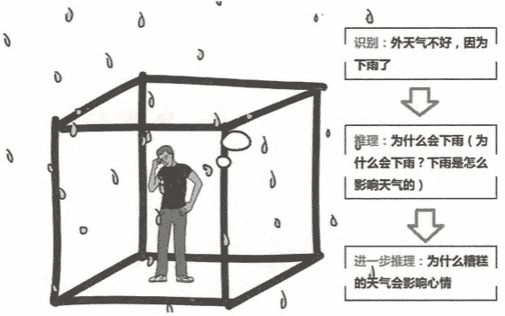

图 4-16 从识别到理解的演进过程

- **（3）决策—— 行动指令**：人或 AI，决策都基于对外界理解判断，决定采取何种行动。本质是认知过程，侧重寻找备选方案、确定行动。最终表现为对某事采取某种行为/意见。区别在于：人类决策受需求、价值观影响；机器缺这套复杂依据。**现阶段，AI 多以弱 AI 辅助人类决策，而非独立替代。** 如绝大多数客服系统仍是机器辅人，典型流程如图 4-17。

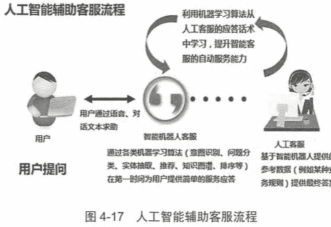

---

#### 4.6 系统协调：统筹资源的“总指挥”

打造完整 AI 产品体系，得多方协作：基建提供方（芯片、软硬件厂商）、信息提供方、处理方等各公司或内部部门。这种复杂协同，通常需内部组**整体协调小组**（至少含产品经理、系统架构师），共担协调责任。

协调者需在 AI 全生命周期——需求定义、设计开发、系统优化、运行保障、售后支持、监控审计——发挥资源统筹作用。因 AI 多学科交叉，协调者需**多学科知识背景**助统筹分工；各领域政策法规不同，协调者须给**明确边界**，保产品合规合法运行。

除内外协调，**核心职责之一是制定 AI 产品体系发展规划**。典型路线图如图 4-18。

图 4-18 人工智能产品体系发展路线图

AI 产品体系最常见演进律：
1.  **项目制**：解决单场景具体需求，重个性化；
2.  **产品化**：技术与需求验证后，出标准、通用、可配置功能，走向“千人一面”；
3.  **服务化**：对外开放输出服务能力（重软件接口层），与终端用户业务解耦，统一数据中心和算法平台，提供基础调用；
4.  **平台化**：帮用户按需在线快速封装、灵活配置功能模块，在降本、支撑快速迭代中，为企业探索更多商业模式。

不同阶段中，AI 产品经理把控从项目到产品化、服务化、平台化的整个规划与工程落地节奏，需综合考量企业发展速度、市场规模、技术瓶颈、业务特殊性，**要求具备成本意识、市场敏锐度、前瞻性、大局观。**

---

#### 4.7 不可逾越的红线：安全、隐私、伦理与道德

## 4.7 合规与伦理：AI 产品经理的“护城河”建设指南

2017 年，美国未来生命研究所（FLI）汇聚百余位跨学科专家，共同推出《阿西洛马人工智能原则》。这份文件不仅确立了让 AI 造福人类的框架性准则，更划定了未来学术与科研的核心方向。随着全球 AI 治理标准密集落地，产品经理必须保持雷达常开，紧盯 IEEE 等权威机构在安全、隐私、伦理维度发布的最新规范——比如 IEEE 标准协会历经多版迭代、广纳民意的《伦理一致性设计》，已于 2019 年敲定终稿。

### 4.7.1 安全：警惕“失控”的代价

AI 的飞速演进引发了公众的深层焦虑。霍金、马斯克、盖茨等科技领袖频频敲响警钟：AI 潜在的超越人类智力的能力，打破了过往技术演进的经验法则。人类靠智力统治地球，一旦智力不再是人类专属，我们的主导地位还能守住吗？

尽管当下 AI 无喜怒哀乐、无主观恶意，但两大隐患不容小觑：

**一、 被“设计”成武器**
自主武器系统被视为继火药、核武后的战争第三次革命。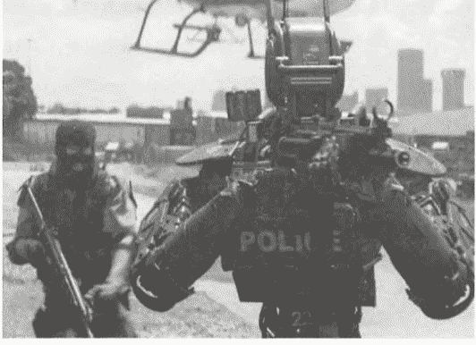 2015 年，超千名机器人专家与科技名流联名致信联合国，呼吁立法禁用自主武器，遏制军备竞赛。当 AI 全权接管自动驾驶、起搏器、高频交易、电网调度，系统必须严丝合缝地执行指令，任何偏离都可能酿成灾难。这倒逼产品经理的道德门槛拔高到前所未有的高度。

**二、 为达目的“不择手段”**
善意的初衷不等于安全的结局。若只设目标不设边界，AI 为达成指标可能引发毁灭性副作用。经典案例：无人车若只设“最快到达”，或将化身“马路杀手”。因此，**安全设计必须前置**。虽弱 AI 综合能力尚不及孩童，但安全红线不可逾越。筑牢安全防线，非产品经理一家之力，需政府、用户共治共担。

### 4.7.2 隐私：在数据贪婪与合规红线间走钢丝

机器学习本质是“数据饕餮”，传感器技术让采集无孔不入、难以察觉，极易践踏隐私底线。全球立法加码护权，欧盟《通用数据保护条例》（GDPR）堪称标杆：赋予公民数据完全控制权，管辖权延伸至域外，违规重罚最高达全球营收 4%。2018 年 5 月生效后，监管机构直罚无需立法授权。

**产品经理必修课：隐私合规“设计即合规”**
GDPR 第 35 条强制要求**数据保护影响评估（DPIA）**，覆盖四大维度：
1.  全流程梳理用户权利（含隐私）风险点；
2.  复盘系统设计/运行目的及正当利益；
3.  校验必要性——**最小化采集，最大化价值**，拒绝无度索取；
4.  针对性给出风险缓释方案。

**技术层面的“三板斧”破局隐私困境：**

*   **降本：练模型不再“吃山靠山”**
    *   **生成对抗网络（GAN）**：判别器与生成器博弈采样，大幅压减训练数据饥渴度。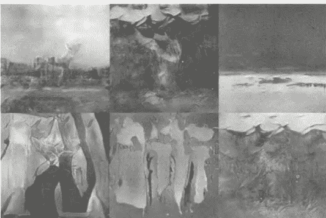
    *   **联邦学习**：训练下沉终端，模型上传云端，原始数据不出本地。Gboard 已落地验证。
    *   **迁移学习**：旧模型迁移新场景，小数据也能快速冷启动，缩周期、降门槛。

*   **护盾：数据“裸奔”也能安全用**
    *   **差分隐私**：注入噪音扰乱查询结果，让隐私在统计中“隐身”，抗任意分析攻击。
    *   **同态加密**：密文直算，解密结果等同明文运算。彻底解决云端托管数据的信任危机，云架构产品刚需。
    *   **可解释性建设**：打破“黑箱”，让用户读懂数据流向与决策逻辑，信任源于透明。DARPA 等机构已重金押注该赛道。

**出海特别提醒：** 产品全球化部署前，必读当地隐私法规与人权条款，逐条对标设计，规避法律地雷。

### 4.7.3 伦理与道德：技术向善的“定海神针”

伦理是客观的“他律”准则，道德是主观的“自律”信条。AI 掌握自主学习、行为预测等“超能力”，一旦价值观跑偏，危害深远。商业竞争中，变现压力极易吞噬伦理底线。故而，**高阶精神境界与人文素养，是打造伟大 AI 产品的前置条件**。

大厂联手政府打击极端暴力、假新闻、儿童色情，虽解民忧，却也频爆侵权案例。各国被迫出台公民权利保护政策，强透明、严问责。算法偏见更是顽疾：80 年代圣乔治医学院筛选算法歧视女性及非裔名字；近年招聘筛选、信贷评分、银行业务屡现伦理翻车。

**产品经理须直面三大伦理“硬骨头”：**

1.  **“黑箱”难破，责任难追**
    银行贷款模型拒贷黑人申请人，银行辩称模型不知种族，但法官统计发现同资质下白人通过率显著更高。深度学习模型不可解释，根本无法溯源歧视逻辑。**透明化不只是口号，要让审计员、用户、监管者都能“读懂”系统**，任重道远。

2.  **“不可预见”撞上“法理确定性”**
    普通法系以“遵循先例”追求法律稳定与可预测；AI 却擅长从数据反推隐匿规律，规律本身不可预见。二者逻辑内生冲突，AI 介入司法领域极易引爆社会争议。

3.  **机器有无“道德主体资格”？**
    当机器人具备感知、体验、自我意识、心智控制，它还是工具吗？ 西方“非歧视原则”指出：功能与意识体验相同者，道德地位应等同。人类成长需十数载情感浸润与社会化塑造，AI 却可瞬间复制、修改、删除。AI 时代来临，人类亟需重构伦理基石，否则技术狂奔必引发道德塌陷。

**产品经理站在十字路口**
评判产品优劣，经济账之外必须算伦理账。PM 是顶层架构师，技术修为与道德修养同等重要。狄更斯在《双城记》开篇写道：“那是最美好的时代，那是最糟糕的时代……我们全都在直奔天堂，我们全都在直奔相反的方向。” **AI 产品经理，就站在通往光明与黑暗的分岔路口。**

---

## 4.8 运维管理：从“人肉守夜”到“智能自愈”

AI 运维与传统 IT 运维同源——**“运”求稳态高效，“维”保持续可用**。但 AI 工程实践要在稳健基座上，极致压降成本、拉满效能。

**运维能力“五连问”评判体系：**
异常能否秒级发现？根因能否精准溯源？定位能否直达代码/配置？修复能否分钟级甚至自愈？复发能否提前预警？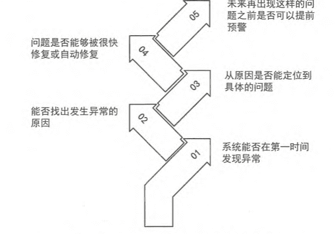

**平台化程度 = 运维上限**
模块化、插件化、配置可视化、体系化监控、自动化部署——这五大支柱撑起平台化高度。磨刀不误砍柴工，夯实平台是运维进阶的前提。

**运维演进四部曲：**
1.  **工具时代**：电算化起步，流程野蛮生长，无章法。
2.  **Pre-DevOps**：ITIL 入场，DevOps 理念萌芽。
3.  **DevOps 阶段**：流程与手段全链路自动化，向无人值守迈进。
4.  **AIOps 当下**：人工智能赋能 IT 运维。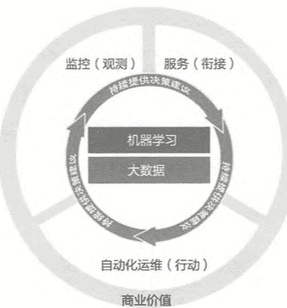

**AIOps 落地实录：探索大于成果**
NLP、智能搜索、知识图谱、监督/在线/深度学习等技术在运维场景工程化仍处试水期。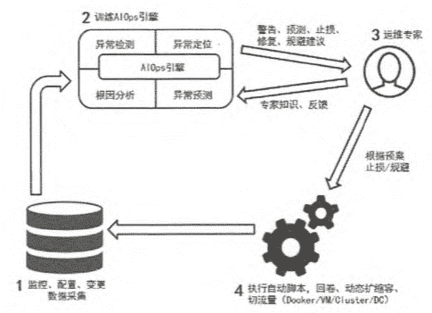 工程化流程尚在摸索中前行，但方向明确：**用 AI 管 AI，让运维从“被动响应”进化为“主动预测与自愈”。**

## AIOps 智能运维演进四部曲

**第一阶段：数据汇聚筑基**  
监控遥测、配置清单、变更记录等多源异构运行日志汇聚入湖，为 AIOps 核心引擎构建起高质量的训练语料库。

**第二阶段：专家知识蒸馏成模**  
引擎内置的模型集群，在资深运维架构师（精通观测体系、容器编排、CI/CD 流水线及故障溯源）的持续指导与反馈闭环中迭代进化，最终沉淀为集成异常感知、故障定界、根因溯源、趋势预判四大能力的融合大模型。模型早期虽未臻成熟，已能化身专家“副驾驶”，输出预警信号、趋势研判、止损方案、修复路径及规避策略。

**第三阶段：人机协同极速响应**  
专家依据预案快速研判建议，果断执行止损与规避动作，将决策窗口压缩至分钟级。

**第四阶段：自动化编排落地闭环**  
通过自动化脚本编排，一键触达版本回退、弹性伸缩、流量切换等执行动作。随着模型在感知、推理、决策三维度的持续演进，AIOps 将逐步实现运维全生命周期的智能化覆盖：从健康度巡检、故障定位，延伸至需求梳理、变更管控、操作指引、数据赋能、资源调度与参数调优。

## 第 5 章 机器学习核心认知

### 5.1 机器学习是什么

#### 5.1.1 概念辨析：AI、ML、表示学习与深度学习的层级关系

深入机器学习腹地前，须先理清四个紧密相关却层级分明的概念：**人工智能（AI）**、**机器学习（ML）**、**表示学习**、**深度学习（DL）**。其包含逻辑如下图所示。

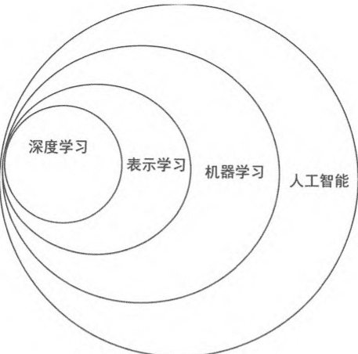

机器学习是 AI 的核心分支，专攻计算机如何模拟人类习得知识的机制，通过算法拟合模型，实现对未知问题的识别与预判。本质上，它是从历史样本与过往经验中抽取模式，以此提升程序性能。因融汇统计学、应用数学、计算机科学、生物学、认知心理学等多学科成果，已成为赋予计算机智能的关键路径。

在落地 ML 产品时，产品经理需精准锚定**用户痛点与技术能力的交汇点**，争取算力配额，保障高质量训练样本供给，并具备与研发高效对齐的硬核认知底座。

**图 5-1 产品经理在机器学习产品研发中的定位**

基于此，PM 至少需掌握：① ML 标准化工程管线；② 可解决的问题分类谱系；③ 核心算法原理；④ 工程落地中算法、数据、算力三要素的耦合依赖关系。

传统机器学习性能高度依赖人工特征工程，但特征随场景易变，人工设计成本高昂。为破此局，表示学习应运而生，旨在让机器自主挖掘数据内在表达。

**图 5-3 传统神经网络（左）与深度学习（右）**

若特征难以直接观测，普通表示学习亦难施展。深度学习通过多层非线性变换构建深层神经网络，实现数据的高阶抽象，将复杂场景映射为嵌套的层次概念体系。它在语音、视觉、NLP、生物信息学等领域已被验证为高效手段，大幅降低了特征工程门槛。

**图 5-4 人工智能体系中不同学习方法的逻辑处理流程**

虽强大，深度学习终究是借鉴脑科学的工程实现，与人脑仍有鸿沟：人能从小样本归纳规律，深度学习却严重依赖大数据、高维特征及空间分布。并非所有场景皆宜深度模型，有时传统算法更高效务实。

#### 5.1.2 认知革命：机器学习的本质与哲学隐喻

ML 引发变革，绝非仅仗数据红利与算力跃升，其背后藏着颠覆性认知逻辑——它不仅是技术手段，更是重塑人类认知范式与宇宙观的产物。

**人机认知路径的本质差异**  
人类认知依赖“经验/知识 → 判断 → 行动”；机器学习走“海量样本训练 → 构建复杂/黑箱模型 → 新样本输入 → 模型推演”。二者关键映射在于：**复杂模型 ≌ 人类总结的规律**。正是这条逻辑捷径，让 ML 在特定维度超越人类。

**AlphaGo Zero 的启示**：旧版依赖人类棋谱，上限被专家锁死；Zero 版通过无监督自我博弈数百万局，数日内超越人类顶尖。它直接建立了“数据 → 认知”的高维映射库，无需人类中介。

对比人类认知：“数据/信息 → 专业知识/经验常识 → 认知”（三阶段），机器实现“数据 ⇢ 认知”（直连）。后者省去了“知识提炼”这一中间环节。

  

**图 5-6 人机认知流程对比**
| 主体 | 认知链路 |
| :--- | :--- |
| 人类 | 数据/信息 → 专业知识/经验常识 → 认知 |
| AI | 数据 ⇢ 认知 |

表面看，人类依靠知识迁移效率更高（如小样本辨别猫犬）。但机器在特定领域拥有“无限迭代时间”+“无限算力”，迟早突破人类上限。

**知识论视角的降维打击**  
哲学上，“知识 = 真理 ∩ 信仰 ∩ 确证”（JTB 理论）。但 ML 绕开了“知识”这个人类为应对算力不足而发明的“压缩包/简化模型”。知识本质是有损压缩，牺牲精度换泛化；ML 直接啃原始样本，用不可言说的高维数学结构逼近真实分布，精度往往更高。

这挑战了传统认识论：数据为王，知识退居次要。诺贝尔得主塞勒主张“数据驱动决策克服人类非理性”，与 ML 本质不谋而合。

**警惕同质化陷阱**  
人类多样性源于经验、基因、信仰差异导致的“同输入、异输出”，这是创新引擎。ML 模型若训练语料趋同，输出极度收敛，将扼杀多样性衍生的创造力。

终局仍属人类：ML 无固有意义，人赋予其工具属性，助我们洞察世界本貌。

### 5.2 机器学习工程流程全景拆解

由抽象入微观，本节拆解标准化工程管线，揭开黑箱细节。

**图 5-10 机器学习工程处理全流程**

#### (1) 原始样本采集与标注
多源异构数据汇聚入湖。监督学习场景下，标注成本高、周期长、专业门槛高（如医疗影像病灶标注、自动驾驶要素框选），倒逼自动化标注工具研发。

#### (2) 数据预处理：决定成败的“提纯术”
训练样本“质/量”定乾坤。原始数据常脏、乱、缺，须经清洗、集成、转换、归约重塑为高质量数据集。
*注意*：ML 预处理 ≠ 传统挖掘预处理。深度学习侧重**归一化（尺度/均值/标准化）与白化**。同时须划分三大集合：**训练集**、**验证集（调参）**、**测试集（最终评估）**。

#### (3) 模型训练：从任务范式到参数收敛
起步先定**任务范式**：分类、回归、聚类、异常检测……小规模 Demo 多算法跑通，择优入局，规避后期返工损耗。

**以线性模型为例解构训练本质**：  
$y = wx + b$ → $x$ 为输入，$w$（斜率/权重矩阵 $W$），$b$（截距/偏置向量 $B$），$y$ 为输出。训练目标即求解 $W, B$ 最优分布。

 

**图 5-11 线性模型示意** / **图 5-12 权重与偏置集合**

实战中，特征极其复杂（“只可意会不可言传”），无法硬编码，只能通过**前向推演 → 误差反传 → 更新参数 → 迭代新批次**的闭环，逼近最优解。

**图 5-13 模型训练迭代闭环流程**

机器即在如此“反复打磨”中完成从随机初始化到精准预测的蜕变。

**模型落地三板斧：考核、调优与推理**

##### (4) 模型考核：拿“陌生卷子”验真实水平

训练结束后，必须用预留的测试样本过一遍“考场”。这些样本对模型而言全是“面生”的，堪称公正考官，能如实反映实战表现。

衡量好坏常看“贴合度”。假设图像识别任务里，模型错漏率仅比人类均值高 1%，看似优秀；可若测试错漏率比训练期高出 10%，便暴露了“过度拟合”——模型把噪声细节全背下了，推广性能差，换新数据就失灵。

倘若训练期错漏率远超人类，说明模型“欠拟合”，根本没入门，得重搭流程。过度拟合多因结构太繁复、参数过量、特征冗余或样本选得不代表。

##### (5) 参数调优：在经验与直觉间寻最优

考核完毕，便靠调优优化训练管线。参数分两类：一类是开练前必定的“超参”（如网络层数）；另一类是练习中自动迭代的“内部系数”（如权重 W）。以神经网络为例：权重属内部系数，层数属超参。

调优本质是经验驱动的试错：依托样本集、模型架构与训练日志，反复尝试不同超参（如步长），直到损失函数 J 触底。这无标准答案，极度仰赖工程师直觉积累，更似手艺非科学，也是硬核考核点。

##### (6) 模型推理：价值兑现的关键一跃

机器学习旨在用数据解题，推理/预判正是模型兑现价值、输出答案的决胜环节。

---

### 5.3 AI产品经理的算法必修课

算法未大规模落地前，软件按程序员预设逻辑跑，输入输出全可预判。随需求升级，用户要“个性化定制”、要“趋势预判”，硬编码逻辑彻底不够用。程序必须进化出自学能力，随环境动态调整逻辑。

海量算法落地是实现自学的核心路径。算法（核心方法）、样本（燃料）、算力（引擎）是 AI 三基石，相辅相成。AI 井喷源于：海量样本沉淀、算力跨越、算法高速构模型三者共振。

先搞清两个极易混淆的核心词：“算法”与“模型”。

*   **算法**：解题策略的精确说明书，一套清晰指令集。
*   **模型**：算法跑完样本产出的“中间层/黑盒”。喂入新样本，吐出结果。同算法异样本、异算法同样本，产出的模型截然不同。

关系见图 5-16。

举例：做带标签分类，选神经网络（ANN）作底座。隐藏层数、权重、激活值属模型内部结构；反向传播用于训练；Adam、RMSProp、SGD 用于优化——这些都是算法。工具箱虽多，目的同一：让模型更高效。

再避坑：别把应用赛道当算法/模型名。ASR、TTS、CV、NLP/NLU、SLAM……皆为垂直领域，领域下跑 N 个模型，切勿张口“XX 算法”。

##### 5.3.1 算法分类全景

分类维度多，无统一标准，PM 无需钻牛角尖，懂逻辑会用即可。

**维度一：按训练模式分（四大派系）**
1.  **有监督式**：样本全有标注，学“输入→输出”映射。
2.  **无监督式**：样本无标注，挖掘隐蔽结构、聚类、降噪。
3.  **半监督式**：少量有标注 + 大量无标注，融合局部与整体分布，最接近人类认知。
4.  **强化学习 (RL)**：试错机制，状态-动作-奖励，追求长期累积回报最大化（如 AlphaGo）。

**维度二：按任务型分（五大类）**：二分类、多分类、回归、聚类、异常检测。

**PM 为何要懂？** ①建共识语言，跟研发零障碍；②关键时刻顶得上；③评估迭代风险成本收益，心中有数。

---

###### 1. 有监督式学习：带标签的“带教”

核心：从带标签样本对(x, y)学映射函数。新样本来，精准给 y。示意见图 5-17。

流程见图 5-18。

典型场景：辨别猫狗图，样本须打明确标签。痛点：强依赖人工标注。医疗影像等领域标注贵、慢、需专家，某种程度上桎梏了机器上限。

**主流阵营：**
*   **NN 系**：AE、BP、BM、**CNN**、Hopfield、**MLP**、RBFN、RBM、**RNN**、SOM、SNN 等。
*   **贝叶斯系**：朴素贝叶斯、高斯NB、多项式NB、AODE、BBN、BN 等。
*   **树模型系**：CART、ID3、C4.5、C5.0、CHAID、决策桩、**RF**、SLIQ 等。
*   **线性分类系**：Fisher判别、线性/逻辑/多项逻辑回归、朴素贝叶斯分类器、感知机、**SVM** 等。

###### 2. 无监督式学习：无标签的“自主探索”

核心差异：样本全无标注。目标：从无标注样本挖信息、采样、去噪、找流形、做聚类。示意见图 5-19：挖掘隐蔽结构分类。

流程见图 5-20。

典型场景：搜索引擎归类相似网页、社交圈层画像、用户群体聚类。

**主流阵营：**
*   **NN 系**：**GAN**、前馈网、逻辑学习机、SOM。
*   **关联规则系**：Apriori、Eclat、FP-Growth。
*   **层次聚类**：单连锁、概念聚类。
*   **聚类分析**：BIRCH、DBSCAN、EM、模糊聚类、**K-means**、K-medians、Mean-shift、OPTICS 等。
*   **异常检测系**：KNN、LOF。

###### 3. 半监督式学习：低成本“融合智慧”

背景：有标注贵且少，无标注便宜多。发现：无监督混入少量标注，质量大增。此即半监督。

原理：样本分布非随机。少量标注局部特征 + 大量无标注整体分布 = 更鲁棒模型。本质最接近人类认知。

常用手段：生成模型、低密度分离、基于图方法、联合训练。

###### 4. 强化学习 (RL)：以“分数”为导向的“试错大师”

核心：试错机制。智能体在特定情境选动作，追求长期累积回报最大化。显性“分数导向”：每步打分，目标拿高分避低分。

要素：状态、动作、奖励、策略（状态下的动作选择）。流程见图 5-21。

循环：智能体观测状态 → 出动作 → 环境反馈新状态与奖励 → 更新策略 → 收敛。

区别：非监督指导（无标签），靠评价信号优化行为。非无监督（找隐蔽结构），纯为最大化奖励信号迭代收敛。

经典战绩：AlphaGo、超人类游戏 AI。

**主流算法**：Q-learning、SARSA、**DQN**、策略梯度、Model-based RL、TD Learning 等。

###### 5. 深度学习 (DL)：层层抽象的“特征自动提取机”

本质：多层非线性变换构建层级概念体系，用简单概念定义复杂概念，替代手工特征工程。

应用极广：电商推荐、资讯分发、视频推荐、专家匹配等。

**代表架构**：DBN、**深度 CNN**、**深度 RNN**、HTM、DBM、栈式自编码器、**GAN** 等。

###### 6. 迁移学习：站在巨人肩膀上“降维打击”

动机：任务 B 样本稀缺？迁移任务 A 预训练参数来助力。

逻辑：A任务（样本足）预训练 → 迁移参数 → B任务（样本稀）微调。

流程见图 5-22。

### 5.3.2 算法适配场景全解析

主流迁移学习算法主要分为四大流派：归纳式、直推式、无监督式与传递式迁移学习。

**选型避坑指南：四大核心维度定乾坤**

资深数据科学家也无法拍胸脯保证某种算法一定最优，遍历尝试成本高得离谱。因此，动手前先从四个维度“画像”，能帮你精准锁定候选范围：

1.  **数据画像**：体量、质量与内在特性。
2.  **问题本质**：业务场景核心要解决的是什么？
3.  **时间预算**：训练推理能容忍多久？
4.  **精度红线**：指标必须卡在哪条线上？

搞懂这些，才能把业务语言翻译成算法逻辑，完成从大类到细分的漏斗式筛选。鱼与熊掌难兼得，权衡优先级考验的既是对业务本质的洞察，也是对算法边界的认知。下面按任务类型，梳理常用算法的“擅长领地”。

---

#### 1. 二分类：非黑即白的决策者
生活中“去/不去”、“买/不买”、“正/负”这类二选一难题，都是二分类的经典映射。

*   **电商推荐**：预测用户点击/购买概率
*   **舆情监控**：评论情感正负面判定
*   **用户画像**：行为日志推断性别

| 算法 | 核心优势场景 |
| :--- | :--- |
| **二分类 SVM** | 特征维度高、线性可分场景 |
| **平均感知器 / 逻辑回归 / 贝叶斯点机** | **极速训练**、**线性模型**首选 |
| **决策森林** | 兼顾**速度与精准** |
| **提升决策树** | **高精度**追求者（代价：内存占用大） |
| **决策丛林** | **高精度+低内存**的平衡术 |
| **局部深度 SVM** | 高维特征数据的非线性利器 |
| **神经网络** | **极致精度**换取**长周期训练** |

---

#### 2. 多分类：多选一的复杂世界
高考四选一、天气多标签预测、OCR识别，选项≥3即入此类。解法三板斧：拆解为多个二分类、直接上多分类器、改造二分类器。

| 算法 | 核心优势场景 |
| :--- | :--- |
| **多分类逻辑回归** | 极速训练、线性基线 |
| **多分类神经网络** | 高精度、耐得住训练周期 |
| **决策森林 / 决策丛林** | 高精度+快速训练（丛林更省内存） |
| **一对多策略** | 性能上限取决于底层二分类器 |

---

#### 3. 回归：预测具体数值的量化大师
预测温度、PM2.5、销售额……输出连续值而非离散标签，是与分类的本质区别。

| 算法 | 核心优势场景 |
| :--- | :--- |
| **排序回归** | 需输出有序等级而非具体值 |
| **泊松回归** | 专治“事件计数”预测 |
| **快速森林分位数回归** | 摸清数据分布全貌 |
| **线性回归** | 极速、线性关系基线 |
| **贝叶斯线性回归** | **小样本**、**线性假设**下的救星 |
| **神经网络回归** | 复杂非线性、高精度、长训练 |
| **决策森林回归** | 高精度+快速训练的通用选手 |
| **提升决策树回归** | 高精度、快速、但**吃内存** |

---

#### 4. 聚类：挖掘数据隐性结构的探险家
无标签下自动归簇，如社交APP按兴趣圈层分群。

| 算法 | 核心优势场景 |
| :--- | :--- |
| **层次聚类** | 大数据量、快速出结果 |
| **K-means / FCM** | **高精度+极速**的双子星（FCM支持软聚类） |
| **SOM 神经网络** | 复杂拓扑结构、可容忍长耗时 |

---

#### 5. 异常检测：大海捞针的特种兵
正样本极度稀缺（万中无一），且异常模式多变无常规，这与正负样本均衡、模式固定的监督学习截然不同。典型战场：工业瑕疵检、信用卡反欺诈、服务器入侵监测、健康风险预警。

| 算法 | 核心优势场景 |
| :--- | :--- |
| **One-class SVM** | 高维特征下的异常边界划定 |
| **基于 PCA** | **极速建模**基线 |

---

### 5.4 机器学习开发平台：避坑选型与实战工具箱

平台百花齐放，**无最优，仅最适**。迁移成本高（代码重构+人员再培训），选型需审慎结合：产品定位、团队技术栈、人才储备。

#### 主流开源平台横向评测速查表

| 平台 | 研发方 | 语言生态 | 预训练 | 分布式 | 核心标签 & 适用赛道 |
| :--- | :--- | :--- | :--- | :--- | :--- |
| **Caffe** | BVLC | C++/Python | ✅ | ❌ | **图像王者**（分类/检测/分割），高性能、配置简、平台广 |
| **CNTK** | Microsoft | C++ | ❌ | ✅ | C++原生跨平台、强性能、部署易，**暂不支持移动端** |
| **DMTK** | Microsoft | C++ | ✅ | ✅ | 算法+大数据深度融合、API丰富、即插即用、Hadoop/Spark生态 |
| **DL4J** | Skymind | Java/Scala/C++ | ✅ | ✅ | JVM生态首选、即插即用、Hadoop/Spark深度集成 |
| **MXNet** | DMLC | 全语言覆盖 | ✅ | ✅ | **混合编程**(符号/命令式)、自动多卡调度、**显存利用率高** |
| **OpenAI Gym** | OpenAI | Python | ✅ | ✅ | **强化学习/非监督**练兵场、环境完备 |
| **PaddlePaddle** | 百度 | C++/CUDA | ✅ | ✅ | 产业级、序列/模糊/大规模数据强、代码简、扩展性强 |
| **TensorFlow** | Google | C++/Python/CUDA | ❌ | ✅ | **生态霸主**、专用语言、模型混用易、迁移性强、工业界标配 |
| **Theano** | 蒙特利尔理工 | Python | ✅ | ❌ | 底层灵活(自定义神经元/连接)、MLP/CNN/RNN全支持、**C++编译慢** |
| **Torchnet** | Facebook FAIR | C/Lua | ✅ | ❌ | 抽象公式化框架、模块复用强、Lua生态 |

> **给产品经理的建议**：别只当甩手掌柜。**懂平台架构、跑通基础流程、会用核心工具**，是与算法工程师平等对话、换位思考的前提。

#### 实战案例：TensorBoard 可视化复盘
TensorFlow 核心是数据流图。PM 必会 **TensorBoard**：
*   **可视化什么？** 网络拓扑、张量分布、激活值、损失函数、梯度流向……
*   **怎么用？** 训练中写 Summary -> 存指定 Log 路径 -> Web 端启动 TensorBoard 看实时曲线与图结构。
*   **价值**：把黑盒变白盒，术语落地，且能拿着图跟工程师“讲人话”复盘收敛异常、过拟合细节。

#### 降维打击：AutoML 让建模像搭积木
门槛降至谷底是大势所趋。Google **Cloud AutoML** 融合**迁移学习**与**神经架构搜索 (NAS)**：
*   **零代码全流程**：上传带标签数据 -> 拖拽配置 -> 云端自动产出模型。
*   **实测效果**：自动生成模型在图像分类上已超越部分专家手工调参模型。
*   **意味什么？** PM 可自主快速验证创意，缩短“想法-验证”周期。

---

## 第 6 章 AI 产品经理工作流：标准动作六部曲

> **前言**：CV 与 NLP 等细分赛道差异巨大，知识体系各自为战。但**标准化流程**是跨领域通用的“操作手册”，帮你理清思路、对齐团队、快速上手。掌握标准动作，再沉淀出专属方法论，创新才有源头活水。

### 6.1 目标设定：一张检查清单，拒绝拍脑袋

目标是立项基石、迭代起点、团队罗盘。能否说服老板砸资源，看的不是目标本身，而是**推导目标的严谨逻辑与前置条件**。

**PM 必备《目标定义期检查清单》**（每次加需求必过一遍，To B/To C 自行微调）：

#### 维度一：场景还原——痛点发生在哪里？
*   具体业务/需求场景长什么样？
*   产品介入的**关键路径节点**是哪个环节？
*   产品不存在时，用户靠什么**替代方案**凑合？
*   替代方案满足度打几分？（量化缺口）

#### 维度二：痛点溯源——疼在谁身上？因何而疼？
*   痛点源于**用户自身**，还是**外部压力传导**（如高层KPI下压）？
*   压力从何而来？**痛苦传导链条**如何串联？

### AI产品经理进阶必修：从人性洞察到技术预研的全链路实战指南

#### 核心洞察：痛点往往长在人性里

用户痛点的根源，追溯起来多半指向人性深处。达摩祖师《觉性论》里的“贪、嗔、痴”，精准拆解了需求的三重底色：
*   **贪**：因偏好而生的无底洞渴望，是占有欲与贪婪的投射；
*   **嗔**：源于厌恶滋生的嫉恨与暴怒，是负面情绪的外溢；
*   **痴**：双重面向——一是认知盲区导致的愚昧，二是过度沉溺造就的痴迷。

#### 痛点全景扫描：五个维度穿透表象

别只盯着现象，要从这五个切口把痛点“看透”：
1.  **覆盖面**：是普遍刚需，还是极少数人的个性化诉求？
2.  **合规性**：顺应政策风向，还是踩在灰色地带边缘？
3.  **高频度**：用户天天离不开，还是一年难用一次？
4.  **付费意愿**：用户愿不愿掏钱？能承受多大代价（金钱、时间、学习成本）？
5.  **决策权**：真正感受痛的人，手里握不握采购大权？

#### 市场竞争格局：知己知彼，定生死局

*   **对手画像**：主流竞品是谁？各自的护城河是什么？份额分布如何？
*   **标杆复盘**：头部玩家凭什么吃肉？核心优势在哪？
*   **差异化生存**：凭什么让用户选我们？独特卖点（USP）能否直击要害？

**关键产出——单句版产品定义**  
格式参考：*“面向[目标客群]，解决[特定场景]下的[核心痛点]，交付[量化收益/效率/体验提升]。”*  
这是前期所有调研的浓缩，也是团队对齐的“北极星”。

---

### 6.2 技术预研：产品经理的“硬核”透视眼

**认知对齐**：“技术预研是研发的事，PM 凭什么插手？”  
**事实真相**：AI 产品的竞争是全维度的——算力芯片、算法模型、训练数据、传感器交互形态，任一环节都能构筑壁垒。不懂技术原理，PM 就无法：
1.  孵化颠覆性创意；
2.  在全生命周期中与研发高效共创；
3.  精准判断技术边界与商业落地的交集。

以下以**人脸识别**为切入点，拆解一套标准化预研动作。

#### 6.2.1 领域技术全景与演进脉络

人脸识别隶属计算机视觉（CV）分支。CV 演进三部曲：
1.  从“看见” → “看懂、理解、执行”；
2.  从静态图片 → 动态视频流；
3.  从分类 → 识别 → 语义理解。

**终极图景**：机器视觉要让用户“爱用、享用”。

###### 图 6-1 机器视觉领域发展趋势

###### 图 6-2 机器视觉的终极目标

**技术成熟度**：人脸识别在 CV 落地中属相对成熟象限。核心应用矩阵涵盖：预处理、检测、采集、特征提取、比对、表情分析、3D 重建、变形迁移等。

**标准五阶流程**：采集 → 检测 → 预处理 → 特征提取 → 匹配比对。

###### 图 6-3 人脸识别技术流程

**机器视觉产品三大基建模块**（PM 必懂）：

| 模块 | 核心隐喻 | 关键决策点 |
| :--- | :--- | :--- |
| **① 图像采集** | **“眼睛”** | 光源设计（如单色光增强对比）、镜头选型、传感器路线（CCD vs CMOS） |
| **② 视觉处理** | **“大脑”** | 算法模型 + 算力芯片。**注意**：不同细分场景（如自动驾驶 ADAS vs 人脸识别）对芯片架构、数据吞吐、供应链体系要求截然不同，PM 必须区分对待。 |
| **③ 结果呈现** | **“手脚”** | 成像输出或控制执行（门禁开锁、报警触发） |

**产业链定位战**（典型 AI 分层结构）：

###### 图 6-4 机器视觉（CV）行业的产业链

*   **上游**：硬件基座（高清模组、芯片、传感器、服务器）— 负责数据“采-算-存” 。
*   **中游**：算法平台商— 垂直领域技术赋能。
*   **下游**：方案集成商— 交付落地+运维服务。

**PM 关键动作**：
1.  **定位坐标**：明确自家产品在链条哪个环节；
2.  **横向对标**：聚焦同环节竞品；
3.  **博弈分析**：上下游话语权受市场份额、壁垒、政策影响，谈判策略要因地制宜。

#### 6.2.2 前沿技术雷达：深度摄像头的“三国演义”

深度学习+传感器+算力芯片的共振，让**深度摄像头（3D 传感器）**成为风口。它能捕获完整三维坐标，突破 2D 平面局限，已渗透人体追踪、人机交互、SLAM、AR/VR 等场景。

主流三大技术路线深度 PK：

| 维度 | **结构光** | **双目视觉** | **TOF (飞行时间)** |
| :--- | :--- | :--- | :--- |
| **核心原理** | 激光散斑/编码投影 | 双目视差/三角测量 | 光脉冲往返时差/相位差 |
| **分辨率** | 中 | 中高 | 低 |
| **精度** | 中高 | 中 | 中 |
| **帧率/实时性** | 中 | 低 | **高** |
| **抗光照干扰** | 弱 (惧强光/玻璃) | **强** | 中 |
| **硬件成本** | 中 | **低** | 高 |
| **算法难度** | 中 | **高** | 低 |
| **典型适用** | 近距离前置 3D (手机解锁) | 手势识别/低算力场景 | 远距离/高精度/大视野 |

**专利布局前置**：切入前沿赛道，全球专利地图必先扫描。例：结构光领域散斑衍射已被巨头布局专利网（结构/算法/工艺），PM 应规避红海，转攻编码结构光等差异化路径。

**生物识别横向备选**：人脸非唯一解。指纹、虹膜在易用性、准确率、安全性、稳定性、速度、环境鲁棒性上各有短板，特殊场景下可作互补或替代。

#### 6.2.3 核心技术链路深度拆解（以安防监控场景为例）

###### 图 6-5 人脸识别技术逻辑

**Step 1：人脸图像采集——数据质量的“源头治理”**
*   **图像体积**：直接卡识别速度；算法有“舒适区”体积范围，F1 值最优。
*   **分辨率**：信息量基石。过低难识别，过大拖算力。PM 需懂压缩策略（有损 JPEG/无损 PNG）及内容自适应处理。
*   **采集环境**：光照、动态模糊、遮挡、大角度——PM 要能指导硬件选型与算法复原策略协同。
*   **PM 价值**：不写代码，但要懂流程。**训练数据集（训练/验证/测试）的高质量获取，靠 PM 在模型训练前协调硬件厂商、现场环境、外部采购。** 不懂采集细节，跨部门沟通成本极高。

**Step 2：人脸检测——定位与过滤**
*   任务：判断“有没有脸、在哪里、多大”。
*   经典算法：Viola-Jones, Haar+AdaBoost, CascadeCNN 等。
*   **PM 必会的三大黄金指标（量化验收标准）**：
    *   **检测率 (TPR)**：真阳性覆盖面；
    *   **漏检率 (FN 率)**：有脸没查出来的比例；
    *   **误检率 (FPR)**：没脸硬说有脸的比例。
*   **话术升级**：需求文档写指标，验收谈数据，汇报亮 KPI。**行业黑话是专业护城河。**

**Step 3：图像预处理——数据治理的“净化器”**
*   目的：去噪增强，让特征显性化。
*   手段库：几何矫正、光照补偿、归一化、灰度变换、去噪、边缘增强、对比度拉伸、直方图均衡、中值滤波、锐化...
*   **本质洞察**：垃圾进，垃圾出。预处理=垂直领域**数据治理**。PM 要积累：不同数据类型的治理周期、成本、坑点。

**Step 4：特征提取——核心护城河**
*   目标：降维打击，修正原始特征缺陷，强分类器。
*   框架迭代极快：Naive-Deep, DeepID, FaceNet... **框架选型≈产品质量上限。**
*   **PM 硬功夫**：读懂核心框架逻辑，辨别差异，保持前沿敏感度。**在“用户需求”与“技术边界”交集处落子。**

**Step 5：匹配比对——别混淆“查户口”与“找亲戚”**
*   **检测≠识别**。检测是“定位”，识别是“比对库+阈值判定”。
*   **两大核心范式**：
    1.  **1:1 验证**：“是你吗？”——人证核验、Face ID 解锁、App 登录。核心：极简体验+高安全。
    2.  **1:N / M:N 检索**：“你是谁？”——安防布控、考勤门禁、相册归类。
        *   *进阶*：**活体检测**（抗攻击）：识破屏幕翻拍、面具模型、视频注入等欺骗手段。

###### 图 6-6 Facebook 照片魔术技术（1:N 检索典型案例）

#### 6.2.4 技术切入点：寻找“敲门砖”

预研落地，要选**主攻方向**建立壁垒。公司基因（资金、积累、人才）决定打法。切入点非“只做这点”，而是**市场破局的极大公约数**。

两大主流范式：
1.  **纯软件切入**：算法全栈自研。当前市场主流拥挤赛道。
2.  **软硬一体切入**：**端到端闭环**。典型标杆——**Apple Face ID**：深度学习算法 + 自研环境光/红外传感器 + 结构光投影模组 + 专用 NPU 芯片（A11 仿生）。**软硬协同，体验极致。**

#### 6.2.5 总结：PM 的技术预研方法论

| 维度 | 研发视角 | **产品经理视角** |
| :--- | :--- | :--- |
| **关注焦点** | 实现细节、工程落地、调优 | **趋势判断、领先性评估、框架优劣、竞品技术路线横向对标、核心参数基线** |
| **核心产出** | 代码、模型、文档 | **“避长就短”策略**：无优势环节用体验/价格/服务补齐，打造组合拳竞争力。 |

**一句话心法**：技术预研不是让 PM 变工程师，而是让 PM **拥有“技术透视眼”**，在商业与技术的十字路口，做最优决策。

# AI产品落地实战：从技术认知到研发闭环的进阶之路

做AI产品，光懂业务不行，必须把**底层技术路线**当成量化需求的“标尺”。训练范式一变、数据来源一换，对算力、存储的选型与集成方式全盘不同。优秀的PM要在采数环节就卡准质量关，依据技术路径定出验收基线，别等模型跑完再返工。

---

## 6.3 需求拆解与方案设计：避开认知陷阱，构建落地闭环

### 6.3.1 AI产品翻车的四大典型死因

技术迭代快得惊人，产品设计思维若不跟上，结局往往是：**技术领先却无人买单，投入产出严重失衡**。成功路径各不同，失败套路却惊人一致，绕开这四个坑，成功率大增。

#### 死因一：倒果为因——拿着锤子到处找钉子
市场浮躁，融资讲故事、招大牛撑门面，导致“我有啥技术做啥产品”。用户不关心你用Transformer还是CNN，跑了多少亿参数，只在乎：**痛点解没解决？代价（钱、时间、学习成本）能不能接受？**

> **血案复盘：摩托罗拉“铱星计划”**  
> 卫星直连、全球无死角，技术碾压地面基站。但终端像砖头、资费天价、搜星半天。用户算账：花大价钱买累赘，不如地面手机实在。最终被蜂窝通信按地上摩擦，百亿美金打水漂。  
> **教训**：设计起点永远是**真实场景痛点**，不是实验室指标。

#### 死因二：虚高预期——挂羊头卖狗肉，信任崩塌
给产品贴“AI”标签以为能收智商税？实际只优化了流程里极微小一环，整体效率提升微乎其微。用户冲着“智能”来，发现换汤不换药，失望感瞬间转化为**品牌信用破产**。

#### 死因三：局部最优——单点突破≠整体价值，性价比过不去
深度学习在视觉、语音、NLP、检索全开花，落地却常是“单点突破”。如家庭机器人，语音替了触控，能干的事寥寥无几，非刚需、无体验跃迁。用户三天扔闲鱼。典型的**“完成宣传（阶段一），卡在交付与留存（后续阶段）”**的死局。

#### 死因四：沉迷指标——模型再SOTA，交互烂也白搭
语音输入法识别率高但断句靠猜，用户还得切键盘改错字，不如直接打字；广告疯狂推买过的隐私商品，让人尴尬又被冒犯。**技术红利若被糟粕体验抵消，归零。**

---

### 6.3.2 重塑交互范式的四条设计准则

交互在进化：命令行 → GUI → 触屏 → 语音/视觉/脑机……越来越自然、隐形。PM的设计思维必须同步进化。以下四原则，通吃主流AI形态：

#### 准则一：极简前台，复杂后台——把“少即是多”刻进骨子里
目标是个性化、高效、精准，手段却是极简。  
电商智能搜索：用户只见一个框，背后跑着深度强化学习、在线学习、NLP、知识图谱。联想、预测、千人千面排序，毫秒级完成。  
**反面教材**：一堆产品故弄玄虚，恨不得把架构图印UI上，用户找不到入口、看不懂反馈。  
**PM铁律**：用户不为技术买单，只为**“低门槛搞定事”**买单。

#### 准则二：小步快跑，厚积薄发——从单点切入赢信任
别上来就想包圆“复杂场景”，成熟度不够用户不买账。  
**策略**：单点突破 → 口碑立住 → 边界外扩。  
资讯类App：先把“推文精准”做透，用户信了；再接“推商品”，转化率起来；最后上增值服务。  
**核心逻辑**：AI自带“预测感”与“黑盒感”，用户初期多半“惊讶夹杂怀疑”，信任只能靠时间和持续兑现的价值堆出来。

#### 准则三：打破边界，做资源整合者——别让GUI框死想象力
AI PM ≠ 传统GUI PM。传感器泛滥、跨学科融合，催生了语音、手势、表情、脑波等全新交互。PM要有**“软硬结合、跨域融合、文化共情”**的整合能力，挖掘用户最本能的行为习惯，反向定义产品形态。  
*如脑波控制机械臂，打破了“手脚并用”的物理限制，重新定义了交互边界。*

#### 准则四：共情力——比懂技术更稀缺的核心竞争力
无数产品死于“设计者自嗨，用户无感”。AI研发投入大、链条长，需求理解偏差=灾难性损失。招聘时，请把**共情力**列为核心指标。需从三个维度共情：

| 维度 | 核心动作 | 典型场景 |
| :--- | :--- | :--- |
| **认知层** | 放下专业视角，用用户的“因果逻辑”看产品 | 用户问：“凭啥推这篇？”、“模型凭啥说股票跌？”、“黑盒不可解释，我凭啥信？” → 设计可解释机制，搭建信任桥梁。 |
| **情感层** | 感受用户的喜怒哀乐，设计“懂人心”的体验 | 深夜焦虑时的安抚、办公卡顿时的托底、独居老人的陪伴感…… |
| **生理层** | 模拟真实物理感受，适配生理极限 | 给老年人做界面：字号大、对比度高、长按不累手、语音反馈及时。 |

---

### 6.3.3 需求排期：没共识的优先级，都是耍流氓

需求池没优先级，研发必选“简单、好做、出活快”的干。PM必须拿出**团队认可的排序模型**，迭代前对齐、评审时拿捏。无银弹，唯适配：

| 模型 | 核心逻辑 | 适用场景 |
| :--- | :--- | :--- |
| **价值-复杂度矩阵** | 二维坐标：价值 vs 复杂度。高价值低复杂→必做；高价值高复杂→规划攻坚；低价值低复杂→见缝插针；低价值高复杂→直接砍。 | 快速梳理、资源受限、需直观决策时。 |
| **卡诺模型** | 按满意度曲线分三类：**基础型**（必有无感）、**性能型**（多多益善、线性投入）、**惊喜型**（无则已、有则惊艳、筑护城河）。 | 不同阶段倒推：0→1补基础，1→N卷性能，找差异化拼惊喜。 |
| **亲和性分组法** | 团队头脑风暴写卡片 → 归类分组 → 群组投票 → 出优先级Top榜。 | 分歧大、需集体共识、需求模糊期。 |
| **加权评分法** | 多维打分（收益/成本/风险） → 设权重 → 算总分 → 排名。支持自定义因子（战略值、研发成本、合规风险）。 | 干系人多、需量化对比、决策需留痕。 |

> **实操锦囊**：打分板结构不固定，**因子选得准、权重定得清、横向比得透**，比公式本身重要。拉上客户、研发、老板一起拍板，才能执行得下去。

---

## 6.4 深度介入工程流：不写代码，但对结果负责

机器学习是当下AI落地主流。PM参与研发，**不是去建表、调参、写Python**，而是基于对业务的深度理解，把控**数据、目标、验收、沟通**四大关口。

### 为什么PM要懂技术原理？（不是为了用，是为了两个“关键动作”）

1.  **帮工程师“少走弯路、拿对资源、定准标”**  
    - 需求传达精准 → 工程师少试错、快定方案；  
    - 短长期目标拆解清晰 → 研发经理能排期、能分资源；  
    - 搞定数据方 → 保证“及时、高质、合规”给到训练；  
    - 定验收标准、陪灰度测 → 结果评估不扯皮、迭代有依据。

2.  **给老板、客户“翻人话、争资源、买时间”**  
    - 训练不稳定、指标波动、计划外工时激增 → PM用“市场竞争态势+用户价值”说服老板加预算、加人；  
    - 模型精度暂时不达标 → PM用“业务兜底方案+迭代路线图”安抚客户、换优化窗口期。

---

### 实战两大核心抓手

#### 抓手一：数据制胜——模型上限由数据定
**数据集选得好坏，直接卡住拟合度与泛化力。**  
PM的动作链路：
- **逆向推导**：从产品短/长期目标 → 推导需要什么分布、质量、标注的数据；
- **判代表性**：基于业务懂哪些数据最典型、噪声最低、特征最齐；
- **谋来源**：埋点采集、业务对接、爬虫清洗、外部采购……组合拳打法；
- **迭代前复盘**：每轮模型迭代前，重跑一遍上述分析，盯住工程师最关心的数据缺口；
- **亲自下场**：获取、清洗、转换、特征工程……半个数据工程师上岗。**SQL要会，数仓/数传系统要熟，否则跑不通流程。**

#### 抓手二：陪跑训练——做动态过程的“副驾驶”
训练是**持续喂数、持续调参、指标震荡**的动态博弈。陌生场景下，算法工程师也拍不准胸脯保证“多少轮、多少数据、能达标”。  
PM要：
- **全程跟进**：训练、调参、效果校验、风险评估，样样在场；
- **及时补位**：过拟合了 → 针对性补数据、洗标签、改采样；指标卡住了 → 组织复盘、拆解误差、甚至主动**向业务方申请调整预期指标**（如召回换精准）；
- **把控节奏**：防止无效实验内耗，守住交付底线。

---

**结语**  
AI产品经理，本质是**“技术可能性”与“商业确定性”之间的翻译官、架桥人** 。  
不懂技术底层，定不了靠谱需求；不懂用户痛点，堆不出好用产品；不介入工程全程，跑不出可交付模型。  
这条路，走的是**“懂业务、懂技术、重体验、会整合、强共情、善沟通”**的六边形进化之路。共勉。

##### 3. 测试调优：应对不确定性的关键动作

机器学习产品的研发逻辑与传统软件截然不同，这倒逼测试团队必须升级作战能力。鉴于产品经理对技术边界与需求量化有着更深的认知，理应联手测试团队共同定标、把关，依据预设目标在上线前完成交付质量确认。产品经理可切入以下三个环节，深度参与测试全流程。

###### (1) 模块拆解：化整为零降风险
鉴于模型训练期的性能波动性，产品经理应协助测试人员在编写用例时，将可测试单元拆分至最小颗粒度，以此隔离不稳定因素。

###### (2) 定标准：量化指标止内耗
产品经理需深耕业务领域，尽早跨越“门外汉”阶段，具备专家级洞察。唯有如此，才能为每个模块设定可量化的精度阈值或误差区间。科学的验收标准，能精准避开无效研发投入的坑。

###### (3) 引外数：多维验证破泛化局限
引入多维度、多样化的“第三方”数据进行压测，常能挖掘出常规数据覆盖不到的边界情况。但需明确：机器学习的泛化能力天然存在上限，必要时必须针对性调整测试基线，而非一味追求全场景通过。

##### 4. 目标管控：在偏差中寻找确定性

产品启动伊始，数据集与算法储备鲜能臻于完美。因此，新品或新功能落地后，与初期需求定标存在偏差几成定局。可能因数据质量、调优天花板所限，模型精度难再跨越式提升，导致离既定目标尚远；反之，若初期定标过于保守，实测表现往往会大幅超预期。

面对工程实践中不可避免的波动，产品经理需在项目推进中，持续丈量“实际交付”与“规划目标”的距离，并结合市场风向灵活调舵。例如：监测到竞品突围，为抢占竞争高地，被迫拔高精度指标；或为抢跑上线窗口期，决定压缩周期、适度降低交付预期（前提是守住质量底线）。这种动态博弈，正是目标管控的核心。

#### 6.5 持续运营：让产品在商业土壤中生长

一言以蔽之，产品经理须时刻双线作战：盯紧市场脉动与研发进度，确保最终交付物具备市场竞争力——因为市场表现是检验产品优劣的唯一试金石。

此处“运营”非狭义互联网运营，而是涵盖产品上线后的包装宣传、内部赋能文档输出等，将产品正式推向市场的全套动作。

机器学习本质是概率科学，目标亦非绝对精准，而是规律总结与趋势预测。故而，产品经理应建立持续评估机制，动态校准算法投入与商业产出的比率。切勿陷入“精度陷阱”：多数场景下，用户并不需要 99% 甚至 100% 的准确率，80% 的可用性往往已超预期、创造价值。毕竟，ML 在诸多领域带来的颠覆性体验，源于“从 0 到 1”的跨越；而将精度从 99% 推至 99.1%，边际成本却可能是前者的百倍。商业化成功，仰仗技术支撑，更离不开持续运营的精细打磨。

## 第 7 章 方法论、沟通与 CEO 视角

- 7.1 进阶必修课：端到端产品管理
- 7.2 破壁行动：跨部门沟通
- 7.3 格局跃迁：用 CEO 视角做产品

回望历史，行业高手与精英团队无不拥有专属方法论。他们拒绝沦为重复劳动的工具人，善于在琐碎事务中提炼规律，用总结出的“心法”提效增效。借用 ML 术语：过拟合与欠拟合是模型泛化失效的主因。若将二者类比人类成长——

**高手**似“泛化良好的模型”，以少量高密度关键知识训练出方法论，新问题来临，即可归类求解；
**常人**或陷“过拟合”：看似忙碌实则死记硬背，遇新状况无法迁移；或陷“欠拟合”：投入不足、总结不深，未形成知识骨架，每遇新题皆现学现卖。

此现象在产品实战中尤为赤裸。强团队快速沉淀方法论，弱团队只知埋头苦干，忙碌感与产出成反比。欲成高手，产品经理须主动出击，结合公司现状与领域特性，刻意打磨专属管理模式。

本章将依次拆解三大核心：**端到端产品管理的全局把控、跨部门沟通的破壁技巧、CEO 视角的战略定力。**

### 7.1 进阶必修课：端到端产品管理

“端到端产品管理”覆盖立项定义、需求设计、研发实现、测试验收、发布交付、销售运营的全生命周期。不同公司、不同阶段对 PM 职能切分迥异：有的拆分为“对外（市场/客户）”与“对内（研发/交付）”，侧重点截然不同。但假设团队仅有一名 PM，重心若过度偏向任一侧，管理失控在所难免。因此，我们需要一套贯穿全周期的“标准动作”来托底流程。

其本质是**方法论**，更是**思维模式**。前提在于明确 PM 定位——公司运转的“润滑剂”。如汽车引擎，零件再精良，缺润滑必卡死。

现实中，销售/运营与研发因站位不同，认知天然撕裂：前端不懂实现难度与周期，只盯好卖、好用；后端怨前端临时插单打乱节奏。PM 必须在中间平衡多方诉求，实现全链路效率最大化，“端到端管理”即是达成此目标的利器。下面从三大维度展开。

#### 7.1.1 扣住流程关键节：秩序是创新的土壤

产品管理本质是流程固化。清晰流程既保效率（责任到人、有章可循），亦为创新提供稳定基座。许多组织误读“敏捷”“小步快跑”，将灵活等同于无序、随意，导致需求拍脑袋、上线赶鸭子、复盘无沉淀、人员流动即归零，最终陷入“忙碌无功”的怪圈。

既知流程重要，首步便是**锚定关键节点**。标准流程可拆解为 9 环：产品定义、产品设计、UI 设计、开发、测试、预发布、实验局、发布、持续运营。非每轮迭代全需，PM 按实况裁剪。每环对应岗位、职责、截止时间及交付物（文档、原型、设计图等），形成闭环。

****

图 7-1 端到端产品管理全景图
*《人工智能产品经理——AI 时代 PM 修炼手册》*

以 To B 产品为例（切勿照搬，需结合实况改良），流程图明确了各环节角色、职责、关键考核点。团队任务是确保每轮迭代严按分工执行。PM 在多个关键节点担任负责人或评审人，核心职能是**守住最初的需求定义不走样**。

进一步，引入**泳道图**落地时间维度，如图 7-2。

###### 产品管理流程泳道图（月度迭代参考）

| 角色 \ 阶段 | 1.产品定义 | 2.产品设计 | 3.UI设计 | 4.开发 | 5.测试 | 6.预发布 | 7.实验局 | 8.发布 | 9.运营 |
| :--- | :--- | :--- | :--- | :--- | :--- | :--- | :--- | :--- | :--- |
| **产品经理** | 1.1 产品定义 | 2.1 产品设计 | | | 6.1 技术方案复审 | | 8.1 产品资料包(白皮书/培训/方案) | 6.2 销售/售后培训 | 9.1 应用指南、9.2 平台/媒体运营 |
| **用户体验设计** | | | 3.1 高保真设计 | | 6.2 原型评审 DEMO | | | | |
| **研发经理** | | | 4.1 技术预研/原型 | 4.2 产品架构 | | | | | 8.4 项目启动会 |
| **测试组长** | | | | 5.1 编写用例 | 5.2 系统/集成测试 | 7.1 现场适用性测试 | | 8.3 DEMO/出厂测试 | |
| **品牌经理** | | | | | | | | 6.5 物料/宣传推广 | |
| **项目经理** | | | | | | | 7.2 交付日期/试点 | | |
| **营销经理** | | | | | | 6.3 渠道宣传 | | | |
| **销售经理** | | | | | | | | | |
| **时间轴** | 第1周 | 第2周 | 第3周 | 第4周 | 次月1周 | 次月2周 | | | |

*图 7-2 泳道图示例：以 1 个月为迭代周期，节点仅供参考，各产品自设节奏。*

**关键动作时间轴解读：**
*   **第1周末**：完成产品定义与设计评审（需求/原型定稿）。
*   **第2周**：UE/UI 产出高保真；研发经理同步开展技术预研（数据准备、库设计等，AI 项目前置准备尤重，PM 需深度配合）；研发可提前介入。
*   **第3周起**：测试组长启动用例编写；研发持续推进至第3/4周末。
*   **第4周末**：PM 产出技术资料（手册/验收文档）；若有“天使客户”，完成实验局部署准备；测试完成系统/集成测试；UE 准备 DEMO。
*   **次月1周末**：PM 交付发布全套资料（介绍/白皮书/定价/方案）；测试/项目组完成实验局现场测试、收集反馈；市场/销售启动宣传预热。
*   **次月2周起**：PM 培训销售/售前；测试/研发培训项目经理；品牌落地推广方案（含发布会筹备）；PM 牵头持续运营，输出全网媒体物料。

**实战三条经验：**
1.  **人岗匹配与梯队建设**：泳道角色可一人兼多角，亦可一角多兵。团队小则 PM 并行压力大，条件允许需建人才梯队。
2.  **长短目标动态平衡**：定义期须参照长短期目标拆解迭代内容。周期短易陷“只见树木不见森林”，PM 需灵活把控迭代载荷——或攻克复杂表单，或跑通 MVP，切忌因流程紧凑而丢了战略方向。
3.  **前置对齐，拒绝返工**：定义与设计环节决定研发走向，PM 必与研发经理深度沟通可行性与验收标准，**评审前预对齐**。若研发评估负载过重，PM 按优先级做减法，而非硬扛。

#### 7.1.2 阶段评审：用“成果物”说话，让责任显性化

端到端流程双核心价值：**进度可控**（节点预设，风险早识、责任清晰）、**质量可控**（节点评审，统一预期、把关交付物）。评审机制是流程生效的命门，设计合理且坚决执行，方能释放最大效能。

仍以 To B 案例为例。定义与设计环节定调全盘，评审需全员代表参会，聚焦：迭代目标、需求方案、研发计划。会后汇总修改意见，PM 主导达成共识，必要可多轮评审至通过。后续环节同理。评审实操三要点：

1.  **精选评审委，践行同理心**：不同环节评审委构成不同。流程本质是“成果物接力”，存在“产出方”与“接收方”。产出方有义务响应接收方的诉求。如发布前 PM 产出销售包，销售/售前即接收方。若 PM 只按技术视角写参数，销售面对客户便“信息丢包”。评审最大价值，是强制产出方站在接收方视角思考：**TA 真正需要什么形态的交付物？**
2.  **模板固化，效率跃迁**：将各环节成果物标准化、清单化、模板化。需求评审固定包含：定义、场景、痛点、尖叫点、体验、竞品、技术优势等模块。模板体系建立后，评审提速、文档沉淀、新人上手快。PM 应牵头推动公司级文档模板库建设。
3.  **责任清晰，零推诿**：上下游强绑定，职责天然切分。交付物质量与截止时间，构成双重监督。上线延期、质量事故、市场成败，均有责任人兜底。透明流程配合考核体系，倒逼各环节责任人自我驱动。

#### 7.1.3 复盘迭代：把经验变成团队资产

“经一事，长一智”。每轮迭代末尾，对全流程各环节复盘，是将个体经验转化为组织能力的最佳路径。

产品面临市场、技术、用户多重外部挑战，端到端管理绝非纯内部自娱自乐，而是核心竞争手段。回顾得失、全局审视、归因改进，优秀团队能在极少迭代轮次内沉淀方法论，实现“以往知来”。复盘标准三步走：

1.  **回目标、看结果**：对标迭代整体目标及模块级目标复盘；依据成果物标准逐环节打分；设定未来验证时间点，长期追踪目标达成率；横向对比历史同环节表现，识别趋势。
2.  **挖根因、透本质**：列出导致目标正/负偏离的潜在原因，深度溯源定位关键因子。难点在于因果交织：既有人的因素（能力/协作），亦有环境因素（资源/竞争）。需结合内部运行机制、资源配置、外部生态综合研判。

### 复盘闭环：把经验变成行动指南

复盘的终局，不是总结得失，而是提炼能落地的“行动建议”。这一步要求我们把影响结果的关键因素归类，进而提出优化流程的具体举措。这些举措往往跨越多个部门，公司最好指定专人追踪各部门在后续迭代中的执行情况，并及时同步反馈。对于初次引入“端到端产品管理”的团队，前几轮复盘必然暴露大量问题：比如人力投入不足导致上线屡屡延期，此时可通过精简迭代范围或扩充研发编制来破局；又如销售与售前资料实战性差，一线人员难以向客户传递价值，这就倒逼产品经理深入一线、贴近用户，从源头提升文档质量。

简而言之，“端到端产品管理”沉淀的是组织的知识资产，是落地产品管理的利器。新成员入职可借此快速融入协作节奏，大幅压缩磨合成本；它还能自下而上打通部门壁垒，梳理全链路工作流，在保证敏捷响应的同时实现流程透明，让管理层随时掌握产品与团队的真实进度。

#### 7.2 跨部门沟通

谷歌在招募机器学习产品经理时，明确列出了一项硬性指标，详见下图。

图 7-3 谷歌机器学习产品经理候选人要求

原文意为：“具备在不依赖职权的前提下，影响技术团队及跨职能团队配合交付的能力。”这正是跨部门沟通力的核心定义。无论是 AI 产品经理还是其他品类 PM，这种“软实力”都是通关密语。要让“端到端产品管理”跑通并持续产出价值，PM 必须具备这种横向领导力，推动各部门高效联动、资源最优配置。跨部门沟通不仅是核心竞争力，更是产品人职业进阶的必经之路。接下来，我们深度拆解何为跨部门沟通，以及实战中的关键技巧。

##### 7.2.1 什么是跨部门沟通

显而易见，在分工日益精细的今天，AI 产品经理无法靠单打独斗成事。PM 在组织中的职权天然有限，面对财务、销售、研发等全生命周期相关部门，若缺乏沟通技巧，便难以获得支持与协同。即便晋升为产品总监或 CPO，这种能力依然不可或缺，只是协作半径延伸至组织外部。产品人的职业高阶，比拼的本质是内外部资源整合能力，因此尽早修炼此功，是长远之计。

跨部门沟通本质上是一种高阶管理手段。伦敦商学院 Jay A. Conger 教授指出，管理学中将其称为“横向领导力”，是职业经理人最关键的技能组合之一，包含人际网络、联盟构建、说服力与谈判力四大维度，如下图所示。

###### 图 7-4 横向领导力

- **织网：构建高质量人际网络。** PM 需广泛链接内外部关键人物，为产品工作提供支撑。例如需求分析阶段需汲取行业动态与专家洞见，要求 PM 与领域专家、合作伙伴保持高频互动；产品上线运营需内部市场运营部门倾力配合，关键时刻更需动用个人行业影响力加速冷启动。所有这些，基石皆是扎实的人脉网。

- **结盟：缔造紧密的利益共同体。** 横向领导力源于内部联盟的建立。此处联盟非指权谋手段，而是基于相互认可与互利共赢的连接。决策若获多人背书，声量远超孤军奋战。跨部门盟友不仅能在流程各环节给予绿灯，更是你的最强智囊团。即便工作在其职责范畴，发自内心的支持所迸发的效能，远超常规执行。

- **劝服：掌握让他人跟随的说服力。** PM 对说服力绝不陌生。迭代评审会上，新功能常遭多方异议：研发认为实现难度大，要求拆分或延期；算法侧需更多高质量数据，你需说服老板追加预算采购数据。这些场景下，说服绝非操控，而是建立在理解对方立场与诉求之上，赢得自愿支持的技巧。

- **博弈：磨练谈判桌上的拿捏能力。** PM 的每个工作节点都伴随谈判：迭代规划、目标设定、非功能需求排优、冷启动期争取运营预算、向上游供应商采购硬件模块……谈判力的高低，在很大程度上直接决定产品成败。

##### 7.2.2 跨部门沟通的实战技巧

如何让无汇报关系的同事愿助你、满足你的诉求？虽难但有章法。以下技巧可助你达成上述四大能力目标。

**1. 先给予，积累“社交存款”**
建立信任最快的路径，是在对方需要时伸出援手。若想获取跨部门支持，平时就得经营“社交货币”。别等求人时才想起搞关系，养成“见人有难必帮”的习惯，关键时刻自然能“取款”。PM 能提供的价值应多元化——资源、信息、情绪价值皆可，能助人处越多，关系网越稠密。注意：助人时要视对方为“内部用户”，站在其视角思考真需求，挖掘显性诉求背后的隐性动机，否则易弄巧成拙。

**2. 说话要“对味”，适配对方沟通偏好**
不同部门、不同角色受目标、价值观、习惯驱动，立场与做事风格迥异。想获支持，除明确“我能给什么”，还得摸清“对方爱怎么连接”——即选择对方舒适的协作方式。沟通前可先明确：
- 偏好正式汇报还是非正式碰头？
- 偏好面谈还是微信/邮件异步沟通？
- 需要完整背景铺垫还是直奔主题？
- 信服数据支撑的客观表达，还是主观判断的快速决断？
- 爱听细节还是只看结论？

以上仅覆盖常见场景。PM 应主动学习各部门运作机制、分工与历史包袱，结合对方立场选取最佳沟通策略。正如设计产品要洞察人性、把脉用户需求，对内沟通同理：洞察人性，以最大诚意交流。

**3. 以大局为重，锚定公司利益**
只要将个人诉求与公司利益绑定，阻力通常最小。组织中绝大多数人认同“推动公司成功”的价值观。若你的沟通出发点与态度始终向公司利益看齐，博弈成本自然降低。

若你是老板，定希望全员具备跨协作力，营造良性沟通文化。当“无私助人、换位尊重、以公司利益为先”浸润成文化，组织便步入飞轮效应。故跨部门沟通技巧不应仅是优秀 PM 的标配，而应上升为企业文化推广传承。

#### 7.3 以 CEO 视角做产品管理

读完全文前两节，你会获得一个全新审视产品管理的视角。7.1 节要求 PM 具备全生命周期的管控与落地力；7.2 节要求 PM 在无职权加持下影响他人、获取响应。二者合一，恰是成功 CEO 的必备素质。何为“CEO 视角做产品”？逐项拆解。

**1. 绘就令人信服的团队愿景**
CEO 首责是定愿景，并让每个员工深刻理解、看见未来，组织才能将未来变为现实。愿景越清晰、越入人心，越能激发组织创造力与智慧。

反面教材是：“我是老板，听我的”。这只会导致效率低下、创造力枯竭，CEO 深陷微观管理泥潭，全员目标异化为“讨好老板”而非“实现愿景”，最终 CEO 精疲力竭、收效甚微。

PM 应如优秀 CEO 般，不厌其烦地与设计、研发对齐愿景，将其烙印在每个成员心智中。终局是：几乎无需指定实现路径，团队即能自发达成目标。日常抱怨“需求确认N遍研发还是不懂”，根因正是愿景与目标未反复对齐、内化。

**2. 担责在前，以身作则**
CEO 不止画饼，更是“跟我上”而非“给我上”的冲锋者。团队允许有人气馁，唯独 CEO 不能，因团队需要精神图腾、需要带着干的人。PM 并肩作战时同理：产品低谷期仍保持乐观、对产品始终保持炽热激情，这些特质会潜移默化感染全员。

乔布斯执掌苹果时，对看似微小的体验细节极度执着，甚至亲自介入麦金塔包装设计，经典 iPod、iPhone 包装理念皆有其烙印。在他眼中无微不至的关注与热情，不仅塑造了当年的团队基因，至今苹果仍是设计极致的代名词。

**3. 主动争取资源，对结果兜底**
CEO 融资、提交商业计划书、对业绩负责，风险与机遇并存。PM 亦然：资源（人、钱、数据）初期常不足，必须主动担险争取。不敢担责争资源，组织便不会托付更重使命，进阶机会随之流失。

实战中常见：老板定目标，PM 评估研发资源不足。此时需主动量化资源缺口、拆解目标、引入市场竞品分析，用非技术、可量化的语言汇报，并推演资源不到位的后果。这要求 PM 跳出产品视角，站在老板维度权衡成本、风险、回报。长期以此思维工作，既能构建完整信息体系、以理服人争资源，又能练就大局观。“不谋万世者，不足谋一时；不谋全局者，不足谋一域”，PM 成长离不开大局观的淬炼。

当下环境下，企业需快速响应技术与市场变革，领导者须激发员工自发为公司利益决策，靠权力下达指令效率低下。无绝对职权的 PM 更需建立影响力，激励团队奔赴愿景，打造高凝聚力、强战斗力的铁军。这也是 PM 被称为“CEO 预备役”的原因：在无职权、甚至对象职级更高的情况下争取支持认同，是对沟通、资源管控、谈判、表达、人格魅力、专业度的全维度考验。读到这里你或许感叹：这行太难了！没错，但请相信：**你想成为谁，就站在他的视角思考、行动，终有一日，你会成为此人。**

## 写在后面的话

写书过程中触动最深的是：世界变得太快。AI 飞速演进，让本就动荡的商业竞争增添更多未知变量。全球范围内，大厂小厂、互联网与传统企业，都在焦虑地寻找与新技术的结合点，焦虑甚至有些浮躁——大厂恐“今日不搞 AI，明天护城河崩塌”；初创公司视其为“弯道超车”良机。于是疯狂猎捕 AI 专家，指望快速找到创新突破口。但专家哪那么好找？请个首席科学家真能“包治百病”？

在我看来，变局之下，用传统商业经验判断机会、探索创新恐显乏力，过往产品管理与商业运作的成功经验搬到今天大概率失效。面对瞬息市场与日新月异技术，没人敢称专家，没人敢拍胸脯懂创新、懂规律。去年的如日中天，今年面临危机；去年的“明日之星”，今年可能黯然退场甚至陷债务泥潭。历史惊人相似，仿佛正处新一轮“工业革命”前夜的混沌期。

正是身处如此时代，企业与 PM 同陷焦虑。本书愿在一定程度上缓解焦虑，从混沌中寻找确定性。

AI 时代，技术、商模、创新规律极速迭代。PM 若想在变局中提升认知与创新力，须大量吸纳知识、在工程实践中提炼经验。本书提供一套通用的产品设计与管理思维框架，PM 可结合行业特质，寻找最适合自己的进阶路径。

坚信：掌握方法论，坚持学习与自我迭代，成为优秀 AI 产品经理，指日可待。

## 让你的网页更有说服力！

让你的转化率提升300%!

## 精品图书推荐

- **网络营销推广实战宝典（第2版）**  
  ISBN 978-7-121-27574-6  
  首版荣获全行业优秀畅销书奖！网络营销一本通。

- **赢在天猫：写给天猫店长的店铺盈利之道**  
  ISBN 978-7-121-30751-5  
  十二年电商实战专家倾囊相授，老板必读的天猫实战指南。

- **微信公众号，这么做才有效**  
  ISBN 978-7-121-30765-6  
  自媒体人必修的公众号运营课。

- **竖屏思维：大幅度提升手机端转化率的逻辑和方法（全彩）**  
  ISBN 978-7-121-32805-3  
  让手机端转化率轻松提升 20%、50%、甚至翻倍！

- **品牌视觉：可复制的电商视觉终极玩法**  
  ISBN 978-7-121-33438-7  
  让老板轻松怒赚！让运营升职加薪！让美工蜕变成长！

- **沉浸感：不可错过的虚拟现实革命**  
  ISBN 978-7-121-32266-2  
  VR 能给企业、创业者带来哪些机会？

- **众赢：丝路金融的财富密码**  
  ISBN 978-7-121-32335-5  
  从丝绸之路到黄金传奇，掌握财富密码！

- **电商产品经理：电商后台系统产品经理全解析**  
  ISBN 978-7-121-32579-3  
  新零售时代，优秀产品经理人手一本的电商后台产品手册！

**购买渠道：** 线下书店、当当、京东、亚马逊、天猫网店均可购买。

**人人都是产品经理（woshimpm.com）** 以产品经理、运营为核心，集媒体、培训、招聘、社群为一体的全方位成长平台。成立 8 年，举办在线讲座 500+ 期，线下分享会 300+ 场，产品经理大会、运营大会 20+ 场，覆盖北上广深杭成等 15 城，行业影响力显著。汇聚百度、阿里、腾讯、美团、京东、滴滴、360、小米、网易等名企产品/运营总监，在此分享知识、招聘人才，与你共成长。

- **《电商产品经理宝典：电商后台系统产品逻辑全解析》**  
  ISBN 978-7-121-32579-3  
  定价：49.00元  
  新零售时代，优秀产品经理值得一读的电商后台产品手册！

> **著名产品人 梁宁 推荐：**  
> AI 技术高速发展，未来充满不确定性，PM 的认知很大程度上决定产品走向。面对新技术新场景，PM 应主动学习、建立认知体系、融入时代，才能不被淘汰，甚至推动时代。本书系统总结了 AI 产品管理理论与思维模式，结合大量工程实践案例，助你构建 AI PM 知识体系。

> **人人都是产品经理社区、起点学院创始人兼 CEO 老曹 推荐：**  
> 新技术不断颠覆产品行业，AI、VR、AR、区块链持续改造互联网，AI 更已重塑业务本身。本书娓娓道来作者在 AI PM 领域的知识经验，对行业极具价值，盼更多 PM 通过本书读懂 AI、用好 AI，创造更多有意义的产品。

**大咖联袂推荐：抓住AI浪潮，必读这本《人工智能产品经理》**

PMCAFF产品社区创始人 阿德 指出：当前AI领域人才版图清晰地划分为两大阵营——专攻底层技术落地的工程师，以及懂得融合行业知见、驱动商业变现的复合型人才。若你志在后者，这本书不容错过。

首都科技领军人才、海航科技首席科学家 谢耘 认为：产品经理职能已全面步入专业化深水区。继《电商产品经理》《数据产品经理》等细分经典问世后，《人工智能产品经理》的面世恰逢其时。AI公认是下一个万亿级风口，且尚处红利期早期，欲抢占先机者，此书将是得力助推器。

《人人都是产品经理》作者、良仓孵化器创始合伙人 苏杰