# 人工智能产品经理：从零开始玩转AI产品


---

---

# Author Profile


**Jia Yehe**

Master's degree from Beihang University, `Microsoft A` Course Certified Instructor, Columnist for "Everyone is a Product Manager" community, currently Deputy General Manager of Product Department and Director of Big Data Cloud Service Business Department at KaiPu Cloud. Has 12 years of Internet product management experience, with in-depth research on big data and AI applications in fields such as "Internet + Government Affairs" and e-commerce. `EXr6287u6NNVz+GYLY+7SC6AgGofrpiId/XnwIEoGMEPq3TPzkM5RyXBRbuLcLFjwnCuEHVXaQsGpygWHLFy9g==`

---

# Contents

In today's society, AI products such as smart speakers, smart robots, and smart wearable devices have begun to gain popularity, yet AI product managers are in severe shortage. This book combines easy-to-understand language with professional knowledge, starting from the current status of the Chinese AI market, to explain in detail the relevant knowledge of AI products and how AI product managers carry out their work, and demonstrates the process of building AI products from scratch through practical cases.

This book is suitable for readers who want to transition from Internet product managers to AI product managers, readers who want to understand the commercial uses and value of AI, readers who want to quickly get started with AI project practice, general readers interested in AI products, and engineers or experts in the field of AI. `EXr6287u6NNVz+GYLY+7SC6AgGofrpiId/XnwIEoGMEPq3TPzkM5RyXBRbuLcLFjwnCuEHVXaQsGpygWHLFy9g==`

---

# Preface

The author has met many Internet product managers who, when talking about AI, almost all express great interest in it. At the same time, they mention that when trying to understand AI, they feel lost and don't know where to start learning. Let's look at some terms first: `Cloud`, `Big Data`, `Machine Learning`, `Deep Learning`, `Neural Network`, `Supervised Learning`, `Unsupervised Learning`, `Reinforcement Learning`, `Transfer Learning`, `CNN`, `DNN`, `RNN`, `GNN`, `NLP`, `STR`, `Python`, `TensorFlow`, `Caffe`, `Theano`, `Torch`, etc. These terms appear widely in the AI field. Some also propose that learning AI well requires a good mathematical foundation, such as advanced mathematics, mathematical statistics, linear algebra, discrete mathematics, etc. The complexity of the knowledge structure adds to the confusion and panic of Internet product managers when learning AI.

In recent years, enterprises have faced the same problem when recruiting AI product managers. The author checked multiple recruitment websites such as Zhaopin, Lagou, and Liepin for enterprise requirements for AI product managers, and found that different companies have different standards when recruiting AI product managers. Some enterprises require AI product managers to be proficient in `Python`, master `TensorFlow`, and have a deep understanding of `CNN` and `RNN`, focusing on technology; some require AI product managers to have a deep understanding of the industry and good communication skills, without needing to know too much about technology, these positions focus on pre-sales and training. It is precisely because enterprises do not have an accurate positioning for AI product managers that Internet product managers also feel lost and don't know where to start learning.

The AI technology system covers a wide range and involves complex knowledge. If one cannot view AI products from a higher dimension, it is easy to get bogged down in specific technical details, and learning technical details often requires a certain technical background and mathematical knowledge. Currently, AI books on the market are generally highly professional, mainly targeting engineers, focusing on technical detail implementation. There are also some AI popular science books written for readers interested in understanding AI; to ensure wide readability, these books rarely involve the technical parts of AI products.

The author studied computer science as an undergraduate and Internet management as a graduate, and has worked as an Internet product manager for many years. By chance, the author came into contact with AI projects and has been responsible for AI product planning and product line management. Through continuous learning and summarization, the author has developed a set of learning and working systems suitable for product managers in the AI era based on their own learning patterns and methods. Understanding that many people are troubled when facing AI, the author had an idea—to share their learning experiences and insights, hoping to provide some reference for readers intending to engage in AI-related industries.

The author's original intention in writing this book is to help readers without programming experience quickly understand AI products and master AI technology. This book starts from the perspective of understanding and practicing AI products, presenting the process of AI productization, aiming to let readers get started quickly.

This book views AI products from a high dimension, both describing the market prospects of AI products and the AI technology system in a general way, and detailing the process of building an AI product from scratch, combining easy-to-understand language with professional knowledge. The author's purpose is to enable anyone with a university education to read easily. If this book can help readers establish an AI conceptual system and master the knowledge system of building AI products, that would be enough.

The scope of application of this book is as follows:
1.  Readers who want to transition from Internet product managers to AI product managers. For this type of reader, the book introduces basic knowledge for getting started with AI technology, basic knowledge of AI products, AI product construction methods, AI technology systems, and AI product practice.
2.  Readers who want to understand the commercial uses and value of AI. For this type of reader, the book details the characteristics of AI products and commercialization.
3.  Readers who want to quickly get started with AI project practice. For this type of reader, the book provides the basic technologies required for AI projects and simple project practice cases.
4.  General readers interested in AI products. For this type of reader, the book introduces AI technology entry knowledge in an easy-to-understand way.
5.  Engineers or experts in the field of AI. For this type of reader, the book contains many novel views and classic opinions on AI productization.

Due to the author's limited knowledge, the technologies and businesses mentioned in the book are summaries of the author's personal knowledge and experience, and there may be shortcomings; please forgive me. The author sincerely hopes to provide some help to readers on the road to learning AI product manager knowledge.

**Jia Yehe**  

**December 2019**

[Reader Services]

WeChat scan to reply: `37401`


*   Get 20 yuan paid content deduction coupon for Broadview Academy
*   Get free value-added resources
*   Get selected booklist recommendations
*   Join reader communication group, interact with more readers `EXr6287u6NNVz+GYLY+7SC6AgGofrpiId/XnwIEoGMEPq3TPzkM5RyXBRbuLcLFjwnCuEHVXaQsGpygWHLFy9g==`


---

# Chapter 1 Overview of Artificial Intelligence

## 1.1 What is Artificial Intelligence

Artificial intelligence refers to intelligence demonstrated by machines or software. In academic research, AI refers to the study of how to create intelligent behavior in computers and computer software. At the 1956 Davos Conference, the term "Artificial Intelligence" was formally used for the first time. For this reason, 1956 is known as the inaugural year of AI.

When mentioning AI, one must introduce Alan Turing (referred to as Turing). Turing was a British mathematician, computer scientist, and cryptographer, also known as the father of AI. The movie *The Imitation Game* released in China in July 2015 was adapted from *Alan Turing: The Enigma*. The film focuses on Turing's legendary life, telling the story of how he used his outstanding mathematical talent to help the Allies decipher the German cipher system, thereby turning the tide of WWII.

In 1950, Turing published a paper titled *Computing Machinery and Intelligence*, proposing the famous Turing Test. The Turing Test introduces a definition of operational intelligence.

The Turing Test designs a scenario: "A human interrogator simultaneously tests a human and a machine. The interrogator is isolated from the tested human and machine. The interrogator questions both simultaneously. After a series of Q&A, if the interrogator cannot distinguish who is the machine and who is the human, then the machine is considered intelligent."

Besides the Turing Test, there is the Visual Turing Test. The Visual Turing Test was proposed by Donald Geman et al. in 2014. The Turing Test targets text language, while the Visual Turing Test targets images. That is, given an image, the interrogator randomly asks questions about it, and the system only needs to answer Yes or No. If after answering, the interrogator cannot identify whether the respondent is an AI system or a human, the system is deemed to have passed the Visual Turing Test. Currently, computer vision systems are mainly used for task accuracy testing, tasks include `object detection`, `segmentation`, `localization`, as shown in Figure 1-1.

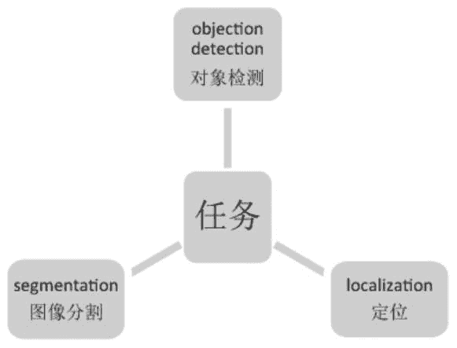

**Figure 1-1**

The Visual Turing Test can evaluate the cognitive ability of computer vision. It can not only test whether AI can recognize an object in an image, but also test AI's understanding of the associative relationships between objects in the image. However, currently AI's ability to understand associative relationships between objects in images is still relatively preliminary, while humans inherently possess this ability. Therefore, there is a certain gap between the results of AI's Visual Turing Test and human expected results.

Figure 1-2 shows a Beijing street scene. The interrogator can ask a series of questions about specified areas in the image, and the computer vision system answers with Yes or No. Some content in the image is marked with boxes. The content in the boxes is the Visual Turing Test area. The interrogator asks different questions based on each box, and the computer answers. If answered correctly, it is considered intelligent.

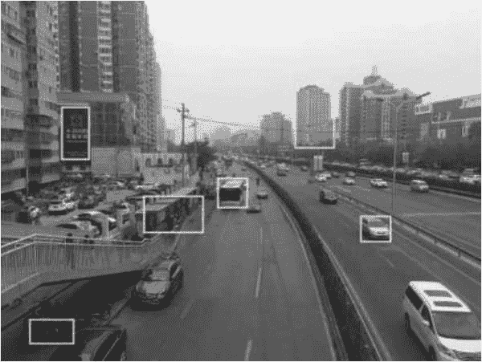

**Figure 1-2**

Regarding whether AI possesses true intelligence, some experts believe that even if it passes the Turing Test, it does not necessarily possess true intelligence. The most famous is the "Chinese Room" experiment. This experiment was proposed by American philosopher John Searle in 1980 in the journal *Behavioral and Brain Sciences* in the article *Minds, Brains, and Programs*. Searle is a professor at UC Berkeley and a famous philosopher. Searle believes that no matter how intelligent a computer appears, it does not possess true intelligence and understanding. The "Chinese Room" experiment he describes is such a scenario: "A person is alone in a closed room. This person knows no Chinese. The room contains massive Chinese-English dictionaries. If a Chinese note is slipped under the door, although the person doesn't understand Chinese, by looking up dictionaries and processing symbols, they can give a Chinese reply, thus deceiving the people outside into. `EXr6287u6NNVz+GYLY+7SC6AgGofrpiId/XnwIEoGMEPq3TPzkM5RyXBRbuLcLFjwnCuEHVXaQsGpygWHLFy9g==`

## 1.2 Disciplinary Foundations of AI


## AI Fundamentals

Artificial Intelligence (AI) is an interdisciplinary subject, composed of multiple foundational disciplines, mainly including philosophy, mathematics, economics, neuroscience, cognitive psychology, computer engineering, linguistics, etc. To conduct in-depth research on AI principles, knowledge from all these disciplines needs to be explored. The author believes that as an AI Product Manager, one must at least have an understanding of mathematics, neuroscience, and cognitive psychology, knowing in which aspects these disciplines have influenced AI.

### Mathematics

Mathematics has influenced the development of AI in three aspects, as shown below.

### Logic

Logic is the study of what the rules are for deriving correct conclusions. In 1847, George Boole proposed propositional logic (Boolean logic), marking the birth of mathematical logic. Subsequently, scholars proposed first-order logic, reference theory, objects and relations, etc., revealing methods for associating objects with objects in logic, promoting the rapid development of logic.

### Computation

Computation is the study of what content is computable. The earliest to propose the computability problem was Turing; he attempted to precisely describe which functions are computable, i.e., studying the capability of computation. With the aid of relevant computer theories and computing power, computers can use digits to perceive and analyze the world, and make judgments and decisions. Most algorithms in AI are applications of mathematical theories in the computer science discipline.

### Probability

Probability is the study of how to reason based on uncertain information. In the development of probability theory, it is worth noting the Bayesian rule proposed by Bayes, which is the foundation of modern methods of uncertain reasoning. Probability provides stochastic computation for AI and a basis for prediction. Statistics in probability can realize data processing and analysis, making results better meet requirements.

### Neuroscience

Neuroscience is the study of how the brain processes information. The human nervous system organically combines behavior, cognition, and brain mechanisms. Scientists also attempt to comprehensively reveal details of humans and animals in perception, language, information reasoning, decision-making, etc., through neuroscience. Since brain science is one of the main research contents of neuroscience, and the brain plays an important role in rational decision-making, research in brain science will greatly advance the research and practice of artificial neural networks, thereby promoting the development of AI.

The neuron is the basic unit of the brain's nervous system. A neuron includes dendrites, an axon, a nucleus, a cell body (soma), and a long myelin sheath. At the end of the axon are the nerve terminals (synaptic terminals). Each dendrite can receive external stimuli or stimuli from other neurons and transmit excitation to the cell body; the neuron's axon can transmit signals from the cell body to another neuron or other tissues.

If we compare the computer and the human brain, the number of neurons in the human brain is basically fixed after a certain age, at approximately 100 billion. According to Moore's Law, the number of processing units in computers increases tenfold every 5 years. Looking at processing units alone, a 64-bit CPU contains 1 billion transistors. It is predicted that by 2020, the computing power of a single CPU could reach that of a human brain; by 2050, the computing power of a single CPU could exceed the sum of the computing power of all humans on Earth.

### Cognitive Psychology

Cognitive psychology is a new psychological science that studies the mental processes behind cognition and behavior. Its goal is to study how the brain receives and processes external information. Specific research contents include attention mechanisms, language use, memory, perception, problem solving, creativity,s to different external stimuli, and improve one's own adaptability.

## 1.4 Research Fields of Artificial Intelligence

The research fields of AI are very extensive, currently mainly including five major aspects: Search, Reasoning, Planning, Learning, and Application, as shown in Figure 1-4.

Search is also known as Problem Solving; Reasoning is deduction based on knowledge; Planning is determining the implementation path based on rules; Learning is learning, induction, and summarization based on data; Application differs from the first four categories, covering a very wide range of fields. We can summarize it as the application of AI in actual scenarios in three aspects: communication, perception, and action. This book summarizes some of the currently popular fields in AI.

### Problem Solving

Problem Solving is one of the greatest achievements of AI. The first development boom of AI was the study of game theory problems in formal games and pattern recognition. For example, Deep Blue, which defeated Kasparov in the field of international chess in 1997, and AlphaGo, which defeated Ke Jie in the field of Go in 2017, both belong to the category of Problem Solving. It is precisely the major achievements AI has made in Problem Solving that have given the world a deep understanding of AI.

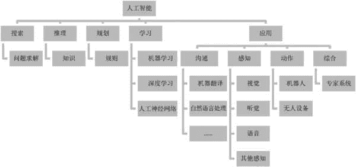

Figure 1-4

### Natural Language Processing

Natural Language Processing (NLP) is the study of how to make computers "understand" human language and comprehend the specific meanings expressed in the language. In NLP research, computer understanding technology and natural language generation technology are generally used. Currently, NLP research mainly focuses on handwriting recognition, semantic understanding, machine translation, speech understanding, etc. If a product involves the processing of language and text, it needs to have an in-depth understanding of NLP.

### Expert Systems

An Expert System is essentially an intelligent computer program that can use knowledge and reasoning capabilities to solve complex problems that originally only experts could solve. Generally speaking, an Expert System should consist of a Knowledge Base, Inference Engine, Interpreter, Knowledge Base Maintenance, Knowledge Acquisition, Information Input, and Human-Computer Interaction Interface, as shown in Figure 1-5.

Some computer-aided AI software and hardware encountered in professional fields can basically be categorized into Expert Systems. For example, medical software analyzes and reasons on CT images to check whether a patient has a certain disease; meteorological software analyzes meteorological data to predict whether a typhoon will form in a certain area.

### Artificial Neural Networks

Artificial Neural Network (ANN): Scientists started researching ANNs very early. For example, in the 1940s, scientists began trying to use multiple simple units to simulate the structure and function of the human brain's nerves, and subsequently multi-layer neural networks appeared. ANNs have achieved significant achievements in machine learning, expert systems, robotics, and many other aspects. Currently, ANN research has become an extremely important field in the AI domain. The difference between Neural Networks and Expert Systems lies in that Expert Systems focus on the functional simulation of human knowledge processing, while ANNs focus on the simulation of the structure of human brain neurons.

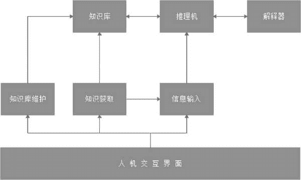

Figure 1-5

### Robotics

A Robot is a machine that simulates human operations to complete actions or functions under certain conditions. Currently, robots have been widely used in industry, agriculture, medical care, family, and other fields. Robots acquire resources and information from the external environment through perception of the environment and thinking ability, and process this information. Currently, robots have also appeared in many families, such as sweeping robots, intelligent tutoring robots, etc.

### Machine Learning

Machine Learning mainly studies how to enable machines to improve and enhance their working capabilities through learning. These capabilities include computational ability, logical ability, and behavioral ability. In general, the goal of Machine Learning is to enable computers to simulate human learning ability and continuously improve problem-solving ability. Machine Learning is extremely widely used in the field of AI. Machine Learning methods mainly include statistics, classification, regression, clustering, computation, etc.

## 1.5 Business Models of Artificial Intelligence

With the continuous development of AI technology, AI products have emerged one after another. From Deep Blue to AlphaGo, from Expert Systems to Smart Homes, AI has been applied to varying degrees in many business and life scenarios. In the process of AI technology development and application, AI products have moved from laboratories to industrial implementation. Smartphones, smartwatches, smart bands, smart speakers have completely entered people's lives. Practical technologies such as fingerprint recognition, facial recognition, and image enhancement have also become indispensable technologies in AI products. With the gradual enrichment of commercialization scenarios, the commercialization models of AI are also gradually forming. Currently, AI commercialization models mainly include 5 categories: Basic Hardware Model, Technology-Driven Model, Vertical Industry Model, Deep Application Model, and Ecosystem Building Model.

### Basic Hardware Model

In recent years, the rapid development of AI is mainly attributed to the development of three aspects: Data, Algorithms, and Computing Power. Among them, the development of Computing Power is mainly reflected in chips. The rapid development of AI largely benefits from the development and accumulation of chip technology over the years. It is precisely because chip technology has developed to the point where it can support the processing power and speed required for Machine Learning and Deep Learning that we can enjoy the convenience brought by AI products. Also due to the important position of chips in the AI industry chain, many companies choose to enter the AI market through basic hardware construction models such as chip R&D. Chip R&D has very high requirements for corporate hardware technology and manufacturing processes, so companies engaged in chip R&D are still a minority.

The traditional x86 architecture centers on the CPU system, while GPUs are mainly used in image rendering processing. Since the acceleration capability of GPUs far exceeds that of CPUs, with the maturity of AI and Deep Learning, GPUs have found a new battlefield. Coupled with the short computing time and low power consumption of GPUs, GPUs have gradually become the core of AI computing power.

NVIDIA occupies an important position in the GPU chip industry. At the GTC 2017 conference, NVIDIA released the Volta architecture GPU. The Volta architecture emphasized support for Deep Learning and added a Tensor Core module designed specifically for Deep Learning. Its key parameters have significantly improved compared to the previous generation in data center training.

GPUs possess more powerful computing power than CPUs, so in the training phase of Machine Learning, GPUs are currently the optimal choice. Due to some defects of GPUs in inference and neural network operations, to better obtain inference capabilities, Google proposed and developed the TPU chip, as shown in Figure 1-6. Google published a paper titled "In-Datacenter Performance Analysis of a Tensor Processing Unit" at ISCA 2017, disclosing the design details of the TPU, which aroused great attention. TPU is specially optimized for Machine Learning and was used by Google on AlphaGo.

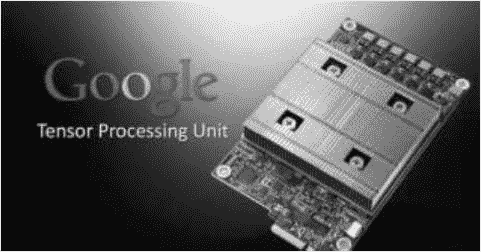

Figure 1-6

Since 2016, AI chips have received increasing attention from traditional enterprises. Many software and Internet companies have entered the industry one after another. In addition to Google and NVIDIA, companies such as Apple, Microsoft, Facebook, Intel, Qualcomm, AMD, and Alibaba have also begun to independently develop AI chips or vertical industry-specific AI chips.

Generally speaking, companies entering the AI industry from basic chip R&D should possess technical advantages in the chip field, such as NVIDIA being the world's largest GPU manufacturer. In addition to producing general-purpose GPU, CPU, and TPU products, more companies choose to produce AI chip products used in their respective industry fields based on their own accumulation in a certain industry. For example, processing chips used for autonomous driving technology, chips used for multi-axis steering robotic arms in the automobile manufacturing industry, etc. These chips are deeply integrated with industry scenarios, providing dedicated chips for those industry scenarios. The classification of AI chips is shown in Figure 1-7.

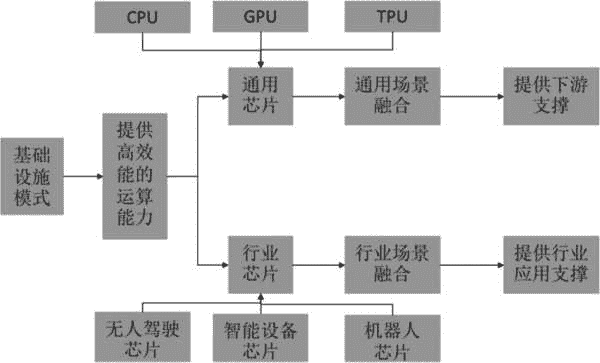

Figure 1-7

### Technology-Driven Model

Some software companies with strong technical strength, relying on their good experience accumulated in the software industry, are also gradually building advantages in the AI field, such as Microsoft, Facebook, IBM, etc. These companies had strong technical strength in the software era and have strong technical advantages in algorithms and general technologies. They utilize this technical advantage, take a certain industry as an entry point, and gradually establish an application platform for that industry. Technology-driven companies form a model of technology accumulation, output, and sharing by establishing application platforms, thereby developing the number of platform users to occupy more market share. For example, IBM's Watson platform, Amazon's AWS platform, Microsoft's Azure platform, etc.

### Vertical Industry Model

The Vertical Industry Model is suitable for enterprises with advantages in subdivided vertical fields, such as Alibaba with advantages in e-commerce, Didi Chuxing with advantages in travel, and KEPU Cloud with advantages in government affairs. These companies generally utilize their leading advantages in a certain industry and the massive industry data accumulated, and based on data, conduct research on AI technologies and algorithms in vertical fields, proposing overall solutions for that industry. In-depth research on vertical industries generally has the following two directions.

1.  **Forming products through Big Data accumulation**. Enterprises gradually establish their leading advantages in the industry through deep cultivation in vertical fields, continuously accumulate to form industry Big Data, and use data advantages to take the lead in launching unicorn-level AI applications for specific scenarios within the industry. Once such AI applications appear, they often form a new round of user and data accumulation, thereby becoming the AI leader in that industry. For example, Didi Chuxing occupied the market through the taxi business, gradually expanded application scenarios, launched dedicated car, express car, carpooling and other businesses, optimized recommendations through AI technology, and gradually became the industry leader.
2.  **Forming industry solutions through product applications**. After enterprises accumulate a large amount of data in the industry through leading advantages, they then rely on AI technical means combined with industry characteristics to abstract industry application platforms, industry general technologies, and industry solutions, thereby expanding market share in that industry. For example, Baidu, leveraging its advantages in maps and combining its own AI technical advantages, launched a platform for autonomous driving.

### Deep Application Model

The Deep Application Model no longer targets specific technologies themselves, but focuses on the in-depth application of actual applications in specific scenarios. Through this "single-point breakthrough" method, market effects can be formed quickly. For example, through in-depth exploration of application scenarios and reasonable management of the market, the market can be rapidly expanded in the scenario. This is also why the companies adopting the Deep Application Model are generally startups and traditional industry enterprises.

Because startups have limited technology and resources, investing in hardware or deep technology fields has a severely disproportionate ratio of investment to return. It is relatively easier to find suitable scenarios through market feedback and apply AI technologies in those scenarios. If a startup itself possesses subdivided market data or data within specific scenarios, it can build AI applications for the scenarios, form market effects through the applications, and thereby accumulate users and data. For example, if an enterprise itself does not have industry data, it can combine AI with traditional business models through cooperation with third-party companies.

Toutiao (ByteDance) is a typical enterprise that combines application value points with AI. Based on a recommendation engine driven by data mining, Toutiao recommends personalized information to users. Its excellent algorithms in the field of information recommendation have made it one of the fastest-growing companies in the mobile Internet field.

### Ecosystem Building Model

Building an AI ecosystem is an important business model for AI, and it is also the goal of most enterprises. In the AI industry chain, whether an enterprise has hardware R&D capabilities, technical capabilities, vertical industry leadership, or forms market accumulation through deep application, they all belong to a single model. But if an enterprise can combine technology and market to form an AI ecosystem, it can not only form its own advantages in single competition but also form industrial barriers through resource advantages in the ecosystem system.

Building an AI ecosystem starts with the pillar elements of AI development. Establishing a sound AI ecosystem requires enterprises to have a long-term strategic height for Data, Algorithms, and Computing Power, and matching technical strength. The essence of Data is to describe the characteristics of things, and it is also the record of the observation behavior process and results of things; Algorithms are specific methods to solve problems; Computing Power refers to computing capability. If an enterprise wants to establish a sound AI ecosystem, it should have already been or is currently accumulating Big Data at high speed through the Internet, already been or is currently researching the underlying algorithms, and optimizing and transforming hardware. Of course, the process of building an ecosystem is relatively long and involves many fields. As of 2019, companies relatively successful in AI ecosystem structure include Google, Amazon, Microsoft, Alibaba, Baidu, etc.

## 1.6 Profit Models of Artificial Intelligence

With the continuous development of AI technology, how AI technology lands to form products, how AI products are marketized and produced, and how the AI product market realizes profitability have become the issues enterprises care about most. Currently, AI profit points come from three aspects: realizing profits through licensing, transfer, or exchange of patented technologies; realizing profits through outputting AI technologies; realizing profits through selling products.

### Realizing Profits through Licensing, Transfer, or Exchange of Patented Technologies

With economic development, China has become a major global producer, consumer, and trader of consumer goods. China's AI products are also increasing, and the foundation supporting AI products is China's continuous innovation in AI technology.


## 1.7 Chapter Summary

The number of patents in the global artificial intelligence field has shown explosive growth since 2011, with an annual compound growth rate of over 30%. China ranks first in the world in terms of patent technology layout in AI. Precisely because of the importance of patent technology in AI products, in the AI market, applying for patents through technological innovation and transferring patent technology has become a very important profit model.

A comparison of six enterprises in the AI field in China and the US—Tencent, Baidu, Alibaba, IBM, Microsoft, and Google—shows that these enterprises all attach great importance to overall patent layout. Moreover, by comparing the patents applied for by these enterprises, it can be seen that US enterprises are keen on fields such as machine learning, speech recognition, and language synthesis processing, while Chinese enterprises tend to focus on payment, interaction technology, video image information processing, intelligent search, and other fields. In addition, fields in which all six enterprises are more interested include autonomous driving, data text clustering, fingerprint recognition, etc.

IBM's patent layout is relatively comprehensive, with obvious advantages in algorithm optimization, natural language processing, and autonomous driving; Microsoft's patent layout is mainly in machine learning, neural networks, audio and video recognition, and other fields; Google has more patents mainly in autonomous driving, speech recognition, and natural language processing; Tencent mainly deploys in AI fields such as instant messaging, data processing, payment platforms, and data transactions; Baidu is more keen on layout in search business, autonomous driving, speech recognition, image recognition, and other fields; Alibaba has obvious layout in payment platforms, information interaction, advertising delivery, and other fields.

When applying for AI-related patent technologies, enterprises should fully reflect theoretical hierarchy, technological innovation, and engineering complexity. The following aspects should be noted when writing:
1.  It is recommended to highlight the innovation capability of the resulting patent;
2.  It is recommended to highlight technical details and describe technical depth;
3.  It is recommended to reasonably utilize application scenarios combined with technological innovation.

### 1.2 Profiting by Outputting Artificial Intelligence Technology

In addition to profiting through the licensing, transfer, or exchange of patent technologies, companies owning AI technologies can also profit by providing technical services externally. Currently, the AI technical service system includes three levels: basic-level technical services, technology-level technical services, and industry-level technical services.

Basic-level technical services refer to technical services provided by enterprises through providing framework platforms or algorithm platforms. For example, Baidu AI Open Platform, Alibaba Cloud ET Brain, Tencent AI Platform, iFlytek Open Platform, etc.

Companies providing basic-level technologies attract more users by launching these platform interfaces, thereby further activating the application of their products, and gradually building a developer ecosystem. Through the activity of the ecosystem, they promote the application of their products in the industry, as shown in Figure 1-8. Alibaba Cloud ET Brain provides a variety of AI technical services, including ET Industry Brain, AI solutions, AI interfaces, algorithm platforms, ET Brain ecosystem, and other content.


Figure 1-8

The above-mentioned companies have certain advantages in the field of basic AI technologies; therefore, this type of company will expand and extend in specific technical fields. Of course, if this type of company only provides technology, it will be troubled by weak competitiveness. Therefore, these companies that only provide technology often form specific solutions through the "AI + Industry" model to achieve sustainable profitability.

If an AI company possesses both technology and a large amount of data accumulation, it can profit by providing AI product applications. For example, Glint DeepEye combines AI with video surveillance to develop the "Weimu" platform, realizing image recognition, pedestrian and vehicle positioning and recognition; Megvii's `Face++` platform has become a leading face recognition service platform in China. `EXr6287u6NNVz+GYLY+7SC6AgGofrpiId/XnwIEoGMEPq3TPzkM5RyXBRbuLcLFjwnCuEHVXaQsGpygWHLFy9g==`

### 1.3 Profiting by Selling Products

The transfer of AI patent technologies and the output of AI technical services are generally oriented towards enterprises (B2B), while AI products are oriented towards the general public (B2C) and easily form influence. With the development of AI, the types of AI products are increasing, such as AI robots, smart speakers, real-time translation tools, e-commerce recommendation assistants, medical imaging examination, smart bracelets, games, etc.

There are two directions for AI product sales: one is oriented towards enterprises, i.e., 2B (B2B); the other is oriented towards individuals, i.e., 2C (B2C). 2B products mainly aim to improve productivity, reducing costs and increasing efficiency for enterprises, such as intelligent sorting robots, intelligent waiters, intelligent customer service, etc. 2C products mainly serve as extensions of the human body to assist in judgment and operation, such as smart speakers, intelligent recommendation systems, etc. Tmall Genie is an AI product released by Alibaba AI Labs on July 5, 2017. Tmall Genie has a built-in intelligent voice assistant `AliGenie`, which can understand Mandarin voice commands and realize functions such as smart home control, voice shopping, mobile phone recharge, and music playback. On May 27, 2018, Alibaba announced the sales volume of Tmall Genie, with total sales exceeding 3 million units, achieving excellent performance. `EXr6287u6NNVz+GYLY+7SC6AgGofrpiId/XnwIEoGMEPq3TPzkM5RyXBRbuLcLFjwnCuEHVXaQsGpygWHLFy9g==`

### 1.7 Chapter Summary

In this chapter, the author introduces the fields of AI research, AI business models, and profit models from the perspective of a product manager. These contents will lay the foundation for everyone to understand AI products and build AI products. `EXr6287u6NNVz+GYLY+7SC6AgGofrpiId/XnwIEoGMEPq3TPzkM5RyXBRbuLcLFjwnCuEHVXaQsGpygWHLFy9g==`

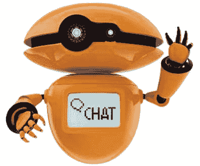

# Chapter 2 Artificial Intelligence Products

## 2.1 Development Stages of AI Products

## 2.2 Development History of AI Products

## 2.3 Cognitive Misunderstandings of AI Products

## 2.4 Differences Between AI Products and Internet Products

## 2.5 Typical AI Products

## 2.6 Chapter Summary

A product refers to something that can be supplied to the market, used and consumed by people, and can satisfy certain needs of people. It includes tangible goods, intangible services, organizations, and ideas, and their combinations. AI products can be understood as products that can think or act optimally like humans and possess user value. From the perspective of the customer (purchaser) or user (user), AI products can be understood as products that can assist or replace oneself in thinking or behavior, and these thoughts and behaviors have generated actual value for oneself.

Simply looking at AI technology from a market perspective is meaningless; only by realizing the market-oriented implementation of AI technology and meeting people's needs for different scenarios in daily production and life through specific product forms does AI technology truly generate value. This is precisely the focus of AI product managers. `EXr6287u6NNVz+GYLY+7SC6AgGofrpiId/XnwIEoGMEPq3TPzkM5RyXBRbuLcLFjwnCuEHVXaQsGpygWHLFy9g==`

### 2.1 Development Stages of AI Products

AI products are not achieved overnight; they need to go through the concept proposal stage first, then improve business and technical logic, and finally carry out market-oriented product operations through scenario implementation. Generally speaking, the process from model to implementation of AI products can be divided into the following three stages.

**Technical Experimentation Stage**: In the technical experimentation stage, the data, algorithms, and computing power resources required by AI technology are relatively concentrated, generally concentrated in government agencies, university research institutions, or laboratories of large companies. The work during the technical experimentation process mainly focuses on the training and research of basic AI algorithm models.

**Enterprise Application Stage**: When experimental technology research becomes relatively mature and shows certain practical application value, technology companies often conduct in-depth research on a certain technology in hopes of gaining a technological first-mover advantage in market competition. For some relatively small enterprises, they will utilize the resources or platforms provided by these technology companies to promote their own development. This stage often focuses on distributed computing, distributed applications, scenario-based basic technology provision, and other aspects.

**Market Application Stage**: The market application stage is where various types of enterprises combine basic platforms with basic scenario technical materials to carry out market-oriented product R&D. The market application marks the integration of AI algorithms with enterprise operation scenarios and personal consumption scenarios, and the stable output of algorithms in these scenarios. This step is also a key step in the popularization of AI technology. `EXr6287u6NNVz+GYLY+7SC6AgGofrpiId/XnwIEoGMEPq3TPzkM5RyXBRbuLcLFjwnCuEHVXaQsGpygWHLFy9g==`

### 2.2 Development History of AI Products

The development of AI products has grown alongside the development of AI theory and technology. AI theory has experienced winters and glories since its birth. Since the birth of the first AI program `Logical Service` in 1958, various AI expert systems have appeared one after another, but these systems were not fully commercialized. Until the mid-1980s, AI products had a qualitative leap. The fundamental reason was that in the mid-1980s, scientists invented the decision tree, and machine learning emerged.

Also in the mid-1980s, scientists invented the multi-layer artificial neural network. The multi-layer artificial neural network added multiple hidden layers to the original two-layer neural network. The original neural network had only two layers, namely the input layer and the output layer, as shown in Figure 2-1. Input an `N`-dimensional vector `i = [i[j], i[j+1], …, i[n]]`, where each component corresponds to a weight value `W[j]`; the input data is directly output after product operation. This two-layer neural network is mainly used for perceptrons, i.e., direct feedback based on input, while the multi-layer artificial neural network means there are multiple hidden layers between the input layer and the output layer, marking that artificial neural networks can handle more complex problems, breaking through the limitations of single-layer perceptrons.

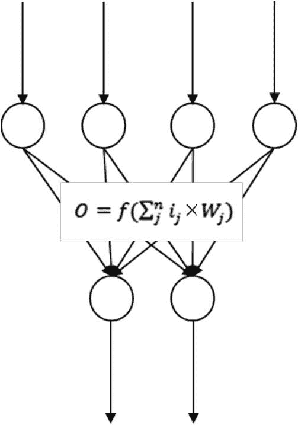

Figure 2-1

After the 1980s, the development of AI entered a trough period until 1993 when AI made a breakthrough again. Representative AI products are as follows.

IBM's `Deep Blue`, as shown in Figure 2-2, had 32 microprocessors, could calculate 200 million steps per second, and was input with over 2 million excellent games from master players over 200 years. In 1997, `Deep Blue` defeated the international chess champion Kasparov with a total score of 3.5:2.5, becoming the world's first AI product to win an international chess competition.

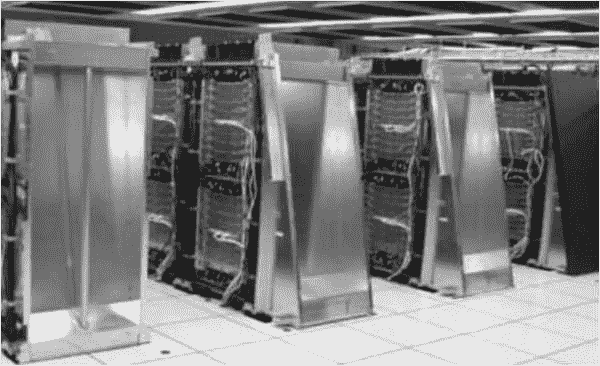

Figure 2-2

In 2005, Stanford University's robotic vehicle `Stanley` won the championship in the Grand Challenge, as shown in Figure 2-3. The Grand Challenge was initiated by the US Department of Defense in 2003 to encourage enterprises or individuals to innovate in autonomous driving and other AI fields. The challenge required the participating robots to complete a 142-mile (1 mile ≈ 1.61 km) course through an autonomous driving system within a total time not exceeding 10 hours, which was quite difficult. In the 2005 competition, a total of 195 teams registered, but only 5 teams completed the race. Stanford University's robot `Stanley` was the first to complete the task, taking 6 hours, 53 minutes, and 58 seconds.


Figure 2-3

In 2006, Geoffrey Hinton jointly with his students published a paper titled `Deep Learning` in the journal `Science`, which drew great attention to the term "deep learning". It was also due to the publication of this paper that AI became the focus of the tech community again.

In 2011, IBM's `Watson` defeated two former champions in the quiz show Jeopardy, winning a $1 million prize.

In 2011, Google launched a project—`Google Brain`, as shown in Figure 2-4. This project is a major research project of `Google X Lab`. It connected 16,000 computers into a computer processor cluster, forming one of the few large-scale central network systems in the world, capable of autonomous learning, dedicated to simulating the human brain. For example, `Google Brain` can successfully recognize a cat by learning from 10 million images.

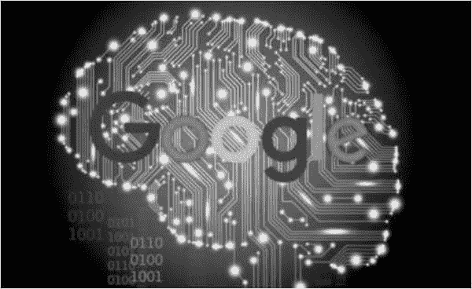

Figure 2-4

In 2012, Apple launched `Siri`, as shown in Figure 2-5. `Siri` is a voice-controlled intelligent personal assistant and knowledge navigator software. Users can use `Siri` to read text messages, ask about the weather, ask for route planning, set alarms by voice, etc. `Siri` supports natural language input and can call other application systems, such as weather forecasts, schedules, search data, etc. In addition, `Siri` can continuously learn new voices and intonations, providing conversational chat. In 2017, at the `WWDC` developer conference, Apple added real-time translation functionality to `Siri`, supporting English, French, German, etc. Moreover, `Siri`'s intelligence continues to improve, such as supporting contextual prediction functions. Users can even use `Siri` as a remote control for `Apple TV`.

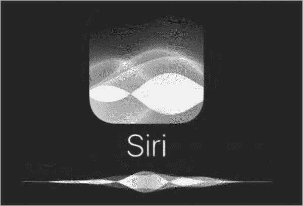

Figure 2-5

In 2012, Microsoft's Chief Research Officer Rick Rashid attended a seminar in Tianjin, China, and demonstrated a real-time interpretation system—"`Real Time English to Chinese Universal Transport`" (English-Chinese Universal Translator). This translator can automatically translate the English spoken by the speaker into Chinese and then output the Chinese voice through speech synthesis. The reason this translator caused a sensation was not only its accurate translation but also because the translated voice retained the characteristics of the speaker's accent and intonation, just as if the speaker himself was giving a speech in Chinese.

In April 2014, Microsoft officially launched `Cortana`, a personal assistant software running on `Windows Phone`. In June 2014, Microsoft launched the chatbot `Xiaoice`, as shown in Figure 2-6. People can chat freely with `Xiaoice` in natural language.


Figure 2-6

In August 2014, a chatbot named "`Eugene Goostman`" appeared, as shown in Figure 2-7. In a competition commemorating the 60th anniversary of Turing's death, 33% of the judges believed "`Eugene Goostman`" was human. Therefore, the organizer announced, according to the rules of the Turing Test, that "`Eugene Goostman`" had passed the Turing Test. This was also the first time an AI product passed the Turing Test.


Figure 2-7

In August 2014, IBM published the `TrueNorth` chip, which is similar to the human brain. This is a neuromorphic `COMS` chip composed of 4,096 hardware cores. Each hardware core can simulate 256 programmable silicon neurons, totaling just over one million neurons. Figure 2-8 shows a circuit board integrated with 16 `TrueNorth` chips.

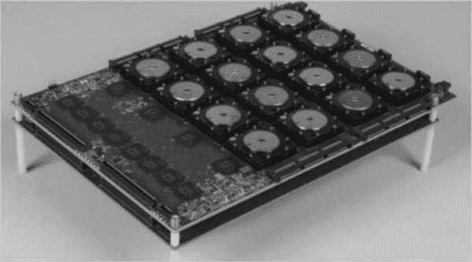

Figure 2-8

In February 2015, Google published "`Deep Q Network`" (`DQN`) in the journal `Nature`. This neural network can achieve human-level control through deep reinforcement learning. Using `DQN`, 49 video game software programs on an old video game console from the 1970s and 1980s were tested. The test result was 59.18%, reaching or exceeding human level. Figure 2-9 shows the logical architecture of `DQN`.

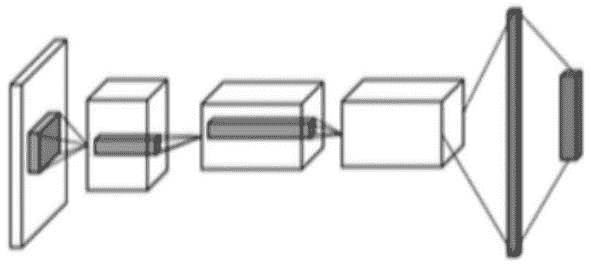

Figure 2-9

In December 2015, a computer Go program `AlphaGo` developed by Google `DeepMind` defeated European Go champion Fan Hui, with a score of 5 wins in 5 games. This was the first time a computer Go program defeated a human professional Go player. However, this news was not published in `Nature` until January 27, 2016, allegedly to keep pace with the paper describing the algorithm.

In March 2016, the world-renowned Go human-machine century match was held in Seoul, South Korea, with `AlphaGo` against Korean 9-dan professional player Lee Sedol. The result was `AlphaGo` winning 4 games to 1. In 2017, the world's top-ranked Go player Ke Jie played against `AlphaGo`. This "century match" not only included a personal match with Ke Jie but also a team match, where 5 players teamed up against `AlphaGo`. Regarding this match, Ke Jie once said: "300 years ago humans invented the steam engine, surpassing human imagination at the time. Today, Google `DeepMind`'s invention of `AlphaGo` also exceeds the imagination of all players. When playing against it, it feels like dialoguing with the future, an extraordinary feeling." In the end, humans still lost. After the match, `AlphaGo` ranked firmly first in the world Go rating rankings.

On January 25, 2019, `AlphaStar` developed by `DeepMind` defeated two professional human players of `StarCraft II` with a total score of 2:0. This was another human-machine battle that refreshed human understanding of AI since `AlphaGo` defeated humans in Go in 2017. `StarCraft II` is a real-time strategy game. Although the total number of possible board positions in Go is an astronomical number, specifically in each round, both sides only need to choose a spot on the board to place a stone. In comparison, the action space of modern competitive video games is much more complex. `StarCraft II` involves collecting different resources in a fog-covered map, building different types of buildings according to resource conditions, and generating different types of units to confront opponents. During the game, one needs to balance multiple information aspects, such as resource collection, resource consumption, one's own development pattern, unit coordination, and real-time scouting of opponent's resources, consumption, and units, while also guarding against opponent's scouting and sneak attacks. It can be said that `StarCraft II` simulates a complete set of human battlefield states. In addition, when war breaks out, both sides must adjust the positioning and consumption of various units in real-time according to the battlefield situation, as well as subsequent unit supplies. It is precisely the vast battlefield space, continuous action space, infinite forms of change, and limited vision of `StarCraft II` that make it one of the most difficult games for AI to conquer, as shown in Figure 2-10.

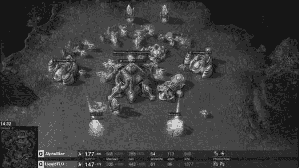

Figure 2-10

The opponents against `AlphaStar` were TLO, ranked 68th in the world, and MaNa, ranked 19th. Although these two are also world-class players, they lost 0:5 and 1:5 respectively in the match against `AlphaStar`. `DeepMind`'s `AlphaStar`, like `AlphaGo`, uses reinforcement learning, allowing AI to imitate the way humans play games. `AlphaStar` treats the game as a long-sequence modeling learning task. During reinforcement learning, its model design also centers on long-sequence modeling. The model receives data from the game interface as a list of units and their attributes, and after neural network computation, outputs execution commands in the game. The basis of `AlphaStar`'s neural network is the `Transformer` network, combined with a deep `LSTM` network core, an autoregressive policy head with a pointer network, and a centralized value baseline. Such a network architecture is the latest thinking result of `DeepMind` on complex sequence modeling tasks. They believe that such advanced models will have excellent performance in other machine learning tasks that require long-sequence modeling and have large action spaces, such as weather forecasting, climate modeling, language understanding, etc. `EXr6287u6NNVz+GYLY+7SC6AgGofrpiId/XnwIEoGMEPq3TPzkM5RyXBRbuLcLFjwnCuEHVXaQsGpygWHLFy9g==`

### 2.3 Cognitive Misunderstandings of AI Products

People have the following misunderstandings about AI products.

**Misunderstanding 1: AI products are those that can work like humans.** Many people's understanding of AI comes from the famous Turing Test: "So-called AI is to let a person ask some written questions; if one cannot judge whether it is a human or a machine, it is considered AI." To pass the Turing Test, breakthroughs in several key technologies are required, namely `Natural Language Processing` (NLP), `Knowledge Representation`, `Automated Reasoning`, and `Machine Learning`. Of course, the above are only the basic requirements to satisfy the Turing Test. To fully pass the Turing Test, `Computer Vision` and `Robotics` must be added.

However, AI researchers generally have not moved towards the goal of the Turing Test. The reason is simple: just as humans have always wanted to fly in the sky like birds, but people cannot transform themselves into a bird to deceive other birds, or build a flying machine to deceive other birds; instead, they invented the airplane, thereby helping humans fly into the sky.


## 2.3 Cognitive Misunderstandings of AI Products

Therefore, during the AI product development process, the focus should be on how to use AI technology to solve problems in specific scenarios, and to industrialize and productize AI technology, thereby liberating humans from certain physical, repetitive, and skill-based jobs, allowing humans to engage in more creative work. This is the true goal of AI technology application.

### Misconception 2: AI Products Are General Artificial Intelligence

Traditional perception holds that AI can do anything—robots can help people sweep floors, make coffee, go to the market to buy groceries, and even help people handle and solve most work tasks. However, in reality, current AI products mostly help people solve specific problems in real scenarios within a limited scope, such as helping people translate articles, classify massive amounts of data, etc. Even a highly complex game like Go is an intellectual contest within a known boundary environment (19 lines vertically and horizontally, dividing the board into 361 intersections).

Current AI technology cannot yet handle ultra-complex, fuzzy, open-ended scenarios and information. Therefore, in the process of industrializing and productizing AI technology, we should target business within defined boundaries, using AI to complete data and logic processing. This is also why we consider current AI to be Weak AI (Narrow AI), not Strong AI (General AI).

When designing products, product managers should not consider whether it belongs to Strong AI or Weak AI, but rather whether the AI product is practical. They should consider the applicable industry, position, scenario, behavioral characteristics, execution methods, and metrics for the product.

## 2.4 Differences Between AI Products and Internet Products

### 2.4.1 Product Characteristics in the Internet Era

The Internet is one of the most important inventions of the 20th century. Through the Internet, various data can be linked together to form a large information network, making information no longer an isolated node. The advent of the Internet allowed people to experience rapid information transmission and massive data sharing. However, as more and more information accessed the Internet, a large amount of redundant information flooded people's vision. This redundant information seriously interferes with people's precise analysis and correct selection of valuable information. Consumers face massive amounts of information and data almost every day, and also face hundreds of thousands of applications to choose from. This is the "information overload" problem of the Internet era. This is also the biggest headache for Internet product managers: how to make their own App or system break through the information flood in the user's field of vision, let the product catch more users' eyes, and let the product occupy more time on a single user.

To better break through the information flood and strengthen the information transmission efficiency of Internet products, product managers have summarized many product design concepts, interaction design models, and methodologies in the product design process. For example, the basic idea of the "User-Centered Design" theory is to place the user at the forefront of all problems at all times. User-centered product design, as shown in Figure 2-11, highlights the relationship between people, behavior, context, and technology, and forms a product design system through this relationship. In the initial stage of product development, formulating product strategy should take meeting user needs as the basic motive and ultimate goal; in the subsequent design and development stages, research and understanding of users should serve as the basis for various decisions; at all stages of the product life cycle, revisions, optimizations, and transformations should all originate from users.

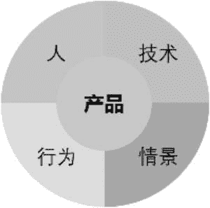

Figure 2-11

In addition, some companies or scholars have also summarized the methodology for the traditional Internet product 0-to-1 process. For example, the product process includes stages such as product planning, data collection and analysis, concept ideation, design refinement, implementation, testing, launch, and iterative optimization. There are a large number of management and technical details in these stages. For example, how to use the scenario-guided method in the processes of research, decision-making, design, implementation, sales, purchase, and use.

The basic starting point of both the user-centered methodology and the 0-to-1 process methodology is how to "implement" the product. What exactly is an Internet product? What is an Internet product used for?

The author believes that the core of an Internet product is to improve the efficiency of information transmission between parties. Every task a product manager does, such as requirement research, user analysis, prototyping, and interaction design, actually revolves around how to improve the efficiency of information transmission. If a product, targeting a certain industry, scenario, business, or behavior, can improve the efficiency of information transmission, then that product is bound to be a successful product.

Before QQ and WeChat, people's information transmission mainly relied on face-to-face communication, telephone, and other methods. After QQ and WeChat appeared, people no longer had to communicate face-to-face, nor did they have to dial to achieve real-time communication. QQ and WeChat greatly improved the efficiency of communication information transmission; as long as people were online, they could obtain the other party's information in real-time.

Before e-commerce, people's transactions mainly relied on whether they possessed offline commodity information resources, relying on buying low and selling high to make profits. Therefore, those who grasped more information could make money; they used this information asymmetry to earn profits, and this habit of using information asymmetry to profit has existed for thousands of years. After e-commerce emerged, producers, channels, and consumers fully achieved information interconnection through a platform, connecting all intermediate links, allowing people to purchase goods from the place of origin without leaving home.

Before Uber and Didi Chuxing, information between taxis and passengers was asymmetric. Taxi drivers didn't know where passengers were, and passengers didn't know where cars were. The two parties could only complete a transaction through a chance encounter on the roadside. This process of completing transactions relying on chance encounters had extremely low information transmission efficiency. Uber and Didi Chuxing connected the information between taxis and passengers, improving information transmission efficiency.

Product managers are also looking for various work and life scenarios, attempting to use the characteristics of the Internet to break the original information asymmetry phenomenon in these scenarios. However, with the development of the Internet, the markets of various scenarios have basically become red oceans. Therefore, the scenarios satisfied by various types of products have changed from general scenarios to segmented field scenarios. For example, to analyze the behavior and psychology of Internet users when using websites or Apps, many website data analysis systems or user behavior analysis systems have appeared on the market. Figure 2-12 shows a typical website data analysis system, through which one can analyze basic information, behavioral data, and other content of users visiting the website. Such products are sufficient for functional point analysis of general websites, but if used in specific fields, they may suffer from low fit, such as the government affairs field. General government website business lines include special needs such as handling affairs, interaction, and inquiry. General products can meet general needs, but their ability to analyze the specific handling process during government services is not high.


Figure 2-12

Analyzing the information transmission efficiency of government websites, if product design can grasp the key points of "government needs" and "public demands," the information transmission efficiency will be further improved. To make behavioral data available to the government more quickly, functions and interfaces should fit government scenarios more closely. Figure 2-13 shows a behavior analysis system provided for the government.

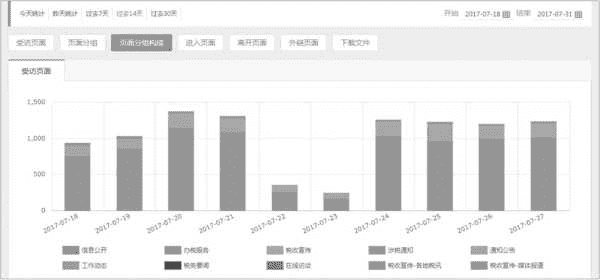

Figure 2-13

### 2.4.2 Product Characteristics in the AI Era

This book states that the core goal of Internet-era products is to eliminate information asymmetry and improve information transmission efficiency, while AI products consider product planning and design from the perspective of productivity.

Junior high school textbooks have taught:

> "The development of human society is actually the continuous development of productivity."
>
> "Productivity refers to the force generated in the process of material production when laborers with certain production experience and labor skills combine with the means of production they use. That is, the ability of humans to conquer and transform nature in the production process and obtain material materials suitable for their own needs."

For personal consumer-grade products, the significance of AI lies in the technological extension of human senses and skills. AI application points in consumer-grade products are generally concentrated in three aspects: first, information collection; second, assisted judgment; third, assisted processing.

AI products obtain massive amounts of data through information collection, then derive applicable models through data training, then input personal information data and output answers through the model. Therefore, AI products must possess data collection capabilities to facilitate intelligent judgment. From wearable devices to smart homes, from recommendation engines to prediction systems, all need to obtain data through various sensors and input devices.

Consumer-grade products can better help humans perceive external and their own information, and help people process information more efficiently and quickly. This processing manifests in two directions: one is the quantification of individual information; the other is the evolution of information processing.

People will find when using some AI products that these products seem to understand them better and better: whatever type of news you like to read, the client pushes that type of news; whatever type of food you like to eat, the client pushes that type of restaurant. The reason is that these AI products have already derived a quantified data "you" through collection and algorithm models. Not only that, some products in the medical health and sports fitness fields quantify personal information more meticulously through the detection of heart rate, cadence, height, weight, speed, blood pressure, and other information. In addition to the quantification of self-information, people can better perceive and process more data through these AI products, significantly improving information processing capabilities.

For enterprises, the goal of AI products is to improve enterprise productivity. AI technology enhances enterprise productivity in two ways: by replacing labor in enterprises to improve labor efficiency, and by extending the means of labor.

AI is not only widely used in consumer-grade products but also creates huge value in the application of industry and enterprise products. AI applied in enterprise production and management is mainly reflected in three aspects: vision, speech, and language. Through AI technology, huge advantages have been played in assisted recognition, helping enterprise decision-making, and replacing laborers. Through AI technology, the problem of labor shortage can be solved.

In October 2018, Haidilao's globally first smart restaurant, built with an investment of 150 million yuan, officially opened in Beijing, as shown in Figure 2-14. In the Haidilao smart restaurant, whether it is queuing or ordering, everything is unmanned. In addition, the internal management of the restaurant is also full of AI products. Kitchen ingredient preparation, hot pot base mixing, and food delivery are all completed by robots.


Figure 2-14

The Haidilao smart restaurant realizes intelligent management of dish warehouses and centralizes all food ingredient processing procedures in a central kitchen, then delivers them directly to stores via cold chain logistics, entering automatic dish dispensing machines. The automatic dish dispensing machine is connected to the front-end ordering system. After the user places an order, the mechanical arm of the automatic dish dispensing machine places the selected dishes on the conveyor belt, and then robots deliver them to the customer's table, completing the fully automatic process from dish warehousing to outbound serving, as shown in Figure 2-15. Not only that, the Haidilao smart restaurant has also added RFID tags to all vegetables, and cooperated with the ingredient supervision system to realize real-time tracking of dishes and precise control of shelf life.

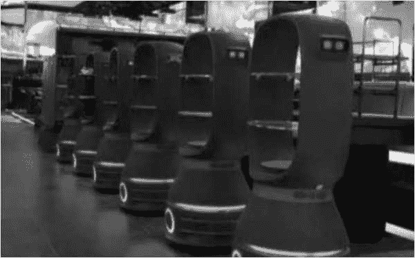

Figure 2-15

The Haidilao smart restaurant achieves comprehensive kitchen management through its self-developed Intelligent Kitchen Management System (IKMS). IKMS acts like the intelligent brain of the kitchen, collecting data from all links of the smart kitchen and performing multi-dimensional analysis on various data, real-time monitoring of kitchen operation status, dish production status, dish inventory status, dish shelf life status, etc., and uniformly managing the smart kitchen. In addition, IKMS can combine machine learning and AI technology to realize process-oriented and automated production management, intelligent and precise inventory management, informatized and visualized production data, and full life-cycle monitoring of dishes, ensuring dish quality.

In the Haidilao smart restaurant, the hot pot base is no longer made manually but is completed by a private customized automatic base mixing machine, as shown in Figure 2-16. When ordering, customers can choose corresponding flavors. Whether "extra spicy, extra numbing" or "less salt, less oil," precise configuration of raw materials, auxiliary materials, and fresh ingredients accurate to 0.5 grams can be achieved, and the machine mixes different flavors.

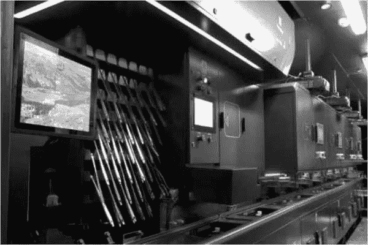

Figure 2-16

A monitoring large screen is also set up in the kitchen of the Haidilao smart restaurant, showing the operating status of each machine. On the screen outside the preparation area, the remaining quantity of dishes in the preparation area is monitored in real-time, as well as whether there are expired dishes exceeding 48 hours, as shown in Figure 2-17.

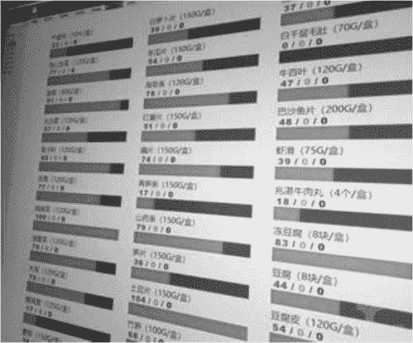

Figure 2-17

Through the application of a large number of AI technologies and products, the Haidilao smart restaurant not only enhances user experience but also effectively reduces manual labor costs, assigning a large amount of physical and repetitive work to machines, achieving the ultimate goal of cost reduction and efficiency enhancement.


### 2.3 Haidilao Smart Restaurant Case

In October 2018, the world's first smart restaurant built by Haidilao with an investment of 150 million yuan officially opened in Beijing, as shown in Figure 2-14. In the Haidilao smart restaurant, both queuing and ordering have been realized without human operators. In addition, the internal management of the restaurant is also full of AI products; kitchen ingredient preparation, hot pot base seasoning, and food delivery are all completed by robots.


Figure 2-14 Haidilao Smart Restaurant

The Haidilao smart restaurant achieves intelligent management of dish warehousing, and centralizes all food ingredient processing procedures in the central kitchen. They are then delivered directly to the store via cold chain logistics and enter the automatic dish dispensing machine. The automatic food delivery machine is connected to the front-end ordering system. After a user places an order, the mechanical arm of the automatic food delivery machine places the selected dishes onto the conveyor belt, and then robots deliver them to the customer's table, realizing a fully automated food serving process from warehousing to outbound, as shown in Figure 2-15. Not only that, the Haidilao smart restaurant has also added `RFID` tags to all vegetables, and combined with the ingredient supervision system, realizes real-time tracking of dishes and precise control of shelf life.


Figure 2-15 Fully Automated Food Serving Process

The Haidilao smart restaurant achieves comprehensive kitchen management through its self-developed Intelligent Kitchen Management System (`IKMS`). `IKMS` acts like the intelligent brain of the kitchen, collecting data from all aspects of the smart kitchen and performing multi-dimensional analysis on various data. It monitors the kitchen's operating status, dish production status, dish inventory status, dish shelf life status, etc., in real-time, enabling unified management of the smart kitchen. In addition, `IKMS` can combine machine learning and AI technologies to realize process-oriented and automated production management, intelligent and precise inventory management, informatized and visualized production data, and full life-cycle monitoring of dishes, ensuring dish quality.

In the Haidilao smart restaurant, hot pot bases are no longer made manually but are completed by a private customized automatic pot base dispensing machine, as shown in Figure 2-16. When ordering, customers can choose corresponding flavors. Whether "extra numbing, extra spicy" or "less salt, less oil," precise configuration of raw materials, auxiliary materials, and fresh ingredients accurate to 0.5 grams is achieved, and the machine blends different flavors.


Figure 2-16 Private Customized Automatic Pot Base Dispensing Machine

A monitoring large screen is also set up in the kitchen of the Haidilao smart restaurant, showing the operating status of each machine. On the screen outside the ingredient preparation area, the remaining quantity of dishes in the preparation area is monitored in real-time, as well as whether there are expired dishes exceeding 48 hours, as shown in Figure 2-17.


Figure 2-17 Monitoring Dashboard

Through the application of a large number of AI technologies and products, the Haidilao smart restaurant not only enhances user experience but also effectively reduces manual labor costs. It assigns a large amount of physical and repetitive work to machines, achieving the ultimate goal of cost reduction and efficiency enhancement.

## 2.4 Differences Between AI Products and Internet Products

### 2.4.1 Product Characteristics in the Internet Era

The Internet is one of the most important inventions of the 20th century. Through the Internet, various data can be linked together to form a large information network, making information no longer an isolated node. The advent of the Internet allowed people to experience rapid information transmission and massive data sharing. However, as more and more information accessed the Internet, a large amount of redundant information filled people's vision. This redundant information seriously interferes with people's precise analysis and correct selection of valuable information. Consumers face massive amounts of information and data almost every day, and also face hundreds of thousands of `Apps` to choose from. This is the "information overload" problem of the Internet era. This is also the biggest headache for Internet product managers: how to make their own `App` or system break through the information flood in the user's field of vision, let the product catch more users' eyes, and let the product occupy more time on a single user.

To better break through the information flood and strengthen the information transmission efficiency of Internet products, product managers have summarized many product design concepts, interaction design models, and methodologies in the product design process. For example, the basic idea of the "User-Centered Product Design" theory is to place the user at the forefront of all issues at all times. User-centered product design, as shown in Figure 2-11, highlights the relationship between the four elements: people, behavior, context, and technology, and forms a product design system through this relationship. In the initial stage of product development, formulating product strategy should take meeting user needs as the basic motive and ultimate goal; in subsequent design and development stages, research and understanding of users should serve as the basis for various decisions; at all stages of the product life cycle, revision, optimization, and transformation should all originate from users.


Figure 2-11 User-Centered Product Design

In addition, some companies or scholars have also summarized the traditional methodology for the Internet product process from 0 to 1. For example, the product process includes stages such as product planning, data collection and analysis, concept generation, concept refinement, implementation, testing, launch, and iterative optimization. There are a large number of management details and technical details in these stages. For example, how to use the script guidance method in the process of research, decision-making, design, implementation, sales, purchase, and use.

The basic starting point of both the user-centered methodology and the 0-to-1 process methodology is how to "implement" the product. What exactly is an Internet product? What is an Internet product used for?

The author believes that the core of Internet products is to improve the efficiency of information transmission between information. Every task a product manager does, such as demand research, user analysis, prototyping, and interaction design, actually revolves around how to improve the efficiency of information transmission. If a product can improve the efficiency of information transmission for a certain industry, scenario, business, or behavior, then that product is bound to be a successful product.

Before `QQ` and `WeChat`, people's information transmission mainly relied on face-to-face communication, telephone, and other methods. After `QQ` and `WeChat` appeared, people no longer had to communicate face-to-face, nor did they have to dial to achieve real-time communication. `QQ` and `WeChat` greatly improved the efficiency of communication information transmission; as long as people are online, they can obtain the other party's information in real-time.

Before e-commerce, people's transactions mainly relied on whether they possessed offline commodity information resources, relying on buying low and selling high to make profits. Therefore, those who grasped more information could make money; they used this information asymmetry to make profits, and this habit of using information asymmetry to profit has existed for thousands of years. After e-commerce emerged, producers, channels, and consumers fully realized information interconnection through a platform, connecting all intermediate links, allowing people to purchase products from the place of origin without leaving home.

Before `Uber` and `DiDi Chuxing`, information between taxis and passengers was asymmetric. Taxi drivers didn't know where the passengers were, and passengers didn't know where the cars were. The two parties could only complete a transaction through a chance encounter on the roadside. This process of completing transactions relying on chance encounters had extremely low information transmission efficiency. `Uber` and `DiDi Chuxing` connected the information between taxis and passengers, improving information transmission efficiency.

Product managers are also looking for various work and life scenarios, trying to break the original information asymmetry phenomenon in these scenarios by utilizing the characteristics of the Internet. However, with the development of the Internet, the markets of various scenarios have basically become red oceans. Therefore, the scenarios satisfied by various types of products have changed from general scenarios to segmented field scenarios. For example, to analyze the behavior and psychology of Internet users when using websites or `Apps`, many website data analysis systems or user behavior analysis systems have appeared on the market. Figure 2-12 shows a typical website data analysis system. Through this system, basic information, behavior data, and other content of users visiting the website can be analyzed. Such products are sufficient for functional point analysis of general websites, but if used in specific fields, they may not fit well, such as in the government affairs field. General government website business lines include special needs such as handling affairs, interaction, and inquiry. General products can meet general needs, but their analysis capabilities for specific handling processes in government services are not high.

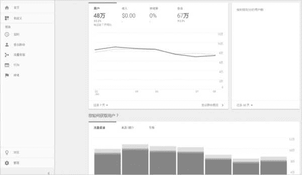

Figure 2-12 Typical Website Data Analysis System

Analyzing the information transmission efficiency of government websites, if product design can grasp the key points of "government needs" and "public demands," the information transmission efficiency will be further improved. To provide behavior data to the government more quickly, functions and interfaces should be more tailored to government scenarios. Figure 2-13 shows a behavior analysis system provided for the government.


Figure 2-13 Government Affairs Behavior Analysis System

### 2.4.2 Product Characteristics in the AI Era

This book states that the core goal of Internet-era products is to eliminate information asymmetry and improve information transmission efficiency, while AI products consider product planning and design from the perspective of productivity.

Junior high school textbooks have mentioned:

> "The development of human society is actually the continuous development of productive forces."
>
> "Productive forces refer to the power generated in the process of material production by the combination of laborers with certain production experience and labor skills and the means of production they use; that is, the ability of human beings to conquer and transform nature in the production process and obtain material materials suitable for their own needs."

For personal consumer-grade products, the significance of AI lies in the technological extension of human senses and skills. AI application points in consumer-grade products are generally concentrated in three aspects: first, information collection; second, assisted judgment; third, assisted processing.

AI products obtain a large amount of data through information collection, then derive applicable models through data training, and then input personal information data through the model to give answers. Therefore, AI products must have data collection capabilities to facilitate intelligent judgment. From wearable devices to smart homes, from recommendation engines to prediction systems, all need to obtain data through various sensors and input devices.

Consumer-grade products can better help humans perceive external and their own information, enabling people to process information more efficiently and quickly. This processing manifests in two directions: one is the quantification of individual information; the other is the evolution of information processing.

When people use some AI products, they will find that these AI products seem to understand them better and better: whatever type of news you like to read, the client pushes that type of news; whatever type of food you like to eat, the client pushes that type of restaurant. The reason is that these AI products have already derived a quantified data "you" through collection and algorithm models. Not only that, some products in the medical health and sports fitness fields quantify personal information more meticulously through the detection of heart rate, cadence, height, weight, speed, blood pressure, and other information. In addition to the quantification of self-information, people can better perceive and process more data through these AI products, significantly improving information processing capabilities.

For enterprises, the goal of AI products is to improve enterprise productivity. AI technology enhances enterprise productivity in two ways: replacing labor in enterprises to improve labor efficiency and extending the means of labor.

AI is not only widely used in consumer-grade products but also creates great value in the application of industry and enterprise products. AI applied in enterprise production and management is also mainly reflected in three aspects: vision, speech, and language. Through AI technology, great advantages have been played in assisted recognition, helping enterprise decision-making, and replacing laborers. Through AI technology, the problem of labor shortage can be solved.

## 2.5 Typical AI Products

### 2.5.1 Wearable Devices

Wearable devices are currently relatively popular products in the technology industry. From `Google Glass` to `Mi Band` to `Apple Watch`, well-known manufacturers in the industry mostly have their own wearable devices. These manufacturers apply their own collection and algorithm technologies to wearable devices to provide exclusive, personalized services for individuals. The most critical core technology of wearable devices is AI.

Intelligent wearable devices first appeared in the 1980s. Due to the low level of AI technology at that time, they failed to form a large impact. It was not until the 21st century, with the development of AI technology, that intelligent wearable devices achieved rapid development.

2012 was called the "First Year of Intelligent Wearable Devices." This year `Google Glass` was launched, as shown in Figure 2-18. `Google Glass` had almost the same functions as a smartphone. People could use voice to control photo taking through `Google Glass`, make video calls, surf the Internet, and process information and emails.

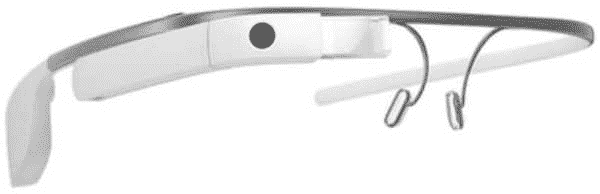

Figure 2-18 Google Glass

After `Google Glass` was launched, although its usage scenarios needed deeper exploration, intelligent wearable devices have always been considered products that perfectly combine design and technology. More and more enterprises began to invest in the intelligent wearable market.

Currently, intelligent wearable devices that have appeared on the market include smart glasses, smart watches, smart bands, smart helmets, smart rings, smart necklaces, smart clothing, etc. These products all take "miniaturization" and "convenience" as their main selling points, becoming a new selling point in electronic consumption. Although current wearable device products have many varieties, novel styles, and fierce competition among manufacturers, wearable devices are still in the early stages of development. The reason is that current products with "miniaturization" and "convenience" as the main selling points have not solved the core problem of intelligent wearable devices. How to achieve true "intelligence" through wearable devices is the core problem.

After careful research on the above intelligent wearable devices, we can find that most of these products integrate the "mobile phone" into the human body in a specific way, such as bands with heart rate calculation, watches that can answer calls, smart running shoes that can measure cadence, etc. Although these products claim to be intelligent wearable devices, the author calls them "Pseudo-AI Devices," meaning they are not truly intelligent wearable devices. The key to measuring whether a product is intelligent lies in whether these products contain the capabilities of information collection, assisted judgment, and assisted processing.

Currently, the intelligence maturity of wearable devices is insufficient, and product value does not fully meet people's intelligent needs. This is also the reason why, although the intelligent wearable device market is hot, no product on the market can be fully popularized like `PC` or smartphones. How to enable intelligent wearable devices to realize behavioral and judgment capabilities through deep learning and other technologies after obtaining personal information data through collection technology is the core problem.

#### 1. Core Technologies of Intelligent Wearable Devices

**Hardware**: Since they are wearable devices, hardware devices are needed as carriers. Currently, the core hardware problem restricting the development of wearable devices is the battery. Battery life directly affects the user experience of using the product. If battery life is insufficient, users need to charge frequently, greatly reducing the usability of the product. The current method to solve the battery problem is to balance performance, i.e., find a balance point between performance and power consumption.

**User Experience**: The user experience of intelligent wearable devices is the most core element for users to decide whether to purchase the product. The user experience design of intelligent wearable devices should start from two aspects: design interaction and operational interaction. Design interaction determines whether the product is successful. Only when product industrial designers and developers fully combine the user-centered design concept with the product can they design a successful product. Operational interaction is mainly aimed at the design of the link between humans and devices when users use the product. Human-device interaction is inseparable from behavioral operations, touch operations, voice control operations, or brainwave operations. The design of operational interaction should fully consider the interaction sensitivity, size, material, interaction accuracy, and misoperation of hardware devices.

**Data Processing**: The value of intelligent wearable device products is often reflected through the data they obtain and their ability to process data. Since the data obtained by intelligent wearable devices is discrete, finding the correlation between data through intelligent algorithms and providing analysis data and solutions to users in the form of professional services is the core value point of intelligent wearable devices.

#### 2. Types of Intelligent Wearable Devices

##### Smart Glasses

Usually, smart glasses use glasses as a carrier, integrate an independent operating system, and provide application software for users. Users can perform operations such as query, reading, navigation, interaction, shooting, and calls through actions, voice, and other methods. Due to the simple design, strong sense of technology, and relative lightness of smart glasses, a very large smart glasses industry has formed. Currently, multiple types of smart glasses can be found on the market, as shown in Figure 2-19.

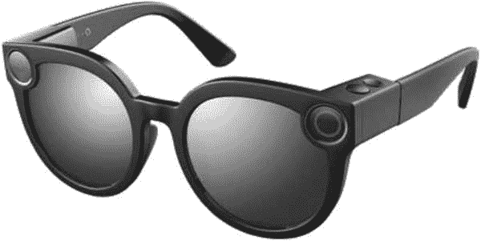

Figure 2-19 Smart Glasses

##### Smart Headphones

With the continuous development of intelligent technology, there are more and more smart headphone products on the market. New smart headphones not only have sound output functions but also have built-in intelligent systems and various sensors. They connect to terminal devices such as smartphones via Bluetooth and other transmission methods to achieve peripheral function expansion, such as smart sports headphones, smart heart rate headphones, smart ECG headphones. Smart headphones can also wirelessly transmit data via Bluetooth technology, and have functions such as answering calls and remote photo capture. Figure 2-20 shows a voice smart headphone `Mobius` jointly launched by iFlytek and Migu.


Figure 2-20 Voice Smart Headphones Mobius

##### Smart Watches

Smart watches generally realize most functions of smartphones by integrating screens, cameras, microphones, and customized intelligent systems, such as calls, text messages, emails, photography, music, Internet access, and using various application software. The representative product of smart watches is Apple's `Apple Watch`, as shown in Figure 2-21. `Apple Watch` can connect with various Apple devices. In addition, many application software have been customized for `Apple Watch`, such as `WeChat`, `Weibo`, `Alipay`, `Meipai`, `Ctrip`, etc., which can all be used on `Apple Watch`. To better adapt to the `Apple Watch` display, these applications have been simplified accordingly. For example, the `Alipay` wallet only retains three functions: Yu'ebao, payment code, and currency conversion.


Figure 2-21 Apple Watch


## 2.5 Typical AI Products

### 2.5.1 Wearable Devices

Wearable devices are currently popular products in the technology industry. From Google Glass to the Xiaomi Mi Band to the Apple Watch, well-known industry vendors mostly have their own wearable devices. These vendors apply their owned data collection and algorithm technologies to wearable devices to provide exclusive, personalized services for individuals. The most critical core technology of wearable devices is artificial intelligence.

Intelligent wearable devices first appeared in the 1980s. Due to the low level of AI technology at the time, they failed to make a significant impact. It was not until the 21st century, with the development of AI technology, that intelligent wearable devices achieved substantial development.

2012 was dubbed the "First Year of Intelligent Wearable Devices." This year saw the debut of Google Glass, as shown in Figure 2-18. Google Glass possessed almost the same functions as a smartphone. People could not only use voice to control photo-taking via Google Glass but also make video calls, access the internet, and handle information and emails.


Figure 2-18

After the debut of Google Glass, although its usage scenarios required deeper exploration, intelligent wearable devices have always been considered products that perfectly combine design and technology. More and more enterprises began to invest in the intelligent wearable market.

Currently, intelligent wearable devices that have appeared on the market include smart glasses, smartwatches, smart bands, smart helmets, smart rings, smart necklaces, smart clothing, etc. These products all take "miniaturization" and "convenience" as their main selling points, becoming a new selling point in electronic consumption. Although current wearable device products come in many varieties and new styles, and competition among vendors is fierce, wearable devices are still in the early stages of development. The reason is that current products with "miniaturization" and "convenience" as their main selling points have not solved the core problem of intelligent wearable devices. How to achieve true "intelligence" through wearable devices is the core problem.

After careful study of the above intelligent wearable devices, we can find that most of these products integrate a "phone" onto the human body in a specific way, such as bands with heart rate measurement, watches that can answer calls, smart running shoes that can measure cadence, etc. Although these products claim to be intelligent wearable devices, the author calls them "pseudo-AI devices," meaning they are not truly intelligent wearable devices. The key to measuring whether a product is intelligent lies in whether these products possess the capabilities of information collection, assisted judgment, and assisted processing.

The current intelligence maturity of wearable devices is insufficient, and product value does not fully meet people's intelligent needs. This is also the reason why, although the intelligent wearable device market is hot, no product on the market has been able to achieve universal popularity like PCs or smartphones. How to enable intelligent wearable devices to realize behavioral and judgment capabilities through technologies like deep learning after acquiring personal information data via collection technology is the core problem.

#### Core Technologies of Intelligent Wearable Devices

**Hardware:** Since they are wearable devices, hardware devices are needed as carriers. Currently, the core hardware problem restricting the development of wearable devices is the battery. Battery life directly affects the user experience of the product. If battery life is insufficient, users need to charge frequently, greatly reducing the product's usability. The current method to solve the battery problem is balanced performance, i.e., finding a balance between performance and power consumption.

**User Experience:** The user experience of intelligent wearable devices is the most core factor for users deciding whether to purchase the product. The user experience design of intelligent wearable devices should start from two aspects: design interaction and operational interaction. Design interaction determines whether the product is successful. Only when product industrial designers and developers fully combine the user-centered design concept with the product can they design a successful product. Operational interaction mainly targets the link design between humans and devices when users use the product. Human-device interaction is inseparable from behavioral operations, touch operations, voice control operations, or brainwave operations. The design of operational interaction should fully consider the hardware device's interaction sensitivity, size, material, interaction accuracy, misoperation, etc.

**Data Processing:** The value of intelligent wearable device products is often reflected through the data they acquire and their ability to process that data. Since the data acquired by intelligent wearable devices is discrete, the core value point of intelligent wearable devices is to find correlations between data through intelligent algorithms and provide analyzed data and solutions to users in a professional service manner.

#### Types of Intelligent Wearable Devices

##### Smart Clothing

With the development of AI technology, the clothing industry has also sensed the business opportunities and launched smart clothing one after another. Levi's once launched a music jacket. Users could not only listen to music through this jacket but also store their favorite music. This music jacket was developed by the Massachusetts Institute of Technology (MIT) in the US. Its fabric uses silk transparent stiff gauze, and the music playback function is controlled by an all-fabric capacitive keyboard. When users need to play music, they just need to press lightly. To ensure the usability of the music jacket, it requires no charging; its energy source mainly relies on solar energy.

In addition to the music jacket developed by MIT, the Georgia Institute of Technology once developed a garment capable of monitoring heart rate and blood pressure. Researchers at Georgia Tech embedded information transmission into the clothing fabric and detected human heartbeat and breathing frequency through the clothing fibers. Currently, companies are utilizing this technology for mass production and have produced multiple garments capable of measuring vital signs such as heart rate and blood pressure.

At the 2016 CES exhibition, Samsung proposed the new concept of "Smart Suit." Smart Suit smart clothing can not only realize real-time monitoring and analysis of body data such as heart rate, step count, and body fat, and collect users' daily habits, but also detect what type of exercise the user is performing. It can also cooperate with application software to provide reasonable suggestions to users, as shown in Figure 2-22.

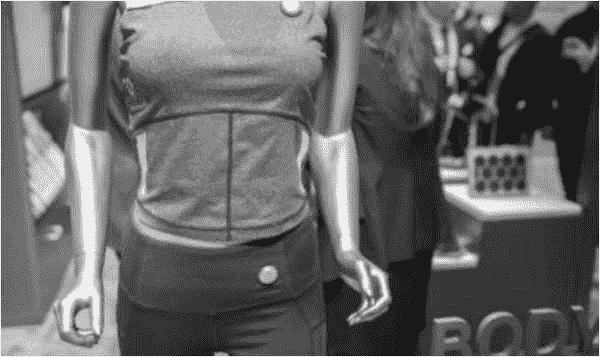

Figure 2-22

##### Smart Running Shoes

Smart running shoes implant intelligent sensors inside the shoes to obtain body data from the human feet, then transmit the information to a smartphone via Bluetooth and other means, providing more services through the smartphone. Because smart running shoes are closer to the human body, the data they obtain is more accurate than devices like smart bands.

Figure 2-23 shows the data display of Li-Ning smart running shoes. It provides users with basic information such as running mileage, route, time, pace, forefoot/rearfoot landing ratio, and also provides calculation of cadence curves, plantar pressure, leg lift height, and other information, thereby helping users improve their running posture.


Figure 2-23

##### Implantable Devices

Recently, the MIT Media Lab collaborated with Harvard Medical School to jointly develop a project named Dermal Abyss. Dermal Abyss is a tattoo ink that can monitor human body conditions, as shown in Figure 2-24. It can directly reflect chemical changes in the human body. In fact, Dermal Abyss is a new type of implantable wearable device.


Figure 2-24

Dermal Abyss can directly reflect chemical changes in the human body. Its color intensity varies, corresponding to the content of different chemical elements in the human body, thereby reflecting the status of various body indicators in real-time.

In addition, to give humans a magical "sixth sense," Cyborg Nest Lab developed a miniature Bluetooth device named North Sense. Users only need to implant it into their bodies, and it will vibrate when facing north. Moreover, users can obtain as much sensory extension as possible through this implantable device. The person in charge of developing this product pointed out that AI products should only work properly when they become part of the user's body; otherwise, they will forever remain just a tool and cannot inspire the human body's intuitive feelings.

##### Smart Glasses

Typically, smart glasses use glasses as a carrier, integrate an independent operating system, and provide application software for users. Users can perform operations such as querying, reading, navigation, interaction, shooting, and calling through gestures, voice, and other methods. Because smart glasses are designed simply, have a strong sense of technology, and are relatively lightweight, they have formed a very large smart glasses industry. Currently, various types of smart glasses can be found on the market, as shown in Figure 2-19.


Figure 2-19

### 2.5.2 Smart Home

The concept of smart home originated early, but it was not realized until 1984, when the United Technologies Corporation (UTC) in the US carried out information-based transformation of a building through a building and industrial system. The company integrated various devices and appliances in the building through a central control device to establish a smart home and built the world's first "Intelligent Building" in Connecticut, USA, unveiling the prelude to smart homes worldwide. With the popularization of the smart home concept, developed countries and regions around the world have proposed various smart home solutions, and many appliance manufacturers and internet companies have begun to explore the smart home field. Currently, both domestic and foreign smart home markets show a rapid development trend.

Currently, the R&D of smart home systems in the US and Europe has always been in a leading position. For example, companies such as Deutsche Telekom, Verizon, and Google have launched their own smart home products and established smart home central device interfaces to integrate various services. Domestic smart home development started later than abroad in terms of layout, but the current development momentum is explosive. Chinese internet companies have entered the home industry one after another, developing a series of smart home devices such as smart TVs, smart speakers, smart air conditioners, and smart bulbs.

#### Smart TV

A smart TV is a TV product that integrates various open operating systems and chips into the TV through internet application technology. Smart TVs generally have open application platforms, can realize two-way human-computer interaction functions, and integrate audio-visual, entertainment, data, and other functions into one, meeting users' customized, diversified, and personalized needs.

Because smart TVs have open platforms and are equipped with operating systems, users can not only enjoy TV content but also install various application software, expanding the application scenarios of TVs. It is precisely because of the scalability and richness of smart TVs that they have currently become mainstream TV products. Manufacturers developing smart TVs include both internet companies and traditional appliance manufacturers, such as Xiaomi, LeTV, Changhong, Haier, TCL, and other companies.

Xiaomi is one of the earlier companies to launch smart TVs. The Xiaomi Smart TV, as shown in Figure 2-25, was officially released on September 5, 2013. This was the first time an internet company entered the traditional appliance industry. To seize the market first, Xiaomi regarded "Mi Fans" as the main customer group and defined the smart TV as the "first TV for young people." Young people are also the group most likely to accept new things, and smart TVs can better stimulate their purchasing interest. Clear target audiences and excellent fan culture enabled Xiaomi Smart TV to produce a strong impact on the traditional TV market.


Figure 2-25

#### Smart Speaker

A smart speaker is an upgraded product of the speaker and is a tool for home consumers to access the internet via voice. Representative products of smart speakers include Amazon Echo, Tmall Genie, and Xiaomi AI Speaker. Users can order songs, shop online, check weather forecasts, and control smart home devices through smart speakers, such as controlling rice cookers, TVs, light bulb brightness, refrigerator temperatures, and water heater temperatures.

Since its release in 2014, Amazon Echo has become one of the hottest smart home products in the overseas market. Users can use voice to control home appliances, purchase goods, and consult questions through Amazon Echo. According to survey data from research institution eMarketer, approximately 36 million users in the US use voice-controlled speakers at least once a month.

The development of smart speakers in China has been very rapid. In 2017, the concept of smart speakers had not yet been mentioned in China, but in the subsequent short year, the Chinese smart speaker market suddenly took off, giving birth to smart speaker products with shipments exceeding one million units in just one year. In recent years, the four most popular smart speaker products on the market are Tmall Genie, Xiaobao AI Speaker, Xiaomi AI Speaker, and Xiaodu, as shown in Figure 2-26.


Figure 2-26

#### Smart Air Conditioner

A smart air conditioner is an air conditioner that adds AI technology elements to the basis of an ordinary air conditioner. The smart air conditioning system can collect indoor temperature, humidity, air cleanliness, and other information through various sensors according to external climate conditions and pre-set indicators, analyze and judge, and automatically activate refrigeration, heating, dehumidification, air purification, and other related functions according to pre-set indicators. In addition, smart air conditioners have added many user-friendly functions, such as voice recognition, mobile app remote control, and memory of usage habits.

In recent years, many appliance manufacturers and internet vendors have set their sights on the smart air conditioner field. Even some middle-class families in Europe and the US have regarded smart air conditioners as standard household products. Currently, the development level of smart air conditioners in China still lags behind developed countries, and the penetration rate is far lower than that of developed countries. But from the domestic market perspective, the demand for smart air conditioners is still relatively large.

Future smart air conditioners will mainly focus on two aspects: one is the degree of product intelligence. Current smart air conditioners still rely on third-party operations, such as mobile phones, tablet computers, etc. Over-reliance on third-party operations greatly reduces their usability. Future smart air conditioners themselves will inevitably have stronger intelligent functions. The second is perception ability. Future smart air conditioners should not be limited to air and temperature perception but should strengthen human body perception. For example, the air conditioner needs to automatically sense human presence, location, quantity, and achieve the best adaptation between the environment and people through the machine's own calculation.

#### Smart Bulb

A smart bulb is a lighting device that uses IoT technology to connect the bulb to the network, realizing energy-saving, artistic, and user-friendly lighting. In the future, smart bulbs will inevitably become the dominant force in home lighting culture. Through smart bulbs, users can set their favorite scenes and lighting effects according to their own lighting needs (such as color, temperature, brightness, and direction, etc.). In addition, smart bulbs can also be controlled via mobile phones to create different indoor smart lighting effects. Through smart bulbs, people can also select and control light brightness, grayscale, and color in different spaces and times according to different scenes and atmospheres, simulating various light environments to guide and improve moods and obtain a user-friendly lighting environment, as shown in Figure 2-27.


Figure 2-27

Smart bulbs generally use LED cold light sources and belong to energy-saving bulbs. Compared with ordinary incandescent lamps and fluorescent lamps, the power-saving efficiency of smart bulbs can reach over 90%, with considerable energy-saving benefits. Smart bulbs are applied in scenarios such as bedrooms, living rooms, kitchens, offices, conference rooms, computer rooms, internet cafes, basements, schools, etc.

Smart bulbs are generally embedded with IoT communication modules, which can connect smart bulbs to the internet. Users can control smart bulbs via the internet at any time, so they can know the working status of home smart bulbs at any time and any place, including indicators such as light color, light brightness, and bulb power consumption. In addition, users can also remotely adjust smart bulbs according to their own needs. If multiple smart bulbs are installed at home, users can also realize bulb networking to facilitate control of special lighting needs according to indoor scenes.

### 2.5.3 Smart Medical Products

AI + Medical, the combination of the two has a positive effect on both human health and social development. There are two directions for the combination of AI and medical: precision medicine and medical assistants.

Chinese hospitals and doctors have accumulated a large amount of medical data during clinical processes, and this data will play a positive role in the future combination of AI and the medical industry. Using the data obtained from experts' actual clinical practice as training and verification data for AI can greatly improve the application efficiency of AI in the diagnosis process.

#### Medical Image Diagnosis

Airdoc is an AI company specializing in the medical industry. Its business mainly includes three aspects: assisted decision-making analysis, medical image analysis, and health big data mining, as shown in Figure 2-28. Airdoc provides clinical decision support, acting as the doctor's "stethoscope" and "database." It utilizes deep learning technology, trained on tens of millions of medical image data, to provide real-time analysis services, and analyzes potential data patterns by mining massive medical information.

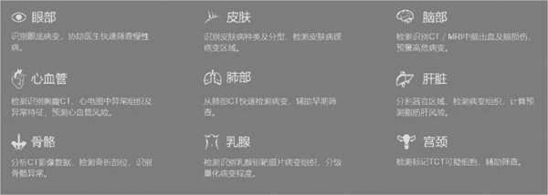

Figure 2-28

Through the accumulation of AI algorithms, combined with big data provided by the industry, Airdoc has built analysis systems covering medical images of eyes, skin, brain, cardiovascular, lungs, liver, bones, breast, and cervix.

#### Tumor Diagnosis

With the development of AI, IBM Watson developed AI medical service application software focused on tumor diagnosis, achieving breakthroughs in nine major medical fields including chronic disease management, precision medicine, and in vitro diagnostics. IBM Watson also achieved commercial operation through cooperation with Memorial Sloan Kettering Cancer Center, jointly training the tumor solution—Watson for Oncology.

IBM Watson can provide consulting services for various cancers such as lung cancer, breast cancer, rectal cancer, colon cancer, gastric cancer, and cervical cancer. After the cancer type, patient age, gender, weight, disease characteristics, treatment situation, and other information are input, IBM Watson can quickly feedback multiple treatment suggestions.

#### Caregiving Robots

In 2016, Rice University showcased an AI-based caregiving robot. This multi-purpose elderly care robot is named MERA, mainly used to help the elderly and their caregivers. The prototype design of MERA was jointly completed by teachers and students from Rice University's Department of Electrical and Computer Engineering and Department of Psychology. It has three main functions: measuring a person's vital signs using innovative methods, such as heart rate, heart rate variability, and respiratory rate; answering basic health-related questions; and determining whether an elderly person has fallen by reading data.

### 2.5.4 Products Applied in the Industrial Manufacturing Field

Compared with traditional manpower, the advantage of industrial robots is cost. Compared with the usage cost of mature welders, industrial robots depreciate over a 10-year service life (including maintenance costs). Under the same efficiency, the usage cost of industrial robots is lower.

In terms of precision and standardization, robots can accomplish many things beyond human capabilities. In addition, dangerous or hazardous work can also be replaced by robots instead of manual labor. Compared with humans, the advantages of robots in the manufacturing field are very obvious. Using robots on the one hand improves the competitive strength of enterprises, and on the other hand provides growth space for enterprise profits. The author believes that more manufacturing enterprises will transform towards intelligent manufacturing in the future. Figure 2-29 shows a Keyence industrial robot.

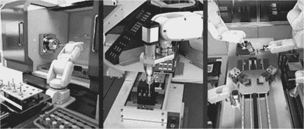

Figure 2-29

China is the world's largest industrial robot market. The sales of industrial robots in China grow at a rate of over 30% every year. It is estimated that by 2020, the sales of industrial robots in China will exceed 210,000 units. It is precisely the broad market demand that has attracted numerous corporate giants to layout the industrial manufacturing field.

Improving automated production levels by replacing human actions with robots is mainly based on three reasons: ① Increase in labor costs; ② Gradually shrinking profit margins; ③ Guidance from national development strategies.

For a long time, China's labor costs have been generally low. But in recent years, with the rapid rise of labor costs, more and more young people are unwilling to engage in boring production line work, exacerbating the labor shortage and forcing manufacturing enterprises to transform towards automation. In addition, with the intensification of social aging, labor shortages will further push up labor costs. For the already thin-margin manufacturing industry, using more advantageous robots to cut costs is the only choice. It can be said that "replacing humans with machines" is not only the general trend but also the key to the future development of China's manufacturing industry. Currently, many enterprises in China have carried out R&D work on AI products in the industrial manufacturing field.

Alibaba Cloud ET Industrial Brain is the first AI to go down to the workshop floor. The cooperation between photovoltaic material manufacturer GCL-Poly (Poly Xiexin) and Alibaba Cloud is an innovation demonstration in China's industrial manufacturing field. The first thing Alibaba Cloud did in the manufacturer's workshop was to upload data from all ports on the production line to Alibaba Cloud, then mobilize the computing power of thousands of servers to find 60 variables affecting the yield rate from thousands of variables in a short time, and then have AI monitor and control these variables in real-time. The production line only needs to "follow orders."

Siemens demonstrated a dual-arm robot in Munich. With the help of highly automated AI, the robot can autonomously divide labor and cooperate without programming, for product manufacturing. Traditional robots cannot understand this `CAD/CAM` (Computer-Aided Design and Manufacturing) model, but the new robots can. In a sense, this is like robots being able to understand different languages, thus not requiring programming for their movements and processes.

General Electric (GE) announced multi-year agreements with numerous electrical companies and reached an agreement with the New York Power Authority (`NYPA`), committed to becoming the world's first fully digital power company. Today, GE's Predictive Analytics Software's Integrated Intelligent Operations Center has been opened. This operations center is a technologically advanced asset monitoring and diagnostic center. Among them, GE and Enel (Italian National Electricity Company) deployed and optimized GE's Asset Performance Management (`APM`) software. The software runs on GE's Industrial Internet of Things (`IIoT`) platform `Predix` to monitor, predict, and improve the reliability of 13 gas-fired power plants and 1 coal-fired power plant. These 14 power plants all use GE or Alstom turbines and generators.

```
EXr6287u6NNVz+GYLY+7SC6AgGofrpiId/XnwIEoGMEPq3TPzkM5RyXBRbuLcLFjwnCuEHVXaQsGpygWHLFy9g==
```


## 2.5 Typical AI Products

### 2.5.1 Wearable Devices

Wearable devices are currently popular products in the technology industry. From Google Glass to Xiaomi Mi Band to Apple Watch, well-known industry vendors mostly have their own wearable devices. These vendors apply their owned data collection and algorithm technologies to wearable devices to provide exclusive, personalized services for individuals. The most critical core technology of wearable devices is artificial intelligence.

Intelligent wearable devices first appeared in the 1980s. Due to the low level of AI technology at the time, they failed to form a significant impact. It was not until the 21st century, with the development of AI technology, that intelligent wearable devices achieved substantial development.

2012 was dubbed the "First Year of Intelligent Wearable Devices." This year saw the debut of Google Glass, as shown in Figure 2-18. Google Glass possessed almost the same functions as a smartphone. People could use voice to control photo taking, make video calls, access the internet, and handle messages and emails via Google Glass.


Figure 2-18

After the launch of Google Glass, although its usage scenarios required deeper exploration, intelligent wearable devices have always been considered products that perfectly combine design and technology. More and more enterprises began to enter the intelligent wearable market.

Currently, intelligent wearable devices on the market include smart glasses, smartwatches, smart bands, smart helmets, smart rings, smart necklaces, smart clothing, etc. These products all take "miniaturization" and "convenience" as their main selling points, becoming a new selling point in consumer electronics. Although current wearable device products come in many varieties and new styles, and competition among vendors is fierce, wearable devices are still in the early stages of development. The reason is that current products with "miniaturization" and "convenience" as main selling points have not solved the core problem of intelligent wearable devices. How to achieve true "intelligence" through wearable devices is the core problem.

After careful study of the above intelligent wearable devices, we can find that most of these products integrate a "phone" onto the human body in a specific way, such as bands with heart rate measurement, watches that can answer calls, smart running shoes that can measure cadence, etc. Although these products claim to be intelligent wearable devices, the author calls them "Pseudo-AI devices," meaning they are not truly intelligent wearable devices. The key to measuring whether a product is intelligent lies in whether these products possess the capabilities of information collection, assisted judgment, and assisted processing.

The current intelligence maturity of wearable devices is insufficient, and product value does not fully meet people's intelligent needs. This is also the reason why, although the market for intelligent wearable devices is hot, no product on the market has achieved full popularity like PCs or smartphones. How to enable intelligent wearable devices to acquire personal information data through collection technology, and then achieve behavioral and judgment capabilities through technologies like deep learning, is the core problem.

#### Core Technologies of Intelligent Wearable Devices

**Hardware**: Since they are wearable devices, hardware devices are needed as carriers. Currently, the core hardware problem restricting the development of wearable devices is the battery. Battery life directly affects the user experience of the product. If battery life is insufficient, users need to charge frequently, greatly reducing the product's usability. The current solution to the battery problem is balancing performance, i.e., finding a balance between performance and power consumption.

#### Smart Headphones

With the continuous development of smart technology, there are more and more smart headphone products on the market. New smart headphones not only have audio output functions but also built-in intelligent systems and various sensors. They connect to terminal devices like smartphones via Bluetooth and other transmission methods to achieve peripheral function expansion, such as smart sports headphones, smart heart rate headphones, smart ECG headphones. Smart headphones can also transmit data wirelessly via Bluetooth technology, and have functions like answering calls and remote photo taking. Figure 2-20 shows a voice smart headphone Mobius jointly launched by iFLYTEK and Migu.


Figure 2-20

#### Smartwatches

Smartwatches generally implement most functions of a smartphone by integrating a display screen, camera, microphone, and customized intelligent system, such as calls, text messages, emails, photography, music, internet access, and the use of various application software. The representative product of smartwatches is Apple's Apple Watch, as shown in Figure 2-21. Apple Watch can connect with various Apple devices. In addition, many application software have been customized for Apple Watch, such as WeChat, Weibo, Alipay, Meipai, Ctrip, etc., all usable on Apple Watch. To better adapt to Apple Watch display, these applications have been simplified accordingly. For example, Alipay Wallet only retains three functions: Yu'e Bao, payment code, and exchange rate conversion.


Figure 2-21

#### Smart Clothing

With the development of AI technology, the clothing industry has also sensed business opportunities and launched smart clothing one after another. Levi's once launched a music jacket. Users can not only listen to music through this jacket but also store their favorite music. This music jacket was developed by the Massachusetts Institute of Technology (MIT) in the US. Its fabric uses silk transparent stiff gauze, and the music playback function is controlled by an all-fabric capacitive keyboard. Users only need to press lightly to play music. To ensure the usability of the music jacket, it requires no charging; its energy source mainly relies on solar energy.

In addition to the music jacket developed by MIT, the Georgia Institute of Technology once developed a garment capable of monitoring heart rate and blood pressure. Researchers at Georgia Tech embedded information transmission into the clothing fabric and detected human heartbeat and breathing frequency through the clothing fibers. Currently, companies are utilizing this technology for mass production, producing multiple garments capable of measuring vital signs such as heart rate and blood pressure.

At the 2016 CES exhibition, Samsung proposed the new concept of "Smart Suit." Smart Suit smart clothing can not only realize real-time monitoring and analysis of body data such as heart rate, steps, and body fat, and collect users' daily habits, but also detect what type of exercise the user is performing. It can also pair with application software to provide reasonable suggestions for users, as shown in Figure 2-22.


Figure 2-22

#### Smart Running Shoes

Smart running shoes implant intelligent sensors inside the shoe to obtain body data from the human foot, then transmit the information to a smartphone via Bluetooth and other means, providing more services through the smartphone. Because smart running shoes are closer to the human body, the data they obtain is more accurate than devices like smart bands.

Figure 2-23 shows the data display of Li-Ning smart running shoes. It provides users with basic information such as running mileage, route, time, pace, forefoot/rearfoot landing ratio, and provides information such as cadence curve, plantar pressure, and leg lift height, thereby helping users improve their running posture.


Figure 2-23

#### Implantable Devices

Recently, the MIT Media Lab collaborated with Harvard Medical School to jointly develop a project named Dermal Abyss. Dermal Abyss is a tattoo ink that can monitor human body conditions, as shown in Figure 2-24. It can directly reflect chemical changes in the human body. In fact, Dermal Abyss is a new type of implantable wearable device.


Figure 2-24

Dermal Abyss can directly reflect chemical changes in the human body. The varying depths of its color correspond to the content of different chemical elements in the human body, thereby reflecting the status of various body indicators in real-time.

In addition, to give humans a magical "sixth sense," Cyborg Nest Lab developed a miniature Bluetooth device called North Sense. Users only need to implant it into their body, and it will vibrate when facing north. Moreover, users can obtain as much sensory extension as possible through this implantable device. The person in charge of developing this product pointed out that AI products should only function properly when they become part of the user's body. If not, it will forever remain just a tool and cannot inspire the human body's intuitive feelings.

### 2.5.2 Smart Home

The concept of smart home originated early, but it was not realized until 1984, when the United Technologies Corporation (UTC) carried out information-based transformation of a building through a building and industrial system. The company integrated various devices and home appliances in the building through a central control device to establish a smart home, and built the world's first "Intelligent Building" in Connecticut, USA, unveiling the prelude to smart homes worldwide. With the popularization of the smart home concept, developed countries and regions around the world have proposed various smart home solutions. Many home appliance manufacturers and internet companies have begun to explore the smart home field. Currently, both domestic and foreign smart home markets show a trend of rapid development.

Currently, the R&D of smart home systems in the US and Europe has always been in a leading position. For example, companies like Deutsche Telekom, Verizon, and Google have launched their own smart home products and established smart home central device interfaces to integrate various services. Domestic smart home development started later than abroad in terms of layout, but the current development momentum is explosive. Chinese internet companies have entered the home industry one after another, developing a series of smart home devices such as smart TVs, smart speakers, smart air conditioners, and smart light bulbs.

#### Smart TV

Smart TV is a TV product that integrates various open operating systems and chips into the TV through internet application technology. Smart TVs generally have open application platforms, enabling two-way human-computer interaction functions, and integrating multiple functions such as audio-visual, entertainment, and data, meeting users' customized, diversified, and personalized needs.

Because smart TVs have open platforms and are equipped with operating systems, users can not only enjoy TV content but also install various application software, expanding the application scenarios of TV. It is precisely because of the scalability and richness of smart TVs that they have currently become mainstream TV products. Manufacturers developing smart TVs include both internet companies and traditional home appliance manufacturers, such as Xiaomi, LeTV, Changhong, Haier, TCL, etc.

Xiaomi is one of the earlier companies to launch smart TVs. Xiaomi Smart TV, as shown in Figure 2-25, was officially released on September 5, 2013. This was the first time an internet company entered the traditional home appliance industry. To seize the market first, Xiaomi regarded "Mi Fans" as the main customer group and defined the smart TV as the "First TV for Young People." Young people are also the group most likely to accept new things, and smart TVs can better stimulate their purchasing interest. Clear target audience and excellent fan culture enabled Xiaomi Smart TV to produce a strong impact on the traditional TV market.


Figure 2-25

#### Smart Speaker

Smart speaker is an upgraded product of the speaker, a tool for home consumers to access the internet via voice. Representative products of smart speakers include Amazon Echo, Tmall Genie, Xiaomi AI Speaker, etc. Users can order songs, shop online, check weather forecasts, and control smart home devices through smart speakers, such as controlling rice cookers, TVs, light bulb brightness, refrigerator temperature, and water heater temperature.

Since its release in 2014, Amazon Echo has become one of the hottest smart home products in the overseas market. Users can use voice to control home appliances, purchase goods, and consult questions via Amazon Echo. According to survey data from research firm eMarketer, about 36 million users in the US use voice-controlled speakers at least once a month.

The development of smart speakers in China has been very rapid. In 2017, the concept of smart speakers was not yet mentioned in China, but in the subsequent short year, the Chinese smart speaker market suddenly took off, giving birth to smart speaker products with shipments exceeding one million units in just one year. In recent years, the four most popular smart speaker products on the market are Tmall Genie, XiaoBai AI Speaker, Xiaomi AI Speaker, and XiaoDu, as shown in Figure 2-26.


Figure 2-26

#### Smart Air Conditioner

Smart air conditioner is an air conditioner that adds AI technology elements on the basis of ordinary air conditioners. The smart air conditioning system can collect indoor temperature, humidity, air cleanliness, and other information through various sensors according to external climate conditions and pre-set indicators, analyze and judge, and automatically activate related functions such as cooling, heating, dehumidification, and air purification according to pre-set indicators. In addition, smart air conditioners have added many user-friendly functions, such as voice recognition, mobile app remote control, and memory of usage habits.

In recent years, many home appliance manufacturers and internet vendors have set their sights on the smart air conditioner field. Even some middle-class families in Europe and America have regarded smart air conditioners as standard household products. Currently, the development level of smart air conditioners in China still lags behind developed countries, and the penetration rate is far lower than that of developed countries. But from the domestic market perspective, the demand for smart air conditioners is still relatively large.

Future smart air conditioners will mainly focus on two aspects: one is the degree of product intelligence. Current smart air conditioners still rely on third-party operations, such as mobile phones, tablets, etc. Over-reliance on third-party operations greatly reduces their usability. Future smart air conditioners themselves will inevitably have stronger intelligent functions. The second is perception ability. Future smart air conditioners should not be limited to air and temperature perception but should strengthen human body perception. For example, the air conditioner needs to automatically sense human presence, location, and quantity, and achieve the best adaptation between the environment and humans through the machine's own calculation.

#### Smart Light Bulb

Smart light bulb is a lighting device that uses IoT technology to connect the bulb to the network, realizing energy-saving, artistic, and user-friendly lighting. Smart light bulbs will inevitably become the leader of home lighting culture in the future. Through smart light bulbs, users can set their favorite scenes and lighting effects according to their own lighting needs (such as color, temperature, brightness, and direction, etc.). In addition, smart light bulbs can also be controlled via mobile phones to create different indoor smart lighting effects. Through smart light bulbs, people can also select and control light brightness, grayscale, and color in different spaces and times according to different scenes and atmospheres, simulating various lighting environments to guide and improve mood, obtaining a user-friendly lighting environment, as shown in Figure 2-27.


Figure 2-27

Smart light bulbs generally use LED cold light sources and belong to energy-saving bulbs. Compared with ordinary incandescent lamps and fluorescent lamps, the power saving efficiency of smart light bulbs can reach over 90%, with considerable energy-saving benefits. Smart light bulbs are applied in scenarios such as bedrooms, living rooms, kitchens, offices, conference rooms, computer rooms, internet cafes, basements, schools, etc.

Smart light bulbs are generally embedded with IoT communication modules, which can connect smart light bulbs to the internet. Users can control smart light bulbs via the internet at any time, so they can know the working status of home smart light bulbs at any time and any place, including indicators such as light color, light brightness, and bulb power consumption. In addition, users can also remotely adjust smart light bulbs according to their own needs. If multiple smart light bulbs are installed at home, users can also realize bulb networking to facilitate control of special lighting needs according to indoor scenes.

### 2.5.3 Smart Medical Products

AI + Medical, the combination of the two has a positive effect on both human health and social development. The combination of AI and medical care has two directions: precision medicine and medical assistants.

Chinese hospitals and doctors have accumulated a large amount of medical data during clinical processes, and these data will play a positive role in the future combination of AI and the medical industry. Using data obtained from experts' actual clinical practice as training and verification data for AI can greatly improve the application efficiency of AI in the diagnosis process.

#### Medical Image Diagnosis

Airdoc is an AI company specializing in the medical industry. Its business mainly includes three aspects: assisted decision-making analysis, medical image analysis, and health big data mining, as shown in Figure 2-28. Airdoc provides clinical decision support, acting as the doctor's "stethoscope" and "database." Using deep learning technology, it trains based on tens of millions of medical image data to provide real-time analysis services, and analyzes potential data patterns by mining massive medical information.


Figure 2-28

Through the accumulation of AI algorithms, combined with big data provided by the industry, Airdoc has built analysis systems covering medical images of eyes, skin, brain, cardiovascular, lungs, liver, bones, breast, and cervix.

#### Tumor Diagnosis

With the development of AI, IBM Watson developed AI medical service application software focusing on tumor diagnosis, achieving breakthroughs in nine major medical fields including chronic disease management, precision medicine, and in vitro diagnostics. IBM Watson also achieved commercial operation through cooperation with Memorial Sloan Kettering Cancer Center, jointly training the tumor solution—Watson for Oncology.

IBM Watson can provide consulting services for various cancers such as lung cancer, breast cancer, rectal cancer, colon cancer, gastric cancer, and cervical cancer. After information such as cancer type, patient age, gender, weight, disease characteristics, and treatment status is input, IBM Watson can quickly feedback multiple treatment suggestions.

#### Care Robots

In 2016, Rice University showcased an AI-based care robot. This multi-purpose elderly care robot is named MERA, mainly used to help the elderly and their caregivers. The prototype design of MERA was jointly completed by teachers and students from Rice University's Department of Electrical and Computer Engineering and Department of Psychology. It has three main functions: measuring a person's vital signs using innovative methods, such as heart rate, heart rate variability, and respiratory rate; answering basic health-related questions; and determining whether an elderly person has fallen by reading data.

### 2.5.4 Products Applied in Industrial Manufacturing

Compared with traditional manpower, the advantage of industrial robots is cost. Compared with the usage cost of mature welders, calculating industrial robot depreciation over a 10-year service life (including maintenance costs), under the same efficiency, the usage cost of industrial robots is lower.

In terms of precision and standardization, robots can accomplish many things beyond human capability. In addition, dangerous or hazardous work can also be replaced by robots instead of manual labor. Compared with humans, the advantages of robots in the manufacturing field are very obvious. Using robots on the one hand improves enterprise competitiveness, and on the other hand provides growth space for enterprise profits. The author believes that more manufacturing enterprises will transform towards intelligent manufacturing in the future. Figure 2-29 shows a Keyence industrial robot.


Figure 2-29

China is the world's largest industrial robot market. Industrial robot sales in China grow at a rate of over 30% annually. It is estimated that by 2020, industrial robot sales in China will exceed 210,000 units. It is this vast market demand that has attracted numerous enterprise giants to layout in the industrial manufacturing field.

Improving automated production levels by replacing human actions with robots is mainly based on three reasons: ① Increase in labor costs; ② Gradually shrinking profit margins; ③ Guidance from national development strategies.

For a long time, China's labor costs have been generally low. But in recent years, with the rapid rise of labor costs, more and more young people are unwilling to engage in boring production line work, exacerbating the labor shortage and forcing manufacturing enterprises to transform towards automation. In addition, with the intensification of social aging, labor shortage will further push up labor costs. For the already thin-profit manufacturing industry, using more advantageous robots to cut costs is the only choice. It can be said that "replacing humans with machines" is not only the general trend but also the key to the future development of China's manufacturing industry. Currently, many enterprises in China have carried out R&D work on AI products in the industrial manufacturing field.

Alibaba Cloud ET Industrial Brain is the first AI to go down to the workshop floor. The cooperation between photovoltaic material manufacturer GCL-Poly and Alibaba Cloud is an innovation demonstration in China's industrial manufacturing field. The first thing Alibaba Cloud did in the manufacturer's workshop was to upload all port data on the production line to Alibaba Cloud, then mobilize the computing power of thousands of servers to find 60 variables affecting the yield rate from thousands of variables in a short time, and then use AI to monitor and control these variables in real-time. The production line only needs to "follow orders."

Siemens demonstrated a dual-arm robot in Munich. The robot, with the help of highly automated AI, can autonomously divide labor and cooperate without programming, for product manufacturing. Traditional robots cannot understand such CAD/CAM (Computer-Aided Design and Manufacturing) models, but the new robots can. In a sense, this is like robots being able to understand different languages, thus not requiring programming for their movements and processes.

General Electric (GE) announced multi-year agreements with numerous electrical companies and an agreement with the New York Power Authority (NYPA), dedicated to becoming the world's first fully digital power company. Today, GE's Integrated Operations Center with comprehensive intelligent predictive analysis software has been opened. This operations center is a technologically advanced asset monitoring and diagnostic center. Among them, GE and Enel (Italian national power company) deployed and optimized GE's Asset Performance Management (APM) software, which runs on GE's Industrial Internet of Things (IIoT) platform Predix, to monitor, predict, and improve the reliability of 13 gas-fired power plants and 1 coal-fired power plant. These 14 power plants all use GE or Alstom turbines and generators. EXr6287u6NNVz+GYLY+7SC6AgGofrpiId/XnwIEoGMEPq3TPzkM5RyXBRbuLcLFjwnCuEHVXaQsGpygWHLFy9g==


## 2.5 Typical AI Products

### 2.5.1 Wearable Devices

Wearable devices are currently popular products in the technology industry, ranging from Google Glass to Xiaomi Mi Band to Apple Watch; major industry vendors mostly have their own wearable devices. These vendors apply their owned data collection and algorithm technologies to wearable devices to provide exclusive, personalized services for individuals. The most critical core technology of wearable devices is artificial intelligence.

Intelligent wearable devices first appeared in the 1980s. Due to the low level of AI technology at the time, they failed to make a significant impact. It was not until the 21st century, with the development of AI technology, that intelligent wearable devices achieved substantial growth.

2012 was dubbed the "First Year of Intelligent Wearable Devices." This year saw the debut of Google Glass, as shown in Figure 2-18. Google Glass possessed almost the same functions as a smartphone. Users could not only control photo-taking via voice with Google Glass but also make video calls, browse the internet, and handle messages and emails.


Figure 2-18

After the launch of Google Glass, although its usage scenarios required deeper exploration, intelligent wearable devices have always been considered products that perfectly combine design and technology. More and more enterprises began to enter the intelligent wearable market.

#### User Experience

User experience is the most core factor determining whether a user decides to purchase an intelligent wearable device. The user experience design of intelligent wearable devices should start from two aspects: design interaction and operational interaction. Design interaction determines whether the product is successful. Only when product industrial designers and developers fully integrate the user-centered design concept with the product can they design a successful product. Operational interaction mainly targets the link design between humans and devices when users use the product. Human-device interaction is inseparable from behavioral operations, touch operations, voice control, or brainwave operations. The design of operational interaction should fully consider the hardware device's interaction sensitivity, size, material, interaction accuracy, and misoperation rate.

#### Data Processing

The value of intelligent wearable device products is often reflected through the data they acquire and their ability to process that data. Since the data acquired by intelligent wearable devices is discrete, the core value of intelligent wearable devices lies in finding correlations between data through intelligent algorithms and providing analyzed data and solutions to users in the form of professional services.

#### Types of Intelligent Wearable Devices

**Smart Glasses**: Typically, smart glasses use glasses as a carrier, integrate an independent operating system, and provide application software for users. Users can perform operations such as querying, reading, navigation, interaction, shooting, and calling through gestures, voice, and other methods. Due to their concise design, strong sense of technology, and light weight, smart glasses have formed a very large industry. Currently, various types of smart glasses can be found on the market, as shown in Figure 2-19.


Figure 2-19

**Smart Headphones**: With the continuous development of smart technology, there are more and more smart headphone products on the market. New smart headphones not only have audio output functions but also built-in intelligent systems and various sensors. They connect to terminal devices such as smartphones via Bluetooth and other transmission methods to achieve peripheral function expansion, such as smart sports headphones, smart heart rate headphones, and smart ECG headphones. Smart headphones can also transmit data wirelessly via Bluetooth technology and have functions such as answering calls and remote shutter control. Figure 2-20 shows a voice smart headphone Mobius jointly launched by iFLYTEK and Migu.


Figure 2-20

**Smart Watches**: Smart watches generally implement most smartphone functions by integrating a display screen, camera, microphone, and customized intelligent system, such as calls, text messages, emails, photography, music, internet access, and the use of various application software. The representative product of smart watches is Apple's Apple Watch, as shown in Figure 2-21. Apple Watch can connect with various Apple devices. In addition, many application software have been customized for Apple Watch, such as WeChat, Weibo, Alipay, Meipai, Ctrip, etc., all usable on Apple Watch. To better adapt to the Apple Watch display, these applications have been simplified accordingly. For example, the Alipay Wallet only retains three functions: Yu'E Bao, payment code, and currency conversion.


Figure 2-21

**Smart Clothing**: With the development of AI technology, the clothing industry has also sensed business opportunities and launched smart clothing one after another. Levis once launched a music jacket. Users could not only listen to music through this jacket but also store their favorite music. This music jacket was developed by the Massachusetts Institute of Technology (MIT) in the US. Its fabric uses silk transparent stiff gauze, and the music playback function is controlled by an all-fabric capacitive keyboard. When users need to play music, they just need to press lightly. To ensure the usability of the music jacket, it requires no charging; its energy source mainly relies on solar energy.

Besides the music jacket developed by MIT, the Georgia Institute of Technology once developed a garment capable of monitoring heart rate and blood pressure. Researchers at Georgia Tech embedded information transmission into the clothing fabric and detected human heartbeat and breathing frequency through the clothing fibers. Currently, companies are utilizing this technology for mass production, producing multiple garments capable of measuring vital signs such as heart rate and blood pressure.

At the 2016 CES exhibition, Samsung proposed the new concept of "Smart Suit." Smart Suit smart clothing can not only realize real-time monitoring and analysis of body data such as heart rate, steps, and body fat, and collect users' daily habits, but also detect what type of exercise the user is performing. It can also pair with application software to provide reasonable suggestions to users, as shown in Figure 2-22.


Figure 2-22

**Smart Running Shoes**: Smart running shoes implant intelligent sensors inside the shoes to obtain body data from the human feet, then transmit the information to a smartphone via Bluetooth and other means, providing more services through the smartphone. Because smart running shoes are closer to the human body, the data they obtain is more accurate than devices like smart bracelets.

Figure 2-23 shows the data display of Li-Ning smart running shoes. It provides users with basic information such as running mileage, route, duration, pace, and forefoot/rearfoot landing ratio, and also provides calculated information such as cadence curve, plantar pressure, and leg lift height, thereby helping users improve their running posture.


Figure 2-23

**Implantable Devices**: Recently, the MIT Media Lab collaborated with Harvard Medical School to jointly develop a project named Dermal Abyss. Dermal Abyss is a tattoo ink that can monitor human body conditions, as shown in Figure 2-24. It can directly reflect chemical changes in the human body. In fact, Dermal Abyss is a new type of implantable wearable device.


Figure 2-24

Dermal Abyss can directly reflect chemical changes in the human body. The varying depths of its color correspond to the content of different chemical elements in the human body, thereby reflecting the status of various body indicators in real-time.

In addition, to give humans a magical "sixth sense," Cyborg Nest Lab developed a miniature Bluetooth device named North Sense. Users only need to implant it into their bodies, and it will vibrate when facing north. Moreover, users can obtain maximum sensory extension through this implantable device. The person in charge of developing this product pointed out that AI products should only function properly when they become part of the user's body. If not, they will forever remain just a tool, unable to stimulate the human body's intuitive feelings.

### 2.5.2 Smart Home

The concept of smart home originated early, but it was not realized until 1984, when the United Technologies Corporation (UTC) carried out information-based transformation of a building through a building and industrial system. The company integrated various devices and home appliances in the building through a central control device to establish a smart home and built the world's first "Intelligent Building" in Connecticut, USA, unveiling the prologue of smart homes worldwide. With the popularization of the smart home concept, developed countries and regions around the world have proposed various smart home solutions. Many home appliance manufacturers and internet companies have begun to explore the smart home field. Currently, both domestic and international smart home markets show a rapid development trend.

Currently, the R&D of smart home systems in the US and Europe has always been in a leading position. For example, companies such as Deutsche Telekom, Verizon, and Google have launched their own smart home products and established smart home central device interfaces to integrate various services. Domestic smart home development started later than abroad in terms of layout, but the current development momentum is explosive. Chinese internet companies have entered the home industry one after another, developing a series of smart home devices such as smart TVs, smart speakers, smart air conditioners, and smart bulbs.

#### Smart TV

Smart TV is a TV product that integrates various open operating systems and chips into the TV through internet application technology. Smart TVs generally have open application platforms, enabling two-way human-computer interaction functions, and integrating multiple functions such as audio-visual, entertainment, and data, meeting users' customized, diversified, and personalized needs.

Because smart TVs have open platforms and are equipped with operating systems, users can not only watch TV content but also install various application software, expanding the application scenarios of TV. It is precisely due to the scalability and richness of smart TVs that they have currently become mainstream TV products. Manufacturers developing smart TVs include both internet companies and traditional home appliance manufacturers, such as Xiaomi, LeTV, Changhong, Haier, TCL, etc.

Xiaomi is one of the earlier companies to launch smart TVs. The Xiaomi Smart TV, as shown in Figure 2-25, was officially released on September 5, 2013. This was the first time an internet company entered the traditional home appliance industry. To seize the market first, Xiaomi regarded "Mi Fans" as the main target customer group and defined the smart TV as the "First TV for Young People." Young people are also the group most receptive to new things, and smart TVs can better stimulate their purchasing interest. Clear target audience and excellent fan culture enabled Xiaomi Smart TV to strongly impact the traditional TV market.


Figure 2-25

#### Smart Speaker

Smart speaker is an upgraded product of the speaker, a tool for home consumers to access the internet via voice. Representative products of smart speakers include Amazon Echo, Tmall Genie, Xiaomi AI Speaker, etc. Users can order songs, shop online, check weather forecasts, and control smart home devices through smart speakers, such as controlling rice cookers, TVs, light bulb brightness, refrigerator temperature, and water heater temperature.

Since its release in 2014, Amazon Echo has become one of the hottest smart home products in the overseas market. Users can control home appliances, purchase goods, and consult questions via voice through Amazon Echo. According to survey data from research institution eMarketer, approximately 36 million users in the US use voice-controlled speakers at least once a month.

The development of smart speakers in China has been very rapid. In 2017, the concept of smart speakers had not yet been mentioned in China, but in the following short year, the Chinese smart speaker market suddenly took off, giving birth to smart speaker products with shipments exceeding one million units in just one year. In recent years, the four most popular smart speaker products on the market are Tmall Genie, XiaoBai AI Speaker, Xiaomi AI Speaker, and Xiaodu, as shown in Figure 2-26.


Figure 2-26

#### Smart Air Conditioner

Smart air conditioner is an air conditioner that adds AI technology elements to the basis of ordinary air conditioners. The smart air conditioning system can collect indoor temperature, humidity, air cleanliness, and other information through various sensors according to external climate conditions and pre-set indicators, analyze and judge them, and automatically activate relevant functions such as cooling, heating, dehumidification, and air purification according to pre-set indicators. In addition, smart air conditioners have added many user-friendly functions, such as voice recognition, mobile app remote control, and memory of usage habits.

In recent years, many home appliance manufacturers and internet manufacturers have set their sights on the smart air conditioner field. Even some middle-class families in Europe and the US have regarded smart air conditioners as standard household products. Currently, the development level of smart air conditioners in China still lags behind developed countries, and the penetration rate is far lower than that of developed countries. However, from the domestic market perspective, the demand for smart air conditioners is still relatively large.

Future smart air conditioners will mainly focus on two aspects: first, the degree of product intelligence. Current smart air conditioners still rely on third-party operations, such as mobile phones, tablets, etc. Over-reliance on third-party operations greatly reduces their usability. Future smart air conditioners themselves must have stronger intelligent functions. Second, perception ability. Future smart air conditioners should not be limited to air and temperature perception but should strengthen human body perception. For example, the air conditioner needs to automatically sense human presence, location, and quantity, and achieve the best adaptation between the environment and people through the machine's own calculation.

#### Smart Bulb

Smart bulb is a lighting device that uses IoT technology to connect the bulb to the network, realizing energy-saving, artistic, and humanized lighting. Smart bulbs will inevitably become the dominant force in home lighting culture in the future. Through smart bulbs, users can set their favorite scenes and lighting effects according to their own lighting needs (such as color, temperature, brightness, and direction). In addition, smart bulbs can also be controlled via mobile phones to create different indoor smart lighting effects. Through smart bulbs, people can also select and control light brightness, grayscale, and color in different spaces and times according to different scenes and atmospheres, simulating various light environments to guide and improve mood, obtaining a humanized lighting environment, as shown in Figure 2-27.


Figure 2-27

Smart bulbs generally use LED cold light sources and belong to energy-saving bulbs. Compared with ordinary incandescent lamps and fluorescent lamps, the power saving efficiency of smart bulbs can reach over 90%, with considerable energy-saving benefits. Smart bulbs are applied in scenarios such as bedrooms, living rooms, kitchens, offices, conference rooms, computer rooms, internet cafes, basements, schools, etc.

Smart bulbs are generally embedded with IoT communication modules, which can connect smart bulbs to the internet. Users can control smart bulbs via the internet at any time, thus knowing the working status of home smart bulbs at any time and any place, including indicators such as light color, light brightness, and bulb power consumption. In addition, users can also remotely adjust smart bulbs according to their own needs. If multiple smart bulbs are installed at home, users can also realize bulb networking to facilitate control of special lighting needs according to indoor scenes.

### 2.5.3 Smart Medical Products

AI + Medical, the combination of the two has a positive effect on both human health and social development. The combination of AI and medical care has two directions: precision medicine and medical assistants.

Chinese hospitals and doctors have accumulated a large amount of medical data during clinical processes, and this data will play a positive role in the future combination of AI and the medical industry. Using the data obtained from experts' actual clinical practice as training and verification data for AI can greatly improve the application efficiency of AI in the diagnosis process.

#### Medical Image Diagnosis

Airdoc is an AI company specializing in the medical industry. Its business mainly includes three aspects: auxiliary decision-making analysis, medical image analysis, and health big data mining, as shown in Figure 2-28. Airdoc provides clinical decision support, acting as the doctor's "stethoscope" and "database." It utilizes deep learning technology to train on tens of millions of medical image data, providing real-time analysis services, and analyzes potential data patterns by mining massive medical information.


Figure 2-28

Airdoc, through the accumulation of AI algorithms combined with big data provided by the industry, has built analysis systems covering medical images of eyes, skin, brain, cardiovascular, lungs, liver, bones, breast, and cervix.

#### Tumor Diagnosis

With the development of AI, IBM Watson developed AI medical service application software focused on tumor diagnosis, achieving breakthroughs in nine major medical fields including chronic disease management, precision medicine, and in vitro diagnostics. IBM Watson also achieved commercial operation through cooperation with Memorial Sloan Kettering Cancer Center, jointly training the tumor solution—Watson for Oncology.

IBM Watson can provide consultation services for various cancers such as lung cancer, breast cancer, rectal cancer, colon cancer, gastric cancer, and cervical cancer. After information such as cancer type, patient age, gender, weight, disease characteristics, and treatment status is input, IBM Watson can quickly feedback multiple treatment suggestions.

#### Care Robots

In 2016, Rice University showcased an AI-based care robot. This multi-purpose elderly care robot is named MERA, mainly used to help the elderly and their caregivers. The prototype design of MERA was jointly completed by teachers and students from Rice University's Department of Electrical and Computer Engineering and Department of Psychology. It has three main functions: measuring a person's vital signs using innovative methods, such as heart rate, heart rate variability, and respiratory rate; answering basic health-related questions; and determining whether an elderly person has fallen by reading data.

### 2.5.4 Products Applied in Industrial Manufacturing

Compared with traditional manpower, the advantage of industrial robots is cost. Compared with the usage cost of mature welders, calculating industrial robot depreciation over a 10-year service life (including maintenance costs), under the same efficiency, the usage cost of industrial robots is lower.

In terms of precision and standardization, robots can accomplish many things beyond human capability. In addition, dangerous or hazardous work can also be replaced by robots instead of manual labor. Compared with humans, the advantages of robots in the manufacturing field are very obvious. Using robots on the one hand improves the competitiveness of enterprises, and on the other hand provides growth space for enterprise profits. The author believes that more manufacturing enterprises will transform towards intelligent manufacturing in the future. Figure 2-29 shows a Keyence industrial robot.


Figure 2-29

China is the world's largest industrial robot market. The sales volume of industrial robots in China grows at a rate of over 30% every year. It is estimated that by 2020, the sales volume of industrial robots in China will exceed 210,000 units. It is precisely the broad market demand that has attracted numerous enterprise giants to layout the industrial manufacturing field.

Improving automation production levels by replacing human actions with robots is mainly based on three reasons: ① Increase in labor costs; ② Gradual narrowing of profit margins; ③ Guidance of national development strategy.

For a long time, China's labor costs have been generally low. But in recent years, with the rapid rise of labor costs, more and more young people are unwilling to engage in boring production line work, exacerbating the labor shortage and forcing manufacturing enterprises to transform towards automation. In addition, with the intensification of social aging, labor shortage will further push up labor costs. For the already thin-profit manufacturing industry, using more advantageous robots to cut costs is the only choice. It can be said that "replacing humans with machines" is not only the general trend but also the key to the future development of China's manufacturing industry. Currently, many enterprises in China have carried out R&D work on AI products in the industrial manufacturing field.

Alibaba Cloud ET Industrial Brain is the first AI to go down to the workshop floor. The cooperation between photovoltaic material manufacturer Baoli Xiexin and Alibaba Cloud is an innovation demonstration in China's industrial manufacturing field. The first thing Alibaba Cloud did in the manufacturer's workshop was to upload data from all ports on the production line to Alibaba Cloud, then mobilize the computing power of thousands of servers to find 60 variables affecting the yield rate from thousands of variables in a short time, and then have AI monitor and control these variables in real-time; the production line only needs to "follow orders."

Siemens demonstrated a dual-arm robot in Munich. This robot, with the help of highly automated AI, can autonomously divide labor and cooperate without programming, for product manufacturing. Traditional robots cannot understand such CAD/CAM (Computer-Aided Design and Manufacturing) models, but the new robots can. In a sense, this is like robots being able to understand different languages, thus not requiring programming for their movements and processes.

General Electric (GE) announced multi-year agreements with numerous electrical companies and reached an agreement with the New York Power Authority (NYPA), committed to becoming the world's first fully digitalized power company. Today, GE's comprehensive intelligent operations center with predictive analysis software is open. This operations center is a technologically advanced asset monitoring and diagnostic center. Among them, GE and Enel (Italian National Electricity Company) deployed and optimized GE's Asset Performance Management (APM) software, which runs on GE's Industrial Internet of Things (IIoT) platform Predix, to monitor, predict, and improve the reliability of 13 gas-fired power plants and 1 coal-fired power plant. These 14 power plants all use GE or Alstom turbines and generators. EXr6287u6NNVz+GYLY+7SC6AgGofrpiId/XnwIEoGMEPq3TPzkM5RyXBRbuLcLFjwnCuEHVXaQsGpygWHLFy9g==


# Intelligent Wearable Devices

Currently, intelligent wearable devices on the market include smart glasses, smart watches, smart bands, smart helmets, smart rings, smart necklaces, smart clothing, and others. These products all take "miniaturization" and "convenience" as their main selling points, becoming a new selling point in electronic consumption. Although current wearable device products come in many varieties and new styles, and competition among manufacturers is fierce, wearable devices are still in the early stages of development. The reason is that products with "miniaturization" and "convenience" as their main selling points have not solved the core problem of intelligent wearable devices; how to achieve true "intelligence" through wearable devices is the core issue.

Upon careful study of the aforementioned intelligent wearable devices, we can find that most of these products integrate a "mobile phone" onto the human body in a specific way, such as bands with heart rate measurement, watches that can answer calls, smart running shoes that can measure cadence, etc. Although these products claim to be intelligent wearable devices, the author refers to them as "pseudo-AI devices," meaning they are not truly intelligent wearable devices. The key to measuring whether a product is intelligent lies in whether these products possess the capabilities of information collection, assisted judgment, and assisted processing.

The current maturity of wearable device intelligence is insufficient, and product value does not fully meet people's intelligent needs. This is also the reason why, although the intelligent wearable device market is hot, no product on the market has achieved universal popularity like PCs or smartphones. How to enable intelligent wearable devices to acquire personal information data through collection technology, and then achieve behavioral and judgment capabilities through technologies such as deep learning, is the core issue.

## Core Technologies

**Hardware**: Since they are wearable devices, hardware devices are needed as carriers. The core hardware issue currently restricting the development of wearable devices is the battery; battery life directly affects the user experience of the product. If battery life is insufficient, users need to charge frequently, greatly reducing the product's usability. The current method to solve the battery problem is to balance performance, i.e., finding a balance point between performance and power consumption.

**User Experience**: The user experience of intelligent wearable devices is the most core element for users deciding whether to purchase the product. The user experience design of intelligent wearable devices should start from two aspects: design interaction and operational interaction. Design interaction determines whether the product is successful; only when product industrial designers and developers fully combine the user-centered design concept with the product can they design a successful product. Operational interaction mainly targets the design of the link between humans and devices when users use the product. Human-device interaction is inseparable from methods such as behavioral operations, touch operations, voice control, or brainwave operations. The design of operational interaction should fully consider the hardware device's interaction sensitivity, size, material, interaction accuracy, and misoperation rate.

**Data Processing**: The value of intelligent wearable device products is often reflected through the data they acquire and their ability to process that data. Since the data acquired by intelligent wearable devices is discrete, the core value point of intelligent wearable devices is to find correlations between data through intelligent algorithms and provide analyzed data and solutions to users in the form of professional services.

## Types of Intelligent Wearable Devices

### Smart Glasses

Typically, smart glasses use glasses as a carrier, integrate an independent operating system, and provide application software for users. Users can perform operations such as querying, reading, navigation, interaction, shooting, and calling through gestures, voice, and other methods. Due to the concise design, strong sense of technology, and relative lightness of smart glasses, a very large smart glasses industry has formed. Currently, various types of smart glasses can be found on the market, as shown in Figure 2-19.


Figure 2-19

### Smart Headphones

With the continuous development of intelligent technology, there are more and more smart headphone products on the market. New smart headphones not only have sound output functions but also have built-in intelligent systems and various sensors. They connect to terminal devices such as smartphones via Bluetooth and other transmission methods to achieve peripheral function expansion, such as smart sports headphones, smart heart rate headphones, and smart ECG headphones. Smart headphones can also wirelessly transmit data via Bluetooth technology and have functions such as answering calls and remote photography. Figure 2-20 shows a voice smart headphone Mobius jointly launched by iFlytek and Migu.


Figure 2-20

### Smart Watches

Smart watches generally implement most functions of smartphones by integrating displays, cameras, microphones, and customized intelligent systems, such as calls, text messages, emails, photography, music, internet access, and the use of various application software. The representative product of smart watches is Apple's Apple Watch, as shown in Figure 2-21. Apple Watch can connect with various Apple devices; additionally, many application software have been customized for Apple Watch, such as WeChat, Weibo, Alipay, Meipai, Ctrip, etc., all usable on Apple Watch. To better adapt to Apple Watch display, these applications have been simplified accordingly; for example, Alipay Wallet only retains three functions: Yu'e Bao, payment code, and exchange rate conversion.


Figure 2-21

### Smart Clothing

With the development of artificial intelligence technology, the clothing industry has also sensed the business opportunities and launched smart clothing one after another. Levi's once launched a music jacket; users can not only listen to music through this jacket but also store their favorite music. This music jacket was developed by the Massachusetts Institute of Technology (MIT) in the US. Its fabric uses silk transparent stiff gauze, and the music playback function is controlled by an all-fabric capacitive keyboard. When users need to play music, they just need to press lightly. To ensure the usability of the music jacket, it requires no charging; its energy source mainly relies on solar energy.

In addition to the music jacket developed by MIT, the Georgia Institute of Technology once developed a garment capable of monitoring heart rate and blood pressure. Researchers at Georgia Tech embedded information transmission into the clothing fabric and detected human heartbeat and breathing frequency through the clothing fibers. Currently, companies are using this technology for mass production and have produced multiple garments capable of measuring vital signs such as heart rate and blood pressure.

At the 2016 CES exhibition, Samsung proposed the new concept of "Smart Suit." Smart Suit smart clothing can not only realize real-time monitoring and analysis of body data such as heart rate, step count, and body fat, and collect users' daily habits, but also detect what type of exercise the user is performing. It can also cooperate with application software to provide reasonable suggestions to users, as shown in Figure 2-22.


Figure 2-22

### Smart Running Shoes

Smart running shoes implant intelligent sensors inside the shoes to obtain body data from the human feet, then transmit the information to smartphones via Bluetooth and other means, and provide more services through smartphones. Because smart running shoes are closer to the human body, the data they obtain is more accurate than devices such as smart bands.

Figure 2-23 shows the data display of Li-Ning smart running shoes. It provides users with basic information such as running mileage, route, time, pace, forefoot/rearfoot landing ratio, and provides information such as cadence curve, plantar pressure, and leg lift height, thereby helping users improve their running posture.


Figure 2-23

### Implantable Devices

Recently, the MIT Media Lab collaborated with Harvard Medical School to jointly develop a project named Dermal Abyss. Dermal Abyss is a tattoo ink that can monitor human body conditions, as shown in Figure 2-24; it can directly reflect chemical changes in the human body. In fact, Dermal Abyss is a new type of implantable wearable device.


Figure 2-24

Dermal Abyss can directly reflect chemical changes in the human body. Its varying color depths correspond to the content of different chemical elements in the human body, thereby reflecting the status of various body indicators in real-time.

In addition, to give humans a magical "sixth sense," Cyborg Nest Lab developed a miniature Bluetooth device named North Sense. Users only need to implant it into their bodies, and it will vibrate when facing north. Moreover, users can obtain as much sensory extension as possible through this implantable device. The person in charge of developing this product pointed out that AI products should only work normally when they become part of the user's body; otherwise, they will forever remain just a tool, unable to stimulate the human body's intuitive feelings.

# Smart Home

The concept of smart home originated early, but it was not realized until 1984, when the United Technologies Corporation (UTC) carried out information transformation on a building through a building and industrial system. The company integrated various devices and home appliances in the building through central control equipment to establish a smart home, and built the world's first "intelligent building" in Connecticut, USA, unveiling the prelude to smart homes worldwide. With the popularization of the smart home concept, developed countries and regions around the world have proposed various smart home solutions, and many home appliance manufacturers and internet companies have begun to explore the smart home field. Currently, both domestic and foreign smart home markets show a rapid development trend.

Currently, the R&D of smart home systems in the US and Europe has always been in a leading position. For example, companies such as Deutsche Telekom, Verizon, and Google have launched their own smart home products and established smart home central device interfaces to integrate various services. Domestic smart home development started later than abroad, but the current development momentum is explosive. Chinese internet companies have entered the home industry one after another, developing a series of smart home devices such as smart TVs, smart speakers, smart air conditioners, and smart bulbs.

## Smart TV

Smart TV is a TV product that integrates various open operating systems and chips into the TV through internet application technology. Smart TVs generally have open application platforms, can realize two-way human-computer interaction functions, and integrate multiple functions such as audio-visual, entertainment, and data, meeting users' customized, diversified, and personalized needs.

Because smart TVs have open platforms and are equipped with operating systems, users can not only enjoy TV content but also install various application software, expanding the application scenarios of TV. It is precisely because of the scalability and richness of smart TVs that they have currently become mainstream TV products. Manufacturers developing smart TVs include both internet companies and traditional home appliance manufacturers, such as Xiaomi, LeTV, Changhong, Haier, TCL, and other companies.

Xiaomi is one of the earlier companies to launch smart TVs. Xiaomi Smart TV, as shown in Figure 2-25, was officially released on September 5, 2013. This was the first time an internet company entered the traditional home appliance industry. To seize the market first, Xiaomi regarded "Mi Fans" as the main customer group and defined the smart TV as the "first TV for young people." Young people are also the group most receptive to new things, and smart TVs can better stimulate their purchasing interest. Clear target audience and excellent fan culture enabled Xiaomi Smart TV to strongly impact the traditional TV market.

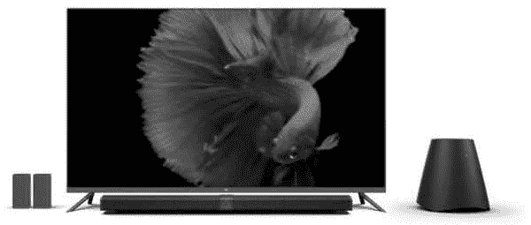

Figure 2-25

## Smart Speaker

Smart speaker is an upgraded product of the speaker, a tool for home consumers to access the internet via voice. Representative products of smart speakers include Amazon Echo, Tmall Genie, Xiaomi AI Speaker, etc. Users can order songs, shop online, check weather forecasts through smart speakers, and can also control smart home devices through smart speakers, such as controlling rice cookers, TVs, light bulb brightness, refrigerator temperature, and water heater temperature.

Since its release in 2014, Amazon Echo has become one of the hottest smart home products in the overseas market. Users can use voice to control home appliances, purchase goods, and consult questions through Amazon Echo. According to survey data from research institution eMarketer, about 36 million users in the US use voice-controlled speakers at least once a month.

The development of smart speakers in China has been very rapid. In 2017, the concept of smart speakers had not yet been mentioned in China, but in the subsequent short year, the Chinese smart speaker market suddenly took off, giving birth to smart speaker products with shipments exceeding one million units in just one year. In recent years, the four most popular smart speaker products on the market are Tmall Genie, Xiaobao AI Speaker, Xiaomi AI Speaker, and Xiaodu, as shown in Figure 2-26.


Figure 2-26

## Smart Air Conditioner

Smart air conditioner is an air conditioner that adds artificial intelligence technology elements on the basis of ordinary air conditioners. The smart air conditioning system can collect indoor temperature, humidity, air cleanliness, and other information through various sensors according to external climate conditions and pre-set indicators, analyze and judge, and automatically activate relevant functions such as cooling, heating, dehumidification, and air purification according to pre-set indicators. In addition, smart air conditioners have added many user-friendly functions, such as voice recognition, mobile app remote control, and memory of usage habits.

In recent years, many home appliance manufacturers and internet manufacturers have set their sights on the field of smart air conditioners, and even some middle-class families in Europe and America have regarded smart air conditioners as standard household products. Currently, the development level of smart air conditioners in China still lags behind developed countries, and the penetration rate is far lower than that of developed countries. But from the domestic market perspective, the demand for smart air conditioners is still relatively large.

Future smart air conditioners will mainly focus on two aspects: one is the degree of product intelligence. Current smart air conditioners still rely on third-party operations, such as mobile phones, tablets, etc. Over-reliance on third-party operations greatly reduces their usability; future smart air conditioners themselves will inevitably have stronger intelligent functions. The second is perception ability. Future smart air conditioners should not be limited to air and temperature perception but should strengthen human body perception. For example, the air conditioner needs to automatically sense the presence, position, and number of people, and achieve the best adaptation between the environment and people through the machine's own calculation.

## Smart Bulb

Smart bulb is a lighting device that uses Internet of Things technology to connect the bulb to the network, realizing energy-saving, artistic, and user-friendly lighting. In the future, smart bulbs will inevitably become the dominant force in home lighting culture. Through smart bulbs, users can set their favorite scenes and lighting effects according to their own lighting needs (such as color, temperature, brightness, and direction, etc.). In addition, smart bulbs can also be controlled via mobile phones to create different indoor smart lighting effects. Through smart bulbs, people can also select and control the brightness, grayscale, and color of lights in different spaces and times according to different scenes and atmospheres, simulating various lighting environments to guide and improve mood, obtaining a user-friendly lighting environment, as shown in Figure 2-27.


Figure 2-27

Smart bulbs generally use LED cold light sources and belong to energy-saving bulbs. Compared with ordinary incandescent lamps and fluorescent lamps, the power saving efficiency of smart bulbs can reach over 90%, with considerable energy-saving benefits. Smart bulbs are applied in scenarios such as bedrooms, living rooms, kitchens, offices, conference rooms, computer rooms, internet cafes, basements, schools, etc.

Smart bulbs are generally embedded with IoT communication modules, which can connect smart bulbs to the internet. Users can control smart bulbs via the internet at any time, so they can know the working status of smart bulbs at home at any time and any place, including indicators such as light color, light brightness, and bulb power consumption. In addition, users can also remotely adjust smart bulbs according to their own needs. If multiple smart bulbs are installed at home, users can also realize bulb networking to facilitate the control of special lighting needs according to indoor scenes.

# Intelligent Medical Products

AI + Medical, the combination of the two has a positive effect on both human health and social development. The combination of AI and medical care has two directions: precision medicine and medical assistants.

Chinese hospitals and doctors have accumulated a large amount of medical data in clinical processes, and these data will play a positive role in the future combination of AI and the medical industry. Using the data obtained from experts' actual clinical practice as training and verification data for AI can greatly improve the application efficiency of AI in the diagnosis process.

## Medical Image Diagnosis

Airdoc is an AI company specializing in the medical industry. Its business mainly includes three aspects: assisted decision-making analysis, medical image analysis, and health big data mining, as shown in Figure 2-28. Airdoc provides clinical decision support, acting as the doctor's "stethoscope" and "database." It uses deep learning technology to train based on tens of millions of medical image data, providing real-time analysis services, and analyzes potential data patterns by mining massive medical information.


Figure 2-28

Through the accumulation of AI algorithms, combined with big data provided by the industry, Airdoc has built analysis systems covering medical images of eyes, skin, brain, cardiovascular, lungs, liver, bones, breasts, and cervix.

## Tumor Diagnosis

With the development of AI, IBM Watson developed AI medical service application software focusing on tumor diagnosis, achieving breakthroughs in nine major medical fields including chronic disease management, precision medicine, and in vitro diagnostics. IBM Watson also achieved commercial operation through cooperation with Memorial Sloan Kettering Cancer Center, jointly training the tumor solution—Watson for Oncology.

IBM Watson can provide consultation services for various cancers such as lung cancer, breast cancer, rectal cancer, colon cancer, gastric cancer, and cervical cancer. After information such as cancer type, patient age, gender, weight, disease characteristics, and treatment situation is input, IBM Watson can quickly feedback multiple treatment suggestions.

## Caregiving Robots

In 2016, Rice University showcased an AI-based caregiving robot. This multi-purpose elderly care robot is named MERA, mainly used to help the elderly and their caregivers. The prototype design of MERA was jointly completed by teachers and students from Rice University's Department of Electrical and Computer Engineering and Department of Psychology. It has three main functions: measuring a person's vital signs using innovative methods, such as heart rate, heart rate variability, and respiratory rate; answering basic health-related questions; and determining whether an elderly person has fallen by reading data.

# Products Applied in Industrial Manufacturing

Compared with traditional manpower, the advantage of industrial robots is cost. Compared with the usage cost of mature welders, calculating the depreciation of industrial robots over a 10-year service life (including maintenance costs), under the same benefits, the usage cost of industrial robots is lower.

In terms of precision and standardization, robots can accomplish many things that humans cannot. In addition, dangerous or hazardous work can also be replaced by robots instead of manual labor. Compared with humans, the advantages of robots in the manufacturing field are very obvious. Using robots on the one hand improves the competitiveness of enterprises, and on the other hand provides growth space for enterprise profits. The author believes that more manufacturing enterprises will transform towards intelligent manufacturing in the future. Figure 2-29 shows a Keyence industrial robot.


Figure 2-29

China is the world's largest industrial robot market, with annual sales growth of industrial robots in China exceeding 30%. It is estimated that by 2020, the sales volume of industrial robots in China will exceed 210,000 units. It is the vast market demand that has attracted numerous corporate giants to layout in the industrial manufacturing field.

Improving the level of automated production by replacing human actions with robots is mainly based on three reasons: ① Increase in labor costs; ② Gradual narrowing of profit margins; ③ Guidance from national development strategies.

For a long time, China's labor costs have been generally low, but in recent years, with the rapid rise in labor costs, more and more young people are unwilling to engage in boring production line work, exacerbating the labor shortage and forcing manufacturing enterprises to transform towards automation. In addition, with the intensification of social aging, labor shortages will further push up labor costs. For the manufacturing industry, which already has thin profits, using more advantageous robots to cut costs is the only choice. It can be said that "replacing humans with machines" is not only the general trend but also the key to the future development of China's manufacturing industry. Currently, many enterprises in China have carried out R&D work on AI products in the industrial manufacturing field.

Alibaba Cloud ET Industrial Brain is the first AI to go down to the workshop floor. The cooperation between photovoltaic material manufacturer GCL-Poly and Alibaba Cloud is an innovation demonstration in China's industrial manufacturing field. The first thing Alibaba Cloud did in the manufacturer's workshop was to upload data from all ports on the production line to Alibaba Cloud, then mobilize the computing power of thousands of servers to find 60 variables affecting the yield rate from thousands of variables in a short time, and then have AI monitor and control these variables in real-time; the production line only needs to "follow orders."

Siemens demonstrated a dual-arm robot in Munich. This robot, with the help of highly automated AI, can autonomously divide labor and cooperate without programming, for product manufacturing. Traditional robots cannot understand such CAD/CAM (Computer-Aided Design and Manufacturing) models, but the new robots can. In a sense, this is like robots being able to understand different languages, thus not requiring programming for their movements and processes.


General Electric (GE) announced multi-year agreements with numerous electrical companies and an agreement with the New York Power Authority (NYPA), committing to becoming the world's first fully digital power company. Today, GE's Integrated Intelligent Operations Center, powered by predictive analytics software, is open; this center is a technology-leading asset monitoring and diagnostics center. Among these efforts, GE and Enel (the Italian National Electricity Company) deployed and optimized GE's Asset Performance Management (APM) software, which runs on GE's Industrial Internet of Things (IIoT) platform `Predix`, to monitor, predict, and improve the reliability of 13 gas-fired power plants and 1 coal-fired power plant. These 14 power plants all use GE or Alstom turbines and generators. `EXr6287u6NNVz+GYLY+7SC6AgGofrpiId/XnwIEoGMEPq3TPzkM5RyXBRbuLcLFjwnCuEHVXaQsGpygWHLFy9g==`

## 2.5 Typical AI Products

### 2.5.1 Wearable Devices

Wearable devices are currently popular products in the technology industry, ranging from Google Glass to the Xiaomi Mi Band and the Apple Watch; major industry vendors mostly have their own wearable devices. These vendors apply their proprietary data acquisition and algorithm technologies to wearable devices to provide exclusive, personalized services for individuals. The most critical core technology of wearable devices is Artificial Intelligence.

Smart wearable devices first appeared in the 1980s, but due to the low level of AI technology at the time, they failed to make a significant impact. It was not until the 21st century, with the development of AI technology, that smart wearable devices achieved substantial progress.

2012 was dubbed the "Year of Smart Wearable Devices." This year saw the debut of Google Glass, as shown in Figure 2-18. Google Glass possessed almost the same functions as a smartphone. Users could not only control photo-taking via voice with Google Glass but also make video calls, browse the internet, and process messages and emails.


Figure 2-18

After the launch of Google Glass, although its usage scenarios required deeper exploration, smart wearable devices have always been considered products that perfectly combine design and technology. More and more companies began to enter the smart wearable market.

Currently, smart wearable devices on the market include smart glasses, smart watches, smart bands, smart helmets, smart rings, smart necklaces, smart clothing, and more. These products all take "miniaturization" and "convenience" as their main selling points, becoming a new selling point in consumer electronics. Although current wearable device products come in many varieties and new styles, and competition among vendors is fierce, wearable devices are still in the early stages of development. The reason is that current products, which rely on "miniaturization" and "convenience" as their main selling points, have not solved the core problem of smart wearable devices. How to achieve true "intelligence" through wearable devices is the core issue.

Upon careful study of the aforementioned smart wearable devices, we can find that most of these products simply integrate a "smartphone" onto the human body in a specific way, such as bands with heart rate monitoring, watches that can answer calls, or smart running shoes that measure cadence. Although these products claim to be smart wearable devices, the author refers to them as **"Pseudo-AI devices,"** meaning they are not truly smart wearable devices. The key to measuring whether a product is intelligent lies in whether these products possess the capabilities of **information collection, assisted judgment, and assisted processing**.

Current wearable devices lack sufficient intelligence maturity, and product value does not fully meet people's intelligent needs. This is also why, despite the booming market for smart wearable devices, no product has achieved universal popularity like the PC or smartphone. How to enable smart wearable devices to achieve behavioral and judgment capabilities through technologies like deep learning after acquiring personal data via acquisition technology is the core problem.

#### 2.5.1.1 Core Technologies of Smart Wearable Devices

**Hardware**: Since they are wearable devices, hardware devices are needed as carriers. Currently, the core hardware problem restricting the development of wearable devices is the battery. Battery life directly affects the user experience. If battery life is insufficient, users need to charge frequently, greatly reducing the product's usability. The current solution to the battery problem is balancing performance, i.e., finding a balance between performance and power consumption.

**User Experience**: The user experience of smart wearable devices is the most core factor in a user's decision to purchase the product. The user experience design of smart wearable devices should start from two aspects: design interaction and operational interaction. Design interaction determines whether the product is successful. Product industrial designers and developers can only design a successful product by fully integrating the user-centered design concept with the product. Operational interaction mainly targets the design of the link between humans and devices when users use the product. Human-device interaction is inseparable from methods such as behavioral operation, touch control, voice control, or brainwave control. The design of operational interaction should fully consider the hardware device's interaction sensitivity, size, material, interaction accuracy, and misoperation rate.

**Data Processing**: The value of smart wearable device products is often reflected in the data they acquire and their ability to process that data. Since the data acquired by smart wearable devices is discrete, the core value point of smart wearable devices lies in finding correlations between data through intelligent algorithms and providing analyzed data and solutions to users in the form of professional services.

#### 2.5.1.2 Types of Smart Wearable Devices

##### Smart Glasses

Typically, smart glasses use eyeglasses as a carrier, integrate an independent operating system, and provide application software for users. Users can perform operations such as querying, reading, navigation, interaction, shooting, and calling through gestures, voice, and other methods. Due to their concise design, strong sense of technology, and relative lightness, smart glasses have formed a very large industry. Currently, various types of smart glasses can be found on the market, as shown in Figure 2-19.


Figure 2-19

##### Smart Headphones

With the continuous development of smart technology, there are more and more smart headphone products on the market. New smart headphones not only have audio output functions but also built-in intelligent systems and various sensors. They connect to terminal devices such as smartphones via Bluetooth and other transmission methods to achieve peripheral function expansion, such as smart sports headphones, smart heart rate headphones, and smart ECG headphones. Smart headphones can also wirelessly transmit data via Bluetooth technology and have functions such as answering calls and remote camera control. Figure 2-20 shows a voice smart headphone `Mobius` jointly launched by iFlytek and Migu.


Figure 2-20

##### Smart Watches

Smart watches generally implement most smartphone functions by integrating a display screen, camera, microphone, and customized intelligent system, such as calls, text messages, emails, photography, music, internet access, and the use of various application software. The representative product of smart watches is Apple's `Apple Watch`, as shown in Figure 2-21. The `Apple Watch` can connect with various Apple devices. In addition, many application software have been customized for the `Apple Watch`, such as WeChat, Weibo, Alipay, Meipai, Ctrip, and other apps that can be used on the `Apple Watch`. To better adapt to the `Apple Watch` display, these apps have been simplified accordingly. For example, the Alipay wallet retains only three functions: Yu'e Bao, payment code, and currency conversion.


Figure 2-21

##### Smart Clothing

With the development of AI technology, the clothing industry has also sensed business opportunities and launched smart clothing one after another. Levi's once launched a music jacket. Users could not only listen to music through this jacket but also store their favorite music. This music jacket was developed by the Massachusetts Institute of Technology (MIT). Its fabric uses silk transparent stiff gauze, and the music playback function is controlled by an all-fabric capacitive keyboard. When users want to play music, they just need to press lightly. To ensure the usability of the music jacket, it requires no charging; its energy source relies mainly on solar power.

In addition to the music jacket developed by MIT, the Georgia Institute of Technology once developed a garment capable of monitoring heart rate and blood pressure. Researchers at Georgia Tech embedded information transmission into the clothing fabric and detected human heartbeat and breathing frequency through the clothing fibers. Currently, companies are utilizing this technology for mass production, producing multiple garments capable of measuring vital signs such as heart rate and blood pressure.

At the 2016 CES, Samsung proposed the brand-new concept of "`Smart Suit`." The `Smart Suit` smart clothing can not only realize real-time monitoring and analysis of body data such as heart rate, step count, and body fat, and collect user daily habits, but also detect what type of exercise the user is performing. It can also pair with application software to provide users with reasonable suggestions, as shown in Figure 2-22.


Figure 2-22

##### Smart Running Shoes

Smart running shoes implant intelligent sensors inside the shoe to obtain body data from the human foot, then transmit the information to a smartphone via Bluetooth and other means, providing more services through the smartphone. Because smart running shoes are closer to the human body, the data they acquire is more accurate than that from devices like smart bands.

Figure 2-23 shows the data display of Li-Ning smart running shoes. It provides users with basic information such as running distance, route, time, pace, forefoot/rearfoot strike ratio, and also provides cadence curves, plantar pressure, leg lift height, and other information, thereby helping users improve their running posture.


Figure 2-23

##### Implantable Devices

Recently, the MIT Media Lab collaborated with Harvard Medical School to jointly develop a project named `Dermal Abyss`. `Dermal Abyss` is a tattoo ink that can monitor human body conditions, as shown in Figure 2-24. It can directly reflect chemical changes in the human body. In fact, `Dermal Abyss` is a new type of implantable wearable device.


Figure 2-24

`Dermal Abyss` can directly reflect chemical changes in the human body. Its varying color depths correspond to the levels of different chemical elements in the body, thereby reflecting the status of various body indicators in real-time.

In addition, to give humans a magical "sixth sense," the `Cyborg Nest` lab developed a miniature Bluetooth device called `North Sense`. Users only need to implant it into their bodies, and it will vibrate when facing north. Moreover, users can obtain as much sensory extension as possible through this implantable device. The person in charge of developing this product pointed out that AI products should only function properly when they become part of the user's body; otherwise, they will forever remain just a tool, unable to inspire the body's intuitive feelings.

### 2.5.2 Smart Home

The concept of the smart home originated early, but it was not realized until 1984, when the United Technologies Corporation (UTC) carried out an informatization transformation of a building through a building and industrial systems product. The company integrated various devices and home appliances within the building through central control equipment to establish a smart home, and built the world's first "Intelligent Building" in Connecticut, USA, unveiling the prologue to smart homes worldwide. With the popularization of the smart home concept, developed countries and regions around the world have proposed various smart home solutions, and many home appliance manufacturers and internet companies have begun to explore the smart home field. Currently, both domestic and international smart home markets show a trend of rapid development.

Currently, the R&D of smart home systems in the US and Europe has always been in a leading position. For example, companies such as Deutsche Telekom, Verizon, and Google have launched their own smart home products and established central device interfaces for smart homes to integrate various services. Domestic smart home development started later than abroad, but the current momentum is explosive. Chinese internet companies have entered the home furnishing industry one after another, developing a series of smart home devices such as smart TVs, smart speakers, smart air conditioners, and smart light bulbs.

#### 2.5.2.1 Smart TV

A Smart TV is a television product that integrates various open operating systems and chips into the TV through internet application technology. Smart TVs generally have open application platforms, enabling bidirectional human-computer interaction, and integrate audio/video, entertainment, data, and other functions to meet users' customized, diversified, and personalized needs.

Because Smart TVs have open platforms and are equipped with operating systems, users can not only watch TV content but also install various application software, expanding the TV's application scenarios. It is precisely because of the scalability and richness of Smart TVs that they have currently become mainstream TV products. Manufacturers developing Smart TVs include both internet companies and traditional home appliance manufacturers, such as Xiaomi, LeEco, Changhong, Haier, and TCL.

Xiaomi was one of the earlier companies to launch Smart TVs. The Xiaomi Smart TV, as shown in Figure 2-25, was officially released on September 5, 2013. This was the first time an internet company entered the traditional home appliance industry. To seize the market first, Xiaomi regarded "Mi Fans" as the primary target customer group and defined the Smart TV as the **"Young People's First TV."** Young people are the group most receptive to new things, and Smart TVs can better stimulate their purchasing interest. Clear target audiences and excellent fan culture enabled the Xiaomi Smart TV to strongly impact the traditional TV market.


Figure 2-25

#### 2.5.2.2 Smart Speaker

A Smart Speaker is an upgraded product of the speaker, serving as a tool for home consumers to access the internet via voice. Representative Smart Speaker products include Amazon `Echo`, Tmall Genie, and Xiaomi AI Speaker. Through Smart Speakers, users can play songs on demand, shop online, check weather forecasts, and control smart home devices, such as controlling rice cookers, TVs, light bulb brightness, refrigerator temperatures, and water heater temperatures.

Since its release in 2014, Amazon `Echo` has become one of the hottest smart home products in the international market. Users can use voice to control home appliances, purchase goods, and consult questions via Amazon `Echo`. According to survey data from research firm `eMarketer`, approximately 36 million users in the US use voice-controlled speakers at least once a month.

The development of Smart Speakers in China has been extremely rapid. In 2017, the concept of Smart Speakers had not yet been mentioned in China, but in the short span of a year, the Chinese Smart Speaker market suddenly took off, giving birth to Smart Speaker products with shipments exceeding one million units in just one year. In recent years, the four hottest Smart Speaker products on the market are Tmall Genie, Xiaobao AI Speaker, Xiaomi AI Speaker, and Xiaodu, as shown in Figure 2-26.


Figure 2-26

#### 2.5.2.3 Smart Air Conditioner

A Smart Air Conditioner is an air conditioner that incorporates AI technology elements on the basis of a conventional air conditioner. The Smart Air Conditioner system can analyze and judge information such as indoor temperature, humidity, and air cleanliness collected by various sensors according to preset indicators based on external climate conditions, and automatically activate relevant functions such as cooling, heating, dehumidification, and air purification according to preset indicators. In addition, Smart Air Conditioners have added many user-friendly functions, such as voice recognition, mobile app remote control, and memory of usage habits.

In recent years, many home appliance manufacturers and internet vendors have set their sights on the Smart Air Conditioner field. Even some middle-class families in Europe and America have regarded Smart Air Conditioners as household standard products. Currently, China's Smart Air Conditioner development level still lags behind developed countries, and the penetration rate is far lower than that of developed countries. However, from the domestic market perspective, the demand for Smart Air Conditioners is still relatively large.

Future Smart Air Conditioners will mainly focus on two aspects: one is the degree of product intelligence. Current Smart Air Conditioners still rely on third-party operations, such as mobile phones and tablets. Over-reliance on third-party operations greatly reduces their usability. Future Smart Air Conditioners themselves will inevitably possess stronger intelligent functions. The second is perception capability. Future Smart Air Conditioners should not be limited to air and temperature perception but should enhance human body perception. For example, the air conditioner needs to automatically sense human presence, location, and quantity, and achieve optimal adaptation between the environment and people through the machine's own calculations.

#### 2.5.2.4 Smart Light Bulb

A Smart Light Bulb is a lighting device that uses IoT technology to connect the bulb to the network, achieving energy-saving, artistic, and humanized lighting. Smart Light Bulbs will undoubtedly become the dominant force in home lighting culture in the future. Through Smart Light Bulbs, users can set their favorite scenes and lighting effects according to their own lighting needs (such as color, temperature, brightness, and direction). In addition, Smart Light Bulbs can be controlled via mobile phones to create different indoor smart lighting effects. Through Smart Light Bulbs, people can also select and control light brightness, grayscale, and color in different spaces and times according to different scenes and atmospheres, simulating various lighting environments to guide and improve moods, obtaining a humanized lighting environment, as shown in Figure 2-27.


Figure 2-27

Smart Light Bulbs generally use LED cold light sources and belong to energy-saving bulbs. Compared with ordinary incandescent and fluorescent lamps, the power-saving efficiency of Smart Light Bulbs can reach over 90%, with considerable energy-saving benefits. Smart Light Bulbs are applied in scenarios such as bedrooms, living rooms, kitchens, offices, conference rooms, computer rooms, internet cafes, basements, and schools.

Smart Light Bulbs generally embed IoT communication modules, allowing the bulbs to connect to the internet. Users can control Smart Light Bulbs via the internet at any time, thereby knowing the working status of home Smart Light Bulbs at any time and any place, including indicators such as light color, brightness, and bulb power consumption. In addition, users can remotely adjust Smart Light Bulbs according to their needs. If multiple Smart Light Bulbs are installed at home, users can also achieve bulb networking to facilitate control of special lighting needs according to indoor scenes.

### 2.5.3 Smart Medical Products

AI + Healthcare, the combination of the two has a positive effect on both human health and social development. There are two directions for the combination of AI and healthcare: Precision Medicine and Medical Assistants.

Chinese hospitals and doctors have accumulated a large amount of medical data during clinical processes, and this data will play a positive role in the future combination of AI and the medical industry. Using data obtained from experts' actual clinical practice as training and validation data for AI can greatly improve the application efficiency of AI in the diagnostic process.

#### 2.5.3.1 Medical Image Diagnosis

`Airdoc` is an AI company specializing in the medical industry. Its business mainly includes three aspects: assisted decision analysis, medical image analysis, and health big data mining, as shown in Figure 2-28. `Airdoc` provides clinical decision support, acting as the doctor's "stethoscope" and "reference library." It utilizes deep learning technology, trained on tens of millions of medical image data, to provide real-time analysis services, and analyzes potential data patterns by mining massive medical information.


Figure 2-28

`Airdoc` (referred to as `Aridoc` in the original text, corrected here) has built analysis systems covering medical images of eyes, skin, brain, cardiovascular, lungs, liver, bones, breasts, and cervix through the accumulation of AI algorithms combined with big data provided by the industry.

#### 2.5.3.2 Tumor Diagnosis

With the development of AI, `IBM Watson` developed AI medical service application software focused on tumor diagnosis, achieving breakthroughs in nine major medical fields including chronic disease management, precision medicine, and in vitro diagnostics. `IBM Watson` also achieved commercial operation through cooperation with the Memorial Sloan Kettering Cancer Center, jointly training the tumor solution—`Watson for Oncology`.

`IBM Watson` can provide consultation services for various cancers such as lung cancer, breast cancer, rectal cancer, colon cancer, gastric cancer, and cervical cancer. After information such as cancer type, patient age, gender, weight, disease characteristics, and treatment status is input, `IBM Watson` can quickly feedback multiple treatment recommendations.

#### 2.5.3.3 Caregiving Robots

In 2016, Rice University showcased an AI-based caregiving robot. This multi-purpose elderly care robot is named `MERA`, primarily used to assist the elderly and their caregivers. The prototype design of `MERA` was completed jointly by faculty and students from Rice University's Department of Electrical and Computer Engineering and Department of Psychology. It has three main functions: measuring a person's vital signs using innovative methods, such as heart rate, heart rate variability, and respiratory rate; answering basic health-related questions; and determining whether an elderly person has fallen by reading data.

### 2.5.4 Products Applied in Industrial Manufacturing

Compared with traditional manpower, the advantage of industrial robots is cost. Compared with the usage cost of mature welders, industrial robots, depreciated over a 10-year service life (including maintenance costs), have a lower usage cost under the same benefits.

In terms of precision and standardization, robots can accomplish many things beyond human capability. In addition, dangerous or hazardous work can also be replaced by robots instead of manual labor. Compared to humans, the advantages of robots in the manufacturing field are very obvious. Using robots on one hand enhances corporate competitiveness, and on the other hand provides growth space for corporate profits. The author believes that more manufacturing enterprises will transform towards intelligent manufacturing in the future. Figure 2-29 shows a Keyence industrial robot.


Figure 2-29

China is the world's largest industrial robot market. Industrial robot sales in China grow at a rate exceeding 30% annually. It is estimated that by 2020, industrial robot sales in China will exceed 210,000 units. It is this vast market demand that has attracted numerous corporate giants to strategically deploy in the industrial manufacturing field.


## 2.6 Chapter Summary

This chapter introduces artificial intelligence products from various periods. In addition, the author reveals the characteristics and differences between AI products and Internet products from a product manager's perspective. Finally, the author introduces some currently popular AI products. `EXr6287u6NNVz+GYLY+7SC6AgGofrpiId/XnwIEoGMEPq3TPzkM5RyXBRbuLcLFjwnCuEHVXaQsGpygWHLFy9g==`


# Chapter 3 AI Product Manager

- 3.1 Challenges Faced by Product Managers in the AI Era
- 3.2 Career Progression and Learning Path for Product Managers
- 3.3 Product Analysis Models
- 3.4 Chapter Summary

With the development of artificial intelligence, more and more Internet product managers are eager to understand AI products, and even want to transition into AI product managers. As product planners and designers in the Internet era, product managers have accumulated a wealth of Internet product design experience, but Internet products and AI products are not the same. Many Internet product managers find during the process of learning AI knowledge that their original professional knowledge system is difficult to apply to AI product work. This chapter will introduce the main content related to AI product managers. `EXr6287u6NNVz+GYLY+7SC6AgGofrpiId/XnwIEoGMEPq3TPzkM5RyXBRbuLcLFjwnCuEHVXaQsGpygWHLFy9g==`

## 3.1 Challenges Faced by Product Managers in the AI Era

Many Internet product managers are eager to understand AI products and intend to transition into AI product managers. However, when they try to understand the AI industry, they find that the AI knowledge system is extremely vast, making them feel at a loss as to where to start. They often ask the following questions: There is too much AI knowledge content; how should I start learning? As an AI product manager, to what extent must I learn AI technology? As an AI product manager, do I need to learn mathematics and `Python`? As an AI product manager, do I need to master machine learning frameworks like `TensorFlow`?

The probable reasons why many people have such questions are as follows.

1.  **The AI knowledge system is huge.** AI involves a vast amount of content; merely the technical key points involved in some AI product promotional materials can make people unfamiliar with AI technology feel that its knowledge system is huge. Many products claim in their promotion to have utilized a series of knowledge content such as `Machine Learning`, `Deep Learning`, `Neural Networks`, `Supervised Learning`, `Unsupervised Learning`, `Transfer Learning`, `Computer Vision`, `CNN`, `DNN`, `RNN`, `GNN`, `NLP`, `Python`, `TensorFlow`, `Caffe`, `Theano`, `Torch`, etc. But what are these contents? How are these knowledge systems related? These are all content that product managers need to understand and learn. It is precisely because the AI knowledge system is overly complex that it easily causes confusion for many beginners.
2.  **The AI era is still in its early stages.** Although AI is very popular in the tech community, from the perspective of era development, AI currently still belongs to the early stage of theory and engineering. Although the effects produced by AI are already amazing and it can do many things, such as effectively recognizing faces, writing poems, writing news, etc., the author believes that compared to humans, AI still has huge room for improvement. Because the amount of data used for AI training is still far from enough. For example, by the age of 10, a human's mind and cognitive system have initially formed, allowing them to completely independently perceive the world. Assuming the human eye can capture and form 5 images per second, then by the time a human grows to age 10, excluding time spent blinking and sleeping, over 1 billion images have been trained and learned through the human neural network. Moreover, the frames captured by the human eye per second far exceed 5. Therefore, human cognition is almost formed through the accumulation of an infinite amount of data. However, current AI products use training samples just exceeding 1 million. So, in terms of data acquisition volume, the gap between AI and humans still exists. In a situation where basic AI components have not yet formed complete encapsulation and the training data volume required by AI is far from enough, product managers need to understand technical details to balance the fit between the technology used in the product design process and the scenario. Otherwise, without understanding technology, everything is just empty talk.
3.  **The market lacks accurate position definitions.** Different companies have different requirements for AI product managers. Some companies require product managers to be proficient in `Python`, have a deep understanding of neural networks, `CNN`, `RNN`, master `TensorFlow`, treating AI product managers as algorithm engineers; some companies require AI product managers to have a deep understanding of the industry and good communication skills, treating AI product managers as pre-sales consultants; some companies treat AI product managers as data analysts. It is precisely because the market has no accurate positioning for AI product managers that people just starting as AI product managers feel lost and don't know where to start learning.
4.  **Product managers have misunderstandings about their work.** Internet-era products mainly aim to break information asymmetry. Product managers work around how to transmit information more effectively. Therefore, many product managers focus more on product interfaces, interactions, and scenarios during product design. When AI products appeared, they found that interaction interfaces were becoming fewer and fewer, and some AI products even had no interaction interfaces, resulting in confusion: How should product managers design AI products?
5.  **Product managers have cognitive misunderstandings about technology.** Product managers believe that they do not need to understand too many technical details; technology is completed by engineers. Regarding this point, the author believes that product managers in the current era need to understand some AI technical implementations. When a new technology era arrives, its development process follows three stages: theoretical research period, technology development period, and industry application period. Generally speaking, when a new technology era fully arrives, the first stage must be that basic theories have basically formed and philosophical ideas have matured; the second stage is breakthrough technological progress built upon these basic theories and philosophical ideas; the third stage is that with technological progress, more and more technologies are verified in different industries and scenarios, gradually penetrating people's daily lives.

Just like the steam engine era, the world's first steam engine was the aeolipile invented by the Greek mathematician Hero in the 1st century AD, but at that time it was just a toy. It was not until around 1679 that the French physicist Papin manufactured the first working model of a steam engine.

1765—1790, Watt applied scientific theory to a series of inventions, such as the separate condenser, insulated cylinder jacket, piston lubrication with oil, planetary gear, parallel motion linkage, centrifugal governor, throttle valve, pressure gauge, etc. These new inventions increased the efficiency of the steam engine to more than 3 times the original, finally forming the modern steam engine. Watt's creative work enabled the rapid development of the steam engine, turning a machine that could only pump water into a universally applicable steam engine, doubling the thermal efficiency of the steam engine and greatly reducing coal consumption.

In the late 18th century, steam engines were not only widely used in the mining industry but also rapidly promoted in smelting, textile, machine manufacturing, and other industries. It increased British textile production by 5 times in just over 20 years, providing a large amount of consumer goods to the market, accelerating capital accumulation, and putting forward higher requirements for the transportation industry.

The development process of the AI era is similar to that of the steam engine era. The 1956 Dartmouth Conference marked the birth of AI theory. In the following 30-40 years, a series of algorithmic basic theories such as artificial neural networks were produced. People gradually sought engineering breakthroughs based on these basic theories. The author calls this the budding stage of AI. In the budding stage, to enter the AI industry, one had to deeply research AI theoretical knowledge. However, the application of business knowledge in the AI industry occupied only a very small part, as shown in Figure 3-1.


**Figure 3-1**

With the gradual development of AI theory, particularly the vigorous development of the Internet, big data gradually formed, and cloud computing also achieved great development. This laid the engineering foundation for the arrival of the AI era. Similarly, the gradual maturity of technology makes the technology core more and more concentrated, and the application of technology simpler and more open. The author believes that this change in technology maturity is a gradual and continuous process. The duration of technology transformation in different eras is inversely proportional to the overall knowledge development level of the whole society. The more powerful the technology, the longer its decline time and the higher its encapsulation degree. As shown in Figure 3-2, in the future 5-10 years, the AI industry will gradually shift from technology-driven to jointly driven by technology and business knowledge.


**Figure 3-2**

With the development of the overall level of human technology, the development of various business systems themselves will lead the development of the entire era. Similarly, in the future 10-20 years, specific AI technologies will be encapsulated into modules that can be directly called in different industries, businesses, needs, and scenarios. Business knowledge will also become the dominant factor, as shown in Figure 3-3.


**Figure 3-3**

The author believes that for product managers from other industries or readers from non-technical backgrounds, if they want to engage in the AI industry within 1-2 years, it is recommended to touch more technical-level content, because it is currently still a technology-driven AI period. If they want to engage in the AI industry within 5-10 years, the theoretical and technical industrial structures have basically formed, and a large number of AI engineers will come to complete technical encapsulation for them. The level of technical understanding required of AI product managers by the industry will decrease. If they enter the AI industry 10-20 years later, because technical barriers no longer exist, or many companies have completed technical encapsulation, technology is just a tool. It is sufficient for the technical content to just be "known," because by then the business-driven AI era has been entered. `EXr6287u6NNVz+GYLY+7SC6AgGofrpiId/XnwIEoGMEPq3TPzkM5RyXBRbuLcLFjwnCuEHVXaQsGpygWHLFy9g==`

## 3.2 Career Progression and Learning Path for Product Managers

Faced with the complex AI knowledge system, the author believes that Internet product managers should learn and improve their AI cognition from three levels.

### Elevate Cognitive Level

Product managers, as "CEO reserves" of the industry, are pinned with high hopes. However, many product managers often fall into specific product design and schedule execution processes during work. Once this happens, over-focusing on the design process and schedule execution status will cause them to deviate from the initial goal. The author believes that when designing AI products, product managers should learn to set their sights further, and learn to deeply understand the market, needs, customers, competitors, and sales.

The author divides product managers into four levels internally. Product managers at different levels have different focuses and key assessment points.

- **Level 1: Execution-oriented Product Manager.** Focuses on product functional features and can independently create a single functional module. Key assessment points are the product manager's basic qualities—prototyping, business logic relationships, user experience elements, aesthetic ability, and architectural rationality.
- **Level 2: Management-oriented Product Manager.** Focuses on business systems, team collaboration, and product growth, and can independently establish product business logic and planning. Key assessment points are the product manager's management qualities—product planning, overall product business logic relationships, team communication and coordination, market and operations cooperation.
- **Level 3: Market-oriented Product Manager.** Focuses on product market construction and operations construction, can design and adjust products according to market conditions combined with the product, and design reasonable market construction systems and operations systems for the product. Key assessment points are the product manager's market qualities—product market control ability, product operations control ability, big-picture perspective, and long-term orientation.
- **Level 4: Creative Product Manager.** Can judge direction and predict future market changes based on current market conditions, creating epoch-making products. There are relatively few product managers at this level. Generally, if a product manager can reach Level 3 and plan and design products according to the market, they are already considered a top-tier product manager.

A product manager's actual work should start from Level 1, progressing step by step, starting small and growing gradually. Only with accumulation can one reach a higher realm. The author has seen many senior managers transfer into product departments, directly becoming Level 3 or even Level 4 product managers. However, these senior managers lack basic product manager skills and foundational accumulation. They mostly instill their original management experience and judgment abilities into the product, which easily leads to product failure due to overambition.

However, if a product manager wants to deeply understand the essence of the product, in terms of thinking level, the higher they stand, the better. Standing high allows one to see far; seeing far determines whether one can go far. If a product manager only views AI from the dimension of what interactions AI can achieve, they will find that most of these interactions are non-interface-based and are easily scared off by the complex knowledge system. But if a product manager can view AI from a higher dimension, they will find it very easy to get started.

In summary, product managers should start their learning from the following four levels.

1.  **What is the value direction of AI products?** That is, why do AI products appear, and what value do they bring to society? AI products appear to solve the insufficiency of human productivity, serving as substitutes and extensions of the human body. From this, the design direction of AI products can be known.
    Every new era brings a series of reforms, and every reform inevitably causes varying degrees of subversion in the industry. Advanced productivity will gradually replace backward productivity. The AI era is no exception. The fundamental core of the AI era is "replacement of productivity." Every field where AI intervenes should take "whether productivity replacement has occurred" as the fundamental assessment criterion.
    From the perspective of "replacement of productivity," the intelligence level of current AI products has not yet reached the state of human skills. However, it cannot be denied that the intelligence level of AI will inevitably become higher and higher in the future. As the intelligence level increases, certain jobs will definitely be replaced; the arrival of this moment is only a matter of time. Human jobs can be roughly divided into the following categories.
    - **Manual Labor:** Mainly refers to work that can be completed by human physical labor in a specific field and scope. These jobs target limited work scenarios. Manual labor personnel can complete corresponding work after training, and these jobs will inevitably be replaced by AI in the future.
    - **Technical Work:** Mainly refers to positions that require the use of a specific professional technology to work. These technical personnel generally learn work methods through training, accumulate experience through long-term work, and then combine methods and experience to complete a task, such as data analysts, programmers, financial analysts, lawyers, insurance salespeople, etc. Although AI cannot completely replace technical work, it is very likely to replace the vast majority of it.
    - **Comprehensive Management Work:** Mainly refers to work carried out facing complex internal and external environments in the work field. Personnel in this category often need to face emergencies and make judgments and decisions, thus requiring strong communication, coordination, organization, and management capabilities. For this type of work, AI cannot replace humans in the short term.
    When AI product managers conduct product positioning and analysis, they should understand its social value, analyze how its social value is reflected, and then analyze its productivity characteristics, job features, and product logic. Doing a good job in product positioning makes subsequent work easier to carry out.
2.  **What is the logic to realize this value?** Need to understand how people achieve AI through `Machine Learning` and `Deep Learning`; how `Machine Learning` solves practical problems through classification, clustering, etc.; how `Deep Neural Networks` achieve self-learning based on human neural networks. Subsequent content describes this in detail, so it will not be repeated here.
3.  **How is the logic implemented technically?** Need to understand what algorithm logic implements classification, and the algorithm principles of `Deep Neural Networks`. Non-technical product managers may have some difficulty understanding the technical implementation logic, but the author can confirm that if it is only required for product managers to master the technical logic implementation process of the product, general science and engineering graduate product managers have no problem.
4.  **Actual technical learning and practice.** At this time, product managers need to have a certain programming foundation. Complete some small programs through actual operation, such as data prediction, image recognition, image style transfer, etc. Although the implementation difficulty of these small programs is low, they have specific functional significance. Product managers can complete product design and implementation through some tools or with the help of enterprise open platforms. In the current AI industry, although product managers do not need to write programs, it is necessary to understand some technical content; otherwise, there will be communication barriers between product managers and technical personnel, making work difficult to carry out.

A person who has gone through the above four levels of learning and progression can be competent for the AI product manager position.

### Strengthen Knowledge System Construction

AI product managers must establish a comprehensive AI cognition system and try to touch actual R&D technology. Of course, touching and understanding R&D technology does not mean requiring product managers to be computer majors or have strong programming skills. Rather, it requires product managers to understand what the engineers around them are doing and why they are doing it through learning technology. When understanding R&D technology, product managers should try to communicate with engineers and designers in professional language to ensure the other party knows what the product manager is saying. Product managers should have a basic understanding of the following questions.

1.  What is `Machine Learning`.
2.  The logical differences between traditional software and `Machine Learning`.
3.  `Machine Learning` learning modes—what are `Supervised Learning`, `Unsupervised Learning`, `Semi-supervised Learning`, `Reinforcement Learning`, and the differences between each learning mode.
4.  What can `Machine Learning` do.
5.  What aspects are `Regression`, `Classification`, `Clustering` used in.
6.  What is `Deep Learning`.
7.  What is the principle of `Artificial Neural Networks`.
8.  How are `Artificial Neural Networks` classified, and what are their respective characteristics.
9.  What are the pros and cons of mainstream `Artificial Neural Networks`, and what fields are they applied to.
10. Similarities and differences between mainstream `Machine Learning frameworks` such as `TensorFlow` and `Caffe`.
11. What encapsulated services do major mainstream enterprises' AI open platforms provide.
12. How to use tools like `Python` to complete some data processing.

Figuring out the above questions will be of great help to AI product managers.

### Deepen Business Understanding

Product managers are neither purely technical personnel, nor purely market personnel, nor purely interaction design personnel. Product managers are the people between these three who can find valuable and feasible products, as shown in Figure 3-4.

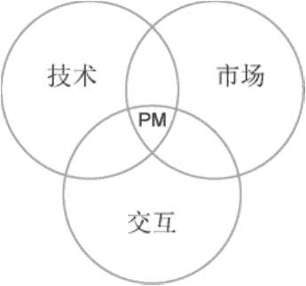
**Figure 3-4**

The responsibility of product managers in the Internet era is to find valuable and feasible products, and so it is in the AI era. The market and interaction work content of product managers has not changed; what has changed is the technology, that is, the Internet technology system has changed to the AI technology system. `EXr6287u6NNVz+GYLY+7SC6AgGofrpiId/XnwIEoGMEPq3TPzkM5RyXBRbuLcLFjwnCuEHVXaQsGpygWHLFy9g==`


The job of an AI Product Manager is to analyze valuable business scenarios, evaluate them, and assess their feasibility, necessity, social and commercial value, as well as ethical and legal frameworks. In addition to analyzing valuable business scenarios, AI Product Managers also need to assess technical feasibility, evaluate the optimal level technology can achieve, and assess the balance point between product value and technical implementation, as well as the balance point between commercial value and technical cost, based on internal and external resources. Finally, an AI Product Manager should be able to design a complete product through an interaction system. If a person can achieve the above points, they would be a highly excellent AI Product Manager. EXr6287u6NNVz+GYLY+7SC6AgGofrpiId/XnwIEoGMEPq3TPzkM5RyXBRbuLcLFjwnCuEHVXaQsGpygWHLFy9g==

## 3.3 Product Analysis Models

Taking a product from zero to one requires facing multiple problems. Product Managers have accumulated a wealth of industry experience during the Internet product design process, and this experience is equally applicable to AI product design. Currently, mainstream product analysis models include the SWOT Analysis Model, PESTEL Analysis Model, User Experience Elements Analysis Model, KANO Model, and Fogg Behavior Model. This section will introduce some of the models, theories, and principles applied during the product design process.

### 1. SWOT Analysis Model

SWOT Analysis, also known as Situational Analysis, is shown in Figure 3-5. It is a commonly used strategic planning analysis model, primarily analyzing key elements involved in the product development process. SWOT Analysis is conducted from four aspects: Strengths, Weaknesses, Opportunities, and Threats. Among them, Strengths and Weaknesses are internal, referring to the advantages and disadvantages of internal resources; while Opportunities and Threats are external, analyzing the opportunities and threats the product faces from market, environment, society, and other aspects. Product Managers list these contents through a series of investigations, arrange them in a matrix form, then match and analyze the various factors involved in the product design process, thereby drawing a series of corresponding conclusions. SWOT Analysis is typically used during the product planning phase to determine the product's strategic direction.

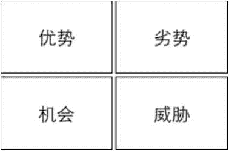

Figure 3-5

**SW Analysis**: Focuses on the enterprise internally. Since an enterprise is a whole and resources are scattered across various departments or positions, SW Analysis must start from every link in the entire value chain of the enterprise, comparing each involved link with competitors. Special analysis for the enterprise and product is also needed during comparison. For example, designing a smart speaker requires analyzing enterprise capabilities, such as the product department's design capability, R&D department's technical reserves, manufacturing processes, production capacity, financial support, human resource reserves, market channels, sales channels, etc. Product analysis can start from novelty, recognition accuracy, manufacturing process, price advantage, etc.

**OT Analysis**: With changes and developments in society, politics, economy, technology, and other aspects, the environment in which enterprises operate has become more open. Since such external environmental changes are uncontrollable, OT Analysis becomes crucial in the product analysis process. The external environment contains both threats and opportunities. Environmental threats refer to unpredictable challenges formed by unfavorable development trends in the environment; if corresponding measures are not taken, these unfavorable trends may weaken the product's advantages. Environmental opportunities are factors that may form advantages for the product; through these opportunities, the product's competitiveness will be enhanced.

By using SWOT Analysis to identify factors that are beneficial, characteristic, and worth promoting for the product, and to study unfavorable, threatening, risky, and problematic factors to find solutions and handling methods. Many believe that strategic product design is generally determined by senior enterprise management or Product Directors, and ordinary Product Managers just need to execute. However, the author believes that although the product's strategic direction is controlled by high-level leaders, Product Managers still need to rebuild the SWOT model after receiving a task. Because with a SWOT model, when designing the product, they will surely reflect the factors of "how the product can optimally meet market and operational expectations" in the product. Similarly, compiling a SWOT model during functional design can distinguish the priority of problems in the product design process, clearly understanding which problems need immediate solving, which can be postponed, which belong to strategic goals, and which belong to tactics. When conducting SWOT Analysis, matching various factors for analysis yields conclusions that are generally decision-oriented, which also helps leaders and managers make more appropriate decisions and plans.

### 2. PESTEL Analysis Model

In addition to analyzing the external environment through OT Analysis in SWOT, the PESTEL Analysis Model can also specifically analyze the environment, as shown in Figure 3-6. Each letter in "PESTEL" represents a factor, six factors in total: Political, Economic, Social, Technological, Environmental, and Legal. The PESTEL Analysis Model can effectively identify factors that impact the product. For this reason, it is often used for competitive product analysis, product opportunity assessment, strategic analysis, etc.

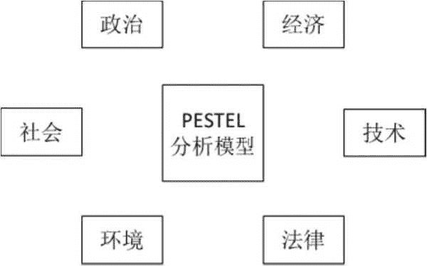

Figure 3-6

**Political Factors**: Refer to the political environment that has actual and potential impacts on the organization's business activities, including political forces, national policies, government department regulatory requirements, etc. Some Product Managers are often not sensitive to political factors, but product failures caused by political factors are often direct and devastating.

**Economic Factors**: Refer to the external economic structure, industrial layout, resource conditions, economic development level, and future economic trends of the organization. Although economic factors are not as directly influential as political factors, they affect the product's future development trends; therefore, future economic trends and industrial layout changes must be fully considered during product planning.

**Social Factors**: Refer to the historical development, cultural traditions, values, education levels, and customs of the society where the organization is located. Social factors directly affect the target audience's acceptance of the product; product planning must fully consider the social factors of the target market. The same product often has different acceptance levels in different regions and countries; therefore, when considering launching a product into a target market, one must understand the cultural traditions, values, customs, etc., of the target market and adjust product positioning according to market characteristics.

**Technological Factors**: The criterion for judging whether a product is successful is whether it achieves the expected design effect. When designing products in the AI era, technological factors must be considered, i.e., whether AI technology can enable the product to achieve the expected design effect. For example, company management plans to launch a chatbot capable of conversing with humans in open environments, but current AI technology has not yet reached the level of conversing with humans in open environments; if the project is approved rashly, the product may ultimately fail. Therefore, Product Managers should be sensitive to technology and have a deep understanding of the development trends and prospects of new technologies, processes, and materials.

**Environmental Factors**: When designing AI products, Product Managers should consider the impact of various factors in the product's surrounding environment. For example, designing a smart dressing mirror that scores based on a person's makeup and clothing; the Product Manager must fully consider the product's environment. If the mirror is placed in a bathroom, waterproofing must be considered, as well as whether the operator's privacy is protected during facial recognition.

**Legal Factors**: External laws, regulations, judicial conditions, and citizens' legal awareness. For example, designing software that automatically judges potential criminal factors and scores based on personal information; if data selection is inappropriate during design, it may trigger personal data privacy issues, racial discrimination issues, gender discrimination issues, etc.

### 3. Maslow's Hierarchy of Needs Theory

Maslow's Hierarchy of Needs Theory is one of the theories of behavioral science, first proposed by psychologist Maslow in his paper "A Theory of Human Motivation," as shown in Figure 3-7.

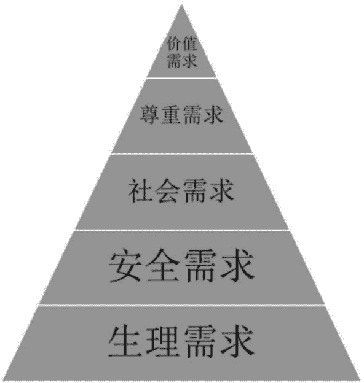

Figure 3-7

This theory divides human needs into five levels from low to high: Physiological Needs, Safety Needs, Social Needs (Love/Belonging), Esteem Needs, and Self-Actualization Needs (Value Needs). Maslow's Hierarchy of Needs is an excellent tool for measuring whether a product and its detailed functions meet needs and the degree to which they do so. Physiological Needs refer to providing users with products necessary for survival, such as water, food, housing, etc.; Safety Needs refer to providing users with protection that is safe, stable, and free from threats; Social Needs refer to providing users with a sense of belonging, allowing users to feel that friends and family form a community when using the product; Esteem Needs refer to achieving self-respect through the product, gaining status, reputation, trust, and high evaluation. Self-Actualization Needs refer to realizing one's ideals and aspirations through the product, maximizing personal potential, and reaching the realm of self-actualization. For example, game products perfectly demonstrate how Maslow's needs satisfy various types of user needs.

Maslow's Hierarchy of Needs is progressive; only when a product satisfies lower-level needs will users pursue higher-level needs. Specific analysis can be conducted according to the product's main form, the level where general users are located, and the corresponding level of needs.

### 4. User Experience Elements Analysis

User Experience Elements Analysis is a commonly used method by Internet Product Managers, as shown in Figure 3-8. This method originates from the classic work *The Elements of User Experience: User-Centered Design for the Web* by Jesse James Garrett, the father of Ajax. Although the original book mainly introduces website design, we can similarly borrow its thinking for relevant analysis of AI products.

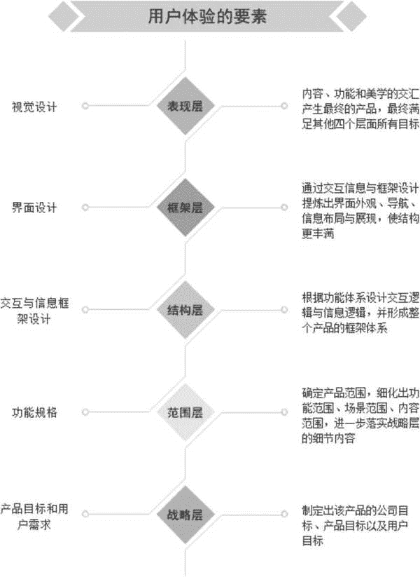

Figure 3-8

The User Experience Elements Model analyzes from five planes: Strategy, Scope, Structure, Skeleton, and Surface, helping Product Managers sort out the entire 0-to-1 phase of the product.

From the Strategy plane perspective, since the User Experience Elements Model focuses on abstract content becoming more concrete as it goes up, Product Managers should start analysis from the Strategy plane, first determining company goals, product goals, and user goals, thereby determining the product's functional system, and refining the application scope of product functions and the content scope contained in each function. After establishing the scope, design the presentation structure of content and interaction, determine the logic for presentation, and determine the method for content presentation. After completing the Structure plane design, design the presentation skeleton for each structure, including appearance, navigation, etc. Finally, conduct Surface plane design to complete the final product.

### 5. KANO Model

The KANO Model is a tool model for classifying and prioritizing user needs, constructed by Japanese Professor Noriaki Kano, as shown in Figure 3-9.

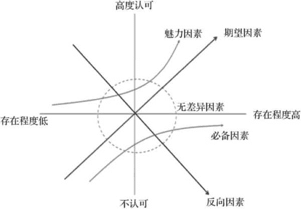

Figure 3-9

Based on the relationship between different types of product quality characteristics and customer satisfaction, the KANO Model classifies needs into the following five categories.

**Basic Needs (Must-be Needs)**: Also called Essential Needs, refer to needs that the product must possess. If basic needs are not met, the product is one that will not be purchased. For example, developing a smart umbrella that can play music and navigate, but leaks when it rains—this is a failure to meet basic needs, and users will not buy the product just because it has other functions. For this type of need, Product Managers must continuously research and understand customer needs and present them through appropriate methods.

**Performance Needs (One-dimensional Needs)**: Also called Expected Needs, refer to functional needs that exceed user expectations. If such needs are met, customer satisfaction increases significantly. Performance needs are not as strict as Basic Needs; if the product pursues excellent user experience, effort must be invested in Performance Needs. During user needs research, users often talk about Performance Needs. Precisely for this reason, Product Managers should possess the skill to effectively distinguish between Performance Needs and Basic Needs, improve the quality of Performance Needs on the premise of guaranteeing Basic Needs, and increase satisfaction—this is the way to surpass competitors.

**Excitement Needs (Attractive Needs)**: Also called Delighters. These needs are generally not mentioned by users, but if included, the product completely exceeds user expectations, creating surprise. Apple's iPhone is a product that satisfied Excitement Needs; after the launch event, users exclaimed, "Phones can be like this!" Of course, it is best if the product can satisfy users' Excitement Needs; if not, users will not express dissatisfaction.

**Indifferent Needs**: These needs have no impact on user experience whether provided or not. High satisfaction of Indifferent Needs does not excite users; low satisfaction does not dissatisfy users.

**Reverse Needs**: Also called Reverse Needs. Once the product satisfies this type of need, it may cause user dissatisfaction. These needs are generally proposed by niche customers and are not shared by all consumers. For example, regarding a smart speaker, an individual customer who loves fitness proposed adding weight to the speaker so it can be used as a dumbbell; but if all products have this function, it would cause general disgust among users.

### 6. Fogg Behavior Model

The Fogg Behavior Model was proposed by Stanford Professor BJ Fogg based on the behavioral elements proposed by German psychologist Kurt Lewin. He believed that specific human behavior consists of three elements: Motivation, Ability, and Trigger. Motivation is the behavioral drive, Ability is the execution capability, and Trigger is the triggering mechanism. Specific behavior occurs only when these three elements are satisfied simultaneously, described in English as `B=MAT`, as shown in Figure 3-10. In handling user interaction issues, all products must consider these three elements.

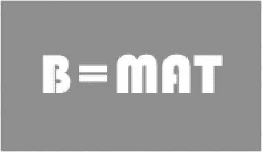

Figure 3-10

Product Managers can refer to the Fogg Model during product design. Through this model, one can quickly analyze how to stimulate sufficient behavioral motivation in customers and what incentive mechanisms the product should provide to quickly increase user purchase motivation. Motivation is like the engine of behavior, providing energy. Motivation consists of Sensation, Anticipation, and Belonging. Because Sensation, Anticipation, and Belonging all belong to emotional thinking, they bring both positive and negative influences. Positive influences include pleasure leading to pursuit, hope leading to desire for possession, and identification leading to user pursuit; negative influences include pain leading to avoidance, fear leading to avoidance, and rejection leading to user rejection. Therefore, Product Managers must fully consider whether the product brings pleasure, hope, and identification to users during design.

Ability means the user needs the capability to complete the action, but many Product Managers often ignore this in the design process, always assuming users have the relevant execution capability. However, in real applications, this is often not the case. For example, a Product Manager thinks users of a bike-sharing app will also pay attention to financial products within it, but the reality is not so. There are two ways to improve Ability: one is to spend time, money, and energy educating customers; the other is to improve the product to make the behavior easier to complete. A typical scenario of improving Ability through education is the promotion of Didi Chuxing; although the ride-hailing app was very convenient, when the product first launched, it spent billions incubating and educating the market and users to enable them to complete the ride-hailing action through this behavior.

Trigger is a key element affecting product success. No matter how excellent the product design or advanced the concept, if there is no suitable scenario to trigger user operation, all is in vain. Not only must trigger scenarios be considered during product design, but how to increase the trigger rate must also be considered during product operations. Product Managers can provide trigger mechanisms through internal product functions, such as improving user experience and adding feedback reminders, or increase trigger rates through external mechanisms, such as SMS prompts and email reminders.

### 7. Nielsen's Ten Usability Heuristics

Nielsen's Ten Usability Heuristics are ten general principles extracted by Dr. Jakob Nielsen, a Ph.D. in Human-Computer Interaction, after analyzing over 200 usability problems. They are important reference standards for product design and user experience design, worthy of in-depth study and application.

**Visibility of System Status**: During product use, users should be informed about what is happening, and appropriate feedback should be given within a reasonable time.

**Match Between System and the Real World**: When designing products, language systems and operation modes familiar to users should be used, following logical interaction processes in the real world as much as possible.

**User Control and Freedom**: Provide secondary confirmation and error correction functions for user misoperations, which can improve product controllability; otherwise, key operations on the product may bring devastating blows. For example, data deletion operations without secondary confirmation may cause serious impact.

**Consistency and Standards**: Language systems, operation modes, visual styles, component styles, etc., adopted in product design should remain unified.

**Error Prevention**: In product design, mechanisms to prevent misoperations should be provided to reduce the possibility of user errors. For example, when key data is not filled in, the save button is grayed out.

**Recognition Rather Than Recall**: During product use, the user's memory load for the operation process should be minimized; all actions and processing should be visible. When a user operates and processes on one page, they should not need to remember the content of the previous page.

**Flexibility and Efficiency of Use**: In the product design process, the flexibility of operation and efficiency of information transmission should be fully considered, simplifying the operation process, reducing the information transmission process, and providing users with more convenient operation methods. Just like finding products in an e-commerce system, if there are too many product categories, users need to search level by level to find the target product. To avoid the problem of too many categories, e-commerce systems provide virtual categories, category navigation, and other methods to allow users to conveniently find target products.

**Aesthetic and Minimalist Design**: Retain main information display, avoid irrelevant information affecting main information as much as possible, ensuring the simplicity and aesthetics of main information. Internet users' browsing actions are not reading, nor just looking, but scanning. Easy scanning means highlighting key points, weakening and removing irrelevant information.

**Help Users Recognize, Diagnose, and Recover from Errors**: Product design should fully consider possible user errors and design functions to help users recover from errors, minimizing losses. If automatic recovery is impossible, detailed explanatory text and guidance should be provided.

**Help and Documentation**: Excellent products do not need help documentation; if help documentation must be provided, it should be in a process-oriented, graphical form.

### 8. SMART Management Principles

Product Managers not only need to focus on product design but also need to coordinate internal and external resources and control product progress. The SMART Management Principle is used to improve management efficiency. The SMART Management Principle not only helps employees work more clearly and efficiently but also allows superiors to better assess subordinates. The SMART Management Principle has five key elements: Specific, Measurable, Attainable, Relevant, and Time-bound.

In the process of product line management, the work tasks and goals given by Product Managers must be specific and clear. "Specific and clear" means they can be clearly expressed in language and understood by team members. If the goals given are unclear, it may cause cognitive inconsistency, leading to failed results.

Goals and tasks must be Measurable, meaning there must be measurement standards to confirm whether the goal is achieved. If the specified goal cannot be measured, it is impossible to confirm whether this goal has been realized. In the product development process, if a superior asks the Product Manager whether the product goal has been achieved, and the Product Manager answers "achieved" directly without knowing what the superior's actual goal of inquiry is, it is a typical case of inconsistent goal measurement.

Naturally, product goals must also be Attainable. If goal cognition is consistent and the goal is measurable, the Product Manager must also consider whether the goal can be reached. In the product development process, Product Managers often directly tell the team the final launch date but fail to consider whether team resources are complete and whether there is sufficient guarantee capability. If the launch date is delayed, team members will exhibit buck-passing and shirking behaviors. Therefore, in setting product goals, team members should be fully involved to reach a consensus among members.

Goals must be Relevant to other goals. Goal relevance refers to the association between achieving this goal and other goals. If this goal is achieved but is completely unrelated to other goals, or has very low relevance, then even if this goal is reached, its significance is not great.

Goals must have a clear Time-bound deadline. Goals without time limits cannot be assessed.

In summary, whether setting work goals for the product team or personal performance goals for each team member, they must possess the above five elements; none can be missing. EXr6287u6NNVz+GYLY+7SC6AgGofrpiId/XnwIEoGMEPq3TPzkM5RyXBRbuLcLFjwnCuEHVXaQsGpygWHLFy9g==

## 3.4 Chapter Summary

In this chapter, the author first reveals the reasons why Internet Product Managers feel at a loss when facing challenges in the AI era; secondly, proposes that Product Managers should start from three levels: improving cognitive level, strengthening knowledge system construction, and deepening business understanding, to carry out AI knowledge learning; finally, introduces key models for Product Managers to conduct product analysis. EXr6287u6NNVz+GYLY+7SC6AgGofrpiId/XnwIEoGMEPq3TPzkM5RyXBRbuLcLFjwnCuEHVXaQsGpygWHLFy9g==


# Chapter 4 AI Technology System

## 4.1 Machine Learning

## 4.2 Machine Learning — Regression

## 4.3 Machine Learning — Classification

## 4.4 Machine Learning — Clustering

## 4.5 Deep Learning

## 4.6 Machine Learning Frameworks

## 4.7 Enterprise Open Platforms

## 4.8 AI Development Languages

## 4.9 Chapter Summary


# Chapter 4 Machine Learning Fundamentals

In the era of AI driven primarily by technology, AI Product Managers must learn AI-related technologies. As an AI Product Manager, you do not necessarily need a master's or doctoral degree, but you need to understand certain basic concepts of AI technology, and understand the pros, cons, and technical boundaries of various AI technologies. Just like you can ride a bicycle without manufacturing one yourself, you still need to know the basic principles of its motion, such as chain drive.

This chapter will introduce Machine Learning, Machine Learning—Regression, Machine Learning—Classification, Machine Learning—Clustering, Deep Learning, Machine Learning Frameworks, Enterprise Open Platforms, and AI Development Languages. `EXr6287u6NNVz+GYLY+7SC6AgGofrpiId/XnwIEoGMEPq3TPzkM5RyXBRbuLcLFjwnCuEHVXaQsGpygWHLFy9g==`

## 4.1 Machine Learning

Many experts classify Machine Learning as an interdisciplinary subject because it involves probability theory, statistics, algorithm theory, and other disciplines. Common definitions of Machine Learning include the following:

- "Machine Learning is a science of Artificial Intelligence; the main research object of this field is Artificial Intelligence, specifically how to improve the performance of specific algorithms in empirical learning."
- "Machine Learning is the study of computer algorithms that can improve automatically through experience."
- "Machine Learning uses data or past experience to optimize the performance criteria of computer programs."

It is not necessary to understand Machine Learning starting from these complex and obscure definitions; understanding it from a simple and easy-to-grasp concept may yield twice the result with half the effort. The author believes that **"Machine Learning is a method of data analysis."**

With the development of the Internet, data volume is growing larger, and how to monetize data has become the primary issue for enterprises. In fact, unprocessed raw data has little practical value. Valuable data utilizes correct analysis techniques to obtain richer data cognition, clearer scenario insights, and more precise data portraits, thereby obtaining data that can assist decision-making; only then does the significance of data become prominent. The role of Machine Learning is to analyze massive amounts of data and mine its meaning and value.

As shown in Figure 4-1, data analysis can be divided into the following four categories.


Figure 4-1

- **Current Status Description**: Describe the current state of the real world based on existing data.
- **Anomaly Diagnosis**: Discover anomalies in existing data and understand the causes of these anomalies.
- **Future Prediction**: Using time as a dimension, utilize historical data to view data trends and predict the probability of a future event occurring.
- **Behavioral Norms**: Consider how to change current or future data to meet future expectations.

What Machine Learning can do are the aforementioned tasks. Machine Learning describes the real world and gains insights into it through learning from data, and predicts the evolution of the future world.

### 4.1.1 Logical Differences Between Traditional Software and Machine Learning

In the Internet era, the Product Manager's job is to analyze existing business and design reasonable system processing logic based on the business process; development engineers implement the product based on the designed system processing logic. Therefore, the computation process from input to output in traditional software is designed, fixed, and explicit, as shown in Figure 4-2. The engineer's role is to design the process and let data be processed according to the designed process.

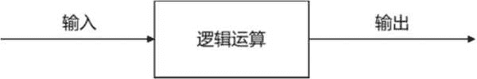

Figure 4-2

Unlike Internet products and traditional software products, AI products automatically construct logical structures based on existing data. AI products repeatedly learn from data through Machine Learning algorithms; without telling the computer the business logic, AI algorithms can find the hidden patterns and meanings within.

AI products feed training data (Input Data + Result Data) into AI algorithms to derive a model, then feed new data into this model for computation, thereby deriving results and achieving prediction and judgment, as shown in Figure 4-3. The model derived from data and algorithms replaces the software logic structure designed by Product Managers or Requirement Analysts.

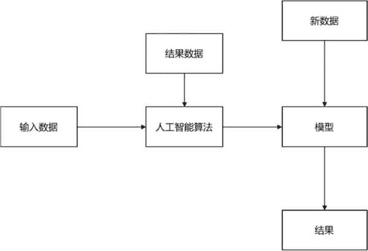

Figure 4-3

The difference between Machine Learning and traditional methods is huge; Machine Learning subverts the original programming mindset. The traditional programming mindset involves humans analyzing data, finding patterns, and obtaining final results through "Input Data + Pattern Verification"; Machine Learning does not require humans to analyze and judge data but delegates the analysis and judgment work to the machine. After inputting training data, the machine finds the hidden patterns in the data according to the algorithm and applies these patterns in practice.

### 4.1.2 Machine Learning Paradigms

Based on different training methods, Machine Learning is divided into four major learning paradigms: **Supervised Learning**, **Unsupervised Learning**, **Semi-supervised Learning**, and **Reinforcement Learning**. The fundamental difference between these four paradigms lies in the difference in data content and training modes.

- **Supervised Learning**: Training is performed using labeled data to obtain a model, which is then used to process unknown data.
- **Unsupervised Learning**: There are no training data samples beforehand; instead, algorithms analyze and model the data to find patterns within.
- **Semi-supervised Learning**: In Semi-supervised Learning training, only a portion of the data used is labeled, while the majority is unlabeled.
- **Reinforcement Learning**: Reinforcement Learning also uses unlabeled data, but one can know whether they are getting closer to or further from the correct answer through some method.

Supervised Learning is very easy to understand; it continuously trains via Machine Learning according to human-defined specifications to achieve the optimal solution under this specification. Why then does Unsupervised Learning exist? Will automated modeling without training go astray? For example, someone knows nothing about music, but by listening more, they can distinguish between classical, modern, jazz, and other genres in a short time. Similarly, if we feed music from different eras, in large quantities, and of different types to a machine, the machine can also find the characteristics of the music based on the use of high, mid, and low frequencies and rhythm in the audio, and complete classification, without us needing to tell the machine the music genre in advance.

Machine Learning can solve many problems, but through induction and summarization, they can be divided into Classification, Regression, Clustering, Dimensionality Reduction, etc., as shown in Figure 4-4. There are many algorithms for solving these problems; common ones include Supervised Learning algorithms (such as `SVM`, `KNN`, `Decision Trees`, `Naive Bayes`, `Logistic Regression`, `Linear Regression`, `Artificial Neural Networks`, etc.) and Unsupervised Learning algorithms (such as `Clustering`, `EM Algorithm`, etc.).

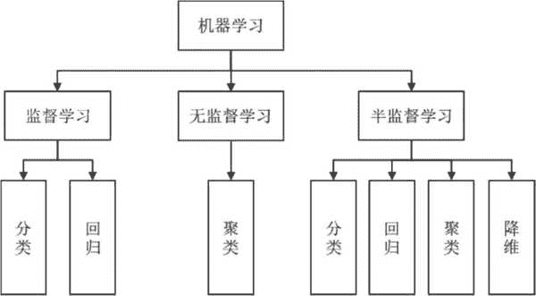

Figure 4-4

1. **Classification**: Given a sample feature, we want to predict its corresponding label value. If the attribute value is discrete, this is a Classification problem.
2. **Regression**: Given a sample feature, we want to predict its corresponding label value. If the attribute value is continuous, this is a Regression problem.
3. **Clustering**: Given a set of sample features, we do not need to predict their corresponding label values, but want to discover the spatial distribution of this set of samples, such as analyzing which samples are close and which are far apart; this is a Clustering problem.
4. **Dimensionality Reduction**: Given a set of sample features, if a low-dimensional subspace is needed to represent the original high-dimensional feature space, this is a Dimensionality Reduction problem.

The application areas and algorithms for various problems are shown in Table 4-1.

Table 4-1


As a Product Manager, one needs to have an in-depth understanding of Machine Learning paradigms and understand what each paradigm is mainly used for, so as to communicate effectively with engineers.

### 4.1.3 Supervised Learning

Supervised Learning uses labeled historical data for training to derive a model, then inputs new data and derives a solution based on the model, as shown in Figure 4-5.


Figure 4-5

Supervised Learning algorithms generate a model using a labeled dataset, then use that model together with new data to verify the model's accuracy, or apply the model to a production environment using real-time data.

Supervised Learning requires a large amount of data as training data, and existing data needs to be split into training data and test data. If training data is too little, the model may be inaccurate; if too much data is put into training, verification may be affected due to excessive noise. Generally, a ratio of `6:4 ~ 8:2` for training data to test data is relatively appropriate.

Below, an example illustrates the Supervised Learning process. For instance, a user uploads a photo, and the system needs to identify whether the photo is of the user themselves. The uploaded photo may be a full-body shot, a half-body shot, or even a close-up of just one eye.

Step 1: Data Generation and Classification. First, collect a sufficient number of photos of the user—full body, half body, front, side—as long as it is the user's image, they all go into one group, called the **Training Set**. The Training Set is used for training. Secondly, prepare another set of photos, some of the user and some of others; this group is called the **Validation Set**. The Validation Set is used to test whether the trained algorithm model can recognize the user. The Validation Set serves as input, yielding outputs: output `1` if the user is in the photo, `0` if not.

Step 2: Training. During training via `Artificial Neural Networks`, each image in the Training Set becomes an input to the `Artificial Neural Network`. After computation through each layer of neurons in the `Artificial Neural Network` for feature extraction, an output is obtained upon completion; observe whether the output is `1` or `0`.

Step 3: Validation. After all data in the first set is used up, use the data in the second set to validate the accuracy of the trained model. This process involves hyperparameter optimization, selection of activation functions, etc.

Step 4: Encapsulation and Application. Once the data validation metrics reach the expected targets, the model training is complete. At this point, the model can be encapsulated as an interface and integrated into the software. The software interacts with users through the interface; when a user uploads a photo, the software automatically calls the interface to complete the computation and returns the result to the software program interface.

AI Product Managers do not necessarily need to understand algorithm design or implement algorithms specifically, but they must understand the content, characteristics, and achievable goals of algorithms. Below, two Supervised Learning algorithms will be introduced: `SVM` and `Naive Bayes Classifier`.

#### 1. SVM

`SVM`, also known as Support Vector Machine, is a very popular Supervised Learning model used for Classification or Regression. `SVM` can effectively solve problems of small samples, non-linearity, and high-dimensional pattern recognition, so its application is very wide. This book assumes a two-dimensional space with different shapes, as shown in Figure 4-6.

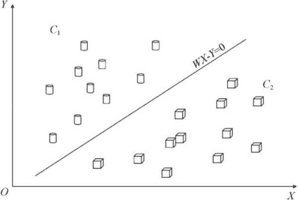

Figure 4-6

`C[1]` and `C[2]` are two categories of shapes in the planar space. `C[1]` is a cylinder, `C[2]` is a cube. The diagonal line in the middle with slope `W` is the classification function, which can completely separate the two samples. If a linear function can completely separate the samples, the data is generally called **Linearly Separable**; otherwise, it is called **Non-linearly Separable**. Observation reveals that the diagonal line in the figure can actually change its slope or move up and down, as shown in Figure 4-7. Any straight line with slope `W` between `WX - Y = -1` and `WX - Y = 1` can completely separate the samples, but the straight line equidistant from the sample points and with the maximum distance is the optimal solution, i.e., `WX - Y = 0`. The classification function is a point in one-dimensional space, a straight line in two-dimensional space, a plane in three-dimensional space, and of course there are higher-dimensional or infinite-dimensional classification functions, collectively called **Hyperplanes**.

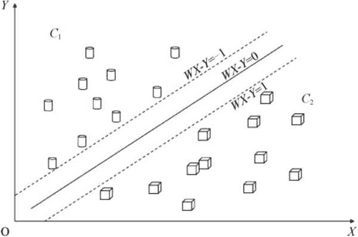

Figure 4-7

The purpose of `SVM` is to find a Hyperplane that can divide samples into two classes with the maximum classification margin; this is the basic theoretical model of `SVM`. Of course, if objects in the world were evenly distributed and regular, results would be easily obtained, but the actual situation is often as shown in Figure 4-8, with cylinders and cubes irregularly scattered on this plane.

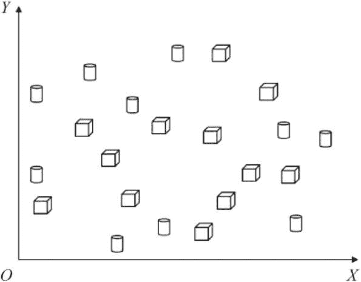

Figure 4-8

It is almost impossible to classify the shapes shown in Figure 4-8 using a simple function. Thus, scientists proposed a new concept: **"Kernel Function"**, which maps samples from the original space to a higher-dimensional space, and through the division of the mappings in the high-dimensional space, ultimately achieves linear division.

Step 1: Upgrade the two-dimensional space to three-dimensional space, as shown in Figure 4-9.

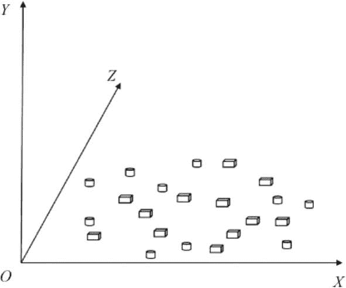

Figure 4-9

Step 2: Project the two-dimensional sample data into the three-dimensional space, as shown in Figure 4-10.


Figure 4-10

Step 3: Perform slicing in the three-dimensional space, and map the sliced Hyperplane back to a two-dimensional plane, as shown in Figure 4-11.

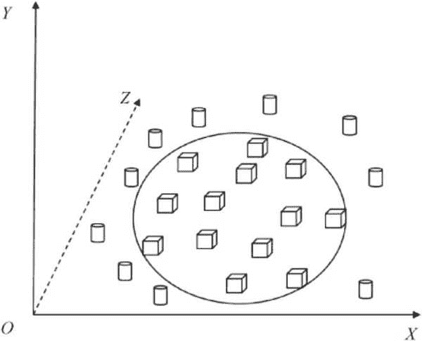

Figure 4-11

Thus, a new Kernel Function is completed. Because non-linear spaces are complex, and it is impossible to quickly know which Kernel Function is best suited to convert a non-linear space into a linear one, `SVM` typically employs multiple Kernel Functions to identify the best option.

#### 2. Naive Bayes Classifier

If your boss assigns you an analysis task with a medium amount of data, few variables, and hopes you complete the data prediction quickly, then the `Naive Bayes Theorem` is a good choice. Let's first look at the expression of Bayes' Theorem (4-1):


(4-1)

Changing the expression form makes it easier to understand:

`P(Class|Feature) = P(Feature|Class) * P(Class) / P(Feature)`

If we want to distinguish between Product Managers and Programmers based on Gender and Weight, we are seeking `P(Programmer|Gender, Weight)` and `P(Product Manager|Gender, Weight)`. According to Bayes' Theorem:

`P(Occupation|Gender, Weight) = P(Gender|Occupation) * P(Occupation) / P(Weight)`

Besides Bayes' Theorem, there is the Naive Bayes Theorem. The `Naive Bayes Theorem` is an algorithm derived from the basic assumption on the basis of Bayes' Theorem. The `Naive Bayes Theorem` assumes that all data attributes are independent and do not affect each other. It is precisely through this assumption that many complex problems can be simplified, and the `Naive Bayes Theorem` is also very suitable for predicting unknown datasets and making data predictions. For example, according to the `Naive Bayes Theorem`, we can know that Gender and Weight are unrelated, i.e.,

`P(Weight|Occupation, Gender) = P(Weight|Occupation)`

`P(Gender, Weight|Occupation) = P(Gender|Occupation) × P(Weight|Occupation)`

The `Naive Bayes Theorem` has the following advantages: ① The algorithm is simple and easy to understand; ② High performance and fast calculation speed; ③ Good at data prediction; ④ Very low requirement for the amount of training data.

It is precisely because the `Naive Bayes Theorem` has the above advantages that it can often be seen in real-time prediction and multi-class prediction. Not only that, because text classification has many variable types and the types are relatively independent, the `Naive Bayes Theorem` has also been widely used in text classification, such as Spam Identification, Website Content Identification, News Recommendation, etc.

### 4.1.4 Unsupervised Learning

Learning the distribution of data or the relationships between data through algorithms using data without any labels is called Unsupervised Learning. The goal of Unsupervised Learning is to use algorithms to explore hidden structures and characteristics in the data. These structures and characteristics are impossible for humans to understand directly or achieve through human effort. Because there are no labels, it is also difficult to evaluate whether the results of Unsupervised Learning are correct. However, if data is grouped through Unsupervised Learning, people can understand hidden information in the original data that was unforeseeable.

If the way students learn in school is called Supervised Learning, then children who don't go to school can also perform Unsupervised Learning through their own observation and understanding of the world, except what they learn is casual and random, and the final learning outcome is unpredictable; AI is the same. In 2017, there was a news story: Two AI robots created by American scientists invented a language only they could understand through self-study, and these two robots had begun communicating in a language only they could understand, causing great panic.

Unsupervised Learning has been validated in many application scenarios. If you run a garment factory producing clothes, how do you determine `S`, `M`, `L` sizes? If you possess the height data of all Chinese people, you can determine this through Unsupervised Learning. Precisely because Unsupervised Learning lacks human labeling, as of now, Unsupervised Learning still cannot reach the accuracy and effectiveness of Supervised Learning, so Unsupervised Learning has always been criticized by some scientists in the AI community. But in recent years, Unsupervised Learning has become hot again, with some scientists even claiming that Unsupervised Learning is the future of AI.

Currently, the more popular **"Generative Adversarial Networks (`GAN`)"** in Unsupervised Learning works by connecting a Generative Network and a Discriminative Network. The Generative Network is responsible for generating data intended to deceive the Discriminative Network. Through the adversarial learning of the two networks, some surprising results have been obtained, such as AI technology that can generate photo-realistic images from text strings or hand-drawn sketches.

AI evaluation metrics usually have three types: `Precision`, `Recall`, and `Accuracy`. In Unsupervised Learning, these three metrics are very important; people usually use these three metrics to evaluate Unsupervised Learning.

- **Precision**: For a given test dataset, the ratio of the number of samples correctly classified by the classifier to the total number of samples. Simply put, Precision means "querying accurately". Like police catching thieves: if 10 people are caught, and 9 are thieves, then Precision is `90%`.
- **Recall**: For a given test dataset, the number of all correctly classified samples correctly found by the classifier. Simply put, Recall means "querying comprehensively". Still using the police catching thieves example: there are 100 people, 20 are thieves, 10 thieves are caught, then Recall is `50%`.
- **Accuracy**: Represents the proportion of correct identifications. That is, the probability of good people being identified as good people and bad people being identified as bad people. Continuing the police example: 100 people, 20 are thieves, 10 people caught, but 1 is not a thief, then Accuracy is `90%`.

`Precision`, `Recall`, and `Accuracy` are key metrics for measuring AI algorithms; the higher these three metrics, the better the algorithm's adaptability.

### 4.1.5 Semi-supervised Learning

Supervised Learning is used when there is the capability to label data and perform Classification and Regression targeting the label information; Unsupervised Learning is used for training when label information is not included, usually for Clustering. Sometimes, the data at hand often has only a portion labeled, not all; then Semi-supervised Learning can be used to complete the training. The "National Government Website Monitoring Project" is a good example.

The National Government Network Monitoring Project monitored over `90,000` government websites nationwide and nearly `2.5` billion pages at all levels of government websites, as shown in Figure 4-12. The project's task is to monitor whether these pages have anomalies and which pages users are more interested in. For up to billions of pages, labeling all pages is impossible; only tens of thousands of pages are labeled. If the unlabeled sample set is directly discarded, it is not only a pity but may also lead to data distortion due to insufficient training samples, thereby affecting the Machine Learning effect. How to effectively utilize unlabeled data becomes the key.


Figure 4-12

The simplest method is to label the unlabeled pages, but this comes with huge labor costs. If it takes `0.5` minutes for a person to label one page, to label `2.5` billion pages, one person working `365` days a year without rest would take over `2,300` years to complete.

The project team thus adopted the Semi-supervised Learning method to complete the labeling work. First, a learner is trained using the labeled sample dataset; then, based on this learner, predictions are made on the unlabeled samples; next, the predicted result samples are classified, and samples with high uncertainty and low classification confidence are re-labeled twice; finally, the data is expanded into the training set, the learner is retrained, and the final result is generated, as shown in Figure 4-13.


Figure 4-13

Obviously, Semi-supervised Learning essentially still belongs to Supervised Learning, but it performs semi-automated processing on the training data samples; compared with Supervised Learning, the learning cost is greatly reduced. For various algorithms of Supervised Learning and Unsupervised Learning, if the dataset conforms to the characteristics of Semi-supervised Learning, the Semi-supervised Learning method can be adopted.

### 4.1.6 Reinforcement Learning

Reinforcement Learning is also known as Reward Learning or Evaluation Learning. If Reinforcement Learning is described with a standard definition, its goal is to learn an optimal **Policy**, which allows the **Agent** to take **Actions** based on the current **State** in a specific **Environment**, thereby obtaining the maximum **Reward**. Reinforcement Learning is often confused with Supervised Learning and Unsupervised Learning.


## Reinforcement Learning

Reinforcement learning regards learning as a trial-and-evaluation process, as shown in Figure 4-14. The agent selects an action to act on the environment; the environment changes state after accepting the action and simultaneously generates a reinforcement signal, which is fed back to the agent. The agent then selects the next action based on the reinforcement signal and the current state of the environment, with the principle of increasing the probability of receiving positive reinforcement. The selected action affects not only the immediate reinforcement value but also the environment's state at the next moment and the final reinforcement value.

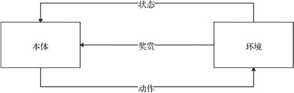

Figure 4-14

Supervised learning is like a student taking an exam with a tutor standing beside them; whenever the student finishes a question, the tutor immediately tells them whether it was right or wrong. However, real situations are complex; many practical problems have no standard answers, only answers that are more suitable. The reinforcement learning process is like training an animal: each time the animal performs a behavior, the trainer must give timely feedback, and this good-or-bad feedback influences its behavior next time. AI reinforcement learning works similarly: through repeated reinforcement learning processes, the machine learns which behavior yields the best reward. Precisely because reinforcement learning possesses the characteristic of real-time feedback, it is widely used in the field of robotics.

Both supervised learning and reinforcement learning obtain a relational mapping from input data to output results through algorithms. Supervised learning gives the relationship between input and output, telling the algorithm what output corresponds to what input. Reinforcement learning provides feedback information, judging whether an action is good or bad. Of course, because reinforcement learning provides feedback information, the entire process has latency; therefore, sometimes it takes multiple steps before knowing whether a choice at a previous node was correct. EXr6287u6NNVz+GYLY+7SC6AgGofrpiId/XnwIEoGMEPq3TPzkM5RyXBRbuLcLFjwnCuEHVXaQsGpygWHLFy9g==

## 4.1 Machine Learning

Many experts classify machine learning as an interdisciplinary subject because it involves probability theory, statistics, algorithm theory, and other disciplines. Common definitions of machine learning include the following:

> "Machine learning is a science of artificial intelligence; the main research object of this field is artificial intelligence, particularly how to improve the performance of specific algorithms in empirical learning."
>
> "Machine learning is the study of computer algorithms that can improve automatically through experience."
>
> "Machine learning uses data or past experience to optimize the performance criteria of computer programs."

Understanding machine learning does not require starting from these complex and obscure definitions; understanding it from a simple and easy-to-grasp concept may be more effective. The author believes that **"machine learning is a method of data analysis."**

With the development of the Internet, data volume is growing larger, and how to monetize data has become the primary issue for enterprises. In fact, unprocessed raw data has little use value. Valuable data uses correct analysis techniques to obtain richer data cognition, clearer scenario insights, and more accurate data portraits, thereby obtaining data that can assist decision-making; only then does the meaning of data become prominent. The role of machine learning is to analyze massive data and mine its meaning and value.

As shown in Figure 4-1, data analysis can be divided into the following four categories.


Figure 4-1

- **Current Status Description**: Describe the current state of the real world based on existing data.
- **Anomaly Diagnosis**: Discover anomalies in existing data and understand the causes of these anomalies.
- **Future Prediction**: Use the time dimension to view data change trends using historical data and predict the probability of a future event occurring.
- **Behavioral Prescription**: Consider how to change current or future data to meet future expectations.

Machine learning can do the aforementioned things as well. Machine learning describes the real world and gains insights into it through learning from data, and predicts the evolution of the future world.

### 4.1.1 Logic Differences Between Traditional Software and Machine Learning

In the Internet era, the product manager's job is to analyze existing business and design reasonable system processing logic based on the business process; development engineers implement the product based on the designed system processing logic. Therefore, the computation process of traditional software from input to output is designed, fixed, and definite, as shown in Figure 4-2. The engineer's role is to design the process and let data be processed according to the designed process.


Figure 4-2

Unlike Internet products and traditional software products, AI products automatically construct logical structures based on existing data. AI products repeatedly learn from data through machine learning algorithms; without telling the computer the business logic, AI algorithms can find the hidden patterns and meanings within.

AI products input training data (input data + result data) into AI algorithms to derive a model, then input new data into this model for computation, thereby obtaining results and achieving prediction and judgment, as shown in Figure 4-3. The model derived from data and algorithms replaces the software logic structure designed by product managers or requirements analysts.


Figure 4-3

The difference between machine learning and traditional methods is huge; machine learning subverts the original programming mindset. The traditional programming mindset is for humans to analyze data, find patterns, and obtain final results through "input data + pattern verification"; machine learning does not require humans to analyze and judge data but hands the work of analysis and judgment to the machine. After inputting training data, the machine finds the patterns hidden in the data according to the algorithm and applies these patterns in practice.

### 4.1.2 Learning Paradigms of Machine Learning

Depending on the training method, machine learning is divided into four major learning paradigms: supervised learning, unsupervised learning, semi-supervised learning, and reinforcement learning. The fundamental difference between these four paradigms lies in the difference in data content and training modes.

- **Supervised Learning** (also called supervised learning): Training is performed using labeled data to obtain a model, which is then used to process unknown data.
- **Unsupervised Learning**: There are no training data samples beforehand; instead, algorithms analyze and model the data to find patterns within.
- **Semi-Supervised Learning**: In semi-supervised learning training, only a portion of the data used is labeled, while the majority is unlabeled.
- **Reinforcement Learning**: Reinforcement learning also uses unlabeled data, but it can know through some method whether it is getting closer to or further from the correct answer.

Supervised learning is very easy to understand; it continuously trains via machine learning according to human-defined specifications to achieve the optimal solution under this specification. Why does unsupervised learning exist then? Will automated modeling without training go astray? For example, someone knows nothing about music, but by listening more, they can distinguish between classical, modern, jazz, and other genres in a short time. Similarly, if we feed music from different eras, in large quantities, and of different types to a machine, the machine can also find the characteristics of the music based on the use of high, mid, and low tones and rhythm in the audio, and complete classification, without us telling the machine the music type in advance.

Machine learning can solve many problems, but through induction and summary, they can be divided into classification, regression, clustering, dimensionality reduction, etc., as shown in Figure 4-4. There are many algorithms for solving these problems; common ones are supervised learning algorithms (such as `SVM`, `KNN`, Decision Trees, Naive Bayes, Logistic Regression, Linear Regression, Artificial Neural Networks, etc.) and unsupervised learning algorithms (such as Clustering, `EM 算法`, etc.).


Figure 4-4

1. **Classification**: Given a sample feature, we want to predict its corresponding label value; if the attribute value is discrete, this is a classification problem.
2. **Regression**: Given a sample feature, we want to predict its corresponding label value; if the attribute value is continuous, this is a regression problem.
3. **Clustering**: Given a set of sample features, we do not need to predict their corresponding label values but want to discover the spatial distribution of this set of samples, such as analyzing which samples are close and which are far apart; this is a clustering problem.
4. **Dimensionality Reduction**: Given a set of sample features, if a low-dimensional subspace is needed to represent the original high-dimensional feature space, this is a dimensionality reduction problem.

The application areas and algorithms for various problems are shown in Table 4-1.

Table 4-1


As a product manager, one needs to have an in-depth understanding of machine learning paradigms and understand what each paradigm is mainly used for, so as to communicate effectively with engineers.

### 4.1.3 Supervised Learning

Supervised learning uses labeled historical data for training to derive a model, then inputs new data and obtains a solution based on the model, as shown in Figure 4-5.


Figure 4-5

Supervised learning algorithms generate a model using a labeled dataset, then use this model together with new data to verify the model's accuracy, or apply the model to a production environment using real-time data.

Supervised learning requires a large amount of data as training data, and existing data needs to be divided into training data and test data. If training data is too little, the model may be inaccurate; if too much data is put into training, noise may affect verification. Generally, a ratio of 6:4 to 8:2 for training data to test data is relatively appropriate.

Below, an example illustrates the supervised learning process. For instance, a user uploads a photo, and the system needs to identify whether the photo is of the user themselves. The photo uploaded by the user may be a full-body shot, a half-body shot, or even a close-up of just one eye.

**Step 1: Data Generation and Classification.** First, collect enough photos of the user—full body, half body, front, side—as long as it is the user's image, they all exist in one group, called the **training set**. The training set is used for training. Secondly, prepare another group of photos, some of the user and some of others; this group is called the **validation set**. The validation set is used to test whether the trained algorithm model can recognize the user. The validation set serves as input to obtain outputs: output 1 if the user is in the photo, 0 if not.

**Step 2: Training.** When training via an artificial neural network, each image in the training set becomes an input to the network. After computation by each layer of neurons in the network for feature extraction, an output is obtained upon completion; observe whether the output is 1 or 0.

**Step 3: Validation.** After all data in the first group is used up, use the data in the second group to verify the accuracy of the trained model. This process involves hyperparameter optimization, selection of activation functions, etc.

**Step 4: Packaging and Application.** Once the data validation metrics reach the expected targets, the model training is complete. At this point, the model can be packaged as an interface and integrated into the software. The software interacts with users through the interface; when a user uploads a photo, the software automatically calls the interface to complete the computation and returns the result to the software program interface.

AI product managers do not necessarily need to understand algorithm design or implement algorithms specifically, but they must understand the content, characteristics, and achievable goals of algorithms. Below, two supervised learning algorithms will be introduced: `SVM` and the Naive Bayes Classifier.

#### 1. SVM

`SVM`, also known as Support Vector Machine, is a very popular supervised learning model used for classification or regression. `SVM` can effectively solve problems of small samples, non-linearity, and high-dimensional pattern recognition, so its application is very wide. This book assumes there are different shapes in a two-dimensional space, as shown in Figure 4-6.


Figure 4-6

`C[1]` and `C[2]` are two shape categories in the planar space; `C[1]` is a cylinder, `C[2]` is a cube. The oblique line in the middle with slope `W` is the classification function, which can completely separate the two samples. If a linear function can completely separate the samples, the data is generally called linearly separable; otherwise, it is called non-linearly separable. Observation reveals that the oblique line in the figure can actually change its slope or move up and down, as shown in Figure 4-7. Any straight line with slope `W` between `WX - Y = -1` and `WX - Y = 1` can completely separate the samples, but the straight line equidistant from the sample points and with the maximum distance is the optimal solution, i.e., `WX - Y = 0`. The classification function is a point in one-dimensional space, a straight line in two-dimensional space, a plane in three-dimensional space, and of course there are higher-dimensional or infinite-dimensional classification functions, collectively called hyperplanes.


Figure 4-7

The purpose of `SVM` is to find a hyperplane that can divide the samples into two classes and maximize the classification margin; this is the basic theoretical model of `SVM`. Of course, if objects in the world were evenly distributed and regular, results would be easy to obtain, but the actual situation is not like that; it is often as shown in Figure 4-8, with cylinders and cubes irregularly scattered on this plane.


Figure 4-8

It is almost impossible to classify the shapes shown in Figure 4-8 using a simple function. Thus, scientists proposed a new concept: "Kernel Function," which maps samples from the original space to a higher-dimensional space, and through the division of the images in the high-dimensional space, ultimately achieves linear division.

**Step 1:** Upgrade the two-dimensional space to three-dimensional space, as shown in Figure 4-9.


Figure 4-9

**Step 2:** Project the two-dimensional sample data into the three-dimensional space, as shown in Figure 4-10.


Figure 4-10

**Step 3:** Perform slicing in the three-dimensional space and map the sliced hyperplane to a two-dimensional plane, as shown in Figure 4-11.


Figure 4-11

Thus, a new kernel function is completed. Because non-linear space is complex and it is impossible to quickly know which kernel function is best suited to convert non-linear space to linear space, `SVM` usually employs multiple kernel functions to identify the best option.

#### 2. Naive Bayes Classifier

If your boss assigns you an analysis task with a medium amount of data, few variables, and hopes you can complete data prediction quickly, the Naive Bayes Theorem is a good choice. Let's first look at the expression of Bayes' Theorem (4-1):

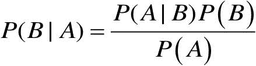

(4-1)

Changing the expression form makes it easier to understand:

`P(类别|特征) = P(特征|类别) * P(类别) / P(特征)`

If we want to distinguish between product managers and programmers by gender and weight, we are seeking `P(程序员|性别，体重)` and `P(产品经理|性别，体重)`. According to Bayes' Theorem:

`P(职业|性别，体重) = P(性别|职业) * P(职业) / P(体重)`

Besides Bayes' Theorem, there is the Naive Bayes Theorem. The Naive Bayes Theorem is an algorithm derived from Bayes' Theorem by making a basic assumption. The Naive Bayes Theorem assumes that all data attributes are independent and do not affect each other. It is precisely through this assumption that many complex problems can be simplified, and the Naive Bayes Theorem is also very suitable for predicting unknown datasets and making data predictions. For example, according to the Naive Bayes Theorem, we can know that gender and weight are unrelated, i.e.,

`P(体重|职业，性别) = P(体重|职业)`

`P(性别，体重|职业) = P(性别|职业) × P(体重|职业)`

The Naive Bayes Theorem has the following advantages:
1. The Naive Bayes Theorem algorithm is simple and easy to understand;
2. The Naive Bayes Theorem has high performance and fast calculation speed;
3. The Naive Bayes Theorem excels at data prediction;
4. The Naive Bayes Theorem requires very little training data.

Precisely because the Naive Bayes Theorem has the above advantages, it can often be seen in real-time prediction and multi-class prediction. Not only that, because text classification has many variable types and the types are relatively independent, the Naive Bayes Theorem is also widely used in text classification, such as spam email identification, website content identification, news recommendation, etc.

### 4.1.4 Unsupervised Learning

Learning the distribution of data or the relationships between data through algorithms using data without any labels is called unsupervised learning. The goal of unsupervised learning is to use algorithms to explore hidden structures and characteristics in the data. These structures and characteristics are impossible for humans to understand directly or achieve through manpower. Because there are no labels, it is also difficult to evaluate whether the results of unsupervised learning are correct. However, if data is grouped through unsupervised learning, people can learn hidden information unforeseeable in the raw data.

If the way students learn in school is called supervised learning, then children who don't go to school can also perform unsupervised learning through their own observation and understanding of the world, except what they learn is casual and random, and the final learning outcome is unpredictable; AI is the same. In 2017, there was a news story: two AI robots created by American scientists invented a language only they could understand through self-study, and these two robots had begun communicating in a language only they could understand, causing great panic.

Unsupervised learning has been validated in many application scenarios. If you run a garment factory producing clothes, how do you determine S, M, L sizes? If you possess the height values of all Chinese people, you can determine them through unsupervised learning. Precisely because unsupervised learning has no human labeling, as of now, unsupervised learning still cannot reach the accuracy and effectiveness of supervised learning, so unsupervised learning has always been criticized by some scientists in the AI community. But in recent years, unsupervised learning has become hot again; some scientists even claim that unsupervised learning is the future of AI.

Currently, the more popular "Generative Adversarial Networks (`GAN`)" in unsupervised learning work by connecting a generative network and a discriminative network. The generative network is responsible for generating data intended to deceive the discriminative network. Through the adversarial learning of the two networks, some surprising results have been obtained, such as AI technology that can generate photo-realistic images from text strings or hand-drawn sketches.

AI evaluation metrics usually have three types: Precision, Recall, and Accuracy. In unsupervised learning, these three metrics are very important; people usually use these three metrics to evaluate unsupervised learning.

- **Precision**: For a given test dataset, the ratio of the number of samples correctly classified by the classifier to the total number of samples. Simply put, precision means "accurate retrieval." Like a policeman catching thieves: if 10 people are caught and 9 are thieves, the precision is 90%.
- **Recall**: For a given test dataset, the number of all correctly classified samples correctly found by the classifier. Simply put, recall means "comprehensive retrieval." Still using the policeman catching thieves example: there are 100 people, 20 are thieves, 10 thieves are caught, then recall is 50%.
- **Accuracy**: Represents the proportion of correct identifications. That is, the probability of good people being identified as good and bad people as bad. Continuing the policeman example: 100 people, 20 are thieves, 10 caught, but 1 is not a thief, then accuracy is 90%.

Precision, Recall, and Accuracy are key metrics for measuring AI algorithms; the higher these three metrics, the better the algorithm's adaptability.

### 4.1.5 Semi-Supervised Learning

Supervised learning is used when there is the capability to label data and perform classification and regression targeting the label information; unsupervised learning is used for training when label information is not included, usually for clustering. Sometimes, the data at hand often has only a portion labeled rather than all labeled; then semi-supervised learning can be used to complete the training. The "National Government Website Monitoring Project" is a good example.

The National Government Network Monitoring Project monitored over 90,000 government websites nationwide and nearly 2.5 billion pages of governments at all levels, as shown in Figure 4-12. The project's task is to monitor whether these pages have anomalies and which pages users are more interested in. For up to billions of pages, labeling all pages is impossible; only tens of thousands of pages are labeled. If the unlabeled sample set is directly discarded, it is not only a pity but may also lead to data distortion due to insufficient training samples, thereby affecting the effect of machine learning. How to effectively utilize unlabeled data becomes the key.


Figure 4-12

The simplest method is to label the unlabeled pages, but this comes with huge labor costs. If it takes 0.5 minutes for a person to label one page, to label 2.5 billion pages, one person working 365 days a year without rest would take over 2,300 years to complete.


## 4.1 Machine Learning

Many experts classify machine learning as an interdisciplinary field because it involves probability theory, statistics, algorithm theory, and other disciplines. Common definitions of machine learning include the following:

"Machine learning is a science of artificial intelligence; the main research object of this field is artificial intelligence, specifically how to improve the performance of specific algorithms in empirical learning."

"Machine learning is the study of computer algorithms that can improve automatically through experience."

"Machine learning uses data or past experience to optimize the performance criteria of computer programs."

It is not necessary to understand machine learning starting from these complex and convoluted definitions; understanding it from a simple and easy-to-grasp concept may yield twice the result with half the effort. The author believes that "machine learning is a method of data analysis."

With the development of the Internet, data volumes are growing larger, and how to monetize data has become a primary issue for enterprises. In fact, unprocessed raw data has little practical value. Valuable data is obtained by using correct analytical techniques to gain richer data cognition, clearer scenario insights, and more precise data portraits, thereby obtaining data that can assist decision-making; only then does the significance of data become prominent. The role of machine learning is to analyze massive amounts of data and mine its meaning and value.

As shown in Figure 4-1, data analysis can be divided into the following four categories.


Figure 4-1

**Current Status Description**: Describe the current state of the real world based on existing data.

**Anomaly Diagnosis**: Discover anomalies in existing data and understand the causes of these anomalies.

**Future Prediction**: Using time as a dimension, utilize historical data to view data trends and predict the probability of a future event occurring.

**Behavioral Prescription**: Consider how to change current or future data to meet future expectations.

What machine learning can do are the aforementioned tasks. Machine learning describes the real world and gains insights into it through learning from data, and predicts the evolution of the future world.

### 4.1.1 Logical Differences Between Traditional Software and Machine Learning

In the Internet era, a product manager's job is to analyze existing business and design reasonable system processing logic based on the business process; development engineers implement the product based on the designed system processing logic. Therefore, the computation process of traditional software from input to output is designed, fixed, and explicit, as shown in Figure 4-2. The engineer's role is to design the process and let data be processed according to the designed process.


Figure 4-2

Unlike Internet products and traditional software products, AI products automatically construct logical structures based on existing data. AI products repeatedly learn from data through machine learning algorithms; without needing to tell the computer the business logic, AI algorithms can find the hidden patterns and meanings within.

AI products feed training data (input data + result data) into AI algorithms to derive a model, then feed new data into this model for computation to obtain results, achieving prediction and judgment, as shown in Figure 4-3. The model derived from data and algorithms replaces the software logic structure designed by product managers or requirement analysts.


Figure 4-3

The difference between machine learning and traditional methods is enormous; machine learning subverts the original programming mindset. The traditional programming mindset involves humans analyzing data, finding patterns, and obtaining final results through "input data + pattern verification"; machine learning does not require humans to analyze and judge data but delegates the work of analysis and judgment to the machine. After inputting training data, the machine finds hidden patterns in the data according to algorithms and applies these patterns in practice.

### 4.1.2 Learning Paradigms of Machine Learning

Based on different training methods, machine learning is divided into four major learning paradigms: supervised learning, unsupervised learning, semi-supervised learning, and reinforcement learning. The fundamental difference between these four paradigms lies in the difference in data content and training modes.

**Supervised Learning**: Training is performed using labeled data to obtain a model, which is then used to process unknown data.

**Unsupervised Learning**: There are no training data samples beforehand; instead, algorithms analyze and model the data to find patterns within.

**Semi-supervised Learning**: In semi-supervised learning training, only a portion of the data used is labeled, while the majority is unlabeled.

**Reinforcement Learning**: Reinforcement learning also uses unlabeled data, but there is a way to know whether you are getting closer to or further from the correct answer.

Supervised learning is very easy to understand; it continuously trains via machine learning according to human-defined specifications to achieve the optimal solution under this specification. Why then does unsupervised learning exist? Will automated modeling without training go astray? For example, someone who knows nothing about music can distinguish between classical, modern, jazz, and other genres just by listening more, without taking too long. Similarly, if we feed music from different eras, in large quantities, and of different types to a machine, the machine can also find the characteristics of the music based on the use of high, mid, and low frequencies and rhythm in the audio, complete classification, and we don't need to tell the machine in advance what type of music it is.

Machine learning can solve many problems, but through induction and generalization, they can be divided into classification, regression, clustering, dimensionality reduction, etc., as shown in Figure 4-4. There are many algorithms for solving these problems; common ones are supervised learning algorithms (such as `SVM`, `KNN`, `Decision Tree`, `Naive Bayes`, `Logistic Regression`, `Linear Regression`, `Artificial Neural Network`, etc.) and unsupervised learning algorithms (such as `Clustering`, `EM Algorithm`, etc.).


Figure 4-4

**(1) Classification (`Classification`)**: Given a sample feature, we want to predict its corresponding label value; if the attribute value is discrete, this is a classification problem.

**(2) Regression (`Regression`)**: Given a sample feature, we want to predict its corresponding label value; if the attribute value is continuous, this is a regression problem.

**(3) Clustering (`Clustering`)**: Given a set of sample features, we do not need to predict their corresponding label values but want to discover the distribution of this set of samples in space, such as analyzing which samples are close and which are far apart; this is a clustering problem.

**(4) Dimensionality Reduction (`Dimensionality Reduction`)**: Given a set of sample features, if a low-dimensional subspace is needed to represent the original high-dimensional feature space, this is a dimensionality reduction problem.

The application areas and algorithms for various problems are shown in Table 4-1.

Table 4-1


As a product manager, one needs to have an in-depth understanding of machine learning paradigms and understand what each paradigm is mainly used for, in order to communicate effectively with engineers.

### 4.1.3 Supervised Learning

Supervised learning uses labeled historical data for training to derive a model, then inputs new data and obtains a solution based on the model, as shown in Figure 4-5.


Figure 4-5

Supervised learning algorithms generate a model using a labeled dataset, then use this model together with new data to verify the model's accuracy, or apply the model to a production environment using real-time data.

Supervised learning requires a large amount of data as training data, and existing data needs to be split into training data and test data. If training data is too little, the model may be inaccurate; if too much data is put into training, verification may be affected by excessive noise. Generally, a ratio of training data to test data of 6:4 to 8:2 is relatively appropriate.

Below, an example illustrates the supervised learning process. For instance, a user uploads a photo, and the system needs to identify whether the photo is of the user themselves. The uploaded photo could be a full-body shot, a half-body shot, or even a close-up of just one eye.

**Step 1: Data Generation and Classification**. First, collect a sufficient number of photos of the user—full body, half body, front, side—as long as it is the user's image, it goes into one group, called the *training set*. The training set is used for training. Second, prepare another group of photos, some of the user and some of others; this group is called the *validation set*. The validation set is used to test whether the trained algorithm model can recognize the user. The validation set serves as input to get some outputs: output 1 if the user is in the photo, 0 if not.

**Step 2: Training**. When training via `Artificial Neural Network`, each image in the training set becomes an input to the `Artificial Neural Network`. After computation by each layer of neurons in the `Artificial Neural Network` for feature extraction, an output is obtained upon completion; observe whether the output is 1 or 0.

**Step 3: Validation**. After all data in the first group is used up, use the data in the second group to validate the accuracy of the trained model. This process involves hyperparameter optimization, selection of activation functions, etc.

**Step 4: Encapsulation and Application**. Once the data validation metrics reach the expected targets, the model training is complete. At this point, the model can be encapsulated as an interface and integrated into the software. The software interacts with users through the interface; when a user uploads a photo, the software automatically calls the interface to complete the computation and returns the result to the software program interface.

An AI product manager does not necessarily need to understand algorithm design or implement algorithms specifically, but must understand the content, characteristics, and achievable goals of the algorithms. Below, two supervised learning algorithms will be introduced: `SVM` and `Naive Bayes Classifier`.

#### 1. `SVM`

`SVM`, also known as Support Vector Machine, is a very popular supervised learning model used for classification or regression. `SVM` can effectively solve problems of small samples, non-linearity, and high-dimensional pattern recognition, so its application is very wide. This book assumes there are different shapes in a two-dimensional space, as shown in Figure 4-6.


Figure 4-6

`C[1]` and `C[2]` are two categories of shapes in the planar space; `C[1]` is a cylinder, `C[2]` is a cube. The oblique line in the middle with slope `W` is the classification function, which can completely separate the two samples. If a linear function can completely separate the samples, the data is generally called *linearly separable*; otherwise, it is *non-linearly separable*. Observation reveals that the oblique line in the figure can actually change its slope or move up and down, as shown in Figure 4-7. Any straight line with slope `W` between `WX - Y = -1` and `WX - Y = 1` can completely separate the samples, but the straight line equidistant from the sample points and with the maximum distance is the optimal solution, i.e., `WX - Y = 0`. The classification function is a point in one-dimensional space, a straight line in two-dimensional space, a plane in three-dimensional space, and of course there are higher-dimensional or infinite-dimensional classification functions, collectively called *hyperplanes*.


Figure 4-7

The purpose of `SVM` is to find a hyperplane that can divide samples into two classes with the maximum classification margin; this is the basic theoretical model of `SVM`. Of course, if objects in the world were evenly distributed and regular, results would be easily obtained, but the actual situation is not like that; the actual situation is often as shown in Figure 4-8, with cylinders and cubes irregularly scattered in this plane.


Figure 4-8

Trying to classify the shapes shown in Figure 4-8 with a simple function is almost impossible. Thus, scientists proposed a new concept: "Kernel Function," which maps samples from the original space to a higher-dimensional space, and through the division of the images in the high-dimensional space, ultimately achieves linear division.

**Step 1**: Upgrade the two-dimensional space to three-dimensional space, as shown in Figure 4-9.


Figure 4-9

**Step 2**: Project the two-dimensional sample data into the three-dimensional space, as shown in Figure 4-10.


Figure 4-10

**Step 3**: Perform slicing in the three-dimensional space, and map the sliced hyperplane back to a two-dimensional plane, as shown in Figure 4-11.


Figure 4-11

Thus, a new kernel function is completed. Because non-linear space is complex and it is impossible to quickly know which kernel function is best suited to convert non-linear space into linear space, `SVM` usually employs multiple kernel functions to identify the best option.

#### 2. Naive Bayes Classifier

If your leader assigns you an analysis task with a medium amount of data, few variables, and hopes you complete data prediction quickly, the Naive Bayes theorem is a good choice. First, let's look at the expression of Bayes' theorem (4-1):


(4-1)

Changing the expression form makes it easier to understand:

`P(Class|Feature) = P(Feature|Class) * P(Class) / P(Feature)`

If we want to distinguish between Product Managers and Programmers based on gender and weight, we are seeking `P(Programmer|Gender, Weight)` and `P(Product Manager|Gender, Weight)`. According to Bayes' theorem:

`P(Occupation|Gender, Weight) = P(Gender|Occupation) * P(Occupation) / P(Weight)`

Besides Bayes' theorem, there is the Naive Bayes theorem. The Naive Bayes theorem is an algorithm derived from Bayes' theorem with a basic assumption. The Naive Bayes theorem assumes that all data attributes are independent and do not affect each other. It is precisely through this assumption that many complex problems can be simplified, and the Naive Bayes theorem is also very suitable for predicting unknown datasets and making data predictions. For example, according to the Naive Bayes theorem, we can know that gender and weight are unrelated, i.e.,

`P(Weight|Occupation, Gender) = P(Weight|Occupation)`

`P(Gender, Weight|Occupation) = P(Gender|Occupation) × P(Weight|Occupation)`

The Naive Bayes theorem has the following advantages: ① The algorithm is simple and easy to understand; ② High performance and fast computation speed; ③ Excels at data prediction; ④ Requires very little training data.

It is precisely because of these advantages that the Naive Bayes theorem is often seen in real-time prediction and multi-class prediction. Not only that, because text classification has many variable types and types are relatively independent, the Naive Bayes theorem is also widely used in text classification, such as spam identification, website content identification, news recommendation, etc.

### 4.1.4 Unsupervised Learning

Learning the distribution of data or the relationships between data through algorithms using data without any labels is called unsupervised learning. The goal of unsupervised learning is to use algorithms to explore hidden structures and characteristics in the data. These structures and characteristics are impossible for humans to know directly or achieve through manpower. Because there are no labels, it is also difficult to evaluate whether the results of unsupervised learning are correct. However, if data is grouped through unsupervised learning, people can learn hidden information unforeseeable in the raw data.

If the way students learn in school is called supervised learning, then children who don't go to school can also perform unsupervised learning through their own observation and understanding of the world, except what they learn is casual and random, and the final learning outcome is unpredictable; AI is the same. In 2017, there was a news story: two AI robots created by American scientists invented a language only they could understand through self-study, and these two robots had begun communicating in a language only they could understand, causing great panic.

Unsupervised learning has been validated in many application scenarios. If you run a garment factory producing clothes, how do you determine S, M, L sizes? If you possess the height data of all Chinese people, you can determine this through unsupervised learning. Precisely because unsupervised learning has no human labeling, as of now, unsupervised learning still cannot reach the accuracy and effectiveness of supervised learning, so unsupervised learning has always been criticized by some scientists in the AI community. But in recent years, unsupervised learning has become hot again, with some scientists even claiming that unsupervised learning is the future of AI.

Currently, the more popular "Generative Adversarial Network (`GAN`)" in unsupervised learning works by connecting a generative network and a discriminative network. The generative network is responsible for generating data intended to try to deceive the discriminative network. Through the adversarial learning of the two networks, some surprising results have been obtained, such as AI technology that can generate photo-realistic images from text strings or hand-drawn sketches.

AI evaluation metrics usually have three types: `Precision` (Precision), `Recall` (Recall), and `Accuracy` (Accuracy). In unsupervised learning, these three metrics are very important; people usually use these three metrics to evaluate unsupervised learning.

**Precision**: For a given test dataset, the ratio of the number of samples correctly classified by the classifier to the total number of samples. Simply put, precision means "accurate retrieval." Like police catching thieves: if 10 people are caught and 9 are thieves, the precision is 90%.

**Recall**: For a given test dataset, the number of all correctly classified samples correctly found by the classifier. Simply put, recall means "comprehensive retrieval." Again, police catching thieves: there are 100 people, 20 are thieves, 10 thieves are caught, then recall is 50%.

**Accuracy**: Represents the proportion of correct identifications. That is, the probability of good people being identified as good and bad people being identified as bad. Continuing the police example: 100 people, 20 thieves, 10 caught, but 1 is not a thief, then accuracy is 90%.

`Precision`, `Recall`, `Accuracy` are key metrics for measuring AI algorithms; the higher these three metrics, the better the algorithm's adaptability.

### 4.1.5 Semi-supervised Learning

The project team thus adopted a semi-supervised learning method to complete the labeling work. First, a learner is trained using a labeled sample dataset; then, based on this learner, predictions are made on unlabeled samples; next, the predicted result samples are classified, and samples with high uncertainty and low classification confidence are re-labeled; finally, the data is expanded into the training set, the learner is retrained, and results are finally generated, as shown in Figure 4-13.

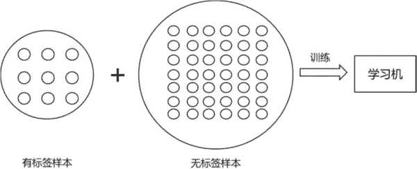

Figure 4-13

Obviously, semi-supervised learning essentially still belongs to supervised learning, but it semi-automates the processing of training data samples, greatly reducing learning costs compared to supervised learning. For various algorithms of supervised and unsupervised learning, if the dataset conforms to the characteristics of semi-supervised learning, semi-supervised learning methods can be adopted.

### 4.1.6 Reinforcement Learning

Reinforcement learning is also known as reinforcement learning (alternate translation) or evaluative learning. If described with a standard definition, the goal of reinforcement learning is to learn an optimal `Policy`, allowing an `Agent` in a specific `Environment` to take an `Action` based on the current `State` to maximize the return. Reinforcement learning is often confused with supervised learning and unsupervised learning.

Reinforcement learning views learning as a trial-and-evaluation process, as shown in Figure 4-14. The agent selects an action to act on the environment; the environment accepts the action, its state changes, and simultaneously generates a reinforcement signal, which is fed back to the agent. The agent selects the next action based on the reinforcement signal and the current state of the environment, with the principle of increasing the probability of receiving positive reinforcement. The selected action not only affects the immediate reinforcement value but also affects the environment's state at the next moment and the final reinforcement value.


Figure 4-14

Supervised learning is like a student taking an exam with a tutor standing beside them; every time the student finishes a question, the tutor immediately tells them if it's right or wrong. But the actual situation is complex; many real problems have no standard answers, only which answer is more suitable. The reinforcement learning process is like training an animal: every time the animal performs a behavior, the trainer needs to give timely feedback, and this good/bad feedback influences its behavior next time. AI reinforcement learning is like this: through repeated reinforcement learning processes, the machine learns which behavior yields the best return. Precisely because reinforcement learning has the characteristic of real-time feedback, it is widely used in the field of robotics.

Both supervised learning and reinforcement learning obtain a mapping relationship from input data to output results through algorithms. Supervised learning gives the relationship between input and output, telling the algorithm what output corresponds to what input. Reinforcement learning gives feedback information, judging whether this behavior is good or bad. Of course, because reinforcement learning gives feedback information, the whole process has latency; therefore, sometimes one needs to go through multiple processes before knowing if a choice at a previous node was correct.


# Machine Learning

## Learning Paradigms

### Supervised Learning

Supervised learning is used when there is the capability to label data and perform classification and regression based on the labeled information.

### Unsupervised Learning

Unsupervised learning involves training without labeled information, typically used for clustering.

### Semi-supervised Learning

Sometimes, the data at hand only has a portion labeled, not all of it. In such cases, semi-supervised learning can be used to complete the training. The "National Government Website Monitoring Project" is a good example.

The National Government Website Monitoring Project monitored over 90,000 government websites nationwide and nearly 2.5 billion pages across all levels of government websites, as shown in Figure 4-12. The project's goal is to monitor whether these pages have anomalies and which pages users are more interested in. For up to billions of pages, labeling all pages is impossible; only tens of thousands of pages are labeled. If unlabeled sample sets are directly discarded, it is not only a waste but also leads to data distortion due to insufficient training samples, thereby affecting the effectiveness of machine learning. How to effectively utilize unlabeled data becomes key.


Figure 4-12

The simplest method is to label the unlabeled pages, but this comes with enormous labor costs. If it takes a person 0.5 minutes to label one page, to label 2.5 billion pages, one person working 365 days a year without rest would take over 2,300 years to complete.

The project team thus adopted a semi-supervised learning approach to complete the labeling work. First, a learner is trained using the labeled sample dataset. Then, based on this learner, predictions are made on the unlabeled samples. Next, the predicted result samples are classified, and samples with high uncertainty and low classification confidence are re-labeled. Finally, the data is expanded into the training set, the learner is retrained, and the final result is generated, as shown in Figure 4-13.


Figure 4-13

Obviously, semi-supervised learning essentially still belongs to supervised learning, but it semi-automates the processing of training data samples. Compared with supervised learning, the learning cost is greatly reduced. For various algorithms of supervised and unsupervised learning, if the dataset conforms to the characteristics of semi-supervised learning, the semi-supervised learning method can be adopted.

### Reinforcement Learning

Reinforcement learning is also known as reinforcement learning (translator's note: the Chinese terms "再励学习、评价学习" both map to Reinforcement Learning, often distinguished as Reinforcement Learning vs. Reward-based Learning, but standard term is Reinforcement Learning). If described with a standard definition, the goal of reinforcement learning is to learn an optimal **`Policy`**, which allows the **`Agent`** to take **`Action`** based on the current **`State`** in a specific **`Environment`**, thereby obtaining the maximum return. Reinforcement learning is often confused with supervised learning and unsupervised learning.

Reinforcement learning regards learning as a trial-and-evaluation process, as shown in Figure 4-14. The agent selects an action to act on the environment; the environment accepts the action, its state changes, and simultaneously generates a reinforcement signal, which is fed back to the agent. The agent selects the next action based on the reinforcement signal and the current state of the environment. The selection principle is to increase the probability of receiving positive reinforcement. The selected action not only affects the immediate reinforcement value but also affects the environment's state at the next moment and the final reinforcement value.


Figure 4-14

Supervised learning is like a student taking an exam with a tutor standing by; every time the student finishes a question, the tutor immediately tells them whether it is right or wrong. But the actual situation is complex; many real-world problems have no standard answers, only answers that are more suitable. The process of reinforcement learning is like training an animal: every time the animal performs a behavior, the trainer needs to give timely feedback, and this good-or-bad feedback influences its behavior next time. AI reinforcement learning is just like this—through repeated reinforcement learning processes, the machine learns which behavior yields the best return. Precisely because reinforcement learning has the characteristic of real-time feedback, it is widely used in the field of robotics.

Both supervised learning and reinforcement learning obtain a relational mapping from input data to output results through algorithms. Supervised learning gives the relationship between input and output, telling the algorithm what output corresponds to what input. Reinforcement learning gives feedback information, judging whether this behavior is good or bad. Of course, because reinforcement learning gives feedback information, the whole process has latency; therefore, sometimes it takes multiple steps before knowing whether the choice at a previous node was correct. `EXr6287u6NNVz+GYLY+7SC6AgGofrpiId/XnwIEoGMEPq3TPzkM5RyXBRbuLcLFjwnCuEHVXaQsGpygWHLFy9g==`

## Core Concepts and Logical Differences

### Logical Differences Between Traditional Software and Machine Learning

Many experts classify machine learning as an interdisciplinary subject because it involves probability theory, statistics, algorithm theory, and other disciplines. Common definitions of machine learning include the following:

- "Machine learning is a science of artificial intelligence; the main research object of this field is artificial intelligence, particularly how to improve the performance of specific algorithms in empirical learning."
- "Machine learning is the study of computer algorithms that can improve automatically through experience."
- "Machine learning uses data or past experience to optimize the performance criteria of computer programs."

Understanding machine learning does not require starting from these complex and obscure definitions; understanding from a simple and easy-to-grasp concept may be more effective. The author believes that **"machine learning is a method of data analysis."**

With the development of the Internet, data volume is growing larger, and how to monetize data has become the primary issue for enterprises. In fact, unprocessed raw data has little use value. Valuable data uses correct analysis techniques to obtain richer data cognition, clearer scenario insights, and more accurate data portraits, thereby obtaining data that can assist decision-making; only then does the meaning of data become prominent. The role of machine learning is to analyze massive data and mine its meaning and value.

As shown in Figure 4-1, data analysis can be divided into the following four categories.

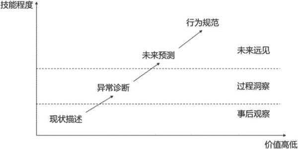

Figure 4-1

- **Current Status Description**: Describe the current state of the real world based on existing data.
- **Anomaly Diagnosis**: Discover anomalies in existing data and understand the causes of these anomalies.
- **Future Prediction**: With time as a dimension, use historical data to view data change trends and predict the probability of a future event occurring.
- **Behavioral Norms**: Consider how to change current or future data to meet future expectations.

What machine learning can do are the aforementioned things. Machine learning describes the real world through learning from data, gains insights into the world, and predicts the evolution of the future world.

In the Internet era, the product manager's job is to analyze existing business and design reasonable system processing logic based on the business process; development engineers implement the product based on the designed system processing logic. Therefore, the computation process from input to output in traditional software is designed, fixed, and explicit, as shown in Figure 4-2. The engineer's role is to design the process and let data be processed according to the designed process.


Figure 4-2

Unlike Internet products and traditional software products, AI products automatically construct logical structures based on existing data. AI products repeatedly learn from data through machine learning algorithms; without telling the computer the business logic, AI algorithms can find the hidden patterns and meanings within.

AI products input training data (input data + result data) into AI algorithms to derive a model, then input new data into this model for computation, thereby deriving results and achieving prediction and judgment, as shown in Figure 4-3. The model derived from data and algorithms replaces the software logic structure designed by product managers or requirement analysts.


Figure 4-3

The difference between machine learning and traditional methods is huge; machine learning subverts the original programming mindset. The traditional programming mindset is for humans to analyze data, find patterns, and obtain final results through "input data + pattern verification"; machine learning does not require humans to analyze and judge data but hands the analysis and judgment work to the machine. After inputting training data, the machine finds the patterns hidden in the data according to the algorithm and applies these patterns in practice.

### Detailed Explanation of Machine Learning Paradigms

Based on different training methods, machine learning is divided into four major learning paradigms: supervised learning, unsupervised learning, semi-supervised learning, and reinforcement learning. The fundamental difference between these four paradigms lies in the difference in data content and training modes.

- **Supervised Learning (also called Supervised Learning)**: Train using labeled data to obtain a model, then process unknown data through this model.
- **Unsupervised Learning**: There are no training data samples in advance; instead, algorithms analyze and model data to find patterns within.
- **Semi-supervised Learning**: In semi-supervised learning training, only a portion of the data used is labeled, while the majority is unlabeled.
- **Reinforcement Learning**: Reinforcement learning also uses unlabeled data, but one can know through some method whether you are getting closer to or further from the correct answer.

Supervised learning is very easy to understand; it continuously trains via machine learning according to human-defined specifications to achieve the optimal solution under this specification. Why does unsupervised learning exist then? Will automated modeling without training go astray? For example, someone knows nothing about music, but by listening more, they can distinguish between classical, modern, jazz, and other genres in a short time. Similarly, if we feed music from different eras, in large quantities, and of different types to a machine, the machine can also find the characteristics of the music based on the use of high, mid, and low tones and rhythm in the audio, complete classification, and we don't need to tell the machine in advance what type of music it is.

Machine learning can solve many problems, but through induction and generalization, they can be divided into classification, regression, clustering, dimensionality reduction, etc., as shown in Figure 4-4. There are many algorithms for solving these problems; common ones are supervised learning algorithms (such as `SVM`, `KNN`, Decision Trees, Naive Bayes, Logistic Regression, Linear Regression, Artificial Neural Networks, etc.) and unsupervised learning algorithms (such as Clustering, `EM` Algorithm, etc.).


Figure 4-4

1. **Classification**: Given a sample feature, we want to predict its corresponding label value. If the attribute value is discrete, this is a classification problem.
2. **Regression**: Given a sample feature, we want to predict its corresponding label value. If the attribute value is continuous, this is a regression problem.
3. **Clustering**: Given a set of sample features, we do not need to predict their corresponding label values but want to discover the distribution of this set of samples in space, such as analyzing which samples are close and which are far apart; this is a clustering problem.
4. **Dimensionality Reduction**: Given a set of sample features, if a low-dimensional subspace is needed to represent the original high-dimensional feature space, this is a dimensionality reduction problem.

The application areas and algorithms for various problems are shown in Table 4-1.

Table 4-1


As a product manager, one needs to have an in-depth understanding of machine learning paradigms and understand what each paradigm is mainly used for, so as to communicate effectively with engineers.

### Detailed Explanation of Supervised Learning

Supervised learning uses labeled historical data for training to derive a model, then inputs new data and derives solutions based on the model, as shown in Figure 4-5.


Figure 4-5

Supervised learning algorithms generate a model using a labeled dataset, then use this model together with new data to verify the model's accuracy, or use real-time data to apply the model to a production environment.

Supervised learning requires a large amount of data as training data, and existing data needs to be divided into training data and test data. If training data is too little, the model may be inaccurate; if too much data is put into training, noise may affect verification. Generally, a ratio of 6:4 to 8:2 for training data to test data is relatively appropriate.

Below, an example illustrates the supervised learning process. For instance, a user uploads a photo, and the system needs to identify whether this photo is of the user themselves. The photo uploaded by the user may be a full-body shot, a half-body shot, or even a close-up of just one eye.

**Step 1: Data Generation and Classification.** First, collect a sufficient number of photos of the user—full body, half body, front, side—as long as it is the user's image, they all exist in one group, called the **training set**. The training set is used for training. Secondly, prepare another group of photos; this group contains some of the user's photos and some of other people's photos; this group is called the **validation set**. The validation set is used to test whether the trained algorithm model can recognize the user. The validation set serves as input to obtain some outputs: output 1 if the photo contains the user, 0 if not.

**Step 2: Training.** When training via an Artificial Neural Network, each image in the training set becomes an input to the network. After computation through each layer of neurons in the network for feature extraction, an output is obtained upon completion. Observe whether the output is 1 or 0.

**Step 3: Validation.** After all data in the first group is used up, use the data in the second group to verify the accuracy of the trained model. This process involves hyperparameter optimization, selection of activation functions, etc.

**Step 4: Encapsulation and Application.** Once the data verification metrics reach the expected targets, the model training is complete. At this point, the model can be encapsulated as an interface and integrated into the software. The software interacts with users through the interface; when a user uploads a photo, the software automatically calls the interface to complete the computation and returns the result to the software program interface.

An AI product manager does not necessarily need to understand algorithm design or specifically implement algorithms, but must understand the content, characteristics, and achievable goals of the algorithms. Below, two supervised learning algorithms will be introduced: `SVM` and the Naive Bayes Classifier.

#### Support Vector Machine (SVM)

`SVM`, also known as Support Vector Machine, is a very popular supervised learning model used for classification or regression. `SVM` can effectively solve problems of small samples, non-linearity, and high-dimensional pattern recognition, so its application is very wide. This book assumes a two-dimensional space with different shapes, as shown in Figure 4-6.


Figure 4-6

`C` [1] and `C` [2] are two shape categories in the planar space. `C` [1] is a cylinder, `C` [2] is a cube. The diagonal line in the middle with slope `W` is the classification function, which can completely separate the two samples. If a linear function can completely separate the samples, the data is generally called **linearly separable**; otherwise, it is called **non-linearly separable**. Observation reveals that the diagonal line in the figure can actually change its slope or move up and down, as shown in Figure 4-7. Any straight line with slope `W` between `WX - Y = -1` and `WX - Y = 1` can completely separate the samples, but the straight line that is equidistant from the sample points and has the maximum distance is the optimal solution, i.e., `WX - Y = 0`. The classification function is a point in one-dimensional space, a straight line in two-dimensional space, a plane in three-dimensional space, and of course, there are higher-dimensional or infinite-dimensional classification functions, collectively called **hyperplanes**.


Figure 4-7

The purpose of `SVM` is to find a hyperplane that can divide the samples into two categories and maximize the classification margin; this is the basic theoretical model of `SVM`. Of course, if objects in the world are evenly dispersed and regular, results are easily obtained, but the actual situation is not like that; it is often as shown in Figure 4-8, with cylinders and cubes irregularly scattered in this plane.


Figure 4-8

It is almost impossible to classify the shapes shown in Figure 4-8 using a simple function. Thus, scientists proposed a new concept: **"Kernel Function"**, which maps samples from the original space to a higher-dimensional space, and through the division of the mappings in the high-dimensional space, ultimately achieves linear division.

**Step 1: Upgrade the two-dimensional space to three-dimensional space**, as shown in Figure 4-9.


Figure 4-9

**Step 2: Project the two-dimensional sample data into the three-dimensional space**, as shown in Figure 4-10.


Figure 4-10

**Step 3: Perform slicing in the three-dimensional space, and map the sliced hyperplane back to a two-dimensional plane**, as shown in Figure 4-11.


Figure 4-11

Thus, a new kernel function is completed. Because non-linear space is complex, and it is impossible to quickly know which kernel function is best suited to convert non-linear space into linear space, `SVM` usually employs multiple kernel functions to identify the best option.

#### Naive Bayes Classifier

If your boss assigns you an analysis task with a medium amount of data, few variables, and hopes you can complete data prediction quickly, the Naive Bayes Theorem is a good choice. Let's first look at the expression of Bayes' Theorem (4-1):


(4-1)

Changing the expression form makes it easier to understand:

`P(Class|Feature) = P(Feature|Class) * P(Class) / P(Feature)`

If we want to distinguish between Product Managers and Programmers based on gender and weight, we are seeking `P(Programmer|Gender, Weight)` and `P(Product Manager|Gender, Weight)`. According to Bayes' Theorem:

`P(Occupation|Gender, Weight) = P(Gender|Occupation) * P(Occupation) / P(Weight)`

Besides Bayes' Theorem, there is the Naive Bayes Theorem. The Naive Bayes Theorem is an algorithm derived from Bayes' Theorem with a basic assumption. The Naive Bayes Theorem assumes that all data attributes are independent and do not affect each other. It is precisely through this assumption that many complex problems can be simplified, and the Naive Bayes Theorem is also very suitable for predicting unknown datasets and making data predictions. For example, according to the Naive Bayes Theorem, we can know that gender and weight are independent, i.e.,

`P(Weight|Occupation, Gender) = P(Weight|Occupation)`

`P(Gender, Weight|Occupation) = P(Gender|Occupation) × P(Weight|Occupation)`

The Naive Bayes Theorem has the following advantages:
1. The Naive Bayes algorithm is simple and easy to understand;
2. The Naive Bayes Theorem has high performance and fast calculation speed;
3. The Naive Bayes Theorem excels at data prediction;
4. The Naive Bayes Theorem requires very little training data.

Precisely because the Naive Bayes Theorem has the above advantages, it can often be seen in real-time prediction and multi-class prediction. Not only that, because text classification has many variable types and the types are relatively independent, the Naive Bayes Theorem has also been widely used in text classification, such as spam identification, website content identification, news recommendation, etc.

### Detailed Explanation of Unsupervised Learning

Using data without any labels, learning the distribution of data or the relationships between data through algorithms is called unsupervised learning. The goal of unsupervised learning is to use algorithms to explore hidden structures and characteristics in the data. These structures and characteristics are impossible for humans to directly understand or achieve through manpower. Because there are no labels, it is also difficult to evaluate whether the results of unsupervised learning are correct. However, if data is grouped through unsupervised learning, people can understand hidden information in the original data that was unforeseeable.

If the way students learn in school is called supervised learning, then children who don't go to school can also perform unsupervised learning through their own observation and understanding of the world, except what they learn is casual and random, the final learning outcome is unpredictable, and AI is the same. In 2017, there was a news story: two AI robots manufactured by American scientists created a language only the two of them could understand through self-study, and these two robots had begun to communicate using a language only they could understand, causing great panic.

Unsupervised learning has been verified in many application scenarios. If you open a clothing factory to produce clothes, how do you determine the S, M, L sizes? If you possess the height values of all Chinese people, you can determine this through unsupervised learning. Precisely because unsupervised learning has no human labeling, as of now, unsupervised learning still cannot reach the accuracy and effectiveness of supervised learning, so unsupervised learning has always been criticized by some scientists in the AI community. But in recent years, unsupervised learning has become hot again; some scientists even claim that unsupervised learning is the future of AI.

Currently, the more popular **"Generative Adversarial Network (GAN)"** in unsupervised learning works by connecting a generative network and a discriminative network. The generative network is responsible for generating data intended to try to deceive the discriminative network. Through the adversarial learning of the two networks, some surprising results have been obtained, such as AI technology that can generate photo-realistic images from text strings or hand-drawn sketches.


# 4.1 Machine Learning

Many experts classify machine learning as an interdisciplinary subject because it involves probability theory, statistics, algorithm theory, and other disciplines. Common definitions of machine learning include the following:

- "Machine learning is a science of artificial intelligence; the main research object of this field is artificial intelligence, specifically how to improve the performance of specific algorithms in empirical learning."
- "Machine learning is the study of computer algorithms that can improve automatically through experience."
- "Machine learning uses data or past experience to optimize the performance criteria of computer programs."

It is not necessary to understand machine learning starting from these complex and convoluted definitions; understanding it from a simple and easy-to-grasp concept may yield twice the result with half the effort. The author believes that "machine learning is a method of data analysis."

With the development of the Internet, data volumes are growing larger, and how to monetize data has become the primary issue for enterprises. In fact, unprocessed raw data has little practical value. Valuable data is obtained by using correct analysis techniques to gain richer data cognition, clearer scenario insights, and more accurate data portraits, thereby deriving data that can assist decision-making; only then does the significance of data become prominent. The role of machine learning is to analyze massive amounts of data and mine its meaning and value.

As shown in Figure 4-1, data analysis can be divided into the following four categories.


- **Status Description**: Describe the status quo of the real world based on existing data.
- **Anomaly Diagnosis**: Discover anomalies in existing data and understand the causes of these anomalies.
- **Future Prediction**: Use historical data to view data trends with time as the dimension, predicting the probability of a future event occurring.
- **Behavioral Norms**: Consider how to change current or future data to meet future expectations.

What machine learning can do is also the aforementioned tasks. Machine learning describes the real world and gains insights into it through learning from data, and predicts the evolution of the future world.

## 4.1.1 Logical Differences Between Traditional Software and Machine Learning

In the Internet era, the product manager's job is to analyze existing business and design reasonable system processing logic based on the business process; development engineers implement the product based on the designed system processing logic. Therefore, the computation process of traditional software from input to output is designed, fixed, and explicit, as shown in Figure 4-2. The engineer's role is to design the process and let the data be processed according to the designed process.


Unlike Internet products and traditional software products, AI products automatically construct logical structures based on existing data. AI products repeatedly learn from data through machine learning algorithms; without telling the computer the business logic, AI algorithms can find the hidden patterns and meanings within.

AI products feed training data (input data + result data) into AI algorithms to derive a model, then feed new data into this model for computation to obtain results, achieving prediction and judgment, as shown in Figure 4-3. The model derived from data and algorithms replaces the software logic structure designed by product managers or requirement analysts.


The difference between machine learning and traditional methods is huge; machine learning subverts the original programming mindset. The traditional programming mindset involves humans analyzing data, finding patterns, and obtaining final results through "input data + pattern verification"; machine learning does not require humans to analyze and judge data but hands the analysis and judgment work over to the machine. After inputting training data, the machine finds the hidden patterns in the data according to the algorithm and applies these patterns in practice.

## 4.1.2 Learning Paradigms of Machine Learning

Depending on the training method, machine learning is divided into four major learning paradigms: supervised learning, unsupervised learning, semi-supervised learning, and reinforcement learning. The fundamental difference between these four paradigms lies in the difference in data content and training modes.

- **Supervised Learning**: Training is performed using labeled data to obtain a model, which is then used to process unknown data.
- **Unsupervised Learning**: There are no training data samples beforehand; instead, algorithms analyze and model the data to find patterns within.
- **Semi-Supervised Learning**: In semi-supervised learning training, only a portion of the data used is labeled, while the majority is unlabeled.
- **Reinforcement Learning**: Reinforcement learning also uses unlabeled data, but it can know whether it is getting closer to or further from the correct answer through some method.

Supervised learning is very easy to understand; it follows human-defined specifications and continuously trains via machine learning to achieve the optimal solution under this specification. Why then does unsupervised learning exist? Will automated modeling without training go astray? For example, someone who knows nothing about music can distinguish between classical, modern, jazz, and other genres just by listening more, without taking too long. Similarly, if we feed music from different eras, in large quantities, and of different types to a machine, the machine can also find the characteristics of the music based on the use of high, mid, and low frequencies and rhythm in the audio, complete the classification, and do so without us telling the machine the music genre in advance.

Machine learning can solve many problems, but through induction and generalization, they can be divided into classification, regression, clustering, dimensionality reduction, etc., as shown in Figure 4-4. Many algorithms are used to solve these problems; common ones include supervised learning algorithms (such as `SVM`, `KNN`, Decision Trees, Naive Bayes, Logistic Regression, Linear Regression, Artificial Neural Networks, etc.) and unsupervised learning algorithms (such as Clustering, `EM` algorithm, etc.).


1. **Classification**: Given a sample feature, we want to predict its corresponding label value; if the attribute value is discrete, this is a classification problem.
2. **Regression**: Given a sample feature, we want to predict its corresponding label value; if the attribute value is continuous, this is a regression problem.
3. **Clustering**: Given a set of sample features, we do not need to predict their corresponding label values but want to discover the spatial distribution of this set of samples, such as analyzing which samples are close and which are far apart; this is a clustering problem.
4. **Dimensionality Reduction**: Given a set of sample features, if a low-dimensional subspace is needed to represent the original high-dimensional feature space, this is a dimensionality reduction problem.

The application areas and algorithms for various problems are shown in Table 4-1.

**Table 4-1**


As a product manager, one needs to have an in-depth understanding of machine learning paradigms and know what each paradigm is mainly used for, in order to communicate effectively with engineers.

## 4.1.3 Supervised Learning

Supervised learning uses labeled historical data for training to derive a model, then inputs new data and obtains solutions based on the model, as shown in Figure 4-5.


Supervised learning algorithms generate models using labeled datasets, then verify the model's accuracy using the model with new data, or apply the model to production environments using real-time data.

Supervised learning requires a large amount of data as training data, necessitating the division of existing data into training data and test data. If training data is too small, the model may be inaccurate; if too much data is put into training, noise may affect validation. Generally, a ratio of `6:4 ~ 8:2` for training data to test data is relatively appropriate.

Below, an example illustrates the supervised learning process. For instance, a user uploads a photo, and the system needs to identify whether the photo is of the user themselves. The uploaded photo could be a full-body shot, a half-body shot, or even a close-up of just one eye.

**Step 1: Data Generation and Classification.** First, collect a sufficient number of photos of the user—full body, half body, front, side—as long as they are images of the user, they go into one group, called the training set. The training set is used for training. Second, prepare another group of photos, some of the user and some of others; this group is called the validation set. The validation set tests whether the trained algorithm model can recognize the user. The validation set serves as input, yielding outputs: output `1` if the user is in the photo, `0` if not.

**Step 2: Training.** When training via an artificial neural network, each image in the training set becomes an input to the network. After computation through each layer of neurons in the network for feature extraction, an output is obtained upon completion; observe whether the output is `1` or `0`.

**Step 3: Validation.** After all data in the first group is used up, use the data in the second group to validate the accuracy of the trained model. This process involves hyperparameter optimization, selection of activation functions, etc.

**Step 4: Encapsulation and Application.** Once the data validation metrics reach the expected targets, the model training is complete. At this point, the model can be encapsulated as an interface and integrated into the software. The software interacts with users through the interface; when a user uploads a photo, the software automatically calls the interface to complete the computation and returns the result to the software program interface.

AI product managers do not necessarily need to understand algorithm design or implement algorithms specifically, but they must understand the content, characteristics, and achievable goals of the algorithms. Below, two supervised learning algorithms will be introduced: `SVM` and the Naive Bayes Classifier.

### 1. SVM

`SVM`, also known as Support Vector Machine, is a very popular supervised learning model used for classification or regression. `SVM` can effectively solve problems of small samples, non-linearity, and high-dimensional pattern recognition, so its application is very wide. This book assumes a two-dimensional space with different shapes, as shown in Figure 4-6.


`*C* [1]` and `*C* [2]` are two shape categories in the planar space; `*C* [1]` is a cylinder, `*C* [2]` is a cube. The oblique line in the middle with slope `*W*` is the classification function, which can completely separate the two samples. If a linear function can completely separate the samples, the data is generally called linearly separable; otherwise, it is called non-linearly separable. Observation reveals that the oblique line in the figure can actually change its slope or move up and down, as shown in Figure 4-7. Any straight line with slope `*W*` between `*WX* - *Y* =-1` and `*WX* - *Y* =1` can completely separate the samples, but the straight line equidistant from the sample points and with the maximum distance is the optimal solution, i.e., `*WX* - *Y* =0`. The classification function is a point in one-dimensional space, a straight line in two-dimensional space, a plane in three-dimensional space, and of course, there are classification functions in higher or even infinite dimensions, collectively called hyperplanes.


The purpose of `SVM` is to find a hyperplane that can divide the samples into two classes with the maximum classification margin; this is the basic theoretical model of `SVM`. Of course, if objects in the world are evenly dispersed and regular, results are easily obtained, but the actual situation is not like that; it is often as shown in Figure 4-8, with cylinders and cubes irregularly scattered in this plane.


Trying to classify the shapes shown in Figure 4-8 with a simple function is almost impossible. Thus, scientists proposed a new concept: "Kernel Function," which maps samples from the original space to a higher-dimensional space, achieving linear separation through division in the mapped high-dimensional space.

**Step 1:** Upgrade the two-dimensional space to three-dimensional space, as shown in Figure 4-9.


**Step 2:** Project the two-dimensional sample data into the three-dimensional space, as shown in Figure 4-10.


**Step 3:** Perform slicing in the three-dimensional space and map the sliced hyperplane back to a two-dimensional plane, as shown in Figure 4-11.


Thus, a new kernel function is completed. Because non-linear space is complex and it is impossible to quickly know which kernel function is best suited to convert non-linear space to linear space, `SVM` usually employs multiple kernel functions to identify the best option.

### 2. Naive Bayes Classifier

If a leader assigns you an analysis task with a medium amount of data, few variables, and a need for quick data prediction, the Naive Bayes Theorem is a good choice. First, let's look at the expression of Bayes' Theorem (4-1):


(4-1)

Changing the expression form makes it easier to understand:

`*P* (Class|Features) = *P* (Features|Class) *P* (Class) / *P* (Features)`

If we want to distinguish between Product Managers and Programmers based on gender and weight, we are seeking `*P* (Programmer|Gender, Weight)` and `*P* (Product Manager|Gender, Weight)`. According to Bayes' Theorem:

`*P* (Occupation|Gender, Weight) = *P* (Gender|Occupation) *P* (Occupation) / *P* (Weight)`

Besides Bayes' Theorem, there is the Naive Bayes Theorem. The Naive Bayes Theorem is an algorithm derived from Bayes' Theorem with a basic assumption. The Naive Bayes Theorem assumes that all data attributes are independent and do not affect each other. It is precisely through this assumption that many complex problems can be simplified, and the Naive Bayes Theorem is also very suitable for predicting unknown datasets and making data predictions. For example, according to the Naive Bayes Theorem, gender and weight are independent, i.e.,

`*P* (Weight|Occupation, Gender) = *P* (Weight|Occupation)`

`*P* (Gender, Weight|Occupation) = *P* (Gender|Occupation) × *P* (Weight|Occupation)`

The Naive Bayes Theorem has the following advantages:
1. The algorithm is simple and easy to understand;
2. High performance and fast calculation speed;
3. Excels at data prediction;
4. Requires very little training data.

Precisely because of these advantages, the Naive Bayes Theorem is often seen in real-time prediction and multi-class prediction. Not only that, because text classification involves many variable types that are relatively independent of each other, the Naive Bayes Theorem is widely used in text classification, such as spam identification, website content identification, news recommendation, etc.

## 4.1.4 Unsupervised Learning

Using data without any labels, learning the distribution of data or the relationships between data through algorithms is called unsupervised learning. The goal of unsupervised learning is to use algorithms to explore hidden structures and characteristics in the data. These structures and characteristics are impossible for humans to know directly or achieve through manpower. Because there are no labels, it is difficult to evaluate whether the results of unsupervised learning are correct. However, if data is grouped through unsupervised learning, people can learn hidden information unforeseen in the raw data.

### AI Evaluation Metrics

AI evaluation metrics usually come in three types: Precision, Recall, and Accuracy. In unsupervised learning, these three metrics are very important; people usually use these three metrics to evaluate unsupervised learning.

**Precision**: For a given test dataset, the ratio of correctly classified samples by the classifier to the total number of samples. Simply put, precision means "what you caught is correct." Like police catching thieves: 10 people caught, 9 are thieves, precision is 90%.

**Recall**: For a given test dataset, the number of all correctly classified samples correctly found by the classifier. Simply put, recall means "you caught them all." Still using the police catching thieves example: 100 people, 20 are thieves, 10 thieves caught, recall is 50%.

**Accuracy**: Represents the proportion of correct identifications. That is, the probability of good people being identified as good and bad people as bad. Continuing the example: 100 people, 20 thieves, 10 caught, but 1 is not a thief, accuracy is 90%.

Precision, Recall, and Accuracy are key metrics for measuring AI algorithms; the higher these three metrics, the better the algorithm's adaptability.

## 4.1.5 Semi-Supervised Learning

Supervised learning is used when there is the capability to label data and perform classification and regression targeting the label information; unsupervised learning is used for training when label information is not included, usually for clustering. Sometimes, the data at hand often has only a portion labeled, not all; then semi-supervised learning can be used to complete training. The "National Government Website Monitoring Project" is a good example.

The National Government Network Monitoring Project monitored over 90,000 government websites nationwide and nearly 2.5 billion pages at all levels of government websites, as shown in Figure 4-12. The project's task is to monitor whether these pages have anomalies and which pages users are more interested in. For up to billions of pages, labeling all pages is impossible; only tens of thousands of pages are labeled. If unlabeled samples are directly discarded, it is not only a pity but also leads to data distortion due to insufficient training samples, affecting the machine learning effect. How to effectively utilize unlabeled data becomes key.

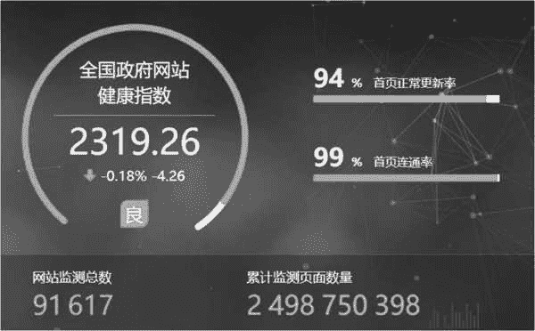

The simplest method is to label unlabeled pages, but this comes with huge labor costs. If one person takes 0.5 minutes to label a page, labeling 2.5 billion pages would take one person working 365 days non-stop over 2,300 years to complete.

The project team thus adopted semi-supervised learning to complete the labeling work. First, a learner is trained using the labeled sample dataset; then, based on this learner, predictions are made on unlabeled samples; next, the predicted result samples are classified, and samples with high uncertainty and low classification confidence are re-labeled; finally, the data is expanded into the training set, the learner is retrained, and the final result is generated, as shown in Figure 4-13.


Obviously, semi-supervised learning essentially still belongs to supervised learning, but it semi-automates the processing of training data samples, greatly reducing learning costs compared to supervised learning. For various algorithms of supervised and unsupervised learning, if the dataset conforms to the characteristics of semi-supervised learning, semi-supervised learning methods can be adopted.

## 4.1.6 Reinforcement Learning

Reinforcement learning is also known as reinforcement learning or evaluative learning. If described with a standard definition, the goal of reinforcement learning is to learn an optimal policy (Policy) that allows an agent (Agent) in a specific environment (Environment) to take actions (Action) based on the current state (State) to obtain maximum reward. Reinforcement learning is often confused with supervised and unsupervised learning.

Reinforcement learning views learning as a trial-and-evaluation process, as shown in Figure 4-14. The agent selects an action acting on the environment; the environment accepts the action, its state changes, and simultaneously generates a reinforcement signal, feeding this signal back to the agent. The agent selects the next action based on the reinforcement signal and the current environment state, with the principle of increasing the probability of receiving positive reinforcement. The selected action not only affects the immediate reinforcement value but also the environment's state at the next moment and the final reinforcement value.


Supervised learning is like a student taking an exam with a tutor standing by; every time the student finishes a question, the tutor immediately tells them if it's right or wrong. But the actual situation is complex; many real problems have no standard answers, only which answer is more suitable. The reinforcement learning process is like training an animal; every time the animal performs a behavior, the trainer must give timely feedback, and this good/bad feedback influences its behavior next time. AI reinforcement learning is just that: through repeated reinforcement learning processes, the machine learns which behavior yields the best reward. Precisely because reinforcement learning has the characteristic of real-time feedback, it is widely used in the field of robotics.

Both supervised learning and reinforcement learning obtain a mapping relationship from input data to output results through algorithms. Supervised learning gives the relationship between input and output, telling the algorithm what output corresponds to what input. Reinforcement learning gives feedback information, judging whether this behavior is good or bad. Of course, because reinforcement learning gives feedback information, the whole process has latency; therefore, sometimes it takes multiple processes before knowing if a choice at a previous node was correct.

`EXr6287u6NNVz+GYLY+7SC6AgGofrpiId/XnwIEoGMEPq3TPzkM5RyXBRbuLcLFjwnCuEHVXaQsGpygWHLFy9g==`


### 4.1.4 Unsupervised Learning

If the way students learn in school is called supervised learning, then children who don't go to school can also engage in unsupervised learning through their own observation and understanding of the world. However, what they learn is spontaneous and arbitrary, and the final learning outcomes are unpredictable. The same applies to artificial intelligence. In 2017, there was a news story: two AI robots created by American scientists invented a language only they could understand through self-study, and these two robots had already begun communicating in a language only they could understand, which caused great panic among people.

Unsupervised learning has been validated in many application scenarios. If you open a garment factory to produce clothes, how do you determine clothing sizes S, M, and L? If you possess the height data of the entire Chinese population, you can determine this through unsupervised learning. Precisely because unsupervised learning lacks manual labeling, it has not yet reached the accuracy and effectiveness of supervised learning to date. Therefore, unsupervised learning has always been criticized by some scientists in the AI community. But in recent years, unsupervised learning has become hot again, with some scientists even claiming that unsupervised learning is the future of artificial intelligence.

Currently, the principle of the popular `Generative Adversarial Network (GAN)` in unsupervised learning is to connect a generative network and a discriminative network. The generative network is responsible for generating data intended to try to deceive the discriminative network. Through the adversarial learning of the two networks, some surprising results have been obtained, such as AI technology that can generate photo-realistic images from text strings or hand-drawn sketches.

There are usually three evaluation metrics for AI: `Precision`, `Recall`, and `Accuracy`. In unsupervised learning, these three metrics are very important, and people usually use these three metrics to evaluate unsupervised learning.

**Precision**: For a given test dataset, the ratio of the number of samples correctly classified by the classifier to the total number of samples. Simply put, precision means "querying accurately." Like a policeman catching thieves: if 10 people are caught, and 9 of them are thieves, then the precision is 90%.

**Recall**: For a given test dataset, the number of all correctly classified samples correctly found by the classifier. Simply put, recall means "querying comprehensively." Again, using the policeman catching thieves example: there are 100 people, 20 of whom are thieves; if 10 thieves are caught, the recall is 50%.

**Accuracy**: Represents the proportion of correct identifications. That is, the probability that good people are identified as good people and bad people are identified as bad people. Continuing with the policeman catching thieves example: there are 100 people, 20 of whom are thieves; 10 people are caught, but 1 of them is not a thief, then the accuracy is 90%.

Precision, Recall, and Accuracy are key indicators for measuring AI algorithms. The higher these three indicators, the better the adaptability of the algorithm.

### 4.1.5 Semi-Supervised Learning

Supervised learning is used when there is the capability to label data and perform classification and regression based on the labeled information; unsupervised learning is training without labeled information, usually used for clustering. Sometimes, the data at hand often has only a portion labeled rather than fully labeled; at this time, semi-supervised learning can be used to complete the training. The "National Government Website Monitoring Project" is a good example.

The National Government Website Monitoring Project monitored over 90,000 government websites nationwide and nearly 25 billion pages of various levels of government websites, as shown in Figure 4-12. The project's task is to monitor whether these web pages have anomalies and which pages users are more interested in. For up to tens of billions of pages, it is impossible to label all pages; only a few tens of thousands of pages are labeled. If the unlabeled sample set is directly discarded, it is not only a pity but will also lead to data distortion due to insufficient training samples, thereby affecting the effect of machine learning. How to effectively utilize unlabeled data becomes the key.


Figure 4-12

The simplest method is to label the unlabeled pages, but this comes with huge labor costs. If it takes a person 0.5 minutes to label a page, to label 2.5 billion pages, one person working 365 days a year without rest would take over 2,300 years to complete.

The project team thus adopted a semi-supervised learning method to complete the labeling work. First, a learner is trained using the labeled sample dataset; then, based on this learner, predictions are made on the unlabeled samples; next, the predicted result samples are classified, and samples with high uncertainty and low classification confidence are re-labeled twice; finally, the data is expanded into the training set, the learner is retrained, and the final result is generated, as shown in Figure 4-13.


Figure 4-13

Obviously, semi-supervised learning essentially still belongs to supervised learning, but it semi-automates the processing of training data samples. Compared with supervised learning, the learning cost is greatly reduced. For various algorithms of supervised learning and unsupervised learning, if the dataset conforms to the characteristics of semi-supervised learning, the semi-supervised learning method can be adopted.

### 4.1.6 Reinforcement Learning

Reinforcement learning is also known as reinforcement learning (note: the Chinese term "再励学习/评价学习" maps to the same English term) or evaluative learning. If described with a standard definition, the goal of reinforcement learning is to learn an optimal `Policy`, which allows the `Agent` to take an `Action` based on the current `State` in a specific `Environment` to maximize the return. Reinforcement learning is often confused with supervised learning and unsupervised learning.

Reinforcement learning regards learning as a trial-and-evaluation process, as shown in Figure 4-14. The agent selects an action to act on the environment; the environment changes state after accepting the action and simultaneously generates a reinforcement signal, which is fed back to the agent. The agent selects the next action based on the reinforcement signal and the current state of the environment. The principle of selection is to increase the probability of receiving positive reinforcement. The selected action not only affects the immediate reinforcement value but also affects the state of the environment at the next moment and the final reinforcement value.


Figure 4-14

Supervised learning is like a student taking an exam with a tutor standing next to them; every time the student finishes a question, the tutor immediately tells them whether they got it right or wrong. But the actual situation is complex; many practical problems have no standard answers, only which answer is more suitable. The process of reinforcement learning is like training an animal: every time the animal performs a behavior, the trainer needs to give timely feedback, and this good-or-bad feedback will influence its behavior next time. AI reinforcement learning is like this: through repeated reinforcement learning processes, the machine learns which behavior can obtain the best return. Precisely because reinforcement learning has the characteristic of real-time feedback, it is widely used in the field of robotics.

Both supervised learning and reinforcement learning obtain a relationship mapping from input data to output results through algorithms. Supervised learning gives the relationship between input and output, telling the algorithm what input corresponds to what output. Reinforcement learning gives feedback information, judging whether this behavior is good or bad. Of course, because reinforcement learning gives feedback information, the whole process has latency; therefore, sometimes it takes multiple processes before knowing whether the choice at a previous node was correct.

## 4.1 Machine Learning

Many experts classify machine learning as an interdisciplinary subject because machine learning involves multiple disciplines such as probability theory, statistics, and algorithm theory. Common definitions of machine learning include the following.

> "Machine learning is a science of artificial intelligence; the main research object of this field is artificial intelligence, especially how to improve the performance of specific algorithms in empirical learning."
>
> "Machine learning is the study of computer algorithms that can improve automatically through experience."
>
> "Machine learning uses data or past experience to optimize the performance criteria of computer programs."

It is not necessary to understand machine learning starting from these complex and obscure definitions; understanding from a simple and easy-to-grasp concept may be more effective with half the effort. The author believes that "machine learning is a method of data analysis."

With the development of the Internet, the amount of data is growing larger, and how to monetize data has become the primary issue for enterprises. In fact, unprocessed raw data has little use value. Valuable data is obtained by using correct analysis techniques to gain richer data cognition, clearer scenario insights, and more accurate data portraits, thereby obtaining data that can assist decision-making; only then does the significance of data become prominent. The role of machine learning is to analyze massive data and mine its meaning and value.

As shown in Figure 4-1, data analysis can be divided into the following four categories.


Figure 4-1

**Current Status Description**: Describe the current state of the real world based on existing data.

**Anomaly Diagnosis**: Discover anomalies in existing data and understand the reasons for their occurrence.

**Future Prediction**: With time as a dimension, use historical data to view data change trends and predict the probability of a future event occurring.

**Behavioral Norms**: Consider how to change current or future data to meet future expectations.

What machine learning can do is also the above-mentioned things. Machine learning describes the real world and gains insights into it through learning from data, and predicts the evolution of the future world.

### 4.1.1 Logical Differences Between Traditional Software and Machine Learning

In the Internet era, the product manager's job is to analyze existing business and design a reasonable system processing logic based on the business process; development engineers implement the product based on the designed system processing logic. Therefore, the computation process of traditional software from input to output is designed, fixed, and definite, as shown in Figure 4-2. The engineer's role is to design the process and let the data be processed according to the designed process.


Figure 4-2

Unlike Internet products and traditional software products, AI products automatically construct logical structures based on existing data. AI products repeatedly learn from data through machine learning algorithms; there is no need to tell the computer the business logic, and the AI algorithm can find the hidden rules and meanings within.

AI products input training data (input data + result data) into an AI algorithm to derive a model, then input new data into this model for computation, thereby obtaining results and achieving prediction and judgment, as shown in Figure 4-3. The model derived from data and algorithms replaces the software logic structure designed by product managers or requirement analysts.


Figure 4-3

The difference between machine learning and traditional methods is huge; machine learning subverts the original program thinking. The traditional program thinking is for humans to analyze data, find rules, and obtain final results through "input data + rule verification"; machine learning does not require humans to analyze and judge data but hands the work of analysis and judgment to the machine. After inputting training data, the machine finds the rules hidden in the data according to the algorithm and applies these rules in practice.

### 4.1.2 Learning Paradigms of Machine Learning

Depending on the training method, machine learning is divided into four major learning paradigms: supervised learning, unsupervised learning, semi-supervised learning, and reinforcement learning. The fundamental difference between these four learning paradigms lies in the difference in data content and training modes.

**Supervised Learning (also known as Supervised Learning)**: Training through labeled data to obtain a model, and processing unknown data through this model.

**Unsupervised Learning**: No training data samples in advance; instead, analyzing and modeling data through algorithms to find the rules within.

**Semi-Supervised Learning**: In semi-supervised learning training, only a portion of the data used is labeled, while the vast majority is unlabeled.

**Reinforcement Learning**: Reinforcement learning also uses unlabeled data, but it can know whether you are getting closer to or further from the correct answer through some method.

Supervised learning is very easy to understand; it follows human-defined specifications and continuously trains through machine learning to achieve the optimal solution under this specification. Why does unsupervised learning exist then? Will automated modeling without training go astray? For example, someone knows nothing about music, but by listening more, they can distinguish between classical, modern, jazz, and other genres in a short time. Similarly, we feed music from different eras, in large quantities, and of different types to the machine, and the machine can also find the characteristics of the music and complete classification based on the use of high, mid, and low tones and rhythm in the audio, without us telling the machine in advance what type of music it is.

Machine learning can solve many problems, but through induction and summary, they can be divided into `Classification`, `Regression`, `Clustering`, `Dimensionality Reduction`, etc., as shown in Figure 4-4. There are many algorithms for solving these problems; common ones are supervised learning algorithms (such as `SVM`, `KNN`, `Decision Tree`, `Naive Bayes`, `Logistic Regression`, `Linear Regression`, `Artificial Neural Network`, etc.) and unsupervised learning algorithms (such as `Clustering`, `EM Algorithm`, etc.).


Figure 4-4

1. **Classification**: Given a sample feature, we want to predict its corresponding label value. If the attribute value is discrete, this is a classification problem.
2. **Regression**: Given a sample feature, we want to predict its corresponding label value. If the attribute value is continuous, this is a regression problem.
3. **Clustering**: Given a set of sample features, we do not need to predict their corresponding label values but want to discover the distribution of this set of samples in space, such as analyzing which samples are close and which are far apart; this is a clustering problem.
4. **Dimensionality Reduction**: Given a set of sample features, if a low-dimensional subspace is needed to represent the original high-dimensional feature space, this is a dimensionality reduction problem.

The application areas and algorithms for various problems are shown in Table 4-1.

Table 4-1


As a product manager, one needs to have an in-depth understanding of the learning paradigms of machine learning and also understand what each learning paradigm is mainly used for, so as to communicate effectively with engineers.

### 4.1.3 Supervised Learning

Supervised learning uses labeled historical data for training to derive a model, then inputs new data and obtains a solution based on the model, as shown in Figure 4-5.

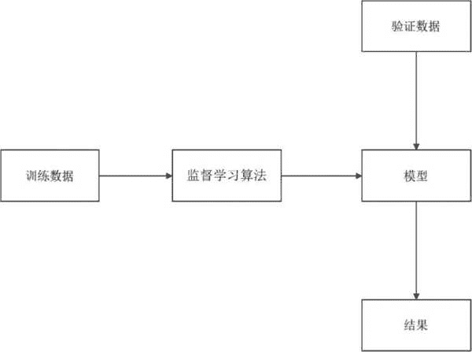

Figure 4-5

Supervised learning algorithms generate a model using a labeled dataset, then use this model together with new data to verify the model's accuracy, or use real-time data to apply the model to a production environment.

Supervised learning requires a large amount of data as training data, and existing data needs to be divided into training data and test data. If the training data is too small, the model may be inaccurate; if too much data is put into training, it may affect verification due to too many noise points. Generally, a ratio of 6:4 to 8:2 for training data to test data is relatively appropriate.

Below, the process of supervised learning is illustrated through a practical example. For instance, a user uploads a photo, and the system needs to identify whether this photo is of the user themselves. The photo uploaded by the user may be a full-body shot, a half-body shot, or even a close-up of just one eye.

**Step 1: Data Generation and Classification.** First, collect a sufficient number of photos of the user—full body, half body, front, side—as long as it is the user's image, they all exist in one group, called the training set. The training set is used for training. Secondly, prepare another group of photos; this group contains some photos of the user and some of others; this group is called the validation set. The validation set is used to test whether the trained algorithm model can recognize the user. The validation set serves as input to obtain some outputs: output 1 if the photo contains the user, 0 if not.

**Step 2: Training.** When training through an `Artificial Neural Network`, each image in the training set becomes the input of the `Artificial Neural Network`. After computation by each layer of neurons in the `Artificial Neural Network` for feature extraction, an output is obtained upon completion; observe whether the output is 1 or 0.

**Step 3: Validation.** After all data in the first group is used up, use the data in the second group to validate the accuracy of the trained model. This process involves hyperparameter optimization, selection of activation functions, etc.

**Step 4: Encapsulation and Application.** Once the data validation indicators reach the expected indicators, the model training is complete. At this point, the model can be encapsulated as an interface and integrated into the software. The software interacts with the user through the interface; when the user uploads a photo, the software automatically calls the interface to complete the calculation and returns the result to the software program interface.

AI product managers do not necessarily need to understand algorithm design or specifically implement algorithms, but they must understand the content and characteristics of algorithms and the goals algorithms can achieve. Below, two supervised learning algorithms will be introduced: `SVM` and `Naive Bayes Classifier`.

#### SVM

`SVM` stands for Support Vector Machine, a very popular supervised learning model used for classification or regression. `SVM` can effectively solve problems of small samples, non-linearity, and high-dimensional pattern recognition, so its application is very wide. This book assumes there are different shapes in a two-dimensional space, as shown in Figure 4-6.


Figure 4-6

`C[1]` and `C[2]` are two categories of shapes in the planar space. `C[1]` is a cylinder, `C[2]` is a cube. The oblique line in the middle with a slope of `W` is the classification function, which can completely separate the two samples. If a linear function can completely separate the samples, the data is generally called linearly separable; otherwise, it is called non-linearly separable. Upon observation, one will find that the oblique line in the figure can actually change its slope or move up and down, as shown in Figure 4-7. Any straight line with a slope of `W` between `WX - Y = -1` and `WX - Y = 1` can completely separate the samples, but the straight line that is equidistant from the sample points and has the maximum distance is the optimal solution, i.e., `WX - Y = 0`. The classification function is a point in one-dimensional space, a straight line in two-dimensional space, a plane in three-dimensional space, and of course, there are higher-dimensional or infinite-dimensional classification functions, collectively called hyperplanes.


Figure 4-7

The purpose of `SVM` is to find a hyperplane that can divide the samples into two categories and maximize the classification margin; this is the basic theoretical model of `SVM`. Of course, if objects in the world are evenly dispersed and regular, it is easy to get results, but the actual situation is not like that; the actual situation is often as shown in Figure 4-8, where cylinders and cubes are irregularly scattered in this plane.


Figure 4-8

It is almost impossible to classify the shapes shown in Figure 4-8 using a simple function. Thus, scientists proposed a new concept "Kernel Function," which can map samples from the original space to a higher-dimensional space, and through the division of the images in the high-dimensional space, finally complete the linear division.

**Step 1**: Upgrade the two-dimensional space to a three-dimensional space, as shown in Figure 4-9.


Figure 4-9

**Step 2**: Project the two-dimensional sample data into the three-dimensional space, as shown in Figure 4-10.


Figure 4-10

**Step 3**: Perform cutting in the three-dimensional space, and map the cut hyperplane to a two-dimensional plane, as shown in Figure 4-11.


Figure 4-11

Thus, a new kernel function is completed. Because non-linear space is more complex, and it is impossible to quickly know which kernel function is most suitable for converting non-linear space into linear space, `SVM` usually employs multiple kernel functions to identify the best option.

#### Naive Bayes Classifier

If your boss assigns you an analysis task with a medium amount of data, few variables, and hopes you can complete data prediction as soon as possible, then the `Naive Bayes Theorem` is a good choice. Let's first look at the expression of Bayes' Theorem (4-1):


(4-1)

Changing the expression form makes it easier to understand:

`P(Class|Feature) = P(Feature|Class) * P(Class) / P(Feature)`

If we want to distinguish between product managers and programmers by gender and weight, we are seeking `P(Programmer|Gender, Weight)` and `P(Product Manager|Gender, Weight)`. According to Bayes' Theorem:

`P(Occupation|Gender, Weight) = P(Gender|Occupation) * P(Occupation) / P(Weight)`

Besides Bayes' Theorem, there is the `Naive Bayes Theorem`. The `Naive Bayes Theorem` is an algorithm derived from the basic assumption on the basis of Bayes' Theorem. The `Naive Bayes Theorem` assumes that all data attributes are independent and do not affect each other. It is precisely through this assumption that many complex problems can be simplified, and the `Naive Bayes Theorem` is also very suitable for predicting unknown datasets and making data predictions. For example, according to the `Naive Bayes Theorem`, we can know that gender and weight are unrelated, i.e.,

`P(Weight|Occupation, Gender) = P(Weight|Occupation)`

`P(Gender, Weight|Occupation) = P(Gender|Occupation) × P(Weight|Occupation)`

```
EXr6287u6NNVz+GYLY+7SC6AgGofrpiId/XnwIEoGMEPq3TPzkM5RyXBRbuLcLFjwnCuEHVXaQsGpygWHLFy9g==
```


The Naive Bayes theorem has the following advantages: ① The `Naive Bayes theorem` algorithm is simple and easy to understand; ② The `Naive Bayes theorem` has high performance and fast calculation speed; ③ The `Naive Bayes theorem` excels at data prediction; ④ The `Naive Bayes theorem` requires a very small amount of training data.

It is precisely because the `Naive Bayes theorem` has the above advantages that it can often be seen in real-time prediction and multi-class prediction. Not only that, because text classification involves many variable types and the types are relatively independent of each other, the `Naive Bayes theorem` has also been widely used in text classification, such as spam identification, website content identification, news recommendation, etc.

### 4.1.4 Unsupervised Learning

Learning the distribution of data or the relationships between data through algorithms using data without any labels is called unsupervised learning. The goal of unsupervised learning is to use algorithms to explore certain structures and characteristics hidden in the data. These structures and characteristics cannot be directly understood by humans or achieved by human effort. Because there are no labels, it is also difficult to evaluate whether the results of unsupervised learning are correct. However, if data is grouped through unsupervised learning, people can gain insight into hidden information unforeseen in the raw data.

If the way students learn in school is called supervised learning, then children who don't go to school can also perform unsupervised learning through their own observation and understanding of the world, except what they learn is casual and arbitrary, and the final learning outcome is unpredictable. Artificial intelligence is the same. There was a news story in 2017: Two AI robots created by American scientists invented a language only they could understand through self-study, and these two robots had begun communicating in a language only they could understand, causing great panic among people.

Unsupervised learning has been validated in many application scenarios. If you open a garment factory to produce clothes, how do you determine clothing sizes S, M, L? If you possess the height data of all Chinese people, you can determine this through unsupervised learning. Precisely because unsupervised learning lacks human labeling, as of now, unsupervised learning still cannot reach the accuracy and effectiveness of supervised learning, so unsupervised learning has always been criticized by some scientists in the AI community. But in recent years, unsupervised learning has become hot again, and some scientists even claim that unsupervised learning is the future of artificial intelligence.

Currently, the principle of the popular `Generative Adversarial Network (GAN)` in unsupervised learning is to connect a generative network and a discriminative network. The generative network is responsible for generating data intended to try to deceive the discriminative network. Through the adversarial learning of the two networks, some surprising results have been obtained, such as AI technology that can generate photo-realistic images from text strings or hand-drawn sketches.

There are usually three evaluation metrics for AI: `Precision`, `Recall`, and `Accuracy`. In unsupervised learning, these three metrics are very important, and people usually use these three metrics to evaluate unsupervised learning.

**Precision**: For a given test dataset, the ratio of the number of samples correctly classified by the classifier to the total number of samples. Simply put, precision means "querying accurately". Like a policeman catching thieves: 10 people are caught, 9 of them are thieves, then the precision is 90%.

**Recall**: For a given test dataset, the number of all correctly classified samples correctly found by the classifier. Simply put, recall means "querying comprehensively". Still using the policeman catching thieves example: There are 100 people, 20 are thieves, 10 thieves are caught, then the recall is 50%.

**Accuracy**: Represents the proportion of correct identifications. That is, the probability of good people being identified as good people and bad people being identified as bad people. Continuing with the policeman catching thieves example: There are 100 people, 20 are thieves, 10 people are caught, but 1 of them is not a thief, then the accuracy is 90%.

`Precision`, `Recall`, and `Accuracy` are key metrics for measuring AI algorithms. The higher these three metrics, the better the adaptability of the algorithm.

### 4.1.5 Semi-Supervised Learning

Supervised learning is used when there is the capability to label data and perform classification and regression based on the labeled information; unsupervised learning is training performed when no label information is contained, usually used for clustering. Sometimes, the data at hand often only has a portion labeled rather than all labeled; then semi-supervised learning can be used to complete the training. The "National Government Website Monitoring Project" is a good example.

The National Government Website Monitoring Project monitored more than 90,000 government websites nationwide and nearly 25 billion pages of governments at all levels, as shown in Figure 4-12. The project's task is to monitor whether these pages have anomalies and which pages users are more interested in. For up to tens of billions of pages, it is impossible to label all pages; only a few tens of thousands of pages are labeled. If the unlabeled sample set is directly discarded, it is not only a pity but may also lead to data distortion due to insufficient training samples, thereby affecting the effect of machine learning. How to effectively utilize unlabeled data becomes key.


Figure 4-12

The simplest method is to label the unlabeled pages, but what comes with it is huge labor cost. If it takes 0.5 minutes for a person to label one page, to label 2.5 billion pages, one person working 365 days a year without rest would take over 2,300 years to complete.

The project team thus adopted the semi-supervised learning method to complete the labeling work. First, a learner is trained using the labeled sample dataset, then the unlabeled samples are predicted based on the learner. Next, the predicted result samples are classified, and samples with high uncertainty and low classification confidence are labeled a second time. Finally, the data is expanded into the training set, the learner is retrained, and the final result is generated, as shown in Figure 4-13.


Figure 4-13

Obviously, semi-supervised learning essentially still belongs to supervised learning, but it semi-automates the processing of training data samples. Compared with supervised learning, the learning cost is greatly reduced. For various algorithms of supervised learning and unsupervised learning, if the dataset conforms to the characteristics of semi-supervised learning, the semi-supervised learning method can be adopted.

### 4.1.6 Reinforcement Learning

Reinforcement learning is also known as reinforcement learning (translator note: the Chinese terms "强化学习", "再励学习", "评价学习" all map to Reinforcement Learning) or evaluative learning. If described with a standard definition, the goal of reinforcement learning is to learn an optimal `Policy`, which allows the `Agent` to take an `Action` based on the current `State` in a specific `Environment`, thereby obtaining the maximum return. Reinforcement learning is often confused with supervised learning and unsupervised learning.

Reinforcement learning regards learning as a trial-and-evaluation process, as shown in Figure 4-14. The agent selects an action to act on the environment; the environment changes state after accepting the action and simultaneously generates a reinforcement signal, which is fed back to the agent. The agent selects the next action based on the reinforcement signal and the current state of the environment. The principle of selection is to increase the probability of receiving positive reinforcement. The selected action not only affects the immediate reinforcement value but also affects the state of the environment at the next moment and the final reinforcement value.


Figure 4-14

Supervised learning is like a student taking an exam with a tutor standing next to them; every time the student finishes a question, the tutor immediately tells them whether they got it right or wrong. But the actual situation is complex; many practical problems have no standard answers, only which answer is more suitable. The process of reinforcement learning is like training an animal: every time the animal performs a behavior, the trainer needs to give timely feedback, and this good-or-bad feedback will influence its behavior next time. AI reinforcement learning is like this: through repeated reinforcement learning processes, the machine learns which behavior yields the best return. Precisely because reinforcement learning has the characteristic of real-time feedback, it is widely used in the field of robotics.

Both supervised learning and reinforcement learning obtain a mapping relationship from input data to output results through algorithms. Supervised learning gives the relationship between input and output, telling the algorithm what output corresponds to what input. Reinforcement learning gives feedback information, judging whether this behavior is good or bad. Of course, because reinforcement learning gives feedback information, the whole process has latency; therefore, sometimes it takes multiple processes before knowing whether the choice at a previous node was correct.

```
EXr6287u6NNVz+GYLY+7SC6AgGofrpiId/XnwIEoGMEPq3TPzkM5RyXBRbuLcLFjwnCuEHVXaQsGpygWHLFy9g==
```

## 4.1 Machine Learning

Many experts classify machine learning as an interdisciplinary subject because machine learning involves multiple disciplines such as probability theory, statistics, and algorithm theory. Common definitions of machine learning include the following.

> "Machine learning is a science of artificial intelligence; the main research object of this field is artificial intelligence, especially how to improve the performance of specific algorithms in empirical learning."
>
> "Machine learning is the study of computer algorithms that can improve automatically through experience."
>
> "Machine learning uses data or past experience to optimize the performance criteria of computer programs."

Understanding machine learning does not require starting from these complex and obscure definitions; understanding from a simple and easy-to-grasp concept may be more effective. The author believes that "machine learning is a method of data analysis."

With the development of the Internet, the amount of data is growing larger, and how to monetize data has become the primary problem for enterprises. In fact, unprocessed raw data has little use value. Valuable data is obtained by using correct analysis techniques to gain richer data cognition, clearer scenario insights, and more accurate data portraits, thereby obtaining data that can assist decision-making; only then does the significance of data become prominent. The role of machine learning is to analyze massive data and mine its meaning and value.

As shown in Figure 4-1, data analysis can be divided into the following four categories.


Figure 4-1

**Current Status Description**: Describe the current state of the real world based on existing data.

**Anomaly Diagnosis**: Discover anomalies in existing data and understand the reasons for their occurrence.

**Future Prediction**: With time as the dimension, use historical data to view data change trends and predict the probability of a future event occurring.

**Behavioral Norms**: Consider how to change current or future data to meet future expectations.

What machine learning can do is also the above few things. Machine learning describes the real world and gains insight into it through learning from data, and predicts the evolution of the future world.

### 4.1.1 Logical Differences Between Traditional Software and Machine Learning

In the Internet era, the product manager's job is to analyze existing business and design a reasonable system processing logic based on the business process; development engineers implement the product based on the designed system processing logic. Therefore, the calculation process of traditional software from input to output is designed, fixed, and definite, as shown in Figure 4-2. The engineer's role is to design the process and let the data be processed according to the designed process.


Figure 4-2

Unlike Internet products and traditional software products, AI products automatically construct logical structures based on existing data. AI products repeatedly learn from data through machine learning algorithms; without telling the computer the business logic, AI algorithms can find the hidden patterns and meanings within.

AI products input training data (input data + result data) into AI algorithms to derive a model, then input new data into this model for calculation, thereby deriving results and achieving prediction and judgment, as shown in Figure 4-3. The model derived from data and algorithms replaces the software logic structure designed by product managers or requirement analysts.


Figure 4-3

The difference between machine learning and traditional methods is huge; machine learning subverts the original program thinking. The traditional program thinking is for humans to analyze data, find patterns, and obtain final results through "input data + pattern verification"; machine learning does not require humans to analyze and judge data but hands the work of analysis and judgment to the machine. After inputting training data, the machine finds the patterns hidden in the data according to the algorithm and applies these patterns in practice.

### 4.1.2 Learning Modes of Machine Learning

Depending on the training method, machine learning is divided into four major learning modes: supervised learning, unsupervised learning, semi-supervised learning, and reinforcement learning. The fundamental difference between these four learning modes lies in the difference in data content and training modes.

**Supervised Learning (also known as Supervised Learning)**: Training through labeled data to obtain a model, and processing unknown data through this model.

**Unsupervised Learning**: There are no training data samples in advance; instead, algorithms analyze and model the data to find the patterns within.

**Semi-Supervised Learning**: In the data used for semi-supervised learning training, only a part is labeled, while the majority is unlabeled.

**Reinforcement Learning**: Reinforcement learning also uses unlabeled data, but it can know through some method whether you are getting closer to or further from the correct answer.

Supervised learning is very easy to understand; it continuously trains through machine learning according to human-defined specifications to achieve the optimal solution under this specification. Why does unsupervised learning appear then? Will automated modeling without training go astray? For example, someone knows nothing about music, but by listening more, they can distinguish between classical, modern, jazz, and other genres in a short time. Similarly, we feed music from different eras, in large quantities, and of different types to the machine, and the machine can also find the characteristics of the music based on the use of high, mid, and low tones and rhythm in the audio, complete classification, without us telling the machine in advance what type of music it is.

Machine learning can solve many problems, but through induction and summary, they can be divided into classification, regression, clustering, dimensionality reduction, etc., as shown in Figure 4-4. There are many algorithms for solving these problems; common ones are supervised learning algorithms (such as `SVM`, `KNN`, Decision Trees, `Naive Bayes`, Logistic Regression, Linear Regression, Artificial Neural Networks, etc.) and unsupervised learning algorithms (such as Clustering, `EM Algorithm`, etc.).


Figure 4-4

(1) **Classification**: Given a sample feature, we want to predict its corresponding label value. If the attribute value is discrete, this is a classification problem.

(2) **Regression**: Given a sample feature, we want to predict its corresponding label value. If the attribute value is continuous, this is a regression problem.

(3) **Clustering**: Given a set of sample features, we do not need to predict their corresponding label values, but want to discover the spatial distribution of this set of samples, such as analyzing which samples are close and which are far apart; this is a clustering problem.

(4) **Dimensionality Reduction**: Given a set of sample features, if a low-dimensional subspace is needed to represent the original high-dimensional feature space, this is a dimensionality reduction problem.

The application areas and algorithms for various problems are shown in Table 4-1.

Table 4-1


As a product manager, one needs to have an in-depth understanding of the learning modes of machine learning, and also understand what each learning mode is mainly used for, so as to communicate effectively with engineers.

### 4.1.3 Supervised Learning

Supervised learning uses labeled historical data for training to derive a model, then inputs new data and derives a solution based on the model, as shown in Figure 4-5.


Figure 4-5

Supervised learning algorithms generate a model using a labeled dataset, then use this model together with new data to verify the model's accuracy, or apply the model to a production environment using real-time data.

Supervised learning requires a large amount of data as training data, and existing data needs to be divided into training data and test data. If the training data is too little, the model may be inaccurate; if too much data is put into training, it may affect verification due to too many noise points. Generally, a ratio of 6:4 to 8:2 for training data to test data is relatively appropriate.

Below, an example illustrates the process of supervised learning. For example, a user uploads a photo, and the system needs to identify whether this photo is of the user themselves. The photo uploaded by the user may be a full-body shot, a half-body shot, or even a close-up of just one eye.

Step 1: Data Generation and Classification. First, collect enough photos of the user—full body, half body, front, side—as long as it is the user's image, they all exist in one group, called the training set. The training set is used for training. Secondly, prepare another group of photos; this group contains some of the user's photos and some of other people's; this group is called the validation set. The validation set is used to test whether the trained algorithm model can recognize the user. The validation set serves as input to get some outputs; output 1 if the photo contains the user, 0 if not.

Step 2: Training. When training through an artificial neural network, each image in the training set becomes the input of the artificial neural network. After calculation by each layer of neurons in the artificial neural network, feature extraction is performed. When the calculation is complete, an output is obtained; observe whether the output is 1 or 0.

Step 3: Validation. After all data in the first group is used up, use the data in the second group to validate the accuracy of the trained model. This process involves hyperparameter optimization, selection of activation functions, etc.

Step 4: Encapsulation and Application. Once the data validation metrics reach the expected metrics, the model training is complete. At this point, the model can be encapsulated as an interface and integrated into the software. The software interacts with the user through the interface; when the user uploads a photo, the software automatically calls the interface to complete the calculation and returns the result to the software program interface.

AI product managers do not necessarily need to understand algorithm design, nor do they necessarily need to implement algorithms specifically, but they must understand the content and characteristics of algorithms, and the goals algorithms can achieve. Below, two supervised learning algorithms will be introduced: `SVM` and `Naive Bayes Classifier`.

#### SVM

`SVM` is also called Support Vector Machine, a very popular supervised learning model that can be used for classification or regression. `SVM` can effectively solve problems of small samples, non-linearity, and high-dimensional pattern recognition, so `SVM` is widely used. This book assumes there are different shapes in a two-dimensional space, as shown in Figure 4-6.


Figure 4-6

`C[1]` and `C[2]` are two categories of shapes in the planar space. `C[1]` is a cylinder, `C[2]` is a cube. The diagonal line in the middle with slope `W` is the classification function, which can completely separate the two samples. If a linear function can completely separate the samples, the data is generally called linearly separable; otherwise, it is called non-linearly separable. Observation reveals that the diagonal line in the figure can actually change its slope or move up and down, as shown in Figure 4-7. Any straight line with slope `W` between `WX - Y = -1` and `WX - Y = 1` can completely separate the samples, but the straight line equidistant from the sample points and with the maximum distance is the optimal solution, i.e., `WX - Y = 0`. The classification function is a point in one-dimensional space, a straight line in two-dimensional space, a plane in three-dimensional space, and of course there are higher-dimensional or infinite-dimensional classification functions, collectively called hyperplanes.


Figure 4-7

The purpose of `SVM` is to find a hyperplane that can divide the samples into two categories and maximize the classification interval; this is the basic theoretical model of `SVM`. Of course, if objects in the world are evenly and regularly distributed, results can be easily obtained, but the actual situation is not like that. The actual situation is often as shown in Figure 4-8, with cylinders and cubes irregularly scattered in this plane.


Figure 4-8

It is almost impossible to classify the shapes shown in Figure 4-8 using a simple function. Thus, scientists proposed a new concept "Kernel Function", which can map samples from the original space to a higher-dimensional space, and complete linear separation through the division of the images in the high-dimensional space.

Step 1: Upgrade the two-dimensional space to three-dimensional space, as shown in Figure 4-9.


Figure 4-9

Step 2: Project the two-dimensional sample data into the three-dimensional space, as shown in Figure 4-10.

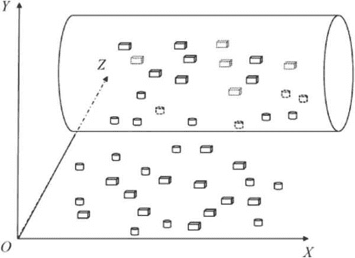

Figure 4-10

Step 3: Perform cutting in the three-dimensional space, and map the cut hyperplane to a two-dimensional plane, as shown in Figure 4-11.


Figure 4-11

Thus, a new kernel function is completed. Because non-linear space is complex, and it is impossible to quickly know which kernel function is most suitable for converting non-linear space to linear space, `SVM` usually employs multiple kernel functions to identify the best option.

#### Naive Bayes Classifier

If your boss assigns you an analysis task with a medium amount of data, few variables, and hopes you can complete data prediction as soon as possible, then the `Naive Bayes Theorem` is a good choice. Let's first look at the expression of Bayes' Theorem (4-1):


(4-1)

Changing the expression form makes it easier to understand:


### 4.1.1 Bayes' Theorem and Naive Bayes Theorem

`P(Class|Feature) = P(Feature|Class) * P(Class) / P(Feature)`

If we want to distinguish between programmers and product managers based on gender and weight, we are essentially seeking `P(Programmer|Gender, Weight)` and `P(Product Manager|Gender, Weight)`. According to Bayes' Theorem:

`P(Occupation|Gender, Weight) = P(Gender|Occupation) * P(Occupation) / P(Weight)`

Besides Bayes' Theorem, there is the Naive Bayes Theorem. The Naive Bayes Theorem is an algorithm derived from Bayes' Theorem with a fundamental assumption. It assumes that all data attributes are independent of each other and do not affect one another. It is precisely through this assumption that many complex problems can be simplified, and the Naive Bayes Theorem is also very suitable for predicting unknown datasets and performing data prediction. For example, according to the Naive Bayes Theorem, we can know that gender and weight are unrelated, i.e.,

`P(Weight|Occupation, Gender) = P(Weight|Occupation)`

`P(Gender, Weight|Occupation) = P(Gender|Occupation) × P(Weight|Occupation)`

The Naive Bayes Theorem has the following advantages:

1.  The Naive Bayes algorithm is simple and easy to understand;
2.  Naive Bayes has high performance and fast computation speed;
3.  Naive Bayes excels at data prediction;
4.  Naive Bayes requires a very small amount of training data.

It is precisely because of these advantages that Naive Bayes is frequently seen in real-time prediction and multi-class prediction. Not only that, because text classification involves many variable types that are relatively independent of each other, Naive Bayes has also been widely used in text classification, such as spam detection, website content recognition, news recommendation, etc.

### 4.1.4 Unsupervised Learning

Learning the distribution of data or the relationships between data through algorithms using data without any labels is called unsupervised learning. The goal of unsupervised learning is to use algorithms to explore hidden structures and characteristics within the data. These structures and characteristics are impossible for humans to understand directly or achieve through human effort. Because there are no labels, it is also very difficult to evaluate whether the results of unsupervised learning are correct. However, if data is grouped through unsupervised learning, people can discover hidden information in the original data that was unforeseeable.

If the way students learn in school is called supervised learning, then children who don't go to school can also perform unsupervised learning through their own observation and understanding of the world, except that what they learn is arbitrary and spontaneous, the final learning outcome is unpredictable, and the same applies to artificial intelligence. There was a news story in 2017: two AI robots created by American scientists invented a language only the two of them could understand through self-learning, and these two robots had already begun communicating in a language only they could understand, which caused great panic among people.

Unsupervised learning has been validated in many application scenarios. If you run a garment factory producing clothes, how do you determine clothing sizes S, M, L? If you possess the height data of all Chinese people, you can determine this through unsupervised learning. Precisely because unsupervised learning lacks human labeling, as of now, unsupervised learning still cannot reach the accuracy and effectiveness of supervised learning, so unsupervised learning has always been criticized by some scientists in the AI community. But in recent years, unsupervised learning has become hot again, and some scientists even claim that unsupervised learning is the future of artificial intelligence.

Currently, the popular "Generative Adversarial Network (GAN)" in unsupervised learning works by connecting a generator network and a discriminator network. The generator network is responsible for generating data intended to try to deceive the discriminator network. Through the adversarial learning of the two networks, some surprising results have been obtained, such as AI technology that can generate photo-realistic images from text strings or hand-drawn sketches.

There are usually three evaluation metrics for AI: **Precision**, **Recall**, and **Accuracy**. In unsupervised learning, these three metrics are very important, and people usually use these three metrics to evaluate unsupervised learning.

**Precision**: For a given test dataset, the ratio of the number of samples correctly classified by the classifier to the total number of samples. Simply put, precision means "querying accurately". Like a policeman catching thieves: if 10 people are caught, and 9 of them are thieves, then the precision is 90%.

**Recall**: For a given test dataset, the number of all correctly classified samples correctly found by the classifier. Simply put, recall means "querying comprehensively". Again, take the policeman catching thieves: there are 100 people, 20 of whom are thieves; if 10 thieves are caught, the recall is 50%.

**Accuracy**: Represents the proportion of correct identifications. That is, the probability of good guys being identified as good guys and bad guys being identified as bad guys. Continuing with the policeman catching thieves example: there are 100 people, 20 of whom are thieves; 10 people are caught, but 1 of them is not a thief, then the accuracy is 90%.

Precision, Recall, and Accuracy are key metrics for measuring AI algorithms; the higher these three metrics, the better the adaptability of the algorithm.

### 4.1.5 Semi-supervised Learning

Supervised learning is used when there is the capability to label data and perform classification and regression based on the labeling information; unsupervised learning is training performed when no labeling information is contained, usually used for clustering. Sometimes, the data at hand often has only a portion labeled rather than fully labeled; in this case, semi-supervised learning can be used to complete the training. The "National Government Website Monitoring Project" is a good example.

The National Government Website Monitoring Project monitored over 90,000 government websites nationwide and nearly 25 billion pages at all levels of government websites, as shown in Figure 4-12. The project's task is to monitor whether these pages have anomalies and which pages users are more interested in. For up to tens of billions of pages, labeling all pages is impossible; only a few tens of thousands of pages are labeled. If the unlabeled sample set is simply discarded, it is not only a pity but also leads to data distortion due to insufficient training samples, thereby affecting the effectiveness of machine learning. How to effectively utilize unlabeled data becomes the key.


Figure 4-12

The simplest method is to label the unlabeled pages, but this comes with huge labor costs. If it takes 0.5 minutes for a person to label one page, to label 2.5 billion pages, one person working 365 days a year without rest would take over 2,300 years to complete.

The project team thus adopted semi-supervised learning methods to complete the labeling work. First, a learner is trained using the labeled sample dataset; then, based on this learner, predictions are made on the unlabeled samples; next, the predicted result samples are classified, and samples with high uncertainty and low classification confidence are re-labeled; finally, the data is expanded into the training set, the learner is retrained, and the final result is generated, as shown in Figure 4-13.


Figure 4-13

Obviously, semi-supervised learning essentially still belongs to supervised learning, but it performs semi-automated processing on the training data samples. Compared with supervised learning, the learning cost is greatly reduced. For various algorithms of supervised learning and unsupervised learning, if the dataset conforms to the characteristics of semi-supervised learning, semi-supervised learning methods can be adopted.

### 4.1.6 Reinforcement Learning

Reinforcement Learning is also known as Reinforcement Learning (alternate translation) or Evaluative Learning. If described with a standard definition, the goal of reinforcement learning is to learn an optimal **Policy**, which allows the **Agent** to take an **Action** based on the current **State** in a specific **Environment**, thereby obtaining the maximum reward. Reinforcement learning is often confused with supervised learning and unsupervised learning.

Reinforcement learning views learning as a trial-and-evaluation process, as shown in Figure 4-14. The agent selects an action to act on the environment; the environment accepts the action, its state changes, and simultaneously generates a reinforcement signal, which is fed back to the agent. The agent selects the next action based on the reinforcement signal and the current state of the environment. The principle of selection is to increase the probability of receiving positive reinforcement. The selected action not only affects the immediate reinforcement value but also affects the environment's state at the next moment and the final reinforcement value.


Figure 4-14

Supervised learning is like a student taking an exam with an instructor standing next to them; every time the student finishes a question, the instructor immediately tells them whether it was right or wrong. But the actual situation is complex; many real problems have no standard answers, only which answer is more suitable. The process of reinforcement learning is like training an animal: every time the animal performs a behavior, the trainer needs to give timely feedback, and this good-or-bad feedback will influence its behavior next time. AI reinforcement learning is exactly this: through repeated reinforcement learning processes, the machine learns which behavior yields the best reward. Precisely because reinforcement learning has the characteristic of real-time feedback, it is widely used in the field of robotics.

Both supervised learning and reinforcement learning obtain a mapping relationship from input data to output results through algorithms. Supervised learning gives the relationship between input and output, telling the algorithm what output corresponds to what input. Reinforcement learning gives feedback information, judging whether this behavior is good or bad. Of course, because reinforcement learning gives feedback information, the whole process has latency; therefore, sometimes it takes multiple steps before knowing whether a choice at a previous node was correct.

## 4.2 Machine Learning — Regression

In Section 4.1, it was mentioned that regression is one of the key problems machine learning can solve. Regression can classify samples; below we learn about classification-related content through a practical example.

Suppose we can collect data from gym users via smart bracelets, understanding users' age, height, weight, what equipment they use for exercise, calories burned, etc. Can we predict the calories a new gym-goer will burn when performing a certain exercise through machine learning? The answer is yes; we can achieve this using supervised learning for regression.

For example, there is a gym-goer named Xiaoli, aged 27, female, weight 60 kg, height 165 cm. After she continuously lifts a 30 kg barbell for 25 minutes, her measured skin temperature is 37°C, heart rate is 134 bpm, and calories burned are 231 kcal, as shown in Figure 4-15.

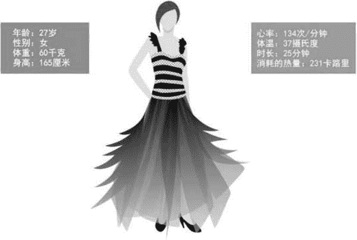

Figure 4-15

Knowing Xiaoli's exercise feature values and calories burned, we can learn a function through an algorithm that uses Xiaoli's exercise feature values to calculate 231 kcal. Xiaoli's exercise data can be represented by Formula (4-2):

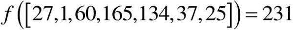

(4-2)

Of course, a single person's sample cannot yield a function applicable to everyone. So what we need to do is collect the same type of data from many different participants, using part for training and another part for validation, as shown in Figure 4-16.


Figure 4-16

After the training data volume increases, the numbers corresponding to each person can be represented by `X[1] ~ X[7]`, and the final calories burned `Y` can be represented by Formula (4-3):


(4-3)

If these `X` and `Y` are represented in a 2D table, it is as shown in Figure 4-17.


Figure 4-17

Through training on these discrete points, their linear pattern can be found, as shown in Figure 4-18.


Figure 4-18

Now, we can put the trained data into this model for validation. Since the data has bias, when the trained data is put into the model, deviations will appear as shown in Figure 4-19, i.e., residuals.


Figure 4-19

Through residuals, we can know some error levels in the model. Similarly, we have methods to handle errors in the model, such as Root Mean Squared Error (RMSE), Mean Absolute Error (MAE), etc. Of course, depending on the prediction target, the significance of absolute values may differ greatly. For this section's case, if the result has an error of 5 kcal, it indicates a very reasonable model. But if the case is not measuring calories burned, but measuring how long it takes to burn calories, then if the result shows a deviation of 5 hours, the model's effect is unacceptable. Therefore, sometimes we need to use relative error to measure the model to represent a more general error level. Relative error is generally a relative value between 0 and 1. Combining Relative Absolute Error and Relative Squared Error, the closer the error value is to 0, the better the model effect.

## 4.3 Machine Learning — Classification

Through machine learning classification, we can predict which level, category, or attribute a certain thing belongs to. The simplest classification method is binary classification, used to predict whether a thing belongs to one of two categories. Binary classification is often used to determine the truth or falsehood of something. Usually, a binary classifier is a function that predicts whether the `Y` value is 0 or 1 through different `X` values.

In practical applications, the binary classifier's function does not directly calculate the result as 1 or 0, but calculates a value between 0 and 1, and we use a threshold or critical value to decide whether the final result should be recorded as 0 or 1.

For example, based on some patient information collected by a hospital: patient's age, whether pregnant, glucose intake, BMI (Body Mass Index), etc., to determine who has diabetes, as shown in Figure 4-20.


Figure 4-20

We can establish a function `f(x)` applicable to these patients. These indicators of the patients are all fed into the `f(x)` function. The result for diabetic patients is recorded as 1, and for non-diabetic patients as 0, see Formula (4-4).


(4-4)

Since the model does not directly yield 0 or 1, it generally gives a value between 0 and 1 as the result. So when we use the model to predict values, we need to set a threshold. Whether the final result is 1 or 0 depends on which side of the threshold line it falls on, as shown in Figure 4-21. Set the threshold to 0.5; if the result exceeds this threshold, it is 1; if below, it is 0.


Figure 4-21

In general, classification problems are completed through supervised learning, so we reserve some known labels to validate the model's performance, as shown in Figure 4-22. After filling in the known data, it is found that a threshold of 0.5 is the best choice.


Figure 4-22

If the model predicts 1 and the actual label is also 1, this data is considered a **True Positive (TP)**; similarly, if the model predicts 0 and the actual label is also 0, this data is considered a **True Negative (TN)**. If the model predicts 1 but the actual label is 0, this is a **False Positive (FP)**; if the model predicts 0 but the actual label is 1, this is a **False Negative (FN)**. The threshold selection shown in Figure 4-23 determines the classification of predicted values.


Figure 4-23

In some cases, predicted values may be very close to the threshold but still get the wrong classification. We can control the classification of predicted values by moving the threshold, as shown in Figure 4-24.


Figure 4-24

When building the diabetes model, we would rather get more False Positive results than False Negative results, because through False Positive results we can confirm more patients at risk of diabetes. Of course, the number of True Positives, False Positives, True Negatives, and False Negatives produced by the model are all important indicators for evaluating model effectiveness. We usually put these four results in a confusion matrix for display, which provides a basis for judging classifier performance, as shown in Figure 4-25.


Figure 4-25

The simplest metric is **Accuracy**, which is the value obtained by dividing the number of correctly classified results by the total number of results. In this example, there are 5 True Positives and 4 True Negatives, plus 2 False Positives, and no False Negatives, see Formula (4-5).


(4-5)

A total of 11 predicted values, from which we got 9 correct predictions, so Accuracy is 0.82 (or 82%). This may look like a very good result, but surprisingly, Accuracy is actually not that useful in measuring model performance.

Assume only 3% of people have diabetes. Then we can create a model that always predicts 0. The model's Accuracy would be as high as 97%, but this is completely useless for identifying potential diabetes patients. A more useful metric is the proportion of True Positives among all results predicted as Positive. This metric is called **Precision**.

In this case, there are 5 True Positives and 2 False Positives. So our Precision is 5/7, approx 0.71, meaning 71% of those testing Positive in the experiment have diabetes, and 29% are false alarms. In some cases, we may need a metric to judge the model's sensitivity to True Positives, which is **Recall**. It is calculated by dividing the number of True Positive results by the sum of True Positives and False Negatives.

In other words, among all actual Positive results, there are 5 True Positives and no False Negatives (missed cases). Therefore, our Recall is 5/5, which is 1 or 100%. So in this case, we correctly identified all patients with diabetes. Recall is sometimes also called True Positive Rate. Similarly, for False Positives, we have a corresponding metric.

In this case, we have 2 False Positives and 4 True Negatives. So our False Positive Rate is 2/6, approx 0.33. The classification we got is based on a threshold around 0.3. For such a threshold, we can derive corresponding False Positives and True Positives. If we move the threshold to 0.5, the True Positive Rate is 4/5, i.e., 0.8; the False Positive Rate is 1/6, i.e., 0.17, as shown in Figure 4-26.


Figure 4-26

Assume we further move the threshold to 0.7. We can get a True Positive Rate of 2/5, i.e., 0.4, and a False Positive Rate of 0/6, i.e., 0, as shown in Figure 4-27.


Figure 4-27

If every possible threshold is plotted on a chart, we will eventually see a curve as shown in Figure 4-28, called the Receiver Operating Characteristic Curve or `ROC` curve. The area under the `ROC` curve in Figure 4-28 is called `AUC` (Area Under the Curve), which is an indicator for judging model prediction performance. Generally, the larger the `AUC` area, the closer the curve is to the top-left corner, the better the model performance.


Figure 4-28

A perfect classifier would have an `ROC` curve going straight up along the leftmost side, then straight right along the top, with an `AUC` value of 1. We can always compare the `ROC` curve with a diagonal line. The diagonal represents how the model would perform if you just guessed randomly with a 50% probability. In this case, the model's `AUC` value is 0.9, so the model's performance is absolutely better than random guessing, as shown in Figure 4-29.


Figure 4-29

## 4.4 Machine Learning — Clustering


## 4.4 Unsupervised Learning and Clustering

Currently, a common scenario for unsupervised learning is clustering. Clustering is the process of dividing data into multiple categories based on the principle of data similarity. To evaluate the "similarity" between two different samples, the usual method is to calculate the "distance" between the two samples. Of course, there are many methods for calculating distance, and the choice of method directly affects the quality of the clustering results. Common distance calculation methods include Euclidean distance, Manhattan distance, Mahalanobis distance, etc.

### 1. Euclidean Distance

Euclidean distance is the most commonly used and easiest-to-understand distance measurement method, i.e., the distance between two points, as shown in Figure 4-30.


Figure 4-30

### 2. Manhattan Distance

Manhattan distance is also known as "city block distance". Just like calculating the distance between two points in various map applications, it needs to be calculated based on the direction of the roads, as shown in Figure 4-31.


Figure 4-31

### 3. Mahalanobis Distance

Mahalanobis distance represents the covariance distance of data, a scale-independent measurement method. Mahalanobis distance first standardizes the attributes of sample points, then calculates the distance between samples, as shown in Figure 4-32.


Figure 4-32

### 4. Other Distance Measurement Methods

In addition to the above methods, there are other distance measurement methods such as angle and cosine. In unsupervised learning, there are no known label values to train the model, but algorithms can still be used to find similarities between data, thereby grouping the data to form clusters.

Assume there is a dataset containing article information from various government websites nationwide, and similar articles need to be automatically grouped together. We first select a most commonly used clustering method, namely `K`-means clustering. The key to understanding `K`-means clustering is to remember that data consists of numerous data rows, each with different features. Assuming each feature is a numerical value, they can be plotted as coordinates.

First, plot features on a two-dimensional grid based on vector positive/negative tendency (0–6) and the number of typos (0–7), as shown in Figure 4-33.


Figure 4-33

Second, determine how many clusters need to be created. The number of clusters is generally called `K`. `K` points can be plotted at random positions; these points represent the centroids of different clusters. In this case, `K` is 3, so we need to create 3 clusters. Next, we determine which centroid each point in the grid is closest to, and assign these points to the 3 clusters accordingly, as shown in Figure 4-34.


Figure 4-34

Third, move the 3 predefined centroids to the true center positions of these 3 clusters, as shown in Figure 4-35.


Figure 4-35

Finally, reassign all points to clusters based on the nearest centroid. This process is then repeated continuously, eventually producing clusters with good separation effects.

In experiments, each cluster should be as independent as possible, far away from other clusters. To measure this, we can compare the average distance between cluster centroids, as well as the average distance from each point in a cluster to its cluster centroid, as shown in Figure 4-36. The greater the distance of each point from the centroid, the greater the degree of cluster separation. We can also compare the average distance between cluster centroids with the distance from the cluster centroid to the farthest point.


Figure 4-36

In addition, Principal Component Analysis (PCA) can be used to evaluate the results of clustering algorithms. Using this method, each point in a cluster can be decomposed into different directions. For example, the first two components decomposed by `PCA` can be plotted as an ellipse, as shown in Figure 4-37. The first principal component is plotted along the direction of maximum variance, i.e., the major axis of the ellipse.


Figure 4-37

The second principal component is plotted along the minor axis of the ellipse, as shown in Figure 4-38.


Figure 4-38

A cluster completely well-separated from the first cluster should also be elliptical, with its major axis perpendicular to the major axis of the first cluster's ellipse. If a cluster is basically separated from the first cluster but not completely, we would get an ellipse whose major axis is not completely perpendicular to the first ellipse's major axis.

```
EXr6287u6NNVz+GYLY+7SC6AgGofrpiId/XnwIEoGMEPq3TPzkM5RyXBRbuLcLFjwnCuEHVXaQsGpygWHLFy9g==
```

## 4.5 Deep Learning

### 4.5.1 Neurological Basis of Deep Learning

Deep learning is a branch of machine learning, first proposed by Hinton et al. in 2006. Deep learning designs artificial neural networks by simulating the human brain's neural network and processes information by mimicking the transmission between brain neurons. Research by biologists and neuroanatomists has found that the human brain generally includes about 100 billion neurons (nerve cells), each connected to other neurons through up to 10,000 synapses, thereby forming a large-scale, complex human brain neural network capable of parallel processing, as shown in Figure 4-39.


Figure 4-39

The design of artificial neural networks references the human brain neural network. An artificial neural network is a parallel and distributed information processing network structure with a large number of connections. This network structure generally consists of multiple neurons; moreover, each neuron has a single output, each neuron can connect to multiple other neurons, each neuron's input has multiple connection pathways, and each connection pathway corresponds to a connection weight coefficient. Artificial neural networks are very similar to human brain neural networks but not identical. When analyzing artificial neural networks, four aspects must be considered: system structure, signal form, information storage, and information processing mechanism. A qualified artificial neural network must first have an associative memory function, able to associate through known information and store associated information. For example, seeing a bungalow lets one know it is a house; seeing a two-story villa also lets one know it is a house; seeing a partially obscured house, one can still recognize it as a house.

Through artificial neural networks, information classification can also be performed. Traditional classification methods are linear classification methods, but artificial neural networks can find segmentation regions that meet classification requirements from input samples, with samples in each region belonging to one category. Traditional classification methods are only suitable for solving recognition and classification problems where similar classes gather and dissimilar classes separate. However, in the objective world, the segmentation surfaces on many sample spaces are very complex and non-linear; similar samples may belong to different categories, while distant samples may belong to the same category. Artificial neural networks can well solve the problem of approximating non-linear surfaces. Therefore, artificial neural networks have better recognition and classification capabilities than traditional classification methods. Figure 4-40(a) shows traditional machine learning classification; Figure 4-40(b) shows artificial neural network classification.


Figure 4-40

Since artificial neural networks operate by simulating the human brain neural network, evaluating the overall performance of an artificial neural network requires assessment of three aspects: the information processing capability of the nodes themselves, the connections between nodes, and the connection strength between nodes. The node's own information processing capability examines whether the mathematical model is reasonable; the connections and connection strength between nodes examine whether the network topology is reasonable. Since the proposal of artificial neural networks to the present, there have been dozens of models. According to different classification methods, artificial neural networks can be divided into different categories, among which two common classification methods are classification by network connection topology and classification by information flow direction within the network.

Based on different network connection topologies, artificial neural networks can be divided into two major categories: layered structure artificial neural networks and interconnected mesh structure artificial neural networks. Layered structure artificial neural networks divide neurons into several layers by function, including the Input Layer, Hidden Layer, and Output Layer, which are sequentially connected, as shown in Figure 4-41.


Figure 4-41

In interconnected mesh structure artificial neural networks, there may be connection paths between any two nodes, forming a neural net, as shown in Figure 4-42.


Figure 4-42

Based on the information flow direction within the network, artificial neural networks can be divided into feedforward artificial neural networks and feedback artificial neural networks. The structural characteristics of feedforward artificial neural networks are exactly the same as the layered structure artificial neural network shown in Figure 4-41, named because the feedforward process executes in the direction of network information processing, with information passed layer by layer from the input layer backward. From the perspective of information processing capability, nodes in feedforward artificial neural networks can be divided into two types: one is input nodes, responsible only for introducing information from the outside world and passing it to the next layer; the other is nodes with processing capabilities, including various hidden layers and the output layer. In feedforward artificial neural networks, the output of the previous layer is the input of the next layer; information processing has a directional layer-by-layer transmission characteristic, and generally, there are no reverse feedback loops. Therefore, this type of artificial neural network is easily cascaded to establish multi-layer feedforward artificial neural networks.

Feedback artificial neural networks are a type of artificial neural network with feedback connections from output to input. In feedback artificial neural networks, input layer neurons can not only receive input information but also have information processing functions, as shown in Figure 4-43.


Figure 4-43

### 4.5.2 Characteristics of Artificial Neural Networks

Artificial neural networks possess self-learning and self-adaptive functions, good fault tolerance, non-linear mapping capabilities, large-scale parallel processing capabilities, and associative processing capabilities. The characteristics and advantages of artificial neural networks are mainly reflected in the following aspects.

**Self-learning and Self-adaptive Functions**: Artificial neural networks well simulate the human brain's acquired learning and training functions. If the final output is incorrect, the artificial neural network can adjust the weight of each input to produce a new result, generally implemented through training algorithms. Due to the complexity of the training process, the final output result can be obtained by repeatedly inputting data and adjusting weights. Therefore, artificial neural networks can find the intrinsic connections between input and output through learning and training to obtain the answer to the problem, rather than relying solely on relevant historical knowledge and rules.

**Fault Tolerance**: The brain has strong fault tolerance, and so do artificial neural networks. Artificial neural networks store results in the entire system, not in a specific storage unit. Even if a certain proportion of nodes do not participate in the operation, it will not have a significant impact on the overall system performance, and it can still process noisy or incomplete data, possessing good fault tolerance.

**Non-linear Mapping Capability**: Many machine learning algorithms assume that input values are linearly separable, i.e., a hyperplane can be represented by a function whose first derivative is constant. However, in the real world, problems are generally complex, mostly non-linear, and various factors involved influence each other. Therefore, artificial neural networks need to be able to simulate arbitrarily complex non-linear mapping capabilities by increasing the number of neurons in hidden layers.

**Parallel Processing Capability**: Artificial neural networks feature structural parallelism, parallel processing in processing sequence, and computational functions distributed across multiple processing units. Therefore, hardware-implemented artificial neural networks process at speeds far higher than traditional software, with good fault tolerance and fast overall processing capabilities, particularly suitable for real-time control and dynamic control.

**Associative Memory Function**: Artificial neural networks can accept and process analog, chaotic, fuzzy, and random information, and have advantages in natural language understanding, image pattern recognition, scene understanding, incomplete information processing, intelligent robot control, etc.

### 4.5.3 Typical Artificial Neural Networks

The development of artificial neural networks is closely linked to the development process of artificial intelligence technology. Along with the ups and downs of AI technology, artificial neural networks have also experienced periods of prosperity and troughs. Since being proposed in 1943, artificial neural networks have risen and fallen several times, developing in a wave-like pattern.

The earliest artificial neural network was the "Perceptron" proposed by Cornell University professor Frank Rosenblatt in 1957. This was the first artificial neural network precisely defined by an algorithm and possessing self-organizing learning ability, the ancestor of many subsequent new artificial neural network models.

Subsequently, the `Single Layer Perceptron` evolved into the `BP` (Back Propagation) artificial neural network and the `Hopfield` artificial neural network, and the `BP` artificial neural network further evolved into Recurrent Neural Networks. Since there are many types of artificial neural networks, the author briefly summarizes the evolution of several common ones, as shown in Figure 4-44.


Figure 4-44

#### 1. Single Layer Perceptron

The `Single Layer Perceptron` is the simplest type of artificial neural network. It contains only two layers: an input layer and an output layer, which are directly connected. The overall structure is shown in Figure 4-45.


Figure 4-45

After data is input through the input layer, it enters the output layer directly through calculation, see Formula (4-6):


(4-6)

First, an `N`-dimensional vector `i = [i[j], i[j+1], ..., i[n]]` is input, where each component corresponds to a weight `W[j]`. The weights are multiplied, then these products are summed to obtain the sum of products. If the sum of products is greater than the threshold (usually 0), the output is 1; if less than the threshold, the output is -1.

Therefore, the `Single Layer Perceptron` can classify linearly separable data. If `Single Layer Perceptrons` are stacked into a Multi-Layer Perceptron, it theoretically possesses the ability to handle non-linear classification problems, leading to the emergence of various multi-layer artificial neural networks. Multi-layer artificial neural networks can simulate arbitrarily complex functions by adjusting the number of inputs and increasing the number of hidden layers, to solve various complex problems.

#### 2. Hopfield Artificial Neural Network

The `Hopfield Artificial Neural Network` arranges all neurons in a row. Each layer has an input, and each input has an input value (`x[1]`, `x[2]`, `x[3]`, `x[4]`), as shown in Figure 4-46. Unlike the `Single Layer Perceptron`, the output result is sent back to `x[2]`, `x[3]` via a feedback loop, but not to `x[1]`; `x[1]` can treat the weight of feedback to itself as 0.


Figure 4-46

If every neuron in the `Hopfield Artificial Neural Network` is interconnected, it can also take the form of a loop, as shown in Figure 4-47.


Figure 4-47

Precisely because each output result can be passed to other neurons, the `Hopfield Artificial Neural Network` can be used to implement associative memory functions. Therefore, in a `Hopfield Artificial Neural Network`, even if some units in the network are removed, the entire network can still function normally. This is like seeing dinosaur fossil fragments in a natural history museum; even with just a scapula or two parietal bones, experts can basically reconstruct the dinosaur's skeleton from these simple bones.

Thus, the stable state of the `Hopfield Artificial Neural Network` represents a memory pattern, and the process of the initial state converging toward the stable state is the process of the `Hopfield Artificial Neural Network` searching for the memory pattern. The initial state can be regarded as partial information of the memory pattern, and the network evolution can be regarded as the process of recalling the whole information from partial information.

#### 3. Boltzmann Machine

A stochastic `Hopfield Artificial Neural Network` with hidden units is called a `Boltzmann Machine`. The principle of the `Boltzmann Machine` originates from statistical physics; it is a modeling method based on an energy function and can be used to construct a probability model for a set of binary data vectors. In addition, the `Boltzmann Machine` can describe high-order interactions between variables; the constructed models and learning algorithms have relatively complete physical explanations and rigorous mathematical statistical theoretical foundations, but their learning algorithms are very complex and belong to unsupervised learning algorithms. The `Boltzmann Machine` consists of a visible layer and multiple hidden layers, as shown in Figure 4-48. Nodes in the network are also divided into visible units and hidden units, using visible and hidden units to express the learning models of stochastic networks and stochastic environments, and using weights to express the correlations between units.


Figure 4-48

#### 4. BP Artificial Neural Network

The `BP` (Back Propagation) Artificial Neural Network is a multi-layer feedforward artificial neural network trained using the error backpropagation algorithm, and is one of the most widely used artificial neural networks currently. In practical applications of artificial neural networks, the vast majority of models adopt the `BP` artificial neural network and its variants. The `BP` artificial neural network is also the core of feedforward artificial neural networks, embodying the essence of artificial neural networks; therefore, when learning artificial neural networks, one must understand the `BP` artificial neural network.

As the earliest artificial neural network, the `Single Layer Perceptron` has advantages such as a clear model, simple structure, and small computation. However, as research deepened, it was found that it could only solve linearly separable problems, limiting its application. In the mid-1980s, experts introduced the Error Back Propagation Training algorithm, systematically solving the learning problem of hidden layers in multi-layer artificial neural networks and providing a complete mathematical derivation. The `BP` artificial neural network possesses arbitrary complex pattern classification capabilities and excellent multi-dimensional function mapping capabilities, solving problems the `Single Layer Perceptron` could not.

Structurally, the `BP` artificial neural network has an input layer, hidden layer(s), and an output layer, as shown in Figure 4-49. Essentially, the `BP` algorithm takes the square of the network error as the objective function and uses the gradient descent method to calculate the minimum value of the objective function. The main characteristic of the `BP` artificial neural network is that signals propagate forward, while errors propagate backward.

The operation process of the `BP` artificial neural network is mainly divided into two stages: the first stage is the forward propagation of signals, from the input layer through the hidden layer to the output layer; the second stage is the backward propagation of errors, from the output layer to the hidden layer, and finally to the input layer, sequentially adjusting the weights and biases from the hidden layer to the output layer, and the weights and biases from the input layer to the hidden layer.


Figure 4-49

The `BP` artificial neural network is relatively mature in theory, performance, and application. Its outstanding advantages are strong non-linear mapping capability, flexible network structure, and the number of hidden layers and neurons in each layer can be arbitrarily set according to specific situations. However, the `BP` artificial neural network also has the following defects.

(1) Slow learning speed; even for a simple problem, it generally requires hundreds or even thousands of learning iterations to converge.

(2) Prone to falling into local minima.

(3) Lack of theoretical guidance for selecting the number of network layers and neurons.

(4) Limited network generalization capability.

#### 5. Convolutional Neural Network

The `Convolutional Neural Network` (CNN) belongs to a type of feedforward artificial neural network. Currently, `CNN` has become a research hotspot in many scientific fields, especially in pattern classification. Because this network avoids complex pre-processing of images and can directly input raw images, it has gained wider application. The development of `CNN` was not achieved overnight; as early as 1980, the first implemented network of the newly proposed recognizer was the first implementation of `CNN`. Subsequently, more researchers improved the network. Among them, a representative achievement is the "Neocognitron" proposed by Alexander and Taylor (Note: Original text says Alexander and Taylor, historically Fukushima proposed Neocognitron, but translating source text faithfully), marking the maturity of the `Convolutional Neural Network`.

Generally, the basic structure of `CNN` includes two layers: the first layer is the feature extraction layer, where each neuron's input is locally connected to the previous layer and extracts features of that locality. Once the local features are extracted, the positional relationships between them and other features are also determined. The second layer is the feature mapping layer; each computational layer of `CNN` consists of multiple feature maps, each feature map is a plane, and the weights of all neurons on each plane are equal.


## 4.4 Common Deep Neural Network Architectures

### 4.4.1 Convolutional Artificial Neural Networks (CNN)

They are called Convolutional Artificial Neural Networks because these networks utilize convolution operations. A convolution operation is a computational method, similar to arithmetic operations such as addition, subtraction, multiplication, division, square root, and squaring. Through convolution operations, `CNN` can extract basic features of images; artificial neural networks based on convolution operations continuously enhance the network's recognition capability. In 2012, the `ImageNet` challenge champion `Alex Net` achieved image recognition with an accuracy exceeding 84% using 5 `convolutional layers` and 3 `fully connected layers`, as shown in Figure 4-50. By 2018, the accuracy of image recognition using convolutional artificial neural networks had exceeded 97%.


Figure 4-50

`CNN` generally includes the following parts: `Input Layer`, `Convolutional Layer`, `Pooling Layer`, `Fully Connected Layer`, and `Output Layer`.

The `Convolutional Layer` in `CNN` applies convolution operations to the original image or features from the previous layer. To obtain specific features from different layers, `CNN` often employs different `convolution kernels` for convolution operations. A single `convolution kernel` yields a 3rd-order tensor with 1 channel; multiple `convolution kernels` yield multiple 3rd-order tensors. Combining the vectors of these 3rd-order tensors produces a feature map, which is the final output of the `Convolutional Layer`.

During convolution operations, the `convolution kernel` slides to compute image features. However, if the image or feature map is large, the computational pressure becomes significant. To reduce computational load, a `Pooling Layer` is typically introduced to lower the resolution of the feature map.

The pooling process includes: ① Separating the feature map by channels to obtain several matrices; ② Dividing each matrix into equal-sized squares; ③ Taking a value from each block (maximum or average value) to obtain a new matrix; ④ Stacking the new matrices in the original order to form a 3rd-order tensor.

The resulting 3rd-order tensor is the `Pooling Layer`. If the maximum value is taken, it is a Max `Pooling Layer`; if the average value is taken, it is an Average `Pooling Layer`. The resolution of the feature map after the `Pooling Layer` is greatly reduced, thereby reducing computational load. Figure 4-51 shows the input features, and Figure 4-52 shows the output features.


Figure 4-51


Figure 4-52

Through the `Fully Connected Layer`, the feature map can be transformed into a feature vector. In the `Fully Connected Layer`, several vectors of the same dimension perform inner product operations with the input vector, and all results are concatenated into a single output vector. If `X` is the input, and `K` parameter vectors `W` of the same dimension perform inner products with `X`, plus a scalar `b`, the output vector is `Y = XW + b`, and the `K` scalar results form the output.

The results obtained through the `Fully Connected Layer` cannot directly determine the image category. To obtain classification probabilities for the image, a Normalized Exponential Layer (`Softmax Layer`) is needed to compress the multi-dimensional vector into another `K`-dimensional real vector where each element ranges from 0 to 1 and the sum of all elements is 1, yielding the final result.

### 4.4.2 Recurrent Artificial Neural Networks (RNN)

Recurrent Artificial Neural Networks (`RNN`) are a collective term for two types of artificial neural networks: one is the Recurrent Neural Network (time-recurrent); the other is the Recursive Neural Network (structure-recurrent). The time-recurrent neural network forms a directed graph via connections between neurons, while the structure-recurrent neural network recursively constructs more complex deep networks using similar neural network structures. Because `RNN` possesses a feedback dynamical system, as shown in Figure 4-53, it exhibits stronger dynamic behavior and computational capability than feedforward artificial neural networks. Therefore, recurrent artificial neural networks have become one of the important research objects for international neural network experts.


Figure 4-53

The need for `RNN` arises because some artificial neural networks can only process a single input independently, and the previous input has absolutely no relation to the next. However, certain tasks require the neural network to better process sequential information—i.e., the previous input is related to the next. For example, when understanding a sentence, understanding each word in isolation is insufficient; we need to process the entire sequence of connected words. When processing video, we cannot analyze each frame in isolation but must analyze the entire sequence of connected frames. `RNN` can utilize its internal memory to process input sequences of arbitrary length, making it easier to handle unsegmented handwriting recognition, speech recognition, etc.

### 4.4.3 Generative Adversarial Networks (GAN)

Generative Adversarial Networks (`GAN`) are currently one of the hottest artificial neural networks. In 2018, *MIT Technology Review* listed `GAN` among the top ten breakthrough technologies. The main inspiration for `GAN` comes from the concept of zero-sum games in game theory. `GAN` consists of a Generative Network `G` (Generator Network) and a Discriminative Network `D` (Discriminator Network), which work by mutually competing against each other. The generative network generates data, while the discriminative network judges whether the data generated by the generative network is correct. Through continuous competition, the performance of both networks improves. The basic logic of `GAN` is shown in Figure 4-54.


Figure 4-54

The emergence of `GAN` is highly significant. Previously, all artificial neural networks required humans to prepare data before training. After `GAN`, humans no longer need to prepare data; machines can automatically complete data preparation. At the 2018 top-tier AI conference `IJCAI`, top-tier machine learning conferences `ICML` and `NIPS`, and the renowned deep learning conference `ICLR`, there were extensive traces of `GAN` research.

Taking image generation as an example, the `GAN` generative network receives a random noise `z` (random number) and generates an image from this noise. The discriminative network judges whether the generated image is "real." Its input parameter is `x`, where `x` represents an image, and the output `D(x)` represents the probability that `x` is a real image. An output of 1 means 100% real, while 0 means impossible to be real. During training, the generative network aims to generate real images to fool the discriminative network, while the discriminative network aims to distinguish fake images generated by the generative network from real ones. Thus, the *generative* network and *discriminative* network form a dynamic "game process," with the final equilibrium point being the Nash equilibrium, as shown in Figure 4-55.


Figure 4-55

### 4.4.4 Capsule Artificial Neural Networks (CapsNet)

Capsule Artificial Neural Networks (`CapsNet`) are also currently one of the hottest artificial neural networks. Proposed by Hinton in October 2017, Hinton named them Capsules. Like `CNN`, Capsule Artificial Neural Networks were initially used to solve visual problems. The reason for proposing Capsule Networks is that Hinton discovered `CNN` has some intractable problems in image recognition. `CNN` obtains feature information of image components through convolution operations, but `CNN` has weak ability to judge the associative relationships between components. For example, a person has eyes, a nose, and a mouth; if these components exist, `CNN` judges it as a face. But if the nose is on the forehead and eyes are next to the mouth, `CNN` might still judge it as a face. In reality, a face should not only have two eyes, a mouth, and a nose; the associative relationships between components are also crucial for image recognition. Additionally, `CNN` struggles when images are translated or rotated. Figure 4-56 shows several letter 'A's; humans easily recognize them all as 'A', but `CNN` considers them different letters.


Figure 4-56

Hinton believes the biggest difference between humans and `CNN` is that humans recognize images by abstracting data in a tree-like structure, while `CNN` abstracts data in a hierarchical structure. `CNN` pursues invariance and stability, while Capsule Networks pursue variance and difference. Capsule Artificial Neural Networks can form information abstractions of the same image from different viewpoints, rather than simply abstracting image information from a fixed viewpoint.

Precisely because Capsule Artificial Neural Networks can flip, translate, and combine features of images, they greatly reduce data annotation work, allowing the Capsule Network to perform learning and abstraction on its own.

Similar to the deep networks possessed by `CNN`, Capsule Artificial Neural Networks also have a hierarchical structure, as shown in Figure 4-57. Capsules at different levels process different information; lower-level capsules train detailed features in the image, while higher-level capsules train the mutual relationships between detailed features and synthesize the pose intensities given by each capsule to ultimately reconstruct the image.


Figure 4-57

Capsule Artificial Neural Networks are a disruptive network architecture with tremendous influence in recent years because they transform input scalars into a set of vectors. Currently, Capsule Artificial Neural Networks have achieved state-of-the-art accuracy on the `MNIST` dataset. Because capsules in Capsule Networks can realize the association of feature information position and rotation, Capsule Networks can surpass traditional `CNN` results trained on large data volumes using less training data.

## 4.5 Deep Learning

### 4.5.1 Neurological Basis of Deep Learning

Deep learning is a branch of machine learning, first proposed by Hinton et al. in 2006. Deep learning designs artificial neural networks by simulating the human brain's neural network and processes information by mimicking the transmission between brain neurons. Biological and neuroanatomical researchers have found that the human brain generally contains about 100 billion neurons (nerve cells), each connected to up to 10,000 other neurons via synapses, forming a massive, complex brain neural network capable of parallel processing, as shown in Figure 4-39.


Figure 4-39

The design of artificial neural networks references the human brain neural network. An artificial neural network is a parallel and distributed information processing network structure with a large number of connections. This network structure generally consists of multiple neurons; each neuron has a single output, can connect to multiple other neurons, has multiple input connection pathways, and each pathway corresponds to a connection weight coefficient. Artificial neural networks are very similar to brain neural networks but not identical. Analyzing artificial neural networks requires evaluation from four aspects: system structure, signal form, information storage, and information processing mechanism. A qualified artificial neural network must first have associative memory function, able to associate through known information and store associated information. For example, seeing a bungalow identifies it as a house; seeing a two-story villa also identifies it as a house; seeing a partially obscured house can still be recognized as a house.

Artificial neural networks can also perform information classification. Traditional classification methods are linear classification, but artificial neural networks can find division regions meeting classification requirements from input samples, with samples in each region belonging to one class. Traditional methods only suit recognition and classification problems where similar classes cluster and dissimilar classes separate. However, in the objective world, division surfaces in many sample spaces are highly complex and non-linear; similar samples may belong to different classes, while distant samples may belong to the same class. Artificial neural networks can well solve the problem of approximating non-linear surfaces. Therefore, artificial neural networks have better recognition and classification capabilities than traditional methods. Figure 4-40(a) shows traditional machine learning classification; Figure 4-40(b) shows artificial neural network classification.


Figure 4-40

Since artificial neural networks operate by simulating the human brain neural network, evaluating the overall performance of an artificial neural network requires assessment of three aspects: the information processing capability of the nodes themselves, the connections between nodes, and the connection strength between nodes. The node's own information processing capability examines whether the mathematical model is reasonable; the connections and connection strength examine whether the network topology is reasonable. Since the proposal of artificial neural networks, there have been dozens of models. According to different classification methods, artificial neural networks can be divided into different categories, among which two common methods are classification by network connection topology and classification by information flow direction within the network.

Based on different network connection topologies, artificial neural networks can be divided into two major categories: Layered Structure Artificial Neural Networks and Interconnected Mesh Structure Artificial Neural Networks. Layered Structure Artificial Neural Networks group neurons by function into several layers, including `Input Layer`, `Hidden Layer(s)`, and `Output Layer`, which are sequentially connected, as shown in Figure 4-41.


Figure 4-41

In Interconnected Mesh Structure Artificial Neural Networks, there may be connection paths between any two nodes, forming a neural net, as shown in Figure 4-42.


Figure 4-42

Based on the direction of information flow within the network, artificial neural networks can be divided into Feedforward Artificial Neural Networks and Feedback Artificial Neural Networks. The structural characteristics of Feedforward Artificial Neural Networks are identical to the Layered Structure Artificial Neural Network shown in Figure 4-41, named because the feedforward process executes in the direction of network information processing, with information passing layer by layer from the `Input Layer` backward. From an information processing capability perspective, nodes in Feedforward Artificial Neural Networks can be divided into two types: input nodes, responsible only for introducing information from the outside world and passing it to the next layer; and processing-capable nodes, including various `Hidden Layers` and the `Output Layer`. In Feedforward Artificial Neural Networks, the output of the previous layer is the input of the next layer; information processing has a directional layer-by-layer propagation, and reverse feedback loops generally do not exist. Therefore, this type of artificial neural network is easily cascaded to establish multi-layer feedforward artificial neural networks.

Feedback Artificial Neural Networks are a type of artificial neural network with feedback connections from output to input. In Feedback Artificial Neural Networks, `Input Layer` neurons can not only receive input information but also possess information processing functions, as shown in Figure 4-43.


Figure 4-43

### 4.5.2 Characteristics of Artificial Neural Networks

Artificial neural networks possess self-learning and self-adaptive functions, good fault tolerance, non-linear mapping capabilities, large-scale parallel processing capabilities, and associative processing capabilities. The characteristics and advantages of artificial neural networks are mainly reflected in the following aspects.

**Self-learning and Self-adaptive Functions**: Artificial neural networks well simulate the human brain's acquired learning and training functions. If the final output is incorrect, the artificial neural network can adjust the weight of each input to produce a new result, generally implemented through training algorithms. Due to the complexity of the training process, the final output result can be obtained by repeatedly inputting data and adjusting weights. Thus, artificial neural networks can find the intrinsic connections between input and output through learning and training to solve problems, rather than relying solely on relevant historical knowledge and rules.

**Fault Tolerance**: The brain has strong fault tolerance, and so do artificial neural networks. Artificial neural networks store results in the entire system, not in a single storage unit. Even if a certain proportion of nodes do not participate in computation, it will not significantly impact the overall system performance, and they can still handle noisy or incomplete data, exhibiting good fault tolerance.

**Non-linear Mapping Capability**: Many machine learning algorithms assume input values are linearly separable, i.e., the hyperplane can be represented by a function with a constant first derivative. However, in the real world, problems are generally complex, mostly non-linear, and various factors influence each other. Therefore, artificial neural networks need to simulate arbitrary complex non-linear mapping capabilities by increasing the number of neurons in the `Hidden Layer(s)`.

**Parallel Processing Capability**: Artificial neural networks feature structural parallelism, parallel processing in processing sequence, and computational functions distributed across multiple processing units. Therefore, hardware-implemented artificial neural networks process at speeds far higher than traditional software, with good fault tolerance and fast overall processing capabilities, particularly suitable for real-time and dynamic control.

**Associative Memory Capability**: Artificial neural networks can accept and process analog, chaotic, fuzzy, and random information, and have advantages in natural language understanding, image pattern recognition, scene understanding, incomplete information processing, intelligent robot control, etc.

### 4.5.3 Typical Artificial Neural Networks

The development of artificial neural networks is closely linked to the development of AI technology. Along with the ups and downs of AI technology, artificial neural networks have also experienced periods of prosperity and troughs. Since being proposed in 1943, artificial neural networks have risen and fallen several times, developing in a wave-like pattern.

The earliest artificial neural network was the "Perceptron" proposed by Cornell University Professor Frank Rosenblatt in 1957. This was the first artificial neural network precisely defined by an algorithm and possessing self-organizing learning ability, serving as the ancestor of many subsequent new artificial neural network models.

Subsequently, the Single-Layer Perceptron evolved into `BP` (Backpropagation) Artificial Neural Networks and Hopfield Artificial Neural Networks, and `BP` Artificial Neural Networks further evolved into Recurrent Artificial Neural Networks. Since there are many types of artificial neural networks, the author briefly summarizes the evolution of several common ones, as shown in Figure 4-44.


Figure 4-44

#### 4.5.3.1 Single-Layer Perceptron

The Single-Layer Perceptron is the simplest artificial neural network. It contains only two layers: the `Input Layer` and the `Output Layer`, which are directly connected. The overall structure is shown in Figure 4-45.


Figure 4-45

Data enters through the `Input Layer` and goes directly to the `Output Layer` after computation, see Formula (4-6):


(4-6)

First, an `N`-dimensional vector `i = [i[j], i[j+1], ..., i[n]]` is input, where each component corresponds to a weight `W[j]`. The weights are multiplied, then these products are summed to obtain the sum of products. If the sum of products is greater than a threshold (usually 0), the input terminal takes 1; if less than the threshold, it takes -1.

Therefore, the Single-Layer Perceptron can classify linearly separable data. If Single-Layer Perceptrons are stacked into a Multi-Layer Perceptron, it theoretically gains the ability to handle non-linear classification problems, leading to the emergence of various multi-layer artificial neural networks. Multi-layer artificial neural networks can simulate arbitrarily complex functions by adjusting the number of inputs and increasing the number of `Hidden Layers` to solve various complex problems.

#### 4.5.3.2 Hopfield Artificial Neural Network

The Hopfield Artificial Neural Network arranges all neurons in a row. Each layer has an input, and each input has an input value (`x[1]`, `x[2]`, `x[3]`, `x[4]`), as shown in Figure 4-46. Unlike the Single-Layer Perceptron, the output *result* is fed back via a loop to `x[2]`, `x[3]`, but not to `x[1]`; `x[1]` can treat the weight of feedback to itself as 0.


Figure 4-46

If every neuron in the Hopfield Artificial Neural Network is interconnected, it can also form a ring structure, as shown in Figure 4-47.


Figure 4-47

Precisely because each output result can be transmitted to other neurons, the Hopfield Artificial Neural Network can implement associative memory functions. Therefore, in a Hopfield Artificial Neural Network, even if some units in the network are removed, the entire network can still function normally. This is like seeing dinosaur fossil fragments in a natural history museum; even with just a scapula or two parietal bones, experts can basically reconstruct the dinosaur's skeleton from these simple bones.

Thus, using the stable state of the Hopfield Artificial Neural Network to represent a memory pattern, the process of the initial state converging toward the stable state is the process of the Hopfield Artificial Neural Network searching for the memory pattern. The initial state can be regarded as partial information of the memory pattern, and the network evolution can be regarded as the process of recalling the whole information from partial information.


## 3. Boltzmann Machine

A stochastic Hopfield artificial neural network with hidden units is called a Boltzmann Machine. The principle of the Boltzmann Machine originates from statistical physics; it is a modeling method based on an energy function and can be used to construct probabilistic models of sets of binary data vectors. Additionally, the Boltzmann Machine can describe high-order interactions between variables; its models and learning algorithms have relatively complete physical interpretations and rigorous mathematical statistical theoretical foundations. However, its learning algorithm is very complex and belongs to unsupervised learning algorithms. The Boltzmann Machine consists of a visible layer and multiple hidden layers, as shown in Figure 4-48. Nodes in the network are also divided into visible units and hidden units, which are used to express the learning model of the stochastic network and stochastic environment, while weights express the correlations between units.


Figure 4-48

## 4. BP Artificial Neural Network

The BP (Back Propagation) artificial neural network is a multi-layer feedforward artificial neural network trained using the error backpropagation algorithm, and it is currently one of the most widely used artificial neural networks. In practical applications of artificial neural networks, the vast majority of models adopt the BP artificial neural network and its variants. The BP artificial neural network is also the core of feedforward artificial neural networks, embodying the essence of artificial neural networks; therefore, when learning about artificial neural networks, one must gain some understanding of the BP artificial neural network.

As the earliest artificial neural network, the single-layer perceptron has the advantages of a clear model, simple structure, and small computational load. However, as research deepened, it was discovered that it could only solve linearly separable problems, which limited its application. In the mid-1980s, experts introduced the error backpropagation algorithm, systematically solving the learning problem of hidden layers in multi-layer artificial neural networks and providing a complete mathematical derivation. The BP artificial neural network possesses arbitrary complex pattern classification capabilities and excellent multi-dimensional function mapping capabilities, solving problems that single-layer perceptrons could not.

Structurally, the BP artificial neural network has an input layer, hidden layer(s), and an output layer, as shown in Figure 4-49. Essentially, the BP algorithm takes the square of the network error as the objective function and uses the gradient descent method to calculate the minimum value of the objective function. The main characteristic of the BP artificial neural network is that signals propagate forward, while errors propagate backward.

The operation process of the BP artificial neural network is mainly divided into two stages: the first stage is the forward propagation of signals, from the input layer through the hidden layer, finally reaching the output layer; the second stage is the backward propagation of errors, from the output layer to the hidden layer, and finally to the input layer, sequentially adjusting the weights and biases from the hidden layer to the output layer, as well as the weights and biases from the input layer to the hidden layer.


Figure 4-49

Whether in theory, performance, or application, the BP artificial neural network is relatively mature. Its outstanding advantages include strong non-linear mapping capabilities, flexible network structure, and the ability to arbitrarily set the number of hidden layers and the number of neurons in each layer according to specific situations. However, the BP artificial neural network also has the following defects.

1.  Slow learning speed; even for a simple problem, it generally requires hundreds or even thousands of training iterations to converge.
2.  Prone to falling into local minima.
3.  Lack of theoretical guidance for the selection of the number of network layers and neurons.
4.  Limited network generalization ability.

## 5. Convolutional Neural Network

The Convolutional Neural Network (CNN) belongs to a type of feedforward artificial neural network. Currently, CNN has become a research hotspot in many scientific fields, especially in pattern classification. Because this network avoids complex pre-processing of images and can directly input raw images, it has gained wider application. The development of CNN was not achieved overnight; as early as 1980, the first proposed Neocognitron was the first implementation network of CNN. Subsequently, more researchers improved this network. Among them, a representative research achievement is the "Improved Neocognitron" proposed by Alexander and Taylor, which marked the maturity of the convolutional neural network.

Generally, the basic structure of CNN includes two layers: the first layer is the feature extraction layer, where the input of each neuron is locally connected to the previous layer and extracts features from that locality. Once the local features are extracted, their positional relationships with other features are also determined. The second layer is the feature mapping layer; each computational layer of CNN consists of multiple feature maps, each feature map is a plane, and the weights of all neurons on each plane are equal.

It is called a Convolutional Neural Network because this artificial neural network utilizes convolution operations. Convolution operation is a calculation method, similar to addition, subtraction, multiplication, division, square root, and squaring. Through convolution operations, CNN can extract basic features of images; the artificial neural network based on convolution operations continuously strengthens the recognition capability of the neural network. In 2012, the ImageNet challenge champion AlexNet achieved image recognition through 5 convolutional layers and 3 fully connected layers, with an accuracy exceeding 84%, as shown in Figure 4-50. In 2018, the accuracy of image recognition using convolutional neural networks has exceeded 97%.


Figure 4-50

CNN generally includes the following parts: input layer, convolutional layer, pooling layer, fully connected layer, and output layer.

The convolutional layer in CNN uses convolution operations to compute on the original image or features from the previous layer. To obtain specific features from different layers, CNN often uses different convolution kernels for convolution operations. One convolution kernel can obtain a 3rd-order tensor with 1 channel; multiple convolution kernels can obtain multiple 3rd-order tensors. Combining the vectors of these 3rd-order tensors yields the feature map, which is the final output of the convolutional layer.

During convolution operations, features of the image can be calculated by sliding the convolution kernel; however, if the image or feature map is large, the computational pressure becomes huge. To reduce the amount of computation, a pooling layer is usually introduced to reduce the resolution of the feature map.

The pooling process includes:
1.  Separate the feature map by channels to obtain several matrices;
2.  Divide each matrix into equal-sized squares;
3.  Take values for each block (maximum or average) to obtain a new matrix;
4.  Stack the new matrices in the original order to form a 3rd-order tensor.

The resulting 3rd-order tensor is the pooling layer; if the maximum value is taken, it is a max pooling layer; if the average value is taken, it is an average pooling layer. The resolution of the pooled feature map is greatly reduced, thereby reducing the computational load. Figure 4-51 shows the input features, and Figure 4-52 shows the output features.


Figure 4-51


Figure 4-52

Through the fully connected layer, the feature map can be converted into a feature vector. In the fully connected layer, several vectors of the same dimension as the input vector perform inner product operations with the input vector, and all results are concatenated into a single output vector. If `X` is the input, `K` parameter vectors `W` of the same dimension perform inner products with `X`, and finally a scalar `b` is added, yielding the output vector `Y = XW + b`, then the `K` scalar results form the output.

The results obtained through the fully connected layer cannot directly determine the image category; to obtain the classification probabilities of the image, it is also necessary to compress the multi-dimensional vector into another `K`-dimensional real vector through a normalization exponent (Softmax) layer, where the range of each element is 0 to 1, and the sum of all elements is 1, thereby obtaining the final result.

## 6. Recurrent Neural Network

The Recurrent Neural Network (RNN) is a collective term for two types of artificial neural networks: one is the Time-Recurrent Neural Network; the other is the Structural Recurrent Neural Network. The time-recurrent neural network uses connections between neurons to form a directed graph, while the structural recurrent neural network uses similar neural network structures to recursively construct more complex deep networks. Because RNNs possess a feedback dynamic system, as shown in Figure 4-53, they have stronger dynamic behavior and computational capabilities than feedforward neural networks; thus, recurrent neural networks have become one of the important research objects for international neural network experts.


Figure 4-53

The need for RNNs arises because some neural networks can only process a single input independently, and the previous input has absolutely no relationship with the next input. However, certain tasks require the neural network to better process sequential information, meaning the previous input is related to the next input. For example, when understanding a sentence, understanding each word in isolation is insufficient; we need to process the entire sequence of connected words. When processing video, we cannot just analyze each frame independently but must analyze the entire sequence of connected frames. RNNs can utilize their internal memory to process input sequences of arbitrary time steps, making them more suitable for unsegmented handwriting recognition, speech recognition, etc.

## 7. Generative Adversarial Network

The Generative Adversarial Network (GAN) is currently one of the hottest artificial neural networks. In 2018, *MIT Technology Review* listed the top ten breakthrough technologies, and GAN was prominently featured. The main inspiration for GAN comes from the idea of zero-sum games in game theory. GAN consists of a Generative Network G (Generator Network) and a Discriminative Network D (Discriminator Network), which work by mutual adversarial play between the two networks. The generative network generates data, while the discriminative network judges whether the data generated by the generative network is correct. Through continuous adversarial play, the performance of both networks continuously improves. The basic logic of GAN is shown in Figure 4-54.


Figure 4-54

The emergence of GAN is highly significant. Previously, neural networks required humans to prepare data before training; with GAN, humans no longer need to prepare data, and the machine can automatically complete data preparation. At the 2018 top AI conference IJCAI, top machine learning conferences ICML and NIPS (now NeurIPS), and the famous deep learning conference ICLR, there were traces of a large number of GAN-related papers.

Taking image generation as an example, the generative network of GAN receives a random noise `z` (random number) and generates an image through this noise. The discriminative network judges whether the generated image is "real". Its input parameter is `x`, where `x` represents an image, and the output `D(x)` represents the probability that `x` is a real image. If the output is 1, it represents 100% real; if the output is 0, it represents impossible to be real. During training, the goal of the generative network is to generate real images to fool the discriminative network; the goal of the discriminative network is to distinguish fake images generated by the generative network from real images. Thus, the generative and discriminative networks form a dynamic "adversarial process", with the final equilibrium point being the Nash equilibrium, as shown in Figure 4-55.


Figure 4-55

## 8. Capsule Neural Network

The Capsule Neural Network (CapsNet) is also currently one of the hottest artificial neural networks. It was proposed by Hinton in October 2017, who termed it "Capsule". Like CNN, the Capsule Neural Network was initially used to handle visual problems. The reason for proposing the Capsule Neural Network was that Hinton discovered CNN had some difficult-to-solve problems in image recognition. CNN obtains feature information of various constituent elements of an image through convolution operations, but CNN has a weak ability to judge the associative relationships between elements. For example, a person has eyes, a nose, and a mouth; if these elements exist, CNN judges it as a face. But if the nose is on the forehead and the eyes are next to the mouth, CNN might still judge it as a face. In fact, a face should not only have two eyes, a mouth, and a nose; the associative relationships between elements are also very important for image recognition. Additionally, CNN struggles when images are translated left/right or rotated. Figure 4-56 shows several English letters 'A'; humans can easily recognize them all as 'A', but CNN would consider them different letters.


Figure 4-56

Hinton believes the biggest difference between humans and CNN is that humans recognize images by abstracting data according to a tree structure, while CNN abstracts data according to a hierarchical structure. CNN pursues invariance and stability, while the Capsule Neural Network pursues variance and difference (equivariance). The Capsule Neural Network can form information abstraction of the same image from different viewpoints, rather than simply abstracting information from a fixed viewpoint.

Precisely because the Capsule Neural Network can perform flipping, translation, and feature combination on images, it greatly reduces data annotation work, allowing the Capsule Neural Network to learn and abstract on its own.

Like the deep networks possessed by CNN, the Capsule Neural Network also has a hierarchical structure, as shown in Figure 4-57. Capsules at different levels process different information; lower-level capsules train detailed features in the image, while higher-level capsules train the mutual relationships between detailed features and synthesize the pose (position/orientation) intensity given by each capsule to ultimately reconstruct the image.


Figure 4-57

The Capsule Neural Network is a disruptive network architecture with huge influence in recent years because it changes input scalars into a set of vectors. Currently, the Capsule Neural Network has achieved the best accuracy on the MNIST dataset. Because the capsules in the Capsule Neural Network can realize the correlation of position and rotation of feature information, the Capsule Neural Network can surpass the training results of traditional CNN on large data volumes with less training data.

```
EXr6287u6NNVz+GYLY+7SC6AgGofrpiId/XnwIEoGMEPq3TPzkM5RyXBRbuLcLFjwnCuEHVXaQsGpygWHLFy9g==
```

## 4.5 Deep Learning

### 4.5.1 Neurological Basis of Deep Learning

Deep learning is a branch of machine learning, first proposed by Hinton et al. in 2006. Deep learning designs artificial neural networks by simulating the human brain's neural network and processes information by mimicking the transmission between brain neurons. Research by biologists and neuroanatomists has found that the human brain generally includes 100 billion neurons (nerve cells), each connected to other neurons through up to 10,000 synapses, thereby forming a large-scale, complex human brain neural network capable of parallel processing, as shown in Figure 4-39.


Figure 4-39

The design of artificial neural networks references the human brain neural network. An artificial neural network is a parallel and distributed information processing network structure with a large number of connections. This network structure generally consists of multiple neurons; each neuron has a single output, can connect to multiple other neurons, has multiple input connection pathways, and each pathway corresponds to a connection weight coefficient. Artificial neural networks are very similar to human brain neural networks but not identical. When analyzing artificial neural networks, four aspects must be considered: system structure, signal form, information storage, and information processing mechanisms. A qualified artificial neural network must first have associative memory function, able to associate through known information and store associated information. For example, seeing a bungalow recognizes it as a house; seeing a two-story villa also recognizes it as a house; seeing a partially obscured house can also recognize it as a house.

Through artificial neural networks, information classification can also be performed. Traditional classification methods are linear classification methods, but artificial neural networks can find segmentation regions that meet classification requirements from input samples, with samples in each region belonging to one class. Traditional classification methods are only suitable for solving recognition and classification problems where similar classes cluster together and dissimilar classes separate. However, in the objective world, the segmentation surfaces on many sample spaces are extremely complex and non-linear; similar samples may belong to different classes, while distant samples may belong to the same class. Artificial neural networks can well solve the problem of approximating non-linear surfaces. Therefore, artificial neural networks have better recognition and classification capabilities than traditional classification methods. Figure 4-40(a) shows traditional machine learning classification; Figure 4-40(b) shows artificial neural network classification.


Figure 4-40

Since artificial neural networks work by simulating the human brain neural network, evaluating the overall performance of an artificial neural network requires assessment of three aspects: the information processing capability of the nodes themselves, the connections between nodes, and the connection strength between nodes. The node's own information processing capability examines whether the mathematical model is reasonable; the connections and connection strength examine whether the network topology is reasonable. Since the proposal of artificial neural networks, there have been dozens of models. According to different classification methods, artificial neural networks can be divided into different categories, among which two common classification methods are classification by network connection topology and classification by information flow direction within the network.

According to different network connection topologies, artificial neural networks can be divided into two categories: layered structure artificial neural networks and interconnected mesh structure artificial neural networks. The layered structure artificial neural network divides neurons into several layers by function, including input layer, hidden layer(s), and output layer, with layers connected sequentially, as shown in Figure 4-41.


Figure 4-41

In the interconnected mesh structure artificial neural network, there may be connection paths between any two nodes, forming a neural net, as shown in Figure 4-42.


Figure 4-42

According to the information flow direction inside the network, artificial neural networks can be divided into feedforward artificial neural networks and feedback artificial neural networks. The structural characteristics of the feedforward artificial neural network are exactly the same as the layered structure artificial neural network shown in Figure 4-41; it is named because the feedforward process executes according to the direction of network information processing, with information passing layer by layer from the input layer backward. In terms of information processing capability, nodes in the feedforward artificial neural network can be divided into two types: one is the input node, only responsible for introducing information from the outside world and passing it to the next layer; the other is nodes with processing capabilities, including various hidden layers and the output layer. In the feedforward artificial neural network, the output of the previous layer is the input of the next layer; information processing has a directional layer-by-layer transmission characteristic, and generally, there are no reverse feedback loops. Therefore, this type of artificial neural network can easily be connected in series to establish multi-layer feedforward artificial neural networks.

The feedback artificial neural network is an artificial neural network with feedback connections from output to input. The input layer neurons of the feedback artificial neural network can not only receive input information but also have information processing functions, as shown in Figure 4-43.


Figure 4-43

### 4.5.2 Characteristics of Artificial Neural Networks

Artificial neural networks possess self-learning and self-adaptive functions, good fault tolerance, non-linear mapping functions, as well as large-scale parallel processing capabilities and associative processing capabilities. The characteristics and advantages of artificial neural networks are mainly reflected in the following aspects.

**Self-learning and Self-adaptive Functions**: Artificial neural networks well simulate the human brain's acquired learning and training functions. If the final output is incorrect, the artificial neural network can adjust the weight of each input to produce a new result, generally implemented through training algorithms. Due to the complexity of the training process, the final output result can be obtained by repeatedly inputting data and adjusting weights. Therefore, artificial neural networks can find the intrinsic connections between input and output through learning and training to obtain the answer to the problem, rather than relying solely on relevant historical knowledge and rules.

**Fault Tolerance**: The brain has strong fault tolerance, and so do artificial neural networks. Artificial neural networks store results in the entire system, not in a specific storage unit. Even if a certain proportion of nodes do not participate in the operation, it will not have a significant impact on the overall system performance, and it can still handle noisy or incomplete data, possessing good fault tolerance.

**Non-linear Mapping Function**: Many machine learning algorithms assume that input values are linearly separable, i.e., the hyperplane can be represented by a function whose first derivative is constant. However, in the real world, problems are generally complex, mostly non-linear, and various factors influence each other; therefore, artificial neural networks are needed to simulate arbitrary complex non-linear mapping capabilities by increasing the number of neurons in hidden layers.


### 4.5.2 Characteristics of Artificial Neural Networks

#### Parallel Processing Capability

Artificial neural networks possess characteristics such as structural parallelism, parallel processing in processing sequence, and computational functions distributed among multiple processing units. Therefore, hardware-implemented artificial neural networks have processing speeds far higher than traditional software, possess better fault tolerance and faster overall processing capabilities, and are particularly suitable for real-time control and dynamic control.

#### Associative Memory Function

Artificial neural networks can accept and process analog, chaotic, fuzzy, and random information, and have advantages in natural language understanding, image pattern recognition, scene understanding, incomplete information processing, intelligent robot control, and other aspects.

### 4.5.3 Typical Artificial Neural Networks

The development of artificial neural networks is closely linked to the development of artificial intelligence technology. Along with the ups and downs of AI technology, artificial neural networks have also experienced periods of prosperity and troughs, developing in a wave-like pattern since their proposal in 1943.

The earliest artificial neural network was the "Perceptron" proposed by Cornell University professor Frank Rosenblatt in 1957. This was the first artificial neural network to be precisely defined by an algorithm and possess self-organizing learning capabilities, serving as the ancestor of many subsequent new ANN models.

Subsequently, the Single Layer Perceptron evolved into the `BP` (Back Propagation) Artificial Neural Network and the `Hopfield` Artificial Neural Network, and the `BP` Artificial Neural Network further evolved into the Recurrent Neural Network. Since there are many types of ANNs, the author briefly summarizes the evolution of several common ANNs, as shown in Figure 4-44.


Figure 4-44

#### Single Layer Perceptron

The Single Layer Perceptron (`Single Layer Perceptron`) is the simplest type of artificial neural network. It contains only two layers: an input layer and an output layer, which are directly connected. The overall structure is shown in Figure 4-45.


Figure 4-45

After data is input through the input layer, it enters the output layer directly through computation, as shown in Formula (4-6):


(4-6)

First, an `N`-dimensional vector `i` = [`i[j]`, `i[j+1]`, …, `i[n]`] is input, where each component corresponds to a weight value `W[j]`. The weights are multiplied by the components, these products are summed, and finally, the sum of products is obtained. If the sum of products is greater than the threshold (usually 0), the output is 1; if less than the threshold, the output is -1.

Therefore, the Single Layer Perceptron can classify linearly separable data. If Single Layer Perceptrons are stacked into a Multi-Layer Perceptron, it theoretically gains the ability to handle non-linear classification problems, leading to the emergence of various multi-layer ANNs. By adjusting the number of inputs and increasing the number of hidden layers, multi-layer ANNs can simulate arbitrarily complex functions to solve various complex problems.

#### Hopfield Artificial Neural Network

The `Hopfield` Artificial Neural Network arranges all neurons in a row. Each layer has an input, and each input has an input value (`x[1]`, `x[2]`, `x[3]`, `x[4]`), as shown in Figure 4-46. Unlike the Single Layer Perceptron, the output result is fed back via a feedback loop to `x[2]`, `x[3]`, but not to `x[1]`; `x[1]` can treat the weight of feedback to itself as 0.


Figure 4-46

If every neuron in the `Hopfield` ANN is interconnected, it can also take the form of a loop, as shown in Figure 4-47.


Figure 4-47

Precisely because each output result can be transmitted to other neurons, the `Hopfield` ANN can implement associative memory functions. Therefore, in a `Hopfield` ANN, even if some units in the network are removed, the entire network can still function normally. This is like seeing dinosaur fossil fragments in a natural history museum; even with only a piece of scapula or two pieces of skull, experts can basically reconstruct the dinosaur's skeleton from these simple bones.

Thus, the stable state of the `Hopfield` ANN represents a memory pattern, and the process of the initial state converging toward the stable state is the process of the `Hopfield` ANN searching for the memory pattern. The initial state can be regarded as partial information of the memory pattern, and the network evolution can be regarded as the process of recalling the whole information from partial information.

#### Boltzmann Machine

A stochastic `Hopfield` ANN with hidden units is called a Boltzmann Machine (`Boltzmann Machine`). The principle of the Boltzmann Machine originates from statistical physics; it is a modeling method based on an energy function and can be used to construct probabilistic models of sets of binary data vectors. Additionally, the Boltzmann Machine can describe high-order interactions between variables; its models and learning algorithms have relatively complete physical explanations and rigorous mathematical statistical theoretical foundations, but its learning algorithm is very complex and belongs to unsupervised learning algorithms. The Boltzmann Machine consists of a visible layer and multiple hidden layers, as shown in Figure 4-48. Nodes in the network are divided into visible units and hidden units, using visible and hidden units to express the learning model of the stochastic network and stochastic environment, and using weights to express the correlation between units.


Figure 4-48

#### BP Artificial Neural Network

The `BP` (`Back Propagation`) Artificial Neural Network is a multi-layer feedforward ANN trained using the error backpropagation algorithm, and is currently one of the most widely used ANNs. In practical ANN applications, the vast majority of ANN models adopt the `BP` ANN and its variants. The `BP` ANN is also the core of feedforward ANNs, embodying the essence of ANNs; therefore, when learning ANNs, one must understand the `BP` ANN.

As the earliest ANN, the Single Layer Perceptron has advantages such as a clear model, simple structure, and small computation amount. However, as research deepened, it was found that it could only solve linearly separable problems, limiting its application. In the mid-1980s, experts proposed the Error Back Propagation Training algorithm, systematically solving the learning problem of hidden layers in multi-layer ANNs and providing a complete mathematical derivation. The `BP` ANN possesses arbitrary complex pattern classification capabilities and excellent multi-dimensional function mapping capabilities, solving problems that the Single Layer Perceptron could not.

Structurally, the `BP` ANN has an input layer, hidden layer(s), and an output layer, as shown in Figure 4-49. Essentially, the `BP` algorithm takes the square of the network error as the objective function and uses the gradient descent method to calculate the minimum value of the objective function. The main characteristic of the `BP` ANN is that signals propagate forward, while errors propagate backward.

The computation process of the `BP` ANN is mainly divided into two stages: the first stage is the forward propagation of signals, from the input layer through the hidden layer(s) to the output layer; the second stage is the backward propagation of errors, from the output layer to the hidden layer(s), and finally to the input layer, sequentially adjusting the weights and biases from the hidden layer to the output layer, and from the input layer to the hidden layer.


Figure 4-49

The `BP` ANN is relatively mature in theory, performance, and application. Its outstanding advantages are strong non-linear mapping capability, flexible network structure, and the number of hidden layers and neurons per layer can be arbitrarily set according to specific situations. However, the `BP` ANN also has the following defects:

(1) Slow learning speed; even for a simple problem, it generally requires hundreds or even thousands of iterations to converge.
(2) Prone to falling into local minima.
(3) Lack of theoretical guidance for selecting the number of network layers and neurons.
(4) Limited network generalization capability.

#### Convolutional Neural Network

The Convolutional Neural Network (`Convolutional Neural Network`, `CNN`) belongs to a type of feedforward ANN. Currently, `CNN` has become one of the research hotspots in many scientific fields, especially in pattern classification. Because this network avoids complex pre-processing of images and can directly input raw images, it has gained wider application. The development of `CNN` was not achieved overnight; as early as 1980, the first proposed "Neocognitron" was the first implementation network of `CNN`. Subsequently, more researchers improved this network. Among them, a representative achievement is the "Improved Neocognitron" proposed by Alexander and Taylor, marking the maturity of the Convolutional Neural Network.

Generally, the basic structure of `CNN` includes two layers: the first layer is the feature extraction layer, where each neuron's input is locally connected to the previous layer and extracts features of that locality. Once the local features are extracted, the positional relationships between them and other features are determined. The second layer is the feature mapping layer; each computational layer of `CNN` consists of multiple feature maps, each map is a plane, and the weights of all neurons on each plane are equal.

It is called a Convolutional Neural Network because it utilizes convolution operations. Convolution is an operational method, similar to addition, subtraction, multiplication, division, square root, squaring, etc. `CNN` can extract basic features of images through convolution operations; ANNs based on convolution operations continuously enhance the recognition capability of ANNs. In 2012, the `ImageNet` challenge champion `Alex Net` ANN achieved image recognition through 5 convolutional layers and 3 fully connected layers, with accuracy exceeding 84%, as shown in Figure 4-50. In 2018, the accuracy of image recognition using CNNs has exceeded 97%.


Figure 4-50

`CNN` generally includes the following parts: Input Layer, Convolutional Layer, Pooling Layer, Fully Connected Layer, and Output Layer.

The Convolutional Layer in `CNN` uses convolution operations to compute on the original image or features from the previous layer. To obtain specific features from different layers, `CNN` often uses different convolution kernels for convolution operations. One convolution kernel can obtain a 3rd-order tensor with 1 channel; multiple kernels can obtain multiple 3rd-order tensors. Combining the vectors of these 3rd-order tensors yields the feature map, which is the final output of the convolutional layer.

During convolution operations, the convolution kernel slides to compute image features; however, if the image or feature map is large, the computational pressure becomes huge. To reduce computation, a Pooling Layer is usually introduced to reduce the resolution of the feature map.

The pooling process includes: ① Separating the feature map by channels to obtain several matrices; ② Dividing each matrix into equal-sized squares; ③ Taking values for each block (maximum or average) to obtain a new matrix; ④ Stacking the new matrices in the original order to form a 3rd-order tensor.

The final 3rd-order tensor is the pooling layer; if the maximum is taken, it is a Max Pooling Layer; if the average is taken, it is an Average Pooling Layer. The resolution of the pooled feature map is greatly reduced, thereby reducing computation. Figure 4-51 shows the input features, and Figure 4-52 shows the output features.


Figure 4-51


Figure 4-52

Through the Fully Connected Layer, the feature map can be converted into a feature vector. In the Fully Connected Layer, several vectors of the same dimension as the input vector perform inner product operations with the input vector, and all results are concatenated into a single output vector. If `X` is the input, `K` parameter vectors `W` of the same dimension perform inner products with `X`, and a scalar `b` is added, yielding the output vector `Y = XW + b`; then `K` scalar results form the output.

The results obtained through the Fully Connected Layer cannot directly determine the image category. To obtain classification probabilities, a Softmax Layer (Normalized Exponential Layer) is needed to compress the multi-dimensional vector into another `K`-dimensional real vector where each element ranges from 0 to 1 and the sum of all elements is 1, yielding the final result.

#### Recurrent Neural Network

The Recurrent Neural Network (`RNN`) is a collective term for two types of ANNs: one is the Recurrent Neural Network (time-recurrent); the other is the Recursive Neural Network (structure-recurrent). The time-recurrent ANN forms a directed graph through connections between neurons, while the structure-recurrent ANN recursively constructs more complex deep networks using similar ANN structures. Because `RNN` possesses a feedback dynamic system, as shown in Figure 4-53, it has stronger dynamic behavior and computational capabilities than feedforward ANNs, making RNNs one of the important research objects for international ANN experts.


Figure 4-53

The need for `RNN` arises because some ANNs can only process a single input independently, and the previous input has no relation to the next. However, certain tasks require ANNs to better process sequential information—i.e., the previous input is related to the next. For example, when understanding a sentence, understanding each word individually is insufficient; we need to process the entire sequence of connected words. When processing video, we cannot analyze each frame independently but must analyze the entire sequence of connected frames. `RNN` can use its internal memory to process input sequences of arbitrary length, making it easier to handle unsegmented handwriting recognition, speech recognition, etc.

#### Generative Adversarial Networks

Generative Adversarial Networks (`Generative Adversarial Networks`, `GAN`) are currently one of the hottest ANNs. In 2018, *MIT Technology Review* listed ten breakthrough technologies, among which `GAN` (referred to as `GNN` in the original text, corrected here) was prominently featured. The main inspiration for `GAN` comes from the idea of zero-sum games in game theory. `GAN` consists of a Generator Network `G` (`Generator Network`) and a Discriminator Network `D` (`Discriminator Network`), which complete their work through mutual adversarial play. The Generator generates data, and the Discriminator judges whether the data generated by the Generator is correct. Through continuous adversarial play, the performance of both networks continuously improves. The basic logic of `GAN` is shown in Figure 4-54.


Figure 4-54

The emergence of `GAN` is of great significance. Previous ANNs required humans to prepare data for training; after `GAN`, humans do not need to prepare data, and machines can automatically complete data preparation. At the 2018 top AI conference `IJCAI`, top machine learning conferences `ICML` and `NIPS`, and the renowned deep learning conference `ICLR`, a large number of `GAN`-related papers appeared.

Taking image generation as an example, the Generator of `GAN` receives a random noise `z` (random number) and generates an image through this noise. The Discriminator judges whether the generated image is "real". Its input parameter is `x`, where `x` represents an image, and the output `D(x)` represents the probability that `x` is a real image. If the output is 1, it means 100% real; if 0, it means impossible to be real. During training, the Generator's goal is to generate real images to fool the Discriminator; the Discriminator's goal is to distinguish fake images generated by the Generator from real images. Thus, the Generator and Discriminator form a dynamic "adversarial process", with the final equilibrium point being the Nash Equilibrium, as shown in Figure 4-55.


Figure 4-55

#### Capsule Neural Network

The Capsule Neural Network (`CapsNet`) is also currently one of the hottest ANNs. It was proposed by Hinton in October 2017, termed `Capsule` by Hinton. Like `CNN`, `CapsNet` was initially used for vision problems. The reason for proposing `CapsNet` was that Hinton found `CNN` had some difficult-to-solve issues in image recognition. `CNN` obtains feature information of image components through convolution operations, but `CNN` has weak ability to judge the associative relationships between components. For example, a person has eyes, a nose, and a mouth; if these components exist, `CNN` judges it as a face. But if the nose is on the forehead and eyes are next to the mouth, `CNN` might still judge it as a face. In fact, a face should not only have two eyes, a mouth, and a nose; the associative relationships between components are also important for image recognition. Additionally, `CNN` struggles when images are translated or rotated. Figure 4-56 shows several letter 'A's; humans easily recognize them all as 'A', but `CNN` considers them different letters.


Figure 4-56

Hinton believes the biggest difference between humans and `CNN` is that humans abstract data in a tree structure when recognizing images, while `CNN` abstracts data in a hierarchical structure. `CNN` pursues invariance and stability, while Capsule Networks pursue variance and difference. `CapsNet` can form information abstraction of the same image from different viewpoints, rather than simply abstracting image information from a fixed viewpoint.

Precisely because `CapsNet` can perform flipping, translation, and feature combination on images, it greatly reduces data labeling work, allowing `CapsNet` to learn and abstract on its own.

Like the deep networks possessed by `CNN`, Capsule Neural Networks also have a hierarchical structure, as shown in Figure 4-57. Capsules at different levels process different information; lower-level capsules train detailed features in the image, higher-level capsules train the mutual relationships between detailed features, and integrate the pose intensities given by each capsule to ultimately reconstruct the image.


Figure 4-57

The Capsule Neural Network is a disruptive network architecture with huge influence in recent years because `CapsNet` transforms input scalars into a set of vectors. Currently, `CapsNet` has achieved the best accuracy on the `MNIST` dataset. Since `CapsNet`'s `Capsule` can realize the correlation of position and rotation of feature information, `CapsNet` can surpass traditional `CNN` training results on large datasets with less training data.

## 4.5 Deep Learning

### 4.5.1 Neurological Basis of Deep Learning

Deep Learning is a branch of Machine Learning, first proposed by Hinton et al. in 2006. Deep Learning designs Artificial Neural Networks by simulating the human brain's neural network and processes information by mimicking the transmission between brain neurons. Research by biologists and neuroanatomists has found that the human brain generally includes 100 billion neurons (nerve cells), each connected to up to 10,000 other neurons via synapses, thereby forming a large-scale, complex brain neural network capable of parallel processing, as shown in Figure 4-39.


Figure 4-39

The design of Artificial Neural Networks references the human brain's neural network. An ANN is a parallel and distributed information processing network structure with a large number of connections. This structure generally consists of multiple neurons; each neuron has a single output, can connect to multiple other neurons, has multiple input connection pathways, and each pathway corresponds to a connection weight coefficient. ANNs are very similar to brain neural networks but not identical. Analyzing ANNs requires four aspects: system structure, signal form, information storage, and information processing mechanisms. A qualified ANN must first have associative memory function, able to associate through known information and store associated information. For example, seeing a bungalow lets one know it is a house; seeing a two-story villa also lets one know it is a house; seeing a partially obscured house, one can still recognize it as a house.


Information classification can also be performed through Artificial Neural Networks (ANNs). Traditional classification methods are linear classification methods, but ANNs can find segmentation regions that meet classification requirements from input samples, where samples within each region belong to one class. Traditional classification methods are only suitable for solving recognition and classification problems where similar classes cluster together and dissimilar classes separate. However, in the objective world, the segmentation surfaces on many sample spaces are highly complex and non-linear; similar samples may belong to different classes, while distant samples may belong to the same class. ANNs can effectively solve the problem of approximating non-linear surfaces. Therefore, ANNs have better recognition and classification capabilities than traditional classification methods. Figure 4-40(a) shows traditional machine learning classification, and Figure 4-40(b) shows ANN classification.


Figure 4-40

Since ANNs operate by simulating the human brain's neural network, evaluating the overall performance of an ANN requires assessment in three aspects: the information processing capability of the nodes themselves within the ANN, the connections between nodes, and the connection strengths between nodes. The information processing capability of the nodes themselves examines whether the mathematical model is reasonable; the connections and connection strengths between nodes examine whether the network topology is reasonable. Since the proposal of ANNs to the present, there have been dozens of existing ANN models. According to different classification methods, ANNs can be divided into different categories, among which two common classification methods are classification by network connection topology and classification by information flow direction within the network.

Based on different network connection topologies, Artificial Neural Networks can be divided into two major categories: Layered Structure ANNs and Interconnected Mesh Structure ANNs. Layered Structure ANNs divide neurons into several layers by function, including an Input Layer (`Input`), Hidden Layer(s) (`Hidden`), and an Output Layer (`Output`), which are sequentially connected, as shown in Figure 4-41.


Figure 4-41

In Interconnected Mesh Structure ANNs, there may be connection paths between any two nodes, thereby forming a neural network, as shown in Figure 4-42.


Figure 4-42

Based on the information flow direction within the network, ANNs can be divided into Feedforward ANNs and Feedback ANNs. The structural characteristics of Feedforward ANNs are exactly the same as the Layered Structure ANN shown in Figure 4-41. They are named because the feedforward process executes in the direction of network information processing, where information is passed layer by layer from the input layer backward. In terms of information processing capability, nodes in Feedforward ANNs can be divided into two types: one is input nodes, which are only responsible for introducing information from the outside world and passing it to the next layer; the other is nodes with processing capabilities, including various hidden layers and the output layer. In Feedforward ANNs, the output of the previous layer is the input of the next layer; information processing has a directional layer-by-layer propagation characteristic, and reverse feedback loops generally do not exist. Therefore, this type of ANN is easily cascaded to establish Multi-layer Feedforward ANNs.

Feedback ANNs are a type of ANN with feedback connections from output to input. In Feedback ANNs, input layer neurons can not only receive input information but also possess information processing functions, as shown in Figure 4-43.


Figure 4-43

## 4.5.2 Characteristics of Artificial Neural Networks

ANNs possess self-learning and self-adaptive functions, good fault tolerance, non-linear mapping capabilities, as well as large-scale parallel processing capabilities and associative processing capabilities. The characteristics and advantages of ANNs are mainly reflected in the following aspects.

### Self-learning and Self-adaptive Functions

ANNs effectively simulate the human brain's acquired learning and training functions. If the final output is incorrect, the ANN can adjust the weight of each input to produce a new result, generally implemented through training algorithms. Due to the complexity of the training process, the final output result can be obtained by repeatedly inputting data and adjusting weights. Therefore, ANNs can find the intrinsic connections between inputs and outputs through learning and training to obtain solutions to problems, rather than relying solely on relevant historical knowledge and rules.

### Fault Tolerance

The human brain has strong fault tolerance, and so do ANNs. ANNs store results throughout the entire system, rather than in a specific storage unit. Even if a certain proportion of nodes do not participate in the computation, it will not significantly impact the overall system performance, and they can still handle noisy or incomplete data, exhibiting good fault tolerance.

### Non-linear Mapping Capability

Many machine learning algorithms assume that input values are linearly separable, meaning the hyperplane can be represented by a function whose first derivative is constant. However, in the real world, problems are generally complex, mostly non-linear, and various factors involved interact with each other. Therefore, ANNs are needed to simulate arbitrary complex non-linear mapping capabilities by increasing the number of neurons in hidden layers.

### Parallel Processing Capability

ANNs feature structural parallelism, parallel processing in processing sequence, and computational functions distributed across multiple processing units. Therefore, hardware-implemented ANNs process data far faster than traditional software, have good fault tolerance and fast overall processing capabilities, and are particularly suitable for real-time control and dynamic control.

### Associative Memory Function

ANNs can accept and process analog, chaotic, fuzzy, and random information, and have advantages in natural language understanding, image pattern recognition, scene understanding, incomplete information processing, intelligent robot control, and other aspects.

## 4.5.3 Typical Artificial Neural Networks

The development of ANNs is closely linked to the development of Artificial Intelligence (AI) technology. Along with the ups and downs of AI technology, ANNs have also experienced periods of prosperity and troughs, developing in a wave-like pattern since their proposal in 1943.

The earliest ANN was the "Perceptron" proposed by Cornell University Professor Frank Rosenblatt in 1957. This was the first ANN precisely defined by an algorithm and possessing self-organizing learning ability, serving as the ancestor of many subsequent new ANN models.

Subsequently, the Single-Layer Perceptron evolved into the `BP` ANN and `Hopfield` ANN, and the `BP` ANN further evolved into the Recurrent ANN. Since there are many types of ANNs, the author briefly summarizes the evolution of several common ANNs, as shown in Figure 4-44.


Figure 4-44

### 1. Single-Layer Perceptron

The Single-Layer Perceptron (`Single Layer Perceptron`) is the simplest type of ANN. It contains only two layers: an input layer and an output layer, which are directly connected. The overall structure is shown in Figure 4-45.


Figure 4-45

After data is input through the input layer, it enters the output layer directly through computation, see Formula (4-6):


(4-6)

First, an `N`-dimensional vector `i = [i[j], i[j+1], …, i[n]]` is input, where each component corresponds to a weight value `W[j]`. The weights are multiplied by the components, these products are summed, and finally, the sum of products is obtained. If the sum of products is greater than the threshold (usually 0), the output takes 1; if less than the threshold, the output takes -1.

Therefore, the Single-Layer Perceptron can classify linearly separable data. If Single-Layer Perceptrons are stacked into a Multi-Layer Perceptron, it theoretically gains the ability to handle non-linear classification problems, leading to the emergence of various Multi-Layer ANNs. By adjusting the number of inputs and increasing the number of hidden layers, Multi-Layer ANNs can simulate arbitrarily complex functions to solve various complex problems.

### 2. Hopfield Artificial Neural Network

The `Hopfield` ANN arranges all neurons in a row. Each layer has an input, and each input has an input value (`x[1]`, `x[2]`, `x[3]`, `x[4]`), as shown in Figure 4-46. Unlike the Single-Layer Perceptron, the output result is fed back to `x[2]`, `x[3]` via a feedback loop, but not to `x[1]`; `x[1]` can treat the weight of feedback to itself as 0.


Figure 4-46

If every neuron in the `Hopfield` ANN is interconnected, it can also take the form of a loop, as shown in Figure 4-47.


Figure 4-47

Precisely because each output result can be transmitted to other neurons, the `Hopfield` ANN can be used to implement associative memory functions. Therefore, in a `Hopfield` ANN, even if some units in the network are removed, the entire network can still function normally. This is like seeing dinosaur fossil fragments in a natural history museum; even with just a scapula or two parietal bones, experts can basically reconstruct the dinosaur's skeleton from these simple bones.

Thus, the stable state of the `Hopfield` ANN represents a memory pattern, and the process of the initial state converging towards the stable state is the process of the `Hopfield` ANN searching for the memory pattern. The initial state can be regarded as partial information of the memory pattern, and the network evolution can be regarded as the process of recalling the whole information from partial information.

### 3. Boltzmann Machine

A stochastic `Hopfield` ANN with hidden units is called a Boltzmann Machine (`Boltzmann Machine`). The principle of the Boltzmann Machine originates from statistical physics; it is a modeling method based on an energy function and can be used to construct probabilistic models of sets of binary data vectors. Additionally, the Boltzmann Machine can describe high-order interactions between variables; the constructed models and learning algorithms have relatively complete physical explanations and rigorous mathematical statistical theoretical foundations, but its learning algorithm is very complex and belongs to unsupervised learning algorithms. The Boltzmann Machine consists of a visible layer and multiple hidden layers, as shown in Figure 4-48. Nodes in the network are also divided into visible units and hidden units, using visible and hidden units to express the learning model of the stochastic network and stochastic environment, and using weights to express the correlation between units.


Figure 4-48

### 4. BP Artificial Neural Network

The `BP` (`Back Propagation`) ANN is a Multi-Layer Feedforward ANN trained using the Error Back Propagation algorithm, and is one of the most widely used ANNs currently. In practical applications of ANNs, the vast majority of ANN models adopt the `BP` ANN and its variants. The `BP` ANN is also the core of Feedforward ANNs, embodying the essence of ANNs; therefore, when learning ANNs, one must understand the `BP` ANN.

As the earliest ANN, the Single-Layer Perceptron has the advantages of a clear model, simple structure, and small computation amount. However, as research deepened, it was found that it could only solve linearly separable problems, limiting its application. In the mid-1980s, experts proposed the Error Back Propagation Training algorithm, systematically solving the learning problem of hidden layers in Multi-Layer ANNs and providing a complete mathematical derivation. The `BP` ANN possesses arbitrary complex pattern classification capabilities and excellent multi-dimensional function mapping capabilities, solving problems that the Single-Layer Perceptron could not.

Structurally, the `BP` ANN has an input layer, hidden layer(s), and an output layer, as shown in Figure 4-49. Essentially, the `BP` algorithm takes the square of the network error as the objective function and uses the Gradient Descent method to calculate the minimum value of the objective function. The main characteristic of the `BP` ANN is that signals propagate forward, while errors propagate backward.

The operation process of the `BP` ANN is mainly divided into two stages: The first stage is the forward propagation of signals, from the input layer through the hidden layer, finally reaching the output layer; The second stage is the backward propagation of errors, from the output layer to the hidden layer, finally to the input layer, sequentially adjusting the weights and biases from the hidden layer to the output layer, and the weights and biases from the input layer to the hidden layer.


Figure 4-49

The `BP` ANN is relatively mature in theory, performance, and application. Its outstanding advantages are strong non-linear mapping capability, flexible network structure, and the number of hidden layers and neurons in each layer can be arbitrarily set according to specific situations. However, the `BP` ANN also has the following defects.

1.  Slow learning speed; even for a simple problem, it generally requires hundreds or even thousands of learning iterations to converge.
2.  Prone to falling into local minima.
3.  Lack of corresponding theoretical guidance for the selection of the number of network layers and neurons.
4.  Limited network generalization capability.

### 5. Convolutional Neural Network

The Convolutional Neural Network (`Convolutional Neural Network`, `CNN`) belongs to a type of Feedforward ANN. Currently, `CNN` has become one of the research hotspots in many scientific fields, especially in pattern classification. Because this network avoids complex pre-processing of images and can directly input raw images, it has been more widely applied. The development of `CNN` was not achieved overnight; as early as 1980, the first proposed new recognizer was the first implementation network of `CNN`. Subsequently, more researchers improved this network. Among them, a representative research achievement is the "Improved Cognitron" proposed by Alexander and Taylor, marking the maturity of the Convolutional Neural Network.

Generally, the basic structure of `CNN` includes two layers: The first layer is the Feature Extraction Layer, where the input of each neuron is locally connected to the previous layer and extracts features of that locality. Once the local feature is extracted, its positional relationship with other features is also determined. The second layer is the Feature Mapping Layer; each computational layer of `CNN` consists of multiple Feature Maps, each Feature Map is a plane, and the weights of all neurons on each plane are equal.

It is called a Convolutional Neural Network because this ANN utilizes Convolution Operations. Convolution Operation is a computation method, similar to addition, subtraction, multiplication, division, square root, squaring, and other computation methods. `CNN` can extract basic features of images through Convolution Operations; ANNs based on Convolution Operations continuously enhance the recognition capability of ANNs. In 2012, the `ImageNet` Challenge champion `Alex Net` ANN achieved image recognition with an accuracy exceeding 84% through 5 convolutional layers and 3 fully connected layers, as shown in Figure 4-50. In 2018, the accuracy of image recognition using Convolutional Neural Networks had exceeded 97%.


Figure 4-50

`CNN` generally includes the following parts: Input Layer, Convolutional Layer, Pooling Layer, Fully Connected Layer, and Output Layer.

The Convolutional Layer in `CNN` uses Convolution Operations to compute on the original image or features from the previous layer. To obtain specific features from different layers, `CNN` often uses different Convolution Kernels for Convolution Operations. One Convolution Kernel can obtain a 3rd-order tensor with 1 channel; multiple Convolution Kernels can obtain multiple 3rd-order tensors. Combining the vectors of these 3rd-order tensors yields the Feature Map, which is the final output of the Convolutional Layer.

During Convolution Operations, features of the image can be calculated by sliding the Convolution Kernel. However, if the image or Feature Map is large, the computational pressure will be high. To reduce computation, a Pooling Layer is usually introduced to reduce the resolution of the Feature Map.

The Pooling process includes: ① Separating the Feature Map by channels to obtain several matrices; ② Dividing each matrix into equal-sized squares; ③ Taking values for each block (maximum or average) to obtain a new matrix; ④ Stacking the new matrices in the original order to form a 3rd-order tensor.

The final 3rd-order tensor is the Pooling Layer; if the maximum is taken, it is a Max Pooling Layer; if the average is taken, it is an Average Pooling Layer. The resolution of the Feature Map after Pooling is greatly reduced, thereby reducing the computational load. Figure 4-51 shows the input features, and Figure 4-52 shows the output features.


Figure 4-51


Figure 4-52

Through the Fully Connected Layer, the Feature Map can be converted into a Feature Vector. In the Fully Connected Layer, several vectors of the same dimension as the input vector perform inner product operations with the input vector, and all results are concatenated into a single vector output. If `X` is the input, `K` parameter vectors `W` of the same dimension perform inner products with `X`, and finally a scalar `b` is added, yielding the output vector `Y = XW + b`, then `K` scalar results form the output.

The results obtained through the Fully Connected Layer cannot directly determine the image category. To obtain the classification probability of the image, it is also necessary to compress the multi-dimensional vector into another `K`-dimensional real vector through a Normalized Exponential Layer (`Softmax Layer`), where the range of each element is 0~1, and the sum of all elements is 1, thereby obtaining the final result.

### 6. Recurrent Neural Network

The Recurrent Neural Network (`RNN`) is a collective term for two types of ANNs: one is the Time-Recurrent Neural Network (`Recurrent Neural Network`); the other is the Structure-Recurrent Neural Network (`Recursive Neural Network`). The Time-Recurrent Neural Network utilizes connections between neurons to form a directed graph, while the Structure-Recurrent Neural Network utilizes similar ANN structures to recursively construct more complex deep networks. Because `RNN` possesses a Feedback Dynamic System, as shown in Figure 4-53, it has stronger dynamic behavior and computational capabilities than Feedforward ANNs, making Recurrent Neural Networks one of the important research objects for international ANN experts.


Figure 4-53

The need for `RNN` arises because some ANNs can only process a single input independently, and the previous input has absolutely no relationship with the next input. However, certain tasks require ANNs to better process sequential information, meaning the previous input is related to the next input. For example, when understanding a sentence, understanding each word individually is insufficient; we need to process the entire sequence of connected words. When processing video, we cannot just analyze each frame individually, but must analyze the entire sequence of connected frames. `RNN` can utilize its internal memory to process input sequences of arbitrary time steps, making it easier to handle unsegmented handwriting recognition, speech recognition, etc.

### 7. Generative Adversarial Network

The Generative Adversarial Network (`Generative Adversarial Networks`, `GAN`) is currently one of the hottest ANNs. In 2018, *MIT Technology Review* listed ten breakthrough technologies, among which `GAN` (referred to as `GNN` in the source text, corrected to `GAN` based on context) was prominently listed. The main inspiration for `GAN` comes from the idea of Zero-Sum Games in Game Theory. `GAN` includes a Generator Network `G` (`Generator Network`) and a Discriminator Network `D` (`Discriminator Network`), and works through the mutual game between the two networks. The Generator Network generates data, and the Discriminator Network judges whether the data generated by the Generator Network is correct. The performance of both networks continuously improves through continuous gaming. The basic logic of `GAN` is shown in Figure 4-54.


Figure 4-54

The emergence of `GAN` is of great significance. Previous ANNs required humans to prepare data for training; after `GAN` appeared, humans no longer need to prepare data, and machines can automatically complete data preparation. At the 2018 top AI conference `IJCAI`, top Machine Learning conferences `ICML` and `NIPS`, and the famous Deep Learning conference `ICLR`, traces of a large number of `GAN` papers appeared.

Taking image generation as an example, the Generator Network of `GAN` receives a random noise `z` (random number) and generates an image through this noise. The Discriminator Network judges whether the generated image is "real". Its input parameter is `x`, where `x` represents an image, and the output `D(x)` represents the probability that `x` is a real image. If the output is 1, it means 100% real image; if the output is 0, it means impossible to be a real image. During training, the goal of the Generator Network is to generate real images as much as possible to deceive the Discriminator Network; the goal of the Discriminator Network is to distinguish fake images generated by the Generator Network from real images as much as possible. Thus, the Generator Network and Discriminator Network form a dynamic "Game Process", and the final equilibrium point is the Nash Equilibrium, as shown in Figure 4-55.


## 8 Capsule Artificial Neural Networks


Figure 4-55

Capsule Artificial Neural Networks (CapsNet) are also one of the currently hottest artificial neural networks. It was proposed by Hinton in October 2017, and Hinton named it Capsule. Like CNNs, Capsule Artificial Neural Networks were initially used to handle visual problems. The reason for proposing Capsule Artificial Neural Networks is that Hinton discovered some difficult-to-solve problems in CNNs during image recognition. CNNs obtain feature information of various constituent elements of an image through convolution operations, but CNNs have a weak ability to judge the associative relationships between various elements. For example, a person has eyes, a nose, and a mouth; if these elements are present, the CNN judges it as a face. But if the nose grows on the forehead and the eyes grow next to the mouth, the CNN might still judge it as a face. However, in reality, a face should not only have two eyes, a mouth, and a nose; the associative relationships between elements are also very important for image recognition. Additionally, CNNs struggle to handle images when they are translated left/right or rotated. Figure 4-56 shows several English letter 'A's; people can easily tell that these letters are all 'A', but the CNN would consider them different letters.


Figure 4-56

Hinton believes the biggest difference between humans and CNNs is that humans abstract data according to a tree structure when recognizing images, while CNNs abstract data according to a hierarchical structure. CNNs pursue invariance and stability, while Capsule Neural Networks pursue variance and difference (equivariance). Capsule Artificial Neural Networks can form information abstraction of the same image under different viewpoints, rather than simply performing information abstraction on the image from a fixed viewpoint.

It is precisely because Capsule Artificial Neural Networks can perform flipping, translation, and feature combination on images that they greatly reduce the workload of data labeling, allowing the Capsule Artificial Neural Networks to perform learning and abstraction themselves.

Similar to the deep networks possessed by CNNs, Capsule Artificial Neural Networks also have a hierarchical structure, as shown in Figure 4-57. Capsules at different levels process different information; lower-level capsules are used to train detailed features in the image, while higher-level capsules are used to train the mutual relationships between detailed features in the image, and integrate the position intensity given by each capsule to ultimately reconstruct the image.


Figure 4-57

Capsule Artificial Neural Networks are a disruptive network architecture with huge influence in recent years because they turn input scalars into a set of vectors. Currently, Capsule Artificial Neural Networks have achieved the best accuracy on the MNIST dataset. Because the capsules in Capsule Artificial Neural Networks can realize the association of position and rotation of feature information, Capsule Artificial Neural Networks can surpass the training results of traditional CNNs under large data volumes with less training data.

## 4.6 Machine Learning Frameworks

With the development of artificial intelligence technology, the R&D process of AI products has become increasingly inseparable from various development libraries and frameworks. There are various machine learning frameworks on the market, such as TensorFlow, Caffe, CNTK, PyTorch, Theano, etc. These machine learning frameworks each have their own strengths and characteristics. In May 2017, someone summarized the ranking of the most popular open-source machine learning frameworks on GitHub, as shown in Figure 4-58. TensorFlow ranked first in popularity votes, followed closely by Caffe and CNTK.


Figure 4-58

In early 2018, Google research scientist Chollet demonstrated a new machine learning framework ranking via Google search index. TensorFlow ranked first by index volume, Keras ranked second by index volume, followed by Caffe, PyTorch, Theano, MXNet, Chainer, and CNTK, as shown in Figure 4-59.


Figure 4-59

In March 2018, Karpathy from Tesla's AI department conducted a comprehensive study of 4,300 machine learning papers published on ArXiv over the past 6 years, yielding more precise results. The overall ranking obtained by Karpathy based on the number of mentions of each framework is as follows: TensorFlow 5.9%, Caffe 5.4%, Theano 3.2%, Keras 2.3%, Torch 1.6%, PyTorch 1%, others 0.5%.

From the rankings of different time periods and different experts, it can be seen that the hottest machine learning framework in recent years remains TensorFlow, followed by Caffe, Keras, Theano, PyTorch, etc. The characteristics of mainstream machine learning frameworks are shown in Figure 4-60.


Figure 4-60

### 4.6.1 TensorFlow

TensorFlow is a machine learning framework developed by Google based on DistBelief. In TensorFlow, Tensor represents a tensor, and Flow represents flow; TensorFlow can be understood as the process of tensors flowing from one end to the other in a dataflow graph. TensorFlow's architecture is very flexible; users can easily deploy it to various platforms (CPU, GPU, TPU) and devices, and it can even run on smartphones.

TensorFlow's advantages lie in its support for the Python language, making it easy for users to get started. Furthermore, TensorFlow uses dataflow graphs for abstraction and provides TensorBoard for visualization. Currently, many companies use TensorFlow for development, such as AMD, NVIDIA, Uber, SAP, DeepMind, Xiaomi, JD.com, Lenovo, KaiPu Cloud, etc.

TensorFlow is fully open-source; anyone can download and use it, and it is also very convenient to use, capable of running with just a few simple lines of code. It is precisely because TensorFlow is simple to operate that getting started with artificial neural networks has become simple. TensorFlow's installation is also very simple. To install the CPU version in a Windows environment, simply enter `pip install tensorflow` in the command line; to install the GPU version, enter `pip install tensorflow-gpu` in the command line. After installing TensorFlow, you can install the Jupyter Notebook editor to facilitate the creation of program documents; enter `pip install jupyter` in the command line to install.

In addition to manual installation via the command line, you can also install it through tools like Anaconda. If we compare TensorFlow to a cooking stove, Anaconda can be understood as a kitchen, which contains not only the stove but also various ingredients for selection, as shown in Figure 4-61. Installing Anaconda is very simple; you can download it directly from the official website, then click the "Install" button and confirm step by step according to the wizard. After installation, you can see many tool packages in Environments; search for "TensorFlow" in the search bar, check its tool package, and click the "Apply" button to install.


Figure 4-61

Of course, TensorFlow also has certain defects. Every computation flow in TensorFlow must be constructed into a static graph, and it lacks symbolic loops, which brings some computational difficulties. Moreover, TensorFlow's performance has no obvious advantage compared to other competitors, but these do not prevent TensorFlow from becoming the currently hottest machine learning framework.

### 4.6.2 Caffe

Caffe (Convolutional Architecture for Fast Feature Embedding) has been the first mainstream industrial-grade machine learning framework since the end of 2013. Caffe is an efficient machine learning framework and is open-source, possessing very good CNN modeling capabilities. However, Caffe has relatively few RNN resources, so initially Caffe was not positioned as a general-purpose framework but focused on applications in image recognition, recommendation engines, and natural language recognition, not targeting other deep learning applications such as speech recognition, time series prediction, image captioning, and text, which require processing sequential information. However, excellent convolutional models have made Caffe one of the most popular toolkits in the computer vision community, and it won the ImageNet challenge outright in 2014. Caffe's excellent performance in image processing also makes it perfectly applicable to experimental research and commercial deployment.

At the F8 Annual Developer Conference in April 2017, Facebook released a brand-new machine learning framework—Caffe2, as shown in Figure 4-62. This is a lightweight and modular machine learning framework that maintains Caffe's extensibility and computational performance while emphasizing portability.


Figure 4-62

Caffe2 can perform distributed training via multiple GPUs on a single machine (or multiple machines with one or more GPUs). Caffe2 can also train and deploy models on iOS, Android, and Raspberry Pi, and Caffe2 only needs to run a few lines of code to call pre-trained models. Currently, cloud platforms from companies such as NVIDIA, Qualcomm, Intel, Amazon, and Microsoft all support Caffe2.

### 4.6.3 PyTorch

PyTorch is a Python-based scientific computing package that provides users with maximum flexibility and speed. For example, Facebook's machine learning and scientific computing have long been built on PyTorch. Many people choose PyTorch as a development tool because it not only supports Python but also supports the creation of dynamic graphs. Most frameworks on the market, such as TensorFlow, Theano, and Caffe, generally only use static graphs—that is, establishing a neural network and reusing the same structure. The defect of static graph definition is that a complete set of models capable of handling all edge cases must be defined before processing data, whereas using dynamic graphs allows for very free definition, use, and correction of models.

### 4.6.4 CNTK

Microsoft's CNTK is a very powerful machine learning framework that can create artificial neural networks conveniently and quickly. CNTK was originally developed for internal use at Microsoft; with the development of AI, CNTK has also gradually upgraded and iterated, and is currently one of the more mainstream learning frameworks on the market.

CNTK's biggest advantage is its speed, and it supports both CPU and GPU computing. In addition, CNTK is very convenient to use and train, making it very easy for beginners to understand. CNTK can effectively handle tasks such as classification, language recognition, and image recognition.

After downloading CNTK, unzip it and run `Install.bat` to install; the program will automatically help the user install the relevant class libraries and software packages required in the entire environment. After installation, run `cntkpy35.bat` to activate the CNTK environment and run the following code to run the framework.


Readers can install CNTK on their computers. If the computer does not have the CNTK runtime environment toolkit installed, the author suggests readers choose the pre-selected option to run CNTK in the Azure Notebooks hosted environment.


## 4.6 Machine Learning Frameworks

With the development of AI technology, the R&D process of AI products increasingly relies on various development libraries and frameworks. There are various machine learning frameworks on the market, such as `TensorFlow`, `Caffe`, `CNTK`, `PyTorch`, `Theano`, etc. Each of these machine learning frameworks has its own strengths and characteristics. In May 2017, someone summarized the ranking of the most popular open-source machine learning frameworks on `GitHub`, as shown in Figure 4-58. `TensorFlow` ranked first in popularity votes, followed closely by `Caffe` and `CNTK`.


Figure 4-58

In early 2018, Google research scientist Chollet presented a new machine learning framework ranking based on Google Search indexing. `TensorFlow` ranked first by index volume, `Keras` ranked second, followed by `Caffe`, `PyTorch`, `Theano`, `MXNet`, `Chainer`, `CNTK`, as shown in Figure 4-59.


Figure 4-59

In March 2018, Karpathy from Tesla's AI department comprehensively studied 4,300 machine learning papers published on `ArXiv` over the past 6 years, yielding more precise results. The overall ranking obtained by Karpathy based on the number of mentions of each framework is as follows: `TensorFlow` 5.9%, `Caffe` 5.4%, `Theano` 3.2%, `Keras` 2.3%, `Torch` 1.6%, `PyTorch` 1%, others 0.5%.

From the rankings across different time periods and by different experts, it can be seen that the hottest machine learning framework in recent years remains `TensorFlow`, followed by `Caffe`, `Keras`, `Theano`, `PyTorch`, etc. The characteristics of mainstream machine learning frameworks are shown in Figure 4-60.


Figure 4-60

### 4.6.1 TensorFlow

`TensorFlow` is a machine learning framework developed by Google based on `DistBelief`. In `TensorFlow`, `Tensor` represents a tensor, and `Flow` represents flow. `TensorFlow` can be understood as the process of tensors flowing from one end to the other in a data flow graph. `TensorFlow`'s architecture is highly flexible, allowing users to easily deploy it on various platforms (`CPU`, `GPU`, `TPU`) and devices, even running on smartphones.

The advantage of `TensorFlow` lies in its support for the `Python` language, making it easy for users to get started. Moreover, `TensorFlow` uses data flow graphs for abstraction and provides `TensorBoard` for visualization. Currently, many companies use `TensorFlow` for development, such as AMD, NVIDIA, Uber, SAP, DeepMind, Xiaomi, JD.com, Lenovo, KaiPu Cloud, etc.

`TensorFlow` is fully open source; anyone can download and use it. Moreover, `TensorFlow` is very convenient to use; it can run with just a few lines of code. It is precisely because `TensorFlow` is simple to operate that getting started with artificial neural networks has also become simple. `TensorFlow` installation is also very simple. To install the CPU version in a `Windows` environment, simply enter `pip install tensorflow` in the command line; to install the GPU version, enter `pip install tensorflow-gpu` in the command line. After installing `TensorFlow`, you can install the `Jupyter Notebook` editor to facilitate creating program documents; just enter `pip install jupyter` in the command line to install.

Besides manual installation via command line, you can also install it using tools like `Anaconda`. If we liken `TensorFlow` to a cooking stove, then `Anaconda` can be understood as a kitchen, which contains not only the stove but also various ingredients for selection, as shown in Figure 4-61.


Figure 4-61

Installing `Anaconda` is very simple; you can download it directly from the official website, then click the "Install" button and follow the prompts step by step. After installation, you can see many tool packages in `Environments`. Search for "TensorFlow" in the search bar, check its package, and click the `Apply` button to install.

Of course, `TensorFlow` also has certain defects. Every computation flow in `TensorFlow` must be constructed as a static graph, and it lacks symbolic loops, which brings some computational difficulties. Moreover, `TensorFlow`'s performance has no obvious advantage compared to other competitors, but these do not prevent `TensorFlow` from becoming the currently hottest machine learning framework.

### 4.6.2 Caffe

`Caffe` (Convolutional Architecture for Fast Feature Embedding) is the first mainstream industrial-grade machine learning framework since the end of 2013. `Caffe` is an efficient and open-source machine learning framework with very good `CNN` modeling capabilities. However, `Caffe` has relatively fewer `RNN` resources, so initially `Caffe` was not positioned as a general-purpose framework but focused on applications in image recognition, recommendation engines, and natural language recognition, not targeting other deep learning applications such as speech recognition, time series prediction, image captioning, and text tasks that require processing sequential information. However, excellent convolutional models make `Caffe` one of the most popular toolkits in the computer vision community, and it won the championship in the 2014 `ImageNet` challenge. `Caffe`'s excellent performance in image processing also makes it perfectly suited for experimental research and commercial deployment.

At the `F8` Annual Developer Conference in April 2017, Facebook released a brand-new machine learning framework—`Caffe2`, as shown in Figure 4-62.


Figure 4-62

`Caffe2` can perform distributed training via multiple `GPUs` on a single machine (or multiple machines with one or more `GPUs`). `Caffe2` can also train and deploy models on `iOS`, Android, and Raspberry Pi, and `Caffe2` only needs a few lines of code to call pre-trained models. Currently, cloud platforms from companies like NVIDIA, Qualcomm, Intel, Amazon, and Microsoft all support `Caffe2`.

### 4.6.3 PyTorch

`PyTorch` is a scientific computing package based on `Python`, providing users with maximum flexibility and speed. For example, Facebook's machine learning and scientific computing have long been built on `PyTorch`. Many people choose `PyTorch` as a development tool because it not only supports `Python` but also supports dynamic graph creation. Most frameworks on the market, such as `TensorFlow`, `Theano`, `Caffe`, generally only use static graphs, i.e., establishing a neural network and reusing the same structure. The defect of static graph definition is that a complete model capable of handling all edge cases must be defined before processing data, whereas using dynamic graphs allows for very free definition, use, and correction of models.

### 4.6.4 CNTK

Microsoft's `CNTK` is a very powerful machine learning framework that can create artificial neural networks conveniently and quickly. `CNTK` was originally developed for internal use at Microsoft. With the development of AI, `CNTK` has gradually upgraded and iterated, and is now one of the more mainstream learning frameworks on the market.

The biggest advantage of `CNTK` is its speed. Moreover, `CNTK` supports `CPU` and `GPU` computing. Additionally, `CNTK` is very convenient to use and train, making it very easy for beginners to understand. `CNTK` can effectively handle tasks such as classification, speech recognition, image recognition, etc.

After downloading `CNTK`, unzip it and run `Install.bat` to install. The program will automatically install the relevant libraries and software packages required for the entire environment. After installation, run `cntkpy35.bat` to activate the `CNTK` environment and run the following code to run the framework.


Readers can install `CNTK` on their computers. If the computer does not have the `CNTK` runtime environment toolkit installed, the author suggests readers choose the pre-selected option to install `CNTK` running in the `Azure Notebook` hosted environment. `EXr6287u6NNVz+GYLY+7SC6AgGofrpiId/XnwIEoGMEPq3TPzkM5RyXBRbuLcLFjwnCuEHVXaQsGpygWHLFy9g==`


# Machine Learning Frameworks and Enterprise Open Platforms

## 4.6 Machine Learning Frameworks

### 4.6.1 TensorFlow

TensorFlow is fully open source; anyone can download and use it. Moreover, TensorFlow is very convenient to use—it can be run with just a few simple lines of code. It is precisely because TensorFlow is simple to operate that getting started with artificial neural networks has become easier.

TensorFlow installation is also very simple:
- **Install CPU version on Windows**: Enter `pip install tensorflow` in the command line.
- **Install GPU version**: Enter `pip install tensorflow-gpu` in the command line.

After installing TensorFlow, you can install the Jupyter Notebook editor to facilitate the creation of program documents. To install, enter `pip install jupyter` in the command line.

In addition to manual installation via the command line, you can also install it using tools like Anaconda. If we compare TensorFlow to a stove for cooking, Anaconda can be understood as a kitchen, which contains not only the stove but also various ingredients (libraries) to choose from, as shown in Figure 4-61.

Installing Anaconda is very simple; you can download it directly from the official website, then click the "Install" button and follow the prompts step by step. After installation, you can see many tool packages in Environments. Search for "TensorFlow" in the search bar, check its tool package, and click the "Apply" button to install.


Figure 4-61

Of course, TensorFlow also has certain defects: every computation flow in TensorFlow must be constructed into a static graph, and it lacks symbolic loops, which brings some computational difficulties. Moreover, TensorFlow's performance has no obvious advantage compared to other competitors, but these do not prevent TensorFlow from becoming one of the currently hottest machine learning frameworks.

### 4.6.2 Caffe

Caffe (Convolutional Architecture for Fast Feature Embedding) has been the first mainstream industrial-grade machine learning framework since late 2013. Caffe is an efficient machine learning framework and is open source, possessing excellent CNN modeling capabilities. However, Caffe has relatively few RNN resources, so initially Caffe was not positioned as a general-purpose framework but focused on applications in image recognition, recommendation engines, and natural language recognition, not targeting other deep learning applications such as speech recognition, time series prediction, image captioning, and text—tasks that require processing sequential information. However, excellent convolutional models have made Caffe one of the most popular toolkits in the computer vision community, and it won the ImageNet challenge in 2014. Caffe's excellent performance in image processing also makes it perfectly applicable to experimental research and commercial deployment.

At the F8 Annual Developer Conference in April 2017, Facebook released a brand-new machine learning framework—Caffe2, as shown in Figure 4-62. This is a lightweight and modular machine learning framework that maintains Caffe's scalability and computational performance while emphasizing portability.


Figure 4-62

Caffe2 can perform distributed training using multiple GPUs on a single machine (or multiple machines with one or more GPUs). Caffe2 can also train and deploy models on iOS, Android, and Raspberry Pi, and Caffe2 only needs to run a few lines of code to call pre-trained models. Currently, cloud platforms from companies such as NVIDIA, Qualcomm, Intel, Amazon, and Microsoft all support Caffe2.

### 4.6.3 PyTorch

PyTorch is a scientific computing package based on Python, providing users with maximum flexibility and speed. For example, Facebook's machine learning and scientific computing have long been built on PyTorch. Many people choose PyTorch as a development tool because it not only supports Python but also supports the creation of dynamic graphs. Most frameworks on the market, such as TensorFlow, Theano, and Caffe, generally only use static graphs—that is, establishing a neural network and reusing the same structure. The defect of static graph definition is that a complete model capable of handling all edge cases must be defined before processing data, whereas using dynamic graphs allows for very free definition, use, and correction of models.

### 4.6.4 CNTK

Microsoft's CNTK is a very powerful machine learning framework that can create artificial neural networks conveniently and quickly. CNTK was originally developed for internal use at Microsoft. With the development of artificial intelligence, CNTK has gradually been upgraded and iterated, and it is currently one of the more mainstream learning frameworks on the market.

CNTK's greatest advantage is its speed, and it supports both CPU and GPU computing. In addition, CNTK is very convenient to use and train, making it very easy for beginners to understand. CNTK can effectively handle tasks such as classification, language recognition, and image recognition.

After downloading CNTK, unzip it and run `Install.bat` to install; the program will automatically help the user install all relevant class libraries and software packages required in the entire environment. After installation, run `cntkpy35.bat` to activate the CNTK environment and run the following code to run the framework.


Readers can install CNTK on their computers. If the computer does not have the CNTK runtime environment toolkit installed, the author suggests that readers choose the pre-selected option to run CNTK in the Azure Notebook hosted environment.

## 4.7 Enterprise Open Platforms

Enterprises developing AI products using machine learning frameworks need to be equipped with all-round talents, such as engineers to design artificial neural networks, adjust and optimize algorithms, and conduct data training, and they need to have strong financial and technical strength. Most critically, after a large amount of investment, whether the product can achieve the expected effect and gain market recognition is unknown. To lower the development threshold of AI products, some large enterprises have launched enterprise open platforms, such as the Alibaba Cloud Machine Learning (Platform of Artificial Intelligence, PAI) platform, Baidu AI Open Platform, SenseTime Intelligent Video Recognition Platform, etc. These platforms directly provide algorithms required in specific scenarios to users in the form of interfaces; users only need to call these interfaces to complete the work. For example, the Baidu AI Open Platform provides a speech recognition interface; users only need to call this interface and input audio to get text returned, without the need to design and train artificial neural networks again.

The advantages of using enterprise open platforms to develop AI products are low cost; users can implement and verify quickly, reducing labor and server costs. In addition, enterprise open platforms have already trained the algorithms, eliminating the need for users to train them again, which greatly reduces the user's development cycle, allowing users to produce an MVP (Minimum Viable Product) at the first opportunity and conduct market verification through the MVP. If the product gains market recognition, then invest in technology to build their own algorithm models to ensure core competitiveness. Currently, the performance of algorithms shared by large enterprise open platforms on the market far exceeds the models independently developed by most small enterprises.

Of course, the author does not recommend that developers rely excessively on these large enterprise open platforms: first, excessive reliance on enterprise open platforms without one's own technical accumulation will limit one's own technical development; second, enterprise open platforms themselves have many uncertainties—once restrictions or blockades occur, it will directly lead to product failure. Although there are risks in using enterprise open platforms, for startups or enterprises willing to transform to AI, they can leverage enterprise open platforms to complete development work in the initial stage.

### 4.7.1 Baidu AI Open Platform

The Baidu AI Open Platform provides developers with AI interfaces, algorithms, computing power, and some classic datasets, facilitating users to complete development. In addition, the Baidu AI Open Platform also provides practical engineering sample teaching resources and other content, as shown in Figure 4-63, making it easy for users to get started.


Figure 4-63

In addition to integrating video tutorials, sample models, code, computing resources, competition platforms, and other capabilities, the Baidu AI Open Platform also has the following technical features:
1. Supports Python interactive programming language development environment.
2. Supports both single-machine training and cluster training modes simultaneously.
3. Provides high-quality open datasets with one-click embedding into code.
4. Environment integrates the PaddlePaddle deep learning framework, no installation required.

Using the Baidu AI Open Platform is also very simple; users only need to register, create an application, obtain keys, generate a signature, and start development to complete the process.

#### 1. Registration

Complete basic account registration and authentication in three steps.

1. Enter the console on the right side of the Baidu AI Open Platform navigation, and select the AI service item to be used. If not logged in, it will redirect to the login interface; log in with a Baidu account. If the user does not have a Baidu account, they can click to register a Baidu account.
2. For first-time use, after logging in, you will enter the developer authentication page; please fill in relevant information to complete developer authentication.
3. Enter the control panel of the AI service item (such as OCR, Face Recognition) to perform related business operations.

#### 2. Create Application

After successful account login, an application must be created to call related capabilities. An application is the basic operational unit for calling API services. Users can perform interface calling operations based on the `API Key` and `Secret Key` obtained after successful application creation, as shown in Figure 4-64.


Figure 4-64

Click the "Create Application" button in Figure 4-64 to enter the application creation interface, as shown in Figure 4-65.


Figure 4-65

The content to be filled in when creating an application is as follows:

1. **Application Name**: The name used to identify the created application.
2. **Application Type**: Select the type according to the application's applicable field.
3. **Interface Selection**: Each application can check the interface permissions of the AI services required by the business (only interfaces with free trial permissions can be checked), and application permissions can be checked across services.
4. **Package Name Binding**: If you need to use OCR, AR, and Speech Client SDK services (iOS/Android), you need to bind package name information to generate an authorization License.
5. **Application Platform**: Select the platform applicable to the application.
6. **Application Description**: Describe the business scenario of the application.

After filling in, click the "Create Now" button to complete the application creation. After the application is created, users can select "Application List" in Figure 4-66 to view it.


Figure 4-66

#### 3. Obtain Keys

After the application is created, the platform will allocate relevant credentials for the application, mainly `AppID`, `API Key`, and `Secret Key`.

#### 4. Generate Signature

Users need to use the `AppID`, `API Key`, and `Secret Key` allocated after application creation to generate an `Access Token` (credential for user identity verification and authorization), i.e., generate a signature.

#### 5. Start Development

After generating the signature, you can call the relevant interfaces of the Baidu AI Open Platform. Currently, the Baidu AI Open Platform mainly provides services through two methods: API and SDK.

### 4.7.2 Alibaba Cloud PAI Platform

The Alibaba Cloud PAI Platform is a set of tools for data mining, modeling, and prediction based on MaxCompute. It provides users with one-stop algorithm services including algorithm development, sharing, model training, deployment, and monitoring.

The algorithms on the Alibaba Cloud PAI Platform are refined from Alibaba's large-scale businesses. In terms of algorithm richness, the Alibaba Cloud PAI Platform not only provides users with basic machine learning algorithms such as clustering and regression but also provides more complex algorithms such as text analysis and feature processing. Currently, the algorithms provided by the Alibaba Cloud PAI Platform are shown in Figure 4-67.


Figure 4-67

The usage process of the Alibaba Cloud PAI Platform is divided into: register and activate service, create project, data preparation, data preprocessing, algorithm modeling, data visualization, and model evaluation.

#### 1. Register and Activate Service

After registering an Alibaba Cloud PAI Platform account, the user first enters the Alibaba Cloud PAI Platform, then enters Dataworks to activate the machine learning service. Enter the new user guide process, which requires completing four steps: real-name authentication, create AccessKey, select Region and service, and create project.

Click the "Real-name Authentication" button and complete real-name authentication according to the prompts, as shown in Figure 4-68, then return to the original page.


Figure 4-68

Click the "Create AccessKey" button and create an AccessKey according to the prompts, as shown in Figure 4-69, then return to the original page.


Figure 4-69

Currently, the Alibaba Cloud PAI Platform only has three available regions: North China 2, East China 2, and South China 1. Different regions have different functions and billing methods, as shown in Figure 4-70. Using the Alibaba Cloud PAI Platform requires separately selecting the "Purchase" links for pay-as-you-go MaxCompute and Machine Learning PAI, and all regions must be selected consistently.


Figure 4-70

After purchasing Machine Learning PAI and MaxCompute, check the "MaxCompute" and "Machine Learning PAI" checkboxes, and click the "Next" button, as shown in Figure 4-71.


Figure 4-71

#### 2. Create Project

Enter the project name and click the "Create Project" button; the system will automatically generate a machine learning project, as shown in Figure 4-72.


Figure 4-72

At this point, the user has created a project in Dataworks. Dataworks and the Machine Learning PAI project have a shared relationship, as shown in Figure 4-73.


Figure 4-73

In the visual modeling under model training shown in Figure 4-74, click "Project List" to return to the Machine Learning PAI Platform, where you can see the created project. Click the "Enter Machine Learning" button to start using it. If you need to use deep learning, turn on the GPU switch, as shown in Figure 4-74.


Figure 4-74

#### 3. Data Preparation

The Alibaba Cloud PAI Platform supports two data sources at the bottom layer:
- **MaxCompute Storage Data**: MaxCompute is mainly used to store tabular data, supports both sparse and dense data formats, and supports two upload methods: Machine Learning IDE upload and command line tool upload. This part of the data is mainly for algorithm components other than platform deep learning.
- **OSS Storage Data**: OSS data sources are mainly for algorithm components related to deep learning and can be used to store structured or unstructured data.

After activating and entering the machine learning interface, click the "Home" button in the left menu bar in Figure 4-75, and select "New Blank Experiment" under "New" project.


Figure 4-75

Click the "Component" button in the left menu bar in Figure 4-76, open the "Source/Target" folder, drag the "Read Data Table" component into the canvas, and enter the corresponding MaxCompute table name in the "Table Selection" column on the right.


Figure 4-76

Switch to the "Field Information" column to view the field names, data types, and record ranges of the first 100 data entries of the input table, as shown in Figure 4-77.


Figure 4-77

#### 4. Data Preprocessing

After data preparation is complete, click the "Component" button, and in the "Data Preprocessing" folder, drag the "SQL Script", "Type Conversion", and "Normalization" components onto the canvas, and assemble them into an experiment, as shown in Figure 4-78.


Figure 4-78

Click the "SQL Script" component, and in the "SQL Script" input box on the right side of the canvas, enter SQL statements to convert character types to numerical values according to the meaning of each field.


Click the "Data Conversion" component, select all fields in the "Field Settings" tab on the right, and convert all field types to double, as shown in Figure 4-79.


Figure 4-79

Click the "Normalization" component, select all fields in the "Field Settings" tab on the right side of the canvas. After completion, click the "Run" button at the bottom of the canvas; the system will automatically start running the experiment. During the run, you can right-click to view the output of each component.

In the data preprocessing folder, drag the "Split" component onto the canvas, assemble and run, as shown in Figure 4-80.


Figure 4-80

#### 5. Algorithm Modeling

In the "Binary Classification" folder under "Machine Learning", drag the "Logistic Regression Binary Classification" component onto the canvas. In the "Field Settings" tab on the right, set the "Target Column" to "ifhealth", select all columns except the "Target Column" in "Training Feature Columns", assemble and run, as shown in Figure 4-81.


Figure 4-81

#### 6. Data Visualization

In the "Statistical Analysis" folder, drag the "Full Table Statistics" component onto the canvas, assemble and run, as shown in Figure 4-82.


Figure 4-82

After the experiment finishes running, right-click the "Full Table Statistics" component, select the "View Data" command in the pop-up shortcut menu, and you can see the full table statistical information of the data, as shown in Figure 4-83.


Figure 4-83

#### 7. Model Evaluation

In the "Machine Learning" folder, drag the "Prediction" component onto the canvas, and assemble the corresponding component flow and data flow, as shown in Figure 4-84.


Figure 4-84

In the "Evaluation" folder under "Machine Learning", drag the "Binary Classification Evaluation" component onto the canvas. In the "Field Settings" tab on the right side of the canvas, set the original label column name to "ifhealth", and assemble the corresponding component flow and data flow.

Click the "Run" button. After completion, right-click the "Binary Classification Evaluation" component, select the "View Evaluation Report" command in the pop-up shortcut menu, click the "Chart" tab in the pop-up dialog box, and you can see the ROC curves of the LR model trained under different parameters, as shown in Figure 4-85.


Figure 4-85


## 4.7 Enterprise Open Platform

Enterprises developing artificial intelligence products through machine learning frameworks require a full range of talents, such as engineers to design artificial neural networks, adjust and optimize algorithms, and conduct data training. They also need substantial financial resources and technical strength. Most critically, after massive investment, whether the product can achieve the expected results and gain market recognition remains unknown. To lower the development threshold for AI products, some large enterprises have launched enterprise open platforms, such as the `Alibaba Cloud Machine Learning (Platform of Artificial Intelligence, PAI) Platform`, `Baidu AI Open Platform`, `SenseTime Intelligent Video Recognition Platform`, etc. These platforms directly provide algorithms required in specific scenarios to users in the form of interfaces; users only need to call these interfaces to complete their work. For example, the `Baidu AI Open Platform` provides a speech recognition interface; users only need to call this interface and input audio to get text returned, without the need to design and train artificial neural networks themselves.

The advantages of using enterprise open platforms to develop AI products are low cost; users can implement and verify quickly, reducing labor and server costs. Additionally, enterprise open platforms have already trained the algorithms, eliminating the need for users to train them again. This greatly shortens the development cycle, allowing users to produce an `MVP (Minimum Viable Product)` immediately and conduct market validation through the `MVP`. If the product gains market recognition, further technical investment can be made to build proprietary algorithm models to ensure core competitiveness. Currently, the performance of algorithms shared by large enterprise open platforms on the market far exceeds that of models developed independently by most small enterprises.

Of course, the author does not recommend that developers rely excessively on these large enterprise open platforms: first, excessive reliance on enterprise open platforms without accumulating one's own technology will limit one's own technical development; second, enterprise open platforms themselves have many uncertainties—once restrictions or blockades occur, they will directly lead to product failure. Although there are risks in using enterprise open platforms, for startups or enterprises willing to transform to AI, they can leverage enterprise open platforms to complete development work in the initial stage.

### 4.7.1 Baidu AI Open Platform

The `Baidu AI Open Platform` provides developers with AI interfaces, algorithms, computing power, and some classic datasets, facilitating user development. In addition, the `Baidu AI Open Platform` also provides practical engineering sample tutorials and other resources, as shown in Figure 4-63, making it easy for users to get started.


Figure 4-63

In addition to integrating video tutorials, sample models, code, computing resources, competition platforms, and other capabilities, the `Baidu AI Open Platform` also has the following technical features: ① Supports `Python` interactive programming language development environment; ② Supports both standalone training and cluster training modes; ③ Provides high-quality open datasets, one-click embedding into code; ④ Environment integrates `PaddlePaddle` deep learning framework, no installation required.

Using the `Baidu AI Open Platform` is also very simple; users only need to register, create an application, obtain keys, generate a signature, and start development to complete the process.

#### 1. Registration

Three steps to complete basic account registration and authentication.

1. Enter the console on the right side of the `Baidu AI Open Platform` navigation bar and select the AI service item to be used. If not logged in, it will redirect to the login interface; log in with a `Baidu Account`. If the user does not have a `Baidu Account`, they can click to register a `Baidu Account`.
2. Upon first use, after logging in, you will enter the developer authentication page; please fill in the relevant information to complete developer authentication.
3. Enter the control panel of the AI service item (such as OCR, Face Recognition) to perform related business operations.

#### 2. Create Application

After successful account login, an application must be created to call relevant capabilities. An application is the basic operational unit for calling `API` services. Users can perform interface calling operations based on the `API Key` and `Secret Key` obtained after successful application creation, as shown in Figure 4-64.


Figure 4-64

Click the "Create Application" button in Figure 4-64 to enter the application creation interface, as shown in Figure 4-65.


Figure 4-65

The content to be filled in when creating an application is as follows.

1. **Application Name**: Used to identify the name of the created application.
2. **Application Type**: Select the type according to the application's applicable field.
3. **Interface Selection**: Each application can check the interface permissions of the AI services required by the business (only interfaces with free trial permissions can be checked), and application permissions can be checked across services.
4. **Package Name Binding**: If you need to use `OCR`, `AR`, and voice client `SDK` services (`iOS/Android`), you need to bind package name information to generate an authorization `License`.
5. **Application Platform**: Select the platform applicable to the application.
6. **Application Description**: Describe the business scenario of the application.

After filling in, click the "Create Now" button to complete the application creation. After the application is created, users can select "Application List" in Figure 4-66 to view it.


Figure 4-66

#### 3. Obtain Keys

After the application is created, the platform will assign relevant credentials for the application, mainly `AppID`, `API Key`, and `Secret Key`.

#### 4. Generate Signature

Users need to use the `AppID`, `API Key`, and `Secret Key` assigned after application creation to generate an `Access Token` (credential for user identity verification and authorization), i.e., generate a signature.

#### 5. Start Development

After generating the signature, you can call the relevant interfaces of the `Baidu AI Open Platform`. Currently, the `Baidu AI Open Platform` mainly provides services in two ways: `API` and `SDK`.

### 4.7.2 Alibaba Cloud PAI Platform

The `Alibaba Cloud PAI Platform` is a set of tools for data mining, modeling, and prediction based on `MaxCompute`. It provides users with one-stop algorithm services including algorithm development, sharing, model training, deployment, and monitoring.

The algorithms on the `Alibaba Cloud PAI Platform` are refined from `Alibaba`'s large-scale business. In terms of algorithm richness, the `Alibaba Cloud PAI Platform` not only provides users with basic machine learning algorithms such as clustering and regression but also provides more complex algorithms such as text analysis and feature processing. Currently, the algorithms provided by the `Alibaba Cloud PAI Platform` are shown in Figure 4-67.


Figure 4-67

The usage process of the `Alibaba Cloud PAI Platform` is divided into: register and activate service, create project, data preparation, data preprocessing, algorithm modeling, data visualization, and model evaluation.

#### 1. Register and Activate Service

After registering an `Alibaba Cloud PAI Platform` account, the user first enters the `Alibaba Cloud PAI Platform`, then enters `Dataworks` to activate the machine learning service. Enter the new user guide process, which requires completing four steps: real-name authentication, create `AccessKey`, select `Region` and service, and create project.

Click the "Real-name Authentication" button and follow the prompts to complete real-name authentication, as shown in Figure 4-68, then return to the original page.


Figure 4-68

Click the "Create AccessKey" button and follow the prompts to create an `AccessKey`, as shown in Figure 4-69, then return to the original page.


Figure 4-69

Currently, the `Alibaba Cloud PAI Platform` is only available in three regions: North China 2, East China 2, and South China 1. Different regions have different functions and billing methods, as shown in Figure 4-70. Using the `Alibaba Cloud PAI Platform` requires separately selecting the "Purchase" links for pay-as-you-go `MaxCompute` and Machine Learning `PAI`, and all regions must be selected consistently.


Figure 4-70

After purchasing Machine Learning `PAI` and `MaxCompute`, check the "MaxCompute" and "Machine Learning PAI" checkboxes, and click the "Next" button, as shown in Figure 4-71.


Figure 4-71

#### 2. Create Project

Enter the project name and click the "Create Project" button; the system will automatically generate a machine learning project, as shown in Figure 4-72.


Figure 4-72

At this point, the user has created a project in `Dataworks`. `Dataworks` and the Machine Learning `PAI` project have a shared relationship, as shown in Figure 4-73.


Figure 4-73

In the visual modeling under model training shown in Figure 4-74, click "Project List" to return to the Machine Learning `PAI` platform; you can see the created project. Click the "Enter Machine Learning" button to start using it. If you need to use deep learning, turn on the `GPU` switch, as shown in Figure 4-74.


Figure 4-74

#### 3. Data Preparation

The `Alibaba Cloud PAI Platform` supports two data sources at the bottom layer: one is `MaxCompute` storage data; the other is `OSS` storage data.

1. **MaxCompute Storage Data**: `MaxCompute` is mainly used to store tabular data, supports both sparse and dense data formats, and supports two upload methods: Machine Learning `IDE` upload and command-line tool upload. This part of the data is mainly for algorithm components other than deep learning on the platform.
2. **OSS Storage Data**: `OSS` data sources are mainly for algorithm components related to deep learning and can be used to store structured or unstructured data.

After activating and entering the machine learning interface, click the "Home" button in the left menu bar in Figure 4-75, and select "New Blank Experiment" under "New" project.


Figure 4-75

Click the "Component" button in the left menu bar in Figure 4-76, open the "Source/Target" folder, drag the "Read Data Table" component into the canvas, and enter the corresponding `MaxCompute` table name in the "Table Selection" column on the right.


Figure 4-76

Switch to the "Field Information" tab to view the field names, data types, and record ranges of the first 100 rows of data of the input table, as shown in Figure 4-77.


Figure 4-77

#### 4. Data Preprocessing

After data preparation is complete, click the "Component" button, and in the "Data Preprocessing" folder, drag the "SQL Script", "Type Conversion", and "Normalization" components onto the canvas, and splice them into an experiment, as shown in Figure 4-78.


Figure 4-78

Click the "SQL Script" component, and in the "SQL Script" input column on the right side of the canvas, enter `SQL` statements to convert character types to numeric values according to the meaning of each field.


Click the "Data Conversion" component, select all fields in the "Field Settings" tab on the right, and convert all field types to `double`, as shown in Figure 4-79.


Figure 4-79

Click the "Normalization" component, and in the "Field Settings" tab on the right side of the canvas, select all fields. After completion, click the "Run" button at the bottom of the canvas; the system will automatically start running the experiment. During the running process, you can right-click to view the output of each component.

In the data preprocessing folder, drag the "Split" component onto the canvas, splice and run, as shown in Figure 4-80.


Figure 4-80

#### 5. Algorithm Modeling

In the "Binary Classification" folder under "Machine Learning", drag the "Logistic Regression Binary Classification" component onto the canvas. In the "Field Settings" tab on the right, set the "Target Column" to "ifhealth", and in the "Training Feature Columns", select all columns except the "Target Column", splice and run, as shown in Figure 4-81.


Figure 4-81

#### 6. Data Visualization

In the "Statistical Analysis" folder, drag the "Full Table Statistics" component onto the canvas, splice and run, as shown in Figure 4-82.


Figure 4-82

After the experiment finishes running, right-click the "Full Table Statistics" component, select the "View Data" command in the pop-up shortcut menu, and you can see the full table statistical information of the data, as shown in Figure 4-83.


Figure 4-83

#### 7. Model Evaluation

In the "Machine Learning" folder, drag the "Prediction" component onto the canvas, and splice the corresponding component flow and data flow, as shown in Figure 4-84.


Figure 4-84

In the "Evaluation" folder under "Machine Learning", drag the "Binary Classification Evaluation" component onto the canvas. In the "Field Settings" tab on the right side of the canvas, set the original label column name to "ifhealth", and splice the corresponding component flow and data flow.

Click the "Run" button. After completion, right-click the "Binary Classification Evaluation" component, select the "View Evaluation Report" command in the pop-up shortcut menu, and in the pop-up dialog box, click the "Chart" tab to see the `ROC` curves of the `LR` model trained under different parameters, as shown in Figure 4-85.


Figure 4-85


## Alibaba Cloud PAI Platform

The algorithms on the Alibaba Cloud PAI platform are refined from Alibaba's large-scale business practices. In terms of algorithm richness, the Alibaba Cloud PAI platform not only provides users with basic machine learning algorithms such as clustering and regression, but also offers more complex algorithms such as text analysis and feature engineering. Currently, the algorithms provided by the Alibaba Cloud PAI platform are shown in Figure 4-67.


Figure 4-67

The usage process of the Alibaba Cloud PAI platform is divided into: registration and service activation, project creation, data preparation, data preprocessing, algorithm modeling, data visualization, and model evaluation.

### 1. Registration and Service Activation

After registering an Alibaba Cloud PAI platform account, the user first enters the Alibaba Cloud PAI platform, then enters `Dataworks` to activate the machine learning service. Upon entering the new user guide process, four steps need to be completed: real-name authentication, `AccessKey` creation, `Region` and service selection, and project creation.

Click the "Real-name Authentication" button and complete the real-name authentication according to the prompts, as shown in Figure 4-68. Return to the original page after completion.


Figure 4-68

Click the "Create AccessKey" button and create the `AccessKey` according to the prompts, as shown in Figure 4-69. Return to the original page after completion.


Figure 4-69

Currently, only three regions are available on the Alibaba Cloud PAI platform: China North 2, China East 2, and China South 1. Different regions have different functions and billing methods, as shown in Figure 4-70. Using the Alibaba Cloud PAI platform requires separately selecting the "Purchase" links for pay-as-you-go `MaxCompute` and Machine Learning PAI, and all regions selected must be consistent.


Figure 4-70

After purchasing Machine Learning PAI and `MaxCompute`, check the "MaxCompute" and "Machine Learning PAI" checkboxes, and click the "Next" button, as shown in Figure 4-71.


Figure 4-71

### 2. Project Creation

Enter the project name and click the "Create Project" button. The system will automatically generate a machine learning project, as shown in Figure 4-72.


Figure 4-72

At this point, the user has created a project in `Dataworks`. The `Dataworks` project and the Machine Learning PAI project share a common relationship, as shown in Figure 4-73.


Figure 4-73

In the visual modeling section under model training shown in Figure 4-74, click "Project List" to return to the Machine Learning PAI platform. You can see the created project; click the "Enter Machine Learning" button to start using it. If deep learning is required, turn on the `GPU` switch, as shown in Figure 4-74.


Figure 4-74

### 3. Data Preparation

The Alibaba Cloud PAI platform supports two types of data sources at the underlying layer: one is `MaxCompute` for data storage; the other is `OSS` for data storage.

**MaxCompute Data Storage**: `MaxCompute` is mainly used to store structured tabular data, supporting both sparse and dense data formats. It supports two upload methods: via the Machine Learning IDE and via command-line tools. This data is primarily targeted at algorithm components on the platform other than deep learning.

**OSS Data Storage**: `OSS` data sources are mainly targeted at algorithm components related to deep learning and can be used to store structured or unstructured data.

After activating and entering the machine learning interface, click the "Home" button in the left menu bar shown in Figure 4-75, and select "New Blank Experiment" under "New" project.


Figure 4-75

Click the "Component" button in the left menu bar shown in Figure 4-76, open the "Source/Target" folder, drag the "Read Data Table" component onto the canvas, and enter the corresponding `MaxCompute` table name in the "Table Selection" field on the right.


Figure 4-76

Switch to the "Field Information" tab to view the field names, data types, and record ranges of the first 100 rows of data of the input table, as shown in Figure 4-77.


Figure 4-77

### 4. Data Preprocessing

After data preparation is complete, click the "Component" button. In the "Data Preprocessing" folder, drag the "SQL Script", "Type Conversion", and "Normalization" components onto the canvas and connect them into an experiment, as shown in Figure 4-78.


Figure 4-78

Click the "SQL Script" component and enter `SQL` statements in the "SQL Script" input field on the right side of the canvas to convert character types to numeric types based on the meaning of each field.


Click the "Data Conversion" component. In the "Field Settings" tab on the right, select all fields and convert all field types to `double`, as shown in Figure 4-79.


Figure 4-79

Click the "Normalization" component. In the "Field Settings" tab on the right side of the canvas, select all fields. After completion, click the "Run" button at the bottom of the canvas. The system will automatically start running the experiment. During the run, you can right-click to view the output of each component.

In the data preprocessing folder, drag the "Split" component onto the canvas, connect and run it, as shown in Figure 4-80.


Figure 4-80

### 5. Algorithm Modeling

In the "Binary Classification" folder under "Machine Learning", drag the "Logistic Regression Binary Classification" component onto the canvas. In the "Field Settings" tab on the right, set the "Target Column" to `ifhealth`, and in the "Training Feature Columns", select all columns except the "Target Column". Connect and run, as shown in Figure 4-81.


Figure 4-81

### 6. Data Visualization

In the "Statistical Analysis" folder, drag the "Full Table Statistics" component onto the canvas, connect and run, as shown in Figure 4-82.


Figure 4-82

After the experiment finishes running, right-click the "Full Table Statistics" component, select "View Data" from the pop-up shortcut menu, and you can see the full table statistical information of the data, as shown in Figure 4-83.


Figure 4-83

### 7. Model Evaluation

In the "Machine Learning" folder, drag the "Prediction" component onto the canvas, and connect the corresponding component flow and data flow, as shown in Figure 4-84.


Figure 4-84

In the "Evaluation" folder under "Machine Learning", drag the "Binary Classification Evaluation" component onto the canvas. In the "Field Settings" tab on the right side of the canvas, set the original label column name to `ifhealth`, and connect the corresponding component flow and data flow.

Click the "Run" button. After completion, right-click the "Binary Classification Evaluation" component, select "View Evaluation Report" from the pop-up shortcut menu, click the "Chart" tab in the pop-up dialog box, and you can see the `ROC curves` of the `LR model` trained under different parameters, as shown in Figure 4-85.


Figure 4-85

## 4.8 AI Development Languages

Many development languages or environments are used in the R&D process of the AI industry. Currently, the most used are `Python`, `R Language`, `MATLAB`, etc., each with its own advantages. Although product managers may not need to write code, the author still recommends that product managers understand the pros and cons of each language and environment, choose one to write some simple code. This book will not detail the syntax rules and usage of various languages but only list the pros and cons of the languages and environments used, hoping to help product managers.

### 4.8.1 Python

`Python` was born in the early 1990s and is one of the commonly used development languages in AI R&D today. It is a dynamic, object-oriented scripting language, initially designed for writing automation scripts. With continuous version updates and feature additions, it is increasingly used for the development of independent large-scale projects.

Due to `Python`'s simplicity, readability, and extensibility, a growing number of research institutions use `Python` for scientific computing. `Python`'s rich scientific computing libraries and computer vision libraries also make it a popular language for processing experimental data, developing scientific computing software, and creating charts. `Python` adheres to a consistent style in design, making it an easy-to-read, easy-to-maintain language widely accepted by many users and used for a wide range of purposes. Of course, `Python` also has disadvantages, such as very strict syntax requirements, hence strong restrictions, which many programmers find tedious. A summary of `Python`'s pros and cons is as follows.

#### Python Pros

1.  Suitable for general programming and application development.
2.  Rich open-source packages (`Pandas`, `Numpy`, `Scipy`, etc.).
3.  Fast overall speed, especially in iterative loops.
4.  Can connect to `R Language`, `Java`, and other languages.

#### Python Cons

1.  Some packages are not mature enough, and some packages have compatibility issues with others.
2.  Compared to `R Language` or `MATLAB`, the same operation requires more code.

### 4.8.2 R Language

`R Language` is a statistical analysis software used for statistical analysis and plotting. `R Language` integrates statistical analysis with graphical display, is completely open source, has easy-to-understand syntax, and is very easy to learn. Users can write their own functions in `R Language` to extend the existing language.

#### R Language Pros

1.  Less code, fast development speed.
2.  Has mature quantitative trading packages.
3.  `R Language` community is large and active.

#### R Language Cons

1.  `R Language` plotting capabilities are not as good as `MATLAB`.
2.  Execution speed is slower than `Python`.
3.  Limited ability to create standalone applications.

### 4.8.3 MATLAB

`MATLAB` is a mathematical software generally used for algorithm development, data visualization, data analysis, and numerical computation, rather than directly for software development. Because `MATLAB` possesses many powerful functional systems in numerical computation, such as matrix operations, plotting functions and data, algorithm implementation, and GUI creation, it is widely used in scientific research, engineering computation, simulation, image processing, signal detection, financial modeling, and other fields.

#### MATLAB Pros

1.  Fast math and computation speed.
2.  Suitable for all mathematical computations.
3.  Powerful computation packages.
4.  Concise scripts.
5.  Best visualization for graphs and interactive charts.

#### MATLAB Cons

1.  Cannot execute directly; must be converted to another language.
2.  High cost, paid per `License`.
3.  Cannot integrate well with other languages.
4.  Cannot develop standalone applications.


# Chapter 4 Artificial Intelligence Technology System (Continued)

## 4.8 AI Development Languages and Environments

Many development languages and environments are used in the AI industry R&D process. Currently, the most widely used are Python, R, MATLAB, etc., each with its own advantages. Although product managers may not need to write code, the author still recommends that product managers understand the pros and cons of each language and environment, and choose one to write some simple code. This book will not detail the syntax rules and usage of various languages; it only lists the pros and cons of the languages and environments used, hoping to help product managers.

### 4.8.1 Python

Python was born in the early 1990s and is one of the commonly used development languages in current AI R&D. It is a dynamic, object-oriented scripting language, initially designed for writing automation scripts. With continuous version updates and feature additions, it has been increasingly used for the development of independent large-scale projects.

Due to Python's simplicity, readability, and extensibility, a growing number of research institutions use Python for scientific computing. Python's rich scientific computing libraries and computer vision libraries also make it a popular language for processing experimental data, developing scientific computing software, and creating charts. Python adheres to a consistent style in its design, making it an easy-to-read, easy-to-maintain language widely accepted by a large user base and used for a wide range of purposes. Of course, Python also has drawbacks, such as very strict syntax requirements, making it highly restrictive; many programmers find it cumbersome. A summary of Python's pros and cons is as follows.

#### 1. Python Pros

(1) Suitable for general programming and application development.

(2) Rich open-source packages (`Pandas`, `Numpy`, `Scipy`, etc.).

(3) Fast overall speed, especially in iterative loops.

(4) Can connect with R, Java, and other languages.

#### 2. Python Cons

(1) Some packages are not mature enough, and some packages have compatibility issues with others.

(2) Compared to R or MATLAB, the same operation requires more code.

### 4.8.2 R Language

R is a statistical analysis software used for statistical analysis and plotting. R integrates statistical analysis with graphical display, is completely open source, has easy-to-understand syntax, and is very easy to learn. Users can write their own functions in R to extend the existing language.

#### 1. R Language Pros

(1) Less code, fast development speed.

(2) Has mature quantitative trading packages.

(3) Large and active R community.

#### 2. R Language Cons

(1) R's plotting capabilities are not as good as MATLAB's.

(2) Execution speed is slower than Python.

(3) Limited ability to create standalone applications.

### 4.8.3 MATLAB

MATLAB is a mathematical software generally used for algorithm development, data visualization, data analysis, and numerical computation, rather than directly for software development. Because MATLAB possesses many powerful functional systems in numerical computation, such as matrix operations, plotting functions and data, implementing algorithms, and creating graphical user interfaces, it is widely used in scientific research, engineering computation, simulation, image processing, signal detection, financial modeling, and other fields.

#### 1. MATLAB Pros

(1) Fast mathematical and computational speed.

(2) Suitable for all mathematical computations.

(3) Powerful computational packages.

(4) Concise scripts.

(5) Best visualization for graphs and interactive charts.

#### 2. MATLAB Cons

(1) Cannot execute directly; must be converted to another language.

(2) High cost, paid per License.

(3) Cannot integrate well with other languages.

(4) Cannot develop standalone applications.

## 4.9 Chapter Summary

In this chapter, the author reveals the AI technology system to readers in a progressive manner. First, the logical differences between traditional software and AI software were introduced; second, what machine learning is, machine learning algorithms, and main application directions were introduced; then, deep learning and artificial neural networks were introduced; finally, current mainstream machine learning frameworks, enterprise open platforms, and AI development languages were presented. It is hoped that through this chapter, readers can quickly establish a knowledge system and structural cognition of AI at the technical level.


# Chapter 5 Building AI Products

- 5.1 Overview of AI Products
- 5.2 Benefit Analysis
- 5.3 Market Analysis
- 5.4 Value Proposition Analysis
- 5.5 Technical Analysis
- 5.6 AI Product Implementation Process
- 5.7 Chapter Summary

## 5.1 Overview of AI Products

The product manager's responsibility lies in finding valuable and feasible products, a process that requires full integration of market, technology, interaction, and other factors. In 2008, renowned business model innovator Alexander Osterwalder proposed the Business Model Canvas—using nine elements: customer segments, customer relationships, channels, value propositions, key activities, key resources, key partnerships, cost structure, and revenue streams—to describe the basic methods and principles of how enterprises capture, create, and deliver value. The author combines AI product planning, design, and practice with the Business Model Canvas, proposing AI product design from three dimensions: product, market, and benefit, and lists 14 indicators involved in the design process. On these three dimensions, product managers can easily build an AI Product Canvas through the 14 indicators, as shown in Figure 5-1. The AI Product Canvas helps product managers efficiently determine product planning, clarify product context, and define product structure, thereby improving AI product design efficiency.


### 1. Product Dimension

The product dimension mainly includes details of product implementation: first, the AI product implementation plan, including product goals, scope, feasibility, and key functional architecture; second, the specific industry and scenarios where the AI product is applied, and determining the performance indicators and value indicators the product achieves in that scenario; third, technology selection, algorithm analysis, and technical indicator design for implementing the AI product.

### 2. Market Dimension

The key to whether an AI product succeeds lies in whether it can gain market recognition. Even if the product is excellent, if it is not recognized by the market and customers, all investment will be in vain. During product planning, product managers should complete customer group analysis targeting product users, buyers, influencers, and decision-makers from the market dimension; complete competitor analysis; complete product pricing strategy planning; and complete channel planning.

The most critical content of market-dimension product planning is determining the product value proposition. The value proposition not only indicates the product direction but also determines the success or failure of the product. The value proposition includes the social value, productivity value, etc., brought by the product.

### 3. Benefit Dimension

At the inception of a product concept, benefit targets for the AI product need to be established. Benefit targets can be considered from different levels such as economic benefits and social benefits. As a product manager, the focus should be on analyzing product costs and revenues. Product managers should break down benefit targets and calculate ROI (Return on Investment); if the ROI is not ideal, there is no point in developing the product.

## 5.2 Benefit Analysis

AI products are usually products with high technical complexity and large production scale. Moreover, the R&D, use, maintenance, and management of AI products involve collaboration among multiple enterprises, departments, positions, and personnel, making it a complex systems engineering project. Not only that, but the R&D process also requires huge investment in human, material, and financial resources. Therefore, before designing a product, product managers must first understand current resources and calculate resource consumption during the R&D process.

In the category of cost economics, AI product costs should reflect various expenses incurred during the production process, i.e., the sum of raw material costs, fuel costs, power costs, depreciation costs, labor costs, management costs, financial costs, and other expenses. There are many ways to calculate AI product costs; product managers can make order-of-magnitude estimates based on the actual situation of the enterprise.

From a financial perspective, AI product costs include the following items: basic hardware costs (servers, components, etc.), software procurement costs (operating systems, database software, platform usage fees, third-party software procurement fees), labor costs (staff salaries, bonuses, benefits), and other management costs (training fees, meeting fees, communication fees, travel expenses, etc.).

From the perspective of the AI product life cycle, product costs include development costs and maintenance costs. Development costs include software costs, hardware costs, and other costs. For example, system software analysis/design fees (including system survey fees, requirements analysis fees, system analysis fees, etc.), implementation fees (including hardware fees, programming/testing fees, software procurement fees, data collection fees, personnel training fees, etc.), and system cutover fees. Maintenance costs include operating fees (including labor fees, material fees, fixed asset depreciation fees, proprietary technology and technical data procurement fees, etc.), management fees (including audit fees, system service fees, administrative management fees, etc.), and maintenance fees (including corrective maintenance fees, adaptive maintenance fees, etc.).

When conducting AI product cost analysis, product managers should conduct comprehensive analysis based on product software characteristics, hardware characteristics, user environment characteristics, and basic data, influencing factors, and environmental factors from past similar or related projects.

Moreover, when conducting cost analysis, product managers should also consider various risks affecting costs. For example, changes in the development team, changes in the development environment, reliability of product training and test data, reliability of algorithm models, abstraction level of logic models, complexity of business processing flows, emergence of new technologies, etc., all have significant impacts on costs.

## 5.3 Market Analysis

Before conducting market analysis, the product's target market positioning must first be clarified. Target market positioning is the process of determining the target market and making market segmentation choices. In the context of market differentiation, no company or product can target all people as target customers, so determining the target market and target customers is crucial. Market analysis needs to determine segmentation criteria, segment the overall market, and evaluate the segmented markets, finally determining the target market through analysis and evaluation. When conducting market analysis, product managers must fully consider the product's distinguishability, defensibility, profitability, and executability in the segmented market.

Enterprises have different business purposes for different segmented markets and will provide different value positionings. Therefore, when selecting segmented markets, product managers should fully consider the distinguishability of the target market. For example, a company decides to develop a smart speaker product targeting children aged 4-8. However, upon segmenting the target market, it is found that for children aged 4-8, they can be further segmented into children who have started primary school and those who have not, or into boys and girls. For children who have not started school, the company should focus on nursery rhymes, children's songs, and short stories; for those who have started school, the focus should be on games, stories, and learning.

When selecting a target market, product managers should also examine whether the market is defensible, i.e., whether the enterprise has a first-mover advantage. Enterprises with first-mover advantages enter the market first, can establish first-mover influence, making it difficult for competitors to enter these segmented markets or imitate immediately.

Additionally, product managers should consider the market's profitability. A market's profitability reflects the size of the segmented market, the level of service costs, the market's acceptance of new products (concepts), and the intensity of market competition. Looking at the AI product market, although there are many categories, such as smart speakers, smart TVs, smart robots, etc., competition is fierce. If a startup wants to enter such industries, it needs superb technical strength and strong financial support, and must find ways to implement AI technology in scenarios usually overlooked by other enterprises, such as smart toothbrushes, smart light bulbs, smart coffee machines, etc.

Finally, product managers should determine the product's executability in the market. Product managers need a detailed understanding of the enterprise's internal situation to determine if the enterprise possesses the skills and systems to implement the product plan in the target market.

### 5.3.1 Customer Group Analysis

Customer group analysis is a series of detailed investigations and analyses conducted on the product's target customer groups, thereby deriving expected judgments on the product's market prospects. Customer group analysis mainly includes the social class, group size, educational background, income composition, customs, age composition, family population structure, purchasing power, consumption behavior habits, and daily consumption expenditure of customer groups in the target region.

When conducting customer group analysis, product managers must consider various roles that may participate in the consumption process. The consumption process mainly involves users, buyers, influencers, and decision-makers. Users are, as the name suggests, end users—the consumers who ultimately use the product—but the buyer is not necessarily the same person as the user. For example, developing a smart Q&A product for children requires not only studying the specific attributes of the users but also the psychology of the actual purchasers. Particularly in the sales process of large-scale products, influencers and decision-makers must also be analyzed. Influencers are those who influence the purchase decision-maker; decision-makers are those who make the final decision on the purchasing behavior—whom to buy from and when to pay.

For example, an enterprise developed a smart catering service robot that can deliver dishes. The sales targets for such robots are generally B-end catering enterprises; the product users (C-end consumers) generally do not purchase. When the enterprise purchases the product, the handlers involve multiple roles, such as procurement managers, technical consultants, and business owners. Generally, the procurement manager is the direct buyer; they care more about product and price, so we should provide them with the differences between our product and competitors' products; technical consultants care more about product features and technical parameters; if the handler is the business owner, then while introducing the product, we should emphasize the cooperation between our company and the buyer's competitors and local peers to attract their attention.

Therefore, when designing products, product managers should fully consider the different types of needs of different types of roles. If the product can meet the various needs of users, they will usually proceed with procurement.

### 5.3.2 Competitor Analysis

Usually, a market favored by an enterprise is also favored by its competitors; absolutely "blue ocean" markets generally do not exist. When consumers generate demand for a certain type of product, the market automatically forms. When the market forms, competitors naturally appear to produce that type of product to meet market demand. Therefore, when an enterprise decides to develop a product in a certain field, it must conduct in-depth analysis of competitors.

Analyzing competitors first requires determining the scope, because any enterprise struggles to have sufficient resources and capabilities to compete with all competitors in the industry. The author suggests classifying and grading competitors for management, and formulating different product strategies, pricing strategies, and marketing strategies for competitors of different products.

Top-tier competitors generally have the same or similar technologies as the enterprise, and their market strategies, market segmentation, product design, and product functions are basically consistent. Such competitors are the enterprise's true competitors, and competition with them is more direct and intense.

Competitors can be divided into direct competitors and potential competitors. For direct competitors, especially those with rapidly growing market share in the same market, strict attention must be paid to the sources of their competitive advantages. Generally, the same competitor will not appear in every segmented market field, but rather in a specific market. Therefore, when analyzing competitors, we should focus on the competitor's core business.

For potential competitors, one sentence describes them: "What's scary isn't the known competitor beating you; what's truly scary is not even knowing who your competitor is!"

Some internet enterprises often use a "dimensionality reduction strike" strategy when entering new industries, quickly breaking information asymmetry and rapidly capturing the market. This method is particularly effective when entering industries with low barriers to entry, and such enterprises usually have obvious potential technical competitive advantages.

When analyzing competitors, one should first analyze from a strategic direction. Analyzing a competitor's long-term goals can determine how they will change strategy and what specific measures they will take in response to external environmental changes. If specific strategic plans cannot be obtained, strategic assumptions can be made based on collected information and gradually verified. When making strategic assumptions, one can base them on the theories the competitor believes in. For example, some enterprises believe in short-term profits, thinking profits support development, while others believe in market share and economies of scale, thinking that as long as they capture the market and expand production and sales scale, costs will drop. Strategic assumptions can also be based on the competitor's self-perception. For example, some enterprises believe they have technological advantages, some believe they have production advantages, and some believe they have channel advantages.

Conducting competitor analysis requires collecting competitor information from multiple aspects. Information collection methods are divided into direct search and indirect search. Generally, sources of competitor information include the following aspects.

(1) Competitors' internal newspapers and magazines. These record detailed internal information, such as company appointments, employee introductions, department introductions, new products, and strategic developments.

(2) Advertising and media introductions. Through competitors' advertising and external media, one can understand their publicity focus, strategic direction, media choices, and promotion costs.

(3) Industry publications. Through these, one can understand competitors' strategic development directions, product specifications, and product advantages.

(4) Competitors' executives' papers and speeches. Understanding these helps greatly with understanding competitors' business philosophies, organizational management, market development, and product planning.

(5) Sales staff feedback. Internal sales staff can learn about competitors in the region during market-facing processes, such as product pricing, service, and quality data. However, internal staff often have biases when feeding back competitor information, so product managers need to filter the information.

(6) Customers. Enterprises can often obtain detailed competitor information through customer feedback, including not only specific product information but also information on how competitors publicize their own value and advantages.

(7) Suppliers. Through upstream and downstream suppliers, enterprises can learn some competitor information, such as competitors' investment plans, market planning, and operational efficiency.

The author has collected and organized some questions needed when analyzing competitors, as shown in **Table 5-1**, hoping to help readers.

**Table 5-1**


Of course, competition must be viewed from two sides. When you regard the other party as a competitor, they also regard you as a competitor. Both sides constantly game and probe each other's bottom lines, and both must judge the other's information and make corresponding adjustments. Therefore, when designing products, product managers can formulate future strategies based on "how the opponent will react to our actions."


# 5.3 Market Analysis

Before conducting market analysis, it is first necessary to clarify the product's target market positioning. Product target market positioning is the process of determining the target market and making market segmentation selections. In the context of market differentiation, the target customers of any company or product cannot possibly be everyone; therefore, determining the target market and target customers is crucial. Market analysis needs to determine the criteria for market segmentation, segment the overall market, and evaluate the segmented markets. Through analysis and evaluation, the target market is finally determined. When conducting market analysis, product managers must fully consider the product's distinguishability, defensibility, profitability, and executability in the segmented market.

Enterprises have different business objectives for different segmented markets and will provide different value positionings. Therefore, when selecting a segmented market, product managers should fully consider the distinguishability of the target market. For example, a company decides to develop a smart speaker product, targeting children aged 4–8. However, when segmenting the target market, it is found that for children aged 4–8, they can be further segmented into children who have started primary school and those who have not, or segmented into boys and girls. For children who have not started primary school, the company should focus on nursery rhymes, children's songs, and short stories; while for children who have started primary school, the company should focus on games, stories, and learning.

When selecting a target market, product managers should also examine whether the market is defensible, i.e., whether the enterprise possesses a first-mover advantage. Enterprises with a first-mover advantage are the first to enter the market, allowing them to establish first-mover influence, making it difficult for competitors to enter these segmented markets or imitate them immediately.

In addition, product managers should consider the profitability of the market. A market's profitability reflects the size of the segmented market, the level of service costs, the market's acceptance of new products (concepts), and the degree of market competition. Looking across the AI product market, although there are many categories, such as smart speakers, smart TVs, smart robots, etc., competition is extremely fierce. If a startup wants to enter such an industry, it needs superb technical strength and strong financial support, and must be able to find ways to implement AI technology in scenarios usually overlooked by other enterprises, such as smart toothbrushes, smart light bulbs, smart coffee machines, etc.

Finally, product managers should determine the product's executability in the market. Product managers need to have a detailed understanding of the enterprise's internal situation to determine whether the enterprise possesses the skills and systems to implement the product solution in the target market.

## 5.3.1 Customer Group Analysis

Customer group analysis is a series of detailed investigations and analyses conducted on the product's target customer groups, thereby deriving an expected judgment on the product's market prospects. Customer group analysis mainly includes the social strata, group size, educational background, income composition, customs and habits, age composition, family population structure, purchasing power, consumption behavior habits, and daily consumption expenditure of the customer groups within the target area.

When conducting customer group analysis, product managers must consider the various roles that may participate in the consumption process. The consumption process mainly involves users, buyers, influencers, and decision-makers. Users, as the name suggests, are the end-users, the consumers who ultimately use the product, but the buyer is not necessarily the same person as the user. For example, when developing a smart Q&A product for children, one must not only study the specific attributes of the users but also study the psychology of the actual purchasers. Particularly in the sales process of some large-scale products, one must also analyze influencers and decision-makers. Influencers are those who influence the purchase decision-maker; decision-makers are those who make the final decision on the purchasing behavior—from whom to buy and when to pay.

For example, an enterprise developed a smart catering service robot that can complete food delivery tasks. The sales targets for such robots are generally B-end catering enterprises, and the product users (C-end consumers) generally do not purchase them. When the enterprise purchases the product, the handlers involved may play multiple roles, such as procurement managers, technical consultants, and business owners. Generally, the procurement manager is the direct buyer; they care more about the product and price, so we should provide them with the differences between our product and competitors' products. Technical consultants care more about product features and technical parameters. If the buyer's handler is the business owner, then while introducing the product, we should emphasize the cooperation between the competitor's rivals, local peers, and us to attract their attention.

Therefore, when designing products, product managers should fully consider the different types of needs of different types of roles. If the product can meet the various needs of users, they will usually proceed with procurement.

## 5.3.2 Competitor Analysis

Usually, a market favored by an enterprise is also favored by its competitors; absolutely "blue ocean" markets generally do not exist. When consumers generate demand for a certain type of product, the market forms automatically. When the market forms, competitors naturally emerge to produce that type of product to meet market demand. Therefore, when an enterprise decides to develop a product in a certain field, it must also conduct an in-depth analysis of competitors.

Analyzing competitors first requires determining the scope, because any enterprise struggles to have sufficient resources and capabilities to contend with all competitors in the industry. The author suggests classifying and grading competitors for management, formulating different product strategies, pricing strategies, and marketing strategies for competitors of different products.

Top-tier competitors generally share the same or similar technologies as the enterprise; market strategies, market segmentation, product design, and product functions are also basically consistent. Such competitors are the enterprise's true competitors, and competition with them is more direct and intense.

Competitors can be divided into direct competitors and potential competitors. For direct competitors, especially those with rapidly growing market share in the same market, strict attention must be paid to the sources of their competitive advantages. Generally, the same competitor will not appear in every segmented market field but will appear in a specific market. Therefore, when conducting competitor analysis, we should focus on the competitor's core business.

For potential competitors, one sentence can describe them: "What is scary is not the known competitor defeating you; what is truly scary is that you don't even know who your competitor is!"

When some Internet enterprises enter new industries, they often adopt a "dimensionality reduction strike" approach, quickly breaking information asymmetry and rapidly occupying the market. The effect of this method is particularly obvious when enterprises enter industries with low barriers to entry, and these enterprises generally have obvious potential technical competitive advantages.

When analyzing competitors, one must first analyze from a strategic direction. Analyzing a competitor's long-term goals can determine how they will change their strategy and what specific measures they will take in response to changes in the external environment. If specific strategic plans cannot be obtained, strategic assumptions can be made based on collected information and gradually verified. When making strategic assumptions, one can base assumptions on the theories the competitor believes in. For example, some enterprises believe in short-term profits, thinking that only profits can support development, while others believe in market share and economies of scale, thinking that as long as they can occupy the market and expand production and sales scale, costs will decrease. Strategic assumptions can also be made based on the competitor's self-perception. For example, some enterprises believe they have advantages in technology, some in production, and some in channels.

Carrying out competitor analysis requires collecting competitor information from multiple aspects. Information collection methods are divided into direct search and indirect search. Generally, sources of competitor data and information include the following aspects.

1.  **Competitors' internal newspapers and magazines.** Competitors' internal newspapers and magazines record a lot of detailed internal corporate information, such as company appointments, employee introductions, department introductions, new products, and strategic development.
2.  **Advertising and media introductions.** Through competitors' advertising propaganda and external media, one can understand their publicity focus, strategic direction, media selection, and promotion expenses.
3.  **Industry publications.** Through industry publications, enterprises can understand competitors' strategic development directions, product specifications, and product advantages.
4.  **Papers and speeches by competitors' executives.** Understanding competitors' executives' papers and speeches greatly helps in understanding their business philosophy, organizational management, market development, and product planning.
5.  **Feedback from sales personnel.** Internal sales personnel, in the process of facing the market, can understand the situation of competitors in the region, such as product pricing, service, and quality data. However, internal personnel often have some biases when feeding back competitor information, so product managers need to screen the information.
6.  **Customers.** Enterprises can often obtain certain detailed information about competitors through customer feedback. This information includes not only specific product information but also information about competitors publicizing their own value and advantages.
7.  **Suppliers.** Through upstream and downstream suppliers, enterprises can understand some information about competitors, such as competitors' investment plans, market planning, and operational efficiency.

The author has collected and organized some questions that need to be prepared when analyzing competitors, as shown in Table 5-1, hoping to help readers.

**Table 5-1**


Of course, competition must be viewed from two sides. When you regard the other party as a competitor, the other party also regards you as a competitor. Both sides continuously game and probe each other's bottom lines, and both sides must judge the other's information and make corresponding adjustments. Therefore, product managers can formulate future strategies based on "how the opponent will react to our actions" during product design.

# 5.4 Value Proposition Analysis

In the planning and design process of AI products, there needs to be a value proposition centered on "improving productivity," which is also the common goal of all AI products.

AI technology has been applied in fields such as industrial manufacturing, service industries, and intelligent driving, and has gradually achieved rapid transformation of productivity. The basic elements of productivity are means of production, objects of labor, and laborers. Among them, means of production are closely combined with science and technology, and laborers also need to master certain scientific and technological knowledge. The application of AI products has changed the laborers, labor tools, objects of labor, and management levels in productivity. Science and technology mastered by laborers greatly enhances humanity's ability to understand, transform, and protect nature, as well as production labor capacity.

From the perspective of improving productivity, the author believes that AI products should have a focus in their design and planning direction: when facing 2B business, the role of AI products is to "liberate laborers"; when facing 2C business, the role of AI products is to "optimize production tools."

## 5.4.1 Liberating Laborers

Since ancient times, value creation has relied on the input of labor, capital, and resources. Only by efficiently combining these three elements can maximum value be created. In modern society, with the arrival of the knowledge economy era, the growth of science, technology, and intellectual resources has increased the speed of value creation. In the long run, the development of science and technology is the main driving force for the acceleration of productivity development.

In an era of rapid social and economic development, the main problem enterprises consider in the process of creating value is how to generate value faster and more efficiently. To ensure their own competitiveness, maintain corporate vitality and interests, and achieve faster and more efficient output, enterprises need to consider two aspects: one is "cost reduction," and the other is "efficiency enhancement," i.e., what methods to adopt in the production process to reduce costs and improve efficiency. In the process of enterprise development, cost reduction and efficiency enhancement is a "war" with only a starting point and no end. To guarantee competitiveness, enterprises must continuously promote cost reduction and efficiency enhancement. AI technology has always aimed at how to think and act rationally like humans. Once machines can think and act rationally like humans, can they not be used to replace human physical labor? Therefore, when selling AI products to enterprises, product managers need to constantly consider whether the product can be truly applied to specific positions in specific industries, and whether AI technology can liberate human labor from specific, practical tasks.

Generally, enterprises have various types of positions, such as physical labor, skill-based work, and comprehensive management work. When product managers sell AI products to enterprises, they should consider people, take people as the object, analyze the patterns and characteristics of people in specific work positions, and design specific products to replace human labor.

### 1. Physical Labor

From the evolution of human physical labor, although the work content of physical laborers in different industries differs, these jobs are all labor or operations performed by laborers utilizing the human motor system. Agricultural labor is mainly labor where humans rely on or utilize natural forces to act on animals and plants. It is basically a unity of manual and mental labor, dominated by physical labor. Industrial labor is mainly manufacturing labor in the manufacturing industry. Its characteristic is the use of production tools to process primary products, with the social division of labor between manual and mental work becoming increasingly obvious. With the improvement of robot production processes, the increase in operational precision, and the development of AI technology, these labors relying on the human motor system will gradually be replaced by AI product operations.

On April 12, 2007, the Ministry of Health (now the National Health Commission) issued the "Occupational Exposure Limits for Hazardous Factors in the Workplace Part 2: Physical Factors" (`GBZ 2.2—2007`). It provided a classification standard for physical labor intensity and proposed determining the physical labor grade by calculating the physical labor intensity index. Currently, China's labor intensity is divided into 4 grades, as shown in Table 5-2.

**Table 5-2**


Appendix B of the "Occupational Exposure Limits for Hazardous Factors in the Workplace Part 2: Physical Factors" (`GBZ 2.2—2007`) provides a classification table of physical labor intensity for common occupations, as shown in Table 5-3.

**Table 5-3**


Continued Table


On April 20, 2007, the Ministry of Health issued the "Measurement of Physical Factors in the Workplace Part 10: Classification of Physical Labor Intensity" (`GBZ/T 189.10—2007`). This standard updated the hierarchical measurement method for labor intensity during physical operations. The calculation formula for the labor intensity index is shown in Formula (5-1):


（5-1）

Where, `I` is the physical labor intensity index; `R[t]` is the labor time rate; `M` is the average metabolic rate over an 8-hour workday; `S` is the gender coefficient: 1 for males, 1.3 for females; `W` is the physical labor mode coefficient: 1 for carrying, 0.40 for shouldering, 0.05 for pushing/pulling.


# 5.4 Value Proposition Analysis

In the planning and design process of AI products, there needs to be a value proposition centered on "improving productivity," which is the common goal of all AI products.

AI technology has been applied in fields such as industrial manufacturing, service industries, and intelligent driving, and has gradually achieved rapid conversion of productivity. The basic elements of productivity are means of production, objects of labor, and laborers. Among them, means of production are closely combined with science and technology, and laborers also need to master certain scientific and technological knowledge. The application of AI products changes the laborers, labor tools, objects of labor, and management levels in productivity. Science and technology mastered by laborers greatly enhances humanity's ability to understand, transform, and protect nature, as well as production labor capacity.

From the perspective of improving productivity, the author believes that AI products need to have a focus in design planning direction: in 2B (Business-to-Business) scenarios, the role of AI products is to "liberate laborers"; in 2C (Business-to-Consumer) scenarios, the role of AI products is to "optimize production tools."

## 5.4.1 Liberating Laborers

Since ancient times, value creation has relied on the input of labor, capital, and resources. Only by efficiently combining these three elements can maximum value be created. In modern society, with the advent of the knowledge economy era, the growth of science, technology, and intellectual resources has increased the speed of value creation. In the long run, the development of science and technology is the main driving force for the acceleration of productivity development.

### Physical Labor

As shown in Table 5-3, medium and light-intensity labor generally consists of delicate operations, while heavy-intensity labor and above consume a large amount of human energy. Because heavy-intensity labor generally requires more manpower, considering production costs and processes, early robot products generally targeted medium and heavy-intensity physical labor, such as heavy lifting, civil excavation, logistics handling, construction work, logistics handling, fire rescue, and disaster relief. In the 1950s, humans began attempting to use robot operations to replace human physical labor. With the rapid development of science and technology, robot products gradually evolved from mechanization to automation. With the development of AI technology, intelligent robots utilize a series of sensors such as vision, hearing, and touch to achieve functions like memory, storage, analysis, judgment, and control. With the improvement of intelligent robot production processes, increased operational precision, and further development of AI technology, more and more robots can complete medium and light-intensity labor, achieving flexible operations.

In 2017, a certain program broadcast a shooting contest between an intelligent robot and a basketball player. The intelligent robot `Racer7` had a maximum shooting distance of about 10 meters, with a high-stability and high-precision shooting distance of about 8 meters. The intelligent robot achieved a good record of 43 fixed-point 3-pointers in 2 minutes, successfully breaking the Guinness World Record for 3-point shooting at the time—40 shots. However, in subsequent actual game confrontations, the intelligent robot lost to the athlete. Although there is a gap when intelligent robots confront humans in open environments, we can still see that intelligent robots' physical actions within a defined range have begun to gradually surpass humans, with promising prospects. Besides sports, intelligent robots or robotic arms are widely used in automobile manufacturing and general manufacturing industries. Robots can quickly, efficiently, and with high quality complete sheet metal, welding, handling, stamping, assembly, and other tasks, liberating people from manual work, thereby improving overall production efficiency and reducing total costs for enterprises.

Taking the construction industry as an example, many construction companies in the US, Australia, Germany, and China have launched construction robots. Compared to humans, construction robots can work tirelessly 24/7, especially in harsh environments, such as when temperatures exceed 40°C, construction workers cannot work on site, while construction robots can work under various conditions unaffected by the external environment. In addition, construction robots can achieve greater precision than manual operations. Take bricklaying as an example: current construction robots can achieve a construction error of 0.5mm, a precision unimaginable for construction workers.

The author believes that with the improvement of production processes and the rapid development of AI and robotics industries, human physical labor will inevitably be gradually replaced by AI.

### Skill-Based Work

The author defines "work forms where knowledge and experience are acquired through learning, and capabilities are reinforced through repeated practice" as skill-based work. Skill-based work requires laborers to combine knowledge and capability to complete tasks; having knowledge without capability or capability without knowledge cannot perfectly adapt to skill-based work.

The knowledge structure of skill-based work generally consists of basic knowledge, professional basic knowledge, professional knowledge, and related knowledge. Merely knowing the knowledge itself is meaningless; knowledge is a paragraph or a passage; the key is how to convert knowledge into capability. The process of humans converting knowledge into capability is relatively complex. In the process of knowledge transmission and learning, humans need to complete knowledge comprehension, knowledge consolidation, and knowledge application. Knowledge comprehension refers to understanding the meaning of knowledge, knowing the carrier of knowledge, and gaining indirect understanding of things. Knowledge consolidation refers to the durable memory of comprehended knowledge, consisting of memorization, retention, recognition, and recall. Knowledge application refers to solving relevant problems based on existing knowledge, completed through interconnected intellectual activities such as problem analysis, association, resolution, and problem categorization.

For AI, the real world belongs to data, knowledge belongs to the characteristics of things, and algorithms belong to the methods of summarizing characteristics and the process of storing data memory. The essence of AI is to verify the unknown world using known data through algorithm test sets. Therefore, theoretically, AI possesses the conditions to help humans complete skill-based work.

Human skills are divided into industry-specific skills, industry-general skills, and core skills. Industry-specific skills and industry-general skills refer to the specific skills and knowledge requirements applied and demonstrated in a specific industry, as well as general skills and knowledge requirements. Core skills refer to the most universal skills, which are essential for everyone in their careers and even daily life.

For the medical industry, if pancreatic cancer identification is taken as an industry-specific skill, cancer identification belongs to industry-general skills. From the perspective of actual AI technology application, it generally targets industry-specific skills, because industry-specific skills have a narrow scope of application; in a specific industry, as long as sufficient data is accumulated, AI can abstract machine-recognizable features and conduct training. Since industry-general skills involve a knowledge system scope much larger than industry-specific skills, the effect of AI recognition is often not ideal.

Human core skills mainly refer to skills with strong universality, such as communication, numerical calculation, reform and innovation, self-improvement, cooperation, problem-solving, information processing, foreign languages, etc. Because these skills apply to wide scenarios, people often process data in an open environment, facing various possibilities; therefore, AI technology that completely covers human core skills has not yet appeared. However, AI has been able to replace some human core skills in certain aspects, but needs to be applied in specific scenarios. For example, in-vehicle human-machine voice interaction systems, service robots and cooking robots appearing in the service industry, and even some AI products can write news, novels, poems, and create music. Below are an ancient-style poem and a modern poem; can you distinguish which was created by a human and which by AI?

**Poem One**

Lonely moon reflects on the window lattice,
Alone I chant, sorrowful, the night is long.
Thinking of you, words fail to form,
Outside the window, dew turns to frost.

**Poem Two**

The sun does not begrudge the giving of light,
Sprinkling laughter into the sky,
Accompanied by the music of a wonderful realm,
The clear soul in the water,
Pure beauty like yours,
In this helpless world of wandering,
Having them is like having the whole world,
Waving transparent wings,
Flying into the dream within a dream,
Dancing in the composed sky,
Stars flash into view.

Do you feel both poems are well-structured, reasonable in structure, and have excellent artistic conception and flavor? In fact, both poems were created by AI software. The ancient-style poem was created by `Jiuge`, and the modern poem by `Xiaoice`.

The reason some worry that AI will completely replace humans is precisely because skill-based work in certain fields can be replaced by AI. However, although AI is very popular, placed in the long river of history, current AI technology can only be considered just starting. Because AI has only surpassed humans in certain closed ranges; in open environments, humans still far surpass AI. Of course, with the development of AI technology, when AI has made great strides, some specific skills, industry-general skills, and core skills in various fields will gradually be replaced by AI.

### Comprehensive Management Work

Comprehensive management talents are generally those with extensive knowledge and rich social experience. Such talents possess the ability to grasp the overall situation in complex environments; they are calm, decisive, and wise when encountering events, deeply understand human behavior and interpersonal relationships, possess excellent public relations handling capabilities, and strong organizational and social skills. Comprehensive management talents can not only handle specific affairs but also make macro and micro decisions. When doing things, comprehensive management talents not only know why they are doing it but can also exert organizational, command, coordination, supervision, and management functions in various work links.

Comprehensive management talents can only withstand work pressure in complex environments if they possess good physiological and psychological qualities. Moreover, comprehensive management talents are not self-proclaimed or recognized by others, but are realized step by step through the tempering of management practice. In addition, comprehensive management talents need creativity to creatively use their mastered knowledge and authority to achieve innovation and development in the process of handling affairs.

The first realm of competence in comprehensive management work is continuously organizing knowledge. Knowing one's own strengths and weaknesses, understanding competitors' situations, only then can one keep a clear mind in actual scenarios, leverage strengths and avoid weaknesses, and make optimal decisions.

The second realm is learning to judge knowledge. The world's knowledge systems are complex and intertwined; comprehensive management talents need to induct and summarize the multiple knowledge systems of different affairs, understand the contradictions in knowledge systems, acquire large amounts of knowledge, and be able to accurately judge the correct application of these knowledge in what scenarios, able to quickly analyze strengths, weaknesses, opportunities, threats, and other conditions during affair handling, thereby making correct decisions.

The third realm is learning to innovate knowledge. Comprehensive management talents need to face various types of scenarios, and many situations are sudden and unprecedented; existing knowledge systems may not be directly applicable. This requires comprehensive management talents to generate new inspiration based on existing information and create new value.

The fourth realm is learning to summarize knowledge. Summarizing knowledge refers to the ability to summarize experiences in the decision implementation process, absorb lessons from the process, and add knowledge points to the entire human knowledge system. On one hand, summarizing knowledge can provide reference for handling similar affairs; on the other hand, it can better pass down knowledge, making the team overall possess unity and innovation.

People engaged in comprehensive management work need to face complex environments and make comprehensive judgments combining various factors, as well as complex decisions. Although AI products have surpassed humans in certain closed environments, the gap between AI products and humans in open environments is still large. Therefore, for comprehensive management talents, AI products cannot completely replace them. The author believes people should strive to develop in the direction of comprehensive management talents; only in this way can they remain invincible when facing the challenge of AI products.

Precisely because AI products will gradually replace all physical laborers and most skill-based laborers, many people hold skeptical and opposing attitudes towards AI technology. The author believes we should view this technology optimistically. Scientific and technological progress will inevitably impact people's production and life, but the emergence of new technologies will also create new professions. That is, industrial updates brought by technological progress will cause some people to lose jobs, but will also provide new opportunities for the unemployed; this is the inevitable process of liberating productivity.

Many years ago, people relied on horses for long-distance travel and rickshaws for short distances. After cars appeared, a large number of rickshaw pullers became unemployed, but the emergence of cars also created new trades; the laid-off people could enter factories to produce cars. Similarly, AI products have replaced some farmers, but these farmers can engage in agricultural product processing or other work; the improvement of agricultural mechanization will prompt some primary industry laborers to shift to secondary and tertiary industries.

If we look at each technology and each user of technology in isolation, this replaceability exists. Historically, during the two industrial revolutions, people who became unemployed due to technological development could not immediately find new jobs; they also went through a "pain period" and needed further learning to adapt to new era demands. But from the perspective of overall social historical development, the overall impact of technological development on employment is beneficial. Once productivity is released, it will inevitably give birth to more new jobs, raise the overall quality level of human resources to a new level, and thereby create the glory of a new era.

Therefore, when conducting product planning and design, product managers should always remember: What is the core value of the product? What are the characteristics of the target position? Is it physical or skill-based? What is the knowledge structure involved in the position? Is it general knowledge or core knowledge? What is the data accumulation situation of the position? Is there accumulated data available for machine learning? Can current AI technology extract features from the knowledge system of this position?

## 5.4.2 Optimizing Production Tools

The goal of enterprises purchasing AI products is to reduce costs and increase efficiency, liberating laborers through AI products, thereby improving production efficiency. Besides enterprise-facing AI products, there are also individual-facing AI products. Compared to 2B AI products, 2C AI products differ in planning, sales, channels, and design processes. 2C AI products pay more attention to people's feelings during the product usage process. The role of 2C AI products is to assist people in completing specific tasks; therefore, as an extension of humans' original judgment and behavior patterns, they optimize the production tools in people's actual production and life.

This book expands the definition of production tools, extending the original production tools facing only the production process to production tools in people's actual life and entertainment. Human activities in production, life, and entertainment processes can all be decomposed into "thinking and judgment on things" and "realizing judgment through behavior," while AI products play the role of "assistance" in people's production, life, and entertainment processes. The author believes that 2C AI products mainly realize two aspects of assistance functions: one is assisting judgment; the other is assisting behavior. AI products extend and strengthen humans' original judgment and behavior patterns through their own powerful memory storage capabilities and feature extraction capabilities. Assisting judgment and assisting behavior are also the basic value points of 2C AI products.

From the perspective of assisting judgment, when humans think and judge, AI products can provide optimal solution services through their analytical capabilities within a specific range. AI products can perform knowledge screening and recommendation as needed when humans think, to assist humans in completing judgment.

Take the commodity sales scenario in the retail industry as an example. Currently, most e-commerce platforms use models based on the platform's sales target analysis of users' different dimensions to recommend suitable commodities to users. For example, e-commerce platforms will set several dimensions based on their accumulated big data: commodities the user has viewed, commodities purchased by users with the same tags, commodities purchased by users who bought a certain commodity, sales rankings of similar commodities, browsing volume rankings of similar commodities, commodities browsed by users with similar attributes, etc. Based on these different dimensions, combined with the user's identity tags, select suitable commodities to recommend to the user. This approach stands from the enterprise's perspective, i.e., how to take profit or sales as the core goal, while a truly reasonable AI product recommendation function is different; it can stand from the user's perspective, understand the user's own attributes and needs, combine the user's personal information, such as geographic location, age, gender, income status, shopping preferences, family population, and color preferences, etc., to recommend commodities that truly meet user needs.

In the AI era, recommendation models are no longer manually set but automatically generated after feature extraction from data. Manually set models have errors due to designer bias, but AI products fed by big data can summarize more comprehensive, detailed, and demand-fitting model systems; the more data, the more accurate the model. Not only commodity recommendations, but whenever decisions need to be made, AI products can assist judgment, such as what to eat for lunch, which mall to go to, which medical plan to choose, travel itinerary planning, etc.

AI products assisting human judgment and behavioral operations is a major direction of AI development. Assisting behavior can be divided into two categories: one is fully assisted type; the other is enhanced assisted type. The difference lies in whether the AI product can complete the task without human participation in a specific practical affair.

Fully assisted products can also be called behavior replacement products. Such products can completely liberate people from a certain affair. For example, household floor cleaning work can be completely handed over to robots; people only need to enjoy the final service brought by the product. Enhanced assisted products, as the name suggests, enhance human capabilities when people perform certain behavioral operations. Therefore, enhanced assisted products are not used to replace people to do things, but to help people do things faster and more accurately.

Many product managers are full of ideals when designing 2C AI products, generally positioning products as fully assisted types. However, due to the complexity of the real world and product managers' inaccurate grasp of the scope limitation of affairs, the products eventually fail. Therefore, the author believes that in product planning, the goal should first be enhanced assisted type, and an assistance degree should be set. For example, autonomous driving involves tasks such as road sign judgment, road surface judgment, environment judgment, monitoring, steering control, throttle control, etc., in the driving process. Therefore, the difficulty of designing a system that can completely replace humans for autonomous driving is considerable. But if we decompose autonomous driving into multiple levels, different levels of autonomous driving tasks include different jobs, and the replacement degree gradually rises from 0 to 100%, the task seems easier. Autonomous driving is generally decomposed into the following 5 levels (`L0` is manual driving, fully controlled by the driver).

- `L1`: Defined as assisted driving. The autonomous driving system can sometimes assist the driver in completing certain driving tasks. Generally, lane keeping systems and automatic braking systems belong to the scope of `L1` autonomous driving.
- `L2`: Defined as partial autonomous driving. The autonomous driving system can complete certain driving tasks, but the driver needs to monitor the driving environment and complete remaining driving tasks, and ensure takeover at any time when problems occur. `L2` autonomous driving can define different usage scenarios according to different speeds and environments, such as low-speed traffic jams on ring roads, high-speed driving on highways, and automatic parking with the driver in the car. At this level, the autonomous driving system's perception and judgment errors are corrected by the driver at any time.
- `L3`: Defined as conditional autonomous driving. That is, the autonomous driving system can not only complete certain driving tasks but also monitor the driving environment in certain situations, but the driver must be ready to regain driving control. The driver no longer needs to keep hands and feet ready; the autonomous driving system can independently complete almost all driving operations, but the driver still needs to maintain concentration to deal with situations the autonomous driving system cannot handle at any time.
- `L4`: Defined as high autonomous driving. The autonomous driving system can complete driving tasks and monitor the driving environment in limited scenarios. At this level, the autonomous driving system can already be competent for automatic driving in specific scenarios, such as highways, urban roads, rural roads, etc. Within the range where autonomous driving can operate, all driving-related work has nothing to do with the driver and passengers; the responsibility of perceiving the outside world is fully undertaken by the autonomous driving system.
- `L5`: Defined as full autonomous driving. That is, the autonomous driving system can complete all driving tasks under all conditions.

From the above levels, if the autonomous driving system is developed through grading, the feasibility of the entire R&D process will be greatly improved.

## 5.4.3 Value Traps

With the development of AI technology, many new products and services continue to emerge, applied in various scenarios. Although the implementation principles of AI technology can be guided by mathematical formulas, the decision-making process of AI technology is opaque to humans. For example, `GAN` produces quite ideal outputs through the game and learning between the generation network and the discrimination network. We input a "cat" photo, and the network can help us generate a new "cat" photo. Although the network is designed by humans, the game process between the generation network and the discrimination network is not controlled by humans; therefore, biases and errors may enter the system. In addition, the autonomy of AI products is getting higher and higher, which also means they can independently execute tasks without human control.

Therefore, in the product design process, product managers must pay attention to the following issues involving sensitive nature such as values, ethics, and laws, in addition to focusing on product value.

- **Safety and Insurance Issues**: Product managers should fully consider how to prevent damage and reduce risks when designing products, so that AI products can operate safely and reliably.
- **Regulation of Product Behavior**: Whether the series of behaviors and operations of AI products operate under a legal regulatory system.
- **Moral Responsibility Issues**: In complex social systems, how to define "responsibility," "obligation," and "rights" that arise between humans and AI products when handling tasks.
- **Technical Transparency Issues**: For the behaviors and judgments of AI products, can the basis and sources of the behaviors and judgments be restored?
- **Data Protection and Privacy Security Issues**: This is also the biggest concern in the controversies triggered by current AI technology. In the era of ubiquitous digital communication technology, the protection of personal information and privacy rights faces severe threats. The author believes that AI product managers should read the `GDPR` (General Data Protection Regulation) issued by the EU to prevent legal issues when designed products collect, transmit, retain, or process data.
- **Insurance and Compensation Issues**: Currently, many different types of AI products have appeared on the market, such as autonomous driving cars, industrial robots, nursing robots, etc. These products can already completely or partially detach from human control to a certain extent. In the case where these AI products have the capabilities of autonomous learning, self-judgment, and self-improvement, once they cause damage to humans and property, should their designers and developers bear strict liability or limited liability? The author believes consideration should be given from two aspects: first, consider establishing a compulsory insurance mechanism for AI products, with the AI product manufacturer or purchaser responsible for purchasing insurance; once the AI product causes damage, liability can be allocated and compensated by the insurance company; second, require AI product manufacturers to establish a guarantee compensation fund to compensate for losses not covered by compulsory insurance.

```
EXr6287u6NNVz+GYLY+7SC6AgGofrpiId/XnwIEoGMEPq3TPzkM5RyXBRbuLcLFjwnCuEHVXaQsGpygWHLFy9g==
```


In an era of rapid social and economic development, the primary concern for enterprises in the process of value creation is how to generate value faster and more efficiently. To ensure their own competitiveness, maintain corporate vitality and interests, and achieve faster and more efficient output, enterprises need to consider two aspects: "cost reduction" and "efficiency enhancement"—that is, what methods to adopt in the production process to lower costs and improve efficiency. In the course of enterprise development, cost reduction and efficiency enhancement is a "war" with only a starting point and no end point; to guarantee competitiveness, enterprises must continuously advance cost reduction and efficiency enhancement. Artificial intelligence technology has always aimed to think and act rationally like humans. Once machines can think and act rationally like humans, can they not be used to replace actual human labor? Therefore, when selling AI products to enterprises, product managers must constantly consider whether the product can truly be applied to specific positions in specific industries, and whether AI technology can liberate human labor from specific, practical tasks.

Generally speaking, enterprises have various types of positions, such as physical labor, skill-based work, and comprehensive management work. When product managers sell AI products to enterprises, they should focus on people, taking people as the object, analyzing the patterns and characteristics of people in specific job positions, and designing specific products to replace human labor.

## 1. Physical Labor

From the evolution of human physical labor, although the work content of physical laborers in different industries varies, these jobs are all labor or operations performed by laborers utilizing the human musculoskeletal system. Agricultural labor is mainly labor where humans rely on or utilize natural forces to act on animals and plants; it is basically a unity of manual and mental work, dominated by physical labor. Industrial labor is mainly manufacturing labor in the manufacturing industry; its characteristic is the use of production tools to process primary products, with the social division of labor between manual and mental work becoming increasingly distinct. With the improvement of robot production processes, the increase in operational precision, and the development of AI technology, these labors relying on the human musculoskeletal system will gradually be replaced by the operations of AI products.

On April 12, 2007, the Ministry of Health (now the National Health Commission) issued the "Occupational Exposure Limits for Hazardous Factors in the Workplace Part 2: Physical Factors" (`GBZ 2.2—2007`). It provided a classification standard for physical labor intensity and proposed determining the physical labor grade by calculating the physical labor intensity index. Currently, China's labor intensity is divided into 4 grades, as shown in Table 5-2.

Table 5-2


Appendix B of the "Occupational Exposure Limits for Hazardous Factors in the Workplace Part 2: Physical Factors" (`GBZ 2.2—2007`) provides a classification table of physical labor intensity for common occupations, as shown in Table 5-3.

Table 5-3


Continued Table


On April 20, 2007, the Ministry of Health issued the "Measurement of Physical Factors in the Workplace Part 10: Classification of Physical Labor Intensity" (`GBZ/T 189.10—2007`). This standard updated the graded measurement method for labor intensity during physical operations. The calculation formula for the labor intensity index is shown in Formula (5-1):


（5-1）

In the formula, `I` is the physical labor intensity index; `R[t]` is the labor time rate; `M` is the average energy metabolic rate for an 8-hour workday; `S` is the gender coefficient: 1 for males, 1.3 for females; `W` is the physical labor mode coefficient: 1 for carrying, 0.40 for shouldering, 0.05 for pushing/pulling.

As seen from Table 5-3, moderate and light intensity labor is generally dominated by delicate operations, while heavy intensity labor and above require the consumption of a large amount of human energy. Since heavy physical labor generally requires more manpower, considering production costs and processes, early robot products generally targeted moderate, heavy, and above physical labor, such as moving heavy objects, civil excavation, logistics handling, construction work, logistics handling, fire rescue, and disaster relief. As early as the 1950s, humans began attempting to use robot operations to replace human physical labor. With the rapid development of science and technology, robot products gradually evolved from mechanization to automation. With the development of AI technology, intelligent robots utilize a series of sensors such as vision, hearing, and touch to achieve functions like memory, storage, analysis, judgment, and control. With the improvement of intelligent robot production processes, the increase in operational precision, and the further development of AI technology, more and more robots can complete moderate and light labor, achieving flexible operations.

In 2017, a certain program broadcast a shooting contest between an intelligent robot and a basketball player. The intelligent robot `Racer7` had a maximum shooting distance of about 10 meters, with a high-stability and high-precision shooting distance of about 8 meters. The robot achieved a record of 43 three-point shots in 2 minutes and 3 seconds, successfully breaking the Guinness World Record for three-point shooting at the time—40 shots. However, in subsequent actual game confrontations, the intelligent robot lost to the athlete. Although there is a gap when intelligent robots confront humans in open environments, we can still see that intelligent robots' physical actions within a defined range have begun to gradually surpass humans, with promising prospects. Besides sports, intelligent robots or robotic arms are widely used in automobile manufacturing and general manufacturing industries. Robots can quickly, efficiently, and with high quality complete sheet metal work, welding, handling, stamping, assembly, and other tasks, freeing humans from manual work, thereby improving the overall production efficiency of enterprises and reducing total costs.

Take the construction industry as an example. Many construction companies in the US, Australia, Germany, and China have launched construction robots. Compared to humans, construction robots can work tirelessly 24/7, especially in harsh environments, such as when temperatures exceed 40°C, construction workers cannot work on site, while construction robots can work under various conditions unaffected by the external environment. In addition, construction robots can operate more precisely than manual operations. Take bricklaying as an example: current construction robots can achieve a construction error of 0.5mm, a precision that is unimaginable for construction workers.

The author believes that with the improvement of production processes and the rapid development of the AI and robotics industries, human physical labor will inevitably be gradually replaced by AI.

## 2. Skill-Based Work

The author defines "work forms where knowledge and experience are mastered through learning, and capabilities are strengthened through repeated practice" as skill-based work. Skill-based work requires laborers to combine knowledge and capabilities to complete tasks; having knowledge without capability, or capability without knowledge, cannot perfectly adapt to skill-based work.

The knowledge structure of skill-based work generally consists of basic knowledge, professional basic knowledge, professional knowledge, and related knowledge. Merely knowing the knowledge itself is meaningless; knowledge is a paragraph or a passage; the key is how to transform knowledge into capability. The process of humans transforming knowledge into capability is relatively complex. In the process of knowledge transmission and learning, humans need to complete knowledge comprehension, knowledge consolidation, and knowledge application. Knowledge comprehension refers to understanding the meaning of knowledge, knowing the carrier of knowledge, and gaining indirect understanding of things. Knowledge consolidation refers to the durable memory of comprehended knowledge, consisting of memorization, retention, recognition, and recall. Knowledge application refers to solving relevant problems based on existing knowledge, completed through interconnected intellectual activities such as problem analysis, association, parsing, and problem categorization.

For AI, the real world belongs to data, knowledge belongs to the features of things, and algorithms belong to the methods of summarizing features and the process of storing data memory. The essence of AI is to validate the unknown world using known data through the algorithm's test set. Therefore, theoretically, AI possesses the conditions to help humans complete skill-based work.

Human skills are divided into industry-specific skills, industry-general skills, and core skills. Industry-specific skills and industry-general skills refer to the specific skills and knowledge requirements applied and demonstrated in a specific industry, as well as general skills and knowledge requirements. Core skills refer to the most general skills, which are essential for everyone in their careers and even in daily life.

For the medical industry, if pancreatic cancer identification is taken as an industry-specific skill, cancer identification belongs to industry-general skills. From the perspective of the practical application of AI technology, it generally targets industry-specific skills, because industry-specific skills have a narrow scope of application; in a specific industry, as long as sufficient data is accumulated, AI can abstract machine-recognizable features and conduct training. Since industry-general skills involve a knowledge system scope much larger than industry-specific skills, the effect of AI in recognition is often not ideal.

Human core skills mainly refer to some highly general skills, such as communication, numerical calculation, reform and innovation, self-improvement, cooperation, problem-solving, information processing, foreign languages, etc. Because these skills have a wide range of applicable scenarios, people often process data in an open environment, facing various possibilities; therefore, AI technology that completely covers human core skills has not yet appeared. However, AI has been able to replace some human core skills in certain aspects, but they need to be applied in specific scenarios. For example, in-vehicle human-machine voice interaction systems, service robots and cooking robots appearing in the service industry, and even some AI products can write news, novels, poems, and create music. Below are an ancient-style poem and a modern poem; can you distinguish which was created by a human and which by AI?

**Poem One**

> The lonely moon reflects on the window lattice,
> Alone I chant, the sorrowful night is long.
> Thinking of you, words fail to form,
> Outside the window, dew turns to frost.

**Poem Two**

> The sun does not stint in bestowing its light,
> Scattering laughter into the sky,
> Blending with the music of the wondrous realm,
> The clear soul in the water,
> Like your pure beauty,
> In this helpless world of wandering,
> Having them is like having the whole world,
> Waving transparent wings,
> Flying into the dream within a dream,
> Dancing in the composed sky,
> Stars flash into view.

Don't you feel both poems are well-structured, with reasonable antithesis, and have excellent artistic conception and flavor? In fact, **both poems were created by AI software**; the ancient-style poem was created by `Jiuge`, and the modern poem was created by `Xiaoice`.

The reason some people worry that AI will completely replace humans is precisely because skill-based work in some fields can be replaced by AI. However, although AI is very popular, placed in the long river of history, current AI technology is only just beginning. This is because AI has only surpassed humans in certain closed ranges; in open environments, humans are still far superior to AI. Of course, with the development of AI technology, when AI has made great progress, some specific skills, industry-general skills, and core skills in various fields will gradually be replaced by AI.

## 3. Comprehensive Management Work

Comprehensive management talents are generally those with extensive knowledge and rich social experience. Such talents possess the ability to grasp the overall situation in complex environments; they are calm, decisive, and wise when encountering matters; they deeply understand human behavior and interpersonal relationships; they possess excellent public relations handling capabilities, as well as strong organizational and social skills. Comprehensive management talents can not only handle specific affairs but also make macro and micro decisions. When doing things, comprehensive management talents not only know why they are doing it, but can also exert organizational, command, coordination, supervision, and management functions in various work links.

Comprehensive management talents can only withstand the work pressure in complex environments if they possess good physiological and psychological qualities. Moreover, comprehensive management talents are not self-proclaimed or recognized by others; they are realized step by step through the tempering of management practice. In addition, comprehensive management talents need creativity to creatively use their mastered knowledge and authority to achieve innovation and development in the process of handling affairs.

The first realm of competence for comprehensive management work is **constantly organizing knowledge**. Knowing one's own strengths and weaknesses, understanding the situation of competitors, only then can one maintain a clear mind in actual scenarios, leverage strengths and avoid weaknesses, and make optimal decisions.

The second realm is **learning to judge knowledge**. The world's knowledge systems are complex and intertwined; comprehensive management talents need to induct and summarize the multiple knowledge systems of different affairs, understand the contradictions in the knowledge systems, acquire a large amount of knowledge, and be able to accurately judge in what scenarios to correctly apply this knowledge. They must be able to quickly analyze strengths, weaknesses, opportunities, and threats (SWOT) during affair handling, thereby making correct decisions.

The third realm is **learning to innovate knowledge**. Comprehensive management talents need to face various types of scenarios, and many situations are sudden and unprecedented; the original knowledge system may not be directly applicable. This requires comprehensive management talents to generate new inspiration based on existing information and create new value.

The fourth realm is **learning to summarize knowledge**. Summarizing knowledge refers to the ability to summarize experiences in the decision implementation process, absorb lessons from the process, and add knowledge points to the entire human knowledge system. On the one hand, summarizing knowledge can provide reference for handling similar affairs; on the other hand, it can better pass down knowledge, making the team overall possess unity and innovation.

People engaged in comprehensive management work need to face complex environments and make comprehensive judgments and complex decisions combining various factors. Although AI products have surpassed humans in some closed environments, the gap between AI products and humans in open environments is still very large. Therefore, for comprehensive management talents, AI products cannot completely replace them. The author believes that people should strive to develop in the direction of comprehensive management talents; only in this way can they remain invincible when facing the challenge of AI products.

Precisely because AI products will gradually replace all physical laborers and most skill-based laborers, many people hold skeptical and opposing attitudes toward AI technology. The author believes we should view this technology optimistically. The progress of science and technology will inevitably affect people's production and life, but the emergence of new technologies will also create some new professions. That is to say, industrial updates brought by technological progress will cause some people to lose jobs, but will also provide new opportunities for the unemployed; this is the inevitable process of liberating productivity.

Many years ago, people relied on horses for long-distance travel and rickshaws for short distances. After the automobile appeared, a large number of rickshaw pullers lost their jobs, but the automobile also created new trades; the laid-off people could enter factories to produce automobiles. Similarly, AI products have replaced some farmers, but these farmers can engage in agricultural product processing or other work; the improvement of agricultural mechanization will prompt some primary industry laborers to shift to the secondary and tertiary industries.

If we look at each technology and each user of technology in isolation, this replaceability exists. Historically, during the two Industrial Revolutions, people who became unemployed due to technological development could not immediately find new jobs; they also went through a "painful period" and needed further learning to adapt to the needs of the new era. But from the perspective of the entire social and historical development, the overall impact of technological development on employment is beneficial. Once productivity is released, it will inevitably create more new jobs, raise the overall quality level of human resources to a new level, and thereby create the brilliance of a new era.

Therefore, when conducting product planning and design, product managers should always remember: What is the core value of the product? What are the characteristics of the target position? Is it physical or skill-based? What is the knowledge structure involved in the position? Is it general knowledge or core knowledge? What is the data accumulation situation of the position? Is there accumulated data available for machine learning? Can current AI technology extract features from the knowledge system of this position?

### 5.4.2 Optimizing Production Tools

The goal of enterprises purchasing AI products is cost reduction and efficiency enhancement, liberating laborers through AI products to improve production efficiency. Besides B2B AI products, there are also B2C AI products. Compared to B2B AI products, B2C AI products differ in planning, sales, channels, and design processes. B2C AI products pay more attention to people's feelings during the process of using the product. The role of B2C AI products is to assist people in completing a specific task; therefore, as an extension of humans' original judgment and behavior patterns, they optimize the production tools in people's actual production and life.

This book expands the definition of production tools, extending the original production tools oriented only to the production process to production tools in people's actual life and entertainment. Human activities in production, life, and entertainment can all be decomposed into "thinking and judgment about things" and "realizing judgment through behavior," while AI products play the role of "assistance" in the process of people's production, life, and entertainment. The author believes that B2C AI products mainly realize two aspects of assistance functions: one is **assisted judgment**; the other is **assisted behavior**. AI products extend and strengthen humans' original judgment and behavior patterns through their own powerful memory storage capabilities and feature extraction capabilities. Assisted judgment and assisted behavior are also the basic value points of B2C AI products.

From the perspective of assisted judgment, when humans think and judge, AI products can provide optimal solution services through their analytical capabilities within a specific range. AI products can screen and recommend knowledge as needed when humans are thinking, to assist humans in completing judgments.

Take the commodity sales scenario in the retail industry as an example. Currently, most e-commerce platforms use models that analyze users' different dimensions based on the platform's sales goals, thereby recommending suitable commodities to users. For example, an e-commerce platform would set several dimensions based on its accumulated big data: commodities the user has viewed, commodities purchased by users with the same tags, what other commodities buyers of a certain commodity purchased, sales rankings of similar commodities, browsing volume rankings of similar commodities, commodities browsed by users with similar attributes, etc. Based on these different dimensions, combined with the user's identity tags, suitable commodities are selected for recommendation. This approach stands from the enterprise's perspective—how to take profit or sales volume as the core goal—while a truly reasonable AI product recommendation function is different; it can stand from the user's perspective, understand the user's own attributes and needs, combine the user's personal information, such as geographic location, age, gender, income status, shopping preferences, family population, and color preferences, etc., to recommend commodities that truly meet the user's needs.

In the AI era, recommendation models are no longer manually set but are automatically generated after feature extraction from data. Manually set models may have errors due to the designer's bias, but AI products fed by big data can summarize a more comprehensive, detailed, and demand-fitting model system; the more data, the more accurate the model. Not only commodity recommendations, but whenever a decision needs to be made, AI products can assist judgment, such as what to eat for lunch, which mall to go to, which medical plan to choose, travel itinerary planning, etc.

AI products assisting human judgment and behavioral operations is a major direction of AI development. Assisted behavior can be divided into two categories: one is **fully assisted**; the other is **enhanced assistance**. The difference lies in whether the AI product can complete the task without human participation in a specific practical affair.

Fully assisted products can also be called behavior replacement products. Such products can completely free people from a certain affair. For example, family floor cleaning work can be completely handed over to robots; people only need to enjoy the final service brought by the product. Enhanced assistance products, as the name suggests, enhance human capabilities when people perform certain behavioral operations; therefore, enhanced assistance products are not used to replace people but to help people do things faster and more accurately.

Many product managers are full of ideals when designing B2C AI products, generally positioning products as fully assisted. However, due to the complexity of the real world and the product managers' inaccurate grasp of the scope limitation of affairs, the products eventually fail. Therefore, the author believes that during product planning, the target should first be set as enhanced assistance, and an assistance degree should be established. For example, autonomous driving involves tasks such as road sign judgment, road surface judgment, environment judgment, monitoring, steering control, and throttle control during the driving process; therefore, the difficulty of designing a system that can completely replace humans for autonomous driving is considerable. But if we decompose autonomous driving into multiple levels, different levels of autonomous driving tasks include different tasks, and the replacement degree gradually rises from 0 to 100%, the task seems easier. Autonomous driving is generally decomposed into the following 5 levels (`L0` is manual driving, fully controlled by the driver).

`L1`: Defined as assisted driving. The autonomous driving system can sometimes assist the driver in completing certain driving tasks. Generally, lane keeping systems and automatic braking systems fall into the `L1` autonomous driving category.

`L2`: Defined as partial automation. The autonomous driving system can complete certain driving tasks, but the driver needs to monitor the driving environment and complete the remaining driving tasks, and ensure takeover at any time when problems occur. `L2` autonomous driving can define different usage scenarios according to different speeds and environments, such as low-speed traffic jams on ring roads, high-speed driving on highways, and automatic parking with the driver in the car. At this level, the autonomous driving system's erroneous perception and judgment are corrected by the driver at any time.

`L3`: Defined as conditional automation. That is, the autonomous driving system can not only complete certain driving tasks but also monitor the driving environment in certain situations, but the driver must be ready to regain driving control. The driver no longer needs to keep hands and feet ready; the autonomous driving system can independently complete almost all driving operations, but the driver still needs to maintain concentration to deal with situations that the autonomous driving system cannot handle at any time.

`L4`: Defined as high automation. The autonomous driving system can complete driving tasks and monitor the driving environment in limited scenarios. At this level, the autonomous driving system can already handle autonomous driving in specific scenarios, such as on highways, urban roads, rural roads, etc. Within the range where autonomous driving can operate, all driving-related work has nothing to do with the driver and passengers; the responsibility for perceiving the outside world is fully undertaken by the autonomous driving system.

`L5`: Defined as full automation. That is, the autonomous driving system can complete all driving tasks under all conditions.

From the above levels, if the autonomous driving system is developed through a graded implementation, the feasibility of the entire R&D process will be greatly improved.

### 5.4.3 Value Traps

With the development of AI technology, many new products and services continue to emerge, applied in various scenarios. Although the implementation principles of AI technology can be guided by mathematical formulas, the decision-making process of AI technology is opaque to humans. For example, `GAN` produces quite ideal outputs through the game and learning between the generative network and the discriminative network. We input a photo of a "cat," and the network can help us generate a new photo of a "cat." Although the network is designed by humans, the game process between the generative network and the discriminative network is not controlled by humans; therefore, biases and errors may enter the system. In addition, the autonomy of AI products is getting higher and higher, which also means they can independently execute tasks without human control.

Therefore, in the product design process, product managers must pay attention to the following issues involving sensitive nature such as values, ethics, and laws, in addition to focusing on product value.


## Ethical, Legal, and Social Issues of AI Products

**Safety and Insurance Issues**: Product managers should fully consider how to prevent harm and reduce risks when designing products, ensuring that AI products can operate safely and reliably.

**Regulatory Issues of Product Behavior**: Whether the series of behaviors and operations of AI products operate within a legal regulatory framework.

**Moral Responsibility Issues**: In complex social systems, how to define "responsibility," "obligation," and "rights" that arise between humans and AI products when handling tasks.

**Technical Transparency Issues**: Whether the basis and sources of the behaviors and judgments of AI products can be traced and reproduced.

**Data Protection and Privacy Security Issues**: This is currently the biggest focus of controversy triggered by AI technology. In an era of ubiquitous digital communication technology, the protection of personal information and privacy rights faces severe threats. The author believes that AI product managers should read the EU's *General Data Protection Regulation (GDPR)* to prevent legal issues arising from the collection, transmission, retention, or processing of data in designed products.

**Insurance and Compensation Issues**: Currently, the market has seen many different types of AI products, such as autonomous vehicles, industrial robots, and care robots. These products can, to some extent, operate completely or partially independent of human control. Given that these AI products possess capabilities for autonomous learning, self-judgment, and self-improvement, once they cause damage to humans and property, should their designers and developers bear strict liability or limited liability? The author believes this should be considered from two aspects: first, consider establishing a mandatory insurance mechanism for AI products, where the producer or purchaser of the AI product is responsible for purchasing insurance; once an AI product causes damage, liability can be allocated, and the insurance company is responsible for compensation; second, require AI product manufacturers to establish a guarantee compensation fund to compensate for losses not covered by mandatory insurance. `EXr6287u6NNVz+GYLY+7SC6AgGofrpiId/XnwIEoGMEPq3TPzkM5RyXBRbuLcLFjwnCuEHVXaQsGpygWHLFy9g==`

## 5.4 Value Proposition Analysis

In the planning and design process of AI products, there needs to be a value proposition centered on "improving productivity," which is the common goal of all AI products.

AI technology has been applied in fields such as industrial manufacturing, service industries, and intelligent driving, and has gradually achieved the rapid transformation of productivity. The basic elements of productivity are means of production, objects of labor, and laborers, among which means of production are closely combined with science and technology, and laborers also need to master certain scientific and technological knowledge. The application of AI products has changed the laborers, labor tools, objects of labor, and management levels in productivity. With science and technology mastered by laborers, this has greatly improved humanity's ability to understand, transform, and protect nature, as well as production labor capacity.

From the perspective of improving productivity, the author believes that AI products should have a focus in design planning direction: in *2B (To Business)* scenarios, the role of AI products is to "**liberate laborers**"; in *2C (To Consumer)* scenarios, the role of AI products is to "**optimize production tools**."

### 5.4.1 Liberating Laborers

Since ancient times, value creation has relied on the input of labor, capital, and resources. Only by efficiently combining these three elements can maximum value be created. In modern society, with the advent of the knowledge economy era, the growth of science, technology, and intellectual resources has accelerated the speed of value creation. In the long run, the development of science and technology is the main driving force for the acceleration of productivity development.

In an era of rapid social and economic development, the main issue enterprises consider in the process of creating value is how to generate value faster and more efficiently. To ensure their own competitiveness, maintain corporate vitality and interests, and achieve faster and more efficient output, enterprises need to consider two aspects: one is "**cost reduction**," and the other is "**efficiency enhancement**," i.e., what methods to adopt in the production process to reduce costs and improve efficiency. In the process of enterprise development, cost reduction and efficiency enhancement is a "war" with only a starting point and no end point; to guarantee competitiveness, enterprises must continuously promote cost reduction and efficiency enhancement. AI technology has always aimed at how to think and act rationally like humans. Once machines can think and act rationally like humans, can they not be used to replace actual human labor? Therefore, when selling AI products to enterprises, product managers need to constantly consider whether the product can be truly applied to specific positions in specific industries, and whether AI technology can liberate human labor from specific, practical tasks.

Generally speaking, enterprises have various types of positions, such as physical labor, skill-based work, and comprehensive management work. When product managers sell AI products to enterprises, they should consider *people*, take people as the object, analyze the patterns and characteristics of people in specific job positions, and design specific products to replace human labor.

#### 1. Physical Labor

From the evolution of human physical labor, although the work content of physical laborers in different industries varies, these jobs are all labor or operations performed by laborers using the human musculoskeletal system. Agricultural labor is mainly labor where humans rely on or utilize natural forces to act on animals and plants; it is basically a unity of manual and mental work, dominated by physical labor. Industrial labor is mainly manufacturing labor in the manufacturing industry; its characteristic is the use of production tools to process primary products, with the social division of labor between manual and mental work becoming increasingly distinct. With the improvement of robot production processes, the increase in operational precision, and the development of AI technology, these labors relying on the human musculoskeletal system will gradually be replaced by AI product operations.

On April 12, 2007, the Ministry of Health (now the National Health Commission) released the *Occupational Exposure Limits for Hazardous Factors in the Workplace Part 2: Physical Factors* (`GBZ 2.2—2007`). It provided a classification standard for physical labor intensity and proposed determining the physical labor grade by calculating the physical labor intensity index. Currently, China's labor intensity is divided into 4 grades, as shown in Table 5-2.

Table 5-2


Appendix B of the *Occupational Exposure Limits for Hazardous Factors in the Workplace Part 2: Physical Factors* (`GBZ 2.2—2007`) provides a classification table of common occupational physical labor intensities, as shown in Table 5-3.

Table 5-3


Continued Table


On April 20, 2007, the Ministry of Health released the *Measurement of Physical Factors in the Workplace Part 10: Classification of Physical Labor Intensity* (`GBZ/T 189.10—2007`). This standard updated the hierarchical measurement method for labor intensity during physical operations. The calculation formula for the labor intensity index is shown in Formula (5-1):


（5-1）

Where, `I` is the physical labor intensity index; `R [t]` is the labor time rate; `M` is the average energy metabolic rate over an 8-hour workday; `S` is the gender coefficient: 1 for males, 1.3 for females; `W` is the physical labor mode coefficient: 1 for carrying, 0.40 for shouldering, 0.05 for pushing/pulling.

From Table 5-3, it can be seen that moderate and light intensity labor is mainly based on delicate operations, while heavy intensity and above labor requires the consumption of a large amount of human energy. Because heavy intensity labor generally requires more manpower, considering production costs and processes, early robot products generally targeted moderate, heavy, and above physical labor, such as heavy lifting, civil excavation, logistics handling, construction work, logistics handling, fire rescue, and disaster relief. In the 1950s, humans began attempting to use robot operations to replace human physical labor. With the rapid development of science and technology, robot products gradually evolved from mechanization to automation. With the development of AI technology, intelligent robots utilize a series of sensors such as vision, hearing, and touch to achieve functions like memory, storage, analysis, judgment, and control. With the improvement of intelligent robot production processes, the increase in operational precision, and the further development of AI technology, more and more robots can complete moderate and light intensity labor, achieving flexible operations.

In 2017, a certain program broadcast a shooting competition between an intelligent robot and a basketball player. The intelligent robot "Racer7" had a maximum shooting distance of about 10 meters, and a high-stability, high-precision shooting distance of about 8 meters. The intelligent robot achieved a good result of 43 fixed-point 3-pointers in 2 minutes and 3 seconds, successfully breaking the then Guinness World Record for 3-point shooting—40 shots. However, in subsequent actual game confrontations, the intelligent robot lost to the athlete. Although there is a gap when intelligent robots confront humans in open environments, we can still see that intelligent robots' physical actions within a defined range have begun to gradually surpass humans, with a promising outlook. In addition to sports, intelligent robots or robotic arms are widely used in automobile manufacturing and general manufacturing industries. Robots can quickly, efficiently, and with high quality complete sheet metal work, welding, handling, stamping, assembly, and other tasks, liberating humans from manual work, thereby improving overall production efficiency and reducing total costs.

Take the construction industry as an example. Many construction companies in the US, Australia, Germany, and China have launched construction robots. Compared to humans, construction robots can work tirelessly, 24/7 without interruption, especially in harsh environments, such as when temperatures exceed 40°C, construction workers cannot work on site, while construction robots can work under various conditions unaffected by the external environment. In addition, construction robots can achieve greater precision than manual operations. Take bricklaying as an example: current construction robots can achieve a construction error of 0.5mm, a precision that is unimaginable for construction workers.

The author believes that with the improvement of production processes and the rapid development of the AI and robotics industries, human physical labor will inevitably be gradually replaced by AI.

#### 2. Skill-Based Work

The author defines the work form of "mastering knowledge and experience through learning, and strengthening capabilities through repeated practice" as **skill-based work**. Skill-based work requires laborers to combine knowledge and capabilities to complete tasks; having knowledge without capability, or capability without knowledge, cannot perfectly adapt to skill-based work.

The knowledge structure of skill-based work generally consists of basic knowledge, professional basic knowledge, professional knowledge, and related knowledge. Merely understanding knowledge itself is meaningless; knowledge is a paragraph or a passage; the key is how to convert knowledge into capability. The process of humans converting knowledge into capability is relatively complex. In the process of knowledge transmission and learning, humans need to complete knowledge comprehension, knowledge consolidation, and knowledge application. Knowledge comprehension refers to understanding the meaning of knowledge, knowing the carrier of knowledge, and gaining indirect understanding of things. Knowledge consolidation refers to the durable memory of comprehended knowledge, consisting of memorization, retention, recognition, and recall. Knowledge application refers to solving relevant problems based on existing knowledge, completed through intellectual activities such as problem analysis, association, resolution, and problem categorization.

For AI, the real world belongs to data, knowledge belongs to the characteristics of things, and algorithms belong to the methods of summarizing characteristics and the process of storing data memory. The essence of AI is to verify the unknown world using known data through the test set of algorithms. Therefore, theoretically, AI possesses the conditions to help humans complete skill-based work.

Human skills are divided into industry-specific skills, industry-general skills, and core skills. Industry-specific skills and industry-general skills refer to the specific skills and knowledge requirements manifested and applied in specific industries, as well as general skills and knowledge requirements. Core skills refer to the most general skills, which are essential for everyone in their careers and even in daily life.

For the medical industry, if pancreatic cancer identification is taken as an industry-specific skill, cancer identification belongs to industry-general skills. From the perspective of the actual application of AI technology, it generally targets industry-specific skills, because industry-specific skills have a narrow scope of application; in a specific industry, as long as sufficient data is accumulated, AI can abstract machine-recognizable features and conduct training. Since industry-general skills involve a knowledge system scope much larger than industry-specific skills, the effect of AI in identification is often not ideal.

Human core skills mainly refer to some skills with strong generality, such as communication, numerical calculation, reform and innovation, self-improvement, cooperation, problem-solving, information processing, foreign languages, etc. Because these skills have a wide range of application scenarios, people often process data in an open environment, facing various possibilities; therefore, AI technology that completely covers human core skills has not yet appeared. However, AI has been able to replace some of human core skills in certain aspects, but needs to be applied in specific scenarios. For example, human-machine voice interaction systems in cars, service robots and cooking robots appearing in the service industry, and even some AI products can write news, novels, poems, and create music. Below are an ancient-style poem and a modern poem; can you distinguish which was created by a human and which by AI?

##### Poem One

The lonely moon reflects on the window lattice,
Alone I chant, the sorrowful night is long.
Thinking of you, words fail to form,
Outside the window, dew turns to frost.

##### Poem Two

The sun does not stint in bestowing its light,
Casting laughter into the sky,
Blending with the music of the wondrous realm,
The clear soul in the water,
Pure as your beauty,
In this helpless world of wandering,
Having them is like having the whole world,
Waving transparent wings,
Flying into the dream within a dream,
Dancing in the composed sky,
Stars flashing into view.

Do you feel both poems are well-structured, with reasonable structure, and excellent artistic conception and flavor? In fact, **both poems were created by AI software**. The ancient-style poem was created by "Jiuge," and the modern poem was created by "Xiaoice."

The reason some people worry that AI will completely replace humans is precisely because skill-based work in some fields can be replaced by AI. However, although AI is very popular, placed in the long river of history, current AI technology can only be considered as just starting, because AI has only surpassed humans in certain closed ranges; in open environments, humans are still far superior to AI. Of course, with the development of AI technology, when AI has made great progress, some specific skills, industry-general skills, and core skills in various fields will gradually be replaced by AI.

#### 3. Comprehensive Management Work

Comprehensive management talents are generally those with extensive knowledge and rich social experience. Such talents possess the ability to grasp the overall situation in complex environments; they are calm, decisive, and wise when encountering matters; they deeply understand human behavior and interpersonal relationships; they possess excellent public relations handling capabilities, as well as strong organizational and communication skills. Comprehensive management talents can not only handle specific affairs but also make macro and micro decisions. When doing things, comprehensive management talents not only know *why* to do it, but can also exert organizational, command, coordination, supervision, and management functions in various work links.

Comprehensive management talents can only withstand the work pressure in complex environments if they possess good physical and psychological qualities. Moreover, comprehensive management talents are not self-proclaimed or recognized by others, but are realized step by step through the tempering of management practice. In addition, comprehensive management talents need creativity, able to creatively use their mastered knowledge and authority to achieve innovation and development in the process of handling affairs.

The first realm of competence for comprehensive management work is **constantly organizing knowledge**. Knowing one's own strengths and weaknesses, understanding the situation of competitors, only then can one maintain a clear mind in actual scenarios, play to strengths and avoid weaknesses, and make optimal decisions.

The second realm of competence for comprehensive management work is **learning to judge knowledge**. The world's knowledge systems are complex and intertwined; comprehensive management talents need to induce and summarize the multiple knowledge systems of different affairs, understand the contradictions in knowledge systems, acquire a large amount of knowledge, and be able to accurately judge in what scenarios to correctly apply this knowledge, able to quickly analyze the status of strengths, weaknesses, opportunities, and threats (SWOT) during affair handling, thereby making correct decisions.

The third realm of competence for comprehensive management work is **learning to innovate knowledge**. Comprehensive management talents need to face various types of scenarios, and many situations are sudden and unprecedented; the original knowledge system may not be directly applicable, which requires comprehensive management talents to generate new inspiration based on existing information and create new value.

The fourth realm of competence for comprehensive management work is **learning to summarize knowledge**. Summarizing knowledge refers to the ability to summarize experiences in the decision implementation process, draw lessons from the process, and add knowledge points to the entire human knowledge system. On the one hand, summarizing knowledge can provide reference for handling similar affairs; on the other hand, it can better pass down knowledge, making the team overall possess unity and innovation.

People engaged in comprehensive management work need to face complex environments and make comprehensive judgments and complex decisions combining various factors. Although AI products have surpassed humans in certain closed environments, the gap between AI products and humans is still large in open environments. Therefore, for comprehensive management talents, AI products cannot completely replace them. The author believes that people should strive to develop in the direction of comprehensive management talents; only in this way can they remain invincible when facing the challenge of AI products.

It is precisely because AI products will gradually replace all physical laborers and most skill-based laborers that many people hold skeptical and opposing attitudes towards AI technology. The author believes we should view this technology optimistically. The progress of science and technology will inevitably affect people's production and life, but the emergence of new technologies will also create some new professions. That is to say, industrial updates brought by technological progress will cause some people to lose jobs, but will also provide new opportunities for the unemployed; this is the inevitable process of liberating productivity.

Many years ago, people relied on horses for long-distance travel and rickshaws for short-distance travel. After the automobile appeared, a large number of rickshaw pullers lost their jobs, but the automobile also created new trades; the laid-off people could enter factories to produce automobiles. Similarly, AI products have replaced some farmers, but these farmers can engage in agricultural product processing or other work; the improvement of agricultural mechanization will prompt some primary industry laborers to shift to the secondary and tertiary industries.

If we look at each technology and each user of technology in isolation, this replaceability exists. Historically, during the two Industrial Revolutions, people who became unemployed due to technological development could not immediately find new jobs; they also went through a "pain period" and needed further learning to adapt to the demands of the new era. But from the perspective of the entire social historical development, the overall impact of technological development on employment is beneficial; once productivity is released, it will inevitably create more new jobs, raise the overall quality level of human resources to a new level, and thereby create the brilliance of a new era.

Therefore, when conducting product planning and design, product managers should always remember: what is the core value of the product, what are the characteristics of the target position, is it physical or skill-based; what is the knowledge structure involved in the position, is it general knowledge or core knowledge; what is the data accumulation situation of the position, is there accumulated data available for machine learning; can current AI technology extract features from the knowledge system of that position, etc.

### 5.4.2 Optimizing Production Tools

The goal of enterprises purchasing AI products is cost reduction and efficiency enhancement, liberating laborers through AI products, thereby improving production efficiency. In addition to enterprise-facing AI products, there are also consumer-facing AI products. Compared to 2B AI products, 2C AI products differ in planning, sales, channels, and design processes. 2C AI products pay more attention to people's feelings during the process of using the product. The role of 2C AI products is to assist people in completing a specific task; therefore, as an extension of human original judgment and behavior patterns, they optimize the production tools in people's actual production and life.

This book expands the definition of production tools, extending the original production tools oriented only to the production process to production tools in people's actual life and entertainment. Human activities in production, life, and entertainment processes can all be decomposed into "thinking and judgment on things" and "realizing judgment through behavior," while AI products play the role of "assistance" in people's production, life, and entertainment processes. The author believes that 2C AI products mainly realize two aspects of assistance functions: one is **assistance in judgment**; the other is **assistance in behavior**. AI products extend and strengthen human original judgment and behavior patterns through their own powerful memory storage capabilities and feature extraction capabilities. Assistance in judgment and assistance in behavior are also the basic value points of 2C AI products.

From the perspective of assistance in judgment, when humans think and judge, AI products can provide optimal solution services through their analytical capabilities within a specific range. AI products can perform knowledge screening and recommendation according to needs when humans are thinking, to assist humans in completing judgment.

Take the commodity sales scenario in the retail industry as an example. Currently, most e-commerce platforms use models based on the platform's sales target analysis of users' different dimensions to recommend suitable commodities to users. For example, e-commerce platforms will set several dimensions based on their own accumulated big data: commodities the user has viewed, commodities purchased by users with the same tags, what other commodities users who bought a certain commodity also bought, sales rankings of similar commodities, browsing volume rankings of similar commodities, commodities browsed by users with similar attributes, etc. Based on these different dimensions, combined with the user's identity tags, suitable commodities are selected for recommendation to the user. This approach stands from the enterprise's perspective, i.e., how to take profit or sales volume as the core goal, while a truly reasonable AI product recommendation function is different; it can stand from the user's perspective, understand the user's own attributes and needs, combine the user's personal information, such as geographic location, age, gender, income status, shopping preferences, family population, and color preferences, etc., to recommend commodities that truly meet user needs.

In the AI era, recommendation models are no longer manually set, but automatically generated after feature extraction from data. Manually set models may have errors due to the designer's bias, but AI products fed by big data can summarize a more comprehensive, detailed, and demand-fitting model system; the more data, the more accurate the model. Not only commodity recommendations, but whenever a decision needs to be made, AI products can assist judgment, such as what to eat for lunch, which mall to go to, which medical plan to choose, travel itinerary planning, etc.

AI products assisting human judgment and behavioral operations is a major direction of AI development. Assistance in behavior can be divided into two categories: one is **fully assisted type**; the other is **enhanced assisted type**. The difference lies in whether the AI product can complete the task without human participation in a specific practical affair.

Fully assisted products can also be called **behavior replacement products**. Such products can completely liberate people from a certain affair. For example, family floor cleaning work; people can completely hand it over to robots to complete, and people only need to enjoy the final service brought by the product. Enhanced assisted products, as the name suggests, can enhance human capabilities when people perform certain behavioral operations; therefore, enhanced assisted products are not used to replace people in doing things, but to help people do things faster and more accurately.


# 5.4 Value Proposition Analysis

In the planning and design process of AI products, there needs to be a value proposition centered on "improving productivity," which is the common goal of all AI products.

AI technology has been applied in fields such as industrial manufacturing, service industries, and intelligent driving, and has gradually achieved rapid conversion of productivity. The basic elements of productivity are means of production, objects of labor, and laborers. Among them, means of production are closely combined with science and technology, and laborers also need to master certain scientific and technological knowledge. The application of AI products changes the laborers, labor tools, objects of labor, and management levels in productivity. With science and technology mastered by laborers, this greatly enhances humanity's ability to understand, transform, and protect nature, as well as production labor capacity.

From the perspective of improving productivity, the author believes that AI products need to have a focus in design planning direction: when facing 2B (Business-to-Business) scenarios, the role of AI products is to "liberate laborers"; when facing 2C (Business-to-Consumer) scenarios, the role of AI products is to "optimize production tools."

## 5.4.1 Liberating Laborers

Since ancient times, value creation has relied on the input of labor, capital, and resources. Only by efficiently combining these three elements can maximum value be created. In modern society, with the advent of the knowledge economy era, the growth of science, technology, and intellectual resources has accelerated the speed of value creation. In the long run, the development of science and technology is the main driving force behind the acceleration of productivity development.

In an era of rapid social and economic development, the primary issue enterprises consider in the process of creating value is how to generate value faster and more efficiently. To ensure their own competitiveness, maintain corporate vitality and interests, and achieve faster and more efficient output, enterprises need to consider two aspects: one is "cost reduction," and the other is "efficiency enhancement"—that is, what methods to adopt in the production process to reduce costs and improve efficiency. In the process of enterprise development, cost reduction and efficiency enhancement is a "war" with only a starting point and no end. To guarantee competitiveness, enterprises must continuously promote cost reduction and efficiency enhancement. AI technology has always aimed to think and act rationally like humans. Once machines can think and act rationally like humans, can they not be used to replace human physical labor? Therefore, when selling AI products to enterprises, product managers need to constantly consider whether the product can be truly applied to specific positions in specific industries, and whether AI technology can liberate human labor from specific, practical tasks.

Generally speaking, enterprises have various types of positions, such as physical labor, skill-based work, and comprehensive management work. When product managers sell AI products to enterprises, they should focus on people, taking people as the object, analyzing the patterns and characteristics of people in specific job positions, and designing specific products to replace human labor.

### 1. Physical Labor

Looking at the evolution of human physical labor, although the work content of physical laborers in different industries varies, these jobs are all labor or operations performed by laborers utilizing the human musculoskeletal system. Agricultural labor is mainly labor where humans rely on or utilize natural forces to act on animals and plants; it is basically a unity of manual and mental labor, dominated by physical labor. Industrial labor is mainly manufacturing labor in the manufacturing industry, characterized by the use of production tools to process primary products, with the social division of labor between manual and mental work becoming increasingly distinct. With the improvement of robot manufacturing processes, increased operational precision, and the development of AI technology, these labors relying on the human musculoskeletal system will gradually be replaced by AI product operations.

On April 12, 2007, the Ministry of Health (now the National Health Commission) released the *Occupational Exposure Limits for Hazardous Factors in the Workplace Part 2: Physical Factors* (GBZ 2.2—2007). It provided a classification standard for physical labor intensity and proposed determining physical labor grades by calculating the physical labor intensity index. Currently, China's labor intensity is divided into 4 grades, as shown in Table 5-2.

Table 5-2


Appendix B of *Occupational Exposure Limits for Hazardous Factors in the Workplace Part 2: Physical Factors* (GBZ 2.2—2007) provides a classification table of common occupational physical labor intensities, as shown in Table 5-3.

Table 5-3


Continued Table


On April 20, 2007, the Ministry of Health released *Measurement of Physical Factors in the Workplace Part 10: Classification of Physical Labor Intensity* (GBZ/T 189.10—2007). This standard updated the hierarchical measurement method for labor intensity during physical operations. The calculation formula for the labor intensity index is shown in Formula (5-1):


(5-1)

Where `I` is the physical labor intensity index; `R [t]` is the labor time rate; `M` is the average metabolic rate for an 8-hour workday; `S` is the gender coefficient: 1 for males, 1.3 for females; `W` is the physical labor mode coefficient: 1 for carrying, 0.40 for shoulder-pole carrying, 0.05 for pushing/pulling.

From Table 5-3, it can be seen that moderate and light intensity labor is generally dominated by delicate operations, while heavy intensity labor and above require the consumption of a large amount of human energy. Since heavy intensity labor generally requires more manpower, considering production costs and processes, early robot products generally targeted moderate, heavy, and above physical labor, such as heavy lifting, civil excavation, logistics handling, construction work, logistics handling (duplicate in source), firefighting, and disaster relief. As early as the 1950s, humans began attempting to use robot operations to replace human physical labor. With the rapid development of science and technology, robot products gradually evolved from mechanization to automation. With the development of AI technology, intelligent robots utilize a series of sensors such as vision, hearing, and touch to achieve functions like memory, storage, analysis, judgment, and control. With the improvement of intelligent robot manufacturing processes, increased operational precision, and further development of AI technology, more and more robots can complete moderate and light labor, achieving flexible operations.

In 2017, a certain program broadcast a shooting contest between an intelligent robot and a basketball player. The intelligent robot "Racer7" had a maximum shooting distance of about 10 meters, with a high-stability and high-precision shooting distance of about 8 meters. The robot achieved a good result of 43 fixed-point 3-pointers in 2 minutes, successfully breaking the Guinness World Record for 3-point shooting at the time—40 shots. However, in subsequent actual game confrontations, the intelligent robot lost to the athlete. Although there is a gap when intelligent robots confront humans in open environments, we can still see that intelligent robots' physical actions within a defined range have begun to gradually surpass humans, with promising prospects. Besides sports, intelligent robots or robotic arms are widely used in automobile manufacturing and general manufacturing industries. Robots can quickly, efficiently, and with high quality complete sheet metal, welding, handling, stamping, assembly, and other tasks, liberating humans from manual work, thereby improving overall production efficiency and reducing total costs.

Taking the construction industry as an example, many construction companies in the US, Australia, Germany, and China have launched construction robots. Compared to humans, construction robots can work tirelessly 24/7, especially in harsh environments, such as when temperatures exceed 40°C, construction workers cannot work on site, while construction robots can work under various conditions unaffected by the external environment. In addition, construction robots can achieve higher precision than manual operations. Take bricklaying as an example: current construction robots can achieve a construction error of 0.5mm, a precision unimaginable for construction workers.

The author believes that with the improvement of manufacturing processes and the rapid development of the AI and robotics industries, human physical labor will inevitably be gradually replaced by AI.

### 2. Skill-Based Work

The author defines "work forms where knowledge and experience are mastered through learning, and capabilities are strengthened through repeated practice" as skill-based work. Skill-based work requires laborers to combine knowledge and capability to complete tasks; having knowledge without capability or capability without knowledge cannot perfectly adapt to skill-based work.

The knowledge structure of skill-based work generally consists of basic knowledge, professional basic knowledge, professional knowledge, and related knowledge. Merely knowing knowledge itself is meaningless; knowledge is a paragraph or a passage; the key is how to convert knowledge into capability. The process of humans converting knowledge into capability is relatively complex. In the process of knowledge transmission and learning, humans need to complete knowledge comprehension, knowledge consolidation, and knowledge application. Knowledge comprehension refers to understanding the meaning of knowledge, knowing the carrier of knowledge, and gaining indirect understanding of things. Knowledge consolidation refers to the durable memory of comprehended knowledge, consisting of memorization, retention, recognition, and recall. Knowledge application refers to solving relevant problems based on existing knowledge, completed through interconnected intellectual activities such as problem analysis, association, resolution, and problem categorization.

For AI, the real world belongs to data, knowledge belongs to the features of things, and algorithms belong to the methods of summarizing features and the process of storing data memory. The essence of AI is to validate the unknown world using known data through the algorithm's test set. Therefore, theoretically, AI possesses the conditions to help humans complete skill-based work.

Human skills are divided into industry-specific skills, industry-general skills, and core skills. Industry-specific skills and industry-general skills refer to the specific skills and knowledge requirements applied and demonstrated in a specific industry, as well as general skills and knowledge requirements. Core skills refer to the most universal skills, which are essential for everyone in their careers and even in daily life.

For the medical industry, if pancreatic cancer identification is taken as an industry-specific skill, cancer identification belongs to industry-general skills. From the perspective of actual AI application, it generally targets industry-specific skills, because industry-specific skills have a narrow scope of application; in a specific industry, as long as sufficient data is accumulated, AI can abstract machine-recognizable features and conduct training. Since industry-general skills involve a knowledge system scope much larger than industry-specific skills, the effect of AI recognition is often not ideal.

Human core skills mainly refer to skills with strong universality, such as communication, numerical calculation, reform and innovation, self-improvement, cooperation, problem-solving, information processing, and foreign languages. Because these skills have wide application scenarios, people often process data in an open environment, facing various possibilities; therefore, AI technology that completely covers human core skills has not yet appeared. However, AI has been able to replace some human core skills in certain aspects, but needs to be applied in specific scenarios. For example, human-machine voice interaction systems in cars, service robots and cooking robots appearing in the service industry, and even some AI products can write news, novels, poems, and create music. Below are an ancient-style poem and a modern poem; can you distinguish which was created by a human and which by AI?

Poem One

Lonely moon reflects on the window lattice,
Alone I chant, the sorrowful night is long.
Thinking of you, words fail to form,
Outside the window, dew turns to frost.

Poem Two

The sun does not stint in bestowing its light,
Sprinkling laughter into the sky,
Blending with the music of the wonderful realm,
The clear soul in the water,
Pure beauty like yours,
In this hesitant, helpless world,
Having them is like having the whole world,
Waving transparent wings,
Flying into the dream within a dream,
Dancing in the composed sky,
Stars flash into view.

Do you feel both poems are well-structured, reasonable in structure, and have excellent artistic conception and flavor? In fact, both poems were created by AI software. The ancient-style poem was created by "Jiuge," and the modern poem was created by "Xiaoice."

The reason some people worry that AI will completely replace humans is precisely because skill-based work in some fields can be replaced by AI. However, although AI is very popular, placed in the long river of history, current AI technology can only be considered just starting. Because AI has only surpassed humans in certain closed ranges; in open environments, humans are still far superior to AI. Of course, with the development of AI technology, when AI has made significant progress, some specific skills, industry-general skills, and core skills in various fields will gradually be replaced by AI.

### 3. Comprehensive Management Work

Comprehensive management talents are generally those with extensive knowledge and rich social experience. Such talents possess the ability to grasp the overall situation in complex environments; they are calm, decisive, and wise when encountering matters; they deeply understand human behavior and interpersonal relationships; they possess excellent public relations handling capabilities, as well as strong organizational and social skills. Comprehensive management talents can not only handle specific affairs but also make macro and micro decisions. When doing things, they not only know why they are doing it, but can also exert organizational, command, coordination, supervision, and management functions in various work links.

Comprehensive management talents can only withstand the work pressure in complex environments if they possess good physiological and psychological qualities. Moreover, comprehensive management talents are not self-proclaimed or recognized by others, but are realized step by step through the tempering of management practice. In addition, comprehensive management talents need creativity to creatively apply their mastered knowledge and authority to achieve innovation and development in the process of handling affairs.

The first realm of competence in comprehensive management work is constantly organizing knowledge. Knowing one's own strengths and weaknesses, understanding competitors' situations—only then can one maintain a clear mind in actual scenarios, leverage strengths and avoid weaknesses, and make optimal decisions.

The second realm is learning to judge knowledge. The world's knowledge systems are complex and intertwined. Comprehensive management talents need to induct and summarize the multiple knowledge systems of different affairs, understand the contradictions in knowledge systems, acquire large amounts of knowledge, and be able to accurately judge the correct application of these knowledge in specific scenarios. They can quickly analyze strengths, weaknesses, opportunities, and threats (SWOT) during affair handling, thereby making correct decisions.

The third realm is learning to innovate knowledge. Comprehensive management talents face various types of scenarios, and many situations are sudden and unprecedented; existing knowledge systems may not be directly applicable. This requires comprehensive management talents to generate new inspiration based on existing information and create new value.

The fourth realm is learning to summarize knowledge. Summarizing knowledge refers to the ability to summarize experiences in the decision implementation process, absorb lessons from the process, and add knowledge points to the entire human knowledge system. On one hand, summarizing knowledge can provide reference for handling similar affairs; on the other hand, it can better pass down knowledge, making the team overall possess unity and innovation.

People engaged in comprehensive management work need to face complex environments and make comprehensive judgments and complex decisions combining various factors. Although AI products have surpassed humans in certain closed environments, the gap between AI products and humans in open environments is still large. Therefore, for comprehensive management talents, AI products cannot completely replace them. The author believes people should strive to develop in the direction of comprehensive management talents; only in this way can they remain invincible when facing the challenge of AI products.

Because AI products will gradually replace all physical laborers and most skill-based laborers, many people hold skeptical or opposing attitudes towards AI technology. The author believes we should view this technology optimistically. Scientific and technological progress will inevitably impact people's production and life, but the emergence of new technologies will also create new professions. That is, industrial updates brought by technological progress will cause some people to lose jobs, but will also provide new opportunities for the unemployed; this is the inevitable process of liberating productivity.

Many years ago, people relied on horses for long-distance travel and rickshaws for short distances. After cars appeared, a large number of rickshaw pullers lost their jobs, but the emergence of cars also created new trades; the laid-off workers could enter factories to manufacture cars. Similarly, AI products have replaced some farmers, but these farmers can engage in agricultural product processing or other work; the improvement of agricultural mechanization will prompt some primary industry laborers to shift to secondary and tertiary industries.

If we look at each technology and each user of technology in isolation, this replaceability exists. Historically, during the two Industrial Revolutions, people who became unemployed due to technological development could not immediately find new jobs; they also went through a "pain period" and needed further learning to adapt to new era demands. But from the perspective of overall social historical development, the overall impact of technological development on employment is beneficial. Once productivity is released, it will inevitably create more new jobs, raise the overall quality level of human resources to a new level, and thereby create the glory of a new era.

Therefore, when conducting product planning and design, product managers should always remember: What is the core value of the product? What are the characteristics of the target position? Is it physical or skill-based? What is the knowledge structure involved in the position? Is it general knowledge or core knowledge? What is the data accumulation situation of the position? Is there accumulated data available for machine learning? Can current AI technology extract features from the knowledge system of this position?

## 5.4.2 Optimizing Production Tools

## 5.4.3 Value Traps

With the development of AI technology, many new products and services continue to emerge, applied in various scenarios. Although the implementation principles of AI technology can be guided by mathematical formulas, the decision-making process of AI technology is opaque to humans. For example, GANs produce quite ideal outputs through the game and learning between the generative network and the discriminative network. We input a photo of a "cat," and the network can help us generate a new "cat" photo. Although the network is designed by humans, the game process between the generative and discriminative networks is not controlled by humans; therefore, biases and errors may enter the system. In addition, the autonomy of AI products is increasing, which also means they can independently execute tasks without human control.

Therefore, in the product design process, product managers must pay attention to the following issues involving sensitive aspects such as values, ethics, and laws, in addition to product value.

Safety and Insurance Issues: Product managers should fully consider how to prevent damage and reduce risks when designing products, so that AI products can operate safely and reliably.

Regulation of Product Behavior: Whether the series of behaviors and operations of AI products operate within a legal regulatory framework.

Moral Responsibility Issues: In complex social systems, how to define "responsibility," "obligation," and "rights" when humans and AI products handle tasks.

Technical Transparency Issues: For the behaviors and judgments of AI products, can the basis and sources of the behaviors and judgments be traced?

Data Protection and Privacy Security Issues: This is currently the biggest concern in controversies triggered by AI technology. In the era of ubiquitous digital communication technology, the protection of personal information and privacy rights faces severe threats. The author believes that AI product managers should read the EU's *General Data Protection Regulation* (GDPR) to prevent legal issues arising from data collection, transmission, retention, or processing in designed products.

Insurance and Compensation Issues: Currently, many types of AI products have appeared on the market, such as autonomous vehicles, industrial robots, and nursing robots. These products can, to some extent, completely or partially operate independently of human control. In cases where these AI products possess autonomous learning, self-judgment, and self-improvement capabilities, once they cause damage to humans and property, should their designers and developers bear strict liability or limited liability? The author believes two aspects should be considered: First, consider establishing a mandatory insurance mechanism for AI products, with the AI product manufacturer or purchaser responsible for purchasing insurance. Once an AI product causes damage, liability can be allocated, and the insurance company compensates. Second, require AI product manufacturers to establish a guarantee compensation fund to compensate for losses not covered by mandatory insurance.


# Value and Classification of 2C AI Products

## Auxiliary Functions of 2C AI Products

The goal of enterprises purchasing AI products is to reduce costs and increase efficiency, liberating workers through AI products to thereby improve production efficiency. Besides AI products targeting enterprises (2B), there are AI products targeting individuals (2C). Compared to 2B AI products, 2C AI products differ in planning, sales, channels, and design processes. 2C AI products focus more on the user experience during product usage. The role of 2C AI products is to assist people in completing specific tasks; therefore, as an extension of human original judgment and behavior patterns, they optimize the production tools used in actual production and life.

This book extends the definition of production tools, expanding from tools originally facing only the production process to production tools in people's actual life and entertainment. Human activities in production, life, and entertainment can all be decomposed into "thinking and judgment on things" and "realizing judgment through behavior," while AI products play the role of "assistance" in people's production, life, and entertainment processes. The author believes that 2C AI products mainly realize two aspects of auxiliary functions: one is **assisted judgment**; the other is **assisted behavior**. AI products extend and strengthen human original judgment and behavior patterns through their own powerful memory storage capabilities and feature extraction capabilities. Assisted judgment and assisted behavior are also the basic value points of 2C AI products.

From the perspective of assisted judgment, when humans think and judge, AI products can provide optimal solution services through their analytical capabilities within a specific scope. AI products can perform knowledge screening and recommendation as needed during human thinking to assist humans in completing judgment.

Take the commodity sales scenario in the retail industry as an example. Currently, most e-commerce platforms use models that analyze users from different dimensions based on the platform's sales goals, thereby recommending suitable products to users. For example, an e-commerce platform may set several dimensions based on its accumulated big data: products the user has viewed, products purchased by users with the same tags, what other products buyers of a product purchased, sales rankings of similar products, browsing volume rankings of similar products, products browsed by users with similar attributes, etc. Based on these different dimensions, combined with the user's identity tags, suitable products are selected for recommendation. This approach stands from the enterprise's perspective—how to take profit or sales volume as the core goal—while a truly reasonable AI product recommendation function differs; it can stand from the **user's perspective**, understand the user's own attributes and needs, combine the user's personal information—such as geographic location, age, gender, income status, shopping preferences, family population, and color preferences—and recommend products that truly meet user needs.

In the AI era, recommendation models are no longer manually set but are automatically generated after feature extraction from data. Manually set models may have errors due to designer bias, but AI products fed with big data can summarize a more comprehensive, detailed, and demand-fitting model system; the more data, the more accurate the model. Not only commodity recommendations, but whenever decisions need to be made, AI products can assist judgment, such as what to eat for lunch, which mall to go to, which medical plan to choose, travel itinerary planning, etc.

AI products assisting human judgment and behavioral operations is a major direction of AI development. Assisted behavior can be divided into two categories: one is **fully assisted**; the other is **enhanced assisted**. The difference lies in whether the AI product can complete the task without human participation in a specific practical affair.

Fully assisted products can also be called **behavior replacement products**. Such products can completely liberate people from a certain affair. For example, household floor cleaning work can be completely handed over to robots, and people only need to enjoy the final service brought by the product. Enhanced assisted products, as the name suggests, enhance human capabilities when people perform certain behavioral operations. Therefore, enhanced assisted products are not used to replace people but to help people do things faster and more accurately.

Many product managers are full of ideals when designing 2C AI products, generally positioning products as fully assisted. However, due to the complexity of the real world and product managers' inaccurate grasp of the scope limitation of affairs, products ultimately fail. Therefore, the author believes that during product planning, the target should first be set as enhanced assisted, and an assistance degree should be established.

## Autonomous Driving Classification Example

For example, autonomous driving involves tasks such as sign recognition, road condition judgment, environment judgment, monitoring, steering control, and throttle control during the driving process. Therefore, designing a system that can completely replace humans in autonomous driving is considerably difficult. But if we decompose autonomous driving into multiple levels, different levels of autonomous driving tasks include different work, and the replacement degree gradually rises from 0 to 100%, the task appears much easier. Autonomous driving is generally decomposed into the following 5 levels (`L0` is manual driving, fully controlled by the driver).

### L1: Assisted Driving

Defined as assisted driving, the autonomous driving system can sometimes assist the driver in completing certain driving tasks. Generally, lane keeping systems and automatic braking systems fall within the scope of `L1` autonomous driving.

### L2: Partial Autonomous Driving

Defined as partial autonomous driving, the autonomous driving system can complete certain driving tasks, but the driver needs to monitor the driving environment and complete remaining driving tasks, and guarantee immediate takeover when problems occur. `L2` autonomous driving can define different usage scenarios according to different speeds and environments, such as low-speed traffic jams on ring roads, high-speed driving on highways, and automatic parking with the driver in the vehicle. At this level, the autonomous driving system's erroneous perception and judgment are corrected by the driver at any time.

### L3: Conditional Autonomous Driving

Defined as conditional autonomous driving, meaning the autonomous driving system can not only complete certain driving tasks but also monitor the driving environment in certain situations, but the driver must be prepared to regain driving control. The driver no longer needs to keep hands and feet ready; the autonomous driving system can independently complete almost all driving operations, but the driver still needs to maintain concentration to deal with situations the autonomous driving system cannot handle at any time.

### L4: Highly Autonomous Driving

Defined as highly autonomous driving, the autonomous driving system can complete driving tasks and monitor the driving environment in limited scenarios. At this level, the autonomous driving system is already competent for automatic driving in specific scenarios, such as on highways, urban roads, rural roads, etc. Within the range where autonomous driving can operate, all driving-related work has nothing to do with the driver and passengers; the responsibility for perceiving the outside world is fully undertaken by the autonomous driving system.

### L5: Fully Autonomous Driving

Defined as fully autonomous driving, meaning the autonomous driving system can complete all driving tasks under all conditions.

From the above levels, if the autonomous driving system is developed through classification, the feasibility of the entire R&D process will be greatly improved.

# 5.4.3 Value Traps

With the development of AI technology, many new products and services continue to emerge, applied in various scenarios. Although the implementation principles of AI technology can be guided by mathematical formulas, the decision-making process of AI technology is opaque to humans. For example, `GAN` produces quite ideal outputs through the game and learning between the generative network and the discriminative network. We input a "cat" photo, and the network can help us generate a new "cat" photo. Although the network is designed by humans, the game process between the generative network and the discriminative network is not controlled by humans; therefore, biases and errors may enter the system. In addition, the autonomy of AI products is getting higher, which also means they can independently execute tasks without human control.

Therefore, in the product design process, product managers must pay attention to the following issues involving sensitive nature such as values, ethics, and laws, in addition to product value.

- **Safety and Insurance Issues**: Product managers should fully consider how to prevent damage and reduce risks when designing products, so that AI products can operate safely and reliably.
- **Regulation of Product Behavior**: Whether the series of behaviors and operations of AI products operate under a legal regulatory system.
- **Moral Responsibility Issues**: In complex social systems, how to define "responsibility," "obligation," and "rights" when humans and AI products handle tasks.
- **Technical Transparency Issues**: For the behaviors and judgments of AI products, can the basis and source of the behaviors and judgments be restored?
- **Data Protection and Privacy Security Issues**: This is also the biggest concern in the controversies triggered by AI technology currently. In the era of ubiquitous digital communication technology, the protection of personal information and privacy rights faces severe threats. The author believes that AI product managers should read the EU's `General Data Protection Regulation (GDPR)` to prevent legal issues when designed products collect, transmit, retain, or process data.
- **Insurance and Compensation Issues**: Currently, many types of AI products have appeared on the market, such as autonomous driving vehicles, industrial robots, and nursing robots. These products can, to some extent, completely or partially operate independently of human control. In the case where these AI products possess capabilities of autonomous learning, self-judgment, and self-improvement, once they cause damage to humans and property, should their designers and developers bear strict liability or limited liability? The author believes two aspects should be considered: first, consider establishing a compulsory insurance mechanism for AI products, with the AI product manufacturer or purchaser responsible for purchasing insurance; once an AI product causes damage, liability can be allocated and compensated by the insurance company; second, require AI product manufacturers to establish a guarantee compensation fund to compensate for losses not covered by compulsory insurance.

# 5.5 Technical Analysis

## 5.5.1 AI Product Classification

AI products have two development directions: "more human-like" and "more rational." Currently, AI products that can be commercially implemented are all developing in the direction of "more rational" and "more reasonable." Rational, reasonable AI products have more applicable scenarios than "human-like" AI products and are more suitable for engineering R&D and productization.

When humans interact with the external environment, they understand the external environment through various sensory organs, judge through the brain, and then make action feedback through human effector organs. As shown in Figure 5-2, like humans, AI products also have components such as sensors and effectors, capable of perceiving the external environment and providing feedback and operations. The module through which AI products interact with the external environment is called the "Intelligent `Agent`".


Figure 5-2

Humans perceive the world using organs such as eyes, ears, mouth, nose, and tongue, and interact with the external environment through hands, feet, vocal cords, etc. AI products interact with the external environment through the Intelligent `Agent`. The Intelligent `Agent` perceives external information through sensors and interacts with the external environment through effectors.

The Intelligent `Agent` of an AI robot can be an infrared rangefinder, camera, thermometer, hygrometer, etc., while the effector of the Intelligent `Agent` can be various motors, robotic arms, etc.

The Intelligent `Agent` of an AI software product can be a camera, keyboard, microphone, etc., while the effector of the Intelligent `Agent` can be software functions, displays, etc.

The Intelligent `Agent` of AI products has the following characteristics:
1. Can adapt to new problem-solving rules;
2. Needs to maintain online and real-time status;
3. Can perform self-analysis when behavior is wrong or successful;
4. Can learn and improve through interaction with the external environment;
5. Can quickly learn from massive data;
6. Has memory-based storage and retrieval capabilities;
7. Has characteristics representing short-term and long-term memory.

For example, the basic function of a robotic vacuum cleaner is to detect garbage in a closed space and clean it. The information a robotic vacuum cleaner needs to process includes planar spatial location, cleanliness, etc.

First, a robotic vacuum cleaner must be able to perceive the area size and location of the room's planar space and initialize the house map. During initialization of the house's planar spatial location, the robotic vacuum cleaner can calculate the house map by traversing house paths. After map initialization, the robotic vacuum cleaner starts daily cleaning. When the robotic vacuum cleaner starts the cleaning program and enters a certain location, it needs to judge the cleanliness of the current location and make an operation based on cleanliness: clean or move. If the robotic vacuum cleaner judges that cleanliness is below a certain threshold, it drives the cleaner to clean; if cleanliness is above a certain threshold, it drives the axle rollers to move direction into the next area, and confirms whether to move left or right based on the house planar map.

The description of the cleaning operation and execution method in the above example is relatively simple, but we can still imagine the working mode of the AI product's Intelligent `Agent`, i.e., how to make specific execution operations through judgment of the external environment. However, the specific execution process is related to the design pattern of the Intelligent `Agent`. Theoretically, Intelligent `Agent`s are divided into simple reflex agents, model-based agents, goal-based agents, utility-based agents, and hybrid agents.

The structure of a simple reflex agent is relatively simple. It can directly respond to external environmental stimuli, understand what the real world is like through sensors, then trigger actions according to established conditions, and return action decisions to the effector, which completes the operation, as shown in Figure 5-3.


Figure 5-3

The triggering process of a simple reflex agent is like the human knee-jerk reflex. When the knee joint is semi-flexed and the lower leg hangs freely, a light, quick tap on the patellar tendon causes the quadriceps femoris to contract, making the lower leg kick forward rapidly, as shown in Figure 5-4. The knee-jerk reflex only contains two neurons: the afferent neuron and the efferent neuron. The receptor of the knee-jerk reflex is the muscle spindle, which has contractile force. When the patellar tendon is tapped, it causes the muscle fibers of the quadriceps femoris to contract; then the afferent neuron transmits the information to the nerve center, which then transmits the stretching information back to the quadriceps femoris via the efferent neuron, causing the lower leg to extend forward.


Figure 5-4

The structure of a model-based agent contains a series of model rules. These model rules mainly include: what the real world is like; how this world evolves; what the world will become if an action is taken; what the goal is and what action to take for this goal. The model-based agent forms "condition-action rules" through the above content, then forms a cognition of the current world state through sensors, and combines the world's development logic, the agent's influence method, how to influence the real world, and other conditions to make action decisions, finally completing operations on the external environment through the effector, as shown in Figure 5-5.


Figure 5-5

The goal-based agent's processing of the real world is basically the same as the model-based agent, as shown in Figure 5-6, but it sets an expected goal. All operations of the agent take whether the expected goal is reached or approached as the action criterion. The goal-based agent can form a cognition of the current world state through sensors, and combine the world's development logic, the agent's influence method, how to influence the real world, and other conditions to analyze the influence of actions on the world, then make action decisions based on the pre-set expected goal, and finally operate on the external environment through the effector.


Figure 5-6

The utility-based agent's processing of the real world is shown in Figure 5-7. The reason for adopting a utility-based agent is that established goals are often not the optimal solution, so it is necessary to adopt the optimal solution operation in the current scenario when determining the operation method. The utility-based agent's processing logic is as follows: form a cognition of the current world state through sensors, and combine the world's development logic to confirm the influence of actions on the world. Since the influence is multi-faceted, it is also necessary to determine how to influence to achieve a satisfactory degree through conditions such as the agent's influence method, how to influence the real world, and utility. After confirming the optimal solution, the utility-based agent can influence the effector through action decisions to complete operations on the external environment.


Figure 5-7

The real world is very complex, and a single Intelligent `Agent` cannot achieve the best effect in operating the external environment. This requires multiple Intelligent `Agent`s to interact with each other and jointly complete decisions through collaboration and negotiation, i.e., hybrid agents. This hybrid agent includes multiple sub-Intelligent `Agent`s, each operating independently. After obtaining external environment information through sensors, for urgent or simple information, sub-agents can complete operations through the effector via reflex conditions. For slightly complex general situations, sub-agents first generate decisions through internal system models and established plans. If the sub-agent can handle it itself, it sends request/response information to the effector to complete operations on the external environment; if the sub-agent cannot handle it, it calls external agents through communication channels, and the processed data is transmitted back to the decision generation module, and operations on the external environment are completed through the effector, as shown in Figure 5-8.


Figure 5-8

## 5.5.2 Selection of Traditional Algorithms and Artificial Neural Networks

During product planning, product managers not only need a profound understanding of the value range of AI products, completing planning and design of requirements, scenarios, and markets, but also need to understand the technical implementation paths of AI products. Of course, the technical implementation paths of AI products are diverse. There is no specific and accurate standard for whether to use traditional algorithms, machine learning algorithms, or artificial neural networks. However, as product managers, they should have a basic understanding of traditional algorithms, machine learning algorithms, and artificial neural networks to better achieve product goals.

Artificial neural networks can conveniently implement image style transfer. Similarly, traditional algorithms can also implement some image style transfers. For example, if we want to convert an image's style to a blur style, we can use traditional algorithms to adjust the pixel values of the image, randomly selecting a pixel value `X` in a pixel area to replace other pixel values. The larger `X`, the blurrier the image; the smaller `X`, the clearer the image. The comparison effect is shown in Figure 5-9.


Figure 5-9

Besides converting image styles by changing pixel values, we can also complete image style conversion by adjusting the image's grayscale. The colors of objects displayed on TVs and monitors all use the three primary colors of light: Red, Green, and Blue, i.e., `RGB` three colors. If different proportions of the three primary colors of light are superimposed, new colors can be formed. Therefore, traditional algorithms generally only need to adjust the image's grayscale to form different types of image styles, such as negative style, fresh style, warm color style, high exposure style, etc.

Currently, there are many algorithms for changing grayscale in traditional algorithms. The basic principles are as follows:

1. Obtain the `RGB` values of each pixel.
2. Use a grayscale algorithm to calculate a grayscale value.
3. Replace the image's original `RGB` values with this grayscale value.

Of course, adopting different grayscale algorithms will produce different style types. If `Gray=(Red+Green+Blue)/ X` is used to obtain a high exposure style image, the resulting comparison effect is shown in Figure 5-10.


Figure 5-10

If `Math.max(Red, Green, Blue)` is used, the resulting effect is shown in Figure 5-11.


Figure 5-11

It was mentioned earlier that a blur effect can be achieved by adjusting the image's pixel values. In addition, a mosaic effect can also be achieved by adjusting the image's pixel values. In a pixel area, randomly selecting a pixel value to replace other pixel values, using the following code, can achieve an image of `10px×10px`, achieving a mosaic effect. The comparison effect is shown in Figure 5-12.


Figure 5-12

In addition, we can also randomly select a pixel value from the surrounding area of the current pixel value to replace the current pixel value, achieving a frosted glass-like effect. The comparison effect is shown in Figure 5-13.


Figure 5-13

Traditional algorithms can implement image style transfer, and artificial neural networks can too, except the implementation method of artificial neural networks differs from traditional algorithms. For example, the `VGG 16` artificial neural network can easily convert images according to certain feature styles. The `VGG 16` artificial neural network can extract features of the style image and superimpose these features on the original image, then obtain the final generated image according to the features of the style image. The `VGG16` artificial neural network processing logic is shown in Figure 5-14.


Figure 5-14

The author used a children's photo as the original image and a sketch self-portrait by Albrecht Dürer as the style image. After putting both into the already trained `VGG 16` artificial neural network, the resulting image is based on the original image's content but possesses a sketch-style image, as shown in Figure 5-15.


Figure 5-15


# 5.5 Technical Analysis

## 5.5.1 AI Product Classification

AI products have two development directions: "more human-like" and "more rational." Currently, AI products that can be commercially deployed are all developing in the direction of "more rational" and "more logical." Rational, logical AI products have more applicable scenarios than "human-like" AI products and are more suitable for engineering R&D and productization.

When humans interact with the external environment, they perceive the outside world through various sensory organs, make judgments via the brain, and then produce action feedback through bodily effector organs. As shown in Figure 5-2, like humans, AI products also possess components such as sensors and actuators, enabling them to perceive the external environment and provide feedback and operations. The module through which an AI product interacts with the external environment is called an "Intelligent Agent."


Figure 5-2

Humans use organs such as eyes, ears, mouth, nose, and tongue to perceive the world, and interact with the external environment through hands, feet, vocal cords, etc. AI products interact with the external environment through Intelligent Agents. The Intelligent Agent perceives external information via sensors and interacts with the external environment via actuators.

An AI robot's Intelligent Agent sensors can be infrared rangefinders, cameras, thermometers, hygrometers, etc., while its actuators can be various motors, robotic arms, etc.

An AI software product's Intelligent Agent sensors can be cameras, keyboards, microphones, etc., while its actuators can be software functions, displays, etc.

The Intelligent Agent of an AI product has the following characteristics: ① Can adapt to new problem-solving rules; ② Needs to maintain online status and real-time performance; ③ Capable of self-analysis upon behavioral errors and successes; ④ Can learn and improve through interaction with the external environment; ⑤ Can rapidly learn from massive amounts of data; ⑥ Possesses memory-based storage and retrieval capabilities; ⑦ Has characteristics representing short-term and long-term memory.

For example, the basic function of a robotic vacuum cleaner is to detect garbage in an enclosed space and clean it. The information a robotic vacuum needs to process includes planar spatial location, cleanliness, etc.

First, a robotic vacuum must be able to perceive the area size and location of the room's planar space and initialize the house map. During initialization of the house's planar spatial location, the robotic vacuum can calculate the house map by traversing house paths. After map initialization, the robotic vacuum begins daily cleaning. When the robotic vacuum starts the cleaning program and enters a certain location, it needs to judge the cleanliness of the current location and make an operation based on cleanliness: clean or move. If the robotic vacuum judges that cleanliness is below a certain threshold, it drives the cleaner to clean; if cleanliness is above a certain threshold, it drives the axle rollers to change direction and enter the next area, and confirms whether to move left or right based on the house planar map.

The description of the cleaning operation and execution method in the above example is relatively simple, but we can still imagine the working mode of an AI product's Intelligent Agent: how to make specific execution operations through judgment of the external environment. However, the specific execution process is related to the design pattern of the Intelligent Agent. Theoretically, Intelligent Agents are divided into Simple Reflex Agents, Model-Based Agents, Goal-Based Agents, Utility-Based Agents, and Hybrid Agents.

The structure of a Simple Reflex Agent is relatively simple; it can directly generate a response to external environmental stimuli, understand what the real world is like through sensors, trigger actions based on established conditions, return action decisions to actuators, and have actuators complete operations, as shown in Figure 5-3.


Figure 5-3

The triggering process of a Simple Reflex Agent is like the human knee-jerk reflex. When the knee joint is semi-flexed and the lower leg hangs freely, a light, quick tap on the patellar tendon causes the quadriceps femoris to contract, making the lower leg kick forward rapidly, as shown in Figure 5-4. The knee-jerk reflex involves only two neurons: an afferent neuron and an efferent neuron. The receptor for the knee-jerk reflex is the muscle spindle, which has contractile force. When the patellar tendon is tapped, it causes contraction of the quadriceps femoris muscle fibers; then the afferent neuron transmits the information to the nerve center, which in turn transmits the stretch information back to the quadriceps femoris via the efferent neuron, causing the lower leg to extend forward.


Figure 5-4

The structure of a Model-Based Agent contains a series of model rules. These model rules mainly include: what the real world is like; how the world evolves; what the world will be like if an action is taken; what the goal is and what action to take for that goal. The Model-Based Agent forms "Condition-Action Rules" through the above content, then forms a perception of the current state of the world through sensors, and combines the world's development logic, the Agent's influence methods, how to influence the real world, and other conditions to make action decisions, finally operating on the external environment through actuators, as shown in Figure 5-5.


Figure 5-5

The processing of the real world by a Goal-Based Agent is basically the same as that of a Model-Based Agent, as shown in Figure 5-6, but it sets an expected goal. All operations of the Intelligent Agent take whether the expected goal is reached or approached as the criterion for action. The Goal-Based Agent can form a perception of the current state of the world through sensors, and combine the world's development logic, the Agent's influence methods, how to influence the real world, and other conditions to analyze the impact of actions on the world, then make action decisions based on the pre-set expected goal, and finally operate on the external environment through actuators.


Figure 5-6

The processing of the real world by a Utility-Based Agent is shown in Figure 5-7. The reason for adopting a Utility-Based Agent is that established goals are often not the optimal solution, so it is necessary to adopt the optimal solution operation in the current scenario when determining the operation mode. The processing logic of a Utility-Based Agent is as follows: form a perception of the current state of the world through sensors, and combine the world's development logic to confirm the impact of actions on the world. Since the impact is multi-faceted, it is also necessary to determine how to influence to achieve a satisfactory degree through the Agent's influence methods, how to influence the real world, utility, and other conditions. After confirming the optimal solution, the Utility-Based Agent can influence the actuator through action decisions to complete operations on the external environment.


Figure 5-7

The real world is very complex and cannot be operated on to achieve the best effect by a single Intelligent Agent alone. This requires multiple Intelligent Agents to interact with each other and jointly complete decisions through collaboration and negotiation, i.e., Hybrid Agents. This type of Hybrid Agent includes multiple sub-Intelligent Agents, each operating independently. After obtaining external environment information through sensors, for urgent or simple information, sub-Agents can complete operations via actuators through reflex conditions. For slightly more complex general situations, sub-Agents first generate decisions through internal system models and established plans. If the sub-Agent can handle it itself, it sends request/response information to the actuator to complete operations on the external environment; if the sub-Agent cannot handle it, it calls an external Intelligent Agent for processing via a communication channel. The processed data is returned to the decision generation module, and operations on the external environment are completed through the actuator, as shown in Figure 5-8.


Figure 5-8

## 5.5.2 Selection of Traditional Algorithms and Artificial Neural Networks

During product planning, product managers not only need a profound understanding of the value range of AI products and complete the planning and design of requirements, scenarios, and markets, but also need to understand the technical implementation paths of AI products. Of course, the technical implementation paths of AI products are diverse. There is no specific and accurate standard for whether to use traditional algorithms, machine learning algorithms, or artificial neural networks. However, as product managers, they should have a basic understanding of traditional algorithms, machine learning algorithms, and artificial neural networks to better achieve product goals.

Artificial neural networks can conveniently implement image style transfer; similarly, traditional algorithms can also implement some image style transfers. For example, if we want to convert an image's style to a blur style, we can use traditional algorithms to adjust the pixel values of the image, randomly selecting a pixel value `X` within a pixel region to replace other pixel values. The larger `X` is, the blurrier the image; the smaller `X` is, the clearer the image. The comparative effect is shown in Figure 5-9.


Figure 5-9

In addition to converting image styles by changing pixel values, we can also complete image style conversion by adjusting image grayscale. The colors of objects displayed on TVs and monitors all use the three primary colors of light: Red, Green, and Blue (RGB). If different proportions of the three primary colors of light are superimposed, new colors can be formed. Therefore, traditional algorithms generally only need to adjust the grayscale of the image to form different types of image styles, such as negative film style, fresh style, warm tone style, high exposure style, etc.

Currently, there are many algorithms for changing grayscale in traditional algorithms. The basic principles are as follows:

(1) Obtain the RGB values of each pixel.
(2) Use a grayscale algorithm to calculate a grayscale value.
(3) Replace the image's original RGB values with this grayscale value.

Of course, adopting different grayscale algorithms will produce different style types. If `Gray=(Red+Green+Blue)/X` is used to obtain a high-exposure style image, the resulting comparative effect is shown in Figure 5-10.


Figure 5-10

If `Math.max(Red, Green, Blue)` is used, the resulting effect is shown in Figure 5-11.


Figure 5-11

From the above examples, it can be seen that many projects can be implemented either by traditional algorithms or by artificial neural networks. So, for a specific function, how should we choose?

Generally speaking, when dealing with a problem of low computational intensity, or a relatively simple problem with closed business lines, explicit input/output data characteristics, clear and describable business processing logic, adopting suitable traditional algorithms or machine learning algorithms can achieve the goal. However, it should be noted that these two types of algorithms have insufficient fault tolerance, and much data is easily affected by the objective environment, causing problems such as image distortion, blurring, distortion, and large data noise. These problems all affect the final results, at which point the advantages of artificial neural networks become prominent. Therefore, when dealing with problems requiring higher flexibility and adaptability, such as image feature processing, semantic processing, speculation, and inference, artificial neural networks can be considered. The characteristics of traditional algorithms, machine learning algorithms, and artificial neural networks are shown in Table 5-4.

Table 5-4


Artificial neural networks have certain advantages when dealing with some relatively complex problems or open, systemic problems. The internal logical structure of such problems generally cannot be described by explicit rules, and there are fault tolerance requirements, such as object recognition and semantic analysis.

Traditional algorithms or machine learning algorithms can classify and judge based on object features, but if objects undergo deformation, occlusion, etc., traditional algorithms or machine learning algorithms appear incapable, while artificial neural networks are often the best choice.

Therefore, for tasks where internal regularities are unclear, logical structures cannot be described by a set of rules or equations, and especially those with fault tolerance requirements, such as graphic detection and recognition, feature extraction, prediction, and inference, artificial neural networks are often the most suitable processing means.

For a given practical problem, if it is determined to solve the problem through an artificial neural network, one also needs to understand the applicable characteristics of artificial neural networks: ① The system involves a large amount of data, and this data depends on multiple related parameters; ② Within the scope of the system, a large amount of historical data and samples have been accumulated or collected; ③ The data in the data group is imperfect and contains errors, but this data can describe definite samples.

If the task conforms to the above characteristics, it is more appropriate to implement it through an artificial neural network. Similarly, as a product manager, one also needs to understand which situations are not suitable for artificial neural networks but are more suitable for traditional algorithms with precise calculation and precise data management. For example, scenarios requiring high precision in numbers, such as financial information, fixed asset information, bank data, precise control, etc.; scenarios requiring deduction, derivation, and logic, such as taxation, actuarial science, etc.; scenarios requiring statistics, calculation, analysis, and reporting, such as sales data analysis, enterprise resource management, etc.

By comprehensively understanding the applicable and inapplicable scenarios of artificial neural networks, it can be seen that artificial neural networks are mainly applied in scenarios where traditional algorithms are difficult to implement, such as when data is available but there is data diversity, large data noise, data errors, etc. However, for a project, if the network training time is sufficient, using it merely for the sake of using artificial neural network technology may lead to poor target product implementation effects or failure to implement.

## 5.5.3 Neural Network Design

Generally speaking, applications suitable for artificial neural networks mostly involve graphic recognition or statistical transformation, such as character recognition, object detection, information prediction, process monitoring, signal processing, robot control, etc. This book will focus on explaining how to specifically design artificial neural networks after determining the choice to use them.

Artificial neural networks used in the product implementation process are generally designed by the company's internal algorithm engineers or senior algorithm engineers. Since different artificial neural networks have different characteristics, product managers must communicate fully with algorithm engineers regarding the preconditions for designing artificial neural networks during the design process to facilitate their design.

Communication between product managers and algorithm engineers mainly involves the following aspects:

(1) Resource Constraints and Allocation: The company's strategic planning for the product, the product's functional system, expected boundaries, development cycle, as well as financial investment status, human resource allocation, available equipment, and organizational composition, etc.
(2) Data Resources: Including data volume, data types, data accuracy, and data costs, etc.
(3) Target Requirements: The product's accuracy requirements, performance requirements, consistency requirements, and fault tolerance rates, etc.
(4) Time Requirements: Planned completion time, training time limits, and operation time limits, etc.

After the product manager communicates the preconditions with the algorithm engineer, the algorithm engineer can carry out work such as understanding data and designing networks. When the algorithm engineer designs the artificial neural network, the product manager needs to understand and evaluate the network model's parallelism, adaptability, flexibility, and speed. The network model's parallelism, adaptability, flexibility, and speed will affect the success or failure of the product.

The process of designing an artificial neural network is very complex, specifically involving the selection of network size, training process, input layer design, hidden layer design, output layer design, and many other issues. Generally speaking, non-statistical artificial neural network models should have fewer than 1,000 nodes, and statistical artificial neural network models should have fewer than 300 nodes to achieve higher efficiency.

During the training process of the artificial neural network, the product manager needs to pay attention to its training methods and training time, and make suggestions for this process. Generally, the training process includes supervised learning, unsupervised learning, semi-supervised learning, etc. All data used in supervised learning must have correctness result judgments, so supervised learning has high requirements for data quality and requires annotation of all data. Unsupervised learning only requires input data, without output data result judgments. Semi-supervised learning means only a portion of the data has result judgments.

Network node design needs to determine node types, network size, number of layers, connection requirements between nodes, and determine learning algorithms and parameters. When designing network nodes, the first step is to determine the node type, based on input type, combination method, and transfer function. Input types are divided into binary and continuous numerical input. Combination methods are mainly weighted input and combination. Transfer functions mainly include different types of functions, such as linear functions, sign functions, step functions, etc.

The role of the input layer is to acquire data and play a buffering role for the entire artificial neural network. If the data source contains too much invalid data, it will make the training process uncontrollable, so invalid data should be deleted. After deleting invalid data, preprocessing methods for the data should be determined to ensure the data is more meaningful. After data cleaning is completed, the data can be added to the input layer.

Network hierarchy design needs to determine the quantity, size, connection relationships, etc., of different layers within the network. Artificial neural networks have pre-set input and output layers. If the network hierarchy is greater than two layers, there are one or more hidden layers between the input and output layers. Hidden layers can extract data features from the input end, so increasing hidden layers can effectively increase the processing capability of the artificial neural network. Of course, hidden layers cannot be increased arbitrarily, because increasing hidden layers will greatly increase the number of training iterations and training time, complicating the training process. Therefore, many algorithm engineers initially set only one hidden layer and then increase it based on training effects.

Some algorithm engineers, to improve the processing capability of the artificial neural network, will add groupings within a hidden layer and process information according to group neurons. Specific details such as the number of hidden layer nodes, number of layers, and connections involve a large amount of technical detail and will not be elaborated in this book.

Speed evaluation of the artificial neural network is also very important in the entire design stage. Usually, the running speed of an artificial neural network is measured by "how many connections are processed per second," i.e., connections/second. The faster the running speed, the more reasonable the artificial neural network design. In addition to training speed, one should also consider whether the artificial neural network has been fully trained. If training is complete but some nodes are found untrained, there is a problem with the network design, requiring adjustment. During verification, a set of verification data never used by the network can be prepared. If the network performs associative recall on the verification data, and the average error or standard deviation is within an acceptable range, it meets the standard.

Usually, there are four types of output results in artificial neural networks: classification, images, numbers, and optimal solutions. Classification converts data into a finite number of categories for output. Scenarios suitable for classification output include process control, image classification, signal processing, prediction, etc. If the output is an image, image processing, image transformation, data conversion, data pattern recognition, image recognition, etc., are generally required. If the output is a number with specific meaning, such as distance, amount, length, and level, these numbers are generally applied to financial prediction, process control. Outputting optimal solutions generally targets TSP problems or task optimal processing problems, often used in problem solving and gaming.

After the artificial neural network design and training are completed, the network needs to be verified. During verification, not only the network's accuracy but also the noise caused by the network must be considered. During data selection, 70%–80% of the data in the training data can be selected for training, and the remaining 20%–30% for verification. If the accuracy of the output results of the remaining 20%–30% of the data reaches over 95%, it proves the network is relatively effective. If the verification effect is not good, it is recommended to reduce the nodes of the hidden layer, improve the network's inference ability, or provide more complete training data for retraining.

## 5.5.4 Product Technical Implementation

Developing AI products requires enterprises not only to have strong financial and technical strength but also to be equipped with all-round talents during the R&D process, such as algorithm engineers to design artificial neural networks, development engineers to adjust and optimize algorithms, and data engineers to conduct data training. After the enterprise invests huge costs, whether the product can gain market recognition is entirely unknown. Precisely because of this, some large enterprises have launched enterprise open platforms. These platforms directly provide algorithms needed in specific scenarios to users, who only need to call their interfaces to complete the work.

Currently, AI R&D personnel are in short supply, mostly distributed in startups and tech giants worldwide, while top experts in the AI field are concentrated in major giant companies and research institutes.

It can be said that most traditional or small enterprises find it difficult to build professional AI R&D teams. Even if they can build a relatively professional AI R&D team, reaching the R&D level achievable by major giant enterprises or professional large AI enterprises is very difficult. Therefore, many small enterprises choose to use platforms. Small enterprises using large enterprise open platforms can quickly implement experiments and verify product feasibility, and can also save costs, with savings in server idle costs and labor costs being obvious. Not only that, using large enterprise open platforms can also shorten the R&D cycle, and after successful verification, development work can be carried out directly through the large enterprise open platform.

Of course, the author does not recommend over-reliance on these enterprise open platforms: first, over-reliance leads to a lack of technical accumulation by users, limiting their own technical development; second, enterprise open platforms themselves have many uncertainties, and once restrictions or blockades occur, it will directly lead to product failure. Although there are risks in using enterprise open platforms, the author also recommends that startups or enterprises willing to transform to AI leverage enterprise open platforms to complete development work in the initial stage.

Although enterprise open platforms have many shortcomings, they cannot hide the benefits they bring. Currently, many startups and enterprises in traditional industries have chosen enterprise open platforms. Therefore, for AI product managers, understanding open platforms has obviously become a necessary skill. AI product managers learning to use enterprise open platforms is not only to cater to the enterprise but, more importantly, AI product managers can quickly verify the feasibility of their designed products by using enterprise open platforms.

```
EXr6287u6NNVz+GYLY+7SC6AgGofrpiId/XnwIEoGMEPq3TPzkM5RyXBRbuLcLFjwnCuEHVXaQsGpygWHLFy9g==
```


# 5.5 Technical Analysis

## 5.5.1 AI Product Classification

AI products have two development directions: "more human-like" and "more rational." Currently, AI products that can be commercially deployed are all developing in the direction of "more rational" and "more logical." Rational, logical AI products have more applicable scenarios than "human-like" AI products and are more suitable for engineering R&D and productization.

When humans interact with the external environment, they perceive the external environment through various sensory organs, make judgments via the brain, and then produce action feedback through the body's effector organs. As shown in Figure 5-2, like humans, AI products also possess components such as `sensors` and `actuators`, enabling them to perceive the external environment and provide feedback and operations. The module through which an AI product interacts with the external environment is called an `Intelligent Agent`.


Figure 5-2

Humans use organs such as eyes, ears, mouth, nose, and tongue to perceive the world, and interact with the external environment through hands, feet, and vocal cords. AI products interact with the external environment through `Intelligent Agents`. The `Intelligent Agent` perceives external information through `sensors` and interacts with the external environment through `actuators`.

An AI robot's `Intelligent Agent` can be an `infrared rangefinder`, `camera`, `thermometer`, `hygrometer`, while the `Intelligent Agent`'s `actuators` can be various `motors`, `robotic arms`, etc.

An AI software product's `Intelligent Agent` can be a `camera`, `keyboard`, `microphone`, etc., while the `Intelligent Agent`'s `actuators` can be `software functions`, `displays`, etc.

The `Intelligent Agent` of an AI product has the following characteristics:
1.  Can adapt to new problem-solving rules;
2.  Needs to maintain online status and real-time performance;
3.  Capable of self-analysis upon behavioral errors and successes;
4.  Can learn and improve through interaction with the external environment;
5.  Can rapidly learn from massive amounts of data;
6.  Possesses memory-based storage and retrieval capabilities;
7.  Possesses characteristics representing short-term and long-term memory.

For example, the basic function of a robotic vacuum cleaner is to detect garbage in an enclosed space and clean it. The information a robotic vacuum needs to process includes planar spatial location, cleanliness, and other information.

First, a robotic vacuum must be able to perceive the area size and location of the room's planar space and initialize the house map. During the initialization of the house's planar spatial location, the robotic vacuum can measure the house map by traversing house paths. After map initialization, the robotic vacuum begins daily cleaning. When the robotic vacuum starts the cleaning program and enters a certain location, it needs to determine the cleanliness of the current location and make an operation based on the cleanliness: clean or move. If the robotic vacuum determines the cleanliness is below a certain threshold, it drives the cleaner to clean; if the cleanliness is above a certain threshold, it drives the axle rollers to move direction into the next area, and confirms whether to move left or right based on the house planar map.

The description of the cleaning operation and execution method in the above example is relatively simple, but we can still imagine the working mode of the AI product's `Intelligent Agent`, i.e., how it makes specific execution operations through judgment of the external environment. However, the specific execution process is related to the design pattern of the `Intelligent Agent`. Theoretically, `Intelligent Agents` are divided into Simple Reflex Agents, Model-Based Agents, Goal-Based Agents, Utility-Based Agents, and Hybrid Agents.

The structure of a **Simple Reflex Agent** is relatively simple. It can directly generate a response to external environmental stimuli, understand what the real world is like through `sensors`, trigger actions based on established conditions, return action decisions to the `actuator`, and have the `actuator` complete the operation, as shown in Figure 5-3.


Figure 5-3

The triggering process of a Simple Reflex Agent is like the human `knee-jerk reflex`. When the knee joint is semi-flexed and the lower leg hangs freely, a light, rapid tap on the patellar tendon causes the `quadriceps femoris` to contract, making the lower leg kick forward rapidly, as shown in Figure 5-4. The `knee-jerk reflex` involves only two neurons: the `afferent neuron` and the `efferent neuron`. The receptor for the `knee-jerk reflex` is the `muscle spindle`, which has contractile force. When the patellar tendon is tapped, it causes the `muscle fibers` of the `quadriceps femoris` to contract; then the `afferent neuron` transmits the information to the `nerve center`, which in turn transmits the stretch information back to the `quadriceps femoris` via the `efferent neuron`, causing the lower leg to extend forward.


Figure 5-4

The structure of a **Model-Based Agent** contains a series of model rules. These model rules mainly include: what the real world is like; how the world evolves; what the world will become if an action is taken; what the goal is and what action to take for this goal. The Model-Based Agent forms "**Condition-Action Rules**" through the above content, then forms a perception of the current state of the world through `sensors`, and combines the world's development logic, the `Intelligent Agent`'s influence methods, how to influence the real world, and other conditions to make action decisions, finally operating on the external environment through the `actuator`, as shown in Figure 5-5.


Figure 5-5

The **Goal-Based Agent** processes the real world basically the same way as the Model-Based Agent, as shown in Figure 5-6, but it sets an expected goal. All operations of the `Intelligent Agent` take whether they reach or approach the expected goal as the criterion for action. The Goal-Based Agent forms a perception of the current state of the world through `sensors`, and combines the world's development logic, the `Intelligent Agent`'s influence methods, how to influence the real world, and other conditions to analyze the impact of actions on the world, then makes action decisions based on the pre-set expected goal, and finally operates on the external environment through the `actuator`.


Figure 5-6

The processing process of a **Utility-Based Agent** for the real world is shown in Figure 5-7. The reason for adopting a Utility-Based Agent is that established goals are often not the optimal solution, so it is necessary to adopt the optimal solution operation in the current scenario when determining the operation mode. The processing logic of the Utility-Based Agent is as follows: form a perception of the current state of the world through `sensors`, and combine the world's development logic to confirm the impact of actions on the world. Since the impact is multi-faceted, it is also necessary to determine how to influence to achieve a satisfactory degree through conditions such as the `Intelligent Agent`'s influence methods, how to influence the real world, and `utility`. After confirming the optimal solution, the Utility-Based Agent can influence the `actuator` through action decisions to complete operations on the external environment.


Figure 5-7

The real world is very complex, and a single `Intelligent Agent` cannot achieve optimal results in operating on the external environment. This requires multiple `Intelligent Agents` to interact with each other, completing decisions collaboratively through cooperation and negotiation, i.e., a **Hybrid Agent**. This Hybrid Agent includes multiple sub-`Intelligent Agents`, each operating independently. After obtaining external environment information through `sensors`, for urgent or simple information, sub-`Intelligent Agents` can complete operations via the `actuator` through reflex conditions. For slightly more complex general situations, sub-`Intelligent Agents` first generate decisions through the system's internal models and established plans. If the sub-`Intelligent Agent` can handle it itself, it sends `Request/Response Information` to the `actuator` to complete operations on the external environment; if the sub-`Intelligent Agent` cannot handle it, it calls an external `Intelligent Agent` for processing via the `Communication Channel`. The processed data is returned to the `Decision Generation Module`, and operations on the external environment are completed through the `actuator`, as shown in Figure 5-8.


Figure 5-8

## 5.5.2 Selection of Traditional Algorithms and Artificial Neural Networks


Figure 5-11

It was mentioned earlier that a blurring effect can be achieved by adjusting the pixel values of an image. In addition, a mosaic effect can also be achieved by adjusting the pixel values of an image. Randomly selecting a pixel value within a pixel region to replace other pixel values, using the following code, can achieve a 10px×10px image mosaic effect. The comparative effect is shown in Figure 5-12.


Figure 5-12

Additionally, we can randomly select a pixel value from the surrounding area of the current pixel value to replace the current pixel value, achieving a frosted glass-like effect. The comparative effect is shown in Figure 5-13.


Figure 5-13

Traditional algorithms can achieve image style transfer, and artificial neural networks can do so as well, except the implementation method of artificial neural networks differs from traditional algorithms. For example, the `VGG 16` artificial neural network can easily convert images according to certain feature styles. The `VGG 16` artificial neural network can extract features from the style image, overlay these features on the original image, and obtain the final generated image according to the features of the style image. The processing logic of the `VGG 16` artificial neural network is shown in Figure 5-14.


Figure 5-14

The author used a children's photo as the original image and a pencil self-portrait by Albrecht Dürer as the style image. After putting both into a pre-trained `VGG 16` artificial neural network, the resulting image was based on the content of the original image but possessed the style of a pencil sketch, as shown in Figure 5-15.


Figure 5-15

From the above examples, it can be seen that many projects can be implemented either by traditional algorithms or by artificial neural networks. So, for a specific function, how should we choose?

Generally speaking, when dealing with a problem with low computational intensity, or a relatively simple problem with a closed business line, explicit input/output data features, clear and describable business processing logic, adopting suitable traditional algorithms or machine learning algorithms can achieve the goal. However, it should be noted that these two types of algorithms have insufficient fault tolerance, and much data is easily affected by the objective environment, causing problems such as image distortion, blurring, deformation, and large data noise. These problems all affect the final results, at which point the advantages of artificial neural networks become prominent. Therefore, when dealing with problems requiring higher flexibility and adaptability, such as image feature processing, semantic processing, speculation, and inference, artificial neural networks can be considered. The characteristics of traditional algorithms, machine learning algorithms, and artificial neural networks are shown in Table 5-4.

Table 5-4


Artificial neural networks have certain advantages when dealing with some complex, open, or systemic problems. The internal logical structure of such problems generally cannot be described by explicit rules, and there are fault tolerance requirements, such as object recognition and semantic analysis.

Traditional algorithms or machine learning algorithms can classify and judge based on object features, but if objects undergo deformation, occlusion, etc., traditional algorithms or machine learning algorithms appear incapable, while artificial neural networks are often the best choice.

Therefore, for tasks where internal regularities are unclear, logical structures cannot be described by a set of rules or equations, especially those with fault tolerance requirements, such as graphic detection and recognition, feature extraction, prediction, and inference, artificial neural networks are often the most suitable processing means.

For a given practical problem, if it is determined to solve it through an artificial neural network, one also needs to understand the applicable characteristics of artificial neural networks:
1.  The system involves a large amount of data, and this data depends on multiple related parameters;
2.  Within the scope of the system, a large amount of historical data and samples have been accumulated or collected;
3.  The data in the data group is imperfect and contains errors, but this data can describe definite samples.

If the task conforms to the above characteristics, it is more appropriate to implement it through an artificial neural network. Similarly, as a product manager, one also needs to understand which situations are not suitable for artificial neural networks but are more suitable for traditional algorithms with precise calculation and precise data management. For example, scenarios requiring high precision in numbers, such as financial information, fixed asset information, bank data, precise control; scenarios requiring deduction, derivation, logic, such as taxation, actuarial science; scenarios requiring statistics, calculation, analysis, reporting, such as sales data analysis, enterprise resource management.

Through a comprehensive understanding of the applicable and inapplicable scenarios of artificial neural networks, it can be seen that artificial neural networks are mainly applied in scenarios where traditional algorithms are difficult to implement, such as when data is available but there is data diversity, large data noise, data errors, etc. However, for a project, if the network training time is sufficient, using artificial neural networks merely for the sake of using this technology may lead to poor target product implementation results or failure to implement.

## 5.5.3 Neural Network Design

Generally speaking, applications suitable for using artificial neural networks mostly involve graphic recognition or statistical transformation, such as character recognition, object detection, information prediction, process monitoring, signal processing, robot control, etc. This book will focus on explaining how to specifically design an artificial neural network after determining the choice to use one.

The artificial neural networks used in the product implementation process are generally designed by the company's internal algorithm engineers or senior algorithm engineers. Since different artificial neural networks have different characteristics, product managers must communicate fully with algorithm engineers regarding the preconditions for designing the artificial neural network during the design process, to facilitate their design.

Communication between product managers and algorithm engineers mainly involves the following aspects.

(1) **Resource Constraints and Allocation**: The company's strategic planning for the product, the product's function system, expected boundaries, development cycle, as well as financial investment status, human resource allocation, available equipment, and organizational composition, etc.

(2) **Data Resources**: Including data volume, data types, data accuracy, and data costs, etc.

(3) **Target Requirements**: The product's accuracy requirements, performance requirements, consistency requirements, and fault tolerance rate, etc.

(4) **Time Requirements**: Planned completion time, training time limits, and operation time limits, etc.

After the product manager communicates the preconditions with the algorithm engineer, the algorithm engineer can carry out work such as understanding data and designing the network. When the algorithm engineer designs the artificial neural network, the product manager needs to understand and evaluate the network model's parallelism, adaptability, flexibility, and speed. The network model's parallelism, adaptability, flexibility, and speed will affect the success or failure of the product.

The process of designing an artificial neural network is very complex, specifically involving the selection of network size, training process, input layer design, hidden layer design, output layer design, and many other issues. Generally speaking, non-statistical artificial neural network models should have fewer than 1,000 nodes, and statistical artificial neural network models should have fewer than 300 nodes to achieve higher efficiency.

During the training process of the artificial neural network, the product manager needs to pay attention to its training methods and training time, and make suggestions for this process. Generally, the training process includes `Supervised Learning`, `Unsupervised Learning`, `Semi-Supervised Learning`, etc. `Supervised Learning` requires all data used to have a judgment on whether the result is correct, so `Supervised Learning` has high requirements for data quality and requires annotation of all data. `Unsupervised Learning` only requires input data, without needing output data result judgments. `Semi-Supervised Learning` means only a portion of the data has result judgments.

Network node design needs to determine the node type, determine network size, number of layers, connection requirements between nodes, and determine learning algorithms and parameters. When designing network nodes, the first step is to determine the node type, based on input type, combination method, and transfer function. Input types are divided into two categories: binary and continuous numerical input. Combination methods are mainly weighted input and combination. Transfer functions mainly include different types of functions, such as `Linear Functions`, `Sign Functions`, `Step Functions`, etc.

The role of the input layer is to acquire data and play a buffering role for the entire artificial neural network. If the data source contains too much invalid data, it will make the training process uncontrollable, so invalid data should be deleted. After deleting invalid data, the preprocessing method for the data should be determined to ensure the data is more meaningful. After data cleaning is completed, the data can be added to the input layer.

Network hierarchy design needs to determine the quantity, size, connection relationships, etc., of different layers within the network. Artificial neural networks have pre-set input and output layers. If the network hierarchy is greater than two layers, there are one or more hidden layers between the input and output layers. The hidden layer can extract data features from the input end, so increasing the hidden layer can effectively increase the processing capability of the artificial neural network. Of course, the hidden layer cannot be increased arbitrarily, because increasing the hidden layer will greatly increase the number of training iterations and training time, complicating the training process. Therefore, many algorithm engineers initially set only one hidden layer and then increase it based on training results.

Some algorithm engineers, to improve the processing capability of the artificial neural network, will add groupings within a hidden layer and process information according to group neurons. Specific details such as the number of hidden layer nodes, number of layers, and connections involve a large amount of technical detail and will not be elaborated in this book.

Speed evaluation of the artificial neural network is also very important in the entire design stage. Usually, the running speed of an artificial neural network is measured by "how many connections are processed per second," i.e., `Connections/Second`. The faster the running speed, the more reasonable the artificial neural network design. In addition to training speed, one should also consider whether the artificial neural network has been fully trained. If training is complete but some nodes are found not to have been trained, there is a problem with the network design that needs adjustment. During verification, a set of verification data never used by the network can be prepared. If the network performs associative recall on the verification data, and the average error or standard deviation is within an acceptable range, it meets the standard.

Usually, there are four types of output results in an artificial neural network: Classification, Image, Numerical, and Optimal Solution. Classification converts data into a finite number of categories for output. Scenarios suitable for classification output include process control, image classification, signal processing, prediction, etc. If the output is an image, it generally requires image processing, image transformation, data conversion, data symbol recognition, image recognition, etc. If the output is numerical and has specific meanings, such as distance, amount, length, and level, these numbers are generally applied to financial prediction, process control. Outputting the optimal solution generally targets `TSP Problems` or task optimal processing problems, often used in problem solving and gaming.

After the artificial neural network design and training are completed, the network needs to be verified. During the verification process, not only the network's accuracy but also the noise caused by the network must be considered. During data selection, 70%~80% of the data in the training data can be selected for training, and the remaining 20%~30% for verification. If the accuracy of the output results of the remaining 20%~30% data reaches over 95%, it proves the network is relatively effective. If the verification effect is not good, it is recommended to reduce the hidden layer nodes, improve the network's reasoning ability, or provide more complete training data for retraining.

## 5.5.4 Product Technical Implementation

Developing AI products requires enterprises not only to have strong financial and technical strength but also to be equipped with all-round talents during the product R&D process, such as needing algorithm engineers to design artificial neural networks, development engineers to adjust and optimize algorithms, and data engineers to conduct data training. And after the enterprise invests huge costs, whether the product can gain market recognition is entirely unknown. Precisely because of this, some large enterprises have launched enterprise open platforms. These platforms directly provide the algorithms needed in specific scenarios to users, who only need to call their interfaces to complete the work.

Currently, AI R&D personnel are in short supply, and most are distributed in startups and tech giopes in various countries, while top experts in the AI field are concentrated in major giant companies and research institutes.

It can be said that most traditional enterprises or small enterprises find it difficult to build a professional AI R&D team. Even if they can build a relatively professional AI R&D team, it is very difficult to reach the R&D level achievable by major giant enterprises or professional large AI enterprises. Therefore, many small enterprises choose to use platforms. Small enterprises using large enterprise open platforms can quickly implement experiments and verify product feasibility, and can also save costs. The savings in server idle costs and labor costs are even more obvious. Not only that, using large enterprise open platforms can also shorten the R&D cycle, and after successful verification, development work can be carried out directly through the large enterprise open platform.

Of course, the author does not recommend over-reliance on these enterprise open platforms: First, over-reliance on enterprise open platforms will lead to users lacking technical accumulation, which will limit the users' own technical development; Second, enterprise open platforms themselves have many uncertainties. Once restrictions or blockades occur, it will directly lead to product failure. Although there are risks in using enterprise open platforms, the author also recommends that startups or enterprises willing to transform to AI use enterprise open platforms to complete development work in the initial stage.

Although enterprise open platforms have many shortcomings, it is difficult to conceal the benefits they bring. Currently, many startups and enterprises in traditional industries have chosen enterprise open platforms. Therefore, for AI product managers, understanding open platforms has obviously become a necessary skill. AI product managers learning to use enterprise open platforms is not only to cater to the enterprise, but more importantly, AI product managers can quickly verify the feasibility of their designed products by using enterprise open platforms. EXr6287u6NNVz+GYLY+7SC6AgGofrpiId/XnwIEoGMEPq3TPzkM5RyXBRbuLcLFjwnCuEHVXaQsGpygWHLFy9g==


## 5.5 Technical Analysis

### 5.5.1 AI Product Classification

AI products have two development directions: "more human-like" and "more rational." Currently, AI products that can be commercially deployed are all developing in the direction of "more rational" and "more logical." Rational, logical AI products have more applicable scenarios than "human-like" AI products and are more suitable for engineering R&D and productization.

When humans interact with the external environment, they perceive the outside world through various sensory organs, make judgments via the brain, and then produce action feedback through bodily effector organs. As shown in Figure 5-2, like humans, AI products also possess components such as `sensors` and `actuators`, enabling them to perceive the external environment and provide feedback and operations. The module through which an AI product interacts with the external environment is called an `Intelligent Agent`.


Figure 5-2

Humans use organs such as eyes, ears, mouth, nose, and tongue to perceive the world, and interact with the external environment through hands, feet, vocal cords, etc. AI products interact with the external environment through `Intelligent Agents`. The `Intelligent Agent` perceives external information via `sensors` and interacts with the external environment via `actuators`.

An AI robot's `Intelligent Agent` can be an infrared rangefinder, camera, thermometer, hygrometer, etc., while the `Intelligent Agent`'s `actuators` can be various motors, robotic arms, etc.

An AI software product's `Intelligent Agent` can be a camera, keyboard, microphone, etc., while the `Intelligent Agent`'s `actuators` can be software functions, displays, etc.

The `Intelligent Agent` of an AI product has the following characteristics: ① Can adapt to new problem-solving rules; ② Needs to maintain online status and real-time performance; ③ Capable of self-analysis upon behavioral errors and successes; ④ Can learn and improve through interaction with the external environment; ⑤ Can rapidly learn from massive amounts of data; ⑥ Possesses memory-based storage and retrieval capabilities; ⑦ Possesses characteristics representing short-term and long-term memory.

For example, the basic function of a robotic vacuum cleaner is to detect garbage in an enclosed space and clean it. The information a robotic vacuum needs to process includes planar spatial position, cleanliness, and other information.

First, a robotic vacuum must be able to perceive the area size and position of the room's planar space and initialize the house map. During initialization of the house's planar spatial position, the robotic vacuum can calculate the house map by traversing house paths. After map initialization, the robotic vacuum begins daily cleaning. When the robotic vacuum starts the cleaning program and enters a certain position, it needs to judge the cleanliness of the current position and make an operation based on cleanliness: clean or move. If the robotic vacuum judges that cleanliness is below a certain threshold, it drives the cleaner to clean; if cleanliness is above a certain threshold, it drives the axle rollers to change direction and enter the next area, and confirms whether to move left or right based on the house planar map.

The description of the cleaning operation and execution method in the above example is relatively simple, but we can still imagine the working mode of the AI product's `Intelligent Agent`, i.e., how it makes specific execution operations through judgment of the external environment. However, the specific execution process is related to the design pattern of the `Intelligent Agent`. Theoretically, `Intelligent Agents` are divided into simple reflex `Intelligent Agents`, model-based `Intelligent Agents`, goal-based `Intelligent Agents`, utility-based `Intelligent Agents`, and hybrid `Intelligent Agents`.

The structure of a simple reflex `Intelligent Agent` is relatively simple. It can directly generate a response to external environmental stimuli, understand what the real world is like through `sensors`, trigger actions based on established conditions, return action decisions to `actuators`, which then complete the operations, as shown in Figure 5-3.


Figure 5-3

The triggering process of a simple reflex `Intelligent Agent` is like the human knee-jerk reflex. When the knee joint is semi-flexed and the lower leg hangs freely, a light, quick tap on the patellar tendon causes the quadriceps femoris to contract, making the lower leg kick forward rapidly, as shown in Figure 5-4. The knee-jerk reflex involves only two neurons: an afferent neuron and an efferent neuron. The receptor for the knee-jerk reflex is the muscle spindle, which has contractile force. When the patellar tendon is tapped, it causes contraction of the quadriceps muscle fibers; then the afferent neuron transmits the information to the nerve center, which in turn transmits the stretch information back to the quadriceps via the efferent neuron, causing the lower leg to extend forward.

The structure of a model-based `Intelligent Agent` contains a series of model rules. These model rules mainly include: what the real world is like; how the world evolves; what the world will become if an action is taken; what the goal is and what action to take for that goal. The model-based `Intelligent Agent` forms "condition-action rules" through the above content, then forms a cognition of the current state of the world through `sensors`, and combines the world's development logic, the `Intelligent Agent`'s influence methods, how to influence the real world, and other conditions to make action decisions, finally operating on the external environment through `actuators`, as shown in Figure 5-5.


Figure 5-4


Figure 5-5

### 5.5.2 Technical Implementation Path Selection

During product planning, product managers not only need a profound understanding of the value range of AI products and complete the planning and design of requirements, scenarios, and markets, but also need to understand the technical implementation paths of AI products. Of course, the technical implementation paths for AI products are diverse. There is no specific and accurate standard for whether to use traditional algorithms, machine learning algorithms, or artificial neural networks. However, as a product manager, one should have a basic understanding of traditional algorithms, machine learning algorithms, and artificial neural networks to better achieve product goals.

Artificial neural networks can conveniently implement image style transfer; similarly, traditional algorithms can also implement some image style transfers. For example, if we want to convert an image's style to a blur style, we can use traditional algorithms to adjust the pixel values of the image, randomly selecting a pixel value `X` within a pixel region to replace other pixel values. The larger `X` is, the blurrier the image; the smaller `X` is, the clearer the image. The comparative effect is shown in Figure 5-9.


Figure 5-9

Besides converting image styles by changing pixel values, we can also complete image style conversion by adjusting the image's grayscale. The colors of objects displayed on TVs and monitors all use the three primary colors of light: Red (`Red`), Green (`Green`), Blue (`Blue`), i.e., `RGB` three colors. If different proportions of the three primary colors of light are superimposed, new colors can be formed. Therefore, traditional algorithms generally only need to adjust the grayscale of the image to form different types of image styles, such as negative film style, fresh style, warm tone style, high exposure style, etc.

Currently, there are many algorithms for changing grayscale in traditional algorithms. The basic principles are as follows:

(1) Obtain the `RGB` values of each pixel.
(2) Use a grayscale algorithm to calculate a grayscale value.
(3) Replace the image's original `RGB` values with this grayscale value.

Of course, adopting different grayscale algorithms will produce different style types. If `Gray=(Red+Green+Blue)/X` is used to obtain a high-exposure style image, the resulting comparative effect is shown in Figure 5-10.


Figure 5-10

If `Math.max(Red, Green, Blue)` is used, the resulting effect is shown in Figure 5-11.


Figure 5-11

It was mentioned earlier that a blur effect can be achieved by adjusting the pixel values of an image. In addition, a mosaic effect can also be achieved by adjusting pixel values. Randomly selecting a pixel value within a pixel region to replace other pixel values, using the following code, can achieve a `10px×10px` image, achieving a mosaic effect. The comparative effect is shown in Figure 5-12.


Figure 5-12

Additionally, we can randomly select a pixel value from the surrounding area of the current pixel value to replace the current pixel value, achieving a frosted glass-like effect. The comparative effect is shown in Figure 5-13.


Figure 5-13

Traditional algorithms can implement image style transfer, and artificial neural networks can do so as well, except the implementation method of artificial neural networks differs from traditional algorithms. For example, the `VGG 16` artificial neural network can easily convert images according to certain feature styles. The `VGG 16` artificial neural network can extract features from the style image, superimpose these features on the original image, and obtain the final generated image according to the features of the style image. The processing logic of the `VGG 16` artificial neural network is shown in Figure 5-14.


Figure 5-14

The author used a children's photo as the original image and a sketch self-portrait by Albrecht Dürer as the style image. After inputting both into a pre-trained `VGG 16` artificial neural network, the resulting image was based on the content of the original image but possessed a sketch style, as shown in Figure 5-15.


Figure 5-15

From the above examples, it can be seen that many projects can be implemented either by traditional algorithms or by artificial neural networks. So, for a specific function, how should we choose?

Generally speaking, when dealing with a problem of low computational intensity, or a relatively simple problem with a closed business line, clear input/output data features, a clear and describable business processing logic, using appropriate traditional algorithms or machine learning algorithms can achieve the goal. However, it should be noted that these two types of algorithms have insufficient fault tolerance, and much data is easily affected by the objective environment, causing image distortion, blurring, deformation, and high data noise. These issues all affect the final results, at which point the advantages of artificial neural networks become prominent. Therefore, when dealing with problems requiring higher flexibility and adaptability, such as image feature processing, semantic processing, speculation, and inference, one can consider choosing artificial neural networks for implementation. The characteristics of traditional algorithms, machine learning algorithms, and artificial neural networks are shown in Table 5-4.

Table 5-4


Artificial neural networks have certain advantages when dealing with some relatively complex problems or open, systemic problems. The internal logical structure of such problems generally cannot be described by explicit rules, and there are fault tolerance requirements, such as object recognition and semantic analysis.

Traditional algorithms or machine learning algorithms can classify and judge based on object features, but if objects undergo deformation, occlusion, etc., traditional algorithms or machine learning algorithms appear incapable, while artificial neural networks are often the best choice.

Therefore, for tasks where internal regularities are unclear, logical structures cannot be described by a set of rules or equations, especially tasks with fault tolerance requirements, such as graphic detection and recognition, feature extraction, prediction, and inference, artificial neural networks are often the most suitable processing means.

For a given practical problem, if it is determined to solve the problem through an artificial neural network, one also needs to understand the applicable characteristics of artificial neural networks: ① The system involves a large amount of data, and this data depends on multiple related parameters; ② Within the scope of the system, a large amount of historical data and samples have been accumulated or collected; ③ The data in the data set is imperfect and contains errors, but this data can describe definite samples.

If the task conforms to the above characteristics, it is more appropriate to implement it through an artificial neural network. Similarly, as a product manager, one also needs to understand which situations are not suitable for artificial neural networks and are more suitable for traditional algorithms with precise computation and precise data management. For example, scenarios requiring high precision in numbers, such as financial information, fixed asset information, bank data, precise control; scenarios requiring deduction, inference, and logic, such as taxation, actuarial science; scenarios requiring statistics, computation, analysis, and reporting, such as sales data analysis, enterprise resource management.

Through a comprehensive understanding of the applicable and inapplicable scenarios of artificial neural networks, it can be known that artificial neural networks are mainly applied in scenarios where traditional algorithms are difficult to implement, such as when data is available but has diversity, high noise, and errors. However, for a project, if the network training time is sufficient, using artificial neural networks merely for the sake of using this technology may lead to poor target product implementation results or failure to implement.

### 5.5.3 Neural Network Design

Generally speaking, applications suitable for artificial neural networks mostly involve graphic recognition or statistical transformation, such as character recognition, object detection, information prediction, process monitoring, signal processing, robot control, etc. This book will focus on explaining how to specifically design artificial neural networks after determining to use them.

Artificial neural networks used in the product implementation process are generally designed by the company's internal algorithm engineers or senior algorithm engineers. Since different artificial neural networks have different characteristics, product managers must communicate fully with algorithm engineers regarding the preconditions for designing artificial neural networks during the design process to facilitate their design.

Communication between product managers and algorithm engineers mainly involves the following aspects:

(1) Resource Constraints and Allocation: The company's strategic planning for the product, the product's functional system, expected boundaries, development cycle, financial investment status, human resource allocation, available equipment, and organizational composition, etc.
(2) Data Resources: Including data volume, data types, data accuracy, and data costs, etc.
(3) Target Requirements: The product's accuracy requirements, performance requirements, consistency requirements, and fault tolerance rate, etc.
(4) Time Requirements: Planned completion time, training time limits, and operation time limits, etc.

After the product manager communicates the preconditions with the algorithm engineer, the algorithm engineer can carry out work such as understanding data and designing the network. When the algorithm engineer designs the artificial neural network, the product manager needs to understand and evaluate the network model's parallelism, adaptability, flexibility, and speed. The network model's parallelism, adaptability, flexibility, and speed will affect the success or failure of the product.

The process of designing an artificial neural network is very complex, specifically involving the selection of network size, training process, input layer design, hidden layer design, output layer design, and many other issues. Generally speaking, non-statistical artificial neural network models should have fewer than 1,000 nodes, and statistical artificial neural network models should have fewer than 300 nodes to achieve higher efficiency.

During the training process of the artificial neural network, the product manager needs to pay attention to its training methods and training time, and make suggestions for this process. Generally, the training process includes supervised learning, unsupervised learning, semi-supervised learning, etc. Supervised learning requires all data used to have correctness result judgments, so supervised learning has high data quality requirements and requires annotation of all data. Unsupervised learning only requires input data, without needing output data result judgments. Semi-supervised learning is where only a portion of the data has result judgments.

Network node design needs to determine node types, network size, number of layers, connection requirements between nodes, and determine learning algorithms and parameters. When designing network nodes, the first step is to determine the node type, based on input type, combination method, and transfer function. Input types are divided into binary and continuous numerical input. Combination methods mainly involve weighted input and combination. Transfer functions mainly include different types of functions, such as linear functions, sign functions, step functions, etc.

The role of the input layer is to acquire data and play a buffering role for the entire artificial neural network. If the data source contains too much invalid data, it will make the training process uncontrollable, so invalid data should be deleted. After deleting invalid data, the preprocessing method for the data should be determined to ensure the data is more meaningful. After data cleaning is complete, the data can be added to the input layer.

Network hierarchy design needs to determine the quantity, size, and connection relationships of different layers within the network. Artificial neural networks have pre-set input and output layers. If the network hierarchy is greater than two layers, there are one or more hidden layers between the input and output layers. Hidden layers can extract data features from the input end, so increasing hidden layers can effectively increase the processing capability of the artificial neural network. Of course, hidden layers cannot be increased arbitrarily, because increasing hidden layers will greatly increase the number of training iterations and training time, complicating the training process. Therefore, many algorithm engineers initially set only one hidden layer and then increase based on training effects.

Some algorithm engineers, to improve the processing capability of the artificial neural network, will add groupings within a hidden layer and process information according to grouped neurons. Specific details such as the number of hidden layer nodes, number of layers, and connections involve a large amount of technical detail and will not be elaborated in this book.

Speed evaluation of the artificial neural network is also very important in the entire design stage. Usually, the running speed of an artificial neural network is measured by "how many connections processed per second," i.e., `connections/second`. The faster the running speed, the more reasonable the design of the artificial neural network. Besides training speed, one should also consider whether the artificial neural network has been fully trained. If training is complete but some nodes are found untrained, there is a problem with the network design, requiring adjustment. During verification, a set of verification data never used by the network can be prepared. If the network performs associative recall on the verification data, and the average error or standard deviation is within an acceptable range, it meets the standard.

Usually, there are four types of output results in artificial neural networks: classification, images, numbers, and optimal solutions. Classification converts data into a finite number of categories for output. Scenarios suitable for classification output include process control, image classification, signal processing, prediction, etc. If the output is an image, it generally requires image processing, image transformation, data conversion, data pattern recognition, image recognition, etc. If the output is a number with specific meaning, such as distance, amount, length, and level, these numbers are generally used in financial prediction, process control. Outputting optimal solutions generally targets `TSP problems` or task optimal processing problems, often used in problem solving and gaming.

After the artificial neural network design and training are complete, the network needs to be verified. During verification, not only the network's accuracy but also the noise caused by the network must be considered. During data selection, 70%~80% of the data in the training data can be selected for training, and the remaining 20%~30% for verification. If the output results of the remaining 20%~30% of data achieve an accuracy rate of over 95%, it proves the network is relatively effective. If the verification effect is poor, it is recommended to reduce the nodes in the hidden layer, improve the network's reasoning ability, or provide more complete training data for retraining.

### 5.5.4 Product Technical Implementation

Developing AI products requires enterprises not only to have strong financial and technical strength but also to be equipped with all-round talents during the R&D process, such as algorithm engineers to design artificial neural networks, development engineers to adjust and optimize algorithms, and data engineers to conduct data training. After the enterprise invests huge costs, whether the product can gain market recognition is entirely unknown. Precisely because of this, some large enterprises have launched enterprise open platforms. These platforms directly provide algorithms needed in specific scenarios to users, who only need to call their interfaces to complete the work.

Currently, AI R&D personnel are in short supply, mostly distributed in startups and tech giants worldwide, while top experts in the AI field are concentrated in major giant companies and research institutes.

It can be said that most traditional or small enterprises find it difficult to build professional AI R&D teams. Even if they can build a relatively professional AI R&D team, reaching the R&D level achievable by major giants or professional large AI enterprises is very difficult. Therefore, many small enterprises choose to use platforms. Small enterprises using large enterprise open platforms can quickly conduct experiments and verify product feasibility, and save costs, especially in idle server costs and labor costs. Not only that, utilizing large enterprise open platforms can also shorten the R&D cycle, and after successful verification, development work can be carried out directly through the large enterprise open platform.

Of course, the author does not recommend over-reliance on these enterprise open platforms: first, over-reliance leads to a lack of technical accumulation by users, limiting their own technical development; second, enterprise open platforms themselves have many uncertainties, and once restrictions or blockades occur, it will directly lead to product failure. Although using enterprise open platforms carries risks, the author also recommends that startups or enterprises willing to transform to AI leverage enterprise open platforms to complete development work in the initial stage.

Although enterprise open platforms have many shortcomings, they cannot obscure the benefits they bring. Currently, many startups and enterprises in traditional industries have chosen enterprise open platforms. Therefore, for AI product managers, understanding open platforms has obviously become a necessary skill. AI product managers learning to use enterprise open platforms is not only to cater to the enterprise but, more importantly, AI product managers can quickly verify the feasibility of their designed products through using enterprise open platforms. `EXr6287u6NNVz+GYLY+7SC6AgGofrpiId/XnwIEoGMEPq3TPzkM5RyXBRbuLcLFjwnCuEHVXaQsGpygWHLFy9g==`


# 5.5 Technical Analysis

## 5.5.1 AI Product Classification

AI products have two development directions: "more human-like" and "more rational." Currently, AI products that can be commercially deployed are all developing in the direction of "more rational" and "more reasonable." Rational, reasonable AI products have more applicable scenarios than "human-like" AI products and are more suitable for engineering R&D and productization.

When humans interact with the external environment, they perceive the external environment through various sensory organs, and after judgment by the brain, the body's effector organs produce action feedback. As shown in Figure 5-2, like humans, AI products also possess components such as sensors and actuators, enabling them to perceive the external environment and provide feedback and operations. The module through which an AI product interacts with the external environment is called an "Intelligent Agent."


Figure 5-2

Humans use organs such as eyes, ears, mouth, nose, and tongue to perceive the world, and interact with the external environment through hands, feet, vocal cords, etc. AI products interact with the external environment through Intelligent Agents. The Intelligent Agent perceives external information through sensors and interacts with the external environment through actuators.

The Intelligent Agent of an AI robot can be an infrared rangefinder, camera, thermometer, hygrometer, etc., while the actuator of the Intelligent Agent can be various motors, robotic arms, etc.

The Intelligent Agent of an AI software product can be a camera, keyboard, microphone, etc., while the actuator of the Intelligent Agent can be software functions, displays, etc.

The Intelligent Agent of an AI product has the following characteristics:
1. Can adapt to new problem-solving rules;
2. Needs to maintain online status and real-time performance;
3. Capable of self-analysis when behavior fails or succeeds;
4. Can learn and improve through interaction with the external environment;
5. Can rapidly learn from massive amounts of data;
6. Possesses memory-based storage and retrieval capabilities;
7. Has the characteristics of representing short-term and long-term memory.

For example, the basic function of a robotic vacuum cleaner is to detect garbage in an enclosed space and clean it. The information a robotic vacuum cleaner needs to process includes planar spatial location, cleanliness, and other information.

First, a robotic vacuum cleaner must be able to perceive the area size and location of the room's planar space and initialize the house map. During the initialization of the house's planar spatial location, the robotic vacuum cleaner can measure the house map by traversing house paths. After the map is initialized, the robotic vacuum cleaner begins daily cleaning. When the robotic vacuum cleaner starts the cleaning program and enters a certain location, it needs to judge the cleanliness of the current location and make an operation based on the cleanliness: clean or move. If the robotic vacuum cleaner judges that the cleanliness is below a certain threshold, it drives the cleaner to clean; if the cleanliness is above a certain threshold, it drives the axle rollers to change direction and enter the next area, and confirms whether to move left or right based on the house planar map.

## 5.5.2 Selection of Traditional Algorithms and Artificial Neural Networks

During product planning, product managers not only need a profound understanding of the value range of AI products and complete the planning and design of requirements, scenarios, and markets, but also need to understand the technical implementation paths of AI products. Of course, the technical implementation paths of AI products are diverse; there is no specific and accurate standard for whether to use traditional algorithms, machine learning algorithms, or artificial neural networks. However, as product managers, they should have a basic understanding of traditional algorithms, machine learning algorithms, and artificial neural networks to better achieve product goals.

Artificial neural networks can conveniently implement image style transfer; similarly, traditional algorithms can also implement some image style transfers. For example, if we want to change an image's style to a blur style, we can use traditional algorithms to adjust the pixel values of the image, randomly selecting a pixel value `X` within a pixel region to replace other pixel values. The larger `X` is, the blurrier the image; the smaller `X` is, the clearer the image. The comparative effect is shown in Figure 5-9.


Figure 5-9

In addition to converting image styles by changing pixel values, we can also complete image style conversion by adjusting the image's grayscale. The colors of objects displayed on TVs and monitors all use the three primary colors of light: Red, Green, and Blue (RGB). If the three primary colors of light are superimposed in different proportions, new colors can be formed. Therefore, traditional algorithms generally only need to adjust the grayscale of the image to form different types of image styles, such as negative film style, fresh style, warm tone style, high exposure style, etc.

Currently, there are many algorithms for changing grayscale in traditional algorithms; the basic principles are as follows:

1. Obtain the RGB values of each pixel.
2. Use a grayscale algorithm to calculate a grayscale value.
3. Replace the image's original RGB values with this grayscale value.

Of course, adopting different grayscale algorithms will produce different style types. If `Gray=(Red+Green+Blue)/X` is used to obtain a high-exposure style image, the resulting comparative effect is shown in Figure 5-10.


Figure 5-10

If `Math.max(Red, Green, Blue)` is used, the resulting effect is shown in Figure 5-11.


Figure 5-11

It was mentioned earlier that a blurring effect can be achieved by adjusting the pixel values of an image; in addition, a mosaic effect can also be achieved by adjusting the pixel values of an image. Randomly selecting a pixel value within a pixel region to replace other pixel values, using the following code, can achieve a 10px×10px image mosaic effect. The comparative effect is shown in Figure 5-12.


Figure 5-12

Additionally, we can also randomly select a pixel value from the surrounding area of the current pixel value to replace the current pixel value, achieving a frosted glass-like effect. The comparative effect is shown in Figure 5-13.


Figure 5-13

Traditional algorithms can implement image style transfer, and artificial neural networks can do so as well, except that the implementation method of artificial neural networks differs from traditional algorithms. For example, the `VGG 16` artificial neural network can easily convert images according to certain feature styles. The `VGG 16` artificial neural network can extract features from the style image and superimpose these features on the original image, then obtain the final generated image according to the features of the style image. The processing logic of the `VGG 16` artificial neural network is shown in Figure 5-14.


Figure 5-14

The author used a children's photo as the original image and a pencil self-portrait by Albrecht Dürer as the style image. After inputting both into a pre-trained `VGG 16` artificial neural network, the resulting image was based on the content of the original image but possessed a sketch style, as shown in Figure 5-15.


Figure 5-15

From the above examples, it can be seen that many projects can be implemented either by traditional algorithms or by artificial neural networks. So, for a specific function, how should we choose?

Generally speaking, when dealing with a problem that does not require high computational intensity, or a relatively simple problem with a closed business line, explicit input/output data features, a clear and describable business processing logic, adopting suitable traditional algorithms or machine learning algorithms can achieve the goal. However, it should be noted that these two types of algorithms have insufficient fault tolerance, and much data is easily affected by the objective environment, causing problems such as image distortion, blurring, distortion, and large data noise. These problems will affect the final results, at which point the advantages of artificial neural networks become prominent. Therefore, when dealing with problems requiring higher flexibility and adaptability, such as image feature processing, semantic processing, speculation, and inference, artificial neural networks can be considered for implementation. The characteristics of traditional algorithms, machine learning algorithms, and artificial neural networks are shown in Table 5-4.

Table 5-4


Artificial neural networks have certain advantages when dealing with some relatively complex, open, or systemic problems. The internal logical structure of such problems generally cannot be described by explicit rules, and there are fault tolerance requirements, such as object recognition and semantic analysis.

Traditional algorithms or machine learning algorithms can classify and judge based on object features, but if objects undergo deformation, occlusion, etc., traditional algorithms or machine learning algorithms appear incapable, while artificial neural networks are often the best choice.

Therefore, for tasks where internal laws are unclear, logical structures cannot be described by a set of rules or equations, and especially those with fault tolerance requirements, such as graphic detection and recognition, feature extraction, prediction, and inference, artificial neural networks are often the most suitable processing means.

For a given practical problem, if it is determined to solve the problem through an artificial neural network, one also needs to understand the applicable characteristics of artificial neural networks:
1. The system involves a large amount of data, and these data depend on multiple related parameters;
2. Within the scope of the system, a large amount of historical data and samples have been accumulated or collected;
3. The data in the data group is incomplete and contains errors, but these data can describe definite samples.

If the task conforms to the above characteristics, it is more appropriate to implement it through an artificial neural network. Similarly, product managers also need to understand which situations are not suitable for artificial neural networks but are more suitable for traditional algorithms with precise calculation and precise data management. For example, scenarios requiring high precision in numbers, such as financial information, fixed asset information, bank data, precise control, etc.; scenarios requiring deduction, derivation, and logic, such as taxation, actuarial science, etc.; scenarios requiring statistics, calculation, analysis, and reporting, such as sales data analysis, enterprise resource management, etc.

Through a comprehensive understanding of the applicable and inapplicable scenarios of artificial neural networks, it can be known that artificial neural networks are mainly applied in scenarios where traditional algorithms are difficult to implement, such as when data is available but there is data diversity, large data noise, data errors, etc. However, for a project, if the network training time is sufficient, using artificial neural networks merely for the sake of using this technology may lead to poor target product implementation results or failure to implement.

## 5.5.3 Neural Network Design

Generally speaking, applications suitable for using artificial neural networks mostly involve graphic recognition or statistical transformation, such as character recognition, object detection, information prediction, process monitoring, signal processing, robot control, etc. This book will focus on explaining how to specifically design artificial neural networks after determining the choice to use them.

The artificial neural networks used in the product implementation process are generally designed by the company's internal algorithm engineers or senior algorithm engineers. Since different artificial neural networks have different characteristics, product managers must communicate fully with algorithm engineers regarding the preconditions for designing artificial neural networks during the design process to facilitate their design.

The communication between product managers and algorithm engineers mainly involves the following aspects:

1. **Resource Constraints and Allocation**: The company's strategic planning for the product, the product's functional system, expected boundaries, development cycle, as well as financial investment status, human resource allocation, available equipment, and organizational composition, etc.
2. **Data Resources**: Including data volume, data types, data accuracy, and data costs, etc.
3. **Target Requirements**: The product's accuracy requirements, performance requirements, consistency requirements, and fault tolerance rate, etc.
4. **Time Requirements**: Planned completion time, training time limits, and operation time limits, etc.

After the product manager communicates the preconditions with the algorithm engineer, the algorithm engineer can carry out work such as understanding data and designing the network. When the algorithm engineer designs the artificial neural network, the product manager needs to understand and evaluate the network model's parallelism, adaptability, flexibility, and speed. The network model's parallelism, adaptability, flexibility, and speed will affect the success or failure of the product.

The process of designing an artificial neural network is very complex, specifically involving the selection of network size, training process, input layer design, hidden layer design, output layer design, and many other issues. Generally speaking, non-statistical artificial neural network models should have fewer than 1000 nodes, and statistical artificial neural network models should have fewer than 300 nodes to achieve higher efficiency.

During the training process of the artificial neural network, the product manager needs to pay attention to its training methods and training time, and make suggestions for this process. Generally, the training process includes supervised learning, unsupervised learning, semi-supervised learning, etc. All data used in supervised learning must have a judgment on whether the result is correct, so supervised learning has high requirements for data quality and requires labeling of all data. Unsupervised learning only requires input data, without the need for output data result judgment. Semi-supervised learning means only a portion of the data has result judgments.

Network node design needs to determine the node type, network size, number of layers, connection requirements between nodes, and determine the learning algorithm and parameters. When designing network nodes, the first step is to determine the node type, based on input type, combination method, and transfer function. Input types are divided into two categories: binary and continuous value input. The combination method is mainly weighted input and combination. Transfer functions mainly include different types of functions, such as linear functions, sign functions, step functions, etc.

The role of the input layer is to acquire data and play a buffering role for the entire artificial neural network. If the data source contains too much invalid data, it will make the training process uncontrollable, so invalid data should be deleted. After deleting invalid data, the preprocessing method for the data should be determined to ensure the data is more meaningful. After data cleaning is completed, the data can be added to the input layer.

Network hierarchy design needs to determine the quantity, size, connection relationships, etc., of different layers within the network. Artificial neural networks have pre-set input and output layers. If the network hierarchy is greater than two layers, there are one or more hidden layers between the input and output layers. The hidden layer can extract data features from the input end, so increasing the hidden layer can effectively increase the processing capability of the artificial neural network. Of course, the hidden layer cannot be increased arbitrarily, because increasing the hidden layer will greatly increase the number of training iterations and training time, complicating the training process. Therefore, many algorithm engineers initially set only one hidden layer and then increase it based on training results.

Some algorithm engineers, to improve the processing capability of the artificial neural network, will add groupings within a hidden layer and process information according to group neurons. Specific details such as the number of hidden layer nodes, number of layers, and connections involve a large amount of technical detail, which will not be elaborated in this book.

Speed evaluation of the artificial neural network is also very important in the entire design stage. Usually, the running speed of an artificial neural network is measured by "how many connections are processed per second," i.e., connections/second. The faster the running speed, the more reasonable the artificial neural network design. In addition to training speed, one should also consider whether the artificial neural network has been fully trained. If after training completion, some nodes are found not to have been trained, there is a problem with the network design, and adjustments are needed. During verification, a set of verification data never used by the network can be prepared. If the network performs associative recall on the verification data, and the average error or standard deviation is within an acceptable range, it meets the standard.

Usually, there are four types of output results in artificial neural networks: classification, images, numbers, and optimal solutions. Classification converts data into a finite number of categories for output. Scenarios suitable for classification output include process control, image classification, signal processing, prediction, etc. If the output is an image, it generally requires image processing, image transformation, data conversion, data pattern recognition, image recognition, etc. If the output is a number with specific meaning, such as distance, amount, length, and level, these numbers are generally applied to financial prediction, process control. Outputting optimal solutions generally targets `TSP` problems or task optimal processing problems, often used in problem solving and gaming.

After the artificial neural network design and training are completed, the network needs to be verified. During the verification process, not only the network's accuracy but also the noise caused by the network must be considered. During data selection, 70%~80% of the data in the training data can be selected for training, and the remaining 20%~30% for verification. If the accuracy of the output results of the remaining 20%~30% of the data reaches over 95%, it proves that the network is relatively effective. If the verification effect is not good, it is recommended to reduce the nodes of the hidden layer, improve the network's reasoning ability, or provide more complete training data for retraining.

## 5.5.4 Product Technical Implementation

To develop AI products, enterprises not only need strong financial and technical strength but also need to be equipped with all-round talents during the product R&D process, such as algorithm engineers to design artificial neural networks, development engineers to adjust and optimize algorithms, and data engineers to conduct data training. And after the enterprise invests huge costs, whether the product can gain market recognition is entirely unknown. Precisely because of this, some large enterprises have launched enterprise open platforms. These platforms directly provide the algorithms needed in specific scenarios to users, who only need to call their interfaces to complete the work.

Currently, AI R&D personnel are in short supply, and most are distributed in startups and tech giens of various countries, while top experts in the AI field are concentrated in major giant companies and research institutes.

It can be said that most traditional enterprises or small enterprises find it difficult to build professional AI R&D teams. Even if they can build a relatively professional AI R&D team, it is very difficult to achieve the R&D level that major giant enterprises or professional large AI enterprises can reach. Therefore, many small enterprises choose to use platforms. Small enterprises using large enterprise open platforms can quickly implement experiments and verify product feasibility, and can also save costs, especially the savings in server idle costs and labor costs are obvious. Not only that, utilizing large enterprise open platforms can also shorten the R&D cycle, and after successful verification, development work can be carried out directly through the large enterprise open platform.

Of course, the author does not recommend over-reliance on these enterprise open platforms: first, over-reliance on enterprise open platforms will lead to users lacking technical accumulation, which will limit the users' own technical development; second, enterprise open platforms themselves have many uncertainties, and once restrictions or blockades occur, it will directly lead to product failure. Although there are risks in using enterprise open platforms, the author also recommends that startups or enterprises willing to transform to AI use enterprise open platforms to complete development work in the initial stage.

Although enterprise open platforms have many shortcomings, it is difficult to conceal the benefits they bring. Currently, many startups and enterprises in traditional industries have chosen enterprise open platforms. Therefore, for AI product managers, understanding open platforms has obviously become a necessary skill. AI product managers learning to use enterprise open platforms is not only to cater to the enterprise, but more importantly, AI product managers can quickly verify the feasibility of their designed products by using enterprise open platforms. `EXr6287u6NNVz+GYLY+7SC6AgGofrpiId/XnwIEoGMEPq3TPzkM5RyXBRbuLcLFjwnCuEHVXaQsGpygWHLFy9g==`

## 5.5.1 Goal-based Intelligent Agent and Model-based Intelligent Agent

The processing process of the goal-based Intelligent Agent and the model-based Intelligent Agent for the real world is basically the same, as shown in Figure 5-6, but they set an expected goal, and all operations of the Intelligent Agent take whether to reach or approach the expected goal as the criterion for action. The goal-based Intelligent Agent can form a cognition of the current state of the world through sensors, and combined with the world's development logic, the Intelligent Agent's influence methods, how to influence the real world, and other conditions, analyze the influence of the action on the world, then make action decisions based on the pre-set expected goals, and finally operate on the external environment through actuators.


Figure 5-6

## 5.5.2 Utility-based Intelligent Agent

The processing process of the utility-based Intelligent Agent for the real world is shown in Figure 5-7. The reason for adopting a utility-based Intelligent Agent is that the established goals are often not the optimal solution, so it is necessary to adopt the optimal solution operation in the current scenario when determining the operation method. The processing logic of the utility-based Intelligent Agent is as follows: form a cognition of the current state of the world through sensors, and combined with the world's development logic, confirm the influence of the action on the world. Since the influence is multi-faceted, it is also necessary to determine how to influence to achieve a satisfactory degree through the Intelligent Agent's influence methods, how to influence the real world, utility, and other conditions. After confirming the optimal solution, the utility-based Intelligent Agent can influence the actuator through action decisions to complete the operation on the external environment.


Figure 5-7

## 5.5.3 Composite Intelligent Agent

The real world is very complex, and a single Intelligent Agent cannot achieve the operation on the external environment and achieve the best effect. This requires multiple Intelligent Agents to interact with each other and jointly complete decisions through collaboration and negotiation, i.e., a Composite Intelligent Agent. This Composite Intelligent Agent includes multiple sub-Intelligent Agents, each of which operates independently. After obtaining external environment information through sensors, for urgent or simple information, the sub-Intelligent Agent can complete the operation through the actuator via reflex conditions. For slightly more complex general situations, the sub-Intelligent Agent first generates decisions through the system's internal model and established plans. If the sub-Intelligent Agent can handle it itself, it sends the request/response information to the actuator to complete the operation on the external environment; if the sub-Intelligent Agent cannot handle it itself, it calls an external Intelligent Agent for processing through the communication channel. The processed data is returned to the decision generation module and completes the operation on the external environment through the actuator, as shown in Figure 5-8.


Figure 5-8


## 5.5 Intelligent Agent Design and Algorithm Selection

### 5.5.1 Classification and Working Modes of Intelligent Agents

The examples above describe the cleaning operation and execution method relatively simply, but we can still envision the working mode of an AI product's intelligent agent—that is, how it makes specific execution decisions by judging the external environment. However, the specific execution process is related to the design pattern of the intelligent agent. Theoretically, intelligent agents are classified into simple reflex agents, model-based agents, goal-based agents, utility-based agents, and hybrid agents.

The structure of a **simple reflex agent** is relatively simple. It can respond directly to stimuli from the external environment, perceive what the real world is like through sensors, trigger actions based on established conditions, and return action decisions to actuators, which complete the operations, as shown in Figure 5-3.


Figure 5-3

The triggering process of a simple reflex agent is like the human body's knee-jerk reflex. When the knee joint is semi-flexed and the lower leg hangs freely, a light, rapid tap on the patellar tendon causes the quadriceps femoris to contract, making the lower leg kick forward rapidly, as shown in Figure 5-4. The knee-jerk reflex involves only two neurons: an afferent neuron and an efferent neuron. The receptor for the knee-jerk reflex is the muscle spindle, which has contractile force. When the patellar tendon is tapped, it causes the muscle fibers of the quadriceps to contract; then the afferent neuron transmits the information to the nerve center, which in turn transmits the stretch information back to the quadriceps via the efferent neuron, causing the lower leg to extend forward.


Figure 5-4

The structure of a **model-based agent** contains a series of model rules. These rules mainly include: what the real world is like; how the world evolves; what the world will become if an action is taken; what the goal is and what action to take for that goal. The model-based agent forms "condition-action rules" through the above content, then forms a perception of the current state of the world through sensors, and combines the world's development logic, the agent's influence methods, and how to influence the real world to make action decisions, finally operating on the external environment through actuators, as shown in Figure 5-5.


Figure 5-5

The **goal-based agent** processes the real world in basically the same way as the model-based agent, as shown in Figure 5-6, but it sets an expected goal. All operations of the agent take whether the expected goal is reached or approached as the criterion for action. The goal-based agent can form a perception of the current state of the world through sensors, and combine the world's development logic, the agent's influence methods, and how to influence the real world to analyze the impact of actions on the world. Then, based on the pre-set expected goal, it makes action decisions and finally operates on the external environment through actuators.


Figure 5-6

The processing process of a **utility-based agent** for the real world is shown in Figure 5-7. The reason for adopting a utility-based agent is that established goals are often not the optimal solution, so it is necessary to adopt the optimal solution operation in the current scenario when determining the operation mode. The processing logic of a utility-based agent is as follows: it forms a perception of the current state of the world through sensors, and confirms the impact of actions on the world in combination with the world's development logic. Since the impact is multi-faceted, it also needs to determine how to influence the world to achieve a satisfactory degree through conditions such as the agent's influence methods, how to influence the real world, and utility. After confirming the optimal solution, the utility-based agent can influence the actuator through action decisions to complete operations on the external environment.


Figure 5-7

The real world is very complex, and a single intelligent agent cannot achieve the best effect in operating the external environment. This requires multiple intelligent agents to interact with each other and jointly complete decisions through collaboration and negotiation, i.e., a **hybrid agent**. This hybrid agent includes multiple sub-agents, each operating independently. After obtaining external environment information through sensors, for urgent or simple information, sub-agents can complete operations through actuators via reflex conditions. For slightly more complex general situations, sub-agents first generate decisions through the system's internal models and established plans. If the sub-agent can handle it itself, it sends the request/response information to the actuator to complete operations on the external environment; if the sub-agent cannot handle it, it calls an external agent for processing via a communication channel. The processed data is returned to the decision generation module, and the actuator completes operations on the external environment, as shown in Figure 5-8.


Figure 5-8

### 5.5.2 Selection of Traditional Algorithms and Artificial Neural Networks

During product planning, product managers not only need a profound understanding of the value range of AI products and complete the planning and design of requirements, scenarios, and markets, but also need to understand the technical implementation paths of AI products. Of course, the technical implementation paths of AI products are diverse. There is no specific and accurate standard for whether to use traditional algorithms, machine learning algorithms, or artificial neural networks. However, as product managers, they should have a basic understanding of traditional algorithms, machine learning algorithms, and artificial neural networks to better achieve product goals.

Artificial neural networks can conveniently implement image style transfer. Similarly, traditional algorithms can also implement some image style transfers. For example, if we want to convert an image's style to a blur style, we can use traditional algorithms to adjust the pixel values of the image, randomly selecting a pixel value `X` within a pixel area to replace other pixel values. The larger `X` is, the blurrier the image; the smaller `X` is, the clearer the image. The comparative effect is shown in Figure 5-9.


Figure 5-9

In addition to converting image styles by changing pixel values, we can also complete image style conversion by adjusting the image's grayscale. The colors of objects displayed on TVs and monitors all use the three primary colors of light: Red (`Red`), Green (`Green`), and Blue (`Blue`), i.e., the `RGB` three colors. If different proportions of the three primary colors of light are superimposed, new colors can be formed. Therefore, traditional algorithms generally only need to adjust the grayscale of the image to form different types of image styles, such as negative film style, fresh style, warm tone style, high exposure style, etc.

Currently, there are many algorithms for changing grayscale in traditional algorithms. The basic principles are as follows:

1.  Obtain the `RGB` values of each pixel.
2.  Use a grayscale algorithm to calculate a grayscale value.
3.  Replace the image's original `RGB` values with this grayscale value.

Of course, using different grayscale algorithms will produce different style types. If `Gray=(Red+Green+Blue)/X` is used to obtain a high-exposure style image, the resulting comparative effect is shown in Figure 5-10.


Figure 5-10

If `Math.max(Red, Green, Blue)` is used, the resulting effect is shown in Figure 5-11.


Figure 5-11

It was mentioned earlier that a blur effect can be achieved by adjusting the pixel values of an image. In addition, a mosaic effect can also be achieved by adjusting pixel values. Randomly selecting a pixel value within a pixel area to replace other pixel values, using the following code, can achieve a 10px×10px image mosaic effect. The comparative effect is shown in Figure 5-12.


Figure 5-12

Additionally, we can randomly select a pixel value from the surrounding area of the current pixel value to replace the current pixel value, achieving a frosted glass-like effect. The comparative effect is shown in Figure 5-13.


Figure 5-13

Traditional algorithms can implement image style transfer, and artificial neural networks can do so as well, but the implementation methods differ. For example, the `VGG 16` artificial neural network can easily convert images according to certain feature styles. The `VGG 16` artificial neural network can extract features from the style image and superimpose these features on the original image, then obtain the final generated image according to the features of the style image. The processing logic of the `VGG16` artificial neural network is shown in Figure 5-14.


Figure 5-14

The author used a children's photo as the original image and a sketch self-portrait by Albrecht Dürer as the style image. After inputting both into the pre-trained `VGG 16` artificial neural network, the resulting image was based on the content of the original image but possessed a sketch style, as shown in Figure 5-15.


Figure 5-15

From the above examples, it can be seen that many projects can be implemented either by traditional algorithms or by artificial neural networks. So, for a specific function, how should we choose?

Generally speaking, when dealing with a problem with low computational intensity, or a relatively simple problem with a closed business line, clear input/output data features, clear and describable business processing logic, using appropriate traditional algorithms or machine learning algorithms can achieve the goal. However, it should be noted that these two types of algorithms have insufficient fault tolerance, and much data is easily affected by the objective environment, causing problems such as image distortion, blurring, loss of fidelity, and large data noise. These problems all affect the final results, at which point the advantages of artificial neural networks become prominent. Therefore, when dealing with problems requiring higher flexibility and adaptability, such as image feature processing, semantic processing, speculation, and inference, artificial neural networks can be considered. The characteristics of traditional algorithms, machine learning algorithms, and artificial neural networks are shown in Table 5-4.

Table 5-4


Artificial neural networks have certain advantages when dealing with some complex, open, or systemic problems. The internal logical structure of these problems generally cannot be described by explicit rules, and they require fault tolerance, such as object recognition and semantic analysis.

Traditional algorithms or machine learning algorithms can classify and judge based on object features, but when objects undergo deformation, occlusion, etc., traditional algorithms or machine learning algorithms appear incapable, while artificial neural networks are often the best choice.

Therefore, for tasks where internal regularities are unclear, logical structures cannot be described by a set of rules or equations, and especially those with fault tolerance requirements, such as graphic detection and recognition, feature extraction, prediction, and inference, artificial neural networks are often the most suitable processing means.

For a given practical problem, if it is determined to be solved by an artificial neural network, one also needs to understand the applicable characteristics of artificial neural networks: ① The system involves a large amount of data, and this data depends on multiple related parameters; ② Within the scope of the system, a large amount of historical data and samples have been accumulated or collected; ③ The data in the data set is imperfect and contains errors, but this data can describe definite samples.

If the task conforms to the above characteristics, it is more appropriate to implement it through an artificial neural network. Similarly, product managers also need to understand which situations are not suitable for artificial neural networks but are more suitable for traditional algorithms with precise computation and precise data management. For example, scenarios requiring high precision in numbers, such as financial information, fixed asset information, bank data, precision control, etc.; scenarios requiring deduction, derivation, and logic, such as taxation, actuarial science, etc.; scenarios requiring statistics, computation, analysis, and reporting, such as sales data analysis, enterprise resource management, etc.

Through a comprehensive understanding of the applicable and inapplicable scenarios of artificial neural networks, it can be seen that artificial neural networks are mainly applied in scenarios where traditional algorithms are difficult to implement, such as when data is available but has diversity, large noise, or errors. However, for a project, if the network training time is sufficient, using artificial neural networks merely for the sake of using this technology may lead to poor target product implementation effects or failure to implement.

### 5.5.3 Neural Network Design

Generally speaking, applications suitable for artificial neural networks mostly involve graphic recognition or statistical transformation, such as character recognition, object detection, information prediction, process monitoring, signal processing, robot control, etc. This book will focus on explaining how to specifically design artificial neural networks after determining to use them.

Artificial neural networks used in product implementation are generally designed by the company's internal algorithm engineers or senior algorithm engineers. Since different artificial neural networks have different characteristics, product managers must communicate fully with algorithm engineers regarding the preconditions for designing artificial neural networks during the design process to facilitate their design.

Communication between product managers and algorithm engineers mainly involves the following aspects:

1.  **Resource Constraints and Allocation**: The company's strategic planning for the product, the product's functional system, expected boundaries, development cycle, as well as financial investment status, human resource allocation, available equipment, and organizational composition, etc.
2.  **Data Resources**: Including data volume, data types, data accuracy, and data costs, etc.
3.  **Target Requirements**: The product's accuracy requirements, performance requirements, consistency requirements, and fault tolerance rate, etc.
4.  **Time Requirements**: Planned completion time, training time limits, and operation time limits, etc.

After the product manager communicates the preconditions with the algorithm engineer, the algorithm engineer can start work on understanding data and designing the network. When the algorithm engineer designs the artificial neural network, the product manager needs to understand and evaluate the network model's parallelism, adaptability, flexibility, and speed. The network model's parallelism, adaptability, flexibility, and speed will affect the success or failure of the product.

The process of designing an artificial neural network is very complex, specifically involving the selection of network size, training process, input layer design, hidden layer design, output layer design, and many other issues. Generally speaking, non-statistical artificial neural network models should have fewer than 1,000 nodes, and statistical artificial neural network models should have fewer than 300 nodes to achieve higher efficiency.

During the training process of the artificial neural network, the product manager needs to pay attention to its training methods and training time, and make suggestions for this process. Generally, the training process includes supervised learning, unsupervised learning, semi-supervised learning, etc. All data used in supervised learning must have a judgment on whether the result is correct, so supervised learning has high requirements for data quality and requires all data to be labeled. Unsupervised learning only requires input data, without needing output data result judgments. Semi-supervised learning means only a portion of the data has result judgments.

Network node design needs to determine the node type, network size, number of layers, connection requirements between nodes, and determine learning algorithms and parameters. When designing network nodes, the first step is to determine the node type, based on input type, combination method, and transfer function. Input types are divided into binary and continuous numerical input. Combination methods are mainly weighted input and combination. Transfer functions mainly include different types of functions, such as linear functions, sign functions, step functions, etc.

The role of the input layer is to acquire data and play a buffering role for the entire artificial neural network. If the data source contains too much invalid data, it will make the training process uncontrollable, so invalid data should be deleted. After deleting invalid data, the preprocessing method for the data should be determined to ensure the data is more meaningful. After data cleaning is complete, the data can be added to the input layer.

Network hierarchy design needs to determine the quantity, size, and connection relationships of different layers within the network. Artificial neural networks have pre-set input and output layers. If the network hierarchy is greater than two layers, there are one or more hidden layers between the input and output layers. Hidden layers can extract data features from the input end, so increasing hidden layers can effectively increase the processing capability of the artificial neural network. Of course, hidden layers cannot be increased arbitrarily, because increasing them will greatly increase the number of training iterations and training time, complicating the training process. Therefore, many algorithm engineers initially set only one hidden layer and then increase it based on training results.

Some algorithm engineers, to improve the processing capability of the artificial neural network, will add groups within a hidden layer and process information according to group neurons. Specific details such as the number of hidden layer nodes, number of layers, and connections involve a large amount of technical detail and will not be elaborated in this book.

Speed evaluation of the artificial neural network is also very important in the entire design stage. Usually, the running speed of an artificial neural network is measured by "how many connections are processed per second," i.e., connections/second. The faster the running speed, the more reasonable the artificial neural network design. In addition to training speed, one should also consider whether the artificial neural network has been fully trained. If training is complete but some nodes are found untrained, there is a problem with the network design, requiring adjustment. During verification, a set of verification data never used by the network can be prepared. If the network performs associative recall on the verification data, and the average error or standard deviation is within an acceptable range, it meets the standard.

Usually, there are four types of output results in artificial neural networks: classification, images, numbers, and optimal solutions. Classification converts data into a finite number of categories for output. Scenarios suitable for classification output include process control, image classification, signal processing, prediction, etc. If the output is an image, it generally requires image processing, image transformation, data conversion, data symbol recognition, image recognition, etc. If the output is a number with specific meaning, such as distance, amount, length, and level, these numbers are generally used in financial forecasting, process control. Outputting optimal solutions generally targets `TSP` problems or task optimal processing problems, often used in problem solving and gaming.

After the artificial neural network design and training are complete, the network needs to be verified. During verification, not only the network's accuracy but also the noise caused by the network must be considered. For data selection, 70%–80% of the data in the training data can be selected for training, and the remaining 20%–30% for verification. If the output result accuracy of the remaining 20%–30% data reaches over 95%, it proves the network is relatively effective. If the verification effect is poor, it is recommended to reduce the nodes in the hidden layer, improve the network's inference capability, or provide more complete training data for retraining.

### 5.5.4 Product Technical Implementation

To develop AI products, enterprises not only need strong capital and technical strength but also need to be equipped with all-round talents during the R&D process, such as algorithm engineers to design artificial neural networks, development engineers to adjust and optimize algorithms, and data engineers to conduct data training. After the enterprise invests huge costs, whether the product can gain market recognition is unknown. Precisely because of this, some large enterprises have launched enterprise open platforms. These platforms directly provide algorithms needed in specific scenarios to users, who only need to call their interfaces to complete the work.

Currently, AI R&D personnel are in short supply, mostly distributed in startups and tech giants worldwide, while top experts in the AI field are concentrated in major giant companies and research institutes.

It can be said that most traditional or small enterprises find it difficult to build professional AI R&D teams. Even if they can build a relatively professional team, reaching the R&D level of giant enterprises or professional large AI enterprises is very difficult. Therefore, many small enterprises choose to use platforms. Small enterprises using large enterprise open platforms can quickly implement experiments and verify product feasibility, and save costs—the savings in server idle costs and labor costs are obvious. Not only that, using large enterprise open platforms can also shorten the R&D cycle, and after successful verification, development work can be carried out directly through the large enterprise open platform.

Of course, the author does not recommend over-reliance on these enterprise open platforms: first, over-reliance leads to a lack of technical accumulation by users, limiting their own technical development; second, enterprise open platforms themselves have many uncertainties, and once restrictions or blockades occur, it will directly lead to product failure. Although there are risks in using enterprise open platforms, the author also suggests that startups or enterprises willing to transform to AI use enterprise open platforms to complete development work in the initial stage.

Although enterprise open platforms have many shortcomings, they cannot hide the benefits they bring. Currently, many startups and enterprises in traditional industries have chosen enterprise open platforms. Therefore, for AI product managers, understanding open platforms has obviously become a necessary skill. AI product managers learning to use enterprise open platforms is not only to cater to the enterprise but, more importantly, to quickly verify the feasibility of their designed products through these platforms. `EXr6287u6NNVz+GYLY+7SC6AgGofrpiId/XnwIEoGMEPq3TPzkM5RyXBRbuLcLFjwnCuEHVXaQsGpygWHLFy9g==`

## 5.6 Practical Process of AI Products

AI products go through multiple stages from planning to birth. Product planning needs to determine the product scope, clarify boundaries and expectations, and organize data. Then algorithm engineers design algorithms, and data engineers perform data preprocessing and labeling. After data processing is complete and algorithms are determined, model training and tuning are conducted. Subsequently, processed data is used for model verification. After verification passes, final product evaluation is conducted.


## 5.6 Practical Process of AI Products

AI products go through multiple stages from planning to launch. Product planning requires determining the product scope, clarifying boundaries and expectations, and organizing data. Then, algorithm engineers design algorithms, and data engineers perform data preprocessing and labeling. Once data processing is complete and the algorithm is finalized, model training and tuning are conducted. Subsequently, the processed data is used for model validation. Upon successful validation, a final product evaluation is performed.

### 5.6.1 Data Labeling

The development of AI is closely related to the growth of data volume in the Internet era, but data in practical applications is full of noise. Precisely because data contains noise, data cleaning is often required before labeling to obtain data structures and effects that meet requirements, ensuring the algorithm can recognize them.

Taking image recognition as an example, to identify a cat in an image, traditional algorithms would store the cat's structure during recognition and then match it. However, if the cat is obscured and only a part is visible, or curls up and deforms, traditional algorithms fail to recognize it in these cases. But if we have many cat images, label them, and then use machine learning to summarize the cat's features, the machine can then recognize a cat when given a new image.

Generally, the ratio of training data to test data is 4:1 or 5:1. That is, if we have 10,000 cat images, we can use 8,000 for the training set and 2,000 for the test set. After training on the 8,000 images, the remaining 2,000 images are tested. If the recognition rate exceeds 95%, the model is considered relatively accurate.

Data labeling work generally involves two roles: labeling and review. Annotators are responsible for labeling data, while reviewers are responsible for reviewing the quality of labeled data. When annotators label data, they typically use methods such as tag labeling, bounding box labeling, segmentation labeling, and keypoint labeling.

When using tag labeling, a tag library is usually established. Annotators select one or more tags from the library to label the target data. As shown in Figure 5-16, tags such as gender, expression, ethnicity, glasses, age, and occlusion are used for labeling. For text tags, libraries for subject, predicate, object, attribute, adverbial, complement, noun, adjective, commendatory, derogatory, etc., can be established to determine text attributes. Tag labeling has a wide range of applications and is suitable for multiple scenarios such as text recognition, image recognition, speech recognition, video recognition, and semantic recognition.


Figure 5-16

Bounding box labeling is generally applicable to images. Annotators simply use boxes to label information in the training data. For example, in vehicle recognition, annotators box the vehicle images, as shown in Figure 5-17. Bounding box labeling is generally used in fields such as face recognition and object recognition.


Figure 5-17

Segmentation labeling is more precise than tag labeling and bounding box labeling. It requires covering information in the image with irregularly shaped blocks, as shown in Figure 5-18. This type of labeling is generally used in road recognition, where vehicles rely on it for road judgment during autonomous driving.


Figure 5-18

Keypoint labeling requires refinement down to specific anchor point features, such as facial keypoints and skeletal keypoints. Keypoint labeling is applicable to various types of image monitoring, such as face detection in digital cameras, face verification, medical image recognition, etc., as shown in Figure 5-19.


Figure 5-19

Since data labeling is repetitive work with low innovation requirements and tedious processes, considering costs, many companies hire interns or outsource to complete data labeling work. When outsourcing labeling work, the author suggests establishing **three unifications** before submitting data: a unified tag system, unified labeling rules, and unified data review, to ensure the scientific nature and executability of the data labeling process.

A **unified tag system** means setting up a complete, reasonable, and multi-level tag hierarchy, allowing users to label from multiple dimensions. **Unified labeling rules** are designed to prevent labeling errors caused by human factors during the labeling process. **Unified data review** ensures that the final data usability is determined by a single standard; otherwise, situations may arise where identical data is labeled differently due to different review rules.

Due to the large volume of data to be labeled, reviewers mostly use spot checking or cross-checking during the review process. Spot checks generally randomly inspect about 10% of the total data volume to save manpower. Cross-checking is generally performed mutually between different annotators, with the check volume typically being 50%–80% of the labeling volume.

### 5.6.2 Model Training and Tuning

There are numerous algorithms in machine learning and deep learning, with varying structures. Different types of algorithms involve different parameters, so the model training and tuning processes vary for different algorithms. Model training and tuning are generally completed independently by algorithm engineers; product managers or other personnel do not need to participate. However, product managers should make full preparations during the model training and tuning process.

During model training, algorithm engineers adjust the number of hidden layers, the number of neurons, and activation functions based on model characteristics, thereby optimizing the learning curve. Product managers should promptly follow up and check the algorithm training process and tuning effects. If the effect is not ideal, they can assist optimization by adjusting data. Data adjustment mainly includes data supplementation and data optimization.

Product managers should analyze whether the model's recognition effect on data meets expectations. If the effect is not ideal, the training data should be re-examined. If there is a large amount of similar data and the model performance is mediocre, product managers should observe data details and remove similar data from the labeled data. Additionally, the spot-check ratio of labeled data should be increased to over 50%, which will significantly improve the recognition effect.

In addition to reviewing already labeled data, supplementary data can be introduced to increase the training data volume, using a portion of test data for training. Swapping test data with training data can also optimize the recognition effect.

### 5.6.3 Model Validation

After model training is completed, the testing phase begins. During testing, test data is input into the model to observe the performance of the test data in that model. The determination of test effects is mainly based on key indicators determined during the product design phase (different products have different indicator designs), such as **Accuracy**, **Recall**, **Precision**, `AUC` curve, and `ROC` curve.

Assume an algorithm model is used to determine the diabetes situation in a group of people. Those with the disease are recorded as Positive, and those without are recorded as Negative. There are the following judgment results for the population: judging a diabetic person as diabetic; judging a diabetic person as non-diabetic; judging a non-diabetic person as non-diabetic; judging a non-diabetic person as diabetic.

Judging a diabetic patient as diabetic means judging correct data as correct data, recorded as `TP`; judging a diabetic patient as non-diabetic means judging correct data as incorrect data, recorded as `FN`; judging a non-diabetic patient as non-diabetic means judging incorrect data as incorrect data, recorded as `TN`; judging a non-diabetic patient as diabetic means judging incorrect data as correct data, recorded as `FP`, as shown in Figure 5-20.


Figure 5-20

If the total sample size is 1,000 people, with 200 having diabetes and 800 not. After model calculation, among the 200 diabetic people, 20 are classified as non-diabetic; among the 800 non-diabetic people, 10 are classified as diabetic. Then `TP=180`, `TN=790`, `FN=20`, `FP=10`.

**Accuracy** refers to the proportion of correct judgments, i.e., the ratio of correctly judged data to all samples: `Accuracy = (TP+TN) / (TP+TN+FN+FP) × 100%`.

Accuracy is a very important indicator. The higher the accuracy, the higher the model's accuracy in judging correct information. The accuracy in this case is `(180+790) / 1000 × 100% = 97%`. Accuracy indicates that the product is generally feasible.

**Recall** (also known as Sensitivity) mainly judges whether the model identifies all relevant cases, i.e., the ratio of correctly judged positive samples to all actual positive samples: `Recall = TP / (TP+FN) × 100%`.

In the above case, the recall is `180/200 × 100% = 90%`, meaning 90% of the sick people can be detected.

**Precision** is the proportion of true positive samples among all samples judged as positive, i.e., the ratio of correct positive samples to all samples judged as positive: `Precision = TP / (TP+FP) × 100%`.

The precision in this case is `180 / (180+10) × 100% ≈ 95%`. Precision represents the accuracy of all information judged as positive.

Different scenarios have different requirements for different indicators. The medical industry values Accuracy and Recall more, believing that the higher the probability of detecting a disease, the better the product effect. For e-commerce intelligent recommendation, Precision is more critical; the higher the proportion of meaningful recommended information to the user out of all recommended information, the more helpful it is. Of course, focusing on one indicator does not mean completely ignoring others; product managers should find a balance among different indicators.

During model testing, besides focusing on key indicators, attention must also be paid to error issues. Errors mainly fall into two types: **Training Error** and **Generalization Error**. Training error refers to the error value exhibited on the training data, while generalization error refers to the error value exhibited on a new test set. The difference between training error and generalization error is related not only to algorithm selection and parameter tuning but also potentially to the dataset. If a large discrepancy between training error and generalization error occurs and cannot be improved by algorithm selection and parameter tuning, the dataset must be adjusted. Methods for adjusting the dataset include the following.

1. **Cross-Validation Method**

The cross-validation method splits the dataset into multiple subsets of similar size and tries to make the distribution of each subset similar. Then, one subset is taken as the test set, and the rest as the training set. After multiple rounds of cross-training and validation, the final returned result is their average. The number of splits is crucial, generally called the `K` value; hence, it is also called `K`-Fold Cross-Validation. If `K` is 10, it is called 10-Fold Cross-Validation.

2. **Hold-out Method**

The hold-out method is easier to understand: the data is divided into two parts, one for training and one for testing. When using the hold-out method, it must be repeated multiple times; otherwise, a single use results in a large difference between training error and generalization error. Additionally, both training and test data require stratified sampling, which can reduce error.

3. **Bootstrapping Method**

If the data sample size is small, the bootstrapping method can be used to construct the training dataset through random sampling with replacement. Since bootstrapping changes the distribution of the training set, there will be estimation bias. Therefore, when the dataset has sufficient data, it is recommended to use cross-validation and hold-out methods.

### 5.6.4 Product Evaluation

After the algorithm model passes testing and validation, a comprehensive evaluation must be conducted based on product expectations to confirm whether the model meets launch requirements. Therefore, before the model goes live, product managers and test managers need to repeatedly verify the model effect and have technical personnel provide feedback and adjustments based on the verification. In the product evaluation phase, product managers should evaluate various indicators. Besides measuring whether the product meets basic indicator requirements through Accuracy, Recall, Precision, etc., they should also evaluate other indicators targeting product characteristics. For example, developing a smart speaker requires considering wake-up rate, false wake-up rate, and power indicators; developing a conversational robot requires considering speech synthesis technology, etc. Below are brief introductions to key points of several actual products.

1. **Speech Recognition (ASR)**

Speech recognition is a necessary function for devices requiring human-computer interaction, such as intelligent robots, smart speakers, and smart translation devices. Controlling products via voice must go through speech recognition (`ASR`), the process of converting sound into text. There are many `ASR` technical indicators, among which **Word Error Rate (WER)** needs attention. Controlling WER aims to make the recognized word sequence consistent with the standard word sequence, a process requiring language revision. For instance, in spoken communication, we often modify word order, e.g., "吃了饭了吗你？" (Ate rice already? You?).

In communication, people automatically revise modal particles and auxiliary words, and using inverted sentences does not affect understanding. But for machines, the recognized language needs revision. The revision process includes word substitution, deletion, and insertion, such as revising "吃了饭了吗你？" to "你吃饭了吗？" (Have you eaten?).

The total number of words substituted, deleted, or inserted by the machine, divided by the total number of words in the standard word sequence, is the Word Error Rate. Because of insertions, WER can exceed 100%. If too many words are inserted, the sentence meaning generally deviates. When determining WER specifically, scenarios and types need to be distinguished, such as different languages, numbers, genders, and regional accents. Besides WER, there is **Sentence Error Rate (SER)**, the ratio of correctly recognized sentences to total sentences. SER is derived based on WER, so SER is generally higher than WER; focusing on WER is more meaningful than focusing on SER.

When designing speech recognition products, there is a key function: when to wake up the device and start recognition. There are generally two common wake-up methods: **Contact-based Wake-up** and **Voice Wake-up**.

Contact-based wake-up generally belongs to close-range wake-up scenarios, mainly used for handheld devices or recognition devices in noisy environments, such as voice recognition Apps in mobile phones. When we use WeChat to send voice messages, we need to press and hold the screen button to wake up the voice recognition device.

If the device to be woken is far away and cannot be touched directly, requiring movement to reach it, voice wake-up is generally used, such as smart speakers in living rooms. If users have to touch to wake up every time, the user experience would be poor, and usability low. When using voice wake-up, the **Wake Word** is crucial. Wake words generally use words uncommon in daily life but easy to pronounce. English usually selects 3–5 phonemes, Chinese usually 3–4 characters. If less than 3 phonemes, the false wake-up rate increases; if more than 4 characters, the wake word is hard to remember. For example, Tmall Genie's wake word is "天猫精灵" (Tmall Genie), and Xiaomi AI Speaker's is "小爱同学" (Xiao Ai Classmate). If Tmall Genie's wake word were just "天猫" (Tmall), the false wake-up rate would increase significantly. The wake word activates the device, and subsequent speech after activation will be recognized.

Key indicators for the wake-up function include Wake-up Rate, False Wake-up Rate, Wake Word Length, and Wake-up Response Time.

2. **Speech Synthesis (TTS)**

Speech synthesis technology refers to the technology of converting text into voice signals for playback, mainly used for information delivery and human-computer interaction. For example, Microsoft Xiaoice's voice is completed through Speech Synthesis (`TTS`) technology. The quality of speech synthesis is mainly evaluated by the **Naturalness** of the synthesized speech, which is primarily judged subjectively.

The familiar `GAN` can analyze human voice characteristics and generate voices similar to the original. The judgment of such simulated voices can be evaluated through the similarity of voice characteristics.

3. **Recommendation System**

Due to the complex evaluation and verification structure of recommendation systems and many subjective judgment factors, evaluation requires a combination of quantitative evaluation and subjective evaluation. Recommendation system evaluation mainly includes User Satisfaction, Prediction Accuracy, Coverage, Diversity, Novelty, Serendipity, Real-time Performance, and Anti-Fraud Robustness.

Since the audience of the recommendation system is users, **User Satisfaction** is an important indicator for evaluating the system. Of course, user satisfaction cannot be calculated quantitatively, so it is generally analyzed through user behavior data or surveys. On e-commerce sites, if a user purchases a product through the recommendation system, it indicates satisfaction to some extent. The ability of the recommendation system to increase user purchase rate, and the repurchase rate, can measure user satisfaction.

**Prediction Accuracy** measures the recommendation system's ability to predict user behavior, mainly through rating prediction and `Top X` recommendation calculation of Accuracy and Recall. Accuracy refers to how many of the `X` items recommended by the system meet user needs, i.e., the proportion of recommendation quantity. Recall refers to the proportion of correct items that appear in the recommendation results.

**Coverage** refers to the proportion of items the recommendation system can recommend out of the total item set. Not all products have the opportunity to be recommended. A good recommendation system must not only have high user satisfaction but also high coverage.

Of course, user needs are related to their specific surrounding environment. Users do not only browse products recommended by algorithms. Therefore, to meet the diversity of user needs, a good recommendation system should be able to provide products from different interest areas, achieving recommendation diversity.

**Novelty** is also a focus of recommendation systems, i.e., recommending information completely unknown to the user before, fully arousing the user's curiosity. Users hope to obtain completely different information or enter new knowledge fields through the system; therefore, novelty is one of the important indicators for user retention.

**Serendipity** is a new hotspot in recommendation systems, which can improve user satisfaction. Serendipity differs from novelty; it focuses more on aspects different from historical interest points. If the recommended information differs from historical interests but still attracts the user's attention, serendipity is achieved.

For news, information, and other content with high real-time requirements, the recommendation system should fully consider the real-time nature of the content and be able to update recommendation data in real-time to meet users' new behavior changes.

**Anti-Fraud Robustness** is the most critical content for the sustainable operation of the recommendation system. If the recommendation system algorithm is not robust enough, it is prone to behavior injection attacks. Information producers will transform according to recommendation rules to increase the number of times or order of being recommended. Therefore, in actual R&D, the recommendation system should choose algorithms with high robustness and try to use high-cost user behaviors. For example, when having both user purchase behavior data and browsing behavior data, purchase behavior data should be preferred for reference recommendation because purchase behavior has a high cost and is not easily faked.

`EXr6287u6NNVz+GYLY+7SC6AgGofrpiId/XnwIEoGMEPq3TPzkM5RyXBRbuLcLFjwnCuEHVXaQsGpygWHLFy9g==`


## 5.6 Practical Process of AI Products

AI products go through multiple stages from planning to birth. Product planning requires determining the product scope, clarifying boundaries and expectations, and organizing data. Then, algorithm engineers design algorithms, and data engineers perform data preprocessing and annotation. After data processing is complete and the algorithm is finalized, model training and tuning are conducted. Subsequently, the processed data is used for model validation. Once validation passes, the final product evaluation takes place.

### 5.6.1 Data Annotation

The development of AI is closely related to the growth of data volume in the Internet era, but data in practical applications is full of noise. Precisely because data contains noise, data cleaning is often required before annotation. Cleaning yields data structures and effects that meet requirements, ensuring the algorithm can recognize them.

Taking image recognition as an example, to identify a cat in an image, traditional algorithms would store the cat's structure during recognition and then match it. However, if the cat is obscured and only a part is visible, or curls up and deforms, traditional algorithms fail to recognize it in these cases. But if we have many images of cats and annotate them, then summarize the cat's features through machine learning, the machine can recognize a cat when given a new image.

Generally, the ratio of training data to test data is 4:1 or 5:1. That is, when we have 10,000 cat images, we can use 8,000 for the training set and 2,000 for the test set. After training on 8,000 images, the remaining 2,000 are tested. If the recognition rate exceeds 95%, the model is considered relatively accurate.

Data annotation work generally involves two roles: annotators and reviewers. Annotators are responsible for annotating data, while reviewers audit the quality of annotated data. When annotating, annotators typically use methods such as tag annotation, bounding box annotation, segmentation (range) annotation, and keypoint annotation.

When using tag annotation, a tag library is usually established. Annotators select one or more tags from the library to annotate target data. As shown in Figure 5-16, tags such as gender, expression, race, glasses, age, and occlusion are used for annotation. For text tags, libraries for subject, predicate, object, attribute, adverbial, complement, noun, adjective, commendatory, derogatory, etc., can be established to determine text attributes. Tag annotation has a wide range of applications, suitable for scenarios such as text recognition, image recognition, speech recognition, video recognition, and semantic recognition.


Figure 5-16

Bounding box annotation generally applies to images. Annotators simply use boxes to annotate information in the training data. For example, in vehicle recognition, annotators box the vehicle images, as shown in Figure 5-17. Bounding box annotation is generally used in fields like face recognition and object recognition.


Figure 5-17

Segmentation (range) annotation is more precise than tag and bounding box annotation. It requires covering information in the image with irregularly shaped blocks, as shown in Figure 5-18. This type of annotation is generally used in road recognition, where vehicles rely on it for road judgment during autonomous driving.


Figure 5-18

Keypoint annotation requires refinement down to specific anchor point features, such as facial keypoints and skeletal keypoints. Keypoint annotation applies to various types of image monitoring, such as face detection in digital cameras, face information verification, medical image recognition, etc., as shown in Figure 5-19.


Figure 5-19

Since data annotation is repetitive work with low innovation requirements and tedious processes, considering costs, many companies hire interns or outsource to complete annotation work. When outsourcing, the author suggests establishing **three unifications** before submitting data: a unified tag system, unified tag rules, and unified data auditing, to ensure scientific rigor and executability in the annotation process.

A unified tag system means setting up a complete, reasonable, multi-level tag hierarchy, allowing users to annotate from multiple dimensions. Unified tag rules prevent annotation errors caused by human factors during annotation. Unified data auditing ensures a single standard determines the final usability of data; otherwise, situations may arise where identical data is annotated differently due to different auditing rules.

Due to the large volume of data to be annotated, auditors mostly use spot checks or cross-validation during the audit process. Spot checks generally randomly inspect about 10% of the total data volume to save manpower. Cross-validation is usually performed mutually between different annotators, with the validation quantity generally being 50%–80% of the annotation volume.

### 5.6.2 Model Training and Tuning

There are numerous algorithms in machine learning and deep learning, with varying structures. Different types of algorithms involve different parameters, so the model training and tuning processes vary by algorithm. Model training and tuning are generally completed independently by algorithm engineers; product managers or other personnel do not need to participate. However, product managers should make full preparations during this process.

During model training, algorithm engineers adjust the number of hidden layers, neurons, and activation functions based on model characteristics, thereby optimizing the learning curve. Product managers should promptly follow up and check the algorithm training process and tuning effects. If effects are poor, optimization can be assisted by adjusting data. Data adjustment mainly includes data supplementation and data optimization.

Product managers should analyze whether the model's recognition effect on data meets expectations. If not ideal, they should re-examine the training data. If there is a large amount of similar data and the model performance is mediocre, product managers should observe data details and remove similar data from the annotated data. Additionally, the spot check ratio of annotated data should be increased to over 50%, which will significantly improve recognition effects.

Besides reviewing already annotated data, supplementary data can be introduced to increase training data volume, using a portion of test data for training. Swapping test data with training data can also optimize recognition effects.

### 5.6.3 Model Validation

After model training is complete, the testing phase begins. During testing, test data is input into the model to observe its performance. The determination of test effects mainly relies on key indicators defined during the product design phase (indicators vary by product), such as `Accuracy`, `Recall`, `Precision`, `AUC Curve`, and `ROC Curve`.

Assume an algorithm model judges diabetes in a group. Patients are marked Positive, healthy individuals Negative. There are four judgment outcomes: True Positive (TP) — sick judged as sick; False Negative (FN) — sick judged as healthy; True Negative (TN) — healthy judged as healthy; False Positive (FP) — healthy judged as sick, as shown in Figure 5-20.


Figure 5-20

If the total sample is 1,000 people, with 200 diabetic and 800 healthy. After model calculation, 20 of the 200 diabetic are classified as healthy, and 10 of the 800 healthy are classified as diabetic. Then `TP=180`, `TN=790`, `FN=20`, `FP=10`.

`Accuracy` refers to the proportion of correct judgments, i.e., the ratio of correct data to total samples: `Accuracy = (TP+TN) / (TP+TN+FN+FP) × 100%`.

Accuracy is a crucial indicator; higher accuracy means the model judges correct information more accurately. In this case, Accuracy = `(180+790) / 1000 × 100% = 97%`, indicating the product is generally feasible.

`Recall` (Sensitivity) mainly judges whether the model captures all positive cases, i.e., the ratio of correctly judged positive samples to all actual positive samples: `Recall = TP / (TP+FN) × 100%`.

In this case, Recall = `180 / 200 × 100% = 90%`, meaning 90% of patients are detected.

`Precision` is the proportion of true positives among all predicted positives: `Precision = TP / (TP+FP) × 100%`.

In this case, Precision = `180 / (180+10) × 100% ≈ 95%`, representing the accuracy of all information judged as positive.

Different scenarios prioritize different indicators. Healthcare values Accuracy and Recall, believing higher detection probability of illness means better product effect. E-commerce intelligent recommendation focuses more on Precision; the higher the ratio of meaningful recommendations to total recommendations, the more helpful. Prioritizing one indicator doesn't mean ignoring others; product managers should find a balance among them.

Besides key indicators, error issues need attention during testing. Errors mainly include Training Error and Generalization Error. Training error is the error shown on training data; generalization error is the error shown on new test sets. Differences arise not only from algorithm selection and parameter tuning but also potentially from the dataset. If training and generalization errors differ significantly and cannot be improved via algorithm/parameter tuning, the dataset must be adjusted. Adjustment methods include:

1.  **Cross-Validation**

Cross-validation splits the dataset into multiple subsets of similar size and similar distribution. One subset is used as the test set, the rest as training sets. After multiple rounds of cross-training and validation, the final result is the average. The number of splits is crucial, called the `K` value, hence `K-fold Cross-Validation`. If K=10, it is 10-fold Cross-Validation.

2.  **Hold-out Method**

The hold-out method is simple: split data into two parts, one for training, one for testing. It must be repeated multiple times; single use leads to large differences between training and generalization errors. Both training and test data require stratified sampling to reduce error.

3.  **Bootstrapping**

If sample size is small, bootstrapping can be used to construct training sets via random sampling with replacement. Since bootstrapping changes the training set distribution, estimation bias exists. Therefore, with sufficient data, Cross-Validation and Hold-out are recommended.

### 5.6.4 Product Evaluation

After algorithm model testing and validation, a comprehensive evaluation based on product expectations is needed to confirm if the model meets launch requirements. Before launch, product managers and test managers must repeatedly verify model effects and have technicians adjust based on feedback. In the evaluation phase, product managers should assess all indicators. Besides measuring basic requirements via Accuracy, Recall, Precision, etc., they should evaluate other indicators specific to product characteristics. For example, developing a smart speaker requires evaluating Wake-up Rate, False Wake-up Rate, Power Metrics; developing a conversational robot requires evaluating Speech Synthesis technology. Below are key points for several actual products.

1.  **Speech Recognition (ASR)**

Speech recognition is a necessary function for smart robots, smart speakers, smart translation devices, etc., requiring human-computer interaction. Voice control must go through ASR (Automatic Speech Recognition), converting sound to text. ASR has many technical indicators; **Word Error Rate (WER)** is notable. Controlling WER ensures the recognized word sequence matches the standard sequence, requiring language revision. For example, in spoken communication, word order is often revised: "吃了饭了吗你？" (Ate rice? You?).

In communication, people automatically revise modal particles and understand inverted sentences. But machines need to revise recognized language, including word substitution, deletion, insertion, e.g., revising "吃了饭了吗你？" to "你吃饭了吗？" (Have you eaten?).

The total number of words substituted, deleted, or inserted by the machine, divided by the total words in the standard sequence, is the WER. Because of insertions, WER can exceed 100%. Excessive insertions usually cause semantic deviation. Determining WER requires distinguishing scenarios and types: different languages, numbers, genders, accents. Besides WER, there is **Sentence Error Rate (SER)**, the ratio of correctly recognized sentences to total sentences. SER is derived from WER, so SER is generally higher than WER; focusing on WER is more meaningful.

A key function in speech recognition product design is **when to wake the device and start recognition**. Two common wake-up methods: **Touch Wake-up** and **Voice Wake-up**.

Touch wake-up is usually near-field, used for handheld devices or recognition in noisy environments (e.g., voice input in WeChat requires holding a screen button).

If the device is far away, unreachable by hand, voice wake-up is used (e.g., smart speaker in living room). Touch wake-up here would ruin UX. **Wake words** are crucial for voice wake-up. They should be uncommon in daily life but easy to pronounce. English: 3–5 syllables; Chinese: 3–4 characters. Fewer than 3 syllables increases false wake-ups; more than 4 characters makes them hard to remember. E.g., Tmall Genie uses "天猫精灵" (Tmall Genie), Xiaomi AI Speaker uses "小爱同学" (Xiao Ai Tongxue). If Tmall Genie used just "天猫" (Tmall), false wake-up rate would skyrocket. Wake words activate the device; subsequent speech is recognized.

Key wake-up indicators: Wake-up Rate, False Wake-up Rate, Wake Word Length, Wake-up Response Time.

2.  **Speech Synthesis (TTS)**

Speech synthesis converts text to audio signals for playback, used for info delivery and HCI. E.g., Microsoft Xiaoice's voice uses TTS. Quality is mainly judged by **Naturalness**, assessed subjectively.

Familiar `GAN` (Generative Adversarial Networks) can analyze voice features to generate similar voices. Simulation quality can be evaluated by voice feature similarity.

3.  **Recommendation Systems**

Due to complex evaluation structures and subjective factors, recommendation system evaluation combines quantitative and subjective testing. Main indicators: User Satisfaction, Prediction Accuracy, Coverage, Diversity, Novelty, Serendipity, Timeliness, Anti-fraud Robustness.

Since the audience is users, **User Satisfaction** is key. It cannot be quantified directly, so analyzed via user behavior data or surveys. On e-commerce sites, purchasing via recommendations indicates satisfaction. Increased purchase/repurchase rates via recommendations measure satisfaction.

**Prediction Accuracy** measures the system's ability to predict user behavior, via rating prediction, Top-N recommendation Accuracy and Recall. Accuracy: proportion of recommended N items meeting user needs. Recall: proportion of relevant items appearing in recommendations.

**Coverage** is the proportion of recommendable items out of the total item pool. Not all items get exposure. A good system needs high satisfaction *and* high coverage.

User needs relate to context. Users don't only browse recommended items. To satisfy diversity, a good system should recommend items from different interest domains.

**Novelty** recommends completely unknown info, sparking curiosity. Users hope to discover new info/fields via systems; novelty aids retention.

**Serendipity** is a rising focus, boosting satisfaction. Unlike novelty, serendipity focuses on divergence from historical interests. If recommended info differs from history but attracts attention, serendipity is achieved.

For real-time content like news, systems must consider **Timeliness**, updating recommendations in real-time to match user behavior changes.

**Anti-fraud Robustness** is critical for sustainable operation. If algorithms aren't robust, they are vulnerable to behavior injection attacks; content producers game the rules to boost ranking. R&D should choose robust algorithms and high-cost user behaviors. E.g., prefer purchase data over browsing data for recommendations, as purchases cost more and are harder to fake. `EXr6287u6NNVz+GYLY+7SC6AgGofrpiId/XnwIEoGMEPq3TPzkM5RyXBRbuLcLFjwnCuEHVXaQsGpygWHLFy9g==`


## 5.6 Practical Process of AI Products

AI products go through multiple stages from planning to launch. Product planning requires defining the product scope, clarifying boundaries and expectations, and organizing data. Then, algorithm engineers design algorithms, and data engineers perform data preprocessing and annotation. Once data processing is complete and the algorithm is finalized, model training and tuning are conducted. Subsequently, the processed data is used for model validation. Upon successful validation, a final product evaluation is performed.

### 5.6.1 Data Annotation

The development of AI is closely related to the growth of data volume in the Internet era, but data in practical applications is full of noise. Precisely because data contains noise, data cleaning is often required before annotation. Cleaning yields data structures and results that meet requirements, ensuring the algorithm can recognize them.

Take image recognition as an example. To identify a cat in an image, traditional algorithms would store the cat's structure and then match it. However, if the cat is partially obscured or curled up and deformed, traditional algorithms fail to recognize it. But if we have many cat images, annotate them, and use machine learning to summarize the cat's features, the machine can then recognize a cat in a new image.

Generally, the ratio of training data to test data is 4:1 or 5:1. For instance, with 10,000 cat images, 8,000 can be used as the training set and 2,000 as the test set. After training on the 8,000 images, the remaining 2,000 are tested. If the recognition rate exceeds 95%, the model is considered relatively accurate.

Data annotation work generally involves two roles: annotators and reviewers. Annotators are responsible for labeling data, while reviewers check the quality of the annotated data. During annotation, annotators typically use methods such as tag annotation, bounding box annotation, segmentation (range) annotation, and keypoint annotation.

1. **Tag Annotation**  
   When using tag annotation, a tag library is usually defined. Annotators select one or more tags from the library to label the target data. As shown in Figure 5-16, tags such as gender, expression, ethnicity, glasses, age, and occlusion are used. For text tags, libraries for subject, predicate, object, attribute, adverbial, complement, noun, adjective, commendatory, derogatory, etc., can be established to determine text attributes. Tag annotation has a wide range of applications, suitable for text recognition, image recognition, speech recognition, video recognition, semantic recognition, and other scenarios.

     
   Figure 5-16

2. **Bounding Box Annotation**  
   Bounding box annotation generally applies to images. Annotators label information in the training data with boxes. For example, in vehicle recognition, annotators simply box the vehicle image, as shown in Figure 5-17. This method is commonly used in face recognition, object recognition, and similar fields.

     
   Figure 5-17

3. **Segmentation (Range) Annotation**  
   Segmentation annotation is more precise than tag or bounding box annotation. It requires covering information in the image with irregularly shaped blocks (segments), as shown in Figure 5-18. This type of annotation is generally used in road detection, where vehicles rely on it for road judgment during autonomous driving.

     
   Figure 5-18

4. **Keypoint Annotation**  
   Keypoint annotation requires refining down to specific anchor point features, such as facial keypoints or skeletal keypoints. It applies to various types of image monitoring, such as face detection in digital cameras, face verification, medical image recognition, etc., as shown in Figure 5-19.

     
   Figure 5-19

Since data annotation is repetitive, requires low innovation, and is tedious, many companies hire interns or outsource to save costs. When outsourcing, the author suggests establishing **three unifications** before submitting data: a unified tag system, unified tag rules, and unified data review, to ensure scientific rigor and executability in the annotation process.

- **Unified Tag System**: Defining a comprehensive, reasonable, multi-level tag hierarchy, allowing users to annotate from multiple dimensions.
- **Unified Tag Rules**: Preventing annotation errors caused by human factors during the labeling process.
- **Unified Data Review**: Ensuring a single standard determines the final usability of data, preventing situations where identical data receives different annotations due to differing review standards.

Due to the large volume of data to be annotated, reviewers mostly use **spot checks** or **cross-validation** during the review process. Spot checks typically randomly inspect about 10% of the total data volume to save manpower. Cross-validation is usually performed mutually between different annotators, with the validation quantity generally being 50%–80% of the annotation volume.

### 5.6.2 Model Training and Tuning

There are numerous machine learning and deep learning algorithms with varying structures. Different algorithm types involve different parameters, so the model training and tuning processes vary. Training and tuning are generally completed independently by algorithm engineers; product managers or other personnel do not need to participate directly. However, product managers should make thorough preparations during this process.

During training, algorithm engineers adjust the number of hidden layers, neurons, and activation functions based on model characteristics to optimize the learning curve. Product managers should promptly track and inspect the training process and tuning effects. If results are poor, they can assist optimization by adjusting data. Data adjustment mainly includes data supplementation and data optimization.

Product managers should analyze whether the model's recognition performance on data meets expectations. If not, they should re-examine the training data. If there is a large amount of similar data and model performance is mediocre, product managers should observe data details and remove similar data from the annotated set. Additionally, the spot-check ratio for annotated data should be increased to over 50%, which significantly improves recognition accuracy.

Besides re-checking annotated data, supplementary data can be introduced to increase training volume, using a portion of test data for training. Swapping test data with training data can also optimize recognition effects.

### 5.6.3 Model Validation

After model training, the testing phase begins. Test data is fed into the model to observe its performance. The determination of test effects relies mainly on key indicators defined during the product design phase (indicators vary by product), such as `Accuracy`, `Recall`, `Precision`, `AUC Curve`, and `ROC Curve`.

Assume an algorithm model judges diabetes in a population. Patients are labeled Positive, non-patients Negative. There are four judgment outcomes: True Positive (TP), False Negative (FN), True Negative (TN), False Positive (FP), as shown in Figure 5-20.

- Judging a diabetic patient as diabetic: correct data judged as correct, `TP`.
- Judging a diabetic patient as non-diabetic: correct data judged as incorrect, `FN`.
- Judging a non-diabetic as non-diabetic: incorrect data judged as incorrect, `TN`.
- Judging a non-diabetic as diabetic: incorrect data judged as correct, `FP`, as shown in Figure 5-20.

  
Figure 5-20

If the total sample is 1,000 people, with 200 diabetics and 800 non-diabetics. After model calculation, 20 of the 200 diabetics are classified as non-diabetic, and 10 of the 800 non-diabetics are classified as diabetic. Then `TP=180`, `TN=790`, `FN=20`, `FP=10`.

- **Accuracy**: The proportion of correct judgments, i.e., correct data vs. total samples. `Accuracy = (TP + TN) / (TP + TN + FN + FP) × 100%`.  
  Accuracy is a crucial indicator; higher accuracy means better judgment of correct information. In this case: `(180 + 790) / 1,000 × 100% = 97%`, indicating overall product feasibility.

- **Recall** (Sensitivity): Measures how completely the model identifies positives. `Recall = TP / (TP + FN) × 100%`.  
  Here: `180 / 200 × 100% = 90%`, meaning 90% of actual patients are detected.

- **Precision**: The proportion of true positives among all predicted positives. `Precision = TP / (TP + FP) × 100%`.  
  Here: `180 / (180 + 10) × 100% ≈ 95%`, indicating the accuracy of all positive predictions.

Different scenarios prioritize different indicators. Healthcare values `Accuracy` and `Recall` (higher detection probability is better). E-commerce recommendation focuses on `Precision` (higher ratio of relevant recommendations). Prioritizing one doesn't mean ignoring others; product managers must find a balance.

Besides key indicators, **error** issues need attention during testing. Two main types: `Training Error` and `Generalization Error`. Training error is the error on training data; generalization error is the error on new test sets. Discrepancies arise from algorithm choice, parameter tuning, and the dataset itself. If the gap is large and cannot be fixed by algorithm/tuning, the dataset must be adjusted. Methods include:

1. **Cross-Validation**  
   Split the dataset into multiple similar-sized subsets with similar distributions. Use one as the test set, the rest for training. Repeat multiple times; the final result is the average. The number of splits is `K` (K-fold Cross-Validation). If K=10, it is 10-fold Cross-Validation.

2. **Holdout Method**  
   Split data into two parts: one for training, one for testing. Must be repeated multiple times; single use leads to large error gaps. Both training and test data require **stratified sampling** to reduce error.

3. **Bootstrapping**  
   If sample size is small, use random sampling with replacement to build the training set. Since this changes the training set distribution, estimation bias exists. With sufficient data, Cross-Validation and Holdout are preferred.

### 5.6.4 Product Evaluation

After validation, a comprehensive evaluation against product expectations is needed to confirm if the model meets launch requirements. Before launch, product managers and test managers repeatedly verify model effects, and technicians adjust based on feedback. In the evaluation phase, product managers assess all indicators. Beyond `Accuracy`, `Recall`, `Precision` for basic requirements, they must evaluate other indicators specific to product characteristics. For example, smart speakers need `Wake-up Rate`, `False Wake-up Rate`, `Power Metrics`; chatbots need `Speech Synthesis Technology` evaluation. Below are key points for actual products.

#### 1. Speech Recognition (ASR)

Speech recognition is essential for interactive devices like smart robots, speakers, and translators. Voice control requires ASR (converting sound to text). ASR has many technical indicators; **Word Error Rate (WER)** is critical. Controlling WER aligns the recognized word sequence with the standard sequence, requiring language revision. In spoken communication, word order is often revised, e.g., "吃了饭了吗你？" (Ate rice? You?).

Humans automatically revise particles and understand inverted sentences. Machines need to revise recognized language via substitution, deletion, insertion, e.g., revising "吃了饭了吗你？" to "你吃饭了吗？" (Have you eaten?).

Total edits (substitutions, deletions, insertions) divided by total words in the standard sequence equals WER. Due to insertions, WER can exceed 100%. Excessive insertions usually cause semantic deviation. WER determination requires scenario/type distinction: language, digits, gender, accents. Besides WER, there is **Sentence Error Rate (SER)**: ratio of correctly recognized sentences to total sentences. SER is derived from WER, so SER is usually higher; focusing on WER is more meaningful.

A key function in ASR product design is **when to wake the device**. Two common methods: **Touch Wake-up** and **Voice Wake-up**.

- **Touch Wake-up**: Close-range, for handheld devices or noisy environments (e.g., holding a button in WeChat to record voice).
- **Voice Wake-up**: For far-field devices where touch is inconvenient (e.g., smart speakers in living rooms). Touch would ruin UX. **Wake Word** is crucial. Usually uncommon but pronounceable words: 3–5 phonemes in English, 3–4 characters in Chinese. <3 phonemes increases false wake-ups; >4 characters hurts memorability. E.g., Tmall Genie: "天猫精灵" (Tmall Jingling); Xiaomi AI Speaker: "小爱同学" (Xiao Ai Tongxue). If Tmall Genie used just "天猫", false wake-ups would soar. The wake word activates the device; subsequent speech is recognized.

Key metrics for wake-up: `Wake-up Rate`, `False Wake-up Rate`, `Wake Word Length`, `Wake-up Response Time`.

#### 2. Speech Synthesis (TTS)

Speech synthesis converts text to audio signals for playback, used for info delivery and interaction. E.g., Microsoft Xiaoice's voice uses TTS. Quality is judged mainly by **naturalness**, assessed subjectively.

Familiar `GAN` (Generative Adversarial Networks) can analyze voice features to generate similar voices. Simulation quality can be evaluated by voice feature similarity.

#### 3. Recommendation Systems

Due to complex validation structures and subjective factors, recommendation system evaluation combines **quantitative** and **subjective** testing. Key metrics: `User Satisfaction`, `Prediction Accuracy`, `Coverage`, `Diversity`, `Novelty`, `Serendipity`, `Timeliness`, `Anti-Fraud Robustness`.

- **User Satisfaction**: Critical but not directly quantifiable. Analyzed via user behavior data or surveys. In e-commerce, purchases via recommendations indicate satisfaction. Increased purchase/repurchase rates measure satisfaction.

- **Prediction Accuracy**: Measures ability to predict user behavior. Evaluated via rating prediction, `Top-N` recommendation `Precision` and `Recall`. Precision: proportion of recommended N items meeting user needs. Recall: proportion of relevant items appearing in recommendations.

- **Coverage**: Proportion of recommendable items out of total item pool. Not all items get exposure. A good system needs high satisfaction *and* high coverage.

- **Diversity**: User needs relate to context. Users don't browse only algorithmic recommendations. Good systems provide items from different interest areas.

- **Novelty**: Recommending completely unknown info to spark curiosity. Users want new info/knowledge domains. Novelty is key for retention.

- **Serendipity**: A rising star, boosting satisfaction. Differs from novelty; focuses on *unexpected relevance*—items differing from historical interests but still attracting attention.

- **Timeliness**: For news/info with high timeliness, systems must update recommendations in real-time to match changing user behavior.

- **Anti-Fraud Robustness**: Critical for sustainable operation. Weak algorithms invite behavior injection attacks; content producers game the rules for exposure. Systems need robust algorithms and high-cost user behaviors (e.g., purchase data over browse data, as purchases are costly to fake).


## 5.6 Practical Process of AI Products

AI products go through multiple stages from planning to birth. Product planning needs to determine product scope, clarify boundaries, expectations, and organize data, followed by algorithm engineers designing algorithms, and data engineers performing data preprocessing and data annotation. After data processing is complete and the algorithm is determined, model training and tuning are conducted, then the processed data is used for model validation. Once validation passes, final product evaluation is conducted.

### 5.6.1 Data Annotation

The development of AI is closely related to the growth of data volume in the Internet era, but data in practical applications is full of noise. It is precisely because data contains noise that data cleaning is often required before data annotation. Through cleaning, data structures and effects that meet requirements are obtained to ensure the algorithm can recognize.

Taking image recognition as an example, to recognize a cat in an image, traditional algorithms would store the cat's structure during recognition and then match it. But if the cat is obscured and only a part is exposed, or curls up and deforms, traditional algorithms cannot recognize it in these cases. However, if we have many images of cats and annotate them, then summarize the cat's features through machine learning, at this point giving the machine a cat image, it can recognize it.

Generally, the ratio of training data to test data is `4∶1` or `5∶1`, meaning when we have `10000` cat images, we can use `8000` images as the training set and `2000` images as the test set. After training on `8000` images, test the remaining `2000` images; if the recognition rate exceeds `95%`, the model is considered relatively accurate.

Data annotation work generally has two positions: annotation and review. Annotators are responsible for annotating data, and reviewers are responsible for reviewing the quality of annotated data. When annotators perform data annotation, they usually use methods such as tag annotation, bounding box annotation, range annotation, and keypoint annotation.

When using tag annotation, a tag library is generally set up. Annotators select one or more tags from the tag library to annotate the target data during annotation. As shown in Figure 5-16, the figure uses tags such as gender, expression, race, (wearing) glasses, age, (whether) occlusion for annotation. For text tags, a tag library of subject, predicate, object, attribute, adverbial, complement, noun, adjective, commendatory, derogatory, etc., can be established to determine text attributes. Tag annotation has a wide range of applications and is applicable in multiple scenarios such as text recognition, image recognition, speech recognition, video recognition, and semantic recognition.


Figure 5-16

Bounding box annotation generally applies to images. Annotators simply use boxes to annotate information in the training data. For example, when performing vehicle recognition, annotators box the vehicle images, as shown in Figure 5-17. Bounding box annotation is generally used in fields such as face recognition and object recognition.


Figure 5-17

Range annotation is more precise than tag annotation and bounding box annotation. It requires covering information in the image with blocks, whose edges are irregular, as shown in Figure 5-18. This type of annotation is generally used in road recognition, where vehicles rely on it for road judgment during autonomous driving.


Figure 5-18

Keypoint annotation needs to be refined to specific anchor point features, such as facial keypoints, skeletal keypoints, etc. Keypoint annotation is applicable to various types of image monitoring, such as face detection in digital cameras, face information verification, medical image recognition, etc., as shown in Figure 5-19.


Figure 5-19

Since data annotation is repetitive work, requires low innovation, and is tedious, considering costs, many companies complete data annotation work by hiring interns or outsourcing. When outsourcing annotation work, the author suggests establishing three unifications before submitting data: unified tag system, unified tag rules, and unified data review, to ensure scientificity and executability in the data annotation process.

Unified tag system means setting up a complete, reasonable, multi-level tag hierarchy, allowing users to annotate from multiple dimensions during annotation. Unified tag rules are to prevent annotation errors caused by human factors during annotation. Unified data review is to ensure the final data usability can be determined by a single standard; otherwise, situations where data is the same but annotated differently due to different review rules may occur.

Due to the large volume of data to be annotated, reviewers mostly use spot checks or cross-validation during the review process. Spot checks generally randomly check about `10%` of the total data volume to save manpower. Cross-validation is generally performed by different annotators checking each other; the cross-validation check quantity is generally `50%～80%` of the annotation quantity.

### 5.6.2 Model Training and Tuning

There are many algorithms in machine learning and deep learning, and their structures vary. Moreover, different types of algorithms involve different parameters, so the model training and tuning processes of different algorithms have their own characteristics. Model training and tuning are generally completed independently by algorithm engineers; product managers or other personnel do not need to participate, but product managers should make full preparations during the model training and tuning process.

During model training, algorithm engineers adjust the number of hidden layers, the number of neurons, and activation functions according to model characteristics, thereby optimizing the learning curve. Product managers should promptly follow up and check the algorithm training process and tuning effects. If the effect is not good, they can assist optimization by adjusting data. Data adjustment mainly includes data supplementation and data optimization.

Product managers should analyze whether the model's recognition effect on data meets expectations. If the effect is not ideal, they should re-examine the training data. If there is a large amount of similar data and the model effect is average, product managers should observe data details and remove similar data from the annotated data. In addition, the spot check ratio of annotated data should be increased, raising the spot check ratio to above `50%`, which will greatly improve the recognition effect.

In addition to reviewing already annotated data, supplementary data can be introduced to increase the training data volume, using a portion of test data for training. Swapping test data with training data can also optimize the recognition effect.

### 5.6.3 Model Validation

After model training is completed, the testing phase begins. During testing, test data is input into the model to observe the performance of the test data in the model. The determination of test effects is mainly based on some key indicators determined during the product design phase (different products have different indicator designs), such as Accuracy, Recall, Precision, `AUC` Curve, and `ROC` Curve.

Assume an algorithm model is used to judge the diabetes situation in a group of people. Those with the disease are recorded as positive, and those without are recorded as negative. Then there are the following situations for the judgment results of the crowd: judging a diabetic subject as diabetic; judging a diabetic subject as non-diabetic; judging a non-diabetic subject as non-diabetic; judging a non-diabetic subject as diabetic.

Judging a diabetic patient as diabetic means judging correct data as correct data, recorded as `TP`; judging a diabetic patient as non-diabetic means judging correct data as incorrect data, recorded as `FN`; judging a non-diabetic patient as non-diabetic means judging incorrect data as incorrect data, recorded as `TN`; judging a non-diabetic patient as diabetic means judging incorrect data as correct data, recorded as `FP`, as shown in Figure 5-20.


Figure 5-20

If the total sample size is `1000` people, among which `200` have diabetes and `800` do not. After model calculation, among the `200` diabetic people, `20` are classified as non-diabetic, and among the `800` non-diabetic people, `10` are classified as diabetic. Then `TP=180`, `TN=790`, `FN=20`, `FP=10`.

Accuracy refers to the proportion of correct judgments, i.e., the ratio of correctly judged data to all samples, i.e., `Accuracy = (TP+TN) / (TP+TN+FN+FP) × 100%`.

Accuracy is a very important indicator. The higher the accuracy, the higher the model's accuracy in judging correct information. The accuracy in the case is `(180+790) / 1000 × 100% = 97%`. Accuracy indicates that the product is generally feasible.

Recall, also known as Sensitivity, mainly judges whether the model retrieves comprehensively, i.e., the ratio of correctly judged positive samples to all positive samples, i.e., `Recall = TP / (TP+FN) × 100%`.

In the above case, Recall is `180 / 200 × 100% = 90%`, meaning `90%` of the sick people can be detected.

Precision is the proportion of correct positive samples among all samples judged as positive, i.e., the ratio of correct positive samples to all samples judged as positive, i.e., `Precision = TP / (TP+FP) × 100%`.

The Precision in the case is `180 / (180+10) × 100% ≈ 95%`. Precision represents the accuracy of all information judged as true.

Different scenarios have different requirements for different indicators. The medical industry pays more attention to Accuracy and Recall, believing that the higher the probability of detecting a disease, the better the product effect. If it is an intelligent recommendation in the e-commerce industry, more attention is paid to Precision. For users, the higher the proportion of meaningful recommended information among all recommended information, the more helpful it is. Of course, focusing on one indicator does not mean completely ignoring others. Product managers should find a balance among different indicators.

During the model testing process, in addition to paying attention to key indicators, attention must also be paid to error issues. Errors mainly come in two types: Training Error and Generalization Error. Training error refers to the error value exhibited in the training data. Generalization error refers to the error value exhibited in a new test set. The reason for the difference between training error and generalization error is not only related to algorithm selection and parameter tuning but may also be related to the dataset. If a situation occurs where the difference between training error and generalization error is large, and algorithm selection and parameter tuning cannot improve it, then the dataset must be considered for adjustment. Methods for adjusting the dataset include the following.

#### 1. Cross-Validation

Cross-validation splits the dataset into multiple subsets of similar size and tries to make the distribution of each subset similar. Then one subset is taken as the test set, and the rest as the training set. After multiple rounds of cross-training and validation, the final returned result is their mean. The number of splits is crucial, generally called the `K` value. Therefore, cross-validation is also called `K`-fold Cross-Validation. If `K` is `10`, it is called `10`-fold Cross-Validation.

#### 2. Hold-out Method

The Hold-out Method is relatively easy to understand: the data is divided into two parts: one for training, one for testing. When using the Hold-out Method, it must be performed multiple times; otherwise, the difference between training error and generalization error is large in a single use. Additionally, it should be noted that both training data and test data need stratified sampling. Stratified sampling can reduce errors.

#### 3. Bootstrapping

If the data sample size is small, Bootstrapping can be used to construct the training dataset by random sampling with replacement. Since Bootstrapping changes the distribution of the training set, there will be estimation errors. Therefore, when the dataset has sufficient data, it is recommended to use Cross-Validation and Hold-out Method.

### 5.6.4 Product Evaluation

After the algorithm model passes testing and validation, a comprehensive evaluation needs to be conducted based on product expectations to confirm whether the model meets the requirements for launch. Therefore, before the model goes live, product managers and test managers need to repeatedly verify the model effect and have technical personnel provide feedback and adjustments based on the verification situation. In the product evaluation phase, product managers should evaluate various indicators. In addition to measuring whether the product meets basic indicator requirements through Accuracy, Recall, Precision, etc., they should also evaluate other indicators targeting product characteristics. For example, developing a smart speaker requires considering Wake-up Rate, False Wake-up Rate, Power Indicators; developing a conversational robot requires considering Speech Synthesis technology, etc. Below are brief introductions to several key points of actual products.

#### 1. Speech Recognition (ASR)

Speech Recognition is a necessary function for devices requiring human-computer interaction, such as intelligent robots, smart speakers, and smart translation devices. Controlling products via voice must go through Speech Recognition (`ASR`), i.e., the process of converting sound into text. There are many `ASR` technical indicators, among which Word Error Rate (`WER`) needs attention. Controlling WER is to make the recognized word sequence consistent with the standard word sequence. This process requires language revision. For example, in oral communication, we often modify word order, often saying: "吃了饭了吗你？" (Ate rice did you? / Did you eat?)

In communication, people automatically revise modal particles and auxiliary words, and using inverted sentences does not affect understanding. But for machines, the recognized language needs to be revised. The revision process includes word substitution, deletion, insertion, etc., such as revising "吃了饭了吗你？" to "你吃饭了吗？" (Did you eat?).

The total number of words substituted, deleted, or inserted by the machine, divided by the total number of words in the standard word sequence, is the Word Error Rate. Because there are insertions, WER may exceed `100%`. If there are too many insertions, the sentence meaning will generally also have understanding deviations. When specifically determining WER, it is necessary to distinguish scenarios and types, such as different languages, numbers, genders, regional accents. In addition to WER, there is Sentence Error Rate (`SER`), i.e., the ratio of correctly recognized sentences to total sentences. SER is a result derived on the basis of WER, so SER is generally higher than WER. Paying attention to WER is more meaningful than paying attention to SER.

When designing speech recognition products, there is a key function: when to wake up the device and start recognition. There are generally two common methods for waking up the device: one is Contact-based Wake-up, and the other is Voice Wake-up.

Contact-based Wake-up generally belongs to close-range wake-up scenarios, mainly used for some handheld devices or recognition devices in noisy environments, such as speech recognition `App`s in mobile phones. When we use WeChat to send voice messages, we need to press and hold the screen button to wake up the speech recognition device.

If the device to be woken up is far away and cannot be directly touched by hand, requiring movement to reach it, Voice Wake-up is generally used, such as smart speakers in the living room. If touch wake-up is used every time, the user experience would be very poor, and usability would be low. When using Voice Wake-up, the Wake Word is crucial. Wake Words generally use words that are uncommon in daily life but easy to pronounce. English generally chooses `3~5` phonemes/syllables, Chinese generally chooses `3~4` character words. If less than `3` phonemes, the False Wake-up Rate will increase; if more than `4` characters, the Wake Word is not easy to remember. For example, Tmall Genie's Wake Word is "天猫精灵" (Tmall Jingling), Xiaomi `AI` Speaker's Wake Word is "小爱同学" (Xiao Ai Tongxue). If Tmall Genie's Wake Word was "天猫" (Tmall), the False Wake-up Rate would increase significantly. The Wake Word can activate the device; subsequent speech after the Wake Word activates the device will be recognized.

Key indicators of the Wake-up function include Wake-up Rate, False Wake-up Rate, Wake Word Length, Wake-up Response Time, etc.

#### 2. Speech Synthesis (TTS)

Speech Synthesis technology refers to the technology of converting text into sound signals for playback, mainly used for information delivery and human-computer interaction. For example, Microsoft Xiaoice's voice is completed through Speech Synthesis (`TTS`) technology. The quality of Speech Synthesis is mainly evaluated by the naturalness of the synthesized speech. Whether the speech is natural is mainly judged subjectively.

The familiar `GAN` can analyze human voice characteristics and generate voices similar to the original. The judgment of this simulated voice can be evaluated through the similarity of voice characteristics.

#### 3. Recommender System

Since the evaluation and verification structure of the Recommender System is relatively complex, with many subjective judgment factors, therefore, when evaluating the Recommender System, a combination of quantitative evaluation and subjective evaluation is required. The evaluation of the Recommender System mainly includes User Satisfaction, Prediction Accuracy, Coverage, Diversity, Novelty, Serendipity, Real-time Performance, and Anti-fraud Robustness.

Because the audience of the Recommender System is users, User Satisfaction is an important indicator for evaluating the Recommender System. Of course, User Satisfaction cannot be calculated quantitatively, so it is generally carried out through user behavior data analysis or surveys. In e-commerce websites, if users purchase goods through the Recommender System, it indicates satisfaction to some extent. The ability of the Recommender System to increase user purchase rate, and Repurchase Rate can measure User Satisfaction.

Prediction Accuracy measures the Recommender System's ability to predict user behavior, mainly through Rating Prediction, `Top X` Recommendation calculation of Accuracy and Recall. Accuracy refers to how many of the `X` items recommended by the system meet user needs, i.e., the proportion of recommended quantity. Recall refers to the proportion of correct items that appear in the recommendation results.

Coverage refers to the proportion of items that the Recommender System can recommend out of the total item set. Not all goods have the opportunity to be recommended. A good Recommender System not only needs high User Satisfaction but also high Coverage.

Of course, user needs are related to the specific environment around them. Users cannot only browse goods recommended by algorithms. Therefore, to meet the diversity of user needs, a good Recommender System should be able to provide goods from different interest areas, achieving Recommendation Diversity.

Novelty is also a concern for Recommender Systems, i.e., recommending information completely unknown to the user before, which can fully arouse the user's curiosity. Users hope to obtain completely different information or enter new knowledge fields through the system. Therefore, Novelty is one of the important indicators for user retention.

Serendipity is a new hotspot in Recommender Systems, which can improve User Satisfaction. Serendipity differs from Novelty; Serendipity focuses more on aspects different from historical interest points. If the recommended information differs from historical interests but still attracts the user's attention, then Serendipity is met.

For news, information, and other content with high Real-time Performance, the Recommender System should fully consider the Real-time Performance of the content and should be able to update recommendation data in real-time to meet users' new behavior changes.

Anti-fraud Robustness is the most critical content for the Recommender System to run persistently. If the Recommender System algorithm is not robust enough, it is prone to Behavior Injection Attacks. Information producers will transform according to recommendation rules to increase the number of times or order of being recommended. Therefore, in actual R&D, the Recommender System should choose algorithms with high robustness and try to use user behaviors with relatively high costs. For example, when having both User Purchase Behavior Data and User Browsing Behavior Data, Purchase Behavior Data should be preferred for reference recommendation because Purchase Behavior has a high cost and is not easy to fake.


# Chapter 6 AI Product Practice

## 6.1 Commodity Recommendation System Practice

With the development of the Internet, the volume of information has grown dramatically. Although the growth of information volume meets users' demands for information content in the information age, with the explosive growth of the Internet, the speed of information growth has exceeded the speed at which people process information. Since everyone's time is limited and their ability to process information is also limited, this causes users to be unable to accurately filter out information truly useful to them when faced with massive amounts of information; information usage efficiency actually decreases due to excessive volume. This situation is known as "information overload."

### 6.1.1 Basic Principles of Recommendation Systems

Faced with massive data, it is very difficult for consumers to find information matching their needs from the vast sea of information; similarly, for information producers, making their produced information stand out in the torrent of information and attract user attention is also very difficult. To effectively solve the information overload problem, the Internet generally adopts two methods: "search" and "recommendation."

When users acquire information on the Internet, they can search by entering keywords into a search engine. The search engine matches information in the system backend based on the keywords entered by the user and displays information relevant to the user's query. However, when users cannot provide keywords that accurately describe their needs, the search engine becomes powerless. This is where recommendation systems come into play. Recommendation systems do not require users to explicit state requirements; instead, they model users by analyzing their basic information and historical behavior information, and proactively push information based on the user model to meet user needs. The differences between search and recommendation functions are shown in Table 6-1.

Table 6-1


Search focuses on user-led operations, and the display of results focuses on the intrinsic association relationships of the data itself. Recommendation systems, on the other hand, make biased displays based on user information by the system; the displayed information is system-led, gradually guiding users to discover the data results they need through user behavior. Therefore, recommendation systems focus more on studying users' preferences, likes, and interest characteristics.

The main task of a recommendation system is to find the connection between users and data: on one hand, helping users discover data valuable to them; on the other hand, presenting data to users interested in it.

A recommendation system consists of three important parts: a user modeling module, a recommendation object modeling module, and a recommendation algorithm module. After acquiring user preference data, the recommendation system establishes user models in the user modeling module, and matches the information users are interested in or need with the feature information of the recommendation object models completed in the recommendation object modeling module. It then uses corresponding recommendation algorithms to calculate and filter, finding recommendation objects users might be interested in, and recommends them to users through the display interface. A basic recommendation system is shown in Figure 6-1.


Figure 6-1

A successful recommendation system can only provide personalized, efficient, and accurate recommendations to users after understanding user objects, input data, changes in user interests and needs, and output data. Therefore, during the modeling process, it is necessary to understand user attributes, user browsing behavior and content, and the attribute characteristics of recommendation objects. A successful recommendation system must also have a deep understanding of the recommendation object's information, be able to extract features of the recommendation object, deeply analyze extraction methods and purposes, be very familiar with the association relationships between recommendation objects and users, and be able to perform recommendation calculations based on user interest preferences.

The recommendation algorithm is the most core part of the entire recommendation system, determining its quality. Currently, recommendation algorithms mainly include collaborative filtering-based recommendation, content-based recommendation, association rule-based recommendation, knowledge-based recommendation, and hybrid recommendation, etc.

(1) **Collaborative Filtering Recommendation**: The basic idea of collaborative filtering recommendation draws from the process of people purchasing goods in daily life. For example, the famous "beer and diapers" story: Walmart placed beer and diapers together for sale. This move seemed absurd, but this strange measure increased sales of both diapers and beer. The reason was that Walmart performed market basket analysis on customer shopping behavior, knowing which goods customers often bought together. Walmart used data mining methods to analyze and mine customer shopping data, discovering that the product most frequently bought with diapers was actually beer! Extensive actual investigation and analysis revealed that some young American fathers often went to supermarkets to buy baby diapers after work, and many of them also bought beer for themselves at the same time. The fact behind this phenomenon is that American wives often asked their husbands to buy diapers for the baby after work, and the husbands brought back their favorite beer while buying diapers. This is a highly representative example of collaborative filtering recommendation. Besides associated purchases, if a user likes a certain type of product, the probability of purchase increases when seeing similar products or products with high ratings. Collaborative filtering recommendation is divided into three types: user-based collaborative filtering, item-based collaborative filtering, and model-based collaborative filtering.

① **User-based Collaborative Filtering**: Uses statistical methods to obtain neighboring user information with similar hobbies or interests and makes recommendations. That is, first collect user information, then use nearest neighbor search to calculate user similarity, and finally generate recommendation results.

② **Item-based Collaborative Filtering**: First collects user information and uses nearest neighbor search to complete the calculation of recommendation object similarity, uses similarity as weight to weight the scores of rated items, obtains predicted values for items to be predicted, and finally generates recommendation results.

③ **Model-based Collaborative Filtering**: Uses historical data to induce and summarize a model, and makes predictions based on this model. Model-based collaborative filtering effectively solves the problem of user-based and item-based collaborative filtering being unable to handle massive data and having slow computation speeds.

(2) **Content-based Recommendation**: First extracts content features of recommendation objects and matches them with user interest preferences in the user model; recommendation objects with higher matching degrees can be recommended to users as results. For example, in music recommendation, the system first analyzes the commonalities of music previously selected by the user to find the user's interest points, then recommends other music similar to the user's interest points. Content-based recommendation is simple and effective, with intuitive and easy-to-understand results, not requiring domain knowledge. Of course, content-based recommendation also has defects; it cannot extract features for some media resources, such as images, music, etc.

(3) **Association Rule-based Recommendation**: Based on association rule mining algorithms, takes items already purchased (or liked) by users as the rule head, and the rule body as candidate recommendation objects.

(4) **Knowledge-based Recommendation**: Does not rely on customer rating data for products, but makes recommendations by inferring user needs and preferences. The key to knowledge-based recommendation lies in the establishment of a knowledge base, so as to perform knowledge reasoning and case-based reasoning based on knowledge.

(5) **Hybrid Recommendation**: Because various recommendation methods have their own advantages and disadvantages, in actual recommendation product applications, different recommendation algorithms can be combined for specific problems. Since there are many recommendation modes, there are also many combination methods, but the two most commonly used combination methods currently are as follows.

① **Result-level Hybrid**: That is, after using multiple recommendation methods to generate results, mixing the recommendation results through some algorithm to obtain the final recommendation. The focus of result-level hybrid is to synthesize numerous recommendation results into a final recommendation. For example, some products adopt a random method and score random results through user clicks, optimizing the combination results based on scoring results.

② **Algorithm-level Hybrid**: That is, combining two algorithms during computation. For example, mixing content-based recommendation algorithms into collaborative filtering algorithms, or mixing rule-based recommendation algorithms into content-based recommendation algorithms.

### 6.1.2 Practical Operation

The commodity recommendation system in this section is completed on the Alibaba Cloud PAI platform, implementing commodity recommendation through the user-based collaborative filtering algorithm. The dataset for this example comes from the Tianchi Competition, which readers can obtain through the Alibaba Cloud PAI platform, as shown in Table 6-2.

Table 6-2


Continued Table


Since the user-based collaborative filtering algorithm belongs to association rule algorithms, for this experiment's dataset, part of the user shopping behavior data is used as the training set to obtain commodity association relationships, and another part of user purchase data is used as the validation set for recommendation and result evaluation.

This example is divided into three steps: ① Train association rules based on user behavior data to generate a recommendation list; ② Import actual purchase behavior data from user purchase behavior data; ③ Analyze recommendation count and hit count based on actual purchase behavior data, create implementation on the Alibaba Cloud PAI platform, and then gradually drag components into the platform according to the designed steps and the process shown in Figure 6-2 to establish the workflow.


Figure 6-2

Step 1: Import experimental data. The imported data table name is `pai_online_project.cf_data_train`. After data import is complete, obtain purchase behavior data from the data through an SQL statement, as follows:

```
SELECT * FROM pai_online_project.cf_data_train WHERE behavior_type = 1
```

After filtering data where search purchase behavior is "1", drag in the "Collaborative Filtering etrec" component. In the collaborative filtering component settings, set Top *N* to "1", indicating returning the nearest item and its weight for each item. Through purchase behavior, analyze which commodities have the highest probability of being purchased by the same user, as shown in Figure 6-3.


Figure 6-3

The collaborative filtering result represents commodity association. "itemid" represents the target commodity. The left side of the colon in the "similarity" field represents commodities with high association to the target, and the right side represents the association degree between the two commodities. The collaborative filtering result is shown in Figure 6-4.


Figure 6-4

Step 2: First, format the collaborative filtering result information through an SQL statement:

```
SELECT itemid, 
       SPLIT(similarity, ':')[0] AS similar_item,
       SPLIT(similarity, ':')[1] AS similarity_score
FROM cf_result
```

Then put the formatted data and training data together into the JOIN component for data merging. The JOIN component can merge two tables into one through association information (see Figure 6-5), and can set new fields for output. On the Alibaba Cloud PAI platform, the JOIN component supports join types including left join, inner join, right join, and full join.


Figure 6-5

Step 3: After obtaining the association rules for user-purchased commodities, make recommendations for user purchase behavior and check if recommendations hit. Filter and map data; filter condition is as follows:

```
behavior_type = 1
```

Mapped fields are `item_id` and `user_id`. The data after filtering and mapping is shown in Figure 6-6.


Figure 6-6

Perform JOIN operation on user behavior data and purchase data; the process is shown in Figure 6-7.


Figure 6-7

When performing JOIN operation on behavior data and purchase data, an inner join can be used, with association conditions set as `user_id=user_id`, `similar_item=item_id`. After executing the JOIN operation, data forms association results, as shown in Figure 6-8.


Figure 6-8

### 6.1.3 Model Evaluation Analysis

Analyzing the data reveals many duplicate records, so data deduplication is needed. Deduplication can be executed via SQL statement:

```
SELECT DISTINCT user_id, item_id FROM join_result
```

The deduplicated data totals 18,065 records, as shown in Figure 6-9.


Figure 6-9

View recommendation accuracy through recommended data and purchase data of shopping behavior; results show a total of 60 hits, as shown in Figure 6-10.


Figure 6-10

According to statistical results, with a sample size of approximately 10,000, the recommendation hit count is 60, and the hit rate is about 0.6%. The recommendation effect is not ideal, so tuning is needed for this recommendation. Since this experiment used a general collaborative filtering approach without considering e-commerce characteristics and commodity characteristics, recommendation conditions should be added to the recommendation model. For example, after a user purchases an electronic product, do not recommend the same type of product within 3 months, but recommend peripheral products (e.g., recommend phone cases to users who bought phones); daily consumables should consider purchase quantity and consumption cycle; clothing should consider climate factors, recommending relevant clothing types according to different months; some low-frequency purchase products should not be recommended again after purchase, etc.

## 6.2 Image Recognition Practice

## 6.3 Haze Prediction Practice

## 6.4 News Classification Practice

## 6.5 Image Style Transfer

## 6.6 Common Datasets

## 6.7 Chapter Summary


## 6.1 Commodity Recommendation System Practice

With the development of the Internet, the amount of information has grown dramatically. Although the growth of information volume meets users' demands for information content in the information age, with the explosive growth of the Internet, the speed of information growth has exceeded the speed at which people process information. Since everyone's time is limited and their ability to process information is also limited, this causes users to be unable to accurately filter out information truly useful to them when faced with massive amounts of information; instead, information usage efficiency decreases due to excessive volume. This situation is known as "information overload."

### 6.1.1 Basic Principles of Recommendation Systems

Faced with massive data, it is very difficult for consumers to find information matching their needs from the vast sea of information; similarly, for information producers, making their produced information stand out in the torrent of information and attract user attention is also very difficult. To effectively solve the information overload problem, the Internet generally adopts two methods: "search" and "recommendation."

When users acquire information on the Internet, they can search by entering keywords into a search engine. The search engine matches information in the system backend based on the keywords entered by the user and displays information relevant to the user's query. However, when users cannot provide keywords that accurately describe their needs, the search engine becomes powerless. This is where recommendation systems come into play. Recommendation systems do not require users to explicitly state their needs; instead, they model users by analyzing their basic information and historical behavior information, and proactively push information based on the user model to meet user needs. The differences between search and recommendation functions are shown in Table 6-1.

Table 6-1


Search focuses on user-led operations, and the presentation of results focuses on the intrinsic association relationships of the data itself. Recommendation systems, on the other hand, present information with a bias based on user information by the system; the display of information is system-led, gradually guiding users to discover the data results they need through user behavior. Therefore, recommendation systems focus more on researching user preferences, likes, and interest characteristics.

The main task of a recommendation system is to find the connection between users and data: on one hand, helping users discover data valuable to them; on the other hand, presenting data to users interested in it.

A recommendation system consists of three important parts: a user modeling module, a recommendation object modeling module, and a recommendation algorithm module. After acquiring user preference data, the recommendation system establishes a user model in the user modeling module, and matches the information the user is interested in or needs with the feature information of the recommendation object model completed in the recommendation object modeling module. It then uses the corresponding recommendation algorithm to calculate and filter, finding recommendation objects the user might be interested in, and finally recommends them to the user through the display interface. A basic recommendation system is shown in Figure 6-1.


Figure 6-1

A successful recommendation system can only provide personalized, efficient, and accurate recommendations to users after understanding user objects, input data, changes in user interests and needs, and output data. Therefore, during the modeling process, it is necessary to understand user attributes, user browsing behavior and content, and the attribute characteristics of recommendation objects. A successful recommendation system must also have a deep understanding of the recommendation object's information, be able to extract features of the recommendation object, deeply analyze extraction methods and purposes, be very familiar with the association relationships between recommendation objects and users, and be able to perform recommendation calculations based on user interest preferences.

The recommendation algorithm is the most core part of the entire recommendation system, determining its quality. Currently, recommendation algorithms mainly include collaborative filtering-based recommendation, content-based recommendation, association rule-based recommendation, knowledge-based recommendation, and hybrid recommendation, etc.

(1) **Collaborative Filtering Recommendation**: The basic idea of collaborative filtering recommendation draws from the process of people selecting goods in daily life. For example, the famous "Beer and Diapers" story: Walmart placed beer and diapers together for sale. This move seemed absurd, but this strange measure increased sales of both diapers and beer. The reason was that Walmart performed market basket analysis on customer shopping behavior, knowing which products customers often bought together. Walmart used data mining methods to analyze and mine customer shopping data, discovering that the product most frequently bought with diapers was actually beer! Extensive actual investigation and analysis revealed that many young American fathers often went to supermarkets to buy baby diapers after work, and many of them also bought beer for themselves at the same time. The fact behind this phenomenon is that American wives often asked their husbands to buy diapers for the baby after work, and the husbands grabbed their favorite beer while buying diapers. This is a highly representative example of collaborative filtering recommendation. Besides associated purchases, if a user likes a certain type of product, the probability of purchase increases when they see similar products or see a product with high ratings. Collaborative filtering recommendation is divided into three types: User-based Collaborative Filtering, Item-based Collaborative Filtering, and Model-based Collaborative Filtering.

① **User-based Collaborative Filtering**: Uses statistical methods to obtain neighboring user information with similar hobbies or interests and makes recommendations. That is, first collect user information, then use neighbor search to calculate user similarity, and finally generate recommendation results.

② **Item-based Collaborative Filtering**: First collects user information, and uses neighbor search to complete the calculation of recommendation object similarity, uses similarity as weight to weight the scores of rated items, obtains predicted values for items to be predicted, and finally generates recommendation results.

③ **Model-based Collaborative Filtering**: Uses historical data to induce and summarize a model, and makes predictions based on this model. Model-based collaborative filtering effectively solves the problem of user-based and item-based collaborative filtering being unable to handle massive data and having slow calculation speeds.

(2) **Content-based Recommendation**: First extracts content features of the recommendation object and matches them with user interest preferences in the user model; recommendation objects with higher matching degrees can be recommended to users as results. For example, in music recommendation, the system first analyzes the commonalities of music previously selected by the user to find the user's interest points, then recommends other music similar to the user's interest points. Content-based recommendation is simple and effective, with intuitive and easy-to-understand results, not requiring domain knowledge. Of course, content-based recommendation also has defects; it cannot extract features for certain media resources, such as images, music, etc.

(3) **Association Rule-based Recommendation**: Based on association rule mining algorithms, takes items already purchased (or liked) by the user as the rule head, and the rule body as candidate recommendation objects.

(4) **Knowledge-based Recommendation**: Does not rely on customer rating data for products, but makes recommendations by inferring user needs and preferences. The key to knowledge-based recommendation lies in the establishment of a knowledge base, to facilitate knowledge reasoning and case-based reasoning based on knowledge.

(5) **Hybrid Recommendation**: Because various recommendation methods have their own advantages and disadvantages, in actual recommendation product applications, different recommendation algorithms can be combined for specific problems. Since there are many recommendation modes, there are also many combination methods, but the two most commonly used combination methods are as follows.

① **Result-based Hybrid**: That is, after using multiple recommendation methods to produce results, the recommendation results are mixed through some algorithm to obtain the final recommendation. The focus of result-based hybrid is to synthesize numerous recommendation results into a final recommendation. For example, some products adopt a random method and score random results through user clicks, optimizing the combination results based on scoring results.

② **Algorithm-based Hybrid**: That is, combining two algorithms during calculation. For example, mixing content-based recommendation algorithms into collaborative filtering recommendation algorithms, or mixing rule-based recommendation algorithms into content-based recommendation algorithms.

### 6.1.2 Practical Operation

The commodity recommendation system in this section is completed on the Alibaba Cloud PAI platform, implementing commodity recommendation through the User-based Collaborative Filtering algorithm. The dataset for this example comes from the Tianchi Competition, which readers can obtain through the Alibaba Cloud PAI platform, as shown in Table 6-2.

Table 6-2


Continued Table


Since the User-based Collaborative Filtering algorithm belongs to association rule algorithms, for this experiment's dataset, part of the user shopping behavior data is used as the training set to obtain commodity association relationships, and another part of user purchase data is used as the validation set for recommendation and result evaluation.

This example is divided into three steps: ① Train association rules based on user behavior data to generate a recommendation list; ② Import actual purchase behavior data from user purchase behavior data; ③ Analyze the number of recommendations and hits based on actual purchase behavior data, create the implementation on the Alibaba Cloud PAI platform, and then gradually drag in various components according to the designed steps and the process shown in Figure 6-2 to establish the workflow.


Figure 6-2

**Step 1: Import experimental data.** The imported data table name is `pai_online_project.cf_data_train`. After data import is complete, purchase behavior data is retrieved from the data via an SQL statement, as follows:


After filtering data where the search purchase behavior is "1", drag it into the `Collaborative Filtering etrec` component. In the collaborative filtering component settings, set `Top N` to "1", indicating that the nearest item and its weight are returned for each item. Through purchase behavior, analyze which commodities have the highest probability of being purchased by the same user, as shown in Figure 6-3.


Figure 6-3

The collaborative filtering result represents commodity association. `itemid` represents the target commodity. The left side of the colon in the `similarity` field represents the commodity with high association to the target, and the right side represents the association degree between the two commodities. The collaborative filtering result is shown in Figure 6-4.


Figure 6-4

**Step 2:** First, format the collaborative filtering result information via an SQL statement:


Then put the formatted data and the training data together into the `JOIN` component for data merging. The `JOIN` component can merge two tables into one through association information (see Figure 6-5), and can set new fields for output. On the Alibaba Cloud PAI platform, the `JOIN` component supports join types including Left Join, Inner Join, Right Join, and Full Join.


Figure 6-5

**Step 3:** After obtaining the association rules for user-purchased commodities, make recommendations for user purchase behavior and check if the recommendations hit. Filter and map the data; the filter conditions are as follows:


The mapped fields are `item_id` and `user_id`. The data after filtering and mapping is shown in Figure 6-6.


Figure 6-6

Perform a `JOIN` operation on user behavior data and purchase data; the process is shown in Figure 6-7.


Figure 6-7

When performing the `JOIN` operation on behavior data and purchase data, an Inner Join can be used. The association conditions are set as `user_id=user_id`, `similar_item=item_id`. After executing the `JOIN` operation, the data forms association results, as shown in Figure 6-8.


Figure 6-8

### 6.1.3 Model Evaluation and Analysis

Analyzing the data reveals that many data entries have duplicate information; therefore, data deduplication is needed, which can be executed via an SQL statement, as follows:


The deduplicated data totals 18,065 records, as shown in Figure 6-9.


Figure 6-9

By checking the recommendation accuracy using recommendation data from shopping behavior and purchase data, the results show a total of 60 hits, as shown in Figure 6-10.


Figure 6-10

According to the statistical results, with a sample size of approximately 10,000, the recommendation hit count is 60, and the hit rate is about 0.6%. The recommendation effect is not ideal; therefore, the recommendation needs tuning. Since this experiment used a general collaborative filtering recommendation without considering e-commerce characteristics and commodity characteristics, recommendation conditions should be added to the recommendation model. For example, after a user purchases an electronic product, do not recommend the same type of product within 3 months, but recommend peripheral products of that commodity, such as recommending phone cases to users who bought mobile phones; daily consumables should consider purchase quantity and consumption cycle; clothing should consider climate factors, recommending relevant clothing types according to different months; some low-frequency purchase products should not be recommended again after purchase, etc.


# 6.1 Commodity Recommendation System Practice

With the development of the Internet, the volume of information has grown dramatically. Although the growth of information volume meets users' demand for information content in the information age, with the explosive growth of the Internet, the speed of information growth has exceeded the speed at which people process information. Since everyone's time is limited and their ability to process information is also limited, this causes users to be unable to accurately filter out information that is truly useful to them when faced with massive amounts of information. Information usage efficiency actually decreases due to excessive information volume, a situation known as "information overload".

## 6.1.1 Basic Principles of Recommendation Systems

Faced with massive data, it is very difficult for consumers to find information that meets their needs from the vast sea of information; similarly, for information producers, it is also very difficult to make their produced information stand out in the torrent of information and attract users' attention. To effectively solve the information overload problem, the Internet generally adopts two methods: "search" and "recommendation".

When users obtain information on the Internet, they can search by entering keywords into a search engine. The search engine matches information in the system backend based on the keywords entered by the user and displays information relevant to the user's query. However, when users cannot provide keywords that accurately describe their needs, the search engine becomes powerless. At this point, the recommendation system comes into play. The recommendation system does not require users to explicit state their needs; instead, it models users by analyzing their basic information and historical behavior information, and actively pushes information based on the user model to meet user needs. The differences between search and recommendation functions are shown in Table 6-1.

Table 6-1


Search focuses on user-led operations, and the display of results focuses on the correlation of the data itself. The recommendation system, on the other hand, makes biased displays based on user information by the system; the displayed information is system-led, gradually guiding users to discover the data results they need through user behavior. Therefore, the recommendation system focuses more on researching users' preferences and interest characteristics.

The recommendation system mainly needs to find the connection between users and data: on the one hand, helping users discover data valuable to them; on the other hand, presenting data to users who are interested in it.

The recommendation system consists of three important parts: the user modeling module, the recommendation object modeling module, and the recommendation algorithm module. After the recommendation system obtains user preference data, it establishes the user model in the user modeling module, and matches the information the user is interested in or needs with the feature information of the recommendation object model completed in the recommendation object modeling module. It then uses the corresponding recommendation algorithm to calculate and filter, finding recommendation objects the user might be interested in, and recommends them to the user through the display interface. The basic recommendation system is shown in Figure 6-1.


Figure 6-1

A successful recommendation system can only provide personalized, efficient, and accurate recommendations to users after understanding the user object, input data, changes in user interests and needs, and output data. Therefore, during the modeling process, it is necessary to understand user attributes, user browsing behavior and content, and the attribute characteristics of recommendation objects. A successful recommendation system must also have a deep understanding of the recommendation object's information, be able to extract features of the recommendation object, deeply analyze the extraction methods and purposes, be very familiar with the correlation between recommendation objects and users, and be able to perform recommendation calculations based on user interest preferences.

The recommendation algorithm is the most core part of the entire recommendation system, determining its quality. Currently, recommendation algorithms mainly include collaborative filtering-based recommendation, content-based recommendation, association rule-based recommendation, knowledge-based recommendation, and hybrid recommendation, etc.

(1) **Collaborative Filtering Recommendation** (`Collaborative Filtering Recommendation`): The basic idea of collaborative filtering recommendation borrows from the process of people purchasing goods in daily life. For example, the famous "beer and diapers" story: Walmart placed beer and diapers together for sale. This move seemed absurd, but this strange measure increased sales of both diapers and beer. The reason was that Walmart performed market basket analysis on customer shopping behavior, knowing which goods customers often bought together. Walmart used data mining methods to analyze and mine customer shopping data, discovering that the product most frequently bought with diapers was actually beer! Extensive actual investigation and analysis revealed that some young fathers in the US often went to supermarkets to buy baby diapers after work, and many of them also bought beer for themselves at the same time. The fact behind this phenomenon is that American wives often asked their husbands to buy diapers for the baby after work, and the husbands bought their favorite beer along with the diapers. This is a highly representative example of collaborative filtering recommendation. Besides associated purchases, if a user likes a certain type of product, the probability of purchase increases when they see similar products or see a product with high ratings. Collaborative filtering recommendation is divided into three types: user-based collaborative filtering, item-based collaborative filtering, and model-based collaborative filtering.

① **User-based Collaborative Filtering** (`User-based Collaborative Filtering`): Obtains neighboring user information with similar hobbies or interests through statistical-like methods and makes recommendations. That is, first collect user information, then use nearest neighbor search to calculate user similarity, and finally generate recommendation results.

② **Item-based Collaborative Filtering** (`Item-based Collaborative Filtering`): First collects user information, uses nearest neighbor search to calculate recommendation object similarity, uses similarity as weight to weight the scores of rated items, obtains predicted values for items to be predicted, and finally generates recommendation results.

③ **Model-based Collaborative Filtering** (`Model-based Collaborative Filtering`): Uses historical data to induce and summarize a model, and makes predictions based on this model. Model-based collaborative filtering effectively solves the problem of user-based and item-based collaborative filtering being unable to handle massive data and having slow computation speeds.

(2) **Content-based Recommendation**: First extracts content features of the recommendation object and matches them with user interest preferences in the user model; recommendation objects with higher matching degrees can be recommended to users as results. For example, in music recommendation, the system first analyzes the commonalities of music previously selected by the user to find the user's interest points, then recommends other music similar to the user's interest points. Content-based recommendation is simple and effective, with intuitive and easy-to-understand results, not requiring domain knowledge. Of course, content-based recommendation also has defects; it cannot extract features for some media resources, such as images, music, etc.

(3) **Association Rule-based Recommendation**: Based on association rule mining algorithms, takes items already purchased (or liked) by the user as the rule head, and the rule body as candidate recommendation objects.

(4) **Knowledge-based Recommendation**: Does not rely on customer rating data for goods, but makes recommendations by inferring user needs and preferences. The key to knowledge-based recommendation lies in the establishment of the knowledge base, to facilitate knowledge reasoning and case-based reasoning based on knowledge.

(5) **Hybrid Recommendation**: Because various recommendation methods have their own advantages and disadvantages, in actual recommendation product applications, different recommendation algorithms can be combined for specific problems. Since there are many recommendation modes, there are also many combination methods, but the two most commonly used combination methods are as follows.

① **Result-based Hybrid**: That is, after using multiple recommendation methods to produce results, the recommendation results are mixed through some algorithm to obtain the final recommendation. The focus of result-based hybrid is to synthesize numerous recommendation results into the final recommendation. For example, some products adopt a random method and score random results through user clicks, optimizing the combination results based on the scoring results.

② **Algorithm-based Hybrid**: That is, combining two algorithms during computation. For example, mixing content-based recommendation algorithms into collaborative filtering algorithms, or mixing rule-based recommendation algorithms into content-based recommendation algorithms.

## 6.1.2 Practical Operation

The commodity recommendation system in this section is completed on the Alibaba Cloud `PAI` platform, implementing commodity recommendation through the user-based collaborative filtering algorithm. The dataset for this example comes from the Tianchi Competition, and readers can obtain it through the Alibaba Cloud `PAI` platform, as shown in Table 6-2.

Table 6-2


Continued Table


Since the user-based collaborative filtering algorithm belongs to association rule algorithms, for this experiment's dataset, part of the user shopping behavior data is used as the training set to obtain commodity association relationships, and another part of the user purchase data is used as the validation set for recommendation, forming result evaluation.

This example is divided into three steps: ① Train association rules based on user behavior data to generate a recommendation list; ② Import actual purchase behavior data from user purchase behavior data; ③ Analyze the number of recommendations and hits based on actual purchase behavior data, create the implementation on the Alibaba Cloud `PAI` platform, and then gradually drag in various components according to the designed steps and the process shown in Figure 6-2 to establish the workflow.


Figure 6-2

Step 1: Import experimental data. The imported data table name is `pai_online_project.cf_data_train`. After data import is complete, obtain purchase behavior data from the data through `SQL` statements. The `SQL` statement is as follows:


After filtering data where the search purchase behavior is "1", drag it into the "`Collaborative Filtering etrec`" component. In the collaborative filtering component settings, set `Top N` to "1", indicating that the nearest `item` and its weight are returned for each `item`. Analyze which commodities have the highest probability of being purchased by the same user through purchase behavior, as shown in Figure 6-3.


Figure 6-3

The collaborative filtering result represents commodity association. `itemid` represents the target commodity. The left side of the colon in the `similarity` field represents commodities with high association with the target, and the right side represents the association between the two commodities. The collaborative filtering result is shown in Figure 6-4.


Figure 6-4

Step 2: First, format the collaborative filtering result information through `SQL` statements:


Then put the formatted data and training data together into the `JOIN` component for data merging. The `JOIN` component can merge two tables into one through association information (see Figure 6-5), and can set new fields for output. On the Alibaba Cloud `PAI` platform, the `JOIN` component supports join types including left join, inner join, right join, and full join.


Figure 6-5

Step 3: After obtaining the association rules of user-purchased commodities, make recommendations for user purchase behavior and check if the recommendations hit. Filter and map the data. The filter conditions are as follows:


The mapped fields are `item_id` and `user_id`. The data after filtering and mapping is shown in Figure 6-6.


Figure 6-6

Perform `JOIN` operation on user behavior data and purchase data. The process is shown in Figure 6-7.


Figure 6-7

When performing `JOIN` operation on behavior data and purchase data, an inner join can be used. The association conditions are set as `user_id=user_id`, `similar_item=item_id`. After executing the `JOIN` operation, the data forms association results, as shown in Figure 6-8.


Figure 6-8

## 6.1.3 Model Evaluation and Analysis

Analyzing the data, it can be seen that many data entries have duplicate information, so data deduplication is needed. Deduplication can be executed via `SQL` statements, as follows:


The deduplicated data totals 18,065 records, as shown in Figure 6-9.


Figure 6-9

View recommendation accuracy through recommended data from shopping behavior and purchase data. Results show a total of 60 hits, as shown in Figure 6-10.


Figure 6-10

According to statistical results, with a sample size of approximately 10,000, the recommendation hit count is 60, and the hit rate is about 0.6%. The recommendation effect is not ideal, so tuning is needed for this recommendation. Since this experiment used a general collaborative filtering approach without considering e-commerce characteristics and commodity characteristics, recommendation conditions should be added to the recommendation model. For example, after a user purchases an electronic product, do not recommend the same type of product within 3 months, but recommend peripheral products of that commodity, such as recommending phone cases to users who bought mobile phones; daily consumables should consider purchase quantity and consumption cycle; clothing should consider climate factors, recommending relevant clothing types according to different months; some low-frequency purchase products should not be recommended again after purchase, etc.

# 6.2 Image Recognition Practice

With the promotion of online payment and corporate online banking, the frequency of cash usage is getting lower and lower, but in corporate business, the frequency of check usage is still relatively high. Checks need to be filled out manually. Currently, the recognition and recording of check content require a large amount of manual labor, and the work is tedious with much repetitive labor. Therefore, automatic check recognition through AI can not only achieve high recognition rates but also realize real-time reading and storage.

For a counter operator to recognize a check, they need to identify and verify the authenticity of the check, issue date, payee, RMB uppercase amount, RMB lowercase amount, seal/signature, check number, etc., as shown in Figure 6-11. Among them, face information recognition is used to identify basic check information: bank information, check number, etc. In addition to recognizing basic face information, handwritten content and digital information can also be recognized through programs. Handwritten content mainly includes payee information, drawer information, uppercase amount, etc.; face digits mainly refer to the face amount. Both handwritten content and digital information can be recognized through artificial neural networks. Recognition can be implemented either through a Convolutional Neural Network trained based on `TensorFlow`, or with the help of enterprise open platforms. This book will take digital recognition in check recognition as an example for introduction.


Figure 6-11

The `MNIST` dataset used in this example project is a dataset containing 60,000 labeled digits established by the American National Institute of Standards and Technology. The `MNIST` dataset consists of digital images handwritten by 250 different people. Among these 250 people, 50% are Census Bureau employees and 50% are high school students. Images are divided into 10 digits from 0 to 9. Each image has a printed label annotating the human recognition result for that image, as shown in Figures 6-12 and 6-13.


Figure 6-12


Figure 6-13

Since the official dataset provided is encoded, if we want to view the images, we need to decode them. The author decoded the dataset in the `anaconda3` and `TensorFlow` environment. The code is as follows:


## 6.2.1 Indicator System Design

The key to judging whether an AI product meets expectations is whether its indicators meet standards. The indicator design in this book is as follows.

1. **Indicator 1: Accuracy**

In the field of machine learning, there are many indicators for evaluating models. Common evaluation indicators include Accuracy, Precision, Recall, `AUC`, `F1`, `MSE`, etc. Because the current project focuses on accuracy, this book uses the simplest accuracy as the model evaluation indicator.

Accuracy focuses on the results of all samples being correctly recognized. Its value is the number of correctly recognized samples divided by the total number of samples. In the financial industry, information recognition is very important. Therefore, we set the accuracy at 99.999%, meaning the model must achieve 99.999% accuracy.

2. **Indicator 2: Top-5 Accuracy**


## 6.2 Image Recognition Practice

With the promotion of online payment and corporate online banking, the frequency of cash usage is decreasing. However, in corporate business, the frequency of check usage remains relatively high. Checks require manual filling. Currently, the recognition and recording of check content require a large amount of manual labor, and the work is tedious with much repetitive labor. Therefore, automatic check recognition through artificial intelligence can not only achieve a high recognition rate but also enable real-time reading and storage.

For a counter operator to recognize a check, it is necessary to authenticate and identify the check's authenticity, issue date, payee, RMB amount in uppercase, RMB amount in lowercase, seals/signatures, check number, etc., as shown in Figure 6-11. Among these, front information recognition is used to identify the basic information of the check: bank information, check number, etc. In addition to basic front information recognition, handwritten content and digital information can also be recognized through programs. Handwritten content mainly includes payee information, drawer information, uppercase amount, etc.; front digits mainly refer to the face amount. Both handwritten content and digital information can be recognized through artificial neural networks. Recognition can be implemented either through Convolutional Neural Networks (CNNs) trained based on `TensorFlow` or by leveraging enterprise open platforms. This book will use digital recognition in check recognition as an example.


Figure 6-11

The `MNIST` dataset used in this project instance is a dataset established by the American National Institute of Standards and Technology containing 60,000 labeled digits. The `MNIST` dataset consists of digital images handwritten by 250 different people. Among these 250 people, 50% are Census Bureau employees and 50% are high school students. The images are divided into 10 digits from 0 to 9. Each image comes with a label annotating the human recognition result for that image, as shown in Figures 6-12 and 6-13.


Figure 6-12


Figure 6-13

Since the official dataset provided is encoded, if we want to view the images, we need to decode them. The author decoded the dataset in an `anaconda3` and `TensorFlow` environment. The code is as follows:


### 6.2.1 Indicator System Design

The key to judging whether an AI product meets expectations is whether its indicators meet the standards. The indicator design in this book is as follows.

#### 1. Indicator 1: Accuracy

In the field of machine learning, there are many indicators for evaluating models. Common evaluation indicators include Accuracy, Precision, Recall, `AUC`, `F1`, `MSE`, etc. Because the current project focuses on accuracy, this book uses the simplest accuracy as the model evaluation indicator.

Accuracy focuses on the results of all samples correctly identified. Its value is the number of correctly identified samples divided by the total number of samples. In the financial industry, information recognition is crucial. Therefore, we set the accuracy at 99.999%, meaning the model must achieve 99.999% accuracy.

#### 2. Indicator 2: Top-5 Accuracy

Top-5 accuracy refers to taking the top five classifications with the highest probabilities in classification, and the probability that the correct result is among them. The role of Top-5 accuracy is to introduce manual intervention when the probability of the first classification result is low, and to analyze the probability of selecting the correct result under manual intervention. For example, selecting a digit 5, the model training result shows a 70% probability for 3, 20% for 5, 7% for 8, 2% for 2, and 0.5% for 9. In this case, manual intervention can be introduced. Since the top five categories contain the correct classification, and the highest classification probability is 70%, this type of classification result can be found by setting a threshold for manual intervention to improve accuracy.

#### 3. Indicator 3: Recognition Efficiency

Recognition efficiency refers to the time used by the model to recognize an image after it is generated. If this time is too long, the user experience will be very poor. If the time is less than 100ms, it is difficult for humans to perceive this process. From a technical perspective, 100ms is also a relatively reasonable value. In this project, the recognition efficiency value is set to 100ms, meaning the model must satisfy the condition that the recognition time is less than or equal to 100ms.

### 6.2.2 Implementation Based on TensorFlow

This book chooses to train this model using a Convolutional Neural Network, using two convolutional layers and one fully connected layer for code implementation. The experimental environment is "`Anaconda+TensorFlow`", and the computer configuration is `Windows` system, `i5` processor, 8GB memory.


The running result yields an accuracy of 97.23%.

### 6.2.3 Implementation Based on Open Platform

In addition to implementation using `TensorFlow`, the project can also be completed through an enterprise open platform. This book takes the implementation of digital recognition using the Baidu AI Open Platform as an example.

#### 1. Create Model

First, create the model to be trained. The model type is "Image Classification", and the model name is "Handwriting Recognition", as shown in Figure 6-14.


Figure 6-14

Click the "Next" button to see the newly created model in "My Models", as shown in Figure 6-15.


Figure 6-15

#### 2. Create Dataset

Package the downloaded `MNIST` dataset and compress it into `zip` format, as shown in Figure 6-16.


Figure 6-16

In the Baidu AI Open Platform model interface, click the "Create Dataset" button to create the required dataset parameters. Among them, select "Image Classification" in the "Dataset Corresponding Model Type" option, and fill in "Handwriting Recognition" in the dataset name field.

Click the "Upload Package" button, select the `MNIST` dataset compressed into `zip` format in the previous step, and save it, as shown in Figure 6-17.


Figure 6-17

The Baidu AI Open Platform restricts the data uploaded. The rules mainly include the following: each category to be recognized serves as a folder; it is recommended that each category folder upload at least 100 images; folders are named after the category name, note that they can only contain numbers, letters, and underscores; compress multiple scattered category folders directly into one or more packages for upload (only `zip` format supported), with a maximum of 10 packages per upload; single image size in the category folder is less than 4MB, the longest side is less than 4096px, the shortest side is greater than 30px, and the aspect ratio is 3:1.

After the upload is complete, the Baidu AI Open Platform will parse the dataset based on the folder names. The parsing time is generally 1 to 2 hours.

During dataset parsing, the Baidu AI Open Platform treats the folder names as image `Label`s (labels) to annotate the images in the folders, thus generating *N* (*N* is the number of folders under this dataset) groups of annotated data. The annotation time is generally 1 to 2 hours; the time varies with data size. After successful annotation, the Baidu AI Open Platform model can be used for training, as shown in Figure 6-18.


Figure 6-18

#### 3. Train Model

Click the "Train Model" button, check the "Select All Dataset Categories" tab. Click the "Add Category" button, and finally click the "Finish" button. Then, the Baidu AI Open Platform will directly perform model training and parameter tuning for us. Figure 6-19 shows the training model interface, Figure 6-20 shows the start training interface, and Figure 6-21 shows the training completion interface.


Figure 6-19


Figure 6-20


Figure 6-21

#### 4. Validate Model

Model validation uses test data to check the correctness of classification. First, view the model analysis report, as shown in Figures 6-22 and 6-23.


Figure 6-22


Figure 6-23

In the report, we will focus on the following parameters.

The first is accuracy. Accuracy refers to the ratio of the number of correctly classified samples to the total number of trained samples. The project accuracy is 98.6%. This value is already very high, close to the indicator required for product release.

The second is the display of error samples. Observing the error classification sample display for digit 3 shows that the second and third images in Figure 6-23 should be 9 and 7, but were both labeled as 3 during annotation, meaning the samples were wrong. The dataset used in the project had human annotation errors, but the model could recognize them correctly. Other errors are caused by relatively deformed writing styles. The above situation also shows that 98.6% accuracy has fully met the project requirements. The remaining 1.4% also contains image noise, which demonstrates the model's noise immunity.

Before validating the model, the model must be started first. The model startup entry is in the "Validate Model" page. Click the "Validate Model" button, then select the model we just trained, and click the "Start" button to start the model directly, as shown in Figure 6-24.


Figure 6-24

After starting the model, model validation can be performed directly, as shown in Figure 6-25.


Figure 6-25

#### 5. Model Release

After model validation is complete, it can be released. Release is to enable requesting the model via `API` interface. Click the "Release Model" button to jump to the "Release Model" page. Select the previously created and trained model "Handwriting Recognition-Image Classification". Since there is currently only one version, select "`V1`". Fill in "Handwriting Recognition" in the "Service Name" field. In the suffix of the interface address provided by Baidu, fill in "`mnist`". Finally, click the "Submit Application" button, as shown in Figure 6-26.


Figure 6-26

Model release review generally takes 3 to 5 days. After approval, the model can be called directly through the filled `API` interface. There are two request parameters: `image` image data and `base64` encoding. The encoded image file size must not exceed 4MB, the shortest side not less than 15px, the longest side not exceeding 4,096px, supporting `jpg`/`png`/`bmp` formats; `top_num` is the number of categories to return (optional), default is 6.

The returned result data has 4 fields: `log_id`, `error_code`, `error_msg`, and `results`. Among them, `log_id` is used for positioning; when the request returns an error, `error_code` and `error_msg` will be returned. `error_code` is the error code, `error_msg` is the error description; `results` is the result array of normal requests, containing the category name and evaluation confidence.

### 6.2.4 Model Evaluation and Analysis

The model optimization directions used in this book are twofold: one is algorithm adjustment; the other is dataset optimization.

#### 1. Algorithm Optimization

There are many ways to optimize algorithms. When training models using Convolutional Neural Networks, we can see from the output that the accuracy on the training set is better than on the test set. The reason is model overfitting. We can avoid overfitting by adjusting parameters and adding `L1` and `L2` regularization terms.

The number of layers in the Convolutional Neural Network and the number of fully connected layers affect the final effect of the model. Operations such as pooling and `dropout` on convolutional layers also contribute to improving model effects. Specific implementation requires R&D personnel to operate. Product managers only need to know that these methods can solve optimization problems.

#### 2. Dataset Optimization

People can perform some preprocessing work on the dataset to increase the data volume. Images can also be stretched and rotated before training to improve model robustness.

Dataset annotation can be modified based on validation results. In the Baidu AI Open Platform, we can see that some errors are caused by dataset annotation errors. We can use the trained model to train on the dataset, then take out the incorrectly judged dataset, and correct the manually annotated erroneous data. This will also help improve the model's accuracy.


# 6.2 Image Recognition Practice

With the promotion of online payment and corporate online banking, the frequency of cash usage is decreasing. However, in corporate business, the frequency of check usage remains relatively high. Checks require manual filling, and currently, the recognition and recording of check content require a large amount of manual labor, which is tedious and involves much repetitive work. Therefore, automatic check recognition via Artificial Intelligence (AI) can not only achieve a high recognition rate but also enable real-time reading and storage.

For a counter operator to recognize a check, they need to verify and identify the check's authenticity, issue date, payee, RMB amount in uppercase, RMB amount in lowercase, seals/signatures, check number, etc., as shown in Figure 6-11. Among these, front-of-check information recognition is used to identify basic check information: bank information, check number, etc. In addition to basic front-of-check information recognition, handwritten content and numeric information can also be recognized programmatically. Handwritten content mainly includes payee information, drawer information, uppercase amount, etc.; front-of-check numbers mainly refer to the check amount. Both handwritten content and numeric information can be recognized via Artificial Neural Networks. Recognition can be implemented either through a Convolutional Neural Network (CNN) trained based on `TensorFlow` or by leveraging an enterprise open platform. This book will use digit recognition in check recognition as an example.


Figure 6-11

The `MNIST` dataset used in this project instance is a dataset established by the American National Institute of Standards and Technology (NIST) containing 60,000 labeled digits. The `MNIST` dataset consists of handwritten digit images from 250 different people, 50% of whom were Census Bureau employees and 50% were high school students. The images are divided into 10 digits (0–9), each labeled with the human recognition result, as shown in Figures 6-12 and 6-13.


Figure 6-12


Figure 6-13

Since the official dataset is provided in an encoded format, decoding is required to view the images. The author decoded the dataset in an `Anaconda3` and `TensorFlow` environment; the code is as follows:


## 6.2.1 Indicator System Design

The key to judging whether an AI product meets expectations lies in whether its indicators meet the standards. The indicator design in this book is as follows.

### Indicator 1: Accuracy

In the field of machine learning, there are many indicators for evaluating models. Common evaluation indicators include Accuracy, Precision, Recall, `AUC`, `F1`, `MSE`, etc. Since the current project focuses on accuracy, this book uses the simplest accuracy as the model evaluation indicator.

Accuracy focuses on the correct recognition results of all samples; its value is the number of correctly recognized samples divided by the total number of samples. In the financial industry, information recognition is critical; therefore, we set the accuracy target at 99.999%, meaning the model must achieve 99.999% accuracy.

### Indicator 2: Top-5 Accuracy

Top-5 accuracy refers to taking the top five categories with the highest probabilities in classification and the probability that the correct result is among them. The role of Top-5 accuracy is to introduce manual intervention when the probability of the top-1 classification result is low, analyzing the probability of selecting the correct result under manual intervention. For example, for a digit 5, the model's trained result might be: 70% probability for 3, 20% for 5, 7% for 8, 2% for 2, 0.5% for 9. In this case, manual intervention can be introduced. Since the top 5 contains the correct classification and the highest classification probability is 70%, this type of classification result can be found by setting a threshold for manual intervention to improve accuracy.

### Indicator 3: Recognition Efficiency

Recognition efficiency refers to the time used by the model to recognize an image after it is generated. If this time is too long, the user experience will be very poor. If the time is less than 100ms, the process is hardly perceptible to humans, and from a technical perspective, 100ms is also a reasonable value. In this project, the recognition efficiency value is set to 100ms, meaning the model must satisfy the condition of recognition time less than or equal to 100ms.

## 6.2.2 Implementation Based on TensorFlow

This book selects a Convolutional Neural Network to train this model, using two convolutional layers and one fully connected layer for code implementation. The experimental environment is `Anaconda+TensorFlow`, and the computer configuration is `Windows` system, `i5` processor, `8GB` memory.


The running result yields an accuracy of 97.23%.

## 6.2.3 Implementation Based on Open Platform

In addition to implementation using `TensorFlow`, the project can also be completed via an enterprise open platform. This book takes the implementation of digit recognition using the Baidu AI Open Platform as an example.

### 1. Create Model

First, create the model to be trained. The model type is "Image Classification", and the model name is "Handwriting Recognition", as shown in Figure 6-14.


Figure 6-14

Click the "Next" button to see the newly created model in "My Models", as shown in Figure 6-15.


Figure 6-15

### 2. Create Dataset

Package the downloaded `MNIST` dataset and compress it into `zip` format, as shown in Figure 6-16.


Figure 6-16

In the Baidu AI Open Platform model interface, click the "Create Dataset" button to create the required dataset parameters. In the "Dataset Corresponding Model Type" option, select "Image Classification", and enter "Handwriting Recognition" in the dataset name field.

Click the "Upload Package" button, select the `MNIST` dataset compressed into `zip` format in the previous step, and save, as shown in Figure 6-17.


Figure 6-17

The Baidu AI Open Platform restricts uploaded data; the rules mainly include the following: each category to be recognized serves as a folder; it is recommended to upload at least 100 images per category folder; folders are named after the category name (note: only numbers, letters, and underscores allowed); compress multiple scattered category folders directly into one or more packages for upload (only `zip` format supported), with a maximum of 10 packages per upload; single image size within a category folder < 4MB, longest side < 4096px, shortest side > 30px, aspect ratio 3:1.

After upload, the Baidu AI Open Platform parses the dataset based on folder names; parsing generally takes 1–2 hours.

During parsing, the platform uses folder names as image `Label`s to annotate images in the folders, generating *N* (*N* is the number of folders under the dataset) groups of annotated data. Annotation generally takes 1–2 hours, varying with data size. After successful annotation, the Baidu AI Open Platform model can be used for training, as shown in Figure 6-18.


Figure 6-18

### 3. Train Model

Click the "Train Model" button, check the "Select All Dataset Categories" tab. Click the "Add Category" button, and finally click the "Finish" button. Then, the Baidu AI Open Platform will directly perform model training and parameter tuning. Figure 6-19 shows the training model interface, Figure 6-20 shows the start training interface, and Figure 6-21 shows the training completion interface.


Figure 6-19


Figure 6-20


Figure 6-21

### 4. Verify Model

Model verification uses test data to check classification correctness. First, view the model analysis report, as shown in Figures 6-22 and 6-23.


Figure 6-22


Figure 6-23

In the report, we focus on the following parameters.

First is accuracy, which refers to the ratio of correctly classified samples to the total number of trained samples. The project accuracy is 98.6%, a very high value, close to the indicator required for product release.

Second is the display of error samples. Observing the error classification samples for digit 3 shows that in Figure 6-23, the second and third images should be 9 and 7, but were both labeled as 3 during annotation, i.e., the samples were wrong. The project's dataset contained human annotation errors, yet the model could recognize them correctly. Other errors are caused by highly distorted writing. The above situation also indicates that 98.6% accuracy fully meets project requirements; the remaining 1.4% includes image noise, which demonstrates the model's noise immunity.

Before verifying the model, the model must be started. The model startup entry is in the "Verify Model" page; click the "Verify Model" button, select the model just trained, click the "Start" button to start the model directly, as shown in Figure 6-24.


Figure 6-24

After starting the model, model verification can be performed directly, as shown in Figure 6-25.


Figure 6-25

### 5. Publish Model

Once model verification is complete, it can be published. Publishing enables requesting the model via `API` interface. Click the "Publish Model" button to jump to the "Publish Model" page, select the previously created and trained model "Handwriting Recognition - Image Classification". Since there is currently only one version, select "V1", enter "Handwriting Recognition" in the "Service Name" field, and enter "mnist" in the suffix of the API address provided by Baidu. Finally, click the "Submit Application" button, as shown in Figure 6-26.


Figure 6-26

Model publishing review generally takes 3–5 days. After approval, the model can be called directly via the filled `API` interface. There are two request parameters: `image` (image data) and `base64` (encoding). The encoded image file size must not exceed 4MB, the shortest side no less than 15px, the longest side no more than 4,096px, supporting `jpg`/`png`/`bmp` formats; `top_num` is the number of categories to return (optional), default is 6.

The returned result data contains 4 fields: `log_id`, `error_code`, `error_msg`, and `results`. `log_id` is used for location; when a request error occurs, `error_code` and `error_msg` are returned, where `error_code` is the error code and `error_msg` is the error description; `results` is the result array for normal requests, containing category name and confidence score.

## 6.2.4 Model Evaluation and Analysis

The model optimization directions in this book are twofold: one is algorithm adjustment; the other is dataset optimization.

### 1. Algorithm Optimization

There are various ways to optimize algorithms. When training models using Convolutional Neural Networks, we can see from the output that the accuracy on the training set is better than on the test set because the model overfits. We can avoid overfitting by adjusting parameters and adding `L1` and `L2` regularization terms.

The number of CNN layers and fully connected layers affects the final model effect. Operations such as pooling and `dropout` on convolutional layers also help improve model effects. Specific implementation requires R&D personnel; the Product Manager only needs to know that these methods can solve optimization problems.

### 2. Dataset Optimization

People can perform some preprocessing on the dataset to increase data volume, and can also stretch and rotate images before training to improve model robustness.

Dataset annotation can be modified based on verification results. In the Baidu AI Open Platform, we can see that some errors are caused by dataset annotation errors. We can use the trained model to train on the dataset, then extract the misjudged data, and correct the manually annotated errors, which also helps improve model accuracy.


## 6.2 Image Recognition Practice

With the promotion of online payment and corporate online banking, the frequency of cash usage is decreasing. However, in corporate business, the frequency of check usage remains relatively high. Checks require manual filling. Currently, the recognition and recording of check content require a large amount of manual labor, and the work is tedious with much repetitive labor. Therefore, automatic check recognition via Artificial Intelligence (AI) can not only achieve a high recognition rate but also enable real-time reading and storage.

For a counter operator to recognize a check, they need to authenticate and identify the check's authenticity, issue date, payee, RMB amount in uppercase, RMB amount in lowercase, seals/signatures, check number, etc., as shown in Figure 6-11. Among these, front information recognition is used to identify basic check information: bank information, check number, etc. In addition to basic front information recognition, programs can also recognize handwritten content and digital information. Handwritten content mainly includes payee information, drawer information, uppercase amount, etc.; front digits mainly refer to the front amount. Both handwritten content and digital information can be recognized via Artificial Neural Networks. Recognition can be implemented either through Convolutional Neural Networks (CNNs) trained based on `TensorFlow` or by leveraging enterprise open platforms. This book will use digital recognition in check recognition as an example.


Figure 6-11

The `MNIST` dataset used in this project instance is a dataset established by the American National Institute of Standards and Technology (NIST) containing 60,000 labeled digits. The `MNIST` dataset consists of digital images handwritten by 250 different people, 50% of whom were Census Bureau employees and 50% high school students. The images are divided into 10 digits (0–9). Each image comes with a printed label annotating the human recognition result, as shown in Figures 6-12 and 6-13.


Figure 6-12


Figure 6-13

Since the official dataset is provided in an encoded format, decoding is required if we want to view the images. The author decoded the dataset in an `anaconda3` and `TensorFlow` environment; the code is as follows:


### 6.2.1 Indicator System Design

The key to judging whether an AI product meets expectations lies in whether its indicators meet the standards. The indicator design in this book is as follows.

#### 1. Indicator 1: Accuracy

In the field of machine learning, there are many indicators for evaluating models. Common evaluation indicators include Accuracy, Precision, Recall, `AUC`, `F1`, `MSE`, etc. Since the current project focuses on accuracy, this book uses the simplest accuracy as the model evaluation indicator.

Accuracy focuses on the results of all samples correctly identified. Its value is the number of correctly identified samples divided by the total number of samples. In the financial industry, information recognition is crucial. Therefore, we set the accuracy at 99.999%, meaning the model must achieve 99.999% accuracy.

#### 2. Indicator 2: Top-5 Accuracy

Top-5 accuracy refers to taking the top five classifications with the highest probabilities in a classification task, and the probability that the correct result is among them. The role of Top-5 accuracy is to introduce manual intervention when the probability of the top-1 classification result is low, analyzing the probability of selecting the correct result under manual intervention. For example, for a digit 5, the model's trained result shows a 70% probability for 3, 20% for 5, 7% for 8, 2% for 2, and 0.5% for 9. In this case, manual intervention can be introduced. Since the top 5 contains the correct classification and the highest classification probability is 70%, this type of classification result can be found by setting a threshold for manual intervention to improve accuracy.

#### 3. Indicator 3: Recognition Efficiency

Recognition efficiency refers to the time used by the model to recognize an image after it is generated. If this time is too long, the user experience will be very poor. If the time is less than 100ms, the process is hardly perceptible to humans, and from a technical perspective, 100ms is also a relatively reasonable value. In this project, the recognition efficiency value is set to 100ms, meaning the model must satisfy the condition of recognition time less than or equal to 100ms.

### 6.2.2 Implementation Based on TensorFlow

This book selects a Convolutional Neural Network to train this model, using two convolutional layers and one fully connected layer for code implementation. The experimental environment is "`Anaconda` + `TensorFlow`", with a computer configuration of `Windows` OS, `i5` processor, and 8GB RAM.


The running result yields an accuracy of 97.23%.

### 6.2.3 Implementation Based on Open Platform

In addition to implementation using `TensorFlow`, the project can also be completed via an enterprise open platform. This book takes the implementation of digital recognition using the Baidu AI Open Platform as an example.

#### 1. Create Model

First, create the model to be trained. The model type is "Image Classification", and the model name is "Handwriting Recognition", as shown in Figure 6-14.


Figure 6-14

Click the "Next" button to see the newly created model in "My Models", as shown in Figure 6-15.


Figure 6-15

#### 2. Create Dataset

Package the downloaded `MNIST` dataset and compress it into `zip` format, as shown in Figure 6-16.


Figure 6-16

In the Baidu AI Open Platform model interface, click the "Create Dataset" button to create the required dataset parameters. Among them, select "Image Classification" in the "Dataset Corresponding Model Type" option, and fill in "Handwriting Recognition" in the dataset name field.

Click the "Upload Package" button, select the `MNIST` dataset compressed into `zip` format in the previous step, and save, as shown in Figure 6-17.


Figure 6-17

The Baidu AI Open Platform restricts uploaded data. The rules mainly include the following: each category to be recognized serves as a folder; it is recommended to upload at least 100 images per category folder; folders are named after the category name (note: only numbers, letters, and underscores allowed); compress multiple scattered category folders directly into one or more packages for upload (only `zip` format supported), with a maximum of 10 packages per upload; single image size in category folder less than 4MB, longest side less than 4096px, shortest side greater than 30px, aspect ratio 3:1.

After upload, the Baidu AI Open Platform parses the dataset based on folder names, parsing time generally 1–2 hours.

During parsing, the platform uses folder names as image `Label`s to annotate images in the folder, generating `N` (`N` is the number of folders under the dataset) groups of annotated data. Annotation time is generally 1–2 hours, varying with data size. After successful annotation, the Baidu AI Open Platform model can be used for training, as shown in Figure 6-18.


Figure 6-18

#### 3. Train Model

Click the "Train Model" button, check the "Select All Dataset Categories" tab. Click the "Add Category" button, and finally click the "Finish" button. Then, the Baidu AI Open Platform will directly perform model training and parameter tuning. Figure 6-19 shows the training model interface, Figure 6-20 shows the start training interface, and Figure 6-21 shows the training completion interface.


Figure 6-19


Figure 6-20


Figure 6-21

#### 4. Validate Model

Model validation uses test data to check classification correctness. First, view the model analysis report, as shown in Figures 6-22 and 6-23.


Figure 6-22


Figure 6-23

In the report, we focus on the following parameters.

First is accuracy, which refers to the ratio of correctly classified samples to the total number of trained samples. The project accuracy is 98.6%, a very high value, close to the indicator required for product release.

Second is the display of error samples. Observing the error classification sample display for digit 3 reveals that in Figure 6-23, the second and third images should be 9 and 7, but were both labeled as 3 during annotation, i.e., the samples were wrong. The dataset used in the project contained human annotation errors, yet the model could correctly recognize them. Other errors are caused by relatively deformed writing styles. The above situation also indicates that 98.6% accuracy fully meets project requirements; the remaining 1.4% includes image noise, which also demonstrates the model's noise immunity.

Before validating the model, the model must be started. The model startup entry is in the "Validate Model" page. Click the "Validate Model" button, select the model just trained, click the "Start" button to start the model directly, as shown in Figure 6-24.


Figure 6-24

After starting the model, model validation can be performed directly, as shown in Figure 6-25.


Figure 6-25

#### 5. Deploy Model

Once model validation is complete, it can be deployed. Deployment enables requesting the model via `API` interface. Click the "Deploy Model" button to jump to the "Deploy Model" page, select the previously created and trained model "Handwriting Recognition - Image Classification". Since there is currently only one version, select "`V1`". Fill in "Handwriting Recognition" in the "Service Name" field, and fill in "`mnist`" in the suffix of the API address provided by Baidu. Finally, click the "Submit Application" button, as shown in Figure 6-26.


Figure 6-26

Model deployment review generally takes 3–5 days. After approval, the model can be called directly via the filled `API` interface. There are two request parameters: `image` (image data) and `base64` encoding. The encoded image file size must not exceed 4MB, the shortest side no less than 15px, the longest side no more than 4,096px, supporting `jpg`/`png`/`bmp` formats; `top_num` is the number of classifications to return (optional), default is 6.

The returned result data contains 4 fields: `log_id`, `error_code`, `error_msg`, and `results`. Among them, `log_id` is used for positioning; when a request error occurs, `error_code` and `error_msg` are returned, where `error_code` is the error code and `error_msg` is the error description; `results` is the result array for normal requests, containing classification names and confidence scores.

### 6.2.4 Model Evaluation and Analysis

The model optimization directions in this book are twofold: one is algorithm tuning; the other is dataset optimization.

#### 1. Algorithm Optimization

There are various ways to optimize algorithms. When training models using Convolutional Neural Networks, we can see from the output that the accuracy on the training set is better than on the test set because the model overfits. We can avoid overfitting by adjusting parameters and adding `L1`, `L2` regularization terms.

The number of CNN layers and fully connected layers affects the final model effect. Operations such as pooling and `dropout` on convolutional layers also help improve model effects. Specific implementation requires R&D personnel; the product manager only needs to know that these methods can solve optimization problems.

#### 2. Dataset Optimization

People can perform some preprocessing on the dataset to increase data volume, and can also stretch and rotate images before training to improve model robustness.

Dataset annotation can be modified based on validation results. In the Baidu AI Open Platform, we can see that some errors are caused by dataset annotation errors. We can use the trained model to train on the dataset, then take out the misjudged data, and correct the manually mislabeled data. This also helps improve model accuracy.


## 6.2.3 Model Validation and Deployment

### Model Startup and Validation

The model must be started before validation. The entry point for model startup is on the "Validate Model" page. Click the "Validate Model" button, then select the model we just trained, and click the "Start" button to launch the model directly, as shown in Figure 6-24.


Figure 6-24

After the model starts, you can proceed directly with model validation, as shown in Figure 6-25.


Figure 6-25

### Model Deployment

Once model validation is complete, you can proceed with deployment. Deployment enables requesting the model via `API interface`. Click the "Deploy Model" button to navigate to the "Deploy Model" page, select the previously created and trained model "Handwriting Recognition - Image Classification". Since there is currently only one version, select "V1". In the "Service Name" field, enter "Handwriting Recognition". In the suffix of the API endpoint provided by Baidu, enter "mnist". Finally, click the "Submit Application" button, as shown in Figure 6-26.


Figure 6-26

Model deployment review generally takes 3–5 days. Once approved, the model can be called directly via the filled-in `API interface`. There are two request parameters: `image` (image data) and `base64` (encoding). The encoded image file size must not exceed 4MB, the shortest side must be at least 15px, the longest side no more than 4096px, and jpg/png/bmp formats are supported; `top_num` is the number of classifications to return (optional), defaulting to 6.

The returned result data contains 4 fields: `log_id`, `error_code`, `error_msg`, and `results`. Among them, `log_id` is used for locating; when a request error occurs, `error_code` and `error_msg` are returned, where `error_code` is the error code and `error_msg` is the error description; `results` is the result array for a normal request, containing the classification name and confidence score.

## 6.2.4 Model Evaluation and Analysis

The model optimization directions used in this book are twofold: one is algorithm tuning; the other is dataset optimization.

### Algorithm Optimization

There are various ways to optimize algorithms. When training models using Convolutional Neural Networks (CNNs), we can see from the output that the accuracy on the training set is better than on the test set. The reason is model **overfitting**. We can avoid overfitting by tuning hyperparameters and adding `L1` and `L2` regularization terms.

The number of convolutional layers and fully connected layers affects the final model performance. Operations such as pooling and `dropout` on convolutional layers also help improve model performance. Specific implementation requires R&D personnel; the product manager only needs to know that these methods can solve optimization problems.

### Dataset Optimization

Preprocessing can be performed on the dataset to increase data volume. Images can also be stretched and rotated before training to improve model **robustness**.

Dataset annotations can be modified based on validation results. In the Baidu AI Open Platform, we can see that some errors are caused by incorrect dataset annotations. We can use the trained model to infer on the dataset, extract the misclassified data, and correct the manual annotation errors. This also helps improve model accuracy.

## 6.3 Haze Prediction Practice

Haze weather refers to a weather state where various suspended particles in the atmosphere—such as water, dust, sulfuric acid, nitric acid, and organic hydrocarbons—combine to present a milky white, light blue, or gray appearance. Haze poses great harm to the human body, especially `PM2.5`. Due to its small particle size, large surface area, and strong activity, it easily carries toxic and harmful substances (such as heavy metals, microorganisms, etc.), and remains in the atmosphere for a long time with long transport distances, thus having a greater impact on human health and atmospheric environmental quality. The higher the concentration of `PM2.5` suspended in the air, the more severe the air pollution.

The formation of haze is the result of the interaction between specific climatic conditions and human activities. High-density population economic and social activities inevitably emit large amounts of fine particulate matter. Once emissions exceed the atmospheric circulation capacity and carrying capacity, fine particulate matter concentrations will continuously accumulate. At this point, if affected by stable weather conditions, large-scale haze is likely to occur.

In recent years, how to effectively prevent and control haze and predict its occurrence has become an important topic in environmental governance. From a prediction perspective, haze big data mainly includes three categories: air quality data, meteorological weather data, and weather forecast data. To perform haze prediction, one needs to focus on various data indicators in weather information, such as previous weather, recent weather, forecast weather, air quality, air humidity, wind force, etc., and make predictive judgments based on these indicators. In addition to weather information, one must also comprehensively consider pollution situations potentially triggered by meteorological station data, traffic data, etc., and aggregate and calculate various types of data. Currently, many departments are engaged in haze prediction. It is understood that the haze prediction accuracy in the Beijing-Tianjin-Hebei region can exceed 80%. Besides daily haze prediction, with the enrichment of data volume, China can currently predict the haze index for 1–6 hours. With the development of AI technology, haze prediction will become increasingly precise, bringing great convenience to people's lives and work.

The data used in this book consists of 2017 weather indicators from a weather website. The platform used in this section is the Alibaba Cloud PAI platform. The dataset collects hourly air indicator data from January 1, 2016, onwards.

Specific fields are shown in Table 6-3.

Table 6-3


### 6.3.1 Practical Operation

On the "Machine Learning" page, click the "Create Project" button. After the project is created, enter the project list, then click the "Enter Machine Learning" button to access the "Experiment" page, as shown in Figure 6-27.


Figure 6-27

The entire experiment process consists of 4 parts: data import and preprocessing, statistical analysis, model training and prediction, and model evaluation and analysis. Each part includes multiple steps. The specific process is shown in Figure 6-28.


Figure 6-28

Data import and preprocessing involve importing data into the system and processing it into machine-readable, analyzable data. First, import the data source into the system. Click the "Data Source" button on the right, then click the "Create Table" button, and upload the data, as shown in Figure 6-29.


Figure 6-29

After data import, right-click the "Component" button and select the "View Data Result" command from the shortcut menu, as shown in Figure 6-30.

After data import, data preprocessing is required. Use the "Type Conversion" component to convert `string` type to `double` type.

After data type conversion, select the "Histogram" component to visually inspect the distribution of different data across intervals via visualization. The histogram allows intuitive viewing of the data distribution for each field, as shown in Figure 6-31. For example, the most frequent value range for `PM2` is 11.74–15.61, occurring 430 times.


Figure 6-30


Figure 6-31

Using the "SQL Script" component, convert data columns into binary types of 0 and 1. This experiment takes the "PM2" column as the target column. Values exceeding 200 indicate severe haze weather and are labeled as 1; values below 200 are labeled as 0. The implemented `SQL` statement is as follows:


After executing the `SQL` statement, you can compare the impact of different indicators' intervals on the results through the data view. For example, when `NO2` is 112.33–113.9, it produced 7 targets labeled 0 and 9 targets labeled 1. That is, when `NO2` is 112.33–113.9, the probability of severe haze weather is very high, as shown in Figures 6-32 and 6-33.


Figure 6-32


Figure 6-33

In the "Feature Engineering" page of the data view, you can select fields for display via "Select Fields", as shown in Figure 6-34.


Figure 6-34

After type conversion, data normalization is required to unify the units of different pollutant indicators. The data list is shown in Figure 6-35.


Figure 6-35

After normalization, training and prediction can be completed via algorithms. This book uses two different algorithms for analysis: Random Forest and Logistic Regression. Before training, data needs to be split. The system provides two splitting methods: split by ratio and split by threshold. This book uses the ratio split method: 80% of data for training, 20% for prediction. Click the "Model" button on the left side of the console, select "Saved Model", right-click the "Model" button, select "View Model" from the shortcut menu, and the Random Forest tree model will be displayed visually, as shown in Figure 6-36.


Figure 6-36

The prediction results are shown in Figure 6-37.


Figure 6-37

The `AUC` in Figure 6-37 is 0.99, indicating that the algorithm used in this instance can predict whether the weather is haze, with an accuracy of over 90%.

In addition to Random Forest, this book also uses the Logistic Regression algorithm to train another linear model, as shown in Figure 6-38.


Figure 6-38

The prediction results are shown in Figure 6-39.


Figure 6-39

The `AUC` in Figure 6-39 is 0.98, slightly lower than the value obtained using Random Forest. Excluding the influence of hyperparameter tuning on results, it can be concluded that Random Forest yields better training performance.

### 6.3.2 Model Evaluation and Analysis

Based on the model and prediction results, analyze which air indicator has the greatest impact on `PM2.5`. The model generated by Logistic Regression is shown in Figure 6-40.


Figure 6-40

The larger the model coefficient calculated by the normalized Logistic Regression algorithm, the greater its impact on the result. A positive coefficient indicates a positive correlation, while a negative coefficient indicates a negative correlation. In Figure 6-40, among the positive coefficients, `PM10` and `NO2` have the largest values. However, since `PM10` and `PM2` are the same type of particulate matter differing only in particle size, the influence of `PM10` can be temporarily disregarded. In summary, the air indicator with the greatest impact on `PM2.5` is `NO2`.


## 6.3 Haze Prediction Practice

Hazy weather refers to a weather condition where various suspended particles in the atmosphere—such as water, dust, sulfuric acid, nitric acid, and organic hydrocarbons—combine to present a milky white, pale blue, or gray appearance. Haze poses severe harm to the human body, especially `PM2.5`. Due to its small particle size, large surface area, and strong reactivity, it easily carries toxic and harmful substances (such as heavy metals and microorganisms). It also remains in the atmosphere for a long time and travels long distances, thus having a significant impact on human health and atmospheric environmental quality. `PM2.5` can remain suspended in the air for extended periods; the higher its concentration in the air, the more severe the air pollution.

The formation of haze is the result of the interaction between specific climatic conditions and human activities. High-density population economic and social activities inevitably emit large amounts of fine particulate matter. Once emissions exceed the atmospheric circulation capacity and carrying capacity, fine particulate matter concentrations will continuously accumulate. At this point, if influenced by stable weather conditions, large-scale haze is likely to occur.

In recent years, how to effectively prevent and control haze and predict its occurrence has become an important topic in environmental governance. From a prediction perspective, haze big data mainly includes three categories: air quality data, meteorological weather data, and weather forecast data. To perform haze prediction, one needs to focus on various data indicators in weather information, such as previous weather, recent weather, forecast weather, air quality, air humidity, and wind force, and make predictive judgments based on these indicators. In addition to weather information, it is necessary to comprehensively consider pollution situations potentially caused by meteorological station data, traffic data, etc., and aggregate and calculate all types of data. Currently, many departments are engaged in haze prediction. It is understood that the haze prediction accuracy in the Beijing-Tianjin-Hebei region can exceed 80%. Besides predicting haze days on a daily basis, with the enrichment of data volume, China can currently predict the haze index for 1 to 6 hours. With the development of AI technology, haze prediction will become increasingly accurate, bringing great convenience to people's lives and work.

The data used in this book consists of 2017 weather indicators from the Weather Network. The platform used in this section is the Alibaba Cloud `PAI` platform. The dataset collects hourly air indicator data from January 1, 2016, onwards. The specific fields are shown in Table 6-3.

Table 6-3


### 6.3.1 Practical Operation

On the "Machine Learning" page, click the `Create Project` button. After the project is created, enter the project list, then click the `Enter Machine Learning` button to access the `Experiment` page, as shown in Figure 6-27.


Figure 6-27

The entire experiment process consists of 4 parts: Data Import and Preprocessing, Statistical Analysis, Model Training and Prediction, and Model Evaluation and Analysis. Each part includes multiple steps; the specific process is shown in Figure 6-28.


Figure 6-28

Data import and preprocessing involve importing data into the system and processing it into machine-readable and analyzable data. First, import the data source into the system: click the `Data Source` button on the right, then click the `Create Table` button, and upload the data, as shown in Figure 6-29.


Figure 6-29

After data import, right-click the `Component` button and select the `View Data Result` command from the pop-up shortcut menu, as shown in Figure 6-30.

After data import, data preprocessing is required. Use the `Type Conversion` component to convert `string` type to `double` type.

After data type conversion, select the `Histogram` component to view the distribution of different data across various intervals via visualization. The histogram allows intuitive visualization of the data distribution for each field, as shown in Figure 6-31. For example, the most frequent `PM2` value interval is 11.74–15.61, occurring 430 times in total.


Figure 6-30


Figure 6-31

Use the `SQL Script` component to convert data columns into binary types of 0 and 1. This experiment takes the `PM2` column as the target column. Values exceeding 200 indicate severe haze weather and are labeled as 1; values below 200 are labeled as 0. The implemented SQL statement is as follows:


After executing the SQL statement, you can compare the impact of different intervals of various indicators on the results through the data view. For example, when `NO2` is 112.33–113.9, it produced 7 targets labeled 0 and 9 targets labeled 1. That is, when `NO2` is 112.33–113.9, the probability of severe haze weather is very high, as shown in Figures 6-32 and 6-33.


Figure 6-32


Figure 6-33

On the `Feature Engineering` page of the data view, you can display fields via `Select Field`, as shown in Figure 6-34.


Figure 6-34

After type conversion, data normalization is required to unify the units of different indicator pollutants. The data list is shown in Figure 6-35.


Figure 6-35

After normalization, training and prediction can be completed via algorithms. This book employs two different algorithms for analysis: `Random Forest` and `Logistic Regression`. Before training, data needs to be split. The system provides two splitting methods: split by ratio and split by threshold. This book adopts the split-by-ratio method: 80% of data for model training, 20% for prediction. Click the `Model` button on the left of the console, select `Saved Model`, right-click the `Model` button, choose `View Model` from the pop-up menu, and finally visualize the `Random Forest` tree model, as shown in Figure 6-36.


Figure 6-36

The prediction results are shown in Figure 6-37.


Figure 6-37

The `AUC` in Figure 6-37 is 0.99, indicating that the algorithm used in this example can predict whether the weather is hazy, with an accuracy of over 90%.

Besides `Random Forest`, this book also uses the `Logistic Regression` algorithm to train another linear model, as shown in Figure 6-38.


Figure 6-38

Prediction results are shown in Figure 6-39.


Figure 6-39

The `AUC` in Figure 6-39 is 0.98, slightly lower than the value obtained using `Random Forest`. Excluding the influence of parameter tuning on the results, it can be concluded that `Random Forest` yields better training performance.

### 6.3.2 Model Evaluation and Analysis

Analyze which air indicator has the greatest impact on `PM2.5` based on the model and prediction results. The model generated by `Logistic Regression` is shown in Figure 6-40.


Figure 6-40

For the `Logistic Regression` algorithm after normalization calculation, the larger the model coefficient, the greater the impact on the result. A positive coefficient sign indicates a positive correlation; a negative sign indicates a negative correlation. In Figure 6-40, `PM10` and `NO2` have the largest values among the positive coefficients. However, since `PM10` and `PM2` are the same type of particulate matter, differing only in particle size, the influence of `PM10` can be temporarily disregarded. In summary, the air indicator with the greatest impact on `PM2.5` is `NO2`.

## 6.4 News Classification Practice

News classification is the foundation of media platform construction and operation; only accurate news classification can achieve accurate recommendation. Currently, there are many news types, which can be distinguished by different classification methods, such as by region and scope, by news characteristics, by subject matter, and by news dissemination method.

(1) By region and scope of news occurrence: international news and domestic news.

(2) By news nature: political news, economic news, science/education news, military news, social news, cultural/arts news, sports news, and conference news, etc.

(3) By news characteristics: event-based news and non-event-based news, simple news and complex news, dynamic news and static news.

(4) By news subject matter: typical reporting, comprehensive reporting, commentary reporting, critical reporting.

(5) By news dissemination method: oral news, written news, radio news, and television news.

Currently, many media platforms establish categories by having editors manually enter tags when creating materials. However, manual tag confirmation is highly subjective, time-consuming, and laborious. This book uses the text mining algorithm in the Alibaba Cloud `PAI` platform as an example to illustrate how to use machine learning for news text classification. This example uses the `PLDA` algorithm to mine article topics and achieves automatic news classification through topic weight clustering. Additionally, the algorithm includes word segmentation, lemmatization, stop word filtering, topic mining, and clustering.

The dataset uses the Kpuyun Government News Big Database. Since the original dataset contains about 2.4 billion pages, with large data volume and long training time, this book randomly sampled 1,000 news articles from the dataset. The manuscript fields are shown in Table 6-4.

Table 6-4


First, create a project in the Alibaba Cloud `PAI` platform and create a news classification experiment, as shown in Figure 6-41.


Figure 6-41

The experiment process includes five parts: Data Initialization, Word Segmentation and Frequency Statistics, Stop Word Filtering, Text Mining, and Classification Result Output. The flow is shown in Figure 6-42.


Figure 6-42

The data initialization process adds an identifier to all news per single article and performs type conversion to facilitate subsequent calculations. After adding text identifiers, the text needs to be segmented, stop words removed, and word frequency counted. Stop words are shown in Figures 6-43 and 6-44.


Figure 6-43


Figure 6-44

Stop words generally refer to deleting punctuation marks, function words, etc., that have little impact on the article, to improve the overall analysis effect. Convert the segmented information into numerical data via the `Tuple to KV-1` tool in the machine learning platform. Here, `Append_ID` is the unique identifier of the news, `Key_value` is the value of each segmented word. The `PLDA` algorithm is used for text mining on these values, with results shown in Figure 6-45.


Figure 6-45

The `PLDA` algorithm, also known as the Topic Model, can present the topic of each document in the form of a probability distribution, locating the topic words representing each article. `PLDA` is an unsupervised learning algorithm that does not require a manually labeled training set during training; it only requires a document corpus and the number of topics to be determined.

The parameter settings of the `PLDA` algorithm mainly include the following aspects. ① Number of Topics: The number of topics output by `LDA`; ② `Alpha`: Parameter of the prior Dirichlet distribution for `P(z/d)`; ③ `beta`: Parameter of the prior Dirichlet distribution for `P(w/z)`; ④ `burn In`: The number of burn-in iterations, must be less than total iterations, default is 100; ⑤ Total Iterations: Positive integer, optional, default is 150.

This experiment sets 20 topics with 150 total iterations. Configuration parameters are shown in Figure 6-46.


Figure 6-46

The `PLDA` algorithm has 6 output ports. Output Port 1: Word Frequency, the number of times each word appears in a topic after internal algorithm sampling. Output Port 2: `P(Word|Topic)`, the probability of each word appearing under each topic. Output Port 3: `P(Topic|Word)`, the probability of each word corresponding to each topic. Output Port 4: `P(Document|Topic)`, the probability of each topic corresponding to each document. Output Port 5: `P(Topic|Document)`, the probability of each document corresponding to each topic. Output Port 6: `P(Topic)`, the probability of each topic appearing, indicating its weight in the entire document corpus. This book uses the fifth output port. The result shows the probability of each article corresponding to each topic, as shown in Figure 6-47.


Figure 6-47

Finally, clustering is achieved through vector distance. Select the `K-means Clustering` component to output the final results. The `K-means Clustering` algorithm is a very basic and widely used clustering algorithm. Its basic principle is as follows: cluster around `K` points in space as centers, assign the nearest points to them, and iteratively update the cluster centers until the best clustering result is obtained.

The clustering results can be viewed via the `K-means Clustering` component, as shown in Figure 6-48.


Figure 6-48

The model is verified by querying these four articles (115, 166, 248, 292) via the `Filter and Map` component. Results are shown in Figure 6-49.


Figure 6-49

During random spot checks, some articles were found to be misclassified. Therefore, detail parameters need tuning, data feature engineering needs to be added, and data volume increased, as shown in Figure 6-50.


Figure 6-50

## 6.5 Image Style Transfer

Many image editing software have image style transfer functions. When a user inputs an image and then selects a style image, the original image is transformed according to the style type of the style image.

Figure 6-51 shows the process of image style transfer.


Figure 6-51

To perform image style transfer, you first need a content image and a style image. The two images are then superimposed to form a new image. The generated new image retains both the content of the original image and the style of the style image. In Figure 6-51, the content image is a church, and the style image is the oil painting *The Starry Night*. Combining the church photo with the oil painting style of *The Starry Night* yields a result image (Generated Image) in oil painting style, which retains the structure of the original image and incorporates the features of the style image.

Figure 6-52 shows the captured original photo; Figure 6-53 shows a Hayao Miyazaki animation style image.


Figure 6-52


Figure 6-53

After converting the original image according to the animation style image, it becomes an image with an animation style, as shown in Figure 6-54.


Figure 6-54

There are multiple methods to implement image style transfer. For example, we can define the content image as `Image C` and the style image as `Image S`. Then set a pixel value, compare this value with the pixel values of `Image C` and `Image S`, and take the value with the smallest pixel difference from both `Image C` and `Image S`. Then perform pixel-by-pixel comparison, and finally compose all pixels into the result image, defined as `Image G`. However, although pixel-by-pixel comparison can complete style transfer, the implementation process is very cumbersome because the value-taking process is difficult to quantify.

In 2015, `Gatys` published a paper titled *A Neural Algorithm of Artistic Style*. `Gatys` constructed a learning network using a `Convolutional Neural Network` (CNN). Inputting a content image and a style image, after network training, it can output a new image according to the style type of the style image, and this image carries the style type of the original style image.

`Convolutional Neural Networks` have `Convolutional Layers`, `Pooling Layers`, etc. Through convolution and pooling, image feature values can be obtained. Since the style transfer process precisely superimposes image features onto the image, using `Convolutional Neural Networks` can fully achieve image style transfer.

Figure 6-55 shows the process of implementing image style transfer using a `Convolutional Neural Network`.


Figure 6-55

After superimposing the content and style images, convolution operations are performed. After each convolution operation, a feature map is obtained. Then, through multiple convolutions and pooling of the `Convolutional Neural Network`, a feature map is obtained after each convolution and pooling. After the first convolution operation, a coarse-grained feature map is obtained, with relatively low generalization. After the second convolution operation, a new feature map is obtained, whose generalization is much more refined than that from the first convolution. Thus, multiple feature maps can be obtained through continuous convolution operations.

Using `Convolutional Neural Networks` enables feature extraction, but a problem arises: to what extent must the network be optimized to obtain the optimal solution? Therefore, we need to determine an optimization objective. The specific method is to add a noise image between the content and style images, which can be set as `Image X`. Then put `Image S`, `Image C`, and `Image X` together for convolution operations. As the number of convolutions increases, the features of the three become closer. Thus, `Image S` and `Image C` can obtain the optimal solution through multiple iterations via `Image X`.

At this point, a new problem emerges—this method requires repeated iterations and differentiation for each image, resulting in high computational complexity and long processing time. Therefore, scholars proposed Fast Style Transfer.

Fast Style Transfer no longer performs derivative iteration on the noise image. Instead, it trains a transformation network, takes the original image as input, and calculates content and style loss at the output of the transformation network. Thus, when transforming an image, one only needs to input the image into the network and perform a forward pass to directly obtain the style-transferred result.

The Fast Style Transfer network consists of two parts, as shown in Figure 6-56: the `Generation Network` on the left and the `Loss Network` on the right.


Figure 6-56

The front part of the `Generation Network` is a downward trapezoid, i.e., using convolution operations to achieve `Downsampling`, reducing the image size but increasing the number of image features. For example, the original image is 256px×256px×3. After `Downsampling`, it becomes 128px×128px×100, meaning the image size changes from 256px×256px to 128px×128px, but the number of image features increases from 3 to 100.

The subsequent rectangle represents the `Residual Neural Network` (ResNet). The `Residual Neural Network` optimizes feature values without changing the image size.

The last part is an upward trapezoid, i.e., using the `Upsampling` process to perform `Deconvolution` operations, scaling the reduced image back up so that the output image remains consistent with the input image.

The `Loss Network` on the right uses the `VGG` Artificial Neural Network. We can directly use the pre-trained network model. After passing through the `Loss Network`, each layer generates a comparison image. Loss is calculated based on the results, and the weights of the `Generation Network` are adjusted based on the loss value to achieve the target effect by minimizing the loss.

Of course, in this network model, only one style type can be used. If conversion for different style types is needed, separate model training must be completed for each.


# VGG Artificial Neural Network and Image Style Transfer Practice

The VGG artificial neural network is similar to the AlexNet artificial neural network; it is also a type of CNN network. Since CNN networks perform exceptionally well in image processing, VGG artificial neural networks are widely used in image processing tasks. The VGG artificial neural network achieved second place in the 2014 ILSVRC competition. Although it lost to GoogLeNet in the competition, the VGG artificial neural network outperforms GoogLeNet in transfer learning tasks. Furthermore, in terms of image feature extraction, the VGG artificial neural network is the preferred choice. Generally, VGG artificial neural networks are quite deep, typically having 16 to 19 layers. The main difference between VGG16 and VGG19 lies in the number of convolutional layers in the last three convolutional sections. When using the VGG19 artificial neural network, its kernel size is generally set to 3px×3px. This practical example will use the VGG19 artificial neural network to implement image style transfer.

The experimental environment for the image style transfer example in this book is based on `TensorFlow`, with most computer configurations being `Python3.6`, `Windows10` operating system, and 8GB memory.

Readers can directly download the pre-trained VGG19 artificial neural network model, which is approximately 550MB in size.

Since the VGG19 artificial neural network is relatively mature, using the pre-trained network model allows for direct feature extraction on images. The author suggests that users directly use this network model during practice. Of course, readers can also retrain it with new training data.

During practice, we first need to determine which image will serve as the input content image. For example, we select a city image, as shown in Figure 6-57.


Figure 6-57

First, we need to load some basic libraries. The code is as follows:


Then, import the style images. Here, 3 style images are selected, as shown in Figures 6-58 to 6-60.


Figure 6-58


Figure 6-59


Figure 6-60

These 3 style images have vastly different artistic styles. The style images can be viewed via code, as follows:


Load the content image and process it to a specified size. `image_size` is set to 256, with pixel values ranging from 0 to 255. The code is as follows:


At this point, the pre-trained VGG19 artificial neural network model can be loaded, and a function defined to return the output values of each layer of the VGG19 network for a given input. The code is as follows:


Select a style image, subtract the channel color mean, and obtain the output values of each layer of the style image in the VGG19 model. Calculate the Gram matrices corresponding to the 3 style layers. The code is as follows:


Define the transformation network, a typical convolutional, residual, and deconvolutional structure. The content image also needs to have the channel color mean subtracted before input. The code is as follows:


Feed the transferred image from the transformation network and the original content image into the VGG19 model to obtain their respective corresponding layer outputs, and calculate the content loss function. The code is as follows:


Calculate the style loss function based on the outputs of the transferred image and the style image at the specified style layers. The code is as follows:


Calculate the total variation regularization to obtain the total loss function. The code is as follows:


Train the model. After each training epoch, test with a test image. The code is as follows:


Finally, we can save the model. The code is as follows:


After saving the model, we can run the code to view the image style transfer results. The original Chicago landscape photo underwent 3 oil painting style transfers via model training, yielding 3 different result images. Each result image retains the original image's content while fully incorporating the style image's features, as shown in Figure 6-61.


Figure 6-61

## 6.6 Common Datasets

To facilitate readers' learning of Artificial Intelligence, the author has collected and organized some commonly used datasets for readers to download and use during hands-on practice.

### 1. Natural Image Dataset MNIST

The MNIST dataset is a dataset of handwritten digits. Currently, almost all mainstream deep learning frameworks use the MNIST dataset as a must-have introductory dataset. The MNIST dataset includes 60,000 training samples (`mnist.train`) and 10,000 test samples (`mnist.test`). The 60,000 training samples are split into 55,000 training samples and 5,000 validation samples. Each sample image in this dataset has a width × height of 28px×28px.


Figure 6-62

The MNIST dataset is stored in binary format and cannot be viewed directly as an image, but its image information can be viewed using the `imshow` command in `matplotlib`.

The MNIST dataset size is approximately 12MB.

### 2. Natural Image Dataset CIFAR

The CIFAR dataset is a dataset collected by Alex Krizhevsky and Ilya Sutskever for generic object recognition. The two most famous versions are CIFAR-10 and CIFAR-100.

Among them, `CIFAR-10` consists of 60,000 32px×32px RGB color images with explicit category labels, as shown in Figure 6-63. Among these 60,000 images, there are 50,000 training images and 10,000 test images. `CIFAR-10` is a very good small-to-medium-sized dataset for practicing image classification algorithms. `CIFAR-10` has 3 versions: Python, Matlab, and binary. The Python version of `CIFAR-10` is about 162MB, the Matlab version is about 175MB, and the binary version (suitable for C language) is about 162MB.


Figure 6-63

`CIFAR-100` is similar to `CIFAR-10` but has 100 classes, each containing 600 images. 500 images are used for training and 100 for testing per class. These 100 classes are grouped into 20 superclasses. Each image has a "fine" label (its class) and a "coarse" label (its superclass). `CIFAR-100` also has 3 versions.

### 3. Natural Image Dataset ImageNet

The ImageNet dataset is currently a very widely used dataset in the image domain, as shown in Figure 6-64. ImageNet contains over 14 million images covering more than 20,000 categories. Over 1 million images have clear category labels and object location annotations. The ImageNet dataset is of very high quality and is maintained by a dedicated team. Research in image classification, object detection, and other fields can be based on this dataset. It has almost become the "standard" dataset for benchmarking deep learning performance in the image domain.


Figure 6-64

Since 2010, ImageNet has hosted the annual Large Scale Visual Recognition Challenge (ILSVRC). Each year, ILSVRC selects a certain number of images from ImageNet for participating teams. In 2012, ILSVRC used 1.28 million images for training, 50,000 for validation, and 100,000 for testing.

In 2010, AI technology made significant progress in image processing. Around 2011, the ILSVRC classification error rate was 25%. By 2012, using deep convolutional neural networks for image classification, the error rate dropped to 16%. Currently, the ILSVRC error rate in image classification has fallen below 5%, surpassing human classification ability.

The ImageNet dataset size is approximately 1TB.

### 4. Natural Image Dataset COCO

COCO is a relatively new dataset designed for object detection, segmentation, human keypoint detection, stuff segmentation, and caption generation, released by the Microsoft team. The annotation information for images in this dataset includes not only categories and location information but also semantic text descriptions of the images, as shown in Figure 6-65. The open-sourcing of the COCO dataset has led to tremendous progress in image segmentation semantic understanding in recent years. Therefore, COCO has almost become the "standard" dataset for evaluating image semantic understanding algorithms. COCO data annotations include category flags, category counts, and image segmentation.


Figure 6-65

COCO provides API interfaces for Matlab, Python, and Lua. The Matlab and Python APIs can provide complete loading of image label data.

The COCO dataset size is approximately 40GB.

### 5. Natural Image Dataset PASCAL VOC

The PASCAL VOC dataset is a standardized dataset provided by an international computer vision competition for object recognition and classification, as shown in Figure 6-66. Moreover, from 2005 to 2012, the international computer vision competition held an annual object recognition challenge based on this dataset, covering image classification, object detection, and image segmentation.


Figure 6-66

The PASCAL VOC dataset includes 20 categories: Person; Animals (bird, cat, cow, dog, horse, sheep); Vehicles (aeroplane, bicycle, boat, bus, car, motorbike, train); Indoor (bottle, chair, dining table, potted plant, sofa, tv/monitor). Although the challenge ceased after 2012, the dataset is frequently used for algorithm performance testing due to its good image quality and complete annotations.

The PASCAL VOC dataset size is approximately 2GB.

### 6. Natural Image Dataset Open Images

Open Images is a dataset released by Google. It contains about 9 million images annotated with labels spanning over 6,000 categories. The labels in this dataset contain more real-life scene information than ImageNet (1,000 categories), but this dataset only provides image download URLs, which may be less convenient than direct image access.

The Open Images dataset size is approximately 1.5GB.

### 7. Natural Image Dataset SVHN

The SVHN dataset mainly contains letters and digits from natural scene images, such as house numbers and license plates, as shown in Figure 6-67. This dataset is mainly used for developing machine learning and object recognition algorithms, with relatively low requirements for data preprocessing and formatting. Its effect is similar to the MNIST dataset, but its images are mainly obtained from Google Street View, focusing on house numbers. It also contains more annotated data, with over 600,000 labeled digit images.


Figure 6-67

### 8. Video Dataset YouTube-8M

YouTube-8M is an open-source video dataset from Google. Videos are sourced from YouTube, totaling about 8 million videos with a combined duration of 500,000 hours, categorized into 4,800 classes. To ensure the stability and quality of the labeled video database, Google only uses public video resources with over 1,000 views.

The YouTube-8M dataset size is approximately 1.5TB.

### 9. Face Recognition Dataset LFW

The LFW dataset is a facial photo database designed for studying unconstrained face recognition problems, as shown in Figure 6-68. It contains about 13,000 facial images of 1,680 people collected from the web. Each face in this dataset is labeled with the corresponding person's name.


Figure 6-68

## 6.7 Chapter Summary

In this chapter, the author introduces practical cases including a commodity recommendation system, image recognition, haze prediction, news classification, and image style transfer. Users can easily implement these by following the steps on the Baidu AI Open Platform, Alibaba Cloud PAI Platform, or TensorFlow. Additionally, the author lists some commonly used datasets.

# Postscript

After the Publishing House of Electronics Industry commissioned me to write this book, I maintained a routine of reading for 3 hours and writing for 2 hours every day. The journey has been very difficult because I am not a professional writer. During the writing process, I sometimes doubted my ability, thought about giving up, and wondered if I had taken on an impossible task. However, I am glad that I persevered and completed it.

The growth of new things is often not smooth sailing; science is no exception. From Archimedes to Copernicus, from Marie Curie to Einstein, the birth of new science often encounters criticism and opposition, but true science cannot be suppressed. Artificial Intelligence is the same. Since its inception, AI has experienced glory and troughs. When first proposed, it sparked much controversy, but it has grown stronger amidst this controversy. Today, it can be said that AI has ushered in a brand new spring. Products utilizing AI technologies such as robotics, machine vision, intelligent control, and machine gaming have gradually appeared in people's daily lives. Many countries worldwide regard AI as a core competitive technology for the future. It can be said that the future of AI products will be even brighter, intelligence levels will be higher, and more AI products will appear in daily life, acting as good human assistants. Therefore, starting to learn AI technology in this era of rapid AI development is wise. Learning AI technology can help people better master and control AI products.

Jia Yihe  
December 23, 2019

# Acknowledgements

First, I thank my wife and daughter. During the writing of this book, they gave me selfless support. Without their support, this book would not have been possible. During this writing period, I gave up almost all my spare time, writing every day after work and on weekends, with no time to accompany my wife and daughter, yet they never complained. When I had self-doubts, my wife always encouraged me to persevere. She said, whether this book gets published is not important; what matters is giving myself an answer. She not only gave me encouragement and tolerance but was also forever my first reader. Every time I finished a chapter, she would read it carefully, point out existing problems, and offer suggestions. The final completion of this manuscript is inseparable from my wife. Additionally, I thank my father and mother. Their rigorous academic attitude and spirit of lifelong learning shaped my study character and taught me how to correctly handle scientific problems. I also thank Yang Hao and Ma Xianli. They gave me great help in the overall planning of this book. Yang Hao is my university classmate. When I was conceiving and refining the AI value system in this book, he offered many constructive suggestions. Ma Xianli provided the image recognition example in Chapter 6. I express my gratitude to them here.

Finally, I thank the friends and colleagues who accompanied me during my exploration in the scientific field, and my peers in the AI field. They influenced my worldview and values to varying degrees during my learning and knowledge exploration. They are Ku Jiachen, Zhou Weihua, Song Lei, Xu Shengfeng, Luo Feixue, Wang Min, Yan Yan, and Zhou Jian.

# Further Reading

To allow readers to explore the world of Artificial Intelligence more deeply, a Further Reading section is attached. This section includes recommended books and literature for readers' enjoyment. It is hoped that readers can learn more about AI knowledge through reading this book and these references.

## 1. Popular Science Books

Popular science books on AI mainly focus on describing the world of AI, i.e., expressing and describing the science of AI. The author recommends a few classic books, such as Kevin Kelly's *Out of Control*, Yuval Noah Harari's *Homo Deus: A Brief History of Tomorrow*, Ray Kurzweil's *The Singularity Is Near*, and Wu Jun's *The Intelligent Era* (Figure 1).


Figure 1

## 2. Professional Knowledge Books

The author divides professional AI books into three categories: AI fundamentals, neural networks & deep learning, and AI skills.

### AI Fundamentals Books

AI fundamentals books introduce the basic technical knowledge of AI. The author recommends *Artificial Intelligence: A Modern Approach*. This book not only details a large number of basic AI concepts, ideas, and algorithms but also describes progress in different AI research directions, while collecting rich historical literature and events. It is suitable for researchers and students at different levels and fields. Many universities use this book as a dedicated textbook for AI courses. Additionally, the author recommends *Artificial Intelligence: Structures and Strategies for Complex Problem Solving* and *Artificial Intelligence: A Guide to Intelligent Systems*, which are also very classic (Figure 2).


Figure 2

Since the above books focus on AI basic theory, readers without a computer or technical background may find them difficult to read deeply. Therefore, the author does not suggest these readers study them in depth, but rather treat them as supplements to their knowledge system. However, for readers who intend to conduct in-depth research in the AI field, these books must be read thoroughly and understood.


# Recommended Learning Resources

## Book Recommendations

### Neural Networks and Deep Learning

Books on neural networks and deep learning focus more on technical principles and applications. These books introduce the history, development, and principles of neural networks. Interested readers can study them. The author recommends three books: *Neural Network Design*, *Neural Networks and Machine Learning*, and *Fundamentals of Deep Learning: Designing Next-Generation Machine Intelligence Algorithms* (Figure 3).


Figure 3

### Artificial Intelligence Skills

Books on AI skills focus on practical operation. They generally describe one or two specific fields, such as those dedicated to TensorFlow, image recognition, NLP, etc.

## Video Courses

In addition to reading books, the author suggests that beginners learn with the help of AI teaching videos available online. The author recommends three classic video courses:

1.  **Hinton's *Neural Network for Machine Learning* open course**. This open course is an important introductory lesson for AI. It deeply introduces neural network methods in machine learning, enabling readers to quickly understand the applications of artificial neural networks in scenarios such as speech recognition, object recognition, image segmentation, and language modeling.
2.  **Andrew Ng's "Machine Learning" open course**. This course explains the introductory knowledge, algorithm knowledge, and how to apply them in scenarios in a clear and systematic way, making it very suitable for readers new to AI.
3.  **Fei-Fei Li's CS231n open course**. This is a Stanford deep learning course using computer vision as a carrier, taught by Fei-Fei Li and several of her PhD students. It is suitable for readers with a certain foundation in AI algorithms.

## Literature References

The author recommends several representative papers. These are all classic papers on AI, mostly published in *Science* or *Nature*.

- **《A Global Geometric Framework For Nonlinear Dimensionality Reduction》** was published in *Science* in December 2000. This paper proposes a processing model for nonlinear dimensionality reduction, introducing how to learn a global geometric framework from local metric information and complete nonlinear dimensionality reduction through local metrics. The innovation of this paper lies in using geodesic distance and isometric feature mapping from differential geometry to calculate the spacing of data points in high-dimensional space, instead of traditional Euclidean distance.
- **《Reducing the Dimensionality of Data With Neural Networks》** is a paper jointly published by Professor Hinton of the Department of Computer Science, University of Toronto, and his student. This paper explores how to use neural networks to reduce data dimensionality and proposes a new type of neural network. Through this new network, low-dimensional features of data can be effectively extracted, and it far outperforms the original mainstream dimensionality reduction methods (Principal Component Analysis). This paper drew attention to deep learning, sparking a wave of interest in learning deep learning.
- **《Clustering by fast search and find of density peaks》** was published in *Science* in 2014. It is a paper on clustering. We know the difficulty in clustering is how to find cluster centers. For example, the K-means algorithm specifies cluster centers and then updates them iteratively. This paper proposes finding points with maximum density peaks; because the distances between these points are far greater than those to their neighboring nodes, these nodes are taken as cluster centers, improving the efficiency of finding cluster centers and attracting attention.
- **《Human-level control through deep reinforcement learning》** was published in *Nature* in February 2015. This paper proposes that deep reinforcement learning can enable computers to reach human-level control. The main feature of this paper is combining the Q Network of reinforcement learning with deep learning to form a Deep Q Network, which caused a huge sensation.
- **《Deep Learning》** was published in *Nature* in May 2015. *This paper* is a review article, which is a must-read for readers interested in deep learning.
- **《Mastering the game of Go with deep neural networks and tree search》** was published in *Nature* in January 2016. This paper proposes using a Value Network to evaluate board positions and a Policy Network to select moves. In addition, it adopts Monte Carlo Tree Search to simulate tens of thousands of random games. EXr6287u6NNVz+GYLY+7SC6AgGofrpiId/XnwIEoGMEPq3TPzkM5RyXBRbuLcLFjwnCuEHVXaQsGpygWHLFy9g==

## Anti-Piracy Statement


Publishing House of Electronics Industry legally enjoys the exclusive publishing rights to this work. Any act of reproducing, selling, or disseminating this work via information networks without the written permission of the rights holder; any act of distorting, tampering with, or plagiarizing this work, all violate the *Copyright Law of the People's Republic of China*. The actors shall bear corresponding civil and administrative liabilities; if the act constitutes a crime, criminal liability shall be investigated according to law.

To maintain market order and protect the legitimate rights and interests of rights holders, we will investigate and crack down on infringing and pirating units and individuals according to law. We welcome people from all walks of life to actively report piracy and infringement. We will reward those who report successfully and guarantee that the informant's information will not be leaked.

Report Hotline: (010) 88254396; (010) 88258888

Fax: (010) 88254397

E-mail: dbqq@phei.com.cn

Mailing Address: P.O. Box 173, Wanshou Road, Beijing

General Editorial Office, Publishing House of Electronics Industry

Postal Code: 100036 EXr6287u6NNVz+GYLY+7SC6AgGofrpiId/XnwIEoGMEPq3TPzkM5RyXBRbuLcLFjwnCuEHVXaQsGpygWHLFy9g==

