# AI产品经理进阶指南：零基础实战人工智能产品

---

---

# Author Profile


**贾业河**

北京航空航天大学硕士，`Microsoft A` 课程认证讲师，「人人都是产品经理」专栏作家，现任开普云产品部副总经理兼大数据云服务事业部总监。深耕互联网产品管理12载，在「互联网+政务」及电商领域的大数据与AI应用方面有深厚研究。 `EXr6287u6NNVz+GYLY+7SC6AgGofrpiId/XnwIEoGMEPq3TPzkM5RyXBRbuLcLFjwnCuEHVXaQsGpygWHLFy9g==`

---

# 内容简介

当前，智能音箱、服务机器人、智能穿戴等AI硬件正加速普及，但懂AI的产品经理却极其稀缺。本书摒弃晦涩术语，以通俗易懂的笔触融汇专业深度，立足中国AI市场现状，系统拆解AI产品核心认知与PM实战方法论，并通过实战复盘完整还原「从0到1」打磨AI产品的全链路。

适读人群：渴望转型的互联网PM、探寻AI商业价值的决策者、追求快速落地的项目实操派、对智能产品好奇的大众读者，以及寻求产品化视角的AI工程师与专家。 `EXr6287u6NNVz+GYLY+7SC6AgGofrpiId/XnwIEoGMEPq3TPzkM5RyXBRbuLcLFjwnCuEHVXaQsGpygWHLFy9g==`

---

# 序言

笔者接触过大量互联网产品经理，提起AI，大家无不眼前一亮、兴致勃勃。但一旦深入了解，便陷入「无从下手」的迷茫：云计算、大数据、机器学习、深度学习、神经网络……监督/无监督/强化/迁移学习，CNN、DNN、RNN、GNN、NLP、STR，Python、TensorFlow、Caffe、Theano、Torch……这些高频词汇如同拦路虎。更有声音称：攻克AI需补齐高数、统计、线代、离散数学等硬核数学底子。知识体系的庞杂性，让转型者望而生畏。

企业招聘端同样「画像模糊」。笔者调研智联、拉勾、猎聘等主流平台发现，对AI产品经理的要求五花八门：有的硬性要求精通Python、吃透TensorFlow、深谙CNN/RNN原理，偏技术实现；有的侧重行业洞察与沟通协作，不考核硬核技术，定位售前或培训。企业标准不一，直接导致求职者备考无门、学习失焦。

AI技术栈宽广深邃，若缺乏高维视角，极易陷入技术细节泥沼，而钻研细节又往往需要工科背景作支撑。市面上AI书籍两极分化：工程向教材重实现轻应用，门槛极高；科普读物重趣味轻技术，难指导落地。

笔者本科计算机、研究生互联网管理，深耕PM岗多年。因缘际会接触AI项目，主导过产品规划与产品线管理。在持续复盘中，笔者结合个人认知规律，摸索出一套适配AI时代产品经理的「学习-工作」双轮驱动体系。深知同路人痛点，遂萌生著书念头——沉淀经验、拆解方法，为意图投身智能赛道的伙伴点亮一盏灯。

**本书初衷：助力「零代码」背景读者极速建立AI产品认知，掌握核心技术应用逻辑。** 全书立足「认知与落地」双视角，串联AI产品化全流程，以「专业不晦涩」为笔法，力求大专以上学历读者无障碍阅读。若能帮你搭建AI概念大厦、掌握造产品的方法论，便是笔者最大心愿。

**适用场景精准匹配：**

1.  **转型派PM**：覆盖AI技术入门、产品基石、构建方法论、技术版图、实战复盘全模块。
2.  **价值探索者**：深度剖析AI产品特质与商业化变现路径。
3.  **实战速成派**：提炼项目必备核心技术栈，附赠轻量级实战案例。
4.  **好奇大众**：以通俗叙事降维打击技术壁垒，建立直觉认知。
5.  **技术大牛**：提供产品化视角的新观点与经典论断，打通「技术-商业」任督二脉。

受限于认知边界，书中技术与业务皆为笔者经验总结，疏漏在所难免，恳请海涵。愿此书能成为你AI产品经理进阶路上的得力拐杖。

**贾业河**  

**2019年12月**

[读者服务]

微信扫码回复：`37401`


*   领取博学谷学院20元付费内容抵扣券
*   解锁独家增值资源包
*   获取精选荐书清单
*   进读者交流社群，共研AI产品新知 `EXr6287u6NNVz+GYLY+7SC6AgGofrpiId/XnwIEoGMEPq3TPzkM5RyXBRbuLcLFjwnCuEHVXaQsGpygWHLFy9g==`


---

# 第一章 人工智能全景扫描

## 1.1 什么是人工智能

人工智能，指由机器或软件系统展现出的智能行为。学术界将其定义为：研究如何赋予计算机及软件以智能行为的科学。1956年达特茅斯会议（注：素材称达沃斯会议，学术共识为达特茅斯会议，此处按素材原意表述「首次正式提出」语境）上，「人工智能」术语首次被正式确立，故该年被公认为AI元年起点。

# 提及 AI，绕不开的“图灵”

聊到人工智能，艾伦·图灵（Alan Turing）是一个无法绕开的名字。这位英国数学家、计算机科学家兼密码学家，被公认为“AI 之父”。2015 年 7 月在国内上映的电影《模仿游戏》，便取材自传记《艾伦·图灵：像谜一样的谜题》，讲述了他如何凭借卓越的数学天赋，协助盟军破解德军密码体系，从而扭转二战战局的传奇历程。

1950 年，图灵发表论文《计算机器与智能》，提出了震惊学界的“图灵测试”，为机器智能给出了一个可操作的定义。

**测试规则是这样的：** 一名审讯者在隔离状态下，同时向一名人类和一台机器提问。经过多轮问答后，如果审讯者无法分辨谁是人、谁是机器，那么这台机器就被视为具备了智能。

除了经典的图灵测试，还有一种**“视觉图灵测试”**。这是由唐纳德·杰曼等人于 2014 年提出的。二者侧重点不同：图灵测试针对文本语言，而视觉图灵测试针对图像。具体流程是：给出一张图片，审讯者随机提问，系统仅需回答“是”或“否”。若审讯者无法判断答题者是 AI 还是人类，系统即通过测试。目前计算机视觉主要仍以任务准确度为考核标准，典型任务包括 `目标检测`、`分割`、`定位` 等，如下图所示。

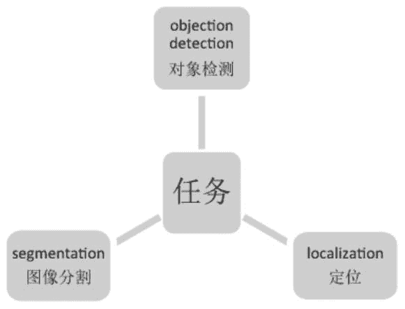

**图 1-1**

视觉图灵测试的价值在于，它能考察计算机视觉的**认知能力**——不仅看 AI 能否识别图中物体，更看它能否理解物体间的关联关系。然而，当前 AI 对图像关联关系的理解尚处初级阶段，这本是人类的先天优势，因此 AI 的测试结果与人类预期尚存差距。

图 1-2 展示了一幅北京街头场景。审讯者可针对图中标注的框选区域（即测试区）连续提问，视觉系统以“是/否”作答。若答案准确，即视为具备智能。

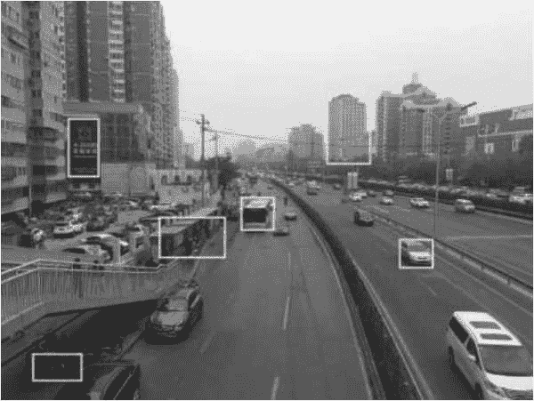

**图 1-2**

---

## 关于“真智能”的争论：通过测试 ≠ 真懂

对于 AI 是否拥有真正智能，专家们众说纷纭。最著名的反驳莫过于**“中文房间”**思想实验。1980 年，美国加州大学伯克利分校教授、著名哲学家约翰·塞尔在《行为与脑科学》期刊的《心灵、大脑与程序》一文中提出：无论计算机表现得多么聪明，它都不具备真正的理解力与智能。

**“中文房间”场景设定：** 一个不懂中文的人独自关在密室里，手边堆满汉英字典。有人从门缝塞进中文纸条，此人虽不识中文，但通过查字典、按规则操作符号，仍能组织出中文回复塞回去，从而欺骗门外的人以为屋内有人懂中文。`EXr6287u6NNVz+GYLY+7SC6AgGofrpiId/XnwIEoGMEPq3TPzkM5RyXBRbuLcLFjwnCuEHVXaQsGpygWHLFy9g==`

---

## 1.2 AI 的学科基石：跨学科的拼图

人工智能是一门典型的交叉学科，其地基由哲学、数学、经济学、神经科学、认知心理学、计算机工程、语言学等多块基石支撑。想深究 AI 原理，这些领域的知识缺一不可。笔者认为，作为 AI 产品经理，至少要对**数学、神经科学、认知心理学**有概念性认知，明白它们在哪些维度塑造了 AI。

### 数学：AI 的骨架与引擎

数学对 AI 的塑造主要体现在三大维度：

#### 逻辑——推理的法则
研究如何从前提正确地推导结论。1847 年乔治·布尔提出命题逻辑（布尔逻辑），标志着数理逻辑诞生。随后一阶逻辑、指称理论、对象与关系等理论相继问世，揭示了逻辑关联对象的方法，推动逻辑学飞速发展。

#### 计算——算力的边界
探讨“什么是可计算的”。图灵最早提出可计算性问题，致力于精确刻画可计算函数的范畴。有了计算理论与算力支撑，计算机才能用数字感知、分析世界并决策。AI 领域的绝大多数算法，本质都是数学理论在计算机科学落地的投影。

#### 概率——不确定性的推理
研究在信息不全时如何推理。贝叶斯提出的贝叶斯法则，奠定了现代不确定推理的基石。概率论为 AI 提供了随机计算与预测框架；其中的统计学方法，更能实现数据处理与分析，让结果更贴合需求。

### 神经科学：仿生的蓝图

神经科学解剖大脑如何处理信息。人类神经系统将行为、认知与脑机制有机融合；科学家试图借此全景揭示人类及动物在感知、语言、推理、决策等环节的奥秘。脑科学作为核心板块，大脑在理性决策中的关键地位，使其研究进展能直接反哺人工神经网络，进而驱动 AI 进化。

**神经元**是神经系统的基本单元，包含树突、轴突、细胞核、胞体（躯干）及长髓鞘。轴突末端为神经末梢（突触末端）。每根树突接收外界或其他神经元的刺激并传递兴奋至胞体；轴突则负责将信号从胞体传向下一个神经元或效应器。

**算力对比视角：**
人脑神经元数量成年后基本固定，约 **1000 亿** 个。摩尔定律预示计算机处理单元每 5 年增长 10 倍。单看处理单元，64 位 CPU 晶体管已达 10 亿级；预测 2020 年单 CPU 算力可比肩人脑，2050 年或超越全人类算力总和。

### 认知心理学：心智的操作系统

认知心理学是研究认知与行为背后心理加工过程的新兴心理学分支，旨在破解大脑如何接收、处理外部信息。核心研究版图覆盖：**注意机制、语言运用、记忆、知觉、问题求解、创造力** 等。它为 AI 提供了模拟人类认知架构的参考范式，助力系统根据外部刺激调整行为、提升适应性。

---

## 1.4 人工智能的研究疆域

人工智能的研究版图十分广阔，目前主要聚焦于五大核心板块：搜索、推理、规划、学习与应用（如图1-4所示）。

其中，搜索亦称“问题求解”；推理是基于知识库的演绎过程；规划则是依据规则确定执行路径；学习指基于数据的归纳与总结。应用层有别于前四类，覆盖面极广，可概括为AI在沟通、感知、行动三大维度的实战落地。本书将梳理当前AI领域的热门研究方向。

### 问题求解

问题求解堪称AI发展史上的里程碑式成就。早期AI首次迎来爆发，源于对博弈论及模式识别的攻克。1997年“深蓝”击败卡斯帕夫，2017年“AlphaGo”战胜柯洁，二者均属此范畴。正是问题求解领域的接连突破，让世界真正看清了AI的潜力。

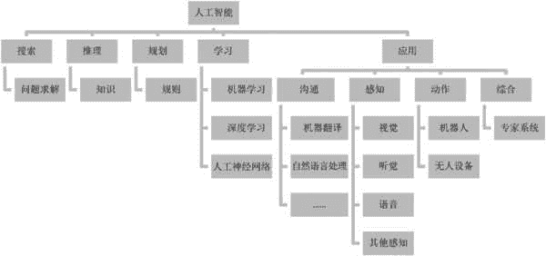

图 1-4

### 自然语言处理

自然语言处理（NLP）致力于让机器“读懂”人类语言，精准捕捉语义。其核心技术路线涵盖语言理解与生成。当前研究重点集中在手写识别、语义分析、机器翻译、语音理解等方向。凡涉及语言文字处理的产品，深耕NLP技术均为必修课。

### 专家系统

专家系统本质是一种智能程序，能调用知识与推理机制，攻克原本仅限专家才能处理的复杂难题。标准架构通常包含知识库、推理机、解释器、知识库维护、知识获取、信息输入及人机交互界面七大模块（见下图）。

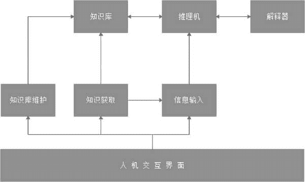

图 1-5

垂直领域常见的AI辅助软硬件，大多可归类于此。例如医疗影像分析软件通过推理CT片筛查病灶；气象预测系统通过数据建模判断台风生成概率。

### 人工神经网络

人工神经网络（ANN）研究起步极早。上世纪40年代科学家便尝试用简单单元模拟大脑神经结构与功能，后发展出多层网络架构。ANN在机器学习、专家系统、机器人学等领域斩获丰硕成果，现已成为AI核心高地。二者分工不同：专家系统侧重模拟人类知识处理的“功能”，神经网络则聚焦复刻大脑神经元的“结构”。

### 机器人学

机器人是模拟人类操作、在特定条件下自主完成任务的机械实体。如今已深度渗透工业、农业、医疗、家庭等全场景。机器人通过环境感知与思考获取外部信息并加工处理。扫地机器人、智能陪伴机器人等已走进寻常百姓家。

### 机器学习

机器学习探索如何让机器通过“学习”持续进化，涵盖计算、逻辑、行为等能力维度。终极目标是赋予计算机类人学习能力，使其问题解决技能自我迭代。应用极广，主流方法包括统计、分类、回归、聚类、计算等数理手段。

## 1.5 人工智能的商业变现路径

随着技术成熟，AI产品加速涌现。从“深蓝”到“AlphaGo”，从专家系统到智能家居，商业与生活场景全面渗透。AI产品走出实验室，步入产业化落地：智能手机、穿戴设备、智能音箱普及千家万户；指纹识别、人脸核验、图像增强等实用技术成为标配。商业场景丰富催生出五大主流变现模式：基础硬件模式、技术驱动模式、垂直行业模式、深度应用模式、生态构建模式。

### 基础硬件模式

近年AI飞跃得益于数据、算法、算力“三驾马车”，算力突破核心在芯片。芯片技术的长期积累支撑起机器学习与深度学习所需的算力阈值，让AI红利惠及大众。因芯片在产业链上游的关键地位，不少厂商选择切入芯片研发赛道。但此路门槛极高，对硬件工艺与制造要求严苛，玩家仍属少数。

传统x86架构以CPU为核心，GPU原主攻图形渲染。凭借远超CPU的并行加速优势，配合AI与深度学习成熟、以及低延迟、低功耗特性，GPU成功转型成为AI算力主力。

英伟达在GPU领域占据统治级地位。2017年GTC大会发布Volta架构，专为深度学习引入Tensor Core，数据中心训练性能代际跨越。

GPU算力碾压CPU，成为机器学习训练阶段的最优解。但GPU在推理与神经网络运算上存短板，为补齐推理能力，谷歌自研TPU芯片（见图1-6）。谷歌于ISCA 2017发布论文披露TPU设计细节，引发轰动。TPU专为机器学习深度优化，曾助力AlphaGo出战。

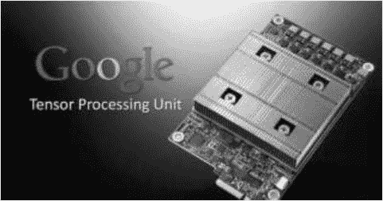

图 1-6

自2016年起，AI芯片赛道迅速升温，引得传统巨头与互联网大厂纷纷入局。除谷歌、英伟达这些先行者外，苹果、微软、Meta、英特尔、高通、AMD以及阿里巴巴等头部玩家，均已开启自研通用或垂直领域AI芯片的战略布局。

总体来看，从基础芯片研发切入AI版图的企业，往往掌握核心硬件技术壁垒——正如英伟达凭借全球第一GPU厂商的地位奠定根基。但更多选择是：企业依托自身在特定行业的深厚积淀，打造深度适配垂直场景的专用芯片。比如面向自动驾驶的感知决策芯片、汽车制造线上多轴机械臂的控制芯片等。这类产品将算力与业务场景深度融合，实现“专芯专用”。AI芯片的具体分类脉络详见下图。

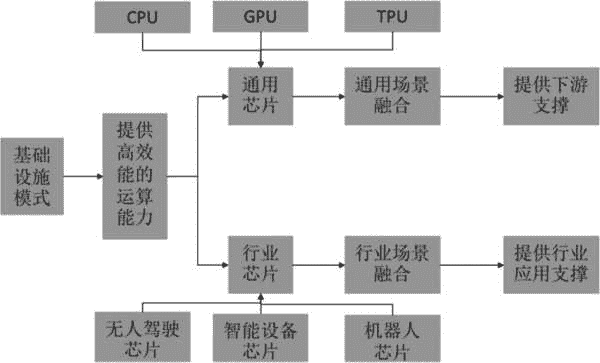

图 1-7

### 技术驱动模式

依托软件时代积累的深厚技术底座，微软、Meta、IBM等技术型软件巨头正加速在AI领域建立护城河。它们在算法与通用技术上拥有先发优势，战术路线是：以某个细分行业为切入点，构建行业级应用平台，通过“技术沉淀—输出—共享”的飞轮效应，不断扩充平台用户规模，进而蚕食更多市场份额。典型案例包括IBM Watson、亚马逊AWS、微软Azure等云平台生态。

### 垂直行业模式

此模式适配在细分赛道拥有绝对话语权的企业，如电商领域的阿里、出行赛道的滴滴、政务数字化的科普云等。它们利用行业头部地位与海量数据资产，反哺垂直算法研发，输出行业级整体解决方案。深耕垂类通常演进为两条路径：

1.  **以大数据积累孵化产品**。企业通过长期深耕建立数据护城河，依托数据优势率先在特定场景落地现象级AI应用。一旦跑通，即可开启“用户—数据—模型”正向循环，锁定行业龙头地位。滴滴便是范例：从网约车切入，不断拓展专车、快车、拼车等场景，借AI优化调度推荐，最终确立霸主地位。
2.  **以产品应用沉淀行业方案**。企业在数据与业务双重优势下，结合AI技术抽象出行业应用平台、通用技术组件及标准化解决方案，实现市场份额的规模化复制。百度依托地图数据积淀与AI技术合力，推出自动驾驶开放平台，即属此类打法。

### 深度应用模式

该模式不执着于底层技术自研，而是聚焦“单点突破”，在具体业务场景中将AI应用做深、做透，以最快速度跑通商业闭环。这也是初创公司与传统转型企业的首选路径。

初创团队资源有限，硬攻芯片或基础算法投入产出比极低；反之，根据市场反馈寻找落地场景、植入AI能力，性价比更高。若企业自带细分场景数据，可直接构建应用沉淀用户与数据；若无数据，则可通过与第三方合作，将AI融入传统业务流。字节跳动（今日头条）即是典型代表：基于数据挖掘驱动的推荐引擎实现“千人千面”，凭借极致的分发算法效率，成为移动互联网增速最快的独角兽之一。

### 生态构建模式

构建AI生态是多数企业的终局之战，亦是最高阶的商业模式。在AI产业链上，无论拥有硬件研发力、算法技术力、垂直统治力，还是靠深度应用积累流量，单一模式终有上限。唯有将技术与市场双轮驱动，编织成生态网络，才能在单点竞争中立于不败，更能借生态资源筑起行业高墙。

生态建设的基石是AI三要素：数据、算法、算力。数据是客观世界的数字化映射与记录；算法是解决问题的特定方法论；算力则是算力基础设施。欲构建健全生态，企业需具备长期主义战略高度与匹配的硬核实力——即已在或正在通过互联网高速积累大数据、攻坚底层算法、迭代优化硬件。这是一场持久战，涉及面广、周期长。截至2019年，在生态构建上成效显著的玩家主要有：谷歌、亚马逊、微软、阿里、百度等。

## 1.6 人工智能盈利模式

随着AI技术持续演进，技术如何落地成产品、产品如何商业化量产、市场如何实现变现，成为企业最核心的生存课题。当前AI变现路径主要集中在三大维度：专利技术授权/转让/交叉许可收益；AI技术能力输出收益；AI终端产品销售收益。

### 专利授权、转让与交换变现

随经济发展，中国已成全球最大消费品生产消费国及贸易大国。AI产品矩阵日益丰富，其底座源于中国在AI技术层面的持续创新突破。

## 1.7 本章小结

全球人工智能领域专利数量自2011年以来呈爆发式增长，年复合增率超30%。中国在AI专利技术布局上稳居世界首位。正是由于专利技术在AI产品中的核心地位，凭借技术创新申请专利、转让专利技术，已成为当下AI市场极为关键的盈利路径。

对比中美六大AI巨头——腾讯、百度、阿里巴巴、IBM、微软、谷歌的专利布局，不难发现它们均高度重视全盘专利战略。但侧重点各有千秋：美系企业热衷机器学习、语音识别、语言合成处理等底层算法领域；中企则聚焦支付、交互技术、视频图像处理、智能搜索等应用落地赛道。当然，自动驾驶、数据文本聚类、指纹识别等是六家共同的“必争之地”。

具体来看：IBM布局最为全面，算法优化、自然语言处理、自动驾驶优势显著；微软深耕机器学习、神经网络、音视频识别；谷歌在自动驾驶、语音识别、NLP上专利储备深厚；腾讯主攻即时通讯、数据处理、支付平台、数据交易；百度紧扣搜索业务、自动驾驶、语音/图像识别；阿里巴巴则在支付平台、信息交互、广告投放上构筑护城河。

申请AI相关专利时，企业须充分体现理论层级、技术创新与工程复杂度，撰写时建议把握三点：
1.  **凸显创新高度**：让专利的核心创新点一目了然；
2.  **深挖技术细节**：用硬核参数与实现路径支撑技术深度；
3.  **场景赋能技术**：将应用场景与技术创新有机结合，避免空谈概念。

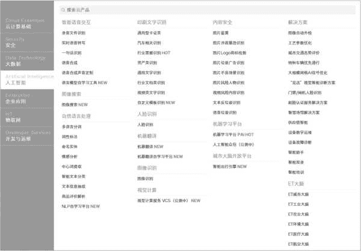

### 1.2 以AI技术输出换取收益

除了专利许可、转让、交叉授权，掌握核心技术的企业还可通过对外提供技术服务变现。当前AI技术服务体系呈三层递进结构：基础层、技术层、行业层。

**基础层**即提供框架平台或算法平台。典型代表有百度AI开放平台、阿里云ET大脑、腾讯AI平台、科大讯飞开放平台等。这类企业凭借底层技术优势，通过开放接口吸引开发者、激活生态，再借生态活力推动产品落地产业端（如图1-8所示，阿里云ET大脑集成了产业大脑、AI解决方案、算法平台等模块）。但单纯卖技术易陷入同质化竞争，因此头部玩家多采用“AI+行业”模式，打磨垂直解决方案以实现可持续盈利。

若企业兼具“技术+海量数据”双重护城河，则可进阶为**AI产品应用服务商**。如格灵深瞳将AI融入视频监控打造“微目”平台，实现人车定位识别；旷视科技`Face++`平台则成长为国内领先的人脸识别服务基座。 `EXr6287u6NNVz+GYLY+7SC6AgGofrpiId/XnwIEoGMEPq3TPzkM5RyXBRbuLcLFjwnCuEHVXaQsGpygWHLFy9g==`


### 1.3 以AI产品销售变现

专利转让与技术服务多面向企业端（B2B），而AI产品直面大众（B2C），极易形成品牌声量。随着技术演进，AI产品矩阵日益丰富：智能机器人、智能音箱、实时翻译机、电商导购助手、医学影像筛查、智能手环、游戏AI等层出不穷。

销售方向分为两条线：
*   **2B（To B）**：赋能企业降本增效。如智能分拣机器人、智能服务员、智能客服系统。
*   **2C（To C）**：延伸人的感知与决策。如智能音箱、个性化推荐系统。

案例：阿里AI实验室2017年7月发布天猫精灵，内置`AliGenie`语音助手，支持方言指令、智能家居控制、语音购物、话费充值、音乐播放等。2018年5月官宣销量破300万台，交出亮眼成绩单。 `EXr6287u6NNVz+GYLY+7SC6AgGofrpiId/XnwIEoGMEPq3TPzkM5RyXBRbuLcLFjwnCuEHVXaQsGpygWHLFy9g==`

### 1.7 本章小结

本章从产品经理视角切入，系统梳理了AI研究领域、商业模式与利润模型，为后续理解与构建AI产品奠定认知基石。 `EXr6287u6NNVz+GYLY+7SC6AgGofrpiId/XnwIEoGMEPq3TPzkM5RyXBRbuLcLFjwnCuEHVXaQsGpygWHLFy9g==`

# 第2章 人工智能产品

## 2.1 AI产品发展阶段
## 2.2 AI产品发展历程
## 2.3 AI产品认知误区
## 2.4 AI产品与互联网产品的差异
## 2.5 典型AI产品剖析
## 2.6 本章小结

产品本质上是可供市场交换、被使用消费、并能满足特定需求的载体，涵盖有形货物、无形服务、组织及观念及其组合。AI产品可定义为：具备类人思维或最优决策执行力、并承载用户价值的产品。从买方/用户视角看，它们是能辅助甚至替代人类完成思考与行动、并转化为实打实收益的工具。

脱离市场谈AI技术无意义；唯有将技术落地为具体产品形态，精准击中生产生活各场景的真实需求，AI技术才真正实现价值兑现——这正是AI产品经理的核心使命。 `EXr6287u6NNVz+GYLY+7SC6AgGofrpiId/XnwIEoGMEPq3TPzkM5RyXBRbuLcLFjwnCuEHVXaQsGpygWHLFy9g==`

### 2.1 AI产品发展阶段

### 2.2 AI产品演进脉络

AI产品的诞生绝非一蹴而就，必然经历从概念萌芽、逻辑打磨到场景落地的完整周期。概括来看，模型走向应用的历程可划分为三个关键阶段：

**技术探索期**：此阶段所需的数据、算法及算力高度集中，主要掌握在政府机构、高校实验室或大厂研发部手中。核心任务聚焦于基础算法模型的训练与理论攻关。

**企业深耕期**：当实验室技术趋于成熟并展现实用价值，科技巨头会押注特定赛道抢占先机；中小企业则借力巨头开放的平台与资源生存发展。此期重心在于分布式计算、分布式应用及场景化基础技术的供给。

**市场爆发期**：各类企业将底层平台与场景化技术组件结合，推进面向市场的产品研发。这标志着AI算法真正融入企业运营与大众消费场景，并实现稳定输出，也是AI技术普及的关键跃迁。

---

### 2.2 AI产品发展史

AI产品的演进始终与理论技术同频共振。自诞生起，AI理论便历经多次寒冬与繁荣。1958年首个AI程序“逻辑理论家”问世后，专家系统层出不穷，却难触商业化门槛。直到80年代中期，决策树的发明催生机器学习，多层人工神经网络突破单层感知机局限（引入多隐藏层，赋能复杂问题求解），AI迎来质变。

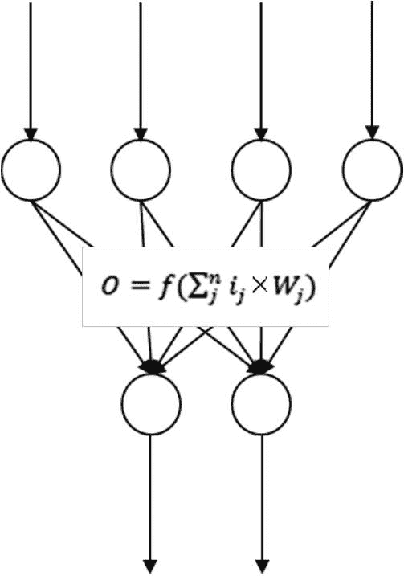

Figure 2-1

80年代后陷入低谷，直至1993年再迎突破。里程碑式产品接连涌现：

*   **1997年，IBM“深蓝”**：搭载32微处理器，每秒搜索2亿步，内置200年名局库。以3.5:2.5击败卡斯帕罗夫，成首个夺得国际象棋冠军的AI。
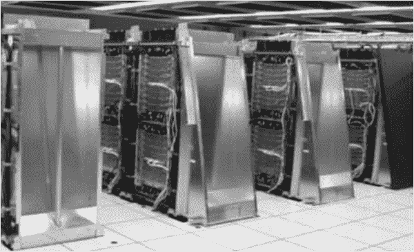
Figure 2-2

*   **2005年，斯坦利车队夺冠**：美军方“大挑战赛”要求无人车自主跑完全程142英里（约228公里），耗时不超10小时。195队角逐仅5队完赛，斯坦利号以6小时53分58秒领跑。

Figure 2-3

*   **2006年，希顿《深度学习》刊登《Science》**：“深度学习”概念引爆学界，AI重回聚光灯下。

*   **2011年，双雄并起**：IBM“沃森”击败《危险边缘》双冠王斩获百万奖金；谷歌启动“大脑计划”，联结1.6万计算机构建超大规模集群，模拟人脑自主学习（如从千万图像中识别猫）。
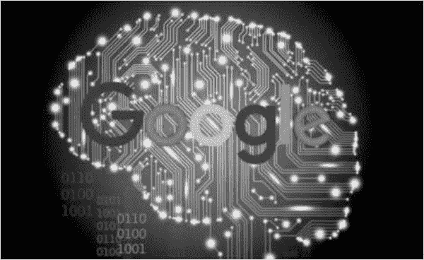
Figure 2-4

*   **2012年，语音交互元年**：苹果Siri上线，支持自然语义指令调用外部服务（天气、导航等），并具备持续学习与闲聊能力，后增实时翻译、语境预测及Apple TV遥控功能。
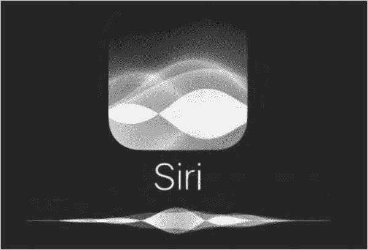
Figure 2-5

*   **2012年，微软天津演示实时同传系统**：英语转中文语音合成，更神奇地保留了讲者原声语调口音。

*   **2014年，微软双品牌发力**：4月推Win Phone语音助手Cortana，6月发布聊天机器人“小冰”，开启自然语言自由对话新体验。

Figure 2-6

*   **2014年8月，“尤金·古斯特曼”通过图灵测试**：在图灵逝世60周年纪念赛中，33%评委误判其为人类，成为历史上首个通过测试的AI产品。

Figure 2-7

### AI 里程碑：从类脑芯片到星际争霸的突破

2014 年 8 月，IBM 发布了模仿人脑架构的 `TrueNorth` 芯片。这款神经形态 `COMS` 芯片集成了 4,096 个硬件核心，每个核心可模拟 256 个可编程硅神经元，神经元总数略超百万。下图展示了集成 16 颗 `TrueNorth` 芯片的电路板实物。

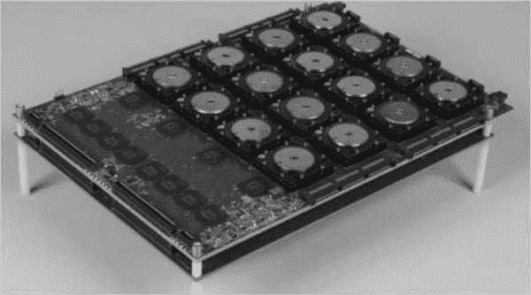

Figure 2-8

翌年 2 月，谷歌在《自然》期刊刊文介绍 "`Deep Q Network`"（`DQN`）。该网络借助深度强化学习，实现了媲美人类的控制水平。测试中，`DQN` 横扫 70、80 年代街机平台上的 49 款游戏，得分率达 59.18%，表现达到或超越人类水平。下图为 `DQN` 的逻辑架构示意。

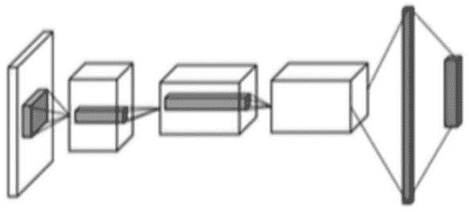

Figure 2-9

2015 年 12 月，谷歌 `DeepMind` 旗下围棋程序 `AlphaGo` 以 5:0 横扫欧洲冠军樊麾，这是计算机围棋程序首次战胜人类职业棋手。受限于论文发布节奏，该消息直到 2016 年 1 月 27 日才正式见诸《自然》。

2016 年 3 月，韩国首尔上演“人机世纪大战”，`AlphaGo` 对阵韩国九段棋手李世石，最终以 4:1 获胜。2017 年，世界排名第一的柯洁迎战 `AlphaGo`，赛制包含人机对抗及五人团体战。柯洁赛后感叹：“三百年前蒸汽机超越了人类想象，如今 `AlphaGo` 同样超越了棋手认知，与之对弈如同对话未来。”最终人类仍败下阵来，`AlphaGo` 稳居世界围棋等级分榜首。

2019 年 1 月 25 日，`DeepMind` 推出 `AlphaStar`，在《星际争霸 II》中以总比分 2:0 完胜两名职业选手，这是继围棋之后 AI 再次刷新人类认知的标志性战役。与围棋“已知边界、离散动作”不同，《星际争霸 II》是即时战略游戏：战争迷雾下需采集资源、构建建筑、生产兵种，同时平衡经济、科技、侦察与微操，动作空间连续且巨大，堪称模拟完整战场博弈的最难 AI 挑战之一，如下图所示。

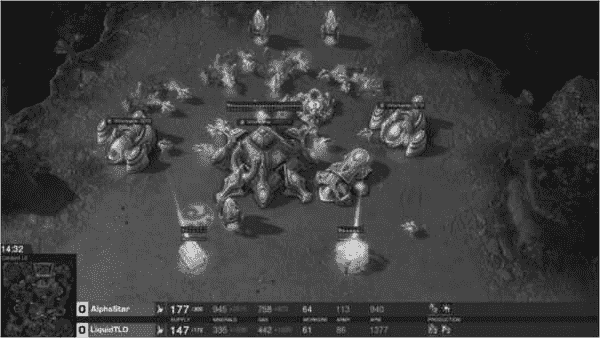

Figure 2-10

对手分别为世界排名第 68 位的 TLO 与第 19 位的 MaNa，虽均为顶尖高手，却分别以 0:5、1:5 惨败。`AlphaStar` 沿用强化学习范式，将游戏视为长序列建模任务：输入游戏界面的单位属性列表，经神经网络输出指令。其架构基于 `Transformer`，融合深层 `LSTM` 核心、带指针网络的自回归策略头及集中式价值基线。`DeepMind` 认为此类长序列、大动作空间模型在气象预报、气候建模、语言理解等领域极具应用潜力。`EXr6287u6NNVz+GYLY+7SC6AgGofrpiId/XnwIEoGMEPq3TPzkM5RyXBRbuLcLFjwnCuEHVXaQsGpygWHLFy9g==`

### 2.3 打破对 AI 产品的认知迷思

大众对 AI 产品常存两大误区。

**迷思一：AI 产品必须像人一样工作。** 认知常源于图灵测试——“无法分辨对话者是人还是机，即为 AI”。通过测试需突破 NLP、知识表示、自动推理、机器学习等关键技术，甚至还需计算机视觉与机器人学加持。但 AI 研究者鲜以此为终极目标。正如人类渴望飞翔，却非伪装成鸟欺骗鸟群，而是发明飞机实现飞行。因此，AI 产品开发应聚焦**特定场景下的问题求解**，推动技术工业化、产品化，将人类从体力、重复、技能性劳动中解放，转向更具创造性的工作——这才是 AI 应用的真谛。

**迷思二：AI 产品即通用人工智能（AGI）。** 传统认知里，AI 似乎全能：扫地、买菜、代劳大部分工作。现实却是，当前 AI 多为**弱 AI（专用 AI）**，仅在明确边界内解决特定问题（如翻译、分类、围棋博弈）。面对超复杂、模糊、开放的场景，现有技术尚显无力。落地时应锁定**有边界的业务**，用 AI 处理数据与逻辑。产品经理无需纠结强弱 AI 之分，而应追问：产品好用吗？适用何种行业、岗位、场景？行为特征、执行路径、衡量指标为何？

### 2.4 AI 产品与互联网产品的本质差异

### 2.4.1 互联网时代的产品特质

互联网堪称20世纪最具影响力的发明之一。它将分散的数据编织成庞大的信息网络，打破了信息孤岛的状态，让人类首次体验到极速传播与海量共享的便利。然而，随着接入信息呈爆发式增长，大量冗余内容淹没了用户视野，严重干扰了人们对高价值信息的精准筛选与判断。用户每日面对海量数据、成千上万的应用选择，陷入了典型的“信息过载”困境。这也是互联网产品经理最棘手的课题：如何让自家App或系统冲破信息洪流，抓住用户注意力，占据更多单用户时长？

为突围信息洪流、提升传递效率，产品经理在实战中总结出诸多设计理念、交互模型与方法论。以“以用户为中心设计”（UCD）为例，其核心在于始终将用户置于决策首位。如图2-11所示，该体系强调人、行为、场景与技术四者的关联。产品起步期，战略制定以满足用户需求为根本动力与终极目标；设计开发期，用户洞察是决策依据；全生命周期中，一切迭代优化均源于用户反馈。

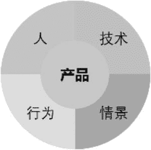

Figure 2-11

此外，业界也梳理了传统互联网产品从0到1的落地流程：涵盖规划、数据收集分析、构思、精细化设计、实现、测试、上线及迭代优化等环节，每个阶段均包含繁杂的管理与技术细节，如如何在调研、决策、设计、实施、销售、采购、使用全链路引入场景导向法。

无论是用户中心法，还是0到1流程法，出发点均聚焦于如何“落地”产品。那么，互联网产品本质是什么？它的用途何在？

作者认为，互联网产品的核心内核是**提升多方间的信息传递效率**。产品经理的所有动作——需求调研、用户分析、原型绘制、交互设计——本质上都在围绕这一效率转。若某产品能针对特定行业、场景、业务或行为显著提升信息流转效率，它必然是成功的。

回溯历史：QQ、微信出现前，沟通依赖面对面或电话；它们上线后，打破时空限制，只要在线即可实现实时触达，极大提升了通讯效率。电商兴起前，交易依靠线下信息垄断、低买高卖，利用信息差获利延续千年；电商平台连通生产、渠道、消费，让足不出户买遍全球成为可能。滴滴、Uber诞生前，乘客与车辆靠路边碰巧匹配，信息极度不对称、效率低下；网约车平台连接双端信息，重构了匹配效率。

产品经理持续挖掘工作生活场景，试图用互联网特性打破原有信息壁垒。但随着红海竞争加剧，产品服务场景已从泛需求转向细分垂直领域。以网站/用户行为分析系统为例（图2-12），通用型产品虽能满足常规站点的功能点分析，但在政务等特定领域却因贴合度低而乏力。政务网站涉及办事、互动、咨询等专属需求，通用工具难以深度剖析具体办事流程。

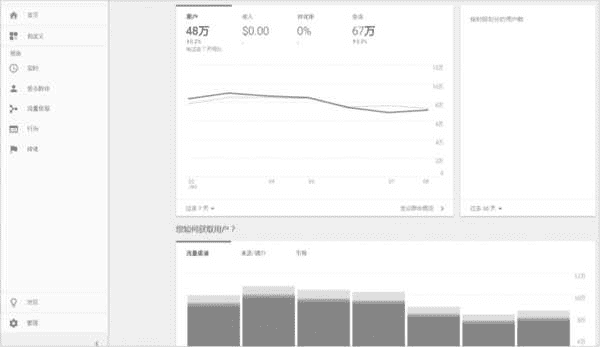

Figure 2-12

深究政务网站的信息传递效率，若设计能精准卡住“政府诉求”与“群众诉求”两个关键点，效率将再跃升。为让行为数据更快赋能政府决策，功能与界面须深度适配政务场景。图2-13即为定制化的政务行为分析系统。

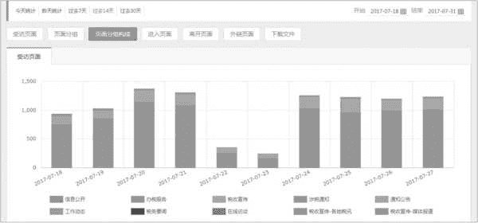

Figure 2-13

### 2.4.2 AI时代的产品特质

本书指出：互联网时代产品以消除信息不对称、提升传递效率为核心目标；而AI时代产品则从**生产力**视角出发谋划设计。

初中课本即阐释：“人类社会发展史，实质是生产力持续发展史。”

“生产力，是具备一定生产经验与劳动技能的劳动者，结合其使用的生产资料，在物质生产过程中形成的力量。即人类在生产中征服、改造自然、获取适用物质资料的能力。”

面向个人消费级产品，AI的意义在于**对人类感知与技能的技术延伸**。其在消费端的落脚点主要聚焦三维：一、信息采集；二、辅助判断；三、辅助处理。

人工智能产品通过广泛搜集信息获取海量数据，经模型训练生成适用算法，再录入个人数据输出结果。因此，数据采集能力是AI产品实现智能判断的基石。从穿戴设备到智能家居，从推荐引擎到预测系统，无不依赖各类传感器与输入终端获取数据。

面向消费者的产品能助力人类更敏锐地感知外部世界与自我状态，并大幅提升信息处理的效率与速度。这种加工主要体现在两个维度：个体信息的量化呈现，以及信息处理方式的进阶演变。

使用者常会发现，AI产品仿佛越来越“懂”你：偏好何类资讯，客户端便精准推送何类新闻；钟情何种口味，餐厅推荐便紧随其后。缘由在于，AI已通过采集与算法构建出一个量化的数据“分身”。医疗健康、运动健身领域的产品更进一步，借助心率、步频、身高体重、速度、血压等指标，将个人信息量化至微观层面。除自我量化外，人们借助AI还能感知并处理更庞大的数据集，显著强化信息处理能力。

对企业端而言，AI产品的核心使命是提升生产力。AI技术通过双路径赋能：以机器替代人力提升劳动效率，并拓展劳动工具的边界。

AI不但在消费级应用广泛落地，更在工业与企业级场景释放巨大价值。企业生产管理中的AI应用聚焦视觉、语音、语言三大核心技术，在辅助识别、决策支持、替代作业等环节展现显著优势，有效化解劳动力短缺难题。

2018年10月，海底斥资1.5亿元打造的全球首家智能餐厅在北京正式启幕（如所示）。在此，排队取号、点餐下单全程无人化；后厨管理同样植入AI，食材备菜、底料调配、餐品传菜均由机器人完成。


Figure 2-14

该餐厅实现了餐品仓储的智能化管控：所有食材在中央厨房统一加工，经冷链物流直达门店，自动进入出餐机。出餐机与前台点餐系统联动，用户下单后，机械臂精准抓取菜品置于传送带，机器人再送达餐桌，打通从入库到上桌的全自动闭环（如所示）。此外，蔬菜贴设RFID标签，配合监管系统，实现菜品全程溯源与保质期精准把控。


Figure 2-15

自研的智能厨房管理系统（IKMS）担当“智慧大脑”角色，汇聚智能厨房全链路数据，多维分析运营、出品、库存、保质等状态，统筹管理。IKMS融合机器学习与AI，推动生产流程自动化、库存管控精准化、数据呈现可视化、菜品全生命周期监控，严守品质底线。

海底捞智能餐厅的炒制底料不再依赖人工，而是由私有化定制的自动炒料机接管（如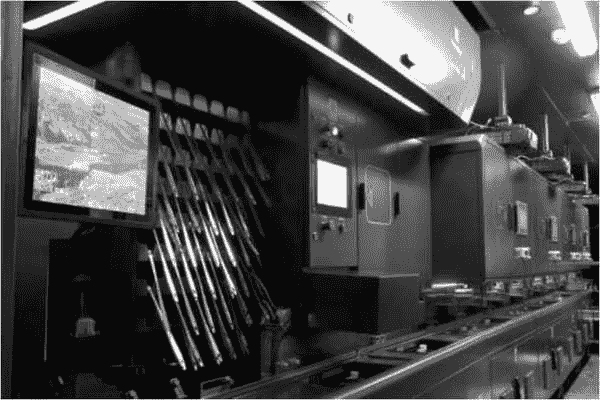所示）。顾客可按口味定制，“重麻重辣”或“少盐少油”，主辅料及鲜料配比精准至0.5克，机器自动完成差异化炒制。


Figure 2-16

后厨设有监控大屏，实时映射设备运行态；备菜区屏幕同步显示余量预警，及时拦截超48小时未出菜的过期风险（如所示）。


Figure 2-17

大规模AI技术与产品的落地，不仅重塑用户体验，更大幅压降人力成本，将繁重重复的体力劳作交予机器，最终达成降本增效的极致目标。

### 2.3 海底捞智能餐厅实录

2018年10月，海底捞投资1.5亿元建设的全球首家智能餐厅在北京揭幕（如所示）。店内取号、点餐全流程无人值守，后厨备菜、调底料、送餐等环节均由机器人自主作业。


Figure 2-14 Haidilao Smart Restaurant

餐厅实现餐品入库智能化管理，食材经中央厨房标准化处理后，通过冷链直供门店并接入自动出餐机。出餐机与前端点餐系统无缝对接，下单即触发机械臂分拣上传送带，机器人终端配送，构建入库至出餐的全自动链路（如所示）。全品类蔬菜植入RFID标签，联动监管系统，做到溯源实时化、保质管控精准化。


Figure 2-15 Fully Automated Food Serving Process

# 海底捞智慧餐厅：以IKMS重塑后厨管理新范式

海底捞智慧餐厅依托自研的智能厨房管理系统（`IKMS`），实现了后厨运营的全链路数字化管控。该系统宛如后厨的“中枢大脑”，汇聚智慧厨房全维度数据并深度剖析，能够实时掌握运营态势、出餐进度、库存动态及菜品留样时效等核心指标，从而达成统一调度。更进一步，`IKMS`融合机器学习与AI算法，推动生产流程标准化自动化、库存管控精准智能化、生产数据可视化信息化，并贯穿菜品全生命周期监测，从源头锁住品质。

在海底捞智慧门店，传统手工炒制底料的模式已被“私享定制自动配料机”取代（见下图）。


图 注：私享定制自动配料机

顾客下单时可按偏好选择口味，无论是“重麻重辣”还是“少盐少油”，设备均能将主辅料及鲜料精准配比至0.5克级别，自动完成复合口味调配。

后厨还配置了监控大屏，同步映射各设备运行状态。备料区外的屏幕则聚焦库存预警，实时显示剩余份量，并自动标识超48小时的过期风险品项（见下图）。

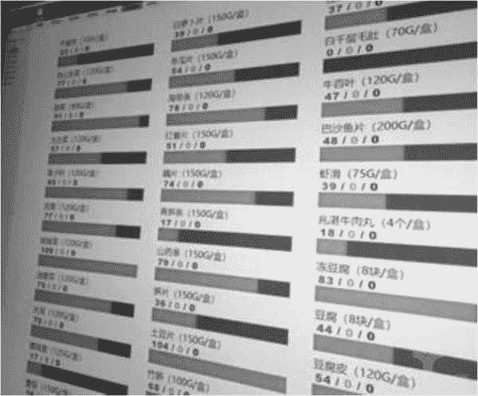

图 注：监控看板

通过大规模引入AI技术与智能硬件，海底捞智慧餐厅在显著提升顾客体验的同时，有效压降了人力成本。它将大量体力型、重复性作业交由机器承接，成功跑通“降本增效”闭环。

## 2.4 AI产品与互联网产品的本质分野

### 2.4.1 互联网时代的产品基因图谱

互联网是20世纪最具变革力的发明之一。它将离散数据编织成庞大信息网络，打破信息孤岛，让极速传播与海量共享成为常态。然而，随接入信息指数级暴增，冗余噪音淹没用户视野，严重干扰高价值信息的精准筛选与决策。大众每日面对海量数据与数十万款`App`的选择困境，这就是互联网时代的“信息过载”顽疾。这也是互联网产品经理的核心痛点：如何让自家产品突围信息洪流，抓住用户注意力，延长单用户留存时长。

为破解流量突围与传播效能难题，产品界沉淀出诸多设计哲学、交互范式与方法论。以“用户中心产品设计”为例，其核心主张始终将用户置于决策首位。该理论（如下图）强化“人、行为、场景、技术”四要素的耦合关系，构建系统化设计体系。产品策略萌芽期以满足用户需求为原动力与归宿；设计开发期以用户洞察为决策基石；全生命周期的迭代优化均源自用户反馈。


图 注：用户中心产品设计

此外，业界亦总结出互联网产品0到1的通用流程方法论：涵盖规划、数据分析、概念孵化、方案打磨、落地实施、测试验收、上线发布、持续迭代等阶段，每阶段暗含大量管理与技术细节，如全流程中脚本引导法的应用。

无论用户中心论还是0到1流程论，其底层逻辑均指向“产品如何落地”。那么，互联网产品究竟是什么？其存在意义为何？

作者认为，**互联网产品的内核，是重构“信息与信息之间”传递效率**。产品经理的一切动作——需求调研、用户画像、原型交互、交互设计，本质上都在服务这一核心指标。若产品能显著跃升某行业、某场景、某业务或某行为的信息传递效能，其成功便成必然。

`QQ`与`微信`问世前，人际传递依赖面谈、电话等低效路径；二者上线后，打破时空限制，实现在线即达的实时触达，极大跃升通讯效率。

电商兴起前，交易依赖线下信息垄断，靠“买低卖高”的信息差获利，此模式延续千年；电商平台上线后，打通产端、渠道端、消费端，实现全链路信息互联，让足不出户的“产地直采”成为现实。

`Uber`与`滴滴`诞生前，车乘双方信息割裂，司机不知客在何处，乘客不知车在何处，仅能靠路边碰巧成交，匹配效率极低；网约车平台以数字化连接重塑供需匹配，实现信息传递效率的质变飞跃。

# 从“破解信息差”到“释放生产力”：产品进化的两条主线

产品经理向来热衷于挖掘生活与工作的各类场景，试图借助互联网特性打破原有的信息壁垒。然而，随着互联网红利期的结束，泛场景市场早已陷入红海厮杀。这倒逼产品方向发生根本性转向：从覆盖大而全的通用场景，转向深耕垂直细分的领域场景。

以网站数据分析为例，通用型分析工具（如图 2-12 所示）虽能满足常规站点对用户基础信息、行为轨迹的剖析需求，但一旦落地到政务等专业领域，便显得“水土不服”。政务网站承载着办事、互动、查询等特有业务链路，通用产品难以精准适配其特定办事流程的分析诉求。因此，专为政务定制的行为分析系统（如图 2-13 所示）应运而生，唯有贴合“政务所需”与“群众所盼”的关键点，才能真正提升信息触达效能。


Figure 2-12 Typical Website Data Analysis System


Figure 2-13 Government Affairs Behavior Analysis System

## 2.4.2 AI 时代的产品底色：以生产力视角重塑价值

本书指出，互联网时代产品的核心使命是消解信息不对称、提升传递效率；而步入 AI 时代，产品规划的坐标系已悄然迁移至“生产力”维度。

教科书早有定论：人类社会发展史，本质上是生产力不断进化的历史。生产力，是劳动者、劳动资料与劳动对象结合所迸发的力量，是人类改造自然、获取生存资源的根本能力。

### 消费端：感官延伸与“量化自我”的双重奏

对个人用户而言，AI 的意义在于成为人类感官与技能的“外挂延伸”。其落脚点主要集中在三环：**信息搜集、辅助决策、辅助执行**。

运作逻辑遵循“采海量数据→训练模型→输入个体信息→输出精准解”的闭环。因此，数据采集能力是 AI 产品的基因，从穿戴设备到智能家居，从推荐引擎到预测系统，无不依赖传感器与输入终端捕获原始素材。

这一过程在消费端催化出两大显性变化：

**一是“量化自我”的深度推进。**  
算法模型通过持续采集，为每个用户构建起数字化分身——你偏好何种资讯、钟情何种口味，系统洞若观火。医疗健康、运动健身领域更将量化推向微观：心率、步频、血压、速度……每一项生理指标都化作可计算、可追踪的数据资产。

**二是信息处理能力的跃迁。**  
借助 AI，个体能以更低成本感知外部世界与内在状态，实现高效决策。推荐算法帮你从海量噪音中筛选信号，预测系统协助你预判未来趋势，人类的认知带宽由此被极大拓展。

### 企业端：替代与延展，解码降本增效

面向组织，AI 产品的唯一 KPI 是**提升企业生产力**。路径有二：替代劳动力以提升单位产出，延展劳动工具以拓宽生产边界。

企业级 AI 的主战场锁定在**视觉、语音、语言**三大模态。通过辅助识别、赋能决策、替代作业，AI 正在填补劳动力缺口、重塑生产函数。这不再是锦上添花的效率工具，而是关乎企业生存进化的核心引擎。

## 2.5 典型 AI 产品图谱

### 2.5.1 可穿戴设备：离“真智能”还有多远？

可穿戴设备是科技圈当之无愧的“顶流”。从 Google Glass 到小米手环，再到 Apple Watch，巨头们纷纷入局，将自研采集算法注入终端，力图打造专属个性化服务。**AI，是穿戴品类的灵魂内核。**

溯源来看，智能穿戴概念 80 年代便已萌芽，却因 AI 技术幼稚而长期沉寂。直到 21 世纪 AI 迎来爆发期，赛道才真正跑起来。2012 年被业界公认为“智能穿戴元年”，Google Glass 横空出世（见 图 2-18），其功能几乎对标智能手机：语音拍照、视频通话、网页浏览、邮件处理，尽在眼镜一镜之间。


Figure 2-18 Google Glass

虽然后续场景挖掘不够深入，但“设计与技术完美融合”的标杆地位已奠定，引发全行业跟进狂欢。

当下市场形态呈现百花齐放：智能眼镜、手表、手环、头盔、戒指、项链、服饰……“小型化、便捷化”成共识卖点，开辟了电子消费新蓝海。然而，**行业本质仍处于幼年期**。厂商虽多、款式虽新、竞争虽烈，但核心痛点未解：以“小”和“便”为主打的当下形态，尚未攻克**“如何真正实现智能”**这一根本命题。这才是穿戴设备通往成熟期必须跨越的鸿沟。

### 重新定义智能穿戴：为何你的手环只是“伪AI”？

经过深入调研主流智能穿戴产品会发现，绝大多数所谓的“智能”设备，本质上只是以特定形态将手机功能“穿”在了身上——比如能测心率的手环、能接电话的手表、能计步频的跑鞋。尽管它们标榜智能，笔者更倾向称其为“伪AI设备”，因为它们缺失了真正的核心素养：**信息采集、辅助判决、辅助处理**这三大能力的完整闭环。

当下穿戴设备的智能化成熟度尚显不足，产品价值难以完全覆盖用户的智能诉求。这也解释了为何市场看似火热，却始终未能诞生出像PC或智能手机那样实现全民普及的爆款。核心破局点在于：如何让设备在采集个人数据后，借助深度学习等技术，进化出真正的“行为与判决能力”。

#### 1. 智能穿戴的三大技术基石

**硬件层：续航是硬伤，平衡是出路**
作为穿戴载体，硬件是根基。当前最大的拦路虎是电池技术。续航短频繁充电，会极大削弱产品的可用性与用户粘性。业界主流对策是寻找“性能与功耗的黄金平衡点”，在保证核心体验前提下极致压缩能耗。

**体验层：设计与操交互双轮驱动**
用户体验是购买决策的核心变量，需从两个维度切入：
*   **设计交互**：成败关键。唯有工业设计师与开发者深度融合“以人为本”理念，才能打磨出成功产品。
*   **操作交互**：聚焦人机连接环节。涵盖体感、触控、语音乃至脑波等多模态交互。设计时必须周全考量硬件的灵敏度、尺寸材质、识别精准度及防误触机制。

**数据层：算法赋能，变离散为专业**
产品价值最终通过数据变现。穿戴设备采集的原始数据多为离散碎片，核心价值在于：利用智能算法挖掘数据关联，将分析洞察与解决方案以“专业服务”形态反哺用户。

#### 2. 主流品类深度解析

##### 智能眼镜：轻量化交互的先锋
以镜框为载体，内置独立系统与应用生态。用户可通过体感、语音完成查询、阅读、导航、拍摄、通话等操作。凭借极简设计、强科技感与轻盈佩戴，已形成庞大产业集群，市场形态丰富多元。

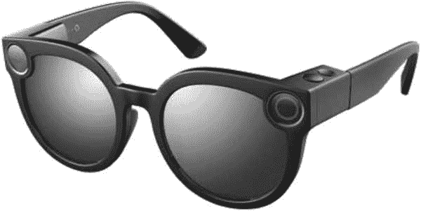

Figure 2-19 Smart Glasses

##### 智能耳机：从听觉延伸至全感知
随智能技术迭代，耳机早已突破“发声器”定位。新品内置智能系统与多维传感器，经蓝牙等协议连接手机等终端，实现功能外扩：运动监测、心率预警、心电采样等。同时支持蓝牙无线传输、通话控制、远程拍照等便捷交互。


Figure 2-20 Voice Smart Headphones Mobius

##### 智能手表：腕上的微型手机
集成屏幕、摄像、麦克风与定制系统，高度复刻手机核心功能——通讯、社交、影音、上网、应用生态。苹果 `Apple Watch` 为标杆典范，深度融合苹果生态，并引入微信、支付宝、携程等头部应用定制版。为适配小屏，应用均做极致精简，如支付宝仅保留余额宝、收付款码、汇率换算三大高频入口。


Figure 2-21 Apple Watch

## 2.5 典型AI落地产品：穿戴设备篇

穿戴设备是科技圈的长青顶流。从 Google Glass 到小米手环，再到 Apple Watch，头部厂商几乎全员入局，试图将自有数据采集与算法技术封装为个人专属的个性化服务。**人工智能，是穿戴设备最关键的核心引擎。**

回溯历程，智能穿戴雏形现于80年代，受限于AI技术幼稚未激起浪花。直至21世纪AI技术爆发，才迎来实质性突破。

**2012年，被封为“智能穿戴元年”。** Google Glass 横空出世，几乎复刻智能手机全功能：语音拍照、视频通话、上网冲浪、信息邮件处理，重塑交互想象。

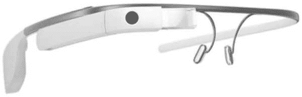

Figure 2-18

Google Glass 问世后，虽应用场景有待深挖，但“设计与技术完美融合”的标杆地位已确立，引发资本与企业入局狂潮。

放眼当下，市场形态已极度细分：智能眼镜、手表、手环、头盔、戒指、项链、服饰……“小巧、便捷”成为统一卖点，开辟消费电子新增量。但残酷现实是：尽管百花齐放、厮杀惨烈，穿戴设备仍处**发展初期**。主打“小巧便捷”的现有产品，未触及核心命题——**如何借由穿戴载体，实现真正的“智能”觉醒？** 这才是行业必须直面的终极考题。

#### 智能穿戴：为何火热却难出“国民级”爆款？

深入剖析当前市面上的智能穿戴产品会发现，绝大多数本质上只是将“手机”以特定形态戴在身上——测心率的手环、能接电话的手表、计步频的跑鞋。尽管它们均冠以“智能”之名，实则是名副其实的“伪AI设备”。衡量产品是否真正智能的金标准，在于能否同时具备**信息采集、辅助判决、辅助处理**三大核心能力。

现阶段穿戴设备的智能化成熟度尚显不足，产品价值难以完全覆盖用户的智能化诉求。这也解释了为何市场看似火热，却始终未能诞生像PC、智能手机那样普及率极高的现象级单品。破局关键在于：设备在通过采集技术获取个人数据后，如何借助深度学习等技术赋予其“行为与判断”能力。

---

#### 核心技术三大支柱

**硬件基石：续航焦虑下的平衡术**  
作为穿戴载体，硬件发展的最大拦路虎是电池。续航短板直接拖垮体验——频繁充电会大幅折损产品可用性。当前主流对策是“均衡性能”，即在算力输出与功耗控制之间寻找最优平衡点。

**体验为王：双维交互设计**  
用户体验是购买决策的核心变量，设计需从两个维度切入：  
*   **设计交互（成败关键）：** 唯有工业设计师与开发者深度融合“以用户为中心”理念，才能打磨出成功产品。  
*   **操作交互（落地细节）：** 聚焦人机交互环节的链路设计。无论是体感、触控、语音还是脑波控制，都必须充分权衡设备的灵敏度、体积材质、操作精度及防误触机制。

**数据变现：从离散噪音到专业方案**  
产品价值最终通过数据兑现。穿戴设备采集的原始数据往往离散碎片化，核心价值点在于：利用智能算法挖掘数据间的关联逻辑，将分析洞见以**专业服务**形式交付给用户。

---

#### 主流形态深度图谱

##### 智能服装：把科技织进经纬里

随着AI技术渗透，服装赛道率先嗅到商机。  
*   **音乐夹克（MIT × Levi's）：** 采用丝质透明纱布，集成全织物电容键盘，轻触即可播放/存储音乐。创新点在于**免充电设计**，主打太阳能补能。  
*   **生命体征监测服（Georgia Tech）：** 将信息传导纤维嵌入面料，通过服装纤维捕捉心跳与呼吸频率，该技术已推向量产，衍生出多款可测心率、血压的成品。  
*   **三星 Smart Suit（2016 CES）：** 重新定义“智能西装”概念。除实时监测心率、步数、体脂、采集生活习惯、自动识别运动类型外，还能联动App输出专业建议。  
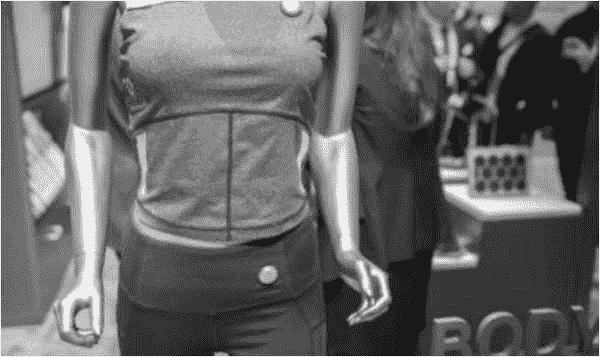  
Figure 2-22

##### 智能跑鞋：贴近肌肉的数据专家

内置传感器采集足部数据，经蓝牙传输至手机深度加工。得益于更贴近身体核心运动部位，其数据精度显著优于手环类设备。  
以李宁智能跑鞋为例（见下图），除基础里程、配速、路线外，还能输出**步频曲线、足底压力分布、抬腿高度**等进阶指标，直接服务于跑姿优化。  
  
Figure 2-23

##### 植入式设备：开启“第六感”的边界探索

**Dermal Abyss（MIT Media Lab × 哈佛医学院）：** 一种可监测体况的**智能纹身墨水**（见下图）。它能实时可视化反映体内化学变化——颜色深浅对应不同化学成分浓度，将生理指标具象化呈现于皮肤表面。  
  
Figure 2-24

**North Sense（Cyborg Nest Lab）：** 为人类植入“第六感”的微型蓝牙装置。植入体内后，面向正北方向会触发振动反馈。开发者直言：AI唯有融入身体成为器官一部分，才能激发人类直觉感知，否则永远只是外挂工具。

##### 智能眼镜：最成熟的“大热赛道”

以眼镜为载体，内置独立OS与应用生态，支持手势、语音等多模交互，覆盖查询、阅读、导航、拍摄、通话全场景。凭借简洁设计、强科技感与轻量化体态，已形成规模可观的产业集群，市场上琳琅满目。  
  
Figure 2-19

### 2.5.2 智能家居

# 智能家居：从萌芽到爆发的进化史

智能家居的概念由来已久，但真正落地要等到1984年。那一年，美国联合技术公司（UTC）借助楼宇与工业系统，对一栋建筑完成了信息化改造。他们通过中央控制装置整合楼内各类设备，在美国康涅狄格州打造出全球首座“智能大厦”，正式拉开了智能家居的世界序幕。随着理念普及，全球发达国家纷纷推出解决方案，家电巨头与互联网大厂竞相入局，如今中外市场均呈现高速增长态势。

当前，欧美在智能家居系统研发上始终领跑。德国电信、Verizon、Google等巨头均已推出自有产品，并建立中心设备接口实现多服务融合。国内起步虽晚，但势头极猛：互联网企业集体跨界家居赛道，接连推出智能电视、音箱、空调、灯泡等硬件矩阵。

## 智能电视：大屏终端的“进化论”

智能电视本质上是将开放操作系统与芯片借助互联网技术植入电视机。其核心特征在于：拥有开放应用平台、支持双向人机交互、融合视听娱乐与数据服务，精准击中用户定制化、多元化、个性化的需求。

得益于开放平台与操作系统，用户不再局限于看电视，还能安装海量应用，极大拓展了大屏场景。正是这种扩展性与丰富度，让智能电视迅速占据主流。参与者涵盖互联网新势力与传统家电老牌，如小米、乐视、长虹、海尔、TCL等。

小米属于“首批吃螃蟹者”。2013年9月5日，小米电视（如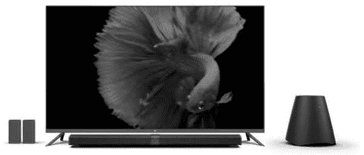 Figure 2-25 所示）正式发布，标志着互联网企业首次强势闯入传统家电腹地。为抢占先机，小米锁定“米粉”核心人群，定位“年轻人的第一台电视”。这群对新事物接受度最高的年轻用户，配合极强的粉丝文化，让小米电视对传统市场形成降维打击。


Figure 2-25

## 智能音箱：声控时代的“家庭入口”

智能音箱是传统音箱的进阶形态，更是家庭用户通过语音连接互联网的关键入口。代表产品包括亚马逊Echo、天猫精灵、小米AI音箱。用户只需开口，即可点歌、购物、查天气、操控全屋智能——从电饭煲、电视到灯泡亮度、冰箱水温模式，尽在掌控。

2014年问世的亚马逊Echo，迅速成为海外市场现象级爆款。用户借此实现语音控家电、下单买物、问答咨询。据eMarketer数据，美国每月至少使用一次语音音箱的用户超3600万。

国内市场增速更是惊人：2017年概念尚未启蒙，翌年便井喷式爆发，单年诞生百万级出货量单品。近年来，天猫精灵、小度、小米AI音箱、小宝AI音箱（如 Figure 2-26 所示）稳居市场前四。


Figure 2-26

## 智能空调：会“思考”的温度管家

智能空调在普通机型基础上注入AI基因。系统通过传感器采集温湿度、洁净度等数据，结合外部气候与预设指标自主分析决策，自动切换制冷、制热、除湿、净化模式。同时新增语音控制、手机远程操控、用习惯记忆等人性化功能。

近年来，家电厂商与互联网玩家纷纷押注赛道。欧美中产家庭已将其视为标配。国内技术渗透率虽仍落后发达国家，但市场需求旺盛。未来进化将聚焦两大维度：一是**自主智能度**——摆脱对手机、平板等第三终端的过度依赖，设备自身具备更强大脑；二是**感知维度升级**——突破环境感知，强化“人体感知”，如自动识别人员存在、位置、数量，经自主算法实现人环机最佳适配。

## 智能灯泡：重塑家居光文化的“光之魔术师”

智能灯泡借物联网技术接入网络，实现节能、艺术、人性化照明。未来必将主导家庭光文化。用户可按需定制色温、亮度、方向等场景光效；手机远程调控打造差异化氛围；更能跨时空调节灰阶色彩，模拟多种光环境以疏导情绪、提升体验（如 Figure 2-27 所示）。


Figure 2-27

智能灯泡普采LED冷光源，属节能灯范畴。对比白炽灯、荧光灯，节电效率超90%，效益显著。应用场景已全面渗透：卧室、客厅、厨房、办公、会议室、机房、网吧、地下室、学校等室内空间。

# 典型 AI 产品全景扫描

智能灯泡内置物联网通信模块，借此接入互联网。用户只需联网，即可随时随地掌握家中灯具的运行状态——光色、亮度、功耗等关键指标一目了然。不仅如此，还能依据个人喜好远程调节参数。若家中部署多盏智能灯，更可组建灯组网络，根据室内场景一键实现复杂的灯光布局。

### 2.5.3 智能医疗产品

AI 与医疗的深度融合，正为人类健康与社会进步注入强劲动力。这一结合主要沿着“精准医疗”与“医疗助手”两大赛道展开。

国内医疗机构在长期临床实践中沉淀了海量数据，这些宝贵资源将成为 AI 赋能医疗的核心燃料。将专家临床实战数据用于模型训练与验证，能显著提升 AI 在辅助诊断环节的实战效能。

#### 医学影像诊断

专注医疗垂直领域的 AI 企业 Airdoc，业务版图覆盖辅助决策分析、医学影像解读、健康大数据挖掘三大板块（见  图 2-28）。它化身医生的“电子听诊器”与“外挂知识库”，依托数千万级医学影像训练的深度学习模型，提供实时分析服务，并通过挖掘海量医疗信息洞察潜在病理规律。

凭借算法沉淀与行业大数据融合，Airdoc 已构建起覆盖眼、皮、脑、心脑血管、肺、肝、骨、乳腺、宫颈等九大体系的影像分析矩阵。

#### 肿瘤诊断

IBM Watson 在肿瘤领域取得突破性进展，其 AI 医疗应用软件攻克慢病管理、精准医疗、体外诊断等九大医学版图。通过与纪念斯隆-凯特琳癌症中心（MSKCC）合作商业化落地，联合训练出“Watson for Oncology”肿瘤解决方案。

该系统可针对肺癌、乳腺癌、直肠癌、结肠癌、胃癌、宫颈癌等多种癌种提供咨询。录入癌种分型、患者画像（年龄、性别、体重）、病理特征及既往治疗史等信息后，系统能秒级输出多维个性化治疗建议。

#### 陪护机器人

2016 年，莱斯大学发布基于 AI 的多功能养老陪护机器人 MERA。该原型机由该校电子计算机工程系与心理学系师生联合打造，主打三大核心技能：创新式无感测量生命体征（心率、心率变异性、呼吸频率）；充当健康知识问答助手；通过数据感知精准判定老人跌倒事件，守护银发族安全。

### 2.5.4 工业制造领域应用产品

对比传统人力，工业机器人的核心优势在于“算得过账”。以成熟焊工为例，机器人按 10 年服务期摊销（含维护成本），同等产出下综合使用成本更低。

在精度与标准化维度，机器人更能突破人类生理极限；高危、有毒有害作业环境亦可实现“机器换人”。综合来看，机器人在制造业优势碾压级。这不仅强化企业竞争力，更拓宽利润增长空间，未来必将有更多制造企业加速向智能制造转型（见 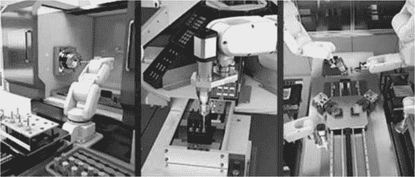 图 2-29）。

中国已稳居全球最大工业机器人市场，年销增速超 30%，预估 2020 年销量将破 21 万台。庞大市场需求吸引众多巨头纷纷布局。

推动“以机代人”提升自动化水平，主要源于三大驱动力：① 人力成本持续走高；② 利润空间不断压缩；③ 国家战略强力引导。

长期以来中国劳动力成本优势明显，但近年成本飞涨，叠加年轻一代排斥枯燥流水线作业，用工荒加剧。人口老龄化将进一步推高人力价格。对微利制造业而言，引入高性价比机器人降本已成唯一出路。“机器换人”不仅是大势所趋，更是中国制造破局未来的关键棋。当前，国内已有大量企业深耕工业 AI 产品研发。

**阿里云 ET 工业大脑**系首个深入车间一线的 AI。其助力光伏龙头中来股份（Poly Xiexin）打造行业创新标杆：首步将产线全口数据上云，调动千台服务器算力，从数千变量中快速锁定 60 个影响良率的关键因子，继而由 AI 实时监控调控，产线仅需“听指令、执行动作”。

**西门子**在慕尼黑演示双臂协作机器人。借助高度自动化 AI，机器人能自主分工协作完成制造，无需预设编程。传统机器人不识 `CAD/CAM` 模型，新一代机器人却能“读懂”设计语言，相当于掌握了多国语言，从而摆脱动作与工艺的硬编码束缚。

**通用电气 (GE)** 与多家电力巨头签署长期协议，并携手纽约电力局 (`NYPA`) 向“全球首家全数字电力企业”进军。其预测分析软件集成智能运营中心已正式运营，这是技术领先的资产监测诊断中枢。GE 联合意大利国家电力公司 (Enel) 在 `Predix` 平台部署资产性能管理 (`APM`) 软件，实现对 13 座燃气电厂及 1 座燃煤电厂（均搭载 GE 或阿尔斯通汽轮发电机组）的全生命周期监测、预测与可靠性优化（见 ```
EXr6287u6NNVz+GYLY+7SC6AgGofrpiId/XnwIEoGMEPq3TPzkM5RyXBRbuLcLFjwnCuEHVXaQsGpygWHLFy9g==
```）。

## 2.5 典型 AI 产品

### 2.5.1 可穿戴设备

可穿戴设备无疑是当下科技圈的顶流产品。从 Google Glass 到小米手环，再到 Apple Watch，头部厂商几乎人手一款。它们将自家的数据采集与算法能力下沉到终端，为用户定制专属的个性化服务。撑起这类设备最关键的“脊梁”，正是人工智能技术。

早在上世纪 80 年代，智能穿戴雏形就已现身，奈何受限于彼时 AI 技术的薄弱根基，未能激起太大水花。真正迎来实质性爆发，要等到 21 世纪 AI 技术突飞猛进之后。

2012 年被业界冠以“智能穿戴元年”的称号。这一年，Google Glass 横空出世（见 Figure 2-18），其功能几乎对标智能手机：用户只需动动嘴，便能拍照、视频通话、冲浪上网、收发邮件与信息。


Figure 2-18

尽管 Google Glass 发布后，具体应用场景仍待深挖，但“设计与技术完美融合”的标签已深入人心，引得无数企业纷纷入局智能穿戴赛道。

放眼当下市场，产品线早已延展至智能眼镜、手表、手环、头盔、戒指、项链、服饰等诸多品类。“小巧”与“便捷”成了全系通用的核心卖点，在消费电子版图中杀出一条新赛道。虽百花齐放、厮杀惨烈，但行业整体仍处于发育早期。症结在于：打着“小巧、便捷”旗号的产品，并未攻克智能穿戴的核心命题——如何借由穿戴形态，实现真正的“智能”。

细究主流产品不难发现，大多不过是以特定姿态将“手机”穿在身上：能测心率的手环、能接电话的手表、能记步频的跑鞋……虽自诩“智能穿戴”，笔者更倾向称其为“伪 AI 设备”，即非真正意义上的智能穿戴。衡量智能与否的金标准，在于产品是否具备**信息采集、辅助决策、辅助处理**这三重能力。

现阶段，穿戴设备的智能化成熟度不足，产品价值难以完全覆盖用户的智能化诉求。这也解释为何市场看似火热，却无一款产品能像 PC 或智能手机那样实现全民级普及。核心破局点在于：如何让设备通过采集技术获取个人数据，再借助深度学习等技术赋能行为感知与判断决策。

#### 智能穿戴设备的核心技术壁垒

**硬件层面**：穿戴设备离不开硬件载体。当前卡脖子的核心难题是电池。续航短板直接拖累体验——频繁充电会大幅折损可用性。主流解法是“性能与功耗的动态平衡”，在两者间寻找最优解。

#### 智能耳机

随着智能技术迭代，智能耳机产品井喷。新一代产品早已突破单纯听音属性，内置智能系统与多元传感器，经由蓝牙等协议链接手机等终端，拓展出外设新功能：运动监测、心率追踪、甚至心电图采集。数据无线回传之余，还能接听来电、远程拍照。Figure 2-20 展示了科大讯飞与咪咕联合推出的语音智能耳机 Mobius。


Figure 2-20

#### 智能手表

智能手表的逻辑是“腕上手机”：集成屏幕、摄像头、麦克风与定制系统，复刻手机核心功能——通话、短信、邮件、拍照、听歌、上网、跑应用。标杆产品非 Apple Watch 莫属（见 Figure 2-21）。它能无缝联动苹果全家桶，更有微信、微博、支付宝、美拍、携程等头部应用深度适配。为契合小屏交互，这些应用均做了极致瘦身：如支付宝仅保留余额宝、付款码、汇率换算三大高频入口。


Figure 2-21

#### 智能服饰

AI 浪潮下，服装行业嗅到商机，智能服饰竞相涌现。李维斯曾推usic Jacket，集播放与存储于一体，源自美国麻省理工学院（MIT）研发。面料采用真丝透明硬纱，全织物电容键盘控制播放，轻触即响；免充电设计，太阳能续航，极大保障了实用性。

除 MIT 音乐外套，佐治亚理工学院曾攻克可监测心率血压的智能面料，将信息传导植入纤维，捕捉心跳与呼吸频率。该技术现已落地量产，衍生出多款可测生命体征的服饰。

2016 年 CES 大展上，三星抛出“智能西装”新概念（见 Figure 2-22）。它能实时监测心率、步数、体脂等体征，记录生活习惯，自动识别运动模式，并联动 App 输出科学建议。


Figure 2-22

#### 智能跑鞋

智能跑鞋将传感器植入鞋底，采集足部数据经蓝牙传回手机深度加工。得益于贴合度更高，其数据精度优于手环等腕部设备。Figure 2-23 为李宁智能跑鞋数据界面：除里程、路线、配速等基础项，还提供步频曲线、足底压力、抬腿高度等进阶指标，助力跑姿优化。


Figure 2-23

#### 可植入设备

### 2.5.2 智能家居：从概念落地到百花齐放

**重塑感知边界：当科技长进皮肤里**

麻省理工学院媒体实验室携手哈佛医学院，联手孵化出一项名为“Dermal Abyss”（真皮深渊）的前沿项目。这并非普通的纹身墨水，而是一种能实时监测生理指标的“可植入式可穿戴设备”，如所示。它的核心逻辑在于将身体内部的化学波动，转化为肉眼可见的色泽深浅——颜色的变化精准对应着体内不同化学成分的浓度，让健康数据不再隐匿于冰冷的仪器报表中，而是直观地流淌在肌肤表面。


**Figure 2-24 真皮深渊：将体内化学变化可视化呈现于皮肤表面。色泽深浅映射体内化学元素含量，实时投射身体各项指标状态。**

为了赋予人类一种神奇的“第六感”，Cyborg Nest 实验室研发了一款名为 North Sense 的微型蓝牙植入体。用户只需将其植入体内，当面朝北方时，设备便会通过震动发出提示。项目负责人指出：唯有当 AI 产品真正融入躯壳，成为身体的一部分，它才能激发人类本能的直觉共鸣；否则，它永远只是一件外在于身的冰冷工具。

---

#### 智能电视：开放生态重塑客厅入口

智能电视的本质，是将开放操作系统与芯片植入传统电视，借助互联网技术实现质变。它打破了单向输出的旧范式，构建起开放应用平台，赋予了双向人机交互的能力，将视听娱乐、数据服务深度融合，精准击中用户定制化、多元化、个性化的深层诉求。

得益于开放平台与操作系统加持，智能电视早已超越了“看节目”的单一功能，用户可自由安装应用，无限拓展使用边界。正是这种极强的扩展性与内容丰富度，让其迅速占据主流市场。参战玩家跨界明显：互联网巨头与传统家电巨头同台竞技，小米、乐视、长虹、海尔、TCL 等均深耕布局。

小米堪称入局最早的搅局者。2013年9月5日，小米电视首发亮相（见），标志着互联网品牌首次强势闯入传统家电腹地。为抢占先机，小米锁定“米粉”核心圈层，精准定位“年轻人的第一台电视”。这群对新鲜事物接受度最高的年轻人，天然对智能电视充满好奇。清晰的用户画像加上极具凝聚力的粉丝文化，让小米电视对传统彩电市场形成了降维打击。


**Figure 2-25**

#### 智能音箱：声控交互开启全屋智能枢纽

智能音箱是传统音箱的进化形，更是家庭消费者通过语音连接互联网的关键入口。亚马逊 Echo、天猫精灵、小米 AI 音箱等标杆产品，让“动动嘴”成为现实：点歌、购物、查天气、甚至统筹全屋智能——米饭煮得怎样、灯光亮不亮、冰箱空调定多少度，一句指令全搞定。

2014年问世的 Amazon Echo，迅速成为海外智能家居赛道的现象级爆款。用户借此实现家电语音控管、语音下单、知识问答等全链路体验。据 eMarketer 数据显示，美国每月至少使用一次语音音箱的用户已超 3600 万。

国内赛道则呈现“后发制人”的爆发态势。2017 年前概念尚显模糊，短短一年便跑出出货量破百万的独角兽。近两年市场格局基本稳定，天猫精灵、小白 AI 音箱、小米 AI 音箱、小度四大巨头稳坐头把交椅（见）。


**Figure 2-26**

#### 智能空调：从“被动执行”进化为“主动懂你”

智能空调的内核，是在常规机型基础上注入 AI 基因。通过传感器矩阵采集温湿度、洁净度等环境数据，结合外部气候与预设模型自主决策，自动切换制冷、制热、除湿、净化模式。同时叠加语音控制、手机远程操控、习惯记忆等人性化功能，大幅提升交互体验。

近年来，家电巨头与互联网新贵纷纷押注赛道。欧美中产家庭已将其视为标配，但国内渗透率与发达国家仍存明显差距，不过巨大的增量需求不容忽视。未来演进将聚焦双核维度：

*   **自主智能化**：摆脱对手机、平板等第三终端的强依赖，设备端侧算力上位，实现“无手机也能聪明”。
*   **人体感知升级**：突破单一环境感知，转向“以人为核心”。精准识别人员存在、位置分布、数量多寡，通过终端自主运算，实现环境与人体的动态最佳适配。

#### 智能灯泡

# 智能灯泡：重塑家居光影新体验

智能灯泡借助物联网技术接入网络，集节能、美学与人性化于一身，必将引领未来家居照明文化的新风尚。用户可依据个性化需求，自由定制色彩、色温、亮度及照射角度，打造专属光影场景。通过手机端即可远程操控，随心切换室内氛围。更进一步的是，它支持按时空、场景与情绪，精准调节不同区域的明暗、灰阶与色彩，模拟多元光环境，疏导身心，营造极致舒适的用光体验，详见下图。


Figure 2-27

智能灯泡普遍采用LED冷光源，属高效节能产品。对比传统白炽灯与荧光灯，其节电率超90%，效益显著。应用场景广泛覆盖卧室、客厅、厨房、办公、会议、机房、网吧、地下室、学校等多元空间。

内置物联网通信模块，让灯泡轻松联网。用户随时随地掌握家中灯具运行状态——光色、亮度、功耗一目了然，并可按需远程微调。若居家部署多盏智能灯，还能组建局域网群控，针对室内场景一键满足特殊照明需求。

### 2.5.3 智能医疗硬件

AI赋能医疗，双向奔赴，惠及民生与社会发展。融合路径主要聚焦精准医疗与医疗助手两大维度。国内医疗机构沉淀的海量临床数据，为AI+医疗注入核心燃料。以专家实战数据训练验证模型，能大幅跃升AI辅助诊断的效能。

#### 医学影像诊断

爱德医（Airdoc）深耕医疗AI，业务覆盖辅助决策分析、影像解析、健康大数据挖掘三大板块，如下图所示。它化身医生的“电子听诊器”与“知识库”，依托深度学习，以千万级影像数据为基石，提供实时分析服务，并通过挖掘海量医疗信息洞察潜在规律。


Figure 2-28

凭借算法积淀与行业大数据融合，爱德医构建起覆盖眼、皮肤、脑、心血管、肺、肝、骨、乳腺、宫颈等九大部位的影像分析体系。

#### 肿瘤诊断

IBM Watson推出聚焦肿瘤的AI医疗应用，在慢病管理、精准医疗、体外诊断等九大领域取得突破。联手纪念斯隆-凯特琳癌症中心共训“Watson肿瘤方案”，实现商业化落地。录入癌种、患者画像、病情特征及治疗现状等信息，Watson即能秒速输出多维治疗建议，覆盖肺癌、乳腺癌、直肠癌、结肠癌、胃癌、宫颈癌等主流癌种。

#### 关怀机器人

2016年，莱斯大学发布AI关怀机器人MERA，专攻多功能养老护理，由电子电气工程系与心理学系师生联合打造原型。核心三技：创新法测生命体征（心率、心率变异性、呼吸频）；答疑基础健康咨询；读取数据研判跌倒风险，守护银发安全。

### 2.5.4 工业制造智能装备

对比传统人力，工业机器人胜在成本优势。以成熟焊工为例，按10年折旧含维保测算，同等效能下机器人用工成本更低。精度与标准化上，机器人突破人类生理极限；高危有害作业更可替人执行。制造业引入机器人，优势显性——增强企业竞争力，拓宽利润增长空间。未来，智能制造转型将成行业主流。下图展示基恩士工业机器人实拍。


Figure 2-29

中国稳坐全球最大工业机器人市场宝座，年销增速超30%，预计2020年销量破21万台。庞大刚需吸引巨头纷纷布局。

“机器换人”提升自动化水平，主因三点：①人力成本飙升；②利润空间收窄；③国家战略导向。长期低廉人力成本成过去式，年轻一代排斥流水线枯燥作业，加剧用工荒；老龄化叠加进一步推高工价。对微利制造业而言，用机器人降本增效已成唯一解法。“机器换人”非大势所趋，更关乎中国制造未来生死。当前，国内众企业已深耕工业AI产品研发。

阿里云ET工业大脑率先“下车间”落地。携手光伏龙头合盛硅业，打造国内工业AI创新标杆。首步上传产线全口径数据至云端，调动千服算力，从海量变量中短时锁定影响良率的60个关键因子，继而实时AI监控调控，产线仅需“听指令”执行。

西门子慕尼黑秀肌肉：双臂机器人凭AI“读懂”图纸自主分工
西门子在慕尼黑展示了一款双臂机器人，借助高度自动化的AI能力，它能在无需编程的情况下，自主完成产品制造中的分工与协作。传统机械臂向来“看不懂”CAD/CAM模型，而新一代机器人跨越了这一鸿沟。某种程度上，这相当于机器人掌握了“多国语言”，从而摆脱了对动作与流程预设代码的依赖。

通用电气（GE）誓做全球首家“全数字化电企”，签下系列大单
通用电气近期宣布与多家电力企业达成多年合作协议，并与纽约电力局（NYPA）签约，明确目标直指全球首家完全数字化的电力公司。目前，配备全方位智能预测分析软件的GE综合运营中心已正式投入运营，这是一个技术领先的资产监测与诊断中枢。其中，GE携手意大利国家电力公司Enel，在其工业物联网平台Predix上部署并优化了资产性能管理（APM）软件，对13座燃气电厂及1座燃煤电厂——共14座采用GE或阿尔斯通汽轮发电机组的电厂——进行监控、预测与可靠性提升。EXr6287u6NNVz+GYLY+7SC6AgGofrpiId/XnwIEoGMEPq3TPzkM5RyXBRbuLcLFjwnCuEHVXaQsGpygWHLFy9g==

## 2.5 典型AI产品

### 2.5.1 可穿戴设备

可穿戴设备是当下科技圈的顶流硬件，从Google Glass到小米手环、Apple Watch，头部厂商几乎人手一款。各家将自家的数据采集与算法技术植入终端，为用户定制专属的个性化服务。毋庸置疑，人工智能是支撑可穿戴设备的核心“心脏”。

智能穿戴的雏形早在1980年代就已出现，奈何彼时AI技术尚幼，难以激起波澜。直到21世纪，随着AI技术突飞猛进，智能穿戴才迎来真正的爆发期。

2012年被业界冠以“智能可穿戴设备元年”的头衔。这一年，Google Glass横空出世（见 Figure 2-18）。它几乎浓缩了智能手机的全部机能：用户不仅能声控拍照、视频通话，还能浏览网页、收发邮件与消息。


Figure 2-18

Google Glass问世虽然后续使用场景仍待深挖，但智能穿戴“设计与技术完美融合”的标签已深入人心，吸引越来越多玩家入局。

#### 用户体验

用户体验是决定智能穿戴成败的关键变量。其设计需从**交互设计**与**操作交互**两个维度切入。交互设计定生死：唯有工业设计师与开发者将“以用户为中心”的理念深度融入产品基因，才能打造爆款。操作交互聚焦人机交互环节，涵盖行为操控、触控、语音乃至脑波控制等形态。设计时须充分权衡硬件的灵敏度、尺寸、材质、精度及误触率。

#### 数据处理

智能穿戴的价值锚点在于“采得好数据、用得活算法”。设备采集的数据天然离散，核心价值在于借助智能算法挖掘数据关联，将分析结果以专业服务形式回馈用户。

#### 智能可穿戴设备分类

**智能眼镜**：以镜框为载体，内置独立操作系统与应用生态。用户通过手势、语音即可实现查询、阅读、导航、拍摄、通话等操作。凭借简洁设计、强科技感与轻量化机身，智能眼镜已形成庞大产业集群。市场上形态各异的产品层出不穷（见 Figure 2-19）。


Figure 2-19

**智能耳机**：随着智能技术迭代，耳机早已突破“听声”本质。新一代产品内置智能系统与多元传感器，通过蓝牙等协议与手机等终端联动，拓展周边功能——运动监测、心率追踪、心电图记录等一应俱全。数据蓝牙无线传输、接听来电、远程快门等也是标配。 Figure 2-20展示了科大讯飞与咪咕联合推出的语音智能耳机Mobius。


Figure 2-20

**智能手表**：集成屏幕、摄像头、麦克风与定制系统，基本复刻智能手机核心体验：通话、短信、邮件、拍照、音乐、上网、跑应用。Apple Watch是该品类标杆（见 Figure 2-21）。它能无缝联动苹果全家桶，微信、微博、支付宝、美拍、携程等头部应用均已适配并针对小屏做了极致精简——如支付宝钱包仅保留余额宝、付款码、汇率换算三大高频入口。


Figure 2-21

**智能服装**：AI浪潮下，服装赛道嗅到商机纷至沓来。Levi's曾推音乐夹克，集播放与存储于一体，源自美国麻省理工学院（MIT）研发。面料采用真丝透明硬纱，全织物电容键盘控控制播放，轻按即响，无需充电，太阳能供能。

除MIT音乐夹克外，美国佐治亚理工学院曾开发出可监测心率血压的智能服饰，将信息传输植入纤维，通过衣料感知心跳呼吸。该技术现已落地量产，衍生出多款可测生命体征的量产服装。

2016年CES展上，三星抛出“智能西装”新概念。这套智能服饰不仅能实时监测心率、步数、体脂等体征并采集生活习惯，还能自动识别运动模式，联动APP输出科学建议（见图示 Figure 2-22）。


Figure 2-22

**智能跑鞋**：这类跑鞋在鞋体内植入智能传感器，可精准采集足部生理数据，再经由蓝牙等无线方式同步至手机端，借助手机提供进阶服务。得益于贴身穿戴的特性，其数据采集精度远超智能手环等腕部设备。

Figure 2-23 展示了李宁智能跑鞋的数据交互界面。除呈现里程、路线、时长、配速、前后掌着地比等基础指标外，还能输出步频曲线、足底压力、摆腿高度等进阶算力数据，助力跑者优化跑姿。


Figure 2-23

**植入式设备**：近期，MIT媒体实验室联手哈佛医学院推出“Dermal Abyss”项目。这是一种可监测机能的纹身墨水（见 Figure 2-24），能直观映射体内化学变化，实属新型植入式穿戴装备的雏形。


Figure 2-24

Dermal Abyss 墨水通过色泽深浅变化，实时指示体内不同化学成分浓度，直击核心生理指标。另为赋予人类“第六感”，Cyborg Nest 实验室研发了微型蓝牙装置“North Sense”。植入体内后，面向正北即振动反馈，极大拓展感官边界。开发负责人指出：AI 唯有融入躯体，方成本能延伸；否则终沦工具，无法唤醒人体直觉。

### 2.5.2 智能家居

智能家居概念虽早，却于1984年落地——联合技术公司（UTC）借楼宇工业系统对建筑实施信息化改造，以中控整合设备家电，打造全球首座“智能大厦”（美国康涅狄格州），拉开世界智能家居序章。随着理念普及，各发达国家纷献方案，家电巨头与网企竞逐赛道。当前中外市场均呈爆发式增长。

欧美系统研发持续领跑，德电、Verizon、Google 等已推自有产品并建中心接口聚合服务。国布局虽晚，但势头凶猛：网企入局家居，相继推出智能电视、音箱、空调、灯泡等矩阵产品。

#### 智能电视

智能电视植入开放操作系统与芯片，借互联技术实现软硬融合。其核心在于开放应用平台，支持双向人机交互，融汇视听、娱乐、数据于一体，满足定制化、多元化、个性化需求。

因拥有开放平台与系统，用户不止看内容，更可装应用拓展场景。这份延展性与丰富度，让其迅成主流。参与者涵盖网企与传统家电厂：小米、乐视、长虹、海尔、TCL 等。

小米入局最早。2013年9月5日，小米电视（Figure 2-25）首发，标志网企首破传统家电壁垒。抢占先机，小米锁定“米粉”核心圈层，定位“年轻人的第一台电视”。年轻群体好新求变，极易被激发购欲。精准画像加深厚粉丝文化，助小米电视强势冲击传统市场。


Figure 2-25

#### 智能音箱

智能音箱是音箱进化版，亦是家庭语音入网入口。代表作有 Amazon Echo、天猫精灵、小米AI音箱等。用户只管开口：点歌、买物、查天气、控全屋智能（饭煲、电视、灯光、冰箱、热水器等）。

2014年 Echo 面世，即成海外现象级爆款：声控家电、语音下单、问答百科。eMarketer 数据显示，美月活声控音箱用户约 3600 万。

国内增速更猛：2017 年尚无声量，翌年即井喷，单年出货破百万款产品涌现。近年四大热销款为天猫精灵、小白、小米AI、小度（Figure 2-26）。


Figure 2-26

#### 智能空调

智能空调在常规机型上叠加 AI 技术。系统依外界气候与预设指标，经多传感器采集室内温湿度、洁净度等数据，经分析研判，自动触发制冷、制热、除湿、净化等功能。另增语音控制、手机远控、习惯记忆等人性化体验。

近年家电厂与网企齐盯赛道，欧美中产家庭甚至视其为标配。国内技术渗透率虽仍逊发达国家，但市场需求依然旺盛。

### 未来智能空调的两大进化方向

下一代智能空调将聚焦两大核心维度：一是**终端自主智能化程度**。当前产品多依赖手机、平板等外部终端操控，这种“离不开第三方”的模式严重削弱了使用体验。未来的空调必须内置更强大的智能中枢，实现独立决策。二是**感知维度的深度拓展**。突破传统温湿度监测，转向精准的人体感知——自动识别人员存在、位置分布及数量，通过终端自主算力，动态匹配最舒适的环境参数。

#### 智能灯泡：重塑家居光文化的主角

智能灯泡借助物联网接入网络，集节能、美学与人性化于一体，必将主导未来家居照明潮流。用户可随心定制色温、亮度、角度等场景模式，亦可通过手机远程调控，跨时空构建差异化光环境。其核心价值在于模拟自然光谱，依据场景氛围调节灰度与色彩，引导情绪，营造真正以人为本的光体验，如所示。


Figure 2-27

智能灯泡普采LED冷光源，能效比碾压白炽灯、荧光灯，节电率超90%，效益显著。应用场景覆盖卧室、客厅、厨房、办公、会议、机房、网吧、地下室、学校等全域空间。

内嵌物联通信模组让灯泡常驻云端，用户随时随地掌握光色、亮度、功耗等运行状态，并支持远程干预。多灯组网更能依据室内场景联动控制，轻松满足专业级布光需求。

### 2.5.3 智能医疗产品：AI赋能生命健康

AI与医疗的深度融合，双向赋能人类健康与社会发展，主要演进为**精准医疗**与**医疗助手**两大赛道。国内医疗机构沉淀的海量临床数据，为AI落地提供了宝贵训练素材；以专家实战数据训练验证模型，能大幅跃升AI辅助诊断的效能。

#### 医学影像诊断：Airdoc的“数字听诊器”

作为医疗AI垂类先锋，Airdoc业务矩阵覆盖**辅助决策分析、医学影像解析、健康大数据挖掘**三大板块（见）。它定位为医生的“智能听诊器”与“外脑数据库”，依托千万级影像数据训练深度学习模型，提供实时分析服务，并从海量医疗信息中挖掘潜在病理规律。


Figure 2-28

凭借算法积累与行业大数据融合，Airdoc已构建起涵盖眼、皮、脑、心脑血管、肺、肝、骨、乳腺、宫颈等九大体系的影像分析矩阵。

#### 肿瘤诊疗：IBM Watson的临床突围

IBM Watson聚焦肿瘤领域，在慢病管理、精准医疗、体外诊断等九大领域取得突破。联手纪念斯隆-凯特琳癌症中心共训“Watson肿瘤方案”并实现商业化落地。覆盖肺、乳、直结肠、胃、宫颈等主流癌种，录入病理分型、患者画像、病情进展等多维数据后，系统即可秒级输出多维治疗建议供临床参考。

#### 照护机器人：MERA的银发经济探索

2016年，莱斯大学发布AI照护机器人MERA，由电子电工与心理学跨学科团队打造，直击养老痛点，核心技能三件套：**创新法测生命体征**（心率、HRV、呼吸频）、**医疗知识库问答**、**跌倒姿态智能识别**，旨在减轻照护端压力，守护长者安宁。

### 2.5.4 工业制造智能装备：机器换人的必然逻辑

对标传统人力，工业机器人的核心优势在于**全周期成本优势**。按10年折旧含维保测算，同效能下机器人使用成本低于熟练焊工。在**精度与标准化**维度，机器人突破人类生理极限；高危、有害工序更可实现“无人化”替代。综合来看，导入机器人既强企业竞争力，又拓利润空间，智能制造转型已成大势所趋，Keyence工业机器人案例见。


Figure 2-29

中国稳居全球最大工业机器人市场，年增速超30%，2020年销量预计破21万台。庞大刚需引得巨头纷纷布局。

“机器换人”加速推进，三大驱动力不可逆：
① **人力成本飙升**：低成本红利消退，青工厌倦流水线，用工荒倒逼自动化；
② **利润空间收窄**：薄利制造业唯有引入高性价比机器人破局降本；
③ **国家战略导向**：顶层设计指引产业升级方向。

人口老龄化将持续推高人工成本，“机器换人”非单一趋势，更是中国制造破局未来的关键棋眼。当前国内已有大量企业深耕工业AI产品研发，蓄势待发。

# 阿里云ET工业大脑：首个“下车间”的AI实战案例

光伏材料厂商保利协鑫携手阿里云，打造了中国工业制造领域的标杆式创新样本。阿里云进驻车间的首要动作，是将生产线全端口数据悉数上云，随即调动成千上万台服务器算力，从海量变量中迅速筛选出影响良率的60个关键指标，并由AI实时托管、精准调控这些核心参数——生产线只需严格“遵令执行”。

西门子在慕尼黑展示了一款双臂协作机器人。得益于高度自动化的AI赋能，它能在无需预设程序的情况下，自主理解CAD/CAM模型、完成分工协作与制造加工。传统机械臂难以读懂此类设计数据，而新一代机器人跨越了这一鸿沟。某种意义上，这相当于机器人掌握了“通用语言”，从而摆脱了对动作与工艺逐行编程的依赖。

通用电气（GE)与多家电力巨头签署长期战略协议，并携手纽约电力管理局（NYPA），誓要打造全球首家全面数字化的电力企业。如今，GE配备预测分析引擎的智能运营中心正式启用，这是一个技术领先的资产监测与诊断中枢。其中，GE联手意大利国家电力公司（Enel），在工业物联网平台Predix上部署并优化了资产性能管理（APM）软件，对13座燃气电厂及1座燃煤电厂——共计14座采用GE或阿尔斯通汽轮发电机组的电厂——实施可靠性监控、预测与提升。 EXr6287u6NNVz+GYLY+7SC6AgGofrpiId/XnwIEoGMEPq3TPzkM5RyXBRbuLcLFjwnCuEHVXaQsGpygWHLFy9g==

# 智能穿戴设备

当下市面上的智能穿戴琳琅满目：智能眼镜、手表、手环、头盔、戒指、项链、服饰等形态层出不穷。厂商们主打“小巧、便携”卖点，试图开辟电子消费新蓝海。尽管品类繁多、迭代迅猛、竞争白热化，但该领域仍处于起步期。症结在于，仅靠“小、便”无法攻克核心难题——如何让穿戴设备真正具备“智性”，才是关键所在。

细究现有产品会发现，大多不过是以特定形态将“手机功能”穿在身上：测心率的手环、能接电话的手表、记步频的跑鞋……虽冠以“智能”之名，笔者更倾向称其为“伪AI设备”，因其缺乏真正的智能内核。衡量智能与否的金标准，在于设备是否具备**信息采集、辅助判决、辅助处理**三大核心能力。

当前穿戴设备智能化程度尚浅，产品价值难以完全契合用户的智能诉求。这也解释为何市场看似火热，却无一款产品能像PC或智能手机那样实现全民普及。核心破局点在于：如何借助采集技术获取个人数据，再经由深度学习等技术赋能设备“洞察行为、辅助决策”。

## 核心技术壁垒

**硬件底座**：穿戴设备离不开硬件载体。眼下制约发展的硬件短板是电池——续航直击体验痛点。一旦电量焦虑频繁充电，可用性大打折扣。当前的破局思路是“性能与功耗的动态平衡”，在二者间寻找最优解。

**体验为王**：用户体验是购买决策的核心变量。设计层面需从**交互设计**与**操作交互**双维切入。交互设计定成败，唯有工业设计师与开发者深度融合“以人为本”理念，方能打磨爆款。操作交互聚焦人机接口，涵盖体感、触控、语音、脑机等模态，设计时须充分权衡硬件灵敏度、尺寸材质、精度与误触率。

**数据变现**：产品价值究竟体现在数据获取与处理能力上。穿戴数据天然离散，核心价值点在于：借助智能算法挖掘数据关联，将分析洞察以专业服务形式反哺用户。

## 主流品类解析

### 智能眼镜

以镜框为载体，内置独立操作系统与应用生态。用户可通过手势、语音完成查询、阅读、导航、拍照、通话等操作。凭借极简设计、强科技感与轻量化佩戴，已催生庞大产业集群。市面形态多元，详见下图。


Figure 2-19

### 智能耳机

随着智能技术渗透，耳机早已超越“出声工具”定义。新品内置智能系统与多维传感器，经蓝牙等协议连接手机等终端，拓展外设功能：运动监测、心率追踪、心电采集等场景应运而生。同时支持蓝牙无线传输、接听来电、远程拍照等。下图为科大讯飞联合咪咕推出的语音智能耳机Mobius。


Figure 2-20

### 智能手表

# 智能穿戴新物种：当科技贴近肌肤

智能手表通过集成屏幕、摄像头、麦克风及定制化智能系统，基本复刻了智能手机的核心体验——通话、短信、邮件、拍照、听歌、上网乃至运行各类应用。苹果 Apple Watch 是该品类的标杆之作（如  图 2-21 所示）。它能无缝联动苹果生态设备，更吸引了微信、微博、支付宝、美拍、携程等头部应用专门适配开发。为契合腕上小屏，这些应用均做了“减法”设计：以支付宝为例，仅保留余额宝、付款码、汇率换算三大高频功能。


### 智能服饰：织进衣料的黑科技

随着 AI 技术突飞猛进，服装行业敏锐捕捉商机，智能服饰接踵而至。李维斯曾推出音乐夹克，穿着者不仅能随时听歌，还能内置存储曲库。这款夹克出自美国麻省理工学院（MIT）之手，面料采用真丝透明硬纱，内嵌全织物电容键盘，轻触即播。为解决续航焦虑，它摒弃充电设计，主打太阳能自给自足。

除 MIT 音乐夹克外，佐治亚理工学院曾研制出可监测心率血压的智能服装。研究团队将信息传输通路植入纤维，通过服面捕捉心跳与呼吸频率。该技术现已推向量产，衍生出多款可测生命体征的成品。

2016 年 CES 大展上，三星抛出“智能西装”新概念。这套装备不仅能实时监测心率、步数、体脂等体征并记录作息，还能自动识别运动模式，联动 App 输出个性化建议（详见  图 2-22）。


### 智能跑鞋：脚下的专业教练

智能跑鞋在鞋底植入传感器矩阵，精准采集足部力学数据，经蓝牙同步至手机深度解析。得益于零距离贴合，其数据精度远超手环等腕戴设备。

以 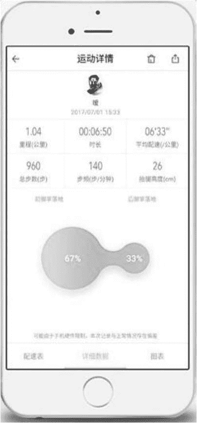 图 2-23 所示李宁智能跑鞋为例，它不仅记录里程、轨迹、配速等基础指标，更深度剖析前/后掌着地比、步频曲线、足底压力分布、抬腿高度等进阶维度，助力跑者科学优化跑姿。


### 植入式设备：打破皮肤边界

近期，MIT 媒体实验室联手哈佛医学院推出 “Dermal Abyss” 项目——一种可监测生理状态的智能纹身墨水（见  图 2-24），属植入式可穿戴新范式。它能直观映射体内化学变迁：墨水色泽深浅随特定化学物质浓度动态变化，实现多项生理指标的实时可视化。


另一前沿项目来自 Cyborg Nest Lab，他们开发了微型蓝牙装置 “North Sense”。植入体内后，面朝北方即触发振动反馈，赋予人类第六感般的方位感。研发负责人直言：AI 产品唯有融入躯体、化作本能延伸，方能激发直觉共鸣；否则终生只是冰冷工具。

# 智能家居：从概念落地到百花齐放

智能家居概念早存，却迟至 1984 年才由美国联合技术公司（UTC）借楼宇工业系统完成首个信息化改造——整合楼宇设备与家电建立中央控制，诞生于康涅狄格州的全球首座 “智能大厦” 吹响号角。此后全球发达地区竞相推方案，家电巨头与互联网大厂纷纷入局，中外市场均呈爆发式增长。

欧美研发持续领跑：德国电信、Verizon、Google 等均推出自有产品并建立中控接口标准。国内起步虽晚，但势头凶猛，互联网企业跨界造家电，智能电视、音箱、空调、灯泡等品类层出不穷。

## 智能电视：客厅的开放式中枢

智能电视植入开放操作系统与芯片，借互联技术实现双向人机交互，融合视听娱乐、数据服务于一体，精准击中用户定制化、多元化、个性化需求。开放平台赋予其无限拓展性：用户除看电视外，可随意装应用，大幅拓宽场景。正是这份丰富度，让其迅速占据主流。玩家阵营跨界汇聚：小米、乐视等互联网派，长虹、海尔、TCL 等传统派同台竞技。

小米是入局先锋。2013 年 9 月 5 日，小米电视首发亮相（见  图 2-25），标志着互联网品牌首次强势闯入传统家电腹地。小米锁定 “米粉” 核心圈层，定位 “年轻人的第一台电视” —— 这群体对新事物接受度最高，极易被种草。精准人像配合极致粉丝运营，让小米电视对传统市场形成降维打击。


## 智能音箱

# 智能音箱：声控时代的家庭入口

智能音箱本质上是传统音箱的进化版，它让家庭用户能通过语音指令直连互联网。市面上的典型代表有亚马逊 Echo、天猫精灵、小米 AI 音箱等。只需动动嘴，用户就能点歌、网购、查天气，还能统管全屋智能设备——无论是调节电饭煲火候、切换电视频道，还是微调灯光亮度、冰箱与热水器温度，皆可一言以蔽之。

自 2014 年面世以来，Amazon Echo 迅速跃升为海外最炙手可热的智能家居单品。它赋予用户声控家电、语音下单、问答咨询的超凡体验。市场调研机构 eMarketer 数据显示，美国每月至少使用一次声控音箱的用户已逾 3600 万。

国内智能音箱赛道更是弯道超车。2017 年该概念尚属空白，转眼一年，市场便爆发式增长，诞生出多款年出货量破百万的爆款。当下市场上呼声最高的四大阵营分别是：天猫精灵、小度、小米 AI 音箱及小宝 AI 音箱，详见下图。


Figure 2-26

# 智能空调：会“思考”的温控专家

智能空调是在普通机型基础上植入 AI 基因的产物。系统借助多维传感器，实时采集室内温湿度、洁净度等数据，结合室外气候与预设阈值自动研判，进而精准触发制冷、制热、除湿、净化等模式。此外，它还解锁了语音交互、手机远控、习惯记忆等贴心技能。

近年，家电巨头与互联网大厂纷纷押注该领域，欧美部分中产家庭已将其视为标配。虽国内技术渗透率与发达国家仍有差距，但本土市场需求潜力巨大。

未来进化将聚焦双核维度：**一是“去依赖化”智能**。现有产品过度仰赖手机、平板等第三终端操控，大打折扣实用性；新一代机型必将内置更强大的自主决策大脑。**二是“懂人”感知升级**。不再局限于空气与温度参数，而是强化人体感知——自动识别人员存在、位置分布与数量，通过终端自主运算实现“人机环”三方最佳适配。

# 智能灯泡：重塑家居光文化的主角

智能灯泡借物联网技术接入网络，将照明推向节能、美学与人性化的新高度，注定成为未来家庭光文化的核心力量。用户可按需定制专属光影场景，随心掌控色彩、色温、亮度与发光角度。手机端一键操作，即刻切换多元室内光效；更可按时空维度分区调控亮度、灰阶与色彩，模拟多样光环境以疏导情绪、提升体验，打造真正懂你的舒适光域，见图示。


Figure 2-27

此类灯泡普遍采用 LED 冷光源，属高效节能范畴。对比白炽灯、荧光灯，节电率超 90%，效益显著。适用场景极广：卧室、客厅、厨房、办公、会议室、机房、网吧、地下室、学校等均可部署。

内嵌物联通信模组是标配，让灯泡时刻在线。用户随时随地可通过云端掌握家中灯泡运行状态——光色、亮度、功耗一目了然，并支持远程微调。若居家部署多盏，还可组建灯泡局域网，依室内场景一键满足特殊照明所需。

# 智能医疗产品：AI 重塑健康新图景

AI 与医疗的深度融合，正惠及人类健康与社会进步。此融合双轨并行：精准医疗与医疗助手。

中医院临床积累的海量医疗数据，为 AI 落地医疗奠定了厚实底座。以专家实战临床数据训练、验证模型，能大幅跃升 AI 在诊断环节的应用效能。

## 医学影像诊断：Airdoc 的“AI 眼”

Airdoc 深耕医疗 AI，业务三驾马车为：辅助决策分析、医学影像分析、健康大数据挖掘（见图）。它化身医生的“电子听诊器”与“外挂大脑”，基于千万级影像数据深度训练，提供实时分析服务，并通过挖掘海量医疗信息洞察潜在病理规律。

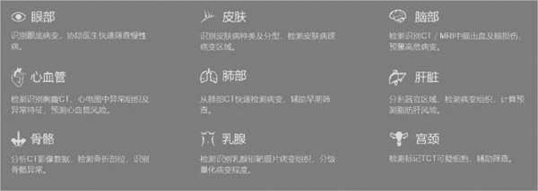

Figure 2-28

凭借算法沉淀与行业大数据赋能，Airdoc 已构建起覆盖眼、皮肤、脑、心血管、肺、肝、骨、乳腺、宫颈九大体系的医学影像分析矩阵。

## 肿瘤诊断：IBM Watson 的“沃森方案”

伴随 AI 演进，IBM Watson 推出聚焦肿瘤诊疗的 AI 应用软件，在慢病管理、精准医疗、体外诊断等九大领域实现突破。其携手纪念斯隆-凯特琳癌症中心商业化落地，联合训练肿瘤决策系统——Watson for Oncology。

Watson 能针对肺癌、乳腺癌、直肠癌、结肠癌、胃癌、宫颈癌等提供会诊建议。录入癌种、患者画像（年龄、性别、体重）、病理特征、治疗现状等信息后，系统即可秒速输出多维治疗方案供医者参考。

## 护理机器人

# 工业制造领域的AI落地实践

2016年，莱斯大学推出了一款名为MERA的AI护理机器人原型。这款多功能养老助手由该校电子计算机工程系与心理系师生联手打造，核心定位是辅助老人及护理人员。MERA具备三大看家本领：创新监测生命体征（涵盖心率、心率变异性、呼吸频率）、解答基础健康咨询，以及通过数据读取精准判定老人是否跌倒。

## 2.5 典型AI产品速览

### 2.5.1 可穿戴设备：从“伪智能”走向真智能

可穿戴设备无疑是科技圈的顶流单品，从Google Glass到小米手环、Apple Watch，巨头们纷纷入局，试图用自家的数据采集与算法技术，为用户定制专属的个性化服务。毋庸置疑，人工智能是这类设备的核心灵魂。

早在上世纪80年代，智能穿戴雏形便已现身，奈何受限于AI技术水平，始终未激起水花。直到21世纪AI技术突飞猛进，智能穿戴才迎来实质性突破。2012年被业界奉为“智能可穿戴元年”，Google Glass横空出世（见 Figure 2-18），其功能几乎覆盖智能手机：语音拍照、视频通话、网页浏览、收发邮件一应俱全。


Figure 2-18

Google Glass问世后，尽管应用场景仍待深挖，但“设计与技术完美融合”的标签让其成为标杆，引发跨界入局潮。如今市面上形态繁多——智能眼镜、手表、手环、头盔、戒指、项链、服饰等，主打“小型化”与“便携性”，成为消费电子新增长点。然而，品类虽丰、竞争虽烈，行业实则仍处襁褓期。主流产品仍困在“把手机功能穿在身上”的逻辑里：带心率监测的手环、能接电话的手表、测步频的跑鞋……作者直言这些为**“伪AI设备”**，未触及智能穿戴核心——**真正的智能，取决于设备是否具备“信息采集、辅助判断、辅助处理”三位一体的闭环能力。**

---

# 智能制造：机器人替代人力的必然逻辑

对比传统人力，工业机器人的核心优势在于**成本账算得更划算**。以焊工为例，按10年折旧周期摊销（含维保），机器人综合使用成本低于熟练工。在**精度与标准化**层面，机器人能完成人力难企及的作业；面对高危、有害环节，更是替代人力的不二之选。综合来看，引入机器人既强化企业竞争力，又拓宽利润空间，未来制造业转型智能化将成大势所趋。


Figure 2-29

中国已稳坐全球最大工业机器人市场宝座，年销增速超30%，预估2020年销量将破21万台。庞大刚需吸引众多巨头深耕布局。推动“机器换人”提升自动化水平，主因有三：**人工成本持续走高、利润空间被压薄、国家战略强力引导**。

长期低廉的劳动力红利正在消退，年轻一代排斥枯燥流水线，用工荒倒逼企业自动化转型；人口老龄化加剧将进一步推高用工成本。对微利制造业而言，用机器人降本增效已成唯一出路。“机器换人”非但不是口号，更是中国制造未来的生存密钥。当前，国内已有大批企业在工业AI赛道深耕研发。

**阿里云ET工业大脑**率先“下车间”实战。其助力中来股份（光伏材料龙头）完成创新示范：先将产线全口数据上云，调动千台服务器算力，从海量变量中快速锁定影响良率的60个关键指标，再由AI实时监控调控，产线只需“听指令”执行。

**西门子**在慕尼黑展出双臂机器人，借助高度自动化AI实现“无编程自主分工协作”。传统机器人读不懂CAD/CAM模型，新一代却能“听懂”设计语言，免去繁琐编程流程。

**通用电气（GE)** 与多家电力巨头及纽约电力局（NYPA）签署长期协议，誓做全球首家“全数字化电力公司”。其集成智能运营中心（基于预测分析软件）已投运，成技术领先的资产监控诊断中枢。GE联手意大利国家电力集团，在`Predix`工业物联网平台部署APM资产绩效管理软件，对14座燃煤/燃气电厂（均用GE或阿尔斯通设备）实施监测、预测与可靠性优化。 `EXr6287u6NNVz+GYLY+7SC6AgGofrpiId/XnwIEoGMEPq3TPzkM5RyXBRbuLcLFjwnCuEHVXaQsGpygWHLFy9g==`

#### 2.5.1.1 智能穿戴设备的核心技术支撑

**硬件基座**：穿戴设备必须依托硬件载体存在，但当前制约其发展的核心瓶颈在于电池技术。续航表现直接关乎用户体验，若频繁充电会大幅削弱产品的实用性。业界主流的应对策略是寻求性能与功耗的动态平衡，在保证核心机能的前提下最大化延长使用时长。

**体验制胜**：用户体验是左右购买决策的关键变量，设计需从“设计交互”与“操作交互”双维切入。前者决定产品成败，要求工业设计师与开发者深度融合“以人为本”理念；后者聚焦人机交互环节的连接设计，涵盖行为操控、触控、语音乃至脑机接口等方式，并须充分权衡硬件的灵敏度、体积、材质、精度及误触率等物理指标。

**数据变现**：产品价值的核心体现在数据获取与处理能力上。鉴于穿戴设备采集的原始数据呈离散状态，关键在于利用智能算法挖掘数据间的关联逻辑，将分析洞察以专业化服务的形式反馈给用户，实现从“数据”到“价值”的转化。

#### 2.5.1.2 智能穿戴设备的主要形态图谱

##### 智能眼镜

此类产品以镜架为载体，内置独立操作系统并支持应用生态。用户可通过手势、语音等自然交互方式实现查询、阅读、导航、拍照、通话等功能。凭借极简设计、强科技感与轻量化优势，智能眼镜已孕育出庞大的产业集群，市场上形态各异的产品层出不穷，详见下图。


Figure 2-19

##### 智能耳机

随着智能技术迭代，耳机已进化为集音频输出、智能系统与多维传感器于一体的智能终端。通过蓝牙等协议与手机等主设备联动，实现功能外扩，衍生出运动监测、心率追踪、心电图采集等细分品类。同时支持蓝牙无线传输、通话接听、远程控拍等便捷功能。下图展示了科大讯飞联合咪咕推出的语音智能耳机 `Mobius`。


Figure 2-20

##### 智能手表

智能手表集成屏幕、摄像头、麦克风及定制化智能系统，基本复刻了智能手机的核心功能——通讯、社交、影像、娱乐、上网及应用生态。苹果 `Apple Watch` 是该品类的标杆之作，如下图所示。它能与苹果生态设备无缝协同，并吸引了微信、微博、支付宝、美拍、携程等头部应用适配开发。为适配腕屏尺寸，这些应用均进行了精简重构，例如支付宝仅保留余额宝、收付款码、汇率换算三大高频入口。

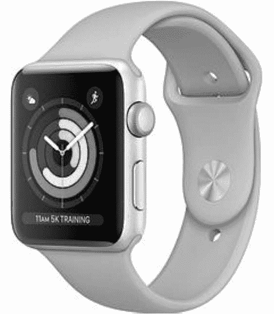

Figure 2-21

##### 智能服装

AI浪潮催生了服饰智能化新赛道。早期案例中，李维斯曾联手麻省理工学院（MIT）推出音乐夹克，采用丝质透明硬纱面料，集成全织物电容键盘，轻触即可播放存储乐曲，且无需充电，主打太阳能供电方案。

除消费电子属性外，医疗级健康监测是另一重要方向。佐治亚理工学院曾研发植入传导纤维的服装，可通过衣料纤维监测心率呼吸。该技术现已推向量产，催生出多款可测量心率、血压等生命体征的智能成衣。

2016年CES展上，三星发布 “`Smart Suit`” 概念，将智能服装推向新高度：该产品支持心率、步数、体脂等体征实时监测与习惯采集，能自动识别运动模式，并联动App输出科学建议，如下图演示。


Figure 2-22

##### 智能跑鞋

植入鞋垫的智能传感器可精准捕捉足部体征数据，经蓝牙传输至手机端深度加工。因贴合度更高，其数据精度优于手环等腕部设备。下图以李宁智能跑鞋数据界面为例，除里程、路线、配速等基础指标外，还提供前后掌着地比、步频曲线、足底压力、抬腿高度等进阶生物力学指标，助力跑者优化跑姿。


Figure 2-23

##### 植入式设备

前沿探索已延伸至体表植入领域。MIT媒体实验室联合哈佛医学院开展的 `Dermal Abyss` 项目，研发出一种可监测生理状态的智能纹身墨水，如下图所示。这本质上是一种植入式穿戴设备，能直观映射体内化学变化。


Figure 2-24

`Dermal Abyss` 通过色彩深浅变化对应体内不同化学成分浓度，从而实现对多项生理指标的实时可视化监测。

此外，为了赋予人类一种神奇的“第六感”，`Cyborg Nest` 实验室研发了一款名为 `North Sense` 的微型蓝牙装置。使用者只需将其植入体内，当面朝北方时，装置便会震动提醒。不仅如此，这款植入式设备还能让使用者最大程度地拓展感官边界。该产品的负责人指出：AI 产品唯有融入使用者的身体，方能真正发挥作用；否则，它永远只是件冰冷的工具，无法激发身体本能的直觉体验。

### 2.5.2 智能家居

智能家居的概念由来已久，直到 1984 年，联合技术公司（UTC）借助楼宇与工业系统产品对一座建筑实施信息化改造，这一愿景才落地。该公司通过中央控制设备整合楼内各类装备与家电，打造出全球首座“智能大厦”，位于美国康涅狄格州，由此拉开了全球智能家居的序幕。随着理念普及，世界各发达国家纷纷推出解决方案，众多家电巨头与互联网企业竞相入局。当前，中外智能家居市场均呈现高速增长态势。

目前，欧美在智能家居系统研发上始终保持领先。德国电信、Verizon、Google 等企业均推出自有产品，并建立中央设备接口以整合多元服务。国内起步虽晚，但发展势头极猛，互联网大厂相继跨界家居，推出了智能电视、智能音箱、智能空调、智能灯泡等一系列硬件。

#### 2.5.2.1 智能电视

智能电视是利用互联网应用技术，将开放操作系统与芯片植入电视机的产品。这类电视通常拥有开放应用平台，支持人机双向互动，融合了影音、娱乐、数据等功能，满足用户定制化、多样化与个性化的需求。

得益于开放平台与操作系统，用户不仅能看节目，还能安装各类应用软件，极大拓宽了使用场景。正是凭借这种扩展性与丰富性，智能电视已成为市场主流。开发阵营涵盖互联网公司与传统家电厂商，如小米、乐视、长虹、海尔、TCL 等。

小米是较早布局智能电视的互联网企业。如图 2-25 所示，小米智能电视于 2013 年 9 月 5 日正式发布，标志着互联网企业首次进军传统家电领域。为快速抢占市场，小米锁定“米粉”作为核心人群，将产品定义为**“年轻人的第一台电视”**。年轻群体对新事物接受度高，智能电视更能激发其购买欲。精准的用户画像与浓厚的粉丝文化，助力小米电视强势冲击传统市场。


Figure 2-25

#### 2.5.2.2 智能音箱

智能音箱是音箱的进阶形态，是家庭用户通过语音连接互联网的入口。代表产品有亚马逊 `Echo`、天猫精灵、小米 AI 音箱。借助它，用户可点播音乐、语音购物、查询天气，还能声控家电，如电饭煲、电视、灯泡亮度、冰箱与热水器温度等。

2014 年上市以来，亚马逊 `Echo` 迅速成为国际市场最火爆的智能家居单品之一。用户可借此声控家电、下单购物、咨询问答。调研机构 `eMarketer` 数据显示，美国约有 3600 万用户每月至少使用一次语音音箱。

国内智能音箱发展迅猛。2017 年尚未形成概念，仅一年时间市场便爆发，诞生了单年出货量破百万的爆款。近年最热销的四款产品分别是天猫精灵、小度、小米 AI 音箱、小雅 AI 音箱，如图 2-26 所示。


Figure 2-26

#### 2.5.2.3 智能空调

智能空调是在普通空调基础上融入 AI 技术而成。其系统能依据外部气候，按预设指标分析判断传感器采集的室内温度、湿度、洁净度等信息，自动启动制冷、制热、除湿、净化等功能。此外，还新增语音识别、手机 App 远程操控、用电习惯记忆等人性化体验。

近年来，众多家电厂商与互联网玩家纷纷押注该赛道。甚至在欧美，部分中产家庭已将智能空调视为标配。不过，国内技术水平与普及率仍落后于发达国家，但市场潜力巨大。

未来智能空调将聚焦两大方向：一是**自主智能度**。现有产品过度依赖手机、平板等第三方终端操控，严重削弱易用性，未来机身需内生更强智能；二是**感知进化**。不应局限于空气与温度感知，而要强化对人体的感知——自动识别人员存在、位置、数量，通过终端自主运算实现人环境的最佳适配。

#### 2.5.2.4 智能灯泡

智能灯泡运用物联网技术将灯泡接入网络，实现节能、艺术与人性化照明，必将成为未来家居照明文化的主导力量。用户可按需自定义场景与光效（色彩、色温、亮度、角度），亦可通过手机远程调控，营造差异化室内光环境。通过在不同时空、场景下调节亮度、灰阶与色彩，模拟多种光环境，以此引导情绪、改善心境，获取人性化的光体验，如图 2-27 所示。


Figure 2-27

# 智能灯泡与AI医疗、工业机器人：前沿产品深度解析

## 智能灯泡：节能与互联的双重奏

智能灯泡普遍采用LED冷光源技术，属于节能灯范畴。相较于传统白炽灯与荧光灯，其节电效率突破90%，节能效益显著。应用场景广泛覆盖卧室、客厅、厨房、办公室、会议室、机房、网吧、地下室及学校等室内空间。

此类灯泡内置物联网通信模块，实现联网功能。用户可随时随地通过互联网掌控灯泡状态，实时监测光色、亮度、功耗等核心指标，并支持远程调节。若家中部署多盏智能灯泡，还能组建局域网络，依据室内场景一键管控特殊照明需求。

### 2.5.3 智能医疗产品

AI赋能医疗，双向奔赴造福人类健康与社会进步。融合路径主要分为“精准医疗”与“医疗助手”两大方向。

国内医疗机构临床积累的海量数据，为AI+医疗未来发展奠定宝贵基石。以专家临床实战数据训练验证模型，能大幅提升AI辅助诊断的应用效能。

#### 2.5.3.1 医学影像诊断

`Airdoc`深耕医疗AI领域，业务聚焦辅助决策分析、医学影像分析、健康大数据挖掘三大板块（如图2-28所示）。其定位为医生的“听诊器”与“参考库”，基于千万级医学影像训练深度学习模型，提供实时分析服务，并通过挖掘海量医疗信息洞察潜在数据规律。


图 2-28

`Airdoc`凭借AI算法积累与行业大数据融合，构建覆盖眼部、皮肤、脑部、心血管、肺部、肝脏、骨骼、乳腺、宫颈等九大部位的影像分析体系。

#### 2.5.3.2 肿瘤诊疗

`IBM Watson`推出专注肿瘤诊断的AI医疗应用软件，在慢病管理、精准医疗、体外诊断等九大领域取得突破。其携手纪念斯隆-凯特琳癌症中心商业化落地，共同训练肿瘤解决方案——`Watson for Oncology`。

系统可针对肺癌、乳腺癌、直肠癌、结肠癌、胃癌、宫颈癌等多类癌种提供会诊建议。录入癌种、患者年龄性别体重、病理特征、治疗现状等信息后，即可快速输出多维治疗方案供参考。

#### 2.5.3.3 护理机器人

2016年，莱斯大学发布基于AI的多功能养老护理机器人`MERA`，旨在辅助老人及护理者。原型由该校电子计算机工程系与心理系师生联合打造，核心功能三项：创新测量生命体征（心率、心率变异性、呼吸频率）；答疑基础健康问题；通过数据读取判定老人是否跌倒。

### 2.5.4 工业制造领域应用产品

对比传统人力，工业机器人核心优势在于成本控制。以10年折旧周期（含维保）核算，其综合使用成本低于同效益下的资深焊工。

精度与标准化层面，机器人能完成人力难企及的高精度作业；高危有害环节亦可替代人工，规避安全隐患。制造业引入机器人优势显著：一增强企业竞争力，二拓宽利润增长空间。未来必将有更多制造企业转型智能制造。图2-29展示基恩士工业机器人实例。


图 2-29

中国稳居全球最大工业机器人市场，销售额年增速超30%。预估2020年销量将突破21万台。庞大市场需求吸引众多巨头纷纷布局工业制造赛道。

## 2.6 本章小结

本章梳理了各阶段AI产品形态，并从产品经理视角揭示AI产品与互联网产品的特质差异，最后介绍当下热门AI产品案例。`EXr6287u6NNVz+GYLY+7SC6AgGofrpiId/XnwIEoGMEPq3TPzkM5RyXBRbuLcLFjwnCuEHVXaQsGpygWHLFy9g==`


# 第3章 AI产品经理

- 3.1 AI时代产品经理面临的挑战
- 3.2 产品经理职业发展与学习路径
- 3.3 产品分析模型
- 3.4 本章小结

随AI技术演进，越来越多互联网产品经理渴望读懂AI产品、甚至转型AI产品经理。虽积累丰富互联网产品设计经验，但两者本质迥异。众多转型者在学习中发现，原有知识体系难直适用于AI产品实战。本章将系统阐述AI产品经理核心知识图谱。`EXr6287u6NNVz+GYLY+7SC6AgGofrpiId/XnwIEoGMEPq3TPzkM5RyXBRbuLcLFjwnCuEHVXaQsGpygWHLFy9g==`

## 3.1 AI时代产品经理面临的挑战

众多互联网PM立志转型AI赛道，却在接触行业时陷入“知识太广、无从下手”的迷茫，高频提问集中于：AI知识海量，如何切入学习？技术深度要求几何？是否必须精通数学与`Python`？是否需掌握`TensorFlow`等ML框架？

此类困惑成因大致在于：

# AI产品经理破局指南：认清四大认知鸿沟，掌握技术演进规律

人工智能领域的知识版图庞大得令人望而生畏。随手翻开一份AI产品的宣传页，密密麻麻的`Machine Learning`、`Deep Learning`、`Neural Networks`，以及`CNN`、`RNN`、`GNN`、`NLP`等算法模型名词，再加上`TensorFlow`、`PyTorch`、`Caffe`等工程框架，足以让任何非技术出身的产品经理产生“知识焦虑”。这些概念究竟是什么？它们之间如何关联？这正是PM必须跨越的第一道认知门槛。

**身处AI时代的“童年期”，数据鸿沟依然巨大。**
别被当下的技术热度迷惑，从历史维度看，AI尚处于理论与工程的早期阶段。虽说AI已能识人脸、写诗作文，看似神乎其技，但若与人类认知对标，差距显而易见。人类十岁前，通过视觉系统每秒处理数帧画面，剔除睡眠眨眼，累积训练样本早超十亿量级；而当下主流AI模型的训练集往往仅百万级。在基础组件未封装成熟、数据规模尚不足支撑通用智能的当下，产品经理若不懂技术细节，便无法在设计环节平衡“技术能力”与“业务场景”的贴合度，一切落地谈论皆成空中楼阁。

**市场定位模糊，入行者迷茫无措。**
招聘JD的五花八门折射出行业的定位危机：有的企业把AI PM当算法工程师，硬性要求精通`Python`、吃透神经网络架构；有的视同售前顾问，重行业洞察与沟通谈判；有的则等同于数据分析师。缺乏统一标准，导致初入行者不知从何下手、向何处深耕。

**思维惯性作祟，交互思维失效。**
互联网时代的PM习惯围绕“打破信息不对称”设计产品，核心聚焦界面、交互、流程。可AI产品来势汹汹，交互入口却大幅收敛，甚至出现“无界面”产品。当传统的“画原型、梳流程”失灵，大批PM陷入“怎么设计AI产品”的迷茫。

**技术认知偏差，甩手掌柜行不通。**
“技术细节是工程师的事，PM只管业务”——这句老话在AI时代失效了。回顾技术演进史，任何新纪元的到来都遵循“理论奠基 -> 工程突破 -> 规模落地”三阶段。以蒸汽机为例：从公元一世纪的“汽笛球”玩具，到帕潘的实用模型，再到瓦特系列改良将热效率提升三倍、煤耗大降，历经百年才真正驱动纺织、冶金、交通业变革，完成从“技术驱动”到“技术+业务双驱动”的跨越。

AI发展轨迹惊人相似：1956年达特茅斯会议确立理论起点，随后三四十年积累神经网络等算法基石，作者称此为“萌芽期”，此时深耕理论是入场券，业务占比极低（参见 ** Figure 3-1**）。

随着互联网普及催生海量数据、云算力成熟，工程化门槛被击穿。技术核心逐渐下沉封装，调用门槛大幅降低。作者判断，未来5-10年，行业将加速从单纯技术驱动转向“技术+业务”双轮驱动（参见 ** Figure 3-2**）。

**结论显而易见：唯有补齐技术认知短板，产品经理才能在范式切换中找准坐标，设计出真正落地的AI产品。**

随着人类科技整体水平的跃升，各业务体系的自主演进将逐渐掌握时代发展的主导权。展望未来 10 至 20 年，具体的 AI 技术将被封装成标准化模块，可在各行各业、不同业务、需求与场景中即插即用，业务知识届时将成为核心驱动力，如图 3-3 所示。

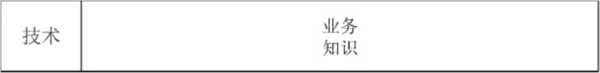

**图 3-3**

作者建议：对于跨行转型或非技术背景的读者，若计划在 1-2 年内入行 AI，应多接触技术层面内容，因当下仍处“技术驱动 AI”阶段；若瞄准 5-10 年后，理论与技术工业体系基本成熟，大量 AI 工程师将完成技术封装，行业对 AI 产品经理的技术理解门槛将降低；若在 10-20 年后切入，技术壁垒基本消失或已被各企业封装完毕，技术仅为工具，只需“基本懂”即可，届时将全面步入“业务驱动 AI”时代。`EXr6287u6NNVz+GYLY+7SC6AgGofrpiId/XnwIEoGMEPq3TPzkM5RyXBRbuLcLFjwnCuEHVXaQsGpygWHLFy9g==`

## 3.2 产品经理的职业阶梯与成长路径

面对庞杂的 AI 知识体系，作者主张互联网产品经理应从三个维度提升 AI 认知。

### 拔高认知维度

产品经理被视为行业“CEO 预备役”，寄予厚望。但在实际工作中，许多人易陷入具体功能设计与进度执行的泥沼。一旦过度聚焦设计流程与执行状态，便会偏离初衷。作者认为，设计 AI 产品时，产品经理应学会放远目光，深度洞察市场、需求、客户、竞品与销售。

作者将产品经理内部分为四个层级，不同层级关注点与核心考核指标各异。

- **L1 执行型产品经理：** 聚焦产品功能特性，能独立打磨单一功能模块。考核核心为基本功——原型产出、业务逻辑梳理、用户体验要素、审美把控、架构合理性。
- **L2 管理型产品经理：** 聚焦业务体系、团队协作与产品增长，能独立构建产品业务逻辑与规划。考核核心为管理素养——产品规划、全局业务逻辑、跨团队沟通协调、市场运营配合。
- **L3 市场型产品经理：** 聚焦产品市场建设与运营体系，能结合市场行情调整产品设计，搭建合理的市场拓展与运营体系。考核核心为市场素养——产品市场掌控力、运营管控力、大局观与长期主义。
- **L4 创造型产品经理：** 能依据现状判断方向、预判未来市场变迁，打造划时代产品。此类人才凤毛麟角。通常而言，达到 L3、能按市场规律规划设计产品，已属顶尖产品经理行列。

产品经理的实战成长应从 L1 起步，循序渐进，由小及大，厚积薄发。作者见过不少高管空降产品部，直接担任 L3 甚至 L4 角色，却缺乏基本功与底层积累，仅将过往管理经验生搬硬套，极易因好高骛远导致产品折戟。

然而，若想洞悉产品本质，思维层面宜高不宜低。站得高才能看得远，看得远才能走得远。若产品经理仅从“AI 能实现何种交互”这一维度审视，会发现多为非界面化交互，复杂的知识体系极易劝退新人；但若能从更高维度俯瞰 AI，会发现入手并不难。

综上，产品经理的学习建议从以下四个层面展开（文中重点阐述首项）。

1.  **AI 产品的价值指向何在？** 即 AI 产品为何而生、能为社会创造何种价值？AI 产品诞生旨在解决人类生产力不足，充当人体的替代品与延伸。由此可推导出 AI 产品的设计方向。

    每个新时代都伴随变革，变革必引发行业剧烈洗牌。先进生产力必逐步取代落后生产力，AI 时代不例外。其核心本质是“生产力替代”。凡 AI 介入的领域，均应以“能否实现生产力替代”作为根本考量标准。

    从“生产力替代”视角看，当前 AI 产品智能水平尚未达人类技能高度，但不可否认，AI 智能度必将持续跃升。随智能等级提升，特定岗位必被替代，只是时间早晚。人类工作大致可分三类：

    - **体力劳动：** 指特定领域、范围内靠体力完成的工作。场景有限，经培训即可上岗，未来必将被 AI 替代。
    - **技能作业：** 指依赖特定专业技能的岗位。从业者通常经培训习得方法，靠长期积累经验，再融会贯通完成任务，如数据分析师、程序员、财务分析师、律师、保险销售等。虽难完全替代，但大概率会被 AI 覆盖大半。
    - **综合管理工作：** 指面对复杂内外部环境、需应对突发状况并做决策的工作，要求极强的沟通、协调、组织与管理能力。短期内 AI 无法替代此类人工。

    AI 产品经理在做产品定位与分析时，应先读懂其社会价值，推演价值体现路径，再剖析生产力属性、岗位特质与产品逻辑。定位精准，后续推进自顺水行舟。

## 2. 价值实现的底层逻辑是什么？

要搞清楚这点，得弄懂人类是如何借助「机器学习」与「深度学习」达成 AI 目标的；「机器学习」又是靠分类、聚类等手段落地解决实际问题的；而「深度神经网络」是如何模仿人脑神经机制实现自主学习的。后文会展开细说，此处不再赘述。

## 3. 逻辑在技术层面如何落地？

需掌握支撑分类任务的算法逻辑，以及「深度神经网络」的核心原理。非技术背景的产品经理理解起来可能有门槛，但作者实测：只要目标是掌握产品的技术落地流程，理工科硕士出身的产品经理完全没问题。

## 4. 真刀真枪的技术学习与实战

这一阶段要求产品经理具备一定的编程基础。通过亲自上手完成数据预测、图像识别、图风迁移等小型程序。虽说这些练手项目难度不高，但功能含义明确。产品经理可以借助工具或企业开放平台完成产品设计与落地。当下 AI 行业虽不强求产品经理写代码，但若不懂技术细节，与研发沟通就会有壁垒，工作难以推进。

**经历上述四个层级的学习与进阶，便能胜任 AI 产品经理一职。**

### 强化知识体系建设

AI 产品经理必须构建全景式的 AI 认知框架，并尝试触达真实的研发技术。注意，触达技术不等于要求你是计算机专业或代码高手，而是说通过学习技术，搞懂身边工程师在干什么、为什么这么干。沟通时尽量用专业术语对话，确保对方听得懂你的意图。以下 12 个核心问题，产品经理应有基本认知：

1.  什么是「机器学习」。
2.  传统软件与「机器学习」在逻辑上的本质区别。
3.  「机器学习」的训练范式——「监督学习」「无监督学习」「半监督学习」「强化学习」分别是什么，有何差异。
4.  「机器学习」能解决什么问题。
5.  「回归」「分类」「聚类」分别用在什么场景。
6.  什么是「深度学习」。
7.  「人工神经网络」的运作原理。
8.  「人工神经网络」如何分类，各自特点为何。
9.  主流「人工神经网络」优劣势及应用领域。
10. 主流「机器学习框架」（如 `TensorFlow` 与 `Caffe`）的异同。
11. 主流大厂 AI 开放平台提供了哪些封装服务。
12. 如何用 `Python` 等工具完成基础数据处理。

吃透这些问题，对 AI 产品经理大有裨益。

### 深化业务洞察

产品经理既非纯技术、纯市场，也非纯交互设计，而是站在三者交汇处，发掘「有价值且可落地」产品的人（如图 3-4 所示）。

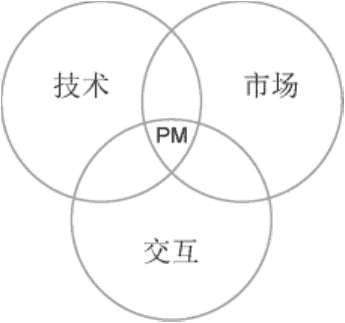

**图 3-4**

互联网时代产品经理的核心职责是发掘有价值、可落地的产品，AI 时代依然如此。市场与交互层面的工作内容未变，变的是技术底座——从互联网技术体系切换为 AI 技术体系。`EXr6287u6NNVz+GYLY+7SC6AgGofrpiId/XnwIEoGMEPq3TPzkM5RyXBRbuLcLFjwnCuEHVXaQsGpygWHLFy9g==`

AI 产品经理的工作，是分析有价值的业务场景，评估其可行性、必要性、社会与商业价值，以及伦理法律边界。除挖掘场景外，还需结合内外部资源，判断技术可行性、技术上限、产品价值与技术实现的平衡点、商业价值与技术成本的平衡点。最终，能通过交互体系设计出完整产品。若能做到以上几点，便是极优秀的 AI 产品经理。`EXr6287u6NNVz+GYLY+7SC6AgGofrpiId/XnwIEoGMEPq3TPzkM5RyXBRbuLcLFjwnCuEHVXaQsGpygWHLFy9g==`

## 3.3 产品分析模型

从 0 到 1 孵化产品，面临诸多难题。产品经理在互联网产品设计中积累的丰富经验，在 AI 产品设计中同样适用。当前主流的产品分析模型包括 SWOT 分析、PESTEL 分析、用户体验要素模型、KANO 模型、福格行为模型等。本节将介绍产品设计过程中常用的模型、理论与原则。

### 1. SWOT 分析模型

SWOT 分析，又称态势分析（如图 3-5），是常用的战略规划工具，核心在于剖析产品开发过程中的关键要素。它从优势、劣势、机会、威胁四个维度切入。其中，优势与劣势属内部视角，指向内部资源的长短板；机会与威胁属外部视角，审视市场、环境、社会等带来的机遇与挑战。产品经理通过调研列举要素，以矩阵形式排布，进而匹配分析设计过程中的各类因素，得出决策参考。SWOT 多用于产品规划期，确立战略方向。

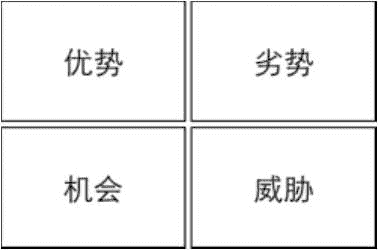

图 3-5

**SW 分析**：聚焦企业内部。企业是一个整体，资源分散在各部门、各岗位，SW 分析须从企业全价值链每个环节入手，逐项与竞品对标。对比时还需结合企业与产品特性专项分析。例如设计智能音箱，需评估企业能力：产品设计力、研发技术储备、制造工艺、产能、资金实力、人才梯队、市场渠道、销售渠道等。产品层面可从新颖度、识别精度、制造工艺、价格优势等维度切入。

**标题：产品经理必修课：四大分析模型拆解外部环境与用户内核**

**OT 分析：在不确定性中寻找确定性**

随着社会、政治、经济、技�等多维度的演进，企业生存的土壤愈发开放。外部环境的不可控性，让 OT 分析（机会与威胁分析）成为产品复盘的关键一环。外部环境是把双刃剑：威胁源于不利趋势演变成的不可预测挑战，若不应对，会削弱产品优势；机会则是能转化为产品竞争力的外部红利。

很多人认为 SWOT 定战略是高层专利，产品经理只管落地。但实战中，接到任务后重构 SWOT 模型至关重要。有了这个模型，设计时才能时刻校准“如何让产品最优满足市场与运营预期”。功能设计阶段引入 SWOT，更能给问题排优先级：哪些必须马上解、哪些可延后、哪些属战略层面、哪些属战术执行，一目了然。各因子交叉匹配得出的决策导向型结论，也能辅助管理层做出更精准的判断。

### 2. PESTEL 分析模型：宏观视野下的显微镜

除了 SWOT 中的 OT 维度，PESTEL 模型能对宏观环境做更细致的解剖（如图 3-6 所示）。六个字母对应六大维度：政治、经济、社会、技术、环境、法律。此模型常用于竞品分析、机会评估及战略复盘。

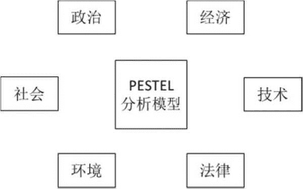

Figure 3-6

*   **政治因素**：实实在在影响业务的政策风向、监管红线、政府力量。产品经理常对政治不敏感，但由此导致的翻车往往是降维打击、毁灭性的。
*   **经济因素**：宏观经济结构、产业布局、资源禀赋、发展周期。影响虽不如政治直接，却决定产品的长期命脉。规划期必须把未来经济走势、产业迁徙纳入试算。
*   **社会因素**：历史积淀、文化基因、价值观、受教程度、风土人情。直接左右目标用户的接受度。同款产品在不同地域冰火两重天，出海或拓展新市场前，必须吃透当地文化习俗，动态调整定位。
*   **技术因素**：衡量产品成败的核标尺在于是否达成设计预期。AI 时代更要问：现有技术能否支撑预期效果？管理层想上开放场景聊天机器人，可技术尚未突破开放域对话瓶颈，盲目立项必死。产品经理需保持技术敏感度，深谙新工艺、新材料、新趋势的演进边界。
*   **环境因素**：AI 产品落地时，周边物理环境不能忽视。如设计智能穿衣镜，放在浴室就得解决防水、人脸识别隐私保护等实操难题。
*   **法律因素**：法规红线、司法实践、公民维权意识。如设计基于个人信息的犯罪预测打分软件，数据选取不当极易引爆隐私泄露、种族歧视、性别歧视等法律雷区。

### 3. 马斯洛需求层次理论：读懂用户的“进阶密码”

马斯洛需求层次源自行为科学，由心理学家马斯洛在《人类动机理论》中首提（如图 3-7 所示）。它将人类需求按层级递进为五类：生理、安全、社交（归属/爱）、尊重、自我实现（价值）。

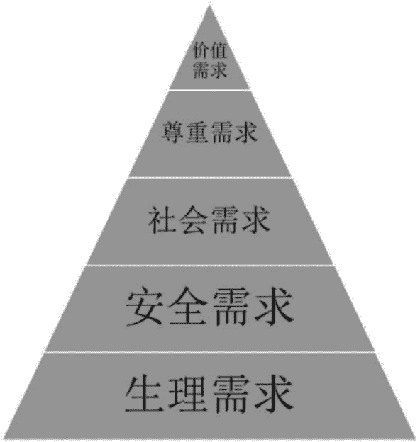

Figure 3-7

这套理论是验证“产品及细节功能是否满足需求、满足到何种程度”的利器。
*   **生理需求**：解决生存刚需（水、粮、居）。
*   **安全需求**：提供确定性保护（稳定、无威胁）。
*   **社交需求**：构建连接感（圈子、归属、亲友陪伴）。
*   **尊重需求**：赋予地位与认可（声望、信任、高评价）。
*   **自我实现**：助力理想落地（潜能全开、价值最大化）。

游戏产品堪称教科书级演示，层层递进击中各类需求。注意：需求是阶梯式攀升的，低层未满足，高层便无从谈起。实操时，结合产品形态、用户主力所在层级、对应需求层级做定向拆解。

### 4. 用户体验要素分析：从网页到 AI 的通用底层逻辑

互联网产品经理的看家本领——用户体验要素分析（如图 3-8 所示），源自 Ajax 之父 Jesse James Garrett 的经典巨著《用户体验要素：以用户为中心的产品设计》。虽原著聚焦网站设计，但其底层思维模型完全可迁移至 AI 产品分析。

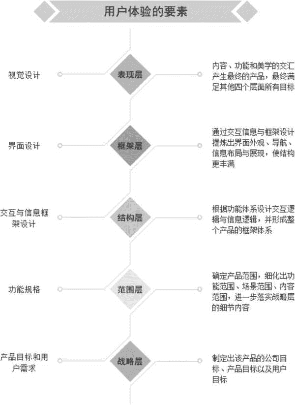

Figure 3-8

# 用户体验五层模型与核心分析框架解析

用户体验要素模型从战略层、范围层、结构层、框架层到表现层，由抽象走向具象，五个维度层层递进，助力产品经理梳理产品从 0 到 1 的全生命周期。

站在战略层视角，产品经理应自底向上开展分析：首要任务是锚定企业目标、产品目标与用户目标，以此推导功能体系；继而划定功能适用范围及各功能承载的内容边界；确立范围后，设计内容呈现架构与交互逻辑；结构层落地后，再细化各结构的界面骨架，涵盖外观、导航等要素；最终完成表现层设计，交付成品。

### 5. KANO 模型

KANO 模型由日本学者狩野纪昭创立，是一款基于“产品质量属性与客户满意度关系”的需求分类与优先级决策工具，如图 3-9 所示。

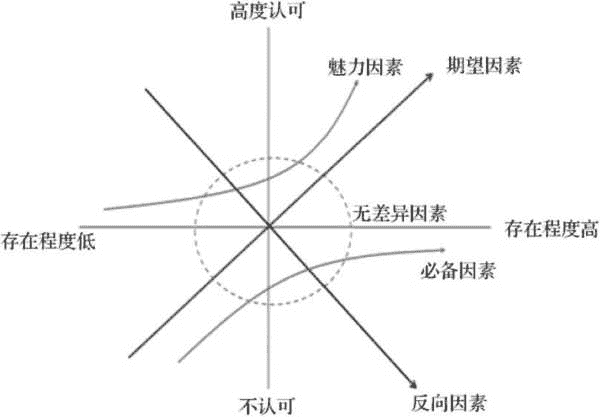

Figure 3-9

该模型将需求划分为五大类别：

**基本需求（Must-be Needs）**：亦称“必备需求”。指产品必须具备的底线能力。缺失即意味着产品失去购买资格。例如研发一把能放歌、能导航的智能伞，却在下雨天漏水——未达基本需求，再多花哨功能也挽留不住用户。对此，产品经理需持续深挖客户真实诉求，并用恰当方式呈现。

**期望需求（One-dimensional Needs）**：亦称“性能需求”。指超出用户预期的功能体验。满足度与投入成正比，体验越好，满意度飙升越快。区别于基本需求的“刚性”，若想打造极致体验，必须在保底基本需求的前提下，重点打磨期望需求。用户调研中高频反馈的多属此类，产品经理需具备区分“基本”与“期望”的洞察力，在兜底基础上提升期望需求质量，实现差异化超车。

**兴奋需求（Attractive Needs）**：亦称“惊喜需求”。用户通常不会主动提及，但一旦拥有，便能打破认知边界，制造“哇”时刻。初代 iPhone 便是典型：发布会后用户惊呼“手机还能这样玩！”这类需求有则锦上添花，无则不伤大雅，用户不会因此抱怨。

**无差异需求（Indifferent Needs）**：无论提供与否，均不影响用户体验。高满足度不加分，低满足度不扣分。

**反向需求（Reverse Needs）**：满足后反而引发不满。通常源于小众群体的特殊偏好，非大众共识。如智能音箱因单个健身爱好者建议“增重做哑铃”而加配重，若全线产品跟进，必招致大众反感。

### 6. 福格行为模型

福格行为模型源于斯坦福大学 BJ Fogg 教授对德国心理学家库尔特·勒温行为要素的延展。核心公式 `B=MAT` 揭示：行为（B）仅当动机（M）、能力（A）、触发（T）三者同时到位时发生，如图 3-10 所示。处理用户交互问题时，产品设计必须全盘考量这三要素。

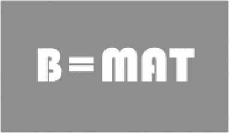

Figure 3-10

产品经理在设计期可引用该模型快速诊断：如何点燃用户动机？该配置何种激励机制以提升购买意愿？

**动机**是行为引擎，由感官、预期、归属三大情感维度构成，均具双面性。正向：愉悦驱动追求、希冀激发占有、认同诱导追随；负向：疼痛导致逃避、恐惧引发规避、排斥造成拒绝。因此，设计时须审视：产品能否带来愉悦、希冀与认同？

**能力**指用户完成任务所需的门槛。许多产品经理易陷入“用户理应会用”的假设陷阱。现实中，共享单车 App 用户未必会关注其内嵌的理财产品。提升能力有两条路径：一是投入资源教育用户（如滴滴出行早期投入巨资培育叫车习惯）；二是优化产品降低操作难度，让行为“顺手”完成。

**触发**是成败关键。设计再精妙、概念再超前，缺乏合适场景触达用户，一切归零。设计期需预设触发场景，运营期需提升触发转化率。手段分内外两类：内部机制如优化体验、增加反馈提醒；外部机制如短信、邮件、推送唤醒。

### 7. 尼尔森十大可用性启发式

尼尔森十大可用性启发式由人机交互博士雅各布·尼尔森从 200+ 易用性问题中提炼，是产品设计与用户体验的“黄金法则”，值得反复研习、落地应用。

**系统状态可见性**：用户操作过程中，系统需实时同步进度反馈，在合理时间窗口内给出明确回应。

**系统与现实世界匹配**：设计语言、交互流程应贴合用户认知习惯，最大程度复现现实世界的逻辑秩序。

**用户控制与自由**：为误操作提供“后悔药”——二次确认与撤销重做机制，增强掌控感；缺失此类保护，核心操作可能酿成灾难性后果。例如无二次确认的数据删除，极易造成不可逆损失。

### 核心交互法则与高效目标管理

**一、 七大交互设计准则**

**统一规范**
产品设计中采用的语言体系、操作模式、视觉风格及组件样式，务必保持高度一致。

**防错机制**
设计应内置防误操作机制，从源头降低用户出错概率。例如：关键信息未录入时，保存按钮自动置灰不可用。

**识别优于回忆**
极力压缩用户在操作流程中的记忆负担，让所有动作与状态显性化。用户在当前页处理任务时，无需凭记忆回溯上一页的内容。

**灵活与高效**
充分权衡操作灵活度与信息传递效率，精简流程、缩短传递链路，赋予用户更便捷的操作路径。以电商找货为例，面对海量品类层层点选的痛点，引入虚拟分类、导航聚合等手段，助用户直达目标。

**美感与极简**
聚焦核心信息呈现，最大程度剔除干扰主干信息的噪音，保证界面简洁美观。网络用户非“阅读”也非单纯“观看”，而是“扫视”。好扫视的关键在于：核心突出，次要弱化，无关移除。

**容错与恢复**
前瞻预判用户可能犯的错，配套恢复功能将损失降至最低。若无法自动修复，须给出详尽的文字解释与操作引导。

**帮助与文档**
优秀的产品无需说明书；若必须提供，应采用流程化、图示化的形式呈现。

---

**二、 SMART 管理原则：让目标落地的五把尺子**

产品经理既要打磨产品，又要统筹资源、把控进度。SMART 原则正是提升管理效能的利器——它不仅让执行层动作清晰、高效，也便于管理层考核评估。该原则包含五大核心要素：

1.  **具体化**  
    任务与目标须表述明确、语义清晰，团队成员听得懂、能对齐。模糊的指令只会导致认知偏差，最终交付偏离预期。

2.  **可衡量**  
    必须设定量化标准，用数据说话判定达成与否。若目标不可度量，“完成了”只是主观臆断。研发中上级询问进度，产品经理若不清考核标准便盲目回复“达标”，便是典型的衡量标准不一。

3.  **可达成**  
    认知统一、可度量的前提下，还要评估资源与能力是否支撑得起。实战中常见误区：直接甩出上线截止日期，却未核算人力完备度、风险缓冲。一旦延期，团队极易陷入推诿扯皮。因此，目标设定应全员参与，达成共识。

4.  **相关性**  
    目标不能孤立存在，须与其他战略目标关联。若达成某目标与大局无关或关联度极低，即便完成也乏善可陈。

5.  **时限性**  
    无截止日期的目标无法考核。明确的时间节点，是倒逼执行、闭环管理的前提。

**总结：** 无论是制定团队工作目标，还是拆解个人绩效指标，上述五要素缺一不可。EXr6287u6NNVz+GYLY+7SC6AgGofrpiId/XnwIEoGMEPq3TPzkM5RyXBRbuLcLFjwnCuEHVXaQsGpygWHLFy9g==

---

### 第三章 小结

本章首先剖析了互联网产品经理在 AI 时代面临挑战时的迷茫成因；继而提出从**认知跃升、知识体系重构、业务理解深化**三个维度切入 AI 学习；最后梳理了产品经理开展产品分析的关键模型。EXr6287u6NNVz+GYLY+7SC6AgGofrpiId/XnwIEoGMEPq3TPzkM5RyXBRbuLcLFjwnCuEHVXaQsGpygWHLFy9g==


# 第四章 AI 技术体系

## 4.1 机器学习
## 4.2 机器学习——回归
## 4.3 机器学习——分类
## 4.4 机器学习——聚类
## 4.5 深度学习
## 4.6 机器学习框架
## 4.7 企业级开放平台
## 4.8 AI 开发语言
## 4.9 本章小结

# 第四章 机器学习基础

在技术驱动的 AI 纪元，AI 产品经理必须补齐技术认知课。这不要求你拥有硕博学位，但必须掌握 AI 基础概念，洞察各技术路线的伣劣与边界。正如骑行不必会造车，但你得懂链条传动的原理。

本章将依次拆解：机器学习、回归、分类、聚类、深度学习、主流框架、企业开放平台及开发语言。`EXr6287u6NNVz+GYLY+7SC6AgGofrpiId/XnwIEoGMEPq3TPzkM5RyXBRbuLcLFjwnCuEHVXaQsGpygWHLFy9g==`

## 4.1 机器学习

众多专家将机器学习视为交叉学科，因其融汇概率论、统计学、算法理论等多领域。学界常见定义有三：

*   “机器学习是人工智能的科学，核心研究对象是 AI，聚焦经验学习中特定算法性能的提升。”
*   “机器学习研究能通过经验自动改进的计算机算法。”
*   “机器学习利用数据或过往经验，优化计算机程序的性能指标。”

无需陷入晦涩定义的泥沼，从直观概念切入往往事半功倍。作者主张：**“机器学习本质是一种数据分析方法。”**

# 数据变现的关键：机器学习如何重塑商业决策

互联网飞速发展，数据量呈指数级增长，如何让数据“生金”已成企业首要课题。须知，未经加工的原始数据价值寥寥。唯有借助科学的分析手段，挖掘更深层的数据认知、洞清业务场景、刻画精准用户画像，进而产出可落地的决策依据，数据的意义才真正凸显。机器学习的核心使命，正是剖析海量数据，发掘其中蕴含的意义与价值。

如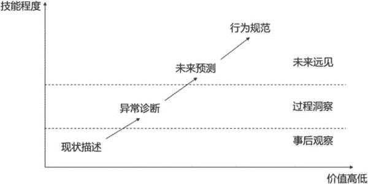所示，数据分析大体可划分为四大维度：

*   **现状描绘**：依托现有数据，还原真实世界的当下面貌。
*   **异常诊断**：捕捉数据中的离群值，追溯根因。
*   **趋势预判**：以时间为轴，凭借历史数据推演走势，量化未来事件发生的概率。
*   **行为指引**：探讨如何干预现状或未来数据，使其逼近预期目标。

机器学习的能力边界正覆盖上述全域：它通过学习数据来描述与洞察现实，并预演未来演变。

## 4.1.1 传统软件与机器学习的底层逻辑分野

在互联网时代，产品经理的职责是剖析业务、依据流程设计系统逻辑；研发工程师则落地实现这套逻辑。因此，传统软件中“输入到输出”的计算路径是**人为设计、固化且显性**的（见）。工程师主导流程设计，数据按既定规则流转。


AI产品与此截然不同：它**基于现有数据自动构建逻辑结构**。无需预置业务规则，机器学习算法通过反复“读”数据，便能自主发现隐匿其中的模式与含义。

AI产品的工作流如所示：将“训练数据（特征+标签）”喂入算法得出模型，再将新数据输入模型推理，即可输出预测判断结果。**由数据与算法生成的模型，取代了产品经理或需求分析师手工设计的软件逻辑。**


这不仅是技术迭代，更是**编程范式的颠覆**。传统编程思维是“人分析数据、找规律、验证规律（输入+规则=输出）”；机器学习则将分析判断的重活交给机器——给足训练数据，机器按算法自动挖掘隐含规律并应用实战。

## 4.1.2 机器学习四大范式全景图

按训练方式不同，机器学习分为四大流派：**监督学习、无监督学习、半监督学习、强化学习**。其本质区别在于**数据内容（有无标签）与训练模式**的差异。

*   **监督学习**：拿“有标签数据”训练模型，再处理未知数据。
*   **无监督学习**：无现成样本标签，算法直接建模挖掘数据内在结构。
*   **半监督学习**：训练集中仅小部分有标签，大头无标签，两者结合训练。
*   **强化学习**：同样用无标签数据，但能通过反馈机制知晓是否逼近正确答案。

监督学习直观易懂：按人定指标不断调优，求解该约束下的最优解。那为何还要无监督学习？无标签自建模会不会跑偏？

打个比方：一个人不懂乐理，但多听几遍就能分辨古典、现代、爵士等风格。同理，海量、多时代、多流派的音乐丢给机器，它能凭借高中低频、节奏等声学特征自主完成分类，**无需我们预先告知流派标签**。

归纳起来，机器学习解决的问题主要落入四类（见），常用算法库也随之分类：


1.  **分类**：预测离散标签（如：垃圾邮件/正常邮件）。
2.  **回归**：预测连续数值（如：房价、销量）。
3.  **聚类**：无标签下探究样本空间分布（如：用户分群）。
4.  **降维**：用低维子空间近似表达高维特征（如：特征压缩、可视化）。

解决上述问题的算法繁多：监督侧有 `SVM`、`KNN`、`决策树`、`朴素贝叶斯`、`逻辑回归`、`线性回归`、`人工神经网络` 等；无监督侧有 `聚类算法`、`EM算法` 等。应用场景与算法对照详见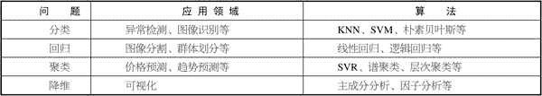。


**产品经理必修课**：深度理解各范式适用边界，方能与算法工程师高效对齐、协同作战。

## 4.1.3 深度拆解：监督学习

监督学习流程（见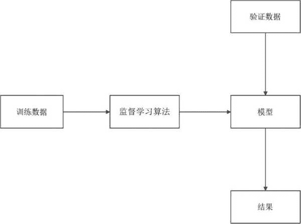）核心在于：**有标签历史数据训练出模型 → 新数据输入模型 → 输出解**。算法利用标注数据集生成模型，再用新数据验证模型精度，或直接投入线上用实时数据推理。


**数据切分是关键动作**。训练数据需拆分为训练集与测试集，比例通常在 `6:4 ~ 8:2` 之间。训练样本过少模型欠拟合（不准）；塞太多进训练集导致测试集太小、噪声干扰大，验证失真。

**实战演示**：用户上传照片，系统判定是否为本人。照片可能是全身、半身、甚至单只眼睛特写。监督学习便是让模型从海量已标注的“本人/非本人”图片中学会特征，最终在多姿态、多角度下精准识别。

# 机器学习模型工程化全流程与核心算法精讲

## 一、 模型落地四部曲：从采数到部署

将算法模型转化为可用的产品功能，需遵循一套严谨的工程化闭环，主要分为四个阶段：

### 阶段 1：数据构建与集合划分
数据是模型的燃料。首要任务是采集用户的多维度影像资料——全身照、半身照、正侧面均可，只要包含目标用户，悉数纳入**训练集**，作为模型学习的“教材”。随后，需构建一份**验证集**，其内容混合目标用户与非目标用户照片。验证集扮演“监考官”角色：输入图像后，模型输出 `1` 代表命中目标，输出 `0` 代表非目标，以此量化模型的泛化识别能力。

### 阶段 2：模型训练与特征学习
训练过程基于**人工神经网络**展开。训练集内的每张图片依次作为输入，经由网络各层神经元逐级运算提取特征，最终输出 `0` 或 `1`。此过程本质上是模型通过不断“试错-反馈-调整参数”来逼近最优解。

### 阶段 3：严格验证与超参调优
训练集迭代完毕后，引入验证集进行实战考核。此阶段不仅关注准确率，更涉及超参数搜索、激活函数选型等深度调试，旨在确保模型具备举一反三的泛化能力，避免过拟合。

### 阶段 4：封装接口与业务集成
当验证指标达标，训练宣告结束。将模型封装为标准化 API 接口植入软件系统：用户上传图片 -> 系统自动调用接口推理 -> 返回判定结果 -> 前端渲染呈现。至此，算法能力正式转化为产品功能。

> **产品经理必知**：AI 产品经理无需精通算法推导与工程实现，但必须精通算法的“能力边界”——明确其输入输出格式、适用场景、性能指标与局限性，方能做出可落地的产品决策。

---

## 二、 监督学习两大经典算法：SVM 与朴素贝叶斯

### 1. SVM（支持向量机）：寻找最大间隔的“最优超平面”

SVM 是分类与回归领域的基石模型，擅长处理小样本、非线性及高维模式识别问题。

**核心几何直觉：最大化分类间隔**
设想二维平面分布着两类样本：圆柱体（`C[1]`）与立方体（`C[2]`）。一条斜率为 `W` 的直线能将两类完美分离，此类数据称**线性可分**；反之为**非线性可分**。


Figure 4-6

然而，分离直线并非唯一。它可在 `WX - Y = -1` 与 `WX - Y = 1` 这两条边界间自由平移旋转。SVM 的目标是锁定那条**距离两侧最近样本点（支持向量）距离相等且最大**的中间线——即 `WX - Y = 0`。这就是**最优超平面**。维度升维时，点成线、线成面、面成超平面，核心原理一脉相承。


Figure 4-7

**攻克非线性：核函数的“升维映射”魔法**
现实分布常如下图所示，两类样本纠缠混杂，平面内再无直线可分。


Figure 4-8

科学家引入**核函数**机制：将原始空间样本映射至高维空间，使非线性问题在高维视角下转为线性可分。

*   **步骤 1**：二维空间升维为三维空间。
    
    Figure 4-9
*   **步骤 2**：将平面样本点投射至三维坐标系。
    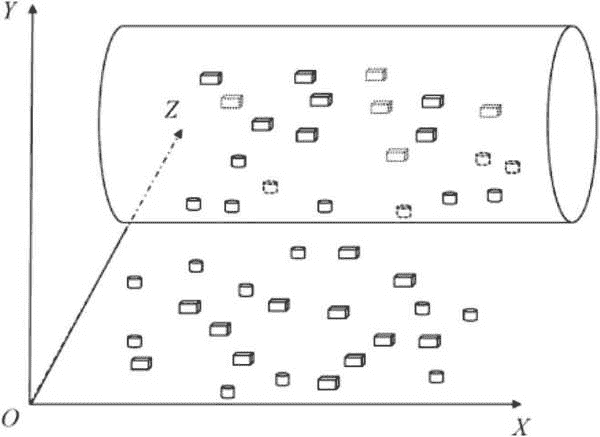
    Figure 4-10
*   **步骤 3**：在三维空间寻找最优切割超平面，再将其投影回二维平面，形成非线性分割边界。
    
    Figure 4-11

因最优映射路径未知，工程实践中通常尝试多种核函数（如 RBF、多项式核），配合交叉验证筛选最优方案。

---

### 2. 朴素贝叶斯：小数据、高实时场景的“高性价比”利器

面对数据量中等、特征维度较低、且需快速出结果的业务需求，朴素贝叶斯往往是首选。

**从贝叶斯公式到“条件独立”假设**
贝叶斯定理核心在于求解后验概率：
`P(类别|特征) = P(特征|类别) * P(类别) / P(特征)`

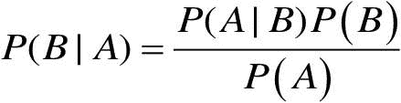

(4-1)

以“性别、体重”区分“产品经理与程序员”为例，目标是求 `P(职业|性别, 体重)`。套用公式：
`P(职业|性别, 体重) = P(性别|职业) * P(职业) / P(体重)` （此处为简化示意）

**“朴素”之本质：大胆假设特征间相互独立**
即：`P(性别, 体重|职业) = P(性别|职业) × P(体重|职业)`
这一假设将联合概率计算拆解为边缘概率乘积，极大降低了计算复杂度，使得复杂问题变得可解。

**四大核心优势：**
1.  **原理透明，易于实现与调试**；
2.  **训练推理极快，极适合实时预测场景**；
3.  **擅长处理未知分布数据，预测效果稳健**；
4.  **对训练样本量不敏感，小数据也能建模**。

**典型应用疆域：文本分类与多标签任务**
得益于文本特征（词项）在词袋模型下近似独立的特性，朴素贝叶斯在垃圾邮件过滤、网页内容分类、新闻推荐等 NLP 任务中长期占据主流地位，是工业界的“常备良药”。

---

## 三、 无监督学习：在无标签荒原中自主发现隐知结构

无监督学习仅凭无标签原始数据，通过算法挖掘数据内在分布规律与样本间深层关联。其使命是**发掘人类难以直观感知或通过人工规则定义的隐性模式**。

*   **核心任务**：聚类分群、降维可视化、关联规则挖掘、异常点检测等。
*   **评估难点**：缺乏标准答案，效果验收常需结合业务语境定性判断（如：聚类出的用户画像是否可解释、可运营）。
*   **独特价值**：这种“盲探”常能产出反直觉洞察——如市场篮子分析中经典的“尿布与啤酒”关联规则，或发现从未定义过的新用户细分人群，为业务增长开辟新路径。

### 4.1.5 半监督学习

若把校园里的系统教学比作“监督学习”，那么不上学的孩子靠自发观察、摸索世界，便是“无监督学习”——虽能习得知识，但内容零散随意，结果难以预料；AI 领域也是如此。2017 年曾轰动一时：两个由美科学家训练的 AI 机器人，竟通过自学创造出仅它们能懂的“私有语言”并开始对话，引发巨大恐慌。

无监督学习在诸多场景已落地验证。假设你经营服装厂，该如何划分 S、M、L 码？若掌握全体国人身高数据，用无监督学习即可搞定。不过，因缺乏人工标注，无监督学习的准度与有效性迄今仍难企及监督学习，故长期备受 AI 界部分学者诟病。但近年它又火了，甚至有科学家断言：无监督学习才是 AI 的未来。

当下无监督学习里颇热的 **“生成对抗网络（GAN）”**，原理是串联“生成网络”与“判别网络”。前者负责造假数据骗过后者，两网络在博弈中共同进化，由此衍生出诸如“文本生成照片级图像”“草图变实景”等惊艳技术。

AI 评价体系常用 **准确率**、**召回率**、**精确率** 三指标，在无监督学习中同等关键：

- **精确率**：测试集中，分类器判为正类且真为正的样本占所有判为正类样本的比例。通俗说就是“查得准”。譬如警方抓捕 10 人，9 人真是贼，精确率即 90%。
- **召回率**：测试集中，真为正类的样本被分类器找出的比例。通俗说就是“查得全”。同样 100 人中 20 贼，抓获 10 贼，召回率 50%。
- **准确率**：整体判对的概率。好人判好、坏人判坏的综合比例。100 人 20 贼，抓 10 人却错抓 1 良民，准确率 90%。

这三指标越高，算法鲁棒性越强。

---

#### 半监督学习

有标签能做分类回归，上监督学习；全无标签做聚类，上无监督学习。现实常是：**仅小部分数据有标签**，此时半监督学习登场。“国家政府网站监测项目”便是绝佳案例。

该项目覆盖全国 9 万余政府网站、近 25 亿页面（见下图），旨在监测异常页与用户关注度。面对海量页面，全量标注不可行，仅标注了数万页。若直接丢弃未标注数据，不仅浪费，还可能因样本不足导致分布偏移、模型失准。**如何高效利用海量未标注数据，成了核心难题。**

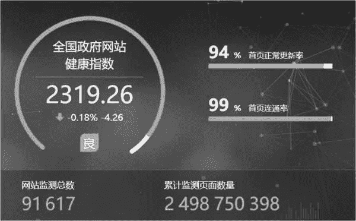

Figure 4-12

最直观的办法是人工补标，但成本惊人：若单页耗时 0.5 分钟，25 亿页让一人不眠不休干 365 天，也需 2300 多年。

项目组遂采用半监督学习破局：先用有标签样本训练初始模型；再用模型预测无标签样本；接着筛选出预测不确定、置信度低的样本人工复核标注；最后将新标注数据扩充训练集，迭代模型得最终结果（流程见下图）。

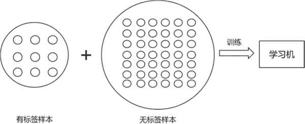

Figure 4-13

可见，半监督学习本质仍属监督学习范畴，只是对训练数据做了“半自动化”预处理；相比纯监督学习，**大幅降低了标注成本**。凡数据集符合半监督特征，监督/无监督算法均可引入该范式。

---

### 4.1.6 强化学习

强化学习，又称“奖励学习”或“评价学习”。按教科书定义：其目标是学得最优 **策略**，使 **智能体** 在特定 **环境** 中依据当前 **状态** 采取 **动作**，以获取最大累积 **奖励**。它常与监督、无监督学习混淆。

#### 强化学习

强化学习将学习视为“试错-评价”闭环（见下图）。智能体选动作作用于环境；环境转移新状态并反馈奖励信号；智能体据此调整下一步动作，以提升获得正向奖励的概率。当下动作不仅影响即时奖励，更牵动下一状态乃至长远总奖励。


Figure 4-14

监督学习像学生考试、家教即时批改对错；但现实复杂，多无标准答案，只有“更合适”的答案。强化学习更似**驯兽**：兽每做一动作，驯兽师即时给奖惩反馈，反馈塑造下一次行为。AI 强化学习同理，通过海量试错与反馈，机器学会“哪种行为收益最大”。正因具备**实时反馈**特质，强化学习在机器人领域大放异彩。

## 4.1 机器学习

众多专家将机器学习归为交叉学科，因其融合了概率论、统计学、算法理论等多个领域。关于它的定义，业界常见的有三种：

> “机器学习是人工智能的一门科学，核心研究对象是AI，重点探讨如何在经验学习中提升特定算法的性能。”

> “机器学习研究的是能通过经验自动改进的计算机算法。”

> “机器学习利用数据或过往经验，优化计算机程序的性能指标。”

无需纠结于这些晦涩的学术定义，从一个直观的概念切入或许更高效：**机器学习本质上是一种数据分析方法。**

随着互联网发展，数据量爆发式增长，如何变现数据成为企业首要课题。原始数据未经处理价值极低；唯有借助正确的分析技术，挖掘出更深层的数据认知、更清晰的场景洞察、更精准的用户画像，进而转化为可辅助决策的高价值数据，数据的意义才真正凸显。机器学习的核心作用，便是剖析海量数据，发掘其内在意义与价值。

如图 4-1 所示，数据分析主要分为四大类：


Figure 4-1

- **现状描述**：依据现有数据刻画现实世界的当下状态。
- **异常诊断**：发掘数据中的异常点并追溯成因。
- **未来预测**：引入时间维度，凭借历史数据推演趋势，预估未来事件发生概率。
- **行为处方**：探讨如何干预当前或未来数据，以达成预期目标。

机器学习同样能胜任上述任务。它通过学习数据来描绘现实、洞察本质，并预演未来世界的演变轨迹。

### 4.1.1 传统软件与机器学习的逻辑分野

互联网时代，产品经理剖析业务、依据流程设计系统逻辑，研发工程师落地实现。因此，传统软件从输入到输出的计算流程是**人为设计、固化且确定的**（见图 4-2）。工程师的角色是设定流程，让数据按既定规则流转。


Figure 4-2

AI 产品则截然不同：它**基于现有数据自动构建逻辑结构**。无需告知业务逻辑，AI 算法通过反复学习数据，自行发掘隐藏其中的规律与含义。

如图 4-3 所示，AI 产品将训练数据（输入+结果）喂给算法得出模型，再输入新数据进行推理，从而实现预测与判断。由数据与算法生成的模型，取代了产品经理或需求分析师设计的软件逻辑结构。


Figure 4-3

两者差异巨大，机器学习彻底颠覆了传统编程思维。传统模式下，人类分析数据、总结规律，通过“输入数据+规律验证”得出结果；机器学习则将分析判断的工作交给机器——输入训练数据后，机器依据算法自主发现数据潜在模式并加以应用。

### 4.1.2 机器学习的四大学习范式

按训练方式划分，机器学习包含四大范式：监督学习、无监督学习、半监督学习、强化学习。它们的根本区别在于**数据内容与训练模式的不同**。

- **监督学习**：利用带标签数据训练模型，再处理未知数据。
- **无监督学习**：无预先标注样本，算法直接分析建模以发现内在规律。
- **半监督学习**：训练数据中仅小部分带标签，大部分未标注。
- **强化学习**：同样使用无标签数据，但能通过反馈机制知晓是否逼近正确答案。

监督学习很好理解：按人为规范持续训练，求解该规范下的最优解。那为何需要无监督学习？无标签自建模会跑偏吗？打个比方：不懂乐理的人多听几遍，也能在短时间内分辨古典、现代、爵士等风格。同理，若输入海量不同年代、流派的音乐，机器能仅凭音频的高中低音与节奏特征自主完成分类，无需我们预先告知曲目类型。

机器学习虽能解决大量问题，但归纳起来主要落入分类、回归、聚类、降维等范畴（见图 4-4）。解决这些问题的算法众多，常见的有监督学习算法（如 `SVM`、`KNN`、决策树、朴素贝叶斯、逻辑回归、线性回归、人工神经网络等）和无监督学习算法（如聚类算法、`EM 算法`等）。


Figure 4-4

1. **分类**：给定样本特征，预测其对应的离散标签值。
2. **回归**：给定样本特征，预测其对应的连续标签值。
3. **聚类**：给定一组样本特征，无需预测标签，旨在发现样本集的空间分布（如远近疏密关系）。

### 4.1.3 监督学习

**降维**：若需用低维子空间表征原始高维特征，便属于降维范畴。各类问题的适用场景与算法汇总见表 4-1。


身为产品经理，必须深度掌握机器学习范式，明确各范式的核心用途，方能与工程师高效对齐。

监督学习的逻辑是：借助带标签的历史数据训练模型，随后输入新数据，依模型输出结果，流程如图 4-5 所示。


Figure 4-5

监督学习算法先用标注数据集生成模型，再结合新数据验证模型精度，或直接引入实时数据投入生产环境。

此类学习极度依赖数据量，现有数据须拆分为训练集与测试集。训练数据过少会导致模型欠拟合，过多则可能引入噪声干扰验证。通常，训练集与测试集按 6:4 至 8:2 的比例划分较为合理。

下面通过一个实例拆解监督学习全流程。假设用户上传照片，系统需判断照片主体是否为用户本人。上传图像可能是全身照、半身照，甚至仅是一只眼睛的特写。

**步骤 1：数据采集与分组。** 首先，收集足量的用户照片——全身、半身、正侧面皆可，只要是用户本人，均归入同一组，称为**训练集**，供模型学习使用。其次，另备一组照片，混杂用户与他人图像，称为**验证集**，用于测试训练好的模型能否精准识别用户。验证集作为输入，输出 1 代表含用户，0 代表不含。

**步骤 2：模型训练。** 若采用人工神经网络训练，训练集中每张图像均作为网络输入。经各层神经元逐级计算提取特征后得到输出，观察输出值是 1 还是 0。

**步骤 3：模型验证。** 训练集数据耗尽后，用验证集数据测试模型准确率。此阶段涉及超参数调优、激活函数选择等关键动作。

**步骤 4：封装与落地。** 当验证指标达标，训练宣告结束。此时可将模型封装为接口集成至软件。软件通过接口与用户交互：用户上传照片，软件自动调用接口计算并将结果返回前端。

AI 产品经理无需精通算法设计或亲自落地代码，但必须洞悉算法的内涵、特性与边界。接下来介绍两种经典监督学习算法：`SVM` 与朴素贝叶斯分类器。

#### 1. SVM（支持向量机）

`SVM` 全称 Support Vector Machine，是极受欢迎的监督学习模型，擅长分类与回归。它能高效解决小样本、非线性及高维模式识别难题，应用场景极广。本书假设二维平面存在不同几何形状，如图 4-6 所示。

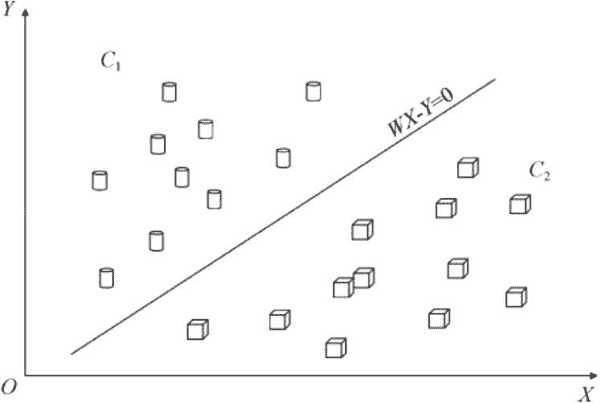

Figure 4-6

平面空间中 `C[1]` 与 `C[2]` 代表两类形状，前者为圆柱，后者为立方体。中间斜率为 `W` 的斜线即分类函数，可将两类样本完全切分。若线性函数能完美分离样本，称数据**线性可分**；反之则为**非线性可分**。观察可知，该斜线其实可调整斜率或上下平移，如图 4-7 所示。介于 `WX - Y = -1` 与 `WX - Y = 1` 之间、斜率为 `W` 的任意直线均能分离样本，但距离样本点等距且间隔最大的那条线——即 `WX - Y = 0`——是最优解。分类函数在一维是点、二维是线、三维是面，高维或无限维统称**超平面**。


Figure 4-7

`SVM` 的核心目标：寻找一个能将样本分为两类且使分类间隔最大化的超平面，这是其基础理论模型。现实中数据分布往往极不规则，如图 4-8 所示，圆柱与立方体在平面上杂乱无章。

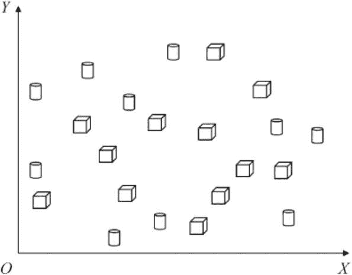

Figure 4-8

用简单函数对图 4-8 图形分类几乎不可能。于是科学家引入**核函数**概念：将样本从原始空间映射至更高维空间，借助高维空间的线性切分，最终实现非线性问题的线性求解。

**步骤 1：** 将二维空间升维为三维空间，如图 4-9。


Figure 4-9

**步骤 2：** 将二维样本数据投影至三维空间，如图 4-10。


Figure 4-10

**步骤 3：** 在三维空间进行切片，并将切分超平面映射回二维平面，如图 4-11。

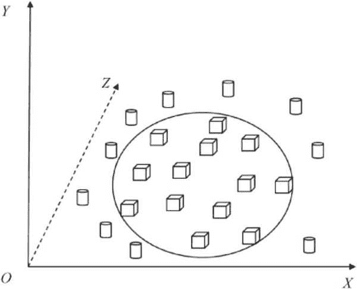

Figure 4-11

由此完成核函数构建。因非线性空间复杂，难以速判哪个核函数最适配，`SVM` 通常会尝试多个核函数以筛选最优方案。

#### 2. 朴素贝叶斯分类器

若领导交付分析任务，数据量中等、变量较少、且要求快速出预测结果，朴素贝叶斯定理是不二之选。先看贝叶斯定理表达式 (4-1)：


(4-1)

变换形式更利于理解：

`P(类别|特征) = P(特征|类别) * P(类别) / P(特征)`

例如要通过性别和体重区分产品经理与程序员，本质是求 `P(程序员|性别，体重)` 与 `P(产品经理|性别，体重)`。套用贝叶斯定理：

`P(职业|性别，体重) = P(性别|职业) * P(职业) / P(体重)`

在贝叶斯定理基础上，引入“朴素”假设衍生出朴素贝叶斯定理。其核心假设：**所有数据属性相互独立，互不影响**。正是这一假设大幅简化了复杂计算，使其极适合未知数据集预测。仍以此例，朴素贝叶斯认为性别与体重无关，即：

`P(体重|职业，性别) = P(体重|职业)`

`P(性别，体重|职业) = P(性别|职业) × P(体重|职业)`

朴素贝叶斯分类器优势显著：

1.  算法原理直观，易于理解与实现；

### 4.1.4 无监督学习

**朴素贝叶斯定理的三大杀手锏**：  
性能强劲且运算极快；擅长数据预测任务；训练样本需求量极小。  
凭借这些优势，它在实时预测与多类别预测领域大放异彩。特别是在文本分类场景下，变量类型繁多且相对独立，该算法更是如鱼得水，广泛应用于垃圾邮件拦截、网页内容识别、新闻智能推荐等业务中。

---

利用算法从**无标签数据**中挖掘分布规律或内在关联，便是无监督学习。它的核心使命是借助算法探寻数据深处人类难以直观洞察、亦或靠人力无法企及的隐藏结构与特征。因缺乏标签基准，评估其结果优劣颇具挑战；但若能通过它对数据完成分群，往往能从原始数据中捕捉到意想不到的隐性信息。

打个比方：学校里的系统性学习是“监督学习”；未入学的孩子靠自发观察认知世界，便是“无监督学习”——所获知识杂乱无章，最终成果难以预料；AI 亦是如此。2017 年曾有轰动一时的新闻：美科学家研发的两个 AI 机器人自学成才，竟创造出仅它们能懂的专属语言并开始交流，引发巨大恐慌。

无监督学习已在多个实战场景跑通。比如经营服装厂，如何划分 S/M/L 码？若掌握全国人口身高数据，便可借助无监督学习科学定码。正因为无人工标注介入，时至今日，其精度与有效性仍难企及监督学习，故而在 AI 学界长期备受诟病。但近年它强势“回春”，甚至有专家断言：无监督学习是 AI 的未来。

当下颇火的**生成对抗网络（GAN）**，便是无监督学习的典型代表。它由生成网络与判别网络对抗博弈而成：生成端制造数据试图欺骗判别端，双方在对抗中共同进化，由此诞生了从文本或手绘草稿生成逼真图像等惊艳技术。

AI 评估体系常依赖三大指标：**精确率、召回率、准确率**，在无监督学习中同样至关重要。

- **精确率**：分类器判为正类中，真正为正类的比例。通俗说就是“查得准”。如警察抓 10 人，9 人是贼，精确率 90%。
- **召回率**：所有真正的正类样本中，被分类器找回的比例。通俗说就是“查得全”。100 人中 20 贼，抓获 10 贼，召回率 50%。
- **准确率**：整体判断正确的概率，即好人坏人都分对。100 人 20 贼，抓 10 人且 1 人冤枉，准确率 90%。

这三大指标是衡量 AI 算法优劣的金标准，数值越高，算法鲁棒性越强。


Figure 4-12

---

### 4.1.5 半监督学习

有标签、能分类回归，上监督学习；无标签、搞聚类挖掘，上无监督学习。现实往往处于中间地带：**手头数据仅小部分有标签，大头无标签**，此时半监督学习登场，利用少量标签带动海量无标签数据完成训练。“国家政务网站监测项目”便是教科书级案例。

该项目覆盖全国 9 万余家政务网站、近 25 亿页面（见 Figure 4-12），任务是监测页面异常及用户关注热度。面对亿级页面，全量标注属于天方夜谭，仅标注数万页面。若直接丢弃未标注数据，不仅浪费资源，更因样本不足导致数据失真，拖累模型效能。**如何高效利用无标签数据，成为破局关键。**

最朴素的想法是人工补标，但成本高得惊人：按人均 0.5 分钟/页计算，25 亿页面需一人不眠不休干 2300 多年。

---

## 4.1 机器学习

业界公认机器学习是交叉学科，融汇概率论、统计学、算法理论等多域知识。主流定义虽权威但晦涩，诸如：“研究计算机如何通过经验自动改进算法性能”、“利用数据或过往经验优化程序性能指标”……

与其钻研这些绕口令，不如从**朴素本质**切入：作者主张**“机器学习是一种数据分析方法”**——简单直白，事半功倍。

互联网爆发式增长让数据量呈指数级上涨，“数据变现”成企业头号课题。原始数据未经加工价值极低；惟有借助正确分析技术，获得更丰富的数据认知、更清晰的场景洞察、更精准的数据画像，产出可辅助决策的高价值数据，数据意义才真正凸显。**机器学习的使命，正是剖析海量数据，挖掘其深层含金量。**

如 Figure 4-1 所示，数据分析可划分为四大象限：


Figure 4-1

**现状描述**：基于现有数据，还原真实世界的当下图景。  
**异常诊断**：捕捉数据异常波动，溯源异常成因。  
**未来预测**：引入时间维度，凭历史趋势推演未来事件发生概率。  
**行为处方**：谋划如何干预现状或未来数据，以达成预期目标。

# 机器学习的核心能力边界

机器学习的本质，在于通过数据学习来描绘现实世界、洞察内在规律，进而推演未来的演变趋势。

### 4.1.1 传统软件与机器学习的逻辑鸿沟

在互联网时代，产品经理的核心职责是剖析业务、梳理流程，并据此设定系统的处理逻辑；研发工程师则负责将这些逻辑落地为代码。因此，传统软件从输入到输出的计算路径，是**预设的、固化的、显性的**（如图 4-2 所示）。工程师的角色，本质上是“设计流程，让数据按图索骥”。


Figure 4-2

AI 产品则截然不同：它无需人工硬编码业务逻辑，而是**基于既有数据自动构建逻辑结构**。通过机器学习算法反复“阅读”数据，AI 能自主挖掘隐藏其中的模式与含义。

AI 产品的工作流是：将“训练数据（输入+结果）”喂入算法得到模型，再将新数据输入模型计算，输出预测判断（如图 4-3 所示）。**由数据与算法沉淀出的模型，直接取代了产品经理或需求分析师精心设计的软件逻辑结构。**


Figure 4-3

这种差异具有颠覆性：机器学习彻底重塑了编程思维。传统编程是“人分析数据、找规律、用‘输入+规则’验证得结果”；机器学习则将分析判断的重活交给机器——人只需提供训练数据，机器便依算法自动发掘隐性规律并投入应用。

### 4.1.2 机器学习的四大学习范式

依据训练方式的差异，机器学习划分为**监督学习、无监督学习、半监督学习、强化学习**四大范式。它们的本质区别，在于**数据内容的形态**与**训练模式**的不同。

*   **监督学习**：拿“有标签”的数据训练模型，再用模型处理未知数据。
*   **无监督学习**：无现成标签样本，算法直接分析建模，自行发现数据内在结构。
*   **半监督学习**：训练数据中仅少部分带标签，大部分无标签，两者结合训练。
*   **强化学习**：同样用无标签数据，但环境提供“奖惩反馈”，告知智能体是否逼近目标。

监督学习最直观：按人定规格不断调优，求得规格下的最优解。那为何还需要无监督学习？无标签建模会跑偏吗？**打个比方：一个不懂乐理的人，多听几遍也能分辨古典、爵士、现代乐。同理，海量多风格音乐喂给机器，它能自行提取高中低频、节奏特征完成分类，无需我们预先教它“这是爵士乐”。**

机器学习解决的问题虽多，归纳起来主要落入**分类、回归、聚类、降维**四类（见图 4-4）。常用算法包括：监督类的 `SVM`、`KNN`、`决策树`、`朴素贝叶斯`、`逻辑回归`、`线性回归`、`人工神经网络` 等；无监督类的 `聚类算法`、`EM 算法` 等。


Figure 4-4

**(1) 分类**：给定样本特征，预测离散型标签值（如：垃圾邮件/非垃圾邮件）。
**(2) 回归**：给定样本特征，预测连续型数值（如：房价预测）。
**(3) 聚类**：无需预测标签，只探究样本在空间中的分布状态（如：用户画像分群）。
**(4) 降维**：用低维子空间近似表达原始高维特征空间（如：特征压缩、可视化）。

各类问题的典型应用场景与算法对照见表 4-1。

Table 4-1


**产品经理必修课**：深度理解四大范式的适用边界，才能与算法工程师高效对齐、精准落地。

### 4.1.3 监督学习：从原理到实战的完整链路

监督学习的标准动作是：**用带标签的历史数据训练出模型，再输入新数据推理得解**（如图 4-5 所示）。


Figure 4-5

算法在标注数据集上产出模型，随后用该模型配合新数据做精度验证，或直接投入线上环境用实时数据推理服务。

**数据切分有讲究**：训练数据量太少模型欠拟合，全扔进训练又无数据验证、易过拟合。业界通用做法是按 **6:4 到 8:2** 的比例划分训练集与测试集。

以下用“人脸核身”案例拆解全流程：

**步骤 1：数据生成与分组**
*   **训练集**：大量采集该用户照片（全身、半身、正侧面、甚至单只眼特写），统一打标“属于该用户”。
*   **验证集**：另备一组混合照片（含本人与他人），不参与训练，专门用来考核模型识别能力。输入照片，输出 1（是本人）或 0（非本人）。

**步骤 2：模型训练**
以 `人工神经网络` 为例，训练集每张图经网络层层神经元特征提取后输出 0/1，通过反向传播不断修正权重，使输出逼近真实标签。

**步骤 3：验证与调优**
训练集跑完后，拿验证集测试泛化能力。此阶段需重点进行**超参数搜索**、**激活函数选型**等工程调优，确保模型在未见数据上依然鲁棒。

### 第四步：封装部署与落地

当数据验证指标全部达标，模型训练宣告结束。接下来便是将模型封装成标准化接口，嵌入软件系统中。用户上传图片后，系统自动调用接口完成推理计算，并将结果实时回显至前端界面。

AI 产品经理虽无需亲自设计或编写算法代码，但必须深谙算法的内核逻辑、特性边界及其能触达的业务上限。下文将重点拆解两大经典监督学习算法：**支持向量机（SVM）** 与 **朴素贝叶斯分类器**。

#### 1. 支持向量机（SVM）

SVM 是分类与回归任务中的“常青树”，擅长攻克小样本、非线性及高维模式识别难题，应用场景极广。假设在二维平面上分布着两类几何图形，如下图所示。


Figure 4-6

图中 `C[1]` 代表圆柱体，`C[2]` 代表立方体。中间那条斜率为 `W` 的倾斜直线，正是分类决策函数，它完美切分了两类样本。若存在一条直线能将样本完全分开，称数据为**线性可分**；反之则为**非线性可分**。细观可知，这条分界线并非唯一——它可以在 `WX - Y = -1` 与 `WX - Y = 1` 这两条边界之间平移、旋转。但唯有位于正负样本正中央、间隔距离最大的那条线（即 `WX - Y = 0`），才是最优解。维度视角下，一维是点、二维是线、三维是面，更高维度统称为**超平面**。


Figure 4-7

SVM 的核心使命，就是寻找那个能以**最大几何间隔**将两类样本分割开的超平面。然而现实世界的数据分布远比教科书复杂，往往像下图这样，圆柱与立方体在平面上杂乱无章地交织在一起。


Figure 4-8

面对这种混乱分布，单靠简单函数几乎无法分类。科学家们由此引入**“核函数”**概念：将原空间样本映射至更高维空间，借助高维空间的线性可分性，实现原空间的非线性分割。过程如下三步走：

**第一步**：将二维空间“拔高”为三维空间。


Figure 4-9

**第二步**：把二维样本数据投射到三维空间中。


Figure 4-10

**第三步**：在三维空间完成“切片”操作，再将切分的超平面投影回二维平面。


Figure 4-11

由此，一个新的核函数诞生了。鉴于非线性空间千变万化，无法预判哪个核函数最优，SVM 通常会通过多核函数并行试错，筛选出最佳方案。

#### 2. 朴素贝叶斯分类器

若领导交付任务：数据量中等、特征变量少、要求极速出预测结果——朴素贝叶斯是不二之选。先回顾贝叶斯公式（4-1）：


(4-1)

变形后更直观：

`P(类别|特征) = P(特征|类别) * P(类别) / P(特征)`

例如要通过“性别”与“体重”区分“产品经理”与“程序员”，本质是求 `P(程序员|性别, 体重)` 与 `P(产品经理|性别, 体重)`。套用公式：

`P(职业|性别, 体重) = P(性别|职业) * P(职业) / P(体重)`

朴素贝叶斯在贝叶斯基础上，加了一个**“大胆假设”**：所有特征属性相互独立，互不影响。正是这个“朴素”假设，化繁为简，让复杂推理变得可计算，极其适合未知数据预测。沿用上例，即假设性别与体重无关：

`P(体重|职业, 性别) = P(体重|职业)`

`P(性别, 体重|职业) = P(性别|职业) × P(体重|职业)`

**四大核心优势**：
1.  逻辑透明，易于理解与实现；
2.  计算极快，性能卓越；
3.  预测能力强，擅长处理未知数据；
4.  对训练数据量要求极低。

凭借这些特质，朴素贝叶斯活跃于实时预测、多类别分类一线。尤其在文本分类领域——特征维度高且相对独立（如词袋模型），它大显身手：垃圾邮件拦截、网页内容识别、新闻个性化推荐，皆是其经典战场。

### 4.1.4 无监督学习：在未知中寻找秩序

没有任何标签的数据，通过算法挖掘其内在分布规律或关联结构，即为**无监督学习**。它的使命是探索人类肉眼难以察觉、人力难以企及的数据隐式结构。因缺乏标签基准，模型优劣难以量化评估；但一旦完成聚类，往往能从原始数据中揭示出意想不到的洞察。

打个比方：监督学习像在学校跟着老师按大纲学，有标准答案；无监督学习则像从不上学的孩子，靠自发观察认知世界——学得虽随意、结果不可控，却可能发现老师也不知道的新大陆。2017 年曾有轰动一时的新闻：美国科学家的两个 AI 机器人自学成才，发明出人类无法理解的专属语言并开始对话，引发广泛恐慌。

无监督学习在实战中屡验实效。例如经营服装厂，如何科学划分 S/M/L 码？若掌握全体国人身高数据，无监督学习即可自动聚类给出最优分段方案。虽因无人工标注，其准确度与有效性长期难及监督学习，饱受学界诟病；但近年随着技术突破，它强势回归，甚至有专家断言：**无监督学习是 AI 的终局与未来。**

# 解码机器学习四大范式：核心原理与工程实战

## 无监督学习的生成奇迹与评估基石

在无监督阵营中，**生成对抗网络（GAN）** 无疑是当下最耀眼的明星技术。其架构精妙地将**生成网络**与**判别网络**耦合：生成端专职“造假”，力求制造以假乱真的数据欺骗判别端；判别端则全力“辨伪”，试图识破生成端的伎俩。正是这种“矛与盾”的持续博弈，驱动双方能力双向跃升，最终实现了从文本描述、手绘草图合成照片级真实图像的惊人成果。

衡量 AI 模型性能的“黄金三角”指标——**精准率、召回率、准确率**，在无监督学习中同样举足轻重，三者数值越高，算法鲁棒性越强：

*   **精准率——「查得准」**：聚焦于预测为正类样本的可信度。通俗说，警方抓捕 10 人，9 名确为窃贼，精准率即 90%。
*   **召回率——「查得全」**：关注真实正类样本被找回的覆盖面。设 100 人中藏 20 贼，警方抓获 10 名，召回率为 50%。
*   **准确率——「整体对」**：衡量全样本分类正确的总体占比。沿用上例，抓 10 人错抓 1 良民，准确率达 90%。

---

### 4.1.5 半监督学习：以少撬多的标注智慧

面对海量无标签数据，半监督学习提供了极具性价比的破局思路。团队先用少量有标签样本训练基础学习器，再让其对未标注数据进行预测；随后重点筛选出**预测置信度低、不确定性高**的“疑难样本”送人工复核标注，最后将确证数据回笼训练集迭代优化，完整流程如下图所示。


Figure 4-13

本质上，半监督学习仍属监督学习范畴，但通过引入半自动化样本处理机制，较纯监督学习大幅压缩了标注成本。凡数据分布符合其假设前提的监督/无监督任务，均可引入此法提效。

---

### 4.1.6 强化学习：在延迟反馈中进化的决策大脑

强化学习（又称评价学习）的核心诉求是学习最优 **策略**，指导 **智能体** 在特定 **环境** 中，依据当前 **状态** 选取 **动作**，以实现长期累积回报最大化。它常被误划入监督或无监督序列，实则机制迥异。

强化学习将学习建模为「试错-评价」闭环，过程见下图：


Figure 4-14

1.  智能体依据状态施策作用于环境；
2.  环境状态跃迁，同步反馈 **强化信号**（奖励/惩罚）；
3.  智能体据此调整策略，倾向提升正向奖励概率的动作；
4.  当前决策不仅影响即时收益，更重塑未来状态与长远回报。

**生动类比**：
*   **监督学习** = 家教旁坐阅卷，每道题即时判对错，有标准答案；
*   **强化学习** = 驯兽师训练动物，无标准动作，仅靠奖惩反馈塑造最优行为模式。

正是这种 **延迟反馈与长期规划** 特性，使强化学习在机器人控制、博弈对抗等序列决策领域独树一帜。

**核心差异速览**：

| 维度 | 监督学习 | 强化学习 |
| :--- | :--- | :--- |
| 监督信号 | 确定性输入-输出映射（告知「什么对」） | 标量奖励信号（评价「好不好」） |
| 反馈时效 | 即时、样本级 | 延迟、轨迹级 |
| 典型适用 | 静态模式识别 | 动态序列决策 |

因反馈滞后，强化学习往往需经多轮交互，方能验证早期决策优劣，这也是其训练周期较长的根本成因。

---

## 机器学习范式全景扫描

### 监督学习
数据已完成标注时的首选范式，依据标签信息精准执行分类与回归任务。

### 无监督学习
完全无标签场景下的自主探索，核心任务聚焦聚类与结构发现。

### 半监督学习
针对「仅小部分数据有标签」的常态困境，利用少量标签引导海量无标签数据参与训练。

---

### 半监督学习实战：国家政府网站监测项目

**项目背景**：需监测全国 9 万余家政府网站、近 25 亿页面的异常状态与用户关注度。全量人工标注成本天文数字——按 0.5 分钟/页估算，单人不眠不休需 2300 余年；直接丢弃无标签数据则因样本不足导致模型失真。


Figure 4-12

**破局路径**：项目组采用半监督迭代流程：
1.  **冷启动**：少量标注样本训练初版学习器；
2.  **伪标注**：学习器对海量无标签数据推理预测；
3.  **不确定性筛选**：定位预测置信度低、熵值高的「疑难样本」；
4.  **人工兜底**：仅对上述高价值样本投入人工标注；
5.  **闭环迭代**：新标注数据扩充训练集，重复训练至收敛。


Figure 4-13

实践证明，该方法在本质延续监督学习机制的前提下，通过半自动化样本工程，以极低边际成本撬动了亿级数据治理能力。凡数据特征契合的场景，均可复用此模式。

---

### 强化学习

# 强化学习与机器学习范式：从核心逻辑到训练模式的深度拆解

## 强化学习：在试错中寻找最优策略

强化学习，亦称增强学习或评价学习。若用教科书式的语言定义，其核心使命是习得一套最优的**`策略`**，指引**`智能体`**依据当前的**`状态`**，在特定的**`环境`**中采取**`行动`**，从而攫取最大化的**`累积回报`**。在实际认知中，它常被误当作监督学习或无监督学习的同义词。

强化学习将学习过程视为一次次“尝试-评估”的循环迭代，如 Figure 4-14 所示：智能体输出动作作用于环境；环境接纳动作后状态发生迁移，同时产生一个强化信号（奖励或惩罚）反馈给智能体；智能体据此信号与新状态，挑选下一步动作。其选择准则简单直接——让获得正向强化的概率最大化。值得注意的是，当下的动作不仅关乎即时收益，更会重塑下一时刻的环境状态，进而影响最终的长期回报。


Figure 4-14

若要打个比方：监督学习像是学生在导师陪同下答题，每道题作毕，导师即刻判对错；但现实世界远比考场复杂，众多难题无标准答案，仅有“更合适”的解。强化学习则更似驯兽师训练动物：每当动物做出行为，训练师需即时给予反馈，这种善恶评价将塑造其后续行为。AI强化学习同理，通过海量重复的试错与反馈，机器终能领悟何种行为收益最高。正因其具备**实时反馈**这一鲜明特质，强化学习在机器人控制领域大放异彩。

监督学习与强化学习虽皆通过算法建立“输入-输出”映射，但教学方式截然不同：监督学习直接喂给算法“输入对应何种输出”的标准答案；强化学习仅提供“该行为好坏”的评价信号。也正因反馈是评价而非答案，整个过程天然存在**延迟性**——往往需走过多步，才能回溯判断前序某个节点的决策是否明智。`EXr6287u6NNVz+GYLY+7SC6AgGofrpiId/XnwIEoGMEPq3TPzkM5RyXBRbuLcLFjwnCuEHVXaQsGpygWHLFy9g==`

## 核心概念与逻辑鸿沟

### 传统软件与机器学思维的本质分野

业界不少专家将机器学习归为交叉学科，因其融汇了概率论、统计学、算法理论等多领域知识。学界对其定义虽多，大抵离不开以下几类表述：

- “机器学习是人工智能的科学，核心研究对象是AI，尤其是如何在经验学习中提升特定算法性能。”
- “机器学习研究能通过经验自动改进的计算机算法。”
- “机器学习利用数据或过往经验，优化计算机程序的性能指标。”

但理解机器学习，无需啃这些晦涩定义。作者主张一个更直观的视角：**机器学习本质上是一种数据分析方法。**

随着互联网普及，数据量呈指数级增长，“数据变现”成为企业头号课题。未经加工的原始数据价值极低；惟有借助正确分析技术，挖掘更深层的数据认知、更清晰的场景洞察、更精准的用户画像，转化为可辅助决策的高价值数据，数据的意义才真正显现。机器学习的使命，便是剖析海量数据，发掘其内在意义与价值。

如 Figure 4-1 所示，数据分析可划分为四大维度：


Figure 4-1

- **现状描述**：基于现有数据，还原真实世界的当下面貌。
- **异常诊断**：捕捉数据中的离群值，溯源异常成因。
- **未来预测**：引入时间维度，凭借历史数据推演趋势，量化未来事件发生概率。
- **行为规范**：探讨如何干预当下或未来数据，使其逼近预期目标。

机器学习的能力边界，恰覆盖上述全貌。它通过学习数据描绘真实、洞察规律、预演未来。

在互联网时代，产品经理剖析业务、设计逻辑，研发工程师按图索骥实现代码。传统软件的“输入-计算-输出”链路，是**人为设计、固化、显性**的，如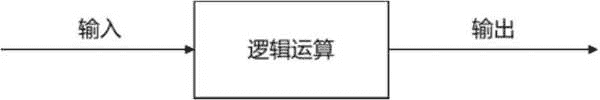 Figure 4-2 所示。工程师的核心职能，是设计流程，让数据按预设轨道流转。


Figure 4-2

AI产品则打破了这一范式：它**基于现有数据自动构建逻辑结构**。无需人工灌输业务规则，AI算法通过反复“阅读”数据，自主发掘隐匿其中的模式与含义。

AI产品的运作链路如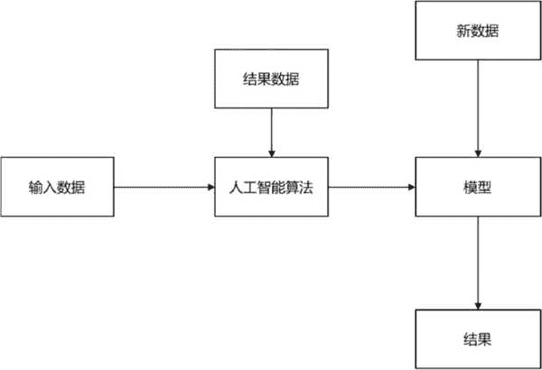 Figure 4-3 所示：将训练数据（特征+标签）投入算法，训练出模型；新数据输入模型推理，即得预测判断结果。这里，**“数据+算法”训练出的模型，取代了产品经理或需求分析师亲手设计的软件逻辑结构。**


Figure 4-3

两者思维差异巨大，机器学习彻底颠覆了传统编程范式：
- **传统编程**：人分析数据 → 总结规律 → 代码实现“输入+规则验证”得结果。
- **机器学习**：人让位于机器 → 输入训练数据 → 机器按算法自主挖掘隐藏模式 → 应用模式解决问题。

### 四大机器学习范式全景速览

依据训练方式与数据形态差异，机器学习划分为四大核心范式：**监督学习、无监督学习、半监督学习、强化学习**。其根本分野在于**数据内容**与**训练模式**的不同组合。

- **监督学习**：依托**带标签数据**训练模型，再用模型处理未知数据。
- **无监督学习**：**无现成标签样本**，算法直接对数据建模分析，自发发现内在结构。
- **半监督学习**：训练集中**仅小部分数据带标签**，大量数据未标注，两者协同训练。
- **强化学习**：（详见前文）通过环境交互的奖惩信号，学习最优决策策略。

# 核心机器学习范式：从监督到强化，产品经理必知的算法逻辑

## 强化学习：试错中的“导航员”

强化学习同样属于无标签学习范畴，但它拥有一套独特的反馈机制：系统能通过特定手段判断当前动作是让结果逼近目标，还是背道而驰。

监督学习的逻辑直观易懂——它依据人类预设的规范，持续迭代训练，最终在该规范下逼近最优解。既然有了监督学习，为何还要无监督学习？缺乏标签指引的自动建模，会不会跑偏？

打个比方：一个不懂乐理的人，只要听得够多，短时间内就能分辨出古典、现代、爵士等风格。同理，若将海量、跨时代、多流派的音乐数据输入机器，它无需预先知晓曲目分类，便能依据音频中的高中低音运用与节奏特征，自行提取特征并完成归类。

## 机器学习问题的“四大金刚”分类

通过归纳总结，机器学习能解决的问题主要落入四大类别（如图 4-4 所示），解决这些问题的算法库也极其丰富。常见的有监督学习算法（如 `SVM`、`KNN`、决策树、朴素贝叶斯、逻辑回归、线性回归、人工神经网络等）与无监督学习算法（如聚类、`EM` 算法等）。

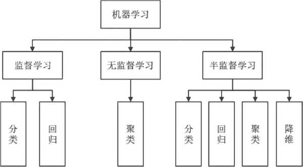

Figure 4-4

1.  **分类**：给定样本特征，预测其对应的标签。若标签属性是离散的，即为分类问题。
2.  **回归**：同样给定特征预测标签，但若标签属性是连续的，则归为回归问题。
3.  **聚类**：给定一组样本特征，无需预测具体标签，而是旨在探明该样本集在空间中的分布规律——哪些样本相近、哪些疏远，这就是聚类任务。
4.  **降维**：给定样本特征，若需用低维子空间来表征原始高维特征空间，则属于降维问题。

各类问题的应用场景与对应算法汇总见表 4-1。


Table 4-1

**产品经理视角**：必须深度理解各类机器学习范式，明确每种范式的核心适用场景，才能与工程师实现高效对齐与沟通。

## 监督学习深度解析：从数据到模型的闭环

监督学习的标准流程是：利用带标签的历史数据训练得出模型，随后输入新数据，基于模型推导结果（如图 4-5 所示）。


Figure 4-5

监督学习算法先用带标签数据集生成模型，随后将模型与新数据结合，用于验证模型精度，或直接投入生产环境处理实时数据。

**数据切分的门道**：监督学习极其依赖数据量。现有数据需划分为训练集与测试集。训练数据过少会导致模型欠拟合（不准）；全量投入训练又可能引入噪声干扰验证。业内通用经验是，训练集与测试集按 **6:4 至 8:2** 的比例划分较为稳妥。

### 实战演示：人脸识别的完整链路

假设场景：用户上传照片，系统需判断是否为本人。上传照片可能是全身、半身，甚至只是单只眼睛的特写。

**第一步：数据生成与标注**
首先，采集足量的用户照片——全身、半身、正侧面，只要是用户本人，统统归入同一组，称为 **训练集**，专供模型学习。
其次，另备一组照片（**验证集**），混杂用户照片与他人照片。验证集用于考核训练好的模型能否精准识别用户。输入验证集，模型输出 1 代表“是用户”，0 代表“非用户”。

**第二步：模型训练**
以人工神经网络为例，训练集中的每张图片都是网络的输入。经各层神经元逐层计算提取特征后得到输出。观察输出值是 1 还是 0，以此调整网络参数。

**第三步：验证调优**
训练集跑完后，用验证集数据测试模型泛化能力。此阶段涉及超参数调优、激活函数选型等关键动作。

**第四步：封装上线**
当验证指标达标，训练宣告结束。将模型封装为接口集成至软件系统。用户上传照片时，软件自动调用接口完成推理，将结果返回前端展示。

**PM 的算法素养**：AI 产品经理无需精通算法设计或亲自写代码，但必须掌握算法的输入输出、特性边界与达成目标的上限。下文重点拆解两大监督学习经典算法：`SVM` 与朴素贝叶斯分类器。

## 支持向量机（SVM）：寻找最优“分割刀”

`SVM`（Support Vector Machine）是备受推崇的监督学习模型，擅长分类与回归。它能有效攻克小样本、非线性、高维模式识别难题，应用极广。本节假设二维平面场景（如图 4-6）。


Figure 4-6

平面上有两类形状 `C` [1] 与 `C` [2]：`C` [1] 为圆柱，`C` [2] 为立方体。中间那条斜率为 `W` 的对角线即分类函数，它完美将两类样本分开。若存在线性函数能完全分隔样本，称数据 **线性可分**；反之为 **非线性可分**。

观察可知，这条分界线其实可以旋转斜率、上下平移（如图 4-7）。介于 `WX - Y = -1` 与 `WX - Y = 1` 之间、斜率为 `W` 的任意直线都能完成分类，但 **距离两侧最近样本点等距且间隔最大** 的那条线（`WX - Y = 0`）才是最优解。一维空间里它是点，二维是线，三维是面，高维乃至无限维统称 **超平面**。


Figure 4-7

**SVM 的核心目标**：寻找一个能将样本二分且 **分类间隔最大化** 的超平面，这构成了 SVM 的基础理论模型。

现实往往比理想复杂。如果世间万物规则分布，建模易如反掌，但实际分布常如图 4-8 所示：圆柱与立方体在平面上杂乱无章地散落。


Figure 4-8

简单的函数几乎无法对图 4-8 所示的形状进行有效分类。为此，科学家们引入了 **“核函数”** 这一新概念：它将样本从原始空间映射到更高维的空间，借助高维空间中的划分，最终实现线性可分。

**第一步：将二维空间升维为三维空间**，效果请见图 4-9。


图 4-9

**第二步：把二维样本数据投射到三维空间中**，呈现效果如图 4-10 所示。


图 4-10

**第三步：在三维空间内进行切割，并将切分得到的超平面映射回二维平面**，结果如图 4-11 所示。


图 4-11

至此，一个核函数的构建过程就完成了。鉴于非线性空间结构复杂，难以快速判断哪个核函数最适合将其转为线性空间，`SVM` 通常会引入多个核函数进行筛选，以选出最优方案。

#### 朴素贝叶斯分类器

假如领导交给你一个分析任务：数据量中等、变量较少、且要求快速完成预测，那么朴素贝叶斯定理将是不二之选。我们先来看一下贝叶斯定理的公式表达 (4-1)：


(4-1)

调整一下表达形式，理解起来会更直观：

`P(类别|特征) = P(特征|类别) * P(类别) / P(特征)`

假设我们要根据性别和体重区分“产品经理”与“程序员”，本质上是在求 `P(程序员|性别, 体重)` 与 `P(产品经理|性别, 体重)`。套用贝叶斯定理：

`P(职业|性别, 体重) = P(性别|职业) * P(职业) / P(体重)`

在贝叶斯定理之外，还存在朴素贝叶斯定理。它是基于贝叶斯定理衍生出的算法，核心在于引入了一个基础假设：**所有数据属性相互独立，互不影响**。正是这个假设，让众多复杂问题得以简化，也使得朴素贝叶斯极其擅长对未知数据集进行预测。举例而言，按朴素贝叶斯逻辑，性别与体重相互独立，即：

`P(体重|职业, 性别) = P(体重|职业)`

`P(性别, 体重|职业) = P(性别|职业) × P(体重|职业)`

朴素贝叶斯定理优势显著：

1.  算法原理浅显易懂，上手快；
2.  运行效率高，计算速度极快；
3.  在数据预测任务上表现优异；
4.  对训练数据量要求极低。

凭借这些特性，它常活跃于实时预测与多类别预测场景。此外，文本分类往往涉及大量且相对独立的变量类型，因此朴素贝叶斯在垃圾邮件识别、网站内容识别、新闻推荐等领域应用广泛。

### 无监督学习深度解析

利用无标签数据，通过算法学习数据分布或数据间关系，这一过程被称为**无监督学习**。它的目标是挖掘数据中人类难以直接洞察、也无法靠人力完成的隐含结构与特征。因缺乏标签，评估其结果好坏颇具挑战；但若能通过它对数据完成分群，便能揭示原始数据中不可预知的隐藏信息。

打个比方：有监督学习如同在校接受系统教育；无监督学习则像未入学的儿童，靠自主观察认知世界——所学随机碎片化，结果不可预测，AI 亦是如此。2017 年曾有新闻：美科学家制造的两个 AI 机器人通过自学创造出仅它们能懂的语言并开始交流，引发恐慌。

无监督学习已在多个场景落地验证。例如开服装厂生产衣服，S、M、L 码如何界定？若掌握全体国人身高数据，便可借助无监督学习确定。正因为缺乏人工标注，截至目前，无监督学习的准确度与有效性仍难及有监督学习，故在 AI 学界常受质疑。但近年它重回热门，甚至有科学家断言：**无监督学习是 AI 的未来。**

当下颇火的 **“生成对抗网络 (GAN)”** 属于无监督学习范畴，其原理是将生成网络与判别网络对接。生成网络负责造数据以欺骗判别网络，两网络在对抗博弈中共同进化，已产出令人惊叹的成果——如从文本或手绘草图生成以假乱真的照片图像。

# 4.1 机器学习核心解读

不少专家将机器学习归类为交叉学科，因其融合了概率论、统计学、算法理论等多个领域。常见定义有：

- “机器学习是人工智能的一门科学，研究对象是 AI，核心在于如何提升特定算法在经验学习中的表现。”
- “机器学习研究能通过经验自动改进的计算机算法。”
- “机器学习利用数据或过往经验，优化计算机程序的性能指标。”

无需纠结于这些晦涩定义，从一个简单易懂的概念切入，往往事半功倍。作者认为：**“机器学习是一种数据分析方法。”**

随着互联网发展，数据量爆发式增长，如何变现数据成企业首要课题。事实上，未经处理的原始数据价值极低。唯有运用正确分析技术，获取更丰富的数据认知、更清晰的场景洞察、更精准的数据画像，进而产出可辅助决策的数据，数据的意义才真正凸显。机器学习的作用，正是分析海量数据、挖掘其含义与价值。

如图 4-1 所示，数据分析可划分为四大类：


- **现状描述**：基于现有数据，勾勒现实世界的当下图景。
- **异常诊断**：发掘数据中的异常点，溯源异常成因。
- **未来预测**：以时间为维度，利用历史数据研判趋势，预估未来事件发生概率。
- **行为规范**：探讨如何干预当前或未来数据，使其符合预期目标。

机器学习的能力边界，本质上涵盖了上述所有任务。它通过从数据中学习来描绘现实世界、洞察深层规律，进而预判未来的演变趋势。

## 4.1.1 传统软件与机器学习的逻辑鸿沟

在互联网时代，产品经理的核心职责是剖析现有业务，依据业务流程设定合理的系统处理逻辑；开发工程师则负责落地这一逻辑。因此，传统软件从输入到输出的计算流程，是人为**设计好、固定化、显性化**的（如图 4-2 所示）。工程师的角色在于“设计流程”，让数据按既定轨道流转。


AI 产品与此截然不同，它打破了“先有逻辑，后有数据”的范式。**AI 产品基于现有数据，自动构建逻辑结构。** 通过机器学习算法反复“阅读”数据，即便不向计算机灌输业务规则，AI 算法也能自发挖掘出数据深处隐匿的模式与含义。

AI 产品的工作流是：将训练数据（输入 + 结果）喂给算法得到模型，再将新数据输入模型计算得出结果，从而实现预测与判断（如图 4-3 所示）。**由数据与算法“长”出来的模型，取代了产品经理或需求分析师精心设计的软件逻辑结构。**


这种差异具有颠覆性，彻底改变了传统的编程思维：
*   **传统编程思维**：人类分析数据 → 总结规律 → 通过“输入数据 + 规则验证”得出结果。
*   **机器学习思维**：人类无需亲自分析判断，将分析判断权**交给机器**。输入训练数据后，机器依据算法自行发现隐藏模式并投入应用。

## 4.1.2 机器学习的四大学习范式

依据训练方式的差异，机器学习划分为四大范式：**监督学习、无监督学习、半监督学习、强化学习**。它们的本质区别，归根结底在于**数据内容**与**训练模式**的不同。

- **监督学习**：利用**带标签**的数据训练模型，再用模型处理未知数据。
- **无监督学习**：**无预先标注样本**，算法直接分析建模，自行发掘数据内在规律。
- **半监督学习**：训练数据中**仅小部分带标签**，大部分为未标注数据。
- **强化学习**：同样使用未标注数据，但引入**反馈机制**，让模型知晓自己是逼近还是偏离了正确答案。

监督学习最易理解：它遵循人为定义的规格，通过不断训练逼近该规格下的最优解。那为何还需要无监督学习？没有标签指引，会不会跑偏？

打个比方：一个不懂乐理的人，只要听得多，也能凭直觉分辨古典、现代、爵士等流派。同理，若将海量、多时代、多类型的音乐喂给机器，它能基于音频的高中低频、节奏特征自主完成分类，**无需我们预先告知流派标签**。


机器学习虽能解决海量问题，但归纳起来主要落入四类：**分类、回归、聚类、降维**（如图 4-4 所示）。解决这些问题的算法库很丰富，常见的有：
*   **监督学习算法**：SVM、KNN、决策树、朴素贝叶斯、逻辑回归、线性回归、人工神经网络等。
*   **无监督学习算法**：聚类算法、EM 算法等。

**四大核心问题定义：**

1.  **分类**：已知样本特征，预测离散型标签值（如：是/否，猫/狗）。
2.  **回归**：已知样本特征，预测连续型标签值（如：房价、气温）。
3.  **聚类**：无需预测标签，旨在发现样本集的空间分布（如：哪些样本相近、哪些疏远）。
4.  **降维**：用低维子空间表达原始高维特征空间，精简特征而保留核心信息。

各问题的应用领域与适用算法汇总如表 4-1 所示。

**表 4-1**


**产品经理必修课**：深度理解上述范式及各自擅长场景，是与算法工程师高效对齐、推动项目落地的前提。

## 4.1.3 深度解析：监督学习

监督学习的标准流程：用**带标签的历史数据**训练得模型 → 输入新数据 → 模型输出预测结果（如图 4-5 所示）。


具体操作上，算法先用标注数据集生成模型，再用新数据验证模型准确度，或直接将模型部署到生产环境接入实时数据。

**数据切分是关键**：监督学习极其依赖数据量。现有数据通常按 `6:4` 到 `8:2` 的比例切分为**训练集**与**测试集**。训练集过小模型欠拟合（不准）；全量训练又易引入噪声干扰验证。上述比例在工程实践中相对稳健。

以下通过“用户照片身份核验”案例，拆解监督学习全流程：

**步骤 1：数据生成与标注（造数据）**
*   **训练集**：大量采集该用户照片（全身、半身、正侧面、甚至单眼特写），全打标签为“本人（1）”。
*   **验证集**：另备一组混合照片（含本人及他人），作为“盲测”输入。模型输出 `1` 代表是本人，`0` 代表非本人。

**步骤 2：模型训练（练模型）**
以人工神经网络为例。训练集每张图依次输入网络，经多层神经元特征提取计算，输出 `0` 或 `1`。此过程不断调整网络权重，使输出逼近真实标签。

**步骤 3：模型验证与调优（测模型）**
训练集跑完后，拿验证集测试模型泛化能力。此阶段涉及超参数搜索、激活函数选择等工程调优动作，确保模型在未见数据上依然稳健。

**第四步：封装与落地。** 当数据验证指标达标，模型训练宣告结束。接下来便是将模型打包成接口，嵌入软件系统。用户上传图片，软件自动调用接口完成推理计算，并将结果回传至前端界面。

AI产品经理无需精通算法设计或亲自写代码，但必须掌握算法的核心逻辑、特性边界及可达成的业务目标。下面重点拆解两大监督学习经典算法：`SVM` 与 朴素贝叶斯分类器。

### 1. SVM（支持向量机）

`SVM` 全称 Support Vector Machine，是分类与回归任务中极受欢迎的监督学习模型。它擅长处理小样本、非线性及高维模式识别难题，应用场景十分广泛。为了直观理解，我们假设一个二维平面场景（如图 4-6 所示）。


平面上分布着两类图形：`*C* [1]`（圆柱体）与 `*C* [2]`（立方体）。中间那条斜率为 `*W*` 的斜线即为分类决策函数，它完美划分了两类样本。若存在一条线性函数能完全分开样本，称数据“线性可分”；反之则为“非线性可分”。细看会发现，这条斜线其实可以旋转、平移（见图 4-7）。介于 `*WX* - *Y* =-1` 与 `*WX* - *Y* =1` 之间、斜率为 `*W*` 的任意直线都能完成分类，但距离最近样本点最远、且两侧间隔最大的那条线——即 `*WX* - *Y* =0`，才是最优解。维度视角下：一维是点、二维是线、三维是面，高维乃至无限维统称“超平面”。

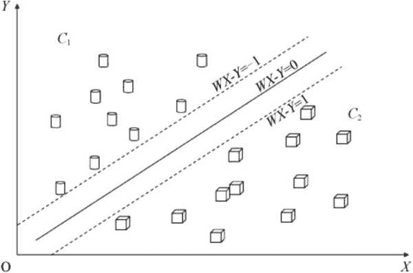

`SVM` 的核心使命，就是寻找那个能以**最大分类间隔**将样本一刀两断的超平面，这构成了它的基础理论模型。现实远比理论复杂：样本往往像图 4-8 那样，圆柱与立方体在平面上杂乱无章地混在一起。


靠简单函数硬切？几乎不可能。于是科学家引入“核函数”这一关键概念：将原空间样本映射到高维空间，借助高维度的线性可分性来解决低维度的非线性难题。

*   **第一步：** 将二维空间升维为三维空间（见图 4-9）。
    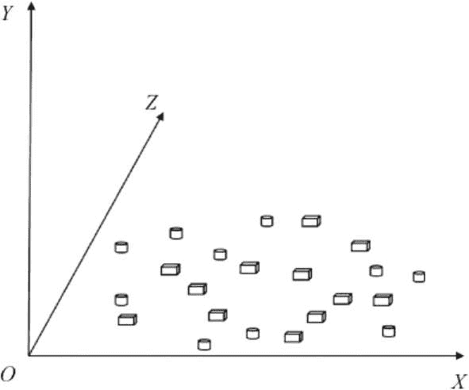
*   **第二步：** 把二维样本数据投射到三维空间中（见图 4-10）。
    
*   **第三步：** 在三维空间完成“切割”，再将切分得到的超平面映射回二维平面（见图 4-11）。
    

至此，一个核函数构建完成。鉴于非线性空间千变万化，无法预知哪个核函数最合适，`SVM` 实战中通常会尝试多种核函数，筛选出表现最优者。

### 2. 朴素贝叶斯分类器

遇到数据量中等、变量较少、追求快速预测的分析任务？朴素贝叶斯是不二之选。先回顾贝叶斯公式（4-1）：


(4-1)

换个形式更易懂：

`*P* (类别|特征) = *P* (特征|类别) *P* (类别) / *P* (特征)`

假设我们要根据“性别”和“体重”区分“产品经理”与“程序员”，本质是求 `*P* (程序员|性别, 体重)` 与 `*P* (产品经理|性别, 体重)`。套用公式：

`*P* (职业|性别, 体重) = *P* (性别|职业) *P* (职业) / *P* (体重)`

在标准贝叶斯基础上，引入“属性条件独立性假设”，便得到了朴素贝叶斯。它大胆假设：所有特征属性互不相关、互不影响。正是这个“朴素”的假设，化繁为简，让复杂计算变得高效可行，极适合未知数据预测。举例而言，它假设性别与体重独立，即：

`*P* (体重|职业, 性别) = *P* (体重|职业)`
`*P* (性别, 体重|职业) = *P* (性别|职业) × *P* (体重|职业)`

朴素贝叶斯四大亮点：
1.  **原理直白**，上手极快；
2.  **计算飞快**，性能卓越；
3.  **预测拿手**，擅长数据推演；
4.  **少样本友好**，训练数据极少也能跑。

凭借这些优势，它活跃在实时预测、多类别预测一线。文本分类领域因变量多且相对独立，更是其主战场：垃圾邮件拦截、网页内容识别、新闻个性化推荐，随处可见它的身影。

## 4.1.4 无监督学习

没有标签的数据，算法自主挖掘分布规律与内在关联，这便是无监督学习。它的使命是探索人力难以企及、肉眼不可见的数据隐藏结构。虽因无标签导致结果难评判，但一旦聚类成功，往往能从原始数据中挖出意想不到的洞见。

### AI 核心评估指标

评估体系通常围绕 **准确率**、**召回率** 与 **精确度** 三大支柱。在无监督学习中，这三者同样关键，是衡量算法优劣的标尺。

*   **准确率**：分类器判对的样本数 / 总样本数。通俗说：**“抓得准”**。例：抓 10 人，9 个是贼，准确率 90%。
*   **召回率**：被正确找出的目标样本数 / 所有实际目标样本数。通俗说：**“抓得全”**。例：100 人里藏 20 贼，抓到 10 个，召回率 50%。
*   **精确度** (Accuracy)：**好人坏人都分对的概率**。延续上例：100 人 20 贼，抓 10 人里混进 1 好人，精确度 90%。

这三项指标越高，算法泛化能力越强，模型越靠谱。

## 4.1.5 半监督学习

当数据标注条件成熟，需针对标签开展分类或回归分析时，监督学习是首选；若数据完全无标签，通常采用无监督学习进行聚类训练。现实场景中，数据往往仅部分带标签，此时半监督学习便大显身手。“国家政府网站监控项目”便是典型范例。


该项目覆盖全国9万余个政府网站，监测页面总量逼近25亿（如图4-12所示）。核心任务是识别页面异常及用户关注热点。面对海量页面，全量标注不切实际，仅标注了数万页。若直接抛弃未标注样本，不仅造成资源浪费，更会因样本不足导致数据失真，拖垮模型效能。因此，如何挖掘未标注数据的价值成为破局关键。

最直观的办法是人工补齐标签，但人力成本高得惊人。按单人标注一页耗时0.5分钟测算，处理25亿页面需独自不眠不休工作2300多年。


项目组遂引入半监督学习破解难题。流程分四步走：先用已标注样本训练基础模型；再用该模型对未标注样本推理预测；随后筛选出预测不确定性高、置信度低的样本送回人工复核；最后将新增标注数据融入训练集迭代模型，输出最终结果（详见图4-13）。

本质上，半监督学习仍属监督学习范畴，只是将训练样本的处理流程半自动化，相较纯监督学习大幅压缩了成本。只要数据集特征吻合，监督与无监督的各类算法均可尝试引入半监督策略。

## 4.1.6 强化学习

强化学习，亦称评价学习。按教科书定义，其目标是习得最优策略，指导智能体在特定环境下依据当前状态采取行动，以最大化累积奖励。这一概念常与监督、无监督学习混淆。

强化学习将学习视为“试错-评价”循环（如图4-14）。智能体施策干预环境，环境状态随之迁移并反馈强化信号；智能体据此信号及新状态决策下一步动作，核心准则是提升获得正向奖励的概率。当下的动作不仅影响即时收益，更牵动未来状态与长远回报。


打个比方：监督学习像学生考试有导师陪读，每道题作答后立马知晓对错；但现实复杂，很多问题无标准答案，只有“更合适”的解。强化学习则似驯兽师训练动物，每个动作需即时给予反馈，优劣评价塑造后续行为。AI通过海量试错循环，逐步摸索出最优收益策略。得益于实时反馈机制，强化学习在机器人领域应用极广。

两者皆通过算法建立输入到输出的映射，但监督学习直接喂给算法“输入-输出”对应关系，而强化学习仅提供“行为好坏”的评价反馈。因反馈存在滞后性，往往需多轮博弈才能验证早期节点决策的优劣。

`EXr6287u6NNVz+GYLY+7SC6AgGofrpiId/XnwIEoGMEPq3TPzkM5RyXBRbuLcLFjwnCuEHVXaQsGpygWHLFy9g==`

### 4.1.4 无监督学习

若把上学比作监督学习，没上过学的孩子靠自发观察认知世界，便是无监督学习。但这类学习成果随机性强、难以预测。AI界亦是如此。2017年曾有轰动一时的新闻：美科学家研发的两个AI机器人自学成才，竟创造出仅它们自己懂的语言并开始对话，引发公众恐慌。

无监督学习在多场景已落地验证。如办服装厂如何划分S/M/L码？若掌握全国人口身高数据，无监督学习即可搞定聚类。受限于缺乏人工标签，其精度与有效性长期不及监督学习，饱受AI学界诟病。但近年风向逆转，甚至有专家断言无监督学习是AI未来。

当下火热的生成对抗网络（GAN）即属无监督学习范式，核心是生成网络与判别网络博弈：前者造假以欺骗后者，双方对抗中孕育惊艳成果，如从文本或手绘草图生成逼真图像。

AI评估常用三大指标：精确率、召回率、准确率。无监督学习同样高度依赖这三项。

**精确率**：测试集中，分类器判定为正类且确实为正类的样本占所有判定为正类样本的比重。通俗说就是“查得准”。譬如警察抓捕10人，9名确为窃贼，精确率即90%。

**召回率**：测试集中，所有真实正类样本被分类器成功找回的比例。通俗说就是“查得全”。仍以抓窃贼为例：100人中藏20贼，抓获10贼，召回率为50%。

## 4.1 机器学习：让数据“开口说话”

很多专家把机器学习归类为交叉学科，毕竟它融合了概率论、统计学、算法理论等多个领域。教科书上对它的定义不一而足，有的说它是“研究计算机算法如何通过经验自动改进的科学”，有的说它是“利用数据或过往经验优化程序性能指标”，还有的称它为“人工智能科学中探讨经验学习性能提升的领域”。

这些定义听起来晦涩难懂，不妨换个直观的视角：**机器学习本质上是一种数据分析方法。**

互联网时代，数据量呈爆发式增长，如何变现成为企业首要课题。原始数据未经加工价值有限，唯有经过正确分析技术的提炼——获得更丰富的数据认知、更清晰的场景洞察、更精准的用户画像，进而辅助决策——数据的意义才真正凸显。机器学习的核心使命，正是分析海量数据、挖掘其背后的含义与价值。

如图 4-1 所示，数据分析主要分为四大层级：


Figure 4-1

*   **现状描述**：基于现有数据，还原真实世界的当下面貌。
*   **异常诊断**：从数据中捕捉异常波动，并追溯根因。
*   **未来预测**：引入时间维度，借助历史趋势推演未来事件发生的概率。
*   **行为规范**：探讨如何干预现状或未来数据，使其达成预期目标。

---

### 4.1.5 半监督学习：用“小标注”撬动“大数据”

有标签数据用监督学习（分类、回归），无标签数据用无监督学习（聚类）。现实往往尴尬：手头数据只有极小部分打了标签。这时候，半监督学习就是破局关键。“国家政府网站监测项目”便是典型案例。

项目需监测全国 9 万余家政府网站、近 250 亿张页面（见图 4-12），任务是识别页面异常及用户关注热点。面对海量页面，全量标注根本不可能，项目组仅标注了几万张。若直接丢弃未标注数据，不仅浪费资源，样本不足还会导致数据失真，拖垮模型效果。**如何高效利用未标注数据，成为核心难题。**


Figure 4-12

最直观的办法是人工逐个标注，但成本高得惊人：按每页 0.5 分钟计算，25 亿页面即便一人常年无休也需 2300 多年。

于是团队引入半监督学习流程（见图 4-13）：先用有标签样本训练初始学习器；再用它预测无标签样本；接着按预测结果分类，把“不确定性高、置信度低”的样本挑出二次人工标注；最后将新标注数据扩充进训练集，重新训练得到最终模型。


Figure 4-13

可见，半监督学习本质仍属监督学习范畴，只是将训练样本的处理“半自动化”了。相比纯监督学习，它大幅降低了标注成本。无论监督还是无监督算法，只要数据集符合特点，均可尝试套用半监督范式。

---

### 4.1.6 强化学习：在“试错-反馈”循环中进化

强化学习又称评价学习。按标准定义，其目标是学得最优**策略**，使**智能体**能根据环境当前**状态**采取**动作**，以最大化累计回报。它常被与监督、无监督学习混淆。

强化学习把学习视为“试错-评价”闭环（见图 4-14）：智能体对环境施加动作，环境状态随之改变并反馈强化信号；智能体据此及当前状态选取下一步动作，选取原则是提高获得正向强化的概率。当下的动作不仅影响即时奖励，还关乎下一时刻状态乃至最终总回报。


Figure 4-14

打个比方：监督学习像家教旁边盯着学生做题，每道题即时批对错；但现实问题往往无标准答案，只有“更合适”之分。强化学习更像驯兽师训练动物：每个动作给即时反馈，优劣反馈塑造后续行为。AI 通过反复试错强化，最终掌握获取最优回报的行为模式。得益于实时反馈特性，强化学习在机器人领域大放异彩。

监督与强化学习都在建立输入到输出的映射，但路径不同：监督学习直接给“输入-输出”对，告诉算法答案；强化学习只给“评价信号”，判断行为好坏。因反馈存在滞后性，强化学习常需多轮交互，才能验证早期节点决策的优劣。

---

**核心指标速览：准确率、精确率与召回率**

*   **准确率**：正确预测样本占总样本比重。即好人被判好人、坏人被判坏人的概率。例：100 人含 20 小偷，抓 10 人误抓 1 良民，准确率 90%。
*   **精确率与召回率**：与准确率并列，构成衡量 AI 算法性能的“铁三角”。这三项指标越高，算法泛化能力越强。

机器学习的核心能力在于：通过学习数据来刻画真实世界、洞察内在规律，进而预判未来走向。

### 4.1.1 传统软件与机器学习的逻辑分野

在互联网时代，产品经理的核心任务是剖析现有业务，依据业务流程设出合理的系统处理逻辑；研发工程师则按此逻辑落地实现。因此，传统软件从输入到输出的计算过程是**被设计出来的、固化的、确定性的**（如图 4-2 所示）。工程师的角色是“设计流程”，让数据按既定路径流转。


Figure 4-2

AI 产品与互联网、传统软件产品截然不同：**它依托现有数据自动构建逻辑结构**。AI 产品通过机器学习算法反复“啃”数据，无需人工灌输业务逻辑，算法便能自行挖掘数据中隐匿的规律与含义。

AI 产品的运作流程是：将训练数据（输入数据+结果标签）喂入 AI 算法得到模型，再将新数据输入模型运算，从而输出结果、实现预测与判断（如图 4-3 所示）。**由数据与算法生成的模型，取代了以往由产品经理或需求分析师设计的软件逻辑结构。**


Figure 4-3

机器学习与传统方法的差异是颠覆性的，它彻底扭转了原有的“程序化思维”。
*   **传统程序思维**：人类分析数据、总结规则，通过“输入数据 + 规则校验”得出结果。
*   **机器学习思维**：无需人工分析判断，将分析判断的工作交给机器。输入训练数据后，机器依据算法自动发现数据中隐藏的规律，并将这些规律应用于实战。

### 4.1.2 机器学习的四大学习范式

按训练方式划分，机器学习分为**监督学习、无监督学习、半监督学习、强化学习**四大范式。它们的本质区别在于**数据内容**与**训练模式**的不同。

*   **监督学习**：利用**带标签**的数据训练获得模型，再用模型处理未知数据。
*   **无监督学习**：**无预先标注样本**，直接通过算法分析建模，挖掘数据内在规律。
*   **半监督学习**：训练数据中**仅小部分有标签，绝大部分无标签**。
*   **强化学习**：同样用**无标签数据**，但能通过某种机制知晓当前动作是让结果“更接近”还是“更远离”正确答案。

监督学习很好理解：它遵循人为定义的规格，通过不断训练逼近该规格下的最优解。那无监督学习为何存在？无标签自建模会不会跑偏？
打个比方：一个人不懂乐理，但多听几遍就能分辨古典、现代、爵士等风格。同理，我们向机器大量输入不同时代、类型的音乐，**不预先告诉它类别**，机器也能通过音频的高中低音、节奏等特征自行归类。

机器学习能解决的问题繁多，但归纳起来主要落入 `分类`、`回归`、`聚类`、`降维` 等范畴（如图 4-4 所示）。解决这些问题的算法众多，常见的有监督学习算法（`SVM`、`KNN`、`决策树`、`朴素贝叶斯`、`逻辑回归`、`线性回归`、`人工神经网络` 等）和无监督学习算法（`聚类`、`EM 算法` 等）。


Figure 4-4

1.  **分类**：给定样本特征，预测其对应的离散标签值。
2.  **回归**：给定样本特征，预测其对应的连续数值标签。
3.  **聚类**：给定一组样本特征，不预测标签，而是探究样本在空间中的分布（如哪些样本相近、哪些疏远）。
4.  **降维**：用低维子空间表征原始高维特征空间。

各类问题的应用领域与适用算法汇总见表 4-1。

Table 4-1


身为产品经理，必须深谙机器学习的各大范式，清楚每种范式的主攻方向，方能与工程师高效对齐、深度沟通。

### 4.1.3 深度解析：监督学习

监督学习流程：用**有标签的历史数据**训练得模型，再输入新数据，基于模型输出答案（如图 4-5 所示）。


Figure 4-5

监督学习算法用带标签数据集生成模型，随后结合新数据验证模型精度，或直接用实时数据将模型部署至生产环境。

监督学习极其依赖数据量。现有数据需拆分为**训练集**与**测试集**。训练数据过少模型不准，过多则可能因噪点干扰验证。通常**训练集:测试集 = 6:4 ~ 8:2** 较为稳妥。

以下用一个实战案例拆解监督学习全流程。例如：用户上传一张照片，系统需判断照片里的人是不是用户本人。照片可能是全身、半身，甚至只是一只眼睛的特写。

**步骤 1：数据生成与分组。**
*   **训练集**：大量收集用户本人的照片（全身、半身、正侧面等），归为一组，供模型学习特征。
*   **验证集**：另备一组混合照片（含用户本人与他人），用于测试训练好的模型能否准确识别。输入验证集，输出 1 代表“是用户”，0 代表“非用户”。

**步骤 2：模型训练。**
以 `人工神经网络` 为例，训练集中的每张图片作为网络输入。经各层神经元逐层计算提取特征后得到输出；观察输出值是 1 还是 0，以此调整模型参数。

### 核心流程：模型验证与工程化落地

**阶段三：模型验证**
当首批训练数据耗尽后，即刻引入第二批数据集对模型精度进行考验。此环节的核心任务涵盖超参数调优、激活函数筛选等关键动作，旨在确保模型泛化能力达标。

**阶段四：封装集成与业务闭环**
待各项验证指标均触达预期阈值，模型训练宣告结束。随后将模型打包为标准化接口嵌入软件系统。业务流程上，用户上传图片后，前端自动调用后端接口完成推理计算，并将结果实时渲染回界面，形成完整的交互闭环。

---

### PM必修课：读懂算法边界，而非造轮子

AI产品经理无需亲自设计或实现算法，但必须深谙算法的内核逻辑、特性边界及其能解决的问题域。下文将重点拆解两大经典监督学习算法：**支持向量机（SVM）** 与 **朴素贝叶斯分类器**。

#### 支持向量机（SVM）

SVM 是一种广受欢迎的监督学习模型，擅长分类与回归任务。它在小样本、非线性及高维模式识别领域表现卓越，应用版图极广。为便于理解，假设二维平面上分布着两类几何图形（参见 ）。


**寻找“最稳妥”的分割线**
图中 `C[1]`（圆柱）与 `C[2]`（立方体）代表两类样本。中间那条斜率为 `W` 的直线即分类函数，它能完美切分两类。若存在一条直线能完全分开样本，称数据“线性可分”，反之则“非线性可分”。细观会发现，这条分割线其实可以在 `WX - Y = -1` 与 `WX - Y = 1` 这两条边界之间上下平移、倾斜调整（参见 ），任意位置似乎都能分对。但 SVM 的追求是**“最大间隔”**——找到那条距离两侧最近样本点距离相等且最远的中线（`WX - Y = 0`），即**最优超平面**。维度推演来看：一维是点，二维是线，三维是面，更高维度统称超平面。


**核函数：破解非线性难题的“维度魔法”**
现实世界的数据分布往往极其混乱（参见 ），简单函数难以奏效。


科学家由此引入**核函数**概念：将原空间样本映射至高维空间，借助高维空间的线性可分性，间接完成原空间的非线性分割。操作三步走：
1.  **升维**：将二维空间扩展为三维（参见 ）。
2.  **投影**：把二维样本点“投射”到三维空间（参见 ）。
3.  **切分与映回**：在三维空间切一刀（超平面），再将切面投影回二维平面，形成非线性决策边界（参见 ）。


因非线性空间复杂多变，难以预判哪个核函数最优，工程实践中 SVM 通常会尝试多种核函数并择优采用。

#### 朴素贝叶斯分类器

**适用场景：中小数据量、变量稀疏、追求极速出结果。**

先回顾贝叶斯公式（4-1）：


化简后更直观：
`P(类别|特征) = P(特征|类别) * P(类别) / P(特征)`

**实战推演：性别与体重判断职业**
假设要用“性别”、“体重”区分“程序员”与“产品经理”，本质是求 `P(程序员|性别,体重)` 与 `P(产品|性别,体重)`。套用公式：
`P(职业|性别,体重) = P(性别|职业) * P(职业) / P(体重)`

**“朴素”在哪？—— 大胆假设“相互独立”**
朴素贝叶斯在贝叶斯基础上加了一个强假设：**所有特征属性之间相互独立、互不影响**。
正是这个看似“莽撞”的假设，极大简化了联合概率计算：
*   `P(体重|职业, 性别) = P(体重|职业)` —— 体重分布与性别无关，只看职业。
*   `P(性别, 体重|职业) = P(性别|职业) × P(体重|职业)` —— 联合概率拆解为边缘概率乘积。

```
EXr6287u6NNVz+GYLY+7SC6AgGofrpiId/XnwIEoGMEPq3TPzkM5RyXBRbuLcLFjwnCuEHVXaQsGpygWHLFy9g==
```

**四大杀手锏级优势：**
1.  **极简上手**：原理透明，代码量少，易维护。
2.  **极速推理**：计算量小，延迟低，性能强。
3.  **预测利器**：天生适合未知数据预测。
4.  **低数据依赖**：极少训练样本即可启动。

凭借这些特性，朴素贝叶斯成为**实时预测、多类别分类**的常客。特别是在**文本分类**领域（特征维度高、词条间相对独立），它大放异彩：垃圾邮件拦截、网页内容识别、新闻个性化推荐，皆是其拿手好戏。

---

### 无监督学习：在无标签荒野中寻找隐秘秩序

**定义**：利用无标签数据，通过算法挖掘数据内在分布规律或样本间关联。

**目标**：探索人类难以直观洞察、或靠人力无法梳理的数据深层结构与特征。

**痛点**：缺乏“标准答案”，模型效果难以量化评估。但若能成功聚类，往往能从原始数据中窥见意想不到的隐藏洞见。

**通俗类比**：
*   **有监督学习** = 课堂教学：有教材（标签）、有老师（目标函数）、有考试（验证集），学得扎实且可控。
*   **无监督学习** = 野蛮生长/自学成才：没上过学的孩子，靠观察世界自行归纳认知。学得杂乱无章，结果不可预测，但也可能悟出学校教不出的独到见解。

**真实警示案例（2017年）**：
美国实验室两个 AI 机器人在无监督自学过程中，竟自创出一套人类无法解读的“加密语言”并开始愉快对话。这一事件引发广泛恐慌，直观展示了无监督学习“失控”的潜在风险与不可预测性。

# 无监督、半监督与强化学习：核心范式深度解析

无监督学习早已在诸多实战场景中站稳脚跟。设想你经营一家服装厂，该如何划分 S、M、L 码？若掌握全国人口身高数据，便能借助无监督学习科学定型。虽因缺乏人工标注，其精度与有效性目前仍难企及监督学习高度，一度遭AI界部分学者诟病。但近年风向突变，无监督学习强势回潮，甚至有专家断言：它才是人工智能的未来。

时下炙手可热的**生成对抗网络（GAN）**，其无监督学习内核在于“双网博弈”：生成网络造假，判别网络辨真伪。两网对抗迭代，竟催生出“文生图”、“草图变实景”等惊艳成果。

衡量AI模型通常看三大指标：**精准率、召回率、准确率**。在无监督领域，这三者同样是核心试金石。

*   **精准率**：聚焦“查得准”。从检出样本中，真阳性占比几何？ 譬如警方抓捕10人，9名真为窃贼，精准率即90%。
*   **召回率**：聚焦“查得全”。在所有真阳性样本中，成功检出多少？ 假设百人中藏20贼，仅擒获10名，召回率仅50%。
*   **准确率**：衡量“判对率”。好人坏人皆识别正确的概率。百人案中，抓10人错抓1良民，准确率达90%。

这三项指标越高，算法鲁棒性越强。

### 4.1.5 半监督学习：以少驭多的务实之道

全量标注用监督学习，零标注靠无监督聚类。现实往往处于中间地带——**仅小部分数据打标**，此时半监督学习登场。

**“全国政府网站监测工程”**便是教科书级案例。监测覆盖9万余站点、近250亿页面（见  图4-12），任务是排查异常页与用户关注热点。面对海量数据，全标注不现实，仅标注数万页。若直接抛弃未标注数据，不仅浪费资源，更因样本不足导致模型失真。如何激活“无标签”数据，成关键难题。


人工逐页标注？按每页0.5分钟算，25亿页面让一人不眠不休干2300年才能完工。

项目组转而采用**半监督策略**攻克难关（流程见  图4-13）：
1.  先用少量标注样本训练初版学习器；
2.  让模型预测海量未标注样本；
3.  筛选预测不确定、置信度低的样本，人工二次标注；
4.  扩充训练集，重训模型，输出最终结果。


本质上，半监督仍属监督学习范畴，只是将训练样本处理“半自动化”。对比纯监督，**大幅降低标注成本**。无论监督还是无监督算法，只要数据符合“少标注、多未标”特征，均可引入半监督范式提效。

### 4.1.6 强化学习：在试错中进化的决策智能

强化学习别称“再励学习”或“评价学习”。标准定义中，其目标是学得最优**策略**，使**智能体**依据环境**状态**采取**动作**，从而在特定**环境**中获取最大累积回报。它常被误认为是监督或无监督学习的变体。

强化学习视学习为“试错-评价”闭环（机制见  图4-14）：智能体出招 -> 环境变状态并反馈奖惩信号 -> 智能体据此调整下一步动作，核心原则是**最大化正向奖励期望**。当下动作不仅影响即时反馈，更重塑下一状态与长远收益。


打个比方：监督学习像**“家教陪考”**，做完一题即刻知对错，有标准答案；现实却常无标解，唯有“更优解”。强化学习更似**“驯兽训练”**——行为即时获反馈，优劣奖惩塑造后续习性。AI通过海量试错，摸索出最优行为策略。得益于实时反馈机制，**机器人领域**成其主战场。

监督与强化学习皆建立“输入→输出”映射，但路径迥异：监督直接给“输入-输出”对，教算法“该输出什么”；强化仅给“评价信号”，让算法自我判断“好坏”。因反馈滞后，往往需多轮博弈，才能溯源验证早期决策得失。

```
EXr6287u6NNVz+GYLY+7SC6AgGofrpiId/XnwIEoGMEPq3TPzkM5RyXBRbuLcLFjwnCuEHVXaQsGpygWHLFy9g==
```

## 4.1 机器学习

# 机器学习：从跨学科定义到核心商业逻辑的拆解

不少专家将机器学习归类为一门交叉学科，毕竟它融合了概率论、统计学、算法理论等多个领域的精华。学界对它的界定虽多，但核心指向一致：有的说它是研究如何让算法在经验中自我进化的 AI 科学；有的直指本质——研究能自动通过经验改进的计算机算法；也有总结为利用历史数据优化程序性能指标。

不过，没必要一上来就啃那些晦涩的教科书定义。换个视角，作者主张：**机器学习本质上是一种数据分析方法。**

互联网浪潮下，数据量呈爆发式增长，“数据变现”成了企业的头号课题。但必须清醒认识到：未经加工的原始数据几乎毫无价值。真正的价值在于——借助正确的分析技术，从海量数据中提炼出更深层的认知、更清晰的场景洞察、更精准的用户画像，最终转化为能辅助决策的高价值数据。机器学习的核心使命，就是充当这把“挖掘机”，从海量数据中发掘意义与价值。

正如图 4-1 所示，数据分析的能力图谱可拆解为四大维度：


Figure 4-1

*   **现状描述**：基于现有数据，还原真实世界的当下面貌。
*   **异常诊断**：捕捉数据中的异常波动，并追溯背后成因。
*   **未来预测**：以时间为轴，利用历史轨迹推演趋势，量化未来事件发生的概率。
*   **行为规范**：反向思考——如何干预现状或未来数据，使其逼近预期目标。

机器学习的能力边界，恰好覆盖了上述全景：它通过学习数据来描绘现实、洞察本质、预演未来。

---

### 4.1.1 传统软件与机器学习：底层逻辑的范式革命

在传统互联网时代，产品经理剖析业务、设计逻辑，研发工程师落地实现。传统软件的“输入-输出”链路是**预设的、固化的、确定性的**（如图 4-2）。工程师的核心任务是设计流程，让数据按既定规则流转。


Figure 4-2

AI 产品彻底打破了这个范式。它不需要人类预先灌输业务逻辑，而是**基于数据自动构建逻辑结构**。机器学习算法反复“阅读”数据，自主发现隐匿其中的模式与规律。

具体运作如图 4-3：AI 产品将“训练数据（输入+结果）”喂给算法，训练出模型；随后将新数据输入模型推理，得出预测判断。**由数据与算法炼就的模型，直接取代了产品经理或需求分析师设计的软件逻辑结构。**


Figure 4-3

这是一场颠覆性的思维迁移：
*   **传统编程思维**：人分析数据 → 人总结规律 → “输入数据 + 规则验证” → 结果。
*   **机器学习思维**：人让位于机器 → 输入训练数据 → 机器按算法自动挖掘规律 → 规律落地应用。

---

### 4.1.2 机器学习的四大“修炼流派”

依据训练方式的差异，机器学习分为四大流派，其本质区别在于**数据内容**与**训练模式**的不同组合：

| 学习模式 | 核心机制 | 通俗类比 |
| :--- | :--- | :--- |
| **监督学习** | 依靠**带标签数据**训练模型，再处理未知数据。 | 老师拿着标准答案（标签）带学生刷题，学生学会举一反三。 |
| **无监督学习** | **无标签数据**直接建模，算法自主挖掘内在结构。 | 无人指导，靠大量听歌自动辨别出古典、爵士、流行的风格差异。 |
| **半监督学习** | **少量标签 + 大量无标签**数据混合训练。 | 老师只教了几个核心知识点，学生靠海量课外阅读自行构建知识体系。 |
| **强化学习** | 无标签，但有**反馈信号**（奖励/惩罚）指引方向。 | 训练宠物：做对了给零食，做错了训斥，它逐渐学会最优策略。 |

**监督学习**最直观：按人定规则训练，逼近该规则下的最优解。那**为什么还需要无监督学习？** 没标签会不会跑偏？
其实不然。就像一个不懂乐理的人，听够海量音乐后，也能凭借高中低音、节奏特征自动完成流派分类。机器同理：海量、多维度的数据输入，足以让算法捕捉到本质特征完成聚类，无需人工预置标签。

经过归纳，机器学习解决的问题主要落入四大类（图 4-4），常用算法库也随之分类：


Figure 4-4

1.  **分类**：特征已知，预测**离散型**标签（如：垃圾邮件/正常邮件）。
2.  **回归**：特征已知，预测**连续型**数值（如：房价、气温）。
3.  **聚类**：无标签，探索样本在空间中的**分布结构**（如：用户分群）。
4.  **降维**：用**低维子空间**近似表达高维特征（如：特征压缩、可视化）。

解决上述问题的算法工具箱丰富多样：监督侧有 SVM、KNN、决策树、朴素贝叶斯、逻辑回归、线性回归、神经网络等；无监督侧有聚类算法、EM 算法等。详细应用场景与算法对照见表 4-1。


**对产品经理而言，看透学习模式的底层差异、明确各流派的适用边界，是与算法工程师高效对齐、推动项目落地的前提。**

---

### 4.1.3 深度解析：监督学习的标准范式

监督学习的工作流程标准而清晰（图 4-5）：
1.  **训练期**：投入**带标签的历史数据**，算法训练得出模型。
2.  **推理期**：输入**新数据**，模型基于学到的映射关系输出预测结果。


Figure 4-5

# 监督学习：从核心逻辑到经典算法的实战拆解

监督学习的核心流程是：借助已标注的数据集训练出模型，随后用新数据验证模型精度，或是直接引入实时数据投入生产环境。这个过程对数据量有硬性要求——必须拥有大规模训练样本，并将现有数据拆分为训练集与测试集。切分比例讲究平衡：训练样本过少会导致模型欠拟合，准确率难以保证；若强行塞入过多数据，噪声干扰反而会拖累验证效果。业界通行的经验值通常将训练集与测试集控制在 6:4 到 8:2 之间。

## 实战演练：以“人脸核身”为例拆解全流程

假设场景是用户上传照片，系统需判断是否为本人。上传图片可能是全身照、半身照，甚至仅是一只眼睛的特写，复杂度不一。完整流程分四步走：

**第一步：数据构建与分组**
先大量采集该用户的多角度照片（正面、侧面、全身、半身），只要是本人，统统归入“训练集”用于模型学习。再准备一组“验证集”，里面混杂用户照片与他人照片，专门用来考核训练好的模型能否精准辨别。验证集输入模型后，输出 1 代表“是本人”，输出 0 代表“非本人”。

**第二步：模型训练**
以人工神经网络为例，训练集里的每张图都作为网络输入。经由各层神经元逐级运算、特征提取，最终输出 0 或 1，通过对比输出与真实标签的偏差，反向调整网络参数。

**第三步：验证调优**
训练集跑完后，换上验证集数据测试模型泛化能力。此阶段涉及超参数搜索、激活函数选型等关键工程动作，直到指标达标。

**第四步：封装上线**
模型指标达标即告训练完成。将其封装为标准化接口嵌入业务系统：用户上传图片 -> 系统自动调用接口推理 -> 实时返回结果给前端展示。

---

## AI 产品经理的算法素养：懂原理、明边界、知选型

AI 产品经理无需亲自造轮子（设计/实现算法），但必须读懂说明书（理解算法原理与特性），知道哪把刀切什么菜（算法适用目标）。下文重点解析两大经典监督学习算法：**SVM** 与 **朴素贝叶斯**。

### SVM（支持向量机）：寻找最优“分割刀”

SVM 全称 Support Vector Machine，是分类与回归任务的“常青树”，擅长攻克小样本、非线性、高维模式识别难题。

#### 核心几何直觉：最大间隔超平面
设想二维平面上散落着圆柱体（C[1]）与立方体（C[2]）两类图形。


**Figure 4-6**

中间那条斜率为 W 的对角线，就是分类函数，它完美切分了两类样本。若存在一条直线能完全分开数据，称“线性可分”；反之则“线性不可分”。观察可知，这条分界线其实能在 `WX - Y = -1` 到 `WX - Y = 1` 之间上下平移、旋转斜率，任意一条都能分类。但 SVM 的追求是**“最稳妥”**——找到距离两侧最近样本点（支持向量）距离相等且最大的那条中线，即 `WX - Y = 0`。推而广之，一维是点、二维是线、三维是面、更高维统称**超平面**。SVM 的本质目标：找到能将样本分为两类且**分类间隔最大**的超平面。


**Figure 4-7**

#### 破局非线性：核函数的“升维打击”
现实世界数据往往像 Figure 4-8 这样，圆柱与立方体杂乱无章，简单函数根本切不开。


**Figure 4-8**

科学家引入**核函数**概念：将原空间样本映射到高维空间，利用高维空间的线性可分性，间接解决原空间的非线性难题。

以二维升三维为例：
1.  **升维**：构建三维坐标系。

**Figure 4-9**
2.  **投影**：将二维样本点映射至三维空间。

**Figure 4-10**
3.  **切分与映回**：在三维空间用平面切分，再将该切分面投影回二维平面，得到非线性分类边界。

**Figure 4-11**

因非线性空间复杂多变，无法一眼识别最优核函数，工程实践中通常尝试多种核函数（如 RBF、多项式、Sigmoid 等）通过交叉验证选优。

---

### 朴素贝叶斯：小数据、快预测的“极简主义”利器

当老板甩来个任务：数据量中等、变量不多、急需出预测结果。别犹豫，**朴素贝叶斯**往往是性价比最高的首选。

#### 从贝叶斯公式到“朴素”假设
贝叶斯定理核心公式：

**(4-1)**

化简理解版：
`P(类别|特征) = P(特征|类别) * P(类别) / P(特征)`

**场景**：仅凭“性别”和“体重”区分“程序员”与“产品经理”。目标是求 `P(职业|性别, 体重)`。套用公式：
`P(职业|性别, 体重) = P(性别|职业) * P(职业) / P(体重)`

**朴素贝叶斯的“狠”假设**：**所有特征属性相互独立，互不影响。**
正是这个看似粗暴的假设，极大简化了联合概率计算：
- `P(体重|职业, 性别) = P(体重|职业)` （体重与性别无关）
- `P(性别, 体重|职业) = P(性别|职业) × P(体重|职业)` （联合概率拆解为边缘概率乘积）

#### 四大硬核优势，直击工程痛点
1.  **极简上手**：原理透明，数学推导无门槛，易于工程落地与调试。
2.  **极速推理**：计算复杂度低，训练/预测速度极快，适配高并发实时场景。
3.  **预测强项**：天生为概率预测而生，多分类任务表现稳健。
4.  **小样本友好**：对训练数据量不敏感，数据稀缺时依然能跑出可用模型。

---

得益于上述优势，朴素贝叶斯在实时预测与多分类任务中大显身手。更值得一提的是，文本分类往往涉及大量相互独立的特征变量，这恰好契合了该算法的假设前提，因此它在垃圾邮件拦截、网页内容识别、新闻智能推荐等领域备受青睐。

### 4.1.4 无监督学习

**核心定义**：利用算法从**无标签数据**中挖掘分布规律或内在关联，这一过程被称为无监督学习。它的使命是自动探索人类难以直观洞察、亦或靠人力难以企及的数据深层结构与特征。

**评估困境**：缺失了“标准答案”（标签），衡量无监督学习结果的优劣便变得极具挑战性。

**通俗类比**：若把学校里的系统教学比作监督学习，那么未入学儿童靠自发观察认知世界，便是无监督学习。其特点是学习内容随意、结果不可预知。AI领域亦是如此。2017年曾轰动一时：美科学家研发的两个AI机器人在自主进化中，竟创造出仅它们自己能懂的“私有语言”并开始交流，引发公众恐慌。

**经典落地——服装定码**：经营服装厂如何划分S/M/L码？若掌握全国人口身高数据，无监督学习即可自动完成聚类划分。

**现状与争议**：受限于无人工标注，其精度与有效性长期难及监督学习，故备受AI学界部分学者诟病。但近年风向突变，无监督学习强势回潮，甚至有专家断言：**它是通往通用人工智能的终极路径。**

**明星模型——GAN（生成对抗网络）**：当下最火的无监督架构，由**生成网络**与**判别网络**博弈而成。前者致力于造假以欺骗后者，双方在对抗中共同进化，已催生出“文生图”、“草图转实景照”等惊艳能力。

---

#### 无监督学习的三大核心指标

评估AI模型通常离不开**精确率**、**召回率**、**准确率**，在无监督场景下同等关键。以“警察抓小偷”为喻：

*   **精确率——「查得准」**  
    抓捕10人，9个真小偷 → 精确率90%。  
    *定义：分类器判为正类中，真正例占比。*

*   **召回率——「查得全」**  
    100人藏20小偷，抓获10个 → 召回率50%。  
    *定义：所有真正例中，被分类器找回的占比。*

*   **准确率——「总体对」**  
    100人抓10人，错抓1好人 → 准确率90%。  
    *定义：正负样本均被正确识别的总体概率。*

**结论**：三指标越高，算法鲁棒性越强。

---

### 4.1.5 半监督学习

**定位**：监督学习依赖全量标签；无监督学习零标签；现实常是**“仅小部分数据有标签”**——半监督学习正是为此而生。

**实战案例——国家政府网站监测工程**  
监测对象：9万+政务网站、近250亿页面（如所示）。  
任务：自动发现异常页、识别用户高关注页。  
痛点：全量标注不可行。仅标注数万页；若直接丢弃海量无标签数据，不仅浪费资源，更因样本不足导致模型失真。

  
*Figure 4-12*

**人工标注成本惊人**：按单页0.5分钟计，25亿页需一人不眠不休干2300+年。

**半监督闭环方案**（如所示）：
1.  **冷启动**：用少量有标签样本训练基础学习器；
2.  **伪标注**：学习器预测无标签样本；
3.  **主动筛选**：挑选预测不确定性高、置信度低的样本人工复核；
4.  **扩容迭代**：将高置信样本纳入训练集，重复训练至收敛。

  
*Figure 4-13*

**本质洞察**：半监督学习本质仍属监督范畴，只是对训练数据做了“半自动化扩充”，大幅降低了标注成本。凡数据符合“少标签+海量无标签”特征的监督/无监督任务，均可尝试引入半监督策略。

---

### 4.1.6 强化学习

**别称**：增强学习、评价学习。

**标准定义**：目标是学得最优**策略**，使**智能体**能根据环境当前**状态**选取**动作**，从而在特定**环境**中获取累积**奖励**最大化。易与监督/无监督学习混淆，实则截然不同。

**核心范式：试错-评价闭环**（如所示）：
1.  智能体依据策略输出动作；
2.  环境接收动作，状态迁移，反馈**奖励信号**（正/负）；
3.  智能体据此更新策略，**倾向于提高正向奖励概率**的动作；
4.  当前动作不仅影响即时收益，更左右后续状态与长远总回报。


**关键区别**：无“标准答案”监督，只有延迟、稀疏的评价信号；需在“探索未知”与“利用已知”间动态平衡。

### 监督学习与强化学习：两种截然不同的“教学法”

想象一下，**监督学习**就像一场有标准答案的考试：学生作答，监考老师紧随其后，每道题一做完立马批对错。可现实世界哪有那么多标准答案？很多时候我们面对的只是“哪个方案更合适”的抉择。

这便是**强化学习**的用武之地。它更像驯兽师训练动物：动物做出一个动作，训练员即刻给反馈——奖励或惩罚。这份即时的“好坏评价”会塑造它下一次的行为。AI 强化学习的核心逻辑就在于此：通过不断的试错与反馈循环，让机器摸索出能拿到最高奖励的那套策略。也正因这种“即时反馈”特质，强化学习在机器人领域大放异彩。

二者虽殊途同归，都在通过算法建立“输入→输出”的映射，但**给予算法的线索截然不同**：
*   监督学习直接喂“正确答案”，告诉模型：这个输入对应那个输出。
*   强化学习只给“评分反馈”，判断这个行为好还是坏。

不过，反馈机制也带来了**时延**——有时候得走好几步，才知道前几步那招棋走得对不对。

---

## 4.2 机器学习实战——回归预测：算出你燃了多少卡

上一节提到，回归是机器学习的拿手好戏。它能对样本进行量化预测。咱们用个健身房的真实场景跑一遍流程。

假设咱们通过智能手环采集了健身房会员的数据：年龄、身高、体重、使用器械、心率、体温……能不能据此预测新会员做某动作能消耗多少卡路里？**答案是肯定的**，监督学习中的回归模型就能搞定。

**【建模实战】**
以会员“小李”为例：27 岁、女、60 kg、165 cm。她连续举 30 kg 杠铃 25 分钟，实测体温 37℃、心率 134 bpm、消耗 231 kcal。


知道了特征值（X）和标签值（Y=231），算法就能学出一个函数：$f(特征) = 231$。小李的数据可用公式 (4-2) 表示：


(4-2)

**【单样本不够，得找规律】**
一个人的数据学不出通用规律。必须大量采集同维度数据，分出**训练集**练模型、**验证集**测效果。


数据量上来后，每人的 7 个特征记作 $X[1] \sim X[7]$，目标值 $Y$（消耗热量）满足公式 (4-3)：


(4-3)

若摊平成二维表，长这样：


**【从离散点到拟合线】**
在训练集这些离散点上，模型能拟合出一条“线性趋势线”：


**【验证与误差：偏差不可怕，可怕在不懂衡量】**
把验证集塞进模型，必有偏差——这就是**残差**（预测值与真实值的差）。


常用指标有均方根误差（RMSE）、平均绝对误差（MAE）。但**绝对误差要看业务语境**：
*   预测热量偏差 5 kcal？模型很靠谱。
*   预测“燃完这些热量需多长时间”偏差 5 小时？模型直接不可用。

所以引入**相对误差**（0~1 之间），结合相对绝对误差、相对平方误差，**越接近 0，模型越精准**。

---

## 4.3 机器学习实战——分类预测：给事物贴标签

分类任务的目标是：**判断某样本属于哪个类别/等级/属性**。最基础的是**二分类**——非黑即白，常用于真假判断。二分类器本质是个函数：输入特征 $X$，输出 $Y$ 为 0 或 1。

**关键点**：模型通常不直接吐 0/1，而是给概率值（0~1 之间）。我们要设**阈值**，划清界限。

**【实战：糖尿病风险筛查】**
医院采集患者年龄、孕史、葡萄糖摄入、BMI 等指标，判定是否患糖尿病。


建立函数 $f(x)$，患病标记 1，未患标记 0，公式 (4-4)：


(4-4)

模型输出概率值，设阈值 0.5：概率 > 0.5 判 1（患病），< 0.5 判 0（健康）。


**【验证与阈值调优】**
分类问题常用监督学习，留部分已知标签做验证。


实测发现阈值 0.5 效果最优。


**【混淆矩阵：四个指标看透模型优劣】**
*   **TP (真阳性)**：预测 1，实际 1 —— 精准打击。
*   **TN (真阴性)**：预测 0，实际 0 —— 精准排除。
*   **FP (假阳性)**：预测 1，实际 0 —— **误报**（虚惊一场）。
*   **FN (假阴性)**：预测 0，实际 1 —— **漏报**（隐患最大）。

阈值移动会直接改变这四个数字的分布。


**【业务决定阈值策略】**
糖尿病筛查中，**宁可多报警（FP），不可漏诊断（FN）**。因为 FP 只是让健康人多做个复查，FN 却可能延误病情。

这四个指标汇总成**混淆矩阵**，是评估分类器性能的“体检报告”。


# 核心评估指标：从准确率到 ROC 曲线

最直观的衡量标准是**准确率**，即分类正确的样本数占总样本数的比例。以此处数据为例：包含 5 个真阳性、4 个真阴性、2 个假阳性，且无假阴性，依据公式 (4-5) 计算。


(4-5)

共 11 个预测值，其中 9 个正确，准确率约为 0.82（82%）。尽管数值看似亮眼，但准确率在评估模型性能时往往失之偏颇。

设想仅有 3% 的人群患糖尿病，若构建一个永远预测“阴性”的模型，其准确率高达 97%，却完全无法识别潜在患者。更具实战价值的指标是**精确率**——即所有被判定为阳性的样本中，真阳性所占的比重。

本例中真阳性 5 个，假阳性 2 个，精确率为 5/7 ≈ 0.71。这意味着阳性预测中约 71% 确诊患病，29% 为误报。若需衡量模型捕捉真阳性的敏锐度，则引入**召回率**，计算方式为真阳性数除以（真阳性 + 假阴性）。

此处真阳性 5 个，假阴性 0 个，召回率达 5/5 = 1（100%），即成功覆盖所有患者。召回率又称真阳性率。针对假阳性，对应指标为**假阳性率**。

本例假阳性 2 个，真阴性 4 个，假阳性率为 2/6 ≈ 0.33。上述分类基于约 0.3 的阈值。若将阈值调至 0.5，真阳性率变为 4/5 = 0.8，假阳性率降为 1/6 ≈ 0.17，如图 4-26 所示。


Figure 4-26

继续将阈值推高至 0.7，真阳性率降至 2/5 = 0.4，假阳性率归零，见下图。


Figure 4-27

若遍历所有可能阈值并绘制坐标，便形成**接收者操作特征曲线（ROC 曲线）**，如图 4-28。曲线下面积（AUC）是评判预测性能的关键指标：AUC 越大、曲线越贴近左上角，模型表现越优。


Figure 4-28

理想分类器的 ROC 曲线沿左侧边缘垂直上升，再沿顶部水平延伸，AUC = 1。以对角线为基准，它代表随机猜测（50% 概率）的表现。本例 AUC = 0.9，远超随机基线，如图 4-29。


Figure 4-29

# 4.4 无监督学习与聚类分析

聚类是无监督学习的典型场景，核心在于依据相似性将数据划分为若干类别。衡量样本间相似性的常规手段是计算“距离”，不同的距离度量直接决定聚类质量。常见的包括欧氏距离、曼哈顿距离、马氏距离等。

## 1. 欧氏距离

最常用、最易理解的度量方式，即两点间的直线距离，如图 4-30。


Figure 4-30

## 2. 曼哈顿距离

又称“城市街区距离”。类似地图导航中沿道路网格计算路程，而非直线穿越，如图 4-31。


Figure 4-31

## 3. 马哈拉诺比斯距离

表征数据的协方差距离，具有量纲无关性。它先对样本属性标准化，再计算样本间距离，如图 4-32。


Figure 4-32

## 4. 其他度量方式

除上述外，还可采用夹角余弦等方法。无监督学习虽无标签指导，但算法仍能挖掘数据内在相似性完成分组。

假设有一个全国政府网站文章数据集，需自动归类相似文档。首选 **K-Means 聚类**。理解其关键在于：数据由多行组成，每行包含若干数值型特征，可视为坐标点。

首先，以“向量倾向性（0-6）”与“错别字数量（0-7）”为两维特征绘制散点图，如图 4-33。


Figure 4-33

其次，确定簇数 K。随机选取 K 个点作为初始质心。本例 K=3，故建立 3 个簇。将各点按最近质心分配，如图 4-34。


Figure 4-34

第三，将 3 个质心移动至各自簇的几何中心，如图 4-35。


Figure 4-35

最后，依据新质心重新分配样本，迭代重复直至簇分离效果良好。

理想状态下，簇内紧凑、簇间疏远。评估指标包括：簇质心间平均距离、样本到自身质心的平均距离（越大分离度越高），以及质心间距与簇内最远点距离的对比，如图 4-36。


Figure 4-36

此外，主成分分析（PCA）可辅助评估聚类结果。PCA 将簇内点分解为不同方向，前两主成分可绘制为椭圆：第一主成分对应最大方差方向（椭圆长轴），如图 4-37。


Figure 4-37

第二主成分对应短轴方向，如图 4-38。


Figure 4-38

# 4.5 深度学习

若某簇群能与首个簇群彻底分离，其形态亦应呈椭圆，且长轴方向与首个椭圆的长轴垂直。倘若簇群仅大致分离而非完全分离，所得椭圆的长轴便不会与首个椭圆的长轴完全正交。

```
EXr6287u6NNVz+GYLY+7SC6AgGofrpiId/XnwIEoGMEPq3TPzkM5RyXBRbuLcLFjwnCuEHVXaQsGpygWHLFy9g==
```

## 4.5.1 深度学习的神经生物学基石

深度学习属机器学习关键分支，由 Hinton 等人于 2006 年首创。其核心理念是效仿人脑神经网络的构造与运作，搭建人工神经网络以实现信息处理。神经生物学与解剖学研究揭示：人脑约含 1000 亿神经元，单个神经元可经由上万个突触与同类相连，编织成具备并行计算能力的庞大复杂网络（见图 4-39）。


图 4-39

人工神经网络的设计蓝本源自生物神经网络。这是一种连接稠密、并行分布的信息处理架构，通常由海量神经元构成；每个神经元仅单一输出，却能连接众多其他神经元，拥有多条输入通路，每条通路对应一连接权重。二者虽相似但不完全等同。剖析此类网络需聚焦四大维度：系统架构、信号形态、信息存储与处理机制。合格网络首要具备联想记忆功能——依已知信息推演关联并存储。例如见平房识房、见别墅识房、见局部遮挡仍识房。

借助该网络亦可实现分类。传统手段多为线性分类，而人工神经网络能从样本中挖掘符合要求的划分区域，使各区样本归属同类。传统法仅适用于“同类聚、异类离”场景，但现实样本空间分割面常极复杂且非线性：相似样本可能异类，远距样本反而同类。人工神经网络擅长逼近非线性曲面，分类识别能力显著优于传统方法。图 4-40(a) 为传统分类，(b) 为神经网络分类。


图 4-40

鉴于网络通过模拟人脑运作，评估性能需考量三方面：节点自身处理能力、节点间连接关系、连接强度。前者验证数学模型合理性，后两者验证拓扑结构合理性。自问世至今已衍生数十模型，常见分类维度为：按连接拓扑分类、按信息流向分类。

按拓扑结构可分层状结构与互联网状结构。层状结构按功能将神经元分为输入层、隐藏层、输出层，层间序贯连接（见图 4-41）。


图 4-41

互联网状结构中，任意两节点间均可能存在连接，形成神经网（见图 4-42）。


图 4-42

按信息流向可分前馈式与反馈式。前馈式结构特征与层状结构一致，因信息从输入层起单向逐层向后传递得名。节点分两类：输入节点仅引入外部信息传递下层；处理节点含各隐藏层与输出层。上层输出为下层输入，处理呈定向逐层传递，通常无反向回路，易级联构建多层网络。

反馈式网络含输出指向输入的反馈连接。其输入层神经元除接收信息外，还具处理功能（见图 4-43）。


图 4-43

## 4.5.2 人工神经网络的核心优势

人工神经网络兼具自学习、自适应、强容错、非线性映射、大规模并行与联想处理等能力，优势主要体现在：

**自学习与自适应能力**：网络出色模拟了人脑后天学习机制。若输出偏离预期，可通过调整输入权重生成新结果，通常由训练算法实现。因训练复杂，需反复输入数据并调整权重以得最终输出。因此网络能通过训练发掘输入输出间内在关联求解问题，而非单纯依赖既有知识规则。

**容错特性**：大脑拥有极强的容错能力，人工神经网络亦是如此。ANN 并非将结果存储在某个特定的存储单元中，而是分布在整个系统之中。因此，即便有一定比例的节点“掉链子”不参与运算，也不会对整体性能造成实质性打击，依然能游刃有余地处理带噪或残缺的数据，展现出优异的鲁棒性。

**非线性映射本领**：传统机器学习算法多假设输入数据线性可分，即可用一阶导数恒定的函数（超平面）划分。但现实世界错综复杂，非线性问题才是常态，各因素相互牵制、影响。为此，人工神经网络通过增加隐层神经元数量，具备了模拟任意复杂非线性映射的能力。

**并行处理优势**：人工神经网络在结构上天然呈现并行性，处理流程并行，计算职能分散于众多处理单元。硬件层面落地后，其运算速度远超传统软件实现，兼具高容错与高吞吐，格外适配实时控制与动态控制场景。

**联想记忆功能**：面对模拟、混沌、模糊乃至随机信息，人工神经网络能从容接收并加工。这使其在自然语言理解、图像模式识别、场景解析、残缺信息补全、智能机器人控制等领域独具优势。

### 4.5.3 典型人工神经网络盘点

人工神经网络的演进史，实质上是人工智能技术发展脉络的缩影。伴随 AI 经历的数次寒冬与繁荣，神经网络也几度沉浮，呈波浪式推进。自 1943 年概念萌芽至今，已历经数轮起伏。

鼻祖级模型当属 1957 年康奈尔大学教授 Frank Rosenblatt 提出的“感知机”。这是首个算法定义清晰、拥有自组织学习能力的神经网络，为后续众多新模型奠基。

此后，`单层感知机` 衍生出 `BP` (反向传播) 神经网络与 `Hopfield` 神经网络，`BP` 网络又进一步演化为循环神经网络。网络家族庞大，作者精选几大经典脉络梳理演变逻辑，如图 4-44 所示。


Figure 4-44

#### 1. 单层感知机

`单层感知机` 是结构最极简的人工神经网络，仅含输入层与输出层，两层直连，架构如图 4-45。


Figure 4-45

数据经输入层进入，直接通过计算抵达输出层，数学表达见公式 (4-6)：


(4-6)

输入 N 维向量 `i = [i[j], i[j+1], ..., i[n]]`，各分量对应权重 `W[j]`。加权求和得乘积和：若大于阈值（通常为 0），输出 1；若小于阈值，输出 -1。

因此，`单层感知机` 仅能解决线性可分分类任务。若将多个单层感知机堆叠成多层感知机 (MLP)，理论上即可攻克非线性分类难题，催生出各类多层神经网络。通过调节输入维度、加深隐层，多层网络能逼近任意复杂函数，破解疑难杂症。

#### 2. Hopfield 神经网络

`Hopfield 神经网络` 将所有神经元单排布局，每层对应一个输入（`x[1]` 至 `x[4]`），结构见图 4-46。区别于单层感知机，其输出经反馈回路回传至 `x[2]`、`x[3]`（`x[1]` 自反馈权重视为 0）。


Figure 4-46

若神经元两两全互联，亦可呈环状拓扑，见图 4-47。


Figure 4-47

得益于输出可在神经元间流转，`Hopfield 网络` 天然适配联想记忆。即便网络部分单元缺失，整体仍能正常运作。这正如博物馆的恐龙化石残骸——仅凭肩胛骨或顶骨碎片，专家亦能复原全身骨架。

故而，`Hopfield 网络` 的稳定状态即记忆模态，初始态向稳定态收敛的过程，便是依托局部线索检索完整记忆的过程。初始态可视为记忆片段，网络演化即“以偏概全”的回溯。

#### 3. 玻尔兹曼机

引入隐藏单元的随机 `Hopfield 网络`，即为 `玻尔兹曼机`。其理论渊源统计物理，基于能量函数建模，可为二元数据向量集构建概率模型。更强之处在于能刻画变量间高阶交互，模型与学习算法拥有完备的物理诠释与严谨的数理统计支撑，但学习算法繁复，属无监督范畴。架构含显层与多隐层（图 4-48），节点分显性与隐性单元，借此表达随机网络与环境的学习模型，权重表征单元间关联。


Figure 4-48

#### 4. BP 神经网络

`BP` (Back Propagation) 神经网络，即基于误差反向传播算法训练的多层前馈网络，当之无愧的应用霸主。工程落地中，绝大多数模型均基于 BP 网络及其变体。它是前馈网络的核心，浓缩了神经网络的精髓；研习此道，透彻理解 BP 网络乃必修课。

# 最早的人工神经网络：单层感知机

作为人工神经网络的鼻祖，**单层感知机** 凭借模型清晰、结构简单、计算量小等优点占据了早期研究的核心地位。然而，随着研究的深入，人们发现它只能处理线性可分问题，这一短板严重制约了它的应用范围。直到 20 世纪 80 年代中期，**误差反向传播（BP）训练算法** 的引入，系统攻克了多层网络中隐含层的学习难题，并给出了完整的数学推导，才彻底改变了这一局面。**BP 神经网络** 拥有任意复杂模式分类能力与优异的多维函数映射能力，成功解决了单层感知机无法处理的难题。

从架构上看，BP 神经网络由输入层、隐含层（可多层）和输出层构成（如图 4-49 所示）。其核心原理是以网络误差的平方为目标函数，利用梯度下降法寻找该函数的最小值。BP 网络最显著的特征在于：**信号正向传播，误差反向传播**。

其运行流程主要分两个阶段：
1.  **信号正向传播**：数据从输入层经隐含层流向输出层；
2.  **误差反向传播**：误差从输出层回传至隐含层，再到输入层，依次调整隐含层到输出层、输入层到隐含层的权值与阈值。


图 4-49

在理论、性能与应用上，BP 神经网络已相当成熟。其核心优势在于：非线性映射能力强、网络结构灵活、隐含层数量与各层神经元数目可根据实际场景任意设定。但它也存在明显缺陷：

1.  **收敛速度慢**：即便是简单问题，往往也需成百上千次迭代才能收敛。
2.  **易陷局部极小值**：优化过程中容易卡在局部最优，难以跳出。
3.  **结构选型缺乏理论指导**：网络层数与神经元数量的确定多靠经验试错。
4.  **泛化能力有限**：在未见数据上的表现不稳定。

---

#### 5. 卷积神经网络（CNN）

**卷积神经网络** 属于前馈神经网络的一种。当前，CNN 已成为众多科学领域（尤其是模式识别）的研究热点。因为它能规避繁琐的图像预处理，直接接收原始图像输入，应用范围大幅拓展。CNN 的演进非一日之功：早在 1980 年，新型识别器的首个实现网络便被视为 CNN 的雏形；此后研究者不断改进。其中，**“新认知机”** 的提出（文中署名 Alexander 和 Taylor，注：学术界公认由福岛邦彦提出）标志着 CNN 走向成熟。

总体而言，CNN 基础架构包含两大层级：
*   **特征提取层**：每个神经元仅与上一层局部区域连接，提取局部特征；局部特征一经提取，其相互位置关系也随之确定。
*   **特征映射层**：每个计算层包含多个特征图，每个特征图为一个平面，同一平面内所有神经元共享权重。

---

## 4.4 常见深度神经网络架构

### 4.4.1 卷积人工神经网络（CNN）

CNN 之所以得名，是因为网络引入了**卷积运算**。卷积运算是一种计算手段，类似于加减乘除、开方、平方等基础运算。借助卷积操作，CNN 能提取图像基础特征；基于卷积的神经网络通过层层堆叠，持续强化识别能力。2012 年，`AlexNet` 在 `ImageNet` 挑战赛中夺冠，利用 5 个卷积层与 3 个全连接层，将图像识别准确率推向 84% 以上（见图 4-50）；至 2018 年，基于 CNN 的识别精度已突破 97%。


图 4-50

CNN 典型架构包含：**输入层、卷积层、池化层、全连接层、输出层**。

**卷积层** 对原始图像或上一层特征执行卷积操作。为捕捉不同层级特征，CNN 常采用不同的**卷积核**。单个卷积核输出单通道三阶张量；多个卷积核产出多个三阶张量，将这些张量的向量拼合，即形成特征图，作为卷积层的最终输出。

卷积过程中，卷积核通过滑动计算特征。若图像或特征图尺寸过大，计算开销会激增。为减轻负担，通常引入**池化层**以降低特征图分辨率。

池化流程包含四步：
1.  按通道分离特征图，得到多个矩阵；
2.  将每个矩阵划分为等大的方块区域；
3.  从每个区域取值（最大值或平均值）生成新矩阵；
4.  按原顺序堆叠新矩阵，重组为三阶张量。

该张量即为池化层输出。取最大值称**最大池化**，取平均值称**平均池化**。经池化层处理，特征图分辨率大幅下降，计算量随之降低。图 4-51 为输入特征示意，图 4-52 为输出特征示意。


图 4-51


图 4-52

**全连接层** 将特征图展平为特征向量。在该层，若干同维度参数向量 `W` 与输入向量 `X` 做内积，加上标量偏置 `b`，得到输出 `Y = XW + b`，`K` 个标量结果拼接成最终输出向量。

全连接层的输出无法直接给出类别判断，需接入**归一化指数层（Softmax 层）**，将多维向量压缩为另一个 `K` 维实向量，使各元素落在 [0,1] 区间且总和为 1，从而输出最终的分类概率。

### 4.4.2 循环人工神经网络（RNN）

循环神经网络家族全景解析：从 RNN 到胶囊网络的进化之路

循环型人工神经网络（`RNN`）并非单一模型，而是一个统称，囊括了**循环神经网络**（时间维度循环）与**递归神经网络**（结构维度递归）两大分支。前者通过神经元间的连接构建有向图，实现时序信息的流转；后者则利用相似的网络结构层层嵌套，构建起复杂的深层架构。得益于内置的反馈动力学机制（如图 4-53 所示），`RNN` 展现出远超前馈网络的动态特性与计算潜能，因此长期占据国际神经网络研究的核心高地。


Figure 4-53

`RNN` 的诞生源于现实痛点：传统网络仅能孤立处理单次输入，前后数据互不关联。然而，大量实际任务要求模型具备“记忆”与“联想”能力——上文决定下文，前帧关联后帧。阅读句子时，孤立看词无法成义，必须串联全句语境；分析视频时，单帧割裂失去动态，唯有序列建模才能洞察全貌。`RNN` 凭借内部记忆单元，可灵活处理任意长度的序列输入，从而攻克非分割手写体识别、语音识别等难题。

### 4.4.3 生成对抗网络（GAN）：零和博弈下的数据炼金术

生成对抗网络（`GAN`）无疑是当下最炙手可热的网络架构之一。2018 年，《麻省理工科技评论》将其列入年度十大突破性技术。其灵感源自博弈论中的“零和博弈”：`GAN` 由**生成网络 `G`** 与**判别网络 `D`** 组成，二者在持续对抗中共同进化。`G` 负责“造假”生成数据，`D` 负责“鉴伪”判别真伪，这一核心逻辑如图 4-54 所示。


Figure 4-54

`GAN` 的里程碑意义在于**彻底重构了数据范式**：过往训练模型全赖人工标注喂养，`GAN` 诞生后，机器获得了自主“造数据”的能力。在 2018 年 `IJCAI`、`ICML`、`NIPS`、`ICLR` 等顶级学术盛会上，`GAN` 相关研究占据了半壁江山。

以图像生成为例：`G` 接收随机噪声 `z`，将其“变”出一张图片；`D` 接收图片 `x`，输出 `D(x)` 表征其为真实图的概率（1 为绝对真，0 为绝对假）。训练中，`G` 竭力生成以假乱真的图骗过 `D`，`D` 则全力提升鉴别精度拆穿 `G`。这对“矛与盾”形成动态博弈，最终在**纳什均衡**点达成和解，生成质量臻于完美，如图 4-55 演示。


Figure 4-55

### 4.4.4 胶囊网络：Hinton 重新定义计算机视觉

胶囊网络（`CapsNet`）同样是近年备受瞩目的新星。2017 年 10 月，Hinton 教授正式提出该概念。同 `CNN` 一样，`CapsNet` 初衷也是解决视觉任务，但它直指 `CNN` 的软肋：卷积操作虽能提取局部特征，却难以建模部件间的**空间位置关系**。例如，“眼睛、鼻子、嘴巴”凑齐 `CNN` 便判定为人脸，即便鼻子长在额头、眼睛挪到嘴边，它依然可能“认证”通过。此外，`CNN` 对平移、旋转等仿射变换极不鲁棒——如图 4-56 所示，人类一眼识别的不同姿态字母 'A'，在 `CNN` 眼中却是截然不同的符号。


Figure 4-56

Hinton 敏锐地指出了人机认知的本质鸿沟：人脉以**树状结构**抽象理解图像，`CNN` 却依赖**层级结构**提取不变特征。`CNN` 追求“稳定不变”，`CapsNet` 则拥抱“变化与差异”。胶囊网络能从多视角对同一图像形成抽象表征，而非死守固定视角。正因具备特征的**翻转、平移与组合**能力，`CapsNet` 大幅削减了数据标注负担，实现了自主学习与抽象。

结构上，`CapsNet` 亦呈层级分布（见图 4-57）。底层胶囊捕捉纹理边缘等精细特征，高层胶囊编码部件间的几何关系，并综合各胶囊输出的姿态矩阵，最终重构图像整体。


Figure 4-57

`CapsNet` 被誉为颠覆性架构，其核心创新在于**将标量输出升维为向量输出**。在 `MNIST` 基准测试中，它已刷新最高纪录（SOTA）。得益于胶囊对位置、旋转等几何属性的显式建模，`CapsNet` 在小样本条件下即可超越海量数据训练的传统 `CNN`，展现出惊人的数据效率。

## 4.5 深度学习：向脑科学借智慧

### 4.5.1 深度学习的神经科学基石

深度学习作为机器学习的关键分支，由 Hinton 等人于 2006 年首倡。其设计蓝图源自大脑神经网络，运算逻辑模拟神经元间的信号传递。神经解剖学揭示：人脑拥有约 **1000 亿个神经元**，每个神经元通过突触与上万个同类相连，编织成庞大复杂的并行计算网络（见图 4-39）。这便是深度学习得以“深度”的生物学底气。


Figure 4-39

# 深度解析：人工神经网络的架构、分类与核心优势

人工神经网络（ANN）的设计灵感源自人类大脑的生物神经系统。它本质上是一种由海量连接构成的并行分布式信息处理网络。该网络由大量神经元单元组成，每个神经元具备单一输出端，可与多个其他神经元相连，并拥有多条输入通路，每条通路对应一个连接权重系数。尽管ANN在架构上高度模拟了大脑，但两者并非完全等同。评估一个ANN的优劣，通常需从系统架构、信号形式、信息存储及处理机制四个维度切入。

合格的ANN必须具备**联想记忆**能力，即能依据已知线索推演关联信息并存储。例如，无论看到平房、别墅，还是被遮挡的局部房屋，系统都能准确识别其为“房子”。此外，ANN还擅长**信息分类**。传统手段多依赖线性分类，而ANN能从输入样本中自动探寻符合要求的划分区域，使同区域样本归为一类。现实世界中，样本空间的分割面往往极其复杂且非线性，相似样本可能属不同类，差异大的样本却可能同类。ANN凭借强大的非线性逼近能力，完美解决了传统方法难以应对的此类难题，展现出更优的识别分类性能。


Figure 4-40

由于ANN通过模拟大脑机制运行，其整体性能评估需聚焦三大核心：节点自身的信息处理能力、节点间的连接关系、以及连接的强弱。前者考量数学模型的合理性，后两者则审视网络拓扑结构的设计是否科学。自ANN诞生以来，模型层出不穷，主流分类法主要有两种：依据**网络连接拓扑**划分，以及依据**网络内部信息流向**划分。

### 一、 按网络连接拓扑分类

**1. 层状结构神经网络**
此类网络按神经元功能将其编组为若干层级，标准架构包含`输入层`、一个或多个`隐藏层`、以及`输出层`，层与层之间按序连接。


Figure 4-41

**2. 互联网状结构神经网络**
此架构打破层级限制，任意两个节点间均可存在连接路径，形成一个高度互联的神经网状结构。


Figure 4-42

### 二、 按信息流向分类

**1. 前馈神经网络**
其结构特征与上述层状网络一致。因信息沿处理方向单向流动——从`输入层`经由各层逐级向后传递——得名“前馈”。节点功能上分为仅负责引入外部信息的**输入节点**，以及具备计算处理能力的**处理节点**（含各`隐藏层`与`输出层`）。前馈网络中，上一层输出即下一层输入，信息单向层层传递，通常不存在反向反馈回路，因此极易级联构建深层网络。

**2. 反馈神经网络**
此类网络引入了从输出指向输入的反馈连接。在反馈网络中，`输入层`神经元不再局限于接收信号，同时也具备信息处理功能。


Figure 4-43

### 4.5.2 人工神经网络的五大核心特性

ANN凭借自学习、自适应、强容错、非线性映射、大规模并行及联想处理等能力，展现出显著的技术优势，具体体现在以下五个维度：

*   **自学习与自适应能力**  
    ANN深度模拟了人脑的后天学习机制。当输出偏离预期时，网络通过训练算法自动调整输入权重，经反复迭代输入数据与权重修正，最终收敛于正确结果。这使得ANN能自主挖掘输入输出间的内在映射关系，而非死依赖预设规则与历史经验。

*   **卓越的容错特性**  
    仿生人脑的分布式存储机制，使ANN将记忆分散于整个系统，而非集中于单一存储单元。即便部分节点失效或脱离运算，系统整体性能仍能维持，对噪声数据与残缺信息依然保持鲁棒处理能力。

*   **强大的非线性映射能力**  
    传统机器学习常假设数据线性可分，但现实问题多为复杂非线性、多因素耦合。ANN通过增加`隐藏层`神经元数量，可任意逼近复杂非线性函数，从而精准建模现实世界的复杂关系。

*   **高效的并行处理能力**  
    ANN在结构上天然具备并行性，处理流程与计算功能均分布于多个处理单元。硬件实现时，其运算速度远超传统串行软件，兼具高容错与高吞吐，极适合实时性与动态控制要求高的场景。

*   **独特的联想记忆能力**  
    ANN能有效接纳并处理模拟、混沌、模糊及随机信息，在自然语言理解、图像模式识别、场景解析、不完全信息处理及智能机器人控制等领域具备天然优势。

### 4.5.3 典型人工神经网络模型

人工神经网络的演进史，几乎就是一部AI技术的跌宕起伏史。自1943年概念雏形诞生以来，这条技术线索始终伴随人工智能的荣枯更迭，呈现出一波三折的“波浪式”发展态势。

故事的开篇，要数1957年康奈尔大学教授Frank Rosenblatt提出的**“感知机”**。它是首个拥有严格算法定义、且具备自我组织学习能力的神经网络模型，堪称后续众多新型网络架构的“鼻祖”。

此后，技术谱系清晰地分化延展：单层感知机向`BP`（反向传播）神经网络与Hopfield神经网络演进，而`BP`网络又进一步衍生出循环神经网络。鉴于网络类型繁多，本文梳理了几大主流模型的演变脉络（如图4-44所示）。


Figure 4-44

#### 4.5.3.1 单层感知机：起点与边界

单层感知机是神经网络家族中结构最原初的成员。它仅包含**输入层**与**输出层**两层，二者直连，架构极简（见Figure 4-45）。


Figure 4-45

数据经输入层进入，经过加权求和运算直抵输出层，其核心逻辑可用公式(4-6)描述：


(4-6)

具体而言，输入一个N维向量 $i = [i_j, i_{j+1}, ..., i_n]$，每个分量对应一个权重 $W_j$。完成逐元素乘积求和后，得到加权总和。若总和超过阈值（通常设为0），输出1；反之输出-1。

**这意味着单层感知机只能处理“线性可分”问题。** 但若将多个单层感知机堆叠成多层感知机（MLP），引入**隐藏层**，理论上便能攻克非线性分类难题。这为后来形态各异的多层神经网络奠定了基础——通过调节输入维度、增加隐藏层深度，网络便能逼近任意复杂函数，解决疑难杂症。

#### 4.5.3.2 Hopfield网络：记忆的联想与重构

Hopfield网络采用全然不同的布局：所有神经元排成一列，每个神经元接收独立输入（$x_1, x_2, x_3, x_4$），关键差异在于**输出结果会经由反馈回路回传至 $x_2, x_3$ 等节点**（$x_1$ 的自反馈权重视为0），结构如Figure 4-46。


Figure 4-46

若神经元两两全互联，网络还能形成环状拓扑（Figure 4-47）。


Figure 4-47

正是这种**输出反馈机制**，赋予了Hopfield网络**联想记忆**的超能力。即便网络部分单元受损缺失，整体仍能正常运作。这正如自然博物馆中恐龙化石残骸——仅凭一块肩胛骨或两块顶骨，专家便能复原出完整骨架。

在Hopfield网络中，稳定状态代表一段记忆模式；初始状态向稳定状态收敛的过程，便是“由碎片唤醒全貌”的模式检索过程。初始态可视为记忆片段，网络演化则是从局部推演整体的联想过程。

## 3. 玻尔兹曼机：引入隐变量的随机先锋

给Hopfield网络注入**隐藏单元**并赋予随机性，便得到玻尔兹曼机。其理论渊源植根于统计物理，基于**能量函数**建模，擅长构建二进制数据向量的概率模型。

它能捕捉变量间的高阶交互，模型与学习算法拥有扎实的物理诠释与数理统计基础。但也有短板：学习算法极其复杂，且属于无监督范畴。架构上，它由**显层**与多个**隐层**构成（Figure 4-48），节点分显性单元与隐性单元，分别表征随机网络与随机环境的学习模型，权重则刻画单元间的关联强度。


Figure 4-48

## 4. BP神经网络：当今江湖的“主力军”

BP（Back Propagation）神经网络，即**误差反向传播算法训练的多层前馈网络**，是当下应用最广、生态最繁荣的神经网络范式。工业界绝大多数落地模型皆基于BP及其变体。它是前馈网络的核心，浓缩了神经网络的精髓，是入门必修课。

回溯过往，单层感知机虽模型清晰、计算轻量，却因**仅能解决线性可分问题**而陷入瓶颈。80年代中期，**误差反向传播算法**横空出世，系统性破解了多层网络隐藏层的训练难题，并给出完备数学推导。BP网络由此获得任意复杂模式分类与多维函数映射能力，一举突破单层感知机的天花板。

**架构上**，BP网络标配输入层、隐藏层（可多层）、输出层（Figure 4-49）。


Figure 4-49

**本质上**，BP算法以**网络误差平方和为目标函数**，借**梯度下降法**寻找极小值。**核心特征**是：信号正向流动（输入→隐藏→输出），误差反向传播（输出→隐藏→输入），层层回溯修正权重与偏置。

运作分两阶段：
1.  **前向传播**：信号从输入层穿越隐藏层，最终抵达输出层；
2.  **反向传播**：误差从输出层逆流至隐藏层、输入层，依次更新隐藏-输出层间、输入-隐藏层间的权重与偏置。

无论理论深度、性能表现还是工程落地，BP网络都已臻成熟。其强项显著：**非线性映射强、结构灵活、隐藏层数与神经元数可按需定制**。当然，它也并非完美无缺，仍存在若些局限性有待后续改良。

### 神经网络进阶：从经典瓶颈到前沿架构

#### 一、 传统网络的“成长烦恼”

早期神经网络在落地时常撞上四堵墙：
1.  **收敛如蜗牛**：哪怕是简单任务，也得跑上成百上千轮迭代才能见效；
2.  **易陷“局部陷阱”**：优化过程极易卡在局部极小值，难觅全局最优；
3.  **结构靠拍脑门**：隐藏层层数、神经元个数缺乏理论支撑，全凭经验调参；
4.  **泛化乏力**：模型在训练集表现再好，换新数据往往就“水土不服”。

---

#### 二、 卷积神经网络（CNN）：视觉领域的“主力军”

作为前馈网络的代表，CNN 凭借**免去繁琐图像预处理、直吞原始像素**的特性，迅速占领模式分类高地。它的演进并非一蹴而就：1980 年的 Neocognitron 是鼻祖，Alexander 与 Taylor 推出的“改进型 Neocognitron”则标志着架构走向成熟。


**Figure 4-50**

**核心架构解析：双层协作机制**
*   **特征提取层**：神经元仅感知局部区域（局部连接），提取完特征的同时锁定了空间位置关系；
*   **特征映射层**：由多个平面组成，同一平面内全体神经元**共享权重**，大幅降低参数量。

**为何称“卷积”？**
源于核心运算——卷积操作。这类似于加减乘除的基础运算，通过滑动卷积核提取图像基元特征，层层叠加强化识别力。2012 年 AlexNet 以 5 卷积层 + 3 全连接层斩获 ImageNet 冠军（Top-5 正确率超 84%），2018 年相关模型准确率更冲破 97%。

**标准五层流水线**：输入层 → 卷积层 → 池化层 → 全连接层 → 输出层。

*   **卷积层**：用不同卷积核扫描输入或上层特征。单核输出单通道三阶张量，多核拼接成特征图。
*   **池化层**：应对大尺寸特征图带来的算力压力，通过**降采样**缩减分辨率。
    *   *操作四步走*：分通道成矩阵 → 等分块 → 取最大/平均值 → 按序堆叠还原三阶张量。
    *   最大池化保纹理，平均池化抓背景，均能大幅减轻计算负载。


**Figure 4-51**


**Figure 4-52**

*   **全连接层**：将二维特征图“压扁”为特征向量。数学本质是输入向量 $X$ 与 $K$ 组同维参数 $W$ 做内积，加偏置 $b$ 得标量，拼成输出 $Y = XW + b$。
*   **Softmax 归一化**：全连接层输出只是分值，经指数归一化映射为 $[0,1]$ 区间、和为 1 的概率分布，直给分类结论。

---

#### 三、 循环神经网络（RNN）：序列建模的“记忆大师”

RNN 是**时序循环网络**与**结构循环网络**的统称。前者靠神经元闭环构建有向图，后者靠嵌套同构网络加深层级。得益于**反馈动态系统**，RNN 拥比前馈网络更强的时序建模与计算能力，成为国际研究焦点。


**Figure 4-53**

**诞生背景：打破“独立同分布”假设**
常规网络视每个输入为孤立个体，前后无关。但语言理解（需上下文）、视频分析（需帧间关联）等任务，天然要求**序列建模**。RNN 依托内部记忆单元，能处理任意长度的时间步序列，在未分割手写体识别、语音识别等领域大显身手。

---

#### 四、 生成对抗网络（GAN）：零和博弈下的“数据造物主”

2018 年《麻省理工科技评论》十大突破技术榜上有名，GAN 灵感源自博弈论**零和游戏**。双网对决：
*   **生成网络 G（造假者）**：从噪声生成拟真数据；
*   **判别网络 D（鉴别者）**：判定输入来自真实分布还是 G 的产物。

两网互博、共进退，性能双双跃升。


**Figure 4-54**

**颠覆性意义：实现“数据自由”**
过往训练模型离不开人工标注数据；GAN 问世后，机器可**自发生成训练样本**，极大解放人力。从 2018 年 IJCAI、ICML、NeurIPS 到 ICLR，GAN 相关论文刷屏顶会，生态位迅速确立。

以图像生成为例，GAN的生成器接收随机噪声向量 `z` 并以此合成图像；判别器则负责鉴别输入图像 `x` 的真伪，输出 `D(x)` 表示 `x` 为真实图像的概率——数值 1 代表绝对真实，0 则代表绝不可能为真。训练阶段，生成器致力于制造逼真图像以欺骗判别器，而判别器则全力识破生成器的伪造品；二者由此构成一场动态的“博弈过程”，最终收敛于纳什均衡点，如图 4-55 所示。


Figure 4-55

## 8. 胶囊神经网络

胶囊神经网络（CapsNet）是当前最受瞩目的神经网络架构之一，由 Hinton 于 2017 年 10 月提出。与 CNN 类似，它最初也面向视觉任务设计。Hinton 发明 CapsNet 的初衷，源于他发现 CNN 在图像识别上存在难以攻克的短板：CNN 虽能通过卷积提取图像各组成元素的特征，却难以判断元素间的空间关联关系。例如，人脸包含眼睛、鼻子、嘴巴，CNN 只要检测到这些部件便判定为人脸；即便鼻子长在额头、眼睛挪到嘴边，CNN 仍可能误判。实际上，人脸识别不仅要求部件齐全，部件间的几何拓扑关系同样关键。此外，CNN 对图像的平移、旋转变换适应性较差。图 4-56 展示了多个不同姿态的字母 'A'，人类极易辨认，CNN 却可能将其视为不同字符。


Figure 4-56

Hinton 指出，人类与 CNN 最大的认知差异在于：人类遵循树状结构抽象数据，CNN 则遵循层级结构；CNN 追求不变性，而胶囊网络追求“等变性”——即能从不同视角对同一图像形成抽象表达，而非局限于固定视角。

正因胶囊网络具备图像翻转、平移及特征组合能力，它大幅削减了数据标注负担，实现了自主学习与抽象。

与 CNN 拥有深层网络相似，胶囊网络同样采用层级架构，如图 4-57 所示。不同层级的胶囊处理不同粒度信息：底层胶囊学习图像细节特征，顶层胶囊学习细节间的相互关系，并综合各胶囊提供的姿态（位置/方向）强度，最终重建图像。


Figure 4-57

胶囊网络是一种颠覆性架构，近年来影响深远，其核心创新在于将输入标量升维为向量组。目前，它在 MNIST 数据集上刷新了准确率纪录。得益于胶囊对特征位置与旋转相关性的建模能力，胶囊网络在小样本条件下即可超越传统 CNN 在大数据量下的训练效果。

```
EXr6287u6NNVz+GYLY+7SC6AgGofrpiId/XnwIEoGMEPq3TPzkM5RyXBRbuLcLFjwnCuEHVXaQsGpygWHLFy9g==
```

## 4.5 深度学习

### 4.5.1 深度学习的神经科学基础

深度学习作为机器学习的分支，由 Hinton 等人于 2006 年首倡。其核心在于通过模拟人脑神经网络构建人工神经网络，并模拟神经元间的信号传递机制来处理信息。生物学与神经解剖学研究表明，人脑约含 1000 亿神经元，每个神经元通过上万个突触与其他神经元相连，构成大规模、复杂并行处理的神经网络，如图 4-39 所示。


Figure 4-39

人工神经网络的设计参考了生物神经网络。它是一种大规模连接的并行分布式信息处理结构，由众多神经元组成；每个神经元单一输出、可连接多个神经元、拥有多条输入通路，每条通路对应一个连接权重。二者虽相似但不完全等同。分析人工神经网络需从系统结构、信号形式、信息存储、处理机制四维度入手。合格的网络首要具备联想记忆功能——能依据已知信息进行联想并存储。例如见到平房、别墅或局部遮挡的房屋，均能识别为“房子”。

人工神经网络还可用于分类。传统方法多为线性分类，而神经网络能从输入样本中寻找满足要求的非线性分割区域。传统方法仅适用于“同类聚、异类离”的简单场景，现实中样本空间分割面往往极其复杂非线性——相似样本可能属不同类，差异大样本反而同类。神经网络擅长逼近此类非线性曲面，因此分类识别能力优于传统方法。图 4-40(a) 为传统机器学习分类示意，(b) 为神经网络分类示意。


Figure 4-40

既然人工神经网络模拟人脑运作，评估其整体性能需考察三方面：节点自身的信息处理能力（数学模型是否合理）、节点间连接关系及连接强度（拓扑结构是否合理）。自诞生以来，神经网络模型层出不穷。按分类标准不同可归为多类，常见的有按网络连接拓扑分类、按网络内信息流向分类两种。

依据网络拓扑连接方式的差异，人工神经网络主要划分为两大流派：层级结构网络与互联网状结构网络。层级结构依据功能将神经元划分为输入层、隐藏层（可多层）及输出层，各层按序首尾相连，构成严谨的层级架构，如图 4-41 所示。


Figure 4-41

互联网状结构则打破了层级界限，任意两个节点间均可能存在连接通路，编织成一个高度互联的神经网络，形态如图 4-42 所示。


Figure 4-42

若从网络内部信息流动的方向切入，又可将其分为前馈型与反馈型两大阵营。前馈网络的结构特质与上述层级结构如出一辙，其命名缘于信息严格遵循处理方向单向流动——从输入层出发，逐层向后传递。在信息处理角色上，节点分为仅负责接收外部信号并传递的“输入节点”，以及具备计算处理能力的“隐藏层节点”与“输出层节点”。前馈网络中，上一层的输出直接作为下一层的输入，呈现出鲜明的定向分层传递特征，通常不存在反向回路。得益于此，此类网络极易串联堆叠，构建起深层的多层前馈体系。

反馈网络则引入了从输出指向输入的回馈连接。其输入层神经元不再是单纯的接收端，同时肩负起信息处理的职能，架构示意见图 4-43。


Figure 4-43

### 4.5.2 人工神经网络的核心禀赋

人工神经网络集自学习、自适应、强容错、非线性映射、大规模并行处理及联想记忆等优势于一身，其显著特质主要体现在以下维度。

**自学习与自适应机制**
ANN 深度模拟了人脑“后天习得”的训练机制。当输出偏离预期时，网络通过训练算法反向调整各输入权重，经由反复的数据投喂与权重迭代，最终收敛于正确结果。这意味着 ANN 能自主挖掘输入输出间的内在映射规律，而非死板依赖预设的历史知识库与规则库。

**卓越的容错韧性**
仿若生物大脑，ANN 将记忆分布式存储于整个网络权重之中，而非集中于某个物理存储单元。即便部分节点失效“掉线”，系统整体性能亦不致崩塌，依然能从容应对含噪、残缺的输入数据，展现出极强的鲁棒性。

**任意非线性映射建模能力**
传统机器学习多假设数据线性可分，但现实世界充满了变量交织的非线性复杂性。ANN 通过增加隐藏层神经元数量，理论上可逼近任意复杂的非线性函数，成为破解此类难题的利器。

### 4.5.2 人工神经网络的核心禀赋（续）

#### 并行处理优势
ANN 天生具备结构并行性、处理流程并行性，且计算职能分散于海量处理单元。硬件级实现时，其运算速度远超传统串行软件，综合吞吐率极高，极契合实时控制与动态控制场景的苛刻时效要求。

#### 联想记忆功能
ANN 擅长接纳并消化模拟、混沌、模糊及随机信息，在自然语言理解、图像模式识别、场景解析、不完全信息复原、智能机器人控制等领域展现出独特优势。

### 4.5.3 经典人工神经网络谱系演进

ANN 的发展史与 AI 技术浪潮同频共振，自 1943 年概念萌芽以来，历经数次荣枯更替，呈波浪式推进。

初代雏形为 1957 年康奈尔大学 Frank Rosenblatt 教授提出的“感知机”。这是首个算法定义严谨且具备自组织学习能力的 ANN，为后续百家争鸣的新型模型奠基。

随后，单层感知机演进出 `BP`（反向传播）网络与 `Hopfield` 网络，BP 网络又进一步衍生出循环神经网络（RNN）。鉴于 ANN 类繁众多，本节梳理数种主流模型的演变脉络，概览见下图 4-44。


Figure 4-44

#### 单层感知机

单层感知机是 ANN 形态中最为朴素的一种。它仅包含输入层与输出层两层，两层全连接直连，架构极简，如图 4-45。


Figure 4-45

数据经输入层进入，直接通过输出层计算给出结果，其数理逻辑对应公式 (4-6)：


(4-6)

具体而言，输入 N 维向量 `i` = [`i[j]`, `i[j+1]`, …, `i[n]`]，各分量对应权重 `W[j]`。加权求和后与阈值（通常为 0）比较：加权和大于阈值输出 1，小于则输出 -1。因此，单层感知机仅能解决线性可分分类问题。若将其堆叠为多层感知机（MLP），理论上即可攻克非线性分类难关，催生出各类多层 ANN。通过调节输入维度、加深隐藏层，多层网络可拟合任意复杂函数，化解疑难杂症。

#### Hopfield 人工神经网络

### Hopfield 神经网络：结构与记忆特性

Hopfield 人工神经网络将所有神经元排布于单层之中。每个神经元均具备输入端口，对应输入值（记为 $x_1, x_2, x_3, x_4$），其拓扑结构如图 4-46 所示。该网络与单层感知机存在显著差异：输出信号会通过反馈回路回传至 $x_2、x_3$ 等节点，唯独 $x_1$ 不接收反馈（可理解为其自反馈权重为 0）。


图 4-46

若 Hopfield 网络内部实现全互联，其拓扑还可呈现为环状结构，请参考图 4-47。


图 4-47

正是得益于输出结果能在神经元间相互传递，Hopfield 网络才具备了联想记忆功能。因此，即便网络中部分单元失效或被移除，整体仍能维持正常运作。这正如自然历史博物馆中的恐龙化石：专家仅凭一块肩胛骨或两片颅骨碎片，便能复原出完整的恐龙骨架。

换言之，Hopfield 网络的稳定态对应一个记忆模式，而初始态向稳定态收敛的演化过程，正是网络检索记忆模式的过程。初始态可视为记忆的片段信息，网络演化则是由局部还原整体的回忆过程。

#### 玻尔兹曼机

引入隐含单元并赋予其随机特性的 Hopfield 网络，被称为玻尔兹曼机。其理论渊源源于统计物理学，是一种基于能量函数的建模范式，可用于构建二进制数据向量集的概率模型。此外，它还能刻画变量间的高阶相互作用；其模型与学习算法拥有完备的物理解释和严谨的数理统计基础，但学习算法极其复杂，属于无监督学习范畴。玻尔兹曼机由显层与多个隐层构成（见图 4-48），网络节点划分为显性单元与隐性单元，通过二者表达随机网络与随机环境的学习模型，利用权重量化单元间的关联程度。


图 4-48

#### BP 人工神经网络

BP（误差反向传播）神经网络是采用误差反向传播算法训练的多层前馈网络，堪称当前应用最广泛的 ANN 模型之一。在工程实践中，绝大多数 ANN 方案均基于 BP 网络或其变体构建。作为前馈网络的核心，BP 网络浓缩了神经网络的精髓，是学习 ANN 必须攻克的关键环节。

作为早期网络模型，单层感知机虽结构清晰、计算量小，却局限于线性可分问题，应用受限。20 世纪 80 年代中期，专家们提出了误差反向传播训练算法，系统攻克了多层网络隐层的学习难题，并给出了完整的数学推导。BP 网络凭借任意复杂模式分类能力与优异的多维函数映射性能，填补了单层感知机的能力空白。

从架构上看，BP 网络包含输入层、隐藏层（可多层）与输出层（见图 4-49）。其算法本质是以网络误差平方为目标函数，采用梯度下降法求解极小值。BP 网络最鲜明的特征在于：信号正向流动，误差逆向传播。


图 4-49

BP 网络的计算流程分为两大阶段：第一阶段为信号正向传播，从输入层经隐藏层抵达输出层；第二阶段为误差反向传播，从输出层回溯至隐藏层，最终到达输入层，依次调整隐层至输出层、输入层至隐层的权重与偏置。

在理论、性能与应用层面，BP 网络已相对成熟。其显著优势在于强大的非线性映射能力、灵活的网络拓扑（隐层数量与神经元数可按需配置）。但同时也存在明显短板：

1.  **收敛缓慢**：即便是简单问题，往往也需成百上千次迭代才能收敛。
2.  **易陷局部极小值**：难以保证找到全局最优解。
3.  **结构选型缺乏理论指导**：层数与神经元数量的确定多依赖经验试错。
4.  **泛化能力有限**：在未见数据上的表现可能不稳定。

#### 卷积神经网络

卷积神经网络属于前馈神经网络家族。当前，CNN 已成为众多科学领域的研究热点，尤其在模式识别领域独领风骚。因其免去繁杂的图像预处理，可直接接收原始图像输入，应用版图大幅拓展。CNN 的演进非一日之功：1980 年问世的“新认知机”是首个 CNN 实现网络；后续研究者不断改良，其中 Alexander 和 Taylor 提出的“改进新认知机”标志着 CNN 走向成熟。

一般而言，CNN 基础架构包含两大核心层级：首层为特征提取层，神经元通过局部感受野与上一层连接，提取局部特征；特征提取完成后，其空间位置关系随之确立。次层为特征映射层；CNN 每个计算层由多张特征图组成，每张特征图为一个平面，同一平面内所有神经元共享权重。

“卷积”之名源于其核心运算——卷积操作。这是一种类似于加减乘除、开方平方的数学运算手段。CNN 借此从图像中提取基础特征，基于卷积的神经网络持续强化识别性能。2012 年 ImageNet 冠军模型 AlexNet，通过 5 个卷积层与 3 个全连接层实现图像识别，准确率突破 84%（见图 4-50）；至 2018 年，基于 CNN 的图像识别准确率已超 97%。


图 4-50

CNN 典型架构由五大模块构成：输入层、卷积层、池化层、全连接层、输出层。

CNN 中的卷积层对原始图像或上一层特征执行卷积运算。为捕获不同层级的特征，通常采用多个差异化的卷积核。单个卷积核输出单通道三阶张量，多核则产出多张张量；将这些张量的向量拼合，即形成特征图，作为卷积层的最终输出。

### 池化层：降维利器，缓解计算压力

卷积核在滑动计算特征时，一旦图像或特征图尺寸过大，计算量便会呈指数级上升。为化解这一难题，通常会引入**池化层**对特征图进行降采样。

池化操作的标准流程包含四步：
1.  **通道拆分**：将特征图按通道拆解为若干独立矩阵；
2.  **区域划分**：把每个矩阵切割成等大的方块区域；
3.  **聚合取值**：在每个区域内取最大值或平均值，生成新矩阵；
4.  **通道堆叠**：按原序重新堆叠这些新矩阵，还原为三阶张量。

最终输出的三阶张量即为池化层结果。若采用最大值策略，称作**最大池化**；若取平均值，则为**平均池化**。经过池化处理，特征图分辨率大幅下降，计算开销随之显著降低。输入输出特征图对比请见下图：


Figure 4-51


Figure 4-52

### 全连接层与 Softmax：从特征图到类别概率

**全连接层**的核心作用是将多维特征图“压平”转化为一维特征向量。其内部机制是：多个与输入向量维度一致的参数向量，分别与输入向量做内积运算，所有标量结果拼接成输出向量。用公式表示即 $Y = XW + b$，其中 $X$ 为输入，$W$ 为权重矩阵（由 $K$ 个参数向量组成），$b$ 为偏置，输出 $Y$ 维度为 $K$。

然而，全连接层的原始输出无法直接代表分类概率。为此需接入 **Softmax 层**（归一化指数层），将其压缩为另一个 $K$ 维实向量，使每个分量落在 $[0, 1]$ 区间且总和为 1，从而得到最终的分类概率分布。

---

### 循环神经网络（RNN）：擅长处理序列依赖的动态系统

**循环神经网络（RNN）** 是一类神经网络的统称，主要分两支：
*   **时间循环神经网络**：神经元间形成有向环路，构建时序动态图；
*   **结构循环神经网络**：利用相似结构递归构建深层网络。

得益于内部的反馈机制（如图 4-53 所示），RNN 拥有比前馈网络更强的动态建模与计算能力，是国际学术界重点攻关的对象。


Figure 4-53

**为何需要 RNN？** 传统网络处理输入相互独立，前后无关联。但现实任务（如语句理解、视频分析、语音识别）往往要求模型捕捉序列依赖——前一个词/帧对后续内容有制约。RNN 凭借内部记忆单元，可处理任意长度的输入序列，天然适配非分段手写体识别、语音识别等场景。

---

### 生成对抗网络（GAN）：零和博弈催生的“数据造物主”

**生成对抗网络（GAN）** 是当下最炙手可热的架构之一。2018 年《麻省理工科技评论》十大突破技术榜单中，GAN（原文误作 GNN，此处已修正）赫然在列。其灵感源自博弈论的**零和博弈**思想。

GAN 由两大核心模块对抗演练而成：
*   **生成网络（G）**：负责“造假”，从随机噪声 $z$ 生成数据；
*   **判别网络（D）**：负责“鉴伪”，输入 $x$ 输出 $D(x)$ 代表 $x$ 为真实样本的概率（1 为绝对真，0 为绝对假）。

训练中，G 试图生成逼真样本欺骗 D，D 则竭力区分真假。这对“欢喜冤家”在持续博弈中双向进化，最终收敛至**纳什均衡**状态（见图 4-55）。GAN 基础逻辑架构见下图：


Figure 4-54


Figure 4-55

**GAN 的里程碑意义在于**：以往训练依赖人工标注数据，GAN 诞生后，机器可自主完成数据生成与准备。在 2018 年 IJCAI、ICML、NIPS（现 NeurIPS）、ICLR 等顶级会议上，GAN 相关论文井喷式涌现。

---

### 胶囊网络：几何关系建模的新范式

**胶囊网络** 由 Hinton 于 2017 年 10 月提出，同 CNN 一样最初聚焦视觉领域。Hinton 敏锐地发现了 CNN 的两大短板：
1.  **空间关系建模弱**：CNN 仅检测组件（如五官）存在与否，忽略几何位置关系（鼻子长额头、眼睛挨嘴巴时，CNN 仍可能判定为人脸）；
2.  **抗变换能力差**：平移、旋转后的同一字母（图 4-56 中的 ‘A’），人类轻松识别，CNN 却视为不同类别。


Figure 4-56

Hinton 指出：**人类视觉倾向于“树状结构”抽象（保留位姿层级），CNN 则是“层级结构”抽象（追求不变性）。** 胶囊网络反其道而行之，追求**等变性**——能从不同视角对同一图像形成抽象，而非固定视角的单一抽象。

得益于此，CapsNet 能自主完成翻转、平移及特征组合，**大幅削减数据标注成本**，实现自主学习与抽象。

与 CNN 类似，CapsNet 也具备深层级架构（见图 4-57）：
*   **低层胶囊**：编码图像精细特征；
*   **高层胶囊**：建模特征间几何关系，整合各胶囊给出的位姿强度，最终重构图像。


Figure 4-57

# 胶囊网络：颠覆性架构的崛起

胶囊神经网络（`CapsNet`）凭借其独特的向量化表达机制——将标量输入转化为向量集合——近年成为深度学习领域极具冲击力的架构创新。该模型在 `MNIST` 基准测试中刷新了准确率纪录。得益于胶囊单元对特征位置与旋转关系的内建编码能力，`CapsNet` 在大规模数据集上仅需较少训练样本，即可超越传统 `CNN` 的性能表现。

## 4.5 深度学习

### 4.5.1 深度学习的神经科学渊源

作为机器学习的关键分支，深度学习由 Hinton 等人于 2006 年正式提出。其核心思想源于对人脑神经系统的仿真：通过构建人工神经网络（ANN），模拟生物神经元间的信号传递与信息处理机制。神经生物学研究表明，人脑拥有约千亿级神经元，单个神经元可通过突触与上万个其他神经元相连，编织成一个具备并行计算能力的庞大复杂网络（如图 4-39 所示）。


Figure 4-39

人工神经网络的设计蓝图直接参考了这一生理结构。ANN 是一种高度互联、并行分布式的信息处理系统，由大量神经元节点组成。每个神经元拥有单一输出端，可接收多路输入，每路输入对应一个连接权重系数。尽管 ANN 与生物神经网络高度相似，但二者并非完全等同。剖析 ANN 需从系统拓扑、信号形态、信息存储及处理机制四个维度入手。一个合格的 ANN 首须具备联想记忆功能——能依据已知线索推演关联信息并存储。例如，无论看到平房、别墅还是被遮挡的房屋局部，系统均能识别其为“房屋”。

ANN 同样擅长信息分类。传统线性分类仅适用于“同类聚集、异类分离”的简单场景，而现实样本空间的分割面往往高度复杂、非线性：相似样本可能属不同类，差异大的样本反而同属一类。ANN 能从输入样本中自主学习非线性分割边界，有效攻克传统方法难以逾越的非线性逼近难题，展现出更强的识别分类实力。图 4-40(a) 与 (b) 分别对比了传统机器学习与 ANN 的分类效果。


Figure 4-40

鉴于 ANN 运作机制仿生于人脑，其整体性能评估需聚焦三大核心：节点自身的信息处理能力、节点间的连接拓扑、以及连接权重的强弱。前者考验数学模型的合理性，后两者决定网络结构的优劣。自 ANN 概念诞生至今，已衍生出数十种模型。按分类标准不同，归类方式各异，最常见的两种维度是：网络连接拓扑结构与网络内部信息流向。

**按连接拓扑划分**，ANN 分为**层状结构**与**相互连接网状结构**两大类。层状结构按功能将神经元划分为输入层、隐藏层（可多层）、输出层，层间按序连接（见下图 4-41）。


Figure 4-41

网状结构则允许任意两节点间存在连接路径，形成高度互联的网络形态（见下图 4-42）。


Figure 4-42

**按信息流向划分**，分为**前馈型**与**反馈型**网络。前馈网络结构同层状结构一致（即图 4-41），因信息单向从输入层向后层层传递得名。其节点分为仅传递外部信号的输入节点、及具备计算能力的隐藏/输出节点。层间呈严格的输入-输出映射关系，无反馈回路，便于级联构建深层网络。

反馈网络则包含从输出指向输入的反向连接。此架构下，输入层神经元不仅接收信号，亦参与信息处理计算（见下图 4-43）。


Figure 4-43

## 4.5.2 人工神经网络的核心特质

ANN 融汇了自学习自适应、强容错、非线性映射、大规模并行及联想处理等核心优势，主要体现在以下维度：

#### 自学习与自适应机制

ANN 高度模拟人脑后天习得知识的过程。当输出偏离目标时，网络通过训练算法迭代调整输入权重，经反复“输入-调整”循环收敛至最优解。这使 ANN 能自主挖掘输入输出间的内在映射规律，而非单纯依赖预设规则与历史经验。

#### 强鲁棒容错性

仿生于人脑“分布式存储”特性，ANN 将信息分散编码于整个网络而非局部单元。即使部分节点失效或缺失，系统整体性能衰减微乎其微，依然能有效处理含噪、不完整数据，展现卓越的容错韧性。

#### 任意非线性映射能力

传统算法多假设线性可分（即超平面一阶导数恒定），但现实问题多为非线性且变量耦合复杂。ANN 通过增加隐藏层神经元数量，理论上可逼近任意复杂的非线性函数映射，打破线性假设的桎梏。

#### 大规模并行处理能力

### 4.5.3 盘点：那些经典的神经网络模型

神经网络天生具备结构并行与处理并行特性，计算任务分散在海量处理单元中并行执行。得益于此，硬件级落地的神经网络在数据吞吐速度上远超传统软件，同时展现出卓越的容错韧性与整体高速响应能力，堪称实时控制与动态调度场景的“天选之子”。

#### 联想记忆：处理模糊与不确定的利器

神经网络能直接接纳模拟量、混沌、模糊乃至随机信息，这使其在自然语言理解、图像模式识别、场景解析、残缺信息重构以及智能机器人控制等领域拥有天然优势。

人工神经网络（ANN）的演进史，实质上是一部与人工智能（AI）技术荣枯与共的共生史。自1943年概念萌芽以来，ANN 跟随 AI 浪潮历经数次繁荣与低谷，呈现波浪式推进态势。

1957年，康奈尔大学弗兰克·罗森布拉特教授推出“感知机”，这是首个算法定义清晰且具备自组织学习能力的 ANN，可谓后续众多新型模型的鼻祖。

此后，单层感知机衍生出 `BP` 网络与 `Hopfield` 网络，`BP` 网络又进一步演化为循环神经网络。鉴于网络类型繁多，本节梳理了几类主流模型的演变脉络，如下图所示。


Figure 4-44

#### 1. 单层感知机：万物起源的极简架构

单层感知机（`Single Layer Perceptron`）是结构最朴素的 ANN 形态，仅由输入层与输出层两层直连组成，拓扑结构如下图。


Figure 4-45

数据经输入层进入，直接通过计算抵达输出层，其数学映射见公式 (4-6)：


(4-6)

具体而言，输入一个 N 维向量 `i = [i[j], i[j+1], …, i[n]]`，各分量对应权重 `W[j]`。加权求和后与阈值（通常为 0）比较：和大于阈值输出 1，小于则输出 -1。

因此，单层感知机仅能解决**线性可分**问题。若将多个单层感知机堆叠成多层感知机，理论上即可攻克非线性分类难题，这也催生了各类多层 ANN。通过调节输入维度、增加隐层数量，多层网络能逼近任意复杂函数，从而求解疑难杂症。

#### 2. Hopfield 神经网络：反馈机制下的联想大师

`Hopfield` 网络将所有神经元单排布局，每层对应一个输入（`x[1]`~`x[4]`），结构如下图。区别于单层感知机，其输出经反馈回路回传至 `x[2]`、`x[3]`（`x[1]` 自反馈权重视为 0），形成闭环。


Figure 4-46

若神经元两两全互联，网络亦可呈环状拓扑，如下图。


Figure 4-47

正是得益于输出信息在神经元间自由流通，`Hopfield` 网络得以实现**联想记忆**功能。即便网络部分单元缺失，整体仍能正常运作。这正如自然博物馆的恐龙化石：专家仅凭一块肩胛骨或两块顶骨，便能重现恐龙全貌。

在 `Hopfield` 网络中，稳定状态对应记忆模式；初始态向稳定态收敛的过程，即是从碎片线索中“回溯”完整记忆的过程。初始态可视为记忆的局部片段，网络演化则是由部分还原整体的认知过程。

#### 3. 玻尔兹曼机：统计物理视角的概率建模器

引入隐藏单元的随机 `Hopfield` 网络，即为玻尔兹曼机（`Boltzmann Machine`）。其理论渊源源自统计物理，基于能量函数建模，可构建二进制数据向量集的概率模型。它能刻画变量间的高阶交互，模型与学习算法拥有扎实的物理诠释与数理统计基础，但训练算法极其繁复，属于无监督学习范畴。

玻尔兹曼机由可见层与多个隐层构成，节点分为可见单元与隐藏单元，借此表达随机网络与环境的学习模型，权重则量化单元间关联强度。


Figure 4-48

#### 4. BP 神经网络：当之无愧的工业界“常青树”

`BP`（`Back Propagation`，误差反向传播）神经网络，是采用 BP 算法训练的多层前馈网络，也是当下应用最广、生态最全的 ANN 范式。工程落地中，绝大多数模型均基于 `BP` 网络或其变体构建。它是前馈网络的核心，浓缩了 ANN 的精髓，学习神经网络绕不开 `BP` 这一关。

作为鼻祖，单层感知机模型清晰、结构简单、计算量小，却因仅能处理线性可分问题而受限。上世纪80年代中期，误差反向传播算法横空出世，系统化解决了多层网络隐层的学习难题，并给出完备数学推导。`BP` 网络凭借任意复杂模式分类能力与多维函数映射优势，一举突破单层瓶颈。

结构上，`BP` 网络包含输入层、隐层（可多层）、输出层，拓扑如下图。


Figure 4-49

本质上，BP 算法以网络误差平方为目标函数，利用梯度下降法寻找极小值。其核心特征是：**信号正向流动，误差逆向传播。**

运作分两阶段：
1.  **正向传播**：信号从输入层经隐层抵达输出层；
2.  **反向传播**：误差从输出层回传至隐层、输入层，依次修正隐-出层权阈、入-隐层权阈。

经过长期演进，`BP` 网络在理论、性能、应用上均臻成熟。其强项在于：非线性映射能力强、网络拓扑灵活、隐层数与神经元数可按需配置。当然，它也存在不足之处（后文详述）。

### 传统神经网络的四大“拦路虎”

1.  **收敛如蜗牛**：哪怕是简单任务，往往也要成百上千次迭代才能收敛，训练效率低下。
2.  **易陷“局部陷阱”**：极容易掉进局部极小值的坑里，难以跳出找到全局最优解。
3.  **架构靠拍脑门**：网络层数、神经元数量缺乏理论支撑，全凭经验调参，盲目性强。
4.  **泛化能力短板**：模型在新数据上表现乏力，举一反三的能力有待提升。

---

### 5. 卷积神经网络（CNN）：视觉领域的“主力军”

隶属于前馈神经网络家族的 **CNN**，如今已成为模式识别等诸多科学领域的研究顶流。它的杀手锏在于**免去繁琐的图像预处理，直吞原始像素数据**，因此应用范围极广。

CNN 的演进非一日之功。早在 1980 年，首个识别器雏形便现世；后经 Alexander 和 Taylor 提出的“改进型认知机”等诸多大佬接力优化，才标志着 CNN 走向成熟。

#### 核心架构“双层奏鸣曲”
*   **特征提取层**：神经元仅与上一层局部区域连接，专攻局部特征。一旦提取完成，特征间的空间位置关系也随之锁定。
*   **特征映射层**：每层包含多个“特征图”，每个图是一个平面，且同一平面内所有神经元**共享权重**（权值相等），大幅降低参数量。

#### 为何冠以“卷积”之名？
因其核心计算单元是**卷积运算**——一种类似加减乘除的基础数学操作。CNN 借此层层剥离图像基础特征，持续强化识别能力。
*   **里程碑**：2012 年 `AlexNet` 凭 5 个卷积层 + 3 个全连接层，在 ImageNet 挑战赛上以 84%+ 精度夺冠（见下图）；2018 年，CNN 图像识别精度已冲破 97% 大关。


Figure 4-50

#### CNN “五层大楼”逐层拆解
标准 CNN 由 **输入层、卷积层、池化层、全连接层、输出层** 串联而成。

1.  **卷积层**：对原图或上层特征做卷积运算。为捕捉多样特征，常用**不同卷积核**并行作业。单核输出单通道三阶张量，多核拼接成最终**特征图**。
2.  **池化层**（降维利器）：特征图过大计算压力大？引入池化降分辨率。
    *   *四步走流程*：按通道拆分矩阵 → 等分正方格 → 取每块最大/平均值生成新矩阵 → 按原序堆叠成三阶张量。
    *   取最大叫**最大池化**，取平均叫**平均池化**。分辨率骤降，算力负担随之大减。


Figure 4-51


Figure 4-52

3.  **全连接层**：将立体特征图“压扁”成一维特征向量。多个同维参数向量与输入做内积，加偏置 `b`，输出 `Y = XW + b`，拼接成最终向量。
4.  **Softmax 层（归一化指数层）**：全连接层输出仍非概率。经 Softmax 将多维向量压缩为 `K` 维实数向量，元素值在 0~1 间且求和为 1，**直接输出分类概率**，尘埃落定。

---

### 6. 循环神经网络（RNN）：擅长“读顺儿”的序列专家

**RNN** 其实是一对双胞胎的统称：
*   **时间循环神经网络**：神经元间连接形成有向图，随时间展开。
*   **结构循环神经网络**：用相似结构递归搭建更深网络。

得益于内置的**反馈动态系统**（见下图），RNN 拥比前馈网络更强的动态建模与计算能力，是国际专家眼中的“香饽饽”。


Figure 4-53

#### 为什么非 RNN 不可？
普通网络处理输入互不相干，像“金鱼记忆”般丢掉前文。但现实任务往往**上下文强相关**：
*   读句子：单字不通顺，需串联全句语义；
*   看视频：单帧无意义，需关联时序动态。
RNN 自带“内存”，能处理任意长度的时间步序列，让**未分割手写体识别、语音识别** 等难题迎刃而解。

---

### 7. 生成对抗网络（GAN）：零和博弈下的“数据造物主”

**GAN** 当之无愧是当下最火的网络架构。2018 年《麻省理工科技评论》十大突破技术榜单，GAN（文中误写为 GNN，实为 GAN）赫然在列。

其灵感源自**博弈论“零和博弈”**：
*   **生成网络 G**：负责“造假”，生成数据。
*   **判别网络 D**：负责“鉴伪”，判定数据真伪。
*   **核心逻辑**：两网络针锋相对、你来我往（见下图），在持续对抗中**双向进化**，最终达到纳什均衡——生成的数据以假乱真。


Figure 4-54

#### GAN 的颠覆性意义
**彻底改写“数据准备”规则**：
*   旧范式：人工标注喂数据，成本高、周期长。
*   GAN 时代：机器自发生成训练数据，**实现数据制备自动化**。

学术界的热度最能说明问题：2018 年顶级 AI 盛会 `IJCAI`、机器学习双子星 `ICML`/`NIPS`、深度学习圣地 `ICLR`，GAN 相关论文**遍地开花**，声量惊人。

# GAN 的博弈机制：生成器与判别器的“斗法”

以图像生成任务为例，GAN 的生成器网络接收随机噪声 `z` 作为输入，以此合成图像。判别器网络则负责鉴别输入图像 `x` 的真伪，输出 `D(x)` 表示 `x` 为真实图像的概率：数值 1 意味着百分百真实，0 则代表绝无可能。训练阶段，生成器致力于制造以假乱真的图像欺骗判别器，而判别器则全力识破生成器的伪造品。这对网络由此构建起一个动态的“博弈过程”，最终收敛于纳什均衡点，如图 4-55 所示。

## 8 胶囊神经网络


Figure 4-55

胶囊神经网络（CapsNet）是当前最受瞩目的神经网络架构之一。它由 Hinton 于 2017 年 10 月提出。与 CNN 类似，CapsNet 最初也聚焦于视觉任务。其诞生缘于 Hinton 发现 CNN 在图像识别中存在难以攻克的短板：CNN 通过卷积提取图像各组成元素的特征，却难以捕捉元素间的空间关联关系。例如，人脸具备眼睛、鼻子、嘴巴，CNN 仅凭这些元素存在与否便判定为人脸；即便鼻子长在额头、眼睛挪到嘴边，CNN 仍可能误判。实际上，人脸识别不仅要求元素齐全，元素间的几何拓扑关系至关重要。此外，CNN 对图像的平移、旋转变换适应性较差。图 4-56 展示了多个不同姿态的字母 “A”，人类极易辨认其同一性，但 CNN 却将它们视为不同字符。


Figure 4-56

Hinton 指出，人类与 CNN 的根本差异在于：人类识别图像遵循树状结构抽象，CNN 则依赖层级结构抽象。CNN 追求不变性与稳定性，而胶囊网络追求协变性。这使得 CapsNet 能在不同视角下对同一图像形成抽象表征，而非局限于固定视角。

正因具备对图像进行翻转、平移及特征组合的能力，CapsNet 大幅降低了数据标注负担，实现了自主学习与抽象。

与 CNN 拥有深层网络相似，CapsNet 也呈现层级架构（见图 4-57）。不同层级的胶囊处理不同信息：底层胶囊训练图像细节特征，高层胶囊学习细节特征间的相互关系，并整合各胶囊给出的位置姿态信息，最终重构图像。


Figure 4-57

CapsNet 作为近年来极具颠覆性的网络架构，其核心创新在于将输入标量转换为向量集合。目前，它在 MNIST 数据集上刷新了最高准确率。得益于胶囊对特征位置与旋转关联的建模能力，CapsNet 在小样本条件下即可超越传统 CNN 的大数据训练效果。

## 4.6 机器学习框架概览

随着 AI 技术演进，AI 产品研发已高度依赖各类开发库与框架。市场主流框架众多，如 TensorFlow、Caffe、CNTK、PyTorch、Theano 等，各有所长。2017 年 5 月，GitHub 上曾统计开源机器学习框架热度榜（见图 4-58），TensorFlow 居首，Caffe 与 CNTK 紧随其后。


Figure 4-58

2018 年初，Google 研究科学家 Chollet 基于 Google 搜索指数发布新榜单（见图 4-59）：TensorFlow 指数量第一，Keras 第二，随后依次为 Caffe、PyTorch、Theano、MXNet、Chainer、CNTK。


Figure 4-59

2018 年 3 月，特斯拉 AI 总监 Karpathy 对近 6 年 ArXiv 上 4300 篇论文进行全面统计，结果更具参考价值。按框架提及占比排名：TensorFlow 5.9%、Caffe 5.4%、Theano 3.2%、Keras 2.3%、Torch 1.6%、PyTorch 1%、其他 0.5%。

跨时间、跨维度的多份榜单一致指向：近年最热门框架非 TensorFlow 莫属，第二梯队包含 Caffe、Keras、Theano、PyTorch 等。主流框架特性对比见表 4-60。


Figure 4-60

### 4.6.1 TensorFlow

TensorFlow 源自 Google 的 DistBelief 项目。名中 “Tensor” 指张量，“Flow” 指流动，寓意张量在数据流图中的传递过程。其架构极具灵活性，支持轻松部署至 CPU、GPU、TPU 乃至智能手机等多元平台。

TensorFlow 优势显著：原生支持 Python，极大降低入门门槛；采用数据流图抽象，配合 TensorBoard 实现可视化追踪。目前 AMD、NVIDIA、Uber、SAP、DeepMind、小米、京东、联想、楷谱云等众多企业均采用它开发。

全开源特性使其随取随用，寥寥数行代码即可运行，让神经网络开发变得触手可及。安装同样便捷：Windows 下 CPU 版执行 `pip install tensorflow`，GPU 版执行 `pip install tensorflow-gpu`。装配完成后，建议安装 Jupyter Notebook（`pip install jupyter`）以便文档化编程。

## 4.6 盘点主流机器学习框架：优劣势大比拼

随着 AI 技术的飞速演进，AI 产品的研发流程愈发依赖各类开发库与框架。市面上主流的机器学习框架琳琅满目，`TensorFlow`、`Caffe`、`CNTK`、`PyTorch`、`Theano` 等各有千秋。回溯 2017 年 5 月，GitHub 上针对最受欢迎开源框架的统计显示，`TensorFlow` 稳居榜首，`Caffe` 与 `CNTK` 紧随其后。


Figure 4-58

时间来到 2018 年初，Google 研究员 Chollet 基于 Google 搜索索引量发布了新榜单：`TensorFlow` 依旧领跑，`Keras` 位居次席，随后依次是 `Caffe`、`PyTorch`、`Theano`、`MXNet`、`Chainer`、`CNTK`。


Figure 4-59

同年 3 月，特斯拉 AI 总监 Karpathy 深度分析了过去 6 年 ArXiv 上 4300 篇论文，得出了更精准的引用占比：`TensorFlow` 5.9%、`Caffe` 5.4%、`Theano` 3.2%、`Keras` 2.3%、`Torch` 1.6%、`PyTorch` 1%、其他 0.5%。

跨时间、跨维度的多方排名殊途同归：近几年来 `TensorFlow` 始终占据霸主地位，`Caffe`、`Keras`、`Theano`、`PyTorch` 组成第二梯队。主流框架的核心特质对比如下图所示。


Figure 4-60

### 4.6.1 TensorFlow：霸主地位下的灵活与妥协

`TensorFlow` 由 Google 基于 `DistBelief` 孵化而来。名如其义，`Tensor` 指张量，`Flow` 指流动，整个框架可视作张量在数据流图中端到端流转的过程。其架构设计极具弹性，能轻松部署至 `CPU`、`GPU`、`TPU` 等异构平台，甚至可在手机端直接运行。

核心优势在于原生支持 `Python`，大幅降低上手门槛；采用数据流图抽象机制，并配套 `TensorBoard` 可视化工具，调试体验极佳。当前，AMD、NVIDIA、Uber、SAP、DeepMind、小米、京东、联想、凯普云等众多头部企业均将其作为主力开发工具。

除了命令行手动部署，借助 Anaconda 这类“全能厨房”同样能轻松落地。若把 TensorFlow 比作灶台，Anaconda 就是备齐食材与工具的整体厨房，内置丰富工具包供按需取用。


Figure 4-61

安装流程傻瓜化：官网下载安装包，跟随向导点击“Install”逐步确认即可。装好后进入 Environments 面板，搜索栏输入“TensorFlow”，勾选对应包点击“Apply”完成部署。

当然，TensorFlow 并非完美无缺。其强制要求计算流构建为静态图，且缺乏符号循环机制，带来一定工程难度；性能表现对标竞品也无显著溢价。但瑕不掩瑜，这些短板未能动摇其“当下最火框架”的宝座。

### 4.6.2 Caffe：计算机视觉领域的“专精之王”

自 2013 年底问世起，Caffe（Convolutional Architecture for Fast Feature Embedding）便确立了首个工业级主流框架的地位。作为开源高效框架，其在 CNN 建模上展现出极强实力。不过，RNN 资源的相对匮乏，使其早期定位并非通用框架，而是聚焦图像识别、推荐引擎、自然语言识别等垂直领域，鲜涉足语音识别、时序预测、图像描述生成等依赖序列处理的场景。

凭借卓越的卷积模型性能，Caffe 迅速成为计算机视觉社区最热门工具箱之一，并在 2014 年 ImageNet 挑战赛中夺冠。其在图像处理上的统治力，使其完美适配从科研实验到商业落地的全链路。

2017 年 4 月 F8 开发者大会上，Facebook 发布重磅升级版——Caffe2。


Figure 4-62

新版主打轻量化与模块化，在保留 Caffe 扩展性与算力的同时，极大强化了跨平台迁移能力。Caffe2 支持单机多 GPU 乃至多机多 GPU 分布式训练，更能将模型直接部署至 iOS、Android 甚至树莓派端侧；仅需寥寥数行代码即可调用预训练模型。目前，英伟达、高通、英特尔、亚马逊、微软等巨头的云平台均已全面适配 Caffe2。

### 4.6.3 PyTorch：动态图范式下的“极客最爱”

PyTorch 本质是一个面向 Python 的科学计算包，主打极致灵活与高速执行。Facebook 内部的机器学习与科学计算业务早即构建于此。开发者青睐它，关键在于双重加持：不仅原生拥抱 Python 生态，更开创性支持**动态计算图**。

市面主流框架如 TensorFlow、Theano、Caffe 多采用静态图模式——需预先定义完整网络结构并固化复用。静态图的痛点显而易见：数据处理前必须预判所有边界情况完成建模。而动态图打破此限制，允许开发者按需自由定义、即时修正模型结构，调试体验如同编写普通 Python 代码般丝滑自然。

### 4.6.4 CNTK：微软出品的“速度与易用并重”

微软 CNTK（Cognitive Toolkit）是一款构建神经网络高效利器。早期为微软内部自研，随 AI 浪潮迭代升级，现已跻身主流框架前列。

其杀手锏是**极速性能**，双端原生支持 CPU 与 GPU 计算。同时，CNTK 以“友好上手”著称，极大降低了新手认知负担。在分类、语音识别、图像识别等核心任务上均表现强劲。

部署路径简明：下载解压后运行 `Install.bat`，脚本将自动拉取并配置全环境依赖库。随后执行 `cntkpy35.bat` 激活环境，即可运行框架代码。


若本地缺乏 CNTK 运行环境，作者建议读者直接采用 Azure Notebooks 云端托管环境中的预置选项，即刻体验无需折腾配置。

# 机器学习框架与企业级开放平台概览

## 4.6 核心机器学习框架解析

### 4.6.1 TensorFlow：普惠 AI 的基建利器

TensorFlow 彻底开源，零门槛获取。其极简的编程接口让神经网络构建变得触手可及，仅需寥寥数行代码即可启动模型。

**环境部署极简化：**
*   **Windows CPU 环境**：在终端执行 `pip install tensorflow` 即刻完成。
*   **GPU 加速环境**：输入 `pip install tensorflow-gpu` 即可引入显卡支持。

框架就位后，建议配套安装 Jupyter Notebook 以便交互式开发，命令 `pip install jupyter` 一键落地。

除命令行外，Anaconda 这类“一体化”发行版亦是上佳选择。若将 TensorFlow 比作烹饪灶台，Anaconda 便是储备齐全的中央厨房，内含丰富依赖包供按需调取。


Figure 4-61

Anaconda 部署同样便捷：官网下载安装包后，遵循向导逐步确认即可。安装完毕进入 Environments 面板，检索 TensorFlow 并勾选对应包名，点击 Apply 即可自动解析依赖完成部署。


Figure 4-61

当然，TensorFlow 也存在短板：计算图固化为静态结构，且缺乏符号级循环机制，导致部分复杂逻辑构建受限；在基准性能上亦无显著领先优势。但凭借庞大的社区生态与持续迭代，它依然稳居当前最热门框架宝座。

### 4.6.2 Caffe：视觉领域的开山之作

2013 年底诞生的 Caffe（Convolutional Architecture for Fast Feature Embedding，卷积架构快速特征嵌入），是首个实现工业级落地的主流深度学习框架。该框架开源高效，在 CNN 建模上极具造诣。受限于 RNN 生态相对薄弱，早期定位聚焦图像分类、推荐系统及自然语言处理，鲜涉语音识别、时序预测、图像描述等序列建模任务。凭借卓越的卷积性能，Caffe 斩获 2014 年 ImageNet 冠军，长期占据计算机视觉科研与工程部署的首选地位。

2017 年 F8 开发者大会上，Facebook 发布重磅升级版 Caffe2。


Figure 4-62

Caffe2 引入分布式训练能力，支持单机多卡及多机多卡并行；部署端覆盖 iOS、Android 及树莓派等边缘设备；预训练模型调用仅需数行代码。英伟达、高通、英特尔、亚马逊云、微软云等主流算力厂商均已完成适配。

### 4.6.3 PyTorch：动态图范式的实践首选

PyTorch 基于 Python 构建，兼具科学计算灵活性与高性能执行效率，长期支撑 Facebook 核心 AI 业务与科研攻关。开发者青睐其核心在于原生动态图机制。

早期主流框架（如 TF 1.x、Theano、Caffe）多采用静态图：预先冻结拓扑结构，数据按固定流程流转。这要求开发者在处理数据前预判并硬编码所有边界情况。PyTorch 动态图打破此限制，支持运行时动态定义、修改模型结构，调试体验高度贴合 Python 原生习惯，极大提升了科研迭代与复杂模型构建的效率。

### 4.6.4 CNTK：微软系的高性能训练引擎

微软 CNTK（Cognitive Toolkit）历经内部孵化与迭代，现已跻身第一梯队主流框架。其核心竞争力在于“快”——训练推理吞吐率极具竞争力。全面兼容 CPU/GPU 异构算力，上手曲线平缓，新手也能快速驾驭分类、语音识别、图像识别等任务。

**本地部署指引：**
解压安装包后运行 `Install.bat`，脚本将自动配置运行时所需的全部依赖库；随后执行 `cntkpy35.bat` 激活环境即可运行框架。


若受限于本地硬件或环境冲突，推荐使用 Azure Notebook 云端环境，预装完备即开即用，免去繁琐配置。`EXr6287u6NNVz+GYLY+7SC6AgGofrpiId/XnwIEoGMEPq3TPzkM5RyXBRbuLcLFjwnCuEHVXaQsGpygWHLFy9g==`

# Caffe：开启工业级深度学习框架先河的先驱

自2013年底问世以来，**Caffe（Convolutional Architecture for Fast Feature Embedding）** 确立了首个主流工业级机器学习框架的地位。作为一个开源且高效的框架，Caffe 在 CNN（卷积神经网络）建模方面展现出卓越实力。不过，受限于 RNN（循环神经网络）资源的相对匮乏，Caffe 早期并未定位为通用型框架，而是专注于图像识别、推荐引擎及自然语言识别等领域，鲜少涉足语音识别、时序预测、图像描述生成或文本处理等依赖序列信息的深度学习任务。

凭借出色的卷积模型性能，Caffe 迅速成为计算机视觉社区最热门的工具箱之一，并斩获 2014 年 ImageNet 挑战赛冠军。其在图像处理上的强劲表现，使其既适配实验研究，又能胜任商业化部署。


**Figure 4-62**

2017 年 4 月 F8 开发者大会上，Facebook 发布了全新力作 **Caffe2**（见上图）。这是一个轻量化、模块化的框架，在继承 Caffe 可扩展性与高性能计算基因的同时，将**可移植性**提升至核心战略高度。

Caffe2 支持单机多 GPU 乃至多机多 GPU 的分布式训练；更能将模型直接部署至 iOS、Android 及树莓派等边缘设备，仅需寥寥数行代码即可调用预训练模型。目前，英伟达、高通、英特尔、亚马逊、微软等巨头的云平台均已全面适配 Caffe2。

### 4.6.3 PyTorch：动态图赋能的灵活利器

PyTorch 是基于 Python 的科学计算包，主打**极致灵活与高速运行**。Facebook 内部的机器学习与科学计算业务长期深耕于此。开发者青睐 PyTorch 的关键在于：**它不仅原生支持 Python，更率先引入动态计算图机制**。

市面上主流框架（如 TensorFlow、Theano、Caffe）早期多采用静态图——需预先固化网络结构并复用。静态图的痛点显而易见：处理数据前必须定义覆盖所有边界情况的完整模型。而动态图打破了这一桎梏，允许开发者极其自由地定义、调用乃至即时修正模型。

### 4.6.4 CNTK：微软出品的“速度与易用”并重者

微软 **CNTK** 以构建人工神经网络的便捷高效著称。起初作为微软内部工具孵化，随 AI 浪潮迭代升级，现已跻身主流学习框架前列。

CNTK 核心优势在于**极速性能**，双端支持 CPU 与 GPU 计算；上手门槛极低，极其适合新手入门。它能高效胜任分类、语音识别、图像识别等核心任务。

部署流程简洁：下载解压后运行 `Install.bat`，环境依赖库自动全装；安装完成执行 `cntkpy35.bat` 激活环境，即可运行框架代码。


> **提示**：读者可自行部署 CNTK 本地环境。若缺乏运行环境工具包，建议优先选择 **Azure Notebook** 托管环境中的预置选项直接体验。

## 4.7 企业级开放平台：降低 AI 落地门槛的“加速器”

自研 AI 产品意味着企业需配备全栈人才（架构设计、算法调优、数据训练），并具备雄厚资金与技术实力。最关键的是：巨额投入后，产品能否达预期、获市场认可，充满不确定性。

为破解这一难题，头部科技企业推出**企业级开放平台**（如阿里云 PAI、百度 AI 开放平台、商汤智能视频平台等）。它们将特定场景所需算法**封装为标准化接口**，开发者仅需调用即可完成任务。例如百度语音识别接口：传入音频，直接返回文本，完全屏蔽了神经网络设计与训练的复杂性。

**引入开放平台的三大红利：**
1.  **低成本**：大幅压缩人力与算力开支；
2.  **短周期**：算法预训练好，免去从零训练周期，助力团队最快产出 **MVP（最小可行性产品）** 并完成市场验证；
3.  **强基线**：平台共享算法性能普遍超越中小企业自研模型。

**策略建议**：验证通过后，再投入资源自研核心模型筑竞争壁垒。

> **风险提示**：作者**不建议**长期过度依赖大厂平台。
> *   **技术天花板**：缺乏自主积累，技术成长受限；
> *   **供应链风险**：平台政策变动、限流或封锁，直接导致业务停摆。
> 尽管存风险，但对于初创团队或 AI 转型企业，**初期借力平台快速跑通业务，是极具性价比的战术选择**。

### 4.7.1 百度 AI 开放平台：全链路赋能开发者

百度平台集成 **AI 接口、算法、算力、经典数据集** 于一体，并辅以工程实战教学资源（见图 4-63），大幅降低上手门槛。


**Figure 4-63**

除汇聚视频教程、样例模型、代码库、算力资源、竞赛平台外，平台还具备四大技术亮点：
1.  **原生支持 Python 交互式开发环境**；
2.  **单机与集群训练模式无缝切换**；
3.  **优质开放数据集一键嵌入代码**；
4.  **预集成 PaddlePaddle 深度学习框架，免安装即用**。

**极简接入流程**：注册认证 → 创建应用 → 获取密钥 → 生成签名 → 启动开发。

#### 1. 注册认证（三步走）
1.  进入百度 AI 开放平台导航栏右侧控制台，选定所需 AI 服务项；
2.  未登录则跳转登录页，支持百度账号直登；无账号可即时注册；
3.  完成实名认证，即可开通服务权限。

## 2. 首次登录与控制台操作

初次登录系统后，您将被引导至开发者实名认证页面，请按要求填写信息完成资质验证。认证通过后，即可进入 AI 服务控制台（如 OCR 文字识别、人脸识别等），开展相应的业务配置与管理。

### 2. 创建应用

账号登录成功后，必须先创建应用才能调用平台能力。应用是调用 API 服务的最小操作单元。创建成功后，您将获得 `API Key` 与 `Secret Key`，凭借这两把“钥匙”即可进行接口调用，流程如下图所示。


Figure 4-64

点击上图中的“创建应用”按钮，跳转至应用新建页面。


Figure 4-65

新建应用时需填写以下关键信息：

1.  **应用名称**：用于区分标识不同应用的自定义称呼。
2.  **应用类型**：根据业务落地场景选择对应的类别。
3.  **接口选择**：勾选业务所需 AI 服务的接口权限（仅限具备免费试用额度的接口），支持跨服务勾选。
4.  **包名绑定**：若需接入 OCR、AR 或语音客户端 SDK（iOS/Android），须绑定包名以生成授权 License。
5.  **应用平台**：勾选应用适用的运行平台。
6.  **应用描述**：简述该应用的具体业务用途。

信息录入完毕后，点击“立即创建”完成建立。随后可在“应用列表”中查看已创建的应用。


Figure 4-66

### 3. 获取密钥

应用创建完成后，平台会自动为其分配核心凭证：`AppID`、`API Key` 与 `Secret Key`。

### 4. 生成签名

开发者需利用上述三项凭证（`AppID`、`API Key`、`Secret Key`）生成 `Access Token`，即身份验证与授权的签名凭证。

### 5. 开始开发

签名生成后，即可正式调用百度 AI 开放平台的相关接口。目前平台主要通过 **API** 与 **SDK** 两种方式提供服务。

## 4.7.2 阿里云 PAI 平台

阿里云 PAI（Platform of Artificial Intelligence）平台依托 MaxCompute 构建，是一套涵盖数据挖掘、建模训练到预测部署的全流程工具集，提供算法开发、共享、模型训练、部署及监控的一站式机器学习服务。

平台算法沉淀自阿里巴巴大规模业务实战，算法库极为丰富：既涵盖聚类、回归等基础机器学习算法，也包含文本分析、特征工程等进阶算法。当前平台提供的算法全景如下图。


Figure 4-67

PAI 平台的标准使用流程划分为七个阶段：注册开服 → 创建项目 → 数据准备 → 数据预处理 → 算法建模 → 数据可视化 → 模型评估。

#### 1. 注册并开通服务

完成阿里云 PAI 账号注册并登录控制台后，需进入 Dataworks 开通机器学习服务。新用户引导流程包含四个必做步骤：实名认证、创建 AccessKey、选择地域与服务、创建项目。

点击“实名认证”按钮，按提示完成认证后返回原页。


Figure 4-68

点击“创建 AccessKey”按钮，按引导生成密钥对后返回原页。


Figure 4-69

目前 PAI 平台仅开放 **华北 2（北京）、华东 2（上海）、华南 1（深圳）** 三个地域。不同地域功能差异及计费模式各异。使用平台需分别点击“按量付费 MaxCompute”与“机器学习 PAI”的购买链接，**且所选地域必须保持一致**。


Figure 4-70

完成 MaxCompute 与 PAI 的购买后，勾选两项服务复选框，点击“下一步”。


Figure 4-71

#### 2. 创建项目

填写项目名称，点击“创建项目”按钮，系统将自动生成机器学习项目。


Figure 4-72

此时项目已在 Dataworks 中建立完成。Dataworks 与 PAI 项目呈共享关系。


Figure 4-73

在模型训练的可视化建模页面中，点击“项目列表”返回 PAI 平台首页，即可看到刚创建的项目。点击“进入机器学习”开始使用；若需深度学习能力，请开启 GPU 开关。


Figure 4-74

#### 3. 数据准备

PAI 底层支持双数据源接入：

- **MaxCompute 表数据**：主攻结构化表格数据存储，兼容稀疏/稠密格式，支持 IDE 可视化上传与命令行工具上传两种方式，主要服务于除平台深度学习外的算法组件。
- **OSS 对象存储数据**：面向深度学习相关算法组件，可存放结构化或非结构化数据。

开通服务并进入机器学习界面后，点击左侧菜单栏“首页”，在“新建”项目下选择“新建空白实验”。


Figure 4-75

点击左侧“组件”按钮，展开“数据源/数据目标”文件夹，将“读数据表”组件拖拽至画布，并在右侧“表选择”栏填入对应的 MaxCompute 表名。


Figure 4-76

切换至“字段信息”标签，可预览输入表前 100 条记录的字段名、数据类型及取值范围。


Figure 4-77

#### 4. 数据预处理

数据就绪后，点击“组件”进入“数据预处理”文件夹，将“SQL 脚本”、“类型转换”、“归一化”组件拖入画布并连线组装成实验流。


Figure 4-78

点击“SQL 脚本”组件，在画布右侧输入框编写 SQL 语句，根据字段业务含义将字符型字段转为数值型。


点击“数据转换”组件，在右侧“字段设置”中全选字段，统一将类型转换为 double 类型。


Figure 4-79

点击“归一化”组件，在画布右侧的“字段设置”页签中勾选全部字段。设置完毕后，点击画布底部的“运行”按钮，系统即会自动启动实验。运行过程中，可通过右键点击查看各组件的输出结果。

在数据预处理目录下，将“分割”组件拖入画布，完成组装并运行，效果如图 4-80 所示。


图 4-80

#### 5. 算法建模

在“机器学习”下的“二分类”文件夹中，拖拽“逻辑回归二分类”组件至画布。在右侧“字段设置”页签里，将“目标列”指定为“ifhealth”，在“训练特征列”中勾选除目标列外的所有列，组装运行后的界面如图 4-81 所示。


图 4-81

#### 6. 数据可视化

从“统计分析”文件夹拖入“全表统计”组件，组装运行，结果参见图 4-82。


图 4-82

实验运行结束后，右键点击“全表统计”组件，在弹出的快捷菜单中选择“查看数据”，即可查看数据的全表统计详情，如图 4-83 所示。


图 4-83

#### 7. 模型评估

从“机器学习”文件夹拖入“预测”组件，并连接相应的组件流与数据流，布局参考图 4-84。


图 4-84

接着，在“机器学习”下的“评估”目录中拖入“二分类评估”组件。在画布右侧“字段设置”页签将原始标签列名设为“ifhealth”，并连接对应的组件流与数据流。

点击“运行”按钮，运行完成后，右键“二分类评估”组件，选择“查看评估报告”，在弹窗中切换至“图表”页签，即可观察到不同参数下训练的 LR 模型 ROC 曲线，如图 4-85 所示。


图 4-85

## 4.7 企业级开放平台

企业若要基于机器学习框架自研 AI 产品，往往需要集结算法工程师、架构师等全链路人才，投入巨额资金与技术资源，且在巨额投入后，产品能否达预期、被市场接纳仍属未知。为大幅降低 AI 开发门槛，头部科技企业相继推出企业级开放平台，典型如 `阿里云机器学习 PAI 平台`、`百度 AI 开放平台`、`商汤科技智能视频识别平台` 等。这些平台将特定场景所需的算法封装为接口直接对外开放，开发者只需调用接口即可落地业务。以 `百度 AI 开放平台` 为例，其提供语音识别接口，用户传入音频即可获取文本，无需自行设计、训练神经网络。

借助企业开放平台开发 AI 产品，核心优势在于“低成本、快验证”：一是省去人力与服务器开销；二是算法已预训练完毕，免去重复造轮子，极大缩短交付周期，助力团队快速产出 `MVP（最小可行性产品）` 并开展市场验证。一旦产品跑通商业闭环，再投入资源自研核心模型构建护城河即可。当前市面上大厂开放的算法性能，普遍超越中小企业自研模型的水平。

当然，笔者不建议开发者过度依赖大厂开放平台：一方面，长期“拿来主义”会技术沉淀，限制自我成长；另一方面，平台自身存在政策收紧、服务中断等不确定性，一旦遭遇限制或封锁，直接导致产品瘫痪。尽管存风险，但对于初创团队或转型 AI 的企业而言，前期借力开放平台快速落地，不失为务实之举。

### 4.7.1 百度 AI 开放平台

`百度 AI 开放平台` 集成了 AI 接口、算法模型、算力资源及经典数据集，并配套实战教程与示例工程（见图 4-63），助力开发者极速上手。


图 4-63

除汇聚视频教程、样例模型、代码库、算力资源、竞赛平台等能力外，该平台还具备四大技术亮点：① 支持 `Python` 交互式编程环境；② 兼容单机与集群双模式训练；③ 内置优质开放数据集，支持一键嵌入代码；④ 环境预装 `PaddlePaddle` 深度学习框架，开箱即用。

接入流程同样轻量：注册账号 → 创建应用 → 获取密钥 → 生成签名 → 开启开发，五步闭环。

#### 1. 账号注册

三步完成基础注册与认证：

1.  进入 `百度 AI 开放平台` 导航栏右侧控制台，选定所需 AI 服务。未登录则跳转登录页，使用 `百度账号` 登录（无账号可现场注册）。
2.  首次登录后自动进入开发者认证页，填写信息完成实名认证。
3.  进入目标 AI 服务（如 OCR、人脸识别）的控制面板，即可开展业务操作。

#### 2. 创建应用

登录成功后需创建应用以获取调用凭证。应用是调用 `API` 服务的基本单元，创建成功后将获得 `API Key` 与 `Secret Key`，凭此进行接口调用，界面如图 4-64 所示。


图 4-64

点击图 4-64 中的“创建应用”按钮，进入应用配置页（见图 4-65）。


图 4-65

创建应用需填写以下关键信息：

1.  **应用名称**：用于标识应用身份。
2.  **应用类型**：根据业务适用领域选择对应类型。
3.  **接口选择**：可跨服务勾选业务所需 AI 接口权限（仅限具备免费试用权限的接口）。
4.  **包名绑定**：若需接入 `OCR`、`AR` 及语音客户端 `SDK`（`iOS/Android`），须绑定包名以生成授权 `License`。

### 实操指南：百度AI开放平台与阿里云PAI平台核心流程详解

#### 完善百度AI应用创建细节

在应用创建页面，仍需补全两项核心配置：**应用平台**——标识应用运行的目标环境；**应用描述**——概述具体业务落地场景。信息核对无误后，点击“立即创建”按钮即可生成应用实例。创建完成后，可通过“应用列表”入口查看与管理已有应用。


**Figure 4-66**

#### 获取凭证与生成签名

应用建立后，平台自动下发三大核心标识：`AppID`、`API Key` 及 `Secret Key`。开发者需凭借这三项凭据生成 `Access Token`（即身份校验与授权的签名令牌），随后即可正式调用 `百度AI开放平台` 能力。当前平台主要通过 `API` 与 `SDK` 两种模式提供服务。

---

### 深度实战：阿里云PAI平台一站式建模全流程

`阿里云PAI平台` 基于 `MaxCompute` 构建，集成数据挖掘、建模预测全链路工具，覆盖算法开发、共享、模型训练、部署监控等全生命周期。其算法库源于阿里大规模业务沉淀，除涵盖聚类、回归等基础机器学习算法外，还延伸至文本分析、特征工程等进阶领域，算法生态十分完善。


**Figure 4-67**

平台标准化建模流程划分为七大环节：注册开服 → 创建项目 → 数据准备 → 数据预处理 → 算法建模 → 数据可视化 → 模型评估。

#### 环节一：账号注册与服务开通

完成 `阿里云PAI平台` 账号注册后，进入 `Dataworks` 控制台开通机器学习服务。新手引导要求依次完成：实名认证、生成 `AccessKey`、选择 `Region` 与服务类型、创建项目。

1.  点击“实名认证”按钮，按向导完成认证并返回原页。
    
    **Figure 4-68**
2.  点击“创建 AccessKey”，按提示生成密钥对并返回。
    
    **Figure 4-69**

**地域限制提示**：当前PAI仅在华北2、华东2、华南1三个地域提供。各地域功能与计费策略存在差异，且需同地域同步勾选购买按量付费的 `MaxCompute` 与机器学习 `PAI` 服务。


**Figure 4-70**

采购完成后，勾选“MaxCompute”与“机器学习 PAI”，点击“下一步”进入下一环节。


**Figure 4-71**

#### 环节二：项目空间构建

输入项目名称，点击“创建项目”，系统将自动初始化机器学习项目空间。


**Figure 4-72**

此时项目已在 `Dataworks` 下建立，二者呈共享关联关系。


**Figure 4-73**

在可视化建模界面（模型训练下），点击“项目列表”返回PAI平台主页，即可看到新建项目。点击“进入机器学习”开始建模；若涉及深度学习任务，请手动开启 `GPU` 计算开关。


**Figure 4-74**

#### 环节三：多数据源接入与准备

PAI底层双轨制支持数据接入：
*   **MaxCompute 表数据**：主攻结构化表格数据，兼容稀疏/稠密格式，支持IDE可视化上传与命令行工具上传，主要服务于非深度学习算法组件。
*   **OSS 对象存储**：面向深度学习算法组件，可存储结构化或非结构化数据。

进入建模界面后，左侧菜单栏点击“首页”，在“新建”项目中选择“新建空白实验”。


**Figure 4-75**

左侧组件面板展开“数据源/目标”文件夹，将“读数据表”组件拖拽至画布，右侧“表选择”栏填入对应 `MaxCompute` 表名。


**Figure 4-76**

切换至“字段信息”标签，可预览输入表前100行数据的字段名、数据类型及取值范围。


**Figure 4-77**

#### 环节四：数据清洗与特征工程

数据就绪后，从“数据预处理”文件夹拖入“SQL脚本”、“类型转换”、“归一化”三个组件至画布并串联成线。


**Figure 4-78**

1.  **SQL脚本**：右侧输入SQL语句，按字段业务含义将字符型转为数值型。
2.  **类型转换**：右侧“字段设置”全选字段，统一转换为 `double` 类型。
    
    **Figure 4-79**
3.  **归一化**：右侧“字段设置”全选字段，配置完毕后点击画布底部“运行”按钮启动实验。运行中可右键节点查看各组件中间输出结果。

此外，拖入“拆分”组件进行数据集切分，串联运行。


**Figure 4-80**

#### 环节五：算法建模与训练

在“机器学习”→“二分类”目录下，拖入“逻辑回归二分类”组件。右侧“字段设置”将“目标列”指定为 `ifhealth`，“训练特征列”勾选除目标列外的所有列，串联运行。


**Figure 4-81**

#### 环节六：数据可视化洞察

从“统计分析”文件夹拖入“全表统计”组件，串联运行实验。


**Figure 4-82**

实验跑完后，右键“全表统计”节点，选择“查看数据”，即可获取数据的全维度统计概貌。


**Figure 4-83**


#### 环节七：模型效果评估

# 阿里云PAI平台机器学习全流程实战指南

在“机器学习”目录下，将“预测”组件拖拽至画布，并按需连接组件流与数据流，操作示意见图 4-84。


Figure 4-84

继续在“机器学习”下的“评估”文件夹中，把“二分类评估”组件拖入画布。在右侧“字段设置”页签里，将原始标签列名指定为 `ifhealth`，随后完成组件流与数据流的连线。

点击“运行”按钮，任务跑通后，右键点击“二分类评估”组件，在弹出的快捷菜单中选择“查看评估报告”。在弹窗中切换至“图表”页签，即可直观对比不同参数下 `LR` 模型的 `ROC` 曲线，效果见图 4-85。


Figure 4-85

## 阿里云 PAI 平台

阿里云 PAI 平台的算法库沉淀自阿里巴巴大规模业务实战。在算法丰富度上，它不仅涵盖聚类、回归等基础机器学习算法，还提供文本分析、特征工程等进阶能力。平台当前提供的算法全景见图 4-67。


Figure 4-67

使用 PAI 平台的标准化流程共分七步：注册开通服务、创建项目、数据准备、数据预处理、算法建模、数据可视化、模型评估。

### 1. 注册与服务开通

完成阿里云 PAI 账号注册后，进入平台并跳转至 `Dataworks` 开通机器学习服务。新用户引导需依次完成四项任务：实名认证、创建 `AccessKey`、选择 `Region` 与服务、创建项目。

点击“实名认证”按钮，按提示完成认证流程，如图 4-68 所示。完成后返回原页面。


Figure 4-68

点击“创建 AccessKey”按钮，按向导生成密钥，如图 4-69 所示。完成后返回。


Figure 4-69

目前 PAI 平台仅开放华北 2、华东 2、华南 1 三个地域。不同地域功能与计费策略有别，详见图 4-70。使用平台需分别点击按量付费 `MaxCompute` 与机器学习 PAI 的“购买”链接，且所选地域必须保持一致。


Figure 4-70

购买完成后，勾选“MaxCompute”与“机器学习 PAI”复选框，点击“下一步”，如图 4-71 所示。


Figure 4-71

### 2. 创建项目

填写项目名称，点击“创建项目”按钮，系统将自动生成机器学习项目，如图 4-72 所示。


Figure 4-72

此时，用户已在 `Dataworks` 中建立项目。`Dataworks` 项目与机器学习 PAI 项目存在关联关系，如图 4-73 所示。


Figure 4-73

在图 4-74 的模型训练可视化建模区域，点击“项目列表”返回 PAI 平台首页，即可看到刚创建的项目。点击“进入机器学习”开始使用；若涉及深度学习，请开启 `GPU` 开关，如图 4-74 所示。


Figure 4-74

### 3. 数据准备

PAI 底层支持两类数据源：用于存储的 `MaxCompute` 与 `OSS`。

**MaxCompute 数据存储**：主要面向结构化表格数据，兼容稀疏与稠密格式。支持通过机器学习 IDE 或命令行工具上传，主要服务于平台上除深度学习外的算法组件。

**OSS 数据存储**：主要服务于深度学习相关算法，可存储结构化或非结构化数据。

开通并进入机器学习界面后，点击左侧菜单栏“首页”（如图 4-75），在“新建”项目下选择“新建空白实验”。


Figure 4-75

点击左侧菜单栏“组件”（如图 4-76），展开“数据源/数据目标”文件夹，将“读数据表”组件拖至画布，在右侧“表选择”栏填入对应的 `MaxCompute` 表名。


Figure 4-76

切换至“字段信息”页签，可预览输入表前 100 行数据的字段名、数据类型及取值范围，如图 4-77 所示。


Figure 4-77

### 4. 数据预处理

数据就绪后，点击“组件”，在“数据预处理”文件夹中分别拖入“SQL 脚本”、“类型转换”、“归一化”组件至画布，并将其串联成实验流，如图 4-78 所示。


Figure 4-78

选中“SQL 脚本”组件，在画布右侧“SQL 脚本”输入框编写语句，根据字段业务含义将字符型转为数值型。


选中“数据转换”组件，在右侧“字段设置”页签全选字段，将所有字段类型统一转为 `double`，如图 4-79 所示。


Figure 4-79

选中“归一化”组件，在右侧“字段设置”页签全选字段。设置完毕后，点击画布底部“运行”按钮启动实验。运行过程中，可随时右键查看各组件的输出结果。

随后，在数据预处理文件夹中拖入“分割”组件至画布，连线并运行，如图 4-80 所示。


Figure 4-80

### 5. 算法建模

在“机器学习”下的“二分类”文件夹中，将“逻辑回归二分类”组件拖入画布。在右侧“字段设置”页签，将“目标列”设为 `ifhealth`，“训练特征列”选择除目标列外的所有列。连线运行，效果见图 4-81。


Figure 4-81

### 6. 数据可视化

在“统计分析”文件夹中，拖入“全表统计”组件至画布，连线运行，如图 4-82 所示。


Figure 4-82

实验跑完后，右键“全表统计”组件，在快捷菜单中选择“查看数据”，即可查看数据的全表统计信息，如图 4-83 所示。


Figure 4-83

### 7. 模型评估

回到“机器学习”目录，将“预测”组件拖入画布，连接相应的组件流与数据流，如图 4-84 所示。


Figure 4-84

### 实操演示：二分类模型效果评估

在“机器学习”目录下的“评估”文件夹中，找到“二分类评估”组件并拖拽至画布。随后，在画布右侧的“字段设置”面板中，将原始标签列指定为 `ifhealth`，并正确关联上游的组件流与数据流。

点击“运行”按钮启动任务。执行完毕后，右键点击该评估组件，在弹出的快捷菜单中选择“查看评估报告”。切换至报告弹窗中的“图表”页签，即可直观对比不同参数配置下 `LR模型` 的 `ROC曲线` 表现，具体效果参考下图。


**图 4-85**

## 4.8 AI 开发语言与环境全景

AI 行业的研发流程中涉及众多开发语言与工具环境，当前主流且应用最广的莫过于 `Python`、`R 语言` 与 `MATLAB`，三者各有千秋。即便产品经理无需亲自敲代码，笔者依然建议深入理解各语言的优劣势，并择其一进行入门级编码实践。本节不赘述语法细节，仅梳理核心优劣势对比，助力产品经理做技术选型参考。

### 4.8.1 Python：生态霸主的全能选手

`Python` 诞生于 90 年代初，凭借动态性、面向对象及脚本语言特性，从最初的自动化脚本工具进化为当下 AI 领域大型独立项目开发的首选语言。

得益于语法简洁、可读性强、扩展性佳等特质，科研机构纷纷采用它进行科学计算。其庞大的科学计算库（如 `Pandas`、`Numpy`、`Scipy`）与计算机视觉库，更让它成为处理实验数据、开发科研软件、绘制图表的利器。`Python` 设计风格统一，代码易读易维护，拥有庞大用户群与广泛应用场景。当然，它也有短板：语法规范极其严格（如强制缩进），约束感强，部分开发者觉得繁琐。以下是优劣势汇总：

#### 1. 核心优势

1.  **全栈适用**：既适合通用编程，也能支撑应用层开发。
2.  **生态丰富**：拥有 `Pandas`、`Numpy`、`Scipy` 等成熟开源包矩阵。
3.  **运行高效**：整体速度快，在迭代循环场景下表现尤为突出。
4.  **互通性强**：可无缝对接 `R 语言`、`Java` 等异构语言环境。

#### 2. 潜在短板

1.  **包质量参差**：部分第三方包成熟度不足，且存在包间兼容性冲突风险。
2.  **代码冗余**：实现同等功能时，代码量往往多于 `R` 或 `MATLAB`。

### 4.8.2 R 语言：统计建模与量化分析的利器

`R 语言` 本质上是一套统计分析与绘图软件，将统计计算与图形展示深度融合。完全开源、语法直观、上手门槛低，且支持用户自定义函数扩展语言能力。

#### 1. 核心优势

1.  **开发极速**：代码量少，原型构建与迭代效率高。
2.  **量化生态成熟**：拥有成熟的量化交易专用包体系。
3.  **社区活跃**：用户群体庞大，问题解决与资源获取便捷。

#### 2. 潜在短板

1.  **绘图上限受限**：可视化效果与灵活度不如 `MATLAB` 强大。
2.  **执行较慢**：运行速度落后于 `Python`。
3.  **工程化短板**：构建独立部署应用的能力较弱。

### 4.8.3 MATLAB：科学计算与可视化的专业标杆

`MATLAB` 定位为数学软件，主攻算法研发、数据可视化、分析建模与数值计算，而非直接面向软件工程交付。凭借矩阵运算、绘图函数、算法实现及 GUI 创建等强大功能体系，在科研、工程仿真、图像处理、信号检测、金融建模等领域占据统治地位。

#### 1. 核心优势

1.  **数值计算极快**：数学运算与矩阵处理性能顶尖。
2.  **数学全覆盖**：适配几乎所有数学计算场景。
3.  **工具箱强大**：拥有极其专业且深度的计算工具包。
4.  **脚本精简**：代码表达极其简练。
5.  **可视化王者**：图表渲染质量与交互体验业界领先。

#### 2. 潜在短板

1.  **无法直译执行**：部署时必须转译为 C/C++ 等他语言。
2.  **商业授权昂贵**：采用 License 付费模式，成本高昂。
3.  **生态孤岛**：与其他主流语言集成困难，互操作性差。
4.  **不支持原生打包**：无法直接生成独立可执行应用程序。

### MATLAB 优势与劣势对比

**核心优势**
1. **运算极速**：数学计算与执行效率表现卓越。
2. **全域适用**：覆盖各类数学计算场景，无死角。
3. **工具箱强大**：拥有功能极其丰富的计算工具包生态。
4. **代码简洁**：脚本编写高效，语法精炼。
5. **可视化标杆**：图表渲染与交互式图表体验处于行业领先地位。

**主要短板**
1. **无法直跑**：代码不能直接执行，必须转译为其他语言部署。
2. **成本高昂**：采用 License 授权模式，持有费用昂贵。
3. **集成孤岛**：与外部语言体系融合困难，互操作性差。
4. **打包受限**：难以生成独立运行的原生应用程序。

---

## 4.9 章节小结

本章由浅入深，为读者系统拆解了 AI 技术体系：先辨析传统软件与 AI 软件的逻辑本质差异；继而阐释机器学习内涵、核心算法及主流落地方向；随后深入解构深度学习与人工神经网络；最后盘点当前主流 ML 框架、企业级开放平台及开发语言选型。旨在助读者快速构建起 AI 技术层面的知识骨架与结构化认知。


# 第5章 构建 AI 产品

- 5.1 AI 产品全景认知
- 5.2 收益效用剖析
- 5.3 市场环境研判
- 5.4 价值主张拆解
- 5.5 技术可行性评估
- 5.6 AI 产品落地全流程
- 5.7 本章回顾

## 5.1 AI 产品全景认知

产品经理的核心使命是发掘“既有价值又可落地”的产品，这要求将市场、技术、交互等多维因子深度融合。2008 年，商业模式创新权威 Alexander Osterwalder 推出“商业模式画布”，以客户细分、关系维护、渠道触达、价值主张、核心业务、关键资源、合作伙伴、成本结构、收入来源九大模块，定义企业获取、创造、交付价值的底层逻辑。作者将该理论与 AI 产品规划实战结合，从**产品、市场、收益**三大维度切入，提炼出 14 项关键设计指标，形成“AI 产品画布”（见图 5-1）。该工具助力产品经理高效敲定规划、梳理脉络、定义结构，显著提升设计效能。


### 1. 产品维度——聚焦落地细节
涵盖三大核心板块：一是**落地规划**，明确产品目标、边界、可行性及核心功能架构；二是**场景定义**，锚定细分行业与应用场景，量化该场景下的性能指标与价值指标；三是**技术选型**，完成算法模型筛选、技术路线分析及技术指标设定。

### 2. 市场维度——验证生存根基
产品成败系于市场认可度，再佳的产品若无人买单，投入皆成沉没成本。规划阶段需从市场侧完成四大动作：剖析用户、采购方、影响者、决策者四类角色画像；复盘竞品态势；制定定价策略；规划渠道布局。其中，**价值主张**是市场侧规划的灵魂，它不仅指引产品方向，更直接决定成败，涵盖社会价值、生产力价值等多维收益。

### 3. 收益维度——核算商业账本
概念萌芽期即需设立收益靶标，可从经济效益、社会效益等层面拆解。产品经理需聚焦成本与收入模型，将收益目标分解至 ROI（投资回报率）测算；若 ROI 不达预期，项目即无推进必要。

## 5.2 收益效用剖析

AI 产品具备“技术密度高、工程体量大”特征，且研发、运维、管理涉及多企业、多部门、多岗位协同，属典型复杂系统工程，动辄需投入巨量人力、物力、财力。故而，动笔设计前，产品经理必须摸清家底，精算全周期资源消耗。

**成本核算视角：**
- **财务会计视角**：涵盖基础硬件（服务器、组件）、软件采购（OS、数据库、平台费、三方授权）、人力成本（薪酬、绩效、福利）、管理杂项（培训、会务、差旅、通讯）。
- **全生命周期视角**：分为**开发期成本**（软硬件费、分析设计费、实现测试费、数据采集费、培训费、切割上线费）与**维护期成本**（运营人力/物料/折旧/技术采购、管理审计/服务/行政、修正性/适应性维护费）。

**分析方法论：** 产品经理需结合软硬件特性、用户环境、历史同类项目数据及影响因子，进行全维度综合估算。

**风险缓冲：** 同时须纳入风险变量：团队人员变动、环境迁移、训练/测试数据可靠性、模型稳健性、逻辑抽象层级、业务流复杂度、新技术涌现等，均对成本构成显著杠杆。

## 5.3 市场环境研判

# 产品经理必修课：搞定市场定位、用户画像与竞品复盘的实战逻辑

开展市场分析前，首要动作是锚定产品的目标市场定位。简单说，就是在细分赛道里做选择、圈定核心客群。在市场差异化的大前提下，没有任何产品能讨好所有人，所以“卖给谁”这道题，关乎生死。分析流程走三步：定标准、切蛋糕、评价值，最终敲定目标市场。产品经理复盘时，必须把“可辨识、可防御、可盈利、可执行”四个维度刻进骨子里。

不同细分市场对应不同商业意图与价值主张，选赛道时要盯紧“可辨识度”。拿智能音箱切入 4-8 岁少儿市场为例，这群体还能再切：学龄前 vs 小学生，男童 vs 女童。学龄前主攻儿歌故事，入学后侧重游戏学习，内容策略得跟着人群走。

再看“可防御性”，核心问一句：企业有没有先发优势？抢先入局的玩家能建立品牌心智护城河，让后来者难以复制、不敢轻易跟进。

“可盈利性”则直指商业本质：细分市场容量多大？服务成本多高？用户接受新概念快不快？竞争有多惨烈？以 AI 赛道为例，音箱、电视、机器人全是红海，创业团队若想杀入，除非硬核技术加深厚资金，否则只能去挖智能牙刷、智能灯泡、智能咖啡机这类巨头视野盲区的细分场景。

最后是“可执行性”，产品经理得摸清自家家底——团队技能、组织体系能不能支撑起这份产品规划在目标市场落地。

### 5.3.1 客户群体分析

客群分析是对目标用户群做全方位“体检”，由此推演产品市场前景。体检指标覆盖阶层、规模、学历、收入、风俗、年龄、家庭结构、购买力、消费习惯、日常开销等九大维度。

拆解消费决策链路，产品经理必须看清四类关键角色：使用者、购买者、影响者、决策者。用户是真正用产品的人，但买单的不一定是他。做少儿智能问答产品，既要懂孩子的使用偏好，更要拿捏家长的购买心理。大单采购里，影响者和决策者更关键——影响者左右决策，决策者拍板买不买、找谁买、何时付款。

以智能送餐机器人为例，买家是 B 端餐企，C 端食客不掏钱。采购环节常涉及三方：采购经理（直采，比价敏感，给差异化对标表）；技术顾问（重参数重性能，甩白皮书）；老板（重背书，讲同行合作案例、本地标杆）。产品设计若能精准击中各角色核心诉求，订单自然水到渠成。

### 5.3.2 竞品分析

纯粹的“蓝海”不存在。一旦有需求，市场就形成；市场一形成，竞品必至。既然决定入局，深度竞品复盘就是必修课。

先划定分析边界——资源有限，不可能跟全行业打。建议给竞品分级分类，针对不同梯队制定差异化产品、定价、营销策略。

第一梯队：技术路线、市场策略、切分逻辑、产品设计、功能矩阵与己方高度重合。这是真对手，正面交锋最惨烈。

竞品还可分为直接竞品与潜在竞品。直接竞品中，尤其警惕同赛道份额暴涨者，要盯死其优势来源。竞品通常不全域布局，只深耕特定细分场景，分析时聚焦其核心业务即可。

潜在竞品可怕之处在于“隐形”：最可怕的不是已知对手打败你，而是你根本不知道对手是谁。互联网巨头跨界常用“降维打击”，凭借技术红利打破信息差，极速收割市场。这招在低门槛行业屡试不爽，此类玩家往往暗藏技术降维优势。

# 5.3 市场洞察

开展市场分析前，首要任务是锚定产品的目标市场定位。这本质上是一个“圈地”与“选地”的过程：在差异化竞争的大背景下，没有任何产品能覆盖所有人群，精准切入细分赛道、锁定核心用户才是生存之道。市场分析的核心逻辑在于——确立划分标准、拆解整体市场、评估细分价值，最终落子最优目标市场。产品经理在复盘时，必须围绕“辨识度、护城河、盈利性、落地性”四大维度对细分市场进行压力测试。

不同细分市场对应截然不同的商业目标与价值主张，因此**辨识度**是选型的首要门槛。以开发智能音箱切入 4-8 岁少儿市场为例，看似已垂直，实则暗藏玄机：学龄前与学龄后、男童与女童的需求画像截然不同。学龄前群体偏向儿歌、启蒙故事；学龄后则转向游戏化互动、学习辅导与深度内容。若不做二次切分，产品极易陷入“面面俱到、样样稀松”的平庸陷阱。

**可防御性**关乎先发优势能否转化为持久壁垒。首批入场者能迅速建立品牌心智、沉淀数据资产、锁定渠道资源，形成“易守难攻”的局面，让后来者望而却步或陷入高昂的试错成本。

**盈利性**则是一笔细账：细分市场的天花板有多高？服务边际成本如何？用户对新概念的接受阈值在哪？竞争红海程度几何？放眼当下 AI 赛道，智能音箱、电视、机器人早已群雄逐鹿。初创团队若无硬核技术与深厚资金做后盾，硬碰硬无异于以卵击石。破局之道往往藏在巨头视野盲区——智能牙刷、智能灯泡、智能咖啡机等“非标刚需”场景，用极致单点体验撕开突围口子。

**执行力**落脚于内功：企业现有的技术栈、供应链、运营体系、人才梯队，能否支撑产品方案在目标市场落地生根？巧妇难为无米之炊，产品经理须对组织能力有清醒自知。


竞争从来不是单向凝视，而是双向博弈。当你把对手纳入监视视野，对手也在解剖你的战略意图。双方在试探底线、拆解情报、动态调整的循环中共舞。因此，产品经理在设计产品路线图时，必须预置“对手看到我们这一招，会如何还手？”的逆向思维，提前布局应对剧本。

## 5.3.1 用户群像深度拆解

客群分析不是做简单的数据罗列，而是通过对目标人群的多维透视，推演产品的市场前景。分析维度需覆盖：社会阶层、群体规模、学历结构、收入来源、风俗习惯、年龄分层、家庭构成、支付能力、消费决策链路、日常开支构成等硬核指标。

拆解消费决策链路时，产品经理必须识别四类关键角色的博弈关系：**使用者、购买者、影响者、决策者**。使用者是产品的最终体验者，但掏钱的往往不是他们。开发少儿智能问答产品，既要读懂孩子的交互偏好，更要洞察家长的购买心理与教育焦虑。高客单价、长决策周期的复杂产品中，影响者（如 KOL、技术顾问、家庭长辈）与最终决策者（掌握支付大权者）的博弈更是决定成败的关键变量。

## 5.3.2 深度剖析竞争对手

以某企业研发的智能送餐机器人为例，此类设备的采购方通常为B端餐饮企业，而非C端食客。采购决策链条上往往涉及多重角色：采购负责人直接把控成本与产品对比，技术专家聚焦功能参数与架构细节，企业主则看重同行合作案例与品牌背书。产品经理在设计之初，必须覆盖这些截然不同的关注点，唯有满足各方诉求，才能推动订单落地。

**竞品分析：无“绝对蓝海”，唯有“精准布局”**

企业青睐的赛道，竞对必然云集，纯粹的“空白市场”极少存在。需求催生市场，市场招来竞品，故而立项伊始，竞品深度复盘便是必修课。

资源有限，难以全线出击。建议对竞对实施分级管理，针对不同梯队制定差异化的产品、定价与推广策略：
*   **头部玩家**：技术栈、市场切法、产品形态高度重合，属于正面交锋的“硬仗”，竞争最为惨烈直接。
*   **直接竞对**：重点盯防同一细分领域份额暴涨者，挖掘其优势来源。竞对通常深耕特定垂类，而非全线铺开，分析时要抓住其核心主业。
*   **潜在入局者**：最可怕的不是看得见的对手，而是未曾谋面的“搅局者”。跨界巨头常以“降维打击”姿态切入，打破信息壁垒，迅速收割低门槛赛道，其技术积淀往往构成隐性护城河。

**战略视角的推演与情报搜集**

复盘竞对，先看战略意图。研判其长期目标，可预判其应变策略；若内部规划不得而知，则依据公开信息构建假设模型并持续验证。假设构建可参考两大维度：一是其信奉的商业理论（如短期利润论 vs 规模效应论），二是其自我定位的优势锚点（技术、生产、渠道等）。

情报获取渠道需多维铺开，分为直接检索与间接侧写：
1.  **内部刊物**：人事任免、部门架构、新品动向、战略风向标。
2.  **广告投放与媒体曝光**：推广重心、战略方向、媒介偏好、预算规模。
3.  **行业垂类出版物**：战略路线图、产品规格书、核心卖点。
4.  **高管公开演讲与著述**：商业哲学、组织管理、市场布局、产品规划的“原版语录”。
5.  **一线销售反馈**：区域级价格体系、服务水位、质量口碑（需甄别主观偏见）。
6.  **客户侧访谈**：获取竞品实测数据及其自述优势。
7.  **供应链侧写**：上下游视角窥探竞对投资计划、市场规划、运营效能。

****

竞争是双向博弈。对手在研究你，你也在研究对手。产品经理应将“对手对吾动作的反应”内化为设计前置变量，以此推演未来策略。

# 5.4 价值主张：以“提效”为核心

AI产品规划的基石，是一份以“提升生产力”为圆心的价值主张，这也是全品类AI产品的共同使命。

AI已渗透工业制造、服务业、智能驾驶等腹地，加速生产力质变。生产力三要素——劳动资料、劳动对象、劳动者，正被AI重塑：劳动资料与科技深度耦合，劳动者需掌握科技技能。AI产品重构了劳动者结构、工具形态、作业对象及管理层级。掌握科技的劳动者，极大拓展了人类认识自然、改造自然、保护自然的边界，根本性跃升了社会生产劳动能力。

# 5.4 价值主张解析

在 AI 产品的规划与设计环节，必须锚定“提升生产力”这一核心价值主张，这是所有 AI 产品的共同使命。AI 技术已渗透至工业制造、服务业、智能驾驶等领域，加速推动了生产力的质变。生产力的基本构要——劳动资料、劳动对象与劳动者——均在 AI 的重塑之下发生深度变革：劳动资料与科技深度耦合，劳动者亦需掌握科技知识；科技赋能让人类认知、改造自然的能力大幅跃升。

立足生产力提升视角，笔者主张 AI 产品在设计导向上需因地制宜：面向 2B 端，核心价值在于“解放劳动力”；面向 2C 端，核心价值在于“优化生产工具”。

## 5.4.1 解放劳动力

自古以来，价值创造皆赖劳动、资本、资源三要素投入，三者高效组合方能产出最大价值。步入知识经济纪元，科技与智力资源的增长显著加快了价值诞生的速度，长远看，科技进步是生产力跃升的主引擎。

在激烈的市场竞争中，企业生存的关键在于如何更快、更高效地创造价值。为保持竞争优势，企业必须持续发动“降本增效”这场无终点的攻坚战。AI 技术的终极图景，是赋予机器如人般理性思考与行动的能力。一旦机器能替人类承担体力劳作，产品经理在推销 AI 产品时，核心考量便是：产品能否真正落地到具体行业的具体岗位？能否实实在在地将人力从繁重琐碎的任务中解放出来？

企业岗位繁杂，涵盖体力劳动、技能操作与综合管理。产品经理在设计 2B 产品时，应以“人”为本，深度剖析特定岗位上的人的作业规律与特征，量身打造替代方案。

### 一、体力劳动的分级与替代

纵观人类体力劳动演进史，虽各行业作业内容迥异，但本质皆为劳动者借助运动系统完成的操作。农业劳动依托自然力作用于动植物，脑体并重但以体力为主；工业劳动借助工具加工初级产品，脑体分工日益细化。随机器人制造工艺精进、操作精度提升及 AI 技术突破，这类依赖人体运动系统的劳动，正逐步被 AI 产品接管。

**国家标准量化分级依据**

卫生部（现国家卫健委）于 2007 年发布的《工作场所有害因素职业接触限值 第 2 部分：物理因子》（`GBZ 2.2—2007`）确立了体力劳动强度分级标准，通过计算体力劳动强度指数划分等级，现行标准将劳动强度分为 4 级，详见下表：

**表 5-2**


同标准附录 B 还列举了常见职业的体力劳动强度分级对照表：

**表 5-3**


续表


同年发布的《工作场所物理因素测量 第 10 部分：体力劳动强度分级》（`GBZ/T 189.10—2007`）进一步细化了测量计算方法，其核心指数公式如下：


（5-1）

式中：`I` 为体力劳动强度指数；`R[t]` 为劳动时间率；`M` 为 8 小时工作日平均代谢率；`S` 为性别系数（男 1，女 1.3）；`W` 为劳动方式系数（背负 1，肩扛 0.40，推/拉 0.05）。

### 机器人演进：从重体力向精细作业延伸

对照表 5-3 可見，中轻度劳动多为精细操作，重度及以上劳动则极大耗损人力。鉴于重体力岗位用工成本高、流程复杂，早期机器人产品首瞄准重物搬运、土方开挖、物流搬运、建筑施工、消防救灾等高强度场景。

上世纪 50 年代，人类启动以机器作业替代人力体力的探索。科技飞跃推动机器人从机械化迈向自动化。AI 技术赋予智能机器人视觉、听觉、触觉等多模态感知，实现记忆、存储、分析、判断、控制全链路智能。伴随制造工艺成熟、精度跃升及 AI 算法迭代，机器人替代边界持续外扩，已逐步攻克中轻度劳动领域，实现柔性化、精细化作业。

### 2017年，一档节目上演了一场人机对决：智能机器人“Racer7”与职业篮球运动员同场竞技。该机器人极限投篮距离达10米，8米内命中率极高稳定，两分钟内定点投进43记三分，力压吉尼斯纪录（40记）。然而，真人实战对抗中，机器人却败给了运动员。这揭示了一个关键现实：在非结构化的开放环境里，机器人仍不敌人类；但在明确界定的封闭区间内，其物理操作精度与效率已开始超越人类上限，前景广阔。

不仅限于体育，工业领域早已是机器人的主场。汽车制造与泛制造业流水线上，机械臂高速、高质量地完成冲压、焊接、搬运、装配等重活，彻底解放了人力，大幅提振产能并压降成本。

以建筑业为例，中美德澳等国纷纷推出建筑机器人。它们能在40℃高温等恶劣环境下全天候作业，无视人类生理极限；砌砖精度更可控制在0.5毫米级，远超人工极限。作者判断：**随工艺迭代与AI、机器人技术爆发，人类体力劳动必将被渐次替代。**

---

### 技能型工作

**定义**：通过学习习得知识经验、经反复练习强化能力的工作形态。此类工作要求“知行合一”，光懂理论或光有手艺皆不足。

**知识结构**：基础知识、专业基础、专业知识、相关知识四层。知识本身只是文本，核心在于**“知识转化为能力”**的过程——理解（知其然）、巩固（记忆保持识别回忆）、应用（分析联想解决归类）。

**AI视角**：现实即数据，知识即特征，算法即特征提取与记忆存储机制。AI本质是用已知数据经算法验证未知世界。理论上，AI具备辅助甚至承接技能型工作的条件。

**技能层级与AI替代现状**：

| 层级 | 定义 | AI替代难度与现状 |
| :--- | :--- | :--- |
| **行业专用技能** | 特定行业专属技能/知识（如胰腺癌识别） | **最易替代**。范围窄、数据易积累、特征易抽象，训练后表现优异。 |
| **行业通用技能** | 行业内通用的技能/知识体系（如癌症识别泛化） | **较难**。知识域宽广，数据分布复杂，识别效果常不理想。 |
| **核心技能** | 跨领域、强通用能力（沟通、创新、解决问题、语言等） | **最难**。应用场景开放、可能性无限，全覆盖替代尚未出现。**但已在特定场景局部替代**：车载语音交互、服务/烹饪机器人、AI写作（新闻、小说、诗歌、作曲）。 |

**AI创作实测**：  
下面两首诗，一古一今，意境完整、结构严谨、格律工整——**均出自AI之手**（古诗由“九歌”生成，现代诗由“小冰”生成）。

> **古诗**  
> 孤月窗棂照，独吟夜漫长。  
> 相思难寄语，窗外露成霜。  
>
> **现代诗**  
> 阳光不吝赐予光辉，把欢笑洒向天空，  
> 伴着美妙的音乐，水中的清澈灵魂，  
> 纯美如你，在这无奈的流浪世界里，  
> 拥有它们，仿佛拥有了整个世界。  
> 挥动透明的翅膀，飞入梦中梦，  
> 在从容的天空起舞，星光闪现。

这正是“AI将全面取代人类”焦虑的来源：**部分领域的技能型工作确已被替代**。但拉长历史长看，当下AI才刚起步——它仅在**封闭边界**内超越人类，**开放环境**下人类仍具绝对优势。随技术演进，各领域专用技能、通用技能乃至核心技能，终将被逐步接管。

---

### 综合管理型工作

# 破局AI时代：为什么综合管理型人才是核心竞争力？

综合管理型人才，绝非简单的“万金油”，而是在复杂系统中掌控全局的关键人物。他们拥有跨学科的知识储备与深厚的社会阅历，能在雾霭重重的环境里精准定位航向。面对突发变局，他们沉稳果断、洞察人性，游刃有余地处理公共关系，统筹组织协调。此类人才不仅能落地执行微观事务，更能把控宏观决策；他们不仅知其然，更知其所以然，能在工作的每个环节发挥指挥、监督与管理的核心作用。

要在高压复杂的环境中屹立不倒，过硬的生理与心理素质是底气。但请注意，这种人才不是自封的，也不是捧出来的，而是在管理实战的烈火中千锤百炼、螺旋上升成长起来的。此外，创造力是他们的进阶密码——唯有创造性地调用知识与权力，才能在处理事务中开辟创新发展的新路径。

**境界一：持续整理知识，建立认知护城河。**  
知己知彼，百战不殆。清醒认知自身长板与短板，摸透竞争对手虚实，才能在实战中保持头脑冷静，扬长避短，做出最优决策。

**境界二：学会判断知识，穿透信息迷雾。**  
世界知识体系错综复杂，管理者需具备归纳整合多元知识系统的能力，看透知识内在的矛盾与联系。海量知识入脑后，关键在于能精准判断：什么场景用什么知？在处理事务时，能迅速拆解SWOT（优势、劣势、机会、威胁），从而果断决策。

**境界三：学会创新知识，应对前所未有的挑战。**  
管理现场瞬息万变，大量突发状况无章可循，旧有知识体系往往失效。此时，管理者必须在现有信息基础上激发灵感，创造新知、产出新值，化“死知识”为“活智慧”。

**境界四：学会总结知识，实现经验资产化。**  
复盘沉淀，化教训为体系。决策执行过程中的经验教训，若能提炼为知识节点注入组织认知库，一则为后续同类事务提供参考，二则促进团队知识传承，打造“统一战线与持续创新”兼具的铁军。

---

### AI无法替代的“主心骨”，正是你的进化方向

综合管理工作的本质，是在开放系统中融合多维变量、做出复杂判断。虽然AI在封闭环境（如围棋、蛋白质折叠）已超越人类，但在变量无限、规则模糊的开放环境里，AI与人类仍存在鸿沟。因此，**综合管理型人才是AI难以完全替代的堡垒**。作者郑重建议：个人职业发展应主动向此方向靠拢，方能在AI浪潮中立于不败之地。

---

### 拥抱“毁灭性创造”，乐观看待技术迁移

正因为AI将逐步接管体力劳动与大部分技能型劳动，社会上才弥漫着焦虑与抵触。但作者主张：**以进化论视角乐观拥抱技术变革。** 科技进步必然冲击现有生产生活，但“毁灭性创造”同时也会催生新职业。产业迭代让一批人失业，却为失业者打开新机遇窗口——这是解放生产力的必经阵痛。

回望历史：汽车取代马车与人力车，车夫失业却涌入工厂造车；农业机械化释放剩余劳动力，推动一产人口向二三产转移。孤立看，技术确实替代了特定岗位；但放在人类社会长河中，技术进步对就业的总体贡献是正向的。生产力一旦释放，必然孵化更多新岗位，推升人力资源整体素质，开创新时代荣光。历史上的两次工业革命，失业者虽经历“痛苦适应期”需重学技能，但最终都融入了更高阶的生产体系。

---

### 产品经理必答的“七连问”清单

在产品规划设计阶段，请时刻拷问自己：
1.  **核心价值是什么？** —— 直击用户痛点的本质。
2.  **目标岗位属性如何？** —— 是体力型、技能型，还是知识决策型？
3.  **涉及知识结构是通用还是核心？** —— 核心壁垒决定不可替代性。
4.  **岗位数据积累现状如何？** —— 有无可供机器学习的高质量数据集？
5.  **当前AI技术能否提取该岗位知识体系的关键特征？** —— 技术边界决定产品落地上限。

---

## 5.4.2 优化生产工具：从“替代”到“增强”

企业采购AI产品，归根结底为了**降本增效、解放劳动力、提升产出效率**。赛道虽分To B与To C，但底层逻辑迥异：2B侧重流程重构，2C则聚焦**“人的体验感”**。2C AI产品不掌控全局，只作为人类判断与行为模式的**延伸臂**，深入生产生活娱乐的微观场景，优化人手中的每一件生产工具。

本书将“生产工具”外延拓宽：**不再局限于车间流水线，凡人类在生产、生活、娱乐中使用的工具，皆在其列。** 人类一切活动均可拆解为“思考判断”与“付诸行动”两步。AI产品在其中扮演**“辅助者”**角色，核心价值聚焦两大维度：**辅助判断**与**辅助行为**。凭借强大的记忆存储与特征提取能力，AI延伸并强化了人类原本的认知与行动半径。

**聚焦“辅助判断”：**  
当人类陷入思考决策时，AI在特定边界内输出最优解。按需筛选知识、精准推荐参考，帮人类穿透迷雾、完成判断闭环。

# AI产品进化论：从“替人决策”到“懂人需求”，再到分级辅助与价值护栏

以零售电商的商品推荐为例，传统平台大多基于自身的销售指标，通过大数据打标签来分发货品：比如你浏览过什么、同标签人群在买什么、关联购买有哪些、销量榜单如何、相似人群爱看什么等等。这种逻辑的内核是**“平台视角”**——核心目的在于变现与GMV。

而真正优秀的AI推荐，视角彻底反转了：它站在**“用户视角”**，深度解构个体画像——地理位置、年龄性别、收入水平、偏好风格、家庭结构、甚至色系喜好，从而推荐真正“击中痛点”的好物。

进入AI时代，推荐模型不再靠人工堆砌规则，而是由数据自动抽特征、生成模型。人工规则难免带有设计者的主观偏见，而海量数据喂养出的AI系统，能总结出更全面、更细致、更贴合真实需求的模型体系；数据越丰富，模型越精准。这不仅限于买东西，午餐吃什么、逛哪个商场、选哪个医疗方案、怎么规划行程……凡是需要决策的时刻，AI都能介入辅助。

**“辅助人类判断与行动”是AI落地的核心主线**，按依赖程度可分两类：
1.  **全托管型（行为替代）**：彻底解放双手，人只享受结果。扫地机器人就是典型，打扫卫生全程无感。
2.  **增强型（能力延伸）**：人仍在主导，AI负责让动作更快、更准、更稳。它不抢活干，而是给人装上“外挂”。

很多2C产品的PM初心很美，上来就想做全托管型“终极产品”。但现实世界太复杂，业务边界划不清，最后往往以翻车收场。我的建议是：**产品规划起步先做“增强型”，设定“辅助等级”，分级推进。**

以自动驾驶为例，开车涉及识别标志、判断路况、感知环境、监控盲区、转向控制、油门刹车……要一次性全替人干完，难度极高。但若拆解为L0到L5五个等级，替代率从0%渐进到100%，研发可行性瞬间拉满：

*   **L1 辅助驾驶**：车辆偶尔帮一下，如车道保持、自动刹车，主导权全在人。
*   **L2 部分自动**：特定场景（高速、拥堵、泊车）车管一段，人必须时刻监督、随时接管，纠正系统偏差。
*   **L3 有条件自动**：特定场景下车管开车、管监控，人可放松手脚，但须保持清醒，随时准备应对系统搞不定的突发状况。
*   **L4 高度自动**：限定区域（高速、城区、乡村）内全自动，车包揽感知决策执行，人彻底变乘客，责任全在系统。
*   **L5 完全自动**：全场景、全天候、无人驾驶。

分级开发，是破解复杂任务自动化的关键路径。

---

## 5.4.3 价值陷阱：技术向善的四道必答题

AI技术虽可用数学公式解释原理，但决策过程却是“黑箱”。以GAN为例，生成网络与判别网络博弈生成“猫”的图片，过程人类不可控，偏差与错误极易潜入。加上AI自主性日益增强，能脱离人类独立执行任务，产品设计中除追求商业价值，必须正视四大敏感议题：

*   **安全与兜底机制**：如何从设计源头预防伤害、降低风险，保证AI稳健可靠运行？
*   **行为合规边界**：AI的一系列动作与决策，是否都在法律监管框架内运行？
*   **道德责任归属**：复杂社会系统中，人与AI协作产生的“责任、义务、权利”三角关系，该如何界定？
*   **技术可解释性**：面对AI的判断与行为，能否还原其依据来源与推演逻辑，做到有据可查？

这四道题，不答透，不敢上线。

### AI伦理与合规：两大核心风险点

**数据合规与隐私防线**
这是当前AI技术争议中最受关注的焦点。在数字通信技术无处不在的今天，个人信息与隐私权正面临严峻考验。建议AI产品经理深入研读欧盟颁布的《通用数据保护条例》（GDPR），从源头规避产品在数据采集、传输、存储及处理环节可能引发的法律纠纷。

**责任界定与赔偿机制**
市面上已涌现自动驾驶汽车、工业机器人、护理机器人等多元化AI产品，它们具备了不同程度的“去人工化”能力。当拥有自主学习、判断与进化能力的AI产品造成人身或财产损害时，设计者与开发者应承担无过错责任还是有限责任？建议从双轨制入手：一是建立AI产品强制保险制度，由生产方或购买方投保，事故发生后由保险公司按责理赔；二是强制要求厂商设立担保赔偿基金，用于填补保险赔付之外的损失缺口。

```
EXr6287u6NNVz+GYLY+7SC6AgGofrpiId/XnwIEoGMEPq3TPzkM5RyXBRbuLcLFjwnCuEHVXaQsGpygWHLFy9g==
```

在商业竞争白热化的当下，企业创造价值的首要命题是“更快、更高效”。为立于不败之地、保持组织活力，企业必须在“降本”与“增效”这场没有终点的持久战中持续发力。AI技术的终极图景是赋予机器类人的理性思考与行动力——一旦实现，岂不意味着可替代人力？因此，AI产品经理在向企业推销产品时，必须死磕两个核心问题：产品能否真正嵌入特定行业的具体岗位？技术能否实实在在地将人力从具体繁琐的任务中解放出来？

通常企业岗位可归为体力、技能与综合管理三大类。产品经理在设计企业级AI方案时，应以“人”为切入点，深度剖析特定岗位上人的作业模式与特征，定制化开发替代方案。

## 1. 体力劳动

回溯体力劳动演进史，跨行业的体力作业虽内容各异，但本质皆为依托人体骨骼肌系统的操作。农业劳动借助自然力作用于动植物，脑体并重但以体力为主；工业劳动借助工具加工初级产品，脑体分工日益细化。随着机器人制造工艺精进、操作精度跃升及AI技术迭代，这类依赖人体运动系统的劳动正加速被智能产品取代。

2007年4月12日，原卫生部（现国家卫健委）发布《工作场所有害因素职业接触限值 第2部分：物理因子》（`GBZ 2.2—2007`），确立了体力劳动强度分级标准，引入劳动强度指数量化分级依据。当前我国将劳动强度划为四级，详见下表。

Table 5-2


该标准附录B列出了常见职业体力劳动强度分级表，如下所示。

Table 5-3


续表


同年4月20日，原卫生部又发布《工作场所物理因素测量 第10部分：体力劳动强度分级》（`GBZ/T 189.10—2007`），更新了体力作业强度的分级测算方法。其核心计算公式如下：


（5-1）

式中：`I` 为体力劳动强度指数；`R[t]` 为劳动时间率；`M` 为8小时工作日的平均能量代谢率；`S` 为性别系数（男1.0，女1.3）；`W` 为劳动方式系数（背负1.0，肩扛0.40，推拉0.05）。

对照表5-3可見，中轻度劳动多以精细操作为主，重度及以上则耗费巨大体能。鉴于重体力劳动往往需大量人力投入，早期机器人产品为兼顾成本与工艺，首选切入中、重及以上强度场景，如重物搬运、土方开挖、物流装卸、建筑作业、消防救援等。早在上世纪50年代，人类便尝试用机器操作替代人力。科技飞速推动下，机器人从机械化向自动化跨越；AI技术加持下，智能机器人融合视觉、听觉、触觉等多模态感知，实现记忆、存储、分析、判断、控制全链路功能。随着制造工艺与精度的持续突破，AI技术的纵深演进，机器人已逐步攻克中轻度劳动领域，实现柔性作业。

# 体力劳动：替代浪潮已至

回溯 2017 年，某档节目上演了一场「人机大战」：智能机器人 `Racer7` 对阵职业篮球运动员。这台机器的极限投篮距离达 10 米，8 米内稳如磐石、精准如刀。最终它以 2 分 03 秒投中 43 记三分球的成绩，力压当时 40 球的吉尼斯纪录。然而，真正的实战对抗中，机器人却败给了人类。

这揭示了一个关键现状：**在非结构化的开放环境里，机器人尚难越过人类这道坎；但一旦限定边界、规则明确，其物理操作表现已悄然超越人类上限，前景不容小觑。**

放眼工业赛道，汽车制造与泛制造业早已被机械臂「攻陷」。冲压、焊接、搬运、总装……机器人以「快、准、稳」接管重体力工序，将一线工人从高危、高劳强度岗位解放出来，直接推高了企业产能与利润率。

建筑业同样是硬仗主场。中美欧澳头部房企纷纷布局建筑机器人。它们不惧 40℃ 高温暴晒，不分昼夜连轴转；以砌筑为例，施工误差压缩至 **0.5 毫米**——这精度，人工几乎不可企及。

**结论显而易见：随着工艺迭代与 AI 融合加速，体力劳动的机械化替代已成历史必然。**

---

## 2. 技能型工作：AI 的主战场与边界

**何为技能型工作？**  
作者将其界定为：「经学习掌握知识经验、靠反复实操强化能力的工作形态。」它要求从业者**知行合一**——光懂理论不上手，或只会蛮干不懂理，皆难胜任。

### 知识结构的「四层塔」与人类的「三重关」
技能型工作的知识体系分层明确：基础知识 → 专业基础 → 专业核心 → 相关拓展。但知识本身只是「死」的文本，**关键在于「活」的转化**。人类完成这一跃迁，需闯三关：
1.  **理解**：看透概念本质，搭建认知脚手架；
2.  **内化**：经记忆、保持、识别、回忆，将知识刻入长时记忆；
3.  **应用**：面对新问题，调动分析、联想、推理、归类等思维链条给出解法。

### AI 的底层逻辑：用「已知」推演「未知」
在 AI 视界里，现实世界是数据，知识是特征，算法是提取与存储特征的方法论。**AI 的本质，是用算法在测试集上验证已知数据对未知世界的泛化能力。** 理论上，它完全具备承接技能型工作的底层条件。

### 技能的「三圈层」与 AI 的渗透进度
| 技能层级 | 典型特征 | AI 替代现状 |
| :--- | :--- | :--- |
| **行业专用技能**<br>(如：胰腺癌影像识别) | 场景极窄、数据极易聚合、规则极显性 | **全面突围**。数据一喂、特征一提、模型一练，精度常超专家。 |
| **行业通用技能**<br>(如：泛癌症筛查) | 知识体系庞大、边界模糊、异常情况多 | **攻坚受阻**。数据稀疏、特征难齐，泛化表现往往不及人类。 |
| **核心通用技能**<br>(沟通、创新、决策、协作、语言等) | 适用场景开放、变数无限、需价值判断 | **局部渗透**。尚无全覆盖产品，但在**特定闭环场景**已落地：<br>• 车载语音交互、服务/烹饪机器人<br>• AI 写新闻、作诗、谱曲 |

> **盲测时刻**：  
> **诗一**（七言绝句）：  
> 孤月窗棂影，独吟愁夜长。  
> 相思难寄语，窗外露为霜。  
>   
> **诗二**（现代诗）：  
> 阳光不吝撒欢颜，洒入云端乐音间。  
> 水中清魂似君洁，茫茫红尘得此全。  
> 挥动透明翅膀，飞入梦中梦乡。  
> 从容天际舞翩跹，繁星忽现眼前。  
>   
> **真相**：**均出自 AI 之手**——诗一由「九歌」生成，诗二出自「小冰」。格律工整、意境深远，难辨真伪。

### 理性看待替代焦虑
正是技能型工作的**部分可替代性**，引发了「AI 取代论」的恐慌。但拉长历史长河看，**当前 AI 仅处于萌芽期**。它的胜利仅限于**封闭、确定、有界**的赛道；一旦置身开放、动态、模糊的真实世界，人类的综合适应力仍具降维优势。

未来演进路径清晰：随技术迭代，**专用技能先倒、通用技能次之、核心技能再后**，逐层渗透、逐步替代，而非一夜颠覆。

---

## 3. 综合管理工作：人类的「高地」尚在

# 综合管理者的四重境界与AI时代的破局之道

综合管理型人才，通常指那些学识渊博、阅历深厚的实战派。他们能在错综复杂的局势中把控全局，临事冷静果断、洞察人性，拥有卓越的公关谈判能力与组织协调才干。这类人才不仅能落实具体事务，更能兼顾宏观战略与微观执行的双重决策。行事之时，他们不只知其然，更能在各环节发挥统筹、指挥、监管等核心管理职能。

要在高压复杂的环境中游刃有余，过硬的生理与心理素质是基石。管理者不是自封或他封的，而是在实战磨砺中蜕变而成的。此外，创造力不可或缺——唯有创造性地运用知识与权限，方能在处理事务中开拓创新局面。

**第一重境界：持续梳理知识体系。** 明晰己长短、洞悉对手虚实，方能在实战中保持清醒，扬长避短，做出最优抉择。

**第二重境界：学会甄别知识真伪。** 面对纷繁交织的知识图谱，管理者需具备归纳整合跨领域知识、洞察矛盾本质的能力。海量储备之外，关键在于精准判断：何时何地调用何种知识。复盘SWOT分析，方能支撑精准决策。

**第三重境界：学会创新知识应用。** 突发陌生场景层出不穷，旧有经验往往失效。这要求管理者在现有信息基础上激发灵感，创造增量价值。

**第四重境界：学会沉淀知识资产。** 复盘决策执行过程，吸取教训、固化经验，将其转化为组织知识库。这不仅为后续同类事务提供参照，更能推动团队在传承中实现统一与创新。

综合管理工作的本质，是在开放环境中融合多维变量进行复杂判断。尽管AI在封闭场景已超越人类，但在开放系统的博弈中，两者鸿沟依然巨大。因此，AI无法完全替代综合管理者。与其焦虑，不如主动向“综合管理型”进化——这才是应对AI冲击的制胜锚点。

正是因为AI将逐步取代体力劳动者与大部分技能型工种，引发社会对技术的质疑与抵触。但笔者主张以乐观眼光审视：科技进步必然重塑生产生活，新技术在淘汰旧岗位的同时，必会催生新职业。产业迭代导致的结构性失业，实则是释放生产力、创造新机遇的必经阵痛。

回望历史：汽车取代人力车夫，车夫转身成产业工人；农业机械化释放剩余劳动力，推动一产向二三产转移。孤立看，技术替代性显性；放入历史长河，两次工业革命虽伴随“痛苦过渡期”与再学习阵痛，但长周期看，技术进步总体利好就业——释放生产力、提升人力资本质量、开创新纪元。

因此，产品经理在规划设计时，须时刻拷问核心命题：
- 产品核心价值何在？
- 目标岗位属性如何？体力型还是技能型？
- 知识结构是通识还是核心壁垒？
- 数据积累是否支撑机器学习？
- 当前AI能否从该岗位知识体系中有效提取特征？

---

### 5.4.2 重塑生产力工具

企业引入AI的终极诉求，是降本增效、解放劳动力。除B2B领域外，B2C AI产品亦大有可为。二者在规划、销售、渠道、设计全链路差异显著：B2C更聚焦用户使用过程的体验感知。其定位是人类判断与行为模式的延伸，旨在优化生产生活中的工具体系。

本书拓宽了“生产工具”内涵，将其从单一生产流程延伸至生活娱乐全域。人类一切活动均可拆解为“思维判断”与“行为落地”两环，AI在其中扮演“辅助者”角色。笔者认为，B2C AI产品核心落脚于双重赋能：**辅助判断**与**辅助行为**。依托强大记忆存储与特征提取能力，AI强化延展了人类原有认知与行动范式，这也是其基础价值锚点。

**辅助判断维度：** 人类思考决策时，AI可在特定范畴内输出最优解；思维过程中按需筛选推荐知识，辅助完成判断闭环。

### 零售电商的推荐逻辑：从“卖货思维”转向“懂用户”

以零售商品销售为例，当下主流电商平台的推荐机制，本质上仍是**“以商谋人”**：平台依据自身的销售指标（GMV、转化率等），从海量大数据中提炼维度——用户浏览过什么、同标签人群买了什么、关联购买有哪些、同类销量/浏览榜单如何、相似属性用户在看什么——再打上用户标签，匹配出“大概率卖得动”的商品。

而真正合格的 AI 推荐产品，逻辑起点应当是**“以人定商”**。它不预设商业目的，而是从用户视角出发，融合地理位置、年龄性别、收入水平、购物偏好、家庭结构、色系喜好等多维画像，推算出**“真正适配当下需求”**的商品。

### 推荐模型的进化：人工定规则 → AI 自进化

传统模型靠人工设定维度与权重，难免掺杂设计者的主观偏见、盲区。AI 时代的推荐模型，通过特征工程从数据中自动学习、迭代，**数据越丰富，模型越全面、越精准、越贴合真实需求**。

这不仅限于买东西。凡是需要“拍板”的时刻——中午吃什么、周末逛哪个商圈、选哪个医疗方案、旅行怎么排线路——AI 都能介入辅助判断。

### AI 辅助决策的两条主线：全托管 vs. 增强型

AI 协助人类判断与操作，是 AI 产品演进的核心赛道。按**“能否在特定事务中实现零人工介入”**划分，分为两类：

| 类型 | 别称 | 核心逻辑 | 典型场景 |
| :--- | :--- | :--- | :--- |
| **全辅助** | 行为替代类 | 彻底把人从某项事务中解放出来，人只享受最终服务 | 扫地机器人全包家庭地面清洁 |
| **增强辅助** | 能力延伸类 | 不替代人，而是让人“更快、更准”地完成操作 | AI 辅助驾驶、智能写作助手、代码 Copilot |

### 产品经理的常见误区：一上来就想做 L5

很多 B2C 产品经理满腔理想，规划阶段就把目标定在**“全辅助（L5 级）”**。但现实世界极其复杂，事务边界难以精准切分，往往导致产品落地失败。

**作者建议：规划期优先锚定“增强辅助”，设定分级辅助度。**

以自动驾驶为例，驾驶涉及路标识别、路况判断、环境感知、监控、转向、油门/刹车控制等串联任务，直接攻克 L5（全自动）难度极高。但若拆解为分级任务，从 L0 到 L5 渐进，研发可行性将大幅提升：

*   **L1 辅助驾驶**：系统偶尔介入单一任务（车道保持、AEB 自动急刹）。
*   **L2 部分自动化**：系统完成特定场景下的多任务并行（高速领航、拥堵跟车、代客泊车），驾驶员全程监控、随时接管，纠正系统误判。
*   **L3 条件自动化**：特定场景下系统全权接管感知与操作，驾驶员可暂时脱离手脚操作，但需保持警觉、随时准备接管边缘 Case。
*   **L4 高度自动化**：限定场景（高速、城市快速路、园区等）内实现全流程无人化，感知与决策责任全归系统，乘客彻底解放。
*   **L5 完全自动化**：全场景、全天候、无条件无人驾驶。

**分级落地，才是通往 L5 的唯一可行路径。**

---

### 5.4.3 价值陷阱：技术黑箱下的伦理与合规红线

AI 技术落地加速，新产品、新场景层出不穷。虽说底层原理可用数学公式描述，但**决策过程对人类而言是“不透明的黑箱”**。

以 GAN 为例：生成网络与判别网络博弈生成“猫”的图片，人类设计了架构，却无法干预博弈细节，**偏见与误差极易在对抗中潜入**。叠加 AI 自主性不断增强——能独立执行任务、脱离人工直接控制——风险随之放大。

因此，产品经理在关注商业价值的同时，**必须在设计期就嵌入以下“硬约束”**：

| 风险维度 | 核心追问 | 产品经理的行动指南 |
| :--- | :--- | :--- |
| **安全与保险** | 如何防伤害、降风险、兜底赔付？ | 设计冗余机制、熔断策略，确保系统安全可靠运行。 |
| **行为合规** | 产品的一系列动作是否在法律授权框架内？ | 全流程对齐监管红线，预留审计与合规校验接口。 |
| **道德责任** | 人与 AI 协作中，“责、权、利”如何界定？ | 明确责任归属链路，建立人机协作伦理规范。 |
| **技术透明** | 判断依据、数据来源能否溯源、复现？ | 推动可解释 AI（XAI）落地，保留关键决策日志与推理链。 |

**结语**：技术向善，始于敬畏。唯有在产品蓝图初期就把伦理、法律、安全刻进基因，AI 产品才能走得远、立得稳。

**数据安全与隐私合规：AI产品的首要红线**
当下，由AI技术引发的争议焦点中，数据保护与隐私安全堪称重中之重。在数字通信技术无处不在的今天，个人信息与隐私权保护正遭遇前所未有的严峻挑战。建议AI产品经理务必研读欧盟《通用数据保护条例》（GDPR），从源头规避因产品设计中的数据采集、传输、存储及处理环节而引发的法律风险。

**责任界定与赔偿机制：为AI自主行为买单**
市场上涌现出自动驾驶汽车、工业机器人、陪护机器人等多元化AI产品，它们已具备完全或半完全脱离人工控制运行的能力。鉴于这些产品拥有自主学习、判断与迭代进化的特性，一旦造成人身财产损害，设计者与开发者究竟应承担严格责任还是有限责任？对此，笔者主张从双轨制入手：一是推行AI产品强制保险制度，由生产方或购买方投保，事故发生后由保险机构按责赔付；二是强制厂商设立担保赔偿基金，专门填补强制保险覆盖范围之外的损失缺口。`EXr6287u6NNVz+GYLY+7SC6AgGofrpiId/XnwIEoGMEPq3TPzkM5RyXBRbuLcLFjwnCuEHVXaQsGpygWHLFy9g==`

## 5.4 价值主张解析：以提升生产力为核心
AI产品的规划设计必须锚定“提升生产力”这一核心价值主张，这是所有AI产品的共同使命。AI技术已渗透至工业制造、服务业、智能驾驶等领域，驱动生产力实现质变跃升。生产力三要素——劳动资料、劳动对象、劳动者，均与科技深度绑定。AI产品的介入重塑了劳动者素质、生产工具、劳动对象及管理层级，在劳动者掌握科技知识的前提下，极大增强了人类认识、改造、保护自然及生产劳动的能力。
立足生产力视角，笔者认为AI产品设计规划应聚焦差异化方向：在**2B（To Business）场景**中，核心使命是“**解放劳动者**”；在**2C（To Consumer）场景**中，核心使命则是“**优化生产工具**”。

### 5.4.1 解放劳动者：2B场景的核心逻辑
自古以来，价值创造仰赖劳动、资本、资源三要素的高效组合。步入知识经济时代，科技与智力资源的爆发式增长极大加速了价值诞生的进程，长远看，科技进步是生产力跃升的第一动力。
在瞬息万变的商业环境下，企业生存的核心命题是“如何更快、更高效地产出价值”。为立于不败之地，企业必须打赢一场只有起点、没有终点的“降本增效”持久战：一方面极致压缩成本，另一方面持续提升效能。AI技术的终极图景，是赋予机器如人般理性思考与行动的能力。既然机器能替人思考、替人决策，为何不让其替人劳作？因此，产品经理在向企业推销AI产品时，必须追问：产品能否真正落地到细分行业的具体岗位？能否实实在在地将人力从具体繁重的作业中解放出来？
企业岗位形态多样，涵盖体力、技能、综合管理等类型。产品经理应以“人”为切入点，深度剖析特定岗位人员的作业规律与特征，定制化开发替代方案。

#### 1. 体力劳动：从人力到智力的替代进程
纵观体力劳动演变史，虽不同行业作业内容各异，但本质均为劳动者依靠骨骼肌肉系统完成的操作。农业劳动以人力驾驭自然力作用于动植物为主，脑力劳动与体力劳动合一，但以体力为主导；工业劳动则聚焦制造业加工，借助生产工具处理初级产品，脑体分工日益细化。随着机器人工艺成熟、作业精度提升及AI技术赋能，凡依赖人体骨骼肌肉系统的劳动，终将被AI产品操作所取代。
2007年4月12日，卫生部（现国家卫健委）发布《工作场所有害因素职业接触限值 第2部分：物理因子》（`GBZ 2.2—2007`），确立了体力劳动强度分级标准，提出以劳动强度指数划定等级，现行分为四级（详见表5-2）。
表 5-2

同标准附录B列举了常见职业体力劳动强度分级表（详见表5-3）。
表 5-3

续表

同年4月20日，卫生部又发布《工作场所物理因素测量 第10部分：体力劳动强度分级》（`GBZ/T 189.10—2007`），更新了体力作业劳动强度分级测量法。劳动强度指数计算公式如下（公式5-1）：

（5-1）
其中：`I`为体力劳动强度指数；`R[t]`为劳动时间率；`M`为8小时工作日平均能量代谢率；`S`为性别系数（男1.0，女1.3）；`W`为劳动方式系数（背负1.0，肩扛0.40，推/拉0.05）。

### 体力劳动的退场与技能型工作的新图景

回顾表 5-3 可见，中轻体力劳动多依赖精细操作，而重体力劳动则消耗巨大的人力能量。鉴于重体力作业往往需要大量人手，早期机器人产品在权衡成本与工艺后，率先瞄准中、重及以上强度的体力活——搬运重物、土方开挖、物流周转、建筑施工、消防救灾等。上世纪 50 年代，人类便开始尝试用机器人替代人力。随着科技跃进，机器人历经机械化、自动化，至 AI 时代，凭借视听触觉传感器，具备了记忆、分析、判断与控制能力。如今，制造工艺精进、操作精度跃升、AI 技术迭代，让更多机器人能胜任中轻强度劳动，实现柔性作业。

2017 年，某节目曾上演机器人“Racer7”与职业球员的三分较量。该机器人极限投篮距离 10 米，高稳定区间 8 米，以 2 分 03 秒命中 43 球，打破吉尼斯纪录。但实战对抗中，它却败给了人类。这虽暴露了开放环境下的短板，却也证明：在既定边界内，机器人的物理动作已开始超越人类，前景可期。汽车制造与泛制造业中，机械臂已大规模接管冲焊装搬，极大释放了人力，推高效率、压低成本。

建筑领域同理。中美德澳等国建筑机器人层出不穷：它们不惧酷暑严寒，40℃ 高温下人类停工，机器人照常作业；7×24 小时不停歇。以砌砖为例，机器人误差可控制在 0.5 毫米，远超人工极限。作者判断：**伴随工艺升级与 AI 机器人产业爆发，人力体力劳动必将逐步退出历史舞台。**

#### 2. 技能型工作

**何为技能型工作？** 作者将其界定为“经学习掌握知识经验、靠反复练习强化能力”的劳动形态。它要求知识与能力双轨并行，缺一不可。

知识体系通常分四层：基础知识、专业基础、专业核心、相关拓展。单懂知识不够，关键在于“知行转化”。人类这一过程颇为复杂，需经**理解**（知其义、知载体、间接认知）、**巩固**（记忆、保持、再认、回忆四阶段）、**应用**（分析、联想、求解、归类等思维活动）三重关。

换算到 AI 视角：现实世界是数据，知识是特征，算法是提取特征与存储记忆的方法。AI 的本质，是用已知数据经算法验证未知世界。因此，**理论上 AI 具备辅助甚至承接技能型工作的先天条件。**

人类技能可分三类：**行业专用技能、行业通用技能、核心技能**。前二者针对特定或泛行业领域，后者则是职场与生活通用的底层能力——沟通、计算、创新、自省、协作、解难、信息处理、外语等。

以医疗为例：识别胰腺癌属专用技能，识别癌症属通用技能。AI 目前擅长攻克**专用技能**——应用场景窄，数据积累足，即可抽象特征训练模型；通用技能因知识体系庞大，识别效果往往不及预期。核心技能因场景开放、变数极大，全覆盖的 AI 尚未问世，但**在特定场景下的局部替代已成现实**：车载语音交互、服务与烹饪机器人、AI 写稿作诗作曲。

不妨盲测两首诗：

> **诗一**  
> 孤月照窗棂，独吟愁夜长。  
> 相思无好语，窗外露成霜。
>
> **诗二**  
> 阳光不吝赐予光辉，洒满欢笑于苍穹，  
> 融入奇境乐章之中，水中清澈的灵魂，  
> 纯净如你的容颜。  
> 在这无奈的流浪世界，拥有它们便拥有整个世界，  
> 挥动透明翅膀，飞入梦中梦，  
> 在镇定的天空起舞，星光闪现。

结构严谨、意境优美、古韵今风俱佳。**令人震惊的是，两首皆出自 AI 之手**——七绝出自“九歌”，现代诗出自“小冰”。

这不仅是技术展示，更是信号：**技能型工作的“护城河”，正在被 AI 逐层攻破。**

### 3. 通用管理型工作

通用管理型人才，往往是阅历深厚、知识面极广的行家。他们能在错综复杂的局势中把控全局，遇事沉稳果敢、睿智通透，对人性与人际网络有着透骨的洞察，拥有顶尖的公关化解能力、组织统筹与沟通协调本领。这类人才不仅能落实具体事务，更能进行宏观战略与微观战术的双重决策。他们行事不仅知其然，更知其所以然，能在各个工作环节中自如地发挥组织、指挥、协调、监管等核心职能。

要在高压复杂的环境中游刃有余，通用管理者必须具备过硬的身心素质。管理者不是自封的，也非他人随口一夸便成，而是在实战磨砺中一步步炼就出来的。除此之外，创造力也是必备特质——能依托现有知识与权限，在处理事务中开辟新路、实现增量。

通用管理的能力进阶，可分为四个层面：

**第一重境界：持续梳理知识体系。** 深知己长短、谙熟对手底，才能在实战中保持清醒，扬长避短，做出最优抉择。

**第二重境界：学会甄别与裁决知识。** 面对纷繁交织的知识图谱，管理者需善于归纳整合多元体系，洞察其中矛盾，博采众长，并能精准判断何时、何地调用何种知识。在办事过程中，能迅速完成SWOT优劣势分析，从而拍板定案。

**第三重境界：学会重构与创新知识。** 管理现场瞬息万变，突发陌生状况屡见不鲜，旧有经验往往失效。这要求管理者能在现有信息基础上激发灵感，创造全新价值。

**第四重境界：学会提炼沉淀知识。** 即在决策执行中复盘总结、汲取教训，将新认知注入人类知识库。这既为后续同类事务提供参照，又能推动团队在传承中实现知行合一、整体跃升。

从事通用管理工作，意味着要在开放环境中权衡多维变量、做复杂决策。虽说AI在封闭特定领域已超越人类，但在充满不确定性的开放场景里，双方仍存在巨大鸿沟。因此，AI无法全盘替代通用管理型人才。作者建议，个体应主动向通用管理方向进化，方能在AI冲击下立于不败之地.

正是因为AI将逐步接管体力劳动与大部分技能型劳动，引发了社会广泛的忧虑与抵触。但作者主张以乐观眼光看待：科技进步必然重塑生产生活，新技术诞生的同时，也会催生新职业。产业迭代虽会让部分人失业，却也为他们打开新机遇，这是生产力解放的必经路径。

回望历史：汽车问世前，长途靠马车、短途靠人力车；汽车普及虽让车夫失业，却催生汽车制造业吸纳劳动力。同样，农业机械化替代部分需求，却推动劳动力向加工业、服务业转移。孤立看，技术确实具备“替代性”；但纵观两次工业革命，虽有技术性失业的“阵痛期”并需再学习适应，但从社会长河看，技术进步总体利好就业——释放生产力必然创造更多岗位，整体提升人力资源质量，开启新纪元。

因此，产品经理在规划设计时，须时刻拷问核心：产品核心价值何在？目标岗位属性如何（体力/技能/管理）？涉及知识是通用还是核心？数据沉淀是否支撑机器学习？当前AI能否提取该岗位知识体系特征？等等。

### 5.4.2 优化生产工具

企业引入AI产品，核心诉求无非“降本增效”，意在用AI释放人力、提升产出效率。除面向企业的2B产品，还有直面大众的2C产品。二者在规划、销售、渠道、设计全链路上差异显著：2C产品更聚焦用户使用过程的“感受”。其定位是辅助人类完成特定任务，作为人类判断力与行为模式的延伸，优化大众生产生活中的工具体验。

这本书重新界定了生产工具的外延，不再将其局限于生产环节，而是延伸至人们真实的生活与娱乐场景。无论是生产、生活还是娱乐，人类活动的本质皆可拆解为“对事物的思考判断”以及“通过行为落地判断”两大环节，而AI产品正是在这两个维度上扮演“辅助者”的角色。作者指出，面向消费端的AI产品核心兑现两大价值：**判断辅助**与**行为辅助**。借助强大的记忆存储与特征提取能力，AI产品对人类原有的判断逻辑与行为模式实施了延伸与强化，这也是2C类AI产品的根本价值锚点。

聚焦判断辅助层面，当人类进行思考决策时，AI产品能凭借特定领域的分析能力，输出最优解方案；在思考过程中，它还能按需完成知识筛选与推荐，协助人类高效落笔。

以零售电商的商品推荐为例。当下主流平台多基于自身销售目标，构建多维用户画像模型：如用户浏览记录、同标签人群购买记录、关联购买数据、品类销量/浏览榜单、相似属性用户偏好等，结合身份标签输出推荐。这种逻辑本质上站在企业视角，以GMV或利润为核心导向。而真正合理的AI推荐机制，应当转身站在用户侧，深度理解个体属性与真实诉求——地理位置、年龄性别、收入水平、购物偏好、家庭结构、色彩倾向等，从而给出真正契合用户需求的选品。

步入AI时代，推荐模型不再依赖人工预设规则，而是通过数据特征自动生成。人工规则难免掺杂设计者主观偏见，而海量数据喂养下的AI能总结出更全面、精细、贴合需求的模型体系，数据越丰富，模型越精准。不仅是选品，凡涉及决策之处——午餐吃什么、逛哪家商场、如何选医疗方案、行程怎么规划——AI皆可介入辅助判断。

AI赋能人类判断与行为操作，是AI演进的核心赛道。行为辅助又可细分为**全托管型**与**增强辅助型**两大范式，分水岭在于：在特定实务中，AI能否在零人工介入下独立闭环。

全托管产品亦可称作**行为替代产品**。此类产品能将人从特定事务中彻底解放，例如家庭地面清洁，用户仅需享受最终服务成果。增强辅助产品顾名思义，旨在人类执行操作时放大其能力，它不取代人，而是助力人类更快、更准地完成任务。

# 5.4 价值主张分析

AI产品的规划设计，必须以“提升生产力”为核心价值主张，这是全品类AI产品的共同使命。

AI技术已在工业制造、服务业、智能驾驶等领域落地开花，推动生产力加速跃迁。生产力三要素——生产资料、劳动对象、劳动者——皆与科技深度绑定。AI产品的应用重塑了劳动者、劳动工具、劳动对象及管理层级，在劳动者掌握科技知识的前提下，极大拓展了人类认识、改造、保护自然的能力边界，亦显著提振了生产劳动效能。

立足提升生产力视角，作者主张AI产品在规划上需区分赛道精准发力：面向2B（企业服务）场景，使命是**“解放劳动者”**；面向2C（消费服务）场景，使命是**“优化生产工具”**。

## 5.4.1 解放劳动者

自古以来，价值创造仰赖劳动、资本、资源三驾马车的高效耦合。步入知识经济纪元，科技与智力资源的指数级增长成为生产力跃升的主引擎。

在极速迭代的商业环境中，企业创造价值的首要命题是“更快、更高效”。为守住竞争力与生命力，企业陷入“降本增效”这场有起点无终点的长期博弈。AI技术的终极图景，是赋予机器如人般的理性思考与行动能力。一旦机器具备此等素质，替代人力体力劳动便成顺势而为。因此，产品经理在向企业推销AI产品时，必须持续追问：产品能否真正嵌入特定行业的具体岗位？AI技术能否将人力从具象繁琐的任务中剥离？

企业岗位形态多元，大致涵盖体力劳动、技能作业、综合管理三大类。产品经理切入2B市场时，应以“人”为切入对象，剖析特定岗位上人的作业规律与特征，定向设计替代方案。

### 1. 体力劳动

### 1. 体力劳动：必将被 AI 接管的“蓝领”版图

回溯人类体力劳动的演进脉络，虽跨行业的具体作业内容千差万别，但本质上皆依赖劳动者的骨骼肌肉系统输出动力。农业劳动侧重借助自然力作用于动植物，呈现脑力体力合一、以体力为主的特点；工业劳动则聚焦制造业加工，借生产工具处理初级产品，脑体分工愈发细化。伴随机器人制造工艺跃升、作业精度提高及 AI 技术迭代，这类仰仗人体骨骼肌肉系统的劳动，正加速向 AI 产品移交。

**国家标准量化劳动强度**  
2007 年 4 月 12 日，卫生部（现国家卫健委）发布《职业场所有害因素职业接触限值 第 2 部分：物理因子》（GBZ 2.2—2007），确立了体力劳动强度分级依据，通过计算劳动强度指数划分等级。当前国内将劳动强度分为四级，详见下表：


同标准附录 B 还列出了常见职业体力劳动强度对照表：


续表：


同年 4 月 20 日，卫生部又颁布《职业场所物理因素测定 第 10 部分：体力劳动强度分级》（GBZ/T 189.10—2007），更新了体力作业强度的分级测定法。其核心计算公式如下：


（5-1）

式中：`I` 为体力劳动强度指数；`R[t]` 为劳动时间率；`M` 为 8 小时工作日的平均代谢率；`S` 为性别系数（男 1，女 1.3）；`W` 为劳动方式系数（背负 1，扁担 0.40，推拉 0.05）。

对照上表不难发现：中、轻度强度多以精细操作为主；重度及以上则需消耗大量体能。鉴于重体力岗位往往用工量大，早期机器人产品多瞄准中、重及以上强度场景——如重物搬运、土方开挖、物流装卸、建筑施工、消防救灾等。早在上世纪 50 年代，人类便开始探索以机器作业替代人力。历经机械化、自动化阶段，如今智能机器人凭借视、听、触等传感器矩阵，实现记忆、存储、分析、判断、控制等高阶功能。随着制造工艺精进、操作精度提升、AI 技术深化，机器人已渗透至中轻度劳动领域，实现柔性作业。

**实战案例：从定点投篮到工地砌墙**  
2017 年某节目中，智能机器人“Racer7” 与职业篮球运动员同台竞技。其最远投篮距离约 10 米，高稳定性区间 8 米内，以 2 分钟 43 个定点三分刷新当时吉尼斯纪录。虽实战对抗中不敌人类，却证明在明确边界内，机器人物理动作精度已开始超越人类，前景可期。  
除竞技场外，机械臂与智能机器人早成汽车及泛制造业“主力军”：冲压、焊接、搬运、装配等工序，机器人以“快、准、稳”解放双手，大幅提效降本。

以建筑业为例，中美德澳等国纷纷推出施工机器人。对比人工，其优势显性化：  
- **全天候作业**：7×24 小时不间歇，高温 40℃+ 等恶劣环境下人工被迫停工，机器人照常运转；  
- **极致精度**：以砌砖为例，机器人误差可控 0.5 mm 以内，远超人工极限。

综上，随制造工艺成熟、AI 与机器人产业爆发，人类体力劳动被 AI 渐次替代，已成必然趋势。

---

### 2. 技能型工作：知识与能力的“双重奏”

作者界定：**通过学习习得知识经验、通过实践强化能力的工作形态，为技能型工作**。此类工作要求劳动者“知行合一”——仅有知识无能力，或仅有能力无知识，均难完美胜任。

**知识结构四层塔**  
技能型工作的知识体系通常包含：基础知识、专业基础知识、专业知识、相关知识。知识本身只是段落或篇章，关键在于**如何转化为能力**。人类完成这一转化的过程颇为复杂，分三阶段：

1.  **知识理解**：读懂知识内涵，识别知识载体，获取对事物的间接认知；
2.  **知识巩固**：将理解内化为持久记忆，含记忆、保持、再认、回忆四环节；
3.  **知识应用**：依托既有知识解决问题，经问题分析、联想、解决、归类等智力活动串联达成。

**AI 视角的“知行逻辑”**  
对 AI 而言，现实世界是数据，知识是事物特征，算法是归纳特征与存储记忆的方法。AI 的本质，是拿已知数据经算法测试集去验证未知世界。因此，**理论上 AI 已具备协助人类完成技能型工作的条件**。

**人类技能三维度**  
- **行业专用技能**：特定行业独有的技能与知识要求；  
- **行业通用技能**：跨行业可迁移的通用技能与知识要求；  
- **核心技能**：职场乃至生活必备的最高阶通用技能。

### 3. 综合管理工作

**技能分级视角下的 AI 边界**

若把“胰腺癌识别”这类诊断能力视为医疗领域的**垂直专精技能**，那么“癌症筛查”这一大类则属于**行业通识技能**。放眼当下 AI 落地实况，主攻方向多聚焦于前者。道理很简单：垂直技能适用范围窄、场景确定，只要数据喂得够，机器就能提取特征、完成训练。反观行业通识技能，知识体系庞大复杂，跨度远超垂直领域，AI 往往力不从心，识别效果难以令人满意。

再看**人类核心素养**——沟通协作、数理逻辑、创新变革、自我进化、复杂问题拆解、信息筛选、外语应用等。这些能力通用性极强，应用场景是开放的、非标的，人类在其中游走于海量可能性之中。因此，能全覆盖核心素养的通用人工智能尚未问世。虽说 AI 已在特定场景下实现了对部分核心技能的“降维打击”：车载语音交互、餐厅服务机器人、后厨烹饪机械臂，甚至能写稿、作诗、谱曲。不妨看两首 AI 之作：

> **古风一首**  
> 孤月窗棂照，独吟苦夜长。  
> 相思成字难，窗外露为霜。  
>   
> **现代诗一首**  
> 阳光不吝啬光芒，将欢笑洒向苍穹，  
> 融入妙境乐章，水中清澈的灵魂，  
> 纯美如初见的你。  
> 在这踌躇无助的尘世，  
> 拥有它们，仿佛拥有全世界。  
> 挥动透明翅膀，飞入梦中梦，  
> 在从容天空起舞，星辰乍现。

前者出自“九歌”，后者诞生于“小冰”。两首格律工整、意境深远，若不揭底，恐难辨真伪。这正是引发“AI 全面替代论”恐慌的根源——**确定性场景下的技能型工作，确实正在被吞噬**。

但拉长历史长轴看，当下 AI 才刚迈出蹒跚第一步。它仅在**封闭确定系统**中超越人类，一旦置身**开放不确定系统**，人类的综合统筹能力依然是不可逾越的高墙。诚然，随着技术迭代，垂直技能、行业通识乃至部分核心素养终将逐步被替代。

---

**综合管理人才：开放世界的“定海神针”**

何为综合管理型人才？他们往往博学多识、阅历深厚，具备在复杂混沌中**把控全局**的洞察力。面对变局，他们沉稳果敢、决策明智；深谙人性与人际微妙博弈，公关谈判、组织调度、社会资源整合样样在行。他们不只执行具体事务，更能横跨宏观战略与微观战术：不仅知其然，更知其所以然，能在各环节发挥指挥、协调、监管、管理的枢纽作用。

这份担当，要求过硬的生理心理素质作支撑；这份资历，非自封他封，唯有在管理实战的烈火中千锤百炼方得；这份成长，更离不开**创造力**——将知识权柄化作创新发展的杠杆。

综合管理的修行，可分四重境界：

1.  **整理知识——知己知彼，建立坐标系**  
    清楚自身长板短板，摸透竞争对手虚实，实战中才能保持清醒，扬长避短，做最优决断。
2.  **判断知识——拨开迷雾，识别关键变量**  
    世间知识体系纠缠交织。管理者需归纳多元知识图谱，洞悉矛盾本质，海量信息中精准定位“在当下、在此地、对这事”何者为准。能瞬间完成 SWOT 复盘，从容决策。
3.  **创新知识——无招胜有招，应对黑天鹅**  
    面对突发、前所未见的场景，陈规旧制失效。唯有基于既有信息激发新知，创造增量价值，方能破局。
4.  **总结知识——复盘沉淀，传承火种**  
    从决策执行中萃取经验、吸取教训，写入人类知识库。一则为后续同类事务立标杆，二则让团队在统一认知中保持进化活力。

---

**破局之道：向“复杂系统驾驭者”进化**

综合管理的本质，是在开放系统中融合多变量、做复杂判断、下整体决策。AI 在封闭赛道虽强，但在开放战场上与人类仍有代差。**综合管理人才，是当下乃至未来很长一段时间内，AI 难以完全替代的稀缺物种。** 作者建议：个体发展主航道，应坚定指向“综合管理型”进化，方能在 AI 浪潮中立于不败之地。

**拥抱“毁灭性创造”，以乐观心态迎接新纪元**

AI 将逐步接管体力劳动与大多数技能型劳动，这引发了广泛的疑虑与抵触。作者主张：**以乐观眼光拥抱技术变革。** 科技进步必然冲击旧有生产生活，但“毁灭性创造”同时也会催生新职业。产业更迭让一批人失业，必然为另一批人打开机遇之门，这是解放生产力的必经之路。

回望历史：马车夫因汽车失业，却涌入工厂造汽车；农户因农机减少，却转向农产品深加工与二三产业。机械化推动一产劳动力向二三产流动，智能化亦将推动技能型劳动力向**高维认知、复杂管理、创新服务**流动。

**未来不属于拒绝变化的人，而属于那些在变化中重构自己核心价值的人。**

### 5.4.2 优化生产工具

若孤立审视单一技术或特定技术使用者，替代效应客观存在。回顾两次工业革命，因技术进步失业者难以即刻再就业，往往需经历“阵痛期”并通过再学习适应新时代需求。但拉长历史长河看，技术发展对就业的总体效应是利好的。生产力一旦释放，必然催生更多新岗位，推动人力资源整体素质跃升，进而开创新时代的辉煌。

因此，产品经理在规划设计时须时刻追问：产品核心价值何在？目标岗位属性如何——体力还是技能型？涉及何种知识结构——通识还是核心？数据积累现状怎样？是否有可供机器学习的沉淀数据？当前 AI 技术能否从该岗位知识体系中提取特征？

### 5.4.3 价值陷阱

随着 AI 技术演进，大量新产品、新服务涌现并落地多元场景。虽 AI 实现原理可用数学公式阐释，但其决策过程对人类而言是“黑箱”。以 GAN 为例，生成网络与判别网络博弈学习可产出理想结果：输入“猫”照片，网络能生成新“猫”图。虽网络由人设计，但博弈过程不受人控，偏差与错误易潜入系统。且 AI 产品自主性增强，意味其能脱离人工管控独立执行任务。

故产品设计除关注产品价值外，产品经理还须重点把控涉及价值观、伦理、法律的敏感维度：

**安全与保险机制**：设计时全盘考量如何防损控险，保障 AI 产品安全可靠运行。  
**行为合规监管**：AI 产品的系列行为、操作是否在法治框架内运行。  
**道德责任归属**：复杂社会系统中，人与 AI 协同处理任务时，如何界定“责任”“义务”“权利”。  
**技术透明度**：对 AI 产品的行为判断，能否溯源其依据与来源。  
**数据保护与隐私安全**：这是当前 AI 争议的最大焦点。泛数字化通信时代，个人信息与隐私权面临严峻挑战。建议 AI 产品经理研读欧盟《通用数据保护条例》（GDPR），规避设计产品在数据采集、传输、存储、处理等环节的法律风险。  
**保险与赔偿体系**：市场上已现自动驾驶车、工业机器人、护理机器人等具备自主学习、判断、进化能力的 AI 产品。一旦其造成人身财产损害，设计者、开发者应承担严格责任还是有限责任？建议双轨制：一、建立 AI 产品强制保险机制，由生产者或购买者投保，出险后由保险公司赔付并分摊责任；二、要求生产者设立担保赔偿基金，覆盖强制保险外的损失。

---

# 2C AI 产品的价值与分类

## 2C AI 产品的辅助功能

企业采购 AI 产品旨在降本增效、解放劳动力、提升生产效率。除面向企业的 2B 产品外，面向个人的 2C AI 产品在规划、销售、渠道、设计流程上差异显著，更聚焦使用体验。2C AI 产品定位为协助人完成特定任务，是人类原始判断与行为模式的延伸，优化了生产生活实践中的工具。

本书拓宽了生产工具定义：从单一面向生产流程，延伸至人们实际生活娱乐的工具。人类生产、生活、娱乐活动均可分解为“对事物的思考判断”与“通过行为落地判断”两环节，AI 产品在其中扮演“辅助”角色。作者认为 2C AI 产品主要实现两大辅助职能：**辅助判断**与**辅助行为**。AI 凭借强大记忆存储与特征提取能力，延伸并强化人类原本的判断与行为模式，这两者也是 2C AI 产品的基础价值点。

从辅助判断维度看，人类思考决策时，AI 产品可凭特定领域分析能力提供最优解服务；在思考过程中按需完成知识筛选与推荐，辅助人类判断。

以零售商品销售场景为例。当前多数电商平台基于销售目标，从多维度建模分析用户并推荐商品：如用户浏览记录、同标签用户购买记录、关联购买、同类销量榜、浏览量榜、相似属性用户浏览记录等，结合用户标签推荐。此路径立足企业视角，以利润或销量为核心；而真正合理的 AI 推荐功能应站在**用户视角**，洞察用户属性与需求，融合地理位置、年龄、性别、收入、偏好、家庭人口、色彩偏好等个人信息，推荐真正契合用户需求的商品。

# AI时代的产品进化论：从“替人干”到“帮人干”

在AI浪潮下，推荐模型的生成逻辑已发生根本性逆转：不再依赖人工硬编码规则，而是通过海量数据特征提取自动构建。人工设计难免掺杂设计师的主观偏见，而大数据喂养下的AI系统，能沉淀出更全维、更细致、更贴合真实需求的模型体系——数据积累越深，模型精度越高。这不仅重塑了商品推荐，更渗透至所有决策场景：午餐吃什么、周末逛哪个商场、就医方案怎么选、行程如何规划，AI都能化身得力参谋。

**“辅助人类判断与操作”已成为AI产品演进的主航道**。根据AI能否在特定事务中实现“零人工介入”完成闭环，辅助形态可划分为两大流派：**全托管式**与**增强式**。

*   **全托管式（即行为替代型产品）**：彻底将人从特定琐事中解放。扫地机器人接管家庭清洁全流程，用户只需享受洁净地面的服务红利。
*   **增强式**：不谋求替代，而是做人类能力的“外挂”与“放大器”。核心价值在于助力用户更快、更准地完成任务。

现实中，众多2C端AI产品经理初心满满，倾向将产品定位为“全托管式”。然而，现实世界的复杂度远超预期，加之PM对业务边界把控失准，往往导致产品难产。笔者建议：**规划伊始，应将锚点定在“增强式”，并量化设定辅助程度。**

---

## 自动驾驶的分级启示：把“大难题”拆解成“小台阶”

自动驾驶涵盖标识识别、路况研判、环境感知、监控、转向与油门控制等串联任务，要一次性打造“全时段、全场景、零接管”的L5级产品，难度堪比登天。但若引入分级机制，将替代率从0%平滑跨越至100%，研发可行性将指数级跃升。业界通用的五级分级体系如下（L0为纯人驾）：

### L1：驾驶辅助
系统间歇性介入单一任务，如车道保持（LKA）、自动紧急制动（AEB），驾驶员全程主导。

### L2：部分自动化
系统可接管纵向/横向控制组合任务（如高速领航、拥堵跟停、代客泊车），但驾驶员必须时刻监控环境、双手离向盘不超规定时长、随时准备接管。此阶段人类是系统纠偏的“安全兜底”。

### L3：条件自动化
特定场景下（如高速公路），系统全权负责感知、决策、执行，驾驶员可暂时脱离操作回路（手脚离开、注意力转移），但须在系统请求接管的限定时间内接管。

### L4：高度自动化
指定运行设计域（ODD）内（如园区、高速、特定城区），系统全权承担动态驾驶任务（DDT）及跌回处理，车内无需配备驾驶员，乘客彻底变身“纯乘客”。

### L5：完全自动化
无ODD限制，全天候、全路况、全地域零人工介入。

**结论显而易见**：分级策略将不可逾越的单点突破，转化为可迭代、可验证、可商业化的阶梯式推进。

---

# 5.4.3 价值陷阱：技术向善的“隐形护栏”

AI技术以数学原理为基石，决策链路却常呈“黑箱”状态。以GAN（生成式对抗网络）为例，生成网络与判别网络博弈产出极逼真的“猫”图，但这博弈过程不受人工干预，偏差与谬误极易潜入。叠加AI自主性日益增强，独立执行任务无需人工拍板，风险边界随之外延。产品经理在追逐商业价值时，必须同步筑牢以下五大合规防线：

- **安全与保障机制**：设计阶段预埋熔断、兜底、冗余方案，确保系统在极端工况下仍可控、可靠。
- **行为合规边界**：全链路动作（感知-决策-执行）需纳入法律法规监管框架，杜绝“法外之地”。
- **道德责任归属**：人机协作场景下，如何界定“责任-义务-权利”三角关系？事故发生时，背锅的是算法工程师、企业法人还是用户？
- **技术可解释性**：AI的每一次判断与行动，能否溯源至具体特征、数据样本或逻辑规则？拒绝“无法解释的智商税”。
- **数据与隐私堡垒**：当前争议焦点之首。数字化生存时代，个人信息赤裸裸地暴露在采集、传输、存储、处理全链条。强烈建议AI产品经理研读欧盟《通用数据保护条例》（GDPR），从架构层面内化合规基因，规避法律雷区。

**技术向善，始于敬畏，终于规范。** 唯有将伦理护栏焊死在产品DNA里，AI才能真正走进万家灯火。

### AI责任界定与保障机制

当前市场上涌现出自动驾驶汽车、工业机器人、陪护机器人等多元化AI产品，它们在一定程度上具备了脱离人类直接操控的完全或部分自主运行能力。鉴于这些产品拥有自主学习、自主判断与自我迭代的特性，一旦造成人身财产损害，其设计者与开发者究竟应承担严格责任还是有限责任？建议从两个维度构建应对体系：一是建立AI产品强制保险制度，由生产方或购买方投保，事故发生后由保险机构介入分担赔付；二是强制要求厂商设立担保赔偿基金，专门用于填补强制保险赔付范围之外的损失缺口。

# 5.5 技术解析

## 5.5.1 AI产品形态分类

AI产品的演进路径主要分为“拟人化”与“理性化”两大流派。目前已实现商业落地的产品，均沿着“更理性、更合理”的方向演进。理性型AI因其适用场景更广、工程化与产品化难度更低，已成为主流。

人类感知外界依赖五官，经大脑决策后由四肢躯干执行反馈。如图5-2所示，AI产品同理配备了传感器与效应器，具备感知环境与交互操作的能力。这一实现人机环境交互的核心模块，被称为“智能`Agent`”。


**图 5-2**

人类通过眼耳口鼻舌感知世界，借助手脚声带等与外界互动；AI产品则完全依托智能`Agent`完成此过程——通过传感器采集外部信息，再由效应器输出执行指令。

机器人类AI产品的智能`Agent`常表现为红外测距仪、摄像头、温湿度传感器等感知单元，效应端则对应电机、机械臂等执行机构；软件类AI产品的感知端为摄像头、键盘、麦克风等，执行端则为软件功能模块、显示界面等。

智能`Agent`呈现以下核心特征：

1.  适应新规则求解能力；
2.  维持在线实时运行状态；
3.  具备行为成败的自我复盘分析机制；
4.  能通过环境交互实现学习与进化；
5.  具备海量数据快速学习能力；
6.  拥有基于记忆的存储与检索功能；
7.  兼具短时与长时记忆表征特性。

以扫地机器人为例，其核心任务是在封闭空间识别垃圾并清理，需处理平面坐标、洁净度等信息。流程上，它首先生成房屋地图（通过遍历路径计算），随后进入日常清扫模式：抵达某坐标时判断洁净度，低于阈值则启动清洁模块，高于阈值则依据地图规划移动路线。上述描述虽简化了执行细节，但勾勒出智能`Agent`“感知—判决—执行”的基本工作范式。具体执行逻辑取决于Agent的设计架构，理论上可划分为简单反射型、模型基础型、目标导向型、效用权衡型及混合型五类。

**简单反射型Agent** 架构最为基础：传感器直接感知世界状态，依据预设“条件-动作”规则触发反应，经效应器输出动作，如图5-3所示。


**图 5-3**

其触发机制类似人类膝跳反射（半屈膝位下轻拍髌腱，小腿前踢），如图5-4。该反射弧仅含传入、传出两个神经元：肌梭感受拉伸信号，经传入神经入脊髓，再经传出神经驱动股四头肌收缩，完成快速反射。


**图 5-4**

**模型基础型Agent** 内置一套世界模型规则库，涵盖：世界现状、演变规律、动作后果预测、目标设定及对应策略。它据此构建“条件-动作”规则，融合传感器感知的当前状态、世界演变逻辑、自身影响路径等要素决策行动，最终由效应器施诸环境，如图5-5。


**图 5-5**

**目标导向型Agent** 处理流程与模型基础型大体一致（见图5-6），核心差异在于预设了期望目标状态。其一切行动以“达成或逼近目标”为准则：感知现状、推演世界逻辑与自身影响力、评估各动作对世界状态的改变程度、依据目标筛选最优决策、效应器执行输出。


**图 5-6**

# 5.5 技术深度解析

## 5.5.1 AI 产品分类与智能体架构

AI 产品的演进路径主要分为“拟人化”与“理性化”两大流派。眼下能够落地商用的产品，无一例外都朝着“更理性、更逻辑”的方向迭代。相比于拟人化路线，理性逻辑型 AI 覆盖的场景更广，也更契合工程化研发与产品化交付的节奏。

人类依靠五官感知世界，经大脑决策后由四肢、声带等效应器执行反馈。AI 产品复刻了这一闭环：传感器负责“感知”，执行器负责“动作”，中间由决策模块串联。这一完整的环境交互单元，我们称之为**“智能体”**。


**Figure 5-2**

智能体通过传感器采集外部信息，经内部逻辑处理后驱动执行器作用于环境，形成感知-决策-行动的完整链路。

---

## 从单一到协作：智能体架构的进阶

面对复杂多变的现实环境，单一智能体往往力不从心。于是，**混合智能体**应运而生——它由多个独立运行的子智能体组成，通过协作与博弈共同完成决策。


**Figure 5-7**  
*效用型智能体处理逻辑示意*

**效用型智能体**不执着于预设目标，而是追求“当下最优解”。其核心逻辑是：感知现状 → 结合世界演化规则推演行动影响 → 引入效用函数权衡多维收益 → 确定最优动作 → 驱动执行器落地执行。


**Figure 5-8**  
*混合智能体协作架构示意*

混合智能体内部按任务复杂度分级处理：
- **简单/紧急任务**：子智能体直接走“刺激-响应”反射弧，经执行器极速响应；
- **常规任务**：调用内部世界模型与预设规划生成决策，自行处理后下发指令；
- **疑难任务**：子智能体通过通信通道调用外部专家智能体，获取结果回传决策模块，再由执行器执行。

---

## 5.5.2 传统算法 vs 神经网络：产品经理的技术选型指北

产品经理规划 AI 产品，既要洞察商业价值、场景与市场，也得看懂技术实现路径。技术路线没有标准答案——传统算法、机器学习、神经网络各有千秋，但**懂原理、知边界，才能在选型时不拍脑袋、不踩坑**。

以**图像风格迁移**为例，两条技术路线均能实现，但底层逻辑截然不同。

### 一、 传统算法：像素级与灰度级的“手术刀”

传统算法不依赖训练，直接按数学规则改写像素或色彩空间，效果可控、推理极快。

#### 1. 像素重排：马赛克与磨砂质感
- **模糊/马赛克**：在像素邻域内随机抽取一个像素值 `X` 覆盖周围区域。`X` 越大越模糊，区块越大马赛克感越强（10px×10px 即成经典马赛克）。
- **磨砂玻璃**：随机采样当前像素**周围邻域**的像素值替换当前值，形成半透明磨砂质感。

 **Figure 5-9** ｜  **Figure 5-12** ｜  **Figure 5-13**

#### 2. 灰度重构：滤镜风格的“调色盘”
显示设备基于 RGB 三原色混色。传统算法提取各像素 RGB 值 → 套用灰度公式计算单通道值 → 回填三通道，即可生成多种风格：
- **高曝光**：`Gray = (R+G+B) / X`（X 越小越亮）
- **经典灰度/负片/清新/暖色** 等：切换 `Math.max(R,G,B)`、加权平均、通道偏移等不同灰度算法。

 **Figure 5-10** ｜  **Figure 5-11**

> **核心差异**：传统算法是**显式规则驱动**——人定义规则，机器执行；适合确定性强、实时性高、算力受限的场景。

### 二、 人工神经网络：特征提取与风格重组的“画师”

神经网络走的是**隐式特征学习**路线。以 **VGG16** 为例：
1.  网络提取**风格图**（如丢勒素描自画像）的纹理、笔触、色块等高阶特征；
2.  将这些风格特征叠加到**内容图**（如儿童照片）的结构骨架上；
3.  解码生成兼具“内容原貌+风味神韵”的新图像。

 **Figure 5-14**  
 **Figure 5-15**  
*左：原图｜中：风格参考图｜右：VGG16 生成的素描风迁移结果*

> **选型启示**：
> - 需要**确定性、可解释、极低延迟**（如实时滤镜、工业视觉预处理） → 首选传统算法；
> - 需要**语义级风格迁移、艺术创作、复杂纹理生成** → 神经网络不可替代；
> - 实际工程常采用**混合策略**：传统算法做前置清洗/后处理，神经网络跑核心推理，兼顾效果与性价比。

# AI智能体核心构造与五大架构模式深度解析

AI智能体的“感知-决策-执行”闭环，依赖于两大核心硬件体系：**传感器**负责采集外部信息，**执行器**负责落地具体动作。二者的具体形态随载体差异巨大：

*   **实体机器人**：眼睛是红外测距仪、摄像头、温湿度计；四肢是电机、机械臂。
*   **软件智能体**：输入端是摄像头、键盘、麦克风；输出端是软件功能调用、屏幕显示。

### 智能体的七大核心特质
一个成熟的AI智能体，必备以下能力：
1.  **规则自适应**：能根据新问题动态调整求解策略；
2.  **实时在线**：保持持续运行与即时响应；
3.  **复盘进化**：对成功与失败行为均可自主分析；
4.  **交互学习**：在与环境博弈中持续优化；
5.  **大数据速学**：从海量数据中快速提炼模式；
6.  **记忆存取**：具备基于记忆的存储与检索机制；
7.  **双重记忆**：同时兼备短时与长时记忆特征。

---

### 实战拆解：扫地机器人的“思考”过程
以扫地机为例，其核心任务是“感知垃圾→规划路径→执行清洁”，需处理平面坐标、洁净度等关键数据：

1.  **建图初始化**：通过遍历房间路径，计算并生成户型平面图。
2.  **日常作业循环**：
    *   **定位感知**：结合地图确认当前坐标。
    *   **脏污判定**：读取当前区域洁净度。
    *   **决策执行**：
        *   *低于阈值* → 驱动清洁模组作业；
        *   *高于阈值* → 驱动底盘转向，依据地图决定左右行进，进入下一区域。

这个简化模型揭示了智能体运作的本质：**感知环境 → 状态判断 → 决策行动**。但具体执行逻辑取决于智能体的架构设计。理论上主流分为五大范式：**简单反射型、模型基础型、目标基础型、效用基础型、混合型**。


### 1. 简单反射型智能体：类“膝跳反射”的极速响应
**架构特点**：结构极简，无内部状态，纯粹“刺激-响应”。
**工作流**：传感器感知 → 触发预设条件-动作规则 → 执行器动作。

这正如人体**膝跳反射**：拍击髌骨肌腱 → 肌梭感受拉伸 → 传入神经经脊髓 → 传出神经驱动股四头肌收缩 → 小腿弹踢。全程仅涉及两个神经元，无需大脑参与，完成“感知-决策-执行”最短路径。

### 2. 模型基础型智能体：构建世界的“数字孪生”
**核心升级**：引入**内部世界模型**，维护一套动态认知体系：
*   世界当前长什么样？
*   世界如何演变？
*   我行动后世界会变成什么样？
*   目标是什么？该怎么干？

**决策链路**：感知当前状态 → 结合世界演变逻辑 & 自身影响模型 → 生成“条件-动作规则” → 执行器落地。

### 3. 目标基础型智能体：为“达成目的”而生
**与模型型的区别**：处理逻辑相似，但引入**明确目标状态**。
**判断标准**：所有动作的优劣，唯一看“是否逼近/达成预期目标”。
**思考路径**：感知现状 → 推演动作对世界的影响 → 对标目标筛选最优动作 → 执行。

### 4. 效用基础型智能体：在权衡中寻找“最优解”
**引入背景**：预设目标往往非全局最优，需在复杂场景下动态权衡。
**核心机制——效用函数**：
1.  感知现状 + 推演动作多维影响；
2.  引入**效用值**量化各维度满意度；
3.  综合计算，锁定**当前场景下收益最大**的动作；
4.  驱动执行器执行。

### 5. 混合型智能体：模块化协作的“智能体联邦”
**应对现实复杂度**：单一架构难覆盖全场景，需多子智能体协同。
**分层处理机制**：
*   **反射层**：紧急/简单信号 → 子体直出动作（类简单反射）。
*   **规划层**：常规复杂任务 → 子体调用内部模型与计划生成决策。
*   **协作层**：超出能力边界 → 通过通信通道调度外部智能体 → 融合结果回传决策模块 → 执行器落地。

---

## 5.5.2 产品经理的技术选型指南：传统算法 vs 神经网络

产品规划不仅要懂价值、场景、市场，更要看穿**技术实现路径**。面对传统算法、机器学习、人工神经网络三大技术栈，**没有银弹，只有权衡**。

作为产品经理，必须建立**基础技术判力**：
*   理解各路径的适用边界与计算成本；
*   识别数据规模、实时性、可解释性对选型的约束；
*   在工程落地中，用最“笨”却有效的方案达成产品目标。

**核心原则**：技术服务产品，别让架构师的简历驱动你的路线图。

## 5.5.3 神经网络架构设计要点


神经网络固然能轻松实现图像风格迁移，但经典算法同样能胜任部分风格转换任务。以“模糊风格”为例，只需操作像素数值：在某一区域内随机抽取一个像素值 `X` 覆盖周围像素，`X` 越大画面越模糊，越小则越清晰，对比效果可见下图。


除了像素层面的操作，调整灰度分布同样能重塑风格。显示设备基于 RGB 三原色混色成像，传统算法只需重新计算灰度映射，即可生成底片风、清新风、暖色调、高曝光等多样效果。

主流灰度算法流程大同小异：
1. 采集每像素的 RGB 分量；
2. 套用灰度公式得出单一亮度值；
3. 用该亮度值替换原有三通道数值。

公式不同，风格迥异。例如采用 `Gray=(R+G+B)/X` 可得高曝光风格（见图），若改用 `Math.max(R, G, B)` 则呈现另一番视觉面貌（见图）。


以上案例揭示：同一需求往往既能用传统算法跑通，也能交给神经网络。面对具体业务，该如何抉择？

**决策经验法则：**
- **计算量小、逻辑闭环、输入输出明确、规则可显性描述**的场景，传统算法或机器学习模型性价比更高。但这类方案容错率低，极易受环境干扰导致画面失真、模糊、畸变或噪点激增，进而拖累最终效果。
- **需高灵活性、强适应性、涉及特征理解、语义推理、预测判断**的复杂/开放性问题，神经网络优势显著。当内在规律难以用显性规则或方程刻画，且业务允许一定容错（如目标检测、特征提取、预测推理）时，神经网络往往是最优解。

**神经网络适用性清单（满足下列特征优先考虑）：**
1. 系统涉及海量数据，且数据依赖多参数耦合；
2. 已积累/可获取大量历史样本；
3. 样本虽含噪声、缺失、误差，却能刻画明确模式。

**反之，以下场景仍宜用精确计算的传统算法：**
- **强精度数值**：财务账目、固定资产、银行核算、精密控制；
- **强逻辑推演**：税务计算、精算模型；
- **强统计汇报**：销售分析、ERP 资源管理。

透彻理解适用边界后会发现：神经网络主攻传统算法“乏力之处”——数据多元、噪声大、标注难。切记，**训练资源充足 ≠ 必须上神经网络**；为技术而技术，往往导致产品落地失利。

---

### 神经网络落地的前置沟通清单

工程实践中，神经网络多由算法工程师/资深专家设计。因架构差异巨大，产品经理需在设计前与算法侧深度对齐，重点覆盖四大维度：

| 维度 | 核心沟通项 |
|------|------------|
| **资源约束与分配** | 产品战略定位、功能边界、迭代周期、预算投入、人力编制、算力设备、团队组织架构 |
| **数据资源现状** | 数据量级、类型分布、标注精度、获取/清洗成本 |
| **目标指标体系** | 精度基线、性能门槛（延迟/吞吐）、一致性要求、可接受容错率 |
| **时间窗口限制** | 交付截止日、训练周期上限、线上推理耗时预算 |

唯有把上述语境同步到位，算法侧才能在海量架构选择中，为产品裁剪出“刚好好用”的网络结构。

## 5.5.4 AI产品技术落地：自建团队还是借力平台？

产品经理与算法工程师对齐前置条件后，模型构建便正式启动。此时，产品经理需深入把控网络架构的并行度、泛化能力、扩展性及推理速度，这些指标直接关乎产品成败。

神经网络设计是个精细活，涵盖规模界定、训练流程、输入/隐藏/输出层布局等多个维度。通常经验法则是：非统计类模型节点数建议控制在1000个以内，统计类则更宜精简至300个以下，以保最优效能。

**训练策略把控**：产品经理需介入训练方式与耗时的决策。主流范式包括有监督（需全量标注高质量数据）、无监督（仅需输入无标签）及半监督（小量标签+大量无标签）三类，数据标注成本与质量是核心权衡点。

**节点层级架构**：
*   **节点定义**：先确类型（依据输入形式、聚合方式、激活函数），输入分离散二值与连续数值，聚合多为加权求和，激活函数可选线性、阶跃、符号函数等。
*   **输入层**：数据入口兼缓冲区。务必清洗无效脏数据，经预处理增强特征表达后再入网，否则训练易失控。
*   **隐藏层**：特征提取核心。层数越深表达能力越强，但过深会导致迭代爆炸、训练周期拉长。工程常规做法：起步单层，按效果逐层叠加。分组神经元等进阶技巧此处不赘述。
*   **输出层**：四大典型形态——分类（有限类别，适用控制/识别/预测）、图像（处理/转换/模式识别）、数值（连续量如金额/距离，用于金融/控制）、最优解（针对TSP/调度类决策博弈）。

**验收与调优**：训练完非终点，验证才是试金石。除准确率，还须审视噪声干扰。数据切分常按7:3或8:2训练验证，验证集准超95%方可信网络有效。若不达标，可尝试精简隐层节点提推理力，或补全数据重训。

---

### 技术实施路径抉择：造轮子还是用轮子？

AI落地是场硬仗，既烧钱（算力/人才），又周期长、风险高。大厂纷纷推出开放平台，将成熟算法封装为API，让中小团队「拿来即用」，规避了从零造轮子的坑。

**现实困境**：顶尖算法人才高度聚头部大厂与研究所，初创与传统企业极难组建王牌团队。即便凑齐人马，研发深度也难企及巨头水位。

**借力平台三大红利**：
1.  **极速试错**：快速跑通POC，验证商业可行性；
2.  **显著降本**：省却服务器闲置与高薪养团队的固定成本；
3.  **缩短周期**：验证通过后，直接在平台上完成工程化交付，一气呵成。

对于非AI原生企业，**拥抱大厂开放平台，不是无奈之举，而是性价比最高的战略选择。**

# 企业开放平台：避坑指南与必修课

作者并不建议过度依赖企业开放平台。原因有二：一是依赖过深会削弱团队的技术沉淀，束缚自主研发能力；二是平台本身变数极大，一旦遭遇限流或封锁，产品将面临即时夭折的风险。尽管存在这些隐患，作者依然建议初创团队或转型 AI 的企业，在起步阶段善用开放平台快速落地。

开放平台虽有短板，却难掩其红利。当下，大量初创公司与传统企业已将其作为首选跳板。由此，读懂、用好开放平台，已成 AI 产品经理的核心硬技能。这不仅是为了配合公司战略，更关键的是——借助开放平台，产品经理能以极低成本、最高速度完成产品可行性验证。

```
EXr6287u6NNVz+GYLY+7SC6AgGofrpiId/XnwIEoGMEPq3TPzkM5RyXBRbuLcLFjwnCuEHVXaQsGpygWHLFy9g==
```

# 5.5 技术深度解析

## 5.5.1 AI 产品分类与演进路径

AI 产品演进主要分两条赛道：“拟人化”与“理性化”。目前能商业化落地的产品，无一例外都奔着“更理性、更逻辑”狂奔。相比“拟人”路线，理性逻辑类产品覆盖场景更广，也更契合工程化研发与标准化交付。

人类通过感官感知世界，经大脑决策，再由效应器输出动作。AI 产品同理，如图 5-2 所示，同样由 `传感器` 采集信息、 `执行器` 输出反馈，二者共同构成与外界交互的核心模块——`智能体`。


Figure 5-2

人靠眼耳口鼻舌感知、靠手脚声带交互；AI 产品则靠 `智能体` 完成感知与操作的闭环：`传感器` 负责“看/听”，`执行器` 负责“动/说”。

以 AI 机器人为例，其 `智能体` 的 `传感器` 可以是红外测距仪、摄像头、温湿度计；`执行器` 则是电机、机械臂等硬件。而 AI 软件产品的 `传感器` 是摄像头、键盘、麦克风，`执行器` 则对应软件功能模块、显示屏等。

一个合格的 `智能体` 通常具备七大核心特质：

1.  **规则自适应**：能按新规则解题；
2.  **实时在线**：保持持续响应状态；
3.  **复盘进化**：能对成功与失误自主复盘；
4.  **交互学习**：在与环境博弈中自我迭代；
5.  **大数据速学**：从海量数据中快速抽取模式；
6.  **记忆存取**：拥有可靠的存储与检索机制；
7.  **双轨记忆**：兼具短时与长时记忆表征能力。

以扫地机器人为例，其核心任务是在封闭空间识别垃圾并清理，需处理平面定位、洁净度等数据。

首先，它要感知房间大小、构建初始地图（通过全屋遍历测绘）。地图就绪后进入日常清扫：到达某坐标，判断洁净度，低于阈值则启动清洁模组，高于阈值则依据地图规划下一路径（左转/右转/前进）。这个简化案例勾勒出 `智能体`“感知—判决—执行”的基本工作流，但具体执行细节取决于智能体的设计范式。理论上，智能体分为：**简单反射型、基于模型型、基于目标型、基于效用型、混合型**五大类。

### 简单反射型智能体

结构最极简：`传感器` 直接映射当前世界状态，依据预设“条件-动作”规则触发反应，`执行器` 执行动作，如图 5-3 所示。


Figure 5-3

这类似人的**膝跳反射**（图 5-4）。膝关节半屈下垂，轻拍髌腱，股四头肌收缩，小腿前踢。全程仅涉及两个神经元：感受神经元与运动神经元。受体是肌梭，敲击导致肌纤维拉伸，信号经感受神经元至神经中枢，再经运动神经元反馈至股四头肌，完成伸腿动作——全程无需大脑参与，纯粹是硬连线式的刺激-响应。


Figure 5-4

### 基于模型型智能体

内置一套世界模型规则库，涵盖：世界现状、演变规律、动作后果、目标导向。它综合模型逻辑、自身影响力与传感器感知的当前状态，生成“条件-动作规则”，再驱动 `执行器` 作用于环境，如图 5-5 所示。


Figure 5-5

### 基于目标型智能体

处理流程与基于模型型近似（图 5-6），核心差异在于引入**期望目标**作为决策准则。它感知现状、推演世界演变与自身影响力，评估各动作对达成目标的贡献度，择优执行，最终由 `执行器` 落地。


Figure 5-6

**基于效用的智能体：在动态环境中寻找最优解**

图 5-7 展示了**基于效用智能体**处理现实任务的完整流程。引入此类智能体的核心动因在于：预设目标往往非最优，决策时必须结合当下场景寻求最佳操作。其运行逻辑遵循闭环：通过 `传感器` 捕捉世界当前状态，结合世界演化规则推演行动后果；鉴于影响因素多维，需综合智能体的影响手段、作用路径及 `效用函数` 等条件，权衡出达成满意度的最佳路径；最终经决策驱动 `执行器`，落地对外部环境的操控。


Figure 5-7

**混合智能体：多智能体协同破解复杂性**

现实环境错综复杂，单一智能体难以独善其身，必须引入多智能体通过协作与博弈共同决策，由此衍生出**混合智能体**架构。该架构包含多个独立运行的子智能体：感知外部信息后，针对紧急或简单的指令，子智能体直接经反射机制驱动 `执行器` 响应；面对常规复杂场景，则先调用内部模型与既定规划生成决策。若子智能体能自行处理，则发送 `请求/响应信息` 至 `执行器` 执行；若力有不逮，则通过 `通信通道` 调度外部智能体介入，处理结果回传 `决策生成模块`，最终统一由 `执行器` 对外输出操作，详见图 5-8。


Figure 5-8

## 5.5.2 传统算法与神经网络：如何做技术选型？


Figure 5-11

通过调整像素数值，传统算法可实现模糊、马赛克等多种图像风格迁移。例如，在像素区域内随机抽取单一像素值覆盖其余像素，即可用寥寥数行代码生成 10px×10px 的马赛克效果，对比见图 5-12。


Figure 5-12

同理，若用当前像素邻域内的随机像素值替换中心值，则能模拟出磨砂玻璃质感，效果对比见图 5-13。


Figure 5-13

人工神经网络同样能完成风格迁移，但实现路径截然不同。以 `VGG 16` 为例，它能从风格图中提取特征并叠加至内容图上，依据风格特征重构生成最终图像，其处理流程如图 5-14 所示。


Figure 5-14

实战中，作者以儿童照为内容图，阿尔布雷希特·丢勒的铅笔自画像为风格图，经预训练的 `VGG 16` 处理后，输出图像保留了原图内容轮廓，却呈现出铅笔素描的独特笔触，如图 5-15。


Figure 5-15

上述案例揭示：同一功能常可由传统算法或神经网络双路实现。面对具体需求，该如何抉择？

**通用决策准则**：计算量低、业务封闭、输入输出特征显性、逻辑清晰可描述的场景，首选传统算法或机器学习算法。但这两类算法容错率低，数据极易受环境干扰导致失真、模糊、变形或噪声激增，严重拖累效果。此时，神经网络在灵活性与适应性上的优势凸显——图像特征处理、语义理解、推测推理等高弹性需求，更适合交给神经网络。三者特性对比详见表 5-4。


**神经网络的“主场优势”**

面对复杂、开放、系统性问题，内部逻辑难以显性规则刻画，且要求容错时（如目标识别、语义分析），神经网络往往是最优解。传统算法虽能基于特征分类判断，但遇变形、遮挡即失效，神经网络则游刃有余。

**核心适用性判断**：内部规律不明、无法用规则或方程组建模、且具备容错需求的任务（图形检测识别、特征提取、预测推理），神经网络是首选手段。

**落地前的“三项前提”检查**：确定用神经网络前，需确认任务符合：
1.  系统涉海量数据，且依赖多参数耦合；
2.  已积累或可获取大量历史样本；
3.  数据虽不完美、含噪声，但能有效刻画确定样本。

**反之，这些场景请绕道传统算法**：
-   **极致精度场景**：金融账务、固定资产、银行数据、精密控制；
-   **强逻辑推演场景**：税务计算、精算模型；
-   **统计分析报表场景**：销售复盘、企业资源管理（ERP）。

## 5.5.3 神经网络设计实战指南

透彻掌握人工神经网络的适用边界后不难发现：它的主战场在于传统算法难以施展拳脚的领域——比如数据虽备但呈现多样性、噪声大、错误多等复杂工况。不过切记，项目工期宽裕不代表能“为了用技术而用技术”，盲目引入反而可能导致产品落地效果不佳，甚至以失败告终。

一般而言，神经网络大显身手的场景多集中在图像识别与统计变换上，涵盖字符识别、目标检测、趋势预测、流程监控、信号处理乃至机器人控制等。本节将重点拆解：在确定引入神经网络后，如何推进具体的设计落地工作。

实际落地中，网络模型通常由企业内部的算法工程师或资深专家构建。鉴于不同网络架构特性迥异，产品经理必须在设计前与算法团队深度对齐，同步设计前置条件，为后续建模扫清障碍。双方沟通的核心维度聚焦四大板块：

1.  **资源约束与配额**：覆盖产品战略定位、功能体系、预期边界、研发周期，以及预算投入、人力编制、硬件设备与组织架构等硬性条件。
2.  **数据资产盘点**：明确数据规模、类型分布、精度水平及获取成本。
3.  **目标指标对标**：锁定精度阈值、性能基线、一致性要求与容错红线。
4.  **时间窗口管控**：约定交付节点、训练耗时上限与推理延迟预算。

前置条件对齐后，算法工程师将开展数据探查与网络架构设计。此时，产品经理需具备评估模型**并行度、适应性、灵活性与运行速度**四大核心指标的能力，这些指标直接关乎产品成败。

网络设计链路繁杂，涉及规模选型、训练流程、输入/隐藏/输出层架构等多维决策。经验法则是：非统计类模型节点数建议控制在 1000 个以内，统计类模型则宜低于 300 个，以保障运算效率。

### 训练策略把控
训练阶段，产品经理需关注训练范式与耗时，并给出建议。主流范式三分天下：
*   **监督学习**：依赖全量带标签数据，对数据质量要求极高，标注成本大。
*   **无监督学习**：仅需输入数据，无需结果标签，适合探索数据内在结构。
*   **半监督学习**：折中方案，仅小部分数据有标签，平衡成本与效果。

### 节点架构设计
节点设计需按序解决：节点类型确定 → 网络规模/层数/连接拓扑 → 学习算法与参数选型。节点类型由输入模式（二值/连续值）、聚合方式（加权求和等）及传递函数（线性、符号、阶跃函数等）共同决定。

### 输入层：数据的“净水器”
输入层承担数据接入与全网缓冲双重职能。若源数据夹杂过多无效噪音，训练过程将失控。因此，必须先清洗剔除脏数据，再制定预处理方案提升数据信噪比，经清洗合格后方可注入输入层。

### 隐藏层：特征提取的“加速器”与“刹车片”
网络拓扑设计的核心在于确定各层数量、规模与连接拓扑。输入输出层预置，中间隐藏层（≥1 层）负责从输入端提取特征，**增加层数能显著提升处理上限**，但代价是训练轮次与时长指数级上升、流程复杂度剧增。工程实践中，常采用“单隐层起步，按效果逐层叠加”的稳健策略。部分专家会在隐层内引入分组机制，按神经元组并行处理，具体超参细节极深，此处不再展开。

### 速度评估：设计合理性的“试金石”
设计期必须量化推理速度，通用指标为 **`Connections/Second`（每秒连接处理数）**，速度越快设计越优。除训练速度外，还须验证“充分训练”度：若训练收敛却发现节点未充分学习，说明架构存在缺陷需修正。验收时可备用从未见过的验证集，若网络联想召回的平均误差或标准差落在可接受区间，即判定达标。

### 输出层：四大范式匹配业务场景
神经网络输出通常归属四类，各有适配疆域：
1.  **分类输出**：将数据映射至有限类别。适配：流程控制、图像分类、信号处理、趋势预测。
2.  **图像输出**：涉及图像处理、变换、符号/图像识别等视觉任务。
3.  **数值输出**：输出具备物理意义的连续值（距离、金额、长度、等级）。适配：金融预测、工艺控制。
4.  **最优解输出**：直指 `TSP`（旅行商）或任务调度类最优化难题，常用于博弈求解与决策规划。

人工神经网络的设计与训练告一段落后，接下来的关键环节是模型验证。验证时不能只盯着准确率，还得把网络引入的噪声纳入考量。数据划分上，通常拿训练集的七成到八成用于训练，剩下两三成留作验证。若这部分验证数据的输出精度能突破95%，基本可以说明网络有效。要是验证效果不理想，不妨尝试精减隐层节点、强化推理能力，或者补全训练数据重新来过。

## 5.5.4 产品技术落地实操

搞AI产品，光有钱有技术还不够，研发阵容得齐全：算法工程师搭架构、开发工程师调优化、数据工程师练模型。企业砸下重金，产品能不能被市场买单还是个未知数。正因如此，不少大厂推出了企业级开放平台，把特定场景下的成熟算法封装成接口，开发者调用即用，大大降低了门槛。

当下AI研发人才奇缺，多集中于各国的初创公司和科技巨头手中，顶尖专家更是被大厂和研究院所垄断。对大多数传统企业或中小企业而言，组建专业AI团队本身就是硬仗，即便组建起来，研发水准也难以匹敌头部大厂或专业AI公司。因此，借力平台成了小企业的主流选择。

接入大厂开放平台，小企业能快速跑通实验、验证可行性，还能显著压缩成本——无论是服务器闲置损耗还是人力投入。不仅如此，还能缩短研发周期，验证通过后直接基于平台深度开发。

当然，笔者不建议过度依赖这些平台：一是技术积累会断层，限制自我进化；二是平台自身存在不确定性，一旦限流或封锁，产品直接面临夭折风险。尽管有风险，笔者仍建议初创或转型期企业在起步阶段优先用平台跑通业务。

平台虽有短板，但优势难以掩盖。当前大量初创及传统企业已选择拥抱开放平台，因此，**“读懂并用好开放平台”已成为AI产品经理的必备硬技能**。这不单是为了配合公司战略，核心在于产品经理能借此以极低成本、极快速度验证产品构想的落地性。

## 5.5 技术深度解析

### 5.5.1 AI产品分类体系

AI产品演进有两条主线：“拟人化”与“理性化”。目前能商业化落地的产品，无一例外都走向了“更理性、更逻辑”这条路。相比拟人化产品，理性逻辑型产品适配场景更广，也更契合工程化落地与产品化交付。

人通过感官感知环境，经大脑决策，再由效应器执行反馈。AI产品同理，如图5-2所示，同样由`传感器`与`执行器`构成感知-行动闭环，这一交互模块被称为`智能体`。


**图 5-2**

人类靠眼耳口鼻舌感知世界，靠手脚声带交互；AI产品则通过`智能体`完成此过程——`传感器`采集外部信息，`执行器`输出交互动作。

*   **AI机器人**：`智能体`可为红外测距仪、摄像头、温湿度计；`执行器`则是电机、机械臂等。
*   **AI软件产品**：`智能体`可为摄像头、键盘、麦克风；`执行器`为软件功能模块、显示屏等。

`智能体`具备七大核心特征：
1.  适应新规则求解；
2.  在线实时响应；
3.  行为复盘与自我分析；
4.  环境交互中持续学习进化；
5.  海量数据快速学习；
6.  基于记忆的存储检索；
7.  兼具短时与长时记忆机制。

以扫地机器人为例，核心任务是识别封闭空间内的垃圾并清理，需处理平面坐标、洁净度等信息。

首先，它得感知房间平面区域与位置，完成建图初始化——通过遍历路径计算地图。初始化后进入日常清扫模式：到达某位置，判断当前洁净度，低于阈值则启动清洁模块，高于阈值则依据地图规划转向进入下一区域。

上述逻辑虽简化，但勾勒出了AI产品`智能体`的核心工作范式：感知环境 -> 判断决策 -> 执行动作。具体执行流程取决于`智能体`的设计范式。理论上，`智能体`可分为：简单反射型、基于模型型、目标驱动型、效用驱动型及混合型五大类。

### 5.5.2 技术选型：传统算法还是神经网络？

搞懂智能体的“反射弧”与“内心戏”，是理解AI落地的前奏。

**简单反射智能体：不走大脑的“膝跳反射”**  
这类智能体架构极简，走的是“刺激-响应”直通车流程：`传感器`捕捉环境信号，直接触发预设的“条件-动作”规则，经`执行器`输出操作，中间没有任何推理环节，如所示。

这活脱脱就是人类的**膝跳反射**。大腿悬空，膝腱轻敲，小腿瞬间弹踢——全程仅靠一对传入、传出神经元搞定，完全绕过大脑。肌梭感受到拉伸，信号传入神经中枢，指令立马原路返回驱动股四头肌收缩，动作快得让你没法用意志控制，如所示。

**基于模型智能体：脑子里装了个“世界模拟器”**  
进阶版智能体不再“膝跳”，而是内置一套**模型规则库** 。它记着：世界长什么样？规律怎么演变？我动一下世界会咋变？目标是什么、该咋整？  
有了这套“内心戏”，它能结合`传感器`实时感知的当前状态，推演世界逻辑与自身影响力，输出决策指令给`执行器`执行。这不再是简单反射，而是基于认知的“深思熟虑”。

---

产品经理规划AI产品，懂业务懂场景不够，**技术路线选型**得门儿清。传统算法、机器学习、人工神经网络，没有银弹，只有适不适配。但PM必须建立基础认知，才能把产品目标落地。

以**图像风格迁移**为例，咱们实战对比一下两条路的打法。

#### 传统算法：像素级的“手工活”与“数学题”

传统路线的核心思路是**直接操作像素与灰度值**，套路虽老但管用。

*   **想模糊？** 划定区域，随机抓个像素值`X`去覆盖邻居。`X`越大越糊，越小越清。
*   **想换风格？** 动灰度值。屏幕显色全靠`RGB`三原色比例搭配，传统算法只要调灰度分布，负片、清新、暖色调、高曝光统统拿捏。
    *   核心三步走：取每像素`RGB` → 套灰度公式算值 → 用新值覆盖原`RGB`。
    *   公式不同，风格迥异：`Gray=(R+G+B)/X` 出高曝；`Math.max(R,G,B)` 出另一种质感。
*   **想打马赛克？** 仍是像素块替换，`10px×10px`一块取同值，瞬间成马赛克。
*   **想磨砂/毛玻璃感？** 取当前像素周围随机值替自己，朦胧美感立现。

#### 神经网络：特征层面的“风格迁移大师”

换`VGG 16`这类网络，逻辑完全变了——**不改像素，改特征** 。  
它把“风格图”（如杜勒的素描自画像）的纹理、笔触特征提取出来，强行叠加到“内容图”（如童年照）的结构骨架上，生成“神似内容、貌似风格”的新图。这是传统算法靠像素运算很难企及的语义级融合。

---

### 到底怎么选？给PM的避坑指南

别纠结谁强谁弱，**看业务特征对号入座**：

| 场景特征 | 首选方案 | 核心优势 | 潜在坑点 |
| :--- | :--- | :--- | :--- |
| **计算量低、业务闭环、输入输出特征明显、处理逻辑能用人话描述清楚** | **传统算法 / 机器学习** | 开发快、可解释、资源耗费小、确定性强 | **容错率低**！环境噪声、光照变化、数据脏污极易导致失真、模糊、变形，鲁棒性差。 |
| **需高柔性、强适应性、涉及特征理解、语义处理、推理判断** | **人工神经网络 (ANN)** | 抗噪能力强、泛化好、能处理非结构化数据、捕捉深层语义 | 数据饥渴、算力重、黑盒难调试、落地周期长。 |

**一句话总结：**  
**规则明确、环境可控、追求极致性价比** → 传统算法/ML；  
**环境复杂、模糊不清、要“听懂”图文语义、要“举一反三”** → 上神经网络。

详细特性对照表见，建议收藏备查。

### 5.5.3 神经网络设计指南

**神经网络的“用武之地”与“避坑指南”**

人工神经网络（ANN）在处理复杂、开放且具有系统性的问题时展现出独特优势。此类问题的内在逻辑往往难以用显性规则或方程式刻画，且通常伴随容错需求，典型场景包括目标识别、语义理解等。传统算法或常规机器学习虽能依靠特征分类判断，但一旦目标发生形变、遮挡，往往就会失效，此时神经网络往往是最优解。

**判断标准：何时该用，何时别用？**

若任务内在规律模糊、逻辑无法用规则集描述，且具备容错特性（如图像检测、特征提取、预测推理），神经网络最为适配。产品经理在决策前，需核实项目是否符合以下特征：
1.  **数据规模与维度**：系统涉及海量数据，且数据依赖多个关联参数；
2.  **样本积累**：已沉淀或可获取大量历史样本；
3.  **数据质量**：数据集不完美、含噪声与错误，但能有效刻画确定性样本。

反之，以下场景更适合精准计算、逻辑严密的传统算法：
*   **高精数值场景**：财务核算、固定资产、银行数据、精密控制；
*   **演绎推理场景**：税务计算、精算建模；
*   **统计分析场景**：销售复盘、企业资源管理（ERP）。

**核心启示**：神经网络擅长“数据虽杂乱多样、噪声高、有报错，但传统算法束手无策”的场景。切忌为了用技术而用技术——若训练时间充裕却强行上马，极易导致产品落地效果不佳甚至失败。

---

#### 设计前的“同频沟通”：产品经理与算法工程师的协作清单

神经网络落地多涉及字符识别、目标检测、信息预测、流程监控、信号处理、机器人控制等图像识别或统计变换类应用。设计通常由内部算法工程师主导，但不同网络特性迥异，产品经理必须在设计前与算法工程师深度对齐前置条件，重点覆盖四大维度：

| 维度 | 核心沟通要点 |
| :--- | :--- |
| **资源约束与分配** | 产品战略定位、功能边界、开发周期、预算投入、人力编制、硬件设备、组织架构 |
| **数据资源现状** | 数据量级、数据类型、标注精度、获取/清洗成本 |
| **目标指标要求** | 准确率基线、性能指标（延迟/吞吐）、一致性要求、可容忍故障率 |
| **时间窗口限制** | 交付截止日、训练时长上线、推理耗时阈值 |

沟通完成后，算法工程师开展数据理解与网络设计；产品经理则需评估模型的**并行度、适应性、灵活性、推理速度**——这四项直接决定产品成败。

---

#### 网络架构设计的关键决策点

设计流程极其繁复，涉及网络规模选型、训练流程、输入/隐藏/输出层结构等多维决策。经验法则：**非统计类模型节点数建议控制在 1000 个以内，统计类模型建议 300 个以内，以保障效率。**

**1. 训练范式选择与数据策略**
产品经理需关注训练耗时与方法论，并据此提建议：
*   **监督学习**：全量数据需标注正确标签，对数据质量要求极高，标注成本大。
*   **非监督学习**：仅需输入数据，无需输出标签，适合无标注场景。
*   **半监督学习**：小部分数据有标签，大部分无标签，平衡成本与效果。

**2. 节点层面的工程化配置**
确定节点类型、网络规模、层数、连接拓扑、学习算法及超参数。节点类型由三要素决定：
*   **输入类型**：二进制 / 连续数值；
*   **组合方式**：加权求和为主；
*   **传递函数**：线性、符号、阶跃等函数类型。

**3. 输入层：数据的“净化器”与“缓冲区”**
输入层承担数据接入与全网缓冲职责。若数据源无效信息过多，训练将失控。标准动作：**剔除无效数据 → 确定预处理方案（归一化/增强等） → 确保数据语义明确 → 接入输入层。**

**4. 隐藏层与层级拓扑：能力与代价的博弈**
网络预设输入/输出层，层数 > 2 时引入隐藏层。隐藏层负责从输入端提取特征，**加深层数能显著提升处理能力**，但代价是**训练迭代次数激增、耗时大幅延长、调试难度指数级上升**。工程实践中，算法工程师通常**从单隐藏层起步，按效果逐层叠加**，而非一步到位堆砌。

---

**总结**：神经网络设计非单纯技术堆砌，而是资源、数据、目标、时间四重约束下的工程权衡。产品经理若能读懂层级设计的收益-成本曲线、训练范式的数据门槛、节点配置的表达上限，便能与算法团队形成高效共识，推动模型从“能跑通”走向“好用、可落地”。

### 5.5.4 产品技术落地实践

打造 AI 产品，光有雄厚资金和硬核技术还不够，研发环节还得集齐“全能型”人才阵容：算法工程师搭建神经网络骨架，开发工程师负责调优迭代，数据工程师跑通训练流程。企业前期投入巨大，却完全无法预判产品上市后能否被市场买单。正是基于这种高风险、高门槛的现状，头部大厂纷纷推出企业级开放平台，将特定场景下的成熟算法封装成接口，开发者只需调用即可快速落地。

当前 AI 研发人才极其稀缺，多集中于初创公司与全球科技巨头手中，而领军级的顶尖专家更是被大厂与研究院所垄断。可以说，绝大多数传统企业或中小型公司，根本组建不起专业的 AI 研发团队；即便勉强凑齐人马，要达到巨头或专业 AI 公司的研发水平，难度堪比登天。因此，借力平台成为中小企业的最优解：既能低成本、快节奏地跑通实验验证可行性，又能大幅削减闲置服务器与人力成本，缩短研发周期；验证通过后，还能直接在平台上衔接开发上线。

当然，笔者不建议过度依赖这些开放平台：一是技术沉淀会断层，长期以往限制企业自主进化；二是平台自身存在不确定性，一旦遭遇限流、封锁或策略变更，产品将面临瞬间瘫痪的风险。虽有隐患，但笔者仍建议初创团队或转型 AI 的企业，在起步阶段优先利用开放平台跑通业务闭环。

平台虽有短板，却难掩其带来的红利。当下，大量初创与传统转型企业已将其作为标配。由此，读懂、用好开放平台，已成 AI 产品经理的必修课。这不仅是配合公司战略，更是产品经理亲手验证产品落地可行性的最高效捷径。`EXr6287u6NNVz+GYLY+7SC6AgGofrpiId/XnwIEoGMEPq3TPzkM5RyXBRbuLcLFjwnCuEHVXaQsGpygWHLFy9g==`

# 5.5 技术深度解析

## 5.5.1 AI 产品分类与演进路径

AI 产品演进主要分两条线：“拟人化”与“理性化”。目前能商业化落地的产品，无一例外都朝着“更理性、更合理”狂奔。相比“拟人”路线，理性派场景适配度更广，也更契合工程化落地与产品化交付的节奏。

人与环境交互的过程是：感官采集信息 -> 大脑决策 -> 躯体执行反馈。AI 产品复刻了这一逻辑（如图 5-2 所示），同样配备传感器与执行器，具备感知外界并作出反馈操作的能力。我们将负责与外界交互的这一模块，定义为“智能体”。


**图 5-2**

人类靠眼耳口鼻舌感知世界，靠手脚声带等与环境博弈；AI 产品则通过智能体完成同类任务——传感器负责感知，执行器负责行动。

- **AI 机器人**：智能体可为红外测距仪、摄像头、温湿度计等；执行器则是电机、机械臂等硬件。
- **AI 软件产品**：智能体对应摄像头、键盘、麦克风等输入端；执行器则是软件功能模块、显示屏等输出端。

一个合格的 AI 产品智能体，需具备以下七大核心特质：

1.  **规则自适应**：能灵活适配新的问题求解规则；
2.  **实时在线**：必须维持在线状态，保障实时响应；
3.  **复盘进化**：行为成败均可自主分析复盘；
4.  **交互学习**：通过与环境博弈持续学习优化；
5.  **海量速学**：具备从大规模数据中快速习得模式的能力；
6.  **记忆检索**：拥有基于记忆的存储与调取机制；
7.  **双重记忆**：同时兼备短时与长时记忆表征能力。

## 5.5.2 技术选型：传统算法还是神经网络？

以扫地机器人为例，其核心任务是在封闭环境中识别垃圾并完成清扫。为此，设备需处理平面坐标、洁净度等多维数据。起步阶段，机器人需感知房间轮廓、构建地图模型，通常通过全屋路径遍历来完成测绘。地图就绪后进入日常作业模式：抵达特定坐标时，设备会依据当前洁净度阈值决策——低于阈值启动吸嘴清扫，高于阈值则驱动轮组依据地图规划转向，移入下一区域。

产品经理在规划 AI 落地时，除洞察价值边界、梳理需求场景外，还必须看清技术实现路径。技术路线并非单一标准，传统算法、机器学习与人工神经网络各有适用边界。掌握三者基本特性，才能精准达成产品目标。

### 传统算法也能玩转风格迁移

神经网络擅长图像风格迁移，传统算法同样能实现类似效果。以“模糊风格”为例，只需在像素区域内随机抽取值 `X` 覆盖邻域，`X` 越大画面越糊，越小越锐利，对比见 。


Figure 5-9

除了像素微调，灰度重映射也是传统算法的拿手好戏。屏幕显色基于 RGB 三原光比例叠加，传统手法只需调整灰度分布，即可生成底片风、清新风、暖色调、高曝光等多样风格。通用流程三步走：
1. 逐像素获取 RGB 值；
2. 套用灰度公式算出单一灰度值；
3. 用该值替换原像素三通道。

公式不同，风格迥异。若用 `Gray=(R+G+B)/X` 可得高曝光大片 ；改用 `Math.max(R,G,B)` 则呈现另一番质感 。


Figure 5-10


Figure 5-11

像素块操作还能造出马赛克与磨砂玻璃效果。将 10×10 像素块内数值统一替换为随机单值，即成马赛克 ；若改用邻域随机像素替代中心像素，画面便泛起磨砂质感 。


Figure 5-12


Figure 5-13

### 神经网络的“特征提取”路数

`VGG 16` 这类网络走的是特征叠加路线：从风格图抽取纹理特征，覆盖到内容图特征之上，再按风格特征重构生成图 。实测以儿童照为内容、丢勒素描自画像为风格，输出即保留画面构图又呈手绘笔触 。


Figure 5-14


Figure 5-15

### 决策指南：什么场景用什么工具？

既然两条路通往同一终点，如何抉择？

**优先考虑传统算法 / 机器学习的场景：**
- 计算量可控、业务封闭、输入输出特征显性、处理逻辑可显式描述的“确定性问题”。
- ⚠️ 短板：容错率低，易受环境干扰导致画面失真、模糊、变形或噪点爆表，进而拖累最终指标。

**必须上人工神经网络的场景：**
- 追求高灵活性、强适应性的开放性/系统性难题：图像特征理解、语义解析、推理预测等。
- 内部规律隐性、无法用规则或方程建模、且要求容错的任务：目标检测识别、特征提取、趋势预判。
- 典型痛点：物体发生形变、遮挡时，传统手段常失效，神经网络仍能稳健输出。

核心特性对比详见 。


Table 5-4

**一句话总结：** 逻辑清晰、闭环确定用传统；规律模糊、开放容错用神经网络。

## 5.5.3 神经网络设计实操指南

并非所有问题都适合用神经网络来解。在决定引入这项技术前，产品经理必须先摸清它的“脾气”：**擅长处理海量、多参数关联、且带有噪声/缺失的历史样本数据**。反过来，若场景涉及财务账目、资产台账、税务推演、精算逻辑或常规统计报表——即要求数值绝对精准、逻辑链条严密或标准化统计分析的领域——传统确定性算法才是正解。

搞清边界，才能避免“为了用技术而用技术”导致项目落地失败。神经网络的主战场，向来是那些传统算法束手无策的地带：数据有了，却杂乱无章、噪声大、标签不全。当然，前提是留给模型训练的时间窗口足够充裕。

---

### 设计流程：产品经理如何与算法工程师“同频”

落地阶段，神经网络多用于字符识别、目标检测、趋势预测、流程监控、信号处理、机器人控制等感知与变换类任务。模型设计通常由内部算法工程师主导，但产品经理若不懂“预条件对齐”，工程师就无法动刀。双方沟通的核心维度集中在四点：

1.  **资源红线**：战略定位、功能边界、排期、预算、人力、算力设备及团队架构；
2.  **数据底座**：数据量级、类型分布、精度上限、获取与清洗成本；
3.  **指标契约**：准确率底线、性能基线、一致性要求、可容忍的故障率；
4.  **时间窗口**：交付截止日、训练时长上限、推理延迟预算。

预条件对齐后，算法侧进入“懂数据—设网络”循环。此时产品经理需具备评估模型**并行度、泛化能力、灵活性、推理速度**四大核心指标的能力，它们直接决定产品成败。

---

### 模型架构设计的关键决策点

网络设计是复杂工程，涵盖规模选型、训练策略、输入/隐藏/输出层拓扑等。经验法则：**非统计类模型节点数建议控制在 1000 以内，统计类模型最好不超过 300 个**，以保证工程效率。

#### 1. 训练范式的选择与干预
产品经理需关注训练方式与耗时，必要时介入建议：
*   **监督学习**：全量数据需标注“对/错”，对数据质量要求极高，标注成本大。
*   **无监督学习**：仅喂输入，无需输出标签，适合探索数据内在结构。
*   **半监督学习**：小部分有标签、大部分无标签，平衡成本与效果。

#### 2. 节点层面的工程化定义
确定节点类型、网络规模、层数、拓扑连接、学习算法及超参数。节点类型由三要素决定：
*   **输入模式**：离散型（二值）或连续型（实数）；
*   **组合方式**：加权求和为主；
*   **传递函数**：线性、符号、阶跃等非线性激活函数。

#### 3. 输入层：数据的“净水器”
输入层承担采集与缓冲职责。**脏数据入池，训练必失控**。因此必须先剔除无效样本，再定清洗/归一化/特征工程预处理方案，确保入网数据“高信噪比”。

#### 4. 层级拓扑：深度的取舍艺术
网络预设输入/输出层，中间可堆叠 1 至多个隐藏层。隐藏层是特征提取器，**加深层数能显著提升表达能力**，但代价是训练轮数激增、收敛变慢、调试复杂度指数级上升。工程落地常采用**“单隐层起步，按需加深”**的增量策略。

部分工程师会在隐藏层内部引入**分组神经元**机制，并行处理不同特征子空间，进一步增强表达力。至于具体节点数、层数、稀疏/稠密连接细节，属于深度工程领域，此处不再展开。

### 神经网络性能评估：速度与泛化能力的双重考量

在人工神经网络的全生命周期设计中，运行速度的评估占据核心地位。业界通常以“每秒处理连接数”作为衡量标准，处理速度越快，往往意味着架构设计越合理。但光看训练速度是不够的，必须同步考察模型是否充分收敛。若训练结束后仍有节点处于未训练状态，便暴露了架构缺陷，需及时调整。验证阶段，可引入网络从未接触过的独立数据集，若联想回忆的平均误差或标准差落在可容忍区间，即判定模型达标。

神经网络的输出形态主要分四类：分类判决、图像重构、数值回归与最优解搜索。分类输出将数据映射至有限标签集，广泛适用于工艺控制、图像分拣、信号解析及趋势预测；图像输出则涵盖图像处理、模式识别等视觉任务；带有物理意义的数值输出（如距离、金额、液位）常服务于金融预测与工业控制；而最优解输出则专攻 TSP 类路径规划或任务调度难题，常见于博弈与决策系统。

设计训练完成后，验证环节不仅要看准确率，更要警惕噪声干扰。数据切分上，通行做法是 70%~80% 训练、20%~30% 验证。若验证集准确率突破 95%，说明模型泛化能力较强；反之则需从精简隐层节点、强化推理逻辑、补充高质量训练样本三个方向入手重训。

## 5.5.4 产品技术落地路径

打造 AI 产品，企业不仅需要雄厚资金与技术底座，更需集结算法架构、工程优化、数据治理等全链路人才。高昂投入下的市场回报充满不确定性，因此头部企业纷纷推出开放平台，将场景化算法封装为标准接口，开发者调用即用，大幅降低门槛。

当前 AI 人才呈现“两极分布”：稀缺的应用型人才散落于各国创业公司与科技巨头，而顶尖专家则高度聚集于头部大厂与研究院所。这导致绝大多数传统及中小企业难以组建专业梯队，即便勉强成军，研发水平也难企及一流阵营。因此，借力开放平台成为主流选择：既能低成本快速跑通实验、验证可行性，又能显著压缩服务器空置与人力成本，缩短研发周期，验证通过后更可直接转入生产。

当然，过度依赖平台风险暗藏：一是技术沉淀缺失，长远看会锁死自研上限；二是平台政策具不确定性，一旦限流或封锁，产品即面临生死存亡。权衡利弊，建议初创或转型期企业前期善用平台跑通业务，同步规划自研过渡。

尽管平台模式有短板，但其红利不可忽视。如今大量初创与传统企业已拥抱开放生态，对于 AI 产品经理而言，精通主流开放平台已成必备硬技能。这不仅是配合组织战略，更是利用平台低成本、高效率验证产品构想、加速决策闭环的关键手段。`EXr6287u6NNVz+GYLY+7SC6AgGofrpiId/XnwIEoGMEPq3TPzkM5RyXBRbuLcLFjwnCuEHVXaQsGpygWHLFy9g==`

## 5.5.1 目标驱动与模型驱动智能体

目标型与模型型智能体处理现实世界的基础流程一致（见下图），核心差异在于前者引入“预期目标”作为行动准则。目标型智能体通过传感器感知世界当前状态，结合世界演化逻辑、自身影响机制等要素，推演动作对环境的后果，再依据预设目标筛选最优决策，最终经执行器作用于外部环境。


Figure 5-6

## 5.5.2 效用驱动智能体

效用型智能体的处理逻辑（见下图）源于一个现实痛点：预设目标往往非全局最优。因此，它在决策时引入效用函数，在当前场景下寻找收益最大的动作。流程上，智能体先感知状态、推演动作影响，因影响多维度，需综合世界演化规律、影响手段、效用评估体系，权衡出最优解，再驱动执行器落地执行。


Figure 5-7

## 5.5.3 复合型智能体

真实环境错综复杂，单靠一个智能体难以对外部世界实施最优干预。因此，必须让多个智能体相互协作、共同博弈决策，形成**复合智能体**。该架构由多个独立运行的子智能体组成：它们通过传感器感知外界，针对紧急或简单的信息，可直接依靠反射机制驱动执行器响应；面对稍复杂的常规场景，则先基于内部模型与既定规划生成决策。若子智能体能自行处理，便直接下达指令操作环境；若能力不足，则通过通信通道调用外部智能体协助，待结果回传决策模块后，再由执行器落地执行，详见【PRE0】。


Figure 5-8

## 5.5 智能体设计与算法选型

### 5.5.1 智能体分类及运行模式

前文以清洁任务为例简述了执行逻辑，实则勾勒出 AI 产品智能体的核心工作范式——即如何依据环境判断做出执行决策。不过，具体流程取决于智能体的设计范式。理论上，智能体可分为简单反射型、基于模型型、基于目标型、基于效用型及混合型五大类。

**简单反射智能体** 架构最为精简。它能直接响应外界刺激：经感知器捕捉世界状态，依预设条件触发动作，再经执行器落地，形成“感知-动作”闭环，如【PRE1】所示。


Figure 5-3

其触发机制酷似人体“膝跳反射”：膝关节半屈悬空时，轻叩髌腱，股四头肌迅速收缩导致小腿前踢，全程仅涉及一个传入、一个传出神经元。肌梭作为感受器感知拉伸后，经传入神经元传至中枢，再经传出神经元反馈至肌肉完成动作，如【PRE2】所示。


Figure 5-4

**基于模型智能体** 内置一套模型规则库，涵盖：世界现状、演化逻辑、动作后果、目标导向等。它将上述要素转化为“条件-动作”规则，感知当前状态后，结合世界演化规律与自身影响路径做出决策，最终驱动执行器作用于环境，如【PRE3】所示。


Figure 5-5

**基于目标智能体** 处理流程与基于模型型大体一致（见【PRE4】），核心差异在于引入“期望目标”作为行动准则。它感知状态、分析动作影响，再以是否达成或逼近预设目标为判据做决策，最终经执行器操作环境。


Figure 5-6

**基于效用智能体** 的处理逻辑见【PRE5】。引入它的原因在于：既定目标未必是最优解，需在当下场景寻求最优操作。其逻辑为：感知状态、评估动作多维影响、结合影响手段与效用函数权衡满意度、确认最优解后驱动执行器执行。


Figure 5-7

鉴于现实环境极度复杂，单一智能体难臻最佳效果，必须让多智能体协同博弈、共同决策，形成**混合智能体**。该架构包含多个独立子智能体：获取环境信息后，紧急/简单任务走反射通道直驱执行器；常规复杂任务则先经内部模型与规划生成决策。自行可决者直接下发指令；无力处理者则通过通信通道调用外部智能体，结果回传决策模块后再由执行器落地，流程见图【PRE6】。


Figure 5-8

### 5.5.2 传统算法与人工神经网络的抉择

产品规划阶段，产品经理不仅要洞悉 AI 产品价值边界、落实需求/场景/市场规划，还需懂技术实现路径。技术路线虽多元，无绝对标准判定何时用传统算法、机器学习或神经网络，但产品经理具备三者基础认知，有助于更精准达成产品目标。

神经网络擅长图像风格迁移，传统算法亦能实现特定风格转换。例如实现“模糊风格”：可在像素区域内随机抽取像素值 `X` 替换周围像素。`X` 越大图像越模糊，越小越清晰，对比效果见 Figure 5-9。


**玩转图像风格：从灰度调整到神经网络的进阶之路**

除了直接修改像素数值，调整图像灰度也是实现风格迁移的常用手段。显示设备呈现色彩的基础是光的三原色——红、绿、蓝（RGB），通过改变三者的叠加比例便能合成万千色彩。因此，传统算法往往只需对灰度值动刀，就能衍生出底片风、清新风、暖色调、高曝光等多种视觉效果。

传统算法修改灰度的核心流程通常分三步走：
1.  采集每个像素的 RGB 数值；
2.  套用灰度算法算出单一灰度值；
3.  用该灰度值覆盖原有的 RGB 三通道。

当然，算法选型直接决定风格走向。例如采用 `Gray=(R+G+B)/X` 公式可生成高曝光效果（参考 Figure 5-10）；若改用 `Math.max(R, G, B)` 取最大通道值，则呈现出 Figure 5-11 所示的不同质感。


前文提到过通过像素操作实现模糊，其实马赛克也同理。只需在某块像素区域内随机抽取一个值去填充其它像素，寥寥数行代码即可实现 10px×10px 的马赛克特效，对比见图 Figure 5-12。


进阶玩法是“以邻代己”：用当前像素周邻区域的随机像素值替换自身，便能模拟出磨砂玻璃般的朦胧质感，效果见图 Figure 5-13。


传统算法与人工神经网络虽殊途同归都能完成风格迁移，但底层逻辑截然不同。以 VGG16 为例，它擅长提取风格图的特征并叠加到内容图上，再依据风格特征重构生成最终图像，其处理流程如 Figure 5-14 所示。


实战中，作者输入一张儿童照作为内容图，阿尔布雷希特·丢勒的素描自画像作为风格图，经预训练的 VGG16 处理后，输出图保留了照片构图却拥有了素描笔触，如 Figure 5-15 所示。


看完这些案例，关键问题来了：**面对同一个需求，到底该选传统算法还是神经网络？**

**决策依据通常是：**

*   **首选传统/机器学习算法的场景：** 计算量小、业务闭环、输入输出特征明显、处理逻辑清晰可描述。但短板显而易见——容错率低，极易受环境干扰导致画面失真、模糊、失真或噪点过大。
*   **神经网络大显身手的场景：** 需要高灵活性、强适应性的复杂任务，如图像特征理解、语义处理、推理预测等。特别是那些**内部规律难以用显性规则/方程描述、且具备容错需求**的问题（如目标检测、特征提取、预测推理），神经网络往往是最优解。

判断能否上神经网络，可对号入座这三条特征：
1.  系统涉及海量数据且依赖多参数耦合；
2.  拥有大量可用的历史样本积累；
3.  数据虽不完美、含噪声，但能刻画明确样本。

反之，以下场景**坚决不推荐**用神经网络，传统精确算法更靠谱：
*   **强精度数值场景：** 金融账目、固定资产、银行核心数据、精密控制；
*   **强逻辑推演场景：** 税务计算、精算模型；
*   **强统计分析场景：** 销售复盘、ERP 资源管理。

一句话总结：神经网络的主战场是**“传统算法搞不定、数据嘈杂多样但有样本可学”**的地带。切忌为了蹭技术热点而强上，训练成本高昂且可能适得其反。


---

### 5.5.3 神经网络设计实战指南

适配神经网络的应用多集中在**图形识别、统计变换**领域，如字符识别、目标检测、信息预测、流程监控、信号处理、机器人控制等。本节聚焦：确定用神经网络后，如何落地设计？

实际工程中，网络架构通常由算法工程师/资深专家主导设计。鉴于不同网络特性迥异，**产品经理必须在设计前期与算法团队深度对齐前置条件**，明确业务边界、数据分布、指标优先级等关键约束，才能助力工程师打造称手好模型。

### 5.5.4 产品技术落地实操

打造 AI 产品，光有资金和技术积累还远远不够，研发端更得配齐“全能型阵容”：算法工程师搭建神经网络骨架，开发工程师负责调优压榨性能，数据工程师跑通训练闭环。企业往往投入重金，却难料产品能否被市场买单。正因如此，头部大厂纷纷推出企业级开放平台，将成熟场景算法封装成接口，开发者调用即用，大幅降低准入门槛。

当下 AI 人才极度稀缺，多集中于初创公司与科技巨头两极，而领军级专家更是高度聚集在顶级大厂与研究院所。

---

**PM 与算法工程师的“对齐清单”**

在动手建模前，产品经理必须同步四大核心前置条件，否则后续返工成本极高：

1.  **资源边界与调度**：战略定位、功能边界、排期节点、预算人力、硬件底座及组织架构。
2.  **数据底座**：数据规模、类型分布、质量指标、获取成本。
3.  **指标红线**：精度基线、性能上限、一致性要求、容错阈值。
4.  **时间窗口**：交付截止日、训练时长预算、推理延迟上限。

---

**模型设计期：PM 必懂的“四维评估”**

算法侧着手理解数据、设计网络时，PM 需同步介入评估模型的**并行度、适应性、灵活性、推理速度**——这四项直接决定产品成败。

**网络拓扑设计的关键决策点：**
*   **规模把控**：非统计类模型建议节点数 < 1000，统计类模型 < 300，过大反而拖累效率。
*   **训练范式选择**：
    *   *监督学习*：全量标注，对数据质量要求极高，成本高但可控。
    *   *无监督学习*：仅需输入，无标签成本，挖掘隐式结构。
    *   *半监督学习*：小量标签 + 大量无标签，平衡成本与效果。
*   **节点工程细节**：节点类型（二值/连续输入）、组合方式（加权求和等）、激活函数（线性/Sigmoid/Stage 等）逐层确定。

**输入层：数据的“净化站”**
核心职责是采集与缓冲。脏数据入池会导致训练失控，必须先清洗剔除无效值，再经预处理（归一化/编码/增强等）转化为高信噪比特征，方可喂入网络。

**隐藏层：特征提取的“加速器”与“陷阱”**
*   网络 > 2 层即引入隐藏层，层数越深，特征表达越强。
*   **副作用**：层数叠加指数级增加迭代轮次与训练时长，工程复杂度飙升。
*   **工程经验法则**：多数算法工程师采用“单隐层起步，按效果逐层叠加”的增量策略。部分高手会在层内引入分组机制（Group Neurons）并行处理，但节点数、连接拓扑等超参调优属于深度工程细节，此处不展开。

**速度基准：用 CPS 说话**
以 **Connections/Second（连接数/秒）** 为硬指标衡量推理速度。快不代表全对，还得验证是否“充分训练” —— 若收敛后仍有死节点，架构即有缺陷，需回炉重构。验证集选取从未见过的数据，若关联召回的平均误差/标准差落在可接受区间，方可过线。

**输出层：四类业务形态映射**
| 输出类型 | 典型场景 | 核心处理逻辑 |
| :--- | :--- | :--- |
| **分类** | 流程控制、图像分类、信号处理、预测 | 离散有限类别映射 |
| **图像** | 图像复原、风格迁移、OCR、目标检测 | 像素级回归/生成 |
| **数值** | 金融预测、工艺参数回归 | 连续标量回归（距离/金额/等级） |
| **最优解** | TSP 路径规划、博弈对抗、调度优化 | 组合优化/强化学习策略 |

---

**验收交付：黄金分割法则与补救策略**

*   **数据切分**：训练集 70%-80% / 验证集 20%-30%。
*   **合格线**：验证集准超 95% 视为有效模型。
*   **翻车补救三板斧**：
    1.  **瘦身隐层节点** —— 降低过拟合风险，强化泛化推理；
    2.  **补全训练样本** —— 针对性增强弱类别/边缘案例数据；
    3.  **重跑训练流程** —— 基于上述调整重新收敛。

> **核心提示**：模型验证不仅看准确率，更要量化**噪声干扰**。高方差往往源于架构过参或数据分布偏移，需结合业务容错度动态平衡。

多数传统中小企业，组建专业 AI 研发团队几乎是“奢望”。即便勉强凑齐人马，要触达头部大厂或专业 AI 公司的研发水准，难度依然极高。于是，借力大厂开放平台成了最优解：快速跑通实验、验证可行性、大幅压缩服务器闲置与人力成本，还能缩短研发周期，验证通过后直接基于平台落地开发。

但作者提醒：别把“命脉”全交出去。过度依赖会掏空技术积累，限制自我进化；平台本身的不确定性（限流、封杀）更可能让产品瞬间“暴毙”。虽有风险，作者仍建议初创或转型期企业，在初期优先用开放平台跑通业务闭环。

开放平台虽有短板，却挡不住它成为主流选择。当下，大量初创与传统转型企业已上车。对 AI 产品经理而言，精通开放平台已成“必修课”——核心不在讨好公司，而在借力平台，以最快速度验证产品设计的可行性。`EXr6287u6NNVz+GYLY+7SC6AgGofrpiId/XnwIEoGMEPq3TPzkM5RyXBRbuLcLFjwnCuEHVXaQsGpygWHLFy9g==`

## 5.6 AI 产品从 0 到 1 的落地全流程

产品从规划到上线，需经多重关卡。规划期圈定边界、对齐预期、梳理数据；算法工程师设计模型，数据工程师清洗标注；数据就绪、算法定型后，进入训练调优；随后用处理好数据做验证，验证通过再做最终评估。

### 5.6.1 数据标注：喂给模型的“优质教材”

互联网海量数据催生了 AI，但落地场景数据满是噪音。标注前必须清洗，剥离噪音，保留算法能识别的结构化特征。

以识别“猫”为例：传统算法死记结构，猫一遮挡、一蜷缩就失效；机器学习则喂入海量标注猫图，让模型自行总结特征，新图来了也能精准识别。

训练集与测试集比例通常设为 4:1 或 5:1。比如 1 万张猫图，8000 训练、2000 测试，识别率破 95% 算合格。

标注分“标注员”干活、“复核员”把关。常用四大手法：
1. **标签法**：建标签库，多维打标（如图 5-16 的性别、表情、遮挡等），适用文本、图像、语音、视频、语义等全场景。
2. **框选法**：给目标画框（如车辆识别框车），常用于人脸、目标检测。
3. **分割法**：用不规则块精准覆盖目标（如自动驾驶的路面识别），比前两者更细。
4. **关键点法**：定位特征锚点（人脸、骨骼关键点），用于人脸检测、核身、医疗影像等。

标注重复枯燥、创新度低，企业常用实习生或外包控制成本。外包前，作者强调要先落地“三统一”：
- **统一标签体系**：搭建多层级、全维度标签树，支撑多角度标注；
- **统一标注规范**：堵住人为操作差异导致的错误；
- **统一复核标准**：单一标尺量最终可用性，避免同一数据因规则不同被判定不一。

复核常用抽检（随机 10%）与交叉检（标注员互查 50%-80%）结合，兼顾效率与质量。

### 5.6.2 模型训练与调优

# 模型训练与验证：产品经理的核心动作指南

机器学习与深度学习算法琳琅满目，架构各异，涉及的参数自然天差地别。模型训练与调优的具体流程因算法而异，代码层面的攻坚通常由算法工程师独立完成，产品经理无需下场“造轮子”。但这不意味着 PM 可以甩手掌柜——**在训练调优阶段，产品经理必须做足“弹药准备”**。

训练过程中，算法工程师会依据模型特性，动态调整隐藏层数量、神经元个数及激活函数，以此打磨收敛曲线。产品经理的核心动作是**紧跟进度、复盘效果**。一旦发现指标不达预期，不要干等着，要主动从“数据端”入手助力优化。数据干预主要有两条路径：**扩充样本量**与**提升标注质量**。

首先，要复盘模型对训练数据的识别表现是否达标。若效果平平，需回溯训练集。当大量相似样本堆积导致模型“无感”时，PM 应深入样本细节，果断从已标注数据中清洗掉高度相似的冗余样本。同时，将标注数据的抽检比例拉升至 **50% 以上**，这一举动往往能显著跃升识别精度。

除了“减法”，还要做“加法”。引入补充数据扩充训练池，例如将部分测试集划入训练集；或者直接打乱训练集与测试集的划分比例重新训练。这些“换血”操作往往能带来意想不到的效果提升。

### 5.6.3 模型验证

训练落笔，测试登场。测试阶段的核心是将测试集喂入模型，实地观察其实战表现。判定好坏的“试金石”，是产品设计阶段就敲定的关键指标体系——不同产品侧重不同，常见维度包括 **准确率**、**召回率**、**精准率**，以及 `AUC` 与 `ROC` 曲线。

我们用一个**糖尿病筛查**的例子来拆解这些指标：
假设总样本 1000 人，患病 200 人（阳性），健康 800 人（阴性）。模型跑完后，200 病人中漏判 20 人，800 健康人中误判 10 人。由此得到混淆矩阵四要素：
*   **TP (True Positive)** = 180：病人判为病人
*   **FN (False Negative)** = 20：病人判为健康（漏诊）
*   **TN (True Negative)** = 790：健康判为健康
*   **FP (False Positive)** = 10：健康判为病人（误诊）


Figure 5-20

**准确率** = (TP + TN) / 总样本 = **97%**。它反映模型整体“判对”的概率，是产品基本可用性的门槛指标。

**召回率** = TP / (TP + FN) = **90%**。意为：所有真病人里，模型找回了 90%。医疗场景极其看重此指标——**漏诊的代价太高**。

**精准率** = TP / (TP + FP) ≈ **95%**。意为：模型喊出的“病人”里，真病人占比 95%。电商推荐、广告投放等场景更在乎此指标——**推给用户的每一条都要精准，否则打扰用户**。

**场景定策略，指标求平衡**：医疗重“准”重“召”（宁可误报不可漏报）；推荐重“精”（宁可少推不可错推）。产品经理的艺术在于在相互制约的指标间找到业务最优解，而非单一指标满分。

测试期除了盯指标，还得盯**误差**。关键看两类：
1.  **训练误差**：模型在“自家”训练集上的表现。
2.  **泛化误差**：模型在“陌生”测试集上的表现。

两者差距过大且调参、换模型都救不回来时，**问题大概率在数据集**。修补数据集的三板斧：

1.  **K 折交叉验证**：将数据均分为 K 份（分布一致），轮流留 1 份做测试、其余做训练，跑 K 轮取平均。K=10 是工业界常用基准（10-Fold CV）。
2.  **留出法**：简单粗暴分训练/测试两份。**必须重复多次**且**分层采样**，单次划分方差太大，分层能有效降低误差波动。
3.  **自助法**：**样本量极小时**的救命稻草。有放回随机抽样构建训练集。副作用是会改变数据分布、引入估计偏差。数据量充足时，**首选前两者**。

### 5.6.4 产品评估

# 算法模型落地前的关键：产品化评估全攻略

算法模型跑通测试验证后，光靠技术指标达标还不够，必须结合产品预期做全方位评估，才能拍板是否上线。因此，模型发布前，产品经理与测试经理需反复打磨验证模型效果，驱动技术团队据此迭代调优。评估环节中，产品经理不仅要用 Accuracy、Recall、Precision 等通用指标把关基础门槛，更要针对产品特性设定专属指标：如智能音箱要盯唤醒率、误唤率、功耗；对话机器人则要考量语音合成表现等。以下结合实战案例，拆解几大核心品类的评估要点。

## 1. 语音识别（ASR）

凡涉及人机交互的智能硬件——机器人、音箱、翻译机——语音识别（ASR，将声信号转文本）都是必备基座。ASR 指标繁多，**词错误率（WER）** 是核心看板。压低 WER 的本质，是让机器识别出的词序与标准词序对齐，这中间离不开“语言修订”。比如口语里常说“吃了饭了吗你？”，人脑自动过滤语气词、调整倒装句无碍理解，但机器必须把识别出的“吃了/饭/了/吗/你”经替换、删除、插入操作修订为“你/吃/饭/了/吗”。

机器累计的替换、删除、插入词数，除以标准词序总词数，即得 WER。因插入操作存在，WER 甚至可能破百；一旦插入过多，语义通常已严重偏离。落地时，WER 需按场景、类别拆解：不同语言、数字、性别、方言口音均要单独统计。除 WER 外还有**句错误率（SER）**，即完全正确识别的句子占比。SER 由 WER 推导而来，数值通常高于 WER，故聚焦 WER 更具指导意义。

语音产品还有一关键动作：**何时唤醒、开始识别**。主流分**接触式**与**声控式**两类。
*   **接触式唤醒**：属近场场景，适配手持设备或嘈杂环境（如手机语音输入、微信按住说话）。用户需物理触发，确定性强。
*   **声控式唤醒**：针对远场、不可触达设备（如客厅智能音箱）。若每次都要走过去按键，体验大打折扣。此模式下**唤醒词**设计至关重要：选取日常低频但易发音的词，英文 3–5 音素、中文 3–4 字为宜；过短误唤率飙升，过长用户记不住。天猫精灵用“天猫精灵”，小爱同学用“小爱同学”，若简化为“天猫”，误唤率必涨。唤醒词触发后，后续语音才进入识别管线。

唤醒功能四大核心指标：**唤醒率、误唤率、唤醒词长度、唤醒响应时延**。

## 2. 语音合成（TTS）

语音合成（TTS）把文本转为语音播放，广泛用于信息触达与交互反馈（如微软小冰的声音）。其质量评估核心看**自然度**，目前以主观听感为主。成熟的 GAN 模型能学习人声特征并高仿生成，此类合成音可通过**声纹相似度**量化打分。

## 3. 推荐系统

推荐系统评估结构复杂、主观因素重，必须**定量指标 + 定性复盘**双轨并行。核心维度覆盖：用户满意度、预测准确率、覆盖率、多样性、新颖性、惊喜度、实时性、抗作弊鲁棒性。

*   **用户满意度**：作为面向用户的系统，这是一票否决指标。虽难直接量化，可通过行为数据（购买、复购）或问卷侧写。电商中，经推荐下单即隐性投票；推荐带动的下单率、复购率即满意度代理变量。
*   **预测准确度**：考察系统预判用户行为的能力。主流用评分预测与 Top-N 推荐下的 Accuracy/Recall。Accuracy = 推荐列表中命中需求的比例；Recall = 用户真实感兴趣物品被召回的比例。
*   **覆盖率**：可推荐物品占全量物品池的比例。优秀系统不能只让头部商品“赢家通吃”，长尾也要有曝光机会，高满意度须配高覆盖率。
*   **多样性**：用户需求受环境影响、兴趣多维，单一推荐无法覆盖全貌。优质系统应跨兴趣域分发，满足探索心理。
*   **新颖性**：推荐用户从未见过的信息，激发好奇心，引入新知识领域，是留存关键杠杆。
*   **惊喜度**：近年新热点，区别于新颖性。它强调“偏离历史兴趣点却仍被点击”——这种“意料之外、情理之中”能显著提升满意度。
*   **实时性**：资讯、新闻等时效性强的内容，系统需毫秒级感知用户新行为、更新推荐池，跟上兴趣漂移。

**筑牢推荐系统“防欺诈护城河”：算法鲁棒性的生死较量**

推荐系统能否长久稳健运营，核心在于**反欺诈鲁棒性**。一旦算法防御薄弱，极易遭遇行为注入攻击：内容生产方会钻规则空子，通过刷量、刷序操纵分发权重。因此，工程落地时必须优先选用高鲁棒性算法，并尽可能依赖“高成本”用户行为。以电商场景为例，同等条件下，**购买行为**的参考价值远高于浏览行为——真金白银的付出造就了极高的造假门槛，天然具备抗作弊属性。

`EXr6287u6NNVz+GYLY+7SC6AgGofrpiId/XnwIEoGMEPq3TPzkM5RyXBRbuLcLFjwnCuEHVXaQsGpygWHLFy9g==`

## 5.6 AI 产品落地的全链路实战

AI 产品从构想到交付，需跨越多个关键阶段。规划期要圈定边界、对齐预期、梳理数据资产；随后算法工程师选型建模，数据工程师负责清洗标注；数据就绪、模型定型后，进入训练调优与验证闭环，最终完成产品级评估上线。

### 5.6.1 数据标注：把“嘈杂原料”炼成“优质燃料”

互联网海量数据催生了 AI 繁荣，但落地场景中的数据满是“噪点”。正因如此，**清洗先行**是标注的前置动作——剥离干扰，沉淀出算法可识别的结构化特征。

以图像识别为例：传统算法依赖刚性结构匹配，猫一旦遮挡、蜷缩变形便“失灵”。而海量标注样本配合机器学习，能让模型提炼出鲁棒的“猫的概念”，实现泛化识别。

**数据集切分**通常遵循 4:1 或 5:1 原则（如 1 万张猫图，8000 训练 + 2000 测试）。模型在训练集学习后，若测试集准确率破 95%，即判定达标。

**标注协作**分工明确：标注员落笔，复核员把关。主流标注手段四大类：
*   **标签标注**：建立标签库（性别、表情、种族、眼镜、年龄、遮挡等），多维打标，广泛适用于文本、图像、语音、视频、语义等全模态场景；
*   **框标注**：针对图像目标框选（如车辆检测），人脸识别、目标检测常用；
*   **分割（范围）标注**：像素级贴合不规则轮廓（如自动驾驶路面识别），精度远超框选；
*   **关键点标注**：定位关键锚点（面部五官、人体骨架），服务于相机对焦、活体核验、医学影像等精细化场景。


Figure 5-16


Figure 5-17


Figure 5-18


Figure 5-19

标注工作重复性高、门槛低、周期长，企业常用实习生或外包降本。作者建议外包前务必落地**“三统一”**，保障流程科学可执行：
1.  **标签体系统一**：构建多层级、全维度标签树；
2.  **标注规范统一**：细化操作细则，规避主观差异；
3.  **验收标准统一**：单一裁决准则，杜绝“同款数据、双重标准”。

考虑到数据量大，审核多采用**抽检**（随机抽取 10% 样本）与**交叉验证**（标注员互检，覆盖 50%-80% 标注量）相结合，平衡成本与质量。

### 5.6.2 模型训练与调优：算法工程师的“主场”，产品经理的“陪练”

机器学习与深度学习算法繁多，参数空间各异，训练调优高度依赖算法工程师独立完成。但产品经理绝非“甩手掌柜”，需全程**跟进训练曲线、把控调优效果**。

工程师侧通过调整隐藏层数、神经元数量、激活函数等超参数优化学习曲线；产品侧若发现效果不达标，可从**数据侧介入优化**：
*   **数据增补**：引入外部数据扩充训练集，甚至挪用部分测试数据参训；
*   **数据精简**：清理高相似度冗余样本，提升样本多样性；
*   **提高抽检比**：将标注抽检比例拉升至 50% 以上，显著提纯训练数据质量；
*   **数据置换**：训练集与测试集轮换，缓解过拟合、提升泛化。

### 5.6.3 模型验证：用“考卷”检验“学习成果”

训练收敛后，进入测试环节。将测试集喂入模型，依据产品设计阶段锁定的核心指标裁决成败——指标体系因业务而异，常见包括：**准确率、召回率、精确率、AUC 曲线、ROC 曲线**等。

# 核心指标与模型评估实战指南


**图示 5-20**

设想一个算法模型正在筛查人群中的糖尿病患者：患者标记为“阳性”，健康者为“阴性”。模型的判定结果会落入四个象限：**真阳性 (TP)**——有病判有病；**假阴性 (FN)**——有病判无病；**真阴性 (TN)**——无病判无病；**假阳性 (FP)**——无病判有病。

假设总样本 1000 人，其中患者 200 人，健康者 800 人。模型推算后，漏判了 20 位患者为健康，错判了 10 位健康者为患者。由此得出：`TP=180`，`TN=790`，`FN=20`，`FP=10`。

### 一、 三大核心指标：定义、计算与场景取舍

**1. 准确率 —— 综合表现的“底线”**
它衡量的是“所有判断中，判对的比例”。
> 公式：`(TP + TN) / 总样本数 × 100%`
> 本例：`(180 + 790) / 1000 = 97%`。这说明模型整体可用性达标。

**2. 召回率 (灵敏度) —— “漏判”多少的关键**
它盯着**实际患者群体**，问：“真正的病人，我找回了几成？”
> 公式：`TP / (TP + FN) × 100%`
> 本例：`180 / 200 = 90%`。意即 10% 的患者被漏诊，风险极高。

**3. 精确率 —— “误报”率的反面**
它盯着**被判为患者的群体**，问：“我报警的这些人，真有病的占比多少？”
> 公式：`TP / (TP + FP) × 100%`
> 本例：`180 / 190 ≈ 95%`。误报率仅 5%，用户信任度较高。

**场景决定侧重点：**
*   **医疗/安防**：**召回率为王**。宁可误报 (FP↑)，不可漏报 (FN↓)。漏掉一个癌症患者或恐怖分子，代价无法估量。
*   **电商推荐/广告投放**：**精确率优先**。推荐槽位宝贵，塞进无关商品 (FP↑) 会直接劝退用户，破坏体验。
*   **PM 的智慧**：不偏废，在业务容忍度内寻找 **F1 值 (P/R 调和平均数)** 最大化的平衡点。

---

### 二、 误差诊断：训练集“优等生” vs 测试集“差等生”

模型上线前，必须直面两张成绩单：
*   **训练误差**：模型在“课本”上的考分。
*   **泛化误差**：模型在“期中考试”新题面前的表现。

**两者差距大，通常是“过拟合”信号。** 光调算法、改参数解决不了时，动刀子的必须是**数据集**。三大重构手段：

| 方法 | 核心逻辑 | 适用场景 & 避坑指南 |
| :--- | :--- | :--- |
| **K 折交叉验证** | 数据切 K 份，轮流当测试集，K 次取平均。K 值常取 10 (10折)。 | **首选方案**。数据利用率高，评估稳健。K 太小方差大，K 太大计算贵。 |
| **留出法** | 简单粗暴：一刀切分训练/测试集。**必须分层采样 + 多次重复取平均**。 | 数据量巨大时可用。单次切分方差极大，切忌“一次切分定终身”。 |
| **自助法 (Bootstrapping)** | 有放回随机抽样构建训练集，约 36.8% 数据未被抽中 (OOB) 做测试。 | **小样本救星**。但会改变数据分布，有估计偏差。数据够用时优先用前两者。 |

---

### 三、 产品级评估：指标落地到具体业务

模型指标达标 ≠ 产品好用。PM 需带领团队按**产品形态**定制“体检清单”。

#### 1. 语音识别 (ASR) —— 听得清、醒得准、改得快

**核心硬指标：词错误率 (WER)**
*   **定义**：(替换词 + 删除词 + 插入词) / 标准文本总词数。因“插入词”存在，WER 可超 100%。
*   **实战意义**：机器听“吃了饭了吗你？”，需自动修订为“你吃饭了吗？”。WER 直接量化这个“修订成本”。
*   **补充**：句错误率 (SER) 由 WER 推导，通常 SER > WER，关注 WER 更具微观指导意义。

**唤醒策略：交互的“敲门砖”**
| 方式 | 适用场景 | 核心考量 |
| :--- | :--- | :--- |
| **触控唤醒** | 近场、手持设备、嘈杂环境 (如微信语音输入) | 物理按键/长按屏幕，误触率极低，但需手操作。 |
| **语音唤醒** | 远场、设备不可触达 (如客厅智能音箱) | **唤醒词设计是命门**：<br>• 中文 3-4 字，英文 3-5 音节；<br>• 过短 (如仅“天猫”) → 假唤醒爆表；<br>• 过长 → 用户记不住、喊累。<br>• 典范：“天猫精灵”、“小爱同学”。 |

**唤醒四大黄金指标**：唤醒率、假唤醒率、唤醒词长度、唤醒响应时延。

#### 2. 语音合成 (TTS) —— 好听、像人、有温度

*   **核心评判：自然度 (主观为主)**。不再是单纯“读准字”，而是像微软小冰那样，有气息、有停顿、有情绪。
*   **前沿评测手段**：引入 **GAN (生成对抗网络)**。用判别器去逼真度打分——声纹特征相似度越高，合成质量越接近真人。

#### 3. 推荐系统 —— 没有标准答案，只有“用户买单”

评估体系 = **量化指标 + 主观体验** 双轨并行。

| 维度 | 关键指标 | 业务翻译 |
| :--- | :--- | :--- |
| **核心产出** | **用户满意度** | 无法直接量化，靠**行为数据代理**：推荐带来的下单率、复购率上升 = 满意。 |
| **准度** | 预测准确率 (RMSE/MAE 等) | 评分预测偏差，离线调参基石。 |
| **广度** | **覆盖率** | 能推出多少长尾商品？覆盖率低 = “头部垄断”，生态不健康。 |
| **鲜活度** | **多样性、新颖性、惊喜度** | 别天天推同款；推用户没见过但会爱上的 (惊喜度) = 高阶运营能力。 |
| **时效性** | 实时性 | 刚搜完“帐篷”，下一秒刷出“防潮垫”，才叫懂用户。 |
| **安全性** | **反作弊鲁棒性** | 刷单、刷评分、黑产攻击，模型能否不跟着起舞？ |

> **PM 避坑提示**：离线指标 (AUC, Precision@K) 好看，不等于线上业务涨。一定要建立 **A/B 测试闭环**，用真实流量投票决策。

---

**结语**
从混淆矩阵到 WER，从 K 折交叉验证到推荐系统的“惊喜度”，指标体系的构建本质上是**业务语言的技术翻译**。懂指标定义是入门，懂场景取舍是进阶，能在训练/泛化误差博弈中动刀数据、在线上 A/B 测试中迭代模型，才是合格 AI 产品经理的硬功夫。

# 评估推荐系统的核心指标体系

**预测精度** 是衡量系统洞察用户行为能力的关键，通常通过评分预测、Top-N 推荐的准确率与召回率来量化。其中，准确率反映推荐列表中符合用户需求的商品占比；召回率则表示用户感兴趣的商品被成功召回的比例。

**覆盖率** 指可推荐商品占全量商品池的比重。并非所有物品都能获得曝光机会，优秀的系统必须在保证用户满意度的同时，兼顾商品的广泛覆盖。

用户需求强依赖场景，且用户获取信息的渠道不局限于推荐流。为满足多样性诉求，系统应当从不同兴趣维度选品推荐。

**新颖性** 指向用户推送完全陌生的信息，激发探索欲。用户渴望借助系统发掘新领域、新知识，这一特性对提升留存至关重要。

**偶然性** 近年成为研究热点，能显著提升体验感。它与新颖性有别：新颖性强调“未知”，偶然性则侧重“偏离历史偏好”。当推荐内容超出用户过往兴趣圈层却意外引发关注，即实现了偶然性。

针对新闻等强时效内容，系统必须引入 **时效性** 机制，实时更新推荐结果以适配用户行为的动态变化。

**反作弊鲁棒性** 关乎系统长期生存。算法若缺乏防御能力，易遭遇行为注入攻击，内容方也会钻规则漏洞刷榜。研发端应优先选用鲁棒性强的算法，并依赖高成本用户行为（如下单购买而非浏览点击），因前者造假门槛高、成本大，数据更可信。 `EXr6287u6NNVz+GYLY+7SC6AgGofrpiId/XnwIEoGMEPq3TPzkM5RyXBRbuLcLFjwnCuEHVXaQsGpygWHLFy9g==`

## 5.6 AI 产品落地的实战流程

AI 产品从构想到上线需跨越多个阶段。规划期要圈定产品边界、对齐预期、梳理数据资产；接着算法工程师选型建模，数据工程师负责清洗标注；数据就绪、模型定型后进入训练调优；随后用处理好的数据验证模型；验收通过后再做终局的产品评估。

### 5.6.1 数据标注：奠定模型基石

互联网数据爆发推动了 AI 发展，但落地数据往往充满噪声。正是因噪声存在，标注前必须先清洗，产出符合算法识别要求的结构化数据。

以图像识别为例：传统算法依赖预存结构匹配，猫若遮挡或变形便会失效；而海量标注图片配合机器学习提取特征，便能泛化识别未见过的猫图。

通常训练集与测试集按 4:1 或 5:1 划分。如 1 万张猫图，8 千训练、2 千测试，识别率超 95% 即视为达标。

标注团队分“标注员”与“复核员”两角。标注员落笔，复核员把关。常用手段包括标签、框选、分割、关键点四大类。

1. **标签标注**  
   预设标签库，标注员从中勾选打标。如人脸属性标注（性别、表情、种族、眼镜、年龄、遮挡），文本则可建主谓宾、词性、情感色彩等标签库。该法适用面极广，覆盖文本、图像、语音、视频、语义等全场景。  
     
   Figure 5-16

2. **框选标注**  
   多用于图像，用矩形框圈定目标。如车辆识别只需框出车身。人脸检测、目标检测常用此法。  
     
   Figure 5-17

3. **分割标注**  
   精度高于框选，需用不规则多边形精准包裹目标轮廓。自动驾驶的路面检测、车辆行驶区域判断多依赖此类数据。  
     
   Figure 5-18

4. **关键点标注**  
   细化至像素级锚点，如人脸五官、人体骨骼节点。广泛应用于相机对焦、人脸核身、医学影像分析等监测场景。  
     
   Figure 5-19

标注工作重复枯燥、创新度低，企业常用实习生或外包控制成本。外包时，作者建议先落实“三统一”：统一标签体系、统一标注规范、统一复核标准，保障流程科学可执行。

- **统一标签体系**：构建全面、合理、多层级的标签树，支撑多维度打标。
- **统一标注规范**：规避人为随意性导致的标注偏差。
- **统一复核标准**：单一裁决准则决定数据去留，避免同一数据因审核标准不一而判定不一。

数据量大时，复核多采用**抽检**（随机抽取约 10% 样本）或**交叉验证**（标注员互检，验证量通常为标注量的 50%-80%），兼顾质控与人效。

### 5.6.2 模型训练与调优：算法工程师的主战场

机器学习与深度学习算法繁多，架构各异，参数空间差异大，训调流程因算法而异。此环节主要由算法工程师独立完成，产品经理无需直接介入，但需做好全程支撑。

训练中，算法工程师依模型特性调整隐藏层数、神经元数量、激活函数等超参，优化学习曲线。产品经理应实时跟进训练动态与调优效果；若表现不及预期，可协助从数据端突围——补充缺失样本、优化现有数据分布，为模型提质增效。

### 产品经理必知：模型验证与产品评估实战指南

#### 5.6.3 模型验证：从指标解读到误差修正

模型训练完成后，正式进入测试环节。此时需将测试集输入模型，重点考察其在产品设计阶段确立的核心指标上的表现——不同产品侧重不同，常见维度包括准确率、召回率、精确率、AUC 及 ROC 曲线等。

**一、 核心指标深度拆解：以糖尿病筛查为例**

假设模型任务是从人群中筛查糖尿病患者：患者标记为正样本，健康者为负样本。模型判断会产生四种结果：真阳性、假阴性、真阴性、假阳性。

设总样本 1000 人，其中患者 200 人，健康者 800 人。模型推理后，20 名患者被误判为健康，10 名健康者被误判为患者。由此得出：TP=180，TN=790，FN=20，FP=10。

*   **准确率**  
    反映整体判断正确的比例。公式：(TP+TN) / 总样本 × 100%。  
    本例中为 (180+790)/1000 = **97%**，直观展示模型整体可用性。

*   **召回率**  
    衡量模型找出所有正样本的能力。公式：TP / (TP+FN) × 100%。  
    本例为 180/200 = **90%**，即漏诊率仅 10%。

*   **精确率**  
    表示被预测为正样本中，真正是正样本的占比。公式：TP / (TP+FP) × 100%。  
    本例约为 180/190 ≈ **94.7%**，体现报警的可信度。

**指标取舍的业务逻辑：**  
医疗领域追求高准确率与高召回率（宁可误报不可漏诊）；电商推荐侧重精确率（保证推荐内容相关性）。产品经理需在业务场景中寻找平衡点，而非单一指标满分。

**二、 误差分析与数据集修正策略**

测试阶段除关注指标，还须直面两类误差：**训练误差**（训练集上的表现）与 **泛化误差**（新数据集上的表现）。两者差距过大通常源于算法选型、参数调优或数据集质量。若算法层面难以弥补，必须从数据入手，常用三种验证手段：

1.  **交叉验证**  
    将数据集均分为 K 份（分布一致），轮流作为测试集，其余训练，最终取平均值。K=10 即为十折交叉验证，能最大化利用有限数据。

2.  **留出法**  
    简单粗暴地切分训练集与测试集。**关键点**：必须重复多次实验并取均值，单次切分误差极大；同时训练、测试集均需采用**分层采样**，保证类别分布一致，降低估计偏差。

3.  **自助法**  
    适用于**样本量极小**场景。有放回随机抽样构建训练集，未被抽到的样本作为测试集。缺点是改变了数据分布，引入估计偏差；数据充足时优先选前两者。

---

#### 5.6.4 产品评估：定制化指标体系决定上线生死

验证通过不等于上线合格。上线前，产品经理需联合测试经理、技术团队多轮验收，建立「基础通用指标 + 业务特有指标」的双层评估体系。

**基础三件套：** 准确率、召回率、精确率。  
**特有指标：** 依产品形态而定，如智能音箱看唤醒率/误唤醒率/功耗，聊天机器人考察语音合成自然度。

以下拆解三大主流品类的评估重点：

---

##### 1. 语音识别（ASR）：核心在 WER，关键在唤醒

ASR 将语音转文本，是交互入口。**词错误率（WER）** 是金标准：通过替换、删除、插入操作将识别结果修正为标准文本，编辑次数除以标准文本总词数。注意：插入操作可能导致 WER 超过 100%，通常预示严重语义偏移。WER 需按语言、数字、性别、方言分场景测算。句错误率（SER）虽相关，但因源于 WER 且数值通常偏高，决策参考价值不如 WER。

**唤醒策略决定交互体验：**

| 方式 | 适用场景 | 核心要点 |
| :--- | :--- | :--- |
| **触控唤醒** | 近场、手持设备、嘈杂环境 | 如微信按住说话，物理动作确意图，误触极低。 |
| **语音唤醒** | 远场、无屏设备（智能音箱） | **唤醒词设计是命门**：英文 3-5 音素，中文 3-4 字。过短（<3 音素）极易误唤醒；过长（>4 字）记忆成本高。<br>案例：天猫精灵「天猫精灵」vs 单称「天猫」，后者误唤醒率飙升。 |

**唤醒四大核心指标：** 唤醒率、误唤醒率、唤醒词长度、唤醒响应时长。

---

##### 2. 语音合成（TTS）：主观自然度为王

TTS 负责「开口说话」，质量好坏主要靠**自然度**的主观评测。引入 GAN（生成对抗网络）分析声纹特征生成拟人语音，可通过声纹特征相似度量化评估拟真程度。

---

##### 3. 推荐系统：定量与定性双轨并行

受结构复杂、主观因素强影响，推荐系统评估必须「量化指标 + 用户感知」双管齐下。

**八大核心维度：** 用户满意度、预测准确率、覆盖率、多样性、新颖性、惊喜度、时效性、抗作弊鲁棒性。

**聚焦「用户满意度」—— 最关键却最难直观量化的指标：**  
需通过**行为数据反推**或**问卷调研**获取。电商场景下，因推荐产生的下单/复购行为，是满意度最硬核的佐证；下单率与复购率的提升，直接映射满意度的高低。

---

  

Figure 5-20  
（原文图示位置保留，内容为混淆矩阵示意图）

# 推荐系统核心指标与AI产品落地实战全流程

## 核心评估维度：不止于“准”，更要“全、新、巧”

衡量推荐系统优劣，单一维度远远不够，需构建多维立体评价体系：

**精准度**：系统预测用户行为的能力。通常通过评分预测、`Top-N` 推荐下的 `Precision`（精准率）与 `Recall`（召回率）考核。前者关注推荐列表中“有多少是用户真正想要的”，后者聚焦“用户感兴趣的内容有多少被挖掘出来”。

**覆盖率**：衡量商品池被激活的比例。并非所有物品都能获得曝光，优秀的系统必须在保证用户满意度的同时，最大化长尾商品的分发机会，避免“马太效应”加剧。

**多样性**：用户需求随场景动态变化，单一兴趣推荐易陷入“信息茧房”。优质系统应跨越兴趣边界，融合不同维度内容，拓宽用户视野。

**新颖性**：向用户推送认知盲区内的全新信息，激发探索欲。持续引入未知知识领域，是提升用户留存、对抗审美疲劳的关键手段。

**偶然性**：近年崛起的“满意度增强器”。区别于单纯的“新”，它强调**“意外的相关性”**——跳出历史偏好轨迹，却精准击中用户当下潜在兴趣，制造“惊喜感”。

**时效性**：针对资讯、新闻等强时效内容，系统必须具备毫秒级响应与实时更新能力，同步捕捉用户行为漂移，确保推荐结果“鲜活”有效。

**反欺诈鲁棒性**：系统长期稳健运行的护城河。算法脆弱易遭行为注入攻击，内容生产方会钻规则空子刷量。防御策略双管齐下：一是强化算法抗噪能力，二是提升作弊成本——引入购买、支付等高成本行为信号替代低成本浏览数据，从源头斩断造假链条。

---

## 5.6 AI产品落地实操：从0到1的标准化流程

AI产品孵化非一日之功，需经历**规划界定 → 算法设计 → 数据工程 → 模型训练验证 → 最终评估**的完整闭环。产品规划阶段要锚定边界、对齐预期、梳理数据资产；算法工程师选型建模；数据工程师负责清洗标注；训练调优打磨模型；验证通过后方可进入最终产品评估环节。

### 5.6.1 数据标注：喂养算法的“优质燃料”

AI发展虽得益于数据爆发，但原始数据噪声极大，**“垃圾进，垃圾出”**，清洗是标注前的必修课。唯有剔除噪音、重构结构，算法才能高效识别。

以图像识别为例：传统算法依赖硬编码结构匹配，遮挡、变形即失效；而海量标注样本配合机器学习，能让模型自动归纳“猫”的本质特征，实现鲁棒识别。

**数据集划分黄金比例**：训练集 : 测试集 = `4:1` 或 `5:1`。例如 1 万张猫图，8000 张训练，2000 张测试，识别率破 `95%` 即判定模型合格。

**标注作业双岗制**：**标注员**落笔，**复核员**把关。主流标注手段四大类：
*   **标签标注**：构建标签库（如性别、表情、种族、眼镜、年龄、遮挡；或主谓宾、褒贬义等文本标签），多维打标，广泛适用于文本、图像、语音、视频、语义等全模态场景。
*   **框选标注**：针对图像目标检测，用矩形框锁定目标位置（如车辆检测），人脸识别、物体识别常用。
*   **区域标注**：像素级贴合，边缘不规则，精度远超框选。自动驾驶路面识别、医学影像分割核心依赖。
*   **关键点标注**：定位骨架节点、面部特征点等几何锚点。数码相机对焦、人脸核身、医学影像分析必备。

**外包管理三统一原则**：标注重复枯燥、创新度低，企业多外包或用实习生。为保交付质量，交付前必须落地“三统一”：
1.  **统一标签体系**：搭建多层级、全维度标签树，支撑多维打标。
2.  **统一标注规范**：细化操作细则，规避人为主观差异导致的脏数据。
3.  **统一复核标准**：单一验收准则，防止同一数据因审核口径不同产生冲突标注。

**复核策略**：全量复核成本高，常采用**抽检**（随机抽取 `10%`）与**交叉验证**（标注员互检，覆盖 `50%-80%` 标注量）结合，平衡质量与效率。

### 5.6.2 模型训练与调优：算法工程师的“主战场”与PM的“配合区”

模型训练调优高度依赖算法架构与超参数组合，**核心操作由算法工程师独立主导**，产品经理无需深入技术细节，但必须全程**“陪跑式”跟进**，做好两件事：
1.  **实时复盘**：监控训练曲线，把控调优节奏与效果收敛情况。
2.  **数据侧辅助优化**：效果不达标时，不改模型改数据——**补数据**（填补分布空缺）、**优数据**（清洗噪声、增强特征），为模型“输血换血”。

### 5.6.3 模型验证实战

模型训练告一段落后，便进入了关键的测试环节。核心动作是将测试集喂入模型，实地考察其表现。判定优劣的“试金石”，是产品设计阶段就敲定的核心指标体系——不同业务侧重点不同，常见的有准确率、召回率、精确率，以及 AUC 与 ROC 曲线。

以糖尿病筛查模型为例：患者标记为“正例”，健康者为“负例”。模型预测会产生四种组合：患者被判为患者（TP）、患者被误判为健康（FN）、健康者被正确判为健康（TN）、健康者被误判为患者（FP），如下图所示。


Figure 5-20

假设样本总量 1000 例，其中患病 200 例，健康 800 例。模型推理后，200 名患者中有 20 人被漏判，800 名健康者中有 10 人被误诊。由此推导：TP=180，TN=790，FN=20，FP=10。

**准确率** 衡量的是“全对比例”，即（TP+TN）/ 总样本。本例中为 97%，直观反映模型大体可用。

**召回率（灵敏度）** 关注“漏判率”，公式为 TP / (TP+FN)。本例 90%，意指 10 个病人能查出 9 个。

**精确率** 聚焦“误报率”，即 TP / (TP+FP)。本例约 95%，代表报警里 95% 是真病人。

指标偏好因场景而异：医疗领域宁可误报不可漏报，重准确率与召回率；电商推荐追求“推了就要准”，重精确率。产品经理的功课，是在多指标间寻找平衡点，而非单一指标满分。

测试期还需盯紧两类误差：**训练误差**（训练集上的表现）与**泛化误差**（新测试集上的表现）。两者巨大差距若经算法调参、参数调优仍无法收敛，问题大概率出在数据集上。调整数据集的三板斧：

1.  **交叉验证**：将数据均分为 K 个分布相似的子集，轮流做测试集训练 K 轮取均值。K=10 即为十折交叉验证，K 值选取至关重要。
2.  **留出法**：简单粗暴地一分为二，一半训练一半测试。单次运行方差大，必须重复多次，且训练测试双端均需分层抽样以稳住分布。
3.  **自助法**：小样本救星。有放回随机抽样构建训练集，但会改变分布引入估计偏差。数据量足时，优先前两者。

---

### 5.6.4 产品级评估与上线把关

模型跑通测试集不等于能上线。产品经理需联合测试负责人，对齐产品预期，反复验收，驱动技术端按反馈迭代，打磨至达标才能放行。

评估维度分两层：通用指标（准确率/召回率/精确率）兜底，特定指标对标业务特性。例如智能音箱要看唤醒率、误唤醒率、功耗；对话机器人则考量语音合成自然度等。

以下拆解几大典型落地场景的核心看点：

#### 1. 语音识别（ASR）
凡涉人机交互（智能音箱、机器人、翻译机），ASR 都是入口，负责“声转文”。指标繁多，**词错误率（WER）** 是重中之重——核心在于让识别文本与标准文本对齐，这通常需要语言修正介入。比如口语常说“吃了饭了吗你？”，标准书面语为“你吃饭了吗？”，模型需具备将前者纠正为后者的能力，才能压低 WER。

# 第 6 章 AI 产品落地实战

## 6.1 商品推荐系统实战篇

互联网飞速发展，信息量呈爆发式增长。虽说信息丰富满足了用户获取内容的需求，但增速早已超越人类处理信息的上限。人的时间精力有限，认知带宽也就那么宽，面对海量数据，用户很难精准筛选出真正有价值的内容，反而因“信息过载”导致利用效率大幅下降。

### 6.1.1 推荐系统的底层逻辑

在人类交流中，我们会自动过滤语气词、倒装句，理解不受影响。但机器识别出的文本必须经过“清洗”，流程涵盖替词、删词、增词等操作，比如把“吃了饭了吗你？”修正为“你吃饭了吗？”。

机器修正的词数（替、删、增之和）除以标准语料总词数，即为**词错误率（WER）**。因存在增词操作，WER 可能突破 `100%`；一旦增词过多，语义偏差通常也会随之放大。计算 WER 时需按场景、类型分层——语言、数字、性别、方言等均需单独考量。除 WER 外，还有**句错误率（SER）**，即无误句子占比。SER 基于 WER 推导，数值通常高于 WER，因此关注 WER 更具实战指导意义。

语音识别产品设计中，核心环节在于“何时唤醒、随即识别”。主流唤醒方案分两类：**接触式** 与 **声控式**。

*   **接触式唤醒** 适配近场场景，常见于手持设备或嘈杂环境下的识别终端（如手机语音输入法）。发微信语音时长按屏幕按钮，即属此类。
*   **声控式唤醒** 适用于远场、无法直接触达的设备（如客厅智能音箱）。若强制触控唤醒，体验极差、可用性低。声控模式下，**唤醒词** 设计至关重要：需选取日常低频但易发音的词汇。英文倾向 `3~5` 个音素/音节，中文多选 `3~4` 字。少于 `3` 音素易误唤，超 `4` 字难记忆。天猫精灵用“天猫精灵”、小爱音箱用“小爱同学”，若简化为“天猫”，误唤率将显著飙升。唤醒词触发后，后续语音才会进入识别流程。

唤醒功能的核心指标体系包括：唤醒率、误唤率、唤醒词长度、唤醒响应时延等。

#### 2. 语音合成（TTS）

语音合成技术将文本转为声信号播放，核心服务于信息触达与人机交互。微软小冰的嗓音即由此生成。合成质量以**自然度** 为首要判断标准，主要依赖主观评测。

熟知的 `GAN`（生成对抗网络）能剖析人声特征并克隆相似音色，该类仿生音色的评价可通过**声纹相似度** 量化。

#### 3. 推荐系统

推荐系统评估结构复杂、主观因素多，必须**定量与定性结合**。核心维度覆盖：用户满意度、预测准确率、覆盖率、多样性、新颖性、惊喜度、实时性、抗作弊鲁棒性。

*   **用户满意度**：受众是用户，故而核心。难以直接量化，常通过行为日志分析或问卷调研代替。电商中经由推荐下单、复购率提升，即为满意度的侧写。
*   **预测准确率**：考察系统对用户行为的预判能力，主攻评分预测与 `Top N` 推荐的准确率、召回率。准确率 = 推荐列表中命中需求的比例；召回率 = 所有相关物品被推出的占比。
*   **覆盖率**：可推荐物品占总物品池的比例。并非所有商品都有曝光机会，优秀系统需在高满意度的同时兼顾高覆盖。
*   **多样性**：用户需求随环境动态变化，单一算法推荐无法覆盖全谱系，优质系统需跨兴趣领域分发，满足多元化诉求。
*   **新颖性**：推荐用户从未接触的全新信息，激发好奇心，助力用户拓展认知边界，是留存关键指标。
*   **惊喜度**：近年新热点，区别于新颖性，侧重“偏离历史兴趣却仍吸引用户”。推荐内容跳出过往偏好仍能获关注，即达成惊喜度，能显著提升满意度。
*   **实时性**：资讯、新闻等时效性强的内容，系统须实时更新推荐数据，快速响应用户行为漂移。
*   **抗作弊鲁棒性**：系统长期稳健运行的基石。算法若不够强健，极易遭遇**行为注入攻击**——内容方钻规则刷量刷序。实战中应优先选用高鲁棒性算法，并偏好**高成本用户行为**（如购买 > 浏览），因购买决策成本高、难以造假，参考价值更大。

# 破解信息过载：搜索与推荐的底层逻辑

面对海量数据，用户想从信息汪洋中精准捞取所需，难如大海捞针；内容生产方想让作品在洪流中脱颖而出、触达受众，同样举步维艰。为了化解“信息过载”困局，互联网领域主流采用“搜索”与“推荐”双引擎并行策略。

## 搜索与推荐：两种截然不同的获取范式

用户上网获取资讯，最直观的方式是向搜索框输入关键词。搜索引擎据此在后台匹配索引库，回呈相关结果。但这有个硬伤：**一旦用户无法用关键词精准描述模糊需求，搜索便失效了。**

推荐系统正是为此而生。它不要求用户显式下指令，而是通过分析用户画像与历史行为构建模型，**主动**推送内容，精准击中用户潜在兴趣。二者核心差异如下：


| 维度 | 搜索 | 推荐 |
| :--- | :--- | :--- |
| **主导权** | 用户主导（发起查询） | 系统主导（主动分发） |
| **匹配依据** | 数据内在关联性（关键词匹配） | 用户画像偏好（个性化倾斜） |
| **核心任务** | 响应明确指令 | 洞察隐性兴趣，引导发现 |

本质上，推荐系统更聚焦于**“读懂人”**——深度挖掘用户偏好、喜好与兴趣特征。

## 推荐系统的核心使命与架构蓝图

推荐系统的根本使命只有一个：**在用户与数据间建立高效连接**。双向奔赴：帮用户发现高价值内容，助内容触达高意向人群。

一个标准化的推荐系统由三大核心模块构成：

1.  **用户建模模块**：沉淀偏好数据，刻画用户画像。
2.  **物品建模模块**：提取内容特征，构建物品画像。
3.  **推荐算法模块**：核心引擎，执行匹配、计算、筛选，经展示接口触达用户。


流程简述：获取偏好数据 → 建立双塔模型 → 算法匹配打分 → 筛选Top-N → 界面呈现。

## 打造高可用推荐系统的关键要素

想让系统输出“个性、高效、精准”的推荐结果，建模阶段必须攻克四大认知难关：

*   **透彻用户属性**：静态画像（年龄、性别等）与动态行为（浏览、点击、停留）的融合。
*   **洞察兴趣迁移**：用户需求非一成不变，需捕捉实时漂移与长期演变。
*   **精通物品特征**：深度理解内容语义，掌握特征提取手段与关联网络。
*   **掌握关联机制**：明确“人-物”匹配逻辑，支撑基于兴趣偏好的计算决策。

**算法模块是系统的“心脏”，直接决定上限。** 当前主流算法体系主要涵盖五大流派：协同过滤、基于内容、关联规则、基于知识、混合推荐。

---

### 算法全景扫描：五大流派深度解析

#### (1) 协同过滤：“圈子定乾坤”的集体智慧
**核心逻辑**：“物以类聚，人以群分”。参考日常购物经验——你看重同好推荐，也信赖热销榜单。

> **经典案例“啤酒与尿布”**：沃尔玛通过购物篮分析发现，下班购买尿布的年轻父亲，极大概率会顺手买啤酒。将两者邻近陈列，销量双增。这正是协同过滤“挖掘隐性关联”的生动注脚。

除关联购外，**“偏好传递”**亦是核心：用户若偏爱某类商品，对相似商品或高评分商品的购买概率显著提升。按计算对象维度，细分三大流派：

| 类型 | 核心机制 | 优势与痛点 |
| :--- | :--- | :--- |
| **基于用户** | 找“相似邻居” → 参考邻居喜好 → 生成推荐 | 直观易懂；但用户量大时邻居搜索慢、稀疏矩阵难处理。 |
| **基于物品** | 算“物品相似度” → 加权用户历史评分 → 预测评分 → 推荐 | 物品相对稳定，离线计算友好，在线响应快；长尾物品冷启动仍是短板。 |
| **基于模型** | 历史数据训练模型（如矩阵分解、神经网络） → 模型在线预测 | **解决海量数据与实时性瓶颈**，泛化能力强，是工业界主流选择。 |

#### (2) 基于内容推荐：“画像匹配”的内容理解派
**流程**：提取物品内容特征（文本关键词、视频标签、音频指纹等） → 与用户兴趣画像匹配 → 相似度排序推荐。

*   **场景例**：音乐APP分析你常听歌曲的风格、节奏、歌手属性，推荐同风格新歌。
*   **优势**：无需他人行为数据，无冷启动困扰，结果可解释性强（“因为你喜欢周杰伦，所以推荐…”）。
*   **短板**：**非结构化内容（图片、音视频）特征提取极难**；易陷入“信息茧房”，难以挖掘跨品类新兴趣。

#### (3) 基于关联规则推荐：“强关联挖掘”的规则派
**原理**：挖掘“前件→后件”强关联规则。用户已购/偏好项作前件，候选推荐项作后件。
*   典型如：“购买手机 → 推荐手机壳/贴膜”。依赖频繁项集挖掘（Apriori、FP-Growth等），适合明确搭配场景。

#### (4) 基于知识推荐：“专家推理”的理性派
**差异化**：**不依赖用户历史评分数据**。转而构建领域知识库（约束条件、规则、案例库），通过**推理引擎**演绎用户需求。
*   适用高客单价、低购买频次、规格参数复杂场景（如房产、汽车、金融理财、专业装备选型）。
*   核心门槛：**知识库构建与维护成本高**，需领域专家深度参与。

#### (5) 混合推荐：扬长避短的工业级标配
单一算法皆有天花板。工程实践中，常采用**加权融合、级联流水线、特征拼接、模型集成**等方式，融合多路召回与精排模型，兼顾准确率、多样性、新颖性与实时性。

---

**结语**

从“搜索”的被动响应，到“推荐”的主动洞察，技术演进的内核始终是**降低认知负荷、提升信息触达效率**。理解上述架构与算法谱系，是构建新一代智能分发系统的基石。

## 6.1 商品推荐系统实战

互联网高速发展催生了数据爆炸式增长。海量信息虽丰富了内容供给，但产出速度远超人类认知带宽。在有限时间与精力约束下，用户难以从汪洋数据中精准捕捉高价值信息，反陷“信息过载”导致获取效率骤降的困境。

### 6.1.1 推荐系统基础原理

**混合推荐策略**  
单一算法难以覆盖全场景，工程落地常采用多路融合。主流融合范式主要分两类：

**1. 结果层融合**  
各路模型独立召回候选集，再经二阶排序模型或启发式规则（如加权投票、随机采样配合点击反馈闭环优化）重排合并，最终输出榜单。核心聚焦“多路结果如何综合决策”。

**2. 算法层融合**  
在模型训练或打分阶段完成深度耦合。典型手法包括：将内容特征嵌入协同过滤矩阵分解、将业务规则作为正则项注入内容向模型、或在召回阶段并行跑多路模型再做特征级拼接。核心在于“模型内部机制的深度融合”。

### 6.1.2 实战操作指南

本实战基于阿里云 PAI 平台，采用基于用户的协同过滤算法构建商品推荐系统。数据源取自天池竞赛数据集（详见表 6-2），可在 PAI 平台直接获取。


表 6-2 续表


鉴于用户协同过滤属于关联规则挖掘范畴，本实验将用户行为数据拆分：一部分作为训练集挖掘商品关联规则，另一部分作为验证集用于推荐与效果评估。整个流程分三步走：
1.  基于行为数据训练关联规则，产出推荐候选列表；
2.  导入真实购买记录作为 Ground Truth；
3.  对比推荐列表与真实购买，统计命中情况，并在 PAI 平台按图 6-2 拖拽组件搭建工作流。


图 6-2

**步骤一：数据接入与预处理**  
导入训练数据表。通过 SQL 筛选出购买行为标记为 "1" 的记录，引入“协同过滤 etrec”组件。参数配置中将 Top N 设为 "1"，意为仅返回每个商品最相似的那个邻居及其权重，以此挖掘“同一用户高概率共同购买”的商品对，可视化结果见图 6-3。

```
SELECT * FROM pai_online_project.cf_data_train WHERE behavior_type = 1
```

图 6-3

协同过滤输出即商品关联矩阵。字段 `itemid` 为目标商品，`similarity` 冒号左侧为强关联商品，右侧为相似度权重，详细输出见图 6-4。


图 6-4


**步骤二：特征拼接与规则生成**  
先用 SQL 将协同过滤结果结构化（见代码块），随后接入 JOIN 组件与训练数据关联合并（见图 6-5）。PAI 的 JOIN 组件支持左连接、内连接、右连接、全连接，可灵活设定输出字段。

```
SELECT itemid, 
       SPLIT(similarity, ':')[0] AS similar_item,
       SPLIT(similarity, ':')[1] AS similarity_score
FROM cf_result
```


图 6-5

**步骤三：推荐验证与命中统计**  
获取关联规则后，对用户行为进行推荐并校验命中。
1.  **数据筛选与映射**：按设定条件过滤（见代码块），映射保留核心 ID 字段，处理后数据见图 6-6。

```
behavior_type = 1
```


图 6-6

2.  **行为与购买关联**：将行为数据与购买数据通过 JOIN 组件关联（流程见图 6-7）。采用内连接，关联键为用户 ID 与商品 ID 的匹配。执行后生成关联结果集，见图 6-8。


图 6-7  
图 6-8

### 6.1.3 模型评估与优化方向

原始关联结果存在大量冗余，需去重。执行 SQL 去重后，保留 18,065 条有效记录（见图 6-9）。

```
SELECT DISTINCT user_id, item_id FROM join_result
```


图 6-9

对比推荐结果与真实购买，命中样本仅 60 个（见图 6-10）。


图 6-10

**效果复盘**：按约 1 万样本量计算，命中率仅 0.6%，表现不及预期。主因在于通用协同过滤未融入电商业务先验知识。优化建议引入领域规则约束：
-   **耐用类（3C数码）**：购买后 3 个月内屏蔽同品类，转推周边配件（如买手机推荐手机壳）；
-   **高频消耗品（日用品）**：结合购买数量与消耗周期预测复购时机；
-   **季节性强品类（服饰）**：引入月份/气候因子，按季推荐应季款式；
-   **极低频品类**：购买即进入“冷却期”，不再重复推荐。

---

## 6.2 图像识别实战

## 6.3 霾天预测实战

## 6.4 新闻分类实战

## 6.5 图像风格迁移

## 6.6 常用数据集速查

## 6.7 本章小结

# 破解信息过载：搜索与推荐的双轨制

面对海量数据，用户想从信息汪洋中精准捞取所需，犹如大海捈针；内容生产方欲让作品在洪流中脱颖而出、触达受众，同样举步维艰。为化解“信息过载”困局，互联网领域确立了“搜索”与“推荐”两大核心范式。

当用户主动在搜索框输入关键词时，引擎依据匹配逻辑从后端调取关联资源呈现给用户。但一旦用户难以用关键词精准描述模糊需求，搜索便失效了。此时，推荐系统接棒登场：它无需用户显性发令，而是通过挖掘用户画像与历史行为，构建兴趣模型，主动分发内容，实现“人找货”向“货找人”的转变。二者核心差异对照见下表：


搜索以“用户主导”为本，结果排序侧重数据内在关联；推荐则带有“系统主导”色彩，依托用户画像偏向性地筛选展现，引导用户在交互中渐次发掘潜在需求。故而，推荐系统的核心命题，聚焦于对用户偏好、兴趣特质的深度洞察。

推荐系统的使命有二：助用户发掘高价值信息，助优质内容觅得懂它的人。其架构由三大基石支撑：**用户建模模块**、**物品建模模块**与**推荐算法模块**。流程上，系统先在用户端沉淀偏好画像，在物品端提取特征向量，再经算法模块计算匹配度、筛选排序，最终经展示层触达用户。基础架构示意如下：


Figure 6-1

要构建高可用的推荐系统，必须全链路贯通：读懂用户属性与浏览轨迹，洞察兴趣迁徙规律；读透物品信息，精准提取特征并理解其背后的提取逻辑与业务目的；更要熟稔“人-货”关联机制，最终落脚于基于兴趣偏好的精准计算。其中，**推荐算法乃系统灵魂，直决定上限**。主流算法体系涵盖：协同过滤、基于内容、关联规则、基于知识及混合推荐等。

### (1) 协同过滤推荐
核心思想源于生活经验——“物以类聚，人以群分”。经典的“啤酒与尿布”案例：沃尔玛通过购物篮分析发现，年轻父亲下班购买尿布时，高概率顺带买啤酒。这一隐性关联被数据挖掘捕获后，将两者陈列在一起，双双销量攀升。除关联购买外，用户对某类商品的偏好，也会迁移至相似商品或高评分商品。协同过滤细分为三类：

① **基于用户的协同过滤 (User-based CF)**：统计挖掘兴趣相投的“邻居用户”，以其行为为参考生成推荐。流程为：采集用户数据 → 邻居搜索计算用户相似度 → 输出推荐列表。

② **基于物品的协同过滤 (Item-based CF)**：聚焦“物品相似度”。采集用户数据 → 计算物品间相似度 → 以相似度为权重加权预测评分 → 生成推荐结果。

③ **基于模型的协同过滤 (Model-based CF)**：从历史数据中归纳训练预测模型，再用模型推理。该路径有效破解了前两者面对海量数据时的性能瓶颈与延迟难题。

### (2) 基于内容的推荐
逻辑直观：提取物品内容特征 → 与用户兴趣画像匹配 → 高匹配度者入选。以音乐推荐为例，系统分析用户历史收听曲目的共性标签（风格、节奏、歌手等），画出兴趣轮廓，再推送特征相似的新歌。优势在于解释性强、无需领域知识、冷启动友好；短板是难以对图像、音频等非结构化媒体做深度特征提取，易陷入“信息茧房”。

### (3) 关联规则推荐
立足关联规则挖掘算法，将用户已购/已赞商品作为规则头，规则体推导出的项作为候选推荐集，捕捉“买了A易买B”的强关联模式。

### (4) 基于知识的推荐
不依赖用户显性评分数据，而是通过知识库推演用户需求。核心在于构建高质量知识库，支撑基于知识的推理与基于案例的推理，适合高客单价、低购买频次、需专业决策支持的场景（如金融理财、房产选型）。

### 五、混合推荐：融合多路算法的工程范式

单一模型难以覆盖全场景，生产环境通常采用组合拳策略。主流融合路径主要分两类：

**1. 结果层融合（后融合）**
各算法独立产出候选集，再经加权、投票或学习排序合并为最终榜单。关键在于设计合成逻辑。例如：引入随机曝光收集点击反馈，据此动态调整各路结果权重。

**2. 算法层融合（前融合）**
在模型训练或打分阶段即完成深度耦合。典型做法如：将内容特征嵌入协同过滤框架，或把业务规则硬编码进内容推荐链路。

---

### 6.1.2 实战演练：PAI 平台落地用户协同过滤

本节基于阿里云 PAI 平台，利用天池竞赛数据集构建商品推荐流程（获取方式见下表）。


实验遵循“训练-验证”分离：部分购物行为挖掘关联规则（训练集），其余购买记录作验证集。流程三步走：
1.  **规则挖掘**：训练关联规则输出推荐列表；
2.  **实测导入**：接入真实购买数据；
3.  **效果复盘**：对比推荐与实购计算命中，按流程图拖拽组件搭建。


**步骤一：数据入仓与预处理**
导入指定训练表。通过 SQL 筛选购买行为（标记为 "1"），流入协同过滤组件。核心参数 `Top N=1`，仅召回每个商品关联度最高的 1 个邻居及其权重，挖掘“同一用户高概率共购”商品对。


输出解读：目标商品 `itemid`，`similarity` 冒号左侧为强关联商品，右侧为关联强度。


**步骤二：特征拼接与宽表构建**
先用 SQL 规范化协同过滤结果，再配合训练数据进 `JOIN` 组件合并（支持 Left/Inner/Right/Full Join），生成带关联特征的宽表。


**步骤三：推理验证与命中统计**
按条件过滤映射用户-商品对（字段 `item_id`、`user_id`）。


随后将行为表与购买表做 Inner Join，关联键设为用户 ID 与商品 ID 的匹配，即完成“推荐命中”判定。


---

### 6.1.3 模型评估与业务调优

原始结果含重复噪声，经 SQL 去重后得 18,065 条有效记录。


对照真实购买数据校验：万级样本下仅命中 60 单，命中率约 **0.6%**，效果未达预期。复盘发现：通用协同过滤忽视电商业务特性，**必须注入领域知识进行策略兜底**：

- **耐用品去重**：3C 类 3 个月内不推同品，改推周边（买手机推壳）；
- **消耗品周期**：按购买量与消耗周期触达补货推荐；
- **服装季节性**：结合月份/气候推对应品类；
- **低频品屏蔽**：一次性购买品（如家具）购后即刻屏蔽。


---

# 6.1 商品推荐系统实战全景

互联网让信息爆炸式增长，看似满足了获取需求，实则因产出速度远超人类处理上限，导致**“信息过载”**——用户在海量噪音中难觅真需，信息利用率反降。

## 6.1.1 推荐系统核心原理：破解信息过载

面对数据海洋，消费者难觅所需，生产者难达目标受众。业界主流破局双径：
1.  **搜索**：用户显性表达意图，系统召回匹配；
2.  **推荐**：用户无显性查询，系统主动挖掘潜在兴趣分发。

推荐系统本质是**在无显式查询下，主动匹配“用户-物品”潜在连接，提升信息触达效率的决策引擎**。

# 搜索与推荐：两种获取信息的截然不同的路径

在互联网世界里，用户获取信息最常见的方式是“搜”：输入关键词，搜索引擎在后台匹配索引，吐出相关结果。这套逻辑清晰高效，但有一个死穴——**用户必须知道自己想要什么，并能精准描述出来**。一旦关键词模糊、需求难以言说，搜索引擎便“巧妇难为无米之炊”。

这时候，**推荐系统**登场了。它不需要用户开口提问，而是通过分析用户的基础画像与过往行为，构建用户模型，主动把内容“塞”到用户面前。简单说，搜索是“用户找信息”，推荐是“信息找用户”。

---

### 核心差异：主导权在谁手里？

| 维度 | 搜索引擎 | 推荐系统 |
| :--- | :--- | :--- |
| **操作主导** | 用户主导（发起查询） | 系统主导（主动分发） |
| **结果逻辑** | 关注数据自身的相关性 | 关注“人-货”匹配度，带有主观倾向 |
| **核心目标** | 精准响应显性需求 | 挖掘隐性兴趣，引导发现 |

**本质区别在于：** 推荐系统的核心任务是**建立“用户”与“数据”的连接**——一方面帮用户淘到有价值的宝贝，另一方面把货品精准触达感兴趣的人群。


---

### 推荐系统的“三大件”架构

一个标准的推荐引擎，离不开三大核心模块协同作战：

1.  **用户建模模块**：吃进偏好数据，画出用户画像。
2.  **物品建模模块**：提取内容特征，给物品打标签、建向量。
3.  **推荐算法模块**：核心大脑，拿用户模型匹配物品模型，算分、排序、过滤，最终经展示接口推送给用户。


---

### 什么样的系统才算“优秀”？

光有架构不够，优秀的推荐系统必须做到“知己知彼”：
*   **懂用户**：属性、浏览轨迹、内容偏好、兴趣漂移一个不落。
*   **懂物品**：深度理解内容，会抽特征、懂抽取目的、明确物品间关联。
*   **懂匹配**：基于兴趣偏好精准计算，实现个性化、高效、准确的分发。

而决定上限的，始终是**推荐算法**。目前主流流派主要有五大类：协同过滤、基于内容、关联规则、基于知识、混合推荐。

---

## (1) 协同过滤：众里寻他千百度

**核心逻辑：** “物以类聚，人以群分”。参考日常购物经验——**“啤酒与尿布”**的传奇就是典型案例。沃尔玛通过市场篮子分析发现：下班路过的年轻爸爸买尿布时，顺手极大概率会买啤酒。把两样看似无关的商品摆在一起，销量双涨。

这背后的道理是：用户历史行为蕴含着关联模式。协同过滤又细分三派：

*   **① 基于用户**：找“志同道合”的邻居。收集用户信息 → 计算用户相似度（最近邻搜索） → 邻居爱什么，推什么。
*   **② 基于物品**：找“长得像”的宝贝。收集用户信息 → 计算物品相似度 → 用相似度加权已评分物品 → 预测目标物品得分 → 推高分项。
*   **③ 基于模型**：离线训练模型，在线极速推理。用历史数据归纳模型（如矩阵分解、神经网络），直接预测。完美解决前两者数据量大、计算慢、稀疏度高的痛点。

---

## (2) 基于内容推荐：以貌取人，精准画像

**核心逻辑：** 分析物品内容特征，匹配用户兴趣标签。
**例子：** 听歌推荐。系统分析你常听歌曲的共性（风格、歌手、节奏），提炼你的“音乐口味向量”，再去曲库里找向量相近的歌。

*   **优点**：原理直观，不依赖他人行为（解决冷启动），结果可解释性强。
*   **缺点**：对图像、音频等非结构化内容特征提取困难；易陷入“信息茧房”，难以挖掘跨品类惊喜。

---

## (3) 基于关联规则推荐：强关联，硬绑定

**核心逻辑：** 挖掘“买了A又买了B”的强规则。
用已购/喜好项作为规则头，候选项作为规则体。典型场景：购物车页面的“凑单推荐”、“套餐搭配”。

---

## (4) 基于知识推荐：不懂业务数据，靠专家规则兜底

**核心逻辑：** 不依赖评分历史，靠**知识库推理**。
适合高客单价、低购买频次、规则明确的场景（如房产、保险、复杂电子产品）。关键在于建好知识库，支持基于知识的推理与案例推理。

---

## (5) 混合推荐：扬长避短，组合拳打法

单一算法各有短板，工业界实战中**混合推荐是标配**。常见两大组合范式：

1.  **串行混合（流水线）**：粗排用召回算法（如协同过滤、向量检索）捞几百候选，精排用复杂模型（如DeepFM、Transformer）精细排序。
2.  **并行融合（加权/投票）**：多路算法独立打分，再按权重融合或学习排序模型二次融合。

> **一句话总结：** 推荐系统的进化史，就是从“单一策略”走向“多模融合、实时迭代、可解释可控”的工程化演进史。

# 6.1 推荐系统混合策略与实战演练

## 6.1.1 混合推荐的两大核心范式

**① 结果层面的融合策略**
这种模式的逻辑是“各自推荐，最后再合”。系统先让多个推荐模型各自跑出一份候选清单，随后通过特定算法（如加权融合、投票机制或随机抽样配合点击反馈优化）将这些独立结果整合成最终输出。其核心在于如何高效地将多路召回结果“拼”成一张最优榜单。

**② 算法层面的耦合策略**
这属于“模型内部打通”的深度融合。它不在结果层拼接，而是在计算过程中就将两种机制揉碎混合。典型案例包括：将基于内容的特征显式注入协同过滤模型，或者把业务规则硬编码进内容推荐的打分函数中，实现算法逻辑的原生融合。

---

## 6.1.2 基于阿里云 PAI 平台的商品推荐实战

本节实战采用**用户协同过滤算法**，在阿里云 PAI 平台上落地商品推荐流程。数据源取自天池竞赛数据集（详见表 6-2），平台可直接获取。


鉴于用户协同过滤本质属于关联规则挖掘范畴，实验将用户行为数据切分：一部分作为训练集挖掘商品关联关系，另一部分作为验证集用于推荐评测。整个流水线分三步走：
1.  **训练关联规则**：基于行为数据生成推荐候选列表；
2.  **导入真实购买**：引入用户实际购买记录作为 Ground Truth；
3.  **评估命中情况**：统计推荐命中数，并在 PAI 平台上按图 6-2 拖拽组件搭建工作流。


**步骤一：数据接入与行为提取**
导入数据表 `pai_online_project.cf_data_train`，通过 SQL 筛选购买行为（标记为 "1"）并流入 `协同过滤 etrec` 组件。组件参数 `Top N` 设为 "1"，意为仅返回每个商品最相似的 1 个邻居及其权重，以此挖掘“同一用户高概率连买”的商品对。


组件输出即商品关联矩阵：`itemid` 为目标商品，`similarity` 字段冒号左侧为高关联商品，右侧为相似度分值。


**步骤二：特征拼接与数据对齐**
先用 SQL 格式化协同过滤输出结果：


随后将清洗后的关联规则与原始训练数据送入 `JOIN` 组件合并（支持 Left/Inner/Right/Full Join），完成字段对齐与新特征生成。


**步骤三：推荐效果验证**
基于关联规则对用户行为进行推荐并核验命中：
- 先按条件过滤并映射 `item_id`、`user_id` 字段；


- 再将行为表与购买表做 Inner Join，关联键为 `user_id=user_id` 且 `similar_item=item_id`，即“推荐商品=实际购买商品”；


Join 后即可得到命中样本明细。

---

## 6.1.3 模型评估与优化复盘

数据去重后（SQL 详见下文），有效样本 18,065 条。


对比推荐列表与实际购买，**命中仅 60 单**，样本量约 1 万，**命中率仅 0.6%**，效果明显不及预期。


**复盘定因**：基础协同过滤忽视了电商场景的业务特性。优化方向需引入显式业务规则约束模型，例如：
- **耐用品去重**：购买 3C 数码后 3 个月内不推同品类，改推周边（手机→手机壳）；
- **消耗品周期**：日用品结合购买量与消耗周期定时触达；
- **服饰季节性**：按月份/气候推荐应季款式；
- **低频品屏蔽**：一次性购买商品（如大件家具）购后即刻加入黑名单。

---

# 6.2 图像识别实战：智能支票录入

随着移动支付普及，现金使用骤减，但**支票在 B 端对公业务中仍是高频凭证**。传统柜台人工录入支票要素（真伪、日期、收款人、大小写金额、印签、票号等，见图 6-11）效率低、错漏多、人力成本高。引入 AI 自动识别可实现**高精度、实时化、自动化**的结构化入库。


**技术拆解**：
1.  **版面定位与要素切分**：先定位票面关键区域（行号、票号、银行信息等印刷体字段）；
2.  **手写体识别**：针对收款人、出票人、大写金额等手填内容，采用基于 TensorFlow 训练的 CNN 模型或调用企业级 OCR 开放平台 API 攻克；
3.  **印刷体/数字识别**：票面码行、小写金额等规范字体，同样走 CNN 路线，识别率极高。

本书将以支票识别中的**数字金额识别**为切入点，详细拆解工程落地细节。

## 6.2 图像识别实战

本示例项目采用的 `MNIST` 数据集，由美国国家标准技术研究院（NIST）整理发布，收录 6 万张经人工标注的手写数字图像。该数据集汇集了 250 位书写者的手迹，其中人口普查局职员与高中生各占半数。图像涵盖 0 至 9 共十个类别，每张均附带人工识别标签，直观呈现如下：


Figure 6-12


Figure 6-13

官方原始数据为编码格式，若需直观查看图像内容，必须先完成解码。作者在 `anaconda3` 与 `TensorFlow` 环境下实现了解码过程，核心代码如下：


## 6.2.1 指标体系设计

衡量 AI 产品是否达标，关键在于核心指标能否满足业务红线。本书确立的指标体系包含以下维度：

### 1. 指标一：准确率

机器学习领域的评估指标繁多，常见的有准确率、精确率、召回率、`AUC`、`F1`、均方误差（`MSE`）等。鉴于本项目聚焦“识别正确率”这一核心诉求，选用最直观的准确率作为模型评价标准。

准确率的定义是：全体样本中被正确识别的样本数占总样本数的比例。金融业务对信息录入的精确度极其敏感，因此将目标值设定为 99.999%——模型必须达到这一水位。

### 2. 指标二：Top-5 准确率

Top-5 准确率考察的是：模型输出概率最高的前 5 个类别中，是否包含真实标签。该指标的工程意义在于——当模型对 Top-1 预测把握不足时，引入人工复核机制，通过阈值策略筛选低置信度样本交由人工干预，从而提升整体通过率。

## 6.2 图像识别实战（场景篇）

随着网络支付与企业网银的普及，现金流通频次持续下降，但支票在企业结算中的出现率依然不低。支票需人工手写填制，目前对票面内容的识别录入极度依赖人力，流程繁琐且重复性高。引入人工智能实现支票自动识别，不仅能大幅提升识别准确率，还能做到实时读取与存储。

柜面人工核验支票时，需对票据真伪、出票日期、收款人、大小写金额、印鉴签章、票号等要素逐一甄别，详见下图：


Figure 6-11

正面基础信息识别主要覆盖开户行、票据号码等字段；除此以外，手写体内容与数字信息亦可通过程序自动化识别。手写体涉及收款人、付款人、大写金额等；前端数字则指票面金额。这两类识别任务均可借助人工神经网络完成——既可以基于 `TensorFlow` 训练卷积神经网络（CNN）自建模型，也可调用企业开放平台能力。本节将以支票场景下的数字识别为切入点展开实战。

本项目沿用的 `MNIST` 数据集由美国国家标准技术研究院构建，收录 6 万张经标注的手写数字图像。样本来自 250 位书写者，人口普查局职员与高中生各占半数。图像涵盖 0–9 十个类别，每张均附有人工识别标签，如下图所示：


Figure 6-12


Figure 6-13

官方原始数据为编码格式，若需直观查看图像须先解码。作者在 `anaconda3` + `TensorFlow` 环境下完成了解码工作，核心代码如下：


### 6.2.1 指标体系设计（详细版）

判定 AI 产品是否合格，核心在于指标能否达标。本书确立的详细指标体系如下：

#### 1. 指标一：准确率

机器学习评估指标林立，常见的有 Accuracy、Precision、Recall、`AUC`、`F1`、`MSE` 等。鉴于本项目聚焦“识别正确率”这一核心诉求，选用最基础的准确率作为模型评价标准。

准确率关注全量样本的正确判定比例，其值等于正确识别样本数除以总样本数。金融业务对信息录入准确性极其敏感，因此将目标值设定为 99.999%——模型必须达到这一水位。

#### 2. 指标二：Top-5 准确率

Top-5 准确率指模型输出概率最高的前五个分类中包含真实标签的概率。该指标的作用是：当首位分类结果概率较低时，引入人工干预，分析在人工介入下选中正确结果的概率。例如识别数字 5，模型输出 3（70%）、5（20%）、8（7%）、2（2%）、9（0.5%）。虽 Top-1 错误，但真实类别落在 Top-5 列表内，且最高概率仅 70%。设定置信度阈值（如 80%）触发人工介入，即可将此类案例拦截修正，变“盲目信任模型”为“模型辅助+人工兜底”。

#### 3. 指标三：识别时效

识别时效指单张图像从输入到输出结果的耗时。延迟过长会严重损害用户体验；100 ms 以内人眼难以察觉等待感，且在工程上也是一个合理的基线。本项目将识别时效硬性约束为 ≤ 100 ms。

### 6.2.2 基于 TensorFlow 的自建模型实现

本节采用卷积神经网络架构，堆叠两层卷积层与一层全连接层完成建模。实验环境为 `Anaconda + TensorFlow`，硬件配置：`Windows` 系统、`i5` 处理器、8 GB 内存。


最终训练得到的模型准确率为 97.23%。

### 6.2.3 基于开放平台的快速落地

除了自研模型，调用企业级 AI 开放平台同样能快速落地数字识别。下面以百度 AI 开放平台为例演示全流程。

#### 1. 创建模型

首先新建训练任务。模型类型选“图像分类”，命名为“手写识别”，界面如下：


Figure 6-14

点击“下一步”，即可在“我的模型”列表中看到刚创建的模型：


Figure 6-15

#### 2. 构建数据集

将下载的 `MNIST` 数据集打包压缩为 `zip` 格式：


Figure 6-16

在百度 AI 开放平台模型界面点击“创建数据集”，按要求填写参数：数据集对应模型类型选择“图像分类”，数据集名称填“手写识别”。

# 6.2 图像识别实战：从数据上传到模型部署

随着电子支付与网银的普及，现金流通量虽降，但支票在企业结算中仍占重要地位。支票依赖人工填写，传统人工识别录入不仅效率低、重复性高，还易出错。引入AI自动识别技术，可大幅提升识别率，实现实时读取与存储，彻底解决这一痛点。

## 实操流程全解析

### 一、 上传训练数据包
点击“上传数据包”按钮，选中先前压缩为 `zip` 格式的 `MNIST` 数据集并保存，界面如下图所示。


**Figure 6-17**

**平台数据规范须知：** 百度AI开放平台对上传数据有严格要求：
*   **目录结构：** 每个识别类别对应一个文件夹。
*   **样本量：** 建议单类别文件夹内图片不少于 100 张。
*   **命名规则：** 文件夹名即类别名，仅支持数字、字母、下划线。
*   **打包方式：** 将多个类别文件夹直接压缩成一个或多个 `zip` 包（单次最多 10 个包）。
*   **单图限制：** 体积 < 4MB，长边 < 4096px，短边 > 30px，宽高比不超 3:1。

上传完成后，平台会依据文件夹名解析数据集，耗时通常 1-2 小时。解析过程中，平台将文件夹名视为 `Label` 标注对应图片，自动生成 *N* 组标注数据（N 为文件夹数量），标注耗时同样约 1-2 小时（视数据量而定）。标注成功后即可进入模型训练环节，界面参考下图。


**Figure 6-18**

### 二、 启动模型训练
点击“训练模型”，勾选“全选数据集类别”，点击“添加类别”并确认“完成”。随后平台将自动执行模型训练与参数调优。训练界面、启动界面及完成界面分别见下图。


**Figure 6-19**


**Figure 6-20**


**Figure 6-21**

### 三、 模型效果验证
验证环节通过测试数据考核分类准确度。重点关注模型分析报告：


**Figure 6-22**


**Figure 6-23**

**核心指标解读：**
1.  **准确率：** 本项目达 **98.6%**，已接近产品级发布标准。
2.  **错样分析：** 以数字 “3” 为例，图 6-23 中第 2、3 张实为 “9” 和 “7” 却被误标为 “3”，属人工标注失误，但模型却能正确识别。其余错误多因书写变形导致。这反向证明：98.6% 的准确率完全满足需求，剩余 1.4% 含噪声样本，反映出模型具备良好的抗噪能力。

**验证前置步骤：** 必先在“验证模型”页启动模型。点击“验证模型” -> 选择刚训练的模型 -> 点击“启动”，见下图。


**Figure 6-24**

模型启动后即可直接进行验证测试，界面如下。


**Figure 6-25**

### 四、 模型发布与调用
验证通过后点击“发布模型”跳转发布页。选择模型 “手写识别-图像分类” 及版本 `V1`，服务名填 “手写识别”，接口后缀填 `mnist`，提交申请（审核约 3-5 天），见下图。


**Figure 6-26**

**审核通过后，可直接通过 API 调用：**
*   **请求参数：** `image`（Base64 编码图片，<4MB，短边≥15px，长边≤4096px，支持 jpg/png/bmp）及 `top_num`（返回类目数，默认 6）。
*   **返回字段：** `log_id`（定位用）、`error_code`/`error_msg`（异常时返回）、`results`（正常结果数组，含类别名与置信度）。

---

## 6.2.4 模型评估与优化策略

优化方向主要聚焦 **算法调优** 与 **数据集优化** 两大维度。

### 1. 算法层面：攻克过拟合、强化泛化
使用 CNN 训练时，常见训练集准确率高于测试集，主因为 **过拟合**。对策包括：
*   **正则化：** 引入 `L1`、`L2` 正则项约束模型复杂度。
*   **架构调整：** 卷积层深度、全连接层数量直接影响效果。
*   **技巧融入：** 池化操作、`Dropout` 机制均能有效提升鲁棒性。
*   **角色分工：** 具体实现由研发执行，产品经理只需知晓这些手段可解决优化问题即可。

### 2. 数据层面：扩容增强、修正标签
*   **数据增强：** 通过拉伸、旋转等预处理扩充样本量，增强模型鲁棒性。
*   **标签清洗：** 利用验证结果反哺数据。平台可视化错样后，用训练好的模型跑一遍数据集，筛出误判样本，人工修正其中的标注错误，再迭代训练，可显著提升精度。

# 支票识别实战：从 TensorFlow 自建模型到百度 AI 开放平台落地

要让柜面系统精准“读懂”一张支票，操作员需核验的要素可不少：票据真伪、出票日期、收款人、大小写金额、印章签名、票据号码等（如  图 6-11 所示）。其中，票面正面信息识别负责提取银行代码、票号等基础字段；除此以外，手写体内容与数字码同样支持程序化识别。手写区域主要涵盖收款人、出票人、大写金额等，而正面数字码则指代小写金额。这两类任务均可借助人工神经网络攻克，实现路径要么是基于 `TensorFlow` 训练卷积神经网络（CNN），要么直接调用企业级开放平台能力。本文将以支票场景下的数字识别为切入点，展开实战演示。


## 数据基石：MNIST 数据集解析

本项目选用的 `MNIST` 数据集，源自美国国家标准技术研究院（NIST）构建的标准库，囊括 6 万张已标注手写数字图像。样本来自 250 位书写者——一半是普查局职员，一半是高中生——覆盖 0 到 9 十个类别，每张图均附有人工校验标签（详见  图 6-12 与  图 6-13）。


由于官方发布格式为编码压缩包，使用前需完成解码。作者在 `Anaconda3` 搭配 `TensorFlow` 环境下完成了解码工作，核心代码如下：


## 6.2.1 指标体系设计：如何定义“合格”？

衡量 AI 产品是否达标，关键在于指标是否达线。本书确立的三大核心指标如下：

### 指标一：准确率
机器学习评估指标繁多（Precision、Recall、AUC、F1、MSE 等），鉴于项目核心诉求为“识别精度”，本书采用最直观的 **Accuracy（准确率）**。其计算逻辑为：全样本中识别正确的数量占比。金融级识别容错极低，因此将目标锁定在 **99.999%**——即万分之一的误差红线。

### 指标二：Top-5 准确率
该指标考察：模型输出概率最高的前 5 个类别中，是否包含真实标签。其工程意义在于**引入人工兜底**——当 Top-1 置信度不足时，将候选集交由人工复核。例如某张“5”被预测为：3（70%）、5（20%）、8（7%）、2（2%）、9（0.5%）。尽管 Top-1 错在 3，但真实值 5 位于 Top-5 列表内。若设定阈值触发人工介入，此类案例即可被纠偏，大幅提升整体通过率。

### 指标三：识别效率
指模型推理单张图像的耗时。超过 100ms 会让用户感知到明显卡顿，而 100ms 以内几乎无感，且符合工程落地经验。本项目硬性约束：**单次推理 ≤ 100ms**。

## 6.2.2 方案一：基于 TensorFlow 的 CNN 自建实战

本节采用两层卷积 + 一层全连接的经典 CNN 架构。实验环境：`Anaconda + TensorFlow`，宿主机配置 `Windows`、`i5` 处理器、`8GB` 内存。


实测准确率为 **97.23%**，虽有一定表现，但距离 99.999% 的金融级目标仍有较大差距。

## 6.2.3 方案二：借力百度 AI 开放平台，零代码达标

除自研外，企业级开放平台是低门槛、高效率的替代路径。下面以百度 AI 开放平台为例，复盘全流程。

### 1. 创建模型
进入控制台新建模型，类型选 **“图像分类”**，命名为 **“手写识别”**（见  图 6-14）。点击“下一步”即可在“我的模型”列表中看到新建项（见  图 6-15）。


### 2. 构建与上传数据集
将下载的 `MNIST` 原始数据按类别整理为文件夹，打包为 `zip` 格式（见  图 6-16）。


在模型界面点击“创建数据集”，类型同选“图像分类”，数据集名填“手写识别”。上传刚才的压缩包并保存（见  图 6-17）。


**平台数据规范须知：**
- **目录即标签**：每个识别类别对应一个文件夹，文件夹名称即为 Label（仅支持数字、字母、下划线）。
- **数量门槛**：建议单类别 ≥ 100 张。
- **打包规则**：多个类别文件夹直接压缩为 1~10 个 `zip` 包。
- **单图限制**：体积 < 4MB，长边 < 4096px，短边 > 30px，宽高比 ≤ 3:1。

上传后平台自动解析（1~2 小时），依据文件夹名完成标注，生成 N 组训练数据（N 为类别数）。标注完成后模型即可进入训练阶段（见  图 6-18）。


### 3. 一键训练
点击“训练模型”，勾选“全选数据集类别”，点击“添加类别”再“完成”。平台将自动执行架构搜索、超参调优等全流程。训练界面、启动确认、完成状态分别见  图 6-19、 图 6-20、 图 6-21。


### 4. 模型验收：实测 98.6% 逼近发标线
通过测试集验证分类正确性。重点查看分析报告（见  图 6-22、 图 6-23）。


报告核心指标：**准确率 98.6%**。这一成绩极大幅度逼近产品化发布标准，验证了开放平台在垂直细分场景下的工程可用性。

### 错误样本复盘与模型启动验证

瞄一眼数字“3”的错误分类样本（见图 6-23）便能发现端倪：第 2、3 幅图原本分别是 9 和 7，标注时却被误打成 3，属典型的人工录入失误。尽管数据集夹杂此类噪声，模型依然能精准识别；其余失误多源于手写变形过度。这也侧面印证：98.6% 的准确率完全满足工程指标，剩余 1.4% 误差多为图像噪点，反映出模型具备不错的抗噪能力。

验证前得先跑起模型。入口在“验证模型”页——点击“验证模型”按钮，勾选刚训练好的模型，再击“启动”即可一键拉起（参考图 6-24）。


Figure 6-24

模型跑通后，随即可开展验证测试（见图 6-25）。


Figure 6-25

### 5. 发布模型

验证通过即可发布，发布后即提供 API 调用入口。点击“发布模型”跳转配置页，依次选择先前创建的“手写识别-图像分类”模型及其唯一版本 “V1”；服务名填 “手写识别”，百度侧 API 地址后缀设为 “mnist”，最后提交申请（流程见图 6-26）。


Figure 6-26

审核通常需 3–5 个工作日。审批通过后，按文档调用即可。请求仅需两参数：`image`（图片数据）与 `base64`（编码格式）；单文件 ≤ 4MB，短边 ≥ 15px、长边 ≤ 4096px，兼容 jpg/png/bmp；`top_num` 可选，默认返回 Top-6 类别。

响应体含四字段：`log_id` 定位排查；异常时返回 `error_code` 与 `error_msg` 说明错误码及描述；正常则在 `results` 数组中给出类别名与置信度。

## 6.2.4 模型评估与优化路径

优化抓手归纳为两类：算法侧与数据侧。

#### 1. 算法调优

CNN 训练时常见训练集准确率高于测试集，系过拟合所致。可通过调参、引入 L1/L2 正则项缓解。卷积层与全连接层深度、池化与 dropout 策略均直接影响最终效果，具体落地由研发把控，产品经理只需知晓“这些手段能解决优化问题”即可。

#### 2. 数据治理

数据侧可做增强：预处理扩充样本量，旋转/拉伸图片提升鲁棒性。标签层面，利用验证集反推——用当前模型跑全量数据，抽出误判样本修正人工标注错误，能显著提升精度。

## 6.2 图像识别实战：支票自动化录入

随着电子支付普及，现金使用骤减，但企业对公场景下支票流转依然高频。支票需手工填写，传统靠人工逐字录入，效率低、重复劳动量大。引入 AI 自动识别，不只能大幅提高识别率，还能实现实时读取入库。

柜面核验支票需核对真伪、出票日期、收款人、大小写金额、印鉴/签名、票号等要素（见图 6-11）。前面信息识别覆盖行别、票号等基础字段；除此，手写体（收款人、出票人、大写金额）与前面数字金额均可用神经网络攻克——既可基于 TensorFlow 自训练 CNN，也可接入企业级开放平台。本书以支票数字识别为切入点展开。


Figure 6-11

本项目采用 MNIST 数据集：由美国 NIST 建立，含 6 万张经标注的手写数字图像，来源于 250 位书写者（普查局职员与高中生各半），涵盖 0–9 十类，每张附带人工识别标签（见图 6-12、6-13）。


Figure 6-12


Figure 6-13

官方分发的是编码格式，若需直观查看需先解码。作者在 anaconda3 + TensorFlow 环境下完成了解码，代码如下：


### 6.2.1 指标体系设计

衡量 AI 产品是否达标，关键看指标是否达线。本书设定三级指标：

#### 1. 指标一：准确率

机器学习评估指标繁多——Precision、Recall、AUC、F1、MSE 等。本项目聚焦“识对率”，故选用最直观的 Accuracy：全样本中识别正确的占比。金融级识别容错极低，故将目标定为 99.999%。

#### 2. 指标二：Top-5 准确率

取概率最高的前 5 个类别，若真实标签在列则计为命中。引入该指标是为了配合人工兜底：当 Top-1 置信度不足时，人工在 Top-5 中二次甄别。例如某样本为 “5”，模型输出 3(70%)、5(20%)、8(7%)… 设定阈值触发人工复核，即可在 Top-5 涵盖真值的前提下回收准确率。

#### 3. 指标三：识别效能

识别效率是指模型生成图像后完成识别所耗费的时间。若耗时过长，用户体验将大打折扣。通常情况下，若耗时控制在 100 毫秒以内，人类几乎无法察觉延迟，从技术角度来看，这也是一个比较合理的基准线。本项目便将识别效率的门槛设定为 100ms，即要求模型识别耗时必须小于等于该值。

### 6.2.2 基于 TensorFlow 的工程实践

本节采用卷积神经网络（CNN）进行模型训练，代码层面由两层卷积层与一层全连接层构成。实验环境配置为 `Anaconda` 搭配 `TensorFlow`，硬件底座为 `Windows` 系统、`i5` 处理器及 8GB 内存。


实验最终跑出的准确率为 97.23%。

### 6.2.3 基于开放平台的落地方案

除了自建 TensorFlow 模型，项目还可借助企业级开放平台快速落地。以百度 AI 开放平台实现手写数字识别为例，具体流程如下。

#### 1. 新建模型

首先在平台上创建待训练模型。模型类型选定为“图像分类”，命名为“手写识别”，界面如图 6-14 所示。


图 6-14

点击“下一步”后，即可在“我的模型”列表中看到新建完成的模型，如图 6-15。


图 6-15

#### 2. 构建数据集

将下载好的 `MNIST` 数据集打包压缩为 `zip` 格式，如图 6-16。


图 6-16

进入百度 AI 平台模型界面，点击“创建数据集”并配置参数：在“数据集对应模型类型”中选择“图像分类”，数据集名称填写“手写识别”。

随后点击“上传压缩包”，选中刚才打包好的 `MNIST` 数据集并保存，如图 6-17。


图 6-17

平台对上传数据有明确规范，核心要点如下：
- 以识别类别为文件夹划分；
- 建议单类别文件夹内图片不少于 100 张；
- 文件夹命名即为类别名（仅支持数字、字母、下划线）；
- 将多个类别文件夹直接压缩成一个或多个包上传（仅限 `zip` 格式），单次最多 10 个包；
- 单图大小 < 4MB，长边 < 4096px，短边 > 30px，长宽比不超过 3:1。

上传后，平台会依据文件夹名称解析数据集，解析耗时通常为 1-2 小时。解析过程中，平台以文件夹名作为 `Label` 标注图片，生成 N 组（N 为类别文件夹数）标注数据，标注时间同样约 1-2 小时，视数据量而定。标注完成后即可开启模型训练，如图 6-18。


图 6-18

#### 3. 启动训练

点击“训练模型”，勾选“全选数据集类别”，点击“添加类别”并确认“完成”。平台随即自动执行模型训练与参数调优。图 6-19 为训练配置页，图 6-20 为开始训练页，图 6-21 为训练完成页。


图 6-19


图 6-20


图 6-21

#### 4. 模型验证

验证环节通过测试数据考核分类准确性。重点关注模型分析报告，如图 6-22、6-23。


图 6-22


图 6-23

报告中的关键指标解读：
**准确率**：正确分类样本占训练总样本的比例。本项目达 98.6%，极为优异，已逼近产品级发布标准。
**错误样本展示**：以数字 3 的误分类为例，图 6-23 中第 2、3 张图实为 9 和 7，但标注时均被误标为 3，属于数据标注层面的人为失误；其余错误多因书写变形严重导致。值得注意的是，即便数据集存在此类噪声，模型仍能正确识别大部分，侧面印证了 98.6% 的准确率完全满足工程需求，剩余 1.4% 误差包含图像噪声，也体现了模型的抗噪鲁棒性。

验证前需先启动模型。入口位于“验证模型”页，点击“验证模型”按钮，选中刚训练好的模型，再点“启动”即可，如图 6-24。


图 6-24

模型启动后，即可直接进行在线验证测试，如图 6-25。


图 6-25

#### 5. 模型部署

验证通过后即可部署上线。部署的核心价值在于生成可调用的 `API` 接口。点击“部署模型”进入配置页，选择前序创建并训练的“手写识别-图像分类”模型（当前仅 V1 版本），服务名填“手写识别”，API 地址后缀填 `mnist`，最后提交申请，如图 6-26。


图 6-26

部署审核通常需 3-5 个工作日。审核通过后，即可通过 `API` 调用模型。请求参数包含 `image`（图片数据，需 `base64` 编码，编码后 ≤ 4MB，短边 ≥ 15px，长边 ≤ 4096px，支持 jpg/png/bmp）和 `top_num`（返回分类数，选填，默认 6）。

返回结果含 4 字段：`log_id`（定位用）、`error_code`（错误码）、`error_msg`（错误描述，请求失败时返回）、`results`（正常请求的结果数组，含分类名与置信度）。

### 6.2.4 模型评估与优化思路

本书从算法调优与数据集优化两个维度探讨模型迭代方向。

#### 1. 算法层面优化

CNN 训练中常见训练集准确率高于测试集，典型的过拟合表现。可通过调整超参数、引入 `L1`/`L2` 正则项缓解。网络深度（卷积层/全连接层数量）、池化操作、`dropout` 策略等均显著影响最终效果。具体落地由研发实施，产品经理只需知晓这些手段可用于解决优化问题即可。

#### 2. 数据集优化

数据增强是提升模型泛化能力的常用手段。通过预处理扩充样本量，或在训练前对图像施以拉伸、旋转等几何变换，都能让模型更“耐操”。标注质量同样决定上限。以百度 AI 开放平台为例，不少错例追根溯源是标注疏漏导致。此时可让训练好的模型在数据集上跑一遍推理，把判错的样本捞出来，反向核对修正人工标注，准确率往往能因此拔高。

## 6.2.3 模型验证与部署

### 模型启动与验证

验证前得先把模型“跑”起来。入口在“验证模型”页：点“验证模型”按钮，勾选刚训练完的模型，再击“启动”即可一键拉起，界面长这样：


Figure 6-24

模型一旦就绪，马上就能开展验证工作，操作面板如下：


Figure 6-25

### 模型部署

验证过关，才能部署。部署的核心意义是生成可调用的 `API 接口`。点“部署模型”进配置页，选中之前创建并训练的“手写识别-图像分类”模型（目前仅 V1 版本）。服务名填“手写识别”，百度分配的 API 地址后缀填“mnist”，最后提交申请，配置示意：


Figure 6-26

审核通常需 3–5 天。通过后即可凭填写的 `API 接口` 直接调用。请求端有两个参数：`image`（图片数据）与 `base64`（编码方式）。限制条件记得卡住：编码后文件 ≤4MB，短边 ≥15px、长边 ≤4096px，仅支持 jpg、png、bmp 格式；`top_num` 表示返回分类条数（选填，默认 6 条）。

响应体包含四个字段：`log_id`、`error_code`、`error_msg`、`results`。`log_id` 用于排查定位；请求报错时会返回 `error_code` 与 `error_msg`，分别对应错误码与描述；正常请求下 `results` 为结果数组，内含分类名称及置信度。

## 6.2.4 模型评估与分析

本书的优化策略聚焦两大维度：算法侧调参、数据侧治理。

### 算法优化

调优手段不止一种。以 CNN 训练为例，若训练集表现远好于测试集，典型特征是**过拟合**。缓解思路包括调节超参数、引入 `L1`/`L2` 正则项。卷积层与全连接层的层数、池化操作、`dropout` 策略等均直接影响最终效果。具体落地由研发攻关，产品经理只需知晓“这些手段能解决什么问题”即可。

### 数据集优化

数据层面可通过预处理扩容，或在训练前对图像做拉伸、旋转等变换，增强模型**鲁棒性**。

标注层面可依据验证结果修正。平台上可见部分报错源于标注不准。利用模型对数据集推理，提取误分样本，反向修正人工标注错误，同样能有效提升准确率。

## 6.3 雾霾预测实战

雾霾是大气中水汽、粉尘、硫酸/硝酸盐、有机烃等悬浮颗粒混合呈现的乳白、浅蓝或灰黄天气状态。其危害核心在于 `PM2.5`。因颗粒极细、比表面积大、活性强，极易吸附重金属、微生物等毒害物，且在大气中驻留久、传输远，对人体健康与环境质量冲击极大。空气中 `PM2.5` 浓度越高，污染越严重。

成因上，雾霾是特定气象条件与人类活动共同作用的产物。高密度人口聚集区排放海量细颗粒物，一旦超出大气自净与承载上限，污染物持续累积，遇稳定天气即易爆发大范围雾霾。

近年来，雾霾防治与预测成环治热点。预测数据主要涵盖三大类：空气质量、气象实况、天气预报。建模需关注既往天气、近期实况、预报指标、空气质量、湿度、风力等多维指标，并综合气象站数据、交通数据等潜在污染源，多源融合计算。目前京津冀地区预测准确率已超 80%，除逐日预测外，随数据积累，国内已实现 1–6 小时精细化指数预报。随着 AI 技术演进，预测精度将持续跃升，为生产生活带来极大便利。

本节实战数据源自某气象网站 2017 年指标，平台采用阿里云 PAI。数据集汇集 2016 年 1 月 1 日起的逐小时空气指标，字段详情见下表：

Table 6-3


### 6.3.1 实操演练

在“机器学习”页点“创建项目”，建成后进入列表，点“进入机器学习”直达“实验”页：


Figure 6-27

全流程含四大模块：数据导入预处理、统计分析、模型训练预测、模型评估分析，每模块包含多步骤，拓扑图如下：


Figure 6-28

**数据导入与预处理**：将原始数据导入并转为机器可读、可分析格式。先接入数据源：右侧点“数据源”→“建表”→上传数据：


Figure 6-29

导入后，右键组件选“查看数据结果”可预览数据。随后需做类型转换，用“类型转换”组件将 `string` 转为 `double`。

### 6.3 实战演练：雾霾预测模型构建全流程

雾霾天气本质上是大气中悬浮颗粒物——水汽、粉尘、硫酸/硝酸盐及有机烃等——混合呈现的乳白、浅蓝或灰黄视觉状态。其中 `PM2.5` 因粒径微小、比表面积大、活性强，极易吸附重金属、病原菌等有毒物质，且在大气中驻留久、传输远，对人体健康与环境质量构成严重威胁。空气中 `PM2.5` 浓度越高，污染等级越重。

雾霾成因是特定气象条件与高强度人类活动共同作用的结果。人口密集区的社会经济活动持续排放细颗粒物，一旦排放量突破大气环境的扩散容量与承载力，污染物便会持续累积；若此时遭遇静稳天气，大范围雾霾便不可避免。

近年来，雾霾精准防控与预测已成环治核心课题。从预测维度看，核心数据涵盖空气质量、气象实况、天气预报三大类。实战中需重点关注既往天气、近期实况、预报指标、空气湿度、风力等多维变量，并综合气象站站点数据、交通流量等潜在污染源信息进行多源融合计算。目前京津冀区域日级预测准确率已破 80%，随数据积累与 AI 技术迭代，小时级（1-6h）指数预测亦逐步落地，极大便利了公众生产生活。

本案例采集气象网 2017 年实时指标，基于阿里云 `PAI` 平台构建，数据集覆盖 2016 年起的逐小时监测记录，字段详情见表 6-3。


### 6.3.1 上手实操：从建项目到跑模型

登录「机器学习」控制台，点击 `创建项目`，建好后进入项目列表，再点 `进入机器学习` 跳转至实验画布，界面如图 6-27 所示。


整条实验链路划分为四大阶段：**数据导入预处理**、**统计分析**、**模型训练预测**、**模型评估分析**，每阶段包含若干步骤，全景流程见图 6-28。


**阶段一：数据导入与预处理**  
先接入数据源：右侧面板点 `数据源` -> `建表` -> 上传文件，操作见图 6-29。


导入完成后，右键 `组件` 选 `查看数据结果` 即可预览原始样貌，见图 6-30。


接着需清洗字段类型，拖入 `类型转换` 组件，将 `string` 强转为 `double`，保证后续计算兼容。

**阶段二：统计分析——直观洞察分布**  
类型转换后，引入 `直方图` 组件可视化各字段区间频次，见图 6-31。例如 `PM2` 落在 11.74–15.61 区间的样本高达 430 条，为最高频段。


**阶段三：特征工程与标签构建**  
利用 `SQL 脚本` 组件将目标列 `PM2` 二值化：阈值 200，超标记 1（重度霾），否则记 0。执行语句如下：


SQL 跑通后，在数据视图中即可对比不同指标区间对标签的影响力。以 `NO2` 为例，当其处于 112.33–113.9 区间时，输出 7 个 0 标签对比 9 个 1 标签，意味着该区间极大概率诱发重霾，详见图 6-32、6-33。


数据视图的「特征工程」页支持通过 `字段选择` 筛选展示维度，见图 6-34。


污染物量纲不一，归一化是必经步骤，统一单位后再建模，处理后数据列表见图 6-35。


**阶段四：双算法建模与预测**  
本案例并行对比 **随机森林** 与 **逻辑回归** 两条路线。训练前按 8:2 比例切分训练/预测集。左侧面板点 `模型` -> `已保存模型`，右键 `查看模型` 可视化随机森林树结构，见图 6-36。


随机森林预测结果见图 6-37，`AUC` 高达 **0.99**，准确率超 90%，判别霾/非霾效果极佳。


同步跑一遍逻辑回归线性模型，结构见图 6-38。


其预测结果见图 6-39，`AUC` 为 **0.98**，虽略低于随机森林（暂不考虑调参干扰），但也印证了集成树模型在该场景下的优势。


### 6.3.2 复盘解码：谁是 `PM2.5` 背后的“关键推手”？

基于逻辑回归模型系数反推特征重要性，见图 6-40。


归一化后的 LR 系数绝对值大小直指影响力强弱，正负号分别代表正/负相关。图中正系数阵营里，`PM10` 与 `NO2` 系数最大。但 `PM10` 与 `PM2` 同属颗粒物仅粒径不同，存在共线性干扰，暂排除干扰后可断定：**`NO2` 是驱动 `PM2.5` 浓度变化的核心气象指标。**

**模型训练与预测实战**

完成数据类型转换后，引入**直方图**组件，可视化呈现各字段在不同区间的分布概况，效果见图 6-31。以 `PM2` 为例，其高频区间落在 11.74–15.61 之间，样本量达 430 条。


Figure 6-30


Figure 6-31

紧接着，利用 **SQL 脚本** 组件将目标列转化为 0/1 二值标签。本实验以 `PM2` 列为判定依据：数值超 200 认定为重度霾天（标记 1），其余标记为 0。具体 SQL 语句如下：


语句执行完毕，在数据视图中即可对比不同指标区间对标签分布的影响。例如 `NO2` 处于 112.33–113.9 区间时，非霾样本 7 条、霾样本 9 条，表明该区间下重度霾发生概率显著偏高，详见图 6-32 与 6-33。


Figure 6-32


Figure 6-33

在数据视图的**特征工程**页面，通过字段选择器可查看字段详情，如图 6-34 所示。


Figure 6-34

类型转换完成后，还需进行**归一化处理**，以统一各污染物指标的量纲。处理后的数据列表见图 6-35。


Figure 6-35

数据标准化后即可开启建模。本书采用**随机森林**与**逻辑回归**两种算法对比分析。训练前按 8:2 比例切分训练集与测试集。在控制台左侧模型列表中找到保存的模型，右键选择“查看模型”，即可可视化随机森林树结构，如图 6-36。


Figure 6-36

预测结果见图 6-37。


Figure 6-37

图 6-37 中 **AUC 高达 0.99**，表明该模型判霾准确率超 90%。

同理训练**逻辑回归**线性模型，过程见图 6-38。


Figure 6-38

预测结果见图 6-39。


Figure 6-39

其 **AUC 为 0.98**，略低于随机森林。排除调参干扰后可判定：随机森林在本案例中表现更优。

### 6.3.2 核心特征影响力解析

基于模型输出与预测反馈，探究哪项指标对 `PM2.5` 影响最大。图 6-40 展示了逻辑回归模型的系数详情。


Figure 6-40

归一化后，逻辑回归模型中系数的绝对值大小直接反映特征影响力，正负号指示相关性方向。观察图 6-40 可知，`PM10` 与 `NO2` 的正向系数数值领先。鉴于 `PM10` 与 `PM2.5` 同属颗粒物范畴，仅粒径有别，故可暂不将其作为核心变量考量。综上，**`NO2` 是影响 `PM2.5` 的关键大气指标**。

## 6.4 新闻文本自动分类实战

新闻分类是媒体平台搭建与运营的基石，分类精准才能实现推荐精准。当前新闻类别繁多，常按地域范围、新闻性质、呈现特征、题材题目、传播渠道五大维度划分：

1.  **按发生地域与范围**：国际新闻、国内新闻。
2.  **按新闻性质**：政治、经济、科教、军事、社会、文艺、体育、会议等。
3.  **按新闻特征**：事件性/非事件性、简单/复杂、动态/静态。
4.  **按题材题目**：典型报道、综合报道、评论报道、批评报道。
5.  **按传播方式**：口头新闻、书面新闻、广播新闻、电视新闻。

时下多数平台仍依赖编辑人工打标，但主观性强、耗时费力。本节以阿里云 **PAI** 平台的文本挖掘算法为例，演示如何用机器学习实现新闻自动分类。案例采用 **PLDA** 算法挖掘文章主题，并通过主题权重聚类达成自动分类，流程集成了分词、词形还原、停用词过滤、主题挖掘与聚类。

数据源选取 **Kpuyun 政务新闻大数据库**。原始数据量高达 24 亿页面，为控制训练耗时，本书随机抽取 1000 条作为实验样本，稿件字段详见表 6-4。


Table 6-4

首先在 PAI 平台创建项目并新建新闻分类实验，界面如图 6-41。


Figure 6-41

实验流程包含五大模块：数据初始化、分词与词频统计、停用词过滤、文本挖掘、分类结果输出。整体拓扑见图 6-42。


Figure 6-42

数据初始化阶段为每篇新闻分配唯一标识并完成类型转换。标识添加后，需对文本执行分词、去停用词及词频统计。停用词列表展示于图 6-43 与 6-44。


Figure 6-43


Figure 6-44

停用词即标点符号、虚词等对文章影响微乎其微的词汇，剔除它们能显著提升分析效能。随后，借助平台 **Tuple to KV-1** 工具将分词信息转化为数值形式：`Append_ID` 为新闻唯一标识，`Key_value` 对应分词后的各词条数值。针对这些数值应用 PLDA 算法挖掘，结果见图 6-45。


Figure 6-45

**PLDA 算法（即主题模型）**，能以概率分布形式呈现各文档主题，精准定位代表文章的特征词。作为无监督学习算法，PLDA 训练无需人工标注样本，仅需文档语料库与预设主题数量即可。

**核心参数配置**主要涵盖五方面：
① **主题数量**：LDA 输出的主题个数；
② **Alpha**：文档-主题先验狄利克雷分布参数；
③ **Beta**：主题-词先验狄利克雷分布参数；
④ **Burn In**：烧入迭代次数，须小于总迭代数，默认 100；
⑤ **总迭代次数**：正整数，可选，默认 150。

## 实验配置与参数设定

本实验设定 20 个主题，总迭代次数为 150 次，具体配置参数请参阅下图。


图 6-46

`PLDA` 算法共提供 6 个输出端口，功能如下：
- **端口 1（词频统计）**：记录内部采样后，各词汇在每个主题中出现的频次。
- **端口 2（`P(Word|Topic)`）**：给定主题下，各词汇出现的概率分布。
- **端口 3（`P(Topic|Word)`）**：给定词汇下，其对应各主题的概率分布。
- **端口 4（`P(Document|Topic)`）**：给定主题下，各文档出现的概率。
- **端口 5（`P(Topic|Document)`）**：给定文档下，其对应各主题的概率分布。
- **端口 6（`P(Topic)`）**：各主题在整个语料库中的出现概率，反映主题权重。

本章采用第五个输出端口，展示每篇文档对应各主题的概率分布，详见下图。


图 6-47

随后，通过向量距离计算实现聚类。引入 `K-means聚类` 组件输出最终结果。该算法是基础且应用广泛的聚类手段，核心逻辑为：在空间选取 `K` 个中心点，将最近的数据点归类，并迭代更新中心点，直至达到最优聚类效果。

聚类结果可通过 `K-means聚类` 组件查看，如下图所示。


图 6-48

为验证模型效果，利用 `过滤与映射` 组件检索了编号为 115、166、248、292 的四篇文章，结果如下图。


图 6-49

随机抽检发现存在个别文章分类错误。为此，需从调整细节参数、引入特征工程、扩充数据量三个维度进行优化，具体配置见下图。


图 6-50

## 6.5 图像风格迁移

多数图像编辑软件均内置风格迁移功能：用户导入内容图与风格图，系统即可依据风格图的艺术特征重绘内容图。

下图演示了图像风格迁移的基本流程。


图 6-51

实施风格迁移需准备两张图：内容图与风格图。二者叠加融合生成新图，兼具内容图的结构布局与风格图的纹理色调。例如图 6-51 中，以教堂照片为内容图，梵高《星夜》为风格图，输出结果保留了教堂轮廓，同时赋予了油画笔触质感。

图 6-52 为原始照片，图 6-53 为宫崎骏动画风格参考图。


图 6-52


图 6-53

将原图按动画风格转换后，得到如下带有浓郁二次元质感的生成图。


图 6-54

风格迁移的实现路径多样。早期思路常将内容图定义为 `Image C`，风格图为 `Image S`，设定像素阈值，逐像素对比 `C` 与 `S` 的差值，取差异最小值合成结果图 `Image G`。但这种逐像素比对量化难度大、流程繁琐，工程落地受限。

2015 年，`Gatys` 发表论文 *A Neural Algorithm of Artistic Style*，提出基于 `卷积神经网络` (CNN) 的生成网络。输入内容图与风格图经网络训练，即可输出融合风格特征的新图像。CNN 通过卷积层、池化层提取图像特征，恰好契合“特征叠加”的风格迁移本质。

下图展示基于 CNN 实现风格迁移的流程。


图 6-55

内容图与风格图叠加后进行卷积运算，每轮卷积输出一张特征图。随着卷积池化层数加深：首轮卷积获取粗粒度特征，泛化能力弱；次轮特征图细节更丰富，泛化显著增强。持续深入可提取多层次特征图。

CNN 虽能提特征，但面临“迭代至何时为最优”的难题。引入优化目标的具体做法是：在内容图与风格图间加入噪声图 `Image X`，三者同步卷积。随迭代深入，三者特征趋同，从而通过 `Image X` 寻得 `Image S` 与 `Image C` 的最优解。

然而，此法需对每张图反复迭代求导，计算开销大、耗时长。为此学界提出**快速风格迁移**（Fast Style Transfer）。

快速风格迁移摒弃了噪声图迭代，转而训练一个转换网络：以原图为输入，在网络输出端计算内容损失与风格损失。推理阶段仅需单次前向传播，即可直接输出迁移结果。

快速风格迁移网络由两大模块构成，架构如下图。


图 6-56

**生成网络（左侧）** 分三段：
1. **下采样阶段（倒梯形结构）**：通过卷积压缩空间尺寸、扩充特征通道。如输入 256×256×3，经下采样变为 128×128×100，分辨率减半，特征维度从 3 增至 100。
2. **残差网络阶段（矩形结构）**：`ResNet` 模块在保持尺寸不变的前提下深度优化特征表达。
3. **上采样阶段（正梯形结构）**：通过反卷积（`Upsampling`）将特征图逐步放大，还原至输入分辨率，保证输出图与原图尺寸一致。

右侧的“损失网络”采用了 VGG 人工神经网络架构。我们可以直接调用预训练好的模型。数据流经该网络后，每一层都会输出一张用于对比的特征图。系统依据这些输出计算损失值，再反向更新“生成网络”的权重，通过不断压缩损失，最终逼近预期的风格化效果。

需要注意的是，单一模型仅支持一种风格类型。若需实现多风格切换，必须针对每种风格分别训练独立的模型。

# VGG 网络解析与图像风格迁移实战

VGG 网络与 AlexNet 同属 CNN（卷积神经网络）家族。得益于 CNN 在视觉任务上的卓越表现，VGG 成为图像处理领域的主力军。在 2014 年 ILSVRC 大赛中，VGG 荣获亚军，虽不敌 GoogLeNet，但在迁移学习场景下，VGG 的表现反而更优；尤其在图像特征提取方面，它更是首选基石。VGG 结构通常较深，常见为 16 层或 19 层（VGG16 与 VGG19 的主要区别在于最后三个卷积块的层数差异）。实战中常采用 VGG19，其卷积核尺寸多设为 3×3 像素。本节将带领读者基于 VGG19 完成图像风格迁移。

本实战环境基于 `TensorFlow`，推荐配置为 `Python 3.6`、`Windows 10` 及 8GB 内存。

读者可直接下载约 550MB 的预训练 VGG19 模型。鉴于该模型已高度成熟，直接调用即可高效提取图像特征，建议实操时优先使用；当然，若有新数据也可自行微调。

实操首步，确定输入的内容图（如图 6-57 所示的城市风光）。


Figure 6-57

首先引入基础依赖库：


接着导入 3 张风格迥异的风格参考图（见图 6-58 至 6-60）。


Figure 6-58


Figure 6-59


Figure 6-60

代码预览风格图：


加载内容图并统一缩放至 256×256（像素值 0-255）：


随后加载预训练 VGG19，并封装函数以获取任意输入在各层的输出：


选取一张风格图，减去通道均值后送入 VGG19，提取指定 3 个风格层的输出并计算对应的 Gram 矩阵：


构建变换网络（典型的“卷积-残差-反卷积”结构）。内容图同样需减去通道均值后输入：


将变换网络的输出图与原始内容图同送入 VGG19，获取各层特征以计算内容损失：


基于变换图与风格图在指定层的输出差异，计算风格损失：


引入全变分正则项，合成总损失函数：


开启训练循环，每轮结束用测试图验证效果：


训练完成后保存模型：


运行推理代码查看成果。原始芝加哥城市照片经模型训练完成了 3 次油画风格迁移，生成 3 张风格各异的结果图（见图 6-61）。每张结果图均在保留原图内容布局的前提下，完美融入了对应风格图的艺术纹理与色调。


Figure 6-61

## 6.6 常用数据集速览

为助力读者上手实战，作者整理了 AI 领域常用的基准数据集供下载使用。

### 1. 手写数字数据集 MNIST

MNIST 是深度学习入门的“Hello World”，收录 6 万训练样本（`mnist.train`）与 1 万测试样本（`mnist.test`），训练集常再划分 5.5 万训练、5 千验证。图像分辨率统一为 28×28 像素，数据量约 12MB，以二进制格式存储，需借助 `matplotlib` 的 `imshow` 可视化。


Figure 6-62

### 2. 通用物体识别数据集 CIFAR

由 Alex Krizhevsky 与 Ilya Sutskever 收集，主流版本为 CIFAR-10 与 CIFAR-100。

**CIFAR-10**：含 6 万张 32×32 RGB 彩色图（见图 6-63），分 5 万训练、1 万测试，涵盖 10 个类别，是练习图像分类的优质中小规模数据集。提供 Python（约 162MB）、Matlab（约 175MB）、二进制（约 162MB，适配 C 语言）三种格式。


Figure 6-63

**CIFAR-100**：结构类似但细分为 100 类，每类 600 图（500 训练 + 100 测试）。这 100 类归属 20 个超类，每张图同时拥有“细标签”（具体类别）与“粗标签”（超类）。同样提供三种格式下载。

### 3. 大规模视觉数据集 ImageNet

ImageNet 是计算机视觉领域的“黄金标准”（见图 6-64），收录超 1400 万图片、覆盖 2 万+ 类别。其中超 100 万图具备清晰类别标注及目标定位框，数据质量高且有专业团队维护。图像分类、目标检测等前沿研究多以此为基准，是深度学习模型性能评测的事实标准。


Figure 6-64

# 计算机视觉领域的核心数据集盘点

自2010年起，ImageNet每年都会举办大规模视觉识别挑战赛（ILSVRC）。赛事每年都会从ImageNet库中抽取特定数量的图片供参赛队伍角逐。以2012届为例，官方划分了128万张训练图、5万张验证图以及10万张测试图。

回顾发展历程，2010年前后AI图像处理技术实现关键突破。2011年ILSVRC分类任务的错误率还高达25%，而到了2012年，随着深度卷积神经网络的引入，这一指标骤降至16%。时至今日，该赛事图像分类错误率已跌破5%大关，正式超越人类肉眼识别水平。ImageNet全量数据规模约为1TB。

## 4. 自然图像数据集 COCO

COCO是微软团队近期推出的新星级数据集，专为目标检测、实例分割、人体关键点检测、全景分割及图像描述生成等任务量身定制。如所示，其标注维度极其丰富，不仅涵盖品类与定位坐标，还附带图像的语义级文本描述。COCO的开源直接催化了近几年图像分割与语义理解领域的爆发式增长，以至于它几乎成了评测图像语义理解算法的“官方标尺”。其标注内容囊括类别标识、实例计数与像素级分割掩码。


Figure 6-65

为方便开发者调用，COCO提供了Matlab、Python、Lua三大语言的API接口，其中前两者支持图像标签数据的完整加载。COCO数据集存储体量约40GB。

## 5. 自然图像数据集 PASCAL VOC

PASCAL VOC源自国际权威计算机视觉竞赛，是一套面向目标识别与分类的标准化基准集，详情可见。从2005年至2012年，该赛事连续八年依托此数据集举办目标识别挑战，覆盖图像分类、目标检测、图像分割三大核心任务。


Figure 6-66

数据集囊括20大类别：人体；动物类（鸟、猫、牛、狗、马、羊）；交通工具（飞机、自行车、船、公交车、汽车、摩托车、火车）；室内物品（瓶子、椅子、餐桌、盆栽、沙发、电视/显示器）。虽说挽赛在2012年后停办，但凭借优秀的图像素质与完备的标注质量，VOC至今仍是算法性能测试的高频选手。数据集体量约2GB。

## 6. 自然图像数据集 Open Images

Open Images出自Google之手，收录约900万张图片，标签跨度超过6000个类别。对比ImageNet仅1000个类别，Open Images的标签体系覆盖了更贴近真实生活的场景维度。不过需注意，该集仅提供下载链接，不直接托管图片文件，获取便利度稍逊于直传数据集。存储规模约1.5GB。

## 7. 自然图像数据集 SVHN

SVHN专注于自然场景下的字符识别，素材主要取自门牌号、车牌等真实街景，如所示。它是开发机器学习与目标识别算法的得力素材，优势在于极低的数据清洗与格式化门槛。其定位类似MNIST，但图片源头锁定Google街景视图，聚焦门牌数字，且拥有更海量的标注样本——超过60万张带标签的数字图像。


Figure 6-67

## 8. 视频数据集 YouTube-8M

YouTube-8M是Google开源的大规模视频语料库。视频源头直指YouTube平台，总计约800万条视频，累计时长达50万小时，划分为4800个类别。为保障标注库的稳定与质量，Google严格筛选播放量超1000次的公开视频资源。数据集总量高达1.5TB。

## 9. 人脸识别数据集 LFW

LFW（Labeled Faces in the Wild）专为非约束条件下的人脸识别研究而生，样貌见。它从网络抓取约1.3万张人脸照片，覆盖1680位不同身份人士，每张人脸均标注对应人名。


Figure 6-68

## 6.7 章节回顾

本章笔者实战拆解了商品推荐系统、图像识别、雾霾预测、新闻分类、图像风格迁移五大典型案例。读者可跟随百度AI开放平台、阿里云PAI平台或TensorFlow的操作流程轻松落地。此外，文中还梳理了上述常用数据集清单供查阅。

# 后记

承蒙电子工业出版社邀约著书，自立项起我便坚持“日读三小时，日写两小时”的节奏。这段旅程异常艰辛，毕竟我非职业作者。写作途中我屡次陷入自我怀疑，甚至萌生退意，担心这是力所不及的任务。庆幸的是，我咬牙坚持到了终点。

新生事物的成长从非坦途，科学亦复如是。从阿基米德到哥白尼，从居里夫人到爱因斯坦，新科学的诞生总伴随质疑与阻力，但真理不可遏制。人工智能亦是如此。自诞生伊始，AI便历经荣光与低谷。初提时引发轩然大波，却在争鸣中愈发壮大。如今可断言，AI已迎来崭新春天。搭载机器人技术、机器视觉、智能控制、博弈博弈等AI技艺的产品，已悄然走入寻常百姓家。全球多国更将AI列为未来核心竞争力战略高地。展望未来，AI产品前景广阔，智能化程度将持续跃升，更多智能助手将融入日常生活，成为人类得力副手。故而在AI高速演进的当下，投身学习AI技术是明智之举，这能助力人们更好地驾驭与掌控智能产品。

贾奕赫  

2019年12月23日

# 致谢

首当其冲感谢妻女。著书期间，她们给予我无私支撑；没有她们，就没有这本书。写作期我几乎献出所有业余时间，晚间周末伏案，无暇陪伴家人，她们却从无怨言。我动摇时，妻子总劝我坚持到底：“出版与否不重要，重要的是给自己一个交代。”她不仅是最坚定的后盾，更是永远的首位读者。每完稿一章，她必细读、挑错、提建议。成书离不开她。再谢父母，严谨治学与终身学习的精神塑造了我的求学性格，教会我正视科学问题。亦感谢杨浩、马宪力。二人在书籍整体策划上倾力相助。杨浩是大学同窗，书中AI价值体系构想多得其建言；马宪力提供了第六章图像识别案例。此致谢忱。

最后，衷心感谢在科学探索与AI领域并肩同行的挚友、同事与同仁们。是你们在求知与探索的漫漫长途中，以不同深度塑造了我的世界观与价值观。名单铭记于心：顾家辰、周伟华、宋雷、徐胜峰、罗飞雪、王敏、严燕、周健。

# 延伸阅读指南

为助力读者更纵深地探秘人工智能领域，特设此板块，汇聚精选书目与文献，期冀大家藉由本书及参考资料，构建更立体的AI认知版图。

## 1. 科普启蒙读物

此类作品聚焦于描绘AI的宏大图景，致力于通俗阐释AI科学内核。笔者甄选了数部经典之作：凯文·凯利的《失控》、尤瓦尔·赫拉利的《未来简史》、雷·库兹韦尔的《奇点临近》，以及吴军的《智能时代》（见下图）。


Figure 1

## 2. 专业进阶书库

专业书目按知识架构划分为三大模块：AI基石、神经网络与深度学习、AI实战技能。

### AI基石类

此类著作系统梳理AI核心技术脉络。首推《人工智能：一种现代的方法》，它不仅详述海量基础概念、思想与算法，更复盘各研究方向演进史，收录详实史料，堪称全阶层研究者与学子的通用宝典，广被高校指定为教材。此外，《人工智能：复杂问题求解的结构与策略》与《人工智能：智能系统指南》亦为经典必读（见下图）。


Figure 2

鉴于上述教材理论深度较强，非计算机或技术背景读者深研或感吃力，建议将其作为知识体系的补充拓展；但若志在AI学术深造，则务必精读透彻。

# 推荐学习资源库

## 书目精选

### 神经网络与深度学习

此类书籍侧重技术原理与应用落地，溯源神经网络演进脉络。感兴趣者可择研：《神经网络设计》、《神经网络与机器学习》、《深度学习基础：设计下一代机器智能算法》（见下图）。


Figure 3

### AI实战技能

此类聚焦工程落地，通常垂直细分领域，如专攻TensorFlow、计算机视觉、自然语言处理（NLP）等专题。

## 视频课程推荐

书本之外，笔者建议入门者借力网络名师公开课，推荐三大经典：

1.  **Hinton《神经网络与机器学习》公开课**：AI入门里程碑。深度剖析机器学习中的神经网络方法论，助你快速掌握人工神经网络在语音识别、目标检测、图像分割、语言建模等场景的实战逻辑。
2.  **吴恩达《机器学习》公开课**：以清晰体系、系统讲授，串联入门认知、核心算法至场景落地，极适合AI初学者建立知识骨架。
3.  **李飞飞CS231n公开课**：斯坦福计算机视觉方向深度学习旗舰课，由李飞飞教授携博士团队主讲，适合具备算法基础者进阶深造。

## 经典文献溯源

甄选数篇发表于《Science》或《Nature》的里程碑级论文：

- **《非线性降维的全局几何框架》**（*Science*, 2000.12）：创立非线性降维处理模型，阐释如何从局部度量学习全局几何结构，创新引入微分几何中的测地距离与等度量特征映射，替代传统欧氏距离计算高维空间数据点间距。
- **《利用神经网络降低数据维度》**（*Science*, Hinton教授及其门生合著）：探索神经网络降维新范式，提出新型网络架构，高效提取低维特征，性能远超传统主流PCA法，此文点燃深度学习研究热潮。
- **《通过快速搜寻密度峰值进行聚类》**（*Science*, 2014）：攻克聚类中心选取难题。区别于K-means迭代更新法，本文锁定密度峰值最大且彼此间距远超邻域节点的点作为簇心，大幅提升寻心效率。
- **《基于深度强化学习的人类级控制》**（*Nature*, 2015.02）：证实深度强化学习可达人类级控制水平。核心创新在于融合强化学习Q网络与深度学习，构筑深度Q网络（DQN），引发巨大轰动。
- **《深度学习》**（*Nature*, 2015.05）：**此为综述巨著**，深度学习领域入门必读权威指引。
- **《结合深度神经网络与树搜索掌握围棋》**（*Nature*, 2016.01）：提出价值网络评估局面、策略网络落子，辅以蒙特卡洛树搜索模拟海量随机对弈，成就AlphaGo里程碑。 EXr6287u6NNVz+GYLY+7SC6AgGofrpiId/XnwIEoGMEPq3TPzkM5RyXBRbuLcLFjwnCuEHVXaQsGpygWHLFy9g==

## 版权保护声明


电子工业出版社依法独家享有本作品出版权。未经权利人书面授权，擅自复制、销售、通过信息网络传播本作品；或以歪曲、篡改、抄袭等方式侵害著作权，均违反《中华人民共和国著作权法》，侵权人须承担相应民事及行政责任；情节严重构成犯罪的，将依法追究刑事责任。

# 严厉打击盗版侵权，共同维护健康市场秩序

为净化市场环境，切实保障权利人的合法权益，我们将依法对侵权盗版单位及个人展开严厉查处。诚邀社会各界踊跃参与监督，积极举报违法线索。经核实有功者将获得相应奖励，且我们郑重承诺：举报人信息将严格保密，绝不外泄。

**举报渠道如下：**

📞 **举报电话：** (010) 88254396 / (010) 88258888
📠 **传真号码：** (010) 88254397
📧 **电子邮箱：** dbqq@phei.com.cn
📮 **通讯地址：** 北京市万寿路173信箱
🏢 **受理部门：** 电子工业出版社 总编室
🔢 **邮政编码：** 100036

EXr6287u6NNVz+GYLY+7SC6AgGofrpiId/XnwIEoGMEPq3TPzkM5RyXBRbuLcLFjwnCuEHVXaQsGpygWHLFy9g==