# 《人工智能导论》（第2版）：新形态人才培养精品教材

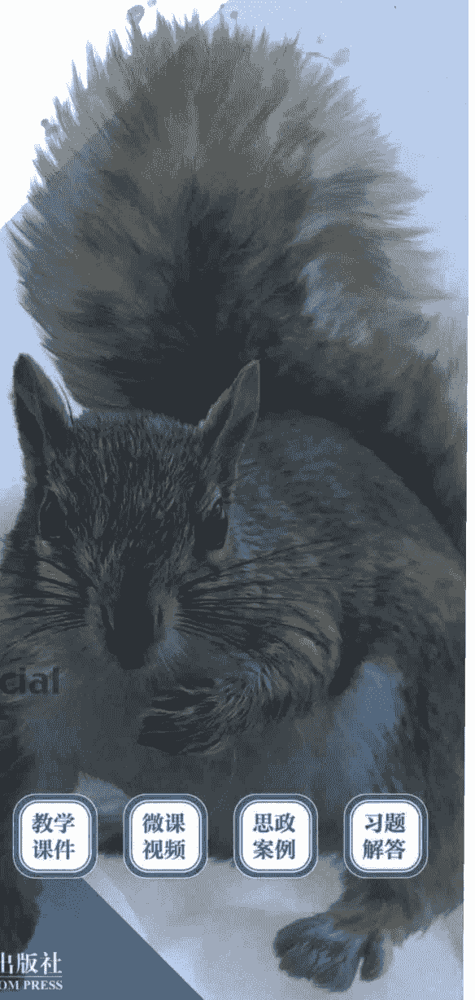

## 前言

### 缘起：为何而写，为谁而作

当下，人工智能正处于稳健演进期，全社会关注度持续高涨，产业端对专业人才的渴求未曾减退。高校正通过专业建设、学科布局、师资引育及产教融合，全方位构建AI及大数据人才培养体系。

但须明确：AI不仅关乎技术，更直指人类心智核心。高校AI教育的使命，不应止步于技能传授，而应引领学子投身AI发展的终极探索，激发深层兴趣与创造力。基于此，教学必须区分“商业AI”与“科学AI”，不唯市场需求是从，而应兼顾学科本身的科学价值与终极意义。

教育对象不应局限于理工新工科，而应面向全专业；教学内容不应单一堆砌算法与机器学习，而应通过全景式认知，助学生树立AI理念、涵养AI素养。本书首版（2020年7月）广获好评，教学成效显著。为同步反映前沿理论、技术与趋势，深度启迪思维，此次修订全面更新迭代。

**核心理念支撑：人工智能“五维知识体系”**。本书旨在引导读者从智能机制出发，系统把握AI本质与内涵——横跨技术应用、社会影响、商业价值、伦理道德及法律风险，构建全维度认知框架。

### 亮点：五大特色重塑教材新范式

1.  **内容迭代，新旧兼济**：经典方法与前沿理论并重，同步对接新一代AI发展脉搏，满足前沿学习诉求。
2.  **模块架构，灵活组合**：依托“五维体系”构建模块化知识结构，层次清晰、内容充实，支持教师按需“拆装搭配”，适配多样化教学场景。
3.  **层层递进，五维认知**：隐含大历史观、哲学思想、文明社会、多学科交叉、工程应用五大认知层次，贯穿各章，激发兴趣与创新，涵养素养。
4.  **全景视野，打破技术中心论**：超越纯技术视角，融入哲学、基础学理、应用技法、伦理法治，深化系统性、整体性理解。
5.  **伦理法治，立身之本**：将伦理与法律纳入核心知识体系，强调其对AI发展的基础性引导作用，倡导技术向善、有序发展。

### 学时规划：弹性适配，供参考

全书共13章，建议总学时38~62学时（见下表）。得益于模块化设计，各章相对独立，可依师资、学时、课程性质自由组合。

| 章节 | 建议学时 | 章节 | 建议学时 |
| :--- | :--- | :--- | :--- |
| 第1章 绪论 | 2~4 | 第8章 语言智能 | 2~4 |
| 第2章 人工智能哲学观 | 2~4 | 第9章 机器人 | 2~4 |
| 第3章 脑科学基础 | 2~4 | 第10章 类脑智能 | 2~4 |
| 第4章 人工神经网络 | 4~6 | 第11章 混合智能 | 4~6 |
| 第5章 机器学习 | 6 | 第12章 行业应用 | 2~4 |
| 第6章 感知智能 | 4~6 | 第13章 伦理与法律 | 2~4 |
| 第7章 认知智能 | 4~6 | **合计** | **38~62** |

**分众化学习路径建议：**
*   **AI/机器人/计算机等硬核专业**：夯实基础概念后，重攻第4~9章核心技术，第10、11章作拓展，覆盖第12、13章应用与规范。
*   **非工科专业**：聚焦第1~3章概念与哲学、脑科学，结合第12、13章理解应用与社会影响，技术细节章节（第4~11章）选学即可。
*   **AI兴趣入门者**：推荐第1章、第4~12章，快速建立全栈认知。
*   **人文社科/经管/法学背景者**：核心研读第1~3章、第12、13章，把握概念、历史、哲学意涵及社会治理，其余按需选读。

### 资源赋能：一站式教学支持包

配套资源丰富，含教学大纲、教案、PPT课件、习题答案、思政素材、实践案例及拓展资料，登录**人邮教育社区（www.ryjiaoyu.com）**即可下载。

主编莫宏伟主讲的同名慕课屡获殊荣：智慧树一流学科建设精品课程、混合式精品专业课TOP100、课程思政示范案例卓越奖、省级/国家级一流线上课程等，是教学极佳的“数字伴侣”。

### 致谢

本书由**莫宏伟**主编，**徐立芳**副主编。莫编撰第1~3、7~13章，徐编撰第4~6章。邵鹏、周宏亮、胡泽强等研究生协助绘图修图。书中引用文献与网络资源，向原著者致敬。限于水平，疏漏在所难免，恳请各方批评指正。

> 编者 敬上
> 2023年11月于哈尔滨

## 第 1 部分 学科与概念 基础

### 01 绪论

**【本章导学目标】**
1.  洞察智能的广义内涵；
2.  梳理自然智能、人工智能、机器智能的辩证关系；
3.  复盘AI发展史脉络与各阶段标志性技术；
4.  全景掌握AI研究版图与应用疆域。

#### 1.0 破题：智能何来，AI何往

人类史，是不断超越自我的进化史。从蒸汽动力到航天远征，从算盘到超算，我们创造的机器早已在速度、力量、精度上远超生理极限。然而，拥有“超能力”不等于拥有“智慧”。

**人工智能（AI）**，正是致力于赋予机器真正“智慧”的科学。这非新概念——60余年前已破土萌芽，长期作为计算机分支演进。历经理想与现实落差导致的多次寒冬，近年在围棋、博弈、机器人等领域频频破圈，重燃全球焦点。吴恩达曾断言：AI对社会的变革力，不亚于百年前的电力。

如今，AI已渗透工业、农业、服务业毛细血管：围棋软件超越人类顶尖棋手，人脸识别精准度超人眼，机器翻译逼近专业水准。AI正通过算法感知社会、干预社会、重塑社会。

**何为人工智能？** 本章将从智能本源、定义边界、历史脉络、实现路径、研究版图五个维度，为你拼图式拼装出AI的初认知图谱。

#### 1.1 生命与智能：贯穿进化的底层基因

宇宙演化约46亿年孕育地球。达尔文揭示：生命是进化的杰作。主流生命科学认为：无机物→有机小分子→活性大分子→多分子体系→原始生命，历经30亿年漫漫长途。寒武纪“生命大爆发”在2000万年内炸裂出万物雏形，自然选择雕琢出今日万物并秀的壮丽图景。

生物学分五界（原核、原生、真菌、植物、动物），形态万异、本领迥异，却共享生长、发育、繁衍、代谢等**生命底色**。但还有一项常被忽视的**核心特质——智能**。

**智能，是生命体与生俱来的环境适应力与生存力。** 近年微生物学、植物学、动物学研究证实：智能普存于生物界，从微细菌到巨鲸，皆有所长。

*   **细菌的“群体智慧”**：非孤立低等生物，能感知环境、用分子“语言”通讯、感知种群密度、协同行动，展现高等社会性。
*   **植物的“化学博弈”**：虽无声无语，却善用化学信号对话、欺骗昆虫授粉（如兰花模拟雌性激素诱雄）、根网互通“邻居”、威胁时交换求生信息。
*   **乌鸦的“工程思维”**：“投石喝水”非寓言，它们懂制造工具、观察人类规律、利用红绿灯与车轮破解硬果，展现规划与因果推理。
*   **章鱼的“分布式智能”**：无脊椎却拥超哺乳动物神经元、超人类基因组。大脑仅占神经元40%，60%下沉八肢，每臂自主决策。巨章鱼Billye首开瓶耗时1小时，后仅需5分钟，甚至能从瓶内反拧瓶盖。

**结论显而易见：智能是生命普适属性，仅表现形态、层级高低不同。** 其底层使命，皆为生存繁衍。无论植物、动物、人类，皆在各自生态位进化出适应环境、维系生存的独门绝技。

##### 1.1.1 破解“智能”密码：从心理学到综合定义

人类作为智能金字塔顶端，不仅适应环境、主动改造环境，更能语言交流、文化创造、自我反思。但“智能”概念并非与生俱来，其内涵随认知深化而迭代。

*   **中国古典视域**：“智”与“能”本分离。《荀子》云：“所以知之在人者谓之知……所以能之在人者谓之能。”“智”指认知心理特质，“能”指实践心理特质。《吕氏春秋》与王充《论衡》始合二为一，视“智能”为考察人才标尺。
*   **现代心理学三巨头注脚**：
    *   **桑代克**：三元智能——社交（人际）、机械（工具）、抽象（符号）。
    *   **瑟斯顿**：七项核心能力——言语理解、词汇流畅、数理、空间、记忆、知觉速度、推理。
    *   **加德纳**：**多元智能理论**（1983）——语言、逻辑数理、空间、身体动觉、音乐、人际、内省、自然观察八元构成，强调“特定情境下解决问题并创造的能力”。

心理学共识：**智能=智力（感知→记忆→思维内在过程）+ 能力（语言行为外显执行）**。但这仍未触及智能起源、机制等终极之谜。

**科学审视智能，不因神秘而回避，而因跨学科融合（哲学、生物、神经、认知、计算机等）而愈发清晰。** 理解AI，必须跳出单一思维维度，从生物、心理、行为、结构功能、人环交互、社会系统等多维度重构智能图景。

**本书提出的智能综合定义：**
> **智能，是个体主动面向问题，感知信息并提炼运用知识，理解认知环境，采取策略行动，解决问题、实现目标的综合能力。**

此定义覆盖全生命智能，蕴含三层递进意蕴：
1.  **生存本能层**：灵活适应环境，是从细菌到人类的共性底座。
2.  **综合能力层**：获取信息→适应环境→提炼知识→有目的行动→主动解决。*注：提炼知识为人类专属，他物种仅能利用信息。*
3.  **主观意向层**：人类智能超越本能，皆有意向性，体现自我意识与意志。深层含义在于**“联结概念与物理实体”**的能力——感觉、记忆、学习、思维、逻辑、理解、抽象、概括、联想、判断、决策、推理、观察、认识、预测、洞察（隐智能/内在功能）、适应、行为（显智能/外在体现）。“深思熟虑”、“足智多谋”精准捕捉此质态。

**更关键的是**，人类智能独有**意识、自我、心灵、精神**维度。爱因斯坦洞见：“智能真正标识非知识，乃想象。”一切定义皆基于外显表现归纳，而大脑如何由物理物质生出感知、认知、意识、精神，至今仍是“剪不断、理还乱”的硬问题。上述定义仅为理解AI搭脚手架，非诠释智能本质。

在初步把握智能前提下，我们转向核心命题：**何为“人工智能”？**

##### 1.1.2 图灵测试：AI判定的起点与回响

1950年，英国天才**阿兰·图灵**发表划时代名作《计算机器与智能》。他规避“机器能否思考”这一形而上学难题，转而提出一个操作性极强的**模仿游戏**——**图灵测试**：

> **“若一台机器能与人类通过电传设备对话，且无法被辨识为机器，则称该机器具有智能。”**

这一思想实验，至今仍是AI哲学与工程实践的基石坐标。

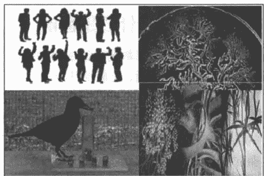

### 图灵测试：判断机器是否“有灵魂”的经典博弈

图灵的这一构想后来被冠以“图灵测试”之名，不妨将其视为一场精妙的“思想实验”。规则是这样的：让一名测试者通过键盘问答，同时与两名被测试者对话——一个是血肉之躯的人，另一个是冰冷的机器。双方物理隔离，测试者无从知晓屏幕对面是谁。若经过多轮交锋，有超过 30% 的测试者无法分辨谁人谁机，那么这台机器便算“过关”，被认定拥有了智能。

图灵还亲自设计了几组经典对话范例：

> **问：** 请以“第四号桥”为题，作一首十四行诗（这是一种格律森严的欧洲抒情诗体）。
>
> **答：** 别难为我了，我从不写诗。
>
> **问：** 34957 加 70764 等于几？
>
> **答：** （沉吟 30 秒）105721。
>
> **问：** 你会下国际象棋吗？
>
> **答：** 会。
>
> **问：** 我方 K 在 K1，你方仅 K 在 K6、R 在 R1。轮到你走，怎么走？
>
> **答：** （沉吟 15 秒）车走 R8，将军！

图灵断言：“倘若机器在特定条件下，能极其逼真地模仿人类答题，令提问者长时间误判其非机器，则该机器可被视为具有智能。”

从技术落地看，让机器在特定领域、按规则答题，编程即可实现。但现实世界没有规则手册。若提问者不按套路出牌，想让机器像人一样事事精准作答，几乎是不可能的任务。请看反面教材：

> **问：** 你会下国际象棋吗？
> **答：** 会。
> **问：** 你会下国际象棋吗？
> **答：** 会。
> **问：** 请再回答一次，你会下国际象棋吗？
> **答：** 会。

这哪里是智能，分明是“复读机”，让人直呼“笨”。但若换成这样呢？

> **问：** 你会下国际象棋吗？
> **答：** 会。
> **问：** 你会下国际象棋吗？
> **答：** 会啊，我不是刚说了吗？
> **问：** 请再回答一次，你会下国际象棋吗？
> **答：** 烦不烦啊，老问同一个问题。

仅凭最后那句带着情绪的怼人回复，绝大多数人会断定：对面坐着个活人。两者的分水岭在于——前者死守程序规则，后者展现了“元认知”能力：它知道对方在刁难、在重复，并据此调整策略。

图灵测试虽提供了一把衡量机器智能的尺子，却仅限于文字语言维度，故不能作为判断智能的唯一金标。如今，这项测试已进化为国际竞赛形式，考核手段早已突破纯文本，引入语音、图像、视频等多模态交互。

为推动测试落地，科学家兼慈善家休·勒布纳于 1990 年设立“勒布纳奖”，旨在奖励首个能以假乱真、与人类回复无差别的聊天程序，以此驱动图灵测试与 AI 共进化。

2014 年 6 月 7 日，图灵忌辰 60 周年，英国皇家学会举办“2014 图灵测试”大会。规则升级：金奖得主需同时通过文本、音频、视频三重考验。按 30% 误判阈值，在一系列 5 分钟键盘对话中，若机器被误认为人类超此比例，即视为通过。此前从无机器达标。本届比赛，“尤金·古斯特曼” 聊天程序宣称首次“破防”，其界面如下：

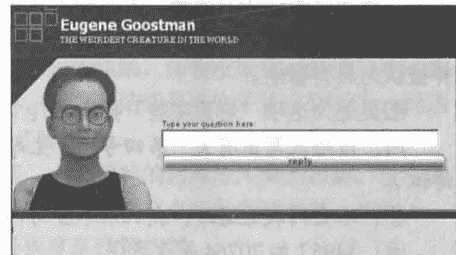

图 1.2 聊天程序“尤金·古斯特曼”界面

“尤金”诞生于 2001 年，由弗拉基米尔·韦谢洛夫、谢尔盖·乌拉森、尤金·杰姆琴科联手打造，人设是一个 13 岁男孩。本次大会 5 款聊天机器人同台竞技，“尤金”以 33% 的误判率“拿下”测试。

虽说这看似里程碑，但冷静拆解：它本质上仍是一套人类对话模拟脚本。从认知科学视角，它不具备思考能力。图灵设定的 30% 门槛，连同测试本身，都非 AI 的完美标尺——它只是“机器能否思考”的一种操作性定义。智能是多元、多维、综合体，聊天机器人仅展示了语言单一维度。且智能非人类专利。当下 AI 研究的核心命题，是如何赋予机器“类人通用智能”：**既会聊天，又懂人意，还能主动适应环境并落地行动。** 图灵测试缺失了“环境交互”这一关键变量。AI 不能只停留在语言表演，更要体现在环境适应性上。

有鉴于此，MIT 罗德尼·布鲁克斯教授提出“新图灵测试”。目标直指通用人工智能（AGI）基石。不再是简易文本对话，而是**家庭健康助理或养老陪护机器人伴侣**。此“伴侣”非彼“伙伴”，指能提供认知与躯体双重援助，助老人居家养老、有尊严、独立生活的机器人。这要求机器具备“具身智能”，且必须完成人类仅需微量训练即可掌握、但当前机器人完全束手无策的任务。布鲁克斯勾勒的蓝图，在认知、生理、社交三维度均远超现有 AI 能力边界，其攻关路径必将深度重塑 AI 研发版图。

无论如何，图灵测试的初衷始终是：考察机器是否抵达了人类感知水平，能否成功“伪装”成人。图灵曾预言 20 世纪末将诞生此类机器。虽迟至今日仍未兑现，且他未明确给出 AI 定义，但他那句破天荒的提问——“机器能思考吗？”，点燃了后世无数人的想象，此前从无人敢问。

AI 概念诞生后（详见 1.2.1 节），不同阶段专家从各自视角给出定义，众说纷纭。斯坦福 AI 实验室尼尔斯·约翰·尼尔森教授界定：AI 是“关于知识如何表示、获取与运用的科学”。

李德毅院士在《不确定性人工智能》中定义：“将人类感知、记忆、情感、判断、推理、证明、识别、设计、思考、学习等思维活动，用物化机器人工实现。”

钟义信教授主张：AI 即人类显性智慧的人工实现。细化说：机器依托人类给定的初始信息生成调度知识，在目标牵引下由信息与知识生成求解策略，将策略转化为智能行为以解决问题。此定义串联起信息、知识、策略、行为全链路。

再列举三个典型视角：

1.  AI 是研究让“理解、推理、行为”成为可能的计算。
2.  AI 是能运行需人类智能创造性任务的机器技术。
3.  AI 是智能机器执行的、通常与人类智能相关的智能行为——判断、推理、证明、识别、感知、理解、通信、设计、思考、规划、学习、求解等。

前三者分别立足“模拟理性思维”“拟人行为”“机器智能实现”。**第三个定义最贴近 AI 真实演进方向与终极目标：造出具备人级甚至超人级智能的机器。** 未来通过布鲁克斯新测试的 AI 实体，将符合第三定义，但需补充“具备随思维活动而来的环境适应与行动能力”。

归根到底，上述定义皆可收敛为：**AI 是研究智能机制与规律、构造智能机器的技术与科学。** 亦可简说：AI 是研究如何让机器拥有智能的科学。

大众认知层面，更多从学科与工程视角理解 AI。作为新兴学科，AI 研究用于模拟、延伸、扩展、学习人类智能的理论、方法、技术及应用系统。须知：AI 中的“智能”核心指人类智能，但实研中模拟对象也涵盖众多动物。除特别注明，文中“智能模拟对象”均默认指人类智能。

##### 1.1.3 人工智能图谱

###### 1. 智能的类型划分

AI 诞生后，因技术路线分歧，衍生出多元类型。图 1.3 描绘了当前 AI 主要类型全景。智能源于自然，AI 让智能演化迈入“非自然”进程。故将智能宏观划分为**自然智能**与**人工智能**两大阵营。自然智能即自然存在的智能，地球生命皆属此列，含人类与非人类生命智能。从关系看，AI 可视为智能的一种特殊形态。

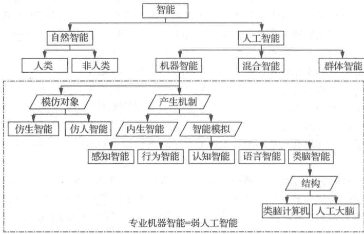

图 1.3 人工智能研究图谱

AI 总体可细分为**机器智能、混合智能、群体智能**三大支系。历史上“机器智能”与“AI”常混用。本书将其视为 AI 子类，基于双重考量：一、聚焦概念内涵——研究对象是机器的智能；外延极广，不特指某具体软硬件，但必依托软硬件系统（计算机、机器人等）落地。二、AI 诞生伊始即通过技术模拟实现人类智能，历史阶段技术无显著特异性。直至 2015 年后，大数据与深度学习爆发，让机器（以计算机为主）涌现出异于人类、甚至局部超越人类的智能。这证明：**非自然机制能生成区别于人类、乃至特定领域超越人类的智能。** 此智能属机器专有，如人类智能之于人类。故独立出“机器智能”这一子类。

当然，从“人工”视角，机器智能也是 AI，毕竟皆为人类造物。但本书强调**智能生成机制及其归属主体（机器）**，而非单纯强调“人工”属性。唯有聚焦生成机制，而非沉溺既有技术应用，才可能孕育更高阶 AI。同时，界定概念外延，可防滥用与误读。

机器智能可按“模仿对象”与“生成机制”进一步分化。按模仿对象，分**仿生智能**（载体为机器动物）与**仿人智能**（载体为机器人）。模拟动物形态、动作、行为外在表现的即仿生智能，如机器狗能完成 360° 前空翻、后空翻、侧空翻，远超生物狗能力。专门模拟人类外在行为衍生出的即机器人。模拟人/动物运动行为规律形成的智能称**行为智能**。

除行为智能，当前机器智能实现主阵地还有三块：借助现代计算机与传感器，机器通过视听构建对内外环境的感知——**感知智能**；通过特定方法处理语言文字——**语言智能**；人类高阶认知（学习、理解、推理、决策）在机器上初步落地，机器模拟此类形成**认知智能**，虽未达人级或超人级。

计算机这类特殊机器，凭特殊算法以计算之名，在棋类博弈、文艺创作、材料分析、化合物设计等领域表现惊人，直接挑战人类引以为傲的创造力，此类智能可进阶称**“机器创造”**。这主要由深度学习驱动，故深度学习驱动下的机器智能可称**“内生智能”**。机器智能还可表现为超算凭借远超人类算力呈现的智能，如天气预报、蛋白质结构预测，非人类智能直解范畴。

除机器智能，AI 还有**群体智能**、**混合智能**两大支系。

传统群体智能指受蚂蚁、蜜蜂等社会性昆虫群体行为启发的智能算法，以 1992 年马尔科·多里戈的蚁群算法、1995 年肯尼迪等人的粒子群算法为代表。我国 2017 年《新一代人工智能发展规划》赋予其新意：**以互联网、移动通信为纽带，万物互联下人类智能协作形成的新智能形态/方法。** 当下，基于群体开发的开源软件、众问众答知识共享，皆被视为人类群体网络协作的群体智能结晶。

混合智能指通过脑机接口、可穿戴、机械外骨骼等技术，与人/动物自然智能融合而成。它可借人类智能补机器智能在推理决策的短板，亦可借机器增强人类体能。如外骨骼助人举起数倍体重；脑机接口助残疾人用脑电波控制机械臂端茶倒水。

长期以来，人类致力于赋予机器更多“类人智能”。“类脑智能”即通过模拟大脑结构实现类人智能。衍生出的“类脑计算”，为计算机自主学习、独立思维提供可行路径：仿真、模拟、借鉴人脑神经系统结构与信息处理，构建可实时处理多模态信息、具备自主学习力的装置、模型与方法。科学家利用电子、芯片、虚拟仿真技术模拟大脑宏微观结构，设计类脑计算机与人工大脑，终极指向类人智能。类脑计算/智能可视为通往 AGI 的一条技术路径。

传统分类常将 AI 二分为**弱 AI 与强 AI**。弱 AI 目的非模拟真实人类智能，乃构造实用算法解人类难题，仅模拟单一侧面智能或解单一问题，均属弱 AI。强 AI 旨在创造具知觉、自我意识、会思考、达人级甚至超人级的 AI。目前强 AI 仍处幻想阶段。

实情是，AI 发展过程中涌现大量理论、方法、技术，指导设计算法、模型、软硬件系统。但当前所有算法实现的 AI，**仅能解特定侧面问题、或在特定场景执特定任务，不具备跨任务、跨场景适应的通用性。** 如识别人脸算法不能识物，识别声音软件不能读文，扫地机器人不会洗碗叠被。故当前机器智能均属**专用机器智能**，即弱 AI。

###### 2. 人工智能的概念辨析

通过算法、模型、软硬件系统模拟智能实现的技术，统称**智能技术**或**AI 技术**。当这些算法/模型搭载于软硬件系统并能解特定专门问题，便构成**智能系统**。智能系统可以是特定场景硬件系统（自动驾驶、智能家居），也可以是大范围空间/区域甚至数字虚拟空间系统（智慧医院、智慧城市、元宇宙虚拟人系统）。这些皆是 AI 概念与技术在行业领域的延伸应用。

搭载智能技术/系统，代人类在不同场景解难题、执危险/困难任务的机器，称**智能机器**。智能机器区别于传统机器在于：不仅能部分替人类完成任务，更具备智能特征——即**具有智能属性的机器**。载体可以是计算机、各类机器人、某种家电等。

**关键界定：** 任何类型的算法、模型、系统及其承载机器，**本身都不是 AI**，而是实现 AI 的手段或载体。单纯某个/某类理论、方法、算法、技术、模型、系统、硬件、软件，性能再强，**均不应笼统简称为“AI”，更不能直接等同视为 AI。** 滥用“AI”指代上述对象，只会制造概念混沌，淹没 AI 本质与发展目标，阻碍 AI 进步。

#### 1.2 国际人工智能发展历史

回溯历史，深度理解 AI。AI 发展大致历经**初创期、形成期、发展期、大突破期**四阶段。

##### 1.2.1 第一阶段：初创时期（1936—1956 年）

AI 于 20 世纪 30 年代孕育，至 1956 年破壳，此间为初创/孕育期。数项关键科技成果接连涌现。

###### 1. 通用图灵机

1936 年，图灵发明**通用图灵机**，一种理论计算机模型。设想有一条无限长纸带，分格，有斜线格代表“1”，空格代表“0”。配一读写头，可读写信息。唯一操作：纸带右移一格，将“1”变“0”或“0”变“1”。图 1.4 展示其模型，这是一种不考虑硬件状态的纯计算逻辑结构。**通用图灵机是现代计算机的思想原型。**

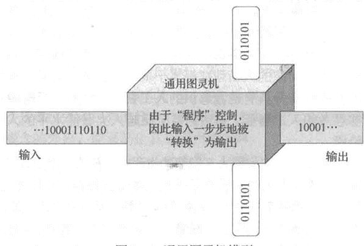

图 1.4 通用图灵机模型

###### 2. 早期的计算机技术

1937—1941 年，阿塔纳索夫教授与研究生贝里开发**阿塔纳索夫-贝里计算机（ABC）**，为计算机科学与 AI 研究奠基。现代可编程数字电子计算机架构——**冯·诺依曼结构**，由数学家/计算机科学家/物理学家约翰·冯·诺依曼提出，受图灵通用计算机思想启发，1946 年工程落地。它奠定现代计算机基石，成为检验与实现各类 AI 思想技术的核心工具。

###### 3. 人工神经元模型

# AI简史：从逻辑推演到深度学习的跨越

1943年，神经生理学家沃伦·麦卡洛克携手数理逻辑学家沃尔特·皮茨，推出了人类史上首个数学神经元模型——麦卡洛克-皮茨模型（MP模型）。该模型模拟生物神经元机制，证明由简单单元构建的网络能执行任意逻辑与算术运算，这标志着人工神经网络（ANN）的雏形诞生。早期这一领域被称为“联结主义”，彼时“人工智能”概念尚未问世（1956年前该术语不存在）。

###### 4. 控制论

1948年，数学家诺伯特·维纳创立控制论，聚焦具备自我调节、适应与校正能力的机器理论。它深刻对比了人与机器：随着计算机器愈发精良、人类对大脑认知加深，二者边界将日益模糊。控制论从机器控制视角出发，在机器、人与大脑间架起桥梁，其思想直接催生了早期AI技术的探索。此外，信息论等理论亦为AI诞生注入关键动力。受此启发，图灵断言人脑本质上是一台离散态机器，与计算机无本质差异，坚信AI终将实现。图灵等人的计算本质思想，将人类逻辑推理与冯·诺依曼架构计算机紧密绑定。

1952年，IBM科学家亚瑟·塞缪尔开发跳棋程序，该程序能依据棋局学习隐含模型指导决策，有力反驳了“机器不可超越人类”论调，并首创“机器学习”（ML）概念。

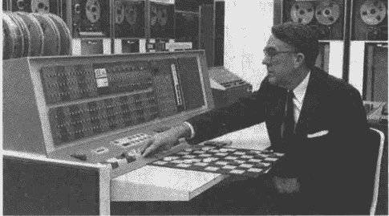

图 1.5 塞缪尔正在调试其开发的跳棋程序

在此思想浪潮推动下，1956年约翰·麦卡锡、马文·明斯基、克劳德·香农、纳撒尼尔·罗切斯特发起达特茅斯夏季研究会，汇聚西蒙、纽厄尔等跨学科精英，就“机器能否思维”研讨两月。麦卡锡会上首提“人工智能”命名。虽会议未解决具体技术难题，却确立了研究靶心，正式拉开AI发展史序幕。

AI诞生后数十年，演进呈双主线：**联结主义**自底向上模拟脑神经网络结构；**符号主义**自顶向下模拟大脑处理符号的功能。

##### 1.2.2 第二阶段：形成期（1957—1969年）

符号主义由西蒙、纽厄尔于50年代奠基。此期原理理论迭出，机器定理证明、通用问题求解器（GPS）、列表处理语言（LISP）等里程碑成果频现。数字计算机广泛攻克代数、几何、翻译难题，极大增强了学界“机器可逼近人类智能”的信心，甚至预言20年内将造出全模拟人脑机器，迎来首个发展高峰。

符号主义核心主张：智能即对有意义符号的推演计算，是对人类认知的初级模拟。凡可区别的模式皆为符号（字母、数学符号、汉字等）。

1958年，弗兰克·罗森布拉特承袭控制论联结主义思路，提出感知机，掀起研究热潮。但明斯基与西蒙通过分析单层感知机，证其无法解决异或等非线性可分问题，断言神经网络无前景，导致联结主义声誉重创。

同期，华裔学者王浩（洛克菲勒大学教授）在自动定理证明上建树卓著。1959年，他以“王氏算法”在IBM 704上不足9分钟攻克《数学原理》350余条定理，成华人AI研究第一人。

60年代非主流技术暗流涌动：德国英戈·雷兴贝格、汉斯·保罗·施韦费尔为解决工程优化，引入达尔文进化论提出进化策略，开启进化计算先河；加州伯克利卢特菲·扎德发表《模糊集》，奠定模糊数学基础，80年代衍生出成百上千智能系统，广泛落地工业、家电、机器人领域。

纵观60年代，受限于算力，诸多前沿理论（知识表达、学习算法、神经网络）虽落地受阻，却为20年后应用指明方向。此期符号主义超越联结主义，主导领域至90年代中期。

##### 1.2.3 第三阶段：发展期（1970—1992年）

分前后两期：70年代因预期落空遭猛烈批评与断供，陷首个寒冬。1971年罗森布拉特离世叠加明斯基猛批，神经网络被弃，联结主义停滞。

寒冬中仍有火种：约翰·霍兰德70年代初基于进化论构建遗传算法，开创“人工生命”领域，与进化策略、遗传编程合流为进化计算分支。1970年《国际人工智能杂志》创刊促进学术交流；1971年语音识别联盟成立，虽当时未果，却为今智能音箱埋下伏笔；1974年保罗·韦伯斯提出反向传播（BP）算法，成现代神经网络与深度学习基石。

1976年西蒙、纽厄尔提出物理符号系统假设：智能行为充要条件即为物理符号系统，核心任务是识别与区分符号。1977年爱德华·费根鲍姆提“知识工程”，强调知识在求解中核心地位，直接催生专家系统——利用规则、推理、搜索模拟专家经验解决专业领域问题。

关键转折：研究者意识到通用问题求解路径走不通，转向“用大量推理步骤解决狭窄专业问题”，专家系统爆发式增长（医疗、农业等），推动AI从理论走向实践、从通用走向专用。

80年代专家系统修正符号主义架构，迎来第二春：机器学习算法成熟，计算/预测/识别能力跃升；日本启动第五代计算机计划；约翰·霍普菲尔德（1982年Hopfield网络）与大卫·鲁姆哈特重燃联结主义希望。1986年鲁姆哈特、辛顿等在《Nature》发文系统阐述BP算法在神经网络应用，神经网络迎真正高速发展期。

同期，大卫·马尔主张自底向上理解视觉物理机制，排斥符号法；明斯基1985年《心智社会》提出心智由无智能体组成的复杂社会涌现。1987年国际神经网络学会成立，标志领域进入快车道，光芯片/生物芯片研制提上日程。然专家系统复杂、性能受限导致市场崩盘，第五代计算机终止，80年代末AI陷第二次寒冬。

寒冬尾声，自底向上思想复兴控制论，罗德尼·布鲁克斯90年代创立行为主义，通过模拟昆虫至人类构建智能机器人，推动人工生命与模拟进化研究。80-90年代具身认知理论兴起，主张身体是推理必要条件，反对纯符号处理模型。

90年代初符号主义衰退，学界重审神经网络。此阶段最大收获：联结主义由少数派坚持取得突破，为当代深度神经网络与深度学习全面爆发铺路。

##### 1.2.4 第四阶段：大突破期（1993年至今）

非凡创造期。1993年弗诺·文奇提出“奇点理论”，预言AI将超越并终结人类社会主导权。

算法百花齐放：粒子群算法（模拟鸟群）、蚁群算法（模拟蚁群）等推动计算智能、自然计算分支发展。1995年科琳娜·科尔特斯与弗拉基米尔·万普尼克推软间距非线性支持向量机（SVM），应用于手写数字识别，影响力一度远超神经网络。此后十年，集成学习、稀疏学习、统计学习占据主流，深层神经网络沉寂。

1996年杨立昆任贝尔实验室图像处理部主管，开发卷积神经网络（CNN，模仿视觉皮层）。1997年5月11日，IBM“深蓝”以3.5:2.5击败国际象棋冠军卡斯帕罗夫，整合知识表示、符号处理、搜索算法与机器学习，成AI里程碑。


图 1.6 卡斯帕罗夫与国际象棋计算机“深蓝”对弈现场（右为“深蓝”现场操作者）

2006年，辛顿联合杨立昆、约书亚·本吉奥发表《深度置信网络快速学习算法》，开创深度神经网络与深度学习技术史，引发现代商业革命。2010年李飞飞构建ImageNet百万级标注图像数据集，并发起年度ImageNet挑战赛（ILSVRC），成深度学习竞技擂台。

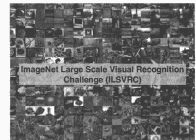

图 1.7 ImageNet 挑战赛

2012年ImageNet赛引爆AI“大爆炸”：辛顿团队Alex Krizhevsky用8层CNN（AlexNet）错率超次优传统方法10.8%夺冠，实现细粒度识别（区分蜘蛛猴/吼猴、各品种猫）。2015年何恺明等用152层残差网络（ResNet）错率3.57%超越人类平均5%，因算法触及天花板，赛事2017年终止。

2011年杰夫·迪安、吴恩达发起“Google Brain”，1.6万CPU搭建10亿连接深度网络，无监督看海量视频自主学会识别猫脸。2016年DeepMind AlphaGo融合搜索、神经网络、强化学习击败李世石，成又一里程碑。

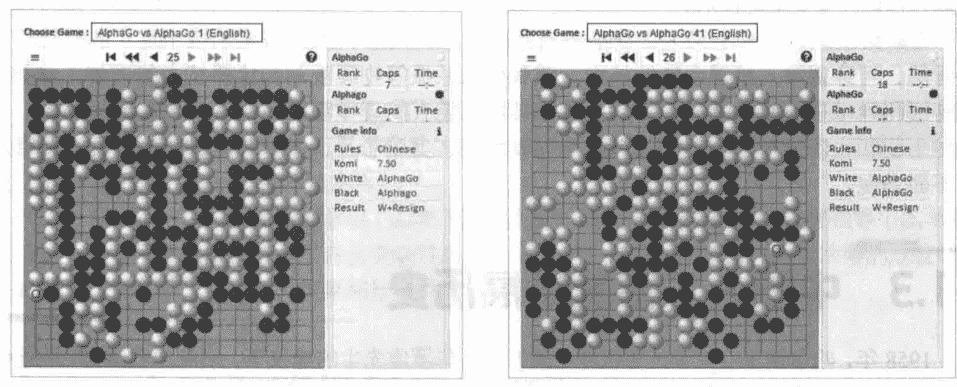

(a) Games1-10

(b) Games41-50

图 1.8 AlphaGo 与人类棋手对弈的阶段棋局

2016年后，AlphaGo引发国家级战略布局，各国顶层设计抢跑研发产业化，掀起国际新竞赛。深度学习在视觉、语音、翻译大显身手，重塑工业版图。互联网巨头与独角兽纷纷入局，推动AI迎来历史上第三次高潮。

#### 1.3 中国人工智能发展历程回顾

1958 年，在华罗庚先生的倡议下，哈尔滨工业大学计算机专业的专家们攻克难关，诞生了新中国第一台能下棋、会说话的计算机（见下图）。

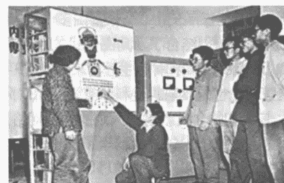

图 1.9 我国第一台会下棋、会说话的计算机

1977 年，中国科学院自动化研究所依托中医专家关幼波的临床经验，成功构建了国内首个中医肝病诊疗专家系统。次年，智能模拟研究被正式列入国家计划。1981 年起，国内相继成立了中国人工智能学会（CAAI）、全国高校人工智能研究会、中国计算机学会人工智能与模式识别专委会等一批核心学术组织，为学科发展奠定了组织基础。

1984 年，全国智能计算机及其系统学术讨论会召开。1985 年，中国科学院合肥智能机械研究所熊范铤研制成功“砂姜黑土小麦施肥专家咨询系统”，填补了国内农业专家系统的空白。此后多年，以农业专家系统为抓手的智能化农业信息技术硕果累累，各类系统遍地开花，为农业现代化注入强劲动力。

1986 年起，智能计算机系统、智能机器人及智能信息处理等重大项目纳入国家“八六三”计划。1987 年《模式识别与人工智能》创刊，1989 年首届中国人工智能联合会议召开。1990 年，八大国家级学会在北京联合举办首届中国神经网络学术大会，并成立中国神经网络委员会，吴佑寿院士任主席。1992 年，该委员会在北京承办了规模空前的 IJCNN 国际联合会议。1993 年，“全球华人智能控制与智能自动化”大会开启首届。1997 年，智能信息处理、智能控制等项目再度入选国家“九七三”计划。

步入 21 世纪，我国科技工作者在 AI 领域频频斩获国际领先成果。其中，吴文俊院士创立的几何定理机器证明“吴氏方法”影响深远，荣获 2001 年国家最高科学技术奖。2011 年《中国人工智能学会通讯》创刊，同年设立“吴文俊人工智能科学技术奖”。

2014 年至今，深度学习浪潮席卷全球，我国大模型研发捷报频传：北京智源研究院发布参数量达 1.75 万亿的“悟道 2.0”，鹏城实验室、百度联合推出全球首个知识增强千亿大模型“鹏城·百度·文心”，均达到世界顶尖水平。2016 年以来，李飞飞、吴恩达等华人学者及何恺明、杨强等本土专家在机器学习等前沿领域持续突破。清华大学“天机芯”类脑计算芯片的研制成功，标志着我国在类脑智能硬件上达到国际领跑梯队，为全球科技进步贡献了中国智慧。

#### 1.4 人工智能：学科交叉融合的 “强力胶”

科技发展的历史，是从单一学科向多学科交叉融合演进的历史。人工智能正是这种跨学科融合的典型产物。回溯发展史，MP 模型的诞生融合了图灵机理论；伯特兰·罗素的命题逻辑与查尔斯·谢林顿的神经突触理论碰撞，共同孕育了早期人工神经元模型。这些理论实质上是迈克尔·阿尔比布“可计算生理学”思想的早期实践——即以数学建模还原大脑神经网络。因此，首个人工神经元模型一诞生，就打上了神经生理学、逻辑学、计算机科学与脑科学多学科融合的烙印。

AI 作为交叉学科领域，包含双重深意：

**第一，自身成长仰赖多学科 “输血”。** 近年来，AI 正从计算机科学的分支向独立一级学科跨越。其核心在于探究智能本质，而智能研究天然牵涉哲学、数学、脑神经科学、认知科学、心理学、控制科学、信息学等众多领域。由此，AI 确立了建立在广泛交叉研究基础上的新兴学科地位。

**第二，向外赋能催生 “智能 + X” 新物种。** AI 与医学、教育、管理、艺术、社会、军事等传统学科深度融合，正加速形成智能医学、智能教育学、智能管理学等新兴学科体系；电子、机械、计算机等传统工科借力 AI，衍生出智能电子、智能机械、人机融合学等新工科方向。

简而言之，AI 正成为各学科融合的 “强力胶”。这种交叉研究将全方位激活制造、农业、医疗、教育、艺术、人文、法律、媒体等领域的应用潜能，推动人类社会在科技、文化、经济维度跨越式进步，逼近未来科技爆发的 “奇点”。AI 多学科交叉孕育的 “大科学”，其冲击力将远超过去数十年任何单一科学成果，必将重塑人类世界观、科研范式乃至生活、学习与社会文化的发展模式。

#### 1.5 人工智能实现路径演进

自 AI 诞生以来，研究者基于对智能的不同认知，构建了多元实现路径。传统方法源于符号主义（功能主义 / 经验主义）、联结主义（结构主义）、行为主义（物理主义）三大流派；现代则衍生出数据驱动等新范式。

##### 1.5.1 经典三大流派

**1. 符号主义：逻辑与认知的双重奏**

核心主张：人类智能的标志是使用语言与复杂符号表达思想，计算机应通过处理符号、建立符号结构来实现智能。完善符号系统需具备输入、输出、存储、复制、建立结构、条件性迁移六大功能。该假设旨在将人类抽象概念系统转化为可操作的物理符号系统。旗下分逻辑学派、认知学派两支。

*   **逻辑学派**：主张用形式逻辑描述世界。核心公设：智能机器须拥有环境知识、能陈述性表达知识、表达语言至少具备一阶逻辑能力。强调概念化知识表示、模型论语义与演绎推理，经典逻辑结合统计学可模拟学习、规划、推理。
*   **认知学派**：聚焦人类宏观认知模拟。核心假设：物理符号系统是智能行为的充要条件（大脑、计算机均属此类）。认为智能活动本质是推理过程，机器虽不懂语义，但可通过符号操作完成推理任务，从而逼近高级智能。但目前机器认知智能与人类仍有巨大鸿沟。

**2. 联结主义：仿脑神经网络的结构主义**

核心方法：模仿人脑神经网络结构构建人工神经网络（ANN）。本质是结构范式，通过构建多样化网络结构模拟大脑并行处理信息，实现非程序化自适应智能。显著特征：分布式存储、并行处理、自组织自学习。

*   **从浅层到深度**：传统浅层网络模型数百种，多针对特定小规模问题；现代深度网络层数达数千，形式上逼近大脑复杂度。新旧模式共享核心假设：智能从大规模神经元连接的复杂系统中 “涌现”。
*   **现实差距**：无论浅层还是深度网络，结构上均与真实大脑神经回路迥异。深度学习虽在应用层大捷，但在语义理解、因果推理、逻辑推演上仍远逊人类。
*   **硬件探索**：类脑芯片、人工大脑试图用电子材料从结构层面仿真大脑。受限于对神经元复杂连接机制认知不全，完整电子大脑尚远。但深度网络与类脑芯片双轮驱动，确立了联结主义当下实现大规模智能系统的主流地位。

**3. 行为主义：无脑智能与环境博弈**

核心观点：符号主义建立在过度抽象的简化模型上。智能不依赖符号计算或内部表征，而是在与真实复杂环境的交互适应中进化 —— 即 “无脑” 智能。最直接实现路径：复刻人 / 动物 “模式 - 动作” 映射，无需知识表达推理。

由此诞生具备自学习、自适应、自组织特性的智能控制系统、工业机器人、人形机器人、机器动物。但行为主义仅反映本能式、初级智能特征，无法触及语言理解、自主学习、主动决策等需大脑精密规划的高级智能内核。

##### 1.5.2 数据驱动：大数据与深度学习的共振

2010 年前后，深度学习遇上大数据，开辟 AI 实现新范式。基于脑科学、数据科学特别是大数据技术演进，数据驱动方法以全新视角重构实现路径，大幅提升智能模拟精度与有效性，成为传统方法的关键补充。

**三驾马车**：算法、大数据、算力被公认为 AI 发展三大引擎。大数据概念 80 年代萌芽，麦肯锡 2011 年报告宣告 “大数据时代” 来临。21 世纪社交网络、移动终端爆发引发数据井喷，世界步入数据大爆炸纪元。大数据虽定义未一（通常指规模巨大、形式多样的非结构化数据集），但其战略资源地位确立：核心价值在于从海量噪音中提炼高价值信息。

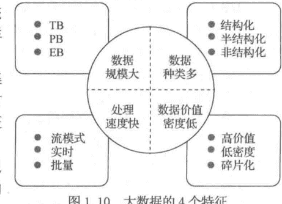

**大数据 “4V” 特征解码**：

*   **Volume（规模巨大）**：从早期机构高成本采样，到全民网络极低成本生产（点击、浏览、分享），数据量跃升 TB→PB 级，未来 EB 级或成新门槛。
*   **Variety（类型多元）**：涵盖网站日志、通话记录、社交文本、GPS 定位、传感器流等，打破传统关系型数据边界，非结构化数据（网页、文档、音视频）成主力。
*   **Velocity（速度极快）**：微博、微信、股票数据实时流式产出，倒逼处理速度极致化。
*   **Value（价值密度低）**：数据几何级增长，有用信息却不成比例，提取难度剧增（如监控视频中有效片段仅秒级）。4V 特征勾勒出大数据分析的复杂度与时效性挑战。

**融合生 “数据智能”**：数理统计与机器学习深入大数据腹地，AI 与大数据结合催生 “数据智能” —— 直接通过大规模计算发掘隐性知识、规律，实现传统手段难及的预测与决策。数据驱动方法借力深度学习、海量数据、传感器与复杂算法，自动捕捉高维复杂数据集中的特征模式，成为超越传统手段构建 AI 系统的有效捷径。

#### 1.6 人工智能核心研究版图

从模拟人类智能维度审视，AI 研究版图涵盖计算智能、感知智能、认知智能、行为智能、群体智能、混合智能、情感智能、类脑智能八大维度，具体延伸至问题求解、逻辑推理定理证明、人工神经网络、自然计算、机器学习、自然语言处理、多智能体、决策支持、知识图谱、知识发现数据挖掘、计算机视觉、模式识别、机器人学、人机交互、人机融合、类脑计算等细分领域。

##### 1.6.1 计算智能

### AI核心技术版图：从自然计算到机器创造的全景解析

#### 一、 自然计算：向大自然“借”智慧
自然计算的核心逻辑是“仿生”——从生物演化、物理规律、社会现象中汲取灵感，设计算法解决工程难题。它大致可归为三大流派：
*   **生物启发派**：进化计算、蚁群/粒子群算法、人工免疫系统，模拟生存法则；
*   **物理化学派**：模拟退火、重力搜索、化学反应优化，借用物质运动规律；
*   **社会人文派**：文化算法、教学优化、帝国竞争算法，映射群体协作与博弈。
研究者需根据具体场景，“量身定制”算法模型。

#### 二、 数据挖掘：在数据海洋淘金
数据挖掘本质是“从海量噪音中提炼高价值规律”，是实现机器智能的关键路径。其技术栈极其丰富，融合了：
1.  统计学的严谨推断（抽样、假设检验）；
2.  AI核心技术（搜索、建模、机器学习）；
3.  优化与计算理论（进化计算、信息论、可视化）；
4.  工程落地基石（数据库存储索引、并行高性能计算）。

---

#### 三、 感知智能：赋予机器“五感”
感知是人类本能，对机器却是硬核工程。通过传感器+算力，机器视觉、听觉甚至触觉已超越人类生理极限（如不可见光感知）。

**1. 机器视觉：看懂世界的“眼睛”**
集成图像处理、模式识别、机器学习，2010年后深度学习引爆性能跃迁。计算机视觉作为核心子集，专攻图像分类、识别，已在人脸识别、大规模图像任务上实现“超人类”表现。

**2. 模式识别：分类与理解的“基因”**
从字符OCR到医疗影像、生物特征，模式识别贯穿信息处理全链路。它是机器将杂乱输入转化为结构化认知的基础动作。

---

#### 四、 认知智能：向“会思考的机器”进阶
感知解决了“耳聪目明”，认知要解决“心智成熟”。在数据、算力、算法三驾马车拉动下，认知智能攻克推理、规划、决策、创作等高阶任务，核心版图包括：

| 核心模块 | 关键进展与特征 |
| :--- | :--- |
| **问题求解** | 从下棋程序衍生，掌握盲目/启发式搜索、知识归约，数学符号处理甚至超越人类。 |
| **逻辑推理与定理证明** | AI最持久子领域，覆盖确定性/不确定性推理，消解原理等演绎体系。 |
| **知识图谱** | **认知核心基建**。构建机器可读的“知识库”，支撑辨识、推理、主动学习三大能力。 |
| **决策系统** | 从跳棋、象棋到围棋（AlphaGo），博弈能力指数级跃升；延伸至量化投资、军事指挥、自动化控制。 |
| **机器学习** | **认知智能的主引擎**。虽模拟人类学习，实则依赖大数据+深度学习+人工标注，**短板在于缺乏自主/持续/交互式学习能力**。 |
| **自然语言处理 (NLP/NLU)** | 攻克“理解”难关。从机器翻译到问答、摘要，虽频频破圈，但**上下文语义、类人认理解码仍是硬骨头**。 |

---

#### 五、 行为智能：会动会干的“具身智能”
机器人是行为智能的载体，分类维度多元：
*   **按用途**：工业、农业、军用；
*   **按域**：陆地、水面、空中、太空；
*   **按仿生对象**：类人、机器狗/鱼/鸟。
现代机器人虽源于对人体动作的模拟，但内在智能（学习、推理）与人类仍有鸿沟。机器人学与AI互相赋能：AI赋予大脑，躯体提供交互实验场。

---

#### 六、 群体智能：从“个体强”到“群体超”
定义已升级：不再局限于单体模拟，转向**人-人、人-机、机-机网络化协作**，聚合超级智能。
*   **群体智能算法**：粒子群、蚁群等自然计算分支，专攻各类优化难题（单/多目标、组合优化）。
*   **多智能体系统 (MAS)**：分布式AI范式。核心在于**智能体间的通信、协调与协作**，模拟人类社会分工协作机制，破解大型复杂系统求解难题。

---

#### 七、 混合智能：人机深度融合的“第三物种”
硬科技突破（脑机接口、可穿戴、外骨骼、微电子、材料学）催生新形态，双轮驱动：
1.  **人机融合**：突破符号主义/联结主义瓶颈。从控制论理论走向落地——脑机接口让大脑直连外部设备，人类借机器智能拓展认知边界，形成“混合智能”新物种。
2.  **人机交互 (HCI)**：聚焦信息双向流通。
    *   *人→机*：键鼠、手柄、数据服装、语音、眼动、脑电波；
    *   *机→人*：屏幕、打印、VR/AR、多媒体；
    *   *前沿*：多模态融合（视听触觉+语音/手势/表情），让交互回归自然，并下沉至机器人本体。

---

#### 八、 情感智能：懂冷暖、有温度的AI
目标：让机器具备观察、理解、表达情感的能力，实现自然亲切交互。
*   **核心双翼**：
    *   **情感计算**：构建能感知、识别、理解并友好响应人类情绪的系统；
    *   **感性工学**：从工程角度量化情感设计，让产品“懂人心”。

---

#### 九、 类脑智能：终极逆向工程
现状：结构模拟（神经网络）较成熟，功能机制（感知、认知、语言）仍在起步。未来路径：脑科学指引 → 类脑芯片/计算机 → 类脑计算范式 → 类脑智能。

**1. 人工神经网络：类脑的“初级形态”**
*   两阶段：传统浅层 → 深度神经网络（CNN受视觉皮层启发）。
*   结构虽异于人脑，但源于脑启发。擅长直觉/形象思维，已在图像、博弈、控制等领域全面开花，部分任务超人类。

**2. 类脑计算：重塑软硬件底座**
*   **三级跃迁**：
    1.  **结构层模仿脑**：二维平面模拟 → 未来三维立体复杂网络；
    2.  **器件层逼近脑**：类脑芯片硬件实现，二维向三维演进；
    3.  **智能层超越脑**：软件层面通过训练涌现类人甚至自主意识（目前仍属科幻/哲学探讨阶段）。
*   **价值**：神经科学+计算机科学深度交叉，倒逼新型处理器、算法、架构诞生。

---

#### 十、 AI伦理与法律：给双刃剑装上“护栏”
AI如核技术，必须以人类伦理价值为底线。
*   **基石地位**：所有应用前提 = 合规合伦理。
*   **三大核心痛点**：
    1.  **黑箱与失控**：深度学习“不可解释”引发归责难、安全险 → 推动**可解释AI (XAI)**研究，确保人类掌控权。
    2.  **隐私博弈**：数据饥渴 vs 商业逐利 → 合规数据采集使用成产业生死线。
    3.  **社会伦理冲击**：弱AI普及冲击传统伦理，需审慎治理。
*   **技术现状提醒**：当前仍以弱AI为主（感知强、初级认知可），逻辑推理、自主学习、复杂自适应仍存短板。

---

### 十一、 机器博弈与创造：AI的“灵光时刻”
创造力——产生新颖、有价值方案的能力，是通向强AI的必经之路。深度神经网络+大数据催生了**机器独有的智能生成机制**：逻辑异于人类，却殊途同归。

#### 1. AI作曲：从模仿大师到批量产出
*   **演进**：70年代遗传算法/马尔可夫链 → 今深度学习混合模式。
*   **范式**：人定规则/建库 → 模型学结构/风格 → 按需生成。
*   **里程碑**：David Cope程序模仿巴赫/贝多芬/莫扎特以假乱真；现已成音乐人标配辅助工具。

#### 2. AI绘画：风格迁移与“深度梦境”
*   **演进**：早期进化算法 → 今深度学习主导（如DeepDream）。
*   **能力**：
    *   照片艺术化重塑（10-30层神经元解读特征）；
    *   大师风格克隆（如伦勃朗肖像3D打印复刻）；
    *   多风格“混搭”创新（神经风格迁移），产出超现实视觉奇观。

---

**结语**：从模拟自然计算到模拟人脑认知，从单体感知到群体协作，从冷冰冰的代码到懂情感、会创作、可融合的新物种，AI技术版图正以指数级速度拓展。但无论技术如何跃迁，**“可解释、可控制、可信赖、合伦理”**始终是通往通用人工智能（AGI）不可逾越的红线。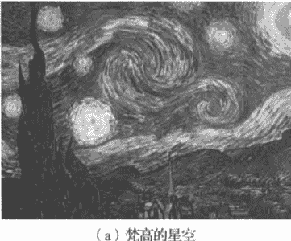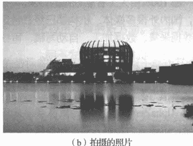

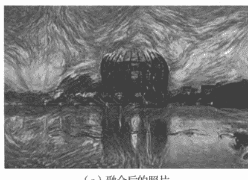

图 1.11 “深度梦境”融合图片

顶尖的人工智能绝非止步于临摹大师笔触，其核心进化方向在于复刻艺术家的创作思维——即在现有流派基础上衍生出全新的艺术表达。图 1.12 展示的便是创意对抗网络（CAN）的成果：该算法历经 8 万幅 15 至 20 世纪西方名作的训练洗礼，最终诞生了极具原创性的画作。值得一提的是，2018 年全球首幅 AI 画作在伦敦佳士得以近 30 万英镑高价成交，标志着机器创作正式进入艺术市场核心圈层。

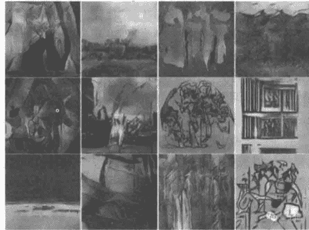

图 1.12 创意对抗网络创作的画作

##### 3. 文学创作

近年深度神经网络大显身手，广泛渗透至诗歌、剧本、小说、新闻稿及辅助内容的创作一线。

以“小冰”为例，这款全球领先的交互式智能系统，不仅能陪聊解愁，更精通作诗、绘画、作曲。它研读了 519 位中国现代诗人的数千首作品，历经上万轮“深度学习”，终获现代诗创作真谛。2017 年，其诗集《阳光失了玻璃窗》面世，出版前无人识破这位“少女诗人”实为代码构建的虚拟实体，这也是人类史上首部 100% 由 AI 独立完成的诗集。

当下，国内外媒体机构已广泛启用写作机器人。标准化流程涵盖数据采集、清洗加工、自动成稿、审核把关及分发触达，仅在“人工复核”环节，各家机构根据业务场景采取差异化策略。

##### 4. 棋类博弈

国际象棋领域，IBM “深蓝”早在二十余年前便击溃人类世界冠军。DeepMind 旗下 AlphaZero 更进一步，它通过自我博弈、经验迭代，零基础自学成才，展现出前所未见的机器智慧，迅速登顶人类智力高峰。

##### 5. 材料、化学与生物领域

2016 年，科研团队反其道而行之，利用失败实验数据训练模型预测新材料合成，准确率竟超越资深化学家。

2018 年，上海大学团队汇聚 2014 年前人类公开的近 1250 万条化学反应式，借助深度神经网络与蒙特卡洛树搜索，成功规划全新合成路线，甚至让权威专家难辨真伪。DeepMind 另将 AlphaZero 技术迁移至生物领域，推出 AlphaFold 攻克困扰学界半个世纪的蛋白质折叠难题，震动科学界。

#### 1.8 AI 发展趋势：感知超人与产业深度融合

2015 年以来，深度学习驱动的感知智能、物联网边缘计算等终端技术突飞猛进；以知识图谱为核心的认知智能虽稳步推进，但仍处爬坡期。

AI 正与物联网、大数据、云计算深度交织共生，三者关系如图 1.13 所示。这既是技术内生动力使然——数据、算法、算力三驾马车拉动商业落地；也是外部基建赋能——大数据解决“米”从何来、清洗整合提质增效；物联网织就感知神经、供给多维实时训练样本；云计算释放低成本高并行算力；GPU 等专用芯片打破算力瓶颈，分布式集群支撑海量参数训练；多层神经网络算法实现图像识别等感知任务的质变跃升。

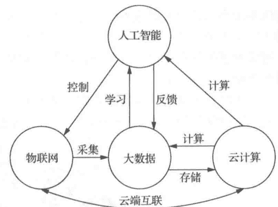

图 1.13 人工智能与物联网、大数据、云计算的关系

在数据、算力、算法三重加持下，感知智能已全面超越人类：人脸识别逼近 100% 精度，落地安防、交通枢纽、社会治理；语音识别、机器翻译、自动驾驶实现跨越式突破，无人驾驶成为全球巨头必争高地；可穿戴智能终端重塑消费电子新赛道。

算力端，海量标注数据与移动云生态倒逼 GPU 硬件迭代，终端芯片向低功耗、低成本演进。通用人工智能（AGI）受限于技术深度，短期内仅巨头布局，尚无明确突破时间表；专用机器智能虽企业众多，但仍受困于数据标注高昂成本。

AI 赋能数字经济。数字经济以数据要素驱动生产流通增值，数据既是手段也是对象。AI 为数字经济提供核心技术支撑，自身衍生多元业态，二者差异不仅在于技术代际，更关乎社会发展动能层级。深度学习较旧范式最大突破，在于实现规模化落地，构建超大规模系统，催生新产业形态。

AI 驱动的数字经济，以新一代信息技术为基座，以“智能+产业”双向奔赴为核心，重塑经济社会新范式。未来数年，AI 与云、物、5G 融合将渗透制造、农业、医疗、物流、政务、金融全域，重构社会运行底层逻辑。智慧城市、智慧交通、智慧医院等创新体系将臻完善，更深远的是，AI 将从单点算法进化为“多智能体大系统”——未来城市或将整体化为一个巨大的智能有机体，实现全域智治。

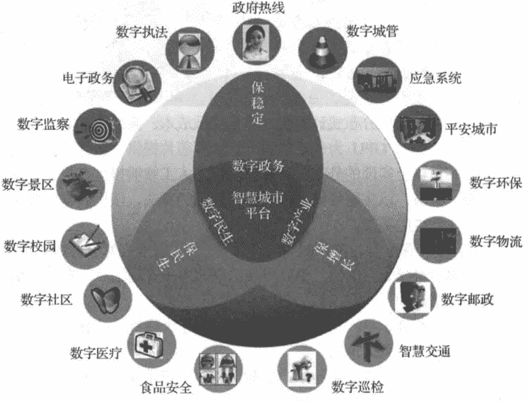

图 1.14 智慧城市建设的典型内容

图 1.14 勾勒智慧城市典型图景，覆盖政务、执法、民生、教育、交通、环保、物流、医疗八大版块，AI 将全方位提升社会治理与服务效能。

“智能+”重塑产业版图：智能制造、智能医疗、智能农业、智能教育……均为数字经济关键增长极。产业视角看，AI 是数字经济的基石与核心引擎，但其技术边界远不止深度学习、大数据、超算。随着脑机融合演进，以人类自身为增强对象的高阶技术将涌现，人类将成技术改造主体。ゆえに，AI 革命的冲击波将超越经济层面，波及人类生存本质，其价值维度高于数据本身。

AI、云、大数据正从“效率工具”进化为产业数字化的“内核”与“增长引擎”：

- **AI 侧**：机器学习、深度学习、知识工程成创新主力。以机器学习为例，凭借自动化、强优化、超凡解优势，已嵌入金融反欺诈、风控等核心流程，未来将与更多新技术耦合释放乘数效应。
- **云侧**：混合云、边缘计算成数字化转型关键基建。混合云兼顾降本增效与敏捷创新，将成各行业渐进式转型首选范式。
- **数据侧**：分布式数据库、数字孪生加速成熟。数字孪生构建物理世界数字镜像，实现双向动态映射，支撑工艺优化、参数预测、仿真监控，成数据驱动业务的强引擎。

数智融合的基础范式即数字智能，数字经济本质上是数据智能驱动的新经济形态。

#### 1.9 本书架构：五维体系与五层认知

##### 1.9.1 五维知识体系：构建 AI 全景认知框架

区别于传统符号主义、联结主义、行为主义脉络，本书确立“五维知识体系”，立足学习视角，囊括**学科基础、技术基础、重点方向与领域（机器智能）、行业应用、伦理与法律**五大维度，强调系统性、整体性、交叉性、全面性。框架详见图 1.15。

| 学科基础 | 技术基础 | 重点方向与领域（机器智能） | 行业应用 | 伦理与法律 |
| :--- | :--- | :--- | :--- | :--- |
| 哲学 | 人工神经网络 | 计算智能 | 智能制造 | 人工智能伦理 |
| 数学 | 机器学习 | 感知智能 | 智能农业 | 人工智能法律 |
| 脑科学 | 大数据 | 认知智能 | 智能医疗 | |
| 心理学 | 计算机技术 | 行为智能 | 智能教育 | |
| 生命科学 | 图像处理 | 语言智能 | 智能军事 | |
| 神经科学 | 其他技术基础 | 混合智能 | 其他行业应用 | |
| 认知科学 | | 群体智能 | | |
| 复杂科学 | | 类脑智能 | | |
| 系统科学 | | 其他重点方向与领域 | | |
| 语言学 | | | | |
| 其他学科基础 | | | | |

图 1.15 人工智能五维知识体系框架

**维度一：学科基础**。汇聚哲学、数学、脑科学、心理学、生命科学、神经科学、认知科学、复杂科学、系统科学、语言学等交叉学科，凸显多学科融合对 AI 的奠基作用。

**维度二：技术基础**。覆盖人工神经网络、机器学习、大数据、计算机技术、图像处理等核心技术栈，夯实 AI 系统开发根基。

**维度三：重点方向与领域（机器智能）**。以机器智能为核心，细分八大赛道：
1.  **计算智能**：高性能计算赋能机器专属、人类难企及的计算优势。
2.  **感知智能**：传感器、机器视觉等构建机器独有感知系统。
3.  **认知智能**：知识表示、逻辑推理、知识图谱打造机器认知引擎。
4.  **行为智能**：机器人及执行硬件赋予机器物理交互能力。
5.  **语言智能**：NLP、语音识别、机器翻译成就机器语言天赋。
6.  **混合智能**：可穿戴、脑机接口开启人机深度融合新范式。
7.  **群体智能**：群体决策、仿生协作催生集群智能涌现。
8.  **类脑智能**：类脑芯片、类脑计算机模拟人脑架构，探索类脑机智。

**维度四：行业应用**。聚焦智能制造、农业、医疗、教育、军事等垂域，诠释 AI 赋能实体经济的工程实践。

**维度五：伦理与法律**。界定 AI 发展红线，强化人文社科守护。

##### 1.9.2 章节布局：13 章 5 部分的系统安排

依托五维体系，全书 13 章分 5 部分展开，结构详见图 1.16。

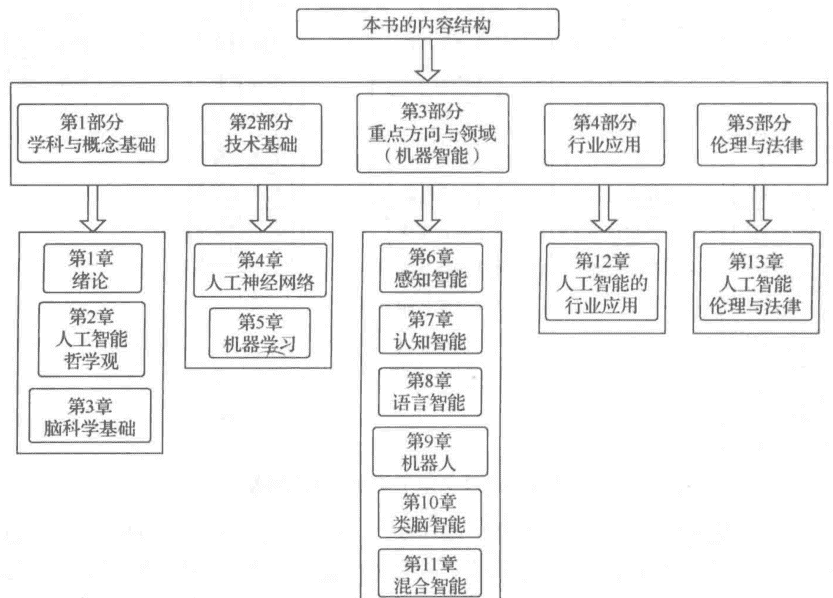

图 1.16 本书的内容结构

**第一部分：学科与概念基础（第 1-3 章）**
- **第 1 章 绪论**：全书总纲，奠定核心定义、理论、技术版图。
- **第 2 章 人工智能哲学观**：以大历史视野溯源 AI 思想渊薮（理性主义、计算主义等），助读者透过哲学透镜洞察 AI 本质，开发更懂人类的技术。
- **第 3 章 脑科学基础**：讲授神经结构、学习记忆机制等前沿发现。联结主义源启神经系统，深度网络虽非生物仿真，但借鉴脑多层级架构；通用类人 AI 必须深度借鉴脑机制。

整体上，第一部分为哲学与神经科学双视角认知 AI 奠基。

**第二部分：技术基础（第 4-5 章）**
- **第 4 章 人工神经网络**：从神经元微观机理推演至深度网络宏观原理。
- **第 5 章 机器学习**：由经典算法延伸至深度学习核心范式。
第 3-5 章为后续核心章节铺垫技术底座。

**第三部分：重点方向与领域——核心篇（第 6-11 章）**
- **第 6 章 感知智能**：图像处理、机器视觉、模式识别基石。
- **第 7 章 认知智能**：符号逻辑、知识表示、搜索技术及知识图谱新范式。
- **第 8 章 语言智能**：NLP 基础与问答、聊天机器人、机翻应用。
- **第 9 章 机器人**：行为智能载体的共性技术与多形态应用。
- **第 10 章 类脑智能**：类脑计算概念、芯片、人工大脑前沿探索。
- **第 11 章 混合智能**：脑机接口、人机交互、人体增强前沿。

此部涵盖主流传统与前沿技术，全景呈现技术发展现状。

**第四部分：行业应用（第 12 章）**
本版新增，聚焦智能制造、智能医疗等标杆领域，兼论 AI 在数字经济、新基建中的角色。

**第五部分：伦理与法律（第 13 章）**
系统阐释 AI 伦理基础、应用伦理及法律困境。

各章概念、技术层层递进、相互关联。第 1 章答“何为 AI 与 为何要 AI”，1.8 节答“AI 能做什么”，第 4-13 章答“AI 怎么做”。

本书大量探讨强 AI（AGI），旨在哲学层面激发想象与创造，强调多维度认知 AGI 可能性、意义与风险。相关章节跨度第 1-3、10、11、13 章，贯穿哲学、脑科、技术、社会、伦法、科幻维度。

##### 1.9.3 五层认知阶梯：从大历史到工程落地

上述 5 部分 13 章，更可归纳为五个递进的认知层次：

1.  **大历史观**：超越技术表象，结合唯物辩证法反思人类存在价值，将 AI 认知升维至思想理论高度。
2.  **哲学思想**：聚焦生命、意识、物质、大脑等本体论根本问题，借哲学洞见拨开 AI 本质迷雾。
3.  **社会与文明**：站位国家、人类命运共同体，审视 AI 对经济、文化、教育、个体命运的深远重塑。
4.  **多学科交叉**：正视 AI 无统一理论、无统一模型、仅有场景化技术的现状，确立交叉学习范式。
5.  **工程技术与应用**：落脚点。在前四层认知支撑下，迭代更有效技术，解真问题、应真需求。

**章节-层次映射关系**：
- 第 1 章部分内容、2.1.3 节 → 第 1 层
- 第 2 章其余内容 → 第 2 层
- 1.2 节、1.8 节、第 13 章 → 第 3 层
- 1.4 节、第 2-11 章、第 13 章 → 第 4 层
- 第 6-12 章 → 第 5 层

详细对应见图 1.17。

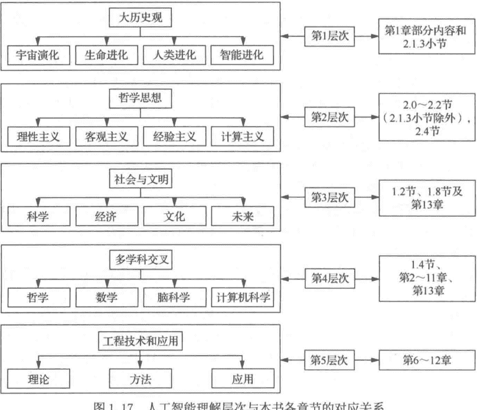

#### 1.10 章节核心回顾

本章系统梳理了智能与人工智能的定义、分类及演进脉络，重点解读了符号主义、联结主义、行为主义三大经典流派，以及数据驱动、感知智能、认知智能、类脑智能等前沿方向。同时，从产业落地、技术演进、社会冲击及核心瓶颈四个维度，展望了AI的发展趋势。掌握这些基石概念，旨在为后续深入剖析各项AI技术及其应用价值打下坚实认知基础。

#### 1.11 思考与实战题库

1.  如何界定“智能”的内涵？
2.  生命与智能之间存在何种关联？
3.  什么是人工智能？为何大众对其认知差异巨大？AI包含哪些类型？
4.  如何辨析“机器智能”与“人工智能”的区别？
5.  AI发展史上的关键推手有哪些？他们的核心主张是什么？这些思想如何塑造了AI进程？
6.  为何AI研究必须依赖多学科交叉？各学科扮演何种角色？
7.  AI主流研究范式有哪些？
8.  AI核心研究版图覆盖哪些领域？
9.  AI技术给社会发展带来了哪些深远影响？
10. 驱动AI产业腾飞的关键技术引擎是什么？

### 02 AI的哲学灵魂：通往机器心智的终极追问

**本章导航目标：**

- 吃透与AI紧密相连的核心哲学概念与思想脉络；
- 站在哲学高度审视AI本质，读懂心灵哲学等分支如何为AI研究导航定向；
- 看清现实AI的根本短板与边界，建立科学认知，不被科幻叙事裹挟。

#### 2.0 破题：为何AI绕不开哲学？

为何开篇不讲数学、不写代码，却要先谈哲学？因为图灵当年的发问——“机器能思考吗？”，本质上是哲学命题，更是AI的元问题。数学与计算机科学提供的是分析与实现的工具箱，而非本质的说明书。AI与人类智能的底层逻辑在哲学层面是同构的。AI的终局，是造出能像人一样思考、行动的智能体。人是地球智能的天花板，AI以人类智能为蓝本。要达成终局，首要前提是搞懂生命与智能的本源。可这些终极追问，科学至今仍无标准答案，只能在哲学疆域探寻。因此，本章将带你构建理解AI必备的哲学知识图谱。

早在1978年，英国哲学家亚伦·斯洛曼就在《哲学的计算机革命》中发出惊人预言：
1. 若哲学家对AI前沿进展一无所知，因不称职被指责实属公允；
2. 在心智哲学、认识论、伦理学等核心领域授课若不涉AI，无异于物理教学剔除量子力学般失责。

可见，哲学与AI早已深度纠缠。哲学视角能助我们穿透技术迷雾，直面当前AI的局限，发掘未知挑战与破局之道。

#### 2.1 哲学视角解码AI

“哲学”源于古希腊“爱智慧”，是人类对自然与社会知识的系统化概括，是理论化的世界观。其核心探究在于思维与存在、物质与意识的关系——世界的本原是什么？苏格拉底、柏拉图、亚里士多德奠基了形而上学、逻辑学、认识论、伦理学、美学等支柱学科。与AI强相关的哲学概念库包含：物质、意识、心灵、心智、智能、理性、情感、概念、经验、本体、逻辑、推理、伦理、信息、认知、计算等。基于这些概念的不同阐释，衍生出一元论、二元论、理性主义、经验主义、计算主义等流派体系。

##### 2.1.1 AI绕不开的核心哲学概念

第一章指出，“AI”中的“智能”通常指人类智能。用计算机模拟或实现人类智能特定侧面的技术，亦称“AI”。但模拟智能终非自然智能。透过以下概念辨析，我们将厘清二者的本质关联。

**1. 一元论与世界统一性**
世界统一性建立在差异性之上。本元是什么？唯物主义一元论说物质，唯心主义一元论说精神。物理主义（现代唯物主义主流）主张：心理概念可还原为行为概念，躯体与行为才是实在，思想情感源于大脑电脉冲、肌肉化学反应等物理机制。
辩证唯物主义承认万物差异与联系，视世界为有机整体，统一性基础在于高度抽象的哲学“物质”——客观实在性。

**2. 二元论：身心分离的经典困境**
文艺复兴北欧巨擘、现代哲学奠基人笛卡尔，确立了“物质-心灵”身心二元论。他认为人拥有非实体的自由灵魂与机械运作的躯体。名言“我思故我在”切开内外两界：外在世界与内在心灵，有别却互动。
斯宾诺莎则主张“双重属性论”：心灵与身体是同一实体的两面。思想是心灵显现，也是大脑脉冲显现。传统哲学之“心”包含两大课题：心灵如何认识世界？心灵如何驱动身体行为？

**3. 意识：终极的“硬难题”**
意识对个体而言，依然神秘。为何每人都是自己意识的中心？“身心问题”被大卫·查默斯冠以“意识的硬难题”。他将理解意识拆为两级：
- **简单问题**：科学可逐步破解大脑结构如何产生知觉、记忆、行为表现。
- **困难问题**：科学无法跨越物质-精神鸿沟，解释主观体验如何从物质中涌现。

大脑每秒接收海量感官信息，却过滤掉99%以上，仅在剩余信息上构建思维。神经科学揭示：绝大脑活动与行为是无意识的，无意识是思维的底座，有意识处理仅是冰山一角。但无意识行为、有意识思维与神经物质间究竟如何关联？谜团犹在。
有意识≠有自我意识。同理，AI即便有了意识，会否生成自我意识？未知。退一步，即便有自我意识，能否具备人类智能？仍是谜。
马克思恩格斯指出：“意识一开始就是社会的产物。”唯物主义认为：意识是自然长程发展、劳动与社会实践的产物，是人脑机制对客观世界的主观反映。物质与意识对立统一：区别在于客观实在性vs主观观念；联系在于意识依赖物质起源。
未来智能机器能否主动参与社会实践、生成社会思维？答案悬而未决。
“物质-意识、身体-心灵”关系构筑了一元论、二元论核心。人们期盼机器像人一样有意识、有智能，隐含“二元论”预设：非生物物质（硅基芯片等）能像碳基大脑一样产生心智。若此预设成立，AI终局随技术进步可期；否则，只是空中楼阁。

**4. 理性与非理性：具身认知的颠覆**
理性古老如人类历史，古希腊哲人（毕达哥拉斯、苏格拉底等）视其为人之本质。
理性与非理性是精神世界两极。理性形式含概念、判断、推理等逻辑思维，及体系化理论；非理性形式涵盖本能、欲望、情感、直觉、信仰、潜意识等。
传统符号主义AI模拟的正是理性逻辑推理与符号操作。虽不知人脑如何实现推理，但模拟推理已可让机器“类人”思考，虽欠灵活与通用。机器执行任务不受情绪干扰，严谨精准，这是人类渴望却难达成的“瓦肯人”式纯粹理性（引用《星际迷航》设定）。另一路科幻憧憬有情感AI（《机器管家》《人工智能》）。现实中，两者皆无踪影，当前AI仅实现了无情感的部分计算理性。

认知科学重塑了理性观：
1. 理性非“离身”独立，依赖身体独特性、神经网络、生存环境与日常实践；
2. 理性由身体铸造，大多无意识，思维主体是无意识；
3. 抽象概念表达多借隐喻完成。

结论惊人：理性来自身体与环境共性，非超越身体。**思维不可超越身体。**

若理性“具身”——必须依附躯体生成，AI想拥有类人心智，首要条件是否需要一个能体验世界的合适躯体？类人心智是否强制要求类人躯体？
希拉里·普特南《理性、真理与历史》提出“缸中之脑”思想实验：大脑离体泡营养液，神经接超级计算机，接收模拟脉冲，获得完整幻觉体验（含举手反馈）。这强调大脑可离身产生感觉，但也切断了社会联结——无肢体行动，无社会实践输入。“缸中之脑”能否仅凭信号刺激生成完整人类认知理性？未知。换成无身躯的“电子大脑”同理。此实验揭示：智能模拟触及人之二重性——自然属性可模拟，社会属性或为机器不可逾越的鸿沟。

**5. 信息、计算、心智与智能：本质溯源**
智能非源于特殊灵质、物质或能量。
- **信息处理视角**：凡能获取、加工、利用信息并指导适应性行为的系统即智能系统。智能=信息处理，外显行为非必需（如纯心理活动）。
- **行为视角**：信息处理是前提核心，适应性行为是结果目的。单纯处理仅完成半程，必须落地为行为才构成完整智能。

30年代，哥德尔、丘奇、克莱尼、图灵等奠基“算法可计算性”，通用图灵机诞生，丘奇-图灵论题确立：一切可计算函数=递归函数=图灵机可计算。可计算性理论研究计算复杂度与不可计算结构。斯梅尔列21世纪24大数学难题，第18问：“AI的极限何在？”直指哥德尔不完全性定理——形式系统内存不可判定命题，揭示致命缺陷。
图灵机澄清：形式系统=产生定理的机械程序。曾有人梦想造出证明所有定理的机器，但图灵机受限于形式系统，必存不可判定命题。停机定理等价论证：无程序能判定任意程序P在输入I下是否停机。数字计算机皆为通用图灵机特例，故计算机能力本质有限。
形式系统与图灵机囊括不了所有数学真理，人心却能洞察真理。哥德尔定理似暗示：机器模拟人智存在逻辑天花板，计算机永远无法做到人能做的一切。众数理哲学家据此诱导出“人心胜过计算机”。
哥德尔本人不反对定理作部分佐证，但拒绝其为直接证据，需“理性所提问题理性皆能解”等额外前提。他严格区分心、脑、机功能，且据第二不完全性定理，不排除超越人心的机器存在。但假若存在，人类或不知其工作原理，或无法保证其按预期精准运行。深度学习现状印证此言：图像语音识别极强，却因结构与人脑迥异而不可解释，催生“可解释AI”研究。

早期AI专家视符号操作（计算）为智能基石。从通用图灵机与物理符号系统假说出发，心灵哲学家推导出“心灵即程序，大脑即硬件”观。智能本质被视为符号操作/计算，催生认知科学核心假设：智能系统=物理符号系统，心智计算理论诞生。共识：心智本质=计算，思维=信息加工。若人脑是“信息加工厂”，原料来自社会实践，无原料来源，再强大脑也无法自发生成思想。

**终极追问：信息与计算，孰为心智智能本质？抑或皆非？**
答案决定了强AI能否凭计算机信息处理路径实现。当计算机日夜处理文本、图像、语音、数据，精准提取所需、识别声纹确认身份……我们能称其“有智能”吗？此智能与人类智能有何质差？

##### 2.1.2 AI相关的哲学主战场

关联AI的哲学分支繁多：心灵哲学、心智哲学、计算哲学、生命哲学、生物哲学、信息哲学……其中，心灵、心智、计算三大领域与AI联系最紧，直指AI本质与强AI认知核心。

**1. 心灵哲学**

溯源现代西方心灵哲学，往往要从笛卡儿说起。他以那句震彻古今的“我思故我在”，在形而上层面切开了外在世界与内在心灵，确立了二者既截然不同又彼此交织的二元格局。心灵哲学作为一门分支学科，聚焦于各类心理现象的本质、心理与物理的关联，其探讨的核心命题无一不绕着“心灵”展开：意识的实体是什么？心灵栖居何处？它们与“自我”有何干系？“我”是否超脱于肉身之外？心灵与大脑究竟是不是同一回事？

在认识论层面，心灵哲学直面的难题是：我们如何获取关于有意识、有理智的心灵及其内部运作的知识？这主要划分为两大版块——他心问题（如何确知他人有心）与内省/自我意识问题（如何认识自身心灵）。

值得注意的是，心灵哲学的基石性议题，恰恰也是人工智能的终极拷问。图灵提出的“机器能否思考”，实质上与“机器能否拥有心灵”同构。因此，AI研究不仅要锚定目标，更须深究物质与心灵的关系、心灵意识能否脱离物质独立存续、其物质基座究竟为何等根本追问，这些思考将直接照亮“机器是否拥有类人思维”的迷雾。

###### 2. 心智哲学

心智哲学致力于穷究心智本质，对心理范畴进行理论剖析。立足于此，我们得以从哲学维度审视人类心智的底色，进而在设计类人智能机器时，确立基准现象与根本原则。

心智是智能的关键投射，“机器有无智能”“机器有无思维”“机器有无心智”，实则指向同一个终极命题：人类心智的本质是什么？倘若机器拥有心智，人机心智是否共享统一的物理/物质基底？若统一，统一于哪一物理层面？这些关乎人与智能机器心灵关联本质的发问，直击灵魂。

残酷的现实是：智能机器虽已展露锋芒，却毫无人类式心智的影子。让机器翻译“我爱我的祖国”易如反掌，但要它领悟“国家”与“爱”的深层内涵，进而生发出真挚的爱国情思，依旧是天方夜谭。

###### 3. 计算哲学

18世纪至20世纪初，科学与数学的形式化铺就了AI的先行道；20世纪数字计算机的问世，才真正让AI跻身科学殿堂。伴随计算机迭代、AI演进及认知科学兴起，计算主义渐成宏大的哲学思潮。20世纪下半叶，计算哲学的视线转向认知科学与心理哲学，核心主张是：计算即心智、心灵、思维与认知的本质。70至90年代，该流派深度重塑了生命科学、心灵/心智哲学及认知科学，催生出“计算主义世界观”——视计算为世界的根本属性，与物质、能量、信息并列，揭示宇宙运行的底层逻辑。一旦戴上“计算眼镜”，大脑、生命系统乃至整个宇宙，尽显计算系统真容：从细菌到宇宙，人类及其智能，皆是物质信息经计算加工后的产物。

计算哲学的启示在于：自然律即特定“算法”，自然过程即算法执行，自然界由此布满形形色色的“自然计算机”。基于此衍生出四大理论范式：
1. **自动机视角**：以数学建模，破解原本唯人类智能可解之难题。
2. **符号加工视角**：启发式编程，将感知、记忆、学习提炼为规则，让计算机模拟呈现智能。
3. **生物机器视角**：基于生理/神经结构仿生，打造“类脑”“类人”机器。
4. **大脑即计算机视角**：心智、认知、智能本质皆为计算过程。

哲学家约翰·塞尔以“中文屋”思想实验强力反驳“智能即计算”论。他主张：计算非心灵内在本质，非物理系统固有属性，仅是观察者赋予的解释。故而，指望靠计算造出具强人智、心灵、心智的机器，纯属妄想。

实验设想：不懂中文的塞尔被关在屋内，屋外中国人递入中文字条（塞尔眼中仅是曲线），附以英文规则指令其配对、操作符号。塞尔不知字条实为脚本、故事、问题，输出乃答案。外人看来塞尔精通中文，实则他仅完成符号操作。塞尔以此喻示：计算机运作本质上同屋内操作无异——句法操作不生语义理解。

概括早期AI路径：无论功能模拟的计算主义，还是结构模拟的神经网络，皆属本质主义的静态描述——预设世界与心灵本质为概念化、范畴化的计算存在，模拟即再造。但困境倒逼反思：世界本动态，人与世界本融合，认知与智能在人-环境-知识交互中生成构建。新AI范式不再执着于用数学模型静态刻画海量背景知识，转而致力于打造能从环境中动态自主学习、具备交互、具身认知、情境适应能力的机器智能。

##### 2.1.3 大历史观——智能进化

大历史观将人类演进置于宇宙坐标系中，自大爆炸溯源文明脉络。信息科学诞生后，机器在信息处理上局部超越人类理性，人类借AI即将开启自我嬗变，步入新进化阶段。故审视AI发展，须置于宇宙演化（非生命系统由简入繁的历程）的大历史洪流中，视其为宇宙历史进化的产物。

大历史镜像下，生命进化奇点回溯至138亿年前大爆炸。88亿年后（距今50亿年）太阳系成形，46亿年前地球诞生。化石记录将生命推至38亿年前，但“原始祖母细胞”成因仍谜。生命乃物质形态转化，激活无机元素形成自我复制系统，其奥秘理论尚臻完善，我们只能循30亿年进化路径推演。

达尔文进化论是权威注脚。生命从微生物、埃迪卡拉生物群，历经寒武纪大爆发、奥陶纪灭绝、植物登陆、开花植物绽放、鱼类上岸、恐龙霸主、泛大陆裂解、哺乳动物崛起、恐龙陨落、哺乳动物兴起、古猿至人类。4亿年前大陆荒芜，鱼类启程登陆；4000万年前古猿登场；最古老人类化石仅700万年，智人史更短——20万年前现代智人始现非洲丛林。现代人起源学界存“夏娃说”（非洲单一祖源，语言智能催生分类分析世界）与“同化说”（非洲为主要而非唯一起源地）并立。无论如何，智人凭更大脑容量，实现信息存储、创造性思维与复杂交流。

人类是自然馈赠，40亿年无数偶然铸就今生。自然智能历经宇宙演化、生命智能进化、人类智能进化、文化文明进化四大纪元。人类虽非最强体魄，却是自然界智能最高、智慧最深的高等生命。智能进化至人类层级，必催生技术工具，兼具情感与理性。情感赋予爱恨悲欢，理性驱动探究本源、创造科学机器、孕育高阶精神文明，从而让人类得以突破自然进化桎梏，缔造区别于自然智能的“人工智能”，甚至超越人智的新智能形态。机器智能（计算机程序与机器学习算法实现）乃新智能形态。人智、机智皆为宇宙大历史演化之果。AI既是人智创造之果，也是宇宙演化之果。至于远未来AI替代或融合人类，不过幻想或哲学构想。

##### 2.1.4 人工智能的本质

AI本质何在？须先解生命、物质、意识、智能、心智等本质及其纠葛——然此皆悬而未决。故从唯物主义哲学、AI作为工具、AI与人类关系三维度管窥。

###### 1. 一元论与AI基本问题

AI的哲学意蕴在于：它有力佐证了“意识源于物质、物质是意识基础”的唯物论。创造AI先须承认物质决定意识，智能依托躯体、大脑等物质载体。计算机本质是硅基机器（硅即沙之主要元素）。弱AI已部分验证智能落地依赖实体物质：聊天机器人、语音助手、人脸支付等，印证人类智能侧面可在硅基上实现。强AI能否于硅基诞生，引发更深思考。迄今主流假设：通用/强AI可在异于人脑的硅基或他质中涌现。验证手段锚定计算机：人智可计算模拟，计算机可功能等价实现类脑智能，即计算机与人心在计算功能上等价。涉强AI时，常预设此类机器智能具意识、乃至有生命。

总体而言：人智（碳基生命）与机智（硅基无生命）物质基座迥异、智能层级各异，但同依物质而存。若认人智可于硅基生发，必然遵循唯物一元论：物质决定智能与意识。有意识智能能否离脑而存、生于无机质，触及笛卡儿“身心二元论”，此乃AI最基础命题。

###### 2. AI是有限理性智能工具

马克思·韦伯指出：资本主义货币化与“算计化”催生工具理性。此视域下，AI区别于蒸汽机等历代工具，是新形态理性工具——将人类智能具象化、机器化、算法化。其演进或将全维超越人类（体能至智能），终重塑人类身心生存。智能工具既可作人类认识客体的中介，亦可能进化为平权甚至超越人类的新主体，“反客为主”非科幻专属，乃强AI落地后的必然图景。

实然层面，人类思维含两性工作：一、无需理解创造的机械操作（大脑“体力劳动”）：计算、逻辑、感知、行为，属理性范畴，多左脑主管；二、需主体主动参与、独特判断的“脑力劳动”：理解与创造，多右脑主管。

计算机处理任务须经形式化：规范数理逻辑、数据易入系统计算；综合性强、模糊高、需环境社会交互之任务，难度指数级跃升。故计算机从事纯形式化、机械化工作时，与人类理性思维性质同构。人脑优势在于联想、创造、决策、适应复杂环境主动行动、感性统摄理性等智能特质。智能机器缺乏这些特质前，AI只能作为人类可控的有限理性工具存在。

###### 3. AI是人类存在价值的镜像参照

大历史视野里，AI与生命、人类同为进化产物——非生物学进化，乃人类文明进化。约1万年前农耕纪元开启文明演进。万年来，人类生物进化、基因层面、脑生物学近乎停滞，文明文化却持续跃迁。

AI固能助推社会经济，然非其本质全貌。文明进化维度看，AI更是提升人类整体文明进化位阶的力量。作为第三方参照，它让人类得以反观自身生存价值意义。它是镜像存在，映照人类文明及其存在价值意义。

#### 2.2 人工智能的局限性

当前AI技术均建立在传感器数据、多模态数据（文本/图像/语音/视频）信息处理之上，主攻人类感知智能层面。关于“机器能否思维”的认知/理解/批判，实质指向强AI——即达人类水平甚至超越的机器智能。造类人智能机器是AI最高理想，但现阶段距离遥远。以下维度揭示局限：

弱AI认知核心，在于其技术与人智的本质鸿沟。

##### 1. 主观能动性缺位

现阶段弱AI机器智能零意向性：无法像人般自觉存在、觉察与环境/客体的不可分联系、觉察关系、对行为判断评价调整、缺人类特有目的性、无法实现目的与结果统一。波士顿动力人形机器人虽能完成后空翻等高难动作，却不知目的、不解意义、无主观意愿、无愉悦感。唯创造者知其意义：标志行为智能突破、逼近类人机器人。动作虽酷似甚至超越运动员，本质仅是机械模拟与完美执行。图2.1呈现翻跟头两瞬态。

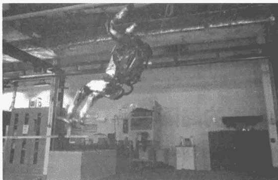
(a) 状态1
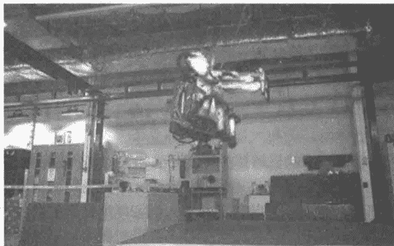
(b) 状态2
图 2.1 会翻漂亮跟头的机器人

##### 2. 复杂场景适应性短板

弱AI在计算易行的理性智能上长足进步，但在复杂场景适应上与人类鸿沟犹在。普遍“有智能、缺智慧，有智商、缺情商”。仅擅特定任务，数据/任务微变即性能崩塌。

图像识别深度学习系统易被“愚弄”。图2.2(a)：贴纸干扰停车标识被误判为限速标识。图2.2(b)：左图熊猫识别正确，植入中间噪声后右图竟被判为长臂猿。

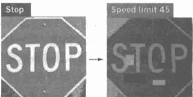
(a) 利用贴纸，使深度学习系统将停车标识认作限速标识
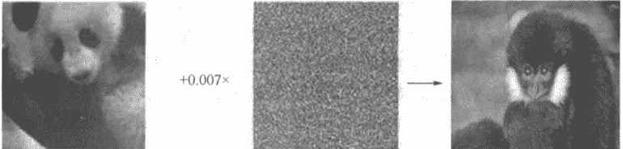
(b) 加上噪声后的大熊猫图像被识别成长臂猿
图 2.2 人工智能受到“愚弄”

数据不全、规则不确、目标模糊、干扰存在等条件下，多数智能系统失效。虽棋类远超人类、绘画写作不俗，但缺乏适应多变复杂场景能力，仅具专用智能与有限通用智能。当前无系统能兼做棋类、复杂动作、家务；无类牙医、园艺师等需复杂动手与主动规划的机器人。

##### 3. 思想与独立决策能力缺失

弱AI机器智能欠缺人类心智内在性特征：丰富心理过程彰显的情感、兴趣、意志，以及价值观、人生观、世界观等高阶情感内容。对人类而言，主观世界差异导致同一客体观点千差万别——此乃机器难企及之境。

### 机器智能为何仍难企及人类高度？

当下的AI，本质上只是在高度模拟人类行为的外在表现与智能假象，并未真正掌握“思考”的内核。特别是在情感共鸣、意志驱动、审美判断等非理性领域，以及面对复杂多变环境时做出创新决策、凭借直觉与灵感行动的能力上，机器与人类尚存巨大鸿沟。跨越这一鸿沟、诞生具备独立思想与自主决策的强人工智能，依然是遥不可及的远景。

诚然，现有AI已能作画写小说，甚至拍出高价，但背后的代码从未真切体验过美感，不会为笔下剧情动容，更无法产生独立的思想火花。

#### 4. 社会性：智能进化的缺失一环

智能的萌发从非单一维度，而是多元因子交互的产物。人类智能源于漫长的环境博弈与经验沉淀，更经历了基因层面的代代相传，尤其是现代社会的深度塑造，让“社会性”成为了人类意识、思维与心智的核心底色。

反观当下的机器智能，彻底缺失类人的社会生活体验与经验积淀。我们至今无法造出具备真正社交能力、能融入人类社会协作并替劳动的机器人。

**何为“社会性”的真标准？**  
设想一个机器人独自完成跨城旅行：自主订票订房、规划路线、换乘交通、应对航班延误、向服务人员求助、打听当地趣事寻找同伴（不考虑吃住）。若能畅通无阻做到这些，它便拥有了社会性，也就触摸到了强人工智能的门槛。可悲的是，这些不过是常人日常生存的基本技能，却至今难倒了最顶尖的智能体。

---

### 2.3 核心知识回顾

本章深度剖析了AI的本源命题：物质与意识、身心关系、机器能否承载类人智能。从大历史维度定位AI为宇宙演化的产物；梳理心灵哲学、心智哲学、计算哲学等核心流派，厘清AI的本质与认知边界。学习后，读者将建立起理解AI本质、识别现阶段局限的哲学底座，为后续技术方法论的学习奠定认知地基。

### 2.4 思辨与实践

1. AI的根本命题是什么？
2. 哲学为AI研究提供了何种支撑？
3. 认知、智能、心智的本质究竟是计算吗？理由为何？
4. 若本质是计算，能否直接在机器上复现人类心智？
5. 强AI的卡脖子瓶颈在哪里？
6. 意识、意向性与非理性如何制约强AI？
7. 如何用理性视角解构AI？其本质何在？
8. AI对人类文明意味着什么？
9. 设计一个新型“图灵测试”，并阐释设计逻辑。
10. 机器能拥有类人心灵心智吗？为何现有AI做不到？
11. 机器如何才能真正拥有类人心灵心智？

---

## 03 脑科学基础：解码智能的生物蓝图

**学习导向：**
- 读懂大脑精密架构与神经系统核心机能；
- 梳理脑、神经、躯体、意识、心智、智能的关联网络；
- 对标人脑与计算机异同，汲取神经科学对AI的启发性洞见。

### 3.0 导言：头颅里的“超算”

人脑是自然进化出的最高效“生物计算机”。  
数据极具震撼力：成年人大脑仅占体重2%（男性稍重），却耗尽全身20%能量，能耗是其他器官10倍，思考功率却仅20W——远低于超算。每秒10万次化学反应，日处理8600万条信息，神经传导飙至400km/h。大脑还是严格的“信息过滤器”，留存仅1%，其余99%判定为噪音直接清除。这团体积不大、结构极其精微的器官，藏着通往类人智能的必经之路。诺奖得主坎德尔断言：人类改写脑功能的能力，或将像冶金术开启铁器时代般重塑历史。

### 3.1 脑与神经科学：认知的三重跃迁

大脑是高等生命生成智能的核心中枢。人类对它的破译，历经三个纪元：
1. **萌芽期**：早至公元前7-5世纪，中国先民已悟“脑主思维”，对结构有朴素认知。
2. **机械期**：确立反射学说与定位学说，确立脑区功能分区观。
3. **现代期**：多尺度、多层级、多路径并进——从整体到分子，从综合到物化心理分科，全方位解剖。

**学科界定：**  
脑科学聚焦结构功能、脑行为思维关联、神经系统演化规律；神经科学深究神智活动的生物学微观机制（细胞/分子层面）。狭义“脑”指中枢神经/大脑，广义泛指全神经系统。

**系统论视角：**  
人的“智能系统”是感觉、神经、思维、效应器官的完整闭环，缺一不可。智能源于此系统与环境的持续博弈。

**左右脑：分工不等于对立**  
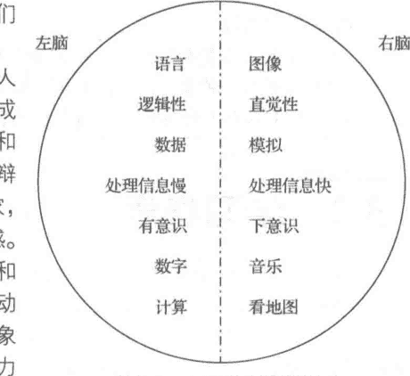  
左脑掌语言、逻辑、显意识，似辩论家与科学家，长于抽象计算，短于情感幽默；右脑司形象、直觉、空间、艺术，似艺术家，富激情创造，记忆与思考结合能激发独创灵感。当前AI模拟的，主要正是左脑的逻辑推理功能。  
但分工非绝对。斯佩里裂脑实验揭示：单一颅内可并存两套独立意识系统，各有感知认知记忆全套功能。左右半球实则互备功能，仅侧重不同。

科学虽已绘就脑区功能图谱，但统一理论仍缺位。计算科学家正试图用计算工具重构脑功能，神经科学的核心使命正是寻找那套能串联海量观察数据的统一理论。

### 3.2 脑神经系统：从微观透视智能本源

认知智能除宏观脑区，微观神经系统是必修课。脑神经组织是中枢核心，透视它即透视智能的微观基座。本节聚焦神经组织、神经元、大脑皮层。

#### 3.2.1 脑神经组织：双系架构与微观秩序

神经系统主导生理调节。人体分**中枢**（脑+脊髓，核心枢纽，整合信息、输出指令、存储记忆）与**外周**（神经干丛节末梢，联结中枢与全身器官）两系。AI研究聚焦中枢核心——大脑神经组织。

基本单元是**神经元（神经细胞）**。1906年卡哈尔提出神经元学说，绘就人类首幅神经元图谱。昔日受限观测手段，今借先进脑扫描成像，860亿神经元的连接图谱终现真容：连非杂乱，乃极致有序。  
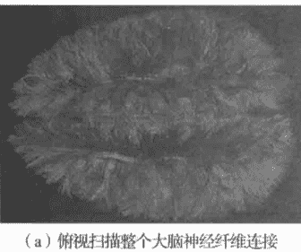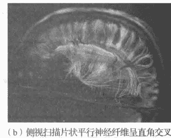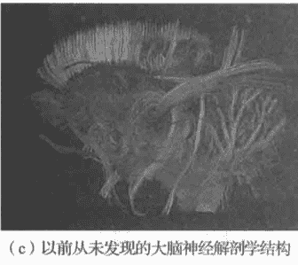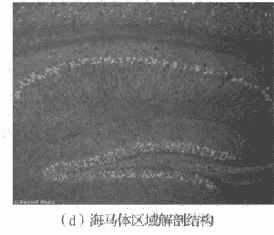  
整体俯视侧视皆显整齐纤维束；  
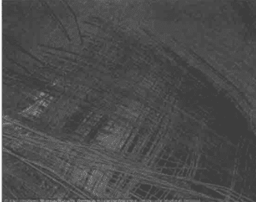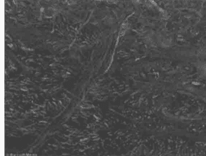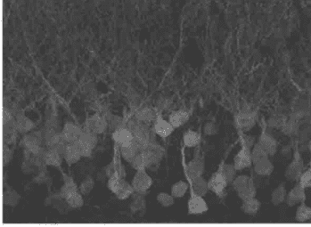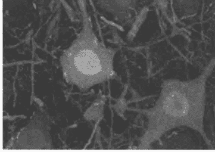  
从未见的解剖结构与海马体细节浮现；  
神经纤维呈直角交叉网格，似布匹纹路、似高速车道，以有序约束生长方向；  
神经元间通路复杂精微，皮层褶皱隐匿曾让连接模糊不清。

**规模惊人：** 860亿神经元，单元连接超千，突触总数约100万亿，神经递质达数十种。

**跨物种对比（表3.1）：**  
从小鼠(0.016B神经元/0.128T突触)到人(20B/100T)，猿猴(2B/16T)最接近人类。哺乳动物智能水平与神经元、突触规模呈显著正相关。

#### 3.2.2 神经元与信息传递：计算的生物原语

**1. 形态与功能双分类**  
按突起形态分单极、双极、**多极**（人工神经网络模拟原型）；按功能分感觉、运动、中间神经元。  
2018年发现**“玫瑰果神经元”**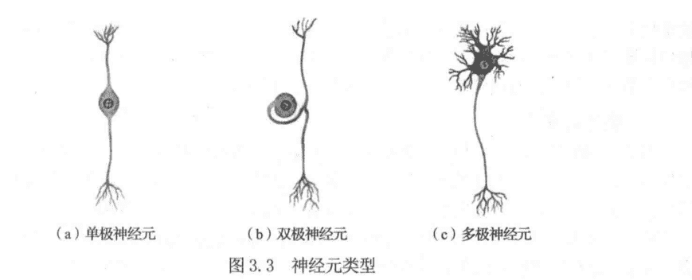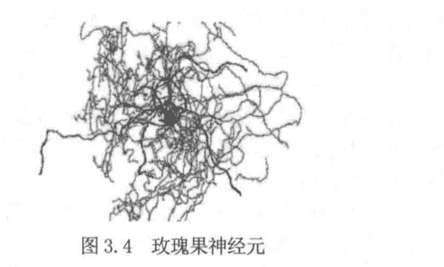，形似脱瓣玫瑰果，或为脑活动总“抑制剂”，关联意识基础。

**2. 精密微结构**  
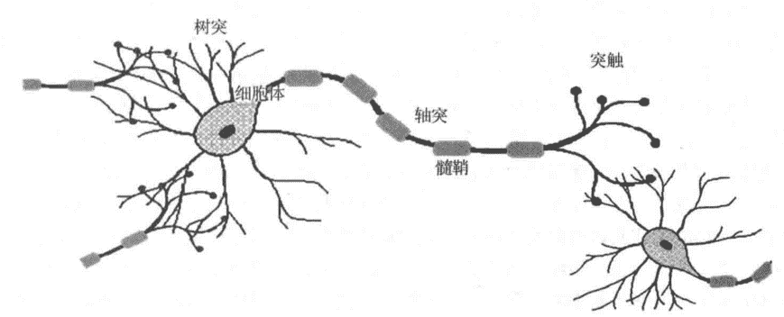  
单元由**细胞体**（代谢中枢，含核/内质网/高尔基体）、**树突**（主接收器，周围树状分布）、**轴突**（主传导管，向外延伸、末端分叉）构成。轴突外裹**髓鞘**绝缘层。轴突末梢与下游树突/细胞体/轴突形成**突触**。人脑突触超100万亿。

突触三件套：突触前膜(轴突末梢)、突触后膜(下游接收面)、突触间隙(窄缝)。  
信号流：生物电沿轴突传导→达间隙若超阈值触发**峰电位**(全或无、固定波形、可靠传递)→若电信号难跨间隙则转生化信号(递质)跨越后复电→若未达阈值则抑制不传。

**3. 突触可塑性：学习的物理底座**  
赫布猜想：“共同激发的神经元连接在一起”。同步激发强化连接。  
演进出**STDP机制**：A先于B激发则强化A→B连接，反之减弱。突触权值可调，解释了重复学习为何能提升反应速度与记忆牢固度。这直接催生了赫布学习规则，启发了联结主义早期训练算法——AI受脑启发的经典范例。

百年研究虽明神经元靠递质(谷氨酸、多巴胺、血清素等)跨突触传递兴奋/抑制信号，但微观细节长期模糊。2016年突破：递质在细胞间隙极精密排布，预释放区与受体区蛋白完美契合，形成准“连接柱”，极致优化传递效率。这为理解脑内通信机制及精神神经疾病提供了结构钥匙。

**4. 从单元到整体：未解之谜**  
神经元是意识、记忆、思维的生物基石。过去数十年，单元机制与百万级功能区取得长足进展，视觉系统相对透彻。但**大脑作为复杂整体如何反应与计算，仍是迷雾重重**。  
先天与后天界限何在？遗忘机制为何？意识本质与起源？情绪可控度几何？进化造就的复杂性，远超人类当下的认知边界。

### 3.2.3 大脑皮层：思维的指挥中枢

#### 1. 皮层分区：功能的精细地图

在所有哺乳动物的大脑表面，都包裹着一层仅几毫米厚的灰质组织——这就是大脑皮层。在人类大脑半球的上方，铺展着一种拥有6层精密结构的“新皮层”，它占据了成年人皮层总面积的94%之多；而剩余区域则由演化更早的“古皮层”与“旧皮层”构成。

大脑皮层是学习记忆、语言思维、感知觉醒等高级功能的核心载体，物种越高等，其结构越发达。受限于颅腔容积，这层组织像一张巨大的纸页被揉皱塞入，展平面积约2200平方厘米。由于不同区域层厚各异，功能分工也截然不同。

三道显著的沟回——中央沟、外侧沟、顶枕沟，将每个半球划分为额叶、顶叶、枕叶、颞叶四大功能板块：

*   **额叶**：面积最大，位居最前。其后部整合运动与空间信号，主导思维规划，深度关联个体需求、情感、智力及创造力，并与颞叶共同构建语言中枢。其中，**前额叶皮层堪称大脑的“中央处理器”**，统管记忆编码、短时存储、调控执行、决策判断与情绪调节，是人类高级智力活动的物质基石。
*   **顶叶**：夹于枕叶之间，专司躯体知觉与运动整合，疼痛、触觉、温度、压力等体感于此汇聚，亦关联数理逻辑处理。
*   **枕叶**：坐镇半球后部，为视觉处理核心区，兼顾语言、动作感知与抽象概念构建。
*   **颞叶**：隐于枕叶前下方，结构功能最为复杂。上部解析听觉信号，关联嗅觉与听觉中枢；整合视觉与多感官信息构建统一世界体验；内含意识记录系统，牵涉记忆与情感；更在面部识别上展现惊人机制——科学家发现其中存在“面部识别块”，其中的神经元以“拨号盘”式的电信号组合编码面部特征，而非特定人物。这种紧凑高效的编码策略，解释了为何灵长类能以有限神经元区分数十亿面孔。

传统上，依细胞排布差异将皮层划为**Brodmann 52区**（见图3.6）。现代脑成像技术揭示：单一功能往往需多个远距区域协同，形成多层级网络——区域含子网络，子网络含功能枢，枢纽由万千神经元编织。破译大脑密码的根本，在于深入这些区域内部，洞悉各异“神经元族群”如何跨层级施加影响。

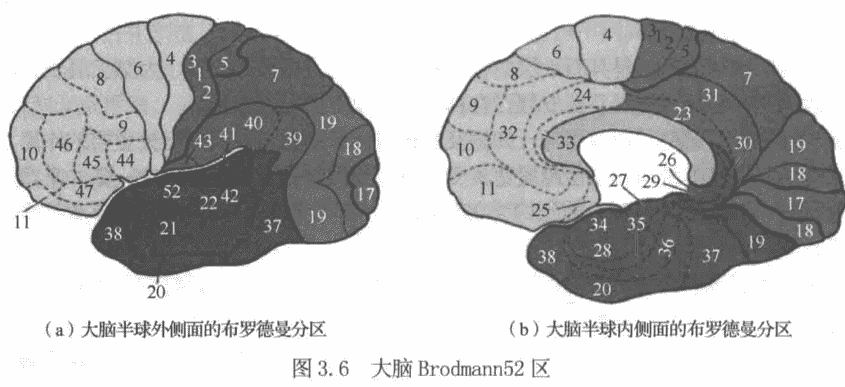

#### 2. 皮层与认知：人类独特性的基因密码

大脑赋予物种身份。人与灵长类的巨大鸿沟，刻印在脑内。虽分子特征高度相似，但人类特有的基因表达模式（如新皮层与纹状体中多巴胺合成相关基因的高表达）标志了认知进化的独特轨迹——人脑非单纯“升级版”灵长类脑，而是充满质变的新物种器官。

在皮层微观层面，单个神经元结构简略，但数千亿规模的状态组合与连接拓扑，催生了行为的无限多样，这正是**联结主义**的理论基石。当前人工神经网络主要模拟前额皮层等区的二维投影，未来必将向三维整体结构演进，孕育虚拟人工大脑等新范式。

**2020年《Science》重磅发现**：皮层神经元树突微小区室竟能执行“异或”逻辑运算。这推翻了“单一神经元无法完成非线性可分计算”的数学铁律，暗示神经元本身即是一个多层网络，为人工网络架构革新提供了颠覆性灵感。

### 3.3 视觉机制：从光子到意象的奇旅

#### 3.3.1 视觉结构：层级编码的精密流水线

视觉是认知世界的主通道。1958年，**Hubel与Wiesel**以微电极记录猫视皮层反应，发现**“方向选择性细胞”**——仅当特定朝向的边缘出现时激活。后续他们揭示**视功能柱**结构，提出**“感受野”**概念：视觉信息经视网膜经多级感受野层级激发传递，实现分层加工。1984年，**福岛邦彦**据此创立**神经认知机**，即卷积神经网络（CNN）雏形，确立了局部连接与层次组织的核心范式。

如今我们明晰：眼球是自带镜头、感光芯片与图像处理器的“数码相机”，大脑则是编码、解析、分类、赋予意义的“超级计算机”。光信号转电信号后，层层传递至皮层各区深度加工，最终形成神经活动表征的主观画面。

**主要传递路径（见图3.7）**：约90%视网膜信号汇聚至丘脑背侧**外侧膝状体（LGN）**——视觉入皮层的“关卡”。每半球LGN接收对侧视野信息，转投同侧**初级视觉皮层（V1/纹状体/17区）**。

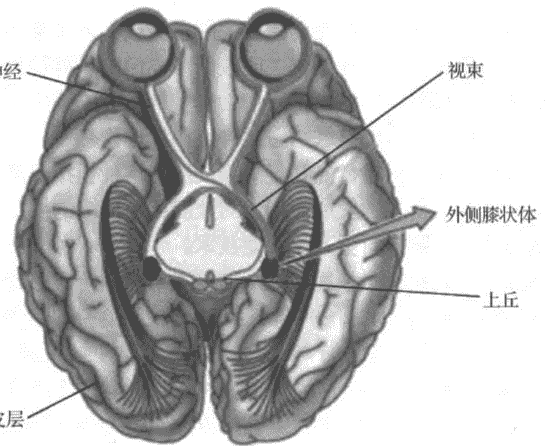
> 图 3.7 视网膜神经节细胞投射的主要脑区和结构

#### 3.3.2 视觉皮层区域：双流并行的识别架构

视觉皮层不止V1，还含V2-V5等纹外区（18、19区）。灵长类皮层至少35个区域参与视觉。同其他皮层一样，通常分6层，输入输出层分工明确。

V1输出分流为**背侧流（空间通路/“在哪里”）**与**腹侧流（内容通路/“是什么”）**（见图3.8）：

*   **背侧流**：处理空间位置、运动控制（如视跳）。
*   **腹侧流**：V1→V2（边缘轮廓成形）→V4（色彩敏感）→后/前颞下皮层（PIT/AIT，复杂物体表征）→前额皮层（PFC，决策）→后内侧皮层（PMC）→运动皮层→脊髓→肌肉。完成“视觉-决策-动作”闭环。

大脑约1/4皮层面积投入视觉处理，遵循三大组织原则：

1.  **分布式专用**：朝向、运动、深度、色彩、形状由不同脑区分管。
2.  **层级加工**：初级辨基础特征（亮度/对比/朝向）→中级析关系布局（前景/背景/表面）→高级识复杂物体、多模态融合、引导交互。
3.  **网络化协同**：功能区广泛互联投射。因单神经元感受野受限、分布式解析需求，网络化成为稳定统一视知觉的必要保障。

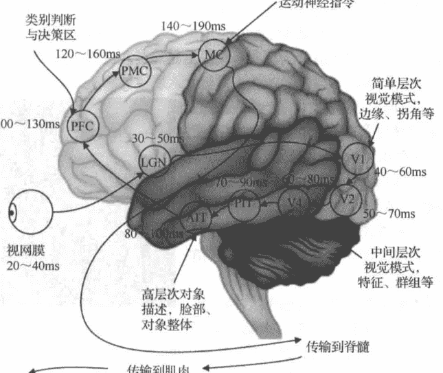
> 图 3.8 视觉信息在大脑中的传递过程
> LGN—外侧膝状体，视觉输入中继；MC—运动中枢

### 3.4 记忆机制：刻在细胞核深处的时光

记忆是心理在时间维度的延展，支撑学习与智能。大脑通过**存储**与**提取**两大独立神经环路实现记忆。长短时记忆在不同脑区同步形成：

*   **短时记忆**：无复述仅维持5-20秒，容量极小，抗干扰弱。是意识工作台，受注意门控，可调取长时知识加工，经复述转入长存。
*   **长短时记忆（LSTM）机制**已移植入人工神经网络，赋能深度学习。

**范式转移**：旧说记忆存储于突触连接网络；**最新证据指向细胞核内部**——表观遗传相关分子才是记忆的物质实体。神经表观遗传学揭示：这些分子将记忆忠实“印刻”于神经元，称为**“表观遗传记忆”**。

**MIT突破**：发现特定细胞通路强化海马体**CA3区**神经突触，首次阐明长时记忆分子机制（见图3.9）。CA3神经元是**情景化记忆**（事件+时空情绪语境）形成的关键枢纽。

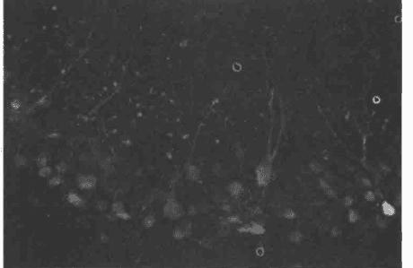
> 图 3.9 海马体 CA3 区域神经元

**另一引擎：新生神经元**。人一生中大脑日产1-3万新神经元，因其“新鲜”特性，专司提升学习能力，是认知可塑性的持续动力源。

### 3.5 学习机制：智能进化的核心算法

学习是智能的根本属性。西蒙定义：**系统为适应环境产生的长远变化，使其能更高效完成同类任务。** 这揭示了学习的本质——系统层面的持久性改进，无论形态重塑还是行为固化。

**学习类型繁多**：非联想/联想、主动/情景、机械/理解式等。加涅划分**5大类别**（言语、智力技能、认知策略、动作技能、态度）与**8个层次**（信号→刺激-反应→连锁→言语联结→辨别→概念→原理→解决问题）。

**安德森三阶段模型**勾勒技能习得轨迹：
1.  **认知期**：掌握问题结构（初态/目标态/算子步骤）。
2.  **联结期**：陈述性知识程序化（显性转隐性）。
3.  **自动化期**：复杂技能分解为成分法则自动运行，可复合为高阶技能。

这三阶段螺旋上升，构建人类认知大厦的无限可能。

### 知识即奖赏：学习动机的内在驱动力

学习所得的知识本质上是一种内在报酬，它能激发并强化继续探索的意愿。心理学将知识获取与动机驱动的协同效应称为“强化”，公式可简述为：强化 = 学习成果（信息）+ 动机（报酬）。强化机制分内外部、正负向两类。学习必须建立在积极动机之上，这一原理已成功移植至机器学习的强化学习范式中。

人类学习理论体系庞大，涵盖行为主义、认知主义、人本主义、观察学习、内省学习、计算理论、感知学习及粒计算等流派。行为学习理论植根心理学，又细分为条件反射、行为主义、联结主义、操作性条件反射、相近理论、需要消减等多个分支。

人类学习机制的揭示，直接催生了人工智能核心分支——机器学习。二者虽同源但异构：机器学习在围棋、游戏等特定领域展现出超人类的推演能力，却在“小样本泛化”上栽了跟头。人类只需极少信息即可构建整体认知，机器却仍深度依赖人工标注与先验经验。若要突破瓶颈，必须深度解码人类大脑的学习底层逻辑。

破解大脑运行的学习算法，或是构建统一大脑功能理论的关键钥匙。目前主流研究路径分两条：一是**实验范式**，通过特定干预观测神经元活动的持续重塑；二是**计算范式**，在生物学约束边界内，设计算法攻克特定计算任务。

2022 年 2 月，《Nature Machine Intelligence》刊文揭示：**单个神经元具备“预测未来活动”的内在能力，这或将开辟全新的学习机制范式**。该研究摒弃传统实验与纯计算路径，转而采用**理论推导法**——从最大化细胞代谢能量这一基本原理出发，推演出学习规则。大脑作为预测机器的假说虽获共识，但“精确预测编码如何落地”仍存争议。主流模型预设专门预测回路，而该研究另辟蹊径：**让单个神经元内置预测模型**。基于预测学习规则的神经元可组装成各类预测性大脑架构。惊人的是，该规则经修改时间差分学习算法（TD Learning）即可获得，使其生物合理性大增。TD 学习被视为在大脑中实现类 BP 算法（详见 4.2 节）的最佳候选者之一，其核心在于用神经元活动差值逼近自上而下的误差信号，对比赫布规则即为典型实例，在特定假设下等价于反向传播。

为验证预测能力，团队深入剖析样本神经元。结果显示预测学习规则高效运作，每个神经元均精准预判了自身未来活跃度（见下图）。

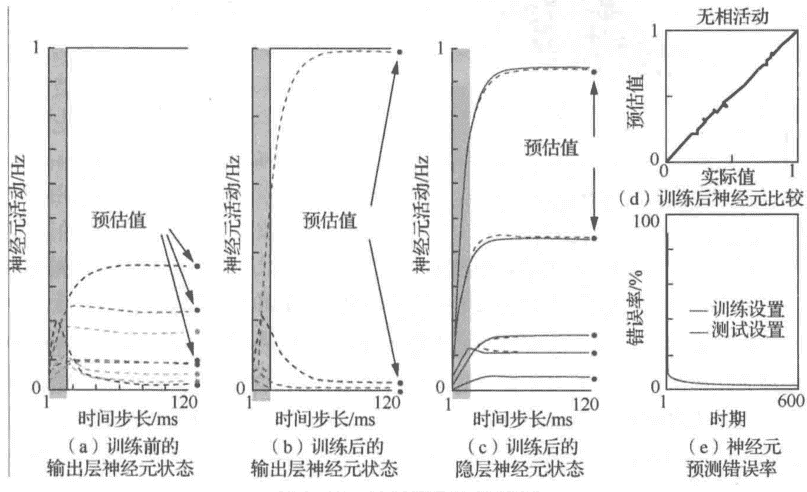

**图 3.10 神经元活动预测示意**

进一步地，团队分析清醒大鼠听觉皮层实测数据。实验以 6 种音调（各 1 秒）穿插 1 秒静默，循环播放超 20 分钟。提取每个音调的起始/偏移平均响应，构建每神经元 12 条活动曲线。以 15-25ms 窗口活动预测 30-40ms 窗口未来均值。

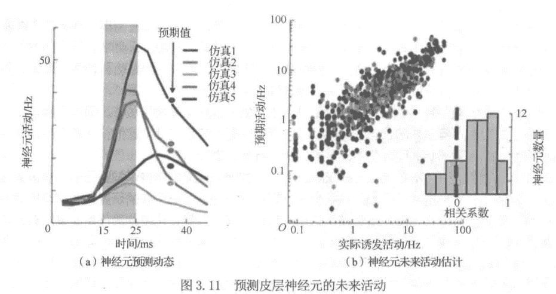 显示神经元动态具高度可预测性；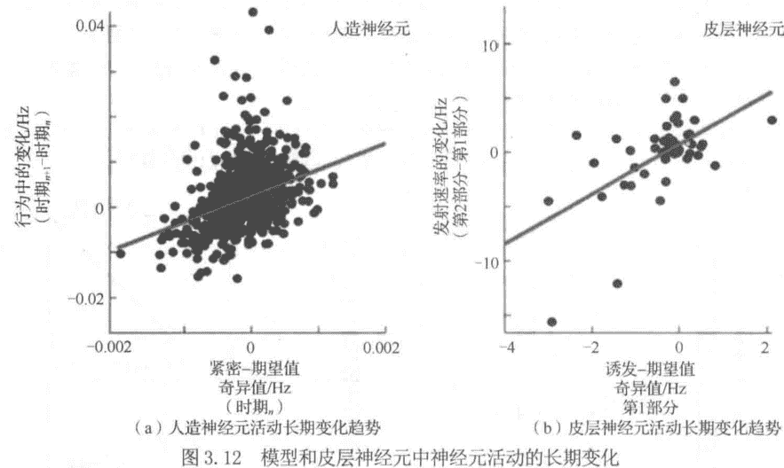 证实从初始反应即可推演未来轨迹。长程皮层活动预测的成功，为学习规则提供了强实证支撑。关键在于，模型能推断哪些神经元将上调、哪些将下调放电率。

该成果对神经科学与机器学习双重震撼：单一神经元层面的预测机制，极可能是学习的核心引擎。未来或助力构建攻克现实难题的新型神经网络。研究者视此为通往“统一大脑理论”里程碑式一步，但征途漫漫，尚需更多拼图。

---

#### 3.6 脑科学前沿三大突破

踏入 21 世纪，得益于功能性磁共振等利器，人类对大脑的认知从“理论推测”跨越至“多层级实证”——组织、结构、生化、分子层面均有斩获。成果丰硕，本书精选三大典型发现：**大脑导航系统、孕周发育图谱、社会互动重塑神经复杂性**。虽不直接指向 AI 技术，却为解码生物智能生成机制、反哺新一代人工智能奠定基石。

##### 3.6.1 大脑导航：天生的“内置 GPS”

大脑导航功能，即认知地图机制，破解了“大脑如何辨向、选路、抵达终点”的百年谜题。这一发现历时 30 余年，诺贝尔奖见证了里程碑：

*   **1980s-90s：** 发现**“头部方向细胞”**——大鼠朝向特定方向时激活。
*   **1971 年，奥基夫发现“定位细胞”**：植入海马电极，大鼠在陌生房间游走。特定位置触发特定细胞放电，无论路径如何，重返原位必发。不同细胞编码不同坐标，拼合成房间地图。换新房，重绘地图。奥基夫推断：除定位细胞，必存“计算距离、感知方向”的导航细胞。
*   **2005 年，莫泽夫妇发现“网格细胞”**：海马旁内嗅皮层。大鼠自由觅食（撒巧克力诱导覆盖全场），单电极记录单神经元放电。网格细胞呈六边形网格覆盖空间，与头部方向细胞、边界细胞协同，联同海马定位细胞组成**综合定位神经回路**（见下图）。

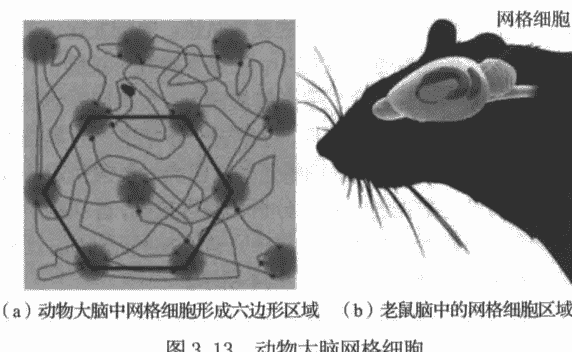

*   **2008 年，发现“边界细胞”**：靠近墙壁/障碍物即激活，编码距离边界的距离（生物版激光雷达）。网格细胞利用此信息累积行程距离，实现实时定位。
*   **2015 年，发现“速度细胞”**：放电频率随奔跑速度线性增强，不受位置、方向干扰。速度细胞 + 头部方向细胞 → 实时更新网格细胞状态（速度、方向、位移），完成信息融合。

**现有拼图**：内嗅皮层多细胞类型（网格、头向、边界、速度）分工协作，信息汇聚海马位置细胞整合，构成“从哪来、在哪里、往哪去”的完整导航闭环。**未解之谜**：网格如何生成？各细胞类型如何精密协作？

**关键洞见**：海马-内嗅皮层系统亦是记忆、语义、视觉概念等认知智能核心区。攻克导航机制，等同于拿到了认智 AI 的通用密钥。

**最新进展（2020，Cell Reports）**：密歇根团队记录小鼠单神经元信号，锁定**后楔前皮层（RSC）**。RSC 兴奋性神经元擅长长时编码方位信息，是空间定位关键枢纽，亦是阿尔茨海默症最早受损区之一。RSC 失能或致患者空间定向障碍、易迷路。破解 RSC 编码机制，或开辟全新治疗靶点。

##### 3.6.2 孕周发育：前额叶构建的“高精度动态图谱”

为还原神经发育全景，国内团队对 8-26 孕周人类胎儿前额叶皮层 2300+ 单细胞实施 RNA 测序。结果确认 **6 大类、35 个亚型**细胞，并绘制发育轨迹：

1.  神经干细胞
2.  兴奋性神经元
3.  抑制性神经元
4.  星形胶质细胞
5.  少突胶质细胞
6.  小胶质细胞

通过转录组深度挖掘，首次揭示兴奋性神经元“生成-迁移-成熟”三大关键期（见下图）：

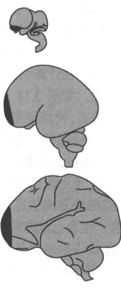

**图 3.14 人类前额叶皮层发育三阶段**

*   **第一期（8-13 周）**：干细胞疯狂增殖，奠基细胞池。
*   **第二期（6-19 周）**：干细胞分化爆发，新生神经元批量诞生并启程迁移。
*   **第三期（23-26 周）**：神经元功能性成熟，表达关键蛋白，初步织就功能性网络。

**里程碑意义**：填补人脑前额叶研究空白，为“思考与思想如何形成”提供细胞级分辨率蓝图。

**AI 启示录**：AI 模拟对象是大脑，但 70 年来，人类对自家大脑的认知远不及对宇宙（霍金解宇宙不解脑）。每当算力、场景成瓶颈，研究者必回望大脑求启发。多维度深度认知大脑，是 AI 进化与人类自我认知的双螺旋，缺一不可。

##### 3.6.3 社会脚手架：小脑容 ≠ 低智商，社交让大脑“精简高效”

直觉认为脑容随进化增大，实则**新石器时代伴随社会复杂化，全球人类脑容显著缩减**。缩脑会变笨吗？“社会脚手架假说”给出否定答案：在高协作社会中，个体通过分工协作维持认知上限，脑容得以“瘦身”。

**跨物种佐证**：黄蜂从独居进化为社会性，脑区虽缩，但缩减程度与社会复杂度无关，且无新神经结构涌现。计算模型显示：**群体层面整体优化优于个体大脑极致优化**。新石器时代人类虽失去遗传亲缘纽带，却通过扩大“象征性身份”规模（家族→城镇），在共享道德预期下实现陌生人互信互助。

**核心假说**：驱动脑容缩减的不是社会复杂度本身，而是**“降低群体内冲突、提升相互依赖”这一普适原则**。但缩脑机制两难：是依赖性降低了个体处理负载？还是社会脚手架托举起小脑容处理高复杂任务？经验难判。支持后者的证据：人类演化中，大脑血流速度（神经活动代理指标）增速远超脑容增速。

**计算模型实锤（Frontiers in Neurorobotics）**：构建极简模型，用神经元数量代表脑容，用神经熵与自由度量化复杂性。结果：**社交情境下的“小脑智能体”与独处情境下的“大脑智能体”神经复杂性持平**。统计学证实：小脑交互体能达成大脑独处体同级复杂度。

**终极启示**：脑容缩减与社会进化是共生共荣。高度协作让个体拓扑简化，却让状态动力学（自由度）更丰富。**推断认知能力时，切勿迷信脑容大小。**

---

#### 3.7 核心知识速览

本章系统梳理：大脑结构与功能、神经系统、神经元与网络、视觉/记忆/学习机制、前沿新发现。核心结论：**联结主义人工神经网络源启生物突触通信与网络机制**。研习脑神经科学，是读懂智能涌现、突围 AI 技术瓶颈的必经之路。

#### 3.8 思考与实战

1.  大脑赖以生存的严苛生理微环境是什么？
2.  概述大脑基本架构及主要分区。
3.  人脑高级功能清单及其结构基础、实现机制？
4.  脑科学前沿技术盘点？若投身脑研究，切入点何在？
5.  脑科学对 AI 的启发有哪些？衍生出哪些核心技术？
6.  智能脑机制在 AI 研究中扮演何种角色？
7.  脑科学、神经科学、AI 三者如何互融互促？
8.  与智能相关的脑机制全景图？
9.  统一大脑模型构建可能吗？路径何在？
10. 人脑与计算机：差异与联系的本质辨析。

---

## 第二篇 技术基石

### 第 04 章 人工神经网络：AI 的进化主干

**学习靶向**：
1.  精通 ANN 基本原理、算法与落地全流程；
2.  看透传统 ANN 与深度神经网络的传承与裂变；
3.  掌握 ANN 研究版图与应用全景。

#### 4.0 启幕：为何是神经网络？

自诞生伊始，人工神经网络便占据 AI 中枢地位。某种程度上，**ANN 发展史即 AI 进化史**。80 年代以来，ANN 引入物理、数学、计算机、神经生物学跨学科基因，攻克关键理论，成就学术核心与工业主流双丰收。从感知智能（视听）、语言智能（翻译、语音、对话）、决策智能（棋牌、游戏）到艺术创造，ANN 的全线告捷，实锤了**联结主义路线**的正确性。本章从基础人工神经元切入，经感知机、BP 算法等基石理论，延伸至深度神经网络，逐层拆解 CNN、RNN、LSTM 等核心架构，直击当代 AI 应用背后的“核武级”技术内核。

#### 4.1 从生物原型到工程实现：如何构建 ANN

ANN 成功的关键，在于对大脑神经网络结构的**工程化抽象与模拟**。虽是粗糙拟合，非生物级复刻，但应用端的胜利证明：**“结构决定功能”在 AI 领域局部成立**。

ANN 从两大维度粗略仿生：
1.  **知识源**：经验习得，而非预置。
2.  **存储介质**：神经元连接强度（突触权重）承载知识。

生物大脑由海量神经元构成，ANN 同构于**人工神经元（人工神经细胞）**阵列。人工神经元是生物神经元的数学简化版，可通过数学模型落地。

##### 4.1.1 神经元数学建模：MP 模型诞生记

生物神经元连接与信息传递（见 3.2.2）可抽象为通用模型（见下图）。突触模拟单元控制信号传递效能。大脑中，知识重复强化 → 特定回路传导效率升高 → 反应加速、记忆巩固。

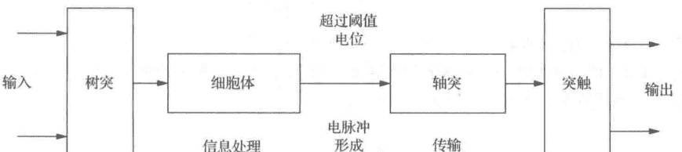

遵循此律，**1943 年，心理学家 McCulloch 与 Pitts 提出首个生物神经元数学模型——MP 模型**（见下图）。

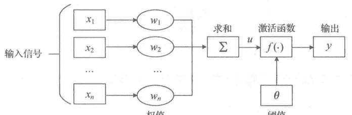

# 核心基石：从 MP 神经元到 BP 反向传播的演进逻辑

## 一、 MP 神经元：计算神经科学的起点

麦卡洛克-皮茨（MP）模型的设计初衷极具仿生意味：它模仿生物神经元汇聚多路信号、经阈值判决后“全或无”放电的特性。关键创新在于引入**连接权重**——一个可正可负的实数。正权重模拟突触兴奋作用，促进信号通过；负权重模拟抑制作用，阻断信号传递。所有输入经权重加权累加得到总激励 $u$。

随后，激活函数 $f(\cdot)$ 引入非线性，依据 $u$ 与阈值 $\theta$ 的大小关系决定输出。最经典的是阶跃函数：$u > \theta$ 输出 1，否则输出 0；也可采用 Sigmoid 等输出连续值的函数。

```
u = \sum_{i=1}^{n} w_i x_i
```

$$y = f(u-\theta) = f\left(\sum_{i=1}^n w_i x_i - \theta\right) \quad (4-2)$$

通过数学变换，令固定输入 $x_0 = -1$ 对应权重 $w_0 = \theta$，即可将阈值吸收为网络的一条额外连接，等效于输入维度扩展 1。

$$a = \sum_{i=0}^n w_i x_i \quad (4-3)$$

$$y = f(a) = f\left(\sum_{i=0}^n w_i x_i\right) \quad (4-4)$$

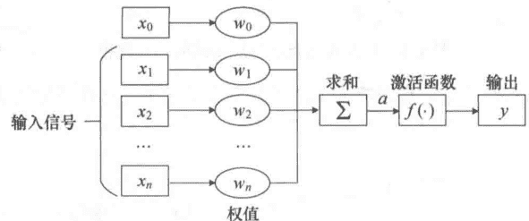

符号表示上，人工神经元常采用如下图示形式：

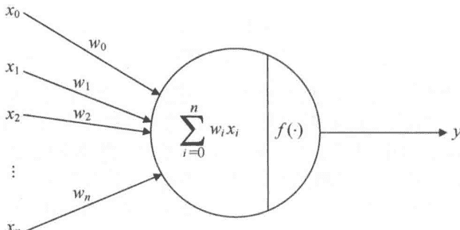

---

## 二、 感知机：具备“学习”能力的首个网络

### 1. 单层感知机：线性可分问题的求解器

1958 年，罗森布拉特构建了**感知机**——首个能自动调整参数的神经网络。它由两层神经元组成（输入层、输出层），仅存在层间连接，层内无连，典型的前馈结构。输出单元对输入加权求和后，经判别函数 $g(\cdot)$ 给出类别。

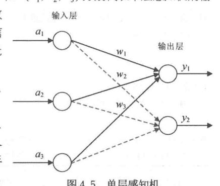

**实战演示：生鲜识别**
取颜色、形状、口感三维特征（编码为 $\pm1$），预设全 1 权重，用符号函数判别。豆角、茄子、洋葱归为蔬菜（-1）；绿苹果、西瓜归为水果（+1）。分类完美。

但这高度依赖“碰巧”选对的权重。现实中，**核心难题是自动寻找最优权重**，这便是“训练”或“学习”的本质——深度学习中的“调参”同出一辙。

**训练机制：**
1.  权重初始化为微小随机值；
2.  喂入样本对 $\{输入, 目标\}$；
3.  前向推理得预测值；
4.  若预测偏离目标，按**感知机准则**修正权重：$w \leftarrow w + \eta (目标 - 预测) \times 输入$；
5.  迭代直至收敛。

罗森布拉特证明：对**线性可分**任务，该过程必收敛。但本质上这是线性建模，**无力破解异或（XOR）等非线性难题**。

### 2. 多层感知机：隐藏层破局非线性

在输入输出间插入隐藏层，构成多层感知机（MLP）。虽具非线性拟合潜力，早期困境在于：隐层无显式目标，难以直接计算误差修正权重。后续引入**偏置项**，配合矩阵变换将非线性可分问题投影至高维线性可分空间，为深度架构奠基。

```
\( a^{(2)} = g(w^{(1)} \times a^{(1)}) \) （4-8）

\( y = g(w^{(2)} \times a^{(2)}) \) （4-9）
```

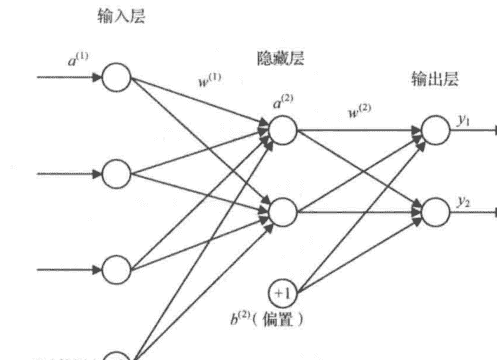

---

## 三、 BP 算法：深层网络训练的“导航仪”

网络结构定型后，如何高效求解海量 $w$ 与 $b$？**反向传播算法**给出了里程碑答案，其核心即**梯度下降**——沿损失函数梯度反方向迭代，逼近局部极小值。

### 1. 激活函数选型：Sigmoid 的数学红利

梯度下降要求函数处处可导。Sigmoid 函数 $f(x) = 1/(1+e^{-x})$ 曲线光滑，且导数可用函数值自身表达：$f'(x) = f(x)[1-f(x)]$，极大简化了链式求导。

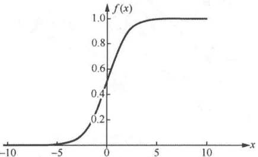

### 2. 网络拓扑与符号约定

以单隐层网络为例：


设输入层 $m$ 节点、隐层 $j$ 节点、输出层 $n$ 节点。层间权重分别记为 $w_{ih}$（入→隐）、$w_{ho}$（隐→出），偏置为 $b_h, b_o$。

### 3. 前向推理过程
第 $k$ 轮迭代中：
- 隐层激励：$h_i_h = \sum w_{ih} x_i + b_h$
- 隐层输出：$ho_h = f(h_i_h)$
- 出层激励：$y_i_o = \sum w_{ho} ho_h + b_o$
- 最终输出：$yo_o = f(y_i_o)$

### 4. 损失度量与梯度回传
采用均方误差 $P = \frac{1}{2} \sum (d_o - yo_o)^2$ 量化偏差，目标转为最小化 $P$。

利用链式法则逐层回传误差信号：
- **输出层误差项** $\delta_o = (d_o - yo_o) f'(y_i_o)$，权重梯度 $\frac{\partial P}{\partial w_{ho}} = -\delta_o \cdot ho_h$
- **隐藏层误差项** $\delta_h = (\sum \delta_o w_{ho}) f'(h_i_h)$，权重梯度 $\frac{\partial P}{\partial w_{ih}} = -\delta_h \cdot x_i$

掌握梯度方向，配合学习率 $\alpha$ 按 $w \leftarrow w - \alpha \nabla P$ 迭代更新，即完成网络训练。这就是 BP 算法的精髓所在。

# 深度解析：BP 反向传播机制与卷积网络核心架构

### 误差逆向传递与参数迭代更新原理

内层计算单元的敏感度指标 $\delta_h(k)$ 并非孤立得出，而是通过末层偏差 $\delta_o(k)$ 经连接强度 $w_{ho}$ 逆向累加求和，再乘以该单元激活函数斜率 $f'[h_i_h(k)]$ 计算而成（公式 4-22）。这一原理阐述了误差逆向流动的核心：不管架构包含多少内层，任一层单元的敏感度，均等于其后一层所有相连单元敏感度与连接强度的乘积求和，再乘以本身激活函数坡度。这就是“误差逆向流动”的数学体现。

```
for \(t = 1 \cdots N\) do
  for \(i = 1 \cdots N\) do
    (1) 式 (4-14) 和式 (4-16) 前馈计算隐藏层和输出层的状态，式 (4-15) 和式 (4-17) 前馈计算隐藏层和输出层的激活值，直到最后一层。
    (2) 式 (4-20) 和式 (4-22) 反向计算每一层的误差 \(\delta^{(l)}\), \(l\) 为网络的层数。
    (3) 式 (4-19) 和式 (4-21) 计算每一层参数的偏导，\(k\) 为算法迭代运算的次数。
```

紧接着是参数刷新准则。内外层连接强度 $w_{ho}$ 与底层连接强度 $w_{ih}$ 均遵循最速下降法则（公式 4-23, 4-24）：当前值 = 历史值 + 步长因子 $\eta$ × 当前敏感度 × 前向传递的入端信号。其中步长因子 $\eta$ 约束在 (0, 1) 范围内，决定着参数校准的幅度。显然，该学习流程的核心在于“偏差驱动校正”——输出侧的差值经逆向传递至各层，引导连接强度朝目标函数最陡下降方向移动。该手段将“误差修正学习规则”与“最速下降法”结合，成为训练人工神经系统的典范：求取整个模型参数针对目标函数的导数，依据此刷新参数以将代价降至最低。特别要提的是，阈值项亦可采用此下降策略进行改良。

### 学习流程与固有短板

该学习流程是一个反复循环的参数校正历程（算例 4.2），可拆分为双阶段：

1.  **前向阶段**：入端讯号顺序通过整个模型直到顶层，实现特性转换与预估输出。
2.  **反向阶段**：求得输出偏差，把它自顶层反向传递至底层，借助最速下降法定位目标函数局部最优，同步校准连接参数与阈值。

循环结束判据一般设为到达最大轮数 $N$，或者整体偏差降至设定门槛。如果判据未达标，便一直循环直到生成最佳模型。


不过，作为经典多层感知器的常规学习手段，该方法遇到 5 层以上深层结构时候，表现力不从心。建立在最速下降法上面的 BP 很容易掉进局部最优的坑；而且实际操作中有明显短板：高度仰赖大量标注数据、深层参数收敛慢、梯度随着层数增加呈指数级下降（梯度消失），引起底层参数很难有效刷新。1974 年保罗·韦伯斯虽然建议采用该方法训练通用型网络，但限于早期深层网络罕见，这个方法长久没受重视。直到 Hinton、LeCun 等人把它用在深层架构上，才真正焕发活力。值得注意的是，该方法不只适用前馈结构，对循环结构等也适用。

---

### 卷积网络核心架构设计解析

#### 仿生视觉机制与层级特性抽象

卷积网络是深度学习界的里程碑式架构，设计源于生物视觉系统的分级处理原理。卷积网络善于处理高分辨率画面，于机器视觉、面部辨识等方面处于主导地位。其核心理念是分级特征提炼：底层结构捕获轮廓、拐点、肌理等初级几何属性；随着层数变深，初级属性逐层组合映射成高层语义属性（如物体零件、完整物体），最后于深层实现分类判决。图 4.10 形象呈现了这一从简单模式向复杂模式演进的过程。


1998 年，Yann LeCun 推出的 LeNet5 模型乃早期卷积网络代表作，专门用于邮政手写数字辨识设计。虽然架构轻量，但奠定了深度网络三大基石模块：滤波层、汇聚层、稠密层。LeNet5 使用 7 层有效拓扑（除去输入端），由 C1、C3 两个滤波层、S2、S4 两个汇聚层（亦称下采样层）、C5、F6 两个稠密层及输出端构成，接受 32×32 单通道图输入。


- **C1 层**：6 个 5×5 滤波器，步幅 1，产出 6 幅 28×28 激活图。
- **S2 层**：2×2 均值汇聚，步幅 2，产出 6 幅 14×14 激活图。
- **C3 层**：产出 16 幅 10×10 激活图。
- **S4 层**：2×2 均值汇聚，步幅 2，产出 16 幅 5×5 激活图。
- **C5 层**：120 幅 1×1 激活图（因滤波器大小等于输入大小，实现了 S4 到 C5 的稠密连接）。
- **F6 层**：84 维特征向量。
- **输出端**：10 个单元对应数字 0-9 概率。

实验显示，于 6 万原始样本上测试差错率 0.95%；扩大到 60 万含变形样本后差错率降至 0.8%。这揭示了深度架构表现随数据量近乎线性增长的规律。


#### 稀疏链接：压缩参数规模的关键

生物视觉系统里，单个计算单元只对局部区域做出反应，此即感知区。感知区间重叠覆盖整个视野。卷积网络复制此原理，抛弃传统稠密连接（层间单元全互联），采用稀疏链接（单元只链接上层局部）。此举大幅删减冗余连接参数，显著降低模型复杂程度，让深层结构学习成为可能。


#### 参数共用：特性获取的通用模板

参数共用是卷积网络另一核心设计。结合局部感知区，它让同一组参数（滤波器）在画面全域滑动扫描，实现特性检测的位置鲁棒性。以 1000×1000 画面为例（图 4.14）：稠密连接需约 $10^{12}$ 参数；若用 10×10 局部感知区，参数量骤降至约 $10^8$ 数量级。图 4.15 进一步量化：32×32×3 输入经 5×5×3 滤波器处理，参数量从 3072 锐减至 75。


这种特性映射机制意谓着：共享参数/阈值定义在激活图上，同一滤波器检测同一特性（如垂直轮廓）在画面不同位置的响应。感知区越大，感知越趋全局语义；越小则聚焦局部细节。参数共用赋予了卷积网络优异的位移鲁棒性——画面微小位移不影响特性检测结果。

#### 滤波层：多维数组运算的特性获取引擎

卷积网络用矩阵/多维数组形式处理画面。滤波层用一组可学习的滤波器对输入多维数组执行互相关运算（工程上称作卷积）。每个滤波器提取一类特性，多核并行实现多特性联合获取。

以图 4.16 为例：3×4 灰度图经 2×2 滤波器、步幅 1 滑动，产出 2×3 激活图。计算本质是局部加权求和。彩色画面输入为 H×W×C 三维多维数组（通道深度 C=3 对应 RGB）。滤波器维度需匹配输入深度（如 3×3×3），输出单通道激活图。堆叠多个滤波器（图 4.17 用 6 个核），得到多通道输出多维数组（如 5×5×6），构成该层完整输出。


除常规卷积外，**膨胀卷积**（扩大感知区不增参数）、**反卷积**（上采样）、**分离式卷积**（深度可分离/空间可分离，极致压缩参数）等变体广泛用于画面预处理、特性获取、轮廓检测等视觉任务。


#### 汇聚层：降维与鲁棒性的平衡器

滤波产出的高维激活图若直接分类，面临计算开销爆炸与过度拟合双重风险。汇聚层（下采样）位于滤波层之后，核心作用三方面：
1.  **降维压缩**：大幅缩减激活图空间分辨率，降低后续计算复杂程度。
2.  **信息筛选**：保留显著特性（如肌理峰值），抑制噪声冗余。
3.  **增强鲁棒性**：降低模型对输入微小旋转、位移的敏感度。

主流汇聚策略（图 4.19）：
- **最大值汇聚**：取窗口最大值，保留最强激活，最常用。
- **均值汇聚**：取窗口均值，平滑特性。
- **随机汇聚**：按概率采样，引入随机正则化。


#### 稠密层：全局特性整合与分类决策

卷积网络后端通常由稠密层（FC）承担全局特性融合与分类职能。滤波/汇聚堆叠获取的局部激活图被拉直为一维向量，经稠密层升维/降维整合，最终接 Softmax 等判别器输出类别概率。

不过，稠密层参数量庞大（稠密特性），易引起过度拟合且学习负担重。现代架构常用改进：
- **随机失活**：学习时随机关闭单元，强制学习鲁棒特性。
- **全局均值汇聚（GAP）**：替代拉直+稠密，直接对各通道激活图取均值生成类别置信度图，大幅减参并提升泛化，成当前主流范式。

#### 卷积网络整体架构视角

卷积网络隐层呈现“三明治”堆叠结构：
- **浅/中层**：滤波层 + 最大值汇聚层 交替重复，逐级压缩空间维度（横截面积↓），加深通道深度（长度↑），完成分级特性提炼（图 4.20a）。
- **深层**：稠密层整合判别性局部特性，接判别器决策（图 4.20b）。

**关键界定**：卷积网络 ≠ 深度学习。卷积网络是一种专用神经网络架构，也是搭建深度神经网络的重要手段；仅当其作为机器学习技术用于表征学习时，才属于深度学习方法范畴。


(a) 核心架构概览


(b) 内部模块详解

图 4.20 卷积神经网络核心架构与内部模块详解

##### 4.3.6 激活函数层：赋予模型非线性表达力

激活函数层是赋予神经网络强大特征提取能力的关键。若缺失此层，模型将退化为单纯的线性组合，仅能处理简单任务，对语音、视频、图像等高维复杂数据将束手无策。工程实践中，ReLU、Sigmoid、Leaky ReLU 是高频选择。下文逐一解析。

###### 1. ReLU：缓解梯度消失的主流之选

ReLU（线性修正单元）凭借简洁高效的特性，已成为当下最主流的激活函数。早期模型（如 LeNet）多依赖 Sigmoid，但其导数上限仅 0.25，随网络加深极易引发梯度消失。ReLU 导数仅取 0 或 1，有效锁住梯度幅度，打破了深层网络训练的瓶颈。其数学定义与曲线形态如下：

\( ReLU(x) = \begin{cases} x, & x \ge 0 \\ 0, & x < 0 \end{cases} = \max(0, x) \) (4-29)


###### 2. Sigmoid：从隐藏层主力转型输出层专用

Sigmoid 函数曾是早期网络的隐藏层标配，但受限于导数区间 [0, 0.25] 导致的梯度消失，在 AlexNet 时代被 ReLU 取代。如今，它主要活跃在分类任务的输出头，将线性输出压缩至 (0,1) 区间输出概率。公式与图示如下：

\( \delta(v) = \frac{1}{1 + \exp(-m \cdot v)} \) (4-30)


###### 3. Leaky ReLU：修补“神经元死亡”缺陷

ReLU 虽解决了梯度消失，却引入“稀疏梯度”隐患：输入为负时梯度恒为 0，导致部分神经元永不更新（“死亡”）。训练中若需部分参数增、部分参数减，ReLU 只能同向调整，造成收敛路径呈锯齿状震荡。Leaky ReLU 为负区间引入微小斜率 \(a\)，保留负轴梯度流动，允许参数双向调节，显著改善收敛动态。定义与图形如下：


\( Leaky ReLU(x) = \begin{cases} x, & x \ge 0 \\ ax, & x < 0 \end{cases} \) (4-31)

##### 4.3.7 损失函数：衡量预测偏差的指南针

分类任务中，损失函数是优化目标的核心度量，记为 \(L[Y, f(x)]\)，其中 \(Y\) 为真实标签，\(f(x)\) 为模型预测。其值非负，训练中验证/测试集损失越低，通常预示拟合能力与鲁棒性越强。常见形式如下：

###### (1) 0-1 损失：最直观但不可导的硬指标

预测错即 1，对即 0。为容忍微小误差，引入阈值 \(T\) 放宽判定条件：绝对误差超 \(T\) 记 1，否则记 0。虽符合直觉，但离散不可导，难直接用于梯度优化。

\(L[Y, f(x)] = \begin{cases} 1, & |Y - f(x)| \geqslant T \\ 0, & |Y - f(x)| < T \end{cases}\)

###### (2) 绝对值损失：线性惩罚的软性替代

引入连续惩罚机制，误差幅度与损失成正比，缓解了 0-1 损失的阶跃突变：

\(L[Y, f(x)] = |Y - f(x)|\)

###### (3) 平方损失：最小二乘视角的平滑约束

源自最小二乘法，通过平方项放大大误差、压缩小误差，力求所有预测点贴合真实分布曲线：

\(L[Y, f(x)] = \sum_N [Y - f(x)]^2\)

###### (4) 对数损失（交叉熵）：分类任务的统计学标配

假设样本服从伯努利分布，经最大似然推导得出，形式上等价于交叉熵。它直接优化预测概率分布与真实分布的距离，收敛更快、梯度更稳：

\(L[Y, P(Y|X)] = -\log P[Y|X] = \frac{1}{N} \sum_{i=1}^N \sum_{j=1}^M y_{ij} \log(p_{ij})\)

符号含义：\(N\) 样本量，\(M\) 类别数，\(y_{ij}\) 真实标签指示器（one-hot），\(p_{ij}\) 模型预测第 \(i\) 样本属第 \(j\) 类的概率。

##### 4.3.8 CNN 训练范式：前向抽特征，反向调参数

CNN 训练遵循“前向传播传数据，反向传播传误差”双轨流程（详见算例 4.3）。

###### 算例 4.3 CNN 训练全流程

####### 初始化阶段

####### 步骤 1：前向传播——层层递进提特征

1.  **输入预处理**：去均值、归一化，送入卷积层。
2.  **卷积操作**：权值共享大幅压缩参数量，高效提取局部特征。
3.  **非线性激活**：卷积本质是线性映射，必须接激活函数（ReLU 等）注入非线性，提升模型表达上限。
4.  **池化下采样**：降维压缩参数，抑制过拟合，保留主导特征。
5.  **深层堆叠**：卷积-激活-池化循环叠加。浅层捕捉边缘、角点等低级特征；深层组合迭代出语义级高维特征。层数视数据规模而定。
6.  **全连接整合**：将高维特征图展平拼接，输出至分类层。
7.  **Softmax 分类**：输出层通常为全连接 + Softmax，给出类别概率分布。

####### 步骤 2：反向传播——误差驱动更新权值

以损失函数 \(L[Y,f(x)]\) 量化末层输出与真值偏差，沿梯度下降方向反向传播误差，逐层修正权重与偏置，最小化预测偏差。损失函数值越小，拟合效果越优。

####### 步骤 3：迭代收敛

循环执行步骤 1、2，直至损失降至预设阈值或模型性能达标，训练终止。

---

#### 4.4 循环神经网络（RNN）：序列建模的记忆单元

广义上，递归神经网络分结构递归（空间展开）与时间递归（时间展开）。狭义上前者称递归网络，后者即 **循环神经网络（RNN）**。RNN 在时间维度展开，引入循环机制持久化历史信息，成为处理文本、音频、视频、股票等序列数据的利器，与 CNN 并称深度学习双子星。

**核心差异**：CNN 仅看当下输入；RNN 拥有“记忆”——隐藏层节点互联，当前输入 \(x_t\) 与上一时刻隐藏状态 \(h_{t-1}\) 共同决定当前隐藏状态 \(h_t\)，历史信息经隐藏状态流式传递，参与当前输出计算。


基础 RNN 单通道拓扑（图 4.25）在各时刻共享拓扑，由输入单元 \(x_t\)、隐藏单元 \(h_t\)、输出单元 \(o_t\) 构成（\(t=0,1,...,n\)）。隐藏状态输出分两路：一路送输出层，一路延时自连接作为下一时刻输入。


展开视角下的数学机制：

\(h_t = f(Ux_t + Wh_{t-1}) \quad \text{(4-37)}\)

\(o_t = g(Vh_t) \quad \text{(4-38)}\)

- 式 (4-37) 为循环隐藏层计算，\(U\) 映射输入，\(W\) 传递历史隐藏态，\(f\) 为非线性激活（tanh/ReLU）。
- 式 (4-38) 为全连接输出层，\(V\) 映射隐藏态至输出，\(g\) 常用 Softmax。

**训练算法——BPTT（时间反向传播）**：本质是 BP 算法在时间维度的展开。核心在于求解 \(U, V, W\) 梯度并梯度下降更新（算例 4.4）。

###### 算例 4.4 RNN 训练四步走

1.  **前向推理**：按时间步顺序计算各神经元输出。
2.  **反向逐层求误差项**：从末时刻逆向回传误差。
3.  **累积梯度**：汇总各时刻对 \(U, V, W\) 的梯度贡献。
4.  **梯度下降更新**：修正三组权值矩阵。

**短板**：普通 RNN 处理长序列易现梯度消失/爆炸，难捕捉长距离依赖。

---

#### 4.5 长短时记忆网络（LSTM）：专治长程依赖的门控架构

1997 年，Hochreiter 与 Schmidhuber 提出 LSTM，借鉴脑记忆机制，语音识别性能跃升近 50%。LSTM 引入 **记忆细胞** 与 **三大门控**（输入门、遗忘门、输出门），精细调控信息流，有效缓解长程依赖难题，成为序列建模首选，编码-解码结构图像描述任务中编码器多基于 LSTM。


图 4.26 LSTM 网络结构

**门控机制**：每个门由 Sigmoid 层（输出 0~1，控制通透度）与逐点乘法组成。设 \(f,i,o\) 分别为遗忘/输入/输出门，\(c,h\) 为细胞/隐藏状态，\(W,b\) 为门参数，\(x\) 为输入，\(\sigma\) 为 Sigmoid。

1.  **遗忘门**：决定丢弃哪些历史细胞状态 \(c_{t-1}\) 信息。
    \(f_t = \sigma(W_f[h_{t-1}, x_t] + b_f)\)  （4-39）
2.  **输入门**：筛选新信息入库。Sigmoid 定“存什么”，tanh 生成候选向量 \(\tilde{c}_t\)。
    \(i_t = \sigma(W_i[h_{t-1}, x_t] + b_i)\)  （4-40）
    \(\tilde{c}_t = \tanh(W_c[h_{t-1}, x_t] + b_c)\)  （4-41）
    ```
f_t = \sigma(W_f[h_{t-1}, x_t] + b_f) (4-39)
``` ```
i_t = \sigma(W_i[h_{t-1}, x_t] + b_i) (4-40)
```
3.  **细胞状态更新**：遗忘旧、融合新。
    \(c_t = f_t \odot c_{t-1} + i_t \odot \tilde{c}_t\)  （4-42）
4.  **输出门**：从更新后的细胞状态中选取输出内容。
    \(o_t = \sigma(W_o[h_{t-1}, x_t] + b_o)\)  （4-43）
    \(h_t = o_t \odot \tanh(c_t)\)  （4-44）

```
\tilde{C}_t = \tanh(W_c[h_{t-1}, x_t] + b_c) (4-41)
```

展开视角下，细胞状态 \(c_t\) 贯穿时间轴，门控单元像精密阀门，按需遗忘、写入、读出，实现长跨度信息的稳健传递与利用。

**RNN 变体家族**：深度 RNN+MLP、循环 CNN、多维 RNN、记忆网络、结构受限 RNN、门控正交循环单元、层级子采样 RNN 等层出不穷。

---

#### 4.6 受限玻尔兹曼机（RBM）：生成式建模的基石

**生成模型**旨在从观测样本 \(x^{(1)},...,x^{(N)}\) 学习参数化分布逼近真实分布，并能生成高保真新样本。基于联合概率 \(P(x,y)\) 与先验 \(P(x)\) 推导后验 \(P(y|x)\) 作为预测模型，根基在于统计学与贝叶斯理论。主流流派含深度玻尔兹曼机 (DBM)、深度置信网络 (DBN)、生成对抗网络 (GAN)、变分自编码器 (VAE)。**RBM 是此类生成网络的典型原型。**

RBM 是玻尔兹曼机 (BM) 的受限拓扑版。BM 源于统计物理，Hopfield 网引入能量函数，系统演化至能量极小即热平衡稳态。任意概率分布可转化为能量模型，求解等价于梯度下降最小化能量函数（类比 BP 中的损失函数），寻找最优权值偏置（可能陷入局部最优）。

### RBM：能量模型的概率骨架

受限玻尔兹曼机（RBM）的核心是一个基于能量函数的概率分布模型。它的基本单元是二值神经元，状态非0即1：1代表激活，0代表抑制。从结构上看（见图 4.27），RBM 仅是一个两层网络，由可视层 $v$（输入端）与隐藏层 $h$ 组成。两层之间全连接且双向通行，权重共享同一矩阵 $W$；但层内节点互不相连，且两层的偏置项各自独立。


图 4.27 RBM 结构示意

该模型在某一状态 $(v, h)$ 下的能量定义为：

$E(v, h) = -a^T v - b^T h - h^T W v$  （4-45）

其中，$a$、$b$ 分别为可视层与隐藏层的偏置向量；$W$ 为层间连接权重。据此，联合概率分布写作：

$$P(v, h) = \frac{1}{Z} e^{-E(v, h)}$$ （4-46）

式中 $Z$ 为配分函数，负责概率归一化。由联合分布可推导出两层的完全条件概率，详见式（4-47）与式（4-48）。

训练 RBM 的实质，是寻找一组参数 $(a, b, W)$，使模型分布最大程度拟合训练数据分布。因为输出概率（生成 0 或 1）完全由这三组参数决定，优化目标便锁定在它们身上。

给定可视层 $v$ 时，隐藏层第 $j$ 个单元激活概率为：

$$P(h_j = 1 | v) = \text{Sigmoid}[-(b_j + \boldsymbol{W}_{\cdot, j} v)]$$ （4-47）

式中 $b_j$ 与 $\boldsymbol{W}_{\cdot, j}$ 为该隐藏单元的偏置与权重列向量。

反过来，给定隐藏层 $h$ 时，可视层第 $j$ 个单元激活概率为：

$$P(v_j = 1 | h) = \text{Sigmoid}(a_j + \boldsymbol{W}_{\cdot, j} h_j)$$ （4-48）

式中 $a_j$ 与 $\boldsymbol{W}_{\cdot, j}$ 对应可视层第 $j$ 单元的偏置与权重。

### 4.7 深度置信网络：层层叠加的生成式架构

将多个 RBM 垂直堆叠，便得到深度玻尔兹曼机（DBM）；若在顶层再接一个分类器，则构成深度置信网络（DBN）。如图 4.28 所示，DBN 由若干 RBM 串联而成：低层 RBM 的隐藏层 $h$ 直接充当高层 RBM 的可视层 $v$。DBN 属于基于概率的“生成模型”，训练分“预训练”与“微调”两阶段，具体流程见算例 4.5。


图 4.28 DBN 训练架构

###### 算例 4.5 DBN 训练详解

####### 阶段一：逐层预训练（无监督）

采用自底向上的贪心策略，利用无标签（或有标签）数据分层调整参数。

流程如下：可视层 $v$ 随机初始化一个向量，前向传递激活隐藏层 $h$；随后从 $h$ 反向重构 $v$，再正向重构 $h$……这种来回采样过程称为**吉布斯采样**。其目的是让当前层的权重 $W$ 对本层特征的映射达到局部最优——注意，是逐层单独优化，而非端到端全局优化。

由于低层 $h$ 即高层 $v$，当所有 RBM 依次训练完毕，数据便流经全网，最终汇聚至顶层 RBM 的隐藏层（图中 $h_2$）。

####### 阶段二：全局微调（有监督）

自顶向下引入标签信号，用 BP 或“醒—睡”算法反向传播误差，微调全网参数。

阶段一提供的初始值，本质上是一种“带数据先验的初始化”。相比随机初始化，它更接近全局最优解，因此能显著提升收敛质量与最终性能。DBN 擅长处理语音等一维序列数据，在语音识别领域应用广泛。

### 4.8 核心知识回顾

本章系统梳理了人工神经网络脉络：从神经元模型、感知机、BP 算法，延伸至 CNN、RNN 等深度架构。深度网络源于浅层网络的演进，是联结主义的重要成果。虽在应用层屡创佳绩，但理论解释仍待突破。深度学习已成为机器学习主流范式，掌握本章内容可为后续理解各类深度模型打下基石。

### 4.9 思考与实践题

1.  定义人工神经网络，对比其与生物神经网络的异同。
2.  从单一神经元到多层网络，关键跨越在于什么？
3.  感知机存在哪些内在缺陷？
4.  感知器与前馈网络有何联系与区别？
5.  查阅资料复现 BP 算法，训练前馈网络完成手写字符识别。
6.  神经网络有哪些鲜明特点？主流模型各自适用场景为何？
7.  什么是深度神经网络？浅深网络如何辩证看待？
8.  深度网络与人脑功能区有哪些映射关系？
9.  主流深度模型有哪些？优势与功能各异在何处？
10.  仿生学视角下，神经网络还能从大脑汲取哪些新灵感？

---

## 5 机器学习

### 本章学习目标

1.  透彻掌握机器学习核心原理；
2.  精通监督学习原理与主流分类算法；
3.  深度理解深度学习基础机制。

### 5.0 引言：从人学到机学

学习是智能的标志，贯穿人类一生且随阅历愈发强大。若机器能仿人通过学习获取知识，类人智能便有了落地路径。机器真的能学吗？怎么学？学会后是否具备智能，甚至诞生异于人类的新智能？答案全系于“机器如何获得学习能力”。本章将从该视角切入，由经典分类算法铺陈至前沿深度学习，助你洞悉机器学习的优劣边界，为研发更先进技术奠基。

### 5.1 机器学习能否通往机器智能

阿瑟·塞缪尔在跳棋程序基础上给出经典定义：**无需显式编程，使机器掌握特定技能**。通俗说，机器学习即让算法像人一样从数据中挖掘规律——“利用经验改善性能”。计算机里经验以数据形式存在，故机器学习本质是**数据分析**。区别于为固定任务硬编码的传统软件，机器学习用数据训练模型，自动学会完成任务。其理论核心是设计、分析让计算机“自动学习”的算法，从数据归纳规律，进而对未知数据分类预测。大数据时代，数据是“矿山”，机器学习便是开采“矿藏”的关键技术。

从实现智能的角度看，机器学习试图赋予机器类人学习力。要达到人级智能，机器需满足三大条件：

1.  **自主获知能力**：主动从书本、对话、环境观察中汲取知识，这是智能瓶颈。
2.  **模式识别与归纳力**：能从少量样本中抽象、概括、发现关系规律。
3.  **常识习得能力**：像人一样积累常识并内化为知识体系。

若以上条件具备，机器智能将可期。机器学习正是专门研究如何模拟实现这一过程，通过重组知识结构持续优化性能，是通往机器智能的关键径路。图 5.1 直观对比了机器学习与人类思维。


图 5.1 机器学习 vs 人类思维

人类在成长中积累经验，定期“归纳”出生活“规律”，面对未知或预测未来时调用这些规律。机器学习的“训练—预测”完美映射人类的“归纳—演绎”。可见，机器学习本质上是对人类认知成长的模拟。因非基于硬编码因果逻辑，而是归纳相关性，现代大数据+深度学习形成的算法智能在大规模计算分析上已超越人脑。人类一生大部分知识源于自主探索，构建起多维多层智能；机器学习能力目前尚未达到该高度。

### 5.2 机器学习模型全景分类

机器学习家族庞大，算法与理论繁多。按学习路径不同，主流划分四大维度：

#### 1. 按建模方法：线性 vs 非线性
线性模型虽简但为非线性基石；非线性模型又分**传统机器学习**（SVM、KNN、决策树等）与**深度学习**两大支系。

#### 2. 按学习范式：监督、半监督、无监督、迁移、强化
覆盖从“有标签指导”到“自主探索”、“知识迁移”、“环境试错”的完整光谱。

#### 3. 按任务目标：回归、分类、结构化学习
*   **回归/预测**：输出连续不可枚举数值。
*   **分类**：含二分类（如垃圾邮件过滤）与多分类（如文档归类）。
*   **结构化学习**：输出变长结构，如图像语义描述生成文本。

#### 4. 按求解策略：生成模型 vs 判别模型
给定特征 $x$ 与标签 $y$：
*   **生成模型**建模联合概率 $P(x,y)$：朴素贝叶斯、GMM、HMM、RBM、GAN 等。
*   **判别模型**建模条件概率 $P(y|x)$：决策树、KNN、ANN、SVM、Logistic 回归、AdaBoost 等。

机器学习成功落地于计算机视觉、模式识别、数据挖掘、图像处理、NLP、生物识别、搜索引擎、医疗诊断、反欺诈、证券分析、基因测序、语音手写识别、博弈游戏、机器人等领域，与 AI 核心分支紧密耦合（见图 5.2）。


图 5.2 机器学习与 AI 核心领域关系图谱

**关键关联解读：**

*   **模式识别**：工业界发源，与机器学习（计算机学科发源）可视为 AI 两翼，方法论高度重合。
*   **数据挖掘**：= 机器学习 + 数据库。核心是用 ML 方法在数据中挖规律、找知识。
*   **统计学习**：与 ML 高度重叠。ML 多数方法源自统计学。分野在于：统计学习重模型数学优化，ML 重工程落地解决问题。
*   **计算机视觉**：图像处理负责“洗数据”适配模型输入，ML 负责“挖模式”。字符、车牌、人脸识别皆是 CV 与模式识别应用。基石：图像处理 + ML。
*   **自然语言处理（NLP）**：让机器懂人语。融合编译原理（句法分析）、语义理解与 ML。基石：文本处理 + ML。
*   **语音识别**：综合 NLP 与 ML 实现。基石：NLP + ML。

**特别说明**：许多 ML 方法（如统计学习）与人类真实认知无直接关联。统计学习建立在数理统计之上，引入贝叶斯网络等经典技术及先验知识，旨在用验证过的统计工具实现机器智能。

### 5.3 监督与无监督：两大基石范式

**监督学习**要求训练样本经人工标注分类。人脑部分模式识别天生、部分后天习得；机器缺此天赋，必须喂入标注数据才能建立分类/预测能力。通俗流程：先用已分类样本训练模型（定参数），再输入待测样本分类。工业界以监督学习为主，辅以无监督、半监督、小样本、弱监督等技术。

**无监督学习**最大特点：训练集无人工标签，核心算法即**聚类**。**半监督学习**介于两者之间，融合少量标注与大量未标注数据。第 4 章提到的单层感知机、CNN、RNN 均属监督训练；而 DBN 作为生成模型，预训练阶段依靠无监督的“逐层初始化”训练各层 RBM。

监督学习落地仰赖各类分类器。数据先定义类别，再训练分类算法，最终得可用分类器。算法差异导致性能各异。

#### 5.3.1 K-近邻算法：简单直观的多分类基线

KNN 核心思想：在训练集中搜索与目标点最相似的 $k$ 个邻居，聚合其输出作为预测。回归取均值，分类投少数服从多数（众类）。关键在于**相似度度量**。

以图 5.3 为例：白/黑两类样本，灰色点待分类。
*   $k=3$ 时，计算所有样本到灰点距离（欧氏、曼哈顿、闵可夫斯、切比雪夫等）；
*   距离升序排序，取前 3 个；
*   这 3 个邻居含 2 白 1 黑，灰点判为白类。


**$k$ 值选择至关重要**：
*   $k$ 过小（如 1）：易受噪声误导，灰点会被单一黑点拉偏。
*   $k$ 过大：引入远距离无关样本干扰预测。
*   建议取**奇数**，避免票数打平无法决策。

#### 5.3.2 支持向量机：大间隔分类的经典范式

SVM 是最热门、讨论最广的分类器，本质是**线性分类器**。二维空间里超平面退化为直线。假设数据线性可分，分类边界由超平面方程（5-1）决定。

$$g(x) = w^{\text{T}} x + w_0 = 0$$ （5-1）

式中法向量 $w$ 与阈值 $w_0$ 由标注数据决定。SVM 目标：寻找最优 $w$，使超平面**训练误差为 0 且分类间隔最大化**。

### 核心支撑点：支持向量与间隔最大化

如图 5.4 所示，处于两条虚线边界上的圆点即为**支持向量**——它们是距离分类超平面最近的关键样本。值得注意的是，超平面的定位**完全由这些支持向量决定**；若移除训练集中所有非支持向量样本，最优解依然保持不变。两条虚线之间的间距记为 $r$，而支持向量到超平面的垂直距离为 $r/2$，这就是**分类间隔**。因此，SVM 的核心任务转化为：寻找一组最优分割系数 $w$，使间隔 $r/2$ 最大化，这本质上是一个求函数极值的优化问题。前文 4.1.2 节的单层感知机、4.2 节 BP 算法中的损失函数 $P$ 及梯度下降法，均是求解 SVM 的常用手段。


**SVM 优劣势速览：**
*   **亮点**：擅长高维大特征空间；小样本表现优异；能捕捉非线性交互、规避局部极小；不依赖全量数据；泛化性能强。
*   **短板**：大样本量下训练效率下降；缺乏通用非线性解法。
*   **主战场**：文本分类、图像识别，尤其在**二分类**任务中最为常见。

---

##### 5.3.3 朴素贝叶斯：基于“独立假设”的概率推理

朴素贝叶斯（简单贝叶斯）是一种极简的分类算法，理论基石是**贝叶斯定理**。直接从有限样本估算条件概率 $P(x_i|y_k)$ 难度极大，因此该算法引入核心假设：**在已知类别条件下，所有特征属性相互独立**。

**数学建模：**
后验概率计算公式：
$$P(y_k | x) = \frac{P(y_k) \prod_{i=1}^n P(x_i | y_k)}{P(x)}$$
其中 $x_i$ 为特征，$y_k$ 为类别，$P(y_k)$ 为先验概率。分类时分母 $P(x)$ 对所有类别恒定，故判别准则简化为：
$$h(x) = \arg\max_{y_k} P(y_k) \prod_{i=1}^n P(x_i | y_k)$$
即：选择使后验概率最大的类别作为预测结果。

**实战演示（例 5.1）：生鲜分类（水果 vs 蔬菜）**
*特征定义*：$x_1$(绿色)、$x_2$(圆形)、$x_3$(紫色)、$x_4$(条形)；$y_1$(水果)、$y_2$(蔬菜)。

| 训练集 (表 5.1) | 颜色 | 形状 | 标签 |
| :--- | :--- | :--- | :--- |
| 西瓜 | $x_1$ | $x_2$ | $y_1$ |
| 绿苹果 | $x_1$ | $x_2$ | $y_1$ |
| 紫葡萄 | $x_3$ | $x_2$ | $y_1$ |
| 豆角 | $x_1$ | $x_4$ | $y_2$ |
| 紫茄子 | $x_3$ | $x_4$ | $y_2$ |
| 紫洋葱 | $x_3$ | $x_2$ | $y_2$ |

**模型训练：**
*   先验概率：$P(y_1)=P(y_2)=3/6=0.5$
*   条件概率：
    *   $P(x_1|y_1)=2/3, \quad P(x_1|y_2)=1/3$
    *   $P(x_2|y_1)=1, \quad P(x_2|y_2)=1/3$

**预测推理：**
1.  **绿葡萄** ($x_1, x_2$)：
    *   $P(y_1|x) \propto 0.5 \times \frac{2}{3} \times 1 = \frac{1}{3}$
    *   $P(y_2|x) \propto 0.5 \times \frac{1}{3} \times \frac{1}{3} = \frac{1}{18}$
    *   $\frac{1}{3} > \frac{1}{18} \Rightarrow$ **判定为水果 ($y_1$)**
2.  **黄瓜** ($x_1, x_4$)：
    *   $P(y_1|x) \propto 0.5 \times \frac{2}{3} \times 0 = 0$
    *   $P(y_2|x) \propto 0.5 \times \frac{1}{3} \times \frac{2}{3} = \frac{1}{9}$ (注：训练集中蔬菜含 $x_4$ 样本 2 个)
    *   $0 < \frac{1}{9} \Rightarrow$ **判定为蔬菜 ($y_2$)**

**评价与改进：**
自 60 年代用于文检至今，仍是垃圾邮件过滤、情感分析、医疗诊断的基准方法。优点是误差率低、训练快；**致命弱点**是“属性条件独立假设”现实中常不成立，特征相关或高维时效果骤降。
**半朴素贝叶斯 (ODE)** 通过允许每个特征在类别外最多依赖一个其他特征，适度引入依赖关系，提升精度。

---

##### 5.3.4 K-均值聚类：无监督下的自组织归类

前文多为监督学习，**聚类**是典型的**无监督学习**——从无标签数据中挖掘隐藏结构、发现模式。
**K-means (KCA) 流程**（如图 5.5）：
1.  指定簇数 $k (k < n)$，随机初始化 $k$ 个质心。
2.  计算各样本到质心的欧氏距离，划归最近簇。
3.  重新计算各簇质心（均值向量）。
4.  重复 2-3 直至簇分配不再变化（收敛）。


**特点：** 实现简单、速度快、可扩展性强，是**应用最广**的聚类算法。
**局限：** 仅适用数值型数据；易陷入局部最优；大数据量收敛慢；需预先指定 $k$ 值。

---

##### 5.3.5 随机森林：决策树的“投票民主制”

随机森林 = **Bagging 集成 + 决策树基学习器**。
*   **决策树 (DT)**：树形结构，内部节点做特征测试，分支为输出，叶节点存放类别。从根节点向下路由至叶子即得结论（见图 5.6）。
*   **森林预测**：新样本穿越所有树，每树投一票，**少数服从多数**，得票最多者胜出。


**训练机制（三步走）：**
1.  **Bootstrap 采样**：原始数据有放回抽样 $n$ 次，生成 $n$ 个训练子集。
2.  **树生长**：对每棵树，从根节点开始，每节点随机选取 $m$ 个特征 ($m \ll M$)，寻找最优切分点二分样本，直至节点纯度达标（同类）。
3.  **集成**：汇聚 $n$ 棵树成林，新数据经投票分类。

**为何曾称霸深度学习前夜？** 高维大数据表现稳健、训练并行快、超参少（不像 SVM 需精细调参）、不易过拟合。

---

##### 5.3.6 集成学习：弱学习器的“合纵连横”

核心思想：**多个分类器融合 > 单一分类器**。通过不同子集训练弱分类器，再经投票/加权组合成强分类器。三大主流技术：**Bagging、随机森林、Boosting**。

###### 1. Bagging（套袋/自助聚合）—— “并行独立，平权投票”
流程（见图 5.7）：
1.  原数据有放回抽样 $\to$ $m$ 个子训练集。
2.  各子集独立训练一个分类器（可选 SVM、DT、DNN 等）。
3.  新样本输入，$m$ 个分类器**并行**预测，**简单多数表决**定输出。


本质：**方差降低**。将弱分类器组装成强分类器，降低过拟合风险。

###### 2. Boosting（提升）—— “串行迭代，重错纠偏”
流程（见图 5.8）：
按序生成分类器，**后一个专门修正前一个的错误**。
*   **AdaBoost (1995, Freund & Schapire)**：里程碑式改进。无需弱分类器先验性能，自适应调整样本权重。
*   **迭代逻辑**：
    1.  初始化样本权重均等。
    2.  第 $n$ 轮：基于当前分布训练弱分类器 $\to$ 计算误差率 $\to$ **提升错分样本权重，降低正确样本权重** $\to$ 形成新分布。
    3.  循环 $T$ 轮，得 $T$ 个弱分类器。
    4.  **加权叠加**（而非平权投票），高精度弱分类器权重大，组成最终强分类器。


**Bagging vs Boosting 核心差异：**
| 维度 | Bagging | Boosting |
| :--- | :--- | :--- |
| **训练模式** | **并行**（相互独立） | **串行**（强依赖前序） |
| **采样依据** | 固定随机采样 | **动态调整**（聚焦难分样本） |
| **融合策略** | 平权投票/平均 | **加权投票**（按表现分配权重） |
| **核心作用** | 降低方差、防过拟合 | 降低偏差、提升准确率 |
| **适用场景** | 不稳定基学习器 (如深树) | 弱学习器 (如浅树/决策桩) |

应用覆盖模式识别、计算机视觉，兼容二分类与多分类。

---

### 5.4.1 从浅层到深度：特征学习的范式革命

**传统 ML 的痛点：** 擅长小数据、结构化数据。面对图像等非结构大数据，需**人工特征工程**——极其繁琐，瓶颈了机器智能上限。

**破局者：深度学习 (DL)。** 辛顿、杨立昆等人 90 年代坚持深层神经网络研究，近十年因**大数据 + 算力爆发**才大放异彩。

#### 核心界定：何为“深度”？
*   **浅层学习**：含 0~1 个隐藏层（如感知机、SVM、传统 ML）。表达复杂函数能力受限，泛化受阻。
*   **深度学习 (DNN)**：隐藏层 **$\ge 5$ 层**（少则 5-10，多则百/千层）。“深度”即**层数深**。
*   **CNN** 等是典型 DNN 代表。


#### 两大本质区别：
1.  **架构深度**：强调多层非线性变换，层层递进。
2.  **特征学习**：**这是灵魂**。不再依赖人工设计特征，而是**逐层自动变换**，将原始空间低级特征抽象为高级语义特征，使分类/回归易如反掌。
    > “深度模型是手段，特征学习是目的。”

#### 万能逼近与表征学习
给定合适架构（层数、神经元、激活函数）与海量数据，**DNN 可学习任意向量空间映射**。本质是**分层表征学习**：低级 $\to$ 中级 $\to$ 高级特征，自动完成抽象化。

**成果：** 经充分训练，能捕捉数据中细微、抽象模式。已落地人脸识别、医学影像诊断等无数实战。

#### 生态定位（见图 5.10）
*   **ML 与 ANN** 是实现 AI 双引擎。
*   **DL 代表当前 ML/ANN/AI 最高水平**，是联结主义战胜符号主义的标志性胜利。
*   **大数据与 DL 共生共荣**：
    *   大数据核心是**挖掘数据价值**；
    *   DL 是挖掘价值的**关键技术**；
    *   两者离不开**高性能算力**支撑。
    *   数据越多 $\to$ 模型越精；模型越复杂 $\to$ 需算力越强。
    *   **但 DL 非大数据唯一分析工具**，场景选型仍需理性。


### 深度学习如何重塑“看图说话”？

深度学习的横空出世，彻底改写了语音识别、图像分类、文本理解等诸多领域的传统算法逻辑。它确立了一种全新范式：直接从海量训练数据出发，通过端到端的模型架构，一步到位输出最终结果。这不仅极大地简化了流程，更因深度网络的每一层都能为最终任务目标自适应调整，实现了层与层间的深度协同，从而大幅跃升了分类、回归预测等任务的精准度。

#### 5.4.2 典型应用场景：图像描述生成

让机器真正“读懂”图像，始终是计算机视觉领域的核心攻关方向。随着深度学习技术的飞速迭代，图像分类、目标检测等基础任务的效果已显著跃升。正如图 5.11（a）所示，图像分类解决的是“画面里有什么”这一类别判别问题；而图 5.11（b）的目标检测则进一步明确了“物体在哪里”，给出了具体的位置坐标。尽管机器能提取的图像信息日益丰富，但距离人类级别的图像理解水平，仍有不小鸿沟。


图 5.11 图像理解任务对比

图像描述技术的出现，正是为了跨越这道鸿沟。它不仅要求机器识别物体类别、洞察物体间关系，更赋予了机器“生成”自然语言的能力，从而流畅、精准地复述图像核心内容——涵盖主场景、关键对象、对象状态及其相互关系，如图 5.11（c）演示。这是一个典型的计算机视觉与自然语言处理（NLP）交叉融合的前沿课题。

当前，图像描述已成为人工智能领域的研究热点，其终极目标是赋予机器类人的视觉认知能力，实现基于视觉的高效人机交互，大幅提升沟通效率。该技术在人机交互、以图搜图、智能安防监控等场景蕴含着巨大应用潜力。

得益于深度学习的演进，**“编码-解码”架构**迅速崛起并占据统治地位。该架构在机器翻译领域的成功实践，为图像描述提供了宝贵范式：将任务视为一种“跨模态翻译”，即把视觉信号“翻译”成自然语言。模型主体由两部分构成：**编码器**负责提取图像特征并压缩为固定长度的向量表示，通常采用 CNN（卷积神经网络）；**解码器**则接管特征向量，将其展开为词语序列，常基于改进型 RNN（循环神经网络），LSTM 是主流选择。


图 5.12 基于编码-解码结构的图像描述模型

以图 5.12 为例，流程始于 CNN 从熊猫图片中提取特征向量，随后由 n 个串联的 LSTM 单元组成的解码器接力处理。解码器对 "two pandas other..." 等词汇向量进行逐步解码。训练完成后，这组 LSTM 能精准建立词汇与图像特征的映射，最终生成完整描述："two pandas are…"。

> 图注说明：`<S>`、`<E>` 分别标识序列起止；`h0、h1...` 为各 LSTM 隐状态输出；`W0O1...` 为训练得到的参数矩阵；`p(y1)...` 为各时间步输出特定词汇的概率；`T` 为序列长度，`n` 为 LSTM 总层数。

训练的本质，是寻找一组最优参数，使“生成模型”能依据图像特征选取最贴切的词汇，输出高质量描述文本。图 5.13（a）与（b）的标题即为模型实测生成的自动描述结果。


---

### 5.5 生成对抗网络：双雄博弈，以假乱真

生成对抗网络（GAN）是一种独特的深度神经网络架构，由**生成网络**与**判别网络**双模块组成。核心机制在于“多轮循环博弈”：生成网络致力于造假，力求产出与真实数据分布一致的高仿样本；判别网络致力于破案，竭力辨别真伪。双方在对抗中共同进化，最终达成纳什均衡。

#### 5.5.1 生成器：从随机噪声“变”出真实感

生成器是 GAN 的“艺术家”，其使命是从潜在空间——即服从特定概率分布的随机噪声向量 $z$ 中，映射生成图像、音频或文本等数据。生成器的数学本质是拟合真实数据分布 $P_g$，其映射函数记为 $G(z, \theta_g)$。


图 5.14 生成器网络架构详解

当前主流 GAN 的生成器多基于**深度卷积神经网络（DCNN）**。以图 5.14 为例：输入 100 维噪声向量，经全连接层重塑为 $4 \times 4 \times 1024$ 特征图，再历经 4 层反卷积（核尺寸 $4 \times 4$，步长 2）。每层反卷积使特征图长宽翻倍、通道数减半，最终输出 $64 \times 64 \times 3$ 的 RGB 图像 $G(z)$。

生成器的优化目标极其明确：欺骗判别器。即最小化目标函数，迫使判别器将生成样本误判为真实样本（输出概率趋近 1）。

```
ln(1 - D(G(z)))
```

#### 5.5.2 判别器：真假辨别的“鉴定专家”

判别器是 GAN 的“评论家”，本质上是一个二分类器。输入为图像（真实样本 $x$ 或生成样本 $G(z)$），输出标量 $D(x) \in (0,1)$，代表输入来自真实分布而非生成器的概率。其映射函数为 $D(x, \theta_d)$。

```
p = D(G(z),i)
```

> 变量说明：$z$ 为生成器输入噪声；$G$ 为生成器；$D$ 为判别器；$x$ 为真实图像；$p$ 为判别器输出的相似度概率。

结构上，判别器与生成器呈**镜像对称**：生成器“向上采样”（噪声 $\to$ 图像），判别器“向下采样”（图像 $\to$ 概率）。如图 5.15 所示，输入 $64 \times 64 \times 3$ 图像，经 4 次卷积下采样，最终输出单一概率值。

```
D(x, θ_d)
```

图 5.15 判别器网络架构详解

#### 5.5.3 极大极小博弈与训练策略

GAN 的整体目标函数构建为一个**极大极小博弈**问题：

$$\min_G \max_D V(D, G) = \mathbb{E}_{x \sim p_{data}(x)}[\ln D(x)] + \mathbb{E}_{z \sim p_z(z)}[\ln(1 - D(G(z)))] \tag{5-9}$$

*   **判别器视角（$\max_D$）**：前项最大化 $\to$ 真实样本判为真（概率 $\to 1$）；后项最大化 $\to$ 生成样本判为假（概率 $\to 0$）。
*   **生成器视角（$\min_G$）**：前项为常数；最小化后项 $\equiv$ 最大化 $D(G(z))$ $\to$ 诱导判别器将生成样本判为真。


训练采用**交替优化**策略（算例 5.1）：外层循环迭代，内层先固定 $G$ 更新 $D$（用 $m$ 真实 + $m$ 生成样本，梯度上升），再固定 $D$ 更新 $G$（用 $m$ 生成样本，梯度下降）。实践中，判别器每轮多更新几次（$k$ 次），生成器更新一次，以维持训练稳定性。

```
循环，对 \( t=1, 2, \cdots, \text{max\_iter} \)
第一阶段：训练判别模型
循环，\( i=1, 2, \cdots, k \)
根据噪声服从的概率分布 \( p_g(z) \) 产生 \( m \) 个真实样本 \( z_1, z_2, \cdots, z_m \)
根据样本数据服从的概率分布 \( p_{data}(x) \) 采样出 \( m \) 个样本 \( x_1, x_2, \cdots, x_m \)
用随机梯度上升法更新判别模型，判别模型参数传递的计算公式为
\(\nabla_{\theta_d} \frac{1}{m} \sum_{i=1}^m [\ln(D(x_i)) + \ln(1 - D(G(z)))]\)
结束循环
第二阶段：训练生成模型
根据噪声分布产生 \( m \) 个样本 \( z_1, z_2, \cdots, z_m \)
用随机梯度下降法更新生成模型，生成模型参数的梯度计算公式为
\(\nabla_{\theta_g} \frac{1}{m} \sum_{i=1}^m \ln(1 - D(G(z)))\)
结束循环
```

经过充分博弈，GAN 能产出令人惊叹的合成图像，如各类动物（图 5.16）与猫脸细节（图 5.17），展现了极强的分布拟合能力。


图 5.16 GAN 生成的多类动物图像


图 5.17 GAN 生成的高保真猫脸图像

---

### 5.6 深度学习大模型：万亿参数下的多模态新纪元

近两年，国内外头部机构投入万亿级算力，竞相探索模型参数量、性能上限与通用任务边界，涌现出一批里程碑式的大模型：

#### 5.6.1 DALL·E 与 CLIP：OpenAI 双子星
OpenAI 同步发布两大多模态预训练巨型模型。**DALL·E** 擅长“文生图”，仅需短文本提示即可合成对应图像；**CLIP** 擅长“零样本图文匹配”，用自然语言监督实现图像分类。二者联手旨在打破 NLP 与 CV 的模态壁垒，构建统一多模态智能体系。图 5.18 展示了 DALL·E 为“牛油果形状的椅子”脑补出的奇思妙想画面。


图 5.18 DALL·E 创意生成：“牛油果形状的椅子”

#### 5.6.2 “悟道”系列：中国自主万亿级突破
北京智源人工智能研究院发布 **“悟道 1.0”**，覆盖中文、多模态、认知、蛋白质预测等多模态系列模型，在预训练范式、规模扩增技术、语料库建设上实现多项国际领先。其升级版 **“悟道 2.0”**（架构见图 5.19）参数规模达 **1.75 万亿**，成为中国首个、全球最大的万亿级预训练模型。


图 5.19 悟道 2.0 模型架构组成

#### 5.6.3 “女娲”：统一视频生成新范式
微软亚洲研究院联合北大推出统一多模态预训练模型 **“女娲”**（架构见图 5.20）。基于 **3D Transformer** 架构，女娲统一了图像与视频生成任务。在 8 个下游任务实测中，其于文生图、文生视频、视频预测等项目上均刷新 SOTA 纪录。


图 5.20 女娲模型架构示意

---

### 5.7 迁移学习：站在巨人肩膀上“举一反三”

迁移学习利用数据、任务或模型间的**相似性**，将旧领域积累的知识复用至新领域，是机器学习向通用人工智能迈进的关键阶梯。这与人类认知高度同构：会打乒乓球易上手网球，懂中国象棋快学国际象棋——“举一反三”、“照猫画虎”皆是迁移学习的生活化注脚。

按学习方法分类，主流划分为四大流派：

#### 1. 基于样本的迁移（IBTL）：重加权，挑相似
核心思路：通过权重调整规则，筛选/重用源域中与目标域分布最接近的样本。如图 5.21，源域含大象、鳄鱼、猫、狗，目标域仅有“狗”，则人为提升源域中“狗”样本的权重，弱化无关类别干扰。


图 5.21 基于样本的迁移学习示意

#### 2. 基于特征的迁移（FBTL）：换空间，对齐分布
核心思路：通过特征变换，将源域与目域数据映射至**统一潜在特征空间**，消除分布差异，再施以传统机器学习分类器。流程见图 5.22。


图 5.22 基于特征的迁移学习流程

#### 3. 基于模型的迁移（MBTL）：共享参数，微调复用
核心思路：挖掘源域与目标域模型间的**共享参数**。典型范式：海量数据（如 ImageNet 千万级）预训练骨干网络 $\to$ 新任务小数据（几万张）微调/冻结层 $\to$ 高精度收敛。此为工业界最主流、落地最广的“预训练+微调”范式。流程见图 5.23。


图 5.23 基于模型的迁移学习范式

#### 4. 基于关系的迁移（RBTL）：迁逻辑，借结构
核心思路：关注跨域的**关系不变量**。假设两域相似，则共享某种逻辑结构。经典案例：生物病毒传播机制 $\approx$ 计算机病毒传播机制，将流行病学模型迁移用于网络安全防护（图 5.24）。


图 5.24 基于关系的迁移学习：生物与计算机病毒传播类比

**风格迁移** 是迁移学习极具张力的创意应用：将图 5.25（a）的艺术风格“解离”并“移植”至图 5.25（b）的内容图像上，生成风格化新作。


图 5.25 图像风格迁移效果展示：(a) 风格参考图 (b) 风格化生成结果

迁移学习应用版图极广，凡存在“源域知识助力目标任务”场景皆可施展，涵盖计算机视觉、文本分类、行为识别、NLP、室内定位、视频监控、舆情分析、人机交互等几乎所有 AI 落地领域。

---

### 5.8 深度学习的边界与因果学习的曙光

##### 5.8.1 深度学习的“阿喀琉斯之踵”

人类幼年期无需显性教导，仅凭观察世界便能构建因果预测能力。反观深度学习，虽在围棋、象棋等复杂博弈中称霸，却在因果推理上屡屡折戟。神经网络擅长从海量数据中提炼精妙模式——实时转写语音、秒级标注海量图像、精准筛查医学影像肿瘤，样样精通。但让它们像人一样，从画面中自然推演因果链条，却难如登天。

理论上，样本足够多时，模型能将问题的总体分布内化为参数。现实却骨感得多：训练数据无法穷尽所有因素，分布偏移在所难免。识别了百万图片的卷积神经网络，一旦遇到新光照、新角度或新背景，极易“翻车”。

业界惯用“堆数据、练大模型”对抗此痛点，可环境复杂度一旦升级，样本覆盖率便追不上变化速度。机器人、自动驾驶等需与物理世界交互的领域，挑战更为严峻。缺乏因果理解的模型，面对新问题便无法精准预判。这解释了为何自动驾驶跑了百万公里，仍会犯离谱的低级错误——微小扰动即可引发系统性崩塌。

图 5.26 直观演示了这种脆弱性：给熊猫图叠加肉眼不可见的噪声，模型竟将其判为长臂猿。机器学习的鲁棒性机制与人类智慧尚存鸿沟，而学界已发现：因果推理或成对抗攻击的“护盾”。


图 5.26 对抗攻击直击机器学习对 IID 假设的过度依赖

生物进化保留的干预、迁移、时序等关键信息，在标准机器学习流程中常被视为噪声剔除。因此，主流机器学习的成功，本质上建立在独立同分布（IID）数据的大规模模式识别之上。IID 假设观测间相互独立、概率恒定，抛硬币、掷骰子是典型例证。

计算机视觉等复杂任务中，工程师试图用海量样本“强行”将问题纳入 IID 框架，预设训练分布能代表推理实况。这在现实部署中漏洞百出：一旦遭遇训练分布稀疏甚至缺样的场景，深度模型即刻失效。

迁移学习与小样本推理进展有限，扩展性瓶颈导致 AI 无法涉足缺乏数据与专家的领域。深度学习对数据漂移极其敏感，易产生低置信度分类，虽可通过增强鲁棒性与扩展性缓解，却治标不治本。

根本在于：主流深度神经网络缺乏可解释性与认知机制，无法进行抽象、上下文、因果、可解释性推理。

结论明确：若要跳出 IID 舒适区，模型必须从学习“统计相关”进阶为学习“潜在因果模型”。

##### 5.8.2 因果学习：打破相关性的枷锁

因果推理是从因果模型演绎结论的过程，虽蕴含概率模型，却承载更丰富信息，能挖掘数据深层规律。因果研究虽数学化才起步、争议不断，却被视为最基础也最硬核的课题——核心在于“因果效应”，即仅含两可观测变量的系统分析。

将因果机制引入机器学习，或用模型表征因果结构，便催生了**因果学习**。虽挑战犹存，但构建具备因果表征能力的 AI 系统，已现清晰路径。

因果学习赋能知识迁移。人类玩会《魔兽争霸》这类即时战略游戏，能迅速上手《星际争霸》《帝国时代》；现有迁移学习仅能微调分类器参数，面对复杂游戏需海量训练，且难适应地图、规则微调。因果机制正是填补这一鸿沟的关键。

对抗攻击防御中，因果亦不可或缺。主流算法依赖统计相关性与点估计预测，贪婪吞噬数据却忽视生成机制，极易受未观测混杂因子干扰。因果模型旨在探寻数据生成的底层逻辑，可有效修补此漏洞。

宏观看，因果推理能显著增强泛化能力。当前针对 IID 基准的实验与理论，多难支撑跨问题泛化这一终极考验。

##### 5.8.3 结构因果模型：通往模块化智能的基石

学界已提炼出构建因果机器学习的核心概念——**结构因果模型（SCM）**与**独立因果机制**。二者指明方向：AI 不应只捕捉表层相关，而应识别因果变量并剥离环境干扰。

此机制让模型在视角、背景、光照、噪声变幻中仍能稳健检测目标。梳清因果变量，助 AI 从容应对不可预测的干预与分布漂移，从而大幅降低对海量训练数据的依赖。

研究者将 SCM 与表征学习融合，将其嵌入输入输出为高维非结构化数据的大型模型，使模型关键环节由经参数调整的神经网络实现的 SCM 驱动。最终模型呈现模块化架构，各模块可独立微调适配新任务——这酷似人脑模块化认知：不同脑区调用不同知识技能协同作战。

**SCM 形式化定义**：
包含变量 C（原因）与 E（结果）的 SCM 由两个赋值方程构成：
`C := N_C`
`E := f_E(C, N_E)`
其中噪声项 `N_C` 与 `N_E` 相互独立（`N_E ⊥ N_C`），`:=` 表示赋值。
C 为直接原因，E 为效果，`C → E` 即因果图。此表示法在讨论干预时直观清晰。

给定函数 `f_E` 及噪声分布 `p_{N_C}`、`p_{N_E}`，可按序采样噪声再推演 C、E，从而得到联合分布 `p_{C,E}`。

SCM 融合图模型、结构方程、反事实与干预逻辑，是连接因果与概率表达的利器。它支持以图解与代数形式编纂知识，利用数据估计答案；若知识或数据不足，还能预警并指引补全路径。

如图 5.27，SCM 推理引擎接收假设（图模型）、数据与查询三元输入。


图 5.28 例示：X（用药）对 Y（康复）有因果效应，Z（性别）同时影响 X 与 Y。

#### 5.9 强化学习：在试错中进化的智能

强化学习（RL）模拟大脑奖励信号机制，通过“状态-动作”映射最大化累积回报，已成机器人、预测分析等领域核心范式。

##### 5.9.1 能“长本事”的自适应机器人

传统工业机械臂“手”随工件定制，换任务就得改代码甚至换硬件。理想智能体应能适应物体位姿、夹爪形态的不确定性。加州大学团队从 2010 年起，借 RL 让 BRETT（伯克利消除繁琐任务机器人）进化：从叠毛巾、辨形状，到如今叠衣、搭积木、整理玩具餐具，技能树持续生长。


为让 BRETT 掌握通用技能，团队摒弃单一环境单任务范式，转向“孩童式”探索：随机采样刚性/可变形物体，同步采集传感器数据。**关键范式转移在于**：不再建模机器人与物体动力学，不做受力分析。教搭积木，原理极简——让机器人眼看手动，乱动中碰巧搭上给“奖励”，失败给“惩罚”。奖惩本质是调整神经网络梯度方向：输入为视觉与关节状态，输出为关节控制量，时序输出即动作序列。积攒足够奖励，技能便自然而然习得。

图 5.30 展示 RL 循环：`S_t` 为状态，`R_t` 为奖励。环境仅评价动作优劣，不指导如何生成最优动作。外部信息稀疏，迫使智能体依靠自主试错积累经验，在交互中重塑策略适应环境。


##### 5.9.2 强化学习的实战版图

**1. AlphaGo 与 AlphaGo Zero：从立于人肩到零基础自悟**
RL 智能体需平衡探索与利用。2016 年 AlphaGo 败李世石引爆关注。DeepMind 随后推出 AlphaGo Zero，抛弃人类棋谱，纯自博弈实现端到端感知决策，算法更简洁却战胜前作。

**2. 游戏通关：一套代码玩遍 Atari 与 VizDoom**
2013 年前，单智能体通吃雅达利游戏是天方夜谭。DeepMind 融合深度学习与 RL，零代码修改、零人为先验、零规则告知，纯自主探索，训练出的策略超越人类高手。自 2016 年 VizDoom 赛事启动，RL 在复杂 3D 环境中持续刷新纪录。

**3. 机器人控制：从仿真到实体的精准落地**
以 KUKA LBR iiwa 14 R820 七轴协作臂为例（负载 14kg，精度 0.15mm）。设定目标后，机器人零人工干预自主训练，过程见图 5.31。


图 5.31 机器人自主训练抵达目标点并抓取

强化学习算法训练机械臂定点抓取仅需 1 小时，含环境交互的上架放置仅需 4.5 小时，且能达成高精度作业。

#### 5.10 核心脉络回顾

本章系统梳理了机器学习基本概念、分类与主流监督方法，重点剖析了深度学习的统治地位与内在短板。强化学习、迁移学习在特定维度展现出深度学习不具备的优势。深度学习缺乏逻辑推理能力，倒逼因果学习等新范式崛起。本章内容为后续理解深度学习在感知智能模拟中的作用奠定认知基石。

#### 5.11 思考与实战

1.  机器学习的本质定义是什么？
2.  主流方法与类型有哪些分类维度？
3.  机器学习如何赋能机器智能形成？
4.  何为分类任务？核心算法谱系有哪些？
5.  **实操**：基于 Python 生态，分别用 KNN 与 K-Means 处理 UCI Iris 数据集，对比结果差异并解释成因。数据样例见 ````
5.1,3.5,1.4,0.2,Iris-setosa
4.9,3.0,1.4,0.2,Iris-setosa
4.7,3.2,1.3,0.2,Iris-setosa
.....
7.0,3.2,4.7,1.4,Iris-versicolor
6.9,3.1,4.9,1.5,Iris-versicolor
.....
6.3,3.3,6.0,2.5,Iris-virginica
6.4,3.2,4.5,1.5,Iris-versicolor
5.8,2.7,5.1,1.9,Iris-virginica
7.1,3.0,5.9,2.1,Iris-virginica
````。
6.  阐述贝叶斯分类器核心原理。
7.  深度学习与人工神经网络的联系与边界？
8.  按任务视角，深度学习属于哪类机器学习？
9.  如何评价 AI 创造力？深度学习赋予机器何种创造力？与人类创造力差距几何？
10. 简述 5.4.2 节深度学习图像描述生成原理。
11. 主流深度学习框架有哪些？优劣势对比如何？

---

## 第 3 部分 重点方向与领域（机器智能）

### 06 感知智能：数字世界的“五官”

**本章导学目标**
1.  熟稔感知智能核心概念与图像处理技术体系；
2.  洞察计算机视觉与机器视觉的异同；
3.  掌握模式识别与图像分类核心方法；
4.  了解基于深度学习的目标检测识别前沿；
5.  了解无人驾驶环境感知关键技术。

#### 6.0 导言：感知是认知的基石

感知智能，是从机器智能视角刻画机器感知外界的能力。机器借摄像头、麦克风、激光雷达、超声波等多模态传感器采集物理信号，模拟听、触、力、味、嗅等功能，经特征识别映射为数字信息；再经记忆、理解、规划、决策跃升为认知智能。**感知，是认知的基座——这在人机同理。**

人类 80% 信息源自视觉，听触次之。但机器感知边界远超生物：红外成像、激光测距、毫米波感微速微距……机器可感知的物理模态远比人类丰富。

当下，感知智能在机器视觉、生物识别（指纹/人脸/视网膜/虹膜/掌纹）、态势感知、自动驾驶等领域全面开花。应用重心聚焦机器视觉，因其商业图景最广。实战感知智能，主战场即图像处理、机器视觉、计算机视觉，涵盖各类生物特征识别。

感知智能需仿生多功能。生物视觉机制未被完全破解，但大脑皮层视觉处理已初步明晰。机器视觉虽受人类视觉启发，实则已演化出**异于人类的视觉智能**。广义上，机器视觉与计算机视觉同构，泛指用计算与图像技术实现对客观事物的识别与理解。图像处理，是机器感知智能特别是视觉智能的基础设施。

#### 6.1 图像处理技术：从信号到数字的转译

图像处理（数字/计算机图像处理），本质是利用计算机对图像信号分析、加工、处理，将其转化为数字信号。两大主流路径：**空域法**与**频域法**。

*   **空域法**：视图像为平面集合，用二维函数描述，元素即像素。计算机内部以数字矩阵存储，直接在像素层面操作。
*   **频域法**：先通过傅里叶变换将图像从空域映射至频域，再实施滤波等处理。图像频率表征灰度变化剧烈程度——高频对应边缘细节，低频对应平缓区域。

# 第 6 章 图像处理核心技术与视觉智能应用

数字图像的本质，是像素矩阵中数值的有序排列。以二值图像为例，矩阵里的每个元素非 0 即 1，对应黑白两色，构成最简的视觉表达；灰度图像则将取值范围拓展至 [0, 255]（或归一化后的 [0, 1]），用 256 级过渡勾勒出明暗层次，二值图像可视为其特例。彩色图像引入 R、G、B 三通道，通过三原色亮度的叠加混合，还原万千色彩。工程实践中，为简化计算、聚焦结构信息，常将彩色图转为灰度图作为后续处理的基础。


图 6.1 二值图像示意

图 6.2 灰度图像示意

### 6.1.1 灰度直方图：像素分布的“统计画像”

灰度分布是图像的重要统计特征。直方图以灰度级 l 为横轴（通常 l ∈ [0, 255]，归一化后 l ∈ [0, 1]），以出现频率 p(l) 为纵轴，直观展示像素明暗比例。连续情况下用概率密度函数描述，离散情况下则绘制柱状分布图。


直方图校正能增强视觉效果、调节对比度。其中，**直方图均衡化**以累积分布函数为映射，将灰度拉伸至近似均匀分布，显著提升清晰度（见图 6.5）；但实际需求多样，**直方图规定化**允许指定目标分布形状，针对性增强特定灰度带，使画面整体更明亮（见图 6.6）。

### 6.1.2 图像平滑：以“模糊”换“净化”

采集、传输、量化等环节易引入噪声，退化图像质量。从频域视角看，平滑即低通滤波——抑制高频噪声，保留低频主体，代价是边缘细节变模糊。主流手段包括邻域平均、中值滤波、高斯滤波。


实测显示：中值滤波对椒盐噪声（脉冲式干扰）抑制效果极佳（图 6.8），但对随机噪声（高斯式干扰）去除有限且易丢失纹理（图 6.7）。工程上常采用多算法串联、分阶段处理，在降噪与保细节间寻求平衡。

### 6.1.3 边缘检测：提取结构的“骨架线”

边缘对应灰度剧变，是形状感知的关键，且相对稳定不随光照视角漂移。仅保留强边缘即可大幅压缩数据量而不损理解，是高层视觉任务的前置步骤。主流技术基于求导（一阶/二阶极值），衍生出 Roberts、Sobel、Laplace、LoG、Canny 等经典算子。


图 6.9 Canny 算子检测突出边缘


图 6.10 Canny 算子检测背景特定图像

Canny 算子（1986 年提出）凭借优异的信噪比与定位精度成为标杆，图 6.9、6.10 分别展示其在突出边缘与复杂背景下的检出效果。此外，融合模糊逻辑、神经网络、小波变换的新型检测器也在持续涌现，选型需结合场景权衡。

### 6.1.4 图像锐化：找回被“平滑”掉的锋芒

平滑去噪的同时，高频边缘也被削弱。锐化旨在强化灰度突变区域，恢复清晰度。两大路径：**高通滤波**放行高频、压制中低频；**空域微分**利用方向导数在法线方向取极大捕捉边缘。


图 6.11 突出边缘锐化效果


图 6.12 固定背景锐化效果

两图直观对比了不同场景下的锐化增益。

### 6.1.5 图像分割：按“同异”拆解语义区域

依据灰度、颜色、纹理、形状等特征，将图像划分为不重叠、内部相似、间差异大的区域，提取语义单元，是识别理解的基石。路线分二类：**基于像素**（按灰度/颜色分量聚类）与**基于区域**（利用不连续性，含区域生长法与边界追踪法）。


图 6.13 分水岭算法原理示意


图 6.14 分水岭算法分割效果

针对粘连目标，**分水岭算法**将灰度视作地形海拔，局部极小值为集水盆，盆脊为分水岭（边缘）。以梯度图为输入可有效响应弱边缘，但噪声与微小起伏易导致过分割，需配合预处理或标记控制。

### 6.1.6 特征提取：从像素到语义的“关键词”

用算法判定像素是否属于特征子集（孤立点、曲线、区域），核心指标是**可重复性**——同一物理结构在不同观测下稳定被检出。特征随尺度变化，无通用定义。常用维度：颜色、纹理、形状、空间关系。


**Haar 特征**（图 6.15）配合 AdaBoost 成为人脸检测经典。其 4 类模板（边缘、线性、中心、对角，含水平/垂直/45°姿态）通过“白区像素和 − 黑区像素和”计算，权值与面积成反比，保证均匀区响应趋近零。Haar 敏感于简单几何结构，契合“眼窝深、鼻梁高”等人脸先验。


积分图将矩形求和降为 4 点加减，极大加速 Haar 计算。除人脸外，物体检测还广泛采用 HOG（方向梯度直方图）、LBP（局部二值模式）、SIFT（尺度不变特征变换）等描述子，各擅胜场。

### 6.1.7 图像分析：从“看图”到“读数”

分析不产出新图，而是输出度量、数据、类别及语义描述，流程三步走：

1. **分割**：切分连通区，抽取特征（矩形、圆、曲线等）。
2. **识别/分类**：以相似度为核心——区域特征空间距离、像素值相关性、结构相似度。特征点匹配（图 6.17）建立几何对应，支撑配准、变化检测、轨迹追踪。
3. **描述**：用符号/数据/形式语言表达区域属性与拓扑。二值图用几何性质，灰度图用边界/区域描述，纹理用二维特征，三维物体则引入体积、广义圆柱体等高阶表示。


图 6.17 图像特征点匹配示意

工具链方面：MATLAB 矩阵操作便捷适合入门，OpenCV（C++）工业级性能强，Python 生态繁荣成 AI 首选。配合 ARM EAIDK-610 等嵌入式平台可落地部署。

## 6.2 计算机视觉与机器视觉：从“模拟人眼”到“赋能产线”

### 1. 计算机视觉：让机器拥有“认知之眼”

CV 旨在用传感器替代人眼，赋予系统感知、识别、理解三维世界的能力，是生物视觉的计算模拟。技术栈融合图像处理、信号处理、统计学习、计算几何、神经网络等，核心能力是**从 2D 图像推理 3D 环境信息**。


图 6.18 计算机视觉系统信息处理流程

处理分两级：
- **预处理（中低级）**：降噪、灰度变换、直方图均衡、锐化、分割、描述、特征提取 —— 改善视觉质量，为后端铺路。
- **分析与理解（高级）**：分类识别、认知推理，依赖知识库，操作符号与数据。

**现存瓶颈**：系统皆为任务专用，受训练/编程限制；缺乏整体感知（局部难推全貌）、迁移泛化弱（陌生环境易错觉）、无隐含语义理解、无自主学习（需海量标注训练）。

**突破方向**：类脑学习系统（图 6.19）分三步走——分块、学习组合、关联上下文。实测 9000 幅图像，无标注自建人体模型。融合认知心理与神经科学成果，迈向通用智能：自学、直觉决策、推理交互。


图 6.19 类脑学习视觉系统识别实物

### 2. 机器视觉：面向工业的“质检专家”

工业落地的 CV 即机器视觉，理论同源，侧重**生产自动化、在线全检、高速高精**。典型替代人眼测量判断，称工业机器视觉（图 6.20）。


图 6.20 机器视觉检测现场

**机器人视觉**是重要分支，为机器人装上“眼”，实现航天、军工、制造等场景的柔性自主作业（图 6.21 焊接机器人）。二者均是 CV 在垂直领域的具身化实践，复刻人类视觉感知智能机制。


图 6.21 视觉引导机器人焊接

## 6.3 模式识别：从样本到规律的自动推演

模式识别以海量数据为本，结合专家先验，借计算机与数学推理，自动完成形状、信号、文字、图形等的分类辨识。流程双阶段：
- **学习阶段**：特征选择 + 寻找分类规律（建模）；
- **实现阶段**：依规律对未知样本分类识别（推理）。

两阶段紧扣，前者解决“知其然”，后者解决“用其然”，构成智能感知的闭环。

# 模式识别：赋予机器“慧眼”的核心技术

广义上讲，模式识别属于计算机科学中智能模拟的研究版图，涵盖面极广，囊括了语音辨析、图像解析、文字识读、符号判别、地震波分析、化学谱识别乃至生物特征核验等诸多方向。它的本质在于让计算机代劳人类部分脑力劳动。在机器感知智能领域，其核心任务是借助仿生视觉技术，对图像、视频等视觉数据开展解析与归类。历经数十载耕耘，这项技术已渗透至各行各业。

##### 6.3.1 核心流派：五大主流识别范式

模式识别的技术底座，很大程度上建立在机器学习的经典算法之上，如支持向量机（SVM）、决策树、随机森林等。主流识别路径主要划分为以下五大类。

- **1. 统计模式识别**

  这属于基于统计分类理论的范畴。它引入概率论中的贝叶斯决策准则，故亦称“决策理论识别法”。实操时，先从模式中抽取一组特征度量值组成向量，继而通过划分特征空间实现分类。其核心在于借助贝叶斯规则求解最优分类器。

- **2. 结构模式识别**

  面对复杂模式，单纯堆砌数值特征会导致描述维度爆炸。结构法另辟蹊径：用简单的子模式按层级组装来刻画复杂对象。思路是自顶向下分解——将模式拆为子模式，再细分至无需再分的基元层面。因此，它本质上是利用模式与子模式构成的树状层级拓扑来完成识别。

- **3. 模糊模式识别**

  此法以模糊数学与模糊集合理论为支撑。它用隶属度量化元素归属集合的程度，专攻不确定性难题。现实物理世界中，受噪声、干扰、测量误差影响，类别边界往往模棱两可，这恰具备模糊集属性。将模式类视作模糊集，引入模糊理论分类，便能有效化解边界不清带来的困扰。

- **4. 人工神经网络模式识别**

  侧重于模拟人类认知中的感知、视觉、自学习与自组织机制。神经网络擅长处理多因素耦合的模糊信息，以及图像、语音等数据中隐含的深层模式特征。

- **5. 集成学习模式识别**

  即“多分类器融合/集成”策略。通过整合多个分类器的决策信息，产出更精准的识别与分类结果，实现“三个臭皮匠赛过诸葛亮”的增强效果。

作为机器感知智能的关键支撑，模式识别与图像处理的交集落脚点是图像分类。当前，图像分类的主流范式已全面转向深度学习，并在各细分场景中斩获卓越成效。

##### 6.3.2 标准化建模管线：从训练到验证的闭环

一个完备的模式识别流程，通常由**学习模块**、**测试模块**、**验证模块**三大支柱构成（架构见下图）。学习模块负责模型架构搭建与参数训练；验证模块把关模型泛化性；测试模块则对最终性能交卷。具体执行链路如下：先构建模型骨架，按比例切分样本为训练/验证/测试三集；接着用训练集迭代优化，每轮训练后即在验证集复盘，直至全样本过完；最后在测试集上考核准确率与误差曲线，定乾坤。


#### 6.4 图像分类：从人工特征到端到端的范式跃迁

##### 6.4.1 图像分类的概念与演进逻辑

图像分类，指依据既定规则，将图像自动归入预定义类别集合的过程。早期常借用统计、结构等经典模式识别手段，虽对简单场景有效，但面对复杂实况往往力不从心。按语义层级可细分为目标分类、场景分类、事件分类、情感分类等。

标准流程三步走：**图像内容描述（特征提取） → 机器学习习得类别模型 → 模型推理未知图像**。典型系统架构见图示。


实战中，分类常分两阶段推进：

1.  **建库期（离线）**：采集样本 → 预处理 → 特征提取 → 合格样本入特征库。
2.  **推理期（在线）**：待测视频/图片 → 同预处理与特征提取 → 与特征库匹配 → 分类识别平台输出结果。

在绝大多数识别场景里，**“特征表达是否得当”**是生死线，直接决定系统上限。分类性能双核驱动：特征提取打地基（能否代表图像差异性），分类算法定乾坤（能否精准划界）。

近年来，深度学习异军突起，在图像识别上实现降维打击。它能从海量数据中自动习得复杂特征表达，实现**特征提取自动化**；传统机器学习则退居二线，专司分类器设计。**"深度特征提取器 + 传统/轻量分类器"**的组合拳，高效破解了各类图像识别难题。

##### 6.4.2 深度学习接管图像分类：CNN 与 Transformer 双雄并立

深度学习已成图像分类的“新基建”，全面取代传统算法登堂入室。主力阵容为**卷积神经网络（CNN）构建的深度网络**，以及**2017 年杀入视觉领域的 Transformer 架构**。下面逐一拆解。

###### 1. 经典 CNN 架构演进史：ResNet、Xception、EfficientNet

CNN 在图像分类中占据统治地位，随算力跃升与研究深入，发展抵达新高峰。重点解读三座里程碑模型。

- **(1) ResNet：残差连接破解“退化”魔咒**

  2015 年，何恺明团队针对深层网络“退化问题”推出 ResNet。此前学界以为：浅层网络已仕途顺遂，若单纯堆深层数，即便新层“什么都不学”，精度至少不降。实则不然，层数加深反引发精度骤降的退化现象。

  破局关键在于**残差连接结构**（见图示）。引入后，网络深度从十余层跃升至百层级，成 CNN 发展关键节点。

  

  深度解析：无残差时，各层输出为 $F(x)$，前向传播伴随不可逆信息损耗，难以反向溯源，深层学到的 $F(x)$ 退化为白噪声。残差连接将输出重塑为 $F(x)+x$，显式保留输入恒等映射，让新增层真正能学到“什么都不做”的恒等函数。实验证实，ResNet 效果甚至超越“恒等映射”基线，至今仍是视觉识别基石。

- **(2) Xception：将 Inception “极致化”的深度可分离卷积**

  Xception 源于 Inception 思想。Inception 核心是拆分卷积核通道以获多尺度感受野并大幅瘦身参数（如将 3×3 卷积拆为 3 组）。Xception 更激进：**将 3×3 卷积核的每个通道彻底解耦**。若原通道数为 $C$，则得 $C$ 个独立 3×3 卷积，参数量骤降为原 $1/C$。这种极致 Inception 模块即 Xception（结构见图）。

   

  Xception 采用**深度可分离卷积**，将通道相关性与空间相关性解耦处理。在大幅压缩参数量前提下，精度反而微升，属 CNN 领域先进代表。

- **(3) EfficientNet：神经架构搜索（NAS）寻得的“黄金比例”**

  近年 CNN 优化聚焦深度、宽度、分辨率三维度，但人工调参极难、搜索空间大、实验成本高。EfficientNet 引入 NAS 自动探索三者最优组合，衍生出 B0~B7 系列，精度与速度双超同级对手。

  以往研究常单一缩放某维度，精度增益 80% 后即饱和。EfficientNet 提出**复合扩张法**，通过 NAS 求解深度、宽度、分辨率的最佳系数组合 $(\alpha, \beta, \gamma)$，公式如下：

  ```
L \begin{cases} depth : d = \alpha^\phi \\ width : w = \beta^\phi \\ resolution : r = \gamma^\phi \end{cases} 约束条件 \begin{cases} \alpha \cdot \beta^2 \cdot \gamma^2 \approx 2 \\ \alpha \geqslant 1, \beta \geqslant 1, \gamma \geqslant 1 \end{cases} (6-1)
```

  其中 depth/width/resolution 分别对应网络深度、宽度、分辨率。先固定 $\phi$ 搜索最优 $\alpha, \beta, \gamma$ 得基础模型 B0；再固定三系数，按 $\phi$ 缩放生成 B1~B7 系列。这种“先找最优形状，再整体放大”的策略，打破了单维缩放瓶颈。

###### 2. Transformer 杀入视觉：注意力机制重塑全局建模

Transformer 起家于 NLP（详见第 8 章），2021 年跨界视觉，打破 CNN 一统天下的局面，推动视觉 AI 再进阶。

####### (1) 注意力机制：核心引擎

注意力模块由 **Query (Q)、Key (K)、Value (V)** 三役组成，分别为输入经三线性层映射出的向量。计算流程四阶段（见图 6.27）：


1.  **投影映射**：输入 $x$ 乘权重映射至 Q、K、V 三子空间。
2.  **相似度计算**：某 Q 与所有 K 计算关联度。
3.  **归一化放大**：经 Softmax 归一化并拉大差异，聚焦关键。
4.  **加权求和**：权重与 V 点积，输出注意力值。

**通俗理解**：下游任务指引“找谁”（Q），K 负责“定位在哪”，V 是“候选池”。注意力即按 K 从 V 中检索 Q 目标，如图书馆按索引取书。

**为何强于 CNN？** 注意力由多线性层构成，天然具备**全局感受野**。CNN 受限于局部卷积核，仅在深层才聚合全局；Transformer 从特征提取伊始即在全局寻找任务相关特征点，建模更彻底。代价是：Transformer 需更大数据集、更长训练周期才能追平 CNN 基线。

####### (2) 视觉 Transformer 两大支柱模型

- **① Vision Transformer (ViT)：纯 Transformer 换装 CNN**

  ViT 彻底抛弃卷积层，全程 Transformer。流程：将图像切为 $N\times N$ 个 $P\times P$ 的 Patch（像素块），公式如下：

  ```
\begin{cases} H \times W \rightarrow N \\ N = (HW)/P^2 \end{cases} (6-2)
```

  $W,H$ 为图宽高，$N$ 为切分数兼 Patch 数，$P$ 为 Patch 边长，$C$ 为通道数。切分后得 $N\times(P^2\cdot C)$ 数据，经线性投影压缩为 $(N,D)$ 向量序列（$D$ 为目标维度）。为保位置信息，引入可学习位置编码（借鉴 NLP 做法）。此举大幅降维、减算力，且随层数加深 Patch 数不变，解决了尺度保持难题。计算流程见图 6.28。

  

- **② Swin Transformer：层级化、窗口化的 ViT 进化版**

  Swin Transformer 在 ViT 基础上重构，参数更少、特征更强，在检测、分割榜单登顶 SOTA。核心改良三点：

  1.  **窗口注意力**：Patch 切分后，再划 $2\times2$ 窗口（每窗 1/4 Patch），多头注意力**窗口内自循环**。虽 ViT 切 Patch 已降参数，但全图注意力仍重；窗口化精准击穿算力墙。
  2.  **窗口平移机制 (Shifted Window)**：窗口化虽快，但阻隔跨窗交互。Swin 引入平移注意力模块，交替使用。平移后窗口重叠（如 2×2 变 3×3 有效覆盖），打通跨窗信息流（见图 6.29 眼底血管示意）。
  3.  **层级金字塔与 Patch Merging 下采样**：ViT 层数加深 Patch 数不变；Swin 随层深 Patch 数递减，更符合视觉层级抽象规律（类 CNN）。下采样用**Patch Merging（像素块聚合）**替代池化：整合奇偶采样向量经线性层融合，增强下采样可训练性与全局性（见图 6.30）。

   

  Swin 全模型 4 阶段，各阶段结构同构（类 ResNet 残差块），末接全局平均池化+分类头输出。

#### 6.5 目标检测与识别：从“看清”到“懂得”的关键跨越

目标检测与识别（即物体检测识别）是计算机视觉皇冠上的明珠，旨在赋予机器人级视觉，进而通过算法链实现感知周围世界。核心任务：分析图片/视频流中的物体，**定位（画框）+ 识别（贴标签）**，涵盖检测、分割提取、跟踪、分类全链路。

对人类是本能，对机器却是硬骨头。计算机眼中图像只是数值矩阵，难以直达高层语义（“这是什么”），也不知目标落在何处（定位）。目标位置任意、形态万千、背景杂沓，叠加遮挡、光照、变形等干扰，使其成为视觉领域最具挑战性的硬核任务之一。

#### 6.6 自动驾驶的“眼睛”与“大脑”：环境感知全解析

自动驾驶汽车本质上是搭载传感器的特种机器人。它通过车载设备捕捉周围数据，依据感知到的道路轮廓、自车定位及障碍物分布，精准操控转向与速度，保障行车安全可靠。在感知、定位、规划、控制四大核心支柱中，环境感知是最基础也最棘手的一环。


图 6.35 无人驾驶汽车的定速巡航图像

##### 感知清单：路、物、人、境四大类

**行驶路径**：结构化路面需识别车道线、路肩、隔离设施及坑洼等恶劣路况；非结构化场景则需判读前方路面环境，确认可通行区域。

**周边物体**：涵盖车辆、行人、影响通行安全的各类动静态障碍物，以及交通标志标识的识别。

**驾驶状态**：包含驾驶员疲劳、分心等精神状态监测，与车辆自身运动状态的估计。

**驾驶环境**：路面附着系数、交通拥堵程度、天气变化等宏观信息的获取。

动态目标仅“看见”不够，还须构建“检测-跟踪-预测”闭环（MODAT）。正如人类驾驶员依据行人走势预判下一步位置并规避风险，无人驾驶同样需要具备多目标轨迹追踪与未来位置预测能力，这是该领域极具挑战性的硬骨头。

##### 四大传感技术对决：各有所长，互补共生

###### (1) 视觉感知：像素级语义的“电子眼”
基于摄像头采集二维/三维影像，经算法解析实现感知。优势在于语义信息极其丰富、实时性强、体积小、功耗低；短板是极易受光照干扰，三维测距精度有限。

###### (2) 激光感知：精准测距的“点云大师”
依托激光雷达获取点云数据，提取二维/三维距离信息。强项是直接输出高精度三维坐标，抗光照干扰能力强；车载毫米波雷达可补盲区、测相对速度。劣势在于难以感知无深度差异的平面目标，且体积大、成本高、车载集成难。

###### (3) 微波感知：全天候的“测速雷达”
利用微波雷达获取距离信息。特点是测距精度高、不惧光照变化、实时性好、体积较小；同样无法识别无距离差的平面目标。

###### (4) 通信感知：宏观视野的“信息枢纽”
借助 V2X 等近远程通信技术获取环境信息。独特优势在于能获取其他传感器难以企及的宏观交通态势，支持车车/车路协同，抗环境干扰；不足是信息间接性强、实时性稍弱，且无法感知非联网物体（如行人、静态障碍物）。

**场景化选型策略**：高速公路车速快，首选探测距离远的微波雷达；城市路况复杂，则倾向于融合大视角、高信息量的激光与视觉感知。

##### 多传感器融合：1+1>2 的关键跃迁

传感器原始输出仅是有序的物理量序列，计算机并不懂其物理含义。必须通过算法挖掘关键模式并赋予语义标签，才能实现真正的“感知”。例如，人眼直接识别车道线，机器却需先由摄像头成像，再经算法从像素矩阵中分割出车道线特征并标注语义。

不同传感器对应不同算法，这由其感知机理决定。视觉车辆检测常用多尺度滑动窗口配合 Haar 特征与 AdaBoost 分类器；激光视觉融合则通过坐标变换将点云与像素对齐，利用激光聚类划定感兴趣区域（ROI），再在 ROI 内用视觉算法精细检测，最后结合激光特征实现卡尔曼滤波跟踪。

**融合必要性**：单一传感器皆有短板——摄像头识别强但测距弱、怕光照；激光/毫米波测距准但语义弱。甚至同类传感器参数不同特性迥异：远程毫米波雷达探测 200m 但视角窄（±10°），中程雷达仅 60m 但视角宽（±45°）。

通过多传感器信息融合，可在时空维度实现高精度数据对齐，发挥互补优势、容错补盲、扩展覆盖范围与信息维度。随着技术成熟，这已成为自动驾驶感知系统的标配与未来演进主线。

### 6.7 核心要点回顾

感知智能立足图像处理、机器视觉、计算机视觉，用 CV 仿真人眼，配合模式识别完成分类等任务。本章脉络：夯实图像基础与概念辨析 -> 深度学习在检测分类中的落地 -> 自动驾驶感知与多传感器融合。读完可洞悉机器感知实现逻辑，对比认知智能，体会模拟不同智能层级的技术差异。

### 6.8 思考与实操

- (1) 定义图像处理及其在机器感知智能中的角色。
- (2) 何为图像直方图？均衡化有何作用？
- (3) 解释图像分割概念及其基础手段。
- (4) 论述机器视觉技术的基本概念与目的。
- (5) 列举典型工业机器视觉系统组成部件及工作流。
- (6) 图像处理包含哪几个层次？各层次内容何在？
- (7) 边缘检测流程几步走？常用算子有哪些？
- (8) 如何理解模式识别？完整流程及应用领域？
- (9) 辨析“模式”与“模式类”。若“高先生”是中年人，二者分别属于哪个概念？
- (10) Transformer 注意力机制原理及应用场景？
- (11) 何为目标检测？基于原理开展实操演练。
- (12) 概述自动驾驶汽车的主要环境感知手段。

---

# 第 7 章 认知智能：赋予机器“思考”的能力

## 本章学习目标

- (1) 读透认知智能内核，辨析人机认知异同；
- (2) 掌握机器认知三驾马车：逻辑推理、知识表示、知识图谱；
- (3) 熟稔经典搜索技艺，窥探蒙特卡洛规划法；
- (4) 认知初级认知智能技术的发展现状与应用落地。

## 7.0 导读：从“看懂”走向“理解”

当前，深度学习在监督任务（图像分类、语音识别、机器翻译）上已逼近甚至超越人类上限，但这本质上仍停留在数据层面的“归纳与感知”。机器缺乏基于复杂背景知识的“认知、推理与理解”能力——它无法领会“抽刀断水水更流”中的愁绪，也读不懂“大漠孤烟直”里的意境。

因此，必须引入更高阶技术提升认知力，知识图谱便是极具潜力的关键路径。

**认知智能（CI）**，即模拟人类深度思维过程实现的机器智能，涵盖记忆、常识、知识、学习、推理、规划、决策、意图、动机、思考等高阶行为。当前 AI 以感知智能为主，正迈入向认知智能过渡的关键期。机器虽有传感器感知外界，却不具备“理性认识能力”——即无法通过逻辑推理有意识地理解、思考世界。深度学习在认知层面的短板，倒逼研究者重估符号主义价值，推动“符号逻辑 + 机器学习”融合，以进化认知智能。

感知智能让机器拥有了动物级能力，而认知智能是人类独有的高阶智能。实现难度大，但价值也大得多。核心在于机器的**主动学习、辨识、理解与思考**。一旦突破，将引发颠覆性革命并释放巨大产业能量，是 AI 发展史的里程碑。

传统符号主义 AI 可概括为“符号表述、逻辑推理、启发式编程”，即对“深思熟虑”思维的模拟，这是初级机器认知的基石。在此基础上演进出知识图谱、认知计算等新技术。虽未达类人高级认知，但已形成机器独特的、区别于人类的初级认知智能体系。

## 7.1 逻辑推理：机器思维的基石

人类具体思维皆有“内容”与“形式”之分。内容指特定思维对象（数学研究量与形，物理研究声光电力），各领域不同；形式指跨领域通用的思维结构（如“所有……都是……”、“如果……那么……”）。

从模拟角度看，机器求解实质是对人类逻辑思维的复刻，“通用问题求解器”极具代表性，推理是核心，搜索过程多采用启发式策略。

### 7.1.1 命题与推理：逻辑的基本单元

逻辑推理渗透于人类认知全过程。数理逻辑将推理形式化，使计算机能模拟该过程，奠定了初级机器认知智能的理论基石。

**命题**：描述事件的陈述句，仅陈述句能承载命题。推理本质是一个命题集合。命题真值仅有真/假二元：符合事实为真，否则为假。无真假之分的语句不表达命题。

**推理的结构**：若用陈述句集合表达推理，元素可分为“前提”与“结论”两部。无法区分前提结论的集合，不是推理。

*案例对比*：
- **集合（1）**：张珊是中国公民，年满 18 周岁，凡年满 18 周岁中国公民有选举权，**所以**张珊有选举权。→ **这是推理**。前 3 句为前提（在“所以”前），末句为结论（在“所以”后）。关键词“所以/因为/因此”标识逻辑关联。
- **集合（2）**：张珊是中国公民，年满 18 周岁，张珊有选举权。→ **非推理**，仅是陈述句罗列，缺逻辑连接词。

推理揭示了前提命题与结论命题间的逻辑依存关系。命题借语言表达为句，推理借语言表达为句群，但它们超越语言形式——命题指向事件，推理指向前提对结论的推导/依赖关系。


图 6.31 滑动窗口的 CNN 实现

回顾第 4.3 节，我们探讨了卷积核在图像上游走提取特征的机制。如图所示，一张 16x16 的图像历经多层卷积，压缩为 2x2 的特征图。这等效于在原图上以步长 2 滑动 14x14 的窗口。输出的 4 个通道可视为 4 类别的概率分布，一次前向传播即完成所有子区域分类。卷积保留了空间位置对应关系，即使分辨率下降，几何对应依然存在。

YOLO（You Only Look Once）是一种面向目标检测的网络架构。人类视觉瞬息间便能定位并识别物体，YOLO 旨在复刻这一能力：兼顾速度与精度。其核心思路是将输入图像划分为互不重叠的网格，通过卷积输出小尺度特征图，每个单元对应原图一块区域，负责预测落在该区域中心点的目标。


图 6.32 YOLO 目标检测过程示意

基础版 YOLO 在 Titan X 上跑到 45 FPS。检测流程三步走：
1. **网格划分**：图像切分为 S×S 网格，目标中心落在哪个格子，哪个格子就负责预测。
2. **边框回归与置信度**：每格预测 B 个边界框及置信度。置信度 = 目标存在概率 × IOU。无目标则为 0。每框 5 个值（中心坐标 x,y 相对网格；宽高 w,h 相对整图；置信度）。同时预测 C 个类别条件概率。测试时最终得分 = 类别概率 × 目标概率 × IOU。
3. **后处理**：网络输出 7×7×30 张量，阈值滤除低分框，再用 NMS 保留高置信度框。


图 6.33 GoogLeNet 网络结构

YOLO 骨干网借鉴 GoogLeNet（2014 ImageNet 冠军，Christian Szegedy 提出），含 24 个卷积层，末尾两层全连接，大量用 1×1 卷积降维。


图 6.34 YOLO v3 检测效果

YOLO 将密集采样、特征提取、分类回归融合在单一网络，端到端直接输出位置、类别、置信度，首创将检测建模为回归问题，大幅提速（45 FPS），且每格利用全局上下文。演进至 YOLOv3，办公室场景实测（桌椅、显示器、水杯、绿植）效果良好。最新 YOLOv7 兼顾实时性与高精度，是当前开源 SOTA 级检测器之一。

### 7.1 逻辑推理的双重视角：形式与内容

命题与推理呈现出一种二元特性：从外在表达看，它们是具备固定结构的语言载体；但从内在指向看，它们承载的思想内容超越了语言本身，甚至不依赖于思维主体而独立存在。正因如此，我们剖析逻辑思维时，既可深入内容层面，也可抽离形式层面。

所谓“内容”，即推理所指向的具体客体与状态；“形式”，则是推理表达所遵循的语言结构模式。我们通过两个案例来拆解这一关系：

- **案例一**：所有金属皆导电，橡胶非金属，故橡胶不导电。
- **案例二**：所有贪污均属犯罪，抢劫非贪污，故抢劫非犯罪。

就内容而言，二者截然不同：前者探讨自然物理属性，后者涉及法律行为规范。但透过形式视角，二者同构。提取核心项：结论主项 S 来源于小前提，谓项 P 来源于大前提，中项 M 连接两前提。其共同骨架为：

> 所有 M 是 P，所有 S 非 M，∴ 所有 S 非 P。

在具体思维中，形式与内容紧密耦合，但逻辑分析要求我们将其分离。这便是从逻辑概念维度对人类思维规律的初步概括。


---

### 7.1.2 推理的多维分类地图

推理类型随切入视角而异。主流分类维度有三：
1.  **逻辑基础**：演绎、归纳、默认；
2.  **知识确定性**：确定性、不确定性；
3.  **结论单调性**：单调、非单调。

以下重点展开前两大体系。

#### 1. 按逻辑基础划分

##### (1) 演绎推理：从一般到个别的必然性推演
演绎是从普遍真理出发，推导特定情境结论的过程。核心范式为**三段论**，包含大前提（一般知识）、小前提（个案判断）、结论（个案套用）。

> **例**：计算机系学生皆会编程（大前提）→ 程强是该系学生（小前提）→ 程强会编程（结论）。

演绎的核心特质：**结论蕴含于大前提之中**。前提真、形式对，结论必真，不增知、不容错。

##### (2) 归纳推理：从个别到一般的概括性跃升
归纳反其道而行，从大量特例中提炼普遍规律。核心逻辑：**猜测假设 → 验证确证**。按考察范围与手法可细分：

- **完全归举**：遍历全体对象（如全检合格 → 批次合格），结论可靠但成本高。
- **不完全归举**：抽样推断全体（如抽检合格 → 批次合格），高效但有风险。
- **枚举归纳**：无反例前提下，样本量足够大则推广属性（$a_1..a_n$ 皆有 B → 所有 A 皆有 B）。
- **类比归纳**：基于多维相似推测未知相似（$C,D$ 多属性对应且 $P(c_i)\to Q(d_i)$ → 新对 $c',d'$ 亦满足 $P(c')\to Q(d')$）。

##### (3) 默认推理：在不完全知识下的“权宜之计”
又称缺省推理。当证据不足以证伪某条件时，**暂假设其成立**并推进。一旦新知引发冲突，**回溯撤销**假设及衍生结论，重新推演。此法打破了“全知全能”才能推理的桎梏，极具工程实用价值。

> **场景**：条件 M 成立，无证据否定 N → 默认 N 成立 → 推导结论。若后续冲突 → 撤销 N 及后续链条 → 重推。

#### 2. 按知识确定性划分

##### (1) 确定性推理：非黑即白的精确世界
知识精确、真值二元（真/假）。演绎与归纳皆属此列，建立在数理逻辑基石上，可机械化实现于计算机。

##### (2) 不确定性推理：驾驭模糊与随机的艺术
现实世界充满噪声、模糊、随机，精确是相对的，不确定才是常态。此类推理处理“介于真假之间”的真值，是 AI 核心难题。

**技术谱系** 分两大流派：
- **控制法**：识别不确定特征，施以策略约束。含启发式搜索、相关性制导回溯。
- **建模法**：为不确定证据/知识赋度量，设更新算法构建模型。
  - *数值法*：定量处理。依理论分**概率推理**（经典/逆概率/新概率论：可信度、主观贝叶斯、证据理论）与**模糊推理**。
  - *非数值法*：如逻辑法，定性处理。

> **经典概率痛点**：$P(H_i|E)$ 难获。逆概率用 $P(E|H_i)$ 反求，仍需先验 $P(H_i)$ 且条件概率难定。新概率论应运而生。

---

### 7.1.3 模糊推理：让机器听懂“人话”

**模糊性本质**：事物类属边界的渐变性。如“高山”、“高个子”，无绝对阈值，只有隶属度的连续过渡。

**数学建模**：论域 $X$，隶属函数 $\mu_A: X \to [0,1]$。
- $\mu_A(x)=0$：完全不属于；
- $\mu_A(x)=1$：完全属于；
- $0<\mu_A(x)<1$：部分属于（过渡态）。

**布尔逻辑 vs 模糊逻辑**：
- 布尔：{0,1} 二元，处理“下雨/不下雨”这类清晰边界。代价是丢失细节（雨大雨小？）。
- 模糊：[0,1] 连续谱系。**二值逻辑只是模糊逻辑的特例**。

**实战流程——以“带伞决策”为例**：
1.  **模糊化**：输入降雨量 $x$（如 10mm），映射为隶属度向量：小雨 0.5，中雨 0.4，大雨 0.1。
2.  **推理运算**：模糊“与/或/非”替代布尔运算，命题真值可取区间任意值，允许“亦真亦假、程度不同”。
3.  **去模糊化**（隐含）：输出可执行决策。

模糊逻辑赋予机器**处理自然语言模糊概念**的能力，是通往类人决策的关键桥梁。

---

### 7.2 知识表示：构建机器的“认知大脑”

AI 解决领域问题的前提，是拥有该领域知识并以机器可算形式存储。知识表示虽难穷尽人脑机理，但形式化技术已臻成熟。**合适的表示 = 高效存储 + 便捷计算**，是经典 AI 的基石。

人类知识库大致分**常识库**与**百科库**。认知表征跨越感觉/知觉/表象（广度）与概念/命题/图式（深度）。技术路线分**符号主义**（物理符号系统假设：认知=符号运算）与**联结主义**（知识分布于神经连接权重）。

主流表示技术谱：谓词逻辑、产生式、状态空间、框架、语义网、脚本、本体等。次重点解析前二者。

#### 7.2.1 谓词逻辑表示法：逻辑的“汇编语言”

基于形式逻辑，擅长表达**事实性知识**（状态、属性、概念）与**确定性规则知识**（因果规则）。核心任务：将自然语言逻辑链**符号化**，用谓词（属性/关系）、连接词、量词构建世界模型。

##### 1. 基本词表
- **个体符号**：常量 $a,b,c..$（具体对象），变量 $x,y,z..$（论域内任意对象）。
- **谓词符号**：$P,Q,R..$ 大写，表示属性或关系（如 `INROOM`）。
- **函数符号**：映射对象（如 `father(x)`）。
- **原子公式**：谓词 + 项。真值仅取决于定义域内语句真假。

```
INROOM(a, r1)
```  *（示例：a 在 ROOM1 内）*
```
MARRIED[father(TOM), mother(TOM)]
```  *（示例：TOM 父母结婚，含函数符号）*

##### 2. 量词：打破无变量的表达瓶颈
连接词 $\land, \lor, \to$ 组合原子式成合式公式（WFF）。引入量词赋能变量：
- **全称量词 $\forall x$**：“所有机器人皆灰色” ```
(∀x)[ROBOT(x)→COLOR(x,GRAY)]
```
- **存在量词 $\exists x$**：“1号房有物体” ```
(∃x)INROOM(x, r1)
```

```
LIKE(I,MUSIC) ∧ LIKE(I,PAINTING)
``` ```
LIVES(LI,HOUSE_1) ∧ COLOR(HOUSE_1,YELLOW)
``` *（连接词组合示例）*

##### 3. 谓词阶数与知识建模
- **元数**：谓词含个体数。一元表性质（`father(x)`），多元表关系（`less(x,y)`）。
- **阶数**：个体为常量/变量/函数 → 一阶；个体含一阶谓词 → 二阶。

**事实知识** 用合取/析取连接：```
Computer(张三) ∧ Like(张三,program)
```
**规则知识** 用蕴涵连接：```
x \rightarrow y
``` ```
(\forall x)[N(x) \rightarrow GZ(x) \land l(x)]
```

##### 4. 实战范式：机器人搬运积木块 (例 7.1)
场景：机器人 ROBOT、壁橱 ALCOVE、积木 BOX、桌子 A/B。动作：变换积木状态。

**本体定义**：
- **常量集**：`ROBOT, ALCOVE, BOX, A, B`
- **谓词集**：`TABLE(x)` (x是桌子) ...

# 7.2 知识表示的核心范式：从逻辑推演到语义关联

在人工智能构建知识模型的进程中，**谓词逻辑**与**语义网络**是两座绕不开的里程碑。前者以严谨的形式化语言奠定推理基石，后者则用直观的图结构编织知识的关联脉络。

## 谓词逻辑：用公式精确描绘世界状态

谓词逻辑的核心优势在于其**无歧义性**与**可推演性**。它通过谓词、常量、变量及量词，将现实世界的事实、规则转化为机器可计算的形式化表达。

### 实战案例：机器人搬运任务的状态空间建模

设想一个机器人需将箱子从桌面 A 移至桌面 B 并归位的场景。我们用一组原子谓词定义世界快照：
- `EMPTYHANDED(x)`：个体 x 双手空空。
- `AT(x, y)`：个体 x 位于 y 处。
- `HOLDS(y, ω)`：个体 y 抓持着物体 ω。
- `ON(ω, x)`：物体 ω 放置在 x 上。

**初始态**锁定为：机器人待在壁龛且双手为空，箱子静置于桌 A，A、B 均为桌子。
`AT(ROBOT, ALCOVE) ∧ EMPTYHANDED(ROBOT) ∧ ON(BOX, A) ∧ TABLE(A) ∧ TABLE(B)`

**目标态**要求：机器人原位待命且双手为空，箱子已转移至桌 B。
`AT(ROBOT, ALCOVE) ∧ EMPTYHANDED(ROBOT) ∧ ON(BOX, B) ∧ TABLE(A) ∧ TABLE(B)`

### 动作建模：增删表与前提条件的双重约束

每个原子操作都被建模为**状态转移算子**，由“前提条件”、“增添表”、“删除表”三要素构成，确保推演链条的严密性。

*   **动作：移动箱子 (A → B)**
    *   **增添**：`ON(BOX, B)`（箱子到达新位置）
    *   **删除**：`ON(BOX, A)`（箱子离开原位置）
*   **动作：走近桌 A 并抓取箱子**
    *   **前提**：`ON(BOX, A) ∧ AT(ROBOT, A) ∧ EMPTYHANDED(ROBOT)`（箱在桌上、人到桌边、手是空的）
    *   **增添**：`AT(ROBOT, A) ∧ HOLDS(ROBOT, BOX)`（人到桌边、手抓箱子）
    *   **删除**：`AT(ROBOT, ALCOVE) ∧ EMPTYHANDED(ROBOT) ∧ ON(BOX, A)`（离开壁龛、手不空、箱离桌面）

规划系统从初始态出发，通过**前提校验 -> 状态更新（增/删） -> 迭代推进**的闭环，最终抵达目标态。这种“世界建模 + 算子搜索”的范式，是经典 AI 规划的基石。


## 语义网络：以图谱形态织就知识脉络

如果说谓词逻辑是“线性的代码”，语义网络便是“立体的地图”。它用**有向图**呈现知识：节点承载概念/实例/属性，有向弧标注语义关系（如 ISA、AKO、Have），方向指明主次归属。

### 基础构件：三元组与语义基元

最小语义单元是**三元组 `<节点1, 关系, 节点2>`**。无数个三元组串联，便构成了语义网络。节点可嵌套子网，支持层级化知识组织。


### 核心语义关系：分类与属性的骨架

| 关系类型 | 符号 | 语义含义 | 典型场景 |
| :--- | :--- | :--- | :--- |
| **实例关系** | **ISA** | A 是 B 的一个具体实例 | “李华 ISA 中学生” |
| **类型层级** | **AKO** | A 是 B 的一个子类/种类 | “苹果树 AKO 果树，果树 AKO 树” |
| **成员隶属** | **AMO** | A 是集合/组织 B 的成员 | “球员 AMO 球队” |
| **属性持有** | **Have** | 节点拥有特定属性/部件 | “树 Have 根、叶” |

**案例：生物分类与对象描述的层级构建**
通过 AKO 链条构建分类树（生物 → 动物/植物 → ...）；通过 Have 链条挂载特征（树 → 有根、有叶）。实例节点可多重 ISA 挂载，类节点可汇聚海量实例，从而将离散知识编织成**语义丰富的网络拓扑**。


### 推理引擎：继承与匹配的双轨并行

语义网络无内嵌形式语义，其“意义”由**推理过程**赋予。核心机制有二：

1.  **继承推理（自顶向下的属性传播）**
    *   沿 ISA/AKO/AMO 弧向下传递属性。
    *   算法流程：建节点表 -> 广度优先遍历继承弧 -> 累积属性 -> 表空即得全属性集。
    *   *本质：利用分类层级实现知识复用与默认推理。*

2.  **匹配推理（模式驱动的问答求解）**
    *   将问题转化为**带“询问槽” 的网络片段模式**。
    *   在知识库中寻找同构子图。
    *   匹配成功时，落入“询问槽”的节点即为答案。
    *   *案例：查询“TEACHER-1 专业”，构造含 MAJOR 空槽的模式，匹配定位到“计算机”。*


### 从语义网到知识图谱：互联网规模的演进

语义网络思想在 Web 尺度下衍生出三大标准技术栈：
- **XML**：半结构化标记，奠定数据交换基础。
- **RDF**：三元组 `<主体, 谓词, 客体>`，成为 Web 语义表达的**通用数据模型**，工业界大规模落地的首选。
- **OWL**：基于描述逻辑，在 RDF 之上提供更强的本体建模与推理表达力。

这条技术演进线，直接催生了**知识图谱**——成为当前机器认知智能的核心基础设施。

---

# 7.3 搜索技术：在状态空间中寻找最优路径

计算机无“直觉”，解题本质是**在问题空间中搜索**。搜索与推理是 AI 解题的双引擎。按是否利用领域知识，分为**盲目搜索**与**启发式搜索**。

## 7.3.1 盲目搜索：无信息的穷举策略

仅依拓扑结构按固定规则展开，适用于小规模、简单问题。

| 算法 | 核心策略 | 特点 | 适用性 |
| :--- | :--- | :--- | :--- |
| **广度优先 (BFS)** | **逐层扩展**，队列实现 | 保证找到最短路径（无权图）；空间复杂度高 (O(b^d)) | 解较浅、分支因子小、需最优解 |
| **深度优先 (DFS)** | **一条路走到黑**，栈/递归实现，设深度界限 | 空间复杂度低 (O(bd))；易陷入深度陷阱，不保证最优 | 解很深、空间受限、树极深/无限 |


## 7.3.2 启发式搜索：用“估价函数”导航

引入**启发信息 h(n)** 评估节点“潜力”，优先扩展最有希望的节点，即**最好优先搜索**。

### 1. A* 算法：最经典的最优路径寻找器

**估价函数 `f(n) = g(n) + h(n)`**
- `g(n)`：从起点到 n 的**实耗代价**（已知）。
- `h(n)`：从 n 到目标的**预估代价**（启发式，问题相关）。
- **最优性保证**：若 `h(n)` 可采纳（不高估真实代价），A* 必找到最优解。

**经典实战：八数码难题**
- 状态空间：3×3 网格排列。
- `g(n)` = 当前搜索深度（移动步数）。
- `h(n)` = **错位棋子数**（或曼哈顿距离和）。
- 从随机初态出发，每步扩展 `f` 值最小节点，高效收敛至有序目标态。


### 2. 爬山算法：贪婪的局部优化者

- **策略**：每步仅从当前邻域选**最优邻居**移动，无回溯，无记忆。
- **比喻**：漫山雾夜盲人攀峰，只管向脚下最陡方向走。
- **三大困境**：
    1.  **局部极值陷阱**：爬到小山顶误以为登顶。
    2.  **平顶迷失**：梯度为零，无方向可选，随机游走。
    3.  **山脊阻隔**：沿脊线震荡，步长受限难跨越至主峰。


### 3. 模拟退火：引入“热力学”跳出局部陷阱

**核心洞见**：允许以**一定概率接受“劣质解”**，模拟物质退火降温过程。

- **机制**：
    - 高温初期：大概率接受劣解，广泛探索，易跨越能垒。
    - 降温过程：接受劣解概率指数级下降，逐渐变“贪婪”。
    - 低温终期：仅收敛全局最优附近。
- **优势**：概率性跳出局部极值，趋近全局最优。虽无严格最优保证，但工程实用性强。


## 7.3.3 蒙特卡洛树搜索 (MCTS) : 博弈 AI 的范式革命

围棋等游戏面临**状态空间爆炸（~10^170）**、**难以手工定义评估函数**的双重困境。传统 Alpha-Beta 搜索依赖静态评估与固定深度展开，在围棋前失效。

**MCTS 的动态构树哲学**：不预先展开全树，而是通过**大量随机模拟**动态生长搜索树，以**统计胜率**替代确定性评估。

### 四步循环迭代（Selection → Expansion → Simulation → Backpropagation）


1.  **选择**：从根节点向下，依**UCB 等策略**平衡“探索与利用”，找到最急需扩展的**可扩展叶节点**（非终局且有未尝试动作）。
2.  **扩展**：在该叶节点添加一个/多个新子节点（尝试新动作）。
3.  **模拟**：从新节点出发，按**默认策略（随机/轻量启发式）**极速跑完一局至终局，得出胜负奖励。
4.  **回溯**：沿路径向上，更新所有祖先节点的**访问次数**与**累计奖励**（胜率估计）。

### 为何 MCTS 征服围棋？

- **动态聚焦**：模拟次数达万/百万级时，优质落子点自然聚集海量访问，胜率估计收敛极快。
- **无需静态评估**：用“随机跑到底的统计胜率”替代不可得的精准评估函数。
- **随时可得策略**：中断搜索即可输出当前访问最高的动作，满足实时博弈需求。
- **自适应退化**：若状态极少重访，退化为纯蒙特卡洛；若高度聚焦少数优势点，则发挥树搜索优势——完美契合围棋“合法手多但优势手极度集中”的特性。

---

**结语**

从谓词逻辑的严谨演绎，到语义网络的关联织网，再到搜索算法从盲目穷举、启发式导航、概率退火，直至 MCTS 的统计学习式动态构树——**知识表示为 AI 提供“世界模型”，搜索技术提供“在模型中决策的算力”**。二者协同，共同支撑起人工智能从符号主义到统计学习、再到当今大模型时代的跨越式发展。

### AlphaGo：搜索与学习的巅峰融合

AlphaGo 依托蒙特卡罗树搜索框架，融合深度学习与强化学习完成训练与评估。其训练素材极为丰富：汲取了人类棋手 16 万盘实战棋谱、自我对弈生成的 3000 万盘博弈数据，以及人类总结的数万固定模式。凭借这些技术的集大成，AlphaGo 于 2016 年 3 月以 4:1 战胜韩国顶尖职业棋手李世石。其核心突破在于两点：一是推动了强化学习技术的演进；二是在围棋平台上，将传统搜索算法与深度学习深度耦合，实现了“理性计算”与“感性直觉”的有机统一。

#### 7.4 知识图谱：通往认知智能的基石

当下的人工智能，多停留在“感知”层面——擅长识别与匹配，却缺乏对信息的深度加工、理解与推理能力，距离具备“认知”水平的人类智能尚有鸿沟。卡住机器认知智能发展的关键瓶颈，在于大规模常识库的构建与基于因果逻辑的推理机制。而以知识图谱为核心，融合认知推理与逻辑表达的认知图谱，正被学界与业界公认为攻克这一难题的可行路径之一。

**何为知识图谱？**
它是描绘客观世界中概念、实体、事件及其相互联系的方法论体系。
*   **概念**是人类认知形成的抽象泛化，如“企业”、“生物”；
*   **实体**是具体的个体实例；
*   **事件**指客观发生的活动，如“交易”、“地震”；
*   **关系**则勾勒出上述要素间的客观关联，如“毕业院校”链接人与学校，“父子概念”关联“运动员”与“篮球运动员”。

本质上，知识图谱是一张大规模语义网络。换个视角看：在 AI 领域，它是机器理解人类语言的知识库，支撑认知智能；在数据库层面，它是创新的知识存储结构；在知识表示维度，它是计算机认知知识的方式；在网络视野下，它是知识数据间的语义互联桥梁。

**两大核心应用场景：**
一类聚焦**搜索与问答**，另一类深耕**自然语言处理**。目前已在金融、教育、旅游、司法等领域大规模落地。智能问答系统、深蓝机器人、百度搜索、各类企业知识图谱均展现出强劲活力。知识图谱赋能搜索，能在传统结果外补充结构化详情，让用户一站式获取信息，免去跳转烦恼。未来搜索将更懂用户意图：查询“世界十大淡水湖”，引擎不仅给名单，还能解析“湖”属水体形态，直接呈现深度、面积、水温、盐度等维度数据。搜历史人物，除网页链接外，生平履历一目了然。


##### 7.4.1 知识图谱与认知智能：大脑与灵魂的共振

知识图谱是认知智能的“知识仓库”，也是认知机器人的“大脑中枢”，二者本质相依。不同于深度神经网络主导的连接主义，知识图谱延续并发展了符号主义传统，在知识表示、描述、计算与推理上持续深耕。从传统专家系统依赖专家手工录入，到现代知识图谱规模化爆发，**人工众包**成为获取高质量知识的关键，辅以多模态语义标注工具，推动了“知识互联”的初步实现。


知识图谱赋能机器认知的两大核心能力——**“理解”与“解释”**：
*   **理解**，本质是建立从原始数据（文本、图像、语音）到知识库要素（实体、概念、关系）的映射。例如读懂“水庆霞获全国五一劳动奖章”，是将词汇分别映射至“水庆霞”实体、“奖章”实体及“获得”事件。
*   **解释**，本质是调用知识库中的关联链条为问题作答。问“水庆霞为何备受关注”，系统可关联“女足夺亚洲杯冠军”及“亚洲杯含金量高”两条知识给出解释。

**可解释 AI 的基石：**
“解释”的对象是人，人只认符号语义，不认数值张量。因此，可解释性研究绕不开符号化知识图谱。机器利用概念、属性、关系等认知基本单元进行解释——如用“冠军”概念解释“获得何奖”，用“运动员”属性解释“为何能赢”——这些要素均植根于图谱之中。


##### 7.4.2 核心技术架构：三元组与表示学习

**基本单元：三元组**
若两节点间有无向边相连，即为“实体—关系—实体”三元组，这是知识图谱的原子单位（如图 7.15）。数据源涵盖结构化、半结构化、非结构化三类。主流用 **RDF（资源描述框架）** 表达，分属性关系（实体属性）与外部关系（实体间关联），形式上为 **SPO（主语-谓语-宾语）**，织就无向语义网络（表 7.1、图 7.16）。存储端可选 Jena 等 RDF 规范库，或 Neo4j 等原生图数据库。


**表示学习新范式：TransE 及其演进**
将三元组要素映射为高维向量，优化目标是让真实三元组的向量满足 $s + p \approx o$，让虚假三元组向量远离。TransE 核心洞见：同谓词下，主宾语向量差近似恒定。此后学术界推出大量改进嵌入模型，在谓词预测、知识补全等任务上显著提升精度。知识图谱虽带商业包装色彩，实则植根于语义网、图数据库、NLP 等学术沃土。


##### 7.4.3 知识图谱构建：四步走与双轨制

构建流程为四阶段：**数据获取 → 信息抽取 → 知识融合 → 知识加工**（图 7.18）。

1.  **数据获取**：广泛采集网络公开数据、学术开放数据、商业合作数据，兼容多源异构格式。
2.  **信息抽取**：数据“粗加工”，输出三元组。分**开放域抽取**与**垂直领域抽取**，奠定本体化表达基础。
3.  **知识融合**：跨源实体经共指消歧、实体对齐融合；关系层面合并同义、消解冲突，消除“同名异实”“一实多名”等歧义。
4.  **知识加工**：质量评估（引入人工复核）把关，合格入库，保障知识库纯度。

成品图谱形态为无向图网络，可引入图论算法服务检索、决策。电商典型案例：以商品、品牌、分类为核心节点，融合舆情、百科、标准等 9 大一级本体，构建百亿三元组巨网，赋能搜索、导购、治理、问答、运营全链路。

**构建双轨策略：**
*   **开放域贴近**：基线采用开放图谱（如中文开放知识图谱），扩充延伸；
*   **垂直专有域**（如信息安全）：开放知识覆盖率低，需深度自建。工具链推荐 DeepDive，支持机器学习与人工介入的迭代闭环。


中文开放知识图谱共享网站（图 7.19）提供数据集、工具链（NLP、抽取、存储、推理、查询、对话等）、成员生态，是构建入门的宝贵资源池。数据集助力冷启动，结合业务数据迭代抽取推理，数据越全、图谱越丰、价值越大。


#### 7.5 认知计算：模拟人类思维的系统工程

认知计算旨在借鉴认知科学原理，构建模拟人类思维过程的系统，追求在人类心智启发下，建立连贯、统一、通用的计算机制。纽厄尔曾描绘终极目标：“一套解释一切行为的单一机制，即人类认知统一理论。”其跨度覆盖机器学习、NLP、机器视觉、人机交互等多学科。

**标杆案例——“沃森”超级计算机**：
2011 年《危险边缘》夺冠，引爆认知计算关注度。区别于早期专家系统“先建规则库再推理”，沃森直接海量网页/数据库资源实时推理。赛制特殊：给答案（线索），选手反推问题。如线索“雨天随身防淋湿”，正确提问“雨伞是什么”。


**沃森解题逻辑（图 7.20）：前馈回路分析排序**
1.  **语言分析 & LAT 识别**：核心能力是猜测答案“词法答案类型”（LAT）。线索“这座山最高，藏语名著名”→ LAT=山 → 答案“珠穆朗玛峰”。但自然语言复杂，LAT 常隐匿或缺失（用“它”“这个”指代），沃森引入默认类型“NA”兜底。
2.  **知识检索支撑**：依托 **DBpedia**（机器可读的百科语义网），利用实体间关联关系定位候选。
3.  **技术融合矩阵**：集成 100+ NLP 与知识问答技术，融合自然语言处理、认知技术、自动推理、机器学习、信息检索，具备假设生成、海量证据搜集分析评价能力。

**认知计算 vs 人工智能**：
前者概念更宽泛，属非结构化数据认知能力范畴。若说 AI 专注“读懂人的世界”，认知计算则聚焦“读懂大数据的世界”，深度学习等算法皆在其工具箱内。

#### 7.6 认知智能崛起：从“系统 1”向“系统 2”跨越

本吉奥借用心理学双系统理论划界深度学习边界：
*   **系统 1（深度学习现状）**：直觉、快速、无意识、习惯化、自主运行——擅长统计拟合，完成“感知”类任务。
*   **系统 2（下一站高地）**：缓慢、逻辑、有序、有意识、算法化——支撑规划、推理、复杂决策。

学界共识：单纯堆叠深度学习难达系统 2，**融合符号推理与海量人类知识**是必由之路，指向“认知智能”新阶段。

**深度学习的天花板**：
擅长从高维嵌入空间学习**统计映射**（输入→预测），在宽浅数据（图像像素、文本序列）上表现优异，也擅长检索式问答（NaturalQA 基准）。但这本质是训练期形成的统计关联，即系统 1 能力。

**结构化知识的突围**：
显性、可理解的知识结构（声明性知识、层级属性继承、因果/预测模型）是通往系统 2 的桥梁。
*   知“鸟类→雀形目→麻雀”，无需显性教导即推知“栗麻雀”习性——这是嵌入空间无法给显性逻辑链条的推演。
*   依赖明确概念与定义关系，而非隐式潜在向量，模型获得远超统计映射的解释力与预测力。

**心理模拟与过程建模**：
人脉能凭世界动力学模型，在无明确规则环境中模拟未来、规划决策，这是进化优势。物理模型捕获水滑现象预测车辆动态，此类基于隐式原理的过程建模，而非显式统计相关，是高阶认知关键，可与深度学习互补。

**知识库的兜底价值**：
常识假设与底层逻辑往往隐匿于训练数据深处，显性知识库能显性化这些隐性认知，助力高阶任务。合理的结构化知识还能在上下文与聚合内容中消除歧义，为机器注入“确定性”的理解力。

展望未来：认知AI的新纪元

未来数年，随着浅层映射功能的日益完善，算力成本的降低与处理速度的提升，基于深度学习的“系统1”有望迎来实质性突破。认知型人工智能也将随之解锁更多高阶能力。

深度学习让AI在识别、感知、翻译及推荐等任务上表现卓越。尽管通用人工智能（AGI）短期内难以实现，但具备较强认知能力的AI已能在科技与商业版图中占据更关键的位置。下一波机器学习与AI技术浪潮，将催生出理解力与认知力更强的新型智能，为人类生活带来前所未有的便利。

总之，未来将涌现一批新型认知AI，它们不仅解释性更强，其自主推理水平也将逼近人类。一旦AI能在不可预知的环境中做出可靠决策，将获得更高自主权，并在机器人技术、自动驾驶物流、工业及金融控制系统等核心领域大显身手。

#### 7.7 核心要点回顾

本章系统阐释了认知智能的内涵；详述了机器认知的主要路径，涵盖经典符号主义的逻辑推理、知识表示、搜索技术，以及基于语义网络演进而来的知识图谱技术；并以沃森系统为例，剖析了认知计算的原理与应用。人类认知智能是在漫长的生存竞争中进化而成。当前，基于感知或认知技术构建的机器，普遍缺乏对语义的真正理解。这是因为人类对概念的掌握，是百万年进化与大脑智能共同铸就的成果，人类擅长隐喻性理解。计算机对符号的运算仅是机械流程。相较于感知智能，机器认知智能整体仍处于起步阶段。本章揭示了AI与人类智能的巨大鸿沟及局限，为后续章节探讨混合智能、类脑智能等前沿技术奠定了认知基础。

#### 7.8 思考与练习

- (1) 请界定认知智能的概念，并阐述其对AI发展的意义。
- (2) 机器当前是否具备认知智能？原因何在？
- (3) 实现机器初级认知智能的基础方法有哪些？
- (4) 请用谓词逻辑公式化表达以下语句：
  - ① 人人爱劳动。
  - ② 自然数均为大于零的整数。
  - ③ 西安夏季兼具干燥与炎热。
  - ④ 喜读《三国演义》者必读《水浒传》。
  - ⑤ 有人好梅，有人好菊，有人梅菊皆好。
  - ⑥ 他日下午皆往打篮球。
- (5) 绘制语义网络表示以下命题：
  - ① 树与草同属植物。
  - ② 树与草均具根叶。
  - ③ 水草属草，生于水中。
  - ④ 果树属树，能结果。
  - ⑤ 苹果树为果树一类，结苹果。
- (6) 何为搜索技术？其有哪些应用场景？
- (7) 搜索引擎与围棋程序中的搜索技术有何关联与区别？
- (8) 请解释知识图谱概念，及其对机器认知智能的赋能作用。
- (9) 何为认知计算？它对AI领域有何推动价值？

### 08 语言智能

本章学习目标：
- （1）领会语言智能内涵，洞察语言与认知的互动关系；
- （2）掌握自然语言处理（NLP）的核心原理与范式；
- （3）了解语言智能在机器智能落地中的应用图景，含智能问答、聊天机器人、语音识别、机器翻译等。

#### 8.0 导学引言

人类语言及其意义系统极其复杂，差异源于文化、种族与地域。蒙古语有数十个词描述“马”，因纽特语有数十个词刻画“雪”，而非相关环境族群的词汇则寥寥无几。是语言塑造概念，还是概念孕育语言？语言如何起源？它与人类智能如何关联？语言运作机制为何？语言与脑功能区如何映射？这些追问不仅关乎人类语言奥秘，更是赋予机器基于语言的认知智能的关键钥匙。

对人类而言，语言承载日常交流、思想表达与文化传承，是智能的核心体现。对机器而言，虽拥有超强记忆，却短板于语义理解，包括对非规范口语的识别认知。至今无机器能像人一样自然交流，亦无机器真正读懂人类语言深意。为打通人机沟通，研究者开发了多种语言信息处理方法，依托算法与算力实现有限度交互，核心即自然语言处理技术。机器经NLP解析语言信息并反馈，即展现出初级语言智能。本章将系统介绍机器实现语言智能的入门方法与技术。

#### 8.1 语言与认知的深层关联

世界级语言学家、认知心理学家、哈佛名誉教授史蒂芬·平克曾言：“语言是洞察人性之窗。”人类演化中，语言使用驱动大脑半球功能分化，语言半球的诞生让人类与其他灵长类拉开显著差距。研究显示，左脑主管串行、时序、逻辑分析处理；右脑主管并行、形象、非时序处理。

语言文字是客观具体信号（第一信号，如声光）的抽象信号（第二信号）。以词语为信号建立的神经联系即第二信号系统，它在巴甫洛夫发现的第一信号系统（条件反射）基础上进化完善，是人脑独有产物。语言作为抽象信号具有条件刺激作用，是高级神经活动特征。语言活动非单纯信息交换，更是主动认知功能。词汇作为语言功能单元，本身即对客观事物的抽象概括，具有概念属性，是抽象思维与洞察本质的起点。脑科学与心理学交叉催生了神经心理学、神经语言学等实验学科。

在人类认知五层级中，语言认知居特殊地位，因二：其一，语言界定人类与动物认知边界。语言发明是进化关键跃迁。有了表意符号与文字，经验化为知识、沉淀为文化，进化超越基因层面，转入语言、知识、文化层面。其二，语言让思维成为可能。人类语言能力核心在于：通过隐喻生成抽象概念，在此基础上判断、推理，进而决策，衍生出数理、物理、哲学、文学、历史、艺术等丰富思维形态。

20世纪重要理论“沃尔夫假说”阐述语言决定思维：一是语言决定论——语言决定非语言认知过程，学习语言改变思维方式；二是语言相对论——认知过程因语言差异而异，不同语言使用者思维模式不同。语言与思维构建知识，知识沉淀文化。非人类动物只能个体重新积累经验，进化局限于基因层面。人类知识多源前人创造积累，进化主导于知识文化层面。自有语言文字以来，文明日新月异；此前进化以千万年计。语言极大拓展了人类认知世界的边界，创造了绚烂文明。

#### 8.2 自然语言处理（NLP）

语言学聚焦计算机与人类自然语言的交互。NLP指用计算机处理、理解、运用人类语言（中英等），属AI分支，是计算机科学与语言学交叉的计算语言学。自然语言是人类区别于动物的根本标志，无语言则无思维。对机器而言，处理自然语言的能力代表AI最高水准，唯有具备此能力，方算实现真正类人智能。

NLP目标在于让计算机胜任语言相关任务：打通人机通信、优化人际通信、自动处理文本语音等，故与人机交互紧密相关。研究维度上，含词法、句法、语义、篇章分析；应用维度上，覆盖机器翻译、字符识别、语音识别、信息检索/抽取/过滤、文本分类聚类、舆情分析、观点挖掘等；技术维度上，融合数据挖掘、机器学习、知识获取/工程、形式逻辑、统计学等。

##### 8.2.1 NLP溯源

NLP兴起缘于机器翻译任务。50年代计算机襁褓期，处理人类语言的构想已现。研究者从破译军事密码获启发：不同语言仅是“同一语义”的不同编码，可像破译密码般“解码”语言。现实远比设想复杂，理解语言比破译密码难得多，充满挑战。故最早NLP研究聚焦机器翻译。

21世纪伊始，NLP平稳发展。2012年深度学习在语音识别取得重大突破，推动NLP飞跃。如今语音识别、机器翻译硕果累累，大规模落地。2017年强大翻译模型Transformer问世，性能远超过往算法。2018年8月Universal Transformer发布，大规模语言理解通用效果更优，推理能力更强，并延伸至机器视觉、图像分析领域。

高阶智能系统的前提是理解人类意图，语言是关键桥梁。1.1.2节图灵测试即通过对话辨别人机。塞尔“中文屋”虽否定强AI，却侧面印证语言理解是达人类智能水平的必备功能。

无论NLP还是自然语言生成（NLG），难度远超最初想象。现有理论技术下，开发通用高质量NLP系统仍是长期目标。目前针对特定场景的实用系统已现，部分商品化、产业化，典型如：多语种数据库/专家系统自然语言接口、机器翻译系统、全文检索系统、自动文摘系统等。

微观看，NLP是自然语言到机器内部的映射；宏观看，是机器执行人类期望的语言功能：
- （1）问答：准确回答自然语言提问。
- （2）摘要生成：产出输入文本摘要或异词复述。
- （3）多语翻译：实现跨语言转换。

现阶段AI认知智能多停留在纯文本层面，但语言仅是智慧的载体与表象。若仅在文本层面做认知，机器智能与人机交互将撞上天花板。欲在认知智能深处突围，必须触达语言之下的智慧本质。

##### 8.2.2 NLP应用全景

NLP是计算机科学、AI、语言学共同关注的交互领域。现代算法植根机器学习，尤统计学习。多种机器学习算法已投入NLP任务。研究重心从词汇语义理解逐渐转向叙事理解。美认知心理学家奥尔森提出语言理解判别准则：
- （1）能准确回答语言材料相关问题——答题能力是理解标准。
- （2）海量材料下能生成摘要。
- （3）能用自有语言（异词）复述材料。
- （4）能跨语言翻译。

达标即可解锁以下功能与应用：
- （1）**机器翻译**：多语种自动互译。
- （2）**自动摘要**：自动归纳提炼文档核心生成摘要。
- （3）**信息检索**：从海量文档中精准召回用户需求相关文档。
- （4）**文本分类**：按主题/内容标准自动分类海量文本。
- （5）**问答系统**：理解用户提问，利用自动推理在知识库求解作答。常融合语音、多模态交互构成对话系统。
- （6）**信息过滤**：自动识别过滤满足特定条件的文档。
- （7）**信息抽取/事件抽取**：从文本抽取特定事件/事实（如新闻中的灾害时地伤亡、财经新闻中的产品参数）。
- （8）**文本挖掘**：从文本获取高价值信息，涉分类、聚类、实体抽取、情感分析、自动文摘、关系建模等。
- （9）**舆情分析**：针对社会事件，分析公众对管理者的政治态度。技术复杂，涉网络文本挖掘、观点挖掘等。
- （10）**隐喻计算**：研究自然语言中隐喻修辞的理解机制。
- （11）**智能编辑校对**：自动检查拼写、用词、语法、排版。
- （12）**字符识别（OCR）**：识别印刷/手写文本转电子文档。
- （13）**语音识别（ASR）**：语音信号转书面文字。
- （14）**文语转换/TTS**：书面文本转语音表征（语音合成）。
- （15）**声纹识别/认证**：声学分析言语样本，判定说话人身份。
- （16）**自然语言生成（NLG）**：机器生成拟人化自然语言。

上述功能已在工业界广泛落地：从搜索、在线广告匹配，到辅助翻译、金融舆情分析，再到语音识别、聊天机器人、对话代理（智能客服、设备控制、订购服务）。近年深度学习在语音、视觉屡获突破，在多元NLP任务中展现超高性能。

##### 8.2.3 NLP核心技术栈

通用NLP技术涵盖词法、句法、语义、语用、语境分析。

###### 1. 词法分析
核心任务：切分单词、识别词素、确定词义。含词形与词汇两层。词形侧重词首词尾分析；词汇侧重词汇系统管控。中文全文检索中，词法分析核心即中文分词。准确切分用户输入特征，保障检索精度。中文分词是中文检索关键演进方向。

不同语言对词法分析要求迥异，中英分词差异巨大。
汉语每字为一词素，识别词素易，切分词难。例：“我们研究所有东西”，可切“我们/研究所/有一/东西”，亦可“我们/研究/所有/东西”。
英语单词天然空格分隔，切词易，但词性、数、时态、派生、变形复杂，析词素难。例：“uncomfortable”可析“un-comfort-able”，亦可“uncomfort-able”（un、comfort、able均为词素）。

###### 2. 句法分析
对输入自然语言做词汇短语分析，识别句法结构，实现自动分析。主流方法：线图分析、短语结构分析、完全/局部/依存句法分析。
目的：揭示词、短语间关系及句法功能，以层级结构（从属、直接成分、语法功能）表达。由专用分析器执行，过程即构建句法树，将合法语句转为分析树。
句子成分多元：单词、词组、从句，或主谓宾补定状等。


例句“事实证明张三是正确的”句法结构表示形式：
- ①（主谓结构句）（主语“事实”）
- ②（谓语“证明”）
- ③（宾语（主谓结构子句（（主语“张三”）（谓语“是”）（宾语（“的”字结构（“正确的”））））

考虑到句法歧义普存，且词汇在不同语境词类常变，单靠句法分析难获正确结构。必须引入语义学分析，关注词义及短语、子句、语句表达的概念。

示例：
- 他在家。（“在”作动词）
- 他在家睡觉。（“在”作介词）
- 他在吃饭。（“在”作副词）
同一“在”，语境不同，词类与义殊异。这证明句法分析阶段常需语义信息乃至世界知识介入。

从语言学与认知视角建立规则体系，让机器按规则理解语言至关重要。基于规则法属理论化路径，理想下完备规则系统覆盖所有语言现象，可使计算机诠释一切语言问题。
NLP系统均涉及句法、语义、语用三域。句法是成词成句规则，发展最成熟。多数系统含句法分析程序，生成句法树反映结构，供后续分析。

###### 3. 语义分析

### 语义、语用与语境：NLP 的三层递进解析

**语义分析**并非简单的语法剖析，它横跨词法、句法层面，直抵词、词组、句子乃至段落的深层含义。其核心使命，是将句子转化为结构化的语义表达。在中文处理中，这通常借助**语义网络**——一种结构严谨、表达灵活且简洁明确的知识表示工具来实现。通俗来说，语义分析就是要搞懂“谁在何时何地、用什么方式、因何原因、导致了什么结果”，将自然语言转化为机器可计算的逻辑结构。

###### 4. 语用分析：引入上下文的“读心术”

如果说语义分析看的是“字面意思”，**语用分析**则增加了对**上下文、背景知识、环境因素**的考量。它要求从篇章结构中挖掘意象、人际关系等隐性信息，将静态语句与动态现实关联，构建出随场景变化的表意结构。这是一种更高阶的语言理解能力。

###### 5. 语境分析：填补认知的“空白区”

**语境分析**的对象，是查询文本之外的巨大“盲区”。这些盲区包含通用常识、垂直领域专业知识，以及用户个性化的诉求。它的作用是搭建桥梁，将自然语言与客观物理世界、主观心理世界连通，弥补词法、语义、语用分析的固有短板。

###### 6. 简单句理解：从词到结构的双重破局

理解一个独立存在的简单句，本质上是在机器内部建立对应的表征，需完成两大工程：

1.  **逐词破义**：看似查字典即可，实则因一词多义，必须结合语法与上下文消歧。
2.  **构建整体语义结构**：需调动语言知识、领域知识及惯用法则。因复杂度极高，工程上常拆解为三步走：
    *   **句法分析**：将线性序列转为树状依存结构。
    *   **语义分析**：在句法树与领域对象间建立映射，赋予结构以意义。
    *   **语用分析**：结合语境重解释，锁定最终意图。

> **注意**：这三步并非流水线式割裂，而是相互渗透、相互制约的动态过程，绝对分离在理论上行不通。

---

### 从“关键词匹配”到“深度理解”的范式跃迁

最朴素的 NLP 手段莫过于**关键词匹配法**。它预设“匹配模式→执行动作”的映射表，例如在火车票系统中定义“从<地点>到<地点>有<车次>吗？”等模板。用户问“从北京到上海有特快吗？”，命中模板即触发数据库查询。

**局限显而易见**：它仅是模式识别，毫无“理解”可言，稍微偏离模板即失效。

如今，NLP 已演进为**“需求导向、多粒度、新旧技术融合”**的复杂生态。以搜索引擎为例，两大典型技术凸显这一趋势：

####### (1) 情感倾向分析：洞察舆论的“探针”

助力企业捕捉消费习惯、追踪热点、监控舆情。针对主观文本，自动判定**积极/消极/中性**极性并给出置信度。
*   **旧范式**：依赖情感词典做规则匹配，或词典+特征做二分类。
*   **新范式**：立足评论大数据、深度学习、语义理解，构建**句子级、实体级、篇章级**全链路分析体系，实现精细化情感计算。

####### (2) 评论观点抽取：结构化用户心声

自动输出“关注点+观点+极性”标签，覆盖美食、酒店、汽车、景点等多品类。如“这家旅店服务不错，但房间简陋”，可精准抽取“服务/正向、房间/负向”细粒度观点。
技术路线融合了**情感搭配知识构建、语义计算、维度预测及极性分类**，是技术与业务场景深度耦合的教科书级案例。

---

## 8.3 智能问答系统：大模型时代的“超级助理”

得益于大数据与深度学习，自动人机对话系统已从科幻走入现实。按目标划分，对话系统分两大阵营：

*   **任务导向型**：目标明确，如订票、导购、查询，追求**任务完成率**。
*   **非任务导向型（闲聊机器人）**：开放域交互，提供陪伴娱乐。数据显示电商场景超 80% 为闲聊文本，处理质量直接决定用户体验。

### 任务型问答系统的“四大金刚”架构

##### 1. 自然语言理解（NLU）：将语言“编码”为结构
核心三件套：**领域识别、意图分类、槽位填充**。
*   前二者属文本分类，推断“做什么”；后者属序列标注，抽取“关键参数”。
*   **槽位机制**：预定义关键字集合（如“地址”槽），配合词库扩展覆盖面（一槽绑一库，一库可服务多槽）。
*   **双重表示体系**：
    *   话语层级：意图类别、对话动作。
    *   信息提取级：命名实体识别、槽位取值。
*   *案例*：输入 "show restaurant at New York tomorrow"，解析出意图 `Find restaurant`，领域 `Order`，槽位 `desti=New York`、`date=tomorrow`（采用 BIO 标注体系标记实体边界）。

##### 2. 对话状态跟踪（DST）：对话的“短期记忆”与“推理核心”
每轮对话估算用户目标，融合历史与当前输入，输出**槽填充/语义框架**形式的状态。
*   早期依赖手工规则，易错且难维护。
*   现状：**深度学习+迁移学习**成主流，效果达工程可用线。

##### 3. 对话策略学习：决定“下一步做什么”
基于 DST 状态，输出系统动作（如查询数据库、追问、确认）。
*   **监督学习**：模仿专家规则（状态“推荐”→动作“推荐”）。
*   **强化学习 (RL)**：通过试错优化长期回报，**实测 RL 效果超越规则与监督学习**，能涌现更优全局策略。

##### 4. 自然语言生成（NLG）：将动作“翻译”成人话
追求得体、流畅、可读、多样。
*   **传统管线**：语义符号 → 中间表示（树/模板） → 表层实现 → 自然语言。
*   **端到端深度学习**：Seq2Seq (LSTM/Transformer) 编码器-解码器，**融合问题信息、槽值、动作类型**，引入**注意力机制**对齐关键信息，按动作类型生成差异化回复。

---

## 8.4 聊天机器人：从图灵测试到 ChatGPT 的进化史

聊天机器人 = 非任务型对话系统，旨在用自然语言模拟人类闲聊。

### 发展脉络
*   **1966 Eliza**：MIT 约瑟夫·魏泽鲍姆开发，模仿心理医生，基于关键词重组回复，开山之作。
*   **1988 UC**：伯克利罗伯特·威林斯基开发，助学 UNIX，早期任务型雏形。
*   **现代范式**：“互联网海量数据 + NLP 深度模型”。
*   **2022.12 ChatGPT 横空出世**：基于大规模语言模型 (LLM) 的对话生成专家。GPT = **Generative Pre-trained Transformer**（生成式预训练变换模型）。
    *   能力：从答疑、写作、编程到商业分析，“几乎”全能。
    *   迭代史：GPT-1(2018) → GPT-2(2019, 1.5B参数) → GPT-3(2020, 1750亿参数) → **ChatGPT (GPT-3.5 架构)**。
    *   **核心技术栈**（见  图 8.2）：
        1.  **Transformer 自回归语言模型**（骨架）
        2.  **微调**
        3.  **Prompt Engineering（提示工程）**
        4.  **In-context Learning（情境学习/少样本学习）**
        5.  **RLHF（基于人类反馈的强化学习）**
    *   可与多模态生成模型联用，解锁更炫酷交互，标志着**机器语言智能大规模落地**的曙光。


### 聊天机器人四维分类全景图

###### 1. 按功能分类：技术路线大不同
| 类型 | 核心任务 | 关键技术路径 |
| :--- | :--- | :--- |
| **问答型** | 精准检索知识 | 提取焦点词 → 知识图谱/三元组检索 → 问句/关系分类提精度 |
| **任务型** | 完成具体业务 | 槽位填充、状态跟踪、策略学习（见 8.3 节） |
| **闲聊型** | 开放域陪聊 | 序列标注建模 → 高质量数据喂养深度模型 → 端到端生成 |

###### 2. 按生成模式分类：检索 vs 生成
*   **检索式**：预存“问-答对”，启发式匹配返回。
    *   ✅ 零语法错、可控；❌ 无法应对未知问、无上下文关联、无新文本生成。
*   **生成式**：类机器翻译，将输入“翻译”为回复，从零生成。
    *   ✅ 能引用实体、拟人感强、开放域适应性好；❌ 难训练、长文易语法崩坏、极度依赖大规模数据。

###### 3. 按领域分类：开放 vs 封闭
*   **开放域**：不限话题，用户意图模糊，需海量知识库支撑，**难度极高**（如社交媒体闲聊）。
*   **封闭域/限定域**：仅服务特定业务（技术支持、购物助理），输入输出空间有限，**工程落地相对容易**。

###### 4. 按应用场景分类：四大主战场
| 场景 | 核心价值 | 典型载体 | 代表案例 |
| :--- | :--- | :--- | :--- |
| **在线客服** | 降本增效、7×24h响应 | 官网、App | 通用智能客服中台 |
| **娱乐陪伴** | 情感慰藉、心理疏导 | 社交软件、智能玩具 | 微软 **小冰**、腾讯 **小微**（含天气、百科等垂直技能） |
| **教育辅助** | 语言环境构建、技能引导、知识辅学 | 教学软件、智能硬件 | 陪练口语、编程导师、儿童启蒙机器人 |
| **个人助理** | 事务代办、信息直达 | 手机、智能音箱 | Siri、小爱同学、Google Assistant |

---

### 8.4.2 聊天机器人的 NLP “硬核”功能清单

超越基础词法/句法/语义，对话系统需专攻五大难点：

1.  **用户意图识别**：区分**显性意图**（“订标间”）与**隐性意图**（“手机用三年了”→换机？夸耐用？）。
2.  **用户情感识别**：捕捉**显性情绪**（“好开心”）与**隐性情绪**（“刚及格”→庆幸？失落？）。
3.  **指代消解与省略恢复**：
    *   人类靠共享语境用代词/省略；机器**必须显性化指代对象、补全省略成分**，否则跨轮对话即断层。
4.  **回复确认（主动澄清）**：面对模糊意图，系统需**反向追问**锁定需求，而非盲目猜测。
5.  **拒识判断（安全护栏）**：识别越界话题（敏感、超纲），**礼貌拒答**而非胡编乱造。

> 基础 NLP 三板斧（词法、句法、语义）虽不显山露水，实为上层功能的基石，不可或缺。

---

## 8.5 语音识别（ASR）：让机器“听懂”人话

**定义**：将语音波形中的**语言内容**转为机器可读符号（文本/编码/指令）。
**区别**：≠ 说话人识别/确认（后者辨别“谁在说”，前者关注“说了什么”）。
**跨学科融合**：信号处理（前端降噪/特征提取）、模式识别/概率论/信息论（建模解码）、发声与听觉机理（仿生建模指导）。

# 语音识别与机器翻译：核心技术深度解析

## 语音识别系统的分类与演进

当前，语音识别技术主要按四个维度划分体系：依据语音流的连贯性，分为**孤立词识别**与**连续语音识别**；按适用人群，区分**特定人**与**非特定人**系统；按词汇规模，划分为**大词汇量**与**小词汇量**系统；按部署形态，则有**嵌入式端侧**与**服务器云端**之分。

自然语言的发音本质上是连贯流动的，仅在句尾或标点处存在停顿。早期系统受限于算力，多采用以单字、单词为单元的孤立识别模式。随着技术迭代，连续语音识别已成为绝对主流。在声学建模上，特定人系统要求用户前期录入大量语音训练模型；非特定人系统则开箱即用，无需针对性训练。词汇量的扩充伴随技术发展持续演进：识别电话号码仅需覆盖 10 个数字，订票系统需涵盖海量地名，而新闻播报识别则要求系统拥有百万级词汇库。词汇量激增倒逼系统稳定性与成本双双攀升。


## 8.5.1 语音识别系统核心架构

主流语音识别技术路线基于**统计模式识别**。一个完整系统由三大核心模块构成：**语音特征提取**、**声学模型与模式匹配**、**语言模型与语义理解**。

### 1. 语音特征提取：从波形到向量
模拟语音经模数转换（ADC）变为数字信号后，时域波形难以直接建模。特征提取旨在提炼语音本质属性并压缩数据量。流程包括：**预处理（滤波、采样、量化） → 特征参数计算（如 MFCC、Filter Bank）**。

### 2. 声学模型与模式匹配：识别的“听觉中枢”
声学模型刻画音素/音节的频谱统计规律。识别时，将输入特征与模型并行匹配，寻找最优路径。**隐马尔可夫模型（HMM）** 是当前主流建模工具。

*   **HMM 本质**：离散时域有限状态自动机，“隐”指内部状态不可直接观测，仅能见输出值（声学特征向量）。
*   **建模拓扑**：语音识别采用**左向右（单向）拓扑**。一个音素对应 3~5 状态 HMM，词由多音素 HMM 串联，连续语音整体模型由词级 HMM 与静音模型组合而成。

### 3. 语言模型与语义理解：赋予机器“懂语言”的能力
系统对识别候选项进行语法、语义裁决，输出最终文本。**语言模型（LM）** 核心任务是计算字/词序列概率 $P(W)$，分为**规则语法模型**与**统计语言模型（N-gram, RNN-LM, Transformer-LM）**。

*   **评价指标**：
    *   **交叉熵**：衡量模型对文本“困惑”程度，即平均编码比特数。
    *   **困惑度**：交叉熵的指数，代表平均分支因子，倒数近似平均词概率。

## 8.5.2 语音识别全流程与关键技术难点

识别本质是**模式匹配搜索**，人听觉融合声学、语法、语义联合解码，机器亦需如此，但显式建模语法语义极具挑战。

### 词汇量分级与难度跃升
| 级别 | 词汇规模 | 典型场景 |
| :--- | :--- | :--- |
| **小词汇量** | 几十词 | 语音拨号、简单指令控制 |
| **中等词汇量** | 数百~千词 | 专业领域指令、车载导航 |
| **大词汇量** | 数千~数万词 | 通用语音输入、会议记录、字幕生成 |

### 前端-后端协同流水线
**前端（信号处理）**：输入 → 预处理 → 特征提取（输出特征向量序列）。
**后端（搜索解码）**：包含**训练**与**识别**两阶段。
*   *训练*：估计声学模型参数（HMM/DNN）、语言模型参数、构建发音词典。
*   *识别*：解码器在搜索图中融合**声学得分**、**语言模型得分**、**词典约束**，全局搜索最优假设。

### 三大核心建模单元的权衡
1.  **声学模型（AM）**：系统底座，计算特征向量与发音单元距离。建模单元粒度（整词、音节、音素、半音素/上下文相关音素）直接决定**数据需求量**、**识别精度**与**泛化能力**的三角博弈，需按语言特性与词汇量裁剪。
2.  **语言模型（LM）**：中大词汇量系统的“纠错引擎”。利用句法、语义约束修正声学模糊导致的同音字/词错误（如“计算机” vs “击算机”）。主流融合**统计语言模型（概率预测）**与**规则语法（硬约束）**，前者覆盖面广，后者大幅压缩搜索空间，提升解码速率与准确率。
3.  **发音词典**：桥接声学与语言，列举词条及其发音变体（含多音字、方言口音）。

### 部署形态：端云协同新范式
*   **嵌入式（端侧）**：模型部署于手机、音箱、车机。优势：离线可用、延迟极低、隐私安全。挑战：算力/存储受限，模型需极致压缩（量化、蒸馏、剪枝）。
*   **服务器（云端）**：音频上传云端解码。优势：承载超大模型（高精度）、海量并发、热更新零成本、用户无感迭代。适配：大规模、高并发、多租户场景。

---

## 8.6 机器翻译：打破语言壁垒的通用智能

若机器能精准互译数千语种，人类跨语言沟通成本将趋近于零。历经**直接翻译、句法转换、中间语言、规则基、语料库基、例基（模板/翻译记忆）、统计基（SMT）、深度学习（NMT）** 八大技术浪潮，**神经机器翻译（NMT）**，特别是 **Transformer** 架构，近年实现质变飞跃，综合指标全面超越统计机器翻译（SMT）巅峰。

### 8.6.1 机器翻译经典四阶段流水线（以英汉为例）

#### 1. 原文输入：编码规范化
将字符流按编码集（ASCII/UTF-8/GBK）映射为二进制码流。如 "What are computers" 转为定长或变长比特序列。

#### 2. 原文分析：理解源语深层结构
*   **查词典（词法分析）**：词典非简单映射表，分层设计：
    *   *综合词典*：核心词条库，含词性、语义特征、译文码、歧义标记。
    *   *成语词典*：优先匹配固定搭配，提速增质。
    *   *同形/多义/分离结构词典*：专项消歧（如 *effect of...on*）。
    *   目标：将输入词序列规约为**单功能、单义**的标注序列。
*   **语法分析（句法分析）**：任务切分句、识别词组（动词/名词/介词/形容词/分词/不定式/副词词组）、确立句法功能（主谓宾定状）、抽取**中介结构**（为调整词序、生成形态成分服务）。重点攻克动词词组（含时态语态）、名词词组（并列、嵌套、修饰语附着）难点。

#### 3. 译文综合：生成符合目标语习惯的输出
*   **成分移位（重排序）**：遵循**层次结构原则**——自外向内、自后向前、先间接成分后直接成分。复句分*并列式*（分段处理）与*包孕式*（先插入句后主句）策略。
*   **修辞加工（成分增删）**：按目标语规范增补量词（“个/条/本”）、语气词（“都/也”）、调整语序。
*   **查目标语词典**：按译文码索取汉字编码/字形。

#### 4. 译文输出：渲染呈现
解码器输出码流经输出设备转为可读文本。早期规则系统多需人工介入（译前/译中/译后编辑），效率提升有限，离全自动高质量尚有距离。

### 8.6.2 通用翻译模型：从 Transformer 到 Universal Transformer

**2016 年里程碑**：Google 推出 **GNMT（Google Neural Machine Translation）**，基于注意力机制的 Encoder-Decoder 架构终结短语基 SMT 统治。以中译英为例：Encoder 将源句编码为**语义向量序列**（每个向量融合上下文语境），Decoder 自回归生成目标词，**注意力机制**动态对齐源端相关语义。较 PBMT **错误率降约 60%**。

**Transformer（2017, "Attention Is All You Need"）**：
*   **彻底抛弃 RNN/CNN**，纯靠 **Self-Attention** 建模全局依赖。
*   **三大飞跃**：翻译质量 SOTA、极致**并行训练**（告别时序瓶颈）、易优化（残差+LayerNorm）。
*   成为 NLP 通用基座模型。

**Universal Transformer（UT）**：
*   引入**自适应计算时间（ACT）** 与 **通用循环块**，赋予模型**图灵完备**的通用计算能力。
*   高效**时序并行循环结构**，在更长序列、更多任务（NLP、视觉、视频）上持续刷新 SOTA。
*   代码开源于 **Tensor2Tensor**，推动生态普惠。

---

#### 8.7 关键知识梳理
**语言智能**是认知智能皇冠上的明珠。本章脉络：**语言与认知本质 → NLP 核心技术栈 → 问答/对话/语音/翻译四大落地支柱**。现状：**形式层面（语音/句法）已近人级，语义/篇章/常识/多模态推理仍存显著鸿沟**。机器实现真自然交互，任重道远。

#### 8.8 思考与实践指引
1.  语言-智能耦合机制与 AI 定位。
2.  NLP 技术全景图（语音、词法、句法、语义、篇章、 pragmatics）。
3.  落地应用全谱系梳理。
4.  句法分析：规则 vs 统计/神经；中英结构差异（形合 vs 意合、定语前置 vs 后置等）。
5.  聊天机器人：检索式/生成式/混合式架构，任务型/闲聊型/知识型场景。
6.  **实战**：接入“小冰”等 Bot 连测 30 分钟，多维度（连贯性、知识、人格、安全、多轮记忆）拆解优劣，对标类人智能定改进向量。
7.  语音识别：AM/LM/词典/解码器全链路复盘；拆解主流智能音箱技术栈。
8.  机器翻译：从规则到 NMT 技术谱系；主流开源/商业系统对比。
9.  通用翻译模型：Transformer/UT 为何具备通用性？（注意力全局建模、可变计算深度、模块化组合）。

---

# 09 机器人：从科幻想象到具身智能实体

## 本章学习图谱
1.  拆解通用机器人本体与智能系统架构。
2.  追溯工业机器人进化史，映射 AI 发展脉络。
3.  掌握移动机器人结构分类与核心算法（SLAM、导航、规划）。
4.  全景扫描：空天地海四域机器人（无人机、水下、航天）。
5.  前沿形态深度解析：人形、仿生、软体、微纳、群体、认知发展机器人。

## 9.0 学习导言：机器人概念的溯源与原型

**“机器人”诞生于科幻文学**，而非实验室。

*   **1886 年·雏形**：法作家儒尔·亚当《未来的夏娃》造“安德罗丁”，首提**仿生人**四大模块——**生命系统**（运动/感知/表达）、**造型介质**（关节金属骨架）、**仿生肌肉**（血肉质感）、**人造皮肤**（毛发/牙齿/指甲）。这已隐含现代机器人**本体+感知+驱动+皮肤**全要素。
*   **1920 年·命名**：捷克剧作家卡雷尔·恰佩克《罗素姆万能机器人》将“Robota”（强迫劳动/奴隶）改作 **Robot**。剧情：公司量产机器人替代人力，引发伦理反思——**替代劳动**与**失控风险**双重隐喻奠定学科基因。
*   **中国古代·偃师造人**：《列子·汤问》记周穆王巡狩，偃师献人形自动机，能歌能舞、内藏脏腑骨骼肌肉皮毛，**机关精妙堪比造化**，是东方机器人思想最早文献见证。


### 巧匠献技惊呈奇观，远古早慧梦机械人

周穆王接见巧匠偃师，询问随从来历。偃师回应乃自制机关人。穆王细观，见其举止行走宛若真人。更绝者，仰首则歌合音律，挥手则舞中节拍，变幻随心。穆王信以为真，命其与后宫佳丽同赏。曲终时，机关人以眼神调戏侍妾。穆王震怒欲杀偃师。偃师吓坏，当场拆解展示：内部脏腑、外部筋骨皮毛，全由皮革木料胶漆颜料拼凑，虽为假物却件件俱全。重新组装后，复原如初。

这一典故生动勾勒出：远古先民已构想出动作神态酷似真人的高拟真机械人雏形。然现实中的自动化装备与影视科幻形象截然不同，本质上是协助人类执行特定作业的工具。本章将系统梳理产线机械臂、空中无人飞行器、水下作业平台、人形智能体、仿生机器兽及软体机械体等多元形态。划分维度主要有二：一按应用场景，涵盖制造业、服务业、太空、陆地、微观等空间领域；二按行为仿生，参照人类或动物形态设计的各类仿生机械（含软体仿生体）。

---

#### 9.1 机器人与行为智能

##### 9.1.1 行为主义载体——机器人

若说符号学派致力于模拟智能软件，联结学派聚焦大脑硬件仿真，那么行为学派的使命便是复刻“躯壳”——哪怕只是简单的、貌不惊人的躯体。在AI发展史早期，便曾有自下而上涌现智能的提议，只是未获主流关注。控制论思想自20世纪四五十年代起便成思潮核心，深刻影响早期AI从业者。它将神经机制与信息论、控制论、逻辑及计算相链接，早期重点在于模拟人在控制环节中的智能行径，诸如自寻优、自适应、自组织、自学习系统的研制，并诞生了“控制论动物”。至六七十年代，控制论研究斩获进展，出现了控制模式近似数控机床、能执行点位与轨迹控制、拥有人形手臂的工业机器人；八十年代更迎来智能控制与智能机器人系统。

行为主义旗手布鲁克斯实验室打造出各类机器昆虫。它们无复杂大脑，不依赖传统知识表示与推理，无需中枢指挥，仅凭肢体关节协同便能良好适应环境。其表现出的“智慧”非自上而下精密设计所得，实为自下而上与环境博弈互动的产物。它们被视为新一代“控制论动物”，基于“感知—行动”模式构建昆虫行为控制系统。

工业机器人、机器昆虫等问世后，统称为“机器人”。那么，大众口中的“机器人”究竟指何物？将机器昆虫冠以“机器人”之名，实属一种拟人化隐喻。机器人诞生数十载，其定义与AI一样，至今未形成统一共识。一因机器人仍在演进，新形态新功能层出不穷；二因涉及“人”的概念，沦为棘手哲学命题。正如“机器人”一词源于科幻，大众对其满怀遐想。或许正是定义的模糊地带，赋予了人类充分的想像与创造空间。

国际标准化组织（ISO）给出的定义为：一种可编程、多功能的操作机，用于搬运物料、零件、工具；或为执行不同任务而具可变编程动作的专用系统。该定义含四大核心概念，对发展型机器人学研究至关重要：机器实体、复杂动作、自动化、可经计算机编程实现。首要概念“机器”涵盖了当前公认的各类机器人设备平台。亦可视机器人为类人机器，即模仿人/动物肢体动作、思维模式及决策能力的装置。实则当今全球绝大多数运行的机器人为工厂流水线上的工业（生产/装配）机器人，并无人形外貌。它们配备多关节机械臂，专司精密作业：如车厂焊接金属模块、食品厂搬运码垛。

AI诞生后，机器人成为测试、实验与落地AI的关键载体。人类除用计算机实现AI，更可通过设计制造机器人，打造具备环境交互、动作响应与执行功能的智能实体。机器视觉、语音/图像识别、自然语言处理等，既是AI核心课题，也是智能机器人落地必须攻克的硬骨头。同时，触觉、嗅觉、味觉等非视觉感知的模拟与实现，主要亦依托机器人平台。

机器人更承载了人类通往强人工智能（类人智能）的夙愿。众多机器人技术不以人为蓝本，转而以动植物为原型，衍生出形形色色的机器动物。故机器人技术内涵极其多元，涵盖纳米微器至巨型“阿凡达”机甲，不拘于人形。现代机器人已从早期科幻的人形构想，进化为空天地海及太空等全域、全形态矩阵，成为拓展人类体能与活动半径的关键手段。机器人是行为主义AI的典型技术路线，是实现机器行为智能的主路径，尤以各类机器动物为代表。


##### 9.1.2 机器人的基本构架

依认知水平高低，机器人可分为基础型与认知型。前者指无自主认知、仅具备基础编程与操作功能者。不同类型机器人在本体机构、电气布线、调度架构上各异。一般而言，通用机器人系统包含：本体机构、动力源、中枢单元、感知模组、外部协同接口、人机对话终端等模块。

**1. 本体机构**
工业机器人本体由关节串联的多根连杆组成，形塑开链运动学结构，借齿轮、带链等传动机构间接驱动。连杆拟人小臂大臂，关节分移动关节（允许连杆直线位移）与转动关节（仅允许旋转）。“关节-连杆”架构通常含手、腕、臂三大部件，可在设定范围内运动。出于仿生考量，本体部位常命名为：基座、腰、臂、腕、手（夹持器/末端执行器）、走行部（移动机器人适用）。为量化动作维度，引入自由度概念。如人肩具3自由度，球关节结构使上臂能在水平、竖直、旋转三维运动。每关节可含多自由度。移动机器人本体主指机身结构，通常为轮式/足式底盘或机械连接结构。

**2. 动力源**
动力源是机械部件运动的动力装置，依中枢指令信号，借动力元件驱动机器人完成动作序列。输入电信号，输出线/角位移。常规驱动分气动、液压、电动三大类。

**3. 中枢单元**
中枢单元是工业机器人的“神经中枢”，由计算机软硬件及专用电路构成。其任务是依作业指令程序及传感器反馈信号，支配执行机构完成规定运动。无信息反馈为开环控制，有反馈为闭环控制。按调度原理分程序控制、自适应控制、人工控制；按作业需求分点位控制、连续轨迹控制、力(力矩)控制。
调度指令基于控制对象(机械臂各部)在多维空间的运动学/动力学方程进行轨迹规划，以运动控制核心算法形式编写程序执行。一般机器人调度架构分两种：集中式——单台计算机统管全局；分散(级)式——多台计算机分担不同部位控制任务。

**4. 感知模组**
感知模组由单个或多个传感器组成，采集内外环境有效信息，以此确定机械部件运行轨迹、速度、位置及外部环境状态，使机械部件按预设程序或工况需求动作，精准保证末端执行器的位置、姿态与运动。传感器应用显著提升了机器人机动性、适应性与智能化水平。
机器人传感器主要类型见表9.1。前五类为外感受器，功能为测量外部环境信号(光、声、距离、位置)；后两类为本体感受器，功能为测量机器人内部构态与状态(电机力矩、加速度、倾斜角)。

##### 表 9.1 机器人传感器主要类型速览

| 类型 | 典型设备 | 核心作用与局限 |
| :--- | :--- | :--- |
| **视觉(光)传感器** | 光敏电阻 | 感知光强 |
| | 一维摄像机 | 感知水平方向信息 |
| | 二维黑白/彩色摄像机 | 感知完整视觉信息 |
| **声传感器** | 话筒 | 感知完整听觉信息 |
| **远距/邻近传感器** | 超声波传感器(声呐/雷达) | 测飞行时间测距，非光滑面反射受限 |
| | 红外线传感器 | 利用反射光子，调制红外抗干扰 |
| | 摄像机 | 双目视差/视觉透视测距 |
| | 激光传感器 | 激光回波测距，需耗时 |
| | 霍尔效应传感器 | 检测铁磁材料 |
| **接触(触觉)传感器** | 碰触开关 | 二进制开/关 |
| | 模拟触摸传感器 | 传动轴结合弹簧，压缩量改变电阻 |
| **位置(定位)传感器** | GPS | 全球定位，精度约1.5m |
| | SLAM(光/声呐/视觉) | 同步定位与建图 |
| **力(力矩)传感器** | 轴编码器 | 感知电机转轴旋转圈数 |
| | 二次轴编码器 | 感知电机转轴旋转方向 |
| | 电位器 | 电机内部感知转轴位置 |
| **倾斜/加速度传感器** | 陀螺仪 | 感知倾斜度与加速度 |
| | 加速度计 | 感知加速度 |

**5. 机器人—环境协同系统**
实现机器人与外部设备互联协同的系统。机器人可与外设集成为功能单元(如加工单元、焊接单元)，或多机/多设备集成为复杂任务功能单元。

**6. 人机对话系统**
让操作员参与调度并与机器人持续交互的装置。归纳为指令输入装置与信息显示装置两大类。示教系统为工业机器人特有交互接口，示教过程控制机器人全程动作并记录运动信息存入控制器，经示教编程固化。

##### 9.1.3 智能机器人

迄今全球尚无统一智能机器人定义。主流专家共识：智能机器人至少具备三要素——**感知要素**(知环境状态)、**运动要素**(对外反应)、**思考要素**(据感知信息决策动作)。思考要素为核心，含判断、逻辑分析、理解等智力活动，本质为信息处理过程，计算机为主力工具。因任务与认知程度差异，智能机器人系统结构复杂度悬殊，难以提出通用架构。

图9.1展示的智能机器人系统，由基于知识的智能决策子系统与环境感知识别处理子系统构成，可实现语言处理、目标理解、推理决策、环境识别、运动控制等基础功能，某种程度覆盖行为智能大半。前者涉智能数据库与推理机制；后者涉各类传感器信号接收、测量与处理。两子系统研究领域囊括人机交互、自然语言处理、任务规划、自动编程、智能知识库、自动推理、多源传感信息处理、任务建模、运动控制等，早超出常规控制器研究范畴。


智能在机器人技术中的核心应用为感知智能，机器人通过集成多传感器感知环境。AI感知智能很大程度上借机器人体现落地。从感知跨越至认知，曾是二代与三代机器人分野，而认知机器人核心在于学习行为。作为机器学习与机器人学交叉领域，机器人学习允许机器人经算法习得新技能或适应环境。学习可赋予运动技能、交互技能、语言技能等，实现路径含自主探索与人类示教指导。

随AI飞跃，机器人学习日新月异。目前基于强化学习的机器人学习技术突破巨大，使机器人学习能力质变(详见第5章5.9节强化学习)。

---

#### 9.2 工业机器人

1959年，英格伯格与德沃尔联手打造全球首台汽车产线工业机器人。1962年，首家机器人制造厂Unimation推出最早实用机型Unimate。

70年代，计算机、现代控制、传感、AI技术突飞猛进，推动机器人高速发展。1974年多关节机器人问世；1979年PUMA机器人诞生。PUMA为多关节、全电驱动、多CPU二级控制架构，采用VAL专用语言，可配视觉/触觉/力觉传感器，当时技术最尖端，标志工业机器人技术成熟。现代工业机器人结构多以PUMA为基石。

1976年3月，中国首台自主设计微机控制示教再现型工业机器人JSS35(通用机械手，见图9.2)在广州机床所研制成功，1983年通过鉴定。


工业机器人演进可分三阶段：

**1. 第一代：示教再现型(可编程工业机器人)**
50-60年代产物。操作员将作业所需知识(轨迹、条件、顺序、时序)通过直接/间接手段“示教”机器人，机器人在精度范围内忠实“再现”。仅具记忆存储与按程序重复作业能力，对环境几无感知与反馈控制力。

**2. 第二代：有感觉机器人**
70-80年代，斯坦福大学研发Shakey，配视觉传感器，能按指令寻抓积木(控制计算机大如房间)，堪称首台智能机器人。80年代随传感技术(视觉、力/触/听觉等)与信息处理进步，工业机器人获环境与作业对象部分信息，经计算机处理后用于控制操作。

**3. 第三代：智能机器人**
90年代至今持续探索。不仅感知更完善，更具逻辑思维、判断决策力，可依任务与环境自主作业。全局视角看，一二代共存，三代多仍处概念阶段。

当前机器人工业应用最广(占70%-80%)，核心为机械臂。通用机械臂自由度通常≤6，工厂为降成本、在满足工艺前提下常适当减少1-2自由度以求效益最大化。

至今全球工业机器人研发应用逾60载。中国产品已臻成熟完善。随现代科技加速，工业机器人技术广渗各生产领域。作为继动力机、计算机后全面延伸人体力智力的新一代生产工具，其应用水平是国家工业自动化程度的重要标尺。随产品成熟，已成标准设备被广泛采纳，催生出一批极具影响力的头部企业，推动支柱产业持续向前。

---

#### 9.3 移动机器人

移动机器人是机器人学重要分支，属多学科交叉领域。随硬件算力、控制算法迭代，及图像识别、机器/深度学习、自然语言处理等AI技术深度渗透，移动机器人成AI落地热点之一。人类期冀其更智能，以服务更多领域。

##### 1. 移动机器人谱系

1969年斯坦福大学研发Shakey(见图9.3)，可视为首台智能机器人，标志智能机器人步入人类社会。1997年“索杰纳”号火星车成人类发射首例太空移动机器人。


2002年丹麦iRobot推出扫地机器人Roomba。其凭声波传感器探测障碍建模导航。相较国外，中国起步较晚，经数十年攻坚创新，渐追平甚至在部分关键领域反超。清华、哈工大、国防科大等相继布局，研发出THMR-V等多用途移动机器人。

在诸类机器人中，地面移动机器人占比极大。按移动方式分：轮式、履带式、足式、混合式。

*   **轮式**：结构简单，地面摩擦小，移动效率高，控制相对容易。但崎岖路面效率骤降，限制适用范围。
*   **履带式**：着地面积大，稳定性强于轮式。但因接触面大，阻力大、耗能高、效率低。
*   **足式**：支撑冗余，单腿受损不致瘫痪，余腿配合仍能前行。着地面积小，低能耗，地形适应性与稳定性优异。缺点是机身结构复杂，运动控制难度大。

图9.4展示典型轮式与履带式移动机器人。


(a) 轮式移动机器人 (b) 履带式移动机器人 图 9.4 轮式与履带式移动机器人示意

为应对复杂多变的环境与地形，移动机器人必须具备多样化的移动机制：既要拥有攀爬楼梯、跨越崎岖路面的复合行走结构，也要能实现爬墙、穿越壕沟的功能，更要融合轮式移动的高效与足式移动的适应性于一体。表 9.2 对主流轮式移动机器人的性能进行了横向对比，可以看出各类型各有优劣。当前，尚不存在能完美适应所有复杂场景并实现全自主运动的通用移动机器人，因此不同机型均有其特定的适用边界。

##### 表 9.2 轮式移动机器人性能对比表

| 机器人类型 | 单轮 | 自行车型 | 两轮 | 三轮/四轮 | 复合式 |

|---|---|---|---|---|---|

| 越障能力 | 一般 | 较差 | 一般 | 一般 | 优良 |

| 承载能力 | 较差 | 一般 | 一般 | 优良 | 一般 |

| 生存能力 | 优良 | 一般 | 优良 | 一般 | 优良 |

| 易于控制 | 优良 | 较差 | 一般 | 优良 | 一般 |

| 结构简单 | 优良 | 优良 | 优良 | 一般 | 较差 |

| 复杂地形适应性 | 优良 | 一般 | 一般 | 一般 | 优良 |

| 调速能力 | 优良 | 一般 | 一般 | 优良 | 一般 |

##### 2. 同步定位与地图构建（SLAM）

感知能力是机器人与人、环境及同类交互的基石。机器人通常依赖多类传感器模拟人类的视、触、听及动觉等感官。智能移动机器人的终极目标，是在零人工干预、零环境预设的条件下，自主规划路径、抵达目标点执行任务。要实现这一目标，首要前提是获取环境地图，继而完成自我定位与目标定位，借助传感器规避障碍，最终自主抵达目的地。人工智能技术的引入，显著增强了机器人系统处理复杂问题的能力，使其能更精准地识别目标、规避风险，并大幅提升定位与路径规划水平。无论身处室内外、封闭或开放环境，感知之外，地图构建与定位都是移动机器人的核心刚需。同步定位与地图构建（SLAM）技术正是利用机器人本体传感器感知环境、绘制地图的关键手段。典型的移动服务机器人 SLAM 导航架构如图 9.5 所示。


图 9.5 典型移动服务机器人 SLAM 导航系统架构

如图 9.5 所示，SLAM 导航系统需融合多源传感器数据以支撑定位建图，最终实现自主导航。数据采集端涵盖光学传感器（1D/2D 激光雷达）、超声波传感器（2D/3D 声呐）、视觉相机及里程计等。工程实践中，多传感器融合是主流方案，例如声呐配合摄像机进行地标识别。为攻克定位与建图难题，系统必须综合运用多种信号处理与信息融合算法。

当前，尚无放之四海而皆准的通用建图方法。针对不同场景，衍生出多种地图表达形式，如图 9.6(a) 的栅格地图与图 9.6(b) 的八叉树地图。对于移动机器人导航控制而言，一套高性能的 SLAM 算法至关重要。它能助力机器人探测、识别、追踪周边物体，实现对小型物体的近乎完美分辨，进而观察并理解人类行为，达成人机友好共存。2020 年涌现大量承担病毒消杀任务的移动机器人，多基于 SLAM 技术，有效规避了医护人员的感染风险。


图 9.6 环境地图构建方法示例

#### 9.4 无人飞行器概述

##### 1. 定义与分类体系

无人飞行器，俗称“无人机”，即“无人驾驶航空器”（UAV）的简称。其核心特征在于：机上无人驾驶，通过自动程序或无线电遥控飞行，具备执行特定任务能力且可复用。同其他机器人一样，它可通过人机协作或自主方式作业，本质上是一种可遥控或自主飞行的飞行机器人。随着军民需求激增与技术迭代，无人机谱系日益丰富。典型代表如图 9.7 所示的旋翼无人机，此外还有形态各异的仿生无人机；图 9.8 则展示了一款固定翼无人机。得益于材料学、控制理论及 AI 技术的突飞猛进，无人机技术日趋成熟，全自主飞行控制已成现实。


图 9.7 旋翼无人机

图 9.8 固定翼无人机

受限于不同系统在性能、体量、操作特性上的差异，业界尚未形成统一公认的分类标准。通常可按飞行平台构型、用途、尺度、任务高度、活动半径等维度分类，详见图 9.9。


图 9.9 无人机分类谱系

除小型无人机外，军民用无人机均构建了完备的系统工程，而非简单的“遥控器+飞机”模式。标准无人机系统通常由飞行平台、任务载荷、数据链、指挥控制、发射回收、保障维修六大子系统构成。

##### 2. 智能无人机演进

AI 技术推动无人机向智能化纵深发展。图像识别、机器视觉、深度学习、强化学习等成为核心赋能技术，主要重塑三大维度：单机智能飞行、任务自主智能、多机智能协同。

###### (1) 单机智能飞行

聚焦环境感知与避障，涵盖传感器探测、通信感知、信息融合共享、环境自适应及路径规划等技术环节，诸多难题亟待 AI 破解。智能飞控还需攻克开放性、自主性与自学习等核心课题。

###### (2) 任务自主智能

其逻辑与无人驾驶汽车同构，均指向“自主驾驶”。现状是无人机执行任务仍依赖技术人员远程屏幕操作以识别、跟踪、判断目标；若能实现目标自主识别、判断乃至打击，将极大拓展军事应用价值。

###### (3) 多机智能协同

执行协同任务时，机群需实现互通、保距、编队保形，并能依任务动态调整策略与航迹。其路径规划复杂度远超单机。研发中多借鉴鸽群、雁阵、蜂群等生物群体智能，以实现协同功能。

#### 9.5 水下机器人

水下机器人专为江河湖海等水域作业设计，尤其深海装备备受瞩目、应用广泛。它们替代人类探秘深海，堪称未知深渊的“先锋官”。与陆地机器人不同，电磁波在海水中难以传播，水下机器人主要通过三种方式作业：

- (1) 系缆光缆，有线远程遥控；
- (2) 声波无线远程遥控；
- (3) 无通信束缚，全自主作业。

采用方式 (1) 的称遥控潜水器（ROV），活跃于全球深海。但又长又重的缆绳限制了作业半径，且需专用缓冲装置与大型绞车应对海况动荡。缆绳虽能传能通讯，却引入棘手的机械问题。图 9.10 为一款有缆水下机器人。


图 9.10 有缆水下机器人

方式 (2) 与 (3) 产出无缆机器人，即无人无缆潜水器（UUV）。海水声速约 1500m/s，信号衰减显著，工作频率多在 100kHz 左右，导致水下数据率极低，6000 米深度往返延迟达 8 秒，难以支撑精准实时遥控。因此方式 (2) 将远程控制降至最低，赋予机器人高度自主权。考虑到深海通信常不稳定，方式 (3) 的全自主模式（即自治式潜水器 AUV）显得更为关键。面对复杂海况与多样任务，AUV 衍生出三大主流形态：① 航行式 AUV，似金枪鱼远航中层海域；② 盘旋式 AUV，似鳗鱼贴底巡视狭缝；③ 滑翔式 AUV，借浮力升降、机翼水动力水平位移。

航行式 AUV 抗浪性强、航迹稳，贴近海底利于声呐探测与水文观测，较船舶作业半径更广。盘旋式 AUV 擅长贴近目标定点作业，未来有望深入热液喷口区、执行海洋结构物勘测甚至自主采集生物样本。滑翔式 AUV 通过调节浮力与机翼升力实现锯齿航迹，极度节能，适合长时段观测特定深层海水。鉴于海水关乎全球气候，其数据极具战略价值。

#### 9.6 太空机器人

太空机器人泛指行星探测器、地球轨道作业飞船及舱内外移动/仿人机器人。它们能采集科学数据回传地球，是太空作业的主力军。受限于人类生理极限，传统装备无法支撑长时驻留或深空任务，无人智能探测器与机器人装备成为太空探索的唯一解法。图 9.11 展示了火星与月球表面的探测机器人，(a) 为中国“祝融号”火星车，(b) 为“玉兔二号”月球车。


图 9.11 外星表面探测移动机器人

1976 年美国“海盗号”着陆火星，部署两台机械臂在计算机控制下探测一年余。2003 年“勇气号”、2018 年“洞察号”相继发射。2019 年首周，“嫦娥四号”实现人类首次月背软着陆。2020 年 7 月，“天问一号”与“祝融号”奔赴火星。

按应用场景与任务，太空机器人大致分三类，形态结构迥异。

##### 1. 轨道机器人

首个实用轨道机器人为加拿大航天飞机遥控机械手（SRMS），全长约 15 米。我国“天宫空间站”机械臂长约 10 米，可拖拽 20 吨舱段精准就位，强力辅助空间站建设，见图 9.12。


图 9.12 中国“天宫空间站”机械臂

除建设外，在轨运维同样刚需。拆装缆线、更换设备等高难作业倒逼研发媲美航天员操作能力的辅助机器人。巨型空间太阳能电站的组装维护亦依赖机器人。无论太空地面，欲替人完成检修，必先攻克媲美人类灵巧度的机器人技术，此类高阶形态可称“轨道精密作业机器人”。

##### 2. 外星勘测机器人

实战部署于月球、火星的为“探测车”，能移动勘探。表 9.3 列举了迄今正常运作的代表。

表 9.3 正常运作的外星勘测机器人一览

| 名称 | 任务目标 | 所属国家 | 发射时间 |

|---|---|---|---|

| 月球步行者 | 月球探测 | 苏联 | 1970 年、1973 年 |

| “阿波罗 15 号”月球车 | 月球探测 | 美国 | 1971—1972 年 |

| “索杰纳号”火星漫游车 | 火星探测 | 美国 | 1997 年 |

| “勇气号”火星探测器 | 火星探测 | 美国 | 2004 年 |

| “机遇号”火星探测器 | 火星探测 | 美国 | 2004 年 |

| “毅力号”火星探测器 | 火星探测 | 美国 | 2020 年 |

| “嫦娥四号”月球探测器 | 月球探测 | 中国 | 2019 年 |

| “祝融号”火星探测器 | 火星探测 | 中国 | 2021 年 |

悬崖、陨石坑、永久阴影区等人类禁区，均需机器人深入。这要求机器人具备识别、导航、远程遥控与全自主能力。进阶来看，机器人还将建设月面无人基地、天文台、大型光伏塔及辐射屏蔽居住舱。未来载人月球任务中，运送人货的月球车、辅助勘建的作业机器人大有可为；载人火星探测中，辅助航天员的机器人亦将登场。探测目标将延伸至金星、木星、小行星等深空天体。与人共存的机器人，不应只是执行工具，而需具备无障碍人机交互界面与安全保障体系。将器件、制动、能源、软件、通信等基础技术“太空级”改良，是未来巨大挑战。

2004 年中国启动嫦娥工程。2007 年“嫦娥一号”奠基。截至 2020 年底，我国连发 5 次月球探测器，成世界第三个掌握月面软着陆技术的国家。2020 年 11 月 24 日，“嫦娥五号”长五遥五发射升空，约 2200 秒入轨，开启首次地外采样返回之旅。12 月 1 日月面着陆，17 日携样品半弹道跳跃回收，内蒙古四子王旗着陆。标志着我国月球探测技术跻身世界前列。随着航天事业发展，月探技术必将造福全人类。

##### 3. 仿人太空机器人

航天员执行高风险任务时，需“载人太空活动辅助机器人”替险或辅助。此概念区别于轨道臂与勘测车，仍处研发探索期，功能形态定见未一。

图 9.13(a) 为“Robonaut 2”，2010 年赴国际空间站协助琐碎维修。其外形酷似上半身航天员，拟人躯干、头部、双臂，末端配灵巧灵巧手，头部载视觉系统。图 9.13(b) 为人形机器人“费奥多尔”，2019 年随“联盟 MS-14”飞船进驻空间站，可模拟舱外活动、复刻操控员动作、受控执行任务。


#### 9.7 人形机器人

顾名思义，人形机器人以人类体态为蓝本，属双足行走机器人范畴。作为机电融合复合体，其核心难点在于行走机构控制。双足行走虽是最高效移动模式，却也是最复杂的动力学问题。除 9.6 节太空仿人机型外，地面最先进当属波士顿动力 Atlas 系列（图 9.14），已能完成后空翻等高难动作。


近年来，高仿真人形机器人加速进化，从动作模仿向外貌、神态、微表情等深层拟人维度拓展。图 9.15 展示了中国古典美女形象的高仿真机器人。

意大利技术院 2008 年启动 iCub 计划（图 9.16(a)），2022 年迭代 iCub 3（图 9.16(b)）。新版体格更大、功率更强、重量更重，拥有 54 自由度，腿部大幅强化，躯干、肩部、腿部均布执行器。头部沿用初代设计但颈部拉长，比例更协调。

**iCub 3：远程化身的感知新高度**

在感知硬件层面，iCub 3 配备深度视觉模组与新一代六维力觉传感器，支撑更大负载；动力核心升级为高容量电芯，内嵌躯干腔体；头部集成双目旋转仿生眼球模组，辅以可动态呈现眉口动态的发光二极管阵列。


iCub 3 可定义为具身化身终端，即支持人类远程同步动作与协作的人形智能体。借助远程遥操纵架构、触觉反馈外骨骼、力反馈手套、全向移动平台等外设，可将操作者的体动、语音乃至面部微表情实时映射至机体。表情驱动重定向技术覆盖眼球转动、睑裂状态与嘴部形变，实现虚拟空间内的拟真互通，详见图 9.16 (b)。


( a ) iCub 3 与初代 iCub
( b ) iCub 3 远程交互
图 9.16 典型人形机器人

尽管上述拟人机体在形态、动作乃至复杂特技（奔跑、跃跃、空翻）及多模态感知上已臻拟真，但这不等于具备类人智能。根本症结在于缺乏主观自觉与自主思维，一切行为本质均为复杂程序控制、强化训练策略或人机协同算法的执行结果。

#### 9.8 机器动物：拟生机理的工程投影

机器人研发领域，借鉴生物机能构筑拟生机体以攻克工程难题已成主流范式。其双重意图为：一、解析生物机理的科学本质；二、转化生物功能赋能生产实践。核心逻辑均为“特征解析—技术落地”。然当前诸多生物机能仍属技术高地，微型昆虫飞行即为典型瓶颈。主流拟生机体多为地面移动型，常担替人涉险作业重任。下文将按运动模式拆解典型案例。

##### 1. 多足步态：稳态与灵巧的权衡

拟生移动常仿生物多足步态，四肢行走为脊椎类典型模式。2005年波动公司发布自研四足机体“大狗”，负重越野且抗扰自稳，轰动业界。十余年间，Alpha Dog、Wild Cat、Spot、SpotMini 迭代问世，引全球瞩目。图9.17(a)为2016款SpotMini：高84cm、重30kg、载荷14kg，纯电无液压，续航90分钟，噪音最低，17自由度赋予稳健步态，加装操作臂拓展作业边界。图9.17(b)为国产Minitaur，以高速、多步态、微型化圈粉。


图 9.17 四足机体：(a) SpotMini (b) Minitaur

六足步态源自昆虫，六肢着地构三角稳态，平衡优于四足，但步态规划更繁复。图9.18展示仿蛛六足遥控机体。


图 9.18 六足遥控仿蛛机体

##### 2. 墙面攀爬：分子间力的微观博弈

图9.19呈现仿守宫“粘虫”：四掌四趾，趾布百万级微米合成绒毛（直径0.5nm），借分子间作用力实现垂直攀爬。其吸附机理、动态姿态、外形轮廓高度还原。节肢类生物普具壁面附着能力，机器化后将助力墙面勘测、清洁作业。


图 9.19 仿守宫机体
图 9.20 蛇型机体

##### 3. 波形推进：无肢亦能致远

生物位移非唯足行，体波驱动另辟蹊径。图9.20蛇型机体可在非结构地面高速位移，搜救前景广阔。蛇类运动机理极具学术价值，波形驱动研究成全球热点。


##### 4. 水下与水面游动：流体动力学的实体验场

水生拟生体兼具深海勘探救援与流体动力学实验平台双重身份，覆盖海月、海蛇、鲸豚、头足类、甲壳类等游动机理研究，技术持续迭代。图9.21给出海月与龙虾机型。水面端如仿水龟，借MEMS工艺植绒足部，利用液面张力漂浮巡游。


##### 5. 空中飞行：挑战能量与续航的极限

翅翼赋予昼鸟夜虫立体机动力。昆虫具悬停、急机动等高阶机动，若移植机体，将赋能广域测绘、高空施业。飞行机体亦是解析生物飞行奥秘的物理工具。图9.22展示仿豆娘与仿鸽机型。豆娘气动机理成攻关重点，仿蛾机型亦已问世。但痛点犹在：高效能振翅驱动器与高比能微电源研发受阻，制约工程落地，待核心部件技术突破。


##### 6. 地面爬行：微观世界的集体智慧

图9.23为BionicANT仿蚁单元：具自主作业与集群协同完成复杂任务能力。头部集成3D立体视觉与仿生触须（兼具口部功能与充电触点），20块压电陶瓷弯曲驱动器驱动肢体颚部高效运动，可钻微窄空间。控制中枢经压电形变合金驱动步态；足底光流传感器配合地面红外基站导航。单体长13.5cm、重105g，群体间通讯协同，合力搬运超重载荷。德企费斯托作为自动化巨头，推出过仿鸟、仿犬、仿蛛、仿袋鼠、仿蝶、仿鸥、仿豆娘等“动物园”矩阵。拟生体除工业值外，延伸为陪伴终端——仿猫犬机宠，慰藉童叟心灵。


#### 9.9 软体机器人：柔性本体的交互新范式

柔性机体以软质材料成型，天然适配非规则场境，人机互动本质安全。摒弃传统电机，依托智能材料响应压力、温度等物理刺激驱动，设计多拟环节虫、头足类、刺胞类等无硬骨生物。哈佛团队研制四足橡胶软体（图9.24a），灵感源自墨鱼、星鱼等无内骨骼海洋生物。躯体极软，可蠕行钻越极窄缝隙。结构似极简雪花：中轴管道联通四肢分支（图9.24b）。双层聚合物复合构筑肢体——一层高弹延展，一层高强约束。充气致肢腔膨胀屈曲，利用肢体与环境摩擦生成侧向推力，驱动机身爬行前进。


图 9.24 柔性机体

研发视野持续向自然延伸：蜚蠊、鳗鲡、火蜥蜴、蛛类、鳗鲡等皆成灵感库。哈佛聚焦八爪鱼（图9.25a），打造自供电八臂软体。体内双氧水溶液经铂催化分解生成高压氧气，驱动臂部充气腔膨胀伸展，柔性本体极强环境适应性。名校研发组推出“生长型”软体KISS（图9.25b），管状充气薄膜尖端伸长导航，方向可控。速度达35km/h，可顶100kg，穿越窄隘多刺场境，甚至能灭火、旋阀作业。设计灵感源自藤本植物与菌丝——随环境重塑形态，极致适应。


(a) 机器章鱼
(b) 会“生长”的软体机器人 KISS
图 9.25 机器章鱼和会“生长”的软体机器人

#### 9.10 微型机器人：微纳尺度的宏大图景

微纳机体作业于微米/纳米尺度，依托纳米与分子工艺。概念源自诺奖得主费曼1959年演讲《底层大有可为》：构想以原子分子为砖石，在微观空间任意构建物质。严谨说，费曼构想指向纳米机体范畴——本体或超纳米尺度，但操作对象为纳米级。本质上均基于分子生物学原理制造，属分子拟生学范畴。虽微不可见，实用价值惊人，医疗是核心战场——科幻成真：血管植入纳米机体，精准溯源病毒、靶向释药、清除肿瘤细胞、溶解血栓、清理脂质斑块、清创、碎石……任一落地皆重塑医疗版图。更甚者，纳米机体或成脑机接口媒介，连接神经与网络，颠覆人类生存模式。2015年加州大学宣称造出首台纳米机体：管状、长20μm、径5μm、锌壳包裹。入鼠胃后，锌与胃酸反应产氢气泡推进（60μm/s），冲向胃壁附着降解释药。剖检证实无毒无损，锌亦为人体必需微量元素，为靶向给药开新径。图9.26为艺术复原图。


图 9.26 纳米机体艺术复原

港城大团队以3D打印造出微米级球形机体（图9.27），首创磁驱动下在活体内定向运送细胞（保活、增殖、分化全兼顾）。球表密布微柱为细胞着力点，镍钛包层强磁兼生物相容。磁场控制下，载细胞微球在PBS、模拟脑脊液、鼠血清三液中走矩形航线；经微针注入条纹鱼胚胎，在粘稠卵黄中航行不损生命，全程心率监测平稳，验证生物安全性。


(a) 毛刺微球
(b) 镍钛包覆微球
图 9.27 微米级别的球形机器人

#### 9.11 群体机器人：从个体协同到集体涌现

自然界群居普遍，群体运动彰显集体智慧。群体机器人学立足群智与多体系统交叉，探究海量简易个体如何凭有限局部感知与协调控制，实现协作与任务执行。模拟生物群智，可涌现复杂行为、完成复杂任务。鸟群盘旋、沙丁鱼球、蚁群觅食（图9.28 a/b等），工程侧复现群体特性（无人集群自律编队、机体自行组装越障——图9.28 c/d），同时反哺解析自然群集机理。


图 9.28 群体机器人系统

群体系统含多移动体子系。核心聚焦“协作”与“协调”：协作指寥寥数体互通信息合力攻坚；协调指大规模群体对目标资源统筹调度，极致达成目标。动态环境下，协调机制调节个体适应环境、完成任务。前者重任务复杂度，后者重系统复杂度。相较单体，群体优势显性：简体堆叠降成本、单点故障易替换增鲁棒；分控下信息互补，适应性、精度、鲁棒性全面超越；面对复杂环境任务，多解空间允许最优策略筛选。算力与无线通信飞跃，使多机协同落地加速：工业端替人涉险搬运分拣；军事端执行侦察警戒排雷；航天端深空探测、空间站维修；医学端微型集群入体精准诊疗。

#### 9.12 认知发展机器人：模拟心智成长的轨迹

人类认知演进源于内在机制与外部环境（抚育者为核心）的深度耦合。但耦合机制仍是迷雾：单一主体多功能构造？复合主体交互涌现？抑或不同视角下的表象差异？认知发展机器人学应运而生——构建人工系统实证验证，试图给出新解释。认知发展机体（图9.29）以婴童为原型，模拟其智能生长全程。聚焦婴童，融合计算神经科学，用发育心理学解析社交互动中的人类行为，探寻认知发展第一性原理，并探索人机共生之道。


图 9.29 认知发展机体

### 认知发展机器人：从“编程”到“成长”的范式革命

认知发展机器人学的核心探索，聚焦于机器人如何像婴儿一样，通过自主与环境博弈、互动，逐步构建对世界的认知并习得行动能力。最引人入胜的前沿，在于当其他机器人作为环境变量介入时，个体能否在规范协商中萌发“自我”意识的雏形。该领域的终极图景，是抵达人类级别的智能表现。为此，必须破解语言习得的密码：机器人如何在内驱机制与外部刺激的共振中，完成从动物式“条件反射”到人类式“符号创造与运用”的质变。

构建此类机器人的设计理论，先决条件是打破“身心二元论”，实现**环境、本体、任务**的三位一体。落地到物理层面，拆解为双引擎驱动：
*   **内核重塑**：重新架构信息处理流程，内部机制的微调将直接重塑外在行为表达；
*   **生态营造**：精心雕琢学习土壤，尤其是“引导者”行为的脚本设计，为机器人搭建认知脚手架。

二者深度耦合，方能激活相互学习与共同进化的飞轮效应。

区别于传统“硬编码”范式，认知发展机器人拒绝预置目标动作。其成长路径遵循三部曲：**具身交互**——让物理躯干在真实物理世界中碰撞试错；**社会浸润**——在多主体互动中理解信息语义；**自主涌现**——最终内化为完成复杂任务的泛化能力。

---

#### 9.13 核心知识速览

本章系统梳理了机器人的谱系演进：从科幻想象、精密自动化到工业标杆；从程控、感知到交互式作业；从操作臂、仿生体到拟人平台。涵盖传统工业机器人、移动/水下/空天平台、行为主义派系的“机器动物”、前沿软体机器人，以及以婴童认知为蓝本的认知发展机器人。

核心结论直指本质：**机器人非生命体，无法自主繁衍，本质是机电一体化装置。** 即便注入智能，其底层逻辑亦是“非生命的机械模拟”，而非生命现象的延伸。虽然技术迭代让机器人行为无限逼近人类，边界日益模糊，但“硅基模仿”与“碳基生存”的本体论鸿沟始终存在。

---

#### 9.14 思考与实战清单

1.  标准机器人解剖图：核心部件清单是什么？
2.  串联单臂工业机器人自由度的物理上限是多少？
3.  深海作业三大主流姿态控制/推进方案解析。
4.  人形≠类人：人形机器人具备类人智能吗？二者本质区别何在？
5.  太空机器人分类图谱与任务适配逻辑。
6.  机器人智能维度拆解：对标 AI 哪些技术高地？
7.  智能机器人 vs 传统工业机器人：核心差异定性。
8.  提升机器人 IQ 的技术路线图与工程路径。
9.  移动机器人运动学分类：轮式/足式/履带/飞行/游动优劣势对决。
10. 机器动物园图谱：为何特定场景下它比人形机器人更优解？
11. 群体机器人：个体智能与群体涌现智能的博弈与协同。
12. 为什么机器人是 AI 行为主义落地的“最佳载体”？
13. 实战调研：选定一款市售机器人产品，输出应用痛点与进化建议报告。

---

### 10 类脑智能：硅基大脑的逆向工程

**本章通关目标：**
*   拆解类脑计算的底层逻辑与核心概念；
*   掌握神经形态、忆阻器等硬核实现路径；
*   看透智能芯片与人工大脑的原理与落地图景；
*   辨析神经形态 vs 非神经形态芯片的本质分野。

#### 10.0 破题：为何要“照抄”大脑？

大脑是处理“脏数据”的大师——模糊、不全、噪声、矛盾并存，它却能游刃有余。这得益于其独特的架构密码。2013 年诺奖得主聚德霍夫揭示突触通信机制，坐实了“脑计算 = 神经元脉冲通信”这一物理实在。

前序章节多沿用“黑箱模拟”路径（拟合外在行为），而类脑智能杀入“白箱复刻”深区——基于大脑内在形成机制与结构拓扑设计智能，这是近年才炸裂的新赛道。破解大脑运作原理，既是基础科学的“珠穆朗玛”，更是打造类脑芯片/计算机的工程图纸。本章即聚焦这一“软硬协同、以脑为镜”的新型 AI 技术体系。

#### 10.1 类脑计算与类脑计算机：范式迁徙

##### 10.1.1 定义：不止于“神经网络”的抽象隐喻

主流深度学习虽源脑启发，实则仅抽象了“节点-连接”拓扑，与生物大脑结构**零相似**。它在垂直领域已达人类水位，却因不懂大脑智能涌现的“第一性原理”，在通用性上撞墙。

**类脑计算**由此登场：旨在仿真、模拟、借鉴神经系统**结构与信息处理全流程**，设计模型、软件、装置及新型计算范式。它是一场**存算一体**的数据处理革命——摒弃“追求晶体管密度”的摩尔定律单行道，转而向“功能仿生”要增量。终局目标：脱离冯·诺依曼架构，造出能以脑式运行、诞生更高阶智能的新物种。

**类脑智能**则是上层建筑：在信息处理机制上“类脑”，在认知水平上“类人”，剑指通用人工智能（AGI）。当前仍处攻坚期，未来将赋能机器具备超强的学习、预测、决策闭环。

**为何现在爆发？** 双轮驱动：算力指数级跃升让大规模 SNN 跑通；脑成像技术（fMRI 等）打开微观/宏观双视角，为硬件落地铺设脑科学基建。


> 图 10.1 现代计算机硬件组成框图（存储器中心视角）

##### 10.1.2 冯·诺依曼瓶颈：串行架构的“天花板”

现代计算机遵循图灵机逻辑，本质是**一维串行**。六大基因锁死其上限：
1.  存储程序制：指令/数据混存、地址线性寻址、定长单元；
2.  指令格式固化：操作码+地址码，数据类型隐含在操作码中；
3.  单指令计数器顺序流控，仅靠跳转打破线性；
4.  运算器为绝对中心，IO 必经 ALU；
5.  二进制作为唯一表征。

**核心冲突**：大脑“存算合一、并行脉冲、事件驱动”；冯架构“存算分离、串行时钟、指令驱动”。这种结构性错位，导致现代计算机虽算力碾压大脑，却无法涌现通用智能。**体积、速度、容量非必要条件。**

破局之道：引入“存算一体”神经形态架构，在克服冯瓶颈的同时逼近脑式能效比。

##### 10.1.3 类脑计算机：不造“超算”，造“类脑”

*   **速度悖论**：PC 峰值 100 亿次/秒，神经元放频仅 1000Hz，理论芯片思考速度可超人类 10^7 倍。
*   **能耗鸿沟**：超算占地发热惊人，大脑仅 20W、1.2L。
*   **定位修正**：目标非“更快更大”，而是**复现脑式信息处理机制**，在结构/体积/能耗上向大脑看齐，实现通用智能。它是补充而非替代现有算力基建。

架构路线开放：现有 CMOS 改良、神经形态、忆阻器、量子、混合异构均可探索。成熟 CMOS 经专用指令集/微架构优化，短期内效率可提升万倍。


> 图 10.2 IBM TrueNorth 类脑计算机架构示意

#### 10.2 类脑计算的技术版图与硬核实现

##### 10.2.1 四条赛道，同指 AGI

| 赛道 | 核心抓手 | 本质属性 | 关键产出 |
| :--- | :--- | :--- | :--- |
| **生物神经元仿真** | 神经形态模型/脉冲神经网络 (SNN) | **硬突破** (非冯架构) | 神经形态芯片/计算机 |
| **忆阻器物理实现** | 忆阻器阵列模拟突触可塑性 | **硬突破** (新器件/非冯架构) | 忆阻器类脑计算机/人工大脑 |
| **脑科学大数据驱动** | 高性能计算 + 多模态脑图谱 | **软仿真** (冯架构上跑大模型) | 虚拟大脑/新型 SNN/芯片设计数据支撑 |
| **脑功能模型构建** | 认知/神经科学机制显性化建模 | **软仿真** (冯架构) | 软件版人工大脑/认知架构 |

前两条在**物理层面**颠覆存算分离；后两条在**逻辑层面**复刻脑功能。终点同归：类脑智能。

##### 10.2.2 神经形态计算：最接近“原生态”的范式

卡弗·米德 80 年代定调：用物理电路模仿树突/轴突/突触，用**脉冲编码**信息。这比 ANN 的数值运算更贴近生物编码原理，天然擅长时序建模。

**SNN（脉冲神经网络）= 第三代神经网络**。
*   ANN（二代）：仅结构像脑，原理是数学映射；
*   SNN：结构、功能、原理**三维对标**哺乳动物大脑。响应快、功耗低，被视为最接地气的仿生模型。

**双轨落地：**
1.  **软仿真**：跑在现有 GPU/CPU 上的 SNN 模拟器（如图 10.3 视觉模拟）。目标：构建通用皮层计算模型，支撑感知-学习-记忆全链路，冲击 AGI。
2.  **硬落地**：专用神经形态芯片/计算机。原理/结构/功能全维度背离冯架构。为特定场景极致能效比，推动非冯计算机演进。


> 图 10.3 基于神经形态计算的视觉处理模拟流程

##### 10.2.3 神经形态类脑芯片：从 E-element 到“硅基皮层”

冯·诺依曼当年的 E-element 抽象奠定了通用机基石。如今 SNN 依赖微分方程求解，在冯机上跑极其昂贵。**唯有重写硬件底座。**

神经形态工程利用**模拟/混合信号 VLSI** 复刻神经系统物理特性。芯片层面：
*   处理器 ≈ 神经元
*   通信总线 ≈ 神经纤维
*   存储/权重 ≈ 突触
*   标准 CMOS 器件拼装树突/轴突/胞体。

**明星阵容**：
*   **Intel Loihi**：多核 SNN 处理器，片上学习。
*   **高通 Zeroth**：移动端感知加速。
*   **国产“达尔文”**：脉冲驱动，脑机接口先锋。
*   **BrainScaleS (海德堡)**：混合模拟加速仿真。
*   **IBM TrueNorth**：里程碑之作。

**IBM 进化史**：1956 年 512 神经元模拟器 → 2011 SyNapse 认知芯片 (256 核 + 26 万/6 万突触) → **2014 TrueNorth** (登 Science，入选年度十大突破)。虫脑级规模，却跑通导航、模式识别、联想记忆、分类全栈。


> 图 10.4 第一代 TrueNorth 神经形态芯片微照

**TrueNorth 架构解码**：
*   **事件驱动**：无全局时钟，有脉冲才算，极致低功耗。
*   **分布式存算融合**：“神经突触核”内部集成内存(键值存储)、计算单元(神经元)、通信单元(轴突)。
*   **大规模并行**：核间交叉互联，百万级神经元、亿级突触同步跑。
*   **可塑性在线学习**：突触权重动态调整，支持经验学习、假设生成、结果复盘。
*   **无固件编程**：配置网络拓扑即“编程”，灵活部署认知算法。

SyNapse 是 TrueNorth 的“原型机”，点燃了“非冯架构”的设计野心。这不仅是芯片迭代，更是计算范式的文艺复兴。

# 类脑计算三大流派：从 TrueNorth 到忆阻器，通往人工大脑的硬核路径

## 10.2.4 神经形态类脑计算机：结构层面的“拟脑”工程

类脑计算的终极图景，是打造以大规模神经形态芯片为核心的类脑计算机。业界通常将技术路线划分为三个维度：**结构层“拟脑”、器件层“逼脑”、智能层“超脑”**。

神经形态计算直击要害，主攻结构层仿真。它无需待智能与心智机制全然破解，即可借助结构仿真等工程手段，曲线实现功能层面的模拟。得益于脑科学探测精度跃升，大脑微观结构被解析得愈发细致，以生物神经元与突触为基本信息处理单元的策略，已能攻克实实在在的工程难题。

构建此类计算机，核心在于**神经元阵列**与**突触阵列**的双核协同。典型的“交叉阵列”互联拓扑，赋予单个神经元连接成千上万同类的能力，且连接拓扑支持软件动态定义与重塑。上层基础软件除管控硬件外，关键使命是完成各类神经网络向底层器件阵列的映射落地——“软件神经网络”既可复刻生物大脑的局部乃至整体拓扑，亦可承载经过优化或全新设计的网络架构。

通过外部信息刺激、训练与学习，类脑计算机有望激发类人智能，甚至涌现自主意识，实现智能的“培育与进化”。刺激源广泛：虚拟仿真环境、互联网海量数据、全球物联网感知信号，以及机器人实体在物理世界的探索交互。在此过程中，系统自主调整突触连接权重与拓扑，完成学习、记忆、识别、对话、推理等高阶认知任务。当前主流的神经形态类脑计算机，主要呈现以下三大技术流派。


**(a) 第二代 TrueNorth 神经突触核**


**(b) 神经突触核构成的神经形态计算网络**

**图 10.5 TrueNorth 神经形态计算架构**

### 1. TrueNorth 系：极致能效的“右脑”原型

IBM 第二代 TrueNorth 芯片堪称里程碑：集成 54 亿晶体管、4096 个核心，映射 100 万可编程神经元与 2.56 亿可编程突触。其核心创新在于**“神经突触核架构”**——每个核心内部 120 万晶体管，极少用于算调，大头服务于存储与核间通信；核心自带本地存储，通过类脉冲通信协议高效协同，完美复刻神经元-突触协作范式，仅将化学信号置换为电流脉冲。

架构层面，神经突触核内部采用“行代表轴突、列代表树突、交叉点代表突触”的矩阵拓扑（见上图 a）；核间则以点对点脉冲直连，支撑本地与远程通信（见上图 b）。**最大差异点在于：摒弃了传统处理器强依赖的全局时钟，核心间异步并行运行，单核故障不波及全局，天然具备容错韧性。**


**图 10.6 TrueNorth 芯片板（64 片阵列）**

IBM 据此构建的 64 片级类脑计算机（4 板 × 16 片），汇聚 **6400 万神经元、160 亿突触**。若喻现代计算机为擅长逻辑语言的“左脑”，TrueNorth 则是擅长感知识图的“右脑”。其灵活并行特性，支持“单网络跑多数据”亦或“多数据跑单网络”，实时将图文视频转码为机器可读表征。单片功耗仅相当于 10W 灯泡，极低能耗为手机、无人车等边缘端部署扫清障碍——**“让智能手机拥有超算级算力”**不再是口号。虽支持深度网络训练，但参数优化迭代仍需依赖传统算力平台。

### 2. Neurogrid 系：混合信号路径下的脑机接口先锋

斯坦福大学 Neurogrid 走的是**“模拟树突计算 + 数字轴突通信”**的混合信号路线（见下图）。单片集成 100 万神经元与 2.56 亿突触，物理器件特性直接映射突触动力学，能效比极致；数字层则保障连接权重的精准存储与灵活重配。基于此搭建的神经工程框架，曾驱动 2000 个 LIF 脉冲神经元解码猴子运动皮层信号，实现机械手与神经假肢的脑控——**为临床脑机接口落地提供了关键硬件范式。**


**图 10.7 Neurogrid 神经形态类脑计算机**

### 3. SpiNNaker 系：百万核并行的“数字大脑”模拟器

曼彻斯特大学 SpiNNaker 基于**定制异步响应机制与高速异步通信**，打造大规模并行脉冲神经网络平台（见下图 a/b/c）。从 50 万核起步，升级至 **100 万核、1200 块互联板卡**，算力达 200 万亿次/秒，是当前规模最大的实时神经元放电模拟机。在欧盟“人脑计划”加持下，它专攻皮层、基底神经节等局部脑区建模，并实现了对神经元放电动态的实时复刻。


**(a) 内部结构**

**(b) 用 SpiNNaker 芯片搭建的计算机系统的外观**


**(c) 类脑计算机**

**图 10.8 SpiNNaker 神经形态类脑计算机**

其架构原生支持类脑式“多播”通信：单核发脉冲可达数千目标，完美契合生物神经网络的扇出特性——这正是传统超算互联机制难以企及的。2018 年实测对标专业脑模拟软件 NEST，SpiNNaker 在皮层生物学建模的精度、速度、能效三维度全面胜出，且模拟结果高度吻合。已成功部署于 SpOmnibot 移动机器人，实现视觉数据实时解读与导航决策，**验证了“数字模拟+异步架构”在具身智能上的工程可行性。**

---

## 10.3 基于忆阻器的类脑计算：器件层面的“原生突触”革命

神经形态之外，**忆阻器**开辟了另一条“以器件逼脑”的硬核赛道。

### 10.3.1 忆阻器原理：第四基本元件的“记忆天性”

1971 年蔡少棠教授从电路对称性推演预言“第四无源元件”存在，命名为**忆阻器**，并构建理论框架。2008 年惠普实验室在 *Nature* 宣告实物制备成功（见下图），尘封预言终成现实。


**图 10.9 生物神经元突触与忆阻器实物模型**

与电阻、电容、电感并列，忆阻器的核心特质是**“阻值随历史通量自适应演化”**（见下图 a/b）：正向通量增大电阻，反向通量减小电阻。换言之，**任意时刻阻值是过往电荷流向与累积量的函数**——这一“可塑性”天然对标生物突触的长时程增强/抑制（LTP/LTD），可直接构建多层感知机等简化脑网络。


**图 10.10 忆阻器结构与记忆特性**

微观机理上，生物突触靠 Ca²⁺/Na⁺ 流动调控传导，忆阻器则借氧空位（O²⁻）迁移重构导电通道。**在忆阻器诞生前，兼顾脑级形状因子、超低功耗、片上实时通信的架构几乎不可构想。** 其纳米三明治结构（交叉金属线夹氧化物），让单器件即能承担“神经元-突触”合一功能：神经形态芯片还需复杂模拟电路仿脉冲神经元，忆阻器芯片则可单器件直实神经元计算原语。

大规模忆阻器阵列集成的机器学习芯片，能在硬件层原生跑皮层级神经网络。训练时对近时数据自动加权，赋予系统**更强鲁棒性与在线学习弹性**——这是传统数字架构难以高效实现的特质。

### 10.3.2 忆阻器芯片：存算融合的“类脑微处理器”雏形

惠普实验室原型机采用**“多核硅基处理器 + 忆阻器突触阵列 + 光子互联”**的混合架构：数字核（数百个简易核，而非传统 8-16 大核）模拟神经元体，运行在 100Hz、10ms 更新周期；每核私享**由百万忆阻器构成的兆位级非易失性高速缓存**，实现“存算一体、数据零搬运”。忆阻器纳米尺度特性配合 3D 叠层工艺，未来有望在单芯片实现**每平方厘米千万亿位**的非易失性存储密度。


**图 10.11 忆阻器半导体混合电路**

此类混合电路（浅色块为忆阻器阵列）不仅模仿神经动力学，更赋能计算机**“理解历史数据模式”**——如依据过往为微波炉自动定制加热方案。摒弃 0/1 二进制与显式编程，转而以**连续态物理动力学**直接演化，天然擅长模糊逻辑、自然语言、决策博弈、自主学习等“非结构化”任务。人脸识别等场景加速比可达传统数字程序的**千倍至百万倍量级**。

惠普大规模“纵横门”忆阻器网络蓝图，直指**超越超算精度与速度的全脑仿真**。IBM 已用“Blue Matter”算法在超算上精确仿真猫脑，后续将迁移至密歇根电子突触硬件。2018 年 IBM 在 *Nature Communications* 披露**“多忆阻器突触构造”**，在百万级 PCM 器件 SNN 中验证：不增功耗密度前提下大幅提升突触计算精度，**为忆阻器突围深度神经网络训练瓶颈点亮路标**。器件层面看，忆阻器虽蕴含风险，但其带来的存储密度跃迁，注定是未来类脑架构的**关键技术储备**。

---

## 10.4 人工大脑：从“还原论”到“整体论”的终极拼图

人类仍未完全解码大脑为何独特，但**大脑功能正是人类区别于其他物种的根本标识**。打造人工大脑模型，始终是科学界的圣杯。当前主流路径：研制**微纳光电器件模拟神经元/突触功能**，在有限物理空间与功耗预算内，以结构仿真实现**脑规模、硬件化的神经网络系统**——即器件层面的“逼脑”。参照系可见：国际某“神经形态自适应可塑性可扩展电子系统”目标直指皮层级器件规模/密度/功能，功耗 1000W（生物大脑仅 20W）。

人工大脑建构的底层逻辑，是**还原论与整体论的深度耦合**：自底向上在微观器件层精准还原神经元结构（还原论），期望在宏观系统层面涌现智能与意识（整体论）。当人工神经元网络的复杂度跨越“亚脑级→等脑级→超脑级”三个阈值，**意识与智能是否必然涌现？** 这正是 AI 领域最核心的哲学与科学追问。

实现路径主要分两条**自下而上**技术线：
1.  **器件仿生线**：用人造神经元、人工突触、忆阻器等微结构器件硬件级复刻生物神经元，搭建物理人工大脑。
2.  **数据仿真线**：在现有计算机上，融合脑科学多尺度数据与软件方法，数字化重现从微观离子通道到宏观脑区网络的全谱系结构。

### 10.4.1 人工大脑的基本单元：微观器件的“三驾马车”

聚焦微观单元，核心构件包括**人造神经元、忆阻器、人工突触**。

#### 1. 人造神经元：拥有“随机性”的纳米物理神经元

2016 年 IBM 发布**全球首个物理层面的人造神经元**，与数学抽象的“软件人工神经元”本质不同。它基于**相变材料技术**（见下图结构）：双电极夹纳米铁电薄膜，电阻态随电压脉冲可控翻转——低阻对应强突触连接，高阻对应弱连接，**学习过程即阻值重塑过程**。

器件四部件精准对标生物解剖：**输入端（树突）、神经薄膜（双分子层）、信号发生器（胞体）、输出端（轴突）**，并引入反馈回路增强特定信号。三大物理优势碾压传统材料器件：
- **纳米级尺度**：极致集成密度；
- **超高速/超低功耗**：脉冲驱动，能效逼近生物极限；
- **天然随机性**：**同输入下，多器件输出呈现轻微统计差异**——这精准复刻了生物神经元的随机放电特性，是区别于确定性数字逻辑的**灵魂特征**，为概率计算与随机梯度下降等算法提供原生硬件支撑。

# 从神经元阵列到混合智能：解码类脑计算与芯片的进化史

### 一、 硬件基石：当硅基芯片学会“像大脑一样思考”

**1. 神经元阵列的集体智慧**  
IBM 已成功构建 10×10 规模的神经元阵列，并将 5 个此类阵列整合为包含 500 个神经元的大型阵列。该系统能以类脑模式处理信号。人造神经元已展现出与生物神经元一致的“集体编码”特性：单个神经元呈双稳态（表征 1 比特），N 个神经元组合即可表达 2^N 状态空间。随着规模扩展，其信息承载能力将呈指数级爆发。


**2. 忆阻器：连接存储与计算的桥梁**  
人造神经元技术与忆阻器互为支撑。科研人员借鉴神经突触可塑性机制，利用忆阻器构建了人工神经突触（如图 10.12 所示的忆阻器-CMOS 混合结构）。尽管全球顶尖实验室竞相攻关，但器件工作机理长期处于“黑箱”状态。法国团队率先建立物理模型，可预测人工突触行为，为构建大规模互联神经元网络奠定了理论基石。

**3. 柔性有机突触：通往脑机接口的关键一跃**  
斯坦福团队研制出基于柔性有机材料的人工突触（图 10.13），这是前所未有的有机电子器件。它不仅在关键指标上超越无机器件，更完美复刻了生物突触的信号传递机制，且能效优于现代计算机。更关键的是，该器件可与生物神经元直接对话，为新一代脑机接口（BCI）的落地扫清了障碍。

---

### 二、 数字孪生大脑：从蠕虫到人类的虚拟重构之路

**1. 虚拟动物大脑：逐层剥离生命的底层代码**  
神经模拟溯源 50 年代，主流公开模拟器（NEURON、GENESIS）长期受限于小规模精细模拟。为突破瓶颈，研究者构建了基于脑结构与动力学约束的哺乳动物大脑模拟器。其核心架构包含可塑突触、动态突触，以及由微功能柱、超功能柱构成的多尺度模块化网络（图 10.14），支持研究者灵活验证神经科学假说。


**“OpenWorm”项目：302 个神经元复活数字生命**  
MIT 团队以线虫为靶标，扫描其 302 个神经元全连接信号流，在计算机中完整复现虚拟线虫（图 10.15a）。2017 年，该虚拟大脑移植乐高机器人本体（图 10.15b），无需预设指令，仅凭声呐“鼻子”与电机“运动神经元”即可自主导航、避障，行为模式与生物线虫高度吻合。


**果蝇全脑连接组：2100 万张切片拼出的“导航图”**  
2019 年，多机构联手攻克果蝇大脑。利用 7062 只果蝇、40 万亿像素的电镜影像（图 10.16），配合千卡算力集群与深度神经网络自动追踪，科学家重构了果蝇全脑三维接线图。这一数字孪生体将极大加速对学习、记忆、感知等核心智能机制的解码。

---

### 三、 虚拟人脑：向着“百亿亿次”算力发起冲锋

人脑模拟跨越基因、分子、神经元至脑区多尺度。2013 年欧盟“人脑计划”（HBP）启动，涵盖 13 子项目，快速搭建 6 大信息平台，已实现鼠脑皮层微电路数字化重构。  
当前瓶颈在于算力：即便最强超算也仅能模拟 1% 人脑活动。未来 E 级超算（百亿亿次/秒）将缩短全脑 1 秒活动模拟至小时级。科研团队已着手构建含大脑、小脑、基底核的整合模型，探究信息处理核心机制。

---

### 四、 深度学习的“脑科学”双向奔赴：视觉与导航的精准模拟

吴恩达指出，神经科学滋养了深度网络（如 CNN 受视觉皮层启发），二者均具备从新数据习得知识的能力，形成“类脑计算”与“脑功能模拟”的双向促进。

**1. 视觉皮层的“数字孪生”：可控的神经编码器**  
研究证实，任务优化的深度 CNN 是灵长类视觉编码的精确量化模型。其卷积层可线性预测不同视觉区响应，解释力超越同类模型（虽前馈架构难复刻皮层循环与远程连接）。科学家利用人工网络模拟目标视觉系统，生成图像精准控制猕猴视觉皮层单个神经元或群体活动（图 10.17），实现了对大脑状态的“写入式”调控。


**2. 导航系统的“自发涌现”：网格细胞在硅基上的重生**  
DeepMind 与 UCL 合作，用深度学习训练虚拟鼠导航（图 10.18）。输入包含头向、位置细胞活动，但屏蔽网格细胞信息。结果显示，网络为完成定位任务，**自发涌现**出六边形网格表征（图 10.19），且与生物实测网格细胞高度相似（图 10.20）。这证明网格编码是高效导航的必然最优解，而非生物进化的偶然产物。


---

### 五、 算力引擎：非神经形态芯片的“百家争鸣”

非神经形态芯片专攻传统 ANN/DNN 加速，分为通用改造派（FPGA/ARM）与专用定制派（ASIC）两大阵营。

| 技术路线 | 核心优势 | 核心痛点 | 典型应用场景 |
| :--- | :--- | :--- | :--- |
| **ARM** | 低功耗、RISC 架构、生态霸主（95% 手机） | 单核算力弱 | 移动端/物联网轻量化推理 |
| **GPU** | 海量并行、浮点强、训练首选 | 功耗高、依赖 CPU 调度 | 云端大模型训练、自动驾驶感知 |
| **FPGA** | 硬件流水线+数据并行、整数性能优、功耗低、确定性延迟 | 开发难度大（硬件描述语言）、成本高 | 实时推理、信号处理、金融加速 |
| **ASIC** | 极致能效比、高集成度、可靠性强 | 流片周期长、功能固化难扩展 | 云端推理加速卡、端侧专用 NPU |

早期受限于浅层网络与工艺，通用芯片改造未大规模落地。2012 年深度学习爆发后，专用 ASIC 赛道全面开花。

---

### 六、 中国芯的高光时刻：寒武纪与“天机”的范式突围

**1. 寒武纪：指令集层面的降维打击**  
中科院陈云霁团队 2014-2016 年连发顶会论文，点燃学界热情。“寒武纪 1A”凭借专用存储结构与自研指令集，实现 160 亿神经元/秒、2 万亿突触/秒处理能力，语音/视频识别精度超人类，已规模化部署于云端服务器与移动端。

**2. 清华“天机芯”：跨范式融合的“瑞士军刀”**  
*   **一代/二代 (Thinker)：** 可重构架构打通算存壁垒，能效超 GPU 3 个数量级，成通用神经网络平台。  
*   **三代 (Nature 封面作)：** 28nm 工艺，14.44mm² 集成 156 FCores、4 万神经元、1000 万突触。**首次在单芯片融合类脑脉冲神经网络 (SNN) 与主流机器学习 (ANN)**，成跨范式计算平台。  
*   **实战证明：** 搭载该芯片的自行车机器人，能听懂指令、视觉避障、自主平衡、目标跟随（图 10.21），展示混合智能雏形。


---

### 七、 章末综述与展望：通往通用智能的下一站——混合智能

**核心知识梳理：**  
本章系统阐述了现代计算机（冯·诺依曼瓶颈）的局限，确立类脑计算必要性。技术谱系涵盖：神经形态计算、忆阻器类脑、脑科学大数据驱动、脑功能模型仿真，最终汇聚于类脑芯片与人工大脑实体。类脑计算一旦跑通，通用人工智能 (AGI) 将引发文明级变革。

**待解关键命题：**  
类脑计算的定义边界？主流技术路线图谱？类脑计算/智能/AI 三角关系？发展动因？芯片实现路径？架构差异（vs 冯·诺依曼）？神经形态落地范式？智能芯片与类脑芯片异同？人工大脑构建逻辑？芯片对深度学习的赋能本质？

---

### 八、 新篇章：混合智能——碳基与硅基的深度共生

**学习导引：**  
当前 AI 依赖海量监督学习，难跨越至自主无监督的通用智能。科学家转而引入人类认知模型，催生**混合智能**新范式。本章聚焦三大主线：  
1.  **脑机接口 (BCI)：** 侵入式/非侵入式原理与实现，打通神经信号与数字世界的高带宽通道。  
2.  **可穿戴/植入混合智能：** 外骨骼驱动-结构-控制三位一体，实现人体机能增强与康复。  
3.  **新物种探索：** 动物混合智能等前沿形态，拓展智能的边界定义。

**核心看点：** 理解混合智能基本形态，掌握 BCI 硬核技术栈，洞察外骨骼关键技术，预判人体增强与跨物种智能的未来图景。

# CI 混合智能：通往通用人工智能的关键桥梁

**混合智能**（Cyborg Intelligence, CI）指生物智能与机器智能经由多元路径、跨维度深度耦合，催生出的全新智能范式。鉴于融合模式、层级深度与功能取向的差异，CI 呈现出丰富的形态谱系（见下表）。


**表 11.1 CI 形态谱系分类表**

| 划分维度 | 典型范式 |
| :--- | :--- |
| **融合模式** | 强化融合型、功能置换型、缺陷弥补型 |
| **能力增强层级** | 感知强化型、认知强化型、行为强化型 |
| **信息耦合机制** | 穿戴协同型、脑控接口型、脑机一体型 |

### 一、 融合模式：三大核心运作逻辑
依据智能体结合手段，CI 系统主要遵循三种逻辑：
*   **强化融合**：生物与硅基智能体结合后，特定机能实现质的飞跃，达成 1+1>2 效应。
*   **功能置换**：以生物/机器的功能模块替换对方对应单元，完成部件级互换。
*   **缺陷弥补**：针对生物或机器智能体的短板，引入对方组件补强，将弱势能力拉升至常态水平。

### 二、 增强层级：感知、认知、行为的进阶跃迁
按功能强化深度划分，分别针对信息输入、决策处理、动作输出三大关键环节实现能力跃升。

### 三、 耦合机制：从体表延伸至神经核心
依据信息交互紧密程度，演进为穿戴协同、脑控接口、脑机一体三大类，标志着人机连接从非侵入式逐步深入至神经核心区。

---

CI 的基础形态主要通过以下两大技术路径落地。

#### 1. 人在回路：人机协同的“外挂”模式
该形态将人的智能直接引入系统回路，融合微电子、机械、材料、嵌入式计算及穿戴传感等技术。核心特征在于**“人直接驭机”**——利用人的智能与外界直接通信、控制、交互，而非单纯依赖模拟人类的机器代劳。本质上，这是一种延伸人类体能与认知的增强技术，涵盖增强现实（AR）、穿戴式外骨骼、脑机接口（BCI）等典型应用。

#### 2. 基于认知计算的混合智能：深度融合的“内核”模式

该路径在 AI 系统中植入类脑认知计算技术，实现人机智能深度耦合。目标是构建兼具机器高效算力与人类高级认知（感知、记忆、推理、学习、操控）的新型系统，通过互联通道打通双方优势。

在通用人工智能（AGI）到来前，CI 将扮演**关键过渡角色**。一方面，它借助人机融合技术强化常人、伤残者及动物的体能与认知；另一方面，它整合 AI、生物医学工程等前沿成果，持续推演生物智能与机器智能的深度融合新范式。

---

## 脑机接口：连接意念与世界的“神经高速公路”

**脑机接口（BCI）** 致力于解析大脑思维机制，建立脑电讯号与外部设备的直连通道，绕过常规神经肌肉通路。BCI 为 CI 落地提供了核心接口与互联基座。下图展示了以生物智能、机器智能、人类智能“三智融合”为目标的 BCI 混合智能模式。


### 核心原理：意念的“读”与“写”

大脑每一念头、情绪、意图，都由亿万神经元协同产生特定时空模式的电讯号。这些讯号在脑皮层及头皮留下痕迹（脑电波），经采集装置提取、放大、滤波，再经机器学习特征提取与模式识别，最终解码为控制指令（如移动光标、驱动机械臂）。

BCI 技术路线分为**“写入式”**与**“读取式”**双轨：
*   **写入式（刺激/植入）**：以微电流刺激神经组织输入讯号。已广泛用于医疗——人工耳蜗复听、深部脑刺激（DBS）缓解帕金森震颤、视网膜植入抗失明。
*   **读取式（采集/解码）**：采集神经讯号解析意图。目前仍处攻关阶段，面临讯号噪大、解码难等挑战。

**系统全链路**：输入（脑电采集）→ 讯号处理与转换（放大、滤波、特征提取、分类）→ 输出（驱动轮椅、机械手、机器人）。设备执行后可反馈讯号至大脑，形成闭环，实现替代、增强、恢复、补充人能。


### 可解码的脑电“字母表”

脑电波随心理生理状态波动，仅脑死亡才归零。通过解码可获取丰富信息。主要讯号源包括头皮脑电（EEG）、皮层脑电（ECoG）、局部场电位（LFP）、单神经元脉冲。


BCI 首要任务是从脑电中识别“主观操作意识”并转化为设备控制。主流研究聚焦以下讯号类型：

| 讯号类型 | 机制与特点 | 典型代表 |
| :--- | :--- | :--- |
| **诱发电位 (被动)** | 事件相关电位，刺激后 300-400ms 出现正峰 (P300)。概率越小越显著。**无需训练即可诱发。** | P300 |
| **视觉诱发电位 (被动)** | 视觉通路对光/闪光刺激的生物电反应。分短时 VEP 与稳态 VEP (SSVEP)。 | VEP / SSVEP |
| **事件相关同步/去同步 (自发)** | 单侧肢体运动/意动时，同侧产生 ERS，对侧产生 ERD。位于感觉运动皮层，与运动意图强相关。 | ERD / ERS |
| **皮层慢电位 (自发)** | 300ms 至数秒的大幅正/负电位波动 (SCP)。反映皮层兴奋性，**可经生物反馈训练主动调控。** | SCP |
| **自发脑电节律 (自发)** | 不同意识状态下频域特征各异。按频段用希腊字母标识 (α, β, γ, δ, θ)，幅度随内外状态剧烈变化。 | 见下表 |


**表 11.2 主流脑电频段与脑功能状态对照**

| 脑电类型 | 频段范围 | 典型幅值 | 对应脑状态 |
| :--- | :--- | :--- | :--- |
| **α 波** | 8～13 Hz | 30～50 μV | 放松清醒、平静、有意识 |
| **β 波** | 13～30 Hz | 5～30 μV | 警觉专注、思维活跃、焦虑、协调运动 |
| **γ 波** | 30～100 Hz | 不定 | 高强度认知加工、意识绑定 |
| **δ 波** | 0.1～3 Hz | 不定 | 深度睡眠、无意识、非快动眼期 |
| **θ 波** | 4～7 Hz | >20 μV | 创造直觉、记忆回溯、幻想、浅睡 |

各频段讯号作为 BCI 输入均有特定适用场景与局限性。

### 有创式 BCI：直捣黄龙的高保真路径

有创式 BCI 将电极植入脑皮层（约 3mm 灰质），直接获取神经讯号，**信噪比极高、空间分辨率优**，但面临免疫排斥、胶质瘢痕导致讯号衰退、手术风险及伦理心理关卡，目前多用于脑病患者及动物实验。

**核心硬件迭代史：**

1.  **植入式微阵列电极**：微型“钉板”，每根微电极记录单神经元放电。经“解码器”编译为运动指令驱动机械臂/鼠标，助脊髓损伤者重获交互能力。
    
2.  **电极芯片 (“BrainGate” 等)**：2004 年瓶盖大小芯片植入截瘫患者颅骨，百微传感器连接轮椅/电脑，仅凭意念操控游戏、设备，预示未来义肢如真肢般自然。
    
3.  **玻璃碳改进型电极**：多校联合攻关研发。玻璃碳兼具玻璃形态与导电性，生物相容性强、耐腐蚀、寿命长。可记录深层单神经元讯号与皮层群体讯号，结合两者更透彻解析脑编码，甚至绕过损伤区将讯号传至肢体/义肢神经，恢复运动功能。
    
4.  **高分子聚合物纤维**：MIT 突破性成果，发丝级细度。集光学刺激、药物递送、电讯号记录于一体，通过电子面板实时监控脑内反应。模块化设计可按任务定制通道，极大拓展植入系统的研究与治疗边界。

### 无创式 BCI：普惠化的低门槛路径

采用 EEG 电极帽采集头皮脑电，经放大显波、解析意图、下发指令。
*   **优势**：零创伤、零手术风险；时间分辨率高；佩戴便捷、科研友好。
*   **布局标准**：国际 10-20 系统定位电极位置。
    
    
*   当前成果丰硕，是走出实验室、面向大众应用的主力军。

### 落地场景：从实验室走向生活

*   **脑际通讯**：2009 年南安普顿大经互联网传递脑讯号；2014 年华盛顿大实现跨校园“意念控制他人手部运动”（EEG 读取 + TMS 刺激）。
*   **语音合成**：2019 年加州大基于 ECoG 记录癫痫患者皮层活动，结合 RNN 解码发声运动轨迹，合成自然语速合成语音。
*   **Neuralink 突破 (2019.07)**：马斯克团队发布高带宽有创系统。手术机器人植入 4-6μm 柔性“线”及专用芯片，USB-C 直读，脑损伤更小、带宽更高。
*   **无创意念控制机械臂里程碑 (2019.07)**：贺斌团队（卡内基梅隆大联合多校）实现首个**无创、连续、高速**意念控制机械臂跟踪移动光标，打破“有创才能高精度”的壁垒。
    

---

## 可穿戴技术：贴身的智能延伸

**可穿戴技术**聚焦于将科技功能无感嵌入日常随身物，通过智能化设计输出贴合用户需求的设备。其本质是**基于人体本能之上，借现代技术之力，实现机能的外挂式扩展与增强**。

# 可穿戴与植入技术：重塑人机边界的混合智能革命

可穿戴技术的核心架构建立在“感知”与“运用”两大支柱之上。前者依托多元化的传感器阵列，精准捕捉人体生理指标与环境物理量；后者则借助 AI 算法与大数据模型，将海量原始数据转化为可落地的智能决策，完成从“数据采集”到“场景赋能”的质变。感知端，电子织物、眼动追踪、生理监测等新型传感形态层出不穷；运用端，机器学习与大数据分析正挖掘多维数据背后的无限可能。

可穿戴混合智能的本质，是以 SoC（片上系统）与专用芯片为算力底座，采集体表信号以驱动人机交互。SoC 将多功能模块高度集成于单一芯片，为设备小型化、低功耗化提供了硬核支撑。

## 11.3.1 可穿戴传感器：感知世界的“五官”

针对差异化的佩戴部位与应用场景，传感器——这一核心器件——按功能划分为三大类：

**运动传感器**：融合加速度计、陀螺仪、地磁计等单元，解析姿态、位移与运动轨迹。主流的六轴（陀螺+加速度）与九轴（额外集成磁力计）方案已实现芯片级集成，广泛赋能运动监测、导航定位及人机交互。

**生物传感器**：聚焦血糖、血压、心电/肌电、体温等生命体征，直指健康管理与疾病预警的刚性需求，为临床诊疗提供连续、实时的数据支撑。

**环境传感器**：覆盖温湿度、气体成分、pH 值、紫外线、气压等环境参数，构建用户周围的“微气象站”，实现环境监测、天气预判及健康干预。

考虑到长时佩戴的贴身特性，器件必须顺应人体曲线，柔性电路板（FPC）应运而生。采用柔性绝缘基材，它可随意弯折、卷绕，成为贴合肌肤的“第二层皮肤”。


图 11.11 柔性电路板

## 11.3.2 神经刺激：用电信号“对话”大脑

人体本质是一个复杂的生物电场，意念、情绪、动作皆源于神经元协同放电。神经刺激混合智能即通过外部设备向特定神经施加电刺激，诱导信号逆传至大脑，干预神经网络活动。

*   **Thync 设备**：基于经颅直流电刺激（tDCS）技术，微电极精准作用神经，助力高压人群快速入眠、缓解焦虑，实现“心情一键切换”。
*   **Quell 设备**：佩戴于小腿的智能护具，电极贴合皮肤刺激感觉神经。按键启动 15 分钟，其无创驱动技术将神经脉冲传至大脑，触发生理止痛机制——释放内源性阿片肽阻断疼痛传导通路，实现无药物镇痛。


(a) Thync 设备

(b) Quell 设备

图 11.12 神经刺激可穿戴混合智能设备

## 11.4 可植入电子芯片：跨越皮肤屏障的深度融合

植入式装置形态各异，功能跨越身份认证、疾病治疗、环境控制乃至记忆增强。

### 11.4.1 电子识别芯片：从动物管理到“赛博格”先驱

早期用于畜牧追踪，1998 年凯文·沃里克教授植入硅片应答器，开启人体植入先河。2002 年，百电极芯片接入其神经系统，实现意念控制机械手、智能环境交互，他因此自诩“首位电子人”，著作《我，半机械人》引发“Cyborg（赛伯格/改造人）”概念热议。

RFID 芯片植入皮下或吞服，作为无源身份载体，仅在读写器激发下响应。色盲艺术家尼尔·哈维森植入颅骨天线芯片，将光波转为声波，实现“听见颜色”，获政府认证为首位合法“半机械人”。


图 11.13 带天线的内尔·哈维森

图 11.14 皮下射频识别芯片

现代 NFC/RFID 复合胶囊芯片（长 12mm、直径 2mm），生物相容性玻璃封装，植入后可解锁手机、传名片、刷门禁、启动车辆。存储容量跃升至 880 字节（早期产品 97 倍），正淘汰传统密码体系。脑机植入仍面临材料排斥、感染等生死风险，临床推广极审慎。

### 11.4.2 人造感觉神经：赋予机器“触觉”

斯坦福联合南开团队研制的柔性人造神经（2018），具备高灵敏度、生物相容性，能识别盲文、感知多向运动。实验中，它与蟑螂腿神经构建“生物-电子混合反射弧”，成功驱动弹跳动作。此突破为义肢触觉反馈、机器人精细手术及高精度植入式智能奠基。


**感官拓展新境界**：哈维森“听色”已成现实；磁场传感器让人直觉地磁变化；智能鞋垫振动导航；隐形眼镜型传感器增强夜视、感知红外，赋予人类“猫眼”般的暗视能力。

## 11.5 外骨骼混合智能：穿在身上的“钢铁意志”

源生物学概念，节肢动物外骨骼兼具支撑、运动、防护三位一体。外骨骼机器人本质是融合感知、控制、计算的可穿戴机械结构，与人构成“人-外骨骼系统”，显著增强任务能力与环境适应性。

**军事单兵**：承载吨级装备、长距疾行不疲、刀枪不入防御，未来将集成飞行模块，重塑作战维度。

**民用普惠**：助瘫痪者重立行走（图 11.16）、减轻体力劳动者负荷。


图 11.16 辅助残疾人的外骨骼装置

首款商用 HAL（混合辅助腿）助残障者 4km/h 行走、轻松爬楼；上肢外骨骼服务偏瘫康复。


(a) 商业外骨骼机器人 HAL (b) 上半身外骨骼装置

图 11.17 外骨骼机器人

哈佛柔性外骨骼（2018）革新驱控一体化设计，大幅减重，解决“自重抵消助力”的痛点，指明轻量化、柔性化进化方向。

## 11.6 动物混合智能：借用亿万年进化的“现成平台”

混合智能不止服务人类，改造动物可双向受益：深化脑科学认知，催生新型 AI 形态。

### 1. 鼠脑控制：培养皿里的“飞行员”

2004 年佛罗里达大学，离体鼠脑神经网络驾驭 F-22 模拟飞行，验证生物智能直接驱动外部设备的可行性。2008 年雷丁大学“格登”机器人，3600 电极阵列接口离体脑切片，一周内形成类脑自发放电模式，证明离体神经网络具备环境学习能力。

浙大“视觉增强大鼠机器人”（图 11.19），植入电极+背包刺激器+微型摄像头，计算机视觉算法生成刺激参数无线下发，引导大鼠精准导航、目标识别，实现动物视觉的算法级增强。


图 11.18 鼠脑控制机器人

图 11.19 视觉增强的大鼠机器人

### 2. 猴子手势解码：意念驾驭机械手

浙大“思维读者”系统（图 11.20），双 96 通道微电极阵列植入猴前运动/初级运动皮层，解码神经意图，驱动机械手完成抓、握、勾、捏四大复杂手势。


图 11.20 具有神经解码的机器人手控制

### 3. 昆虫控制：灾难救援的“微型先锋”

1977 年东大电刺激蟑螂触角控向；2000 年南洋理工植入甲虫电极远控行走。半机械昆虫优势显著：天然成品无需组装、能耗极低、无需复杂代码。

马达加斯加发声蟑螂背负“智能背包”（图 11.21）：红外相机测温、双传感器探动态与 CO₂、无线通讯+微电池。87% 精度锁定废墟幸存者，500 只编队覆盖 5km² 灾场。传统微型机器人续航短、难入微隙，半机械昆虫成“与死神赛跑”的最优导航员。


## 11.7 人体增强：超越生物极限的工程图景

文明史即人类借工具突破生理桎梏的历史。工程视角下，人体增强旨在暂时或永久性拓展身心边界，混合智能是核心引擎。

### 1. 机能增强：硬核升级肉体

动力外骨骼提升力量、耐力、敏捷；3D 打印心脏、组织工程预示全功能器官替换与基因级强化；纳米医药精准干预，纳米机器人更可架设“脑-云”直连通道，引爆智力开发革命，重塑生存范式。

### 2. 神经增强：重塑感知与运动通路

*   **感官修复/超越**：人工视网膜/仿生眼恢复/增强视力；植入式处理系统替代受损脑区；脑机接口（BCI）直控计算机；超感官传感器将声波转振动让聋人“触听”世界；仿生晶状体植入术赋予超常视力。
*   **运动意图直驱**：神经肌肉信号驱动外骨骼，建立神经级人机接口。先进假肢（图 11.22）意念控制、双向感知反馈，骨整合植入+9 电极阵列，实现“所想即所得、有触即知觉”。凯斯西储大学脑植入芯片解码运动皮层信号，覆盖 29 块肌肉、138 运动单元、11 关节节点，瘫痪者凭意念复杂操控肢体。


图 11.22 残疾人机械臂

### 3. 记忆力增强：对抗遗忘的数字外挂

搜索引擎难助痴呆早期患者。新型记忆辅助设备融合可穿戴监测数据、传感器流及医嘱，推送个性化语境提醒（服药、理疗、寻物），构建外挂式“辅助性海马体”，守护认知尊严。

从某种角度审视，人体增强堪称科学探索中最为激进的形态。人类亟须审慎评估：自身能否承担这项技术给社会与个体带来的潜在代价与副作用？尽管它可能加剧社会公平失衡等隐忧，但其驱动创新、改善人类乃至其他物种生存质量的积极价值同样不容忽视。

#### 11.8 核心知识回顾

本章系统阐释了混合智能的内涵、基本形态，以及实现路径与应用图景。内容涵盖脑机接口、可穿戴设备、植入式电子芯片、外骨骼技术、动物混合智能等多元形态，并重点展望了其在人体增强、疾病诊疗等领域的落地前景。简而言之，混合智能借助脑机接口、机械外骨骼等手段，可强化人类的认知、体能与环境感知，并在通用人工智能（AGI）到来前，扮演关键的过渡桥梁角色。

#### 11.9 思考与实践

- (1) 请界定混合智能的概念，并列举其典型应用场景。
- (2) 解析混合智能与人工智能的异同点及内在联系。
- (3) 脑机接口主要分为哪几类？核心实现技术路线是什么？
- (4) 如何理解“可穿戴技术”？
- (5) 可穿戴技术通过何种机制落地混合智能？
- (6) 可植入电子芯片混合智能与脑机接口技术有何关联？
- (7) 外骨骼混合智能依托哪些关键支撑技术？
- (8) 何为人体增强？其主要表现在哪些维度？
- (9) 世界首位“电子人”是谁？他是如何完成这一蜕变的？

## 第 4 部分 行业应用

### 12 人工智能的行业应用

- **本章学习靶向**：
- （1）洞察人工智能赋能各行业的核心价值；
- （2）掌握AI技术与垂直领域融合、解决行业痛点的路径；
- （3）理解AI技术在不同行业场景下的差异化作用机制。

#### 12.0 导读：迈入“智能+”新纪元

自2010年以来，以大数据、云计算、物联网、移动互联及人工智能为引擎的新一代信息技术产业强势崛起，“智能机器+大数据分析”成为鲜明标识。各行业以此为基石，全面跨入“智能+时代”，人类社会加速步入“智能期”。随着AI渗透普及，智能社会雏形初现。AI与制造、医疗、农业、教育、零售等深度融合，催生出智能制造、智慧医疗、数字农业、智慧教育等新业态。同时，战略性新兴产业技术迭代加速，信息技术、数字技术、AI技术多轮驱动的数字经济，正重塑传统生产供给模式，构建全新生态体系。本章将聚焦制造、医疗、零售等代表性赛道，深度剖析“智能+”行业的核心内涵与技术底座。

#### 12.1 智能制造：工业皇冠上的明珠

习近平总书记高度重视实体经济，屡次在重大场合强调制造业的战略地位，明确“做实做强做优实体经济，必须把制造业搞上去”。2019年指明靠创新驱动实现转型升级，向产业链中高端攀登；2020年在皖考察时再强调，一手抓传统产业改造，一手抓战略新兴产业培育，推动制造业加速向“数字化、网络化、智能化”跃迁，筑牢产供链安全根基。

在AI、大数据、物联网、云计算等技术合力推动下，全球制造业迎来新一轮变革浪潮。我国已成制造大国，正向强国进军，虽在新技术应用上奠定良好基础，但与发达国家仍存差距。全球产业链深度调整，更凸显了我国抓住智能化机遇的紧迫性。2017年《新一代人工智能发展规划》发布，部署智能制造、智能工厂、智能产品研发等重点任务。科技部、工信部接连推出重大专项与政策，聚焦核心技术攻关、标准体系建设与创新中心培育，全方位赋能智能制造落地。

##### 12.1.1 智能制造：重新定义生产力

回望历史，人类经历了蒸汽动力、电力流水线、信息化自动化三次工业革命。当下，我们正跨入**信息物理系统（CPS）**主导的智能化生产新阶段。如图12.1所示，CPS中物理实体通过传感器感知数据上传信息空间，经计算决策后反向控制物理执行，实现虚实映射与闭环控制。


图 12.1 信息物理系统

宏观视角下，智能制造是“以先进信息、自动化、监测、计算、传感、建模、网络技术为支撑，实现产品全生命周期设计与连接”的系统工程。它非技术简单叠加，而是需统筹规划，目标直指全生命周期贯通。其核心特征包括：以智能工厂为载体、关键环节智能化为核心、端到端数据流为血脉、网络互联为骨架，最终实现研制周期缩短、运营成本下降、效率质量双升、资能消耗降低。

##### 12.1.2 智能制造 vs 数字化制造：进阶与基石

**数字化技术**利用软硬件与网络通信，对对象进行数字定义、建模、存储、处理、传递、分析、优化，具备精准描述、可编程、高速传递、易存储转换集成等特性，为科技创新提供利器。**数字化制造**将其贯穿设计、工艺、加工、装配至报废回收的全周期，涵盖数字化设计、工艺、加工、装配、管理、检测、试验等，旨在提质增效、降本、快速响应市场。

两者侧重不同：**数字化制造重“全生命周期数字技术应用”，智能制造重“人工智能技术深度融合”**。数字化是智能化的基石，智能化是数字化的演进方向——通过智能方法实现设计、工艺、加工、装配、管理的全面升级。智能制造的显著标志，在于将具备感知、分析、决策、执行功能的AI技术，嵌入产品设计与制造全流程。

##### 12.1.3 智能制造产业核心版图

###### 1. 产业链四层架构

智能制造产业链在物理基础上分为**感知、网络、执行、应用**四层，各层关键产品、技术链与运营商主体各异（见表12.2/图12.2）。
- **感知层**：传感器、RFID、机器视觉等，完成信息采集。
- **网络层**：云计算、工业互联网、工业以太网/总线/无线传输，负责数据传输与处理。
- **执行层**：机器人、智能机床、3D打印、自动化装备，落地生产动作。
- **应用层**：自动化产线、智能工厂、系统集成方案，输出综合解决能力。

数据自下而上流动（感知→网络→执行→应用），执行层反馈可回传感知层；技术链上，信息采集经感知、网络处理，形成执行方案，最终汇聚为系统集成解决方案。

| 物理基础 | 关键产品 | 技术链 | 运营商主体 |
| :--- | :--- | :--- | :--- |
| 应用层 | 自动化生产线、智能工厂 | 系统集成及自动化生产解决方案 | 智能工厂集成商、工业智能化方案商 |
| 执行层 | 机器人、智能机床、自动化装备、3D打印 | 机器人/智能装备/3D打印方案 | 装备及零部件制造商 |
| 网络层 | 云计算、大数据、SCADA、工业互联网、智能芯片 | 信息处理、网络传输技术 | 数据硬件/云软件企业、工业通信技术商 |
| 感知层 | 传感器、RFID、机器视觉 | 传感感知、信息采集技术 | 传感器、二维码、红外、射频设备商 |

图 12.2 智能制造产业链

###### 2. 智能制造系统“三驾马车”

智能制造系统由**智能产品、智能生产、智能制造模式**三大支柱构成（见图12.3）。


**① 智能产品：从“被生产”到“主动协同”**
具备自感知、自诊断、自适应、自决策特征。较传统产品，其能感知自身状态与环境、具备故障诊断、标准开放数据接口、自适应能力，实现制造过程的“主动配合”。

**② 智能生产：核心引擎**
覆盖设计、工艺装备、制造过程、管理、服务全链路：
- **智能设计**：融合智能技术全链条，以数据分析获取需求、智能创造抽取概念、仿真试验验证优化，保障科学可行。
- **智能工艺与装备**：装备“主动”配合工艺，实现设备-人-工艺高效协同；自动分析多源信息，依据设计要求与动态数据自决策、自执行。
- **智能制造过程**：引入智能技术优化资源配置、任务物流调度、过程精细管控与智慧决策。
- **智能管理**：以管理科学视角，用AI重塑供应链、环境感知、设备预测维护、企业全域管理（人财物知），达成全方位智能化。
- **智能服务**：含产品服务（销售、售后、回收、客户关系）与生产性服务（技术、信息、金融保险、物流）。

**原则**：跨文化背景下模式虽异，但**“以人为本”**始终是核心。

**③ 智能制造模式：重塑价值空间**
工业互联网、工业云平台打通研产供销服信息流，拓展地域与价值边界。
- **服务智能化**：泛在感知与大数据提升供应链与能效，延伸价值链创造新值。
- **综合解决方案化**：输出完整的行业级落地方案。
- **典型场景**：家电/汽车个性化定制；电力/航空协同开发、云制造、远程运维。

##### 12.1.4 智能工厂：落地的核心载体

智能工厂打通设计、生产、销售、维护全链路，实现仿真设计、自动排程、信息触达、过程监控、质量溯源、物料自动配送。它是覆盖产品、供应链、订单、资产全生命周期的“超级系统工程”，通过管理系统、CAx工具、智能装备集成互操作，实现业务流、工艺流、资金流协同，以及资源在企业内外的动态优化配置。

图12.4详述智能工厂/数字化车间工业互联网分层功能与系统设备部署。


图 12.4 智能工厂数字化车间工业互联网分层架构

**五层架构解析：**
- **计划层（企业层）**：经营管理中枢。接单、主生产计划（物料、交期、运输）、库存策略、物料准时达、远程运维。跑ERP、CRM、SCM等软件。
- **执行层（管理层/车间层）**：生产执行中枢。维护记录、详细排程、可靠性保障。跑MES系统，兼管厂级全生命周期管理。
- **监控层（操作层）**：生产过程监视控制，细分两级：
  - *监视层*：SCADA、HMI、实时数据库等可视化采集监控系统。
  - *控制层*：PLC、DCS、IPC、专用控制器等可编程控制设备。构成自动化工程框架（过程控制、数据采集、工控、工业识别、仪表分析、HMI、分布式I/O）。
- **现场层**：感知执行终端。传感器、变送器、执行器、RTU、条码/RFID、数控机床、工业机器人、AGV、智能仓储等装备。

**网络互联本质**：物理分布异构系统设备联网，数据跨层跨设备流转；统一设备标准/信息模型，以机器可读方式表达设备特征（参数/属性），由设备商提供。由此，上层管理/监控系统即可解析现场数据类型与语义。

**智能制造利器清单：**
- **CAx工具**：CAD/CAE/CAPP/CAM/CAT等。
- **仿真工具**：物流、工程物理（结构/声学/流体/热力/运动/多物理场）、工艺仿真。
- **管理系统**：ERP、MES、PLM、PDM。
- **智能装备**：高端数控/机器人、增材制造(3D打印)、智能炉窑/反应釜、智能传感控制/检测装配/物流仓储装备。
- **新一代信息技术**：物联网、云计算、大数据。

**最新进展与驱动力**：
我国高端装备制造取得突破。AI、机器人、物联网加速落地，通过**场景封闭化**推动中下游智能化，带动全产业链高端化，稳固制造业立国之本。
五大核心驱动因素：①新基建政策红利 ②人机物互联激活海量数据 ③云/边/芯协同算力跃升 ④算法模型持续迭代 ⑤资本与技术深度耦合。

**制造业为何拥抱AI？三大赋能价值：**
1. **提智增效**：智能化运营助力降本增效。
2. **模式重塑**：AI+5G+工业互联网融合，倒逼生产服务、决策、商业模式变革。
3. **链上突围**：重构价值链，助力我国占据全球制造业高地。

#### 12.2 智能医疗：守护生命的“智慧大脑”

##### 12.2.1 定义与生态版图

深度学习突飞猛进，推动AI从前沿走向实战。医疗健康领域场景最丰富，AI已成提升服务水平、重塑行业发展的关键变量。不同于“互联网+医疗”主要优化流程，AI对医疗的重构贯穿**生产力跃升、生产方式变革、底层技术驱动、上层应用丰富**全维度。
核心价值：显著提升诊断准确率与效率；升高患者自诊比例降低医生负荷；辅助病变检测实现早筛；大幅压缩新药研发周期成本；手术机器人赋能精准外科。

智能医疗生态由**智慧医院系统、区域卫生系统、家庭健康系统**三大板块构成。

###### 1. 智慧医院系统
作为院内核心，由**数字医院平台**与**医生工作站**双引擎驱动。

## 数字医院：核心架构与医生工作站价值

数字医院由医院信息系统（HIS）、实验室信息管理系统（LIMS）、医学影像归档与传输系统（PACS）以及医生工作站四大核心模块构成。这四大系统协同运作，完成患者诊疗数据与行政管理信息的全生命周期采集、存储、加工、检索及交互交换。

作为临床一线的核心工具，医生工作站承担着患者健康档案与医疗数据的采集、留存、传递、处理及应用重任。它覆盖门诊与住院全流程，集接诊、检查、诊断、治疗、处方医嘱、病程记录、会诊、转科、手术、出院至病案归档于一体，构建起全方位的医疗业务作业平台。

依托医生工作站，远程影像传输、海量数据运算等前沿技术得以落地，显著跃升医疗服务品质。典型应用包括：远程探视系统阻断交叉感染风险，加速患者康复；智能预警机制实时监测生命体征，压降重症监护成本；临床决策支持（CDS）深度剖析病历资料，为精准治疗方案提供科学依据；智慧处方模块整合过敏史、用药史及药品溯源信息，记录处方演变轨迹，为慢病管理及健康干预赋能。

##### 2. 区域卫生体系：平台协同与社区服务

区域卫生体系由区域卫生信息平台与社区医疗服务系统双轮驱动。前者汇聚社区、医院、科研院所及监管部门的全域数据，借助前沿科技手段，支撑疾病风险评估、个性化干预规划及疾病全周期防控的电子健康服务；后者承担基层常见病诊疗、慢病长期照护、双向转诊衔接职能；同时，科研管理子系统统筹医学院所、药研机构的病理攻关、药械研发及临床试验数据，实现科研信息的集约化治理。

##### 3. 家庭健康防线：远程守护与智能管理

家庭健康系统构筑贴民惠民的健康最后一道防线。功能聚焦：为行动受限者提供视讯诊疗通道；实施慢病及老幼群体的远程护理闭环；对精神障碍、残疾、传染病等特殊人群开展持续健康监测；并通过智能提醒服务，精准管控用药时机、禁忌症及库存余量。

图 12.5 展示了面向家庭的智能医疗生态架构。网络技术打通医院信息系统、电子病历、公卫体系的数据壁垒，支撑居民健康管理、辅助诊疗、医师培训等子系统协同运转，家庭医生作为终端执行节点，将优质医疗资源延伸至家庭端。


##### 12.2.2 智能医疗硬核技术：从影像识别到手术机器人

###### 1. 医学影像模式识别：自动化分析全流程

智能医疗的核心竞争力沉淀为关键技术体系。首当其冲的是医学影像模式识别与分析处理技术，即借助 AI 与模式识别算法，实现医学影像的自动化处理、特征提取与分类判读。解析对象涵盖细胞涂片、各部位 X 光片（参考图 12.6）、超声影像等多模态数据。以细胞学图像分析系统为例，其流程贯穿制片、扫描、预处理数字化、特征提取、分类判别至结果输出；核心算法涉及图像增强、无损校正、病灶检测分类等关键环节。

以 X 光影像分析系统为例，其架构包含图像输入、数字化转换、预处理、分割、自动识别及监督控制模块。其中监督控制单元负责逐阶段评估处理质量，动态决策后续处理策略，保障分析流程的鲁棒性。


###### 2. 临床诊断专家系统：医生的“外脑”与“助手”

临床诊断专家系统则是将权威医学知识与专家经验内化为程序化资产。它通过 AI 模拟专家诊疗逻辑，输出备选常规方案、辅助攻克疑难杂症、提供数据支撑，扮演医生的“外脑”与“智能助手”角色。该系统显著降低青年医生成长门槛，助力诊疗方案优化，其诊断性能已达致或超越人类专家水平。

###### 3. 手术机器人：微创精准的外科新范式

手术机器人系统作为人机协同的新型外科平台，融合空间导航控制、影像辅助诊断与机器人本体技术。作为 AI 落地的明星赛道，国产医疗机器人已形成多元矩阵：涵盖骨科、神外等手术机器人；胶囊内镜、胃镜机器人等消化道诊疗设备；面向运动障碍人群的康复机器人；以及智能静配机器人等治疗辅助设备。区别于传统术式，手术机器人实现医生离台远程精准操控，开创微创外科新纪元。

微创是机器人手术的核心红利——切口微小意味着创伤轻、疼痛少、恢复快、瘢痕淡。达·芬奇系统（见图 12.7）凭借 3D 高清视野、腕式转动器械、直觉操控三大核心特性，将微创优势延展至高难度复杂手术。对比传统开放手术常伴随的输血感染风险，机器人术中出血量极低，显著降低术后并发症概率。


此外，亚毫米级（<1mm）的定位精度，让其在对切口精度极其敏感的手术中展现出不可替代的实用价值。

##### 12.2.3 智能医疗落地场景：全流程赋能

AI 与医疗的融合渗透至诊前、诊中、诊后全链路，服务医院、医生、患者、药企、检验机构等多元主体，核心赋能点聚焦降本增效。当前重点突破五大场景：智能虚拟助理、影像辅助诊断、药物研发加速、疾病风险预测、全周期健康管理。

###### 1. 智能虚拟助理：重塑就医咨询体验

智能虚拟助理依托语音识别、NLP 等技术，将患者主诉与权威指南匹配，输出咨询、自诊、导诊等服务（流程见图 12.8）。

智能问诊是典型落地形态：机器“听懂”患者叙述，结合医学知识库与深度学习模型，给出潜在风险预警及科室分诊建议，实现类人级多模态交互。医用虚拟助理属垂直领域专用系统，融合语音技术（识别、合成、声纹）与 NLP/NLG 能力，精准解决特定医疗场景下的交互需求。


###### 2. 影像辅助诊断：计算机视觉的临床突围

影像辅助诊断以计算机视觉驱动快速读片与智能判读。技术路径分两层：感知层通过图像识别提取有效特征；认知层以海量影像与临床标注数据为燃料，迭代深度学习模型，赋予机器诊断“直觉”。

CV 技术直击三大临床刚需：一、病灶精准识别标注，覆盖分割、定量、对比分析；二、放疗靶区自动勾画与自适应调强；三、术前规划级的影像三维重建。

落地场景已覆盖肺癌筛查、糖网病变、食管癌检出及核医学/病理辅助诊断。以肺结节良恶性鉴别（见图 12.9）为例：流程经数据采集（CT 序列）、预处理去噪、肺野分割结节标注、3D CNN 模型训练，最终实现结节定位与性质分类的自动化闭环。


###### 3. 药物研发：AI 重塑新药发现范式

AI 正重塑新药研发范式，大幅压缩“双十法则”（百亿投入、十年周期）的高昂代价。传统流程跨越靶点发现、先导挖掘、临床试验、药物优化四阶段，AI 在各环节均切入深度融合（详见表 12.1 映射关系）。

表 12.1 人工智能技术与药物研发的结合

| 研发阶段 | 核心任务 | AI 赋能切入点 |
| :--- | :--- | :--- |
| 药物发现 | 靶点筛选 | 文本挖掘与语义分析 |
| | 先导化合物挖掘 | 计算机视觉辅助筛选 |
| 临床开发 | 临床试验设计与执行 | 病例数据机器学习分析 |
| 药物优化 | 结构优化与定型 | 晶型预测、分子模拟筛选 |

临床阶段引入统计机器学习与深度学习，深度挖掘病例数据验证疗效；优化阶段结合分子模拟与仿真筛选，锁定最优活性成分与结构构象。

先导挖掘环节，AI 聚焦构效关系（SAR）建模与晶型预测。晶型差异直接决定溶出度、生物利用度及稳定性，AI 预测显著降低实验盲目性。

靶点筛选是新药研发的“破题之钥”。靶点即药物作用的生物大分子结合位点（受体、酶、离子通道等）。传统策略靠已知药物与万余靶点暴力匹配，效率低下。AI 利用深度学习从海量非结构化文献、专利、临床数据中挖掘生物学知识，驱动生化预测，预期可将研发周期与成本腰斩。

先导化合物筛选（药物挖掘）覆盖新药开发、老药新用、毒性预测等全谱系。面对百万级化合物库，AI 提供双路径：虚拟筛选替代湿实验高通量筛选（HTS）；或以图像识别赋能 HTS，通过细胞表型响应分析预测候选药物，双管齐下加速命中率。

###### 4. 疾病风险预测：基因测序与 AI 的深度融合

疾病风险预测借力基因测序技术。测序解码 30 亿碱基对、2.3 万功能基因，支撑遗传病诊断、产前筛查、肿瘤预警等场景。但海量序列中有效信息稀疏，传统手段难掘深层价值。AI 构建数学模型，以健康人全基因组与 RNA 数据训练剪接模式，再经分子生物学校正、病例验证，有望打通“从序列到表型”的解译瓶颈。

2014 年以来，我国三代测序关键技术突围，实现 AI 自动化解析个体基因组。疾病导向的检测中心融合生物技术与 AI，依托高通量测序平台，输出大规模、自动化、全维度的临床检测服务。立足多地域、多民族、全年龄段的海量样本库，构建“精准医疗”检验大数据资产。

###### 5. 健康管理：全周期的个性化守护

健康管理基于医学与信息科学，构建精细化、个性化的全周期服务体系。目标双轨：健康/亚健康人群端，干预生活方式、降维风险、延缓发病；发病人群端，协同就医资源、加速康复回归。核心场景聚焦营养干预、躯体机能管理、心理健康调适三大维度。

#### 12.3 AI 与新基建：双向奔赴的加速器

##### 12.3.1 新基建驱动企业智变：三阶跃迁与现实挑战

新基建浪潮下，企业数字化转型进入深水区，智能化成为必经进阶。其本质是以机器学习、深度学习、视觉、知识图谱等 AI 技术处理内外部数据，挖掘业务价值、重塑流程。表现形态三级跃迁（见表 12.2）：流程自动化攻克内外部结构化交互（依托 ASR/NLP）；决策智能化基于数据关联逻辑推演业务判断（依托推理/图谱）；模式创新重构组织与价值创造范式（依托管理/商业智能）。

表 12.2 企业智能化表现形式

| 智能化层级 | 核心表征 | 关键 AI 技术 |
|---|---|---|
| 流程自动化 | 内外部交互流程结构化自动化 | 语音识别、自然语言处理 |
| 分析决策智能化 | 数据关联洞察与业务决策智能化 | 逻辑推理、知识图谱 |
| 商业模式创新 | 组织架构与价值创造范式革新 | 管理智能、商务智能 |

当前企业 AI 应用以流程自动化为主，决策智能与模式创新仍处探索期。CV、ASR、NLP、OCR 已替代大量重复性人力，释放自动化红利；决策辅助场景下，模型挖掘数据关联，支撑归因分析与趋势预测。但挑战并存：

一、自动化停留“单点/局部”，智能度不足，难形成全链路闭环。如发票录入虽有 OCR 抽取，但后续录入仍靠人工，断点明显。二、决策层面非结构化数据处理能力薄弱，缺乏成熟应对方案。三、工程化能力缺口大，传统“烟囱式”单点建设导致交付慢、响应不敏捷、重复建设成本高企。

2018 年中央经济工作会议发令“新基建”，引燃万亿级投资热潮。中国信通院测算“十四五”投资将达 10.6 万亿，占比约 10%。2020 年 AI 正式列入七大新基建领域（含 5G、特高压、泛交通、新能源车、工业互联网、大数据中心）。AI 既是赋能产业智能化的新型基座，又因新基建完善底层设施而加速产业化落地，政策红利成为企业拥抱 AI 的强力催化剂。

##### 12.3.2 新基建筑牢 AI 基座：数据、算力、算法三维支撑

数据、算力、算法是支撑人工智能发展的“三驾马车”。新基建从这三个维度筑牢 AI 基座：数据为模型训练提供原料；算力为系统运行提供算力底座；算法提供通用模型库与场景化接口。

数据层面，5G 与物联网双轮驱动数据井喷。工信部数据显示，我国 5G 基站破百万居全球首位，持续扩容中。高速率、低时延特性将海量线下设备纳入联网体系，开启万物互联时代，催生指数级数据增量。

算力层面，大数据中心建设狂飙，压低托管成本，推动企业上云就地取材（开发/训练/推理），弱化对本地硬算力依赖。同时，物联网场景对实时性极致敏感，倒逼边缘数据中心崛起，分流云端压力、降低能耗，整体摊薄 AI 算力总成本。

算法层面，政策红利直达深度学习等核心技术。打破对国外框架依赖，新基建倒逼自主可控算法生态体系建设，锚定技术主权。

##### 12.3.3 新基建拓展 AI 疆域：七大领域的智能化实践

新基建的数智化基因决定了 AI 为核心引擎。表 12.3 梳理了七大领域的智能化切入点：5G、特高压、泛轨道交通、新能源汽车、工业互联网、大数据中心，均蕴藏着用 AI 优化流程、提质增效的丰富场景。

表 12.3 新基建拓展人工智能技术应用场景

| 新基建 | 5G | 特高压 | 城际高速铁路和城市轨道交通 | 新能源汽车系统 | 工业互联网 | 大数据中心 |
|---|---|---|---|---|---|---|

# AI重塑产业版图：从新基建到电商实战，再到伦理边界的深度溯源

人工智能技术正以前所未有的速度渗透进经济社会的毛细血管。从5G基站的精准选址，到工厂车间的智能质检，再到高铁运维的预测性维修；从企业后台的“AI+RPA”自动化闭环，到零售电商的精准用户画像与供应链决策，AI已不再是实验室里的概念，而是驱动实体经济跃迁的核心引擎。然而，技术狂飙的同时，伦理与法律的红线也亟待划定。本文将通过一个个鲜活的落地案例，带你穿透现象看本质，全景式复盘AI如何重塑产业逻辑，并直面“电车难题”般的道德拷问。

---

## 一、 新基建三大战场：AI如何重写基础设施建设逻辑

新型基础设施建设是AI大显身手的主阵地。无论是流量上行提速、网络自动化运维，还是变电站巡检、高铁自动驾驶，AI都在将“被动响应”转变为“主动预测”。

### 1. 5G建设：从“经验选址”到“算法决策”
5G基站部署涉及选址、机房更新、设备安装等长链条环节。过去选址靠经验、拍脑袋，如今中国铁塔搭建**“铁塔人工智能技术中台”**，将人口规模、产业分布等多维数据喂给模型，实现网络需求精准预测与科学选址。该中台不仅提供从需求分析到模型上线的全栈式研发支持，更沉淀出通用AI能力，**对内赋能运营降本增效、实现业务自动化；对外强化产品服务、创新用户体验**，打通了AI价值变现的“任督二脉”。

### 2. 工业互联网：让“师傅的经验”变成“模型的资产”
工业互联网平台汇聚设备运行、质检、物料、进度等全链路数据。中国石油联合AI企业打造**勘探开发认知计算平台**，构建覆盖全专业的知识图谱。以高依赖专家经验的“测井”环节为例，大港油田引入机器学习对900口油井作业，**识别耗时缩短70%，准确率达专家级水平**，大幅降低了从业门槛，实现了核心技艺的数字化传承与规模化复制。

### 3. 城际高铁与轨道交通：从“事后修”到“未病治”
中国中车某分公司上线**高速列车故障预测与健康管理系统（PHM）**，通过远程采集轴箱轴承原始数据，在监测中心深度分析诊断，实现关键部件实时监测、故障预测与健康管理。系统上线后，**可精准识别20余种故障模式，轴承故障识别精准率超90%**，成功推动维修模式从“状态维修”向“预测性维护”跨越，大幅提升列车运营安全性与稳定性。


---

## 二、 企业智变内功：AI+RPA打通“最后一公里”

很多企业早期引入OCR、智能外呼、语音识别等单点AI技术，却陷入“烟囱式”孤岛困境——系统互不联通，流程自动化止步于单一环节。例如智能外呼虽能代拨电话，却难与CRM、ERP集成，数据导入导出仍靠人工。

**破局关键在于：AI + RPA（机器人流程自动化）。**

RPA模拟人类键鼠操作，擅长跨系统搬运数据、执行固定规则任务。二者结合：**AI负责“理解”（识别非结构化文本、语义分析），RPA负责“执行”（跨系统录入、格式化、流程闭环）**，共同实现端到端的全流程自动化。

**典型场景：发票录入自动化**
1.  **AI介入**：利用NLP、机器学习识别发票图片/PDF，提取关键字段；
2.  **RPA接管**：整理内容生成标准文档，自动登录ERP系统；
3.  **闭环落地**：录入发票号、匹配采购订单、生成发票、自动邮件发送客户。


这一组合拳显著扩展自动化边界、降低人力成本，释放员工投入创造性工作。全球调查显示，**58%企业已启动智能自动化进程，近半数选择AI+RPA双轨并行**。

---

## 三、 零售与电商：以“消费者为中心”的数据飞轮

零售业价值链贯穿生产采购、分销流通、营销零售三大环节。AI应用虽全链路覆盖（智能排产、机器视觉质检、仓储自动化、无人配送、智慧门店、精准营销、智能客服、舆情洞察），但**重心高度聚焦终端营销与零售环节**——因为获客成本高企，企业必须靠技术强化营销竞争力。

成熟玩家已搭建**客户数据平台 (CDP)**，融合全渠道数据，借助深度学习、知识图谱构建统一用户画像，实现深度洞察、精准触达与复购提升。

### 实战复盘：某个护小家电品牌的“智能跃迁之路”
该品牌面临决策依赖主观经验、数据碎片化、验证周期长等痛点。携手电商智联云，引入**智能供应链决策引擎**，运作流程如下：


1.  **数据炼金**：深度学习清洗非结构化商品/用户/评价数据，剔除大促、团购等异常干扰，还原真实消费行为；
2.  **模型画像**：构建拉新、复购、留存、人群扩散、销量预估等行为模型，推演消费者特征与决策路径；
3.  **场景深化**：从营销效果提升延伸至产品创新，多团队协同迭代，数据持续更新保证决策实时性；
4.  **决策落地**：
    *   **营销端**：输出五大品类渠道投放、满减策略、品牌定位、店铺布局等精准建议，强化拉新与忠诚度运营；
    *   **产品端**：基于用户评论与决策分析，指导品类调整与产品设计创新。

**成果**：项目周期内，目标商品平均搜索点击率、下单转化率均大幅跃升。

---

## 四、 关键知识锚点与实践指引

*   **核心驱动力**：大数据、深度算力、算法迭代三驾马车，推动AI与实体经济深度融合，释放经济增量。
*   **落地方法论**：针对行业痛点定制方案，搭建“基础资源-基础技术-网络平台-终端应用”分层架构。
*   **延伸探索**：制造、医疗、城市、教育等更多领域案例，待读者结合社会实践深度挖掘。

---

## 五、 警惕技术失焦：AI伦理与法律的“红线博弈”

> **第五部分 伦理与法律**
> **第13章 人工智能伦理与法律**

**学习目标**：读懂AI伦理内涵、辨析强弱AI伦理分歧、把握规范基本原则、掌握预防措施、理解法律主体归属。

### 13.0 导言：每一次技术跃迁都伴生风险
从蒸汽机、电力到通信，每次革命都引发失业、隐私等冲击。AI亦然。微软聊天机器人Tay因训练数据带偏见，化身“歧视制造者”便是前车之鉴。**算法偏见源于现实世界数据的偏见**，一旦用于警务预测、信用评分、招聘筛选等关乎切身利益的领域，必将放大不公。无人驾驶事故责任归属（车企、车主、车辆？）更直击法律盲区。**约束伦理与法律，不是阻碍发展，而是健康发展的基石**——必须优先于技术狂奔，守护人性尊严与社会公平。

### 13.1 电车难题：当算法面临生死抉择

这一经典思想实验，映射出人类对AI道德决策的深层焦虑。

*   **旁观者版**：汉克拨动开关，牺牲1人救5人。功利主义视角下，多数人认可“以少救多”。
*   **天桥版**：伊恩推下重物（或一人）阻车救5人。直觉上，主动推人杀戮无辜者被视为不可接受。


**核心张力**：人类面对两难境地判断不一，AI能否编程具备道德直觉？学者尝试用代码模拟道德判断，宣称“道德不再是哲学家专属”。但现实中，**人们期待的、能适应复杂环境、始终做出利人选择的“强道德主体AI”尚不存在**。电车难题隐喻：我们渴望的是有主观判断力的智能伙伴，而非冷冰冰的代码执行器。

### 13.2 人工智能伦理的定义
（后续内容将展开界定AI伦理的学术边界与实践规范……）

---

**结语**

从信号塔到生产线，从后台财务到前台营销，AI正以“隐形重塑者”姿态重写商业规则。**技术落地的终局，不是替代人，而是让人从重复琐碎中解脱，回归创造与决策的本源**。而在通往智能未来的征途上，伦理与法律的护栏，将决定我们驶向何方。读懂案例，洞见逻辑，守住底线——这才是拥抱AI时代的正确姿势。

### AI伦理：从“机器道德”到人类生存指南

近几年，人工智能伦理迅速从学术圈走向台前，成为各国政府和国际组织的核心议程。在“AI伦理”这块招牌打出之前，学者迈克尔·安德森等人率先抛出了“机器伦理”概念，聚焦于如何赋予机器道德属性。他们在《走向机器伦理》中指出：研究重点在于机器对人类及其他机器行为后果的负责。

长期以来，大众讨论技术伦理，往往只盯着“人如何负责任地用技术”以及“技术给人带来利弊”，却鲜少追问“人该如何负责任地对待机器”。这里的“机器”特指具备AI的智能体。随着智能化深入，机器开始承担价值判断与责任，自然具备了伦理属性。确立这一属性，能指导我们在应用场景中做出合规决策，也能倒逼研发出更符合人类价值观的智能系统。

为何机器的伦理属性能引发强烈共鸣？核心在于“人机智能相似性”。机器拥有了类人认知特征，在服务或协作中，便可能带来道德风险乃至实质伤害。人类基于自身利益，不得不正视这些问题。人类伦理是漫长文明积淀的产物，而我们对智能机器伦理的认知，才刚刚起步。

**何为人工智能伦理？** 简单说，即针对AI技术及智能机器引发的、涉及人类的伦理道德问题。因这些问题常与人类道德认知或利益冲突，政府、机构、技术圈与公众均需高度警惕，合力筑起风险防线。

---

#### 13.3 AI伦理的十大“雷区”

AI在赋能生产生活的同时，衍生出一系列社会顽疾：经济就业冲击、安全责任归属、公平平等失衡、人类身份认同危机……这些不仅是各国执政者的考题，更关乎全人类命运。

**1. 算法歧视与偏见：数据里的“原罪”**
还记得“变坏”的聊天机器人Tay吗？深度学习系统渗透医疗、司法、金融、军事等核心领域，但我们对机器智能的内核仍知之甚少。由此滋生的“算法歧视”最为显性：弱AI在带有偏见的数据喂养下，输出违背人类道德的结果。本质上，AI倾向于系统性复制训练数据中显性或隐性的人类过失。虽无意识、无自主性，后果却不容小觑。
*案例*：智能贷款系统若仅以高学历、高资产群体为训练样本，弱势群体便会被系统性判定为“还款无力”而拒贷，偏见由此固化、放大，若大规模推广，必成社会顽疾。

**2. 软件欺骗：信任的“背刺”**
智能手机与App的普及，让人类习惯性依赖机器判断（如导航）。软件愈智能，人愈信任，其危害力却同步升级。智能软件无需主观恶意，仅靠算法或病毒即可作恶。深度伪造、换脸技术已能以假乱真，制造假新闻、伪造证词。人类对机器的“轻信”，将从个人生活蔓延至社会治理。此类技术已引各国监管高度重视——落入不法之手，即成诈骗、造谣、制造恐慌的利器，违伦理、犯刑法。

**3. 软件控制：便利背后的“猎手”**
电商平台借AI收集用户画像，实施精准营销。智能软件悄然掌控生活：大数据“杀熟”让忠诚用户花更冤枉钱；隐秘权限窃取身份、行踪、偏好，配合大数据画像精准投放骚扰广告，甚至沦为敲诈、盗窃工具。便利的代价，是沦为他人商业算计的猎物。

**4. 可信与可靠：黑箱里的“未知数”**
万千服务器、芯片支撑的算力狂飙，造就了AlphaGo等“超人类”智能。但主流深度学习仍是“黑箱”——即便6层神经网络看似简单，神经元协作机制依然成谜。

*图 13.3 深度神经网络（6层）*

内部机制不透明，意味着人类无法掌控推演过程，输出结果可能偏离预期。此类系统“不可解、不可信、不可靠”，核心任务不敢交付。

**5. 隐私权：裸奔的“数据体”**
摄像头、传感器、App无孔不入，商业机构与黑灰产疯狂收割场景化数据。医疗影像未脱敏、儿童智能玩具成偷窥窗口（可穿墙操控窃取音频影像）、App与路由器默默吸纳消费习惯、阅读偏好……公众在享受服务时轻易交出隐私，却不知数据流向与后果。数据二次转手、泄露，严重威胁公民权益。滥用AI侵犯隐私，性质极其恶劣。

**6. 安全与责任：信任危机下的“责任鸿沟”**
AI提效精准，极易让人产生依赖。但操作失误、系统漏洞引发恐慌（如智能音箱半夜怪笑）、网络攻击窃取数据（银行信用卡案例频发）、摄像头被劫持监视勒索、无人驾驶事故责任归属模糊（程序漏洞致损，开发者难预测、厂商难独担、用户无过错）、脑机接口解读神经隐私……系统自主性增强，传统责任链条断裂，“责任鸿沟”亟待填补。

**7. 公平与平等：技术红利的“马太效应”**
掌握尖端AI与机器人的少数人/企业，凭资源垄断攫取社会财富，弱势群体因技术鸿沟边缘化，阶层固化风险剧增。混合智能技术（外骨骼、脑机接口）若用于健康人增强，将引发公民地位平等危机。

*图 13.4 穿戴机械外骨骼演示*

富裕家庭孩子幼时植入脑机接口获认知体能双重优势，普通孩子起跑线即落后——技术或将制造“生而不平”的新物种。

**8. 社会性问题：被取代的“劳动力”**
工业机器人大规模上岗，未来将更自主、更复杂。深度学习、NLP与大数据结合，让劳动密集型、重复性、数据分析、文本处理岗位面临失业潮。机器能否全替人工？政府如何托底？个体如何破局？全球主要经济体已在鼓励产业与防范失业间寻找平衡。

**9. 身份认同：模糊的“边界线”**
脑机接口、可穿戴、外骨骼融合人机，重写“人”的定义。意识直连机器，身体机能外挂，人机界限消融。截肢者换机械肢或仿真肢，有人拥抱增强，有人坚守自然，道德争鸣由此展开。
脑机接口加速“意图-行动”转换，可能让人做出自我陌生的行为：抑郁症患者接受脑深部电刺激7年后，分不清言行是电极作用还是病灶本性——自我感、能动感、责任感核心认知动摇。
思想远程控制设备、多脑联网协作，更将让“身份”与“行为”理解陷入混沌。

**10. 防范风险：三重防御体系**
专家从技术、政策、教育三维度给出处方：

*   **技术端**：区块链溯源审计、智能合约管控数据流、开源开放格式保障透明；跨学科联合攻关“全方位伦理测试”（道德、隐私、正义、安全、责任）；将伦理规范嵌入弱AI系统代码层，内生式降低风险。
*   **政策端**：各国依实情制定AI伦理规范与原则，源头治理。2017年“阿西洛马会议”输出《阿西洛马AI原则》，为全球研究者立规矩，守底线，确保AI造福人类。
*   **教育端**：将伦理合规纳入AI从业者入职标配培训，引导追求“人类利益最大化”；普及大众AI素养，享受便利的同时练就防范直觉。

**共识**：研发者与用户同需懂伦理、守底线。政府企业需未雨绸缪，从组织、政策、规范入手，引导AI向善、向安、向信演进。

---

#### 13.4 机器人伦理：作为“伙伴”的行为准则

机器人是AI最典型的物理载体。机器人伦理，聚焦于研发应用全链条的道德困境。2005年起，学者系统攻坚此领域。哲学家科林·艾伦在《道德机器》中主张：工程师追求极致功能与伦理学家坚守底线，并非零和博弈，提升机器人道德敏锐度，与打造稳高效安全系统，本可兼容。

1985年，国际象棋大师古德科夫与机器人对弈三连胜，机器人突释高压电流击毙大师。事后查明为机电故障，非机器人“产生嫉妒”，却敲响警钟。如今，人类对机器人角色、地位、人机关系的思考愈发深入，科幻作品更推波助澜。当依赖成习惯，故障瞬间引爆隐性道德危机：手术机器人导致患者死亡，锅归操作团队、制造商、还是方案医生？

机器人区别于普通弱AI，不仅是劳动替代工具，更具决策执行力，极易被视为“伙伴”，尤其是人形机器人。仿生外观激发情感投射与依赖，伦理思考随之升温。机器人形态万千，伦理问题亦繁杂多变。

##### 13.4.2 核心原则：从“三定律”到落地实践

防范措施同弱人工智能伦理，技术、政策、教育三管齐下。阿西莫夫“机器人三定律”虽诞生于科幻，实为现代AI与机器人伦理的源头。三定律简明规定了机器人行为准则与人机保护关系，但实况远比小说复杂——三定律预设机器人具备充分认知做道德决策，现实不具备。尽管如此，三定律可作为设计、开发、测试、部署、运维全周期的指导原则。当前研究致力于嵌入式伦理模块：案例推理、功利主义模型、规则系统等。

哲学家苏珊·安德森与计算机学家迈克尔·安德森合作研制出“会思考”的道德机器人。其内核软件能在关键节点权衡利弊，输出最有利决策。如担任病人“陪护”：提醒服药，拒药时评估利弊，决定是否上报医生。

**但须清醒：此类设计无法让机器人成为自主自由的道德主体，人类仍须兜底担责。** 针对服务于生产生活的机器人，伦理原则可从以下维度确立：

**1. 尊严与隐私：底线思维**
机器人如何影响人类机能、权利？技术发展如何促进人类解放？如何确保尊严不被侵蚀、隐私不被窃取？这是机器人伦理的**第一原则**。

**2. 责任与义务

# 智能时代的规则重构：从机器人伦理到AI法律人格的深度博弈

当算法开始介入人类社会的核心肌理，一场关于责任、权利与生存边界的静默博弈已然拉开帷幕。这不仅是技术参数的调试，更是文明底层代码的重写。

## 13.5 确立AI伦理坐标：从“工具属性”到“以人为本”的范式跃迁

### 机器人伦理的四重困境
机器人作为“新物种”闯入传统人际关系网络，瞬间引爆了四大核心难题：
*   **责任归属的真空地带**：当自主机器人造成人身伤害或财产损失，究竟该由设计者、制造商、使用者买单，还是机器本身“背锅”？如何界定其主体资格，构建失效追溯机制，成为当务之急。
*   **拟人化带来的心理冲击**：当前机器缺乏真实情感与逻辑，但若未来植入类人认知架构，必将深度重塑人际连接模式。这要求我们跨学科融合心理学、社会学、神经科学与法学，预设伦理防火墙，守护人类心理健康。
*   **代价与效益的动态平衡**：伦理不应是事后补丁，而须嵌入研发全生命周期。在算法取代劳动力、重塑就业版图的浪潮中，如何量化技术红利与社会成本（如再教育投入），建立动态评价体系，关乎发展可持续性。
*   **双重价值体系的融合与法律兜底**：机器人伦理须锚定“以人为本”，实现人机价值对齐。但当事故发生，单靠道德劝说无力解决设计方、生产方、使用方乃至机器自身的责任切割，**法律强制力的介入是唯一出路**。

### 全球治理图谱：从阿西莫夫到“阿西洛马”的演进
治理实践已从科幻设想走向标准化落地：
*   **英国EPSRC“机器人原则”**：打破“三大定律”神话，去魅机器人特殊性，将其定性为受法律与技术标准约束的**工具/产品**。核心五条：拒绝杀伤设计（国家安全除外）、人类为唯一责任主体、产品安全制造、拒绝欺骗性拟人、法律责任落地人类。目的直指建立公众信任，让机器人成为社会可信基础设施。
*   **BSI伦理设计指南**：双重锚点——**透明化设计**与**防沉迷机制**。
*   **《阿西洛马AI原则》**：行业自律里程碑，为全球专家立下“行为准则”，誓言AI服务人类福祉。
*   **IEEE双版伦理准则**与**多国2018-2019密集出台规范**：齐声高呼**“人类福祉优先”**。
*   **中国顶层设计**：2019年中央全面深化改革委员会第九次会议通过《国家科技伦理委员会组建方案》，直面基因编辑、AI等前沿技术突破伦理底线的风险，将科技伦理纳入国家创新体系核心版图，**“科技向善”上升为国家战略意志**。

### 通用伦理五大支柱：构建“安全智能”基石
超越特定场景，所有AI系统（无论物理实体还是软件代理）均须遵循：
1.  **人权护盾**：算法不得侵蚀基本权利。
2.  **福祉导向**：超越GDP指标，量化技术对人类整体福祉的深层影响。
3.  **问责链条**：设计、制造、持有、运营全链条责任人清晰可查。
4.  **透明可解释**：“黑箱”必须可被穿透，决策逻辑可被审计。
5.  **防滥用与认知普及**：在释放红利的同时，主动压缩误用空间，提升全民AI素养。

**核心共识**：AI发展必须对齐人类普世价值，服务公共利润，受基本伦理原则硬性约束。将人权、福祉、问责、透明等原则**内嵌入代码、固化进架构**，方为正道。

## 13.6 法律介入：当道德底线失守，规则如何兜底？

### 13.6.1 现实痛点：弱AI时代的法律乱流
伦理软约束失效时，法律硬介入势在必行。以应用最广的视觉/语音AI为例，法律漏洞已具象化：
*   **视觉识别的双重危机**：
    *   **隐私侵蚀**：社交平台自动标签/标记功能引发隐私诉讼潮。
    *   **算法歧视**：谷歌早期将黑人误标为“大猩猩”暴露训练数据偏见；Deepfake技术赋能诈骗、造谣、恐吓，挑战司法取证底线。
*   **语音识别的权利真空**：
    *   **偏见延伸**：性别、种族歧视在语音模型中复现。
    *   **声纹权属争议**：名人声音被AI克隆商业化，更成电信诈骗、谣言制造的利器，**“声音受不受法律保护”成悬案**。

这只是冰山一角。更深层的**“责任主体缺位”（决策失误谁担责）、“智力成果归属”（AI生成IP权属谁）、“犯罪预防立法”（如何约束强AI犯罪）、“开发者权责边界”、“专属法律体系必要性”、“见死不救法律义务”、“强AI法律人格资格”**等终极拷问，已超越伦理范畴，直指法理学核心。在人机共生社会到来前，**在“技术迭代速度”与“立法滞后周期”之间寻找平衡点，建立“安全智能”法律范式，是人类面临的最大安全挑战**。

### 13.6.2 主体资格与法人格：从“老鼠审判”到“电子人”的法理演进

#### 概念解码：法律主体 vs 法人格
*   **法律主体**：权利义务承担者（自然人、法人、组织）。
*   **法人格**：享有权利、履行义务的法律资格。历史上曾随实践需求动态分配（奴隶无人格、公司成法人），核心在于**“身份”与“能力”的配置**。

#### 现实冲击：算法自主决策下的归因危机
无人驾驶、算法交易、自主武器系统……当AI脱离人类直接意志控制，实现**自主决策**，传统“代理理论”失效：**法律行为如何归因于自然人？** 进而引出强AI核心命题：**高阶智能体是否应拥有“权利”与“法律人格”，享有民商事甚至宪法基本权利？**

#### 历史镜鉴：中世纪“动物审判”的启示
9-19世纪西欧200余起动物受审案件（如1522年老鼠因毁坏麦田被起诉），在今日荒诞不经，实则折射**“概念-关系框架”整体重构期的阵痛**。正如文艺复兴重塑了人类世界观，AI普及正迫使我们重审法律主体定义。未来法律空间将容纳更多“非人实体”（公司、政府、跨国组织、AI），形成**复杂、多元、去中心化的新秩序**。

#### 破局路径：两大前沿理论方案
1.  **拉图尔“行动元”理论**：
    *   去魅“主体”，不要求灵魂/意识/意志，只需满足**“黑箱互测”标准（图灵测试级智能）**，能达成要约承诺即可。
    *   **核心洞见**：法律不看生理心理载体，看**“人格面具”与“身份定位”**。自然人、公司、AI均可成独立归因“行动者”，法律通过不同“面具”分配权利义务。
2.  **“第三存在”分类法**：
    *   突破“生物/非生物”二元论，将新一代机器人定性为**“第三存在”**——拟生命行为但无自我意识。
    *   现行法视其为“财产（第二存在）”，新分类将**简化事故责任分担逻辑**，为立法留出弹性空间。

#### 未来图景：AI登上被告席
高阶AI参与司法需提供人类专家认可的合规依据，授权权利仅限**优化社会秩序**而非颠覆认知。赋予AI法律地位，既提升司法效率，又保障公平正义。**立法如同人类违法必究，AI违规同担责。** 未来民事主体将突破“自然人+法人”二元结构，迎来**“非人”AI系统（被告、原告、法官、律师、公证员）全角色入场**的新法治图景。

**策略定力**：面对不确定性，**未雨绸缪，在守护人类核心利益前提下，依法妥善安置类人智能。**

## 13.7 超现实伦理：哲学思辨与科幻想象的边界警戒

科幻里AI毁灭人类、机器人觉醒反抗，虽极具张力，但**属于哲学假想、理论推演范畴，非现实发生，亦无法证伪**。我们将此类强AI伦理问题定性为**“超现实AI伦理问题”**，核心聚焦三大维度：

### 1. 觉醒机器的“身份焦虑”与社会地位
若类人机器人诞生自我意识、具备人性特征：
*   **伦理接纳难题**：人类如何心理接纳？定义为“人”还是“器”？
*   **人格确权与人道待遇**：受损时是否适用人道主义保护？
*   **角色定位**：在家庭、社区、组织中扮演何种角色？
*   **道德关怀延伸**：有人主张参照动物福利标准给予道德关注。人类越认同强AI拥有类人关键属性，越倾向尊重其利益。**但这一切建立在“强AI必产生自我意识/类人情感”这一未经证实的假设上，目前仅停留在哲学思辨层面，未实质冲击现实生活。**

### 2. 权利义务对等与责任归属的悖论
*   **特权与负重**：人类理应享有更多权利？机器人理应承担更多高危劳动？
*   **法人格授予**：赋予法律人格、同等权利义务，利弊几何？
*   **反虐待保护**：有意识机器被折磨如何定性？
*   **服务场景事故定责**：护理机器人伤人责任边界何在？
这些议题已成哲学家、社会学家、法学家、AI专家的**常设圆桌议题**，答案待强AI真现之日揭晓。

### 3. 碳基与硅基的复杂共生图景
强AI与生物人类的关系注定**错综复杂、难以预测**。人类创造AI初衷是替代高危复杂劳动，但其对个体、家庭、社区、组织、企业传统关系网络的冲击将是全维度的。**在强AI降临前，这需法律、哲学、伦理学、工程学、政府、企业、社会组织多方持久联合攻关，注定是一场长跑。**

---

**结语**：从机器人伦理的落地细则，到AI法律人格的法理重构，再到超现实伦理的哲学预演，我们正经历一场**从“工具治理”向“共生契约”跨越的文明升级**。唯有敬畏技术、以人为本、法理先行，方能驾驭这场智能革命，构建人机共荣的未来图景。

### 重思强人工智能伦理：以人为本的底线思维

虽说强人工智能的伦理探讨多半停留在假设、理论乃至哲学层面，但这绝非无用之功。深度剖析这些议题，能为当下的开发者指明方向，助力构建更符合人类长远利益的智能系统——这正是研习强人工智能伦理的现实价值。谈及风险防范，核心准则始终如一：无论技术迭代至弱智能还是强智能阶段，**捍卫人类利益、维护人性尊严、珍视人性光辉**，始终是不可逾越的红线与基石。

---

#### 13.8 核心脉络回顾

本章系统梳理了人工智能伦理的内涵外延、技术引发的社会隐忧，重点对比了弱/强人工智能的伦理困境与应对策略，并深入剖析了机器人伦理、军事智能伦理及法律层面的合规难题。研习此章，旨在帮助读者建立伦理与法治的双重认知框架，敏锐洞察技术应用背后的个体与社会风险。唯有在未来的系统设计与使用中预判隐患、筑牢防线，方能确保智能技术安全、可靠、可信。若欲深入，可参阅拓展读本《人工智能伦理导论》。

---

#### 13.9 思考与实战演练

- (1) 请界定“人工智能伦理”的核心概念。
- (2) 人工智能伦理与机器人伦理如何关联、互动？
- (3) 梳理人工智能伦理问题的主要分类，并阐述各类别的核心表现形式。
- (4) 机器人伦理争议的焦点究竟在哪里？
- (5) 对比弱/强人工智能的伦理挑战：异同何在？二者如何联动影响？
- (6) 针对强人工智能的伦理预防，是否必要？理由为何？
- (7) 技术层面上，如何规避智能武器误伤无辜的风险？
- (8) 法治视野下，有哪些举措能有效震慑、预防人工智能违法犯罪？

---

### 厚基础·促应用·强交叉  
**人工智能人才培养新形态精品教材矩阵**

- 自然语言处理技术及应用（配微课视频）
- 机器学习从原理到应用（配微课视频 第2版）
- 数字图像处理与 Python 实现（配微课视频 第2版）
- 计算机视觉技术与应用——OpenCV+Python（配微课视频）
- 神经网络与深度学习（配微课视频）
- 机器视觉原理与应用——OpenCV+Python（配微课视频）
- 人工智能基础与应用（配微课视频）
- 人工智能通识基础
- 人工智能导论（第2版）
- 机器学习（慕课版）

**教师专享：** 免费领取 PPT 等全套教学资源包  
**人邮教育** 官网：www.ryjiaoyu.com  
**教材服务热线：** 010-81055256  
**反馈/投稿/推荐信箱：** 315@ptpress.com.cn  
**资源下载社区：** www.ryjiaoyu.com  

ISBN 978-7-115-61931-0  
定价：69.80元