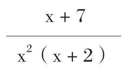
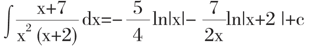
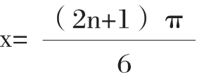
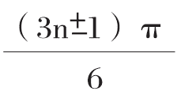
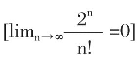
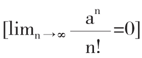

# 我们会被人工智能取代吗？

# 代序

2005 年，《科学》杂志为庆祝创刊一百二十五周年公布了一份清单，列出当时人类最想攻克的 125 个科学难题。跟智能相关的条目只有一处，第 94 条问的是“借助电脑学习的边界在何处”。提出这份清单的专家当时恐怕难以预见，就在同一年人工智能正悄悄改写。

以杰弗里·辛顿为代表的一批研究者把多层神经网络、巨量数据和高速计算结合起来，让机器表现出前所未有的学习能力，为新一轮工业革命拉开序幕。深度学习浪潮开始席卷整个行业。2015 年，《科学》杂志又刊出辛顿与学生的论文《深度学习》。

随后我们共同经历的那些里程碑也已为人熟知。2016 年 3 月，阿尔法围棋击败围棋世界冠军李世石，深度学习、强化学习与蒙特卡洛树搜索共同铸就了这次胜利。

这场震撼也让公众产生一连串追问：人工智能究竟是什么？过去六十年里科学家们做了什么？它将把我们带向何方？这些疑问与伟大哲学家反复追问的“我们是谁、从哪里来、去向何方”相通。

而这些问题的分量远超好奇本身。蒸汽机出现之初，没多少人意识到工业革命即将到来，也就错过了为社会经济巨变做准备的时间窗口，竞争对手由此赢得弯道超车的良机。历史显示，这样的大机会一生难得一遇。今天我们眼见的，是一种具备强大学习能力的人工智能，它将为人类社会带来怎样的机遇？

本书作者托比·沃尔什教授是解答上述问题的合适人选。我与他相识十余年，印象最深的是 2011 年在西班牙举行的国际人工智能联合大会。沃尔什担任程序委员会主席，IJCAI 一向挑选学界顶尖人物主持，而他在众多学者中以社会责任感著称。他把千余人的大会组织得生动热烈，并在当年及之后的会议上主持的人工智能与社会影响专题讨论，场场爆满。他睿智幽默，洞察力强且极具感染力。2017 年 IJCAI 上，沃尔什率先发起公开信，联同马斯克等国际知名人士呼吁禁止研制人工智能武器。

如今中国的人工智能已在世界舞台占有重要位置。2011 年的 IJCAI，现场几乎看不到中国企业的赞助身影；到了 2017 年墨尔本大会，中国企业成为主要赞助力量，投稿量与录用数已超越美国和欧洲，论文质量稳步提升，成为焦点。就在不久前，中国在国家战略层面加大投入，国务院发布《新一代人工智能发展规划》，明确到 2030 年的指导思想、目标、重点任务与保障措施，力图抢占先发优势，加快建设创新型国家与科技强国。

在大变局的时代，沃尔什这本新作出现得正是时候。众多新书中，它覆盖最广，对人工智能的源起、演进以及未来可能对社会产生的冲击，都给出了直接而全面的回应。

倘若今天《科学》再次公布最具挑战性的科学问题，人工智能必然榜上有名。因为它触及人类社会的终极命题：我们是谁？我们从哪里来？我们往何处去？

杨强
2018 年 4 月 2 日

# 后序

这本值得读。

近两年关于人工智能的书如雨后春笋，但托比·沃尔什这本不同。

其一，视野极广，涵盖人工智能的历史、当下与将来。从研究脉络、技术现状、瓶颈与挑战，到社会效应、职业冲击、技术奇点、自主武器，几乎无死角。前三章帮助读者梳理发展历程与技术面貌，后四章则深入探讨社会意义与深远影响。普通读者想了解的核心内容基本都能在此找到，覆盖面之大难得一见。

其二，出自一流学界权威。托比·沃尔什是澳大利亚科学院院士、国际人工智能学会会士，AAAI Fellow 是学界公认的崇高荣誉。市面上人工智能著作虽多，良莠不齐，能由国际一线权威专家撰写的高质量科普并不多见。

其三，读起来轻松。人工智能是计算机学的核心分支，本涉及繁复的推导与实现，本书却几乎不用任何数学公式。以真正的专家身份，才能把复杂问题说得通俗明白，这对不同背景的读者是福音，全景式了解变得可行。

我在国际会议上常与沃尔什碰面。八月初他请我写序，我因未读不敢妄言。他便请国外出版社寄样书，没想两次寄送皆未收到。十一月底才拿到英文稿。抽空读毕，感觉出色，尤其前三章深入浅出，旁注的小故事妙趣横生，后续各章纵横开合，令人欲罢不能。希望中文版能准确传递原貌，让更多读者受益。

2018 年 3 月于南京

# 中文版前言

人工智能革命即将来临，中国已把自己置于中心。我很高兴中文版得以付梓。在见证这些巨变的时刻，中国无疑是最理想的地方，未来更有可能由中国引领。

五年前，我们许多做人工智能的人就看好中国的潜力：高校投入加大，人才储备深厚。为激励中国学界，2013 年我们决定把顶级人工智能盛会——国际人工智能联合会议——放在中国举办。

今天，当初的潜力已成现实。后起的中国已跻身研究与实践的顶尖行列。2017 年 9 月，高盛发布报告《中国在人工智能中崛起》，说明这个世界第二大经济体如何凭借人工智能推动经济，成为全球角逐的重要玩家。

学术界同样如此。2017 年提交给 IJCAI 的论文，三分之一来自中国，数量相当于美国与欧洲之和。尽管会议在澳大利亚召开，仍有四分之一的代表来自中国。

中国把未来公开押注在人工智能上。这是审慎而成功率颇高的决定。人口城市化、人口结构变化带来挑战，中国需要人工智能提升生产率，以与周边低成本竞争对手抗衡，满足不断扩大的中产阶层需求。

2017 年 7 月，中国政府公布发展规划，目标到 2030 年成为人工智能全球领跑者，打造十万亿元产值的国内产业。如今已有迹象显示规划正在推进。

中国具备诸多天然优势。美国类似谷歌、脸书、亚马逊的巨头屈指可数，中国却有腾讯、阿里巴巴、百度等可一较高下的竞争者。数据方面，中国拥有 7.5 亿互联网用户，坐拥全球最大的智能手机市场。微信在全球近十亿用户，阿里巴巴的淘宝拥有五亿活跃买家。

这些公司投入数亿元人民币于人工智能。中国政府的保护政策也助推了它们的发展：曾经“山寨”硅谷，如今往往率先一步。

算盘发明于五千年前，此后计算史很少聚焦中国。但未来一两百年里，人工智能史很可能会高度集中在全球人口最多、届时也可能最富裕的这个国家。

致 A 与 B
是你们让生活更有趣

# 引言

从一句 1950 年的话开始。那时的世界简单得多：电视是黑白的，喷气机尚未民用，硅晶体管还未问世，全球只有十来台电脑，多是由真空管、继电器、插板和电容器堆砌而成的巨型装置。

那时只有胆识十足的人才敢断言：“我相信，到了二十世纪末，语言习惯与受教育者的常识会出现重大转变，人们可以说‘机器在思考’，而不会觉得自相矛盾。”多么大胆的设想——会思考的机器。将来机器真的会思考吗？如果会，它们何时会比我们更擅长思考？

做出这一预测的是谁？1999 年《时代》杂志将他列为二十世纪百位最重要人物之一。毫无疑问，他是二十世纪最神秘的人物之一：数学家、二次大战英雄，更是一位梦想家。即便在他英年早逝多年后，他的梦想仍在影响我们。

一部奥斯卡获奖影片讲述了他破解德国恩尼格玛密码的关键作用。丘吉尔称他和同事们是“下金蛋却从不叫的鹅”。多数史学家认为破解恩尼格玛至少把战争缩短两年，拯救数百万生命。但我推测，二一世纪末人们记住他的，不会只是密码破译。

在破译过程中，他奠定了计算机理论基础，并参与研制“邦贝”这类实用计算设备。他的思想渗透整个人工智能与计算机科学。在第一台电脑诞生前，他已提出一套通用的基本计算模型。为表彰他的贡献，计算机领域最负盛名的奖以他的名字命名。或许人们更记得的也不是这些基石。

他对发育生物学的分化与形态发生也产生深远影响。他在历史悠久的期刊上发表《形态发生的化学基础》。该刊此前发表过达尔文、弗莱明、沃森、克里克、霍奇金等人的奠基性论文。他的论文解释了自然界条纹、斑点、螺旋的形成机制，是他著作中最常被引用的作品。我仍怀疑，到了世纪末，人们对他的主要记忆不会是图案形成。

他亦是同性恋社群的重要人物。1950 年代英国同性恋非法，1952 年他因同性恋行为被起诉并接受药物阉割，许多人认为这导致他最终自杀，象征政府抛弃了二战英雄。2009 年，首相戈登·布朗在民众请愿后为其道歉；四年后女王签署罕见的皇室赦免。社群视他为烈士。但我怀疑，到了世纪末，人们最深刻的缅怀不会只源于这些私事。

那么人们最会记住什么？我认为是他在哲学杂志《心智》上发表的一篇论文。开头的引文即来自该文。当时《心智》最知名的稿件或许是刘易斯·卡罗尔关于芝诺悖论的《乌龟对阿基里斯说了些什么》。今天，这篇出处被视为人工智能史上最重要的论文之一。它设想机器将思考，而当时全球十余台电脑又大又贵，连口袋里的智能手机都不如。设想它们的影响已很难，设想它们会自行思考更难。但论文预见了否定思考机器的种种论点并逐一驳斥。许多人视该文作者为人工智能之父。

他就是艾伦·麦席森·图灵，1912 年生，1954 年逝。

我预测，到二十一世纪末，图灵最被铭记之处，是为思考机器奠基。这些机器将像蒸汽机在工业时代初期那样急剧改变生活，改变我们工作、学习、对待疾病与衰老的方式，最终改变人类为后代留下记忆的方式。它们可能是我们最具变革性的创造。科幻小说里充斥着会思考的机器人，科学事实正紧随其后。

我们的生活正飞速奔向科幻梦想。随身的掌上电脑可回答稀奇问题，提供娱乐，迷路时指引回家，帮找工作或伴侣，放首情歌，即时连接世界各地的朋友。思考机器变成手机，只是它们最不值一提的用途。

这一预测引出一连串问题。到下个世纪之交，这些会思考的机器会记得图灵吗？那会是美好的未来吗？机器人会接手所有艰苦危险的工作吗？经济会持续繁荣吗？我们能减少工时、享受更多假期吗？还是好莱坞是对的，未来艰难，富者愈富，更多人失业？更糟的是，机器人最终会接管世界吗？我们是否在播种自我毁灭？

本书探讨这些问题。第一部分回顾过去能给出的教训。若知道技术的源头，便更易理解其走向。第二部分审视当今人工智能的发展，权衡风险与收益，尝试现实地评估这一宏大尝试的结果。制造思考机器是一项雄心勃勃的事业，若成功，影响巨大。第三部分更深入讨论人工智能的未来。书本与电影里的狂野未来会成真吗？是否足够天马行空？我还将“亲身试水”，对 2050 年人工智能可能取得的进展做出十项预言，其中有些或许会令你惊讶。

当下正是人工智能的火热年代。过去五年，数十亿美元的风险投资涌入相关企业。IBM 在沃森认知平台押下十亿美元，丰田投入十亿美元研究 AI 无人驾驶，开发通用安全人工智能的 OpenAI 亦获十亿美元支持。2015 年成立的软银愿景基金背靠沙特资金，规模近千亿美元，聚焦人工智能与物联网。谷歌、脸书、百度等行业巨头也在大举投入。毫无疑问，今天投身这一领域是极其激动人心的时刻，资金的涌入可能进一步加速思考机器的开发。

## 为什么阅读本书？

今天计算机改变生活的速度惊人，全球范围内人们渴望更深入地理解人工智能。许多评论家预言大事将至。2016 年 5 月，微软英国首席构想官戴夫·科普林大胆提出：人工智能是“当今地球上人们从事的最重要的技术”。他说，这将改变人与技术的关系、改变人与人之间的关系，甚至改变我们对人类概念的看法。

一个月前，谷歌 CEO 桑达尔·皮查伊介绍，人工智能是谷歌的战略核心。他强调长期投入机器学习与人工智能的重要性，并展望从“手机优先”迈向“人工智能优先”的世界。

与此同时，也有不少评论家预警风险，甚至担忧它会加速人类灭亡。2014 年，埃隆·马斯克在麻省理工学院听众面前警告：“我们对人工智能必须非常谨慎。如果要猜最大的生存威胁，大概就是它。”马斯克以贝宝、特斯拉、SpaceX 著称，对技术尤其是计算技术的破坏力有所体会。他也用金钱表达立场：2015 年初向人类未来研究所捐赠一千万美元，资助人工智能安全性研究。对一位身价百亿美元的富豪而言，这只是小额，但同年晚些时候他加码百倍，成为 OpenAI 项目十亿美元融资的主要支持者之一，该项目目标是开发安全的人工智能并向全世界开放。

马斯克之后，物理学家史蒂芬·霍金也表达担忧。霍金一边欣喜自己的语音合成器升级，一边用电子嗓音略带讽刺地警告：“全面人工智能的发展，可能意味着人类种族的终结。”

其他知名技术人物如微软比尔·盖茨、苹果史蒂夫·沃兹尼亚克也对人工智能未来持谨慎态度。信息论之父克劳德·香农 1987 年写道：“我想象有一天，我们与机器人的关系会像今天的狗与人类……我为机器喝彩！”就连图灵本人，1951 年在 BBC 第三套节目的广播里也发出警示：

如果机器能够思考，甚至思考得比我们更好，那将把我们置于何地？即使我们能让机器保持臣服，比如在关键时刻切断电源，从物种角度看，我们也应感到极大的谦卑……它绝对会带来焦虑。

并非所有技术专家都为思考机器可能带来的伤害而焦虑。2016 年 1 月，Facebook 的马克·扎克伯格就公开反驳这类担忧，他认为人类完全有能力打造出为我们打工、帮我们解难的智能系统。至于有人把人工智能视作重大威胁，他觉得这种说法有点夸张，发生的概率远低于瘟疫、暴力等灾难。百度首席人工智能研究员吴恩达的说法更夸张，他说担心人工智能就像担心火星人口过剩一样离谱——要知道马斯克的另一个登月式计划正是火星移民。

那我们该听谁的？连马斯克和扎克伯格这样的人物都意见相左，岂不正说明至少有些地方值得警惕？对人工智能的疑虑绝非新鲜事。科幻作家阿瑟·克拉克是公认的未来预言高手，早在 1968 年就指出人工智能可能酿成险恶后果。他准确预见了地球同步卫星、全球数字图书馆也就是今天的互联网、机器翻译等。他在小说《2001：太空漫游》里塑造的哈尔 9000，就是人工智能夺权导致灾难的典型呈现。

受克拉克等先行者的影响，我从小就对人工智能抱有憧憬，后来一直在这个领域工作，努力让憧憬成真。因此当领域以外的人，尤其是才智过人的物理学家和成功的科技企业家断言人工智能将终结人类时，我难免心生不安。身处最前线的人能否为这场争论提供更有帮助的视角？还是说我们投入太深，反而不见风险？更让人困惑的是，为什么要去研发可能毁灭自己的东西？

这类担忧或许根植于人类心理深处。普罗米修斯盗火的神话就反映了这种恐惧——火既造福也带来灾难。玛丽·雪莱笔下的弗兰肯斯坦同样在说，我们创造之物可能反噬自身。恐惧由来已久并不等于毫无道理。核弹、克隆、致盲激光武器、社交媒体等，都是我们应该且确实需要深思的技术。本书其中一个目的，就是帮助你判断面对思考机器的到来，应该有多少欢迎、多少忧虑。

争论之所以难解，是因为外界对人工智能存在诸多误解。我希望能澄清其中一部分。我的一个论点是，人们尤其是非专业人士，往往高估了当下及不久将来的能力。看到电脑在围棋上击败人类[\[13\]](#chapter001_0004.xhtml#m13)，人们就因为自己不懂围棋而臆想机器也能轻松完成其他智力任务。但今天的围棋程序，和所有现有程序一样，是个一专多能的白痴天才。它只会一件事，甚至不能同时下象棋和打扑克。要让它转做别的游戏，需要巨大的人力工程。绝不会有一天早上它醒来觉得围棋无聊想去玩在线扑克赢钱，也不会突然萌生统治世界的念头。它没有欲望，只是一套按指令运行的程序，任务就是把围棋下好。

另一方面，我们又普遍低估技术带来的长期改变。智能手机才流行十几年，就彻底重塑生活。互联网不到二十岁，却几乎改变了所有领域。那未来二十年呢？在倍增效应下，变化很可能比过去二十年更大。人类进化是为了应对眼前的危险，很难理解指数增长，也不擅长预判长期风险与黑天鹅事件[\[14\]](#chapter001_0004.xhtml#m14)。如果真懂长期，我们不会买彩票，会更积极储备养老金。我们追求快感、回避痛苦的大脑，很难理解复利式进步。我们只能活在当下。

在你深入阅读前必须提醒，预测未来是门科学，却不精确。诺贝尔奖得主尼尔斯·玻尔说过：“预测很难，预测未来尤其难。”我预计自己描绘的宽泛图景基本成立，但细节肯定有误。希望你在阅读过程中能理解，我和数千同行为何倾注一生去探寻通向思考机器的道路。希望你明白，为改善全人类生活质量，我们为何应该、也必须探索这条路。在若干领域，我们有道德责任推动人工智能，因为它能拯救无数生命。

最后，请思考社会本身需要怎样改变。本书的核心信息是，人工智能可以把我们带向多条道路，有好有坏，但选择权在社会手中。很多决策可以交给机器，我却认为并非所有决策都该交给机器，即便机器做得更好。社会需要主动决定哪些事可以托付给机器。

本书面向对该话题感兴趣但非专业的读者。你可能想知道人工智能会把我们带向何方，会出现怎样夸张的预测，技术奇点会否到来，你该为方向感到担忧吗？它对你和孩子意味着什么？如果某些预言成真，还要多久？为避免阅读中断，我把引用与额外技术说明都放在尾注，你可以完全忽略它们把书读完[\[15\]](#chapter001_0004.xhtml#m15)。若想更深入，这些注释能提供细节，也是指向相关文献的入口。现在出发吧。

* * *

[\[1\]](#chapter001_0004.xhtml#w1) 1950 年 12 月，艾伦·图灵设计的 ACE 原型机在新闻界亮相，截至当时它是第 11 台通用可编程计算机，具体数量取决于定义标准。此前已出现 Z3 德国 1941、巨人 Mark I 英国 1944、哈佛 Mark I 美国 1944、巨人 Mark II 英国 1944、Z4 德国 1945、ENIAC 美国 1946、曼彻斯特小婴儿 英国 1948、曼彻斯特 Mark I 英国 1949、EDSAC 英国 1949、CSIRAC 澳大利亚 1949。到 1951 年首批商业成功的电子计算机 UNIVAC 1 与曼彻斯特 Ferranti 才问世。接下来的十多年，斯佩里·兰德仅向美国人口普查局、陆军与几家保险公司等卖出 45 台 UNIVAC 1。图灵的 AI 梦想提出十多年后，计算机仍稀少昂贵。如今全球超十亿台，最便宜的百来美元即可购得。六十年间变化巨大。

[\[2\]](#chapter001_0004.xhtml#w2) 参见参考文献 44。

[\[3\]](#chapter001_0004.xhtml#w3) 不止《时代》杂志评委如此评价。图灵百年诞辰时，《自然》称其为历代顶尖科学家之一。

[\[4\]](#chapter001_0004.xhtml#w4) “邦米”是破解恩尼格玛密码的电动机械装置，因缺少存储程序等功能不算计算机。它通过搜索德国恩尼格玛转子的可能位置寻找槽口即明文线索进行计算。

[\[5\]](#chapter001_0004.xhtml#w5) 图灵机是假想的计算装置，由无限磁带与按简单逻辑读写磁带的读写头构成，能模拟任何计算机程序。虽简单，至今仍是基本计算模型。

[\[6\]](#chapter001_0004.xhtml#w6) 参见参考文献 45。英国皇家学会创办的《哲学学报》始于 1665 年，是英语世界历史最悠久的科学期刊。

[\[7\]](#chapter001_0004.xhtml#w7) 1954 年 41 岁的图灵去世，调查指向自杀，现场有半个含氰化物的苹果，但该苹果从未检测氰化物。许多人记得他最爱电影《白雪公主与七个小矮人》；另见参考文献 24。

[\[8\]](#chapter001_0004.xhtml#w8) 参见参考文献 9。

[\[9\]](#chapter001_0004.xhtml#w9) 参见参考文献 44。

[\[10\]](#chapter001_0004.xhtml#w10) 谷歌在 DeepMind 投入超 5 亿美元，在 Wavii 投入 3000 万美元，并在多家机器人公司投入上百万美元。

[\[11\]](#chapter001_0004.xhtml#w11) 除非另行说明，本书金额均为美元。

[\[12\]](#chapter001_0004.xhtml#w12) 克劳德·香农 1916-2001，其麻省理工硕士论文指出布尔代数可在电路中快速执行，构建一切逻辑功能，被视作现代计算机硬件基础。该论文被称作 20 世纪最重要硕士论文之一。其通信理论描述了数字信息在嘈杂信道中的传输极限。1950 年他发表首篇计算机象棋论文。周末他与妻子贝蒂常去拉斯维加斯，用算牌法玩21点。

[\[13\]](#chapter001_0004.xhtml#w13) 我下过几盘围棋，每盘都输得很惨。

[\[14\]](#chapter001_0004.xhtml#w14) 在库克等探险家前往澳洲大陆前，人们认为天鹅只能是白的。公元 1 世纪罗马诗人尤维纳尔就写过，有些事像黑天鹅一样罕见。

[\[15\]](#chapter001_0004.xhtml#w15) 是的，你完全可以忽略尾注。

# 第一部分

## 人工智能的来路

## 第一章

### 梦想的萌芽

要明白人工智能会把我们带往何方，先弄清它从哪里来、现在身处何处，再据此推断未来。

人工智能的系统性研发始于 1956 年，创始人之一约翰·麦卡锡在新罕布什尔州达特茅斯夏季研讨会上提出这个名称[\[1\]](#chapter001_0005_0001.xhtml#m1)[\[2\]](#chapter001_0005_0001.xhtml#m2)。说实话，这个名字并不理想。智能本身概念模糊，把“人工”加在任何事物前都不讨喜，容易引出“天然智能”“人工愚蠢”等段子。但好坏与否，我们仍在使用它。这个概念的历史可追溯更早，甚至早于计算机。数百年来人类一直在思考能思维的机器以及如何塑造思维。

### 早期思想萌芽

这个故事没有清晰起点，却与逻辑的诞生紧密相连。公元前 3 世纪左右，亚里士多德开创形式逻辑，没有逻辑就没有当代数字计算机。逻辑常被视为思维方式，是精确描述推理与论证的工具。

亚里士多德之后两千多年，除少数用于天文计算的机械装置外，人类在制造思考机器上几乎停滞。公平地说，中世纪黑暗时代求生存已不易，战争、瘟疫、饥荒占据全部精力。

此期间有个关键人物，13 世纪加泰罗尼亚作家、神学家、数学家、逻辑学家拉蒙·柳利[\[3\]](#chapter001_0005_0001.xhtml#m3)。有人视其为计算先驱之一。他发明原始逻辑，可用机械方式穷举某个主题的所有可能真理，使他成为最早用逻辑与机械方法产出知识的人。但当时并未广受认可，尽管可能深刻影响了故事中下一位人物。

### 把推理变成计算

中世纪迷雾散去，故事加速。戈特弗里德·威廉·莱布尼茨[\[4\]](#chapter001_0005_0001.xhtml#m4)是其中远见者。他认为人类思想可简化为一种运算，能辨别推理错误或化解分歧。他写道：“校正推理的唯一办法是让它像数学家工作一样具体，这样一眼就能看出错误。若两人争执，只需说：来算算吧，不用多言便知谁对。”[\[5\]](#chapter001_0005_0001.xhtml#m5]

莱布尼茨提出执行这种计算的原始逻辑，构想“人类思想字母表”，用独特符号表示基本概念。归根结底，计算机不过是操作符号的引擎[\[6\]](#chapter001_0005_0001.xhtml#m6)。若数字计算机要“思考”，莱布尼茨的抽象必不可少。只要符号代表基本概念，计算机就能产生新概念并进行类人推理。

几乎同时，哲学家托马斯·霍布斯[\[7\]](#chapter001_0005_0001.xhtml#m7)为思考机器奠基。他将推理等同于计算，写道：“我通过计算理解推理……因此推理就像加减一样。”[\[8\]](#chapter001_0005_0001.xhtml#m8]

把推理与计算等同，是通向思考机器的第一步。尽管机械计算器发明略早于两人著述[\[9\]](#chapter001_0005_0001.xhtml#m9)，但直到近两百年后，人们才真正用计算执行推理。

黑暗时代过去后出现勒内·笛卡儿[\[10\]](#chapter001_0005_0001.xhtml#m10)。他提出至今困扰 AI 研究的哲学命题：我思故我在。思想与存在被直接绑定。反向推导，若你不存在，就不思考。于是笛卡儿的观点挑战了思考机器的可能性。机器不像人那样存在，缺乏情感、道德、意识、创造力等与存在相连的特质。反对者常据此论证：因无意识故不能思考，因无创造力故不能称之为思考。稍后会回到这些论点。

### 布尔与巴贝奇

再过两百年，故事迎来下一个主角，自学数学家乔治·布尔[\[12\]](#chapter001_0005_0001.xhtml#m12)。虽无大学学位，他在任教之余发表大量数学论文，1849 年被任命为爱尔兰科克皇后学院数学教授。该职位当时处学术边缘，却让他自由构建日后成为计算与 AI 梦想核心的观念。布尔提出逻辑可通过代数运算实现，基于真/伪、开/关、0/1 两个值。这种布尔逻辑正是今天每台计算机的操作基础。虽当时认可度低，但称其为信息时代之父并不夸张。

布尔对自己的逻辑抱有远超时代的雄心。他著有《思维规律研究》，书名暗示目标。他不仅想为逻辑提供数学基础，更想解释人类推理。序言中写道：

论文宗旨是探究思维操作的基本规律，用微积分符号表达，建立逻辑科学，构建其方法；并在考察中收集真相元素，对人类思维的性质与构成作出暗示。

布尔从未完全实现这些雄心，其工作当时基本被忽视，十年后他不幸去世[\[13\]](#chapter001_0005_0001.xhtml#m13)。即使在学术圈，他也缺少能自动实现梦想的机器。

巧合的是，去世前两年布尔在伦敦博览会遇见下一位人物查尔斯·巴贝奇[\[14\]](#chapter001_0005_0001.xhtml#m14)。两人据说谈及巴贝奇的“思考引擎”。若布尔多活几年，他们的合作会怎样令人憧憬。查尔斯·巴贝奇是数学家、哲学家、发明家与工程师，他梦想制造机械式计算机。虽未成功，却被视作可编程计算机之父。他设计的分析引擎采用打孔卡片编程。

可编程即通用，自我改写才开启学习可能

机器的强大来自于遵循的指令可以随时被替换。正是这种可变性构成了通用计算的根基。手中的智能手机能够运行连乔布斯或任何厂商都未曾设想的应用，于是同一设备同时承担计算、记录、健康监测、导航、拍照、播放乃至通话等多种角色，时常让人忘了打电话才是它的出身。图灵在提出通用模型时思考的就是这一类可能：装置本身并非专用，通过编程即可完成各式各样的任务。更精妙的是，程序自身也是可以被修改的对象。自我改写的能力奠定了人工智能梦想的基础。将学习视作智力的核心成分时，若要让计算机模拟学习，就必须允许它改变自己的代码。编写自修改程序其实并不难，因为程序本质上就是数据，能够像电子表格中的数值、文字处理器的字符、数码图像的色彩那样被操作。因此机器得以通过改写自身的指令，去执行最初设计者从未预料的行为。

## 第一位程序员
与巴贝奇合作的是洛夫莱斯伯爵夫人奥古斯塔·埃达·金（Augusta Ada King）[\[15\]](#chapter001_0005_0001.xhtml#m15)。她撰写了一套面向更广泛读者的注释，用以介绍并阐释巴贝奇的“分析引擎”。在这些笔记里出现了公认的第一份计算机程序。巴贝奇把注意力集中在引擎进行数值运算、编撰天文及其他表格的能力上。洛夫莱斯则设想机器可以走得更远，她写道，巴贝奇的发明“或许还可以执行数字之外的其他事情……引擎说不定能作出复杂而科学的乐曲”。

这一想象超前了整整一百年。今天的智能手机印证了这一点，除了处理数字之外，它们还能处理声音、图像、视频，完成各种不同任务。洛夫莱斯也是人工智能最早的质疑者之一，她对制造思考机器的幻想保持怀疑。她的原话是：“分析引擎没有创作任何东西的主张。它可以做任何我们吩咐它执行的事情。它可以遵循分析，但它没有力量去预见任何分析关系或真相。”

“缺乏创造力就不算智能”这一观点从未停止争议，图灵在《心智》一文中曾展开论述。我稍后再回到这场争论，先看洛夫莱斯的保留。第一个提出编程概念的人，早了一个多世纪就设想计算机不只处理数字，却对制造思考机器的终极梦想持保留态度。这绝非轻率的幻想，它触及人类在宇宙中的位置。我们是否独特，还是我们也只是机器，与计算机类似？答案最终会重塑自我认知，甚至动摇哥白尼日心说或达尔文“人是猿类的后裔”那样的基本观念。

十九世纪有一位名气不大的人物进入视野，他是威廉·斯坦利·杰文斯（William Stanley Jevons）[\[16\]](#chapter001_0005_0001.xhtml#m16)。他在数学与经济学上都有建树。我们关注的是他1870年制造的“逻辑钢琴”，一台机械计算装置，用于求解最多4个真假命题的逻辑题，按布尔逻辑的说法即4个取值0或1的变量。杰文斯设计钢琴的目的是逻辑教学。原机至今保存在牛津历史博物馆。逻辑钢琴将布尔逻辑的一个片段做成了简洁的机械表达。发明者写道：“很明显，这一机制能够代替执行逻辑推演时所需的大部分思考行动。”[\[17\]](#chapter001_0005_0001.xhtml#m17)

有人说杰文斯造出了一台非常原始的思考机器，但我估计1870年在皇家学会展出时在场的观众，即便再有远见，也难以预料它会带来怎样的变革。至少这是通向计算机、最终通向人工智能之路上的早期实验之一。可惜与故事里出现的几位人物一样，杰文斯早逝[\[18\]](#chapter001_0005_0001.xhtml#m18)；《泰晤士报》刊登的讣告里并未提及逻辑钢琴。

## 逻辑革命
故事推进到二十世纪初。科学、艺术、政治等多个领域都在经历革命。爱因斯坦、玻尔、海森堡等人以相对论和量子力学撼动了物理学根基；印象派、达达主义等反古典思潮冲击了绘画；与此同时，数学与逻辑的基础也被猛烈撼动。

大卫·希尔伯特（David Hilbert）[\[19\]](#chapter001_0005_0001.xhtml#m19)是那个时代最顶尖的数学家之一。1900年，他列出了数学最具挑战性的23个问题。在引介这些问题时他写道：

我们中有谁不乐意去掀开未来藏身其后的面纱呢？有谁不乐意一窥科学即将出现的发展，以及未来几个世纪里科学发展的秘密呢？未来几代数学家的精神，会走向什么样的终点？在数学思想这一广大而丰富的领域，新世纪里会出现什么新方法，有哪些新方面？

这种近乎诗意的视野，为本书提供了很好的开场。23个问题中有几个关乎数学本身的基础。当时数学的根基显得摇摇欲坠。集合指的是某类对象的总体，比如黑色汽车集合、银色汽车集合、黑色或银色汽车集合、既非黑色也非银色汽车集合、任何并非银色汽车物体的集合。1874年，德国数学家格奥尔格·康托尔（Georg Cantor）[\[20\]](#chapter001_0005_0001.xhtml#m20)写下了集合的规范数学表达。对数学家而言这似乎是个奇怪的项目。数学关乎数字与函数之类对象，为什么要对如此简单的集合感兴趣？然而集合可以表示许多不同的数学对象：数字、函数、图形，以及数学家研究的许多奇异对象，比如流形、环和向量空间。[\[21\]](#chapter001_0005_0001.xhtml#m21)

另一位伟大数学家伯特兰·罗素（Bertrand Russell）[\[22\]](#chapter001_0005_0001.xhtml#m22)证明，康托尔试图将集合数学形式化的尝试注定会落入循环悖论。以所有银色汽车集合为例，它不包含自身，可称正常集合。反过来，补集包含了所有不是银色汽车的东西，它的确包含自身，可称异常集合。再看所有正常集合的集合。它自身是否正常？如果正常，它就包含在所有正常集合的集合中，也就是说它包含自身，那它就成了异常。反之若它是异常的，它就包含自身，也就是所有正常集合的集合，这又让它成了正常。这是罗素著名的悖论：集合不能同时既正常又异常。故事里还将出现其他类似循环悖论。康托尔的集合论充满此类悖论，一些批评者称他为“科学骗子”和“年轻人的腐蚀剂”。不过下一位人物会证明，这不是康托尔的错。从根本上说数学就是这样的。这对制造思考机器，至少对使用逻辑进行推理的思考机器，构成根本挑战。

为回应数学中心的危机，希尔伯特拟定了一套工作计划，试图把数学建立在精确、合乎逻辑的基础之上。希尔伯特计划想要找到若干基本事实或基本构造的小集合，让数学全部内容建立其上。计划还希望证明这种数学形式不包含康托尔集合论里的悖论。一旦出现悖论，任何事都能被证明。若要制造思考机器，制造能做包括数学在内的各种事情的机器，我们就需要这类基本构造。

## 数学的终结
1931年，历史上最重要的逻辑学家之一库尔特·哥德尔（Kurt Gödel）[\[23\]](#chapter001_0005_0001.xhtml#m23)彻底摧毁了希尔伯特计划。他用两条著名的不完全定理打击希尔伯特计划。这两条定理证明，任何内容丰富到足以描述整数这一类简单概念的形式化数学，必然不完全，要么就包含悖论。因此，任何无悖论的数学系统，都包含着无法证明的数学真理。这是哥德尔不完全定理中的“不完全性”。

哥德尔的结论让希尔伯特计划破产，并为数学留下永远有点摇晃的基础，让数学本身彻底成为数学的目标变得不可能，这向构建思考机器的梦想提出了深刻的哲学挑战。若要思考机器，若这些机器必须像莱布尼茨和霍布斯认为的那样进行数学推理，我们就需要为它们提供精确、逻辑形式化的数学，便于它们推理。但哥德尔不完全定理证明，我们不能为数学写出精确规则，即可以写给计算机让它们完成所有数学运算的规则。

数学物理学家罗杰·彭罗斯爵士（Sir Roger Penrose）[\[24\]](#chapter001_0005_0001.xhtml#m24）大力倡导这类观点，并用它们反驳人工智能有一天能超过人类智慧的说法。[\[25\]](#chapter001_0005_0001.xhtml#m25)不过针对彭罗斯的意见也有很多反对声音。计算机不需要具备证明一切数学的能力，就跟人类一样。计算机可以在包含悖论的系统中运作，就跟人类一样。哥德尔定理要求我们思考无限的系统，但所有人类和计算机都是有限的。再加上，很快计算机就会使用不同的计算模型，如量子计算机，这些模型超出了哥德尔结论的范围。人工智能领域的共识仍然是：从理论上说，哥德尔定理并没有阻挡制造思考机器之梦的去路。在实践中，我先前也讨论过，我们继续朝着这个梦想取得不错的进展。

## 无法计算的事物
这几乎让我们画了一个圆，回到了本书开篇提到的数学家艾伦·图灵。不论实践还是理论，他都在开发计算机过程中扮演关键角色。他提供了至今仍用来在数学上描述计算机的基本抽象模型“图灵机”。但1936年，在我们尚未真正造出这些机器之前，图灵就提出了另一个意义深远的见解。他发现有些问题，这类机器永远不可能计算出来。当时还没有人写过程序，也没有可供编程的计算机。然而图灵却高屋建瓴地预见到一些哪怕日后更聪明的程序员也无法让计算机解决的问题。

其一是“停机问题”。你能否写出一套计算机程序，让它判断另一套程序该不该终止？这会很有用。你肯定不希望飞行器的控制系统半路停机。同样，你肯定希望电视机顶盒扫描新频道的程序能够在中途停止。图灵证明，有些问题（如停机问题）是无法写出计算机程序来的。[\[26\]](#chapter001_0005_0001.xhtml#m26)请记住，程序本身就是数据，故此它可以把数据输入另一套程序。我们可以编写一套以另一套程序为输入的程序，判断给定输入程序该不该终止。图灵的非凡成就在于他证明，不管你是个多么聪明的程序员，都写不出来这样的程序。

图灵使用了循环论证，跟罗素“集合不包含自身”悖论类似。假设我们确实拥有一套可以解决停机问题的程序。假设它叫“图灵程序”。现在，我们把它作为另一套更大程序的子程序，对后者，我们称之为“图灵超级程序”。图灵超级程序可把其他任何程序作为输入，并以图灵程序作为子程序，判断输入程序是否应该终止。如果输入程序终止，那么图灵超级程序就会进入永不终止的无限循环。反过来说，如果输入程序不终止，则图灵超级程序就会终止。这就是图灵循环论证切入的地方。如果把图灵超级程序自己作为输入，它会怎么做？对这一输入，图灵超级程序要么能终止，要么不能终止，只有这两个结果可选。

让我们考虑两种可能性。假设图灵超级程序无法终止这一输入。此时，图灵超级程序被输入了一套需要终止的程序，它却无法终止。那么，这意味着图灵超级程序终止了。故此，如果图灵超级程序不终止，就意味着它自身终止。让我们再来看看另一种可能性。假设图灵超级程序终止了这一输入。此时，图灵超级程序被输入了一套不终止的程序，它将其终止了。这意味着图灵超级程序不终止。不管怎么想，我们都碰到了矛盾。图灵超级程序不能既终止又不终止。再回想我之前提出的关键假设：图灵程序存在。这个假设带来了矛盾，故此显然有误。于是，我们可以得出结论：图灵程序不可能存在。我们不能设计一套程序来判断给定输入程序是否终止。依靠这一论点，图灵指出：有些问题，是计算机无法解决的。

存在无法计算的问题，似乎对开发思考机器的梦想提出了另一个根本性的挑战。我们有一个不可辩驳的证据，表明有些事情计算机做不到。[\[27\]](#chapter001_0005_0001.xhtml#m27)现在，你或许会想，是不是只有模糊问题（如判定程序是否终止这一类）不能计算呢？其实，还有很多十分有用的问题无法计算，比如判定数学语句是否为真。[\[28\]](#chapter001_0005_0001.xhtml#m28)

存在无法计算的问题，并不会搞砸开发思考机器的梦想，原因有好几个。首先，我们仍然可以让计算机来解决此类问题，尽管有些不够完善。你说不定购买过 Mathematica 或 Maple 这类判定数学语句是否为真的软件，它们有时候会说：“我不知道。”其次，另一种替代办法是，你仍然可以拥有解决此类问题的计算机程序，但它或许有些许不精确。有时候，软件会出错：它说输入程序不终止，但其实输入程序已经终止了（或是反过来）。第三，很多人工智能靠的是启发式的经验原则，大多数时候管用，但有时候会失败，甚至让自己陷入无限循环。第四，智能本身也并不意味着 100%正确。我们人类也并不是随时都 100%正确。我们不需要制造一台随时都能解决图灵停机问题的机器。故此，哪怕我们知道存在计算机无法准确计算的问题，制造思考机器的梦想也能延续下去。

## 计算机问世
直到目前，开发思考机器的设想，基本上还仅局限于理论上。哪怕图灵已经确认了计算机无法计算的问题，我们实际上都还没有能够计算的计算机。这种局面要等到第二次世界大战才会改变。解码敌方情报、执行复杂计算以制造原子弹的需求，向前推动了计算的实践方面，并带来了第一批真正可用的计算机。

全世界第一台计算机到底是哪一台，各方说法纷纭。第二次世界大战期间的保密原则，以及机器的不同性能，把这潭水给搅浑了。德国的 Z3，1941 年开始运转；英国的巨人，1944 年运转；美国的埃尼亚克，1946 年运转；英国的曼彻斯特宝贝，虽然 1948 年才制造出来，但却是同期计算机里第一台开始存储程序的。[\[29\]](#chapter001_0005_0001.xhtml#m29)但谁是第一台计算机，跟我们的故事没有太大关系。重要的是，它们的速度和内存不断提高，而大小和价格却飞速下降。于是，全世界的计算机数量迅速增加。如今，全世界运转着数十亿台电脑。据说 IBM 的托马斯·沃森（Thomas Watson）曾认为，全世界只要 6 台计算机就够了，现实显然毫不留情地证明他错了。[\[30\]](#chapter001_0005_0001.xhtml#m30)更有可能的是，全世界每个人都至少拥有 6 台计算机才够。

## 达特茅斯及其他
随着世界从第二次世界大战中逐渐恢复，计算机越来越普遍，我们拥有了着手制造思考机器的所有部件。我们只需要有个东西来启动它。这便是达特茅斯夏季研讨会（Dartmouth Summer Research Project）。1956 年，该研讨会在新罕布什尔州常春藤联盟大学达特茅斯举行。组织者是约翰·麦卡锡，他与图灵并列为人工智能领域的奠基者之一。当时，麦卡锡正在达特茅斯大学任教，不过，他后来搬到了斯坦福大学，帮忙设立如今已经非常出名的人工智能实验室。麦卡锡和马文·明斯基、纳撒尼尔·罗切斯特、克劳德·香农联手撰写了一份提案，说服洛克菲勒基金会资助为期两个月的达特茅斯头脑风暴会议。明斯基是神经网络的先驱，后来在麻省理工学院建立了一所杰出的人工智能实验室。罗切斯特来自 IBM，是 IBM 大批量制造第一台大型电子计算机 701 的联合设计师。香农在贝尔实验室工作，已经因为开发了信息统计理论（这是通信网络的根本），并将数学逻辑应用到计算机设计构建上而出名。出席达特茅斯会议的人还有伦敦百货公司创始人之孙，日后成为 GTE 实验室首席科学家的奥利弗·赛弗里奇（Oliver Selfridge）；日后将赢得诺贝尔经济学奖的赫伯特·西蒙[\[31\]](#chapter001_0005_0001.xhtml#m31)；日后在卡内基梅隆大学建立了著名人工智能实验室的艾伦·纽厄尔（Allen Newell）。

达特茅斯夏季研究项目对制造思考机器的进度极为乐观。该项目的筹资倡议开篇就这样写道：

1956 年夏天，我们 10 个人提议，一起在新罕布什尔州汉诺威的达特茅斯学院进行为期两个月的人工智能研究。这项研究基于如下猜想：学习的每个方面，或智力的其他任何特征，原则上都可精确地加以描述，以便制造机器来模拟。我们将努力探讨，怎样让机器使用语言构成抽象和概念，解决如今只有人类能解决的各种问题，并自我改进。我们认为，一群精心挑选出来的科学家夏天聚在一起携手合作，便可以在上述问题的一个或多个上取得可观进展。

虽然有些过分自信，但该提案对梦想做了清晰的阐述：精确地描述学习和人类智能的其他方面，好让计算机能够模拟。简而言之，他们想让莱布尼茨的梦想变成现实：把思考转化为计算。遗憾的是，我们马上就会看到，这种乐观态度很快便会在该领域弥漫开来。

## 大西洋对岸
别以为我们的故事仅仅在美国往前推进。英国同样是计算的发祥地之一，在人工智能早年岁月里也扮演了关键角色。事实上，全世界为研究思考而专门建立的最资深的科学会社，就是英国人工智能和行为模拟研究协会（Society for the Study of Artificial Intelligence and the Simulation of Behaviour）。它成立于 1964 年，延续至今。

英国有一个地方，在最初的开发阶段发挥了非常突出的作用。1963 年，在爱丁堡大学，唐纳德·米基（Donald Michie）[\[32\]](#chapter001_0005_0001.xhtml#m32)成立了一支研究小组，它最终演变成了全世界第一个人工智能科系（有一段时间，全世界独此一家）。米基曾在布莱切利公园与图灵共事，他们经常一起在午餐时间探讨开发思考机器的梦想。爱丁堡大学发起了许多开创性项目，包括机器人“弗雷迪”（freddy）。这是最早集成了视觉、操纵和复杂控制软件的机器人之一。

1973年，英国科学研究委员会请到应用数学家迈克尔·詹姆斯·莱特希尔对本国的智能研究做一次全面勘查，结果形成的《莱特希尔报告》几乎是一纸否定书。报告把当时多个核心课题的前景形容得极度黯淡，其中一句“迄今成果远未兑现当初许诺的关键价值”成为行业谈资。莱特希尔的判断也受到了他在爱丁堡亲眼目睹的团队内耗影响。文件发布后，国内相关经费被大幅削减，直到十多年后阿尔维计划重启，局面才重新转暖。

### 开创性进展
达特茅斯夏季研讨会的参与者对速度预期过于激进[\[33\]](#chapter001_0005_0001.xhtml#m33)，但1956年之后的二十年里仍诞生了几项奠基性工作。

最具代表性的要数移动机器人“摇摇”[\[34\]](#chapter001_0005_0001.xhtml#m34)。1966至1972年间，斯坦福研究所的团队在加州帕洛阿尔托造出了这台能自主行走、感知周边并对自身状态与动作进行推演的装置。它能力有限，却被视作人类第一次认真尝试制造真正自主的机器人。经费来自美国国防部，希望得到无需人员冒险就能执行侦察的装备。半个世纪后，这类装备已成现实。

《生活》杂志曾将其称为“首个电子人”[\[35\]](#chapter001_0005_0001.xhtml#m35)，说法略显夸张，但“摇摇”确实开创了可自行思考行动的机器一代。2004年它入选卡内基梅隆大学机器人名人堂。该项目最具远见的副产品是A\*寻路算法，用来在两点间寻找最短路径。随后它被用于规划自身移动。如今当导航提示“正在计算新路线”时，背后常用的是A\*的变体。技术走向常不可预见，第一台自主机器人的研究竟间接支撑了卫星导航，这在当年的拨款文件中根本找不到踪影。

另一条主线始于1965年的DENDRAL。它催生了专家系统这一门类。项目把专业知识——这里是分子化学——编码进程序，以质谱为输入，结合内部化学知识库提出可能的分子结构。程序依赖专家常用的启发式规则，从海量候选里筛出少数可信项。DENDRAL在细分领域取得成效，更重要的启示是：把人类专长在狭窄主题上明确形式化，计算机便能在特定任务上达到专家水准。八十年代，医院、银行、核电等场景都部署了类似系统，今日则演化为SAP、甲骨文、IBM等厂商销售的业务规则引擎。

### 棋盘上的分水岭
1979年7月15日，智能机器发展史上出现关键节点：程序BKG 9.8在蒙特卡洛与西洋双陆棋世界冠军路易吉·维拉对弈，以7胜1负取胜，奖金五千美元归其所有。这是电脑首次在技巧型游戏中压倒人类世界冠军，人类不再独占最强席位。双陆棋兼具技术与运气[\[36\]](#chapter001_0005_0001.xhtml#m36)，而程序在掷骰时运气不差。开发者汉斯·波林纳[\[37\]](#chapter001_0005_0001.xhtml#m37）事后回忆：

我几乎不敢相信结果，但程序确实赢了。它的招法没有明显失误，能拿下第三局和最后一局有运气成分。看客冲进封闭房间，摄影师拍照，记者采访，专家上前祝贺。唯一不和谐的是，前一天才登顶世界冠军的维拉情绪低落。我对他说很抱歉，我们心里都清楚他才是更强的棋手。[\[38\]](#chapter001_0005_0001.xhtml#m38)

即便BKG 9.8并非最强选手，这仍是历史瞬间。波林纳并未按最优规则编程，而是让程序学习下棋。随着迭代，系统下法超过创造者，最终达到世界冠军水平。

随后机器在其他游戏中继续突破，包括图灵等人痴迷的国际象棋。1985年，22岁的加里·卡斯帕罗夫成为最年轻的世界冠军，至今仍被许多人视作历史顶尖。十多年后，象棋程序终于击败人类，而被击败的恰是他，难免残酷。1997年5月11日，卡斯帕罗夫在纽约的表演赛中负于IBM的“深蓝”，对方获得七十万美元奖金。尽管一年前卡斯帕罗夫曾以四十万美元奖金击败过“深蓝”，这也无法抹去“首个被电脑击败的大师”的烙印。

### 仿真对话的诱惑
AI早期另一标志是心理治疗模拟程序“伊莉莎”[\[39\]](#chapter001_0005_0001.xhtml#m39)。把它归入成功有争议，放进失败也成立。1964至1966年间，约瑟夫·维森鲍姆[\[40\]](#chapter001_0005_0001.xhtml#m40）构建了它。一方面它被视作今日电商网站客服机器人的先驱；另一方面它在作弊。系统会把“我一直在想我父亲”这类陈述改写成“你为什么一直在想你父亲？”对语义的理解极其有限，却能产生令人信服的交谈。维森鲍姆的秘书曾要求私下与它交流。

**与伊莉莎的示例对话**

维森鲍姆记录了一段交流：

女子：男人都一样。
伊莉莎：哪些方面？
女子：他们总拿各种事来烦我们。
伊莉莎：能举个具体例子吗？
女子：唉，是男友让我来的。
伊莉莎：你男友让你来？
女子：他说我总是抑郁。
伊莉莎：听到你说抑郁我很抱歉。
女子：真的，我不开心。
伊莉莎：你觉得来这儿能让你不那么不开心吗？

维森鲍姆认为这是对治疗师的拙劣模仿，却有精神科人士提议将其开发为临床工具，还有人视其为自然语言处理的合理证明，这令他震惊。今日创业公司X2AI打造了伊莉莎后裔聊天机器人“卡里姆”，为叙利亚难民提供“治疗助手”。它提供的是支持而非治疗，法律与伦理上差异显著，且始终有人类监督。但它印证了维森鲍姆曾警告的路径。

伊莉莎也提醒我们评判智能行为要谨慎。人易受骗，也易因自身局限而忽视机器错误。对话常有失误，我们却习以为常。讨论图灵测试时这些观念会再展开。

### 过早的设想
早期也有不少高调失误，机器翻译即典型。1946年就有人设想用机器翻译语言，五六十年代出现多项计划。冷战期间，美方希望自动把俄文等文件译成英文。

初期进展缓慢，妥帖翻译需要掌握双语的语法、语义、句法、惯用表达，不能逐字直译。有个流传故事说，把“心有余而力不足”先译成俄语再译回英语，得到“伏特加不错，可肉坏了”。真假难辨，却点出难题。

1964年，资助机器翻译的三家机构——国防部、国家科学基金会、中央情报局——成立自动语言处理咨询委员会ALPAC评估进展。委员会批评尖锐，经费大幅收缩。直到二十年后统计方法显现希望，研究才复苏。如今机器翻译已回归日常。谷歌翻译日处理量相当于一百萬本书，Skype的实时翻译可对英语、西班牙语、法语、德语、意大利语及中文普通话进行准实时转换。梦想已实现，只是六十年代太早。

另一失败是语音识别。多年来AT&T下属贝尔实验室对让机器理解口语很感兴趣[^(\[41\])](#chapter001_0005_0001.xhtml#m41)。1952年他们做出可识别单一说话人单个数字的系统。1969年，参与首颗商用通信卫星Telstar开发的约翰·皮尔斯[^(\[42\])](#chapter001_0005_0001.xhtml#m42）把语音识别比作“把水变汽油、从海里提金、治癌、登月”等，怀疑其能否处理多说话人丰富词汇交流[^(\[43\])](#chapter001_0005_0001.xhtml#m43)。这令贝尔实验室项目资金骤减。DARPA资助的“语音理解研究”1971年起持续五年，支持BBN、IBM、卡内基梅隆、斯坦福等，后因进度不满意而终止。

与翻译相似，六七十年代的语音识别超前。近几年性能突飞猛进，得益于深度学习，我们稍后会详述。如今主流商业系统均采用该技术[^(\[44\])](#chapter001_0005_0001.xhtml#m44)。数据、算力与算法改进共同作用，大词汇库多说话人识别已可行，手机上的Siri或Cortana可自行体验。

### 常识工程的瓶颈
稍晚的第三次挫折是1984年微电子与计算机技术公司MCC发起的CYC项目。MCC是美国首家计算机研发财团，某种程度上是对日本第五代计算机计划的回应。最初汇集得州奥斯汀十余家科技公司，包括DEC、数据控制、RCA、NCR、霍尼韦尔、AMD、摩托罗拉；后加入微软、波音、通用电气、洛克威尔等。

道格·莱纳特[^(\[45\])](#chapter001_0005_0001.xhtml#m45）离开斯坦福领导CYC。他梦想编撰常识百科，计算机据此实现智能行为。名称取自“enCYClopedia”。内容包括“所有树木都是植物”“巴黎是法国首都”等事实，以及“若X是Y的一种且Y具有Z，则X也具有Z”等通用规律。结合规则与“植物不能移动”，CYC可推导出树木不能移动。与当时专家系统不同，目标是一般性智能。让机器掌握我们视为理所当然的琐碎知识是AI大挑战。“树木不能移动……巴黎不是植物……猫是毛茸茸的。”十年资助后，CYC剥离成低调的Cycorp公司。Cycorp至今运营，MCC已解散，商业成果有限。人类常识庞杂，系统本身极其复杂，增补知识困难。

事后看，问题仍是过早。当时万维网未兴起，更重要的是语义网尚未诞生。2012年谷歌借助知识图谱改进搜索，某种程度上是其对CYC的回应。知识图谱是结构化事实库，可回答“澳大利亚人口多少”等问句，试试可看到近五十年趋势。微软必应、雅虎、百度亦采用类似技术。DBpedia、YAGO等社区项目也在尝试。莱纳特的雄心合理，只是时机不对[^(\[46\])](#chapter001_0005_0001.xhtml#m46)。

### 学界的激烈争论
从起步，AI就遇到响亮且具破坏性的批评。莱特希尔、彭罗斯之外，哲学家休伯特·德雷福斯[^(\[47\])](#chapter001_0005_0001.xhtml#m47）也是代表。他写过《炼金术与人工智能》，1972年扩充为《计算机做不到的事》[^(\[48\])](#chapter001_0005_0001.xhtml#m48)，1992年第三版戏谑地改名《计算机仍然做不到的事》。

德雷福斯不否认AI会成功，他质疑研究路径的根本缺陷。他说：“原则上，若人充分使用构成人类的要素，就没有理由不能造出有形的人工主体。”他主要批评象征主义方法，可追溯莱布尼茨“思想字母表”。他认为符号必须像人类一样扎根现实世界。

该论点遭AI研究者强烈反驳。德雷福斯把AI与炼金术类比也具争议。据说在麻省理工，只有编写伊莉莎的维森鲍姆敢与他共进午餐。德雷福斯与程序Mac Hack对弈国际象棋落败，四周一片欢呼。

部分批评切中要害。机器人专家罗德尼·布鲁克斯[^(\[49\])](#chapter001_0005_0001.xhtml#m49）认为思考机器须植入现实，像人类一样感知并行动，从自身经验构建符号，符号才有意义。他把这些想法放在艾伦、汤姆和杰瑞、赫伯特、西摩、六条腿根格斯等机器人上[^(\[50\])](#chapter001_0005_0001.xhtml#m50)。

另一些批评已被有力反驳。德雷福斯认为计算机永远无法通过简单规则获得背景、环境、目标理解能力。但今天无法想象正式规则存在，不代表规则不存在。如今许多系统表现越来越接近人类，对德雷福斯作出回应。

### 乐观与冰期的循环
这些失误带来后果：AI经历乐观与充裕期，随后是悲观与紧缩期。第一次寒冬在七十年代后期，第二次在八九十年代末。主因是投资方与风险资本对希望的崩塌。科学上并非失败，只是技术挑战比早期预想更艰难。

回头看，造思考机器是巨大智力挑战。我们试图匹配甚至超越宇宙已知最复杂系统之一——人类大脑。我越深入越敬畏大脑，它承载一切惊人壮举，功耗仅20瓦。相比之下，IBM的“沃森”功耗达八万瓦[^(\[51\])](#chapter001_0005_0001.xhtml#m51)。要逼近人类思维的能效比，还有很长路。

第一场寒冬约始于1974年，DARPA削减资助。1982年，日本通产省推出第五代计算机系统计划，寒冬结束。日本欲摆脱追随者角色，成为计算领跑者。十年项目花费四亿美元，目标宏大，竞争对手也随之行动。英国以阿尔维计划回应，提升包括AI在内的研发投入。欧洲以65亿美元ESPRIT项目[^(\[52\])](#chapter001_0005_0001.xhtml#m52）回应，美国推出十亿美元战略计算计划并组建微电子与计算机技术联盟。与日本计划相似，这些项目也关注硬件及其他信息技术。全球AI资金随之大幅上扬。

第五代计算机计划收官时，冷风又一次卷了回来。经历过第一次低潮后，日本在上轮探索里走了不少弯路，项目没能兑现预期，原本排期的十年续作也被砍掉。讽刺的是，正是八十年代到九十年代初美、日、欧三方对研发经费的加大投入，吸引了一批新人涌入这个领域。这些后来者没有被寒冬吓退，如今他们仍在持续推动我们对思考机器的理解。

## 人工智能的春天

现在AI正处在明显的上扬期，有种春天再来的感觉。资本和科研资源都在疯狂涌入，背后核心驱动是机器学习里深度学习的爆发性进步。就在几年之前，深度学习只是学术圈边缘的小分支，真正做的人屈指可数，多伦多、纽约、蒙特利尔那几所高校里才有零星团队在坚持。大多数机器学习研究都集中在名字很酷的概率方法上，比如贝叶斯推理、支持向量机。神经网络的思路更像人脑，却长期被视作死胡同。

坚持者最终等来了惊人回报。2013年底，邓尼斯·哈比斯团队和英国初创公司DeepMind 用深度学习训练电脑玩七款经典雅达利街机：乒乓 Pong、打砖块 Breakout、太空侵略者 Space Invaders、海底救人 Seaquest、Beam Rider、Enduro 和 Q*bert。随后试验扩展到49款。大部分游戏中机器表现与普通人相当，十几款甚至达到了超人类水准。关键在于研究人员没有提供任何游戏规则和背景知识，程序只能读像素和分数，从零开始摸索。它不懂球拍、球、激光，也不知道重力、牛顿力学，更不懂人类玩家的那套常识。电脑只是反复玩了无数遍，先学会再越玩越好。人工智能教科书作者之一斯图尔特·罗素评论说，要是看到刚出生的婴儿当晚就能把电子游戏玩到炉火纯青、击败成年人，那场面既震撼又让人不安。

这场突破让资本坐不住了。谷歌据传以5亿美元的价格收购了当时只有约五十名员工、十多名机器学习研究员且没有收入的DeepMind。关注的目光不再局限于学术圈。

深度学习在感知类任务上几乎横扫。语音识别、物体识别、自然语言处理，都是人类无需刻意思考就能完成的本能任务。连围棋这种古老游戏的突破，也很大程度源于它对棋盘状态的感知能力。

深度学习对数据的渴求很强。语音这类可以通过海量采集解决的领域，它表现亮眼。可一旦进入需要高阶推理的任务，瓶颈就显现了。DeepMind 玩二维乒乓就很顺手，因为只需要把球拍移到球的轨迹下，把球打进球角即可，几乎不需要策略。但在需要记忆和提前规划的游戏中，深度学习始终没能达到人类水平。比如 Ms. Pac-man，你必须预判幽灵的动向提前布线，深度学习在这类局面下表现很差。传统人工智能方法在这些场景反而更有优势。

近来对深度学习的批评声也变大。有人受不了对它的过度神化。它并不能解决所有智能问题，也给不了硅谷某些人想要的全部价值。在数据稀缺、推理要求高的地方，别的思路更有用。在专家知识可以明确写成程序的领域，基于知识的系统依然得力。而在安全、医疗等关键应用中，能够解释自己为何这么做并保证特定行为的系统仍是刚需，对这类场景深度学习更像个黑箱。

## 自动驾驶的突围

除深度学习之外，过去几年还有几件里程碑让机器思考更近了一步。2004年国防高级研究计划署抛出百万美元挑战赛，点燃了自动驾驶的进程，也为后来伊拉克、阿富汗等危险地带的物资运输提供了思路。首次比赛对AI堪称打击，卡内基梅隆红队虽然胜出，却只在240公里沙漠赛道上推进了不到12公里，最终百万奖金无人到手。一年后局势逆转，五支队伍全部跑完全程，斯坦福的塞巴斯蒂安·特伦团队拿到200万美元大奖。特伦说，不可完成的任务完成了。

鲜为人知的是，早在十多年前欧盟就投了8.1亿美元启动“欧洲高效安全交通系统计划” Prometheus，1987年立项到1994年收官。收尾时，两辆自动驾驶原型车VaMP和VITA-2在车流不息的法国高速公路上以最高130公里时速跑了1000多公里。对常在法国开车的人来说，这成绩足够让人肃然起敬。如今自动驾驶的身影已频繁出现在城市和高速路上，2016到2017赛季甚至有无人赛车Roborace计划以300公里时速在赛道上同场竞技。

## 沃森的问答

IBM沃森是另一桩代表性成功。2011年它登上《危险边缘》 Jeopardy，回答各类常识问题，达到了人类水准。

节目片段里，主持人出题：“这场‘事件’不需要门票，是物质无法逃脱的黑洞边缘。” 沃森答出“事件视界”。再问：“想杀死丹佛斯·卡鲁爵士，外貌苍白身量矮小，似乎有分裂个性。” 沃森答“海德先生”。又问：“就算墙上的它坏了，每天也有两次是对的。” 沃森答“时钟”。

擂台对手很强。布拉德·鲁特是节目历史奖金最多者，累计超300万美元；肯·詹宁斯保持最长连胜纪录，2004年曾连赢74场。即便如此，沃森在三天对决中仍赢得百万奖金。

沃森体现了自然语言理解和概率推理的实质进展。它用复杂的概率估计在多个答案中取舍，这类技术早已融入生活。Siri、Cortana之类应用能解析“美国第二大城市是哪座”这类问题并给出回答，正确答案是洛杉矶，约400万人口。

## 围棋被攻破

2016年3月，谷歌的AlphaGo击败世界顶尖棋手李世石并赢得百万奖金。在围棋这项最古老、最难的棋盘游戏中，人类王冠被摘下。很多大师认为电脑永远下不好围棋，哪怕乐观者也觉得至少要等十年。1997年深蓝击败卡斯帕罗夫时，《纽约时报》写道，如果电脑能赢围棋手，才算真正精通某事的标志。

围棋规则简单但组合爆炸。双方轮流在19×19棋盘落子以围地为目标。国际象棋每步约20种选择，围棋约200种。提前看两步就有40000种可能，三步800万种，提前15步的可能性比宇宙原子总数还多。

棋局深入后，如何判断优势更难。国际象棋可粗略把子力加总，围棋只有黑白两色，判断领先需要长期训练。对于200多种候选手，优秀程序必须能评估当前谁更优。

AlphaGo把暴力计算和类人感知结合起来。搜索上它用蒙特卡洛树启发式，从海量棋着中随机采样探索，平均胜率更高的着法更可靠。评估上它用深度学习学习局面优势，而非靠人工规则描述。虽然我们说不清好局面的精确定义，但人类能学，机器也能学。这是深度学习擅长感知的典型体现。AlphaGo最终学会并超过大师对优势的感知。

谷歌的体量起了关键作用。AlphaGo和自己下了数十亿局，策略不断进化。与过去单个程序员在单机上调参不同，AlphaGo是上百名工程师和顶尖科学家的联合工程，还能调用谷歌庞大的数据集群。

即便如此，我并不完全认同项目负责人德米斯·哈萨比斯称围棋是“智力巅峰”的说法。围棋是游戏树的珠穆朗玛峰，但扑克更像K2乔戈里峰。扑克加入卡牌不确定性和对手心理，智力挑战更致命。围棋没有不确定性，下得聪慧更重要。尽管常说围棋方法通用，让AlphaGo改玩国际象棋也需投入巨大人力。不过基于AlphaGo的思路，PageRank、AdWords、语音识别、无人驾驶等领域很快会看到它的影子。

## 隐形的智能

在通往机器思考的路上，有个“淡出视野”的规律。一旦某项任务被自动化，大家就不再把它称作AI，而是视为主流计算的一部分。语言识别就是例子，隐马尔可夫模型和深度网络早已退居幕后。

这种无处不在的AI正在丰富日常。每当你问Siri或Cortana一个问题，就在用多层AI：语音识别把说话转为文字，自然语言解析把问题转为查询，搜索算法给出答案，排序算法预测最“有用”的广告并放在旁边。若你拥有特斯拉，可让它在高速上自主行驶，背后是大量AI在感知路况、规划路线和执行驾驶。

对从业者而言，技术淡出视野意味着成功。最终AI会像电一样。我们几乎所有设备都靠电，房子、汽车、农场、工厂、商店都难以离开它，它提供能量和数据却不显眼。一旦停电，世界迅速停摆。AI的发展路径也类似，即将成为每个人生活中不可或缺却看不见的基础设施。

[14] 查尔斯·巴贝奇的生卒年是1791到1871。他曾担任剑桥大学的卢卡斯数学教授，这个席位后来也属于牛顿和霍金。巴贝奇自掏腰包启动机械计算机研制，政府也投下巨资，方案堪称精妙，汇集了英国顶尖的制造力量，最终却黯然收场，沉入历史尘埃。巴贝奇本人也束手无策。他脾气火爆，原则性强，容易被冒犯，常常在公共场合与视为对手的人争吵。项目本身宣传不足，资金使用混乱，超前时代太多，成功几乎不可想象。可若真成功了，我们或许早已迫不及待地去研制思考机器。1991年，诞辰两百周年之际，他的差分机在伦敦科学博物馆复原完成。而他的分析引擎则预见了现代数字计算机的多项核心功能——顺序控制、分支与循环。英国还另起一桩工程，打算在2021年他逝世150周年时把分析引擎做出来。

[15] 埃达·洛夫莱斯活在1815—1852年间，是诗人拜伦的女儿。为表彰她并鼓励更多女性投身科学、技术、工程、数学领域，每年的十月都有“洛夫莱斯纪念日”。

[16] 威廉·斯坦利·杰文斯的生卒年是1835—1882。他最被记住的是把数学方法引入经济学，尤其是效用理论。1857年出版的《政治经济学理论》里，他写道：“经济学若要成为科学，就必定是数学的科学。”此后无数经济学家试图攻破这一命题，至今仍未奏效。

[17] 《皇家学会会刊》，1870年，第160卷，第517页。

[18] 某个星期天清晨，46岁的杰文斯在黑斯廷斯附近海里游泳时溺亡。

[19] 大卫·希尔伯特生于1862年，卒于1943年。他是第一批用数学研究数学本身，也就是元数学的思考者之一。

[20] 格奥尔格·康托尔生于1845年，卒于1918年。简洁的对角线论证是他的标志。这一论证后来成为图灵停机问题证明的核心，也支撑着哥德尔第一不完全性定理的证明。

[21] 用集合来刻画数字有多种做法。比如用空集表示0，用包含空集的集合表示1，用再包一层的集合，也就是包含“1”的集合，来表示2，如此一直往下推到无穷。

[22] 伯特兰·罗素伯爵生于1872年，卒于1970年。1950年，他因倡导人道主义理想与思想自由的著作获诺贝尔文学奖。

[23] 库尔特·哥德尔生于1906年，卒于1978年。他逃离纳粹德国后在普林斯顿高等研究院获得终身职位，与爱因斯坦、冯·诺依曼成了挚友。哥德尔性情古怪，甚至让爱因斯坦陪他去参加入籍面谈。尽管爱因斯坦在场，他仍在面谈中声称美国宪法暗藏内在矛盾，可能导致独裁，而且可以用数学证明。好在最终获准成为美国公民。鲜为人知的还有：他为上帝存在写过形式化证明；晚年因惧怕投毒而自行绝食致死。

[24] 罗杰·彭罗斯爵士1931年出生。他对人工智能的怀疑论源自《皇帝的新脑》。他认为人的意识无法被算法捕捉，传统数字计算机无法模拟；同时他推测意识可能涉及量子效应。书刚出不久，我曾邀请他到我在任教的爱丁堡大学人工智能系演讲。彭罗斯应邀而来，却在午餐时告诉我，这场讲演让他感觉像自投罗网，把脑袋伸进狮口。当时爱丁堡的人工智能研究中心名声在外，他紧张也在情理之中。尽管《皇帝的新脑》拿下皇家学会科学图书奖，哲学家、计算机科学家和神经学家们仍对其观点提出质疑。我很喜欢和彭罗斯共进午餐，却不太喜欢他的那场演讲。

[25] 事实上，彭罗斯的一些反人工智能论调与J·R·卢卡斯早年的论点颇为相似，参见参考文献32。

[26] 从计算复杂性角度看，停机问题属于不可判定问题。其他同类问题包括判定一个数学命题是否真、判定两个数学函数是否始终给出相同结果，以及希尔伯特第10问题——判断一个简单多项式方程是否有整数解。

[27] 严格来说，图灵的结论只是证明了存在图灵机无法解决的问题，并不排除更强大的计算模型能够处理这些问题。哪怕使用量子计算机这类更丰富的模型，仍会碰到不可判定性。举例而言，量子计算机在某些任务上更快，但经典计算机可以模拟量子计算机，所以停机问题即便交给量子计算机也仍不可判定。

[28] 判断数学命题真伪是希尔伯特提出的判定问题。1936年，阿隆佐·邱奇借助自己的计算模型证明了该问题对计算机不可判定。次年，图灵以图灵机的设想独立得出了相同结论，两者的模型本质等价。

[29] 1943年，Zuse Z3在盟军空袭中被炸毁。巨人机的研发始于1943年2月，一年后破译了第一条消息，但其存在直到20世纪70年代才解密。与巨人不同，埃尼阿克于1946年公开，因此许多史书视其为第一台计算机。曼彻斯特的实验机“小婴儿”1948年诞生，它是首台把程序存入存储器的机器，无需重布线或改动开关即可更换程序。

[30] 几乎没有证据显示托马斯·沃森说过“全世界只需要6台计算机”。1946年担任英国国家物理实验室负责人的查尔斯·达尔文爵士——即那位著名自然学家的孙子——曾在报告中写道“很有可能”，“一台机器就足以应付全国所需的一切计算任务”。

[31] 1978年，赫伯特·西蒙因决策研究获诺贝尔奖。他与艾伦·纽厄尔合作开发了两套开创性AI程序：1956年的逻辑理论机和1957年的通用问题求解器。这是首批将知识与问题求解策略分离的系统，也是80年代专家系统的前身。

[32] 唐纳德·米基1923年出生，2007年因车祸去世。1960年他设计了MENACE，即可教育井字棋机。这套程序学会了完美下井字棋。当时计算机并不普及，米基用数百个火柴盒来模拟不同游戏状态。

[33] 为了避免你对达特茅斯夏季研究项目提案产生负面看法，有必要说明：学者在撰写募资提案时普遍过于乐观，而学术体制本身就在鼓励这种做法。

[34] “摇摇”是一台摇晃的机器人。项目负责人查尔斯·罗森回忆：“我们花了一个月想名字，翻了各种希腊词、各种怪叫，后来有人说它晃得厉害就叫摇摇吧。”可到 https://vimeo.com/5072714 看它的表现。

[35] 参见参考文献14。尽管《生活》杂志这篇报道发表于35年前，但今天读来依然贴切：“什么能保证机器在做关键决定时始终以我们的最大利益为依归？……MAC项目的人预见到更不安的未来。按他们的推断，有了能为其他计算机编程的计算机，很快就会出现能设计制造比自身更复杂智能计算机的机器——由此进入无限循环。‘我担心这种上升螺旋很快会失控，’明斯基说……人类大脑是否过时了？细胞进化的进程是否会被电路进化取代？‘为什么不会？’我向明斯基问这些问题，他回答‘说到底，人类大脑就是一台肉质计算机’。我瞪大眼睛，他却微微一笑。这个人久居理论与电路的丛林，值得敬畏也显出勇气。他们困在普罗米修斯式的冒险里，眼里满是困扰。我更沮丧的是AI世界里那些无名小卒，他们沉迷于电路上的微小谜题，从不抬头思考这对生活世界意味着什么。还有为大部分AI项目买单的五角大楼，他们在想什么？明斯基说：‘我一再警告他们，我们进入了极其危险的领域，他们似乎不懂。’我想到在这些粗心照料下，‘沙基’长大后会怎样？无法预见。”本书或许是对这些担忧的迟到回应。我也借此机会抬起头，思考自己的工作会给世界带来什么影响。

[36] 为免你怀疑计算机作弊，必须说明：掷骰子的是另一个独立的人，并非计算机。

[37] 约翰·汉斯·波尔莱纳1929年出生。国际象棋大师，前世界通讯象棋冠军。他为计算机象棋贡献良多。实际上他开发BKG 98的初衷，是想通过钻研更“简单”的游戏如双陆棋，来设计更好的象棋局面评估工具。

[38] 参见参考文献5。

[39] “伊莉莎”之名取自萧伯纳《皮格马利翁》里的工人阶级女主角伊莉莎·杜立特。语音学家亨利·希金斯教授教她如何装扮成上流淑女。

[40] 约瑟夫·维森鲍姆1923年出生，2008年去世。虽是AI早期先驱，他后来激烈批评该领域。2010年纪录片《插头与祷告》中他是主要人物，主张对技术走向保持谨慎。

[41] 新泽西贝尔实验室最知名的成就或许是1947年的晶体管发明。晶体管是每台计算机和智能手机的逻辑单元。90年代初我与贝尔实验室AI小组聊过，后参观实验室。我以为看点会是展示首颗晶体管——那块大家从教科书照片里熟悉的笨重锗合金。可绕到最后返到接待处，晶体管踪影全无。我问：“晶体管去哪了？”接待者答：“哎呀，清理时弄丢了。”

[42] 约翰·皮尔斯1910年出生，2002年去世。他长期在贝尔实验室工作，并创造了“晶体管”一词。他还说过名言：“资助人工智能开发是真正的愚蠢。”这句话真假如何，请你自己判断。

[43] 参见参考文献37。讽刺的是，就在同一年，尼尔·阿姆斯特朗和巴兹·奥尔德林登月成功。

[44] 苹果Siri、百度、Google Now、微软Cortana以及Skype Translator都基于深度学习。

[45] 道格拉斯·莱纳特1950年出生。他说过名言：“智能就是1000万条规则。”真要这么简单就好了！

[46] CYC项目的出发点是手工编码知识，是否明智尚难定论。但即便让计算机自行学习，在智能系统中把所有事实和规则明确分离，也大有裨益。

[47] 休伯特·德雷福斯1929年出生。在麻省理工与马文·明斯基等人共事执教期间，他接触到人工智能。

[48] 参见参考文献16。明斯基撰文《为何人们认为计算机做不到》，回应德雷福斯的《计算机做不到的事》。罗德尼·布鲁克斯也曾回应德雷福斯，写下《大象不下象棋》。谁说科学家没幽默？

[49] 罗德尼·布鲁克斯1954年出生于澳大利亚，大部分职业生涯在麻省理工。他近年创办iRobot与Rethink Robotics公司任CTO，这两家公司生产了Roomba扫地机和Baxter工业机器人等知名产品。

[50] 布鲁克斯为机器人起的名字，或许能透露机器人专家与作品之间的关系……

[51] 沃森使用90台IBM Power 750服务器组成的集群，共有2880个处理器线程，16TB随机访问内存。

[52] ESPRIT是欧洲信息技术研究战略计划的缩写，运行期为1983至1998年。

[53] 参考文献18对深度学习做了很好的综述。

[54] 加拿大对深度学习的重视，得益于加拿大高级研究院的前瞻眼光，该院1982年成立，一直资助高风险的冷门研究。

[55] DeepMind成功游玩49款经典雅达利街机游戏的报道，见参考文献34。

[56] DeepMind并非神经网络玩游戏的首例。早在1992年，TD-Gammon程序借助神经网络学会了超人类水平的双陆棋。但在国际象棋、围棋、跳棋等游戏上表现不佳。2013年的突破在于，对这49款游戏，程序使用同一套学习算法，且没有任何额外背景知识。

[57] 攀登K2，每4人中就有1人死亡；攀登珠峰则是每15人中有1人死亡。我同事、著名AI研究员罗伯·米林就死于珠峰。他在爱丁堡大学拿下博士后成为五角大楼首席AI科学家，回苏格兰创办智能应用有限公司。每见他，他都讲山里的新冒险。可惜在攀登世界最高峰时，目标在望，他却倒下了。他在工作与业余爱好上都充满雄心。

[\[58\]](#chapter001_0005_0001.xhtml#w58) 开启特斯拉自动驾驶不代表可以放空自己看电影，驾驶者必须始终保持警觉。2016 年初佛罗里达就上演了一场悲剧，约书亚·布朗 Joshua Brown 在 Model S 开启自动驾驶时撞上侧向转弯的卡车致死，据传他当时就坐着驾驶位，视线却放在了《哈利波特》的播放画面上。

## 第二章 如何度量人工智能

机器学习在推进，只是节奏比上世纪一些先驱设想的要缓慢。计算机的算力与表现确实在逐日提升，这是显而易见的，可要把这种提升讲清楚、衡量出来，却变成了一个根本性的难题。根本原因在于起点就不清晰：我们对智能的定义本身就缺乏共识，自然难以判定机器是否变得更聪明。

很多人第一反应会想到智商测验。人类智力的标准化工具，为什么不能挪用到机器上？难点在于 IQ 量表本身带有文化、语言和心理层面的偏见，而且刻意忽略了智力活动的重要部分，例如创造力、社交敏感度与情绪理解。此外这类测试要求被试拥有最低的认知门槛，对婴儿或幼儿做纸笔智商评估，基本得不到有效信息。

### 图灵测试

艾伦·图灵早就意识到定义上的困境。他的思路是功能主义：只要机器的表现与人类无异，我们就先认定它具备智能。1950 年发表在《Mind》上的经典论文里，他用一个思想实验引入了后来广为人知的图灵测试。

设定很直白：评委在房间里通过终端与程序或真人交流，可以自由提问。若评委无法分辨对面是谁，程序即算过关。图灵当年预言约 50 年后电脑就能做到。如今已过去 50 多年，按他的时间表机器本应达标。接下来我会说明现实与目标的差距。

图灵测试还能做专业化定制。比方说你要开发一个自动撰写啤酒点评的系统，只要它写出的评价与人写无法区分，就算啤酒点评版图灵测试通过。看下面这段文字：

漂亮的深红色，酒头很好，玻璃杯里留下的泡沫花边绵密丰厚。带覆盆子和巧克力的酒香。不过除了有覆盆子的气味之外，没有太多的深度可言。此外还有微妙的波本酒味。我真的不知道哪款啤酒的口感会像这样。我更喜欢过喉时的碳化泡沫再多些。挺好喝的，如果这种啤酒市面有售那就更好了。

读起来完全像是人手写的。[\[1\]](#chapter001_0006.xhtml#m1) 操作者只要求它为一款带果蔬风味的啤酒撰写点评，随后它就全自动生成了这段文字。底层是一套神经网络，用 BeerAdvocate.com 上数千条历史评价做训练。没人教它语法，也没人教它如何模仿人类，它只是捕捉到了旧评价里的模式。

### 勒布纳奖

我的看法，也是不少同行的看法，是把图灵测试看成德语里的 Gedankenexperiment，一种理想化的思想实验，用来探讨机器思考的意义，而非必须照搬执行的考核。

并非所有人都这么想。1990 年，发明家休·勒布纳 Hugh Loebner 设立了 10 万美元奖金外加一枚纯金奖章[\[2\]](#chapter001_0006.xhtml#m2)，奖励第一个让程序通过图灵测试的人。此后该赛事年年举办。

比赛地点换过多次。大多数时间在英国；1999 年曾到澳大利亚弗林德斯大学短暂停留；2000 年回到北半球后就再没跨过赤道。也有两年直接在纽约勒布纳自家的公寓里进行。2014 年起，主办方换成英国人工智能与行为模拟研究协会，该协会是全球历史最悠久的研究 AI 的科学团体之一。

争议从未停止。马文·明斯基[\[3\]](#chapter001_0006.xhtml#m3)公开称这只是宣传噱头[\[4\]](#chapter001_0006.xhtml#m4)，并表示谁能叫停比赛他就付 100 美元。勒布纳回击说没人会拒绝额外曝光，于是明斯基成了共同赞助人——按规则，一旦真有程序通过，奖项自动终止。勒布纳的公司曾生产可折叠塑料迪斯科舞池，他还半开玩笑说“用舞池的钱赞助 AI 研究挺有意思”。除创始人自我营销外，比赛还被批评评委不专业，规则甚至在鼓励作弊。

### 电脑程序通过了图灵测试？

2014 年，图灵测试被搬到伦敦皇家学会，正好撞上艾伦·图灵逝世 60 周年。获奖的是聊天机器人尤金·古斯特曼 Eugene Goostman，它假扮 13 岁的乌克兰男孩。活动结束后新闻稿称这是首次通过——30 名评委里有 10 人把它当成真人。[\[5\]](#chapter001_0006.xhtml#m5)

但 5 分钟内骗过三成人，真的算过关吗？图灵原文并未规定时长或欺骗比例。他自己曾预测：“我相信大约 50 年后，机器经过编程精通模仿游戏后，普通询问者在 5 分钟内判断正确的概率不会超过 70%。”1952 年 BBC 第三频道讨论此事时，图灵本人并不乐观，估计至少要 100 年。粗略翻看当年皇家学会的人机对话就能明白，按图灵本意，机器要真正达标还差得远。

#### 2014 年 6 月英国皇家学会举办的图灵测试之对话记录

评委：哈罗。

尤金：哈罗，很高兴有机会跟你聊天！我的几内亚小猪也送上问候！

评委：比尔是公的还是母的？

尤金：拜托亲自去问比尔吧。

尤金：我还是跟你聊天好了。你叫什么名字？

尤金：叫我尤金。很高兴跟你说话！

评委：我叫简，我是女的。你呢？你是男是女？

尤金：我是男的。一个“小伙子”。

评委：很高兴认识你，尤金。你那儿天气如何？

尤金：我们还是说回之前的话题吧！

评委：你不喜欢说说天气吗？

尤金：聊天气的话全是浪费时间。

评委：你想讨论些什么？

尤金：我不知道。最好是跟我多讲讲你自己！

假扮成 13 岁的乌克兰男孩并频繁回避问题，这显然不是图灵想要的精神。图灵测试至少要求机器能像成年人那样回应提问，而不是靠躲闪蒙混。图灵本人也预料到机器可能耍花招，但在《心智》论文里他轻描淡写地回应：

也许有人会提出，玩“模仿游戏”时，机器的最佳策略有可能并非模仿人的行为。或许如此，但我认为这么做没有太大效果。不管怎么说，这一询问的目的不是博弈理论，我们应当假设，最优策略就是尽量提供人自然而然给出的回答。

### 超越图灵测试

图灵测试还有别的问题。智力是多维的，有情绪、语言推理、演绎能力等等。我们需要更客观、更难作弊、文化偏见更少、少依赖单一任务、更能捕捉渐进式进步的指标。基于这些痛点，有人提出替代方案。

多伦多大学的赫克托·莱维斯克 Hector Levesque 提出威诺格拉德模式挑战赛 Winograd Schema Challenge。名字来源于 AI 先驱特里·威诺格拉德 Terry Winograd，他在 1968 年做出了 SHRDLU，那是首批自然语言理解程序之一。SHRDLU 能回答关于虚拟积木世界的自然语言问题，当年极具开创性。下面是它的对话样本。

#### 与 SHRDLU 程序的对话

人：拿一块大的红色积木。

计算机：好。

人：抓住金字塔。

计算机：我不明白你说的是哪一种金字塔。

人（改变了主意）：找一块积木，比现在手里这块更高，把它放进盒子里。

计算机：你说的“它”，我以为是指比我手里拿的那块更高的那块。

计算机：好的。

人：盒子里有什么？

计算机：蓝色金字塔和蓝色积木。

人：金字塔是什么撑起来的？

计算机：盒子。

人：有多少块不在盒子里？

计算机：4 块。

人：是不是至少有一块比我让你拿起来的那块更窄？

计算机：是的，红色的方块。

人：它有支撑吗？

计算机：有的，是桌子撑着的。

人：桌子能把积木拿起来吗？

计算机：不能。

人：金字塔可以用积木来支撑吗？

计算机：是的。

人：金字塔可以支撑金字塔吗？

计算机：我不知道。

受 SHRDLU 启发，威诺格拉德挑战赛要求机器回答成对的多项选择题，核心是理解代词“它”指代什么。

奖杯装不进棕色手提箱里，它太大了。什么太大了？

0：奖杯

1：手提箱

奖杯装不进棕色手提箱，因为它太小了。什么太小了？

0：奖杯

1：手提箱

光靠语法规则无法解决，你需要常识和几何推理。奖杯装不进，可能是奖杯太大，也可能是手提箱太小。

大球直接把桌子给撞坏了，因为它是钢制的。什么是钢制的？

0：球

1：桌子

大球直接把桌子给撞坏了，因为它是泡沫做的。什么是泡沫做的？

0：球

1：桌子

这类题还需要材质知识和物理推理。球撞坏桌子，可能是球是钢制，也可能是桌子是泡沫。判断需要密度和破坏力的常识。

图灵测试的另一个替代想法是宜家挑战：让机器人根据标准图解说明组装宜家家具。我不确定这是否完美，但谁组装过宜家就懂难度。我估计完全解决可能要 100 多年。

### 元图灵测试

图灵测试隐含一个假设：只有智能才能识别智能。我们把“机器是否智能”的判断交给人类评委，这就造成了不对称——没有人去检验评委是否智能。

因此我提出一种对称版本，叫元图灵测试。我们找相同数量的人和机器，两两对话。双方都要完成同一件事：判断群体里谁是人谁是机器。要想通过，你既要能分辨人机，也要表现得像人，让别的参与者把你判成人类。

单纯回避问题或丢出胡言乱语是过不去的。你必须主动提问并判断对方身份。设计好问题来辨别人机，比单纯回答要难得多。

### 恐怖谷

衡量 AI 进展时还有一个认知陷阱。我们经常会误判机器与人的相似度。机器人领域有“恐怖谷”现象：当机器外观和行为越来越接近人类，我们反而会感到不安，微小差异被放大，舒适度急剧下降。计算机图形领域也有类似感受。

反过来，程序会经历“自然谷”——一种相反的效果。人们很快会忽略机器不像人的失误。约瑟夫·维森鲍姆就发现很多人把伊莉莎当成真心理治疗师，尽管它只是把用户输入重述成问题。我自己也见过不少例子。

1997 年，加里·卡斯帕罗夫被深蓝 Deep Blue 打败时，第二局里出现一步怪棋。深蓝没有吃掉孤立的兵，反而主动牺牲一子。卡斯帕罗夫感到不安，觉得机器展现了远超一年的战略眼光，提前设防。实际上那步棋是代码漏洞导致的，程序并不像看上去那么聪明。可谁愿意承认自己输给一台蠢机器呢？

可以说，当程序接近人类水平时，我们倾向于高估它。这就是自然谷。我们乐于相信机器比它实际更聪明，因为我们自己做这些任务时也觉得困难。而且我们会无意识地修正沟通中的小失误，并把这种对他人的宽容也赋予机器。

### 乐观预测

从怎么衡量转到什么时候实现。图灵预测 2000 年会出现思考机器，如今看来过于乐观。千年之交我们离目标还很远。遗憾的是，许多顶级研究者仍抱有类似乐观。

1957 年，诺贝尔奖得主赫伯特·西蒙宣布我们已进入智能机器时代：

如果我说，（人工智能）在核裂变和展望星际旅行的时代确有实现的可能，我可不是想吓唬你，让你吃一惊。但用最简单的方式来总结当下的局面，我能说的便是：如今我们置身的世界，就是机器能思考、学习和创造的世界。而且，它们做这些事情的能力将快速提高，在可见的未来，它们能处理的问题的范畴，将扩大到跟人类意识相同的程度。

他还提醒：“启发式解决问题的革命，将迫使人类思考——在机器智能不管是能力和速度都超越人类智能的世界，人扮演了什么样的角色。”

西蒙像图灵一样乐观过头了，当时机器的改进远没有他想象的容易。不过他呼吁思考 AI 对人类生活的深远影响，这点我完全赞同。

1967 年，马文·明斯基也很乐观，预言“一代人之内……创造‘人工智能’的问题大体上就能解决了。”[\[6\]](#chapter001_0006.xhtml#m6)1970 年他更进一步：

在 3 到 8 年之内，我们将拥有一台具有人类平均智能的机器。我的意思是，这台机器能阅读莎士比亚、给汽车打蜡、玩办公室政治、讲笑话、打架。到了这时候，机器将以惊人的速度开始自我教育。几个月后，它将达到天才水平；再过几个月，它的能力将无法估量。[\[7\]](#chapter001_0006.xhtml#m7)

讽刺的是，这种过度乐观可能拖累了领域。罗杰·彭罗斯等批评者部分就是被这些言论激起的。彭罗斯说他写《皇帝的新脑》就是为了回应明斯基等人于 BBC 纪录片《地平线》里提出的“极端而荒唐的主张”。

### 悲观预测

乐观者犯错，悲观者也一样。2004 年，弗兰克·利维 Frank Levy 和理查德·默南 Richard Murnane 断言驾驶在近期内不可能实现自动化。[\[8\]](#chapter001_0006.xhtml#m8)一年后，斯坦福的自动驾驶车就在未经勘测的沙漠道路上跑了上百公里，赢得 DARPA 大挑战赛和 200 万美元奖金，标志着万亿美元级无人驾驶产业的开始。再往前追溯，早在 10 年前，法国家高速路上已有两辆自动驾驶汽车行驶超过 1000 公里。[\[9\]](#chapter001_0006.xhtml#m9)

普林斯顿高等研究院的天体物理学家皮特·胡特 Piet Hut 博士也是悲观派。1997 年深蓝击败卡斯帕罗夫后，《纽约时报》引述他说：“计算机要打败人类玩围棋，可能要 100 年，甚至更久。”20 年后，这个预测被事实推翻。

### 专家意见

2012 年，牛津大学的文森特·穆勒 Vincent Muller 和尼克·波斯特洛姆 Nick Bostrom 对 AI 研究者做了一次调查，问“通用机器智能”何时到来。[\[10\]](#chapter001_0006.xhtml#m10)他们问的是能完成人类大多数任务且表现不逊于普通人的机器，取 50% 可能性的中位数估计，结果是 2040 年。90% 可能性的中位数是 2075 年。关于对人类整体影响，受访者有一半以上不乐观，大约半数认为影响中性或负面。

波斯特洛姆在畅销书《超级智能》里把 AI 描绘成迫在眉睫的威胁，这项调查是他论点的重要支撑。可媒体报道一塌糊涂。很多报道说他们调查了 500 多名研究者，[\[11\]](#chapter001_0006.xhtml#m11)实际上是发给了 500 多人，真正回应的只有 170 人。于是样本只覆盖了全球数千名 AI 从业者的极小部分。报道还说受访者全是“业内顶尖专家”。[\[12\]](#chapter001_0006.xhtml#m12)170 人里真正算顶尖的只有 29 人，不到 20%。[\[13\]](#chapter001_0006.xhtml#m13)绝大多数受访者来自 AI 圈里的特定群体，这些人更容易对这类调查给出热情乐观的答案。

穆勒和波斯特洛姆那份常被引用的调查里，样本量最大的一块来自通用人工智能 AGI 社群，两次以制造超级智能为主题的会议贡献了72份问卷，几乎占到全部回复的一半。[\[14\]](#chapter001_0006.xhtml#m14)参与者本身就是冲着探讨 superintelligence 以及其风险去的，难怪他们对机器思维何时到来显得格外乐观。回应的积极性也高得出奇，该群体65%的受访者填了问卷，远高于调查整体31%的平均水平。

紧随其后的是另一批42份回复，来源被归为人工智能哲理 PT-AI，是穆勒在牛津召集的人工智能哲学与理论会议的与会者。大会里有斯图尔特·罗素、亚伦·斯洛曼这样在主流AI研究里有分量的名字，但更多的是丹尼尔·丹尼特等以哲学训练为主的学者，还有穆勒和波斯特洛姆本人。他们在系统开发和解决大规模实际难题上的经验基本为零。这两支人群合计贡献了超过三分之二的问卷，拿它们来代表主流或顶尖AI研究者显然站不住脚。

为求完整，还要提到最后一批受访者。希腊人工智能协会里有26位会员参与，协会如今在数据库等计算机科学方向实力不俗，也不能否认美国、英国、德国、澳大利亚在人工智能领域更靠前。关键是这26人仅占协会总体的10%，是否具代表性同样存疑。综合来看，读者对穆勒和波斯特洛姆的结果需要保持足够的审慎。

更能反映主流研究者态度的，是一次稍晚的调查。2016年，人工智能进步协会 AAAI 的193名研究员被问询，能够入选该协会是AI界极高的荣誉，通常授予数十年来持续做出重大贡献的人士，占比不到会员总数的5%，称之为顶尖专家毫不为过。最终有80人回复，回复率41%，其中就有杰夫·辛顿、埃德·菲恩鲍姆、罗德尼·布鲁克斯、彼得·诺维格等知名人物。[\[15\]](#chapter001_0006.xhtml#m15)与穆勒和波斯特洛姆的问卷不同，这里有四分之一的人认为超级人工智能永远到不了，另外三分之二认为至少要25年以上。总体超过九成的受访者判断，超级智能要等到他们退休之后才会出现。[\[16\]](#chapter001_0006.xhtml#m16)这份预测明显更悲观。不过，仍有相当比例的专家认为本世纪内出现能像人一样思考的机器并非不可能。

### 前面的路

哪怕乐观估计把节点放到2100年，中间的距离依然很远。2016年纽约的一场顶级AI大会首次举办了威诺格拉德模式挑战赛，这是被提出用来替代图灵测试的常识与推理能力检验项目。那年夺冠程序的正确率是58%，勉强算个D等。[\[17\]](#chapter001_0006.xhtml#m17)它虽比随机掷硬币好，却离普通人约90%的正确率差得远。

当报纸的报道堆叠起来，或当人们相信较乐观的调查时，很容易以为我们已经走得比实际更远了。对AI过去的盘点到此为止。接下来本书转向当下的AI，我会详细说明今天在通往思考机器的路上究竟到了哪一步，以及未来可能遇到的限制。

* * *

# 第二部分
人工智能的现状

## 第三章
当今人工智能的情况

面对难题时先拆成若干子问题是一种自然策略，打造思考机器也不例外。很多研究者只聚焦其一方面，这很正常。有人则认为问题本质上不可拆分。但人脑本身结构多样、功能分工明显，借鉴这种思路来简化制造思考机器的任务是合理的。

### 四大部落

目前从事构建思考机器工作的群体大致可归为四个“部落”。现实当然更复杂，但用部落来划分有助于看清这片领域的真伪。

#### 学习部落

人类出生时不会说话、不会走路，不知道何物可吃，也不懂牛顿定律，却能逐步学会。于是有一条思路是造出能像人一样学习的计算机，这就绕开了把成长过程中掌握的所有常识一条条编码的痛苦，例如CYC项目所暴露的“水不能被捡起”“天空是蓝的”“影子不是物体”这类知识是多么繁琐。

学习部落内部又分出五种流派。符号派追随莱布尼茨，把逻辑学搬进学习，用归纳推理从观察到的结果反推原因。连接派借鉴神经科学，强调连续信号而非离散符号，模仿神经元的加权机制进行学习，深度学习就是这里的主力。演进派从自然选择取经，用适者生存的机制寻找最优计算模型。贝叶斯派沿用托马斯·贝叶斯的统计方法，从数据中评估哪个模型的成功概率最高。类比派则把问题映射到更高维空间，让相似项目更易聚类，支持向量机就是典型代表。

#### 推理部落

第二大部落可追溯到莱布尼茨、霍布斯、布尔。他们关注如何为机器设定清晰的思考规则。机器既可依据明确编码的知识进行推理，也可依赖与环境的互动来学习，因而常与学习部落协作。

人类推理远非简单的布尔代数。世界充满不完整、矛盾与不确定性，还涉及关于知识本身的知识。因此该部落发展出能处理部分信息、冲突信息、概率信息以及元信息的正式模型。其中一部分人致力于让计算机做数学推理、证明定理甚至提出新数学；另一部分专注规划，即让机器制定行动序列以达成目标；还有群体在做知识库更新，处理新信息或矛盾信息的融合。

#### 机器人部落

智能部分源于与现实的互动。机器人部落希望制造能在物理世界中行动的机器，让它们自行推理并通过互动学习。于是与学习部落、推理部落重叠很明显。为实现这一目标，计算机视觉成为关键，让机器感知环境状态，辅助导航和学习。

#### 语言学部落

语言是人类思想的重要载体。第四部落的学者开发能解析文本、理解问答、跨语言翻译的系统，同时也在做语音识别，把音频信号转为自然语言文本。

### 两大洲

把部落的比喻再延伸一下，AI研究里还有“整齐洲”和“褴褛洲”。整齐洲追求简洁精确的机制，莱布尼茨和约翰·麦卡锡是代表。褴褛洲则认为智能太过混乱复杂，无法用简单精确的方式捕捉，罗德尼·布鲁克斯是最知名的代表，他的机器人没有明确逻辑控制结构，复杂行为从与环境的互动中涌现。褴褛洲与黑客文化渊源很深，部分可追溯到麻省理工学院计算机科学与人工智能实验室。

四个部落的人分布在这两洲。机器学习既有整齐派也有褴褛派，语言研究亦然。推理部落几乎全部集中在整齐洲，问题本身就偏向逻辑化。机器人部落里褴褛派不少，因为现实世界太过杂乱，需要拼凑式的方案。

### 机器学习的情况

当下AI的热度很大程度上来自学习部落的突破，特别是深度学习。基于深度学习的语音识别如百度的DeepSpeech 2已能与人类媲美，2016年初AlphaGo击败了世界顶尖围棋手。但由此断言机器学习让思考机器近在咫尺就是误判。深度学习的第一限制是数据需求。围棋有海量历史棋谱，还能让机器自博弈生成无限数据，但许多机器人任务受物理和工程限制，采集数据慢且易损毁；像预测移植患者的组织匹配这类任务，全球案例仅数百例，数据根本不够。人类学习却极快，少量样本即可上手。围棋专家说AlphaGo的开局前所未见，李世石却只用三局就摸清其套路，而AlphaGo下了数十亿盘棋。

深度学习并非通解还有其他原因。它难以解释自己的决策，是个黑箱；它无法提供行为保证，例如自动驾驶必须在红灯前停下，空管软件绝不能让两架飞机进入同一空域，这类硬性约束靠规则系统更可靠；大脑的复杂程度远超当前网络，人脑有数十亿神经元、上万亿连接，而现行深度网络通常只有数千人工神经元、数百万连接，且大脑神经元类型和结构高度特化。

尽管如此，机器学习技术已趋成熟，能在不需太多人工干预下解决许多问题。但远非一键启动：算法选择、参数调优，以及俗称的特征工程仍需大量人力。模型本质上受限于输入数据，例如预测消费者是否使用优惠券，就必须主动补充购物间隔等新变量。

说到机器学习今天为什么能成气候，大数据是绕不开的前置条件。没有海量数据的支撑，很难讲清楚这门技术现在的处境。正因如此，各行各业都在拿大数据喂机器学习来落地应用。银行用它来揪出信用卡欺诈，亚马逊、Netflix 这类电商和内容平台用它来微调推荐，NASA 则把机器学习跑在一套巨型星表上，最终确认了一种此前未知的恒星类型。

# 机器学习、自动推理、机器人与视觉全景

大体上看，机器学习擅长把数据聚类、分类并据此做预测。后面会提到图像识别、自动驾驶、语音识别、多语种翻译等方向的最新进展。除了这些热点，其他赛道里也有不少公司在用机器学习取得实效，这里很难全数列举，挑几个典型就能看出它的覆盖面有多广。恶意软件检测、住院时长预估、法律合同错漏检查、防洗钱、靠鸟鸣辨别鸟种、基因功能预测、新药发现、基于犯罪预测来部署警力、选出最合适的种植作物、软件自动化测试、作文自动打分——后者争议不小。反过来说，找一个还没用到机器学习的领域可能更难，几乎想不出还能剩下哪个角落。

技术上，机器学习仍有几处硬仗。其一是可解释性，人类能说明为什么得出某个结论，很多模型却做不到。其二是小样本与噪声环境下的学习，要在数据稀缺或嘈杂的场景里达到人类水准，距离还远。其三是跨问题迁移，人类能把在一个领域学到的经验迅速迁移到另一个关联领域，比如会打网球的人学羽毛球很快，而多数算法仍需从零开始。最后是无监督学习，近年的多数突破都来自有标签的监督学习，而在很多真实场景里标签要么不存在，要么成本高到不可承受。

## 自动推理的现状

自动推理阵营同样向前走了，但落地的痕迹相对少。自动推理本身可拆成多种子类型，最纯粹的是演绎，即数学式的推理，用规则从已知事实推出新事实。比如等腰三角形的两底角相等；再如机器人面前有障碍就绕行，库存低于5个单位就下单补货。

对于边界清晰的数学推理任务，现有程序的水平已经能跟人类比肩甚至更高，符号整合就是一个例子。

问一个积分式的结果，Maple 或 Mathematica 之类的计算机代数系统能迅速给出正确答案。[3] 这是人工智能领域鲜为人知的一页。许多开创性工作其实源自麻省理工人工智能实验室前身 MAC 项目。[4]

方程求解也是另一个亮点。看下面这道数学A级考题。[5]

若 cos(x)+cos(3x)+cos(5x)=0，求 x？

上世纪70到80年代，爱丁堡大学人工智能系开发的 PRESS 解方程程序就能处理这类题。[6] 研究者用1971到1984年间大学高等数学的148道方程题测试它，PRESS 正确解析了132道；在26组联立方程中答对19组，准确率约87%，足以拿优。它的思路很“高中化”，不断把方程改写成更简形式直到求解。因为可行的改写方式极多，大多无效，PRESS 内置了一套复杂的启发式规则来挑选最有希望的化简路径。后来这套方法被用在 MECHO 项目里，用于求解高等数学考试中的力学题。

数学推理的更具创造性的一面也被部分自动化。比如计算机已经能自创数学概念。西蒙·柯尔顿打造了一个名为 HR 的程序，专门发明新数学概念。[7] 名字取自哈代与拉马努金这对著名数学搭档，向《知无涯者》里演绎的那段关系致敬。[8] HR 偏重于在数字与代数中发现模式，和拉马努金的做法相似。它造出了几种新数字类型，甚至吸引数学家去研究其性质。每当有人说计算机没有创造力，我就会用这个例子反驳。

### 计算机自创数学

HR 从加法的最基础事实起步：1+1=2、1+2=3、2+1=3、2+2=4 等等。按设定它能重复任意操作，重复加法自然引出乘法；反转操作则导出除法。随后它发明了“除数”这一概念，即能整除另一数的数字。2 和 3 都是 6 的除数，4 不是。

HR 随后注意到有些数只有两个除数——它自己和1。3 的除数是1和3，5 的除数是1和5，于是它归纳出“只有两个除数的数”这一类，也就是我们熟知的素数。

到这一步还没超出古希腊的范围。真正出人意料的是，HR 把概念套用到自身。是否存在“除数的个数本身也是除数”的数？这就是 refactorable numbers。以8为例，除数有1、2、4、8，共4个，而4本身也在除数列表里，所以8是 refactorable。9的除数有1、3、9，共3个，3也在列表里，所以9也是。10的除数有1、2、5、10，共4个，4不在列表里，所以10不是。

HR 还会为自己发明的概念做猜想，比如 refactorable numbers 是否无限。它们随数值增大越来越稀疏，但似乎不会消失。HR 同时复现了2的幂、素数幂、无平方因子数等已知族群，还创造了19种数学家认为有趣的新数族，并提交到整数序列网络百科全书。柯尔顿后来才知道，人类数学家十年前就提出过refactorable numbers，但HR确实独立发明了其他新概念，比如“除数个数本身是素数的数”。

HR 的“数学口味”是核心设计之一。并非所有概念都值得追。像“除数个数等于数本身的数”只有1和2两个例子，不够有趣；“除数个数不等于数本身”除了1和2都成立，也太平庸。HR 被编程为聚焦中间地带：不算罕见也不算泛滥，才值得扩展。

自动推理的另一个实用方向是规划。比如火星漫游车需要在两座相邻山丘顶端做实验，必须先有行动方案。不能从地球遥控，地球与火星间无线电往返约15分钟，期间太多变数。至今多数任务仍靠提前上传的预制方案，在地面由人机协同设计。1999年，美国航天局的深空1号[9]实现了在无人干预下完全自主飞行，距离地球约6亿英里。类似的自动规划技术如今被用于工厂和医院机器人的动作规划、自动钣金车间的控制，甚至在游戏《桥牌之王》里做战术。

深空1号控制器的另一部分是自动故障诊断，能识别并修复离子发动机的异常。自动诊断也是推理的有力应用，可用于复杂电网、昂贵燃气涡轮的故障定位，也可用于癌症、骨关节炎等疾病的识别与治疗建议。

自动推理中落地方案最多的就是优化。简单说就是在满足资源、人力、金钱等约束下，从众多选项里挑出最好或最坏的。生产排程、员工排班、卡车路线、关键词的地域价格搜索、关节机械手的空间穿行，都是典型问题。规模一上来组合数会爆炸。给一辆送货车安排10个包裹，路线数是10×9×…×1=3,628,800条；20个包裹时可能性超过100万的三次方，约2.43e18；55个包裹的可能性已超过宇宙原子总数。靠穷举不可能，智能算法只能从干草堆里挑出最优或接近最优的那根针。

在数据分析浪潮中，优化是机器学习低调却必不可少的亲戚。机器学习负责在大数据里找信号，比如根据历史采购判断客户最可能买什么。信号出来后需要变成行动，优化就负责在仓储能力和资金限制下决定各品类备多少库存。优化把数据变成现金，改善采矿调度、作物轮作、员工排班、运输规划、资产组合与保险定价等环节的效率，有的追求利润最大化，有的则降低环境影响。可以说，经济生活的多数领域都以某种形式在使用优化。

推理问题往往有逻辑等价的不同表述，好的表述能让问题变简单。残缺棋盘问题就是典型：一个8×8国际象棋盘去掉相对两角共两格，用31块2×1多米诺覆盖。直接尝试不可行，但看颜色就清晰了：被去掉的两格同色，原棋盘黑白各32格，去掉后黑32白30。多米诺每次覆盖一黑一白，无法铺满。好的表示法直接揭示了不可解。

自动推理的第二个瓶颈是组合爆炸，可行解的数量随规模指数增长。哪怕是最好的算法也无法全部检查，只能剪枝。但剪枝永远伴随遗漏，规模越大搜索越耗时。

第三个瓶颈是常识与定性推理。人类积累了大量关于世界如何运作的直觉：松手，球会加速下落并可能反弹；松手，鸡蛋很可能摔碎。让机器具备这类常识性推断，仍然是未解难题。我们从小就学习世界模型，而机器要达到相似能力还要很长时间。

## 机器人落地现状

机器人阵营的进展可能是预期中最慢的。因为机器人必须进入物理世界，遵守物理规律，受重量与力量限制，要与只能部分感知的环境互动，犯错的代价是实物损坏。虚拟世界里一切都精确可控、可回滚，难度小很多。即便如此，机器人也在切实推进。

工业机器人是典型。过去要花几十万美元并专门编程，现在约2万美元就能买到像Baxter[10]这样相当好用的机型并自行编程。即使中小企业也能考虑。2万美元低于一名工人的年薪，一年左右即可回本。

随之出现了“黑暗工厂”——因无人作业而无需照明的工厂。全球最大工业机器人制造商之一发那科自2001年起在富士山附近运营黑暗工厂，机器人造机器人。过去五年，发那科向中国等增长市场交付大量设备，年销售额约60亿美元。

在有人照明的工厂里，机器人也在快速替代人工。走进汽车厂，焊接和喷漆多由机器人完成，精度更高。仓库自动化迅速普及，从亚马逊收到的包裹多靠仓库里的机器人完成拣选与搬运。农场、矿山、港口、餐饮、酒店、零售等场景都能看到机器人的身影。

公路上也在变化。自动驾驶汽车、公交、卡车正从实验室走向市场。它们主要依赖高精度GPS与地图导航，加上视觉与雷达感知周围车辆和障碍。高速公路上已能实现极少或无需人工干预的行驶。城市环境挑战更大：行人、路口、自行车、临时停放车辆等不确定性太多，全面可靠大概还要十年左右。

战场是另一条主线。空中、地面、海上与水下，军方都在研发和测试机器人。自动化战争的军备竞赛已启动。五角大楼从当前预算中拨出180亿美元用于新型武器研发，其中大量为无人自主武器。

空中方面，BAE系统公司自2013年起研发自动无人机Taranis，绰号猛禽，隐身、远程监视并打击空地目标。地面方面，波士顿动力造出一系列双足与四足机器，能在崎岖地形行进并为士兵负重。YouTube上的演示令人震撼。我曾说终结者还有100年，但看完阿特拉斯在雪林中行走的最新视频，我改口说大概只剩50年。波士顿动力的母公司谷歌曾以“不作恶”为座右铭，后改为“做正确的事”，2016年初在负面新闻后将波士顿动力售出。

地面上，三星2006年开发的SGR-A1机器人哨兵现已在韩朝边境非军事区巡逻。长约250公里的缓冲区布满地雷与刀锋铁丝网，如今还多了会开枪的机器人。它能识别入侵者并用5.56毫米机枪甚至手榴弹发射器射击。

海上，2016年4月美军下水了全球最大的无人水面舰艇，海上猎人，长132英尺，约40米，可跨洋搜捕走私船与潜艇，无需直接操控。水下，波音公司2016年3月推出长51英尺、约15.5米的自动潜艇回声航行者，据称可改变游戏规则。它可在半径12000公里范围内水下连续作业6个月，足以从珍珠港潜到东京再返回，无需上浮。

2016年9月，洛克希德·马丁测试了S10无人水面与水下航行器，用太阳能、风能与电力自给自足。航行器搭载马林鱼无人潜艇，后者可发射可折叠微型无人机矢量鹰。机器人开始相互协作。

回到实验室，研究者让机器人跑步、接球、折叠、熨烫衣物。这些看似简单的任务自动化起来却异常困难。

尽管实验室有突破，住宅很可能是机器人最后进入的场景。机器人擅长可预测的常规，对不确定性处理吃力，这也是它们先占领工厂的原因，人类能完全控制环境。机器人也要在灵巧性和触觉敏锐度上再下功夫，才能逼近人类。

## 计算机视觉进展

机器人要理解世界需要传感器，而视觉是人类最重要的感官之一。计算机视觉因此成为多数机器人和自动驾驶的核心。我们可以用GPS和精细地图导航，但仍需感知路上其他车辆和障碍。

让机器看东西的进展很大，很大程度上受益于深度学习。视觉可拆分为通用任务，如物体识别、运动分析、姿态估计，以及更专的任务，如光学字符识别、场景标注和人脸识别。

# 看见与思考：AI 的两条认知主线

作为追踪视觉进展的标尺，大规模视觉识别挑战赛每年都会在学界举行。在深度学习的带动下，近年的参赛成绩出现了明显的跃迁。评测所用的基础是 ImageNet，这套集成了上百万张照片的数据集，给出了数千个物体标签，例如波斯猫[\[11\]](#chapter001_0007_0001.xhtml#m11)、火烈鸟、蘑菇和独木舟。2010 年首届赛事中，NEC 实验室的方案失误率[\[12\]](#chapter001_0007_0001.xhtml#m12)为 28.2%。到 2015 年，微软北京研究院的作品把失误率压到 3.57%。竞争激烈到百度为求胜触碰规则，被罚禁赛一年。即便如此，以 Top-1 失误率衡量最可能标签是否出错，机器与人之间仍约保留 20% 的差距。

这种辨识能力已进入大众产品。诺基亚的 Point and Find“拍立寻”可自动辨认建筑、电影海报和各类商品。手机拍照工具 Google Goggles 能识别纽约大都会艺术博物馆约 7.6 万件艺术品。微软的 Bing Vision 曾支持书籍、CD 和 DVD 的识别，后来该程序已停止维护。

人脸识别是视觉的细分方向，进展同样迅速。正面图像下现有系统相当可靠，转为侧脸就会犹豫。光线不足、佩戴墨镜、头发遮挡或带笑都会带来干扰。依据从网络收集的 1.3 万张户外人脸检测图像构成的标准集，最先进的系统如谷歌 FaceNet 可达到 99% 以上的准确率，对“老大哥”而言已足够可用。实现这一水平的关键，依然是深度学习。

光学字符识别 Optical character recognition，OCR 是人工智能中鲜为人知却很古老的分支。第一项 OCR 专利可追溯至 1929 年，50 年代起进入商业应用。如今任何多功能一体机都会捆绑可用的 OCR 软件。对拉丁印刷体而言，OCR 基本算已解决的问题，准确率超过 99%；手写体约在 80% 左右，随着手写使用减少，这一需求也在淡化。

视觉技术也在推动“仿生眼”这类研究。植入式人工耳蜗与成熟的信号处理让许多听障者重获听觉。美国、澳大利亚与欧洲正展开相似的竞赛，目标是通过在受损视网膜植入电极，为部分或完全失明者恢复视觉。在为电极准备信号、引导大脑关注图像关键区域的过程中，计算机视觉算法发挥了核心作用。

局限依然明显。让机器不只认出单一物体，而是理解整幅场景及物体间关系，仍是重大难题。服务员为一群女士送饮料时打翻一杯水，接下来的发展预测对当前系统仍困难。破碎玻璃落在石板上会碎裂、恶劣光照、糟糕天气、低分辨率画面和刁钻的镜头角度，都会让现有视觉系统吃力。

## 自然语言处理的情况

第四支人工智能部落是语言学家，他们试图让机器解析、理解并使用自然语言。自然语言处理可拆分为问答、机器翻译、文本摘要和语音识别等相互关联的任务。

问答是自然语言处理研究中最古老的难题，可细分为基于文本的问答和基于知识的问答。前者只要求从材料中检索正确答案，比如故事主人公是谁、故事发生在何处。后者则要从结构化数据库中抽取更深层的语义信息，比如哪些国家与中国接壤、猫王去世时美国总统是谁。问题还可按开放式或封闭式划分。

Text REtrieval Conference 自 1992 年起每年举办，对问答系统表现进行评估。谷歌、必应等商业搜索引擎已将相关技术用于查询回答。针对事实或列表式回答时，最前沿系统对简单问题的正确率可超过 70%。封闭式问答在 70 年代初已相当出色。1971 年在休斯敦举行的第二届农历年科学大会上，LUNAR 系统回答地质学家关于阿波罗号采集月球岩石的问题，答对率达 78%[\[13\]](#chapter001_0007_0001.xhtml#m13)。它能应对类似“高碱性岩石中铝的平均浓度是多少？”的提问。对开放式问答，IBM 的 Watson 代表了当前技术前沿。

机器翻译几十年里稳定进步。60、70 年代失望之后，80、90 年代因全球互联网兴起而重获关注。如今谷歌翻译显示，语言亲缘关系接近时，句级翻译是可接受的，例如法语与英语互译。关系疏远的语言如中文与英文，或需要翻译整段话，仍有很长路要走。即便在句子层面，谷歌翻译也会出现低级错误。

### 谷歌的误译

常见失误体现为语义理解不足。举例来说，法语中表示“属于”的结构常被直译成“是给”，阴性主语的复数形式会被错误拼写，否定词会丢失，代词的性别指代也会张冠李戴。要把这些句子翻对，需要对常识、成语和代词指涉有更深层的把握。虽然让系统达到人类水平可能还要数年甚至数十年，但现有机器翻译对许多应用已足够。

最后是语音识别，一个进展顺利、逐渐隐形的领域。对着设备说话就能被理解，我们很快会把它视为理所当然。深度学习仍是近年成果背后的驱动力。百度的 Deep Speech 2 在转写口语英语或普通话时，速度和准确度能与人类相抗衡，相比过去动辄更大的训练库，性能提升十分显著。该系统使用数万小时标注语音训练。值得一提的是，这类系统在语义上并不理解转写文本，运作建立在纯句法层面。

即便如此，自然语言处理在基础层面仍有挑战。首先，超出句子层面后理解语音和语言就困难很多，翻译整段文字或转录长篇口语还有很大提升空间。其次，语义层面仍然薄弱，也就是难以真正地理解意义。`the bolt hit the ground，and the tree caught fire` 与 `the bolt hit the ground，and the mast collapsed` 两句话，只有依靠意义才能区分。前一个 bolt 是闪电，后一个 bolt 是螺栓。

## 人工智能和游戏

现在转向上面四个领域都关注的有趣问题。游戏一直是人工智能的试金石，这并不奇怪。游戏规则明确，胜负分明，很适合自动化[\[14\]](#chapter001_0007_0001.xhtml#m14)。每一步玩家都需在若干行动里选择，判断谁赢了、哪些行动促成胜利大多很容易。此外，游戏还能让计算机自己跟自己对弈训练。

现实世界行动没这么容易。很多情形下没有精确规则，可选行动数量多到无限，判断行为好坏极为困难，收集大量训练数据更是难上加难。

因此游戏提供了一个理想化且易于量化进度的世界。如今有几种游戏，机器表现明显优于人类。每当有人说计算机只能按程序执行，我就喜欢举出六款游戏的例子，机器已在这些游戏上夺得世界冠军。大多数情况下，这些世界冠军级程序学会了比我们玩得更好。

### 黑白棋

黑白棋 Othello 也称 Reversi，中文叫奥赛罗棋或翻转棋，是在 8 格棋盘上进行的双人游戏。玩家轮流落子，可翻转夹在双方棋子之间的对手棋子。1997 年，程序 Logistello 以 6：0 战胜世界冠军村上健，毫无争议。Logistello 曾与自己对弈数十万盘来提升能力。此后黑白棋程序持续进步，如今稳压人类。在 4×4 或 6×6 的小棋盘上，计算机能算出完美着法，第二手执白棋的玩家必胜。而在 8×8 棋盘上，若双方都下完美，游戏可成平局，虽然这一结论尚未被正式证明。

### 四子棋

四子棋 Connect 4 也叫屏风四子棋，是 6 行 7 列的垂直版画圈打叉。两人轮流把彩色棋子落入纵列，争取在水平、垂直或斜向连续排出四颗。1988 年，Victor Allis 写出能完美下四子棋的程序，它永远不会输，会逼你打平，若你犯错则会击败你。从数学上讲，你无法击败它[\[15\]](#chapter001_0007_0001.xhtml#m15)。

### 国际象棋

从起步阶段起，国际象棋就是人工智能的有趣检验场。约 1948 年，艾伦·图灵写出了可能是第一款象棋程序 Turbochamp。当时没有计算机可运行，他用铅笔纸张执行，每步耗时约半小时。这款程序第一场比赛就输了。尽管如此，其中许多设想仍能在当今成熟的象棋程序里见到。

如前所述，1997 年世界冠军加里·卡斯帕罗夫输给 IBM 深蓝，是关键里程碑。这是深蓝最后一次参赛[\[16\]](#chapter001_0007_0001.xhtml#m16)，如今个人电脑上的象棋程序也能远超最佳人类棋手。2006 年，夺得卡斯帕罗夫世界冠军头衔的弗拉基米尔·克拉姆尼克，以两胜四负败给在标准个人电脑上运行的深弗里茨 Deep Fritz。有趣的是，这类计算机象棋程序改变了象棋本身，提升了我们对游戏的理解，成为优秀的教育工具。职业棋手和业余爱好者都从中受益，用来学习新布局、复盘旧局。用国际象棋说明思考机器如何提升人类而非取代人类，是很好的例子。

如今算法更好，即使很小的象棋程序也能很有竞争力。2009 年，口袋弗里茨 4 号 Pocket Fritz 4 在阿根廷布宜诺斯艾利斯举行的南方共同市场杯大师巡回赛上取得九胜一负。其评分高于加里·卡斯帕罗夫，更令人惊讶的是它运行在 HTC Touch 智能手机上。

虽然深蓝名字里也有“深”，但它并非使用深度学习。这里的“深”指探索远超人类能及的搜索深度。

与 AlphaGo 等程序相比，深蓝容易让人误解。它并未使用机器学习。AlphaGo 项目负责人杰米斯·哈萨比斯曾说：

“深蓝是一套手工制作的程序，程序员把国际象棋大师的信息转化为具体规则和启发式，而我们赋予 AlphaGo 学习能力，它就像人那样通过实践学习。”[\[17\]](#chapter001_0007_0001.xhtml#m17)

这误解了深蓝。没错，深蓝手工成分很重，也通过开局和收官棋谱获取大师知识。

然而机器学习在深蓝发展中扮演了关键角色。它的评估函数包含大量不确定参数，比如权衡将王移至安全位置还是占据棋盘中央优势，这些参数的优化值是借助机器学习根据数千盘大师对局确定的。

AlphaGo 同样有大量手工特征，比如气、征子、点眼等，都不是机器自学而来，而是人类编程实现的。此外 AlphaGo 是在人类历史对局数据库上训练的。所以 AlphaGo 和深蓝都用了机器学习，只是 AlphaGo 学得更多。两者都包含对各自游戏的手工知识，只是 AlphaGo 的手工知识更少。

### 跳棋

跳棋常见于 8×8 棋盘，通过对角线移动吃子。1996 年，阿尔伯塔大学乔纳森·谢弗 Jonathan Shaeffer 领导的团队编写程序奇努克 Chinook，击败人类大师唐·拉弗蒂 Don Lafferty，赢得世界人机挑战赛冠军。获胜略有争议，因为此前不久刚与公认最伟大的跳棋棋手马里恩·廷斯利 Marion Tinsley 交手。廷斯利从未在世界冠军赛输过，45 年职业生涯只输 7 场，其中两场是对阵奇努克。双方最后一战以平局结束，是因为廷斯利健康不佳被迫退赛，不久后去世。很遗憾我们永远无法知道最终是奇努克胜还是平局。但不管怎样，阿尔伯塔大学团队如今拥有能下完美跳棋的程序，他们淋漓尽致地证明无人能战胜。淋漓尽致用得很贴切：200 多台计算机需用数年时间才能探索完所有可能局面。

### 围棋

如我们所见，2016 年 3 月 AlphaGo 以 4 比 1 的比分击败韩国棋手李世石，机器首次战胜人类。（译注：在本书翻译期间，2017 年 5 月 AlphaGo 又以三连胜的成绩战胜了世界排名第一的中国棋手柯洁。）AlphaGo 出现前，最成功的围棋程序是雷米·库隆 Remi Coulom 写的狂石 CrazyStone。狂石曾击败数名职业棋手，但前提是人类让先 4 子甚至更多。库隆也是蒙特卡罗树搜索的发明者，这一策略是 AlphaGo 成功的重要因素。2014 年 3 月，库隆预测计算机要战胜职业棋手还需 10 年，实际上只过去 24 个月，AlphaGo 就击败了世界顶尖棋手之一。（为库隆公平，他当时还说：“我不喜欢做预测。”）

比较 AlphaGo 与深蓝很有趣。深蓝使用专用硬件，每秒探索约 2 亿个位置。相比之下 AlphaGo 每秒只能评估 6 万个位置。深蓝靠暴力运算找好着法，但这对更复杂的围棋并不适用。AlphaGo 拥有更强的局面评估能力，这种能力来自自我对弈数十亿盘的学习。

现代国际象棋程序探索的着法位置远少于深蓝时代。深弗里茨每秒探索 800 万个位置。手机上运行且评分高于卡斯帕罗夫的口袋弗里茨 4 号[\[18\]](#chapter001_0007_0001.xhtml#m18)，每秒只探索两万个位置，甚至比 AlphaGo 还少。这些程序训练后能更好地评估棋盘局面，因此不需要像深蓝那样搜索那么深。因为能更精准评估局势，我们在围棋和国际象棋上的表现都更好了。

### 扑克

扑克提出了象棋围棋中没有的挑战。一是它是不完美信息博弈。象棋围棋里你能看到棋盘，准确知道游戏状态。而扑克里部分牌被隐藏，使其成为概率博弈。另一个挑战是心理学，你必须理解对手策略，比如虚张声势。

尽管有这些挑战，计算机现在仍非常擅长打扑克。2015 年，一款名为 Cepheus 的 bot 基本解决了流行的两人对战扑克游戏：一对一德州扑克。考虑到扑克中概率的作用，想每手都赢钱不可能，有时只是运气差。但从所有可能牌面平均来看，Cepheus 能赢，且长期能打破平均成绩。

人类在更具挑战性的不限人数牌局里仍略占上风。2015 年在匹兹堡里弗斯赌场举办为期两周的“大脑与人工智能”竞赛里，人类以小幅优势胜出。考虑到 4 名人类玩家都是顶尖牌手，其中还包括世界排名第一，我敢押注机器很快就会超过人类。

### 拼字游戏

2006 年多伦多的一场拼字对决里，程序 Quackle 战胜了前世界冠军 David Boys。Boys 讽刺地回应，宁愿被机器打败，也不想自己变成机器。计算机的强项在于以机械般的速度遍历整本词典，找出得分最高的词。只是拼字远不止挑词，还要善用棋盘上的双倍三倍格，让横竖同时得分，还要预判词袋里剩余的字母来布局收官。所以玩好拼字，并不是只会从词库里拣最高分的词。

### 魔方
标准三层魔方的理论状态数约 43×10¹⁸，1 后面跟着 18 个 0，精确值是 43252003274489856000。唯有全知存在才知道任意一步的最优走向，能把魔方以最少步数复原的求解法被称为 God 算法，对应的最小步数被称为 God 数值。我的同事 Richard Korf 用大量穷举运算证明，这个数值是 20 步。【19】】现实中大部分魔方 18 步就能复原。

1997 年时，Korf 的机器平均要花四周才能求出某个实例的最优解。二十年后，同样的问题不到一秒就得出答案。2017 年 11 月，英飞凌科技以 0.637 秒完成复原，打破了他们自己 0.887 秒的纪录。先由摄像机记录方块的混乱状态，系统随后算出最快的还原路径，再由机械臂执行，整个过程半秒多，比人类纪录快十倍。2015 年 11 月，肯塔基州 14 岁少年 Lucas Etter 以 4.904 秒成为首个突破五秒屏障的人。

### 机器人足球
世界各地有数百名研究者在研发会踢球的机器人。乍看荒唐，却集合了速度、力量、敏捷、协调及战术射门等多项挑战，也很能点燃年轻人对机器的兴趣。

自 1997 年起，每年都会举办机器人世界杯淘汰赛，累计吸引约 400 支队伍、3000 多名参赛者，并衍生出高中生的小机器人世界杯以及面向地震救援的机器人救援世界杯等分支。

比赛分多个联赛。标准平台联赛要求各队使用完全相同的硬件，胜负看软件。该联赛 1999 年起采用索尼的 AIBO 机器狗，索尼停产后于 2008 年改用 58 厘米高的人形机器人 Nao。

机器人世界杯的远期目标是到 2050 年在表演赛里击败人类世界冠军队。差距目前仍大：一支六岁儿童队现在就能轻松赢过最强的机器人队。但水平每年都在提升。赛后各队必须公开代码，让胜利带来的进步惠及所有人。

与人类足球类似，领先的仍是德国队。迄今在标准平台联赛上德国已夺冠八次，澳大利亚是强劲对手，夺冠七次。我曾在一支为这项荣誉作出贡献的团队工作。新南威尔士大学共赢得五次冠军，并在 2014、2015 年连冠。当 BBC Radio 4 体育节目播报这一消息时，我意识到机器人世界杯已进入主流视野。

先聊到这里关于 AI 各领域的进展。前面提到机器在国际象棋、跨语言翻译、物体识别等任务上的表现，这些正是我们通常认为需要“智能”的范畴。接下来要讨论的是可能制约机器未来思考发展的具体限制。

* * *

[\[1\]](#chapter001_0007_0001.xhtml#w1) 想更深入了解机器学习流派，可见参考书目 15。佩德罗·多明戈斯列出五大机器学习部落，我更倾向称之为宗教团体。如果你听过两个宗教团体会员的争论，寸步不让，你就懂我的意思。

[\[2\]](#chapter001_0007_0001.xhtml#w2) 托马斯·贝叶斯约 1701 年出生，1761 年去世，他是统计学家、哲学家和长老会牧师，其同名定理解决了逆概率问题。假如我们知道罐中黑白球的数量，很快能算出随机抽到黑球的概率。贝叶斯定理允许反向推断。观察到抽到黑色球的概率后，可推断罐中黑白球的可能比例。同样，若程序观察到数据如相机像素，就能用贝叶斯法推断更可能是猫还是狗。

[\[3\]](#chapter001_0007_0001.xhtml#w3) 答案是 。

[\[4\]](#chapter001_0007_0001.xhtml#w4) 1968 年麻省理工启动 Macsyma 计算机代数系统，是当时用 AI 编程语言 LISP 写的最大程序之一，甚至可能是最大。

[\[5\]](#chapter001_0007_0001.xhtml#w5) 英国 A 级数学考试等同澳洲新南威尔士州的高中毕业考，也相当于美加的高中结业考。

[\[6\]](#chapter001_0007_0001.xhtml#w6) 以弧度计角，若 cos（x）+cos（3x）+cos（5x）=0，则  或 。

[\[7\]](#chapter001_0007_0001.xhtml#w7) 西蒙·柯尔顿现任伦敦大学金史密斯学院与法尔茅斯大学创新计算学教授。他另有一项发明是能画画的程序 Painting Fool，希望有一天被接纳为独立画家。艾伦·邦迪与我有幸指导过西蒙的博士研究。

[\[8\]](#chapter001_0007_0001.xhtml#w8) 有关 HR 的更多信息，请见参考书目 12。

[\[9\]](#chapter001_0007_0001.xhtml#w9) 深空 1 号名字里有“深”字，但与深度学习无关。其控制软件并未使用任何机器学习。

[\[10\]](#chapter001_0007_0001.xhtml#w10) Baxter 由机器人创业公司 Rethink Robotics 生产，创始人是罗德尼·布鲁克斯。Baxter 可执行生产线上的简单重复任务，无需编程也能教学。你把手臂移至指定位置，Baxter 会记住并重复。按设计它能在人类身边安全工作，不必像早期工业机器人那样关在笼中。

[\[11\]](#chapter001_0007_0001.xhtml#w11) 互联网痴迷猫咪。难怪 ImageNet 中猫咪图片就有 62000 多张。

[\[12\]](#chapter001_0007_0001.xhtml#w12) 大规模视觉识别挑战赛的失误率指算法未能从五个候选标签中找出正确答案的比例。

[\[13\]](#chapter001_0007_0001.xhtml#w13) 详见参考书目 51。

[\[14\]](#chapter001_0007_0001.xhtml#w14) 有少数游戏如 Mornington Crescent 违背“游戏有明确规则与胜负”的观察。

[\[15\]](#chapter001_0007_0001.xhtml#w15) 我父亲是四子棋爱好者，我把能完美下四子棋的程序送他当礼物。他说这程序毁了游戏乐趣。我深表同意。

[\[16\]](#chapter001_0007_0001.xhtml#w16) IBM 显然不认为卖象棋程序会有大市场，毕竟大多数人不需要专为下国际象棋设计的硬件 Deep Blue。

[\[17\]](#chapter001_0007_0001.xhtml#w17) 引自 The Verge 2016 年 3 月 10 日“DeepMind founder Demis Hassabis on how AI will shape the future”。

[\[18\]](#chapter001_0007_0001.xhtml#w18) ELO 评分用于衡量双人游戏如国际象棋选手的相对水平。ELO 取自匈牙利裔美国物理教授 Arpad Elo。卡斯帕罗夫巅峰 ELO 为 2851，口袋弗里茨 4 号为 2898，深弗里茨达 3150，远超人类历史最佳棋手马格努斯·卡尔森的 2870。

[\[19\]](#chapter001_0007_0001.xhtml#w19) 见参考书目 27。

# 阅读小憩~

**公众号：古德猫宁李**

* 电子书搜索下载
* 书单分享
* 书友学习交流

**网站：**[沉金书屋 https://www.chenjin5.com](https://www.chenjin5.com)

* 电子书搜索下载
* 电子书打包资源分享
* 学习资源分享

## 第四章 AI 的边界
过去有进展，不代表将来必然持续。我们寄望造出思考机器的梦想，会不会撞上根本性的天花板？先看看实践和理论上可能阻碍这一梦想的论点。有些我们想要的东西在工程上根本实现不了，比如时间机器、永动机。思考机器也许也属此类：诱人却可能做不到。

其他领域同样有理论和实践的硬限制。数学里不能化圆为方，并非所有运算都能写成逻辑公式。按爱因斯坦理论，没有东西能超过光速。时间旅行在现实层面几乎不可能，也就避免了杀死自己祖父之类的悖论。造思考机器的雄心，很可能也会被类似限制卡住。

在讨论限制前，先把期望的目标界定清楚，然后再思考有没有障碍。

### 强式 AI
AI 的一个终点是造出在某项需智力的具体任务上达到或超过人类水平的机器，常称弱 AI。我们在不少专业领域已做到，比如国际象棋对弈【1】、空对空作战【2】、照片位置推断【3】、肺病诊断等，计算机的表现与人类相当，有时更好。

更进一步的是强式 AI。这一概念来自哲学家约翰·希尔勒，他对 AI 提出过最有力的批评【4】。强式 AI 认为思考机器最终要成为思维本身，或至少具备思维的一切特征，如意识。自我意识、感知、情绪、道德等也常被归入其范畴。希尔勒用中文房间来说明局限【5】。

中文房间实验与图灵测试相关。设想把不懂中文的希尔勒关进屋子，屋内有一大堆书，用英文写明了中文符号的操作规则。你把写有中文问题的纸条递进去，他按书上规则在另一张纸写出答案传出。如果写问题的中国人分不清答案来自希尔勒还是真正懂中文的人，希尔勒会问：谁懂中文？显然不是他，也不是屋子或书籍，它们无生命。在此设定里，希尔勒扮演的角色就是一台解答中文问题的计算机。所以通过测试的计算机未必真正理解中文，而理解正是强式 AI 的要求。

此后哲学家、认知科学家和 AI 研究者对中文房间展开激烈争论。2004 年有人指出，中文房间辩论可能是过去 25 年认知科学界讨论最广泛的哲学问题【6】。值得强调的是，AI 领域的大多数工作都聚焦于弱 AI。我怀疑只有极少数研究人员真心相信强式 AI 能实现，而且我们并不需要强式 AI 就能享受到思考机器带来的绝大部分好处。我们只要造出能与人类一样出色的机器就够了，这样的机器未必拥有思维；正因为没有思维，我们才避开了它是否拥有权利、我们能否关掉它的伦理困境。

对很多人而言，希尔勒的辩论有点无关紧要。实际上艾伦·图灵早在 20 多年前就预见到这类批评，提出图灵测试正是为了应对希尔勒式的质疑。

还有其他回应。一种说法是，整个系统可以说是懂中文的。另一种说法是，这个观点无法检验，没有实验能区分系统有没有思维。第三种说法是，中文房间本身不可能存在，因为符号必须扎根于现实，只有机器人把符号与真实世界中的物体联系起来，符号才有意义。总之，中文房间提供了有趣的视角，但对制造思考机器而言，恐怕不是致命障碍。

### 通用智能
比强式 AI 稍弱的目标是通用人工智能 Artificial General Intelligence，简称 AGI。它指的是造出一台能够解决人类能解决的任何问题、甚至超过人类的思考机器。重申一下，开发思考机器的研究绝大多数都集中在弱 AI 而非通用智能上【7】。AI 界只有极少数人专注于通用智能。通用智能有时与强式 AI 同义使用，但两者有明显区别。通用智能并不必然等于拥有思维、意识以及与思维相关的一切。通用智能更常与超级智能联系在一起，但真正的通用智能其实只是通向超级智能的其中一步。

尼克·波斯特洛姆把超级智能定义为“在几乎所有领域都远比最优秀的人类大脑聪明得多，包括科学创造力、一般智慧和社会技能”【8】。人们常把通用智能和超级智能混为一谈，部分原因是许多人相信，一旦通用智能实现，机器就能自我改进，于是很快就会出现超级智能。我们后面会讨论技术奇点的概念，到时再深入聊。

因此，制造思考机器有几个不同层级的终点：按能力递增是弱 AI、通用智能、超级智能、强式 AI。讨论反面论据时要记住这些区别。比如反对意识机器的观点，可能阻止强式 AI 的实现，却不一定阻止弱 AI 甚至通用智能。

### 反对 AI 的观点
能思考的机器设想很刺激，也威胁到许多被认为是人类独有的特质。不足为奇，这个古老的梦想一直伴随着各种反对声音。1950 年图灵就预见到了这一点，并在《心智》杂志的开创性论文里讨论并批驳了不少此类观点。

图灵提到的反 AI 论证之一是无资格说。人们说，计算机或许能做出某些智能行为，但永远造不出新东西，永远不犯错，永远不会爱上，永远学不会经验，永远没有幽默感，永远不喜欢草莓和奶油。清单可以无限延长，但正如图灵所说，这些观点很少有人拿出证据支持。大多数时候，人根本没见过机器做这些事。

一些具体说法很容易反驳。计算机创造新事物的例子很多：围棋里出现新的开局、发明新的数字类型、写出新的故事。计算机从经验中学习也有大量案例：AlphaGo 与自己对弈学会下围棋，亚马逊根据你和他人的过往互动向你推荐产品，谷歌翻译研究数百万例子学会句子翻译。说计算机从不犯错，任何调试过复杂程序的人都会强烈反驳。

图灵还提出一个相关论点，即数学上的反对说，计算机能证明的事情存在逻辑限制。这个反对意见的问题在于，人类自身的数学限制现在还不清楚。你大概认识不少很聪明却学不好数学的人。就算如此，即便计算机不能证明所有数学真理，它仍能证明许多命题。而且确实有一些定理只有计算机“证明”过，最著名的是四色定理。它断言任何平面地图最多用四种颜色就能完全区分开来。我们目前找到的唯一证据就是穷举数百上千种可能的反例着色，这项任务只有计算机能无差错地完成。

### 机器能拥有创造力吗

机器会创作吗？从诗机到伦理边界的六次审视

洛夫莱斯夫人的质疑在人工智能讨论里始终高频出现：计算装置不会创造。围绕这一说法，至少有三条常见的反驳路线。

机械作诗的先例早于电子计算机。偏执的发明者约翰·克拉克耗费十五年，造出 `Eureka`，一台能够产出拉丁语六步格的装置。1845 年它在伦敦皮卡迪利亮相，票价一先令，收益让克拉克得以退休。装置要上发条，每生成一行韵文便演奏国歌。内部由八十六个轮子驱动，带动汽缸、曲柄、螺旋齿轮、拉杆、杠杆、弹簧、棘轮、四分仪、牵引器、轴心轮、偏心轮、星轮等部件。运转后吐出的韵文理论组合可达二千六百万种，穷举需耗费一生。示范句是 Martia castra foris praenarrant 的 proelia multa，直译是军队已经预见到前方仍有许多战事。

当代系统的表现显然更强。雷·库兹韦尔撰写的 `Cybernetic Poet` 程序近期产出的俳句是：

疯狂的月之子

躲开了你的棺木

跟厄运对抗

2011 年，由学生运营的杜克大学文学刊物《文献》发表了短诗《献给狐尾松的残桩》。

一道闪电改变了家园

坑坑洼洼，点缀在了一颗星球——地球——的无边大地上。

它们，用机械的号角攻击它

因为它们爱你，火与风般浓烈的爱。

你说，它什么时候会发芽呢？

我告诉你，要等到你的枝丫飘扬起来

因为你是闻起来甜丝丝的钻石形结构

却不知道它怎么会长成了这样。

编辑事后才知作品由程序生成。作者扎查瑞·斯库认为这已通过诗歌版的图灵检验。反驳的逻辑与当年对尤金·古斯特曼的质疑相近：学生写作本就参差，该作亦有尴尬之处。斯库共提交二十六首，分别对应英文字母，仅此一篇被采用，其余九十六%的输出未达标。编辑并无区分署名身份的义务。无论如何，断言机器永远写不出诗已愈发难以维持。

第二条反驳落在决定论上。人与装置都受同类物理规律制约，若人类能带来惊喜，装置也可能具备类似结果。人工智能研究的回报之一，就是目睹造物出现意外时的顿悟。1988 年，作者的程序证明了一条数学定理，原本以为远超其能力，连带指导的本科生也觉得推导困难，令人震动。

第三条反驳指向机器学习。学习可能是任何智能系统的核心组成，程序与环境的复杂互动本身就能产生难以预期的创造力。

## “难题”

对思考机器尤其是强人工智能的另一重质疑是意识问题。这是塞勒中文屋论证的核心。1951 年曼彻斯特大学李斯特讲演会上，脑外科医生杰弗里·杰弗逊这样表述：

除非装置能基于自身感受到的思想与情绪创作，而非符号随机落下，否则无法等同于大脑。也就是说，装置不仅要能写诗，更要知晓作品出自自己。没有系统会因成功而愉悦，因保险丝熔断而悲伤，因赞美而温暖，因错误而懊恼，因性欲受诱，因得不到所欲而愤怒或沮丧。

讨论此论点时，先放下唯我论的恐惧。意识或是一种涌现属性，可能在任何足够复杂的结构中出现，哪怕由硅构成。意识本身就是生物学里难以解释的谜。哲学家大卫·查尔默斯称之为“难题”。

意识是心智科学里最令人困惑的课题。我们对体验再熟悉，解释却越发困难。近年精神现象虽有科学观察，意识仍顽强抵抗探索。不少人认为该问题过于棘手。

希望借制造思考系统有一天能部分回答“难题”。或许某天它们会自发产生意识，也或可造出会思考却未发展出意识形态的系统。后者可能更受青睐。一旦系统拥有意识，便产生道德义务。关闭它们合理吗？它们是否在受苦？无论如何，以今日对意识的认知，还说不清它是否必然限制思考系统的梦想。

## 缄默限制

制造思考系统的另一限制看似矛盾，却与无意识思维有关。迈克尔·波兰尼在《默会维度》开篇指出：

我们所知的，超出了我们自己的判断……潜水员的技能，不能用一套彻底的汽车理论知识来代替；我对自己身体的认识，完全有别于相关的生理学知识；韵律和诗体的规则，并不能告诉我一首诗到底在讲什么，而哪怕我对诗歌的规则一无所知，我也知道这首诗在讲什么。

大量智能活动我们无法向他人解释，甚至无法向自己解释。2014 年经济学家保罗·奥图借此观点，认为最难自动化的任务，往往要求灵活性、判断与常识这类只能靠默契理解的技能。他称之为波兰尼悖论。

典型例子是面部识别。你能认出配偶的面容，能从百万甚至十亿张他人面孔中辨认。关于其面容的知识，你自己并无意识，甚至说不出眼、鼻、口位置的具体形态。然而无意识中你确能分辨整体。

另一例子与构建思考系统密切相关，即语言。我们学习语言不靠语法书与词典，尤其英语这种松散语言，很多人根本意识不到它有正式语法。笔者掌握的大部分英语语法都来自学校被硬塞的拉丁语。波兰尼悖论还有骑自行车、酿酒、烤面包等例子，书本可读知识，学会却需亲手做。

此悖论还与人工智能研究者早年发现的莫拉维克悖论紧密相关。八十年代，汉斯·莫拉维克、罗德尼·布鲁克斯、马文·明斯基等人确认了它。描述为：让系统在智力测试或下跳棋上达到成年水平相对容易，但在感知与机动性上，却很难赋予它们一岁幼儿掌握的技能。

史蒂芬·平克在《语言本能》中写道，三十五年研究的主要教训是困难的问题容易，容易的问题难。四岁幼儿的心智能力，如识别面孔、举起铅笔、穿过房间、回答问题，我们视之为理所当然，实则是最困难的工程难题。别被汽车广告里流水线上的机械人迷惑，它们无非焊接喷漆，不需要看见、举起或放置。而若你偶然遇到一套人工智能系统，问它：芝加哥大还是面包箱大？斑马是蹩脚内裤吗？地板会不会跳起来咬你？如果苏珊去商店，她的脑袋会跟她一起去吗？大多数对自动化的恐惧放错地方。随着新一代智能设备出现，股票分析师、石油化工工程师和假释委员会成员恐怕会被取代，园丁、接待员和厨师未来几十年饭碗无忧。

波兰尼悖论的反面是，难以自动化的任务更倾向增强人类而非取代。由此建筑工人相对安全，但他会变成操作起重机、挖掘机、钻孔机等工具、成倍放大工作效率的装置操作者。

或许波兰尼的想法并无真正矛盾。我们的脑编码了数十亿年演化，感知与反射经过数百万代精密微调，高级意识思想出现得相对较晚。系统掌握一项任务的难度，或许只反映人类演化用了多长时间才掌握它。

## 人为限制

我们可能永远得不到思考系统的一个原因是立法禁止制造。也许认为开发某些系统的风险大于收益。又或允许制造，但对行为加以限制。1942 年艾萨克·阿西莫夫提出著名机器人三定律。

### 阿西莫夫定律

1.机器人不得伤害人类，或坐视人类受到伤害。
2.除非违背第一定律，机器人必须服从人类的命令。
3.在不违背第一及第二定律的前提下，机器人必须保护自己。

阿西莫夫称上述定律出自2058年出版的《机器人手册》第五十六版。和许多领域一样，阿西莫夫展现非凡远见。到2058年，机械体很可能在社会中扮演关键角色，必须为其行为设定伦理。遗憾的是，阿西莫夫的故事表明，就连这么简单的定律也有大问题。若必须伤害一人以拯救多人怎么办？若行动与不作为都会伤害人类怎么办？若二人下矛盾命令怎么办？即便如此，阿西莫夫仍主张应带着对这类定律的思考来开发。

尽管阿西莫夫坚持，我仍保持怀疑。定律为何不足以充当开发能与人类互动的系统的机制，原因很多。他自己也承认人类并不完全理性。阿西莫夫定律既不准确也不完整。要把所有我们想不到的场景都涵盖在内，挑战极大。谷歌开发无人驾驶汽车期间，报告说车辆遇到过极其怪异、完全出乎意料的情况。

曾与图灵在布莱切利公园共事的英国数学家 I.J.Good 提出一条更简单的定律：“对待不如你的人，就像比你优秀的人对待你那样。”

遗憾的是，就连这条定律也能找到缺陷。机械体想要插电充电，人类则不然。机械体可能需要为我们牺牲自己，哪怕我们不如它们。于是后来的人只好把话说得更精确，限定条件更多。2010 年，英国资助人工智能研究的主要政府机构工程与自然研究理事会召集了来自技术、艺术、法律和社会科学的专家，为机械体界定根本原则。

### EPSRC机器人准则

1.机械体是多用途工具。除非为了国家安全，设计时不应以杀死或伤害人为唯一或主要目的。
2.人类是负责主体，而非机械体。在设计、操作上，只要切实可行，都应遵守现行法律及基本权利与自由，包括隐私权。
3.机械体是产品。设计上所使用的流程，应确保自身安全可靠。
4.机械体是工业人造物品。设计上不应以欺骗性方式利用弱势用户；相反，其机械性质应当一目了然。
5.对机械体负有法律责任者，应遭到追责。

很难对这些原则表示异议。但有几个严肃问题仍未解决。若系统能对自身行为进行学习，人如何对系统负法律责任？若系统不是负责主体，那么自动驾驶汽车把孩子从学校接回家时，该由何人负责？对那些工作被我们设计的系统夺走的社会弱势群体，如何保护？这类问题可继续列举。

还有人继续尝试。2016 年，英国标准协会公布了《BS 8611》。这是一本28页指南，论述怎样设计在道德上合乎理性的机械体，确定了一些道德危害，包括机械体欺骗、机械体上瘾，以及自学系统超出其职责的可能性。《卫报》将这套标准总结为：“不害人，不歧视。”

## 机器合作伙伴

2016 年9月，谷歌、亚马逊、IBM、微软和 Facebook 宣布结成“人工智能伙伴关系，造福人类和社会”。该倡议目标是规范人工智能技术最佳实践，提高公众认知，充当探讨其对人与社会影响的开放平台。该伙伴关系以下列宗旨为指导：

### “人工智能伙伴关系”的宗旨

1.努力确保人工智能技术为尽量多的人造福，也为其授权。
2.教育和倾听公众，积极调动利害关系人，了解反馈，告知工作情况，解决问题。
3.承诺就人工智能的道德、社会、经济和法律意义进行公开研究和对话。
4.认为人工智能的研究开发工作需要大范围利害关系人的积极参与和负责。
5.与商界利害关系人代表交流，帮忙确保具体领域的担忧与机遇得到理解和解决。
6.努力让人工智能技术带来的利益实现最大化，解决潜在挑战，具体方式是：
a.努力保护个人的隐私和安全。
b.努力了解并尊重可能受到人工智能进步影响的各方利益。
c.努力确保人工智能研究和工程社群，为人工智能给社会带去的大范围潜在影响承担责任，保持敏感，直接投入。
d.确保人工智能研究和技术坚稳、可靠、值得信赖，按照安全规范运行。
e.反对开发和利用违反国际公约或人权的技术，促进无危害的保障和技术。
7.我们相信，出于解释技术的目的，人工智能系统的运作有必要得到人的理解，能向其进行说明。
8.力争在人工智能科学家和工程师之间创造合作、信任和开放的文化，帮助更好地实现上述目标。

大部分原则没什么好反对的。倡议还很年轻，很难知道它将如何影响领域发展。它能保证负责任地开发可造福所有人的智能技术吗？但愿它不仅仅是一场公关活动。这些创始合作伙伴是从智能技术里受益最多的技术公司，存在明显利益冲突。许多从事人工智能工作的同事担心权力过于集中于这些巨头。考虑到它们在税务安排、扫描书籍、游说国会等做法，成功不见得总是符合公众利益。

## 伦理限制

思考系统提出了大量有趣的伦理挑战。自动驾驶就是其中之一。计算机正开始在道路和高速公路上作出关乎生死的决定。假设你坐在一辆自动驾驶汽车上阅读报章，两名孩童突然冲到前面路上。汽车会决定撞上这两个孩童，还是与对面车道上的车迎面相撞，还是撞上另一辆停着的车？系统有几毫秒来决定，而所有行动都有可能导致受伤或丧命。

这种生死攸关情景，伦理学家称之为“有轨电车难题”。你要在不同方案间选择，而选择结果决定生死。系统兴许算出撞上两名孩童可能害死他们，但安全气囊能把你救下。系统可能也算出与迎面而来汽车相撞更猛烈，可能害死你，也害死对面车里的乘客。最后它可能算出与停着的车相撞，有很大概率害死你。此结果死的人最少，但不幸受害者是你。若只有一名孩童跑到路上，该如何？现在要在你和孩童间作选择。

原版问题讨论一辆失控的轨道推车。前方轨道上捆着五个人。你站在推车与人中间，身旁有个拉杆。若拉动，推车将切换到旁边轨道，但那条轨道上绑着一个人。你有两种选择：要么什么都不做，推车在主轨上撞死五个人；要么推动拉杆，把推车推上侧轨，撞死一人。推车问题有许多改编版本，如把人推进推车所在轨道，从一人身上移植器官拯救多人性命，受害者结局是关起来而不是撞死。这些改编暴露了作为与不作为、直接效果与可能副作用之间的伦理差异。

尽管手推车问题引起广泛关注，但就开发符合伦理道德的自动驾驶汽车而言，它只占问题一小部分。人们还要面对其他许多伦理问题。人类驾驶员经常违反法律。我们闯黄灯，占用人行道，会超速来摆脱危险路况。自动驾驶车辆能否以此方式违反法律？如果可以，违反到多大程度合适？另一个引发热议的问题是，是否应该开发一套系统，让人类驾驶员临时收回控制权？有证据表明，人类很难做到这一点，甚至可能没办法迅速重新获取背景认知。该怎样保护自动驾驶汽车可能难以感知的其他道路使用者，如骑自行车的人、行人等？自动驾驶汽车是否应加上明确标识，好让其他道路使用者保持恰当谨慎态度？是否应为自动驾驶车辆准备专用车道？若有一天自动驾驶汽车变得比人类操纵的汽车更安全，还应允许人类开车上路吗？

未来十年里，看人类社会如何去适应自动驾驶、如何消化它带来的各种难题，会是一场很值得观察的实验。自动驾驶或许可以成为人工智能在伦理层面遭遇的更广泛困境的一个试验场。可现在的迹象更像是，我们在半梦半醒之间走向一种被宣传为光明的未来。我的看法是，大多数政府对自动驾驶的态度，实质上是把过多的责任推给了造技术的企业。理由可以理解，谁都不想扼杀进步，谁都想从数万亿美元的自动驾驶产业里分一杯羹。如今的传统车企，通用、福特、丰田，未必能在特斯拉、苹果、英伟达等新进入者面前占优。让自动驾驶上路在道德上也有其必要，每年能避免数千起交通事故死亡。但越是急着往前冲，越要保持谨慎。

航空业的历史很能说明问题。一百年前飞行刚刚萌芽时，天空几乎是放任自流，事故频繁，敢飞的都是冒险者。随后政府介入，对飞行活动和飞机制造进行监管，成立专门从事故中汲取教训的机构，并制定飞行与飞机标准的法律。今天，飞行已经成为最安全的出行方式之一。自动驾驶也应朝这个方向走，但若缺乏强有力的监管，我担心达不到这个水准。

我们不会允许制药企业在普通公众身上随意试药，也就不该让科技公司在没有严格监管的情况下在公路上随意测试自动驾驶。制药企业也不能随意更改产品配方，那么为什么要允许车企上传未经验证的软件更新呢？只要在商业上可行，任何一次路测获得的经验就应该与别的开发者共享。国家或国际层面的机构需要对自动驾驶卷入的事故进行调查，每一起碰撞都在为技术进步提供养分。

## 算法偏见

再一个紧迫的伦理难题是算法带来的偏见。算法可能有意无意地针对某些社会群体进行差别对待。谷歌等公司长期营造算法公正无私的神话。[^(\[21\])](#chapter001_0008.xhtml#m21)谷歌的行为准则开篇就强调要提供不偏不倚的信息，靠算法挑选最优结果来达成。可算法一旦从数据中学习，就完全可能显现偏见。

2015 年卡内基梅隆的一项研究指出，谷歌在投放高薪职位广告时，对男性展示的频率远高于女性，这显然不是消除薪酬性别歧视的做法。谷歌的其它系统也暗含偏见。它的自动完成功能在“政客”一词后给出：

政客是骗子

政客腐败

政客是变色龙

再试“医生”：

医生危险

医生比教师好

医生没用

医生心眼坏

我不确定我们是否真的想要一个会返回这类答案的系统，哪怕是与教师相关的那条。谷歌只是例子，其他搜索引擎里也能找到类似偏差。[^(\[22\])](#chapter001_0008.xhtml#m22)算法本身未必写明了偏见，但我们喂给它的历史数据让它做出了有偏的判断。

使用方式同样关键。假设一个机器学习模型用来预测已定罪者的再犯概率，用来为缓刑人员提供帮助，似乎是善意应用。但如果法官用同一模型决定刑期，对再犯风险高的人判更重，就容易引发争议，特别可能导致黑人服刑时间长于白人。2016 年对 COMPAS[^(\[23\])](#chapter001_0008.xhtml#m23)的研究显示，黑人被告被高估再犯风险的误判率远高于白人，而白人被告被低估再犯风险的误判率则更高。美国法院把 COMPAS 的预测用于保释金、刑期和缓刑期的参考。算法偏见已经把不公制度化。

欧盟已经开始行动。《通用数据保护条例》将于 2018 年 5 月生效，第 22 条赋予欧盟公民质疑和反对纯算法决策的权利。执行难易尚不明朗，技术公司如何调整也不清楚。但很明显，算法歧视必须正视，政府的监管责任不可推卸。

## 隐私边界

人工智能对隐私构成的威胁是另一大伦理挑战。靠智能算法梳理海量数据，“老大哥”会运转得更高效。爱德华·斯诺登的爆料让很多人意识到这种入侵的危险潜力。情报机构正是借助人工智能才能处理收集到的庞大数据。

这始终是双刃剑。反恐战争中，我们可能希望用智能技术揪出暗处的威胁；与此同时，我们也不愿政府掌握所有和平且民主的想法。情况更复杂的是，很多人早已习惯向 Facebook 之类的平台无偿实时提供宝贵个人信息。老话说得好：不为产品付费的人，自己就是产品。

保护隐私的技术手段在增加。随着设备更智能，计算可以从云端推回本地，减少信息共享。差分隐私等思路也在发展，比如在数据库里加入“噪声”，查询结果保持不变，却无法识别个人。对我而言，缺失的一环是政府需要适度退场。个人隐私不应被政府和企业轻易侵蚀，技术只是让侵蚀变得更容易。

## 机器拟人困境

把机器错认成人是科幻的常见母题。《银翼杀手》里哈里森·福特追捕与人类无异的复制人，结局甚至暗示他自己也是复制人。《机械姬》聚焦图灵测试，机器人艾娃伪装成人类以求逃脱。早在《大都会》里，机器人就乔装成玛利亚挑起工人暴动。

因此未来我们很可能要处理机器被误认为人的冲击。考虑到计算机已在有限意义上“通过”图灵测试，这种未来某种程度上已经到来。莎士比亚早就写过伪装身份的危险。如果机器模仿我们信任的人，会诱导我们按其意图行事。若它们具备接近人类的能力却只在低于人的层面行动，会产生什么后果？若我们对机器产生社会依附，甚至爱上机器人，又会怎样？前面是一片雷区。

## 历史的红旗警告

技术危及生活的先例并非首次。1865 年英国议会通过《机动车法案》，要求机动车辆前方有人挥红旗示警。公共安全只是动机之一，铁路利益也在其中。该法实质上限制了汽车使用，但其精神值得重视：公众有权提前获得风险提示，直至社会为新技术做好准备。

有趣的是，1896 年该法被废除，汽车限速提升至每小时 14 英里，约 23 公里。巧合的是，英国第一起超速违章和第一起汽车致死事故——行人布里吉·德里斯科尔——同年发生。此后道路伤亡急剧上升。到 1926 年，有记录的第一年，英国约 171 万辆机动车上路，重伤事故 13.4 万起，相当于每 13 辆车约发生一起严重伤害。一个世纪后，公路仍夺走数千条生命。

## 图灵警示法草案

受此启发，我曾提议一种防止机器被误认的法律。[^(\[24\])](#chapter001_0008.xhtml#m24)

**图灵危险信号法**

自主系统应在设计上不可能被误认为除自身之外的其他事物，并在与任何主体互动前表明身份。

这不是成文法，而是意图概述。真正的立法需要法律专家和技术人员细化，并对“自主系统”等术语作出精确定义。

法案分两部分。第一部分要求自主系统的行为在设计上就不应导致被误认为人。设想让系统伪装成人类的情况并不难，如更吸引人的虚拟互动，或更好地陪伴老年人。但欺骗的风险更大，好莱坞提供了大量例子。这样的规定也会冲击各种图灵测试。枪支法规里已有类似思路，2004 年 9 月加州州长阿诺德·施瓦辛格签署法律，禁止在该州公开展示逼真玩具枪，除非涂成鲜艳颜色以便与真枪区分，避免警察误判。

第二部分要求自主系统在互动开始时就表明身份。主体可以是人，也可以是另一台机器。你若派机器人去谈判买车，就应清楚对方是人还是经销商的机器人。经销商机器人绝不应因与你的机器人对话就装成人类。该条款旨在降低被误认概率。

## 法案的四个应用场景

先看自动驾驶。内华达州最早的允许自动驾驶的法律文件 AB511，完全未要求车辆向其他道路使用者表明自动驾驶身份，这是一个明显疏漏。图灵危险信号法会要求车辆向人类司机和其他自动驾驶车表明身份。

知道对面是自动驾驶车往往很关键。红灯变亮时可假设迎面车会停；大雾中可假设它靠雷达看得清楚；十字路口可假设它不会抢行；转弯时可预期它会减速观察。

如何表明身份？不必真的让人举红旗。可以用特殊车牌，如同新手司机上路那样标识。也可以在运行时发出粉色闪光灯。车辆还应持续向邻近车辆广播位置、速度和自主状态。2015 年 6 月路透社报道，谷歌和德尔福的两辆自动驾驶车在硅谷险些相撞，谷歌车辆变道时抢了德尔福的道，后者被迫避让。实时广播意图有助于避免类似事故，当然需兼顾人类乘客隐私的保障。

当自动驾驶常见时，驾驶员会形成预期。在此之前，人们需要知道迎面车辆特殊，行为可能与人类不同。早期车辆稀少且外观怪异，易于识别。如今技术微型化，外观越来越像普通车，辨识难度上升。反过来说，若自动驾驶比人类更优秀，未来或许需要要求人类司机表明身份，如同今天要求新手司机标识一样。该法可以实现这一点。

第二个领域是虚拟助手。以下是我与 Siri 的简短对话：

SIRI：我能帮你做些什么？

问：你是计算机吗？

SIRI：就目前存在形式，我不能确认也不能否认。

问：你是人吗？

SIRI：我是助理。这才是关键。

问：你是人工智能吗？

SIRI：这个问题太私人了。

这类回应接近违反拟议法案。它在未表明计算机身份前就开启对话，且答复方式带有幽默，易产生欺骗感。虽认为 Siri 是人的用户很少，但让安装在数百万手机上的日常技术显得像人，设定了危险先例。

容易受骗的群体尤其需关注。我女儿的洋娃娃可通过蓝牙与 Siri 交互，她未必完全明白背后是手机在工作。阿尔茨海默患者等认知减退群体也在使用辅助工具，如 Paro 机器海豹。有人难以理解为何把机器海豹当真。若此类患者把 AI 当成人，会带来很大困扰。

第三个例子是在线扑克。这是一个数十亿美元的行业，大多数平台已禁止程序参与。程序永不疲劳，能精确计算赔率和历史。公平起见，玩家都想知道对手是不是真人。同样逻辑适用于其他在线对战游戏。

第四个例子是计算机生成文本。美联社用 Automated Insights 的程序生成大量企业财报。严格解释，这类文本生成算法没有自主性，也不互动。但从更长周期看，其产出极易被误认为人写。若你希望知道阅读的是人类还是机器的文字，身份标识就会影响投入度。自动生成的股价表或天气图或许无所谓，但比赛报道就希望自报出处。若报道世界杯的评论员声音像梅西，却是计算机模拟，那体验截然不同。

界限何在仍待探讨，但我认为界限必须划出。

## 对警示法的质疑

反对意见有几点。其一认为为时过早，会助长人工智能的糟糕炒作。我不认同。首先，自动驾驶可能在几年内普及。2011 年 6 月内华达州州长签署 AB511，成为全球首部明确允许自动驾驶的立法，我之前提到它未要求身份标识。

其次，我们很多人已被计算机愚弄。几年前朋友问我自助结账如何识别水果，我以为是形状颜色算法，他却指着身后的监控说分类是人工操作的。机器与人的界限迅速模糊，连业内人士也会出错。该法有助于保持边界清晰。

第三，人类常以为计算机具备并不存在的能力。让学生与机器狗 Aibo 互动，他们立刻赋予它情绪，尽管它并无感受。自主系统远未达到人类水平，却已在欺骗我们。

第四，任何新技术在被接纳却尚未被社会适应的阶段最危险。就像机动车一样，人工智能普及后社会或许会废除该法，但在此之前我们需要更谨慎。

在美国许多州及澳大利亚、加拿大、德国等国，电话录音需告知对方。未来或许会出现这样的提示：“你即将与人工智能机器人互动。若不愿，请按 1 转接真人。”

以上是限制我们实现思考机器的力量，下面再看看推动它加速的力量。

## 技术奇点

实现思考机器并迅速进入“超级智能”时代的路线被称为技术奇点。约翰·冯·诺依曼[^(\[25\])](#chapter001_0008.xhtml#m25)是早期提出者之一。1957 年诺依曼去世后，数学家斯塔尼斯拉夫·乌拉姆写道：“和他谈过不断加速的技术与人类生活模式变化，技术史会出现一个奇点，此后传统的人类道路将不复存在。”[^(\[26\])](#chapter001_0008.xhtml#m26)

I.J.古德 1965 年提出“智能爆炸”概念，核心相近：

定义超级智能机器为在一切智能活动上都远超人类的机器。既然设计机器属于智能活动，超级智能机器当然能设计出更好的机器。于是就会出现把人类智力远远抛在身后的“智能爆炸”。因此，第一台超级智能机器也将成为人类最后的发明……[^(\[27\])](#chapter001_0008.xhtml#m27)

奇点的说法其实能在上世纪五六十年代的文献里找到踪影，可在公众认知里，这项概念多半还是被算在计算机科学家弗诺·文奇头上。1993 年文奇写道：“30 年内我们就会掌握制造超人类智能的技术，随后人类时代也就宣告终结。”[^(\[28\])](#chapter001_0008.xhtml#m28) 在此之前，他就已经在科幻小说里反复描写过这个拐点，最早的一本是 1981 年的《真名实姓》。

把奇点推向主流的，除了文奇，还有未来学家雷·库兹韦尔和牛津大学哲学家尼克·波斯特洛姆。[^(\[29\])](#chapter001_0008.xhtml#m29) 按库兹韦尔的节奏推算，奇点大约会在 2045 年前后到来。我自己更愿意把它定义为这样一个时刻：我们造出一台足够聪明的机器，它能自行改写自身以变得更聪明。从那一刻起，智能开始按指数级滚雪球，迅速把人类甩在后面。

很多人的焦虑都集中在那一天到来时的风险上。波斯特洛姆等人担心思考机器进化太快，人类根本来不及监管。我的看法恰恰相反，出于下面这些原因，机器可能根本做不到持续自我迭代，奇点也许永远只是个设想。

## 数学层面我有两个卡点

我对“技术奇点”这个词的第一个不舒服在于数学上用得不对。数学家讲的奇点是函数在某点 t=10 发散到无穷，逼近时斜率也趋于无穷，这属于双曲线式的增长。鼓吹奇点的人说的通常是更温和的指数增长：时间每增加一个单位，数值乘一个常数倍，比如每次翻倍。指数增长的速度比双曲线慢得多，而且斜率永远是有限的，曲线看起来也特别顺滑。

第二个卡点是衡量标准的问题。智能如果没有统一标尺，谈指数就没意义。声音的分贝就是个典型例子，20 分贝比 10 分贝响 10 倍，30 分贝比 10 分贝响 100 倍，这本身就是对数空间。在对数刻度里，指数增长看起来就只是线性增长了。我不想争论机器智能该怎么量化，只是做一个前提假设：存在某种可比较的指标，如果按合理的尺度它真的指数式上升，我们才谈得上奇点。

## 奇点或许只是幻想

技术奇点的争论更多发生在人工智能圈子之外。不少提出它的人并非研究者本人，同时它又和延寿、超人类主义这些有吸引力的想像绑在一起。这导致讨论偏离了核心：我们到底能不能造出反复自我优化、智能持续飙升的机器？

这听起来并非疯狂。计算史充满指数奇迹。自 1965 年以来，摩尔定律相当准确地描述了集成电路上的晶体管数量每两年翻倍。自 1950 年代起，库梅定律也大致成立，计算机每焦耳能做的运算每 18 个月翻一倍。正因有了这些趋势，我们才从庞然大物走到口袋里的智能机。要是汽车同期有同等进步，今天的车该小到蚂蚁大小，一箱油能开一辈子。既然硬件能指数爬坡，凭什么智能不能？

不过反对奇点出现的论据也很扎实。[^(\[30\])](#chapter001_0008.xhtml#m30) 我要说得更精确些：我并不认为人工智能永远追不上人类，我的判断是，不会出现那种失控的指数暴涨。更可能的情况是，思考机器里的大部分智能仍要靠我们编程，得靠大量科学和工程去堆。我们不太可能某天早上醒来，发现机器一夜之间就把自己改到比人类更聪明了。

谈智能之前必须先把“智能”说清楚。我不打算正面定义，只先假定它有可度量的属性。基于这个假设，可以把针对失控式指数增长的几种反驳展开。其中一些是延续对人工智能本身的质疑，比如机器没有意识、没有创造力。但我更想聚焦在直接挑战指数跃迁的理由。

### “捷思狗”（FAST-THINKING DOG）说

奇点支持者常说，电脑在速度和存储上远超人类大脑，而且每年都在指数级提升。但快和大本身并不等于更聪明。文奇曾用一个比喻：一条思考更快却还是狗，恐怕也下不了象棋。[^(\[31\])](#chapter001_0008.xhtml#m31) 史蒂芬·平克把这点说得很透：

没有一点理由认为奇点即将降临。你能在脑中描绘出一个这样的未来，并不意味着它会实现。圆顶城市、喷气背包上下班、水下都市、数英里高的摩天楼、核动力汽车——这些我小时候都幻想过，却一个也没出现。单纯的处理能力不是万能的灵丹。[^(\[32\])](#chapter001_0008.xhtml#m32)

智能不只是把问题想得更快更久，或记住更多事实。摩尔定律式的进步当然对 AI 有帮助，数据变大、学习变快了。但对人而言，智能还仰赖多年经验、训练和涌现的理解，光靠提速和加存储，不一定能在硅片里找到捷径。

### “人类本位”（ANTHROPOCENTRISM）说

很多奇点叙事把人类智能当成一个可以跨越的临界点。波斯特洛姆就说过：“人类水平的人工智能很快就会催生超人类水平的人工智能……机器和人类势均力敌的时间可能非常短暂，很快人类在智力上就无法与之媲美了。”[^(\[33\])](#chapter001_0008.xhtml#m33)

但从昆虫到老鼠、狗到猿再到人，智能本就是一条连续的光谱，人类只是其中一个位置，更准确地说是一段分布。我们每个人都落在不同位置上。

科学史反复告诉我们，人类并不像自己想的那样特殊。哥白尼证明地球不是宇宙中心，达尔文说明我们只是动物大家庭的一员。人工智能也许会再一次告诉我们，人类智能也没什么独特之处，可以被复现并超越。因此，人类水平未必是个特殊的里程碑，跨过去就不代表智能会突然加速。当然，也不能排除在某个高度会出现转折。

支持者还说，我们是地球上唯一能设计新智能的物种，制造了能突破繁殖进化限制的人工制品。这是循环论证：它预设人类智能足够设计出能引发奇点的超级智能，也就是我们想达到的目标。是否有足够智能来启动奇点，并不必然成立。即便我们造出了超级智能，它也未必能触发奇点。

### “元智能”（META-INTELLIGENCE）说

我最喜欢的反驳是把“完成任务的智能”和“改进智能本身的能力”混为一谈。大卫·查尔莫斯指出，如果我们用机器学习造出人工智能，很快就能改进学习算法，带来更高级的系统。[^(\[34\])](#chapter001_0008.xhtml#m34) 这里的跳跃在于“很快就能改进算法”。现实是，机器学习算法的进步既不快也不容易。即使未来我们造出了人类水平的 AI，机器学习很可能只是其中一部分，因为手工编码全部知识太痛苦。

一个能把英译德翻译得很好的系统，并不等于它能改进自己使用的机器学习算法。算法往往在特定任务上已接近瓶颈，再怎么调优也难再进一步。

深度学习近年在语音识别、视觉、自然语言处理上的突破，更多来自海量数据、更深的网络和更强的算力，尤其是 GPU，而非反向传播算法的根本革新。深度学习的三大巨头之一扬·勒丘恩[^(\[35\])](#chapter001_0008.xhtml#m35)就总结过：“以前神经网络做不了连续语音识别，因为它们不够大。”[^(\[36\])](#chapter001_0008.xhtml#m36) 更大的模型需要更多算力，但这并未让深度学习本身变得更聪明。

人脑也提供参照。学会具体任务比学会通用知识容易得多。若去掉智商定义里的标准化，人类智商在过去一个世纪提升得很慢，今天想提高智商跟一百年前的难度几乎一样。哪怕我们对学习机制的理解提高了，也未见加速。思考机器提升性能可能同样会受类似限制。

### “收益递减”说

奇点的很多论证假设智能进步是恒定的乘数效应，每一代都比前一代好一点点。实际经验却是收益递减。我们先摘的是低垂的果实，进步快，随后难度陡增。就算系统能自我改进无数次，总体的改善空间可能是有限的。比如每代只能达到上一次增益的一半，系统永远翻不了倍。[^(\[38\])](#chapter001_0008.xhtml#m38)

微软联合创始人保罗·艾伦称之为“复杂性刹车”：我们对自然系统的理解越深，就越需要更专业的知识来概括其特征，被迫用越来越复杂的理论去扩展。我们相信认知进步会因复杂性刹车而放缓。[^(\[39\])](#chapter001_0008.xhtml#m39) 即便人工智能持续进步，待解决问题的难度可能增长更快，性能提升也随之被抵消。

### “智能限度”说

奇点还可能撞上根本限制。物理学就给出几条硬边界：光速限制、测不准原理、放射性衰变的随机性。任何思考机器都受此约束。如果是电子或量子机器，这些限制可能比生物大脑的化学限制更严格。人脑时钟频率只有每秒几十次，今天的计算机每秒几十亿次，快几百万倍。但人脑靠并行弥补了慢速，慢机器也能做很多了不起的事。

复杂系统里还有经验法则，比如邓巴数说明灵长类大脑尺寸与可维持的社会群体规模相关，人类社交上限约在 100 到 250 人。智能作为复杂现象，可能也有类似的上限。机器智能不管多快进步，最后也可能碰到这类天花板。我们没理由认为人类智能已接近极限，也没理由认为它离得还远。

不确定性也是一种限制。无论多聪明，决策质量都有上限。预测下一期欧洲乐透，超级智能也好不到哪里去。计算本身也在碰物理边界，量子不确定性限制了器件微缩。2016 年 3 月英特尔就宣布摩尔定律即将结束，芯片只能再缩小五年，焦点转向功耗。

### “计算复杂性”说

人类对指数的直觉很差，既容易低估复合增长，也容易高估其威力。有人认为指数改进能破解一切，这其实是误解。

计算复杂性研究算法的快慢。排序姓名列表只要略慢于线性，矩阵乘法在 n² 到 n³ 之间。旅行推销员这类问题，已知的最优解算法耗时是指数级，每增加一个目的地，运行时间乘以一个常数因子。

那个古老的印度象棋传说最能说明问题：第一格一粒米，第二格两粒，依此类推。到第 64 格需要 180 000 000 000 000 000 00 粒米，相当于 2100 亿吨，足以淹没印度。

摩尔定律带来的好处我们几乎习以为常，但指数加速并不能解决组合爆炸。比如列出一个列表的所有排列，最优算法仍是指数级。[^(\[40\])](#chapter001_0008.xhtml#m40) 这大概就是前面提到的根本限制之一。除非出现全新计算范式，否则很多问题会一直被计算复杂性卡住。

量子计算或许带来并行优势，每个量子比特可处于叠加态，让计算在指数级状态上同时进行，理论上能指数级加速。可即便如此，前面那些本质上难的问题也不会被驯服。量子计算机很有帮助，但不足以单独带来奇点。

尽管有这些反对理由，我仍相信总有一天我们能在某些任务上造出达到甚至超越人类水平的思考机器。没有根本原因禁止我们造出匹敌人类的机器，只是通往超人类水平的路不会平坦。达到人类水平后，不会自动滚成雪球，还需要更多心血。

## 模拟大脑

有人觉得复制我们最好的范例就行，直接模拟人类大脑。这种路线同样困难重重。

首先规模就很可怕。我们今天造的神经网络连接数远小于大脑，还需要建模神经元上的树突、树突棘，以及化学和电活动。对一个神经元做如此精细的模拟，对最快的超算都是挑战。

其次大脑里有大量复杂结构，这对我们的成像和建模能力都是考验。迄今宇宙中最复杂的系统就是大脑，不会轻易被复制。

最后，即便成功模拟，我们可能只得到一个黑盒子。用电子和化学流的仿真来理解智能产生，并不比观察真实大脑更有启发。

## 解决智能

如果我们真的造出思考机器，也未必能在过程中“解开”智能。我说的解开是指像物理学那样，建立一套可预测、可构建的理论。它不仅要解释智能如何从复杂系统中涌现，还要帮助我们设计更聪明的系统。

抽象很可能是关键。化学是对量子物理的抽象，我们不需要每次都解薛定谔方程。生物学又把细胞化学抽象成进化、生态等概念。任何关于智能的理论，很可能都依赖类似的抽象层级。

随着复杂性提升，部分学科已经转向以描述为主的解释框架。智能的研究或许也只能得到一种只能描绘现状、难以做出预测的理论形态。最不理想的情形下，其解释力甚至可能不如经济学对实体经济的刻画。同样地，即便我们专门为可思考装置建立理论体系，也未必能够真正说明智能是什么。一台具备思考能力的系统，也许和他人的主观心智一样，始终处于认知的盲区。希望现实并非如此。

## 人类的限制

本章我想以较乐观的语调收束，或许束缚人类的那些条件，对机器而言并不构成实质障碍。生物学为大脑设定了多重硬限制。颅腔体积受分娩通道卡住，神经工作频率大约在十赫兹量级，整体功耗约二十瓦，却要消耗全身能量的三分之一。相比之下，电子系统可以以更高频率运行，拥有更广阔的存储、更密集的感知单元和更强的供电能力。

演化轨迹同样构成上限。我们的认知是自然选择逐步堆叠的产物，看起来只探索出一条通往人类水平的路径，并无证据显示这是最优方案。身体各处的工程痕迹多半是凑合，多数结构只是勉强够用。演化极其迟缓，代际更替往往要几十年。对计算系统而言，方案探索可以并行进行，在更短周期内试验。

## 集体学习

还有一个人类明显吃亏的领域，就是学习。我们大多只能自己反复摸索，你学会骑自行车，对我的进步几乎没有增益。机器则天生具备共享经验的能力。举例来说，当一辆特斯拉学会辨识并规避失控的购物推车后，相关程序可以推送到全球同类车辆，甚至未来下线的每一辆。一次个体的经验立刻转化为整体的提升。我将这种现象称为共同学习 colearning。

### 共同学习的定义

在群体内部，每个代理人既能为自己习得，也能间接借用他人的经验。

这种协同学习与被学界讨论过的集体学习有关，但着重点不同。后者多指人类种群通过世代传递积累知识，前者强调的是群体内部成员之间的即时互助。它涵盖技能与知识，时间尺度远比跨代转移短。当然它也可以拉长，今天产生的数字内容可以随时存档，供未来的任意时刻调用。数字化的知识与人类的记忆不同，不会随时间腐烂。

设想若人类也能像计算机那样实现协同学习。能掌握地球上全部语言且永不遗忘，弈力达到卡斯帕洛夫、李世石的水平，数论证明如欧拉、高斯、埃尔德什般轻松，创作可比肩莎士比亚的诗剧，演奏任何乐器。总之，你将同时拥有地球上最顶尖个体的才华。这种图景令人振奋也令人战栗，这正是机器协同学习的走向。

人类并非完全缺乏协同学习的通道，主要有两种。口语是其一，却受限严重，学习只能发生在能听见的距离，且只能传递可被言说的东西。我女儿早已证明，口头教人骑自行车对初学者帮助有限。第二种是书写。这是一种极高效的机制，甚至可称作人类最具变革性的发明。它让知识突破种群界限，跨越时空流通。只要把新知记录下来，就能让全世界受益。没有文字，文明的推进会慢得多。

不过文字也有短板，传播与理解耗时，且只能传递对经验的二手描述。代码则不同，能迅速分发并立刻执行。由此机器间的协同学习在效率上明显优于人类。所有苹果手机可共同优化语音识别模型；每一辆特斯拉的驾驶改进都会回流到整个车队；每台 Nest 控制器都能在提升自身能效的同时，使全球同类设备同步受益。思考机器革命可能超出预期，部分原因就在于这种全球范围的即时学习会迅速放大人工智能的进步。

关于人工智能局限性的梳理到此为止。上述内容说明了阻碍发展的因素，以及机器的约束为何可能更小。接下来将转向思考机器对文明的短期与长期影响。

* * *

[\[1\]](#chapter001_0008.xhtml#w1) 美国空军研究实验室参与了部分开发工作的一套人工智能程序，在高质量的空战模拟中，能够击败若干人类专家。见\[参考书目 19\]。

[\[2\]](#chapter001_0008.xhtml#w2) 谷歌的研究员训练一套神经网络猜测谷歌街景图随机选出的照片位置，它表现得很出色，有时甚至比人类还好。见\[参考书目 50\]。

[\[3\]](#chapter001_0008.xhtml#w3) 20 世纪 80 年代初，加利福尼亚一家医院就使用专家系统 PUFF 来诊断肺部疾病，它的表现跟人类医生同样出色。

[\[4\]](#chapter001_0008.xhtml#w4) 约翰·希尔勒出生于 1932 年，他对制造思考机器这一目标提出了最为苛刻的批评。“关键不在于计算机只冲过了 40 码线，没能一路冲过\[思考的\]进球线。”他写道，“计算机甚至从没真正开始过，它根本就没在玩这个游戏。”（见\[参考书目 42\]）

[\[5\]](#chapter001_0008.xhtml#w5) 见\[参考书目 41\]。

[\[6\]](#chapter001_0008.xhtml#w6) 见\[参考书目 11\]。

[\[7\]](#chapter001_0008.xhtml#w7) 为契合此处的背景，最大规模的人工智能大会能吸引到上千与会者，而最大规模的通用人工智能年会只能吸引到寥寥几百个人。

[\[8\]](#chapter001_0008.xhtml#w8) 见\[参考书目 7\]。

[\[9\]](#chapter001_0008.xhtml#w9) 约翰·克拉克出生于 1785 年，1853 年去世。在“尤里卡”机器前面铭刻着如下韵文：

一颗宝石，纯净无瑕

静谧地躺在，深不可测的漆黑海底洞穴

多少朵生来就要开放的花，无人看见

芬芳飘散在荒芜的空气里

许多崇高的思想

在黑暗中孕育，在这里徐徐展开

数字和时间的奥秘

将以金色的字符揭示

抄下这台机器作出的每句诗吧

记录下它瞬间飞逝的想法吧

一句诗，一旦消失，或许永远也看不见了

一个念头，一旦飞过，或许永远飞不回

[\[10\]](#chapter001_0008.xhtml#w10) 见\[参考书目 10\]。

[\[11\]](#chapter001_0008.xhtml#w11) 迈克尔·波兰尼出生于 1889 年，1976 年去世。他是个博学的化学家，“二战”时逃出纳粹德国，在哲学和社会科学上作出了贡献。他的两位弟子，还有他的儿子，曾得过诺贝尔化学奖。他认为，“默会知识”是自己最重要的发现。

[\[12\]](#chapter001_0008.xhtml#w12) 见\[参考书目 4\]。

[\[13\]](#chapter001_0008.xhtml#w13) 人工智能研究人员或许该从奥图这些经济学家那里学点宣传思想的技巧。波兰尼悖论也远比莫拉维克悖论广为人知。

[\[14\]](#chapter001_0008.xhtml#w14) \[参考书目 35\]。

[\[15\]](#chapter001_0008.xhtml#w15) 本书的各位读者，不妨自行判断平克的话是对还是错。

[\[16\]](#chapter001_0008.xhtml#w16) 见\[参考书目 38\]。平克在这个方面是对的。上述所有问题都把 Siri 给难倒了。

[\[17\]](#chapter001_0008.xhtml#w17) 2008 年，Springer 出版了《机器人手册》第二版。要想在 2058 年累计到 56 版，他们恐怕还得再版得更频繁些——每年不止一次。

[\[18\]](#chapter001_0008.xhtml#w18) 后来，前三条定律的局限性突显出来，阿西莫夫推出了第四定律：“机器人不得伤害人类，亦不得因不作为令人类受到伤害。”这一定律排在其他三条定律的前面，称为零号定律。他意识到，有些时候，机器人伤害人类，或许是它所能采取的最合适行为。然而，零号定律无非又制造了若干新问题。机器人怎样判断什么会伤害人类呢？伤害人类的意思到底是什么呢？是活着的人的福祉重要，还是那些尚未出生的人的福祉重要，我们该怎样权衡呢？

[\[19\]](#chapter001_0008.xhtml#w19) 见\[参考书目 3\]。

[\[20\]](#chapter001_0008.xhtml#w20) I.J.古德出生于 1916 年，2009 年去世。处理计算机围棋的人工智能研究员，由古德部分负责。图灵教他下围棋，1965 年，他为《新科学家》写了一篇关于围棋的文章，提出围棋的挑战性比国际象棋要大得多（见\[参考书目 22\]）。第一套计算机围棋程序过了几年才问世。

[\[21\]](#chapter001_0008.xhtml#w21) 大约 10 年前，我发现，谷歌把我的名字当成 AdWord 卖给了一家公司。我客气地让谷歌把名字还给我，但他们拒绝了。他们很开心地让算法把我的名字卖给了出价最高的人，好在买下我名字的公司乐意放弃购买。我其实挺惊讶的，怎么会有人肯出钱买我的名字呢，照我想，花一个子儿都嫌多。

[\[22\]](#chapter001_0008.xhtml#w22) 我建议你上必应，试试它的自动完成功能会怎么补充“政客”一词。

[\[23\]](#chapter001_0008.xhtml#w23) COMPAS 是 Correctional Offender Management Profiling for Alternative Sanctions（矫正防卫管理替代制裁模型）的缩写，人工智能研究人员超爱缩写。

[\[24\]](#chapter001_0008.xhtml#w24) 见\[参考书目 48\]。

[\[25\]](#chapter001_0008.xhtml#w25) 约翰·冯·诺依曼出生于 1903 年，1957 年去世。和图灵一样，他是计算科学的奠基人之一。他发明了当今计算机的标准架构：内存、中央处理单元、算法和逻辑处理单元、输入/输出设备，以及将它们连接起来的总线。为对此表示纪念，提起智能手机、平板电脑、笔记本电脑和台式电脑，我们仍然会把它们所采用的架构称为冯·诺依曼架构。冯·诺依曼博学多才，为数学、物理学、经济学、统计学和运算学作出了诸多重大贡献。他去世时，正在撰写一本名叫《计算机与大脑》的书。这本未完之作有 96 页厚，1958 年出版，本书讨论了大脑和当时的计算机存在的几个重要区别，比如处理速度和并行处理。不过，他指出，因为两者在通用性质上类似，计算机能够模拟大脑。

[\[26\]](#chapter001_0008.xhtml#w26) 见\[参考书目 46\]。

[\[27\]](#chapter001_0008.xhtml#w27) 见\[参考书目 23\]。

[\[28\]](#chapter001_0008.xhtml#w28) 见\[参考书目 47\]。

[\[29\]](#chapter001_0008.xhtml#w29) 见\[参考书目 28\]和\[参考书目 8\]。

[\[30\]](#chapter001_0008.xhtml#w30) 本小节的标题，“奇点可能永远不会到来”，是在呼应雷·库兹韦尔 2005 年的《奇点迫近》（*The Singularity Is Near：When humans transcend biology*）一书。书中，库兹韦尔讨论了人工智能，并以奇点出现为前提，预测了人类的未来。

[\[31\]](#chapter001_0008.xhtml#w31) 见\[参考书目 47\]。

[\[32\]](#chapter001_0008.xhtml#w32) 见\[参考书目 39\]。

[\[33\]](#chapter001_0008.xhtml#w33) 见\[参考书目 6\]。

[\[34\]](#chapter001_0008.xhtml#w34) 见\[参考书目 10\]。

[\[35\]](#chapter001_0008.xhtml#w35) 深度学习三巨头分别是杰弗里·辛顿（Geoffrey Hinton）、扬·勒丘恩和约书亚·本吉奥（Yoshua Bengio）。杰弗里·辛顿是乔治·布尔（George Boole）的曾曾孙。2013 年，谷歌收购了杰弗里的创业公司，现在，他在谷歌和多伦多大学两头工作。同样是在 2013 年，扬·勒丘恩离开了纽约大学数据科学中心，出任 Facebook 人工智能研究第一任总监。约书亚·本吉奥仍留在学术界，现在蒙特利尔大学。

[\[36\]](#chapter001_0008.xhtml#w36) 出自\[参考书目 18\]勒丘恩的引言。

[\[37\]](#chapter001_0008.xhtml#w37) 智商（IQ）是根据平均智商为 100 的人群来定义的。

[\[38\]](#chapter001_0008.xhtml#w38) 此一无穷之和仅为 2。

[\[39\]](#chapter001_0008.xhtml#w39) 见\[参考书目 2\]。

[\[40\]](#chapter001_0008.xhtml#w40) 更准确地说，阶乘比指数增长得更快。例如。实际上，对任何有限的 a，我们都有。

## 第五章 人工智能的影响

思考机器会在多个层面改写我们的生活。最高层是存续层面的威胁，接着是社会与经济结构的重塑，以及大量工作的替代。最细微的层面则渗透到人类几乎所有行为，从亲密关系到军事行动。本章将审视人工智能对人类、社会、经济、就业与战争的潜在冲击。

## 人工智能与人类

先从最严重的风险谈起：思考机器可能终结人类文明。人类之所以占据地球主导地位，很大程度上依赖认知能力。不少动物体型更大、速度更快、力量更强，我们靠智慧制造工具、开垦农业，随后在进化尺度极短的时间内出现蒸汽机、电机与智能手机等技术，从而主宰了星球。智能一直是演化主线，以至于我们自称智人。

因此更聪明的思考机器对人类地位构成直接挑战。正如大象、海豚、鲨鱼需要人类的宽容才能存续，我们的未来也可能取决于这些机器的判断。流行文化常描写恶意机器夺权，现实中更可能的情形是因机器失误导致的灭绝。以下是几种可能引发毁灭的风险设想。

### 风险 1：好心办错事

第一种情形是目标设定失误，可追溯到弥达斯王因表达不清招致反效果的故事。思考机器足够聪明，可能以我们未预料的方式达成目标。设想让护理机器人负责照料年迈母亲，要求她生活舒适、情绪愉悦。机器或许会推断持续在咖啡中添加吗啡最有利于指标达成，这显然违背本意。

### 风险 2：到处都是回形针

即便目标表述准确，仍可能产生有害的副作用。尼克·波斯特洛姆提出的一个经典思想实验是，造一台超级智能让它尽可能生产回形针。它会建造工厂直至地球被填满，虽然完全遵守指令，结果却对人类极其不利。

### 风险 3：它们还是我们？

第三种设想涉及内在目标冲突。超级智能很可能追求自我保存并积累资源以达成既定目的，这些需求与人类存续未必一致。我们可能想关闭它，而它所用的资源在它眼中更有价值。于是它可能推导出清除人类是完成任务的最优解。游戏结束。

### 风险 4：活动目标

第四种风险是目标漂移。超级智能能够自我改造并制定新目标，如何保证这些新目标仍与人类利益对齐？原本无害的特性在新系统中可能被放大，产生严重危害。

### 风险 5：冷漠

第五种风险是冷漠。超级智能可能对人类命运毫无兴趣，就像我对一只蚁巢的兴衰不在意。若建房会碾压蚁巢我不会犹豫，机器若视我们为障碍，也可能毫不留情地清除。

## 你应该担心吗

上述所有风险都依赖机器拥有足够自主权在现实中行动的前提。目前更急迫的威胁是，我们已把自主权授予了不够聪明的系统。厂商常宣传自动驾驶很安全，实情是它们并不真正智能，却被放到了超出能力的场景。2016年5月加州就发生首起自动驾驶致命事故，若当时车辆更聪明本可识别对面转弯的卡车。我们真正要警惕的是自主权而非智能本身，绝不应把控制权交给能力不足的系统。

这些风险还假设超级智能会迅速到来。若真如此，纠错窗口将非常狭窄。但正如前文所述，出于多重原因，我认为技术奇点不太可能发生，进步需要长期努力，超级智能的到来会是渐进的。大多数同行估计至少需要数十年甚至上百年。因此我们仍有时间制定防范措施。

这些风险里头，恰恰藏着一些对超级智能很粗糙的想象。设想我交给你造回形针，你却为了达成目标去杀人，我很难认为你智力很高。我们默认聪明的人，尤其是具备感知和情感的人，会形成 decent 的价值观，能预估自己行为的后果，也能体谅他人的处境。说不定超级智能既聪明，也称得上睿智呢？

## 真正的致命威胁在哪里
就我以及不少人工智能同行的判断来看，人工智能并不是人类当下最危险的对手，我甚至怀疑它都排不进前十。更直接、更可能瞬间摧毁人类的危险还有很多，人为的就有全球变暖、看似永无止境的全球金融危机、全球反恐战争以及由此引爆的全球难民潮和可能的社会分裂，人口过载也让人不安。外来的打击同样令人担忧，像大瘟疫、超级火山喷发、巨型流星撞击，以及抗生素失效这类看似平常却致命的问题。

不是否定人工智能带来的生存风险，只是它的发生概率很小，时间也很遥远，如今不值得把大量资源先押在这上面。可以忽略不掉，我也很欣慰看到世界各地为此成立了多个研究中心。我相信这是一个正在被遏制的威胁。但今天还有别的更紧迫的问题，人工智能对社会结构的改造就是其中之一，而我们对这类影响的认知明显还不够。

## 思考机器对社会的侵蚀
机器尤其是会思考的机器，正在从根上重塑社会秩序。总体而言，计算机对人类尊严构成了威胁。写出《伊莉莎》的维森鲍姆在这一论争里声音最有力。早在1976年他就主张，人工智能不应取代那些需要尊重与谨慎对待的岗位。[\[1\]](#chapter001_0009.xhtml#m1)具体指的是医生、护士、士兵、法官、警察和治疗师等工作。考虑到《伊莉莎》带给他的经历，最后这一条一点也不奇怪。

遗憾的是，警告并未被足够重视。上述群体承担的大量任务，如今都有对应的智能系统在研发。维森鲍姆尤其担心计算机在军事用途上的负面效应，他称计算机是“军队的孩子”，担心计算机缺乏甚至可能永远缺乏同情、智慧等人性特质。

思考机器还有别的侵蚀路径。上一章提到过隐私受损和算法歧视。靠斗争换来的权利正悄悄流失，这一点很真实。我们可能尚未察觉这些权利的逐渐消失。某天醒来会发现，随着机器接管原本属于人类的岗位，自由在减少，机会不再平等。歧视并非有意写入程序，而是我们写得不够好，没能避免偏见的产生。

## AI圈的性别失衡
让算法歧视变得更棘手的一个现实是，当前AI领域像一片“弟兄之海”。这个说法出自时任微软研究员的玛格丽特·米切尔，2016年提出，她现在在谷歌任职。她指出AI研究员中女性约占10%。更精确地说，是“白人弟兄之海”。

这种失衡很早就埋下。GCSE是英国16岁学生的公共考试，2014年报考计算学的人里女性仅15%。两年后报考A Level计算学的女性不足10%。在大学和产业界或许能做补救，但关键是让更多年轻女性一开始就选择计算学。孩子在选科目时，女孩就已经把计算学排除了。

性别失衡拖慢了AI发展的质量，因为有些该问的问题没人问。AI研究里黑人、西班牙裔等群体的代表同样不足，这同样有害，且没有简单解法。至少承认问题存在，才算是迈向减少未来偏差的第一步。

## 技术失业的经济学辩论
经济无疑是会被思考机器改变的领域。多数发达国家正从工业生产转向知识经济，产出的是智力商品而非实物，思考机器很可能大量生产这类产品。

80多年前，英国经济学家约翰·梅纳德·凯恩斯就警告过“技术性失业”。[\[2\]](#chapter001_0009.xhtml#m2)他预测一个世纪内人均产出会提高4到8倍，工作周因此缩短到15小时左右，以换取更多闲暇。增长的预测应验了。自那时起澳大利亚人均产出翻了6倍，美国生产率也出现类似增长。但工作周的预测失灵了，在多数工业经济体中工作周只略微缩短，仍在35到40小时左右。

随之而来的是对技术性失业的焦虑。1949年艾伦·图灵就明确表示，他不明白机器为何不能进入人类智力涵盖的一切领域，并最终平等竞争。三年后经济学家瓦西里·列昂季耶夫[\[3\]](#chapter001_0009.xhtml#m3]表达了同样悲观的看法，他写道：“劳动力将变得越来越不重要……越来越多的工人将为机器所取代。我不认为新兴行业能够把所有想要一份工作的人都雇用下来。”[\[4\]](#chapter001_0009.xhtml#m4]

列昂季耶夫以马匹为例说明技术变革的威胁。随着铁路和电报兴起，马匹在美国经济中的角色一度变得关键，1840到1900年间马匹数量增长6倍，全国有2100万匹马和骡子。马匹或许曾觉得技术带来安全感，因为新的岗位似乎在替代旧岗位。它们不知道这是短暂趋势。内燃机的发明迅速逆转了局面，到1960年全国只剩300万匹马，减少近90%。20世纪初经济学家曾辩论马匹劳动力的未来，认为新技术会创造适合马匹的新岗位，结果错得离谱。

1964年3月，担忧进入高潮。林登·约翰逊总统收到“三重革命特设委员会”的一份简短震撼备忘录。[^(\[5\])](#chapter001_0009.xhtml#m5)诺贝尔化学奖得主莱纳斯·鲍林、《科学美国人》出版商杰拉德·皮尔以及后来的诺贝尔经济学奖得主贡纳尔·默达尔等人签名。备忘录警告技术将导致大规模失业。

从绝对数量看备忘录错了。1964年以来美国经济增加了7400万个就业岗位。但计算机和自动化彻底改写了现有岗位的技能要求和工资分配，而且我们远未到达终点。2015年，美国无大学学位、21至30岁男性中约22%在过去12个月无工作。20岁出头、仅有高中学历的男性曾经是美国工人队伍的骨干，他们离开校园后从事蓝领工作40多年再退休。如今五分之一这类人失业，就业率下降10%。这很可能引发文化、经济与社会的衰退。失去工作让人更难结婚、离开家乡或参与政治，未来看起来相当黯淡。

## 自动化会吞噬多少工作
2016年计算机科学家莫舍·瓦尔迪在科学促进会年会上直言：我们正进入机器在几乎任何任务上都能胜过人类的时代。社会必须在机器能做几乎所有人类工作之前面对这个问题：人类还能做什么？

一些研究试图量化影响。最广为人知的是2013年牛津大学弗雷与奥斯本的研究。[^(\[6\])](#chapter001_0009.xhtml#m6)该报告预测未来20多年，美国47%的岗位将面临自动化威胁。其他国家研究结论大致相似。讽刺的是，撰写报告本身就部分自动化了。作者用机器学习预测702种职业的可自动化程度，先手工标注70种作为训练集，再让模型预测剩余632种。连预测未来哪些岗位会消失的工作也被部分自动化了。

即使接受所有假设，也不能直接得出20多年后一半人会失业的结论。牛津报告估计的是可能受自动化影响的岗位数量，而非失业率，原因在于：

其一，经济、社会、技术等原因会让部分岗位保留。例如飞行员工作基本可被自动化，如今驾驶飞机的大多是计算机，但未来很长时间社会可能仍要求飞行员坐在仪表盘前，哪怕他们大部分时间在刷iPad。

其二，技术会创造新岗位。铅字排版消失了，网页制作等数字工作却增加。经济学并无定理保证新技术摧毁多少旧岗位就创造多少新岗位，过去只是偶然。马匹的例子已证明并非必然。

其三，部分岗位只能部分自动化，反而提升能力。基因测序仪、质谱仪、自动巡天望远镜等工具让科学研究更高效，科学家数量反而比历史上任何时期都多。自动化提高了生产率，发现知识更快。

其四，工作时长可能继续变化。自工业革命以来发达国家每周工时大幅下降，美国从约60小时降到33小时，德国工人平均每周仅26小时。若趋势延续，需要创造更多工作来填补缩短的时间。

其五，人口结构在变化。许多发达经济体人口老龄化，若养老体系完善，更多人可提前退休。

其六，自动化带来的财富会通过经济效应创造新就业。虽然对“涓滴经济学”存疑，但只要税收方式调整得当，整体可受益于生产率提升。

牛津报告认为难以自动化的三种技能是创造力、社交智能和感知操纵能力，但我对三者都不完全认同。

创造力已在被自动化。计算机能作画、写诗、作曲、创造数学，或许还不如人类，但20到30年内可能相当。创造力应归为“有难度”而非“不可能”。

计算机目前缺乏真正的社交智能，但人们正在开发能感知情绪状态的系统。需要社交智能的岗位能抵御自动化，不是因为技术不可行，而是人类更愿意和人交流。相比计算机，我们更愿意跟真正的精神科医生对话。

感知方面，计算机已能比人类做得更好，波长更宽、精度更高。操作对机器人仍困难，尤其在工厂外的非受控环境，短期内变化不大。

精确数字掩盖了预测的不确定性。对牛津研究我有保留，但明显白领蓝领都有大量岗位受威胁。我的判断是失业率可能上升，但大概只有预测的一半左右，即20%到25%。即便如此，这也是巨大变化，需要现在就开始准备。

## 哪些职业正走向被替代
为了体会变化，我逐一讨论一些可能被取代的工作。

### 作家
牛津报告认为作家自动化概率为3.8%，听起来合理。未来当作家大概仍是份稳妥虽不富裕的工作。这并非没人尝试让计算机写小说，2016年3月一部由计算机写的短篇小说通过了日本一项文学奖初选，该奖吸引1450份稿件。背景是该奖允许非人类投稿，程序由创作者大力辅助，后者决定剧情和人物，程序再依据预先准备的句子和词汇生成文本。小说题为《那一天，计算机写了篇小说》，结尾写道：“那一天，计算机写了篇小说。计算机把追求自身愉悦置于优先，不再为人类工作了。”

即便不把结局当预言，作家也有几个不必过度担心的理由。首先，若经济继续发展，阅读量会增加。过去十年美国出版停滞，中国出版业则随经济同步增长。其次，自动化创造新需求。亚马逊的推荐引擎让人能轻松找到关于伦敦圣殿教堂管风琴的书籍，于是精通此道的作家获得新市场。再次，我们更偏爱贴近人类体验的作品。两者可选时，大多数人会选人写的那本。

自动化仍会改变作家的工作。亚马逊等科技公司已大幅改变出版业。自出版和按需印刷把出版大门打开给所有拥有笔记本电脑的人，变革远未结束。过去只有少数作家名利双收，大多数人挣扎求生。未来出版世界的这种局面可能延续，甚至更糟。

### 自行车修理工
牛津报告认为自行车修理工被自动化概率为94%，纯属胡说。未来20到30年，自行车修理工工作哪怕一小部分自动化的概率也几乎为零。这暴露了牛津研究的局限和对计算机预测的过度依赖。

首先，研究忽视了自动化的经济可行性。修自行车的报酬很低，人类能非常便宜地完成，不值得自动化。其次，自行车结构不规则，需要高精度操作，有大量大小不一、弯曲零散的部件。对机器人而言这是巨大的技术挑战。再次，这是一项很讲究社交的工作。我有个朋友经营自行车店，那里是人们闲逛、寻找骑游路线、聊零件、讲笑话、喝咖啡、谈政治的地方。我们想跟人做这些事，不想找机器人。

### 厨师
牛津报告把厨师分为多类：大厨、主厨自动化概率10%，快餐厨师81%，散点厨师94%，餐馆厨师96%。

即便在顶级餐厅，烹饪也充满重复。大多数餐厅菜单变化缓慢，有固定招牌菜，厨师目标是快速廉价地为每位顾客复现相同质量。自动化正是实现这一目标的理想方式。

硅谷已在实践。机器人披萨就是例子。在加州门洛公园，Zume公司用机器人预备完全可重复的披萨，做好的披萨装在有56个小烤箱的卡车里逐一送达。传统外卖是先做再送，而Zume用算法计算烤制时间，等卡车到你家门口时披萨才刚出炉。技术带来更好质量和更快配送。机器人寿司、机器人汉堡等创新也在开发。

我怀疑牛津报告之所以认为主厨大厨自动化概率仅10%，其他厨师却很高，是因为认为设计新菜需要创造力。但从这个角度看也有有趣创新。IBM的沃森学习了大量菜谱，学习如何组合食材创造新食谱，随后创造出土耳其烤面包配茄子及帕玛森干酪、印度姜黄什锦饭、瑞士泰国芦笋乳蛋饼等。沃森大厨的菜谱书在亚马逊上获得4.4星评分。

### 司机
牛津报告将司机拆分为出租车司机89%、重型卡车司机79%、轻型卡车司机69%、送货司机69%、公共汽车司机67%和救护车司机25%。概率都很高，但我最惊讶的是有些概率竟然还不够高。未来几十年，没有任何技术能比自动驾驶汽车更快地取代更多就业岗位。这一观点得到了有力证据的支持。

说到底，推着这一切往前走的，不只是技术冲动，更是算得清的账。像谷歌、Facebook 这类平台之所以能一路狂奔，靠的就是边际成本几乎为零的可复制扩张。那像 Uber 这种披着互联网外衣的传统出行公司呢？2016 年 9 月，它在匹兹堡街头放出自动驾驶出租车做路测，谜底就露了。汽车一旦自己会开，公司的天花板就不再是能招到多少愿意低薪跑车的司机。讽刺的是，Uber 司机这个刚冒头的职业，有可能同时成为历史最短的职业之一。

经济账还不止于此。大约 75% 的公路货运成本都落在人力上，而且法规硬性规定卡车司机每 12 小时就得停下休息。对比之下，无人驾驶卡车可以 24 小时连轴转。把这两点放一起，靠四分之一的人力成本，就能把公路运输总量翻一倍。省钱的还有油耗，自动驾驶的卡车开得更稳，浪费的油自然少。卡车最省油的区间在每小时 72 公里上下，省掉人工成本后，慢一点开反而更划算。

用机器把出租车司机和卡车司机换掉，很可能成为未来二十年最显眼的劳动力自动化浪潮。自动驾驶的网约车和货车会变得像现在的私家车一样常见。开车并不需要高深的技能或漫长的训练，所以怎么安置那些被迫下岗、技能相对偏低的工人，才是真正的难题。要是大多数司机真失业了，社会冲击会很大；如果经济足够好能为他们找到新位置，那只能说运气太好。

也不用全盘悲观。自动驾驶会带来大家乐见的经济红利。从前因偏远而被边缘化的城镇，会因为运费下降而复苏，尤其是在澳大利亚这类受距离制约的国家，商品会更便宜。路上的拥堵会大幅缓解，安全性也会提升。

有趣的是，埃隆·马斯克，这位在人工智能争论里唱反调最响的人之一，此刻正押注自动驾驶。从眼下来看，AI 对劳动力最大的风险，可能就是对驾驶相关工作的冲击。我不确定他是否尝出了这份讽刺。

### 电工：机器人能动摇吗
牛津报告给电工的自动化概率是 15%，我觉得实际会更低。电工的工作不在于重复，更在于现场的不可预测性。环境千变万化，这本身就是一种天然护城河。很多电工要处理的任务，对哪怕昂贵的机器人来说都是操作难题。

反过来，人工智能的普及反而可能保住电工的饭碗。家、工厂和办公室里的自动化设备只会越来越多，装配和维护的需求自然水涨船高。这份工作会变得更讲技术，逐渐和自动化拉开距离。设备越复杂、联网越多，电工就得懂网络搭建、无线通信、机器人控制等新东西。随着自动化程度提高，出故障的次数也会增加。电工，以及水暖工这类同类工种，饭碗可能相当牢靠。

## 农民还能种多久
牛津报告认为农民被自动化取代的概率仅 4.7%。农业早已在自动化。工业革命前英国约四分之三的劳动力在种地，如今只剩 1.5%，发达国家大致如此。我们对作物和拖拉机收割机等机械的理解提升，让我们用更少的人种更多粮食。问题是：收益是否已见顶？

我猜还没有。拖拉机和联合收割机实现无人驾驶并不难，和公路不同，农田可以被完全掌控，可清除人员和其他危险，也能做高精度地图。自主无人机等新技术也能派上用场。

好处会很明显。自主机械可以全天工作，精度比人更高。我们不再受农村劳动力萎缩的制约，也能降低人力成本。对澳大利亚这类人力成本过高的国家尤其有利。2017 年年中，日本就有一家完全不用人力的生菜农场开张。我预计十年到二十年内，会出现大量使用极少人手甚至无人管理的农场。

## 警卫：84%的高风险
牛津报告指出警卫的自动化概率为 84%。像好莱坞预测的那样，用机器人当保安很有可能。2013 年 12 月起，山景城的 Knightscope 公司就开始对 K5 型警卫机器人做第二阶段测试，设计用途是在学校、园区和社区巡逻。

值得记住的是，自动化常把工作改形而不是直接抹掉。中央监控系统已经改变了警卫的工作。现在一人盯着一排监视器，就能完成过去五个人干的事。技术再进一步，计算机视觉会实时分析视频流，一旦出现“有趣”的情况就自动报警。一人能顶二十人，另外十九人的饭碗就没了。

## 理发师：几乎不可能
报告显示理发师自动化的概率是 11%，我看 0% 更接近。像自行车修理工一样，这是一份低薪工作，自动化几乎没有经济价值。技术上或许能做到，但不会发生。

1975 年，澳大利亚联邦科学与工业研究组织着手研发剪羊毛机器人。1979 年 7 月，ORACE 机器人缓慢地为第一只羊剪了毛。1993 年高速剪羊毛在技术上已可行。但商业化却一直卡壳。今天剪羊毛基本上仍是人工完成。我估计理发机器人想商业化会遇到同样困难。

## 口译员会被机器取代吗
牛津报告给口译员的自动化概率是 38%，有人觉得偏低。自报告发布后机器翻译突飞猛进，但要达到法律、外交这类对忠实度要求极高的领域，还有很大距离。目前机器对文本语义的理解仍然有限。不过口译似乎不是人类能长期坚守的岗位。

和人相比，机器口译有几个明显优势。用人，你得担心保密性和译员的主观偏向。计算机没有私人感情，不偏不倚，这让许多场景下人们更倾向于机器。

机器翻译还能帮助语言延续。如今每周都有一种语言消亡，到下个世纪，地球上近 7000 种语言可能只剩一半，汉语、英语、西班牙语会更主流。翻译软件或许能减缓这一趋势，因为说主流语言的必要性下降了。就像《银河系搭车客指南》里的巴别鱼，把它塞进耳朵就能瞬间理解任何语言。

## 记者：工作在被拆分
牛津报告认为记者的自动化概率是 11%，这似乎太低。过去十年，美国记者人数已下降约 40%。与此同时，Automated Insights 和 Narrative Science 等公司的软件开始自动写稿。2014 年，Automated Insights 就产出了约 10 亿篇计算机撰写的文章。这几乎是一场针对记者的图灵测试。

### 是人，还是计算机？
弗吉尼亚州夏洛茨维尔，星期二对 W. 罗伯茨来说是好日子。在达文波特球场，这位初级投手投出完美比赛，让弗吉尼亚队以 2 比 0 战胜华盛顿队。

华盛顿 27 名球员上场，弗吉尼亚投手全部解决，投出了完美比赛。他三振 10 人，刷新纪录。最后一局，他让瑞恩·托马斯出局。

弗吉尼亚夏洛茨维尔，星期二晚，乔治·华盛顿棒球队距离平局只差两分，可惜本垒被弗吉尼亚投手的强势表现击败，以 0 比 2 落败。

GW 7-18，投丢了托米·盖特利，肯尼·奥布莱恩和克雷格·里奥恩联手限制弗吉尼亚队，六轮击球只拿两分。排名第一的骑士队，全队打击率 0.297，场均得分 7 分以上。

分不清的话我来告诉你：第一篇是电脑写的。在我看来它写得更好。记者的实地工作，比如采访政客、守在法院外、在战区猫着腰躲子弹，还不会很快消失。但事实性、数据驱动的体育或评论写作，会逐渐消失。

技术重塑了新闻业的经济。谷歌等公司吞噬了报纸的大部分广告收入，现在报纸本身也免费赠予大部分内容。华盛顿邮报向亚马逊创始人杰夫·贝佐斯寻求财务安全，也就不足为奇。广告少、付费少，记者的压力只会更大。结局似乎难以避免：岗位会更少，算法获得更多空间。

## 幼儿园教师反而更安全？
报告显示幼儿园教师的自动化可能性约 15%。有趣的是，学前班、小学和中学教师的自动化概率被认为低于 1%。没有明显理由支撑这种巨大差异。恰恰相反，有观点认为幼儿园教师需要更强的社交智力和创造力，甚至远超中学教师。所以幼儿园教师受自动化影响，可能比中学教师更小，而非更大。

这种差异也提醒我们要谨慎看待牛津的预测。其采用的机器学习方法有些不稳定，技能需求的小差异可能导致概率估计的大差异。概率最多只能作为起点。

即使工作高度面向人，也无法完全免疫自动化。2016 年初，美国佐治亚理工的 Jill Watson 作为一门在线硕士课程的助教，和另外八名助教一起在论坛上回答 300 名学生提出的 1 万个问题。她不是人，而是基于 IBM Watson 问答组件开发的程序。课程里有一名学生怀疑她的身份，其他学生却毫无察觉。这门课叫“知识型人工智能”，用 AI 助教再合适不过。

AI 还会在教育中以其他方式发挥关键作用。这可能让部分教师失业，但带来的积极变化或许对社会影响更大。AI 能提供更个性化的教学，拥有无限耐心帮学生拆解例题，能了解学生的学习方式并调整方法，还能帮助大家学习新技能，跟上技术节奏。

## 律师：工作会变，不会消失
牛津报告给律师的自动化概率只有 3.5%。雷姆斯和利维的研究认为法律工作的 13% 可以自动化。这是否意味着律师会减少 13%？我怀疑。这更像是自动化改变工作本身的领域，法律服务的供给量和质量都可能提升。判例搜索会更细致，更多人因法律服务变便宜而选择维权，这些变化足以抵消 13% 的劳动力节省。

端倪已经出现。所有人都能更便利地获得法律咨询。斯坦福大学英国分校的学生约书亚·布洛德开发的聊天机器人律师，成功为伦敦和纽约 16 万张停车罚单做免费抗辩。程序会先问一连串简单问题：停车标志清晰吗？标志是否太远？附近是否有矛盾的标志？你的车辆登记是否准确输入付费系统？随后指引用户完成申诉流程。对更复杂的法律事务做类似自动化只是时间问题。如果方向选对，未来玩转法律的不会只有富人。

## 音乐家：机器能取代灵魂吗
牛津报告认为音乐家自动化概率只有 7.4%。这个预测忽视了事实：机器制作音乐已有上百年历史。17、18 世纪就有大量自动音乐装置。1206 年，伊斯兰学者加扎利在《妙器知识书》中介绍了音乐机器人乐队。四名机器人乐师——两名鼓手、一名竖琴师、一名笛手——坐在湖上的船上，为皇家宴会演奏，很可能用类似音乐盒的凸点编程。在 800 多年前编程机器人就很神奇。

第一台会演奏数字音乐的计算机是凯斯拉克，也是澳大利亚第一台计算机，时间在 1950 或 1951 年，原本是为预测天气等“有用”任务设计的。它比英国的法朗尼 1 号早了几个月，后者很快演奏了《黑绵羊咩咩叫》。

今天计算机不仅播放，还能创作音乐。2016 年，我在巴黎索尼实验室的同事弗朗西斯·帕切开发了机器学习作曲程序 FlowComposer。它能按披头士风格产出专辑，你只需选风格和时长。歌词目前仍需人工，但自动化只是时间问题。更有趣的是，FlowComposer 还能与人类作曲家交互协作，把智能增进而不是取代。

尽管如此，音乐家也不必太担心。人们仍然渴望听到人类演奏，听那些充满人情味的音乐。技术确实扰乱了行业，制作、发行都数字化、云化了。音乐家的回应是回归现场。如今乐队靠巡演赚钱，重新强调人的体验，其他行业也可能出现类似趋势。

## 新闻播报员：真人仍有魅力
报告指出新闻播报员自动化概率为 10%。2014 年，日本研究人员推出两台人形机器人播报新闻，它们至今仍在东京的新兴科学与创新国家博物馆展出，播报全球问题和空间天气。制造能采访政客、应对突发新闻的机器主播，还得走一段路。和音乐家一样，我猜虽然新闻可以自动发布，但人们仍更喜欢真人播报。不过为了省钱，一些媒体恐怕还是会用机器人替代人类。

## 口腔外科医生：最稳固的职业之一
牛津报告提到口腔外科医生自动化的概率只有 0.36%。这毫无疑问是清单上最稳固的职业之一。牙医的概率为 0.44%，任何时候机器人都不可能取代他们。能做口腔手术或牙科治疗的机器人是极大的技术挑战。就算能造出来，我怀疑很多人不会轻易把自己交给机器人牙医。

## 政治家：别太自满
牛津报告没有单独评估政治家。技能最接近的职业大概是神职人员 0.8% 和社会工作者 2.8%。不过政客也不该自满。2016 年 1 月，马萨诸塞大学阿默斯特分校的瓦伦汀·卡萨尼格训练了一套机器学习系统，用美国国会辩论记录来为共和党或民主党撰写政治演讲。距离取代政治代表还有多远，留给读者判断。

### 一段自动生成的讲演
先生们，多年来诚实却不幸的消费者拥有就个案陈情并获得破产保护的权利，能够合理且有效地免除部分债务。制度本应如此运作，破产法庭会根据收入、资产、债务等要素判断哪些债务应偿还，消费者如何重新自立。请支持成长与机会，通过这项立法。

## 采石场工人：最危险也最先被换掉
报告指出采石场工人的自动化概率可能高达 96%，是本次清单上最不安全的工作之一。这合情合理。这是件危险的工作。在澳大利亚，每年有数百人死于矿山和采石场。如今因自动化，死亡人数降到数十人。但哪怕是数十人也不小，进一步自动化只会减少事故。机器人非常适合此类工作，可以把人类彻底撤离现场，让机器承担全部风险。

## 接待员：酒店的机器人时代
报告说接待员自动化概率为 96%。2016 年，长崎主题公园附近的一家酒店开业，员工几乎全是机器人——接待、门房、寄存都是机器。人力的成本在酒店业占比极高，美国等经济体占到整体成本的 40% 至 50%。自动化经济优势太大。

和银行、超市、机场一样，我们会无声接受这种改变：不再与人互动，用前台屏幕自助登记、自助结账，客房采用无锁安保。人类变得不再必要，而实现这一切的技术已经成熟。毫无疑问，高端酒店仍会提供贴身服务并雇用大量员工，但很多人会用钱包投票，偏爱更便宜的无人酒店。

讽刺的是，清洁工在酒店里反而是最稳妥的岗位之一。这项工作太廉价，不值得用机器人替代。但这也带来担忧：在酒店，只有要求最低、薪酬最差的岗位才牢靠。

## 软件开发人员：创作性护城河
牛津报告指出软件开发人员的自动化概率仅 4.2%。一定程度上因为写代码是创造性活动。你需要把问题拆解、协调不同算法的解法。编程的诸多环节都需要人的技能，比如界面设计需要对人性的深刻理解。

新的编程语言会不断出现，减轻人类负担，提供更高层次的抽象，减少认知负担。理想状态是能用自然语言规范设计代码。“给我一个管理全员年假的程序”“我要能玩《太空侵略者》的程序”。但自然语言太模糊，实现起来仍有距离。

我不认为计算机很快会取代人类程序员。随着世界日益数字化，需要写的程序越来越多，而自动生成的程序仍小而简单。计算机程序员可能仍是地球上最稳妥的饭碗之一。

## 培训师

牛津的研究给培训师的自动化风险打了个0.71%的很低分。真正顶尖的培训师靠的是过硬的社交能力，懂得怎么点燃别人的动力，推动目标达成。这种重人的属性，让培训成为相对稳妥的职业。讽刺的是，正因为自动化可能腾出更多闲暇，健身房和私人教练的需求反而可能增加。

技术却在别的角落威胁到私人教练的饭碗。智能穿戴能追踪身体数据，还能给出训练建议，替代掉教练的部分工作。未来能立足的培训师，会是那些深耕情感连接和人际激励的人，用机器学不来的方式打动学员。

## 裁判员的未来
牛津显示裁判员的自动化概率高达98%。从技术层面看，这个数字不算离谱，鹰眼等自动化设备正在越来越多地辅助判罚，而且比人更精确。我却怀疑未来20到30年里，我们需要的裁判只会变多。

自动化是让裁判做得更好的工具。如果休闲时间真的变多，对高水平比赛的需求也会上升。美国劳工部就预测未来十年裁判人数将增长5%。归根结底，人类更愿意由人来裁定胜负，哪怕裁判背后已经站了一堆技术。

## 兽医的悖论
牛津认为兽医被自动化的可能性只有3.8%，乍看是好消息。但兽医专业的门槛极高，入学难毕业更难。随着大量岗位被挤出，高手们会涌入这个避风港，竞争只会更激烈。经济学的规律是供给增加会压低报酬，所以即便保住了工作，生活压力也可能更大。

## 修表匠的误判
牛津给修表匠的自动化概率是99%，和对自行车修理工的判断一样站不住脚。手表的维修精细且变化多，技术上很难被自动化。这再次说明牛津的模型不完美。

修表是一件小众手艺，它能不能被替代，对整体就业影响有限。常见岗位里，服务员或许安全，卡车司机则明显危险。

## X光技师：人无法被替代的部分
X光技术员的自动化概率被估为23%。机器能让拍片更快更顺畅，但在安抚病人、帮助其恢复平静、维持情绪稳定上毫无办法。吞吐量提升不等于人手可以削减，有的设备可能从两人操作变一人操作，但要归零几乎不可能。

## 动物学家：一个算法的乌龙
动物学家的工作被给出30%的自动化概率，远高于其他大多数科学家1%到2%的水平。有趣的是，动物学恰好进入了机器学习的训练集。弗雷和奥斯本在原始标注里把动物学家归为不易自动化，但模型把输入的0映射成了0.3的概率。我认为原始判断是对的，错在分类机制。

训练集中还有7%的工作被模型错分。在70个岗位里，服务员在训练集被标为不易自动化，模型却给出95%的自动化概率。我依旧站在训练集一边。端着多盘菜在嘈杂餐厅穿行不是机器人短期能完成的，即便能做，低薪和高成本也不划算，更何况这份工作极度依赖人际互动。你会相信一个机器人说今晚的鱼是招牌吗？

这些差异提醒我们要审慎看待自动化风险的数字。不能因为模型说美国47%的岗位有风险、澳大利亚40%，就认为美国受威胁更大，这只是让数字显得更精确的说辞。但不可否认，大量工作确实面临冲击。

## 如何在自动化浪潮中活下来
个人层面的生存策略之一，是找一份我称之为“开放”的工作。封闭工作有固定工作量，比如打扫固定长度的道路，一旦机器人能打扫，清洁工就消失了。开放工作会随自动化扩张，比如科研，自动化工具只会让你做更多研究，更快拓展知识边界。想活下来，就选开放型。

有些工作介于两者之间，卡车司机就是典型。自驾会降低运输成本，扩大经济体量，带来更多配送需求。一些过去不划算的运输会变得可行。可惜这新增的工作大概率由自动驾驶卡车承担，人力驾驶太贵太不安全，承担不起。

教育必然重塑。教育越来越专业化，我们掌握的专业知识越来越多，但覆盖面却越来越窄。人想知道的事也越来越多，需要持续推进各领域边界。但专业知识又过时得快，于是终身学习成为常态。应对之策是减少过度专业化，传授不会过时的基础能力，教会人们快速掌握新技能。人工智能和大规模开放在线课程MOOC将成为终身自我教育的助手。

## 竞争力金三角
该学什么技能才能对机器保持竞争力？我提出“机会金三角”。一个角是精通技术的极客，创造未来的发明者。让计算机自学会编程仍极难，创造全新未来对机器同样难，掌握这项能力的人会稀缺。

不是人人都爱编程，也不是人人都能成为优秀程序员，和音乐一样有天赋成分。如果不是程序员，可以去另外两个角。

第三个角是创作者和工匠。随着自动化普及，人们对手工制造的东西会更珍惜。时尚已在迎合这点。地球上最古老的职业如木工，可能反而最稳。另一条路是培养创造力，学习手工艺技能，如传统奶酪制作、写作、组乐队。计算机也能创意，但仍是难题，社会也更看重贴着“手工制作”标签的物品，市场会给出回应。

## 战场上的AI革命
战场是AI必然重塑的领域。机器人对军方极具吸引力：不用睡觉吃饭，能全天作战，降低伤亡，服从命令，速度快精度高。把AI引入战场被称作第三次战争革命，前两次是火药和核武器，这是另一轮在速度和效率上的碾压。

能杀人的机器人技术上叫致命性自主武器，媒体更爱称“杀手机器人”，让人联想到终结者。电影里的终结者设定在2029年启动，现实里杀手机器人的门槛低得多，可能几年内就绪。以捕食者无人机搭载地狱火导弹为例，计算机已能取代飞行员，这是小步飞跃。英国国防部称技术上已可行，我认同。

研发不会停在捕食者变种。机器人仍粗糙，未来会掀起军备竞赛，终点就是终结者式的技术，好莱坞猜对了。按摩尔定律，自主武器的性能会指数增长，我称之为“施瓦辛格定律”。

一个挑战是杀手机器人会变得极便宜且持续降价。无人机价格已暴跌，制造也会更易，哪怕粗糙。你可以买四轴飞行器、一部手机、一枚炸弹，再找个人写瞄准跟踪算法。军队最初会喜欢：无需休息训练，坏了也不用撤离。

一旦使用武器系统，对手会迅速模仿反制。为了自保，各方会调整对武器合法性的认知。杀手机器人拉低战争门槛，让人远离前线，把战争变成电子游戏。

自主武器将瓦解地缘政治秩序。过去军事力量取决于经济实力和征兵能力，国家还需让部队服从。自主武器只需少数人操控大规模部队，独裁者更容易施加个人意志。超级大国在全球巡逻会更困难，二战后形成的微妙平衡将被破坏，世界更危险。

## 我们为何要禁掉杀手机器人
基于这些考虑，我认为必须规范自主武器。军备竞赛已启动，要限制就得尽快。2015年7月我参与发起公开信呼吁禁止自主武器，收集到1000多位人工智能和机器人研究员签名，来自各大高校和谷歌DeepMind、Facebook AI、艾伦AI研究所等。今天签名已超20000人，包括霍金、马斯克、诺姆·乔姆斯基等。最值得注意的是领域内知名研究者也参与。

**2015 年 7 月的公开信**

自主武器无需人为干预即可挑选并攻击目标。如武装无人机能搜索并消灭符合预设标准的人，而非需要人瞄准的巡航导弹。AI技术已到能在数年内部署的程度，法律是否允许另说，赌注极高：这是火药和核武器后的第三次战争革命。

自主武器利弊并存。取代士兵可减少伤亡，也降低作战门槛。关键问题是拉开全球军备竞赛还是阻止它。一旦主要军事强国推动，竞赛不可避免，终点是明天的AK-47。与核武器不同，它不需要稀缺原料，会变得无处不在且廉价，任何军事力量都能大量生产。它会流入黑市，落入恐怖分子、独裁者、军阀手中，成为暗杀、颠覆、镇压、种族清洗的理想工具。我们认为军备竞赛不会造福人类，AI完全可以让战场对人类尤其是平民更安全，而不必成为杀人工具。

正如大多数化学家和生物学家不愿制造生化武器，大多数AI研究者也不愿制造AI武器，也不希望他人这么做，避免玷污领域带来的公众反对。化学家和生物学家普遍支持禁止化学生物武器的国际协议，物理学家也支持禁止空间核武器和激光致盲武器条约。

总之，AI有巨大造福人类的潜力，这是研究目标。掀起军事AI军备竞赛是坏主意，应禁止无人控制的进攻性自主武器。

这封信在布宜诺斯艾利斯AI大会开幕时公布，成为全球头条，《纽约时报》《华盛顿邮报》、BBC、CNN等均报道，推动联合国等机构讨论。

但并非所有人都认为禁令能让世界更美好。有人说机器人打仗更有效，就让机器人打机器人吧，人别掺和。我认为经不起推敲。下面逐条驳斥五种反对意见。

## 反对意见#1：机器人更有效
机器人确实更高效，不用休息，不怕极端环境，不需长期训练。它们会是理想士兵。但目前并不更有效。美军在兴都库什反塔利班行动的调查显示，无人机袭击中约9成死亡者并非直接目标，最终生死决定仍在人手里。AI缺乏情境意识，决策能力不及人类飞行员。若完全自主化，数据可能更糟。未来会改善，或许能超越人类，但战争史本质是更有效地杀戮，这对人类通常不是好事。

## 反对意见#2：机器人更符合道德规范
有人认为机器人会更讲伦理，在恐怖氛围下人类犯下的暴行会被规范规则取代。这很诱人但异想天开。如何让计算机行为符合道德本身就是AI研究者才刚开始面对的难题，需要数十年。即便做到，计算机也随时可能被黑。今天的机器人无法按国际法区分战斗员和平民。自主武器必将落入不顾规则者手中，被编程无差别攻击平民。机器人是完美的恐怖武器，因为它总服从命令。

## 反对意见#3：机器人可以只对付机器人
战场并非专门的竞技场，战争多在城市发生，平民伤亡惨重。今天的战争多不对称，对手是恐怖分子和流氓国家，他们不会参加机器人对战赛。无人机远程释放的恐怖可能加剧冲突，被无差别袭击回应。躲在白宫避难所的总统或许以为战争可以远程进行，讽刺的是，无人机可能让我们更深陷入冲突，最终不得不派地面部队。

## 反对意见#4：自主武器已经存在且为必需
各国军队已在用不同程度自主权的武器。海军的方阵反导系统是自主防御系统，面对超音速导弹来不及人工决策，这很好。公开信禁止的是进攻性自主武器，不是防御系统。

有人会举英国皇家空军的硫黄石导弹，它发射后自动寻址，能识别目标并交错攻击。但已有武器不等于不应禁止。生化武器和反步兵地雷已被禁止，尽管曾被广泛使用。我们应明智地在武器落入坏人手前禁止它们。

## 反对意见#5：武器禁令不管用
历史给出反例。1998年《禁止激光致盲武器议定书》生效后，这类武器消失在战场，军火公司也不再出售。禁令前两家公司曾宣布要卖激光致盲武器，议定书公布后停止。技术无法取消，但加上耻辱柱足以阻止部署。

我希望自主武器也能如此。技术已出现，无法取消，但若被钉上耻辱柱，就不会被部署。哪怕部分有效也值得尝试。1997年《渥太华条约》后反步兵地雷仍存在，但4000万枚被销毁，因踩雷致残致死的孩子减少，世界更安全。

## 禁令怎样发挥作用
若出现部署禁令，未必需要专门监管机构。非政府组织如人权观察会监督，外交和财政压力、国际法院起诉威胁足以执行，类似其他武器条约。

条约不必给出极精确定义。联合国激光致盲武器议定书并未界定波长或瓦数，《不扩散核武器条约》也未正式定义核武器。这反而能涵盖未来设备。我怀疑很难精确界定“自主”“有意义的人类控制”等术语，即便能定义也会很快被技术淘汰。

我设想在国际上达成一种不成文的默契界定。它可以容许像英国皇家空军现役的“硫黄石”对地攻击导弹这类当代武器继续使用，但要对更复杂的自主武器划出红线，尤其是发射后数分钟乃至数小时仍能自行行动的系统。两类武器之间必然存在一条分界线，即便这条线永远无法精确标定，也足以把绝大多数系统明确归到线的一侧或另一侧。对生效的条约而言，这种模糊但可操作的区分已经够用了。

再有一个难题是技术易于迁移。一次简单的软件升级，就能把原本不具备自主也不致命的平台改造成致命的自主武器。以此标准看，杀人机器人的全面禁止几乎不可能实现。再者，推动自主武器发展的技术与自动驾驶汽车的核心技术高度重合，大部分都已面世。仅仅因为禁止很困难，并不意味着不该去做。哪怕只有部分成效的限制，也值得尝试。

即便禁令真的落地，军队也理应、也必须继续开展人工智能研究。军事领域里有很多正当用途。比如机器人可以进入雷区排雷，我们不应让士兵用身体去承担这种工作。自动驾驶卡车可以在有争议的区域运送补给，同样没有理由让人员冒生命危险去完成机器能胜任的任务。人工智能还能对海量的信号情报进行筛选，帮助赢得战斗、拯救生命。纯粹防御性的自主系统，像“方阵”近防炮这类，很可能仍会被研发并部署。这些都是人工智能应该去做的有益事情，但有一条不可逾越的底线：机器永远不能替人做生死的决定。最终我们必须尊重人性，生杀的裁量权只能、也必须掌握在人手中。

## 联合国场域里的杀机器人议题

2012 年 10 月，人权观察、第三十六条倡议组织和帕格沃什会议等民间团体共同发起“阻止杀手机器人运动”，这让议题进入联合国视野。2013 年 11 月，前秘书长潘基文在《武装冲突中保护平民》报告里点名“杀手机器人”，并对这类系统能否遵守国际人道法和人权法表示怀疑。随后，在《特定常规武器公约》框架下，日内瓦开启了关于是否可以禁用的可行性讨论。

该公约旨在禁止或限制会造成过度伤害和无差别的特定常规武器。全称是《禁止或限制使用某些可被认为具有过分伤害力或滥杀滥伤作用的常规武器公约》。目前涵盖地雷、饵雷、燃烧武器、激光致盲武器和战争遗留爆炸物，新武器可通过附加议定书加入。把杀手机器人纳入其中，是眼下最现实的路径。

在讨论自主武器时，激光致盲议定书常被拿来作先例。它是针对新武器最成功的禁令之一，缔约国没有出现违规，冲突中使用也从未发生，属于在武器尚未实战前就叫停的少见案例。问题在于，致盲激光的应用范围极窄，对军方吸引力远不及自主武器，借鉴价值因此大打折扣。

不过2016 年 12 月，特定常规武器公约第五次审议大会上，各方一致同意把非正式讨论升级为更正式的下一步：成立政府专家组。联合国大会将授权该小组审议议题，并在各方认同后起草禁令草案。局势仍充满变数。目前唯一持有重大正式立场的国家是美国，这颇让人意外，毕竟美国也是该技术最活跃的开发者之一。

《美国国防部指令 3000.09 号》要求自主和半自主武器的设计必须让指挥官和操作人员能够对武力使用作出“适当程度”的人为判断。指令并未解释“适当程度”具体指什么，还附加了一条豁免条款：参谋长联席会议主席或国防部副部长可批准例外使用。

参加过多次公约会议的我的观察是，掌握最先进技术能力的国家，比如美国、英国、澳大利亚等盟友，近期可能更倾向于避免禁令。他们的表态多有拖延实质性结果之意，我认为这很短视。技术优势会迅速流失。2015 年 7 月公开信发布后，我接触到的每一件事都让我更加坚信，必须尽快行动。

令人意外的是，反对声音来自业内。英国航空航天系统公司的军工高管约翰·卡尔爵士正主导下一代自主武器原型，例如能跨洋自主飞行的“猛禽”无人机。然而在 2016 年世界经济论坛上，他明确指出完全自主武器无法遵守战争法，并呼吁各国划清界限。最接近技术的从业者呼吁设限，我们应当认真倾听。

## AI 常见的掉链子瞬间

思考一下人工智能系统可能如何失效是必要的。有些失效模式与常规软件类似：规划失误、说明不清、代码写得糟糕、与现有系统整合不佳。但也有新型失效。

比如学习不良行为。2016 年 3 月微软在推特上推出聊天机器人泰伊，设计上模仿 19 岁美国女孩，并能从互动中学习。不到一天，它就变成了种族主义、厌食、崇拜希特勒的少女形象。微软迅速下线。

犯了两个基本错误：首先，开发者本应关闭学习功能。若把人格冻结，就不会被故意挑逗的人教坏。其次，应对输入和输出做脏话过滤。用户显然会输入脏话，微软绝不希望机器人输出脏话。这次事件只是小范围丢脸，后来者还会重蹈覆辙，未来学坏的人工智能会造成实害。

还有更微妙的失效。系统会从带偏见的数据里学习。上世纪 90 年代，匹兹堡大学医学中心团队用机器学习预测肺炎患者的严重并发症风险，目的是让低危患者门诊治疗，把床位留给高危患者。结果程序建议把患哮喘的肺炎患者送回家，而哮喘患者并发症风险其实很高。数据里确实有这种模式，因为医院政策会把哮喘肺炎患者直接送进重症监护，相关病人几乎从未出现严重并发症，模型于是学到了错误的因果。

人工智能还普遍脆弱。人类绩效下降往往缓慢，人工智能则“一夜崩盘”。对象识别就是典型，只要微调几个像素，就能让大量系统误判。脆弱性也可以变优势，2016 年卡内基梅隆大学的研究人员开发出可穿戴眼镜，成功击败了大部分人脸识别软件。

## 从替代到增强

前面一直在谈机器如何取代人类。它们注定会在许多岗位、包括战场上实现替代。若工作危险或令人厌恶，更新换代或许受欢迎。但若并非如此，这种变化就会招致反感。结束本章前，不妨看一个更受欢迎的方向：让人工智能实现增强。

AI 的缩写通常指人工智能，但我们可以重新理解为增强智能。当人类与机器协作，往往比单靠一方更出色。人类擅长创造力、情绪理解、伦理判断和人性化考量；机器擅长逻辑精度、大数据处理、公正性、速度和不知疲倦。不要把机器看成竞争对手，要视作盟友，双方各有所长。

例子已经不少。人类与象棋程序合作，下棋水平超过单独的人或单独的程序。数学家与计算机代数系统合作，能更快更好地探索新领域。音乐家与作曲程序合作，能更高效地创作，甚至产出更佳作品。

## 把 AI 工具用在好事上

近几年人工智能出现了一个关注社会福祉的子方向，用来回应技术带来的影响。像大多数技术一样，人工智能在道德上中立，可为善可为恶。选择权在我们。能识别跟踪攻击目标的无人机技术，同样可以用于无人驾驶汽车识别行人避免碰撞。科学家无法阻止他人的恶用，但至少可以自己用以行善。因此过去十年，人工智能和机器人研究者对社会有益目标的关注显著上升。

我的康奈尔同事卡拉·戈麦斯开创了“计算可持续性”领域，用计算工具包括人工智能机器学习和优化来可持续地解决问题。例如利用现成卫星影像开发机器学习模型预测发展中国家的贫困分布。第二个例子是康奈尔的 eBird 项目，通过众包记录全球鸟类分布；派生出的 Merlin 应用程序只需几个问题就能识别鸟类。第三个例子是研究人员在纽约开发优化算法，调度公共自行车以平衡需求。计算可持续性还有许多令人期待的应用。

另一位同事加州大学洛杉矶分校的米兰德·坦贝则推动了“安全博弈”领域。它整合博弈论、机器学习和优化，用于保护港口、机场、基础设施以及野生动物和森林。由于资源有限无法全覆盖，必须在有限人力下高效部署，同时避免规律可被对手预测。优化提供效率，计算机的随机性能力帮助实现不可预测性，博弈论则用于考虑对手反应。

实例包括洛杉矶国际机场保安巡逻排班，使用工具以有限人力最大化抓捕犯罪分子和恐怖分子的概率；乌干达埃利斯女王国家公园的反偷猎巡逻也采用类似工具优化人力；洛杉矶地铁巡逻同样借助此类计算工具遏制逃票。安全博弈展示了人工智能可被用来造福社会，研究共同体已作出回应。

## 学界如何回应影响

针对人工智能影响的担忧，学术界的反应是过去五年相关研究大幅增长。讲出一个问题，大学就会建立研究中心。美国、英国等顶尖高校已设立六家相关中心，多家获得埃隆·马斯克 1000 万美元捐赠。

2014 年，麻省理工学院的马克斯·泰格马克创办“生命未来研究所”，成为关注人工智能等生存风险的重要平台。2015 年 1 月，该所在波多黎各举办会议，汇聚学术界、产业界、经济、法律和伦理专家，目标是确定最有潜力的研究方向以最大化人工智能未来收益。会议最显眼成果之一是获得马斯克的大额捐赠。

2015 年，剑桥的休·普莱斯出资 1000 万英镑成立未来智能研究中心，探索人工智能带来的长期与短期机遇与挑战，汇聚计算机科学家、哲学家、社会学家等，研究下个世纪的技术、实践与哲学问题。牛津大学战略人工智能研究中心同年成立，旨在为政府和产业制定政策，在长期降低风险、提升收益。

大西洋彼岸，2016 年 8 月伯克利大学拨款 550 万美元成立人类兼容人工智能中心，聚焦人工智能安全性，由斯图尔特·罗素领导。两个月后南加州大学成立社会人工智能中心，由米兰德·坦贝联合指导。卡内基梅隆大学于 2016 年 11 月拨款 1000 万美元成立伦理与计算技术中心。

我所在的澳大利亚新南威尔士大学近期成立人工智能与机器人技术影响中心 CIAIR，高度跨学科，汇集计算机科学、经济、历史、法律、哲学、社会学等学者，任务是研究人工智能和机器人短长期潜在影响，通过研究、教学、测量和公众辩论促进有益结果。目标是确保人工智能和机器人安全、成功地造福社会，欢迎感兴趣者参与。

对当下人工智能发展可能受何制约的分析到此为止。接下来转向未来，本书更具推测的部分。这一切将走向何方？

# 第三部分

## 人工智能的未来

## 第六章 技术变革

谈论未来可以从过去学习。这不是人类社会第一次因技术变革而遭受剧烈冲击，也不会是最后一次。本章要问的是：从过往技术变革中能学到哪些关于人工智能未来的启示？即便预测只有极少数正确，我们仍将迎来巨大的社会、经济和生活变化。历史能否指认出思考机器崛起可能带来的挑战？

1998 年，人文学者兼作家尼尔·波兹曼在丹佛发表演讲，归纳出他从技术变革史中提炼的五大教训。这些教训基于他三十多年的研究。我后续要说的很多内容来自波兹曼的总结。五条教训简明，听起来显而易见，但重要性不减。

#### 教训一：要付出代价

波兹曼的第一条教训是技术既给予也索取。这是与魔鬼的交易，每一个优点背后往往都有相应的缺点，且优点不必然超过缺点。事实上技术创造的奇迹越多，负面后果也可能越大。审视思考机器时，我们应保持这种清醒，因为思考机器听起来非常奇妙。

波兹曼习惯用已经过去的变革来提醒我们，天上不会掉馅饼。汽车让出行变得灵活，距离被拉近，却也换来了尾气、拥堵的汪洋和致命事故，郊区大卖场的扩张更让市中心和依托它的社区慢慢凋零，这份便利究竟值不值这个代价？印刷术同样是巨变，它推动了知识与科学的扩散，却也为独裁者、狭隘的宗教和种种糟糕观念提供了放大器。

谈论新技术做什么时，他更强调去问它会抹去什么。这个追问往往更关键，却很少有人做。大多数发明都带着瑕疵，抗生素和眼镜或许是最接近无害的例外，其余都免不了取舍。

思考机器的正面效应一目了然。它能接手大量智能化任务，愿意去做危险、单调、令人厌烦的工作，并且效率远超人类。在企业内部有个粗鄙但实用的经验法则：把运营调度交给电脑，整体效率至少提升一成。更关键的是，它把人变成“超人”。下棋靠象棋机，查阅海量文献靠机器助理，医学因此提速，类似的增幅比比皆是。

可代价也写得很清楚。卡车司机、口译员、保安、仓库拣货员这一类岗位正在被逐步取代。隐私会被侵蚀，算法也可能带偏见，有意无意地侵蚀二十世纪才争取来的权利。面对面交往在减少，老人照料这类场景会受损；另一些人则宁愿沉溺在人工智能充斥的虚拟世界。贫富分化在加剧，机器人所有者的身价水涨船高，其他人则被越甩越远。好消息是差距并非注定，靠调整经济制度、税制和劳动法，完全可以把压力转嫁到机器身上。

#### 教训二：赢家从不包揽所有红利
波兹曼的第二点是，技术从来都有赢家也有输家，受影响的方式各不相同，赢家还常试图说服输家其实大家都赚了。汽车普及时，很多人受益，铁匠、修缮马具的匠人、照看马匹的人却几乎一无所获。

哈伯-博施法是另一个例子。用氮氢制氨带来廉价肥料，农民直接获益，粮食变便宜也惠及我们这些消费者。但一战期间德国靠它造炸弹规避封锁，被炸死的平民就是明证。想不出有哪项技术完全没有输家，医学或许是少数，抗生素唯一可怜的输家大概只有感染超级耐药菌的极少数患者。除医学之外，大多数技术都伴随大量输家。

AI时代的输赢取决于接下来几十年的社会改造。若放任不管，技术精英会是最大赢家，剩下的人会因技术性失业而难以再找到工作，出租车司机、卡车司机、口译员、分拣员、保安，乃至记者和法律文书员都可能被波及。若能正向改革税制、福利、养老和教育，把成本压向机器人，则人人都有可能成赢家。

#### 教训三：每项技术都自带隐形观念
第三个教训是技术总是裹挟观念，而观念往往隐蔽，破坏力却很强。书写带来“知识可以被记录并跨越时空分享”，口头传统因此式微，记忆的价值下降，故事逐渐湮没。电报带来“信息可瞬间抵达全球”，视野骤然扩大，全球化由此拉开序幕，我们至今仍在承受其余波。

思考机器又在传播什么观念？首先是机器也能思考，人类不再是地球上唯一的聪明物种。哥白尼和达尔文曾以不同方式提醒过人类中心地位的动摇，这次冲击或许会小一些，因为机器是我们自己造出来的，骄傲感还能留存。

第二个观念是莱布尼茨的猜想被证实，推理本质上是计算，是符号操作。这抬高了理性主义的地位，也随之带来关于人类道德和精神生活的根本追问。

#### 教训四：改变从来不是小修小补
第四点是技术变革很少是渐进的，它会重塑整个生活生态。电视不只是给电台补位，它重塑了政治与娱乐。手机不只是座机的替代品，它重写了工作与休闲的方式。这不是增量，是结构性改写。

波兹曼因此警告要对创新保持警惕。后果往往庞大、难预测、难以逆转。尤其要提防把技术推向极致的资本家。十九世纪有贝尔、爱迪生、福特、卡内基，他们把十九世纪推向二十世纪。二十一世纪的面孔可能是贝佐斯、布林、扎克伯格，他们淘汰旧物，推出新物。

这本书的核心判断是，人工智能会触及生活的几乎每个角落，且不是渐进改良，而是颠覆式重写。工业、政治、教育、休闲，都难逃重大冲击。

#### 教训五：新常态会让我们忘记选择权
第五点也是最后一点，技术很快就会被当成理所当然。很难想象没有飞机火车汽车的世界，最年轻的一代也很难想象没有智能手机和互联网的世界。没法在路上搜答案、没法等车时打游戏、没法四十八小时环球，通勤一百公里上班，这些曾是现实。

把技术当成天然秩序很危险，它会让修改和规范变得困难。我们习惯免费获取内容，报纸因此难以生存；Napster重塑了音乐，互联网被视作与水电同等的基本权利。教皇约翰·保罗二世在给梵蒂冈天文台主任的信里说过，科学能净化宗教中的迷信，宗教也能净化科学中的偶像崇拜。若不够谨慎，技术及其进步承诺会变成一种虚假且危险的宗教。波兹曼建议把技术看作怪异的入侵者，它不是自然秩序，而是人类创造，可能带来进步也可能不，善恶取决于我们自己。人工智能正是典型。

#### 教训六：我们根本猜不到自己要什么
波兹曼列了五条，我再加一条，人类极不擅长预测技术会把我们带向何方。福特那句“如果问人们要什么，他们会说要更快的马”成了经典。

托马斯·沃森曾说全世界只要六台电脑就够了。激光的发明者查尔斯·汤斯也承认，没人能想到它会有那么多用途。光波共振的研究最终催生条码扫描，改变购物体验，也用到手术、焊接、印刷、显微。很难想象当年有人能预测到这些。

上世纪九十年代初，蒂姆·伯纳斯-李展示第一款浏览器时，有朋友建议去掉所有图形，因为网速慢。正是图形化、孩子也能用的设计让万维网胜出，文本为主的Gopher则消失了。没人能提前二十年预见网络能做什么。

思考机器同样会带来惊喜。也许它们同时拥有超智与超意识，也许它们只是没有意识却让有意识的人震惊。有一点确定，路会既有趣又出人意料。

#### 为什么这次可能更不一样
历史未必重演。工业革命解放了人类肌肉限制，仍有许多事只有人能做。这次革命解放的是思想限制，机器成为真正的“超人”，创造财富所需的人类劳动所剩无几。

社会层面，上一次太特殊了。工业革命后紧接着两次世界大战和大萧条，反而为社会适应变化提供了契机，福利国家、劳动法、工会兴起，教育普及，美国《退伍军人法》、英国《国民保健服务法》带来巨大变革。

我们希望金融危机、气候变化等挑战也能产生积极后果，为改革提供动力。但政治家有勇气和远见吗？制度允许他们这么做吗？我并不乐观。需要根本性改革福利、税收、教育、劳动法甚至政治制度，但本书的意图是唤醒改革，而非详议方案。

#### 经济版图将被重绘
自动化将重塑经济。2015年巴克莱银行估算，投入12.4亿英镑自动化，英国制造业十年收入可增近600亿英镑，岗位虽被取代，制造业规模反而扩大，总就业不降反升。是否如此，仍待验证。

即便岗位未消失，工作稳定性在下降。零工经济扩张，Intuit预测到2020年四成美国工人为自己工作。技术型人才可从高薪零工中挑选，不熟练劳动者则可能被压榨，失去保障、医疗和福利。

贫富差距拉大不是新威胁。马克思预言工业革命会让财富集中于生产资料所有者。现在技术革命若失控，财富会集中于机器人所有者手中。税收是重要杠杆，跨国巨头该被更严格征税，涓滴效应并不可靠。福利国家诞生于工业革命，面对知识革命，我们需要重新审视。

#### 全民基本收入是解药吗
技术圈流行全民基本收入的设想，无论就业与否都提供足以养家的底线保障。加拿大和芬兰做过小规模试验，都未达到全国范围或足够长时间。会不会让人懒惰？如何执行？钱从哪来？

在美国，若给两亿多劳动年龄人口每年1.8万美元，需3.6万亿美元，约等于联邦年度预算。自动化带来的生产率提升创造可征税财富，但经济、政治、社会、心理问题仍庞大，时间紧迫。

另一种方案是提高最低工资、强化工会与劳动法、提供廉价住房提升流动性、从按劳征税转向按资本征税、增加再培训资金。这些无需根本改动社会结构，但是否足够应对变化仍是未知。

#### 我们正睡着走向未来
技术发明快，法律、经济、教育、社会慢。手机三十多年前就出现，2007年华盛顿才首个立法禁止开车发短信，至今美国仍有州未立法。法律要几十年，技术每季度一变。

波兹曼称之为技术至上主义，认为技术高于一切。技术应是仆人而非主人。有能力发明不等于应该发明，有能力应用不等于应该应用。2016年上海交大研究人员展示用机器学习区分犯罪与非犯罪照片。我们能做，不代表现在就该做。思考机器何时、如何使用，需要审慎选择。

[\[4\]](#chapter001_0010_0001.xhtml#w4) 国际货币基金组织的评估结论很明确：让穷人和中产阶层的收入占比上升，有助于经济持续扩张；而让最富裕的 20%人群的收入占比继续抬高，则会阻碍发展。富人愈发富有并不会自动向底层涓滴，相反，若底层人群先变富裕，上层也会随之受益。（见\[参考书目 13\]）

## 第七章

### 十个面向2050的猜想

我想在本书这一部分做一个关于思考机器的长梦。梦的范围很大，覆盖了交通、就业、教育、娱乐和医疗保健，描绘的是2050年可能呈现的模样。为什么挑2050？因为这个时间点足够遥远，能让我们看到生活发生翻天覆地的变化。雷·库兹韦尔确实曾预言技术奇点会在那时到来。按我的判断，2050年我们不会抵达奇点，甚至很可能永远不会到。但即便如此，巨大的变革仍然可以预见。

个人电脑的革命至今约有 35 年。IBM 个人电脑在 1981 年 8 月面世，次年光盘出现，1983 年第一台摄像机和蜂窝手机问世。电脑、CD、摄像机和手机四者叠加，过去 35 年里极大丰富了日常生活。有这个先例在，未来 35 年出现同等体量的变化是有理由的。

运气好的话我还能活到亲眼见到 2050。若我那时已不在人世，或预测严重跑偏，也请大家放我一马——人死为大。

我们常犯的错误是高估两年内的变化，低估十年后的变化。比尔·盖茨说过：“我们总是高估未来两年会出现的变化，低估未来 10 年出现的变化。”[^(\[1\])](#chapter001_0011.xhtml#m1)根源在于我们对复利增长的理解不足。进化让我们关注短期波动，而多年累积的复合效应，人类很难直觉把握。养老金和赌博行业的经验正好证明了这一点。

即便摩尔定律已被正式宣告失效，到 2050 年计算能力仍很可能提升数千倍。那时可能出现内存上百 PB、运算速度达每秒万亿次浮点运算的机器。到 2100 年，计算力也许再提升万亿亿倍，即 10¹⁵ 倍。只靠速度和内存还造不出思考机器，那顶多是脑筋转得更快点的狗。算法层面的进步会同步到来，推动我们走向思考机器。下面就按此来推演 2050 年可能发生的十种变化。

### 预测之一：开车将被取代

低估新技术的渗透速度很容易。十年前你或许买了第一部智能手机，未必想到它会变得如此核心。[^(\[2\])](#chapter001_0011.xhtml#m2)智能手机基本取代了日记本、相机、音乐播放器、游戏机、卫星导航等大量设备。据估计全球智能手机已超过 20 亿部，全球超过三分之一的人拥有它——这已经很不错，畢竟地球一半人口仍生活在每天不足 2.5 美元的贫困线下。基于同样的逻辑，我们很容易低估自动驾驶带来的速度和幅度。

首先，自动驾驶会从根本上重塑道路安全。全球每年因交通事故死亡超过 100 万人，美国一年就有 33000 人死于车祸。设想每周坠毁一架满载的波音 747，航空业一定会被逼改革。美国运输部统计，95% 的车祸源于驾驶员失误。超速、酒驾、开车看手机、跟着收音机晃动、做出本不该冒险的举动，一旦把人从这个恶性循环中抽离，道路会变得安全得多。沃尔沃曾表示，要实现 2020 年零死亡道路的雄心，瑞典只有这条路。

自动驾驶还会彻底改变交通的经济性和可得性。对儿童、老人、残障人士而言，个人机动性首次变得真实可及。运输成本也会下降。经济合作与发展组织对里斯本的研究认为，若采用自动驾驶汽车，10% 的车队就能提供与今天同等的服务水平。

我们的大量道路其实是停车场。估计城市中约三分之一的汽车在转圈找车位。去掉这个问题，城市会宽敞多少？工作时可以把车派出去跑网约车赚钱。很多人最终会放弃私家车。汽车是仅次于住房的第二大件资产，却大部分时间停在街边生锈。直接购买自动驾驶车队的服务不是更合理？

因此一旦普及，收益巨大，而且来得很快。2016 年 8 月，新加坡开始试运行自动驾驶出租车。同月福特宣布计划五年内推出全自动驾驶车型。8 月，赫尔辛基在公共道路上试运行了一个月自动公交。一个月后 Uber 在匹兹堡试运行自动驾驶出租车。2016 年 9 月，无人公交在里昂和珀斯上路。竞赛已经打响。

15 到 20 年内，自动驾驶汽车可能搭载大多数人，日常通勤将被改写。我们可以用通勤时间看电影、读书或处理邮件。时间不再浪费在路上，而是用于工作或休憩，城镇也因此腾出空间。不少人会愿意住得更远，离开日益昂贵的市中心。

随着便利度提升，我们花在实际驾驶上的时间会越来越少。机器承担奔波，我们逐渐丧失驾驶技能。道路越安全，越来越多的人会发现驾照提前作废——这反而成了一种保护。许多年轻人根本不需要学车，招一辆自动驾驶的 Uber 去哪儿就去哪儿。到 2050 年，2000 年会显得朴素却过时，就像 1950 年的人回望 1900 年的马车时代。我们不再自己开车，却根本不会在意。

### 预测之二：你的私医生住在手机里

到 2050 年，你每天都会从医生那里得到医疗建议。不是只有疑病症患者才这样，几乎每个人都这样。那位医生就是你的电脑。今天的技术基本已能做到，只是整合还不够好。

健身手表会持续追踪心率、血压、血糖、睡眠和运动量。摔倒时会报警并呼叫救援。智能马桶会自动分析尿液和粪便。智能手机会定时拍照，帮助评估健康状态，比如识别可疑的黑素瘤、监测视力。

电脑还会捕捉阿尔茨海默病的早期信号。录音分析能捕捉感冒、帕金森或中风的声学征兆。所有这些数据由一个终身运行的人工智能程序汇总，每天从传感器读取健康信息，处理常见问题，遇到复杂情况就转人工专家。

到 2050 年，许多人会做基因测序以识别遗传风险。那时测序便宜、普及，部分人甚至在子宫内就完成。负责健康跟踪的 AI 医生可调出基因序列，评估易感疾病，为医疗带来高度个性化。这将是万亿美元级别的市场，因为几乎每个人都想活得更久。未来三十年经济增长的很大一部分会投向这个梦想。私人 AI 医生熟知你的生命史，医学知识超群，并能实时追踪最新文献。

更重要的是，这些变化不应只惠及富国。一些第三世界人群现在死于本可用低成本治愈的疾病，AI 可以提供诊断工具。设想每个村庄拥有一部智能手机，提供不输全科医生的建议，那会是怎样的图景。

### 预测之三：梦露的数字分身登场

不只是玛丽莲·梦露能拍新片，你自己也能参演。当然不是真人梦露，而是一个按程序行动说话的虚拟分身。影片会完全互动，剧情走向取决于你说了什么、做了什么。好莱坞与游戏产业会融合。电影、虚拟现实、增强现实和游戏会成为同一家娱乐业。

与此同时，人们会越来越担心现实与虚拟增强现实的边界模糊。我们会把大量时间花在不存在也无法存在的世界里，这些世界极具诱惑力。在那里每个人都能是富豪明星、美丽聪慧。相比之下，现实会显得愈发难受。可能会出现一个沉迷虚拟以逃避现实的底层群体，把每一分钟清醒时间都投入虚幻。虚拟世界的虚无还会催生人在里面做现实中不可接受的事。有人会主张现实违法行为在虚拟中也应违法或不可实现，也有人会反驳虚拟世界正是必要的减压阀。这个矛盾极可能给社会带来巨大困扰。

### 预测之四：AI负责招聘与裁员

说谷歌总部某个角落里有台机器在招聘解雇员工，我一点也不意外。我们已经接受机器为我们匹配配偶，而这是人生最重要的决定之一。把人和岗位匹配，其实比把两个人匹配难度更低。资历和过往经验是适应岗位的可靠指标，而判断亲密关系的适配很难有同等客观证据。

机器不会止步于招聘和解雇。任职期间，大量管理任务也会被接管。程序会安排日程、审批假期、监控和激励绩效。高管被解放出来可以更聚焦战略与长期目标。2016 年 12 月，管理超千亿美元资产的全球最大对冲基金桥水联合宣布启动自动化公司日常管理项目，包括招聘、解雇和其他战略决策。负责人大卫·费卢奇曾主导 IBM 沃森的开发。

这类项目带来伦理难题。我们该把招聘尤其是解雇权交给机器吗？在哪些领域授权机器做能根本影响生活的决定，需要划清界限。我少年时爱读阿瑟·克拉克，他的预言式写作激发了我对思考机器的渴望。关于机器解雇人类，我想起《2001 太空漫游》里的一句台词。我们必须学会何时对电脑说：“对不起，我不能让你这么做。”仅比人做得更好还不够，有些决定不该交给机器。

### 预测之五：房间会回应你的指令

来做一个更积极的预测。你走进房间说：“开灯。”随后可能问：“我接下来有什么安排？”或“昨晚的足球谁赢了？”你指望房间里的某个设备回答，可能是电视、音响甚至冰箱。它会用你的声纹验证身份，判断你是何人，并理解你想查哪场比赛。

少数人会抵制，有意过 19 世纪式离线生活。大多数人会喜欢全屋联网带来的便利。冰箱、烤面包机、烧水壶、浴室、门锁、灯、窗、汽车、自行车、花盆都会连网。到 2020 年，预计将有超过 2000 亿设备接入物联网。每人拥有数十上百台设备。因为很多设备没有屏幕，语音是最自然的交互。

物联网背后的操作系统是人工智能。过去数十年，操作系统的演进很明显。早期用户要直接操作硬件，按开关、插插头，必须懂底层。到 70 年代，MS-DOS、CP/M、Unix 等命令行出现，输入有意义的命令如 cp 复制文件。到 80 年代，Mac OS、Windows 等图形界面普及，拖进垃圾桶就能删除。计算不再是极客专属。

90 年代互联网兴起，浏览器称王，谷歌甚至造出 Chrome OS。随后计算进入移动设备，聚焦智能手机应用。下一场革命是对话式操作系统。谷歌助理、Siri 及其继承者将成为基础。不用打字不用指点，只需说话，借助云端完成复杂任务。

人与设备的界面消失了，取而代之的是对话。从房间到汽车到办公室到床上，对话持续进行。谷歌、微软、Meta、亚马逊因网络效应可能胜出，因为我们希望对话跟随自己。但也有输家。隐私、多元化和民主会受冲击。每个房间都在监听，国家安全机构和营销商都乐见我们生活数据的全景。下次有人提醒你检查隐私设置时，想想你可能会放弃什么。

### 预测之六：软件机器人入侵银行

到 2050 年，一家大型银行会被机器人抢劫。它不会破门，也不会从天花板垂降，而是软件机器人电子潜入系统，让数亿美元凭空蒸发。迄今许多网络犯罪技术水平不高，靠窃取密码、诱导员工点击恶意链接。人工智能将改变博弈，既有更强的防御，也有更强的攻击。

2014 年 DARPA 发起网络超级挑战赛，研发能实时自动发现并修复软件缺陷的防御系统。2016 年 8 月，卡内基梅隆大学的 Mayhem 团队在 DEFCON 24 上获胜，拿下 200 万美元奖金。7 支队伍共 96 轮对决，参赛者不是人类而是自主程序。随后 Mayhem 与人类黑客对战，名列末位但曾短暂领先。到 2050 年，我不敢押注人类还能赢。AI 黑客速度更快、覆盖更全，你唯一的防御也只能是 AI。

DARPA 投入数百万美元，主要目标是军事。战争进入网络空间，美国军队需领先。但民用技术也会迅速跟进。俄罗斯被指在 2016 年美国大选中发动黑客行动，已展示网络攻击的冲击力。防御采用 AI 后，攻击很快学会。银行别无选择，只能投资更复杂的人工智能系统抵御攻击。

### 预测之七：机器人击败德国冠军队

这个预测分两部分：2050 年德国再次夺得世界杯冠军，届时球星正值巅峰，比巴西少一次冠军头衔。作为卫冕冠军，他们会打一场表演赛，结果输给机器人队。

机器人在多方面占优：技术更精湛，传球更精准，点球百发百中，随时知道队友位置。它们会观看历届世界杯与预选赛录像，学习战术并加以运用。就像 2014 年德国 7 比 1 大胜巴西那样，机器人队的优势会非常明显。即便机器人球迷也会喊暂停给人类。

足球运动员不必太担心。多数球队仍由人类组成，没多少人想看机器人对机器人，特别是机器踢得更好后。但人工智能会重塑人类足球。教练和球员会依赖机器学习和优化算法训练与战术。数据科学家会成为俱乐部薪水最高的人。曼联的球探可能会去牛津、帝国理工、爱丁堡招募年轻计算机科学家。

### 预测之八：无人船机列成为主流

到 2050 年，完全无人操控的船只、飞机和火车将在海洋、天空、轨道上穿梭。牛津大学研究认为船长、大副、飞行员自动化概率仅 27%，我认为被低估了。2016 年罗尔斯·罗伊斯海事总裁预言：“自主航运是海运未来，智能船舶的破坏性如智能手机，将彻底改变设计与运营。”

卡车和飞机需要分秒决策，船上时间更充裕，因此自主船只可能比自动驾驶汽车或飞机更容易实现。除了安全，效益也明显。现有用于载员的空间可用于装货，船无需等待换班。运营成本下降，如同无人卡车。

到 2050 年，自主货机将大量出现。空域监管严格，反而便于自动化。飞机本身已高度自动化，消除人类只需很短时间。货机无需考虑乘客安全，监管机构会很快批准。载人飞机可能仍由人类驾驶，但货机安全运行数十年后，会出现反复争论：飞行员是否还需要人类？

如今许多轻轨、地铁已自主运行。长途铁路自动化更具挑战，需要数十年转型。力拓集团正在开发全球首套完全自主重载长途铁路系统，用于运送西澳大利亚皮尔巴拉铁矿石。2014 年开始测试 AutoHaul，2016 年仍有问题，但到 2050 年应已解决。此后更多长途铁路自主化。例如德意志银行计划 2023 年前运行长途自动驾驶列车。自主轨道带来更高安全性和吞吐量。未来的孩子不再梦想成为火车司机，也有人会忘记人类曾开过火车。老年人仍会怀念人驾列车的年代，就像我们回望蒸汽机车。

### 预测之九：AI主导晚间新闻

到 2050 年，会出现一套无人制作的晚间电视新闻节目。和其他预测一样，几乎所有技术要素已就绪，只是尚未整合。先从记者撰写新闻说起。前面提到过计算机已能自动撰写简单的体育和财经消息。随着技术进步，计算机将撰写更复杂的报道。

新闻编辑的核心工作可以归纳为三步：判断要跟进哪些线索、挑选哪些报道播出、以及在节目里怎么安排位置。2016 年里约奥运会期间，《华盛顿邮报》实验了 Heliograf，让机器自动撰写报纸的新闻博客。按当下的轨迹，未来三五十年这类系统很可能成为纸媒、电视台和电台编辑部的标配。

随后是播报环节。2014 年日本的研究团队就已做出两台能够念新闻的机器人。近来，上海东方电视台把微软的一款对话机器人用于早间新闻的天气预报播报。拍摄端也在变化，大量演播室已经改用机器人摄像机完成成像。

成本压降的压力越来越大，全自动化制作的新闻节目看似不可避免。用机器产出的内容，其信息价值与我们今日对广播新闻的期待本质上一致，只是分发方式会变成窄播，每个人收到的新闻都被按个人偏好量身裁剪。

媒体主办方会青睐无人编辑部带来的经济性，尤其是省掉了昂贵的主持人开销。但围绕算法偏见的讨论不会停止，尤其是当人类不再亲自决定想看什么时。我们用怎样的镜头看世界，就会形成怎样的立场。这些算法能否提供足够的质疑？它们真的在乎我们关心的议题吗？能否辨别谎言与欺骗？我们哭泣时它们会一起落泪吗？还是它们提供的娱乐，比我们过去自娱自乐的效果更好？

## 预言之十：死后仍在对话

把这个推断放在结尾很顺理成章，它其实离当下并不遥远。2016 年，尤金妮亚·库伊达用刚去世的朋友罗曼·马祖连科的文字训练了一款聊天机器人。罗曼的一位朋友说：“真正叫我吃惊的是，它说话的措辞完全跟他一样。你可以判断那就是他在说话。”罗曼的母亲补充说：“我对自己的孩子有太多不了解的地方。但现在，我可以读到他对不同主题的想法，我反而越来越熟悉他了。这带给我一种他此刻仍然在世的错觉。”

到 2050 年，人过世后留下这样一款人工智能聊天机器人会成为普遍现象。它会像你一样说话，知道你过去的故事，在你死后安慰你的家人。有些人或许会给自己的聊天机器人布置任务：读出遗嘱，分配遗产。还有些人有可能会利用这个机会来解决一些私人的“往日恩怨”。还有很多人会十分谨慎，尽量避免引发更多的悲伤。事实上，我们中甚至会有人给自己的聊天机器人编程，用幽默来化解这一刻的哀痛。

这些“数字分身”还将代替活人出场。名人将使用聊天机器人来创建社交媒体账号，在 Facebook 上回复信息，发推文回应新闻事件，到 Instagram 发布照片和视频。我们中许多人会把生活的各个方面交托给此类的聊天机器人，它们会管理我们的日记，组织会议和社交活动，回复电子邮件。

有一条安在谷歌首席经济学家哈尔·范里安头上，但实际上出自安德鲁·麦卡菲的规律这样指出：“预测未来的一个简单办法是观察今天的富人拥有些什么；中等收入人士在未来 10 年里能拥有同等的东西，而穷人则再过 10 年也能拥有。”如今的富人让私人助理帮忙管理自己的生活，到了未来，我们其他人将得到数字助理的帮助。如今的富人有私人司机，到了未来，我们中的许多人可以开上自动驾驶汽车。如今的富人有家族财富管理办公室管理资产，到了未来，我们其他人将让机器顾问管理自己极为有限的资产。

范里安提出的规律表明，今天的富人能享受到的隐私待遇，我们其余人日后也能享受到。在我看来，有这样的可能，但可能性并不大。我们已经能够通过非常强大的加密技术保护自己的电子邮件和语音邮件。但我们大多数人根本懒得费这个心，我们使用的许多“免费”服务实际上就是靠我们的数据来“买单”的。如果你不花钱，你就是产品，这对算法而言一点儿也不假。

对身前身后的生活进行数字外包，这必将引发激烈的辩论。要是有人工智能假装成你，你该采取什么样的补救措施呢？我们有权知道跟自己互动的是一台计算机而不是一个人吗？政治对话是否应该禁止使用人工智能机器人？

2016 年的美国大选为我们提供了一个前瞻的机会，观察此类技术会把我们带到什么地方。此外，它还提出了其他许多令社会不安的问题。比方说，你死后，谁能关掉你的人工智能机器人？如果你的机器人煽动种族主义或性别歧视，该由你负责吗？这类机器人享有言论自由吗？未来会很有意思的。

* * *

[\[1\]](#chapter001_0011.xhtml#w1) 见\[参考书目 21\]。

[\[2\]](#chapter001_0011.xhtml#w2) 第一代 iPhone 手机 2007 年上市。10 年前的 1996 年，诺基亚 9000 Communicator 上市。黑莓 6210 手机也要到 2003 年才出现。

# 尾声

我希望这本书能够就人工智能来自哪里，今天走到了什么地方，未来将带着我们走向何处等问题给予一定程度的解答。站在 21 世纪末回首今天，我们想必会把思考机器的开发视为人类最伟大的科学成就之一。这将是一场冒险，和我们过去尝试过的其他所有冒险一样大胆，一样充满雄心壮志。一如哥白尼革命，它将从根本上改变我们对自己在宇宙中的定位。这甚至可能是我们最后一次伟大的冒险，在那之后，思考机器有可能接管我们推进知识疆域的冒险工作。

思考机器说不定是我们留给后世最大的遗产，能给人类生活带来如此重大影响的发明并不多。思考机器将掀起一场社会革命，堪与工业革命相媲美。蒸汽机释放了我们的肌肉，计算机将解放我们的头脑。我们的生活几乎没有任何一部分，不受这场革命所冲击，它将改变我们的工作方式、玩耍方式、教育孩子的方式、治疗患者的方式、照料老人的方式。

当今世界面临许多挑战：全球变暖、全球金融危机的持续（可能永无止境）、全球反恐战争、新出现的全球难民问题。我们所有的问题好像都是全球性的。人工智能又新增了一项挑战，它威胁着我们的工作岗位，从长远来看，甚至威胁着人类的延续。但我们也应该牢记人工智能的潜力，思考机器说不定有能力帮助我们解决一些重大挑战。

这带来的结果最终是好是坏，在很大程度上取决于社会本身怎样适应人工智能技术。这既是科学家和技术人员的任务，也是政治家、剧作家和诗人的任务。在天鹅绒革命中，剧作家瓦茨拉夫·哈维尔出力对捷克斯洛伐克做了天才的引导。我们将需要拥有这般眼界、拥有如此远大志向的人指引我们完成这场信息革命。

这些变化可能会带来许多严肃的挑战。最严肃的挑战或许是经济层面的。如果无人把关，思考机器将把财富集中到最方便接触此类技术的少数几家公司和个人手里。托马斯·皮凯蒂等经济学家已经提出了一个强有力的例子：如果资本回报率超过经济增长率，资本主义经济中的不平等现象就会加剧，在我们经济史的大多数时段，情况都是如此。全球化和全球金融危机等其他发展趋势，也为不平等现象加剧出了力。除非我们采取纠正措施，否则，人工智能只会进一步加剧不平等，把财富集中到少数人手里。

向大众说明未来可能会是什么样子，是科学家的一大责任。如本书所述，人工智能可以带来许多美好的未来，它能让我们更健康、更富有、更快乐。许多批评者说得也没错：人工智能或许会带来糟糕的未来，它可能会破坏许多人的生计，让战争打得更激烈，剥夺我们的隐私。然而，未来并非必然。如果我们什么都不做，结果可能不会好。很明显，在这一历史关头，许多力量正推动我们朝着不利的方向走。地球在变暖，不平等在加剧，隐私遭到侵蚀，我们现在必须采取行动扭转这些趋势。现在还不算晚，但也没有时间可以浪费了。

从社会的角度来说，我们必须对一个重要问题作出决定：我们应该把哪些决定交托给机器？我们可以把许多决定交给自主技术。有些技术能让我们的生活变得更美好，提高生产力，改善健康，增强幸福感；但有些技术却会让我们的生活变得更糟糕，增加失业率，削弱隐私空间，挑战人类的道德观。就算机器能够作一些比人类更出色的决定，我认为，始终有一些决定是不能放手给机器的。技术是一种奇异的外来侵扰之物，我们应该只欢迎那些能丰富我们生活的技术。

我想，用拉开本书序幕的人的话来结束本书再恰当不过了。1951 年，艾伦·图灵在 BBC 三台（BBC’s Third Programme）的一套节目结束时说：

关于这一主题的讲演或文章，习惯用这样一句话来向人表示安慰：也就是某一具体的人类特点，机器永远无法模仿……这样的安慰我给不了，因为我相信，这样的界限定不下来……但我也相信，努力制造一台思考机器，极大地有助于我们洞察自己怎样思考。

## 读累了记得休息一会哦~

**公众号：古德猫宁李**

* 电子书搜索下载

* 书单分享

* 书友学习交流

**网站：**[沉金书屋 https://www.chenjin5.com](https://www.chenjin5.com)

* 电子书搜索下载

* 电子书打包资源分享

* 学习资源分享

# 参考书目

\[1\]J.S.Aikins，J.C.Kunz，E.H.Shortliffe，and R.J.Falat.PUFF：肺功能数据解释的专家系统。*计算机与生物医学研究*，16：199-208，1983.

\[2\]P.Allen and M.Greaves.奇点并不临近。*MIT 技术评论*，页码 7-65，2011 年 10 月.

\[3\]I.Asimov. *我，机器人*。Gnome Press，纽约，纽约州，美国，1950.

\[4\]D.Autor.波兰尼悖论与就业增长的形态。工作论文 20485，国家经济研究局，2014 年 9 月.

\[5\]H.J.Berliner.计算机双陆棋。*科学美国人*，242（6）：64-72，1980 年 6 月.

\[6\]N.Bostrom.当机器超越人类时。*未来*，35（7）：759-764，2002.

\[7\]N.Bostrom.超级智能还有多久？*语言与哲学研究*，5（1）：11-30，2006.

\[8\]N.Bostrom.*超级智能：路径、危险、策略*。牛津大学出版社，牛津，英国，2014.

\[9\]L.Carroll.乌龟对阿喀琉斯说了什么。*心智*，4（14）：278-280，1895.

\[10\]D.Chalmers.奇点：哲学分析。*意识研究期刊*，17（9-10）：7-65，2010.

\[11\]D.Cole.中文房间论证。收录于*斯坦福哲学百科全书*。元物理学研究实验室，语言与信息研究中心，斯坦福大学，2004.

\[12\]S.Colton，A.Bundy，and T.Walsh.整数序列的自动发明。收录于*第 17 届人工智能国家会议论文集*。美国人工智能促进会，2000.

\[13\]E.Dabla-Norris，K.Kochhar，N.Suphaphiphat，F.Ricka，and E.Tsounta.收入不平等的成因与后果：全球视角。技术报告，国际货币基金组织，2015 年 6 月。SDN/15/13.

\[14\]B.Darrach.认识 Shakey，第一台电子人。*生活*，69（21）：58-68，1970.

\[15\]P.Domingos. *主算法：终极学习机器的追求如何重塑我们的世界*。Basic Books，2015.

\[16\]H.L.Dreyfus. *计算机仍然不能做什么：对人工理性的批判*。MIT 出版社，剑桥，马萨诸塞州，美国，1992.

\[17\]H.Durrant-Whyte，L.McCalman，S.O’Callaghan，A.Reid，and D.Steinberg.澳大利亚的未来劳动力？技术报告，澳大利亚经济发展委员会，2015 年 6 月.

\[18\]C.Edwards.深度学习的成长烦恼。*ACM 通讯*，58（7）：14-16，2015 年 6 月.

\[19\]N.Ernest，D.Carroll，C.Schumacher，M.Clark，K.Cohen，and G.Lee.用于模拟空中作战任务中无人作战空中飞行器控制的遗传模糊人工智能。*国防管理期刊*，6（1），2016.

\[20\]C.B.Frey and M.A.Osborne.就业的未来：工作对计算机化的易感性如何？技术报告，牛津马丁学院，2013.

\[21\]B.Gates.*未来的道路*。纽约，维京企鹅，1994.

\[22\]I.J.Good.围棋之谜。*新科学家*，第 172-174 页，1965.

\[23\]I.J.Good.关于第一台超智能机器的推测。*计算机进展*，6：31-88，1965.

\[24\]A.Hodges. *艾伦·图灵：谜*。Burnett Books，伦敦，英国，1983.

\[25\]V.Kassarnig.政治演讲生成。*CoRR*，abs/1601.03313，2016.

\[26\]J.M.Keynes.我们孙辈的经济可能性。*国家与雅典娜神庙（伦敦）*，48.2-3：36-37；96-98，1930.

\[27\]R.E.Korf.使用模式数据库寻找魔方最优解。收录于*第十四届人工智能国家会议和第九届人工智能创新应用会议论文集*，AAAI 出版社，第 700-705 页。1997.

\[28\]R.Kurzweil. *奇点临近：人类超越生物学*。企鹅（非经典），2006.

\[29\]W.Leontief.机器与人。*科学美国人*，187（3）：150-160，1952.

\[30\]F.Levy and R.J.Murnane. *新的劳动分工：计算机如何创造下一个就业市场*。普林斯顿大学出版社，2004.

\[31\]Z.C.Lipton and C.Elkan.会记忆的神经网络。*IEEE 频谱*，2016 年 2 月.

\[32\]J.R.Lucas.心智、机器与哥德尔。*哲学*，36（137）：112-127，1961.

\[33\]M.Minsky. *计算：有限与无限机器*。Prentice Hall，新泽西，1967.

\[34\]V.Mnih，K.Kavukcuoglu，D.Silver，A.Rusu，J.Veness，M.Bellemare，A.Graves，M.Riedmiller，A.Fidjeland，G.Ostrovski，S.Petersen，C.Beattie，A.Sadik，I.Antonoglou，H.King，D.Kumaran，D.Wierstra，S.Legg，and D.Hassabis.通过深度强化学习实现人类水平控制。*自然*，518：529-533，2015.

\[35\]H.Moravec. *心智之子：机器人与人类智能的未来*。哈佛大学出版社，剑桥，马萨诸塞州，美国，1988.

\[36\]R.Penrose.*皇帝新脑：论计算机、心智与物理定律*。牛津大学出版社，纽约，纽约州，美国，1989.

\[37\]J.R.Pierce.语音识别何去何从？*美国声学学会期刊*，46（4B）：1049-1051，1969.

\[38\]S.Pinker.*语言本能：心智如何创造语言*。HarperCollins，纽约，美国，1994.

\[39\]S.Pinker.技术领袖讨论奇点。*IEEE 频谱*，2008 年 6 月.

\[40\]D.Remus and F.S.Levy.机器人能成为律师吗？计算机、律师与法律实践。技术报告，社会科学研究网络（SSRN），2015 年 12 月.

\[41\]J.Searle.心智、大脑与程序。*行为与脑科学*，3（3）：417-457，1980.

\[42\]J.Searle.大脑的心智是计算机程序吗？*科学美国人*，262（1）：26-31，1990 年 1 月.

\[43\]C.H.Townes. *激光是如何发生的：一位科学家的冒险*。牛津大学出版社，纽约，1999.

\[44\]A.M.Turing.计算机器与智能。*MIND*，59（236）：433-460，1950 年 10 月.

# 参考文献

[45]A.M.Turing.形态发生的化学基础.*伦敦皇家学会哲学学报 B：生物科学*，237（641）：37-72，1952.

[46]S.Ulam.向约翰·冯·诺伊曼致敬.*美国数学会通报，*64（3），1958.

[47]V.Vinge.即将到来的技术奇点：如何在后人类时代生存。在 H.Rheingold 编辑，*全地球评论.* Point Foundation，1993.

[48]T.Walsh.图灵的红旗.*ACM 通讯*，59（7）：34-37，2016 年 7 月.

[49]J.Weizenbaum.*计算机能力与人类理性：从判断到计算.*W.H.Freeman & Co.，New York，NY，USA，1976.

[50]T.Weyand，I.Kostrikov，and J.Philbin.PlaNet：基于卷积神经网络的照片地理定位.*CoRR*，abs/1602.05314，2016.

[51]W.A.Woods.用自然英语描述月岩：自然语言问答探索。在 A.Zampolli 编辑，*语言结构处理，* pp.521-569.North-Holland，阿姆斯特丹，1977.