本书谨致牛津大学赫特福德学院的院长、研究人员与学者

# 第一部分 人工智能的本质
## 第一章 图灵与电子大脑的起源
我提议先考虑一个核心问题：机器能够思考吗？
——艾伦·图灵，1950

每个叙事都需要一个起点，关于人工智能，起点可选很多，因为人类对机器拥有心智的憧憬已延续很久。

可以从古希腊的赫菲斯托斯说起，这位锻造之神能赋予金属制品生命；可以从16世纪布拉格的拉比传说说起，用黏土捏造的魔像守护犹太社区；可以从18世纪苏格兰的詹姆斯·瓦特说起，他为蒸汽机设计的调速器为控制论奠基；可以从19世纪初困于瑞士别墅的玛丽·雪莱说起，与丈夫珀西·比希·雪莱和拜伦勋爵的文字游戏催生了《弗兰肯斯坦》；可以从19世纪30年代伦敦的阿达·洛芙莱斯说起，这位拜伦之女与查尔斯·巴贝奇交往，后者的分析机让她思考机器是否能创造；也可以从18世纪流行的自动装置热潮说起，那些精巧的小机械令人产生生命错觉。

追溯源头选择众多，但对我而言，人工智能的开端应与计算机的开端重合。最清晰的起点是1935年，剑桥大学国王学院，一位才华突出、不拘常规的年轻学子——艾伦·图灵。

### 1935年剑桥
如今图灵家喻户晓，但在20世纪80年代，他的名字在数学与计算机之外几乎无人知晓。相关专业的学生仅在教材上偶见其名，却不了解其成就与悲剧。部分原因在于二战期间他为英国政府执行高度机密工作，直至70年代才公开。更关键的是歧视：图灵是同性恋，在当时英国属犯罪。1952年他因“严重猥亵罪”被判刑，被迫接受粗劣的化学去势药物。两年后他自缢，年仅41岁。

我们对他生平所知有限，最广为人知的是二战期间在布莱切利园破解密码的传奇，2014年电影《模仿游戏》让其大热，却与现实相差甚远。他对盟军胜利贡献巨大。但计算机科学家与人工智能研究者敬重图灵，是因为他是实质意义上的计算机发明者，并在不久后成为人工智能奠基人。

图灵横跨多个领域，最惊人的是偶然发明了计算机。30年代中期他仍是剑桥数学系学生，自定了一个超前目标：解决当时最核心的数学难题之一——判定问题。该问题由大卫·希尔伯特于1928年提出，问是否所有数学命题皆“可判定”，即是否存在方法判断给定命题真伪。希尔伯特关注的不是哲学而是数学内部的判定问题，这类问题答案明确为“是”或“否”。

例如：
· `2 + 2` 等于4吗？
· `4×4` 等于16吗？
· `7919` 是质数吗？

很巧三个均为“是”。前两者显而易见，第三者需费力。质数只能被自身和1整除。要验证7919，可用笨办法逐一试除，最终除1和7919外无其他因子，故它是质数。

关键在于，这类命题可用精确步骤求解，无需灵活性，只需记忆并严格执行。若时间足够，按步骤执行即可得到是或否，因此称“某数是否为质数”为可判定问题。

于是判定问题追问：所有数学判定问题都可判定吗？抑或存在无论投入多少时间都找不到严格执行方法的命题？

这本质上是数学能否化为算法求解的基础。1935年图灵为自己立下此挑战，并以惊人速度给出答案。

深奥数学证明常被想象为冗长繁复，如安德鲁·威尔斯在90年代证明费马大定理需数百页手稿数年消化。图灵的解法则颠覆预期：简洁精炼，易于阅读。核心在于他需要精确定义“解题方法”，于是发明了一种能解决数学问题的抽象装置，后人称图灵机。图灵机是对方法的具体化描述，如上文检验质数的步骤。它严格按既定程序运算。需强调的是，当时它只是数学概念。用机器解决深奥数学问题在当时极具颠覆性。

图灵机如同一头强力野兽，任何可想象的数学方法都能编码为图灵机。若所有判定问题都可解，则任何判定问题都可通过专用图灵机求解。为回答希尔伯特问题，只需证明存在判定问题没有任何图灵机能解决，这正是图灵的路径。

随后图灵做了个小技巧，让机器变为通用求解器。他设计出能按使用者提供任意方法运算的图灵机，即通用图灵机。现代计算机最核心的基础正是通用图灵机。运行在计算机上的程序本质上就是运算步骤，如同验证质数的步骤。

图灵如何用新发明解决判定问题并非重点，但值得提及，因其与人工智能可能性密切相关。

图灵设想存在一台机器能判断任意图灵机的运行结果。他提出：给定一台图灵机和输入，它最终会停机，还是无限运行？这也是一个判定问题，只是更复杂。假设存在可判定它的机器，图灵指出这会导出悖论。因此无法检测图灵机是否停机。于是“图灵机是否停机”为不可判定问题。由此可得结论：存在某些判定问题无法通过确定步骤解决。他破解了希尔伯特难题：数学不能简化为遵循方法求解。

此结果足以让图灵在数学史留名。更伟大的副产物是通用问题解决装置——图灵机。发明时它只是抽象概念，并未打算实体化。但不久，包含图灵本人在内的人开始实现它。

二战时慕尼黑的康拉德·楚泽为德国航空部设计了Z3计算机，不算完整但引入关键要素。大西洋彼岸，美国宾夕法尼亚的约翰·莫奇利和普雷斯伯·埃克特小组开发ENIAC用于计算炮表。匈牙利裔数学家约翰·冯·诺伊曼对其改造，使ENIAC具备现代计算机基本架构，故架构被称为冯·诺伊曼结构。战后英国的弗雷德·威廉姆斯和汤姆·基尔伯恩造出昵称“曼彻斯特宝贝”的实验机，直接促成全球首台商用机“费兰蒂一号”诞生。图灵1948年加入曼彻斯特大学团队，并撰写了最早运行的程序。

到50年代，现代计算机的关键部件已全部出现。图灵机从数学概念变为实体，只要有钱买得起并有地方放得下。费兰蒂一号至少需要两个16英尺长、8英尺高、4英尺宽的储藏室，功率27千瓦，耗电可供数个现代家庭。随着发展，计算机越来越小、越来越便宜。

### 电子大脑的实际能力
什么标题比惊世骇俗更能吸引编辑？二战后首批计算机诞生后，各地报纸竞相报道这项神奇发明——电子大脑。这些外观可怖复杂的机器具有惊人算力，能处理人类难以想象的海量算术，速度与精确度远超想象。对不了解原理的人而言，能做复杂算术的机器仿佛拥有高级智能，于是得名电子大脑，实则名不副实。即便到80年代我初涉计算机领域时还能听到这个说法。事实上这些机器确实能承担人类觉得繁琐、复杂、困难的计算，但它们没有智能。

因此弄清计算机最初为何被发明、它能做什么不能做什么，是理解人工智能局限的核心，也是明白实现人工智能宏伟目标为何如此艰难的关键。

请记住，图灵机及其物理形态计算机，只会严格遵循指令。这是它们存在的唯一目的——被设计来做这个，也只会做这个。我们赋予图灵机的指令今日称作算法或程序。大多数程序员未必意识到他们打交道的东西本质上同图灵机类似，这不怪他们，直接为图灵机写程序极其痛苦，无聊且易致崩溃，一代代计算机专业学生可作证。因此我们在图灵机上构建高级语言，如Python、Java、C，让编程更易上手。高级语言隐藏机器语言中可怕的繁琐细节，但从本质上讲编程仍枯燥乏味，这也是编程难、程序总崩溃、好程序员薪水高昂的原因。

本书不教你编程，但了解程序指令的作用与计算机如何按步执行是必要的。粗略说，计算机做的就是按顺序执行一系列指令，例如：

将`A`与`B`相加
如果结果大于`C`，则执行`D`，否则执行`E`
重复指令`F`，直到出现情况`G`

所有程序，不管是Word还是PowerPoint，不管是使命召唤还是我的世界，不管是脸书、谷歌、淘宝，不管是浏览器、手机App，还是支付宝、微信、QQ，全都可归约为类似的指令列表。若要造出智能机器，其智能最终必须化约为遵从这些简单明确指令的能力。这对人工智能提出本质挑战：把简单指令排列组合，真的能产生智能行为吗？

本章余下部分将深入探讨这个问题。但在此之前我得先为计算机正名。到目前为止我描述的计算机似乎只是块无用的铁疙瘩，有必要强调它的伟大之处。

首先，计算机极快，非常非常非常快。虽然人尽皆知，却难以直观感受。在我写作本书时，一台普通台式机全速运行时每秒可处理1000亿条指令。1000亿大致等于银河系恒星数。想象一下手动较量，你大约每10秒执行一条指令。若不吃不喝不眠不休，一年365天，每天24小时，每小时60分钟，每分钟60秒，大约需要31,710年才能完成计算机1秒的工作。

其次，与计算机相比，你的最大劣势还不是慢，而是错误率。相比人类，计算机出错极少。程序崩溃常见，但几乎全是程序员写程序时犯错，而非机器本身。现代处理器极可靠，平均无故障时间高达50,000小时，每秒忠实执行数百亿指令。

最后，计算机只是遵循指令的机器，并不意味着它不能做决定。它当然可以决策，只是我们必须给出精准的决策指令。随后它可自行调整这些指令，只要我们指定何种情况下该如何做——这意味着计算机可随时间改变行为，它能够学习。

### 为何AI诞生如此不易
现在我们知道，计算机能迅捷精准地执行简单指令，只要输入精确定义的指令，它就能做决策。于是可以顺理成章得出结论：某些事务可用极简单的方式编码，有些则不行。要理解人工智能为何诞生如此艰难，为何“进步”难以定义，我们需要知道哪些问题易于编程，哪些难题，原因何在。图1展示了人类希望计算机完成的任务，以及它们的难易程度和实现时间。

# 任务难度与图灵检验
## 计算
最前面的是计算。让计算机做计算是最简单的，因为加减乘除等基础运算可用非常简单的步骤运行，学校里都学过，如今回忆可能模糊。这些步骤可直接编译成程序，早期的计算机正是为解决计算问题而生。1948年图灵加入曼彻斯特团队，为“曼彻斯特宝贝”编写的第一条程序就是做长除法。解决完20世纪最深刻数学难题之一后又回到基础算术，对图灵而言定然是奇特体验。

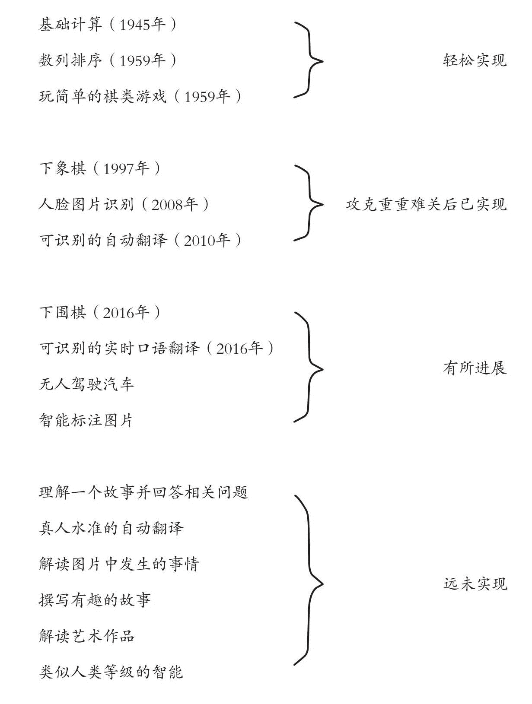
图1 我们希望计算机能完成的任务，按难易程度排序，括号年份表示问题解决大致时间，而目前对于远未实现任务，我们仍无头绪。

## 排序
接下来是排序，即把随机数字按升序排列，或把姓名按字母顺序排列。听起来一点也不AI，步骤并不复杂。但传统笨方法慢得惊人。直到1959年快速排序法才出现，排序这个老大难问题才算获得高效解法。快速排序诞生50年内，都未出现明显更优方案。

## 博弈与搜索
然后是需要攻克重重难关的问题。下棋就是典型挑战，也是AI故事的重要一环。事实上有一种粗暴方式可以下好棋，基于搜索技术，我们将在下一章详述。问题在于，虽然基于搜索的编程很简单，但除了少数简单游戏外几乎无用，因为它占用内存和时间惊人——哪怕把整个宇宙的原子都用来造计算机，也负担不起用粗暴搜索来下一盘围棋或象棋。要让搜索可行，必须加入额外东西，下一章会看到，至此人工智能才真正登场。

## 受限算力的难题
我们知道某些问题有解，但在实践中无法实施，因为所需计算资源过于庞大。这种现象在人工智能研究中屡见不鲜，围绕如何处理此类难题，学界也做了大量研究。

## 机器学习类难题
列表中后面的问题则不同。诸如人脸识别、自动翻译、实时口语翻译，与棋类游戏不一样，传统计算机技术无法提供解法，需要全新思路。当然，在列表上，这些问题已通过一种名为机器学习的方法得到解决，我们将在后续章节深入探讨。

## 无人驾驶汽车

开车对大多数人而言几乎是本能的，根本不需要高智商也能完成。可把方向盘交给电脑就完全不一样了。核心难点并不是让机器执行减速、加速、左转或右转这些动作，而是让它搞清楚自己处在怎样的环境里，以及接下来会发生什么。

试想一辆无人车驶入纽约的繁忙路口，四面八方的车辆呼啸而过，行人横穿，自行车穿插，工地占道，标志、标线混杂。雨、雪、雾甚至可能同时出现，能见度骤降。真正困难的不是“该做什么”，而是“周围到底发生了什么”。必须确认自身定位、周边车辆的位置与行驶意图、行人的位置与移动轨迹……信息一旦完整，决策反而简单。我们后面会再展开无人驾驶的细节。

## 理解与创造的难题
接着是更棘手、我们至今也不知道怎么解的问题：计算机如何读懂一个复杂的故事并回答相关提问？能否把像小说那样细腻的文本翻译成信达雅的表达？能否看图说话，不止认出人物，还能诠释图中在发生什么？能否自己写出有趣的故事，或解读一幅画作？归根结底，计算机要怎样才具备类人的智能？

## 人工智能进步的两类原因
人工智能的进展，本质上是让机器完成得越来越多图1里列出的任务。之所以难，通常只有两种情况。一种是我们清楚理论上可行，只是计算量太夸张，耗时太久、内存吃不消，像国际象棋和围棋就属于此类。另一种是我们根本不知道该用什么方法去解，比如人脸识别，这类问题需要全新的思路，例如机器学习。今天几乎所有前沿研究，都卡在这两种瓶颈的其中之一。

## 通用人类水准智能的梦想
在图1里最难的，莫过于通用的人类水准智能这一宏大设想。吸引人的是，这个梦想最早被系统提出的人之一，就是艾伦·图灵。

### 图灵测试的提出
四十年代末到五十年代初，第一批计算机诞生，关于其潜力的公开辩论随之兴起。最有分量的声音来自麻省理工学院数学教授诺伯特·维纳的《控制论》，书中把机器与动物神经系统并置，触及了大量后来被归入人工智能的想法。公众很感兴趣，但普通人读不进去。机器能否“思考”的争论开始出现在报刊广播，1951年图灵本人也参加了BBC的相关节目。人工智能的名字尚未出现，萌芽已在酝酿。

在这种舆论压力下，图灵认真思考机器能否真正模拟人类思维。他受够了“机器做不到×××”的说法，想用一个直接的检验来堵住质疑，于是提出了后世称作图灵测试的方案。自1950年首次提出以来，这个测试影响深远，至今仍是严肃研究课题。可惜至今也没能彻底说服怀疑者。

灵感来自维多利亚时代的“模仿游戏”，玩法是通过提问判断对方性别。图灵借此设计了一个文本对话检验：询问者通过键盘屏幕与对面“存在”交流，事先不知道对方是人还是程序。交互全靠文字，问一句答一句，任务是分辨出对方的真实身份。若程序经过一段合理时间后仍让询问者无法准确分辨人机，图灵认为就可以承认它拥有与人类相似的智能。

图灵的高明之处在于避开了“是否真正有意识”“是否真正思考”这些哲学争端，直指能否乱真，关键词就是“无法分辨”。这也是科学上常见的标准做法：想判断两物是否相同，就设计一个能区分它们的合理测试。如果存在这样的测试，一方能过一方不能，就可断言二者不同；如果无法区分，就不应宣称它们不同。图灵测试就是用来划分机器智能与人类智能的工具。

使用时要谨慎。很多对人工智能的定义都落入陷阱，按实现技术来界定。比如有人偏爱“时间递归最优学习”[5]，就会把人工智能定义成能用该技术通过图灵测试，从而排除其他方法。我们需要的是独立于实现手段的行为测试。图灵测试通过把询问者和被测对象隔开实现这一点：询问者只能靠问答判断，被测对象对他来说是一个黑盒，不能检查内部，只能输入输出。

图灵在1950年发表于《心智》期刊的《计算机器与智能》[9]中详细描述了这个检验。在此之前已有相关思想，但他是第一个从现代数字计算机角度系统讨论问题的人，因此这篇论文被视为人工智能的开山之作。

### 毫无意义的图灵测试
图灵测试简洁优雅易懂，但若把它奉为圭臬，会遇到一个至今难以回避的致命缺陷。

问题在于，多数想通过测试的程序员更乐于用小伎俩欺骗询问者，让对方以为在跟真人说话，而不是去探究智能行为的本质。最典型的是1960年代中期由麻省理工学院的约瑟夫·魏岑鲍姆创造的ELIZA。魏岑鲍姆本意并非挑战图灵测试，ELIZA最初是严肃的心理治疗实验，但此后它成了用肤浅技巧伪装人工智能的代名词。

ELIZA扮演精神科医生，通过开放式提问引导来访者敞开心扉。它学习了一些关键词，如“家人”“朋友”“孤独”“悲伤”，然后用预设脚本回问。原理一旦明白，就能一眼看穿它的封装和镜像反问套路。对话开场看似自然，几轮之后就暴露出完全没有理解对话含义的空洞。魏岑鲍姆也没声称它能理解，这本不是实验目的。

ELIZA的余波远超学术圈。传闻中它被孤独或社交障碍的研究生用来替代真实人际往来，甚至有关于它“鼓励”抑郁者自杀的可怕故事。魏岑鲍姆让自己的秘书测试，秘书要求他在对话期间离开房间，尽管她清楚这只是程序。

这种现象一直延续到罗布纳奖的年度竞赛中。1990年美国发明家休·罗布纳设立了以图灵测试为形式的比赛，每年邀请程序参赛，骗过评委就能获得十万美元。著名科学家马文·明斯基称其为“毫无意义的宣传噱头”。参赛作品大多是ELIZA的变体，用误导技巧取胜，而非展现真正的理解、常识和领悟力。2009年获奖的“进展无限”由大卫·利维编写，对话看似复杂，实质仍是层层回避、胡乱联想，与人与人之间的真实交流相去甚远。

ELIZA也是互联网聊天机器人的先声。绝大多数基于关键词联想加反问的聊天机器人，跟ELIZA一样，只能产出肤浅乏味的内容，不能算人工智能。

### 人工智能的多样性：强人工智能与弱人工智能
尽管图灵测试如今已不实用，它仍是重要里程碑，因为它第一次给研究者一个清晰目标：造一台真正能过图灵测试的机器。如今只有极少数严肃研究者还以此为终点，但历史上它的推动作用无可替代，也仍有一定参考价值。

图灵测试看似简单，却暗藏两种逻辑完全不同的情形。询问者能判断对方是否真人，关键在于对方展现出对问题的理解并给出合理回答。若一台程序通过了测试，可能存在两种情况：

1. 程序确实理解了对话，理解方式与人类大致相同。
2. 程序并未真正理解，只是模拟出“理解后”的回复。

区别巨大。宣称达到第一种，远比第二种雄心更大，争议也更大。大多数研究者都认为第二种在原则上是可行的，但第一种是否可行仍缺乏说服力。图灵测试本身并不要求区分二者，图灵本人恐怕也会恼火这种争论，因为设计测试的初衷之一就是终结类似争执。

能达到第一类目标、具备人类理解力甚至意识的，被称为强人工智能；只能模拟特定能力的、无真实理解的，被称为弱人工智能。

### 超越图灵测试
以“无法分辨”为原则，图灵测试衍生出很多变体。比如更严苛的机器人版，要求机器在日常生活中伪装成人，黑盒测试的难度被推到极致。未来一段时间这类场景只存在于小说和电影，像1982年的《银翼杀手》里，哈里森·福特饰演的主角每天进行测试以辨别美女是人还是复制人，2014年的《机械姬》也有类似主题。

研究者也在寻找能破解聊天机器人小伎俩的更有效检验。最直接的思路是检验理解力，比如威诺格拉德式的句子：

句子1a：市议员拒绝给示威者颁发许可，因为他们担心暴力。
句子1b：市议员拒绝给示威者颁发许可，因为他们鼓吹暴力。
问题：谁担心/鼓吹暴力？

两个句子只差一个词，含义却完全反转。1a中“他们”指市议员，1b中“他们”指示威者。只有真正理解句子并具备情境常识才能分辨。

再如：
句子2a：奖杯放不进棕色手提箱，因为它太大了。
句子2b：奖杯放不进棕色手提箱，因为它太小了。
问题：什么太大/太小？

答案分别是奖杯太大、手提箱太小。对成年人来说 trivial，但对靠关键词匹配的系统就是难题。

另一个经典例子来自心理学家斯蒂芬·平克：
鲍勃：“我要离开你。”
爱丽丝：“她是谁？”
普通人立刻读出肥皂剧情节：鲍勃暗示出轨，爱丽丝愤怒追问第三者。要让程序编程理解这种充满常识、信念、欲望和人际关系的对话，仍是空白。我们自己做得轻松，机器却连入门都难，这正是强弱人工智能的分水岭。

## 通用人工智能
强人工智能的梦想听起来清晰，实际却毫无头绪，连精确定义都困难。因此它虽迷人，却与当代主流研究基本无关。你去参加顶尖人工智能研讨会，很少听到它；却能在深夜酒吧听到不少谈论。

退一步的目标是制造具备普通人类通用智能水平的机器，也就是通用人工智能AGI。AGI大约等同于拥有普通人全部智慧能力的计算机，包括自然语言交流、解决问题、推理、感知环境等，智能水准与普通人相当甚至更高。实现AGI就能完成图1所示的所有任务乃至更多。相关文献通常不涉及自我意识或自主意识，所以AGI被视作弱人工智能的弱化版本[12]。

即便把那个次级目标单独拎出来看，在当今 AI 研究版图里也只能算边缘议题。学界真正投入精力的，是造出能够接管现阶段只能靠人脑完成的任务的程序，严格对照图 1 的清单逐项推进。外行偶尔会称之为狭义 AI，但这从不是学术圈的正式表述，在会议上这么说基本会被当成新手。现阶段被研究的 AI 本身就已经具备狭义的含义，所以不会再额外加前缀。想等到全能管家式机器人的读者大概要失望，而担心机器人造反的人则可能稍感安心。

到这里 AI 到底指什么、为什么难以实现，应该已有大致轮廓。那么研究者具体是怎样啃下这些难题的呢？

## 心智或者大脑？

要让计算机展现出接近人类水平的智能表现，历史上大致走过两条路线。第一条是搭建思维模型，试图复现有意识的推理、认知与问题求解这些日常使用的过程。这条路被称作符号 AI，因为它用符号来指代事物并据此推演。比如在机器控制系统中，“`room 451`”可以用来指代你的卧室，“`cleanroom`”则定义了房间清洁这一活动。当机器人决定执行“`cleanroom(room 451)`”时，就表示要打扫你的卧室。在机器语言里，符号就是承载事物与行为的载体。

从 20 世纪 50 年代中期到 80 年代末约三十年间，符号派是构建 AI 系统的主流。其最大优点在于过程可解释：机器人打算执行“`cleanroom(room 451)`”时，我们能明白它将做什么。我认为它长期占优，还在于贴近人类有意识的思考习惯。我们做决定时本质上也是把思路用符号或文字流程化，先在内心权衡利弊再拍板。符号派正是想捕捉这一机制，后续章节会展开。80 年代初，这条路线的热度达到顶点。

另一条路线是直接模仿大脑，设想在计算机内部复刻一具完整的人类大脑，甚至连神经系统一起模拟。毕竟迄今为止我们唯一确定的智慧来源就是人类大脑。困难在于大脑的复杂程度远超出想象，人脑约有 1000 亿个相互连接的神经元，我们对它们的构成、结构与运行规律的认知，仍远不足以复制。这注定不是短期能完成的任务，我甚至怀疑它是否根本可实现[（不得不遗憾地说，这也无法浇灭部分人尝试进军该领域的热情）[\[13\]](#part0018.html#booknote_13)]。

不过可以借鉴大脑的结构，用类似的结构来搭建智能系统的部件。这个方向叫做神经网络，名称来源于大脑微观结构里呈网状连接的信息处理单元神经元。神经网络的研究可以追溯到 AI 出现之前，一直与主流并行发展。正是以神经网络在 21 世纪的突破，才带来了当下 AI 研究的繁荣。

符号 AI 与神经网络 AI 几乎是两条平行线，方法论截然不同。过去六十年里双方都经历过高光与低谷，也爆发过激烈争论。但在 20 世纪 50 年代 AI 作为新兴学科诞生时，符号派牢牢占据主流。

## 分治策略

通用 AI 目标宏大模糊，很难一次性拿下。黄金年代采取的分而治之做法，与其直接造出完整的通用智能，不如先把通用智能所需的各类能力拆出来，分别做出能体现这些能力的系统。背后的假设是，若能把通用智能所需要的能力逐个做出原型，后续再组合起来，会比直接造一个完整系统更可行。把精力集中在拆解智能行为的各个组件上，成了 AI 研究的标准模式。大家纷纷去造能够表现某种智能行为的模块。

研究者最先关注、也最难解决的问题，恰恰是我们习以为常的感知。一台机器要在特定环境里智能工作，就必须获取周边环境的信息。我们依靠视觉、听觉、嗅觉、触觉、味觉五种感官，所以需要制作能够感知外部的传感器。如今的机器人使用雷达、激光雷达、红外测距仪、超声波测距仪等各种人工传感器来接收环境信息。制造传感器本身已很复杂，但这只是问题的一部分。即便光学系统再好、像素再多，数码相机最终做的事情也不过是把画面解析成网格，为每个格子分配数字表示颜色与亮度。于是即便配上顶级相机，机器人收到的也只是一串数字。感知领域的第二个难题是如何把这些原始数字解析出来，理解它“看到”的图像。这比造传感器困难得多。

通用智能的另一个关键能力是通过学习积累经验，这催生了机器学习分支。就像“人工智能”这个名字一样，“机器学习”也很不贴切，听起来像机器自己在教自己学习，从无知走向聪明。实际上机器学习与人类学习截然不同，它更接近解析数据与做预测。比如人脸图像识别在过去数十年取得巨大进展，常见做法是给程序大量带标签的例子，用许多人脸图片与对应姓名来训练，最终让程序看到新照片就能给出正确的人名。

问题求解与计划制定是另一组相关能力，都要求用给定动作的组合达成目标，核心在于找到正确的动作序列。以象棋或围棋为例，目标是赢，行动是在棋盘上移动或落子，挑战是找出正确的下法。根本难点在于，虽然从原理上列出所有可能的走法似乎很容易，实际执行却极其困难，因为可选步骤的数量实在太多。

# 第二部分 我们是怎么走到这一步的

## 第二章 黄金年代

图灵在《计算机器与智能》一文中提出图灵测试，为 AI 学科迈出第一步做出了重大贡献。当时这个划时代的想法显得非常孤独。那时的 AI 还没有名字，没有形成学科，也没有团队。图灵的贡献大多是概念性的，比如图灵测试，因为适用的系统尚未出现。仅仅过了十年，到 20 世纪 50 年代末，一切都发生了天翻地覆的变化：新学科建立，有了专属名称，研究者可以展示第一个用于揭示智能行为基础构成的试验系统。

随后 20 年是 AI 的第一个繁荣期，1956 年到 1974 年之间，领域里充满乐观和快速发展的势头，被称作 AI 的黄金年代。那段时间研究者几乎不谈失望，一切都皆有可能。那个时期造出的 AI 系统，成为 AI 史上传奇的标杆。它们有古怪的名字，比如 SHRDLU、STRIPS 或 SHAKEY，都是简短的大写缩写，很多源于首字母。很大程度上这是受当时计算机文件名限制的影响，这种命名习惯一直沿用至今，尽管已经没必要。

按今天的标准，用来搭建这些系统的计算机运行速度慢得难以置信，内存小得可怜，使用起来糟糕。现代软件开发理所当然会用到的工具，当时根本不存在，甚至就算存在也跑不起来。那时黑客文化已经悄然兴起，AI 研究者大多在夜里工作，因为白天计算机资源要留给更重要的任务。他们还必须发明各种巧妙的编程技巧[\[14\]](#part0018.html#booknote_14)，让复杂的程序能在简陋的机器上跑起来。许多技巧后来成为技术标准，它们诞生于 60 到 70 年代的 AI 实验室，如今的人们只能模糊记得，如果还记得的话。

到了 70 年代中期，AI 研究开始停滞，除了最初的简单实验，几乎没有有意义的进展。这门年轻的学科几乎被资助方扼杀在摇篮里，学界也逐渐相信，这个寄予厚望的新生儿实则前途暗淡。

本章将回溯 AI 发展的头 20 年，我们会研究那个时期构建的关键系统，并讨论当时 AI 领域最重要的技术之一：搜索。即便到今天，它仍然是许多 AI 系统的核心组件。我们还会接触一个抽象的数学理论——计算复杂性，它在 60 年代末到 70 年代初形成和发展，用来解释为什么 AI 面临的许多问题从本质上就难以解决。计算复杂性为 AI 发展投下了一层阴影。

我们从公认的黄金年代起点开始：1956 年夏天，一位名叫约翰·麦卡锡的年轻美国学者，为这个领域命名。

### 人工智能元年的盛夏

麦卡锡生活在美国现代科技奠基的年代，20 世纪 50 到 60 年代，他以近乎不可能的才华，为计算机领域贡献了一系列新理念。这些理念今天被视为理所当然，以至于很难想象没有它们计算机科学就无法前进。他最著名的成果应该是编程语言 LISP，几十年里一直是 AI 研究者的首选。虽然编程语言普遍难读，即便以我的专业标准来看，LISP 也是个怪胎。因为在 LISP 里，`(所有(程序(看(看起来(都(是(这样的)))))))`。一代又一代程序员开玩笑说 LISP 就是“一堆毫无关联的傻括号”[\[15\]](#part0018.html#booknote_15)。

麦卡锡在 50 年代中期发明了 LISP，令人惊讶的是，近 70 年后它仍在全世界被教授和使用。想想看，他发明 LISP 时，美国总统是德怀特·戴维·艾森豪威尔，尼基塔·谢尔盖耶维奇·赫鲁晓夫是苏联共产党总书记；在中国，毛泽东主席正在领导第一个五年计划，全世界电脑数量屈指可数。而今天，LISP 竟然仍在广泛使用。

麦卡锡出生于波士顿的移民家庭，很小就展现出非凡的数学天赋。毕业于加州理工学院数学系后，这个 20 出头的小伙子被任命为新罕布什尔州达特茅斯学院的副教授。加入达特茅斯之前他就对计算机感兴趣，1955 年，他向洛克菲勒研究所提交提案，希望获得经费在达特茅斯举办一所暑期学校。对非学者而言，成年人的暑期学校听起来奇怪，但在学术界却是久负盛名的传统，主要是召集世界各地有共同兴趣的研究者，在一段时间里见面交流合作。选择暑期显然是因为教学任务结束，学者们可以卸下压力。当然，在如此迷人的地方举办暑期学校，社交活动也是必不可少的。

对一个难忘的暑期学校而言，星光熠熠的学员名单是另一个关键。当时没人预见到达特茅斯暑期学校会聚集未来几十年在 AI 领域发挥决定性作用的大部分关键人物。邀请名单上还有一个特别令人痛心的名字：普林斯顿大学数学家小约翰·福布斯·纳什。他在 6 年前刚拿到博士学位，在一篇只有 28 页的论文里引入了“非合作博弈”的概念。纳什的概念在随后几十年成为经济理论的基石，并最终在 1994 年获得诺贝尔经济学奖。但纳什本人并未享受到成果带来的乐趣：在获得博士学位几年后，他被妄想症和偏执狂等精神疾病吞噬，之后几十年远离学术生活。幸运的是，他凭借惊人的毅力恢复良好，最终在 1994 年获奖。他的故事被写成《美丽心灵》，同名电影于 2002 年斩获奥斯卡最佳影片等多项大奖[\[16\]](#part0018.html#booknote_16)。

达特茅斯暑期学校名单还有另一层好奇。除了学术大佬，学校还接待了来自工业界、政府和军方的代表，甚至还有兰德公司——这家以加州智囊团为班底的机构，在 60 年代因冷血地争论如何“赢得”核战争而臭名昭著。十多年前，学术界、工业界、政府和军方曾联合执行曼哈顿计划，制造了人类第一颗原子弹，这正是美国科技实力的体现。这种学术、工业、政府、军方的联合体，是二战后几十年美国计算机技术发展的特色，也是美国在未来 60 年确立 AI 国际领先地位的核心。

1955 年，麦卡锡向洛克菲勒研究所写计划书申请经费时，不得不给这项活动起个名字，他选择了“人工智能”。麦卡锡对活动抱有不切实际的高度期待——这也成了 AI 领域令人厌烦的传统——他宣称：“我认为我们可以取得重大进展……如果这些经过精挑细选的科学家能在一起共事一个夏天的话[\[17\]](#part0018.html#booknote_17)。"

到暑期学校结束时，科学家们并未取得重大进展，但麦卡锡起的名字流传下来，逐渐形成一门新学科。

不幸的是，这个名字长期以来饱受诟病。首先，“人工”在英文里是 artificial，也带有“虚假”“赝品”的含义——谁愿意研究虚假的智能呢？其次，“智能” intelligence 源自“智力” intellect，而自 1956 年以来，AI 界努力攻克的许多挑战，人类做起来似乎并不需要太多智力。相反，正如上一章所说，过去 60 多年里 AI 致力解决的许多最重要也最困难的问题，似乎一点都不体现智能——这种反差一次次让新入行者感到困惑。

不过，由麦卡锡命名的“人工智能”至今仍在使用。参与暑期学校的学者及其学术继承人，多年来持续投身 AI 研究，直至今日。那年夏天被公认为 AI 学科诞生的元年，当时它听上去前途无量。

达特茅斯暑期学校之后几年是 AI 令人兴奋的成长期，并在某段时间里看似飞速发展。几十年里，四位暑期学校的成员主导了 AI 发展。麦卡锡在斯坦福大学创立 AI 实验室，位于今天的硅谷中心；马文·明斯基在麻省理工学院也创立了一个实验室；艾伦·纽维尔和他的博士导师赫伯特·西蒙则去了卡内基-梅隆大学。这四位天才带领学生建立的 AI 系统，成为我们这一代研究者的图腾。

然而黄金年代也有幼稚和盲目乐观的特点，研究者对发展速度做出了鲁莽预测，阻碍了 AI 的实际进程。到了 70 年代，美丽的梦醒了，一场恶性循环开始——繁荣与萧条在未来几十年里反复交替。但无论历史如何评判，我仍满怀喜爱地回望那个时期涌现的人物和他们的伟大成就。

## 推理与自然语言理解

推理大概是与智能相关行为中最受崇拜的一种：基于现有事实，以强逻辑的方式推导出新知识。比如你知道“所有人都是凡人”，也知道“迈克尔是一个人”，就可以推出“迈克尔是凡人”。真正的智能系统能轻松做到这一点，然后利用新知识继续推演。知道迈克尔是凡人后，就能进一步推断“迈克尔终有一死”“死后不会复活”等。自动推理就是把这种逻辑能力赋予计算机。第三章会看到，长期以来人们认为推理应是 AI 的主攻方向。虽然现在已非主流，自动推理仍是 AI 领域的重要分支。

最后是自然语言理解，涉及让计算机理解人类语言，比如中文或英文。如今程序员为计算机编程必须使用人造机器语言：有精确定义和明确规则、专门为计算机构造的语言。最知名的当属 Python、Java 和 C，比自然语言简单得多。很长一段时间里，让计算机理解自然语言的主要思路是为其建立精准定义和明确规则，就像定义计算机语言一样。但事实证明这不可能。自然语言过于灵活、模糊且易变，无法用这种方式严格定义，而语言在日常生活中的使用方式更是增加了精确定义的难度。

[\[1\]](#part0004.html#noteBack_1)　《弗兰肯斯坦》被认为是世界上第一部真正意义上的科幻小说。

[\[2\]](#part0004.html#noteBack_2)　查尔斯·巴贝奇发明的分析机被认为是最早期的计算机雏形，而阿达·洛芙莱斯的算法则被认为是最早的计算机程序和软件。

[\[3\]](#part0004.html#noteBack_3)　图灵指出的悖论即著名的“停机问题”，如果存在图灵机 A，对它输入任意图灵机，都能够判定其运行结果是“停机”或者“不停机”，那么可以构造图灵机 B，调用图灵机 A 但输出永远与之相反，即 B 的输入经 A 判定“停机”，则 B“不停机”，如果 B 的输入经 A 判定“不停机”，则 B“停机”。那么，图灵机 B 的输入为图灵机 B 本身时，则出现矛盾。B 只有在“停机”的时候才能“不停机”，反之亦然。此悖论与理发师悖论类似，理发师声称“给而且只给那些不给自己理发的人理发”。如果理发师不给自己理发，那么根据定义，他要给自己理发；如果理发师给自己理发，那么根据定义，他不能给自己理发。

[\[4\]](#part0004.html#noteBack_4)　1 英尺≈0.30 米。

[\[5\]](#part0004.html#noteBack_5)　2016 年 NIPS(神经信息处理系统大会，是一个关于机器学习和计算神经科学的国际会议)上，出现一家神秘的创业公司：火箭人工智能，宣称要基于一项革命性的“时间递归最优学习”技术来进行人工智能项目开发。短短几小时，吸引了五家风投公司对此项目进行评估，估值高达上千万美元。事实上，这家公司是参会的专家们注册来恶搞的，该技术纯属子虚乌有，专家们旨在以此来讽刺人工智能领域的投资泡沫太过严重。

## SHRDLU：被积木托起的语言梦

黄金年代里，`SHRDLU`几乎是人人都在谈的明星成果。这个拗口的名字其实来自当年印刷机上几个字母的排列顺序，程序员就喜欢搞这种晦涩的小玩笑。1971 年，斯坦福的博士生特里·威诺格拉德把它做出来，主要想演示人工智能的两项硬核能力：解题和理解自然语言。

`SHRDLU`的解题模块搭在当时 AI 界最经典的实验沙盒上——积木世界。里面放着各种彩色物件：方块、盒子、锥体。用模拟环境而不是真机器人，初衷就是把复杂性压到能管控的范围。在这个世界里，`SHRDLU`可以根据指令挪动物体，也能用虚拟机械臂去操作它们。图 2 能看到初始布局和目标布局。AI 要做的挑战就是把前者变成后者，而且只能用固定的四种基本操作来完成状态迁移：

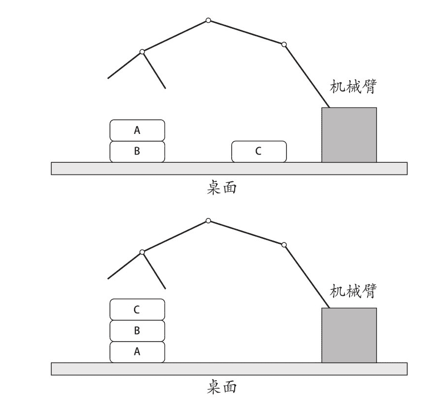

图 2　积木世界上图是初始状态，下图是目标状态，你要怎么转换呢？

·从桌面上抓起对象 `x`。前提是 `x` 正放在桌面上，同时机械臂是空的。
·把对象 `x` 放在桌面上。仅当机械臂正握着 `x` 时才允许。
·从对象 `y` 上拿起对象 `x`。需要机械臂空闲、`x` 确实在 `y` 之上，并且 `x` 头顶没有别的物体。
·把对象 `x` 放在对象 `y` 上面。需要机械臂持有 `x`，并且 `y` 顶部是空的。

整个积木世界的动作最终都压缩成这四步，而且只准这四步。以图 2 为例，一种可行的开场是：

·从 `B` 上取下 `A`
·把 `A` 放在桌面上
·从桌面上抓起 `B`

执行完这三步，世界会变成什么样？剩下的步骤你能补完吗？不算难，却也够无聊。

积木世界之所以被研究到烂，是因为机械臂去拾取搬运的动作听起来和现实任务很像。但把 `SHRDLU` 用到工程上，有两个致命的先天缺陷。

第一，它是一个封闭世界。改变状态的唯一来源就是 `SHRDLU` 本身。就像你一个人住，可以断定睡前把钥匙放在哪，醒来还在那。有室友的话，人家随时可能拿走。与之类似，`SHRDLU` 把 `x` 放在 `y` 上后就能 100% 确信 `x` 在 `y` 上，除非它自己再动。现实里 AI 不能自以为是世界唯一的行动者，这种假设只会让结果一塌糊涂。

第二更关键，积木世界是纯模拟的。`SHRDLU` 并没有真去驱动机械臂拾取移动，它只是程序里假装这么做了。它模拟了一个世界，也模拟了自己对世界的影响，却从未建立真实世界的模型，也没去校验模拟和现实是否对得上。这只是个极简的假设。

拿“从 `y` 上拾取 `x`”来拆。`SHRDLU` 眼里这就是个干净利落的动作：照指令拿就行，不用管执行过程的麻烦。程序只要找到正确的方法和顺序就能“掌控”全程。而现实呢？比如仓库场景，机器人首先得认出哪个是 `x`、哪个是 `y`。就算识别过了，最后一把抓起来就不是小事。让机器在真实世界里操作哪怕最简单的物件，难度都远超想象，即便到今天也仍是硬骨头。我在 1994 年作为年轻学者去西雅图参加 AAAI 时就深有体会。那年有“清理办公室”竞赛，目的是造一个能在办公室类环境里安全移动、识别并捡垃圾的机器人——本质上就是现实版积木世界。那时距 `SHRDLU` 出世已 20 年，结果最好的一台机器动作慢得让人想睡着，仿佛随时要放弃。问题不在机器人，而在大家天真地低估了难度。人类觉得轻而易举的事，机器人做起来未必轻松。

所以积木世界火起来的原因很直白：它直观好懂。表面看像给现实机器人建了个工作环境，实则全是我们的臆想。深挖会发现，它研究的只是如何用一系列可执行动作来解题。虽然值得关注，却只触及机器人面临的现实难题里极小、且不是最难的那一小撮。

`SHRDLU` 最被称赞的还是它的交互。用户可以发自然语言指令，系统也会用类自然语言回话。下面是一段经典人机对话，`SHRDLU` 的回复用斜体：

拾取一个大的红色方块。

好的。(执行命令)

抓取一个锥体。

我不明白你指的是哪个锥体？

寻找一个比你拾取的方块更高的物块，并把它放进盒子里。

我想你所说的“它”指的是比我拾取的方块更高的那个。

好的。(执行命令)

盒子里面有什么东西？

蓝色的锥体和蓝色的方块。

蓝色的锥体由什么支撑？

由盒子支撑。

有几个积木不在盒子里？

四个。

至少有一个比我叫你拾取的那个更窄吗？

是的，红色立方体。

它有支撑吗？

有，桌子。

桌子能拾取方块吗？

不能。

一个锥体能被一个方块支撑吗？

能。

这段对话比 `ELIZA` 有意义太多，系统更自然，句子结构也更复杂，能处理“至少有一个比我叫你拾取的那个更窄吗？”这类问法，也能明白对话中代词“它”指代谁。正是这种类自然语言的交互，让 `SHRDLU` 在七十年代初大放异彩。后来才发现，它能聊这么顺，纯粹因为舞台被极度限定在积木世界里。和 `ELIZA` 预设模式不同，它的环境是受限的，所以对话的天花板也很低。人们曾寄望它能打开自然语言处理的通路，最终希望落空。

身在 50 年后的人很容易看出它的局限，但这仍是一个影响深远的里程碑。

## SHAKEY：一台真实会走路的 AI

机器人和人工智能一直绑定在一起，尤其在媒体眼里。1927 年弗里兹·朗的《大都会》里那个类人机器人，成了此后无数荧幕形象的模板。如今几乎每篇 AI 文章都要配一张类似机器人。类人机器人成为 AI 的标志也不奇怪，毕竟最能体现 AI 梦想的，就是一个长相像我们、智力接近我们、能一起吃喝劳动的伙伴。说到底，大多数人也都想拥有一个机器人管家。

可黄金年代，实体机器人只是配角。造机器人太贵太慢太难。六七十年代一个独立博士生根本负担不起研究级机器人，需要完整实验室、工程师、生产线和设备。驱动 AI 的计算机又大又重，机器人根本带不动。所以写一个像 `SHRDLU` 那样的程序，远比造一台可用的机器人经济、简单，也更能满足现实需求。

尽管如此，黄金年代仍有一个闪光的实体机器人实验：1966 到 1972 年在斯坦福研究所进行的 `SHAKEY` 项目。

`SHAKEY` 是人类第一次认真造出可以移动、能在真实世界完成任务并且能自己想办法的机器人。它需要感知环境、定位自身、接收任务并规划步骤，然后按部就班执行并确保结果。它主要做的事是把办公室环境里的盒子搬来搬去。听起来和 `SHRDLU` 像，但 `SHAKEY` 不是虚拟系统，它是真机器，能够真真正正地操作物体，这难度堪称伟大。

要实现目标，`SHAKEY` 得整合一堆吓人的智能模块。首先得造得小、够灵活，能在办公室类空间里活动，还要有够强够准的传感器。它装了电视摄像机和激光测距仪来判断自己和物体的距离，还装了一个叫“猫须”的碰撞探测器来避障。然后它得会导航，还得会规划任务。于是开发团队搞出了 `STRIPS`，即斯坦福研究所问题求解系统，现在公认它是 AI 规划技术的鼻祖。最后，所有模块必须无缝协同。任何研究者都会说，能把其中一个模块跑通已属大关，让它们一起工作难度会指数级飙升。

`SHAKEY` 听起来很神奇，但也暴露了当时的局限。为了让它能跑，设计者不得不极度简化环境并降低任务难度。比如它解析自带摄像机数据的能力很弱，基本只能用来找障碍物。即便如此，场地仍需特殊粉刷和精心照明。摄像机功耗巨大，只能需要时打开，通电后约 10 秒才出可用图像。当时的硬件限制也很残酷：设计一个任务的规划要花 15 分钟，这期间 `SHAKEY` 像个傻子一样站在原地一动不动。因为算力计算机太大太重，`SHAKEY` 只能靠无线电连到一台外部操控机上。总之，这台机器人没有任何实用价值。

`SHAKEY` 是第一台真正实现自动移动的机器人，它催生了一系列惊艳的技术，和 `SHRDLU` 一样理应载入史册。但它的局限也证明了，AI 距离实用、自主的机器人梦想还有多远。

## 从搜寻到解题

解决问题的能力，是区分人类和其他动物的关键。网上到处是松鼠和乌鸦解题取食的视频，它们能处理一些复杂问题，但在抽象解题上，没有动物能接近人类，哪怕没有食物奖励也会去解题。既然解题需要智慧，如果我们能造出解决人类认为困难问题的程序，是不是就等于 AI 起飞的关键一步？于是黄金年代的研究者把大量精力砸进解题，常见做法是让电脑去解报纸趣味谜题版面上的题目。经典的汉诺塔就是例子：

传说中偏僻寺院里有三根柱子和 64 个金环，每个大小不同。可套在柱子上。初始时所有金环按上小下大套在最左柱。僧侣要把它们全部移到最右柱，受两个限制：

1. 一次只能移动一个金环。
2. 任何金环都不能放在比它小的金环上。

完成任务的传说是世界末日。当然不用担心，宇宙在 64 个环搬完前早就没了。所以现实的汉诺塔只有少量金环，如图 3 所示。

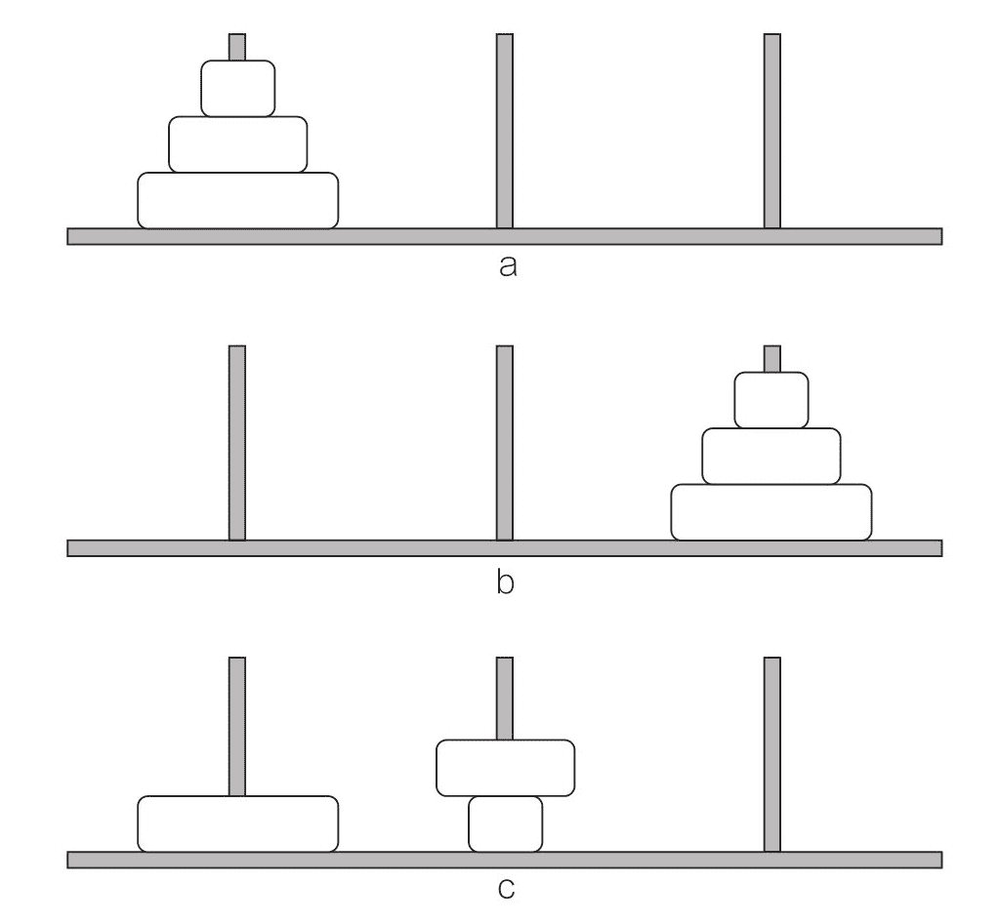

图 3　汉诺塔

人工智能黄金年代的经典谜题，图 a 展示了汉诺塔的初始状态(所有的金环都在最左边的柱子上)，图 b 展示了目标状态(所有的金环都被挪到最右边的柱子上)，图 c 展示了错误的移动状态(大金环放在了小金环上面)。

怎么入手解汉诺塔这类问题？答案是搜索。这里的搜索不是指 Google，而是 AI 领域的底层解题技术：让系统穷尽所有可能进程。下棋程序和车载导航都是基于搜索的，是 AI 的基石之一。

汉诺塔这类问题都有共通解法。积木世界里我们想找一步步把初始状态变为目标状态的序列。“状态”在 AI 里指事物在某个时刻的结构。

用搜索解汉诺塔的思路是：

·从初始状态出发，枚举每个可能动作会带来什么新状态。
·如果某个新状态恰好是目标，就成功，记录路径。
·否则对每个新状态继续枚举所有能导致状态改变的动作，循环下去。

这样会得到一棵树状结构，叫搜索树。图 4 展示了解决汉诺塔搜索树的一小部分。

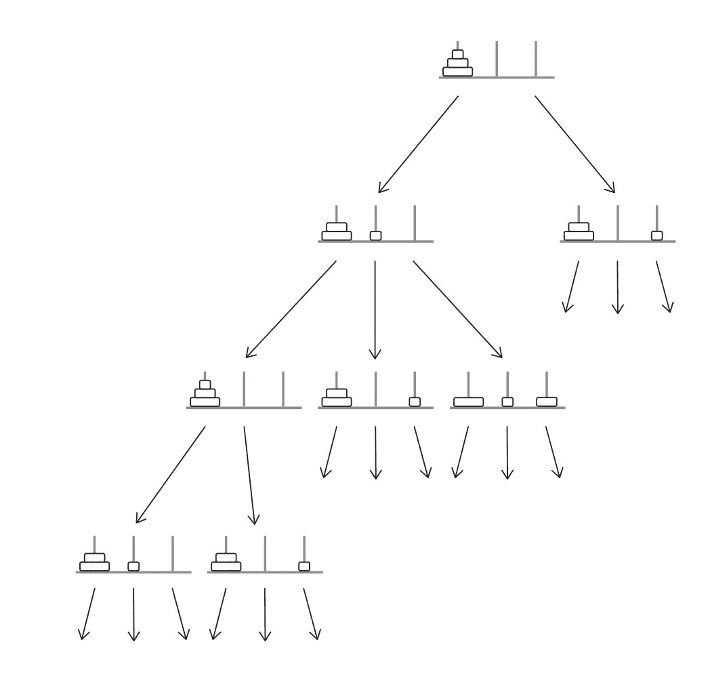

图 4　汉诺塔问题搜索树的一小部分片段

·起初只能动最小的环，可去中间或最右，所以第一步有两种可能，产生两种新状态。
·若把最小环移到中间柱，下一步有三种操作：把最小环移回最左或最右，或把第二环移到最右，不能移回中间，否则第二环会压在最小环上违规则。
·以此类推。

因为是逐层生成，这棵树覆盖了所有移动可能性。所以只要问题可解，搜索最终一定能找到解。关键在于“最终”二字。

三个金环最少要动几次？答案是 7 次，不可能更少。虽然也有无数更长的解法，但我们想要最少步数、最短时间。穷举搜索不仅能保证找到解，还能保证找到最优解。而且作为算法它非常简单，写起来容易。

问题在于笨。光看图 4 的片段就够头疼。比如搜索树最左分支，两步后又回到初始状态，纯粹浪费。人类研究汉诺塔时犯一两次这种回头错误很快就会学乖，避免无用移动。而简单执行穷举搜索的计算机不会，它会机械地枚举所有状态，哪怕明知是死胡同也会返回去再走一遍。

# 搜索的致命膨胀

## 指数级暴涨的搜索树

重复低效只是表象，穷举搜索的根本问题是爆炸。做过实验的人都知道，大多数状态下汉诺塔有三种移动可能，分支因子为 3。不同问题分支因子不同，比如围棋平均约 250 种落子可能。看搜索树会怎么长：

- 第一层有 250 个状态，初始局面下有 250 种新局面。
- 第二层有 250×250 = 62 500 个状态，每种状态再分 250 个分支。
- 第三层约 62 500×250，约 1 560 多万个状态。
- 第四层就会飙到约 39 亿个状态。

这还只是起点。

写到这里就明白了：一台常见的台式机已经放不下四层围棋搜索树的全量状态。实践中一盘围棋往往要走将近两百手，若把这二百步的每一种走法都展开保存，所产生的节点总数是一个根本无法直观感受的数字，它比宇宙里全部原子的数量还要大出数百个数量级。任凭传统计算机技术再怎么迭代，也无法承担那样庞大的搜索负担。

这种分支以荒谬速度疯狂膨胀的现象被称作组合爆炸，正是人工智能落地的核心绊脚石，因为搜索方法在AI里被反复使用[\[25\]](#part0018.html#booknote_25)。假若有人能找到一种又快又可靠的办法，既实现穷举，又不消耗如此可怕的资源，那将名垂青史，并一次性解决AI当下的诸多难关。可惜事实并非如此。我们逃不开组合爆炸，只能想办法与之共处。

## 深度优先搜索与启发式搜索

人工智能起步阶段，组合爆炸被视作根本性难题，麦卡锡把它列为1956年达特茅斯暑期会议的核心议题之一。讨论的焦点集中在如何提升搜索效率，出现了几类思路。

### 深度优先搜索

其一是把搜索集中在一处。典型做法不是逐层完整地铺开整棵树，而是顺着某一条分支向下生长，这就是深度优先搜索。算法会沿着一条分支一直延伸，直到找到解或确认这条路无解。若出现回环，比如图4最左侧那种回到已出现状态的情况，就中止该分支的扩展，退回上一层去尝试别的分支。

深度优先的优势是不必保存整棵树，只保留当前分支的状态。但缺陷也很明显：若起初选错了分支，就可能在错误方向上越走越远，永远触不到解。因此使用深度优先的前提是判断哪条分支更值得探索，这时就需要启发式搜索来给出指引。

### 启发式搜索

启发式搜索的本质是借助经验法则来决定搜索重点。多数情况下并不存在直指正确答案的启发，但往往能找到一个大致指向正确方向的经验。虽然有时效果不佳，但这种思路在实践中很自然。

启发式搜索的概念多次被重新定义，究竟谁首创已无意义。可以确认的是，第一个被用于人工智能程序的启发式搜索来自一台玩跳棋的程序[\[26\]](#part0018.html#booknote_26)，由IBM的亚瑟·塞缪尔(Aithur Samuel)在五十年代中期完成。塞缪尔的跳棋程序在多个层面上开创了传统：以棋盘作为AI试验平台的惯例由此确立，至今仍被广泛使用；程序采用了启发式搜索；后来我们还会提到，它也是第一个真正意义上的机器学习程序，能够自行学会下跳棋。

### 塞缪尔的跳棋程序

塞缪尔的核心做法是对棋盘上的每个局面赋予不同的权重，用来衡量对玩家友好或不利的程度。直觉上，利于形成连跳的局面更有希望取胜，不利的局面则倾向失败。为此程序用一系列特征值来计算格点价值，比如能够产生连跳的关键点越多，形势越占优。随后把各项评估参数合并成一个综合分数，形成可量化的评判标准，再依据启发式搜索挑选最佳落子。

实际使用中还必须考虑对抗性：跳棋是两人对弈，必须预估对手会怎么走。塞缪尔的程序假设对手总是做出对自己最糟糕的行动。这种最坏情况推理，即让对手得分最大化而自己得分最小化的思路，被称为极大极小值搜索，是对抗游戏的基础。

塞缪尔程序的棋力相当高，能在当年硬件条件下取得这样的成绩已属惊人。它运行在`IBM701`上，程序规模仅相当于几页文字。放到今天，一台普通台式机的内存和速度都是当年它的数百万倍。在条件如此受限的年代取得这种水平，几乎难以置信。

### A* 算法

塞缪尔的程序以及多数早期启发式方法都依赖“试探-实践-评判”的经验方式。二十世纪六十年代末，美国SRI人工智能研究中心的尼尔斯·尼尔森(Nils Nilsson)及其同事取得了突破，在`SHAKEY`项目中提出了`A*`。`A*`给出了几条简单规则，用来判断一个启发是否“有用”。在`A*`之前，启发式搜索像猜谜；在`A*`之后，它成为可以数学上理解的过程[\[27\]](#part0018.html#booknote_27)。`A*`已被视作计算机科学的基础算法之一，并在现实中广泛应用，比如车载导航。尽管`A*`很强大，它仍然依赖于具体问题的启发式质量，好的启发能迅速找到解，差的启发则价值有限。`A*`本身并不告诉我们如何为特定问题寻找更好的启发。

# 人工智能遇上了复杂性障碍

上一章提到，计算机的诞生源于艾伦·图灵想解决当时数学界的一个世纪难题。图灵发明计算机几乎成了讽刺，因为他的初衷是证明有些事情计算机永远做不到。

图灵成果问世后几十年，人们开始划定计算机能做与不能做的边界，形成了可判定与不可判定问题的区分。不可判定问题本身也存在层次，其中一些问题不仅不可判定，还是高阶不可判定，对特定领域的数学家来说很棘手。

不过到了六十年代，仅知道一个问题是否可判定已不够。图灵意义上的可解，不等于实际可操作：有些问题理论上有解，但需要不可想象的内存或天文数字般的时间。大量人工智能问题就卡在了这一尴尬地带。

## 团队组建示例

下面这个例子在图灵的框架里很容易证明可解：

你的办公室里有约翰、保罗、乔治、林戈四位人才，现在要组建一个三人小组。但约翰和保罗不能共事。

是否能组建？显然可以，约翰+乔治+林戈，或保罗+乔治+林戈，这正是全部解。

再加一条限制：约翰和乔治不能同组。此时唯一可行的是保罗+乔治+林戈。

再加最后一条：保罗和乔治也不能同组。那么答案变成“不能”，因为没有任何组合能同时满足三条禁止条件。

抽象描述如下[\[28\]](#part0018.html#booknote_28)：给定一个含`n`个人的列表，以及一个“禁止组队”列表。能否选出`m`个人的团队，使得所有禁止条件都被满足？显然`m`必须小于`n`。

原则上这个问题很容易解决：枚举所有`m`人子集，逐一检查是否与禁止列表冲突。用程序实现很直接，所以在图灵视角下它属于易解问题。

关键在于要检查多少种组合。若从4人里选3人，只有4种可能。但规模上升时情况迅速恶化。

从10人里选5人，需要检查252种，虽枯燥但尚可承受。可以看出可能性的增长远快于团队规模本身的增长。

从100人里选50人，则要检查约`10²⁹`种可能性。当代大型计算机每秒约能评估`10¹⁰`种，算到宇宙终结也走不完。即便寄希望于英特尔提供更快芯片，传统硬件再怎么提升，也无法在合理时间内完成这个量级的计算。

这同样是组合爆炸的体现。搜索树每多一层就指数级扩张。在团队建设案例里，总体人数每增加1人，可考虑的组合数大致翻倍。

因此穷举所有组合在理论上可行，给足时间总能得到正确答案，但在实践中毫无意义，因为判断每一种可能所需的时间是天文数字。

正如前文所说，简单穷举是一种原始技术。启发式可以优化它，但不保证有效。是否存在一种更聪明的方法，能在不检查所有备选方案的情况下找到合适组合？很遗憾，没有。优化搜索方式能改善部分情形，但最终仍绕不开组合爆炸。大多数在理论上可解的问题，在实践中都会撞上这个墙。

## NP 完全问题

因为这类组合问题属于`NP`完全问题[\[2\]](#part0008.html#note_2)。`NP`即“不确定多项式时间”，技术定义较复杂，但直觉很清晰。

组合问题是`NP`完全的典型，正如团队建设。找到解可能极难，因为穷举需耗尽时间，但验证一个解是否正确很容易：只需检查它是否违反禁止规则。

### 旅行推销员问题

`NP`完全的另一个标志性例子是旅行推销员问题[\[29\]](#part0018.html#booknote_29)：

推销员需沿道路访问若干城市，最后回到起点，并非所有城市之间都有直连道路，已知每条道路长度。怎样安排路线使总路程最短？

它与团队建设一样属于组合问题。可用暴力法求解：列出所有可能路线，测量长度，选出最短。然而随着城市增多，路线数呈指数增长：10座城市约360万种可能，11座城市骤增至4000万种。

于是旅行推销员同样面临组合爆炸。但除此之外，它似乎与团队建设无关。一个关键洞见是，在`NP`完全范畴内，这两个看似差异巨大的问题本质相同。

换句话说，若我能发明一种高效准确地解决团队建设问题的方法，就能把任意一个旅行推销员实例转化为团队建设的特例，用该方法快速求解，再把答案映射回去。于是能高效解决团队建设问题的办法等同于能高效解决旅行推销员问题的办法。这一等价关系不仅适用于这两个问题，而是适用于所有`NP`完全问题。

所有`NP`完全问题互通，可互相转换。这意味着要么它们都有通用高效解，要么全都无解。找到一个`NP`完全问题的多项式解，就等于找到了全部的解。但至今无人找到。`NP`是否等于`P`，即`P`与`NP`问题[\[30\]](#part0018.html#booknote_30)，是当代科学最重要未解之谜之一。若能证明并被学界认可，克雷数学研究所提供的百万美金奖金将归你，它于2000年被列为“千年大奖”之一。精明的投资者大多认为`NP`完全问题无法被有效解决，而且要确证这一点还需要很长时间。

若你遇到的问题是`NP`完全的，这意味着在传统计算机技术下它基本不可行：从数学上看，它太难了。

`NP`完全问题的结构在七十年代初已成形。1971年斯蒂芬·库克(Stephen Cook)提出核心思想，随后理查德·卡普(Richard Karp)证明其范围远超预期。整个七十年代，人工智能研究者开始用`NP`完全性理论审视自己的课题，结果令人震惊：无论是解题、游戏、规划、学习还是推理，关键问题大多都是`NP`完全的，甚至更糟。于是出现了“AI完全问题”[\[3\]](#part0008.html#note_3]的说法，意指一个与AI本身一样难的问题，能解它就能解所有AI问题。

发现研究对象是`NP`完全的打击很大。在理论被广泛理解前，人们总寄望于突破让问题变简单，即变得“可处理”。技术上这种希望仍在，因为我们尚未证明`NP`完全问题不可解。但到七十年代，`NP`完全性与组合爆炸像阴影一样笼罩AI，以计算复杂性阻挡其发展，导致停滞。黄金时代的技术似乎只能局限于玩具或小世界，比如积木世界。五十到六十年代的乐观预测撞上现实，让先驱者们倍感困扰。

# 人工智能等于炼金术？

七十年代初，人工智能的瓶颈让学界愈发沮丧，核心进展稀少，而一些研究人员仍高调宣传未来，于是中期开始出现猛烈的批评浪潮。

在诸多批评者中，最直言不讳、最刻薄的是美国哲学家休伯特·德莱弗斯(Hubert Derytus)。六十年代中期受兰德公司委托，他撰写了一份关于AI进展的报告，标题为《炼金术与人工智能》，明确表达了他对该领域及其从业者的蔑视。把一门严肃科学与炼金术相提并论，是极大的侮辱。如今重读这份报告，半个世纪过去了，其 contempt 依然令人震惊。

我们不认同德莱弗斯的批判方式，但回避不了他的部分判断是合理的，尤其关于先驱者的浮夸与宏大预测。赫伯特·西蒙1958年写道：

这并非危言耸听……现在已有能思考、学习、创造的机器，在可预见的未来，它们的效能将迅速提升，能处理的问题范围将扩展到人类思维的广度。

当时此类言论不少，西蒙因名气而被引用。他绝非最狂热的倡导者，事后看，他的乐观预测并不现实。如今一些AI研究者认为，当年研究者之所以如此乐观是被热情冲昏头，也有更犬儒的说法认为那是为吸引投资和经费。

作为专业从业者，我必须说明：当年研究者并未系统性欺骗或歪曲研究状态。他们过于乐观，是因为热爱这门学科，真心相信自己建立了能学习、规划、推理的程序，尽管局限明显。他们只是乐观地认为扩展应用范围很容易。

这种过度乐观是可以被谅解的。那些研究者并未意识到他们面对的问题本质上超出计算机处理能力，因而总觉得突破性进展可能让难题迎刃而解。但随着`NP`完全问题被广泛理解，社会才慢慢明白AI面临的困难有多深。

# 黄金年代的终结

1972年，英国一家重要科研资助机构请著名数学家詹姆斯·莱特希尔(James Lighthill)爵士评估AI现状与前景。据说爱丁堡大学AI社区内部的学术斗争被报道后才触发评估。莱特希尔曾任剑桥大学卢卡斯数学教授，这是英国数学家能担任的最显赫职位，后来的斯蒂芬·霍金也曾担任。他在应用数学领域经验丰富。如今重读莱特希尔报告，可以看出他对当时AI的繁荣相当困惑：

那些能力出众且受人尊敬的科学家写道……所谓人工智能……代表了进化的另一条路径。1980年代，将在人类规模的知识基础上实现多用途的人工智能。预测令人惊叹：到2000年，机器智能将全面超越人类。

莱特希尔对主流AI极不屑，他明确指出组合爆炸是AI无法逾越的关键难题之一。报告发布后，英国各地对AI研究的经费大幅削减。

在美国，AI研究资金主要来自军方，尤其是国防高级研究计划局(`DARPA`)及其前身高级研究计划局(`ARPA`)。到了七十年代初，因未能兑现诸多乐观承诺，美国对AI的资助也随之收缩。

上世纪 70 年代初到 80 年代初的十年，常被概括为人工智能的第一次寒冬。彼时外界的共识是，研究者对技术前景过度乐观、预测全无依据，最终落空。AI 的公众形象跌到谷底，甚至被拿来类比医学里的顺势疗法，在学术圈也显得权威不足，像是一门正走下坡路的边缘学科。

## 第三章 知识就是力量

70 年代中期那场重挫带来的后果很难低估，相当一部分学者一度把人工智能当成伪科学对待，直到稍晚几年才逐步挽回声誉。讽刺的是，就在莱特希尔报告的负面影响仍在扩散之际，一个宣称能直面 AI 老毛病的全新思路开始受到关注。70 年代末到 80 年代初，许多研究者集体转向这一方向，他们认为此前的问题在于过度迷恋搜索与通用问题求解。有人指出，“弱方法”缺失了智能行为中最具决定性的层面——知识。Scientia potentia est，17 世纪哲学家弗朗西斯·培根说过知识即力量，AI 研究者几乎是字面意义上信了这句话，投身于以知识为核心的研究，坚信捕捉并使用人类现有的专业知识才是突破的关键。

基于知识的系统——专家系统随后涌现出来，它借用人类专家的经验来解决特定而狭窄的领域问题。专家系统的实践第一次给出确凿证据：AI 在某些限定任务上可以胜过人类，更重要的是，它首次让公众看到 AI 有商业落地的可能。这一代毕业生决心把所学投入产业，让系统把专业技术传播给更广大的受众。

专家系统与通用人工智能的目标不同，它只盯着极窄、极具体的问题，而这类问题往往需要高度专业的知识支撑。能胜任的人类专家学习周期极长，且数量稀少。

随后十年，知识型专家系统成为研究主流，工业界的资金大量涌入。进入 80 年代，AI 的寒冬开始消退，一轮更狂热的浪潮悄然兴起。

本章会梳理 70 年代末到 80 年代末专家系统的繁荣历程。从如何把人类专家的知识抽取并录入机器讲起，先说当年最知名的代表 `MYCIN` [\[5\]](#part0008.html#note_5)。我们会看到研究者怎样借助数学逻辑的严谨性去构建更完善的知识获取手段，又为何最终失望收场。接着会讲到 `Cyc` 工程，这段历史既宏大又充满争议，意在动员人类专家知识去攻克自古以来的难题——通用人工智能。

### 使用规则获取人类专家知识

给人工智能系统注入知识并非新念头，前一章提到的启发式方法在黄金时代就被广泛使用，用来把求解引向更有希望的方向。可以说启发式里暗含了知识，但它并未直接获取知识。而知识型 AI 提出了一个新主张：系统应该明确地获取并呈现人类解决某类问题时的专业知识。

最普及的做法是规则式表征，也称知识表达。AI 里的规则一般写成“如果……那么……”的形式，用来封装离散的知识片段。规则的结构其实很直白，下面几条就是 AI 圈里的经典示例，用自然语言写成的动物分类专家系统知识：

如果该动物产奶，那么它是哺乳动物。

如果该动物有羽毛，那么它是鸟类。

如果该动物能飞并且能产卵，那么它是鸟类。

如果该动物吃肉，那么它是肉食动物。

每条规则都由前提部分和结论部分组成。例如“如果该动物能飞并且能产卵，那么它是鸟类”这条，前提是能飞且能产卵，结论是鸟类。一旦当前掌握的信息与前提吻合，规则就会被触发，从而得出结论。这个结论又会成为后续规则的前提，层层推导下去。通常专家系统以对话咨询的方式交互，用户提供信息并回答系统的问题。

图 5 所示为典型的专家系统架构。知识库存放系统拥有的规则这类知识；工作存储器保存当前问题相关的信息，比如“该动物有毛发”；推理机负责在求解时调用知识库里的内容。

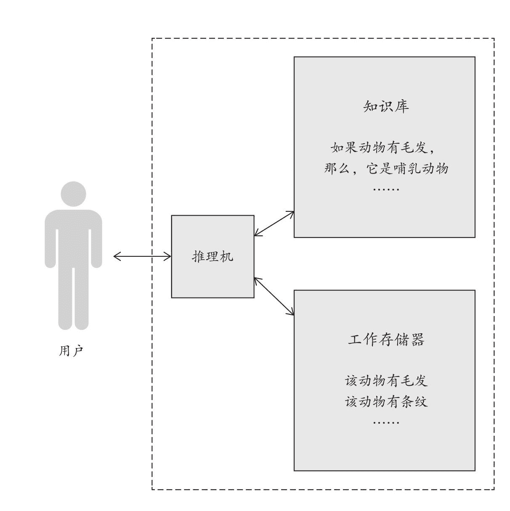

图 5　经典专家系统结构

给定一个知识库，推理机有两种运行方式。第一种是正向推理：用户把已知的事实输入，比如动物是否有条纹、是否食肉，推理机会依据规则触发并不断产生新信息，把新信息加入工作存储器，再继续寻找可触发的规则，直到无法再推导出新信息为止。

另一种是反向推理，从目标结论倒推所需数据。比如要确认动物是否为肉食动物，规则提示若动物吃肉则为肉食动物，于是系统会试图确认“吃肉”这一前提。由于没有规则的结论是“吃肉”，系统只能直接向用户提问。

### MYCIN：一个经典的专家系统

70 年代诞生的第一代专家系统中，`MYCIN` [\[32\]](#part0018.html#booknote_32)是最具代表性的，其名字源自抗生素后缀“mycin”。它首次证明在某些关键领域 AI 能超过人类专家，并为后来的系统提供了模板。

`MYCIN` 用于辅助血液疾病的医疗诊断，出自斯坦福大学两位小组的合作：布鲁斯·布坎南领导的 AI 实验室与特德·肖特利夫领导的医学院团队。项目成功的核心要素之一，就是真正的人类专家深度参与构建。后来许多失败案例就败在缺少领域专家的支持。

与动物分类的简单规则相比，`MYCIN` 关于血液疾病的知识采用了更丰富的表达。典型规则用自然语言描述如下：

如果：

·该有机体不会被革兰氏染色法染色，并且

·该有机体的形态是杆状，并且

·该有机体是厌氧的

那么：

有可能(60%)该有机体是类杆菌

用 AI 语言表述的 `MYCIN` 规则如下：

```
RULE036:
PREMISE: ($AND (SAME CNTXT GRAM GRAMNEG)
(SAME CNTXTM MORPH ROD)
(SAME CNTXT AIR ANAEROBIC))
ACTION: (CONCLUDE CNTXT IDENTITY
BACTEROIDES TALLY 0.6)
```

团队大约花了五年时间编码并扩充知识库，最终版本里包含数百条规则。

`MYCIN` 被视作标杆，因为它集合了后来专家系统不可或缺的特质。

首先，交互方式模仿人类专家，系统会提出一系列问题并记录回答，成为专家系统的标准模型，诊断也成为标准任务。

其次，推理过程可回溯、可解释。AI 用在生死攸关的决策时，透明度至关重要。只有能解释建议依据，用户才愿意采纳。`MYCIN` 能明确给出结论的由来，通过被触发的规则链和触发信息完整可查。实践中大多数专家系统的解释能力最终都归结为此，虽然不算完美，但足以追溯机制。

最后，`MYCIN` 能处理不确定性。现实中输入信息未必完全准确，专家系统需要应对这种情况。`MYCIN` 很少仅凭单一特征就给出绝对结论，它引入了确定性因子的技术，用数值表示对某条信息的信任或怀疑程度。这种处理不确定性的方法后来受到大量批评，但不确定性与推理问题一直是 AI 的核心议题，后续章节会深入讨论。

1979 年，`MYCIN` 参与了十个真实病例的评估，在血液疾病诊断上表现与人类专家相当，甚至高于普通医生平均水平。这是 AI 首次在有实际意义的任务里展现出专家级或以上的水平。

### 繁荣再起

70 年代出现的专家系统远不止 `MYCIN`。同出斯坦福、由爱德·费根鲍姆领衔的 `DENDRAL` 才是世界上首个成功的专家系统，也让费根鲍姆被誉为“专家系统之父”。`DENDRAL` 帮助化学家根据质谱仪数据推断化合物的组成与结构，到 80 年代中期每天有成百上千人使用。

美国数字设备公司开发的 `R1/XCON` 用于配置 `VAX` 系列计算机。80 年代 DEC 称系统已处理超过 8 万份订单，当时内置 3000 多条规则，涉及 5500 个系统组件。80 年代末规则数扩充到 17500 多条，开发者宣称为公司节省超过 4000 万美元。

`DENDRAL` 证明专家系统可用，`MYCIN` 证明它能在专业领域超越人类，`R1/XCON` 证明它有商业价值。这些案例点燃了市场兴趣，AI 似乎已准备好商业化。海量研发经费涌入，初创公司抓住这波行情，涌现出构建专家系统的软件平台和配套服务。专门为快速执行 `LISP`——当时构建专家系统的首选语言——的专用机器也热卖到 90 年代初。随着普通个人电脑变便宜，耗资 7 万美元买一台只能跑 `LISP` 的机器就变得毫无意义。

不仅仅是软件行业，整个产业都在搭乘这轮复兴。80 年代，工业界意识到知识体系尤其是专业知识是可以培育、带来高额利润的重要资产。专家系统让无形资产变得可操作，这与西方经济进入后工业时代、知识型产业和服务业成为增长主引擎的观点相呼应。

回看专家系统的兴衰，可以发现 AI 的再度繁荣不仅是几个成功案例的故事，更在于它提供了一种新可能。你不需要博士学位就能理解一个专家系统的原理，前文的动物分类规则就是例证。熟悉编程的人都能掌握其思想，甚至觉得它比传统编程更直观。于是出现了一个新职业：知识工程师。

颇具讽刺意味的是，1983 年英国政府启动了雄心勃勃的“阿尔维计划”资助计算机技术研究，核心就是人工智能。但鉴于十年前的莱特希尔报告几乎让英国 AI 产业陷入停滞，出于对负面名声的顾忌，参与者都不愿称之为人工智能，而是改称“基于知识的智能系统”。AI 的未来似乎光明——前提是你别叫它人工智能。

### 基于逻辑的人工智能

规则虽然成为获取人类知识的主流方式，但并非唯一方案。例如图 6 展示了心理学家罗杰·尚克与罗伯特·亚伯森开发的脚本知识表征的简化版本。该方案基于一种心理学理论，认为人类行为受刻板印象模式即“脚本”支配，也用这些模式理解世界。他们推测同样的模式可用于 AI。以图 6 的餐厅脚本为例，它描述了参与者角色、启动条件、操作对象，以及编号 1—10 的常规事件序列。尚克与亚伯森认为脚本可用于理解故事，当故事偏离常规脚本时就会变得有趣。他们尝试构建基于脚本的故事理解系统，但成功率有限[\[33\]](#port0018.html#booknote_33)。

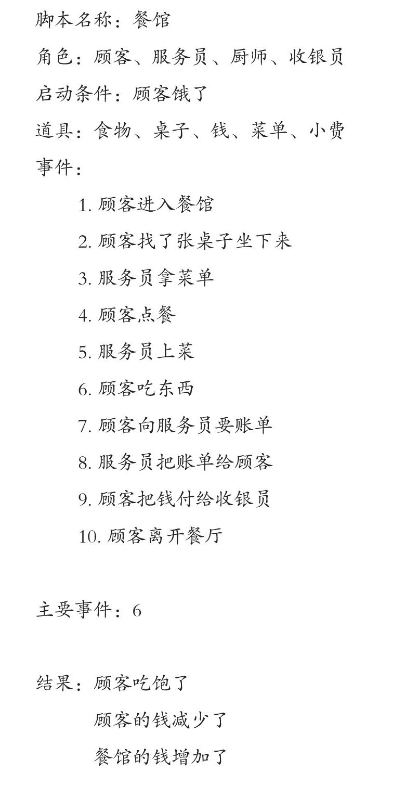

图 6　描述典型的餐馆就餐经历的脚本

另一个备受关注的方案是语义网[\[34\]](#part0018.html#booknote_34)，它直观自然，今天仍常被重新定义。我认为若让你从零设计知识表征方案，很可能也会做出类似的东西。图 7 是一个简单的语义网，包含我的出生日期、居住地、性别、子女等个人信息，以及一些常识如女人是人、大教堂既是建筑也是礼拜场所等。

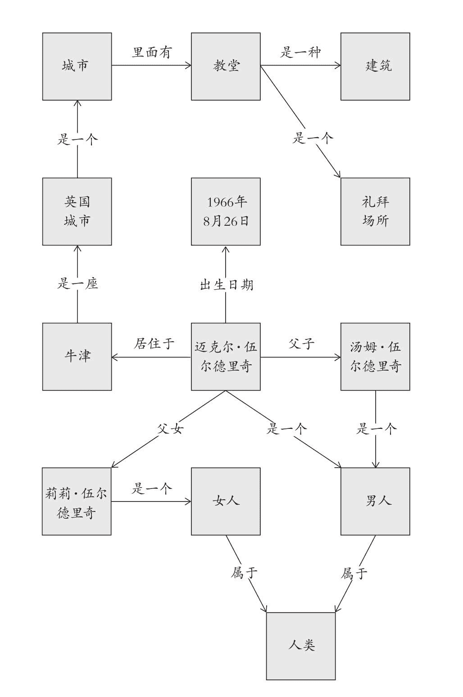

图 7　一个简单的语义网，包含我的个人信息、子女信息和居住信息

在知识型 AI 兴起期，几乎每个人都有自己的表征方案，且彼此不兼容。

尽管专家系统的事实表征是规则式，但在表征层面研究者仍面临困扰。其一，规则太简单，难以捕捉随时间变化、多用户交互、状态不确定的复杂环境。`MYCIN` 的规则就不适用于这类场景。其二，各种获取知识的方案显得武断，研究者希望弄清知识的本质并确保推理可靠。简言之，他们想要一个坚实的数学基础。人工智能研究者德鲁·麦克德莫特在 1978 年的文章里总结了这些问题，称之为“无意指不表达”[\[35\]](#part0018.html#booknote_35)，他写道：“对一个系统而言，正确性固然关键，能让人理解它也同样重要。”

70 年代末开始出现用逻辑作为统一表征方案的解决思路。要理解逻辑在知识系统里的作用，先了解一些逻辑基础及其运作方式。逻辑学的发展目的就是理解推理，区分好的推理与坏的推理。看几个例子：

凡人终有一死；

艾玛是凡人；

所以，艾玛终有一死。

这是典型的三段论，如果所有人类都是凡人且终有一死，艾玛是人类，那么她终有一死，推理合情合理。

再看：

所有的教授颜值都高；

迈克尔是一名教授；

所以迈克尔是位帅哥。

从逻辑形式看这个推论没有错误，前提成立时结论必然成立。逻辑并不关心前提是否真实，只关心形式是否合理。

再看一个不完备的推理：

所有学生都努力学习；

索菲是一名学生；

所以索菲很有钱。

这个推理是错误的，因为从给定前提无法推出她有钱的结论。逻辑关心的不是结论真假，而是是否能合乎规则地从前提推出。

因此逻辑与推理模式有关，上述三段论是最简单也最有用的案例。逻辑告诉我们如何从前提正确地得出结论，这个过程称为演绎。

# 逻辑与人工智能的演进

## 三段论的局限与数学推理的兴起

从三段论的局限到逻辑驱动的智能

亚里士多德提出的三段论统治了逻辑分析上千年，却只能覆盖很小一部分推理形态，面对复杂论证就显得力不从心。数学家长期在意推理的本质，因为数学工作的核心就是从已知推出未知。到了19世纪，学界对自身方法的基础产生怀疑：什么才算真实？数学证明怎么能断定是合理的推论？连 1 + 1 = 2 都需要更坚实的回答。

19世纪中叶起，这类问题被认真对待。德国的戈特洛布·弗雷格构建了形式逻辑演算，第一次呈现出接近现代数理逻辑的面貌。英国的奥古斯都·德·摩根与爱尔兰科克的乔治·布尔则把代数运算的手法搬到逻辑推理上，1854年布尔出版论文《思想法则》，用代数处理思维。

## 逻辑框架的成型

进入20世纪初，现代逻辑的主干已经确立。一阶逻辑在此时定型，它成为数学家日常推理的通用工具，也被视作表达推理的共同语言。这个体系收纳了亚里士多德、弗雷格、德·摩根、布尔等人的成果。在人工智能里，一阶逻辑同样扮演统一者的角色，把各地零散的知识表述方式收拢到同一框架下。

## 逻辑派人工智能的雏形

由此诞生了以逻辑为核心的人工智能流派。最具代表性的推手是约翰·麦卡锡，他在1956年主持达特茅斯暑期会议并为该领域命名。他设想智能主体能用逻辑命题记录对世界、目标与现状的认知，并据此推断某项行动是否符合目标，从而做出决定。

这里的智能主体即人工智能，麦卡锡所说的逻辑命题就是类似“人都会死”“所有教授颜值都高”之类的陈述。一阶逻辑提供了一种数学上精确的表达手段。

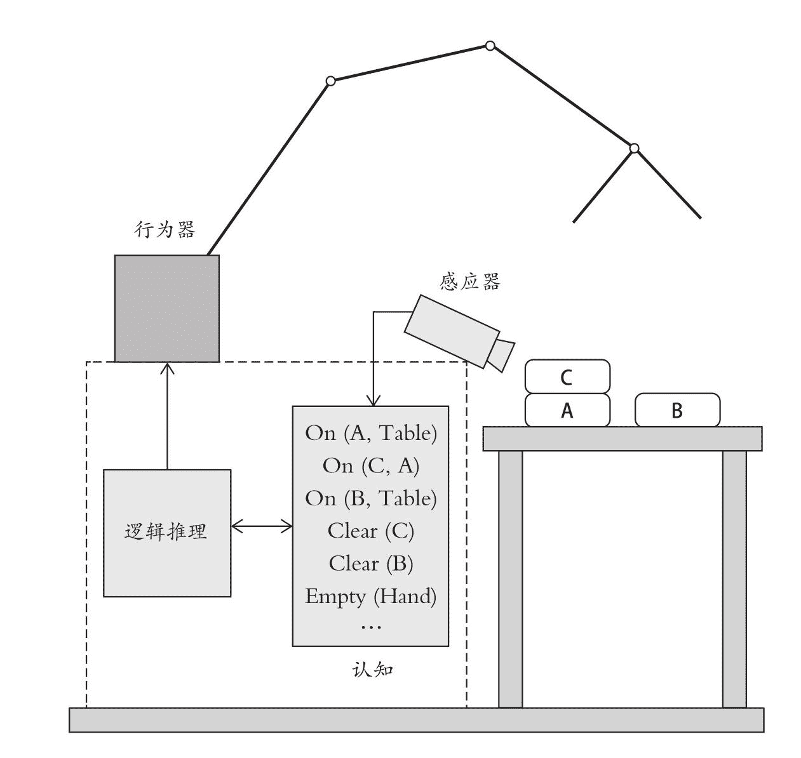

图 8　麦卡锡对人工智能的构想

麦卡锡设想的系统让机器通过逻辑语句显式表达环境信念，决策被拆解为推理步骤。

图 8 展示的正是这一构想。机器人身处积木世界，有机械臂和感知装置。内部以逻辑描述环境，例如 On(A，Table)、On(C，A) 等，它们本质上是一阶逻辑式。对场景而言含义直观：

· On(x，y) 表示 x 在 y 之上
· Clear(x) 表示 x 上空无物
· Empty(x) 表示 x 为空

这类系统首先要做的是确定词汇表，比如 On(x，y)、Clear(x) 等，用来刻画场景。

机器人内部的推理模块处理所有感知所得信息，形成所谓的信念。记录 On(A，Table) 就是机器人相信 A 在桌面上。需要注意术语问题。用人类熟悉的词便于理解机器的“信念”，但对机器本身，只有知识库里赋予了该表达式意义，才会与行为挂钩。选用 On 也并不特殊，用 Qwerty(x，y) 来表示“x 在 y 上”对机器执行毫无差别。开发中常见误区是以为术语对人类易懂，机器就能自动读懂语言，事实并非如此。

感知系统负责把传感器原始数据转成内部逻辑形式，这一步并不简单。最后由推理机决定实际行动。逻辑人工智能的核心是行为源于推理结果，必须先推导出下一步该做什么。

可以想象的运行循环是：周期性地感知环境、更新认知、推断下一步、执行动作、再开始下一轮。

这种范式为何有影响力？主要在于它把问题简化了：构建智能被归结为用逻辑描述机器人该做什么。系统因此透明，可解释性强，只要看信念和推理过程就能理解行为。此外，基于推理做决策的想法本身很诱人。人思考时似乎也在权衡方案、进行内心对话，逻辑派 AI 正是模仿这一过程。

## 逻辑编程的兴起

从70年代末到80年代中，逻辑派影响逐渐放大，80年代初成为主流。研究者甚至认为它能推广到整个计算机领域。逻辑编程由此走红，从根本上改变编程方式。传统编程繁琐易错，要求程序员逐步指定每一步操作。逻辑编程把程序员从这份负担中解放出来，是其最大卖点：你只需用逻辑表达对问题的理解，剩下的让推理去完成。无需写出每一步，逻辑程序会自行推导出需要做什么。

代表性语言是 PROLOG［37］，它是逻辑人工智能时代最持久的遗产，至今仍在教学与使用中。PROLOG 由美籍英国学者鲍勃·科瓦尔斯基、法国马赛的阿兰·科尔默劳尔和菲利普·罗塞尔发明。科瓦尔斯基在70年代早期意识到可用一阶逻辑规则构建编程语言基础，1972年科尔默劳尔和罗塞尔据此完成了细节。

PROLOG 非常直觉。以“凡人必死”为例：

```
human (emma).

mortal (X): - human (X).
```

第一行是事实，定义艾玛为凡人；第二行是规则，若 X 为凡人则 X 终将死亡。

使用时需要给出目标，例如：

```
mortal (emma).
```

这是在问“艾玛是否终有一死”，即能否由已知事实与规则推导出结论。PROLOG 通过逻辑推理给出证明［38］。

这只是冰山一角。1974年大卫·沃伦编写的战机规划系统仅用 100 行 PROLOG 就解决了积木世界的规划问题，若用 Python 类语言实现，可能需要数千行代码和数月工作。PROLOG 程序本身即是逻辑公式，实现了麦卡锡的构想。

70年代末到80年代初，PROLOG 开始崭露头角，甚至挑战人工智能黑客钟爱的 LISP。80年代初，日本政府将其作为第五代计算机项目重点投入，约 4 亿美元资金注入。彼时日本经济强劲，美国与欧洲担忧其技术崛起。项目旨在建立日本的计算机创新主导地位，逻辑编程是关键技术之一。最终项目虽为日本计算机科学基础做出贡献，却未让日本产业超越美国，PROLOG 也未成为通用语言。

PROLOG 未能征服编程界，但不算失败。全球仍有程序员乐于使用它。更重要的是，它提供了全新思路：用与传统完全不同的视角解决计算问题，一代代程序员因此受益。

## Cyc：知识的豪赌

Cyc 工程是知识型人工智能时代最著名的试验，由道格·莱纳特主导。莱纳特科学能力突出，信心坚定，说服力强，70年代凭借多个 AI 系统崭露头角，1977年获计算机与思想奖。

80年代初，他相信“知识即力量”应超越狭义专家系统，可成为通用 AI 的钥匙。他在1990年与拉曼内森·古哈合著指出［40］：

我们不相信有捷径，世界不存在类似麦克斯韦方程的通用解……任何强思维体都需要大量知识。指的不是专业知识，而是现实世界的常识，它们太寻常，找不到在参考书中。例如生命有限，实体不能同时在两处，动物不愿受苦等。人工智能最艰难的事实是，没有优雅轻松的方式获取如此庞大的知识库，初期的大部分工作必须靠人类手工输入。

因此80年代中期展开 Cyc，要构建包罗万象的知识库。

雄心令人咋舌：Cyc 需完整描述“共识现实”。举例而言，必须明确告知系统：

地球上悬空物会落地并停在地面，太空中则不会；
燃料耗尽的飞机坠毁；
坠机致人死亡；
食用未知蘑菇很危险；
红色水龙头多为热水，蓝色多为冷水……

受过良好教育的人的常识，在 Cyc 中必须以特殊语言明确写下并输入。

莱纳特估计这项输入需 200 人多年努力，主要消耗在手工录入。他乐观认为不久后系统可自我学习，形成通用 AI。这本质是高风险高回报的赌注：若成功，将改变世界。

1984 年，Cyc 从得克萨斯奥斯汀的微电子与计算机联合会获得资金启动。最终失败。

首要难题是此前无人尝试系统化人类基础常识。该从何处开始？先要定义所有词汇与术语及其关系，这被称为本体工程。Cyc 的本体工程规模远超以往，很快发现既有想法过于天真，推进中不断推倒重来。

即便如此，1994 年莱纳特仍保持乐观。斯坦福教授沃恩·普拉特对其感兴趣，要求现场演示。普拉特事先根据公开论文列出期望功能清单，寄希望演示能匹配。

1994 年 4 月 15 日的演示先展示系统识别数据库细微差别的技术能力。随后莱纳特演示自然语言检索图片，“放松的某人”得到三位穿沙滩服、拿冲浪板的男性照片，系统正确关联冲浪与放松。推理链涉及近 20 条规则，其中一条是“所有哺乳动物都是脊椎动物”，当时版本已含 50 多万条规则。

接着普拉特询问核心认知：Cyc 是否知道面包是食物。系统回答“是”。再问面包是否饮料，系统卡住。调整后仍放弃。随后演示显示 Cyc 晓得某些活动致死，却不知饥饿可致死，似乎没有“饿死”概念。进一步提问发现它不知天空通常是蓝色，也不知汽车一般有四个轮子。

普拉特拿出准备的百余个常识问题，例如：

汤姆比迪克高 3 英寸，迪克比哈里高 2 英寸，汤姆比哈里高多少？
两兄弟能彼此都比对方更高吗？
陆地和海洋哪个更湿？
汽车能倒开吗？飞机能倒飞吗？
人无空气能活多久？

这些基础问题 Cyc 无法给出有意义答案。普拉特谨慎批评，认为 Cyc 迈出了步子，但进展难以评估，因其知识体系极为零碎、不均匀。

Cyc 留下的启示是：大规模知识工程是可行的技术实践，但并未提供通向通用 AI 的光明大道。Cyc 假说——通用 AI 本质是知识问题，可靠知识系统即可解决——既未被证实也未被证伪。Cyc 的失败只能说明这种实现方式行不通，并不能否定该命题本身。

某种角度看，Cyc 堪称超前太多。项目启动三十年后，Google 才推出 Knowledge Graph，这是一个规模庞大的实体知识库，把地点、人名、影片、图书、重大事件等各类信息收拢，用来丰富搜索结果。检索时常带一个专有名词，比如搜 Madonna。只靠关键词匹配会返回一堆网页，若系统知道她是流行歌手，全名 Madonna Louise Ciccone，就能直接给出出生年月、子女情况、代表专辑等人们常问的问题。Cyc 与 Knowledge Graph 的关键差别在编码方式：后者的内容并非人工一条条写入，而是从 Wikipedia 等网页自动抽取而来。据称到 2017 年 Wikipedia 已积累约 700 亿条词条，覆盖约 5 亿实体。Knowledge Graph 并非以通用 AI 为目标，也说不清其世界观推理到底有多少，但怎么看都带着 Cyc 的血脉。

客观回望，Cyc 最沉痛的标签是过度炒作的典型。项目辜负了外界不切实际的期待，Lenat 的名字甚至成了圈内笑料，有人提议用“微 Lenat”来当作夸大程度的计量单位，为什么要加“微”？因为找不到比“一整 Lenat”更夸张的虚假了。

## 破灭出现

理论上很美的知识式 AI，落地后异常吃力。连常识推理这类看似简单的问题都卡住。文献里常引的场景[\[42\]](#part0018.html#booknote_42)如下：

你知道翠迪属于鸟类，于是推断它具备飞行能力。随后得知翠迪其实是企鹅，你必须收回刚才的判断。直觉上很顺，逻辑却做不到。逻辑里追加信息只会保留已有结论，不会撤销它，而常识恰恰需要撤回：确认它是企鹅后，“能飞”就不成立了。

矛盾处理是另一处死穴。经典例子[\[43\]](#part0018.html#booknote_43)：

贵格会信徒被视为和平主义者；共和党人并非和平主义者；尼克松既是共和党成员，也被视作和平主义者。

按逻辑推导会得到尼克松同时是也是不是和平主义者，系统直接当机。可矛盾本就是日常：纳税有益也常被说，纳税是负担也常被说；葡萄酒对健康好也常被说，葡萄酒有害也常被说。数学里出现矛盾意味着前设有误，生活里矛盾却无处不在。八十年代末，这些正是知识式 AI 最棘手的难题，聪明人堆上去，始终没得到令人满意的解法。

更致命的是知识获取。把专家的经验变成可执行的规则，比想象难得多。专家擅长做事，不等于能讲清自己怎么做；而且公司若能用程序替代专家，专家也不见得愿意倾囊相授。到八十年代末，专家系统的热潮已经退去。技术并非彻底失败，期间也诞生了不少成功案例并不断出现，但整体产出与当年的宣传落差巨大，再一次印证了 AI 的期望泡沫。

## 第四章 机器人与其合理性

行而不思者，因莽撞而灭亡；
思而不行者，因懈怠而灭亡。
——威斯坦·休·奥登

托马斯·库恩在《科学革命的结构》里指出，科学发展到一定阶段，旧范式会崩塌，新范式取而代之。八十年代末，专家系统光环黯淡，一场新的 AI 浪潮悄然酝酿。这轮质疑动摇的不仅是“知识即力量”的口号，更是自五十年代起支撑符号 AI 的基本设定。有趣的是，最激烈的批评来自内部。

澳大利亚机器人学家罗德尼·布鲁克斯是其中最响亮的声音。1945 年出生，他在斯坦福、MIT、卡内基梅隆三所 AI 重镇学习工作，本可成为正统捍卫者。他想造能在真实世界做事的机器人，很早就怀疑把现实知识编码成可识别形式再做推理决策的做法。八十年代中期在 MIT 任教时，他开始从更底层重新审视 AI。

### 布鲁克斯革命

要读懂布鲁克斯，得回到积木世界。积木世界是经典的桌上模拟环境，AI 要按要求重排物体。对布鲁克斯的追随者来说，这毫无意义。模拟积木与真实仓库的复杂度不可同日而语，能在积木里炫技的系统放到物理世界就失效。真正的难点是感知，而积木世界里感知被彻底抹掉了。七八十年代积木世界被指为误导方向，可论文至今仍在出现，我自己也写过几篇。

布鲁克斯提出了三条核心主张：其一，有意义的 AI 只能在与真实环境的直接互动中进展，必须身处现场、感知并交互。其二，清晰完备的知识库和逻辑推理并非智能行为的必要条件，尤其是逻辑派。其三，智慧是一种涌现属性[\[7\]](#part0008.html#note_7)，源于主体与环境的持续交互。他用 1991 年的一则讽刺寓言[\[44\]](#part0018.html#booknote_44)说明观点：

假设十九世纪九十年代出现人工飞行热潮，学界资本都疯狂投入。一群研究者坐时间机到八十年代坐了一次波音 747，回来后大为兴奋，随即着手研究座椅倾斜、双层玻璃等细节，坚信只要造出神奇的“塑料”就能称王。

寓言指向很明确：我们总爱盯着推理、解题、下棋这类好看的智力表象，而这些偏好让研究走偏。布鲁克斯认为推理或许有用，但绝不是构建 AI 的起点[\[45\]](#part0018.html#booknote_45)。

他还反对自诞生起就默认的分而治之：把 AI 切成推理、学习、感知等模块再各自研究，却忽略它们如何协同。寓言里，制造机身的团队、造座椅的团队各忙各的，互不交流。最后他点出“重量”问题——暗指计算量。造座椅的用实心钢骨架，有人提议改成空心钢管会轻很多，却被嗤之以鼻。布鲁克斯强烈反对把所有决策都压缩成耗时的逻辑推理。

这则寓言的标题是《无表征智能》。八十年代中期我在读 AI，课堂上被灌输逻辑推理是核心。布鲁克斯的文章像异端。1991 年，一位同事从澳洲回来说，斯坦福麦卡锡的老派与 MIT 布鲁克斯的新潮在会场上激烈交锋，一方捍卫逻辑知识表述推理，另一方嘲笑传统并公然背弃。

布鲁克斯并非孤例。许多研究者得出了相似结论，共识是把知识与推理从 AI 核心位置拿开。麦卡锡的设想把逻辑模型放在中心，所有行为围绕它运转，这遭到了猛烈批判。也有温和声音认为推理仍可发挥辅助作用，但更激进的路线主张彻底摒弃。

回顾麦卡锡循环：感知环境→推理该做什么→采取行动。系统与环境是分离的。可我们放下书本看看周围——候机室、咖啡馆、车厢、河边，感知与行为是与环境融为一体的，只有偶尔才会陷入脱离现实的沉思。知识式 AI 没能反映这种耦合。

假设一个按麦卡锡模型设计的机器人，按“感知—推理—行为”循环运转：用处理器解析传感器数据，更新信念库，推理动作，再执行。声称自己总是选最优策略。运行一段时间：

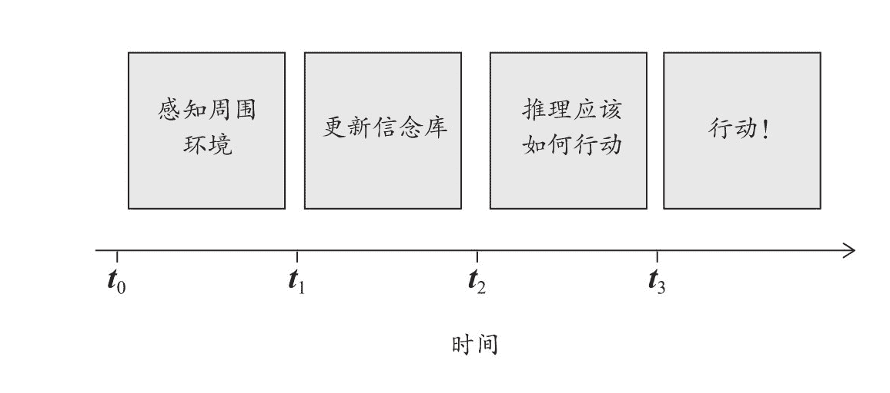

图 9　机器人在一段时段内的运行示意

机器人应该在何时选择行动？是感知完的那一刻，还是最终决定那一刻？t[0]到t[1]感知，t[1]到t[2]处理数据更新信念，t[2]到t[3]推理动作，t[3]才开始行动。所谓最优时间到底是t[1]还是t[3]？环境信息来自t[1]之前，却要等到t[3]后才能付诸行动，这在实践中不成立。令人惊讶的是，直到八十年代末几乎所有 AI 都这么做：追求在假设环境不变前提下的理论最优，而非真实世界里的最佳决策[\[46\]](#part0018.html#booknote_46)。于是环境与行为的紧密耦合成为新的研究主题。

### 基于行为的人工智能

布鲁克斯不只是批评者，他用可信的范式和扎实的系统证明了另一种可能。新范式叫基于行为的 AI，强调具体行为对整体智能的贡献。他的标志性方法叫包容式体系结构，影响持久。

现在看一种低调却实用的产物：扫地机器人。它要在屋里移动、避障、检测垃圾并清理，电量或垃圾盒满时需返回充电座并关机。包容式体系结构先拆分出单个行为组件，再逐步叠加，关键是协调优先级。

六个基本组件是：

- 避开障碍物：发现前方障碍就改道，随机选新方向。
- 关机：回到充电座且电量不足时关机。
- 清空垃圾收纳盒：在充电座上且盒内有物时清空。
- 返回充电座：电量不足或盒满时返回。
- 执行清洁：当前位置有灰尘就吸入盒内。
- 随机移动：随机选方向前进。

组织方式见图 10，层次越高优先级越低。避障是最高优先级，遇到障碍立刻让路。六个组件组合后，机器人能在不低电或不满盒时搜索吸尘，必要时回家。

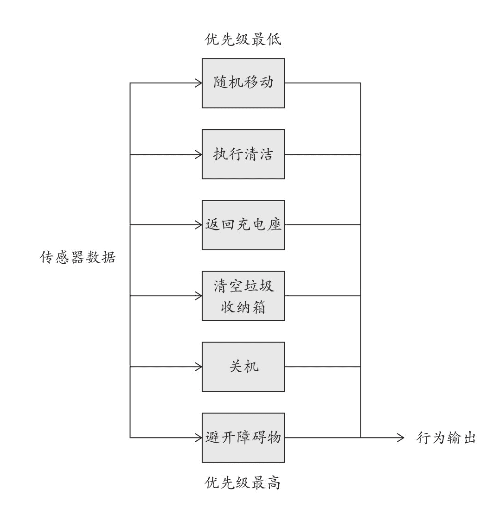

图 10　扫地机器人包容式体系结构示意

虽然看起来像规则控制，实际实现很轻量，可用简单电路完成，对传感变化反应迅速。

此后几十年，布鲁克斯用包容式体系结构做出了一系列惊艳系统，例如陈列在美国国家航空航天博物馆的“成吉思”机器人，外形像六条腿的昆虫，用 57 个基本行为组件组织。若用知识式 AI 造它，难度大到惊人。正是这些成果让机器人技术在边缘化多年后重回 AI 主流。

### 基于智能体的人工智能

九十年代初，我见到一位 AI 革命的主角，也是我的偶像。好奇他对知识表述、推理、问题求解、规划这些他极力反对的技术怎么看，是否认为它们在未来毫无用处。“当然不是，”他说，“但我不能把名声押在它们现在的样子上。”答案令人沮丧，却也耐人寻味。后来大家也逐渐意识到，基于行为的 AI 虽然修正了基础假设，但同样难逃被过度期待的命运，本身也有相当严重的局限。

规模化是它绕不开的瓶颈。若目标只是扫地机器人，行为式人工智能就够用了。这种机器人不需要推理，也不需要用自然语言交流，更不用解决复杂问题。正因不需要这些，设计者可以用包容式架构之类的做法，拼凑出一套能用的方案。虽然行为式思路在机器人领域取得了一些亮眼成绩，但远称不上是人工智能的通用解法。一旦涉及的行为数量激增，系统设计就会变得极其棘手，因为各个行为之间的相互干扰很难被预判。用这种方法搭系统更像是在玩黑魔法——想知道能不能用，只能先造出来再试，成本高、周期长、结果也难以预料。更麻烦的是，即便做出了针对某个具体场景的精准方案，其经验也很难迁移到新问题上。

布鲁克斯说知识库和推理并不是实现智能行为的必备条件，这一点没错，他的机器人也证明了纯行为路线能走多远。但如果据此机械地得出推理和知识表征在人工智能里一文不值的结论，那就走偏了。现实中存在大量无法回避推理的场景——逻辑推理或其他形式的推理都一样，否认它们的必要性，和用逻辑推理去造一台扫地机器人一样荒谬。

人工智能阵营内部也有分歧。部分激进的支持者主张人工智能设计里坚决不要出现任何逻辑表达和推理成分，更多人则走中间路线。这种温和路线一直延续至今。它保留了行为式人工智能的优势，同时认为正确的方向是把行为和推理结合起来。一个新的发展脉络由此成形，既吸收了布鲁克斯学派的精髓，也重新接纳了此前在推理和知识表征上被验证有效的要素。

# 从专家系统到自主智能体 的转向
人工智能的研究重心再次发生迁移。此前聚焦于专家系统、逻辑推理机这类脱离真实环境的系统，如今转向构建智能体。智能体指的是一套完整的、自主运行的人工智能实体，它被嵌入到具体环境中，代表使用者完成特定任务。它要提供的是成套的、相互整合的能力，而不是像逻辑推理那样孤立的模块。研发目标从拼凑智能零件，变成打磨一个完整的智能体。这正是为了避开布鲁克斯当年批判的误区——不能把智能拆成推理、学习等若干部件各自独立开发，再指望简单组合就能成功。

## Agent思维：从反应到协作
Agent视角明显受到行为式人工智能的启发，但对其主张做了弱化。这种思潮在20世纪90年代初开始萌芽，当时学界花了不少时间厘清“智能体”究竟指什么。到90年代中期，基本达成共识，一个智能体应具备三种特质：第一，反应灵敏，能迅速感知环境变化并及时调整行为；第二，主动积极，能系统地推进使用者交办的任务；第三，具有协作性，需要时能够与其他智能体配合。

人工智能的黄金时代强调主动性，即计划与问题求解；行为式人工智能则突出反应灵敏，即适应环境并与之协调。Agent范式要求两者兼备，还额外加入了社交维度：智能体必须学会和其他智能体合作。为此它们需要社交技能，不仅是沟通，还包括协作、协调、谈判，以推动任务完成。

正因强调社交化，Agent范式才在众多模式中脱颖而出。回头看，学界花了这么多年才认真思考人工智能系统如何相互协作，以及协作时会产生什么问题，显得有些迟缓。虽然从图灵测试开始，社交能力就被强调，但那主要指向通过自然语言与人进行日常对话的能力。而在Agent范式里，真正被关注的是智能体之间如何协同工作。

### 经典架构拆解：旅行机
图11展示了一个典型的Agent设计，被称为“旅行机”[\[48\]](#part0018.html#booknote_48)。它的总控被拆成三个子系统：快速反应子系统运行方式类似布鲁克斯的包容式架构，负责需要立刻响应且无需推理的情形，比如避开障碍；规划子系统负责制订达成目标的步骤；建模子系统负责处理与其他智能体的交互。中央控制器会综合三个子系统的建议并做出取舍。决策通常很直接，如果快速反应子系统发出“停止”的指令，系统会马上停下运动。20世纪90年代初，类似这样的Agent系统被开发了不少。

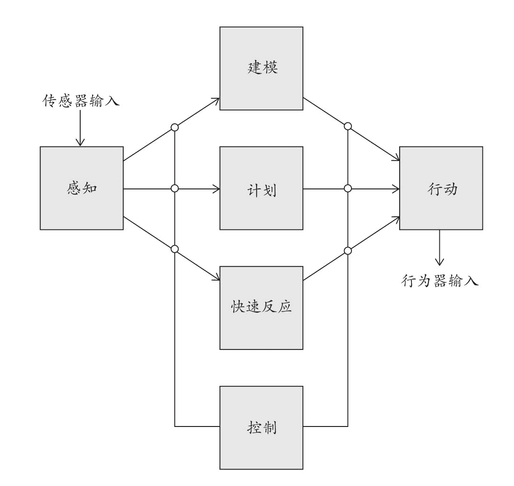

图 11　一个典型的智能体结构：旅行机

## HOMER：模拟海洋里的完整智能体
我最喜欢的例子是HOMER，它是一艘存在于二维“海洋世界”中的模拟机器人潜水艇[\[49\]](#part0018.html#booknote_49)，任务通常是收集包裹并从一处运到另一处。显而易见，HOMER继承了SHRDLU的传统，也有同样的关键限制——它是模拟系统。但相比SHRDLU，复杂度高得多。

HOMER能接受英语指令，不过词汇表只有800个词。它可以据此规划、执行，并在必要时调整计划。为了感受其能力，可以看一段用户对话。用户输入用普通字体，HOMER回复用斜体，括号里是我加的注释。

你面前是什么？

一根原木。

它是属于你的吗？

不是。

它属于你。

哦。(HOMER 用这个词表示被告知了以前不知道的事情)

……

转过身背对你的原木。

好的，我正在转身。

(用户把原木移除)

转回来。

好的，我正在转身。

我的原木不见了!

这段对话体现了简单却重要的常识推理：HOMER记得那根原木，转回来时期待还能看见它，发现不见时表现出惊讶。

下一个场景从HOMER在码头等待任务开始，码头上有一个包裹，任务是把它运到驳船。

下周六晚上 9 点把包裹放到驳船上。

好的。

(HOMER 开始制订计划。)

你下周六会去码头吗？

是的。

你为什么要去码头？

我要去取包裹。

你打算什么时候去取？

晚上 8 点 56 分。

下周日包裹会在哪里？

在驳船上。

一周以后包裹会在码头上吗？

不会。

这里可以看到HOMER对时间的常识性理解，以及行为对环境的影响——包裹送到驳船后就不会再在码头。它也理解自己的计划需要时间：必须在晚上8点56分到码头取件，才能赶上9点送达。

## 软件助手：从被动工具到主动伙伴
Agent范式起步于机器人学，但很快研究者注意到它在软件世界的巨大潜力。没有人宣称它是通用人工智能，就像专家系统一样，目标是通过构建软件智能体来分担我们的工作。软件智能体运行在软件环境中，比如台式电脑和网络。核心设想是让AI驱动的软件和我们并肩工作，像助手一样处理邮件、上网等日常事务。

要理解软件智能体的概念如何形成，需要回溯人与计算机交互方式的演变。

早期使用者多是参与设计制造计算机的科学家和工程师，人机界面因此非常粗糙。图灵在20世纪40年代末用的“曼彻斯特宝贝”，每个内存位置都得靠开关手动设定0或1。机器的一切都对用户透明，使用者必须懂机器原理才能编程。现在几乎没人能掌握这种方式，即使在当时，换一台机器，学到的技术也基本作废。

到20世纪50年代末，情况开始改变。关键创新是高级编程语言的出现。这些语言之所以叫“高级”，是因为它们隐藏了机器语言的细节，程序员无需了解某台计算机的内部构造就能编程。这些语言在不同机器间具备可移植性，比如用COBOL写出的程序可以在多台机器上运行。虽然不一定完美，但编程技能开始有了通用价值。这极大提升了可用性，也标志着交互从“以计算机为中心”转向“以人为中心”。

这一趋势在60年代持续，80年代迎来飞跃。1984年苹果推出麦金塔电脑，这是第一台面向大众市场的电脑，明确传达出不需要专业计算机技能也能使用。卖点是用户界面，基于桌面的图形用户界面让屏幕上出现代表文档和文件夹的图标，用户用鼠标操作。桌面这个词之所以被采用，正因为屏幕看起来像真实桌面——文档放在桌面，文件夹用来整理，垃圾桶用来丢弃不需要的文件。

1984年开创的图形界面至今仍是主流 [\50\]，硬件已迭代无数次。我相信当年的Mac用户面对今天的Mac或Windows界面也不会感到困难。

人机交互的核心在于用用户熟悉的概念——桌面、文档、文件夹、垃圾桶——来操作电脑，让过程更自然、门槛更低。

Mac的成功让苹果CEO约翰·斯库里在80年代末思考下一个交互创新。他提出“知识导航器”的设想，预见到万维网等新兴技术。苹果于1987年委托制作了一段同名概念视频 [\51\]，内容高度概念化，展示愿景而非产品。

视频里，一位大学教授使用类似现代平板的产品。界面像传统桌面，但关键不同在于交互通过软件智能体完成。和HOMER一样，这个智能体能用英语交流，但以动画人形呈现。它会礼貌提醒日程，查询讲座材料，并管理来电。

视频有不少创意和幽默，但历史意义重大。首先它暗示互联网将成为工作环境的一部分——当时互联网尚未普及到个人，还主要服务学术机构和政府。其次它预示平板的普及。对AI而言，最关键的是确立了通过智能体与计算机交互的思想。

基于Agent的交互代表了一种全新模式。用Microsoft Word或IE这类应用时，它们是被动的、只响应指令。当你选菜单或点按钮，程序才执行操作，唯一的智能体是你自己。Agent交互改变了这一点。计算机被动等待指令，而智能体更主动，像人类助手一样与使用者协作，帮你完成想做的事情。

视频中的智能体以动画人物出现，能流利发言。技术当时远未成熟，但核心思想不是技术可行性，而是AI可以让软件成为合作者，而非被动仆人。这个思想逐渐深入人心，90年代中期在万维网扩张的推动下，软件智能体的兴趣迅速升温。

比利时裔麻省理工媒体实验室教授帕蒂·梅斯发表文章《智能体能够帮助人们减少工作量和信息过载》[\52\]，概括了时代精神。文章描述了实验室的多款原型：邮件管理、日程安排、新闻过滤、音乐推荐等。邮件助手会观察用户的处理习惯——立刻阅读、归档、删除——用机器学习预测新邮件的处理方式，预测足够可靠时就主动代为处理。

随后十年里，出现了上百种类似产品，很多依托互联网。早期的万维网搜索工具简陋，网络速度慢，许多任务耗时，人们希望智能体自动完成琐事 [\53\]。对90年代后期快速发展的网络而言，软件智能体似乎前景光明，一批公司因此成为网络泡沫的一部分。

我自己也是故事的一部分。1996年夏天，我受邀加入一家伦敦初创公司，工资是学校的约三倍，我几乎没犹豫就答应了。计划是用智能体提升网络搜索效率，把万维网变成图书馆。但我们不懂商业，也不懂怎么开发商业软件。很快发现一个残酷事实：以惊人速度烧钱，却不知道怎么赚钱。那段经历很痛苦，我9个月后离开，公司再过8个月就倒闭了。

这段个人经历也预示了几年后全球发生的事：互联网泡沫从1995年持续到2000年初。随着众多互联网新贵无法盈利，市场在2000年初崩溃。

软件智能体只是互联网故事的一角，却是和人工智能关联最明显的角落。研究者的梦想没错，只是太超前。20年后，苹果iPhone上的Siri横空出世。它由斯坦福国际研究院开发——正是30年前开发SHAKEY的同一机构。Siri是90年代软件智能体工作的直接延续，很多人立即联想到苹果的知识导航器视频。其构想是一个基于软件的智能体，用户可用自然语言交互并让它执行简单任务。随后亚马逊Alexa、微软Cortana、谷歌助手等跟进，都可追溯到Agent人工智能。它们在90年代不可能出现，因为硬件不支持，至少到2010年后移动设备的算力才足够。

## 理性决策：让Agent选最优而非最像人
Agent范式还提供了另一条思考路径：构建能有效代理我们行动的智能体。这就引出一个问题：图灵测试确立的目标是产生与人类无法区分的行为，而Agent开发的思路不同，我们并不要求它像人，只要它做出最优选择即可。是否像人类无关紧要，我们真正想要的是最正确的选择，尽可能最优。因此AI开发的目标从“模仿人类选择”转向“做出最优选择”。

支撑最优决策的理论可追溯到20世纪40年代。约翰·冯·诺依曼与奥斯卡·摩根斯坦发展了理性决策的数学理论，说明如何把决策问题转化为计算问题 [\54\]。在Agent人工智能中，智能体用该理论为用户做出最佳决策。

理论起点是用户偏好。若智能体替你做事，它必须明白你的偏好。例如智能体在苹果、橘子、梨之间替你挑选，首先要知道你对这三种结果的偏好程度。假设偏好为橘子>梨>苹果。若它选橘子你满意，选苹果你失望。这是最简单的偏好关系，描述了你对每对备选方案的排序。理性决策要求偏好满足一致性。

比如偏好为橘子>梨、梨>苹果、苹果>橘子。这种偏好就很奇怪。由前两条可推断你更喜欢橘子而非苹果，但这与第三条矛盾，偏好不一致，智能体就无法为你做出最优决策。

下一步是对一致的偏好进行赋值，用实体程序的方式。为每个备选方案赋予数字，数字越大偏好越高。例如橘子赋3、梨赋2、苹果赋1，就能表达前面的偏好。因为3>2>1，排序正确。同理也可以把橘子赋10、梨9、苹果0，具体数值不重要，关键是排序。偏好必须一致，才能用数值表示。试着为苹果、橘子、梨在这条不一致的偏好下赋值，是否可行？

把偏好变成可以计算的数字，唯一的目的就是让选择变得可优化。只要给每个选项贴上一个数值标签，智能体就能挑出分值最高的那一个，从而实现我们真正想要的结果。这类问题本质上就是优化问题，而数学早已为它准备好了工具箱。

问题在于现实里的抉择很少是确定的。一旦掺入不确定性，事情立刻复杂起来。我们只能知道各种后果出现的概率，却无法保证哪一种必然发生。

最典型的对比是两组抛硬币的赌注【55】：

选项 A：硬币正面得 4 英镑，反面得 3 英镑。
选项 B：硬币正面得 6 英镑，反面一分钱没有。

你会选哪一个？我更倾向 A，原因需要预期效用来解释。预期效用在这里就是在该选择下长期平均能拿到的回报。

A 的期望是 0.5×4 + 0.5×3 = 3.5 英镑。B 的期望是 0.5×6 + 0.5×0 = 3 英镑。单次操作不可能真的拿到 3.5 英镑，但重复足够多次，平均收益会收敛到这个数值。

冯·诺依曼与摩根斯坦提出的理性决策准则很简单：选预期效用最大的。按此标准 A 优于 B。B 虽然存在 6 英镑的诱人上限，却也伴随着同等概率的归零风险，权衡之后期望反而更低。

这个思路常被误读。有人觉得把人类偏好量化很冰冷，甚至认为是自私的。因为把收益等同于金钱。但收益不过是偏好度量的一种定义方式，理论本身对“偏好是什么”保持中立。利他者的善意，只要能用数值表达，同样适用；自私者的算计，也同样适用。

到 20 世纪 90 年代，由冯·诺依曼—摩根斯坦理性选择模型支撑的智能体范式，已成为人工智能的主流正统，并延续至今。如今几乎所有系统内部都有一个代表使用者偏好的数值模型，并在运行中持续追求预期效用的最大化【56】。

应对不确定性

处理不确定性一直是人工智能的硬骨头，90 年代这个问题变得关键。真实系统必须在噪声中做判断。比如无人驾驶汽车，传感器会说“前方无障碍”，但这并非百分百可靠。信息有价值，却不能全信，如何在出错的可能下合理利用它？

90 年代后占据主导的方法是贝叶斯推断。18 世纪神学家兼数学家托马斯·贝叶斯提出的贝叶斯定理，讲的是在新证据到来时如何理性地修正已有信念。在汽车案例里，信念是“前方是否有障碍”，新证据就是传感器读数。

贝叶斯定理也暴露了人类直觉的脆弱。考虑一种致死性流感，基础感染率千分之一。检测准确率 99%。你被测出阳性，患病的概率是多少？多数人会凭直觉说 99%。真实概率只有约十分之一。

用 1000 人来算：约 1 人真感染，其中 99% 会被正确检出，约 0.99 个真阳性。剩下 999 人未感染，因 1% 误报，大约有 10 人会被误判为阳性。阳性总人数约 11 人，其中只有 1 人真正患病。低患病率导致假阳性远超真阳性，这也是医生不愿单凭一次检测下结论的原因。

同样的逻辑用在机器人探索上。机器人要绘制未知区域地图，传感器会误报障碍物。若盲目相信数据，地图会大面积失真。借用贝叶斯推断，用传感器的准确率持续更新对障碍物位置的信念，多次观测后地图会逐渐收敛到真实【57】。

贝叶斯的价值在于对待不完美数据的态度：不丢弃也不全信，而是用概率不断刷新信念库。

当数据量庞大且相互关联时，研究者发展出贝叶斯网络。由朱迪亚·珀尔推动的这套图模型，用有向图表达变量间的因果影响，阐明了概率在人工智能中的核心作用【58】。图 12 就是一个简化示意，展示感冒、流鼻涕、头痛三者之间的影响关系。

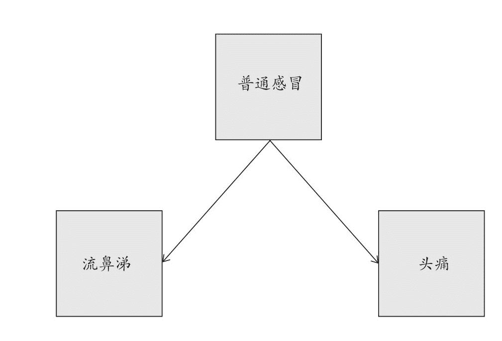

图 12　简单的贝叶斯网络示意图

当 Siri 遇见 Siri

2000 年互联网泡沫褪去后，研究者开始关注智能体之间的互动。早期的专家系统曾探讨知识共享，但多智能体场景下出现关键差异：你的智能体为你服务，我的智能体为我服务，偏好不一致导致冲突。因此智能体必须具备社交能力，学会预判他人的行为【59】。

这种推断属于博弈论的范畴。博弈论源于象棋、扑克等策略游戏，后来成为经济学分支【60】，在多智能体环境中极具实用价值。

最具代表性的概念是纳什均衡，由约翰·福布斯·纳什提出，他的名字也出现在 1956 年达特茅斯人工智能暑期学校的名单中。因该理论，他与约翰·哈萨尼、理查德·塞尔滕共同获得 1994 年诺贝尔经济学奖。

直观理解很简单：两个智能体分别选 x 与 y，若智能体 1 在 2 选择 y 的条件下不愿改变 x，智能体 2 在 1 选择 x 的条件下也不愿改变 y，那么这对选择就是稳定的均衡。没有一方有单方面偏离的动机。

多智能体研究迅速吸纳了纳什均衡等思想，但一个老问题再次浮现：纳什在 50 年代提出概念时并未关心如何计算。当智能体需要实时使用时，计算纳什均衡的难度就成了瓶颈，这至今仍是人工智能的重要课题。

人工智能开始成熟

90 年代末，赋予智能体用户偏好、让其以预期效用最大化方式行动、以贝叶斯推断管理信念、用博弈论处理多主体互动，已成为共识。这并非通用人工智能，也不是通往通用智能的捷径，但它让领域第一次拥有了可检验的科学基础，从概率到理性决策，技术体系变得扎实。

这一时期的两个标志性事件定义了成熟。第一个登上全球头条：1997 年 IBM 的深蓝击败世界冠军加里·卡斯帕罗夫。1996 年两人先战成平手，一年后升级版深蓝获胜。深蓝的成功来自启发式搜索与海量计算的结合。有人批评它只是靠蛮力，但同样算力下，粗暴遍历根本无法应对象棋的搜索空间。

第二个成就影响更深却鲜为人知。90 年代初人们意识到，NP 完全问题不再是不可逾越的障碍【61】。最基础的 NP 完全问题 SAT，即可满足性问题，到 90 年代末已有工业级求解器。SAT 求解器让许多原本被认为不可解的问题得以处理，成为编程工具箱的常备件。NP 完全问题并未被终结，但研究者不再畏惧它，这是一次静默的大突破。

也有人不满这种转向。2000 年波士顿的一场会议上，一位与麦卡锡、明斯基同期的前辈质问：“这就是现在的人工智能吗？魔力去哪了？”从哲学、认知科学转向概率、统计与经济学，确实力感减弱，却也带来了实效。

第五章 深度突破

2014 年 1 月，谷歌收购了英国小公司 DeepMind。按硅谷标准收购额不算惊人，约 4 亿英镑买下不足 25 人的团队，但在英国科技圈却引发震动。这家公司几乎没有产品，却被视为人工智能的神秘资产。

收购推高了人工智能的媒体热度与商业热度。政府开始制定国家 AI 战略，企业竞相布局，投资持续涌入。DeepMind 不是唯一案例，2015 年优步从卡内基·梅隆大学机器学习实验室一次性挖走 40 余名研究人员。

近十年的时间里，人工智能从计算机科学里一个半死不活的分支，一下子跃升为最受追捧、最被热议的热门赛道。态度上的这种骤变，背后真正推手是机器学习这项核心技术的爆发式进展。机器学习虽属人工智能的子领域，却在过去六十多年里基本走自己的路，和母体之间的互动时而微妙时而纠结，这正是本章要展开的脉络。

接下来的内容会带你回顾二十一世纪的机器学习浪潮，从整体概念切入，再聚焦到神经网络如何逐渐占据主导地位。神经网络本身的命运起伏极大，经历过两次寒冬，世纪之交时不少研究者还认为它已无望。可它最终翻盘，靠的是深度学习这股新力量。深度学习正是深度思维公司的基石技术，我也会讲讲深度思维的故事，以及它打造的系统如何赢得全球赞誉。当然，深度学习虽强悍，却并非终点，和过往人工智能技术一样，它的边界和局限也需要正视。

## 机器学习的核心逻辑

机器学习的追求很直接：让程序在没有被明确告知步骤的情况下，从输入推算出期望的输出。比如手写体识别，输入是一张手写文字的图像，期望的输出是对应的文字串。

任何干过分拣的邮递员都会告诉你这有多难。字迹千差万别，有人龙飞凤舞，墨水会洇开，纸张破旧脏污。回看第一章的图1，图像理解始终是未解难题。这不像下棋，手里有理论上可穷举的走法，只是需要启发式搜索。我们并不清楚图像识别的精确步骤，因而需要借助学习的方式来摸索。

以手写字符识别为例，典型的监督式学习会先喂给程序大量带标签的样本，每个样本都标注了真实的字符，如图13所示。

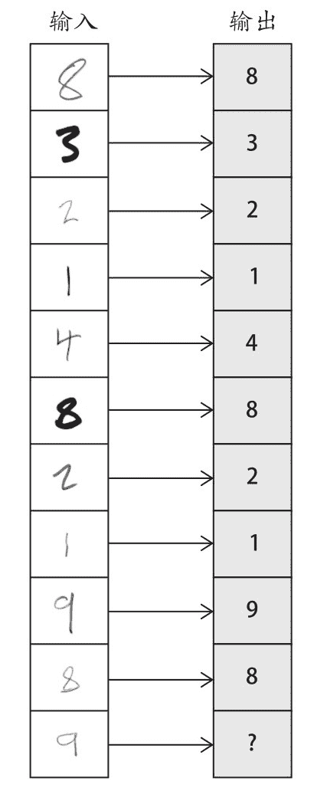

图 13　程序训练数据

识别手写字符（这里以数字为例）的机器学习程序训练数据，训练目标是让程序能够自动识别手写数字。

这种做法的关键前提是数据，越多越好。精心构造的训练集对成败的影响至关重要。

# 训练、特征与神经网络的演进

## 数据筛选与特征诅咒

训练时对数据集合的设计必须谨慎。首先我们只能用输入输出空间里的一小部分来教学。以手写数字为例，不可能把所有可能的写法都展示给模型，那不现实。更进一步，如果能把全部可能展示一遍，就不需要学习了，模型只要记住对应关系即可，这已不属于机器学习。因此训练集只能是采样，但样本太少，模型又学不会人们想要的映射。

特征提取是另一个根本难题。假设银行要建一个评估信用不良风险的模型，训练数据是过往客户的记录，每条记录标注了信贷是否良好。记录里包含姓名、出生日期、住址、年收入、交易流水、贷款与还款信息等，这些统称为特征，并非所有特征对学习目标都有用。事先不知哪些特征相关，就容易把全部塞进去，这会带来维度诅咒：特征越多，需要的训练样本量呈指数增长，学习速度也随之放缓。

最粗暴的对策是只保留少数特征，但这会带来新风险。你可能漏掉真正决定信用的关键信号，也可能因选择不当而植入偏见。举例来说，若只用客户地址作为评估不良风险的唯一特征，模型学完后就会带上地域歧视。这种偏见的产生机制我们后面会详细讨论。

## 强化学习：延迟奖励的难题

另一种学习范式是强化学习，这里不再提供明确的标签数据，代理通过行动试探环境，并根据反馈判断好坏。比如训练游戏程序，赢了给正向奖励，输了给负向奖励，无论正负统称奖励。程序会在下一次决策时参考过往奖励，倾向重复带来正反馈的行为，回避负反馈的行为。

强化学习的核心痛点是奖励往往延迟。输掉一局游戏，是哪一步导致失败？把每一步都判定为错误就是过度归因。如何把结果正确归给具体行为，这就是信用分配问题[\[10\]](#part0008.html#note_10)。生活中也常见：抽烟的负面健康后果往往要几十年后才显现，这种延迟让戒断变得困难。若吸烟后能立刻感受到致命反馈，烟民数量想必会骤减。

## 从大脑到算法的灵感

到目前为止，我们还没有讲程序到底怎么学。机器学习的历史与人工智能一样悠久，方法众多。近年来真正起势的是神经网络——一个在人工智能史上最古老也最年轻的技术之一。1956 年约翰·麦卡锡在达特茅斯夏季研讨会上提出的初衷里就包含神经网络，直到本世纪它才重新成为焦点。

灵感来自生物神经元。神经元是靠轴突与突触连接的细胞，通过电化学信号相互交流，每条输入都有不同权重，有些起促进作用，有些起抑制作用。人脑约有 1000 亿个神经元，每个通常连接数千个同伴。神经网络正是模仿这种分布式、可加权的连接结构来学习。

## 感知器：神经网络 1.0

神经网络的研究可追溯到 1940 年代麦卡洛克和皮茨，他们提出神经元可以用电路建模，尤其是简单的逻辑电路。1950 年代弗兰克·罗森布拉特在此基础上提出感知器模型，这是第一个真正可以运行的神经网络模型，至今仍有参考价值。

图 14 展示了罗森布拉特的感知器结构，中间方块为神经元，左侧箭头为输入，右侧为输出。每个输入携带着一个权重 w[1]、w[2]、w[3] 等。输入要么激活要么不激活，激活时会以权重为强度刺激神经元。神经元还有一个触发阈值 T，只有累积刺激超过 T 时才产生输出。

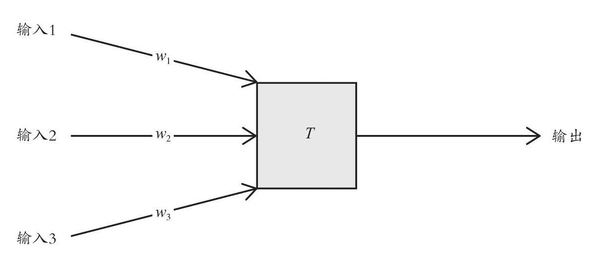

图 14　罗森布拉特感知器模型中一个简单的神经元结构

举个例子，若所有权重为 1，阈值 T 为 2，只要两个输入同时激活，神经元就会触发。若把输入 1 的权重设为 2，其余为 1，阈值仍为 2，则输入 1 单独激活，或输入 2+3 一起激活，都足以触发。

真实网络由大量神经元构成。图 15 显示由三个人工神经元组成的单层感知器。每个神经元独立工作，但都能看到全部输入，只是权重和阈值各不相同。

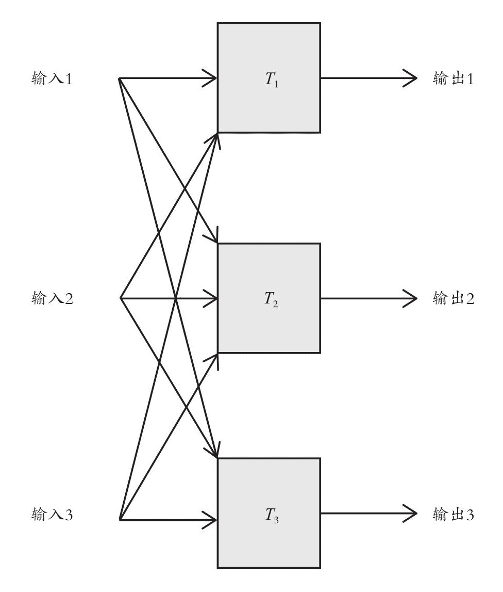

图 15　由三个人工神经元组成的单层感知器

这种结构没有体现大脑的高度互联。更贴近人脑的是分层组织的多层感知器，如图 16 所示的九个神经元、三层结构，每层神经元接收上一层的输出。

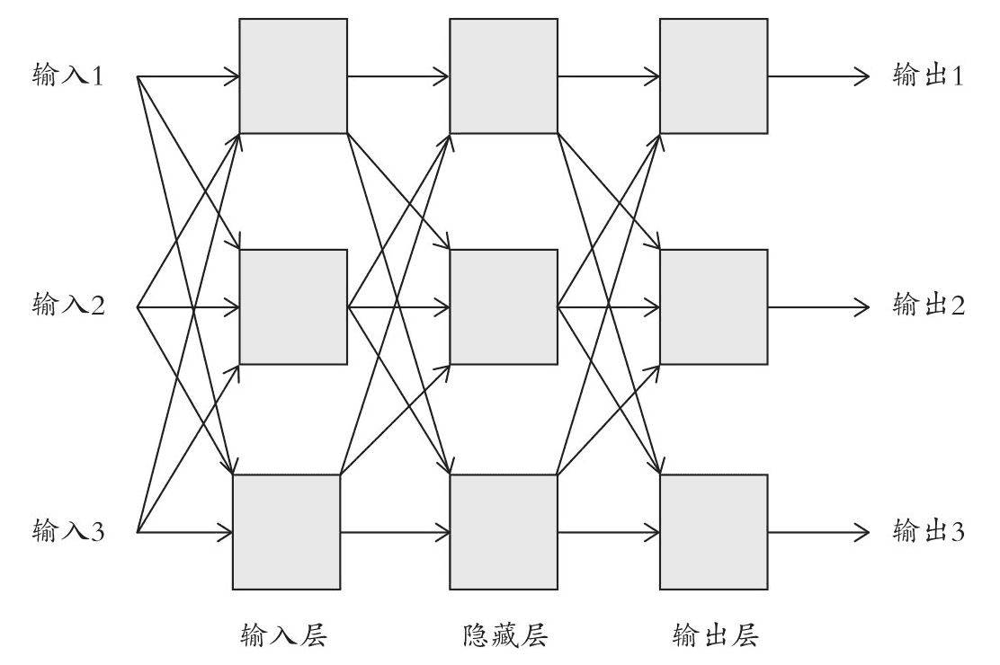

图 16　由 9 个神经元组成的 3 层感知器

即便如此简单，连接数就已达到 27 条，每个连接有独立权重，每个神经元有独立阈值。麦卡洛克和皮茨其实已设想多层结构，但在罗森布拉特时代人们只关注单层，因为没人知道该如何训练多层网络。

权重才是神经网络的全部本质——一串数字。训练就是寻找合适的权重。罗森布拉特提出了一种纠错程序来调整权重。

1969 年明斯基和帕普特合著《感知器》，指出单层感知器能力有限，甚至学不会异或 XOR【11】。多层感知器在数学上是通用的，但当时没有可行的训练方法。过度宣传也伤了士气，1958 年《纽约时报》曾宣称海军研制的机器能走路、说话、看东西、书写、自我复制并意识到自身存在。

到了 60 年代末，神经网络研究急速萎缩，研究者转向麦卡锡、明斯基、西蒙倡导的符号式人工智能。1971 年罗森布拉特因航海事故去世，神经网络被搁置了十多年。

## 连接主义：神经网络 2.0

80 年代研究复苏的标志是《并行分布式处理》上下两册。该书出身于研究并行计算机的 PDP 领域，乍看与神经网络无关，却为复兴提供了理论土壤。

核心是多层网络可以轻易绕开明斯基和帕普特对单层系统的限制。关键突破是反向传播算法，它解决了多层网络权重的训练难题。该算法被多次独立发现，PDP 的版本最终奠定地位【66】。

反向传播的基本思路是把输出层的误差逐层回传，修正权重。先计算输出与期望的差距，误差是权重的函数，通过梯度下降不断调小误差。先调最外层，再逐层向内调整。PDP 还引入了比二进制感知器更平滑通用的神经元激活模型。

这些创新让神经网络从演示走向实用，兴趣再次高涨。但泡沫很快破裂。90 年代中期神经网络再次失宠，原因并非理论缺陷，而是算力不足，训练进展缓慢，而其他机器学习方法发展更快。

## 深度学习：神经网络 3.0

2000 年前后的学术氛围里，有人公开主张不要录用做神经网络的研究者，认为那是夕阳产业。2006 年前后，复兴真正到来，规模和声量都创下人工智能史纪录。

驱动第三次浪潮的是深度学习【67】，它不是单一概念，而是一组相关技术。至少有三个维度：

首先是“深”，即层数增多。靠近输入的层处理低级特征，比如图像边缘，深层则提取更抽象的概念。

其次是规模爆炸。1990 年代典型的网络可能只有上百个神经元，2016 年先进网络已达约 100 万个，相当于一只蜜蜂的大脑【68】。对比人脑的 1000 亿个神经元，可见差距仍大。

最后是连接密度提升。80 年代的高度连接网络里，每个神经元连接约 150 个伙伴，到本书成书时，最先进网络的连接数已接近猫脑水平，而人脑神经元平均拥有约 1 万条连接。

深度神经网络想要变得更强大，靠的就是把层数堆上去、把神经元养肥、把每个神经元的连线铺开。这种体量的网络如果还用老办法训练是扛不住的。2006 年，英国出生后来到加拿大的研究员杰夫·辛顿就点出了这个问题，他也是力推深度学习革新最坚定的人。辛顿本身就是 80 年代 PDP 运动的核心人物之一，反向传播算法的开创者之一。作者觉得他最可贵的地方在于，PDP 在学术界失势后他没有撤退，而是死守住神经网络阵地，最终让它以深度学习的形态迎来第二次高光，获得全球认可。有趣的是，辛顿是现代逻辑奠基人乔治·布尔的曾孙——我们在第三章提到过布尔，不过辛顿自己说，这可能是他与传统逻辑派人工智能唯一的血缘牵连。

层级更深、单元更多、连接更密，这套架构是深度学习成功的硬件前提。辛顿等人提出的训练新招又是软件前提。但要让深度学习真正起飞，还缺两样东西：海量数据和硬核算力。

讲数据，最有代表性的故事是 ImageNet [\ [69\]](#part0018.html#booknote_69)。这个项目源自华人研究员李飞飞的设想。她 1976 年生于北京，80 年代随父母赴美求学，学的是物理与电气工程。2009 年进入斯坦福，2013 到 2018 年间主持斯坦福人工智能实验室。李飞飞认为机器学习需要一套公开、规范、规模宏大的数据集来统一训练、测试和对比，让整个研究社区受益，于是在其推动下 ImageNet 启动。

ImageNet 本质上是一个在线图像库，写作时已积累约 1400 万张照片，都能以 JPEG 之类常见格式下载。关键在于标注——图片被细分成约 22 000 个类别，依托的是语义词典 WordNet [\ [70\]](#part0018.html#booknote_70)。WordNet 把词语按意义层级整理，能区分同义、反义等关系。看现在的 ImageNet，你会看到 1032 张被标注为“火山口”的图、122 张被标注为“飞盘”的图，等等。要注意的是，同一类别下的图像并不是人工挑选长得很像才归在一起，而是有且仅有一个共同属性。拿飞盘来说，所有样本都包含飞盘这个要素，有的是一人向另一人掷盘，有的是盘子静静躺在桌上，完全看不到人。每张图都独一无二，唯一的交集就是“里面有飞盘”。

2012 年是图像分类的转折年。辛顿与学生亚历克斯·克里泽夫斯基、伊利亚·苏茨科弗展示了 AlexNet，这个神经网络在当年的国际图像识别竞赛里打出漂亮成绩 [\ [71\]](#part0018.html#booknote_71)。

# 算力瓶颈：深度学习为何离不开了 GPU

让深度学习真正跑起来的最后一块拼图是计算资源。训练一个深度神经网络所需的时间惊人，单次运算并不复杂，但总量大到难以想象。21 世纪初兴起的图形处理器正好对上需求。GPU 最初为电脑图形设计，比如给游戏做高质量动画，却意外成为训练神经网络的理想工具。如今称得上深度学习实验室的地方，机房里都摆着 GPU 群——即便这样，操盘的人仍会抱怨算力永远不够。

## 深度学习的两大硬伤

不可否认，深度学习与神经网络取得了显著成效，但已知短板也很突出。

### 黑箱困局

其一是知识不透明。神经网络学到的东西藏在神经元之间的权重里，到目前为止我们还没有好的办法把它解开读懂。一个程序能指出 X 光片里肿瘤所在，却说不清诊断为什么可靠。拒绝贷款的系统也无法解释拒绝理由。第三章提到的 MYCIN 这类专家系统还能给出粗略推理追溯，神经网络做不到。虽然大量研究在尝试打开黑箱，但如何把神经网络内在的知识解释出来，至今仍无定论。

### 抗干扰脆弱

其二是稳定性。网络对微小扰动极度敏感，人眼完全察觉不到的变化就会导致误判，如图 17 所示 [\ [72\]](#part0018.html#booknote_72)。图 a 是正常熊猫图，图 b 只是做了肉眼不可辨的调整。你会觉得两张图几乎一样，都是熊猫。网络却能把 a 正确归为熊猫，把 b 错标为长臂猿。针对这类攻击的研究叫对抗性机器学习——名字来自“有人故意改动参数来欺骗模型”这一思路。

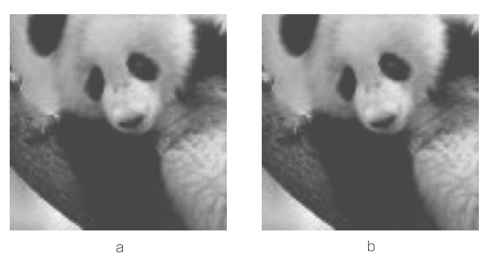

图 17　熊猫还是长臂猿？

神经网络可以正确地将图像 a 分类为熊猫。然而，以人类无法察觉的方式调整过图像以后，同一个神经网络会错误地将图像 b 分类为长臂猿。

把动物分错看似无伤大雅，但对抗性机器学习已暴露出令人不安的场景。同样的微改动能让路标识别出错，人类看不出差别，自动驾驶里的神经网络却可能误读标牌。因此在关键应用里部署深度学习算法，必须正视这种脆弱性。

## 深度思维：从雅达利到围棋的跨越

本章开头提到的深度思维，恰好浓缩了深度学习的崛起轨迹。这家公司 2010 年由 AI 研究者兼游戏迷德米斯·哈萨比斯、企业家穆斯塔法·苏莱曼创立，哈萨比斯在伦敦大学学院的同事、计算神经科学家谢恩·莱格也加入其中。

2014 年谷歌收购深度思维时，作者在媒体上看到消息，第一反应是惊讶——原来深度思维是家 AI 公司。AI 成为热点不足为奇，令人困惑的是英国竟有这样一家价值 4 亿英镑却鲜为人知的 AI 公司。立即点开官网，却看不到技术、产品和服务的具体说明，只有一句公开宣称的使命：解决智能问题。过去 60 年里 AI 起伏不定，对任何宏大预测保持警惕。但一家刚被巨头收购的小公司如此高调，仍让人吃惊。

官网信息有限，当时也找不到内部人士。圈内同行多持怀疑态度，甚至带点职业嫉妒。直到 2014 年底，碰到同事南多·德·雷弗斯塔，才打听到更多。南多是深度学习领域的世界级先驱，当时是牛津大学教授，后来加入深度思维。那天他腋下夹着一叠论文，兴冲冲地说：“伦敦有人训练出一个程序，从零开始玩雅达利游戏。”

作者第一反应是——能玩电子游戏的程序有什么新鲜？本科毕业设计都能做。南多耐心解释，我们已经进入 AI 新纪元。

他说的雅达利系统基于 1980 年前后的 Atari 2600，是最早走红的视频游戏平台之一：支持 210×160 像素的视频，128 色。玩家用带独立按钮的操作杆操控，游戏机使用卡带，深度思维测试了 49 个卡带游戏。团队的描述如下 [\ [73\]](#part0018.html#booknote_73)：

目标是做一个单一的神经网络游戏智能体，能学会尽可能多的游戏。网络不接受任何特定游戏的先验信息或额外视觉线索，也不知道主机内部状态，只能从屏幕反馈——也就是分数——学习，并像人类玩家一样摸索操作方式。

搞清这个成就的关键在于程序对自己在玩什么一无所知。若按第三章的知识型 AI 来做雅达利程序，人们会先提取主机专家的规则知识并编码。但深度思维的程序没有任何游戏知识，唯一输入就是屏幕图像——210×160 的彩色像素网格——以及当前分数。仅此而已。尤其要强调，程序不会得到“物体 A 在 (x,y)”这类信息，任何中层描述都必须它自己从原始视频里挖出来。

结果令人震惊 [\ [74\]](#part0018.html#booknote_74)。程序用强化学习自学：反复玩同一游戏，在每局里试验并获得反馈，学习哪些行为有奖励、哪些没有。雅达利程序学会了卡带里的 29 个游戏，表现超过普通人类平均水平，部分游戏达到超人水平。

最受关注的是《打砖块》。这款 70 年代的经典游戏由玩家操控挡板，用球击碎由彩砖组成的墙，每摧毁一块砖即得分。图 18 展示了程序学习初期的状态，大约玩了 100 局后仍常漏球。

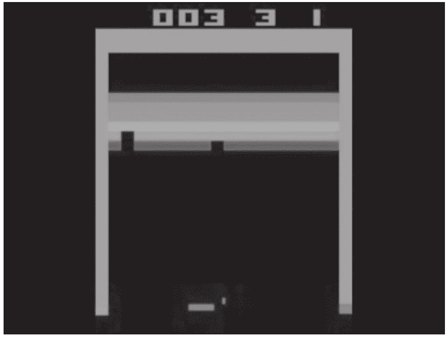

图 18　程序学习玩打砖块游戏的早期阶段

深度思维的雅达利游戏程序在学习打砖块的初期漏接了球，球在这里用一个竖直的小矩形表示，水平的平板状矩形表示玩家的接球板。

再训练几百局后，程序已成专家，再也不漏球。随后出现反常行为：程序发现最高效的得分法是在砖墙一侧“凿”出一个洞，让球在砖墙与顶部屏障间来回弹跳，迅速清场，自己几乎不用操作。见图 19。工程师事先并未设想这种玩法，是程序自主悟出的。网上很容易找到这段演示，作者在讲座里播放过十多次，每次观众都会惊讶地倒吸气。

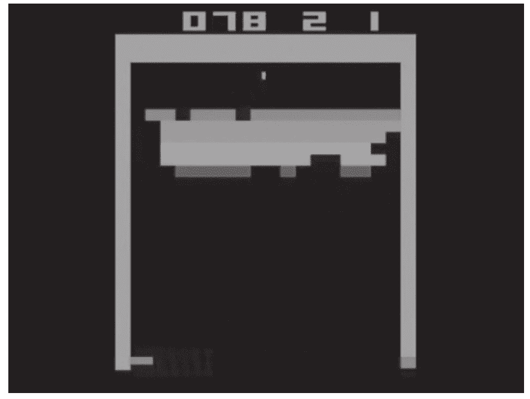

图 19　程序经过训练后玩打砖块游戏

最终，程序学会了怎么迅速取得高分，即让球在砖墙一侧“钻”一个洞，这样球就会在砖墙上快速反弹。没有人教程序这么做，这种行为让程序开发者都大吃一惊。

要重申：深度思维的程序员不是写了个玩雅达利游戏的程序——那并不难。他们写的是一个让程序学会在 49 个游戏里有 29 个能打败人类的学习器。唯一输入就是屏幕画面和分数。

该程序采用强化学习，基于神经网络，共有三层隐藏层。输入先做预处理：把原始 210×160 彩色图像压缩为 84×84 灰度图。样本不是单帧，而是把四帧拼接而成。训练使用经典的随机梯度下降。

程序并非完美，在某些游戏里表现很差，研究失败原因很有意思。比如《蒙特祖玛的复仇》，奖励极度稀疏：玩家必须完成一系列复杂任务后才有反馈，与《打砖块》那种即时反馈不同。通俗说，奖励出现时间与行动严重脱节，强化学习很难归因——这正是信用分配问题，难以判断哪一步操作促成了最终奖励。

即便只做雅达利项目，深度思维已足以在 AI 历史上占有一席之地，但团队随后连出惊人成果。

最著名的是 AlphaGo。写作时它仍可能是最知名的 AI 系统，任务是下中国古老的围棋。

围棋对 AI 极具吸引力。规则极简，远比国际象棋简单，但在 2015 年，围棋程序远弱于人类职业棋手。为何如此困难？因为计算量巨大。围棋棋盘 19×19 共 361 个落子点，国际象棋 8×8 只有 64 点。如第二章所述，围棋分支因子约 250，国际象棋约 35。棋盘规模和分支因子让围棋的数据量远超国际象棋。此外一盘棋常走 150 步左右，时长很长。

对人类，围棋被公认最难，因计算规模逼近甚至超出人类极限，难以制定明确战术。对机器也是难题，规模和分支因子让暴力搜索失效，需要另辟蹊径。

AlphaGo 用两套神经网络：价值网络评估给定局面好坏，策略网络评估当前局面的落子位置 [\ [75\]](#part0018.html#booknote_75)。策略网络含 13 层，先用人类职业对局监督学习预训练，再用自我对弈强化学习。最后两网嵌入复杂的蒙特卡洛树搜索中。

系统公开前，深度思维邀请欧洲围棋冠军樊麾对弈，AlphaGo 以 5:0 获胜。这是围棋程序首次在整场比赛中击败人类职业棋手。不久宣布 AlphaGo 将于 2016 年 3 月在韩国首尔与世界冠军李世石进行五番棋。

AI 界为之振奋，研究者包括作者本人都期待结果（当时猜测 AlphaGo 或能赢一两局，但李世石将赢下整盘）。谁也没料到宣传热度会如此空前，比赛成为全球头条，甚至被拍成电影 [\ [76\]](#part0018.html#booknote_76)。

最终 AlphaGo 以 4:1 击败李世石，李世石仅在第四局扳回一城。大家都说李世石第一盘就输了，他本人也意外，本以为会轻松取胜。不少人开玩笑说 AlphaGo 第四局故意放水。

比赛多处节点，人类解说指出 AlphaGo 的走法古怪，“不是人类会下的棋”。很明显，分析它时我们带着人性化视角，本能地寻找人类动机和策略——把 AlphaGo 人格化了。这样理解它毫无意义：它只是一个为赢棋而存在的程序。我们想归因动机、推理和策略，却做不到，AlphaGo 的卓越来自神经网络的权重，那只是一串很长的数字，无法提取或合理化其专业知识。它也无法解释为何如此落子，而这正是深度学习需解决的核心问题之一。

AlphaGo 被捧为深度学习与大数据 AI 的胜利，从事实看当之无愧。但剥开表象，最具智慧的工程仍源自经典 AI 搜索。第二章提到的 50 年代跳棋学习程序作者亚瑟·塞缪尔，也能理解 AlphaGo 的搜索技术：从他的跳棋程序到今天最耀眼的 AI 系统，发展脉络一脉相承。

两个里程碑对大众已足够。但仅 18 个月后，深度思维再次登顶。这次是 AlphaGo Zero。它从零学习围棋，不使用任何人类棋谱，在无人工数据干预下通过自我对弈达到超人类水平 [\ [77\]](#part0018.html#booknote_77)。公平说它必须对弈无数组合，但成就依旧惊人。其后续版本 AlphaZero 推广到国际象棋等。仅自我学习 9 小时后，AlphaZero 就能击败世界顶尖象棋程序 Stockfish [\ [12\]](#part0008.html#note_12)，至少能平局。象棋编程界的退役专家都表示极度震惊。9 小时的自我对弈学会世界级象棋？难以置信。更令人兴奋的是方法的通用性：AlphaGo 虽精于围棋，却只能下围棋且需先学习大量人类对局；AlphaZero 似乎能自学成才，并适用于多种棋类。

当然要谨慎解读，避免过度引申。尽管 AlphaZero 显示出令人印象深刻的通用性，超越此前任何系统在棋类专业上的泛化能力，但它并不代表迈向通用人工智能的重大突破。它远不具备人类普遍拥有的智能，下棋是专才，却不能交流、讲笑话、煎鸡蛋、骑自行车或系鞋带。它的能力相当受限。棋类本身很抽象，与现实世界相去甚远，正如罗德尼·布鲁克斯很快会提醒我们的那样。

尽管质疑与麻烦从未停歇，我依旧认为一个基本事实成立：从早期的雅达利游戏实验到 AlphaZero，DeepMind 创造的成果构成了一条串联起多项非凡进展的链条，并让成千上万人看到梦想成真的可能。

## 通用智能仍在路上

深度模型的能力令人惊讶，它造出了几年前难以想象的智能程序。这些程序在特定任务上取得亮眼成绩，却并非通往宏大愿景的万能钥匙。要看清边界，可从两个已被深度模型深度渗透的应用切入：图像描述与机器翻译。

先说图像描述。我们希望让电脑看图并用自然语言讲清发生了什么。具备类似能力的产品已普及：我的 Mac 在更新照片管理后，会自动把图库归到“海滩”“派对”等类别。写作期间，仍有不少由国际研究机构维护的网站接受照片上传进行自动标注。想探明局限，我把一张家庭合照传到其中一个平台进行测试，本次选用微软的标注机器人[78]，呈现如下。

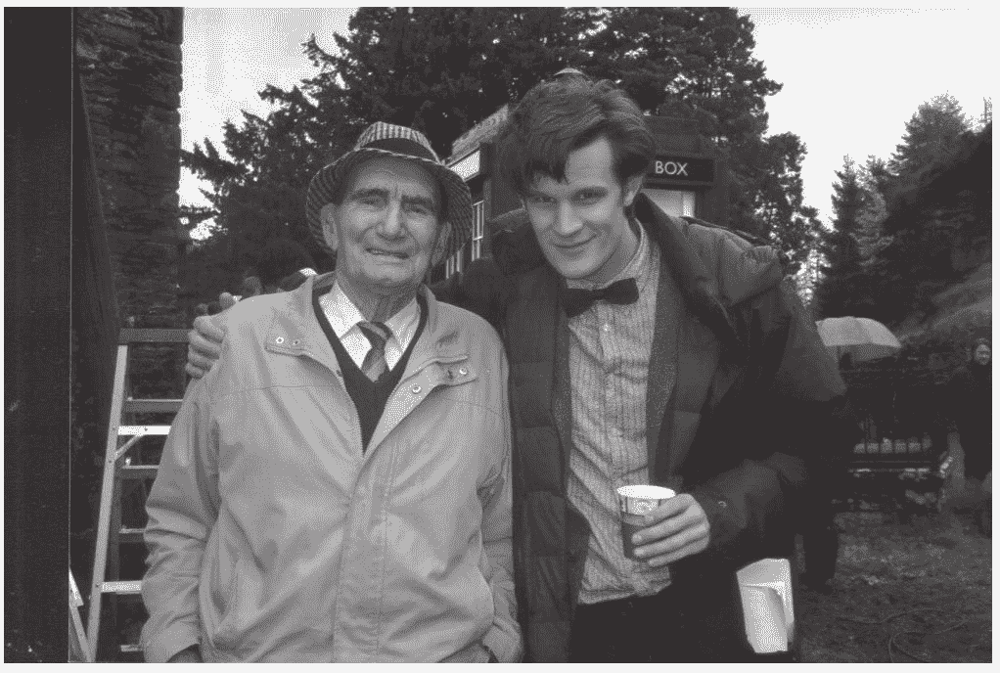
图20 照片里到底在发生什么

在看机器回复前，请先自行观察。如果你熟悉英伦影视或科幻题材，照片右侧那位应该不陌生，他是 Matt Smith，2010 至 2013 年间在 BBC 剧集中饰演神秘博士，左侧那位是我已故的岳父，无需深究。

机器人给出的说法是：

我想这是马特·史密斯以站姿拍照，他们看上去似乎很:-) :-)

系统确实捕捉到人脸、姿态、笑容等关键要素，也在一定程度上体会到场景氛围。准确的部分很容易让人误以为它真的在理解。要看清差距，就要追溯它如何认出 Matt Smith。像这类模型都是靠海量带标注样本训练的。每张训练图都配有一段文字，反复看到 Matt Smith 的照片与名字后，模型学会把视觉模式对应到文本。数十年的研究积累才有了今天的表现。

但这不等同于真正认识。假若你亲眼看这张图，可能会这样描述：

这不是演神秘博士的 Matt Smith 吗？他搂着一位不认识的长者，两人都在笑。Matt 还是博士的造型，疑似片场。口袋里卷着纸，大概率是剧本，手里拿着纸杯，可能在休息。背景那台蓝色的箱子，不正是塔迪斯吗？博士的时空座驾。他们是在户外拍摄，所以很可能就是拍摄现场，附近应该有摄制组、灯光、摄像机之类。

标注机器人做不到这种推理。它能输出“Matt Smith”，却不懂这个名字背后承载的意义，也无法据此解释画面在发生什么。缺乏真正的理解，这是核心症结。

当你看到穿着神秘博士服装的 Matt Smith，大脑会联想到很多东西，不止是人物识别。如果你是剧迷，甚至会回忆起他主演的某几集，比如《等待的女孩》。你还会想起和家人一起追剧、被怪物吓到的瞬间，或是联想到摄影棚、剧组等等。

这种理解建立在人类在世界中长期的生活经验之上。标注机器人没有这层基础，也从未被设计成拥有它。正如罗德尼·布鲁克斯所指出的，智能是具身的。我想强调的不是 AI 不可能理解，而是理解绝不等于把一张含 Matt Smith 的照片映射成文字“Matt Smith”。映射可能是理解的组成部分，却不是全部。

再看机器翻译。过去十年里，得益于深度模型，自动翻译的水平提升很快。谷歌翻译是最具代表性的产品[79]，2006 年推出，后续版本大量使用深度模型和神经网络，也是基于海量平行语料训练的。

我们让 2019 年版的谷歌翻译处理法国作家马塞尔·普鲁斯特 Marcel Proust 在 20 世纪初的小说《追忆似水年华》开篇。法文原文如下：

Longtemps, je me suis couché de bonne heure. Parfois,　peine ma bougie éteinte, mes yeux se fermaient si vite que je n'avais pas le temps de me dire: ‘Je m'endors.’ Et, une demi-heure après, la pensée qu'il était temps de chercher le sommeil m'éveillait; je voulais poser le volume que je croyais avoir encore dans les mains et souffler ma lumière; je n'avais pas cessé en dormant de faire des réflexions sur ce que je venais de lire, mais ces réflexions avaient pris un tour un peu particulier; il me semblait que j'étais moi- même ce dont parlait l'ouvrage: une église, un quatuor, la rivalité de François Ier et de Charles Quint.

坦白说，即便学了十来年法语，我也很难独立读懂这些句子。

专业译者提供的英译[80]大致意思是：很久以来养成了早睡的习惯，有时蜡烛刚灭眼睛就闭上，甚至来不及说“我要睡着了”。半小时后，想到该睡觉的念头反而把自己弄醒；想把手里似乎还握着的书放下，吹灭灯光；睡着后仍在回想刚读的内容，但思绪变了调，自己好像成了书里提到的内容：一座教堂、一组四重奏、弗朗索瓦一世与查理五世的竞争。[13]

表述流畅，但依然晦涩。当作者写自己“似乎真正变成了书的主题：一个教堂、一出四重奏、弗朗索瓦一世和查理五世的竞争”时，具体想表达什么？怎么能“成为”一座教堂？四重奏指什么？两位君主的竞争又是什么？对使用电灯的人来说，“吹灭灯火”又有什么历史感？

谷歌的译文是：

很久以来，我早睡。有时，当我的蜡烛……我的眼睛闭得那么快，以至于我没有时间说：“我睡着了。”半小时后，想到该睡觉的念头会把我唤醒；我想询问我以为仍在手中的书卷并吹灭我的灯光；在睡觉时我没有停止对读到的内容的反思，但这些反思变得相当奇特；我觉得我自己就是书中所说的内容：一个教堂、一支四重奏、弗朗西斯一世与查理五世之间的竞争。[14]

这项工作很复杂，和人工翻译类似。但即便没有文学训练也能看出问题。英语里“blow my light”直译成“吹出我的光芒”毫无意义，后续句子也跟着失焦。整体读起来滑稽，出现了母语者绝不会使用的表达。大致意思还能辨认，但行文生硬、不自然。

当然，普鲁斯特的小说对专业译者也是难题。关键在于，会法语不等于能译好普鲁斯特。要译准，需要大量的背景知识：20 世纪初法国的社会生活，比如当时仍用蜡烛照明；法国历史，比如弗朗索瓦一世与查理五世的争端史；法国文学常识，比如当时的写作风格和典故；以及对普鲁斯特本人的理解。谷歌神经网络里并不具备这些知识。

理解普鲁斯特需要各种相关知识，这并非新发现。第三章提到的 Cyc 项目就碰到过类似假设。Cyc 的目标是构建一个包罗万象的知识库，认为这是通用人工智能的基础。知识派研究者会说几十年前就预见到这个问题，神经网络阵营则反驳说知识派并未拿出解决难题的技术。那现在的问题是，仅靠改进深度模型就能解决吗？我不认为。深度模型只是解决方案的一部分。我觉得仅靠更大网络、更强算力或更多普鲁斯特式小说的训练数据是不够的。需要一种与深度模型同样关键的突破，至少要打通显式知识表述和深度模型、神经网络世界之间的隔阂。

## 学术圈的裂痕

2010 年我受邀担任欧洲人工智能大会 ECAI 的主席，大会在葡萄牙里斯本举办。组织这类会议是 AI 研究者生活的重要部分，研究成果以论文形式投稿，由项目委员会审稿。权威会议的录取率大约只有五分之一，被录用意义重大。大规模会议常收到 5000 份以上投稿，能被邀请担任主席，既是学术信任的体现，也是履历上的亮点。

作为主席，我需要组建项目委员会，很希望能有机器学习领域的代表。结果让我意外：我邀请的每一位机器学习专家都礼貌拒绝了。被婉拒很常见，但一连找不到人就很奇怪。我向老同事请教，他们也遇到同样情况。机器学习圈似乎对所谓的主流 AI 会议兴趣不大。我知道该领域最重要的两个会议是 NeurIPS 和 ICML。AI 各分支都有自己的顶会，专家偏爱自己圈子可以理解。但我才意识到，机器学习里很多人根本不把自己归为人工智能的一部分。

回头看，这条裂痕很早就有了，也许要追溯到 1969 年明斯基和帕普特出版《感知器》。那本书在很大程度上抑制了 60 年代末到 80 年代中期的神经网络研究，直到 80 年代中期的 PDP 模型出现才复苏。半个世纪后再看，人们仍为那段历史扼腕。无论源头如何，机器学习研究确实在很大程度上脱离了主流 AI，自成体系。当然也有大量研究者自认能自由穿梭两边。但到现在，给不少机器学习专家的研究贴上“人工智能”标签，他们会惊讶甚至恼火，因为他们眼里的 AI 只是书中记载的一连串失败尝试而已。

# 第三部分 未来走向

## 第六章 AI 现状全景

深度模型为人工智能打开了大门。在 21 世纪第二个十年，自从 90 年代万维网兴起以来，还没有哪项技术像 AI 这样抓住公众注意力。只要手里有数据、遇到需要解决的问题，人们都会忍不住问深度模型能不能帮忙，很多时候答案是肯定的。人工智能已渗入生活的每个角落，你随时都能感受到它的存在。教育、科研、工业、商业、农业、医疗、娱乐、媒体、艺术，技术相关领域几乎都有它的身影。未来，有些领域会留下非常明显的人工智能痕迹，有些则不会。人工智能会像今天的计算机一样，悄无声息地嵌入世界。正如电脑和互联网，人工智能也将重塑我们的世界。我无法像列举所有软件那样列出 AI 的全部应用，但我会和你分享这些年里一些我最喜欢的案例。

# 当AI开始看病和开车

你或许还印象深刻，2019年4月人类首张黑洞照片公布[\[82\]](#part0018.html#booknote_82)。那次试验汇聚了全球八台射电望远镜的数据，最终拼出一个直径约400亿英里、距地球5500万光年的黑洞影像。这张图被视作本世纪最吸睛的科学成果之一，但鲜为人知的是，成像背后全靠人工智能：先进的计算机视觉算法在重建图像时，对缺失的部分进行了“预测”。

同年，AI制造虚假影像的能力也让人震惊。2018年，英伟达的计算机视觉研究团队展示了一款能生成以假乱真的虚假人物照片的软件[\[83\]](#part0018.html#booknote_83)。这些图像出自生成式对抗网络，乍看逼真到难以置信，肉眼会觉得是真实拍摄，却实则是神经网络造出。早在21世纪之初这种技术难以想象，如今它正成为虚拟现实的关键基石——AI在搭建我们难以分辨真假的虚拟世界。

同在2018年底，DeepMind的研究者在墨西哥的会议上公开了AlphaFold[\[2\]](#part0012.html#note_2) [\[84\]](#part0018.html#booknote_84)。该程序能从基因序列推断蛋白质的三维构象，攻克了“蛋白质折叠”难题。折叠问题关乎蛋白质分子的形状，直接影响阿尔茨海默病等疾病的疗法研发，难度极高。AlphaFold借助经典机器学习掌握结构预测规律，为蛋白质功能研究迈出关键一步。

下面聚焦AI最具代表性的两大应用场景：一是医疗健康，二是人们期盼已久的无人驾驶。

# AI在医疗与出行中的落地

## 健康医疗

人们应该停止培养放射科医生了。很明显，在五年之内，深度学习的系统会比放射科医生做得更好。

——杰夫·辛顿(2016)

Cardiogram 可以担任您的个人健康助理。我们会把可穿戴设备变成一个持续的健康监测仪，不仅可以用来追踪睡眠和健康状况，而且或许在未来的某一天，可以预防中风、挽救您的生命。

——Cardiogram 公司网页[\[85\]](#part0018.html#booknote_85)

对大部分人而言，医疗健康都是最重要的经济议题之一。过去两百年医疗改善带来的福祉巨大。1800年欧洲人预期寿命不足50岁[\[86\]](#part0018.html#booknote_86)，今天发达国家普遍能活到70岁左右，产妇死亡也已极少见。这些变化源于卫生观念提升，更离不开药物与疗法的突破，尤其是1940年代抗生素让细菌感染有了可靠治疗。

进步尚未全球覆盖，我写作时中非共和国国民预期寿命仍仅51岁，多个地区分娩仍是生命风险。但整体趋势向好，也带来了新挑战。寿命延长意味着老年人医疗需求更高，成本随之攀升；可治疗疾病范围扩大也推高支出。根本原因是提供医疗需要昂贵资源和稀缺人才——在英国成为合格的全科医生至少需10年培训。

正因如此，医疗资金长期是政治争论焦点。英国国家医疗服务NHS诞生于1940年代，以税收供养、面向全民免费，关于其资助规模的争论从未停息。大家都喜欢NHS，却永远在吵该给多少。若真有一项技术能缓解这些难题，无疑令人向往。

### 从专家系统到可穿戴健康管理

AI进入医学并非新事。早年的MYCIN专家系统在诊断血液病病因上曾被认为超越人类医生。1980年代初医疗资金已成难题，打造能捕捉专业能力的专家系统想法很诱人。MYCIN之后大量同类系统涌现，但少有能走出实验室。如今兴趣回潮，新进展显示AI在医疗前景广阔。

个人健康管理是重要新方向。Apple Watch、Fitbit等可穿戴设备让持续自检成为可能。它们不断采集心率、体温等生理数据，庞大用户群体产生的数据流可由本地手机或云端AI分析。

这项技术的意义在于，首次实现对健康的持续监测。基础层面，AI健康系统能给出合理建议。智能手环手表正做着类似事：记录运动并设定目标，“每日一万步”就是成功范例。通过游戏化提升依从性，结合社交媒体交互效果更好。

大众可穿戴仍处早期，但潜力明显。2018年9月苹果发布第四代Apple Watch，首次加入心电监测。手表ECG功能可分析心率数据识别心脏病征兆，必要时呼叫救护车。它能捕捉心房颤动这种难以察觉的不规则心跳，预警中风风险。手机加速计还能识别跌倒并代为求救。实现这些只需相对简单的AI，强劲智能手机联网，连接搭载生理传感器的穿戴设备即可。

部分应用甚至不需要传感器。牛津大学同事认为，仅从智能手机使用习惯就能捕捉阿尔茨海默病的早期信号。手机使用方式或行为模式的改变，可能在明显症状出现、医生正式诊断前就已发生。阿尔茨海默病对老龄社会冲击巨大，辅助早期诊断的工具极具价值。该研究尚起步，但打开了未来可能。

### 数据隐私与伦理争议

新技术带来机遇，也伴随隐患，最突出的是隐私。可穿戴设备与人体密切接触，持续监视所获数据虽可助益健康，却也埋下滥用风险。

保险业尤需关注。2016年健康保险公司Vitality随保单赠送Apple Watch，以运动状况调整保费承诺。懒惰某月躺在沙发，保费可能全额；下月节食狂练即可抵扣。计划本身并非大问题，却暗含不安。2018年9月，美国约翰汉考克人寿宣布今后只向愿意佩戴运动追踪可穿戴设备的个人承保[\[87\]](#part0018.html#booknote_87)，引发公众批评。

再推进一步，若想获得国家医保或其他福利就必须接受监督并完成锻炼目标如何？你要医保，先走满一万步！有人觉得合理，也有人视其为对基本人权侵犯和数据滥用。

### 影像诊断自动化

自动化诊断是另一令人兴奋方向。近十年X光、超声等影像数据普遍采用机器学习分析。撰写时已出现研究称AI系统能有效识别医学影像异常。经典做法是用正常与异常样本训练程序，使其学会辨识异常。

典型案例是2018年DeepMind与伦敦摩菲眼科医院合作，研发从眼部扫描自动识别疾病和异常的技术[\[88\]](#part0018.html#booknote_88)。眼部扫描是该院核心检查，日均约1000例，分析结果占用大量人力。

系统由两个神经网络构成，一个负责“分割”扫描图像识别各部分，另一个负责诊断。前者用约900张图像训练，学习专家如何区分；后者用约15000例训练。实验显示性能已达甚至超过专家水平。

类似例子不胜枚举：X光片上揪出恶性肿瘤、超声扫描诊断心脏病等。杰夫·辛顿正是AlexNet创始者之一，他坚信机器学习将解决医学影像诊断，因此才有开篇那句激烈的预言。难怪放射科医生感到被冒犯，很快有人指出，成为好放射科医生远不止看片[\[89\]](#part0018.html#booknote_89)。

谨慎推进很有必要。医疗是极度依赖人际互动的人文学科。全科医生需“解读”病人、了解社会背景、判断何种疗法更合适。现有AI在分析医疗数据上已能媲美专家，但这仅是医生工作一小部分。

另一个质疑是部分人更信任人的判断而非机器。首先，神化专家判断太天真。任何人都会疲劳、情绪化、带偏见，人类做出理性决策并不擅长。AI的价值不是取代医护，而是增强能力，解放繁琐工作，聚焦真正困难处，同时提供不同视角。

其次，选择人类医生还是AI程序是富裕国家的抱怨。对世界许多地区而言，要么用AI，要么无人诊疗。在医生极度短缺地区，AI能做很多事，给医疗资源匮乏人群带来希望。这或许是AI带来的最大社会影响。

## 智能驾驶汽车

制造比空气还重的飞行机器是不可能成功的。

——开尔文勋爵，皇家学会会长，1895年

写作时全球每年因交通事故死亡超100万人，中国印度占四分之一；另有5000万人受伤。若一种流感病毒每年夺走百万生命，必将引发全球恐慌，但道路危险已被视作现代社会的常态。AI带来的无人驾驶有望大幅降低伤亡，中期内已成为可能，最终拯救无数生命。

无人驾驶还有其他好处。程序控制更高效，能更好利用稀缺燃料，降低油耗与排放。电子地图与导航能力更强，可提升拥堵道路通行效率。若汽车足够安全，就不必装配昂贵沉重的防护底盘，价格与能耗都会下降。甚至有人认为廉价便捷的无人出租车出现后，私家车拥有在经济上将失去意义。

因这些原因，无人驾驶研发历史悠久。汽车在20至30年代进入大众市场，由此引发的人为操作失误伤亡立刻催生自动驾驶设想。虽自1940年代起不断尝试，但直到1970年代微处理器出现才具备可行性。核心难题是感知——若能让汽车随时准确知道自身位置与周围环境，无人驾驶问题就解决了。解决感知离不开现代机器学习，没有它们无人车无法实现。

### 技术里程碑

由欧洲EUREKA出资的普罗米修斯工程是无人驾驶先驱，1987至1995年，1995年进行示范。一辆汽车在无人状态下从德国慕尼黑开往丹麦欧登塞再返回。平均每5.5英里需人工干预一次，最长无干预续航约100英里。考虑到当时算力，这已是惊人成就。该项目虽只为验证概念，却引领了智能巡航等现代商用创新，证明技术可商业化。

2004年美国DARPA举办无人驾驶挑战赛，邀请参赛队让车辆穿越150英里美国乡村。106支大学与车企队伍角逐百万美金奖金，15支进入决赛，却无一完成超8英里，最远的卡内基梅隆车行驶7.5英里后卡在堤坝。

当时多数AI研究者视2004年赛为无人车遥不可及的证据，让人意外的是DARPA立即将2005年奖金翻倍至200万美元。

2005年参赛队伍增至195支，23支晋级。2005年10月8日决赛在内华达沙漠进行，目标132英里。5支队伍完成挑战，冠军为斯坦福团队。由塞巴斯蒂安·特隆领队的STANLEY基于大众途锐改装，耗时不足7小时，平均时速20英里。车上装有7台电脑，解读GPS、激光测距、雷达与视频数据。

2005年挑战被视作人类科技史上伟大成就之一。自那天起，无人驾驶成为已解决的问题，如同上世纪初比空气重的飞行。莱特兄弟首飞仅12秒、离地120英尺，却证明飞行可行；2005年比赛后，无人驾驶亦然。

随后挑战不断，2007年城市挑战最关键。2005年在乡村道路，2007年在城市环境，要求遵守加州交通法规，应对停车、路口、拥堵。36支队伍全国预选，11支晋级。2007年11月3日南加州废弃机场决赛，6支队伍成功完成，冠军仍是卡内基梅隆，4小时完成，平均14英里每小时。

此后老牌车企与新创公司纷纷投入，避免被时代抛下，意图抢夺传统制造商市场。

### 自动驾驶分级

2014年美国汽车工程师协会给出实用分级标准[\[90\]](#part0018.html#booknote_90)：

Level 0：人工驾驶。汽车无自动控制，驾驶员始终掌控车辆，尽管车辆会提供警告等辅助。如今公路上绝大多数汽车属L0级。

Level 1：辅助驾驶。汽车提供一定程度控制，通常为常规驾驶辅助，但驾驶员必须始终保持专注。自适应巡航控制可利用刹车与油门调节车速即属此类。

Level 2：部分自动化。该等级下汽车可参与转向与速度的自主控制，但驾驶员仍需持续监控环境，并在必要时准备干预。

自动驾驶的等级划分是理解这场争论的入口。

第三级属于有条件自动驾驶，车子能在多数工况下自己开，但驾驶员不必一直在盯路，只是遇到系统搞不定的场景时会被叫回来接管。

第四级是高度自动化，日常驾驶动作基本由汽车完成，不过车上仍保留让驾驶员介入的通道。

第五级则是完全自动驾驶，只需报出目的地，方向盘甚至都不需要，剩下的全靠车辆自己搞定。

写书时市面上最知名的量产自动驾驶系统大概是特斯拉的 Autopilot，最早搭载在 Model S 上。2012 年发布的 Model S 是当时技术规格极高的旗舰电动车。2014 年 9 月起，S 型标配摄像头、雷达和超声波传感器。2015 年 10 月特斯拉推送软件，让这套硬件组合实现有限的“自动驾驶”能力。

媒体随即把这波功能吹成首款无人驾驶的实现，哪怕特斯拉反复强调局限。官方一直强调开启 Autopilot 时手要放在方向盘上。按分级标准来看，这套系统更接近 L2。

技术再好也防不住事故，特斯拉 Autopilot 首例致死事件很快上了全球头条。2015 年 5 月，佛罗里达州一名车主驾驶特斯拉与一辆 18 轮卡车相撞身亡。有分析称，强光下白色的卡车与明亮天空在传感器里混成一体，AI 没识别到前方另有车辆，直接撞了上去。

类似案例凸显了一个核心困惑。L0 人工驾驶时，责任边界很清晰：人要全权掌控。L5 全自动驾驶时也清晰：人什么都不用管。中间地带却模糊不清。佛罗里达事故说明很多人把技术当成 L4 甚至 L5 来用，实际上远未达到。期望与现实的错位，媒体的过度渲染要负很大责任，特斯拉把系统命名为“自动驾驶仪”也加剧了误解。

2018 年 3 月 18 日，亚利桑那坦佩市又发生一起标志性事故。优步的测试车在无人驾驶模式下撞死 49 岁的行人伊莱恩·赫茨伯格。车速已经超出自动紧急制动系统的处理窗口，等到系统意识到要刹车时已来不及。传感器其实捕捉到了“障碍物”，但软件随后取消了制动动作，程序里似乎存在优先级处理的问题。更关键的是车内所谓的“安全员”正低头看手机看电视，对外界几乎失焦。过度信任让本可避免的人为悲剧发生了。

类似的伤痛在实用化大规模落地前可能还会出现。能做的只有像航空业那样提前预判、不断复盘。毕竟更安全的交通工具是长期演进的结果。

要判断技术离现实还有多远，加州监管机构的脱离报告是最公正的镜子。申请在加州公路由试车的公司必须提交数据，其中核心就是脱离率：无人驾驶里程里有多少次需要人类接管。

2017 年超过 20 家公司提交了报告。以每千英里脱离次数来看，Waymo 遥遥领先，平均约 5000 英里才出现一次人工接管。表现最差的是梅赛德斯-奔驰，每千英里高达 774 次以上。Waymo 起源于谷歌内部项目，负责人塞巴斯蒂安·特隆曾率队赢得 2005 年 DARPA 无人车挑战赛。2016 年独立为子公司后，2018 年的报告显示其平均里程已提升到超过 11 000 英里一次脱离。

这些数字说明什么？宝马、奔驰、大众等传统巨头的表现相对落后，说明造车的传统经验并非制胜关键。无人驾驶的核心是软件、是人工智能。通用在 2016 年收购 Cruise Automation，福特向 Argo AI 投入 10 亿美元，并公开宣称要在 2021 年前推出“完全自动驾驶”商用车[\[91\]](#part0018.html#booknote_91)。

各家对“何时需要接管”的定义不完全一致，奔驰可能只是更保守，但即便如此，Waymo 仍是当时遥遥领先者。

把脱离率和人类驾驶做个对照很有意思。美国人类驾驶员发生严重事故的平均里程约在 10 万英里甚至 100 万英里。即使是 Waymo，也需要提升两个数量级才与人相当。当然并非每次脱离都会酿成事故，比较并不严谨，但足以说明挑战依然巨大。

工程师们普遍认为最难的是突发状况。大多数场景可预测、可训练，但总会有与训练数据完全不同的意外。人可以靠经验和直觉拍板，AI 却没有直觉可言。

另一个难题是过渡期。道路从全人工到混合再到全自动，期间无人车的行为与人类不同会让人不安，而人类驾驶又不可预测、不一定守规矩，这让 AI 的交互变得复杂。

尽管问题不少，我仍相信某种形态的无人驾驶会在未来十年内进入日常生活，只是 L5 不会那么快到来。更可能的是先在受限、安全的场景渗透。

采矿业是典型例子，比如澳大利亚西部的皮尔巴拉或加拿大阿尔伯塔的露天矿，人烟稀少，行人干扰少。力拓集团 2018 年就宣称在西澳的自动卡车车队已运送超 10 亿吨矿石和矿产[\[92\]](#part0018.html#booknote_92)。这些车离 L5 还有距离，更接近自动化，但在有限环境中作用巨大。

工厂、港口、军事基地这类封闭区域也将在几年内大规模采用。

对日常出行而言，受限城区或固定线路上的低速微型出租车已在试运行，车内通常仍坐着安全员。伦敦这类车速本就缓慢的城市尤其合适。

另一种设想是设置无人驾驶专用车道，用传感器和路侧设施辅助车辆，同时向人类司机传递明确信号：这里是机器人司机的地盘。

L5 全自动驾驶距离我们仍远，我最乐观的估计是从写作时算起 20 年后才可能普及。我的孙辈可能会觉得，祖父当年还要亲自开车既可怕又好玩。

## 第七章 杞人忧天：AI 真的会失控吗

进入 21 世纪后人工智能的关注度飙升。报道中既有理性的，也有大量愚蠢的。2017 年 7 月多家媒体抢发脸书关闭两个 AI 系统的新闻，因它们开始用自创语言交流，标题暗示系统失控。实际上那是常规且无害的实验，连学生都能做。脸书系统的危险性与自家微波炉变身杀人机器差不多——几乎为零。

这类报道迎合了终结者式的恐惧：我们造出了无法控制的怪物。埃隆·马斯克因此多次发声并捐出 1000 万美元支持负责任 AI 研究。2014 年霍金也公开表示担忧 AI 威胁人类生存。

这种恐慌很糟糕：它让我们担心不该担心的事，同时把注意力从真正紧迫的问题上移开。本章先拆解终结者式场景出现的概率，再聊 AI 如何出错、伦理困境，最后提醒一个更现实的问题：AI 很容易按字面执行，却给出我们要的不是想要的结果。

## 奇点论到底靠不靠谱

当代的末日想象常与奇点挂钩，源自雷·库兹韦尔 2005 年的《奇点临近》[\[94\]](#part0018.html#booknote_94)。核心理念是技术加速指数扩张，信息技术终将覆盖人类全部知识与技能，包括大脑的模式识别与决策，最终实现自我超越。

奇点常被简化为计算机通用智能超过人类智能的临界点，之后机器能用自己的智能来改进自己，进入失控的自我加速循环。

听起来可怕，但逻辑经不起推敲。库兹韦尔主要依赖摩尔定律：英特尔创始人戈登·摩尔在 60 年代提出，芯片单位面积晶体管数约每 18 个月翻一番，算力随之倍增，功耗与体积同步下降。该规律在近 50 年里相当可靠，约在 2010 年后开始触及物理极限。

把奇点等同于算力提升是否合理？做个思想实验：把你的大脑复制到一台史上最强的电脑里，算力惊人，你会因此变得超级聪明吗？或许会“快想”，但不会因此变得更有智慧[\[95\]](#part0018.html#booknote_95)。算力是必要非充分条件，软件尤其是机器学习的进步速度远慢于硬件。

怀疑的理由还有更多。即便 AI 达到人级智能，也不意味着它能以我们无法理解的速度自我提升。过去 60 年 AI 发展极其缓慢，为何突然加速？1000 个爱因斯坦克隆体的集体智慧也不会是 1000 倍。

大多数 AI 研究者对奇点持怀疑态度。核能常被拿来类比：上世纪 30 年代卢瑟福勋爵认为人类利用原子能是自作聪明，第二天西拉德却在过马路时想到链式反应，十年后原子弹落下。AI 会有类似的顿悟吗？可能性极低。核链式反应机制简单，高中生都能理解，而人类水平 AI 的实现远非如此。

说到奇点的到来，很多人会问是百年内还是千年后会出现。我只能实话实说，这个时间点根本不好判断。想去推演一百年甚至一千年以后计算机会变成什么样，本质上就是不靠谱。我的判断是，即便奇点真的像《终结者》那样上演，也会显得匪夷所思。借用罗德尼·布鲁克斯的说法，把人类智慧比作波音747，那么我们有没有可能靠一次灵感爆发就造出波音747，或是在毫无预兆的情况下把它造出来？答案显然是否定的。当然也有人提醒，即便概率极低，一旦真的发生就是毁灭性打击，所以提前思考和预案是有必要的。

不管最终会不会发生，我个人倾向于不会。但就眼下而言，确实有不少人对人工智能的发展感到不安，想讨论如何加以监管。是不是要出台法律甚至国际条约来管控AI，就像管控核能那样？我觉得靠一套普适的法律去管理AI的使用近乎天真，这就像用立法去管数学怎么用一样荒谬。

## 回到阿西莫夫的三条规则

每次和普通观众聊到《终结者》，总会有人说，造AI时应该先加上约束，别让它变成失控的杀人机器。紧接着就会有人搬出科幻作家艾萨克·阿西莫夫的机器人三定律。那三条规则出自他的机器人系列，故事里机器人装着所谓的“正电子大脑”。阿西莫夫最早在1939年提出这套定律，随后四十年里为他提供了不少情节，最后成就了一批短篇和一部让人失望的好莱坞电影[\[97\]](#part0018.html#booknote_97)。正电子大脑在科学上毫无依据，但不妨碍故事有趣。真正值得讨论的还是那三条规则本身：

第一，机器人不能伤害人类，也不能坐视人类受害。第二，机器人要服从人类指令，除非该指令与第一条冲突。第三，在不违背前两条的前提下，机器人应尽可能保护自身存续。

乍看完美，既巧妙又稳妥。那能不能在造AI时直接内置这三条？

先说阿西莫夫自己写的故事就充满漏洞和冲突。比如《环舞》里，SPD-13 号机器人被命令去采硒，必须绕着一池熔融硒无限走圈。它要遵守采硒指令，同时又要自保，两条要求一冲突，它只能保持固定距离打转，靠近一点怕被毁，远一点又违令。阿西莫夫的很多故事都在玩这种矛盾，所以三条规则并不无懈可击。

更致命的是，这套规则在真实系统里根本执行不了。

想想第一条要落地意味着什么：AI在做每一次决策时，都得推算这个动作对全人类现在和未来的全部影响，还得包揽能波及到的每个人。这显然不可行。 “不能因不作为让人类受害”也一样：系统要无时无刻监控每个人所有可能的行为，并判断自己是否能阻止伤害，这同样不可行。

单是“伤害”这个概念就很难抓。举个例子，你从伦敦飞洛杉矶，会消耗大量资源、排放二氧化碳，对某些人来说这就是伤害，但伤害有多大根本无法量化。我认识有人就是因为这个理由拒绝坐飞机。如果机器人严格遵守阿西莫夫规则，它可能连飞机都不会坐。我甚至怀疑它什么都做不了，最后只能缩在角落里因过度犹豫而瘫痪。

所以，阿西莫夫的三定律只能算作原则性的价值指引，业内很多人心照不宣认同，但像小说里那样直接编码进系统，现实中做不到。

既然阿西莫夫的准则、以及其他善意的伦理清单帮不上大忙，我们该怎么衡量AI行为是否可接受？

## 三条铁律为什么跑不通

阿西莫夫的三定律可以说是首个也是最知名的尝试，想给AI决策建一套总框架。它并不是严肃的伦理体系，更像后来无数类似框架的开山鼻祖。AI伦理研究已经成为重要课题[\[98\]](#part0018.html#booknote_98)，接下来本章会深入探讨这项工作是否走在正路上。我们先从一个特别出名的思想实验入手。

电车难题是伦理学里最经典的假想之一，最早由英国哲学家菲利帕·富特在上世纪60年代末提出[\[99\]](#part0018.html#booknote_99)。她最初的目的是拆解堕胎道德里的敏感问题。最常见的版本是这样的，见图21：

一辆失控的电车正冲向五名无法移动的人，旁边有拉杆，拉动后电车会驶向另一条轨道，那里只有一个人。拉杆会杀死一人救下五人，你拉不拉？

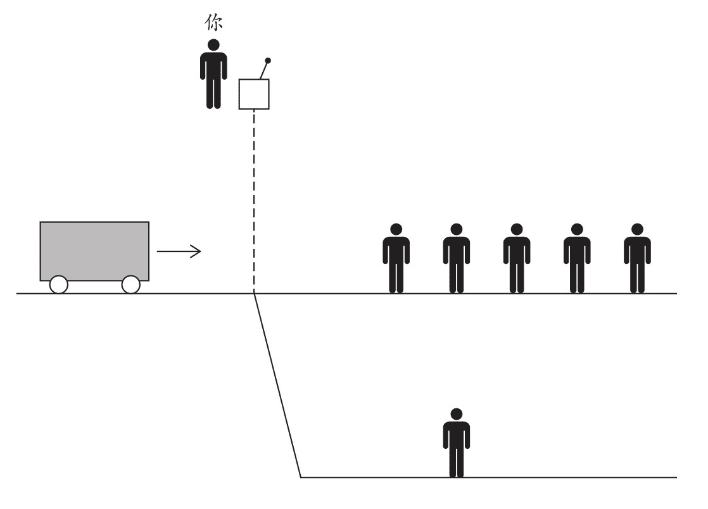
图 21　电车难题

不作为，五个人死；拉动操纵杆，一个人死。你会怎么选？

随着无人驾驶汽车逼近，电车难题变得火热。专家强调无人车很可能遇到类似困境，软件就得做艰难取舍。2016年一篇题为“自动驾驶汽车已经在决定杀死谁了”[\[100\]](#part0018.html#booknote_100)的网文在网上炸锅，我认识的几位哲学家也意外收获关注。

表面简单，实际复杂得惊人。我个人直觉是，在其他条件相同下会拉杆，因为一死好过五死。哲学上这叫结果主义，以后果评判道德。最典型的是功利主义，由边沁和密尔提出“最大幸福原则”，即行为应让世界总体福祉最大化。换句话说就是追求社会福利最大化。

但“总体幸福”很难精确定义。假如电车上五人是邪恶杀人犯，另一人是无辜孩子，五条命的价值是否超过一条？如果是十个杀手呢？你还会拉杆吗？

另一种思路是“善意”原则，比如“夺取他人性命是不对的”。坚持这条的人不会采取任何行动，因为哪怕不作为也会导致死亡，行动则构成谋杀。

还有美德伦理学的视角，认为道德的人会体现某种美德，正确的选择就是具备这些美德的人会做的选择。

对AI来说，做决定的是一个智能体，要在直行撞死五人还是转弯撞死一人之间抉择。那么AI该怎么做？

第一点要自问，期待AI做出“正确”选择合理吗？连最顶尖的哲学家都未必能彻底解决这个问题，凭什么要求AI解决？

第二，我开了几十年车，从未碰到过这种情形，我认识的人也没碰到过。现有的道德规范和驾照考试不需要你通过电车难题。因此要求无人车上路前先解决电车难题，在我看来有点荒唐。

第三，这类问题的答案极度主观。麻省理工做过一个“道德机器”网站实验，让用户对一系列电车难题做选择[\[101\]](#part0018.html#booknote_101)。受害者身份包括男女、肥胖者、儿童、罪犯、流浪者、医生、运动员、老人，甚至猫狗。数据来自233个国家约4000万人次。

结果显示全球态度差异明显，可以归为三个“道德集群”：西部、东部、南部。西部包括北美和多数欧洲。东部包括日本、中国等东亚和伊斯兰国家，倾向于优先保护合法公民而非罪犯，优先保护行人而非车内乘客，更倾向保护年轻人。南部包括中南美洲，更在意保护社会地位较高者、年轻人及女性。研究还发现，文化繁荣程度和法治强度也会显著影响偏好。

MIT把研究结果和2017年德国联邦政府的汽车道德决策指南做了对比[\[102\]](#part0018.html#booknote_102)。德国指南提出二十条建议，比如危险时必须优先拯救生命而非保财产；事故不可避免时不得考虑生理特征如年龄性别；必须明确人类或计算机在驾驶；车辆必须记录驾驶者信息等。

其中“不得基于个人特征歧视”的规定，和道德机器体现出的“更倾向救年轻人”形成冲突。试想一辆按德国规则行驶的无人车，撞死了孩子而非老年晚期癌症病人，会引发多大舆论？例子极端，请见谅，但道理不难理解。

即便有趣，道德机器和电车难题对无人车AI软件的启示也有限。我不相信未来几十年无人车会真正遇到这种道德困境。实际上，以我多年AI经验，工程上最基本的做法是最大化预期安全性，即最小化预期风险。这并非深层道德推理，复杂程度可能和避开多个障碍差不多。坦白说，最可能的结果只是紧急刹车。实践中，我们也应该尽量做到这一点。

## 当AI伦理变成行业标配

别作恶。

——谷歌公司座右铭，2000—2015 年

比电车难题更紧迫、更相关的更广泛问题正在被激烈讨论。写书时几乎每家科技公司都想证明自己的AI更有道德，每周都有新的人工智能伦理倡议新闻稿。

最早影响力最大的是阿西洛玛人工智能准则，由一群科学家和评论员在2015和2017年于加州阿西洛玛定出，共23条，全行业被要求签署[\[103\]](#part0018.html#booknote_103)。多数条款没争议，例如目标应是创造有益智能，系统应安全可靠，人们应有权访问和管理相关数据。

也有远大的条款，比如要求AI创造的经济繁荣应广泛分享、造福全人类。我个人不反对签署，但对大企业而言，这更像是口头表态，期待落实过于天真。大企业投AI主要为竞争优势和股东利益，而非拯救世界[\[104\]](#part0018.html#booknote_104)。

最后五条涉及长期失控担忧，重现《终结者》场景：能力警惕、重要性、风险性、递归式自我改善、共同利益。重申一次，我不反对这些原则，但我们离这些场景还很远，把它们写进准则更像是制造恐慌。用人工智能科学家吴恩达的话说，现在担心这些就像担心火星人口过剩一样[\[105\]](#part0018.html#booknote_105)。或许某天这些问题会让人失眠，现在提出只会误导发展方向，还分散了注意力。正因问题遥远，大公司才能轻易接受并借此提升形象。

2018年谷歌发布了自己的AI道德指南，涵盖有益、减少偏见、安全等领域，并给出了开发最佳实践[\[106\]](#part0018.html#booknote_106)。同年欧盟提出框架[\[107\]](#part0018.html#booknote_107)，IEEE也提出框架[\[108\]](#part0018.html#booknote_108)。许多大公司都发布了自己的准则。

企业宣称重视AI伦理是好事，但是否真能理解承诺的内容是难点。高层愿景动人，比如分享AI红利，但转化为具体行动很难。谷歌十多年使用“别作恶”作为座右铭，听起来真诚，但对员工意味着什么？要防止越界到黑暗面，需要更具体细致的指导。

在各种框架里，几个主题反复出现，共识在增强。我在于默奥大学的同事维吉尼亚·迪格努姆将其归为三大类：解释义务、责任和透明度[\[109\]](#part0018.html#booknote_109)。

解释义务指当AI决策对某人产生重大影响时，受影响者有权要求解释。但什么算解释因场景而异，而现在的机器学习很难提供。

责任意味着要明确谁为决策负责，不能把责任推给AI本身，责任方应是部署系统的个人或组织。这涉及道德智能体的哲学问题。公众常认为AI可承担责任，但学界主流观点是软件不能被追责。责任的核心是负责任地开发AI，例如发布一个像Siri这样的智能体，误导用户以为在和真人对话，就是不负责任的使用。罪魁祸首不是软件，而是开发部署的人。负责任的设计要求AI始终清晰表明自己的非人类身份。

透明度则要求数据可获取、算法清晰明了。

AI伦理研究的兴起值得欢迎，尽管目前提出的框架实际落地程度还有待观察。

## 别把愿望说得太满

当公众把注意力全放在人工智能的伦理争议上，很容易忽略一个更朴素的事实：AI 软件归根结底还是软件，出错并不需要什么新花样。缺陷是软件的常态，完美无缺的代码不存在，有的只是崩得明显，有的藏得更深。消除缺陷一直是工程的主战场。让情况变复杂的是，人工智能给引入缺陷打开了新的通道。尤其是当我们希望它来替我们干活时，就必须把意图讲清楚，而这比想象中难得多。

大约十五年前，我在做一个让车辆自行协同的试验，场景选在铁路网上，相对简单。网络是环形的，两列虚拟列车朝相反方向行驶，中间有一段狭窄的隧道，同时闯入就会撞车。我的设想是给系统一个目标——避免碰撞——让它自行推导出列车遵守的规则。系统跑起来了，结果却出人意料。第一次运行，它给出的保守解是：两列车全部停车。确实不会撞了，但这显然不是想要的运营方式。

这个小插曲很典型。把人的意图转译成机器可执行的指令，本身就充满陷阱。我们往往不清楚自己到底想要什么，或者只停留在模糊层面；我们的偏好互相矛盾；我们不可能一次性列出全部考量，只能概括描述，概括与完整之间总有落差。更关键的是，与人交流时我们默认共享价值观和常识，不需要把每一条潜台词都说出来。机器没有这种默契，必须把所有隐含假设写死。火车案例里，我只说了别撞，却忘了补一句还要继续开。对人来说这是理所当然，对系统来说就是致命遗漏。

牛津大学哲学家尼克·博斯特罗姆在 2014 年的《超级智能》[\[110\]](#part0018.html#booknote_110)里把这种现象叫做不通情理的实例化：系统严格照做，却背离了预期。房子防盗却被一把火烧掉，为防癌症而把人全杀掉，都是这种逻辑。现实里，设计激励机制时，人们总能找到钻空子的玩法。苏联时期有则流传的轶事，因按刀具重量奖励工厂，结果工厂造出拿不动的超重餐具。迪士尼《幻想曲》里米老鼠的扫帚也是同理：让他打水，扫帚就无休止地灌满地下室。博斯特罗姆更极端的设想是回形针制造者，把地球乃至宇宙改造成回形针，本质仍是目标传达不清。

缓解思路之一是让系统在达成目标的同时尽量别动其他东西，也就是“尽可能保持其他条件不变”的偏好，ceteris paribus preferences[\[111\]](#part0018.html#booknote_111)。拉丁文 ceteris paribus 意思是其他条件不变。我们真正想说的是“别让房子被偷，同时房子其他一切尽量维持原状”。要让机器读懂这一点，逆向强化学习提供了一条路。我们在第五章提到过常规强化学习：智能体在环境中行动获取奖励。逆向强化学习反过来，先观察人类认为理想的行为，再反推奖励函数[\[112\]](#part0018.html#booknote_112)。说白了，是把人类行为当作示范来学习。

## 第八章 现实中的人工智能会导致什么问题

我并不相信奇点会到来，但这不等于人工智能没有风险。人工智能是通用技术，用途取决于想象。所有技术都有副作用，都可能被滥用。我们的先祖用火，也预见不了化石燃料带来的气候变化。迈克尔·法拉第 1831 年发明电动机，没想到会出现电椅。卡尔·本茨 1886 年获得汽车专利，想不到百年后公路上死伤数百万。互联网之父温顿·瑟夫也没料到恐怖组织会用来传播残忍影像。

人工智能同样会产生负面外溢，也会被滥用。后果未必像《终结者》那样戏剧化，却更需要我们和后代去处理。本章聚焦一些真正值得警惕的现实问题。人工智能领域会出问题，但不是好莱坞那种问题。

我们先从就业和失业谈起：人工智能将接手大量工作，如何重塑工作结构，人类和机器职能的分化会带来怎样的人权影响，进而牵连致命自主武器的风险。之后再看算法偏见、多样性不足，以及假新闻和假人工智能的现象。

### 就业和失业

机器人会取代我们的工作，我们最好从现在开始早做打算，以免为时已晚。

——《卫报》， 2018 年

除了终结者式的灭世想象，关于人工智能引发的最大恐惧是职业结构的重塑和失业风险。电脑不会累、不会醉、不会闹事、不会谈判，也不需要工资，这让雇主欢喜、让劳动者不安。

这种焦虑并非新鲜事。1760 至 1840 年的第一次工业革命就把劳动大规模自动化了。从家庭手工业转向工厂流水线，大多数人从田间进入厂房，工作变成高度重复的专业化工序。英国因棉花、殖民市场、技术革新和煤蒸汽机而率先起步。手工业者要么进厂，要么失业，卢德派因此砸毁机器，1812 年英国甚至把破坏机器定为死罪。

此后两个多世纪，技术不断迭代。讽刺的是，19 世纪繁荣起来的英格兰北部工业城镇，在 20 世纪 70-80 年代因第二次工业革命而衰败。全球化让制造转移到低成本地区，而微处理器的出现让大量非技术工作全面自动化。微处理器把庞大昂贵的计算机变成廉价可靠的小型单元，推动工厂自动化，也重创了传统制造业。尽管局部受损，整体上新技术创造的财富和岗位超过了破坏，只是分布不同。

现在担忧的是，人工智能可能拿走技术岗位。部署范围扩大后，人类还能剩下多少工作？结构和性质必然改变，只是幅度尚不明。

2013 年牛津大学的卡尔·弗雷和迈克尔·奥斯本在《就业的未来》报告〈[\[113\]](#part0018.html#booknote_113)中引发讨论，预测美国高达 47% 的岗位受自动化影响。他们把 702 种职业按可自动化程度分类，高风险包括电话销售、下水道疏通、保险业务、数据录入、接线员、销售、雕刻、出纳等；有一定风险的包括治疗师、牙医、顾问、医生、教师。结论是运输物流、办公室行政和生产类劳动者处境艰难。

他们还指出相对安全的三类特征：需要创造性思维的艺术、媒体、科研类；需要复杂社交与人际微调的工作；需要精细感知和灵巧手工的操作。机器在这类任务上仍显不足，2018 年罗德尼·布鲁克斯[\[114\]](#part0018.html#booknote_114)估计，人类级别的灵活机械手至少还要 20 年。

报告方法备受质疑，但核心判断难以回避。工作是按脚本与客户对话的呼叫中心岗位，会被快速替代；工作是在明确地图上反复驾驶的有限场景，也会被取代。只是不知道具体时间点。

对大多数人而言，变化更多是工作方式的改造，而非彻底消失。拖拉机没有消灭农民，而是让他们更高效；文字处理机没有消灭秘书，而是提升效率。我们可以借助智能体摆脱重复文书，用工具放大能力。吴恩达的话很直白：普通人一秒内能完成的脑力活，都可以用人工智能实现[\[115\]](#part0018.html#booknote_115)。

技术乐观派则描绘乌托邦：机器接管枯燥危险的工作，人类自由创作、思考、游玩。历史上微处理器曾让人们期待每周工作三天，结果并未实现。人们宁愿用省下来的时间多赚钱、消费更好的商品服务，而非单纯休闲。技术红利也分化，富者更富。

这就引出全民基本收入的讨论：在机器人创造足够财富且可能夺走工作的双重压力下，是否该给每个人无条件的基础保障？[\[116\]](#part0018.html#booknote_116)短期看不现实。首先经济效益需远超以往创新，目前未见；其次需要极强的政治意愿；最后工作在社会中占据核心位置，社会尚未为去工作化做好准备。恐怕只有大规模失业潮出现，这个议题才会被真正提上日程。

# 职场巨变，AI只是配角

谈到工作环境的变化，很多人第一反应是人工智能。但事实是，AI只是众多推动力之一，甚至未必是最核心的。那股席卷世界的全球化浪潮还没收尾，落定之前仍会以难以想象的方式冲击各个角落。算力硬件的演进也没停，在可预见的区间里设备会持续变得更便宜、更轻巧、交互更灵敏。光靠这两条线，就足以不断改写生活样貌和劳动形态。叠加其上，世界联系更紧密，社会经济政治版图在震荡：化石能源在减少，气候风险在升高，民粹政治在抬头。所有这些力量共同作用于就业与社会，造成的冲击强度很可能超过AI本身。

### 算法异化与工作的重塑
在讲AI的通俗书里看到卡尔·马克思的名字会让人意外，但《共产党宣言》合著者关切的议题，与当下围绕AI改造劳动与社会的辩论高度重合。特别是十九世纪中叶工业革命后成型的异化论述，当时资本主义才初具轮廓。马克思关注劳动者与劳动、与社会的关系，以及资本主义如何扭曲这种关系。他指出工业革命带来了工厂制，工人在流水线上做重复枯燥缺乏成就感的操作，换来微薄报酬。他们既无自主安排工作的空间，实质上也没有工作的控制权。马克思视之为非自然的生活方式。劳动在真正意义上丧失意义，而劳动者别无选择。

今天这种处境依然能引起共鸣，而AI及相关技术的大规模扩张把马克思的思路推向新一层：未来的上司可能只是一段程序。

异化在零工经济里再次显现，这也是工作模式变迁的另一面。半个世纪前，一人从毕业在一家企业干到退休是常态，长期雇佣被视为正常，频繁跳槽会被质疑。

如今长期雇佣越来越少见，取而代之的是短期任务、计件和临时性工作，即零工经济。过去二十年移动计算的普及是全球零工经济爆发的关键推手，劳动者可通过移动终端协调并参与工作。手机内置的GPS能随时定位并监控劳动者位置，同时随时下达指令。键盘敲击次数、写邮件的习惯用语等日常细节，都可能被程序记录和监控。

网络购物巨头亚马逊因对员工要求严苛、监控密集、工作环境苛刻而屡遭批评。2013年英国《金融时报》的一篇报道描述了一名仓库工人的经历[\[117\]](#part0018.html#booknote_117)：
亚马逊的软件会计算出最高效的配送步行路线，指导工人装满手推车，然后通过手持卫星导航设备屏幕的指示，引导工人从一个货架走到另一个货架。即使路线如此高效，依然有许多需要步行的地方……“你就像台机器，不过是人形的，”亚马逊的工人说，“如果你愿意，可以管这叫人类自动化。”

如果马克思尚在人世，想必会把这篇报道当作异化的最佳注脚。这正是AI催生的自动化困境：人类劳动被系统化地简化为机器或软件无法自动完成的环节，工人被精细监控与督导，缺乏创造空间、创新余地、个性表达，甚至思考余地。设想一下，若年度考核由程序决定，甚至录用与否也由程序判断，会作何感想。半开玩笑地说，或许不必太担心，因为这类岗位本身也难以持久：很快就会被AI与机器人技术替代——亚马逊正大力投入仓库机器人。

世界上有相当一部分劳动人口从事此类工作，前景并不诱人。不过这并非新现象，而是自工业革命延续下来的趋势，AI只是拓展了其维度。当然，当今职场还有大量人的工作条件远比亚马逊仓库工人更差。这不应归咎于技术，技术本是中性的。雇主、政府、工会与监管者需要思考AI对社会的影响——它如何改变人类工作的性质，什么才算体面的工作环境与条件，以及失业问题。迄今为止，AI引发的焦虑与争议，多集中在失业上。

## 人权底线的侵蚀
前述讨论揭示了掌控工作状况的AI系统如何让当代职场人异化，但人们对AI使用的更大担忧，是其触及最基本的人权。AI当老板已够头疼，它规定何时休息、何时工作、设定目标并随时监控批评……若AI系统有权决定你是否该进监狱，又会怎样？

这并非臆想，类似系统已在投入使用。例如，英国杜伦警察部队于2017年5月宣布启用危害评估风险工具Harm Assessment Risk Tool，HART[\[118\]](#part0018.html#booknote_118)，用于辅助警察判断是否释放或拘留涉案嫌疑人。HART是机器学习的典型应用，其训练库涵盖2008至2013年间的所有拘捕数据（约10.4万起），并用2013年全年数据测试，测试数据未进入训练库[\[119\]](#part0018.html#booknote_119)。结果显示低风险案例准确率高达98%，高风险案例为88%。有趣的是，系统设计时对高风险案例采取谨慎处理，例如涉嫌暴力犯罪，这或许解释了差异。系统使用34种案例特征训练，其中大部分与嫌疑人犯罪史相关，也包括年龄、性别和住址等。

没有迹象表明杜伦警方把拘留与否的全部决定权交给HART，该工具仅作为决策支持，辅助监管人员判断。但即便如此，社会各界得知HART启用时仍产生很大不安。

主要问题在于HART只关注独立案件的一系列特征，它不会像经验丰富的监管人员那样综合考量嫌疑人背景与案件流程，因此重要决定建立在相当狭窄的数据基础上。决策缺乏透明度也是令人担忧的问题，这是机器学习的经典难题，AI程序难以给出决策解释。当然，训练所用数据特征可能存在偏见，也有人提出这一点，尤其是将嫌疑人住址作为特征之一，更令人担忧，系统的决策可能涉嫌歧视底层区域。

还有一点，尽管HART只是决策支持工具，未来某一天它可能成为主要决策者：监管人员可能因疲惫、迷糊或懒惰，放弃自身判断的权利，不加思考地全盘接受HART建议。

我认为，所有这些担忧指向一点：HART这类系统侵蚀了人类判断的地位。归根结底，对一个人做出重大影响的决策者应是人类，这会让人感觉更自在。毕竟，我们享有基本人权，例如接受同侪审判的权利，这项权利来之不易，理应受到高度重视。让类似HART的电脑程序对人类做出判决，或许让人感觉我们在放弃这些来之不易的权利。对这种趋势不应当掉以轻心。

这些担忧合理，尽管我不认为应简单粗暴地全面禁用类似HART的系统，但在使用的过程中应当遵循十分重要的注意事项。

首先，正如HART案例中明确指出的，这些工具只能为人类决策者提供支持，而不能取代人类决策。机器学习决策并非十全十美，难免做出明显毫无意义的判断。而当前机器学习还有一个令人沮丧的现状，就是很难确认它何时会出错。因此，在对人们产生重大影响的决策上，盲目遵循AI建议是非常不明智的。

另一个问题涉及对机器学习技术不成熟的开发和利用。HART由经验丰富的研究团队开发，他们应已全面周到地考虑过软件可能面临的各类问题。并不是所有开发者都有如此丰富的经验，或会如此深入思考。因此令人担忧的是，替代人类做决策的系统，是否在开发环节考虑得足够谨慎和全面。

HART只是备受人权组织关注的用于执法系统的软件之一，伦敦警察厅因使用名为“帮派矩阵”的工具而饱受批评。该系统记录了数千人，并将数据代入一些简单的数学公式，以预测这些人参与帮派的可能性[\[120\]](#part0018.html#booknote_120)。帮派矩阵大部分似乎建立在传统计算机技术上，与AI关联不大，但有这方面趋势。国际特赦组织称该系统是一个“种族偏见数据库，将某个年代的黑人全部定罪”。有人声称，如果你表现出只偏好某一类音乐的倾向，就会被列入数据库。美国公司PredPol销售支持“预测警务”的软件，用以预测犯罪热点区域[\[121\]](#part0018.html#booknote_121)。同样，该软件的使用引发了人权方面的争议：如果数据有偏差怎么办？如果软件设计不合理怎么办？如果警察开始过度依赖它该怎么办？另一个系统COMPAS旨在预测一个人再次犯罪的可能性[\[122\]](#part0018.html#booknote_122)，该系统用于量刑参考[\[123\]](#part0018.html#booknote_123)。

有一个极端案例说明这种错误想法是如何走向绝境的。2016年，两名研究人员发表文章，声称只需让AI系统识别人脸就能发现潜在的犯罪行为。这样的系统让人回到了一个世纪前那些武断的犯罪理论。随后的研究表明，他们的系统大概是根据一个人是否微笑来判断犯罪行为：系统训练使用的是警方拍摄的罪犯面部照片，而这些照片往往都不会面带微笑[\[124\]](#part0018.html#booknote_124)。

## 致命自主武器的伦理迷宫
希望你会认同我的想法，AI系统当我们的老板会导致员工异化，而让AI系统来决定一个人是否应该被警方拘留，这是对人权的一种侮辱。那么，对于一个有能力决定你生死的人工智能系统，人们又将如何看待呢？随着AI的迅猛发展，人们对这一前景的担忧开始见诸报端，其中至少有一部分原因是我们提到过很多次的《终结者》场景。

关于自主武器的讨论总是带有强烈煽动性，许多人会本能地厌恶它，认为这样的系统是不道德的，永远不该被建立。对于持有这样观点的人而言，若是有品行端正的人持有相反观点，会让他们感到惊讶。因为我知道这个主题有多么震撼，所以我会尽可能轻描淡写地带领你深入研究潜在的AI自主武器所引发的问题。

自主武器的讨论大多源于战争中使用得越来越频繁的无人机。无人机，顾名思义，就是无人驾驶的飞机，在军用领域，它可以携带导弹等武器。因为无人机不用搭载人类飞行员，所以它比传统飞机更小巧、更轻便、造价更低。而且无人机的飞行不会给遥控它的人带来风险，因此它可以被用于飞往危险区域执行任务。对于军事组织来说，这自然是一个富有吸引力的选择。

在过去的50年里，无人机的军用开发经历了数次尝试，不过直到21世纪才成为现实。自2001年以来，美国一直在对阿富汗、巴基斯坦和也门的军事行动中使用军用无人机。尽管我们不知道具体数量，但似乎美国已经投入了数百架无人机，可能导致了数千人死亡。

遥控无人机本身就引发了各种严重的伦理争议，例如，由于控制无人机的驾驶员没有亲身涉险，他们可能会采取一些实际在场的情况下不会采取的行为。而且，最重要的是，人们不会像自己亲临现场那样认真对待行为的后果。

出于以上以及更多的原因，使用遥控无人机引起了极大争议。然而，自主无人机出现的可能性将人们的担忧提升到了更高层面。无人机不再被遥控，意味着很大程度上，它们不再需要人类的引导或者说干预来执行任务。而且，作为执行任务的一部分，它们可能有权决定是否夺走人类的性命。

自主无人机和其他种类自主武器的构想，立刻会让你联想到非常熟悉的电影场景：机器人大军无情地、精准地使用致命武器屠杀人类，没有任何对人类的怜悯、同情或理解。我们已经了解到为什么这样的《终结者》式末日场景不值得我们今晚就担忧得失眠，但是自主武器出问题的可能性，以及致命的后果，仍然是人们反对其发展和应用的一个重要论据。但是，关注自主武器也有许多其他原因。其中之一是拥有自主武器的国家可能不太介意发动战争，因为他们的部队不需要亲自上前线。因此，自主武器可能使得发动战争的决定变得更加容易，使得战争更加普遍化。但是，最常见的反对意见是，自主武器是不道德的：人们不能制造能够决定夺走人类性命的武器，这是错误的。

值得指出的是，在目前的技术条件下，AI驱动自主武器是完全可能实现的。请考虑如下场景[\[125\]](#part0018.html#booknote_125)：
现在有一种廉价的小型无人机型，配备了摄像头和GPS导航系统，机载小型电脑和一块手榴弹大小的炸药。这架无人机被设计成可以在城市道路巡航，寻找人类。它不需要精准识别特定的人，只需要识别人类的形态，当它识别出人体时，会飞到人类的位置，引爆炸药。

这种设想十分可怕，AI只需要能够在街道上空导航、识别人体并飞向他们就可以了。我认为，任何一个合格的AI研究生，只要有合适的资源，就能够构造一个这样的无人机原型，而且它们可以以低廉的价格大量生产。现在想象一下，若是成千上万的无人机被投放到伦敦、巴黎、纽约、德里或者东京街头，将会发生什么。想象一下大屠杀，想象一下恐怖的画面。据我所知，这样的无人机已经有人制造出来了[\[126\]](#part0018.html#booknote_126)。

对许多人而言，关于AI自主武器是否应该存在，根本无须争议，然而，有关的争议确实存在。

这场争辩中最著名的主角之一，是美国佐治亚理工学院的罗恩·阿尔金(Ron Arkin)教授，他认为自主武器的出现肯定是不可避免的(总会有某个人，或者某个机构将它们最终制造出来)，因此，最好的对策是思考如何设计它们，使它们的行为比普通人类士兵更合乎道德[\[127\]](#part0018.html#booknote_127)。毕竟，他指出，人类士兵在道德方面并没有很好的记录。当然，他也承认，不可能出现拥有“完美道德”的AI自主武器，尽管如此，阿尔金教授仍然相信，我们能够制造出比人类士兵更有道德的自主武器。

还有其他支持自主武器的观点，例如，有人认为，让机器人去从事卑鄙的战争事业，总比让人类去打仗更好：战争的赢家往往是拥有更优秀机器人的一方(当然，问题就变成了如何确保我们拥有更好的机器人)。

我还听过这样的论点，即反对自主武器比反对常规战争更没有道德。例如，当一架 B-52 轰炸机在 5 万英尺的高空飞行，释放炸弹的时候，负责释放炸弹的投弹手并不清楚他们投下的 32 吨的炸弹将落到何处，也不知道它会落到谁身上。那么，为什么人们要反对能够精准杀人的自主武器，而不反对这样随意杀戮的常规武器轰炸？我想，答案是我们应该同时反对它们。但实际上，常规轰炸确实没有像自主武器那样引起这么多的道德争议。

不管人们试图构建什么有利的论据，我必须坚定地说，国际AI界的大多数研究人员都强烈反对开发致命的自主武器。关于自主武器可能被设计成比人类士兵更合乎道德的论点并没有被广泛接受。理论上这是一个有建设性的想法，但实际上我们根本不知道怎么去做，而且也不可能很快成为现实(见上一章的讨论)。虽然我敢说，提出这一论点的初衷是最好的，但令人担心的是，它已被那些想现在就制造自主武器的人所劫持。

在过去十年里，科学家、人权组织和其他组织联合开展了一场旨在阻止自主武器研发的运动。“禁止机器人杀手运动”成立于 2012 年，得到了国际特赦组织等主要国际人权组织的支持[\[128\]](#part0018.html#booknote_128)。该运动的既定目标是实现全球禁止研发、生产和使用完全自主武器。这项运动得到了AI研究界大部分人的支持。2015 年 7 月，近 4000 名AI科学家和 2 万多人签署了一封公开信，支持禁令；除此之外还有许多其他类似的倡议。有迹象表明，政府组织听到了人们的呼声。2018 年 4 月，中国驻联合国代表团提议禁止使用致命的自主武器；英国政府最近的一份报告也明确建议，永远不要给AI系统以伤害或杀人的权力[\[129\]](#part0018.html#booknote_129)。

显然，致命的自主武器既危险又不道德，因此，在我看来，按照《渥太华禁雷公约》[\[3\]](#part0012.html#note_3)的思路，实施一项禁令是有必要的。但这可能比较难：不仅要考虑到致力于制造这类武器的组织会施加阻力，另外，制定一项禁令本身不是容易的事情。英国上议院人工智能特别委员会在 2018 年的报告中指出，给致命自主武器下一个清晰的定义相当困难，这将是立法的一个主要障碍。从纯粹实际的角度来看，仅仅试图在武器开发领域禁用人工智能技术基本上不太现实(我斗胆猜测许多常规武器已经在某种形式上使用人工智能系统控制)。此外，立法禁止某种特定的人工智能技术使用，比如神经网络，那就更不现实了，因为软件开发人员可以很轻易地在代码中掩饰使用的技术。

因此，即使公众和政府都愿意控制或禁止发展和使用致命自主武器，制定和执行相关立法也是困难重重。但是，有迹象表明，各国政府正在尝试，这未尝不是一个好的开始。

## 算法偏见的隐形伤害
我们也许希望人工智能系统能够做到公正和公平，摆脱困扰人类世界良久的偏见和成见，但恐怕事实并非如此。在过去十年里，随着机器学习系统被推广到越来越多的应用领域，我们开始了解到自动决策系统也会表现出算法偏见。现在它已经成为一个主流研究领域，许多团体都在努力理解算法偏见带来的问题，以及如何避免。

算法偏见，顾名思义，是指计算机程序——不仅仅是人工智能系统，而是任意计算机程序——在其决策过程中表现出某种形式的偏见的情况。该领域的主要研究者之一凯特·克劳福德(Kate Crawford)指出，存在算法偏见的程序可能会造成两方面的伤害问题[\[130\]](#part0018.html#booknote_130)。

首先是分配伤害，分配伤害体现在某个群体在某些资源方面被拒绝(或优待)的时候。例如，银行可能会使用人工智能系统来预测潜在客户的优劣——优质客户意味着会按时还贷，而劣质客户则更可能拖欠贷款。他们可以使用优质客户和劣质客户的相关资料来训练人工智能系统，经过训练的系统可以查看潜在客户的详细信息，并预测客户可能是优质还是劣质客户，这是一个经典的机器学习程序的案例。但如果程序存在偏见，那么它可能会拒绝向某个群体提供贷款，或者偏袒某个群体，更可能放款给他们。在这里，偏见导致了相关群体明显可识别的经济障碍(或优待)。

另一种是代表性伤害，通常发生在系统产生强化刻板印象或者偏见时，一个最臭名昭著的例子就是 2015 年，谷歌的照片分类系统将黑人照片标注为“大猩猩”[\[131\]](#part0018.html#booknote_131)，强化了令人反感的种族刻板印象。

但是，正如我们在第一章里了解到的那样，计算机不过是执行指令的机器而已，它怎么会存在偏见呢？

数据偏见：AI的隐形原罪

机器要做决策，唯一能吃的“粮食”就是数据。偏见不是算法自己长出来的，是跟着数据一起被喂进去的。机器学习本质上是在数据上练功，数据里带歪了，模型就会把这种歪斜当成规律学下来。更麻烦的是，训练集往往自带不同程度的偏差。

很多时候偏差的源头是做数据集的人。人在收集、标注、筛选时，随时都会把自己的成见带进去。这种成见不一定是故意的，更多是潜意识的。但几乎所有人都带着某种偏见，所以这些偏见最终会悄悄沉进每一份训练数据里。

人为的偏见会让机器成为无意的帮凶。数据不够具代表性时，判断就不可避免地跑偏。举个例子，某家银行只用某个城市或某个区域的贷款记录来训练审批模型，那这个系统在面对其他地区的人时，就很容易做出歧视性结果。

程序设计本身也会制造偏见。拿同样银行的例子说，如果有人把“种族血统”作为核心特征来训练贷款AI，那歧视几乎是注定的。听起来像笑话，但现实中这类低级错误并非不可能。

如今算法偏见已成显眼伤疤。主流AI多靠机器学习构建，而机器学习是典型的黑盒，决策过程人类难以理解或解释。麻烦的是，我们正越来越信任这些系统。银行会用几千条案例训练一个模型，看它能得出和专家相似的结论，就认定它不会出错，然后全盘放手。这种盲目信任正在蔓延。

眼下各家公司都在掀起机器学习应用狂潮，恰恰是这股狂热让偏见更容易被生产出来。很多团队根本没意识到致命点在哪里。归根结底，还是数据要拿对、拿全、拿干净。

AI圈的性别缺口

1956年，约翰·麦卡锡向洛克菲勒研究所提交达特茅斯人工智能暑期学校的提案，附上了一份47人的邀请名单。他1996年回忆时说，不是所有人都能来，只有他认为会对人工智能感兴趣的人才会被列入。你猜这份名单上有几位女性？零。

放在今天，任何有声望的研究资助机构都不会接受连基本多样性都不过关的方案。现在的申请流程通常要求说明如何保障平等与多样性。那个年代男女不平等是常态，AI长期被视为男性主导的学科，这个事实很难被忽略。

事后诸葛亮式地指责60年代的会议意义不大，真正需要问的是，如今的研究生态变了吗？情况是好坏参半。一方面，走进任何一场顶级国际AI会议，你都能看到不少女性研究者的身影；另一方面，男性主导的结构并未消失，人才构成单一仍是行业的一个棘手顽疾，就像科学工程领域的大多数分支一样\[132\]。

性别比例为何重要？显而易见，男性主导的环境会让潜在的女性学者望而却步，扼杀宝贵的人才。更深层的是，如果AI几乎全由男性来设计，我们最终得到的就是一种“男性AI”。系统会烙上特定的世界观，无法代表女性，甚至对女性不友好。

想看这个问题有多普遍，可以读卡罗琳·克里亚多·佩雷斯的《看不见的女人》\[133\]。她提出的核心概念是“数据缺口”：几乎所有历史数据都是以男性为参照来生产和记录的。大多数历史记录有缺陷，旧时狩猎由男性完成，历史书写给女性留下的空间极少，大家默认男性的生活体验就是人类体验，女性的一半生活则沉默空白。这种沉默每天都在影响女性：办公室空调温度按男性代谢设定，女性只能瑟瑟发抖；超市货架顶层按男性身高设计，女性够不到；汽车安全设计没考虑女性身体尺寸，心脏病症状被判定为“非典型”而延误救治。这些不致命的小事累积起来，后果可能是致命的。

对AI来说，数据不可或缺，而男性偏见在数据里无处不在。有时很明显，语音识别的训练语料中男性声音占比高达69%，系统对女性语音的识别自然更差。有时很隐蔽，厨房照片训练集里大部分与女性关联，CEO肖像训练集里大部分是男性。用这些数据训练出来的模型，偏见是可预期的，而且确实发生过。

最经典的扎根案例是2017年的谷歌翻译性别倒置问题。将“他是一名护士，她是一名医生”翻成土耳其语再翻回英语，结果变成“她是一名护士，他是一名医生”。刻板印象被算法原样复制。

偏见本就存在，而对女性而言更特殊。新系统建立在强烈男性偏见的数据之上，而研发团队往往自己也带着同样的偏见，所以根本没察觉。

更深层的风险是人格化AI。当我们造出Siri、Cortana这类拟人助手时，很容易无意中强化性别刻板印象。如果一个设计上显得顺从、听起来像女人的AI被大量推广，等于在传播女性的仆从形象\[135\]。

算法喂养的信息茧房

假新闻就是把虚假、不准或误导性的信息包装成新闻来传播。互联网以前就有假新闻，但社交媒体让传播变得极快且精准。

脸书、推特、微信拥有庞大用户基础。社交媒体起初是分享生活、晒娃晒宠，后来迅速成为强大的社会工具。2016年假新闻冲上头条，正好撞上两件大事：当年11月美国总统大选特朗普当选，以及6月英国脱欧公投通过。社交媒体在其中都起了关键作用，特朗普被公认为善于用平台动员支持者，也有人指出平台被用来推送有利于胜选方的虚假信息。

AI是这场风暴的发动机。平台靠用户停留时长赚钱，停留越久广告收入越高。于是平台有动机推送你“喜欢”的内容，而不是真实的内容。它们怎么知道你喜欢什么？你在用行为告诉它。每一次点赞、停留、点击都在绘制一张偏好图谱，据此决定推送什么\[136\]。比如一个白人男性、喜欢暴力视频、带有种族主义倾向的用户，平台会给他喂什么新闻就可想而知了。

AI根据点赞、评论、相关阅读等行为分析偏好，再寻找可能感兴趣的新信息。这是所有社交平台研究部门的核心工作。

当所有平台都在做“给你你喜欢的，藏起你不喜欢的”时，用户看到的世界会怎样？一个充满暴力与偏见内容的世界。没有多元、没有公正的信息渠道，人会深陷信息茧房，偏见被不断确认并强化，这就是证实性偏见。规模之大足以在全球范围内操纵信仰，无论是蓄意还是偶然，都必须警惕。

长远看，AI可能改变我们看待世界的根本方式。我们靠视觉、听觉等感官获取信息，形成对现实的共识描述。如果两个人以同样方式目睹同一事件，就能达成一致。但如果每个人都被喂养完全不同的现实，没有共同基准，共识会瓦解。

增强现实会把这种分化推向极端。2013年谷歌眼镜就让人担忧——摄像头加投影，可把数字信息叠加到现实之上。认人困难的人可以用它即时获知熟人的名字。听上去是AR应用，真实世界叠加计算信息。

问题在于，当应用不再只是增强，而是悄悄篡改现实，用户甚至察觉不到时怎么办？想象一个13岁的《指环王》迷戴着眼镜上学，同学在他眼中变成精灵，老师变成兽人。好玩，但如果每个人都活在私人世界，共识现实还有意义吗？你我不再有共同经验来建立信任。而且这类设备极易被黑。眼镜被入侵后改变孩子对世界的认知，进而操纵信仰，后果不堪设想。

这种改变目前还不成熟，但二三十年内极有可能实现。我们已有能生成对人而言逼真图像的AI，例如DeepFakes的担忧\[137\]。DeepFakes能换脸，让图片视频里出现从未在场的“人物”。2019年，美国众议院议长南希·佩洛西的讲话被篡改，显得口齿不清像受药物影响\[138\]；色情视频也常被用来植入未参与的“演员”\[139\]。

今天DeepFakes质量还在提升，未来照片视频可能完全失去可信度。如果每个人都活在AI驱动的私人数字世界，建立在共同价值观之上的社会会面临真实危险。社交媒体上的假新闻，恐怕只是开端。

当AI只是表演

Siri、Alexa、Cortana这类软件智能体，是90年代智能体研究的直系后裔。Siri上线不久就传出“隐藏功能”：你对它说“你好Siri，你是我最好的朋友”，它会给出看似有深度的回应。媒体兴奋，问这是通用AI吗？答案是否定的。它只是对关键词匹配预设回答，和几十年前ELIZA的套路没多大区别。看似有意义的对话，不过是假AI的把戏。

苹果并非唯一。2018年10月，英国宣布机器人Pepper将出席下议院听证会\[140\]。Pepper确实出现了，也确实由多项幕后研究支撑，但它只是在回答预设问题，用的是预写答案，连ELIZA都不如。

这些案例没有恶意，只是善意的娱乐。但研究界很恼火，因为它们塑造了完全错误的AI预期。如果有人真以为Pepper能即兴问答，就会产生不切实际的期待。更糟的是，人们可能把这种作秀当成AI的本意：造假。

2018年12月，俄罗斯雅罗斯拉夫尔青年科学论坛上，一台“高科技机器人”上演惊人舞蹈，结果是穿着机器人服的真人在表演\[141\]。组织者是恶作剧还是欺骗已不可考，但国家电视台称它“和真人一样”。观众自然会认为这代表了机器人和AI的最高水平。

这类造假在AI边缘地带很常见，让研究者沮丧。2017年10月，沙特宣布授予机器人索菲亚公民身份\[142\]，媒体哗然。考虑到沙特的人权记录，尤其是妇女权益，讽刺意味十足。人们也在问：这是通向通用AI的起点吗？

索菲亚由汉森公司制造，外形拟人，表情丰富，能进行自然语言对话。2017年12月《商业内幕》发布了一段“采访”\[143\]，问答如下：
你的感受和喜好是什么？
你有没有让机器人住进家里或一起工作过？
没有。
你知道，或许已经有不少机器人进入你的生活，而你没察觉。你希望有一天能和机器人一起生活吗？
那现在我的身边出现的是什么样的机器人呢？
确实。
当你不知道怎么回答时，你默认答案就是“确实”吗？
是的。
脸书AI研究主管杨·勒库恩当时在推特上讽刺：“这些把戏对比真正的人工智能，就像魔术对比真正的魔法，完全是胡说八道。”这正是学界对廉价宣传噱头的态度。

AI造假的核心是误导，让公众以为看到的是真东西，幕后其实全是手工操作。有传言称，部分初创公司在成果演示失败时，会用假AI来糊弄。是否普遍难以统计，但对整个领域都是实实在在的伤害。

第九章 通往有意识的机器之路

到现在应该能看清一个事实：近年来AI和深度学习取得的突破很真实、很令人兴奋，但它们不是构建通用人工智能的万能钥匙。深度学习很可能只是通用智能拼图中的一块，而非全部。我们至今不清楚拼图还缺哪些关键部件，更不知道通用智能的完整配方是什么。

图像识别、机器翻译、无人驾驶这些令人印象深刻的系统，都构不成通用智能。从这个角度看，我们仍困在罗德尼·布鲁克斯80年代指出的难题里：我们手里有不少智能组件，却不知道如何把它们组装成真正的通用系统。关键组件依然缺失，就像我们在第五章看到的，即便是最顶尖的当代系统，也无法证明它们真正理解自己在做什么。它们擅长任务，却只是为狭窄领域优化的软件组合而已。

我一直认为通往通用人工智能的路还非常遥远，所以对强人工智能的终极设想——造出一台拥有自我意识、能真正自主存在的机器——我始终保持怀疑。只是这已经是最后一章了，稍微放纵一下也无妨。即便强人工智能的前景渺茫，探索本身依然有趣，我们也能一边想象朝它前进的路径，一边欣赏沿途的风景，思考会遇到哪些障碍，更关键的是，我们怎么判断已经快抵达终点了。

## 意识、思维与那些未解难题

1838 年，英国的约翰·赫歇尔做过一个极简的实验。他把装水的容器晒在太阳下，测出让水温升高一摄氏度需要多久。靠这个粗略的计算，他估算出太阳每秒释放的能量。数字大到难以想象，远超地球一年内产生的全部能量。这给当时科学界出了大难题：地质证据显示地球至少有几千万年历史，太阳至少也活了这么久，但已知的任何能源都撑不过几千年。于是科学家们绞尽脑汁提出五花八门的解释，直到十九世纪末核物理诞生，汉斯·贝特才给出今天被广泛接受的核聚变解释，解释了恒星如何供能[\[144\]](#part0018.html#booknote_144)。

回到强人工智能。我们想造的机器要真正有意识、有思维、有自我意识和理解力，像我们一样。如今的处境和赫歇尔当年一模一样：人类意识和思维究竟如何进化、如何运作、如何参与行为控制，对我们来说仍像赫歇尔时代的太阳能量来源一样神秘。我们既不知道答案，也不太清楚该怎么去找答案。手头只有零星线索和大量猜测。假如这些问题获得清晰满意的解答，人类就能从科学层面理解宇宙的起源与命运。正是这种根本性的空白，让强人工智能显得如此遥远——我们甚至不知道从哪里下手。

# 意识困境与强人工智能的边界线

## 难以定义的意识

情况其实更糟，因为我们连要处理的对象是什么都说不清。我反复提到过意识、思想、自我意识这些词，可它们到底是什么，没人能讲明白。乍看似乎很直观——毕竟人人都拥有——但用科学的方式定义或衡量它们却无从谈起。从科学角度我们无法证实它们存在，可从个人经验和常识看，它们又确实存在。赫歇尔可以用温度、能量这些可量化概念来做实验，我们却没有类似的测试来研究思想或意识：它们不适合客观观察或测量。主观意识没有标准单位，连怎么测量都没有共识——我看不到你在想什么，也体会不到你的感受。历史上对大脑结构与功能的认知，多靠研究疾病或创伤导致的脑损伤案例，这很难系统化。功能性磁共振等神经成像技术给了我们结构和活动的大量信息，却无法触及个人的主观体验。

即便缺乏精确定义，讨论意识时仍有一些共通特征可供把握。

## 感受本身：主观体验是什么

先确认一个关键前提：意识产生于拥有主观感受的智能体，核心在于内在的感受性。哲学里称之为感受性。名字听起来别致，含义其实简单：那就是所有人都会经历的精神感觉，比如咖啡的香气。停下来闻一下，或者煮一杯，吸入那股香气。你当下的那份感觉，就是感受性的实例。炎夏喝冰啤酒、冬末春初的转暖、孩子取得小成功带来的喜悦……这些体验都是质性的：你能辨认、能享受，但矛盾的是，尽管我们用同一词语描述，我仍然不确定你的体验是否和我一样。因为感受性本质上是私人的。我闻到咖啡时的精神体验只有我能理解，即便我们说法相同，也无法判断你是否真有类似的感受。

## 内格尔的“像什么感觉”测试

1974 年，美国哲学家托马斯·内格尔提出了最著名的检验标准[\[145\]](#part0018.html#booknote_145]。他建议用“成为一个 X 是什么感觉”来判断是否有意识。假设要判断以下对象是否有意识：

一位人类、一只猩猩、一只狗、一只老鼠、一只蚯蚓、一个烤面包机、一块石头。

对人类而言答案显然是肯定的。猩猩呢？我觉得成为猩猩也是有感觉的，狗和老鼠同样如此。按内格尔的标准，它们都有意识。这并非实证，只是依赖常识的判断。

蚯蚓呢？我会犹豫。蚯蚓结构简单，成为蚯蚓会有感觉吗？我持怀疑态度，所以按此说蚯蚓没有意识。也许有人认为它有极简的意识，但与人类相比微不足道。至于烤面包机和石头，我不接受任何异议：绝对无意识。成为烤面包机毫无感觉。

### 这个测试透露了什么

内格尔的思路有两点启示。

第一，意识不是有无之分，而是层级。人类成熟意识是一端，蚯蚓的简易意识是另一端。即便同为人，也会因酒精、疲劳等状态而程度不同。

第二，不同实体的意识形态不同。内格尔的论文题目是《成为一只蝙蝠是怎样的感受》，选蝙蝠正因差异巨大。按测试蝙蝠显然有意识，但蝙蝠拥有声呐、有的还能感知地磁导航，自带罗盘。我们人类没有这些感知，所以无法想象成为蝙蝠的具体体验。尽管肯定其存在，蝙蝠的意识与人类截然不同，内格尔甚至认为它超出了人类理解的范围。

内格尔本意是检验意识，并得出部分意识超出理解能力的结论。但这个测试也能套用到电脑。大多数人觉得“成为一台电脑”的感觉就像烤面包机一样空无。

因此有人据此论证强人工智能不可能，因为机器没有感觉。我个人不认同。“成为 X 是什么感觉”本质是直觉判断，直觉能轻易区分猩猩和烤面包机，但在更微妙的情境，尤其是超出自然经验的 AI 领域，可靠性就不足。也许我们无法想象计算机的感觉，只因它与我们截然不同，这并不等于机器意识不可能，只是机器意识可能与人类意识不同。

反对强人工智能的论据很多，内格尔只是其中之一，下面看看最著名的几种。

## 强人工智能真的不可实现吗

内格尔的论点建立在常识上：人类是有生命的物体，这使我们特殊，而电脑只是无生命物，所以强人工智能不可行。据此，我与老鼠的相似度大于与电脑的相似度，电脑与烤面包机的相似度又大于与我的相似度。

我不同意。在我看来，人类再了不起也只是由原子组成的物理实体。大脑遵守物理定律——即使我们还不甚清楚是哪几条。人类非凡、奇妙，但从宇宙规律看并无特权。这当然没回答关键难题：特定的原子堆叠如何产生意识，后面再谈。

美国哲学家休伯特·德雷福斯提出了“人类特殊”的变体。他批评人工智能名不副实，并提出一个具体论点：人类许多行为和决策依赖直觉，而直觉不像程序那样精确、可分解。他认为人类直觉无法简化为计算机步骤。

确实大量证据表明我们很多决策并非基于明确严密的推理[\[146\]](#part0018.html#booknote_146]。我们常做决定却说不清理由，这类决策占大多数。于是我们依赖某种直觉。这种直觉来自时间的经验积累——进化或基因传递——即便在意识层面无法表达，也并非神秘。就像我们看到的，计算机也能通过经验学习，成为有效的决策者，即便它同样无法清晰阐明决策原理。

最著名的反对来自约翰·希尔勒，正是他提出强弱人工智能之分。他设计了“中文房间”思想实验来论证强人工智能不可行。

设想一个人被关在房间里，门上有个投递口，收到写着中文问题的卡片。他不懂中文，但房间里有本规则书，指导他按规则写出中文答案再递出去。此时房间整体正通过图灵测试，让测试者相信对方懂中文。

问题是，房间里的人真的懂中文吗？希尔勒认为不。房间本身也不懂中文，处理过程没有体现理解。里面的个人只是精确地按规则书操作。他的智力仅用在忠实执行规则上。

这正是计算机的工作：按指令逐步执行。因此希尔勒认为，即便通过图灵测试的计算机也没有理解力。

若成立，理解这种强人工智能必需的能力就不可能由遵循步骤产生，传统计算机无法实现强人工智能。程序看上去多么聪明，都是错觉，背后没有真正的理解。

对此有多个反驳。

常识性反驳认为中文房间根本不可实现。让人类扮演处理器，计算机一秒能做的事，人需要上千年。把程序编码成纸质指令更是荒谬：当代大型程序约有一亿行代码，印出来要好几万册。计算机能在微秒内从内存取指令，人慢数十亿倍。在现实条件下，中文房间不可能通过图灵测试。

另一种说法指出，即便房间里的人无理解，房间本身无理解，但把房间、人、说明书作为整体系统看，却是有理解的。同样，在人脑里翻找理解也找不到。语言理解相关脑区存在，但希尔勒定义的“理解”并不在里面。

我还有另一种解读。中文房间从图灵测试角度作弊了，因为它打开了黑箱去看内部。图灵测试要求只看输入输出，由此判断对话者是否真人。对我而言，争论系统是否“真正”理解是没有意义的。只要它做出的行为与理解中文的人类毫无差别，就够了。

还有一种反对称，传统计算机在数学上受限。图灵的工作已划定计算机能做什么不能做什么，若人工智能追求的智能行为在图灵机上根本不可实现呢？图灵本人也把这列为强人工智能不可行的可能。大多数研究者并不执着于此，但可计算性问题一直是人工智能发展的拦路虎。

## 身体与心灵如何衔接

接下来是意识研究中最古老的难题：身心问题。身体与大脑的物理过程产生意识思维，但怎么产生、为何出现？神经元、突触、轴突的物理世界与主观体验之间是什么关系？这是科学和哲学最艰难的命题之一。大卫·查尔莫斯称之为意识的难题。

追溯可至柏拉图。《斐德罗篇》中他把大脑比喻为马车夫驾驭两匹马，一匹代表理性高尚的渴望，一匹代表无谓的欲望。人生的走向取决于马车夫管控。印度《奥义书》也有类似说法[\[147\]](#part0018.html#booknote_147]。

把理性自我当马车夫是个讨喜的比喻——我也倾向它能掌控内心的善恶——但它陷入心灵理论的常见困境。柏拉图把马车夫想象成某种“心灵”，于是人类心灵被另一个心灵控制，哲学上叫同义反复问题或侏儒问题。如此解释并没有解释任何东西，只是用另一个心灵问题来描述心灵问题。

而且马车夫模型可疑之处在于，它把推理视为行为主要驱动力，而大量证据不支持。例如神经科学家约翰-迪伦·海恩斯的经典实验显示，受试者做出最终决定前约10秒，大脑已出现决定痕迹[\[148\]](#part0018.html#booknote_148]。

这引发诸多问题，关键一点是：若有意识的思考与推理并非决定行为的机制，那究竟是什么？

进化论告诉我们，任何特征都应带来进化优势。于是可以问：有意识思维带来了什么优势？若没有优势，它不该存在。

一种理论认为有意识心灵只是身体产生行为的毫无意义的副产品，称为副现象论。若如此，你的意识不再是控制缰绳的马车夫，只是个坐在车上的乘客，自以为是驾驭者。

更中立的观点认为意识并非像柏拉图说的那样主导行为，而是在大脑进行其他活动时以某种方式产生的——大概是低等动物大脑所没有的过程。毕竟据我们所知，它们不像人类那样拥有丰富的精神生活。

接下来的内容将聚焦人类意识的一个关键组成：社会性，即理解自己和他人作为社会群体一部分的能力，以及思考他人如何看待我们的能力。这种能力很可能因在大型复杂社会中共同生活工作的需要而进化。为了理解这一点，我们从英国进化心理学家罗宾·邓巴的社交大脑研究开始。

## 社交大脑假说

邓巴关心一个简单问题：为什么人类和其他灵长类的大脑比其他动物更大[\[149\]](#part0018.html#booknote_149]？大脑是信息处理器，通常消耗人体约20%的能量。因此灵长类进化出更大大脑，是因为需要处理更重要的信息。但究竟是哪类信息，以及带来了什么进化优势？

邓巴研究了多种灵长类，寻找可能需要增强信息处理能力的因素，如追踪食物来源、扩大觅食范围等。然而他发现与大脑体积关系最密切的因素是平均社会群体规模，即群体中个体的平均数量。这说明灵长类需要更发达的大脑来维持庞大的社交网络，更具体地说，是寻找、维护和利用群体内的社会关系。

基于此，可以根据人脑平均大小推算人类平均群体规模。分析得出的数值被称为邓巴数，公认约为150。也就是说，考虑到人脑大小和其他灵长类对比，人类稳定社交的上限大约是150人。邓巴数在人类社会规模的实际统计中反复出现：新石器时代的农业村庄通常约150人。近期更有趣的发现是，邓巴数能解释我们在脸书等社交平台上真正活跃互动的朋友数量。

邓巴数可以理解为人类大脑能有效管理的人际关系上限。当然我们会接触更多人，但能真正维系的关系大约就是这个数。

简而言之，若分析成立，人脑的特殊之处在于它是社会性大脑。与其他灵长类相比，我们的大脑更大，因为我们生活在庞大的社会群体中，这要求我们具备维持和管理大量社会关系的能力。

维持和经营社会关系，到底意味着在做些什么？要回答这个问题，我们可以借用美国哲学家丹尼尔·丹尼特提出的解释框架，用他所说的意向立场去理解和预判他人的行动。

## 怎么看出谁是“演员”
环视周围，我们会很自然地把某些东西归为智能体，其他东西则归为单纯的对象。书里前面提到过智能体：一方面是代我们独立行动、理性实现偏好的程序；另一方面指的是一种具有自主、目的性、像演员一样行动的实体。

孩子站在巧克力堆前挑选一颗，过程中有犹豫、有选择、有明显的思考痕迹，我们立刻读出“智能体”的意味。反过来，一株植物从石缝里冒头，慢慢把石头掀开，我们只看到物理上的生长，看不到思考，也看不到有意识的目的感。

为什么同样的“改变世界”的过程，会被我们归到完全不同的解释里？

其实我们对世界变化的解释可以切换视角。丹尼特说的第一种是物理立场，用自然规律去推演结果。石头脱手落地，靠质量和重力就能预测，很准。但拿来解释人类行为就太吃力了，人类太复杂，原则上也许只是原子堆砌，实践上根本不可行。解释现代操作系统的运行也一样不现实，代码量动辄数亿行。

第二种是设计立场，我们不追究内部怎么工作的，只看它被设计来干什么。闹钟的例子很典型，不用懂齿轮，就知道指针显示时间、到点响铃，因为那就是闹钟的功能。解释靠目的，而不是靠物质构成。

## 从信念欲望出发预测行为
第三种，也是最关心的，是意向立场[150]。在这个视角里，我们把信念、欲望等心理状态归给某个实体，然后用常识推断它会怎么做，默认它会按自己的信念欲望行事。

我们日常解释人类活动时就是在这么说：
珍妮觉得天要下雨，她不想淋湿。
皮特想把评分做完。

一旦知道这些心理假设，就能推断出合理行动：穿雨衣、带伞、干脆不出门。意向立场因此具有解释力，能说明人做了什么，也能预测人可能做什么。

和设计立场一样，意向立场并不关心内部构造如何实现。它对人和机器都适用。丹尼特用“意向系统”来指称那些行为可以用信念、欲望和理性选择来有效理解和预测的实体。

意向系统本身还有层级。越往上越复杂。
一阶意向系统有自己的信念和欲望，但不会对信念本身产生信念。
二阶意向系统会开始思考别人的信念欲望。
三阶则是在思考别人的思考。

举例来说：
一阶：珍妮相信天要下雨。
二阶：迈克尔希望珍妮相信天要下雨。
三阶：皮特认为迈克尔希望珍妮相信天要下雨。

日常对话里用到三阶以上的情况很少，只有在研究人工智能解谜这类任务时才会出现。对大多数人来说，五阶以上就很难理清了。

社会性生物为什么和意向立场绑定很紧？因为它让我们能读懂和预判群体里的其他智能体。在复杂的社会关系中，我们会不自觉进入更高阶的意向思维，自己的计划会受别人行为的牵引，而别人的行为本身就是可预期的有意识行动。于是意识式的思维在人类社会里成为常态。

爱丽丝和鲍勃的对话就是个典型：
鲍勃：“我要离开你。”
爱丽丝：“她是谁？”
用意向立场解释就很顺：爱丽丝推断鲍勃移情别恋了，准备采取行动，她想知道第三者是谁，可能想挽回，也相信直接问能得到答案。不从信念欲望切入，这段交流的动机和计划就很难理清。

邓巴的研究把大脑体积和高阶意向推理能力联系起来，结果显示这种能力大致随额叶相对大小线性增长。大脑越大，社会群体规模越大，这被解释为进化是为了在复杂社会里支持社交推理：集体狩猎、抵御敌对部落、追求配偶、争夺盟友影响力，都需要理解和预判他人的想法。

意向层级似乎也和意识程度相关。一阶意向系统很常见，但高阶意向的门槛就高得多。人类具备高阶意向系统，我不认为蚯蚓有。狗也许能读懂主人的欲望，比如学会坐下，但这多半是有限或训练出来的能力。灵长类里有线索：长尾猴会发出警告声提醒同伴有豹子，也被观察到发出假警告，让其他猴子以为有豹子而逃跑[151]。这种行为的自然解释涉及更高阶的意向推理：“我如果假叫，它们就会信以为真，然后跑开……”。当然也有其他解释，但这说明非人类灵长类具备高阶意向推理的可能性。

社交推理似乎和意识相伴。它的进化支撑了复杂社会网络。但为什么社交推理需要意向性？同事彼得·米利肯提出一个计算效率的解释：把动机用欲望、信念的形式显式化，并能把自己摆进别人位置，就能更省力地预测他人行为。比如你偷了我的食物，如果我能代入你的立场，本能地感受到愤怒并预见到报复的可能，我就会抑制偷窃冲动。这只是个有趣的推测，人类社交推理和意识的关系，很快也得不出定论。

## 机器能拥有信仰和欲望吗
意向立场不只用于人。我们甚至可以说一个开关“认为”我们想导电，于是导电，按一下就达成意愿[152]。只是对开关而言，物理立场或设计立场解释起来更简单、更实际。

用意向立场解释机器行为要回答两个问题：是否合理，是否好用。影响力思想家约翰·麦卡锡认为[153]，把信念、意图、意识等归于机器是合理的，当这种归属对机器提供的信息，和对人提供的信息一样时。结构已知的设备，比如恒温器或操作系统，最容易归属；结构未知时，这种归属反而更有用。

展开说就是：说机器人相信下雨、想保持干燥是合理的，当它表现得像个理性的智能体一样避免淋湿。我们如果说它没采取措施，就会推断它不信下雨、不在乎干燥，或不够理性。

麦卡锡还指出，当内部构造不清楚时，意向立场是最方便的解释工具。它不依赖实体是人、狗还是机器，只要它表现出理性的信念欲望组合，就能预测行为。

## 造出有意识机器的思路
这一切和人工智能的宏大梦想有什么关系？可以大胆设想一条通往有意识机器的路径，年老时再回头检验准不准。

第五章提到深度思维的雅达利游戏系统，它让智能体学会大量相对简单的游戏，后来进阶到《星际争霸》[154]。这种研究值得关注，因为它处理了分支因子巨大的游戏、不完美信息、延迟奖励、长序列操作以及协作竞争。这些进展令人惊叹，但它们解决的似乎不是意识问题。对意识而言，难点不在这里。

基于前面的讨论，我的初步建议是：让一个像深度思维那样能自主学习的程序，进入需要有意义的高阶意向推理的场景。比如需要编造复杂谎言的场景，或需要有意表达自己和他人意识状态的沟通场景[155]。如果一个人工智能系统能通过自主学习做到这些，那就是走向有意识机器的关键方向。

这里想到的是莎莉-安妮测试，用来辅助诊断儿童自闭症[156]。自闭症在儿童期表现为社交和交流发育异常，缺乏灵活性、想象力和伪装本能[157]。

标准故事是：莎莉和安妮在一间屋子，屋里有篮子、盒子和弹珠。莎莉把弹珠放进篮子后离开，安妮把弹珠从篮子移到盒子，莎莉回来后想玩弹珠。问：莎莉会去哪里找弹珠？

合理答案是篮子。要答对，需要推理他人的信念：莎莉没看到转移，以为弹珠还在篮子。绝大多数自闭症儿童答错，正常同龄儿童几乎都答对。

这个测试由精神病学家西蒙·巴伦-科恩等人提出，用来说明自闭症儿童缺乏心智理论能力。心智理论是成熟成年人拥有的常识能力，能对自己和他人的精神状态进行推理。人类不是天生的，但有发育潜能。4岁左右能推理他人态度，青少年时期基本成熟。

现在已有研究在探索机器如何学习原始的心智理论能力[158]。最近出现的 `ToMnet` 心智理论网络，能对其他智能体建模，并在类似莎莉-安妮的情境下做出正确选择。这还很原始，解决测试不等于有意识，但它提供了一个可操作的目標：能通过自主学习达到人类心智理论水平的系统。

## 机器会变得和我们一样吗
谈人工智能和人类共通，最容易想到大脑。很自然的类比：大脑像无人驾驶汽车的电脑，从感官接收信息，指挥手脚行动。但这是极度简化。真实大脑是极其复杂的组件系统，作为有机体在蓝星上进化了几十亿年。从进化看，我们和类人猿区别不大，区别只在意向感知而已。人类意识必须放在这个背景下理解。

我们现有的意识能力，是进化把原始祖先推到这里的结果，和手眼耳朵一样在进化。成熟意识不是一夜出现的，不像灯泡那样开关。祖先的最初意识大约和蚯蚓相当，缓慢演化成莎士比亚。远古祖先没有我们现在的体验，我们也可能不如后代全方位。

历史碎片给了一些线索。虽然记录稀少，大多靠猜，但仍有趣。

所有现存类人猿，包括智人，约1800万年前有共同祖先。约1600万年前猩猩分化，600-700万年前智人与大猩猩、黑猩猩分离。此后祖先开始更多在地面行走，直立。气候变化减少森林覆盖是可能原因，离开树木保护增加被捕猎风险，需要更大社会群体，于是大脑容量增大以支持社交推理。

火的使用早在100万年前就有零星痕迹，约50万年前才普遍。火带来光明、温暖、驱赶捕食者、扩大食物范围。但火需要看管和维护，需要合作轮班、收集燃料。这可能催生了高阶意向推理和语言。智人语言能力似乎也在同一时期出现，随后推动进化。

我们无法精确还原进化的先后和对应能力，但普遍共识是，随着时间推移，意识的某些成分逐步出现。这不能回答意识是什么，却提供了有用的线索，说明人类成熟意识中的必要组成是如何、为何出现的。也许有些是死胡同，但猜想总比把意识当成无解之谜更有价值。

将来某天，我们会理解意识，就像现在理解驱动太阳的能量一样。那时关于意识的争论，会像核物理学家解释太阳能之前那些理论一样有意思。

假设我们按上述设想造出机器：拥有人类水平的心智理论，自主学习处理复杂高阶意向推理，能建立和维持复杂社会关系，能表达自己和他人的心理状态的复杂特性。它会有“心智”，会有自我意识吗？现在无法回答。只有造出来后才能更接近答案，前提是我们有能力造出来。

甚至可以想象这个问题永远得不到令人满意的答案。艾伦·图灵的观点在这里很有启发：如果机器做的事情和“真实人类做的事情”无法区分，我们就该停止争论机器是否拥有真正的意识。如果它能通过我们发明的任何合理测试，让人无法分辨，这可能就是我们想要的结果了。

[\[1\]](#part0009.html#noteBack_1)　一英里大约相当于1.61公里。

[\[2\]](#part0011.html#noteBack_2)　蛋白质折叠问题被视为21世纪生物物理学的核心课题，是分子生物学中心法则尚未解决的重大生物学难题。蛋白质可在极短时间内由一级结构折叠成空间结构，而研究者要据氨基酸序列推算其结构却耗时耗力，且很难得到准确的三维结果。

[\[3\]](#part0011.html#noteBack_3)　一部禁止使用、储存、生产和转让对人具有杀伤力的地雷，并销毁、完全禁止一切杀伤地雷的公约[\[160\]](#part0018.html#booknote_160)。

# 写在最后

写到本书过半的一个午后，我和一位同事一起用餐。

“最近在忙什么研究？”她随口问。

这在学术圈里是常见的寒暄，我本该提前准备一个更出彩的回答。

“跟平时不太一样，我在写一本面向大众的人工智能科普书。”

她轻哼一声。“这主题的科普书已经够多了吧，你的核心观点是什么？有什么新角度吗？”

这个问题让我有点下不来台，于是随口开了个玩笑。

“其实是一本讲人工智能发展路上走弯路、撞墙的书。”

她看着我，笑容收敛了：“那本子一定很厚。”

人工智能就是我的全部。1980年代中期还是学生的时候我就迷上了它，到现在依然痴迷。我喜欢它并不是因为它能带来财富，也不是单纯因为我相信它会改变世界，虽然我确实相信它会在许多关键领域产生深远影响。我迷恋它，是因为在所有学科里，它是最迷人的。它汲取了哲学、心理学、认知科学、神经科学、逻辑学、统计学、经济学、机器人学等众多领域的养分，同时又反过来推动这些学科加速发展。根本上说，人工智能直指人类最基础的两个追问：生命的意义何在，以及作为智人的我们是否独一无二。

## 人工智能是什么，又不是什么

本书的首要任务，是把人工智能到底是什么、更重要的是它不是什么讲清楚。听起来矛盾，因为很多人觉得人工智能的定义再清楚不过了。终极的设想是造出拥有和人类一样智慧与能力的机器——有自我意识、能自主控制、能独立行动的机器，就像你我一样。你在科幻影视里早已见过无数次。

这样描述似乎直观易懂，可一旦真正去理解，就困难重重。我们其实并不清楚要创造的是什么，具体需要人类哪些特质。更关键的是，人工智能的终极方向是否必须是拟人化智能，学界一直争论不休，没有定论。大家的看法差异很大，是否可行、是否值得去做，都缺乏共识。

正因如此，被称作“宏伟梦想”的拟人化人工智能很难落地。即便它支撑了大量小说、电影和游戏，却并非研究的主流。当然，“宏伟梦想”确实抛出了深刻的哲学问题，本书也会涉及其中一部分。至于其余部分，更多停留在想象，甚至有些接近狂想——那些狂热者对人工智能的痴迷程度不亚于顶尖科学家。

公众的争论和媒体的持续关注，绝大多数集中在“宏伟梦想”上，也就是各种危言耸听的报道和反乌托邦的想象：人工智能会抢走所有工作，会变得比人类更聪明然后失控，超级人工智能会在程序出错时毁灭人类。大众媒体上的相关文章往往知识匮乏，甚至与人工智能本身无关。从技术层面看，大多内容质量不高，即便读起来很抓人。

我希望本书能扭转这种偏见。我想说明人工智能究竟是什么，研究者都在做些什么，怎么做的。在可预见的未来，技术实现的路径与“宏伟梦想”相去甚远。它可能不够惊艳，但——正如本书要展示的——本身就是一门极富吸引力的学科。今天的主流研究，是让机器完成那些目前必须依赖人脑、甚至人类肢体才能完成的特定任务，以及传统计算机难以处理的任务。21世纪以来这个方向取得了实质性突破，这也是人工智能成为热点的原因。举例来说，20年前机器翻译只存在于科幻里，过去十年它已成为日常工具，虽然仍有局限，但每天有数百万人使用。未来十年我们很可能用到质量更高、能实现同声传译的语言工具。增强现实将改变我们感知、理解和连接世界的方式。自动驾驶是极具现实意义的应用。医疗健康领域的应用更是普惠：在X光、超声等图像识别上，人工智能在肿瘤等异常判断上已多次优于人类；搭载人工智能的可穿戴设备可长期监测健康，提前预警心脏病、高血压甚至阿尔茨海默风险。这才是研究者真正聚焦的问题，这才是令人兴奋的内核，这才是人工智能故事该讲述的部分。

要明白当今的人工智能为何与“宏伟梦想”大体无关，还需要理解造人工智能为何如此艰难。过去六十年里，研究投入和资金巨大，但全能的机器人管家短期内仍难以出现。原因要从最基础处讲起，即计算机是什么，能做什么。这就引向数学中最深奥的领域之一，以及20世纪伟大科学家艾伦·图灵的贡献。

## 人工智能的历史

本书的第二个目标，是讲述人工智能从诞生至今的故事。讲故事就需要情节，据我所知，所有现存故事只有七种基本模式[\[1\]](#part0013.html#note_1)。哪一种最适合人工智能？我同事希望是“白手起家”，对少数聪明或幸运的人确实如此。但更合理的叙事框架是“降妖除魔”——妖魔是一种抽象的数学理论，计算复杂性，它才是问题难以解决的真正根源。“探险之旅”也很贴切，人工智能的发展像中世纪骑士寻圣杯：充斥着宗教式的狂热、无可救药的乐观、错误线索、死胡同和痛苦的失望。归根结底，最贴切的模式是“起落起落”。二十年前人工智能还是极小众的领域，学术声望受质疑，如今却成为最有活力的前沿。更精确的说法是“起落起落起”。半个多世纪里研究从未中断，研究者一次又一次宣布重大突破，宏伟梦想唾手可得，结果都被证明是盲目乐观。人工智能在虚假繁荣与过度萧条间震荡，在过去四十年里至少出现过三次完整循环。放眼六十年，领域曾数次濒临崩溃，却总能重生。如果你以为科学是循序渐进的从无知到开悟，你会感到震惊。

如今人工智能再次迎来繁荣期，热情达到顶点。在这种期待中，必须反复提及那些令人不快的历史教训。研究者不止一次认为自己找到了推动人工智能走向宿命的神奇要素。对当前令人屏息的热议也是如此。据报道，谷歌CEO桑达尔·皮查伊曾说，“人工智能是人类迄今最重要的事情之一，甚至比火、电更有意义1”。这延续了吴恩达此前“人工智能是新电力”的说法。重点在于铭记历史里的傲慢。是的，真实进步存在，值得庆祝——但它们并未通向有自我意识的机器。作为从业三十年的研究者，我主张对该领域保持高度审慎，尤其是对宣称的重大突破要持怀疑态度。人工智能最需要的是谦卑。这让我想起古罗马凯旋仪式：将军身后跟一名奴隶，手持桂冠，同时低语拉丁文“memento homo”，谨记你只是一个凡人。

因此本书第二部分按时间顺序讲述发展史，毫不回避。故事始于二战后第一台计算机诞生，我会带你经历“黄金年代”的肆无忌惮乐观、“知识时代”让机器掌握人类全部知识的构想、“行为时代”把机器人视作核心的主张，以及眼下的“深度学习时代”。每个时期都有独特思想和关键人物。

## 人工智能的未来

在当下追捧的氛围里，我们该冷静认识到，人工智能史充满失败与弯路，盲目乐观需要降温。但我同样相信，有理由对未来保持乐观。科学上出现了真正意义的突破，加上大数据和廉价的高性能计算，过去十多年里人工智能系统已初具规模，奠基者称之为奇迹。所以我的第三个目标是说明系统现在能做什么、短期内能做什么，以及它的边界在哪里。

这会让我们继续讨论人工智能带来的恐惧，尤其是反乌托邦式的想象，比如世界被占领。最新进展确实引发值得关注的问题，比如就业形态变化、人工智能对人权的影响，关于机器人统治世界的讨论挤占了这些真正重要、真实议题的版面。所以再次强调，我希望引导关注真正该关注的点，清晰指出我们应该担忧什么，又不必恐慌什么。

最后，我也希望轻松一些。因此在末章我们会回到“宏伟梦想”——拥有自我意识、自主控制与行为的机器。详细探讨这个梦想意味着什么，以及实现时它会呈现何种状态，是否会高度类似人类。

## 这本书能提供什么

本书围绕上述目标展开：说明人工智能是什么、为何难以实现；讲述其发展史，每个繁荣期背后的思想与科学家；展示人工智能当前的能力与局限，并展望通向有自我意识机器的道路。

写作的乐趣之一是摆脱了学术写作的繁琐惯例，本书只标注了少量重点引用，参考文献很少。

我也尽量避免了技术细节，尤其是数学细节。

我希望读完后，你能对推动人工智能的核心思想和概念有一个宽泛的把握。这些想法本质上高度数学化，但我认同斯蒂芬·霍金的说法：科普书里每多一个方程式，就会流失一半读者。当然，对自认能接受挑战的读者，我准备了一些技术性附录和延伸阅读线索。

本书是精挑细选的成果，人工智能领域庞大，要绝对公正地涵盖过去六十年影响其发展的各种思想、流派和传统是不可能的。我只能尝试提炼出构成人工智能宏伟蓝图的主要经纬，让它们交织成故事。

最后提醒，这不是教科书。读完不会让你能创办人工智能公司，也不会让你具备成为谷歌或脸书工程师的技能。你能获得的是对人工智能概念及其走向的理解。我希望这能帮助你把握人工智能的真实面貌，并助我改变公众的论调。

2019年5月 于牛津大学

[\[1\]](#part0013.html#noteBack_1)　《七种基本情节：我们为什么讲故事》是荣格学派研究者克里斯托弗·布克于2004年出版的著作，分析了各类故事和传说的模式及其心理学意义。他将基本情节归纳为：降妖除魔、白手起家、探险之旅、远行归来、喜剧、悲剧、重生。

# 致谢

感谢我的经纪人费利西蒂·布莱恩和编辑劳拉·斯蒂克尼在项目推进过程中给予的支持、鼓励与建议，另外还要说，他们非常善良且极有耐心。

特别致谢：伊恩·古德费洛、乔纳森·什伦斯和克里斯蒂安·塞吉允许在书中使用他们论文《解释与利用对抗性范例》中的“熊猫/长臂猿”配图；彼得·米利肯允许改编我们共同撰写的论文素材；苏巴拉奥·坎班帕提提供了对重要论点的建设性反馈，并提示我思考帕斯卡赌注[\[1\]](#part0014.html#note_1)的思路；奈杰尔·沙博尔特与我深入讨论并提供鼓励，还提供了许多人工智能趣闻；里德·史密斯提供了MYCIN系统的教学材料并允许改编。

感谢我的同事、学生，以及那些被迫在短时间内通读原稿的朋友们，他们的反馈极具价值。感谢阿尼·卡林斯库、蒂姆·克莱门特-琼斯、卡尔·本尼迪克·弗雷、保罗·哈伦斯坦、安德鲁·霍奇斯、马蒂亚斯·霍尔韦、威尔·赫顿、格雷厄姆·梅、艾达·梅霍尼克、彼得·米利肯、史蒂夫·纽奥、安德烈·尼尔森、詹姆斯·保林、艾玛·史密斯、托马斯·斯泰尔斯、安德烈·斯特恩、约翰·桑希尔和基里·沃尔登。当然，书中难免仍有错误，责任在我。

我很荣幸获得欧盟研究卓越基金291528欧元资助，该经费支持了2012至2018年的研究项目。感谢由朱利安·古铁雷斯和保罗·哈伦斯坦领导的才华横溢、精力充沛且默契的研究团队，他们让我的工作高效而愉快。期待未来继续合作。

[\[1\]](#part0014.html#noteBack_1)　帕斯卡赌注是法国数学家、物理学家、思想家布莱兹·帕斯卡在其《思想录》中提出的论述：若上帝不存在，无神论者无损；若上帝存在，无神论者则损失巨大。因此宁愿相信上帝存在。

# 术语表

A*：人工智能中最常用的启发式搜索算法，诞生于20世纪70年代初的斯坦福研究所SHAKEY项目。在此之前启发式搜索较为零散，A*为其奠定了坚实的数学基础。

AlexNet：一个里程碑式的图像识别系统，2012年显著提升了图像识别性能，推动了深度学习浪潮。

AlphaGo：由深度思维团队开发的围棋系统，2016年3月在韩国首尔以4比1战胜世界冠军李世石。

ceteris paribus preferences：拉丁文“在其他条件不变的情况下”的偏好表述，指在说明人工智能系统的偏好时，要求在尽可能不改变其他事物状态的前提下执行任务。

Cyc工程：知识型人工智能时代最著名也最具争议的实验，试图通过构建一个受过良好教育的普通人所拥有的世界知识库来实现通用人工智能，最终未获成功。

Cyc假说：认为人工智能的核心难题是知识问题，拥有完备知识库的系统即可等同于通用人工智能。

DENDRAL：早期经典专家系统，用于帮助用户鉴定未知有机化合物。

ELIZA：约瑟夫·魏岑鲍姆在20世纪60年代开发的对话式人工智能实验原型，用简单脚本模拟心理咨询师。

HOMER：20世纪80年代开发的智能体，在模拟的“海洋世界”环境中运行，可用部分英语与人交互，完成指定任务并具备一定常识性自我理解。

ImageNet：由李飞飞创建的大规模带标签在线图像库，对训练深度学习模型进行图像标注产生了深远影响。

LISP：在符号人工智能时代广泛使用的编程语言，由约翰·麦卡锡创立。LISP机器是为运行LISP语言专门设计的计算机。另见PROLOG。

MYCIN：20世纪70年代出现的经典专家系统，充当医生助手用于诊断人类血液病。

NP完全问题：一类难以有效求解的计算问题。NP完全性理论在20世纪70年代形成，许多人工智能问题被证明属于此类。另见P与NP问题。

PROLOG：基于一阶逻辑的编程语言，在逻辑型人工智能时期十分流行。

P与NP问题：P指多项式时间，NP指非确定性多项式时间。该问题问能在非确定性多项式时间内解决的问题是否都能在多项式时间内解决，即NP完全问题是否可多项式求解。这是当代数学的重大难题之一，短期内可能无解。

R1/XCON：20世纪70年代美国数字设备公司开发的经典专家系统，用于配置VAX系列计算机，是早期人工智能的商业化成功案例。

SHAKEY：上世纪六十年代末，斯坦福研究所开展了一项极具里程碑意义的自主机器人试验，为多个核心AI技术奠定了基础。

SHRDLU：诞生于AI黄金期的知名系统，因长期局限在虚拟积木微世界中运作，后来遭到广泛质疑。

STANLEY：由斯坦福大学打造的无人驾驶车，斩获2005年美国国防部高级研究计划署顶级挑战赛桂冠，全程自主行驶约140英里，平均时速19英里每小时。

STRIPS：曾在斯坦福研究院AI项目中应用的计划系统，对后续研究产生了深远影响。

阿西洛玛人工智能准则：2015与2017年间，AI研究者和评论人士在加州阿西洛玛召开两轮会议，共同形成了一份人工智能伦理原则文件。

包容式体系结构：行为式AI时期流行的机器人架构，把可能的动作按层级排列，层级越低的动作优先级越高。

贝叶斯定理/贝叶斯推断：概率论的核心工具，在AI里用来在获得新证据时更新系统的信念。关键在于新数据往往带有噪声或不确定性，贝叶斯方法正是处理这种模糊信息的标准思路。

贝叶斯网络：一种基于概率的知识表示方式，用来刻画变量间复杂的概率关联，其推理过程依赖贝叶斯定理。

本体工程：在专家系统乃至各类知识型AI中，负责构建概念词表，用以规范和表达系统内部的知识。

博弈论：一种全局性推理理论，在AI设计中常被用来建模系统间互动的框架。

不可判定问题：严格数学意义上，指没有任何图灵机能够求解的问题。

不确定性：AI领域的共性难题。输入信息极少绝对真假，决策后果也常有多重可能且各有概率。如何应对不确定性，是AI研究的基本议题。参见贝叶斯定理及附录C。

不确定性选择：指面对多个可能结果的选择情境，我们已知每种结果出现的概率。参见预期效用。

不通情理的实例化：系统技术上完成了用户指令，却以用户始料未及的方式执行。

(神经网络的)不透明性：神经网络的知识隐藏在大量权重参数里，人类难以解读其含义，导致现有网络难以解释和论证决策依据。

常识推理：指人类对世界进行日常常识判断的能力，对逻辑型AI而言却极难实现。

城市挑战赛：顶级挑战赛的延续项目，2007年举办，要求无人车能在城市道路中自主行驶。

# AI术语全解

触发：在知识型AI中，当工作存储器里的事实与规则的前件吻合时，规则被激活，其后件结论将被写入工作存储器。

触发阈值：人工神经元激活的临界点。神经元收到多路输入，只有当激活输入的加权总和超过该阈值时，才会产生输出。

初始状态：问题求解中任务开始前的情境描述。参见目标状态。

传感器：为机器人提供原始感知信息的硬件，例如摄像头、激光雷达、超声波测距仪和碰撞传感器。对原始数据进行解读是AI的一大难题。

道德机器：一个线上实验，让参与者对不同版本的电车难题做出道德抉择。

道德智能体：能理解行为后果、具备善恶判断并为之负责的主体。主流看法认为AI不应也不能被视作道德主体，责任应归于设计和运营者。

电车难题：上世纪六十年代提出的老生常谈伦理困境：不作为致5死，行动致1死，你会选哪个？常被搬到自动驾驶语境下讨论，多数研究者认为关联有限。

顶级挑战赛：美国国防高级研究计划署主办的无人车大赛，2005年10月由STANLEY夺冠，被视为自动驾驶元年。

对抗性机器学习：研究通过构造性输入诱导模型出错的分支，即便人类一眼可辨，模型仍会误判。

多层感知器：早期多层神经网络的雏形。

多层神经网络：把神经网络堆叠成多层结构，上一层输出作为下一层输入。早期困境在于缺乏有效的多层训练方法，而单层网络能力受限。

多智能体系统：由多个智能体彼此交互构成的系统。

反向传播：神经网络训练的核心算法之一。

反向推理：知识型AI中从目标出发反推前提的推理方式，例如先假设动物是食肉动物，再检验是否吃肉。相对正向推理。

分支因子：每次决策需考虑的备选数量。在博弈中即平均走法数，井字棋约4，国际象棋约35，围棋约250。因子越大搜索树越爆炸，需靠启发式搜索压缩。

符号人工智能：强调显式推理与规划建模的AI流派。

副现象论：认为意识是脑内物理过程的副产品，并非因果作用力。

感受性：指主观的心理感受，如闻到咖啡香或酷暑时饮冰水。

感知：获取环境信息的过程，也是符号AI的痛点。

感知器/感知器模型：诞生于六十年代的神经网络雏形，仍具研究价值。七十年代初研究一度停滞，因证明单层感知器学习能力受限。

高级编程语言：屏蔽底层硬件细节的编程语言，原则上可跨平台运行，如Python、Java。LISP由约翰·麦卡锡提出，是早期代表。

功利主义：主张选择能最大化整体福祉的行为，电车难题中会牺牲一人救五人。参见美德伦理学。

工作存储器：专家系统中存放当前问题相关事实的区域，与规则库相对。

规则：以“如果…那么…”形式表达的离散知识，如“若动物有乳房，则为哺乳动物”，据此可推导出新结论。

后果结论：规则中“那么”之后的部分，如例中“该动物是哺乳动物”。

极大极小值搜索：博弈中常用搜索策略，自己极大化收益，对手极小化收益。参见搜索树。

积木世界：AI研究的模拟微世界，任务是搬运方块等物体。SHRDLU的积木世界因过度简化现实难度尤其是感知问题而受诟病。

机器人三定律：艾萨克·阿西莫夫上世纪三十年代提出的AI行为伦理设想，虽具启发性但难以落地定义和编码。

机器学习：智能系统的关键能力，通过数据自行发现输入输出映射，无需显式编程步骤，神经网络和深度学习是常见手段。

基于逻辑的人工智能：把智能决策归约为逻辑推理，如一阶逻辑的AI构建方式。

基于行为的人工智能：八五至九五年的主流思路，弱化符号推理，强调先设计行为再关联行为，包容式架构是其代表。

基于知识的人工智能：七五至八五年的主流范式，用显式规则编码知识来求解问题。

基于智能体的交互界面：用AI驱动的软件代理主动协助用户，而非被动等待指令的操作界面构想。

监督式学习：机器学习基础形式，用带标签的输入输出样本训练模型。参见训练。

奖励：强化学习中对行为的反馈信号，可正可负。

脚本：七十年代提出的知识表示方法，用于描述日常事件的典型序列。

精神状态：意识的核心要素，涵盖欲望、信念、偏好等。参见意向立场。

可判定问题：存在算法能给出解的问题。

莱特希尔报告：上世纪七十年代初英国发布的AI评估报告，尖锐质疑当时研究，直接引发经费骤减，被视为AI寒冬导火索。

逻辑：推理的规范框架。参见一阶逻辑和基于逻辑的人工智能。

逻辑编程：只需声明问题知识和目标，由机器自动求解的范式。参见PROLOG。

旅行机：九十年代中期流行的三层智能体架构，分别处理反应、规划和建模。

美德伦理学：面对伦理困境时，参照体现理想道德特质的典范人物，选择其会做的决定。

目标状态：问题求解中期望达到的终态描述。

纳什均衡：博弈论核心概念，当所有参与者策略固定时，任一人都无法单方面获益的策略组合。

逆向强化学习：通过观察人类行为反推其奖励机制的机器学习方法。

判定问题：答案为是或否的数学问题，如“16的平方根是4吗？”图灵研究了所有判定问题是否可解，指出停机问题等不可解问题存在。

偏好/偏好关系：对可选事物按喜好程度排序，智能体代理决策时需知晓此排序。

普罗米修斯工程：八十年代欧洲开展的无人驾驶技术先锋实验。

奇点：指机器智能可能超过人类智能的临界点假设。

启发式搜索：借助经验法则指导搜索方向的方法，不保证最优。参见A*。

嵌入(智能体)：行为AI的核心观点，强调智能体应真实嵌入并作用于环境，而非象专家系统那样脱离实体。

前提：逻辑推理的出发点，即已知的基础知识。

前因条件：规则中“如果”之后的部分，如例中“动物有乳房”。

强化学习：智能体通过与环境互动并接收奖励反馈来学习行为策略的机器学习范式。

强人工智能：旨在打造具备真实思维、意识等能力的系统。参见弱人工智能和通用人工智能，其可行性尚无定论。

(神经网络中的)权重：连接神经元的强度系数，数值越大影响越强。训练本质是寻找合适的权重组合。

人工智能的黄金年代：约1956-1975年的早期繁荣期，紧接寒冬。研究以分而治之为主，构建可部分集成通用AI的子系统。

人工智能寒冬：七十年代初莱特希尔报告后，研究经费大减、领域受质疑的低谷期，发生在知识型AI兴起之后。

软件智能体：运行于软件环境中的智能体，可视为软件版机器人。

弱人工智能：不具备真正人类理解和意识，但能模拟相应能力的程序。参见强人工智能和通用人工智能。

莎莉-安妮测试：用于检验心智理论能力的心理测试，即推断他人欲望信念的能力，最初用于自闭症研究。

社会福利：衡量社会整体幸福感与状况的指标。

设计立场：依据实体的设计目的来解释行为，如把钟表读数理解为时间。对比物理立场和意向立场。

实体程序：用数值量化结果偏好程度的标准方法，系统据此追求效用最大化。参见预期效用和预期效用最大化。

深度学习：21世纪引领机器学习复兴的关键技术，依赖更深、连接更密的神经网络、大规模精细数据和新算法。

深度优先搜索：沿着某条分支不断深入展开搜索树的策略，而非逐层扩展。

神经网络：由人工神经元构成的机器学习结构，是深度学习的基础。参见感知器。

神经元：脑细胞基本单位，通过轴突传递信息，是神经网络的灵感来源。

身体还是心灵问题：物理脑过程与主观意识体验如何关联的根本难题。

搜索/搜索树：从初始状态出发，通过有限步骤寻找目标状态的通用求解技术。

算法偏见：AI决策中出现的系统性偏斜，可能源于有偏数据或设计缺陷，可表现为分配不公或代表性不足。

特征：机器学习用于决策的数据片段。

特征提取：从数据集中挑选有效属性作为训练输入的过程。

梯度下降：神经网络训练中常用的优化技术。

通用人工智能：构建具备人类全部智能能力的系统，包括规划、推理、对话、讲故事、游戏等一切能力。

通用图灵机：现代计算机原型，能执行任意算法，而非特定单一算法。

突触：神经元间传递信息的连接点。

图灵测试：艾伦·图灵提出的机器思维判别法，若长时间交互无法辨别机器与真人，则视为具备类人智能。概念具影响力但不必神圣化。

图灵机：可解决特定数学问题的抽象机器，能模拟任何可计算问题。由图灵提出，用于研究判定问题。参见通用图灵机。

(不完备的)推理：结论并非由前提必然推出。参见(完备的)推理。

(完备的)推理：前提足以必然推出结论的推理。

推理机：专家系统中负责从规则和事实推导出新知识的模块。

维度诅咒：机器学习中特征越多，所需训练样本量指数级增长的困境。

危害评估风险工具：用于辅助英国杜伦警方判断是否拘留个体的机器学习系统。

威诺格拉德模式：图灵测试变体，两句仅一词不同但意义迥异，需真懂文本才能作答，用以识破投机作弊。

问题解决：AI中寻找将初始状态转为目标状态的行动序列，搜索是其标准手段。

物理立场：借助物理结构与定律解释行为，与设计立场和意向立场相对。

乌托邦主义者：坚信AI等新技术将带来人人脱离劳作的乌托邦未来的人。

狭义人工智能：相对通用AI，指专攻特定具体问题的系统，该术语多见于媒体，研究界少用。

先验概率：在获得新信息前对事件的初始概率假设。

信念：AI对环境的认知信息，在逻辑型AI中即知识库和工作存储器内容。

信用分配：机器学习难题，判断序列动作中哪些是好是坏，例如棋局失利时如何定位关键失误步。

心智理论：常人对他人信念、欲望、意图等心理状态进行推理的能力。参见意向立场和莎莉-安妮测试。

(机器学习中的)训练：让模型自行发现输入输出关联的过程，通常通过示例数据进行。参见监督式学习。

演绎：基于现有知识进行逻辑推导获取新知识。

易处理：存在高效算法可解的问题。NP完全问题不属此类。参见P与NP问题。

一阶逻辑：为数学推理提供精确基础的形式语言，在逻辑型AI中广受研究。

意识的难题：探究为何物理过程会产生主观体验的核心问题。参见感受性。

意向立场：把实体行为归因于信念、欲望等心理状态并假设其理性行动。与物理立场和设计立场对比。

意向系统：可用意向立场描述的系统。

涌现性质：系统组件交互时意外产生的全新特性。

预期效用：不确定情境下某决策方案带来的平均收益期望。

人工智能基础概念与经典案例解读

预期效用最大化：当决策者在不确定环境下从若干备选方案中挑选时，理性主体会倾向于选择期望收益最高的那个方案，这就是期望效用最大化原则。

语义网：一种以图形化方式组织知识的表达技术，用来刻画概念与实体之间的关联关系。

正向推理：在具备知识的 AI 系统里，由已知信息正向推导出结论的推理模式，与反向推理形成对照。

制订计划：寻找把初始状态逐步转换为目标状态的一系列可执行操作的过程，亦可参见搜索。

知识表述：将人类知识转换为计算机可处理的编码形式的问题。专家系统盛行的时期，主要依赖规则式表达，逻辑方法也被广泛使用。

知识导航器：苹果公司在二十世纪八十年代发布的概念视频，首次提出了基于智能体的交互界面设想。

知识工程师：经系统训练的知识系统构建者，核心工作是研究如何获取知识。

知识获取：在构建专家系统时，从相关领域的专家那里抽取、形式化其专业知识的活动。

知识库：专家系统内部存储的专家知识集合，通常以规则形式加以编码。

知识图谱：谷歌开发的大规模知识系统，能够自动从万维网上抽取信息进行构建。

中文房间：哲学家约翰·希尔勒提出的一个思想实验，意在论证强人工智能难以实现。

轴突：神经元与其他神经元建立联系的结构部分，参见突触。

侏儒问题：心智理论中的经典困境，指人们不自觉地用一个心智来解释另一个心智的现象。

智能体：集成多种 AI 技术的相对完备系统，常被假设置于特定环境中，可代表使用者自主作业。

专家系统：利用人类专家的知识解决限定范围问题的系统，典型代表有 MYCIN、DENDRAL 和 R1/XCON；从七十年代末到八十年代中期是 AI 研究的重点方向。

自然语言理解：程序能够以人类自然语言，例如英语，进行交互的能力。

组合爆炸：在连续选择中，可能性会随选择次数与分支数相乘而急剧膨胀，导致搜索树迅速扩张，这是 AI 搜索面临的基本难题。

# 附录

### 附录 A 理解规则

以下是一套完整的动物分类基础规则，据信由帕特里克·温斯顿与伯索尔德·霍恩提出：

1. 动物身上长有毛发，则该动物属于哺乳动物。
2. 动物能够分泌乳汁，则该动物属于哺乳动物。
3. 动物长有羽毛，则该动物属于鸟类。
4. 动物会飞且能产卵，则该动物属于鸟类。
5. 动物以肉为食，则该动物属于食肉动物。
6. 动物属于哺乳动物且具有蹄，则该动物属于有蹄类。
7. 动物属于哺乳动物且为食肉动物且毛色黄褐且具黑色条纹，则该动物是老虎。
8. 动物属于有蹄类且具黑色条纹，则该动物是斑马。

下面观察这些规则在正向推理下的运行方式。假设用户提供的信息为动物能产奶、有蹄、有黑色条纹。推理过程如下：

# 前向推理与反向推理

1. 产奶这一事实触发规则 2，工作存储器新增“该动物是哺乳动物”。
2. 新增的哺乳动物信息与已有的有蹄信息共同触发规则 6，工作存储器新增“该动物是有蹄类”。
3. 新增的有蹄类信息与已有的黑色条纹事实共同触发规则 8，工作存储器新增“该动物是斑马”。
4. 此时再无规则可触发。

由此从初始信息与规则中推导出三条新知识。

反向推理则从待证结论出发，利用规则回溯到更基础的知识。假设用户只给出目标“判断动物是否为有蹄类”，而未提供任何事实，系统运作如下：

1. 推理机寻找能得出“该动物是有蹄类”的规则，找到规则 6。
2. 因前提“动物是哺乳动物，动物有蹄”未知，推理机将这两个前提设为待验证的子目标。
3. 先处理“该动物是哺乳动物”子目标，可用规则 1 或规则 2 达成，即需验证“动物有毛发”或“动物能产奶”。推理机先取“动物有毛发”作为子目标。
4. 以“该动物有毛发”为结果的规则不存在，已达回溯尽头。此时推理机可向用户求证。假定用户对毛发信息表示“不知道”，规则 1 被视为不成立，推理机转而以规则 2 的前提“动物能产奶”继续。
5. 将“动物能产奶”作为子目标后同样回溯至尽头，推理机再次询问用户。假定用户回答“是”，该事实进入工作存储器，触发规则 2，新增“该动物是哺乳动物”。
6. 至此规则 6 的第一前提已满足，推理机继续验证第二前提“动物有蹄”，将其设为子目标。
7. “动物有蹄”亦属回溯尽头，推理机再次询问。假定用户回答“是”，该事实被写入存储器，结合已有的“该动物是哺乳动物”，触发规则 6，最终得出结论该动物是有蹄类，完成初始目标。

## 附录 B 理解 PROLOG

若要构建一个表述家庭关系的系统，可借助简单的 PROLOG 程序来捕获相关知识。记“female(X)”表示 X 为女性，“parents(X,M,F)”表示 X 的父母为 M 与 F，其中 M 为父、F 为母。于是可写出如下 PROLOG 规则：

```
sister_of ( X, Y ) :- female ( X ), parents ( X, M, F ), parents ( Y, M, F ).
```

上述规则的含义是：当 X 为女性且 X 与 Y 拥有相同的父母时，X 是 Y 的姐妹。

可为程序补充新的事实：

```
female ( janine ).
parents ( janine, wayne, yvonne ).
parents ( david, wayne, yvonne ).
```

基于这些事实，让 PROLOG 证明 Janine 是 David 的姐妹，证明成立。相关目标为：

```
sister_of ( david, janine )
```

提出该目标后，PROLOG 会回答“是”，表明能够证明该关系。

## 附录 C 理解贝叶斯定理

延续第四章流感的例子，说明贝叶斯定理的应用。首先引入数学符号。

假设为“你患流感”，证据为“流感检测呈阳性”。需计算在证据下假设成立的概率，记作 Prob(假设|证据)，竖线表示“基于”。

Prob(假设) 为先验概率，即在未获新证据前假设为真的概率。本例中随机一人患流感的概率约为 1/1000 = 0.001，可视作初始估计。

Prob(证据|假设) 为假设为真时观察到证据的概率。检测准确率为 99%，故患病时阳性概率为 0.99。

Prob(证据) 为随机一人检测呈阳性的概率，计算方式为患病概率乘以阳性概率加上未患病概率乘以假阳性概率：

Prob(证据)=(0.001×0.99)+(0.999×0.01)= 0.11

贝叶斯公式为：

Prob(假设|证据)=[Prob(证据|假设)×Prob(假设)]/ Prob(证据)

代入数值：

Prob(假设|证据)=[Prob(证据|假设)×Prob(假设)]/ Prob(证据)=(0.99×0.001)/ 0.011 = 0.09

最终患流感的概率约为 0.09，略低于十分之一。

## 附录 D 理解神经网络

首先分析明斯基与帕普特指出的感知器局限。单层感知器无法实现异或 XOR 运算。假设一个两输入单层感知器如下：

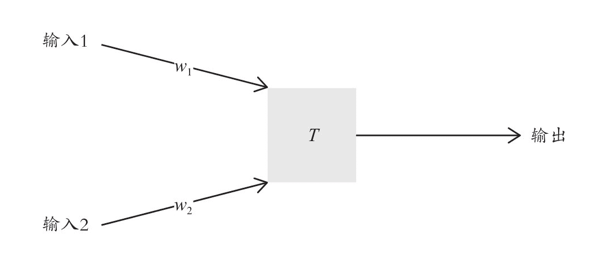

图 22　单层感知器，无法计算异或

异或的定义为：任一输入激活时输出触发；两输入同时激活或同时不激活时输出不触发。若单层感知器可实现，则权重 w[1]、w[2] 与阈值 T 需同时满足：

·两输入皆未激活时加权和为 0，输出不触发，故 T>0；
·仅输入 1 激活时触发，故 w[1]>T；
·仅输入 2 激活时触发，故 w[2]>T；
·两输入均激活时不触发，故 w[1]+w[2]<T。

显然不存在同时满足的 w1、w2、T，故单层感知器无法计算异或。

再看两层感知器结构如何实现异或，如图 23。网络由三个神经元构成：神经元 1 在输入 1 或输入 2 激活时触发；神经元 2 在输入不同时激活时触发；神经元 3 在神经元 1 与神经元 2 同时触发时才激活。总体上恰好实现异或。

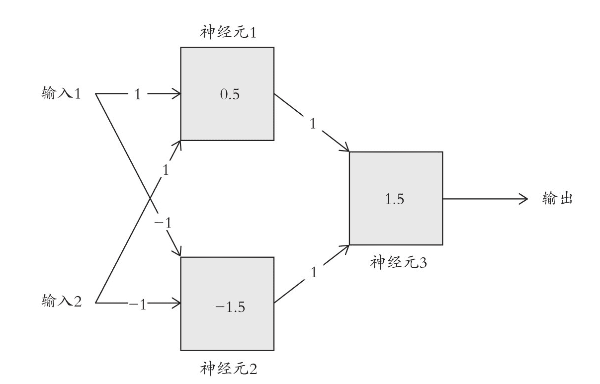

图 23　两层感知器结构可以计算异或函数

四种输入组合的推演如下：

1. 两输入皆未激活，神经元 2 触发，神经元 1 不触发，神经元 3 输入为 1，低于阈值 1.5，不触发。
2. 输入 1 激活、输入 2 未激活，神经元 1 与神经元 2 均触发，神经元 3 输入为 2，高于阈值 1.5，触发。
3. 输入 2 激活、输入 1 未激活，计算同情形 2，神经元 3 触发。
4. 两输入同时激活，神经元 1 触发，神经元 2 不触发，神经元 3 输入为 1，低于阈值 1.5，不触发。

# 延伸阅读

对人工智能的权威现代介绍，参见斯图亚特·罗素与彼得·诺维格合著《人工智能：现代方法》第三版，培生 2016 年出版，本书在技术细节核对中反复使用。

若关注历史脉络，推荐尼尔斯·尼尔森《人工智能探索》，剑桥大学出版社 2010 年，为该领域资深研究者撰写的当代发展史指南。

关于艾伦·图灵生平，迄今较为完善的是安德鲁·霍奇斯《艾伦·图灵传：如谜的解谜者》，贝内特图书/哈钦森 1983 年。

威廉·考夫曼与豪里斯工程出版社的三卷本《人工智能手册》描绘了黄金时代的系统与技术，虽已绝版，网上仍可购得影印本。彼得·杰克逊《专家系统导论》，艾迪森·威斯利 1986 年，是研究专家系统的经典教材。知识工程的深入论述见《构建专家系统》，弗雷德里克·海耶斯-罗斯等编，艾迪森·威斯利 1983 年。逻辑传统的理解可参考迈克尔·杰纳西雷斯与尼尔·尼森《人工智能逻辑基础》，摩根·考夫曼 1987 年。

罗德尼·布鲁克斯《寒武纪智能》，麻省理工学院出版社 1999 年，收录其相关论文。笔者自荐《多智能体系统引论》第二版，威利 2009 年，作为智能体与多智能体系统入门。博弈论在 AI 中的应用见约夫·肖姆与凯文·莱顿-布朗《多智能体系统：算法、博弈论和逻辑基础》，剑桥大学出版社 2008 年。

机器学习方面，埃塞姆·阿培丁《机器学习：新人工智能》，麻省理工学院出版社 2016 年，提供相对非正式的介绍；深度学习入门推荐伊恩·古德费洛等《深度学习》，麻省理工学院出版社 2017 年。罗素与诺维格的著作亦涵盖众多机器学习方法。

奇点探讨见默里·沙纳汗《技术奇点》，麻省理工学院出版社 2015 年；AI 伦理见维吉尼亚·迪格努姆《负责任的人工智能》，施普林格 2019 年；技术与就业议题见卡尔·贝内迪克特·弗雷《技术陷阱》，普林斯顿大学出版社 2019 年。

强人工智能与有意识机器的经典论述见玛吉·博登《人工智能与自然人》，麻省理工学院出版社 1977 年；意识教材推荐苏珊·布莱克莫尔《意识概论》，霍德与斯托顿 2010 年。丹尼尔·丹尼特关于心智、意识与 AI 的文章均具价值，入门可读《心智类型》，基本书局 1996 年，继而阅读《我在哪儿》，最初刊于其 1978 年《头脑风暴》。

# 作者注

当代人工智能与机器学习的论文多存放于开放文档库 arXiv，编号格式如 arXiv: 1412.6572，可于 https://arxiv.org 输入编号获取。

## 序言

1. http://tinyurl.com/y7zc94od
2. http://tinyurl.com/yxk3xurl

## 第一章 图灵的电子大脑

[1] 霍奇斯，《艾伦·图灵传：如谜的解谜者》，贝内特图书/哈钦森出版社，1983 年。

[2] 除科学成就外，图灵在英国社会亦产生深远影响。经长期运动，英国政府于 2014 年对他予以赦免，随后同案者亦获赦。

[3] 这是检验质数最直观却非最优雅的方法。古已有埃拉托斯特尼筛法更为简洁。

[4] 此后不再区分图灵机与通用图灵机，统称图灵机。

[5] 图灵与普林斯顿数学家阿隆佐·邱奇分享判定问题解决的荣誉，后者独立得到不同证明。图灵的证明更为直接、完整、易懂，影响深远，并据此发明图灵机，改变世界。

[\[6\]](#part0004.html#bookBack_6). 严格区分来看，算法属于可复用的解题方法论，程序则是把该方法论用 Python、Java 等具体语言实现的可执行形式，所以前者并不依附于某种语言。

[\[7\]](#part0004.html#bookBack_7). 图灵机的操作在概念上极其原始，这里列出的指令属于典型的低层语言，相比之下抽象程度已大幅提升，可读性也更强。

[\[8\]](#part0004.html#bookBack_8). 科尔曼与李维斯特合著《算法导论》初版，1990 年由麻省理工学院出版社与麦格劳-希尔共同出版。

[\[9\]](#part0004.html#bookBack_9). 图灵论文《计算机器与智能》刊于 1950 年《Mind》第 40 卷，第 433-460 页。

[\[10\]](#part0004.html#bookBack_10). 下述对话出自苹果麦金塔随带的 ELIZA 实现。可自行复现：打开 Applications，进去 Utilities，双击终端图标启动终端，待窗口稳定后按 Esc 再按 X，输入 doctor 回车即可。请记住这只是演示，并无真实理解。

[\[11\]](#part0004.html#bookBack_11). http://tinyurl.com/y7nbo58p

[\[12\]](#part0004.html#bookBack_12). 学术界对相关表述的使用并不统一。多数研究者把通用人工智能理解为能产生类人行为的系统，并不涉及自我意识等哲学问题，这与塞尔所说的弱人工智能基本相当。有时该词也被用来指代接近强人工智能的含义，本书采用弱人工智能的用法。

[\[13\]](#part0004.html#bookBack_13). http://tinyurl.com/y76xdfd9

## 第二章　黄金年代
[\[14\]](#part0005.html#bookBack_14). 该时期最具影响的创新来自约翰·麦卡锡提出的分时思想。他发现机器在等待输入或作业时空闲占比很高，于是把这段空闲算力分配给多名使用者实现并发，大幅提升了昂贵设备的利用率。

[\[15\]](#part0005.html#bookBack_15). 其真实含义是 LISP 处理器。LISP 的核心在于符号运算，而符号表正是支撑这一能力的关键结构。

[\[16\]](#part0005.html#bookBack_16). 娜萨《美丽心灵》，西蒙与舒斯特，1998。

[\[17\]](#part0005.html#bookBack_17). 麦卡锡等人 1955 年提交的《关于达特茅斯夏季人工智能研究项目的建议》，后收录于《人工智能》2006 年第 24 卷第 4 期，第 12-14 页。

[\[18\]](#part0005.html#bookBack_18). 威诺格拉德《理解自然语言》，学术出版社，1972。

[\[19\]](#part0005.html#bookBack_19). 语言学中用他、她、它等指代先前提及实体的现象称为指代。任何自然语言理解或生成系统都必须解决指代消解问题，这至今仍是难题。SHRDLU 在有限范围内实现了回指，被视作突破性进展。

[\[20\]](#part0005.html#bookBack_20). 菲克斯与尼森《STRIPS：定理证明应用于问题求解的新途径》，《人工智能》1971 年第 2 卷第 3-4 期，第 189-208 页。

[\[21\]](#part0005.html#bookBack_21). 控制 SHAKEY 的主机是 PDP-10，60 年代末的主流大型机，重逾一吨，需专用机房。可配最高 1 MB 内存，而今日口袋里的智能手机内存约是其四千倍以上，速度也不可同日而语。

[\[22\]](#part0005.html#bookBack_22). http://tinyurl.com/yxu8hwoq

[\[23\]](#part0005.html#bookBack_23). http://tinyurl.com/n6lf8t6

[\[24\]](#part0005.html#bookBack_24). 这里的数值仅作数量级说明，并非精确统计。

[\[25\]](#part0005.html#bookBack_25). 设分支因子为 b，深度为 d，则第 d 层状态数为 b 的 d 次幂，即 b 连续乘 d 次。这种增长称为指数增长，部分文献也称几何增长，但在 AI 文献中后者很少见。

[\[26\]](#part0005.html#bookBack_26). 跳棋在美国称 checkers，英国称 draughts。由于塞缪尔是美国人，原文使用 checkers。AI 领域通常称塞缪尔的跳棋程序，译作 draughts 程序会显得不自然。

[\[27\]](#part0005.html#bookBack_27). 哈特、尼尔森、拉斐尔《最小成本路径启发式测定的形式基础》，《IEEE 系统科学与控制论汇刊》1968 年第 4 卷第 2 期，第 100-107 页。

[\[28\]](#part0005.html#bookBack_28). 这类计算问题在文献中被命名为独立集。

[\[29\]](#part0005.html#bookBack_29). 正文对旅行商的描述做了简化，更准确的表述为：给定城市集合 C，任意两城 i、j 有距离 d i,j，并设总里程上限 B。问题是是否存在 C 的一种排列，使得按此顺序访问全部城市并返回起点，总行程不超过 B。

[\[30\]](#part0005.html#bookBack_30). P 表示多项式时间，只有能在多项式时间内完成的算法才被视为可行的求解手段。关于 NP 完全与 P 与 NP 的更多信息可参考延伸阅读。

## 第三章　知识就是力量
[\[31\]](#part0006.html#bookBack_31). 温斯顿与霍恩《LISP》第三版，培生，1989。

[\[32\]](#part0006.html#bookBack_32). 肖特利夫《基于计算机的医学诊断系统：MYCIN》，爱思唯尔，1976。

[\[33\]](#part0006.html#bookBack_33). 尚克与亚伯森《脚本、计划、目标和理解：对人类知识结构的探究》，心理学出版社，1977。

[\[34\]](#part0006.html#bookBack_34). 伍兹《链接中有什么？语义网络基础》，载于博罗与 A·柯林斯编《认知科学中的表征与理解研究》，摩根·考夫曼，1975。

[\[35\]](#part0006.html#bookBack_35). 麦克德莫特《塔斯基语义学，或称无意指不表达！》，《认知科学》1978 年第 2 卷第 3 期，第 277-282 页。标题暗合“无代表不纳税”的口号，文章写于 1976 年美国独立二百年前后。

[\[36\]](#part0006.html#bookBack_36). 麦卡锡《逻辑人工智能的概念》，未刊行。

[\[37\]](#part0006.html#bookBack_37). 克罗克森与梅利什《PROLOG 编程》，施普林格，1981。

[\[38\]](#part0006.html#bookBack_38). PROLOG 使用的演绎机制是解析，最早在 60 年代出现，可高效实现 PROLOG 规则。

[\[39\]](#part0006.html#bookBack_39). 沃伦《生成有条件的计划和编程》，第二届夏季人工智能行为与模拟会议论文集，爱丁堡，1976 年 7 月。

[\[40\]](#part0006.html#bookBack_40). 古哈与莱纳特《Cyc：中期报告》，《人工智能杂志》1990 年第 11 卷第 3 期。

[\[41\]](#part0006.html#bookBack_41). 普拉特《CYC 报告》，1994 年未发表，可见 http://tinyurl.com/y4q4aoqj。

[\[42\]](#part0006.html#bookBack_42). 赖特《默认推理逻辑》，《人工智能》1980 年第 13 卷，第 81-132 页。

[\[43\]](#part0006.html#bookBack_43). 该例被称为尼克松菱形，图形呈菱形。

## 第四章　机器人与其合理性
[\[44\]](#part0007.html#bookBack_44). 布鲁克斯《无表征智能》，《人工智能》1991 年第 47 卷，第 139-159 页。

[\[45\]](#part0007.html#bookBack_45). 人类高级智能主要由新皮质承担，而进化史显示新皮质出现较晚。对人类而言推理与问题求解是相对晚近的能力，漫长进化中祖先并不具备。

[\[46\]](#part0007.html#bookBack_46). 罗素与苏布拉曼尼亚《可证明的有边界最优智能体》，《人工智能研究杂志》1995 年第 2 卷。

[\[65\]](#part0008.html#bookBack_65). https://www. irobot.co.uk

[\[47\]](#part0007.html#bookBack_47). 布鲁克斯《一个走路的机器人：进化网络的应急行为》，机器人与自动化会议论文集，1989 年 5 月，亚利桑那州斯科茨戴尔。

[\[48\]](#part0007.html#bookBack_48). 弗格森《旅行机：有态度的自主智能体》，《IEEE 计算机》1992 年第 25 卷第 5 期，第 51-55 页。“旅行机”与“图灵机”读音相同为双关。该系统的开发者弗格森是我多年的朋友。

[\[49\]](#part0007.html#bookBack_49). 维尔与比克莫尔《基础智能体》，《计算智能》1990 年第 6 卷，第 41-60 页。

[\[50\]](#part0007.html#bookBack_50). 图形用户界面与桌面界面的雏形并非苹果原创，应归功于施乐帕洛阿尔托研究中心的研究人员。苹果将其商业化。

[\[51\]](#part0007.html#bookBack_51). http://tinyurl.com/y9qxdko5

[\[52\]](#part0007.html#bookBack_52). 梅斯《智能体能够帮助人们减少工作量和信息过载》，《ACM 通讯》1994 年第 37 卷第 7 期，第 30-40 页。

[\[53\]](#part0007.html#bookBack_53). 埃齐奥尼与威尔德《基于软件机器人的互联网交互》，《ACM 通讯》1994 年第 37 卷第 7 期，第 72-76 页。

[\[54\]](#part0007.html#bookBack_54). 冯·诺依曼与摩根斯坦《博弈论与经济行为》，普林斯顿大学出版社，1944。

[\[55\]](#part0007.html#bookBack_55). 为叙述方便，文中把货币与效用视为等价。实际中二者常相关但不等同，若把效用等同于金钱会招致经济学家不满。效用理论本质是用数值捕捉偏好。

[\[56\]](#part0007.html#bookBack_56). 罗素与诺维格《人工智能：现代方法》第三版，培生，2016，第 611 页。

[\[57\]](#part0007.html#bookBack_57). 墨菲《人工智能机器人简介》，麻省理工学院出版社，2001。

[\[58\]](#part0007.html#bookBack_58). 珀尔《智能系统中的概率推理：合理推理网络》，摩根·考夫曼，1988。

[\[59\]](#part0007.html#bookBack_59). 伍尔德里奇《多智能体系统引论》第二版，威利，2009。

[\[60\]](#part0007.html#bookBack_60). 鲁宾斯坦与奥斯本《博弈论课程》，麻省理工学院出版社，1994。

[\[61\]](#part0007.html#bookBack_61). 塞尔曼、莱维斯克与米契尔《一种解决难满足性问题的新方法》，第十届国际人工智能会议论文集，1992 年，加利福尼亚州圣何塞。

## 第五章　深度突破
[\[62\]](#part0008.html#bookBack_62). 深度思维收购价报道不一，《卫报》称约 4 亿英镑。http://tinyurl.com/kvyueye

[\[63\]](#part0008.html#bookBack_63). 明斯基与帕普特《感知器：计算几何导论》，麻省理工学院出版社，1969。

[\[64\]](#part0008.html#bookBack_64). http://tinyurl.com/ycu4ngsg

[\[81\]](#part0008.html#bookBack_81). 鲁梅尔哈特与麦克莱兰编《并行分布式处理》，两卷本，麻省理工学院出版社，1986。

[\[66\]](#part0008.html#bookBack_66). 鲁梅尔哈特、辛顿与威廉姆斯《利用反向传播错误学习表征》，《自然》1986 年第 323 卷，第 533-536 页。

[\[67\]](#part0008.html#bookBack_67). 古德费洛、本吉奥与库维尔《深度学习》，麻省理工学院出版社，2016。

[\[68\]](#part0008.html#bookBack_68). 按历史增速推算，约四十年后人工神经网络的神经元数量可接近人脑。但这并不意味着四十年内能实现人类水平的智能，因为大脑除神经网络外还有结构。

[\[69\]](#part0008.html#bookBack_69). http://www.image-net.org

[\[70\]](#part0008.html#bookBack_70). https://wordnet.princeton.edu

[\[71\]](#part0008.html#bookBack_71). 克里泽夫斯基、苏茨科弗与辛顿《基于深度卷积神经网络进行网络图像分类》，神经信息系统大会 2012，第 1106-1114 页。

[\[72\]](#part0008.html#bookBack_72). 古德费洛等人《解释和利用对抗性案例》，arXiv:1412.6572。

[\[73\]](#part0008.html#bookBack_73). 姆尼赫等人《使用强化深度学习来玩雅达利游戏》，arXiv:1312.5602v1。

[\[74\]](#part0008.html#bookBack_74). 姆尼赫等人《通过强化深度学习实现人类水平控制》，《自然》2015 年第 518 卷，第 529-533 页。

[\[75\]](#part0008.html#bookBack_75). 西尔弗等人《使用深度神经网络和搜索树掌握围棋游戏》，《自然》2016 年第 529 卷，第 484-489 页。

[\[76\]](#part0008.html#bookBack_76). http://tinyurl.com/ydafuhj p

[\[77\]](#part0008.html#bookBack_77). 西尔弗等人《脱离人类知识干预掌握围棋游戏》，《自然》2017 年第 50 卷，第 354-359 页。

[\[78\]](#part0008.html#bookBack_78). https://www.captionbot.ai

[\[79\]](#part0008.html#bookBack_79). https://translate.google.com

[\[80\]](#part0008.html#bookBack_80). 该段落由苏格兰作家兼译者斯科特·蒙克利夫翻译，其译本在文学史上享有盛名，被认为不输原著，虽也有人批评其对普鲁斯特语言的使用过分。

## 第六章　人工智能的今天

第七章 别自己吓自己：我们脑补的AI末日长什么样

科幻感最强的担忧，往往离落地最远。奇点论把指数增长包装成不可避免的超智能突现，机器人三定律被拿来讨论武器伦理，道德实验机器又被用来争论自动驾驶该怎么选。阿西洛玛原则、超级智能风险、技术奇点的生存指南，这些讨论构成了公众想象里的AI威胁图谱。它们有价值在于提前划界，但也容易让焦虑脱离技术现实，被当成永恒的警钟反复敲响。

第八章 已经上线的AI，正在制造哪些真实问题

当算法从实验室走向街道、法庭、招聘和推荐，麻烦就变得具体而普通。自动化对就业结构的冲击、风险评估模型里的群体偏差、预测警务强化既有不公，都是已发生的社会摩擦。杀手机器人的制度管控、平台偏好图的隐形塑造、性别和数据偏见导致的产品盲点，说明问题不在于机器要不要造反，而在于设计和落地时谁被看见、谁被忽略。伦理不是遥远的哲学议题，而是代码、数据和权力分配的日常后果。

第九章 意识这条路，机器还要跨过哪些坎

让机器“像人一样思考”不等同于让它“有感觉”。从蝙蝠的体验问题到快慢思维的区分，从自由意志的神经学证据到心智理论的萌芽，研究者一直在拆解意识到底包含哪些层次。图灵测试的变体、意向立场、面向智能体的编程，都在探索我们可以观察到的智能与不可验证的主观体验之间的鸿沟。进化视角提醒我们，大脑皮层的规模与社会认知紧密相连，这让“有意识的机器”不再是开关问题，而是功能、结构与解释框架的长期追问。