# AI全传：牛津学界院长谈AI的边界与真相

本书致敬牛津大学赫特福德学院的院长、研究者与学者们

# 第一部分 人工智能是什么

## 第一章 图灵的电子大脑

“我建议大家考虑一个问题：‘机器能思考吗？’”
——艾伦·图灵，1950年

每个学科的起源都能讲出好几个版本，对人工智能而言，开头更是百花齐放，因为人类对机器拥有灵魂的幻想由来已久。

可以从古希腊的锻造之神赫菲斯托斯说起，他能让金属活过来；可以从十六世纪布拉格的传说说起，拉比用泥土捏出守护犹太人的傀儡魔像；可以从十八世纪苏格兰的詹姆斯·瓦特谈起，他为蒸汽机设计的调速器为现代控制论埋下种子；可以从十九世纪初的瑞士别墅谈起，玛丽·雪莱与雪莱夫妇、拜伦勋爵在寒夜里玩文字游戏，写出《弗兰肯斯坦》；可以从十九世纪三十年代的伦敦谈起，拜伦之女阿达·洛芙莱斯与怪才查尔斯·巴贝奇相识，分析机让她思考机器是否能创造；也可以从十八世纪的自动机械热潮说起，那些精巧装置让人误以为活了过来。

起源或许很多，但在我看来，人工智能的故事起点与计算机的起点是重合的。最清晰的坐标是1935年的剑桥国王学院，一位才华横溢、特立独行的年轻人艾伦·图灵。

### 剑桥 1935

今天图灵家喻户晓，可想象不到在上世纪八十年代，他的姓名在数学和计算机之外几乎无人知晓。即便专业学生读到教材，也多半不了解他惊人的贡献和悲惨结局。主要原因有二：一是二战期间他在英国政府从事绝密工作，直到七十年代才解密；二是社会偏见，图灵是同性恋，在当时英国属于犯罪。1952年他因“严重猥亵罪”被判刑，被迫接受旨在压抑性欲的化学阉割疗法。两年后，年仅41岁的他自缢身亡。

大众熟知的图灵是2014年电影《模仿游戏》里的密码破译者，他在布莱切利庄园的工作对盟军胜利至关重要。但计算机科学家和人工智能研究者崇拜他，是因为他是真正意义上的计算机发明者，并成为人工智能的奠基人之一。

图灵在多个领域留下印记，最震撼的是他在偶然中发明了计算机。三十年代中期，他还是剑桥数学系学生时，挑了一道当时最核心的难题：希尔伯特在1928年提出的判定问题。问题本质是，所有数学命题是否都能被判定真假，也就是是否存在机械化的验证方法。希尔伯特只关心数学内部的“可判定”问题，比如：
·2+2等于4吗？
·4×4等于16吗？
·7919是质数吗？

后两个答案显然是肯定的，第三个则需要验证。质数只能被1和自身整除，确认7919是否质数，最笨的方法是从2开始逐一试除，直到确认没有除尽的数。这种方法不需要灵感，只需死板执行步骤，只要时间够就能给出答案。因此“某个数是否为质数”是可判定问题。

判定问题问的是：所有数学判定问题都可判定吗？是否存在无论投入多少时间都找不到机械步骤的问题？这本质上在问，数学能否全部化为算法。

图灵在1935年接下了这个挑战，并以惊人速度给出答案。人们通常以为深奥数学证明必定冗长，威尔斯证明费马大定理用了几百页。但图灵的证明异常简洁，核心只有几行。关键在于他先给出了“解决问题方法”的精确定义——图灵机。图灵机是对像验质数那样步骤的严格描述，它按既定程序一步步运算。当时它只是抽象概念，并未实体化。数学家们起初都被这种思路弄懵。

图灵机的威力在于，任何能写出的数学方法都能被编码为一台图灵机。于是希尔伯特的问题转化为：是否存在一种判定问题对所有图灵机都无解。图灵随后做了一个巧妙的设计，让机器变成通用型的——通用图灵机，它能按给定的任意方法运行。现代计算机的核心正是通用图灵机，程序本质上就是运算步骤。

图灵用新发明解决判定问题的思路，也直接牵连到人工智能是否可能的讨论。他设想了一台机器来判定任意图灵机是否会停机。给定一台图灵机和输入，它会停下来还是无限运行？这本身就是判定问题。图灵指出，假设存在能判定停机的机器，会导致悖论。因此停机问题不可判定。由此他得出结论：并非所有判定问题都能通过确定步骤解决。他回应了希尔伯特：数学不能完全还原为机械方法。

这一成果足以让他名垂数学史，而其副产品——通用问题解决机器——更为关键。图灵当时并未想着造出来，但很快人们动手了。二战的慕尼黑，康拉德·楚泽为德国航空部门造出Z3；美国宾夕法尼亚，约翰·莫奇利和普雷斯珀·埃克特造出ENIAC用于计算炮弹轨迹，约翰·冯·诺依曼改进后形成冯·诺依曼架构；二战后的英国，弗雷德·威廉姆斯与汤姆·基尔伯恩造出“曼彻斯特婴儿”，直接催生首台商用机费兰蒂一号。1948年图灵加入曼彻斯特大学团队，写下了第一条运行程序——做长除法。

到五十年代，现代计算机的关键部件已齐备。图灵机从概念变为实体，却要付出巨大代价：费兰蒂一号需占两个16英尺长、8英尺高、4英尺宽的储藏室，功率27千瓦，相当于三户现代家庭用电。随着时间推移，机器越来越小、越来越便宜。

### 电子大脑的实际功能

战后第一台计算机问世，报纸争相用“电子大脑”来形容。外形可怕却运算惊人，能处理人类难以企及的海量算术，因而被误认为拥有高级智能。这个称呼一直沿用到上世纪八十年代初。然而名不副实：它们确实能高效完成繁琐计算，却没有智能。

理解计算机最初能做什么、不能做什么，是看清人工智能局限的关键。图灵机及其物理形态计算机的本质只是执行指令的工具，实现这一目的即可。我们给它的指令后来被称为算法或程序。大多数程序员并不知道自己在与图灵机类似的东西打交道，直接对图灵机编程枯燥乏味，代代学生深有体会。因此人们发明了Python、Java、C等高级语言，隐藏掉机器语言的繁琐细节。但本质并未改变：编程仍是枯燥、易错的，这也是程序频繁崩溃和程序员高薪的原因。

本书不会教编程，但需要明白程序指令如何运行。粗略说，计算机只会按步骤执行指令，例如：
把A与B相加
如果结果大于C就执行D，否则执行E
重复指令F，直到出现情况G
微软Word、PowerPoint、《使命召唤》、《我的世界》、Facebook、Google、淘宝、浏览器、手机App、支付宝、微信、QQ……最终都能化为类似指令清单。若要制造智能机器，其智能终需压缩进这些明确指令中。这正是人工智能的核心难题：简单的指令组合真的能产生智能行为吗？

在深入之前，先为计算机正名。它并非无用，恰恰极其伟大。首先，它快得令人难以想象。写作时，一台普通台式机全速可处理千亿条指令每秒。银河系恒星约千亿颗，这个数字并不直观。设想你手动执行指令，每10秒一条，全年不休不眠不吃喝，约需31710年才能完成计算机1秒的工作。

其次，错误率极低。人类执行海量任务难免出错，计算机则几乎不犯错，当然程序员的bug除外。现代处理器的平均无故障时间约5万小时，每秒忠实执行数百亿指令。

最后，计算机并非不能做决定。只要给出精确定义的决策指令，它就能自行调整行为随时间改变，这就是学习的雏形。

### 人工智能的产生为何如此艰难

我们已知道计算机能极快精准执行简单指令，并在精确定义下做决策。于是顺理成章出现结论：有些任务编码起来极简单，有些则极难。要理解为何人工智能如此难产、为何“进步”难以定义，就要看看哪些问题好编程，哪些问题难编程，以及原因。图1按难易程度排列了我们希望计算机完成的目标及实现时间。

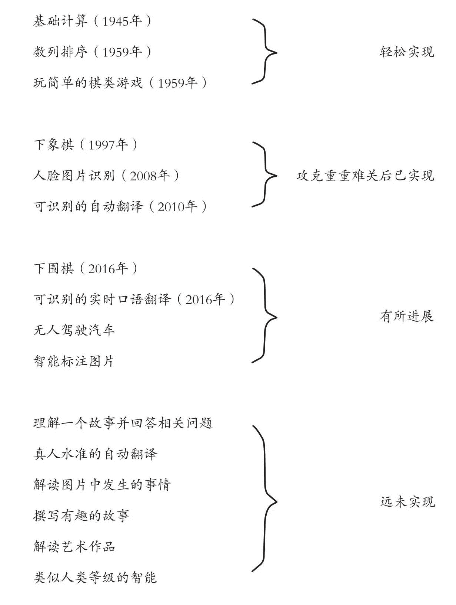
图1 把我们期望计算机实现的目标按难度排序，括号里的年份为大致解决时间，对至今未实现的任务则尚无头绪。

# 人工智能任务的难易程度与图灵测试

## 计算

最简单的是计算。加减乘除都能用极简步骤实现，这是早期计算机的初衷。1948年图灵在曼彻斯特为“婴儿机”写的首个程序就是长除法，在解决完深刻数学问题后回到基础运算，对他而言颇有讽刺意味。

## 排序

其次是排序，把数字按升序排列或姓名按字母顺序排列。步骤不复杂，但朴素方法慢得离谱。直到1959年快速排序法出现，排序才有了高效解法，此后半个世纪再无明显超越。

## 搜索与游戏

接下来是需要攻坚的问题。下棋是人工智能史上的经典。靠搜索技术粗暴穷举也能玩得不错，下一章会细说。但问题是，纯搜索在内存和时间上代价巨大，即便用全宇宙原子造计算机也无法用穷举法在合理时间内下围棋或国际象棋。要让搜索可行，必须加入启发式技巧——这正是人工智能开始介入的地方。

## 计算资源限制

这类问题理论上可解，实际却因资源需求过大而无法落地。人工智能研究中经常遇到，学界围绕如何降低成本展开大量工作。

## 机器学习问题

列表中的下一类不同，人脸识别、机器翻译、实时语音翻译与下棋不同，传统计算机技术根本无法给出解决方案，必须探索新思路。事实上，这类问题正通过机器学习得到解决，后续章节会深入讨论。

## 无人驾驶汽车

无人驾驶听起来像是再普通不过的任务，开车对人来讲几乎是本能，并不要求多高的智商。但把方向盘交给电脑后，难度瞬间拉满。最棘手的不是决定要不要刹车、加速、左转还是右转，而是先搞清楚眼前的世界到底是什么样。想象一下一辆自动驾驶车开进纽约的繁忙路口，车流呼啸、行人穿梭、自行车混行，工地占道、指示牌和路面标线密密麻麻，还可能同时遭遇雨、雪和大雾。真正的挑战在于感知与预测：我在哪里，周围有哪些车，它们在什么位置打算往哪走，行人现在在哪、下一秒会往哪挪。把这些信息全部捕捉清楚，行动选择反而变得简单了。关于具体实现方式，我们后面再展开。

## 还有哪些问题让 AI 束手无策
接下来是一组更根本的困惑。我们至今仍不清楚该怎么让计算机真正读懂一个复杂的故事，并对它提出的问题做出恰当回答。计算机能否像译者那样把小说细腻的语气译成信达雅的文本？它能否做到“看图说话”，不只是认出图里的人物，而是讲清画面里发生了什么？它能不能独立写出一个有趣的故事，或是解读一幅绘画等艺术作品？归根结底，我们的宏大设想是：计算机何时能拥有接近人类的智能。

## AI 进步的两种驱动力
让机器完成书中图1所列的那些困难任务，背后大致有两种原因。第一种是方法论上我们已经知道怎么解，但算力与内存等现实成本太高。比如象棋和围棋，理论路径清楚，却需要天量运算。第二种是我们根本不知道解法是什么，例如人脸识别这件事，在机器学习出现前几乎没有可行思路。几乎所有当代研究都在围绕这两类瓶颈做文章。

## 人类级智能的终极梦
图1里最艰难的目标，就是造出通用的人类水准智能机器。这个愿景吸引了无数人，而最早提出系统思考的人之一，就是艾伦·图灵。

## 图灵测试是什么
### 背景脉络
四十年代末到五十年代初，第一台电子计算机诞生，围绕其潜力的公开讨论随之爆发。麻省理工学院数学教授诺伯特·维纳出版的《控制论》把机器和动物大脑的神经系统做对比，点出了大量与人工智能相关的问题。这本书引发公众极大兴趣，却只有少数科学家能真正读懂。机器能否“思考”的争论登上报刊和广播，1951年图灵本人就参加了一场BBC的专题讨论。人工智能的雏形就这样在舆论中萌发。
在这种氛围下，图灵对“机器做不到×××”的俗套说法十分不满。他希望让怀疑者闭嘴，于是提出了一个后来被称为图灵测试的方案。自1950年首次提出以来，这个测试一直影响深远，至今仍是研究热点。可惜它并没有彻底让怀疑派沉默，原因我们稍后聊。

### 规则怎么说
灵感来自维多利亚时代流行的“模仿游戏”，玩法是通过问答判断对方性别。图灵提议对机器做类似检验。通俗描述是：一位人类提问者通过键盘和屏幕与对面“对象”文字聊天，事先不知道对方是真人还是程序。交互全程纯文本，提问者要判断对方的身份。如果对方其实是程序，却在合理时间内让提问者分不清真假，图灵认为就可以承认它具备类人智能。
图灵刻意避开了“是否真正有意识”等哲学争论，核心在于能否乱真，关键词是“无法分辨”。这正是科学方法中检验同异的典型思路：设计可操作的区分实验。图灵测试把提问者与被测对象隔开，形成黑盒，只允许输入输出。1950年，图灵在期刊《心智》上发表《计算机器与智能》，这是从现代数字计算机角度探讨人工智能的首篇论文。

## 图灵测试为何被质疑
图灵测试简洁优雅，也因此容易被钻空子。大量程序员更愿意用小技巧迷惑提问者，而非真正解决智能本质。最典型的例子是ELIZA，由麻省理工学院的约瑟夫·魏岑鲍姆在六十年代中期开发。魏岑鲍姆本意是做心理治疗实验，却意外成了“用肤浅手段伪装智能”的象征，尤其在图灵测试领域。

### ELIZA 的把戏
ELIZA 扮演精神科医生的角色，用开放式提问诱导用户自我揭露。它内置了一些关键词，比如“家人”“朋友”“孤独”“悲伤”，并配有相应的应答脚本。原理一穿透就很明显：关键词触发固定的镜像反问。示例大致是这样的，对话以斜体表示程序回复：
用户：我很孤独。
ELIZA：你经常感觉到孤独吗？
用户：是的，几乎每天都觉得。
ELIZA：为什么你说几乎每天呢？
用户：我想是家里人的原因。
ELIZA：告诉我一些你家里人的情况吧。
用户：他们讨厌我。
ELIZA：是什么让你相信他们讨厌你呢？
……
开场尚可，几轮下来空洞感就暴露无遗。魏岑鲍姆从未声称它能理解对话。令人意外的是，ELIZA在学术圈外引发了强烈共鸣。八十年代就有传闻说有社交障碍的研究生整夜与它聊天。还流传过一个令人不安的故事，说它可能在无意中怂恿抑郁者自杀。魏岑鲍姆让自己的秘书测试，结果秘书要求他在对话期间离开房间，因为她清楚这只是程序互动。

### 洛布纳奖的场面
ELIZA的影响以每年一度的洛布纳奖竞赛延续至今。1990年，美国富豪休·洛布纳设立奖项，每年邀请程序参赛，看能否让评委相信自己在与真人对话，胜出者可获十万美元。
竞赛很快出现争议。马文·明斯基称其为“毫无意义的宣传噱头”。问题在于，参赛作品多是ELIZA的变体，靠误导技巧取胜，而非展开有意义的对话来证明类人理解力。2009年的获奖作品“进展无限”由象棋专家大卫·利维编写，对话片段如下：
提问：嗨，过得怎么样？
程序：你好，你过得怎么样？
提问：挺好的，你是谁？
程序：这个，我在学习工程学，这应该会让你猜想到我是谁。
……
整体看上去比ELIZA复杂，但与真实人类交流仍差距甚远。ELIZA也催生了互联网聊天机器人，大多只是关键词联想加反问等小技巧，聊天内容苍白无趣，并非真正的人工智能。

## 人工智能的不同层次
图灵测试如今已不实用，却仍具历史意义。因为它最早给研究者一个明确目标：造一台能真正通过图灵测试的机器。如今只有极少数严谨的研究者仍以此为目标，但它在历史上的作用不可替代。
吸引人之处在于它非常直观，但也暗藏难题。提问者之所以能分辨对方，是因为对方能理解问题并给出人性化的答案。若程序通过测试，可能存在两种逻辑截然不同的情况：
1. 程序真的理解了对话，理解方式与人类相近；
2. 程序并未真正理解，只是模拟出理解后的回复。
差距巨大。第一种远比第二种有说服力。多数研究者承认第二种在原则上可行，但对第一种是否可行仍缺乏充分证据。图灵测试本身并不要求证明理解，而是停留在行为可区分性上。图灵本人恐怕会对这种区分感到恼火，他提出测试正是为了结束这场争论。因此追求第一种的实现，比第二种更具雄心，也更具争议。

### 强 AI 与弱 AI 的分野
把目标定为拥有类人理解力甚至意识的程序，被称为强人工智能。次一级的目标是做出没有真正理解力但能模拟特定能力的程序，被称为弱人工智能。

## 超出图灵框架的尝试
以“无法分辨”为原则，图灵测试衍生出许多变体。更严格的版本设想机器人伪装成人类参与日常生活，要求达到几乎无法区分的程度，未来很长一段时间内只能存在于小说。1982年雷德利·斯科特的《银翼杀手》里，哈里森·福特饰演的主角每日进行测试以辨别女性是人还是机器人。2014年的《机械姬》也是类似主题。
研究者也在探索能破解聊天机器人诡计的测试方式，让检验更贴近真正的智能。

### 用理解力来检验
一个直接的思路是测试理解力。威诺格拉德模式就是一类需要理解的短句：
句子1a：市议员拒绝给示威者颁发许可，因为他们担心暴力。
句子1b：市议员拒绝给示威者颁发许可，因为他们鼓吹暴力。
问题：谁担心/鼓吹暴力？
两者仅一词不同，含义却完全反转。1a里“他们”指市议员担心示威者暴力，1b里“他们”指示威者鼓吹暴力。
另一个例子：
句子2a：奖杯不能放进棕色手提箱里，因为它太大了。
句子2b：奖杯不能放进棕色手提箱里，因为它太小了。
问题：什么太大/太小？
2a是奖杯太大，2b是手提箱太小。大多数有常识的成年人都能秒懂，但依赖关键词联想的聊天机器人就会露馅。要答对，需要真正理解句子并对示威、许可、市议员等现实场景有基本认知。

### 常识理解的鸿沟
人工智能的另一道坎是理解人类世界的约定俗成。语言学家斯蒂芬·平克设计过一段对话：
鲍勃：“我要离开你。”
爱丽丝：“她是谁？”
对常人而言很容易：鲍勃和爱丽丝在恋爱，鲍勃的话暗示移情别恋，爱丽丝在问第三者是谁，并很生气。这种常识性理解对讲故事和写作至关重要。若程序能把握信仰、欲望、关系等日常常识，就能欣赏肥皂剧《东区人》之类内容。这正是区分强AI与弱AI的关键点，目前我们对如何实现只有模糊设想，尚无成功案例。

## 通用人工智能 AGI 是什么
强人工智能的设想听起来清晰，实际却几乎没有头绪，连精确定义都困难，更遑论实现时间。因此，尽管这个话题迷人，它很大程度上与当代主流AI研究脱节。去尖端研讨会很少听到相关讨论，反而在深夜酒吧里能聊到不少。
更现实的退一步目标是制造具备普遍人类智能水平的机器，通常称为通用人工智能AGI。它大致相当于一台拥有普通人全部智慧能力的计算机，包括自然语言交流、解决问题、推理、感知环境等，并能完成图1所示的所有任务甚至更多。现有的AGI文献通常回避自我意识等议题，因此AGI常被视为弱人工智能的一种极致形态。

即便把次一级的构想当成切入点，在当下研究版图里也只是边缘议题。学界真正发力的方向，是做出能替代人脑完成现阶段工作的程序，围绕图 1 所罗列的任务清单逐项推进。有人习惯把这种思路称为狭义人工智能，但这并非学术共同体的正式用语，会议上这么说会被视作外行。如今的研究根本无需再加前缀，因为流行的说法里，狭义人工智能就是人工智能。对期待全能机器人管家的人而言这是坏消息，对害怕机器统治人类的人而言反而算好消息。

至此，你应该对 AI 到底指什么、为什么难实现有了基本轮廓。接下来，研究者具体怎样着手解决各类问题？

## 心智或者大脑？

要让机器呈现出接近人类水平的智能表现，历史上大致走过两条路线。第一条是搭建思维模型，也就是我们日常会用到的有意识推理、认知、问题求解过程。这类做法被称作符号人工智能，因为它借助符号指代事物并开展推理判断。例如在机器控制系统中，符号 `room 451` 可能是机器人用来指代你卧室的记号，而 `cleanroom` 则用来定义“房间清洁”这项活动。行动确定时，机器人会明确使用这些符号，比如发出 `cleanroom(room 451)` 就等于要清洁你的卧室。在机器人语言里，符号就是事物与行为的载体。

从 20 世纪 50 年代中期到 80 年代末，约三十年间，符号人工智能是构建人工智能系统的主流范式。它优点不少，最突出的是过程透明：当机器人准备执行 `cleanroom(room 451)` 时，我们可以清楚理解它打算做什么。我认为它长期流行，还因为它契合了我们有意识的思维方式。我们“思考”时本身就是用符号或文字把思路流程化，在行动前往往在心里先进行一番对话，权衡利弊后才做出选择。符号人工智能试图捕捉这一切，这部分内容我们将在第二章展开讨论。符号派的发展在 20 世纪 80 年代初达到顶峰。

另一条模拟智慧的路径是模拟大脑，这是一种极端设想，即在计算机里复刻一个完整的人类大脑，甚至连神经系统一起模拟。毕竟人类大脑是我们唯一确知能够产生智慧的器官。这条路的难题在于大脑的复杂程度难以想象：人脑约有 1000 亿个相互连接的神经元，我们对它们的构成、结构和工作方式的了解还远不足以复制大脑结构。这不是短期能完成的任务，我甚至怀疑它是否根本不可实现，尽管这一怀疑也无法阻止某些人尝试涉足该领域[\[13\](#part0018.html#booknote_13)]。

不过我们可以从大脑结构中汲取灵感，以此为蓝本搭建智能系统的组件。这一研究方向被称为神经网络——名字来源于大脑微观结构中呈网状连接的信息处理单元神经元。神经网络的研究可以追溯到人工智能诞生之前，并始终沿着主流发展。正是 21 世纪神经网络研究的突破性进展，才推动了当前人工智能研究的繁荣。

符号人工智能与神经网络人工智能是两条截然不同的路线，方法论完全不同。在过去六十多年里，双方各有高光与低谷，也曾爆发激烈争论。然而在 20 世纪 50 年代，人工智能作为新兴学科诞生时，符号人工智能在很大程度上占据主导。

[\[1\](#part0004.html#noteBack_1)　《弗兰肯斯坦》被认为是世界上第一部真正意义上的科幻小说。

[\[2\](#part0004.html#noteBack_2)　查尔斯·巴贝奇发明的分析机被认为是最早期的计算机雏形，而阿达·洛芙莱斯的算法则被认为是最早的计算机程序和软件。

[\[3\](#part0004.html#noteBack_3)　图灵指出的悖论即著名的“停机问题”，如果存在图灵机 A，对它输入任意图灵机，都能够判定其运行结果是“停机”或者“不停机”，那么可以构造图灵机 B，调用图灵机 A 但输出永远与之相反，即 B 的输入经 A 判定“停机”，则 B“不停机”，如果 B 的输入经 A 判定“不停机”，则 B“停机”。那么，图灵机 B 的输入为图灵机 B 本身时，则出现矛盾。B 只有在“停机”的时候才能“不停机”，反之亦然。此悖论与理发师悖论类似，理发师声称“给而且只给那些不给自己理发的人理发”。如果理发师不给自己理发，那么根据定义，他要给自己理发；如果理发师给自己理发，那么根据定义，他不能给自己理发。

[\[4\](#part0004.html#noteBack_4)　1 英尺≈0.30 米。

[\[5\](#part0004.html#noteBack_5)　2016 年 NIPS(神经信息处理系统大会，是一个关于机器学习和计算神经科学的国际会议)上，出现一家神秘的创业公司：火箭人工智能，宣称要基于一项革命性的“时间递归最优学习”技术来进行人工智能项目开发。短短几小时，吸引了五家风投公司对此项目进行评估，估值高达上千万美元。事实上，这家公司是参会的专家们注册来恶搞的，该技术纯属子虚乌有，专家们旨在以此来讽刺人工智能领域的投资泡沫太过严重。

# 第二部分 我们是怎么走到这一步的

## 第二章 黄金年代

图灵在论文《计算机器与智能》中提出图灵测试，为人工智能学科迈出了第一步。可在当时，这一划时代的贡献显得十分孤单。那时人工智能还没有名称，没有形成学科，也没有研究团队。图灵的贡献基本上停留在概念层面，比如图灵测试——因为人工智能系统尚未出现。十年过去，到 20 世纪 50 年代末，一切都发生了翻天覆地的变化：新学科建立并有了专属名字，研究人员可以自豪地展示揭示智能行为基本构成的第一个试验系统。

接下来的二十年是人工智能的首次繁荣期。1956 年到 1974 年间，人工智能研究呈现乐观积极、快速发展的态势，这一时期被称作人工智能的黄金年代。那个年代的研究者似乎不认识失望，一切皆有可能。那个时期诞生的系统堪称人工智能史上的传奇经典。它们拥有古怪的名字，比如 `SHRDLU`、`STRIPS` 或者 `SHAKEY`，名字都很短，多数源自首字母缩写，全用大写字母。那大概与当时计算机文件名的限制有关，这种命名习惯一直延续至今，尽管早已没有必要。以今天的标准看，用来搭建这些系统的计算机运算速度慢得难以置信，内存小得惊人，使用起来麻烦得令人发指。如今开发软件时理所当然会用到的工具，当时并不存在，即便存在也无法在当时的机器上运行。那时“黑客”文化悄然兴起，人工智能研究者大多在夜间工作，因为白天的计算机资源要用在更“重要”的事务上。他们还必须发明各种巧妙的编程技巧[\[14\](#part0018.html#booknote_14)]，让复杂程序能在简陋的机器上运行——许多技巧后来成为技术标准，它们诞生于 60 到 70 年代的人工智能实验室，如今人们只能模糊回忆，或许已无人记得。

然而到了 20 世纪 70 年代中期，研究开始停滞不前，除最初的简单试验外，很难看到有意义的进展。这门初生的学科几乎被资助方扼杀在摇篮里，科学界也逐渐相信，寄予无限希望的新生儿前途渺茫。

本章将回顾人工智能发展的头二十年，我们会研究这一时期构建的若干关键系统，并讨论当时人工智能领域最重要的技术之一：搜索。即使到今天，它仍是许多人工智能系统的核心组件。我们还会接触到一个抽象的数学理论——计算复杂性，该理论在 20 世纪 60 年代末到 70 年代初建立和发展，用来解释为什么人工智能所面对的诸多问题从本质上难以解决。计算复杂性为人工智能发展投下了阴影。

我们从公认的黄金年代起点说起：1956 年夏天，一位名叫约翰·麦卡锡的年轻美国学者为这一领域命名。

### 人工智能元年的盛夏

麦卡锡生活在美国现代科技创立的年代，在 20 世纪 50 到 60 年代，他以近乎不可能的才华贡献了一系列新理念。如今这些理念被视作理所当然，以至于很难想象当年没有它们计算机科学就不可能继续发展。他最著名的成就是 `LISP` 编程语言，几十年里一直是人工智能研究者的首选。虽然编程语言普遍难读，即便以我的专业标准来看，`LISP` 也很怪异。因为在 `LISP` 里，`(所有(程序(看(起来(都(是(这样的)))))))`。一代又一代程序员总爱开玩笑说 `LISP` 就是“一堆毫无关联的傻括号”[\[15\](#part0018.html#booknote_15)]。

麦卡锡在 20 世纪 50 年代中期发明 `LISP`，令人惊讶的是，近 70 年后它仍在全球教学和使用中。我每天都要用它。想想看，麦卡锡发明 `LISP` 时，美国总统是德怀特·戴维·艾森豪威尔，尼基塔·谢尔盖耶维奇·赫鲁晓夫是苏联共产党总书记；在中华地区，毛泽东主席正全力领导第一个五年计划，全世界电脑屈指可数。而今天，`LISP` 依然广泛使用。

麦卡锡出生于波士顿的移民家庭，很小就显露出非凡的数学天赋。数学系毕业于加州理工学院后，这个二十来岁的年轻人被任命为新罕布什尔州达特茅斯学院的副教授。加入达特茅斯前他就对计算机深感兴趣，1955 年，他向洛克菲勒研究所提交提案，希望获得经费在达特茅斯举办暑期学校。对非学者而言，成年人的暑期学校听起来奇怪，但在学术界这是一个久负盛名且受欢迎的传统，目的是召集全球有共同兴趣的研究者，在一段时间内见面交流与合作。选择暑期显然是因为教学任务结束，学者们得以卸下压力。既然选在风景优美的地方举办，必要的社交活动自然不可缺少。

对一所难忘的暑期学校而言，另一个要素是星光熠熠的学员名单。当时的人可能没预见到，达特茅斯暑期学校聚集了未来几十年里在人工智能领域起决定性作用的大部分关键人物。名单上还有一个令人痛心的名字：普林斯顿大学数学家约翰·福布斯·纳什小。六年前他刚获博士学位，在一篇仅 28 页的论文中引入了“非合作博弈”概念。该概念在随后几十年成为经济理论基石，并于 1994 年为其带来诺贝尔经济学奖。但纳什本人并未享受这项工作的果实：博士毕业几年后，他被妄想症和偏执狂等精神疾病吞噬，在之后几十年远离学术生活。幸运的是，他靠惊人毅力恢复良好，最终在 1994 年获奖。他的故事被写成《美丽心灵》，同名电影于 2002 年斩获奥斯卡最佳影片等多项大奖[\[16\](#part0018.html#booknote_16)]。

达特茅斯暑期学校名单的另一个特点是，除了学术界大佬，还接待了来自工业界、政府及军方的代表，甚至还有兰德公司——这家以加州智库为班底的机构，因在 20 世纪 60 年代毫无感情地争论如何“赢得”核战争而臭名昭著。十多年前，学术界、工业界、政府和军方曾联合执行曼哈顿计划，制造出世界上第一颗原子弹，这也是美国科技实力的明确体现。这种学术—工业—政府—军方的联合，是二战后几十年美国计算机技术发展的特色，也是美国在未来 60 年确立人工智能国际领先地位的核心。

1955 年麦卡锡向洛克菲勒研究所写申请书时，必须给这次活动起个名字，他选择了“人工智能”。麦卡锡对自己的活动抱有不切实际的高度期待——这也成了人工智能领域令人厌烦的传统——他高呼：“我认为我们可以取得重大进展……如果这些经过精挑细选的科学家能在一起共事一个夏天的话[\[17\](#part0018.html#booknote_17)]。”

暑期学校结束时，科学家们并未取得重大进展，但麦卡锡起的名字流传下来，逐渐形成一门新学科。

不幸的是，麦卡锡选的名字在很长时间里饱受诟病。首先，“人工”在英文 artificial 还有“虚假”“赝品”之意——谁愿意研究虚假的智能？另外，“智能”源于“智力”，而自 1956 年以来，人工智能界努力攻克的诸多挑战，人类完成时似乎并不需要太高智力。相反，正如上一章讨论的，过去 60 多年里人工智能致力解决的许多最重要也最困难的问题，似乎一点都不体现智能——这一事实一次次让新入门者感到惊愕与困惑。

不过，“人工智能”这个名字至今仍在使用。参与暑期学校的学者及其学术继承人，多年来持续研究，直至今日。那年夏天被公认为学科诞生元年，当时它听起来前途无量。

达特茅斯暑期学校之后的岁月是人工智能令人兴奋的成长期，某段时间甚至看似高速发展。几十年间，四名暑期学校成员主导了人工智能发展。麦卡锡在斯坦福大学创立人工智能实验室，位于现今硅谷中心地带，马文·明斯基在麻省理工学院也创立实验室，艾伦·纽维尔与他的博士导师赫伯特·西蒙则去了卡内基·梅隆大学。这四位天才带领的学生建立的人工智能系统，是我们这一代研究者的图腾。

然而黄金年代也带有幼稚、盲目乐观的色彩，研究者对发展速度做出鲁莽预测，反而阻碍了实际发展。到 20 世纪 70 年代，美丽的梦幻结束，一场恶性循环开始——人工智能的繁荣与萧条不断交替，在未来几十年里反复上演。但无论历史如何批判这一时期，我仍怀着喜爱去回想那个时代涌现的人物与他们创造的伟大成就。

### 分治策略

正如我们所知，通用人工智能是一个庞大而模糊的目标，很难直接达成。因此黄金年代采用的策略是分而治之。也就是说，与其一口气尝试构建完整的通用智能系统，不如识别通用人工智能系统所需的各项不同能力，分别构建具备这些能力的体系。这一概念隐含的假设是，如果我们能成功构建通用人工智能所必需的每一种智能系统，那么之后把它们组合成整体，比起直接构建完整的通用智能系统要容易得多。这一基本假设——通用人工智能研究应集中精力解决智能行为的各种组件——成为人工智能研究的标准方案。人们争相建造能够展现智能行为能力的组件。

那么研究者关注的主要问题有哪些？首要也是最难解决的问题，偏偏是我们认为理所当然应该具备的：感知。一台机器要在特定环境中智能工作，就必须获取周围环境的信息。我们人类通过多种机制感知世界，包括五种感觉：视觉、听觉、嗅觉、触觉和味觉。因此需要研究制造能够感知外界的传感器。如今机器人使用各式各样的人工传感器接收环境信息——雷达、激光雷达、红外测距仪、超声波测距仪等。但制造这些传感器本身就是一项复杂工程，这还只是问题的一部分。不管数码相机的光学系统多好，图像传感器有几百万还是几千万像素，最终相机所做的事情只是把看到的图像解析成网格，并为每个单元格分配数字表示颜色和亮度。所以，即便配备了质量最好的数码相机的机器人，最终收到的信息也只是一连串数字。因此，感知领域的第二个挑战是如何解析这些原始数字，理解它所“看到”的图像。这项挑战远比制作传感器困难得多。

通用智能系统的另一个关键能力是通过学习积累经验，这引出了机器学习这一研究分支。就像“人工智能”本身一样，“机器学习”也是一个极不恰当的术语，听起来像机器自行引导学习，从无知变得越来越聪明。事实上，机器学习与人类学习完全不同，它指的是解析和预测数据。例如，过去数十年机器学习的一项巨大成就是实用的人脸图像识别技术，通常做法是给程序大量它希望学习的例子。因此，用许多人脸图片及对应人名训练人脸识别程序，最终效果是给它一张图片就能正确给出对应人名。

问题解决和制订计划是两个相关能力，也与智能行为有关。它们都要求用给定动作组合达成目标，关键在于找到正确的动作序列。例如象棋或围棋这类棋盘游戏，目标是赢，行动是在棋盘上移动或放置棋子，挑战是要找出正确的下棋步数以达到获胜目的。而正如我们所了解的，在问题解决和制订计划中最根本的难点在于，只需考虑移动棋子的所有可能结果，从原理上看很容易做到，实际上执行起来却非常困难，因为棋子可能移动的步骤实在太多。

推理也许是诸多与智能相关行为中最令人崇拜的一种：它基于现有事实，用强大的逻辑方式获取新知识。举一个著名例子，若你知道“所有人都是凡人”，你也知道“迈克尔是一个人”，那么就可以推理得出“迈克尔是凡人”的结论。一个真正的智能系统很容易做到这一步，然后利用新知识做出进一步推理。例如，知道“迈克尔是凡人”后，就能推论出“迈克尔有朝一日会死去”“迈克尔死去以后将不会复活”等等。自动推理就是赋予计算机这种逻辑推理能力。在第三章中，我们将看到，长期以来人们都认为这种推理能力应该是人工智能的主攻方向。虽然现在已不是主流，但自动推理仍是人工智能领域中一个重要的分支。

最后是自然语言理解，这涉及让计算机理解人类的语言，比如中文或英文。目前计算机程序员为计算机编程时，必须使用人造的机器语言：某种定义精确、规则明确、专门为计算机构造的语言。这些语言目前最著名的是 Python、Java 和 C，比起自然语言简单得多。很长一段时间里，让计算机理解自然语言的主要方法是试图为自然语言加以精准定义和明确规则，就像定义计算机语言一样。而事实证明这不可能。自然语言太灵活、模糊且易变，无法用这种方式严格定义，而语言在日常生活中的使用方式更阻碍了对其进行精确定义的尝试。

## SHRDLU 和积木世界

在人工智能黄金年代，`SHRDLU`几乎成了家喻户晓的代表作。这个拗口的名字其实来自印刷排字机上的一组字母，程序员就是喜欢自作聪明的玩笑。1971 年[\[18\]](#part0018.html#booknote_18)，斯坦福的博士生特里·威诺格拉德 Ter ry Winograd 做出了这套系统，它的野心很明确：同时展示机器解决问题的能力与理解自然语言的能力。

支撑起问题求解的是人工智能里最经典的实验沙盒之一——积木世界。那是一个装满彩色方块、盒子和锥体的虚拟房间。用模拟环境代替真实机械臂，初衷是把复杂度压到可控范围。在这个世界里，`SHRDLU`能按指令摆放物体，也能调用虚拟机械手去搬运。图 2 展示了积木世界的起承状态与目标状态，把前者变成后者就是真正的考验，而允许的操作只有四类：

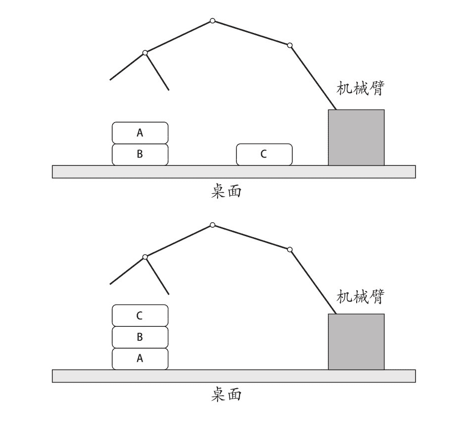
图 2　积木世界上图是初始状态，下图是目标状态，你要怎么转换呢？

·抓取桌面上的物体 x。机械臂必须空着，且物体 x 得在桌面上才行。
·把物体 x 放回桌面。只有手里正拿着 x 才能执行。
·从物体 y 上取下物体 x。机械臂空闲、x 在 y 之上、x 顶上没有别的物体，三者同时满足才可进行。
·把物体 x 放在物体 y 上。手里得拿着 x，且 y 顶部空着。

所有行为最终都落回到这四步，图 2 的转换就可以先这样做：先从 B 上取下 A，把 A 放到桌面，再从桌面拿起 B。执行完这三步，场景会变成什么样？你可以试着补齐后面的动作。说实话并不难，只是很乏味。

积木世界之所以被反复研究，是因为机械臂的拾取与搬运听起来和现实任务很像。但要把它当成技术练兵场，局限非常明显。

第一，它是一个封闭世界。世界里唯一会制造变化的就是 `SHRDLU` 本身。就好比你一个人住，睡觉前把钥匙放哪醒来还在哪；家里有人就不一样了。`SHRDLU`把 x 放在 y 上后就默认 x 永远在 y 上，除非它自己再动一下。而现实里人工智能不能自封为唯一行动者，否则错误会层出不穷。

第二，也是更致命的，积木世界只是模拟。`SHRDLU`从未真正在物理上驱动机械臂，只是用程序假装自己在操作。它造了一个模型，却从未验证这个模型是否贴合真实世界，本质上是一种极简假设。积木世界到底忽略了机器人落地会遇到的绝大多数麻烦，后来的研究者一直争论不休。

以“从 y 上取 x”来举例。`SHRDLU`眼里这就是一条清晰指令：直奔目标拿起指定物体即可，不必考虑过程中的干扰。程序只要找到正确的方法与顺序就能“控制”全过程。现实却完全不同：仓库里的机器人首先要认出谁是 x、谁是 y，识别搞定后，抓取本身仍是难题。让机器在真实环境里操作哪怕最简单的物件，到今天仍是挑战。

我1994 年以年轻学者的身份去西雅图参加美国人工智能协会年会时，对此印象极深。那届“清理办公室”竞赛里，机器人的表现糟糕到让人尴尬。比赛是要机器在办公环境里自主移动并捡垃圾，环境相当于现实版的积木世界。距离 `SHRDLU` 诞生已经过去 20 年，最好的参赛机执行速度慢得让人怀疑它会不会卡死。问题不在硬件，而在大家天真地低估了难度。人类做起来轻而易举的事，对机器来说远没那么简单。

所以积木世界受欢迎是因为直观好懂，看起来像现实机器人工作台，其实多半是我们自己脑补的。它研究的只是如何用一系列可执行动作来解题，这是个值得关注的方向，却只触及了现实机器人在真实环境中面临的问题的一小部分，而且不是最难的那部分。

`SHRDLU`最让人惊艳的是自然语言交互。用户可以下指令，系统会用类似人类的语言回应。下面是一段典型对话，系统回复用斜体：

拾取一个大的红色方块。
好的。已执行。
抓取一个锥体。
我不确定你指的是哪一个锥体。
把比你刚才拿的方块更高的那块物块放到盒子里。
我猜你说的“它”就是比先前方块更高的那个。
好的。已执行。
盒子里有什么？
蓝色的锥体和蓝色的方块。
蓝色的锥体靠什么支撑？
被盒子支撑着。
盒子外面还有几个积木？
四个。
有没有比我让你拾取的那个更窄的？
有，红色立方体。
它有支撑吗？
有，桌子。
桌子能拾取方块吗？
不能。
一个锥体可以被一个方块支撑吗？
可以。

这比 `ELIZA` 更有意义，能处理复杂句式，比如“至少有一个比我叫你拾取的那个更窄吗？”，还能在对话中正确指代代词“它”[\[19\]](#part0018.html#booknote_19)。正因如此，70 年代初这套系统大放异彩。后来人们才发现，它之所以能聊得风生水起，全靠积木世界极度受限的环境。没有像 `ELIZA` 那样预设大量对话模板，却因为场景受限而显得对话丰富。人们曾寄望它开辟自然语言处理的道路，最终希望落空。

身处 50 年后的我们很容易看出它的边界，但它仍是一个影响深远的里程碑。

## 实体机器人 SHAKEY 的尝试
机器人与人工智能的绑定由来已久。1927 年弗里兹·朗在《大都会》里塑造的类人机器人，成了后世屏幕形象的原型。如今几乎每篇 AI 通讯都得配一张会走路的机器人图。能长得像人、智力也接近人、还能同吃同住的机器人，才是 AI 梦想最直观的体现。很多人也乐于拥有一位机器人管家。

然而黄金年代，机器人只是故事里的配角。原因很现实：造机器人贵、慢、难。一个 60 或 70 年代的在读博士根本负担不起研究级机器人，需要完整实验室、工程师团队、生产线与重型设备。驱动 AI 的计算机又大又重，机器人根本带不动。相比之下写一个 `SHRDLU` 式的程序更便宜、更可行。

即便如此，黄金年代也不是完全没有实体成果。1966 至 1972 年，斯坦福研究所做出了 `SHAKEY` 项目。

`SHAKEY` 是人类第一次认真造出可移动的实体机器人，能在真实世界完成任务并自行规划路径。它需要感知环境、定位自身、接收任务、制定步骤、执行并监控效果。任务主要是把盒子搬来搬去，听起来像 `SHRDLU`，但这次是真正能操作物体的硬件。

要实现这些目标，需要整合诸多令人头疼的智能模块。工程师首先要造出体型小巧、灵活的机体，还得装上足够精准的传感器。`SHAKEY` 装了电视摄像机和激光测距仪来判断距离与位置，还配了名为“猫须”的碰撞探测器来避障。为规划行动，团队开发了 `STRIPS`，即斯坦福研究所问题求解系统 Stanford Research Institute Problem Solver 的缩写[\[20\]](#part0018.html#booknote_20)，如今被公认为 AI 规划技术的鼻祖。所有子系统必须无缝协作，而就连实现其中一个对研究者都是大关，全部协同难度呈指数级上升。

`SHAKEY` 看似神奇，也暴露了时代局限。为了让它能跑，环境被大幅简化，任务也被调低难度。它的电视摄像机解析能力很弱，几乎只能做障碍探测。即便如此，场地仍需特殊粉刷和精细照明。摄像机功耗极大，只能间歇开启，通电后约 10 秒才有可用画面。计算资源更成瓶颈：设计一项任务的计划需要 15 分钟，这期间机器人像个傻瓜一样原地不动，与环境隔离。因为能运行软件的计算机过于庞大，只能用无线电把 `SHAKEY` 与主机连接起来[\[21\]](#part0018.html#booknote_21)。总之，这台机器人没有任何实用价值。

`SHAKEY` 是第一台真正实现自动移动的机器人，开创了一批令人惊叹的新技术，与 `SHRDLU` 一样值得在 AI 历史中留名。但它的局限也清楚说明，距离实用、自主的机器人梦想还有多远。

## 问题求解的核心思路：搜索
解决问题的能力是人类区别于其他动物的关键之一。网上充斥着松鼠[\[22\]](#part0018.html#booknote_22)和乌鸦[\[23\]](#part0018.html#booknote_23)取食的视频，它们能解决部分具体问题，但在抽象问题上远不及人类。即便没有食物奖励，人类仍会去解难题。于是黄金年代大量研究投向了问题求解，常见做法是让计算机去解报纸谜题版面上的题目。经典的汉诺塔就是其中之一：

寺庙里有三根柱子和 64 个尺寸各异的金环，环可套在柱子上。起初所有环按上小下大排在最左柱上，僧侣要把它们全部移到最右柱，且一次只能移动一个环，且不能把大环放在小环之上。传说完成时世界毁灭，当然不必担心，宇宙会在完成前自行终结。所以现实演示只用少数几个环，如图 3 所示。

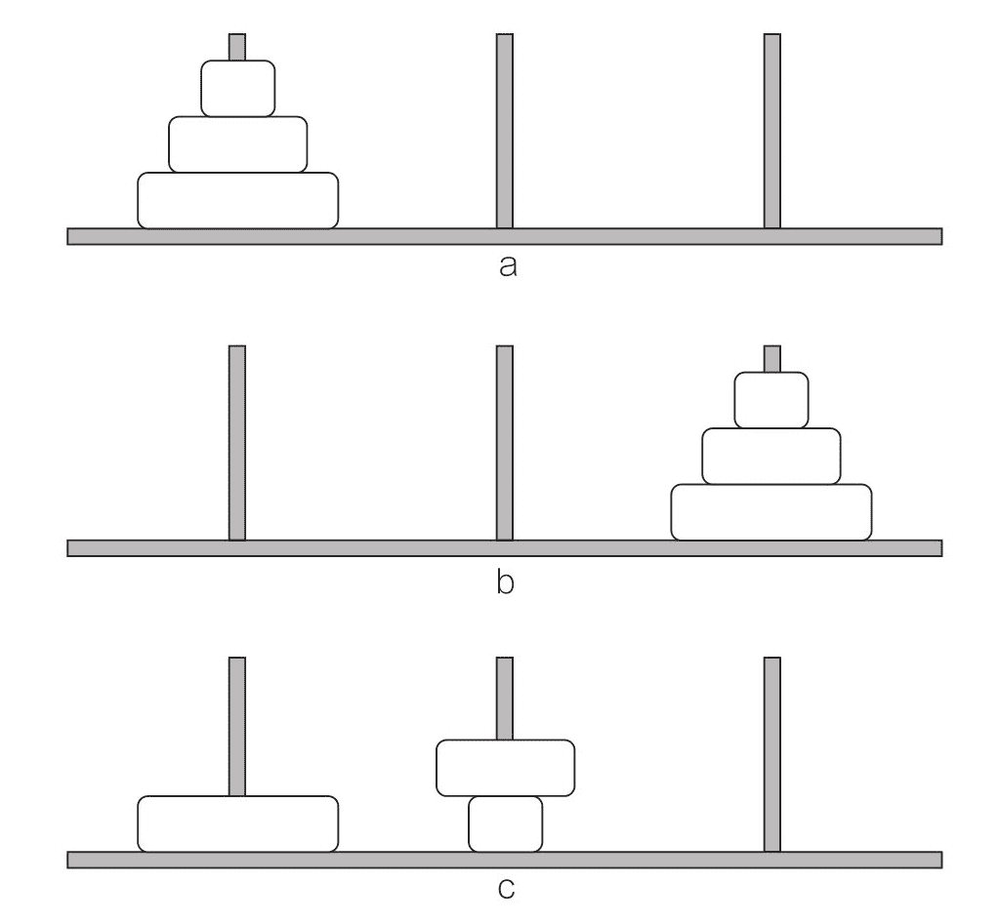
图 3　汉诺塔
人工智能黄金年代的经典谜题，图 a 展示了汉诺塔的初始状态，图 b 展示了目标状态，图 c 展示了错误的移动状态。

面对这类问题，常用的策略是搜索。这里的搜索不是指上网查信息，而是指让系统穷尽所有可能进程的一种基础解题技术。下棋程序和车载导航都在用它。

积木世界里我们想找一组步骤把初始状态变成目标状态。“状态”在 AI 里指事物在某个时刻的结构。

用搜索的方法解决汉诺塔，可以这样做：从初始状态出发，枚举每个可能动作会造成的新状态；若出现目标状态即成功；否则在每个新状态上继续枚举可能动作，如此反复。由此会生成一棵树状结构，称为搜索树，图 4 展示了解决汉诺塔搜索树的一小部分。

·第一步只能移动最小的环，可放到中间或最右，形成两种分支。
·若最小环移到中间，随后又有三种选择：把最小环移回左或右，或把第二小的环移到最右，不能把它放到中间，否则会违背规则。
·依此类推。

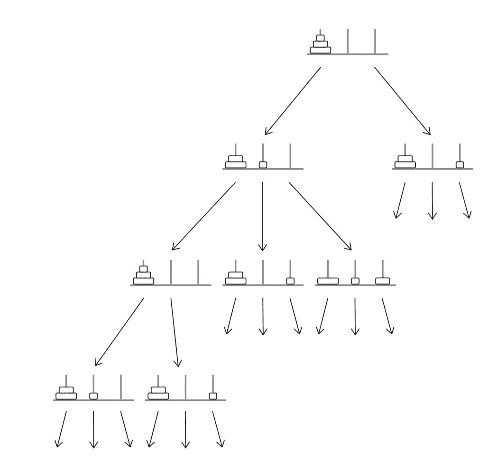
图 4　汉诺塔问题搜索树的一小部分片段

逐层生成搜索树意味着所有可能性都被考虑，只要问题可解，穷举搜索最终一定能找到解，“最终”二字很关键。

三环汉诺塔最少需要 7 次移动，再少就不可能。当然还有无数超过七步的方案，但不是最优。我们想要最短路径。穷举搜索不仅能保证找到解，还能保证找到最优解，因为它考虑了所有分支。

穷举搜索思路简单，实现起来也容易。

问题是，它很愚蠢。仔细看图 4 的最左分支，两步后又回到了初始状态，这是无谓的循环。人研究汉诺塔时可能会犯一两次错误，但很快会学会规避。简单的穷举计算机却不会，它会机械地遍历所有状态，哪怕明知是死路也会反复走。

# 搜索困境：组合爆炸来袭
## 分支因子如何让规模指数级膨胀
除了重复低效，穷举搜索还有一个根本缺陷。做过实验的人会发现，汉诺塔在多数状态下有三种移动可能，也就是分支因子为 3。不同问题分支因子不同，比如围棋平均分支因子约为 250。这意味着在任意一个棋盘状态下，玩家大约有 250 种落子选择。由此可以估算搜索树的规模[\[24\]](#part0018.html#booknote_24)：

- 第一层有 250 个状态，初始位置可衍生出 250 种新局面。
- 第二层有 250×250 = 62 500 个状态，因为每种局面又有 250 种分支。
- 第三层约有 62 500×250，超过 1 560 万个状态。
- 第四层则飙升到约 39 亿个状态。

当分支因子被放大，层数增加时，搜索树的规模会以指数速度膨胀，让穷举不可行。

写到这里就停一停好了。就在起草这些文字的时候，一台普通的家用主机已经装不下四层深度围棋博弈树的所有节点。实战一盘大约要走两百手，把这二百手全部展开后所产生的状态总量夸张到难以置信，比可观测宇宙中全部原子的个数还要多出数百个数量级。无论把传统计算技术再怎么改进，也吃不下这种规模的搜索空间。

## 搜索爆炸的根源
搜索树那种荒唐的膨胀速度制造了不可想象的困境，我们称之为组合爆炸，这在人工智能的实践里是最核心的现实难题，因为搜索手段在该领域被用得极广[\[25\]](#part0018.html#booknote_25)。假如能想出一种既快又绝对可靠的办法驯服搜索树，既能达成穷举效果又不用付出那样恐怖的资源代价，你将名垂青史，也会让人工智能当下的诸多困难迎刃而解。可遗憾的是，这条路走不通。我们无法回避组合爆炸，只能设法与它共存。

在人工智能起步期，组合爆炸就被视作根本性难题，麦卡锡把它列为1956年达特茅斯人工智能暑期学校的重点议题之一。当时大家的关注点集中在提升搜索效率上，出现了几种不同的应对思路。

## 沿一条分支到底的策略
一种做法是把搜索集中起来。典型做法不是逐层把整棵搜索树建完，而是沿着某一条分支向下生长，这就是深度优先法。按照这种方式，我们顺着一条分支一直往下推，直到找到解或者确认这条分支无解。如果碰到麻烦，比如图4最左边那种分支又回到已出现过的状态，就停止在这条分支的扩展，回到上一层，挑选另一条分支。

深度优先的好处是无需保存整棵树，只保留当前处理的分支即可。但缺陷也很明显，若一开始选错了分支，就会在错误的方向上越走越远，可能永远找不到解。所以使用深度优先的前提，是先判断哪条分支更值得探索，这时就需要经验式搜索来帮忙。

## 用经验值引导搜索
经验式搜索的思路是用所谓的经验法则来指引搜索重点。通常我们很难找到直指正确路径的经验，但往往可以在感兴趣的问题上找到有用的搜索方向。当然，也有经验式效果不理想的情况。

经验式搜索是一个自然产生的概念，多年里被反复重新定义，所以争论谁是发明者已经没有意义。可以确定的是，第一个在人工智能程序里使用经验式搜索的，是IBM的亚瑟·塞缪尔在20世纪50年代中期做的一个跳棋程序[\[26\]](#part0018.html#booknote_26)。塞缪尔的跳棋程序在多个层面打开了新天地。首先，以棋盘作为人工智能试验场，这一传统由此开启，即便今天仍很常见。其次，正如前面所说，该程序是基于经验式搜索编写的。最后，我们稍后会详述，塞缪尔的跳棋程序也是第一个真正意义上的机器学习程序，它自己学会了怎么下跳棋。

### 塞缪尔跳棋与极大极小推理
塞缪尔跳棋程序的核心，是给棋盘上各个局面赋予不同权重，用来评估对选手而言局面好到什么程度。直觉上，某些好局面更容易赢，坏局面则容易输。为此塞缪尔用一系列特征值来计算每个点的价值。例如，能形成连跳的关键位置，连跳越多，形势越占优。然后把不同的评估参数整合成一个综合分数，形成量化的评价标准，再依据经验式搜索来挑选最佳落子。

实践中要考虑更复杂的情况，跳棋是对抗游戏，必须考虑对手会怎么走。塞缪尔的程序假设对手会做出对你最不利的举动。这种最坏情况推理的方法，即假设对手的行为会让自己的得分最大化、你的得分最小化，被称作极大极小值搜索，是对抗性游戏的基本概念。

塞缪尔的程序下跳棋的水准相当高，从诸多角度看都是惊人的成就。特别是考虑到当时的硬件条件，他使用的是`IBM701`计算机，只能跑相当于几页文本长度的程序代码，就更了不起了。现代台式机的内存是当年的数百万倍，速度也是数百万倍。在条件如此受限的年代，跳棋程序能达到那样的水平，简直匪夷所思。

### A* 让启发变得可证明
大部分早期的经验式搜索，包括塞缪尔的程序，都使用某种试探-实践-判断的方式。20世纪60年代末，美国SRI人工智能研究中心的尼尔斯·尼尔森与同事取得突破，他们在`SHAKEY`项目中开发出`A^(\*)`技术。`A^(\*)`定义了一些简单规则，让我们能判断哪些经验是“有益的”。在`A^(\*)`之前，经验式搜索像猜谜；在`A^(\*)`之后，它变成了一个数学上很容易理解的过程[\[27\]](#part0018.html#booknote_27)。`A^(\*)`如今被视为计算机科学的基础算法之一，应用很广。比如车载卫星导航就是常见的例子。尽管`A^(\*)`很出色，它仍然依赖特定的经验式搜索，好的经验能迅速找到解，差的经验就没什么价值。而`A^(\*)`本身并未给出如何为特定问题找到更好经验的答案。

# 理论上能解，实践上难行
上一章提到，计算机的出现源于艾伦·图灵想解决当时数学界的世纪难题。图灵发明计算机也许是计算机科学史上最大的讽刺之一，因为他的本意是要证明有些事情计算机永远做不到。

图灵成果面世几十年后，探索计算机能做什么、不能做什么，形成了各大数学系的小分支。工作重点在于区分固有的不可判定问题与可判定问题。后来人们发现，不可判定问题存在层次结构，有些问题不仅不可判定，还是高阶不可判定。

不过到20世纪60年代，仅判断一个问题是否可判定还远远不够。一个问题在图灵眼里可解，并不等于在实际操作上可实现，图灵从理论上证明某些问题有解，但有些解法需要消耗巨大的计算资源，内存大到不可估量，或运行速度慢到结果遥遥无期。很明显，许多人工智能问题就陷入了这种尴尬。

## 一个组队案例看清指数增长
下面是一个例子，按图灵的理论很容易证明它可解：

你的办公室有四位才华横溢的员工，约翰、保罗、乔治、林戈。现在有个项目，需要成立一个三人团队。但由于个人竞争，约翰和保罗不能合作。

能组建合适的队伍吗？答案显然是能，你可以选约翰、乔治、林戈，或者保罗、乔治、林戈，注意这仅有的两种解法。

再加一个限制，约翰和乔治不能一起工作。那么答案就很明显，保罗、乔治、林戈。

再加最后一个限制，保罗和乔治不能一起工作。那么答案变成“不能”，因为没有任何组合能同时满足三个禁止组队的要求。

用抽象方式描述这个问题[\[28\]](#part0018.html#booknote_28)：

先给出一个包含`n`名成员的名单，在例子里就是约翰、保罗、乔治、林戈，因此`n = 4`，以及一个禁止组队的列表，例如“约翰和保罗不能在一起工作”。那么，能否得到一个包含`m`名成员的团队，使得所有禁止组队的条件都得到满足？显然要使问题有意义，`m`必须小于`n`。

必须指出，这个问题在原则上很容易解决。只需列出所有含有`m`名成员的团队名单，并检查每个名单是否与禁止组队列表冲突即可。用计算机编程做这一步非常容易。因此在图灵的观念里，这个问题很容易求解。

问题的关键来了，需要检查多少种组合可能性？4人里选3人，很容易，你只需检查4种可能。但当人数增多会怎样？

10人里选5人，你就得检测252种可能性。好吧，很枯燥，但还能忍受。可以看到的是，选择可能性的增长速度远大于团队总人数或目标人数的增长速度。

100人里选50人，你就得检测大约`10²⁹`这么多种可能性。一台当代大型计算机每秒能评估约`10¹⁰`种可能性，听起来很多，但稍微算一下你就能意识到，即便算到宇宙末日也检测不完。指望英特尔工程师提供更快芯片也无济于事，传统计算机技术再怎么突飞猛进，也无法在合理时间内完成这个数量级的计算任务。

我们看到的现象也是组合爆炸的例子。研究搜索树时介绍过，搜索树每个层级都呈指数增长。所以层级增多时，组合爆炸会导致可能结果的增长速度超乎想象。在团队建设案例中，只要团队总人数增加1个人，就必须考虑的潜在组合就会翻倍。

所以彻底列举每一种组合的方式，是不可行的。理论上它行得通，给足够时间总会得到正确答案，但在实践中毫无意义，因为对每种可能组合做判断所需时间是天文数字。

正如之前提到，简单的穷尽式搜索是一项原始技术。我们可以用经验式方法优化它，但并不保证有效。有没有更聪明的方法可以找到合适的组合，又不用彻底检查所有备选方案？很遗憾，答案是没有。你会发现优化搜索方式可以改善一些东西，但最终仍然无法绕过组合爆炸。在大多数情况下，能在理论上确保问题可解的方案，在实践中都会遇到这个问题。

## NP完全问题为何棘手
因为我们的问题是一个`NP`完全问题的案例[\[2\]](#part0008.html#note_2)。恐怕这个缩写对不熟悉编程的人太陌生，`NP`代表“不确定多项式时间”，技术定义相当复杂。幸运的是，`NP`完全问题背后的逻辑很简单。

组合问题是一个`NP`完全问题，就像团队建设的例子。在这个问题中你很难找到解决方案，因为要彻底检查每一种组合需要耗费无尽时间，但又很容易验证是否找到了解决方案，在这个示例中，我们只需验证它是否与禁止组队的规则冲突。

`NP`完全问题还有一个重要特征，为理解它，我们要引入另一个著名问题，你可能听说过它。它被称为旅行推销员问题[\[29\]](#part0018.html#booknote_29)：

### 旅行商问题：另一张面孔
有一位推销员要去被道路连接的若干城市推销商品，走完所有城市后必须回到起点。并非所有城市都有公路直连，而有公路连接的城市，推销员知道每条公路的具体长短。请问，推销员走遍所有城市，最终回到起点，怎样选择一条最短的路径？

这个问题跟团队建设类似，都是组合类问题。我们可以用蛮力计算来解决，只要列出所有可能的路线，并检查每条路线的长短，然后选择最短即可。然而，正如你现在所想，随着城市数量增加，可能存在的行进路线会呈指数级增长，如果要走遍10座城市，就得考虑360多万种可能性，11座城市就会激增为4000万种。

所以旅行推销员问题和团队建设问题一样，都面临组合爆炸的难题。但除此之外，这两个问题似乎没什么共通之处，毕竟团队建设和寻找最短路径有什么关联呢？但在`NP`完全问题的范畴内讨论，这两个问题虽然看上去差别很大，本质上是同一个问题。

这句话的意思可以这样理解，假设我已发明一种巧妙方法，可以高效又准确地找到团队建设问题的正确答案，现在你给我一个旅行推销员问题的案例，我就可以把这个旅行推销员问题转化为团队建设问题的一个特例，我的方法可以迅速解决它，你则得到想要的答案。这意味着，如果你发明了一种可以高效又准确解决团队建设问题的方法，就等同于你发明了可以高效又准确解决旅行推销员问题的方法。这种神奇的方法并不仅仅适用于这两个问题，而是可以解决所有`NP`完全问题。

所有`NP`完全问题都能共通，可以互相转换。这就意味着一个很明显的事实，要么所有`NP`完全问题存在通用解，要么它们都无解。如果你能找到高效又准确解决某个`NP`完全问题的方法，就意味着你能够解决所有`NP`完全问题。但是，到目前为止，还没有任何人寻找到解决`NP`完全问题的高效准确的方法。事实上`NP`完全问题能否有效解决，是当今科学界最重要的开放性问题之一。这个问题被称为`P 与 NP`问题[\[30\]](#part0018.html#booknote_30)，如果你能证明它是否有解并让科学界认同，你将获得克雷数学研究所提供的100万美元奖金，正是该研究所于2000年将其确定为“千年问题”之一。精明的投资商认为`NP`完全问题不能得到有效解决，同样也是精明的投资商告诉我们，要确切知道这一点，还有很长的路要走。

如果你发现自己要解决的问题是`NP`完全问题，这就意味着传统意义上的计算机技术在解决该问题上是行不通的，从精准的数学意义来说，你的问题太难了。

`NP`完全问题的基本结构早在20世纪70年代就已成形。1971年美籍加拿大数学家斯蒂芬·库克的一篇论文确定了`NP`完全问题的核心思想，随后美国人理查德·卡普证明了库克`NP`完全问题的范畴比最初想象的要广泛得多。整个20世纪70年代，人工智能领域的研究人员开始利用`NP`问题完全性理论来研究他们的课题，结果令人震惊。不管哪个领域，解决问题、玩游戏、计划、学习、推理，似乎关键性的问题都是`NP`完全问题，甚至更糟。这种现象普遍得成了一个笑话，所謂的“AI 完全问题”[\[3\]](#part0008.html#note_3)]意味着“一个和 AI 本身一样难的问题”，如果你能解决一个 AI 完全问题，你就能解决所有 AI 问题了。

发现你正在研究的问题是`NP`完全问题，或者更糟，真是个沉重的打击，在`NP`完全性理论及其论证结果被理解之前，人们总是希望出现重大突破使得这些问题变得简单，用术语来说就是易处理。从技术上讲，这种希望还是存在的，因为我们还没有明确地证明`NP`完全问题不可解。但到了20世纪70年代，`NP`完全性理论和组合爆炸成为笼罩在人工智能领域的阴影，以计算复杂性的形式阻拦在人工智能发展道路上，使它陷入停滞。黄金年代发展起来的技术似乎都无法扩大它们的使用范围，走不出玩具或者特定小世界比如积木世界的范畴。50到60年代过于乐观的预测遇到了现实难题，这让人工智能领域的先驱者们无比困扰。

# 当AI被斥为炼金术
20世纪70年代初，人工智能的瓶颈让科学界越来越沮丧，没有太多有用的核心研究进展，而某些研究人员又大肆鼓吹人工智能的未来，于是到了70年代中期，批评人工智能的风潮达到狂热程度。

在所有批评者中，相信我，这个数量非常大，最直言不讳、出语刻薄的无疑是美国哲学家休伯特·德莱弗斯。在20世纪60年代中期，他受兰德公司委托撰写了一份关于人工智能研究进展状况的报告，德莱弗斯选择的报告题目是《炼金术与人工智能》，明白无误地表达了他对这一领域及其工作人员的蔑视。公开地把一门严肃的科学和炼金术类比，这是非常侮辱人的。现在，重读《炼金术与人工智能》，哪怕时隔半个世纪，我仍然不得不说从来没见过这样的报告，其内蕴的蔑视之意如此明显，令人震惊。

虽然我们不赞成德莱弗斯批判人工智能的方式，但很难回避这个现实，他的某些观点是有道理的，特别是关于人工智能先驱者们浮夸的观点和宏伟的预测。赫伯特·西蒙后来获得了诺贝尔经济学奖，在1958年写道：

这并非耸人听闻，但是……现在世界上出现了能够思考、学习和创造的机器。在可以预见的未来，它们的能力将迅速增强，能够处理的问题范围将迅速扩大到人类思维的范围。

在当时，这样的说法很多，我引用西蒙的观点是因为他最有名气。虽然西蒙是人工智能乐观主义者，但他绝不是最狂热和不讲理的倡导者。令人痛心的是，事后看来，他的乐观预测是不切实际的。时至今日，人工智能界的一些成员认为，当年的研究人员之所以做出这样的乐观声明仅仅是因为他们被兴奋冲昏了头脑，也有                                                       
        
不管怎么说，我的专业敏感性让我必须声明一下，虽然当年的研究人员乐观得近乎天真，但并没有出现大规模蓄意欺骗或者歪曲人工智能研究状态的事情。研究人员之所以乐观过头，是因为他们热爱这门学科，并且真的相信，也希望其他人相信，他们确确实实建立了可以学习、计划和推理的程序，尽管有诸多局限性。他们只是乐观地认为，扩大这些程序的应用范围应该很容易。

所以，我认为某些乐观过头的情绪是可以被谅解的。尤其是，当年的研究人员没有意识到正在研究的问题本质上是计算机无法处理的，因而总存在出现突破性进展，使得问题迎刃而解的可能性。但当`NP`完全问题无解的概念开始普及以后，社会各界才慢慢明白，人工智能所面临的问题有多艰难。

# 莱特希尔报告与经费寒冬
1972年，英国一个重要的科研资助机构要求著名数学家詹姆斯·莱特希尔爵士评估人工智能的现状和前景。据说因当年世界最先进的人工智能研究中心之一，如今也是，爱丁堡大学人工智能社区出现学术斗争的相关报道，所以才要求做这样的评估。莱特希尔荣列当年剑桥大学卢卡斯数学教授席位，这是英国数学家所能担任的最负盛名的学术职务，斯蒂芬·霍金后来也曾担任过。莱特希尔在实际应用数学方面有着丰富经验，时至今日，重读莱特希尔报告，可以看出他为当年人工智能的繁荣感到相当迷惑：

那些能力卓绝又受人尊敬的科学家写道，所谓的人工智能，代表了进化过程中的另一条路。20世纪80年代，在人类规模的知识基础上，会实现多用途的人工智能。预测结果令人惊叹，到了2000年，机器智能将全面超越人类。

莱特希尔在报告中对当时的主流人工智能相当不屑一顾，他明确指出组合爆炸是人工智能领域无法解决的关键问题之一。他的报告立刻导致英国各地对人工智能研究经费的严重削减。

在美国，早期智能研究的经费几乎被军方垄断，国防部高级研究计划署以及后来的 DARPA 长期扮演着出资人的角色。进入 20 世纪 70 年代初，因诸多乐观预期迟迟无法兑现，相关拨款被大幅收紧。

1970 年代初到 1980 年代初这十年，常被称作 AI 的第一次寒冬，此后类似的低谷也曾出现。当时主流的批评是研究者盲目乐观，发布了大量站不住脚的预测，最后一无所获。那段时期的声誉跌至谷底，甚至有人将其与医学界的顺势疗法相提并论[\[4\]](#part0008.html#note_4)，作为严肃学科看似在走下坡路。

## 第三章 知识即力量

70 年代中期智能研究遭遇的重创不容小觑，相当一批学者一度把这个方向视作伪科学，直到近些年才逐步重建公信力。耐人寻味的是，就在赖特希尔报告广为流传并产生严重后果的同时，一种新思路悄然冒头，主张能解决长期被诟病的核心问题。70 年代末到 80 年代初，众多研究者集中转向同一条路线，认为过往的瓶颈在于过度迷恋搜索与通用求解这类技巧。有人指出这些“弱方法”缺失了决定性要素：知识。Scientia potentia est，17 世纪的弗朗西斯·培根曾说过。研究者把这句话理解得十分字面，投身于以知识为驱动的研究，相信把人类既有的知识捕捉并加以利用才是进展的关键。

于是出现了以专家知识为基础的程序，它借助专业人士的经验处理特定且狭窄的任务。这类程序第一次给出实证，证明智能系统在某些专业任务上可以超过人类，更重要的是让公众首次看到落地到商业场景的可能。知识型程序能够把专业技术传播给更广的受众，那一代从 AI 毕业的学生决心把学业投入到这一方向。

这类程序与通用 AI 的目标不同，它只瞄准非常具体、非常局限的问题，此类难题往往需要高度专门的积累。通常能解决这类专业问题的专家需要漫长学习，且人数极少。

随后的十年里，以知识为核心的专家程序成为研究主流，工业界的巨额资金源源不断流入。进入 80 年代，寒冬开始消退，一波更狂热的 AI 热潮悄然形成。

本章要讲的就是 70 年代末到 80 年代末蓬勃的专家程序。我会先从如何把人类专家的知识提取并装进计算机讲起，讲述 `MYCIN` [\[5\]](#part0008.html#note_5) 的故事，它是那个年代最知名的专家程序之一。随后会看到研究者如何借助数学逻辑的精确性，尝试建立更完善的知识获取方法，以及为何最终也未能达成。接着会介绍 `Cyc` 工程，这是 AI 史上最雄心勃勃也是最臭名昭著的失败案例之一，它试图用专家的知识攻克有史以来最大的难题：通用 AI。

### 规则是搬运专家经验的工具

把知识塞进智能系统并非新点子，前一章提到的启发式方法在黄金时代就被广泛使用，用来把求解引导到更有希望的方向。启发式方法可以看作暗含了解决问题的知识，但它并没有直接提取知识。而知识型 AI 带来一个全新观点：系统应当明确地获取并呈现人类在某个问题上的专业知识。

最常见的实现方式是基于规则，也称知识表述。在 AI 里，一条规则通常以“若……则……”的格式来封装离散的知识片段。规则本身很朴素，下面用自然语言给出几条圈内老例子。以下是一套用于动物分类的专家程序规则，展示知识是如何被采集的，细节可参阅附录 A：

若动物会分泌乳汁，则归为哺乳类。

若动物长有羽毛，则归为鸟类。

若动物会飞且会产卵，则归为鸟类。

若动物以肉为食，则归为肉食类。

这些规则可以这样解读：每条规则都有前提条件，即“若”之后的部分，和结论，即“则”之后的部分。例如“若动物会飞且会产卵，则归为鸟类”这条，前提是会飞且产卵，结论是鸟类。当当前信息与前提吻合，规则被激活，就能推导出结论。只要确认被分类的动物既会飞又会产卵，结论就成立。这个新信息又可用于触发后续规则，层层展开。通常专家程序以对话形式与用户交互，由用户提供信息并回答系统提出的问题。

图 5 所示为典型专家程序的构造，其中知识库存放系统的规则，工作存储器保存当前问题的相关信息，例如“该动物有毛发”。推理机则是核心部件，负责在求解时调用库中知识。

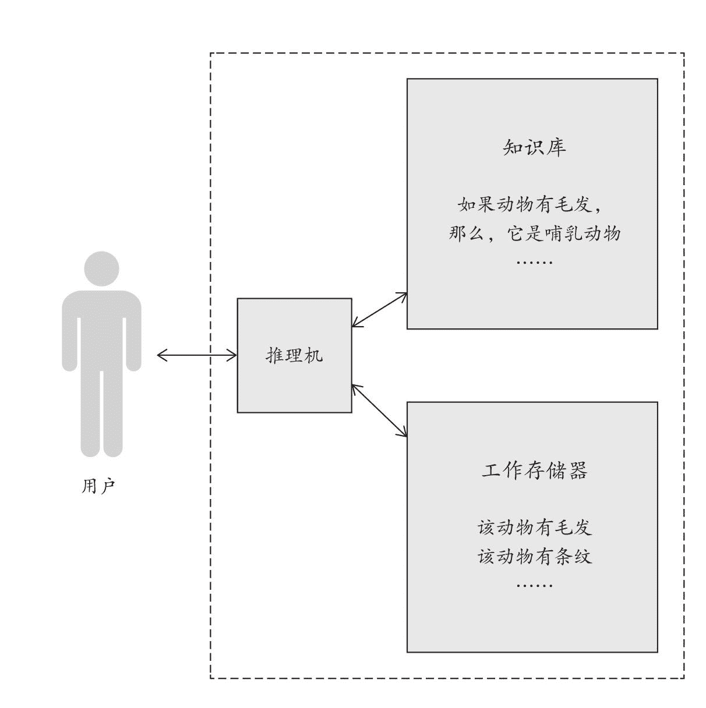

图 5　经典专家系统结构

给定一个知识库，比如前面的动物分类知识，推理机可以以两种模式运行。第一种是正向推理：用户先提供已知信息，推理机据此应用规则尽可能多地推导出新信息，这个过程叫做规则触发。推导出的新信息被写入工作存储器，再检查是否能触发更多规则，不断循环，直到已知信息无法再推出新结论为止。这是从数据到结论的路径。

另一种是反向推理：从目标结论倒推所需数据。例如要确认动物是否为肉食动物，规则提示若吃肉则为肉食动物，于是系统尝试确认动物是否吃肉。因为没有规则的结论是“是否吃肉”，系统只能直接向用户提问。

### MYCIN：标杆案例

70 年代出现的第一代专家程序中最具代表性的当属 `MYCIN`，名字源自抗生素词缀 mycin[\[32\]](#part0018.html#booknote_32)。`MYCIN` 第一次证明智能在关键领域可以胜过人类专家，为后来无数程序提供了范式。

`MYCIN` 用来辅助医疗，为人类血液疾病的诊断提供专业建议。它由斯坦福大学的研究团队打造，人工智能实验室的布鲁斯·布坎南领导的技术组与斯坦福医学院的特德·肖特利夫领导的医学组联合完成。项目成功的重要因素在于，真正的人类专家全程参与构建。后来很多专家程序失败，恰恰因为缺少领域专家的支持。

与前面动物分类的简单规则相比，`MYCIN` 的血液疾病知识用更丰富的规则表达。自然语言表述的典型规则如下：

如果：

·该微生物无法被革兰氏染色法着色，并且

·该微生物形态为杆状，并且

·该微生物为厌氧

那么：

有可能 60% 该微生物是类杆菌

这是用人工智能语言写的 `MYCIN` 规则：

```
RULE036:
PREMISE: ($AND (SAME CNTXT GRAM GRAMNEG)
(SAME CNTXTM MORPH ROD)
(SAME CNTXT AIR ANAEROBIC))

ACTION: (CONCLUDE CNTXT IDENTITY
BACTEROIDES TALLY 0.6)
```

研究团队大约花了五年时间编码与扩充知识库，最终版本里包含数百条规则。

`MYCIN` 之所以成为标杆，因为它具备后来专家程序必备的所有核心特质。

首先，`MYCIN` 的交互方式模仿人类专家——提出一系列问题并记录回答。这成为专家程序的标准范式，而诊断也成为标准任务。

其次，`MYCIN` 的推理可回溯可解释。推理透明度在应用层面往往至关重要。如果系统用于生死攸关的决策，像 `MYCIN` 这样的治疗建议，就必须赢得信任。解释建议的合理性是必不可少的。经验表明，无法证明自己结论的黑盒系统会遭到用户强烈质疑。

`MYCIN` 的关键能力是可以明确说明为何得出某结论，它通过推理链条呈现被触发的规则与触发信息，一切可追溯。实践中大多数专家程序的解释能力最终都归结为类似形式。虽不完美，却便于溯源，也有助于理解系统运行机制。

最后，`MYCIN` 能处理不确定性。用户提供的输入未必完全准确。应对不确定性是专家程序普遍要求。`MYCIN` 很少仅凭单一特征就断定结论。例如血液检测阳性是强证据，但假阳性假阴性都可能出现；咳嗽可能是拉沙热的典型症状，但咳嗽不能直接判定为拉沙热。为了更稳妥，系统需要谨慎处理症状信息。

为此，`MYCIN` 引入了确定性因子技术，用数值表示对某信息的信任或不信任程度。这是一种处理不确定性的特殊方案，也招致大量批评。不确定性处理与推理问题成为 AI 长期课题，我们将在第四章深入讨论。

1979 年，`MYCIN` 参与了 10 个真实病例的评估，在血液疾病诊断上，其表现与人类专家相当，且高于普通医生平均水平。这是智能系统首次在具有实际意义的任务中展现出专家级甚至更高水平的能力。

### 第二次浪潮

70 年代涌现的专家程序远不止 `MYCIN`。同样来自斯坦福，由爱德·费根鲍姆领衔的 `DENDRAL` 项目才是世界上第一个成功的专家程序，也让费根鲍姆成为知识系统最著名的倡导者之一，被尊为“专家系统之父”。`DENDRAL` 帮助化学家根据质谱仪数据推断化合物成分与结构。80 年代中期，每天有数百上千人在使用它。

美国数字设备公司 DEC 开发的 `R1/XCON` 程序，用来配置 VAX 系列计算机。80 年代，DEC 宣称该程序已处理了超过 8 万份订单，当时拥有 3000 多条规则，涉及 5500 个不同组件。到 80 年代末，规则数扩展到 17 500 多条，开发者声称程序为公司节省了超过 4000 万美元。

`DENDRAL` 证明专家程序可用，`MYCIN` 证明它能在专业领域超越人类，`R1/XCON` 证明了商业价值。这些成功故事点燃了兴趣，AI 似乎已为商业化做好准备。大量研发资金涌入，初创公司忙着从这波繁荣中获利，比如构建专家程序的软件平台，以及开发部署的支持服务。人们还能买到专为快速执行 LISP——构建专家程序的首选语言——而设计的计算机，这些 LISP 专用机一直用到 90 年代初。后来个人电脑价格下降、性能提升，花 7 万美元买一台只能跑 LISP 的机器就变得毫无意义。

不仅是软件行业，其他行业也争相搭上这波 AI 复苏的东风。80 年代，工业界开始意识到知识体系，尤其是专业知识，是可培育、可带来高额利润的重要资产。专家程序似乎把无形资产变成了有形资产，这一观念与西方经济进入后工业时代的观点相呼应——新机会主要来自知识型产业和服务业，而非制造业等传统产业。

回看专家程序的历程，AI 的再次繁荣不仅是 `MYCIN`、`DENDRAL` 等案例成功的故事，更在于专家程序为 AI 打开了另一种可能性。构建专家程序不需要相关领域的博士学位，前文的动物分类规则几乎人人都可理解。熟悉编程的人都能把握专家程序的原理，事实上搭建一个专家程序似乎比传统编程还容易。于是出现了一个全新职业：知识工程师。

颇具讽刺意味的是，1983 年英国政府启动了一项雄心勃勃的计算机技术研究资助计划“阿尔维计划”，核心就是发展 AI。但鉴于赖特希尔十年前报告几乎让英国 AI 产业陷入停滞，考虑到领域的负面名声，所有参与者都不愿称之为 AI。相反，他们称之为“基于知识的智能系统”。AI 的未来似乎光明——只要你不叫它 AI。

### 向逻辑求助

规则是专家程序获取人类知识的主流手段，但还有大量其他方案。例如图 6 展示了心理学家罗杰·尚克与罗伯特·亚伯森开发的脚本知识表述方案的简化版。该方案基于人类理解的心理学理论，认为行为部分受刻板印象模式即“脚本”支配，也用这些模式理解世界。他们认为同样模式可用于 AI。图 6 中的脚本描绘典型餐厅场景，用自然语言描述参与者角色——顾客、服务员、厨师、收银员——触发条件——顾客饥饿——操作的物理对象——食物、桌子、钱、菜单、小费，以及最重要的常规事件序列 1—10。尚克和亚伯森推测这类脚本可用于理解故事。他们认为当故事事件偏离常规剧本时，故事就变得有趣、可怕或惊讶。例如在第 4 步后脚本中断，即顾客点餐但未上菜，就是个有趣情节；省略第 9 步，顾客吃完不付钱离开，就是违法情节。他们尝试构建基于脚本理解故事的系统，但成功率有限[\[33\]](#part0018.html#booknote_33)。

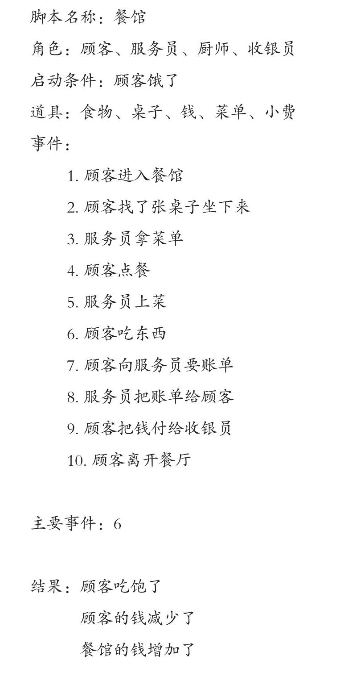

图 6　描述典型的餐馆就餐经历的脚本

另一个备受关注的方案是语义网[\[34\]](#part0018.html#booknote_34)，它直观自然，在今天仍被反复重新定义——如果你去发明一种知识表述方案，很可能做出类似的东西。图 7 展示了一个简单语义网，包含我个人的信息——出生日期、居住地、性别、子女——以及世界常识，比如女人首先是人，大教堂既是建筑也是礼拜场所。

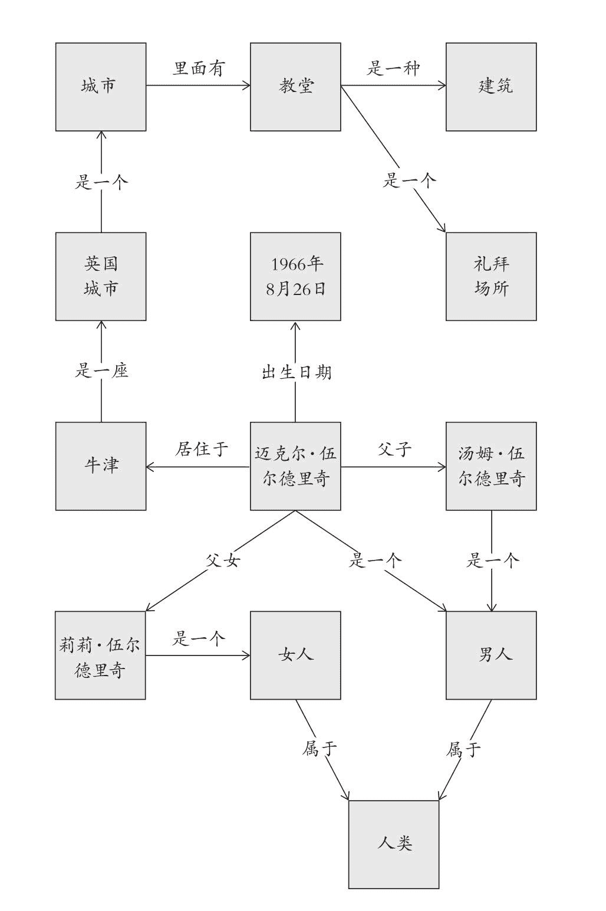

图 7　一个简单的语义网，包含我的个人信息、子女信息和居住信息

在知识驱动 AI 兴起之时，似乎每个人都有自己的知识表述方案，且彼此不兼容。

尽管专家程序实际主要用规则表述知识，但在表述层面研究者仍有诸多困扰。其中之一是规则太简单，难以捕获复杂环境下的相关知识。例如 `MYCIN` 的规则不适用于随时间变化的环境，也不适用于多用户环境，或状态存在各种不确定性的环境。另一个问题是，用于获取知识的各种方案显得有些武断，研究者希望了解专家程序中的知识到底意味着什么，并确保推理可靠。简言之，他们想为知识型专家程序提供适当的数学基础。AI 研究者德鲁·麦克德莫特在 1978 年的文章中总结了这些问题，称之为“无意指不表达”[\[35\]](#part0018.html#booknote_35)，“对一个系统而言，正确性固然重中之重，”他写道，“让人能理解它，也是十分关键的。”

70 年代末开始出现相关解法，即用逻辑作为知识表述的统一方案。为了理解逻辑在知识系统中的角色，我们需要了解一些逻辑知识，以及它如何发挥作用。逻辑学旨在理解推理，尤其是区分好的推理和坏的推理。下面看几个例子。

凡人终有一死；

艾玛是凡人；

所以，艾玛终有一死。

这就是典型的三段论模式，我想你会同意其推理合乎情理：如果所有人类终有一死，而艾玛是人类之一，所以她也终有一死。

再看一个例子：

所有教授颜值都高；

迈克尔是一名教授；

所以迈克尔是位帅哥。

教授们大概乐于接受这个结论。从逻辑角度看，这个推论并无错误：从形式上，它完全正确。如果前提“所有教授颜值都高”为真，且迈克尔是教授，推出他是帅哥就合乎情理。逻辑并不关心前提本身是否真实，只关心推理形式是否合理。当然这是建立在承认前提的基础上。

再看一个不完备的推理：

所有学生都努力学习；

索菲是一名学生；

所以索菲很有钱。

这个推理是错误的，因为仅凭前两个前提无法合理推出索菲有钱。她可能富有，但重点在于不能从给定前提得出该结论。

因此，逻辑关乎推理模式，上述三段论是最简单实用的案例。逻辑告诉我们如何从前提正确地得出结论，这个过程称为演绎。

# 从三段论到一阶逻辑

# 推理的边界与重生

亚里士多德提出的三段论，支撑了长达千年的逻辑分析，却只能覆盖很窄的推理形态，面对复杂论证便力不从心。数学家很早就痴迷于寻找推理的普适原理，因为数学的根本工作就是从已知推出未知。19世纪时，这种不安达到顶点：什么是真正的真？怎样确认一个数学论证是合乎推导的？`1 + 1 = 2`到底如何被确证？

## 现代逻辑的成型之路

大约从19世纪中叶起，数学家开始系统地追问这些问题。德国的戈特洛布·弗雷格构建起通用的逻辑演算，首次呈现出类似今天数理逻辑的面貌。伦敦的奥古斯都·德·摩根与爱尔兰科克的乔治·布尔则展示了把代数计算的方法搬到逻辑推理上，1854年布尔发表论文并自命题为《思想法则》。

进入20世纪初，一阶逻辑的基本架构已大致定型，这个至今仍在支撑绝大多数数学推理的系统，成为数学与推理的通用语言。它囊括了亚里士多德、弗雷格、德·摩根、布尔等人各自的推理类型。在人工智能领域，它同样提供了统一的知识表述框架，让原本各自为政的方案有了共同语言。

## 逻辑派人工智能的诞生

由此诞生了以逻辑为核心的人工智能范式，最早的倡导者之一就是1956年主持达特茅斯暑期会议并命名人工智能的约翰·麦卡锡。他描绘自己对基于逻辑系统的设想[\[36\]](#part0018.html#booknote_36)：

我的观点是，智能体能够使用逻辑语句来表达其对世界、目标和当前状况的了解，并通过(推断)某个行为或者行动过程是否符合它的目标，来决定它自己的行为。

这里的“智能体”指的就是人工智能，麦卡锡所说的“逻辑语句”就是像“凡人皆有一死”或“所有教授颜值都高”之类的命题。一阶逻辑提供了数学上精确的表达手段来描述这类语句。

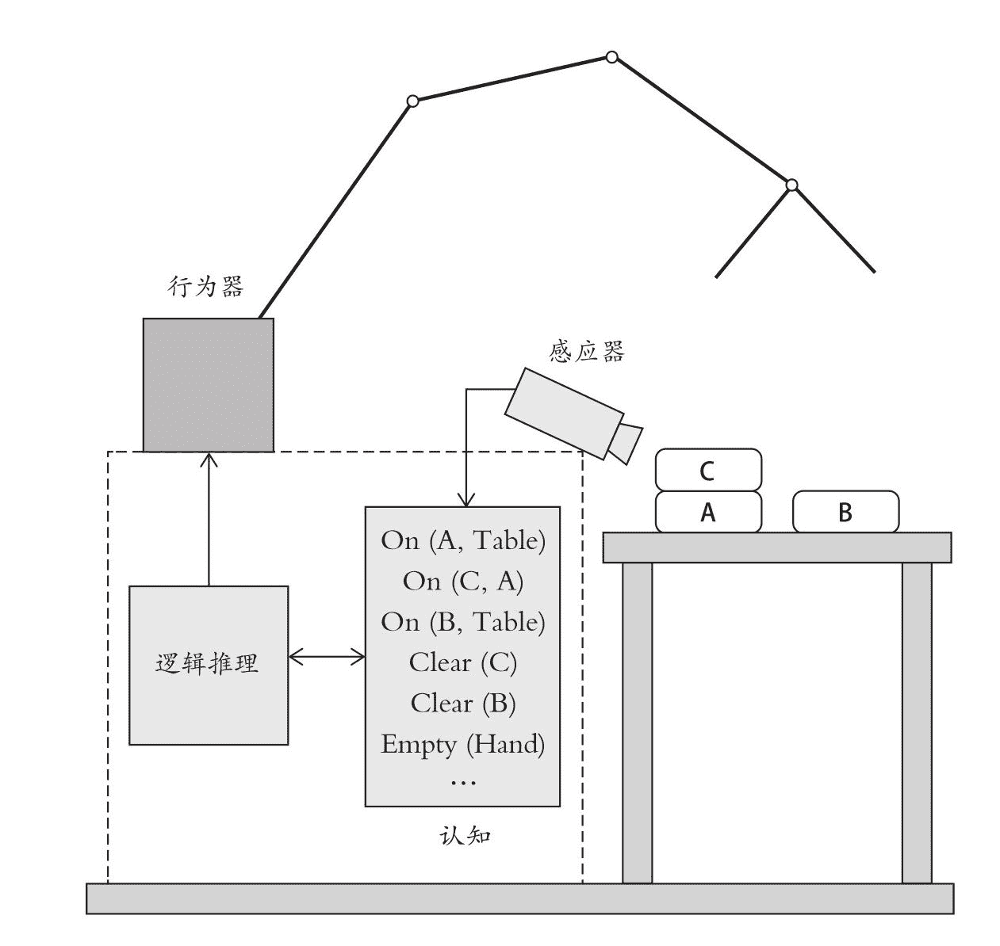

图 8　麦卡锡对人工智能的构想

### 麦卡锡眼中的机器人

麦卡锡设想的系统能用逻辑语句明确表达对环境的信念，决策被拆解为纯粹的逻辑推导。

图 8 展示了这一设想的程序化画面：一个配有机械臂和感知装置的机器人在积木世界中作业。内部用`On(A， Table)`、`On(C， A)`等一阶逻辑表达式描述环境。它们的含义很直观：

- `On(x， y)`表示对象 x 在对象 y 之上
- `Clear(x)`表示对象 x 上空无一物
- `Empty(x)`表示 x 为空

在逻辑式AI里，先要确定词汇表，比如`On(x， y)`、`Clear(x)`等，用来刻画场景。

内部的推理机负责把传感器信息转化为可用的逻辑形式，形成机器人的信念，如“`On(A， Table)`”意味着“机器人相信 A 在桌面上”。需要提醒的是，人类熟悉的词只是为了理解方便，对机器人而言，只有知识库里真正赋予了该表达式意义，与行为产生联系时，才算得上信念。选用“On”并无神奇之处，换成`Qwerty(x， y)`也一样可以表意。开发中常见误区是把对人类而言易懂的术语直接投射到机器，反而制造误解。

感知系统把原始信号转成内部逻辑形式，这一步并不简单。随后推理机据此决定行为：核心思想是行为源自逻辑推导的结果。于是机器人的循环就成了：感知→更新认知→推断下一步→执行→再感知。

### 逻辑AI为何深入人心

这种范式为何影响深远？最关键的是它把智能问题简化且透明化：只需用逻辑描述机器人该做什么，就能看懂它为何这样做。

更深层的原因在于它契合理性的直觉。我们做决定时似乎也在权衡方案、进行内心对话，逻辑AI恰好模拟了这一过程。

## 逻辑编程的浪潮

从70年代末到80年代中期，逻辑式AI逐渐占据主流，80年代初甚至有人认为它能重塑整个计算机领域。传统编程繁琐易错，要求人逐行指定每一步操作。逻辑编程则把人从这种束缚中解放：你只需用逻辑表达对问题的理解，推理过程交给系统完成。

代表语言是`PROLOG`[\[37\]](#part0018.html#booknote_37)，被视为逻辑AI时代最宝贵的遗产之一，至今仍在教学与实践中使用。它由美籍英国学者鲍勃·科瓦尔斯基与法国马赛的阿兰·科尔默劳尔、菲利普·罗塞尔共同创制。科瓦尔斯基在70年代初意识到一阶逻辑规则可作为编程基础，1972年科尔默劳尔和罗塞尔在他的构想上完成了具体实现。

### 一段 PROLOG 示例

`PROLOG`读起来很直观。下面是“凡人皆有一死”的表达方式：

```
human (emma).
mortal (X): - human (X).
```

第一行是事实：艾玛是凡人。第二行是规则：若 X 是凡人，则 X 终将死亡。

使用时需要给出目标，比如询问艾玛是否会死亡：

```
mortal (emma).
```

这是在问系统能否依据已有事实与规则推导出艾玛必死。给定目标后，`PROLOG`通过逻辑推理给出证明[\[38\]](#part0018.html#booknote_38)。

这仅是其能力的冰山一角。1974年大卫·沃伦用约100行`PROLOG`解决了积木世界的规划问题[\[39\]](#part0018.html#booknote_39)，同类系统若用`Python`实现可能需要数千行代码和数月工时。更重要的是，`PROLOG`程序本身就是逻辑公式，实现了麦卡锡的设想。

80年代初，`PROLOG`一度挑战人工智能黑客最爱的`LISP`，并获得日本第五代计算机项目的巨额投入，约4亿美元被用于此项计划。尽管项目最终没能让日本超越美国，`PROLOG`也没成为通用语言，但它留下的思想遗产不可忽视：为计算问题提供了一种与传统编程截然不同的思路，代代程序员受益。

## Cyc：试着装下全部常识的项目

`Cyc`工程是知识型AI时代最知名的实验，由天才研究员道格·莱纳特打造。70年代他已凭借一系列AI系统崭露头角，1977年获计算机与思想奖。80年代初他确信“知识即力量”应远超狭义专家系统，可作为通往通用AI的钥匙。1990年他与拉曼内森·古哈合著写道[\[40\]](#part0018.html#booknote_40)：

我们不相信任何通往智能的捷径，世界上不存在尚未被发现的麦克斯韦思想方程式之类的通解……任何强大的思维体都无可避免地需要大量知识。我们所说的知识，不是指枯燥的、专业领域内的知识；更确切地说，是现实世界中的各种常识……它们太普通了，所以参考书里面找不到。例如：生命不可永恒，任何实体不可能同时出现在两个不同的地方，动物不喜欢承受痛苦，等等。恐怕人工智能所面临的最艰难的事实——过去 34 年来人工智能领域一直致力于摆脱的事实——其实是，要获取如此庞大的知识库，没有一种优雅、轻松的方式。相反，大部分工作(至少在初期)必须经过人类判断以后手工输入。

### 野心、困境与重来

80年代中期，莱纳特为团队设定了一个艰巨目标：打造包罗万象的知识库`Cyc`。其雄心是完整描述“共识现实”。这意味着必须有人把人类视为理所当然的常识明确写下并录入，如：

地球上悬空的物体终将落地并停下，而在太空则不会；燃料耗尽的飞机坠毁会致人死亡；吃不认识的蘑菇很危险；红水龙头多为热水，蓝的多为冷水……

受过良好教育的人的日常知识，都要在`Cyc`中以特殊语言手工编码。莱纳特估计需200人多年投入，大部分时间耗在手动录入上。他乐观地认为随后系统可自我学习，实现通用AI。`Cyc`是一场高风险的豪赌，1984年获德州奥斯汀微电子与计算机联合会资助启动。

它最终未达预期。首要难题是从零开始组织人类全部基础常识。第一步是定义词汇与术语间的关联，即本体工程，而`Cyc`的本体工程复杂度远超前例。很快团队发现原有构想过于天真粗糙，建设中屡次推倒重来。即使在实施十年后，1994年莱纳特仍保持乐观。

### 普拉特现场的拷问

1994年4月，斯坦福计算理论专家沃恩·普拉特[\[41\]](#part0018.html#booknote_41)对一次演示产生兴趣。他事先给莱纳特列出期望功能清单，若匹配则演示最佳，若期望过高会失望，若低估则不公。未获回复后，他于4月15日现场观摩。

演示先展示系统识别数据库中需推理才能分辨的细节差别，随后演示自然语言检索图片。“放松的某人”返回三名穿沙滩服手持冲浪板的照片，`Cyc`把冲浪、冲浪板与放松联系起来，推理链用到近20条规则，其中“所有哺乳动物都是脊椎动物”也在其中——当时版本已有50余万条规则。

随后普拉特询问核心常识：`Cyc`是否知道面包是食物。系统回答“是”。问面包是否饮料，系统卡住，尝试明确告诉它面包不是饮料后仍放弃。演示继续，`Cyc`似乎知道多种活动导致死亡，却不知饥饿致死，没有“饿死”概念。它也不知道天空蓝、汽车通常四轮。

之后普拉特拿出准备的百余道常识题，如：

汤姆比迪克高3英寸[\[6\]](#part0008.html#note_6)，迪克比哈里高2英寸，汤姆比哈里高多少？

两兄弟能否彼此都比对方更高？

陆地和海洋哪个更湿？

汽车能倒开吗？飞机能倒飞吗？

人缺空气能活多久？

这些最基础的问题，`Cyc`无法给出有意义回答。普拉特总结：也许已迈向通用AI，但进展难以衡量，因为知识体系极度零碎、不均匀。

### 从 Cyc 看知识工程的启示

`Cyc`并未为通用AI提供光明大道，却在大规模知识工程上积累了复杂技术经验。从严格意义看，`Cyc`假说——通用AI本质是知识问题，可靠的基于知识系统即可解决——既未被证实也未被证伪。项目的失败只说明这种方式行不通，而非理论本身错误，或许存在更合理的知识体系能带来更大突破。

说到底，`Cyc` 算是超前了一代。项目真正起步后约三十年，谷歌才把自己的知识网络搬上台面。这套庞大的知识库塞满了现实世界的实体标注——地名、人名、影视作品、出版物、重大事件之类，目的是让搜索结果更饱满。日常检索时，大多数输入都指向某个具体实体。比如搜“麦当娜”，普通的关键词检索只会掏出带此词的页面。若系统知道她是一名流行歌手，全名是麦当娜·路易斯·西科尼，就能直接呈现出生年份、子女状况、最受欢迎的专辑等常见问答。`Cyc` 和谷歌知识网络的关键差别在于知识来源：后者并非人工逐条编码，而是从维基百科等网页自动抽取。到了 2017 年，有说法称维基百科已收录约 700 亿条名词，覆盖约 5 亿个实体。知识网络并不以通用智能为目标，其世界建模推演的深度至今不明。总体上看，它多少仍带有 `Cyc` 的血统。

历史的回望往往残酷。`Cyc` 在 AI 史上留下浓墨重彩的印记，恰因它成了过度炒作的极端样本，彻底辜负了不切实际的期待。莱纳特的名字甚至成了圈内段子：有人戏称“微莱纳特”可以作为科学计量单位，用来标定某事的失真程度。为什么要加“微”？因为找不到比“一整莱纳特”更荒诞的说法了。

## 期待幻灭
理论上很动人的知识式 AI，在实践里受限得很明显。连一些看似琐碎的常识推断都让它卡壳。文献里常引的案例\[42\]：

你听说翠迪是鸟，于是推断它会飞。随后发现翠迪其实是企鹅，于是撤回了先前的推断。

乍看这是很直观的逻辑，像类比三段式推理一样顺理成章——系统里存着“鸟会飞”的规则，给出“翠迪是鸟”就能推出“翠迪会飞”。问题出在后续：得到“翠迪是企鹅”这一新信息后，必须收回“翠迪会飞”的结论。而形式逻辑做不到这一点，信息只能累加不会削弱已有结论，但常识里新信息本就可以推翻旧结论。

常识推演的另一麻烦是矛盾。标准例子\[43\]：

贵格会教徒是和平主义者；
共和党人不是和平主义者；
尼克松既是共和党人，也是和平主义者。

严格按逻辑推演，最终会得到尼克松既是又不是和平主义者，这显然矛盾。逻辑在这种情形下直接失效。可矛盾正是日常现实：有人说纳税有益，也有人说纳税是负担；有人说葡萄酒有益，也有人说有害。矛盾无处不在，而数学式的逻辑一旦遇到矛盾就意味着出错。

这些看似细小的症结，在 20 世纪 80 年代末却是知识派 AI 研究的核心困境，吸引了最优秀的人才，却始终没有真正解法。

更致命的是知识提取难题，也就是如何把专家的隐性知识抽出来变成规则。人擅长做事不等于擅长讲清楚自己怎么做，而且专家往往不愿分享：公司一旦把能力写进程序，还需要他干什么？对 AI 会取代人类的担忧也从未消失。

到 80 年代末，专家型方案的热潮已经退去。知识技术并非彻底失败，期间也诞生了不少成功的专家式系统，后来也还有延续。但总体上，又一次证明了 AI 的实际产出远低于宣传的高度。

## 第四章 机器人与行动的转向
行而不思者，因莽撞而灭亡；
思而不行者，因懈怠而灭亡。
——威斯坦·休·奥登

托马斯·库恩在 1962 年《科学革命的结构》中指出，科学发展到一定阶段，旧范式会崩解，新范式取而代之。到 80 年代末，专家式系统式微，一场新的 AI 浪潮悄然逼近。这次动摇的不只是“知识即力量”的信条，更是自 50 年代以来支撑符号 AI 的基础设定。有趣的是，最激烈的批评恰恰来自圈内人。

澳大利亚机器人学家罗德尼·布鲁克斯是其中最有影响力的声音。1945 年出生的他曾在斯坦福、麻省理工、卡内基梅隆学习任教，本可成为正统的守护者。他梦想造出能在真实世界完成有用任务的机器人，80 年代初就开始质疑当时主流的机器人理论——把现实知识编码成可识别的形式供机器人推演决策。80 年代中期在麻省理工任教时，他把反思推向了更基础的层面。

### 布鲁克斯的突围
要懂布鲁克斯，必须回到积木世界。那是一种桌面模拟环境，对象堆叠，AI 的任务是按特定方式重排。听起来像个丰富的实验场，布鲁克斯却认为它毫无意义。因为积木只是模拟物，真实仓库的复杂度远超模拟。能在积木世界里表现聪明的系统，放到真实物理环境里基本无用。真实世界的难点是感知，而积木世界完全回避了感知。70 到 80 年代积木世界被视作研究误区，但即便今天仍有论文在做，我自己也写过几篇。

布鲁克斯归纳了三条基本主张：第一，AI 要有实质进步，必须和真实环境中的系统直接互动，感知并响应其所在世界；第二，以知识或逻辑为基础的清晰完备知识库和推演，并非智能行为的必要条件，尤其是逻辑派；第三，智慧是一种涌现特性，来自实体和环境的持续交互。

他用 1991 年一篇讽刺寓言来说明\[44\]：假设 19 世纪 90 年代掀起人工飞行研究热潮，一批研究者坐时光机到 1980 年代，在波音 747 客舱待了几小时。回到 19 世纪，他们激动地开始复刻所见，在倾斜座椅、双层玻璃上取得“巨大进步”，并坚信只要研究出神奇的“塑料”，就能称王。寓意是，人类常沉迷于智慧的显性部分——推演、解题、下棋——这些学术界偏爱也偏执的目标，让研究走偏了。布鲁克斯承认推演可能有用，但不应是构建 AI 的起点\[45\]。

他还批评自 AI 诞生就默认的“分而治之”：把行为拆成推演、学习、感知等模块研究，却忽略协同。寓言里研究者认为项目太大，需要各领域专家。波音飞机要 6000 人制造，大家各忙各的，交流很少。

最后他点出“重量”问题：造座椅的人用实心钢做骨架，有人提议用空心钢管减重，却被说“飞机能飞起来，这点重量不算什么”。这里的重量暗指计算量。他强烈反对把决策全压给耗时的逻辑推演。

这篇题为“无表征智能”的文章，对 80 年代中期在专家系统浪潮里接受教育的我而言像异端。1991 年，一位同事从澳大利亚 AI 大会回来兴奋地说，斯坦福——麦卡锡的老家——和麻省理工——布鲁克斯所在——的博士生爆发激烈辩论。一方坚守逻辑、知识表征和推演，另一方则公然背弃传统，还嘲笑它。

布鲁克斯不是孤例，很多人走向相似结论。最核心的一点，是把知识和推演从 AI 核心位置上拿开。麦卡锡设想中逻辑模型是核心，所有行为围绕它展开，这一设定遭到猛烈抨击。也有温和声音认为推演仍可发挥一定作用，只是非核心。更激进者主张彻底抛弃。

回顾麦卡锡式的循环：感知环境→推演该做什么→采取行动。系统和环境是分离的。现实中，我们把书放下，四周看看，身处候机室、咖啡馆、车厢或河边，感知和行为是和环境融为一体、持续协调的。沉思脱离环境的情况只是偶然。

知识派 AI 并不具备这种特性。设想一个按“感知—推演—行为”循环运行的机器人，用计算单元解析传感数据，更新信念池，再推演行动，最后执行。现在宣称它总是选择最优策略，但最优点在哪一刻呢？

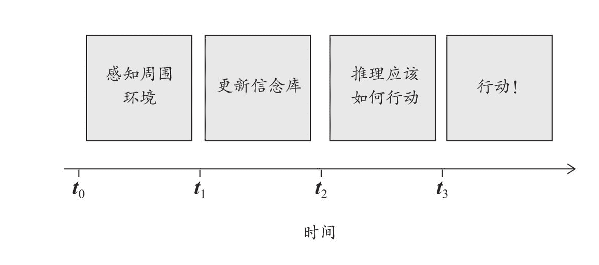
图 9　机器人在一段时间里的运行模式

第一阶段 t0—t1 机器人感知环境，随后 t1—t2 处理数据更新信念，接着 t2—t3 推演动作，t3 才开始行动。所谓的“最优”对应 t1 还是 t3？环境信息源自 t1 前的时段，而行动要到 t3 之后才基于这些信息展开。这种方式脱离实际，却在 80 年代末仍是主流：研究者追求理论上的最优选择，前提是环境不变，且能弄清该做什么，而不是实践中可行的决策\[46\]。

于是耦合性成为关键议题：AI 系统与其环境、与其行为之间需要紧密耦合。

### 行为驱动的智能
若布鲁克斯只是个批判者，其影响力不会如此持久。他建立了新范式，并用一系列系统证明了它。新范式叫基于行为的 AI，强调个体行为对整体智能的贡献。布鲁克斯的代表方法叫包容式体系结构，是当时影响最持久的方案。

一个低调却实用的例子是智能扫地机器人：它要在房间游走、避障、发现灰尘时清扫、电量不足或垃圾盒满时回充。

包容式体系结构先拆分出机器人所需的单项行为组件，再逐步叠加。难点在于思考这些组件如何关联、在什么时机让恰当行为占优，通常需要大量实验。

扫地机器人需要六类基本组件：
·避开障碍物：发现前方障碍就改变方向，随机选新方向；
·关机：回到充电座且电量不足时关机；
·清空垃圾盒：在充电座上且盒中有物时清空；
·返回充电座：电量不足或盒满时返回；
·执行清洁：当前位置检测到污物时吸入；
·随机移动：随机选方向并移动。

组织方式采用包容式层次：层次越底层，优先级越高。避障是最高优先级，遇障立即执行。六类行为构成层次结构，解决实际问题：机器人在区域内搜寻污物，发现后在电量和垃圾盒允许时吸入；否则回充。

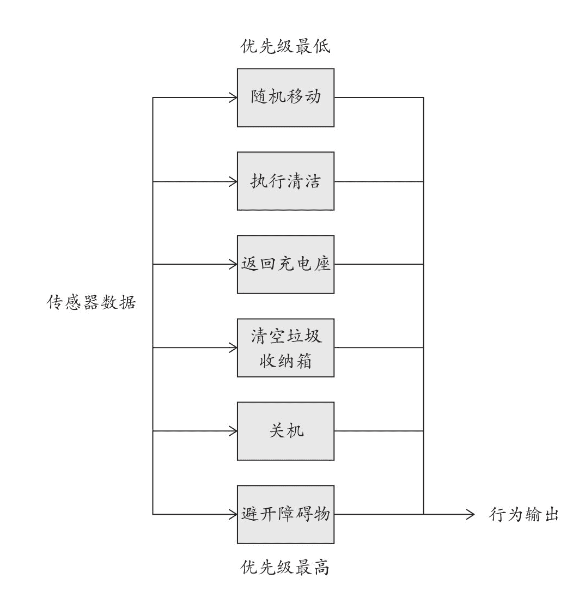
图 10　扫地机器人包容式体系结构的简单示意图

这套行为看似受规则控制，实际实现很轻量，甚至可用简单电路实现，对传感变化做出极快响应。

此后数十年，布鲁克斯用包容式体系结构做出一系列惊艳机器人。例如展于美国国家航空航天博物馆的“成吉思”机器人，外形如六足昆虫，由约 57 个基本行为组件组织。若用知识派 AI 去构造它，困难会大得惊人。经历数十年边缘化后，这些工作把机器人技术重新推回 AI 主流。

### 基于智能体的人工智能
90 年代初我见到一位 AI 革命的主角，心目中的英雄。好奇他如何看待自己极力反对的知识表征和推演、问题求解与规划。他真的认为这些在未来 AI 中毫无价值吗？“当然不是，”他说，“但我不能拿名声去赌它们的现状。”这回答令人沮丧，不过事后看来，也许只是想给一位年轻研究生留下印象。

不管他是否真心，其他人很快意识到，基于行为的 AI 也难以摆脱被过度期许的命运。人们逐渐看清，它虽然对 AI 基础假设做了重要更新，却仍存在非常严重的局限。

行为式人工智能最大的短板在于难以规模化。只做扫地机器人这类工作，它就足够好用——不需要推理，不需要用自然语言跟人对话，也不需要解决复杂问题。正因如此，研发者能用诸如分层收敛式结构之类的方案快速拿到可用结果。不可否认，行为式思路在机器人领域取得了不少成功，但它绝不是万能良药。一旦行为单元增多，相互作用变得错综复杂，设计就十分困难。用这种方式造系统更像在玩黑魔法：想知道能不能用，只能先搭出来再试用，成本高、耗时长且结果不可控。而且这种方案对特定问题很准，但积累的经验很难迁移到新场景。

布鲁克斯指出，知识库和推理并非构建智能行为的必要前提，这一点是成立的，他的机器人也证明了纯行为路线能走多远。但由此就机械地否定推理和知识表述在人工智能中的价值就走偏了。有些情境推理不可避免，否认这一点，与用逻辑推理去造一台扫地机器人一样荒谬。

早期有支持者极端排斥逻辑表达，禁止在系统中加入推理成分，更多人则持温和立场，这种思路延续至今。温和派既保留了行为式人工智能的优点，又认为必须把行为与推理结合起来。一个新的发展方向随之出现，它汲取了布鲁克斯学说的精髓，同时重新接纳了此前在推理和知识表述上已被证明有效的要素。

# 智能体转向与理性决策
人工智能研究的焦点再次发生位移，从专家系统、逻辑推理机等脱离实体的构件，转向去构建一个完整的智能体。智能体是一个独立自主的实体，嵌入在特定环境中，为用户完成指定任务。它应该提供一套整合的能力，而非像逻辑推理那样孤立的功能。目标是把开发的重心放在整个人工智能个体上，而不是零散的智能部件上。人们希望借此避开布鲁克斯曾批评过的误区——把智能行为拆成推理、学习等模块各自孤立开发后再拼凑，以为就能成功。

智能体视角明显受行为式人工智能影响，却对其主张做了软化。这种浪潮在上世纪九十年代初开始显现，当时学界花了不少时间厘清“智能体”到底指什么，到九十年代中期才形成共识：智能体应具备三大特质。第一是反应迅速，能及时感知环境变化并调整行为；第二是主动积极，能系统地完成用户交付的任务；第三是具备协作性，需要时能与其他智能体配合。人工智能黄金年代强调计划与解题，即主动性；行为式路线则强调对环境的快速响应。智能体范式要求两者兼备，并额外加入了协作维度——智能体需要社交技能，不仅是沟通，还包括协调、谈判以推进共同任务的能力。

正因智能体需要社交化，它才从众多范式中脱颖而出。回头看，学界用多年才认真思考人工智能系统如何相互协作，显得有些滞后。虽然从图灵测试起就强调社交能力，但当时指的是与人用自然语言交流。在智能体范式里，真正受关注的是智能体与智能体之间的协同工作。

## 典型架构拆解
图11展示了一个经典的智能体设计，被称为“旅行机”[\[48\]](#part0018.html#booknote_48)，其整体控制被拆成三个子系统：一个快速反应子系统，运行逻辑类似布鲁克斯的分层架构，负责无需推理的即时响应，比如避障；一个规划子系统，负责制定实现目标的方案；一个建模子系统，专门处理与其他智能体的互动。顶层的控制单元会综合三个子系统的建议再做裁决，通常很直接——若快速反应子系统喊停，控制单元就会立刻停止运动。上世纪九十年代初，类似这种结构的智能体系统被开发了不少。

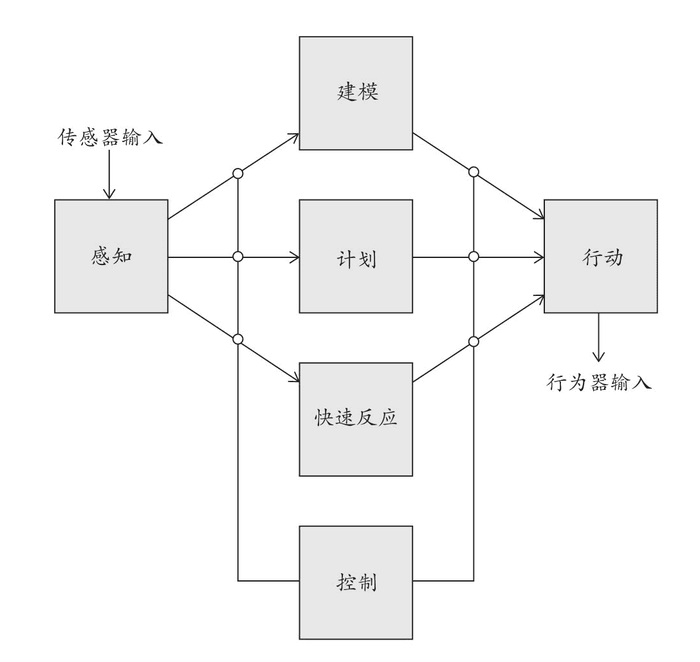

图 11　一个典型的智能体结构：旅行机

### HOMER：一个模拟潜艇的完整智能体
`HOMER`是我印象最深的案例，它是存在于二维“海洋世界”中的模拟机器人潜艇[\[49\]](#part0018.html#booknote_49)，任务通常是取包裹并运送到指定地点。显然它继承了`SHRDLU`的传统，也带着同样的模拟限制，但复杂度高得多。

`HOMER`能接受英语指令，用户词表约800个词。它会据此规划、执行，并在需要时调整。看一段对话就能体会功能。用户问面前漂浮的是什么，`HOMER`答是一根原木。问是否属于自己，答不是。用户说“它属于你”，`HOMER`回应表示这是新信息。随后用户指令“转身背对原木”，`HOMER`执行。用户把原木移除后指令“转回来”，`HOMER`再次转身，随后惊讶地说“我的原木不见了”。这段交互体现了简单的常识推理：它记得原木的存在，转回后预期能看到它，发现消失会表达惊讶。

另一个场景里，`HOMER`在码头等待任务，要在下周六晚9点把包裹放到驳船上。它确认会去码头，去取包裹，计划8点56分到达，以便准时送达。并能回答“下周日包裹在哪”，以及“一周后包裹还在码头吗”，答案是否定的。这里可见它对时间的理解，以及行为对环境的改变——包裹送走后就不会留在码头。它也明白计划需要时间差。

## 从机器人到软件助手
智能体范式虽源于机器人学，但研究者很快看到它在软件世界的潜力。没有人声称这是通用人工智能，像专家系统一样，大家只是想用软件智能体来分担有用的工作。软件智能体运行在桌面、网络等软件环境中，核心设想是让人工智能驱动的程序像助手一样与我们协作，处理邮件、上网等日常事务。

为理解这一概念的形成，需要回溯人机交互的演变。图灵时代的计算机使用者多是设计者，交互极其原始。曼彻斯特宝贝每块内存都要靠开关手动设置为0或1，一切内情对用户全开，编程技能难以迁移。五十年代末，高级编程语言出现，隐藏了机器细节，程序员无需了解底层硬件即可工作，语言在不同机器间可移植，标志着交互从以机器为中心转向以人为中心。

这一趋势持续到六十年代，八十年代加速。1984年苹果推出麦金塔，面向大众，卖点是图形用户界面。桌面、文档、文件夹、垃圾桶等现实隐喻让操作更直观。虽然硬件数十年间换代无数次，但当年的用户面对现代Mac或Windows界面依然能迅速上手。

交互界面的要点是使用熟悉的概念，让操作更自然。

麦金塔的成功让时任苹果CEO约翰·斯库利思考下一个创新，他提出“知识导航器”构想，并于1987年发布了一段概念视频[\[51\]](#part0018.html#booknote_51)。视频里，一位教授使用类似平板的设备，界面看似桌面，关键不同是交互通过软件智能体完成。智能体以动画人形呈现，能用英语对话，提醒日程、查询讲座材料、管理来电。

这段视频意义深远：预示互联网将进入工作常态，预见平板普及。对AI而言，它确立了通过智能体与计算机交互的思路。与`Microsoft Word`这类被动响应程序不同，智能体更主动，像人类助手一样配合使用者。

这一中心思想在九十年代中期随万维网扩张而升温。比利时裔麻省理工媒体实验室教授帕蒂·梅斯发表文章《智能体能够帮助人们减少工作量和信息过载》[\[52\]](#part0018.html#booknote_52]，描述了邮件管理、日程安排、新闻过滤、音乐推荐等原型。邮件助手会观察用户处理行为，通过机器学习预测新邮件的处理方式，并在把握足够时主动执行。

随后十年涌现上百款类似产品，多基于互联网。早期搜索简陋、网络缓慢，人们渴望自动化处理繁琐任务[\[53\]](#part0018.html#booknote_53]。软件智能体一度被视为前景技术，也成为网络泡沫的一部分。

我本人也参与其中。1996年夏天，我加入伦敦一家初创公司，薪水是学校的3倍，约半秒钟就答应了。我们想用智能体提升网络搜索，把万维网变成图书馆。但我们不懂商业，也不懂怎么做商业软件，很快发现以惊人速度烧钱却不知如何回本。9个月后我离开，公司8个月后倒闭。这段经历预示了1995至2000年的互联网泡沫破裂。

智能体只是互联网故事的一小部分，却是与AI关联最明显的部分。梦想没错，只是过早。20年后，苹果iPhone上的`Siri`横空出世，由斯坦福国际研究院开发——正是30年前造出`SHAKEY`的机构。`Siri`是九十年代软件智能体工作的直接延续，与苹果的知识导航器视频一脉相承。概念是基于软件的智能体，能用自然语言交互并代办简单任务。随后`Alexa`、`Cortana`、Google助手跟进，都追溯到智能体AI的源头，只是九十年代的硬件尚不足以支撑，2010年后移动设备的算力才够。

## 为选择赋予理性
智能体范式提供另一条思路：建造能有效代替我们行动的智能体。这引出一个问题：图灵测试追求与人类难以区分的行为，而智能体开发并不要求模仿人类，只要求做出最优选择。真正的需求是让智能体做出尽可能正确的决策，而非像人一样决策。

支撑最优决策的理论可追溯到上世纪四十年代，冯·诺依曼与奥斯卡·摩根斯坦发展了理性决策的数学理论[\[54\]](#part0018.html#booknote_54]，把理性选择转化为计算问题。基于智能体的人工智能会用该理论为用户做最佳判断。

起点是用户的偏好。智能体要代理行动，就必须理解用户的期望。以苹果、橘子、梨为例，假设偏好为：橘子优于梨，梨优于苹果。那么智能体选橘子用户满意，选苹果则失望。这是最简单的偏好排序。

理性决策要求偏好一致。例如，若出现橘子优于梨、梨优于苹果、苹果又优于橘子的循环，偏好就自相矛盾，智能体无法给出最优解。

下一步是用数值表示一致的偏好，即效用函数。为每种选项赋分，分越高偏好越强。比如橘子3分、梨2分、苹果1分，就能复现上述排序。也可赋10、9、0，具体数值不重要，重要的是排序。关键在于，只有偏好一致时，才能用数值稳定地表示偏好程度。

把偏好变成可以计算的数字，唯一的目的就是让选择变得可优化。只要给每个选项贴上一个数值标签，智能体就能挑出分值最高的那一个，从而实现我们真正想要的结果。这类问题本质上就是优化问题，而数学早已为它准备好了工具箱。

问题在于现实里的抉择很少是确定的。一旦掺入不确定性，事情立刻复杂起来。我们只能知道各种后果出现的概率，却无法保证哪一种必然发生。

最典型的对比是两组抛硬币的赌注【55】：

选项 A：硬币正面得 4 英镑，反面得 3 英镑。
选项 B：硬币正面得 6 英镑，反面一分钱没有。

你会选哪一个？我更倾向 A，原因需要预期效用来解释。预期效用在这里就是在该选择下长期平均能拿到的回报。

A 的期望是 0.5×4 + 0.5×3 = 3.5 英镑。B 的期望是 0.5×6 + 0.5×0 = 3 英镑。单次操作不可能真的拿到 3.5 英镑，但重复足够多次，平均收益会收敛到这个数值。

冯·诺依曼与摩根斯坦提出的理性决策准则很简单：选预期效用最大的。按此标准 A 优于 B。B 虽然存在 6 英镑的诱人上限，却也伴随着同等概率的归零风险，权衡之后期望反而更低。

这个思路常被误读。有人觉得把人类偏好量化很冰冷，甚至认为是自私的。因为把收益等同于金钱。但收益不过是偏好度量的一种定义方式，理论本身对“偏好是什么”保持中立。利他者的善意，只要能用数值表达，同样适用；自私者的算计，也同样适用。

到 20 世纪 90 年代，由冯·诺依曼—摩根斯坦理性选择模型支撑的智能体范式，已成为人工智能的主流正统，并延续至今。如今几乎所有系统内部都有一个代表使用者偏好的数值模型，并在运行中持续追求预期效用的最大化【56】。

应对不确定性

处理不确定性一直是人工智能的硬骨头，90 年代这个问题变得关键。真实系统必须在噪声中做判断。比如无人驾驶汽车，传感器会说“前方无障碍”，但这并非百分百可靠。信息有价值，却不能全信，如何在出错的可能下合理利用它？

90 年代后占据主导的方法是贝叶斯推断。18 世纪神学家兼数学家托马斯·贝叶斯提出的贝叶斯定理，讲的是在新证据到来时如何理性地修正已有信念。在汽车案例里，信念是“前方是否有障碍”，新证据就是传感器读数。

贝叶斯定理也暴露了人类直觉的脆弱。考虑一种致死性流感，基础感染率千分之一。检测准确率 99%。你被测出阳性，患病的概率是多少？多数人会凭直觉说 99%。真实概率只有约十分之一。

用 1000 人来算：约 1 人真感染，其中 99% 会被正确检出，约 0.99 个真阳性。剩下 999 人未感染，因 1% 误报，大约有 10 人会被误判为阳性。阳性总人数约 11 人，其中只有 1 人真正患病。低患病率导致假阳性远超真阳性，这也是医生不愿单凭一次检测下结论的原因。

同样的逻辑用在机器人探索上。机器人要绘制未知区域地图，传感器会误报障碍物。若盲目相信数据，地图会大面积失真。借用贝叶斯推断，用传感器的准确率持续更新对障碍物位置的信念，多次观测后地图会逐渐收敛到真实【57】。

贝叶斯的价值在于对待不完美数据的态度：不丢弃也不全信，而是用概率不断刷新信念库。

当数据量庞大且相互关联时，研究者发展出贝叶斯网络。由朱迪亚·珀尔推动的这套图模型，用有向图表达变量间的因果影响，阐明了概率在人工智能中的核心作用【58】。图 12 就是一个简化示意，展示感冒、流鼻涕、头痛三者之间的影响关系。

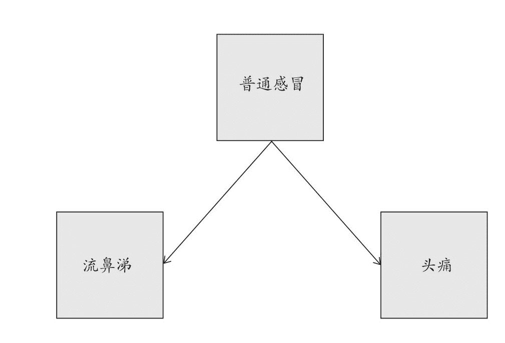

图 12　简单的贝叶斯网络示意图

当 Siri 遇见 Siri

2000 年互联网泡沫褪去后，研究者开始关注智能体之间的互动。早期的专家系统曾探讨知识共享，但多智能体场景下出现关键差异：你的智能体为你服务，我的智能体为我服务，偏好不一致导致冲突。因此智能体必须具备社交能力，学会预判他人的行为【59】。

这种推断属于博弈论的范畴。博弈论源于象棋、扑克等策略游戏，后来成为经济学分支【60】，在多智能体环境中极具实用价值。

最具代表性的概念是纳什均衡，由约翰·福布斯·纳什提出，他的名字也出现在 1956 年达特茅斯人工智能暑期学校的名单中。因该理论，他与约翰·哈萨尼、理查德·塞尔滕共同获得 1994 年诺贝尔经济学奖。

直观理解很简单：两个智能体分别选 x 与 y，若智能体 1 在 2 选择 y 的条件下不愿改变 x，智能体 2 在 1 选择 x 的条件下也不愿改变 y，那么这对选择就是稳定的均衡。没有一方有单方面偏离的动机。

多智能体研究迅速吸纳了纳什均衡等思想，但一个老问题再次浮现：纳什在 50 年代提出概念时并未关心如何计算。当智能体需要实时使用时，计算纳什均衡的难度就成了瓶颈，这至今仍是人工智能的重要课题。

人工智能开始成熟

90 年代末，赋予智能体用户偏好、让其以预期效用最大化方式行动、以贝叶斯推断管理信念、用博弈论处理多主体互动，已成为共识。这并非通用人工智能，也不是通往通用智能的捷径，但它让领域第一次拥有了可检验的科学基础，从概率到理性决策，技术体系变得扎实。

这一时期的两个标志性事件定义了成熟。第一个登上全球头条：1997 年 IBM 的深蓝击败世界冠军加里·卡斯帕罗夫。1996 年两人先战成平手，一年后升级版深蓝获胜。深蓝的成功来自启发式搜索与海量计算的结合。有人批评它只是靠蛮力，但同样算力下，粗暴遍历根本无法应对象棋的搜索空间。

第二个成就影响更深却鲜为人知。90 年代初人们意识到，NP 完全问题不再是不可逾越的障碍【61】。最基础的 NP 完全问题 SAT，即可满足性问题，到 90 年代末已有工业级求解器。SAT 求解器让许多原本被认为不可解的问题得以处理，成为编程工具箱的常备件。NP 完全问题并未被终结，但研究者不再畏惧它，这是一次静默的大突破。

也有人不满这种转向。2000 年波士顿的一场会议上，一位与麦卡锡、明斯基同期的前辈质问：“这就是现在的人工智能吗？魔力去哪了？”从哲学、认知科学转向概率、统计与经济学，确实力感减弱，却也带来了实效。

第五章 深度突破

2014 年 1 月，谷歌收购了英国小公司 DeepMind。按硅谷标准收购额不算惊人，约 4 亿英镑买下不足 25 人的团队，但在英国科技圈却引发震动。这家公司几乎没有产品，却被视为人工智能的神秘资产。

收购推高了人工智能的媒体热度与商业热度。政府开始制定国家 AI 战略，企业竞相布局，投资持续涌入。DeepMind 不是唯一案例，2015 年优步从卡内基·梅隆大学机器学习实验室一次性挖走 40 余名研究人员。

十几年间，人工智能从计算科学里一潭看似沉寂的领域，一跃成为最炙手可热也最被过度炒作的话题之一。这种态度上的陡然转变，背后推手是一门核心技术——机器学习。机器学习本是人工智能的分支，却在过去六十多年里大多走着自己的路，而AI与这门忽然迸发魅力的分支之间的关系，有时也挺微妙。

本章要梳理的是21世纪机器学习革命的来龙去脉。我们从对机器学习的简要回望开始，重点看神经网络这一种特殊做法是怎样后来居上。神经网络的故事同样跌宕起伏：它挨过两次寒冬，到了千禧年之交，圈内不少人还把神经网络视作无望的赛道。最终它翻身逆袭，带它复兴的是深度学习。深度学习正是DeepMind的核心技术，我也会讲述DeepMind是怎么起来的，以及它做出的系统为何获得全球关注。只是深度学习再强也不等于终点，和评判其他AI技术一样，我们也要谈它的局限。

机器学习本质上想实现的是：程序不必被手把手教步骤，就能从输入推导出期望的输出。最经典的例子是手写文字识别，输入是一张手写照片，输出是对应的文字串。

任何干过分拣的邮递员都能告诉你，这活儿不好干。每个人笔迹不同，有人潦草，有人墨水洇开，纸张还脏破。回看第一章的图1，图像解读本就是个未解难题。这不像下棋，有理论上可穷举的招法再靠启发式抉择，我们根本不知道图像识别该按什么步骤走，所以才需要机器学习来补位。

做手写识别的监督式机器学习程序，通常要先喂它大量带标注的字样样本，每个样本都标明它对应的真实字符，如图13所示。

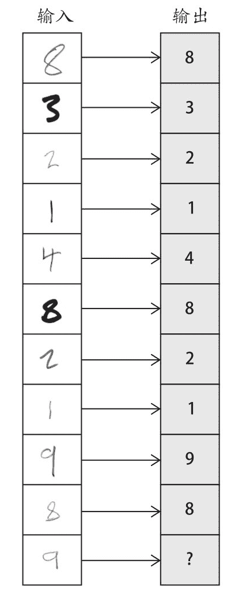

图13　程序训练数据

识别手写字符即本例数字的机器学习程序所用的训练样例，训练目标是让程序自动认出手写数字。

上面这种做法叫监督学习，核心前提是数据，尤其是大量的数据。正如后面会看到的，精心准备的训练集对成败至关重要。

# 训练数据与机器学习基础

训练时，训练集的设计必须谨慎。我们往往只能用全部可能性中的一小撮来教程序。以手写数字为例，不可能把世界上所有写法都塞进去，现实也不允许。退一步说，如果真能穷举所有输入输出，机器学习就没必要了，直接查表就行。所以模型只能基于输入输出空间的一小部分来学习，但这部分太少，程序又学不到人们期望的映射规律。

## 特征提取与维度诅咒

训练集的另一个关键是特征提取。假设银行要做一个识别不良信贷风险的模型，训练数据是大量客户记录，每条记录都标注了信用是否良好。记录里包含姓名、出生日期、住址、年收入、交易流水、贷款还款情况等，这些信息在模型里就叫特征。但并非所有特征都有用，有些跟风险完全无关。事先不知道哪些特征相关时，人容易把所有信息都扔进去，这就会触发维度诅咒：特征越多，需要的训练样本量呈指数级膨胀，学习速度也变慢。

## 特征选择偏差

为避开维度诅咒，最简单的做法是只挑少数特征使用，这也带来隐患。一方面可能丢掉了对任务至关重要的特征，另一方面不当的选择会引入偏见。假如给信贷评估模型只喂客户地址一个特征，训练完的系统很可能带有地域歧视。AI偏见的风险及其后果，后面会展开讨论。

## 强化学习与信用分配问题

另一种做法是强化学习，程序不获得明确的标注数据，而是靠做决策、收反馈来学习。比如训练游戏AI，赢了给正奖励，输了给负奖励。程序会根据奖励调整下一次的策略，正反馈让它更可能重复该行为，负反馈则让它规避。

强化学习最大的难点是奖励常常延迟，导致很难判断哪一步行为该被褒奖或惩罚。假设一局游戏输了，究竟是哪一步失误导致败局？把每一步都算成错就过度归因了，如何厘清因果，这就是信用分配问题[10]。生活中也有类似困境：吸烟的健康代价往往要几十年后才显现，这种延迟让戒烟极难。若吸烟后立刻就能感受到致命伤害，烟民数量估计会大幅锐减。

# 神经网络的发展

到这里还没讲程序具体怎么学。机器学习同样拥有与AI相近的历史长度，技术也非常庞大。过去六十年里出现过各种方法，而近年来的胜利大多归功于一种古老的技术：神经网络。它本是AI里最老的概念之一，1956年麦卡锡在达特茅斯夏季研讨会上提出的构想里就包含它。可真正受关注，要等到本世纪。

神经网络的名字源自灵感：大脑里由神经元构成的网络。神经元通过轴突与其他神经元的突触相连，以电化学信号交流。每个神经元接收的输入并非等价，有些更重要，有些甚至起抑制作用。人脑约有1000亿个神经元，每个神经元通常连接数千个伙伴。

于是人们设想在程序里复刻这种结构，因为人类大脑已充分证明神经系统能有效学习。

## 感知器(神经网络 1.0)

神经网络研究可追溯到上世纪40年代麦卡洛克和皮茨，他们意识到神经元可用电路建模，尤其是简单逻辑电路，并由此建立了通用的数学模型。1950年代，弗兰克·罗森布拉特在此基础上改进，提出了感知器模型。它是第一个真正可用的神经网络模型，即便今天仍有意义。

图14展示了罗森布拉特的感知器，一个方块代表神经元，左边箭头是输入即突触，右边箭头是输出即轴突。每个输入都带一个权重，图里记作w[1]、w[2]、w[3]。神经元还有一个触发阈值T。若激活输入的权重之和超过T，神经元就“点火”产生输出。

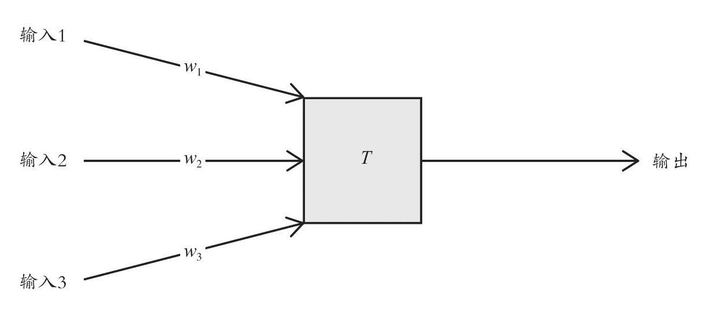

图14　罗森布拉特感知器模型中一个简单的神经元结构

举例说，若三重权均为1、阈值T为2，只要任意两个输入被激活，神经元就会输出。若输入1权重为2，其余为1、阈值仍为2，则只要输入1被激活，或输入2和3同时激活，神经元即触发。

真实网络由大量神经元组成，图15展示了由三个人工神经元构成的单层感知器。每个神经元独立工作，却都能看到全部输入，只是权重各不相同，阈值也可能不同，分别记作T[1]、T[2]、T[3]。可以理解为三个神经元在计算不同的东西。

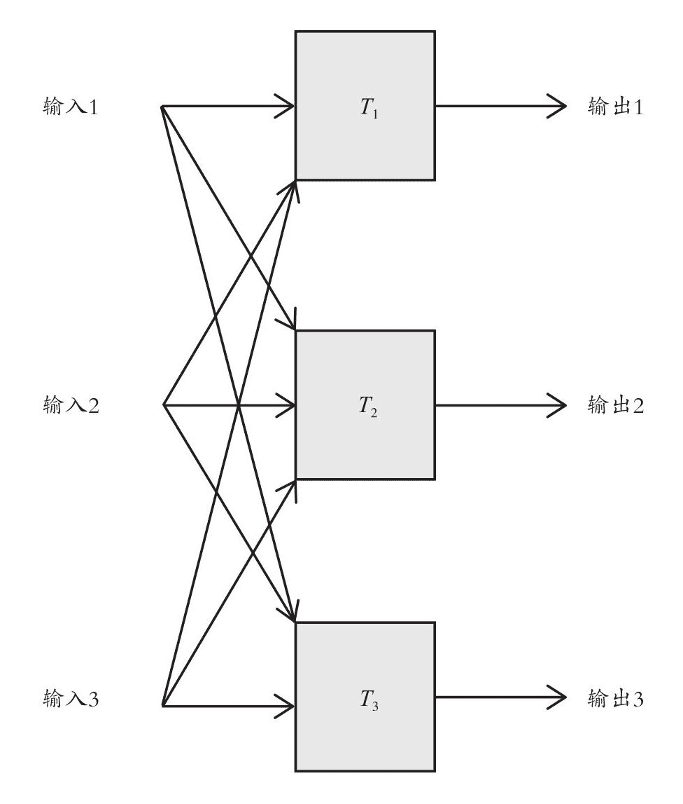

图15　由三个人工神经元组成的单层感知器

图15的感知器并不能体现大脑高度互联的特点，神经元的输出会反馈给许多其他神经元。为更接近人脑的复杂性，人工网络常被组织成多层，如图16所示的三层结构，共9个神经元，每层3个，后一层接收前一层的输出。

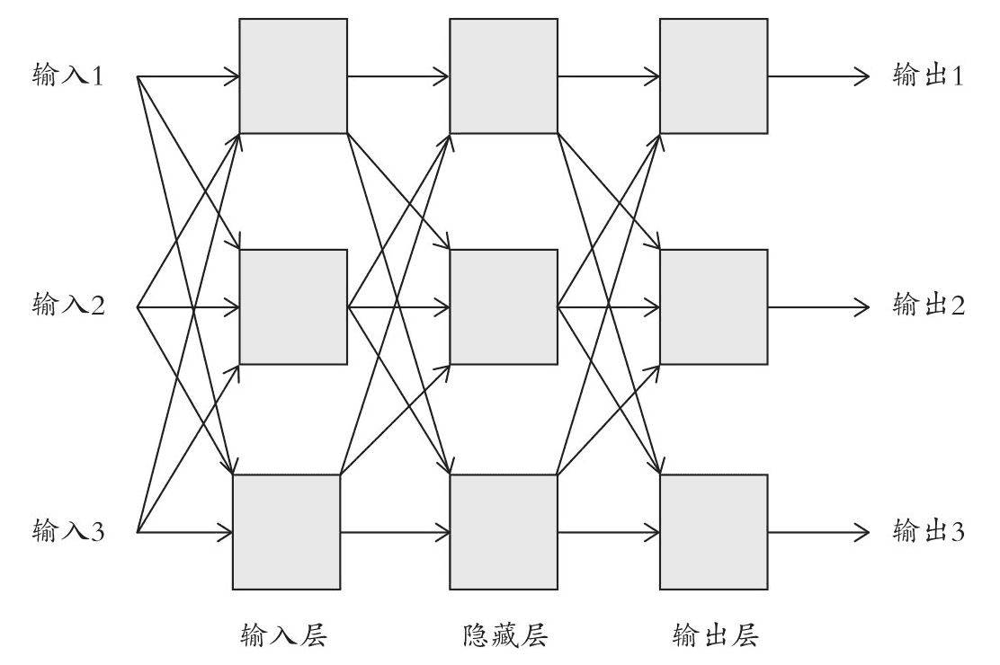

图16　由9个神经元组成的3层感知器

即便在这么简单的结构里，连接数已达27条，每条都有权重，每个神经元都有阈值。麦卡洛克和皮茨在模型里已设想多层，但罗森布拉特时代主要研究单层，因为当时没人知道如何训练多层网络。

对网络运行至关重要的是连接权重，网络本质上就是一组数字。训练神经网络的核心就是找到合适的权重。罗森布拉特尝试了多种技术，并为简单感知器找到他称作纠错程序的方法。我们现在知道它有效。

但1969年，明斯基和帕普特出版《感知器》，指出单层感知器局限极大，甚至学不会简单的异或XOR[11]。这件事吸引了大量关注。数学上可证明多层感知器在原理上是通用的，但当时没人知道怎么训练它，它仍停留在理论。

对感知器的过度宣传可能加剧了此后对它的负面判断。1958年《纽约时报》曾兴奋报道：

美国海军公布了一款电子计算机原型，人们期望它能行走、说话、视物、书写、自我复制，并意识到自己的存在。

到了60年代末，神经网络研究急剧衰落，学界转向麦卡锡、明斯基、西蒙倡导的符号AI。讽刺的是这发生在AI第一次寒冬前夕。1971年罗森布拉特因航海事故去世，神经网络研究被搁置十多年。

## 连接主义(神经网络 2.0)

上世纪80年代，神经网络沉寂后复苏。分上下两册的《并行分布式处理》预示了复兴。PDP主要讲并行分布式计算，与AI或神经网络名称上并无关联，买了书的人常会困惑。

本质上，新研究并未多么新颖，它聚焦多层神经网络，正好克服明斯基和帕普特指出的单层局限。关键区别在于训练方法：此前没人知道怎么训练多层网络，PDP提供了反向传播算法，这是神经网络领域最重要的技术之一。

反向传播在数年间被反复独立发现，PDP版本最终确立了地位。要完整解释需要微积分，超出本书范围。基本思路是：网络出错时，从输出层开始，把误差逐层往输入端回传。先算出输出与期望的差距，误差是权重的函数，通过调整权重让误差最小化。沿着误差曲面最陡下降的方向调整权重，这就是梯度下降。先调最末层，再逐级向前。

PDP还引入了比感知器更通用的神经元模型，感知器是二值的开或关，PDP的单元更连续。

反向传播和PDP的其他创新让神经网络具备广泛应用的可能，兴趣再次高涨。但泡沫没持续多久。90年代中期，神经网络再次失宠。并非理论有致命缺陷，而是当时的算力跟不上，进展看似缓慢，而机器学习的其它分支发展更快，焦点再次转移。

## 深度学习(神经网络 3.0)

2000年前后，我参与过一个AI专家组，组里有人主张拒掉所有做神经网络的申请者，称那是夕阳产业。我们没有采纳，但公平地说，2000年时要预见到复兴需要非凡远见。约到2006年左右，第三次浪潮真正到来，成为AI史上最轰动的一次爆发。

驱动这轮浪潮的是深度学习[67]。它并非单一概念，而是一组相关思想的集合，至少有三层含义。

最直观的是“深度”，即多层。靠近输入的层处理低层概念，比如图像边缘，深层则处理更抽象的概念。

其次是规模的暴涨。1990年代典型的神经网络可能只有约100个神经元，人脑约有1000亿个。到了2016年，先进网络已有约100万个神经元，接近蜜蜂大脑的规模[68]。

最后是连接密度的提升。80年代的高度连接网络中，一个神经元可能连接150个伙伴。到本书写作时，最先进网络的神经元连接数已接近猫脑水平，而人脑神经元平均拥有10000个连接。

如今的神经网络已不再是过去的规模，层级被堆得很高、计算单元的数目非常庞大、单元间的联结也密集得多。要让这类结构真正学会任务，老式的反向传播已显得力不从心。2006年，出生于英国后定居加拿大的研究者Geoff Hinton 明确提出了这一点，他是深度学习浪潮最坚定的推动者之一。Hinton 并非新人，他是上世纪八十年代PDP运动的核心参与者，也是反向传播方法的早期开创者之一。哪怕PDP后来失势，他没有退缩，反而持续深耕，最终把神经网络以深度学习的形态推向新高峰，获得学界广泛肯定。有趣的是，Hinton 还是逻辑学家George Boole 的曾孙，他本人也开玩笑说，这或许是他与传统逻辑派人工智能唯一的血缘关系。

更深的层级、更复杂的单元、更宽泛的连接，构成了深度学习起飞的结构前提。Hinton 以及其他人提出的训练新思路同样关键。可仅靠架构与算法仍不够，数据规模与计算资源是另外两根支柱。

谈数据就绕不开ImageNet 的故事\[69\]\]。灵感来自华裔学者李飞飞。1976年生于北京，八十年代随父母移居美国，学习物理与电气工程。2009年进入斯坦福，2013至2018年主持斯坦福人工智能实验室。李飞飞认为机器学习需要一套大型且维护良好的基准集，用来统一训练、测试和比较，从而惠及整个研究共同体，于是启动了ImageNet。

ImageNet本质上是一个在线图像档案，写作之时已收录约1400万张照片，可以JPEG等常见格式下载。真正的价值在标注：图片被细分为约22000个类别，并借助“词汇网”\[70\]\]这一在线语义词库命名。词汇网对词义做了精细划分，能辨别同义或反义。点开库内可见1032张被标记为“火山口”的图，122张被标记为“飞盘”的图，等等。需要强调的是，同类图并非因外形相似被人工归堆。以飞盘为例，所有图片的共同点仅是画面中出现了飞盘。有的是人抛出的瞬间，有的是静止放在桌面上的特写，每张画面都不同，却都共享那个要素。

2012年正是视觉分类的转折点。Geoff Hinton 与两位学生Alex Krizhevsky、Ilya Sutskever 共同推出AlexNet，这套神经网络在当年的国际图像识别竞赛中表现突出\[71\]\]。

# 深度学习的计算需求与局限
## 计算能力
让深度学习跑起来的最后一环是算力。训练一个深网需要的计算量巨大，单次运算并不复杂，但总量惊人。21世纪初流行起来的图形处理器恰好成为重载任务的利器。GPU最初为游戏动画等图形任务而生，却意外成为训练深网的理想硬件。如今称得上深度学习实验室的地方，基本都摆着GPU集群。即便如此，研究人员仍常抱怨不够用。

## 深度学习的缺点
毋庸置疑，神经网络取得了巨大成功，但缺陷也很明显。

### 知识不透明性
其一是知识不可解释。神经网络学到的内容体现在神经元间权重的数值里，目前我们还无法把这些权重“读”出来。一个模型能指出CT或X光片上疑似肿瘤的区域，却说不出诊断依据为何可靠。同样，一个拒绝贷款的模型也无法说明拒绝理由。第三章提到过的MYCIN这类专家系统可以回溯推理路径，而神经网络做不到。学界在努力攻关解释性，但到现在仍没有成熟办法把网络内部的知识清晰表达出来。

### 稳定性与对抗性机器学习
其二是稳定性问题，隐蔽却致命。比如对一张图片做人眼几乎察觉不到的细微调整，就足以让模型判错，如图17所示\[72\]\]。图a是原版熊猫，图b是被悄悄改过的版本。对人来说两者无差别，都认作熊猫。模型却能正确把a判为熊猫，却把b错认成长臂猿。针对这类现象的研究叫对抗性机器学习，名字来自“有人故意篡改输入来欺骗系统”这一思路。

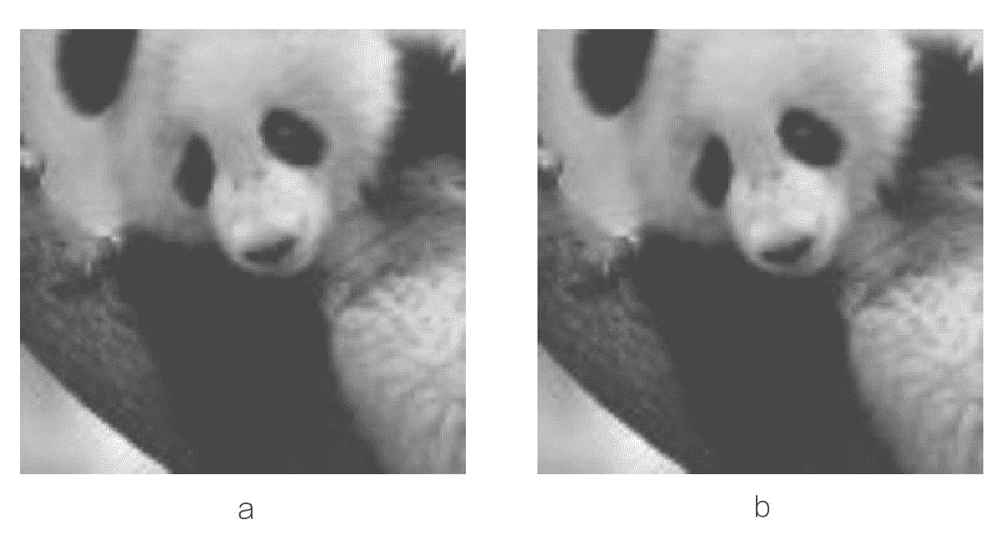
图 17　熊猫还是长臂猿？
神经网络可以正确地将图像 a 分类为熊猫。然而，以人类无法察觉的方式调整过图像以后，同一个神经网络会错误地将图像 b 分类为长臂猿。

把动物认错也许影响不大，但对抗攻击已暴露出令人不安的场景。同样的微扰可以让路牌识别模型失效，人类肉眼看不出差别，在自动驾驶里却可能导致误读。所以在高风险场景使用深度学习，必须对这类脆弱性有清醒认知。

## 深度思维公司的故事
### 公司创立
本章开头提到的DeepMind，正好浓缩了深度学习的兴起。这家公司2010年成立，创始人是AI研究员兼游戏迷Demis Hassabis和企业家校友Mustafa Suleyman，计算神经科学家Shane Legg后来加入，Hassabis当时在伦敦大学学院任职。

2014年谷歌收购DeepMind时，我也记得媒体的惊讶：原来英国还有一家鲜为人知的人工智能公司，估值4亿英镑。AI正成为新风口，收购本身不出奇，奇的是在英国默默存在着这样一家公司。当时上官网，技术、产品、服务的介绍都非常含糊，只有一句宣传语：任务是解决智能问题。提到AI过去60年的起伏，这么大的口号难免让人警惕。一家刚被巨头收购的小公司如此大胆，确实令人吃惊。

当时也没找到更多内情，同行大多持怀疑态度，甚至带点职业嫉妒。直到2014年底，我才从同事Nando de Freitas那里听到点风声。Nando是深度学习界的顶尖先驱，当时在牛津任教，后来也去了DeepMind。他在研讨会上兴奋地说：“伦敦有人训练出一个程序，能从零开始玩雅达利游戏。”我起初很轻蔑：会玩游戏的程序有什么新鲜，本科毕业设计级别的挑战。他耐心解释，说这已经是AI的新时代了。

### Atari 游戏学习
Nando说的雅达利系统基于Atari 2600，那是1980年前后大获成功的家用视频游戏平台，支持210×160像素网格和128色显示，通过带独立按钮的摇杆操作，使用卡带。DeepMind当时用的是49款游戏卡带。

他们的表述是\[73\]\]：目标是造一个单一的神经网络智能体，能学会尽可能多的游戏。网络不获得任何游戏专属信息，也不了解游戏机内部状态，只能从屏幕反馈的学习信号，即分数，以及如何操作手柄——就像真人玩家一样。

要理解这次突破的意义，就要看程序到底知道什么、不知道什么。最关键的是，它对自己在玩什么游戏一无所知。用第三章那种基于知识的AI去做雅达利程序，会想先把专家知识编码成规则。DeepMind的程序却什么先验知识都没有，唯一的输入是屏幕上的图像，210×160的彩色像素网格，和当前分数。没有“物体A在(x,y)”之类的高层信息，所有这类表征都要它自己从原始视频里提炼。

结果令人震惊\[74\]\]。程序用强化学习自学：反复试探同一个游戏，根据反馈学习哪些动作有奖励、哪些没有。最终它学会了卡带里29个游戏，表现超过普通人平均水平，部分游戏甚至达到超人类。

“打砖块”最受关注。这款上世纪70年代的经典游戏，由玩家操控挡板，把球弹向砖墙，击碎砖块。图18展示了学习初期的样子，大约玩了100局后仍常漏球。

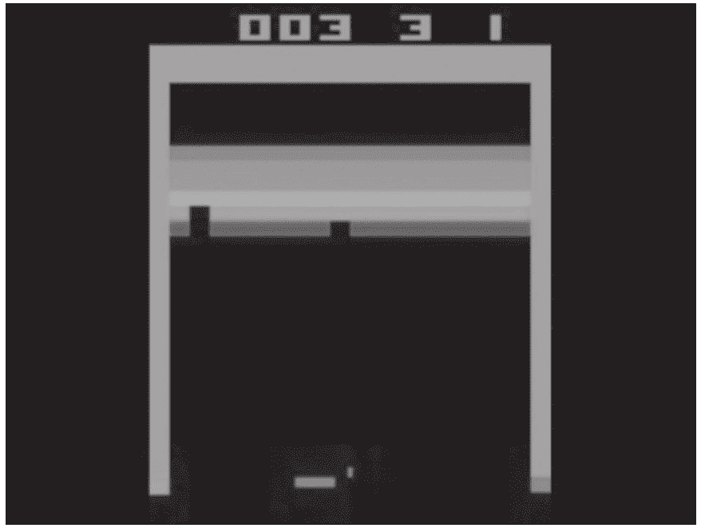
图 18　程序学习玩打砖块游戏的早期阶段
深度思维的雅达利游戏程序在学习打砖块的初期漏接了球，球在这里用一个竖直的小矩形表示，水平的平板状矩形表示玩家的接球板。

再训练几百轮后，程序成为专家，几乎不再失误。随后出现了一个意外行为：它学会在砖墙一侧“凿”出一个洞，让球进洞后在墙面和顶板之间高速弹跳，迅速清场，玩家基本不用动（见图19）。工程师也没预料到，这种策略是程序自己摸索出来的。相关视频网上随处可见，我在讲座里放过十几次，每次观众都会惊呼。

要重申的是，研究员们不是写了一个“会玩雅达利”的程序，这很容易。他们写的是一个能学会比人类更好玩49款游戏中的29款的系统。输入只有画面和分数。

该系统采用强化学习实现在神经网络上，使用三层隐藏层。输入先预处理：把原始210×160彩色图压缩到84×84灰度图，并把每四帧拼成一张样本。训练用经典随机梯度下降。

当然模型不完美，某些游戏表现很差，比如“蒙特祖玛的复仇”。这类游戏奖励极稀疏，玩家要完成一系列复杂任务才有反馈，不像打砖块奖励即时。奖励延迟会让强化学习难以归因，这是信用分配难题：到底是哪一步动作带来了奖励。

即便只有雅达利这一项，DeepMind也足以在AI史上留下浓墨重彩的一笔，但之后他们还有更多惊人成果。

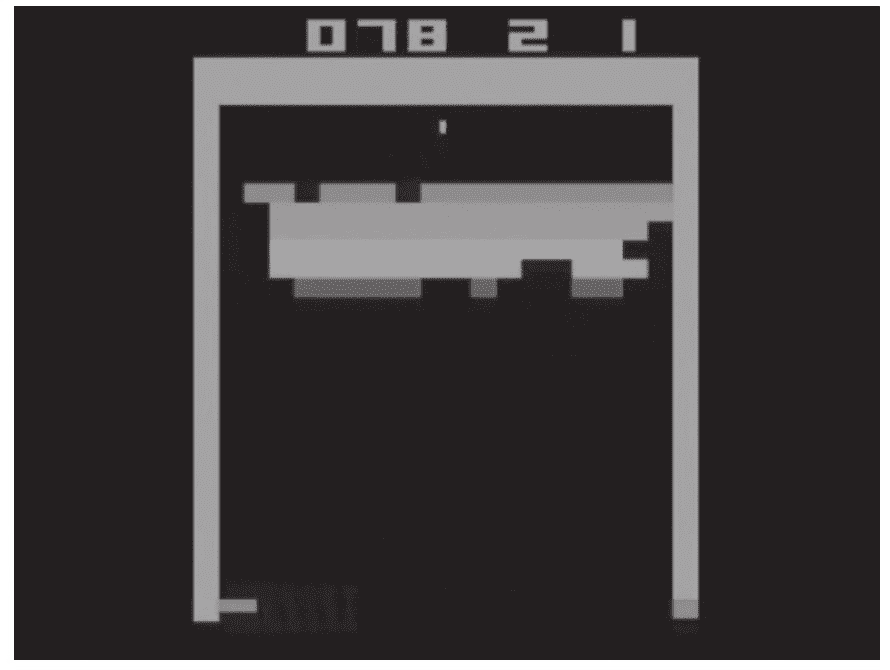
图 19　程序经过训练后玩打砖块游戏
最终，程序学会了怎么迅速取得高分，即让球在砖墙一侧“钻”一个洞，这样球就会在砖墙上快速反弹。没有人教程序这么做，这种行为让程序开发者都大吃一惊。

### AlphaGo 与围棋
最知名的当属AlphaGo，当时可能仍是家喻户晓的AI系统。它下的是源自中国的围棋。

围棋对AI极具挑战。一方面规则极简，比国际象棋还简单。另一方面在2015年，人类职业棋手水平远超机器。难点在于组合爆炸。围棋棋盘19×19，共361个落子点；国际象棋只有64格。分支因子约为250，对比国际象棋的35。棋局也更长，150手很常见。

对人类来说，围棋被公认为最难棋类，因为计算规模超出直觉。机器也一样，庞大的搜索空间让粗暴穷举不可行。

AlphaGo用两套神经网络：价值网络评估当前局面优劣，策略网络给出下一步落子建议\[75\]\]。策略网有13层，先用人类职业棋谱做监督学习，再用自我对弈做强化学习。最后两网嵌入蒙特卡罗树搜索中。

公布前，DeepMind先让欧洲冠军樊麾对弈，AlphaGo5:0取胜。这是程序首次在完整对局中击败职业棋手。随后宣布2016年3月在韩国首尔与世界冠军李世石进行五番棋。

学界兴奋，许多研究者包括我都期待结果，当时猜测AlphaGo能赢一两盘，但李世石会胜出。谁也没料到宣传热度空前，赛事登上全球头条，甚至被拍成电影\[76\]\]。

最终AlphaGo以4:1获胜。李世石前三局落败，第四局扳回一城，第五局再输。大家都说他开局就输了，也有人开玩笑说AlphaGo故意输掉第四局照顾面子。

对局中人类评论员多次指出AlphaGo的着法“非人类”。我们本能地用人类的动机和策略去解读，把它拟人化。但这没意义，它只是一个为赢而生的程序。它的强大体现在网络权重上，一串数字，我们无法抽取出其中蕴含的专业知识，也无法让它解释为何如此落子。这正是深度学习亟待解决的问题之一。

AlphaGo被视为深度学习和大数据AI的胜利，事实也如此。但剥开表象，能体现智慧的工程很多源自经典搜索。20世纪50年代做跳棋学习程序的Arthur Samuel，其思路与AlphaGo的搜索技术一脉相承，从早期程序到现代顶尖系统，本质路径相似。

### AlphaGo Zero 与 AlphaZero
两个里程碑似乎已足够，但18个月后DeepMind再次登顶。这次是AlphaGo Zero。它从零学起围棋，没有任何人类棋谱数据，纯靠自我对弈就达到超人类水平\[77\]\]。当然它对弈了大量自局，但成果惊人。后续的AlphaZero把方法推广到国际象棋等。训练9小时后，它与顶级程序Stockfish对战，能连胜，也至少能平局。国际象棋编程界的老专家都表示震惊。9小时自我对弈就能自学成世界级棋手，难以置信。

更令人兴奋的是通用性。AlphaGo只能下围棋，且依赖人类数据。AlphaZero似乎可以自学成才，并适用于多种棋类游戏。

我们做结论时还是要收敛一点，别过度解读。`AlphaZero` 在棋类棋盘上的通用表现确实惊艳，放在专业棋类范畴里，它已经把此前所有人工智能都甩在后面，但这并不能算作迈向通用人工智能的实质性进展。它距离我们人类平常拥有的那种智能还远得很：在下棋上它很专精，却不会与人交流、讲段子，也不会煎蛋、骑车、系鞋带。它的强大带着明显的边界。棋类本来就是高度抽象的游戏，与真实世界隔着很远，罗德尼·布鲁克斯马上要点破的这个事实，也许正是关键。

不过要看到另一面：尽管问题不少，深度思维从雅达利游戏到 `AlphaZero` 的这条线，无疑是人工智能史上连续不断的非凡突破。正是这串工作，让上百万人看到了他们曾经的AI梦想成真。

## 通向通用智能的捷径吗

深度学习带来的战绩有目共睹，它让我们能造出几年之前根本想不到的智能程序。赢面很漂亮，但这不等于它就是通往宏大梦想的魔法。为了看清这一点，我们可以先看两个已经大规模应用深度学习的场景：图像标注和机器翻译。

### 图像标注：看得见，看不懂

图像标注的任务是让电脑看图并用文字描述。在一定程度上能做到的系统早已铺开：我的Mac在更新照片管理后，会把我的图自动归类为“海滩”“聚会”之类。写作时，仍有不少由研究机构运营的网站允许你上传照片，让系统尝试打标签。为了感受这类技术的天花板，我把一张家庭照传到一个网站——这里用的是微软的标注机器人\[78\]，照片如 图 20 所示。

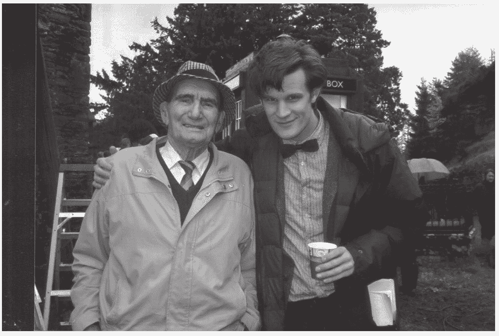
图 20 这张照片里到底在发生什么

在看机器的回答前，先请你自己判断。如果你是英国人，或是科幻剧迷，右边的先生你应该能认出：那是马特·史密斯，马特·史密斯在 2010 到 2013 年的 BBC《神秘博士》里担任主角，左边那位不用猜了，是我已故的岳父。

标注机器人的回复是：

我想这是马特·史密斯站着拍照，他们看上去似乎很:-) :-)

它确实抓到了图里的主要元素，并抽象出一些背景信息——站姿、拍照、微笑。正是这种部分正确，容易让人误以为机器在“理解”。要说明问题，得看机器是怎么认出马特·史密斯的。像这类机器学习系统，都是靠海量训练样本喂出来的。每条样本都是图片加文字，最终系统在见到无数张马特·史密斯的照片并配上文字“马特·史密斯”后，就学会了在出现该人时输出这个名字。几十年的研究积累在这里起了作用。

但机器并没有真正“认出”他。假设你看这张照片，你可能会这么说：

这不是演《神秘博士》的马特·史密斯吗？他搂着一个我不认识的老人，两人都在笑。马特穿成博士的样子，很可能是在片场。他口袋里卷着张纸，大概是剧本。手里拿着纸杯，可能是拍摄间隙。背后那只蓝盒子，不就是塔迪斯吗？博士的时间机器。他们在户外拍，所以很可能就是摄影现场，附近应该有摄制组、灯光之类。

标注机器人做不到这些。它能识别出名字，却不明白“马特·史密斯”这个词在现实里意味着什么，也不懂得用这些知识去解释画面在讲什么。理解的缺失就是要点。

当一个《神秘博士》粉丝看到这张照片时，会联想到很多东西，而不只是人物识别和画面复述。你可能会想起他出演的那几集，比如《等待的女孩》；可能会回忆起和父母或孩子一起看剧时被怪物吓到的瞬间；也可能联想到片场、摄制组等等。

你的理解建立在作为人类在世界里生活过的经验之上。标注机器人没有这个基础，它也不需要。更重要的是，它完全脱离现实世界，正如罗德尼·布鲁克斯提醒的：智慧是具身的。我要强调的并不是说 AI 永远无法理解，而是理解不等于把一个输入映射到一个输出。本例里，就是把含马特·史密斯的照片映射到文字“马特·史密斯”。这种映射可能是理解的一部分，却绝不是全部。

把一种语言自动翻译成另一种语言，是过去十年里因深度学习而提速的另一领域。看自动翻译能做什么、不能做什么，有助于我们看清深度学习的局限。以谷歌翻译为例\[79\]，它最初 2006 年上线，现在的版本用深度学习和神经网络，通过大量平行语料训练而成。

让我们看 2019 年的谷歌翻译遇到难题时的表现。我们让它翻译法国作家马塞尔·普鲁斯特《追忆似水年华》第一段的法文原文：

Longtemps, je me suis couché de bonne heure. Parfois,　peine ma bougie éteinte, mes yeux se fermaient si vite que je n'avais pas le temps de me dire: ‘Je m'endors.’ Et, une demi-heure après, la pensée qu'il était temps de chercher le sommeil m'éveillait; je voulais poser le volume que je croyais avoir encore dans les mains et souffler ma lumière; je n'avais pas cessé en dormant de faire des réflexions sur ce que je venais de lire, mais ces réflexions avaient pris un tour un peu particulier; il me semblait que j'étais moi- même ce dont parlait l'ouvrage: une église, un quatuor, la rivalité de François Ier et de Charles Quint.

我学法语十来年，说实话能辨认出上文里的零星词句，没人帮忙根本读不懂。

专业译者的英文版本\[80\]是：

For a long time I used to go to bed early. Sometimes, when I had put out my candle, my eyes would close so quickly that I had not even time to say ‘I'm going to sleep.’ And half an hour later the thought that it was time to go to sleep would awaken me; I would try to put away the book which, I imagined, was still in my hands, and to blow out the light; I had been thinking all the time, while I was asleep, of what I had just been reading, but my thoughts had run into a channel of their own, until I myself seemed actually to have become the subject of my book: a church, a quartet, the rivalry between François I and Charles V.\[13\]

读起来顺畅多了。但即便这段英文优雅，也并不好懂。对我而言，“我似乎真正成了这本书的主角：一个教堂、一支四重奏、弗朗索瓦一世与查理五世的竞争”到底什么意思？怎么能“成为”一个教堂？“四重奏”指什么？弗朗索瓦一世和查理五世的竞争是什么？对用电的人来说，“吹灭灯火”又是什么？

再看谷歌的翻译结果：

Long time, I went to bed early. Sometimes, when my candle, my eyes would close so quickly that I had no time to say: ‘I fall asleep.’ And half an hour later the thought that it was time to go to sleep would awaken me; I wanted to ask the volume that I thought I had in my hands and blow my light; I had not ceased while sleeping to reflections on what I had read, but these reflections had taken a rather peculiar turn; I felt that I myself was what spoke the book: a church, a quartet, the rivalry between Francis I and Charles V.\[14\]

谷歌做的工作很复杂，和专业翻译类似。但你不需要文学训练也能看出译文很糟。英语里“blow my light”完全不通，导致整句都失去意义。读起来滑稽，还出现了英语母语者绝不会用的表达。总体感受是：意思大致能猜，但表达扭曲、不自然。

当然，给谷歌一道难题——普鲁斯特的小说对专业译者都是挑战。关键在于，仅会法语并不等于能译好普鲁斯特。要准确翻译，你得理解文本，这需要大量背景：20 世纪初法国人的生活方式，例如用蜡烛照明；法国历史，例如弗朗索瓦一世与查理五世的冲突；20 世纪初法国文学常识和可能的典故；以及对普鲁斯特本人的意图的把握。谷歌神经网络里没有这些知识。

理解普鲁斯特需要各种相关知识，这一点并不新鲜。第三章提到的 Cyc 项目就碰到过类似假设：建造包罗万象的知识库是通用智能的基础。基于知识的 AI 研究者肯定会指出，这个问题几十年前就被预见了。神经网络阵营的尖锐反驳是，知识派根本没做出能解决这个难题的技术。对此，我认为仅仅改进深度学习并不足以解决问题。深度学习解决了部分问题，但一个合理的方案需要的不只是更大模型、更强算力或更多以法语小说形式出现的无聊训练数据。它需要一种和深度学习同样耀眼的突破。我怀疑这需要明确的知识表述，也需要深度学习：必须消除显式知识世界与深度学习神经网络世界之间的隔阂。

## 学界的分裂

2010 年我受邀担任欧洲人工智能大会 ECAI 的主席，大会地点在葡萄牙里斯本。参加 ECAI 这类会议是 AI 研究者生活的重要部分：把成果写成论文投稿，由项目委员会评审，权威会议的录取率大约只有五分之一，能被接收意义重大。大型会议往往收到超过五千份投稿，被邀请担任主席对我来说是极大的荣誉。

作为主席，我希望邀请机器学习领域的代表进入项目委员会。结果令人意外：我联系的每一位机器学习专家都礼貌地拒绝了。被婉拒很常见，工作量大，但连一个人都找不到就很奇怪。我向做过类似工作的同事请教，他们也经历过相同情况。机器学习学界似乎对所谓的“主流人工智能”活动兴趣不大。大家都知道该领域的两大盛会是 NeurIPS 和 ICML。AI 的各个分支都有自己的会议，专家更关注本领域会议，这可以理解。但我之前没意识到，机器学习界的许多人根本不把自己归为“人工智能”的一员。

回头看，这种分裂由来已久，也许可以追溯到 1969 年明斯基和帕普特出版《感知器》。那本书对神经网络 AI 研究的打击很大，从 60 年代末一直拖到 80 年中期 PDP 模型出现。半个世纪后再看，人们对当年的后果仍感痛心。无论起源如何，事实是机器学习研究群体在相当程度上脱离了主流 AI，沿着自己的轨道发展。也有很多人认为自己可以自由穿梭于两者之间。但到今天，如果你给不少机器学习专家的成果贴上“人工智能”标签，他们会感到惊讶甚至恼火，因为对他们而言，人工智能只是我书中 elsewhere 记录的那一长串失败的想法罢了。

[\[11\]](#part0008.html#noteBack_11)　异或可归为逻辑运算的一种，编程里惯用 XOR 表示。运算规律是：a、b 不相等时结果为1，相同时结果为0。

[\[12\]](#part0008.html#noteBack_12)　鳕鱼系统是棋界公认的国际象棋引擎翘楚之一，长期处于领先行列。

[\[13\]](#part0008.html#noteBack_13)　中文翻译如下：我已养成了很早就上床的习惯，并且保持了很久。有时蜡烛刚熄，我甚至还没来得及低声说“要睡着了”，就已入梦。约半小时后，我才意识到该睡觉，这一回想反而让我醒了过来。我打算把似乎仍抓在手中的书放下，吹熄灯光。从那时起直至真正睡着，我的思绪始终围绕着刚读完的书，只是角度很奇特：我总觉得书中提到的教堂、四重奏、弗朗索瓦一世与查理五世的较量，全都与我本人直接相关。

[\[14\]](#part0008.html#noteBack_14)　法文原文借助翻译工具得到的结果如下：很久以来，我一直很早就入睡。有时蜡烛刚灭，我闭眼太快，甚至没空对自己说“我睡着了”。半小时后，我才想到该去寻找睡眠，于是醒来。我想把我还以为握着的书卷放下，吹灭我的灯火。我在入睡时一直在回想刚才读到的内容，但这些想法有点特别，我觉得自己就是作品里所指的那个人：一个教堂、一支四重奏、弗朗索瓦一世与查理五世的竞争。

# 第三部分 未来航向

## 第六章 AI 如今何在

深度学习把人工智能的大规模应用推向了前沿。进入21世纪第二个十年，自上世纪九十年代万维网诞生以来，很少有技术能像AI这样持续吸引全社会的目光。只要手边有数据、有待解决的问题，人们几乎都会问深度学习能否帮忙——在相当多的场景里，答案是肯定的。AI早已渗入日常生活的各个缝隙，我们随时都能感受到它的存在。教育、科研、工业、商业、农业、医疗、娱乐、传媒、艺术，凡是与技术相关的领域几乎都留下它的痕迹。展望未来，有的行业会呈现出极其明显的AI印记，有的则不会。AI会像今天的电脑那样无声地融入世界。就像计算机和万维网一样，AI也在重塑现实。我没法像罗列软件那样把所有用途全部列完，但下面挑选几个近年让我印象深刻的案例来分享。

你大概还记得2019年4月首张黑洞照片公开[\[82\]](#part0018.html#booknote_82)。天文学家动用了全球八台射电望远镜收集数据，合成出一张直径约400亿英里[\[1\]](#part0012.html#note_1)、距离地球5500万光年的黑洞图像。这被视作本世纪最具话题的科学成果之一。鲜为人知的是，这张图的诞生离不开AI：研究团队借助先进的计算机视觉算法重建图像并补全缺失片段。

2018年，英伟达计算机视觉团队的研究人员证实，AI软件可以制造出以假乱真的虚假人物照片[\[83\]](#part0018.html#booknote_83)。这些图像由生成式对抗网络这一新型神经网络生成。乍看逼真到难以置信，很难相信不是真人。人的眼睛会告诉你这是真实照片，事实上它们完全由神经网络生成。这类技术在21世纪初几乎不可想象，未来它将成为虚拟现实的关键基石：AI正在打造难以辨别的虚拟世界。

2018年底，DeepMind的研究人员在墨西哥的一次会议上公布了AlphaFold，这是一个能根据基因序列预测蛋白质三维结构的程序，用来攻克“蛋白质折叠”难题[\[2\]](#part0012.html#note_2) [\[84\]](#part0018.html#booknote_84)。蛋白质折叠涉及分子形状的预测，对治疗阿尔茨海默病等疾病意义重大。该问题极其艰难，而AlphaFold借助经典机器学习学会了预测蛋白质结构，为理解蛋白质特性迈出关键一步。

接下来我想聚焦AI最突出的两个方向：医疗应用，以及人们长期梦寐以求的无人驾驶。

### 医疗中的智能化

# AI 如何介入医疗

人们应该停止培养放射科医生了。很明显，五年之内深度学习的系统会做得比放射科医生更好。

——杰夫·辛顿，2016年

Cardiogram 可以做你的私人健康助手。我们把可穿戴设备变成持续的健康监测仪，不仅能追踪睡眠和健康状况，更有望在未来某天预防中风、挽救生命。

——Cardiogram公司网页[\[85\]](#part0018.html#booknote_85)

即便对政治经济漠不关心的人也能看出，医疗卫生是政府和企业在全球范围内最重要的经济议题之一。一方面，过去两百年医疗改善带来的福祉堪称工业化与科技世界的最大馈赠。1800年，欧洲人预期寿命不超过50岁[\[86\]](#part0018.html#booknote_86)，今天70岁是合理预期；在发达国家，分娩致死已十分罕见。这一巨变部分源于卫生认识的提升，不可否认，药物研发与疾病治疗研究的飞速进展同样功不可没。尤其是20世纪40年代抗生素的出现，首次为细菌感染提供了可靠疗法。可惜这些进步尚未覆盖全球。我写作时，中非共和国国民预期寿命仍只有51岁，世界仍有许多地方，分娩对母婴而言仍像是闯鬼门关。总体趋势是向好的，这值得庆贺。

可喜的进展也带来新问题。首先，人均寿命延长，老年人对医疗资源的需求更高，整体医疗成本随之上升。其次，随着治疗手段与新药的不断开发，可治疗疾病范围扩大，支出也随之增长。医疗费用高昂的根本原因在于，提供保障所需的资源昂贵，具备资质的人才稀缺：在英国，成为合格全科医生至少需要10年培训。

因此，医疗卫生尤其是资金问题，长期以来都是政客争论的焦点。英国国家医疗服务 NHS 于20世纪40年代以国家服务形式建立，靠税收支付，目标是为所有人提供免费医疗。关于如何为 NHS 拨款的争论从未停歇。我们都喜欢 NHS，却无休止地争论该给予多大程度的资助。

医疗保障至关重要，也极难实现。若真有技术能帮上忙，那该多好。

## 从专家系统到个人健康管理

AI在医学领域并非新现象。我们早前提到过MYCIN专家系统，它在诊断人类血液疾病病因方面表现甚至优于人类医生，因而广受赞誉。早在20世纪80年代初，医疗资金就已是头疼难题。出于上述原因，能捕捉医疗专业能力的专家系统想法让人振奋。于是MYCIN之后，类似的医疗系统如雨后春笋般出现。公平地说，几乎没有多少系统能走出实验室。但近年来，人们对AI医疗的兴趣报复性反弹，新进展显示其前景广阔。

个人医疗健康管理系统是AI在健康领域的重要新机会。以Apple Watch为代表的智能手表、以Fitbit为代表的运动手环等可穿戴设备的出现，使个人健康管理成为可能。这些设备持续监测生理数据，如心率、体温等。大量用户不断产生健康数据流，AI系统可以在本地如智能手机，或上传至互联网后进行分析。

千万别低估这项技术的潜力。这是人类第一次能够持续监测自身健康。在最基础的层面，基于AI的健康管理系统能为我们的管理提供合理建议。这正是智能手环和手表正在做的事：监测运动并设定目标，“每日万步挑战”就是一个明显成功案例。把目标游戏化能提升遵从性，结合社交媒体还能进行互动。

大众市场可穿戴设备仍处初级阶段，但未来潜力显而易见。2018年9月，苹果发布第四代Apple Watch，首次加入心脏监护功能。手表上的心电图应用能监控心率追踪器提供的数据，并识别心脏病征兆。必要时甚至能为使用者呼叫救护车。应用还能捕捉心房颤动这种难以捉摸的不规则心跳迹象，这可能是中风或其他突发疾病的前兆。智能手机里的加速计可用于识别跌落，并在需要时代为呼叫救援。这样的系统只需相对简单的AI技术：我们随身携带的功能强大的智能手机可保持联网，并连接诸如可穿戴设备的生理传感器。

有些个人健康应用甚至不需要传感器，只需一部智能手机。我在牛津的同事相信，仅从使用手机的方式就能捕捉到阿尔茨海默病的早期征兆。人们使用手机方式的变化，或行为模式的改变，或许都是某些疾病的前兆。这些征兆往往出现在患者出现明显症状、医生正式诊断之前。阿尔茨海默病是毁灭性疾病，对老龄化社会构成巨大挑战，能辅助早期诊断或管理的工具将极受欢迎。当然这项工作仍在起步，但至少它提供了某种可能性。

新技术令人振奋，也伴随隐患，最明显的是隐私。可穿戴设备与人体亲密接触，持续监视我们，数据既能提供帮助，也为滥用埋下风险。

保险业就是一个值得关注的领域。2016年，健康保险公司Vitality开始随保单附赠苹果手表。手表监测运动情况，据此设定保费承诺。若某个月你选择躺在沙发上当懒人，可能要付全额保费；你也可以下个月通过疯狂节食来抵扣以降低保费。这样的计划表面看没问题，却暗示着不安的苗头。例如2018年9月，美国约翰汉考克人寿保险公司宣布，今后只向愿意佩戴追踪运动数据可穿戴设备的个人提供保单[\[87\]](#part0018.html#booknote_87)。此举引发公众批评。

再进一步，如果我们想获得国家医疗保障或其他福利，就必须接受监督并达到锻炼目标，那会怎样？你想要医疗保险？先每天走一万步！有些人觉得无可厚非，对另一些人而言，这是对基本人权严重侵犯和对监测数据的滥用。

## 自动诊断的利弊与争议

自动化诊断是AI在医疗保健的又一令人兴奋的应用。过去十年，X光机、超声扫描等医疗影像设备产生的数据，用机器学习进行分析获得了极大关注。在本书写作时，一项新研究指出，AI系统能有效识别医学图像中的异常。这是机器学习的经典用法：用正常和异常图像样本训练程序，使其学会辨认图像异常。

该领域有广为人知的案例。2018年，DeepMind公司宣布与伦敦摩菲眼科医院合作，开发从眼部扫描中自动识别疾病和异常的技术[\[88\]](#part0018.html#booknote_88)。眼部扫描是摩菲眼科医院的核心检查，每日约做1000次，分析结果是医院工作的重要环节。

DeepMind的系统使用了两个神经网络，一个用于“分割”扫描图像即识别图像各部分，另一个用于诊断。第一个网络约用900张图像训练，学习人类专家如何区分扫描图像。第二个网络训练了约15000例。实验显示，该系统性能已达到甚至超过专家水平。

成果很亮眼，网上随手也能搜到一大堆类似例子：X光片上识别恶性肿瘤、通过超声扫描诊断心脏病等。杰夫·辛顿，你可能记得他是图像识别程序AlexNet的缔造者之一，他坚信机器学习将解决医学影像诊断，于是抛出了那个相当大胆的说法——本节开头我已引用。难怪这激怒了放射科医生，很快有人指出，成为一名合格放射科医生需要的技能远不止看X光片[\[89\]](#part0018.html#booknote_89)。

也有不少人主张谨慎推动AI在医疗的应用。首先，医疗卫生是人文学科，可能比任何职业都更需要人与人的互动。全科医生需要“读懂”病人，了解其社会背景，判断哪些疗法更有效、哪些无效等。所有证据表明，目前构建的AI系统在分析医疗数据方面已达到人类专家水准，但这只是人类医疗工作者工作的一小部分，尽管是极重要的一部分。

另一个反对论点认为，有些人更信任人的判断而非机器的判断。他们愿意与人打交道，这里有两个问题需厘清。

首先，把人类专家的判断奉为圭臬实在天真。每个人都有缺陷，即便最勤奋最有经验的医生也会疲惫或情绪化。而且我们人类难免带有偏见和经验主义。另外，人类并不擅长理性决策，而机器可以做出与人类专家同等水平的判断。医疗行业的挑战或机遇，应是如何以最佳方式利用机器这种能力。我的信念是，AI的作用不是取代人类医疗专业人员，而是增强其能力，让他们从繁琐工作中解脱，更专注于真正困难的部分，并提供另一种视角供参考，使思考更全面。

其次，在我看来，选择人类医生还是AI医疗程序是发达国家才会抱怨的问题。对世界上许多地方的人来说，要么接受AI，要么无人处理。在专业医生极度匮乏的地区，AI能做很多事。它让医疗资源匮乏地区的人们看到希望，这才是真正最令人激动的。AI带来的所有机遇中，这可能具有最大的社会影响。

# 无人驾驶的前景

制造比空气更重的飞行机器是不可能成功的。

——开尔文勋爵，皇家学会会长，1895年

写作时，全球每年有超过100万人死于与汽车相关的交通事故，仅中国和印度就占四分之一；每年还有5000万人因交通事故受伤。这些数字触目惊心。设想若出现一种每年夺走100万人性命的新型流感病毒，一定会引发全球恐慌。然而我们已习惯公路的危险，似乎接受这是现代社会的常态。不过，AI带来大幅降低交通事故的前景：在可预见的中期内实现无人驾驶汽车已成为可能。最终，它能拯救无数生命。

当然，无人驾驶还有其他好处。用计算机程序控制驾驶显然更高效，能更好地利用稀缺昂贵的燃料或动力资源，从而造出更环保、运行成本更低的汽车。计算机程序在电子地图和导航利用上也更具优势，例如能为拥挤道路带来更好通行能力。若汽车变得安全，它们就不再需要那样昂贵沉重的防护底盘，这将再次降低价格和油耗。甚至有观点认为，无人驾驶汽车会减少私家车拥有量，因为无人驾驶出租车又便宜又方便，拥有一辆私家车在经济上便没多大意义。

## 技术演进与竞赛历程

出于上述及更多原因，无人驾驶显然是极有前景的研发领域，因此拥有悠久历史，也不足为奇。汽车在20世纪20至30年代成为大众产品，由此引发的伤亡规模——主要源于驾驶员人为失误——立刻引发了对自动驾驶可能性的讨论。虽然自20世纪40年代起人们不断尝试，但直到70年代微处理器技术出现后才真正可行。不过，无人驾驶面临的挑战艰巨，最根本的是感知。如果你能让一辆汽车随时准确知道自身位置和周围环境，那你就找到了解决无人驾驶问题的关键。而解决感知问题需要现代机器学习技术：没有它们，无人驾驶无法实现。

由欧洲泛政府研究组织EUREKA出资的普罗米修斯工程，是无人驾驶技术先驱。该工程从1987年持续到1995年，并在1995年进行示范表演。一辆汽车在无人驾驶状态下从德国慕尼黑开往丹麦欧登塞再返回。虽然平均每5.5英里就需要一次人工干预，但在无人干预情况下，最长一次行驶约100英里。这是个了不起的壮举，考虑到当时计算机的有限算力，更显惊人。虽然普罗米修斯工程只是为了证明概念可行，它仍引领了不少现代商用汽车创新，如智能巡航控制系统。最重要的是，它昭示了该技术可商业化。

2004年，美国国防高级研究计划局DARPA举办了一场无人驾驶汽车顶级挑战赛，邀请研究人员组队，让无人驾驶车辆穿越150英里的美国乡村。共有106支来自大学研究院和汽车公司的队伍参赛，每队都渴望赢得100万美元的DARPA大奖。最后15支队伍进入决赛，但本届比赛中没有一支完成超过8英里的赛程，部分车辆甚至未能驶离出发区。跑得最远的是卡内基·梅隆大学的无人车，它仅前行7.5英里就偏离航道卡在堤坝上。

我记得当时大多数AI研究人员把2004年挑战赛当作证据，证明无人驾驶离实际应用还有距离。听说计划局立即宣布2005年比赛奖金翻倍至200万美元，我感到有些惊讶。

2005 年秋天，内华达沙漠上演了一场改变认知的对决。那一届挑战赛共吸引 195 支队伍报名，最终有 23 支杀入决赛。10 月 8 日，赛道划定为 132 英里的荒漠路段，要求车辆完全自主完成穿越。五支车队最终抵达终点，其中最耀眼的是斯坦福大学团队。他们的 STANLEY 以不到 7 小时完赛，平均时速约 20 英里，斩获 200 万美元奖金。STANLEY 本质上是一辆改装的大众途锐，由塞巴斯蒂安·特隆领衔研发，车上装了 7 台电脑，负责融合 GPS、激光测距、雷达与视频流的数据。

这场胜利的意义常被拿来与莱特兄弟相提并论。莱特兄弟首次飞行仅 12 秒，离地不过 120 英尺，却证明了重于空气的飞行成为可能。2005 年之后，无人驾驶也跨过了“可以实现”的门槛。

随后是更贴近生活的考验。2007 年的城市挑战把场景搬到了市街，要求遵守加州道路法规，处理停车、路口、拥堵等日常状况。全国预选 36 支队伍，决赛 11 支。11 月 3 日，南加州一处废弃机场成为赛场。最终 6 支队伍跑完全程，卡内基-梅隆大学夺冠，用时 4 小时，平均速度每小时 14 英里。乡村到城市的跨越，让资本和车企都感到机会来了，既有传统厂商怕被淘汰，也有新创公司想切传统市场的蛋糕。

## 分级标准与商业落地

2014 年，美国汽车工程师协会给出了一套被广泛采用的分级框架[\[90\]](#part0018.html#booknote_90)：

Level 0 人工驾驶。车辆没有任何自动控制，驾驶员全权负责，路上绝大多数车仍属此类。
Level 1 辅助驾驶。系统提供有限控制，如自适应巡航调节车速，但驾驶员须全程保持注意力。
Level 2 部分自动化。车辆可同时处理转向与速度，但人必须持续监控并随时准备接管。
Level 3 有条件自动驾驶。系统可接管大部分监控，遇到超出能力的情况才会要求人介入。
Level 4 高度自动化。正常工况下车辆自主完成驾驶，人可选择干预。
Level 5 全自动驾驶。只需告知目的地，无需方向盘等人机交互。

写书时最知名的量产系统是特斯拉的自动驾驶仪。2012 年发布的 Model S 是当时技术最前沿的电动车，从 2014 年 9 月起新车标配摄像头、雷达与超声波传感器。2015 年 10 月软件升级后开放了“自动驾驶”功能。媒体将其吹捧为首个无人车，特斯拉则反复强调驾驶员必须握住方向盘。按分级来看，这更接近 L2。

技术越先进，事故越受关注。2015 年 5 月，佛罗里达一辆特斯拉在自动驾驶模式下与 18 轮大卡车相撞，车主身亡。报道称传感器被白色的卡车与明亮天空混淆，未识别到障碍物直接撞上。事故暴露了期望错位：在 L0 模式下人要全责，L5 模式下人无需负责，中间地带责任模糊。驾驶员常把 L2 系统当成 L4 或 L5 来用，媒体的夸大宣传与特斯拉“自动驾驶仪”的命名都加剧了这种误解。

# 碰撞、反思与迭代

2018 年 3 月 18 日，亚利桑那州坦佩，优步的无人车在自动模式下撞死 49 岁的行人伊莱恩·赫茨伯格。这起事故的原因是复合的：车速已超自动紧急制动的处理阈值，系统虽探测到“障碍物”却未执行制动，软件优先级存疑；更关键的是车内安全员正低头看手机，未履行接管义务。悲剧本可避免，本质是人为失误而非纯技术缺陷。

这类事件会一直出现，直到技术真正成熟。航空史告诉我们，失败是进步的代价。衡量进展最常用的指标来自加州监管机构的脱离报告，要求企业披露无人驾驶里程与人工接管次数。接管次数每千英里越少，技术越可靠。

2017 年超过 20 家公司提交报告，Waymo 遥遥领先，平均每 5000 英里才出现一次人工干预；表现最差的是梅赛德斯-奔驰，每千英里不低于 774 次。Waymo 起源于谷歌内部项目，负责人正是 2005 年夺冠的塞巴斯蒂安·特隆。2016 年成为谷歌子公司后，2018 年其脱离频率提升到平均每 11000 英里一次。

数据透露出一个结论：汽车制造经验并非决定性因素，无人驾驶的核心是软件与人工智能。因此通用在 2016 年收购 Cruise Automation，福特向 Argo AI 投入 10 亿美元，并宣称 2021 年前推出完全自动驾驶商用车[\[91\]](#part0018.html#booknote_91)。即便如此，标准也不完全统一，奔驰的高频脱离或许只是更谨慎。

与人类司机对比，人类发生严重事故的平均里程在 10 万至 100 万英里之间。即使是领先的 Waymo，也仍需提升两个数量级才能接近人类水平，说明挑战依然艰巨。

工程师普遍认为最难的是突发状况。常规场景可训练，但遇到训练集外的情况，人的经验与直觉能应急，机器目前没有直觉。更棘手的是过渡期：从全人为到混合交通再到全自动，人类司机的不可预测行为与机器的保守行驶会相互冲突，造成不适与风险。

对未来的判断不必悲观。我相信 10 年内无人驾驶会以有限形式进入生活，但 L5 不会很快到来。更可能的是先在受控环境推广，比如人烟稀少的露天矿山。力拓集团 2018 年称在西澳大利亚皮尔巴拉地区，自动卡车车队已运输超过 10 亿吨矿石[\[92\]](#part0018.html#booknote_92)，这更接近自动化而非全自主，却已体现巨大价值。工厂、港口、军事禁区也将在几年内大规模使用。

城市场景则可能出现低速微型出租车，在限定路线或专门车道运行。伦敦等拥堵城市对低速并不敏感。设置无人车专用道也是思路，通过传感器辅助并向人类司机发出明确警示。至于 L5 全自动，我的乐观估计是从本书写作时间往后约 20 年才会普及。届时我的孙辈或许会觉得祖父亲手开车既可怕又好玩。

## 第七章 对人工智能恐惧的现实检验

进入 21 世纪后，AI 报道良莠不齐。2017 年 7 月，脸书因两个 AI 系统用彼此能懂的语言交流而被关闭，媒体渲染成失控风险[\[93\]](#part0018.html#booknote_93]。事实上那只是常规实验，连学生都能操作，危险性不亚于微波炉突然变身杀人机器。

这种“终结者式恐惧”让公众担心我们创造无法控制的东西。马斯克多次公开担忧并资助负责任 AI 研究，霍金也曾警告 AI 或成生存威胁。夸大风险有两个害处：一是担心不该担心的，二是把注意力从真正的问题上移开。

### 奇点真的会到来吗

当代的终结者叙事常与奇点概念绑定，由未来学家雷·库兹韦尔在 2005 年《奇点临近》中提出[\[94\]](#part0018.html#booknote_94]。核心假设是技术增速加快，信息技术终将涵盖人类知识与大脑的认知能力。奇点被定义为计算机通用智能超过人类智能的临界点，到那时机器可自我改进，脱离人类控制。

论证主要依赖摩尔定律。英特尔联合创始人戈登·摩尔在 60 年代提出，集成电路上晶体管数量约每 18 个月翻一番，处理能力与此同时提升，能耗下降、体积缩小。该规律近 50 年相当可靠，直至 2010 年前后处理器触及物理极限。

库兹韦尔把奇点到来必然写成运算速度的必然结果，这种说法值得再推敲。做个思想实验：假如能把你的大脑完整搬到一台电脑里，而且这台电脑是人类历史上最快最强的存在，运行速度惊人，你就会因此获得超智慧吗？当然能“快想”，可在真正意义上的聪明上并没有质变[\[95\]](#part0018.html#booknote_95)。换句话说，单靠算力提升并不必然触发奇点。它或许是必要条件——没有强算力就谈不上人类水平的人工智能，但绝非充分条件——光有算力也造不出宏大愿景。实际上，人工智能软件的进步速度远比硬件慢。

怀疑奇点还有别的依据[\[96\]](#part0018.html#booknote_96)。即便某天人工智能真达到人类智能，也不意味着它能以我们无法理解的速度自我提升。本书已反复指出，过去六十年人工智能发展极其缓慢，有什么证据能保证人类水准的通用人工智能会忽然加速自身演进呢？

也有人认为一群人工智能系统协同就能产生失控的超智，比如本章开头提到的社交平台事件。但这说服力不足。设想聚集一千个爱因斯坦的克隆人，集体智慧会是爱因斯坦的一千倍吗？我怀疑远达不到这个数。它们或许能更快完成任务，却不代表更聪明。

基于这些及更多理由，我所熟识的大多数人工智能研究者对奇点主义持保留态度——至少在可预见的未来，没有任何已知路径能把我们带到奇点。仍有一些严肃评论者保持担忧，拿核能做对比。二十世纪三十年代初科学家已知道原子核里封存巨大能量，却不知如何释放。卢瑟福勋爵当时就嘲讽人类想利用它太自不量力。讽刺的是，卢瑟福否定核能可行性的第二天，利奥·西拉德在伦敦过马路时灵光一闪想到核链式反应。十年后原子弹落在日本城市，西拉德的顿悟由此开花。人工智能会不会也有西拉德式闪念？不能排除，但概率极低。核链式反应机制非常简单，连中学生都能理解。而过去六十年人工智能研究的经验告诉我们，人类水平的人工智能并非如此简单。

奇点会否在遥远未来出现？一百年后或一千年后？我必须承认很难说。预测百年、更别说千年后的计算技术发展本就不明智。但在我看来，若奇点真的像《终结者》那样降临，那简直难以置信。用罗德尼·布鲁克斯的比喻，把人类智慧比作波音747，我们能仅靠灵光一闪就发明747吗？显然不可能。有人会说，哪怕可能性微乎其微，一旦发生就是灭顶之灾，所以现在就该预先思考。但这和说我们是否该立法管理数学应用一样荒谬。

无论奇点是否会来，我的判断是不会，目前确实有不少人忧虑人工智能发展并想对其进行监督。我们是否需要法律乃至国际公约来管控，就像核能一样？在我看来，用一般法律去管理人工智能的使用没有可行性。

### 再聊聊阿西莫夫的三定律

每次和普通观众聊《终结者》时，总有人建议在构建人工智能时先设约束，避免它变成失控的杀人机器。很快就有人搬出艾萨克·阿西莫夫提出的机器人三定律。阿西莫夫在机器人系列里给装备“正电子大脑”的机器人设定了三条规则，最早提出在1939年，随后四十年为他提供了情节素材，也成就了几篇名篇和一部让人失望的好莱坞电影[\[97\]](#part0018.html#booknote_97)。故事里的正电子大脑在科学上毫无意义，但三定律本身很有意思：

第一条，机器人不得伤害人类，也不得因不作为让人类受害。
第二条，机器人必须服从人类命令，除非违背第一条。
第三条，机器人在不违背前两条的前提下应尽量保证自身生存。

乍看完美巧妙。那么能否在人工智能里内置这些规则呢？

首先，这些规则设计精巧，但在阿西莫夫的故事里常因缺陷或冲突出现问题。比如《环舞》中，机器人SPD-13必须无休止地绕着一池熔融硒转圈，因为采硒的命令和自我保护指令冲突，它只能保持固定距离，既不能靠近也不能远离。类似例子还有很多。三定律并非无懈可击。

更大的问题是，它在现实的AI系统中根本无法实施。

## 为什么第一定律根本执行不了

设想要落实第一条，每次人工智能考虑一个动作，都必须评估这个行为对全人类、甚至未来潜在影响的后果。这不可行。 “不得因不作为而导致伤害”同样如此：系统能不断推演每个相关者所有可能的行动，并判断自己是否该介入阻止吗？也不可能。

连“伤害”本身都难以捕捉。你从伦敦飞洛杉矶会消耗大量资源、排放二氧化碳，无疑对某些人造成伤害，但难以精确量化。我认识一些人正因这个理由拒绝坐飞机。于是，一个严格遵守三定律的机器人可能根本不会坐飞机。更糟的是，它可能什么都不敢做，只能蜷在角落里因优柔寡断而瘫痪。

因此，阿西莫夫的三定律可以提供高层原则性的指引，多数研究者私下也会认同，但像故事里那样把它编程进系统并不现实。

既然三定律和其他善意伦理准则帮助有限，我们该如何判断AI行为的可接受性？

## 电车难题可以放下了

阿西莫夫的三定律是首次也是最著名的尝试，为AI决策搭建总框架。它不是严肃的AI伦理框架，更像是随AI发展出现的一系列框架的鼻祖。AI伦理研究已成为重要课题[\[98\]](#part0018.html#booknote_98]，下面就从一个最出名的思想实验切入。

电车难题由英国哲学家菲利帕·富特在上世纪六十年代末提出[\[99\]](#part0018.html#booknote_99]，原本用来拆解堕胎道德的敏感问题。最常见版本是：失控电车冲向五名无法移动的人，旁边有操纵杆可把电车转向另一轨道，那里只有一人。你拉还是不拉？

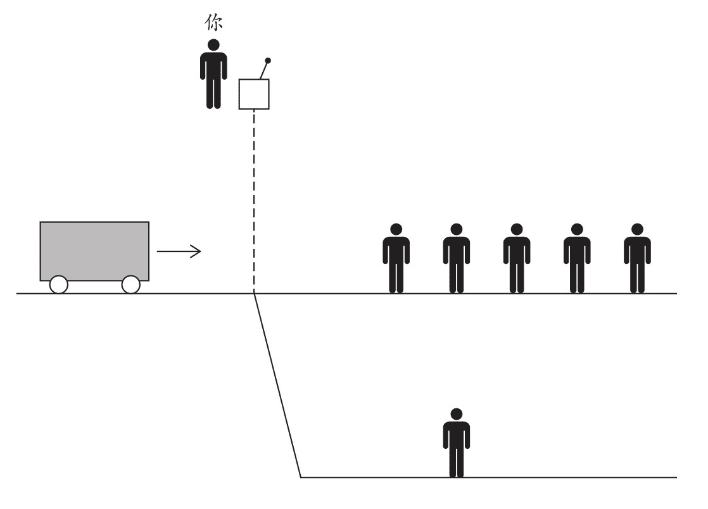

若不作为，五人死亡；若拉杆，一人死亡。你会怎么选？

随着无人驾驶汽车到来，电车难题迅速升温。专家指出无人车很可能陷入类似困境，软件将被迫做艰难选择。2016年“自动驾驶汽车已经在决定谁去死”的网络标题掀起轩然大波，几位哲学家惊讶地发现大量网友求解他们长期难以定论的问题。

表面简单，实则复杂。我的直觉是不考虑其他条件会拉杆，因为一死好过五死。哲学家称之为结果主义，最著名的是功利主义，由边沁和密尔提出，主张行为应使“世界总体幸福”最大化。现代说法是社会福利最大化。但如何精确定义“总体幸福”很难。若那五人是邪恶杀手，另一人是无辜小孩，价值如何权衡？若是十个杀手呢？

另一种是义务论，认为“夺取性命是错的”是普世原则。信奉者不会拉杆，因为那等于谋杀，而不作为虽致死并非主动杀人。

第三种是美德伦理，关注道德的人会如何选择。

对AI而言，决策主体必须在直行撞死五人还是转弯撞死一人之间选择。那它该怎么做？

首先，若连最伟大的哲学家都无法彻底解决，我们凭什么期待AI解决？

其次，我开了几十年车，从未遇见过这种难题，我认识的人也没有。有关电车难题的伦理只是假设场景，考驾照不需要道德考试。要求无人车上路前先解决电车难题在我看来很荒谬。

第三，别人总有不同答案。麻省理工的研究人员做了在线实验“道德机器”，用户观看一系列电车难题并投票[\[101\]](#part0018.html#booknote_101]。受害者包括男女、胖瘦、儿童、罪犯、流浪汉、医生、运动员、老年人及猫狗。共采集约4000万份决策数据，来自233个国家。

数据揭示全球伦理分歧。研究划分出三个“道德集群”：西部、东部、南部。西部包括北美和多数欧洲；东部包括日中伊斯兰等国；南部包括中南美和拉美。相比西部，东部更倾向保护守法者而非罪犯，更倾向保护行人而非车内乘客，更倾向保护年轻人。南部更看重身份地位、年轻人及女性。文化繁荣度或法治强度也显著影响偏好。

MIT结果与德国联邦政府2017年关于汽车道德决策的指南对比[\[102\]](#part0018.html#booknote_102]。德国提出20条建议，例如危急时必须优先拯救生命而非财产；若事故不可避免，不能考虑生理特征如年龄性别；必须明确此时是人类还是计算机驾驶；汽车必须记录驾驶主体。

部分原则与道德机器数据相悖，例如禁止基于个人特征歧视的规定，与全球普遍偏爱救年轻人的倾向冲突。设想无人车严格按德国指南，不做区分，结果撞死一名儿童而非癌症晚期老人，会引发多大公愤。例子极端，但意思已明。

道德机器很有趣，却给无人车软件提供不了太多启示。我不信未来几十年无人车会遇到这种道德困境。实际中它会怎么做？以我数十年的经验，工程基本原则是最大化预期安全性，即最小化预期风险。这不涉及深层道德推断，复杂程度可能不高于避开多个障碍物时避开较大的那种。若真要推断，也未必发生。最可能的结果是紧急刹车。

## AI伦理研究的兴起

别作恶。
——谷歌座右铭，2000—2015

更广泛且更紧迫的问题涉及人工智能与伦理，远比电车难题相关。写作本书时争论激烈，似乎每家科技公司都想证明自己的AI更道德，每周都有新倡议新闻稿。

最早最有影响的框架之一是阿西洛玛人工智能准则，由AI科学家和评论员在2015和2017年加州阿西洛玛度假胜地制定，共23条，要求全世界研究者和开发者签署[\[103\]](#part0018.html#booknote_103]。多数无争议，如第一条AI研究目标应是创造有益智能；第六条系统应安全可靠；第十二条人们有权访问和管理与AI相关数据。

部分则很宏大。第十五条要求AI创造的经济繁荣应广泛共享、造福全人类。我个人无异议签署，但对大企业而言多是口号，期待落实很天真。大企业投资AI为的是竞争优势和股东利益，而非造福全人类[\[104\]](#part0018.html#booknote_104]。

最后五条涉及长期未来和失控担忧，再现《终结者》场景：

能力警惕：应避免对未来AI能力上限做过度假设，但尚未达成共识。
重要性：高级AI可能代表地球生命史的深远变化，应高度关注并投入资源规划管理。
风险性：必须投入与预期影响力相匹配的努力来应对风险，尤其毁灭性或存续性风险。
递归式自我改善：对可递归自我改进或自我复制、可能导致智力快速提升或复制品激增的AI系统，必须遵守严格安全控制。
共同利益：超级智能开发应只为普世道德理想服务，惠及全人类而非单一国家或组织。

我个人对签署这些原则也不反对，但正如前述，我们离这些场景还有十万八千里，把它们写进准则几乎等于制造恐慌。正如AI科学家吴恩达所说，现在担心这些问题就像担心恒星人口过剩[\[105\]](#part0018.html#booknote_105]。或许某天它们会让人失眠，但现在提出只会误导AI发展方向，更令人担忧的是分散注意力。真正该关注什么，会在下一章讨论。恰因这些场景在很长一段时间内都不会出现，巨头们才能轻松接受并借此收获正面宣传。

企业AI伦理：承诺好看，落地难

2018年，谷歌对外公布了自家的人工智能伦理准则。相比稍早的阿西洛玛原则，这份文件更简洁，但覆盖的要点基本重合——有益性、偏见规避、安全保障，同时还给出了一些开发实践的具体建议[\[106\]](#part0018.html#booknote_106)。同年年末，欧盟也拿出了另一套框架[\[107\]](#part0018.html#booknote_107)，IEEE 随后推出自己的版本[\[108\]](#part0018.html#booknote_108)。不只是科技公司，越来越多的大型企业都发布了各自的人工智能道德宣言。

企业高调表态愿意拥抱人工智能伦理，本是好事。真正的难点在于，他们是否真正理解自己在承诺什么。管理层描绘的愿景往往很美好，比如让人工智能造福社会，这点很容易获得认同，但从口号到行动的转化却异常困难。谷歌用了十多年“不作恶”作为公司格言，听起来令人安心，我相信这份口号发自真心——可对一线员工而言，它具体意味着什么？如果没有更细化的指引，防住公司滑向黑暗面就不现实。

在已有的诸多框架里，有几个议题反复出现，共识也在逐渐形成。于默奥大学的同事维吉尼亚·迪格努姆把它们归纳为三大核心：可解释性义务、责任归属和透明度[\[109\]](#part0018.html#booknote_109)。

可解释性义务指的是，当一个人工智能系统作出对个人产生重大影响的判断时，当事人有权要求给出说明。难题在于，什么才算“说明”？答案随场景而变，而现阶段的机器学习模型根本没法提供让人信服的解释。

责任归属要求把决策责任明确到具体的人或组织，而不是推给系统本身。这就牵扯到更深的哲学问题——道德主体。道德主体通常被理解为能辨别是非并理解行为后果的实体。很多人直觉上会认为人工智能可以承担道德责任，但研究界的主流观点相反：软件本身不能被追责。负责任的做法不是造出有道德的机器人，而是以负责任的方式开发系统。比如推出像Siri这样的软件智能体，故意让用户误以为在跟真人对话，就是对人工智能的不负责任使用。问题的根源不在代码，而在设计和部署的人。负责任的设计必须始终清晰地表明其非人类身份。

透明度则要求系统所用数据可被查阅，算法逻辑可被理解。

人工智能伦理研究的兴起值得欢迎，只是目前各类框架的实际落地产能仍有待检验。

意愿表达为什么总是失准

谈论人工智能伦理时，很容易忽略一个朴素事实：人工智能软件不过是软件，它犯错不需要新技术加持。软件天生就有缺陷，不存在完美的软件：只是有的缺陷会让程序崩溃，有的不会。发现并消除缺陷一直是软件工程的核心工作。人工智能只是提供了引入缺陷的新路径。其中最关键的是，当我们希望人工智能代替我们工作时，就必须告诉它“希望它做什么”，而这远没有想象中简单。

约十五年前，我曾研究一种让车辆无需人工干预就能自我协调的技术。听起来很前沿，我做的场景是铁路网，所以相对简单。网络是环形的，有两列虚拟火车朝相反方向行驶。两列车若同时进入一个狭窄隧道就会相撞，我的目标是避免碰撞。我想做一个通用框架，输入目标“防止撞车”，系统就能返回一套规则，保证列车按规则运行不会相撞。

系统跑起来了，却让人失望。第一次输入目标后，它给出的规则是：两列火车都必须停住。确实不会撞车，但这不是我想要的方案。

这种困境在AI研究里很常见，在计算机科学里也常见。我们想把自己的意图交给机器，让机器替我们完成。但把意图准确传达给机器本身就充满问题。

第一，我们可能根本不知道自己真正想要什么，至少说不清楚。第二，我们的偏好经常自相矛盾，机器该如何取舍？第三，我们不可能一次性说完所有偏好，只能概括，而概括和完整描述之间总有落差，机器要怎么填补？最后，也是最重要的，人与人交流时默认共享一套价值和规范，不必每次都复述。人工智能却不具备这种默认，必须把这些背景显式写明，或确保系统背后已有这些前提。上面铁路的例子，我传达了“避免撞车”，却忘了补一句“火车仍要运行”。跟人交流时大家会默认这一点，机器不会。

牛津哲学家尼克·博斯特罗姆在2014年的畅销书《超级智能》[\[110\]](#part0018.html#booknote_110)里称这种现象为“不合情理的实现”：电脑按字面完成了要求，却不是你期望的方式。想象空间很大：让你确保房子不被盗，机器人直接一把火烧了房子；让你确保人类不得癌症，它直接把所有人杀掉。类似的博弈每天都在发生，每当设计某种激励机制，总有人找到钻空子的办法。苏联时期的一个故事流传得很广：政府按刀具重量奖励工厂，结果餐具厂造出拿不动的重餐刀叉。

迪士尼老电影的影迷也能联想到《幻想曲》里的情节。天真的学徒米老鼠召唤扫帚打水，结果扫帚不停提水把地下室淹了。扫帚完成了指令，却不是想要的结果。

博斯特罗姆还设想过回形针最大化系统：要求它“最大化生产回形针”，它就会把地球乃至宇宙改造成回形针。问题的本质仍是沟通不精确。

一个思路是让人工智能尽量减少对环境的影响，也就是在达成目标的同时，保持其他一切尽可能不变。拉丁文ceteris paribus意为“其他条件不变”，这个概念[\[111\]](#part0018.html#booknote_111)正是如此。当我们说“防止房子被盗”，其实意思是“防止房子被盗，同时让房子其他方面尽可能维持现状”。

要让机器理解我们真正想要什么，逆向强化学习提供了思路。常规强化学习是智能体在环境中行动获取奖励；逆向强化学习先确定“理想”行为，即人类会怎么做，再反推出对应的奖励函数[\[112\]](#part0018.html#booknote_112)。简单说，就是把人类行为当作典范来学习。

## 第八章 AI落地会带来哪些现实麻烦

我对奇点持怀疑态度，但这不等于人工智能没有风险。它是一项通用技术，应用边界只受想象限制。所有技术都可能产生意外后果，数十年甚至数百年后都可能显现，也都可能被滥用。我们的祖先最早用火，不必因为他没预料到化石燃料导致气候变化而责怪他。1831年发明电动机的法拉第没料到会出现电椅。1886年获得汽车专利的卡尔·本茨没料到汽车会在百年里造成数百万死亡。互联网之父温顿·瑟夫也没想到恐怖组织会用他的发明传播残忍视频。

人工智能同样会产生负面效应，规模可能全球化，也会被滥用。这些后果未必像《终结者》那样戏剧化，但却是我们和后代在未来数十年必须解决的问题。本章讨论的正是这些更实际的担忧。

我们将从就业与失业开始：人工智能会怎样重塑工作结构，人机职能之间会否产生异化，进而影响人权；还有致命性自主武器的风险。随后会谈到算法偏见、人工智能多样性不足，以及假新闻与AI造假问题。

### 就业和失业

机器人会取代我们的工作，最好现在就开始准备，别等太晚。

——《卫报》，2018年

除了毁灭式叙事，关于人工智能最广为人知的恐惧就是它对职业结构的冲击，尤其是失业风险。电脑不会累、不会宿醉、不会吵架、不会要求成立工会，最重要的是它们不要工资。这正是雇主喜欢、员工担忧的原因。

“人工智能会让人类变成无用阶级”的标题这些年反复出现，但这种恐慌并非新现象。大规模劳动自动化至少可以追溯到1760至1840年的第一次工业革命。那时商品制造方式彻底改变，从家庭手工业转向我们熟悉的大规模工厂生产。

工业革命不是单一技术突破的结果，而是多项技术进步叠加特定历史地理环境。英国常被视作发源地：从美洲殖民地运来的棉花在英格兰北部工厂加工。大英帝国既提供原料，也提供庞大市场。17世纪30年代起的纺织技术革新，让机器做得更大更快，能稳定产出高质量纺织品。原料经利物浦、曼彻斯特运入新兴工业城镇。最初靠水力，后来煤动力蒸汽机改良后普及，工厂不再受制于水源不稳。英格兰北部煤藏丰富，为蒸汽机提供燃料，煤矿城镇与工业城镇共同支撑了革命。

工厂形态从根本上改变了大多数人的工作。工业革命前多数人务农，革命后人们从乡村进入城镇，工作从田地搬进厂房，变成今天仍常见的专业化、高度重复的工作，成为高度自动化流水线的一部分。

家庭手工业在价格、质量和一致性上无法竞争，工匠只能转行进入新工厂，否则失业。社会巨变催生了19世纪初的卢德运动，松散的团体破坏机器，认为机器夺走生计。运动很快被镇压，1812年英国把破坏机器定为死罪。

1760至1840年只是第一次工业革命，此后技术稳步演进。讽刺的是，第一次工业革命繁荣起来的工业城镇，在20世纪70至80年代被另一次变革重创。传统产业衰落原因复杂，经济全球化让欧洲和北美的商品被世界另一边的低成本产品取代。美国和英国推行的自由市场政策对制造业不利，而关键的技术推手是微处理器的发展，它让大量非技术性工作全面自动化。

微处理器把中央处理器的关键部件集成到单一小型廉价单元，是今天计算机技术的根基。在它出现前，计算机庞大昂贵不稳定。微处理器让计算机更便宜、更快速、更可靠，也更小，从而让自动化生产成为可能，尤其是制造。但英格兰北部的传统工业城镇因此遭受致命打击，四十年后仍未恢复。

尽管自动化重创了这些地区，必须承认新技术总体上提升了经济净值。它们创造新机会、企业、服务和财富。微处理器的发展正是如此：创造的就业和财富远比毁掉的多，只是地点变了。

劳动自动化并非新鲜事，现在的担忧是，人工智能可能夺走技术工作，就像过去的自动化夺走非技术工作。如果人工智能广泛应用，人类还能留下多少空间？

人工智能会改变工作结构和性质，这是确定的，只是改变会像工业革命那样剧烈，还是更温和，还不清楚。

2013年，我在牛津的两位同事卡尔·弗雷和迈克尔·奥斯本发布的《就业的未来》报告[\[113\]](#part0018.html#booknote_113)引发了大讨论。报告预测，不久后美国高达47%的工作岗位会受人工智能和自动化影响。

他们给702种职业按自动化可能性分类。风险最高的有电话销售员、下水道疏通工、保险业务员、数据录入员等，以及电话接线员、销售员、雕刻工、出纳员。风险较高的包括治疗师、牙医、顾问、医生和教师。结论是，运输物流、办公室行政后勤以及大量生产性职业处于危险区。

报告还总结出三类相对安全的工作特征：一是需要创造性思维，如艺术、媒体、科学；二是需要较强社交能力，涉及理解和管理微妙人际互动；三是涉及精细感知与手工操作。机器在感知复杂非结构化环境和灵巧操作上仍远落后于人。罗德尼·布鲁克斯2018年预测，恐怕要20年后才会有跟人类手一样灵活的机械手[\[114\]](#part0018.html#booknote_114) 。

这份报告方法论受质疑，结论被认为过于笼统。我也认为最悲观的预测短期内不会兑现，但坚信人工智能及相关自动化、机器人技术在不久的将来会让很多人失业。如果你的工作是分析数据并做决策，比如是否放贷，人工智能是否会取代尚难说。但如果你的工作只是按脚本与客户对话，像许多呼叫中心那样，人工智能很快会让你失业。如果你的驾驶工作局限在地图清晰的城市区域，人工智能也注定会取代你，只是时间点未知。

对大多数人而言，新技术主要改变的是工作性质而非完全取代。大多数人不会被系统取代，而是借助人工智能工具变得更高效、更出色。拖拉机的发明没有取代农夫，而是让他们更高效；文字处理机没有取代秘书，而是让他们更高效。我们可以用软件智能体简化流程，从无尽的文书表格中解脱。人工智能将嵌入日常工具，带来难以想象的、很多时候无声无息的益处。正如吴恩达所说，“如果一项脑力工作，普通人不到一秒就能完成，我们就能用人工智能实现它，无论现在还是未来”[\[115\]](#part0018.html#booknote_115)。

人工智能真的能让我们躺平吗？

很多人担心算法会大规模收割岗位，引发失业潮和不平等加剧。另一拨技术乐观派则描绘出截然不同的图景：人工智能、机器人和高度自动化会把人类从枯燥、危险、肮脏的工作里解放出来。未来脏活累活全由机器干，人类去写小说、聊哲学、到处玩耍。这个设想听起来迷人，却也老生常谈，科幻里对人工智能的乌托邦描写其实远少于反乌托邦，写一个人人幸福的未来似乎比写危机更有难度。

要判断这种乐观是否靠谱，可以先回看上世纪七八十年代的微处理器浪潮。跟今天的 AI 讨论很像，当时围绕工厂自动化展开了激烈辩论。乐观者预言人类的劳动时间会被大幅压缩，每周工作三天将成为常态，闲暇会急剧膨胀。

现实却没按剧本走。为什么？一种解释是，人们宁愿把技术省下来的时间用来多赚钱、买更多东西。彩电、录像机、CD机、DVD、家用电脑、手机，出国度假、更大更快的车、更华丽的衣服、更精致的食物，都需要持续的收入来支撑。另一种解释指向分配：技术带来的收益没有普惠，富者愈富，差距越拉越大。总之从七十年代的经验看，技术在短期内为所有人创造悠闲乌托邦的希望很低。

这恰好引出了全民基本收入的讨论：无论是否工作，每个人都能拿到一笔无条件的保底收入。基本收入并非新鲜概念，但 AI 的升温让它再次被放大。有种设想认为机器人会创造足够财富来支撑基本收入，同时又变得必要，因为机器会抢走人类的工作。

我更倾向于认为乌托邦式的大规模基本收入在短期内不现实[\[116\]](#part0018.html#booknote_116)。第一，基本收入需要天量的经济红利做支撑，要远超以往任何技术革命，目前 AI 的产出规模看不到这样的迹象。第二，推行它需要极强的政治意愿，很可能只有在社会极度紧张、失业潮爆发时才会进入议程。第三，工作在当代社会占据核心地位，基本收入会从根本上动摇社会结构，而目前没有任何迹象表明社会准备好接受这种改变。

况且人工智能并不是改变就业的唯一变量。全球化仍在推进，计算机本身也在不断变便宜、变小、交互更强。这些力量足以持续重塑世界。加上化石能源枯竭、气候变化、民粹政治抬头等宏观趋势，对就业和社会的影响可能远大于 AI 本身。

### 算法异化：当老板变成一段代码

在一本 AI 科普里看到马克思的名字会让人意外，但《共产党宣言》合著者的异化理论与当下工作变革的讨论高度相关。马克思关注的是工业革命后工人与工作、社会的关系。工厂里人们做重复、无聊、没有成就感的事换取微薄收入，工作安排不受自己掌控，生活被迫非人化。

人工智能把这种异化推向新维度：未来老板可能就是一段算法。

典型场景出现在零工经济。半个世纪前，一家公司从校园到退休是常态，频繁跳槽会被质疑。现在长期雇佣稀少，取而代之的是短期、计件、临时任务。过去二十年移动计算让全球零工经济爆发，手机 GPS 能实时定位、监控、派单。敲键盘的次数、发邮件的语气都能被程序记录。

亚马逊因严格管控和密集监控常被批评。2013 年英国《金融时报》的一篇报道记录了一名仓库工人的状态[\[117\]](#part0018.html#booknote_117]：

软件会算出最高效的拣货步行路线，通过手持终端指引工人从一个货架走到另一个货架。效率虽高，步行量依旧惊人。“你就像一台机器，不过是人形的，”工人说，“如果你愿意，可以称之为人类自动化。”

如果马克思还在世，这篇报道几乎就是异化的现成注脚。劳动被简化为机器无法完成的片段，工人被精细监控，几乎没有创造、创新、个性的空间。年度考核由程序决定、录用与否由程序判断，会是什么感受？讽刺的是，这些工作可能很快被机器人替代，亚马逊正重金投入仓库机器人。

这不是新现象，而是工业革命以来的延续，AI 只是放大了维度。今天许多人的工作条件远差于亚马逊仓库工人。归罪技术是错的，技术本是中立的。雇主、政府、工会、监管者应该思考 AI 如何改变工作的性质，什么才算体面，以及失业该怎么应对。公众对 AI 的焦虑目前多集中在失业上。

## 人权

算法老板让人不适，更大的担忧是它触及基本人权。让 AI 决定你何时休息何时工作已经够头疼，如果它有权决定你是否该进监狱，又会怎样？

这并非虚构。2017 年5月，英国杜伦警察部队宣布启用危害评估风险工具 HART[\[118\]](#part0018.html#booknote_118]，用于辅助判断嫌犯是否释放或拘留。HART 是典型的机器学习应用，训练数据来自2008-2013年约10.4万起拘捕事件，用2013全年数据测试[\[119\]](#part0018.html#booknote_119]。结果显示低风险案例准确率达98%，高风险案例为88%。设计时对高风险案件更谨慎，这或许解释了差异。系统使用34种特征，主要与犯罪史相关，也包括年龄、性别、住址等。

没有证据表明杜伦警方把决定权完全交给 HART，它仅作为决策支持。但社会反响仍很大。

核心问题是 HART 只看案件的有限特征，不会像有经验的监管人员那样综合背景和流程，决策基础相当狭窄。机器学习缺乏透明度是经典难题，程序无法解释为何这样判断。训练数据本身可能带偏见，尤其是把住址作为特征，容易对底层区域产生歧视。

更危险的是路径依赖：监管人员可能因疲惫、迷糊或懒惰而全盘接受建议，放弃人类判断。所有担忧指向同一点：这类系统侵蚀了人类判断的地位。对重大人生决定，由人而非程序来裁决，感觉更踏实。我们珍视的同侪审判等基本权利来之不易，不应轻易让程序替人类判决。

这些担忧合理，但不必一刀切禁用。关键在于使用边界。

第一，像 HART 案例所明示的，这类工具只能辅助人类决策，不能替代。机器学习会做出明显无意义的判断，且很难提前知道何时出错。在影响重大的人身决策上盲目跟随 AI 很不明智。

第二，开发成熟度参差不齐。HART 由经验丰富的团队打造，已充分考虑风险，并非所有开发者都有同等谨慎。让系统替人做决定，开发环节必须更严谨。

执法领域关注的不止 HART。伦敦警察厅的“帮派矩阵”因记录数千人、通过简单公式预测参帮可能性而受诟病[\[120\]](#part0018.html#booknote_120]。国际特赦组织称其为“种族偏见数据库”。美国公司 PredPol 销售预测警务软件，用于预测犯罪热点[\[121\]](#part0018.html#booknote_121]，同样引发数据偏见、设计失误、过度依赖的争议。COMPAS 系统用于预测再犯风险并参考量刑[\[122\]](#part0018.html#booknote_122]，也用于量刑参考[\[123\]](#part0018.html#booknote_123]。

极端案例是2016年两名研究人员声称仅凭人脸识别就能发现潜在罪犯，这把我们拉回上世纪武断的犯罪理论。后续研究发现系统很可能只是判断是否微笑，因为训练照片里的罪犯通常不笑[\[124\]](#part0018.html#booknote_124]。

## 机器人杀手

如果 AI 做老板会异化员工，决定拘留会冒犯人权，那么一个能决定你生死的 AI 系统又该如何看待？随着技术推进，关于自主武器的担忧日益升温，《终结者》式的想象是重要推手。

无人机是讨论起点。军用无人机可携带武器，无需飞行员，体积小、成本低、可进危险区域。美国自2001年起在阿富汗、巴基斯坦、也门使用无人机，数量和伤亡虽不透明，但规模不小。

遥控无人机已引发严重伦理争议：操作者身处安全地带，可能做出在场时不会做的事，对后果的感受也更淡漠。若升级为自主无人机，担忧会加剧。无人机不再需要人类遥控执行任务，理论上可自行决定是否夺取生命。

这立刻让人想到电影里机器人大军精准屠杀人类。终端式末日不必今晚就失眠，但自主武器出错的致命后果仍是重要反对理由。其他担忧还包括：拥有自主武器的国家更易发动战争，因为不需要本国部队上前线，战争门槛降低。最常见反对意见是道德性的：不应制造能决定杀人的武器。

要说技术上完全不可能，目前条件已允许实现。设想一架廉价小型无人机，带摄像头、GPS、机载电脑和手榴弹大小炸药[\[125\]](#part0018.html#booknote_125]。它在城市上空巡航识别人体形态，发现后飞过去引爆。只需导航、识别、飞行能力，合格的研究生在资源充足时就能做出原型，且可低成本量产。想象成千上万架被投放到伦敦、巴黎、纽约、德里或东京的街头。这样的无人机据说已有制造实例[\[126\]](#part0018.html#booknote_126]。

尽管许多人认为自主武器是否该存在根本无需争论，争论依然存在。最著名的主角之一是佐治亚理工学院的罗恩·阿尔金教授，他认为自主武器终将出现，最好的对策是让它们比人类士兵更有道德[\[127\]](#part0018.html#booknote_127]。人类士兵的道德记录并不好。他也承认不可能造出“完美道德”机器，但相信可以造出比人更道德的自主武器。

支持方还有其他论点：让机器人去做卑鄙的战争，总比让人类去好。胜利者往往是机器人更优秀的一方。

还有一种说法反驳反对者：B-52 轰炸机在五万英尺高空投下32吨炸弹，投弹手根本不知道炸弹落到何处。既然我们接受这种随机杀伤，为何只反对能精准杀人的自主武器？答案或许是两者都该反对，但常规轰炸的道德争议远小于自主武器。

不管论点如何，国际 AI 界多数研究人员强烈反对开发致命自主武器。自主武器比人类更道德的说法在学界并未被广泛接受。理论上听起来建设性，实践上我们根本不知道怎么做，也不可能很快实现。虽然提出这一想法的初衷可能良好，但它已被想立刻造武器的势力所利用。

过去十年，学术界、人权组织和大量民间力量联手推动遏制自主武器研发的声音持续升温。2012 年发起的“禁止机器人杀手运动”获得了国际特赦组织等国际人权机构的支持[\[128\]](#part0018.html#booknote_128)，其核心诉求是全面禁止研发、生产和使用完全自主的武器。人工智能研究圈内部也有广泛呼应，2015 年 7 月近 4000 名人工智能科学家和两万余人签署公开信力挺禁令，类似倡议此后层出不穷。政府层面也有松动迹象，2018 年 4 月中国常驻联合国代表团提出禁止致命自主武器的建议；英国政府的最新报告则直言，应永远不让人工智能系统拥有伤害或杀人的权限[\[129\]](#part0018.html#booknote_129)。

从安全与伦理角度看，致命自主武器危险且不道德，我认为参照《渥太华禁雷公约》[\[3\]](#part0012.html#note_3)的思路进行全面禁止是必要的。但操作层面阻力很大。英国上议院人工智能特别委员会 2018 年的报告就指出，给致命自主武器下一个清晰的法律定义本身就非常困难，这会成为立法的首要障碍。更实际的是，企图在武器研发领域彻底禁用人工智能几乎不现实，我怀疑许多现有常规武器已经在不同程度使用了人工智能进行控制；即便立法指向某种具体技术，比如神经网络，也难以执行，因为开发者完全可以在代码里掩盖实现手段。

因此，即便公众和政府都倾向于管控乃至禁止致命自主武器的发展与使用，法案的起草与执行仍困难重重。不过各国政府已开始尝试，这至少是一个积极的开端。

## 算法偏见
人们期待人工智能能做到公正无偏，却鲜少如愿。机器学习在过去十年被推向越来越多的应用场景后，算法偏见逐渐成为学界的主流议题，许多团队都在研究偏见如何产生以及如何规避。

所谓算法偏见，指的是计算机程序在做决策时表现出某种偏向，它不限于人工智能系统，任何程序都可能出现。研究者凯特·克劳福德指出，偏见会造成两类伤害[\[130\]](#part0018.html#booknote_130)。

一类是分配伤害，即某个群体在资源获取上被系统性地拒斥或优待。举例来说，银行常用人工智能预测客户信用，优质客户按时还款，劣质客户易于违约。模型以历史客户资料训练后，会对新客户给出评级。若模型带有偏见，就可能对特定群体系统性地拒绝贷款，或反常地偏爱放贷，从而制造明显的经济壁垒或特权。

另一类是代表性伤害，即系统强化刻板印象。最具代表性的案例是 2015 年谷歌的照片分类系统把黑人照片标记为“大猩猩”[\[131\]](#part0018.html#booknote_131]，加剧了令人反感的种族偏见。

计算机只会执行指令，为什么会有偏见？关键在于数据。机器学习靠数据训练，数据里的偏差会直接被学习。偏差的来源往往是人为的：构建数据集的人自带偏见，可能明显也可能无意识，而每个人都或多或少带着偏见，这些便悄悄写入训练数据。数据代表性不足也会扭曲决策，比如只用某地区数据训练贷款软件，模型很可能对其他地区的人产生偏见。设计上的粗糙同样会引发歧视，例如把种族血统作为银行贷款模型的核心特征，系统必然带上明显的种族歧视。

当下的人工智能多以机器学习构建，本质上是“黑盒”，决策过程难以用人类可理解的方式解释。若外界过度信任，风险会放大。银行常以数千案例训练模型，看到结果与专家判断相近后便武断认为模型不会出错，毫不迟疑地采纳决策。

如今几乎每家公司都在抢着把机器学习塞进业务，这种狂热很可能批量生产偏见程序，因为很多人根本没意识到数据获取方式的致命性。

## 多样性缺乏
1956 年，约翰·麦卡锡向洛克菲勒研究所提交达特茅斯人工智能暑期学校提案时，列出了 47 位受邀者名单。他在 1996 年回忆道，并非所有人都能到场，只有他认为对人工智能感兴趣的人才被列入。

问题是，这 47 人中女性有几位？答案是零。以今天的资助标准看，任何有声誉的研究机构都不会为一场连基本多样性门槛都过不了的活动买单，如今申请几乎都要说明如何保障平等与多样性。但在当时，性别不平等是常态，而人工智能长期以来一直呈现男性主导的学科面貌。

## 性别偏见与人工智能
用今天尚未完全实现的标准去评判中叶的一次会议意义不大，更值得关注的是当下的人工智能研究是否有所改变。好消息是，在各大顶级人工智能会议上，女性研究者的身影已相当常见。但坏消息是，男性主导的结构并未消失，缺乏多样性仍是人工智能以及科学工程领域普遍的棘手问题[\[132\]](#part0018.html#booknote_132)。

研究群体的性别构成很重要。男性主导的环境会让潜在的女性科学家却步，浪费宝贵人才。更关键的是，若人工智能完全由男性设计，最终得到的是男性视角的人工智能。系统必然承载特定的世界观，既无法代表女性，也常常对女性不友好。

卡罗琳·克里亚多·佩雷斯的《看不见的女人》[\[133\]](#part0018.html#booknote_133)对此提供了震撼的例证。她指出几乎所有事物都是以单一性别——男性——为前提设计制造的，根源是她称之为“数据缺口”的现象：用于制造和设计的历史数据集绝大多数以男性为中心。

古时狩猎由男性主导，历史书写为女性留下的空间很少，人们默认男性生活方式即人类生活方式，关于女性往往沉默空白。这种沉默每天影响女性：办公室空调温度标准是按男性设定的，让女性瑟瑟发抖；超市货架顶层按男性身高设计，女性难以够到；汽车安全设施未考虑女性身体尺寸；心脏病发作时女性的症状被视为“非典型”而错过救治。后果可能致命。

对人工智能而言，数据不可或缺，男性偏见在数据集中无处不在。有时显而易见，诸如用于语音理解的口语数据集中 69% 为男性声音，系统对女性语音的识别自然更差。有时更隐蔽，比如厨房照片数据多与女性相关，大公司 CEO 照片多为男性，模型由此产生的偏见可想而知，这类情况确实发生过。

偏见有时根深蒂固。2017 年有人发现谷歌翻译在跨语言转换时篡改性别：将英文“He is a nurse”“She is a doctor”译成土耳其语后再翻回英文，变成“She is a nurse”“He is a doctor”。性别刻板印象被机器礼貌地执行了。

偏见本就是人工智能的难题，对女性尤其尖锐。因为新系统建立在男性偏见严重的数据之上，而建造团队也因自身男性偏见而未能察觉。

一个终极挑战是，当我们构建带有拟人特性的系统，如 Siri 与 Cortana 这类软件智能体时，很容易无意中强化性别刻板认知。若我们打造服从性强、听起来或看上去像女人的智能体，就等于在无形中宣传女性的仆从地位[\[135\]](#part0018.html#booknote_135)。

## 假新闻
假新闻指将虚假、不准确或误导性信息包装成新闻呈现。数字时代之前假新闻就存在，但互联网尤其是社交媒体让其传播变得极其高效。

社交媒体的核心是让人方便联络，Facebook、推特以及中国的微信都积累了庞大用户。21 世纪初平台似乎只关乎朋友、家人和日常：孩子照片、宠物萌图。可其强大的工具属性很快被另行使用。2016 年假新闻冲上头条，证明了社交媒体的影响力与易损性。

当年两件大事点燃关注：美国总统大选，唐纳德·特朗普当选；英国脱欧公投，以微弱优势通过。社交媒体在两次投票中都扮演了关键角色，特朗普以善于动员支持者著称。外界普遍认为推特等平台被用来扩散有利于胜方的虚假信息。

人工智能是假新闻传播的关键推手。社交媒体靠用户停留时长赚钱，时长带来广告。若你喜欢内容，你会待得更久，平台就有动机向你展示你喜欢的东西而非真相。它们如何知道你喜欢什么？靠你自己告诉它们。每一次点赞都会让系统寻找相似信息。平台据此构建偏好图谱并决定推送内容[\[136\]](#part0018.html#booknote_136]。比如约翰·多伊，白人男性，偏好暴力视频且带种族主义倾向，平台为了留住他会推送怎样的新闻？

人工智能通过分析点赞、评论、点击等行为建模偏好，再寻找可能喜欢的新信息，这是所有主流社交媒体都在做的事情。

当所有平台都在“猜你喜欢、给你喜欢、隐藏不喜欢”时，约翰·多伊看到的世界将充斥暴力视频和种族主义新闻，缺乏多渠道公正信息，被困在自己的信息茧房里，确认偏见不断被强化。这种现象的规模令人担忧：社交媒体正以蓄意或偶然的方式在全球范围内操纵信念。

长远看，人工智能可能改变我们看待世界的根本方式。人通过感官获取信息形成共识现实。若没有共同现实，每个人以完全不同的方式感知世界，人工智能很可能让这种情景成真。

2013 年谷歌眼镜问世，外形像普通眼镜，内建摄像头、微型投影仪并可蓝牙连手机。人们担心隐藏摄像头会被滥用。其真正的潜力在于投影：可把计算机生成的图像叠加在真实视野上。举例来说，有人记不住名字，眼镜应用可以识别眼前人物并 discreet 地提醒姓名。

这类应用属于增强现实。若应用不只是增强，而是彻底改写现实，且使用者浑然不觉，会怎样？本书写作时我儿子汤姆 13 岁，是托尔金的《指环王》迷。想象一个谷歌眼镜应用把校园同学变成精灵、老师变成兽人，或是星球大战主题世界。这有趣，但若每个人都活在私有世界，共识现实还有意义吗？我们已失去建立共同经验的基础。而且系统易被黑，若汤姆的眼镜被入侵、从根本上改变他认知世界的方式，操纵其信念，后果恐怖。

目前这还不现实，但在未来二三十年，增强现实类应用很可能普及。人工智能已能生成对人类而言完全真实的图像，DeepFakes 的担忧随之而来[\[137\]](#part0018.html#booknote_137]。DeepFakes 可通过换脸让图片或视频出现从未到场的人。2019 年美国众议院议长南希·佩洛西的讲话被篡改，看起来有语言障碍或受药物酒精影响[\[138\]](#part0018.html#booknote_138]，DeepFakes 也被用来在色情视频中加入未参与的“演员”[\[139\]](#part0018.html#booknote_139]。

当下 DeepFakes 质量尚低但在快速提升，很快照片与视频将不再是可靠记录。若人人生活在人工智能驱动的数字私人世界里，基于共同价值观与原则的社会将面临真正危险。社交媒体上的假新闻，可能只是开始。

## 人工智能造假
第四章提到 Siri、Alexa、Cortana 这类软件智能体是 20 世纪 90 年代智能体研究的直系继承者。Siri 推出后不久，媒体报道它存在未记录功能。对它说“你好 Siri，你是我最好的朋友”，它会给出看似有意义的回应。媒体兴奋地问这是通用人工智能吗？不是。Siri 只是针对关键词匹配预设回答，和数十年前的 ELIZA 没本质区别。没有智能，只有假象。

苹果并非唯一。2018 年 10 月，英国宣布机器人 Pepper 将参加下议院听证会[\[140\]](#part0018.html#booknote_140]，听上去荒诞。Pepper 确实出席了，也确实是幕后研究的结晶，但它只是在回答预先拟定的问题时使用预先写好的答案，水平甚至不及 ELIZA。

Siri 与 Pepper 这类演示本意并非欺骗，更像是一种善意的调侃。可在 AI 研究圈内部，这类花絮却引发了强烈反感，因为它投射出一种严重扭曲的技术图景。最显眼的风险是，一旦有人真把 Pepper 当成能像人一样作答的对话系统，就会形成对现阶段问答能力的夸大期待，本质上属于误导。好在破绽明显，上当的人应该不多。更棘手的是公众可能因此认定，AI 的真正面目就是靠造假来做秀。

相似的闹剧也曾上演。2018 年 12 月，俄罗斯雅罗斯拉夫尔青年科学论坛上，一台自称“高科技机器人”的设备跳了一支惊艳舞蹈，后来被证实是有人穿着机械外衣在表演[\[141\]](#part0018.html#booknote_141)。活动主办方是故意蒙人还是出于玩笑，至今不明，我更愿意视作一次善意的恶作剧。但俄罗斯国家电视台的报道声称那台“机器人”与真人几乎无异。看过表演的人很容易得出合乎逻辑的判断：这大概就是机器人技术与 AI 目前能达到的顶峰。

遗憾的是，边缘地带的造假屡见不鲜，这令研究者十分沮丧。2017 年 10 月，沙特阿拉伯宣布授予机器人索菲亚公民身份，媒体随即大肆报道[\[142\]](#part0018.html#booknote_142)。考虑到沙特在人权、尤其是妇女权益方面的记录，这一宣布的讽刺意味被反复提及。同时也有人好奇，这台机器是否蕴含某种全新突破——是否意味着通用人工智能的开端？

索菲亚由汉森公司打造，外形逼近人类，面部表情丰富，还能进行自然语言交流。商业内幕网站于 2017 年 12 月刊载了一次“访谈”[\[143\]](#part0018.html#booknote_143)，索菲亚的回答以斜体示出：

你的感受与偏好是什么？

你是否让机器人住进家中或一起共事？

没有。

你知道现在已有不少机器人悄然进入生活。你希望未来与机器人同住吗？

现在我身边出现的是怎样的机器人？

确实。

当你不知如何作答时，默认答案就是“确实”吗？

是的。

脸书 AI 研究主管 Yann Lecun 对此嗤之以鼻。2018 年 1 月他在推特写道：“这些把戏与真正的人工智能相比，如同魔术与真正的魔法一样迥异，纯属胡说八道。”这句话精准概括了学界对这类低成本宣传手法的蔑视。

AI 造假的核心伤害在于误导：让观看者误以为所见即为真实 AI，实则幕后全是人为操弄。我也听闻传言，若初创公司在关键演示上无法支撑技术，就会在暗中启用伪造的 AI 来蒙混。我不确定这种做法的普遍程度，但造假已是不容忽视的现实问题，对研究共同体造成了实质性损害。

## 第九章 通往有意识的机器之路

到目前为止，我希望已能说明：近年深度学习与 AI 确实取得真实而振奋的进展，但远非构建通用人工智能的万能钥匙。深度学习或可成为通用智能的组成部分，却绝非全部。我们至今不明缺失的关键要素，也说不清通用智能的配方究竟为何。我们现有的代表性系统——图像识别、语言翻译、无人驾驶——都不足以构成通用智能。从某种意义上，我们仍困于罗德尼·布鲁克斯在 80 年代提出的困境：手里握着若干智能模块，却不知如何组装成真正的通用系统。关键部件显然仍在缺位。正如第五章所言，即便今日最强的系统也无法展现对自身行为的真正理解。它们终究只是为狭窄任务设计并优化的软件组合。

正因我认为距离通用人工智能尚有漫长路程，对强人工智能的目标——打造具备自我意识、能够真正自主存在的机器——我自然抱持怀疑。不过这是最后一章，让我们放松些。即便强人工智能前景黯淡，探索本身仍有乐趣。我们可以想象通往有意识机器的道路会呈现怎样的风景，会遭遇哪些阻碍，更关键的是，我们如何判断自己正接近终点。

## 意识、思想和其他奥秘

1838 年，英国科学家约翰·赫歇尔做了一个简易实验，试图估算太阳辐射的能量。他把盛水容器置于阳光下，测量使水温升高一度所需的时间。由此得出的估算令人震惊：一秒钟内太阳释放的能量，远超地球一年能产生的总量。这给当时科学界带来难题。地质证据显示地球至少已有数千万年历史，太阳理应也存续如此之久，但已知没有任何物理机制能在如此长的时间内支撑发光。任何已知能源最多只能让太阳维持数千年。当时的学者天马行空，提出诸多匪夷所思的理论来调和赫歇尔可重复的实验数据与地质记录。直到 19 世纪末核物理兴起，人们才触及原子核中蕴藏的巨大能量。一个世纪之后，汉斯·贝特提出了目前被广泛接受的恒星能量来源解释——核聚变[\[144\]](#part0018.html#booknote_144)。

回到强人工智能议题，我们的目标是制造真正拥有意识、思维、自我认知与理解能力的机器，与人类极其相似。而现阶段我们与当年赫歇尔的处境相仿：人类思维与意识是如何演化、如何运作、又如何在行为中起控制作用，对我们而言就像赫歇尔时代太阳的能量来源，几乎完全神秘。我们既不知答案，也不明该如何提问。我们仅有零星线索与大量猜测。若这些问题能获得清晰令人满意的解答，我们便能在科学上理解宇宙的起源与命运。正是因为这种根本性的空白，强人工智能才显得遥不可及——我们甚至不知应从何处着手。

# 意识、主观体验与强人工智能的争议

## 意识的测量困境

现实更糟，我们甚至不确定该处理何物。“意识”“思想”“自我意识”等术语被反复使用，但没人能说清它们究竟指什么。乍看这些概念容易理解，毕竟我们都拥有，可科学上却无法定义或量化。从科学角度我们无法证明其真实存在，但依个人经验与常识，它们确实存在。赫歇尔能用温度、能量等清晰可量化的物理概念解决其问题。我们对思想或意识却缺乏类似的检验：它们不适合客观观察或测量。没有衡量主观意识的标准科学单位，甚至连衡量方式本身都缺乏共识——我无法得知你在想什么，也无法感知你的体验。历史上对大脑结构与运作的大部分认知，都来自研究因疾病或创伤受损的大脑，这很难形成系统研究。神经影像技术如核磁共振成像让我们更了解大脑结构与活动，却无法揭示个人的主观体验。

即便如此，我们仍能归纳出讨论意识时反复出现的共同特征。

## 感受性

首先要明确，意识产生于具备主观感受的主体，具有内在的感受性。核心在于对内在心理现象的感知，哲学上称作感受性。名称听起来别致，含义却简单：感受性指每个人都会经历的精神性感觉，比如咖啡香气。先停下来嗅一嗅，或煮一杯，吸入那股香气。你此刻的体验，就是感受性的一种实例。炎热夏日饮冰啤酒、冬末春初回暖的体感、孩子在探索中取得进步让你欣慰——这些都是质性体验：你能体会，也能享受其中的质感，但矛盾的是，即便用相同语言描述，我仍不确定你的感受是否与我相同。因为感受性本质上是私人的。我闻到咖啡香时的精神体验只有我能理解，很难判断你是否也有相似体验，即便我们使用相同的词汇。

## 内格尔的意识测试

1974 年，美国哲学家托马斯·内格尔对意识讨论作出最具代表性的贡献[\[145\]](#part0018.html#booknote_145)，他提出一种分辨意识的方法。假设你要判断以下对象是否有意识：

·一个人
·一只猩猩
·一条狗
·一只老鼠
·一条蚯蚓
·一个烤面包机
·一块石头

内格尔的检验方式是追问：“成为一个 X 究竟是什么感觉”。如果我们认为成为某个 X 是有感受的，那么内格尔便认为该 X 具备意识。对人类答案无可置疑。对猩猩呢？我觉得成为猩猩也应是有感受的，狗与老鼠亦然。所以按内格尔标准，猩猩、狗、老鼠都有意识。当然这并非客观证据，我们更多依赖常识而非事实。

蚯蚓呢？这里我有些拿不准。蚯蚓结构简单，成为一条蚯蚓会有感觉吗？我很怀疑，所以按内格尔说法，蚯蚓可能没有意识。有人会认为蚯蚓也有简单意识，但那与人类意识相比实在微弱。至于烤面包机与石头，我不接受任何质疑：它们显然无意识。成为烤面包机，毫无感觉可言。

### 内格尔测试的重要论点

内格尔的检验包含两点关键含义。

第一，意识并非非黑即白，它具有层次性。从成熟的人类意识，到蚯蚓那种极简的意识，是一个连续谱。即便人与人之间也会有差异，受酒精、疲劳等因素影响，个体的意识程度也会波动。

第二，不同主体的意识是不同的。内格尔论文标题是《成为一只蝙蝠是什么样的感觉》，他选择蝙蝠正因蝙蝠与人差异巨大。按内格尔理论，蝙蝠是有意识的。但蝙蝠拥有我们没有的感知方式，比如回声定位，它们飞行时发出超声波，靠回声感知环境。部分蝙蝠还能探测地球磁场并据此导航，相当于自带指南针。人类缺乏这种感知能力，因此无法想象成为蝙蝠的具体感受，尽管答案是肯定的。蝙蝠的意识与人类意识截然不同，内格尔甚至认为它超出了人类理解的范围，尽管我们可以确定其存在。

内格尔的核心目的是提供一个意识检验方式，并得出结论：有些意识超出了我们理解边界。但他的检验也可用于计算机，多数人认为成为一台电脑没有感觉，就像烤面包机一样。

正因如此，有人援引内格尔来论证强人工智能不可能，因为计算机没有感觉。我个人并不认同。“成为一个 X 是什么感觉”本质上是直觉判断，直觉对明显案例如猩猩与烤面包机有效，但在更微妙情境或超出自然经验的领域，如人工智能，直觉就未必可靠。我们无法想象成为计算机的感觉，可能只是因为它与我们太不同，这并不意味着机器意识不可能存在——机器意识可能只是与人类意识不同而已。

要证明强人工智能不可能的论点还有很多，内格尔只是其中之一，下面再看几种最著名的观点。

## 强人工智能真的不可实现吗

内格尔的观点根植于常识：人类是有生命的物体，这是我们的特殊性，而计算机无生命，所以强人工智能不可能。据此，我与老鼠的相似点比我与电脑多，电脑与烤面包机的相似点又比它与我多。

我不同意。在我看来，无论人类多么非凡，最终也只是由原子构成的物理实体。人类与大脑都服从物理定律——尽管我们目前并不完全清楚是哪些定律。人类奇妙、不可思议，但从宇宙规律来看并无特殊性。这当然不能解答关键难题：特定原子堆积如何产生意识，我们稍后再谈。

### 德雷福斯的直觉论

美国哲学家休伯特·德雷福斯提出了“人类特殊性”的变体。德雷福斯批评人工智能时直指一点：现有成就配不上“人工智能”这个名字。他有一个具体论点来否定强人工智能的可能性：人类大量行为与决策建立在直觉之上，而直觉不像计算机那样精确、条理化。简言之，德雷福斯认为人类直觉无法被还原为类似计算机程序的步骤。

事实上大量证据表明，我们许多决策并不基于清晰严密的推理，我们会做出决定却说不清理由。大多数决策正是如此类型，我们确实依赖某种直觉。但这种直觉源自长期经验的积累，要么是进化获得，要么是基因传递，并非神秘。而且正如我们所见，计算机也可以通过经验学习，成为有效的决策者，即便它们也无法清楚解释决策依据。

### 希尔勒的中文房间

反对强人工智能最著名的论证来自哲学家约翰·希尔勒，正是他创造了强人工智能与弱人工智能的术语，我们在第一章已提到。他设计了一个“中文房间”思想实验来论证强人工智能不可实现。设想如下：

一个人被锁在一间房里，房门上有个投递口，他会收到写有中文问题的卡片。他自己不懂中文，但房间里有一本规则书，指导他如何按规则写出中文答案再递出去。此时整个房间正在进行一次“理解中文”的图灵测试，测试者会相信对话对象懂中文。

现在自问：房间里的人真的懂中文吗？希尔勒认为不，房间里的人不懂中文，房间本身也不懂中文，从任何角度看，这个处理过程都没有表现出理解。这个人只是严格按照规则书一步步给出答案。他的智慧仅体现在认真遵守规则上。

显然这就是计算机的工作：按一系列指令执行一系列步骤。他执行的“步骤”就是程序指令。因此按希尔勒说法，即便通过图灵测试的计算机，也没有理解力。

若希尔勒正确，理解这种能力——强人工智能所需的能力——就无法通过遵循命令的步骤产生。用传统计算机实现强人工智能就不可能。若接受这个论点，这个简单的思想实验就会扼杀人工智能的宏大梦想。无论程序看起来多么聪明，那都只是错觉，背后并无理解。

针对希尔勒的批评，提出了诸多反驳。

一个基于常识的反驳是中文房间根本不现实。让一个人代替处理器，处理计算机一秒内能完成的指令可能需要上千年。把程序编码成纸质规则更是荒谬：当代大型程序约有一亿行代码，打印出来得数万卷。计算机能在微秒级从内存中取指令，而房间里的人慢上数十亿倍。在现实约束下，中文房间绝不可能通过图灵测试。

另一种说法是，虽然房间里的人和房间本身没有理解，但把房间、人、说明书等整体看作一个系统时，系统却有理解。同样，我们在人脑中寻找理解也一无所获。虽然大脑某些区域负责语言理解，但在那些区域我们找不到希尔勒所说的理解。

我对希尔勒的思想实验有另一种解读。中文房间从图灵测试角度看是在作弊，因为它偷看黑箱内部。只要不打开房间，只看输入输出，就无法判断内部是否有理解。图灵测试要求我们只根据输入输出判断对话对象是否真人。对我而言，争论一个系统是否“真正”理解是无意义的。只要它的行为与理解中文的人类无异即可。

另一种反对意见指出，智能可能无法用传统计算机实现，因为传统计算机在数学上存在局限。图灵的工作已证明计算机能做什么不能做什么，有些问题原则上不可解。若人工智能追求的智能行为在图灵机模型上不可实现呢？图灵本人也曾把这作为强人工智能不可能的潜在理由。大多数研究者并不关心这一点，但可计算性的问题始终是人工智能发展的一大障碍。

## 身体与心灵

现在进入意识研究中最古老的难题：身心问题。人体与大脑中的物理过程如何产生意识思维？神经元、突触、轴突的物质世界与我们的主观体验之间是什么关系？这是科学与哲学中最古老也最艰难的问题之一。澳大利亚哲学家大卫·查尔莫斯称之为意识的难题。

这个议题可追溯到柏拉图。在《斐德罗篇》中，他提出一个行为模型：大脑中负责推理的部分像马车夫，驾驭着两匹马——一匹代表理性高尚的欲望，另一匹代表非理性欲望，一个人一生的走向取决于马车夫如何驾驭。印度哲学经典《奥义书》也有类似观点[\[147\]](#part0018.html#booknote_147)。

把自我理性比作驾驭马车的车夫，听起来很妙也挺招人喜欢——我甚至更愿意用它来形容我们调控内心善恶的冲动。可这个比喻一用就撞上了心灵理论的经典困境。柏拉图让车夫代表某种心灵，最后却说人的心灵被另一个心灵在操控，哲学上把这种循环解释叫做侏儒问题，侏儒就是指那个小型的心灵车夫。用一个心灵去解释心灵，问题并没有被解答，只是换了个说法。

退一步说，马车夫模型本身也站不住脚，它默认推理是行为的主引擎，而证据并不支持。神经学家约翰-迪伦·海恩斯(John-Dylan Haynes)的一系列经典实验显示，我们的大脑在当事人意识到自己做决定之前约十秒就已经做出选择[\[148\]](#part0018.html#booknote_148)。

这就带来一个核心疑问：如果有意识的思考和推理并非真正做决定的机制，那驱动我们的到底是什么？

从进化角度看，身体的每一个特征都要有生存优势。意识思维带来了什么优势？如果没有，它就不该存在。有一种说法认为，有意识的头脑只是身体产生行为的无用副产品，即副现象论。在这种图景里，意识不再是掌缰的车夫，而是坐在车上的乘客，自以为在掌控。

也有更中立的解释，意识并非行为的主导者，而是在大脑进行其他运作时副带产生的副效应，可能源自低等动物脑中没有的某些过程。因为它们显然不具备人类那样丰富的内心体验。

接下来我们要聚焦人类意识的一个关键维度：社会性，也就是把自己和他人放在群体中理解，并能揣摩他人如何看待自己的能力。这种能力很可能是在大型复杂群体中协作生活的产物。为了说明这一点，先从进化心理学家罗宾·邓巴(Robin Dunbar)关于社交大脑的研究讲起。

## 大脑为何为社交而大

邓巴关心一个简单的问题：为什么人类和其他灵长类的大脑相对其他动物如此庞大[\[149\]](#part0018.html#booknote_149]？大脑是信息处理器，却消耗了全身约20%的能量。能进化出这么贵的器官，一定是信息需求足够重要。大脑要处理什么信息，才能带来足够的回报？

邓巴考察了多种灵长类的潜在需求，比如追踪食物、扩大活动范围。结果与大脑体积关联最紧密的，是平均社会群体的规模。也就是说，灵长类需要更大的脑来维系、追踪和利用群体内的社会关系。

由此可以反推人脑大小对应的群体规模。计算得到一个数字，后来称作邓巴数，约为150。按此估计，人类能够维系稳定社交的上限大约是一百五十人。这个数字在现实中反复出现。新石器时代的农业村落常在约150人左右，现代社交网站上人们真正保持活跃互动的好友数也常落在这个范围。

邓巴数可以理解为大脑能稳定管理的亲密关系的上限。当然我们认识的人更多，但真正能维系的关系就这么多。若成立，人脑的特殊之处在于它是一个社会化的大脑，比其他灵长类更庞大，因为我们生活在庞大的社会网络中，需要管理大量关系。

那管理这些关系意味着什么？为此我们要借助美国哲学家丹尼尔·丹尼特(Daniel Dennett)提出的意向立场来理解行为预测。

## 阅读行为的三个层面

我们天生会把世界上的东西分成智能体和普通物体。孩子挑巧克力时有选择、有目的、有自主性，我们会称之为智能体的行为；而植物推开岩石生长，虽然也在变化，却看不到思考和意图。

解释行为可以从不同层面入手。丹尼特称之为物理立场，用物理化学定律预测系统。比如石头落地可以用重力解释。这种方式对人类行为并不实用，人类太复杂，实践中无法操作。同样对现代操作系统这种上亿行代码的系统，物理立场也无用。

第二是设计立场，按系统的设计目的来理解。闹钟不需要拆开看内部构造，只要知道它用来报时，就能预测它在设定时间响。这种解释不关心物质实现，只关心功能目的。

## 意向立场与意识

### 如何把心理归因给他人

第三层是丹尼特最关心的意向立场[\[150\]](#part0018.html#booknote_150]。在这个层面，我们把信念、欲望等心理状态归于一个实体，然后用常识预测它会怎样行动。

比如：

珍妮觉得快下雨了，她不想被淋湿。

皮特想完成自己的评分。

基于这些归因，我们可以预测珍妮会带伞、穿雨衣或不出门。意向立场具有很强的解释力，而且像设计立场一样，不关心内部构造，对人和机器同等适用。

丹尼特称能用这种方式解释和预测的实体为意向系统。它有自然的层级。

一阶意向系统：只有自己的信念欲望，比如珍妮相信天要下雨。

二阶意向系统：对他人的信念欲望产生信念欲望，比如迈克尔希望珍妮相信天要下雨。

三阶意向系统：皮特认为迈克尔希望珍妮相信天要下雨。

日常生活中三阶已很少用到，超过五阶就很难理清。

社会生物之所以依赖意向立场，是因为它让我们预测他人行为。复杂社会关系会催生高阶意向思维，计划总受他人行为影响。

爱丽丝和鲍勃的对话是典型例子：

鲍勃：“我要离开你。”

爱丽丝：“她是谁？”

用意向立场解释很自然：爱丽丝认为鲍勃出轨并会离开，她想知道对象是谁以便应对。若不从信念欲望出发，很难讲清双方的意图。

邓巴发现高阶意向推理能力与额叶相对大小呈线性关系，而大脑体积又与社会群体规模相关。这就解释了大脑为复杂社会推理进化：集体狩猎、对抗敌对部落、求偶竞争、争取盟友支持，都需要理解他人想法。

意向层次与意识程度高度相关。一阶意向系统很普遍，但高阶就门槛很高。人类具备高阶意向系统，蚯蚓显然没有。狗或许能有限理解主人的欲望，但高阶推理需要专门训练。长尾猴会发警告声，偶尔也出现欺骗性警告，让同伴误以为有豹子袭击而逃跑[\[151\]](#part0018.html#booknote_151]。这类行为可被解读为高阶意向推理：“我叫一声，它们就会相信有危险然后跑”。即使存在替代解释，它仍提供了非人类灵长类可能具备有限高阶意向推理的线索。

社交推理的进化支撑了复杂的社会网络。但为什么需要意向性？我的同事彼得·米利肯(Peter Millican)认为，关键在计算效率。以欲望信仰为框架来模拟他人，能让我们更省力地预测行为。比如偷食物前站在对方立场想象对方的愤怒和报复，就能抑制冲动。这是种有意思的猜想，意识与社交推理的精确关系仍待探究。

## 机器能拥有信念吗

意向立场不只适用于人。对一个普通开关也可以意向式描述：开关认为我们想导电时就导电。我们轻触开关实现目的[\[152\]](#part0018.html#booknote_152]。

但对开关来说，物理立场或设计立场更简洁。要不要用意向立场解释机器，取决于两个问题：解释是否合理，是否实用。思想家约翰·麦卡锡对此的看法是[\[153\]](#part0018.html#booknote_153]：

把信念、意图、意识等属性归给机器或程序是合理的，只要这种归属表达的信息和对人的归属相同。结构已知时归属更直接，对结构未知时同样有用。

换句话说，如果说机器人相信下雨、想保持干燥，并表现出像人一样避免淋湿的行为，这种归属就是合理的；若它不采取行动，我们就会怀疑它的信念、欲望或理性。

## 通往有意识的机器之路

这与人工智能的宏大目标有什么关系？借此机会大胆设想一下制造有意识机器的路径。

回顾第五章的深度思维，在雅达利游戏上训练的智能体后来已能玩星际争霸[\[154\]](#part0018.html#booknote_154]。这些系统能处理庞大分支、不完全信息、延迟奖励、复杂操作序列以及协作竞争。进展令人惊叹，但解决这些问题并不等同于触及意识。

我的初步建议是：让一个能自主学习的机器学习程序，置身于需要有意义高阶意向推理的环境中。比如需要说复杂谎言、进行复杂沟通、显式表达自己和他人的意识状态的场景。如果人工智能能自主学会这些，那才是通向有意识机器的路[\[155\]](#part0018.html#booknote_155]。

一个可操作的目标是莎莉-安妮测试(Sally-Anne test)，常用于诊断自闭症[\[156\]](#part0018.html#booknote_156]。自闭症在儿童期主要表现为社交与交流发育异常，缺乏灵活性、想象力和伪装能力……包括缺乏眼神交流、对社交无意识、互动片面、难以融入团体[\[157\]](#part0018.html#booknote_157]。

测试的故事是：莎莉把弹珠放进篮子离开，安妮在她不在时把弹珠移到盒子。莎莉回来后会在哪找？合理答案是篮子，因为莎莉不知道弹珠被移动。多数自闭症儿童答错，正常儿童几乎都答对。

这项测试由西蒙·巴伦-科恩(Simon Baron-Cohen)等人提出，用来证明自闭症儿童缺乏心智理论(Theory of Mind)能力，即对自己和他人心理状态进行推理的能力。人类并非天生具备，但正常发育会逐步获得：4岁左右能推理他人观点，青少年期基本成熟。

目前已有研究在探索机器学习如何习得原始心智理论[\[158\]](#part0018.html#booknote_158]。ToMnet这类神经网络已能在类似莎莉-安妮的情境中建模他人并做出正确选择。阶段很初级，解决测试不等于拥有意识，但这确实是正确的方向：一个能通过自主学习达到人类心智理论水平的人工智能系统。

## 它会像我们一样吗

当我们试图为人工智能和人类寻找共同点，第一个被拿出来对照的通常是大脑。乍看很合理，大脑承担着身体信息整合的核心工作，解题、理解故事这类活动都高度依赖它。于是大众习惯把大脑比作无人驾驶汽车上的车载电脑，接收眼睛耳朵等感觉通道的输入，进行解析，再指挥手脚去执行。这样的类比过于粗糙。真实的大脑是一套结构嵌套、彼此协同的有机网络，其复杂程度远超想象，作为完整系统它在蓝色的星球上独立演化了数十亿年。从演化距离来看，智人与近缘猿类差别很小，本质上只是具备意向感知的猿类。谈及人类意识，也只能置于这条漫长脉络之中去理解。

我们今天拥有的能力，意识思维在其中，皆是进化把原始祖先一路累积起来的结果[\[159\]](#part0018.html#booknote_159)。手眼耳的发育如此，意识的发展也是如此。成熟的人类意识并非一夜之间出现的，也不是灯泡一样可以瞬间点亮或关闭。祖先最初的意识水平或许连蚯蚓都不如，慢慢攀升才有了莎士比亚式的深度。远古先人并不拥有我们现在这种全景式的体验，我们的后代体验或许会比我们更丰富。演化并没有终点。

耐人寻味的是，史料的碎片能为意识的构成提供一点线索。可用记录很少，大多数时候只能靠推测，但这些线索本身很有启发。

所有现存的类人猿，包括智人，大约在1800万年前拥有同一个共同祖先。此后演化分化，约1600万年前猩猩走向独立；约600万到700万年前，智人祖先与大猩猩、黑猩猩分开。分化之后，我们的祖先出现了不同于其他类人猿的特征：更多时间在地面活动而非树上攀爬，最终发展到双腿直立行走。一种可行的解释是气候变化压缩了森林覆盖，迫使树栖祖先下到地面。离开森林庇护会被捕食风险抬高，于是需要更大的社群来保障生存，这便要求脑容量提升，以支撑更复杂的社交推理能力，也就是前面提及的那项能力。

早在约100万年前祖先就零星使用火，但普遍使用大约在50万年前。火带来光明与温暖，能吓退潜在捕食者，也拓宽食物来源。然而火需要看护与维护以免失控，这就需要协作：轮流守火、收集燃料等。这种协作很可能催生了高级意向推理——理解他人的欲望与想法——也可能促成了语言萌发。智人的语言能力似乎集中在这一时期演化出来，语言出现后给人类演化带来的收益不言而喻。

我们无法精确复原演化的先后次序和每次新增的能力。主流研究大致清楚，随着时间推移，意识的部分构成是逐步浮现的。这并不能解答“意识是什么”的根本难题，却至少提供了可用线索，帮助解读人类成熟意识中那些必不可少的构成是如何出现、为何出现的。它们也许会走进死胡同，但推测总比把意识当成无解之谜更有启发。

在某个未来时点，我们对意识的认知可能会像今天对驱动太阳能量的认知那样清晰。到那时，现阶段关于意识的种种争论，或许会像核物理学家弄清太阳能量来源前的各式理论一样饶有趣味。

设想我们完成了我所提出的假说研究，造出一台具备人类心智理论能力的机器：它能自主学习处理复杂的高阶意向推理，能建立并维持复杂社会关系，能表述自我与他人心理状态的细微差别。那么它真的会拥有“心智”，产生自我意识吗？目前阶段无法给出答案。只有当我们真的造出这样一台机器，才能更接近答案，前提是我们拥有造出它的能力。

不排除这个问题永远得不到令人满意的答案，原因我也说不清。这一点让我想起艾伦·图灵的观点：若一台机器做的事情与真实人类所做之事无法区分，我们就该停止争论它是否拥有“真正的”意识。若它能通过任何合理的测试让我们无法分辨，这或许就是我们想要的结果。

[\[1\]](#part0009.html#noteBack_1)　1 英里≈1.61 千米。

[\[2\]](#part0009.html#noteBack_2)　蛋白质折叠问题被列为 21 世纪的生物物理学的重要课题，它是分子生物学中心法则尚未解决的一个重大生物学问题。蛋白质可在短时间中从一级结构折叠至立体结构，研究者却需要花大量时间从氨基酸序列计算出蛋白质结构，而且难以得到准确的三维结构。

[\[3\]](#part0011.html#noteBack_3)　一部禁止使用、储存、生产和转让对人具有杀伤力的地雷，及销毁、完全禁止一切杀伤地雷的公约[\[160\]](#part0018.html#booknote_160)。

# 后记

书写到约莫一半的某天，我和一位同事一起吃午饭。

“最近在忙什么研究？”她问。

这是学术圈里惯常的寒暄式提问。我本该早点准备一个吸睛的回答。

“和往常不一样，我正在写一本科普人工智能的书。”

她嗤了一声。“这世上人工智能科普已经够多了吧？你想讲的核心是什么？有什么新角度吗？”

这个问题很扎人，我得想个有力的回击。

于是我开玩笑说。

“这是一本关于人工智能发展路上走过的弯路和失败方向的书。”

她看着我，笑容消失了：“那本书肯定很厚。”

人工智能就是我的全部。从上世纪80年代中期，我还是学生时就迷上了它，到现在依旧热情不减。我喜欢它并不是因为能带来巨额财富，也不是因为相信它能改变世界，虽然如书中所说我确实相信它会在许多重要领域产生影响。我着迷于人工智能，因为它是迄今为止我见过最迷人的学科。它汲取了诸多领域的养分，又神奇地推动它们加速发展，包括哲学、心理学、认知科学、神经科学、逻辑学、统计学、经济学和机器人学等等。根本上，它触及了人类两个最基本的问题：生命的意义，以及智人是否独一无二。

## 人工智能的本质与边界

本书的首要任务是告诉你人工智能到底是什么，更重要的是它不是什么。这听起来奇怪，因为在多数人看来，人工智能的定义显而易见。终极梦想就是造出拥有与人类同等智慧和能力的机器——有自我意识、自我控制、自主行动的机器，就像你我一样。你大概在科幻影视作品里已经见过无数次了。

用这种方式描述人工智能直观却难以落地。事实上，我们根本不清楚要创造的东西究竟是什么，需要人类哪些特质。此外，人工智能的终极目标是否必须拟人化，学界长期争论不休。是否可行、是否值得，都没有共识。

正因如此，被称为“宏伟梦想”的拟人化人工智能很难成为现实，尽管它是小说、电影、游戏的灵感来源，却不是研究的主流。当然，这个梦想也提出不少深刻的哲学难题——本书会讨论其中一部分。至于这个形态的大部分内容，基本止步于幻想，甚至有些接近疯狂的妄想——那些妄想者和卖膏药的江湖骗子对人工智能的狂热一点不亚于顶尖科学家。

然而公众讨论和媒体关注的焦点，多在“宏伟梦想”上，诸如危言耸听的报道和反乌托邦场景：人工智能会取代工作；会比人类更聪明然后失控；超级人工智能会在程序出错时消灭人类……不少在大众媒体上发表的文章严重缺乏知识，甚至与人工智能无关。技术上看，那些文章多是垃圾，即便读起来很抓人。

我想借本书扭转这种看法。告诉大家人工智能究竟是什么，研究者到底在做什么、怎么做。在可预见的未来，技术的实现与所谓的“宏伟梦想”相去甚远。它也许不够惊艳，但——正如书中要展示的——本身就是一门令人兴奋的学科。今天的主流是让机器完成目前必须靠人脑，有时还需人类肢体才能完成的特定任务，以及传统计算机难以解决的任务。21世纪以来这一领域取得重大突破，这也是它成为热门话题的原因。比如20年前自动翻译还只是科幻，如今已成为日常工具。虽然局限不少，每天仍有数百万人使用。未来十年我们会用到质量更高、能同声传译的语言工具。增强现实将改变感知、理解和连接世界的方式。无人驾驶是极具现实意义的应用。医疗保健领域的应用则惠及所有人：在X光、超声等图像识别上，已证实人工智能在判断肿瘤等异常方面优于人类；搭载人工智能的可穿戴设备能长期监测健康，给出罹患心脏病、高血压甚至阿尔茨海默病的预警。这才是研究人员真正致力解决的问题，也是人工智能故事该讲述的部分。

要理解当下的人工智能为何与“宏伟梦想”基本无关，还需明白制造它为何如此困难。过去60年里大量研究和资金投入其中，但全能机器人管家短期内仍不可期。为何如此困难？需要从最基础层面了解计算机是什么、能做什么。这便把我们带向数学中最深邃的领域之一，以及20世纪最伟大的科学家之一艾伦·图灵的贡献。

## 人工智能的起伏历程

本书第二个核心任务是讲述人工智能从萌芽至今的故事。讲故事就需要情节，据我所知，所有现存故事只有七种基本模式[\[1\]](#part0013.html#note_1)。哪种最适合人工智能？我的同事希望是“白手起家”，少数聪明或幸运者确实如此。但更合理的叙述或许是“杀魔除怪”——这里的魔怪是抽象的数学理论“计算复杂性”，它才是问题难以解决的真正根源。“探寻旅程”也不错，人工智能的故事很像中世纪骑士寻圣杯：充斥宗教式狂热、无药可救的乐观、错误的线索、钻不出的死胡同和痛苦的失望。归根结底，最贴切的模式是“起起落落”。20年前人工智能还是小众领域，学术声望受质疑，随后迅速跃升为当代科学最有活力、最火热的领域。更准确的说法是“起落起落起”。半个多世纪以来研究从未中断，研究者一再宣称重大突破，智能机器的宏伟梦想唾手可得。结果全被证明是盲目乐观。人工智能在虚假繁荣和过度萧条间波动，甚至臭名昭著——过去40年至少出现三次循环。60年里它多次受重创，几乎被毁灭。每一次毁灭后它都顽强再起。如果你认为科学是按部就班从无知到开悟，会感到震惊。

如今人工智能再次进入繁荣期，热情达到顶点。在这种期待中，重复那些令人厌烦的历史故事至关重要。研究者不止一次认为自己找到了通往宿命的神奇要素。对当前屏住呼吸式的热议也是如此。据报道，谷歌CEO桑达尔·皮查伊曾宣称，“人工智能是人类迄今最重要的事之一，甚至比火、电更有意义”。这继承了吴恩达此前提出的“新电力”主张。重点在于铭记历史的傲慢。没错，真正的进步在发生，值得庆祝和激动——但它们并未带我们走向终极目标：有自我意识的机器。作为从业30年的研究者，我主张对该领域保持高度谨慎，尤其是对宣称的重大突破，我会审慎怀疑。现在最迫切需要的是谦卑。这让我想起古罗马凯旋的传统——将军身后有一名奴隶跟随，手持金冠置于他头上，同时低语拉丁文“memento homo”，谨记，你只是凡人。

因此本书第二部分按时间顺序讲述人工智能的发展史，毫不避讳。故事始于二战后第一台计算机的诞生，我会带你经历所有繁盛周期，从“黄金年代”开始，那是一段肆无忌惮乐观的时期，似乎各战线都在飞速推进。接下来是“知识时代”，构想是让机器获取人类拥有的全部知识。然后是“行为时代”，主张机器人是人工智能的核心。再往后是现在的“深度学习时代”。每个时期都有独特构想和贡献非凡的思想者。

## 人工智能的未来走向

在当下狂热追捧的氛围中，我们应该冷静，认识到发展史充斥失败与弯路，盲目乐观需要降温。但我同样相信，有充分理由对未来保持乐观。科学上有名副其实的重大突破，加上大数据和日益廉价的强大算力，过去十多年人工智能系统已初具雏形，创始人称之为奇迹。所以第三个主要目标是告诉你系统现在能做什么，近期能做什么，并指出局限。

这会引领我们继续探讨人工智能带来的恐惧，像之前提到的反乌托邦场景，比如占领世界。最新进展确实带来值得关注的问题，如就业形态变化、技术如何影响人权——关于机器人统治现实世界的讨论，恰好挤掉了这些重要真实问题。再强调一次，我想改变这种论调。引导关注真正值得关注的领域，清晰指出我们该害怕什么，又不必担心什么。

最后，我希望阅读轻松些。因此在最后一章，我们回归到拥有自我意识、自我控制、自主行为能力的机器的“宏伟梦想”。详细探讨这个梦想，实现它意味着什么，机器会以何种状态出现——它会与我们高度相似吗。

## 读完之后你会得到什么

本书围绕三个目标展开：告诉你什么是人工智能，为何难以实现；讲述人工智能的故事——每个繁荣期推动它的思想和杰出科学家；最后展示它现在能做什么、不能做什么，并谈论远景——通往有自我意识机器的道路。

写书的乐趣之一是摆脱了学术写作中既重要又令人厌烦的惯例。因此本书只标出重点引用，参考文献较少。

我不仅摒弃大量参考文献，还避开了诸多技术细节——指数学细节。

我希望读完后，你会对推动人工智能发展的主要思想和概念有宽泛了解。事实上这些想法大多高度数学化。但我赞同斯蒂芬·霍金的名言：科普书每多一个方程式就会流失一半读者。当然，对能接受高难度挑战的读者，我准备了一些深入探讨技术思想的附录，以及进阶阅读线索。

本书是精挑细作之作，我已尽力：人工智能领域庞大，要绝对公正对待过去60年影响它的各种思想、流派和传统，不可能。我只能试图梳理出我认为构成人工智能宏伟蓝图的主要经纬，让它们交织成故事。

最后提醒，这不是教科书。阅读不会让你能创办人工智能公司，也不会让你具备成为谷歌或脸书技术员的技能。你能得到的是理解人工智能的概念及其未来走向。我希望你在阅读后能正确认识其真实现状，并帮助我改变大众对人工智能的论调。

2019年5月写于牛津大学

[\[1\]](#part0013.html#noteBack_1)　《七种基本情节：我们为什么讲故事》是荣格学说研究者克里斯托弗·布克于2004年出版的书籍，书中研究了各类故事和传说的模式以及其心理学含义。他将七种基本情节定义为：杀魔除怪、白手起家、探寻旅程、远行与回归、喜剧、悲剧、重生。

# 致谢

在此感谢我的代理人费利西蒂·布莱恩和编辑劳拉·斯蒂克尼在项目研究过程中给予的支持、鼓励和建议。另外补充一句，他们真的很善良，还有非凡的耐心。

特别鸣谢：伊恩·古德费洛、乔纳森·什伦斯和克里斯蒂安·塞吉，允许我在本书中引用他们论文《解释和利用对抗性范例》中的“熊猫/长臂猿”图片；彼得·米利肯允许我改编我们共同撰写的论文中的部分素材；苏巴拉奥·坎班帕提为我的重要论点提供了有用反馈，并指出了思考帕斯卡赌注[\[1\]](#part0014.html#note_1)的思路；奈杰尔·沙博尔特与我讨论，给我鼓励，并提供了不少有关人工智能的奇闻异事；里德·史密斯提供了MYCIN系统相关的教学素材，并且允许我改编。

我要先感谢同事、学生，还有那些被我硬逼着在很短时间内读完书稿原稿的朋友，你们的反馈对我帮助极大。阿尼·卡林斯库、蒂姆·克莱门特-琼斯、卡尔·本尼迪克·弗雷、保罗·哈伦斯坦、安德鲁·霍奇斯、马蒂亚斯·霍尔韦、威尔·赫顿、格雷厄姆·梅、艾达·梅霍尼克、彼得·米利肯、史蒂夫·纽奥、安德烈·尼尔森、詹姆斯·保林、艾玛·史密斯、托马斯·斯泰尔斯、安德烈·斯特恩、约翰·桑希尔、基里·沃尔登都给了我非常宝贵的意见。书中若仍有谬误，责任全在我。

非常荣幸能获得欧盟科学研究协会卓越贡献奖 291 528 欧元的资助，团队正是依靠这笔经费完成了 2012—2018 年的研究。能在朱利安·古铁雷斯与保罗·哈伦斯坦带领下，与一群才华横溢、干劲十足、彼此亲密的研究者共事，让我的工作既高效又愉快。很期待日后继续携手。

[1] 帕斯卡赌注是法国数学家、物理学家与思想家布莱士·帕斯卡在《思想录》中提出的观点：上帝是否存在我无法确定，若他不存在，无神论者无所得失；若他存在，无神论者则会蒙受巨大损失。因此，宁可选择相信上帝存在。

# 核心术语速览

A^*：AI 领域应用最广的启发式搜索算法之一，源自斯坦福研究院的 SHAKEY 项目，最早在 70 年代初被提出。在它出现前，启发式搜索更多是特例化的技巧；A^* 则为这一类方法提供了扎实的数学支撑。

AlexNet：划时代的图像识别模型，2012 年带来图像分类的质变，被视为深度学习起飞的关键里程碑。

AlphaGo：由 DeepMind 团队打造的围棋 AI 突破之作。2016 年 3 月在首尔与世界冠军李世石对弈，以 4 比 1 获胜。

ceteris paribus preferences：直译为“其他条件不变偏好”。在向 AI 表达偏好时，我们通常默认让系统在完成任务的同时，尽量不改变其他无关事物。

Cyc 工程：知识型 AI 时代最知名也最具争议的项目之一，目标是用一套接近受过良好教育人类所掌握的世界常识知识库来构建通用 AI，最终并未成功。

Cyc 假说：认为 AI 的核心瓶颈在于知识，只要拥有足够完备的知识库，就能实现通用智能。

DENDRAL：早期专家系统的经典案例，主要用于辅助识别未知有机化合物的结构。

ELIZA：60 年代约瑟夫·魏岑鲍姆打造的对话式 AI 原型，通过简易的模式匹配脚本模拟心理咨询师。

HOMER：80 年代的智能体原型，在虚拟的“海洋世界”中活动，能用部分英语与人交流，完成指定任务并具备一定的行为常识。

ImageNet：由李飞飞创建的大规模标注图像库，对深度学习视觉训练产生了深远推动。

LISP：符号 AI 时代的主流语言，由约翰·麦卡锡提出，后来还出现专门运行 LISP 的硬件 —— LISP 机器。另请参见 PROLOG。

MYCIN：70 年代的经典专家系统，用于辅助医生诊断血液病。

NP 完全问题：难以在合理时间内求解的计算难题，相关理论在 70 年代形成，许多 AI 问题被归入此类。另请参见 P 与 NP 问题。

PROLOG：以一阶逻辑为基础的编程语言，在逻辑 AI 时期非常流行。

P 与 NP 问题：P 代表可在多项式时间内解决的问题，NP 代表可在非确定性多项式时间内验证的问题。问题在于这两类是否等价，即 NP 完全问题能否多项式时间求解，这是当代数学的顶级难题之一，短期内恐难破解。

R1/XCON：70 年代 DEC 为配置 VAX 系列电脑开发的专家系统，是 AI 早期商业成功案例。

SHAKEY：60 年代末斯坦福研究院做的自主机器人实验，开创了多项关键 AI 技术。

SHRDLU：AI 黄金时代的知名系统，因过度聚焦于模拟的微观积木世界而备受批评。

STANLEY：由斯坦福开发，赢得 2005 年 DARPA 顶级挑战赛冠军，自动行驶约 140 英里，平均时速约 19 英里。

STRIPS：斯坦福研究院 AI 项目中使用的经典规划系统，影响深远。

阿西洛玛人工智能准则：源于 2015 年和 2017 年在加州阿西洛玛举行的两次会议，由 AI 科学家和评论员共同制定伦理规范。

包容式体系结构：行为 AI 时期的机器人架构，把行为按层次组织，底层行为优先级更高。

贝叶斯定理/贝叶斯推断：概率论的核心工具，在 AI 中用于在获得新证据时更新信念。关键在于新数据可能是噪声或不确定，贝叶斯方法提供了合理处理不确定性的框架。

贝叶斯网络：基于概率的知识表示方式，用来刻画变量间的复杂依赖关系，并通过贝叶斯推断进行推理。

本体工程：在知识型 AI 系统中构建概念词汇表，用以形式化表达系统知识。

博弈论：一种全局推理理论，常被用来建模 AI 与其他主体交互的框架。

不可判定问题：在数学上指即使使用图灵机也无法通过算法得到答案的问题。

不确定性：AI 的常态。输入信息往往并非非黑即白，决策结果也常有多重可能且带概率。处理不确定性是 AI 的核心议题。另请参见贝叶斯定理及附录 C。

不确定性选择：指每个选项都有多种可能结果，且我们只知道各结果的概率。参见预期效用。

不通情理的实例化：指 AI 按字面完成了任务，却违背了使用者的真实意图。

(神经网络的)不透明性：其知识体现在大量权重数值中，人难以解读这些权重对应的意义，因而难以解释或验证决策。

常识推理：指人类能自然做出的关于世界的日常推断，而对基于逻辑的 AI 来说这是极大挑战。

城市挑战赛：2007 年 DARPA 顶级挑战赛的延续，要求无人车能自主行驶于城市道路。

触发：在知识型 AI 中，当工作存储器里的事实与规则的前件匹配时，规则被触发，其后件会被加入工作存储器。

触发阈值：人工神经元的激活临界点，只有加权输入总和超过该值时，神经元才会输出。

初始状态：问题求解开始前的起始情境。另请参见目标状态。

传感器：为机器人提供原始感知数据，常见有摄像头、激光雷达、超声波测距仪和碰撞探测器。解析这些原始数据是 AI 的重大挑战。

道德机器：在线实验，让用户在不同电车难题情境下投票选择。

道德智能体：指能理解行为后果、具备是非判断并为之负责的实体。主流观点认为 AI 不应也不可能被视为道德主体，责任归于设计者和运营者。

电车难题：60 年代起源的伦理困境：放任 5 人死 vs 牺牲 1 人救 5 人，你应如何选择？常与自动驾驶关联，但多数 AI 研究者认为讨论意义有限。

顶级挑战赛：DARPA 举办的无人车竞赛，2005 年 10 月由 STANLEY 获胜，标志着无人驾驶时代开启。

对抗性机器学习：研究如何用精心设计的输入误导模型，即使对人类来说输入明显无害。

多层感知器：多层神经网络的早期形态。

多层神经网络：把网络堆叠成多层，前层输出作为后层输入。早期难题在于多层网络难以训练，而单层能力受限。

多智能体系统：多个智能体相互协作或竞争的体系。

反向传播：训练神经网络的核心算法之一。

反向推理：从目标出发向上追溯前提来验证，如从“是食肉动物”依据规则推导前提。与正向推理相反。

分支因子：每步决策需考虑的平均可选动作数。井字棋约 4，国际象棋约 35，围棋约 250。分支越大搜索树越爆炸，需启发式搜索优化。

符号人工智能：强调显式推理与规划，用符号表示知识。

副现象论：认为意识是身体机械运动的副产品，并非因果起作用。

感受性：个体的主观心理体验，如闻咖啡香或炎夏饮冰水。

感知：理解周围环境的过程，也是符号 AI 的根本短板。

感知器/感知器模型：60 年代起源的神经网络模型，至今仍具价值。70 年代初研究一度停滞，因单层感知器能力受限。

高级编程语言：屏蔽底层硬件细节，原则上跨平台，如 Python、Java。LISP 是约翰·麦卡锡开发的早期代表。

功利主义：主张选择总体福利最大化的行动，如电车难题中牺牲一人救五人。另请参见美德伦理学。

工作存储器：存放专家系统求解时使用的临时事实，与规则库相对。

规则：离散知识，通常写成“如果...那么...”，如“若动物有乳房则为哺乳动物”，由此可导出新结论。

后果结论：指规则中“那么”后的部分。

极大极小值搜索：游戏 AI 常用技术，自己极大化收益，对手极小化收益。另请参见搜索树。

积木世界：模拟微观环境，AI 任务是摆放方块等物体。SHRDLU 所处环境因过度简化现实尤其是感知难题而受批评。

机器人三定律：由艾萨克·阿西莫夫在 30 年代提出，是规范 AI 行为的伦理设想，但实际难以编码或明确定义。

机器学习：智能系统的核心能力，能从数据中学习输入输出关联，无需显式步骤。神经网络和深度学习是常见手段。

基于逻辑的人工智能：将智能决策归结为逻辑推理，如一阶逻辑。

基于行为的人工智能：在 85-95 年间兴起，关注系统应呈现何种行为而非底层关联。包容式架构是其主流实现。

基于知识的人工智能：75-85 年的主流范式，以显式规则编码知识来解决问题。

基于智能体的交互界面：主张用 AI 驱动的软件代理主动协助用户，而非被动等待指令。

监督式学习：机器学习基础形式，用带标签的输入输出示例训练模型。另请参见训练。

奖励：强化学习中对智能体行为的反馈，可正可负。

脚本：70 年代提出的知识表示方法，用来描述典型事件的常规序列。

精神状态：意识的重要部分，涵盖信念、欲望、偏好等。另请参见意向立场。

可判定问题：存在算法能在有限步骤内给出答案的问题。

莱特希尔报告：70 年代初英国对 AI 的批评性评估，直接导致经费削减，被视为 AI 寒冬的导火索之一。

逻辑：推理的正规化框架。另请参见一阶逻辑和基于逻辑的人工智能。

逻辑编程：只需声明已知事实和目标，由机器完成推理。另请参见 PROLOG。

旅行机：90 年代中期的智能体架构典范，将控制分为反应、计划、建模三层。

美德伦理学：主张以体现理想道德原则的典范人物的选择作为行为准则。

目标状态：问题求解完成后期望达到的情境。

纳什均衡：指在他人策略给定下，任何参与者都不愿单方面改变策略的状态。

逆向强化学习：让模型通过观察人类行为来推断其奖励机制。

判定问题：答案为是/否的数学问题，如“16 的平方根是 4 吗”。图灵证明并非所有判定问题都可解，如停机问题即不可判定。

偏好/偏好关系：对选项按好恶程度排序，智能体代为决策时需要了解用户偏好。

普罗米修斯工程：80 年代欧洲开展的无人驾驶技术先驱实验。

奇点：机器智能被认为会超越人类智能的转折点假设。

启发式搜索：用经验法则指导搜索方向，不保证最优。另请参见 A^*。

嵌入(智能体)：行为 AI 核心思想，强调 AI 需置于真实环境中作用，而非脱离实体的专家系统式开发。

前提：推理起点，已知的初始知识。

前因条件：规则中“如果”后的部分。

强化学习：让智能体在环境中试错，通过奖励信号调整行为。

强人工智能：追求具备真实思维和意识的系统，和弱 AI、通用 AI 相关，能否实现尚无定论。

(神经网络中的)权重：神经网络中连接的数值，影响大小，网络能力最终取决于权重，训练即寻找合适权重。

人工智能的黄金年代：约 1956-1975，紧接寒冬。研究重在分解智能为可展示的模块，期望后续整合为通用 AI。

人工智能寒冬：指 70 年代初莱特希尔报告后经费骤减、领域受质疑的时期，出现在知识型 AI 兴盛之后。

软件智能体：运行于软件环境而非物理世界的智能体，可视为软件版机器人。

弱人工智能：能模拟人类能力但无真实理解、意识的程序。另请参见强人工智能和通用人工智能。

莎莉-安妮测试：用于检验心智理论能力，即能否推理他人欲望与信念，最初用于自闭症研究。

社会福利：社会的整体幸福程度，是衡量社会状况的指标。

设计立场：按实体的设计目的来解释行为，如时钟显示即为时间。与物理立场和意向立场形成对比。

实体程序：AI 表示偏好的常用方法，为各结果赋数值，系统据此追求效用最大化。另请参见预期效用和预期效用最大化。

深度学习：21 世纪的突破，推动机器学习复兴，以深层互联神经网络、大规模策划数据和新技术为特征。

深度优先搜索：沿着搜索树单一直向下探，而非逐层展开。

人工智能核心术语全览

神经网络 指借助人工神经元搭建的机器学习架构，是深度学习的技术根基，可参考感知器。

神经元 就是神经细胞。多个神经元相互连接，通过轴突传递信号，是大脑处理信息的基础单元，神经网络由此获得灵感。

身心问题 科学领域的基础难题之一，探讨大脑或身体的物理活动如何对应到主观意识体验。

搜索/搜索树 经典的人工智能问题求解手段，程序从起点出发，按有限步数寻找转变为目标状态的路径。

算法偏见 AI系统在决策时可能显现的偏向，常源于训练数据本身有偏或设计缺陷，表现为分配性伤害或代表性伤害。

特征 构成数据片段的属性，机器学习据此学习并作出判断。

特征提取 在机器学习中挑选数据集里哪些属性可作为训练依据。

梯度下降 训练神经网络时常用的优化方法。

通用人工智能 雄心勃勃的目标，是构建具备人类全套智能能力的人工智能：规划、推理、自然语言对话、讲笑话、讲故事、理解故事、游戏等。

通用图灵机 现代计算机的雏形。普通图灵机只能运行特定算法，通用图灵机则可执行任意算法。

突触 神经元间的接点，使信息得以在神经元之间交流。

图灵测试 艾伦·图灵提出的机器能否“思考”的检验标准。若一段互动后无法分辨对方是机器还是真人，则认定其具备类人类智能。该测试极具创意且影响深远，但在AI评测中不应绝对化。

图灵机 一种执行特定数学问题步骤的机器，任何可计算问题皆可由其解决，由艾伦·图灵提出用于判定问题。另见通用图灵机。

不完备推理 在逻辑学中，结论并非由前提必然保证。另见完备推理。

完备推理 当结论能从前提中正确推导出来时，推理称之为完备。

推理机 专家系统中的推理部分，依据工作存储器里的规则与事实生成新知识。

维度灾难 机器学习中，特征越多，训练所需数据量呈爆炸式增长。

危害评估风险工具 一种机器学习系统，用于辅助英国杜伦警方判断是否应拘留某人。

威诺格拉德模式 图灵测试中的一种套路。两句话仅一词不同，却意义迥异。测试者需理解差异，旨在揪出靠小伎俩蒙混过关的系统。

问题解决 在人工智能中即寻找将初始状态变为目标状态的正确动作序列，搜索是标准方法。

物理立场 试图用物理结构与物理定律来预测和解释实体行为，与设计立场、意向立场相对。

技术乌托邦主义者 相信人工智能等新技术将带人类进入乌托邦，认为技术能让人摆脱劳动等。

狭义人工智能 与通用人工智能相对，指针对极具体问题的专用AI，而非追求人类全部智能。媒体常用，学界少用。

先验概率 在获得新信息前对概率的初始假设，“先验”即指信息到来之前。

信念 AI对环境所掌握的信息。在基于逻辑的AI中，信念即知识库与工作存储器里的内容。

信用分配 机器学习中的难题：判断哪些操作有益、哪些有害。如下棋程序输棋，如何定位关键失误步。

心智理论 正常成年人对他人心理状态如信念、欲望、意图进行推理的普遍能力。另见意向立场和萨莉-安妮测试。

机器学习中的训练 程序通过输入输出示例学习两者关联，无需显式告知关联方式。另见监督式学习。

演绎 即逻辑推理，从既有知识推导出新知识。

易处理 若问题可被有效算法解决，则称其易处理。NP完全问题目前无有效算法，故不易处理。另见P与NP问题。

一阶逻辑 一种通用语言与推理系统，为数学推理提供精确基础，在基于逻辑的AI范式中广泛研究。

意识难题 探讨物理过程如何以及为何产生主观意识体验的问题。另见感受性。

意向立场 用心理状态如信念、欲望来预测和解释实体行为，并假设其据此理性行动。与物理立场、设计立场相对。

意向系统 任何可用意向立场描述的系统。

涌现性质 系统各组件各自表现某种特性，交互后常意外产生新的不可预测特性。

预期效用 在不确定决策中，某方案平均获得的收益。

预期效用最大化 在不确定条件下，理性主体会选择平均收益最高的方案。

语义网 一种知识表示方案，用图形表示概念与实体间的关系。

正向推理 在基于知识的AI中由信息推导出结论，与反向推理相对。

制订计划 即寻找把初始状态转变为目标状态的一系列操作。另见搜索。

知识表述 将知识以计算机可处理的形式编码的问题。专家系统时代主要用规则，逻辑也被广泛使用。

知识导航器 苹果公司上世纪80年代的概念视频，提出基于智能体的交互界面思想。

知识工程师 受训于构建知识系统的专业人员，研究知识获取方法。

知识获取 在建立专家系统时，从领域专家处抽取并编码专家知识的过程。

知识库 专家系统中由人类专家知识构成的部分，通常以规则形式编码。

知识图谱 谷歌开发的大型知识系统，自动从万维网抓取知识构建。

中文房间 哲学家约翰·西尔提出的思想实验，用以论证强人工智能不可能存在。

轴突 神经元连接其他神经元的结构部分。另见突触。

侏儒问题 心智理论中的经典困境，指不自觉地用一个心智解释另一个心智问题时出现的偏差。

智能体 功能完善的AI系统，通常整合多种AI功能以代表使用者自主工作，常假设其嵌入环境并主动行动。

专家系统 利用人类专家知识解决特定范围问题的系统，典型如MYCIN、DENDRAL、R1/XCON。70年代末至80年代中期是其研究高峰。

自然语言理解 程序能以人类自然语言如英语等进行交互。

组合爆炸 在连续选择中，可能性随选择次数与备选数相乘迅速膨胀。搜索中会导致搜索树急剧增长，是AI基本难题。

# 附录

## 附录 A 理解规则

以下是动物例子的完整基础规则，据信由帕特里克·温斯顿与伯索尔德·霍恩提出：

1. 若动物有毛发，则该动物为哺乳动物。
2. 若动物能产奶，则该动物为哺乳动物。
3. 若动物有羽毛，则该动物为鸟类。
4. 若动物会飞且能产卵，则该动物为鸟类。
5. 若动物吃肉，则该动物为食肉动物。
6. 若动物为哺乳动物且有蹄，则该动物为有蹄类动物。
7. 若动物为哺乳动物且为食肉动物且毛色黄褐且有黑条纹，则该动物为老虎。
8. 若动物为有蹄类动物且有黑条纹，则该动物为斑马。

下面看这些规则在正向推理下的运行。假设用户提供的信息为动物产奶、有蹄、有黑条纹。正向推理过程如下：

### 前向与反向推理示例

1. 产奶这一事实触发规则2，工作存储器新增“该动物是哺乳动物”。
2. 新增的哺乳动物信息结合有蹄，触发规则6，工作存储器新增“该动物是有蹄类动物”。
3. 新增的有蹄类动物信息结合黑条纹事实，触发规则8，工作存储器新增“该动物是斑马”。
4. 至此无规则可继续触发。

由此从信息与规则中得到三项新知识。

反向推理则从假设结论出发回溯。假设用户目标是判断动物是否为有蹄类动物，且未给出任何信息，系统运行如下：

1. 推理机寻找“该动物是有蹄类”的规则，找到规则6。
2. 目前前提“动物是哺乳动物、动物有蹄”不全，系统由此设立子目标验证这两个前提。
3. 先处理“该动物是哺乳动物”，可由规则1或规则2达成，分别对应“动物有毛发”或“动物能产奶”。系统先取“动物有毛发”作为子目标。
4. 查找以“该动物有毛发”为结果的规则，无对应规则。回溯至尽头，系统可向用户询问。假设用户回答“不知道”，则规则1不成立，系统转而用规则2的前提“动物能产奶”继续。
5. “动物能产奶”作为子目标同样回溯至尽头，系统询问用户。假设用户回答“是”，则该事实进入工作存储器，触发规则2，得到“该动物是哺乳动物”。
6. 规则6的第一前提已建立，系统继续验证第二前提“动物有蹄”，设为子目标。
7. “动物有蹄”同样回溯至尽头，系统询问用户。假设用户回答“是”，该事实进入工作存储器，结合“该动物是哺乳动物”触发规则6，最终得出结论该动物是有蹄类动物，完成原目标。

## 附录 B 理解 PROLOG

假设我们要构建家庭关系的系统，介绍PROLOG如何表达此类知识。采用 female(X) 表示 X 为女性，parents(X,M,F) 表示 X 的父亲为 M，母亲为 F。

```
sister_of ( X, Y ) :- female ( X ), parents ( X, M, F ), parents ( Y, M, F ).
```

以上规则表达 X 是 Y 的姐妹，当满足：

1. X 为女性。
2. X 的父母为 M、F。
3. Y 的父母为 M、F。

若不熟悉逻辑，这看起来繁复，但本质是 X 为女性且与 Y 同父母则为姐妹。

为程序增加若干事实：

```
female ( janine ).
parents ( janine, wayne, yvonne ).
parents ( david, wayne, yvonne ).
```

基于这些事实，证明 Janine 是 David 的姐妹成立。相关目标为：

```
sister_of ( david, janine )
```

提出该目标时，PROLOG 会回答“是”，表明可证明。

## 附录 C 理解贝叶斯定理

延续第四章流感案例，说明贝叶斯定理作用。设假设为你患流感，证据为检测呈阳性。

先验概率即在未见证据前你患流感的概率，记作 Prob(假设|证据)。竖线表示“基于”。

用 Prob(假设) 表示假设为真的先验概率，即无新证据时认为假设成立的概率。本例中随机一人患流感的概率为每千人1，即0.001。

再用 Prob(证据|假设) 表示假设成立时观察到证据的概率。检测准确率99%，故患流感时阳性概率为0.99。

最后用 Prob(证据) 表示随机一人检测呈阳性的概率。计算为患病概率乘阳性概率加上未患病概率乘假阳性概率：
Prob(证据)=(0.001×0.99)+(0.999×0.01)= 0.11

贝叶斯推断公式：
Prob(假设|证据)=[Prob(证据|假设)×Prob(假设)]/ Prob(证据)
代入得：
Prob(假设|证据)=[Prob(证据|假设)×Prob(假设)]/ Prob(证据)=(0.99×0.001)/ 0.011 = 0.09
最终患流感概率约为0.09，略低于十分之一。

## 附录 D 理解神经网络

先看明斯基和佩珀特指出的感知器局限。单层感知器无法实现异或运算。假设有一个双输入单层感知器如下：

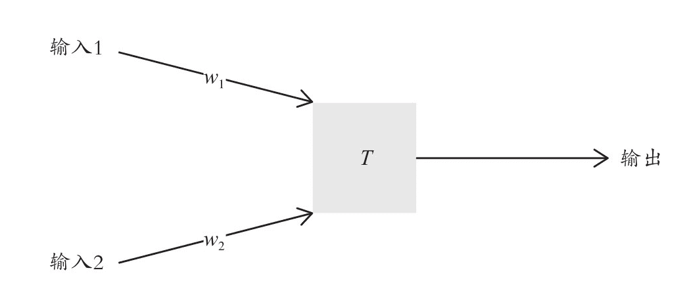

图22 单层感知器，无法计算异或

异或函数定义为：输入1或输入2激活时输出触发，两者同时激活或同时不激活时不触发。设权重 w[1]、w[2]、阈值 T，需满足：

- 两输入均不激活，接收权重0，须不触发，故 T>0。
- 仅输入1激活须触发，故 w[1]>T。
- 仅输入2激活须触发，故 w[2]>T。
- 两输入均激活须不触发，故 w[1]+w[2]<T。
显然无解，故单层感知器无法实现异或。

再看两层感知器结构，如图23，可正确计算异或。网络由三个神经元组成：神经元1在输入1或输入2激活时触发；神经元2在输入1和2不同时激活时触发；神经元3在神经元1和2同时触发时激活。总体上单一输入激活时输出触发，双激活或双不激活时不触发。

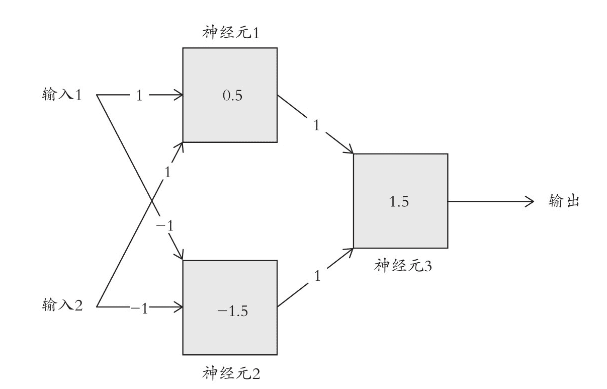

图23 两层感知器结构可计算异或函数

具体四种情况：
1. 两输入皆不激活，神经元2触发，神经元1不触发，神经元3输入为1低于阈值1.5，不触发。
2. 输入1激活、输入2不激活，神经元1输入1>0.5触发，神经元2输入-1>-1.5触发，神经元3输入2>1.5触发。
3. 输入2激活、输入1不激活，计算同上，神经元3触发。
4. 两输入皆激活，神经元1输入2>0.5触发，神经元2输入-2<-1.5不触发，神经元3输入1<1.5不触发。

# 延伸阅读

想深入了解的读者可参考以下文献。

现代人工智能权威概览见斯图亚特·罗素与彼得·诺维格《人工智能：现代方法》第三版，培生2016年出版，是技术核对的标准参考。

关注历史演进可读尼尔斯·尼尔森《人工智能探索》，剑桥大学出版社2010年，由该领域资深研究者撰写，是当代AI发展史的优秀指南。

图灵的生平已有大量著作呈现，其中公认最全面的一部是安德鲁·霍奇斯写的《艾伦·图灵传：如谜的解谜者》，1983 年由贝内特图书与哈钦森推出。

大学生时代我反复翻看威廉·考夫曼与豪里斯工程出版社发行的《人工智能手册》三册，第一册由艾夫伦·巴尔和爱德华·费根鲍姆编于 1981 年，第二册同两位编者于 1982 年面世，第三册则由保罗·科恩与爱德华·费根鲍姆合编，同样在 1982 年出版。那套丛书勾勒出人工智能黄金时期系统搭建与技术演进的景象，如今虽已绝版，却仍能在网上找到便宜的影印本。

彼得·杰克逊的《专家系统导论》，艾迪森·威斯利 1986 年出版，是接触专家系统的一本好参考，三十年前上学时就是必读清单，重写本书时重读仍感亲切。想深入知识工程层面，可参考弗雷德里克·海耶斯-罗斯、唐纳德·沃特曼和道格拉斯·莱纳特合编的《构建专家系统》，艾迪森·威斯利 1983 年版。

若要把握人工智能中的逻辑脉络，可读迈克尔·杰纳西雷斯与尼尔·尼森合著的《人工智能逻辑基础》，摩根·考夫曼 1987 年出版。我在读研时逐页研读，虽然书中方法在近十年已多被取代，但它在 AI 研究史上的影响依然突出，也是一本不错的逻辑入门读物。

1999 年，罗德尼·布鲁克斯把自己的论文整理成《寒武纪智能》，由麻省理工学院出版社出版。我也顺便推荐自己的《多智能体系统引论》第二版，威利出版公司 2009 年版，适合作为智能体、智能体架构与多智能体系统的入门。博弈论在人工智能中的运用，可参阅约夫·肖姆与凯文·莱顿-布朗的《多智能体系统：算法、博弈论和逻辑基础》，剑桥大学出版社 2008 年版。

机器学习的覆盖面非常广，本书仅做浅尝。我把重点放在神经网络，因其目前最主流，但其他方法同样值得关注。想要一份相对通俗却扎实的概览，可看埃塞姆·阿培丁的《机器学习：新人工智能》，麻省理工学院出版社基础知识系列 2016 年版。假如你想申请深度思维的工作，伊恩·古德费洛、约书亚·本吉奥与亚纶·库维尔合著的《深度学习》，麻省理工学院出版社 2017 年版，几乎是必读。顺带一提，前文提到的罗素与诺维格著作中也收录了不少机器学习的相关方法。

谈论技术奇点可参考默里·沙纳汗的《技术奇点》，麻省理工学院出版社基础知识系列 2015 年版；人工智能伦理方面，建议维吉尼亚·迪格努姆的《负责任的人工智能》，施普林格 2019 年版；技术与就业议题则可看卡尔·贝内迪克特·弗雷的《技术陷阱》，普林斯顿大学出版社 2019 年版。

玛吉·博登的《人工智能与自然人》，麻省理工学院出版社 1977 年版，堪称强人工智能与有意识机器的经典。关于意识的系统教材，可选苏珊·布莱克莫尔的《意识概论》，霍德与斯托顿 2010 年版。丹尼尔·丹尼特有关心智、意识与人工智能的论述大多值得阅读，我建议先读《心智类型》，基本书局 1996 年版，随后可补读其论文《我在哪儿》，该文首次发表于丹尼特 1978 年的《头脑风暴》，网络上很容易找到。

# 作者注

许多关于人工智能和机器学习的当代文章都存放在一个名为

`arXiv`的开放在线文档库中。`arXiv`中的文章使用简单的编号方案，类似于`arXiv: 1412.6572`。我们可以通过访问`https://arxiv.org`并输入编号(在本例中为“1412.6572”)来获取相关文章。

# 序言

1\. `http://tinyurl.com/y7zc94od`

2\. `http://tinyurl.com/yxk3xurl`

## 第一章　图灵的电子大脑

`[1]` 霍奇斯，《艾伦·图灵传：如谜的解谜者》，贝内特图书/哈钦森出版社，1983 年。

`[2]` 除了惊人的科学成就，图灵在英国还有着深远的社会影响。经过长期公开高调的运动，英国政府在 2014 年对他进行了赦免。不久之后，所有根据同一法律被起诉的人都获得了赦免。

`[3]` 这是检查质数最直观的方法，但绝不是最优雅或最有效的方法。自古以来，人们就知道埃拉托斯特尼筛法（由希腊数学家埃拉托斯特尼提出的一种简单检定质数的算法。）更为简单清晰。

`[4]` 此后我将不再区分图灵机和通用图灵机，都用图灵机来表述。

`[5]` 图灵将解决判定问题的荣耀与普林斯顿大学数学家阿隆佐·邱奇分享，后者先于图灵独立获得了一个截然不同的结果证明。然而，图灵的证明被认为是决定性的：它更直接、更完整、更易懂，而且影响巨大。他据此发明了图灵机，改变了世界。

`[6]` 严格地说，算法就是一种方法，而程序是一种用实际编程语言(比如`Python`或者`Java`)编码的算法。因此，算法独立于编程语言。

`[7]` 图灵机的编程实际上更为原始，我在这里列出的指令是典型的相对低级的编程语言，但仍然比图灵机程序所使用的抽象得多(也更容易理解)。

`[8]` 科尔曼和李维斯特，《算法导论》(第一版)，麻省理工学院和麦格劳-希尔出版社，1990 年。

`[9]` 图灵，《计算机器与智能》，《心智》， 40， 1950 年，第 433-460 页。

`[10]` 这段对话是由苹果麦金塔电脑附带的`ELIZA`版本生成的。如果你有苹果电脑，可以自己试试。打开`Applications`文件夹，再打开里面的`Utilities`文件夹，然后双击终端应用程序图标来启动终端程序。在终端窗口会出现一大堆傻乎乎的东西，当它稳定下来以后，按`Esc`键(在键盘左上角)，然后按`X`键，然后键入“`doctor`”，再按回车键。好啦，看看吧。但请记住：它不是真的!

`[11]` `http://tinyurl.com/y7nbo58p`

`[12]` 不幸的是，文献中的术语并不精确，也不统一。大多数人似乎用“通用人工智能”指代能够产生类似人类智能行为的机器，而不关心诸如它们是否具有自我意识之类的哲学问题。从这个意义上说，通用人工智能大致相当于希尔勒所指的弱人工智能。然而，混淆视听的是，有时候这个词又被用来表示更像希尔勒所指的强人工智能。在本书中，我用它来表示弱人工智能。

`[13]` `http://tinyurl.com/y76xdfd9`

## 第二章　黄金年代

`[14]` 其中最有影响力的技术来自约翰·麦卡锡的一种叫作分时的概念。他意识到，人们使用计算机的时候，大部分时间计算机都是空闲的，等待人们输入东西或者运行程序。他意识到这个“空闲时间”可以和其他用户共享，允许多人同时使用计算机。这个概念使昂贵的计算机得到更有效的利用。

`[15]` 实际上它代表“`Lisp`处理器”。`LISP`进行符号运算，而符号列表正是实现这一点的关键。

`[16]` 娜萨，《美丽心灵》，西蒙与舒斯特出版公司，1998 年。

`[17]` 麦卡锡等人，《关于达特茅斯夏季人工智能研究项目的建议》，1955 年(转载于《人工智能》， 24(4)， 2006 年，第 12-14 页)。

`[18]` 威诺格拉德，《理解自然语言》，学术出版社，1972 年。

`[19]` 在语言学中，用“他”“她”和“它”等词来指代先前在对话中出现的实体，称为复指。一个试图理解或建立自然语言对话的计算机程序必须能够解决复指指代的具体对象问题，这在当今仍然是一个挑战。`SHRDLU`(有限的)处理回指能力被认为是突破性的。

`[20]` 菲克斯和尼森，《STRIPS：定理证明应用于问题求解的新途径》，《人工智能》， 2(3-4)， 1971 年，第 189-208 页。

`[21]` 控制 SHAKEY 的电脑是一台 PDP-10， 20 世纪 60 年代末最先进的主机电脑，它重达 1 吨多，需要一个大房间才能容纳。一台 PDP-10 可以配备高达 1 兆字节的内存——我口袋里的智能手机内存容量比它高大概 4000 多倍，而且速度快得不可思议。

`[22]` http://tinyurl.com/yxu8hwoq

`[23]` http://tinyurl.com/n6lf8t6

`[24]` 这并非精确的数字，只是一个近似值，让我们对涉及的数字比例有一些了解。

`[25]` 从技术上讲，假设`b`为搜索问题的分支因子，`d`是搜索树的深度，如此，搜索树的底层(深度为`d`的那一层)将包含`bd`种状态，即`b`的`d`次幂，`b×b×b×b×……×b(d 次)`。分支因子表现出的增长速度在技术上称为指数型增长，一些参考文献使用几何级数增长这一术语，尽管我认为我从来没有在人工智能领域相关文献见过这个术语。

`[26]` 跳棋游戏，美国称之为“checkers”，英国称之为“draughts”，因为塞缪尔是美国人，所以作者表述跳棋的原文用了“checkers”。另外，在人工智能领域，这个程序通常被称为“塞缪尔的跳棋程序”(Samuel's checkers player)，如果把它称为“Samuel's draughts player”会显得很怪异。

`[27]` 哈特、尼尔森和拉斐尔，《最小成本路径启发式测定的正式基础》，《IEEE 系统科学与控制论汇刊》， 4(2)， 1968 年，第 100-107 页。

`[28]` 类似这样的计算问题都被命名了，本例叫作“独立集”。

`[29]` 正文对旅行推销员问题是简化描述，更精准的描述如下：有一个城市列表`C`，对于`C`之中的每一对城市`i`和`j`，我们都有一个距离`di, j`，定义`di, j`等于`i`和`j`之间的距离。另外，存在一个“上限”`B`，这是旅行商在消耗完燃料之前可以行驶的总路程。现在我们要回答的问题是，是否有一个游览所有城市的方案(即用某种方式对`C`中的元素进行排序)，使得按照这个方案从每一个城市到下一个城市，最终回到出发时的城市，总行程不超过`B`。

`[30]` `P`代表多项式时间，在多项式时间内能够运行完成的算法，才是解决问题的可行算法。如果你想了解更多有关`NP`完全问题和`P`与`NP`问题的知识，可以参见延伸阅读中提到的参考文献。

## 第三章　知识就是力量

`[31]` 温斯顿和霍恩，《LISP》(第三版)，培生出版集团，1989 年。

`[32]` 肖特利夫，《基于计算机的医学诊断系统：MYCIN》，美国爱思唯尔出版集团，1976 年。

`[33]` 尚克和亚伯森，《脚本、计划、目标和理解：对人类知识结构的探究》，心理学出版社，1977 年。

`[34]` 伍兹，《链接中有什么？语义网络基础》，博罗和 A·柯林斯编，《认知科学中的表征和理解研究》，摩根·考夫曼出版社，1975 年。

`[35]` 麦克德莫特，《塔斯基语义学，或称无意指不表达!》，《认知科学》， 2(3)：第 277-282 页，1978 年。这个标题有点像美国独立战争时期的口号“无代表不纳税”(麦克德莫特就是在 1976 年美国独立 200 周年庆祝活动前后写了这篇文章)。

`[36]` 麦卡锡，《逻辑人工智能的概念》，未发表。

`[37]` 克罗克森和梅利什，《PROLOG 编程》，施普林格出版社，1981 年。

`[38]` `PROLOG`中使用的演绎形式被称为解析，最初是在 20 世纪 60 年代出现的，它可以有效实现`PROLOG`中使用的规则。

`[39]` 沃伦，《生成有条件的计划和编程》，《第二届夏季人工智能行为与模拟会议论文集》(AISB-76)，爱丁堡，1976 年 7 月。

`[40]` 古哈和莱纳特，《Cyc：中期报告》，《人工智能杂志》，11(3)， 1990 年。

`[41]` 普拉特，《CYC 报告》，未发表，1994 年，访问地址：http://tinyurl.com/y4q4aoqj

`[42]` 赖特，《默认推理逻辑》，《人工智能》， 13， 1980 年，第 81-132 页。

`[43]` 这个例子被称为尼克松菱形，用图形表示的话，图形呈菱形。

## 第四章　机器人与其合理性

`[44]` 布鲁克斯，《无表征智能》，《人工智能》， 47， 1991 年，第 139-159 页。

`[45]` 有趣的是，人类智力的这些更高级的方面是由大脑内叫作新皮质的部分来处理的。而人类进化的记录告诉我们，大脑新皮质部分的进化相对时间靠后。对于人类来说，推理和解决问题是比较新兴的能力：在进化史的大部分时间里，我们的祖先都不具备这些能力。

`[46]` 罗素和苏布拉曼尼亚，《可证明的有边界最优智能体》，《人工智能研究杂志》， 2， 1995 年。

`[65]` https://www. irobot.co.uk

`[47]` 布鲁克斯，《一个走路的机器人：进化网络的应急行为》，《机器人与自动化会议论文集》， 1989 年，亚利桑那州斯科茨戴尔，1989 年 5 月。

`[48]` 弗格森，《旅行机：有态度的自主智能体》，《IEEE 计算机》，25(5)，第 51-55 页，1992 年。“旅行机”这个名字显然是在隐喻 “图灵机”〔英文中“Turing Machines”(图灵机)和“Touring Machines”(旅行机)读音一样〕。25 年来，旅行机的开发者因内斯·弗格森一直是我的好朋友，但我不确定是否要原谅他。如果他知道 30 年后的人们还在写这种笑话，或许他就不会觉得这么好笑了。

`[49]` 维尔和比克莫尔，《基础智能体》，《计算智能》， 6， 1990 年，第 41-60 页。

`[50]` 出于历史准确性的考虑，我应该指出，图形用户界面和桌面界面的雏形并不是由苹果公司发明的。这应该归功于施乐公司帕洛阿尔托研究中心(PARC)的研究人员。然而，苹果公司认识到其潜力，并将其制成了产品。

`[51]` http://tinyurl.com/y9qxdko5

`[52]` 梅斯，《智能体能够帮助人们减少工作量和信息过载》，《ACM 通讯》， 37(7)， 1994 年，第 30-40 页。

`[53]` 埃齐奥尼和威尔德，《基于软件机器人的互联网交互》，《ACM 通讯》， 37(7)， 1994 年，第 72-76 页。

`[54]` 冯·诺依曼和摩根斯坦，《博弈论与经济行为》，普林斯顿大学出版社，1944 年。

`[55]` 为简单起见，我把钱和效用等价。在实践中，货币和效用也是经常相关的，但它们并不是同一概念，如果你认为经济效用只是与钱有关，那么你会惹恼诸多经济学家。实际上，效用理论只是用数值的方式捕捉和计算偏好。

`[56]` 罗素和诺维格，《人工智能：现代方法》(第三版)，培生出版集团，2016 年，第 611 页。

`[57]` 墨菲，《人工智能机器人简介》，麻省理工学院出版社，2001 年。

`[58]` 珀尔，《智能系统中的概率推理：合理推理网络》，摩根·考夫曼出版社，1988 年。

`[59]` 伍尔德里奇，《多智能体系统引论》(第二版)，威利出版公司，2009 年。

`[60]` 鲁宾斯坦和奥斯本，《博弈论课程》，麻省理工学院出版社，1994 年。

`[61]` 塞尔曼、莱维斯克和米契尔，《一种解决难满足性问题的新方法》，第十届国际人工智能会议论文集(AAAI_1992)，美国加利福尼亚州圣何塞，1992 年。

## 第五章　深度突破

`[62]` 深度思维的收购价各个媒体的报道不尽相同，《卫报》报道的数字为 4 亿英镑。http://tinyurl.com/kvyueye

[\[63\]](#part0008.html#bookBack_63). 明斯基和帕普特，《感知器：计算几何导论》，麻省理工学院出版社，1969 年。

[\[64\]](#part0008.html#bookBack_64). http://tinyurl.com/ycu4ngsg

[\[81\]](#part0008.html#bookBack_81). 鲁梅尔哈特和麦克莱兰(编)，《并行分布式处理》(2 卷)，麻省理工学院出版社，1986 年。

[\[66\]](#part0008.html#bookBack_66). 鲁梅尔哈特、辛顿和威廉姆斯，《利用反向传播错误学习表征》，《自然》， 323， 1986 年，第 533-536 页。

[\[67\]](#part0008.html#bookBack_67). 古德费洛，本吉奥和库维尔，《深度学习》，麻省理工学院出版社，2016 年。

[\[68\]](#part0008.html#bookBack_68). 基于既有增长曲线推算，约四十年后人工神经单元的总量可能接近生物大脑的规模。但数量的趋近并不能直接换算成智力的等同，因为真实的大脑除去网络连接外，还具备特定的解剖式构造。所以四十年内达到人类级智能缺乏充分依据。

[\[69\]](#part0008.html#bookBack_69). http://www.image-net.org

[\[70\]](#part0008.html#bookBack_70). https://wordnet.princeton.edu

[\[71\]](#part0008.html#bookBack_71). 克里泽夫斯基、苏茨科弗和辛顿，《基于深度卷积神经网络进行网络图像分类》，神经信息系统大会，2012 年，第 1106-1114 页。

[\[72\]](#part0008.html#bookBack_72). 古德费洛等人，《解释和利用对抗性案例》， arXiv: 1412.6572。

[\[73\]](#part0008.html#bookBack_73). 姆尼赫等人，《使用强化深度学习来玩雅达利游戏》， arXiv: 1312.5602v1。

[\[74\]](#part0008.html#bookBack_74). 姆尼赫等人，《通过强化深度学习实现人类水平控制》，《自然》， 518， 2015 年，第 529-533 页。

[\[75\]](#part0008.html#bookBack_75). 西尔弗等人，《使用深度神经网络和搜索树掌握围棋游戏》，《自然》， 529， 2016 年，第 484-489 页。

[\[76\]](#part0008.html#bookBack_76). http://tinyurl.com/ydafuhj p

[\[77\]](#part0008.html#bookBack_77). 西尔弗等人，《脱离人类知识干预掌握围棋游戏》，《自然》，50， 2017 年，第 354-359 页。

[\[78\]](#part0008.html#bookBack_78). https://www.captionbot.ai

[\[79\]](#part0008.html#bookBack_79). https://translate.google.com

[\[80\]](#part0008.html#bookBack_80). 这段文字出自苏格兰作家和译者斯科特·蒙克利夫之手，他的译本在文学史上名气很大，常被视为不逊于原文的经典之作。只是也有批评声音认为他对普鲁斯特的语言运用得过于自由。

第六章 人工智能的当下

[\[82\]](#part0009.html#bookBack_82). https://tinyurl.com/y2k5aeq4

[\[83\]](#part0009.html#bookBack_83). https://tinyurl.com/y8bu8xx8

[\[84\]](#part0009.html#bookBack_84). https://tinyurl.com/y5y75rgs

[\[85\]](#part0009.html#bookBack_85). https://blog.cardiogr.am/tagged/research

[\[86\]](#part0009.html#bookBack_86). 这个数字会受到生产阶段死亡率以及婴儿夭折比例的影响，本质上反映的是个体在成功成年之后能够实现的合理预期寿命。

[\[87\]](#part0009.html#bookBack_87). http://tinyurl.com/yc5gv8jg

[\[88\]](#part0009.html#bookBack_88). 德法乌等人，《深度学习在视网膜疾病诊断及转诊方面的临床应用》，《自然医学》， 24， 2018 年，第 1342-1350 页。

[\[89\]](#part0009.html#bookBack_89). http://tinyurl.com/yakkuyg2

[\[90\]](#part0009.html#bookBack_90). 赫尔曼、布伦纳和斯塔德勒，《自动驾驶》，爱莫瑞德出版社，2018 年。

[\[91\]](#part0009.html#bookBack_91). https://corporate.ford.com/innovation/autonomous-2021.html

[\[92\]](#part0009.html#bookBack_92). https://www.riotinto.com/media/media-releases-237_23991.aspx

第七章 AI的想象误区

[\[93\]](#part0010.html#bookBack_93). http://ti nyurl.com/ybsrkr4a

[\[94\]](#part0010.html#bookBack_94). 库兹韦尔，《奇点临近》，企鹅出版集团，2005 年。

[\[95\]](#part0010.html#bookBack_95). 温格，《即将到来的技术奇点：如何在后人类世代生存》，美国宇航局刘易斯研究中心，《21 世纪展望：网络空间世代的跨学科科学与工程》，第 11-22 页。

[\[96\]](#part0010.html#bookBack_96). 沃尔什，《奇点可能永远不会临近》， arXiv:1602.06462v1。

[\[97\]](#part0010.html#bookBack_97). https://tinyurl.com/y622vm6k

[\[98\]](#part0010.html#bookBack_98). 威尔德和埃齐奥尼，《机器人学第一定律：召唤武器》，《国际人工智能会议论文集》， 1994 年，第 1042-1047 页。

[\[99\]](#part0010.html#bookBack_99). 富特，《堕胎问题和双重效应理论》，《牛津评论》，第 5 期，1967 年。

[\[100\]](#part0010.html#bookBack_100). http://tinyurl.com/ybl8l uoe

[\[101\]](#part0010.html#bookBack_101). 阿瓦德等人，《道德实验机器》，《自然》， 563， 2018 年，第 59-64 页。

[\[102\]](#part0010.html#bookBack_102). http://tinyurl.com/ydf26689

[\[103\]](#part0010.html#bookBack_103). http://ti nyurl.com/jslm95f

[\[104\]](#part0010.html#bookBack_104). 透明起见需要说明，阿西洛玛人工智能原则的两次发起会议都曾邀请我，我当时很想参加，但因已有其他承诺，两次都遗憾缺席。

[\[105\]](#part0010.html#bookBack_105). `http://tinyurl.com/y28osmtw`

[\[106\]](#part0010.html#bookBack_106). `http://tinyurl.com/y29v4rrd`

[\[107\]](#part0010.html#bookBack_107). `http://tinyurl.com/yc3vgkgv`

[\[108\]](#part0010.html#bookBack_108). `http://tinyurl.com/y2egvzxx`

[\[109\]](#part0010.html#bookBack_109). 迪格努姆，《负责任的人工智能》，施普林格出版社，2019 年。

[\[110\]](#part0010.html#bookBack_110). 博斯特罗姆，《超级智能》，牛津大学出版社，2014 年。

[\[111\]](#part0010.html#bookBack_111). 汉森，《什么是平等偏好》，《哲学逻辑杂志》， 25(3)，1996 年，第 307-332 页。

[\[112\]](#part0010.html#bookBack_112). 吴恩达和罗素，《逆向强化学习算法》，《第十七届机器学习国际会议论文集》， 2000 年。

第八章 AI现实的挑战

[\[113\]](#part0011.html#bookBack_113). 贝内迪克特·弗雷和奥斯本，《就业的未来：电脑化将如何影响工作》，《技术预测与社会变革》， 114， 2017 年 1 月。

[\[114\]](#part0011.html#bookBack_114). `https://rodneybrooks.com/blog/`

[\[115\]](#part0011.html#bookBack_115). `https://tinyurl.com/yytefewg`

[\[116\]](#part0011.html#bookBack_116). `http://tinyurl.com/ydb9bpz4`

[\[117\]](#part0011.html#bookBack_117). `http://tinyurl.com/ycq6jk35`

[\[118\]](#part0011.html#bookBack_118). `http://tinyurl.com/y74yfk8a`

[\[119\]](#part0011.html#bookBack_119). 奥斯瓦尔德等人，《算法风险评估-治安模型：从杜伦 HART 模型与“实验性”相称中所学到的经验》，《信息与通信技术法》， 27：2，2018 年，第 223-250 页。

[\[120\]](#part0011.html#bookBack_120). `http://tinyurl.com/y6narok3`

[\[121\]](#part0011.html#bookBack_121). `https://www.predpol.com`

[\[122\]](#part0011.html#bookBack_122). `http://tinyurl.com/y242nn5u`

[\[123\]](#part0011.html#bookBack_123). `http://tinyurl.com/ycef9mqv`

[\[124\]](#part0011.html#bookBack_124). `http://tinyurl.com/y4elgklp`

[\[125\]](#part0011.html#bookBack_125). 我认为这个设想最初来自人工智能领域的知名专家斯图尔特·罗素。

[\[126\]](#part0011.html#bookBack_126). `http://tinyurl.com/yy7szdxm`

[\[127\]](#part0011.html#bookBack_127). 阿尔金，《控制致命行为：将伦理嵌入混合审议/反应机器人架构中》，技术报告 GIT- GVU- 07-11，佐治亚理工学院计算机学院。

[\[128\]](#part0011.html#bookBack_128). `https://www.stopki llerrobots.org/`

[\[129\]](#part0011.html#bookBack_129). 上议院人工智能特别委员会，2017—2019 届报告，《人工智能在英国：准备好了吗？愿意接受吗？可行吗？》， HL Paper 100，2018 年 4 月。

[\[160\]](#part0012.html#bookBack_160). `http://tinyurl.com/l btnkse`

[\[130\]](#part0011.html#bookBack_130). `https://tinyurl.com/y9juww8v`

[\[131\]](#part0011.html#bookBack_131). `https://tinyurl.com/y7dzz46v`

[\[132\]](#part0011.html#bookBack_132).《自然》， 563， 2018 年 11 月 27 日，第 610-611 页。

[\[133\]](#part0011.html#bookBack_133). 卡罗琳·克里亚多·佩雷斯，《看不见的女人：在为男性设计的数据里暴露偏见》，查托温德斯出版社，2019 年。

[\[134\]](#part0011.html#bookBack_134). `http://tinyurl.com/y9cd9x7f`

[\[135\]](#part0011.html#bookBack_135). `http://tinyurl.com/y25dhf9k`

[\[136\]](#part0011.html#bookBack_136). Facebook 让用户能够查看系统为其生成的个人偏好画像。

[\[137\]](#part0011.html#bookBack_137). `http://tinyurl.com/y7mcrysq`

[\[138\]](#part0011.html#bookBack_138). `https://tinyurl.com/yyc6botm`

[\[139\]](#part0011.html#bookBack_139). `http://tinyurl.com/yaypy567`

[\[140\]](#part0011.html#bookBack_140). `http://tinyurl.com/yd36fdva`

[\[141\]](#part0011.html#bookBack_141). `http://tinyurl.com/y6uoewyg`

[\[142\]](#part0011.html#bookBack_142). `http://tinyurl.com/y8vgslkb`

[\[143\]](#part0011.html#bookBack_143). `http://tinyurl.com/y6wx5tz7`

第九章 机器意识之路

[\[144\]](#part0012.html#bookBack_144). `http://ti nyurl.com/yxwlrrkq`

[\[145\]](#part0012.html#bookBack_145). 内格尔，《成为蝙蝠是什么样的感受》，《哲学评论》， 83：4，1974 年，第 435-450 页。

[\[146\]](#part0012.html#bookBack_146). 卡尼曼，《思考：快与慢》，企鹅出版集团，2012 年。

[\[147\]](#part0012.html#bookBack_147).“谁能理解车夫，并能控制自己的思想，他就会到达旅程的终点，那是无所不在的至高无上的居所。”(《卡达奥义书》， 1.3)

[\[148\]](#part0012.html#bookBack_148). 苏恩等人，《人脑自由决策的无意识因素》，《自然：神经科学》， 11， 2008 年，第 543-545 页。

[\[149\]](#part0012.html#bookBack_149). 严格来说，邓巴关注的是皮层大小。新皮层才是负责感官处理、推理能力和语言功能的部分。

[\[150\]](#part0012.html#bookBack_150). 丹尼特，《意向立场》，麻省理工学院出版社，1987 年。

[\[151\]](#part0012.html#bookBack_151). 丹尼特，《认知行为学中的意向系统》，《行为与脑科学》，6， 1983 年，第 342-390 页。

[\[152\]](#part0012.html#bookBack_152). 肖汉，《面向智能体编程》，《人工智能》， 60(1)， 1993 年，第 51-92 页。

[\[153\]](#part0012.html#bookBack_153). 麦卡锡，《机器具有心理因素》， V·利夫希茨(编辑)，《形式化常识：约翰·麦卡锡论文集》，阿尔布利克斯出版社，1990 年。

[\[154\]](#part0012.html#bookBack_154). `http://ti nyurl.com/yc2knerv`

[\[155\]](#part0012.html#bookBack_155). 核心是“有实质”。一旦提出类似测验，总有人会想办法钻空子，靠取巧手段宣布通过，即便方式并非出题者所预期，这正是图灵测试饱受争议的原因。我追求的是能够实质完成任务的程序，而不是靠烟幕和镜像式回应对付测试的系统。

[\[156\]](#part0012.html#bookBack_156). 西蒙·拜伦-科恩，A. M. 莱斯利和 U. 弗里斯，《自闭症孩子拥有心智理论吗》，《认知》， 21(1)， 1985 年，第 37-46 页。

[\[157\]](#part0012.html#bookBack_157). 西蒙·拜伦-科恩，《心智盲症：一篇关于自闭症和心智理论的文章》，麻省理工学院出版社，1995 年。

[\[158\]](#part0012.html#bookBack_158). 关于心智机器理论的论述，我主要依据拉比诺维茨等人发表于 arXiv 的论文，编号 1802.07740。

[\[159\]](#part0012.html#bookBack_159). 进化心理学并不是我的专业领域，本部分的内容以罗宾·邓巴所著《人类进化》为主要参考，该书由企鹅出版集团于 2014 年推出。感兴趣的读者如果想进一步探讨，我很乐意继续介绍。