# AI赋能产业：智能变革新篇章

# 核心看点

聚焦人工智能如何重塑产业版图，全景扫描行业发展脉络与创新浪潮，剖析核心赛道现状与未来趋势，解读中外战略布局与政策红利。深度拆解AI与机器人、交通、医疗的深度融合路径，揭示智能机器人、自动驾驶、智慧医疗等新业态崛起逻辑，详解AI如何以提效增产为引擎，催生新品类、新场景、新需求，驱动产业升级与经济高质量跃迁。

适读人群：AI、互联网、计算机领域从业者（技术/非技术岗）、科研工作者、创投机构决策者。

# 丛书发刊词

人工智能，这项引领未来的前沿战略技术，已成为全球博弈的新焦点、经济腾飞的新引擎，正深度重塑经济版图、社会图景与地缘格局。党的十九大报告明确部署“推动互联网、大数据、人工智能和实体经济深度融合”。习近平总书记在中央政治局集体学习时强调：要精准把握发展新一代人工智能的重大战略意义，强化顶层设计、科学规划布局、明确任务清单、夯实发展基座，推动其与经济社会深度融合，确保我国新一代AI健康有序发展。

国家高度重视AI技术与产业协同突围。2017年国务院发布《新一代人工智能发展规划》总体部署；工信部同年印发《促进新一代人工智能产业发展三年行动计划（2018—2020年）》，锚定“技术产业化、应用集成化、产业融合化”主线，助力实体经济转型升级。政策护航下，我国AI产业链构建、政策迭代、场景落地、投融资热度等维度持续迸发新动能。

2017年6月，中国电子信息产业发展研究院（赛迪研究院）联合产学研用金300+头部机构发起组建“人工智能产业创新联盟”，使命直指需求端与产业端，推动协同创新，筑牢我国AI技术突围与产业跃升的双重基石。

同年12月，赛迪研究院创办《人工智能》杂志，锚定“主题期刊”模式，每期聚焦一大热点领域，邀约行业大咖撰稿，打造技术与产业动态的“最强大脑”与“风向标”，广获业界认可，影响力持续跃升。

基于此，“智能之巅”丛书应运而生。汇聚近200位一线专家智慧结晶，精选数十篇深度长文，两册并进：  
《技术前沿卷》——直击计算机视觉、智能语音语义、AI芯片等底层硬核；  
《赋能产业卷》——深潜机器人、交通、医疗等融合应用主战场。

愿此书助力业界洞察创新脉动，促进知识普惠共享，为中外AI产业繁荣贡献赛迪力量。

中国电子信息产业发展研究院（赛迪研究院）院长 张立

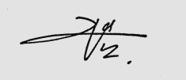

# 序言：从图灵梦想到智能觉醒

AI发展脉络可溯源至1930年代。图灵奠基“通用机”理论，继而提出“智能机械”“图灵测试”经典命题。1956年达特茅斯会议，麦卡锡、明斯基、香农、罗切斯特等巨擘集结，正式敲响“人工智能元年”钟声。

历经60余载潮起潮落，二十一世纪第二个十年迎来第三次爆发。2016年AlphaGo击败李世石引爆全球关注；2012年欣顿团队凭深度学习称霸ImageNet，早已为浪潮埋下伏笔。

算力飞跃、算法迭代、数据累积，三大要素共振，AI呈现日新月异之势，在制造、医疗、教育、交通、媒体、金融等领域全面开花；独角兽竞相涌现，融资规模屡创新高；全球主要经济体争相押注国家战略，抢占制高点。

然繁华背后，挑战依存。相较人类智能，AI仍处“婴儿期”：认知、决策、控制、运动智能均存显著鸿沟，通用人工智能（AGI）仍属远景。

破局之道，业界已在探索：理论端，胶囊网络、无监督/联邦/小样本/强化学习、类脑计算加速演进；模式端，AI与边缘/云计算深度融合；应用端，产业智能化与智能产业化双轮驱动，智能经济版图持续外扩。

全球AI竞逐大幕已启。中国将AI置于新一轮科技革命与产业变革“C位”，国家战略层面顶层定调。本书立足全球视野、聚焦中国实践，汇聚政产学研用金多维视角，纵览政策、技术、产品、应用、挑战全图景，必将为读者全景洞察AI技术与应用发展现状、未来趋势提供关键启示。

中国工程院院士 王恩东

# 前言：重塑生产力的核心变量

人工智能，本质是通过模拟人类意识思维，借机器学习与数据分析赋予机器类人能力。它已成为新一轮产业变革的核心驱动力，正深刻重塑世界经济、社会进程与人类生活：大幅跃升社会劳动生产率、显著压降人力成本、极致优化产品服务体验、开辟全新市场空间、重构就业结构版图。

权威机构测算：2030年AI对全球GDP贡献将达15.7万亿美元。IDC数据显示，2019年末中国AI市场规模28.9亿美元，预计2024年逼近127.5亿美元，2018—2024年复合增速39.0%，领跑全球。

国家战略布局步步为营：  
2017.7 国务院《新一代人工智能发展规划》确立2030“三步走”战略目标；  
2017.12 工信部《三年行动计划》锚定“信息技术与制造技术深度融合”主线，聚焦技术产业化与集成应用；  
2019年 政府工作报告首提“智能+”，标志AI与实体经济融合进入深水区、规模化新阶段。

应用端热点聚焦安防、金融、医疗、交通、零售、家居、制造、物流八大赛道，传统制造、物流亦借AI提效增能：  
安防——人脸识别、智能布控重塑安防效能；  
金融——从交易安全向全流程变革延伸，传统机构与科技企业共舞，重塑规则、提能降险、触达长尾；  
医疗——破解资源短缺与分布不均民生痛点；  
交通——智能驾驶引领产业链重构，车企与方案商边界消融，新商业模式替代旧生产销售范式；  
零售——加速新零售全渠道融合，围绕人货场链重构场景；  
家居——智能产品解锁生活新图景；  
制造——传统工业企业引入AI提升运营效率；  
物流——智能仓储设备接管分拣装配运输，无人机切入末端配送。

本书将深度剖析AI与机器人、交通、医疗的融合演进，解码智能机器人、智能驾驶、AI医疗三大新业态崛起密码。

编者

# 第01章 智能机器人：从机械臂到具身智能

## 导读

智能机器人谱系涵盖工业、服务、特种三大品类。工业端聚焦人机协同提效；服务端渗透养老、医疗、教育、金融等民生场景；特种端深入军事、采矿、救援等极限环境。本章全景梳理技术底座、演进史、产业热点、标杆实践。

## 1.1 智能机器人全景扫描

### 1.1.1 演进简史：从机电一体化到具身智能

- 核心标签：人工智能·智能体·智能机器人·技术演进脉络  
- 撰稿：邓志东

随着AI与互联网、物联网、大数据、云平台深度耦合，超强算力托底，智能机器人感知、认知、决策能力跃升，形态趋向柔性、灵巧、通用，环境适应性与自主性显著增强，开始胜任复杂多变场景。应用半径从制造向外太空探测、航空航天、深海作业、微纳操作等特种极限领域延伸，加速渗透大众日常生活。本节解码基本定义、演进方向与发展简史。

---

### 一、 智能三元论：AI、智能体与智能机器人

1946年，宾大诞生首台通用计算机ENIAC。十年后达特茅斯会议，麦卡锡等人确立“AI”概念，定义为“智能体的研究与设计”。智能体即“能感知环境并通过行动最大化成功概率的系统”。理想形态当属：具备类人智能行为反应、环境适应性与自主性的机器——即智能机器人。由此确立三大演进主线：  
1. 感知智能——模拟感知/直觉：视听触嗅味；  
2. 认知智能——模拟认知/深思熟虑：记忆、常识、推理、规划、决策、知识习得、思维、意图、意识；  
3. 行动智能——模拟行动：灵活移动与灵巧操作。

数十载演进中，感知智能催生模式识别、统计机器学习、深度学习（90年代后爆发）；认知智能衍生逻辑推理、专家系统、决策支持（60-80年代主流）；行动智能推动工业机械臂、移动机器人诞生，直接孕育机器人学与产业。

工业革命（机械化→电气化）发明蒸汽机、机床、起重机等，仅替代简单体力；信息革命（20世纪中后期）引发设备迭代，诞生冰箱、洗衣机、工业机械臂、AGV等机电一体化产品。工业机械臂多关节自由度仿生人臂，通用性强——同类产品可胜任焊接、喷涂、装配等多工序，可编程示教控制器使其灵活适配不同工位（见图1-1）。技术解剖上，工业机器人三大核心：传感与感知智能、简易认知智能、执行机构，对应人类五官、大脑、四肢，精准映射智能机器人三大研究方向。其他形态机器人同构。智能机器人依智能层级与信息粒度形成多重闭环，是典型信息物理系统（CPS）。

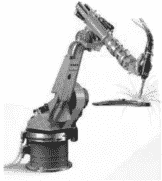

图 1-1 机械臂示意

---

### 二、 三代演进：从定程到自主再到认知

#### 第一代：机电一体化雏形
代表：传统工业机器人、无人机。  
特征：聚焦操作/移动/飞行功能，搭载简易感知（关节编码器、磁条传感器），智能度低。研发核心：结构设计、驱动控制、状态感知。  
产品：六自由度多关节臂、并联机器人、SCARA、磁条AGV、循迹无人机。  
局限：仅能在结构化固定路线环境（工厂）作业，替代特定工种重复劳动，“机器换人”率仅5%。

#### 第二代：新一代/机器人2.0——环境感知与自主决策觉醒
标志：具备部分环境感知、自主决策/规划/导航能力，尤其拥类人视觉、语音、文本、触觉、力觉模式识别能力，环境适应性与自主性显著增强。结构端进化：安全、灵巧、灵活、通用、低功耗、自然交互的仿生机械臂/腿足，核心驱动力源自新一代AI感知能力跃升。  
标杆：ABB“YuMi”双臂协作机器人、优傲“UR10”、L3/L4级自动驾驶、“达芬奇”手术机器人、波士顿动力“BigDog/猎豹/Atlas”仿生系列（图1-2a）、本田“ASIMO”。  
效能：利用环境适应能力，“机器换人”率破60%；全机器人闭环产线甚至实现100%无人化。随着弱AI（深度学习为旗）迅猛发展、开放环境视听识别逼近人类水平，面向特定制造场景的大规模“机器换人”将在5年内爆发，经济贡献将超传统工业机器人数十倍。

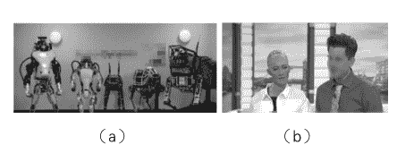

图 1-2 (a) 波士顿动力仿生机器人家族；(b) 机器人“索菲亚”

#### 第三代：认知与情感交互的萌芽
在二代全能基础上，进阶为：更强环境感知/认知/情感交互、自学习/自繁殖/自进化能力，核心向认知智能迈进。仍处研发早期。  
产品：2014软银“Pepper”首款消费级智能人形机器人——具备语音交互、人脸追踪识别、初级情感交互；备争议的首位获沙特公民身份机器人“索菲亚”（图1-2b）展现理解判断与情感交互雏形，虽表现仍显原始。

总结：随着深度学习边界被打破、原创性AI理论突围、产业落地提速，智能机器人在挤出泡沫后，重回炽热主赛道。

---

### 三、 里程碑时刻表

| 年份 | 里程碑事件 |
|------|------------|
| 1920 | “Robot”首现：恰佩克科幻剧《罗素姆的万能机器人》 |
| 1939 | 西屋电气“Elektro”首秀纽约世博会：会走会说的人形机器人 |
| 1941 | 阿西莫夫首用“Robotics”定义机器人技术体系 |
| 1942 | 阿西莫夫提出“机器人三定律” |
| 1942 | DeVilbiss首款“可编程”喷漆机器人 |
| 1951 | 雷蒙德·戈茨为法原子能委员会设计首款遥控关节臂 |
| 1954 | 乔治·迪沃尔“UNIMATE”首款多用途可编程机械臂：示教再现、通用灵活；翌年与恩格尔伯格创立Unimation（首家机器人公司），恩氏尊称“机器人之父” |
| 1956 | 达特茅斯会议：AI概念确立，智能体/智能机器人深度讨论 |
| 1962 | AMF“VERSTRAN”与“UNIMATE”成全球最早商用工业机器人 |
| 1968 | 南加州大学诞生首款计算机控制行走机器人 |
| 1968 | 通用电气/美军联合研制“Walking Truck”四足车：时速6.4km/h |
| 1968 | 斯坦福研究院“Shakey”首款装载视觉系统的计算机控制移动机器人：按指令寻找抓取积木，计算机大如房间 |

### 1.1.2 智能机器人产业：现状扫描与未来图景

* 核心标签：智能机器人｜产业链全景｜典型产品｜核心应用场景｜发展展望
* 撰稿：王哲 冯晓辉 李艺铭 庄金鑫

放眼全球，机器人产业正处于高速扩张期，其背后离不开基础前沿技术的强力支撑，智能化更是公认的下一阶段进化主线。伴随新一代信息技术加速落地商用，智能机器人的软硬件根基已愈发稳固。IDC 数据预测，至 2027 年，中国智能机器人市场规模有望冲破 1.6 万亿元大关。在高歌猛进的同时，我们亦需清醒看到推广应用端的潜在隐忧与挑战，以期稳健推动本土产业行稳致远。

## 一、 智能机器人的发展溯源与定义

### （1）演进脉络与概念界定

如前所述，“机器人” 一词始见于 1920 年卡雷尔·恰佩克的科幻剧作《罗素姆的万能机器人》，剧中描绘了机器人取代人力劳动的图景。该词汇源于捷克语“Robota”（苦役）与波兰语“Robotnik”（工人）的合成。自此，人类在该领域开启了卓有成效的实践探索，机器人从虚构走入现实，功能日臻丰富，智能阶梯不断攀升。依技术迭代逻辑，其发展大致历经电气、数字、智能三个纪元。

#### ① 机器人 1.0 期：电气纪元

契合词源本意，早期研制初衷旨在替人分担劳作。20 世纪 40 年代末，美橡树岭与阿贡国家实验室率先攻关遥控机械手，专司搬运放射性物质。这属典型“主从”架构：主端由人操控，从端复刻并记录动作。1954 年，迪沃尔抛出工业机器人概念，借伺服技术管控关节，通过示教实现动作录存与回放。1959 年，Unimation 公司编程诞生首台工业机器人——五轴液压驱动压铸机械手，内置磁鼓存储，可执行 180 道工序。此后，美、欧、日等纷纷引入工业生产线。

此期机器人遵循预置程序作业。程序来源有二：一为人工示教自动生成指令序列；二为人工按工艺编程烧录。此类设备虽能按部就班完成抓取、搬运、加工等固定动作，却缺乏感知与自适应能力。

#### ② 机器人 2.0 期：数字纪元

70 年代起，计算机、控制、通信技术突飞猛进，推动机器人步入数字化阶段。1974 年，辛辛那提·米拉克龙推出微机控制工业机器人；同年，通用电机（ABB 前身）搭载英特尔 8 位处理器的机器人投入搬运作业。1979 年，Unimation 面世多 CPU 控制、关节式结构的新品，可外挂视觉、触觉传感器。此后，多传感器融合与智能控制成主流。90 年代起，此类机器在制造业大规模落地，主攻焊接、装配等场景。

数字纪元机器人配备传感器、由计算机掌舵，能采集环境与工件简要信息，经解析后输出更优动作。较 1.0 期，其算力跃升、响应更快、精度更高，可随环境变化调整行为，萌发初级智能，但尚未臻完全“自治”。

#### ③ 机器人 3.0 期：智能纪元

随着 AI 技术深度渗透，机器人迈入智能新纪元。区别于 2.0 期的“感觉控制”，3.0 期标志为“知识控制”。融合机器视觉、NLP、机器学习、神经网络等 AI 技术，新一代机器人不再局限于简单感知与适应，而是能深度识别环境与工件，依指令与自主判断规划动作，智能跃升显著，故称“智能机器人”。其应用版图也由此打破工业边界，向多元领域渗透。

综上，智能机器人尚处起步期，学界业界尚无统一定义。本文认为：智能机器人是融汇机构学、动力学、自控、机电、传感、计算机、通信、AI、仿生学等多学科成果的复合体，具备感知、学习、思考、行动、交互五大核心能，通过多源信息获取、处理、识别及自主决策，完成复杂作业或解决实务难题。

### （2）产业链全景拆解

依生产与价值实现链条，智能机器人产业链可分上、中、下游三大板块。

**上游**主力为各类核心零部件供应商，向下输送芯片、传感器、减速器、伺服电机、控制器、网络/导航设备及各类金属非金属材料制品等关键器件与本体材料。

**中游**核心玩家包括本体制造商、软件供应商、方案服务商。本体厂商统筹整机设计，集成上游零部件完成总装；软件商攻关算法与程序，赋能感知、分析、学习、交互、决策等大脑功能；方案商扮演桥梁角色，提供咨询培训、定制化解决方案、改造升级及全生命周期运维服务。

**下游**为多元用户群体：涵盖流程/离散制造业等工业端，物流、医疗、餐饮、零售、政务等企事业单位端，以及家庭个人消费端。

## 二、 智能机器人产业发展态势

### （1）国内外产业全景扫描

#### ① 全球赛道：规模扩容，新技术赋能新机遇

## 智能机器人发展速览

得益于互联网、大数据、云计算、AI 等新技术普惠，机器人智能化水位持续抬升，应用场景渐次清晰，全球市场规模持续膨胀。2018 年全球市场达 298.2 亿美元，近十年复合增速近 17%。细分看，工业机器人以 168.2 亿美元占据半壁江山，年增速稳超 15%，全球制造业机器人密度已破百人均 70 台；服务机器人乘 AI 东风迎来“爆发期”，规模达 92.5 亿美元，年均涨幅高达 27.9%；特种机器人亦因技术红利加速落地，规模 37.5 亿美元，年均增 12%。

## 亚洲崛起为核心腹地，中国市场成必争之地

新兴经济体加速工业自动化进程，亚洲俨然成全球需求主力军。IFR 数据显示，2018 年全球工业机器人销售额超 160 亿美元，亚洲贡献超 60%。中、日、韩稳居全球前三。中国产量快速攀升，2018 年超 12 万台。全球四大家族等巨头纷纷在华布局产能：ABB 在珠海、青岛、重庆落子应用中心；安川电机在常州武进建三期工厂；库卡持续扩产——意图锁定中国及辐射亚太市场制高点。

## 基础前沿创新活跃，智能化水位跃升

全球产业高速发展与基础前沿技术突破紧密相依，智能化成产业升级主轴。人机协作、AI、仿生结构三大创新高地最为活跃。人机协作层面，交互模态从基础向图形、语音、体感延展，人机共融成研发核心范式；AI 维度，深度学习、计算机视觉、语音识别、NLP 等成为服务机器人进化的核心引擎；仿生结构上，新材料、生物模型、机电信息处理技术突破，推动特种机器人实现“感知—决策—行为—反馈”闭环，自主智能与环境适应力双提升。

#### ② 中国产业：本土力量崛起，上游短板犹存

**本土劲旅异军突起，创新势头劲**

在国家创新驱动战略加持下，国产智能机器人热潮涌动，各细分赛道涌现优秀本土玩家与硬核产品。新松、中信重工、深之蓝、妙手、博实、天智航等深耕应急救援、矿山探测、水下作战、警务防暴、手术康复等专业领域；大疆、科沃斯、优必选、康力优蓝、小 i 等创业先锋在消费无人机、家用服务、陪护机器人等赛道风生水起，市场认可度高。本土企业借全球最大应用市场东风，创新势能强劲，已成技术攻关、市场开拓、模式创新的中流砥柱，强力带动芯片、传感、视觉语音识别、电机驱动、导航定位、工业设计等上下游协同发展。

**产业处爬坡过坎期，上游“卡脖子”待解**

虽蓬勃向上，但中国产业总体仍处起步爬坡期，高端材料与核心零部件短板突出。整体规模偏小、技术产品不够丰富、渗透率待提升、难支撑智能制造与消费旺需。大量科技成果滞留高校院所，量变未转质变。产业链虽成形，但活跃主体多聚中下游本体制造与应用端，高端占比低；上游高端芯片、传感器、减速器、伺服电机、控制器等“皇冠上的明珠”受制于人。总体而言，需加大政策托举，培育集群，鼓励全链路创新，攻关核心部件国产化，加速向中高端、多领域迈进。

## 重点企业与典型产品图谱

### 国外标杆企业与代表作

#### ABB 集团

由百年名企通用电机与布朗·博韦リ（BBC）于 1988 年合并诞生，跻身全球 500 强，为工业机器人“四大家族”之一。业务覆盖电力、离散自动化、运动控制、过程自动化、低压产品五大版图，以电力与自动化技术称霸。

其双臂协作机器人集柔性手、进料系统、视觉定位、顶尖运动控于一体，循迹精度、速度、节拍、可编程性均达行业标杆（见下图）。

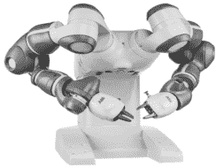

图 1-3 ABB 集团 YuMi-IRB 14000 型双臂协作机器人

#### 波士顿动力公司

1992 年创立于美马萨诸塞沃尔瑟姆，全球顶尖工程与机器人设计公司。2013 年入主 Google X，2017 年转入软银麾下。专攻平衡机器人研发制造，涵盖人形与四足机器狗，“大狗”“阿特拉斯”享誉全球。

“大狗”是其成名之作，能征服复杂地形（见下图）。车载计算机统筹躯体运动与传感器，液压驱动引擎维持平衡，依地形自主切换步态与导航策略，可行、奔、攀、负重。

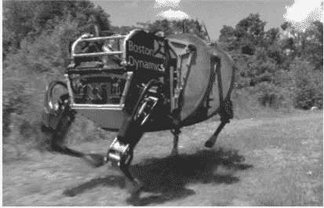

图 1-4 波士顿动力公司“大狗”智能机器人

### 国内标杆企业与代表作

#### 新松机器人公司

2000 年孵化于中科院，以机器人核心技术为基石，致力于全智能产品与服务的高科技上市龙头。作为中国智能工业机器人领军者，拥有核心技术、零部件、产品、行业方案一体化的完整价值链。现布局工业、移动、特种、服务、协作五大系列百余款产品，覆盖半导体装备、智能交通、智能装备/物流/工厂等十大方向。

其七自由度柔性协作机器人集快速配置、拖拽示教、视觉引导、碰撞检测于一身，适配紧凑高精柔性产线，胜任精密装配、包装、打磨、检测、上下料等工序，广泛服务汽车、电子、食品、医药、物流等行（见图 1-5）。

新松有轨制导车辆（AGV）性能强劲、柔性高，可编程高效完成托盘/周转箱取放运送，支持与上位机或 WMS 通信，融合 RFID、条码识别实现自动化识别、输送、存取，是高柔性自动化搬运利器（见图 1-6）。

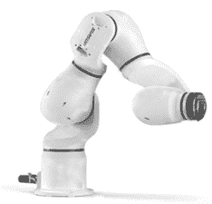

图 1-5 新松 SCR3 型柔性多关节协作机器人

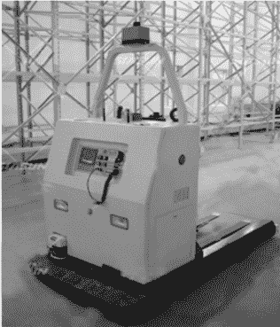

图 1-6 新松搬运机器人（有轨制导车辆）

#### 大疆创新公司

2006 年创立，无人机飞控系统与解决方案研发生产领军者，深耕技术创新，稳坐全球消费级无人机市场超 70% 摇篮。旗下拥消费级、专业级双线，广泛服务航拍、农业植保、电力巡检等场景。

“晓”Spark 定位小型航拍旗舰，画质出众（见图 1-7）。集成两轴增稳云台、远距高清图传、GPS/格洛纳斯双模定位、室内视觉定位，支持手势控制，具备智能航线规划、自动返航、智能跟随等智能飞行模式。

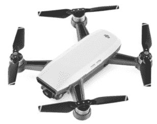

图 1-7 大疆创新“晓”Spark 无人机

#### 科沃斯公司

# 科沃斯：从传统制造到智能服务机器人领军者的跨越

1998年，科沃斯公司正式成立，确立了国内最早一批服务机器人制造商的地位。起初以生产传统吸尘器起家，随后果断完成向扫地机器人、再到全品类家用机器人的战略转型，如今已稳坐智能服务机器人行业头把交椅。其产品矩阵十分丰富，涵盖扫地、擦窗、净化、管家等全系列家用机型，同时也拓展至公共服务机器人领域。

以旗下扫地机器人为例，这类设备集扫吸、拖拭于一体，内置数十枚传感器配合智能算法，能实现路径智能规划、规律作业、灵活避障，支持预约清扫与自动回充。用户更可通过手机App远程监控、指挥调度，真正做到了操作门槛低、功能覆盖广，逐步成为现代家庭的标配智能电器。

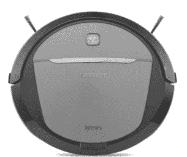

图 1-8 科沃斯公司的地宝 DT85G 型扫地机器人

## 智能机器人四大核心战场深度解析

得益于AI技术加速落地，自动控制与新一代信息技术深度融合，为智能机器人规模化应用打开了突破口。当前，最具代表性的落地阵地集中在制造、物流、家庭服务及军事四大版图。

### 制造领域：工业皇冠上的明珠

智能机器人在制造端的渗透率，是衡量一国工业水平的关键指标，也是推动制造业数字化转型的核心抓手。这类机器人融汇了机械、电子、控制、感知、AI等多学科尖端成果，继动力机、计算机之后，成为延伸人类体力与智力的新一代生产力工具。它们能无缝嵌入人类生产生活环境，实现人机优势互补、协同作业，在汽车、机械、电子、化工等支柱产业大有可为。

放眼全球，头部企业多采用全产业链布局，构建起技术、成本、服务三位一体的竞争护城河。它们通常自主掌握控制系统、伺服驱动、二三维视觉、核心算法及全自动产线等关键技术，实现从核心零部件、本体制造到系统集成的全链路覆盖。

国内市场则由内外双重驱动：内部靠机器人学、计算机视觉、机器学习等AI底层技术成熟提供内生动力；外部靠制造业转型升级窗口期、适龄劳动力萎缩、人工成本飙升倒逼企业“机器换人”提质增效。

但痛点依然突出：高端供给高度依赖进口，国产核心零部件占比不足3%，高利润环节被外资垄断。本土厂商起步晚、规模小、话语权弱、底子薄，尤其在精密减速器、高性能伺服驱动、智能控制器“三大件”上卡脖子明显，多集中于本体组装、系统集成等低附加值环节。不过，技术突破、政策红利、需求爆发三大因素叠加，国产替代空间巨大。

新松机器人便是后起之秀的典型代表。其创始团队源自中科院自动化所与国家工程研究中心，打通了核心技术、零部件、产品及行业方案的全价值链。在制造端，新松推出了双臂协作、柔性协作、复合型等系列产品。其中，双臂协作机器人为国内首创柔性多关节技术与可动双目视觉结合，具备高柔性、高安全、自主避障、快速部署特性；复合型机器人引入计算机视觉实现误差补偿，满足智能工厂极致精度要求，大幅提升人机协作效能。

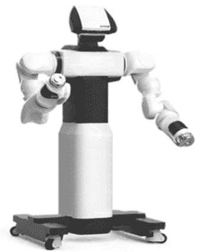

图 1-9 新松机器人公司的双臂协作机器人

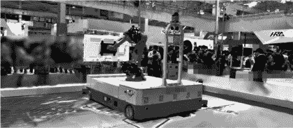

图 1-10 新松机器人公司的复合型机器人

### 物流领域：以“货找人”重构效率革命

物流机器人近年异军突起。2019年高工产研数据显示，全球销量近2.35万台，同比激增近50%，市场天花板极高。传统仓储模式下货架固定、拣货员穿梭往返，无效路耗成本高企——即便是一罐0.89美元的罐头，仓储成本可能高达1美元。电商爆发倒逼效率为王，高效仓储物流成为核心竞争力，机器人规模化应用势在必行。

行业采用“以人为中心、货架移动”的逆向思维，辅以AI调度系统强化多机协同，重塑仓储拓扑结构。亚马逊是这一模式的开创者与最大受益者。2012年以7.75亿美元收购Kiva Systems并独占其技术，Kiva系统凭借AI算法实现单机自主与群体协同并行：数百机器人背负货架穿梭、跟随、避让，零碰撞运行。这让亚马逊大幅压降人力成本、跃升分拣效率与存储密度，巩固了电商霸主地位。同时，亚马逊通过机器人大赛开放Kiva源码，引导开发者迭代算法，推动跨界技术扩散。

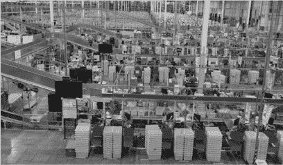

图 1-11 亚马逊公司在物流领域大规模使用智能机器人

### 家庭服务领域：高普及度下的技术皇冠

服务于家庭生活的服务机器人，是普及度最高的品类，对感知与交互能力要求极高。深度学习、机器视觉、语音交互、NLP、生物识别等AI技术，已成为该赛道核心竞争力。

四大驱动力推动赛道爆发：一是发达国家清洁、护理、陪伴岗位劳动力供给萎缩、成本飙升，机器人填补缺口；二是可支配收入提升，大众愿为“从繁重家务中解放”买单；三是AI进步驱动机器人降本增智、拟人度提升；四是全球老龄化加剧，养老看护刚需催生万亿蓝海。

全球至少25国布局研发，美德法日韩领跑，日美欧已有7大类40余款商业化产品。iRobot、Neato、软银、三星、LG等国际巨头与新松、科沃斯、哈工等国内头部同台竞技。

“派博”由软银联手Aldebaran打造，集深度学习、语音视觉、机器人学于一体，是全球首款能“读懂情感”的消费级社交机器人。它能识别表情、以多模态反馈交流、依情绪调整语调。底层依托无监督学习吸纳云端知识迭代情感模型，敏感度持续进化，精准击中消费者深层社交渴望。

图 1-12 “派博”的服务场景

### 军事领域：极端战场上的“钢铁战士”

军用机器人旨在辅助或替代士兵执行作战任务，是未来战场关键力量。融合机器人学、智能控制、自主规划、视觉理解等技术，可在毒气、冲击波、热辐射等极端环境持续高强度作业。智能外骨骼的兴起，更在增强士兵战力与生存率上大显身手。

美国DARPA长期重金押注，主办机器人挑战赛筛选潜力项目，核心关注点聚焦“非结构化环境下的自由机动”——向动物般的越障能力要性能。波士顿动力凭借传感器融合与AI算法攻克复杂机械控制，成为军用机器人标杆。2003年首签合作协议，至今推出“小狗”“大狗”“猎豹”“阿特拉斯”系列，均服役美军。

“阿特拉斯”由波士顿动力制造，美IHMC编写控制感知规划算法，激光雷达感地形、绘地图、规划足迹至指定目标。2018年TC大会上，波士顿动力发布量产级“SpotMini”（约30kg，续航90min），演示其在障碍办公室穿梭、爬楼；另一视频中“阿特拉斯”草地慢跑、跨越圆木，展现自主导航避障能力，摆脱了以往依赖人工设定路径的束缚。

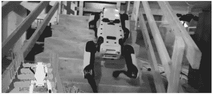

图 1-13 “SpotMini”机器人在杂乱的办公室中自由穿行

2019年5月，IHMC再曝“阿特拉斯”新进展：机器人自主规划通过悬空木板、摇晃砖块等复杂地形，狭窄地形行走成功率约50%，自主机动能力再上台阶。

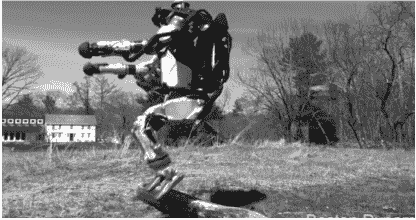

图 1-14 “阿特拉斯”机器人在草地上慢跑并跳过一段木头

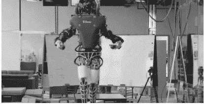

图 1-15 波士顿动力公司的“阿特拉斯”机器人过崎岖的独木桥

## 智能机器人未来图景：机遇与挑战并存

新一代信技成熟商用，为智能机器人筑牢软硬基座。商用服务机器人站在爆发拐点，消费级机器人有望接棒智能手机，成下一代互联网入口。

### 技术演进与应用趋势三大看点

**多技术融合成标配：** 大数据、物联网、VR、AI加速集成，机器人成为新技术最佳载体，智能化水平跃升，多任务、多模态作业成常态，驱动创新范式转换。

**智能制造纵深推进：** 生态体系完善催生新模式新业态。机器人在信息采集、流程管控、安全运维、质量追溯等环节广度深度双增，支撑高端装备协同开发、远程运维、全周期溯源。以巡检机器人为代表，无轨化、三维激光SLAM、视觉识别技术攻克全天候全路况作业，推动从“自动巡检”向“智能巡检”质变。

**服务机器人兑现养老刚需：** 全球老龄化提速撬动万亿市场。日欧老龄占比超60%，我国虽2014年仅排第52位，但预计2050年跃升至第21位（占比39%），且“空巢”占比近半。服务机器人在养老护理、医疗健康、情感陪伴具独特优势，融合创新将使其更便捷、友好、智能，深度重塑多元人群的个性化、实时化、精细化生活体验。

### 必须直面的深层困境与伦理拷问

**劳动力替代冲击宏观基本盘：** 就业是民生之本、稳定之基。Redwood Software与Sapio Research调研预警：2022年自动化与机器人或冲击60%企业，就业版图将深度重构。

**故障责任归属陷法律真空：** 特种机器人频现放大公众恐慌。倒逼反思：机器人能否学习人类价值观？能力边界在哪？现有工具属性下故障责任清晰，但高阶智能体下的法律责任边界模糊不清，亟待立法界定。

### 中国破局路径：政策、技术、生态三驾马车

**政策层面：** 坚持继承性发展，细化落实《新一代AI发展规划》、《三年行动计划》、《“互联网+”AI方案》、《机器人产业规划》等文件，构建协同高效的政策矩阵。

**技术层面：** 持续投入高新技术与行业知识联合攻关，打通人机交互瓶颈。推动AI、物联网、云计算、大数据、新通信协同突破，以应用牵引研发，加速智能制造、智慧能源、智慧交通、智能家居等领域软硬协同，优化信息获取识别分析效能，完善技术体系。

**生态层面：** 精准对接要素需求，构建发展生态。延续创业活跃、融资热、论文专利多的优势，锻造高水平人才梯队。在市场培育、启动资金、基础攻关、应用研发给予政策倾斜，重点在核心应用场景开展试点示范，营造产业生长良性土壤。

---

## 1.1.3 解码智能机器人背后的“黑科技”

* 关键词：智能 机器人 家庭 娱乐 技术
* 作者：邵芒

早期机器人局限于半自动机械劳动，而图像识别、语音识别、深度学习等技术的井喷，为机器人植入智能“大脑”，智能化成为产业升级主航道。赋予智能算法后，机器人破解复杂任务，百花齐放般涌现。

数十载工业科技积淀，让机器人从科幻走入现实：笨重机械臂进化为灵巧精准的“医生助手”；自主导航载具包揽灌溉、运输、巡检等高强苦活；家务机器人走入寻常百姓家，赎回宝贵时间。机器人影响力已全域渗透。下文呈现几款鲜为人知却惊艳四座的硬核产品。

### 1. 家庭篇

#### (1) 厨房“全能王” Moley

若你视做饭为累赘，或怕室友听闻“今晚我做饭”吓得躲远点，**Moley** 或是你的终极答案。它提供全流程“保姆级”服务：自学各派菜谱、复刻名厨绝技、餐后自动洗碗。当然，顶配体验对应的是不菲价签。

### 1.1.4 智能服务机器人产业发展全景综述

**核心标签**：智能服务机器人、政策动向、技术演进  
**撰稿**：张晶晶、陈西广、高佼、孙亮、薄国宁

---

#### 典型案例深度解析：从“会做饭”到“会叠衣”，服务机器人如何重塑家庭场景

**厨房里的“米其林大厨”——Moley 机器人厨师**

想象一下，两条极具科技感的机械臂在厨房台面上翻飞，精准抓取打蛋器、挥舞菜刀，烤箱、洗碗机、触控屏一应俱全，这就是 Moley 机器人厨房的日常（如图 1-16 所示）。它的核心秘籍在于“动作捕捉+机器学习”：通过 3D 摄像机与数据手套记录名厨的每一个手势、姿态，转化为带时序的数字信号，再由机械臂 1:1 复刻。这套核心技术出自斯坦福大学与卡内基梅隆大学联合攻关。当然，现阶段仍有痛点——食材需定点摆放、异形食材抓取易失败、流程中断无法自愈，但 Moley Robotics 团队誓言将通过算法迭代逐一攻克。未来，2000+ 菜谱将内置系统，手机 App 一键开启“私人厨师”模式。

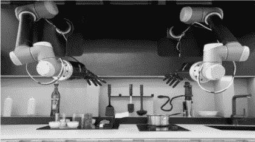

图 1-16 烹饪机器人“Moley”

（来源：Moley Robotics 公司官方网站）

**技术底座深度拆解：动作捕捉系统，让数字世界读懂物理动作**

动作捕捉并非 Moley 专属，它是连接物理与数字的通用桥梁。梦工厂用它赋予虚拟角色丝滑走位，工业界用它复刻专家技艺。核心逻辑是：高频采样关键点轨迹 -> 映射至三维模型 -> 算法修正物理约束。

关键技术分叉口在于传感器路线：

*   **光学派**：多相机捕捉标记点，借助透视投影算法反解三维坐标（如图 1-17）。标记点又分被动反光、主动发光（LED，精度达 0.1mm）、时序调制（自带 ID，免人工对齐）、无标记（纯视觉+深度学习，零穿戴门槛）。
*   **非光学派**：惯性测量单元（IMU）测相对运动，或外骨骼/磁定位实现同等功能，抗遮挡能力更强。

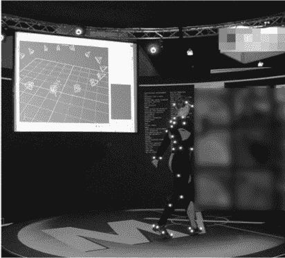

图 1-17 光学动作捕捉系统示意

（来源：Wikipedia）

---

#### (2) 叠衣机器人“Foldimate”：让家务从“繁”变“简”

做饭尚有创作乐趣，洗衣叠衣纯属“苦力活”。Foldimate 直击痛点：衣物塞入，整齐叠好取出，配合洗烘一体机实现全流程闭环（如图 1-18）。别被它朴实的外表欺骗，内核极其硬核。正如业界名言：“AI 能赢围棋世界冠军，却难如笨拙工人般叠衣。”面对尺寸、材质、厚度千差万别的衣物，寻找抓取点本身就是高难度识别题。

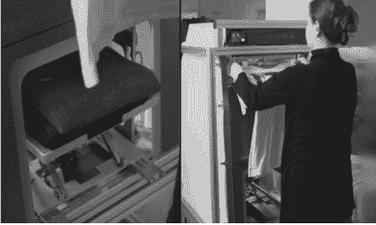

图 1-18 叠衣机器人“Foldimate”

（来源：“Foldimate”官方账号）

**学术视角切入：衣物关键点检测与主动感知规划**

帝国理工学院团队将自动叠衣拆解为两步：识别品类+定关键点 -> 生成叠衣方案。衣物属“三维可形变物体”，比刚性物体（仅旋转平移）和铰接物体（关节指数级组合）更棘手——变形空间近乎无限。破局思路：局部刚性假设，化整为零。

算法演进路径清晰：早期用随机森林，胜在 O(log n) 低复杂度与高适应性；深度学习时代，CNN 等网络成为主流，处理形变物体更得心应手。关键点到手后，机械臂展平衣物，后续动作预设即可（如图 1-19）。

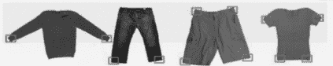

图 1-19 衣物适宜抓取的关键点示意

**遮挡与复位难题：POMDP 驱动的“主动看”策略**

关键点被挡住？衣物抓起怎折叠？论文给出“主动感知”方案：看不清就翻面、换角度。实操中引入部分可观察马尔可夫决策过程 (POMDP)，让系统通过多轮观测决策，无限逼近最优解。最终衣物平铺标准化，执行预设动作流完成叠衣（如图 1-20）。

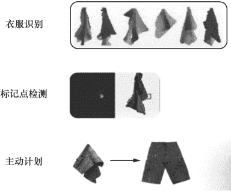

图 1-20 衣物识别与关键点检测流程演示

（来源：Autonomous Active Recognition & Unfolding of Clothes using Random Decision Forests & Probabilistic Planning, A.Doumanoglou et.al.）

---

#### (3) 家政管家“Aeolus”与“REEM”：会思考的仿人助手

扫地圆盘已普及，但 Aeolus 和 REEM 才是真·人形管家（如图 1-21）。亲和力外表下，技能树满点：接待来宾、送餐取物、捡垃圾、找钥匙，更能通过长期交互学习主人作息偏好，支持基础语义对话。

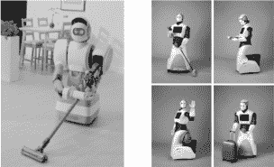

图 1-21 家政机器人“Aeolus”与“REEM”

**全栈 AI 技术栈大起底**

*   **社交接待链**：人脸检测（发现）-> 人脸识别（认证）-> 关键点检测（朝向/状态判断）-> NLP（语义理解）。
*   **捡垃圾链**：目标检测（定位分类）-> SLAM（导航定位）-> 6DoF 姿态估计（抓取规划+二次验证）。
*   **对话系统**：千万级数据训练，成本高昂，Siri、Alexa 皆是如此。

**核心导航大脑 SLAM 深度拆解：解决“我在哪、这哪、去哪”**

凡自主移动机器人，必备 SLAM。视觉 SLAM 前两环——定位与建图——最考功力。

**定位**：相机移动前后两帧图，求解位姿（旋转+平移）。经典四步走：
1.  **找特征**：角点/斑点，不变性强（如桌角）。
2.  **提描述子**：SIFT/SURF 等生成不变特征向量，近年深度学习描述子异军突起。
3.  **匹配对应**：特征向量算距离，建立二维-三维点对。
4.  **解相机矩阵**：3×4 矩阵映射三维世界到二维图像。

局限性显著：高速/弱光/纹理缺失场景易失效，工程上常融合 GPS/IMU 兜底。

**建图**：有了相机矩阵，像素即得深度，投影三维空间成图。但噪声累积会让地图“崩坏”。优化迭代史：EKF 滤波 -> 图优化 (Bundle Adjustment) -> 核心目标：多观测拟合最优解。衍生难题“回环检测”：走远回原点不认识自己。对策：记忆到访地，闭环触发全局优化，纠偏归真。微软 Kinect Fusion 三维重构即此类原理典范（如图 1-22）。

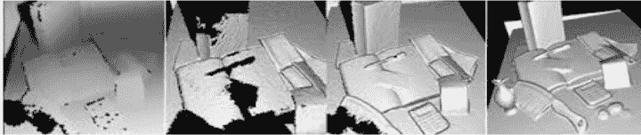

图 1-22 微软 Kinect Fusion 三维重构演示

---

## 2. 娱乐新物种：当机器人登台献艺

*   **平衡球啦啦队 muRata**：同步跳舞、不撞不倒，动态平衡控制登峰造极（如图 1-23）。
*   **全机器人摇滚乐队 Z-Machines**：鼓手、键盘、吉他全员钢铁，演奏技巧超越人类生理极限（如图 1-24）。
*   **魔方终结者 The Cubinator**：2010 年以 18.2 秒破纪录，还自带幽默模块——掉地自言“Oh Dear”（如图 1-25、1-26）。

 图 1-23 机器人啦啦队员“muRata”  
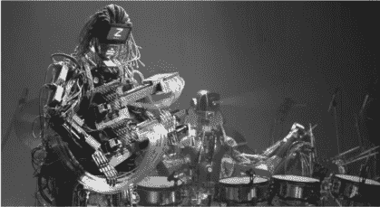 图 1-24 机器人摇滚乐队“Z-Machines”  
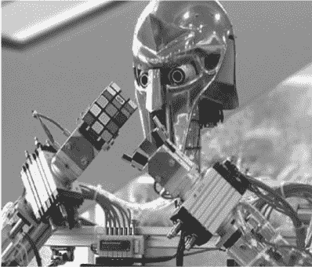 图 1-25 机器人魔方手“The Cubinator”  
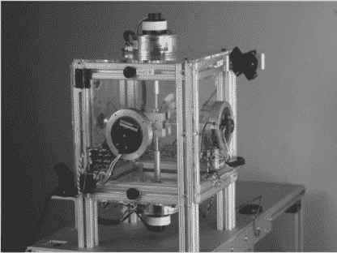 图 1-26 魔方还原装置特写

## 3. 竞技场上的钢铁选手：乒乓机械臂的极限对决

KUKA KR AGILUS 机械臂与世界冠军 Timo Boll 过招，攻防转换难分伯仲，展现工业机器人极致的速度与精度（如图 1-27）。

 图 1-27 乒乓机械臂“KUKA KR AGILUS”

## 4. 实用主义典范：救生与灌溉的黑科技

*   **救生艇 E.M.I.L.Y**：年均执行 7.7 万次救援任务，海上守护神实至名归（如图 1-28）。
*   **智能喷灌 Droplet**：融合千万级气象土壤数据，按需精准灌溉，节水率高达 90%（如图 1-29）。

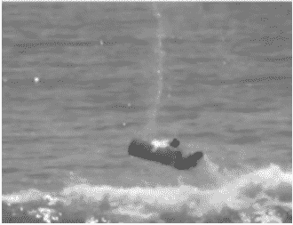 图 1-28 机器人救生员“E.M.I.L.Y”  
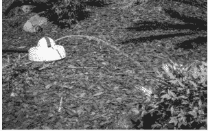 图 1-29 智能喷水器“Droplet”

---

### 1. 引言：从跟跑到领跑，中国服务机器人的破局之路

智能服务机器人，定义上是在非结构化环境下为人类服务的集成智能装备，是提升生活品质的关键抓手，更是国家科技创新与 AI 基础实力的“试金石”，全球前沿竞争最激烈赛道之一。大力发展该产业，关乎科技高地与民生福祉。

中国 80 年代起步，仿生材料、认知智能、水下/消防/手术/康复/扫地等多谱系样机涌现，关键部件、本体、软件、云服务企业梯队初具。但对标发达国家，差距仍显刺眼：

*   **基础前沿短板**：新材料、新模型、感知认知、人机协作等核心环节相对薄弱。
*   **关键零部件“卡脖子”**：视觉、传感器、电机高依赖进口，成本高企，超出消费承受。
*   **产品同质化、低端化严重**：高端难上市、高可靠难量产、交互体验差、占有率低。
*   **标准认证体系近乎空白**：技术支撑生态缺位。
*   **产业链不全、集群度低、竞争力弱**：供应链关键环节缺失。

向智能化、实用化、信息化、高可靠性全面跃迁，刻不容缓，且将反哺相关产业生态重构。

---

### 2. 政策导向深度解析：全球主要经济体战略布局对标

各国纷抢赛道，战略蓝图频出：

*   **美国**：2009 年《机器人演化路线图》定调医疗/服务/太空/军用四大方向，2013 修订，2016 年《国家 AI 研发战略》将 AI 提升至国家战略高度。
*   **日本**：视服务机器人为国策，设“新世纪机器人战略委员会”，双轨并行——单元技术开发与市场导向实用化，医疗护理普及规划落地细致。
*   **欧盟**：第七框架计划重金扶持，联合欧洲机器人协会攻坚农业、健康、交通、安防、家庭五大应用场景。
*   **英国**：启动 RAS 2020 战略，聚焦先进制造、养老助残、农业、航天、深矿、自动驾驶、核能七大领域机器人与无人系统突破。

# 全球服务机器人竞逐图谱：政策布局与中外技术代差深度解析

韩国率先于 2008 年落地《智能机器人开发与普及促进法》，紧接着推出《服务机器人产业发展战略》；至 2015 年，《机器人未来战略 2022》更将服务机器人列入国家十大“发动机”产业，聚焦核心技术攻关，推动其与新一代网络技术深度融合，意在打造经济增长新引擎。

国内同样将智能服务机器人视为战略高地。《国家中长期科学和技术发展规划纲要（2006—2020 年）》早早锚定服务及危险作业机器人方向，部署共性基础技术攻关。《机器人产业发展规划（2016—2020 年）》则细化任务矩阵：覆盖养老助残、家庭服务、医疗康复、应急救援、能源与公共安全等七大场景，重点培育消防救援、手术、公共服务、智能护理四大标志性产品，推动专业服务机器人系列化、家用机器人商品化。《“十三五”国家战略性新兴产业发展规划》进一步明确构建产业体系，誓要突破高精尖核心零部件与关键技术，加速专业及家用智能机器人产业化落地。

### 3. 国内外技术发展对比

#### (1) 基础研究与前沿探索

##### ① 国际前沿动态

**新材料与结构控制：** 美国在仿生材料上实现跨越，人工皮肤、人工肌肉已落地应用；智能压电纤维、形状记忆合金等驱动阻尼元件成熟。日本凭借海量专利占据压电、电致伸缩、磁致伸缩材料高地。欧美法德在基础材料与新结构专利榜单均居前十。美、日、法、瑞在仿生结构建模控制上领跑，多足步态运动学模型精准，人形、四足、轮足机器人接连问世；德国更造出 21 自由度仿生机械臂，运动特性极度拟人。

**感知技术版图：** 美主导感知赛道，超声波、雷达、三维激光、深度相机谱系完善，传感器网络与多源融合技术赋能无人驾驶与环境感知；视觉计算理论体系确立，三维重构与类人视觉奠定行业基石。德系企业（博世、施克等）强势，加速度计、惯导、毫米波、MEMS 技术领跑，已装车应用。日系聚焦智能化、微型化，软传感技术融合 AI，微型化、生化、纳米传感三管齐下。

**认知智能高地：** 美借 AI 霸权深耕模糊语义、非结构化视觉、多模态认知。英国 DeepMind 以自我学习认知架构震撼界，AlphaGo 横扫人类围棋巅峰。

**人机协作先发：** 美诞生首款商用协作机器人；欧系协作机器人已大规模替代传统工业机器人，深度渗透产线。

##### ② 国内突破进展

近年国内基础前沿长足进步，局部触及国际先进线。

**材料结构端：** 智能材料专利总量跻身世界前列。上交大在形状记忆合金、压电陶瓷、仿生人工骨建树颇丰；清华大突破仿生水凝胶成型、仿生骨复合材料、纳米材料；北航软体结构材料与控制达国际先进；山东大学等攻克步态机器人动态建模与控制，实现多足行走。

**感知破冰：** 中科院上海硅酸盐所压电陶瓷技术打破垄断；多家企业在激光雷达、三维深度相机上取得突破，支撑环境感知自主化。

**认知算法追赶：** 起步虽晚但增速猛，头部企业在机器学习、AI 领域密集布局，语义识别、视觉识别应用已广泛落地。

##### ③ 差距复盘与破局

**材料结构控制：** 整体仍追赶态势。应用层面虽达先进，但基础底层技术薄弱。

**感知技术：** “应用大国非强国”，基础技术、芯片、软件、高端设备对外依存度高，自主可控感知体系建设刻不容缓。

**认知智能：** 应用研究无惧差距，但核心算法及类 TensorFlow 通用平台生态建设滞后。

**协作共融：** 系统化研究尚属空白。

#### (2) 共性关键技术攻坚战

##### ① 国际竞争格局

**核心零部件垄断：** 美、德、日掌握高精度电机、驱动器、减速器、一体化关节等核心供应链，握绝对话语权。新一代服务机器人关键传感器（深度相机、三维激光、惯性传感）亦多掌握在欧美手中。

**软件生态霸权：** 美主导 ROS 生态，仿真平台加持，衍生军用、农用、移动版本，确立行业事实标准。德深度参与 ROS 生态建设，提供全链路支持。欧另拥两套成熟开源系统；日推通用中间件与仿真软件，解决兼容性痛点。

**认知数据护城河：** 美数据集覆盖生活全场景，IBM Watson 实现异构数据自动建模，语音、语义、人脸数据库完备。英掌握海量医疗健康数据，赋能康复服务机器人训练。

**定位导航深厚积淀：** 美全局/局部定位技术积淀深厚（UWB、vSLAM、三维激光）；英、法在导航、运动控制、行为规划输出专用解决方案；英建立 MQTT 协议，解决异构数据传输与远程监控。

##### ② 国内自主可控进程

**核心部件破冰：** “十二五”战略布局伺服电机、驱动器、减速器，方正电气、拓邦、华中数控、绿的、秦川等梯队初成。

**软件平台探索：** 北航深耕实时机器人系统；汤尼机器人发布 RoboWare 平台，构建数据传输安全策略。

**定位导航追平：** 算法与应用层面基本对标欧美，激光雷达、深度相机至导航算法全链条落地见效。

**认知数据雏形：** 科大讯飞等头部企业构建语音、人脸、交互数据集，支撑初级认知；专业定导方案商批量涌现。

##### ③ 短板精准画像

**核心部件：** 量产虽启，但精度、可靠性与发达国家有差距，关键器件仍无突破性进展。

**软件平台：** 停留应用层，自主体系未成型，缺乏专业级操作系统与仿真平台，与美日欧差距显著。

**定位导航：** 算法领跑，但国产配套硬件（激光器件、三维传感核心件）精度可靠性不足，依赖进口，核心掌控力不够。

**认知数据集：** 中文语音、人脸数据集虽全，但多为商业化加工数据，缺乏服务全技术链的开放原始数据集，阻碍生态共荣。

**数据云平台：** 缺乏面向机器人多模态异构数据（状态、任务、音视频）全生命周期管理的云平台基建。

#### (3) 个人/家用/公共服务机器人

##### ① 国际标杆案例

**自然交互霸主：** 美科技三巨头（微软、谷歌、苹果）聊天机器人平台引领自然语言交互与云平台商用化；微软、PrimeSense 主导体感交互成熟商用。

**灵巧作业寡头：** 机械臂技术被 ABB、库卡、安川、发那科四大族垄断市场。本田 Asimo 实现拟人行走、复杂动作与微操抓取，直指养老刚需。iRobot 聚焦小型灵巧机械臂落地家务辅助；Shadow Robot 灵巧手灵敏度媲美人手。

**场景深度落地：** 美机器人进驻数十家医院，覆盖接待、预检、引导、数据采集、运送、远程医疗；双足轮足人形机器人环境适应性强，化身家庭管家；德 WeRobot 服务公共场域交互展示；软银 Pepper 深耕公共服务；韩仁川机场机器人实战上岗。

##### ② 国内产品矩阵

新松、哈工集团、科沃斯等头部企业布局全品类，推出双轮引领、餐饮配送、陪护、公共服务等机型。自然交互由 BAT 等互联网大厂、中科院/北大/清华/哈工大等院所、科大讯飞/图灵等创企三足鼎立；奥比中光等体感交互设备具竞争力。

##### ③ 竞争力实况

**交互前沿：** 研究跻身世界前列，产品上市获市场回响，但智能化体验仍难满足用户心理预期。

**灵巧短板：** 一体化关节、机械臂/手轻量化小型化未破，高成本阻碍推广。

**公共服务：** 银行、电信大厅已布局，但智商不足，部分依赖远程人工“托底”。

**护理赛道：** 智能清洁机器人、智能轮椅落地见效，但功能单一、舒适度欠佳；护理作业核心技术相对滞后。

## （4）医疗服务机器人

### ① 国际临床成熟度

**手术机器人：** 美超 10 家企业获 FDA 认证，覆盖普外、胸外、泌尿、妇产、骨科、脊柱、神外、头颈、心脏等全谱系，“达芬奇”手术量全球霸主。德法英企业临床通过上市，聚焦普外、骨科、神外肿瘤微创。

**康复机器人：** 美巨大市场催生产业集群并反哺中国市场；日行为辅助机器人广泛入驻护理机构。仿生学与人因工程驱动的外骨骼机器人在康复后期及残障辅助表现卓越，欧美日形成龙头产区。

**脑机接口（BCI）标准制定权：** 美主导开源平台 BCI2000 成全球 500 实验室标配；EEGLAB 成脑电分析标准工具；BrainGate 临床试获 FDA 批准。德实现脑控刹车与打字；奥地利脑控神经假肢助残障者完成伸抓握喝水全流程。

### ② 国内自主研发突围

**手术机器人：** 天大、中南大联合研制 “妙手 S” 临床试验成功；海军总医院联合北航 CRAS 系统迭代至五代临床应用；哈工大微创腹腔镜手术机器人在机械设计、主从控制、三维腹腔镜集成上实现关键突破。

**脑机接口：** 清华大学团队处世界第一方阵；苏大、山东建大、哈工大、华南理工、浙大、国防科大、上交大等建专项实验室；深圳宏智力推消费级设备，试水娱教健领域。

### ③ 差距与痛点

**手术机器人：** 起步晚，公立民营医院主力仍为进口货，国产机型多停留临床试验阶段。

**康复机器人：** 上肢主动训练、柔顺控制、处方设计、康复评价等技术入临床，但成本高、普及难、疗效受限；下肢康复研发与临床应用严重不足，待解课题众多。

**脑机接口：** 智能辅助设备多处实验室探索期，关键卡脖子：缺乏个性化自适应运动模型；自然控制与环境感知弱，多源融合实时性待解。

## （5）公共安全服务机器人

### ① 国际实战化进程

**复杂环境适应与防护：** 美 60 年代起布局，反恐机器人实战验证；斯坦福自主移动机器人具备复杂环境识别、推理、规划控制全能；通用电气步态机器人征服非结构化地形；iRobot 系列化警用排爆反恐机器人批量服役，气动结构适应沙漠、丘陵、丛林；德模块化侦察排爆机器人越障爬楼；法排爆机器人攻克 40°斜坡与崎岖路面。

**集群调度智能化：** 瑞士无人机集群无外部定位协同飞行；美法仓储机器人系统实现物流中心任务调度、集群协作、自动规划；欧盟 SAGA 项目攻克农业集群控制、精准个体控制与群体智能。

### ② 国内追赶速度

起步晚但增速快，室外复杂环境移动机器人关键技术部分对标国际先进：清华 “THMR” 系列、中科院沈阳自动化所 “灵蜥-B” 排爆机器人、哈工大放射源处理机器人、中科院自动化所全向视觉导航、国防科大双足机器人、多校联合军警用室外机器人。

集群调度端：京东、海康威视落地 “无人仓” 无人车集群自动搬运；中电科 119 架固定翼无人机集群飞行实验达国际领先。

### ③ 发展阶段研判

中外均处上升期，美德英法相对成熟。国内虽有数十家单位整机研产、批量产品投用，但功能单一，未形成系列化规模发展。

## （6）科学工程服务机器人

### ① 国际太空作业领跑

美 80 年代初启动空间机器人研究，聚焦空间站装配、维修、视觉测量辅助。卡内基梅隆 “Skyworker” 实现空间附着移动，“Ranger TFX” 具备自由飞行能力，技术经验领跑。德重视空间机器人研发，成果丰硕，国际技术话语权高。

# 深海与太空：智能服务机器人全球竞逐与中国突围路径

## 一、 极限环境作业机器人：国际领跑者画像

### 深海领域：万米深渊的“手脚”较量
美国伍兹霍尔海洋研究所打造的“Nereu”混合型深潜器，搭载Kraft机械臂，实现了在11000米马里亚纳海沟级深度的力反馈精准操控。其前端集成高精度液压系统，可胜任核废料处理、危化事故救援等高风险任务。欧洲方面，英国深耕水下服务机器人装备制造体系；德国则双线并进——攻克6500米级海底测绘专用机器人，同时推出200米级浅海电缆维护、大坝巡检专用机型。

### 太空领域：起步晚但加速快的追赶者
我国空间机器人研究起步于“八五”期间，哈工大牵头建立“国家国际科技合作基地”，在远程力感遥操作技术上已跻身国际第一方阵。国家层面已绘制发展路线图，锁定在轨服务、月球深空探测、空间环境治理三大主攻方向。深海装备上，“潜龙二号”实现4500米自主航行与遥操作，上海海洋大学全海深探测器更触达11000米深渊底部，标志着中国深海无人装备具备全海域作业能力。

## 二、 中外差距剖析：从“跟跑”到“并跑”的阵痛期
空间机器人领域，国外已形成成熟应用生态，国内仍处探索验证期，但得益于高科技创新突破与政策强力托举，追赶速度显著提升。深海作业机器人方面，国际同行已攻克多项万米级关键技术并完成海试；国内深渊装备相对粗糙，操作灵活性与可靠性与国际顶尖水平仍存明显代差，核心短板在于极端环境下的长周期生存与精细作业能力。

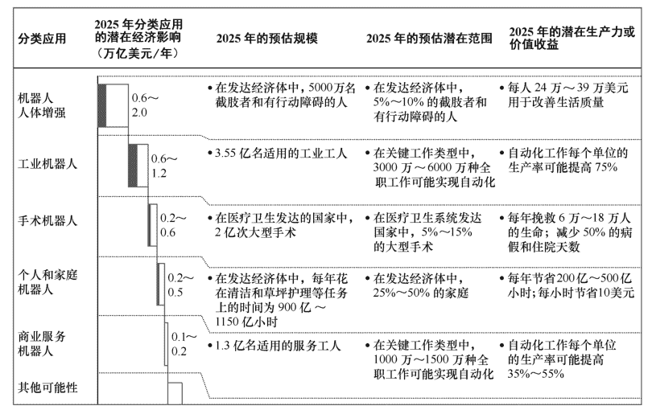

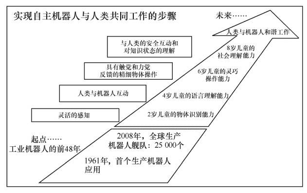

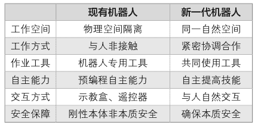

## 三、 产业化支撑体系：标准与路线图的双重博弈

### 国际规则制定：抢占话语权的“无声战争”
ISO/TC184/SC2（机器人分技委）下设四大工作组与一个联合工作组，标准覆盖术语定义、工业安全、个人护理、服务机器人及医疗机器人全链条。IEEE RAS聚焦本体标准与导航地图数据表达。韩国更以13项服务机器人专用标准构建起技术壁垒。规划层面，欧盟早于2002年发布20年技术路线图，美国2016年发布机器人路线图明确技术产业双路径，韩国亦推路线图驱动全场景应用。

### 国内短板：标准空白与检测滞后的双重夹击
现有64项国家/行业标准中，服务机器人仅占6项，集中于消防、电力、水下特种及家用清洁细分领域，**智能服务机器人核心标准处于“零”突破阶段**——功能、性能、安全、测试方法体系全线缺位。协作安全技术缺乏系统性研究，虽建成国家级检测中心、认证机制雏形显现，但标准化与检验检测体系建设刻不容缓。

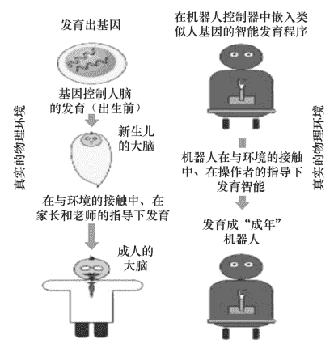

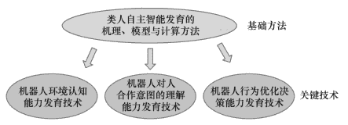

## 四、 未来技术突围“作战图”：七大战场精准发力

| 战场维度 | 核心突破口 | 关键抓手 |
| :--- | :--- | :--- |
| **基础前沿** | 软体结构、微型力传感原理、新型传感器件、深度学习基础理论 | 自主可控深度学习框架、神经网络专用芯片 |
| **共性关键** | 核心零部件设计制造瓶颈、自主可控操作系统/IDE、高可靠定位导航、多模态异构数据处理 | 填补操作系统空白、构建智能认知数据集 |
| **家庭/公共服务** | 人机交互体验与效率跃升、低成本小型辅助机械臂、助老助残创新示范 | 让服务机器人拥有“灵巧手”与“懂人心” |
| **医疗服务** | 高精度运动控制/路径规划、主从力反馈+辅助影像+VR融合、脑机接口适配传控执行体系 | 攻克手术机器人“手眼脑”协同难题 |
| **公共安全** | 非结构化环境运动执行、环境适应/防护/集群控制、复杂环境作业平台、救灾反恐工具研制 | 解决“能去、能耐、能管、能用”工程难题 |
| **科工服务** | 空间力反馈双边控制/三维重建、全深度耐压材料结构运动学、11000米水下巡检作业 | 实现极端环境下“感知-决策-执行”闭环 |
| **支撑体系** | 机器人伦理/社会影响、本体/人/数据/网络安全评估体系、国家发展路线图、标准化体系 | 以标准定规则、以安全促信任、以伦理引方向 |

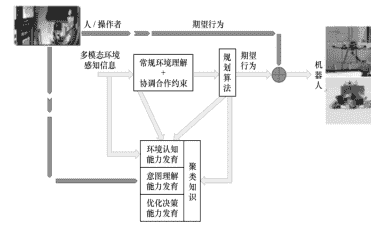

---

# 核心热点深度解析：机器人的“智能发育”范式革命

> **关键词**：机器人、智能发育、建模、知识表示  
> **作者**：韩建达、方勇纯、赵新、刘景泰

## 1. 破局背景：从“自动化机器”向“智能伙伴”进化的双重门槛
麦肯锡预测2025年先进机器人年经济效应达1.7-4.5万亿美元。通用汽车愿景描绘了机器人从灵活感知（2岁童）、语言交互（4岁童）、精细操作（6岁童）、社会理解（8岁童）直至人机和谐的进化路径。**本体灵巧安全是“入场券”，基础智能是“通行证”**，二者缺一不可。现状是：主流机器人仍是隔离作业、近零智能的自动化装备，距离“融入人类生产生活、协作决策的智能伙伴”鸿沟巨大。

表1-1 对比揭示本质：新一代机器人需具备动态非结构化环境理解、人类意图认知、自主决策、安全协作四大核心智能，这远超传统预编程逻辑。

## 2. 理论溯源：仿生“认知发育”而非“知识灌输”
**“劳动创造了人”**——实践活动驱动智能发育。机器人智能发育本质上是在人类引导下，通过海量多领域应用积累经验、迭代升级的过程。

2001年，密歇根州立大学翁巨扬教授在《Science》首提**“自主心智发育”**理念：植入类基因“发育程序”→机器人在环境交互与人类示教中自主生长智能→进化为“成年”机器人。这是**认知层面的深度仿生**，核心优势在于：无需预设任务/环境，仅需人类引导交互即可在线自组织学习。

团队后续提出HDR/IHDR知识表达方法：将分类与回归统一为回归问题，增量构建决策/回归树，实测可实现局部障碍物避碰等技能迁移。但IHDR本质属感觉-运动框架，受限于特征提取瓶颈，在复杂图像实时性、鲁棒性及场景聚类收敛性上尚难支撑实战。

## 3. 技术架构：四维发育体系构建“会成长”的机器人
智能发育定义为：机器人利用自带感知，在实时动态交互中增量式、渐进式提升自主行为能力。区别于传统机器学习，其五大特征直指痛点：**小样本学习、动态非确定环境适应、长期增量经验积累、知识联想推理、人机智能高效协同**。

基于此，构建四维技术体系架构：

### 维度一：类人发育引擎——智能的“操作系统内核”
- 知识/经验的表达存储、动态关联组合机制
- 受存储约束的更新增长与遗忘退出策略
- 高效检索与可信度评判体系
- 跨智能体（人/机器人）知识互补融合协议
- 算法落地的控制器软件架构实现

### 维度二：环境认知发育——构建“数字孪生感知”
- 视觉/激光/惯导等多模态实时融合
- 融合感知下的环境特征建模
- 面向特征的知识抽象与认知迭代

### 维度三：人类意图理解发育——实现“以人为本”协作
- 行为意图建模作为动态决策约束
- 安全/舒适/自然性（拟人化）约束建模
- 基于人类生理状态反馈的自主发育学习

### 维度四：行为优化决策发育——攻克“实时最优”难题
- 广义环境（动力学/任务/人意图）知识一致性表示与抽象
- 自主知识获取更新的发育模型与知识库
- **“知识引导优化”替代“纯算力搜索”**——借鉴人类依赖经验决策机制，破解多模态非线性约束下的实时性瓶颈

## 4. 落地路线：兼容并蓄的“三阶段”进化路径
技术路线兼容传统优化算法与人类遥操作：
1. **启蒙期**（智能空白态）：传统算法+人类示教规划行为，同步反馈环境/示教/目标信息发育三大能力；
2. **成长期**：积累“发育智能”后，从广义环境抽取知识指导决策单元，降低实时算力、提升可靠性；
3. **成熟期**：智能渐进跃升，决策指导强度增强、适用场景拓宽，形成持续进化闭环。

## 5. 硬核难点：跨学科本体化的“最后一公里”
最大挑战在于**智能行为建模的本体化落地**。人类智能发育牵涉发育心理学、脑科学、神经科学等多学科，学科内部机理尚不明朗，将这种复杂性映射到物理机器人实体上，面临理论解释力不足与工程实现难度的双重夹击——这既是核心瓶颈，也是最具突破价值的科研高地。

# 机器人智能进化：从认知发育到视触融合操作的深度解析

## 5. 结论与展望：智能发育的破局之路

**知识表示与存储的“硬骨头”**  
智能发育的另一大拦路虎，在于知识如何表达、存储与迭代。旧有路径在海量知识存储上始终难以突围。怎么从高维数据里“淘金”——提取有效信息用于学习归纳，同时避开“维数灾难”的坑，是自主发育研究绕不开的硬题。

**算法落地的“最后一公里”**  
把智能发育算法用到实处，还得解决一堆工程化难题。传统机器人控制体系与智能发育算法之间，急需一套通用的信息接口标准，让“知识大脑”与“控制躯干”能无缝对接、协同作战。

**破局点：深度学习赋能的新范式**  
好在算力的爆发式增长，催生了以深度学习为旗手的AI算法群。这些成果将为机器人智能发育夯实地基、注入动力。将基于AI的自主智能发育技术与现有机器人技术深度融合，极有可能成为下一阶段智能机器人研发的主航道。

**核心定论：渐进式发育是通往通用智能的关键钥匙**  
渐进、递增式的学习与发育能力，是机器人适应动态非结构化环境、应对差异化任务与协作对象的核心技术路径，也是机器人技术与AI技术深度耦合的关键支点。机器人的智能发育，本质上是一项“认知仿生技术”。它对破解机器人智能化进程中的卡脖子瓶颈——提升环境认知、读懂人类意图、优化自主决策——都拥有不可替代的理论价值与应用前景。

---

### 1.2.2 视触融合：赋予机器人“巧手慧眼”的操作新范式

> **核心标签**：视觉 | 触觉 | 视触融合 | 控制 | 机器人  
> **撰稿**：王涛

自机器人概念诞生，人类就憧憬它能分担更多劳作。从早期的简单搬运到如今的精密装配，从初级语音交互进化到复杂情感沟通，需求随科技跃升而不断升级。工业端，协作机器人的兴起倒逼操作技能进阶；服务端，操作能力正是当前短板。打破“固定程序、固定点位”的旧模式，视觉已成为当下机器人操作的核心输入源。

**视觉先行，却非终点**  
AI浪潮中，机器视觉率先狂飙，目标检测、人脸识别等领域甚至超越人类。得益于此，机器人视觉应用瓶颈被打破，深度相机成了协作与服务机器人的标配。但面对日益复杂的任务，仅靠“看”远远不够——高精度装配、恒力抓取等场景，单一视觉信息失效。**感知能力的上限，直接锁死了操作任务的难度上限。**

本节聚焦**视触融合**，剖析操作痛点，拆解平台体系与实战案例，旨在通过构建数据集降低门槛，推动算法迭代，助力机器人闯入复杂环境腹地。

#### 一、 机器人操作的三重挑战：感知、规划、执行

机器人操作本质是与物体的物理博弈（触碰、抓取、推拉、抛接、使用），是连接数字大脑与物理世界的“手脚”。视触融合操作可拆解为感知、规划、执行三阶段。

##### (1) 感知篇：从“看清”到“摸透”，再到“心中有数”

**① 视觉：第一视角的进化与瓶颈**  
如同人类干活先观察，视觉是机器人行动的先导。深度相机普及让机器人直接获取3D环境信息，信息量质变跃升。

*   **硬核传感器选型**：像素帧率飙升、体积缩水的同时，深度相机成主流。按原理分双目、结构光、ToF。Intel RealSense（双目结构光）能输出1280×720@90Hz深度图，新款D415/D435甚至能抗户外强光干扰；ToF方案虽增多，但受限于元器件，分辨率多停留在640×480，仍有提升空间。
*   **位姿与形变的拿捏**：深度学习让目标检测飞跃，但操作还需**位姿**。传统特征匹配怕纹理复杂、点云稀疏；深度学习用多视角RGB-D训练网络直接回归位姿更鲁棒。生活场景多柔性物体，**形变检测**成关键——通过跟踪表面特征点位移实现，稳定性直接决定软体操作成败。

**② 触觉：迟到的“最大器官”，正在成为标配**  
人类靠皮肤感知世界，触觉却长期缺席机器人主流应用——传统工业场景不需要。但3C等高精产业崛起，即便机器人重复定位精度达0.01mm，精密装配仍需靠力反馈“试装”，服务机器人也靠力控实现柔性交互。**触觉传感器，正从可选项变为末端标配。**

*   **传感器本体四大流派**：
    *   **应变式**：精度高、成本大、体积大，擅长测合力，难做多点分力（主流六维力源头）。
    *   **压阻/电容式**：薄膜阵列化易集成，但材料工艺敏感，稳定性待考。
    *   **视觉触觉式**：新贵。微距相机拍内部变形场推算外力，自带纹理观测能力，但体积难缩小。
*   **材质感知：指尖上的“物理指纹库”**  
    触碰获取接触位置，相对运动感知纹理硬度。
    *   **建模**：触觉几何精度高但效率低，视觉快但精度不足，互补融合得最优三维模型。
    *   **纹理**：视觉看大貌，触觉辨微感（如人手抚摸），通过受力差异区分细微纹理。
    *   **硬度/分类**：记录“力-位移”曲线，以形变差异识别材质属性。
*   **滑觉检测：抓稳的“安全阀”**  
    实验室环境好控制，实战中抓取姿态偏移导致传感盲区频发。关键在于提取**与力值大小无关的滑动特征**。
    *   *阈值法*：泛化差，不同物体得改阈值。
    *   *特征提取*：傅里叶/小波/稀疏编码分析时序，针对性强。
    *   *神经网络*：LSTM学共性滑动特征，预测更自适应。

**③ 视触融合：1+1>2 的化学反应**  
单一模态短板明显，多模态融合（数据层/特征层/决策层）成必然选择。
*   **三维建模**：视觉快全、触觉精局，融合得“又快又准”模型用于规划。
*   **物体分类**：人类认知是多维的（形色构纹重硬）。视觉管“长相”，触觉管“手感”，融合实现细粒度分类。
*   **滑觉检测**：触觉预测滑动前兆，视觉捕捉相对位移，双管齐下，抗干扰能力拉满。

##### (2) 规划篇：从“死记硬背”到“举一反三”

传统靠编程/拖动示教，轨迹固定，适合结构化环境。非结构化场景（无序分拣、协同搬运）下，**自主规划**成刚需。

**① 操作规划双子星：运动与抓取**
*   **机械臂运动规划**：高维寻优（6+自由度），计算量爆炸、障碍物描述难。主流PRM、RRT基于随机采样，结果随机性大，需在时效与质量间妥协，可靠性受挑战。
*   **末端抓取规划**：几何计算或Graspit!仿真仅保证理想态；数据驱动成主流——Dex-Net 2.0用670万数据训练，在8类已知物体上达成93%成功率。

**② 操作学习：让技能“长”在身上**
*   **端到端控制**：图像入、关节序列出，深度网络一把梭。缺点：极其贪数据，输出随机，难直落实战。
*   **模仿学习**：降低采样成本，甚至“一次学会”。人类操作视频作教材，提取动作表示迁移至机器人。优势：任务目标位置变了，动作表示仍适用，**泛化能力强**；劣势：复杂任务仍待验证。

##### (3) 执行篇：落地才是硬道理

执行是感知规划的兑现环节，直接定生死。

*   **本体进化**：
    *   **机械臂**：协作机器人（如UR）普及，力矩传感器上车，安全与任务边界双拓展。但运动性能仍难及人类，需扬长避短，开发专适方案。
    *   **末端执行器**：传统夹爪/吸盘功能单一；服务端多停留在手势交互。未来趋势：**多自由度、多传感、高可靠**的通用灵巧手。
*   **动态调整：应变能力的试金石**  
    路径突现障碍物 → 实时重规划避障；抓取过程力位反馈 → 局部优化姿态与力大小 → 稳抓不掉。

---

#### 二、 视触融合操作平台：英特尔中国研究院的“全栈实战样板”

该平台集成视触感知，支撑稳健可靠操作，以英特尔中国研究院自研体系为例拆解。

##### 硬件栈：算力、感知、本体三位一体
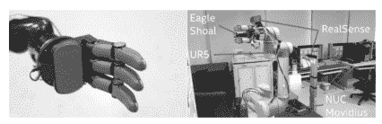

图 1-35 “Eagle Shoal”灵巧手及操作平台

*   **算力底座**：Intel NUC主控 + Movidius神经计算棒加速神经网络推理。
*   **视觉双目**：RealSense ZR300（RGB 1080p@30Hz + Depth 628×468@60Hz），分布式布局：场景相机管全局，手眼相机管细节。
*   **大臂**：UR5协作臂，5kg负载覆盖大多数生活场景。
*   **巧手**：“Eagle Shoal”灵巧手（3指、8主动自由度、16枚力传感器），指尖掌心全覆盖受力感知。

##### 软件栈：ROS生态下的分层解耦
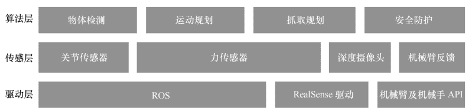

图 1-36 软件架构

*   **OS & Middleware**：Linux + ROS（分布式发布订阅，多语言、强扩展、SDK丰富，但非实时、稳定性仍是短板）。
*   **分层架构**：
    1.  **驱动层**：ROS核心 + RealSense驱动 + 机械臂/灵巧手API。
    2.  **传感层**：采融关节、力觉、深度图、本体反馈，做前置清洗融合。
    3.  **算法层**：检测、运动规划、抓取规划、安全守护——核心智能中枢。

##### 实战闭环：从“看见”到“递交”的标准化流程
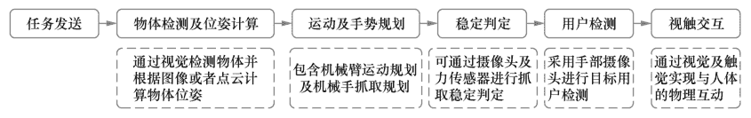

图 1-37 物体的抓取及递送流程

1.  **场景感知**：场景相机采点云 → Movidius加速推理 → 实时目标检测框。
2.  **定位定姿**：检测框+深度信息计算位置 → 法向量法或ICP算法匹配模型 → 输出6D位姿。
3.  **规划执行**：运动规划避障达标 → 抓取规划定姿态 → 灵巧手视触融合闭环控制 → 稳抓递送。

---

**结语**  
视触融合不是简单的传感器叠加，而是认知维度的跃升。从感知重构物理世界，到规划生成最优策略，再到执行实现柔性闭环，这套“感知-规划-执行”全链路体系，正推动机器人从“会动”向“会干”、从“结构化专用”向“非结构化通用”跨越。平台化、数据集驱动、算法迭代的工程范式，已然成为行业破局的共识路径。

# 总结与前瞻

在机器人操作领域，传感器硬件与本体机构仍具备显著的优化空间。就传感器数据的处理与应用而言，现有算法尚未能充分挖掘多模态感知信息的潜力。英特尔中国研究院致力于构建视触融合操作平台，旨在提供机器人操作系统的参考架构，通过平台积累抓取数据集，降低视触融合及操作算法的研究门槛，从而推动机器人在非结构化环境中的落地应用。

相较于人类，机器人感知的核心优势在于能将环境信息量化，实现更精准的认知，进而保障任务执行的稳定性。随着技术迭代，充分释放机器人在感知精度与执行一致性上的长处，将为人类生产生活带来更大便利。

# 基于动态运动单元的机器人学习体系

关键词：机器人学习 系统架构 强化学习

作者：刘忠轩

机器人学习指代机器人自主习得新技能并优化执行效能的过程，这是机器人从依赖人工编程、适应固定场景的传统模式，向服务机器人领域跨越的关键能力。面向真实应用场景，学习系统需具备小样本快速习得新技能的能力；学习过程须保障安全，支持用户灵活增添任务，并能针对环境、任务及本体变化快速适配，同时应对大规模并行学习与海量任务在线更新的挑战。基于 `DMP`（Dynamical Motion Primitive，动态运动单元）的学习体系凭借对复杂任务的高效建模能力，成为破解上述难题、提升服务机器人智能化水平的有力路径。本节将系统阐述该类方法的背景脉络、技术进展及英特尔中国研究院的相关探索。

## 机器人学习概论

人类对机器人的畅想贯穿社会发展史，影视作品更使其形象具体化。虽形态各异，但理想机器人的共性是功能多元且适应性强，这与现实中主要局限于工业、清扫等固定场景的机器人形成鲜明反差。如何赋予机器人多样化、自适应的作业能力，正是服务机器人面临的核心挑战，实质上即要求机器人具备学习新技能与任务中自我优化的能力。尽管扫地机器人等具备一定的环境适应力，但面对端茶、开门、烹饪等复杂任务，机器人必须掌握机械臂的多任务控制技术。

机器人学习技术主流分为模仿学习与强化学习。前者通过模仿人类行为习得新技能，后者致力于优化技能执行效果。模仿学习为强化学习提供初始化策略与提效的关键途径。

得益于人类示教的引入，模仿学习大幅缩短了学习周期，近年备受学工界瞩目。其方法分两类：行为复制，直接映射人体动作至机器人关节轨迹；逆强化学习，从观察中推导奖励函数再优化机器人行为。本文重点探讨基于 DMP 的行为复制，结合动作分割与匹配技术实现复杂动作学习。

强化学习核心在于依据当前状态与回报优化下一步动作，以最大化环境期望回报。机器人强化学习面临的问题分为无限时域（如平衡、走路等稳态/韵律运动）与有限时域（如打乒乓球、翻饼、物体操作等）两类。

区别于游戏博弈或参数优化等任务，机器人强化学习面临独特挑战：高维连续状态动作空间与多任务的联合优化；降低数据采集成本与感知噪声；探索过程须保障本体安全并生成平滑轨迹以利控制精度。

算法层面分为基于过程与基于步骤两派。前者将任务全程参数化再优化，优势是采样效率高、轨迹平滑，劣势是难以引入传感器反馈实时调控；后者逐步优化动作，特点相反。基于 DMP 的策略搜索属前者，其通过 DMP 参数搜索与模仿学习压缩搜索空间，借局部策略搜索实现安全更新，利用 DMP 天然光滑特性生成平滑轨迹。

## 机器人学习中的核心子问题

### 运动表达建模

行为优化的前提是解决运动表达问题。复杂动作由基元组成，DMP 正是对该基元的优秀描述。DMP 基于非线性动态系统，通过定义初止状态与轨迹形状刻画运动。其含离散、周期两式，分别适用于机械臂单次动作与腿部往复运动，此处聚焦前者。

DMP 采用阻尼弹簧模型：弹簧效应（常数与零阶导数项）产生趋向目标趋势，阻尼效应（负一阶导数项）抑制超调，形成先加速后缓停的收敛特性。DMP 两种表达形式分别描述末端在笛卡尔空间的 6D 轨迹与关节角度轨迹，此处仅考量后者。

计算公式如下：

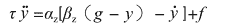

式中 `y` 为关节角，`τ` 为时间常数，`ẏ`、`ÿ` 分别为角速度、角加速度，`g` 为目标角度，`α[z]`、`β[z]` 为参数，`f` 为生成目标轨迹的强制力函数。

DMP 核心在于引入非线性系统定义 `f` 随时间的演化：

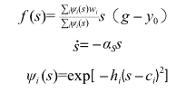

可见 `f` 隐式依赖时间，通过指数衰减的相变量 `s`（`ṡ = -α[s] s`，初值 1 终值 0）驱动。`h[i]`、`c[i]` 为基函数参数，`w[i]` 为核函数 `ψ[i]` 的权重，拟合时引入尺度因子 `g-y[0]`。随时间推移 `f` 趋近于 0，保证运动收敛至目标。

由此可知，DMP 核心可变参数分两类：描述轨迹形状的形状参数 `w[i]`；描述初止状态的元参数 `y[0]`、`g`（有时含时间常数 `τ` 及终止高阶导数）。虽可联合优化，但通用做法是模仿学习获取形状参数，强化学习优化元参数。

### 机器人强化学习详解

#### 系统执行流程

机器人强化学习系统通常按 5 步闭环执行（如图 1-38）。

图 1-38 机器人强化学习系统执行流程

**策略初始化**
策略指代关节轨迹的 DMP 形状参数与元参数，分两种情形：

*   **新任务初始化**：需给定初始策略（形状参数定型，元参数待优化），来源四类：
    1.  **模仿学习**：人类示教获取初始轨迹，含五种手段——随动示教（拖动机械臂，受本体限制、难双臂协同）、光学跟踪（动捕系统，自由度高但怕遮挡、需专用场地）、数据手套（规避遮挡，但 IMU 漂移致位置漂移）、视频示教（观看视频学习，进展大但手部精准跟踪仍是瓶颈）、虚拟示教（VR 交互，研探阶段）。
    2.  **模拟学习**：仿真环境重构场景与本体，用深度强化学习产出初始策略，难点在于力与接触参数难精确辨识。
    3.  **规划算法**：检测目标位姿与本体状态，用 RRT 等算法生成策略。
    4.  **人工规则**：编程直接生成。
    获得示教轨迹后，通过 DMP 回归提取形状参数与初始元参数。

*   **已知任务再调整**：机器人入户部署时因环境差异（如特殊门把手、力控要求）性能不足，需在线微调。此时初始化策略即为默认执行策略。

**实验策略生成**
强化学习算法输出元参数修正量，结合初始化的形状参数与元参数，合成本轮实验的 DMP 参数。

**策略执行**
机器人接收 DMP 指令后经三层处理：
1.  **控制信号生成**：PID 等控制技术跟踪输入轨迹。
2.  **安全约束满足**：修正可能导致自碰撞、环境碰撞或损伤工件的动作。
3.  **其他指标满足**：兼顾光滑性、能耗、美观度等。

**策略效果评价**
执行结束后评估效果，通常视觉判断生成回报值。为利于优化，回报值需平滑处理（回报整形）：成功参数高回报，接近成功者赋予梯度回报。

纳入新状态、动作、回报后，算法更新策略决定下一步，循环至回报达标或收敛。

**最终策略输出**
将最优策略存入存储器，供下次任务调用，直至需新一轮优化。

#### 基础算法原理

面向 DMP 的强化学习算法众多，重点介绍进化计算与相对熵策略搜索两大类。

**基于进化计算——CMAES**
经典算法 `CMAES`（协方差矩阵自适应进化策略）流程：
1.  依初始参数（各关节 DMP 元参数均值、方差）按高斯分布采样一组参数，生成轨迹。
2.  实机执行获取回报值。
3.  **步骤 3：样本执行与参数更新**  
    一组样本跑完后，依样本及回报用 CMAES 更新均值、方差，回步骤 1，直至回报达标。

核心即迭代更新各关节 DMP 元参数的均值与协方差：

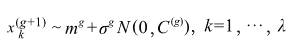

符号含义：第 g 代均值 `m^g`，协方差 `C^g`，步长 `σ^g`，第 g+1 代第 k 个样本 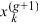，采样数 `λ`，零均值高斯 `N(0, I)`。

均值更新：
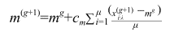
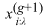 为回报第 i 优样本，`c[m]` 为学习率，`μ` 为精英样本数。

协方差更新叠加 `μ` 秩与单秩两部分：
`μ` 秩更新：
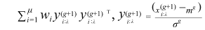
`w[i]` 为和为 1 的递减权重，即用精英样本协方差更新当前协方差。
单秩更新：
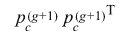
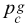 即进化路径 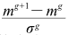，若连续更新方向一致则加速该方向收敛。

步长更新：
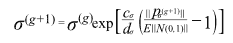
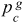 亦依进化路径，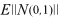 为单位高斯范数期望，`c[σ]`、`d[σ]` 为参数。

进化路径机制缓解局部最优陷阱，即便单批样本量小也能收敛至较优解。CMAES 衍生出重初始化处理多峰、自适应调整样本量加速收敛等改进。

**基于相对熵策略搜索——REPS**
`REPS` 框架与 CMAES 相似（采样-评价-更新），差异在于更新机制。REPS 约束新旧采样分布的相对熵（分布距离）在阈值内，基于历史样本与回报求解最优回报。单次更新三步走：
1.  已知上一批高斯分布与样本回报。
2.  对偶函数优化得样本权重。
3.  加权拟合新高斯分布，供下一批采样。

对比 CMAES，REPS 收敛更快但易陷局部最优，且需更大单批样本量。此外尚有贝叶斯优化等 DMP 强化学习算法。

#### 强化学习进阶问题

**上下文强化学习**
面对同一任务在不同条件下的策略适配（如倒水时杯子角度、距离变化即为上下文），算法分三类：
1.  离散化上下文逐一学策略，再用高斯过程回归拟合连续策略函数。
2.  随机采样上下文 + 单次强化学习优化，代表作：上下文 CMAES、上下文 REPS。
3.  主动选择上下文 + 单次优化，代表作：主动上下文策略搜索、贝叶斯优化上下文策略搜索。

**等级强化学习**
针对任务存在多策略模式选择（如乒乓球正反手、倒水倾斜/倒立），将优化分两层：上层选策略类别，下层优化类内最优策略。等级 REPS 为典型 DMP 等级算法，流程可参照图 1-39 理解。

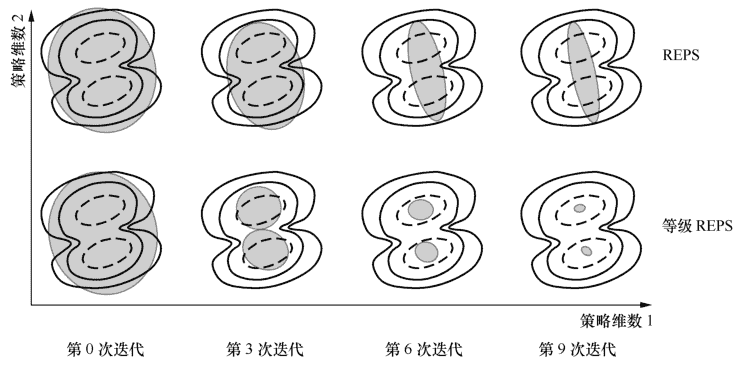

图 1-39 等级 REPS 优化过程示意

图示对比非等级与等级 REPS 在二维双峰问题上的表现：等级 REPS 收敛更快且策略更优。

### 基于行为复制的模仿学习难点

**① 高精度人体轨迹提取**
模仿学习的前提是获取精准人体姿态序列。前文五种示教法各有短板，视频法最具潜力但算力与难度极高；现阶段动捕系统较现实，仍需解决遮挡下标记点轨迹生成（源自雷达多目标跟踪，经典解法为多假设跟踪）；简单动作可用随动示教。

**② 多阶段动作自动分割**
人类动作多为复合动作（如倒水含伸手、抓取、抬起、倾倒、放回），如何自动、鲁棒分割仍是挑战，虽有进展但提升空间大。

**③ 人体轨迹至机器人的映射**
因本体结构差异，映射通常四步走：
1.  以基准点（如背部中心）归一化手部轨迹为相对轨迹。
2.  逆运动学解算：以归一化手部轨迹为末端目标，反解机械臂关节轨迹。
3.  仿真器中强化学习微调，使末端轨迹最大程度拟合归一化轨迹。
4.  实机强化学习迁移，达成与人类相当的执行效果。

## 3. 机器人学习系统架构

### （1）机器人复杂运动学习系统

# 破解“现实鸿沟”：从模仿学习到云边融合，机器人如何进化出“身体智慧”

机器人真正的智能突围，不在棋盘上，而在餐桌旁、工位上、生活中。莫拉维克悖论揭示了一个残酷真相：让机器人下围棋赢人类容易，让它稳稳端起一碗汤不洒却难如登天。这篇文章带你深入一线，看机器人如何通过“看、学、练、悟”四步走，跨越从“语义鸿沟”到“现实鸿沟”的终极挑战。

---

### 一、 核心范式：看一遍、拆动作、建模型、强化练

想象这样一个场景：机器人站在厨房，通过摄像头注视大厨切菜炒菜。它不只是“看”，更在“解构”——捕捉手部轨迹、肘关节角度、重心转移，将连贯动作自动切分为“拿锅、倒油、下菜、翻炒”等原子技能，再映射到自身关节，经过成百上千次试错优化，最终端出一盘色香味俱全的菜。这就是**复杂运动学习系统**的完整闭环。

**系统架构四步走：**
1.  **捕捉与对齐**：运动捕捉系统（如OptiTrack）在人体关键节点（手腕3点、肘/上臂1点、背部3点）贴标记，提取相对于躯干基座的3D轨迹序列，经多次示教后同步去噪。
2.  **动作自动分割**：告别人工标注，引入速度钟形曲线特征，将长轨迹自动切分为“有语义的子动作段”（如伸手、抓取、放回）与“无意义微动作”。
3.  **跨本体映射与DMP建模**：核心难点在于“ 사람의 팔 ≠ 机械臂”。直接逆运动学（IK）只能匹配末端轨迹，肘部姿态往往大幅偏离（图1-43a红绿曲线离散）。引入**动态运动基元（DMP）**参数化表达，再经**CMA-ES等强化学习算法**在仿真与实机双环境优化，实现末端与关节轨迹的双重贴合（图1-43b曲线重合）。
4.  **技能模板化沉淀**：将优化后的DMP概率化建模为“技能模板”，存入技能库。下次学新动作，直接调用相似模板微调，实现**零样本/小样本快速泛化**。

---

### 二、 实战验证：从社交手势到精准投掷

#### 1. 交互动作学习：打招呼、止步、请坐
针对三类社交手势，各示教10次。系统自动分割出“移动到起始位→执行核心手势→复位”三阶段，速度-时间曲线完美佐证分割合理性（图1-42）。经IK初始化+强化学习修正，机器人复现动作与人类示教高度一致（图1-41），验证了**“分割-映射-优化”管线的鲁棒性**。

#### 2. 投掷任务：单目标 vs 语境泛化
- **固定目标（REPS算法）**：目标区x∈[1,2]m, y∈[-0.5,0.5]m。200次试验收敛，落点欧氏距离误差大幅下降（图1-44）。
- **多目标语境策略**：引入**上下文强化学习**，每回合随机采样目标黑点（图1-45a-c）。Contextual REPS在25样本/批次设定下，平均偏差收敛至-0.22（图1-45d），证明机器人已掌握“投掷这一技能族”而非单一轨迹。

---

### 三、 未来图景：跨越“现实鸿沟”的三大硬仗

深度学习攻克了“语义鸿沟”（识别图像里有什么），但**“现实鸿沟”（如何用身体在物理世界达成目标）** 仍拦路虎般横亘：
| 核心挑战 | 计算任务新范式 |
|-----------|----------------|
| **高学习效率** | 模仿学习需精准理解人类精细动作意图；技能模板迁移加速新任务适应 |
| **安全学习** | 实时物体状态估计→构建奖励函数/视觉伺服；仿真-实机迁移 |
| **技能共享** | 机器人间运动建模标准化，实现“云端大脑、终端共享” |

摩尔定律算力红利叠加算法迭代，**柔性服务机器人规模化落地已成必然**。

---

### 四、 云边融合：重塑机器人“思维深度”

单靠终端算力跑大模型？嵌入式芯片撑不住。单靠云端推理？带宽、延迟、隐私全是坑。**前端感知执行+后端训练迭代“双轮驱动”**成最优解。

#### 1. 前端三大智能支柱（图1-46）
- **计算智能**：算力存储碾压人类，但受限功耗/散热；
- **感知智能（核心）**：多模态传感器融合（原始数据零损耗处理），主动感知超越人类被动接收；
- **认知智能**：定位、建图、推理、规划，赋予机器人“懂环境、会决策”。

**前端硬核优势**：毫秒级实时响应、仅上传结构化数据降带宽90%+、原始数据保真度最高。  
**短板**：训练算力弱、扩展性差、资源调度无话语权。

#### 2. 后端：大规模集群训练“超级大脑”
海量结构化数据汇聚，跑通“数据清洗→模型训练→压缩量化→下发终端”全流程（图1-47）。TensorFlow等异构分布式框架支撑PB级数据、万亿参数模型迭代。

#### 3. 结构化数据：云边协同的“通用货币”
前端：原始信号→特征提取→语义标签/轨迹参数（结构化数据）→本地执行+上传。  
后端：聚合全网数据→训练SOTA模型→剪枝/蒸馏/量化→下发前端。  
**闭环越跑越快，模型越跑越准。**

#### 4. 关键使能技术栈
- **物联网三层架构**（感知/网络/应用层）打通万物互联神经元；
- **多传感器融合**（数据/特征/决策层互补冗余）攻克单传感器失真/盲区；
- **深度学习（CNN/Transformer）** 端到端提取分布式表征，TensorFlow开源生态降维打击开发门槛；
- **大数据分布式存算** 从TB跨越到PB，支撑非结构化数据挖掘。

> **数据是机器人的“石油”，云边融合是“炼化厂+加油站”一体化网络。** 只有打通“采-炼-输-用”全链路，机器人“思维深度”才能指数级跃迁。

---

### 五、 机器之眼：SLAM与新型传感器，让机器人“看懂”世界

视觉不仅是“看清”，更是“看懂、定位、导航、交互”。下一节将深度拆解：
- **SLAM技术演进**：从几何视觉到语义SLAM，构建机器人认知地图；
- **新型传感器矩阵**：事件相机、固态激光雷达、触觉皮肤……如何重塑感知上限；
- **感知-决策一体化**：视觉伺服、主动视觉、具身智能新范式。

---

**结语**  
从“模仿大厨炒菜”到“云端大脑赋能终端”，机器人正在经历从**“动作复刻”→“技能泛化”→“认知涌现”**的质变。攻克现实鸿沟，没有捷径，唯有**算法架构创新、云边协同工程化、海量实机数据飞轮**三驾马车并驾齐驱。下一个十年，属于真正拥有“身体智慧”的硅基伙伴。

  
  
  
  
  
  
  

# 移动机器人感知核心技术深度解析：从SLAM到多传感器融合

具备感知能力的移动机器人，凭借自带的多模态动态视觉系统，能在毫无外部信号辅助的复杂非结构化环境中，自主完成定位、建图、导航与路径规划等核心任务（如图 1-48 所示）。这类机器人广泛适用于工业仓储、商业服务、家庭服务及智能驾驶等场景，对区域经济发展贡献巨大。SLAM技术、移动控制技术与轨迹优化技术的深度融合，构筑了移动机器人感知功能的算法基石。本文将重点剖析SLAM技术、基于特征匹配的移动控制技术、基于滤波的轨迹优化技术，并对比激光雷达、深度相机等主流新型传感器的优劣势。

图 1-48 具备感知功能的移动机器人在复杂环境中作业

## 1. 国内外研究现状

得益于创新算法层出不穷与新型传感器的迭代，移动机器人关键技术日趋成熟，定位导航性能显著提升。当前主流的室内定导方案多以激光雷达为核心传感器，但这带来了高昂的硬件成本；单一雷达信息获取有限，难以同时支撑避障、建图、场景识别等多元需求，往往需额外搭载其他传感器，进而引发多传感器数据融合与系统兼容的多重难题。显然，单一传感器方案在产业落地中缺乏规模化商用的基础。

随着工厂自动化进程加速与自主导航算法突破，“二维码导航”、“激光导航”等自主感知模式已颠覆传统电磁引导物理导航，移动机器人成为自动化物流的核心力量。对比欧美日成熟的运输机器人产业，我国起步较晚，主流产品仍停留在电磁引导阶段。虽自60年代起布局自主导航，但进展缓慢。近年人工成本飙升倒逼市场需求爆发，推动科研投入转向更完善、更具创新性的感知算法开发。

具备感知功能的智能物流装备在大型仓储、流水线、航空航天、港口码头等领域展现出高效、安全的无人作业优势。然而现实应用中，定位导航精度不足、避障效率低下、非结构化场景下定位漂移加剧避障难度等痛点依然存在，严重威胁设备与人员安全。

综上，研发具备多模态动态感知能力的移动机器人，通过多传感器融合提升自主感知与定位精度，是拓展应用边界、赋能产业经济的关键路径。

视觉感知算法研发水平被视为衡量一国智能机器人最高标尺之一。自70年代起，发达国家便系统性攻关感知核心技术。移动机器人作业环境分室内外，室内环境因空间狭窄杂乱、缺乏GPS等外部定位支持，对感知算法挑战远大于室外。

近二十年，无GPS环境下的定导技术取得长足进步，得益于激光雷达、声纳、相机、MEMS等高精度传感器的搭载，以及1986年Randall Smith、Peter Cheeseman等人奠基的SLAM技术。近年来，彩色深度相机、固态激光雷达、光场相机等新型传感器涌现，凭借先进光学特性获取三维深度信息，极大丰富了单一传感器的感知维度，为机器视觉实现提供了更多技术路线。

尽管如此，新型传感器仍存分辨率低、测距近、噪声大、视野窄、特殊场景掉帧、成本高等短板，解决之道在于硬件迭代、算法优化与规模化量产的协同突破。

SLAM、移动控制、轨迹优化三位一体构成核心算法链。该算法早期服务于航天领域，解决外星探测器、采集车在未知环境中的决策难题。经多年打磨，成果逐渐下沉普及，成为智能车、飞行器、无人驾驶解决未知环境感知基础问题的标配工具。

## 2. SLAM技术

SLAM是移动机器人领域的“皇冠上的明珠”。机器人初入陌生环境，需依赖实时传感器数据推算自身位姿，进而绘制地图；同时需借助高精地图通过特征匹配修正位姿。定位与建图互为因果、相互补偿，缺一不可。

学术界公认SLAM是机器人学与计算机几何学的基石算法。其突破将彻底攻克感知自主化难题，目标是让机器人凭借自带传感器在大范围内获取绝对精确的位姿与地图数据，满足绝大多数任务需求。

SLAM理论奠基于2002年，悉尼大学Gamini Dissanayake、Paul Newman等证明了位置与地图的一致收敛性。此后全球机构引入毫米波雷达等先进传感器，攻关地图管理、数据融合等工程落地难题。

经过持续优化，SLAM框架日趋成熟，学术界主流划分为**前端**（里程计估计）与**后端**（图优化）两大模块。前端融合多传感器数据（IMU、轮式里程计、视觉等），估计机器人位姿变化；后端接收前端位姿约束，构建因子图/位姿图，通过ICP、随机采样等优化算法修正累积误差，输出全局一致性地图。

但现存痛点犹在：前端受限于传感器固有噪声（漂移、累积误差），原始数据质量存疑，主流观点倾向于“单一可信传感器+简化前端+强后端”架构；后端面临海量历史数据存储与实时计算的双重压力，亟待创新存储维护机制降低算力消耗，聚焦高质量输出。

**视觉SLAM (vSLAM)** 是近年最具代表性的突破性分支。其利用非结构化环境视觉特征反推传感器位姿，原理类似视觉里程计 (VO) 但更优。VO仅利用相邻关键帧特征变化估计运动，忽略全局特征坐标与帧间约束，虽实时性好、计算量小，但无全局回环检测，漂移不可避免。主流vSLAM引入后端优化，构建特征点地图抑制累积误差，实现全局一致性定位，这正是其成为领域里程碑的原因。

vSLAM计算密集，对带宽与实时性要求极高，需极致优化框架设计，确保前端采集耗时大于后端处理耗时。此外，传感器安装结构限制导致瞬时测量不确定性随时间累积，引发前端精度漂移，降低长时作业定导精度。

图 1-49 实测揭示了这一痛点：搭载低成本深度相机的机器人在教学楼环形走廊循环行进，姿态误差持续累积导致地图发生“弯曲”变形，闭合回路时首尾无法重合，误差随里程放大。

图 1-49 `vSLAM`算法实验结果：（a）场景发生“弯曲”；（b） 短时间精度较高；（c）实验结果俯瞰

## 3. 基于特征匹配的移动控制技术

感知系统随时间线性增长的误差即“累积误差”，因缺乏反馈闭环无法自纠。引入基于特征匹配的移动控制技术，赋予系统反馈调节能力，是提升地图精度的关键手段。

室内复杂环境中，机器人需获取相对环境的绝对位置以实现地图优化与自主控制。GPS室内失效，惯性测量单元(IMU)、轮式里程计、编码器虽能提供短时位姿，但单一依赖易漂移。构建多模态感知系统，辅以统计滤波融合，可有效抑制单传感器漂移。

移动控制算法通常包含两阶段：一是**特征匹配**，建立当前帧与历史帧同一特征点的对应关系；二是**位姿求解**，基于匹配关系估计最优坐标变换。不同算法在优化策略上差异巨大，导致实时性、鲁棒性、精度、资源消耗各异。

## 4. 基于滤波的轨迹优化技术

轨迹优化分**线性优化**（适用于单一往复搬运等线性轨迹）与**非线性优化**（适用于非结构化环境自主移动机器人）。非线性优化精度上限高，但需多次迭代，算力消耗大。工程实践中，设计出精度逼近非线性优化、计算量却接近线性滤波的方法，极具落地价值。

特征匹配虽能修正相邻帧位姿，但长时作业下传感器累积误差仍会导致轨迹偏移、地图“弯曲”。轨迹优化技术从全局视角对整条轨迹联合优化，保障长距离作业下的状态最优性，从根本上降低地图变形概率。

其核心思想可喻为“以新知校旧识”：利用当前最新观测更新历史时刻状态估计，获得更精准的当前位姿。研究核心在于长周期内的状态估计策略：仅用历史信息更新称“渐进式优化”；融合历史信息并预测未来状态以指导当前更新称“预测式优化”。**卡尔曼滤波**正是构建非线性预测式优化模型的核心算法。

## 5. 新型传感器

光学成像与工艺跃升催生固态激光雷达、多线激光雷达、结构光相机、多目立体相机等新物种。2017年iPhone X搭载“原深感镜头”推广结构光，深度相机随机器人、无人驾驶热潮迅速成为跨领域研究核心。

深度信息是自主移动感知的基石，赋予机器人/无人机自主移动、感知、避障能力，过往高度依赖高精激光雷达。深度精度直接决定空间感知上限。

### (1) 激光雷达

主流深度获取方案，广泛用于自动驾驶、工业车辆、移动机器人。单线雷达提供2D 360°毫米级点云；多线与固态雷达实现3D感知。原理为测量激光飞行时间 (ToF) 计算距离。优势显著：测距远、响应快、精度高、抗强光。痛点直指商用：价格高昂、体积庞大，阻碍大规模普及。

### (2) 深度相机

融合光学特性与普通相机实现测深。主流三大技术路线：**结构光、ToF、双目可见光**。

#### 结构光技术

由普通相机、红外相机、结构光投射器组成。投射器投射编码光斑，红外相机捕捉光斑畸变解算深度（出厂标定后）。受投射光功率限制，有效测距通常0.5~8m，近端有盲区，远端精度指数级衰减。

图 1-50 华硕公司的结构光技术深度相机

#### ToF 技术

微软收购3DV Systems后推出Kinect二代（图1-51）。包含普通相机、红外收发器。发射高频调制光，接收器逐像素计算相位差得距离。优于结构光测距更远，但物理特性导致深色/高反射/高速物体探测精度骤降。

图 1-51 Kinect 产品（微软公司的 ToF 技术深度相机）

#### 双目可见光技术

仿生双眼，固定基线利用视差三角测距。代表产品Leap Motion、ZEED。依赖特征点匹配，低纹理（纯色墙面）、无光照环境下失效。

图 1-52 RealSense R200

为破解双目“怕暗、怕平”的短板，厂商推出**主动双目/双目+结构光**融合方案：主动投射特征光斑，使双目在无纹理/弱光环境也能捕捉有效特征，兼顾扩大视野与获取低纹理深度，成为当前工程落地的主流趋势。

近年来，得益于传感器、芯片及集成电路等硬核工艺的持续突破，新型传感器与算法层出不穷，极大地拓展了研究视野与大众认知。软硬件的协同进化催生了虚拟现实、增强现实、自动驾驶、工业自动化等新兴赛道，进而倒逼新时代机器人及智能移动终端技术的加速迭代。不过我们必须清醒认识到，赋予机器“感知”能力，仅仅是通往真正“智能化”漫漫长征的第一步。未来的智能机器人，还需攻克场景语义深度理解、多机协同调度、高难度动作指令输出与机械结构落地、以及自然人机交互界面设计等硬骨头，这些都有待更多前沿成果的落地支撑。

## 1.3 智能机器人的应用实践

### 1.3.1 拥有自主知识产权的国产智能机器人操作系统 EwayOS

* 关键词：机器人 操作系统

* 作者：顾祺源

当下，中国已拥有全球规模最大、增速最快的机器人市场，用户需求与期待水涨船高。作为机器人的“大脑底座”，操作系统在功能落地中举足轻重。针对现有主流 ROS 的短板，本节将聚焦面向综合性服务机器人的国产系统 EwayOS。其架构借鉴人脑功能模型，将程序模块解耦为感知层、运动层、应用层，并由通信层贯穿各层数据流转。下文将逐层拆解这四大核心模块，并介绍配套开发者工具套件 EwaySDK。

2015年，国务院印发《关于积极推进“互联网+”行动的指导意见》，明确提出依托互联网平台提供AI公共创新服务，攻克核心技术。近年来，AI与机械工程飞跃发展，机器人已成全球瞩目的高潜力新兴产业。

机器人是机械、电子、控制、计算机、传感器、AI等多学科尖端技术的集大成者，横跨机械工程、材料学、电子电气、微电子、计算机科学、控制工程、信息传感、声学、仿生学、人机交互等十余个领域。

受人口老龄化、产业结构转型等驱动，服务与协作机器人迎来黄金窗口。数据预测，2021年全球机器人产值将破2262亿美元，服务机器人占比与增速双双碾压工业机器人（见）。工业机器人深耕一二产数十年，大幅提升产能；而随着三产占比逐年攀升，服务协作机器人迎来广阔蓝海，未来十年复合增速有望超40%。

图 1-53 2016—2021 年全球机器人市场规模

（来源：Tractica）

机器人形态正从厂房里冰冷、强壮、精准的“铁疙瘩”，进化为家庭办公场景中亲切、智能、实用的“小助手”。随着技术迭代，科幻电影里的智能管家、机器人工人、服务员正照进现实，重塑人类生活图景。

要兑现上述愿景，机器人操作系统是关键拼图。计算机是大脑，OS是基石。优秀的机器人OS能大幅简化算法、应用、本体、产品四大开发环节，统一软硬接口标准，打通生态壁垒，消除重复造轮子，加速产业落地。然而，当前流行的 ROS 主打科研，缺乏商业化运维，门槛高、效率低、开源导致接口频变、兼容性差，难支撑商用服务机器人。为此，一维弦科技自研 EwayOS，直指综合性服务机器人，主打高效开发与高效运行。

智能机器人定位于人类生产生活环境，辅助或替代复杂繁琐劳动，故需具备运动、操作、识别三大核心能。为减轻应用开发负担，OS还需内置完备的应用框架、开发工具库及模块间通信机制。

EwayOS 架构设计参考人脑认知模式：人执行任务时，先感知识别目标，再由意识驱动肢体运动，过程中根据视觉反馈与身目相对位置持续修正姿态，最终完成交互。以“拿苹果”为例，大脑视觉分辨目标位置，意识驱动行走，运动中枢控制双腿执行。

EwayOS 将程序模块划分为感知层、运动层、应用层，辅以通信层跨层传输（见）。

图 1-54 EwayOS 的框架设计

感知层承载机器视觉、听觉、视觉避障、空间建模、视觉SLAM等算法；运动层掌管运动控制算法与硬件协议适配；应用层负责信息处理与决策；通信层依据需求灵活调用 TCP、UDP、共享内存、文件共享、数据库等多种传输方式。四层有机协同，闭环任务执行。

仍以“拿苹果”说明（见）：感知层对应主观意识，启动视觉找苹果并指令运动层转头；应用层掌握抓取逻辑；发现目标后，下发运动指令控制手臂抓取。

图 1-55 从桌上拿苹果的功能模型

#### 1. 感知层：模块化“搭积木”，应对数据洪峰与算法迭代

感知层职责：采集传感器原始数据 -> 算法处理 -> 输出识别结果 -> 经通信层推送应用层。其面临五大挑战：

1. **数据量巨大**：640×480@20fps、32bit色深，单秒近200Mbit，加深度超 280Mbit，系统开销大。
2. **时延敏感**：运动中识别，时延导致结果偏差，影响运动引导修正，增编码难度。
3. **算力饥渴**：海量数据带来巨额计算开销，如何在提速的同时压缩计算耗时，是框架核心课题。
4. **算法结构复杂多变**：前沿算法层出不穷，实现方案快速迭代。框架需支持模块热插拔、高效组合与简单替换。
5. **硬件异构爆发**：新算力单元不断涌现，但接口不一，迁移适配成本高。

针对性地，EwayOS 感知层采用**模块化积木式设计**（见）。每个算法单元标准化为：输入引脚（获取上游数据）、输出引脚（传递计算结果）、识别结果输出引脚（送达应用层）。

图 1-56 EwayOS 感知层框架的模块化设计

**数据流优化**：输入输出引脚采用观察者模式 + 智能指针+数据仓库机制。新数据落仓库，引脚间仅传智能指针，大幅减少拷贝，降低内存与CPU压力。

**灵活拓扑**：引脚用字符串匹配自动连接（同名即通）。换算法只需保持引脚名一致，即插即用，极大压缩测试验证周期，提升研发效能。

**算力抽象**：计算工厂模式封装加速器/运算单元，统一接口，换硬件无需改代码。

**分布式就绪**：内建远程组网，算法模块可跨机部署，数据压缩传输，提效降延，为云计算、并行计算、自纠错奠基。

#### 2. 运动层：软硬解耦，兼顾兼容性与实时性

运动层掌控本体，对外提供运动控制接口，回采运动传感数据喂算法。核心诉求：

1. **高兼容**：本体千差万别，成熟 OS 需屏蔽差异，换本体不改应用。
2. **低时延**：运动控制极其敏感（如平衡控制），反馈抖动或过大直接导致算法失稳，必须硬控时延。

EwayOS 运动层采用**算法与硬件通信双模块解耦设计**（见）。

图 1-57 EwayOS 运动层框架设计

* **硬件通信模块**：专司协议解析、单位/坐标系转换。新增/更换硬件，仅动此模块。
* **运动算法模块**：对外暴露应用层控制接口。

框架依据硬件资源信息自动拼装两类模块。硬件通信模块对外发布资源信息，算法模块申请资源实现控制。此设计显著提升硬件兼容性与算法通用性。

模块间通信采用观察者模式 + 回调机制，数据零拷贝直达，压平时延抖动，为运动控制筑牢根基。

#### 3. 应用层：消息驱动的“主观意识”，降维打击开发门槛

应用层是开发者高频触达区，实现机器人“主观意识”。采用**消息触发式设计**：依据感知数据驱动运动，结合自我状态与环境态势决策。

复杂逻辑可拆解为基础逻辑原子组合。如“拿苹果”拆解为：视觉搜寻 -> 避障靠近 -> 视野锁定 -> 视觉伺服抓取。每个原子逻辑本质：收感知消息、读状态、发运动指令、按消息决策。

据此，应用层框架确立**“一应用一逻辑，核心即消息队列”**架构：

* 所有数据（感知、状态、运动反馈）统一封装为消息，按优先级与到达序入队，逻辑顺序处理。
* 应用间运动控制互不干扰，并行处理。
* 应用按需订阅感知数据，仅所需数据入队，降噪增效。

**应用间任意调用，不限层级**，支撑复杂逻辑由基础逻辑有机组装，大幅提升复用率。EwayOS 内置海量基础逻辑应用，进一步降维开发难度。

同时封装坐标变换、碰撞检测、手臂/底盘规划、视觉避障等机器人学核心算法接口，**让不懂机器人学的开发者也能快速上手**，推动产业破圈加速。

#### 4. 通信层：按需选型，构建异构数据高速公路

模块间数据特性迥异（可靠性、吞吐、优先级各不同），EwayOS 实施**多协议混合传输策略**：

* **TCP**：识别结果、控制指令、命令反馈等高可靠、小数据场景。上层封装同步命令传输层，解决进程间同步。
* **UDP**：大数据量、时延敏感场景（如原始传感流），保吞吐、控抖动。
* **共享内存**：机器人状态等单写多读、小数据、严苛时延场景，极速读写、高同步。
* **文件共享**：机器人模型、世界地图等静态大文件。
* **数据库**：低敏感度数据或用户自定义持久化存储。

#### 5. EwaySDK：全链路工具链，赋能开发者“快人一步”

# EwaySDK

EwaySDK 是 EwayOS 的开发者利剑，覆盖感知/应用层接口、调试套件、仿真接口、多语言绑定、文档生态六大板块。

* **感知/应用层接口**：统一交付接口定义、依赖库、调试环境、工程管理器、文档。工程管理器一键生成/管理工程，图形化 IDE 开发调试。模块可远程连接实机，实时读写引脚数据、注册识别结果、下发运动指令，所见即所得。
* **调试套件**：模块工程管理器（自动化环境配置、依赖解析，告别配环境地狱）+ 系统调试界面（实时聚合全模块日志与状态，调试利器）。
* **仿真接口**：基于 Gazebo 二次开发，全模块程序均可仿真替实，算法验证、应用联调零成本，效率指数级提升。
* **多语言生态**：MATLAB 接口服务算法科研/教学，极速验证；Python 接口面向初级开发者，低门槛落地逻辑。
* **知识库**：丰富文档范例 + 专业技术论坛，构建知识沉淀与共享闭环，持续推进行业进化。

## 6. 总结

EwayOS 定位服务机器人专用 OS，以**可靠、高效、开放、强兼容、易开发**五大基因，精准适配服务机器人全周期开发。配套 EwaySDK 全链路赋能，大幅压低开发门槛，吸纳更多开发者入局，催生更多产品落地人间，加速产业飞轮转动，驱动技术持续迭代，最终惠及人类社会。

### 1.3.2 服务机器人：如何打赢“场景深水区”攻坚战

* 关键词：服务机器人 场景

* 作者：杨子

随着算法与数据层面的重大突破，叠加社会向智能生活方式转型的宏大浪潮，服务机器人已跃升为机器人赛道的“新宠”。全球范围内，主要经济体纷纷将其列为战略高地，研发布局热潮涌动。然而，**能否与落地场景深度共生、有机耦合，成为行业突围的关键变量。**

#### 1. 万亿蓝海：服务机器人的市场版图与驱动力

应用疆域极广，覆盖送物、维护、运输、清洗、安保、救援、监护等。按领域划分为两大阵营：

* **个人/家用**：家务、娱乐、康复辅助、安防巡检等。
* **专业服务**：酒店餐饮、建筑水下、物流清洁、检维保、国防安救等。**本节聚焦专业服务领域。**

全球视野下，中美日韩德均重兵押注。尤其发达国家，高人力成本叠加深度老龄化，构筑刚性需求护城河。相较工业机器人，服务机器人更贴近 C 端、更懂人、受众更泛。服务业自身的非标多样性，倒逼机器人功能形态百花齐放。**从市场天花板看，服务机器人远超工业机器人。**

“替代人类重复性劳动”已成行业共识，底层逻辑立于四大支柱：

1. **全球老龄化冲击**：社保服务供给不足、看护缺口巨大、医护人力短缺。中国老龄化程度居世界前列，痛点最剧。
2. **硬核科技红利**：第三次工业革命以来，计算机、AI、微电子、传感器、物联网迭代，驱动机器人**成本下探、功能跃迁、安全兜底**。
3. **生活水平跃升**：可支配收入增加，大众渴望从重复劳动中解放。
4. **人力成本高企**：发达国家尤甚，青年层不愿从事重复性作业。

四大因素共振，裂变出当下的超级赛道。

#### 2. 硬核门槛：自主移动服务机器人的“生存技能包”

对自主移动服务机器人而言，**复杂环境下的自主定位导航是任务执行的“入场券”**。

执行任务全程，机器人需依赖自身传感器实现“知己知彼”——即同步定位与建图（SLAM）。唯有精准自知位置、明晰环境拓扑，才能高效闭环任务。当前商用成熟传感器矩阵包括：激光雷达、红外、超声波、IMU、磁导航、防跌落传感器等。**机器人普遍采用多传感器融合策略，综合判断、互补修正，构建鲁棒感知底座。**

# 多传感器融合与自主导航：商用服务机器人的核心技术解析

## 多传感器信息融合：构建机器人的“全感知”大脑

### 为何必须融合？单一感知的局限与融合的四大红利

在服务机器人落地实战中，依赖单一传感器无异于“独木难支”。引入多传感器信息融合技术，能从根本上重塑机器人的感知上限，主要体现在四大核心价值：

*   **容错增强，生存力翻倍**：单点故障不再致命。当激光雷达遭遇强光干扰、视觉相机陷入弱光盲区时，超声波、IMU（惯性测量单元）等异构传感器能即时补位，保障系统持续在线，显著提升鲁棒性。
*   **打破视野盲区，实现“全域感知”**：不同传感器视场角互补、探测距离互补。激光雷达擅长精准测距，相机擅长语义识别，二者融合让机器人拥有了超越单一模态的立体“可视范围”。
*   **时间维度的持续在线**：轮班制感知。某传感器因遮挡或周期性维护暂时失效，其他传感器无缝接管，确保目标追踪在时间轴上零中断。
*   **数据质量质变**：通过交叉验证消除模糊不确定性，融合后的数据维度更高、分辨率更强、置信度更高，为上层决策提供“干净”的燃料。

图 1-58 多传感器信息融合过程

### 融合架构三部曲：从原始数据到智能决策

融合并非简单的数据堆砌，而是层层递进的加工流程：

1.  **数据层融合（像素/信号级）**：最“硬核”的底层融合。直接对多源原始数据（点云、图像帧、波形）做时空配准与关联，提取联合特征，完成身份认证与状态估计。优势是信息损耗最小，挑战是算力需求大、异构对齐难。
2.  **特征层融合（特征级）**：折中方案。各传感器各自完成特征抽象（提取向量、描述子），再将特征向量送入融合器进行分类识别。平衡了信息保真度与计算负载，是工程落地的主流选择。
3.  **决策层融合（符号级）**：最“轻量”的高层融合。每个传感器独立输出识别结果（如“置信度90%是人”、“置信度80%是柱子”），融合模块依据投票、贝叶斯推理或D-S证据理论给出最终裁决。通带宽低、抗干扰强，但丢失了底层细节。

---

## 场景为王：商用服务机器人的落地逻辑与实战案例

### B端场景的“三高一长”决策画像

不同于C端家庭的“价格敏感、容错率高”，商用场景（酒店、餐厅、写字楼）的采购方是企业/机构，决策逻辑极其务实：
1.  **痛点击穿**：能否替代脏累险苦、高频重复的人力岗位？
2.  **铁律指标**：稳定性、可靠性、安全性，缺一不可。
3.  **融合度**：不改造环境、不干扰现有SOP流程、实质性提效。
**结论**：决策周期长、预算高、复购率高，属于典型的“慢销快回”模式。

### 实战样本：云迹科技的场景化进化史

#### 案例一：酒店送物机器人“润” —— 重新定义“性价比”
*   **痛点**：传统服务员单次送物8分钟，日均30次，耗时4小时，人效低、人力成本高。
*   **突破**：“润”单次5分钟，日均承接200单，工作时长17小时。**单台机器人 ≈ 多名服务员工作量**，且租赁成本远低于人力总包成本。
*   **价值**：不仅省钱，更解决了“招工难、留人难、夜班无人”的结构性难题。

图 1-59 云迹科技公司的酒店服务机器人“润”

图 1-60 “润”执行任务——为客人递送物品

#### 案例二：餐厅双子星“得力”与“温德” —— 攻克高动态复杂环境
餐厅比酒店难得多：过道窄、人流密、外卖员穿梭、托盘倾倒风险大。
*   **“得力”（送餐）**：日均送餐盘数 ≥ 资深传菜员全天工作量，完美填补高峰期人力真空。
*   **“温德”（巡游售卖）**：从“效率工具”进化为“体验增量”，主动营销带来增收，化解等候焦虑。

图 1-61 “得力”和“温德”在必胜客餐厅工作

#### 案例三：讲解机器人“云帆” —— 物联网网关，打通“最后一米”
机器人若只能在单层巡逻，价值大打折扣。“云帆”通过标准化通信模块（接入电梯、闸机、门禁、智能灯光），实现了：
*   **跨楼层作战**：自主呼梯、进梯、出梯，楼宇级巡航。
*   **环境联动**：讲解到照片墙，自动点亮聚光灯、熄灭周边灯光——**突出重点、节能降耗、仪式感拉满**。

图 1-62 “云帆”智能讲解——点亮照片墙

> **技术启示**：面对Wi-Fi、ZigBee、蓝牙、Z-Wave、私有协议百花齐放的物联网协议乱局，**云端通信**凭借部署便捷、兼容性强、满足非强实时需求，成为当前机器人融入智慧楼宇的最优解。

---

#### 3. 结语：万亿蓝海，静待爆发

从“最后一百米”配送闭环，到楼宇智能化的移动终端，服务机器人正从“能用”走向“好用”、“必用”。随着SLAM、融合感知、人机交互技术的成熟度跨越临界点，更多深耕垂直场景的玩家将涌入，共同推动中国机器人产业从“制造大国”迈向“智造强国”。

---

# 1.3.3 自主定位导航技术在商用服务机器人中的应用与挑战

*   **关键词**：自主定位导航、传感器、服务机器人
*   **作者**：陈士凯

### 核心定义：解决“三大灵魂拷问”

自主定位导航 = **即时定位（Where am I?）** + **自主建图（What's around?）** + **运动规划控制（How to go?）**。  
它是机器人在非结构化环境中实现“无人干预、自主闭环”的核心大脑，亦是无人驾驶与服务机器人共享的“皇冠上的明珠”。随着算法迭代与硬件降本（激光雷达从万元级降至百元级），该技术正加速从实验室走向商用落地。

---

### 1. 行业现状：商用先行，家庭跟进，清洁破局

#### 环境与用户的双重倒逼
*   **工业机器人**：结构化环境 + 专业操作员 = 低智能门槛。
*   **服务机器人**：非结构化/半结构化环境 + 非专业用户 = **必须具备高阶智能**。

#### 两大阵营分野
| 维度 | 商用服务机器人 (公共场景) | 家庭服务机器人 (私人场景) |
| :--- | :--- | :--- |
| **核心诉求** | ROI（投入产出比）、效率、替代人力 | 价格敏感、易用性、娱乐/陪伴属性 |
| **落地品类** | **丰富**：送物、迎宾、安巡、清洁、售卖... | **单一**：以扫地机器人为绝对主力 |
| **技术容忍度** | 可接受万级激光雷达、多传感器融合方案 | 极度压缩BOM成本，推动纯视觉/低成本方案 |

图 1-63 智能服务机器人分类

**关键洞察**：商用市场因“降本增效”刚需，率先跑通商业闭环；家庭市场受限于成本天花板，长期停滞，**直至智能清洁机器人凭借“高频刚需+可接受价格”实现爆发式增长**，成为家庭端的破冰先锋。

*图 1-64 主要品类的商用/家庭服务机器人销售量情况*
*（来源：Executive Summary World Robotics 2017 Service Robots）*

---

### 2. 技术现状：模块化架构与核心难点攻关

自主导航系统内部是一个紧密耦合的“铁三角”：**建图表达 ⇄ 实时定位 ⇄ 运动规划**。

图 1-65 自主定位导航技术功能划分

图 1-66 典型的基于激光雷达的自主定位导航系统内部各组件的框架

#### (1) 地图构建与表达：导航的“地基”

地图不仅是定位基准，更是规划画布。人工绘图因差异大、维护难，已被**自主建图**取代。主流三大表达范式各有千秋：

| 地图类型 | 典型技术/传感器 | 核心优势 | 核心短板 | 适用场景 |
| :--- | :--- | :--- | :--- | :--- |
| **占据栅格地图** *(Occupancy Map)* | 2D/3D 激光雷达 | 直观表达障碍物概率，**导航规划事实标准** | 2D信息丢失；3D数据量大 | **主流商用服务机器人** |
| **三维点云地图** | 3D 激光雷达 / 深度相机 | 精度极高，保留几何细节 | 数据量爆炸，算力/存储压力大 | 三维重建、空间勘探、辅助定位 |
| **稀疏特征地图** | 视觉 SLAM (ORB-SLAM等) | 存储极小，回环检测快，适合大场景 | 不直观，难用于避障规划，视觉脆弱 | 大尺度环境、辅助定位、端侧部署 |

图 1-67 （a）占据地图；（b）三维点云地图；（c）稀疏特征地图

> **工程共识**：商用落地首选 **2D 激光雷达 + Occupancy Map**，性价比、鲁棒性、规划友好度三角平衡最优。

#### (2) 实时定位：在“无GPS室内”寻找自己

室内定位需高频（>100Hz）、高精度、抗漂移。三大技术路线演进：

**① 航迹推算 —— 必备但不够用的“短跑冠军”**
*   *原理*：轮式里程计 + IMU 积分。
*   *优*：频率极高 (100Hz~10kHz)，成本低，短时精度高。
*   *劣*：**累积误差不可逆**，长时间必漂移失效。
*   *工程地位*：**高频底座**。融合架构中，高频里程计负责“微分”局部位姿，低频绝对定位（激光/视觉）负责“积分”修正漂移，实现“高频+高精”双赢。

图 1-68 里程计轨迹 vs 真实轨迹（漂移对比）

图 1-69 多频率融合：高频里程计 + 低频绝对定位 = 最优估计

**② 空间信标定位 —— “外挂基站”的确定性方案**
*   *代表*：UWB (超宽带)、iBeacon (蓝牙)、RFID。
*   *原理*：类 GPS，测算与已知基站距离/角度三角定位。UWB室内亚米级精度。
*   *痛点*：需环境预部署基站（施工成本、维护成本、美观度），刷新率受限。
*   *新趋势*：**视觉特征即信标 (vSLAM)**。利用环境天然纹理/特征点替代物理基站，零部署、高频率，正成主流。

图 1-70 典型 UWB 信标基站模块

**③ 基于地图匹配 + MCL (蒙特卡洛定位) —— 当前主流“王者”**
*   *核心逻辑*：实时传感器数据 (激光/视觉) 与预建地图匹配 → 粒子滤波器维护位姿概率分布 → 加权输出最优位姿。
*   *优*：无需环境改造，精度由地图上限决定，MCL 极强抑制偶发性匹配错误（如动态遮挡、相似场景）。
*   *险*：地图老化/环境剧变（装修、货物堆积）导致全局匹配失败 → **绑架问题**。

图 1-71 激光数据与地图匹配示意

图 1-72 错误匹配导致定位崩溃

图 1-73 MCL 粒子分布演化：从发散到收敛

#### (3) SLAM：鸡生蛋、蛋生鸡的“终极闭环”

**困境**：定位需要地图，建图需要定位。  
**破局**：**SLAM (Simultaneous Localization and Mapping)** 同步估计轨迹与地图，利用回环检测消除累积漂移，实现全局一致性。

*   **激光 SLAM (Lidar SLAM)**：高精度、几何特性强、地图直用于规划、**行业事实标准**。思岚科技等头部企业深耕此道。
*   **视觉 SLAM (vSLAM)**：信息丰富、成本低、适合大场景/语义理解，但怕弱光、纹理少、纯旋转退化。
*   **多传感器融合 SLAM (激光+视觉+IMU+轮速)**：趋势之选，互补短板，向L3/L4级鲁棒性进军。

图 1-74 激光雷达 SLAM 建图过程演示

> **约定**：后文若无特殊说明，“SLAM”默认指**激光雷达 SLAM**。

---

### 3. 运动规划与控制：从“会走”到“会好走”

三层级解耦架构，层层细化：

1.  **全局路径规划 (离线/低频)**：基于静态地图 + 当前位姿 + 目标点，运行 A*、Dijkstra、RRT* 等算法，输出**拓扑最优/几何最短**的引导路径。不考虑动态障碍、运动学约束。
2.  **局部路径规划 (在线/高频)**：订阅全局路径为参考线，融合**实时感知障碍物**、**机器人运动学/动力学模型**（最小转弯半径、加减速度限），在局部时空窗口内滚动优化，输出**可执行、避障、平滑**的局部轨迹。核心算法：DWA、TEB、MPC、APF 改进版等。
3.  **运动控制/底盘执行 (实时/最高频)**：将轨迹离散为控制指令（差速驱动：左右轮线速度/角速度；阿克曼：转向角+速度），经 PID/MPC 控制器驱动电机闭环跟踪，抵抗滑移、外力干扰。

---

### 4. 关键传感器选型：数据源头决定上限

传感器不写算法，但**决定算法的上下界**。选型核心考量三角：

*   **感知性能**：精度、分辨率、FOV(视场角)、最大/最小量程、抗干扰(强光/粉尘/雨雾)。
*   **系统属性**：数据率、带宽、延迟、功耗、体积、接口标准化程度。
*   **商业属性**：单价、供应链稳定性、寿命、二开支持(ROS驱动、SDK)。

图 1-75 几种常见的用于自主定位导航的传感器

**主流组合拳参考**：
*   **标配**：单线/多线激光雷达 (核心定位避障) + 轮式里程计/IMU (高频里程计) + RGBD/双目相机 (语义/辅助定位/近距避障) + UWB/视觉特征 (辅助全局重定位)。
*   **降本版**：纯视觉 vSLAM + IMU + 里程计 (扫地机、低成本配送机)。
*   **高阶版**：固态/闪光激光雷达 (高帧率、无机械磨损) + 4D毫米波雷达 (恶劣天气穿透) + 多目鱼眼相机 (全向语义) + 高精度组合导航 (GNSS/RTK+IMU，室内外融合)。

---

**下一节展望**：将深入剖析商用场景下的**动态障碍物预测**、**多机协同调度**、**电梯/门控跨域导航**等进阶挑战，以及**端云协同**、**数字孪生**赋能的新一代导航架构演进。

### 传感器选型的三大核心考量

**环境适配性**  
各类传感器均有专属工作参数。以激光雷达为例，最大测距半径是核心性能指标之一。若将量程仅 10 米的雷达装在广阔厂房作业的机器人上，显然力不从心；同理，让仅能识别可见光的视觉传感器在全黑环境执勤，同样不合理。

**产品形态制约**  
机器人自身的外观设计与运动模式，会直接限制传感器的选型空间。

**成本博弈**  
当技术指标均能达标时，成本成为最终裁决因素。这也是当前阻碍自主定位导航技术大规模普及的核心瓶颈。早期激光雷达价格高企，难以落地量产；因此近年低成本雷达研发成行业主流趋势。同时，纯视觉导航方案因能大幅压降传感器开支，成为学术界研究热点。

---

### 商用场景下的定位导航挑战与破局

实战中，商用服务机器人必须调整算法以适配特殊场景需求。以下梳理几大典型共性难题。

#### 部署运维现状：半自动化流程为主
商用机器人多作业于商场、机场等开阔室内区域。首次进场需人工协助部署，主流应用流程如下：  
专业人员遥控机器人自主建图 → 人工清理地图噪点 → 标注禁行区等语义信息。目前标注环节仍高度依赖人力。

图 1-76 商用服务机器人的应用流程

#### 大场景建图与回环攻坚
典型商场环境规模大、结构复杂（参考表 1-2），对建图算法挑战极大。

表 1-2 典型的商场场景情况

**硬件门槛**：需配备大半径激光雷达。行业现普遍选用 16 米以上量程产品，理想值为 25 米，以覆盖极端工况。

**算法刚需——回环检测**  
长走廊、环路多导致全局特征匹配困难，局部误差累积无法消除，极易引发回环闭合失败。

图 1-77 由于环境场景大且多为长直走廊，导致 SLAM 建图过程中容易出现回环闭合失败的情况

**方案一：粒子滤波 SLAM（RBPF-SLAM）**  
并行维护多张候选地图（粒子），实时选取概率最优者输出。多粒子差异使得闭环概率显著提升，一度成行业主流，且能抑制局部噪声导致的建图崩溃。

图 1-78 RBPF-SLAM

*代价*：资源消耗巨大。为保鲁棒性需维持 12~30 个粒子，每粒子含一张全量地图，内存与计算负荷双重压顶。且原理上无法根治闭环，特殊环境下粒子易收敛错误方向导致建图翻车。

图 1-79 （a）正确的地图构建；（b）当粒子滤波收敛失败而得到的错误地图

**方案二：图优化 SLAM（Graph-SLAM）—— 今非昔比的主流选择**  
不直接增量更新地图，而是存储位姿拓扑、临近帧与闭环约束等关系图。

图 1-80 Graph-SLAM 存储了机器人在地图构建过程中的位姿变化拓扑地图信息，相关的拓扑信息如闭环、重合数据也得到了存储

检测到新闭环时，基于拓扑图主动搜索，利用 BA（光束法平差）等算法优化拓扑结构，实现全局一致性修正。可靠性远超 RBPF-SLAM。

图 1-81 Graph-SLAM 在检测到原先地图存在可能的闭合路径后，对拓扑地图进行修正从而得到正确的环境地图

目前 Graph-SLAM 已在大型商场等复杂商用环境落地验证。

图 1-82 在商场环境下使用 Graph-SLAM 构建的环境地图（200m×180m）

#### 环境变动与全局重定位
装修、临时围挡等静态变更，以及人流密集等动态干扰，均会导致实时环境与存量地图偏离，引发定位漂移。

*应对静态变更*：开启 Life-Long SLAM 持续更新地图。但副作用明显——噪声与人流轨迹永久沉积，引发“地图生长”异变。

图 1-83 Life-Long SLAM 产生的地图生长问题，出现较多干扰点干扰导航和定位

虽有信息熵等抑制手段，但对动态人群失效。引入 UWB 等辅助定位虽可缓解，却推高部署难度与成本。

*行业另辟蹊径*：不强求实时抗干扰，而是触发 **全局重定位机制**。待环境恢复（人群散去、驶离变更区）时，利用 MCL（蒙特卡洛定位）仅凭传感器与地图数据重置位姿。

图 1-84 基于 MCL 进行全局重定位

局限在于：高度相似场景下易失效。综上，定位漂移仍是行业痛点，现阶段只能通过多技术联动将影响控制在可接受区间。

#### 多传感器融合与安全兜底
单一激光雷达对玻璃、镜面等投射/反射体失效，单线雷达更难感知立体障碍物。主流方案采用 **激光雷达 + 深度相机 + 超声波** 组合。

表 1-3 定位导航系统中不同种类的传感器

传感器非多多益善：成本外，不当组合引发互扰；异构传感器误差模型差异大（如超声波精度远逊激光雷达），如何融合提取高可信检测数据，是算法层的硬骨头。

---

### 小结与展望

自主导航技术成熟推动商用服务机器人高速发展。复杂多变环境与高安全门槛带来新挑战，近年技术突破虽解决部分难题，但遗留问题仍多。当前产业共同面临的考题是：**在技术未完美前，如何扬长避短，寻得产品落地与技术短板的平衡点。**

---

### 1.3.4 YYD 功夫手：新一代机器人开放式智能感知操控终端

*关键词：感知 | 控制 | 机械手*  
*作者：朱韬*

人类凭借视触融合瞬间识别材质——隔着外壳摸一下，就知“铁杯”实为装水塑料杯，随即规划后续操作。反观机器人，若要在服务场景分担人力（如端水杯），必须同步具备**操控与材质辨识**双重能力，而这在服务/消费级机器人领域仍属空白。本节探讨下一代机器人为何需要智能感控能力，并解读勇艺达人工智慧机器人研究院（以下简称“勇艺达”）研制的基于学习的触觉视觉操控设备——“YYD 功夫手”的定义、深度学习实现与开放架构。

#### 从工业臂到服务手的进化困境
大众印象中机器人手是大力、灵活的多关节机械手。工业臂凭借高精度、高重复性在汽车制造立功，激发了家庭服务的科幻想象。但高昂成本阻隔其直入家庭，必先切入商场前台、展厅讲解、康养机构等传统服务场景，经市场验证价值、压降成本后，才可能跨越“消费者教育成本”与“制造成本”双重门槛进入千家万户。

工业机械手面向已知工件，适合预编程；服务机械手作业于人类生活空间，操作对象物理特征不可全赖预设。市场期待：像人手一样解决问题，且高性价比。

勇艺达定义并开发的 **“YYD 功夫手”**，是一款能对日常物品材质分类识别的增强型多关节机械手，配合机器人单目相机模拟人手抓取流程。装备它，机器人获益双折：

1.  **交互更透彻**：指令“把牛奶热一下”，机器人须先辨杯材质（玻璃/金属）再决策。识别不受外观几何限制，不限单一材质，甚至涵盖“罐内固液”、“钱包有无硬币”等隐性状态。
2.  **操作更拟人**：模仿人手试探抓取，借相机辅助实现连续伺服，动态调整手姿确认材质，决策下一步动作。

以下详述其材质识别原理、抓取方法、自动化数据闭环及开放架构设计。

---

### 物品材质的触觉识别法

#### 实时识别：多模态融合 + GAN 分类
采用 **压力、主动温度、振动** 三模态触觉时序信号，经基于触觉特征的 **GAN（生成式对抗网络）** 融合分类。相比经典 SVM，GAN 精度显著更高；算力虽大，但实验证实：GAN 精度随数据量近线性增长，SVM 则早早饱和。勇艺达在海量数据训练 AI 工程化积累优势，配合高性价比诉求，选 GAN 为最优解。

“YYD 功夫手”手指布设：2 个压力传感器、1 个主动热温传感器、1 个接触振动传感器（可按需定制）。三模态时序数据喂入 GAN。

图 1-85 （a）物品材质分类器`GAN`；（b）视觉辅助物品抓取系统的`CNN`所对应的输入输出配置，该`CNN`通过连续伺服提高抓取任务的成功概率

训练覆盖金属、塑料、木质、玻璃、瓷质、混纺 6 类材质，对应杯碗筷布锅罐等实物。基础抓取配置下采集 3 万次抓取时序，各类 5000 样本。**纯触觉无视觉条件下识别准确率达 95%**。在此基础上引入视觉辅助抓取系统进一步提精度，并实现触觉识别全流程自动化。

---

### 基于学习的物品抓取过程

采用 **深度强化学习（DRL）** 驱动多关节手抓取，含双模块：

1.  **预测网络（CNN）**：海量单目视觉观测“手指-物品”相对位姿，训练 CNN 预测给定位移指令下的抓取成功概率。输入：视觉图像 + 位移指令；输出：成功概率。
2.  **伺服优化机制**：基于上述网络实施实时连续伺服。外部干扰或物品滑动时，CNN 自适应输出最优电机指令，纠偏至合适位置——即**通过推理自我纠错直至任务完成**。

两模块合称 DRL 具体形态。此外，该伺服机制可反哺触觉 GAN 训练数据采集：多台“功夫手”搭载单目相机机器人，数月不间断抓取 7 类日常用品，自动记录视频与三模态时序数据，持续扩充训练集，沉淀为勇艺达长期技术护城河。

---

### 开放式分层架构：加速落地与生态共建

“YYD 功夫手”采用分层软件栈：

图 1-86 “`YYD 功夫手`”的分层式体系结构

- **底层**：硬件 + RTOS 实时 OS  
- **中层（系统支撑）**：电机指令库、触觉库（多模态信号处理）、视觉库（视觉伺服函数）  
- **顶层（用户扩展层）**：应用软件、第三方算法、定制训练数据集微调预置模型

开放性体现三维度：
1.  **模块级解耦**：各模块可独立配置、在线热更。
2.  **算法级开放**：顶层支持第三方算法接入，支持自有数据微调预置模型。
3.  **硬件级适配**：连续伺服机制（电机指令模块）与硬件解耦，同一套逻辑自动适配不同关节/电机布局的“功夫手”，甚至跨厂商机械臂复用。

这种“伺服算法与硬件解耦 + 分层开放架构”经海量实验验证，预示未来不同品牌机器人可互换手臂、协同作业。

---

### 结语

### 1.3.5 室内物流机器人：技术路径探析与落地实战

* 核心词：物流、机器人、室内全局定位
* 撰稿：赵明、刘永、蔡龙生、苗绘

“无人科技”正迅速成为电商、外卖等高频物流需求方的“香饽饽”。然而，当下的物流机器人主力军多聚焦室外，行业发展仍受制于政策法规与伦理争议。对于初创企业而言，攻克室内“最后一百米”配送难题，或是在无人物流细分赛道深耕的最优破局点。本节将系统梳理国内外移动机器人技术演进脉络与现状，深度解析以`YOGO ROBOT`为标杆的室内物流机器人技术路线，并复盘其在实战场景中的运行表现。

在中国一线城市，白领日均收件已达 2~3 单，“指尖下单、抬头取件”成年轻群体生活常态。以国内头部外卖平台为例，日活骑手超 50 万，日单量破 1800 万。易观国际数据显示，2017 年网络餐饮外卖市场规模达 2078 亿元，同比激增 83.4%；国家邮政局统计同期快递业务量、收入分别增长 28% 与 24.7%。外卖与快递订单量持续高歌猛进。

## 1. 物流机器人研发的时代动因

随一二线城市人口回流趋势显性化，物流业人力成本持续攀升。预测未来 20 年，中国 20~40 岁核心劳动力（含生育、购房主力）将累计减少 1.26 亿。电商、物流、外卖巨头纷纷布局无人配送矩阵——无人车、无人机、配送机器人等“无人科技”强势入局。

放眼未来：无人车穿梭马路，机器人自由进出写字楼与社区送达包裹，无人超市刷脸秒付……这些图景不再是科幻。物流机器人研发制造的火热，印证了物流领域是机器人商业落地的最硬核赛道。2015 年刘强东内部部署无人机攻克“最后一百米”；苏宁构建“无人车+无人机+机器人”立体体系，末端交由机器人，无人机在苏浙皖农村常态化运营；菜鸟网络“小 G”在阿里西溪园区久经考验，室外版“小 G Plus”与室内版“小 G 2 代”已推进量产。

## 2. 室内物流机器人的核心技术攻关

当前物流机器人多集中室外，实质接近无人车范畴。虽室外定位技术成熟，但室外作业面临的政策、伦理阻力远超室内。对创业公司而言，深耕无人配送的最佳切入点，正是通过室内定位、避障、物联通信、智能交互等技术突围，快速构建护城河，实现规模化落地。

### (1) 国内外移动机器人技术演进与现状回溯

移动机器人研究肇始于 20 世纪 60 年代末。SRI 尼尔斯·尼尔森、查尔斯·罗森团队 1966—1972 年打造首台自主移动机器人“`Shakey`”，AI 赋能机器人在复杂环境自主推理、规划、控制。同期步行机器人问世，攻克非结构化地形运动难题。70 年代末计算机与传感技术突飞猛进，掀起研究新高潮；80 年代中期全球掀起研制热潮，众知名企业入局，推动多元研究方向确立。90 年代起，高性能环境感知、高适应性控制、真实环境规划技术成标志，研究步入深水区。

移动机器人运行需破解三大核心命题：
· **我是谁？我在哪？**（定位与跟踪）
· **我要去哪？**（目标规划）
· **怎么走？**（路径执行）

依托多传感器融合感知（里程计、陀螺仪、罗盘、视觉、激光雷达等），机器人构建地图、实现自主导航定位与移动，规避单一传感器误差与局限。

### (2) YOGO ROBOT：GOL 引力偏移定位技术深度解析

`YOGO ROBOT` 核心定位引擎为 `GOL`（`Gravitational Offset Location`，引力偏移定位）算法。其创新在于：引入万有引力物理模型，模拟引力场中物体空间平衡与稳定定位过程。

平面激光雷达作为核心感知器，通过发射扫描获取环境距离信息，多角度扫描构建相对空间位置，进而生成全环境“引力场地图”。复访时，机器人沿引力方向搜索验证平衡点，通过迭代逼近锁定精准坐标——**定位本质即为真实位置的渐进搜索过程**。下图展示办公场景下的引力场地图（部分网格点示意）。

图 1-87 办公环境下的引力场地图构建示意

**算效提升策略**：环境数据经预处理与快速计算管线，大幅压缩运算耗时，保障位姿刷新频率。

**长走廊等几何相似场景破解**：引力场在走廊长轴方向梯度微弱，难辨位置变化。引入“环境引力变化图”，利用周向一圈引力场构建特征模型——在走廊特征处形成**“引力场蝴蝶模型”**：短轴融合编码器数据，长轴锚定激光数据。

**可信度量化**：激光束偏差反推定位可信度，全束叠加得出当前位姿置信度。鉴于激光局限性，多传感器融合定位是必然趋势。

### (3) 智能路径规划与导航系统：架构与实现

系统由环境感知、建模分析、自主避障、路径规划、数据可视化、人机交互（`HMI`）六大模块构成（见下图）。建模分析模块对感知数据预处理、建模，支撑导航决策；可视化模块服务调试、仿真与算法迭代。

#### ① 硬件底座与通信总线

核心硬件集成：激光雷达、码盘、陀螺仪、中央运算控制板。雷达帧数据经控制板滤波、识别、动目标跟踪、场景记忆更新，融合惯导数据修正姿态，输出最优导航路径。

图 1-88 机器人智能路径规划与导航系统架构

图 1-89 机器人通信总线拓扑结构

**通信分层设计**：
· **串口**：电源板交互；
· **总线**：传感器挂载扩展；
· **工业以太网**：高速大数据吞吐。

#### ② 算法核心：人工势场 + 动态记忆 + 运动跟踪

为抵御动态环境干扰，采用三位一体规划策略：

* **人工势场**：将机器人、障碍、目标抽象为质点。目标生引力，障碍生斥力，合力驱动运动。引力随距离衰减，斥力随逼近指数增强，兼顾目标追踪与防撞本质为势场叠加。
* **动态记忆**：实时环境与历史记忆比对，增量更新物体位置，遗忘消失目标。长周期运行下构建全量静态地图，规避视野盲区导致的规划偏差。
* **运动跟踪**：特征提取与位移识别锁定动态目标，轨迹预判规避碰撞风险。

### (4) 动态目标跟踪技术：视觉与激光融合

针对行人跟踪规避，前向全景相机采集视频流，配合激光测距修正深度。视频跟踪管线含两阶段（见下图）：

图 1-90 视频跟踪系统处理流程

**背景建模三板斧**：
1. **手动背景法**：无前景帧作基准，依赖人工，非自适应，高速路、门禁等场景难适用；
2. **统计中值法**：时序像素取中值作背景，计算量大、内存占用高，倒逼排序算法优化；
3. **算术平均法**（首选）：时序像素均值作背景，有效抑制光照不均，工程落地性最强。

**目标识别与跟踪融合策略**：
* **特征选取**：色彩直方图、边缘环状特征等组合，模式识别理论指导最优特征选择。
* **点跟踪（随机滤波派）**：
  - `卡尔曼滤波`：高斯假设下递归优化，预测-修正双阶段，权重由状态方程决定；
  - `粒子滤波`：非线性非高斯场景利器，密码本背景模型提取色彩直方图，前景检测约束采样提精度；
  - 网络流法：数据集转网络图，最短路径追踪轨迹，整数规划、动态规划求解。
* **核跟踪（参数运动派）**：平移、共形、射影等运动建模。对偶复数复杂小波变换两步走：光流分割目标，复杂小波计算图心跟踪。

### (5) 智能情感交互：赋予机器“温度”

智能设备普及催生情感交互刚需。人际沟通天然带情感，用户期盼机器具备观察、理解、生成情感的类人能力。情感计算推动情感交互成高阶人机交互主流——**让交互像人与人一样自然、亲切、生动**。

情感感知维度：面部微表情、声调语调、肢体语言、生理信号、文本情感。
情感表达媒介：仿生智能体（拟人面部、声线、灯光、动作）。如旋转渐变灯光指示移动意图，实现非语义层面的意图传递。

## 3. YOGO ROBOT 实战闭环与进化路

当前 `YOGO ROBOT` 系统“最后一百米”作业标准流：
**人机交互（存物/录地址）→ 自主导航 → 跨楼层乘梯 → 人机交互（取物/验身份）**。

全流程烙印 `YOGO ROBOT` 技术基因：
* **安检级交互**：快递员屏录密码验权，防夹手仓门守护存取安全（碰触即弹）；
* **多模态验收**：动态码/扫码双模验身，防夹手机制全程护用户；
* **首代“Mingo”萌系交互**：身份验通过触发“摸头杀”开仓，情感化设计击中用户心智；
* **防夷机制硬核实现**（见下图）：预置气压阈值，软管挤压触发气压变化，传感器采集→防夹模块判阈值越界→驱动电机急停/反转+灯光报警，毫秒级响应。

图 1-91 YOGO ROBOT 翻盖防夹气压检测原理图

* **二代“Kago”多仓进化**：单仓拆分为多格，实现多单并行配送。看似逻辑顺延，实则攻克结构集成、美学平衡、人因工程多重难题。迭代多代后，效率、颜值、人性三维合一。

**落地战绩**：已入驻银星皇冠假日酒店、虹桥万科中心等实战场域，积厚成势。理想形态为“使命必达”的可靠体验，大规模测试验证后，未来或成楼道亮丽风景线。

**行业启示**：机器人将渗透电子、零售、医疗、物流、服务、教育等全谱系。真实场景入场才知落地之难——非唯技术与产品迭代，更是后台支撑、运营服务、商业模式、用户认知接受度的系统工程。然技术层面已抵达爆发临界点。

## 观察与展望：智能机器人产业三大确定性趋势

AI 与互联网、物联网、大数据、云平台深度融合，赋予机器人感知、决策、认知跃升，柔性、灵巧、智能特质凸显。当前热点技术聚焦机器人学、神经网络、机器学习、计算机视觉、控制理论等。

**中国语境下的三大演进方向**：
1. **软硬融合——软件定义硬件价值**：数字化车间轨迹规划、布局仿真、自动化上料皆需软硬协同。复合型人才标准：懂机械、更懂信息与控制技术。
2. **虚实融合——仿真赋能实体**：大规模仿真、VR/AR 技术打通虚拟与物理产线，降本增效。
3. **人机融合——技术向善内核**：人、机器、机器人有机协同，最终服务于人类福祉提升。

---

# 第二章 智能驾驶

## 导读

# 智能驾驶进化论：从“遥控玩具”到“移动智能体”的百年博弈

**智能驾驶的本质，是一场用传感器、算力与算法重构“人车路云”关系的技术革命。** 它借助车载雷达、控制器、执行器等硬件底座，融合AI、计算机视觉、新一代通信网络，打通车与车、路、人、云的信息壁垒，赋予汽车“感知-决策-控制”的全链路自主能力，旨在以更安全、高效、舒适、节能的姿态，终结人类对机动车的直接操控。

本章将为你拆解这场技术变革的完整脉络：回溯百年演进史，剖析产业核心热点与难点，复盘落地实战案例，助你一站式洞悉智能驾驶的发展逻辑、前沿动态与机遇挑战。

## 2.1 智能驾驶概述

### 2.1.1 进化史：当科幻照进现实

> **关键词**：智能驾驶 · 技术简史 · 产业转型  
> **作者**：吴甘沙 张玉新

卡尔·本兹发明汽车的那一刻，科技便开始重新定义人类的“出行”。随技术迭代，人们对“自动驾驶”的渴望从未熄灭。这场跨越百年的追梦之旅，究竟是如何从萌芽走向爆发？其中蕴含着怎样的新兴产业发展规律？本节将为你梳理这条主线。

**技术浪潮的“20年周期律”视角来看：**
1970-1990年，PC引领数字化；1990-2010年，互联网推动网络化；2010年至今，则是人工智能的“寒武纪大爆发”期。当前，AI创业公司遍地开花，核心命题在于：如何让技术产生“涟漪效应”，驱动产业实现非线性跃迁？业内常用“葡萄干与面包”比喻二者关系——AI是葡萄干，产业是面包，唯有深度融合，方能烘焙出高价值新物种。

**智能驾驶将重塑三大万亿级赛道：**
*   **激活存量车市**：智能化、安全性与人机共驾新体验，将重燃换车需求。
*   **重塑出行服务**：无人驾驶+共享模式，直击网约车“司机成本高、安全风险大”痛点。若现有网约车仅解决2%出行需求，Robotaxi有望将渗透率提升数十倍。
*   **催生“乘客经济”**：车内时空变现为消费、办公、娱乐场景，每辆车皆成“移动商业地产”。

**更深层价值在于破解汽车社会百年顽疾：** 拥堵与排放、高发事故、停车难。无人驾驶相当于拥有“亿万公里实操、百万年驾龄”的超级老司机：零疲劳、零路怒、零酒驾、零加塞、自主泊车，从根源治愈城市病，回应美好生活向往。

---

#### 五大阶段，勾勒进化主轴

| 阶段 | 时间跨度 | 核心定调 |
| :--- | :--- | :--- |
| **前世** | 2004年以前 | 概念萌芽、原型探索、技术储备 |
| **孕育期** | 2004—2009年 | DARPA挑战赛引爆、核心传感器定型、头部玩家入场 |
| **成长期** | 2010—2015年 | Google X领跑、视觉方案商用化、中国力量崭露头角 |
| **开花期** | 2016—2021年 | AlphaGo效应、资本狂欢、生态开放（Apollo）、法规落地、商用场景百花齐放 |
| **结果期** | 2022—2027年 | 大模型上车、端到端架构、L3/L4规模化落地、盈利模型跑通 |

---

### 1. 2004年以前：自动驾驶的“前世” —— 从遥控到自主的漫长探索

**1921年**，美国诞生首辆“无人车”（实为遥控），军方工程师靠无线电操控转向、离合、刹车。  
**1939年**纽约世博会，通用汽车在“未来世界”展区预言：1960年高速将铺设电子轨道，车辆自动巡航。通用不止于纸谈，**1956年**推出“Firebird II”概念车，首搭自动导航；两年后“Firebird III”实测车路协同——路侧预埋线缆与车端收发电子脉冲，演示高速自动驾驶雏形。

**真正具备“感知-规划-控制”闭环（即后世机器人通用架构）的原型，现于1960年代SRI（后改名斯坦福国际研究院）的“Shakey”**。其父查尔斯·罗素被称“科学怪才”，媒体过度宣传引发首次“AI末日论”。

随后，**汉斯·莫拉维克**领衔的“斯坦福车”成首个逼近无人驾驶汽车的机器。团队攻克单目摄像头深度估计（Mobileye日后沿用此路），曾发生“叛逃”趣事：测试中车辆失控闯入繁忙马路，莫拉维克狂追“叛逃机器人”。他还提出著名**“莫拉维克悖论”**——计算机擅长高阶逻辑，却难复刻人类低阶感知运动，困扰学界至深度学习觉醒。

**1980s**，美日德三足鼎立推进实车研发：
*   日本筑波实验室、德国慕尼黑联邦国防军大学联合梅赛德斯、美国DARPA与CMU，均采“摄像头主+多传感器辅”路线，在真实路况跑通原型。
*   **CMU“NavLab” 1995年**完成匹兹堡至圣迭戈“No Hands”跨美之旅，**98.2%里程无人驾驶**，虽速度不快，放眼当下仍属壮举。车辆基于MPV改装（容纳设备多），Waymo日后选用Pacifica同款逻辑。
*   **帕尔马大学** 90年代末用双目立体视觉，高速实测2000km，**94%无人驾驶、时速112km/h**。

**中国同步起跑不缺席**：
*   清华齐国光（1978）、何克忠（1986）接力攻关，至“HTMR-III”成型。
*   **“ATB-1”**由北理工、南理工、国防科大、清华、浙大五校联合攻出，成中国首辆自动驾驶车；“ATB-2”速度提升3-4倍，五校成人才摇篮。
*   中科院王飞跃90年代赴美研无人车；国内**1980年**立项“遥控防核侦察车”，哈工大、中科院沈阳自动化所、国防科大参研。
*   **2003年**，国防科大联手一汽红旗“CA7460”，高速自动驾驶演示，**峰值170km/h并实现自动超车**。

---

### 2. 2004—2009年：第一个6年——孕育期 **“DARPA时刻”与标准配置的诞生”**

**2004年 DARPA大漠挑战赛**拉开序幕。美军擅长用“挑战赛”缩短基础科研到军用落地的距离，历届无人车赛、机器人赛、2018航天发射赛均极具影响力。参赛车普及**激光雷达、高精地图、惯导组合拳**，沿用为今日标配。

**2007年“城市挑战赛”**升级复杂路况。CMU卷土重来，首搭**Velodyne 64线激光雷达**（霍尔兄弟造），工程师连夜写驱动。此后近十年，64线成全球无人车“标配神器”。

两届赛事极大振奋信心、造就人才。**2009年**，Google创始人拉里·佩奇成立无人车项目“Chauffeur”，网罗赛事名将克里斯·厄姆森、安东尼·莱万多夫斯基。

同期，**希伯来大学教授阿姆侬·沙书亚**创立**Mobileye**，走ADAS产品化先锋路线。1999建司，十年磨一剑，至2009年实现“0到1”，产品广泛上车。

中国侧，**2009年**国家自然科学基金委支持，首届“中国智能车未来挑战赛”西安开跑，拉开国内赛事序幕。

---

### 3. 2010—2015年：第二个6年——成长期 **“Google X登月”与“视觉派”破圈”**

**2010年**，塞巴斯蒂安·特龙创立**Google X**，定下“登月项目”三铁律：惠及亿级用户、带科幻感、现有技术几年可落地。无人驾驶完美契合。

*   **一代车**：普锐斯改装，顶载64线激光雷达，构建高分3D环境模型/高精地图。
*   **二代车**：雷克萨斯混动，选车标准：大（装得下设备）、电控易（规避发动机底层控制难题，聚焦高层算法）。
*   **三代车“萤火虫” (2014)**：专为无人驾驶重新设计，似考拉，无方向盘、无雨刷（无安全员无需视野），因法规妥协保留游戏手柄。荣获红点设计大奖。

**另一条主线：Mobileye“视觉派”低价收割主流市场**。2015年装机量破千万。核心差异：**视觉地图极小，支持众包实时更新，定位逻辑极度拟人**——人靠路标判位置、靠车道线决策，Mobileye仅提取标志线条上图，行驶时视觉匹配定位，成本与工程落地性极强。

**中国力量高光时刻**：
*   **2011年7月**，国防科大贺汉根团队自研无人车，**长沙至武汉286km高速全程无人驾驶，人工介入<1%**，硬件小型化、控制精度大幅跃升，斩获当年智能车挑战赛冠军。
*   **2015年8月**，宇通联手李德毅院士，**郑开高速33km无人驾驶大巴**，全球首创。
*   **2015年12月**，百度发布无人车大片，联手宝马在G7高速-五环-奥森公园往返实测，引爆舆论场。

**信号明确：中国未缺席这场高精尖角逐。2015年，爆发前夜。**

---

### 4. 2016—2021年：第三个6年——开花期 **“春分·雨水·惊蛰”：资本、生态与法规的三重奏”**

吴晓波《激荡三十年》描述时代到来“锐不可当”，用于2016开局再贴切不过。

**2016 “春分”**：
*   **3月 AlphaGo 4:1 李世石**，点燃全民AI信仰。
*   **通用10亿美元收购Cruise**，VC嗅到“无人驾驶时代”来临。
*   北京车展，长安+博世+清华无人车**2000km进京**，大众视野正式打开。

**2017 “雨水”**：万物复苏，巨头入场、主机厂All in、创业公司井喷。业态不再局限乘用车，**商用车、专用车、物流配送、环卫、矿港园机场“最后一公里”百花齐放**。
*   福特发布“2021自动驾驶宣言”，投资Argo AI 10亿。
*   **陆奇入主百度，上海车展官宣“Apollo计划”**——打造汽车界Android，“解放双手，仰望星空”。生态开放大幅降低演示门槛，倒逼创业公司走垂直、场景、商业化差异化路线（景驰、小马、Roadstar“百度系三杰”率先破局）。
*   **Waymo 10月宣布：前排无安全员上路（后座兜底）**；次年加州DMV允许“仅远程安全员”，政策松绑加速。
*   美法规连发《联邦政策》《2.0愿景》《3.0准备》，豁免条款松绑；德推《道路交通法第八修正案》+全球首个自动驾驶伦理准则，**为奥迪A8 L3级拥堵巡航（全球首款L3量产）铺路**。

**中国法规与测试体系同步建**：
*   2016国家层面讨论路测规范，北京首发。
*   2017.12北京发布指导意见与实施细则（试行）。
*   2018上半年，沪渝深穗跟进。
*   **2018.4.12** 工信部、公安部、交通部联发《智能网联汽车道路测试管理规范（试行）》。
*   考虑复杂路况与高安全要求，国内强制**先闭场测试**。2016.6 首个国家级示范区（上海嘉定）封闭测试区开园。虽短期重复建设，长期看上市、年检将构建巨大测试需求。

**2018 “惊蛰”**：春雷与倒春寒并存。
*   **激光雷达腰斩**：Velodyne降价50%。2017年买不到、等货、囤货，年底降价让库存贬值。赛道不再独秀：Valeo Scala上奥迪A8首秀量产，安波福押注3家，全员压注固态/半固态（MEMS、Flash、光学相控阵）。Quanergy量产受阻，Innoviz获宝马订单，Velodyne新品Velarray后发先至，**速腾聚创、禾赛等国产新势力弯道超车**。

*   **离脱率数据看真章**（加州DMV公开数据）：
    *   2017年：Waymo 56.35万公里基数，**平均9009km/次接管**；Cruise次之（2018km）。Waymo较2016年（8050km）仅增10%，略显疲软。
    *   2018年：Waymo大幅跃升至**平均1.77万km/次接管**，领跑Cruise、Zoox、Nuro、小马智行等。

---

**尾声**：从“Shakey”笨拙挪步，到Waymo万里长测无人；从大漠挑战赛扬沙，到Apollo生态开花，再到国产激光雷达反超国际巨头。智能驾驶的前三个6年，是**技术范式确立、核心供应链成熟、法律红绿灯亮起、商业闭环跑通**的铺垫期。第四个6年（2022-2027），大模型重塑感知决策、端到端架构上车、L3/L4规模化落地、盈利模型验证，**“结果期”大幕已开，好戏在后头。**

# 自动驾驶：从“造火箭”到“造飞机”的破局之路

Waymo 工程总监在 MIT 曾留下一句振聋发聩的箴言：**“自以为完成 90%，实则仅走完 10%。”** 这精准概括了 L4 级自动驾驶的漫漫长途。Waymo 深谙此道，却也擅长“闷声干大事”。其“早期体验者计划”在 2018 年实质性推进——亚利桑那州部分车队撤离安全员，乘客首次独享无人驾驶空间。

同年 3 月，Waymo 砸下重金订制 2 万辆捷豹 I-PACE；5 月软银注资 Cruise 22.5 亿美金，隔天 Waymo 即反手将菲亚特克莱斯勒订单增至 6.2 万辆；8 月摩根士丹利给出 1750 亿美金估值；10 月本田追加投资 Cruise 27.5 亿。通用当年以 10 亿收购 Cruise，两年半身价已达自家市值三分之一，放在英特尔 153 亿收购 Mobileye 的坐标系里，也就不算离谱。

资本寒冬倒逼赛道分化，两大阵营剑拔弩张：

**“火箭派”**：硅谷基因，信奉 “登月必造火箭”，直奔 Robotaxi 运营。外界讽其 “无 Waymo 命，得 Waymo 病”——全球鲜有第二家能一次性采购 8.2 万台无人车。即便是 Waymo，8 万辆车跑在二三十座整洁城市里，数据广度与规模化复制能力依然受限。

**“务实派”**：主张 “农村包围城市”，从垂直场景切入。火箭派视其为 “造梯子上天”，讥讽 “Waymo 要飞，你练跳高有何用”；资本端更直白：旱季进化成仙人掌，雨季来也长不成参天大树。的确，部分细分场景与开放道路 L4 不兼容，市场天花板低，难以喂饱算法迭代的数据胃口。

**数据困局无解？** Waymo 2018 年 10 月累计 1610 万公里，兰德公司模型显示：若要统计学证明 “比人类强 20%”，需 177.1 亿公里。百车全天候跑 500 年。特斯拉给出的答案是——**众包数据**：1000 万辆车，单车跑 1771 公里即达标。

**破局之道：以 “造飞机” 养 “造火箭”。** 将开放道路 L4 技术降维落地于确定边界的 L3/L4 场景（高速公路、园区微循环、泊车、机场物流），规模化部署换取现金流与海量数据，反哺核心技术。驭势科技即实践此道：全球首发与上汽通用五菱合作的用户端自主泊车、首汽 GoFun 共享车无人调度，场景数据持续回流算法迭代。

---

### 2018：灰犀牛撞破安全幻觉

行业入深水区，事故成大概率事件。Waymo、Uber、特斯拉频发碰撞，后两者酿成致命悲剧。

Uber 收购 Otto 后内部异化：办公室标语 “安全第三”，沃尔沃 XC90 改装扩大盲区、抬高重心，侧翻预警被忽视；新 CEO 态度模糊，团队为保项目迎合高管 “平顺性” 偏好，禁用原车 AEB、双人监管降为单人。2018 年 3 月 18 日，夜间撞死违章横穿行人——首例 L4 致死案。行人、安全员有责，Uber 技术与管理锅甩不掉。事后全线停测、年底复工，自动驾驶卡车部门关停，Otto 收购打水漂。

**教训惨痛：无敬畏、不敬律，跨越式冒进必付代价。**

Waymo 则展示 “进二退一” 定力：10 月拿加州全无人测试牌照，11 月主动召回安全员，聘前 NTSB 主席 Deborah Hersman 掌安全大权。12 月 “Waymo One” 付费上线，CEO Krafcik 却泼冷水：L5 还需数十年，请降低预期。

---

### 跳出单车智能：车路协同与算力底座

单车智能卡在最后 10%，**“人—车—环境”** 整体观成新变量。2018 年阿里、百度推车路协同，借 LTE-V2X/5G 赋能超视距感知、边缘云决策，把感知算力下沉路端。驭势同步与三大运营商、四大设备商铺开 “5G+自动驾驶”。

**车端算力是另一关隘。** 高阶主芯片长期靠英伟达、英特尔/Mobileye；华为、寒武纪、地平线等国产 AI 加速卡加速追赶。算法固化后，专用 ASIC 价值凸显，特斯拉自研 FSD 芯片即佐证此路径。

**数据立法红利显现。** 欧盟 GDPR 极严，却对车企宽容：判定自动驾驶数据 “非创造性自动生成”，不受版权/数据库权保护——车企可无需车主同意收集、变现遥感数据。国内《网络安全法》禁重要数据出境，倒逼外资/合资车企本土化建研发链，赋予国产供应链历史机遇。

**目标锚定 2021 年：确定区域 L4 规模化落地。谨慎乐观，拭目以待。**

---

## 5. 2022—2027：第四个 6 年——收获期

若前期目标达成，此间将迎开放道路 L4 爆发。变革远超汽车业：出行与物流重构。至第五个 6 年（2028—2033），共享无人车成主流，车辆总量腰斩、利用率飙升、拥堵消失、蓝天回归、车位变公园。

**三流合一**（交通、信息、能源），重新定义人货流动。保险业涅槃，服务业爆发。无人出租车成 “第三空间” ——移动商业地产、影院、办公室、咖啡馆。

智能驾驶 = AI × 传统车，既是技术创新也是社会创新。法规、伦理、政策需勇气与耐心托举。静候 **路畅、天蓝、自由行** 早日到来。

---

### 2.1.2 自动驾驶技术挑战与展望

**关键词**：自动驾驶 | 感知 | 决策 | 网联化  
**作者**：王飞跃 曹东璞 李升波 邢阳 郭洪艳 吕宜生 李力 吴甘沙

万物互联智能时代，自动驾驶成 AI 与车圈共聚焦点。未来交通图景？产业技术何去何从？

---

#### 1. 概述与定义

对比传统车，自动驾驶显著提升安全、效率、舒适。AI 普及下，感知、决策规划、控制执行、高精地图、实时定位五大支柱技术高速演进。

SAE J3016（2014）定级 L0~L5。中国《节能与新能源汽车技术路线图》（2016）定义智能网联车：搭载先进传感/控制/执行单元，融合通信网络技术，打通车内/车外/车际网，具备信息共享、复杂感知、智能决策、自动协同功能，与智能路侧设施构成智能出行系统，实现 “高效、安全、舒适、节能”。战略意义直指产业转型升级。

---

#### 2. 感知：多源融合破局

感知是基石，直通决策规划执行。需像老司机般快、准、稳判读车辆与环境状态。

主流传感器阵容：摄像头、激光雷达、毫米波雷达、超声波、GPS/惯导。各有短板：视觉受光照限制；激光分辨率高、成本贵、惧恶劣天气；毫米波全天候、测速准，但对静止/非金属目标不敏感、分辨率低。**单一传感器覆盖不了全场景，多传感器融合成唯一解**，聚合优势提升鲁棒性与实时性。

2005 年 DARPA 挑战赛，斯坦利号凭先进感知系统夺冠。国内在国家自然科学基金 “视听觉认知计算” 重大项目支撑下，已举办十届 “中国智能车未来挑战赛”，西交大、清华等院所在智能感知层面连续突破。深度学习红利期，基于 DNN 的目标检测、语义分割、场景理解、跟踪、运动估计模型层出不穷。

**痛点依存**：复杂地形、雨雪雾、重交通场景下，快速、准确、可靠感知仍属硬骨头。

---

#### 3. 决策：博弈中的智能核心

自主决策是 “智能” 核心体现。难在场景复杂、交通流动态、驾驶行为随机、参与者博弈。规则难穷尽，意图难预测。

主流设计分两派：

**分层式**：将决策拆解为情景认知 → 行为选择 → 路径规划等独立子模块（见  图 2-1）。  
- 认知输出环境理解（交通流稀疏/稠密、博弈状态如抢道）。  
- 行为选择输出动作类别（超车、换道、跟车、直行、掉头）。  
- 优：模块化、可控、可解释、工程落地友好。  
- 劣：语义化损失信息，人工规则覆盖不全场景。

图 2-1 分层式决策设计方案

**端到端式**：视决策为不可分整体，分监督学习与强化学习两支。  
- **监督学习**：用 DNN 模仿名驾，三目摄像头入、方向盘角度出。极度依赖全场景标注数据，训练难度大。  
- **强化学习**：试错交互，以安全/舒适/节油为奖励函数，追求累积奖励最大化。无需标签、数据利用率高、具 “无师自通” 潜力，成研究热点。优：感知无损、架构简洁、智能上限高。劣：难植入先验经验、黑盒难调试。

**融合趋势**：分层框架灵活性不足，端到端 DNN 擅长隐性特征但难在逻辑层面修正。未来 = **分层结构 + 端到端深度学习 + 先验知识融合**（道路拓扑、车辆动力学、驾驶经验、法规）。另一维度：车端算力受限，**云平台协同分担计算、拓宽信息源** 成必选项。

---

#### 4. 规划与控制：轨迹级安全舒适

负责生成满足动力学/运动学约束的无碰撞轨迹。  
基于采样规划（RRT、启发式转向）不建模道路几何，靠碰撞检测探索自由空间。启发式搜索以 A* 为主，D* / Focused D* / D* Lite 为衍生。增量搜索在简单场景出解快，复杂场景耗时长甚至限时无解。最优路径规划兼顾可行性与最优性。

---

#### 5. 驾驶员行为与认知：向人类大脑取经

升级硬件、堆算力无法根治应用难题。复杂突发场景、决策规划能力仍难及人类。学界转向 **研究人类驾驶模式**，从驾驶员行为认知中提炼控制算法，成自动驾驶研究新范式。

# 解码自动驾驶核心难题：从人机博弈到网联智能

深入剖析驾驶员的行为模式与认知机制，能从多维度重塑自动驾驶技术的演进路径。针对`L3`级半自动驾驶场景，车辆必须在危急关头由人类接管，这要求系统具备实时监测驾驶员状态的能力，确保其不处于分心或疲劳工况下，从而规避二次事故风险。相较于行为层面的探讨，认知维度的研究显然更为错综复杂。调研数据显示，纯人工驾驶仍被视为趣味性与吸引力最强的模式，这侧面印证了用户渴望车辆能精准契合个人驾驶意图与风格。同理，针对驾驶意图推演与情绪计算的攻关，能赋予自动驾驶系统拟人化的智能表现，支撑高效、文明、稳健的决策规划与路权博弈。因此，认知科学的突破将对`L4`/`L5`级车型产生深远影响，直接决定自动驾驶技术能否被大众接纳、并无缝融入社会肌理。

驾驶员行为与认知领域，在可预见的未来仍将是自动驾驶赛道的核心热点与攻坚高地。后续研究亟需打通“人的经验智慧”与“机器算力优势”的融合通道，推动自动驾驶车辆真正融入真实路况的复杂交通生态。

## 6. 自动驾驶：人机共驾新范式

随着技术迭代，人车关系演变为动态博弈与耦合共生的交互体系。机器擅长精准感知与执行，人类则具有模糊性、退化性及个性化特质；反之，人在学习适应与未知工况处理上拥有碾压优势。基于此，人机共驾构建起两大核心维度：驾驶权的动态切换与深度融合。

**聚焦切换层面**，切换时机判定与对人影响评估是关键难题。可通过监测方向盘握力阈值，实现控制权的刚性交接。 **着眼融合层面**，则需重点破解人机交互与权责分配、共驾策略构建、测评体系建立等核心命题。早期研究多采用固定权重分配模式，灵活性不足。

在测评标准化进程中，中美欧等主体虽加速完善法规，但现有规范多停留在指导原则层面，缺乏针对人机共驾的系统性测评标准。当前交互模式单一，难以支撑多层次、多维度的交互需求；关于人车相互影响机理、优势互补提升系统性能、构建个性化系统及测评验证等关键环节，研究储备仍显薄弱。

## 7. 自动驾驶：网联化破局之道

网联自动驾驶是车联网技术与自动驾驶深度融合的产物。借助现代通信网络，车辆可与路侧设施、周边车辆、行人及云端实现实时互联，完成全域信息交互共享，从而显著增强感知决控能力，提升单车与系统整体效能。

按算力部署架构划分，分为**车端智能**与**云端智能**两大流派。车端侧重群体智能与分布式理论，攻克车队编队、路口协同等多车协作场景；云端则调用海量算力实现全局最优决策，核心痛点在于复杂优化问题的建模与在线实时求解（参考）。

图 2-2 基于云端的网联自动驾驶框架

云端技术路线的两大创新范式为：**平行驾驶**与**影子模式**。

**平行驾驶**基于`ACP`方法（人工社会、计算实验、平行执行），集运营管理、状态监测、应急接管于一体。其核心“数字四胞胎”架构（见）由描述车、预测车、引导车、真实车组成：描述车负责建模；预测车通过海量仿真实现试错优化，覆盖边缘长尾场景；引导车借助虚实实时交互护航实车运行。该技术已在智能矿山、商用物流等领域落地见效。

图 2-3 平行驾驶中的数字四胞胎结构

**影子模式**由驭势科技提出，解决人工模式下系统迭代难题。系统“隐身”运行：感知、定位、决策全流程跑通，但不下发控制指令。云端利用全量数据对比“影子轨迹”与“人工轨迹”：人工优则反哺算法；偏差大则溯源优化系统或纠偏驾驶员；高度吻合则折算计入自动驾驶测试里程。此法可量化人机差异，以人类经验反向打磨规控算法。

当前网联化仍面临双重挑战：技术端协同算法与通信底座待夯实；产业端缺乏统一标准与法规支撑。展望未来，随着关键技术突围与生态完善，自动驾驶与网联化将相辅相成，步入加速发展快车道。

## 8. 核心观点回顾

本节系统梳理了十余年来自动驾驶感知、决策、规划、人因、共驾、网联六大技术分支演进脉络，剖析各环节现存困境。重点论证了基于云端的网联自动驾驶路径——涵盖数字四胞胎、云端协同框架、影子模式——可有效赋能方案测试与优化，为车辆安全、稳定、高效运行筑牢基石。

### 2.1.3 智能驾驶：全维竞争与未来图景

* 关键词：智能驾驶 技术体系 产业发展 态势展望
* 作者：冯晓辉 王哲 李雅琪

智能驾驶的全球角逐，早已超越单纯技术与产业比拼，上升至制度供给、政策引导、标准制定的全维度系统性竞争。

#### （1）智能驾驶的基本内涵

智能驾驶依托车载传感器、控制器、执行器、雷达等硬件底座，融合人工智能、计算机视觉、现代通信网络技术，打通车车、车路、车人、车云信息壁垒，赋予汽车复杂环境感知、智能决策、自主控制能力，最终以更安全、高效、舒适、节能的形态替代人类操控。

依据美国`SAE J3016`标准，自动驾驶分`L0`~`L5`六级：`L0`无自动化，全靠人工；`L1`单向辅助（横向或纵向）；`L2`双向辅助，人监管；`L3`有条件自动化，系统主导，人兜底响应；`L4`高度自动化，设计域内无需人干预；`L5`全域全时自动化，彻底解放人类。

#### （2）智能驾驶技术“四层架构”

架构自底向上包含：**线控底盘平台**（转向/油门/制动线控化）、**硬件开发平台**（域控制器、定位/雷达/视觉/听觉/姿态五大类传感器，构建环境全景图）、**软件开发平台**（实时OS、开发框架、高精定位、感知决策算法，深度学习框架`TensorFlow`/`Caffe`赋能落地）、**云服务平台**（高精地图、仿真平台、数据平台，支撑全局交互与迭代）。

#### （3）双轮驱动技术路线

*   **自主式（单车智能）**：依托车载软硬件与AI算法，按`SAE`分级渐进。`L3`落地于2020年，`L4`/`L5`预计2025年后推进，2030年前后规模化商用。
*   **网联式（车路云一体化）**：即`V2X`车万物互联。通过路侧感知拓展视野，云端下发优化策略，理论上可降低单车硬件门槛。初级`OTA`升级已普及，高阶协同感知决控涉及基建改造、车载以太网替代`CAN`总线、通信标准落地，目前处于研发布局期。三者关系见。

图 2-4 智能汽车、智能网联汽车与网联汽车的关系

（来源：赛迪智库，2018 年 12 月）

### 2. 关键技术演进态势

当前，AI芯片筑牢算力底座，`Adaptive AUTOSAR`确立软件架构主流地位，车用通信创新活跃。但面向车联网的信息安全防护亟待升级，功能安全、信息安全、预期功能安全（`SOTIF`）标准体系仍在建设中。

#### （1）车规级高性能AI芯片：算力基石

智能网联车算力需求超手机百倍，日数据量达`4TB`（`L4`级），时延要求极严。主流芯片阵营：通用`GPU`（生态成熟，当家主力）、半定制`FPGA`、全定制`ASIC`。随算法收敛，高能效专用芯片（`FPGA`/`ASIC`）增速将超`GPU`。

#### （2）Adaptive AUTOSAR：软件标准化基石

`AUTOSAR`联盟2017年推出自适应标准，适配智能化网联化需求。软件分层：车控软件（遵循标准提升`ECU`复用）、操作系统（`QNX`/`Linux`等`POSIX`系，获全支持）、自动驾驶核心软件（定义硬件加速与通信API）、应用软件（标准API简化跨平台通信）。

#### （3）车用通信技术：百花齐放待统一

**车载网络**：以太网凭借高带宽、低成本、开放性成骨干，未来将构建“域控制器+混合总线”拓扑。**车际通信**：`DSRC`成熟先发；`LTE-V2X`生态急起直追；`5G-V2X`指标领跑，冲刺高阶自动驾驶需求。**网络体系架构**处于起步期，协议栈、数据接口、标识解析技术尚未统一成熟。

#### （4）信息安全：构筑“云-管-端”纵深防御

开放架构带来海量敏感数据风险。**云端**覆盖物理/主机/接口/数据库/应用安全；**管道端**聚焦`DSRC`/`LTE-V2X`/`5G-V2X`传输加密；**终端端**固守车内网/总线/接口防线。防护技术向硬件安全模块（`HSM`）、安全操作系统、网络标识体系纵深演进。

#### （5）测试认证：仿真主导与标准缺位并存

测试维度涵盖部件、控制、功能、安全，复杂度远超传统车。仿真测试凭借可操作、可复现、全覆盖、高效率优势，逐渐成为主力。国内外功能安全、信息安全、`SOTIF`等核心标准仍在制定完善中，评价体系建设滞后于技术迭代。

## 3. 智能驾驶产业发展势能

新一代信息技术与AI浪潮催生汽车产业深度变革，智能化、网联化成战略制高点。传统车企、造车新势力、科技巨头三足鼎立，加速布局。**智能传感器**与**车载智能计算平台**成为产业竞争的“制高点”与“定海针”。

### (1) 全球产业化进程提速

# 国际智驾版图初定：车企与科企双强并立，国内全链条亟待激活

全球智能驾驶赛道的竞争合作格局已基本成型，**整车巨头与科技巨头**构成双核驱动的主导力量。纵观产业链布局，欧美头部玩家已成功贯通“造车+电子+芯片+AI+场景”全链路，催生出 Stellantis-Google Waymo、奔驰-博世-英伟达、宝马-德尔福-英特尔-Mobileye 等强强联合的产业阵营。行业呈现“巨头掌舵、细分龙头协同、初创企业补位”的金字塔结构。在激烈角逐中，以通用 Cruise、Google Waymo 为代表的车企与科企凭借各自护城河——车企深耕整车制造，科企擅长算法与算力平台集成——脱颖而出，共同推动汽车向智能化跃迁，引发跨领域深度融合与重构，多层次竞合生态日趋清晰。

反观国内，智能驾驶全产业链尚未有效贯通，整车与车载电子环节参与度有待提升。短板在于两方面：一是本土车企核心技术与国际前沿存在差距，ADAS 等车载电控系统缺乏本土一级供应商支撑（ADAS 架构详见下图）；二是车企推进智驾多采取“核心硬件海外采购、核心算法外包科企”的模式，风险共担与数据共享机制不成熟，全链条协同能力亟待强化。

图 2-5 ADAS 的构成

## 智能传感器：感知层的“皇冠珠珠”与国产替代的长坡厚雪

ADAS 传感器是智能网联汽车的“眼睛耳朵”，更是攻克无人驾驶关键技术的核心环节。2020 年国家发改委等多部门印发《智能汽车创新发展战略》，传感器产业化刻不容缓。

当前全球 ADAS 传感器链条已全铺开，形成“上游感知硬件（摄像头、毫米波雷达）→ 中下游芯片算法系统平台”完整体系，各环节均有龙头领跑：索尼、三星把持摄像头 CIS 芯片；博世、大陆垄断毫米波雷达；Mobileye、ADI 深耕芯片算法。高技术壁垒领域呈现高度集中态势。

国内市场增速惊人，机构数据显示 2018-2020 年复合增率超 30%。得益于《C-NCAP 管理规则（2018版）》强制新车标配 ADAS，国内需求将呈指数级释放。但残酷现实是：TechNavio 预测 2021 年国内市场前五大供应商将被博世、大陆、德尔福、电装、Mobileye 等外资巨头瓜分，本土供应商集体缺席。

## 车载智能计算平台：争夺“最强大脑”的制高点之战

车载智能计算平台基于高性能芯片与实时 OS 构建，是整车的“中枢神经”，掌管状态感知、决策规划与执行控制。摩根大通预测，随平台规模化落地，2025 年全球车规芯片市场将破 730 亿美元。该平台联通通信、信息、交通多领域，是智驾演进的关键基建，关乎我国抢占产业制高点、建设汽车强国。

**IT 巨头抢滩布局（详见表 2-1）：** 英特尔通过并购投资构建 CPU+FPGA+EyeQ+5G 全栈平台，2017 年发布 “Intel GO” 端到端方案，加速生态圈建设；英伟达凭深度学习训练优势迭代算力平台，打造自动驾驶 “最强大脑”，推出定制版 Xavier 平台，已获丰田、奥迪战略合作。

**Tier1 供应商转型入局：** 视计算平台为新利润增长极，联手软硬件龙头发力。博世+英伟达推出搭载 Xavier 的 Drive PX 平台，算力 30 TOPS，直指 L4 量产；德尔福+Mobileye 合研 CSLP 平台，前者供雷达硬件，后者供视觉算法，誓做首个 L4/L5 系统商。

**整车厂深度应用：** 特斯拉全系标配基于 Drive PX2 的 FSD 平台，融合 8 摄像头+12 超声波+1 毫米波雷达数据；奥迪 zFAS 平台汇聚奥迪、德尔福、英伟达、Mobileye、TTTech 五方之力，集成 4 鱼眼+1 高清+1 红外+4 超声波+1 激光雷达；福特、通用、沃尔沃、宝马等均在自研自动驾驶域控平台。

平台对高算效、高实时、高可靠的极致要求，倒逼高端车规芯片与传感器硬件突围。尽管国内硬件有所突破，但核心仍受制于人。百度 Apollo 虽开源领先，但硬件底座依赖英伟达、Mobileye 集成；一汽、上汽、长安等量产车型智驾硬件亦多采用外资方案。

表 2-1 全球车载智能计算平台总体情况概览

续表

（来源：赛迪智库整理，2018 年 12 月）

# 智能驾驶四大趋势洞见：融合演进、L5 远水、虚火退去、法规破局

## 单车智能与车路协同“双轮驱动”成必由之路

智驾实现依赖环境感知，技术路线分**单车智能（自主式）**与**车路协同（网联式）**。单车智能依赖车载传感器+高精地图/定位，在基建与 V2X 不成熟期为主流。但随等级跃升，对算力、功耗、成本压力指数级上升，且单节点智能因缺乏交互导致系统效能受损。未来随路侧智能化与 V2X 规模化商用，感知、定位可下沉云端/路侧，大幅降本增效、提升冗余可靠性。**单车智能与车路协同深度融合，是通往真无人驾驶的唯一正解。**

## L5 级自动驾驶：商业化落地仍在“深水区”

业界存在三条研发路径：渐进式（L0→L5）、阶跃式（从 L3 起跳）、激进式（直奔 L4/L5）。虽资本热捧、人类向往，但 L5 短期落地极难。技术产业层面，L3→L5 感知、算力、决策、高精图、定位要求指数级攀升，带来算力、成本、功耗、可靠性、配套设施多重挑战，攻关与成熟均需时日。法理伦理层面，AI 伦理与法律争议全球发酵，各国立法研究尚在早期，非短期可解。

## 国内智驾：表象繁花似锦，内核短板犹存

对标国外，国内强在算法与系统集成，弱在底层软硬件。现处“百花齐放”初创期，明星企业多 “尚在襁褓”，多为 AI 跨界入局，芯片企业聚焦加速卡与集成。硬件端，算力芯片、高性能传感器高依赖英伟达、英特尔、英飞凌、恩智浦，国产替代性能不足或空白；车规级检测认证体系滞后拖累产业。软件端，车载 OS、车控软件积淀薄弱，缺 BlackBerry QNX 级产品，亦无 Adaptive AUTOSAR 统一架构标准，生态建设受阻。**总体而言，热闹非凡的表象下，核心领域与国际差距显著，能否抓住窗口期补短板、建新优，关乎存亡。**

## 法规环境：从“跟随落后”走向“有机生长”的关键变量

全球立法普遍滞后技术。美各州法规碎片化，NHTSA 称数据不足难立法；国内立法进度更落后。但已成立国家级车联网专项委，推动法规明确。未来智驾将面临技术、成本、能源、网络、社会认知、保险赔偿多维考验。**构建与产业有机生长匹配的法规生态，能显著降低事故率、化解风险、提升社会效益，是产业长远健康发展的基石。**

# 2.2 智能驾驶产业技术热点：测试技术与挑战深度解析

> 关键词：道路测试技术、智能驾驶  
> 作者：周锐 李力

大数据与 AI 爆发为智驾带来机遇与突破，商业化加速推进。但落地前必须跨越 “测试” 这道坎。按环境分，测试三大类：**封闭场地、开放道路、虚拟仿真**，各有优劣与待解难题。

## 1. 智能驾驶本质与研究现状：单车智能与智能网联终将融合

智能驾驶本质是认知工程，核心包含 **网络导航（解决“在哪、去哪、走哪”）、自主驾驶（车道保持、超车、红绿灯、交互）、人工干预（安全员兜底）** 三环节。前提是车辆满足动力学、传感器获取信息经认知计算控制随动系统。

具体到汽车领域，单车智能（谷歌、特斯拉代表）靠车端感知决策控制闭环，虽积累海量里程但事故频发、可靠性不足、离商用尚远；智能网联靠 V2X 实现车车、车路、车人互通，国内处萌芽期，需顶层设计分阶立法，产学研协同推进，软硬件完善中但测评体系仍在研、标准缺失。**无论哪条路线，当前最大痛点统一指向：L4/L5 级测试方法与评价体系的缺位。**

## 2. 三大测试类型详解：互补博弈与各自困境

### 封闭场地测试：可控安全，但场景脱实
2015 年起示范区落地（京沪穗渝深等），主攻示范应用与路测资格考核。模拟雨雾、隧道、林荫路等环境，覆盖网联通信、安全驾驶、信息服务场景，含城市、乡村、极限工况。**优点：场景可控、安全性高；缺点：难覆盖真实全场景，参考价值有限。**

### 开放道路测试：真实丰富，但风险失控
京沪深长津渝等城开放测试路段。有人车混行、行人非机动车参与，场景极丰富、极贴近实战、参考价值大。**缺点：不可控因素多，极易引发安全事故，风险极高。** 实景见图 2-6。

图 2-6 开放道路测试

### 虚拟仿真测试：低成本刷边界，但模实差距难弥
实验室虚拟建模（车辆动力学、环境、感知系统），引入 SIL/HIL/DIL 全链路验证，覆盖极限工况。**优点：快速积累里程、安全测边界；缺点：建模精度要求极高、仿真与现实差异补偿无解。** 实景见图 2-7。

图 2-7 虚拟仿真测试

三类测试当前均面临不同程度挑战，下文逐一拆解并提建议。

### 封闭场地测试：场景脱实、标准缺位、高阶盲区

随 AI 兴起，无人车测试场全球遍地开花（国内外主流场地汇总见表 2-2）。但核心挑战在于：

**局限性：场景“离真谱”。** 真实路况中的车道线缺失、不规范，封闭场难复刻；真实驾驶员习惯千差万别，模拟干扰车难穷尽，导致车况覆盖不全。

表 2-2 国内外封闭测试场地

续表

**标准错位：重 L1-L3 轻 L4/L5。** 当前场地多按 L1-L3 ADAS 需求建设（如 AEB 标准极其苛刻规定路面干燥平整、坡度 1% 以内、峰值制动系数 >0.9，见表 2-3）。L4/L5 缺完备标准，且场地运营逐利，倾向建设高频使用的低阶场地，而高阶自动驾驶所需场景远更复杂丰富（见图 2-8）。

表 2-3 ADAS 测试规范

续表

图 2-8 自动驾驶所需场景

# 智能网联测试：从封闭场地到开放道路的破局之道

## 2.2.1 智能网联汽车测试体系的现状与挑战

作为物联网生态中的关键节点，智能网联汽车本质上是一个高度复杂的智能终端。车内集成了传感器、控制器、执行器等硬件单元，深度融合现代通信与网络技术，可实现车车、车路、车人、车云间的智慧信息交互与共享。它能精准感知周边复杂环境，实时做出智能决策，辅助驾驶员完成协同控制，最终向“安全、高效、舒适、节能”的全自动驾驶进阶。因此，V2X（车联万物）测试已成为封闭测试场地的标配核心环节。然而当前业界对 V2X 测试的认知多局限于功能验证层面，“覆盖了多少测试场景”几乎成了衡量场地 V2X 布建水平的唯一标尺。实际上，功能测试仅是冰山一角，还有多个关键维度亟待重视。

### 通信性能验证：三大痛点待解
1.  **帧格式校验难度大**：协议帧结构复杂，自动化比对与异常定位耗时耗力。
2.  **测试样本量与参数选取缺乏量化标准**：重复测试次数、关键参数组合的选定皆无统一规范，导致结果可信度存疑。
3.  **通信质量与应用功能的责任边界模糊**：整车工程师关注网联应用的最终效果，通信工程师聚焦链路层服务质量（QoS），双方视角差异大，沟通协作壁垒高，故障归因极难界定。

### 协议一致性：数据割裂成“孤岛”
当前各模块数据结构各自为政，导致路侧单元（RSU）与窄带物联网（NB-IoT）难以发挥中继作用。由于分组格式“五花八门”，跨模组、跨厂商的互联互通受阻，应用层测试陷入瘫痪。好在国内专家已关注此痛点并展开攻关。2018 年 11 月的 V2X“三跨”（跨通信模组、跨终端提供商、跨整车厂商）互联互通展示活动，便是破局尝试的典范。

### 信息安全性：三重风险无标可依
安全威胁主要来自三个维度：云平台端的云端风险、网络传输层的链路风险、车端内部总线的本地风险。眼下针对这三大风险的专项测试标准均处于空白。

## 开放道路测试：试金石上的博弈

随着智驾技术迭代加速，封闭场地的局限性凸显。为补足短板，国内外相继开放路测路段。下表梳理了全球主要开放测试道路概况。

### 表 2-4 国内外无人车开放测试道路

车辆在封闭场累计足够里程后，必须上开放道路接受“终极大考”。但这一过程暗流涌动，挑战重重。

**安全员体系建设滞后**：技术未成熟，安全员必须全程高度集中注意力兜底。2018 年美国亚利桑那州优步自动驾驶致死案即因安全员分心接管不及时酿成悲剧。反观国内，企业缺乏成熟培训体系，国家层面更无立法依托。合格的安全员培训至少应覆盖：背景筛查（含违章记录）、智驾基础常识、法规政策、操作规范、模拟器实操、资格考核及定期复训七大模块。

**里程验证的“天文数字”成本**：人类驾驶百万公里致死率 1~3 起，智驾目标要降维打击至十亿公里仅 1 起。统计学要求百次以上重复试验，意味着单系统需跑完全程 1000 亿公里。按单车年均 10 万公里推算，需百万辆车跑满一年。且混合交通流极其复杂，既要保安全，又要主动寻找“危险边界”验证算法极限，难度可想而知。

**地域差异导致“水土不服”**：地形、驾驶风格、政策差异巨大。北京训练出的红绿灯识别模型到天津可能失效；上海平原调教的底盘控制上重庆山城可能“翻车”。

**法规与保险体系缺位**：现行法规多针对乘用车，重卡、工程机械等高风险车型监管真空；事故理赔、保险定责规则亦待完善。

**国家级量化评价体系尚在探索中**：虽无国家标准，但民间尝试活跃。如国家自然科学基金委主办的“中国智能车未来挑战赛”，通过动静态任务点考核，实现对车辆智能水平的实战化评测。

## 虚拟仿真测试：低成本高效率的“放大器”

实测效率低、风险高，倒逼车企转向“仿真+实测”双轨并行。2017 年《大西洋月刊》披露，Waymo 重构城市全数字孪生模型，日跑 2.5 万辆虚拟车，构建紧凑反馈回路，单日可推演数千变体场景，仿真数据反哺实车强化安全性。Navigant Research 高级分析师萨姆·阿布萨米德直言：仿真对验证 AI 软件栈（尤其是神经网络）的性能稳定性至关重要。

**仿真独有优势**：
*   **稀缺场景可复现**：极少发生的极端工况可在仿真中多视角、高频次重现。
*   **改造成本可预估**：传感器架构调整、AI 模型迭代前，先在仿真中跑通验证，规避实车试错风险。

下表汇总了主流自动驾驶仿真平台调研情况。

### 表 2-5 自动驾驶仿真平台

续表

续表

（来源：亿欧及其他媒体）

虽优势明显，仿真测试亦陷“成长烦恼”：

**数据标准“各自为政”**：企业、机构各扫门前雪，接口协议、场景描述语言不互通，数据通用性极弱。尤其是包含“危险工况”的高价值数据积累难上加难。迫切需国家层面牵头制定统一数据格式、建设公共数据库。无论是 FOT（现场操作测试）还是 NDS（自然驾驶研究），国内均缺乏公共数据底座。

**生成算法尚不成熟**：人眼看来“以假乱真”的场景，在车载感知眼中可能“截然不同”。当前从 2D 实测图提取 3D 属性重渲染，或基于 GAN 直接生成 2D 虚拟数据，均处理论探索期。落地需攻克四大硬骨头：虚拟物体行为真实性、表现丰富性、场景任务覆盖性、机器判定正确性。

**端到端测试链路断裂**：感知、决策、规划、控制模块在仿真中多为孤岛，鲜有机构打通从原始数据到车辆状态的全链路端到端验证——这却是最贴近实测、也最迫切的需求。

**事故数据集“误人子弟”**：用人类事故数据训练/测试算法，虽能挖掘临界工况，但易引入偏差——数据集多为“人类易犯错”，而非“智驾易犯错”。智驾真正需要的是专属事故数据集。且现有事故数据多停留统计层面，智驾渴望的是“深度数据”：现场勘察图、车辆内外测量、参与者回访、伤情详情、固定监控/行车记录仪原始视频流等全维度证据链。

## 总结与展望

综上，AI、大数据、深度学习驱动智驾取得突破性进展，商业化浪潮汹涌，巨头与新贵纷至沓来。但必须清醒：距离 L5 级全自动驾驶，道阻且长，测试验证是核心拦路虎。封闭场地、开放道路、虚拟仿真三位一体，互补共生，缺一不可。期待在市场充分竞争合作与政策法规护航下，智能驾驶在不远将来重塑人类出行版图，开启安全高效的新纪元。

---

## 2.2.2 高精度地图：自动驾驶的隐形“世界观”

*   **关键词**：高精度地图 | 感知 | 决策 | 规划 | 群体调度
*   **作者**：李阳

在智驾进化史中，一种“看不见、摸不着”的传感器暗中发力——高精度地图。作为产业链关键一环，它是自动驾驶落地的基石支撑。本节将剖析其与传统导航图的本质区别，明确核心作用，并直击行业痛点。

### 1. 导航电子地图的进化演变

2002 年四维图新推出国内首版商业导航电子地图，随车保量爆发历经十余载迭代。本质上，它是传统地图电子化与数据库技术在车载导航场景下的结晶。

**空间表达**：采用直观的点、线、面模型。点标注 POI（餐厅、路口、限速牌）；线描绘河流、道路、边界；面承载风景区、行政区划。
**量化层级**：除绝对坐标外，多停留在语义描述（道路等级、限速）。
**数据库赋能**：突破可视化承载上限，以数据表存储丰富属性与拓扑关系。道路属性扩展至别名、类型、功能等级、宽度、车道数、限高限重等；拓扑关系涵盖可通行、禁止、从属、关联等交通规则。

**场景落地**：支撑 POI 检索、最优路径规划（最短/最快/最省钱），提供限速预警、转弯提示、车道建议等人性化导航。

**进阶演变**：更新提速、覆盖扩容、属性丰富，衍生出行人导航、三维城市模型、模式图等多元要素。

**ADAS 地图横空出世（2010 年后）**：区别于“服务人找路”的导航图，ADAS 图聚焦“让车更安全、舒适、高效”。
*   **量化跃升**：从“描述”进阶为“测量”。绝对精度 10m → 5m 以内，相对精度 1~3m，关键属性（坡度、曲率）采样率达 1m。
*   **核心价值**：基于精准坡度，车辆提前控速降耗。

**自动驾驶地图（高精度地图）再细化**：空间抽象深入“驾驶层面”。驾驶两步走：精准定位 → 安全平稳驾驶。对应双图层架构：
1.  **定位图层**：记录具备唯一性的地标（标志、标线、灯杆、信号灯），含绝对坐标、属性、几何轮廓，供感知匹配解算位姿。
2.  **驾驶图层**：记录道路精细几何（边缘、车道线、纵横坡度）及驾驶相关属性，辅助车辆精准控制位姿。

**精度指标硬杠杠**：绝对误差 < 1m，相对误差 < 0.5m，敏感场景（如泊车）< 0.2m。
**本质结论**：高精度地图的“高”，高在空间抽象层级，更高在量化精度。导航图服务“人”，高精地图服务“机”，两大场景并行漫长，打通两者是产业化必答题。

### 2. 高精度地图的五大核心作用

核心价值聚焦两类：**空间参考**（提供要素位置范围支撑功能）与 **环境信息结构化**（锁定计算维度，规避复杂场景维度爆炸导致算力不足或不可解）。

#### （1）感知：圈定 ROI，精准建模
提供固定范围内精确路面域与设施（如图 2-9），将人行横道、应急车道设为兴趣区（ROI）。ROI 内物体影响驾驶行为，需精细模型检测类别、速度、姿态；ROI 外仅需判断闯入概率。

图 2-9 高精度地图辅助环境感知

#### （2）定位：地标匹配，稳健解算
理论上 3~4 个地标匹配感知结果即可精准定位。实战中：大型标牌密度不稳（200m~1km/个），路灯杆密度稳但难检测匹配。主流方案：稳定密度地标做定位/里程计参考，易识别地标做控制点持续修正漂移，保障位姿估计精准稳定（如图 2-10）。

图 2-10 自动驾驶中的高精度定位

#### （3）决策：降维打击，破解博弈
L4 城市路口典型痛点：路权竞争者多，感知抖动致预测失准，高维姿态空间让决策模型（无论规则库万行代码还是 ML）难收敛。
高精地图精记车道拓扑与交通规则。若车辆稳定行驶于左转道，未来行为空间瞬间收敛至左转目标车道组。以此将高维姿态空间映射至低维行为空间，大幅提升长时预测精度（如图 2-11）。决策层同理，或将环境结构化为分层可行驶区域/行为，实现端到端决策——前提是专业的数据组织设计，兼顾表达精度与维度统一。

图 2-11 自动驾驶中高精度地图的预测

#### （4）规划：车道级与局部的双重保障
**核心应用**：车道级路径规划 + 局部路径规划。
导航图输出全局路径 → 匹配高精图基准 → 生成车道级参考线 → 局部规划器以此为锚点，输出平顺安全轨迹。

#### （5）群体调度：多智能体协同的统一坐标系
单车智能解决后，多智能体调度成主战场。统一空间参考下，实现跨车协同优化调度（如图 2-12）。

图 2-12 高精度地图控制车辆

### 3. 高精度地图必须直面的“拦路虎”

#### （1）品质：容错率为零的质量红线
导航场景容忍 3%~5% 错误，高精地图任何微小瑕疵皆可能酿成安全事故，精度要求常超 99%，品控深度与成本较导航图翻倍。
四维图新探索路径：**人机协同，分级治理**。自动化工具切分复杂/简单场景，提取工具难搞及易异常区块，专家聚焦攻坚。实操上：专家凭经验快速框定地标大致区域类型，自动化工具套用模板精提取最优几何轮廓，效率精度双超纯人工。

#### （2）鲜度

# 高精地图：鲜度之战与多源融合破局

高精地图是自动驾驶落地的基石，其可信度不仅取决于制作环节的严苛把关，更仰赖于对现实路况变化的实时捕捉。当下，我国基建提速，路网拓扑结构频繁迭代，如何保持地图“常新”，已成为高精地图行业最核心的命题之一。

在成本管控的硬性约束下，多源数据融合是攻克鲜度难题的最优解。专业测绘团队虽能精雕细琢出全国高速路网，却难以做到变化即发现、更新即生效。这就要求构建一个智能更新平台，具备三大核心能力：甄别多源数据的可信度与精度等级；判断现有数据量是否达标、可否支撑更新；预判更新后的地图精度是否合规。

## 核心价值：结构化表达，让复杂工况“可计算”

高精地图是自动驾驶走向量产的关键推手。它将真实世界高保真地数字化，使得再棘手的路况都能在近乎零损耗的精度下，转化为结化的数据语言。依托高精地图构建的自动驾驶系统，具备了极强的泛化能力，能迅速将运营边界拓展至地图覆盖的所有实体道路，彻底告别“仅限特定场景演示”的局限。

---

### 2.2.3 激光雷达：自动驾驶产业化的“领航员”

**关键词：激光雷达 | 传感器 | 产业演进**
**作者：邱纯鑫**

AI技术的爆发式突破，正在重塑全球产业版图。汽车作为出行核心载体，全拥抱智能化浪潮，自动驾驶成为必争高地。在感知器、高精地图、定位系统等关键拼图中，激光雷达凭借主动探测、抗光照干扰、输出精准三维数据的硬核实力，确立了“机器超人眼”的核心地位，与自动驾驶双向奔赴、共同进化。

#### 一、 万亿蓝海：从车路云到具身智能

激光雷达堪称AI时代想象力最丰富的传感器之一。它不惧强光与黑暗，实时构建厘米级三维世界，赋予机器超越生物视觉的感知上限。

应用版图早已溢出自动驾驶：机器人本体、安防哨兵、低空无人机、测绘制图、泛物联网、智慧城市……高盛预测，2050年全球市场规模将破6000亿人民币，指数级增量箭在弦上。

自动驾驶是AI落地的主战场。权威机构预估，2035年全球自动驾驶车销量将达1180万辆；麦肯锡测算，2025年相关市场空间将达2000亿至1.9万亿美元量级。物流赛道更被视为首个规模化落地场景，2025年智慧物流市场有望破万亿大关。

#### 二、 技术谱系：原理与分类全景图

激光雷达通过发射激光束测距，重构数字孪生模型。核心测距原理分三派：
*   **ToF飞行时间法**：脉冲往返时间×光速÷2=距离。技术成熟、探测远，主流车载方案首选。
*   **三角测跡法**：利用光斑位移与几何定理解算。适配近距，多见于单线2D雷达。
*   **FMCW调频连续波**：借多普勒效应解析频差，同步测距测速。技术前沿，量产尚待时日。

产品形态按四大维度划分：
1.  **功能**：测距、测速、成像、大气探测、跟踪；
2.  **平台**：星载、机载、车载、地基；
3.  **扫描**：机械旋转、MEMS微振镜、Flash面阵、OPA光学相控阵；
4.  **线束**：单线、多线。

自动驾驶主流标配为**车载多线成像雷达**，也是本节深度解析的焦点。

#### 三、 感知对决：为何它是“定位之王”？

摄像头与激光雷达是感知双子星。摄像头擅长读纹理、辨色彩、识标志，颗粒度细；短板是怕光——强曝、弱光、明暗交替下数据失真，算法难负重。

激光雷达自带光源，主动出击。白天黑夜一致性输出距离、方位、深度、反射率。算法流程“先检测后分类”，识别精度与鲁棒性碾压视觉方案，且算力占用更低。

**定位，是激光雷达在自动驾驶中的“杀手级应用”。**
“自我定位”先于“路径规划”。GPS虽好，但米级精度不够，隧道、城市峡谷信号易飘移，安全红线不可触碰。唯有**激光雷达+GPS+IMU**组团，才能交出车规级高精定位答卷。

硬件加持AI感知算法，激光雷达可同时完成：障碍物识别分类（卡车/乘用车/行人/非机动车）、路沿检测、高精定位、语义分割标注，一站式解决感知全链路需求。

#### 四、 三幕演进史：从实验室走向规模商用

回溯历程，自动驾驶与激光雷达共舞三阶段：

**第一幕：实验室攻关期（2016年前）**
百年探索，从无线电遥控到预埋电缆，再到摄像头尝试。2004年DARPA大赛全军覆没，暴露纯视觉在复杂光影下的脆弱。2005年，斯坦福车队顶装单线雷达夺冠，**激光雷达地位确立**。Velodyne敏锐捕捉商机，开启机械多线研发。此后多线雷达成标配，2017年奥迪A8搭载L3量产，L3-L5“必须上雷达”成共识。

**第二幕：试运营爆发期（2016-2020）**
Waymo订单从百辆跃升至两万辆；菜鸟、京东、百度金龙密集落子。需求井喷倒逼供应链：早期拼算法部署与硬件交付，中期卷稳定性、产能、性价比，后期高线束需求激增。
**2019-2020年，固态雷达破局而出。** 市场竞争维度升维：价格、性能、稳定性、可制造性全要素考核。速腾聚创凭十年积淀，2017年连发16/32线量产机，同步推出感知算法软硬一体方案；CES 2018亮相MEMS固态雷达，跻身全球核心专利阵营。

**第三幕：规模商用期（2020至今）**
车企与Tier1集体冲刺L3/L4（2020-2022），L5时间表分歧大（2022-2030）。这要求激光雷达**车规级、易量产、高分辨、低成本**四项全能。传统机械架构触及物理与成本天花板，**固态化成唯一出口**。

三大固态路线各有千秋：
*   **MEMS**：微振镜集成芯片，半导体工艺造，千元级起步，远距优势明显；
*   **OPA**：相控阵原理，阵列合成波束，潜力巨大但200米远距仍有硬仗；
*   **Flash**：面阵全幅照射，历史最久，峰值功率限制探测半径。

全球竞逐中，速腾聚创、Innoviz、Quanergy等后起之秀率先掌握核心锁。速腾聚创RS-LiDAR-M1于2018年首搭菜鸟无人物流车，成为**首款上车固态雷达**。车规认证、性能跃迁、量产爬坡，产业链整装待发。

图 2-13 2005年DARPA大赛，斯坦福大众途锐夺冠瞬间

表 2-6 主流车企与Tier1自动驾驶时间表

图 2-14 激光雷达与摄像头底层融合：左为彩色三维点云，右为二维图像

#### 五、 未来三大进化方向

1.  **彻底固态化**：消除机械物理短板，兑现高分辨、远距离、车规级、好量产、低成本的五重承诺，接住商用落地的泼天富贵。
2.  **底层深度融合**：二维语义（摄像头）遇上三维几何（雷达），时空对齐生成**彩色点云**。单一模态皆有盲区——视觉难保可靠性，雷达难识标牌细分类。融合后，分割更准、分类更细、距离更远，安全边界大幅外扩。
3.  **智能感知系统化**：MEMS固态硬件+AI算法+多模态融合，闭环成“智能体”。AI预处理彩色数据，按需重复扫描关注区，推远感知距离、提精度、降中央算力压力，保障车辆极速响应、稳健驾驭。

#### 六、 结语：共舞智能时代

激光雷达加速了自动驾驶商业化，重塑物流效率，守护出行安全。自动驾驶商业化倒推激光雷达产业跃迁，成熟的供应链与先进产品将反哺机器人、无人机、安防、智慧城市等泛AI领域，推动人类整体跨入人工智能新纪元。

---

## 2.3 智能驾驶实战场：无人电动集卡重塑港口物流

### 2.3.1 无人驾驶电动集装箱拖挂车研发实录

**关键词：无人驾驶 | 集装箱 | 重卡 | 干线物流**
**作者：孙立、张栋栋、王超、张天雷**

自动驾驶不只改变人怎么“动”，更将重构货怎么“流”。全球贸易高频脉动下，港口作为枢纽节点，正面临降本增效的双重拷问。无人驾驶电动集卡的横空出世，或将重塑港口物流竞争力新坐标。本节将从架构设计、软硬集成、绿色效能三个维度，拆解其现实价值与未来图景。

#### 1. 破局背景：痛点与难点共存

集装箱水平运输自动化，是港口圈绕不开的高频话题。痛点源于司机高强度作业，难点在于场景动态多变，一旦攻克，意义非凡。

传统模式下，人驾集卡在岸桥与堆场间穿梭。作业精度要求高、环境恶劣、动作重复枯燥，极易诱发人为失误，导致任务中断甚至安全事故，拖垮全链路效率。

为解放人力、压降成本、提质增效，全球港口竞相拥抱自动化。1993年荷兰ECT首发AGV（自动导引车），内燃动力、单箱运载、3m/s车速，依赖雷达矩阵与地下导线导航；汉堡CTA跟进柴油AGV，配差分定位+激光雷达+地埋电子标签。

**AGV短板明显**：需大改基建、不兼容人机混行、定制化程度高导致单价极贵，性价比不及集卡。京津冀环保升级倒逼天津港转型，**电驱集卡**应运而生——零排放、零污染、低噪音、低能耗，碾压柴油车一筹。

#### 2. 无人电动集卡整车速览

# 解码港口“钢铁巨兽”：无人驾驶电动集卡全维度技术拆解

无人驾驶电动集装箱拖挂车（以下简称“智能集卡”）打破了传统设计桎梏，采用 6×4 双驱底盘与 S32 整车布局。其核心看点在于三大创新组合：高强度城域网技术承载体系、先进的 EBS 电子制动与 ESC 电子稳定系统，以及“大扭矩双驱动电机 + ST16 大速比双级减速后桥”动力链。依托大容量、高倍率动力电池，该车型实现了传动效率高、扭矩输出强、续航里程长的硬核指标。

图 2-15 智能集卡

动力心脏搭载 250kW 永磁同步电机，配合 290kW·h 磷酸铁锂电池包，满载工况下续航轻松破 150 公里。整车设计尺寸详见下图，核心技术参数汇总于表中。

图 2-16 智能集卡的整车设计尺寸

表 2-7 智能集卡的主要技术项目参数

底盘骨架选用 8mm 高强度单层梁，悬架匹配高刚度多片簧，赋予车辆卓越的落箱冲击吸能缓冲能力，轻松应对大冲击作业工况。驱动端采用 4260N·m 大扭矩永磁同步电机直驱，结构精简高效，赋予车辆优异加速响应与舒适驾乘感；磷酸铁锂电池则凭借抗振动、抗冲击、抗碰撞、抗短路、抗高温“五大金刚”特性，筑牢安全防线。

智能化操控层面，引入博世第三代 Servotwin 电控转向器，协同 EBS 与 ESC 系统，通过线控制动信号大幅提升行驶稳定性与舒适度。

图 2-17 线控系统

## 3. 智能集卡系统架构

系统整体架构呈“三位一体”格局：车载系统掌管自动驾驶，服务器系统支撑云平台，软硬件传感器体系则按车端与云端分工协作。

图 2-18 智能集卡系统架构

车载系统遵循铁路级“二乘二取二”安全冗余设计理念，构建五大核心模块：

*   **硬件接口层**：统管相机、激光雷达、毫米波雷达、GPS+IMU 及车辆总线数据采集。
*   **环境感知层**：融合视觉、点云、雷达多源信息，重构全域可观测场景模型。
*   **高精定位层**：融合导航、视觉、点云多模定位结果，结合高精地图先验知识，保障厘米级定位稳健性。
*   **决策规划层**：基于感知、定位与接口数据，输出路径规划与复杂决策，经多维信号分解驱动底层执行。
*   **底层控制层**：精准执行速度与方向双维指令。

## 4. 功能设计：港口作业场景全覆盖

针对港区复杂工况，系统植入九大核心功能：

1.  **全局智能领航**：依据货场全景地图与实时运输状态，自动生成最优可行路径，高效闭环装卸、倒堆任务，多车博弈下有效规避死锁。
2.  **故障自主避险**：自驾系统异常即刻上报云端并切换人工模式，引导车辆驶入检修区。
3.  **立体环境感知**：三维激光雷达担纲动态障碍物检测跟踪与静态地图重建（基于 PointNet 深度学习，行人/车辆检测漏检率 50m 内 <1%，50-200m 高精度）；单目相机聚焦车道线与交通标识识别，保障合规通行。
4.  **厘米级融合定位**：正常工况下，惯导 + 高精差分 GPS 双剑合璧；信号受限区引入激光点云 ICP 匹配与视觉特征匹配，辅以卡尔曼滤波优化时空连续性，全域定位精度 ≤10cm，重点区域 ≤5cm，满足岸桥精准停靠需求。

图 2-24 港口内基于高精度定位的岸桥下停车示例

5.  **底盘深度适配**：完成线控底盘与控制模型联调，运动控制解耦为油门、制动、转向三通道，车速达 40km/h，横纵向误差 <0.2m，停车精度 ±80mm，灯光雨刷等辅助功能全覆盖。
6.  **车道级居中保持**：识别车道边界与可行驶域，稳健保持车道中心线行驶。
7.  **动态自主变道**：多车场景建模决策，遇阻自主完成变道规避。
8.  **AEB 紧急制动**：极端工况下毫秒级响应停车。
9.  **数字孪生监控**：车载智能网联模块实时上传任务意图、位姿、轨迹，云端可视化调度管理，支持历史任务复盘分析。

## 5. 硬件设计：感知神经元与算力中枢

传感器矩阵涵盖相机、激光雷达、毫米波雷达、GPS+IMU；算力平台含以太网交换机、HMI 交互终端、操作站，架构如下：

图 2-19 智能集卡硬件架构设计

**互联拓扑**：感知传感器（相机/激光/毫米波）走以太网，GPS+IMU 走串口，车身总线走 CAN，数据与控制指令双向流转；HMI 以太网直连，全链路数据可视化。

**云车协同**：车载与服务器系统经专网无线互联；操作终端以太网接入服务器，实现车队调度、实时监控与数据存算一体化。

**线控底盘重构三板斧**：
*   重构网关接口，保低时延、高可靠传输；
*   新增安全驾驶模块，抑制决策层致振荡与环境扰动；
*   引入 MPC 模型预测控制单元，显著提升转向与纵向控制的响应、安全与平顺性，为故障模式切换托底。

**传感器 360° 无死角布阵**（挂车作业态安装）：

图 2-20 智能集卡传感器布置

*   前向：Ibeo 激光雷达 + 长距毫米波 + 相机；
*   后向：短距毫米波 + 相机；
*   侧向：16 线激光雷达；
*   车顶：GPS+IMU 基准站。

## 6. 软件设计：车云协同的智慧中枢

### （1）车载软件四大支柱 & 云端三大引擎
车载端聚焦“感知-地图-定位-决策”实时闭环；云端承载“TOS 对接-任务调度-实时监控”三大职能。

图 2-21 智能集卡车载软件系统架构

**离线制图流水线**：传感器标定 → 数据采集 → 三维重建 → 地图制作发布，全链路自动化。

**在线实时计算图**：图像/点云抓取、高精定位、地图解析并发执行。感知端经融合检测网络 + 匈牙利算法输出障碍物列表，场景分割网络构建驾驶拓扑；定位模块从地图库切片局部地图；数据融合模块汇聚生成栅格态势图；决策模块输出横纵向指令，经二次规划生成最优轨迹，兼顾云端冲突消解指令，全模块内置容错机制。

### （2）感知算法：多源融合 + 深度学习
融合摄像头、激光、毫米波多模数据，跨学科攻克信号处理、概率统计、模式识别等难题。深度学习赋能复杂场景语义理解，让机器具备类人认知能力，从容应对港区多变工况。

### （3）高精地图：厘米级数字孪生底座

**① 三维重建硬核攻关**
差异于传统电子图，高精地图要求要素级位置误差厘米级。多传感器异构难题（位姿、频率、时序不一）由自研时空标定技术破解：GPS 时间戳对齐压缩时序误差至毫秒级；八叉树融合标定将空域位置误差锁定厘米级、姿态误差 <0.5°。

图 2-22 时空域标定

拼接染色环节，以特征匹配估计相对运动，光束平差法全局优化，产出港区道路、设施厘米级高密度坐标表达。

图 2-23 某港口内集卡运行环境的高精度地图实例

**② 要素化制作与安全发布**
支持车道线、护栏、岸桥等要素编辑，遵循 OpenDrive 国际标准。发布前对坐标与关键目标扰动加密，守住数据主权；支持增量更新适应港区规划变更。

### （4）高精定位：复合模式全工况兜底
常态组合导航（RTK+IMU），弱 GPS 区自动切换激光点云匹配（融合位置与反射强度）或视觉定位（关键帧/点/元素特征跟踪）。五大定位模式动态自适应切换，硬核指标：全域 10cm、重点 5cm，精准支撑岸桥下作业。

### （5）决策规划：规则兜底 + 学习增强，双层规划解耦

**横纵向决策**：300+ “场景-决策”规则库覆盖常态，未知场景默认安全态，零容忍事故风险。

**全局路径规划（云端）**：单车单任务转化为图论最短路求解（岔路口为节点、路段为边）；多车多任务升级为多源时窗约束最优路径模型，融合地图吞吐量、并发车数、任务耗时，经图剖分与双向带时间窗算法求解，已在 Patrick 码头实战验证。

图 2-25 车辆一次规划示例

**局部路径规划（车端）**：输入地图车道拓扑、车辆状态、感知障碍物，栅格化决策后输出带速度矢量的预瞄点序列。实例中，中车道遇阻，系统以左车道中心线为锚点撒点拟合螺旋线簇，经车辆模型、舒适性、安全性、环境约束多目标筛选最优曲线，插值优化后下发执行。

图 2-26 车辆二次规划示例

### （6）云监控平台：调度塔台的“千里眼”

图 2-27 云监控平台功能

*   **TOS 安全对接**：专网加密通道，隔离外部干扰，任务下发零延迟。
*   **智能任务管家**：统筹多车分时分任务调度，算法优化效能与能耗，支持可视化配置与历史报表分析。
*   **实时监控预警**：融合车辆位姿、轨迹、任务进度与模块健康度，多维画像作业状态，异常即时触发报警闭环。

## 7. 绿色账本：电动化替代的降本增效实证

### （1）能耗与碳排放对比测算

**燃油集卡（基准值）**：
年均耗柴油 24t → 折标煤 34.97t（系数 1.4571） → 碳排放 110.52t（系数 3.1605）。

**电动集卡（实测值）**：
年均耗电 90,000 kW·h → 折标煤 29.7t（系数 0.33） → 碳排放 0t（绿电假设）。

**单车年化红利**：
节约标煤 **5.27吨**，减排二氧化碳 **110.52吨**。

# 港口电动化与智能化分析

## 能耗与碳排放分析

电动集装箱牵引车年均消耗标准煤：`90 000kW·h×0.330 kgce/(kW·h)=29.7t`

电动集装箱牵引车年均碳排放量：`2.97t×0kg/kg=0t`

电动集装箱牵引车年均节约标准煤：`34.9704t-29.7t=5.2704t`

电动集装箱牵引车年均减少碳排放量：`110.5239t-0t=110.5239t`

# 绿色港口与智慧出行：新能源集卡与自动驾驶落地实录

数据对比显而易见：单辆电动集装箱牵引车年均可节约标煤 5.2704 吨，削减碳排放 110.5239 吨。这不仅大幅压缩化石能源消耗与温室气体排放，降低设备全生命周期成本、提升投资回报率，更精准响应国家节能减排战略，加速能源结构转型与供给多元化，在环保与社会效益双丰收的同时，为“绿色港口”建设与清洁能源示范区落地注入强劲动力。

## 经济效益深度测算

### 柴油集卡单车年均成本账本

设定保养周期 5000 公里（月均行驶 3800 公里），机油单价 25 元/升，单次更换 23 升，机滤 100 元/个；空滤每三次保养更换一次，单价 220 元/套。
**发动机养护支出**：`25×23×9 + 100×9 + 220×3 = 6735 元`。

按油耗 0.53 千克/公里、柴油折算单价 8.9 元/公斤计算：
**燃油支出**：`0.53×8.9×3800×12 = 215,095.2 元`。

**年均总运营成本合计：221,830.2 元**。

### 电动集卡单车年均成本账本

以 42 车队规模为例，配建 12 个充电桩（单价 10 万元）、2 座 1000kV 变电站（单价 120 万元，一用一备），变电站年维保 10 万元/座。基建按 10 年摊销。实测百公里耗电 1.96 kW·h，工业电价 1.1 元/kW·h。

*   **变电站分摊**：`120×2÷42÷10 ≈ 5,714 元/年`
*   **充电桩分摊**：`10×12÷42÷10 ≈ 2,857 元/年`
*   **变电站维保分摊**：`10×2÷42 ≈ 4,762 元/年`
*   **用电成本**：`1.96×1.1×3800×12 ≈ 98,314 元`

**年均总运营成本合计：111,647 元**。

### 成本对比与投资回报

单车年均节支 **110,183 元**。重汽电动集卡补贴后售价 100 万元，较柴油版溢价 57.5 万元。按静态回收期公式 `T=投资额/年收益` 测算：`57.5÷11.02 ≈ 5.2 年`。考虑到车辆 10 年全生命周期，投资回报极具吸引力。随物流业升级与环保门槛提高，市场需求将倒逼技术加速迭代。

## 智能集卡赋能智慧港口

天津港聚焦智能驾驶破解运力瓶颈。攻克感知、决策、控制、调度、诊断五大核心技术，实现集卡精准定位、全自主驾驶、远程监管及人机共驾兼容。

**系统双中枢架构**：
*   **云端监控中枢**：依据作业需求下发任务与路径，实时掌握车辆位姿速度，异况下可远程接管。
*   **车端智驾中枢**：融合多传感器感知环境，结合高精定位生成驾驶语义，经决策规划输出转向、制动、挡位指令，执行运输闭环。全程驾驶员可无缝接管。

应用成效直指痛点：以技术迭代化解内部集卡安全隐患、效率短板与成本高企，显著提升吞吐量，为“智慧港口”建设夯实根基。

## 智能集卡：比 AGV 更优的港口解法

区别于磁导航 AGV 的高成本、低柔性，智能集卡无需改造基础设施，实现全港区无轨通行。AI 赋能从经效安三维度重塑竞争力。技术边界不止港口，向高速干线物流、城市配送横向延展，市场蓝图广阔。

---

### 2.3.2 自动驾驶重构共享汽车商业闭环

`../Text/toc.xhtml#t041`

**关键词**：共享汽车 | 自动驾驶 | 商业模式
**作者**：李康清 晏科文

历经资本烧钱跑马圈地后，共享汽车行业转入深水区，直面“取停还难、车况卫生差、调度充电难、盈利遥遥无期”八大顽疾。首汽 GoFun 试水自动驾驶落地，意在以硬核科技破局，探索服务公共交通的新商业范式，推进智慧交通进程。

#### 行业四大结构性困境

1.  **成本剪刀差**：单车采购、改装、运维重资产投入与微薄分时租赁收入严重背离，传统模式盈利模型难跑通。
2.  **停车博弈**：网点稀疏、车位争夺白热化，用户“寻车远、停车难”体验崩塌，违背共享出行“便捷”初心。
3.  **资产损耗与卫生信任危机**：高频使用导致车况下滑、卫生堪忧，缺乏有效用户治理手段，单一�利模式下教化成本高企。
4.  **安全信任赤字**：高频次运营叠加维保监管滞后，极易滋生隐患，消费者安全焦虑未消。

破局关键在于**“技术+运营+资源+资本”四维融合**。自动驾驶与智能运营系统场景化融合，可精准击穿“停、找、取、调”难点；辅助驾驶、人脸识别、座舱监控、自主泊车等功能在低速无人场景落地，重塑安全高效体验。未来随技术成熟，潮汐智能调度、无线自充将进一步压降运维成本、提升车辆周转、强化用户引导，构建可持续生态。

#### 技术重塑商业模式：从“车找人”到“无人值守”

共享汽车为自动驾驶提供最佳落地试验田。技术赋能下：
*   **极致体验**：用户围栏内任意下车“一键代客泊车”，雨雪天车辆自动驶至身前“车找人”，告别百米寻车；车辆自动奔赴边缘低效车位高密度停放，盘活稀缺资源。
*   **调度降本**：自动驾驶解线下调度之困，大幅提升车辆利用率；智能管控约束用车行为，降低运维损耗。

这注定是推动行业进化的颠覆性路径。首汽 GoFun 采取稳健切入策略，聚焦“取车前一公里、行车安全辅助、还车最后一公里”三大痛点，以系统集成思路提升调度效能。用户体验是普及门槛——唯有亲历技术红利，大众才拥抱“自动驾驶时代”。

#### 首汽 GoFun 自动驾驶平台：软硬协同的量产化架构

平台构建**车端感知决策、云端大数据服务、手机 App 交互**三位一体体系。

**车端感知融合中枢**：毫米波雷达、激光雷达、视觉相机、IMU 多源数据实时采集融合。前置预处理+高性能域控制器大幅压降时延、跃升感知精度与系统效率，满足落地安全门槛。
*   **中心化融合架构**：原始数据汇聚中央处理单元分层实时融合。联合供应商定制前端预处理，卸载节点算力，优化功耗散热成本体积。
*   **架构精简化**：以太网主干替代复杂总线，缩短通信链路。集中式融合提升冗余鲁棒性，FPGA+x86 异构算力平台功耗锁定 60W 内。
*   **标准合规**：满足 IATF16949 与 ISO 26262 ASIL D 车规级要求，实现可量产、可通用的完整解决方案。

**全栈自动驾驶流水线**：感知→认知（融合理解）→决策（规划轨迹）→控制（执行指令）→执行。多传感器融合与决策规划深度依赖深度学习，**数据质量定算法上限**。GoFun 嵌入算法模块实车采集真实场景数据，对标人类驾驶轨迹迭代模型。分布式感知架构经强化学习在数据层融合，决策层直出轨迹。

**三重安全护城河**：
*   **功能安全**：保障系统正常运行；
*   **冗余安全**：故障时备份兜底；
*   **信息安全**：全链路低时延加密通信，抵御恶意攻击。

采用“系统集成、兼收并蓄、混合互补”算法路线，模块化封装适配多元硬件。已联合主机厂、Tier1 供应商打通数据算法商业闭环，推进定制车与园区落地测试。

#### 成都实验基地：从园区走向城市的验证场

位于成都经开区的基地已进入真实路测阶段，验证通过：园区电子围栏内任意点自主接驳、多站多车编队巡航调度、高密度自动泊车。未来图景清晰：手机一点，车到楼下；达标自动觅位充电，静候下一位用户。在“智电网共”趋势下，自动驾驶落地将驱动智慧交通系统构建，政企共建网联平台，数据赋能调度规划管控，重塑城市出行效能与体验。

---

### 2.3.3 末端物流无人配送：应用图谱与破局挑战

`../Text/toc.xhtml#t042`

**关键词**：无人驾驶 | 物流行业 | 无人配送
**作者**：夏华夏

无人驾驰热潮从学界涌向工业界，出行、物流、仓储寄予厚望。我们选择“末端物流”作为技术演进的务实切入口。本节从业务拉动、技术趋势、生态构建三维度剖析落地实况。

**业务爆发式增长倒逼变革**：
2020 年全国快递量 833.6 亿件（增 31.2%），占全球 60%+。外卖端 2020 年市场规模 6646 亿（增 15%），预测 5 年内日单破亿。人力成本成平台首位支出，倒逼头部平台与初创军团竞逐无人配送提效。定义明确：无人配送≠全无人，长周期内为**人机协同**作业。

#### 当前应用图谱：百花齐放，多处试点

**海外先行者**：
*   **Starship**（英，2014）：9 目相机+全避障，6.44 km/h，载 9 kg。
*   **Nuro R-1**（美）：面向城市开放道路 L4 级配送。
*   **Marble + Yelp Eat24**：机器人送餐上门。
*   其他：Robby、ZMP CarriRo Delivery 等。

**国内主力军**：
菜鸟、京东、美团等场景方深耕室内/园区/校园测试；新石器、赛格威、优地、云迹等机器人厂商攻楼宇、园区配送。整体处**小规模试运营/早期研发**阶段，感知、交互等技术仍需打磨以应对复杂场景。

#### 中国场景独特优势：体量与密度的双重红利

1.  **业务体量全球第一**：快递外卖量级构建超大规模训练样本库，吸引资本与算力持续投入。
2.  **高密度短距离特性**：人口聚集导致单票里程短，天然适配小型无人车续航短板，降低落地门槛。

## 2. 无人配送的必然性

# 电商爆发与劳动力短缺：无人配送如何破局？

电商规模的井喷式增长与适龄劳动力的持续萎缩，正在中国制造一对尖锐的矛盾。数据显示，我国劳动年龄人口（16-59岁）于2011年触顶，随后连续六年缩减近3800万。面对老龄化与城镇化双重挤压，单靠人力已难支撑日益膨胀的配送需求。麦肯锡预判：未来十年，八成包裹将由自动化完成。无人配送，正是化解这一供需倒挂的关键钥匙。

图 2-31 2011—2017 年我国劳动年龄人口（万人）

（来源：国家统计局）

除了填补运力缺口，无人配送还能显著改善一线骑手的作业环境——这在全天候、无死角的外卖业务中尤为关键。骑手们常年穿梭于严寒酷暑、风雨暴雪与深夜街头，无人设备的介入将为极端工况提供有力托底。

## 3. 人机协同：落地的最优解

技术成熟度、场景规范性、用户习惯等制约，决定了未来十年甚至更久，无人配送车只能在特定区间运行。因此，“人机协同”而非“机器替人”是主流范式。

以外卖为例，单单配送链路就可拆解为三段：
1. **取餐段**：骑手步行往返餐馆、等待出餐，耗时近10分钟；
2. **干线运输段**：跨区域的中长距离运送；
3. **末端触达段**：进写字楼、坐电梯、送到手。

这三段既可由单一骑手打通，也可拆解重组——骑手、无人车、机器人分段接力（见下图）。这种“接力跑”模式能大幅提升单人产出与整体时效。

图 2-32 外卖配送场景的人机协同

## 4. 无人配送：自动驾驶技术的“最佳练兵场”

学术界耕耘30载、工业界深耕10余年，自动驾驶虽长足进步，距离成熟仍有鸿沟。加州交通部2017年数据显示，头部玩家Waymo的MPI（平均干预里程）仅5596英里，远低于人类驾驶的16万英里/次事故率。兰德公司模型推算：欲以95%置信度证明无人驾驶死亡率比人类低20%，需积累110亿英里测试里程——即便百车队昼夜不停跑，也需五百多年。

图 2-33 几款无人车

表 2-9 无人驾驶与人类驾驶的对比

（来源：美国加利福尼亚州交通部，2017 年）

图 2-34 证明无人驾驶在 95%置信度优于人类驾驶所需里程

（来源：兰德公司）

**无人配送的“四小”特质（小、轻、慢、物），天然降低了准入门槛：**
- **小/轻**：车身宽50-100cm、长≤2m、重几十至几百公斤，故障风险可控；
- **慢**：末端半径通常3km内，20km/h时速足矣，制动距离米级，传感器感知30m、决策周期≤1s即可满足；
- **物**：载货非载人，舒适性要求低，可省去安全带、气囊，改用柔性外壳保护路人。

综上，**无人配送有望在3-5年内规模化落地，抢跑载人场景。**

规模化落地后，将反哺整个自动驾驶生态：
1. **场景全覆盖**：以美团为例，业务遍布全国市县、四季昼夜、山区平原，天然构建极具多样性的训练数据集；
2. **数据指数级增长**：日活骑手数十万、订单量亿级，若部署百万级无人车，仅需一两个月即可跑完全人驾驶验证所需的110亿英里。

## 5. 技术栈深水区：通用与特有的双重奏

无人配送融合了感知、定位、规划、控制、云端平台、激光雷达/相机/GNSS/IMU、线控底盘等通用自动驾驶技术栈（见下图），此处不赘。重点看**配送专属技术痛点**：

图 2-35 无人配送相关的技术栈

**① 室内无GNSS精准定位**：融合Wi-Fi指纹（匹配预采集指纹库）+ SLAM（激光/视觉构建地图并定位），实现室内外无缝切换。

**② 重度物联网交互**：需与闸机、门禁、弹簧门、旋转把手门、电梯对话。解法：对门体改造无线开锁模块；电梯加装通信模块，车端通过4G/云平台下发呼梯、指层指令（见下图实现链路）。

图 2-36 无人配送车与电梯、闸机的智能交互

**③ 亿级调度大脑**：订单可拆解为多骑手、多车接力，调度系统需实时匹配“谁跑哪段、何时何地交接”，面对日单量亿级、车骑百万级规模，属NP-Hard级优化难题，亟待突破。

## 6. 政策红利与监管空窗并存

近年国家密集出台《“互联网+”指导意见》《十三五科创规划》《新一代AI规划》等，为无人配送铺就政策高速路。行业侧，中关村智通联盟牵头发布《服务型电动自动行驶轮式车技术要求》团标，树立技术标杆。

但**监管细则仍在补课**：准行道路清单、上牌规则、事故责任主体认定等核心问题悬而未决。2018年六部委《低速电动车管理通知》虽明确长效监管方向，配套细则仍待落地。

## 7. 总结与展望

无人配送是AI落地的“皇冠上的明珠”，集成了自动驾驶、机器人、视觉、NLP、机器学习、运筹优化等硬核技术。它既借势自动驾驶加速迭代，又倒逼自动驾驶在复杂末端场景提前成熟。

中国配送场景复杂度全球罕见，注定无法照搬国外方案，必须**自主创新**。无人配送的规模化成功，将标志着中国在自动驾驶、机器人控制、机器学习等核心赛道实现弯道超车，推动服务业完成“强技术驱动”的质变跃升。

---

### 2.3.4 智能驾驶：重塑城市空间的第三次革命

* 关键词：智能驾驶 城市空间规划 场景城市
* 作者：李忠

莎士比亚笔下哈姆雷特感叹：“身处果壳，仍自视无限宇宙之王。”霍金以此命名《果壳中的宇宙》。在我看来，**城市空间即“果壳”，城市功能与产业则是壳内聚能的宇宙**。这层壳并非铁板一块——技术每跃迁一次，果壳便重塑一次形态。回望历史，已发生两次剧变：

1. **第一次工业革命**：工厂聚人，1800-1851年英国城市人口比从1/5飙升至1/2，果壳首次膨胀；
2. **第二次工业革命**：福特流水线+汽车普及，洛杉矶十年人口翻倍、车量增五倍，城市从“紧凑步行制”裂变为“低密车导制”，美欧城市形态自此分道扬镳——**看似规划理念之争，实为汽车技术重塑空间的铁律**。

图 2-37 智能驾驶从 3 个方面重塑城市空间

如今，**智能驾驶将引发第三次城市空间重构**，至少从三个维度发力：

#### 1. 城市体验模式变革：移动空间重定义城市界面

MIT可感知城市实验室主任卡洛·拉蒂断言：“未来城市外观本质不变，如古罗马似今日。”果壳依旧，但界面焕新。智能驾驶将重塑街道、停车场等固定功能空间，连汽车本身都将化身多元功能容器。

**（1）汽车变“移动包厢”：创造新城市结构**  
2017年CES上，驭势科技展车取消驾驶位，改为对坐包厢。L4级无方向盘时代，车内空间可瞬间切换：化妆室、会议室、游戏室、观影厅。吴甘沙直言：“智能驾驶解决的是‘路上时间怎么花’，将催生全新商业生态。”  
*场景推演*：影迷可主动搬离市中心，通勤2小时看两部电影，把“最无聊时间”变“最幸福时间”。通勤半径拉大，城市边界随之外拓。

**（2）行停模式重构：释放海量存量空间**

# 智能驾驶重塑城市空间：从“果壳”蜕变到“场景城市”的诞生

当前，道路上最棘手的交通状态，莫过于智能驾驶车辆与人类驾驶车辆混行。一旦实现全自动驾驶普及，车辆定位精度将跃升至厘米级。以谷歌为例，其自动驾驶技术已攻克厘米级定位，这背后离不开相对论的修正——既要计入狭义相对论的时间膨胀，也要校准广义相对论下的引力场弯曲。定位精度的质变，将彻底改写城市道路的逻辑：原本为容错而预留的冗余空间不再必要，车道将被极致收窄，大量被沥青吞噬的城市肌理得以归还。

停车难题同样将迎来终结。当下私家车日均行驶仅1.5至3小时，其余时间皆为“静止占地”。未来“用车不买车”的共享模式下，自动驾驶车辆卸客即走、循环服务，无需固定车位。普华永道预测，车辆保有量将骤降99%，海量停车场用地将彻底解禁。这并非纸上谈兵：2017年美国规划师协会年会已聚焦此议题，佛州立大学报告指出，商业综合体边缘的停车用地将大幅缩减，腾出空间用于绿化与生活。

城市“瘦身”释放出的空间，将催生“街景重构”运动。昔日存放钢铁的“停车场”将蜕变为聚人的“停人场”。取消路侧停车后拓宽的人行道，将摆放“城市家具”，化身露天客厅、运动场与科技秀场。汽车曾重塑城市一次，智能驾驶正掀起第二次重塑——我们的城市“果壳”不仅将舒展体量，更将焕发全新魅力。

## 2. 创新城市形态的诞生：兴趣部落重塑聚集逻辑

剥离“交通工具”标签，智能驾驶承载着深层心理投射。汽车从来不只是代步，它映射着成功定义、游牧基因、野性梦想。智能驾驶将继承这些文化基因，进而催生新型城市形态。

必须置于互联网时代背景下审视：聚集模式正从“规模经济”转向“兴趣共振”。早期有人因通讯发达预言城市消亡，认为聚集仅为生产效率。实则人类是社会性动物，聚集本能不灭。互联网让“海内知己”天涯若比邻，更催生垂直社交——人们因共同热爱自由组合。阿那亚社区即是范例：线上按行业、价值观联结，线下以论坛、徒步、品鉴落地，最终凝聚同频群体。

专家称之为“定制城市”：量身定制公共服务，精准匹配高价值个体需求。未来城市如巨型比萨，每块“意大利辣香肠”皆为一类人群的聚落——智驾爱好者、运动发烧友、电竞玩家……小中心汇聚成大中心。

交通工具爱好者的聚合力不可小觑。美国近500个航空小镇，柏溪镇聚集波音707机主与影星；法国勒芒因耐力赛成“轰鸣小镇”，车迷拆消音器狂欢。未来必现“智能驾驶小镇”：居民因热爱技术与车辆聚居，市政设施、建筑界面全维度适配智驾体验。智能驾驶不仅改写城市空间，更能铸造全新“果壳”。

## 3. 城市建设方式的改变：相互驯化，孕育“场景城市”

愿景虽美，落地需经城市复杂性的淬炼。城市为何复杂？传统规划依赖规划师经验直觉，数据收集滞后、参数动态、规模庞大。冯纪忠先生云：“建筑是感性基础上加点理性，规划是理性基础上加点感性。”故规划师成熟周期长，十年磨一剑。

AI介入改变游戏规则：培养规划师十年，训练城市模型十天；五年一修规划，AI实时诊断迭代；预测五年vs预测二十年；以社区为单元vs精准到个体行为。未来城市与汽车将实现精准耦合。

但AI非全知全能，离不开真实数据“喂养”。智能驾驶与城市规划皆须跳出虚拟仿真，在实体场景中“相互匹配、相互学习、相互驯化”。于是，“场景城市”应运而生——为创造未来而制造的城市。多伦多“未来之城”即是标杆。

多伦多汇聚加拿大37% AI岗位，谷歌Sidewalk Labs合力打造。总理定调为“新技术试验田”，选址东部滨水区，多场景地貌满足物理空间与数据融合需求，打造全球首个“互联网原生建设社区”。不同于旧城植入传感器，此处新建建筑伊始即植入高密度感知神经：交通、噪声、空气、人流车流全时段监测，城市健康实时诊断，异常即时响应。

数据赋能解顽疾：传统公交站点固定供需错配，“未来之城”依托共享出行数据动态生成“虚拟站点”，人聚处车自至。滨海浮桥模块化设计，灵活响应智驾车、渡轮多模共存。场景城市落地，智能驾驶真实未来便触手可及——这正是城市“果壳”的迷人之处。

## 4. 总结

汽车曾改写城市，智能驾驶必将再度深度重塑。城市“果壳”非坚硬外壳，而是被内部智慧宇宙持续塑形的柔性边界。智能驾驶，便是那颗充满希望的恒星。

# 点评

智能驾驶落地乃复杂系统工程，涵盖感知、决策、规控、人因、车联网等模块。其能提升城市服务效能、优化公共交通与货运、拓展绿色休闲空间；然也带来就业结构变迁、保险业重构、隐私与网安隐患、城市无序扩张等挑战。全球各国正致力最大化社会效益。

未来，自主式与网联式融合发展成主流。但L5级量产仍需长周期，法规环境将成关键变量。

# 第三章 人工智能医疗

## 导读

我国人口基数大，破解“看病难、看病贵、资源不均”是回应民生期盼的关键。AI技术演进为破局提供新钥匙。本章将梳理AI医疗核心概念与技术脉络，结合案例数据剖析热点场景与落地实践，透视机遇与挑战。

## 3.1 人工智能医疗概述

### 3.1.1 人工智能在医疗领域的发展态势和应用展望

- 关键词：人工智能 医疗 产业发展 典型应用场景
- 作者：李雅琪 冯晓辉 王哲

#### 1. 人工智能医疗的基本概念

##### (1) 人工智能医疗的内涵与外延

AI医疗以互联网为底座，融合算法、软件与医疗大数据，模拟专家诊疗思维，赋能医护提质增效。核心在于：无需人工直接指令，计算机自主关联病症与防治方案。

按应用场景归纳，主要覆盖医学影像、药物研发、医疗助手、生物技术、疾病风险预测、医院管理六大版图；核心技术支撑包括机器学习（统计法赋能“学习”）、计算机视觉（模拟视觉系统识别定位）、自然语言处理（海量文本处理实现语音/语义识别与生成）。

##### (2) 兴起脉络与历史回顾

1968年斯坦福DENDRAL专家系统开启序章，虽服务有机化学结构推断，却为MYCIN铺路。MYCIN用于血液感染诊断与抗菌药选择，是医学早期应用里程碑。

70年代匹兹堡INTERNIST-1实现辅助诊断教学。但早期系统未达常规临床，症结二：疑难病难以规则建模；知识库膨胀导致无效匹配拖垮推理效率。80年代模糊集、贝叶斯网络、人工神经网络引入，专家系统始登临床舞台。

半个世纪以来，医技协同推动AI渗透。21世纪应用外延至健康管理、疾病预测、药物研发，智能化诉求升级：不仅模拟诊疗流程，更需精准预判全程风险并给出方案。

#### 2. 人工智能在医疗领域的发展态势

##### (1) 技术创新势头劲

底层要素日臻完备：医疗数字化催生指数级数据（三甲电子病历、基层健康档案等）；GPU/FPGA专用芯片突飞猛进，并行算力满载需求；深度学习模型高频迭代，智能水位持续跃升，渗透面不断拓宽。

应用技术加速进化：算法普及驱动视觉、语音、NLP飞跃。如计算机视觉领域，机器识别错率已破人眼极限。2017年ImageNet赛事，Momenta以2.251%错率夺冠，较前届第一名提升近25%，远优于人眼5.1%基线。

##### (2) 企业布局竞逐

医疗成AI落地热土，各路技术派入局。

**① 海外巨头**
*   **IBM**：Watson Health 2015年成立，切入肿瘤、心脑血管、糖尿病诊疗，2016年入华推广。
*   **微软**：亚研院智慧医疗以AI/大数据为基，纵深基础到应用，攻坚医学NLP、影像识别、文书智能化处理。
*   **谷歌/Alphabet**：Verily承接医疗版图，聚焦数据生成、疾病检测、生活方式管理，靶向眼病、糖尿病、心脏病、帕金森、多发性硬化。

**② 本土领军**
*   **腾讯觅影**：双引擎驱动——AI医学影像（肺/眼/结直肠/宫颈癌筛查）+ AI辅助诊疗（智能导诊、病案管理、风控）。已落地百余家三甲，助医提质增效。
*   **科大讯飞讯飞医疗**：聚焦口腔电子病历、云医声（全流程辅助查房/记录/检查）、医疗机器人、超声助手。2017年与安徽省立医院共建全国首家智慧医院，覆盖就医、诊疗、管理三维。
*   **百度医疗大脑**：2016年发布，赋能在线问诊、赋能医院、构建患者画像做慢病管理。想象空间大，落地挑战亦大。2017年裁撤医疗事业部，永久关停百度医生。

##### (3) 产业发展图谱

数据显示，至2018年Q4，国内AI医疗融资310起，约87%处天使/A轮（见图3-1）。

*图 3-1 我国人工智能医疗领域融资情况统计
（来源：鲸准，赛迪智库整理，2018 年）

海外融资114起，约82%集中早期（见图3-2）。

*图 3-2 海外人工智能医疗领域融资情况统计
（来源：鲸准，赛迪智库整理，2018 年)

热度顶流四赛道：药物研发、智能诊断、医学影像、医用机器人。AI加速药物研发，周期压缩一年即节省亿级成本。

##### (4) 应用进展

# AI重塑医疗版图：从诊断到药研的全景深度解析

依托医疗产业链的内在逻辑，人工智能的落地版图可清晰划分为诊断、治疗、康复与健康管理三大核心板块。以机器学习模型为引擎，海量医疗数据正被转化为生产力：无论是疾病识别、辅助双查，还是基因测序、临床试验、新药研发乃至疫情预警，AI均展现出颠覆性潜力。此外，医院运营流程优化与数据治理效能跃升，亦是技术赋能的关键增长极。

### ① 诊断赛道：最成熟的万亿蓝海

诊断环节是AI医疗商业化落地的“主战场”，涵盖影像辅诊、智能问诊、虚拟助理等细分方向，全球市场空间预计将突破万亿量级。当前，计算机视觉与病理分析的深度融合，已将辅助诊断准确率推至99.5%，显著缓解了放射科医师的阅片压力。国内头部影像AI企业相继斩获三类器械证，正式跨入商业化门槛，竞争格局基本定型。与此同时，院内“预问诊”场景需求爆发，具备硬核落地能力的智能问诊助手正加速渗透。

### ② 治疗赛道：手术机器人与AI制药的双引擎

治疗端的核心看点聚焦于智能手术机器人与药物研发。全球范围内，“达芬奇”手术机器人确立了微创外科标杆，国内初创力量亦在奋起直追。更具想象力的是AI制药：传统研发周期长、成本高、失败率高，却回报丰厚。算法正在靶点发现、化合物筛选等关键节点大显身手，有望重塑研发范式。该领域市场规模预期达千亿级，极可能成为AI与医疗深度融合的下一个爆发风口。

### ③ 康复与健康管理：广阔的C端待垦荒地

康管领域场景最为多元，覆盖智能穿戴、慢病管理、疾病风控、数据平台等。但国内健康意识仍在觉醒期，医疗大数据采集整合任重道远。当前商业化路径多以B端切入，直面消费者的C端市场仍待深度开拓，蓝海待掘。

## 3. 人工智能技术在医疗领域的重点应用场景

### （1）医疗虚拟助理：从“会说话”到“懂医疗”

基于医学知识体系，结合语音识别、NLP技术，虚拟助理实现人机交互，提供咨询、自诊、导诊服务。区别于Siri、Alexa等通用助手，医疗垂类助理仍处起步期，主攻语音病历、智能导诊、智能问诊三大场景。

*   **语音电子病历：** 以语音替代手写，释放医生精力回归医患沟通。科大讯飞、云知声等厂商产品已落地北大口腔、瑞金医院等标杆院所。但医学知识图谱构建、降噪建模、医生习惯迁移等壁垒依存，渗透率提升尚需时日。
*   **智能导诊机器人：** 集生命体征采集、分诊挂号、院内导航、科普宣教于一体。“晓曼”等产品已进驻解放军总医院、湘雅医院，实测可缓解导诊压力、提效就诊流程，但准确率与稳定性仍有提升空间。
*   **智能问诊系统：** 涵盖医前预问诊与患者自诊双模式。康夫子、壹健康等玩家入局，但受限于多维医学数据整合与专家审核门槛，准确率与体验尚未达标，完善知识图谱是破局关键。

### （2）医学影像：数据孤岛与标准化的双重博弈

影像AI面临两大结构性痛点：优质数据集中于头部三甲且难以流通；海量存量数据因设备标准不一，存在记录缺失、非标准化难题。尽管如此，心脑血管、肿瘤等规律性强的单病种已实现成熟辅诊应用。

全球巨头IBM、微软、西门子、GE布局深厚。IBM Watson肿瘤方案与顶级专家方案一致性超90%，黑色素瘤诊断准确率97%超越专家，其红橙标示机制有效降漏诊、减负担。但极端病例下的不当建议曾引发风控争议。国内方面，腾讯觅影结直肠筛查系统单秒处理10帧，息肉定位准确率96.93%、腺癌鉴别97.20%；推想医疗CT/X光辅筛系统及科研平台已在长征、同济等多家三甲影像科上线试用。

图 3-3 使用腾讯觅影进行结肠镜检查

（来源：腾讯觅影官网，赛迪智库整理，2018 年）

### （3）药物研发：算法重写“双十法则”

深度学习正打破“12年上市、百亿投入”的行业铁律。肿瘤、老年病、罕见病成研发热土。美国领跑全球，Numerate以机器学习模拟小分子特性、预测ADMET性质，迭代筛选候选化合物，构建起“模拟-实验-修正”闭环。国内虽起步晚但势头猛，晶泰科技源自MIT，依托量子物理+AI云平台攻克小分子晶型预测，并与辉瑞达成战略合作，显著提升算法精度与泛化能力，驱动创新提速。

表 3-1 美国人工智能公司在医疗行业的发展

（来源：赛迪智库整理，2018 年）

图 3-4 晶泰科技公司人工智能药物晶型预测流程

（来源：晶泰科技公司官网，赛迪智库整理，2018 年）

### （4）智能健康管理：打破数据孤岛，通往精准康管

依托AI与健康医学知识图谱，构建覆盖全生命周期的管理服务体系，核心在于降风险、促健康。

*   **健康大数据平台：** 聚合穿戴设备数据，打破“数据孤岛”，挖掘深层价值。妙健康“妙+”已接入300+款硬件，实现采集、干预、增值闭环，技术成熟度领跑。
*   **健康管理系统：** 以App或嵌入式形态，提供营养、慢管、健身指导。健康有益“ego”接入多源数据，服务个体与机构，价值上限取决于知识图谱完善度。
*   **精神健康诊疗：** 切入心理赛道，构建诊断与用药模型。但训练数据匮乏、技术成熟度低，现阶段多辅助治疗师，待数据积累与模型迭代后方有看头。

## 4. 人工智能在医疗领域的发展机遇与挑战

### （1）两大中国特有的战略机遇

**中药智挖“新宝藏”：** 善用AI从中医古方、汤剂中高效提取有效成分，或能攻克疑难杂症，开辟独创新药赛道。
**破解“看病难贵”结构性矛盾：** 面对医少患多、资源失衡痛点，将专家经验标准化、智能化，大幅提效降本。慢筛、预防、风评等刚需场景，是AI落地的最大增量市场。

### （2）三大拦路虎：数据、技术、商业闭环

1.  **高质量数据“有价无市”：** 临床数据获取渠道不清，多靠个别专家“私户”提供，法律归属不清、流程无监管、隐私无保障，成研发最大掣肘。
2.  **核心技术停留“辅助级”：** 影像AI仅能协助定位，无法给出良恶性判读及治疗方案；医生与患者真正需要的“诊断决策”能力，技术尚未触达。
3.  **产业链断裂，付费方缺位：** 落地难、闭环未形成。产品未接入医保支付体系及医院管理流程，“谁买单”悬而未决，商业化变现路径受阻。

### 3.1.2 人工智能在医疗方面应用的局限性及对未来的展望

* 关键词：人工智能 医疗 商业应用 局限
* 作者：王健宗

医疗资源全球稀缺，倒逼AI医疗需求刚性且迫切。作为投资宠儿，截至2017年8月，国内AI医疗企业104家，融资超180亿。然而，光环之下，技术与环境双重困局并存。

#### 1. 人工智能+医疗的重大意义：赋能三方，重构价值

2017年AlphaGo/Zero引爆AI元年，国务院《新一代人工智能发展规划》确立“三步走”战略，2030年冲刺世界领先。AI以精准决策、强算力，直击供需失衡、人才短缺、资源紧张三大痛点。

*   **赋能医生：从“替力”到“增智”。** MSKCC估算，深度学习秒级扫描百万文献给出癌症诊疗建议，突破人脑记忆与时效瓶颈。AI不仅辅助决策，更通过减少重复问诊、病史比对，实现医生减负增效。
*   **赋能机构：降本增效的运营杠杆。** 资源智能调度、预算精准编制、前瞻决策支持（患者分层、手术风险、疫情追踪、高危识别），助力医院/政府实施预防医学。麦肯锡测算：美年省3000亿美元、英年省33亿欧元；全流程AI可减半人力成本、护士产能增50%、大幅压缩患者等待。
*   **赋能患者：信任重建与精准触达。** 节约时间成本，以权威诊断缓解信息不对称引发的信任危机。大数据推动服务个性化、精准化；自查率提升，助力早发现、早干预、全周期管理。

#### 2. 人工智能+医疗的发展脉络：从符号主义到深度学习的跨越

1956年达特茅斯会议奠基，1972年利兹大学AAPHelp开启医疗探索，80年代现商雏形。IBM Watson成里程碑，覆盖肿瘤、慢病、健康应用、治疗，入驻全球顶尖癌症医院并登陆中国。应用版图扩展至虚拟助理、影像、挖药、营养、生技、院管、康管、心理、穿戴、风控、病理等全链条。IDC预测2020年全球医疗数据达40万亿GB（2010年30倍），存储成本骤降催化数据爆发与AI加速。中国虽起步晚，凭人口红利、产业全链、人才储备弯道超车，成全球领先研发中心。火石创造数据显示企业爆发式增长，集聚京沪穗长三角。政策目标：2025年智能医疗广泛应用。

#### 3. 商业化落地的“拦路虎”：数据层面的深层困局

最大难题在于多源数据融合。

**法治落地滞后：** 缺乏数据安全执法实践，亟需标准指南、行业条例规范监管。政府立法、企业自律（内规技标）双轮驱动迫在眉睫。中科院顾东风院士建议：统一大健康平台标准化建设中，应用推广须脱敏（隐姓名、住址等），平衡数据价值与隐私保护。

## 数据壁垒：源头分散、质量良莠不齐

再者，数据源头各异，导致质量、格式乃至诊断意见均参差不齐，极难实现有机关联与统一解读。虽说我国医疗数据总量庞大、挖掘空间广阔，但高质量数据却凤毛麟角。即便单家医院积累了数万病例，一旦按病种、检查手段、科研目的细分，样本量便急剧萎缩。临床诊断从不依赖单一指标，必须融合实验室检测、病理标本等多维信息。这些基因与病理数据获取难度大、成本高，一旦引入算法训练，难度系数直线上升。面对罕见病患群体稀缺的现实，可供 AI 建模的有效数据更是寥寥无几。为破局，已有企业另辟蹊径：美国犹他州盐湖城的 Recursion 公司，利用罕见病患者独特的细胞形态特征，将 “细胞结构—疾病” 关联作为机器学习的补充素材，期望借此提升 AI 在罕见病诊断上的表现。不仅确诊难，罕见病药物研发因市场小、成本高、机制复杂陌生，长期被药企冷落。有分析师指出，或可借助 AI 药物研发核心的知识图谱技术，打通期刊文献、临床数据、实验室理化数据，训练高效模型辅助决策。

## 标注困局：专业门槛高、小样本学习待突破

除数据分布不均、标准化缺位外，不规范标注亦是拖累模型质量的关键绊脚石。医学影像识别是 AI 落地医疗的重头戏，涵盖分类、检测、分割三大范式，无一不依赖精准全面的标注，否则极易造成 “数据污染” 误导模型。Airdoc 创始人张大磊直言：AI 从业者 80% 的精力耗在数据预处理上，因其质量直接定夺模型上限。但医疗标注极度专业，非医学专家莫属，这便成了建模流程上的硬性瓶颈。平安科技等企业正探索以小样本学习理论突围，但在未来数年内，大量医生人工标注的局面恐难根本扭转。

## 技术天花板：仍处 “计算智能” 初级阶段

### 认知鸿沟与监督学习的短板

纵观技术层面，当下 AI 仍处于 “计算智能” 早期。感知能力虽有长进，认知层面却刚迈出蹒跚学步。绝大多数前沿进展皆建立在监督学习之上——海量标注数据喂入，换取简单快速的映射回应。深度学习虽是监督学习主力，却与具备高阶认知的强 AI 相去甚远。该范式的阿喀琉斯之踵在于对海量标注数据的病态依赖；非监督学习理论尚不成熟，应用边界受限。

### 信息损耗、常识缺失与情感缺位

设想普通就医场景：医患交互的海量信息被压缩为算法可识别的寥寥数指标，海量语境、非语言线索随之蒸发，诊断精度必受损。医患对话存在复杂的前馈与反馈机制，虽有文献教材构建的知识库，却缺一个资深医生的 “常识库”。现有算法仅能识别 “已知病症”，对疑难杂症束手无策。更关键的是，AI 无法提供医患间的情感交流 —— 这种 “糖丸效应” 在临床中极具疗愈力。老医生诊断时，既参考客观病理，又在交流中评估患者心理精神状态；而当下的 AI，在感性智能维度尚无建树。

### 弱信号处理与硬算力约束

医疗本质属于弱信号处理。自然图像中目标显眼，阅片时关注的 ROI（感兴趣区域）往往只是微小钙化点、微弱肺纹理，非 ROI 区域（肌肉骨骼）信号反而强势干扰。对策之一是尽早在模型注入类别监督信息，强行引导网络聚焦关键特征。

医疗设备向家庭化、便携化演进，倒逼算法模型更快、更省电、更轻量。硬件短板 —— 发热烫伤风险、电池续航瓶颈 —— 亟待攻克。算力基石同样有制约，寄望量子计算、新一代芯片突围。

### 验证陷阱与落地细节魔鬼

算法测试指标再漂亮，临床验证仍是 “照妖镜”。个体差异大、干扰因子多，导致验证结果不稳定，必须多维剖析。应用层面坑更多：病理细胞堆叠重叠易致识别分割混淆；AI 结合手术机器人时，对人体组织的精准定位与边缘分辨，精度仍未达临床可用线。

## 市场与政策迷雾：审批严、标准缺、迭代快、信任难

### 分类定级与临床门槛

行业表面繁荣，国内审批认证却仍在磨合期。FDA 多将 AI 医疗产品定为二类器械，国内却直接按三类高风险器械监管，强制走临床试验，且临床评价路径极严。

### 标准测试库建设滞后

过完临床关，面临的标准数据库仍在建设中。AI 产品泛化性须经标准测试库考核，方能保障跨等级医院通用。建库遵循 “广泛性、兼容性、标准性”：广泛性要求多城市多医院数据源；兼容性涵盖不同层厚 CT 等多模态影像；标准性依赖招募有 AI 背景的医生，经统一规范培训后标注。据药品检定研究院消息，2018 年 3 月眼底标准测试集建成，肺结节库方案定稿并已落地。

### 迭代速度与审批流程错位

产品获批后，性能、模型、界面高频迭代（影像类产品 3~5 天一小版），传统变更报备流程根本跟不上节奏。若周周报备，企业监管双方均不堪重负。

### 患者信任危机与责任归属困境

英特尔联合 Convergys Analytics 调查显示：大众对 AI 医疗总体乐观，认可其提效降本。但疑虑深重：54% 担心致命错误，53% 担心执行失效，49% 担心虚高宣传。医疗容错率为零，一次失误即生死之别，公信力瞬间崩塌。严重后果下责任如何界定、划分，至今是舆论与法理的焦灼地带。

## 未来图景：云端大脑 + 终端触角，全链路重塑

AI 医疗直击我国 “资源供需失衡、分布不均、老龄化冲击、优质需求攀升” 四大痛点，得益于产业链完备、人口红利、政策红利，前景浩大。过往以互联网医疗为主的“人工驱动”模式，正加速向“技术驱动、数据为要素”的新供给转型。推动全维发展，需内修产业生态深广度，外借环境政策强支撑。

### 云端：数据中枢与决策大脑

未来架构分云端与端侧。云端作为生态顶层，主攻医疗信息存储、汇总、管理，大数据挖掘与决策支持。谷歌 “医疗大脑” 即典范：高效解析海量电子病历，甚至医生手写涂鸦，结构化与非结构化数据经神经网络融合分析。这要求极致存储性能、敏捷架构与集群技术，实现毫秒级响应。

### 端侧：渗透预防、诊断、治疗全流程

端侧切入预防、诊断、治疗三大环节，场景极宽。

**前置健康管理：疾病预测与药物研发**  
疾病预测靠基因测序提前预警；药物研发耗时耗金，AI 虚拟筛选可预测化合物活性，大幅收窄筛选范围、压缩成本。结合文献的数据挖掘与文本挖掘，更能推演药病潜在关联，拓展全新研发线索。

**核心环节：辅助诊断、影像识别、虚拟助理**  
技术相对成熟。影像辅助 + 病理分析准确率触及 99.5%，显著缓解医生阅片压力、提升效率。智能终端集成多模态传感器，采集分析患者数据，既助医生精准施治，又赋能患者自查、慢病自管，演进方向：便捷化、实时化、智能化。

**蓝海新贵：康复医疗**  
长期边缘化的康复领域迎来曙光。国内需求巨大，华创证券预测 2022 年市场规模破千亿，服务人群 1.7 亿。AI 用深度学习捕捉运动信息、构建三维模型，输出个性化评估与精准康复方案。

### 外部生态：复合人才与数据基建双轮驱动

**人才认证与储备迫在眉睫**  
健康数据分析师、监护师等新职业亟需官方认证，规范准入标准。国内仅 25% AI 从业者超十年经验，政府须加大教研投入，全球揽才。

**国家级健康数据平台与立体体系**  
政府主导建设智慧健康社区/城市，聚合分散的电子病历、医生记录、医保资料。数据标准化不仅喂养算法，更铸就医疗健康立体数据系统。急诊抢救时，患者无法表达、病史未知，完善系统即成 “救命钥匙”，兼支撑医疗健康监测网，提升时效与有效性。这要求引入硬核科研企业做产业支撑。

## 总结：长坡厚雪，机遇与挑战并存

长远看，AI 医疗是落实分级诊疗、优化资源配置、提升基层服务、破解 “看病难” 的关键杠杆，能将优质资源下沉，赋能基层医生决策，重塑患者信任。

但冷静认清：行业才刚起步，技术与环境双重制约犹存，核心痛点仍是数据。对标海外，我国数据总量虽大，标准化、结构化、完整度均弱；机构分散、院内孤岛、数据不通。建立标准数据体系，是练好模型的 “入场券”。

挑战虽重，信心犹足。HIMSS 调查显示：35% 美医疗机构两年内拟上 AI，超半数五年内布局。赛道明确、空间广阔、绝对霸主未现。在技术攻关、政策护航、资本助推三重奏下，各体量玩家皆有机会书写 AI 医疗新篇章。

## 3.2 人工智能医疗的产业技术热点

### 3.2.1 深度学习与医学影像分析研究进展

* 关键词：深度学习 医学影像 神经退行性疾病 乳腺癌 手术导航
* 作者：赵地

近年来，深度学习持续霸榜科研前沿。其在多领域的卓越表现，引爆了跨域数据挖掘与分析热潮，医学生物认知领域自然不甘落后。提及深度学习医疗落地，医学影像首当其冲。本节将勾勒其应用前景，聚焦诊断场景的实战进展。

#### 1. AI 医学速览

深度学习是 AI 领域最炙手可热的浪潮之一，涵盖 CNN、循环神经网络、强化学习等分支。强化学习作为医学 AI 新贵，在图像分割等任务中表现亮眼。AI 医学即 AI 在医学的落地应用，覆盖影像、电子病历等。发展多年，IBM Watson 为标志性里程碑：2011 年 2 月启动临床决策支持开发，落地哥伦比亚大学医学中心等机构。市场情报机构预测，2021 年 AI 医学影像市场规模将达 3 亿美元。

#### 2. 深度学习赋能医学影像全景

深度学习几乎渗透医学影像分析全链路：MRI、CT、超声、病理影像皆在覆盖范围。以下通过实例逐一拆解。

**神经退行性疾病：帕金森与阿尔茨海默的早期突围**  
神经退行性疾病源于大脑病态改变，帕金森、阿尔茨海默最典型。全球数千万老人深受帕金森困扰，科研界急于将其与多系统萎缩区分并实现早诊。图 3-5 展示了基于深度学习的帕金森早诊研究布局。

阿尔茨海默（老年痴呆）为主流类型，我国患者量居全球前列。病程不可逆，早诊刻不容缓。图 3-6 记录了基于增强 AlexNet 的阿尔茨海默早诊研究启动（始于 2015 年）。

**超声影像新战场：脂肪肝与乳腺癌**  
生活水平提升，脂肪肝高发。AI 介入超声分析，图 3-7 呈现基于自适应对比度增强与深度 CNN 的脂肪肝诊断研究。

乳腺癌为高发恶性肿瘤，严重威胁女性健康。超声影像中良恶性结节边缘特征差异显著。图 3-8 展示融合 AlexNet 与自适应对比度增强的乳腺结节诊断研究。

**手术导航：麻醉穿刺的 “智慧眼”**  
麻醉手术中，臂丛神经精准定位是硬骨头。深度学习实现超声影像下臂丛神经快速精准分割与标定。图 3-9 基于 SegNet 模型的分割研究成果。

**病理影像：胃癌分类的多深度融合**  
联合不同深度网络，多维度捕获胃癌病理特征，提升特征表达力。图 3-10 展示基于深度学习的胃癌病理分类方法研究。

#### 3. 计算实现层面的攻坚

医学影像研究大量卷积、反卷积运算，快速卷积计算研究已有铺垫。MATLAB 虽广泛应用于科研，但其易用性与算法复杂度的矛盾导致运行效率常成短板。

综上，AI 医学作为计算机与医学交叉前沿，亟需复合型人才持续深耕，合力推动技术在临床取得实质性突破。

### 3.2.2 精准医疗时代：AI 在医学图像中的深度应用

* 关键词：医学影像 人工智能辅助诊断 精准医疗
* 作者：王艺培 闫雯 张益肇 来茂德 许燕

当前，AI 赋能医疗已渗透虚拟助理、医学影像、辅助诊疗、疾病风险预测、药物挖掘、健康管理、医院管理、科研辅助报告等八大模块。其中，医学影像无疑是最火热、突破最实的主战场。基于 AI 实现以医学图像为介质的精准医疗，意义深远。

2011 年，美国科研报告《走向精准医疗》首提概念；2015 年，国内精准医疗论坛首次给出本土定义。不同于国际侧重基因组学、蛋白组学等 “组学” 应用，中国方案更强调现代科技与传统医学融合，深度洞察人体机能与疾病本质，最大化个体与社会健康效益。定义虽异，核心同归：大数据与医疗的深度耦合。

# AI赋能医学影像：精准医疗的核心引擎与未来图景

伴随人工智能与大数据技术的飞跃，精准医疗研究迎来了前所未有的发展机遇。医疗大数据奠定了研究基石，而AI技术则为深度挖掘海量数据插上了翅膀。在医疗数据版图中，医学图像占据核心地位，贯穿疾病筛查、方案制定至预后评估全流程。这些影像蕴含的人体健康密码，经AI提取转化为临床可用的知识，将极大提升诊疗效能，推动精准医疗迈上新台阶。本文将聚焦医学图像分析，系统梳理AI在医学影像与病理切片中的深度应用，并展望前沿演进方向。

### 1. 双模协同：构建精准诊疗的“双子星”基石

广义医学图像涵盖超声、X光、CT、PET、MRI及病理切片等多模态数据。受限于算法对噪声与分辨率的敏感度，临床主流应用聚焦于CT、PET、MRI等医学影像，以及反映病变微观演变的病理切片。二者在肿瘤诊疗中分工明确、互补性强：

*   **医学影像（非侵入式“透视眼”）**：凭借非侵入优势，可直观呈现体内解剖结构，精准定位肿瘤位置与转移范围，是肿瘤初筛的首选利器。但其分辨率限制了对细胞级别病变的判读，难以直接作为制定根治性方案的唯一依据。
*   **病理切片（侵入式“金标准”）**：作为恶性肿瘤确诊的唯一裁判，提供细胞/亚细胞级的形态学证据。临床铁律要求：无病理确诊，不施行手术、放化疗等毁损性治疗。

**影像定位“在哪里”，病理确诊“是什么”**。双模融合补全了从宏观解剖到微观病理的认知链条，为基于图像的精准医疗筑牢了根基。

### 2. AI深度介入：从“辅助阅片”迈向“智能诊断”

#### （1）病理切片：破解“金标准”背后的效率与主观困局

传统人工阅片耗时费力，且受医生经验、疲劳度及主观性影响大，阅片间一致性难以保障，难以满足精准医疗对高精度、高复现性的严苛要求。全切片数字化扫描技术的普及，催生了基于计算机视觉的自动化分析流程，重点攻克检测识别、癌症分级、肿瘤分割三大核心任务。尽管染色不均、切片皱褶、扫描伪影等质量干扰因素复杂，反而倒逼传统算法失效，为深度学习展现鲁棒性提供了用武之地。

**① 细胞级精准“捕手”：检测与识别**
细胞核形态、有丝分裂计数是分级分型的关键指标。然而核形态因细胞类型、病变程度、生命周期差异巨大，有丝分裂四期形态各异，自动化极具挑战。
*   **里程碑突破**：Dan Ciresan团队凭借深度CNN逐像素分类，斩获2012年ICPR有丝分裂检测冠军，点燃了病理AI深度学习热潮。
*   **特征学习创新**：徐军团队引入栈式稀疏自编码器（SSAE）配合滑动窗口，从像素强度挖掘核高阶特征；Sirinukunwattana团队设计空间约束CNN结合邻近集成预测器（NEP），利用空间先验约束核中心定位；王平安团队构建双阶层级CNN，粗检索候选区后引入迁移学习精筛有丝分裂，性能大幅超越同期算法。

**② 腺体结构“重塑者”：分割与形态量化**
腺癌源于腺上皮，腺体形态学直接决定良恶性判定与分级。2015年MICCAI腺体分割挑战赛见证了深度学习全面超越传统方法：
*   王平安团队提出轮廓敏感深度网络，多层级特征融合同步输出概率图与精准轮廓；
*   Kainz Philipp团队采用双分支CNN（Object-Net分类像素归属，Separator-Net预测边界）协同决策；
*   Ronneberger团队标志性U-Net架构横空出世，端到端输入RGB图输出二值掩码，配合数据增强在小样本下大放异彩；
*   许燕团队构建多通道网络（FCN前景分割+HED边缘检测+目标检测），三维特征融合实现像素级精准分割，领跑同期竞赛。

**③ 癌症分期“客观裁判”：自动化分级系统**
TNM分期是临床决策基石，但高度依赖病理医师主观判读，组内/组间一致性堪忧。AI引入旨在建立标准化、可复现的自动分级体系：
*   Mehmet Günhan Etrosun等构建双CNN模型，基于TCGA数据实现胶质瘤分级，高低级别区分准确率达96%；
*   Fabio Spanhol等迁移AlexNet完成乳腺良恶性二分类，准确率85.6%；
*   Scott Doyle等从前列腺切片提取102维图结构/形态/纹理特征，量化核腺结构实现Gleason分级；
*   秦曾昌等融合像素/目标/语义三层级特征，在乳腺多级别分级任务中取得69%-92%不等准确率。

*现状提示*：受限于全切片冗余信息干扰及标注成本，自动分期与预后预测的临床落地仍处攻关期，亟待算法效能与数据质量双提升。

#### （2）医学影像：非侵入诊断的“智能升级”

影像诊断准确性取决于采集质量与分析深度。随着高端影像设备迭代解决采集端瓶颈，AI算法正重塑分析端范式。

**① 肿瘤分割：从“人工勾画”到“自动勾勒”**
MRI凭借多模态互补优势（T1/T2/FLAIR/DWI等）成为脑肿瘤诊断主力。面对海量数据标注瓶颈，自动化分割势在必行：
*   Neeraja Menon等融合人工蜂群算法与模糊C均值聚类，实现快速脑瘤分割；
*   Sérgio Pereira等创新引入小卷积核CNN配合强度归一化预处理及数据增强，在BraTS挑战赛中验证了非常规设计的有效性；
*   Mohammad Havaei等聚焦胶母细胞瘤，设计双路径CNN同步捕获局部细节与全局上下文，针对标注样本极度不平衡提出两阶段训练策略，大幅刷新2013年BraTS榜单纪录。

**② 图像配准：跨时空、跨模态的“精准对齐”**
多模态/多时相/多视角影像融合是全面认知病灶的前提。配准技术通过求解最优空间变换实现解剖结构像素级对齐。
*   **有监督探索**：Boudewijn Lelieveldt等训练3D CNN利用合成位移场完成胸部CT配准，但高质量标注获取难、精度受限成痛点。
*   **无监督破局**：沈定刚团队首创无监督深度学习脑MRI配准，堆叠双层CNN逐层推断高阶特征；许燕团队进一步提出CNN驱动的无监督端到端框架，在2D脑/肝影像配准上达SOTA水平，并泛化至肾、肺等器官，显著降低了标注依赖。

### 3. 总结与展望：AI重塑医疗生态的三重维度

AI以强大的表征学习能力，实现了医学图像分析的质变跃升：

1.  **诊疗“副驾驶”**：辅助医生规避主客观偏差，提升诊断准确率与复现性，守住医疗安全底线。
2.  **多模“翻译官”**：打通非侵入影像（宏观结构/功能）与侵入病理（微观形态/分子）的鸿沟，将病理特征映射至影像空间，实现“无创活检”式虚拟诊断，大幅提升决策可信度。
3.  **交互“新界面”**：VR/AR融合手术导航与科研协作，影像引导介入手术与人机协同将重新定义手术室工作流，推动医疗效能指数级提升。

**核心结论**：AI已在医学图像分析落地生根，为精准医疗奠定算法基座。未来，计算机将主导大规模多模态数据采集融合，自动挖掘预后预测、用药指导等高价值临床特征，极大释放医疗数据红利，驱动个性化诊疗服务全面普及，为精准医疗注入持久动能。

---

### 3.2.3 基于深度学习的医学图像分割技术

* 关键词：深度学习 计算机视觉 分割算法 医学图像
* 作者：亢寒 张荣国 陈宽

#### 1. 医学图像分割：临床转化的“第一道关卡”

图像分割本质是依据灰度、纹理、频域等特征，将二维/三维医学影像划分为特征内部一致、边界差异显著的互斥连通区域。其学术与应用价值直指临床痛点：**感兴趣区域（ROI）精准提取**、**器官/病灶容积量化**、**三维重建可视化**、**影像检索索引构建**。

**挑战画像**：生理噪声、伪影、容积效应导致图像模糊、灰度不均、组织对比度低；解剖结构拓扑复杂、病灶个体差异巨大；数据维度从2D向3D/4D跃迁带来计算复杂度与存储压力的指数级增长。

**演进三阶**：
*   **人工分割**：资深放射科医师手工勾画。准则主观、耗时长、效率低、一致性差。
*   **半自动分割**：人机协同（如种子点生长、活动轮廓模型）。效率提升但未脱离专家依赖，主观性残留。
*   **全自动分割**：零人工干预，算法端到端输出。终极目标，但因算法复杂度、实时性与鲁棒性的“不可能三角”，长期难达临床可用标准。

**破局契机**：深度学习凭借海量数据自主学习表征能力，分割精度首超传统算法，成为攻克全自动分割的核心引擎。

#### 2. 深度学习与分割算法：从感知机到全卷积的范式革命

##### （1）三起三落后的“深度觉醒”
*   **萌芽期（40s-60s）**：感知机等单层线性模型诞生，受限于XOR问题不可解陷入低谷。
*   **复苏期（80s末）**：反向传播算法破解多层网络训练，推动机器学习繁荣，但受限于算力与理论，深层网络训练困难再遭冷遇。
*   **爆发期（2006至今）**：Hinton等提出深度信念网络（DBN）预训练策略，打破“深层难训练”魔咒；2012年吴恩达团队“Google Brain”无监督识别猫脸震惊学界；此后在语音、视觉、NLP三大领域全面开花，引发全球科技巨头军备竞赛。

##### （2）医学分割核心技术演进：从滑动窗口到FCN的端到端跨越

**像素分类本质**：分割即逐像素分类。早期CNN受限于全连接层固定输入尺寸，采用“滑动窗口+图像块分类”策略：**弊端显著**——图像块冗余存储开销大，卷积重复计算导致推理极慢。

**① 全卷积神经网络（FCN）：分割领域的“第一性原理”重构**
Jonathan Long等人（2015）提出FCN，确立现代语义分割范式：
*   **全卷积化**：移除全连接层，全网仅含卷积/池化/上采样层，**支持任意分辨率输入**。
*   **反卷积上采样**：学习型转置卷积恢复特征图分辨率，**保证输出与输入尺寸严格对齐**，实现真正端到端像素级预测。
*   **跳跃连接**：融合浅层细节与深层语义，**多尺度特征互补显著提升边界精度**。

**② FCN医学落地典范：多目标同步分割与三维一致性保障**
*   **多任务联学**：Manu Goyal等训练单一FCN同步分割黑色素瘤、角膜病变、良性病变三类目标，验证共享骨干网络的泛化优势。
*   **2D切片+3D投票**：Hiroshi Fujita等创新融合FCN与多数投票——2D切片独立推理获取初步分割，三维空间多数投票修正切片间不连续性，成功在躯干CT中分割19个解剖结构，以低算力实现高鲁棒三维一致性。

# 医学智能视觉：从语义分割到目标检测的框架演进

## ② U-Net：医学影像分割的里程碑式架构

全卷积网络（FCN）虽开创像素级预测先河，但因直接对粗糙特征图实施上采样，空间定位精度受限，边缘细节常显粗糙，往往需依赖后续精修步骤。2015年，Ronneberger 团队推出 **U-Net**，虽沿用编码-解码范式，却在拓扑结构上实现三大突破：
1.  **镜像对称拓扑**：收缩与扩展路径层数对称，保障特征维度天然对齐。
2.  **跨层通道融合**：将编码端高分辨率浅层特征以拼接形式直通解码端，有效补偿上采样导致的空间信息衰减，大幅强化像素级定位能力。
3.  **小样本适配性**：专为生物医学稀疏数据设计，在数据匮乏场景下仍能产出高质量掩码。

凭借上述优势，U-Net 迅速确立为医学影像分割的**事实基线模型**。学界在此基础上衍生出大量变体：
- **短路径增强**：Vorontsov 等引入 ResNet 风格残差单元，实验论证跨层连接对生物医学分割的核心价值。
- **时序依赖建模**：Poudel 等融合 GRU 循环单元构建 R-FCN，利用连续切片间的空间关联，优化心尖部左心室内外膜分割效果。
- **多维结构融合**：Hasan 等整合残差与循环机制提出 RU-Net/R2U-Net，攻克视网膜血管、皮肤病变、肺部损伤等多模态任务。
- **三维空间拓展**：Ronneberger 团队将 2D 架构推广为 3D U-Net，直连处理连续切片序列；Milletari 等提出 V-Net，引入 3D 卷积核并直接优化 Dice 系数，实现端到端体积分割。

---

## ③ 核心增强技术：多尺度感知与边界精修

### 多尺度特征融合：兼顾宏观与微观
医学影像中同一靶器官/病灶呈现尺度差异巨大。受 SPP（空间金字塔池化）启发，多尺度聚合成为主流范式：
- **ASPP（空洞空间金字塔池化）**：DeepLab v2 引入多膨胀率空洞卷积并行分支，在不扩大参数量前提下扩展感受野，实现多粒度特征聚合。
- **PSPNet（金字塔场景解析网络）**：采用多分支池化捕获全局上下文，在无需 CRF 后处理条件下刷新 VOC 2012 基准。
- **RefineNet**：通过多路分辨率特征图级联细化，缓解深层网络语义信息衰减。

临床典型实践包括：Kamnitsas 等设计双路径 3D CNN 处理多尺度输入，精准切分创伤性脑损伤、脑肿瘤及缺血卒中病灶；沈丁刚团队构建多通道全卷积架构，融合管状结构先验与多粒度特征，攻克 MRI 血管周围间隙（PVS）分割难题。

### 后处理精修：CRF 的“最后一公里”
深度模型输出概率图常存在边界渗漏、孤立误判。条件随机场（CRF）凭借像素成对势能建模，成为主流边界校正手段：
- **Christ 等**：级联双全卷积网络联合切分肝脏及病灶，配合稠密 3D CRF 实施边缘细化。
- **Alansary 等**：胎盘分割管线引入 3D 多尺度 CNN 结合稠密 3D CRF，显著提升轮廓贴合度。

> **阶段小结**：尽管三维卷积、多尺度融合、CRF 精修等技术在公开基准上已达 SOTA 水平，但**三维计算开销大、推理延迟高、难以一体化部署**仍是工程落地核心痛点。

---

## 3. 实战复盘：肺部 CT 智能分割全流程

高分辨率 CT 能清晰呈现肺部解剖细节（肺叶、气管、血管等），是肺功能检测与疾病诊断的临床金标准。典型处理管线包含：**数据清洗 → ROI 定位 → 网络推理 → 结果优化**。

图 3-11 分割流程示意

图 3-12 肺部 CT 影像样例

### 案例一：肺野与肺叶整体切分
- **架构迭代收益**：改良版 U-Net 使肺野分割指标较原版跃升 **10%**，较 FCN 基线提升 **20%**。
- **后处理效用**：全连接 CRF 能有效修正边界渗漏与微小误判区，但引入非一体化环节，增加部署复杂度。
- **一体化探索**：实验证实，精心设计的网络组合（如编码器-解码器-注意力机制）可在**无 CRF 介入**下逼近“主网络+CRF”精度，为纯端到端部署指明路径。

图 3-13 肺野分割效果对比（左：模型输出，右：专家标注）

### 案例二：五肺叶精细分离
难点在于**肺裂模糊/缺失**。模型需捕捉长程像素拓扑依赖，依据肺裂走向完成 5 叶（右肺三叶、左肺双叶）的拓扑正确划分。现代算法已能稳健产出临床可用的叶级分割图。

图 3-14 肺叶分割示意

### 案例三：肺结节切分——极端样本失衡
结节像素占比常 **<10% 甚至 <1%**，易分背景主导梯度导致靶标漏检。主流对策：
1.  **目标函数重构**：Dice Loss、Focal Loss、Tversky Loss 等聚焦难分样本。
2.  **样本扩充/重采样**：正样本过采样、切片级混合增强、合成结节注入。

---

## 4. 总结与展望：精度、时效、维度的三角博弈

深度建模已重塑医学影像分割范式。从 FCN 到 U-Net 族系，从 2D 迈向 3D，从单模型到多尺度融合+CRF 组合拳，**切分上限持续刷新**。但核心矛盾犹存：
- **三维建模虽信息增益大，却引发显存爆炸与推理迟滞**；
- **后处理虽强，却打破一体化部署闭环**；
- **小样本、极端失衡、边界模糊**等医学固有特性仍待更优解。

**未来演进方向**：
1.  **轻量化 3D/2.5D 混合架构**平衡精度与速度；
2.  **可微分后处理/隐式形状先验**实现真正一体化；
3.  **自监督/小样本学习**破解数据饥渴；
4.  **不确定性量化**赋予分割结果临床决策级可信度。

在“大模型+海量数据”时代，医学图像分割正从“能分准”向“分得快、懂业务、可解释”跨越。

---

### 3.2.4 目标检测集成平台：eWingDET 的工程化落地实践

*关键词：医学影像 · 目标检测 · 算法框架 · AI 辅助诊断*

#### 1. 从“黑盒判别”到“白盒溯源”的范式跃迁

ImageNet 分类准确率从 72% (AlexNet) 跃升至 97.75% (SENet)，超越人眼 94.9% 基线。但深度判别网络本质是**一体化黑盒**——“知其然不知其所以然”，医学场景下**可解释性缺失**，医生难信“仅给标签不给证据”的结论。

**CADx（辅助诊断）vs CADe（辅助检测）**：
- CADx：宏观给诊断标签（如“良/恶性”），抽象、不可溯源。
- CADe：微观定位病灶（坐标、轮廓、类别），证据链完整，**可视、可验、可信**。

目标检测天然契合 CADe：通过逐步累积局部特征证据，反推整体诊断结论。本节将**语义分割视为“边界极精确的目标检测”**，引入 Mask R-CNN 等成熟架构处理医学分割（器官勾画、病灶切分），化解“三维重影、边界模糊”难题。

#### 2. 行业痛点与 eWingDET 破局逻辑

现有检测体系（R-CNN 系）存在三大工程短板：
| 痛点 | 表现 | eWingDET 对策 |
|------|------|---------------|
| **任务割裂** | BBox 与 Mask 两套标注/模型，数据不可复用 | **统一平台无缝切换** BBox/Mask 任务 |
| **耦合僵化** | 数据管线与网络拓扑强绑定，扩展困难 | **数据流与模型解耦**，主干网热插拔 |
| **部署门槛** | 训练/推理强依赖 GPU，并发受限，边缘端难落地 | **C++ CPU/GPU 双模推理**，模型加密固化为 `.pb` 直部署 |

宜远智能自研 **eWingDET** 集成平台，核心能力矩阵：
- ✅ 任务统一：BBox / Mask 任意切换
- ✅ 主干网动态库：ResNet / MobileNet / Xception / ShuffleNet 等 8+ 主流架构即插即用
- ✅ 数据增强策略库：多模态增强组合
- ✅ 维度无关：原生支持 2D/3D 影像检测
- ✅ 工程闭环：TensorFlow 训练 → C++ 多卡训练 → C++ CPU/GPU 推理 → 加密模型交付
- ✅ 微小目标增强：集成 FPN 特征金字塔，显著提升 CT 微钙化灶等小目标召回
- ✅ 定制评价函数：贴合临床指标的模型选优机制

#### 3. eWingDET 全链路架构解析

**整体管线**（Fig 3-15）：
`标注样本 → 主干网选型/参数搜索 → 最优模型导出 → C++ 预处理/接口工程化 → 推理引擎 → 后处理 → 结构化输出`

图 3-15 eWingDET 整体流程图

**训练环节**（Fig 3-16）：采用 **两阶段范式 (Faster/Mask R-CNN)**：
1.  **特征编码**：主干网 输出特征图。
2.  **区域建议 (RPN)**：预设多尺度 Anchor → 分前景/背景 + 回归偏移 → 筛选高分 Anchor 形成 RoI。
3.  **RoI 归一化**：ROI Align/Pooling 统一尺寸，消除候选区几何差异。
4.  **判别与定位头**：输出类别概率 + 精修边界 (BBox) / 实例掩码。

**工程化亮点**：
- **数据流与模型解耦**：预处理、增强、采样管线独立配置，零侵入网络定义代码。
- **主干网插件化**：新增主干网仅需实现标准接口，零侵入扩展。

**推理部署环节**：
1.  权重固化 + 图结构冻结 → 加密 `.pb` 模型文件。
2.  复用/编写 C++ 数据处理模块 (解码、归一化、ROI 裁剪等)。
3.  链接 eWingDET C++ 运行时库 → 编译生成**无依赖可执行程序**。
4.  运行时动态调度 CPU/GPU，后处理 (NMS、阈值、拓扑修正) → 输出 JSON/结构化报告。

#### 4. 覆盖场景：广义医学图像分析 (MIA)

平台不限影像模态，已落地验证：
- **CT 体积数据**：肺结节/钙化灶/肝脏占位检测分割
- **口腔 X 光片**：齿列/病变定位
- **宫颈液基细胞病理**：细胞级实例分割分类
- **皮肤镜/可见光**：皮肤病变分型
- **内镜/超声/病理切片**等更多模态快速适配

> **核心价值**：eWingDET 将“算法调研-实验验证-工程部署”周期从**月级压缩至周级**，让 AI 真正跑进临床工作流，而非停留在论文指标上。

## eWingDET：解锁多模态医学影像的实战引擎

`eWingDET` 的推理引擎核心在于 `Inference` 类的解耦设计（）。该类抽象出 `Command` 与 `Strategy` 双对象体系：前者封装具体的推理流程、数据就绪及预处理原子操作；后者负责命令编排与能力对外暴露。这种架构使得框架能灵活适配多样化网络拓扑，在目标框（`BBox`）与实例掩码（`Mask`）双任务上均表现优异，并实现了 `CPU` 与 `GPU` 异构算力的深度兼容与编译级优化。训练侧架构同样遵循低耦合原则（），为模型快速迭代奠定基石。

### （5）医学影像 AIaaS 研发生态

经轻量化改造与 `CPU` 适配后，模型可无缝接入医学影像 `AIaaS`（AI as a Service）研究平台。平台聚合多维影像分析能力，面向通过审核的机构与专业用户开放模型体验与 `API` 调用服务。引入“消耗-激励”双轨积分制：推理调用扣除额度，协助模型优化或贡献算力资源则可获赠额度，构建可持续的协同演进生态。

---

## 3. 临床实战案例深度复盘

### eWingDET 在多元医学影像中的规模化落地

本节系统复盘 `eWingDET` 在肺结节筛查、牙齿根管识别、宫颈细胞病理分级、皮肤病变检测四大临床场景的部署实践，涵盖性能调优、架构选型、工程落地及平台服务化全链路。

#### （1）胸部 CT 肺结节智能筛查系统

放射影像以数据量最大、格式最标准（`DICOM`）、临床决策权重最高著称，覆盖 `X` 光、`CT`/`PET-CT`、`MRI` 等模态及全身解剖区域。`CT` 凭借高分辨率优势，成为肺部肿瘤良恶性鉴别、术前规划及淋巴转移筛查的首选影像学手段。

**预处理与区域定位：** 针对胸部 `CT` 序列，首要任务是肺实质分离。除借助 `eWingDET` 实施有监督分割外，封装传统图形学算法实现无监督肺野提取亦可复用（）。完成感兴趣区域（ROI）锁定后，后续检索难度显著降低。

**网络架构与级联策略：** 骨干网络融合 `U-Net` 编解码结构与 `ResNet` 残差模块（），每个模块由卷积、批标准化（`BN`）、修正线性单元（`ReLU`）堆叠构成。该设计原生支持三维卷积输入，天然适配 `CT` 序列特性，显著增强微小结节感知力。核心创新在于级联多阶降假阳性机制：层层递进，后续网络专攻前序模型难分的硬样本。

**竞赛验证与临床指标：** 该模型曾于 2017 年天池医疗 AI 大赛 `GPU` 赛道斩获全球亚军。实测定位得分 0.806，结节灵敏度 95%（直径 3-35mm 全覆盖），尤其在 5mm 以下微小结节上展现超强召回能力。

**医院级部署闭环：** 落地端不仅接入 `API` 平台供机构试用，更深度对接医院核心影像流程。如  所示，对接 `PACS`/`RIS` 要求极高工程灵活性：影像源支持设备直推、服务器推拉双模；结构化报告输出兼容自动推送与消息触发拉取；配套独立病灶复核阅片系统，打通临床决策最后一公里。

#### （2）牙齿根管治疗需求智能识别

任务聚焦根管治疗指征牙齿的自动检出。算法选用集分类、定位、分割于一体的 `Mask R-CNN`，骨干融合 `FPN_ResNet101`、`ResNet_ROI_Conv5` 与全卷积网络。训练语料源自医生逐颗牙的边缘勾绘、牙位标注及病变标记。针对正负样本极度失衡，引入健康牙齿遮挡增强策略重构分布。 直观对比了模型预测（粉/红色）与医生金标准（浅/深绿色）的高度一致性，并支持牙位编号自动生成，直出结构化报告。

#### （3）宫颈液基细胞病理智能分级筛查

**临床痛点穿透：** 宫颈癌位居女性恶性肿瘤发病率第二、死亡率第四，我国新发病例占全球 1/5，农村 5 年生存率不足城市一半。病理医师缺口近 10 万，超负荷作业导致漏诊误诊风险高，人工阅片耗时且主观性强。筛查指南要求周期性复查，数据洪峰倒逼智能化升级。

**技术挑战拆解：** 医生诊断流程是全视野（`WSI`）扫描定位异常，而非局部视野分类。`WSI` 单张动辄数 GB，扫描、存储、传输均为瓶颈；筛查场景“零容忍”漏诊；需融合多级专家经验训练集成模型；巴氏与 HE 双染色体系兼容性要求高。

**解决方案架构：** 构建基于 HE 染色的辅助诊断系统，覆盖 NILM、LSIL、HSIL、ASC-US、SCC、腺癌六大 Bethesda 分类体系。

**核心技术链路：** 针对 `WSI` 显存瓶颈，改造 `OpenSlide` 实现多核 `CPU` 超多线程切片。单张全图经 ROI 筛选后仍产出 5000+ 张 1024×1024 子图，经分布式调度实时分发至多 `GPU` 训练。检测端基于 `eWingDET` 的 `Faster R-CNN`，引入梯度提升决策树（`GBDT`）特征选择的二阶段元学习机制，聚合子图预测给出全切片级诊断结论。该模型初代版于 2017 年全国首个人机对抗赛中达专家级水平，现已接入 `API` 与远程病理系统持续迭代。

#### （4）面部皮肤影像多病种精准检测

斯坦福大学研究证实：基于 `eWingDET` 的黑色素瘤识别指标超越 21 位皮肤科专家均值。考虑亚洲人群黑色素瘤低发特征，战略聚焦面部及非隐私部位的炎症性、色素性、顽固性皮肤病（痤疮、皮炎、银屑病等），最大化落地场景价值。

**场景难点剖析：** 自然场景目标（车、人）前背景差异大、边缘硬、形状特征显性；皮肤病灶与健康皮肤仅色调微异、边缘模糊、形状不规则；病种间差异极细微（如痤疮脓疱 vs 接触性皮炎，玫瑰痤疮 vs 敏感肌泛红），细粒度分类难度远超定位。

**算法改进策略：** 将 `Faster R-CNN` 默认浅层 `CNN` 升级为宽残差网络，强化表征提取能力；重构损失函数权重，聚焦病种间判别边界。

**实战成果与工程落地：** 积累千万级面部/非敏感部位标注语料，覆盖 10+ 高发病种。改进模型较基线提升 20%，可控采集条件下分类定位精度破 90%。依托 `eWingDET` 轻量化重构、`FPN` 增强小目标感知、指令集并行优化，模型已适配专业皮肤检测仪、App/小程序、智能镜等多元终端，响应速度达产品级标准。

---

## 4. 章节综述

本节对比了分类、检测、分割在医学影像中的定位差异：检测兼具定位优势与模糊边界适应性，必要时可融合分割输出。`eWingDET` 框架核心竞争力在于：**插件式多骨干集成、极简调优选型、C++ 底层推理极致优化、消费级 `CPU`/`GPU` 双跑低成本**。四大临床硬核实战验证了其通用性与鲁棒性；同时沉淀了医院信息系统对接（`PACS`/`RIS`）与 `AIaaS` 平台化运营的可复制方法论。

---

## 3.3 AI 医疗规模化落地范式：西门子医疗的实战答卷

### 3.3.1 聚势赋能，重塑医疗新未来

**关键词：** 深度学习 | 机器学习 | 识别算法 | 医疗  
**作者：** 多林·科马尼修（西门子医疗） | 编译：迟颖

随技术成熟与市场爆发，AI 医疗已在多赛道实现商业化交付。影像 AI 将有效缓解医疗资源供给不足、专业人力短缺的结构性矛盾，驱动智慧医疗跃迁。本节以西门子医疗硬核技术与案例，拆解 AI 如何重构检测诊断价值链。

**现实困境与破局逻辑：** 十年统计显示，`CT`/`MRI`/`PET` 检查量持续攀升，放射科医师增速却极其有限，人均阅片时间被压缩，诊断差错率反向上扬。绝大多数错误源于认知偏差与决策失误等主观因素。AI 引入将驱动医疗数字化、精准化、流程化，全面重塑患者就医体验。

**全流程智能化渗透：** 西门子医疗将 AI 贯穿“扫描-处理-解读-治疗-手术”全链路。 直观呈现：扫描前智能摆位释放医师精力；脊柱/肋骨自动展平加速病灶发现；Alpha 解剖测量、分割、配准工具化繁为简；好莱坞级 3D 重建可视化赋能临床实时决策；`TAVI` 术前规划、多模态四维影像融合导航，重新定义微创治疗体验。

**MR 原生智能化标杆：**  展示新一代 AI 磁共振。搭载 AI 平台后，精准解剖识别无惧个体差异与体位偏差；海量数据训练沉淀标准化扫描方案，医师选策略即可“一键式”完成从准备到后处理全流程。扫描更智能、成像更快、图像更标准。

**技术演进底层逻辑：** 传统机器学习重算法设计、分特征工程、自动学习规律；深度学习基于神经网络模拟脑机制、自动深层特征提取。传统 ML 随数据增多特征提取趋于饱和、精度封顶；深度学习随网络加深、结构精进，持续细化表征、吞吐更大规模数据。西门子医疗持续突破深度学习精度天花板。

**数据飞轮护城河：** 成功建立在 60 万+ 全球装机量、21 万+ 病例/小时处理峰值、海量医院合作协议之上。专业标注团队已产出 2.75 亿+ 高质量标注影像，构建极高门槛的数据飞轮，持续反哺模型迭代。

## 西门子医疗：全球化 AI 布局与临床落地实录

西门子医疗将人工智能算法的核心研发基地设在美国普林斯顿，该中心配备大规模算力与数据设施（如爱迪生超级计算机）。同时，在德国、中国、印度均设有规模化 AI 研发分部，并与当地医疗机构深度协作。每年约 150 名数据科学家持续产出高质量专利、在国际顶刊顶会发文，构筑起坚实的技术护城河。截至目前，企业累积机器学习相关专利及申请超 400 项，深度学习前沿专利达 100 项，已有 30 余款融合 AI 成分的产品推向市场。

图 3-25 爱迪生超级计算机

AI 技术赋能临床的路径呈多维度：海量数据与高阶分析既服务于单一病例精准诊断，也支撑病群高效管理；多模态数据融合推动以患者为核心的个性化诊疗决策；自动化检测、量化与引导技术串联“发现-诊断-治疗”全链路；设备全生命周期的智能运维保障高效运转。以下通过典型场景展现其实践深度。

### 案例一：MRI 智能扫描——精准解剖识别与一键标准化

*图 3-26 人工智能帮助磁共振实现精准解剖结构识别*

针对个体差异导致的扫描难题，AI 平台赋能 MRI 实现“智能扫描”。它不仅能精准定位颅脑、脊柱、大关节等宏观结构，更能识别垂体、海马、韧带等微细解剖单元。基于识别结果，系统自动匹配线圈单元、优化扫描参数、完成解剖配准，最终达成成像的精准化与标准化，显著提升放射科吞吐量与图像质量。

### 案例二：FAST 3D 摄像头——CT 精准定位的“智慧眼”

*图 3-27 红外线三维彩色摄像头 FAST*

融合深度学习与深度测量的红外三维彩色摄像头 FAST，构建起高速智能作业体系。它支持患者扫描区域的个性化定位与动态调控，涵盖器官位置捕捉、边界随时序变化追踪、等中心精准定位、剂量参数自适应调节及体位自动判读等功能。该系统已在 CT 上落地，未来将延展至 MRI 与 PET 平台。

*图 3-28 机器学习技术驱动人工智能辅助进行危险病灶器官的分割*

### 案例三：器官与病灶智能检测分割——从单器官到全身普查

核心算法“边缘空间学习”驱动器官/病灶自动检测与分割。以 CT 放疗前器官勾画为例，大幅提升备战效率；同款算法极易迁移至 MRI、PET、超声等多模态平台，且支持 PET 病灶定位联动生成全套放疗方案。

技术亮点集中于四大深度学习模块：
- **解剖标志物识别**：多尺度深度强化学习，导航式搜索目标器官，2017 年 MICCAI 获青年科学家奖；
- **器官分割**：深度对抗式图像到图像网络，2017 年 MICCAI 收录；
- **组织特征提取**：深度密集特征金字塔网络；
- **多模态融合**：监督式强化学习，入选 2017 年 AAAI 年会。

*图 3-29 身体标识识别的原理*

识别流程模拟“车载导航”：从 3D 影像中心出发，强化学习引导搜索点沿最优路径逼近目标，粗到精（16→8→4 mm³）分级定位，鲁棒性强可容忍器官缺失或影像不全。2305 例 CT 验证零失败，检测速度较传统法提速 20 倍，实现实时性。

定位中心后，对抗式生成网络接管三维分割：极少先验启动，生成器与判别器博弈迭代，秒级输出高精度轮廓。肝脏案例显示，该方法跨分辨率、造影阶段、扫描部位、病理类型均稳健适用。

*图 3-30 新一代三维解剖结构等高线轮廓分割使用对抗式神经网络*

技术进一步延展至全身自动化量化。非结构化全身 CT 一键转结构化报表，自动提取器官与病灶多维特征，甚至直接生成初步阅片报告，释放放射科医生精力聚焦深度诊断。

*图 3-31 从影像到测量*

### 案例四：胸部多病种联合筛查——X 光/CT 同步解析

*图 3-32 深度学习算法助力更丰富的胸部成像技术*

深度强化学习与对抗网络并行处理 X 光与 CT，同步输出肺结节、肺气肿、冠脉钙化评分及结构化电子病历数据。并行架构大幅提效。展望 PET 胸部同步分析落地后，肿瘤筛查精度将跃升；心肌存活评估将融合冠脉结构、血流储备功能及侧支循环信息，重塑冠心病风险分层体系；肺栓塞等新项目亦在规划中。

### 案例五：前列腺多参数 MRI 智能读片——PI-RADS 标准化输出

*图 3-33 深度学习技术驱动人工智能辅助的前列腺多参数 MRI 读片*

输入标准化 MRI 序列（解剖/扩散/灌注等），AI 输出符合 PI-RADS 规范的结构化报告：良恶性判读、分区定位、分级分期、Gleason 评分联动 PSA 结果。支持多时间点追踪风险分析。若未来融合 PET PSMA 靶向成像，将进一步释放影像组学价值。

### 案例六：TrueFusion 多模态融合——介入手术的“导航仪”

*图 3-34 以人工智能为基础的影像分析能够驱动介入疗法——TrueFusion 影像融合技术使流程更高效*

以经食道 4D 结构超声与多普勒融合 2D+时间 X 光为例，TrueFusion 突破肺气肿、肥胖、胸壁畸形等体表限制，实现 -90°~90° 宽角实时引导。核心优势在于 30+ fps 高帧率超声，高分辨率可视化微细组织变化。这仅是多模态融合的起点，未来将拓展至更广泛临床场景。

### 战略全景：从多尺度特征到“数字孪生”

西门子医疗聚焦器官-组织-细胞-分子多尺度，融合 MRI、CT、PET、超声等多模态挖掘特征，未来将引入基因组、蛋白组数据。以心脏为例，已构建运动、瓣膜、腔室、流体动力、心肌纤维、生物力学、电-力-机耦合等计算模型，直击手术方式选择、瓣膜植入与修复决策等临床痛点。

AI 如何整合信息构建生理模型？并行建模是关键：影像解析几何/纤维/创伤，心电与导管数据反演电生理，超声多普勒量化血流动力。多模型融合后，可按临床场景定制——如瓣膜修补规划、手术导航——实现从数据整合到临床决策的闭环。

临床版图持续拓展：除心脑血管、肿瘤外，覆盖骨科、甲状腺、肝肾、感染等常规成像，及痴呆、癫痫、脑肿瘤、脑血管病、精神疾病等神经领域；PET 在肿瘤放疗规划中更具独特价值。

*图 3-35 西门子医疗发展的里程碑*

回望十余年：单器官（2005）→ 多器官（2010）→ 系统级（2015）→ 全身覆盖（未来）。研究证明，分类器可基于亿级影像特征优化。憧憬未来：智能算子将像人脑般，从少量经典数据联想推演复杂病情，赋能精准医疗。

图 3-36 心脏血流模型

**数字孪生**——患者专属的动态病理模型（如心脏血流模型）。每次检查数据更新迭代，记录生命轨迹。AI 研习亿万病例大数据，终极使命始终如一：辅助专家，为每一位患者定制多维、优化的诊疗策略。

---

## 平安医疗科技：AI+大数据重塑城市公卫防控新范式

**关键词：疾病预测 公共卫生**

**作者：徐亮**

“十九大”报告明确“互联网+大数据+AI 深度融合实体经济”“健康中国战略”“预防为主”。当前我国疾病防控仍以事中事后应急为主，与发达国家“预防为主”成熟体系差距明显。老龄化加剧、慢病高发、传染病频发，双重压力倒逼精准高效的预测防控体系建设，以显著降低财政与个体疾病负担。

AI 渗透各业，公卫领域迎来变革契机。通过医疗大数据收集分析，AI 赋能影像辅诊、病历结构化、医保反欺诈等多元场景。平安医疗科技智能疾病预测项目作为先行者，联合城市卫健部门构建本地化预测模型。其研发的流感预测模型，**提前一周预警，准确率超 90%**，已在重庆、深圳落地并获高度认可。

### 核心方法论：“宏观+微观”双维建模 × 深度学习融合

项目依托“互联网+医疗健康”大数据，整合万维因子，融合政府平台城市级数据与本地防控实战经验，精度显著超越传统统计学方法。

| 维度 | 数据来源与特征 | 核心价值 |
| :--- | :--- | :--- |
| **宏观/区域层** | 百城环境气象、人口流动结构、产业经济教育、生活就医行为等宏观时序特征 | 捕捉区域疫情演变宏观趋势 |
| **微观/个体层** | 稀疏高相关医疗健康因子（体检/就诊）、高频深度个人行为因子（财务/职业/LBS/舆情） | 挖掘宏观统计盲区的细颗粒度风险，精准评估个体发病概率并上卷聚合 |
| **算法/深度层** | 时间序列模型 + 深度学习模型 + 树模型 集成融合 | 多模型互补，持续迭代提升预测鲁棒性与精度 |

**项目三大核心价值：**
1.  **提能控风**：打造精准高效防控体系，提升政府防控力，降低公卫风险。
2.  **双降负担**：压降政府防控成本与个人疾病经济负担。
3.  **慧决惠民**：契合“健康中国”，赋能卫生经济智慧决策，落地民生工程。

### 痛点剖析：传统流感监测为何“慢半拍”？

流感传播快、并发症重、高危人群病死率高、经济损失巨大。现行监测体系依赖医疗机构、CDC、哨点医院三级上报，**“定时抽样、周度汇总”固有滞后**；人力物力投入大，任一节点差错传导全链路，实验室检测逐级上报流程繁琐；数据源单一，缺乏多源交叉校验修正机制。

### 破局之道：“AI+大数据”流感预测模型

**目标**：提前一周预测全市、分区域、分年龄段流感发病指标，为卫健决策争取黄金窗口期。

**数据融合**：疾控监测数据 + 专家经验论证的关联因子（气象、舆情等多源异构数据）。

**建模流程**：数据预处理 → 特征工程 → **集成学习（时间序列+深度学习+树模型）** → 专家经验闭环迭代优化。

**实战成果**：预测准确率稳定 **>90%**，显著优于传统基线模型。

#### 落地标杆：重庆城市级部署

平安医疗科技公司于2017年2月与重庆市疾控中心达成合作，共建流感预测研究课题组。双方融合政府端采集的城市级全量数据，结合重庆本地疾控实战经验与专家智慧，充分彰显了多源异构数据在业务层面的应用优势与实战价值。课题组将攻关成果凝练为《重庆市流感与手足口病预测研究报告》，针对城市现状给出防控策略，并完成传染病预警系统的规划设计。

2017年11月，重庆市疾病预测项目专家评审会召开，该成果获全国顶尖三甲医院专家及中国疾控中心专家一致背书。重庆市卫计委官网通报指出：专家组高度肯定项目意义。数据维度上，模型接入超2000万份健康档案与电子病历，规模属国际首创；方法论上，整合万维特征因子，融合前沿AI与大数据技术及本地业务知见，贴合实情且精度远超传统手段。专家共识认为，项目成果具备全国乃至国际层面的实用性与开创性，可赋能更多城市提升防控效能、压降成本。

2017年底，双方联合举办媒体沟通会，向业界发布阶段性模型成果，引发广泛关注与报道。

#### （2）智能流感预测模型赋能深圳疾控新实践

自2016年12月起，深圳市疾控中心病原所与平安医疗科技公司联合组建课题组，优势互补，融合流行病学研究与算法技术双重专长，深度探索深圳流感预测难题。历经一年攻关，深圳市疾控中心落地流感预测模型，重构流感指数分级体系，显著提升预测精度。

联合研发的优化方案，汇聚流感监测、气象、网络行为及搜索等多源数据，施以“宏观+微观”机器学习架构，实现流感样病例占比超前一周预判，效果显著。深度融合疾控专家多年实战经验，创新引入AI与大数据技术，使优化后的流感指数更精准研判流行趋势，获深圳疾控专家组高度认可。

2017年12月初，深圳监测到流感上扬态势，疾控官网发布指数预警，提前一周提示市民规避聚集场所。虽处高发期，但深圳流感未造成严重冲击。

平安医疗科技公司在金融科技、医疗健康、智慧城市等赛道已跻身世界领先梯队。公司积极探索将大数据与AI技术转化为公共服务，在智慧医保、城市疾病预测等创新工程中落地生根，收获显著社会效益。重庆、深圳双城探索为全国积累宝贵范本。未来，平安将持续深耕智能疾病预测技术，以AI重塑防控体系效率，引领国内疾病预测实现质变，并推动成果在更多城市复制推广，为“健康中国”战略持续注能。

### 3.3.3 跨界融合：AI医学影像步入黄金窗口期

* 核心词：医学影像、深度学习
* 撰稿：柴象飞

人口老龄化浪潮加速推进，医疗端对医生的缺口持续扩大。针对这一结构性矛盾，界内寄望于AI技术填补供需鸿沟。医学影像诊断作为高知高技、复杂度极高的专业领域，长期饱受效率低、误诊率高之困扰，而AI医学影像技术的横空出世，有望带来突破性进展。本节将从市场刚需、技术攻关、落地实战等维度深度剖析，挖掘AI在影像诊断赛道的深层红利。

AI医疗无疑是资本市场的“宠儿”，除因其为AI核心赛道外，庞大医疗市场更提供了广阔增长腿室。AI医疗已跨越“概念验证期”，商业化案例密集落地。技术成熟与头部企业涌现，为破解中国医疗资源短缺与错配、应对老龄化冲击注入强心剂。

本节将梳理AI医学影像演进脉络，以头部企业汇医慧影为样本，解码行业真实发展路径、应用现状与未来趋向。

## 1. 需求与技术双轮驱动，AI医学影像迎来爆发式增长点

是什么催化了中国AI医学影像的高速生长？一方面源于影像刚需的井喷；另一方面，AI技术持续突破与医疗深度耦合，让AI赋能筛查、辅诊、治疗成为现实。市场上已涌现多个实战标杆，优异表现进一步坚定了行业信心。

### (1) 千亿美元级影像市场奠基，AI医学影像前景可期

2018年全球AI应用市场规模约2560亿美元，预测2025年将飙升至30610亿美元。医疗影像作为核心细分赛道，规模超百亿美元。美市场相对成熟，十年复合增速达10%，远超同期GDP，六成份额源自医疗机构，四成来自独立影像中心。中国虽起步较晚，但增速更猛，AI医学影像或将实现“弯道超车”。

卫计委年鉴数据显示，2015年中国医疗总支出约4万亿，影像检查收入占医院营收10%-20%，与检验科齐平，仅次于药品。按10%测算，影像市场规模逼近4000亿。若AI渗透率达30%，细分规模将破千亿。

政策层面，分级诊疗与区域影像中心建设强力推进，赋予AI智能云平台政策红利。中国医疗资源长期呈“需求正三角、供给倒三角”错配：需求集中基层，优质资源聚拢城市大医院，加剧就医难。分级诊疗按病情轻重急缓分流，推动首诊转诊双向通畅。市场拉力与政策推力共振，将加速医疗云普及，AI影像系统将成云平台标配。

### (2) 核心技术攻关突围，医院端应用加速渗透

算法、算力、数据是AI三驾马车。数据激增、算力跃升、深度学习算法迭代，持续推高AI效能。影像算法突围、算力持续释放、高质量数据积累，双重保障AI医疗精度与适用边界拓展。开源框架与巨头云服务输出，大幅降低技术门槛，加速普惠。

算法层面，深度学习为核心引擎，图像识别为进步最快前沿。以“特征学习”著称，让计算机基于海量数据自主捕获高维特征，构建全自动智能处理管线，完成检测、分割、分类、预测全链路任务。影像应用中，无需人工干预即可自动提取诊疗导向关键特征，实现“智能阅片”，覆盖病灶识别、定位、分类、预测。

云计算与AI芯片（GPU、FPGA）飞跃，彻底攻克“算力”瓶颈，极大提升高通量三维影像计算时效。

数据层面，医学影像与AI天然契合：医疗数据超80%为影像；多模态影像融合病理、临床、基因、随访等多维数据，呈现高多样性，完美适配机器/深度学习处理范式。

细分应用分三级：一级病灶检测（识别勾画），二级量化诊断（良恶性鉴别、分型分期），三级治疗决策（影像-临床关联分析，辅助决策与预后）。当前病灶自动检测最成熟。以乳腺AI为例，图3-37展示从原始数据到特征提取再到病灶检测的全流程。上半部为传统随机森林（早期CAD），依赖人工规则造特征；下半部为汇医慧影新一代产品流程，CNN经深层网络前向后向传播主动学习特征，亿级迭代优化得千神经元万参数通道模型，完成检测。该算法精度大幅超越传统ML，诊断水平可与资深医生“同台竞技”，效率提升数百倍。

图 3-37 乳腺病灶识别

AI医疗除影像外，还延伸分诊机器人、看护机器人、虚拟助理、健康管理、药物挖掘、基因分析、病理切片等，但影像赛道当前成熟度最高、市场天花板最大。

### (3) 精度与效率双提升，AI系统重塑影像诊断竞争力

中国人口基数大，影像医疗需求巨量。放射科医生缺口至少数十万。现有10余万“读图”医生仍显不足，培养周期超8年，覆盖X光、超声、CT、MRI、PET-CT、PET-MRI等模态，形成“大体量、高门槛”行业特征。

动脉网蛋壳研究院数据：影像数据年增30%，放射科医生年增仅4.1%，供给增速严重滞后需求。未来缺口持续扩大，医生工作负荷与压力倍增，偏远地区更是稀缺。

破解刚性供需矛盾，AI医学影像是最优解。对比医生，AI具双重核心优势：一、高精度、高效率、高可靠性的性能三角，且持续进化；二、可复用、可移植、可延续的资产属性，医生无法比拟。

首先，智能诊断精度过关且持续攀升，效率实现指数级跨越。商业化前提即精度达标甚至超越医生。2016年谷歌诊断糖网病变敏感度96.1%、特异度93.9%；2017年斯坦福诊断皮肤癌准确率91%；汇医慧影胸部CT结节/肿块标注准确率96%、骨折标注95%。总体看，严训AI系统已逼近甚至超越顶尖医生，显著高于低年资医生（图3-38）。医生阅片依赖经验，易漏误诊，且受情绪、体能等主观因素干扰。

图 3-38 影像医生与人工智能系统阅片准确率对比

其次，精度达标后，效率成“碾压”关键。医生需30分钟的片子，AI秒级完成。按10秒计，效率比达180倍。超50%放射科医生日均工时超8h，两成超10h，超负荷易疲劳致效率再折损。AI可7×24h不间断运转，剔除节假日，日有效工时仍是医生3倍（表3-2）。

表 3-2 影像医生与人工智能系统的工作时间与效率比较

最后，人类受寿命限制，医生经验积累随生命终结而归零，新人需重复漫长成长。AI属“永续系统”，能力只增不减、寿命无限，此为降维打击优势。医生培养机制与AI迭代相比先天劣势显著，AI在复用、移植、延续性上的绝对优势，不仅缓解资源缺口，更对降本、解决“看病难”具深远民生意义。

云计算赋能智能影像云平台算力存力弹性伸缩。强算力AI系统可支撑超千终端同步读片，相当于千名医生并发。月处理百万级影像，极大提效。配合远程医疗，打破地域经贸壁垒，让偏远患者共享优质诊疗，促进资源均衡。

## 2. AI医疗跨界融合实战：汇医慧影探索典型商业化路径

巨大需求与技术红利下，AI医学影像迎来历史机遇。实战中企业如何破局？产品与市场现状几何？

以汇医慧影为样本，其构建以智慧影像云为底座的AI应用矩阵：智能辅诊、大数据分析云、数字智能胶片，贯通影像数字化→移动化→智能化，闭环筛查-诊断-决策支持，服务链条极长，技术路径与商业模极具参考价值，可窥见行业门道。

### (1) 夯实智慧影像云底座，筑高数据与场景护城河

汇医慧影切入点为远程影像诊断服务，向医院交付电子胶片、影像云平台。这两大业务沉淀了医疗工程化与医院云服务实战经验，为AI转型奠基。随后推出智能辅诊与大数据分析云。

对比传统PACS硬件存储，汇医慧影智慧影像云平台3.0顺应趋势：云存灵活按需、按量付费，大幅压降场地、硬件、运维成本。平台打破医生地域壁垒，充分释放专家价值，让基层患者享优医服务。基层医院上传影像，上级专家远程会诊。综合看，该平台是落实分级诊疗、推动医联体互助的最佳载体。

以华润武钢总医院合作为例，共建区域影像诊断中心，依托云平台连接协作医院设备，实现数据采集传输自动化、业务流数字化、阅片数字化。建立院际双向通道，协作医院患者共享专家级远程诊断（图3-39）。

图 3-39 汇医慧影公司的医学影像云平台建立区域医学影像数据的医学双向通道

类似区域中心案例众多，如联合郑州大学第三附属医院打造河南首个妇幼专科医联体智能影像中心，落地全智能化服务与数据中台，推进分级诊疗。

提升模型精度，数据比算法更关键。唯有海量高质量数据，方能练就精准模型。医疗数据获取难是行业通痛。大医院合作带来优质数据，为汇医慧影夯实算法基石，支撑数十上百科研项目并行，大幅压缩新病种模型发布周期。影像云业务成为持续数据来源与核心竞争壁垒。

### (2) 打磨AI核心硬实力，领跑医学影像智能化前沿

作为头部玩家，汇医慧影在AI研发与应用具强参考性。基于长期技术积淀与商业实战，公司规划以AI构建筛查-诊断-治疗-预后预测全链路服务闭环。

# 汇医慧影：以AI重塑医学影像全链路价值

切入**筛查赛道**，汇医慧影以深度学习算法为核心，攻克影像定性分析难题。针对不同厂家、型号设备在重建与优化算法上的差异，以及层厚、层距、管电压电流等扫描参数的离散性，公司构建了针对性的调优与归一化体系，从源头锚定数据可靠性。业务版图覆盖胸部CT肺结节防漏诊、乳腺钼靶筛查、脑梗/骨折识别、脑出血MRI分析等高频刚需。硬指标上，胸部X光气胸、结节、结核、肿块自动识别准确率破90%；脑MRI肿瘤与胸部CT肺结节识别超92%；乳腺钙化斑及肿块检出率超91%。

深耕**诊断腹地**，汇医慧影大数据智能云平台打通影像、临床、病例、基因、随访五维数据，引入组学量化分析范式。平台将影像病理1040维特征与临床信息深度统计关联，实现癌症预后动态监测——如肺小细胞癌预后判读、头颈癌良恶性预判，尤其在演变迅猛的肝癌预后评估上极具权威价值（相关成果早于2007年登上《Nature》）。实测表明，影像组学融合基因组学与临床信息后，疾病预测准确率可跃升8%-9%，覆盖乳腺、结肠、肝、卵巢、前列腺等高发癌种。

布局**治疗闭环**，汇医慧影借力首席顾问科学家、斯坦福医学物理中心主任邢磊教授的深厚积淀，在肝肺放疗副作用预测、治疗计划图像重建分析等前沿课题上深耕细作。邢磊教授将科研临床双轮驱动优势转化为产品动力，加速AI肿瘤治疗落地，推动放化疗系统、防漏诊系统、影像大数据科研平台（含组学分析模块）的迭代升级。

**洞察商业蓝海**：市场主流聚焦“诊断端”红海，实则“预后预测”才是价值高地。汇医慧影率先利用海量影像、放疗方案及随访数据，构建全球首个基于深度学习的肝癌放疗预后模型，实现深度学习在放疗转化医学中的首次实质性落地。对标真实临床观测，该模型预测精度显著超越传统模型。

**数据护城河**：自成立以来，从肺结节标注起步，已完成23种重大疾病基础影像标注并规模化落地。合作医院突破700家，云端有效病例量占国内同类AI企业总和半数以上，确立了绝对的数据规模优势。

### (3) 打造深度学习科研引擎，赋能临床创新突围

医学体系宏大严谨，三甲医院在诊疗服务之外，更扛着繁重科研使命。前沿诊疗手段皆经科研验证方能推广，AI与医疗的深度融合本身即处于技术前沿，与科研天然共生。**科研，是AI医疗服务链条中不可缺位的关键一环。**

为紧贴科研前沿、赋能临床工具，2017年5月，汇医慧影首发**放射组学云平台**。平台统管医院/科室层面的DICOM影像、检查报告、临床基因病理等多源异构数据，内置存储、计算环境、Python生态、机器学习/图像处理/特征提取全工具链，一站式支撑课题管理、多中心协作、大数据治理、组学分析全流程。

2018年4月，联手解放军总医院血管外科推出**AORTIST 2.0**，完成行业首次“影像诊断→治疗决策”全链路闭环尝试，引发强烈市场反响。该平台集成影像处理、病灶分割、曲面重建、量化分析、手术决策、术后随访、智能报告于一体，专攻B型主动脉夹层。技术层面延续云平台高准确度与易用性，融合虚拟化工具、血管建模与CNN，输出更流畅、精度/可靠性/稳定性三维跃升。独创CNN卷积通道机制，实现相邻区域相似任务互补分割，大幅压缩耗时并修正多任务互斥误差。

遵循影像组学共识流程，平台工作流标准化为六步：建库→分割→提特征→降维→训模型→预测（如所示）。前两步临床医生可自主完成，后四步对数统与编程要求极高，往往需联合工科院校攻关。汇医慧影平台**大幅降低科研门槛，压缩时间成本，放大科研产出，提升影像医师科研硬实力**。

宏观视角下，医学影像历经“物理驱动期”（X光/US/CT/MRI/核素）与“应用驱动期”（影像引导/多序列/靶向造影），正跨入**“数据驱动新纪元”**——核心路径即海量数据挖掘有效信息，反哺优化诊疗。政策层面，2017年原CFDA新版目录增设AI辅助诊断类别，明确纳入影像病理分析处理。预判未来五年，AI医学影像市场将迎来高速爆发期。

图 3-40 影像、病理数据分析和特征值提取

### 3.3.4 AI医学影像：如何在生态圈中破局生根

*关键词：医学影像 诊断*

*作者：周永新*

AI识别医学影像作为计算机视觉核心应用场，正向深化、多元化演进，二维向三维甚至四维跨越，算法在图像分析中权重日增，**AI辅助阅片已成新常态**。

2015年起，深度学习在检测、分类、分割三大任务取得突破，催生AI影像投资创业潮。至2018年，头部玩家核心产品研发告捷，以科研合作/临床试验形式进院试水。**产业竞争正式从“比技术”转入“比落地”深水区。**

讨论落地前，须先定义“地”。既指具体应用场景，更指当前所处或欲进入的**生态圈**。生态圈视角优于场景视角，因其天然包含“竞争与协同”：同质产品竞争存量，异质产品协同增量。本节聚焦**协同逻辑**——唯有借力生态协同，AI影像这位“后来者”才能生存生根、进而壮大。

为便分析，将医学影像生态圈简化为**院内**与**院外**两大板块，分别拆解破局路径。

---

#### 一、 院内生态：如何融入成熟诊断流程

院内生态本质是各院普建的影像信息化体系：**检查设备（CT/MR）→ 后处理工作站 → PACS（存储管理） → RIS（流程/报告管理）**。这四大核心硬软件串联起主流诊断流程，构成稳态生态圈。

特点是**久经沉淀、格局稳固**，各环节均有强势头部企业把持。AI影像作为后来者，无法颠覆重塑，只能寻找突破口，**嵌入现有体系，通过紧密协同生存扎根**。短期内（可预见2-3年），AI不可能替代后处理、PACS、RIS中任何一类——因三者职能边界远超单纯AI功能范畴。

**最优解：做“好队友”，实现深度整合。** 从数据获取、交互体验、结果融合、运维管理四维度拆解协同路径。

##### （1）数据源头：如何精准高效“取米下锅”
无数据不智能。患者扫描后，CT自动推送给AI服务器？**行不通**。设备厂商授权限制+带宽保护，仅支持1-2个转发目标，名额优先留给PACS。

那PACS转发总行了吧？**也有坑**。基础转发功能虽有，但多需医生手工筛选；自动转发则是“一股脑全推”，海量冗余数据（如肺AI只需胸部CT）拥塞院网，干扰核心业务。

**破局关键：智能影像路由器。**
类似网络路由器，核心是接收DICOM并按预设逻辑（设备源/部位/描述/申请单）智能分发。关联RIS后可基于申请单精准路由。这对**多AI引擎协同、大三甲多系统并行**至关重要——精准分发、高效传输，才能让院方敢于引入更多AI产品，也让AI获得更多入场券。

##### （2）交互体验：如何给医生“丝滑”手感
拿到数据、跑完模型，如何呈现才不添乱？

研发期卷指标（准确率/敏感度/特异度），落地期**卷体验**。体验分操作便捷性（厂商可自优化）与**工作流便捷性**（核心痛点）。医生习惯单机单软件阅片，厌恶多终端/多软件切换。现状是单一AI仅覆盖少数病种，多病种需多厂商AI，**工具越多，流程越碎，效率反降**。

医生真正需要：一个**汇总界面**，统一呈现异构AI结果。像一个“全能副驾”而非一群“单功能小助手”。环顾院内，**后处理工作站与PACS天生具备“总控中枢”基因**。**AI与工作站、PACS深度集成，将是院内落地主流趋势。**

##### （3）报告闭环：AI结论如何“入卷成册”
现有流程中，医生诊断终落笔为**影像诊断报告**，此法律效力文书格式、审签、打印流程极严，短期内不会因AI改变。

AI厂商虽加了自动生报告功能，但难直接作为终版报告发放。**最务实路径：AI报告文本推送至RIS，生成医生草稿。** 医生在RIS中修修补补即可签发，效率最大化。现实阻力：非所有RIS开放第三方上报接口。但技术无门槛，随着集成需求爆发，RIS厂商必将跟进开放。

##### （4）运维治理：AI产品扎堆，谁来“管家”
大三甲信息科人员密集高负荷，维护系统数量激增是主因。维护依赖厂商配合，沟通协调成本高。引入5-10家不同AI厂商，意味着系统数激增、对接厂商激增，**运维复杂度指数级上升**。

**这孕育新商机：专业AI集成商/整合方案商。**
打包多家AI为整体方案交付，医院面对单一系统、单一供应商，采购评估、运维管理成本大幅收敛。国外已现成熟玩法，期待国内同类定位公司尽早涌现。

**院内破局总纲：整合。**
流程整合→医生体验最优；产品整合→医院运维最省。

---

#### 二、 院外生态：如何抓住分级诊疗风口

院外落地终局，必是**分级诊疗**。

共识已定：AI首选切入分级诊疗，服务大规模体检与基层筛查，被视为商业化最可能爆发增长极。

分级诊疗核心理念：**“检查在基层、诊断在上级”**。
- **“检查在基层”**释放巨大增量：财政托底+设备降本，超声/DR/CT/MR下沉加速，基层拍片量攀升。但**高水平影像医师极度稀缺**，且缺口将持续扩大。
- **价值窗口显现**：AI承接海量基层影像**初筛**，筛出疑似/高危病例 → **“诊断在上级”**由上级医院专家远程会诊终检。

##### （1）AI初筛与远程协同：双轮驱动，缺一不可
AI从海量片子中秒级筛出阳性疑似。后续怎么处理？**必须“诊断在上级”**。

鉴于AI可靠性尚不足以独立担责给出最终诊断（当前及未来1-2年），**持证影像医生确诊是硬性门槛**。医生需来自区县/市级上级医院，一名专家远程覆盖多家基层单位，输出最终所见与诊断意见。

**由此形成铁律协同：AI初筛（效率）+ 远程会诊/阅片（权威） = 基层影像诊断闭环。** AI不取代医生，而是为医生“过滤噪音、聚焦高危”，让稀缺专家精力精准投放在高价值病例上。

### 3.3.5 开拓AI医疗新疆界

* 关键词：人工智能 医学辅助诊断 癌症筛查

* 作者：印宏坤 黄皓 林强 颜子夜

医疗水平的进步关乎每个人福祉。随着AI技术飞速演进，医疗领域有望在不久的将来迎来重大突破。癌症已逐渐成为威胁人类健康的“头号杀手”，而早期诊断能显著提升治愈几率。近年来，众多企业聚焦于利用AI辅助医生优化决策，助力癌症患者获得更优治疗，杭州依图医疗技术有限公司（以下简称“依图医疗”）便是佼佼者之一。值得注意的是，依图医疗的探索不止于癌症筛查，还延伸至儿童生长发育健康领域。本节将以依图医疗研发的“Care.ai肺癌影像智能诊断系统”与“Care.ai儿童生长发育智能诊断系统”为切入点，从基本原理、核心技术、临床落地等维度深度剖析，探寻AI在医疗版图中的更多可能性。

## 前言

当前，我国每千人执业医师数仅2.2人，医疗资源不仅总量不足，区域分布更极不均衡。伴随社会高速发展与人口老龄化加剧，大众健康意识觉醒，医疗需求持续攀升。然而，医生培养周期长、成本高昂，短期内难以填补供需缺口。加之信息壁垒、循证医学证据缺失、分诊不规范等因素，导致误诊率居高不下，尤其在优质医疗资源匮乏地区愈发突出。

针对资源短缺、培养周期长、成本高企、误诊率高这四大痛点，发展AI医疗已成为破解国内医疗供需矛盾的关键钥匙，也是提升医疗生产力的根本出路。首先，AI能为医生提供完整、有效的信息支撑，为诊疗决策筑牢科学基石；其次，AI大幅提升医学数据测定与分析的自动化水平，显著增效并弱化主观随意性；最后，AI汇聚专家智慧，辅助精准诊断，并从海量历史数据中挖掘规律，为疾病防控决策赋能。鉴于AI训练周期远短于医生培养，它能快速补齐资源短板，提升机构效能、降低成本；其客观性带来的高准确率，更能有效遏制误诊。继蒸汽机、电力、电子信息三次工业革命后，AI将领航第四次工业革命，深度冲击健康产业，重塑医疗行业版图。我们坚信，随技术迭代臻至完善，医学AI终将重构当下的临床工作流。

## AI医疗发展演进

人工神经网络深度学习概念虽诞生于上世纪50年代，但受限于算力与数据匮乏，长期难以落地。医疗领域首个AI系统为1972年利兹大学研发的AAPHelp，主攻腹痛辅助诊断。80年代涌现出DXplain等商业化系统，能依据症状给出诊断建议，但因医疗复杂度高，早期探索多以折戟告终。

近年，数据处理技术与医学影像深度融合，AI临床应用成功案例频现：2016年谷歌AI糖尿病视网膜病变诊断达临床可用标准；2017年斯坦福大学AI皮肤癌诊断精度比肩专家、拉德堡德大学AI检测乳腺癌淋巴结转移登上JAMA；2018年中美联合研发的眼底病变与儿童肺炎诊断系统登顶Cell封面。

我国AI医疗起步虽晚，但近年在政策强驱动下呈爆发式增长。国家将AI上升为战略并写入“十三五”规划，明确总体部署。2017年首批国家AI开放创新平台名单发布，百度、阿里、腾讯、科大讯飞入选“国家队”，标志着行业新一轮爆发来临。同时，以依图医疗为代表的独角兽企业崛起，掌握核心技术与产品。

## 依图医疗：全栈自研的实干派

2017年成立以来，依图医疗深耕AI算法与医学工程融合，团队200余人，技术占比超半数，核心成员多毕业于清北交浙等国内名校及MIT、谷歌等海外顶尖机构。同时，联合华西医院、浙江省人民医院等数十家三甲医院，组建300余名专家顾问团，为临床落地提供强力支撑。

依托母公司上海依图网络科技，依图医疗联合上海交大、AI芯片企业熠知电子共建“视觉计算与应用”联合实验室，推动学研人才培养与产业融合；又与交大生医工学院合建AI联合实验室，聚焦肺癌MDT诊断及实体瘤影像识别，构建前瞻性肿瘤影像诊断平台，大幅提升诊断精度。通过产学研协同，承担上海经信委肺癌早筛重大专项，并参与科技部、卫健委、科委多项国家级课题。

作为深耕医疗的先锋，依图医疗打通“芯片-算法-云计算-产品落地”全栈自研链路：
*   **芯片底座**：投资熠知电子，自研微内核架构AI芯片，引入芯片级虚拟化技术，在高峰值算力基础上大幅提升利用率，加速各类神经网络推理，较主流GPU实现5倍以上性能提升与功耗降低。
*   **算法与云端**：依托名校名企背景技术团队，自研多项深度学习、统计建模技术，攻克亿级大样本与小样本机器学习难题。
*   **产品应用**：组建专业医生顾问团，对标复杂临床场景，打造符合医生思维的“最具医学思维”AI产品，积累丰富落地经验。

目前已推出Care.ai系列产品，覆盖肺癌影像、儿童生长发育、单病种科研、乳腺钼靶等。基于权威指南、专家共识、临床经验及数百万清洗后医疗大数据反复打磨，产品真正嵌入临床工作流，不仅适用体检筛查，更广泛渗透各临床场景。

凭借全栈技术与医疗深度理解，Care.ai系列实现临床全链路数据覆盖，不止解决科室单点痛点，更整体提升医院诊疗效能，推动优质资源下沉基层，破解“看病难”顽疾。

## Care.ai肺癌影像智能诊断系统：三层级全覆盖

早期肺癌多表现为肺结节，CT影像是筛查主力。肺结节智能诊断是国内AI医疗最热赛道，依图、推想、图玛深维、深睿等均已布局。

从临床需求看，肺癌AI辅助诊断分三个层级（如图3-41）：
1.  **基础检出**：快速、精准识别结节，量化大小、体积、密度、解剖位置等指标，提升检出效率。敏感性与特异性为核心指标。
2.  **影像诊断**：提取高维特征，实现分类与良恶性鉴别，结合循证医学证据。
3.  **深度临床协同**：历史影像对比评估进展、相似病例推荐治疗、自动生成结构化报告，直击诊疗科研核心痛点。

图 3-41 肺癌人工智能诊断临床应用的 3 个层级

市面上多数系统仅触及第一层级（检出+描述），难以给出精准诊断。依图Care.ai系统实现**三层级全覆盖**：

**攻克检出难关**：自研深度学习与迭代算法，持续拉高敏感性、压低误报。
*   *疑似结节检出*：基于2.5D Faster R-CNN框架，主干深度神经网络辅以反卷积网络产出高辨识度特征图，经区域生成网络(RPN)获候选区，ROI分类器精准定位分类，捕获连续多帧CT中各形态大小疑似结节。
*   *去误报优化*：针对候选区开发三维分类算法，引入更多立体信息判别，输出置信度，高阈值筛选终得结果。实现微小结节抗漏检、复杂解剖结构抗干扰、假阳性高效抑制三大突破。

**精准诊断与协同**：结合循证依据良恶性判读，引入相似病例推荐（含病理与诊断信息），自动输出结构化报告辅助决策。深度对接医院RIS/PACS，嵌入原生工作流：医生保持读片习惯，即享CT自动跳转、结节自动检出判读、历史影像对比、结构化报告自动生成，大幅压缩重复劳动，跃升诊疗效能。

**硬核临床战绩**：已落地华西、浙江省人民、同济协和、南方医院等100余家三甲。单例阅片时间从5-8分钟压缩至秒级；临床敏感性>95%，结构化报告直接采纳率>92%，超越普通放射科医生水平。以浙江省人民医院为例，半年处理3万余例胸部CT，显著提效并降低漏诊误诊率。

## Care.ai儿童生长发育智能诊断系统：TW法落地的首创者

青少年生长发育评估中，身高预测、性发育估测、疾病进展评价关乎终身健康。骨龄是公认的评估“金标准”，主流方法为GP图谱法与TW法。GP法简便但主观性强、精度有限；TW法精准但需逐一评分20块骨骼，流程繁琐耗时。骨龄读片复杂、专家稀缺的现状，赋予AI骨龄判读极高价值。2016年以来，卡塔尼亚大学、哈佛、斯坦福等构建AI骨龄系统，验证机器与人工无统计学差异，误差多在1年以内。但现有报道均基于GP法，难逃主观性大、可比性弱、标准片间隔大、精度不足等短板，且无法单独评估各骨骼发育差异，忽略腕骨成熟度细节。此外，手部X光片还可依据骨骺闭合度与骨化中心发育预测身高，这是GP法系统无法企及的。

依图医疗**全球首创**基于TW法的AI骨龄判读，推出Care.ai儿童生长发育智能诊断系统，集骨龄精准判读、身高预测、发育评估于一体，填补国内外空白，具高科研与临床价值。

图 3-42 依图医疗公司的智能解剖定位引擎手型正位三维识别

**智能解剖定位引擎，攻克非标体位**：拍摄平片时手骨三维降维，抓握、偏移、侧位、掌心向上、角度倾斜等非标体位均导致形变干扰读片。依图自研引擎通过多层神经网络迭代“定位-转正-再定位-再转正”，层层优化识别精度，实现左右手自动识别，兼容掌心向上、倾斜等非标体位。深度级联算法提取形态、边缘、对比度信息，将二维平片三维复原，在立体空间识别定位，解决不规则手位难题，具备拍片质量容错能力。

**BonNet算法+全球最大数据库，重塑TW法精度**：自研BonNet算法，构建全球最大儿童骨龄数据库（10万+多地区、多年龄、多发育状态样本），经专业医生标注分级。构建多分类器回归算法，对TW法20块手骨逐一精准识别评级，输出精确评分与骨龄。对比传统人工及GP法AI，基于国际通用TW法，骨龄精确到**月**。300例临床测试集验证：准确性媲美4位儿科内分泌专家，稳定性更优。系统还能识别10个骨化中心及拇指内侧籽骨，为性早熟、生长迟缓、垂体侏儒症等内分泌疾病提供诊断依据。

**秒级出片，重塑科室产能**：传统TW法人工读片需对比图谱、汇总计分、查表诊断，耗时15-30分钟。Care.ai依托自研神经网络与海量数据，**3秒内**完成精确评分、骨龄计算及结构化报告输出，准确率99%，临床采纳率近100%。

**落地实证**：
*   **广州军区武汉总医院**：引入前因缺专业医生，放射科日均仅7例；引入后日均破70例，且AI赋能生长发育状态评估，大幅增强科室产出价值。
*   **浙大儿院**：部署以来诊断2万+例，直接采纳率超99%，显著提升诊断效能与精度。

## 总结与展望

从院内传统影像诊断流，到院外分级诊疗新范式，对AI影像的需求普遍且刚性。但前文分析清晰表明：**AI影像无法以孤岛式产品/系统生存**。在可预见的短期内（如2-3年），它不会、也无法颠覆现有医学影像软件分工格局。

立足生存与发展，AI影像必须聚焦**“协同”与“集成”**：与现有软件生态深度协作、必要时深度集成。唯有集成，才能无缝融入既有流程；唯有集成，才能最大程度化繁为简。

同其他影像信息化软件一样，AI影像服务的终极对象是医生、居民、患者。对他们而言，**交互的便捷高效、诊断的高可靠性，同等关键，甚至在特定场景下更胜一筹**。

事关民生福祉的智能辅助诊断产品，安全合规乃是临床落地的“入场刀”。2018年8月，新版《医疗器械分类目录》正式实施，首度增设AI辅助诊断对应分类，涵盖医学影像与病理图像分析处理软件，并明确风险等级。当前市面上主流产品多被归入监管最严的第三类医疗器械，强制要求开展临床试验验证。面对这一缺乏成熟范式的新赛道，国家检验审评监管部门与头部企业已协同发力，推进安全性与质量评价体系的构建与落地。作为落地先锋，依图深度参与国家标准建设，开放实战经验，助推测试数据库等基建完善，推动监管评价向科学、权威转型，倒逼优胜劣汰，护航产业良性生长。

计算机视觉、自然语言处理、语音识别构成深度学习“三驾马车”，驱动AI医疗研发。但当前行业热点高度聚焦视觉影像辅助，仅触及医疗流程冰山一角。随认知深化与技术演进，应用边界必将持续外拓：从临床信息采集整理、数据深度挖掘、诊疗质控、体检筛查，延伸至治疗决策支持、疗效评估及预后预测，逐步贯穿临床科研全周期，实现从“辅助筛查”向“辅助治疗”核心环节跨越，赋能医生全链路决策。

## 点评

AI赋能医疗被视为技术变现关键突破口，前景广阔。从国务院《新一代人工智能发展规划》到工信部前后发布的三年行动计划及揭榜方案，顶层设计密集出台，为“AI+医疗健康”深度融合定调领航。成果端看，国内已涌现推想、汇医慧影、依图等长期深耕的头部创企，深度学习在医学影像分析应用加速落地。

然而痼疾犹存：应用停留浅层、商业模式跑不通、数据孤岛化严重、技术路线同质化内卷、体制机制衔接卡脖子。破局关键在于跳出单点技术比拼，构建“技术-产品”一体化组合拳落地战略；补齐合规生态拼图，建立监管友好型产业闭环；重点攻克“医懂AI、AI懂医”的跨界复合人才短板，为长远发展蓄力核心动能。

# 参考文献

1. Manyika J, Chui M, Bughin J, et al. Disruptive technologies: Advances that will transform life, business, and the global economy[M]. San Francisco, CA: McKinsey Global Institute, 2013.

2. Christensen H I, Batzinger T, Bekris K, et al. A roadmap for US robotics: from internet to robotics[R]. Computing Community Consortium, 2009, 44.

3. Holdren J P. 总统科学技术顾问委员会 (PCAST)[R]. 提交给总统关于确保美国在先进制造领域领导地位的报告, 2011.

4. 何玉庆，赵忆文，韩建达，等. 与人共融——机器人技术发展均新趋势[J]. 机器人产业，2015 (5): 74-80.

5. Weng J, McClelland J, Pentland A, et al. 机器人和动物的自主心理发展[J]. Science, 2001, 291(5504): 599-600.

6. Han J D, Zeng S Q, Tham K Y, et al. Dav：用于自主心理发展的类人机器人平台[C]//第二届发展与学习国际会议论文集. IEEE, 2002: 73-81.

7. Hwang W S, Weng J. 层次判别回归[J]. IEEE Transactions on Pattern Analysis and Machine Intelligence, 2000, 22(11): 1277-1293.

8. Weng J, Hwang W S. 增量层次判别回归[J]. IEEE Transactions on Neural Networks, 2007, 18(2): 397-415.

9. Deisenroth M, Neumann G, Peters J. 机器人学中策略搜索综述[J]. Foundations and Trends in Robotics, 2013, 2(1-2): 1-142.

10. Osa T, Pajarinen J, Neumann G, et al. 模仿学习的算法视角[J]. Foundations and Trends in Robotics, 2018, 7(1-2): 1-179.

11. Abdolmaleki A, Price B, Lau N, et al. 上下文协方差矩阵自适应进化策略[C]//International Joint Conferences on Artificial Intelligence Organization (IJCAI), 2017.

12. Kupcsik A, Deisenroth M P, Peters J, et al. 基于模型的上下文策略搜索用于机器人技能的数据高效泛化[J]. Artifi cial Intelligence, 2017, 247: 415-439.

13. Fabisch A, Metzen J H. 主动上下文策略搜索[J]. The Journal of Machine Learning Research, 2014, 15(1): 3371-3399.

14. Pinsler R, Karkus P, Kupcsik A, et al. 带贝叶斯优化的因子化上下文策略搜索[C]//2019 International Conference on Robotics and Automation (ICRA). IEEE, 2019: 7242-7248.

15. Daniel C, Neumann G, Kroemer O, et al. 层次相对熵策略搜索[J]. The Journal of Machine Learning Research, 2016, 17(1): 3190-3239.

16. Alexanderson S, O’Sullivan C, Beskow J. 非刚性运动捕捉标记集的实时标注[J]. Computers & graphics, 2017, 69: 59-67.

17. Senger L, Schröer M, Metzen J H, et al. 基于速度的多变点推断用于人类运动行为的无监督分割[C]//2014 22nd International Conference on Pattern Recognition. IEEE, 2014: 4564-4569.

18. Gutzeit L, Fabisch A, Otto M, et al. 用于自动化机器人技能学习的 besman 学习平台[J]. Frontiers in Robotics and AI, 2018, 5: 43.

19. Wang F Y, Zheng N N, Cao D, et al. CPSS 中的平行驾驶：运输自动化与车辆智能的统一方法[J]. IEEE/ CAA Journal of Automatica Sinica, 2017, 4(4): 577-587.

20. Janai J, Güney F, Behl A, et al. 自动驾驶汽车的计算机视觉：问题、数据集和最新技术[J]. arXiv preprint arXiv: 1704. 05519, 2017.

21. Xin L, Wang P, Chan C Y, et al. 使用双 LSTM 网络的意图感知周围车辆长时域轨迹预测[C]//2018 21st International Conference on Intelligent Transportation Systems (ITSC). IEEE, 2018: 1441-1446.

22. Chen J, Tang C, Xin L, et al. 不确定且交互环境下道路自主驾驶的连续决策[C]//2018 IEEE Intelligent Vehicles Symposium (IV). IEEE, 2018: 1651-1658.

23. LeCun Y, Bengio Y, Hinton G. 深度学习[J]. nature, 2015, 521(7553): 436-444.

24. Koenig S, Likhachev M. 未知地形导航的快速重规划[J]. IEEE Transactions on Robotics, 2005, 21(3): 354-363.

25. Wallace R S, Stentz A, Thorpe C E, et al. 机器人道路跟随的初步结果[C]//IJCAI. 1985: 1089-1095.

26. Kim E, Kim J, Sunwoo M. 考虑转向执行器动态的自主车辆平滑路径跟踪模型预测控制策略[J]. International Journal of Automotive Technology, 2014, 15(7): 1155-1164.

27. Li L, Huang W L, Liu Y, et al. 自动驾驶汽车智能测试：一种新方法[J]. IEEE Transactions on Intelligent Vehicles, 2016, 1(2): 158-166.

28. González D, Pérez J, Milanés V, et al. 自动化车辆运动规划技术综述[J]. IEEE Transactions on Intelligent Transportation Systems, 2015, 17(4): 1135-1145.

29. Wang F Y. 人工智能与智能交通：与 ITS 一同驶入第三轴心时代[J]. IEEE Intelligent Transportation Systems Magazine, 2017, 9(4): 6-9.

30. Bueno M, Dogan E, Selem F H, et al. 不同心理负荷水平如何影响自动化驾驶后的接管控制[C]//2016 IEEE 19th International Conference on Intelligent Transportation Systems (ITSC). IEEE, 2016: 2040-2045.

31. Wada T, Sonoda K, Tada S. 通过共享和协作控制同时实现支持人类驾驶员和提高驾驶技能[J]. IFACPapersOnLine, 2016, 49(19): 90-95.

32. Li S E, Gao F, Li K, et al. 多车辆系统鲁棒纵向控制——一种分布式 H 无穷方法[J]. IEEE Transactions on Intelligent Transportation Systems, 2017, 19(9): 2779-2788.

33. Zheng Y, Li S E, Li K, et al. 单向拓扑下异构车辆编队分布式模型预测控制[J]. IEEE Transactions on Control Systems Technology, 2016, 25(3): 899-910.

34. 李克强，戴一凡，李升波，等. 智能网联汽车(ICV) 技术的发展现状及趋势[J]. 汽车安全与节能学报，2017, 8(1): 1-14.

35. Wang F Y. 智能企业的兴起：从 CPS 到 CPSS[J]. IEEE Intelligent Systems, 2010, 25(4): 85-88.

36. 王飞跃. 平行系统方法与复杂系统的管理和控制[J]. 控制与决策，2004, 19(5): 485-489.

37. 刘腾，王晓，邢阳，等. 基于数字四胞胎的平行驾驶系统及应用[J]. 智能科学与技术学报，2019, 1(1): 40-51.

38. 王旭. 美国城市发展模式：从城市化到大都市区化[M]. 北京：清华大学出版社，2006.

39. Chapin T, Stevens L, Crute J, et al. 展望佛罗里达的未来：自动化车辆世界中的交通与土地利用[J]. Florida State University Department of Urban & Regional Planning, 2016.

40. 吴志强. 人工智能辅助城市规划[J]. 时代建筑，2018(01): 6-11.

41. 张巧丽，赵地，迟学斌. 基于深度学习的医学影像诊断综述[J]. 计算机科学，2017, 44(Z11): 1-7.

42. 张巧丽，迟学斌，赵地. 基于深度学习的帕金森病症早期诊断[J]. 计算机系统应用，2018, 27(9): 1-9.

43. 吕鸿蒙，赵地，迟学斌. 基于增强 AlexNe 的深度学习的阿尔茨海默病的早期诊断[J]. 计算机科学，44(Z6): 50-60.

44. 陈思文，刘玉江，刘冬，等. 基于 AlexNet 模型和自适应对比度增强的乳腺结节超声图像分类[J]. 计算机科学，2019 (Z1): 146-152.

45. 张泽中，高敬阳，吕纲，等. 基于深度学习的胃癌病理图像分类方法[J]. 计算机科学，2018, 45(11A): 263-268.

46. Yao T, Xiao L, Zhao D, et al. 基于 GPU 计算的快速离散小波变换用于 l (1) 正则化 SPIRiT 重建[J]. The Imaging Science Journal, 2018, 66(7): 393-408.

47. Zhao D. 基于移动 GPU 计算的三维小波变换滤波器组卷积[M]//Biometrics: Concepts, Methodologies, Tools, and Applications. IGI Global, 2017: 761-777.

48. 徐鹏辉. 美国启动精准医疗计划[J]. 世界复合医学，2015 (1): 44-46.

49. 陆宇，杨冰柯. 中国酝酿 “精准医学”或人国家 “十三五”科技规划[J]. 医院领导决策参考，2015 (10): 19-22.

50. Breshears M A. 书评：Rubin’s pathology: 医学的临床病理学基础[J]. Veterinary Pathology, 2008, 45(2): 283.

51. Irshad H, Veillard A, Roux L, et al. 数字组织病理学中细胞核检测、分割和分类的方法：综述——现状与未来潜力[J]. IEEE reviews in biomedical engineering, 2013, 7: 97-114.

52. Alexe G, Dalgin G S, Scanfeld D, et al. 淋巴细胞相关基因在淋巴结阴性 HER2+ 乳腺癌中的高表达与较低复发率相关[J]. Cancer research, 2007, 67(22): 10669-10676.

53. Elston C W, Ellis I O. 乳腺癌的病理预后因素. I. 乳腺癌中组织学分级的价值：来自一项长期随访的大型研究的经验[J]. Histopathology, 1991, 19(5): 403-410.

54. Cireşan D C, Giusti A, Gambardella L M, 等. 乳腺癌组织病理学图像中基于深度神经网络的有丝分裂检测[C]//国际医学图像计算与计算机辅助干预会议. Springer, Berlin, Heidelberg, 2013: 411-418.

55. Xu J, Xiang L, Liu Q, 等. 用于乳腺癌组织病理学图像中细胞核检测的堆叠稀疏自编码器（SSAE）[J]. IEEE 医学成像汇刊, 2015, 35(1): 119-130.

56. Sirinukunwattana K, Raza S E A, Tsang Y W, 等. 用于常规结肠癌组织学图像中细胞核检测和分类的局部敏感深度学习[J]. IEEE 医学成像汇刊, 2016, 35(5): 1196-1206.

57. Chen H, Dou Q, Wang X, 等. 通过深度级联网络在乳腺癌组织病理学图像中有丝分裂检测[C]//第三十届人工智能年会. 2016.

58. Chen H, Qi X, Yu L, 等. DCAN：用于精确腺体分割的深度轮廓感知网络[C]//IEEE 计算机视觉与模式识别会议论文集. 2016: 2487-2496.

59. Kainz P, Pfeiffer M, Urschler M. 基于深度卷积神经网络和全变分割的结肠腺体语义分割[J]. arXiv 预印本 arXiv: 1511.06919, 2015.

60. Ronneberger O, Fischer P, Brox T. U-Net：用于生物医学图像分割的卷积网络[C]//国际医学图像计算与计算机辅助干预会议. Springer, Cham, 2015: 234-241.

### 核心参考文献速览：医学影像AI关键技术演进

**病理与肿瘤分析篇**  
Xu等人（2016）于MICCAI大会提出深度多通道侧向监督网络，攻克腺体实例分割难题；Ertosun与Rubin（2015）在AMIA年会展示基于CNN集成的模块化流程，实现胶质瘤数字病理自动分级；Spanhol等（2016）在IJCNN证实卷积神经网络在乳腺癌组织病理分类上的有效性。早期Doyle等（2007）于ISBI利用建筑学与纹理特征完成前列腺癌分级，Wan等（2017）后续在《Neurocomputing》以级联集成多级特征进一步提升乳腺癌分级精度。

**脑影像分割与配准篇**  
Menon与Ramakrishnan（2015）引入无监督蜂群算法结合FCM聚类处理MRI脑肿瘤分割；Pereira等（2016）及Havaei等（2017）分别在《IEEE TMI》与《Med Image Anal》确立CNN/深度网络在该任务上的统治地位。配准领域，Sokooti等（2017）迈向多尺度3D CNN非刚性配准，Wu等（2013）探索无监督深度特征学习，Shan等（2017）更推出端到端无监督可变形配准框架。

**全卷积网络（FCN）与架构创新篇**  
Long等（2015）CVPR奠基之作FCN开启语义分割新纪元；Goyal与Yap（2017）、Tran（2016）、Zhou等（2016）分别将其拓展至皮肤病变多类、心脏短轴MRI及3D CT多切片分割。Drozdzal等（2016）揭示跳跃连接关键作用，Poudel等（2016）引入循环机制强化时序建模。Alom等（2018）提出R2U-Net融合循环残差结构，Çiçek等（2016）推出3D U-Net实现稀疏标注下密集体素分割，Milletari等（2016）则献上V-Net专攻体积医学影像。

**语义分割进阶与多尺度融合篇**  
He等（2015）空间金字塔池化（SPP）增强多尺度感知，Chen等（2017）DeepLab融合空洞卷积与CRF，Zhao等（2017）PSPNet构建金字塔场景解析，Lin等（2017）RefineNet设计多路径细化架构。Kamnitsas等（2017）结合高效多尺度3D CNN与全连接CRF精准分割脑病变，Lian等（2018）多通道多尺度FCN攻克7T MRI血管周围间隙，Christ等（2016）级联FCN+3D CRF实现肝脏病变自动分割。

**临床突破与目标检测篇**  
Esteva等（2017）《Nature》证实深度网络达皮肤科医生级皮肤癌分类水平，Gulshan等（2016）《JAMA》验证算法在视网膜病变检测的临床可用性。Ren等（2015）Faster R-CNN确立区域建议网络实时检测范式，He等（2017）Mask R-CNN实例分割再登峰造极。Litjens等（2017）综述全景式梳理医学影像深度学习进展，Lin等（2017）FPN特征金字塔、Sandler等（2018）MobileNetV2轻量化架构持续赋能工程落地。

---

### 作者简介占位区  

---

### 关键图示说明重述

**手部动捕与轨迹优化**  
  
*图示 1-42：(a) 分割后的手部三维运动轨迹；(b) 融合手部速度与时间维度的分割结果对比。*  
  
*图示 1-43：(a) 纯逆运动学模仿学习输出的肘部轨迹；(b) 引入强化学习优化后的肘部轨迹改善效果。*

**服务机器人市场全景**  
  
*图示 1-64：主流品类商用/家庭服务机器人销量分布（数据源：2017世界机器人报告执行摘要）。*

**AI医疗融资版图**  
  
*图示 3-1：国内人工智能医疗领域融资事件统计（鲸准/赛迪智库整理，2018）。*  
  
*图示 3-2：海外人工智能医疗领域融资事件统计（鲸准/赛迪智库整理，2018）。*

**肺部精细化分割**  
  
*图示 3-13：肺部分割效果展示。*  
  
*图示 3-14：基于神经网络的肺叶级精细分割演示。*

**口腔与皮肤智能筛查**  
  
*图示 3-21：目标检测驱动的牙齿识别分类流程。*  
  
*图示 3-22：面部皮炎目标检测全流程图解。*

**MRI解剖识别与介入融合**  
  
*图示 3-26：AI赋能磁共振实现精准解剖结构识别。*  
  
*图示 3-27：红外三维彩色摄像头 FAST 系统实拍。*  
  
*图示 3-28：机器学习驱动高危病灶器官自动分割技术路线。*  
  
*图示 3-29：身体标识识别核心原理示意。*  
  
*图示 3-30：新一代三维解剖等高线轮廓分割——对抗生成网络应用。*  
  
*图示 3-31：从医学影像到定量测量的闭环流程。*  
  
*图示 3-32：深度学习拓展胸部成像临床内涵。*  
  
*图示 3-33：深度学习赋能前列腺多参数MRI智能读片。*  
  
*图示 3-34：AI影像分析驱动介入治疗——TrueFusion融合技术提效路径。*  
  
*图示 3-35：西门子医疗发展里程碑回顾。*  
*附表 2-6：车企与一级供应商自动驾驶技术演进时间轴。*