# 人工智能核心原理与TensorFlow实战指南


# 引言

2016年，AlphaGo战胜李世石一役，点燃了全球范围内的AI学习狂潮。短短两三年间，人工智能技术如雨后春笋般涌现，深度渗透进生活的方方面面，成为驱动各行各业变革的核心引擎。

毋庸置疑，计算机技术演进至高阶，AI便是其关键进化方向；机器学习是实现AI的利器，而深度学习则是机器学习中的佼佼者。无论是AI、机器学习还是深度学习，其底层逻辑均建立在线性代数、微积分、概率论等数学基石之上，涉及晦涩复杂的模型与算法。这些枯燥的公式构筑起了入门的高墙，劝退了无数怀揣热情的初学者，让他们在“入门-挫败-放弃”的循环中迷失。本书诞生的初衷，正是要为零基础入门者搭建一座桥梁，助力大家跨越初期认知障碍，真正体会AI技术的魅力与乐趣。

深度学习框架林立，但Google打造AlphaGo所用的TensorFlow凭借其丰富的神经网络算法库、完善的工具箱生态，以及Python语言简洁易上手的特性，成为当之无愧的行业标杆。本书循序渐进：从AI基础理论讲起，逐一拆解Python语法、TensorFlow核心概念与部署、基础运行机制，并通过MNIST分类、卷积神经网络（CNN）、词向量嵌入、循环神经网络（RNN）、人脸识别等实战案例深度融合理论。我们刻意弱化纯数学推导的占比，对概念进行通俗化处理，坚持“以问题为导向、在实践中掌握原理”，确保读者快速上手，具备解决实际问题与自主进阶的双重能力。

受限于编写周期与水平，书中疏漏在所难免，恳请读者批评指正。感谢何老师、杜老师在创作过程中的倾力协助。

张明 敬上  
2019年5月

# 基础篇

# 01 第1章 认知重塑：走进人工智能世界

## 1.1 重新定义AI：从科幻到现实

人工智能（AI）与空间技术、能源技术并称“世界三大尖端技术”，被视为继三次工业革命后的第四次浪潮。它植根于计算机科学、控制论、信息论、神经生理学、哲学、语言学等多学科交叉融合之中，是一门理论创新与技术迭代极快的前沿综合性学科。当下，AI已在无数领域落地生根，硕果累累，理论与实践体系日臻完善。

2017年，“人工智能”入选年度媒体十大流行语，标志着AI发展步入新纪元。从AlphaGo的巅峰对决，到无人驾驶的路测突破，再到模式识别的颠覆性进展，每一个里程碑都牵动着时代的神经。

### 1.1.1 破解“智能”密码：AI的核心内涵

何为智能？何为人工智能？机器智能与人类、动物智能有何异同？这既是初学者的百般困惑，也是学术界长期争论的焦点。AI的诞生非偶然：思想上，源于人类对“会思考的机器”的百年追问；理论上，是控制论、信息论、系统论、脑科学、心理学、数学、哲学等学科渗透的结晶；物质上，则得益于电子计算机的诞生与普及。

为透析AI本质，我们先厘清几个核心概念。

#### 1. 智能的多维解读

“智能”源自拉丁文 *Legere*（收集、汇集）。但智能的本质、起源机制，至今仍是悬案。虽神经生理学对大脑结构有初步认知，但神经系统运作全貌、大脑功能原理尚未完全破译，故无法给出精确公认的定义。学者们仅能从各自视角侧写，主要流派有三：

*   **思维论视角：** 认知科学视域下，认定思维是智能内核。人类智慧源于大脑思维活动，知识是思维产物，故研究思维规律可揭示智能本质。
*   **知识阈值论视角：** 强调知识量与泛化能力决定智能水平。智能即系统在海量搜索空间中快速寻优的能力。此观点催生了专家系统与知识工程。
*   **进化论视角：** MIT布鲁克斯教授倡导，智能源于生物在动态环境中生存繁衍的本能（运动、感知等）。智能是复杂系统交互涌现的属性，可无需显性内部表征或推理系统而产生。

综合来看，**智能是知识与智力的耦合产物**。知识是基石，智力是获取并运用知识解决问题的能力。智能具备四大核心特质：

**(1) 感知力：认知的入口**  
指通过视、听、触、味、嗅等感官捕捉外界信息的能力。感知是最基础的生理心理现象，也是获取信息的源头。大脑对感知信息有双轨处理：紧急/简单场景下，底层机制直驱反应；复杂场景下，经高级思维加工后决策。

**(2) 记忆与思维力：智能的引擎**  
记忆负责存储感知信息与思维产出；思维则对存储信息动态加工——分析、计算、比较、判断、推理、联想、决策，是知识获取与应用的根本路径。思维形态主要分三类：
*   **逻辑思维（抽象思维）：** 依规则理性处理信息，反映抽象、间接、概括的认识过程。特征：串行线性、易符号化形式化、推演严密可靠。左脑主导。
*   **形象思维（直感思维）：** 以感性形象为材料，意象为工具。特征：并行非线性、难统一形式化、抗噪鲁棒性强。右脑主导。如图像识别、视觉处理。
*   **灵感思维（顿悟思维）：** 显性意识与潜意识交互的产物（“茅塞顿开”）。特征：突发性、非线性创新模糊性、穿插于前两者中起突破升华作用、机制极其复杂至今难破解。

**(3) 学习与自适应力：进化的阶梯**  
学习是人类本能，不分主动/被动、有师/自悟。通过学习持续适应环境、沉淀知识。

**(4) 行为表达力：智能的输出**  
指通过语言、表情、动作等对外界刺激（直接感知或思维加工后）做出反应的能力。

#### 2. AI的定义谱系

鉴于学科年轻、领域跨度大，AI定义至今存争议，无绝对权威标准。权威学者视角各异：
*   **麦卡锡（AI之父、图灵奖得主）：** 让机器反应仿若人类智能行动。
*   **尼尔森（逻辑学派奠基人）：** 关于知识的科学——知识如何表示、获取、使用。
*   **温斯顿（MIT教授、前AAAI主席）：** 研究如何让计算机完成过去仅限人类的智力任务。
*   **明斯基（AI之父、首位图灵奖得主）：** 研究让机器完成需人类智能的任务的学科。
*   **费根鲍姆（知识工程鼻祖、图灵奖得主）：** AI是知识信息处理系统。

**综合定义：** 从“能力”看，AI是用人工方法在机器上实现智能，模拟人类智能活动以延伸人类智能；从“学科”看，是研究如何构建智能机器/系统的科学。

#### 3. 衍生概念辨析

随相关学科飞跃，衍生出多维概念：

**(1) 广义AI vs 狭义AI**  
2001年，涂序彦院士提出**广义AI（GAI）**：
*   **多派兼容：** 模拟延伸“人的智能”及“动物智能”，兼研机器智能与智能机器开发。
*   **多层融合：** 涵盖自推理、自学习、自寻优、自感知、自识别、自决策、自适应、自组织、自进化等层次，跨越专家系统、神经网络、模式识别、智能机器人等领域。
*   **多体协同：** 超越单机集中式，研究群体、网络、多智体分布式AI（DAI），模拟群体智能。

**(2) 计算智能（CI）**  
1992年贝兹德克提出，1994年IEEE WCCI大会将神经网络、进化计算、模糊系统纳入CI范畴。  
**核心特征（贝兹德克观点）：** 仅处理底层数值、含模式识别部件、不使用显性知识、具备计算适应性/容错力/近人类速度/近人类误差率。  
**研究版图：** 神经计算、模糊计算、进化计算、群智能、模拟退火、免疫/DNA计算、人工生命等。  
**CI与AI关系两大阵营：**
*   **贝兹德克派：** 生物智能 ⊃ AI ⊃ CI（CI是AI子集）。
*   **艾伯哈特派：** CI是全新核心领域，与AI有重叠但非从属，是生物/机器智能的核心层，AI是外层。

### 1.1.2 现代AI的觉醒：从达特茅斯出发

虽人类制造智能机械的幻想古已有之，但学科正统诞生于**1956年达特茅斯会议**。

*   **1946年：** ENIAC诞生，初用于军事弹道计算。十余年后，人们意识到计算机潜力远不止数值运算。
*   **1950年：** 图灵发表《计算机器与智能》，提出**图灵测试**——若测试员无法通过文本对话区分机器与人，则机器具备智能。虽科学性存疑，却成数十年测评金标准，影响深远。
*   **1951年：** 24岁马文·明斯基造出首台神经网络机器（40神经元），首次模拟神经信号传递，奠基深度学习雏形，后获图灵奖。
*   **1956夏，达特茅斯学院：** 麦卡锡、明斯基、罗切斯特、香农发起为期两个月的研讨会，邀请塞缪尔、塞尔弗里奇、纽厄尔、西蒙等大咖。议题覆盖自动计算、语言编程、神经网络、自我进化、抽象创造等。会议确立核心信条：**“学习与智能的每个层面均可精确描述，从而制造机器模拟之”**。**“人工智能”术语正式诞生**，标志着学科正式宣告成立。

### 1.1.3 学术流派图谱：三足鼎立与多维视角

20世纪80年代至21世纪初，随神经网络复兴与布鲁克斯“机器虫”问世，形成**符号主义、连接主义、行为主义**三大相对独立流派。其他维度尚有强/弱AI、简约/粗陋派、传统/现场AI等划分。

#### 1. 三大主流流派溯源

按研究途径（观点与方法）分类：

**(1) 符号主义学派（心理学派/逻辑学派）**  
*   **核心主张：** “物理符号系统假设”。认知基元是符号，认知过程即符号处理。
*   **方法论：** “心理模拟，符号推演”。从宏观心理层面入手，以智能行为心理模型为基，将问题/知识转为逻辑网络，用符号推演模拟逻辑思维。
*   **代表人物：** 纽厄尔、西蒙、费根鲍姆、尼尔森。
*   **理论支撑四大理由：**
    1.  意识层面思维（记忆、推理等）可用语言符号显式表达，智能行为可用逻辑建模。
    2.  心理学/逻辑学/语言学建立在心理层面，现成理论可资借用。
    3.  数字计算机天然擅长符号型知识表示与处理。
    4.  可直接利用人类显性知识（理论/经验）构建知识库系统。

# AI流派全景扫描：从符号逻辑到神经网络的百家争鸣

人工智能的发展史，本质上是一场关于“如何模拟人类智能”的路线之争。不同学派基于各自的认知前提，勾勒出了截然不同的技术蓝图。

## 一、 象征主义：逻辑的致敬者

作为AI研究的“元老派”，象征主义（符号推演法）走的是“显式知识+逻辑推理”路线。它把人脑的高级认知——推理、决策、规划——抽象为符号操作过程。

*   **战绩斐然**：自动定理证明、专家系统、机器博弈（如深蓝）皆出自门下。
*   **核心逻辑**：知识显性化，推理过程可解释，擅长处理抽象思维任务。
*   **短板**：面对模糊、海量的感知数据（如图像、语音）时显得力不从心，易陷入“知识获取瓶颈”。

## 二、 连接主义：仿生的追随者

又称“生理学派”，这群人盯着大脑的微观结构——神经元网络看。核心主张：**智能源于海量简单单元的并行连接与权重调整。**

*   **关键人物**：麦卡洛克、皮茨（M-P模型奠基）、罗森布拉特（感知器）、鲁梅尔哈特、霍普菲尔德（反向传播/联想记忆推动者）。
*   **发展轨迹**：40年代萌芽 -> 60年代遇冷（明斯基批评XOR） -> 80年代中期回春（BP算法、并行分布处理） -> 如今成绝对主流。
*   **技术范式**：人工神经网络作载体，数值计算（神经计算）驱动学习记忆。
*   **特质**：天然并行、抗噪容错、分布式存储。
*   **强项**：感知智能霸主——视觉、听觉、模式识别。
*   **现状**：受限于脑科学认知边界，目前仍属“局部/近似模拟”，距离全脑仿真尚远。

## 三、 行为主义：实干的进化论者

布鲁克斯领衔的MIT流派，甩开“表示与推理”包袱，主张：**智能源于感知-动作的实时耦合，在环境交互中进化而来。**

*   **核心架构**：横向的“感知-动作”子系统堆叠（亚架构），而非纵向的“感知-建模-规划-控制”。
*   **代表作**：“六足机器虫”——无中央规划器，靠分层反射实现防撞、漫游，环境适应力碾压传统机器人。
*   **哲学内核**：智能无需内心表征，涌现于身体与环境的博弈中。

---

# 视角二：两大坐标系下的路线分野

## 1. 传统AI vs. 现场AI（Nouvelle AI）—— 架构之争

| 维度 | 传统AI (CMU派) | 现场AI (布鲁克斯派) |
| :--- | :--- | :--- |
| **智能本质** | 深度理解环境 + 深思熟虑推理 | 实时交互 + 反射式适应 |
| **体系结构** | **纵向**“建模-规划-控制”烟囱式 | **横向**“感知-动作”模块并行 |
| **依赖重点** | 强算力、精确建模、全局知识 | 快速响应、增量式能力、鲁棒性 |

> **一句话总结**：传统AI想造“全知全能的大脑”，现场AI想造“生存达人的身体”。

## 2. 强AI vs. 弱AI —— 本体论之争

*   **弱AI（工具论）**：程序是验证理论的工具，机器**模拟**智能但不**拥有**智能。无意识、无理解、受控于人。哪怕算力再强、库再大，本质仍是“中国房间”式的符号搬运工。**安全、可控、实用。**
*   **强AI（实在论）**：跑着正确程序的计算机**就是**心灵，拥有理解、意识、主观体验。
    *   *类人强AI*：机器思维 ≈ 人类思维。
    *   *非类人强AI*：机器拥有异质意识，推理路径人类不可读。

## 3. 简约派 vs. 粗陋派 —— 方法论之争

*   **简约派**：“物理学家范儿”。迷信逻辑公理、数学优美、自顶向下证明正确性。代表：麦卡锡、纽厄尔、科瓦斯基。
    *   *演进*：80年代专家系统 -> 90年代统计学习（贝叶斯、优化） -> 21世纪工业界标配（CV/NLP基础模型）。
    *   *困境*：特定问题特定解，通用智能乏力。
*   **粗陋派**：“工程师/黑客范儿”。认定智能太乱，拒绝大一统理论，主张自底向上、试错迭代、与环境共舞。代表：明斯基(MIT早期)、施安克、布鲁克斯。
    *   *代表作*：ELIZA、SHRDLU（过程式主体）、布鲁克斯的“失控”机器人。
    *   *现状*：术语虽隐退，精神犹在——机器人本体、常识推理、具身智能仍是粗陋派主场。

> **和解**：诺维格/罗素称“简约的成功”统治了工业界，但公认**最强系统 = 简约骨架 + 粗陋肌肉**（如AlphaGo：蒙特卡洛树搜索[简约] + 深度神经网[粗陋]）。

---

# 二、 AI发展简史：三次浪潮的跌宕起伏

## 1. 孕育期（1956前）：思想实验与基建铺垫

从神话传说（偃师造人、鲁班木鸟）到数理逻辑奠基，**这不是科幻，是预演**。

*   **逻辑基石**：亚里士多德三段论 -> 培根归纳法 -> 莱布尼茨“万能符号/推理机”构想 -> 布尔代数 -> 弗雷治谓词演算。
*   **计算模型**：图灵机（1936）奠定理论极限，图灵测试（1950）给智能立标杆。
*   **硬件/脑科学雏形**：
    *   M-P神经元模型（1943，连接主义源头）
    *   冯·诺依曼架构（1945，现代计算机基因）
    *   ENIAC诞生（1946，算力载体）
    *   控制论/信息论（维纳/香农，系统论视角）

> **结论**：1956年前，哲学、逻辑、数学、神经科学、硬件“五大拼图”已就位，只欠东风。

## 2. 形成期/黄金期（1956-1969）：达特茅斯之后的群星闪耀

达特茅斯会议敲响开场钟，三大巨头实验室并驾齐驱：

| 阵营 | 核心人物 | 里程碑成果 |
| :--- | :--- | :--- |
| **CMU/RAND** (心理学派) | 纽厄尔、西蒙、肖 | **逻辑理论机**证《数学原理》定理；**GPS通用问题求解器**攻克11类问题（汉诺塔、积分等）；发明**IPL表处理语言**、**启发式搜索**范式。 |
| **IBM** (工程派) | 塞缪尔 | **西洋跳棋程序**：首创自学习/自对弈/查表启发式，击败州冠军，验证**机器学习**可行性。 |
| **MIT** (黑客派) | 麦卡锡、明斯基 | **Advice Taker**首提知识获取思想；发明 **LISP** 语言（AI主力语言半个世纪）；**Project MAC** 催生CSAIL，孵化**ELIZA**（首个聊天机器人）。 |

**同期关键补丁**：
*   罗森布拉特**感知器**（1957，神经网络首秀）
*   鲁滨孙**归结原理**（1965，自动推理核心算法）
*   费根鲍姆**DENDRAL专家系统**（1965-68，知识工程开山之作，超越人类专家）
*   **IJCAI首届召开**（1969，学科国际法定地位确立）

> **时期标签**：启发式搜索、符号推理、知识工程雏形、LISP生态建立。

## 3. 发展期/过山车期（1970后）：寒冬、复苏与范式迁移

### 低谷（70年代）：现实狠狠扇了耳光
*   **棋力瓶颈**：塞缪尔程序惨败世界冠军。
*   **推理爆炸**：归结原理证“连续函数和”跑10万步不收敛——**组合爆炸**成符号系统死穴。
*   **机翻闹剧**：“Time flies like an arrow” -> “苍蝇喜欢箭”；“The spirit is willing...” -> “酒好肉烂”。
*   **感知器之死**：明斯基《Perceptrons》数学证明单层感知器解不了XOR，神经网络研发经费被砍近二十年。
*   **结构性矛盾**：良结构问题（定理、棋谱）做得好，恶结构问题（现实世界）全瘫痪。

### 破局（80年代）：知识为王，专家系统商业化
费根鲍姆力排众议：**“知识就是力量”**。靠堆砌领域规则绕开通用推理难题，MYCIN、XCON等专家系统落地赚钱，AI首次成“产业”，美日欧掀起“第五代计算机”争夺战。

### 再寒（80年代末-90年代）：脆弱、维护贵、获取难，专家系统泡沫破裂，二次寒冬来袭。

### 统计学习崛起（90年代-2010）：简约派“数学化”胜利
贝叶斯网、SVM、HMM、CRF... 概率图模型+凸优化，让AI在语音识别、机翻、广告推荐上**工程可用、指标可比**。诺维格称“简约派胜利”，但本质仍是**窄域专用解**。

### 深度学习引爆点（2012至今）：连接主义登基
ImageNet时刻（AlexNet）+ 大数据 + GPU + 反向传播成熟 = **感知智能大爆发**。
*   CV/NLP/语音全线刷榜。
*   AlphaGo融合搜索(简约)与神经网(粗陋)攻克围棋。
*   Transformer统一架构，大模型（GPT系列）涌现通用推理雏形，直指强AI门槛。

---

# 结语：螺旋上升的演化树

回望七十年，**符号主义搭建了推理骨架，连接主义长出了感知血肉，行为主义教会了身体落地**。简约派提供数学严谨性，粗陋派贡献工程鲁棒性。

今天的大模型时代，正是**“大规模连接主义底座 + 符号化对齐/推理增强 + 具身交互闭环”**的三重融合。路还在脚下，下一站：通用人工智能（AGI）。

### 3. 发展：从专家系统的瓶颈到智能技术的多元突围

随着专家系统落地深入、算力飞速跃升，其先天短板逐渐暴露：适用领域窄、缺乏常识、获取知识难、推理手段单一、无分布式能力、难融入主流IT架构。针对这些痛点，80年代末起，学界转向“多技术融合、多学科交叉”路线。大型分布式专家系统、多专家协作架构、广义知识表示、综合知识库、并行推理引擎、新一代开发工具与多Agent协同环境接连涌现。

神经网络阵营也迎来组织化里程碑：1987年首届国际神经网络大会于圣地亚哥召开，国际神经网络学会（INNS）成立；1994年IEEE创办首届计算智能大会，正式确立“计算智能”学科范畴。

机器人领域范式革新：1991年MIT布鲁克斯教授展示新型智能机器人，配备150余枚多模态传感器、20多个执行器与六足结构，采用“感知-行动”耦合模式，通过环境适应实现智能进化。

同期，常识表示、非单调/不确定推理、机器学习、分布式AI、机器人体系架构等基础攻关持续推进，专家系统、自然语言理解、计算机视觉、智能机器人、机器翻译加速实用化。代表成果包括：AIC公司英语人机接口Intellect、加拿大TAUM-METEO气象翻译系统；1997年“深蓝”击败国际象棋世界冠军卡斯帕罗夫；2005年斯坦福自动驾驶车完成212公里沙漠越野夺冠；本田ASIMO实现奔跑、爬楼、灵巧操作与多人对话。

这些突破证明：特定领域AI已触及人类顶尖水平。但长远看，AI学科仍处幼年期，理论方法技术尚不成熟，人类认知依然浅薄，前路漫漫，唯有长期探索。

## 1.3 人工智能技术的研究版图与应用疆域

发展期伊始，美籍学者尼尔森将AI核心问题归纳为四大经典课题，至今仍是教科书级框架：

### 1. 知识的建模与表示
AI旨在造智能机器、延展人类智慧，首要任务是寻找适合计算机存储、检索、推理的知识描述形式。主流表示技术涵盖：一阶谓词逻辑、产生式规则、框架、语义网、脚本、过程表示、面向对象等。

### 2. 启发式搜索理论
问题求解本质是状态空间寻路或问题分解。启发式引入领域知识剪枝，大幅压缩搜索空间，提升求解效率。

### 3. 多元推理机制
推理是知识增值的核心过程。按逻辑方向分：演绎推理（一般到个别）、归纳推理（个别到一般）；按功能分：常识推理（支撑自然交互的隐性知识库）、规划推理（从初态到目标态的动作序列合成）。

### 4. AI系统与专用语言
针对AI程序符号处理、动态修改、不确定推理等特性，诞生函数式、逻辑式、面向对象及混合型语言，Python、LISP、PROLOG三足鼎立。

除上述基石，当下研究多与垂直场景深度绑定，以下逐一展开。

### 1.3.1 神经网络：仿生计算的跌宕与重生
人工神经网络（ANN）以海量人工神经元连接模拟大脑结构功能，是数学抽象而非生理复刻。

**发展脉络**：
- 1943年M-P模型奠基：神经元互联即计算基座；
- 50年代末感知机落地：引入监督学习调整权重，实现线性分类；
- 60年代明斯基《感知机》批判 + 知识工程崛起 → 神经网络寒冬；
- 1982年霍普菲尔德网络破解TSP问题 → 复苏曙光；
- 玻尔兹曼机、BP反向传播算法接力 → 重回主流，成模式识别、金融分析、控制优化主力。

**四大本质特征**：
1. **非线性**——神经元阈值激活构建非线性映射，强容错、大容量；
2. **非局限性**——整体涌现源于海量连接交互，联想记忆为典例；
3. **非常定性**——自适应/自组织/自学习，系统随迭代演化；
4. **非凸性**——多极值多平衡态，演化路径多样。

### 1.3.2 机器学习：让机器长出“学习器官”
知识是智能基石。注入知识两条路：人工编码 vs 机器自学。后者即机器学习（ML），是智能关键标志与获取知识根本途径。

**三大研究维度**：
- 剖析人类学习机理与脑认知过程；
- 探索跨领域通用学习算法；
- 定制面向具体任务的学习系统。

**学习范式谱系**：机械记忆、指导教学、示例归纳、类比迁移、解释构建……建立在信息论、脑科学、心理学、逻辑学、模糊数学等交叉地基上。虽硕果累累，但核心难题尚未根治。

### 1.3.3 模式识别：赋予机器“感知五官”
目标：模拟人类辨识能力，让机器具备视听触感知。

**按理论分流**：
- 模板匹配法（建库比对）；
- 统计模式法（特征建模+决策函数，擅长手写体等无标准模板场景）；
- 模糊模式法（隶属度+模糊关系）；
- 神经网络法（仿生生理机制）。

**按监督模式分流**：
- 有监督分类（判别函数，需先验知识）；
- 无监督分类/聚类（零先验，自主发现结构）。

应用覆盖OCR、医疗诊断、遥感、生物特征、语音、工业质检、安防军事等。

### 1.3.4 自然语言理解（NLP）：打通人机语义壁垒
核心使命：让机器听懂、读懂、会说、会写、会译自然语言。

**三大指标**：
1. 精准理解输入并正确响应；
2. 生成摘要与复述；
3. 跨语言高质量翻译。

**技术管线**：
- 语音理解：声学→词法→句法→语义→语用（5阶段）；
- 文本理解：除声学外同前4阶段；
- 机器翻译：跨语言转换专用通道。

**历史跨度**：
- 50年代起步于“词对词”机翻幻想；
- 66年ALPAC报告判死刑 → 低潮转向语法语义语用基础研究；
- 70年代SHRDLU（积木世界）、LUNAR（月岩数据查询）、MARGIE（心理模型）突破深度交互；
- 80年代后理论应用双飞，实用系统涌现；
- 今朝：多模态交互、大模型篷勃，NLP被视为通向通用AI的关键钥匙——若自然语言不能作知识表示基座，AI终难大成。

### 1.3.5 专家系统：落地最深、效益最显的AI分支
1968年DENRAL诞生拉开序幕。定义：具备专家级解题能力的智能程序，内化专家经验知识，模拟专家思维，攻克高难度专业问题。

**应用版图**：医疗诊断、图像处理、石油化工、地质勘探、金融决策、实时监控、分子遗传、教学军事……缔造巨大经济社会效益，反哺基础理论与关键技术迭代。

# 专家系统的核心架构与关键特性

专家系统由六大核心模块构成：知识库、数据库、推理机、解释模块、知识获取模块以及人机接口。知识库作为“核心仓库”，封存了解决特定领域问题的专业知识；数据库则负责记录案件事实、原始证据、初始状态及推演过程中的中间结果。推理机扮演着“大脑中枢”的角色，统筹调度整个系统的运行逻辑；解释模块致力于以用户易懂的方式复盘推理路径；知识获取模块提供了更新迭代知识库的通道；人机接口则搭建了系统与外部世界交互的桥梁。此类系统普遍呈现出五大显著特质：拥有媲美专家的专业知识储备、具备高效的推理演算能力、支持知识的自主获取与扩展、展现出灵活、透明、交互性强且实用的特点，同时构建难度较高、系统复杂度大。

## 1.3.6 博弈智能：从棋局到决策的试验田

博弈涵盖下棋、打牌、军事对抗等竞技性智力活动，是自然界与人类社会普遍存在的现象。参与主体可以是个体、群体，亦或是生物群落与智能机器，核心在于各方运用智谋力求制胜。

学术界对博弈的探索由来已久。1956年AI诞生之初，塞缪尔开发的跳棋程序便斩获美国州级冠军；1967年格林布莱特的国际象棋程序赢得州级业余赛奖杯；1993年IBM“深思2”击败天才少女波尔加；1997年“深蓝”战胜世界象棋王卡斯帕罗夫；2011年“沃森”在《危险边缘》节目中力克两位历史最强人类选手。

研究博弈绝非单纯为娱乐，它为AI提供了绝佳的“压力测试场”。通过博弈验证技术能否逼真模拟人类智能，许多核心算法概念正是从棋牌程序中萃取而出，相关成果已成功落地于军事指挥、经济决策等实战系统。

## 1.3.7 智能控制：赋予机器自主驾驭的能力

智能控制旨在实现极少或无人干预下，对智能机器的独立驾驭与目标达成。它融合了人工智能技术与经典、现代控制理论，是构建新一代控制系统的关键方法论。

此类系统由传感器、感知处理、认知决策、规划控制、执行机构及通信接口等核心部件组装而成。标配功能包括：学习进化、自适应调节、自组织重构，同时兼具在线实时响应速度与友好人机交互界面，保障人机协同高效运作。

智能控制专攻传统手段难以驾驭的复杂系统难题，应用版图极广：智能机器人、智能制造（CIMS）、复杂工业流程、航空航天、社会经济管理、智慧交通、通信网络、环保能源等均是主战场。

当前研究聚焦九大方向：基础理论与方法、系统架构设计、基于知识的专家控制、基于模糊逻辑的控制、学习与自适应控制、神经网络控制、信息论与进化论启发的学习控制、感知驱动的智能控制，以及智能制造、并行/容错控制、智能机器人等前沿交叉领域。

## 1.3.8 研究版图的延伸

除上述核心方向，AI疆域还延伸至自然语言处理、分布式人工智能、人工生命、机器人学、智能检索、决策支持系统，以及近年异军突起的大数据、深度学习等前沿热点。

# 1.4 人工智能与 TensorFlow：从理论到工业级落地

## 1.4.1 机器学习与深度学习：弱AI突围的核心引擎

当前AI学术重心聚焦“弱人工智能”，此领域极大概率将在近期实现重大跨越。

### 1. 两种AI的分野
**弱AI** 赋予机器感知观察与初步理解推理能力；**强AI** 则追求机器具备自适应性，解决未知新问题。影视作品多描绘强AI，现实中尚属科幻；弱AI则是当下落地的主阵地。其“智能”源泉，主要得益于**机器学习**这一核心范式。

### 2. 机器学习：让数据说话
区别于传统硬编码逻辑，机器学习通过海量数据“训练”算法模型，使其自主学会任务处理并预测决策。电商“猜你喜欢”即典型案例：基于历史行为挖掘真实偏好，驱动精准推荐转化。

早期算法涵盖决策树、聚类、贝叶斯、SVM、EM、Adaboost等。按学习范式可分为：监督学习、无监督学习、半监督、集成学习、**深度学习**及强化学习。三者（AI、ML、DL）包含关系如图 1-1 所示。

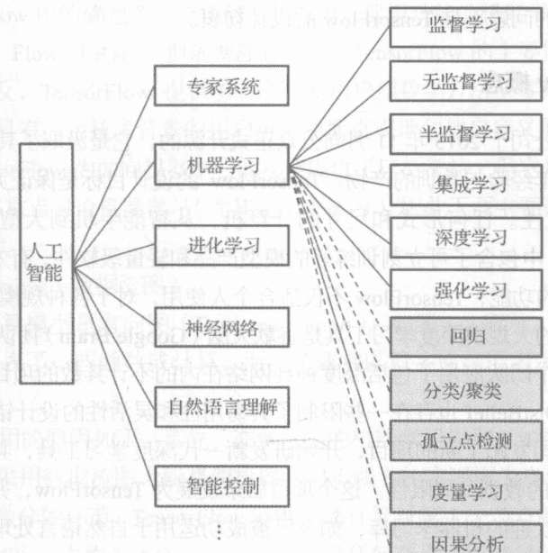

图 1-1

传统算法在指纹识别、Haar人脸检测、HOG物体检测等领域虽达商用门槛，但边际效益递减，进展举步维艰，直至深度学习横空出世打破僵局。

### 3. 深度学习：多层神经网络的范式革命
“深度学习”专指基于多层神经网络的建模过程。此类模型数学表达灵活多变，威力巨大，却长期受限于算力与数据。近年爆发得益于双引擎：海量数据获取成真、通用GPU算力指数级跃升。

其核心优势在于**特征工程自动化**：无需人工猜测输入特征，模型能自动从海量参数中提炼高阶组合，支撑极复杂决策，让机器翻译、人脸识别、自动驾驶、AI作曲等任务成为可能或显著跃升。

虽数学基石早存，但高效编程库近年才涌现。业界长期面临“二选一”困境：灵活易用但运行慢、难量产（利于科研），还是高性能分布式但模型固化、难创新（利于生产）？TensorFlow 的诞生，正是为了终结这种割裂。

## 1.4.2 TensorFlow 概念解析：灵活、高效、可扩展的统一底座

TensorFlow 2015年11月开源，承袭前身 DistBelief 多年实战沉淀。设计基因锁定四大目标：**灵活性、高效性、极致扩展性、跨平台移植性**——从手机端到万卡集群均可无缝运行。内置预训练模型与轻量组件，免除重复造轮子之苦，兼顾个人开发者与各规模企业需求。

### 溯源：从 DistBelief 到 TensorFlow
Google Brain 早期打造 DistBelief，虽支撑无数深度网络项目，但架构固有短板限制易用与灵活。团队复盘教训，重构新一代工具，演变为今日 TensorFlow，开源即爆款，现已成 NLP、CV、预测分析等领域标配利器。

### 1. 官方定义深度拆解
官网首句：*“TensorFlow is an Open Source Software Library for Machine Intelligence.”*  
次句：*“TensorFlow is an open source software library for numerical computation using data flow graphs.”*

#### (1) Open Source（开放生态）
内部孵化，2015年 Apache 2.0 协议开源。代码可自由下载、修改、商用。社区极其活跃，日均接受 Google 与外部贡献者合并改进。严谨地说，开源的是“一个参考实现”，核心接口定义见《白皮书》，内部实现仍由 Google 维护，差异仅因内部基建集成，非刻意保留。开源版功能与内部版对齐，本书“TensorFlow”均指开源实现。

#### (2) Library for Numerical Computation（数值计算底座）
官方未称“机器学习库”，而用“数值计算”这一更宽泛定位。虽内置模仿 Scikit-Learn 的 `learn` (Skflow) 包，但核心使命是提供**从零定义数学模型的函数/类套件**，赋能技术背景用户快速构建高自由度自定义模型。除 ML 外，复杂科学计算亦得心应手。本书聚焦 ML/ DL 实战。

#### (3) Data Flow Graphs（数据流图：计算的通用语言）
计算模型采用**有向图 (DAG)**，节点 = 算子/计算，边 = 张量流动。

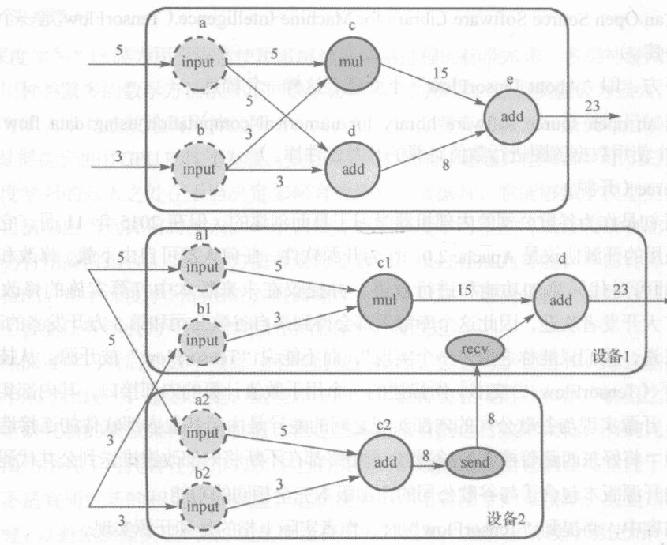

图 1-2

数据流图三大红利：
1.  **天然契合**：神经网络本身即图结构，落地直觉自然。
2.  **自动微分**：将计算拆解为微分原语，自动求任意节点梯度（核心为 Output 节点），这是模型训练的基石。
3.  **原生分布式**：图拆解为子图，轻松调度至多 CPU/GPU/异构设备，配合通信调度逻辑实现并行加速。

> **补充：何为张量？**  
> 本质是 **n 维矩阵**。标量(0阶)、向量(1阶)、矩阵(2阶)、立方体(3阶)……习惯矩阵运算者可直接类比理解。

### 2. 单句定义未覆盖的“杀手级”能力

定义虽信息密度大，但遗漏了 TF 称霸生态的关键拼图：

#### (1) 分布式运行时：规模化训练的标配
设计之初即瞄准多机多卡扩展。0.8 版起内置分布式 Runtime，虽早期 API 笨重但威力巨大。同类库多缺此能力，且与 Kubernetes 等集群管理器原生融合度持续提升。

#### (2) 全家桶软件栈：不仅仅是 API
“TensorFlow” 实指一套协同工具链：
- **核心 API (Python 首选)**：定义模型、训练、导出。C++ 后端保证极致性能，Python 前端极致易用。C++ API 受限，非主流推荐。
- **TensorBoard (可视化利器)**：标准安装即带。埋点后读取事件文件，可视化统计量、训练曲线、图结构，调试神器，**越早用越上瘾、效率越高**。
- **TensorFlow Serving (生产级服务化)**：C++ 编写，高性能 Model Server。支持模型热加载、版本无缝切换（零停机）、**免重写模型代码直推理**。虽知名度最低，却是 TF 区别于竞品、打通“最后一公里”的关键差异化护城河。

唯有打通栈内全链路，方能榨干 TensorFlow 价值。

## 1.4.3 TensorFlow 适用场景：何时该选它？

大多数 ML 任务选 TF 不错，以下场景更是“主场优势”：

- **前沿架构研发/快速迭代**：极致灵活，支撑论文复现、新模型原型搭建、非常规结构探索，摆脱刚性预制模型束缚。
- **训练到部署一体化加速**：配合 TF Serving，模型导出即服务，支撑产品级快速交付。团队缺 C++/Java 重构资源或追求极致迭代速度时，TF 是最优解。
- **复杂 SOTA 模型落地**：掌握计算图阅读与构建技巧后，可将最新论文模型“照单全收”落地，为后续改进提供深度洞见。

## TensorFlow 核心优势速览

- **大规模分布式架构**。面对多样化的硬件环境，TensorFlow 展现了极强的向上扩展能力。它已在谷歌内部众多项目中逐步接替 DistBelief 的位置。随分布式运行版本的推出，基于多台物理服务器或云端虚拟机部署 TensorFlow 的场景将日益增多。

- **移动端与嵌入式部署**。尽管 TensorFlow 侧重“向上扩展”，但在“向下适配”低算力设备上同样表现优异。其灵活性使其能轻松下沉至安卓手机、树莓派等微型单板机运行。代码库内更自带在安卓系统加载预训练模型的示例流程。

TensorFlow 广泛应用于语音识别、图像识别等机器学习与深度学习任务。依据现有文档，其原生支持卷积神经网络（CNN）、递归神经网络（RNN）及 LSTM 等当前图像、语音及自然语言处理领域的主流深度模型。

TensorFlow 以高层抽象表达机器学习计算，大幅精简了第一代系统，同时赋予了更强的灵活性与延展性。其核心亮点在于异构分布式计算支持：模型能自动跨平台运行，覆盖从手机端、单块 CPU/GPU 到成千上万 GPU 卡组成的集群，实现了从掌上设备到万台数据中心服务器的全场景部署。

## 2.1 Python 初识

Python 是一门兼具简洁与强大的编程语言，对编程初学者而言堪称福音。

其成为人工智能领域首选脚本语言，得益于以下核心特质：
1. **上手容易**。相比 C++ 或 Visual Basic 等高度结构化语言，Python 语法极简，开发者能将精力聚焦于解决实际问题，而非陷入语言细节的学习泥沼。
2. **免费开源**。Python 允许自由复制、修改源码及二次开发。其活跃的社区生态持续推动语言迭代，正是开源特性让它得以集成进 TensorFlow 等 AI 核心工具链。
3. **全平台兼容**。原生支持 Windows、macOS、Linux 等主流系统，代码跨平台迁移几乎零成本，这是其用户群体庞大的关键原因。
4. **即写即运**。作为解释型语言，Python 省去了 C++ 等语言强制的编译环节，直接执行源码，极大提升了开发效率与代码可移植性。
5. **面向对象**。Python 以对象交互构建程序而非单纯功能堆砌，符合现代软件工程范式，作为 TensorFlow 的胶水语言实属明智之选。

## 2.2 Python 环境部署

Python 由吉多·范罗苏姆创立，1991 年发布首个版本。虽有大量志愿者共同维护，但创始人至今仍活跃于一线。Python 版本迭代相对克制，却在稳定性与健壮性上达到平衡，既保留字符串、列表、字典等基础构件，又提供元类、生成器、列表推导式等高级特性，满足从入门到进阶的全阶段需求。

**版本选择建议**：本书以 Python 3.x 为基准（官网可免费下载各版本）。Python 2.x 虽仍广泛使用且表现优异，但 3.x 版解决了积年遗留问题，语言核心结构保持一致，更利长远。

**Windows 安装实操**（以 3.5 版为例，书中代码均基于此版本）：
1. 访问官网，点击导航栏 “Downloads” 进入下载页。
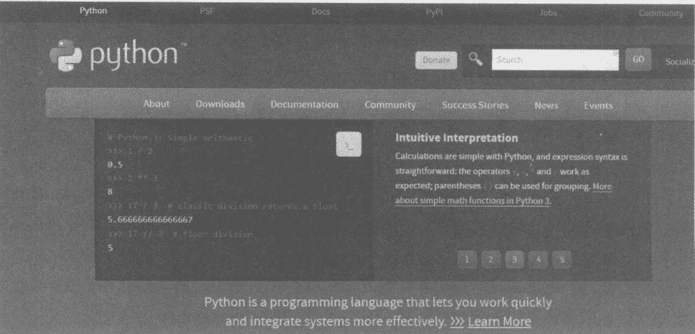
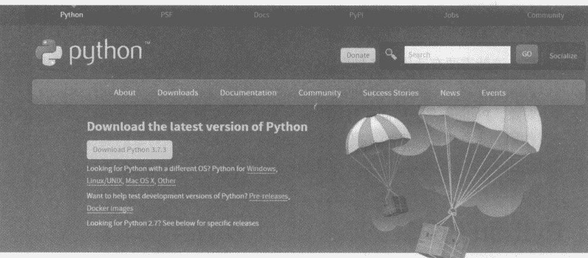
2. 页面默认推荐最新版（如 3.7.1），需手动搜索定位至 3.5 版本下载。其他系统选对应安装包即可。
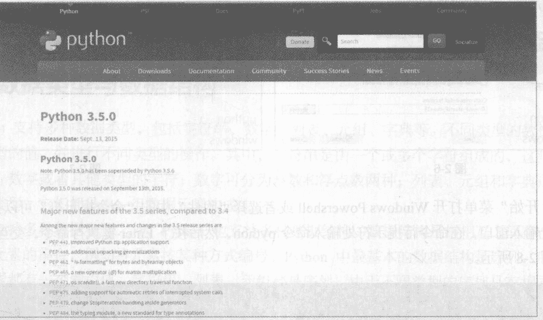
3. 双击安装包启动向导，**关键步骤**：务必勾选底部 “Add Python 3.5 to PATH”（默认未选），并选择 “Customize installation” 进入定制界面。


4. 定制页中必须勾选 **pip**（第三方包管理器，后续安装 TensorFlow 等依赖必需），其余可全选，点 “Next”。
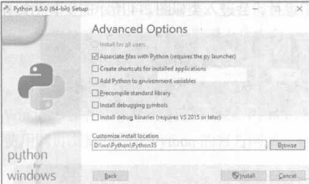
5. 高级选项页：**必选 “Add Python to environment variables”**。建议将默认的深层用户目录改为简短路径（如 `D:\python3`），便于后续管理。确认无误点 “Install” 等待完成。

6. 安装成功提示界面点 “Close” 退出。
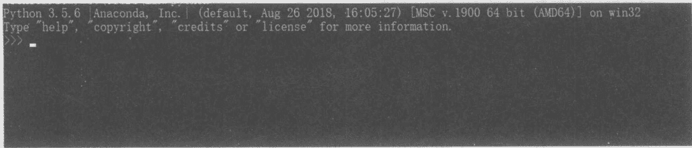

**安装验证**：
打开 PowerShell 或 CMD，输入 `python` 回车。若出现版本信息及 `>>>` 提示符，即进入交互式环境，安装成功。
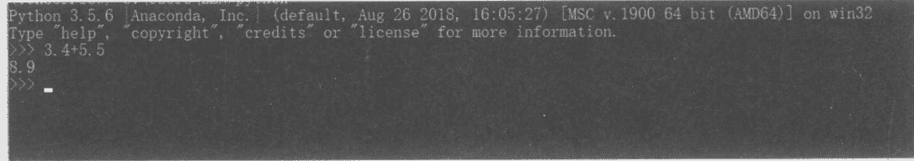
测试算式 `3.4 + 5.5` 验证计算功能。
```
>>> x = 17
```
输入 `quit()` 退回系统命令行。

**文档与资源**：
官网提供各版本对应的 PDF/HTML/TXT 文档（如 Library Reference 超千页），无需通读，按需检索即可。官网另汇聚了 “Beginner's Guide” 等海量教程，社区资源极其丰富。

## 2.3 数据类型与结构体系

Python 内置丰富类型：**字符串**（字符序列）、**数字**（整/浮点）、**列表**、**元组**、**字典**（均为数据元素集合，结构各异）。

核心数据结构为 **序列**（字符串、列表、元组均属此类），特点是元素带索引编号，故可对不同序列类型施用统一操作（切片、索引等），后文将详述。

**可变性区分**：
- **不可变**：字符串、数字、元组 —— 创建后内容不可原地修改。
- **可变**：列表、字典 —— 可随增删改元素。

## 2.4 数值运算详解

Python 数字分 **整数**（无小数部，如 `1`, `-34`）与 **浮点数**（含小数部，如 `1.0`, `-34.8307`）。虽同属数值类型，但行为差异大，区分至关重要。

核心运算符规律如下：

| 运算符 | 含义 | 整数示例 | 结果 | 浮点数示例 | 结果 |
| :--- | :--- | :--- | :--- | :--- | :--- |
| `*` | 乘法 | `9*2` | `18` | `9*2.0` | `18.0` |
| `/` | 除法 | `9/2` | `4.5` | `9/2.0` | `4.5` |
| `%` | 取模 | `9%2` | `1` | `9%2.0` | `1.0` |
| `+` | 加法 | `9+2` | `11` | `9+2.0` | `11.0` |
| `-` | 减法 | `9-2` | `7` | `9-2.0` | `7.0` |

*注：Python 3 中除法 `/` 永远返回浮点数。*

## 2.5 变量机制与命名规范

变量是存储信息的标签。**赋值语句**建立变量名与值的绑定，如 `x = 17`。变量必须先赋值后使用。
```
>>> x = 17
```
```
>>> x = 17
>>> x * 2
34
```

**动态类型特性**：无需像 C++/VBA 那样预先声明类型。类型在赋值瞬间隐式确定（`x=17` 为整型，`x=17.629` 为浮点型，`x="GIS"` 为字符串），且可随时重新赋值改变类型，极度简洁高效。

**命名硬性规则**：
- 仅限字母、数字、下划线组合。
- **不能数字开头**（`var1` 合法，`1var` 非法）。
- **禁用关键字**（`print`, `import` 等）。

**命名最佳实践**：
1. **见名知意**：`count` 优于 `c`。
2. **遵循 PEP 8**：全小写、下划线分词（`user_name`），避免首字符下划线（有特殊含义），长度适中（拒绝 `number_of_cells_in_a_raster_dataset` 这类冗长命名，易错且降低可读性）。
3. **同行多赋值**：`a = b = c = 1` 等价于分行赋值，代码更紧凑。
```
>>> x, y, z = 1, 2, 3
```
```
>>> x = 1
>>> y = 2
>>> z = 3
```

## 2.6 语句与表达式的本质区分

- **表达式**：代表一个**值**。如 `2 * 17` 即值 `34`。由运算符、操作数或变量组成，可嵌套。交互模式下自动回显结果。
```
>>> 2 * 17
34
```
- **语句**：代表一条**指令**。如赋值 `x = 2 * 17`、打印 `print()`、导入 `import`。语句本身无返回值，执行动作不产出数据。
```
>>> x = 2 * 17
```
因此交互模式下执行赋值语句无回显，需配合 `print` 输出变量值。
```
>>> x = 2 * 17
>>> print(x)
```
```
34
```

赋值语句的核心价值：引入符号引用，让逻辑处理脱离具体数值，提升代码抽象层级与维护性。

## 2.7 字符串操作指南

字符串是引号包裹的文本序列。单双引号功能等效，互为转义提供灵活性（如双引号内可直接用单引号）。
```
>>> print("I said: 'let's go!")
```

**核心操作**：
- **拼接**：用 `+` 连接字符串。
```
>>> x = "T"
>>> y = "O"
>>> z = "M"
>>> print (x + y + z)
```
```
TOM
```
- **插入空格**：在拼接中加入 `" "` 实现单词间隔。
```
>>> x = "I"
>>> y = "love"
>>> z = "Python"
>>> print (x + "" + y + "" + z)
```
输出：`I love Python`
- **多行文本**：三引号 `"""` 包裹，内部可随意混用单双引号，保留换行格式。
```
>>> str = '''this is string
... this is python string
... this is string'''
>>> print(str)
```
输出：
```
this is string
```

# 玩转 Python 核心容器：列表、元组与字典实战指南

在 Python 编程中，单一变量往往难以应对复杂业务，这就轮到“容器”类数据类型登场了。它们像仓库一样，能批量存储、管理数据。本文将带你速通列表、元组、字典的核心用法，最后揭秘一个极易踩坑的“引用机制”。

---

## 字符串与数字的“拼接”陷阱

先热个身。字符串里夹带数字很常见，但直接用 `+` 拼接数字变量会直接报错 `TypeError`。解套路只有一个：显式调用 `str()` 把数字“变身”字符串，这叫**类型转换**。

```
>>> temp = 32
>>> print("The temperature is " + temp + "degrees.")
```

修正后的正确姿势：

```
>>> temp = 32
>>> print ("The temperature is " + str(temp) + " degrees")
```

运行结果如下：

The temperature is 32 degrees

> **小贴士**：`+` 只是连接字符串的一种手段，后文还会解锁更高效的玩法。

---

## 一、列表：有序、可变、最百搭

列表用 `[]` 定义，元素用逗号分隔，支持混装数字、字符串甚至其他列表。它是**有序**集合，意味着元素顺序固定，可通过索引精准定位。

### 1. 快速创建与打印

手动初始化示例：

```
>>> mylist = [1, 2, 4, 8, 16, 32, 64]
```

元素间加不加空格不影响运行，但加上（如 `, `）能大幅提升代码阅读体验。当然，列表不只能装数字：

```
>>> mywords = ["jpg", "bmp", "tif", "img"]
```

直接 `print` 输出，顺序原封不动保留：

```
>>> print (mywords)
['jpg', 'bmp', 'tif', 'img']
```

### 2. 核心操作：索引、切片、增删改查

假设有这样一个城市列表：

```
>>> cities = ["Beijing", "Shanghai", "Guangzhou", "Hangzhou", "Haikou"]
```

**定位单元素**  
索引从 0 起步，负数从 -1 开始倒数。想拿第 2 个？`cities[1]`。想拿最后一个？`cities[-1]` 最省事，无需知晓长度。

```
>>> cities[1]
'Shanghai'
```
```
>>> cities[-1]
'Haikou'
```

倒数第 2 个同理：

```
>>> cities[-2]
'Hangzhou'
```

**切片：切出子列表**  
语法 `list[start:end]`，含头不含尾。`cities[2:4]` 取索引 2、3 两项。注意：单索引返回元素，切片返回**新列表**。

```
>>> cities[2:4]
['Guangzhou', 'Hangzhou']
```

省略索引默认头尾全包：

```
>>> cities[2:]
['Guangzhou', 'Hangzhou', 'Haikou']
```
```
>>> cities[:2]
['Beijing', 'Shanghai']
```

**成员检测**  
用 `in` / `not in` 判断元素是否存在，返回布尔值：

```
>>> cities = ["Beijing", "Shanghai", "Guangzhou", "Hangzhou", "Haikou"]
>>> "Shanghai" in cities
True
>>> "Zhejiang" in cities
False
```

**删除元素**  
`del list[index]` 按位置干掉：

```
>>> cities = ["Beijing", "Shanghai", "Guangzhou", "Hangzhou", "Haikou"]
>>> del cities[2]
>>> cities
['Beijing', 'Shanghai', 'Hangzhou', 'Haikou']
```

**常用方法速查表**  

| 方法 | 作用 | 示例场景 |
| :--- | :--- | :--- |
| `len(list)` | 统计元素总数 | ```
>>> cities = ["Beijing", "Shanghai", "Guangzhou", "Hangzhou", "Haikou"]
>>> print (len(cities))
5
``` |
| `list.sort()` | 原地升序排列；`reverse=True` 降序 | ```
>>> cities.sort()
>>> print(cities)
['Beijing', 'Guangzhou', 'Haikou', 'Hangzhou', 'Shanghai']
>>> cities.sort(reverse = True)
>>> print(cities)
['Shanghai', 'Hangzhou', 'Haikou', 'Guangzhou', 'Beijing']
``` |
| `list.append(x)` | 尾部追加单个元素 | ```
>>> cities = ["Beijing", "Shanghai", "Guangzhou", "Hangzhou", "Haikou"]
>>> cities.append("Chengdu")
>>> cities
['Beijing', 'Guangzhou', 'Haikou', 'Hangzhou', 'Shanghai', 'Chengdu']
``` |
| `list.count(x)` | 统计 x 出现次数 | ```
>>> yesno = ["True", "True", "False", "True", "False"]
>>> yesno.count("True")
3
``` |
| `list.extend(iterable)` | 批量合并可迭代对象 | ```
>>> list1 = [1, 2, 3, 4]
>>> list2 = [11, 12, 13, 14]
>>> list1.extend(list2)
>>> list1
[1, 2, 3, 4, 11, 12, 13, 14]
``` |
| `list.index(x)` | 返回 x 首次出现的索引 | ```
>>> mylist = ["The", "quick", "fox", "jump", "over", "the", "lazy", "dog"]
>>> mylist.index("the")
5
``` |
| `list.insert(i, x)` | 指定位置 i 插入 x | ```
>>> cities = ["Beijing", "Guangzhou", "Hangzhou", "Haikou"]
>>> cities.insert(1, "Shanghai")
>>> cities
['Beijing', 'Shanghai', 'Guangzhou', 'Hangzhou', 'Haikou']
``` |
| `list.pop(i)` | 删除并返回索引 i 处元素（默认末尾） | ```
>>> cities = ["Beijing", "Shanghai", "Guangzhou", "Hangzhou", "Haikou"]
>>> cities.pop(3)
'Hangzhou'
>>> cities
['Beijing', 'Shanghai', 'Guangzhou', 'Haikou']
``` |
| `list.remove(x)` | 删除首个值为 x 的元素 | ```
>>> numbers = [1, 0, 1, 0, 1, 0, 1, 0, 1, 0]
>>> numbers.remove(0)
>>> numbers
[1, 1, 0, 1, 0, 1, 0, 1, 0]
``` |

> 列表方法远不止这些，实战中多查官方文档，用到再学最高效。

---

## 二、元组：列表的“只读版”兄弟

元组用 `()` 定义（也可省略括号，仅用逗号分隔），核心特征：**不可变**。没有 `append`、`extend`、`insert`，元素不可增删改。除此以外，索引、切片、`in` 检测、连接、重复等操作与列表通用。

创建元组的两种等价写法：

```
>>> t = ('a', 'b', 'c')
>>> print(t)
('a', 'b', 'c')
>>> t = 'a', 'b', 'c'
>>> print(t)
('a', 'b', 'c')
```

打印时解释器统一显示带括号形式，内部存储一致。

---

## 三、字典：键值映射，查找极快

列表靠“位置”找值，字典靠“键”找值。它是**无序**的键值对集合，底层哈希表实现，查找、插入、删除平均 O(1)。

### 1. 从“手写函数”到字典字面量

把英语映射成西班牙语，用函数写死逻辑太笨重：

```
>>> def translate(color):
...     if color == "red":
...         return "rojo"
...     elif color == "blue":
...         return "azul"
...     elif color == "green":
...         return "verde"
...     elif color =="white":
...         return "blanco"
```

字典一行搞定，键唯一且不可变（字符串、数字、元组），值任意类型：

```
>>> translate = {"red":"rojo", "blue":"azul", "green":"verde", "white":"blanco"}
```

随后 `translate["red"]` 直接命中 `"rojo"`，4 组键值对即 4 个元素。

### 2. 实战片段

嵌套字典、动态查询、混合键类型：

```
>>> bob = {"firstName":"Robert", "lastName":"Smith", "age":19}
```

### 3. 字典操作大全（对标表 2-2）

| 操作 | 说明 |
| :--- | :--- |
| `len(d)` | 键值对总数 |
| `k in d` | 键存在性检测 |
| `d[k] = v` | 赋值/新增（键存在则覆盖） |
| `d[k]` | 取值（键不在抛 KeyError） |
| `d.get(k, default)` | 安全取值，缺键返回默认值 |
| `list(d.keys())` / `list(d.values())` / `list(d.items())` | 导出键/值/键值对列表 |
| `list(d)` / `tuple(d)` / `set(d)` | 快速转键列表/元组/集合 |
| `del d[k]` | 删键（缺键报错） |
| `d.clear()` | 清空字典 |
| `d.update(other)` | 合并字典，同键以 other 为准 |
| `max(d)` / `min(d)` | 键的最大/最小值（键类型需一致） |
| `for k in d:` | 遍历键 |
| `c = {}` / `c = dict(d)` | 创建空字典 / 浅拷贝 |

字典极其灵活，建议边用边查，肌肉记忆比死记硬背强。

---

## 四、避坑指南：赋值 ≠ 复制，这是“引用”

Python 变量存的是**对象引用**而非对象本身。赋值 `a = b` 只是让两个变量指向同一块内存，称为**对象克隆/别名**。这对大列表赋值极快，但带来副作用：任一变量修改内容，另一个“同步”变脏。

实例演示：

```
>>> songs = ["Because", "Boys", "Carol"]
>>> beatles = songs
>>> beatles, songs
(['Because', 'Boys', 'Carol'], ['Because', 'Boys', 'Carol'])
```

`songs` 与 `beatles` 指向同一列表对象。修改 `beatles`：

```
>>> beatles[2] = "Cayenne"
>>> beatles, songs
(['Because', 'Boys', 'Cayenne'], ['Because', 'Boys', 'Cayenne'])
```

`songs` 也跟着变了！这正是可变对象作为函数参数传递时的默认行为——函数内修改实参生效，无需返回值，节省内存又高效。**但若需独立副本，请显式用 `list.copy()`、`[:]` 或 `copy.deepcopy()`。**

---

掌握容器操作与引用机制，是写出高效、健壮 Python 代码的基石。建议收藏对照练手，下期见！

# 深拷贝 vs 浅拷贝：避开 Python 可变对象的坑

不过，实际开发中我们经常面临一个需求：如何获取一个组合类型数据（或其他可变对象）完全独立的副本？针对序列类型，切片操作（如 `songs[2:]`）天然返回的是片段的副本。因此，若想复制整个序列而非仅创建引用，切片大法 `序列[:]` 是个现成的捷径。

```
>>> songs = ["Because", "Boys", "Carol"]
>>> beatles = songs[:]
>>> beatles[2] = "Cayenne"
>>> beatles, songs
(['Because', 'Boys', 'Cayenne'], ['Because', 'Boys', 'Carol'])
```

字典和集合则自带 `copy()` 方法，调用 `dict.copy()` 或 `set.copy()` 即可。此外，标准库 `copy` 模块提供了通用的 `copy.copy()` 函数，能对任意指定对象生成副本。还有一种更“Pythonic”的写法：直接用类型构造器，如 `list(旧列表)`、`dict(旧字典)`，同样能完成复制。

```
copy_of_dict_d = dict(d)
copy_of_list_L = list(L)
copy_of_set_s = set(s)
```

**关键提醒：上述全是“浅复制”。** 它们复制的仅是对象引用，而非对象实体。对于数字、字符串等不可变类型，这等同于值复制（且效率更高）；但一旦涉及列表嵌套列表、字典套列表这类可变嵌套结构，麻烦就来了——原对象与副子将共享同一块内存地址指向的嵌套对象。

```
>>> x = [53, 68, ["A", "B", "C"]]
>>> y = x[:] #shallow copy
>>> x, y
([53, 68, ['A', 'B', 'C']], [53, 68, ['A', 'B', 'C']])
>>> y[1] = 40
>>> x[2][0] = "Q"
>>> x, y
([53, 68, ['Q', 'B', 'C']], [53, 40, ['Q', 'B', 'C']])
```

举个栗子：对列表浅复制时，嵌套的 `["A", "B", "C"]` 只是引用被复制了。这意味着原列表 `x` 和新列表 `y` 的第 3 项都指向同一个列表对象。此时，若修改这个嵌套列表，`x` 和 `y` 都会“同步”变化。若必须让嵌套层级也彻底独立，就得祭出**深复制**（`copy.deepcopy()`）。

```
>>> import copy
>>> x = [53, 68, ["A", "B", "C"]]
>>> y = copy.deepcopy(x)
>>> y[1] = 40
>>> x[2][0] = 'Q'
>>> x, y
([53, 68, ['Q', 'B', 'C']], [53, 40, ['A', 'B', 'C']])
```

深复制后，列表 `x` 与 `y` 及其内部所有嵌套项，在内存中互不相干，彻底实现物理隔离。

## 2.9 函数

函数本质上是封装特定任务的代码块，可视作一个微型程序。Python 内置了一批核心函数（内置函数），无需导入即可随处调用。以 `pow` 为例：

```
>>> pow(2, 3)
8
```

它计算 2 的 3 次幂得 8，这个过程叫**函数调用**。调用时传入实参（此处为 2 和 3），函数执行完毕返回结果。因为有返回值，函数调用本身也是一种表达式。

初次使用某函数前，建议先查阅其文档语法。利用 `help()` 语句即可获取详细说明。

```
>>> print(help(pow))
```

虽非强制，但配合 `print` 输出帮助信息，可读性更强。我们来看下 `pow` 的文档长啥样：

```
pow(x, y, z=None, /)
Equivalent to x**y (with two arguments) or x**y % z (with three arguments)

Some types, such as ints, are able to use a more efficient algorithm when
invoked using the three argument form.
```

留意参数签名 `pow(x, y[, z])`：前两个参数 `x`、`y` 必填，方括号内的 `z` 为可选参数。文档中的 `**` 运算符即幂运算。

## 2.9.1 常用内置函数与高阶函数精讲

除了前文示例，Python 还内置了大量工具函数。想全览清单？除翻阅官方手册，交互模式下执行 `dir(__builtins__)` 也能直接列出（注意前后各两个下划线）。

```
>>> dir('__builtins__')
```

```
['__add__', '__class__', '__contains__', '__delattr__', '__dir__', '__doc__', '__eq__', '__format__', '__ge__', '__getattribute__', '__getitem__', '__getnewargs__', '__gt__', '__hash__', '__init__', '__init_subclass__', '__iter__', '__le__', '__len__', '__lt__', '__mod__', '__mul__', '__ne__', '__new__', '__reduce__', '__reduce_ex__', '__repr__', '__rmod__', '__rmul__', '__setattr__', '__sizeof__', '__str__', '__subclasshook__', 'capitalize', 'casefold', 'center', 'count', 'encode', 'endswith', 'expandtabs', 'find', 'format', 'format_map', 'index', 'isalnum', 'isalpha', 'isascii', 'isdecimal', 'isdigit', 'isidentifier', 'islower', 'isnumeric', 'isprintable', 'isspace', 'istitle', 'isupper', 'join', 'ljust', 'lower', 'lstrip', 'maketrans', 'partition', 'replace', 'rfind', 'rindex', 'rjust', 'rpartition', 'rsplit', 'rstrip', 'split', 'splitlines', 'startswith', 'strip', 'swapcase', 'title', 'translate', 'upper', 'zfill']
```

鉴于数量庞大，下文重点梳理高频常用者，按功能分类速查：

### 1. 数学运算相关

| 函数 | 核心作用 |
| :--- | :--- |
| `abs(x)` | 绝对值/复数模 |
| `complex([real[, imag]])` | 构建复数 |
| `divmod(a, b)` | 同时获取商与余数（支持整/浮点） |
| `float([x])` | 转浮点数（无参返回 0.0） |
| `int([x[, base]])` | 转整型，`base` 指定进制 |
| `long([x[, base]])` | 转长整型（Py2 特有，Py3 合并至 int） |
| `pow(x, y[, z])` | 幂运算，可选第三参数取模 |
| `range([start], stop[, step])` | 生成整数序列（默认从 0 起） |
| `round(x[, n])` | 四舍五入保留 n 位小数 |
| `sum(iterable[, start])` | 可迭代对象求和 |
| `oct(x)` / `hex(x)` / `bin(x)` | 转 8/16/2 进制字符串 |
| `chr(i)` | 整数转对应 ASCII 字符 |
| `bool([x])` | 转布尔值 |

### 2. 集合与序列操作

| 函数 | 核心作用 |
| :--- | :--- |
| `basestring()` | `str` 与 `unicode` 基类（Py2），用于 `isinstance` 判断 |
| `format(value[, format_spec])` | 格式化字符串输出 |
| `unichr(i)` | 整数转 Unicode 字符（Py2） |
| `enumerate(sequence[, start=0])` | 生成枚举对象，`next()` 返回 `(索引, 值)` 元组 |
| `max(iterable[, args...][, key])` | 返回最大值，支持 `key` 自定义比较 |

### 3. 逻辑判断

| 函数 | 核心作用 |
| :--- | :--- |
| `all(iterable)` | 全真则真（空可迭代对象返回 True） |
| `any(iterable)` | 存在真则真（空可迭代对象返回 False） |
| `cmp(x, y)` | 比较大小：x<y 返回负，相等 0，x>y 返回正（Py3 移除，改用 `(x>y)-(x<y)`） |

### 4. I/O 操作

| 函数 | 核心作用 |
| :--- | :--- |
| `file(filename[, mode[, bufsize]])` | 创建文件对象，`open()` 别名。`bufsize`：0 无缓冲，1 行缓冲，>1 指定缓冲区 |
| `input([prompt])` | 获取用户输入（Py3 视同 `raw_input`） |
| `open(name[, mode[, buffering]])` | 打开文件，功能同 `file` |
| `print` | 标准输出打印 |
| `raw_input([prompt])` | 读取字符串输入（Py2 推荐，避免 `input` 安全隐患） |

### 5. 进阶工具函数

| 函数 | 核心作用 |
| :--- | :--- |
| `callable(object)` | 判断对象可否调用（类可调用；实例需定义 `__call__` 才可调用） |
| `dir([object])` | 无参列出当前作用域名字；有参列出对象属性/方法（优先调用 `__dir__`） |
| `filter(function, sequence)` | 筛选序列中使函数返回 True 的项。`function=None` 时筛选真值。保持输入类型（元组/字符串返回同类型，否则返列表） |
| `id(object)` | 返回对象唯一身份标识（内存地址） |
| `isinstance(object, classinfo)` | 判断对象是否为类/元组类的实例 |
| `len(s)` | 返回容器长度 |
| `map(function, sequence[, ...])` | 将函数依次作用于各序列元素，返回新序列（Py3 返回迭代器） |
| `reduce(function, iterable[, initializer])` | 累积计算：前两项算，结果与第三项算，以此类推（Py3 需 `from functools import reduce`） |
| `type(object)` | 返回对象类型 |
| `vars([object])` | 返回对象 `__dict__`，无参等同 `locals()` |
| `zip(*iterables)` | 并行打包迭代器，最短决定长度 |
| `help([object])` | 查看帮助文档 |

### 6. 高阶函数：函数作为“一等公民”

满足以下任一特征即为高阶函数：
1.  接受函数作为参数；
2.  返回函数作为结果。

示例速览：`calc` 函数直接作为实参传给 `print`。

```
>>> sum = lambda x,y:x+y
>>> sub = lambda x,y:x-y
>>> calc_dict = {"+":sum, "-":sub}
>>> def calc(x):
...     return calc_dict[x]
...
>>> print(calc('-')(5,6))
-1
>>> print(calc('+')(5,6))
11
```

下面重点拆解三大内置高阶函数：

#### (1) `map()`：批量数据转换器
**签名**：`map(function, iterable, ...)`
**机制**：将 `function` 依次应用到每个 `iterable` 元素上。
**用途**：序列整体转型，只需传入转换函数。元素类型不限，只要函数能处理即可。

```
>>> def f(x):

... return x*x
...
>>> print(list(map(f, [1, 2, 3, 4, 5, 6, 7, 8, 9])))
[1, 4, 9, 16, 25, 36, 49, 64, 81]

此例中对列表[1,2,3,4,5,6,7,8,9]中每个元素进行了 x*x 的处理。

注：在 Python 3 中，map()生成的是迭代器不是 list，你可以在 map 前加上 list，即 list(map())。

### (2) reduce()函数

参数：一个函数 function，一个 sequence；还可以接收第 3 个可选参数，作为计算的初始值。
返回值：reduce()传入的函数 function 必须接收两个参数，reduce()对 sequence 的每个元素反复调用函数 function，并返回最终结果值。如下例所示。

```

#### (2) `reduce()`：归约聚合器
**签名**：`reduce(function, iterable[, initializer])`
**机制**：双参数函数 `function` 从左至右累积处理序列项。若提供 `initializer`，作为首次计算的左参数。

```

此例中实现了((((10+1)+3)+5)+7)+9)=35 的计算。

注： reduce 函数在 Python 3 的内建函数中移除了，放入了 functools 模块，因此使用时需要加上 from functools import reduce 引用。

### (3) filter()函数

参数：一个函数 function 和一个 sequence，这个函数 function 的作用是对每个元素进行判断，返回 True 或 False。
返回值：根据判断 function 的结果自动过滤掉不符合条件的元素，返回由符合条件元素组成的新 sequence。如下例所示。

```

#### (3) `filter()`：筛选过滤器
**签名**：`filter(function, iterable)`
**机制**：保留使 `function(item)` 为 True 的项。`function=None` 时自动过滤假值。

```

此例从一个列表[1, 4, 6, 7, 9, 12, 17]中删除偶数，保留奇数。

注：和 map 函数一样，在 Python 3 中，filter()生成的是迭代器不是 list，你可以在 filter 前加上 list，即 list(filter())。

## 2.9.2 用户自定义函数

Python 中除了内置函数外，也可以创建新的函数。
创建自定义函数可以减少代码量并提高效率。自定义函数被组织在模块中，而这些模块则构成了站点包。通过创建自定义函数，可以将代码分成不同的单元，并复用其中经常用到的函数。一旦自定义函数创建成功后，用户就可以在需要的时候调用它。通过这种方式，可以提高编码效率，因为不用再重复编写执行同样功能的代码。

有两种类型的函数：一种设计成返回值，一种仅执行代码而不返回值。它们接收输入，处理输入，并产生输出。Python 函数通过 def 语句进行定义，def 语句的语法如下。

```

---

### 附：函数定义语法速记

```python
def functionName(参数1, 参数2, ...):
    缩进的函数体语句块
```

# Python 时间处理实战：从时间戳到格式化输出全攻略

在 Python 开发中，处理日期与时间是绕不开的基本功。标准库 `time` 模块提供了底层的时间操作能力，核心围绕**时间戳**、**结构化时间元组** 与 **格式化字符串** 三种形态展开。今天我们就通过实战代码，梳理这套转换体系的核心用法。

---

### 一、 初识时间戳与结构化时间

时间戳（Timestamp）是从 1970 年 1 月 1 日（UTC）至今的浮点秒数，便于计算与存储；而 `struct_time` 元组则拆解出年、月、日等可读字段，便于展示与逻辑判断。

**1. 获取本地结构化时间**
调用 `time.localtime()` 不传参时，默认返回当前时区的时间元组：

```

其中 part1、part2 是变量（称为参数），表达式计算任何类型的字面值（注意：def 是 define 的缩写）。函数头必须以冒号（:）结束，并且函数头下面代码块中的每条语句都要缩进相同数量的空格（通常为 4 个空格）。缩进划定了函数体的范围。通常函数体内有多条 return 语句。在这种情况下，一旦第 1 个 return 语句得到了执行，函数将立即终止。Return 语句可以出现在函数体中的任何位置。

函数有 3 种方式将实际参数传递给形式参数：按照位置传递参数、按照关键字传递参数和按照默认值传递参数。当实际参数是按照位置进行传递时，调用语句中的实际参数与函数头中的形式参数按照顺序一一对应。也就是说，第 1 个实际参数传递给第 1 个形式参数，第 2 个实际参数传递给第 2 个形式参数，依次类推。

注意：当实际参数是一个表达式时，先要计算表达式，然后将它的值传递给形式参数。在函数定义中，形式参数和 return 语句都是可选的。其中，没有 return 语句的函数为无返回值函数。

函数命名应该能够描述函数所扮演的角色，而且必须符合变量命名的规则。

## 2.10 常用库

Python 标准库通常被描述为“自带的电池”，自然地提供了广泛的功能，涵盖了大概 200 个左右的包与模块。

事实上，近年来大量可用于 Python 的高质量模块被开发出来，如果将所有这些模块都包含在标准库中可能会使得 Python 发布包大小提高至少一个数量级。因此，标准库中的那些模块在更多的意义上是对 Python 历史及其核心开发人员兴趣的一种折射，而不是表示要系统化地去创建一个“均衡的”标准库。并且，有些模块已经被证实放置在标准库中极难维护——最著名的就是 Berkeley DB 模块，因此已被清理出标准库，并进行单独维护。这意味着，Python 有很多可用的、优秀的第 3 方模块，尽管这些模块有很高的质量，并且很有用，但仍不在标准库中。

本节介绍一些 Python 的常用标准库。

### 2.10.1 时间库

- 1. 时间库简介

在我们平常的代码中，经常需要和时间打交道。在 Python 中，与时间处理相关的模块有 time、datetime 以及 calendar。学会计算时间，对程序的调优非常重要，可以在程序中使用时间戳来具体判断程序中哪一块耗时最多，从而找到程序调优的重心处。Python 的时间库可以通过标准库中的 time 模块实现。Time 模块提供了一些用于管理日期和时间的 C 库函数。由于它绑定到底层 C 实现，一些细节（如纪元开始时间和支持的最大日期值）会特定于具体的平台。在开始前，先说明以下几点。

- （1）在 Python 中，通常有这几种方式表示时间：时间戳、格式化的时间字符串、元组。由于 Python 的 time 模块主要是调用 C 库实现的，所以在不同的平台可能会有所不同。
- （2）时间戳（timestamp）的方式：时间戳表示是从 1970 年 1 月 1 日 00:00:00 开始到现在按秒计算的偏移量。查看 type(time.time())的返回值类型，可以看出它是浮点数类型。返回时间戳的函数主要有 time()、clock()等。
- (3) UTC（世界协调时），就是格林尼治天文时间，也是世界标准时间。在中国为 UTC+8，DST 夏令时。
- (4) 元组方式：struct_time 元组共有 9 个元素，表 2-8 列出了 struct_time 元组的属性。返回 struct_time 的函数主要有 gmtime()、localtime()和 strptime()。

```python

>>> import time

>>> ls = time.localtime()

>>> ls

time.struct_time(tm_year=2018, tm_mon=11, tm_mday=3, tm_hour=17, tm_min=13, tm_sec=58,

tm_wday=5, tm_yday=307, tm_isdst=0)

**2. 灵活提取字段值**
该元组既支持下标索引，也支持属性名访问，后者代码可读性更强：

```

### 表 2-8

| 序号 | 属性 | 解释 |
| :--- | :--- | :--- |
| 0 | tm_year | 年 |
| 1 | tm_mon | 月（1~12） |
| 2 | tm_mday | 日（1~31） |
| 3 | tm_hour | 时（0~23） |
| 4 | tm_min | 分（0~59） |
| 5 | tm_sec | 秒（0~59） |
| 6 | tm_wday | 星期几（0~6，0 表示星期日） |
| 7 | tm_yday | 一年中的第几天（1~366） |
| 8 | tm_isdst | 是否是夏令时（默认为-1） |

可以直接使用元组索引获取对应项的值，如下例所示。

```python

>>> ls[0]

2018

>>> ls[1]

11

```

或者是使用成员符号调用，如下例所示。

```python

>>> ls.tm_year

2018

---

### 二、 时间戳与本地时间的互转

**1. 获取当前时间戳**
`time.time()` 直接给出浮点型秒数：

```

### Time 模块中常用的函数

使用该模块中的函数时，必须先引入该模块（import time）。

### (1) time.time()

time.time()函数返回当前时间的时间戳，它会把从纪元开始以来的秒数作为一个浮点值返回，如下例所示。

```python

>>> import time

>>> print('the time is', time.time())

the time is 1541236568.9465246

**2. 时间戳 → 本地结构化时间**
`localtime()` 接受时间戳参数，能将历史时刻还原为本地时间元组。注意：不传参等同于 `localtime(time())`。

```

尽管这个值总是一个浮点数，但具体的精度依赖于具体的平台。

浮点数表示对于存储或比较日期很有用，但是可读性有些差强人意。

### (2) time.localtime([secs])

time.localtime()函数将一个时间戳转换为当前时区的 struct_time，即时间数组格式的时间。

参数 secs: 转换为 time.struct_time 类型对象的秒数，如果 secs 参数未提供，则以当前时间为准（即会默认调用 time.time()）。

```python

>>> time.localtime()

time.struct_time(tm_year=2018, tm_mon=11, tm_mday=3, tm_hour=17, tm_min=16, tm_sec=59,

tm_wday=5, tm_yday=307, tm_isdst=0)

>>> time.localtime(1541236568.9465246)

time.struct_time(tm_year=2018, tm_mon=11, tm_mday=3, tm_hour=17, tm_min=16, tm_sec=8,

tm_wday=5, tm_yday=307, tm_isdst=0)

**3. 本地结构化时间 → 时间戳**
`time.mktime()` 专门将本地 `struct_time` 转回时间戳，常用于日期运算后的持久化：

```

### (4) time.mktime(t)

time.mktime()函数执行与 gmtime()、localtime()相反的操作，它接收 struct_time 对象作为参数，将一个 struct_time 转化为时间戳，返回用秒数表示时间的浮点数。如果输入的值不是一个合法的时间，将触发 OverflowError 或 ValueError。

参数 t: 结构化的时间或者完整的 9 个元素。

```python

>>> time.mktime(time.localtime())

1541236831.0

---

### 三、 协调世界时（UTC）转换

涉及跨时区业务时，`gmtime()` 是关键。它基于 UTC+0 输出结构化时间，不受本地时区设置影响。

**对比演示：同一时间戳在本地与 UTC 的差异**

```

### (3) time.gmtime([secs])

time.gmtime()函数将一个时间戳转换为 UTC 时区（0 时区）的 struct_time，可选的参数 secs 表示从 1970-1-1 00:00:00 以来的秒数。其默认值为 time.time()，函数返回 time.struct_time 类型的对象。

参数 secs: 转换为 time.struct_time 类型对象的秒数。如果 secs 参数未提供，则以当前时间为准。

```python

>>> time.gmtime()

time.struct_time(tm_year=2018, tm_mon=11, tm_mday=3, tm_hour=9, tm_min=19, tm_sec=10,

tm_wday=5, tm_yday=307, tm_isdst=0)

>>> time.gmtime(1541236568.9465246)

time.struct_time(tm_year=2018, tm_mon=11, tm_mday=3, tm_hour=9, tm_min=16, tm_sec=8,

tm_wday=5, tm_yday=307, tm_isdst=0)

> **提示**：示例中本地时间（17:16）比 UTC 时间（09:16）早 8 小时，符合东八区（UTC+8）特征。

---

### 四、 程序暂停与性能计时

**1. 阻塞延迟：`time.sleep(seconds)`**
线程挂起指定秒数，适用于爬虫礼让、重试间隔等场景：

```

### (5) time.sleep(secs)

time.sleep(secs)函数返回线程推迟指定的时间运行，即线程睡眠指定时间，单位为秒。调用 time.sleep()会从当前线程交出控制，要求它等待系统将其再次唤醒。如果程序只有一个线程，就会阻塞应用，什么也不做。

```python

>>> time.sleep(10)

**2. 计时器选型避坑指南**
旧版 `time.clock()` 已在 Python 3.3+ 弃用，3.8 移除。现代代码请根据用途二选一：
- `time.perf_counter()`：高精度壁钟时间，含睡眠，适合**基准测试、耗时统计**。
- `time.process_time()`：CPU 时间，不含睡眠，适合**算法复杂度分析**。

下面示例展示了弃用警告与 `sleep` 期间计数器仍在累加的行为：

```

此代码让程序线程睡眠 10s。

### (6) time.clock()

time.clock()函数以浮点数计算的秒数返回当前的 CPU 时间。time.clock()返回的值应当用于性能测试、基准测试等，因为它们反映了程序的实际时间，用来衡量不同程序的耗时，比 time.time()更有用。

```python

>>> for i in range(6, 1, -1):

...     print ('%0.2f %0.2f' %(time.time(), time.clock()))

...     print ('Sleeping', i)

...     time.sleep(i)

...

__main__:2: DeprecationWarning: time.clock has been deprecated in Python 3.3 and will

be removed from Python 3.8: use time.perf_counter or time.process_time instead

1541237004.20 6341.84

Sleeping 6

1541237010.48 6347.85

Sleeping 5

1541237015.49 6352.85

Sleeping 4

1541237019.49 6356.85

Sleeping 3

1541237022.49 6359.85

Sleeping 2

---

### 五、 可读化输出：从元组到字符串

**1. 固定格式快速输出**
- `asctime()`：仅接受 UTC 元组，返回标准 C 格式字符串。
- `ctime()`：直接吃时间戳（或默认当前），输出本地时间字符串，最省事。

```

在这个例子中，循环几乎不做什么工作，每次迭代后都会睡眠。即使应用睡眠，time()值也会增加，但是 clock()值不会增加。

注意： time.clock()在 Python 3.7 版本下使用时会出现 “__main__:2: DeprecationWarning: time.clock has been deprecated in Python 3.3 and will be removed from Python 3.8: use time.perf_counter or time.process_time instead” 的提示，在 Python 3.8 版本后被移除，使用这些版本的用户可以用 time.perf_counter or time.process_time 来代替 time.clock。

### (7) time.asctime([t])

time.asctime()函数把一个表示时间的元组或者 struct_time 表示为 ‘Sun Aug 23 14:31:59 2015’ 这种形式。如果没有给参数，会将 time.localtime()作为参数传入。

参数 t： 9 个元素的元组或者通过函数 gmtime()或 localtime()返回的时间值。

```python

>>> time.asctime(time.gmtime())

'Sat Nov 3 09:29:11 2018'

```

### (8) time.ctime([secs])

time.ctime()函数把一个时间戳（按秒计算的浮点数）转化为 time.asctime()的形式。如果未指定参数，将会默认使用 time.time()作为参数。它的作用相当于 time.asctime(time.localtime(secs))。

参数 sec： 要转换为字符串时间的秒数。

```python

>>> time.ctime(time.time())

'Sat Nov 3 17:29:42 2018'

>>> time.ctime()

'Sat Nov 3 17:29:49 2018'

**2. 定制化格式：`strftime(format, struct_time)`**
这是生成报表、日志、文件名的主力工具。格式码遵循 C 语言规范（如 `%Y` 四位年、`%m` 双位月）。

```

### (9) time.strftime(format[, t])

time.strftime()函数返回字符串表示的当地时间。把一个代表时间的元组或者 struct_time (如由 time.localtime()和 time.gmtime()返回）转化为格式化的时间字符串，格式由参数 format 决定。如果未指定，将传入 time.localtime()。如果元组中任何一个元素越界，就会抛出 ValueError 的异常。函数返回的是一个可读表示的本地时间的字符串。

参数如下。

- format: 格式化字符串。
- t: 可选的参数是一个 struct_time 对象。

```python

>>> formattime = time.localtime()

>>> formattime

time.struct_time(tm_year=2018, tm_mon=11, tm_mday=3, tm_hour=17, tm_min=30, tm_sec=51,

tm_wday=5, tm_yday=307, tm_isdst=0)

>>> time.strftime("%Y-%m-%d %H:%M:%S", formattime)

'2018-11-03 17:30:51'

> **常用格式码速查**：
> - `%Y` 年、`%m` 月、`%d` 日
> - `%H` 24时、`%M` 分、`%S` 秒
> - `%w` 周几(0-6, 0为周日)、`%j` 年内积日

---

### 六、 逆向解析：字符串还原为结构化时间

`strptime(string, format)` 是 `strftime` 的逆操作，将符合指定格式的字符串解析为 `struct_time`。注意返回值的 `tm_isdst=-1` 表示“未知夏令时状态”，后续若用 `mktime` 转戳，系统会自动推断。

```

以下是时间字符串支持的格式符号（区分大小写）。

- %a: 本地星期名称的简写（如星期四为 Thu ）。
- %A: 本地星期名称的全称（如星期四为 Thursday ）。
- %b: 本地月份名称的简写（如八月份为 Aug ）。
- %B: 本地月份名称的全称（如八月份为 August）。
- %c: 本地相应的日期和时间的字符串表示（如：15/08/27 10:20:06）。
- %d: 一个月中的第几天（01～31）。
- %f: 微秒（范围 0.999999）。
- %H: 一天中的第几个小时（24 小时制，00～23）。
- %I: 第几个小时（12 小时制，0～11）。
- %j: 一年中的第几天（001～366）。
- %m: 月份（01～12）。
- %M: 分钟数（00～59）。
- %p: 本地 am 或者 pm 的相应符。
- %S: 秒（00～61）。
- %U: 一年中的星期数。（00～53，星期天是一个星期的开始。）第 1 个星期天之前的所有天数都放在第 0 周。
- %w: 一个星期中的第几天（0～6，0 是星期天）。
- %W: 和%U 基本相同，不同的是%W 以星期一为一个星期的开始。
- %x: 本地相应日期字符串（如 15/08/01）。
- %X: 本地相应时间字符串（如 08:08:10）。
- %y: 去掉世纪的年份（00～99）两个数字表示的年份。
- %Y: 完整的年份（4 个数字表示年份）。
- %z: 与 UTC 时间的间隔（如果是本地时间，返回空字符串）。
- %Z: 时区的名字（如果是本地时间，返回空字符串）。
- %%: '%' 字符。

```python

time.strptime(string[, format])

```

time.strptime()函数将格式字符串转化成 struct_time。该函数是 time.strftime()函数的逆操作。所以函数返回的是 struct_time 对象。
参数如下。

- string: 时间字符串。
- format: 格式化字符串。

```python

>>> stime = "2018-11-03 17:30:51"

>>> formattime = time.strptime(stime, "%Y-%m-%d %H:%M:%S")

>>> print(formattime)

time.struct_time(tm_year=2018, tm_mon=11, tm_mday=3, tm_hour=17, tm_min=30, tm_sec=51,

tm_wday=5, tm_yday=307, tm_isdst=-1)

---

### 总结：核心转换链路一览

| 转换方向 | 核心函数 | 关键注意点 |
| :--- | :--- | :--- |
| **当前时间 → 时间戳** | `time.time()` | 浮点数，高精度 |
| **时间戳 → 本地元组** | `time.localtime([secs])` | 无参默认当前，有时区感知 |
| **时间戳 → UTC 元组** | `time.gmtime([secs])` | 跨时区/存储首选 UTC |
| **本地元组 → 时间戳** | `time.mktime(struct_time)` | 仅接受本地时间元组 |
| **元组 → 固定格式串** | `time.asctime()` / `time.ctime()` | 快速调试、日志记录 |
| **元组 → 自定义格式串** | `time.strftime(fmt, struct)` | 生产环境格式化输出主力 |
| **字符串 → 元组** | `time.strptime(str, fmt)` | 解析用户输入、日志采集 |
| **程序暂停** | `time.sleep(secs)` | 阻塞当前线程 |
| **高精度计时** | `time.perf_counter()` | 替代弃用的 `clock()` |

掌握这套 **"时间戳 ⇄ 结构化元组 ⇄ 格式化字符串"** 的闭环转换，就能游刃有余地应对 90% 的时间处理需求。更高级的时区运算、时区数据库支持，建议进阶使用 `datetime` 配合 `pytz` 或标准库 `zoneinfo` (Python 3.9+)。

# NumPy 核心操作速查：从创建数组到高维变换

```

注意在使用 strptime()函数将一个指定格式的时间字符串转化成元组时，参数 format 的格式必须和 string 的格式保持一致，如果 string 中日期使用“-”分隔，format 中也必须使用“-”分隔，时间中使用冒号“:”分隔，后面也必须使用冒号分隔，否则会报格式不匹配的错误。

### 2.10.2 科学计算库（NumPy）

NumPy（Numerical Python 的缩写）是一个开源的 Python 科学计算库。使用 NumPy，就可以很

自然地使用数组和矩阵。NumPy 包含很多实用的数学函数，涵盖了线性代数运算、傅里叶变换和随机数生成等功能。如果你的系统中已经装有 LAPACK，NumPy 的线性代数模块会调用它，否则 NumPy 将使用自己实现的库函数。LAPACK 是一个著名的数值计算库，最初是用 Fortran 编写的，Matlab 同样也需要调用它。从某种意义上讲，NumPy 可以取代 Matlab 和 Mathematica 的部分功能，并且允许用户进行快速的交互式原型设计。

NumPy 通过 ndarray 提供对多维数组对象的支持，ndarray 具有矢量运算能力，且快速，节省空间。NumPy 支持大量高级的维度数组与矩阵运算，此外也针对数组运算提供大量的数学函数库。

## 1. 创建 ndarray 数组

ndarray: N 维数组对象（矩阵），所有元素必须是相同类型。

ndarray 属性：ndim 属性，表示维度个数；shape 属性，表示各维度大小；dtype 属性，表示数据类型。

创建 ndarray 数组的函数如表 2-9 所示。

表 2-9

| 函数 | 说明 |
| --- | --- |
| array | 将输入数据（列表、元组、数组或其他序列类型）转换为 ndarray。要么推断出 dtype，要么显式指定 dtype。默认直接复制输入数据 |
| asarray | 将输入转换为 ndarray。如果输入本身就是一个 ndarray 就不进行复制 |
| arange | 类似于内置的 range。但返回的是一个 ndarray 而不是列表 |
| ones、ones_like | 根据指定的形状和 dtype 创建一个全 1 数组。ones_like 以另一个数组为参数，并根据其形状和 dtype 创建一个全 1 数组 |
| zeros、zeros_like | 类似 ones 和 ones_like，只不过产生的是全 0 数组而已 |
| empty、empty_like | 创建新数组，只分配内存空间但不填充任何值 |
| eye、identity | 创建一个正方的 N×N 单位矩阵（对角线为 1，其余为 0） |

代码如下所示。

```python

import numpy as np

# 构建数组的多种途径
print('--- 由列表构建一维与二维数组 ---')
lst_1d = [1, 2, 3, 4, 5, 6]
arr_1d = np.array(lst_1d)
print(arr_1d)          # 输出数组内容
print(arr_1d.dtype)    # 查看数据类型

lst_2d = [[1, 2], [3, 4], [5, 6]]
arr_2d = np.array(lst_2d)
print(arr_2d)
print(arr_2d.ndim)     # 维度数
print(arr_2d.shape)    # 形状元组

# 预定义函数快速生成特定数组
print('--- zeros/ones/empty：按形状初始化 ---')
print(np.zeros(6))             # 一维全零
print(np.zeros((2, 3)))        # 二维全零
print(np.ones((2, 3)))         # 二维全一
print(np.empty((3, 3)))        # 未初始化（内存残留值），速度最快

# 生成等差数列
print('--- arange：生成连续整数序列 ---')
print(np.arange(6))        # 0 到 5
print(np.arange(0, 6, 2))  # 步长为 2

```

## 2. 指定 ndarray 数组元素的类型

NumPy 库支持的数据类型如表 2-10 所示。

表 2-10

| 类型 | 类型代码 | 说明 |
| --- | --- | --- |
| int8、uint8 | i1、u1 | 有符号和无符号的 8 位（1 个字节）整型 |
| int16、uint16 | i2、u2 | 有符号和无符号的 16 位（2 个字节）整型 |
| int32、uint32 | i4、u4 | 有符号和无符号的 32 位（4 个字节）整型 |
| int64、uint64 | i8、u8 | 有符号和无符号的 64 位（8 个字节）整型 |
| float16 | f2 | 半精度浮点数 |
| float32 | f4 或 f | 标准的单精度浮点数，与 C 的 float 兼容 |
| float64 | f8 或 d | 标准的双精度浮点数，与 C 的 double 和 Python 的 float 对象兼容 |
| float128 | f16 或 g | 扩展精度浮点数 |
| complex64、complex128、complex256 | c8、c16、c32 | 分别用两个 32 位、64 位或 128 位浮点数表示的复数 |
| bool | ? | 存储 True 和 False 值的布尔类型 |
| object | O | Python 对象类型 |
| string_ | S | 固定长度的字符串类型（每个字符 1 个字节）。例如，要创建一个长度为 10 的字符串，应使用 S10 |
| unicode_ | U | 固定长度的 unicode 类型（字节数由平台决定）。跟字符串的定义方式一样（如 U10） |

代码如下所示。

```python

# 数据类型控制与转换
print('--- 指定 dtype 创建数组 ---')
# 强制转为 int64，小数部分截断
x_int = np.array([1, 2.6, 3], dtype=np.int64)
print(x_int, x_int.dtype)

# 指定 float64
x_float = np.array([1, 2, 3], dtype=np.float64)
print(x_float, x_float.dtype)

print('--- astype：返回转换类型后的副本 ---')
src = np.array([1, 2.6, 3], dtype=np.float64)
y_int = src.astype(np.int32)
print(y_int)   # [1 2 3]
print(src)     # 原数组不变 [1.  2.6 3. ]
z_float = y_int.astype(np.float64)
print(z_float) # [1. 2. 3.]

print('--- 字符串数组转数值 ---')
str_arr = np.array(['1', '2', '3'], dtype=np.string_)
num_arr = str_arr.astype(np.int32)
print(str_arr, '->', num_arr) # 转换失败将抛出异常

print('--- 复用其他数组的 dtype ---')
ref_arr = np.array([1., 2.6, 3.], dtype=np.float32)
target = np.arange(3, dtype=np.int32)
print(target.astype(ref_arr.dtype)) # 按 ref_arr 类型转换

```

## 3. Ndarray 的矢量化计算

矢量运算：矢量化指的是用数组表达式代替循环来操作数组里的每个元素。代码如下所示。

```python

# 向量化运算：告别显式循环
print('--- 标量与数组运算 ---')
a = np.array([1, 2, 3])
print(a * 2)    # 广播乘法
print(a > 2)    # 逐元素比较，返回布尔数组

print('--- 数组与数组运算 ---')
b = np.array([3, 4, 5])
print(a + b)    # 对应位相加
print(a > b)    # 对应位比较

```

## 4. Ndarray 数组的基本索引和切片

1 维数组的索引：与 Python 的列表索引功能相似。

多维数组的索引。

- arr[r1:r2, c1:c2]。
- arr[1,1]等价于 arr[1][1]。
- [:]代表某个维度的数据。

代码如下所示。

```python

# 索引机制：视图 vs 副本
print('--- 基础索引访问 ---')
mat = np.array([[1, 2], [3, 4], [5, 6]])
print(mat[0])       # 第一行
print(mat[0][1])    # 链式索引
print(mat[0, 1])    # 标准元组索引（推荐）

print('--- 高维索引与副本陷阱 ---')
tensor = np.array([[[1, 2], [3, 4]], [[5, 6], [7, 8]]])
print(tensor[0])    # 形状 (2, 2)

# .copy() 产生独立内存
view_copy = tensor[0].copy()
# 直接赋值仅产生视图
view_ref = tensor[0]

view_copy[0, 0] = 0
view_ref[0, 0] = -1

print(view_copy)     # 仅副本变
print(tensor[0])     # 原数据被视图修改为 -1
print(view_ref)      # 视图同步变为 -1

```

```python

# 切片操作：左闭右开，支持步长
print('--- 一维切片 ---')
vec = np.array([1, 2, 3, 4, 5])
print(vec[1:3])    # 索引 1, 2
print(vec[:3])     # 前三个
print(vec[1:])     # 索引 1 到末尾
print(vec[0:4:2])  # 步长 2

print('--- 二维切片与赋值 ---')
mat = np.array([[1, 2], [3, 4], [5, 6]])
print(mat[:2])         # 前两行
print(mat[:2, :1])     # 前两行，第一列

# 切片赋值：支持标量广播或形状匹配的数组
mat[:2, :1] = 0
print(mat)             # 第一列前两行归零
mat[:2, :1] = [[8], [6]]
print(mat)             # 形状匹配赋值

```

## 5. Ndarray 数组的转置和轴对换

数组的转置和轴对换只会返回源数据的一个视图，不会对源数据进行修改。代码如下所示。

```python

# 形变与轴序重排
print('--- reshape 与转置 .T ---')
k = np.arange(9)
m = k.reshape(3, 3)
print('原始:', k)
print('矩阵:\n', m)
print('转置:\n', m.T)           # 行列互换
print('内积 m @ m.T:\n', np.dot(m, m.T))

print('--- 三维数组轴变换 ---')
k3 = np.arange(8).reshape(2, 2, 2)
print('原形状:', k3.shape)
print(k3)

# transpose: 指定新轴序 (旧轴1, 旧轴0, 旧轴2)
m_trans = k3.transpose(1, 0, 2)
print('transpose(1,0,2):\n', m_trans)

# swapaxes: 交换两个指定轴
m_swap = k3.swapaxes(0, 1)
print('swapaxes(0,1):\n', m_swap)

# 二维矩阵转置等价于 swapaxes(0,1)
m2 = np.arange(9).reshape(3, 3)
print('矩阵转置:', m2.swapaxes(1, 0))

```

## 6. Ndarray 通用函数

ndarray 通用函数 ufunc 是 universal function 的缩写，它是一种能对数组中每个元素进行操作的函数。NumPy 内置的许多 ufunc 函数都是用 C 语言实现的，计算速度非常快。Ufunc 包括对数组元素的一元运算和二元运算，表 2-11 和表 2-12 分别对这些函数进行了说明。

表 2-11

| 函数名 | 说明 |
| :--- | :--- |
| abs、fabs | 计算整数、浮点数或复数的绝对值。对于非复数值，可以使用更快的 fabs |
| sqrt | 计算各元素的平方根，相当于 √x |
| square | 计算各元素的平方，相当于 x² |
| exp | 计算各元素的指数，相当于 eˣ |
| log、log10、log2、log1p | 分别为自然对数（底数为 e）、底数为 10 的 log、底数为 2 的 log、log(1+x) |
| sign | 计算各元素的正负号：1（正数）、0（零）、-1（负数） |
| ceil | 计算各元素的 ceiling 值，即大于等于该值的最大整数 |
| floor | 计算各元素的 floor 值，即小于等于该值的最大整数 |
| rint | 将各元素值四舍五入到最接近的整数，保留 dtype |
| modf | 将数组的小数部分和整数部分以两个独立数组的形式返回 |
| isnan | 返回一个表示 “哪些值是 NaN（不是数字）” 的布尔型数组 |
| isfinite、isinf | 分别返回一个表示 “哪些元素是有穷的（非 inf，非 NaN）” 或 “哪些元素是无穷的” 的布尔型数组 |
| cos、cosh、sin、sinh、tan、tanh | 普通型和双曲型三角函数 |
| arccos、arccosh、arcsin、arcsinh、arctan、arctanh | 反三角函数 |
| logical_not | 计算各元素 not x 的真值，相当于-arr |

表 2-12

| 函数名 | 说明 |
| :--- | :--- |
| add | 将数组中对应的元素相加 |
| subtract | 从第 1 个数组中减去第 2 个数组中的元素 |
| multiply | 数组元素相乘 |
| divide、floor_divide | 除法、向下取整除法（丢弃余数） |
| power | 对第 1 个数组中的元素 A，根据第 2 个数组中的相应元素 B，计算 A^B |
| maximum、fmax | 元素级的最大值计算，fmax 将忽略 NaN |
| minimum、fmin | 元素级的最小值计算，fmin 将忽略 NaN |
| mod | 元素级的求模计算（除法的余数） |
| copysign | 将第 2 个数组中的值的符号复制给第 1 个数组中的值 |
| greater、greater_equal、less、less_equal、equal、not_equal | 执行元素级的比较运算，最终产生布尔型数组，相当于运算符>、>=、<、<=、==、!= |
| logical_and、logical_or、logical_xor | 执行元素级的真值逻辑运算，相当于中缀运算符&、|、^ |

一元 ufunc 代码如下所示。

```python

# 一元通用函数：逐元素操作
print('--- 一元 ufunc 示例 ---')
x = np.arange(6)
print('输入:', x)
print('平方:', np.square(x))

x_float = np.array([1.5, 1.6, 1.7, 1.8])
frac, whole = np.modf(x_float)  # 分离小数与整数部分
print('小数部分:', frac)
print('整数部分:', whole)

```

二元 ufunc 代码如下所示。

```python

# 二元通用函数：双数组逐元素操作
print('--- 二元 ufunc 示例 ---')
x = np.array([[1, 4], [6, 7]])
y = np.array([[2, 3], [5, 8]])
print('逐元素最大值:\n', np.maximum(x, y))
print('逐元素最小值:\n', np.minimum(x, y))

```

## 7. Ndarray 常用的统计方法

NumPy 库中还包括一些常用的统计方法，可以通过这些基本统计方法对整个数组/某个轴的数据进行统计计算。表 2-13 对这些统计方法进行了说明。

表 2-13

| 方法 | 说明 |
|---|---|
| sum | 对数组中全部或某轴向的元素求和。零长度数组的 sum 为 0 |
| mean | 算术平均数。零长度数组的 mean 为 NaN |
| std、var | 分别为标准差和方差，自由度可调（默认为 n ） |
| min、max | 最大值和最小值 |
| argmin、argmax | 分别为最大元素和最小元素的索引 |
| cumsum | 所有元素的累计和 |
| cumprod | 所有元素的累计积 |

代码如下所示。

```python

# 统计聚合方法：mean, std, sum, min, max 等
print('--- 基础统计计算 ---')
data = np.random.randn(2, 3)
print(data)
print('均值:', data.mean())
print('标准差:', data.std())
print('求和:', data.sum())
print('最小值:', data.min())
print('最大值:', data.max())
print('指定轴求和 (axis=0):', data.sum(axis=0))

# NumPy 与 Matplotlib 核心技法速览：从数据聚合到精美绘图

掌握数据科学基础库的高效用法，是分析师与工程师的必修课。本文将带你快速过一遍 NumPy 的统计聚合与线性代数操作，以及 Matplotlib 从入门到进阶的绘图定制技巧，所有代码均可直接复用。

---

### 一、 NumPy：多维数组的统计聚合操作

构建二维数组时，需保证同一维度下的元素数量一致。以一个 3 行 2 列的矩阵为例，我们可以轻松实现全局与维度级的统计计算。

```

## 8. NumPy 中的线性代数

线性代数（如矩阵乘法、行列式等）是数学运算中的一个重要工具，在图像信号处理、音频信号处理中起到非常重要的作用。NumPy 与 Matlab 不同的是，通过 “**” 得到的是 2 维数组的元素级的积，而不是一个矩阵点积。

Numpy.linalg 中有一组标准的矩阵分解运算以及如求逆和行列式的操作。表 2-14 列出了 numpy.linalg 中的常用函数。

表 2-14

| 函数 | 说明 |
|---|---|
| diag | 以 1 维数组的形式返回方阵的对角线元素 |
| dot | 矩阵乘法 |
| trace | 计算对角线元素的和 |


| 函数 | 说明 |
|---|---|
| det | 计算矩阵行列式 |
| eig | 计算方阵的本征值和本征向量 |
| inv | 计算方阵的逆 |
| pinv | 计算矩阵的 Moore-Penrose 伪逆 |
| qr | 计算矩阵的 qr 分解 |
| svd | 计算奇异值分解 |
| solve | 解线性方程组 Ax=b，其中 A 为一个方阵 |
| lstsq | 计算 Ax=b 的最小二乘解 |

代码如下所示。

```

```python
import numpy as np

x = np.array([[1, 2], [3, 3], [1, 2]])  # 形状为 (3, 2)

# 全局平均值
print(x.mean())  # 输出: 2.0

# 按行计算平均值 (axis=1)
print(x.mean(axis=1))  # 输出: [1.5 3.  1.5]

# 按列计算平均值 (axis=0)
print(x.mean(axis=0))  # 输出: [1.666... 2.333...]
```

求和、求最大值逻辑同理，只需替换方法名。累积计算则能直观展示数据演变过程：

```python
print(x.sum())        # 全局求和: 12
print(x.sum(axis=1))  # 按行求和: [3 6 3]
print(x.max())        # 全局最大值: 3
print(x.max(axis=1))  # 按行最大值: [2 3 2]
print(x.cumsum())     # 扁平化后累积求和: [ 1  3  6  9 10 12]
print(x.cumprod())    # 扁平化后累积求积: [  1   2   6  18  18  36]
```

---

### 二、 NumPy 线性代数模块：矩阵运算与特征值

`numpy.linalg` 子模块封装了核心线性代数功能。矩阵乘法（点积）可通过实例方法或顶层函数实现，结果一致。

```

这里仅列出了 NumPy 库中一些常用的函数和方法，NumPy 的其他函数和方法可通过 Python 官方网站进行查阅和使用。

## 2.10.3 可视化绘图库（Matplotlib）

Matplotlib 是一个非常有用的 Python 绘图库。它和 NumPy 结合得很好，但本身是一个单独的开源项目。

### 1. Matplotlib 库的安装

在使用 Matplotlib 库之前需要下载安装，在终端输入如下命令进行库的安装。

```

```python
import numpy.linalg as nla

print('矩阵点乘演示')
x = np.array([[1, 2], [3, 4]])
y = np.array([[1, 3], [2, 4]])

# 两种等价写法
print(x.dot(y))         # 输出: [[ 5 11] [11 25]]
print(np.dot(x, y))     # 输出: [[ 5 11] [11 25]]
```

矩阵求逆要求矩阵非奇异（行列式非零）。验证逆矩阵最直接的方式是与原矩阵相乘，应得单位矩阵。

```

这里仅列出了 NumPy 库中一些常用的函数和方法，NumPy 的其他函数和方法可通过 Python 官方网站进行查阅和使用。

## 2.10.3 可视化绘图库（Matplotlib）

Matplotlib 是一个非常有用的 Python 绘图库。它和 NumPy 结合得很好，但本身是一个单独的开源项目。

### 1. Matplotlib 库的安装

在使用 Matplotlib 库之前需要下载安装，在终端输入如下命令进行库的安装。

``` 续

```python
print('\n矩阵求逆与行列式')
x = np.array([[1, 1], [1, 2]])
y = nla.inv(x)  # 计算逆矩阵

# 验证：原矩阵 × 逆矩阵 = 单位矩阵
print(x.dot(y))  # 输出: [[1. 0.] [0. 1.]]

# 计算行列式
print(nla.det(x))  # 输出: 1.0
```

---

### 三、 Matplotlib 环境准备与基础绘图

绘图前需确保环境就绪。通过 pip 安装后，常规导入方式为 `pyplot` 子模块，习惯别名为 `plt`。

```

安装成功后在 Python 编译环境下输入如下代码。

```
```

如果运行后未出错，就可以正常使用可视化绘图库 Matplotlib 了。

Matplotlib 库是 Python 中常用的图形框架，本小节先介绍 Matplotlib 库的基础功能与一些简单的操作方法。

### 2. 利用 Matplotlib 简单绘图

首先导入 Matplotlib 库，为了后续能更方便地操作，这里对 Matplotlib 中的 pyplot 模块进行了单独的导入，并且用简称来作为命名。

```
```

利用 Matplotlib 可以很方便地完成图表的绘制，首先需要运用 figure 函数来创建一个绘图区域，然后运用 plot 函数来生成想要的图表，例如绘制三角函数曲线图，要先使用默认的绘图属性绘图。

代码如下所示。

```

```python
# 标准导入范式
import numpy as np
import matplotlib.pyplot as plt

# 生成数据：-π 到 π 之间 256 个点
x = np.linspace(-np.pi, np.pi, 256, endpoint=True)
C, S = np.cos(x), np.sin(x)  # 计算余弦与正弦

# 最简绘图：默认风格叠加两条曲线
plt.plot(x, C)  # 绘制余弦曲线
plt.plot(x, S)  # 绘制正弦曲线
```

---

### 四、 进阶定制：线条样式、坐标范围与刻度标注

专业图表离不开细节打磨。通过参数控制颜色、线宽、线型；用 `xlim/ylim` 留白；用 `xticks/yticks` 设置数学含义明确的刻度标签。

```

运行代码后将绘制出图 2-10 所示的图形。

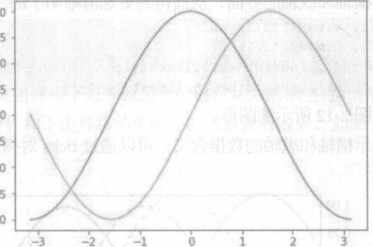

图 2-10

Matplotlib 的默认配置都允许用户自定义。可以调整大多数的默认配置：图片大小和分辨率( dpi )、线宽、颜色、风格、坐标轴、坐标轴以及网格的属性、文字与字体属性等。

### 3. 设置线条样式

接下来可以对线条的颜色、宽度进行设置。

代码实例如下。

```

```python
# 定制线条属性：颜色、宽度、风格
plt.plot(x, C, color='red', linewidth=2.5, linestyle='-')
plt.plot(x, S, color='blue', linewidth=2.5, linestyle='-')
```

```

运行代码后将绘制出图 2-11 所示的图形。

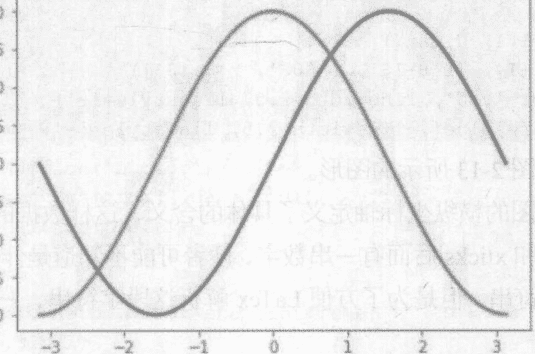

图 2-11

上面介绍了简单的绘图，用的基本上都是 plot，因此有必要对 plot 函数进行简单的介绍。熟悉 Matlab 的人对 plot 不会陌生，在 Matplotlib 中的使用方式大致和在 Matlab 中是一致的，使用 plot，可以对点的标记的样式以及线条的样式进行设置。

函数的声明如下。

``` `plot` 函数签名支持灵活的位置参数与关键字参数，便于高度定制。

进一步优化坐标轴范围与刻度，让视觉比例更协调：

```

其中 args 参数的长度是不定的，因此可以设置很多的属性，kwargs 主要是应用于设置线条的属性。对于标注和线条的样式，可以通过简单的字符串来表示，如 “-” 为实线， “--” 为虚线。更多字符请参考官方网站说明。对于 Line2D 的具体细节，也就是线条的属性等，可以进一步查阅网络上的相关内容。

### 4. 设置横轴、纵轴的界限以及标注

很多时候，需要设置横轴和纵轴的界面，从而得到更加清晰明了的图形，代码如下所示。

```
```

运行代码后将绘制出图 2-12 所示的图形。

此外，为了更好地表示横轴和纵轴的数据含义，可以通过 ticks 对横轴和纵轴的含义进行设置和定制，代码如下所示。

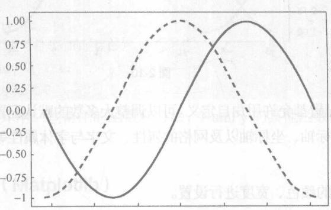

图 2-12

```

```python
# 扩展坐标轴范围 10%，避免曲线贴边
plt.xlim(x.min() * 1.1, x.max() * 1.1)
plt.ylim(C.min() * 1.1, C.max() * 1.1)

# 设置关键刻度位置及 LaTeX 格式标签
plt.xticks(
    [-np.pi, -np.pi/2, 0, np.pi/2, np.pi],
    [r'$-\pi$', r'$-\pi/2$', r'$0$', r'$+\pi/2$', r'$+\pi$']
)
plt.yticks([-1, 0, 1], [r'$-1$', r'$0$', r'$+1$'])

# 重新绘制带样式的曲线
plt.plot(x, C, color='red', linewidth=2.5, linestyle='-')
plt.plot(x, S, color='blue', linewidth=2.5, linestyle='-')
```

---

### 五、 专业级坐标系美化：移动脊柱，原点归零

学术论文风格的坐标系通常要求：顶部和右侧边框（脊柱）隐藏，底部和左侧脊柱移至数据原点 (0,0) 处，刻度仅保留在底部和左侧。

```

运行代码后将绘制出图 2-13 所示的图形。

通过此段代码，对绘图的横纵坐标轴定义了具体的含义，这样数据的意义更加清晰明了。

在代码中看到 yticks 和 xticks 后面有一串数字，读者可能不知道是什么，熟悉 LaTeX 的人会很熟悉，其实就是很简单的字符串，但是为了方便 LaTex 解析这段字符串，一般以 r 开始，中间的字符串用字符串 “$” 包起来。

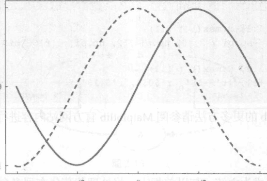

图 2-13

### 5. Spines

Spines 应该可以理解为坐标轴的位置。但是也不全是，因为它分为上下左右 4 个位置，就如图 2-13 的 4 个边界，那么左边界和下边界就是我们通常认为的横坐标和纵坐标。我们可以将上边界和右边界隐藏，同时将左边界和下边界移动至中心的位置查看效果，如图 2-14 所示。

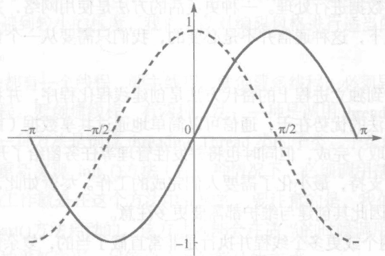

图 2-14

这和通常画数学曲线的方式一样，实现此绘图的完整代码如下。

```

```python
import numpy as np
import matplotlib.pyplot as plt

# 获取当前坐标系对象
ax = plt.subplot(111)

# 隐藏顶部、右侧脊柱
ax.spines['right'].set_color('none')
ax.spines['top'].set_color('none')

# 设置刻度位置：x轴刻度在底部，y轴刻度在左侧
ax.xaxis.set_ticks_position('bottom')
ax.yaxis.set_ticks_position('left')

# 将底部、左侧脊柱移动到数据坐标 (0,0)
ax.spines['bottom'].set_position(('data', 0))
ax.spines['left'].set_position(('data', 0))

# 绘图并添加图例
x = np.linspace(-np.pi, np.pi, 256, endpoint=True)
C, S = np.cos(x), np.sin(x)

plt.plot(x, C, color='red', linewidth=2.5, linestyle='-', label=r'$cos(t)$')
plt.plot(x, S, color='blue', linewidth=2.5, linestyle='-', label=r'$sin(t)$')

# 坐标范围与刻度设置（同上）
plt.xlim(x.min() * 1.1, x.max() * 1.1)
plt.xticks([-np.pi, -np.pi/2, 0, np.pi/2, np.pi],
           [r'$-\pi$', r'$-\pi/2$', r'$0$', r'$+\pi/2$', r'$+\pi$'])
plt.ylim(C.min() * 1.1, C.max() * 1.1)
plt.yticks([-1, 0, 1], [r'$-1$', r'$0$', r'$+1$'])

plt.legend(loc='upper left')  # 显示图例
plt.show()
```

---

### 附录：代码片段备查

以下为额外收录的工程化代码结构示例，涉及命令行参数解析与任务队列模型：

```

对于绘图库 Matplotlib 的更多方法请参阅 Matplotlib 官方网站内容进行学习和了解。

## 2.10.4 锁与线程

随着多核处理器逐渐成为主流，与以前相比，将处理载荷分布到多台处理器上（以便充分利用所有可用的处理器资源）变得更吸引人，也更具有可行性。有两种方法可以对工作载荷进行分布，一种是使用多进程，另一种是使用多线程。

使用多个进程，即运行多个单独的程序。其优势在于每个进程都是独立运行的，这使得对并发性进行处理的所有任务都由底层的操作系统完成；不足之处在于程序与各单独进程之间的通信与数据共享可能不是很方便。在 UNIX 系统上，这可以使用 exec 与 fork 来完成，但对于跨平台程序，就必须使用其他解决方案。最简单的，也是在这里进行展示的，就是由调用程序为其运行的进程提供数据，并由进程来分别对数据进行处理。一种更灵活的方法是使用网络，并可以极大地简化这种双向通信。当然，很多情况下，这种通信并不是必要的，我们只需要从一个负责协调的程序来运行一个或多个其他程序。

一种将工作载荷分布到独立进程上的替代方法是创建线程化程序，并将工作载荷分布到独立的线程上进行处理。这种方法的优势在于，通信可以简单地通过共享数据（前提是要确保共享数据一次只能由一个线程进行存取）完成，但同时也将并发性管理等任务留给了开发人员。Python 提供了对创建线程化程序的良好支持，最小化了需要人们完成的工作。尽管如此，多线程程序从本质上就比单线程程序更加复杂，因此其创建与维护都需要更多注意。

在 Python 中，建立两个或更多个线程并执行是非常直截了当的，复杂性出现在需要多个线程共享数据的时候。假定有两个线程共享一个列表，其中一个线程使用 for x in L 对列表进行迭代，之后，在中间的某个位置，另一个线程可能删除列表中的某些项。最好的情况也会导致崩溃，最差的情况则产生错误的结果。

常见的解决方案是使用某种锁机制。比如，某个线程可能先请求一个锁，之后再开始对列表进行迭代，此时任何其他线程都会被该锁阻止。当然，实际上并不会像这里叙述的这么直接和简单，锁及其锁定数据之间的关系只是存在于我们的想象中。如果某个线程请求一个锁，第 2 个线程也尝试请求同样的锁，那么第 2 个线程将被阻塞，直至第 1 个线程释放该锁。通过将共享数据的存取权限限定在锁的作用范围之内，可以保证共享数据在同一时刻只能由一个线程进行存取，即便这种保护不是直接的。

锁机制存在的一个问题就是存在“死锁”的风险。假定 thread #1 请求锁 A，以便可以存取共享数据 a，之后在锁 A 的作用范围之内尝试请求锁 B，以便存取共享数据 b，但 thread #1 不能请求锁 B，因为此时 thread #2 已经请求了锁 B 以便存取共享数据 b，并且此时 thread #2 也在请求锁 A，以便可以存取共享数据 a。因此就出现这样的情况：thread #1 占据了锁 A，并尝试请求锁 B，而 thread #2

占据了锁 B，并尝试请求锁 A。导致的结果是，两个线程都被阻塞，因此程序死锁了。图 2-15 展示了这种情况。

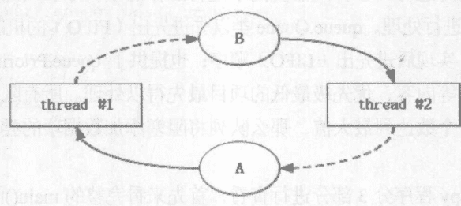

图 2-15

尽管图形化展示死锁的情况很容易，但实践中检测死锁是困难的，因为死锁并不总是那么明显。有些线程库可以提供关于潜在死锁的帮助信息，但是仍然需要开发人员小心注意，防止出现死锁的情况。

一种简单但可以有效防止死锁的方法是制定一种策略，其中规定锁被请求的顺序，比如，在策略中规定，锁 A 必须总是先于锁 B 被请求，这样，在请求锁 B 时，策略就会要求先请求锁 A。这可以保证上面描述的死锁情况不会发生，因为两个线程都会尝试请求锁 A，首先请求到锁 A 的线程才有资格去请求锁 B，除非违背了这种策略。

使用锁机制的另一个问题是，如果有多个线程等待请求锁，那么都会被阻塞并无法做任何有用的工作。为将这种风险规避到较小的程度，我们可以对编码风格进行适当的改变，将在某个锁上下文内要完成的工作最小化。

每个 Python 程序至少都有一个线程，即主线程。要创建多线程，必须导入 threading 模块，并用其创建所需数量的额外线程。要创建线程，有两种方法：一种是调用 threading.Thread()，并向其传递一个可调用的对象；另一种方法是创建 threading.Thread 类的子类。子类化是最灵活的方法，并且也是很直接的。子类可以重新实现 __init__()方法（在这种情况下，必须调用基类的实现），并且必须重新实现 run()方法，进程的工作就是在这个方法中完成的。要注意的是，我们的代码绝不要调用 run()方法，线程是通过调用 start()方法启动的，该方法内部会在适当的时候调用 run()方法。没有其他的 threading.Thread 方法可以被重新实现，尽管允许添加额外的方法。

## 2.10.5 多线程编程

在这一小节中，我们将查看 grepword-t.py 程序的代码，该程序所做的工作与 grepword-p.py 相同，区别在于 grepword-t.py 是将工作载荷分布在多个线程，而不是多个进程。图 2-16 纲要性地展示了该程序。

| grepword-t.py |
|---|
| main thread |
| thread #1 | thread #2 | thread #3 | ... |

图 2-16

程序不使用任何锁是可能的，因为唯一共享的数据是文件列表，对此可使用 queue.Queue 类，queue.Queue 类比较特殊的地方在于，锁机制是在其内部进行实现和处理的。因此，无论何时访问该类以便添加或移除数据项时，都可以依赖队列本身来对存取操作进行序列化。在线程上下文中，对

数据进行序列化存取意味着在同一时刻只有一个线程对数据进行存取。使用 queue.Queue 的另一个好处是，不需要自己将任务进行共享，只需要简单地将工作的项目添加到队列中，线程会在其自身就绪后从队列中提取任务进行处理。queue.Queue 类以先进先出（FIFO）的机制进行工作。queue 模块提供了 queue.LifoQueue，实现后进先出（LIFO）顺序；也提供了 queue.PriorityQueue，可以接受如二元组（优先级、数据项）等内容，优先级最低的项目最先得以处理。所有队列创建时都可以指定最大容量，如果队列中项目个数达到最大值，那么队列将阻塞添加数据项的尝试，直至其中有数据项被移除。

我们将 grepword-t.py 程序分 3 部分进行查看，首先来看完整的 main()函数，代码如下所示。

```python

```python
def main():
    opts, word, args = parse_options()
    filelist = get_files(args, opts.recurse)
    work_queue = queue.Queue()
    # ... 后续消费者/生产者逻辑
```

---

**总结**：NumPy 提供了高性能的数值计算底座，Matplotlib 则赋予了数据可视化的表达力。熟练掌握上述聚合统计、矩阵运算及绘图定制模式，能显著提升探索性数据分析（EDA）与科研绘图的效率。建议收藏练习，融会贯通。

## Python多线程任务队列：生产者-消费者模式实战

在主流程中，我们首先依据配置的并发数量 `opts.count` 初始化一组工作线程。每个线程实例化为 `Worker` 对象，绑定任务队列 `work_queue` 与目标关键字 `word`，并被设置为守护线程随主进程退出而结束，随后通过 `start()` 方法启动运行。

线程池就绪后，主线程遍历 `filelist` 将每个文件名投递进队列，最后调用 `work_queue.join()` 进入阻塞等待，直到队列中所有任务均被标记为完成。

```

这一函数中，获取用户的命令行选项及文件列表与以前的是相同的。在具备了必要的信息后，先创建一个 queue.Queue，然后进行循环，循环的次数与要创建的线程数相同，默认为 7。对每个线程，准备一个 number 字符串用于调试（如果不需要调试，就为空字符串），之后创建一个 Worker（threading.Thread 子类）实例，现在先不设置 daemon 特性。接下来启动线程，尽管此时没有什么工作需要做（因为工作队列现在还是空的），因此，线程将立即被阻塞，并尝试获取相关工作。

在所有线程都创建完毕等待分配工作之后，我们就对所有文件进行迭代，将每个文件都添加到工作队列中。只要第 1 个文件添加到队列之中后，就会有某个线程获取该文件，并开始对其进行处理，直到所有线程都获取了文件。只要某个线程结束了对文件的处理，接下来就可以获取其他文件，直至所有文件被处理完毕。

注意，这不同于 grepword-p.py 程序，这里必须为每个子进程分配文件列表的分片，子进程的启动与列表分配是按序进行的。对这种类似的情况，使用线程具有更加高效的潜力。比如，在文件中有几个文件非常大，而余下的文件非常小，由于每个线程一次接受一份任务，因此每个大文件都将由不同的线程单独处理，从而很好地对工作载荷进行了分配。但使用多进程方法时，如在 grepword-p.py 程序中所看到的，所有大文件都将赋予第 1 个进程，而将其他小文件赋予其他进程，因此，第 1 个进程只有在完成大部分工作后才能停止，其他进程则可能很快地完成了处理任务，并不再做任何工作。

在尚有线程处于运行状态时，该程序将不会终止。这是一个问题，因为 Worker 线程完成工作后，从技术上讲仍处于运行状态。解决方法是将线程转换为守护进程，这样做的效果在于，只要没有非守护进程的线程处于运行状态，程序就可以终止。主线程不是守护进程，因此，主线程结束后，程序将终止每个守护进程线程，之后终止自身。当然，这会导致相反的问题——线程被唤醒并处于运行状态时，必须保证主线程不终止，直至所有工作完成，这可以通过调用 queue.Queue.join()方法来实现——该方法将阻塞，直至队列为空。


下面给出 Worker 类的起始处的代码如下所示。

```python
class Worker(threading.Thread):

    def __init__(self, work_queue, word, number):

        super().__init__()

        self.work_queue = work_queue

        self.word = word

        self.number = number

    def run(self):

        while True:

            try:

                filename = self.work_queue.get()

                self.process(filename)

            finally:

                self.work_queue.task_done()

```

__init__()方法必须调用基类的__init__()方法，工作队列与所有线程共享的 queue.Queue 相同。

我们将 run()方法设置为一个无限循环。对守护进程线程而言，这是一种常见的做法，在这里之所以有用，是因为预先并不知道线程必须处理多少个文件。每次迭代时，都要调用 queue.Queue.get()获取下一个要处理的文件，如果队列为空，那么调用将被阻塞，并不需要由锁进行保护，因为 queue.Queue 会自动处理锁机制。获取了某个文件后，就对其进行处理，之后需要告知队列已经处理完特定任务，为保证 queue.Queue.join()正确工作，调用 queue.Queue.task_done()是必要的。


## 3.1 TensorFlow 的架构

TensorFlow 是基于数据流图的，用于大规模分布式数值计算的开源框架。节点表示某种抽象的计算，边表示节点之间相互联系的张量。

本书将阐述 TensorFlow 的系统架构，帮助读者加深理解 TensorFlow 的工作原理。

### 1. 系统架构概述

TensorFlow 的系统架构如图 3-1 所示，以 C API 为界，将整个系统分为“前端”和“后端”两个子系统。

- 前端系统（Front End）：提供编程模型，负责构造计算图。

- 后端系统（Exec System）：提供运行时环境，负责执行计算图。

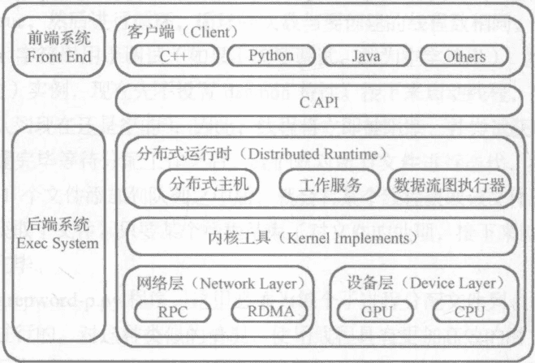

在 TensorFlow 系统架构中，读者需重点关注 TensorFlow 系统中以下 4 个基本组件，它们是系统分布式运行机制的核心。

### (1) 客户端（Client）

客户端是前端系统的主要组成部分，它是一个支持多语言的编程环境。它提供基于计算图的编程模型，方便用户构造各种复杂的计算图，实现各种形式的模型设计。

客户端将会话（Session）作为桥梁，连接 TensorFlow 后端的“运行时”，并启动计算图的执行过程。

### (2) 分布式主机（Distributed Master）

在分布式的运行时环境中，分布式主机根据 Session.run 的 Fetching 参数，从计算图中反向遍历，找到所依赖的“最小子图”。

然后，分布式主机负责将该“子图”再次分裂为多个“子图片段”，以便在不同的进程和设备上运行这些“子图片段”。

最后，分布式主机将这些“子图片段”派发给工作服务（Worker Service）。随后，工作服务启动“子图片段”的执行过程。

### (3) 工作服务（Worker Service）

对于每个任务，TensorFlow 都将启动一个工作服务。工作服务将按照计算图中节点之间的依赖关系，根据当前可用的硬件环境（GPU/CPU），调用相应操作（Operation，之后均简称为 Op）的 Kernel 实现 Op 的运算（一种典型的多态实现技术）。

另外，工作服务还要负责将 Op 运算的结果发送到其他的工作服务；或者接受来自其他工作服务发送给它的 Op 运算的结果。

### (4) 内核工具（Kernel Implements）

内核工具是 Op 在某种硬件设备的特定实现，它负责执行 Op 的运算。

### 2. 组件交互

图 3-2 所示的是 TensorFlow 计算图的运行机制，假设存在两个任务。

- /job:worker/task:0: 负责模型的训练或推理。

- /job:ps/task:0: 负责模型参数的存储和更新，又称为 Parameter Server（简称 PS）。

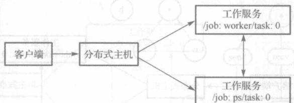

图 3-2

接下来，我们将进一步抽丝剥茧，逐渐挖掘出 TensorFlow 计算图的运行机制。

### (1) 客户端

客户端基于 TensorFlow 的编程接口构造计算图。目前，TensorFlow 主流支持 Python 和 C++ 的编程接口，并对其他编程语言接口的支持也日益完善。

此时，TensorFlow 并未执行任何计算。直至建立 Session，并以 Session 为桥梁，建立客户端与后端运行时的通道，将 Protobuf 格式的 GraphDef 发送至分布式主机。

也就是说，当客户端对 Op 结果进行求值时，将触发分布式主机的计算图的执行过程。

图 3-3 所示的是一个简单计算图，客户端构建了一个简单计算图。它首先将 w 与 x 进行矩阵相乘，再与截距 b 相加，最后更新至 s。

### (2) 分布式主机

分布式主机将会缓存“子图片段”，以便后续执行过程重复使用这些“子图片段”，避免重复计算。

图 3-4 所示的是分布式主机开始执行计算子图过程。在执行之前，分布式主机会实施一系列优化技术，例如“公共表达式消除”“常量折叠”等。随后，分布式主机负责任务集的协同，执行优化后的计算子图。

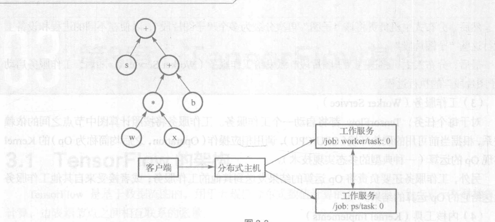

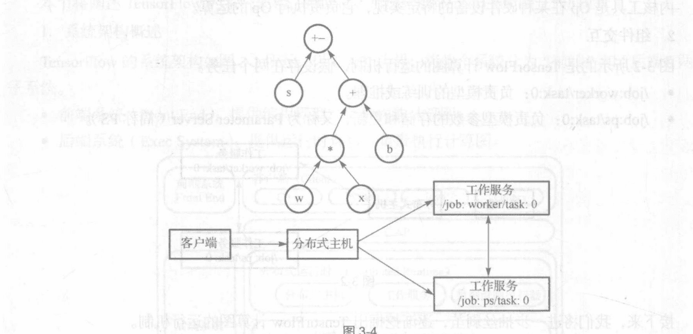

### (3) 子图片段

图 3-5 所示的是一种“子图片段”划分算法。分布式主机将模型参数相关的 Op 进行分组，并放置在 PS 任务上。其他 Op 则划分为另外一组，放置在工作服务任务上执行。

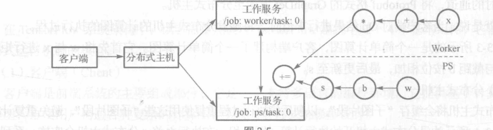

### (4) send/recv 节点

如图 3-6 所示，利用 send 和 recv 节点实现数据的传递，如果计算图的边被任务节点分割，分布式主机将负责把该边进行分裂，在两个分布式任务之间插入 send 和 recv 节点，实现数据的传递，如图 3-7 所示。随后，分布式主机将“子图片段”派发到相应的任务中执行，在工作服务中成为“本地子图”，负责执行该子图上的 Op。

### (5) 工作服务

对于每个任务，都将存在相应的工作服务，它主要负责以下 3 个方面的职责。

- 处理来自分布式主机的请求。

- 调度 Op 的内核工具实现，执行本地子图。

- 协同任务之间的数据通信。

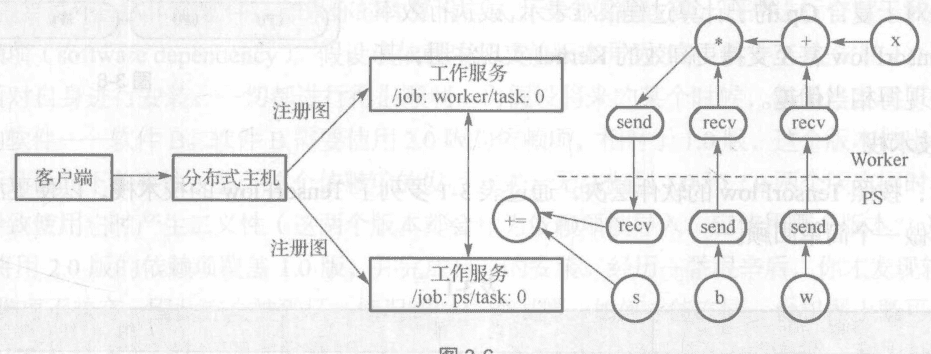

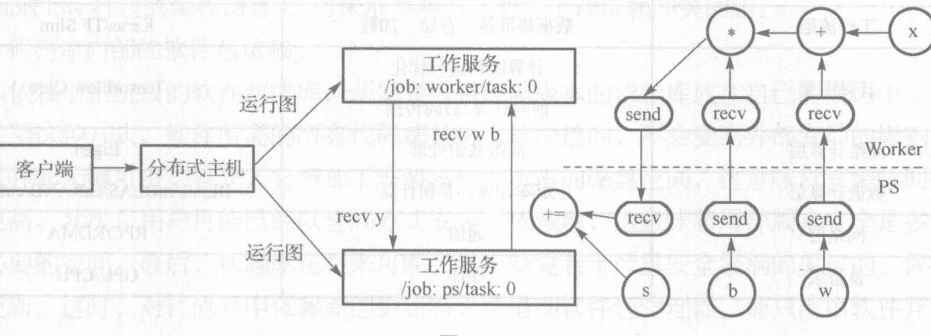

工作服务派发 Op 到本地设备，执行内核工具的特定实现。它将尽最大可能地利用多 CPU/GPU 的处理能力，并发地执行内核工具实现。

另外，TensorFlow 根据设备类型，对设备间的 send/recv 节点进行特化实现。

- 使用 cudaMemcpyAsync 的 API 实现本地 CPU 与 GPU 设备的数据传输。

- 对于本地的 GPU 之间则使用端到端的 DMA，避免了跨 host CPU 需经历的昂贵的复制过程。

- 对于任务之间的数据传递，TensorFlow 支持多协议，主要包括：gRPC over TCP 和 RDMA over Converged Ethernet。

### (6) 内核工具

TensorFlow 运行时包含 200 多个标准的操作 Op，包括数值计算、多维数组操作、控制流、状态管理等。每一个 Op 根据设备类型都会存在一个优化了的内核工具来实现。在运行时，根据本地设备的类型，为 Op 选择特定的内核工具来实现，完成该 Op 的计算。TensorFlow 的内核，如图 3-8 所示。

其中，大多数内核工具基于 Eigen::Tensor 实现。Eigen::Tensor 是一个使用 C++语言模板的技术，为多核 CPU/GPU 生成高效的并发代码。但是，TensorFlow 也可以灵活地直接使用 CUDA Deep Neural Network (cuDNN) 实现更高效的内核工具。

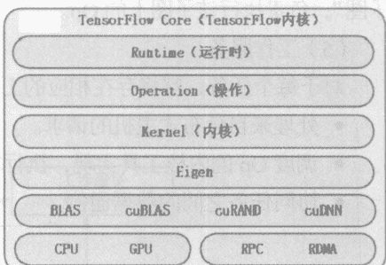

此外，TensorFlow 实现了矢量化技术，使得其在移动设备上可以满足高吞吐量，以数据为中心的应用需求，实现更高效的推理。

如果对于复合 Op 的子计算过程很难表示，或执行效率低下，TensorFlow 甚至支持更高效的 Kernel 实现注册，其扩展性表现得相当优越。

### 3. 技术栈

最后，按照 TensorFlow 的软件层次，通过表 3-1 罗列了 TensorFlow 的技术栈，以便更清晰地对上述内容做一个简单回顾。

| 层 | 功能 | 组件 |
|---|---|---|
| 视图层 | 计算图可视化 | TensorBoard |
| 工作流层 | 数据集准备、存储、加载 | Keras/TF Slim |
| 计算图层 | 计算图构造与优化 前向计算/后向传播 | TensorFlow Core |
| 高维计算层 | 高维数组处理 | Eigen |
| 数值计算层 | 矩阵计算，卷积计算 | BLAS/cuBLAS/cuRAND/cuDNN |
| 网络层 | 通信 | RPC/RDMA |
| 设备层 | 硬件 | GPU/CPU |

## 3.2 TensorFlow 的开发环境搭建

在开始使用 TensorFlow 之前，需要先将其安装到计算机中。TensorFlow 官方网站提供了一份在 Linux 和 Mac OS X 系统中安装 TensorFlow 的完整步骤指南。由于 Windows 系统在全球计算机的覆盖度较大，谷歌公司也提供了 Windows 系统的安装方法，本书重点介绍在当前主流 Windows 系统（本书安装平台为 Windows 10 操作系统）中安装 TensorFlow 的步骤指南。

不论在 Windows、Linux 还是 Mac OS X 系统中安装 TensorFlow，谷歌公司都支持 CPU 和 GPU 两种版本的安装，其中 CPU 版本适合初学者或显卡不支持 GPU 加速的用户安装使用，GPU 版本对机器性能要求较高（主要是显卡性能），但可以让用户得到更好的运行体验。鉴于教学使用，建议安装 CPU 版本。

本节对安装中将会出现的不同选项及如何选择给出了一些建议，并提供了一些能够与 TensorFlow 很好集成的其他第 3 方软件的信息。如果用户对 Pip/Conda、虚拟环境，或从源码安装程序已经非常熟悉，则可放心地参考以下官方指南。

### 1. 选择安装环境

许多软件都会使用一些库和独立维护的软件包。对于开发者而言，这是一件好事，因为这种做法有利于代码复用，而且他们可专注于创建新的功能，无须重复造轮。然而，这种做法也会付出一定的代价。如果某个程序的正常运行必须依赖于另一个库，则用户或这款软件必须确保任何运行该程序代码的机器都已安装了依赖库。乍看上去，这几乎不算一个问题，只需随这款软件一起安装所需的依赖库就行了。不幸的是，这种方法会带来一些意想不到的后果，而且常常如此。

设想如下场景：你找到一款出色的软件——软件 A，下载后开始安装。在执行其安装脚本时，软件 A 需要另外一款依赖软件。如果你的计算机中缺少这个依赖软件，则需进行安装。我们称之为软件依赖项（software dependency）。假设该依赖项的当前版本号为 1.0。软件 A 先安装 1.0 版的依赖项，然后对自身进行安装，一切都进行得很顺利。再假设将来的某个时候，你偶然发现了另一款希望安装的软件——软件 B。软件 B 需要使用 2.0 版的依赖项，相对于 1.0 版，这个版本做出了重大改进，且不具备向下兼容性。鉴于这个依赖项的发行方式，无法做到 1.0 和 2.0 两个版本同时运行，因为这将导致使用它时产生二义性（这两个版本都会作为依赖项被导入，应使用哪个版本？）。最终，软件 B 将用 2.0 版的依赖项覆盖 1.0 版，并完成自身的安装。经历一番艰辛后，你才发现软件 A 与 2.0 版依赖项不兼容，因此完全被破坏，情况顿时变得很糟。如何才能在同一台机器上既可运行软件 A，也可运行软件 B？这个问题非常重要，因为 TensorFlow 也依赖于若干开源软件。利用 Python（用于将 TensorFlow 打包的编程语言），可采取多种方式避免上述依赖冲突问题。

### (1) 代码库内部的软件包依赖

无须依赖于系统级的软件包或库，开发者可将所需版本的依赖库放在自己的代码中，并在局部引用。按照这种方式，软件所需的所有代码都是可直接操控的，不会受到外部变动的影响。然而，这种方式并非无懈可击。首先，它增加了安装该软件所需的磁盘空间，这意味着安装时间更长，使用成本更高。其次，用户可能已经以全局方式安装了依赖库，这意味着局部版本完全是多余的，会占用不必要的空间。最后，依赖库在将来可能会推出修复若干严重安全漏洞的关键的、保持向下兼容性的更新。这时，对代码库中依赖库的更新将无法借助软件包管理器，而只能由软件开发者手工完成。不幸的是，最终用户对此无从插手，因为何时直接包含依赖库完全是由开发者决定的。有一些依赖库由于没有被包含进 TensorFlow，因此必须单独安装。

### (2) 使用依赖环境

一些软件包管理器中包含可创建虚拟环境的相关软件。在一个环境中可完全独立地维护特定版本的软件而不受其他环境的影响。借助 Python，有多种选择。对于 Python 的标准发行版，Virtualenv 是直接可用的。如果使用的是 Anaconda，它会包含一个内置的虚拟环境系统及其软件包管理器——Conda。稍后，将会介绍如何使用这两种工具安装 TensorFlow。

### (3) 使用容器

容器（如 Docker）是将软件与完整的文件系统打包的轻量级方案。因此，任何可运行一个容器的机器（包括虚拟机在内）都能够与任何运行该容器的其他机器对其中所包含的软件获得完全相同的运行效果。与简单地激活 Virtualenv 环境或 Conda 环境相比，虽然从 Docker 中启动 TensorFlow 需要略多一点的步骤，但当需要将代码在不同实例（无论是虚拟机还是物理的服务器）上进行部署时，它在不同运行环境中的一致性使其成为无价之宝。下文将介绍如何安装 Docker，并创建你自己的 TensorFlow 容器（以及如何使用官方的 TensorFlow 镜像）。

一般而言，如果准备在单机上安装和使用 TensorFlow，这里建议采用 Virtualenv 或 Conda 的虚拟环境。它们能够以较小的代价解决依赖冲突问题，且易于设置。一旦创建完毕，便几乎可以一劳永逸。如果准备将 TensorFlow 代码部署到一台或多台服务器中，则值得创建一个 Docker 容器镜像。虽然所需的步骤略多，但会大大降低在多服务器上部署的成本。因此不推荐既不使用虚拟环境，也不使用容器的 TensorFlow 安装方法。

### 2. Jupyter Notebook 与 Matplotlib

在数据科学工作流中频繁使用的两款出色的软件是 Jupyter Notebook 和 Matplotlib。它们与 NumPy 协同使用已有多年，TensorFlow 与 NumPy 的紧密集成使得用户可采用他们熟悉的工作模式。两者均为开源软件，且采用的许可协议均为 BSD。

利用 Jupyter Notebook（前身为 iPython Notebook），可交互式地编写包含代码、文本、输出、LaTeX 及其他可视化结果的文档。这使得它在依据探索分析创建报告时极为有用，因为可将创建可视化图表的代码直接在图表的旁边展示出来，也可利用 Markdown 单元以格式丰富的文本分享对某个特定方法的见解。此外，对于设计原型的想法，Jupyter Notebook 也极为出色，因为可以回顾和编辑部分代码，然后直接运行。与许多其他要求逐行执行代码的交互式 Python 环境不同，Jupyter Notebook 允许将代码写入逻辑块中，这使得调试脚本中的特定部分相对容易。在 TensorFlow 中，这个特性是极有价值的，因为典型的 TensorFlow 程序已经被划分为“计算图的定义”和“运行计算图”两部分。

Matplotlib 是一个绘图库，它允许用户使用 Python 创建动态的、自定义的可视化结果。它与 NumPy 无缝集成，其绘图结果可直接显示在 Jupyter Notebook 中。Matplotlib 也可将数值数据以图像的形式可视化，这个功能可用于验证图像识别任务的输出，并将神经网络的内部单元可视化。构建在 Matplotlib 之上的其他层，如 Seaborn，可用于增强其功能。

### 3. 在 Windows 系统下安装 TensorFlow

### (1) 安装虚拟环境 Anaconda

在安装 TensorFlow 之前，首先推荐安装 Anaconda。为什么在安装 TensorFlow 之前要先安装 Anaconda 呢？这主要是想为 TensorFlow 配置一个隔离的环境，目前 Python 的版本非常多，各种辅助计算与富含多种功能的库也很多，其中不同的库可能会依赖于不同版本的 Python，不同的 Python 库也有可能会互相影响（极个别情况），所以推荐为 TensorFlow 配置一个专属于自己的环境。

从 Anaconda 官方网站下载 Anaconda 后就可以开始安装了，本书实例中安装的是 Anaconda 5.1 for Windows、Python 3.5 版本。整体的安装过程并没有特别，值得注意的是请勿忘记自己安装 Anaconda 的位置。

### (2) 安装 CPU 版本的 TensorFlow

安装好 Anaconda 之后，就可以启动 Anaconda，在 Conda 虚拟环境下安装 TensorFlow 了。

首先在程序列表中找到 Anaconda 安装目录，并启动 Anaconda Navigator。Anaconda Navigator 启动的时间比较长，可能需要等一会，Anaconda 启动后如图 3-9 所示。

选择左侧菜单栏的“Environments”选项，打开后用 Create 新建一个虚拟环境，如图 3-10 所示。

在弹出的“Create new environment”对话框中输入 Name 为“TensorFlow”，并选择 Packages 为 Python 3.5，单击 Create（创建）按钮。创建完成后在中间的环境窗口中会出现名为“TensorFlow”的虚拟环境，如图 3-11 所示。


图 3-9


图 3-10

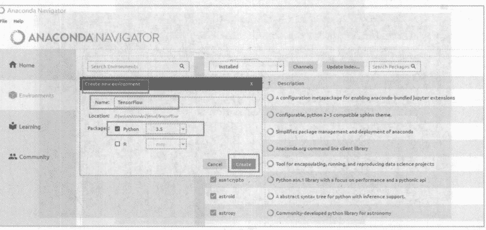

图 3-11

接下来就可以安装 TensorFlow 了。在虚拟环境“TensorFlow”上单击图标，在下拉菜单中选择 Open Terminal 选项，如图 3-12 所示。


图 3-12

此时会打开一个终端窗口，目录前面显示（TensorFlow）为虚拟环境名，在终端输入 pip install tensorflow，按 Enter 键后安装开始，如图 3-13 所示。

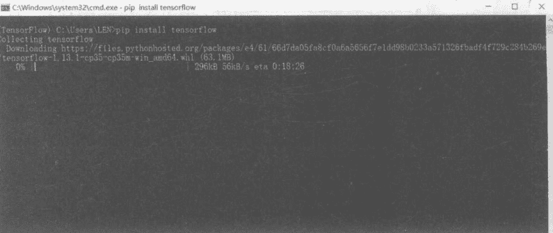

图 3-13

如果最终显示图 3-14 所示的信息，表示安装成功。

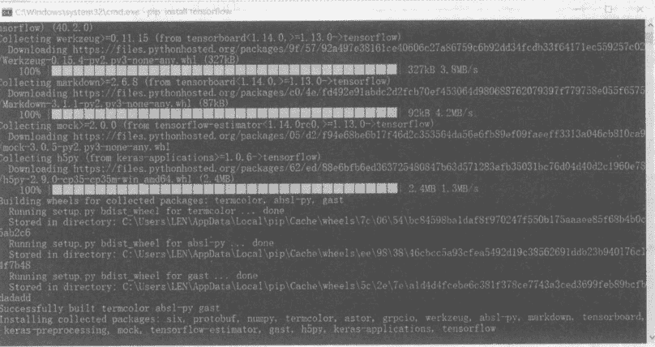

图 3-14

在安装完 TensorFlow 后，我们还需要验证 TensorFlow 是否安装成功，在刚才打开的 Terminal 中输入 python，并输入以下代码。

```python

# TensorFlow 0.9 环境搭建与入门实战

本文梳理在 Linux/macOS 上部署 TensorFlow 0.9 的完整路径，涵盖驱动核验、依赖部署、环境隔离、版本化安装与机制验证，助你快速落地首个计算图。

---

## 显卡驱动预检：GPU 加速的前置条件
若需启用 GPU，请先确认 CUDA 工具链已就位（仅 CPU 模式可跳过）：
```

如果看到 “Hello, TensorFlow!”, 则证明安装成功，如图 3-15 所示。如果是 no module，请检查是否安装错误。

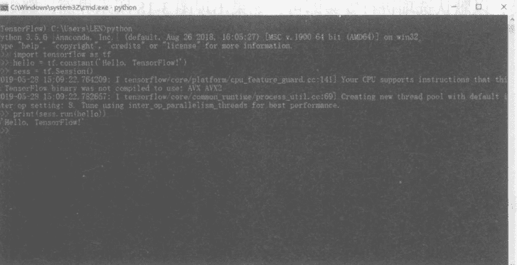

图 3-15

### (3) 安装 GPU 版本 TensorFlow

如果希望使用带有 GPU 支持的 TensorFlow，可以通过以下步骤进行安装。

### ① 安装 CUDA 软件

CUDA 是 NVIDIA 推出的运算平台，cuDNN 是专门针对 Deep Learning 框架设计的一套 GPU 计算加速方案。如果拥有一款支持 CUDA 的 NVIDIA GPU，则可安装带有 GPU 支持的 TensorFlow。支持 CUDA 的显卡清单可从相关网址获取。

接下来就可以安装 CUDA 了。首先需要下载 CUDA，可到 NVIDIA 官方网站进行相关下载。

选择机器的操作系统及版本，本书实例安装 CUDA 9.0 版本，系统平台是 64 位 Windows 10 操作系统，选择后打开图 3-16 所示的界面进行 CUDA 及 CUDA 补丁的下载。

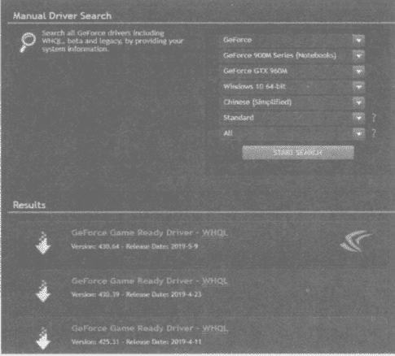

图 3-16

首先安装 Base Installer，如图 3-17 所示。

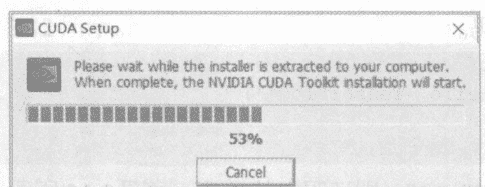

图 3-17

选择精简安装，以默认选项进行安装即可，如果出现图 3-18 所示界面，则安装成功。

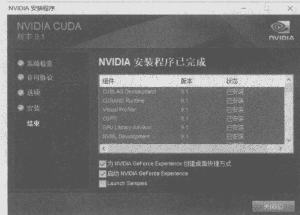

图 3-18

接下来下载并安装 CUDA 补丁，下载任一 CUDA 补丁包进行安装即可。安装完成后，需要下载 cuDNN。可通过 NVIDIA 官方网站链接进行下载。由于之前安装的是 CUDA 9.0，所以需要下载 cuDNN for CUDA 9.0，如图 3-19 所示。

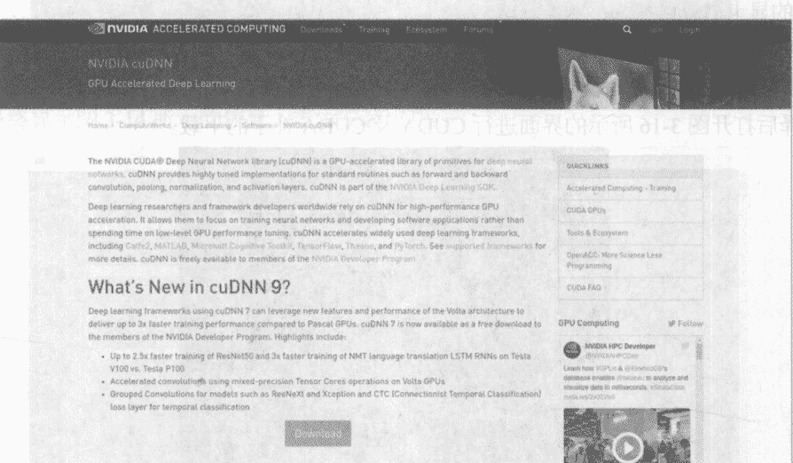

图 3-19

选择相应操作系统版本的 cuDNN 进行下载，如图 3-20 所示。


图 3-20

下载后获得一个 cuDNN 的压缩包，解压此压缩包，并将包内文件及文件夹复制到之前 CUDA 安装文件内，具体位置如图 3-21 所示。

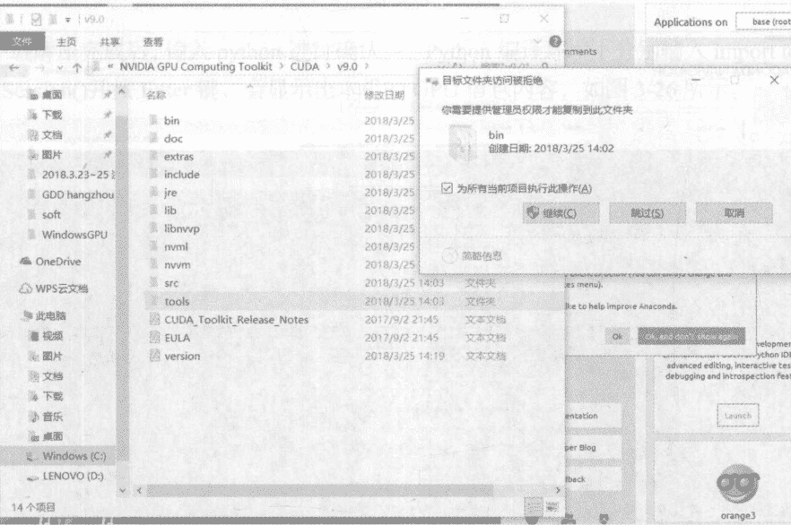

图 3-21

注意：此操作需要提供管理员权限。

至此，CUDA 安装完毕，如果要查看安装的 CUDA 的版本信息，则需要在命令窗口（cmd）中输入如下命令。

```

---

## 系统级依赖铺垫：奠定 Python 基石
于 Ubuntu 等发行版中，优先通过包管理器装备核心工具：
```

### ② 安装 GPU 版本 TensorFlow

启动 Anaconda，在 Conda 虚拟环境下安装 GPU 版本 TensorFlow，如图 3-22 所示。


图 3-22

选择左侧菜单栏的 “Environments” 选项，打开后用 Create 新建一个虚拟环境，如图 3-23 所示。


图 3-23

在弹出的 “Create new environment” 对话框中的 Name 文本框中输入 TensorFlowGPU，并选择 Packages 为 Python 3.5，单击 “Create” (创建) 按钮，如图 3-24 所示。创建完成后在中间的环境窗口中出现名为 TensorFlowGPU 的虚拟环境。

接下来就可以安装 TensorFlow 了。在虚拟环境 TensorFlowGPU 上单击 ▶ 图标，在下拉菜单中选择 “Open Terminal” 选项，打开一个终端窗口，此时目前前面显示 ( tensorflow_gpu ) 为虚拟环境名，在终端输入 pip install tensorflow-gpu，按 Enter 键后安装开始，如图 3-25 所示。


图 3-24

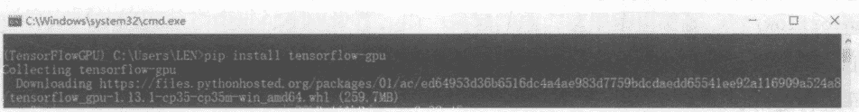

图 3-25

全部下载解压完成后，输入 python 进行确认。在 Python 编译环境下分别输入 import tensorflow as tf，sess=tf.Session()并按 Enter 键，会显示出本机的 GPU 信息内容，如图 3-26 所示。

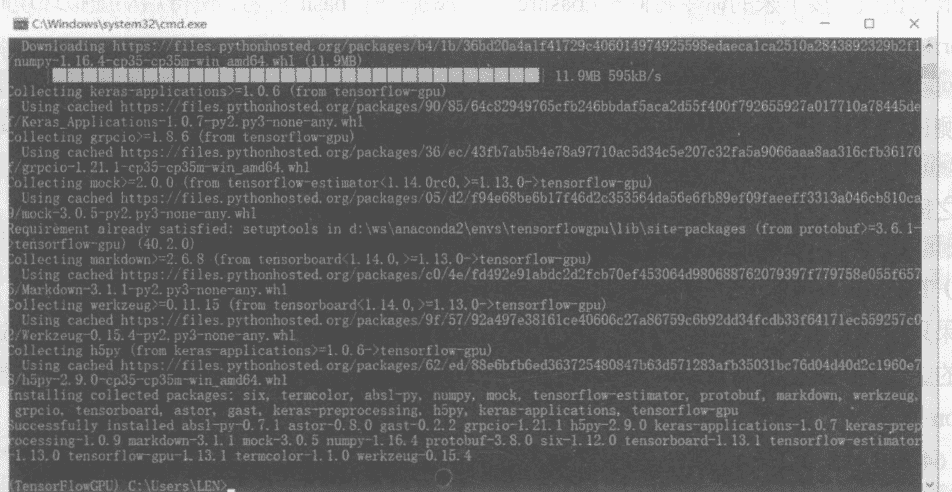

图 3-26

至此，Windows 系统环境下 GPU 版本 TensorFlow 安装完毕。

## 4. 在 Linux 系统及 Mac OS X 下安装 TensorFlow

### (1) 创建 Virtualenv 环境

为保持依赖项的干净整洁，下面介绍如何利用 Virtualenv 创建虚拟的 Python 环境。首先需要确保 Virtualenv 与 pip（Python 的包管理器）均被安装。运行下列命令（根据不同的操作系统，选择相应的命令）。

### ① 64 位 Linux 系统

```

若 `pip` 缺失或版本过旧，可借 `easy_install` 引入：
```

### ② Mac OS X

```

随即将 `virtualenv` 升级至新版，规避环境创建时的潜在冲突：
```

```

---

## 虚拟环境构建：打造专属隔离空间
规划专用目录承载环境文件，避免污染全局站点包：
```

至此，准备工作已完成，接下来创建一个包含该虚拟环境的目录，以及将来可能会创建的任意虚拟环境。

```

基于系统级站点包初始化名为 `tensorflow` 的沙箱，便于复用现有库资源：
```

接下来，利用 Virtualenv 命令创建虚拟环境。在本例中，它位于 ~/env/tensorflow 目录（“~”指当前目录）下。

```

执行激活脚本进入隔离上下文，终端提示符将标识当前环境：
```

一旦创建完毕，便可利用 source 命令激活该虚拟环境。

```
```

注意，命令提示窗口中现在多了一个 “tensorflow” 提示符。

```

退出沙箱仅需单指令，即刻复原系统原生 Shell：
```

我们希望当使用 pip 安装任何软件时都确保该虚拟环境处于活动状态，从而使 Virtualenv 能够对各依赖库进行追踪。

虚拟环境使用完毕后，需用下列 deactivate 命令将其关闭。

```

---

## 别名持久化：一键直达开发现场
将激活命令写入 Shell 配置文件，实现指令常驻：
```

由于将频繁使用虚拟环境，因此创建一个激活虚拟环境的快捷方式而非每次键入完整的 source 命令便很有价值。接下来的命令将向 ~/.bashrc 文件添加一个 bash 别名，使得启动虚拟环境时只需键入 tensorflow。

```

重载配置后，后续仅需敲入简短别名即可秒级切换上下文：
```

要测试该快捷方式是否生效，可重启 bash 终端，并键入 tensorflow。

```
提示符随之变更，确认已身处目标环境：
```

与之前一样，提示符会发生变化。

```

---

## 分平台精准安装 TensorFlow 0.9
**核心前提：全程操作均需在虚拟环境激活态下进行。**

对号入座，从官方源拉取对应预编译轮子包：

### 🐧 Linux 篇
*   **Python 2.7 (64-bit)**：
    ```

### (2) TensorFlow 的简易安装

如果只是希望尽快上手实践一些入门的例子，而不关心是否有 GPU 支持，则可从 TensorFlow 官方预置的二进制安装程序中选择。请确保 Virtualenv 环境处于活动状态，并运行下列与你的操作系统和 Python 版本对应的命令。

### ① 64 位 Linux 系统

```
*   **Python 3.4 (64-bit)**：
    ```

```
*   **Python 3.5 (64-bit)**：
    ```

```
    ```

```

### 🍎 macOS 篇
*   **Python 2.7**：
    ```

### ② Mac OS X

```
*   **Python 3.4+**：
    ```

```

> **提示**：安装过程将自动解析 NumPy 等核心依赖，请保持网络畅通静待完成。

---

## 安装验证：跑通首个张量流程序
新建脚本 `verify_tf.py`，写入以下测试逻辑：

```python
import tensorflow as tf
hello = tf.constant('Hello, TensorFlow!')
sess = tf.Session()
print(sess.run(hello))
```

运行 `python verify_tf.py`，若控制台输出 `Hello, TensorFlow!`，即表明运行环境已就绪。

---

## 核心范式拆解：计算图的定义与执行
TensorFlow 采用「先构建图、后运行会话」的延迟执行机制。以简单算式 `f(1,2) = 1+2 = 3` 为切入点：
```

从技术角度上看，可以使用带有 GPU 支持的预置的 TensorFlow 二进制安装程序，但它需要特定版本的 NVIDIA 软件，且与未来版本不兼容。

在 Linux 上安装 GPU 版 TensorFlow，或在 Mac OS X 上从源码构建 TensorFlow，都可以依据 TensorFlow 官方网站的安装指南进行相应设置，由于篇幅问题，这里不再赘述。

至此，TensorFlow 安装完毕！鉴于版本兼容等问题，建议初学者采用 Windows 环境下的安装方式，对于不支持 GPU 的机器，建议安装 CPU 版本。

## 3.3 数据流图简介

本节介绍一些数据流图的基础知识，内容包括节点、边和节点依赖关系的定义。此外，为了解释一些关键原理，本章还提供了若干实例。

### 3.3.1 数据流图基础

借助 TensorFlow API 用代码描述的数据流图是每个 TensorFlow 程序的核心。毫不意外，数据流图这种特殊类型的有向图正是用于定义计算结构的。在 TensorFlow 中，数据流图本质上是一组链接在一起的函数，每个函数都会将其输出传递给 0 个、1 个或更多个位于这个级联链上的其他函数。按照这种方式，用户可利用一些很小的、为人们所充分理解的数学函数构造数据的复杂变换。下面来看一个比较简单的例子，如图 3-27 所示。

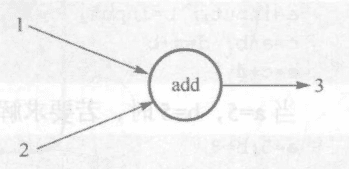

图 3-27 展示了可完成基本加法运算的数据流图。在该图中，加法运算是用圆圈表示的，它可接收两个输入（以指向该函数的箭头表示），并将 1+2 之和 3 输出（对应从该函数引出的箭头）。该函数的运算结果可传递给其他函数，也可直接返回给客户。

该数据流图可用如下简单公式表示。

```

构建包含多运算节点的数据流图结构：
```

上面的例子解释了在构建数据流图时，两个基本构件——节点和边是如何使用的。下面回顾节点和边的基本性质。

- 节点（node）：在数据流图的语境中，节点通常以圆圈、椭圆和方框表示，代表了对数据所做的运算或某种操作。在上例中，add 对应于一个孤立节点。

- 边（edge）：对应于向 Operation 传入和从 Operation 传出的实际数值，通常以箭头表示。在 add 这个例子中，输入 1 和 2 均为指向运算节点的边，而输出 3 则为从运算节点引出的边。可从概念上将边视为不同 Operation 之间的连接，因为它们将信息从一个节点传输到另一个节点。

下面来看一个更有趣的例子，如图 3-28 所示。

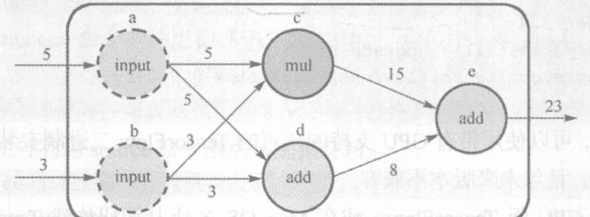

图 3-28

相比之下，图 3-28 的实例中所示的数据流图略复杂。由于数据是从左侧流向右侧的（如箭头方向所示），因此可以从最左端开始对这个数据流图进行分析。

（1）最开始时，可看到两个值 5 和 3 流入该数据流图。它们可能来自另一个数据流图，也可能读取自某个文件，或是由客户直接输入。

（2）这些初始值被分别传入两个明确的 input 节点（在图中分别以 a、b 标识）。这些 input 节点的作用仅仅是传递它们的输入值——节点 a 接收到输入值 5 后，将同样的数值输出给节点 c 和节点 d，节点 b 对其输入值 3 也完成同样的动作。

（3）节点 c 代表乘法运算。它分别从节点 a 和 b 接收输入值 5 和 3，并将运算结果 15 输出到节点 e。与此同时，节点 d 对相同的两个输入执行加法运算，并将计算结果 8 传递给节点 e。

（4）最后，该数据流图的终点——节点 e（也是另一个 add 节点）接收输入值 15 和 8，将两者相加，然后输出该数据流图的最终结果 23。

下面用一组公式表示该图的数据流图。

```

当注入具体数值 `a=5, b=3` 时，数据按拓扑顺序在图中流动完成计算：
```

当 a=5, b=5 时，若要求解 e，只需依次代入上述公式。

```

这一「搭建拓扑结构 → 喂入张量数据 → 启动会话计算」的最小闭环，正是 TensorFlow 编程范式的核心精髓。

---

**环境已就绪，即刻开启深度学习探索之旅。**

**TF 1.x 图构建与会话运行机制解析**

在 TensorFlow 1.x 时代，计算任务被封装在图结构中，必须通过会话显式触发执行。下面通过完整示例与分步拆解，演示如何搭建计算拓扑并获取结果。

```

经过上述步骤，便可以完成计算。这里有一些概念值得重点说明。

- 上述使用 input 节点的模式十分有用，因为这使得我们能够将单个输入值传递给大量后继节点。如果不这样做，客户（或传入这些初值的其他数据源）便不得不将输入显示传递给数据流图中的多个节点。按照这种模式，客户只需保证一次性传入恰当的输入值，而对这些输入重复使用的细节便被隐藏了起来。稍后，我们将对数据流图的抽象做更深入的探讨。

- 哪一个节点将首先执行运算？是乘法节点 c 还是加法节点 d？答案是：无从知晓。仅凭上述数据流图，无法推知 c 和 d 中的哪一个节点将率先执行。有的读者可能会按照从左到右、自上而下的

顺序阅读该数据流图，从而做出节点 c 先运行的假设。但需要指出，在该数据流图中，将节点 d 绘制在 c 的上方也未尝不可。也可能有些读者认为这些节点会并发执行，但考虑到各种实现细节或硬件的限制，实际情况往往并非如此，实际上，最好的方式是将它们的执行视为相互独立。由于节点 c 并不依赖于来自节点 d 的任何信息，所以节点 c 在完成自身的运算时无须关心节点 d 的状态如何。反之亦然，节点 d 也不需要任何来自节点 c 的信息。在本章稍后，还将对节点的依赖关系进行更深入的介绍。

接下来，对数据流图稍作修改，如图 3-29 所示。

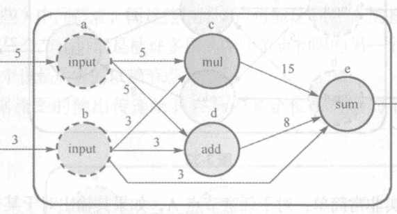

图 3-29

数据流图的主要变化有以下两点。

- (1) 来自节点 b 的 input 值 3 现在也传递给了节点 e。
- (2) 节点 e 中的函数 add 被替换为 sum，表明它可完成两个以上的数的加法运算。

读者可能已经注意到，图 3-30 在看起来被其他节点 “隔离” 的两个节点之间添加了一条边。一般而言，任何节点都可将其输出传递给数据流图中的任意后继节点，而无论这两者之间发生了多少计算，数据流图甚至可以拥有图 3-30 所示的结构，它仍然是完全合法的。

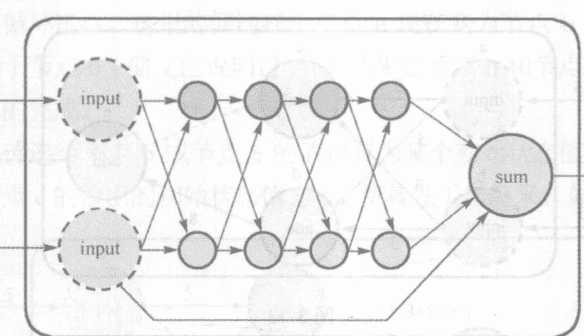

图 3-30

通过这两个数据流图，已经能够初步感受到对数据流图的输入进行抽象所带来的好处。我们能够对数据流图中内部运算的精确细节进行操控，但客户只需了解将何种信息传递给那两个输入节点。我们甚至可以进一步抽象，将上述数据流图表示为图 3-31 所示的黑箱。

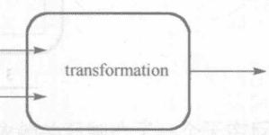

图 3-31

这样，便可将整个节点序列视为拥有一组输入和输出的离散构件。这种抽象方式使得对级联在一起的若干个运算组进行可视化更加容易，而无须关心每个部件的具体细节。


### 3.3.2 节点的依赖关系

在数据流图中，节点之间的某些类型的连接是不被允许的，最常见的一种是将造成循环依赖（circular dependency）的连接。为理解“循环依赖”这个概念，需要先理解何为“依赖关系”。观察图 3-32 所示的数据流图。

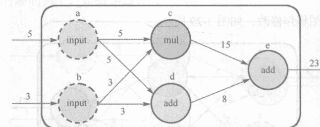

图 3-32

循环依赖这个概念其实非常简单：对于任意节点 A，如果其输出对于某个后继节点 B 的计算是必需的，则称节点 A 为节点 B 的依赖节点。如果某个节点 A 和节点 B 彼此不需要来自对方的任何信息，则称两者是独立的。为对此进行可视化，首先观察当乘法节点 c 出于某种原因无法完成计算时（如图 3-33 所示）会出现何种情况。

可以预见，由于节点 e 需要来自节点 c 的输出，因此其运算无法执行，只能无限等待节点 c 的数据到来。容易看出，节点 c 和节点 d 均为节点 e 的依赖节点，因为它们均将信息直接传递到最后的加法函数。然而，稍加思索就可看出节点 a 和节点 b 也是节点 e 的依赖节点。如果输入节点中有一个未能将其输入传递给数据流图中的下一个函数，如图 3-34 所示，情形会怎样？

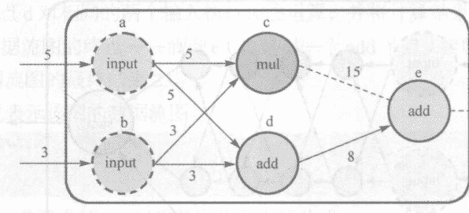

图 3-33

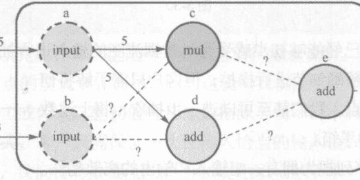

图 3-34

由图 3-35 可以看出，若将输入中的某一个移除，会导致数据流图中的大部分运算中断，从而表明依赖关系具有传递性。即，若 A 依赖于 B，而 B 依赖于 C，则 A 依赖于 C。在本例中，最终节点 e 依赖于节点 c 和节点 d，而节点 c 和节点 d 均依赖于输入节点 b。因此，最终节点 e 也依赖于输入节点 b。同理可知节点 e 也依赖于输入节点 a。此外，还可对节点 e 的不同依赖节点进行区分。

- (1) 节点 e 直接依赖于节点 c 和节点 d。即为使节点 e 的运算得到执行，必须有直接来自节点 c 和节点 d 的数据。

- (2) 节点 e 间接依赖于节点 a 和节点 b。这表示节点 a 和节点 b 的输出并未直接传递到节点 e，而是传递到某个（或某些）中间节点，而这些中间节点可能是节点 e 的直接依赖节点，也可能是间接依赖节点。这意味着一个节点可以是被许多层的中间节点相隔的另一个节点的间接依赖节点（且这些中间节点中的每一个也是后者的依赖节点）。

最后来观察将数据流图的输出传递给其自身的某个位于前端的节点时会出现何种情况，如图 3-35 所示。

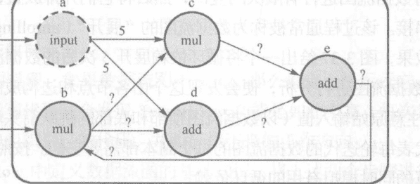

图 3-35

不幸的是，图 3-36 的数据流图看起来无法工作。我们试图将节点 e 的输出送回节点 b，并希望该数据流图的计算能够循环进行。这里的问题在于节点 e 现在变为节点 b 的直接依赖节点；而与此同时，节点 e 仍然依赖于节点 b（前文已说明过）。其结果是节点 b 和节点 e 都无法得到执行，因为它们都在等待对方计算的完成。

也许读者会想到将传递给节点 b 或节点 e 的值设置为某个初始状态值。毕竟，这个数据流图是受控制的。不妨假设节点 e 的输出的初始状态值为 1，使其先工作起来，如图 3-36 所示。

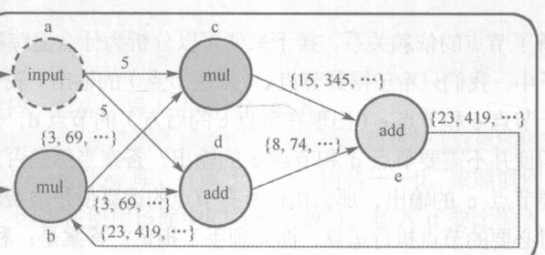

图 3-36

图 3-37 给出了经过几轮循环后数据流图中各节点的状态。新引入的依赖关系制造了一个无穷反馈环，且该数据流图中的大部分边都趋向于无穷大。然而，出于多种原因，对于像 TensorFlow 这样的软件，这种类型的无限循环是非常不利的。

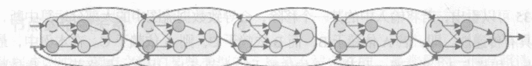

图 3-37

- （1）由于数据流图中存在无限循环，因此程序无法以正常方式终止。

- （2）依赖节点的数量变为无穷大，因为每轮迭代都依赖于之前的所有轮次的迭代。不幸的是，在统计依赖关系时，每个节点都不会只被统计一次，每当其输出发生变化时，它便会被再次记为依赖节点。这就使得追踪依赖信息变得不可能，而出于多种原因（详见本节的最后一部分），这种需求是至关重要的。

- （3）也许经常会遇到这样的情况：被传递的值要么在正方向变得非常大（从而导致上溢），要么在负方向变得非常大（导致下溢），或者非常接近于 0（使得每轮迭代在加法上失去意义）。

基于上述考虑，在 TensorFlow 中，真正的循环依赖关系是无法表示的，这并非坏事。在实际使用中，完全可通过对数据流图进行有限次的复制，然后将它们并排放置，并将代表相邻迭代轮次的副本的输出与输入串接。该过程通常被称为数据流图的“展开”（unrolling）。为了以图形化的方式展示数据流图的展开效果，图 3-37 给出一个将循环依赖展开 5 次后的数据流图。

对图 3-38 中的数据流图进行分析，便会发现这个由各节点和边构成的序列等价于将之前的数据流图遍历 5 次。请注意原始输入值（以数据流图顶部和底部的跳跃箭头表示）是传递给数据流图的每个副本的，因为代表每轮迭代的数据流图的每个副本都需要它们。按照这种方式将数据流图展开，可在保持确定性计算的同时模拟有用的循环依赖。

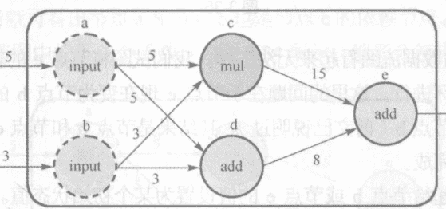

图 3-38

既然我们已经理解了节点的依赖关系，接下来便可以分析为什么追踪这种依赖关系十分有用。不妨假设在之前的例子中，我们只希望得到节点 c（乘法节点）的输出。我们已经定义了完整的数据流图，其中包含独立于节点 c 和节点 e（出现在节点 c 的后方）的节点 d，那么是否必须执行整个数据流图的所有运算，即便并不需要节点 d 和节点 e 的输出？答案当然是否定的。观察该数据流图，不难发现，如果只需要节点 c 的输出，那么执行所有节点的运算便是浪费时间。但这里的问题在于，如何确保计算机只对必要的节点执行运算，而无须手工指定？答案是：利用节点之间的依赖关系。

这背后的概念相当简单，唯一需要确保的是为每个节点的直接（而非间接）依赖节点维护一个列表。可从一个空栈开始，它最终将保存所有希望运行的节点。从希望获得其输出的节点开始，显然它必须得到执行，因此令其入栈。接下来查看该输出节点的依赖节点列表，这意味着为计算输出，那些节点必须运行，因此将它们全部入栈。然后，对那些节点进行检查，看它们的直接依赖节点有哪些，然后将它们全部入栈。继续这种追溯模式，直到数据流图中的所有依赖节点均已入栈。按照这种方式，便可保证获得运行该数据流图所需的全部节点，且只包含所有必需节点。此外，利用上述栈结构，可对其中的节点进行排序，从而保证当遍历该栈时，其中所有节点都会按照一定的次序得到运行。唯一需要注意的是要追踪哪些节点已经完成了计算，并将它们的输出保存在内存中，以避免对同一节点反复计算。按照这种方式，便可确保计算量尽可能地精简，从而在规模较大的数据流图上节省以小时计的宝贵处理时间。

## 3.4 TensorFlow 中定义数据流图

在本书中，你将接触到多样化的且相当复杂的机器学习模型。然而，不同的模型在 TensorFlow 中的定义过程却遵循着相似的模式。当掌握了各种数学概念，并学会实现它们时，对 TensorFlow 核心工作模式的理解将有助于你脚踏实地地开展工作。幸运的是，这个工作流非常容易记忆，它只包含两个步骤。

- (1) 定义数据流图。
- (2) 运行数据流图（在数据上）。

这里有一个显而易见的道理，如果数据流图不存在，那么肯定无法运行它。头脑中有这种概念是很有必要的，因为当你编写代码时会发现 TensorFlow 功能是如此丰富。每次只需关注上述工作流的一部分，有助于更周密地组织自己的代码，并明确接下来的工作方向。

本书将讲述在 TensorFlow 中定义数据流图的基础知识，将上述两个步骤进行衔接，并展示如何创建在多次运行中状态不断发生变化并接收不同数据的数据流图。

### 3.4.1 构建一个 TensorFlow 数据流图

通过 3.3 节的介绍，我们已对图 3-38 所示的数据流图颇为熟悉。用于表示该数据流图的 TensorFlow 代码如下。

```

import tensorflow as tf

a = tf.constant(5, name="input_a")

b = tf.constant(3, name="input_b")

c = tf.multiply(a, b, name="mul_c")

d = tf.add(a, b, name="add_d")

e = tf.add(c, d, name="add_e")

```

下面来逐行解析这段代码。首先，导入语句代码如下。

```

import tensorflow as tf

```

这条语句的作用是导入 TensorFlow 库，并赋予它一个别名——tf。按照惯例，人们通常都是以这种形式导入 TensorFlow 的，因为在使用该库中的各种函数时，输入 tf 要比输入完整的 tensorflow 容易得多。

接下来研究前两行变量赋值语句，代码如下。

```

a = tf.constant(5, name = "input_a")

b = tf.constant(3, name = "input_b")

```

这里定义了 input 节点 a 和节点 b。语句第 1 次引用了 TensorFlow Operation：tf.constant()。各 Op 可接收 0 个或多个张量对象作为输入，并输出 0 个或多个张量对象。要创建一个 Op，可调用与其关联的 Python 构造方法，在本例中，tf.constant()创建了一个“常量”Op，它接收单个张量值，然后将同样的值输出给与其直接连接的节点。为方便起见，该函数自动将标量值 5 和 3 转换为张量对象。此外，还为这个构造方式传入了一个可选的字符串参数 name，用于对所创建的节点进行标识。如果暂时还无法充分理解什么是 Op，什么是张量对象，请不必担心，本章稍后会对这些概念进行详细介绍。代码如下。

```

c = tf.multiply(a, b, name = "mul_c" )

d = tf.add(a, b, name = "add_d")

```

这两个语句定义了数据流图中的另外两个节点，而且它们都使用了之前定义的节点 a 和 b。节点 c 使用了 tf.multiply，该 Op 接收两个输入，然后将它们的乘积输出。类似地，节点 d 使用了 tf.add，该 Op 可将它的两个输入之和输出。对于这些 Op，我们均传入了 name 参数（今后还将有大量此类用法）。请注意，无须对数据流图中的边进行定义，因为在 TensorFlow 中创建节点时已包含了相应的 Op 完成计算所需要的全部输入，TensorFlow 会自动绘制必要的连接，代码如下。

```

e = tf.add(c, d, name = "add_e")

```

最后的这行代码定义了数据流图的终点 e，它使用 tf.add 的方式与节点 d 是一致的。区别只在于它的输入来自节点 c 和节点 d，这与数据流图中的描述完全一致。

通过上述代码，便完成了第 1 个小规模数据流图的完整定义。如果在一个 Python 脚本或 Shell 中执行上述代码，虽然可以运行，但实际上却不会有任何实质性的结果输出。请注意，这只是整个流程的数据流图定义部分，要想体验一个数据流图的运行效果，还需在上述代码之后添加两行语句，以将数据流图终点的结果输出，代码如下。

```

sess = tf.Session()

sess.run(e)

```

如果正在某个交互环境中运行这些代码，如在 Python Shell 或 Jupyter/iPython Notebook 中，则可以看到输出 23。

下面通过一个练习来实践上述内容。在这个练习中，将实现第 1 个 TensorFlow 数据流图，运行它的各个部件，并初步了解极为有用的工具——TensorBoard。完成该练习后，将能够非常自如地构建基本的 TensorFlow 数据流图。

首先确保已成功安装 TensorFlow，并启动 Python 依赖环境（如果使用的话），如 Anaconda、Virtualenv、Docker 等。此外，如果是从源代码安装 TensorFlow，请确保控制台的当前工作路径不同于 TensorFlow 的源文件夹，否则在导入该库时，Python 将会无所适从。现在，启动一个交互式 Python Session（既可通过 Shell 命令 jupyter notebook 使用 Jupyter Notebook，也可通过命令 Python 启动简易的 Python Shell）。如果有其他更好的方式交互地编写 Python 代码，也可放心地使用。

可将代码写入一个 Python 文件，然后以非交互方式运行，但运行数据流图所产生的输出在默认情况下是不会显示出来的。为了使所定义的数据流图的运行结果可见，同时获得 Python 解释器对输入的句法的即时反馈（如果使用的是 Jupyter Notebook），并能够在线修正错误和修改代码，强烈建议在交互式环境中完成这些例子。

首先需要加载 TensorFlow 库。可按照下列方式编写导入语句。

```

import tensorflow as tf

```

导入过程需要持续几秒，待导入完成后，交互式环境便会等待下一行代码的到来。如果安装了有 GPU 支持的 TensorFlow，可能还会看到一些输出信息，提示 CUDA 库已被导入。如果得到一条类似 cannot import name pywrap_tensorflow 的错误提示，请确保交互环境不是从 TensorFlow 的源文件夹启动。

而如果出现类似 No module named tensorflow 的错误提示，请复查 TensorFlow 是否被正确安装，如果使用的是 Anaconda 或 Virtualenv，请确保启动交互式 Python 软件时，TensorFlow 环境处于活动状态。请注意，如果运行了多个终端，则将只有一个终端拥有活动状态的 TensorFlow 环境。

假设上述导入语句在执行时没有遇到任何问题，则可进入下一部分代码。

```

a = tf.constant(5, name = "input_a")

b = tf.constant(3, name = "input_b")

```

这与在上面看到的代码完全相同，可随意更改这些常量的数值或 name 参数。在本书中为了保持前后一致，笔者会始终使用相同的数值。

```

c = tf.multiply(a, b, name = "mul_c" )

d = tf.add(a, b, name = "add_d")

```

这样，代码中便有了两个实际执行某个数学函数的 Op。如果对使用 tf.multiply 和 tf.add 感到厌倦，不妨将其替换为 tf.sub、tf.div 或 tf.mod，这些函数分别执行的是减法、除法和取模运算。

tf.div 或执行整数除法，或执行浮点数除法，具体取决于所提供的输入类型。如果希望确保使用浮点数除法，请使用 tf.truediv。

接下来定义数据流图的终点，代码如下。

```

e = tf.add(c, d, name = "add_e")

```

在调用上述 Op 时，没有显示任何输出，这是因为这些语句只是在后台将一些 Op 添加到数据流图中，并无任何计算发生。为运行该数据流图，需要创建一个 TensorFlow Session 对象，代码如下。

```

sess = tf.Session()

# TensorFlow 核心基础：从会话执行到张量形状解析

掌握 TensorFlow 编程的第一步，是理解计算图的构建与运行机制。我们不妨从一个简单的算术运算入手，看看如何在会话中驱动图计算，并借助 TensorBoard 将隐形的计算图“看”得清清楚楚。

## 会话运行与图可视化实战

在 TensorFlow 1.x 风格中，定义好张量与操作后，必须借助 `Session` 来启动计算。以下示例展示了如何逐步执行节点、获取最终结果，并将图结构导出供可视化工具使用。

```

Session 对象在运行时负责对数据流图进行监督，并且是运行数据流图的主要接口。如果希望运行自己的代码，必须定义一个 Session 对象。上述代码将 Session 对象赋给了变量 sess，以便后期能够对其进行访问。

tf.Session 有一个与之十分相近的变体——tf.InteractiveSession。tf.InteractiveSession 是专为交互式 Python 软件设计的（例如那些可能正在使用的环境），而且它采取了一些方法使运行代码的过程更加简便。不利的方面是在 Python 文件中编写 TensorFlow 代码时用处不大，而且它会将一些初学者应当了解的 TensorFlow 信息进行抽象。此外，它不能省去很多的按键次数。本书将始终使用标准的 tf.Session 类。

```

sess.run(e)

```

至此，终于可以看到运行结果了。执行完上述语句后，应当能够看到所定义的数据流图的输出。对于本练习中的数据流图，输出结果为 23。如果使用了不同的输入函数和输入值，则最终结果也可能不同。然而，这并非我们能做的全部，还可尝试着将数据流图中的其他节点传入 sess.run()函数，代码如下。

```

sess.run(c)

```

通过这个调用，应该能够看到中间节点 c 的输出（在本例中为 15）。TensorFlow 不会对所创建的数据流图做任何假设，程序并不会关心节点 c 是否为希望得到的输出。实际上，可对数据流图中的任意 Op 使用 run()函数。当将某个 Op 传入 sess.run()时，本质上是在通知 TensorFlow“这里有一个节点，我希望得到它的输出，请执行所有必要的运算来求取这个节点的输出”。可反复尝试该函数的使用，将数据流图中其他节点的结果输出。还可将运行数据流图所得到的结果保存下来。下面将节点 e 的输出保存到一个名为 output 的 Python 变量中。

```

output = sess.run(e)

```

既然我们已经拥有了一个活动状态的 Session 对象，且数据流图已定义完毕，下面来对它进行可视化，以确认其结构与之前所绘制的数据流图完全一致。为此可使用 TensorBoard，它是随 TensorFlow 一起安装的。为利用 TensorBoard，需要在代码中添加以下语句。

```

writer = tf.summary.FileWriter('d:\Tensorboard\my_graph', sess.graph)

```

下面分析这行代码的作用。我们创建了一个 TensorFlow 的 SummaryWriter 对象，并将它赋值给变量 writer。虽然在本练习中不准备用 SummaryWriter 对象完成其他操作，但今后会利用它保存来自数据流图的数据和概括统计量，因此我们习惯将它赋值给一个变量。为对 SummaryWriter 对象进行初始化，我们传入了两个参数。第 1 个参数是一个字符串输出目录，即数据流图的描述在磁盘中的存放路径。在本例中，所创建的文件将被存放在一个名为 my_graph 的文件夹中，而该文件夹位于 d:\Tensorboard\路径下。我们传递给 SummaryWriter 构造方法的第 2 个参数是 Session 对象的 graph 属性。作为在 TensorFlow 中定义的数据流图管理器，tf.Session 对象拥有一个 graph 属性，该属性引用了它们所要追踪的数据流图。通过将该属性传入 SummaryWriter 构造方法，所构造的 SummaryWriter 对象便会将对该数据流图的描述输出到 my_graph 路径下。SummaryWriter 对象初始化完成后便会立即写入这些数据，因此一旦执行完这行代码，便可启动 TensorBoard。

回到终端，确保当前工作路径为 my_graph 文件夹所在目录（本例中为 d:\Tensorboard\，在此目录下应该能看到列出的 my_graph 路径），并输入下列命令。

```

tensorboard --logdir=my_graph

```

从控制台中，应该能够看到一些日志信息被打印出来，然后是消息 TensorBoard 1.7.0 at http://localhost:6006 (Press CTRL+C to quit)（具体地址请参考个人机器终端提示）。刚才所做的是启动一个使用来自 my_graph 目录下的数据的 TensorBoard 服务器。默认情况下，TensorBoard 服务器启动后会自动监听端口 6006——要访问 TensorBoard，可打开浏览器并在地址栏输入 http://localhost:6006，单击页面顶部的 GRAPHS 链接，将看到类似图 3-39 所示的页面。

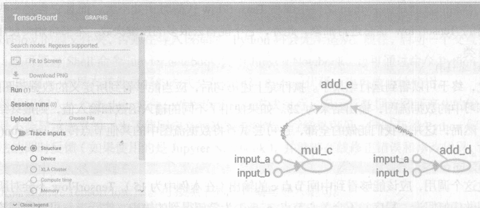

图 3-39


如果数据流图过小，则可通过在 TensorBoard 上向上滚动鼠标滚轮将其放大。可以看到，图 3-39 的每个节点都用传给每个 Op 的 name 参数进行了标识。如果单击这些节点，还会得到一些关于它们的信息，如它们依赖于哪些节点等。此时会发现输入节点 a 和 b 好像重复出现了，如果单击或将鼠标悬停在标签为 input_a 的任何一个节点，会发现两个节点同时高亮。这里的数据流图在外观上与之前所绘制的并不完全相同，但它们本质上是一样的，因为 input 节点不过是显示了两次而已。

现在已经正式地编写并运行了第 1 个 TensorFlow 数据流图，而且还在 TensorBoard 中对其进行了检查。要想更多地实践，可尝试在数据流图中添加更多节点，并试验一些之前介绍过的不同数学运算，然后添加少量 tf.constant 节点，运行所添加的不同节点，确保真正理解了数据在数据流图中的流动方式。

完成数据流图的构造之后，需要将 Session 对象和 SummaryWriter 对象关闭以释放资源并执行一些清理工作。

```

writer.close()

sess.close()

将上述片段串联成完整脚本，即可完成从建图、运行到日志记录的全流程。注意路径分隔符在 Windows 下建议使用双反斜杠或原始字符串，避免转义陷阱。

```

从技术角度讲，当程序运行结束后（若使用的是交互式环境，当关闭或重启 Python 内核时），Session 对象会自动关闭。尽管如此，笔者仍然建议显式关闭 Session 对象，以避免任何奇怪的边界用例出现。

下面给出本练习对应的完整 Python 代码。

```

import tensorflow as tf

a = tf.constant(5, name="input_a")

b = tf.constant(3, name="input_b")

c = tf.multiply(a, b, name="mul_c")

d = tf.add(a, b, name="add_d")

e = tf.add(c, d, name="add_e")

sess = tf.Session()

output = sess.run(e)

writer = tf.summary.FileWriter('d:\\Tensorboard\\my_graph', sess.graph)

writer.close()

sess.close()

## 张量阶数：从标量到高维数组

张量的“阶”（Rank）决定了其维度层级。0 阶是标量，1 阶为向量，2 阶对应矩阵，3 阶及以上则构成立体或更高维数据块。下面用原生 Python 列表直观呈现各阶张量的嵌套结构。

```

### 3.4.2 张量思维

在学习数据流图的基础知识时，使用简单的标量值是很好的选择。在已经掌握了“数据流”的情况下，下面熟悉一下张量的概念。

如前所述，所谓张量，即 n 维矩阵的抽象。因此，1 维张量等价于向量，2 维张量等价于矩阵，对于更高维数的张量，可称“N 维张量”或“N 阶张量”。有了这一概念，便可对之前的示例数据流图进行修改，使其可使用张量，如图 3-40 所示。

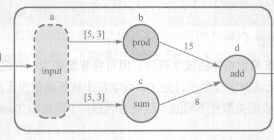

现在不再使用两个独立的输入节点，而是换成了一个可接收向量（或 1 阶张量）的节点。与之前的版本相比，这个新的流图有如下优点。

- (1) 客户只需将输入送给单个节点，简化了流图的使用。
- (2) 那些直接依赖于输入的节点现在只需追踪一个依赖节点，而非两个。
- (3) 这个版本的流图可接收任意长度的向量，从而使其灵活性大大增强。还可对这个流图施加一条严格的约束，如要求输入的长度必须为 2（或任何我们希望的长度）。

按下列方式修改之前的代码，便可在 TensorFlow 中实现这种变动。

```

import tensorflow as tf

a = tf.constant([5, 3], name="input_a")

b = tf.reduce_prod(a, name="prod_b")

c = tf.reduce_sum(a, name="sum_c")

d = tf.add(b, c, name="add_d")

```

除了调整变量名称外，主要改动还有以下两处。

- (1) 将原先分离的节点 a 和 b 替换为一个统一的输入节点（不止包含之前的节点 a）。传入一组数值后，它们会由 tf.constant 函数转化为一个 1 阶张量。
- (2) 之前只能接收标量值的乘法和加法 Op，现在可用 tf.reduce_prod() 和 tf.reduce_sum() 函数重新定义。当给定某个张量作为输入时，这些函数会接收其所有分量，然后分别将它们相乘或相加。

在 TensorFlow 中，所有在节点之间传递的数据都为张量对象。我们已经看到，TensorFlow Op 可接收标准 Python 数据类型，如整数或字符串，并将它们自动转化为张量。手工创建张量对象有多种方式（即无须从外部数据源读取），下面对其中一部分进行介绍。

注意：本书在讨论代码时，会不加区分地使用“张量”或“张量对象”。

### 1. Python 原生类型

TensorFlow 可接收 Python 数值、布尔值、字符串或由它们构成的列表。单个数值将被转化为 0 阶张量（或标量），数值列表将被转化为 1 阶张量（向量），由列表构成的列表将被转化为 2 阶张量（矩阵），以此类推。下面给出一些例子。

```

t_0 = 50				#视为 0 阶张量或标量

t_1 = [b"apple", b"peach", b"grape"]		#视为 1 阶张量或向量

t_2 = [[True, False, False],

		 [False, False, True],

		 [False, True, False]]			#视为 2 阶张量或矩阵

t_3 = [[[0, 0], [0, 1], [0, 2]],

		 [[1, 0], [1, 1], [1, 2]],

		 [[2, 0], [2, 1], [2, 2]]]			#视为 3 阶张量

......

工程落地时，通常借助 NumPy 创建带明确 dtype 的张量原型，再转入 TensorFlow 图中。注意字符串类型在 NumPy 中无需显式指定 dtype，布尔与整数类型则建议显式声明位宽，确保跨平台一致性。

```

### 2. TensorFlow 数据类型

目前为止，我们尚未见到布尔值或字符串，但可将张量视为一种以结构化格式保存任意数据的方式。显然，数学函数无法对字符串进行处理，而字符串解析函数也无法对数值型数据进行处理，但 TensorFlow 所能处理的数据类型并不局限于数值型数据。下面给出 TensorFlow 中可用数据类型的完整清单，如表 3-2 所示。

### 表 3-2

| 数据类型 ( dtype ) | 描述 |
| :--- | :--- |
| tf.float32 | 32 位浮点数 |
| tf.float64 | 64 位浮点数 |
| tf.int8 | 8 位有符号整数 |
| tf.int16 | 16 位有符号整数 |
| tf.int32 | 32 位有符号整数 |
| tf.int64 | 64 位有符号整数 |
| tf.uint8 | 8 位无符号整数 |
| tf.string | 字符串（作为非 Unicode 编码的字节数组） |
| tf.bool | 布尔型 |
| tf.complex64 | 复数，实部和虚部分别为 32 位浮点数 |
| tf.qint8 | 8 位有符号整数（用于量化 Op） |
| tf.qint32 | 32 位有符号整数（用于量化 Op） |
| tf.quint8 | 8 位无符号整数（用于量化 Op） |

利用 Python 类型指定张量对象既容易又快捷，且对为一些想法提供原型非常有用。然而，很不幸，这种方式也会带来无法忽视的不利方面。TensorFlow 有数量极为庞大的数据类型可供使用，但基本的 Python 类型缺乏对有些数据类型的种类进行明确声明的能力。因此，TensorFlow 需要推断你期望的是何种数据类型。对于某些类型，如字符串，推断过程是非常简单的，但对于其他类型，则可能完全无法做出推断。例如，在 Python 中，所有整数都具有相同的类型，但 TensorFlow 却有 8 位、16 位、32 位和 64 位整数类型之分。当将数据传入 TensorFlow 时，虽有一些方法可将数据转化为恰当的类型，但某些数据类型仍然可能难以正确地声明，如复数类型。因此，更常见的做法是借助 NumPy 数组手工定义张量对象。

### 3. NumPy 数组

TensorFlow 与专为操作 N 维数组而设计的科学计算软件包 NumPy 是紧密集成在一起的。如果之前没有使用过 NumPy，这里强烈推荐你从大量可用的入门材料和文档中选择一些进行学习，因为它已成为数据科学的通用语言。TensorFlow 的数据类型是基于 NumPy 的数据类型的。实际上，语句 np.int32==tf.int32 的结果为 True。任何 NumPy 数组都可传递给 TensorFlow Op，而且其美妙之处在于可以用最小的代价轻易地指定所需的数据类型。

对于字符串数据类型，有一个“特别之处”需要注意。对于数值类型和布尔类型，TensorFlow 和 NumPy dtype 属性是完全一致的。然而，在 NumPy 中并无与 tf.string 精确对应的类型，这是由 NumPy 处理字符串的方式决定的。也就是说，TensorFlow 可以从 NumPy 中完美地导入字符串数组，只是不要在 NumPy 中显式指定 dtype 属性。

有一个好处是，在运行数据流图之前或之后，都可以利用 NumPy 库的功能，因为从 Session.run 方法所返回的张量均为 NumPy 数组。下面模仿之前的例子，给出一段用于演示创建 NumPy 数组的示例代码。

```

import numpy as np #不要忘记导入 Numpy

#元素类型为 32 位整数的 0 阶张量

t_0 = np.array(50, dtype=np.int32)

#元素为字节字符串类型的 1 阶张量

#注意：在 Numpy 中使用字符串时，不要显式指定 dtype 属性

t_1 = np.array([b"apple", b"peach", b"grape"])

#元素为布尔型的 1 阶张量

t_2 = np.array([[True, False, False],

                [False, False, True],

                [False, True, False]],

               dtype=np.bool

              )

#元素为 64 位整数的 3 阶张量

t_3 = np.array([[[0, 0], [0, 1], [0, 2]],

                [[1, 0], [1, 1], [1, 2]],

                [[2, 0], [2, 1], [2, 2]]],

               dtype = np.int64)

......

## 形状属性：静态定义与动态兼容

形状描述了张量在每个维度上的长度。标量形状为空元组/列表，向量用单元素容器表示长度，矩阵则用两元素元组/列表记录行列数。

```

虽然 TensorFlow 是为理解 NumPy 原生数据类型而设计的，但反之不然。请不要尝试用 tf.int32 去初始化一个 NumPy 数组。从技术角度讲，NumPy 也能够自动检测数据类型，但强烈建议养成显式声明张量对象的数值属性的习惯，因为当处理的流图规模较大时，不用逐一排查到底是哪些对象导致了 TypeMismatchError！当然，有一个例外，那就是当处理字符串时——创建字符串张量对象时，请勿指定 dtype 属性。手工指定张量对象时，使用 NumPy 是推荐的方式。

### 3.4.3 张量的形状

在整个 TensorFlow 库中，会经常看到一些引用了某个张量对象的 shape 属性的函数和 Op。这里的 Shape 是 TensorFlow 的专有术语，它同时刻画了张量的维（阶）数以及每 1 维的长度。张量的形状可以是包含有序整数集的列表（list）或元组（tuple）：列表中元素的数量与维数一致，且每个元素描述了相应维度上的长度。例如，列表[2, 3]描述了一个 2 阶张量的形状，其第 1 个维度上的长度为 2，第 2 个维度上的长度为 3。注意，无论元组，还是列表，都可用于定义张量的形状。下面通过更多的例子来说明这一点。

```

#指定 0 阶张量（标量）的形状

#例如，任意整数 7、1、3、4 等

s_0_list = []

s_0_tuple = ()

#刻画了一个长度为 3 的向量的形状

#例如[1, 2, 3]

s_1 = [3]

#刻画了一个 3*2 矩阵的形状

#例如[[1, 2],

####    [3, 4],

####    [5, 6]]

s_2 = (3, 2)

实际建模中，批次大小、序列长度常在运行期才确定，这时引入 `None` 占位实现动态形状。一维动态向量、固定列数的变长矩阵、部分维度固定的高阶张量，均可通过 `None` 灵活表达；若完全不确定，直接赋值 `None` 代表任意形状。

```

除了能够将张量的每 1 维指定为固定长度，也可将 None 作为某 1 维的值，使该张量具有可变长度。此外，将形状指定为 None（而非使用包含 None 的列表或元组）将通知 TensorFlow 允许一个张量为任意形状，即张量可拥有任意维数，且每 1 维都可具有任意长度。

```

#具有任意长度的向量的形状

s_1_flex = [None]

#行数任意、列数为 3 的矩阵的形状

s_2_flex = (None, 3)

#第 1 维上长度为 2，第 2 维和第 3 维上长度任意的 3 阶张量

s_3_flex = [2, None, None]

#形状可为任意值的张量

s_any = None

最后，若需在图构建阶段动态获取张量形状（而非 Python 端的静态元组），可调用 `tf.shape` 算子，它将返回一个 1-D 整型张量，便于后续流程控制或形状运算。

```

如果需要在数据流图的中间获取某个张量的形状，可以使用 tf.shape Op。
它的输入为希望获取其形状的张量对象，输出为一个 int32 类型的向量

```

import tensorflow as tf

#创建某种类型的神秘张量

#获取上述张量的形状

shape = tf.shape(mystery_tensor, name="mystery_shape")

# TensorFlow 核心编程模型：张量、图与会话实战解析

掌握 TensorFlow 的第一步，是理解其“定义图 -> 执行图”的延迟执行机制。本文将通过代码实例，带你拆解张量运算、计算图管理、会话生命周期以及数据喂入等核心环节。

## 基础张量运算与操作节点

一切从数据开始。我们先用 NumPy 创建两个整型数组，再借助 TensorFlow 完成加法运算。

```

请记住，与其他 Op 一样，tf.shape 只能通过 Session 对象得到执行。
再次提醒：张量只是矩阵的一个超集。

### 3.4.4 TensorFlow 的 Op

TensorFlow Op，是一些对（或利用）张量对象执行运算的节点。计算完毕后，它们会返回 0 个或多个张量，可在以后为数据流图中的其他 Op 所使用。为创建 Op，需要在 Python 中调用其构造方法。调用时，需要传入计算所需的所有张量参数（称为输入）以及为正确创建 Op 的任何附加信息（称为属性）。Python 构造方法将返回一个指向所创建 Op 的输出（0 个或多个张量对象）的句柄。能够传递给其他 Op 或 Session.run 的输出如下。

```

```python
import tensorflow as tf
import numpy as np

# 准备底层数据
a = np.array([2, 3], dtype=np.int32)
b = np.array([4, 5], dtype=np.int32)

# 构建加法操作节点，c 指向该节点的输出张量
c = tf.add(a, b)
```

为操作节点命名是良好的工程习惯，方便后续在 TensorBoard 中可视化调试。

```

无输入、无输出的运算意味着从技术角度讲，有些 Op 既无任何输入，也无任何输出。Op 的功能并不只限于数据运算，它还可用于如状态初始化这样的任务。本章将回顾一些这样的非数学 Op，但请记住，并非所有节点都需要与其他节点连接。

除了输入和属性外，每个 Op 构造方法都可接收一个字符串参数——name，作为其输入。在上面的练习中已经了解到，通过提供 name 参数，可用描述性字符串来指代某个特定 Op。

```

```python
# 为操作指定唯一标识符
c = tf.add(a, b, name="my_add_op")
```

得益于运算符重载，TensorFlow 允许我们像操作原生 Python 对象一样直接对张量做算术运算，前提是形状兼容。

```

在这个例子中，我们为加法 Op 赋予了名称——my_add_op，这样便可在使用如 TensorBoard 等工具时引用该 Op。

如果希望在一个数据流图中对不同 Op 复用相同的 name 参数，则无须为每个 name 参数手工添加前缀或后缀，只需利用 name_scope 以编程的方式将这些运算组织在一起便可。在本章最后的练习中，将简要介绍名称作用域（ name scope ）的基础知识。

TensorFlow 还对常见数学运算符进行了重载，以使乘法、加法、减法以及其他常见运算更加简洁。如果运算符有一个或多个参数（操作对象）为张量对象，则会有一个 TensorFlow Op 被调用，并被添加到数据流图中。例如，可按照下列方式实现两个张量的加法。

```

```python
# 假设 a、b 均为张量且维度一致
c = a + b
```

## 计算图：隔离与管理计算逻辑

TensorFlow 1.x 时代，计算图是承载所有计算逻辑的容器。显式创建图对象能有效隔离不同模型的命名空间。

```

下面给出可用于张量的重载运算符的完整清单，详见表 3-3 和表 3-4，其中表 3-4 为二元运算符。

| 运算符 | 相关 TensorFlow 运算 | 描述 |
|---|---|---|
| -x | tf.neg() | 返回 x 中每个元素的相反数 |
| ~x | tf.logical_not() | 返回 x 中每个元素的逻辑非。只适用于 dtype 为 tf.bool 的张量对象 |
| abs(x) | tf.abs() | 返回 x 中每个元素的绝对值 |

| 运算符 | 相关 TensorFlow 运算 | 描述 |
|---|---|---|
| x+y | tf.add() | 将 x 和 y 逐元素相加 |
| x-y | tf.sub() | 将 x 和 y 逐元素相减 |
| x*y | tf.mul() | 将 x 和 y 逐元素相乘 |
| x/y(Python 2.x) | tf.div() | 给定整数张量时，执行逐元素的整数除法；给定浮点型张量时，将执行浮点数（“真正的”）除法 |
| x/y(Python 3.x) | tf.truediv() | 逐元素的浮点数除法（包括分子分母为整数的情形） |
| x//y(Python 3.x) | tf.floordiv() | 逐元素的向下取整除法，不返回余数 |
| x%y | tf.mod() | 逐元素取模 |
| x**y | tf.pow() | 逐一计算 x 中的每个元素为底数，y 中相应元素为指数时的幂 |
| x<y | tf.less() | 逐元素地计算 x<y 的真值表 |
| x<=y | tf.less_equal() | 逐元素地计算 x<=y 的真值表 |
| x>y | tf.greater() | 逐元素地计算 x>y 的真值表 |
| x>=y | tf.greater_equal() | 逐元素地计算 x>=y 的真值表 |
| x&y | tf.logical_and() | 逐元素地计算 x&y 的真值表，每个元素的 dtype 属性必须为 tf.bool |
| x\|y | tf.logical_or() | 逐元素地计算 x\|y 的真值表，每个元素的 dtype 属性必须为 tf.bool |
| x^y | tf.logical_xor() | 逐元素地计算 x^y 的真值表，每个元素的 dtype 属性必须为 tf.bool |

利用这些重载运算符可快速地对代码进行整合，但无法为这些 Op 指定 name 值。如果需要为 Op 指定 name 值，请直接调用 TensorFlow Op。


从技术角度讲，“==”运算符也被重载了，但它不会返回一个布尔型的张量对象。它所判断的是两个张量对象名是否引用了同一个对象，若是，则返回 True；否则，返回 False。这个功能主要是在 TensorFlow 内部使用。如果希望检查张量值是否相同，请使用 tf.equal()。

### 3.4.5 TensorFlow 的 Graph 对象

到目前为止，我们对数据流图的了解仅限于在 TensorFlow 中无处不在的某种抽象概念，而且对于开始编码时 Op 如何自动依附于某个数据流图并不清楚。既然已经接触了一些例子，下面来研究 TensorFlow 的 Graph 对象，学习如何创建更多的数据流图，以及如何让多个流图协同工作。

创建 Graph 对象的方法非常简单，它的构造方法不需要接收任何参数，代码如下。

```

```python
import tensorflow as tf

# 实例化一个独立的计算图容器
g = tf.Graph()
```

通过上下文管理器 `as_default()`，我们可以将后续定义的操作自动归属到指定图中。

```

Graph 对象初始化完成后，便可利用 Graph.as_default()方法访问其上下文管理器，为其添加 Op。

结合 with 语句，可利用上下文管理器通知 TensorFlow 需要将一些 Op 添加到某个特定 Graph 对象中，代码如下。

```

```python
with g.as_default():
    # 此处定义的乘法操作将被注册入图 g
    a = tf.multiply(2, 3)
    # ... 更多操作构建
```

若不指定图上下文，操作默认落入全局默认图。下面的示例展示了如何区分“默认图”与“自定义图”中的节点归属。

```

为什么在上面的例子中不需要指定将 Op 添加到哪个 Graph 对象？原因是这样的：为方便起见，当 TensorFlow 库被加载时，它会自动创建一个 Graph 对象，并将其作为默认的数据流图。因此，在 Graph.as_default()上下文管理器之外定义的任何 Op、张量对象都会自动放置在默认的数据流图中。

```

```python
# 该加法节点属于默认图
in_default_graph = tf.add(1, 2)
```

```

```

```python
# 进入图 g 的上下文
with g.as_default():
    # 该乘法节点属于图 g
    in_graph_g = tf.multiply(2, 3)
```

```

```

```python
# 退出 with 块后，回到默认图上下文
# 此减法节点再次归属默认图
also_in_default_graph = tf.sub(5, 1)
```

获取当前线程的默认图对象，可用 `tf.get_default_graph()`。

```

如果写获得默认数据流图的句柄，可使用 tf.get_default_graph()函数，代码如下。

```

```python
default_graph = tf.get_default_graph()
```

### 多图共存与切换策略

实际项目中常需同时维护多个图（如训练图与推理图）。以下三种模式演示了不同的管理方式。

**模式一：两个全新的自定义图**

```

在大多数 TensorFlow 程序中，只使用默认数据流图就足够了。然而，如果需要定义多个相互之间不存在依赖关系的模型，则创建多个 Graph 对象十分有用。当需要在单个文件中定义多个数据流图时，最佳实践是不使用默认数据流图，或为其立即分配句柄。这样可以保证各节点按照一致的方式添加到每个数据流图中。

- （1）正确的实践——创建新的数据流图，将默认数据流图忽略，代码如下。

```

```python
import tensorflow as tf

g1 = tf.Graph()
g2 = tf.Graph()

with g1.as_default():
    # 构建 g1 的拓扑结构
    ...

with g2.as_default():
    # 构建 g2 的拓扑结构
    ...
```

**模式二：复用默认图 + 创建新图**

```

- （2）正确的实践——获取默认数据流图的句柄，代码如下。

```

```python
import tensorflow as tf

g1 = tf.get_default_graph()  # 捕获当前默认图
g2 = tf.Graph()              # 创建新图

with g1.as_default():
    # 向默认图添加节点
    ...

with g2.as_default():
    # 向新图添加节点
    ...
```

**模式三：默认图隐式构建 + 显式切换新图**

```

- （3）错误的实践——将默认数据流图和用户创建的数据流图混合使用，代码如下。

```

```python
import tensorflow as tf

g2 = tf.Graph()

# 此处代码隐式写入默认图
...

with g2.as_default():
    # 显式切换至 g2 构建节点
    ...
```

## 会话：驱动图执行的运行时引擎

定义好图后，必须通过 `Session` 来分配资源、执行计算。

```

此外，从其他 TensorFlow 脚本中加载之前定义的模型，并利用 Graph.as_graph_def() 和 tf.import_graph_def() 函数将其赋给 Graph 对象也是可行的。这样，用户便可在同一个 Python 文件中计算和使用若干个独立模型的输出。

### 3.4.6 TensorFlow 的 Session

在之前的练习中，我们曾经介绍过 Session 类负责数据流图的执行。构造方法 tf.Session() 接收 3 个可选参数。

.target 指定了所要使用的执行引擎。对于大多数应用，该参数为默认的空字符串。在分布式设置中使用 Session 对象时，该参数用于连接不同的 tf.train.Server 实例。

.graph 参数指定了将要在 Session 对象中加载的 Graph 对象，其默认值为 None，表示将使用当前默认数据流图。当使用多个数据流图时，最好的方式是显式传入希望运行的 Graph 对象（而非在一个 with 语句块内创建 Session 对象）。

.config 参数允许用户指定配置 Session 对象所需的选项，如限制 CPU 或 GPU 的使用数目，为数据流图设置优化参数及日志选项等。

在典型的 TensorFlow 程序中，创建 Session 对象时无须改变任何默认构造参数。

```

```python
import tensorflow as tf

# 构建默认图上的计算链：a=7, b=21
a = tf.add(2, 5)
b = tf.multiply(a, 3)
```

### 会话的创建与关联

会话默认绑定当前线程的默认图，也可显式指定。

```

```

```python
# 绑定默认图启动会话
sess = tf.Session()
```

```

注意，下列两种调用方式是等价的。

```

```python
# 等价的显式绑定写法
sess = tf.Session()
sess = tf.Session(graph=tf.get_default_graph())
```

### 执行计算与获取结果

`run()` 方法是触发计算的入口，支持单输出或多输出获取。

```

一旦创建完 Session 对象，便可利用其主要的方法 run()来计算所期望的张量对象的输出。

```

```python
# 单节点求值，输出 21
sess.run(b)
```

```

Session.run()方法接收一个参数 fetches，以及其他 3 个可选参数：feed_dict、options 和 run_metadata。本书不打算对 options 和 run_metadata 进行介绍，因为它们尚处在实验阶段（因此以后很可能会有变动），且目前用途非常有限，但理解 feed_dict 非常重要，下文将对其进行讲解。

### 1. fetches 参数

fetches 参数接收任意的数据流图元素（ Op 或张量对象），后者指定了用户希望执行的对象。如果请求对象为张量对象，则 run()的输出将为一 NumPy 数组；如果请求对象为一个 Op，则输出将为 None。

在上面的例子中，将 fetches 参数取为张量 b (tf.mul Op 的输出）。TensorFlow 便会得到通知，Session 对象应当找到为计算 b 的值所需的全部节点，顺序执行这些节点，然后将 b 的值输出。我们还可传入一个数据流图元素的列表：

```

```python
# 批量求值，返回列表 [7, 21]
sess.run([a, b])
```

### `feed_dict`：运行时注入外部数据

利用 `feed_dict` 可在会话运行时临时替换图中张量的值，这是实现动态输入的关键。

```

当 fetches 为一个列表时，run()的输出将为一个与所请求的元素对应的值的列表。在本例中，请求计算 a 和 b 的值，并保持这种次序。由于 a 和 b 均为张量，因此会接收到作为输出的它们的值。

### 2. feed_dict 参数

参数 feed_dict 用于覆盖数据流图中的张量对象值，它需要 Python 字典对象作为输入。字典中的“键”为指向应当被覆盖的张量对象的句柄，而字典的“值”可以是数字、字符串、列表或 NumPy 数组。这些“值”的类型必须与张量的“型”相同，或能够转换为相同的类型。下面通过一些代码来展示如何利用 feed_dict 重写之前的数据流图中 a 的值。

```

```python
import tensorflow as tf

# 定义计算图结构
a = tf.add(2, 5)
b = tf.multiply(a, 3)

sess = tf.Session()

# 构造喂入字典：将张量 a 的值强制替换为 15
replace_dict = {a: 15}

# 执行时注入数据，b = 15 * 3 = 45
sess.run(b, feed_dict=replace_dict)
```

### 会话资源的优雅释放

会话持有 GPU/CPU 资源，用完必须关闭。推荐使用上下文管理器自动托管生命周期。

**手动关闭模式（易忘、易泄露）**

```

请注意，即便 a 的计算结果通常为 7，我们传给 feed_dict 的字典也会将它替换为 15。在相当多的场合中，feed_dict 都极为有用。由于张量的值是预先提供的，数据流图不再需要对该张量的任何普通依赖节点进行计算。这意味着如果有一个规模较大的数据流图，并希望用一些虚构的值对某些部分进行测试，TensorFlow 将不会在不必要的计算上浪费时间。对于指定输入值，feed_dict 也十分有用，在稍后的占位符一节中我们将对此进行介绍。

Session 对象使用完毕后，需要调用其 close()方法将不再需要的资源释放。

```

```python
sess = tf.Session()
try:
    # 执行训练、统计等逻辑
    ...
finally:
    # 确保资源释放
    sess.close()
```

**上下文管理器模式（推荐，自动异常安全）**

```

或者，也可以将 Session 对象作为上下文管理器加以使用，这样当代码离开其作用域后，该 Session 对象将自动关闭：

```

```python
with tf.Session() as sess:
    # 块内自动绑定会话
    # 执行计算逻辑
    ...
# 块结束自动调用 sess.close()
```

### `InteractiveSession` 与 `eval()` 交互式用法

在 Jupyter Notebook 等交互环境中，可将会话设为默认，直接调用张量的 `eval()` 方法求值。

```

也可利用 Session 类的 as_default()方法将 Session 对象作为上下文管理器加以使用。类似于 Graph 对象被某些 Op 隐式使用的方式，可将一个 Session 对象设置为可被某些函数自动使用。这些函数中最常见的有 Operation.run()和 Tensor.eval()，调用这些函数相当于将它们直接传入 Session.run()函数。

```

```python
# 定义常量
a = tf.constant(5)

sess = tf.Session()

# 将 sess 设为当前上下文的默认会话
with sess.as_default():
    # 直接求值，无需显式 sess.run()
    print(a.eval())

# 手动关闭会话
sess.close()
```

## 占位符：构建动态输入管道的入口

`tf.placeholder` 是图定义阶段的“占位符”，不包含实际数据，仅定义数据类型与形状约束，运行时通过 `feed_dict` 灌入真实数据。

```

关于 InteractiveSession 进行进一步讨论。

在本书之前的章节中，我们提到 InteractiveSession 是另外一种类型的 TensorFlow Session，但我们不打算使用它。InteractiveSession 对象所做的全部内容是在运行时将其作为默认 Session，这在使用交互式 Python Shell 的场合是非常方便的，因为可使用 a.eval()或 a.run()，而无须显式输入 sess.run([a])。然而，如果需要同时使用多个 Session，则事情会变得有些麻烦。可以发现在运行数据流图时，如果能够保持一致的方式，将会使调试变得更容易，因此我们坚持使用常规的 Session 对象。

既然已对运行数据流图有了切实的理解，下面来探讨如何恰当地指定输入节点，并结合它们来使用 feed_dict。

### 3.4.7 输入与占位符

之前定义的数据流图并未使用真正的“输入”，它总是使用相同的数值 5 和 3。我们真正希望做的是从客户那里接收输入值，这样便可对数据流图中所描述的变换以各种不同类型的数值进行复用，借助“占位符”可达到这个目的。正如其名称所预示的那样，占位符的行为与张量对象一致，但在创建时无须为它们指定具体的数值。它们的作用是为运行时即将到来的某个张量对象预留位置，因此实际上上变成了“输入”节点。利用 tf.placeholder Op 可创建占位符。

```

```python
import tensorflow as tf
import numpy as np

# 定义一个 shape=(2,), dtype=int32 的占位符
# name 参数便于图可视化识别
a = tf.placeholder(tf.int32, shape=[2], name="my_input")
```

---

**总结**：TensorFlow 1.x 的核心工作流是**构建图（定义张量/操作/占位符） -> 启动会话（绑定图/分配资源） -> 运行计算（run/eval + feed_dict） -> 释放资源**。理解图与会话的分离，是驾驭静态图模式的关键。

# TensorFlow 核心机制速通：从张量运算到可视化调试

掌握 TensorFlow 的关键在于理解其“定义图 -> 运行会话”的延迟执行模式，以及变量状态的全生命周期管理。本文将通过实战代码，串联起基础算子、变量操作、会话隔离与 TensorBoard 可视化的核心知识点。

---

### 基础算子与数据流图构建

TensorFlow 的计算模型建立在张量流动的有向无环图之上。我们先定义占位符作为入口，再通过算子搭建计算逻辑。

```

调用 tf.placeholder()时，dtype 参数是必须指定的，而 shape 参数可选。

dtype 指定了将传给该占位符的值的数据类型。该参数是必须指定的，因为需要确保不出现类型不匹配的错误。

shape 指定了所要传入的张量对象的形状。请参考前文中对张量形状的讨论。shape 参数的默认值为 None，表示可接收任意形状的张量对象。

与任何 Op 一样，也可在 tf.placeholder 中指定一个 name 标识符。

为了给占位符传入一个实际的值，需要使用 Session.run()中的 feed_dict 参数。我们将指向占位符输出的句柄作为字典（在上述代码中，对应变量 a）的“键”，而将希望传入的张量对象作为字典的“值”。

```python

这里的 `a` 充当数据入口，后续通过 `reduce_prod` 计算乘积，`reduce_sum` 计算求和，最后由 `add` 节点融合两路结果，完成图的拓扑构建。

### 会话运行与数据喂入

图定义完毕后，必须在会话中驱动运算。`feed_dict` 机制允许我们在运行时向占位符注入具体数值。

```

必须在 feed_dict 中为待计算的节点的每个依赖占位符包含一个键值对。在上面的代码中，需要计算 d 的输出，而它依赖于 a 的输出。如果还定义了一些 d 不依赖的其他占位符，则无须将它们包含在 feed_dict 中。

Placeholder 的值是无法计算的，如果试图将其传入 Session.run()，将会引发一个异常。

### 3.4.8 Variable 对象

### 1. 创建 Variable 对象

张量对象和 Op 对象都是不可变的 ( immutable ), 但机器学习任务的本质决定了需要一种机制保存随时间变化的值。借助 TensorFlow 中的 Variable 对象，便可达到这个目的。Variable 对象包含了在对 Session.run()多次调用中可持久化的可变张量值。Variable 对象的创建可通过 Variable 类的构造方法 tf.Variable()完成。

```python

此处构建会话实例，准备一个包含 `[5, 3]` 的整型向量字典，键精确指向占位符 `a`。调用 `sess.run(d, ...)` 触发从 `a` 到 `d` 的前向传播，完成实际数值计算。

---

### 变量：有状态的张量容器

与常量或占位符不同，`Variable` 旨在持久化存储模型参数，其值可在迭代中更新。

#### 初始化与基础属性

创建变量时需指定初始值，TensorFlow 会自动推断类型与形状。

```

Variable 对象可用于任何可能会使用张量对象的 TensorFlow 函数或 Op 中，其当前值将传给使用它的 Op。

```python

#### 参与计算图运算

变量可直接作为算子输入参与加减乘除等操作，生成新的计算节点。

```

Variables 对象的初值通常是全 0、全 1 或用随机数填充的阶数较高的张量。为使创建具有这些常见类型初值的张量更加容易，TensorFlow 提供了大量辅助 Op，如 tf.zeros()、tf.ones()、tf.random_normal() 和 tf.random_uniform()，每个 Op 都接收一个 shape 参数，以指定所创建张量对象的形状。

```python

---

### 张量初始化器工具箱

快速生成特定分布或形状的张量，是构建网络层、初始化权重的基础。

```

除了 tf.random_normal()外，还经常会看到人们使用 tf.truncated_normal()，因为它不会创建任何偏离均值超过两倍标准差的值，从而可以防止有一个或两个元素与该张量中的其他元素显著不同的情况出现。

```python

上述代码演示了全零、全一、均匀分布、正态分布及截断正态分布的常用初始化方式。特别注意 `truncated_normal` 会剔除离均值 2 个标准差以外的异常值，更适合神经网络权重初始化。

#### 变量封装初始化器

实战中常将初始化器直接传入 `Variable` 构造函数，实现声明即初始化。

```

可像手工初始化张量那样将这些 Op 作为 Variable 对象的初值传入。

```python

---

### 变量初始化的“必经仪式”

**关键点：** 定义变量仅在图中添加节点，**必须显式运行初始化操作** 才会分配内存并写入初值。

```

### 2. Variable 对象的初始化

Variable 对象与大多数其他 TensorFlow 对象在 Graph 中存在的方式都比较类似，但它们的状态实际上是由 Session 对象管理的。因此，为使用 Variable 对象，需要采取一些额外的步骤——必须在一个 Session 对象内对 Variable 对象进行初始化。这样会使 Session 对象开始追踪这个 Variable 对象的值的变化。

Variable 对象的初始化通常是通过将 tf.global_variables_initializer() Op 传给 Session.run()完成的，代码如下。

```python

`global_variables_initializer()` 生成一个初始化所有全局变量的 Op，`sess.run(init)` 真正执行该过程。

#### 局部初始化与选择性运行

若仅需初始化部分变量，或需在初始化后立即修改值，可灵活控制运行顺序。

```

如果只需要对数据流图中定义的一个 Variable 对象子集初始化，可使用 tf.initialize_variables()。该函数可接收一个要进行初始化的 Variable 对象列表，代码如下。

```python

---

### 变量赋值与原子更新操作

`assign` 系列方法提供了在图内修改变量状态的原子能力，避免了“读取-修改-写回”的竞态条件。

#### 乘法累积示例

```

### 3. Variable 对象的修改

要修改 Variable 对象的值，可使用 Variable.assign()方法。该方法的作用是为 Variable 对象赋予新值。请注意，Variable.assign()是一个 Op，要使其生效必须在一个 Session 对象中运行，代码如下。

```python

代码展示了创建赋值 Op `my_var_times_two`，每次 `run` 该 Op 即将变量值翻倍。输出序列 2 -> 4 -> 8 验证了状态的持久化与紂积。

#### 简便的增减方法

`assign_add` 与 `assign_sub` 封装了加减赋值逻辑，代码更简洁。

```

对于 Variable 对象的简单自增和自减，TensorFlow 提供了 Variable.assign_add()方法和 Variable.assign_sub()方法，代码如下。

```python

---

### 会话隔离：变量状态的独立副本

**核心概念：** 不同 `Session` 实例维护变量的**独立副本**。同一图结构在不同会话中运行，变量互不干扰。

```


由于不同 Session 对象会各自独立地维护 Variable 对象的值，因此每个 Session 对象都拥有自己的在 Graph 对象中定义的 Variable 对象的当前值，代码如下。

```python

`sess1` 与 `sess2` 分别初始化并独立执行自增操作，日志输出 5/2 -> 10/4 充分证明了会话级别的状态隔离性。这为分布式训练参数服务器架构提供了理论基础。

#### 重置变量至初始状态

再次运行初始化 Op 可将变量值还原为构造时的初值。

```

如果希望将所有 Variable 对象的值重置为初始值，则只需再次调用 tf.global_variables_initializer()（如果只希望对部分 Variable 对象重新初始化，可调用 tf.initialize_variables()），代码如下。

```python

---

### 非训练参数标记

设置 `trainable=False` 将变量从 `TRAINABLE_VARIABLES` 集合中移除，优化器（如 `GradientDescentOptimizer`）默认不会更新此类变量，适用于全局步数计数器、移动平均统计量等场景。

```

## 4. trainable 参数

在本书的后续章节将介绍各种能够自动训练机器学习模型的 Optimizer 类，这意味着这些类将自动修改 Variable 对象的值，而无须显式做出请求。在大多数情况下，这与读者的期望一致，但如果要求 Graph 对象中的一些 Variable 对象只可手工修改，而不允许使用 Optimizer 类时，可在创建这些 Variable 对象时将其 trainable 参数设为 False。

```python

---

### 命名作用域：构建可读的计算图拓扑

随着模型复杂度上升，扁平化的节点名极难维护。`tf.name_scope` 提供层级命名空间，自动为内部节点名添加前缀。

#### 基础用法演示

```

对于迭代计数器或其他任何不涉及机器学习模型计算的 Variable 对象，通常都需要这样设置。

## 3.5 通过名称作用域组织数据流图

现在开始介绍构建任何 TensorFlow 数据流图所必需的核心构件。到目前为止，我们只接触了包含少量节点和阶数较小的张量的非常简单的数据流图，但现实世界中的模型往往会包含几十或上百个节点，以及数以百万计的参数。为使这种级别的复杂性可控，TensorFlow 当前提供了一种帮助用户组织数据流图的机制——名称作用域。

名称作用域非常易于使用，且在用 TensorBoard 对 Graph 对象可视化时极有价值。本质上，名称作用域允许将 Op 划分到一些较大的、有名称的语句块中。当以后用 TensorBoard 加载数据流图时，每个名称作用域都将对其自己的 Op 进行封装，从而获得更好的可视化效果。名称作用域的基本用法是将 Op 添加到 with tf.name_scope(<name>) 语句块中，代码如下。

```python

节点名将自动变为 `Scope_A/A_add`、`Scope_B/B_mul` 等层级结构，极大提升了图的可读性。

#### 导出图定义供 TensorBoard 渲染

```

为了在 TensorBoard 中看到这些名称作用域的效果，可打开一个 SummaryWriter 对象，并将 Graph 对象写入磁盘，代码如下。

```python

`FileWriter` 将默认图的序列化协议写入日志目录，为可视化提供数据源。

#### 启动可视化服务

终端执行指令，浏览器访问 `localhost:6006` 即可交互式浏览图结构。

```

由于 SummaryWriter 对象会将数据流图立即导出，因此可运行完上述代码便启动 TensorBoard。导航到运行上述脚本的路径，并启动 TensorBoard，代码如下。

```

---

### 进阶：嵌套作用域构建复杂流水线

实际工程中常结合 `tf.Graph` 上下文管理器与多层嵌套 `name_scope`，实现模块化建模。

#### 完整建模与导出示例

```

与之前一样，上述命令将会在用户的本地计算机启动一个端口号为 6006 的 TensorBoard 服务器。打开浏览器，并在地址栏键入 localhost:6006，导航至 GRAPHS 标签页，用户将看到图 3-41 所示的结果。

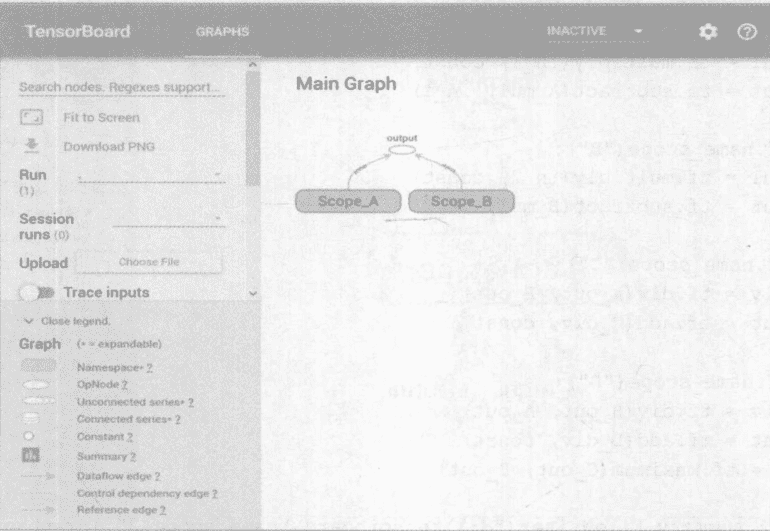

我们添加到该数据流图中的 add 和 mul Op 并未立即显示出来，所看到的是涵盖它们的名称作用域。可通过单击位于它们右上角的“+”图标将名称作用域的方框展开，如图 3-42 所示。

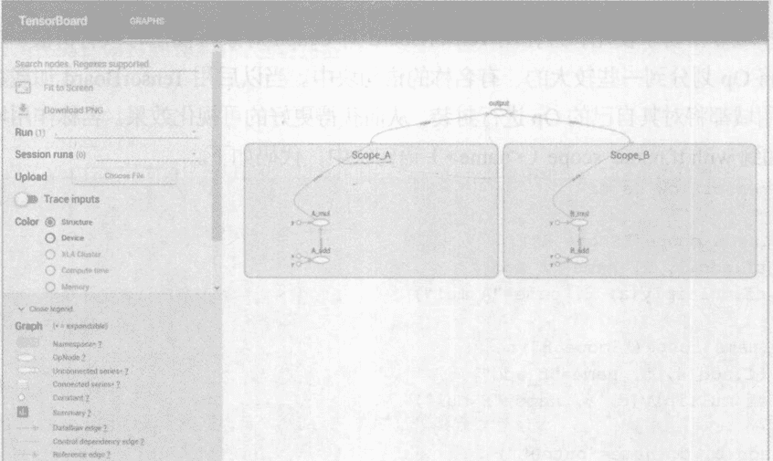

### 图 3-42

在每个名称作用域内，可看到已经添加到该数据流图中的各个 Op，也可将名称作用域嵌入在其他名称作用域内，代码如下。

```python

该示例构建了一个双分支处理流：输入分别经过 Transformation/A 与 Transformation/B 变换，汇聚至 C、D 分支再经最大值融合输出。嵌套作用域生成的层级名（如 `Transformation/A/A_mul`）在 TensorBoard 中呈现为清晰的树状结构，支持按模块折叠/展开。

#### 结构化伪代码模板

```

上述代码并未使用默认的 Graph 对象，而是显式创建了一个 tf.Graph 对象。下面重新审视这段代码，并聚焦于名称作用域，了解其组织方式，代码如下。

```python

该模板抽象了“输入定义 -> 作用域分组 -> 分支汇聚 -> 最终输出”的标准化建模范式，便于团队协作与代码复用。

---

**总结**：从张量流图的定义、会话驱动执行、变量状态维护，到命名作用域的工程化管理，这一套机制构成了 TensorFlow 1.x 静态图编程的基石。熟练掌握这些细节，是高效调试、构建大规模模型的前提。

# TensorFlow 图可视化进阶：善用 Name Scope 与 Summary 追踪运行状态

启动 TensorBoard 服务前，建议先指定好日志存放路径，便于后续复盘。

```

现在对上述代码进行分析就更加容易。这个模型拥有两个标量占位节点作为输入，一个是 TensorFlow 常量，一个是名为 Transformation 的中间块，以及一个使用 tf.maximum()作为其 Op 的最终输出节点。可在 TensorBoard 内看到这种高层的表示，如图 3-43 所示。

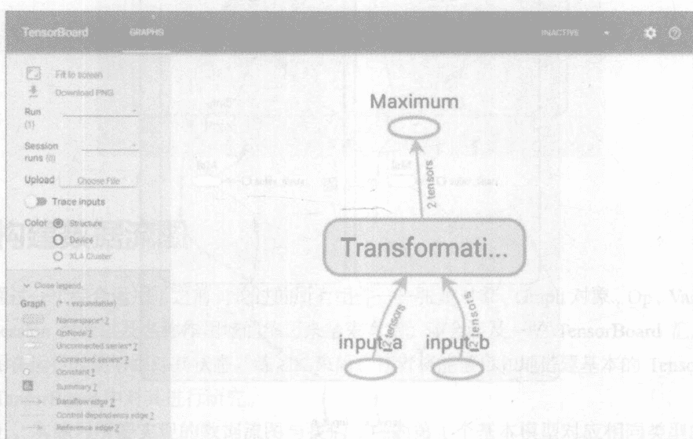

### 图 3-43

在终端启动 TensorBoard，并加载之前定义的数据流图

```

tensorboard --logdir=name_scope_2

```

在 Transformation 名称作用域内有另外 4 个命名空间被安排到两个“层”中。第 1 层由作用域 A 和 B 构成，该层将 A 和 B 的输出传给下一层 C 和 D。最后的节点会将来自最后一层的输出作为其输入。在 TensorBoard 中展开 Transformation 名称作用域，将看到类似图 3-44 所示的效果。


### 图 3-44

这同时赋予了我们一个展示 TensorBoard 另外一个特性的机会。在图 3-44 中，可发现名称作用域 A 和 B 的颜色一致，C 和 D 的颜色也一致。这是因为在相同的配置下，这些名称作用域拥有相同的 Op 设置，即 A 和 B 都有一个 tf.multiply() Op 传给一个 tf.subtract() Op，而 C 和 D 都有一个 tf.div() Op 传给 tf.add() Op。如果开始用一些函数创建重复的 Op 序列，将会非常方便。

在图 3-45 中可以看到，当在 TensorBoard 中显示时，tf.constant 对象的行为与其他张量对象或 Op 并不完全相同。即使没有在任何名称作用域内声明 static_value，它仍然会被放置在这些名称作用域内，而且，static_value 并非只出现一个图标，它会在被使用时创建一个小的视觉元素，其基本思想是常量可在任意时间使用，且在使用时无须遵循任何特定顺序。为防止在数据流图中出现从单点引出过多箭头的问题，只有当常量被使用时，它才会以一个很小的视觉元素的形式出现。

将一个规模较大的数据流图分解为一些有意义的簇能够使对模型的理解和编译更加方便。


### 图 3-45

## 3.6 构建数据流图

下面通过一个综合运用了之前讨论过的所有组件——张量对象、Graph 对象、Op、Variable 对象、占位符、Session 对象以及名称作用域的练习来结束本章。还会涉及一些 TensorBoard 汇总数据，以使数据流图在运行时能够跟踪其状态。练习结束后，读者将能够自如地搭建基本的 TensorFlow 数据流图并在 TensorBoard 中对其进行研究。

本质上，本练习所要实现的数据流图与我们接触的第 1 个基本模型对应相同类型的变换，如图 3-46 所示。


但与之前的模型相比，本练习中的模型更加充分地利用了 TensorFlow。

- 输入将采用占位符，而非 tf.constant 节点。
- 模型不再接收两个离散标量，而改为接收一个任意长度的向量。
- 使用该数据流图时，将随时间计算所有输出的总和。
- 将采用名称作用域对数据流图进行合理划分。
- 每次运行时，都将数据流图的输出、所有输出的累加以及所有输出的均值保存到磁盘，供 TensorBoard 使用。

现在可直观地感受本练习中的数据流图，如图 3-47 所示。


在解读该模型时，有一些关键点需要注意。

- 每条边的附近都标识了[None]或[]。它们代表了流经各条边的张量的形状，其中 None 代表张量为一个任意长度的向量，[]代表一个标量。
- 节点 d 的输出流入 update 环节，后者包含了更新各 Variable 对象以及将数据传入 TensorBoard 汇总所需的 Op。
- 用一个独立的名称作用域包含两个 Variable 对象。这两个 Variable 对象中一个用于存储输出的累加和，另一个用于记录数据流图的运行次数。由于这两个 Variable 对象是在主要的变换工作流之外发挥作用的，因此将其放在一个独立的空间中是完全合理的。
- TensorBoard 汇总数据有一个专属的名称作用域，用于容纳 tf.scalar_summary Op。我们将它们放在 update 环节之后，以确保汇总数据在 Variable 对象更新完成后才被添加，否则运算将会失控。

下面开始动手实践。打开代码编辑器或交互式 Python 环境。

我们要做的第 1 件事永远是导入 TensorFlow 库。

```

import tensorflow as tf

```

下面显式创建一个 Graph 对象加以使用，而非使用默认的 Graph 对象，因此需要用 Graph 类的构造方法 tf.Graph()。

```

graph = tf.Graph()

```

接着在构造模型时，将上述新 Graph 对象设为默认 Graph 对象。

```

with graph.as_default():

```

在我们的模型中有两个“全局”风格的 Variable 对象。第 1 个是 global_step，用于追踪模型的运行次数。在 TensorFlow 中，这是一种常见的范式，在整个 API 中，这种范式会频繁出现。第 2 个 Variable 对象是 previous_value，其作用是追踪该模型的所有输出随时间的累加和。由于这些 Variable 对象本质上是全局的，因此在声明它们时需要与数据流图中的其他节点区分开来，并将它们放入自己的名称作用域，代码如下。

```

with graph.as_default():

    with tf.name_scope("variables"):

        #记录数据流图运行次数的 Variable 对象

        global_step = tf.Variable(0, dtype=tf.int32, trainable=False,

                    name="global_step")

        #将前面的 Variable 对象 global_step 增加 1，只要数据流图运行，该操作便需要

        increment_step = global_step.assign_add(1)

        #追踪该模型的所有输出随时间的累加和的 Variable 对象

        previous_value = tf.Variable(0.0, dtype=tf.float32, name="previous_value")

在独立的计算图上下文中构建模型，能有效隔离命名空间。上述代码于 `variables` 作用域内定义了两个核心状态变量：`global_step` 用于计数迭代轮次，`previous_value` 则累积历史输出总和，二者均设为不可训练。

```

接下来，讲解创建模型的核心变换部分。我们会将整个变换封装到一个名称作用域 exercise_transformation 中，并进一步将它们划分为 3 个子名称作用域——input、intermediate_layer 和 output，代码如下。

```

with graph.as_default():

    with tf.name_scope("variables"):

        ...

    with tf.name_scope("exercise_transformation"):

        #独立的输入层

        with tf.name_scope("input"):

            #创建输出占位符，用于接收一个向量

            a = tf.placeholder(tf.float32, shape=[None], name="input_placeholder_a")

        #独立的中间层

        with tf.name_scope("intermediate_layer"):

            b = tf.reduce_prod(a, name="product_b")

            c = tf.reduce_sum(a, name="sum_c")

        #独立的输出层

        with tf.name_scope("output"):

            d = tf.add(b, c, name="add_d")

            output = tf.subtract(d, previous_value, name="output")

            update_prev = previous_value.assign(output)

`exercise_transformation` 作用域封装了完整的前向传播流程：输入层通过占位符接收动态维度向量；中间层并行计算元素乘积与求和；输出层融合两者结果并扣除历史累积值，最后通过赋值操作刷新状态变量。

```


除少量关键之处不同外，上述代码与为之前模型所编写的代码高度相似。

- 输入节点为 tf.placeholder Op，它可接收一个任意长度（因为 shape=[None]）的向量。

- 对于乘法和加法运算，这里并未使用 tf.multiply()和 tf.add()，而是分别使用了 tf.reduce_prod()和 tf.reduce_sum()，这样便可以对整个输入向量实施乘法和加法运算，而之前的 Op 只能接收两个标量作为输入。

接下来便可创建 TensorBoard 汇总数据，可将它们放入名为 summaries 的名称作用域中，代码如下。

```

with graph.as_default():

    with tf.name_scope("variables"):

        ...

    with tf.name_scope("transformation"):

        ...

    with tf.name_scope("summaries"):

        #为输出节点创建汇总数据

        tf.summary.scalar("output_summary", output)

        tf.summary.scalar("prod_summary", b)

        tf.summary.scalar("sum_summary", c)

在 `summaries` 作用域下挂载三个标量摘要，分别监控最终输出、乘积中间量与求和中间量，为 TensorBoard 面板的时序曲线提供数据源。

```

在该环节中，所做的第 1 件事是随时间计算输出的均值。幸运的是，可以获取当前全部输出的总和 total_output（使用来自 update_total 的输出，以确保在计算均值 avg 之前更新便已完成）以及数据流图的总运行次数 global_step（使用 increment_step 的输出，以确保数据流图有序运行）。一旦获得输出的均值，便可利用各个 tf.summary.scalar 对象将 output、update_total 和 avg 保存下来。

为完成数据流图的构建，还需要创建 Variable 对象初始化 Op 和用于将所有汇总数据组织到一个 Op 的辅助节点。下面将它们放入名为 global_ops 的名称作用域，代码如下。

```

with graph.as_default():

    ...

    with tf.name_scope("summaries"):

        ...

    with tf.name_scope("global_ops"):

        #初始化 Op

        init = tf.initialize_all_variables()

        #将所有汇总数据合并到一个 Op 中

        merged_summaries = tf.summary.merge_all()

`global_ops` 收拢初始化操作与摘要合并操作，确保单次 `Session.run` 即可完成变量就绪与全部监控数据的聚合。

```

读者可能会有一些疑惑，为什么将 tf.summary.merge_all() Op 放在这里，而非 summaries 名称作用域？虽然两者并无明显差异，但一般而言，将 summary.merge_all()与其他全局 Op 放在一起是最佳做法。我们的数据流图只为汇总数据设置了一个环节，但这并不妨碍去想象一个拥有 Variable 对象、Op 和名称作用域等不同汇总数据的数据流图。通过保持 summary.merge_all()的分离，可确保用户无须记忆放置它的特定 summary 代码块，从而比较容易找到该 Op。

以上便是构建数据流图的全部内容，但要使这个数据流图能够运行，还需要完成一些设置。

## 3.7 运行数据流图

打开一个 Session 对象，并加载已经创建好的 Graph 对象，也可打开一个 tf.summary.FileWriter 对象，便于以后利用它保存汇总数据。下面将 d:\tensorboard\improved_graph 作为保存汇总数据的目标文件夹，代码如下。

```

sess = tf.Session(graph=graph)

writer = tf.summary.FileWriter('d:\\tensorboard\\improved_graph', graph)

创建会话时显式绑定自定义图实例，`FileWriter` 同步将图结构定序列化写入磁盘目录 `d:\\tensorboard\\improved_graph`，奠定可视化基础。

```

Session对象启动后，在做其他事之前，先对各 Variable 对象进行初始化：

```

sess.run(init)

执行初始化操作，完成变量内存分配与初值赋予。

```

为运行该数据流图，需要创建一个辅助函数 run_graph()，以后便无须反复输入相同的代码。我们希望将输入向量传给该函数，而后者将运行数据流图，并将汇总数据保存下来，代码如下。

```

def run_graph(input_tensor):

    #辅助函数，运行给定输入张量的图形并保存摘要

    feed_dict = {a: input_tensor}

    output, summary, step = sess.run([update_total, merged_summaries,

    increment_step], feed_dict=feed_dict)

    writer.add_summary(summary, global_step=step)

封装 `run_graph` 简化重复调用：该函数负责构造 `feed_dict`、驱动图执行更新与摘要合并、并按当前步长将摘要写入日志。

```

下面对 run_graph()函数进行逐行解析。

- (1) 首先创建一个赋给 Session.run()中 feed_dict 参数的字典，这对应于 tf.placeholder 节点，并用了其句柄 a。

- (2) 然后，通知 Session 对象使用 feed_dict 运行数据流图，此时需确保 output、increment_step 以及 merged_summaries Op 能够得到执行。为写入汇总数据，需要保存 global_step 和 merged_summaries 的值，因此将它们保存到 Python 变量的 step 和 summary 中。用下画线 “_” 表示这里并不关心 output 值的存储。

- (3) 最后，将汇总数据添加到 SummaryWriter 对象中。global_step 参数非常重要，因为它使 TensorBoard 可随时间对数据进行图示（稍后将看到，它本质上创建了一个折线图的横轴）。

下面来实际使用这个函数，可变换向量的长度来多次调用 run_graph()函数，代码如下。

```

run_graph([2, 8])

run_graph([3, 1, 3, 3])

run_graph([8])

run_graph([1, 2, 3])

run_graph([11, 4])

run_graph([4, 1])

run_graph([7, 3, 1])

run_graph([6, 3])

run_graph([0, 2])

run_graph([4, 5, 6])

连续喂入十组不同长度的向量，模拟多步迭代过程，自动生成丰富的时序监控记录。

```

上述调用可反复进行。数据填充完毕后，可用 SummaryWriter.flush()函数将汇总数据写入磁盘，代码如下。

```

writer.flush()

```

最后，既然 SummaryWriter 对象和 Session 对象已经使用完毕，就将其关闭，以完成清理工作，代码如下。

```

writer.close()

sess.close()

刷新缓冲区确保数据落盘，随后有序关闭写入器与会话，释放系统资源。

```

以上便是全部的 TensorFlow 代码。虽然与之前的数据流图相比代码量略大，但还不至于过多。下面打开 TensorBoard，看看可以得到什么结果。启动终端，导航至运行上述代码的目录（请确保 improved_graph 目录在该路径下），并运行下列命令。

```

>tensorboard --logdir=improved_graph

最后在终端运行上述指令，启动 TensorBoard 面板即可直观复盘计算图拓扑、变量演变及摘要曲线。

# TensorFlow 1.x 核心机制实战：从计算图构建到 MNIST 训练流程解析

在深度学习的早期实践中，TensorFlow 1.x 以其静态计算图机制奠定了工业级部署的基础。尽管时代已迈入急速执行模式，但透彻理解“定义图 -> 会话运行 -> 变量更新 -> 可视化监控”这套经典范式，依然是读懂大量存量代码、掌握底层原理的必修课。本文将通过一组经典代码片段，串联起计图搭建、数据喂入、层级封装及损失计算的完整脉络。

## 一、 手把手构建可视化的动态计算图

不同于即时执行的直观感受，TF 1.x 要求我们先在 `tf.Graph()` 容器中“画好蓝图”。下面的示例展示了如何通过命名空间（`name_scope`）模块化管理变量、前向传播、状态更新及 TensorBoard 监控指标。

```

与之前一样，该命令将在 6006 端口启动一个 TensorBoard 服务器，并托管存储在 improved_graph 中的数据。在浏览器中输入 localhost:6006，观察所得到的结果。首先检查 GRAPHS 标签页，如图 3-48 所示。


图 3-48

可以看到，图 3-48 与之前绘制的非常吻合。我们的变换运算流入 transformation 方框，后者又同时为 summaries 和 variables 名称作用域提供输入。图 3-48 与之前所绘制的数据流图的主要区别体现在 global_ops 名称作用域上，它包含了一些对于主要的变换计算并不十分关键的运算。可将各个方框展开，以便在更细的粒度上观察它们的结构，如图 3-49 所示。


图 3-49

现在可以看到输入层、中间层和输出层是彼此分离的。对于像本例这样的简单模型，这样的划分可能有些小题大做，但这种类型的划分方法是极为有用的。请观察该数据流图的其余部分。当准备好后，请切换到 SCALARS 页面。当打开 SCALARS 页面后，可以看到 3 个依据我们赋予各 summary.scalar 对象的标签而命名的折叠的标签页，如图 3-50 所示。


图 3-50

单击任意一个标签页，便可看到一个精美的折线图，展示了不同时间点上值的变化。单击该图表左下方的矩形图标，它们会像图 3-50 一样展开，如图 3-51 所示。


图 3-51

仔细检查汇总数据的结果，对其进行比较，确保它们都是有意义的，到此本练习就全部结束了。希望读者能够熟练掌握如何基于虚拟草图创建 TensorFlow 数据流图，以及如何利用 TensorBoard 做一些基础的数据汇总工作。本练习的完整代码如下。

```

这段脚本的精髓在于**关键状态的持久化与追踪**：
- `global_step` 与 `total_output` 两个不可训练变量，分别扮演“计数器”与“累加器”的角色，脱离了梯度下发的体系，纯粹服务于流程控制与统计。
- 计算层 `transformation` 将输入向量拆解为乘积（`reduce_prod`）与求和（`reduce_sum`），再经 `add` 融合输出，结构清晰可复用。
- `update` 域利用 `assign_add` 实现原子级状态刷新，配合 `summaries` 域自动生成的标量日志（瞬时输出、历史累加、滚动平均），只需在会话中运行合并 Op，即可将全链路数据流向 TensorBoard。

## 二、 标准化数据管线：MNIST 加载与批次切片

数据准备往往是模型训练的“隐形基建”。官方教程封装的 `input_data` 模块极大简化了下载、解压、独热编码的繁琐流程。

```

## 4.2 图举例与管理


# 第4章 TensorFlow运作方式

在现实生活中，我们看到一张图片，能够分辨出图片上出现的是什么事物；听到一支歌曲，能够分辨出这支歌曲是属于流行音乐还是蓝调音乐；看到一段视频，能够知道出现在视频中的人物是在唱歌还是在进餐。对事物进行类型的判断被称为分类。

在本章中，将通过应用 TensorFlow 来训练一个简单的分类器，以加深对 TensorFlow 运作方式的理解。

## 4.1 数据的准备和下载

当我们开始学习编程的时候，第 1 件事往往是学习打印 Hello World。编程入门有 Hello World，而机器学习入门有 MNIST。MNIST 是机器学习领域的一个经典问题，是一个入门级的计算机视觉数据集，它包含各种手写数字图片，指的是让机器查看一系列大小为 28px×28px 的手写数字灰度图像，并判断这些图像代表 0~9 中的哪一个数字。

MNIST 也包含每一张图片对应的标签，告诉我们这个是数字几。比如，图 4-1 所示的这 4 张图片的标签分别是 5、2、5、3。


图 4-1

在本章中，我们将训练一个机器学习模型，用于预测图片里面的数字，目的是介绍如何使用 TensorFlow，关于这个数据集更详细的介绍和知识点的讲解，将在本书的后续章节进行。

这里提供了一份 Python 源代码，用于自动下载和安装此数据集。读者可以下载这份代码，然后导入自己的项目中，也可以直接复制粘贴到代码文件里面，该代码如下。

```

实战中，我们常通过命令行参数（`FLAGS`）注入路径与模式配置，增强脚本迁移性：

```

在进行训练之前，要确保已经正确完成了数据集的下载并保存在了本地文件夹中，如果已经正确下载了文件，则需要将文件数据进行解压缩，因此需要有一个确认并解压缩文件的过程，代码如下。

```

拿到 `DataSet` 对象后，`next_batch` 方法成为迭代训练的核心入口，它按指定 `batch_size` 随机抽样，返回对齐的特征与标签张量，直接喂入 `feed_dict`：

```

源程序代码内容中，input_data.read_data_sets(FLAGS.train_dir, FLAGS.fake_data)表示函数会确保之前所下载的数据文件已经正确地保存在了本地的训练文件夹中，然后将这些数据解压缩并返回一个含有 DataSet 实例的字典；参数 fake_data 是用于单元测试的内容，读者可以不用太在意这个内容，直接使用即可。

MNIST 是机器学习中的经典问题。对于那些想在实际数据上学习模式识别方法的人来说，这是一个很好的数据库，同时其在预处理和格式化方面花费最少。

从 Yann LeCun's MNIST 网站中下载的这些文件本身没有使用标准的图片格式存储，所以需通过 input_data.py 中的 extract_images()和 extract_labels()函数来手动解压。

图像数据被提取到 2 维张量[图像索引,像素索引]，其中每个条目都是特定图像中特定像素的强度值，从[0,255]重新缩放到[-0.5,0.5]。“图像索引”对应于数据集中的图像，从 0 到数据集的大小；“像素索引”对应于该图像中的特定像素，范围从 0 到图像中像素的数量。

标签数据被提取到一个张量[image index]中，每个例子的类标识符作为值。对于训练集标签，这将是形状[55000]。

DataSet.next_batch()方法可用于获取由 batch_size 列表的图像和标签组成的元组，以便将其馈送到正在运行的 TensorFlow 会话中，代码如下。

```

## 三、 深度网络骨架：变量作用域与前向传播

模型定义阶段，`tf.Graph().as_default()` 确立了默认图上下文，配合 `name_scope` 实现 TensorBoard 结构可视化的层级折叠。

```

## 4.2 图表构建与推理

在 run_training()函数的一开始，是一个 Python 语言中的 with 命令，这个命令表明所有已经构建的操作都要与默认的 tf.Graph 全局实例关联起来，代码如下。

```

以隐藏层 `hidden1` 为例，权重采用截断正态分布初始化（标准差按输入维度归一化，即 Xavier 思想雏形），偏置零初始化，这是打破对称、缓解梯度消失的经典套路：

```

tf.Graph 实例是一系列可以作为整体执行的操作。TensorFlow 的大部分场景只需要依赖默认图表这一个实例即可。

### 4.2.1 图表构建

在为数据创建占位符之后，就可以运行 mnist.py 文件了，经过三阶段的模式函数操作：inference()、loss()和 training()，图表就构建完成了，如图 4-2 所示。

- (1) inference(): 尽可能地构建好图表，满足促使神经网络向前反馈并做出预测的要求。

- (2) loss(): 在 inference 图表中添加生成损失（ loss ）所需要的操作（ ops ）。

- (3) training(): 往损失图表中添加计算并应用梯度（ gradients ）所需的操作。


图 4-2

### 4.2.2 推理

inference()函数会尽可能地构建图表，做到返回包含了预测结果（output prediction）的张量。它接收图像占位符作为输入，在此基础上借助 ReLU（Rectified Linear Units）激活函数，构建一对完全连接层（layers），以及一个有 10 节点（node）、指明了输出 logits 模型的线性层。

每一层都创建于一个唯一的名称作用域 tf.name_scope 下，创建于该名称作用域下的所有元素都将带有其前缀，代码如下。

```

```

在定义的名称作用域中，每一层所使用的权重和偏差都在 tf.Variable 实例中生成，并且包含了各自期望的 shape，代码如下。

```

前向传播链路遵循 **线性变换 -> 非线性激活** 范式，ReLU 凭借稀疏激活与无上界特性成为首选：

```

例如，当这些层是在 hidden1 这个名称作用域下生成时，赋予权重变量的独特名称将会是 hidden1/weights。

每个变量在构建时，都会获得初始化操作（initializer ops）。

在这种最常见的情况下，通过 tf.truncated_normal 函数初始化权重变量，给 shape 赋予的则是一个 2 维张量，其中第 1 个维度代表该层中权重变量所连接的（connect from）单元数量，第 2 个维度代表该层中权重变量所连接到的（connect to）单元数量。对于名叫 hidden1 的第 1 层，相应的维度则是[IMAGE_PIXELS, hidden1_units]，因为权重变量将图像输入连接到了 hidden1 层。tf.truncated_normal 初始函数将根据所得到的均值和标准差，生成一个随机分布。

然后，通过 tf.zeros 函数初始化偏差变量（biases），确保所有偏差的起始值都是 0，而它们的 shape 则是其在该层中所接到的单元数量。

图表的三个主要操作，分别是两个 tf.nn.relu 操作，它们中嵌入了隐藏层所需的 tf.matmul；以及 logits 模型所需的另外一个 tf.matmul。三者依次生成，各自的 tf.Variable 实例则与输入占位符或下一层的输出张量所连接，代码如下。

```

注意：片段中后续层复用了 `weights` 变量名，实战中应为每层单独声明变量（如 `weights_h2`, `weights_out`），避免形状冲突与语义混淆。

## 四、 标签处理与损失函数的“手工”实现

早期版本缺乏 `sparse_softmax_cross_entropy` 等便捷 API，开发者需手动将稀疏标签转为稠密独热矩阵，再配合 `softmax_cross_entropy_with_logits` 计算交叉熵。

```

最后，程序会返回包含了输出结果的 logits 张量。

## 4.3 损失与训练

### 4.3.1 损失

loss()函数通过添加所需的损失操作，进一步构建图表。

首先，labels_placeholder 中的值将被编码为一个含有 1-hot values 的张量。例如，如果类标识符为 3，那么该值就会被转换为[0, 0, 0, 1, 0, 0, 0, 0, 0, 0]，代码如下。

```

上述逻辑通过 `tf.range` 生成行索引，`tf.concat` 拼接坐标，`tf.sparse_to_dense` 撑满稀疏张量，虽显冗长，却揭示了独热编码的底层几何本质——在 `(batch_size, num_classes)` 平面上打散标签信号。

有了对齐的 `logits` 与 `onehot_labels`，逐样本交叉熵与批次平均损失一气呵成：

```

之后，又添加一个 tf.nn.softmax_cross_entropy_with_logits 操作，用来比较 inference()函数与 1-hot 标签所输出的 logits 张量，代码如下。

```

```

然后，使用 tf.reduce_mean 函数计算 batch 维度（第 1 维度）下交叉熵（cross entropy）的平均值，并将该值作为总损失，代码如下。

```

`reduce_mean` 将向量损失压缩为标量，成为优化器最小化的目标，完成了从前向推理到反向传播起点的闭环。

---

**结语**

这组代码剖析了 TF 1.x 时代的“四大金刚”：**图拓扑设计、会话驱动执行、变量生命周期管理、低级算子组合高级逻辑**。虽然现代框架用 `tf.function` 与 `GradientTape` 重写了交互范式，但计算图的静态优化价值、张量形状推导逻辑、Summary 可视化体系，依然在 TF 2.x、ONNX 导出乃至编译器优化中发光发热。吃透这些“古早”片段，方能在新旧范式间游刃有余。

# TensorFlow 1.x 经典构建流程：从线性模型到 CNN 实战解析

在早期的 TensorFlow 1.x 时代，构建神经网络需要显式地管理计算图、会话以及变量初始化。今天我们梳理一套完整的“老派”实战代码，涵盖了从简单的 Softmax 回归到多层卷积神经网络（CNN）的搭建、训练、可视化与评估全流程。

## 核心组件：损失监控与优化器配置

一切始于定义优化目标。我们使用 `tf.scalar_summary` 将损失值标记为标量，方便后续在 TensorBoard 中追踪曲线变化。

```

最后，程序会返回包含了损失值的张量。

### 4.3.2 训练

以上已经定义好模型和训练用的损失函数，那么用 TensorFlow 进行训练就很简单了。因为 TensorFlow 知道整个计算图，它可以使用自动微分法找到对于各个变量的损失的梯度值。

TensorFlow 有大量内置的优化算法。在这个例子中，用梯度下降（gradient descent）法让交叉熵下降，步长为 0.01。

首先，该函数从 loss()函数中获取损失张量，将其交给 tf.scalar_summary，后者在与 SummaryWriter（见下文）配合使用时，可以向事件文件（ events file ）中生成汇总值（ summary values）。在本章中，每次写入汇总值时，它都会释放损失张量的当前值（ snapshot value），代码如下。

```

优化器方面，采用最基础的梯度下降法，学习率通过外部 Flag 传入，灵活可控。

```

每一步迭代都会加载 50 个训练样本，然后执行一次 train_step，并通过 feed_dict 将 x 和 y 张量占位符用训练数据替代。注意，在计算图中，可以用 feed_dict 来替代任何张量，并不仅限于替换占位符。

training()函数添加了通过梯度下降将损失最小化所需的操作。

接下来，将实例化一个 tf.train.GradientDescentOptimizer，负责按照所要求的学习效率（ learning rate ）应用梯度下降法，代码如下。

```

为了让训练步数自动累加且不参与梯度反向传播，定义一个不可训练的 `global_step` 变量，并将其传入 `minimize` 方法。

```

之后，生成一个变量用于保存全局训练步骤（ global training step ）的数值，并使用 minimize()函数更新系统中的模型权重、增加全局步骤的操作。根据惯例，这个操作被称为 train_op，是 TensorFlow Session 诱发一个完整训练步骤所必须运行的操作，代码如下。

```

## 训练循环：两种范式的对比

### 范式一：MNIST 官方教程风格（固定轮次迭代）

这是最经典的入门写法：固定跑 1000 步，每次抓取 50 张图的小批量数据喂入占位符。

```

这一行代码实际上是用来往计算图上添加一个新操作的，其中包括计算梯度，计算每个参数的步长变化，并且计算出新的参数值。

返回的 train_step 操作对象，在运行时会使用梯度下降来更新参数。因此，整个模型的训练可以通过反复地运行 train_step 来完成，代码如下。

```

### 范式二：结构化训练循环（支持日志打印与摘要记录）

工程实践中更常见的是基于 `max_steps` 的循环，结合 `feed_dict` 填充数据。每一步执行训练操作并获取当前损失值。

```

最后，程序返回包含了训练操作（ training op ）输出结果的张量。

## 4.4 状态检查与可视化

### 4.4.1 状态检查

在运行 sess.run()函数时，要在代码中明确其需要获取的两个值： [train_op, loss]，代码如下。

```

每隔 100 步打印一次日志，包含步数、损失值及耗时，便于监控收敛情况。

```

因为要获取这两个值，sess.run()会返回一个有两个元素的元组。其中每一个张量对象对应了返回的元组中的 NumPy 数组，而这些数组中包含了当前这步训练中对应张量的值。由于 train_op 并不会产生输出，其在返回的元组中的对应元素就是 None，所以会被抛弃。但是，如果模型在训练中出现偏差， loss 张量的值可能会变成 NaN，所以要获取它的值，并记录下来。

假设训练一切正常，没有出现 NaN，训练循环会每隔 100 个训练步骤打印一行简单的状态文本，告知用户当前的训练状态，代码如下。

```

## 可视化利器：TensorBoard 集成全流程

可视化分三步走：合并摘要、创建写入器、运行时写入。

首先聚合图中所有的 Summary 算子。

```

### 4.4.2 状态可视化

为了释放 TensorBoard 所使用的事件文件（events file），所有的即时数据（在这里只有一个）都要在图表构建阶段合并至一个操作（op）中，代码如下。

```

实例化 `SummaryWriter`，指定日志目录并记录图结构定义。

```

在创建好 Session 之后，可以实例化一个 tf.train.SummaryWriter，用于写入包含了图表本身和即时数据具体值的事件文件，代码如下。

```

在训练循环内部，运行合并后的摘要算子生成协议缓冲字符串，再按全局步数写入磁盘。

```

最后，每次运行 summary_op 时，都会往事件文件中写入最新的即时数据，函数的输出会传入事件文件读写器（writer）的 add_summary()函数，代码如下。

```

另一种等价写法（常见于 MNIST 完整示例）：在 `while` 循环中手动维护步数计数器，逻辑一致。

```

事件文件写入完毕之后，可以在训练文件夹中打开一个 TensorBoard，查看即时数据的情况，如图 4-3 所示。


图 4-3

TensorBoard 通过读取 TensorFlow 的事件文件来运行。TensorFlow 的事件文件包括了在 TensorFlow 运行中涉及的主要数据。下面是 TensorBoard 中汇总数据（summary data）的大体生命周期。

首先，创建想汇总数据的 TensorFlow 图，然后选择在哪个节点进行汇总（summary）操作。

比如，假设正在训练一个卷积神经网络，用于识别 MNIST 标签。希望记录学习速度（learning rate）如何变化，以及目标函数如何变化。可以通过向节点附加 scalar_summary 操作来分别输出学习速度和期望误差。然后可以给每个 scalar_summary 分配一个有意义的标签，比如 learning rate 和 loss function。

如果还希望显示一个特殊层中激活的分布，或者梯度权重的分布，可以通过分别附加 histogram_summary 运算来收集权重变量和梯度输出。

所有可用的 summary 操作详细信息，可以查看 summary_operation 文档。

在 TensorFlow 中，所有的操作只有执行时，或者另一个操作依赖于它的输出时才会运行。刚才创建的这些节点（ summary nodes ）都围绕着图像，没有任何操作依赖于它们的结果。因此，为了生成汇总信息，需要运行所有的这些节点。这样的手动工作是很乏味的，因此可以使用 tf.merge_all_summaries 来将它们合并为一个操作。

然后可以执行合并命令，它会依据特定步骤将所有数据生成一个序列化的 Summary protobuf 对象。最后，为了将汇总数据写入磁盘，需要将汇总的 protobuf 对象传递给 tf.train.SummaryWriter。

SummaryWriter 的构造函数中包含了参数 logdir。这个 logdir 非常重要，所有事件都会写到它所指的目录下。此外，SummaryWriter 中还包含了一个可选择的参数 GraphDef。如果输入了该参数，那么 TensorBoard 也会显示图像。

现在就可以运行神经网络了。可以每一步执行一次合并汇总，这样会得到一大堆训练数据，但这很有可能超过了想要的数据量。也可以每 100 步执行一次合并汇总，或者如下面示范代码所示。

```

日志生成后，终端启动 TensorBoard 即可查看。旧版本调用脚本路径较长：

```

现在已经准备好用 TensorBoard 来可视化这些数据了。

输入下面的指令来启动 TensorBoard。

```

新版简化为直接命令：

```

这里的参数 logdir 指向 SummaryWriter 序列化数据的存储路径。如果 logdir 目录的子目录中包含另一次运行时的数据，那么 TensorBoard 会展示所有运行的数据。一旦 TensorBoard 开始运行，即可通过在浏览器中输入 localhost:6006 来查看 TensorBoard。

如果已经通过 pip 安装了 TensorBoard，则可以通过执行更为简单的命令来访问 TensorBoard，代码如下。

```

## 模型评估：准确率计算

评估阶段通过 `tf.argmax` 获取预测类别与真实标签的索引，用 `tf.equal` 逐元素比对，得到布尔张量。转为浮点数后求平均，即为准确率。

```

进入 TensorBoard 的界面时，会在右上角看到导航选项卡，每一个选项卡将展现一组可视化的序列化数据集。对于查看的每一个选项卡，如果 TensorBoard 中没有数据与这个选项卡相关，则会显示一条提示信息指示该如何序列化相关数据。

## 4.5 评估模型

模型性能如何呢？

首先找出那些预测正确的标签。tf.argmax 是一个非常有用的函数，它能给出某个张量对象在某 1 维上其数据最大值所在的索引值。由于标签向量是由 0 和 1 组成的，因此最大值 1 所在的索引位置就是类别标签，比如 tf.argmax(y,1)返回的是模型对于任一输入 x 预测到的标签值，而 tf.argmax(y_,1)代表正确的标签，可以用 tf.equal 来检测预测是否标签匹配（索引位置一样表示匹配），代码如下。

```
```

这里返回一个布尔数组。为了计算分类的准确率，将布尔值转换为浮点数来代表对、错，然后取平均值。例如：[True, False, True, True]变为[1,0,1,1]，计算出平均值为 0.75，代码如下。

```

最终在测试集上跑一次 `eval`，喂入全部测试图像与标签，输出最终精度。

```

最后，可以计算出在测试数据上的准确率，大概是 91%，代码如下。

```

## CNN 架构搭建：模块化定义与前向传播

深度模型离不开规范的变量初始化。封装两个工厂函数：权重用截断正态分布（标准差 0.1）打破对称，偏置用常数 0.1 避免 ReLU 死神经元。

```

在 MNIST 上只有 91% 的正确率，实在太糟糕。本节中，将用一个稍微复杂的模型——卷积神经网络来改善效果，这会达到大概 99.2% 的准确率。虽然不是最高，但还是比较让人满意。

- 1. 初始化权重

为了创建这个模型，需要创建大量的权重和偏置项。这个模型中的权重在初始化时应该加入少量的噪声来打破对称性及避免 0 梯度。由于使用的是 ReLU 神经元，因此比较好的做法是用一个较小的正数来初始化偏置项，以避免神经元节点输出恒为 0 的问题（dead neurons）。为了不在建立模型的时候反复做初始化操作，这里定义了两个函数用于初始化，代码如下。

```
```

```

卷积与池化也封装成函数：卷积步长全 1、SAME 填充保持尺寸；池化 2x2 窗口、步长 2、SAME 填充实现下采样。

```

- 2. 卷积和池化

TensorFlow 在卷积和池化上有很强的灵活性。怎么处理边界？步长应该设多大？在这个实例里，将会一直使用 vanilla 版本。卷积使用 1 步长（stride size）、0 边距（padding size）的模板，保证输出和输入是同一个大小。池化用简单传统的 2×2 大小的模板做 max pooling。为了代码更简洁，把这部分抽象成一个函数，代码如下。

```
```

```

### 第一层：卷积 + 激活 + 池化
输入单通道（灰度图），输出 32 个特征图，核大小 5x5。

```

- 3. 第 1 层卷积

现在我们可以开始实现第 1 层了。它由一个卷积接一个 max pooling 完成。卷积在每个 5×5 的 patch 中算出 32 个特征。卷积的权重张量形状是[5, 5, 1, 32]，前两个维度是 patch 的大小，接着是输入的通道数目，最后是输出的通道数目。而对于每一个输出通道都有一个对应的偏置项，代码如下。

```
```

为了用这一层，把 x 变成一个 4 维向量，其第 2 维、第 3 维对应图片的宽、高，最后 1 维代表图片的颜色通道数（因为是灰度图，所以这里的通道数为 1，如果是 RGB 彩色图，则为 3），代码如下。

x_image = tf.reshape(x, [-1,28,28,1])

把 x_image 和权值向量进行卷积，加上偏置项，然后应用 ReLU 激活函数，最后进行 max pooling，代码如下。

```

### 第二层：卷积 + 激活 + 池化
输入 32 通道，输出 64 通道，核仍为 5x5。池化后特征图尺寸缩为 7x7。

```

### 4. 第 2 层卷积

为了构建一个更深的网络，将会把几个类似的层堆叠起来。第 2 层中，每个 5×5 的 patch 会得到 64 个特征，代码如下。

```

### 全连接层：展平 + 矩阵乘法 + ReLU
将 7x7x64 展平成向量，接 1024 个神经元的全连接层。

```

### 5. 密集连接层

现在，图片尺寸减小到 7px×7px，加入一个有 1024 个神经元的全连接层，用于处理整个图片。

把池化层输出的张量经过 reshape 转化成向量，乘以权重矩阵，再加上偏置项，然后对其使用 ReLU 函数，代码如下。

```

### Dropout 正则化
引入 `keep_prob` 占位符，训练时设为 0.5，测试时设为 1.0，防止过拟合。

```

### 6. dropout

为了减少过拟合，要在输出层之前加入 dropout。用 placeholder 代表一个神经元的输出在 dropout 中保持不变的概率。这样可以在训练过程中启用 dropout，在测试过程中关闭 dropout。TensorFlow 的 tf.nn.dropout 操作除了可以屏蔽神经元的输出外，还会自动处理神经元输出值的 scale。所以用 dropout 的时候可以不用考虑 scale，代码如下。

```

### 输出层：Softmax 分类
最后一层全连接映射到 10 个类别，经过 Softmax 输出概率分布。

```

### 7. 输出层

最后，添加一个 softmax 层，就像前面的单层 softmax 回归一样，代码如下。

```

---

这套代码虽属 TensorFlow 1.x 静态图时代产物，但其体现的**计算图构建、会话运行、摘要可视化、模块化层定义**等核心思想，至今仍是理解深度学习框架底层机制的绝佳教材。

# TensorFlow 实战：从模型构建到训练评估的完整流程解析

在搭建神经网络模型时，定义好前向传播结构后，紧接着的核心任务便是确立优化目标、配置训练循环以及建立评估体系。本文将通过一组经典的 MNIST 手写数字识别代码片段，为你拆解 TensorFlow 1.x 时代模型落地的标准范式。

## 核心指标与优化器的定义

一切始于损失函数的选取。针对多分类问题，交叉熵是首选。我们将预测概率分布 `y_conv` 与真实标签 `y_` 代入公式，得到标量损失值。随后，引入 Adam 优化器，设定学习率为 1e-4，自动完成梯度下降与参数更新。

为了量化模型表现，我们利用 `tf.argmax` 获取预测类别与真实类别的索引，通过 `tf.equal` 判断是否命中，最后转为浮点数求平均，即得准确率指标。

```

这个模型的效果如何呢？

为了进行训练和评估，将使用与之前简单的单层 Softmax 神经网络模型几乎相同的一套代码，只是会用更加复杂的 ADAM 优化器来做梯度下降，在 feed_dict 中加入额外的参数 keep_prob 来控制 dropout 比例。然后每 100 次迭代输出一次日志，代码如下。

```

cross_entropy = -tf.reduce_sum(y_*tf.log(y_conv))

train_step = tf.train.AdamOptimizer(1e-4).minimize(cross_entropy)

correct_prediction = tf.equal(tf.argmax(y_conv,1), tf.argmax(y_,1))

accuracy = tf.reduce_mean(tf.cast(correct_prediction, "float"))

sess.run(tf.initialize_all_variables())

for i in range(20000):

    batch = mnist.train.next_batch(50)

    if i%100 == 0:

        train_accuracy = accuracy.eval(feed_dict={

        x:batch[0], y_: batch[1], keep_prob: 1.0})

        print "step %d, training accuracy %g"%(i, train_accuracy)

        train_step.run(feed_dict={x: batch[0], y_: batch[1], keep_prob: 0.5})

print "test accuracy %g"%accuracy.eval(feed_dict={

x: mnist.test.images, y_: mnist.test.labels, keep_prob: 1.0})

## 训练循环的实战逻辑

初始化全局变量后，正式进入迭代训练阶段。设定总步数 20000，每次从训练集抽取 50 个样本组成小批量。每隔 100 步，我们会暂停更新，将 Dropout 失活概率 `keep_prob` 设为 1.0（即关闭 Dropout），在当前批次上评估训练准确率并打印监控。常规步骤则开启 Dropout（`keep_prob=0.5`）执行优化操作。训练结束后，在完整测试集上进行最终大考，输出泛化精度。

## 模块化评估流程的构建

实际工程中，评估逻辑往往被封装为独立函数 `do_eval`，以便复用。下面的代码展示了如何分别在训练集、验证集、测试集上调用该函数，全方位审视模型性能。

```

以上代码，在最终测试集上的准确率大概是 99.2%。

每隔 1000 个训练步骤，代码会尝试使用训练数据集与测试数据集，对模型进行评估。do_eval 函数会被调用 3 次，分别使用训练数据集、验证数据集和测试数据集，代码如下。

```

print 'Training Data Eval:'

do_eval(sess,eval_correct, images_placeholder,labels_placeholder,

data_sets.train)

print 'Validation Data Eval:'

do_eval(sess, eval_correct,images_placeholder,labels_placeholder,

data_sets.validation)

print 'Test Data Eval:'

do_eval(sess, eval_correct,images_placeholder,labels_placeholder,

data_sets.test)

## 数据准备与评估算子的两种写法

在调用评估前，需先获取测试数据。同时，TensorFlow 提供了两种定义“正确预测”算子的方式：一种是调用封装好的 `mnist.evaluation` 接口，另一种是直接使用底层算子 `tf.nn.in_top_k`，判断目标类别是否位于预测概率最高的 Top-1 位置，两者效果等价。

```

注意，更复杂的使用场景通常是先隔绝 data_sets.test 测试数据集，只有在大量的超参数优化调整（hyperparameter tuning）之后才进行检查。但是，由于 MNIST 问题比较简单，在这里一次性评估所有的数据。

## 4.6 评估图表的构建与输出

### 4.6.1 评估图表的构建

在打开默认图表（Graph）之前，应该先调用 get_data(train=False)函数抓取测试数据集，代码如下。

```

test_all_images, test_all_labels = get_data(train=False)

```

在进入训练循环之前，应该先调用 mnist.py 文件中的 evaluation 函数，传入的 logits 和标签参数要与 loss 函数的一致。这样做是为了先构建 Eval 操作，代码如下。

```

eval_correct = mnist.evaluation(logits, labels_placeholder)

```

evaluation 函数会生成 tf.nn.in_top_k 操作，如果在 k 个最有可能的预测中可以发现真的标签，那么这个操作就会将模型输出标记为正确。在本文中，把 k 的值设置为 1，也就是只有在预测是真的标签时，才判定它是正确的，代码如下。

```

eval_correct = tf.nn.in_top_k(logits, labels, 1)

## 评估函数内部机制：批次累加计算精度

`do_eval` 的核心实现是一个批次累加过程。根据总样本数与批次大小计算迭代轮数，循环中通过 `fill_feed_dict` 填充数据，运行 `eval_correct` 获取当前批次的正确数量（布尔值求和），累加至 `true_count`。最后用总正确数除以总样本数，得出 Precision@1 指标并格式化输出。

```

### 4.6.2 评估图表的输出

之后，可以创建一个循环，向其中添加 feed_dict，并在调用 sess.run()函数时传入 eval_correct 操作，目的就是用给定的数据集评估模型，代码如下。

```

for step in xrange(steps_per_epoch):

    feed_dict = fill_feed_dict(data_set, images_placeholder, labels_placeholder)

    true_count += sess.run(eval_correct, feed_dict=feed_dict)

```

true_count 变量会累加所有 in_top_k 操作判定为正确的预测之和。接下来，只需要将正确测试的总数除以例子总数，就可以得出准确率，代码如下。

```

precision = float(true_count) / float(num_examples)

print ' Num examples: %d Num correct: %d Precision @ 1: %0.02f' % (

num_examples, true_count, precision)

## 数据探查：直观验证标签格式

调试阶段，直接打印数据张量是确认数据管道是否通畅的最直观手段。例如，查看第 4 个训练样本（索引为 3）的标签，输出形状为 `(3, 10)` 的 One-hot 向量，便能快速核实标签编码是否符合预期。

```

# 实战篇

# 05 第5章 MNIST机器学习

## 5.1 MNIST 数据集简介

手写数字的 MNIST ( Modified National Institute of Standards and Technology database ) 数据集来自美国国家标准与技术研究所 ( National Institute of Standards and Technology, NIST )。它是一个庞大的手写数字数据库，也是网上著名的公开数据集之一，包含了 60 000 个训练示例图片以及 10 000 个测试图片，数据集的图片分别代表了 0~9 中的任意一个数字，图片只包含灰度值信息，规格尺寸为 28px×28px，所以每一张图片就是拥有 784 ( 28×28 ) 个数据，数字位于整张图片的最中央位置，它是 NIST 提供的更大集合的一个子集。训练集 ( training set ) 由来自 250 个不同人手写的数字构成，其中 50%是高中学生，50%来自人口普查局 ( the Census Bureau ) 的工作人员。测试集 ( test set ) 也是同样比例的手写数字数据。

如果想要在实际数据上尝试学习技术和模式识别方法，并在预处理和格式化上降低花费，MNIST 是一个简单且效果不错的数据库。

这些数据集有两个功能：一是提供了大量的数据作为训练集和测试集，为一些兴趣爱好者和学习者提供丰富的资源信息。二是形成一个业界领域具有一定对比程度的项目，不同的研究者使用了相同的数据集，从而可以更加方便地将结果进行对比，从而验证出哪种设计的程序识别率更高。

MNIST 是一个简单的计算机视觉数据集。它由图 5-1 所示的手写数字的图像组成。


图 5-1

它还包括每个图像的标签，以便清楚地表示是什么数字。例如，上述图像的标签分别是 5、2、5、3，所以，MNIST 数据集中的每张数据图片都被事先标注了相应的阿拉伯数字。在本节中，将训练一个模型来查看图像并预测它们是什么数字。因为这里的目标是使用 TensorFlow，所以将从一个非常简单的模型开始，此模型称为 softmax 回归。

从官方网站下载 MNIST 数据集，下载的数据集图片被分成两部分：一部分是包含了 60 000 张图片的训练数据集（mnist.train），另一部分是包含了 10,000 张图片的测试数据集（mnist.test）。训练数据集用来提供给使用者进行模型的训练，以期训练出合适的模型；测试数据集用来提供给使用者对前一个阶段训练出的模型进行性能上的测试，在机器学习模型设计阶段，必须要设置一个单独的测试数据集用来评估模型的性能，这个测试数据集不用于训练。

MNIST 数据单元分为两个部分：一张包含手写数字的图片和一个对应的标签。把这些图片设为 xs，把这些标签设为 ys。训练数据集和测试数据集都含有 xs 和 ys，可以将训练数据集的图片名称设定为 mnist.train.images，将训练数据集的标签设定为 mnist.train.labels。

每一张图片包含 28x28 个像素点。我们可以用一个数字数组来表示这张图片，如图 5-2 所示


图 5-2

将这个数字数组展开成一个向量，长度是 28x28 = 784。数字间的顺序不重要，只要保持各个图片采用相同的方式展开。MNIST 数据集的图片就是在 784 维向量空间里面的点，并且拥有比较复杂的结构。在 MNIST 训练数据集中，mnist.train.images 是一个形状为[60000, 784]的张量，第 1 个维度数字用来索引图片，第 2 个维度数字用来索引每张图片中的像素点。在此张量里的每一个元素都表示某张图片里的某个像素的强度值，值介于 0～1，如图 5-3 所示。

相对应的 MNIST 数据集的标签 mnist.train.labels 是介于 0~9 的数字，用来描述给定的训练图片里所表示的数字。标签数据用 one-hot vectors 的形式来表示，有些资料书中将此英文单词翻译后称为“独热（one-hot）”。所谓的 one-hot 是指一位有效编码，即使用 n 维的向量来表示 n 个类别，这其中，每一个类别都会占据相对独立的一个位置，因此，一个 one-hot 向量即为除了某一特定位置的数字是 1 以外，其余各维度数字都是 0。数字 n 将表示成一个只有在第 n 维（从 0 开始）数字为 1 的 10 维向量。比如，标签 0 的 one-hot 将表示成([1,0,0,0,0,0,0,0,0,0])，标签 1 的 one-hot 将表示成([0,1,0,0,0,0,0,0,0,0])，标签 2 的 one-hot 将表示成([0,0,1,0,0,0,0,0,0,0])，以此类推，一直到 9。因此，mnist.train.labels 是一个[60000, 10]的 10 维度数字矩阵，如图 5-4 所示。


图 5-3


图 5-4

通过运行下列代码可以查看训练数据集图片中第 3 张图片的标签信息，代码如下。

```

# 打印出第 3 张训练数据集图片的标签信息

print( mnist.train.labels[3, :] )       # (3, 10)

---

通过以上串联，我们完整复现了从**损失定义、优化迭代、周期性监控、到分数据集精度评估、以及数据合法性校验**的标准化深度学习工作流。掌握这套范式，迁移到其他分类任务将得心应手。

## 快速加载 MNIST 数据集：TensorFlow 官方教程代码示例

在动手构建手写数字识别模型之前，第一步通常是获取数据。TensorFlow 早期版本内置了一个极其方便的工具模块，能帮我们自动下载并解析 MNIST 数据集，省去了手动处理二进制文件的麻烦。

只需调用 `tensorflow.examples.tutorials.mnist` 下的 `input_data` 模块，即可一键完成数据集的下载、解压与 one-hot 编码转换，直接返回可训练的数据对象。

```

代码运行后得出的结果为[0,0,0,1,0,0,0,0,0,0]，即第 3 张图片所对应的标签信息是阿拉伯数字 3。

## 5.2 MNIST 数据下载

在官方网站下载 MNIST 数据集，在任意的浏览器中输入官网地址即可看到图 5-5 所示的官方网站内容，可以在这里通过手动方式下载相关数据集。


图 5-5

在这个网页的下半部分有一个关于众多识别算法对 MNIST 数据集“刷战绩”的记录内容，如图 5-6 所示，读者可以了解一下，如果感兴趣，可以详细地阅读。

MNIST 数据集是一个完全公开的数据集，适用于任何算法，所以在图 5-6 中可以看到线性分类器（Linear Classifiers）、K最近邻算法（K-Nearest Neighbors，KNN）、非线性分类器（Non-Linear Classifiers）、支持向量机（SVM）、神经网络（Neural Net）和卷积网络（Convolutional）等常见的算法内容。

图 5-6 所显示的列表内容中，表头四项内容分别代表着 CLASSIFIER（分类器名称）、PREPROCESSING（预处理项）、TEST ERROR RATE(%)（测试错误率）和 Reference（参考）。分类器名称就是该分类器的名称；预处理项是一种注释或处理技巧的概念。例如，有些分类器后面的预处理项中标注的内容是 Haar features，则代表着在这个分类器中加入了 Haar 特征的算法；分类器后面的预处理项中标注的内容是 width normalization，则代表着在这个分类器中加入了宽度归一化，这种技巧对提高识别的准确率有一定程度的帮助；分类器后面的预处理项中标注的内容是 deslanting，则代表着在这个分类器中加入了防止数据倾斜的一种手段。

| CLASSIFIER | PREPROCESSING | TEST ERROR RATE (%) | Reference |
| :--- | :--- | :--- | :--- |
| \multicolumn{4}{c}{Linear Classifiers} |
| linear classifier (1-layer NN) | none | 12.0 | LeCun et al. 1998 |
| linear classifier (1-layer NN) | deskewing | 8.4 | LeCun et al. 1998 |
| pairwise linear classifier | deskewing | 7.6 | LeCun et al. 1998 |
| \multicolumn{4}{c}{K-Nearest Neighbors} |
| K-nearest-neighbors, Euclidean (L2) | none | 5.0 | LeCun et al. 1998 |
| K-nearest-neighbors, Euclidean (L2) | none | 3.09 | Kenneth Wilder, U. Chicago |
| K-nearest-neighbors, L3 | none | 2.83 | Kenneth Wilder, U. Chicago |
| K-nearest-neighbors, Euclidean (L2) | deskewing | 2.4 | LeCun et al. 1998 |
| K-nearest-neighbors, Euclidean (L2) | deskewing, noise removal, blurring | 1.80 | Kenneth Wilder, U. Chicago |
| K-nearest-neighbors, L3 | deskewing, noise removal, blurring | 1.73 | Kenneth Wilder, U. Chicago |
| K-nearest-neighbors, L3 | deskewing, noise removal, blurring, 1 pixel shift | 1.33 | Kenneth Wilder, U. Chicago |
| K-nearest-neighbors, L3 | deskewing, noise removal, blurring, 2 pixel shift | 1.22 | Kenneth Wilder, U. Chicago |
| K-NN with non-linear deformation (IDM) | shiftable edges | 0.54 | Keysers et al. IEEE PAMI 2007 |
| K-NN with non-linear deformation (P2DHMDM) | shiftable edges | 0.52 | Keysers et al. IEEE PAMI 2007 |
| K-NN, Tangent Distance | subsampling to 16x16 pixels | 1.1 | LeCun et al. 1998 |
| K-NN, shape context matching | shape context feature extraction | 0.63 | Belongie et al. IEEE PAMI 2002 |
| \multicolumn{4}{c}{Boosted Stumps} |
| boosted stumps | none | 7.7 | Keigl et al. ICML 2009 |
| products of boosted stumps (3 terms) | none | 1.26 | Keigl et al. ICML 2009 |
| boosted trees (17 leaves) | none | 1.53 | Keigl et al. ICML 2009 |
| stumps on Haar features | Haar features | 1.02 | Keigl et al. ICML 2009 |
| product of stumps on Haar f. | Haar features | 0.87 | Keigl et al. ICML 2009 |
| \multicolumn{4}{c}{Non-Linear Classifiers} |
| 40 PCA + quadratic classifier | none | 3.3 | LeCun et al. 1998 |
| 1000 RBF + linear classifier | none | 3.6 | LeCun et al. 1998 |
| \multicolumn{4}{c}{SVMs} |
| SVM, Gaussian Kernel | none | 1.4 | LeCun et al. 1998 |
| SVM deg 4 polynomial | deskewing | 1.1 | LeCun et al. 1998 |
| Reduced Set SVM deg 5 polynomial | deskewing | 1.0 | LeCun et al. 1998 |
| Virtual SVM deg 9 poly [distortions] | none | 0.8 | LeCun et al. 1998 |
| Virtual SVM, deg 9 poly, 1-pixel jittered | none | 0.66 | DeCoste and Scholkopf, MLJ 2002 |
| Virtual SVM, deg 9 poly, 1-pixel jittered | deskewing | 0.66 | DeCoste and Scholkopf, MLJ 2002 |
| Virtual SVM, deg 9 poly, 2-pixel jittered | deskewing | 0.56 | DeCoste and Scholkopf, MLJ 2002 |
| \multicolumn{4}{c}{Neural Nets} |
| 2-layer NN, 300 hidden units, mean square error | none | 4.7 | LeCun et al. 1998 |
| 2-layer NN, 300 HU, MSE, [distortions] | none | 3.6 | LeCun et al. 1998 |
| 2-layer NN, 300 HU | deskewing | 1.6 | LeCun et al. 1998 |
| 2-layer NN, 1000 hidden units | none | 4.5 | LeCun et al. 1998 |
| 2-layer NN, 1000 HU, [distortions] | none | 3.8 | LeCun et al. 1998 |
| 3-layer NN, 300+100 hidden units | none | 3.05 | LeCun et al. 1998 |
| 3-layer NN, 300+100 HU [distortions] | none | 2.5 | LeCun et al. 1998 |
| 3-layer NN, 500+150 hidden units | none | 2.95 | LeCun et al. 1998 |
| 3-layer NN, 500+150 HU [distortions] | none | 2.45 | LeCun et al. 1998 |
| 3-layer NN, 500+300 HU, softmax, cross entropy, weight decay | none | 1.53 | Hinton, unpublished, 2005 |
| 2-layer NN, 800 HU, Cross-Entropy Loss | none | 1.6 | Simard et al. ICDAR 2003 |
| 2-layer NN, 800 HU, cross-entropy [affine distortions] | none | 1.1 | Simard et al. ICDAR 2003 |
| 2-layer NN, 800 HU, MSE [elastic distortions] | none | 0.9 | Simard et al. ICDAR 2003 |
| 2-layer NN, 800 HU, cross-entropy [elastic distortions] | none | 0.7 | Simard et al. ICDAR 2003 |
| NN, 784-500-2000-30 + nearest neighbor, RBM + NCA training [no distortions] | none | 1.0 | Salakhutdinov and Hinton, AI-Stats 2007 |
| 6-layer NN 784-2500-2000-1500-1000-500-10 (on GPU) [elastic distortions] | none | 0.35 | Ciresan et al. Neural Computation 10, 2010 and arXiv |
| committee of 25 NN 784-800-10 [elastic distortions] | width normalization, deslanting | 0.39 | Meier et al. ICDAR 2011 |
| deep convex net, unspv pre-training [no distortions] | none | 0.83 | Deng et al. Interspeech 2010 |
| \multicolumn{4}{c}{Convolutional nets} |
| Convolutional net LeNet-1 | subsampling to 16x16 pixels | 1.7 | LeCun et al. 1998 |
| Convolutional net LeNet-4 | none | 1.1 | LeCun et al. 1998 |
| Convolutional net LeNet-4 with K-NN instead of last layer | none | 1.1 | LeCun et al. 1998 |
| Convolutional net LeNet-4 with local learning instead of last layer | none | 1.1 | LeCun et al. 1998 |
| Convolutional net LeNet-5, [no distortions] | none | 0.95 | LeCun et al. 1998 |
| Convolutional net LeNet-5, [huge distortions] | none | 0.85 | LeCun et al. 1998 |
| Convolutional net LeNet-5, [distortions] | none | 0.8 | LeCun et al. 1998 |
| Convolutional net Boosted LeNet-4, [distortions] | none | 0.7 | LeCun et al. 1998 |
| Trainable feature extractor + SVMs [no distortions] | none | 0.83 | Lauer et al. Pattern Recognition 40-6, 2007 |
| Trainable feature extractor + SVMs [elastic distortions] | none | 0.56 | Lauer et al. Pattern Recognition 40-6, 2007 |
| Trainable feature extractor + SVMs [affine distortions] | none | 0.54 | Lauer et al. Pattern Recognition 40-6, 2007 |
| unsupervised sparse features + SVM, [no distortions] | none | 0.59 | Labusch et al. IEEE TNN 2008 |
| Convolutional net, cross-entropy [affine distortions] | none | 0.6 | Simard et al. ICDAR 2003 |
| Convolutional net, cross-entropy [elastic distortions] | none | 0.4 | Simard et al. ICDAR 2003 |
| large conv. net, random features [no distortions] | none | 0.89 | Ranzato et al. CVPR 2007 |
| large conv. net, unsup features [no distortions] | none | 0.62 | Ranzato et al. CVPR 2007 |
| large conv. net, unsup pretraining [no distortions] | none | 0.60 | Ranzato et al. NIPS 2006 |
| large conv. net unsup pretraining [elastic distortions] | none | 0.39 | Ranzato et al. NIPS 2006 |
| large conv. net unsup pretraining [no distortions] | none | 0.53 | Jarrett et al. ICCV 2009 |
| large/deep conv. net 1-20-40-60-80-100-120-120-10 [elastic distortions] | none | 0.35 | Ciresan et al. IJCAI 2011 |
| committee of 7 conv. net, 1-20-P-40-P-150-10 [elastic distortions] | width normalization | 0.27 + -0.02 | Ciresan et al. ICDAR 2011 |
| committee of 35 conv. net, 1-20-P-40-P-150-10 [elastic distortions] | width normalization | 0.23 | Ciresan et al. CVPR 2012 |


### 5.2.1 数据的准备

在了解了上述关于 MNIST 数据集的基本知识背景后，就可以在 MNIST 数据集官方网站上下载以下 4 种数据文件作为训练集与测试集。

- Train-images-idx3-ubyte.gz: 训练集图片，包括 55000 张训练图片和 5000 张验证图片。
- Train-labels-idx1-ubyte.gz: 训练集图片对应的数字标签。
- t10k-images-idx3-ubyte.gz: 测试集图片，包括 10000 张测试图片。
- t10k-labels-idx1-ubyte.gz: 测试集图片对应的数字标签。

TensorFlow 提供了已经完成好的封装，于是可以直接加载 MNIST 数据并形成期望的格式，然后通过训练集让模型学习并认识这些数字，并让模型在测试图片中能够顺利地识别出这些数字。通过 Python 源代码可以进行数据集的自动下载和安装，然后使用下列程序代码内容将之导入到项目里，代码如下。

```python
# 导入 MNIST 数据集读取工具
from tensorflow.examples.tutorials.mnist import input_data

# 实例化读取器，自动下载并准备数据（one_hot=True 将标签转为独热编码）
mnist = input_data.read_data_sets("MNIST_data/", one_hot=True)

# TensorFlow 1.x 实战入门：从零手写 Softmax 识别 MNIST 手写数字

想快速上手 TensorFlow 经典入门案例？本文带你一步步复现基于 Softmax 回归的 MNIST 手写数字识别模型，覆盖数据加载、可视化探查、模型构建、损失定义到训练迭代的完整流程。

---

### 一、 极速获取与解析 MNIST 数据集

TensorFlow 内置工具让数据准备变得异常丝滑。只需指定本地路径，缺失即自动下载，`one_hot=True` 直接给标签转成独热编码格式，省去预处理烦恼。

```

运行上面的代码，当程序运行至 mnist = input_data.read_data_sets("MNIST_data/", one_hot=True) 代码部分时，TensorFlow 首先会对数据集进行检测，判断数据集是否存在，当发生数据集不存在的情况时，系统会自动执行下载数据集任务，所有下载的数据会存储在名为 MNIST_data 的文件夹中。代码中的 one_hot=True 部分表示将所下载的样本标签进行编码转换，转换为 one_hot 格式。

下载的图片如果是黑底白字的黑白图片，则图中的黑底部分数值为 0；白字的图案部分为介于 0～1 的浮点数数值，越接近于 1，颜色越白；如果是彩色图片，像素则由常用的 RGB（红、绿、蓝）值方式表示。执行完上述两行 Python 代码后，就算是完成了数据的下载准备工作，读者可按照指定的下载路径，打开相应文件夹进行查看，确认所下载的文件是否包含了上述章节所提到的 4 个文件内容。

接下来继续通过代码的具体内容来分析 MNIST 内容，代码如下。

```python

数据到手第一件事当然是“体检”。训练集包含 5.5 万张 28×28 展平为 784 维的图片，对应 10 维标签；测试集 1 万张，验证集 5 千张，维度完全对齐。

```

通过上述代码进行相应数据集的解压过程，并输出训练集的详细图片信息。代码中的 mnist.train.images 是一个形状为 [55000, 784] 的张量，这其中的第 1 个维度用来索引图片，第 2 个维度用来索引图片的像素点。在 MNIST 数据集中，除训练集外，还有测试集（mnist.test）和验证集（mnist.validation）。通过下列代码可以查看相关数据集信息。

```python

光看 shape 不过瘾？用 `pylab` 把第 2 张训练图还原成 28×28 灰度图直接渲染，手写数字轮廓瞬间跃然屏上。再把第 54 张（索引 53）的像素向量与独热标签打印出来，数据细节一目了然。

---

### 二、 批量喂数据的利器：`next_batch`

训练时不可能一次塞全量数据，`next_batch(batch_size)` 就是随机抓取小批量样本的神器，配合 `feed_dict` 实时喂给占位符，显存占用可控且收敛更稳。

```

通过上述代码可以看到，MNIST 数据集包含了总计 60000 张的图片样本作为训练用图片以及 10000 张的图片样本作为测试用图片。其中，60000 张的训练用图片又被重新划分为两个部分：一部分作为训练集图片，共计 55000 张；另一部分作为验证集图片，共计 5000 张。在进行机器学习的过程中，模型设计所用的样本一般分为了训练集、测试集（用于评估训练过程中的准确度）和验证集（用于评估最终模型的准确度）。其中，验证集对模型进行评估，所得出的准确度数据越高，意味着模型的能力越强。

### 5.2.2 数据重构

前面章节内容中提到的 MNIST 数据集中的 4 种数据文件没有使用标准的图片格式储存，且需要使用 extract_images() 和 extract_labels() 函数进行手动解压。图片数据会被解压成 2 维的张量：[image index, pixel index]，其中每一项表示图片中特定像素的强度值，范围从 0～255 缩放到 -0.5～0.5。其中 image index 代表数据集中图片的编号，从 0 到数据集的上限数值。pixel index 代表图片中像素点的个数，从 0 到图片的像素上限数值。以 train-开头的文件中包含 60000 个样本，其中 55000 个样本作为训练集，5000 个作为验证集。数据集中的灰度图片是 28px×28px 的图片，它们的维度大小是 784，即训练数据集内的每张图片都是由一个 784 维度的向量来表示的，训练集输出的张量格式是 [55000, 784]。
数字标签数据被解压为 1 维的张量：[image index]，它定义了每个样本数值的类别分类，即训练集标签的数据规模是 [55000]。

### 5.2.3 数据集对象

底层的源代码将会执行下载、解压、重构图片和标签数据来组成以下 3 种数据集对象。

- data_sets.train: 55000 组图片和标签，用于训练。
- data_sets.validation: 5000 组图片和标签，用于迭代验证训练的准确性。
- data_sets.test: 10000 组图片和标签，用于最终测试训练的准确性。

执行 read_data_sets() 函数将会返回一个 DataSet 实例，其中包含了上述 3 种数据集。函数 DataSet.next_batch() 用于获取以 batch_size 为大小的一个包含了图片和标签的元组，该元组会被用于当前的 TensorFlow 运算 Session 中，代码如下。

```python

---

### 三、 搭建 Softmax 回归模型核心图

#### 1. 定义输入接口
用 `tf.placeholder` 预留入口：`x` 接收任意批量的 784 维向量，`y_` 接收对应的 10 维真实标签。

```

准备好数据后，下一步就是要进行算法的设计，本章使用 softmax 回归的模型算法来训练手写数字识别。因为数字是从 0～9，所以需要建立 10 个类别，当模型对某一张图片进行预测时，softmax 回归会对每一个类别估算一个概率，例如，数字 5 的概率为 2%，数字 3 的概率为 20%，最后将概率最大的数值作为模型的输出结果。

## 5.3 softmax 回归模型简介

MNIST 的每张图片代表着 0～9 中的一个数字。现在希望对输入的某一张给定图片进行计算，求得它代表这 10 个类别数字的概率。例如，模型推测输入的某一张图片代表数字 9 的概率是 80%，但是判断它是 8 的概率是 40%（因 8 和 9 上半部分相似，都是小圆形），它代表其他数字的概率是更小的一些不同数值，最后模型预测出来的结果就是概率最大的那个数字类别。

在这里，使用的是机器学习方法中的 softmax 回归模型，手写体识别的问题算是比较经典的 softmax 回归应用案例。softmax 回归模型是一个线性的多类分类模型，用来给不同的图片对象分配概率。以后在训练其他领域的精确数学模型时，通常也会在最后一步应用 softmax 来对概率进行分配。

softmax 回归应用通常要先对图片像素值进行加权求和，从而得到一张给定图片属于某个特定数字类的证据（evidence）。如果这个像素能够有证据来证明这张图片不属于该类别，相应的权值就会用负数来进行标注；反之，如果这个像素拥有足够的证据来证明这张图片属于这个类别，那么相应的权值就会用正数来进行标注。图 5-7 显示了一个模型学习到的图片上每个像素对于特定数字类的权值。


此外，还需要在其中加入一个额外的偏置项（bias），因为在进行数据输入的时候，往往会出现一些无关的干扰量。因此对于给定的输入图片 x，它所代表的是数字 i 的证据可以表示为

$$
E_i = \sum_j W_{i,j} x_j + b_i
$$

在上面所示的公式中，i 代表第 i 类，j 代表一张图片的第 j 个像素，b_i 是偏置项 bias，代表着这个数据的干扰倾斜程度，例如大部分数字都是 3，则数字 3 的证据对应的偏置项就会很大。

接下来对所有特征计算 softmax，给定一张图片，它对于每一个数字的契合度可以被 softmax 函数转换为一个概率值，使得所有类别输出的概率值之和为 1。softmax 函数可以定义如下。

$$
softmax(x) = normalize(exp(x))
$$

将等号右边的式子展开，可得到判定为第 i 类的概率。

$$
softmax(x)_i = \frac{\exp(x_i)}{\sum_j \exp(x_j)}
$$

因此，可以将输入值作为幂指数来进行求值运算，然后，再将这些结果值进行一定程度的正则化。幂运算所代表的意义是：更大的证据内容和更大的假设模型（hypothesis）内部的乘数权重值进行对应；与此相反的是，拥有更少的证据则也意味着在假设模型中将会拥有更小的乘数系数值。另外，这里会假设一个前提条件，即模型里的权值不允许为 0 值或者为负值。softmax 对各个类的特征取 exp 函数值，并使得它们的最终总和值为 1，以此来满足有效的概率分布。将 softmax 回归模型整个计算过程进行可视化，如图 5-8 所示。


按图 5-8 中内容所示，对于输入的 x 进行加权求和，再分别对其加上一个偏置项，最后再输入至 softmax 函数中，将上述内容的连线部分变为公式，可得出图 5-9 所示的内容。


另外，还可将整个计算过程使用向量的方式进行表示，即将元素相乘变为用矩阵乘法和向量相加。这样做既是一种有效的思考方式，也有助于提高计算效率，如图 5-10 所示。


上述矩阵运算还可以写成更为紧凑的公式来进行表达。
y=softmax(Wx+b)

接下来将使用 TensorFlow 来实现一个 softmax 回归模型。

## 5.4 模型的训练与评估

TensorFlow 通过定义一个计算图将所有的计算操作全部运行在 Python 外面。首先载入 TensorFlow 库，并创建一个新的 InteractiveSession，使用这个命令会将这个 Session 注册为默认的 Session，之后的运算也默认运行在这个 Session 里，不同 Session 之间的运算和数据都应该是互相独立的。接下来创建一个输入数据的地方 placeholder，placeholder 的第 1 个参数是数据类型，第 2 个参数 [None, 784] 代表张量的 shape，即数据的尺寸，其中 None 代表输入不限制条数，784 代表输入的是一个 784 维度的向量，代码如下。

```python
```

softmax 是 tf.nn 类中的子函数，tf.nn 中包含了大量神经网络的组件。tf.matmul 是 TensorFlow 中的矩阵乘法函数。通过一行简单的代码即可将 softmax 回归进行定义，语法和直接写数学公式很相似。TensorFlow 可将 forward 和 backward 的内容自动实现，只需要定义好损失（loss），训练阶段就会自动进行求导的工作并将梯度下降，从而完成对 softmax 回归模型参数的自动学习。

为了训练 softmax 回归模型，需要先定义一个损失指标来评估这个模型的精确准度。在机器学习过程中，将通常定义的指标称为成本（cost）或损失，然后尽量最小化这个指标，直到达到全局最优或局部最优的状态。这个指标数值越小，也就代表着模型的分类结果与真实值的偏差越小，即模型越精确。

针对多分类问题，通常使用交叉熵（cross-entropy）来作为损失指标。交叉熵这个概念是从信息理论（Information Theory）中的信息熵（information-entropy）发展而来的，之后被应用到博弈论、通信、机器学习等领域内并成为一种重要的技术手段。交叉熵的概念定义如下。

$$
H_{y'}(y) := -\sum_i y'_i \log(y_i)
$$

公式中的 y 指的是预测的概率分布，y' 是真实情况下的概率分布（即输入的 one-hot 编码）。一般情况下，常用交叉熵对模型进行判断，从而预测出真实概率分布估计的准确程度。为了计算交叉熵，首先需要添加一个新的占位符用于输入正确值，代码如下。

```python

#### 2. 初始化可学习参数
权重矩阵 `W` 形状 `[784, 10]`，偏置 `b` 形状 `[10]`，全零初始化虽简单但足以跑通流程。

```

然后，给 softmax 回归模型中的偏置项和权重创建存储模型参数的 Variable 对象。Variable 在模型训练迭代中是持久性的可长期存在的，并在每轮迭代中被重新更新。将偏置项和权重初始值设置为 0，在训练阶段模型会自动学习合适的值，因此初始值对这个简单的模型而言无比重要，代码如下。

```python

#### 3. 前向推理与概率输出
线性变换 `x·W + b` 后接 `softmax`，输出 `y` 即为 10 个类别的概率分布，数值和为 1。

```

在上述代码中，W 的 shape 是 [784, 10]，784 是维度数，10 代表有 10 类。接下来是 softmax 回归算法的实现，公式 y=softmax(Wx+b) 改写成 TensorFlow 语言，代码如下。

```python

#### 4. 定义损失函数
交叉熵 `cross_entropy = -Σ(y_ * log(y))` 衡量预测分布与真实分布的差距，值越小拟合越好。

```

softmax 是 tf.nn 类中的子函数，tf.nn 中包含了大量神经网络的组件。tf.matmul 是 TensorFlow 中的矩阵乘法函数。通过一行简单的代码即可将 softmax 回归进行定义，语法和直接写数学公式很相似。TensorFlow 可将 forward 和 backward 的内容自动实现，只需要定义好损失（loss），训练阶段就会自动进行求导的工作并将梯度下降，从而完成对 softmax 回归模型参数的自动学习。

为了训练 softmax 回归模型，需要先定义一个损失指标来评估这个模型的精确准度。在机器学习过程中，将通常定义的指标称为成本（cost）或损失，然后尽量最小化这个指标，直到达到全局最优或局部最优的状态。这个指标数值越小，也就代表着模型的分类结果与真实值的偏差越小，即模型越精确。

针对多分类问题，通常使用交叉熵（cross-entropy）来作为损失指标。交叉熵这个概念是从信息理论（Information Theory）中的信息熵（information-entropy）发展而来的，之后被应用到博弈论、通信、机器学习等领域内并成为一种重要的技术手段。交叉熵的概念定义如下。

$$
H_{y'}(y) := -\sum_i y'_i \log(y_i)
$$

公式中的 y 指的是预测的概率分布，y' 是真实情况下的概率分布（即输入的 one-hot 编码）。一般情况下，常用交叉熵对模型进行判断，从而预测出真实概率分布估计的准确程度。为了计算交叉熵，首先需要添加一个新的占位符用于输入正确值，代码如下。

```python

#### 5. 选定优化器
梯度下降优化器，学习率设为 0.03，目标是最小化交叉熵损失。

```

首先定义一个 placeholder，输入的数值是真正的 label 值，以便用来计算交叉熵，用 tf.log 计算 y 的每个元素的对数。然后将 y_ 的每一个元素和 tf.log(y) 的对应元素相乘。使用 tf.reduce_sum 来计算张量的所有元素的总和。TensorFlow 拥有描述各个计算单元的图，它可以自动地使用反向传播算法（backpropagation algorithm）来有效地确定变量是如何影响最小化的那个成本值。然后，TensorFlow 会采用所选择的优化算法来不断地对变量进行修改以降低成本，所以用 TensorFlow 来训练模型相对来说是比较容易的一件事情，代码如下。

```python

---

### 四、 会话管理与训练循环

#### 1. 变量初始化
早期版本用 `tf.initialize_all_variables()` 一键初始化所有 `Variable`。

```

在这个环节上，使用 TensorFlow 通过梯度下降算法直接调用 tf.train.GradientDescentOptimizer，将学习速率设置为 0.03 来对交叉熵进行最小化，并调用进行相应的训练操作 train_step。梯度下降算法是一个相对来说比较简单的学习过程，使用 TensorFlow 时，只需要将每一个变量一点点地进行调整，大致的调整方向为：向着成本不断降低的方向移动。另外，TensorFlow 也可使用其他优化算法，在这种情况下，只需要简单地对数行代码进行编译，然后通过修改函数名称即可使用其他算法进行不同的优化训练。

TensorFlow 在后台给描述计算的那张图里增加一系列新的计算操作单元，用于实现反向传播算法和梯度下降算法。然后，它会返回一个单一的操作，当运行这个操作时，它用梯度下降算法训练模型，针对变量进行微调，使得成本不断减少。

经过上述步骤的操作，完成了模型的设置，接下来，通过使用 TensorFlow 来对创建的变量 init 进行初始化，将初值 tf.initialize_all_variables 赋给变量，代码如下。

```python

#### 2. 启动会话并跑初始化
显式创建 `tf.Session` 并 `run(init)`，图才真正在设备上跑起来。

```

接着在一个 Session 里启动模型，并且对变量 sess 进行初始化变量赋值，代码如下。

```python

#### 3. 迭代训练 1000 轮
每轮抓 100 张训练图（`batch_size=100`），构造 `feed_dict` 执行 `train_step`，参数随梯度逐步更新。

```

最后开始训练模型，迭代地执行训练操作 train_step，此训练通过 for 语句不断进行循环，最终的循环次数为 1000 次，完成 1000 次的循环后，程序跳出循环体，代码如下。

```python

---

### 五、 复盘要点速记

| 环节 | 关键动作 | 代码标记 |
| :--- | :--- | :--- |
| **数据** | 自动下载、独热编码、形状校验、可视化 | `PRE0` `PRE1` |
| **批次** | `next_batch` 随机小批量采样 | `PRE2` |
| **模型** | Placeholder → Variable → Softmax → CrossEntropy → GD | `PRE3`–`PRE7` |
| **运行** | Session + Init + 1000×Mini-batch 循环 | `PRE8`–`PRE10` |

> **温馨提示**：以上代码基于 TensorFlow 1.x 风格（静态图 + Session）。若用 TF 2.x，请改用 `tf.compat.v1` 或直接拥抱 Eager Execution / Keras API，写法会更简洁。

动手敲一遍，你就完成了深度学习“Hello World”的经典闭环！🚀

# TensorFlow 1.x 实战：从零构建 MNIST 手写数字识别模型

在深度学习入门的经典案例中，MNIST 手写数字识别无疑是“Hello World”级别的存在。今天我们复盘一下如何使用 TensorFlow 1.x 原生 API，一步步搭建一个基于 Softmax 回归的分类器。虽然代码风格带有浓厚的 TF1 时代印记，但理解其底层图构建与会话运行机制，对掌握深度学习核心原理大有裨益。

## 准备工作：定义数据接口

一切始于定义计算图的入口。我们需要两个占位符来承载输入图像与真实标签。

```

这几个步骤使用 TensorFlow 进行算法设计、训练的核心步骤，也将会应用于后续章节的模型算法中。

## 5.6 构建 softmax 回归模型

在本小节，将建立一个 softmax 回归模型，此回归模型具备单个线性层。然后，通过为输入图像和目标输出类别创建节点，来完成计算图的构建工作，代码如下。

```python
input_x = tf.placeholder(tf.float32, shape=[None, 784], name="input_images")
target_y = tf.placeholder(tf.float32, shape=[None, 10], name="input_labels")

紧接着，初始化模型参数：权重矩阵与偏置向量。这里采用全零初始化，虽非最佳实践，但足以演示流程。

```

源代码里所出现的 x 和 y 并不是一个特定的值，它们仅仅代表着一个占位符，并且可以在 TensorFlow 运行某一个计算时根据该占位符的位置输入一个具体的数值。

作为输入数据的图片，x 是一个 2 维的浮点数张量，由代码内容可知，程序中分配给它的 shape 为[None, 784]，其中，数值 784 是一张展平的 MNIST 图片的维度数，单词 None 表示它的值大小不固定，在这里作为第 1 个维度值，用以指定 batch 的大小，即 x 所代表的数量是一个不确定值。输出结果值 y_也是一个 2 维的张量，其中每一行为一个 10 维的 one-hot 向量，用于代表对应的某一个 MNIST 图片的类别。placeholder 的 shape 参数是一个可选参数，具有此参数可以使得 TensorFlow 能够自动捕捉因为数据维度不一致而导致的一些错误异常。

接下来要为模型定义权重 $W$ 和偏置项 $b$，并且可将它们作为额外的输入量进行数据输入。除此方法以外，TensorFlow 还拥有另外一种更为有效的处理方法，那就是使用变量。在 TensorFlow 中，通常一个变量代表着计算图中的某一个数值，它能够在计算过程中进行使用，甚至在一定条件下，还可进行修改。在机器学习的应用过程中，模型参数一般是采用 Variable 来进行表示，代码如下。

```python
weights = tf.Variable(tf.zeros([784, 10]), name="weights")
bias = tf.Variable(tf.zeros([10]), name="bias")

## 构建前向传播网络

核心逻辑只需一行：线性变换接 Softmax 归一化，输出概率分布。

```

接下来的工作，需要通过一行代码的运行来实现回归模型，代码如下。

```python
logits = tf.matmul(input_x, weights) + bias
pred_y = tf.nn.softmax(logits, name="predictions")

```

使用 softmax 回归对 MNIST 数据进行分类识别，在测试集的平均准确率约为 91%。这个结果不

是很理想，仍未达到使用的最佳程度。出现这样的识别率是因为仅仅使用了一个非常简单的模型来对手写体数据进行识别，如果使用其他的复杂模型做进一步的改进，将可以得到 97% 左右的准确率。而如果使用目前效果最好的模型进行分析训练，甚至可以获得超过 99% 的准确率。手写数字的识别领域中有一项是应用于银行支票识别，如果准确率不高，会引起一系列严重的后果。在后面的章节中，将会讲解到卷积神经网络，通过卷积神经网络来解决 MNIST 手写数字识别率偏低的问题，最终实现识别率高达 99% 的训练结果。

## 5.5 TensorFlow 模型基本步骤

使用 TensorFlow 实现简单的机器学习算法 softmax 回归，基本步骤分为以下 4 个部分。

- (1) 定义算法模型。定义好之后就可以得到一个确定的计算图，在这个步骤中需要定义 tf.placeholder（用来传入数据）、tf.Variable（用来存放模型参数，tf.Variable 在计算图中可以存储并更新）和具体的计算操作，代码如下。

```python
x = tf.placeholder(tf.float32, [None, 784])
W = tf.Variable(tf.zeros([784, 10]))
b = tf.Variable(tf.zeros([10]))
y = tf.nn.softmax(tf.matmul(x, W) + b)

## 定义损失函数与优化策略

交叉熵是分类任务的标配损失。我们手动实现公式：$-\sum y_{true} \log(y_{pred})$，再取批次平均。

```

代码中的 tf.matmul(x,W)意为程序将向量后的图片 $x$ 和权重矩阵 $W$ 进行相乘运算，然后运算后的结果再加上偏置项 $b$，就是代码所示的 tf.matmul(x,W) + b 部分的内容，最后计算每个分类的 softmax 的概率值，完成 tf.nn.softmax(tf.matmul(x,W) + b)的计算过程。

另外，可以为训练过程指定最小化误差用的损失函数，这个损失函数是目标类别和预测类别之间的交叉熵，代码如下。

```python
cross_entropy = -tf.reduce_sum(target_y * tf.log(pred_y), axis=1)
loss = tf.reduce_mean(cross_entropy, name="loss")

```

- (2) 定义 loss，指定优化器来优化 loss，代码如下。

```python
y_ = tf.placeholder(tf.float32, [None, 10])
cross_entropy = tf.reduce_mean(-tf.reduce_sum(y_*tf.log(y), reduction_indices=[1]))
train_step = tf.train.GradientDescentOptimizer(0.5).minimize(cross_entropy)

优化器选择最基础的梯度下降，学习率设为 0.03（或 0.5，实验对比用）。

```

在代码中，tf.reduce_sum 将每一张图片的交叉熵的数值都相加，最终求得的交叉熵是整个 minibatch 内图片的交叉熵值的总和。

前面的步骤已经定义完成了模型和训练所用的损失函数，接下来再使用 TensorFlow 进行训练工作就会变得简单。TensorFlow 可以获得整个过程的计算图，它可以使用自动微分法找到对于各个变量的损失的梯度值。同时，TensorFlow 还拥有着为数不多的内置优化算法，在这个小节的练习中，将使用梯度下降法来让交叉熵的值进行下降，下降的步长为 0.03，代码如下。

```python
optimizer = tf.train.GradientDescentOptimizer(learning_rate=0.03)
train_op = optimizer.minimize(loss)

## 会话启动与变量初始化

图构建完毕，必须在会话中显式初始化所有变量。

```

从上述源代码的内容可知，程序在调用 tf.Variable 时，进行了初始值的传入，同时将 $W$ 和 $b$ 都进行了初始化，使得它们都为零向量。权重 $W$ 所代表的是一个 784×10 的矩阵，它表示这个矩阵将含有 784 个特征值以及 10 个输出数值；偏置项 $b$ 代表的是一个 10 维的向量，它表示有 10 个分类。变量首先会通过 session 进行初始化，然后，再将之应用在 Session 中。这个初始化的步骤可表示为：将具体的数值分配给初始值，并将分配了具体数值的初始值分配给每一个变量。这样的初始化步骤可以一次性为所有变量完成初始化操作，代码如下。

```python
init_op = tf.global_variables_initializer()
with tf.Session() as sess:
    sess.run(init_op)

## 迭代训练：小批量随机梯度下降

从训练集中按批次抽取数据，喂入图中执行更新操作。此处演示两种批次大小设置。

```

上述代码向计算图中添加一个新操作，这个操作包括梯度的计算、每个参数步长变化的计算以及新的参数值的计算操作。返回的操作对象为 train_step，在运行时会使用梯度下降来更新参数。因此，整个模型的训练可以通过将 train_step 放入循环语句中并反复运算来进行，代码如下。

```python
for step in range(1000):
    batch_data, batch_labels = mnist.train.next_batch(50)
    sess.run(train_op, feed_dict={input_x: batch_data, target_y: batch_labels})

```

- (3) 传入数据并进行迭代训练，代码如下。

```python
for i in range(1000):
    batch_xs, batch_ys = mnist.train.next_batch(100)
    train_step.run(feed_dict={x:batch_xs,y_:batch_ys})

## 模型评估：计算测试集准确率

训练结束后，用 `argmax` 对比预测类别与真实类别，转为浮点数求均值即得准确率。

```

程序语句 for i in range(1000):表示通过 for 循环实现反复运算的效果，跳出循环的条件是循环 1000 次；在计算过程中，程序语句 batch = mnist.train.next_batch(50)表示每一步的迭代，都会加载 50 个训练样本；程序语句 train_step.run(feed_dict={x: batch[0], y_: batch[1]})表示通过 feed_dict 将 x 和 y_ 的张量占位符用训练数据进行替代。在计算图的运算过程中，不但可以使用 feed_dict 来替代占位符，还可以使用 feed_dict 来替代任意张量。

模型的具体性能表现则需要通过以下工作来进行评估。首先，找到预测正确的标签，tf.argmax 是一个非常有用的函数，它能够给出某个张量对象在某一个维度上的数据最大值的具体索引值。前面已经讲过，标签向量是由数字 0 和数字 1 组成的内容，因此最大值 1 所在的索引位置就是类别标签，代码如下。

```python
correct_mask = tf.equal(tf.argmax(pred_y, 1), tf.argmax(target_y, 1))
accuracy_metric = tf.reduce_mean(tf.cast(correct_mask, tf.float32))

```

在上述代码的循环内容中，每次都随机抓取训练数据集中的 100 个批处理数据样本，然后用这些数据点作为参数替换之前的占位符来运行 train_step。

使用训练数据集中的某一小部分的随机样本来进行训练的过程被称为随机训练（stochastic training），也有些资料书中会将这个训练过程称为随机梯度下降训练。在理想情况下，训练数据集中所有的数据都能够参与到训练的每一步中来，因为这能够造成更好的训练结果。但是，这种方法也有一定的弊端，它所需要的计算开销太大，因此，对于大部分的机器学习训练，通常采用的做法是：使用训练数据集中不同内容的一小部分数据来进行随机梯度下降，这样做既可以减少计算开销，又可以针对数据集的总体特性进行最大化的学习。

完成训练之后就可以对模型的准确率进行验证。代码中出现的 tf.argmax 函数能给出某个张量对象在某 1 维上的数据最大值的索引值。众所周知，标签向量是由 0 和 1 两个二进制数所组成的数值，因此最大值 1 所在的索引位置就是类别标签。代码中出现的 tf.argmax(y, 1) 是求对于任意一个输入值 x，通过模型进行预测所得到的标签值；而 tf.argmax(y_, 1) 代表的是正确的标签，可以用 tf.equal 来检测预测是否与真实标签匹配，当预测的索引位置数值与正确的标签值相同时，则代表着 tf.equal 函数所检测的内容互相匹配，代码如下。

```python
correct_prediction = tf.equal(tf.argmax(y, 1), tf.argmax(y_, 1))

```

代码中出现的 tf.argmax(y,1)表示返回的标签值为模型对于任意一个输入值 x 所预测的内容，而 tf.argmax(y_,1)则为正确的标签内容，另外，在代码中使用了函数 tf.equal 来对两个标签值进行比对，从而判断通过模型预测的标签值索引位置是否与真实的标签值索引位置相匹配。比对完成后，程序将返回一个布尔值的数值，因此，为了更加精确地进行分类的计算，需要将布尔值先转换为浮点数来表示对与错，最后再进行取平均值的计算，代码如下。

```python
accuracy = tf.reduce_mean(tf.cast(correct_prediction, "float"))

```

下列代码将会提供一组布尔值。为了将预测项中的正确数值的比例进行精准确定，可以进行数值转换，将布尔值转换成浮点数格式的数值，然后再求取平均数值。

```python
accuracy = tf.reduce_mean(tf.cast(correct_prediction, "float"))

最后在测试集上跑一遍，打印结果。

```

最后，通过输入下列代码内容，即可完成预测数据的准确率计算，最终结果约为 91%，代码如下。

```python
test_acc = accuracy_metric.eval(feed_dict={input_x: mnist.test.images, target_y: mnist.test.labels})
print("Test Accuracy:", test_acc)

```

按照代码所示，得到一组布尔值 [True, True, False, True, True]，通过转换后，变成浮点数 [1, 1, 0, 1, 1]，然后，再对数组内的浮点数求取平均值可得数值 0.80。最后，将预测数据的特征和 Label 输入评测流程 accuracy，计算所学习到的模型在测试数据集上的准确率，再将结果打印出来。

```python
print sess.run(accuracy, feed_dict={x: mnist.test.images, y: mnist.test.labels})

```

- (4) 使用测试集或者验证集对准确率进行评测，代码如下。

```python
correct_prediction = tf.equal(tf.argmax(y, 1), tf.argmax(y_, 1))
accuracy = tf.reduce_mean(tf.cast(correct_prediction, tf.float32))
print(accuracy.eval({x: mnist.test.images, y_: mnist.test.labels}))

```


# 第6章 卷积神经网络

## 6.1 卷积神经网络

卷积神经网络（Convolutional Neural Network，CNN）是深度学习技术中极具代表的网络结构之一，属于人工神经网络的一种。它在许多最新的神经网络模型中都有具体的应用，并被应用于多个实际领域中，其中应用最频繁也最成功的领域是图像处理。在国际标准的 ImageNet 数据集上，许多成功的模型都是基于卷积神经网络的应用。卷积神经网络相较于传统的图像处理算法的优点之一在于，它的权值共享网络结构降低了模型的复杂度，减少了权重的数量，巧妙地通过很少的权重达到了其他模型无法实现的效果，它避免了在对图像进行处理时要经历的复杂的前期预处理过程（提取人工特征等），可以直接输入原始图像。

1980 年福岛（Fukushima）教授在国际上发表了一篇关于新型识别器的文章，这篇文章所提到的内容就是卷积神经网络的雏形，其拥有平移和扭曲不变形两种特性；1986 年鲁姆哈特（Rumelhart）等学者们在关于反向传播（back propagation）的文章中提到了卷积神经网络的思想；在 1988 年的一篇关于语言识别的暂态信号的文章中则提到直接将卷积神经网络加以应用；1989 年纽约大学的杨立昆（Yann LeCun）教授以神经网络为基础对高维度网格型做进一步处理。

卷积神经网络与普通神经网络的区别在于，卷积神经网络包含了一个由卷积层和子采样层构成的特征抽取器。在卷积神经网络的卷积层中，一个神经元只与部分相邻层的神经元进行连接。在卷积神经网络的一个卷积层中，通常包含了若干个特征平面（feature map），每个特征平面都由一些矩形排列的神经元构成，同一特征平面的神经元共享权值，这里共享的权值就是卷积核。卷积核的作用在于它的强化或者隐藏模式，一般以随机小数矩阵的形式进行初始化，在网络训练过程中卷积核将进行学习并得到一个合理的权值。共享权值（或称为卷积核）带来的直接好处就是减少了网络中各层之间的连接，同时又降低了过拟合的风险。子采样层也叫作池化（pooling），通常有均值子采样（mean pooling）和最大值子采样（max pooling）两种形式。子采样可以看作是一种特殊的卷积过程。卷积和子采样大大简化了模型的复杂度，减少了模型的参数。卷积神经网络基本结构如图 6-1 所示。


图 6-1

在不考虑输入层的情况下，一个典型的卷积神经网络通常由若干个卷积层、激活层、池化层以及全连接层组成，下面将对此进行一些简单的介绍说明。

卷积神经网络有两种方式可以降低参数数目，第 1 种方式叫局部感知，第 2 种方式叫权值共享。先说局部感知，一般认为人对外界的认知是从局部到全局的，而图像的空间联系也是局部的像素联系较为紧密，而距离较远的像素联系则较弱。因此，每个神经元其实没有必要对全局图像进行感知，只需要对局部进行感知，然后在更高层将局部的信息综合起来就得到了全局的信息。网络部分连通的思想，也是受启发于生物学里面的视觉系统结构。视觉皮层的神经元就是局部接受信息（即这些神经元只响应某些特定区域的刺激）。如图 6-2 所示，左图为全连接，右图为局部连接。


图 6-2

图 6-2 左图所示的全连接结构中，每一个节点的输入都是上一层的所有输出，当其中的隐含层节点数目偏多时，整个网络中的参数数量将会变得异常巨大。以图片为例，一般的 jpg 格式图片在计算机中以 3 维矩阵的形式进行存储，如果要对一张分辨率达到 1000 × 1000 的灰度图片进行处理，则一共需要 1000 × 1000 × 3=3000000 个整数值。如果将每一个值都看做一个特征维度，经过感知机的变换后保持输出维度不变，则需要 1000 × 1000 × 1000 × 1000=10^12 个元素的参数矩阵。此时，无论是权值矩阵占用的存储空间还是模型量的计算量，都将是一个海量的数字。与此同时，参数过多则会带来收敛速度的减慢，也就需要更多的数据和更多的训练进行迭代，但是巨大的计算量意味着无法在有限的时间内完成所需要的计算。

从语义上进行理解也会存在相同的问题：全连接网络结构在处理每一个像素时，其相邻像素与距离很远的像素都是以同样方式进行处理，不需要去考虑图像内容的空间结构。但是通常情况下，图像的语义不是以像素为单位，而是由连续的线条、多边形或色块构成的，要使得全连接网络模型通过数据从零开始学习其中的模式规律，需要很大的代价，其过程也会极其困难。卷积神经网络便由此而产生。

卷积神经网络中至少有一层计算是卷积操作的神经网络。卷积操作是最核心的部分，它与全连接结构最大的不同就是能够充分利用图片中相邻区域的信息，通过稀疏连接和共享权值的方式来减少参数矩阵的规模，从而减少计算量，同时，也能够提高收敛的速度。例如，在图 6-2 右图中，假如每个神经元只和 10×10 个像素值相连，那么权值数据为 1000000×100 个参数，减少为原来的万分之一。而那 10×10 个像素值对应的 10×10 个参数，其实就相当于卷积操作。

但其实这样的话参数仍然过多，那么就需要用到第 2 种方式，即权值共享。在上面的局部连接中，每个神经元都对应 100 个参数，一共 1000000 个神经元，如果这 1000000 个神经元的 100 个参数都是相等的，那么参数数目就变为 100 了。

该如何理解权值共享呢？可以把这 100 个参数（也就是卷积操作）看作提取特征的方式，该方式与位置无关。这其中隐含的原理则是：图像的一部分统计特性与其他部分是一样的。这也意味着在这一部分学习的特征也能用在其他部分上，所以对于这个图像上的所有位置，都能使用同样的学习特征。

更直观一些来理解，即当从一个大尺寸图像中随机选取一小块，例如选取 8x8 的一块小图像作为样本，并且从小样本中学习到了一些特征，这时可以将从该样本中学到的特征作为探测器应用到这个图像的任意位置。特别是，可以用从 8x8 样本中所学习到的特征跟原本的大尺寸图像作卷积操作，从而对这个大尺寸图像上的任一位置获得一个不同特征的激活值。

下面来看一下卷积计算是如何完成的。用卷积核矩阵在原始图像（如图 6-3 所示的输入数据）上从左到右、从上到下滑动，每次滑动 s 个像素，此时滑动的距离 s 成为“步幅”。在每个位置上可以计算出两个矩阵间的相应元素乘积，并把“点乘”结果之和存储在输出矩阵（即卷积特征）中的每一个单元格中，这样就得到了特征图谱（或称为卷积特征）矩阵。

现在，来看看卷积特征矩阵中的第 1 个元素 4 是如何来的。它的计算过程是这样的：(1x1+1x1+0+1x1)+(0x0+1x1+1x0)+(0x1+0x0+1x1)=2+1+1=4。乘号前面的元素来自原始图像数据，乘号后面的元素来自卷积核，如图 6-4 所示，它们之间做点乘，就得到了所谓的卷积特征，如图 6-5 所示。其他卷积特征值的求解方式类似，这里不再赘述。


上面所述的是只有 100 个参数时的情况，表明只有一个 10×10 的卷积核，显然，特征提取是不充分的，可以添加多个卷积核，比如 32 个卷积核，可以学习 32 种特征。有多个卷积核存在的情况，如图 6-6 所示。


图 6-6

在图 6-6 右图中，不同深浅线条表明不同的卷积核。每个卷积核都会将图像生成为另一幅图像。比如两个卷积核就可以生成两幅图像，这两幅图像可以看作是一张图像的不同的通道。

图 6-7 展示了在 4 个通道上的卷积操作，有两个卷积核，生成两个通道。其中需要注意的是，4 个通道上每个通道对应一个卷积核，先将 W<sup>l</sup> 忽略，只看 W<sup>1</sup>，那么在 W<sup>1</sup> 的某位置（ij）处的值，是由 4 个通道（ij）处的卷积结果相加然后再取激活函数数值得到的。

$$h_{ij}^k = tanh((W^k \times x)_{ij} + b_k)$$


图 6-7

所以，由 4 个通道卷积得到 2 个通道的过程中，参数的数目为 4×2×2×2 个，其中 4 表示 4 个通道，第 1 个 2 表示生成 2 个通道，最后的 2×2 表示卷积核大小。

在通过卷积获得了特征（features）之后，下一步需要利用这些特征去做分类。从理论上讲，人们可以用所有提取到的特征去训练分类器，例如 softmax 分类器，但这样做需要面临着计算量的挑战。
例如：对于一个 96px×96px 的图像，假设已经通过学习得到了 400 个定义在 8×8 输入上的特征，每一个特征和图像卷积都会得到一个(96-8+1)×(96-8+1) = 7921 维的卷积特征。由于有 400 个特征，所以每个样例（example）都会得到一个 7921×400 = 3 168 400 维的卷积特征向量。学习一个拥有超过三百万特征输入的分类器十分不便，并且容易出现过拟合（over-fitting）现象。

之所以决定使用卷积后的特征是因为图像具有一种“静态性”的属性，这也就意味着在一个图像区域有用的特征极有可能在另一个区域同样适用。因此，为了描述大的图像，一个很自然的想法

就是对不同位置的特征进行聚合统计，例如，可以计算图像一个区域上的某个特定特征的平均值（或最大值）。这些概要统计特征不仅具有低得多的维度（相比使用所有提取得到的特征），同时还会改善结果（不容易过拟合）。这种聚合的操作就叫池化。

至此，卷积神经网络的基本结构和原理已经阐述完毕。

在实际应用中，往往使用多层卷积，然后再使用全连接层进行训练，多层卷积的目的是一层卷积学到的特征往往是局部的，层数越高，学到的特征就越全局化。

## 6.2 卷积神经网络的模型架构

### 6.2.1 ImageNet-2010 网络结构

ILSVRC（ImageNet Large Scale Visual Recognition Challenge）图像识别竞赛是机器视觉领域最受关注也是最具权威性的学术竞赛之一，它最基础的一项就是要求参赛者对海量的图片进行识别并分类。每年全球最顶尖的科学家和IT企业都会参与到这场学术竞赛中，企图应用最前沿、最新的算法来解决图像识别方面的问题，并不断刷新挑战记录。每年的冠军模型和算法都会是之后一段时间内众多学者研究的热点。

ImageNet数据集是ILSVRC图像识别竞赛中使用的数据集，包含了超过1400万张具有标记的图片。每年的ILSVRC竞赛都会从ImageNet数据集随机抽取部分样本。2012年，阿莱克斯·克里泽夫斯基（Alex Krizhevsky）的CNN结构获得了冠军，top-5错误率为15.3%。这一年的比赛所用图片数量分别为训练集127万张图片，验证集5万张图片，测试集15万张图片。在2014年的ILSVRC比赛中，取得冠军的GoogLeNet已经将top-5错误率降为6.67%。而到了2015年，获得冠军的ResNet模型更是将top-5错误率降低到了3.57%。由此可见，随着模型层数以及复杂度的增加，模型在ImageNet上的错误率也随之降低。

Alex的卷积神经网络结构图如图6-8所示。需要注意的是，该模型采用了2-GPU并行结构，即第1、2、4、5卷积层都是将模型参数分为两部分进行训练的。在这里，更进一步，并行结构分为数据并行与模型并行。数据并行是指在不同的GPU上，模型结构相同，但将训练数据进行切分，分别训练得到不同的模型，然后再将模型进行融合。而模型并行则是将若干层的模型参数进行切分，不同的GPU上使用相同的数据进行训练，得到的结果直接连接作为下一层的输入。


- 该模型的基本参数说明如下。
  - 输入：224px×224px大小的图片，3通道。
  - 第1层卷积：11×11大小的卷积核96个，每个GPU上48个。
  - 第1层Max-pooling：2×2的卷积核。
  - 第2层卷积：5×5大小的卷积核256个，每个GPU上128个。
  - 第2层Max-pooling：2×2的卷积核。
  - 第3层卷积：与上一层是全连接，3×3的卷积核384个，分到两个GPU上，每个GPU各192个。
  - 第4层卷积：3×3的卷积核384个，两个GPU上各192个。该层与上一层连接没有经过pooling层。
  - 第5层卷积：3×3的卷积核256个，两个GPU上各128个。
  - 第5层Max-pooling：2×2的卷积核。
  - 第1层全连接：4096维，将第5层Max-pooling的输出连接成为一个1维向量，作为该层的输入。
  - 第2层全连接：4096维。
  - softmax层：输出为1000，输出的每一维都是图片属于该类别的概率。

### 6.2.2 DeepID 网络结构

DeepID网络结构是中国香港中文大学的孙祎（Sun Yi）开发出来用于学习人脸特征的卷积神经网络。每张输入的人脸被表示为160维的向量，学习到的向量经过其他模型进行分类，在人脸验证试验上得到了97.45%的正确率，原作者改进了卷积神经网络，又得到了99.15%的正确率。如图6-9所示，该结构与ImageNet的具体参数类似。


图6-9

图6-9中的结构，最后只有一层全连接层，然后就是softmax层了。以该全连接层作为图像的表示。在全连接层，以第4层卷积和第3层Max-pooling的输出作为全连接层的输入，这样可以学习到局部的和全局的特征。

## 6.3 卷积运算

卷积这个概念是“信号与系统”中论述系统对输入信号的响应而提出的一个思想。因为是对模拟信号论述的，所以常常带有烦琐的算术推导，很简单的问题常常就会被一大堆公式所淹没，那么卷积的物理意义是什么呢？

卷积表示为 y(n)=x(n)×h(n)。

使用离散数列来理解卷积会更形象一点，把 y(n)的序列表示成 y(0)、y(1)、y(2)……这是系统响应出来的信号。

同理，x(n)的对应时刻的序列为 x(0)、x(1)、x(2)……

如果没有学过信号与系统，就常识来讲，系统的响应不仅与当前时刻系统的输入有关，也跟之前若干时刻的输入有关，因为可以理解为这是之前时刻的输入信号经过一种过程（这种过程可以是递减、削弱或其他）对现在时刻系统输出的影响，那么显然，计算系统输出时就必须考虑现在时刻信号输入的响应以及之前若干时刻信号输入的响应的“残留”影响的一个叠加效果。

假设0时刻系统响应为 y(0)，若其在1时刻时，此种响应未改变，则1时刻的响应就变成了 y(0)+y(1)，这叫序列的累加和（与序列的和不一样）。但常常系统中不是这样的，因为0时刻的响应不太可能在1时刻仍旧未变化，那么怎么表述这种变化呢？通过 h(t)这个响应函数与 x(0)相乘来表述，表述为 x(m)×h(m-n)，具体表达式不用多管，只要记着有这种关系即可，引入这个函数就能够表述 y(0)在1时刻究竟削弱了多少，然后削弱后的值才是 y(0)在1时刻的真实值，再通过累加和运算，才得到真实的系统响应。

再将此内容进行扩展，某时刻的系统响应往往不一定是由当前时刻和前一时刻这两个响应决定的，也可能是再加上前几个时刻，那么怎么约束这个范围呢，就是通过对 h(n)这个函数在表达式中变化后的 h(m-n)中的 m 的范围来约束的。即当前时刻的系统响应与之前时刻的响应的“残留影响”。

当考虑这些因素后，就可以描述成一个系统响应了，而这些因素会通过一个表达式（卷积）描述出来。

对于非数学专业的学生来说，只要懂得怎么用卷积就可以了，研究什么是卷积其实意义不大，它就是一种微元相乘累加的极限形式。卷积本身不过就是一种数学运算而已。

在信号与系统里，f(t)的零状态响应 y(t)可用 f(t)与其单位冲激响应 h(t)的卷积积分求解得到，即 y(t)=f(t)×h(t)。学过信号与系统的都应该知道，时域的卷积等于频域的乘积，即有

Y(s)=F(s)×H(s) （s=jw，拉氏变换后得到的函数其实就是信号的频域表达式）

在通信系统里，真正要关心的以及要研究的是信号的频域，不是时域，原因是信号的频域是携带有信息的量。

所以，需要的是 Y(s)这个表达式，但是实际上，往往不能很容易地得到 F(s)和 H(s)这两个表达式，但是能直接地、很容易地得到 f(t)和 h(t)，所以为了找到 Y(s)和 y(t)的对应关系，就要用到卷积运算。

卷积的过程就是相当于把信号分解为无穷多的冲激信号，然后进行冲激响应的叠加。

### 6.3.1 输入和卷积核

卷积是图像处理常用的方法，给定输入图像，在输出图像中每一个像素是输入图像中一个小区域中像素的加权平均。其中权值由一个函数定义，这个函数称为卷积核，比如卷积公式：\( R(u,v) = \Sigma\Sigma G(u-i,v-j)f(i,j) \)，其中 \( f \) 为输入，\( G \) 为卷积核。

### 6.3.2 降维

降维，是通过单幅图像数据的高维化，将单幅图像转化为高维空间中的数据集合，并对其进行非线性降维。寻求其高维数据流型本征结构的 1 维表示向量，将其作为图像数据的特征表达向量。降维方法分为线性降维和非线性降维。

- (1) 线性降维方法：PCA、ICA、LDA、LFA、LPP（LE 的线性表示）
- (2) 非线性降维方法又分为以下两种。
  - ① 基于核函数的非线性降维方法：KPCA、KICA、KDA。
  - ② 基于特征值的非线性降维方法（流型学习）：ISOMAP、LLE、LE、LPP、LTSA、MVU。

### 6.3.3 填充

提到卷积层，不可避免地会涉及“填充”这个名词以及“填充值”这个名词。那么，什么是填充值呢？如图6-10所示，有一个 5×5 的图片，图片中的每一个格子都代表着一个像素，依次滑动选择窗口，窗口大小取 2×2，滑动步长设定为 2，会发现图中有一个像素没有办法滑动，那么，该采用何种办法才能解决这样的问题呢？

为了保证滑动操作能够顺利完成，需要在不足的部分上再补充一些像素，即在原先的矩阵图像上添加一层填充值，使得图片变成图6-11所示的 6×6 的矩阵图像，按照填充后的图像来进行步长为 2 的滑动，则刚好能够将所有像素遍历完成，这就是填充值最显著的作用。


### 6.3.4 数据格式

数据格式（data format）是数据保存在文件或记录中的编排格式。可分为数值、字符串或二进制等形式。

数据类型是与程序中出现的变量相联系的数据形式。常用的数据类型可分为两大类。简单类型和复合类型。简单类型数据的结构非常简单，具有相同的数学特性和相同的计算机内部表示法，其数据的逻辑结构特点是只包含一个初等项的节点。通常有 5 种基本的简单类型：整数类型、实数类型、布尔类型、字符类型和指针类型。复合类型也被称为组合类型或结构类型，是由简单类型用某种方式组合而成的。根据不同的构造方法，可构成以下几种不同的数据类型。

- (1) 数组类型：所有成分都属于同一类型。
- (2) 记录类型：各成分不一定属于同一类型。
- (3) 集合类型：它定义的值集合是其基类型的幂集，也就是基类型的值域的所有子集的集合。
- (4) 文件类型：属于同一类型的各成分的一个序列，这个序列规定各成分的自然次序。

## 6.4 卷积常见层

在前面的内容中，我们已经大致介绍了卷积层和池化层的概念。在本书中将具体介绍卷积层、池化层、归一化和高级层的详细内容，讲解它们的网络结构以及前向传播的过程，同时，还会通过 TensorFlow 来实现这些网络结构。

### 6.4.1 卷积层

本小节将详细讲述关于卷积层的内容，包括它的结构以及它前向传播的算法。图6-12中显示了卷积层神经网络中最重要的部分，这个部分被称为过滤器（filter）或内核（kernel），在本书中，统称这个结构为过滤器。如图6-12所示，过滤器可以将当前层的神经网络上的一个子节点矩阵转化为下一层神经网络上的一个单位节点矩阵。单位节点矩阵指的是长和宽都为数值 1，但深度没有限制的节点矩阵。


图6-12

一个卷积层的过滤器需要处理的节点矩阵的长度和宽度要人工指定，这个节点矩阵的大小常被称为过滤器的尺寸，通常所使用的过滤器的尺寸有 3×3 和 5×5 两种形式。过滤器处理的矩阵深度和当前层神经网络节点矩阵的深度是相同的，所以节点矩阵虽然是 3 维的，但是过滤器的深度只需要考虑 2 维。过滤器中另一个需要人工指定的设定内容是经过处理所得到的单位节点矩阵的深度，这个设置称为过滤器的深度。这里需要注意的两个词是过滤器的深度和过滤器的尺寸，过滤器的尺寸是指一个过滤器输入节点矩阵的大小；过滤器的深度是指输出单位节点矩阵的深度。如图6-13所示，左侧小一些的矩阵尺寸为过滤器的大小，右侧单位矩阵的深度为过滤器的深度，而过滤器的深度又与输出单位节点的神经元数量相关联，即有多少个神经元，过滤器的深度就为多少。如图6-13所示，过滤器的前向传播过程就是通过左侧小型矩阵中的节点，计算出右侧单位矩阵中节点的过程。


关于卷积操作，我们通过图6-13来进行详细说明。图6-13中较大网格表示一幅图片，有填充的网格表示一个卷积核，卷积核的大小为 3×3。假设做步长为 1 的卷积操作，表示卷积核每次向右移动一个像素（当移动到边界时回到最左端并向下移动一个单位）。卷积核每个单元内都有权重，图6-13的卷积核内有 9 个权重。在卷积核移动的过程中将图片上的像素和卷积核的对应权重相乘，最后将所有乘积相加得到一个输出。经过卷积后将形成一个 6×4 的图。

在传统神经网络中每个神经元都要与图片上各个像素相连接，这样就会导致权重的数量巨大从而使得网络难以训练。而在含有卷积层的神经网络中每个神经元的权重个数都是卷积核的大小，就相当于没有神经元，只与对应图片部分的像素相连接，这样就大大减少了权重的数量。同时可以设置卷积操作的步长，假设将图6-13的卷积操作的步长设置为 3 时每次卷积都不会有重叠区域（在超出边界的部分补自定义的值）。局部感知的直观感受如图6-14所示。


使用局部感知的原因是一般人们认为图片中距离相近的部分相关性较大，而距离比较远的部分相关性较小。在卷积操作中步长的设置就对应着距离的远近，但是步长的设置并无定值需要使用者尝试。

在介绍参数共享前我们应该知道卷积核的权重是经过学习得到的，并且在卷积过程中卷积核的权重是不会改变的，这就是参数共享的思想。这说明通过一个卷积核的操作提取了原图不同位置的同样特征。简单来说就是在一幅图片中不同位置上的相同目标的特征是基本相同的。其过程如图6-15所示。


图6-15


图6-16

权值共享部分介绍了用一个卷积核操作只能得到一部分特征，可能获取不到全部特征，因此就引入了多核卷积。用每个卷积核来学习不同的特征（每个卷积核学习到不同的权重）来提取原图特征。

如图6-16所示，经过 3 个卷积核的卷积操作得到 3 个特征图。需要注意的是，在多核卷积的过程中每个卷积核的大小应该是相同的。

TensorFlow 对卷积神经网络提供了非常好的支持，下面的程序实现了一个卷积层的前向传播过程，从代码内容可以验证，通过 TensorFlow 实现卷积层是非常方便的一种方法。

```

TensorFlow 实战：从张量构建到卷积运算与模型训练全流程解析

大家好，今天我们来拆解一下 TensorFlow 核心操作的实战代码，涵盖张量重塑、二维卷积、局部响应归一化（LRN）以及经典的梯度下降训练循环。

首先看数据准备阶段。我们定义了一组原始数值，并将其转换为 4 维张量，形状为 [2, 2, 2, 2]，这模拟了一个批次为 2、高宽各 2、通道数为 2 的特征图输入。

```

```

紧接着构建卷积核，同样重塑为 [2, 2, 2, 2] 的结构，其中前两个通道权重为 1，其余归零，意在提取特定通道的特征。

```

```

核心步骤调用 `tf.nn.conv2d` 执行卷积，步长全设为 1，采用 `SAME` 填充保证输出尺寸不变。在会话中运行后，我们可以直观对比输入、权重与输出特征图的数值变化。

```

```

接着介绍 `tf.nn.local_response_normalization`，即 LRN 层。其数学公式展示了如何通过周围通道的平方和加权来抑制当前通道的响应，实现侧抑制效果，参数包括深度半径、偏置、缩放系数与幂次。

```

### 6.4.2 池化层


池化的过程如图6-17所示。

在卷积层之间往往会加上一个池化层（pooling layer）。池化层可以将矩阵的尺寸进行有效地缩小，降低矩阵的长宽数值，从而降低全连接层的参数。换句话说，进行池化的主要目的是为了降维，即在保持原有特征不变的基础上最大限度地将数组的维数变小。池化的整个操作和卷积操作很相似，唯一的区别是在算法方面。

卷积操作是将对应像素上的点相乘，接着再相加；而池化则只关心滤波器的尺寸，不需要考虑内部的值，通过滤波器将映射区域内的像素点取平均值或最大值；在具体池化的过程中，也有步长的概念，在这一点上，是和卷积相同的。

池化层能够减少过拟合，并通过减小输入的尺寸来提高性能。它们可用于对输入采样，但会为后续层保留重要的信息。只使用 tf.nn.conv2d 来减小输入的尺寸也是可以的，但池化层的效率更高。

跳跃遍历某个张量，并从被卷积核覆盖的元素中找出最大的数值作为卷积结果。当输入数据的广度与图像中的重要性相关时，这种池化方式非常有用。

所谓的池化就是把特征图像区域的一部分求均值或者最大值，用来代表这部分区域。使用平均值操作的池化层被称为平均值池化（Mean Pooling），使用最大值操作的池化层被称为最大值池化（Max Pooling），这也是被使用得最多的池化层结构。


平均值池化是指在图片上对应出滤波器大小的区域，然后对内部的所有不为零的像素点取平均值。这种方法得到的特征数据会对背景信息更敏感，在此过程中，像素点不为零这一细节是需要特别注意的。在实际操作中，如果将为零的一些像素点加上，则会增加分母的数值，从而使整体数据变低，如图 6-18 所示。平均值池化的卷积核中每个权重都是 0.25，卷积核在原图 inputX 上滑动步长为 2。平均值池化的效果相当于把原图模糊缩减至原来的 1/4。


最大值池化是指在图片上对应出滤波器大小的区域，将里面的所有像素点取最大值。通过这种方法得到的特征数据会对纹理特征的信息更加敏感。最大值池化的卷积核中各权重值中只有一个为 1，其余均为 0，卷积核中为 1 的位置对应 inputX 被卷积核覆盖部分值最大的位置。卷积核在原图 inputX 上的滑动步长为 2。最大值池化的效果是把原图缩减至原来的 1/4，并保留每个 2×2 区域的最强输入。

池化可以这样做是因为，使用卷积后的特征使图像具有一种“静态性”的属性，这也就意味着在某一个图像区域中有用的特征极有可能在另一个区域内同样有用。因此，对一幅尺寸偏大的图像进行描述时，一个很自然的想法就是对不同位置的特征进行聚合统计。此时均值池化或者最大值池化就是一种聚合统计的方法。

另外，如果选择图像中的连续范围作为池化区域，并且只是池化相同（重复）的隐藏单元产生的特征，那么，这些池化单元就具有平移不变性（translation invariant）。这就意味着即使图像经历了一个小的平移之后，依然会产生相同的（池化的）特征。在众多任务中（例如物体检测、声音识别），都更希望得到具有平移不变性的特征，因为即使图像经过了平移，图像的标记仍然保持不变。例如，处理一个 MNIST 数据集的数字时，把它向左侧或右侧平移，那么无论最终的位置在哪里，都希望分类器仍然能够精确地将其分类为相同的数字。

### 6.4.3 归一化

归一化的目标之一在于将输入保持在一个可接受的范围内。
例如，将输入归一化到[0,1.0]区间内将使输入中所有可能的分量归一化为一个[0, 1.0]的值。

归一化层并非卷积神经网络所独有。在使用 tf.nn.relu 时，考虑输出的归一化是有价值的。由于 ReLu 是无界函数，利用某些形式的归一化来识别那些高频特征通常是十分有用的。

接下来介绍局部响应归一化，代码如下。

```

```

对应公式如下。

```

最后进入模型训练环节。示例使用交叉熵损失，配合学习率 0.01 的梯度下降优化器。在循环 1000 轮中，每次从 MNIST 读取 50 样本的小批量数据喂入占位符执行优化步骤。

```

其中 \( a \) 的上标 \( i \) 指该层的第几个 feature map，\( a \) 的下标 \( x \)、\( y \) 表示 feature map 的像素位置，\( N \) 指 feature map 的总数量，公式里的其他参数都是超参数，需要自己指定。

在某个给定向量中，每个分量都被 depth_radius 覆盖的输入的加权和所除。

局部响应归一化在对若干值归一化时，还会将每个值的重要性加以考虑。

这种归一方法是受到神经科学的启发，激活的神经元会抑制其邻近神经元的活动（侧抑制现象）。

归一化是一种无量纲处理手段，使物理数值的绝对值变成某种相对值关系，可以简化计算是缩小量值的有效办法。例如，滤波器中各个频率值以截止频率作归一化后，频率都成了截止频率的相对值，没有了量纲；阻抗以电源内阻作归一化后，各个阻抗都成了一种相对阻抗值，“欧姆”这个量纲也没有了。等各种运算都结束后，反归一化一切都会复原。信号处理工具箱中经常使用的是 Nyquist 频率，它被定义为采样频率的 1/2，在滤波器的阶数选择和设计中的截止频率均使用 Nyquist 频率进行归一化处理。例如对于一个采样频率为 500Hz 的系统，400Hz 的归一化频率就为 400/500=0.8，归一化频率范围是[0,1]。如果将归一化频率转换为角频率，则将归一化频率乘以 2*pi，如果将归一化频率转换为频率，则将归一化频率乘以采样频率的一半。

图像中，若比较两张图片（两张图片的参数：通道数、数据格式相同，大小、分辨率可以不同），会有以下两种情况。

- （1）比较两张图片大小，需要判断是否相同。
- （2）求取较小的一张图片在大图中的位置。

此时，可以使用欧氏距离作为判断函数，公式如下。

\(D(i,j) = \sum_{m=1}^{M} \sum_{n=1}^{N} [S^{ij}(m,n) - T(m,n)^2]\)

基础就是 2 维中两点的距离。

\(D = x^2 + y^2\)

若 \(D=0\)，说明图片相等；或者是小的一张图片已经找到在大图中的位置，但是上面的 \(D\) 值取值范围太广，甚至可以达到无穷（0，正无穷大），会超出计算机的计算范围，可使用归一化处理。将这个相似性函数展开，可以得到如下公式。

\(\sum_{m=1}^{M} \sum_{n=1}^{N} [S(m,n)]^2 = 2 \sum_{m=1}^{M} \sum_{n=1}^{N} S(m,n) T(m,n) + \sum_{m=1}^{M} \sum_{n=1}^{N} [T(m,n)]^2\)

- （3）可以看出，只有第 2 项是有意义的，因为第 1 项和第 3 项的值在选定模板后是固定的。对于欧式距离相似函数，值越大表示越不相似，也就是说，第 2 项的值越小则越不相似。将第 2 项进行归一化，公式如下。

\(R(i,j) = \frac{\sum_{m=1}^{M} \sum_{n=1}^{N} S^{ij}(m,n)T(m,n)}{\sqrt{\sum_{m=1}^{M} \sum_{n=1}^{N} [S^{ij}(m,n)]^2} \sqrt{\sum_{m=1}^{M} \sum_{n=1}^{N} [T(m,n)]^2}}\)

那么当 \(R(i,j)\) 为 1 时，表示模板与子图完全相等。

### 6.4.4 高级层

为使标准层的定义在创建时更加简单，TensorFlow 引入了一些高级网络层。这些层不是必需的，但它们有助于减少代码冗余，同时遵循最佳的实践。开始时，这些层需要为数据流图添加大量非核心的节点。在使用这些层之前，投入一些精力了解相关基础知识是非常值得的。

## 6.5 TensorFlow 和图像

TensorFlow 在最初开发的时候，就充分考虑到了将图像作为神经网络的数据输入源进行处理的情况，一些常见的*.PNG、*.JPG 等图像文件都是可以被 TensorFlow 使用的图像文件格式，它们还可以在不同的颜色空间中工作，并完成一些最常见的图像操作任务。在使用 TensorFlow 进行图像操作时，需要注意的一个细节就是要使图像与其所对应的张量尺寸相同。例如，在 TensorFlow 中，一个红色的 RGB 像素的张量是 red=tf.constant([255,0,0])，如果是其他颜色，则表示颜色的数值有所变化。一张图像文件中的所有像素都会存储在硬盘或其他存储介质中，在使用时，被加载到内存中以供 TensorFlow 进行相应操作。

### 6.5.1 图像加载

TensorFlow 可以快速地从硬盘或其他存储介质中加载图像文件。它的加载过程与其他文件的加载过程类似，唯一的区别是图像的内容需要经过解码的过程。

图像的加载与二进制文件的加载相同。需要先对图像进行解码，然后再进行下一步的工作，在这个过程中，需要使用 tf.train.string_input_producer 来查找相关图像文件，并将其加载到队列中；需要使用 tf.WholeFileReader 来加载完整图像文件到内存中；需要使用 WholeFileReader.read 来读取相关图像文件；需要使用 tf.image.decode_jpeg 来对 JPEG 格式图像进行解码。

一般的图像为 3 阶张量，常见的 RGB 值为 1 阶张量。加载图像的过程中，所采用的标准格式为 [batch_size,image_height,image_width,channels]。如果批数据图像过大过多，会导致内存占用过高，系统将会停止响应。

### 6.5.2 图像格式

TensorFlow 内置文件为 TFRecord 格式，对图像进行模型训练前，需要先通过预处理将图像文件转换成 TFRecord 格式文件。TFRecord 格式的优点为输入图像与它所相关联的标签存储在同一文件，该标签的格式又叫独热编码（one-hot encoding）格式，用来表示多类分类的标签数据。

图像加载到内存后，先被转换为字节数组添加到 tf.train.Example 文件，再用 SerializeToString 序列化为二进制字符保存到磁盘。所谓的序列化是一种将内存对象转换为可安全传输的文件格式。因为图像被保存为 TFRecord 格式，所以在训练时可直接加载，将节省训练的时间。

### 6.5.3 图像操作

卷积神经网络对海量的图像数据进行训练时，能够通过可视化的方法将复杂场景中的目标主题表达出来。首先，使用 TFRecordReader 对象读取 TFRecord 文件；文件被加载以后，将通过 tf.reshape 对象调整形状，使布局符合 tf.nn.conv2d 的要求；再通过 tf.expand 对象扩展维数，并把 batch_size 维数添加到 input_batch；然后通过 tf.equal 对象检查是否加载了同一个图像；最后通过 sess.run(tf.cast(tf_record_features['label'], tf.string))对象查看从 TFRecord 文件加载的标签。这里推荐使用 TFRecord 文件存储数据与标签。做好图像预处理后应保存结果。

最好在预处理阶段完成图像操作，如裁剪、缩放、灰度调整等。图像加载后，通过翻转、扭曲使输入网络训练信息多样化，缓解过拟合。Python 图像处理框架为 PIL、OpenCV。TensorFlow 提供部分图像处理方法。裁剪，tf.image.central_crop，移除图像区域，完全丢弃其中信息，与 tf.slice（移除张量分量）类似，基于图像中心返回结果。训练时，如果背景有用，可使以下 3 个函数进行处理。tf.image.crop_to_bounding_box：只接收确定形状张量，输入图像需要事先在数据流图运行，随机裁剪区域起始位置到图像中心的偏移量；tf.image.pad_to_bounding_box：用 0 填充边界，使输入图像符合期望尺寸，图像尺寸过大或过小，则需要在边界填充灰度值为 0 的像素，tf.image.resize_image_with_crop_or_pad：相对图像中心，裁剪或填充同时进行。

### 6.5.4 颜色空间变换

翻转，每个像素位置沿水平或垂直方向翻转。随机翻转图像，可以防止过拟合。tf.slice 选择图像数据子集。tf.image.flip_left_right 完成水平翻转。tf.image.flip_up_down 完成垂直翻转。seed 参数控制翻转随机性。

用编辑过的图像训练，会误导卷积神经网络模型。属性随机修改，使卷积神经网络精确匹配不同图像特征。tf.image.adjust_brightness，调整亮度。tf.image.adjust_contrast，调整对比度。调整对比度，选择较小增量，避免“过曝”，达到最大值无法恢复，可能会全白全黑。tf.slice，突出改变像素。tf.image.adjust_hue，调整色度，使色彩更丰富。delta 参数，控制色度数量。tf.image.adjust_saturation，调整饱和度，突出颜色变化。

单一颜色图像，使用灰度颜色空间，单颜色通道，只需要单个分量秩 1 张量。缩减颜色空间可以加速训练。灰度图具有单个分量，取值范围[0,255]。tf.image.rgb_to_grayscale，把 RGB 图像转换为灰度图。灰度变换时，每个像素所有颜色值取平均。tf.image.rgb_to_hsv 把 RGB 图像转换为 HSV 图像，色度、饱和度、灰度构成 HSV 颜色空间，有 3 个分量秩 1 张量。更贴近人类感知属性。HSB，B 亮度值。tf.image.hsv_to_rgb，把 HSV 图像转换为 RGB 图像。tf.image.grayscale_to_rgb，把灰度图转换为 RGB 图像。python-colormath，提供 LAB 颜色空间，颜色差异映射贴近人类感知，两个颜色欧氏距离反映人类感受的颜色差异。

## 6.6 模型训练

上面已经定义好模型和训练用的损失函数，那么用 TensorFlow 进行训练就很简单了。因为 TensorFlow 知道整个计算图，它可以使用自动微分法找到对于各个变量的损失的梯度值。TensorFlow 有大量内置的优化算法，在这个例子中，用梯度下降法让交叉熵下降，步长为 0.01，代码如下。

```

```

这行代码实际上是用来往计算图上添加新操作的，其中包括计算梯度，计算每个参数的步长变化，并且计算出新的参数值。

返回的 train_step 操作对象，在运行时会使用梯度下降法来更新参数。因此，整个模型的训练可以通过反复运行 train_step 来完成，代码如下。

```

训练完成后，通过 `tf.argmax` 获取预测类别与真实标签的最大值索引，再用 `tf.equal` 逐元素比对，得到布尔张量，为后续计算准确率奠定基础。

```

每一步迭代，都会加载 50 个训练样本，然后执行一次 train_step，并通过 feed_dict 将 x 和 y_张量占位符用训练数据替代。

注意，在计算图中，可以用 feed_dict 来替代任何张量，并不仅限于替换占位符。

## 6.7 模型评估

模型性能如何呢？

首先找出那些预测正确的标签。tf.argmax 是一个非常有用的函数，它能给出某个张量对象在某 1 维上其数据最大值所在的索引值。由于标签向量是由 0 和 1 组成的，因此最大值 1 所在的索引位置就是类别标签，比如 tf.argmax(y,1)返回的是模型对于任意输入 x 预测到的标签值，而 tf.argmax(y_,1)代表正确的标签，可以用 tf.equal 来检测预测是否与真实标签匹配（索引位置一样表示匹配），代码如下。

```

这段代码串联了从底层张量操作到高层模型训练的关键环节，是入门 TensorFlow 静态图编程的极佳范例。

# TensorFlow 实战：从数据准备到模型精度验证

在构建神经网络模型时，评估模型表现是必不可少的环节。我们可以通过计算预测结果与真实标签的匹配度，得到准确率指标。具体实现上，先将布尔型的判断结果转为浮点数，再求取平均值即可：

```

这里返回一个布尔数组。为了计算分类的准确率，将布尔值转换为浮点数来代表对错，然后取平均值。例如[True, False, True, True]变为[1,0,1,1]，计算出平均值为 0.75，代码如下。

```

随后，利用测试集数据喂入模型，运行该指标便能直观看到泛化能力：

```

最后，可以计算出在测试数据上的准确率，大概是 91%，代码如下。

```

---

在动手编写训练逻辑前，环境配置与依赖导入是基础。首先设定 Python 的未来特性兼容性，确保代码在不同版本间表现一致：

```

## 6.8 多 GPU 的模型训练

深度学习算法由于其数据量大、算法复杂度高等特点，常常需要采用某种形式的并行机制，常用的并行方法有数据并行（ data parallel ）和模型并行（ model parallel ）两种。尽管现有的深度学习框架大多都支持多 GPU，但 Caffe、Theano、TensorFlow 都是采用数据并行，而亚马逊推出的 DSSTNE ( Deep Scalable Sparse Tensor Network Engine ) 也支持模型并行，感兴趣的读者可以阅读其 GitHub 源代码。这里主要介绍的是 TensorFlow 多 GPU 编程，尽管 TensorFlow 官方网站已经给出了很详细的说明文档，但在实现过程中也会遇到了一些问题，在这里记录下来。

数据并行的原理很简单，如图 6-19 所示。其中 CPU 主要负责梯度平均和参数更新，而 GPU1 和 GPU2 主要负责训练模型副本（ model replica ），这里称作 “模型副本” 是因为它们都是基于训练样例的子集训练得到的，模型之间具有一定的独立性。具体的训练步骤如下。


图 6-19

- 1. 在 GPU1、GPU2 上分别定义模型参数变量、网络结构。
- 2. 对于单独的 GPU，分别从数据管道读取不同的数据块，然后进行前向传播（ forward propagation ）计算出 loss，再计算关于当前 Variables 的 gradients。
- 3. 把所有 GPU 输出的梯度数据转移到 CPU 上，先进行梯度取平均操作，然后进行模型参数的更新；
- 4. 重复步骤（ 1 ）～ 步骤（ 3 ），直到模型参数收敛为止。

值得说明的是，在步骤（ 1 ）中定义模型参数时，要考虑到不同模型副本之间需能够变量共享，因此要采用 tf.get_variable() 函数而不是直接用 tf.Variable（ 关于 tf.get_variable() 和 tf.Variable 的区别，请读者参见其帮助手册）。另外，因为 TensorFlow 和 Theano 类似，都是先定义好 Graph，再基于已经定义好的 Graph 进行模型迭代式训练的。因此在每次迭代过程中，只会对当前的模型参数进行更新，而不会调用 tf.get_variable()函数重新定义模型变量，因此变量共享只是存在于模型定义阶段的一个概念。

# 第7章 字词的向量表示

深度学习应用到自然语言处理（Natural Language Processing，NLP）领域的例子数不胜数。在近几年间，深度学习在自然语言处理领域上的这些重大突破在复杂特征的提取方面趋向于更智能化、自动化。自然语言处理领域使用深度学习中的 WordEmbedding 技术进行智能特征提取，它也是使用深度学习解决自然语言领域问题的基础。WordEmbedding 也被称为 Word2Vec，中文翻译过来最常见的名称是“字词向量”或者“词嵌入”，它是自然语言处理过程中出现最频繁的词汇，也是自然语言处理中的一种语言模型和特征学习技术的总称，通过使用 WordEmbedding 可以将词汇表中的单词（word）转换成实数构成的向量（vector）。

图像处理或者音频系统处理领域是我们最熟悉的两个领域，在这两个领域的数据处理过程中，往往将图片中的所有单个原始像素点强度值或音频中功率谱密度的强度值编码成丰富、高维度的向量数据集。那么在自然语言处理领域中，又是如何来做的呢？如图 7-1 所示，首先，对于物体或语音识别这一类的任务，通常将所需的全部信息先存储在原始数据中，然后，自然语言处理系统通常会将词汇作为离散的单一符号，例如“雨”一词可表示为 Id533，而“伞”一词可表示为 Id523。这些符号彼此之间没有规律上的联系，即所构建的词汇信息处理模型已经对“雨”这个词汇的一些信息进行了掌握，当需要对词汇“伞”进行一些信息处理时，模型无法将这个词汇与之前已掌握到的词汇“雨”进行信息的相互关联，因此需要其他方式来解决出现的这些问题，具体解决的方法将会在随后的内容里进行详细讲解。


在机器学习的过程中，通过使用 WordEmbedding 技术能够对自然语言中的单词进行更好的抽象和表达，使之能够针对自然语言处理的众多核心问题进行进一步的深入研究。日常生活中所遇到的机器翻译、情感分析、广告推荐、搜索排行等方面均是这类技术的实际应用。在常见的机器翻译领域，谷歌公司做过一个对比，同样的一段话或一句短语，采用机器学习中 WordEmbedding 技术进行翻译，其翻译质量远远超过了采用传统算法的翻译结果，在英文、中文、法语、西班牙语等常见主要语言之间进行互译，其最终翻译结果的质量能够提高 50%～80%；将之应用到情感分析领域，能够大幅度地提高分析的准确率。情感分析过程中最核心的部分是将一段自然语言进行读取，并从其内

容中获取作者对所评价主体的评价结果，即好评或差评。在现代的网络社会，会在各种不同的网站上针对某个事物或某个事件，发表各自不同的看法，从服务业或制造业的角度来讲，能够及时地了解到用户对其服务或产品的满意度，就能够及时准确地对自己的服务或产品进行更精准地改进，从金融业的角度来讲，通过分析用户对不同产品或不同公司的态度，可以更加慎重地进行投资或理财。

下面将针对机器学习中的 WordEmbedding 技术进行进一步的具体讲解。

## 7.1 WordEmbedding 的基本概念和知识

在进行机器学习的模型学习之前，先对上文中提到的 WordEmbedding 技术所涉及的基本知识做一个梳理。首先，第 1 个问题就是为什么要将词汇表中的单词或短语转换成向量。前面提到自然语言处理一直都是人工智能中最为棘手的问题之一，也是比较吸引人的一种人机交互方式，那么在自然语言处理过程中，如何理解关于外在世界的广泛知识以及如何应用这些知识，就是一个重要的研究领域。例如：生活中常常说“我把新买的猫粮喂给了猫咪，因为它饿了”，或者“我把新买的猫粮喂给了猫咪，因为它刚到货”。这两个句子具有相同的结构，但是句子中的指代词“它”所表示的内容则有所不同，第 1 句的“它”指代的是“猫咪”，而第 2 句的“它”指代的是“猫粮”，如果理解上出现了一定的偏差，就无法进行最准确的区分识别。自然语言处理在 WordEmbedding 技术出现之前，传统的做法是将词汇表中的单词或短语转换成单独的离散的符号，例如“肺板”一词可表示为编号为 Id253 的特征，而“雨伞”一词可表示为编号为 Id533 的特征。这就是后面即将讲到的独热编码矩阵。将一篇文章中的每一个词汇都转换成该词汇所对应的向量，那么整篇文章就变成了一个稀疏的矩阵，接下来将整个文章所对应的稀疏矩阵合并成一个向量，将每一个词汇所对应的向量叠加在一起，只统计出每个词所出现的次数，例如“肺板”一词出现了 23 次，则它所代表的 Id253 的特征值为 23，“雨伞”一词出现了 33 次，则它所代表的 Id533 的特征为 33。

在使用独热编码矩阵时，存在着整个符号编码毫无规律的问题，它无法提供不同词汇之间存在的关联信息。换句话说，在处理关于“肺板”一词的信息时，模型将无法利用已知的关于“雨伞”的信息对这两个词的从属关系进行相应的推断，即从 Id253 的值 53 和 Id533 的值 33 中，无法推断出任何有用的相关联信息。由此可见，将词汇表达为上述的独立离散符号将进一步导致数据稀疏，导致在训练统计模型时不得不求助于更多的数据。而词汇的向量表示则可以有效地克服上述难题。向量空间模型可以将词汇转换为连续值的向量表达，与此同时，还会将这部分内容中意思相近的词汇映射到向量空间中，使之成为向量空间中相近的某些位置，它所依赖的科学理论是相同语境中出现的词汇和它所表达的意义在某种程度上是相近的。向量空间模型的分类常表示为计数模型和预测模型两种，其中，计数模型统计的是在词汇资料数据库中相邻词汇出现的频率，并将这些统计结果的数值转化为矩阵形式；预测模型则是根据某一个词汇周围的相邻词汇来对该词汇进行推测分析，并对它的空间向量进行更深一步的推测。

字词的向量表示属于预测模型中的一种，它可以进行高效率的词嵌套学习。它主要可分为以下两种方法：连续词袋模型（Continuous Bag of Words，CBOW）和 Skip-Gram 模型。从纯算法的角度来看，这两种方法有一定的相似部分，具体细节上的区别则表现为，连续词袋模型是根据原始语句的上下文来对目标词汇进行预测，例如：“河南的省会是___”这句话中，文字部分作为原始语句，而横线所需要显示的内容“郑州”则作为推测出的目标词汇。在这个例子里，输入的词语被独热标识为 \( x \)，经过一个全连接层可以得到隐含层 \( y \)，隐含层 \( y \) 再通过一个全连接层即可得到输出层 \( s \)，\( V \) 是单词表中单词的总数，因此，独热表示的 \( x \) 的形状是 \( (V) \)。此外，输出层 \( y \) 的形状也是 \( (V) \)，这是典型的用一个单词来对另一个单词进行预测的方式。隐含层的神经元数量为 \( N \)，通常情况下，\( N \) 是一个小于 \( V \) 的值。训练结束后，隐含层的值被当作是词的嵌入进行表示，即 Word2Vec 这个单词中的 Vec 部分。那么，该如何通过多个词对一个单词进行预测呢？通常的做法是：先对这些词进行相同方式的全连接操作，然后将得到的数值进行相加，从而得到隐含层的数值。例如，需要处理的句子内容是 the cat sits on the，我们要预测的单词是 mat。使用操作 \( \sum \) ( embeddings ) 分别将单词 the、cat、sits、on、the 进行词嵌入表示值的相加运算，此时，整个网络相当于是个分类器，分类器的数值为 \( V \)，表示为单词表中的总单词量。在针对单词 mat 的预测过程中，首先从单词表中随机地提取出若干个单词作为噪声单词，例如 love、five、three。然后，模型会进行一个两类分类的判断，即针对某个单词进行是否属于噪声单词的判断。从数学的角度来讲，通常在数学公式中，将噪声单词设为 \( \tilde{w} \)，需要找出的上下文对应的正确目标单词为 \( w_i \)，模型优化的数学公式为

\( J = \log Q_\theta(D=1|w_i, h) + k \quad E_{\tilde{w} \sim P_{noise}} [\log Q_\theta(D=0|\tilde{w}, h)] \)

公式中 \( h \) 表示为当前上下文，\( Q_\theta(D=1|w_i, h) \) 表示的是数据集处于当前上下文 \( h \)，利用 \( w_i \) 和 \( h \) 进行一次二分类逻辑回归计算，从而得到一个概率值。这样的逻辑回归可以看作是一个一层概念的神经网络。\( w_i \) 是所需要找出的上下文对应的正确目标单词，所以，它最理想的对应是 \( D=1 \)。此外，在公式的 \( \log Q_\theta(D=0|\tilde{w}, h) \) 部分，\( \tilde{w} \) 是与句子内容无关联意义的噪声单词，所以，在这部分中，最理想的对应是 \( D=0 \)。另外，公式中的 \( E_{\tilde{w} \sim P_{noise}} \) 表示的是期望值，在实际计算中，这个期望值是无法通过精确计算获取到的，因此通常的做法是从单词表中随机地提取出若干个噪声单词来对这个期望值进行预期估算。

通过优化二分类函数进行模型的训练后，得到模型中的隐含层可以看作是 Word2Vec 中的 Vec 向量。首先将一个单词的独热数值作为输入数据输入到模型中，隐含层的值是它所对应的词嵌入的内容。当需要求得的目标单词被分配了一个较高数值的概率后，噪声单词的概率就会变得较低。这种方法就是经常会用到的负抽样法，采用这种方法，在计算上也将会有很大的便利。通常情况下，当计算一个损失函数时，并没有调整整个单词表 \( V \)，而是仅仅使用了前期所挑选出的任意 \( k \) 个噪声单词，这会加快整个模型的训练速度，训练过程中所使用的损失被称之为 NCE ( Noise-Contrastive Estimation ) 损失，损失所对应的函数被封装在 TensorFlow 中，表示为 tf.nn.nce_loss。

而 Skip-Gram 模型的做法则与此相反，它通过目标词汇来对源词汇进行预测，这是因为连续词袋模型算法对于很多分布式信息进行了平滑处理，将一篇文章中的某一个段落文字作为一个单独的个体来进行预测计算。通常情况下，对于某些数据量不大的小型数据集，大多会采用连续词袋模型算法来进行数据处理。相比之下，Skip-Gram 模型往往更适用于数据量略多的大型数据集的预测处理，因为它将文章中每个“上下文-目标词汇”的组合视为一个数据处理单元。

通过使用字词的向量表示方式来训练词汇，最终能够从训练结果上看到一些比较有趣的现象。例如，意思相近的词汇在向量空间中常表现为距离上的接近，如 Shanghai ( 上海 )、Busan ( 釜山 )、Incheon ( 仁川 ) 等城市的名称会在向量空间中表现得比较集中，而 Boat、Sampan、Ship 等船类词汇也会在空间中表现得比较集中。词汇都是向量空间中的点，两点之间的向量可以进行计算，从而也可得出某个词汇到另一个词汇的向量。

如果读者已经很熟悉独热的知识点，可以跳过这些内容直接开始后续模型的学习。众所周知，现实世界中的计算机是无法自动识别字符串的，它需要开发者先将文字转换为 0 和 1 相结合的一系列二进制的阿拉伯数字，才能够被计算机识别。而词嵌入就是用来完成这类工作的，利用词嵌入将一个单词转换成固定长度的向量来进行表示，从而便于进行相关的数学处理。在这个过程中，有两种方法可以进行转换。第 1 种方法是通过使用独热矩阵来表示一个单词，所谓的独热矩阵是指每一行有且只有一个元素为 1，其他元素都是 0 的矩阵。针对字典中的某个单词，会对其分配一个相应的数字编号，当要对某句话进行编码时，可将句子中的每个单词都转换成字典中此单词编号所对应的位置为 1 的独热矩阵即可。例如，要表达 love super junior ws 这句话时，即可使用如图 7-2 所示的矩阵内容来进行表示。


独热矩阵虽然在表示方式上具有直观的优点，但是，它也具有一些不可避免的缺点，这些缺点主要体现在以下两个方面：一方面矩阵的每 1 维长度都是字典的长度，例如字典包含了 10000 个单词，那么字典中每一个单词所对应的独热向量就是 1×10000 的向量，而这个向量只有一个位置标注为数字 1，剩余的位置皆标注为数字 0。在实际计算过程中，这样的表示方法往往会导致向量的维数很高，不仅浪费了许多的空间资源，也不利于最后的计算。另一方面独热矩阵相当于使用了一种相对简单的方式给字典中的每一个单词编辑了序号，但是单词和单词之间的语义关联关系却并没有完全表现出来。例如单词 rain 和单词 umbrella 之间的语义关联关系要高于单词 rain 和单词 sampan 之间的语义关联关系，这种关系在独热表示法中则无法体现出来。

针对以上提到的语义关联关系的弊端问题，目前最常用的一个解决方案是依据共生关系（co-occurrence）来表示单词。它的基本思路是：首先，针对一个文本词汇库，可通过遍历算法完成对词汇库中所有单词的遍历；其次，针对词汇库中的每一个单词，统计它在一定范围内的周边词汇；然后，根据周边词汇的规范化数量来表示每一个单词。在 2013 年，Mikolov 等人在文章 “Efficient Estimation of Word Representations in Vector Space” 中提出了一种依据上下文计算词表示的实用有效的方法。他们所用的 Skip-Gram 模型从随机表示开始，并拥有一个依据当前词汇预测上下文词汇的分类器。误差通过分类器权值和词的表示进行传播，需要对这两者进行调整以减少预测误差。在本章主要使用字词向量表示中的 Skip-Gram 模型来进行学习和练习。

## 7.2 Skip-Gram 模型

本书将以 Skip-Gram 模型算法为例，介绍如何在 TensorFlow 中训练一个词嵌入模型。在进行 Skip-Gram 模型的训练操作之前，首先需要针对模型所需的数据进行下载。具体程序代码中所需数据可到 mattmahoney 相关的下载网址进行下载。此外，在将数据库应用于程序时，首先导入一些所需的库文件内容，代码如下。

```

紧接着，引入核心工具包。除标准库的集合、数学、系统交互、随机数生成及压缩文件处理外，还需 NumPy 进行数值计算、六库兼容 Python 2/3 特性、以及深度学习核心框架 TensorFlow。同时，预设好数据集的下载地址，为后续获取语料做准备：

```

```

```

在上述网址中下载了名称为 text8.zip 的数据文件进行训练，源代码程序通过 url = 'http://mattmahoney.net/dc/'进行指定网址的数据文件下载。在以下代码中，从代码块的 def maybe_download (filename, expected_bytes):语句开始，一直到 return filename 语句结束，讲述的是下载函数的具体功能及下载细节：它会首先针对即将要下载的文件名是否存在进行判断，如果文件名不存在，则会在上述的地址上进行下载，如果文件名存在，则跳过下载；最后程序还将针对下载的内容进行检查，并最终确定文字的字节数是否和 expected_bytes 的相同，代码如下。

```

# 智能下载与校验工具

def maybe_download(filename, expected_bytes):
    """若本地缺失文件则自动下载，并校验字节大小确保完整性"""
    if not os.path.exists(filename):
        print('正在启动下载任务...')
        filename, _ = urllib.request.urlretrieve(url + filename, filename)
    
    file_stat = os.stat(filename)
    if file_stat.st_size == expected_bytes:
        print(f'文件已就绪且校验通过: {filename}')
    else:
        print(f'实际大小: {file_stat.st_size} 字节')
        raise Exception(
            f'文件 {filename} 校验失败，请检查网络连接或手动获取。')
    return filename

```

程序从指定地址下载完数据资料后，将文件保存为 text8.zip，同时还将进行验证工作，来确认 text8.zip 的字节数是否正确，代码如下。

```

# 获取 text8 语料压缩包（约 31MB）
filename = maybe_download('text8.zip', 31344016)

```

通过上述操作完成数据资料的下载和验证工作之后，要将下载的数据资料读取出来。首先要先将数据资料进行解压，并将之转换成一个列表形式，代码如下。

```

def read_data(filename):
    """解压 zip 并将首个文件内容按空白字符切分为词列表"""
    with zipfile.ZipFile(filename) as f:
        # 读取压缩包内第一个文件，转为字符串并分词
        raw_text = tf.compat.as_str(f.read(f.namelist()[0]))
        return raw_text.split()

# 加载原始词表
vocabulary = read_data(filename)
print(f'语料总词数（含重复）: {len(vocabulary)}')

```

完成单词列表的转换后，通过输出命令进行单词的输出，其中[0:100]表示输出的内容是列表中从第 1 个元素所指代的单词开始，到第 100 个元素所指代的单词结束。另外，所有的单词在数据资料中，都是以语句形式存在的，通过列表的形式进行数据的读取，对语句中的标点符号去掉后，使它们成为一个个独立的单词形式，并按照实际需求，进行数据元素的输出，代码如下。

```

# 预览前 100 个词元
print(vocabulary[:100])

```

### 7.2.1 数据集的准备

数据的收集和清洗是首先要做的任务，为了将数据以正确的形式表示出来，需要预先针对数据做一些处理。首先针对下载完成的数据文件提取其中的单词数据，然后对这些数据进行出现次数的统计，构建出一个词汇表，表中包含了最常见的一些单词，这些单词对应着指定 ID 的数值，最后，使用构建出的词汇表来对提取的页面内容进行编码。如果将下载的数据资料中的所有单词都放入词汇表中，就会造成词汇表过大，从而影响到最终的训练速度，所以仅仅将最常见的一些单词放入到词汇表中。而那些不常使用的单词内容，使用 UNK 进行标记，并使得它们对应一个 id 数值。由于为各个单词都进行了编码，因此可以动态地形成训练样本。众所周知，Skip-Gram 模型会依据当前单词来对上下文单词进行预测，在对所有单词进行遍历时，首先将当前单词作为基准数据，将这个单词周围的词作为目标来创建训练样本。

另外，在对下载的数据资料内容进行读取的过程中，很难一次性将所有的词汇都放入到内容中，因此往往会采用逐行读取的方式来对文件内容进行提取，然后将结果写入到磁盘存储空间内。在此过程中，每一个步骤之间都会设置检查点并加以保存，以便在程序代码出现错误或崩溃时，能够以最快捷方便的方式重新开始工作。代码如下。

```

# 设定词表上限（保留高频 5 万词）
VOCAB_LIMIT = 50000

def build_dataset(words, n_words):
    """
    构建训练专用数据结构：
    - 低频词归并为 UNK
    - 建立词<->ID 双向映射
    - 将文本转为 ID 序列
    """
    # 统计词频，保留 Top (n_words-1)，其余归入 UNK
    count = [['UNK', -1]]
    count.extend(collections.Counter(words).most_common(n_words - 1))
    
    # 词 -> 索引
    dictionary = {word: idx for idx, (word, _) in enumerate(count)}
    
    # 文本转索引序列
    data = []
    unk_count = 0
    for w in words:
        idx = dictionary.get(w, 0)  # 0 为 UNK 索引
        if idx == 0:
            unk_count += 1
        data.append(idx)
    
    # 回填 UNK 真实出现次数
    count[0][1] = unk_count
    
    # 索引 -> 词
    reversed_dictionary = dict(zip(dictionary.values(), dictionary.keys()))
    
    return data, count, dictionary, reversed_dictionary

# 执行构建并释放原始大列表节省内存
data, count, dictionary, reverse_dictionary = build_dataset(vocabulary, VOCAB_LIMIT)
del vocabulary

print('最高频词条（含 UNK）:', count[:5])
print('样本 ID 序列:', data[:10])
print('样本对应词:', [reverse_dictionary[i] for i in data[:10]])

# 全局游标，用于批次生成
data_index = 0

```

源程序代码内容中，vocabulary_size = 50000 表示所构建的词汇表的大小为 50000，即将最常出现的 50000 个单词放入到词汇表中，在此过程中，一个名词的单数形式和复数形式表示为两个不同的单词，动词的一般时态形式和过去时态形式以及进行时态形式等也都分别代表了不同的单词，最终，词汇表从一个单词的字符串列表形式变成了一个单词 id 的数值列表形式；del vocabulary 表示程

序将删除词汇表内容以便节省内存资源； print('Most common words (+UNK)', count[:5])表示程序将输出最常出现的 5 个单词； print('Sample data', data[:10], [reverse_dictionary[i] for i in data[:10]])表示程序将输出转换后的数据库 data 和原来的前 10 个单词； data_index = 0 表示程序将使用 data 来制作训练集。

### 7.2.2 模型结构

关于词向量的模型结构，在初始阶段，每个词汇都会被表示为一个随机向量。通过函数 generate_batch 的定义，来生成 Skip-Gram 模型用的 batch，代码如下。

```

def generate_batch(batch_size, num_skips, skip_window):
    """
    Skip-gram 批次生成器（滑动窗口 + 随机负采样位置）
    返回: (中心词批次, 上下文标签批次)
    """
    global data_index
    assert batch_size % num_skips == 0, 'batch_size 必须能被 num_skips 整除'
    assert num_skips <= 2 * skip_window, 'num_skips 不得超过窗口上下文总大小'
    
    batch = np.ndarray(shape=(batch_size), dtype=np.int32)
    labels = np.ndarray(shape=(batch_size, 1), dtype=np.int32)
    
    span = 2 * skip_window + 1  # 窗口跨度 [左 context | target | 右 context]
    buffer = collections.deque(maxlen=span)
    
    # 初始化滑动窗口缓冲区
    for _ in range(span):
        buffer.append(data[data_index])
        data_index = (data_index + 1) % len(data)
    
    for i in range(batch_size // num_skips):
        target_pos = skip_window  # 目标词固定在窗口中央
        avoid = {target_pos}      # 避免重复采样同一上下文位置
        
        for j in range(num_skips):
            # 随机选取一个未用过的上下文位置
            context_pos = random.randint(0, span - 1)
            while context_pos in avoid:
                context_pos = random.randint(0, span - 1)
            avoid.add(context_pos)
            
            batch[i * num_skips + j] = buffer[target_pos]
            labels[i * num_skips + j, 0] = buffer[context_pos]
        
        # 窗口向右滑动一步
        buffer.append(data[data_index])
        data_index = (data_index + 1) % len(data)
    
    # 回退游标，避免下一批次开头丢失上下文衔接
    data_index = (data_index + len(data) - span) % len(data)
    return batch, labels

# 快速演示：窗口=1, 每中心词采2个上下文
batch, labels = generate_batch(batch_size=8, num_skips=2, skip_window=1)
for i in range(8):
    print(f'{batch[i]} ({reverse_dictionary[batch[i]]}) -> '
          f'{labels[i, 0]} ({reverse_dictionary[labels[i, 0]]})')

```

源程序代码内容中，global data_index 表示 data_index 是一个指针，它的初始值为 0； data_index = (data_index + 1) % len(data)表示 data_index 从当前数据位置开始，每生成一个 batch， data_index 的数值就会相应地进行加 1 操作； targets_to_avoid = [skip_window]实现样本不重复的保障目标； data_index = (data_index + 1) % len(data)表示每利用 buffer 生成 num_skips 个样本， data_index 就将进行加 1 操作； batch, labels = generate_batch(batch_size=8, num_skips=2, skip_window=1) 表示 generate_batch 函数每进行一次运行，就将产生一个 batch 以及它所对应的标签 labels，这个函数包含有 3 个参数，其中，参数 batch_size 表示的是一个 batch 中单词对的个数；num_skips=2, skip_window=1 表示程序会先选取长度为 3 的 buffer，假设它的内容是['onion', 'love', 'sampan']，单词 love 位于中间位置，onion 和 sampan 这两个单词作为单词 love 的上下文，在这两个单词中选择 num_skips 来生成标签，因为 num_skips=2，所以会将两个单词都选上，从而形成 love->onion 和 love->sampan 的形式，每次训练都会在 skip_window*2 个单词中选择 num_skips 个单词，并且单词不能重复，所以，通常会要求 skip_window*2>=num_skips。

在训练过程中，每一次的训练都会调用一次 generate_batch 函数，同时，返回的 batch 值和 labels 值作为训练数据进行训练。

### 7.2.3 处理噪声对比

模型可以抽象为用一个单词来对另一个单词进行预测，在实际输出时，不使用 softmax 损失，而使用 NCE 损失，即通过选取一些噪声单词作为负采样进行分类。

所谓的负采样（Negative Sampling）是指，在神经网络的训练过程中，需要输入训练样本并且不断调整神经元的权重，从而不断提高对目标的准确预测。神经网络每经过一个训练样本的训练，它的权重就会进行一次调整。正如上面所讨论的，词汇表的大小决定了 Skip-Gram 神经网络将会拥有大规模的权重矩阵，所有的这些权重需要通过数以亿计的训练样本来进行调整，这是非常消耗计算资源的，并且实际训练会非常慢。

负采样解决了这个问题，它是用来提高训练速度并且改善所得到词向量的质量的一种方法。不同于每个训练样本更新所有的权重，负采样每次让一个训练样本仅更新一小部分的权重，这样就会降低梯度下降过程中的计算量，代码如下。

```

# === 模型超参数 ===
BATCH_SIZE = 128
EMBED_DIM = 128
SKIP_WINDOW = 1
NUM_SKIPS = 2
VALID_SIZE = 16       # 验证集词数
VALID_WINDOW = 100    # 从高频前 100 词中抽验证词
NUM_SAMPLED = 64      # NCE 负采样数量

graph = tf.Graph()

with graph.as_default():
    # --- 输入占位符 ---
    train_inputs = tf.placeholder(tf.int32, shape=[BATCH_SIZE])
    train_labels = tf.placeholder(tf.int32, shape=[BATCH_SIZE, 1])
    
    # 验证集：从高频词中随机抽取，固定用于训练中监控相似度
    valid_examples = np.random.choice(VALID_WINDOW, VALID_SIZE, replace=False)
    valid_dataset = tf.constant(valid_examples, dtype=tf.int32)
    
    # --- 模型定义 (强制 CPU，嵌入矩阵通常放 CPU 更快) ---
    with tf.device('/cpu:0'):
        # 初始化嵌入矩阵 [V, D] 均匀分布 [-1, 1]
        embeddings = tf.Variable(
            tf.random_uniform([VOCAB_LIMIT, EMBED_DIM], -1.0, 1.0))
        # 查表得到 batch 对应的稠密向量 [B, D]
        embed = tf.nn.embedding_lookup(embeddings, train_inputs)
    
    # --- NCE Loss 相关变量 ---
    # 权重矩阵 [V, D] 截断正态，标准差按维度缩放
    nce_weights = tf.Variable(
        tf.truncated_normal([VOCAB_LIMIT, EMBED_DIM],
                            stddev=1.0 / math.sqrt(EMBED_DIM)))
    nce_biases = tf.Variable(tf.zeros([VOCAB_LIMIT]))
    
    # 计算 NCE 损失（内部自动负采样）
    loss = tf.reduce_mean(
        tf.nn.nce_loss(weights=nce_weights,
                       biases=nce_biases,
                       labels=train_labels,
                       inputs=embed,
                       num_sampled=NUM_SAMPLED,
                       num_classes=VOCAB_LIMIT))
    
    # 优化器：简单 SGD，学习率 1.0
    optimizer = tf.train.GradientDescentOptimizer(1.0).minimize(loss)
    
    # --- 相似度计算（用于验证） ---
    # L2 归一化嵌入向量
    norm = tf.sqrt(tf.reduce_sum(tf.square(embeddings), 1, keep_dims=True))
    normalized_embeddings = embeddings / norm
    
    # 取验证词向量 [VALID_SIZE, D]
    valid_embeddings = tf.nn.embedding_lookup(normalized_embeddings, valid_dataset)
    # 余弦相似度矩阵 [VALID_SIZE, V]
    similarity = tf.matmul(valid_embeddings, normalized_embeddings, transpose_b=True)
    
    # 变量初始化器
    init = tf.global_variables_initializer()

# Word2Vec 实战：从训练循环到语义可视化的完整复盘

```

源程序代码内容中，embedding_size = 128 表示词嵌入空间是 128 维的，即 Word2Vec 中的 Vec 是一个 128 维的向量。skip_window = 1，num_skips = 2 表示训练是在 skip_window *2 个单词中选择 num_skips 个单词。在训练过程中，会对模型进行验证，方法是寻找和某个特定单词最接近的单词，另外，这里只对前 valid_window 个词进行验证，因为这些词最常出现。valid_size = 16 表示每次验证 16 个单词；valid_window = 100 表示这 16 个词是在前 100 个最常见的词中选出来的；num_sampled = 64 表示构造损失时选取的噪声词的数量；embeddings = tf.Variable (tf.random_uniform([vocabulary_size, embedding_size], -1.0, 1.0))表示定义一个 embeddings 变量，相当于一行存储一个词的词嵌入；embed = tf.nn.embedding_lookup(embeddings, train_inputs)表示利用 embedding_lookup 可得到一个 batch 内所有的词嵌入；optimizer = tf.train.GradientDescentOptimizer(1.0).minimize(loss)表示得到 loss 后，构造出一个优化器；init = tf.global_variables_initializer()表示变量初始化步骤；在训练模型时，还需要对模型进行验证。选出一些单词作为验证使用，计算在嵌入空间中与其最相近的词。直接得到的词嵌入矩阵在不同维度空间上有不同的大小，所以，为了使得计算出的相似度更加合理，会先对其做一次归一化，用完成归一化的 normalized_embeddings 来进行验证，求得目标单词与其他单词之间的相似度。

### 7.2.4 模型训练

完成了模型的定义和噪声处理之后，就可以进行下一步的训练计算了，训练所对应的代码如下。

```

搭建好计算图后，我们正式进入模型训练的核心环节。整个过程设定为 10 万步迭代，首先在会话中完成变量初始化。训练采用小批量梯度下降策略：每一步都通过 `generate_batch` 函数动态生成输入词与标签词对，构建 `feed_dict` 喂入网络，驱动优化器更新参数并计算当前损失。

为了监控收敛情况，代码引入了滑动平均损失机制。每 2000 步打印一次过去区间的平均损失值，直观反映模型拟合进度。更关键的是，每隔 1 万步会触发一次语义质检：利用预先准备好的验证词集，在归一化后的嵌入空间中计算余弦相似度，找出距离最近的 8 个邻居词并输出。这能让我们实时确认“King - Man + Woman ≈ Queen”这类线性关系是否已在向量空间中自然涌现。训练结束后，提取归一化的最终嵌入矩阵 `final_embeddings`，为后续分析奠基。

```

源程序代码内容中,if step > 0:average_loss /= 2000 表示的是求取 2000 个 batch 的平均损失;if step % 10000 == 0:表示每执行 10000 步, 就进行一次验证, 选取一些验证单词, 挑选出在当前嵌入空间中与其距离最接近的一些单词, 并将这些单词进行输出, 输出结果是完全随机的, 没有什么特殊的意义; sim = similarity.eval()表示 sim 是验证单词与所有单词之间的相似度; for i in xrange(valid_size):表示有验证单词的取值范围是 valid_size; top_k = 8 表示输出的结果是最相邻的 8 个单词; final_embeddings = normalized_embeddings.eval()表示 final_embeddings 是最后得到的词嵌入向量, 它是一个归一后的词嵌入向量形式, 它的形状是[vocabulary_size, embedding_size], 每一行所代表的是对应 index 词的词嵌入表示。例如 final_embeddings[1, :]所表示的就是 id 为 1 的单词所对应的词嵌入表示, final_embeddings[53, :]所表示的就是 id 为 53 的单词所对应的词嵌入表示, 所有单词都以上述相同的方法进行类推。经过此部分代码块的运算, 词嵌入空间中的向量表示已经具备了一定的含义。单词与单词之间的相似性更加容易理解。如果增加训练的步数, 并对模型中所出现的参数进行更加合理的微调, 输出的词嵌入表示也将会更加精确。

## 7.3 嵌入学习可视化与评估

当程序进行到 final_embeddings 时, 可求得输出内容, 运行基本结束了, 如果还想对运算的结果进行可视化表示, 则可以继续输入可视化功能的代码, 具体代码如下。

```

拥有高维词向量还不够，我们还得把它“看”出来。可视化模块封装了一个 `plot_with_labels` 函数，负责将降维后的二维坐标点绘制成散点图，并标注对应词汇。

主流程借助 scikit-learn 的 t-SNE 算法，将前 300 个高频词的 300 维向量降维至二维平面。参数设置上，perplexity 取 30，采用 PCA 初始化，迭代 5000 次以保证收敛质量。降维完成后，调用绘图函数生成 `tsne.png`。如果环境缺少 `sklearn`、`matplotlib` 或 `scipy`，程序会友好提示安装指引，而非直接报错崩溃。这张语义地图将直观展示：语法相近、语义相关的词汇如何在二维空间中自发聚类，成为验证训练成果最直观的证据。

```

源程序代码内容中，def plot_with_labels(low_dim_embs, labels, filename='tsne.png'):表示可视化的图片最终保存的名称为 tsne.png; tsne = TSNE(perplexity=30, n_components=2, init='pca', n_iter=5000)表示使用 t-SNE 方法进行了一个降维处理，因为之前针对词嵌入的大小进行过设定，为 128 维，即每个单词都会被表示为一个 128 维度的向量，在进行可视化处理时，无法将 128 维的空间直接表示出来，所以，针对此种状况，首先进行了降维操作，使 128 维的空间映射成为一个 2 维的空间，并在此空间中进行单词位置的刻画；plot_only = 300 表示的是在可视化处理时，只刻画出 300 个单词，生成的可视化效果图如图 7-3 所示。


## 图 7-3


经过图片内容的可视化表示，发现词嵌入的效果和预期一致，意义相近的单词被聚类在一起。除了图中所示的相似性以外，嵌入空间中还有一些其他的特性，如图 7-4 所示，在词嵌入空间中，还可以反映出一些单词之间的关系，例如 king-queen 和 male-female 的对应关系，动词的过去时态和进行时态之间的关系（如 walked-walking，swam-swimming），诸多国家及其首都之间的对应关系等。


在本书中，讲解了词嵌入的两种方法；通过采用 Skip-Gram 方法预测单词的上下文来训练词嵌入。

在自然语言处理的预测问题领域，词嵌入是被广泛应用的一种技术。如果要检测一个模型是否能够准确地区分单词的词性或者针对专有名词进行区分，最简单的办法就是针对它预测词性、语义关系的能力进行直接检验。

超参数的选择对该问题解决的准确性具有巨大的影响。想要模型具有很好的表现，需要有一个数据量繁多的训练数据集，与此同时，还需要针对参数进行调整和选择，在训练过程中，还会采用一些例如二次抽样之类的技巧，以便求得最理想的结果。

## 7.4 优化实现

通过上述例子，给读者展示了 TensorFlow 灵活性的优势。可以使用现有的 tf.nn.sampled_softmax_loss()函数来代替 tf.nn.nce_loss()函数并形成最终的目标函数，这样的过程在程序代码中可以轻松实现。如果读者在实际练习过程中，针对损失函数有新的想法，可以使用 TensorFlow 手动对目标函数进行表达式的编写，并通过控制器进行相应计算。

在学习过程中，当读者针对某一个机器学习的模型进行了解和掌握时，可以在很短的时间内完成尽可能多的遍历尝试工作，可从这些遍历尝试中找到效果最优的结果。这也是该模型灵活性的价值体现。

一旦拥有符合要求的模型结构，通过这个模型结构，可以使数据分析的实际应用在运行阶段能够更加高效地进行工作，即在尽可能短的时间内覆盖尽可能多的数据。例如，在章节中出现的简单代码，它们实际运行的速度都令人满意，运行过程中，使用 Python 编程语言来对要操作的数据进行读取和填装，而这部分工作在 TensorFlow 的后台运行中仅仅占据了非常少的执行工作量。如果在数据输入的过程中，模型输入的数据存在严重的瓶颈问题，可以根据问题的实际情况构建出一个自定义的数据读取器。最常被用来读取文件中记录内容的工具是 Reader。另外，在 TensorFlow 中还内建了一些读写器 Op 的实际例子，比如 tf.TFRecordReader、tf.FixedLengthRecordReader 以及 tf.TextLineReader 等。这些读写器的界面几乎是一致的，在具体的构造函数上则有着各自不同的功能差异。这其中，Read 方法是最核心的内容，它需要一个行列的参数值，通过这个行列参数值，即可在必要的时候随时进行文件的读取操作；另外，它还会随着读取操作生成一个字符串及一个字符串关键值。

如果数据的输入输出问题已经不影响模型的正常运算，又想更进一步地对模型的性能进行优化操作，可以自定义编写一个 TensorFlow 操作单元。同时，为了使自定义的操作单元能够兼容原有的那些库，还可以创建一个 Python 的包装器，这个包装器是创建操作单元的公开 API，在注册操作单元时，会自动生成一个默认的包装器。在实际应用中，既可以直接使用默认的包装器，也可以添加一个新的包装器。

针对以上几个过程的标准内容，通过具体的细节调整，从而使得模型在每个运行阶段都能够发挥出更好的性能。

前面的章节介绍了卷积神经网络，本章中将介绍另一种常见的神经网络：递归神经网络（Recurrent Neural Networks，RNN）。递归神经网络在网络中引入了循环递归的概念，它使得信号从一个神经元传递到另一个神经元，并不会立刻消失，而是能够继续保持存活状态，也是递归神经网络的名称由来。它与其他神经网络的最大不同点在于具有了暂存记忆的功能，可以将过去输入的内容以及这些内容所产生的影响进行量化，并与当前输入的内容一起应用到网络模型中去参与训练，这就解决了一些前馈神经网络和卷积神经网络对于上下文有关的场景处理具有局限性的短板。

递归神经网络源于霍普菲尔德网络。受限于当时的计算机技术，霍普菲尔德网络因为实现困难，在其提出的时候并没有被合适地应用。该网络结构也在 1986 年之后被全连接神经网络以及一些传统的机器学习算法所取代。然而，传统的机器学习算法非常依赖于人工提取的特征，使得基于传统机器学习的图像识别、语音识别以及自然语言处理等问题存在特征提取的瓶颈。而基于全连接神经网络的方法也存在参数太多、无法利用数据中时间序列信息等问题。随着更加有效的递归神经网络结构被不断提出，递归神经网络挖掘数据中的时序信息以及语义信息的深度表达能力被充分利用，并在语音识别、语言模型、机器翻译以及时序分析等方面实现了突破。

递归神经网络最先是在自然语言处理领域中被成功应用起来的。例如，2003 年，约书亚·本吉奥（Yoshua Bengio）把递归神经网络用于优化传统的“N 元统计模型（N-gram Model）”，提出了关于单词的分布式特征表示，较好地解决了传统语言处理模型的“维度诅咒（Curse of Dimensionality）”问题。自然语言处理有两大经典问题：文本理解和文本生成。文本理解又称文本语义分析，典型的应用场景包括文本分类、情感分析、自动文摘。文本生成是指让计算机自动输出符合人类学习的应用场景包括“机器翻译”“人机对话”，甚至包括机器智能写作等。到后来递归神经网络的作用越来越大，不仅限于自然语言处理，还在“机器翻译”“语音识别应用（如谷歌公司的语音搜索和苹果的Siri）”“个性化推荐”等众多领域大放异彩，成为深度学习的三大模型之一。另外两个模型分别是卷积神经网络和深度信念网络（DBN）。

在之前介绍的一些传统型的神经网络模型中，网络结构都是从输入层到隐含层再到输出层，层与层之间均为全连接或部分连接，但每一层的内部节点是无连接的。这种类型的网络结构应用到文本处理时就会产生一些问题。考虑这样一种情况：如果要预测句子中某个单词的下一个单词是什么，一般需要用到当前单词以及当前单词的前一个单词，因为句子中前后单词并不是独立的。比如，当前单词是“非常”，前一个单词是“普罗旺斯的风景”，那么下一个单词很大概率是“美丽”。递归神经网络的来源就是为了刻画一个序列当前的输出与之前信息的关系。从网络结构上，递归神经网络会记忆之前的信息，并利用之前的信息影响后面节点的输出内容。也就是说，递归神经网络的隐藏层之间的节点是有连接的，隐藏层的输入不仅包括输入层的输出，还包括上一时刻隐藏层的输出。从理论上来讲，递归神经网络能够包含之前的任意多个时刻的状态内容，在实际训练中，为了降低训练的复杂度，一般情况下只会处理之前状态中少数几个输出的状态内容。递归神经网络按照时间顺序进行展开，每一步的处理都会影响到下一步的处理，递归神经网络的训练使用误差反向传播算法（BackPropagation，BP），在反向传播过程中，它不仅仅需要依赖当前的网络，还需要依赖前面若干层的网络，这种算法被称为随时间的反向传播算法（BackPropagation Through Time，BPTT）。随时间的反向传播算法属于反向传播算法的一个扩展，它可以将加载在网络上的时序信号按照层数进行依次展开，从而完成前馈神经网络从静态网络到动态网络的转化。

## 8.1 递归神经网络的架构

递归神经网络是一类神经网络，包括一层内的加权连接（与传统前馈网络相比，连接仅馈送到后续层）。因为递归神经网络包含循环，所以它们可以在处理新输入的同时存储信息。这种记忆使它们非常适合处理必须考虑事先输入的任务（比如时序数据）。

简单递归网络是一类流行的递归网络，其中包括将状态引入网络的状态层。状态层影响下一阶段的输入，所以可应用于随时间变化的数据模式。

可以用不同的方式应用状态，其中两种流行的方法是 Elman Network（Elman 网络）和 Jordan Network（Jordan 网络），如图 8-1 所示。在 Elman 网络中，隐藏层对保留了过去输入记忆的上下文节点状态层进行馈送。另一种流行的拓扑结构是 Jordan 网络。Jordan 网络有所不同，因为它们将输出层存储到状态层中，而不是保留隐藏层的历史记录。


Elman 网络和 Jordan 网络可通过标准的反向传播来训练，都已应用到序列识别和自然语言处理中。请注意，这里仅引入了一个状态层，但很容易看出，可以添加更多状态层，在这些状态层中，状态层输出可充当后续状态层的输入。

## 8.2 PTB 数据

PTB (Penn Treebank Dataset)文本数据集是语言模型学习中目前使用最广泛的数据集，TensorFlow 对 PTB 数据集是支持的，首先要下载数据集，然后读取 PTB 数据集需要用到 reader.py 代码文件。reader.py 代码文件提供了两个函数用于读取和处理 PTB 数据集。

- (1) ptb_raw_data(DATA_PATH)：读取原始数据。
- (2) ptb_producer(raw_data, batch_size, num_steps)：用于将数据组织成大小为 batch_size，长度为 num_steps 的数据组。

以下代码示范了如何使用这两个函数。

```

import reader
import tensorflow as tf

# 数据集存放路径
DATA_PATH = 'simple-examples/data/'

# 加载原始数据：训练集、验证集、测试集及词汇表大小
train_data, valid_data, test_data, _ = reader.ptb_raw_data(DATA_PATH)

# 构建生产者，设定批次大小为4，时间步长为5
batch = reader.ptb_producer(train_data, 4, 5)

# 启动会话执行图计算
with tf.Session() as sess:
    # 初始化所有全局变量
    tf.global_variables_initializer().run()

    # 创建协调器管理线程
    coord = tf.train.Coordinator()
    # 启动队列填充线程
    threads = tf.train.start_queue_runners(coord=coord)

    # 连续获取两个批次的数据进行演示
    for i in range(2):
        x, y = sess.run(batch)
        print('x:', x)
        print('y:', y)

    # 请求停止所有线程
    coord.request_stop()
    # 等待线程全部终止
    coord.join(threads)

# 从零搭建 TensorFlow 1.x 版 LSTM 语言模型实战指南

在早期的 TensorFlow 1.x 时代，构建循环神经网络（RNN）处理序列数据是一项基础且核心的技能。今天我们复盘一下如何一步步落地一个基于 LSTM 的 PTB 语言模型，从单层单元到多层堆叠，再到最终的工程化训练启动。

## 核心单元：单层 LSTM 的前向传播逻辑

一切始于最基础的构建块。我们首先实例化一个 `BasicLSTMCell`，并将其初始隐藏状态与细胞状态全部置零。随后，遍历数据集中的词批次，依次送入网络进行前向计算。

```

源程序代码内容中，DATA_PATH = 'simple-examples/data/'表示数据路径；train_data, valid_data, test_data, _ = reader.ptb_raw_data(DATA_PATH)表示读取原始数据；batch = reader.ptb_producer(train_data, 4, 5)表示将数据组织成 batch 大小为 4，截断长度为 5 的数据组，要放在开启多线程之前；for i in range(2): 表示读取前两个 batch，其中包括每个时刻的输入和对应的答案；ptb_producer()会自动迭代。

## 8.3 模型及 LSTM

图 8-2 展示了一个典型的递归神经网络。对于递归神经网络，一个非常重要的概念就是时刻。递归神经网络会对每一个时刻的输入结合当前模型的状态给出一个输出。从图 8-2 中可以看到，递归神经网络的主体结构 A 的输入除了来自输入层 x_t，还有一个循环的边来提供当前时刻的状态。在每一个时刻，递归神经网络的模块 A 会读取 t 时刻的输入 x_t，并输出一个值 h_t。同时 A 的状态会从当前步传递到下一步。因此，递归神经网络理论上可以被看作是同一神经网络结构被无限复制的结果。

但出于优化的考虑，目前递归神经网络无法做到真正的无限循环，所以，现实中一般会将循环体展开，于是可以得到图 8-3 所展示的结构。


在图 8-3 中可以更加清楚地看到递归神经网络在每一个时刻会有一个输入 \(x_t\)，然后根据递归神经网络当前的状态 \(A_t\) 提供一个输出 \(h_t\)。从而神经网络当前状态 \(A_t\) 是根据上一时刻的状态 \(A_{t-1}\) 和当前输入 \(x_t\) 共同决定的。从递归神经网络的结构特征可以很容易地得出它最擅长解决的问题是与时间序列相关的。递归神经网络也是处理这类问题时最自然的神经网络结构。对于一个序列数据，可以将这个序列上不同时刻的数据依次传入递归神经网络的输入层，而输出可以是对序列中下一个时刻的预测。递归神经网络要求每一个时刻都有一个输入，但是不一定每个时刻都需要有输出。在过去几年中，递归神经网络已经被广泛地应用在语音识别、语言模型、机器翻译以及时序分析等问题上，并取得了巨大的成功。

以机器翻译为例来介绍递归神经网络是如何解决实际问题的。递归神经网络中每一个时刻的输入为需要翻译的句子中的单词。如图 8-4 所示，需要翻译的句子为 ABCD，那么递归神经网络第 1 段每一个时刻的输入就分别是 A、B、C 和 D，然后用“一”作为待翻译句子的结束符。在第 1 段中，递归神经网络没有输出。从结束符“一”开始，递归神经网络进入翻译阶段。该阶段中每一个时刻的输入是上一个时刻的输出，而最终得到的输出就是句子 ABCD 翻译的结果。从图 8-4 中可以看到句子 ABCD 对应的翻译结果就是 XYZ，而 Q 是代表翻译结束的结束符。


如前所介绍，递归神经网络可以被看作是同一神经网络结构在时间序列上被复制多次的结果，这个被复制多次的结构被称之为循环体。如何设计循环体的网络结构是递归神经网络解决实际问题的关键。和卷积神经网络过滤器中参数是共享的类似，在递归神经网络中，循环体网络结构中的参数在不同时刻也是共享的。

图 8-5 展示了一个使用最简单的循环体结构的递归神经网络，在这个循环体中只使用了一个类似全连接层的神经网络结构（中间标有 tanh 的小方框表示一个使用了 tanh 作为激活函数的全连接神经网络）。下面将通过图 8-5 中所展示的神经网络来介绍递归神经网络前向传播的完整流程。递归神经网络中的状态是通过一个向量来表示的，这个向量的维度也称为递归神经网络隐藏层的大小，假设其为 \( h_t \)。从图 8-5 中可以看出，循环体中的神经网络的输入有两部分，一部分为上一时刻的状态 \( h_{t-1} \)，另一部分为当前时刻的输入样本 \( x_t \)。对于时间序列数据来说（比如不同时刻商品的销量），每一时刻的输入样例可以是当前时刻的数值（比如销量值）；对于语言模型来说，输入样例可以是当前单词对应的词嵌入。将两者拼接后，通过 tanh 操作，输出新的状态 \( h_t \)。


图 8-5

理论上，经过多次的数据迭代，这样的结构就能够提取出序列间的依赖信息。但是序列的长度使得上下文之间的关联变得困难。我们以“设计师懂得如何设计漂亮的建筑”为例：这个句子结构看上去很简单，但是要关联设计师和建筑这两个概念，则需要非常多的训练实例。这个问题就属于梯度的爆炸和消失。

事实上，递归神经网络在做反向传播的时候，会遇到跟深度神经网络类似的问题，不同的是深度神经网络引发的原因是层数多，而递归神经网络是因为步长太长。这种级联的梯度计算，传递到最后阶段，容易造成两种后果，要么梯度削弱到非常小的没有意义的值，要么弥散到超出参数的边界。这也是 LSTM 结构出现的原因。

### 8.3.1 LSTM 的概念

递归神经网络虽然被设计成可以处理整个时间序列信息，但是其记忆最深的还是最后输入的一些信号。而更早之前的信号的强度则越来越低，最后只能起到一点辅助的作用，即决定递归神经网络输出的还是最后输入的一些信号。这样的缺陷导致递归神经网络在早期的作用并不明显，并慢慢淡出了大家的视野。对于某些见到的问题，可能只需要最后输入的少量时序信息即可解决。但是对于某些复杂问题，可能需要更早的一些信息，甚至是时间序列开头的信息，但对于间隔太远的输入信息，递归神经网络是难以记忆的，因此长期依赖（Long-term Dependencies）是传统递归神经网络的致命伤。

简单循环神经网络有可能会丧失学到距离很远的信息的能力。或者在复杂语言场景中，有用信息的间隔有大有小，长短不一，循环神经网络的性能也会受到限制。

在多层训练过程中（长期依赖即当前的输出和前面很长的一段序列有关，一般超过 10 步），可能产生梯度消失和梯度膨胀的问题。

“梯度消失”说的是，如果梯度较小的话（<1），经过多层迭代以后，指数相乘，梯度很快就会下降到对调参几乎没有影响了。例如，(0.99)^100 是不是趋近于 0 了？

“梯度膨胀”说的是，如果梯度较大的话（>1），经过多层迭代以后，将导致梯度非常大，例如，(1.01)^100 是不是很大？

长短期记忆网络（Long Short-Term Memory，LSTM）就是为了解决这个问题设计的，而递归神经网络被成功应用的关键就是 LSTM。在很多的任务上，采用 LSTM 结构的递归神经网络比标准的递归神经网络表现更好。

LSTM 是一种时间递归神经网络，适合于处理和预测时间序列中间隔和延迟相对较长的重要事件。

LSTM 已经在科技领域有了多种应用。基于 LSTM 的系统可以学习语言翻译、机器人控制、图像分析、文档摘要、语音识别、图像识别、手写识别及控制聊天机器人、预测疾病、预测点击率、预测股票、合成音乐等任务。

### 8.3.2 LSTM 的结构

LSTM 结构是由塞普·霍普里特（Sepp Hochreiter）和于尔根·施密德胡伯（Jürgen Schmidhuber）于 1997 年提出的，它是一种特殊的循环体结构。如图 8-6 所示，LSTM 是一种拥有 3 个 “门” 结构的特殊网络结构。LSTM 靠一些 “门” 的结构让信息有选择性地影响每个时刻递归神经网络中的状态。所谓 “门” 的结构实际上就是一个全连接的网络层，它的输入是一个复杂的矩阵向量，而输出是一个 0 和 1 之间的实数向量（可理解为一个连续的模拟数值）。模拟数值的显著优点就是可导，因此适合反向传播调参。


### 8.3.3 LSTM 的控制门

LSTM 靠一些 “门” 结构让信息有选择性地影响每个时刻递归神经网络中的状态。所谓 “门” 的结构就是一个使用 sigmoid 作为激活函数的全连接神经网络层和一个按位做乘法的操作，这两项合在一起就是一个 “门” 结构。之所以该结构叫作 “门” 是因为使用 sigmoid 作为激活函数的全连接神经网络层会输出一个 0~1 的数值，描述当前输入有多少信息量可以通过这个结构。于是这个结构的功能就类似于一扇门，当门打开时（使用 sigmoid 作为激活函数的全连接神经网络层输出为 1 时），全部信息都可以通过；当门关上时（使用 sigmoid 作为激活函数的全连接神经网络层输出为 0 时），任何信息都无法通过。本节下面的篇幅将介绍每一个 “门” 是如何工作的。LSTM 在每个序列索引位置 i 的门一般包括 3 种，分别为：遗忘门、输入门和输出门，用来维护和控制单元的状态信息。

为了使递归神经网络更有效地保存长期记忆，“遗忘门” 和 “输入门” 至关重要，它们是 LSTM 结构的核心。“遗忘门” 的作用是让递归神经网络 “忘记” 之前没有用的信息。比如一段文章中先介

绍了某地原来是绿水蓝天，但后来被污染了。于是在看到被污染了之后，递归神经网络应该“忘记”之前绿水蓝天的状态。这个工作是通过“遗忘门”来完成的。“遗忘门”会根据当前的输入 \(x_t\)、上一时刻状态 \(c_{t-1}\) 和上一时刻输出 \(h_{t-1}\) 共同决定哪一部分记忆需要被遗忘。

遗忘门可以通过公式来表示。

\(f_t = \sigma(W_f^T \times h_{t-1} + U_f^T \times x_t + b_t)\)

在公式中，\(\sigma\) 表示激活函数，通常为 sigmoid。\(W_f^T\) 表示遗忘门的权重矩阵，\(U_f^T\) 是遗忘门输入层与隐含层之间的权重矩阵，\(b_f\) 是遗忘门的偏置项。从公式中可以看出，遗忘门是通过前一隐含层的输出 \(h_{t-1}\) 与当前的输入 \(x_t\) 进行线性组合，然后利用激活函数将其输出值压缩到 0~1 的区间。输出值越靠近 1，表示记忆块保留的信息越多。反之，越靠近 0，表示保留的信息越少。

在递归神经网络“忘记”了部分之前的状态后，还需要从当前的输入补充最新的记忆。这个过程就是通过“输入门”来完成的。“输入门”会根据当前的输入 \(x_t\)、上一时刻输出 \(h_{t-1}\) 和上一时刻输出 \(c_{t-1}\) 决定哪些部分将进入当前时刻的状态 \(c_t\)。比如当看到文章中提到环境被污染之后，模型需要将这个信息写入新的状态。

同样，输入门也可以用公式表示。

\(i_t = \sigma(W_o^T \times h_{t-1} + U_o^T \times x_t + b_o)\)

通过“遗忘门”和“输入门”，LSTM 结构可以更加有效地决定哪些信息应该被遗忘，哪些信息应该得到保留。

LSTM 结构在计算得到新的状态 \(c_t\) 后需要产生当前时刻的输出，这个过程是通过“输出门”完成的。“输出门”会根据最新的状态 \(c_t\)、上一时刻的输出 \(h_{t-1}\) 和当前的输入 \(x_t\) 来决定该时刻的输出 \(h_t\)。比如当前的状态为被污染，那么“天空的颜色”后面的单词很可能就是“灰色的”。

在内部的记忆状态更新完毕之后，下面要决定的就是输出了。输出门的作用在于，它控制着有多少记忆可以用在下一层网络的更新中。输出门的计算可用如下公式表示。

\(o_t = \sigma(W_o^T \times h_{t-1} + U_o^T \times x_t + b_o)\)

此处不能任意输出，因此还要用激活函数 tanh()把记忆值变换一下，将其变换为-1~+1 的数。负值区间表示不但不能输出，还得压制一点，正数区间表示合理输出。这样最终的输出门公式如下。

\(S_t = o_t \times \tanh(c_t)\)

模型的核心由一个 LSTM 单元组成，其可以在某时刻处理一个词语，以及计算语句可能的延续性的概率。网络的存储状态由一个零矢量初始化并在读取每一个词语后更新。而且，由于计算上的原因，将以 batch_size 为最小批量来处理数据，代码如下。

```

网络输出的向量不能直接用于预测，必须通过一个全连接层（权重 `softmax_w`、偏置 `softmax_b`）映射到词表维度，得到未归一化的 Logits。紧接着应用 Softmax 转换为概率分布，最后配合目标词计算交叉熵损失并累加。

## 引入时间步展开：静态图下的序列建模

实际工程中，我们往往利用 `placeholder` 定义固定长度的输入窗口（`num_steps`），显式地在 Python 层面展开时间循环。这种写法在静态图模式下便于梯度截断与显存管理。

```

源程序代码内容中，lstm = rnn_cell.BasicLSTMCell(lstm_size)表示初始化 LSTM 存储状态；output, state = lstm(current_batch_of_words, state)表示每次处理一批词语后更新状态值。

### 8.4 反向传播的截断

为使学习过程易于处理，通常的做法是将反向传播的梯度在（按时间）展开的步骤上按照一个固定长度（num_steps）截断。通过在一次迭代中的每个时刻上提供长度为 num_steps 的输入和每次迭代完成之后的反向传导，这会很容易实现。

一个简化版的用于计算图创建的截断反向传播代码如下。

```

代码中 `words[:, i]` 切片取出第 i 个时间步的全批次数据，依次喂入 LSTM 单元，最终保留最后一步的状态 `final_state`，用于后续批次的状态传递（Truncated BPTT 的关键）。

## 词向量映射：从离散 ID 到稠密向量

模型无法直接处理整数 ID，必须先转为稠密嵌入向量。`embedding_lookup` 正是完成这一查表操作的标准算子，它根据 `word_ids` 从预定义的 `embedding_matrix` 中检索对应行向量。

```

源程序代码内容中，words = tf.placeholder(tf.int32, [batch_size, num_steps])表示一次给定的迭代中的输入占位符；lstm = rnn_cell.BasicLSTMCell(lstm_size)表示初始化 LSTM 存储状态；output, state = lstm(words[:, i], state)表示每处理一批词语后更新状态值。

### 8.5 输入与损失函数

在输入 LSTM 前，词语 ID 被嵌入到了一个密集的表示中。这种方式允许模型高效地表示词语，也便于编写代码，代码如下。

```

## 损失函数的数学本质：平均负对数似然

目标函数本质上是最小化平均负对数似然。公式直观地展示了：取目标词概率的对数，求和取平均，再加负号。

```

embedding_matrix 表示张量的形状是[vocabulary_size, embedding_size]；词嵌入矩阵会被随机地初始化，模型会学会通过数据分辨不同词语的意思。

为了使损失函数最小，要使目标词语的平均负对数概率最小

```

## 困度指标：损失的指数形式

为了更直观地衡量模型好坏，通常引入困度。它是损失函数的指数形式，代表模型预测下一个词时的“等效选择数”。困度越低，模型越确信。

```

实现起来并非很难，而且函数 sequence_loss_by_example 已经有了，可以直接使用。

算法中典型衡量标准是每个词语的平均复杂度（perplexity），计算式为

```

## 深度堆叠：构建多层 LSTM 增强表达能力

单层往往容量不足，`MultiRNNCell` 允许将多个同构的 `BasicLSTMCell` 串联成深层网络。初始状态需调用 `zero_state` 生成符合层数结构的元组列表。前向循环逻辑不变，只是内部计算变深了。

```

perplexity 值刻画的就是某个语言模型估计的一句话出现的概率。perplexity 的值越小，模型越好，也就是这句话出现的概率越高越好，出现这句话的概率和 perplexity 是成反比例的。

### 8.6 多个 LSTM 层堆叠

要想给模型更强的表达能力，可以添加多层 LSTM 来处理数据。第 1 层的输出作为第 2 层的输入，以此类推。

```

## 工程落地：Bazel 编译与 GPU 加速

代码写完得跑起来。TensorFlow 早期模型依赖 Bazel 构建系统。首先尝试纯 CPU 编译优化版本：

```

源程序代码内容中，output, state = stacked_lstm(words[:, i], state)表示每次处理一批词语后更新状态值。

### 8.7 代码的编译与运行

首先需要构建库，在 CPU 上编译，代码如下。

```

若环境配置了 CUDA/cuDNN，追加 `--config=cuda` 即可开启 GPU 加速编译：

```

如果有强大的 GPU 可以运行，代码如下。

```

## 启动训练：小模型快速验证流程

编译生成的二进制文件位于 `bazel-bin` 目录。指定数据路径、日志输出方式及模型规模（`small` 配置参数量少、迭代快，适合跑通流程），即可启动训练。

```

运行模型，代码如下。

```

---

**总结**：这套流程完整覆盖了从数学建模、图定义、损失设计到工程编译运行的全链路。尽管 TensorFlow 2.x 已全面转向 Eager Execution 与 Keras API，但理解这套静态图、手动展开、状态管理的经典范式，依然有助于深入掌握 RNN 底层机制与迁移旧代码库。

# TensorFlow 进阶玩法：分形绘制与波动仿真

TensorFlow 的张量引擎不仅服务于深度学习，亦能高效支撑科学计算与图形渲染。本文选取**曼德博分形生成**与**二维波场传播模拟**两大经典案例，演示如何以极简代码实现从数学建模到图像输出的完整流程。

---

## 基础环境与图形工具

首先完成依赖引入，包含张量运算、数值计算及图像编解码模块。

```

有 3 个模型配置参数：small, medium 和 large。它们指的是 LSTM 的大小，以及用于训练的超参数集。模型越大，得到的结果应该越好。在测试集中，small 模型应该可以达到低于 120 的复杂度，large 模型则是低于 80 的复杂度，但它可能花费数小时来训练。

# 第9章 Mandelbrot集合

Mandelbrot 集合又被称为曼德布洛特集合，它是一种在复平面上组成分形的点的集合，算是一种分形图案。由于它最先是被数学家 Benoit B.Mandelbrot（本华·曼德布洛特）提出的，因此而命名。Mandelbrot 集合可以用复二次多项式 \(f_c(z) = z^2 + c\) 来进行定义，公式中的 \(c\) 是一个复参数，对于每一个 \(c\) 的值，从 \(z=0\) 开始对函数 \(f(z)\) 进行迭代。从数学上来讲，Mandelbrot 集合是一个复数的集合。

在对 Mandelbrot 集合进行描述的时候，提到了一个词，叫作分形（Fractal），那么究竟什么是分形呢？从概念上来讲，分形通常被定义为“一个粗糙或零碎的几何形状，可以被分成若干个部分，并且每一个部分都是（或者近似地是）整体缩小后的形状”，即它具有自相似的性质。

提到分形的几何形状，就要先从自然界中的几何学图案开始说起。在 1904 年，瑞典的一位叫柯赫的科学家描述了一种形状接近于理想化的雪花曲线图案——柯赫雪花，如图 9-1 所示。这个所谓的柯赫雪花就是柯赫曲线所围成的一个封闭图形，柯赫雪花存在着许多奇妙的性质。首先，柯赫雪花的周长趋近于无穷大，而柯赫雪花的面积却有一个限定的值；其次，柯赫雪花还可以体现出一种递归的自相似性，把图形的局部放大后，它会呈现出与整体（或整体的局部部分）有相当高程度的相似性。

在自然界中，除了提到的雪花之外，还有很多事物的形状都无法用传统的几何学来进行描述，例如树木、海岸线、山脉等，这些形状都有一些共同的特性：一是它们都具有精细的不规则结构；二是这些几何形状的局部与整体在一定程度上具有相似性。1975 年，数学家曼德布洛特将这些部分与整体以某种方式相似的形体统称为分形，并创立了这个领域的专门学说——分形几何学（Fractal Geometry），分形几何学是一门以不规则几何形态为研究对象的几何学。由于不规则现象在自然界普遍存在，因此分形几何学又被称为描述大自然的几何学。分形几何学建立以后，很快就引起了各个学科领域的关注。不仅在理论上，在应用上分形几何学也具有非常重要的价值。并在此基础上，形成了研究分形性质及其应用的科学，称为分形理论（Fractal Theory），因此，曼德布洛特也被称为“分形学创始人”。

在自然界中，还存在着一些图案内容，这些图案内容初看起来很像是某位大师的艺术作品，但其实，这些图案有一个共同的名字，叫作 Mandelbulb。它们是对著名的分形方程 Mandelbrot 集合的 3 维描述。分形图像是由程序进行不断迭代（iterative）而产生的一种图像结果，它使一个方程等于一个数字，然后再使用同样的方程去计算相同的结果，对这样的过程进行重复，当结果被转换成几何形态，便会产生惊人的自我衍生图像。它们具有同样的形态，但是又具有不同的比例，如图 9-2 所示。

分形理论发展到现在，已经发展成为了一门新的理论学科，将分形理论和混沌理论结合之后更可衍生出更多的研究应用领域。

分形世界与几何学中许多常识之间存在着极大的冲突，平时常说一个几何图形的维度，这个维度一般是整数，例如平面上所画的一个矩形图案就是一个 2 维的图形，空间中的球体呈现出 3 维结构；在分形几何中，几何图形的维度都不是整数，而是用分数来表示，这个维度又被称为 Hausdorff-Besicovitch Dimension（豪斯多夫-贝赛科维奇维度），于 1918 年由数学家豪斯多夫所提出，通过豪斯多夫-贝赛科维奇维度可以给一个任意复杂的点集合（包括分形）赋予一个维度。


图 9-1

图 9-2

## 9.1 库的导入

虽然可视化 Mandelbrot 集合与机器学习没有任何关系，但这对于将 TensorFlow 应用在数学以外更广泛的领域是一个有趣的例子。实际上，这是 TensorFlow 一个非常直截了当的可视化运用。在使用 TensorFlow 进行实际应用前，首先需要导入一些库，代码如下。

```

为在交互式环境中直接呈现矩阵数据，预先封装两个通用渲染函数：`DisplayFractal` 专用于分形着色映射，`DisplayArray` 适配通用灰度/伪彩色输出。

```

接下来，将定义一个函数用来显示迭代计算出的图像，代码如下。

```

```

源程序代码内容中，通过第 1 行内容的使用，来进行一个新值 zs 的计算：zs²+xs；通过第 2 行内容的使用，来对新值 zs 是否发散进行判定；通过第 3～6 行内容的使用，用来对 zs 进行更新并迭代计算；通过第 7 行内容的使用，使用 for 循环来进行一个 200 次的重复执行；通过第 8 行内容的使用，完成最终运行结果图案的呈现。最终结果图案如图 9-3 所示。


图 9-3

# 第10章 偏微分方程模拟仿真

18 世纪，瑞士数学家莱昂哈德·欧拉（Leonhard Euler）在与其他数学家解决物理问题的过程中，创立了微分方程这门学科。常见的微分方程有常微分方程、偏微分方程等，其中，常微分方程是指解得的未知函数是一元函数的微分方程，即一个量随一个自变量变化的规律，比如常见到的行驶中的车辆位置会随着时间变化而规律运动；偏微分方程是指解得的未知函数是多元函数的微分方程，即一个量随两个或多个自变量变化而变化的规律，它比常微分方程更复杂一些，不仅仅在于自变量的增多，还因为各个自变量之间会有耦合，比如温度会随着时间的变化而在不同位置上有不同的数值表现，与此同时，温度随位置的变化也会因为时间的不同而在数值上有所变化，生活中的天气预报，就是通过计算机来对偏微分方程进行求解而得到的。偏微分方程关于纯数学研究的第 1 篇论文是欧拉所写的《方程的积分法研究》，在此之后，法国数学家达朗贝尔（Jean Le Rond d’Alembert）也在他的著作《动力学》和论文《张紧的弦振动时形成的曲线的研究》中提出了关于偏微分方程的内容，从而最终开创了偏微分方程这门学科。19 世纪是偏微分方程迅速发展的时期，瑞士数学家丹尼尔·伯努利（Daniel Bernoulli）、法国数学家约瑟夫·拉格朗日（Joseph Lagrange）、让·巴普蒂斯·约瑟夫·傅里叶（Jean Baptiste Joseph Fourier）在各自研究领域的成果都对偏微分方程的发展产生了不同程度的影响。

对于偏微分方程问题的讨论和解决，往往需要应用微分几何学、代数与拓扑学等其他数学分支的理论和方法。偏微分方程的解有无穷多个，但是解决具体的实际问题时，则需要从中选取出所需要的最适合的解，因此，一些必备的附加条件是必不可少的。偏微分方程属于同一类现象的共同规律的表示式，仅仅知道共同规律是无法掌握和了解具体问题的特殊性的，所以，针对不同的具体问题，它的特殊性就在于所处的不同环境的特定条件，即初始条件和边界条件，又被称为定解条件。定解条件反映出具体问题的个性和具体情况，定解条件和方程式的结合被称为定解问题。求偏微分方程的定解问题可以先求出它的通解，然后再用定解条件确定出函数。

简单而言，偏微分方程是先通过建立数学模型，再进行一定程度的理论分析来对客观现象进行解释，并最终解决实际问题的一门科学。

TensorFlow 不仅仅可以用来进行机器学习，还可以用来进行模拟仿真。本章通过应用TensorFlow 进行模拟仿真，将雨滴落入池塘的情况进行模拟，通过程序代码详细说明如何使用TensorFlow 进行偏微分方程的模拟仿真全过程。

## 10.1 计算函数的定义

首先，针对计算函数，先导入一些模拟仿真所必需的库文件，代码如下。


#导入模拟仿真需要的库
import tensorflow as tf
import numpy as np

#导入可视化需要的库
import PIL.Image
from cStringIO import StringIO
from IPython.display import clear_output, Image, display

源程序代码内容中，通过使用 import tensorflow as tf 和 import numpy as np 将模拟仿真中所需要的 TensorFlow 模块和 NumPy 模块进行导入；import PIL.Image 代码中的图像处理类库（Python Imaging Library Python，PIL）提供了关于图像的最基本的处理及功能操作，如图像的旋转、裁剪、缩放、颜色的变化等。利用免费的图像处理类库中的各类函数，可以将数据从图像格式的文件中提取出来进行数据处理，然后再将处理之后的数据写入到指定的图像格式中，在图像处理类库的众多函数中，最重要的一个函数是 Image 函数。在代码内容中，from cStringIO import StringIO 语句中的 cStringIO 和 StringIO 所代表的是两个不同功能的模块，这两个模块具有相似的功能操作。其中，StringIO 模块的功能和文件具有很高的相似性，它算是存在于内存中的一个文件，对 StringIO 模块进行操作的方法与对磁盘文件进行操作的方法相类似，即通过 StringIO 模块对内存文件进行读取和写入的操作；而 cStringIO 模块则与 StringIO 模块相类似，但是它又比 StringIO 模块更高效一些。原因是因为 Python 语言是一种动态的计算机编程语言，它可以进行解释性执行，如果想要针对 Python 程序代码的运行速度进行提高，可以通过使用 C 语言来对某些关键函数进行重写，通过这种方式可以提高整个 Python 程序代码的执行速度，而具体到 cStringIO 和 StringIO 这两个模块来讲，StringIO 模块是使用纯 Python 代码编写的模块内容，而 cStringIO 模块中的部分函数则是使用 C 语言编写的，因此 cStringIO 模块运行速度会更高效。

针对池塘的表面状态，我们通过一些程序代码来进行相应操作的函数设定，代码如下。

```

---

## 案例一：海量并行绘制曼德博分形

利用向量化运算并行处理复平面上成百上万个采样点的迭代轨迹，高效生成分形图谱。

### 1. 复平面网格构建与状态初始化

划定计算边界，建立复数常量张量 `xs`，同步初始化迭代变量 `zs` 与计数器 `ns`。

```

在代码中，def DisplayFractal(a, fmt='jpeg'):表示的是显示迭代计算出的彩色分形图像。

### 9.2 会话和变量初始化

为了操作的方便，通常会使用交互式会话（Interactive Session），但是一般性的会话（Regular Session）也可以被正常使用，代码如下。

```

### 2. 迭代核心与批量执行

核心公式 $z_{n+1} = z_n^2 + c$ 通过 `tf.group` 实现张量原地更新。引入发散判据（模长阈值 4），仅对未发散点累加迭代次数，规避数值溢出。

```

源程序代码内容中，通过第 1 行内容的使用，来指定一个交互式会话；通过第 2～3 行内容的使用，来创建一个数组，接着使用 NumPy 模块来创建一个 2 维的复数数组；通过第 4～6 行内容的使用，来定义一组 TensorFlow 的张量，并对这个张量进行初始化；通过第 7 行内容的使用，将变量的初始值进行确定。

### 9.3 定义并运行计算

接下来指定更多的计算内容，代码如下。

```

执行 200 轮迭代后，调用着色函数将计数矩阵 `ns` 转化为色彩斑斓的分形图像。

> **成果展示**：画面将呈现经典分形轮廓，色彩过渡直观反映各区域发散速率差异。

---

## 案例二：卷积算子离散求解波动方程

引入 `depthwise_conv2d` 实现空间离散，模拟扰动源激发的波纹扩散、干涉与反射现象。

### 1. 会话启动与拉普拉斯算子定义

开启交互式会话，构建 3×3 离散拉普拉斯卷积核，封装二维卷积操作以计算空间二阶导数。

```

接下来，需要打开一个 TensorFlow 的交互式会话内容，来进行更加方便的效果演示。此外，将相关代码内容写入 Python 编程语言的可执行文件中，这样能够在以后的操作中更加方便地进行调用，代码如下。

```

```

经过前面知识点的学习，已经知道了 TensorFlow 是基于图的计算系统，图的节点是由操作构成的，而图的各个节点是由张量作为边来进行连接的，TensorFlow 图必须在一个 Session 操作中来进行计算，Session 操作提供了代码执行和张量求值的环境。TensorFlow 中的变量和操作定义好以后，由 Session 对象合成图形才会得到最终的结果图像，一般使用 tf.Session()对象来进行相应的操作，但是 Session 的运行会涉及运算，比较消耗资源，因此在 Session 的运行操作结束以后，需要通过使用 sess.close()语句来手动关闭 Session 操作。另外，对于 Python 原生编辑器或类似于 Jupyter 这样基于浏览器的 Python 编辑器来讲，运行时需要将程序代码一段一段地输入，于是，就出现了 tf.InteractiveSession()这样的交互式 Session。sess = tf.InteractiveSession()代码语句中的 tf.InteractiveSession()用来完成在图的运行过程中实现一些计算图的插入，这些计算图可以由某些操作构成。通过此种方式，可以提高交互式环境中工作的便利性，在使用 tf.InteractiveSession()来构建交互式会话时，可以先构建一个 Session，然后再定义一个操作，其目的是为了在交互式环境下，实现手动设定当前 Session 为默认 Session，从而避免了每次都要针对 sess 进行说明的烦琐过程，代码如下。

```

### 2. 场景初始化：静止水面与随机扰动

建立 500×500 零矩阵表示初始位移 `u_init` 与速度 `ut_init`，随机植入 40 个幅度不一的扰动源模拟外力冲击。

```

## 10.2 偏微分方程的定义

首先创建一个 500×500 的方形池塘以及若干滴即将落入池塘中的雨滴，代码如下。

```

> **初始帧**：画面仅呈现零星亮点，标记扰动源施加位置。

### 3. 时序推演逻辑（素材未显式给出循环代码）

实际运行需在会话中循环迭代位移与速度场：
*   位移更新：$u_{new} = u + \Delta t \cdot u_t$
*   速度更新：$u_{t,new} = u_t + \Delta t \cdot \nabla^2 u$
*   每步调用 `DisplayArray` 实时渲染波场演化。

---

## 总结

两个案例揭示了计算图框架的通用威能：
1.  **分形绘制**展现**数据并行**对海量独立迭代的极致吞吐；
2.  **波场仿真**借助**卷积算子**高效表达空间局部关联的 PDE 离散求解。

寥寥数十行代码，串联数学建模、张量运算与图形渲染全链路，尽显现代科学计算工具的工程美感。

```

运行后，模拟图片如图 10-1 所示。下一步，针对微分方程的一些详细参数，进行制定，代码如下。


```

# 核心参数定义

# eps：时间步长（离散精度）
# damping：阻尼系数（能量衰减）

eps = tf.placeholder(tf.float32, shape=())
damping = tf.placeholder(tf.float32, shape=())

# 状态变量初始化

U = tf.Variable(u_init)      # 当前场状态
Ut = tf.Variable(ut_init)    # 状态变化率（速度场）

# 离散化 PDE 迭代公式

# 位置更新：欧拉法积分速度
U_next = U + eps * Ut
# 速度更新：拉普拉斯算子驱动扩散 + 阻尼耗散
Ut_next = Ut + eps * (laplace(U) - damping * Ut)

# 封装状态同步操作
step_op = tf.group(
    U.assign(U_next),
    Ut.assign(Ut_next)
)

```

## 10.3 仿真

在仿真过程中，加入 for 循环代码部分来实现仿真效果的清晰化，代码如下。

```

# 启动会话并初始化所有变量
tf.initialize_all_variables().run()

# 主仿真循环：共演化 1000 个时间步
for i in range(1000):
    # 单步推进，注入超参数
    step_op.run({eps: 0.03, damping: 0.04})

    # 每 50 步渲染一次波场快照
    if i % 50 == 0:
        clear_output()
        DisplayArray(U.eval(), rng=[-0.1, 0.1])

```

最终，形成雨滴落在池塘后掀起点点涟漪的图片内容，如图 10-2 所示。


图 10-2

# 第11章 人脸识别

## 11.1 人脸识别概念

从 20 世纪后半叶开始，计算机视觉技术获得了飞速的发展。与视觉图像相关联的软件技术和硬件技术逐渐应用于人们的日常生活中，并逐渐成为人类社会信息来源的一个重要组成部分，这些技术的广泛普及与应用也促使了计算机视觉技术的不断革新和改进。计算机视觉技术被广泛应用于智能安检、人机交互等领域。

计算机视觉技术是人工智能技术的一个重要组成部分，也是当下计算机技术发展的一个前沿领域，经过多年不断的发展，已经形成了以数字处理、计算机图形图像等多种技术相融合的综合性技术，并具有较强的边缘性和学科交互性。在这其中，人脸识别技术是一个热门的研究方向，也是目前生物特征识别技术中备受研发人员和科技人员关注的一个技术分支。

所谓的人脸识别，是基于人体的面部特征信息进行身份信息识别的一种生物识别技术。通常情况下，通过使用摄像头或者其他视频采集设备可以采集到包含有人脸的图像或视频流可进行进一步的检测工作，然后针对图像或视频流中的人脸信息进行自动跟踪和相应的一系列技术操作。根据相关资料统计，2017 年生物识别技术在全球范围内的市场规模接近 180 亿美元，预计到 2020 年，全球范围内的市场规模将会达到 250 亿美元，而在这个极具发展潜力的市场规模中，人脸识别技术将会占到接近 30 亿美元的市场份额。

目前国内外都有一些高科技 IT 公司针对人脸识别领域在进行研发并取得了不同程度的成果。这些研发成果被广泛应用在与我们生活息息相关的各个领域。针对广大的技术开发人员市场，这些公司则开源了一些类似于云平台、API、SDK 等方面的技术支持，以便能够扩大研发技术在不同应用领域的应用范围及影响力。

随着人脸识别技术的发展与普及，越来越多的公司和移动 App 已经开始将人脸识别技术应用在自己的产品和服务领域中，从而使得用户体验到了“刷脸解锁”“刷脸支付”“刷脸认证”“眨眼支付”等新颖的高科技手段。目前比较大的几个应用领域有公共安全、信息安全、政府职能部门、商业企业、门禁控制等领域。

在门禁控制领域，随着人们生活水平的提高，大家更加注重家居环境的安全，安防观念不断加强，伴随着这种需求的提高，智能门禁系统应运而生，越来越多的企业、商铺、家庭都安装了各种各样的门禁系统。当前使用比较普遍的门禁系统有视频门禁、密码门禁、射频门禁和指纹门禁等。其中，视频门禁只是简单地把视频信息传送给用户，并没有体现出智能化，它本质上仍然离不开以人为本的安防，用户不在场时并不能绝对保障家居的安全；密码门禁最大的硬伤则是密码容易被忘记，且密码容易被破解；射频门禁的缺点是只认卡不认人，射频卡容易丢失或易被他人所盗用；指纹门禁的安全隐患则是指纹容易被复制。因此，现有技术中提供的门禁系统均存在不同程度的安全性较低的问题。而安装了人脸识别系统，只要对着摄像头完成面部识别即可轻松出入小区，可真正实现“刷脸出入”。生物识别门禁系统不需要携带验证介质，验证特征具有唯一性，安全性高，目前广泛应用于机密等级较高的场所，如研究所、银行等地方。

此外，在生活中，许多手机都在采用刷脸解锁的技术作为开机方式；在各类购物网站上进行购物之后，也可选择通过刷脸支付的新颖方式来作为最终的支付手段；甚至在一些机场和车站的安防工作，也纷纷采用人脸识别技术并将之应用于检票闸机位置，从而实现人脸识别的安防检票；还有一定比例的 IT 公司将人脸识别技术应用于员工签到，当员工到达公司之后，通过面部信息采集设备，将出勤员工的面部特征采集并发送到面部识别机器检测，然后将出勤员工与数据库中所保存的公司员工面部信息进行对比，完成出勤员工的最终身份信息识别及确认工作，从而自动完成签到工作并打开出入门禁对员工进行放行；市场上的一些人脸识别应用软件甚至可以做到识别出人物的性别、年龄、情绪、面部关键部位等细节，这样的效果则涉及人脸识别过程中的关键点监测技术。

总而言之，人脸识别技术之所以能够被广泛地应用于各个技术领域和生活领域中，是由它具备的一些得天独厚的优势所决定的。第 1 个优势是人脸识别技术具有并发性，它可以在同一时间对多张人脸进行检测、识别和跟踪；第 2 个优势是人脸识别技术具有非接触性，人脸图像信息的采集方式不同于其他信息的采集，例如采用指纹采集信息需要用到被采集者的手指接触信息采集设备，不但容易引起被采集者的心理反感，还会因为采集设备的共用而造成一些卫生问题，而人脸图像的信息采集，就避免了这种情况的发生，被采集者不需要与设备进行直接接触即可完成信息采集；第 3 个优势是人脸识别技术具有便捷性，人脸图像信息采集所使用的硬件具有设备简单、使用快捷的优点，通过普通的摄像头即可进行人脸图像信息的采集，并可在短短的几秒之内完成信息采集工作；第 4 个优势是人脸识别技术具有非强制性的优势，它通过不易被察觉的信息采集方式来进行人脸数据的采集工作，被识别者的面部图像信息通过这种方式被人脸识别设备主动获取；第 5 个优势是人脸识别技术具有可扩展性，在人脸识别步骤完成之后，紧接着的步骤就是针对识别结果进行数据的处理和实际应用，这项技术可以被用于门禁出入控制、人脸图片信息搜索、交通安检、人脸美化等各个领域，可扩展性较强。

人脸识别技术发展到今天，经历了几个重要的阶段，经过这些重要发展阶段的历程，人脸识别技术有了现在的丰硕成果，发展阶段如图 11-1 所示。


图 11-1

- (1) 20 世纪 50 年代：大量的认知科学家开始着手对人脸识别领域的技术展开研究。
- (2) 20 世纪 60 年代：正式开启了对人脸识别工程化的应用研究。当时主要应用的方法是通过人脸的几何结构，进一步分析人脸器官特征点及其之间的拓扑关系。这种方法主要是基于可见光线的人脸图像识别，具有简单直观的特点，但是也具有一定程度的技术局限性。例如，在不同姿势、不同表情、不同光照条件等外界因素发生变化时，同一张面孔的人脸识别的精度数值会大幅度降低。
- (3) 20 世纪 90 年代：1991 年，著名的“特征脸（Eigenface）”方法第 1 次将主成分分析和统计特征这两种技术引入人脸识别领域。通过实验，它在实际的应用效果上取得了长足的进步。这一思路也在人脸识别的后续研究中得到进一步的发扬光大。例如，BeLhumer 将 Fisher 判别准则应用于人脸分类领域并取得了成功，还以此为基础提出了基于线性判别分析的 Fisherface 方法。
- (4) 2000～2012 年：在这 12 年间，伴随着机器学习理论的不断发展，研究学者们纷纷将遗传算法、支持向量机（Support Vector Machine，SVM）、Boosting、流形学习等科学理论应用于人脸识别领域中。2009～2012 年，稀疏表达（Sparse Representation）因为其优美的理论和对遮挡因素的健壮性成为当时的研究热点。基于人工设计的局部“描述子”进行特征提取和子空间方法进行特征选择能够取得最好的人脸识别效果这种认知也被广大研究学者所接受。在人脸识别领域中最为成功的两种人工设计局部描述子分别是 Gabor 及 LBP 特征“描述子”。这期间，对各种人脸识别影响因子的针对性处理也是当时的研究热点，比如人脸光照归一化、人脸姿态校正、人脸超分辨以及遮挡处理等。

也是在这一研究时期，研究者的关注点开始从受限场景下的人脸识别转移到非受限环境下的人脸识别。LFW 人脸识别公开竞赛便是在此背景下开始逐渐流行起来的，LFW 人脸数据库是由美国马萨诸塞大学发布并维护的公开人脸数据库，测试数据规模为数万个图像，当时最好的识别系统尽管在受限的 FRGC 测试集上能取得 99% 以上的识别精度，但是在 LFW 人脸数据库上的最高精度仅仅在 80% 左右，远远无法达到实际应用的标准。

- (5) 2013 年：微软亚洲研究院的研究学者们第 1 次尝试了 10 万级别的大规模训练数据，并基于高维 LBP 特征和 Joint Bayesian 方法在 LFW 人脸数据库上获得了 95.17% 的训练精度。这一结果充分表明在大规模训练数据集的应用前提下，非受限环境下的人脸识别效果能够获得显著的提升。
- (6) 2014 年以后：随着大数据和深度学习的发展及广泛应用，神经网络备受瞩目，并在图像分类、手写体识别、语音识别等应用中获得了比以往经典方法更显著的训练效果。中国香港中文大学的 Sun Yi 等人提出将卷积神经网络应用到人脸识别上，采用 20 万数量级的训练数据，在 LFW 人脸数据库上第 1 次获得了超过人类水平的识别精度，这是人脸识别发展历史上一座重要的里程碑。自此后，研究学者们通过不断改进网络结构，扩大训练样本规模，将 LFW 人脸数据库上的识别精度提高到 99.5% 以上。人脸识别发展过程中一些经典的方法及其在 LFW 人脸数据库上的精度呈现出一个相同的发展趋势，即训练数据的规模越来越大，识别的精度越来越高。

在我国，从 2015 年开始，政府密集出台了一系列有利于人工智能和人脸识别发展的政策。这其中，2015 年 1 月 7 日发布的《关于银行业金融机构远程开立人民币银行账户的指导意见（征求意见稿）》，给人脸识别的普及打开了一丝缝隙；在这之后的 2015 年 5 月和 12 月，政府分别出台了《安全防范视频监控人脸识别系统技术要求》《信息安全技术网络人脸识别认证系统安全技术要求》等法律法规，为人脸识别在金融、安防、医疗等领域的普及打下了坚实的基础。在 2017 年，人工智能这个词首次写入我国的国家政府报告中，作为人工智能的重要细分领域，国家对人脸识别相关的政策支持力度也在不断加大。

2017 年 12 月发布的《促进新一代人工智能产业发展三年行动计划（2018


—2020 年）》甚至对人脸识别的具体标准做了规定：“到 2020 年，复杂动态场景下人脸识别有效检出率超过 97%，正确识别率超过 90%”。

本章中将针对人脸识别技术的整个识别流程进行详细介绍。

## 11.2 人脸识别的流程

通常情况下，可以将人脸识别技术原理简单分为 3 个步骤：第 1 步，构建出一个包含大量人脸图像信息的数据库；第 2 步，通过各种技术途径获得当前要识别的目标人脸图像；第 3 步，将当前目标人脸图像与数据库中已有的人脸图像进行对比及筛选。人脸识别技术原理在具体实施过程中，所需要进行的技术流程如图 11-2 所示。


图 11-2

按照图中所示信息，可得知整个人脸识别技术流程按细节可分为以下几个组成部分。

- 人脸图像的采集。
- 人脸图像的检测。
- 人脸图像的预处理。
- 人脸图像的特征提取。
- 人脸图像的匹配与识别。
- 活体鉴别。

下面将通过具体的示例来对人脸识别系统的这几个组成部分进行详细讲解。

### 11.2.1 人脸图像的采集

人脸识别系统需要做的第 1 步工作就是针对人脸的图像进行采集。采集人脸图像通常情况下有两种途径，分别是已存人脸图像的批量导入和人脸图像的实时采集。已存人脸图像的批量导入是指将通过各种方式采集好的人脸图像批量导入人脸识别系统中，人脸识别系统会自动完成人脸图像的逐个采集工作。人脸图像的实时采集是指通过调用摄像机或摄像头等摄像器材将人脸图像信息采集下来，包括静态图、动态图、人体面部 8 个主要角度的图像信息、人体面部不同表情的图像信息等内容，用户处于摄像器材的拍摄范围内，设备会自动进行面部信息搜索并采集相应的图像信息。

### 11.2.2 人脸图像的检测

人脸识别的检测主要涉及以下两个方面的内容。
(1) 首先对将要检测的目标图像进行概率统计，然后得到要检测的目标图像的特征信息，最后建立关于要检测的目标图像的具体模型。
(2) 使用建立的目标检测模型对输入的图像信息进行匹配，如果有相应的匹配内容，则输出匹配的区域部分，如果没有相应的匹配内容则停止输出。

人脸检测是人脸识别预处理过程的一部分，指在图像中准确地标注出目标对象的人脸位置和人脸尺寸。人脸图像中所包含的模式特征异常丰富，结构特征、颜色特征、直方图特征等特征信息都属于模式特征的一部分。人脸检测就是将这些信息过滤出来，并加以应用。

### 11.2.3 人脸图像的预处理

人脸图像预处理是指基于前一个阶段人脸检测的结果，对人脸图像进行进一步处理，以便为后续的人脸特征提取流程提供相应的服务。

在现实环境下采集图像，由于图像受到光线明暗不同、脸部表情变化、阴影遮挡等众多外在因素的干扰，使得系统获取的人脸图像会受到各种条件的限制和干扰而产生一定程度的变化，从而导致采集图像质量不理想，因此人脸图像的预处理在具体实施过程中，需要对系统采集到的人脸图像进行光线、旋转、切割、过滤、降噪、放大缩小等一系列的复杂预处理，从而使得该人脸图像无论是从光线、角度、距离、大小等任何方面来衡量，均能够符合下一个处理流程中人脸图像的特征提取的标准要求。如果图像预处理做不好，将会严重影响后续的人脸特征提取与识别。下面将介绍 3 种图像预处理的方法：灰度调整、图像滤波和图像尺寸归一化。

需要进行灰度调整是因为人脸图像处理的最终图像一般都是二值化的图像，并且由于位置、设备、光照等各种客观因素的影响，会造成采集到的彩色图像在质量上参差不齐，因此需要对图像进行统一的灰度处理，来平滑处理这些差异。进行灰度调整的常用方法有平均值法、直方图变换法、幂次变换法、对数变换法等。

在实际的人脸图像采集过程中，人脸图像的质量会受到各种噪声的影响，这些噪声来源于方方面面。例如在我们生活的周边环境中，就充斥着大量的电磁信号，这些电磁信号将会干扰到数字图像的传输，进而影响到人脸图像的质量。为保证图像的质量，减小噪声对后续处理过程的影响，就必须对图像进行降噪处理。去除噪声的原理和方法有很多，常见的有均值滤波、中值滤波等方法。目前常用中值滤波算法对人脸图像进行预处理。

在进行简单的人脸训练时，有时会遇到人脸图像数据库的图像像素大小不一致的情况，因此，需要在进行人脸对比识别之前就对人脸图像做尺寸归一化的处理。现阶段比较常见的尺寸归一化算法有双线性插值算法、最近邻插值算法和立方卷积算法等。

### 11.2.4 人脸图像的特征提取

人脸图像特征提取是指针对人脸上的一些具体特征来提取。目前主流的人脸识别系统所使用的特征通常分为人脸视觉特征和人脸图像像素统计特征。特征提取的方法一般包括基于知识的人脸图像特征提取和基于代数特征的人脸图像特征提取。

以基于知识的人脸图像特征提取为例。因为人脸主要由眼睛、额头、鼻子、耳朵、下巴、嘴巴等部位组成，这些部位以及它们之间的结构关系都可以用几何形状特征进行描述，即每个人的人脸图像都可以有一个与之相对应的几何形状特征，可以帮助我们作为识别人脸的重要差异特征，这也是基于知识提取方法中的一种。

### 11.2.5 人脸图像的匹配与识别

人脸图像的匹配与识别是指将提取出来的人脸图像的特征数据信息与数据库中所存在的人脸特征模板进行搜索匹配，并计算出不同的相似度数值，接着再依据相似度数值的高低对用户的身份信息进行精准判别。在此过程中，需要设定一个阈值，当通过搜索匹配计算出来的相似度超过了所设定的这个阈值，就输出匹配的结果。目前在进行人脸图像匹配的过程中，一般有两种匹配方式。第 1 种方式是将两张图像进行一对一的匹配比较，通过提取两张图像上的人脸特征进行相似度对比，最终返回相对应的相似度得分，系统再根据特征匹配程度来决定是“拒绝”还是“接收”。它常用于判断两个输入人脸是否属于同一个人，从而进行身份信息的核实，也就是常说的“人脸验证”，这样的方式常用在身份识别、信息安全、相似脸查询和金融等应用查询领域。第 2 种方式是将多张图片进行一对多的匹配比较，在大规模的人脸数据库中找出与待检索人脸相似度最高的一个或者多个人脸，系统通过预先创建的待查人员的面部特征索引，在数十万甚至上百万张人脸数据库图片中进行迅速查找，找到需要确定的某张图，至此方式还可以使用视频流，目标对象进入视频识别范围后就会自动开始进行人脸识别的工作，也就是常说的“人脸检索”，这样的方式常用在身份确认、身份查询以及安全防护等应用场景中。

### 11.2.6 活体鉴别

生物特征识别所面临的其中一个共同问题就是对真正的生物体和非生物体进行活体鉴别。例如指纹识别系统需要鉴别出待识别的指纹信息是来自真人的手指还是指纹手套。人脸识别系统也面临这样的问题，它需要鉴别出所采集到的人脸图像，是来自真实的人脸还是含有人脸的照片，因此，投入实际应用的人脸识别系统需要再增加一项活体鉴别的环节。例如，系统会要求目标对象进行左右转头、眨眼睛、开口说话等动作，以便进一步进行活体鉴别。

## 11.3 人脸识别种类

在人脸识别的技术领域，一般分为人脸检测、人脸关键点检测、人脸验证等细节化的研究方向。下面针对这几个研究方向进行介绍。

### 11.3.1 人脸检测

在实际生活中，人脸检测主要是进行人脸识别的预处理。首先在图像中对人脸进行检测并定位出人脸的具体位置和大小，然后返回一个人脸的高精确度框图坐标。人脸检测是对人脸进行分析和处理的第 1 个阶段。

早期的人脸检测方法是通过选择图像中的某个矩形区域作为检测窗口，在选定的这个检测窗口中进行一系列特征信息的提取，然后对这个选定的图像区域进行一些特征描述，最后再以这些特征描述信息为基础并结合算法模型来进行判断，判断所选定的窗口区域是否为人脸。整个人脸检测的过程最后就变成了针对所有滑动窗口进行遍历的一个过程。

目前主流的人脸检测方法是使用 Adaboost 算法。此算法是一种迭代算法，常应用于分类领域，其核心思想是针对同一个训练集，训练不同数量的功能较弱的分类方法，再将这些功能较弱的分类方法进行组合，最终形成功能较强的最终分类方法。在人脸检测过程中，首先使用 Adaboost 算法，从训练集中挑选出一部分最能够代表人脸的矩形框特征（即所谓的弱分类方法），再按照加权投票的方式，将这些矩形框特征重新构建，最终形成一个新的特征（即所谓的强分类方法），将此过程重复若干次，最终将训练所得到的若干个强分类方法串联起来，形成一个能够有效提高检测速度的最终分类方法。

### 11.3.2 人脸关键点检测

人脸关键点检测有时也被称为人脸关键点定位或人脸对齐。它依据给定的人脸图像进行定位，确定出人脸面部的关键点坐标位置并返回相应的数值。人脸面部的关键点包括人脸的五官轮廓、脸轮廓等，因为会受到姿态、位置及物品遮挡等客观因素的影响，人脸关键点检测也是一个有难度的环节。目前有些 IT 公司所研发的人脸识别技术已经可以提供出高达 100 多个关键点的高精度检测技术，另外，无论是针对静态的图片信息还是动态的视频流信息，所检测出的关键点均能完美地与人脸五官轮廓进行贴合。

人脸关键点检测是人脸识别过程中最重要的环节，人脸关键点检测的精确度对众多科研领域和应用领域都具有举足轻重的作用。可以通过它对姿态进行相应识别，对表情进行识别，对疲劳状态进行检测识别，对嘴型进行识别等。因此，获取高精度的人脸关键点就成了最重要的工作，也是当下最热门的领域，它的技术突破与否，直接影响到了计算机视觉、计算机模式识别、计算机图像处理等领域的发展。

人脸关键点检测所使用的方法分为以下 3 种方式。

- 基于 ASM 和 AAM 的传统方式。
- 基于级联形状回归的方式。
- 基于深度学习的方式。

人脸关键点检测方法根据是否需要参数化模型又可分为基于参数化形状模型和基于非参数化形状模型的两类方法。目前使用最广泛的是基于非参数化形状模型的深度学习方法。具体分类如图 11-3 所示。


图 11-3

按照出现的时间先后顺序，在这些最重要的人脸关键点检测方法中应用的算法依次为 ASM（Active Shape Model）算法、AAM（Active Appearance Model）算法、CLM（Constrained Local Model）算法、CSR（Cascaded Shape Regression）算法和 CNN（Convolutional Neural Networks）算法。

ASM 算法被称为主动形状模型或主观形状模型，有些资料中称为动态形状模型。它最早于 1995 年被提出，主要通过形状模型对物体进行抽象，是一种基于点分布模型（Point Distribution Model，PDM）的算法。在点分布模型算法中，人的面部、手、心脏、肺部等部位的几何形状，可以通过若干个关键点的坐标依次串联成一个形状向量来表示。ASM 算法的基础理论是：物体图像的结构能够被一系列的点表示出来，这些点可以是表示边缘的点，也可以是表示内部结构的点，甚至可以是表示外部的点。ASM 算法可以用来提取物体的特征点或作为表示物体特征的一种形式。它的优点是模型简单、架构清晰，易于使用者理解和应用，并且对轮廓形状有比较强的约束，适用于表示一些典型的形状和典型的形状改变，是一种很成熟的算法。

它的流程一般为先通过人工标定的方法标定训练集，经过训练获得形状模型，再通过特征点的匹配实现特定物体的匹配。总体分为训练和搜索两个阶段，在第 1 个阶段的训练过程中，首先构建形状模型，搜集 n 个训练样本，再通过手动的方式标记脸部特征点，然后将训练集中特征点的坐标串成特征向量，并对形状进行归一化和对齐，将对齐后的形状特征做 PCA 处理，最后为每个特征点构建局部特征。它的目的是在每次迭代过程中每个特征点可以寻找到新的位置。为了防止因光照而产生变化，在局部特征的选取上采用梯度特征。在第 2 个阶段的搜索过程中，首先需要计算嘴巴或者嘴巴和眼睛的位置，并做简单的尺寸变化和旋转变化，将人脸进行对齐，然后在对齐后的各个点附近进行搜索，对每个局部特征点进行匹配操作，得到初步形状，接着采用平均人脸模型对匹配结果进行修正，不断对此过程进行迭代，直至最后。

AAM 主动外观模型算法是广泛应用于模式识别领域的一种特征点提取算法。它在 ASM 算法的基础上，对纹理进行进一步统计建模，并将形状和纹理两个统计模型进一步融合为表观模型。简单来讲，就是利用“外观信息”对对象进行识别，这里面的外观信息指的是形状和纹理。AAM 识别目标的方式与人脸识别中的“分类器”方法类似，即通过之前建立好的外观训练模型（一个文件）对目标对象进行识别。

基于 AAM 的人脸特征定位方法在建立人脸模型的过程中，不仅需要考虑人脸的局部特征信息，还需要综合考虑全局形状和纹理信息，并通过对人脸形状特征和纹理特征进行统计分析，最终构建出人脸混合模型。在图像的匹配过程中，为了能够快速准确地进行人脸特征点的标定，在对被测试人脸对象进行特征点定位时采取“匹配->比较->调整后再匹配->再比较”的过程。

基于 AAM 算法的人脸特征识别在人机交互、人脸识别、人脸表情分析、人脸 3 维动画建模等方面有着比较广泛的应用。

（1）人机交互：通过捕捉并整合人脸的图像等信号获取对方的身份、状态、意图等相关信息内容。人脸是代表身份传递信息和意图的重要途径，最大程度地使用计算机视觉系统来获取人的面部信息，是人机交互的重要工作。基于 AAM 的人脸特征识别算法能够在极短的时间内准确地获取人脸的特征点位置，进而获取人脸的特征信息。

（2）人脸识别：利用计算机分析人脸图像，进而获取有效的识别信息，用来辨识人脸对象的身份。目前在众多的人脸识别技术中，使用较多的是基于特征分析的方法，这个方法中最关键的部分就是获取人脸面部的特征信息。基于 AAM 的人脸特征识别算法能够准确定位到面部器官的特征点位置。

（3）人脸表情分析：对人脸的表情信息连同人类所具有的情感信息方面的经验知识，进行特征提取并进行进一步分析，使计算机进行联想和推理，进而分析出人的快乐、悲伤、恐惧、惊喜、愤怒等常见情绪。基于特征点的表情提取方法要求应用特征点算法进行标定，因此基于 AAM 的人脸特征识别算法能够快速准确地对人脸表情分析做出最重要的分析。

（4）人脸 3 维动画建模：通过计算机图形学技术，以人脸的面部结构和属性为基础，构建出虚拟人脸的 3 维动画模型。通过人脸特征点的定位技术，可以准确快速地获取人脸的特征信息，利用 AAM 的人脸特征识别算法建模来获取形状和外观参数组，进而使得人脸具备很强的表征能力，还可以快速重建对应的原始人脸图像的 3 维动画模型。

基于 AAM 的人脸特征标定与识别方式已经成为人脸特征点定位领域的新兴算法，代表了未来发展的一个方向。

以上是目前人脸识别领域最经典的两种算法。在实际应用时，需要首先得出算法所获取的关键点位置与真实关键点位置之间的偏差。由于不同的人脸图像总会存在一定程度的大小差异，因此，如果需要在相同尺度下进行算法性能的比较，需要一定的方式将数据进行归一化处理。目前最主流的方法是以两眼之间的距离为基础，进行人脸尺寸大小的标准化处理。

传统的人脸关键点检测数据库均采用在室内环境下采集的方式，而现在所使用的人脸关键点检测数据库，则多为复杂环境下所采集的信息数据库。目前常见的人脸数据库有 FERET（Face Recognition Technology）、AFLW（Annotated Facial Landmarks in the Wild）、LFW（Labeled Faces in the Wild）、AFW（Annotated Faces in the Wild）、FDDB（Face Detection Data Set and Benchmark）、WIDER FACE、CMU Multi-PIE 和 ORL（Olivetti Research Laboratory）等。其中，FERET 人脸数据库由 FERET 项目创建，此图像集包含大量的人脸图像，并且每幅图中均只有一个人脸。该数据集中，同一个人的照片有不同表情、光照、姿态和年龄的变化。它包含了 1 万多张多姿态和光照的人脸图像，是人脸识别领域应用最广泛的人脸数据库之一。

AFLW 人脸数据库是一个多姿态、多视角的海量规模的人脸数据库，数据库中的每个人脸都被标注了 21 个特征点。在这个包含了海量数据的信息库中，包含了大约 25000 张已被手工标注的图片，图片包含了各种姿态和表情，还有其他诸如光照条件、种族等各类影响因素的图片。图片大部分以彩色为主，少部分为灰色图片，此数据库适合用于人脸识别、人脸检测、人脸对齐等方面的深入研究，具有很高的研究价值。

AFW 数据集是使用了基于雅虎旗下图片分享网站所建立的人脸图像库，它包含了 200 多个图像，每个人脸都具有一个长方形的边界框、6 个地标以及相关的姿势角度，数据库不大但是具有训练好的模型，是人脸识别练习过程中比较不错的范例。

WIDER FACE 是中国香港中文大学建立的一个人脸检测基准数据集，它包含了 32 000 多个图像以及接近 40 万个人脸图像，在姿势、表达和装扮等方面有很大的变化空间，作为一个基于时间类别所组织的人脸图像库，它由 61 个不同事件类别构成，其中每一个事件类别中的图片，40%的图片用于训练集的训练，50%的图片用于测试集的测试，最后 10%的图片用于交叉验证。

CMU Multi-PIE 人脸数据库由美国卡内基梅隆大学建立。所谓 “PIE” 就是姿态（Pose）、光照（Illumination）和表情（Expression）的缩写。CMU Multi-PIE 人脸数据库是在 CMU PIE 人脸数据库的基础上发展起来的，包含 337 位志愿者的 75 000 多张多姿态、光照和表情的面部图像。其中，姿态和光照变化图像也是在严格控制的条件下采集的，目前已经逐渐成为人脸识别领域的一个重要的测试集合。

ORL 人脸数据库是由英国剑桥大学 AT&T 实验室创建的数据库，它由该实验室从 1992 年 4 月～1994 年 4 月期间拍摄的一系列人脸图像组成，共有 40 个不同年龄、不同性别和不同种族的对象。每个人 10 幅图像，共计 400 幅，由经过归一化处理的灰度图像组成，图像尺寸是 92px×112px，图像背景为黑色。其中人脸部分表情和细节均有变化，例如笑与不笑、眼睛睁着或闭着、戴或不戴眼镜等，不同人脸样本的姿态也有变化，其深度旋转和平面旋转可达 20°，人脸尺寸最多也有 10%的变化。该人脸数据库在人脸识别研究的早期经常被人们采用，特别是刚从事人脸识别研究的学生和初学者，研究 ORL 人脸数据库是个很好的开始。但由于变化模式较少，多数系统的识别率均可以达到 90%以上，因此进一步利用的价值已经不大。

### 11.3.3 人脸验证

人脸验证是指通过分析对比从而判断两张人脸是否属于同一个人。输入两张人脸数据，将会得到一个相似度数值，从而进行相似度的评估。

## 11.4 人脸检测

本节中通过使用 TensorFlow 进行人脸识别，采用的案例实现部分内容参考了 github 网站上的相关内容。案例使用了 TensorFlow 1.7 以及 Python 3.5。首先通过输入下列命令行内容进行代码下载。

```

# 深度解析：基于 Caffe 的 FaceNet 网络架构原型

想要复现或研究经典的 FaceNet 模型？第一步自然是获取源码。打开终端，执行以下指令即可将 davidsandberg 的经典实现拉取到本地：

```bash
git clone -- recursive https://github.com/davidsandberg/facenet.git
```

```

### 11.4.1 LFW 数据集

人脸识别领域最重要的数据集合是 LFW 数据库，它是由美国的马萨诸塞大学（University of Massachusetts）阿姆斯特分校（Amherst）计算机视觉实验室整理完成的一个数据库。数据库下载的网址可以通过搜索引擎查找马萨诸塞大学的相关网址来完成操作。关于马萨诸塞大学的网址内容如图 11-4 所示。


图 11-4


在官方主页的 Download 页面，有所需的 LFW 数据集的全部图片内容，如图 11-5 所示。

LFW 数据集主要用来测试人脸识别的准确率，该数据集来源于 13000多张全世界知名人士自然场景下不同朝向、表情和光照环境的人脸图片，所有图片全部来自互联网环境中，然后从中随机选择了 6000对人脸组成了人脸辨识图片对，其中 3000对里每人有两张照片，另 3000对里每人只有一张照片。每张人脸图片都有其唯一的姓名 ID 和序号加以区分，每张图片的大小是 250px×250px。测试过程中 LFW 给出一对照片，询问测试中的系统两张照片是不是同一个人，系统给出“是”或“否”的答案。通过 6000对人脸测试结果的系统答案与真实答案的比值可以得到人脸识别准确率。

完成数据集的下载后，下一步进行数据训练的预处理，如图 11-5 所示。


## 11.4.2 数据预处理与检测

在图像识别领域中，数据预处理是很重要的一个环节。

通过 dlib 进行人脸识别网络训练后，得到 dlib_face_recognition_resnet_model_v1.dat。通常在 LFW 人脸数据集上对该模型进行精度验证。下面梳理验证过程。

- (1) 在原始 LFW 数据集中，截取人脸图像并保存。例如，可以使用开源人脸检测对齐工具 seetaface 将人脸剪切出来，并保存，建议以原图像名称加一个后缀来命名人脸图像。
- (2) 通过 Python、Matlab 或者 C++构建训练时的网络结构并加载 dlib_face_recognition_resnet_model_v1.dat。
- (3) 将截取的人脸传入网络，每个人脸都可以得到网络前向运算的最终结果，一般为一个 N维向量，并保存，建议以原图像名称加一个后缀命名。
- (4) LFW 提供了 6000 对人脸验证 txt 文件 lfw_pairs.txt，其中第 1 个 3000 对中每人有两张人脸图像；第 2 个 3000 对中每人有一张人脸图像。按照该 List，在步骤（3）保存的数据中，找到对比人脸对应的 N维特征向量。
- (5) 通过余弦距离/欧式距离计算两张人脸的相似度。同脸和异脸分别保存到各自对应的得分向量中。
- (6) 同脸得分向量按照从小到大排序，异脸得分向量按照从大到小排序。
- (7) FAR（错误接受率）从 0~1，按照万分之一的单位，利用排序后的向量，求 FRR（错误拒绝率）或者 TPR（True Positive Ratio）。
- (8) 根据步骤（7）可绘制 ROC 曲线。

对于阈值的确定，有如下步骤。

- (1) 将测试人脸对分为 10 组，用来确定阈值并验证精度。
- (2) 自己拟定一个人脸识别相似度阈值范围，在这个范围内逐个确认在某一阈值下，选取其中 1 组数据统计同脸判断错误和异脸判定错误的个数。
- (3) 选择错误个数最少的那个阈值，用剩余 9 组，判断识别精度。
- (4) 将步骤（2）和步骤（3）各执行 10 次，将每次执行步骤（3）获取的精度进行累加并求平均，得到最终判定精度。

阈值的确定也可以用下述方式替换，即自己拟定一个人脸识别相似度阈值范围，在这个范围内逐个确认在某一阈值下，针对所有人脸对统计同脸判断错误和异脸判定错误的个数，从而计算得出判定精度。

## 11.5 性别和年龄识别

性别识别是利用计算机视觉来辨别和分析图像中人脸性别属性的。多年来，人脸性别分类由于在人类身份认证、人机接口、视频检索以及机器人视觉中的潜在应用而备受关注。

性别分类是一个复杂的大规模二次模式分类问题，分类器将数据录入并划分男性和女性。目前最主要的性别识别方法有基于特征脸的性别识别算法、基于 Fisher 准则的性别识别方法和基于 Adaboost+SVM 的人脸性别分类算法三大类。

基于特征脸的性别识别算法主要是使用 PCA（主成分分析）。在计算过程中通过消除数据中的相关性，将高维图像降低到低维空间，而训练集中的样本则被映射成低维空间中的一点。当需要判断测试图片的性别时，就需要先将测试图片映射到低维空间中，然后计算离测试图片最近的样本点是哪一个，将最近样本点的性别赋值给测试图片即可。

基于 Fisher 准则的性别识别方法主要利用 LDA（线性投影分析）的思想。它是通过将样本空间中的男女样本投影到过原点的一条直线上，并确保样本在该线上的投影类内距离最小，类间距离最大，从而分离出识别男女的分界线。

基于 Adaboost+SVM 的人脸性别分类算法主要分为两个阶段，如图 11-6 所示。


- (1) 训练阶段：通过对样本图像进行预处理，提取图像的 Gabor 小波特征，通过 Adaboost 分类器进行特征降维，最后对 SVM 分类器进行训练。
- (2) 测试阶段：通过对样本图像进行预处理，提取图像的 Gabor 小波特征，通过 Adaboost 分类器进行特征降维，最后用训练好的 SVM 分类器进行识别，输出识别结果。

年龄估计的定义并不明确，它既可以是分类问题，也可以是回归问题。如果将年龄分成几类，比如少年、青年、中年和老年时，年龄估计就是分类问题；如果精确估计具体年龄时，年龄估计就是回归问题。

年龄估计是一个比性别识别更为复杂的问题。原因在于人的年龄特征在外表上很难准确地被观察出来，即使是人眼也很难准确地判断出一个人的年龄。再看人脸的年龄特征，它通常表现在皮肤纹理、皮肤颜色、光亮程度和皱纹纹理等方面，而这些因素通常与个人的遗传基因、生活习惯、性别、性格特征和工作环境等方面相关。所以说，很难用一个统一的模型去定义人脸图像的年龄。若想要较好地估计出人的年龄层，则需要通过大量样本的学习。基于人脸图像进行年龄估计的效果如图 11-7 所示。


年龄估计大致分为预估和详细评估两个阶段，如图 11-8 所示。

- (1) 预估阶段：提取出照片中人脸的肌肤纹理特征，对年龄范围做一个大致的评估，得出一个特定的年龄段。
- (2) 详细评估阶段：通过支持向量机的方法，建立了对应于多个年龄段的多个模型分类器，并选择合适的模型进行匹配。这其中，以一项融合 LBP 和 HOG 特征的人脸年龄估计算法最为人们所熟知。


该算法提取与年龄变化关系紧密的人脸的局部统计特征的 LBP（局部二值化模式）特征和 HOG（梯度直方图）特征，如图 11-9 所示，并用 CCA（典型相关分析）的方法融合，最后通过 SVR（支持向量机回归）的方法对人脸库进行训练和测试。

利用 CNN 进行图片分类已经不是什么新鲜事，使用 CNN 网络进行年龄和性别预测，也可以获得不错的精度。

性别分类自然而然是二分类问题，然而对于年龄判断怎么操作？年龄预测是回归问题吗？常见的方法是划分多个年龄段，每个年龄段相当于一个类别，这样年龄也就是多分类问题了。


### 11.5.1 数据预处理

所用的网络包含三个卷积层，还有两个全连接层，如图 11-10 所示，这算是层数比较少的 CNN 网络模型了，这样可以避免过拟合。对于年龄的识别，分为 8 个年龄段，相当于 8个分类模型；对于性别识别自然而然是二分类问题了。


图像处理直接采用 3通道彩色图像进行处理，图片都统一缩放到 256px×256px，然后再裁剪为 227px×227px，进行训练过程随机裁剪，验证测试过程通过矩形的 4个角+中心裁剪，也就是说网络的输入是 227px×227px 的 3通道彩色图像。


### 11.5.2 模型构建

模型构建分以下 6层。

- (1) 第 1 层：采用 96 个卷积核，每个卷积核参数个数为 3×7×7，相当于 3 个 7×7 大小的卷积核在每个通道进行卷积。激活函数采用 ReLU，采用最大重叠池化，池化的大小选择 3×3，strides 选择 2。然后放置一个局部响应归一化层。局部响应归一化分成两种情况，一种是 3D 的归一化，也就是特征图之间对应像素点的归一化，还有一种是 2D 归一化，就是对特征图的每个像素的局部做归一化，流程如图 11-11 所示。
第 1 层的代码如下。

```

拿到代码后，核心在于读懂网络定义文件（`.prototxt`）。这份配置勾勒了一个典型的用于人脸嵌入提取的卷积神经网络骨干。我们逐层拆解，看看它是如何一步步将原始像素压缩为紧凑特征向量的。

### 入口阶段：大感受野的特征粗提取

网络伊始，`conv1` 采用 **7x7 的大卷积核** 配合 **步长 4** 的激进下采样策略，输出 96 通道特征图。这种设计旨在快速扩大感受野，捕捉人脸的宏观轮廓。权重采用高斯分布初始化（标准差 0.01），偏置归零。紧接着是原地 ReLU 激活，引入非线性；随后 `pool1` 以 3x3 窗口、步长 2 继续做最大池化，进一步压缩空间维度；最后通过 `norm1` 进行局部响应归一化（LRN），参数设为 `local_size=5, alpha=0.0001, beta=0.75`，增强泛化能力。

```

```
```

```
```

```

### 深化阶段：特征维度的逐步扩展

进入第二模块 `conv2`，卷积核缩小为 **5x5**，补齐 padding=2 保持分辨率不变，输出通道数翻倍至 **256**。值得注意的是，该层偏置初始化为常数 1，有助于缓解 ReLU 早期的“神经元死亡”问题。结构模式延续：ReLU -> 最大池化 (3x3, stride 2) -> LRN 归一化。

```

- (2) 第 2 层: 输入是 96×28×28 的单通道图片，因为第 1 层已经把三通道合在一起进行卷积了。

在第 2 层结构选择 256 个滤波器，滤波器大小为 5×5，卷积步长为 1。池化也选择跟之前一样的参数，代码如下。

```

第三模块 `conv3` 进一步精简核尺寸至 **3x3**（padding=1），通道数提升至 **384**，偏置重置为 0。激活后直接接 `pool5` 完成最后一次空间下采样（3x3, stride 2），为全连接层铺平道路。

```

- (3) 第 3 层：滤波器个数选择 384，卷积核大小为 3×3，代码如下。

```
```

```
```

```

### 分类头：高维映射与正则化约束

全连接层 `fc6` 将展平特征映射至 **512 维**，权重初始化标准差收窄至 0.005，偏置设 1。配合 **Dropout (ratio=0.5)** 强正则化，有效对抗过拟合。`fc7` 结构镜像 `fc6`，再次进行 512 维非线性变换与 Dropout，加深特征表达深度。

```

- (4) 第 4 层：为第 1 个全连接层，神经元个数选择 512，代码如下。

```
```

- (5) 第 5 层：为第 2 个全连接层，神经元个数也选择 512，代码如下。

```

### 输出层：面向任务的维度定制

终极层 `fc8` 输出维度仅为 **2**，这暗示了该原型网络可能用于二分类验证任务（同人/异人）或特定的二维嵌入实验。学习率倍数大幅调高至 **10 (权重) / 20 (偏置)**，权重初始化标准差回调至 0.01，偏置归零，确保最后一层能快速收敛适配下游目标。

```

- (6) 第 6 层：为输出层，对于性别来说是二分类，输入神经元个数为 2，代码如下。

```

---

**小结：** 这份架构蓝图展示了早期深度人脸识别模型“浅层大核、深层小核、全连接重正则”的经典设计范式。尽管现代架构（如 ResNet, MobileNet）已取代此类手工堆叠结构，但其层级设计哲学与超参数配置策略，依然值得开发者细品参详。

# Caffe模型评估层配置与数据包元信息速览

在构建深度学习模型流程中，明确评估指标与损失函数的层级定义是基础步骤。本文梳理了一个典型的 Caffe 模型尾部结构，并附带了对应训练数据包的详细校验信息。

## 网络尾部层级设计

模型输出端配置了两个核心层级，分别用于精度统计与损失计算，均在测试阶段生效：

*   **精度统计层**  
    名称设为 `accuracy`，类型为 `ACCURACY`。它接收全连接层 `fc8` 的输出与真实标签 `label` 作为输入，输出名为 `accuracy` 的指标，专门在 `TEST` 阶段启用。

*   **Softmax 损失层**  
    名称为 `loss`，类型 `SOFTMAX_LOSS`。同样以 `fc8` 与 `label` 为底层依赖，输出损失值 `loss`，驱动模型反向传播优化。

## 训练数据包完整性档案

以下为关联训练素材的完整元数据记录，涵盖文件标识、哈希校验、压缩细节及文档结构信息，供复现与审计参考：

```

### 11.5.3 模型训练

模型训练包括以下 4 个步骤。

- (1) 初始化参数：权重初始化方法采用标准差为 0.01，均值为 0 的高斯正态分布。
- (2) 网络训练：采用 dropout 来限制过拟合，dropout 比例采用 0.5。还要进行数据扩充，数据扩充是通过输入 256px×256px 的图片进行随机裁剪，裁剪为 227px×227px 的图片，当然要以人脸的中心为基点进行裁剪。
- (3) 训练方法：采用点随机梯度下降法，min-batch 选择为 50，学习率为 0.001，当迭代到 10000 次以后，把学习率调为 0.0001。
- (4) 结果预测：预测方法为输入一张 256px×256px 的图片，然后裁剪为 5 张大小为 227px×227px 的图片，其中 4 张图片的裁剪方法为分别以 256px×256px 的图片的 4 个角为基点，最后 1 张以人脸的中心为基点进行裁剪。然后对这 5 张图片进行预测，最后对预测结果进行平均。

### 11.5.4 模型验证

如果直接把书中给出的训练好的模型用到自己的项目上，可能精度会比较低。直接使用书中给出的模型，在个人的数据上进行测试，精度为 82%左右，这个精度对于实际的工程应用还差得很远。后面就要发挥自己的调参技巧把精度提高上去，才能达到 95%以上的精度。


Document generated by Anna's Archive around 2023-2025 as part of the DuXiu collection (https://annas-blog.org/duxiu-exclusive.html).

Images have been losslessly embedded. Information about the original file can be found in PDF attachments. Some stats (more in the PDF attachments):

```

{

  "filename_raw": "14656316\u5173\u6ce8\u8fb0\u8bbf\u79cd\u66f4\u65b0\u3010\u5f53\u4e2b\u5e38\u5e7f\u544a\u3011.zip",

  "filename_raw_base64": "MTQyNTYzMTZ8aTJiJhBrms6jor7vnp4Dmm7TmlrDjgJDIvq7kv6HjgJF6c2R4dHZpcOOAkOWFrOS8l+WPt+OAk eaYn+epuuiNkOS5pi56aXA=",

  "filesize": "123466676",

  "md5": "9ff07e8181baaa4062aac293ca662bf6c",

  "header_md5": "d46721cc3b0b33ecb32c8b687cf2676e",

  "sha1": "45c573bf45f3f105fdfade2d6ab1cca576dd3c32",

  "sha256": "3d98707e3b99cda5383c6d62dd954db14ad4d10e0812a3bec591383e527f9dfd0",

  "crc32": "2589249143",

  "zip_password": "wcpfxk&*TDwcpfxk@8686",

  "uncompressed_size": 126768539,

  "pdg_dir_name": "",

  "pdg_main_pages_found": 204,

  "pdg_main_pages_max": 204,

  "total_pages": 212,

  "total_pixels": 1253465282,

  "filenames_to_pdgconvert": [],

  "pdf_generation_missing_pages": false

}

```

```

---

**小结**：上述配置确立了模型评估的标准范式，配合详尽的数据包指纹信息，可有效保障实验环境的可复现性与数据传输的可靠性。