# 人工智能可编程硬件导览

# 顾问

姚文忠　郭　斌　罗清红　蒋晓明　曾乾炳

# 编委会

主　　编　张　莉　刘　黎

副 主 编　胡定坤　马玉敏

编　　委　张　莉　刘　黎　胡定坤　马玉敏

　　　　　张友科　王永风　何昱娇

# 序

策划与作者团队向同学们发出倡议：要主动学习编程、实践编程，并以 Python 作为实现手段。

我国已研制神威、天河等世界领先的超级计算机。如何将这些算力有效注入工业、农业、交通运输、金融、科技、减灾防灾、航天、国防、文化教育等领域，关键在于源源不断的配套程序。反过来，计算力的强大也离不开程序的驱动，正是程序推动各行业高速发展。由此可见，程序是发挥计算机潜能的桥梁与必要条件。

程序的编写依赖编程语言。想法要在脑中形成后，借助某种语言才能转化为可执行指令。目前流行近百种语言各有长处，本书选用 Python。Python 上手轻松、有趣易学，能减少入门阻力、提高学习效率。编者在编写过程中注重图文结合、以案举例、表达贴近学习者思维，这正是本书的特色，也是一条学习 Python 的优质路径，值得推广。

以往，编程爱好者多为挖掘机器潜能、拓展使用场景。如今形势已经转变。

从国家战略视角看，社会已进入全新的智能时代，这并非遥远的未来，而是持续创新的当下。人们不再满足于被动使用现成程序，更需要理解程序并创造出类型多样、品质精良的新程序。人工智能借助数字化规则改造技术，正深刻重塑学习、工作与生活模式。熟练的数字技能已成为劳动者核心素养，掌握一定编程知识已是数字原住民的必备课程。

以 Python 为核心的这套编程教材值得推广，既因其理念站位国家战略高度，也因其能够培养数字化思维与操作能力，养成数字化的学习生活习惯，从而保持国家发展的活力与方向。

总体上，本套人工智能编程教育图书兼具实用性、趣味性与教育性，契合中小学生认知规律，有助于减轻教师负担、提升教学效率。在国家加速迈向人工智能时代的背景下，能有效提升学生数字能力的图书，就是好图书。

# 致同学们

各位同学，问好！

欢迎进入“人工智能——可编程硬件”的世界。随着互联网、物联网、大数据持续高速发展，技术、人类与物理世界的联系愈加紧密。对硬件进行编程，实现更智慧的居住环境，是面向未来并造福社会的重要方向。本书将跟随小伙伴锦锦和江江，一起探究人工智能背景下对开源硬件进行编程的内容。

学习可编程硬件要先从开源硬件入手，非开源硬件通常受版权或专利限制。开源硬件是指像自由开源软件那样设计出来的计算机与电子设备，秉持开放共享理念，可降低研发成本、节省时间，从而加快技术创新。本书分硬件篇与软件篇，将重点介绍树莓派与 TPYBoard 两种开源硬件的开发与应用。借助 Python 语言，我们搭建起从虚拟到现实的桥梁，让智能设备更好地服务人类。大家，让我们一起开启这段愉快的未来之旅吧！

编者大朋友

2019 年 5 月

# 硬件篇：玩转树莓派

开源硬件意味着硬件的工作原理、电路设计、物料清单乃至所用软件的源代码全部公开，信息可自由使用与分享。开源硬件鼓励发挥想象与创造力，用软硬件实现构思。能够将基于开源硬件的作品公开分享的人被称作“创客”。创客的内涵是思路更宽、更广、更多。若创客在某项技术上达到极致，便从创客晋升为“极客”。极客的内涵是想得更深、做得更好。还有一类人，用开源硬件做出创新作品却不愿公开，而是将其商品化获利，这类人被称为“威客”。威客的内涵是把好点子变成利益。

总之，软硬件信息公开且允许二次创作的就属于开源硬软。当前开源硬件不仅有微型电脑、3D 打印机，甚至还有拖拉机、抽水灌溉机。2017 年，天上还出现了一颗开源气象卫星。严格来讲，开源精神催生了开源软硬件，开源软硬件又催生了以创客与极客为代表的开源文化，而开源文化与开源精神的最终指向，可以概括为“自由、创新、创造”。

## 项目一　认识树莓派

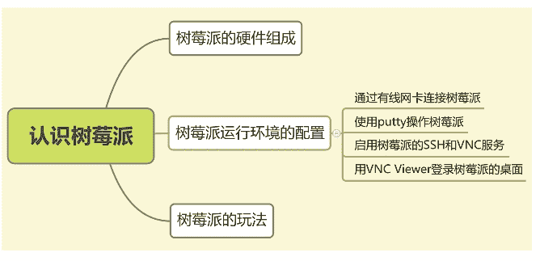

“Raspberry Pi”中文名“树莓派”，由英国一家公益教育机构推出，是一款仅有银行卡大小的卡片式电脑。最初的目的是培养儿童编程能力。上市后迅速在全球的创客、极客、科技爱好者与 DIY 圈中引发热潮。如今业界与学界都在关注树莓派在少儿编程与人工智能领域的作用。可以说，树莓派是开源硬件中最成熟、最成功的代表，后续许多开源硬件都在借鉴它。

### 第一节　树莓派的硬件组成

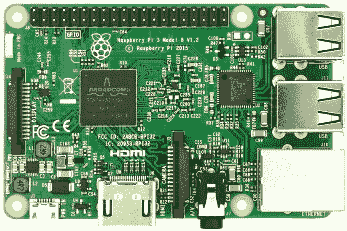
图 1-1-1　树莓派 3B+主板

现阶段主流型号为 3B+，外观见图 1-1-1。

该设备的应用范围很广，可接入电视、显示屏、主机、键盘、鼠标等外设，甚至能连到微波炉、烤箱、智能洗衣机、扫地机器人等家电。典型连接示意图见图 1-1-2。

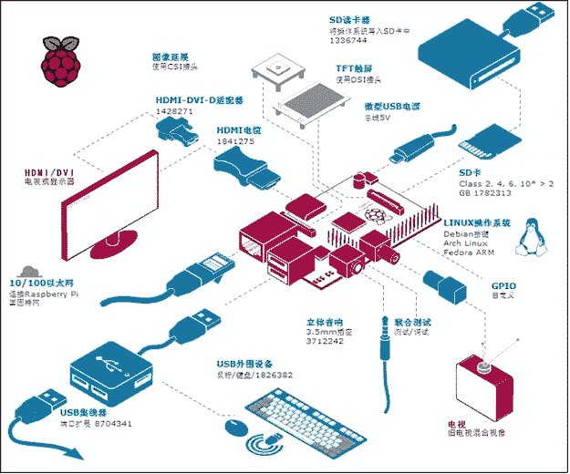
图 1-1-2　树莓派 3B+主板与外接设备的连接

为了保证外设接入，3B+ 配备了多种硬件端口，标准输入输出端口见图 1-1-3。

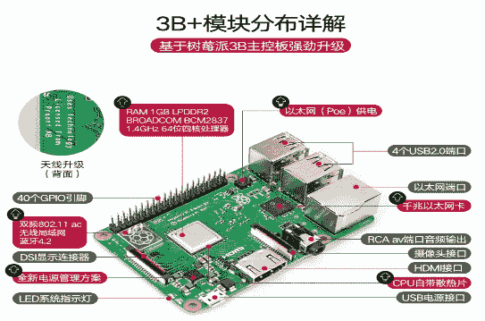
图 1-1-3　树莓派 3B+主板的接口

充分发挥 3B+ 性能还需要常用套件，代表性套件见图 1-1-4。

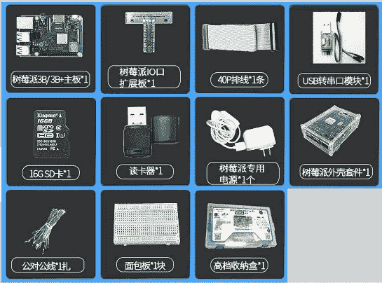
图 1-1-4　树莓派主要套件

执行不同任务时还需要传感器，常用传感器见图 1-1-5。

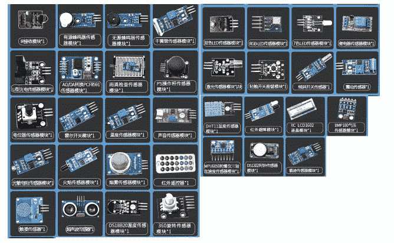
图 1-1-5　树莓派各类传感器

### 第二节　树莓派的玩法

房产经纪人纳斯在客户询问房间大小时，其他人掏出卷尺或激光测距笔，他却拿出一个网球。他把网球砸向一面墙，球反弹撞向另一面墙时发出语音：“两墙相距××米”。客户惊讶之际，他解释球内藏有一块树莓派，通过调用震动传感器实现了测距。

纳斯是典型的创客，创客们善于让生活与工作充满趣味。近十年里，全球创客与极客基于树莓派的作品已达数千万种，既有偏软件的，也有偏硬件的，还有大量软硬结合的。有人为好玩，有人为学习计算机技术，有人用于探索生活世界，也有人希望用自己的创造改善他人生活。更多人兼顾多种目的，例如做机器人、造无人机、组装自动驾驶小车，既能学习知识，又能从新视角观察世界。

表 1-1-1　树莓派主流玩法列表

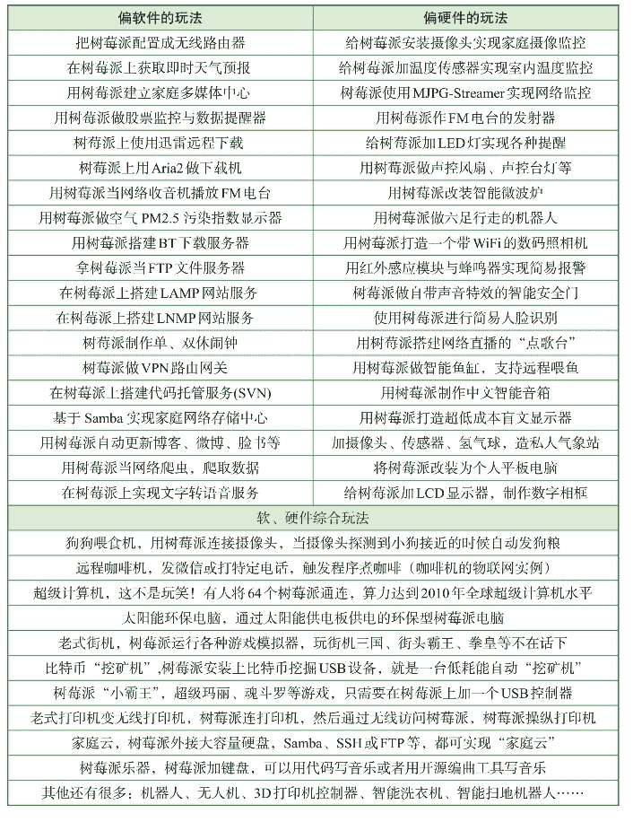

### 第三节　树莓派运行环境的配置

要在树莓派上开发，首先要熟练使用设备。让我们从配置运行环境开始。

#### 活动一：通过有线网卡连接树莓派

树莓派 3B+ 同时具备有线与无线网卡，可先用有线网络连接，再启用无线网络，之后即可无线控制。

1. 将网线一端接树莓派网卡口，另一端接台式机或笔记本。
2. 在电脑上共享上网，具体步骤：
找到无线网络连接，右键“属性”，在“共享”选项卡勾选“允许其他网络用户通过此计算机的 Internet 连接来连接”。

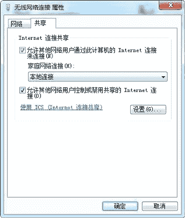
图 1-1-6　个人电脑无线网络连接

注意：家庭网络需选择以太网“本地连接”。若无下拉选项，请重启。

3. 设置本地连接 IP 地址：
按实际情况设置，本例设为 192.168.137.1，子网掩码 255.255.255.0。
4. 查找树莓派 IP 地址
按 `WIN+R` 打开“运行”，输入 `cmd` 进入命令行，再输入 `arp -a` 查看网络地址，通常 192.168.137.1 下第一个地址即为树莓派，如图 1-1-7 红框所示。

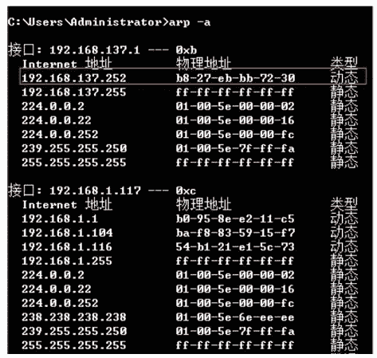
图 1-1-7　在命令提示符下查看树莓派网络地址

确认网卡 IP 后才能进行后续操作。若找不到，可用 `IPScanner` 扫描。亦可修改 SD 卡中 `cmdline.txt`，加入 `ip=XXX.XXX.XXX.XXX` 设为静态 IP，但需让电脑本地连接静态 IP 与树莓派同网段。

另一种更简便的方法是直接把树莓派用网线连向无线路由器，再从电脑登录路由器查看树莓派自动获取的 IP。获取 IP 后同样可远程控制，方法如下。

#### 活动二：使用 putty 操作树莓派

因树莓派 IP 为动态分配，每次重新插网线后可能变化，最好每次都核查当前 IP。

确认 IP 无误后，可启动 `putty` 工具连接并控制树莓派。运行效果如图 1-1-8 所示。

图 1-1-8　PUTTY 登录界面

点击“打开”后：
输入账号 `login`：`pi`

### 第四节　登录树莓派

输入密码 `password`：`raspberry`，输入时屏幕无显示，需谨慎输入。回车后进入终端命令行，如图 1-1-9 所示。出现该界面说明已连接成功。

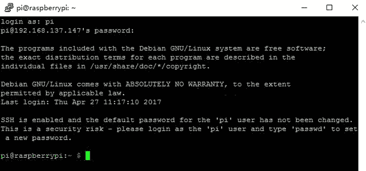
图 1-1-9　树莓派登录成功界面

若未连接成功，可关机取出存储卡，插入其他电脑在根目录新建一个空白纯文本文件，命名为 `ssh`，注意无后缀、无内容。重新插回并重启后可重试。

#### 活动三：启用树莓派的 SSH 和 VNC 服务

连接不成功通常意味着未启用 SSH 服务。启用方式是在根目录下新建无后缀空白文件并命名为 `ssh`。

SSH 允许通过网络远程管理树莓派，VNC 可登录图形界面，像操作 Windows 一样使用。因此两者需启用。启用 VNC 步骤如下：

在图 1-1-9 终端中输入 `sudo raspi-config` 进入系统配置界面，如图 1-1-10 所示。

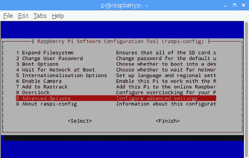
图 1-1-10　树莓派配置界面

选择第 9 项“Advanced Options”，进入高级配置，如图 1-1-11 所示。

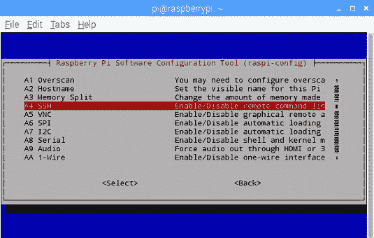
图 1-1-11　安装树莓派 VNC 服务

依次操作：Interfacing Options→VNC→Yes。系统会提示是否安装 VNC，输入 y 后回车，等待安装完成即可。

也可直接在终端输入 `sudo apt-get install tightvncserver` 回车安装。

#### 活动四：用 VNC Viewer 登录树莓派的桌面

安装完 VNC 后即可用远程桌面工具登录。但需先临时启动服务。仍在图 1-1-9 终端输入 `tightvncserver` 回车启动，当前为临时启用，后续再设为开机自启。

在电脑安装 VNC Viewer，打开后点 File→New connection，弹出 Properties，在 VNC Server 填入树莓派 IP 及服务号，服务号通常为 1，Name 可填设备名，点击 OK，如图 1-1-12 所示。

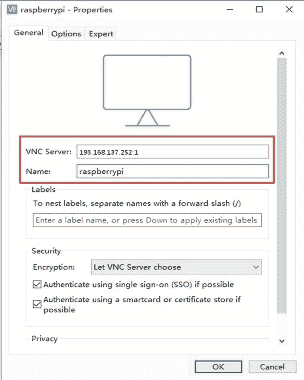
图 1-1-12　用 VNC Viewer 连接树莓派

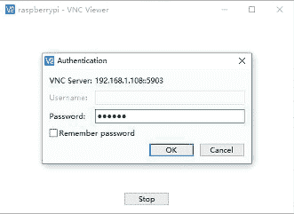
图 1-1-13　VNC Viewer 连接界面

连接后出现警告点 continue，然后输入用户 `pi` 与密码 `raspberry`，即可登录，如图 1-1-13 所示。

登录后进入图形化桌面，如图 1-1-14 所示。

图 1-1-14　树莓派登录成功界面

此时 VNC 是临时启动，进入图形界面后第一件事是设为开机自动运行。服务名为 `tightvncserver`。在系统 `/home/pi` 目录下找到 `.bashrc` 文件，未显示时需勾选“显示隐藏内容”，如图 1-1-15 所示。

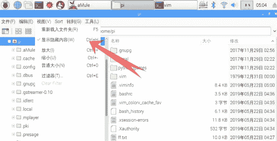
图 1-1-15　树莓派系统中显示隐藏文件

用文本编辑器打开 `.bashrc`，在文件末尾添加一行 `tightvncserver&`，注意末尾有空格再加 &。保存后重启树莓派即可自动运行 VNC 服务，设置步骤如图 1-1-16 所示。

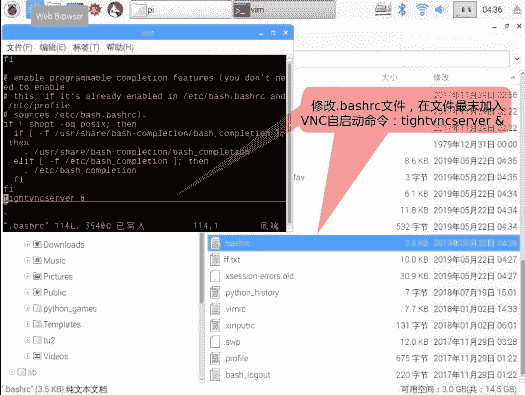
图 1-1-16　设置 VNC 服务开机自动运行

## 项目二　熟悉树莓派工作环境

启用 `tightvncserver` 服务后，无论使用有线还是无线 IP，都能登录树莓派桌面图形界面。下面对工作环境做初步了解，并配置无线网络。

### 第一节　了解树莓派的操作系统

树莓派常见预装系统是 Raspbain，它源自 Debian 并针对小型设备做了裁剪，属于轻量级发行版。桌面模式下使用逻辑与 Windows 比较接近，而切换到命令行后可用的指令数量和功能面则远比 Windows 丰富。除了 Raspbain 之外，该硬件还可运行 Android、Ubuntu、CentOS、FreeBSD、Kali、ArchLinux 乃至 Windows10 等系统，熟悉后可以根据实际需求自行更换系统。

#### 活动一：熟悉系统的桌面环境

图 1-2-1 给出了桌面整体的呈现方式，并对桌面上各图标的用途进行了说明。

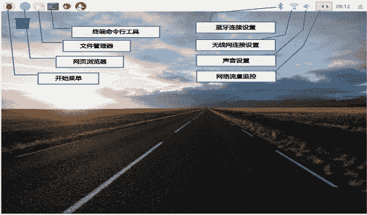

图 1-2-1　树莓派桌面环境

目前设备是通过有线网络接入的，具体步骤见上一节。网线操作相对繁琐，既然已经进入图形桌面，就能开启无线网络，之后即可用无线 IP 远程访问桌面，体验更顺畅。点开无线网络设置图标即可激活无线连接，示例如图 1-2-2。

图 1-2-2　设置树莓派无线网络

#### 活动二：熟悉系统的开始菜单

开始菜单的布局如图 1-2-3，首先可以看到琳琅满目的编程工具。

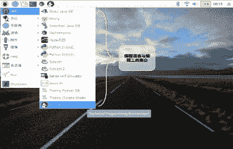

图 1-2-3　树莓派开始菜单

再来看办公类软件，这里自带的 LibreOffice 与微软 Office 具有良好的兼容性。

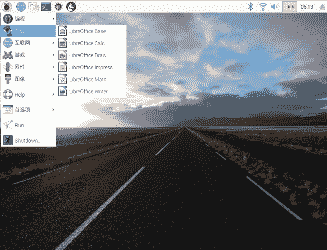

图 1-2-4　树莓派系统中自带的办公软件

图 1-2-5 与图 1-2-6 分别展示了系统自带的网络类工具和附件类工具。

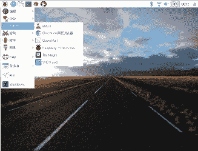

图 1-2-5　树莓派系统中的互联网工具

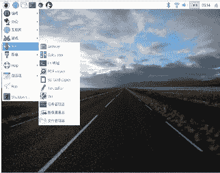

图 1-2-6　树莓派系统中的附件

### 第二节　在树莓派上编写程序

先用系统自带的 IDLE 编辑器，以 Python 写一个简易的问候程序，源码与运行效果见图 1-2-7。

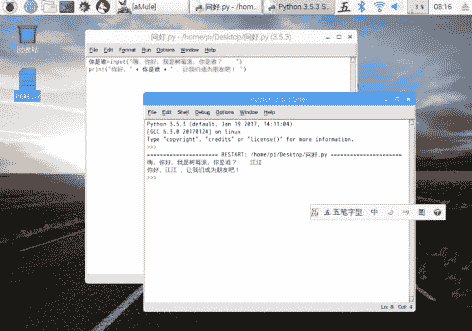

图 1-2-7　树莓派系统中自带的 python 编辑器

如果偏好可视化编程，树莓派自带了 Scratch 与 Scratch2 两个版本，图 1-2-8 为借助 Scratch2 完成的一个数学小游戏。

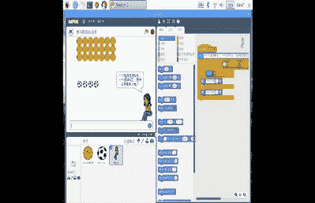

图 1-2-8　利用树莓派系统中自带的 scratch2.0 软件开发的程序

开始菜单中还有大量开发工具，其中图标为小水壶的 geany 功能覆盖面很广。简单时可像 Windows 记事本一样编辑纯文本，复杂时也能支持几乎所有主流语言。geany 的语言支持范围如图 1-2-9 所示。

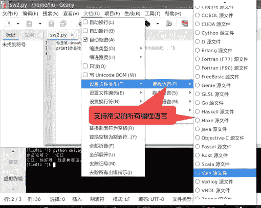

图 1-2-9　树莓派系统中自带的 geany 编辑工具

同样在 geany 中编写一段 Python 问候程序，保存后可在编辑器下方的终端直接运行，结果如图 1-2-10。

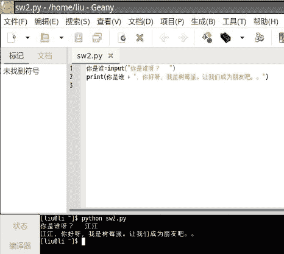

图 1-2-10　使用 geany 工具编写 python 程序

## 项目三　树莓派的 GPIO 口介绍

与其它开发板相比，树莓派提供 40 个可用于外设扩展的 GPIO 引脚。GPIO 即 General Purpose Input Output 通用输入输出，这些引脚是树莓派与外部硬件沟通的通道。

### 第一节　40P 排线引脚介绍

GPIO 排线引脚的定义见图 1-3-1。

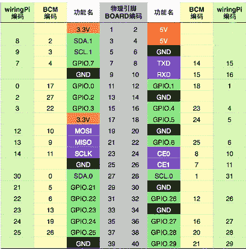

图 1-3-1　树莓派 GPIO 排线引脚介绍

#### 活动一：引脚介绍

对图 1-3-1 的引脚重新归类后得到图 1-3-2。

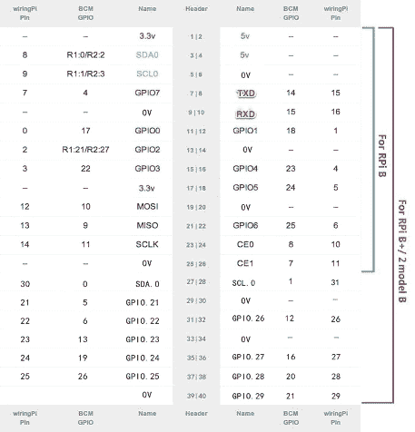

图 1-3-2　树莓派 GPIO 引脚功能介绍

图 1-3-2 中引脚编号共有三种：按物理位置的编号、wiringPi 库定义的编号、BCM2837 SoC 定义的编号。

若使用 C 语言配合 wiringPi 库操作 GPIO，需采用 wiringPi 的编号。从图中可以看到 wiringPi 中的 GPIO.0 对应物理编号 11。wiringPi 是用 C 实现的 GPIO 访问库，使用前需要先安装。

使用 Python 控制 GPIO 通常选用 RPi.GPIO。该库提供操作 GPIO 的 API，本质上是一个控制树莓派 GPIO 通道的模块，系统默认已存在，可直接调用。Python 支持 Board Pin 与 BCM GPIO 两种编号方式。

选择物理编号 BOARD 时，可将引脚指定为“BOARD11”。

编写代码前要先设定编号模式，常用两种写法：

`GPIO.setmode(GPIO.BOARD)`　#设置 GPIO 模式为 BOARD

`GPIO.setmode(GPIO.BCM)`　#设置 GPIO 模式为 BCM

若系统中缺少相关库，可先在终端执行 `sudo apt update` 升级系统，之后执行 `sudo apt install python3-gpiozero` 安装 Python3 相关模块。

#### 活动二：RPi.GPIO 的使用方法

用 Python 操作 GPIO 排线可按以下流程：

1.首先导入 RPi.GPIO 模块：

2.导入后即可调用模块函数，为确认是否导入成功可进行一次简单验证：

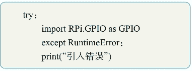

验证通过后即可用该模块驱动 GPIO 引脚，进而控制外接硬件。下面这段示例代码可供测试，按 Ctrl+C 退出。

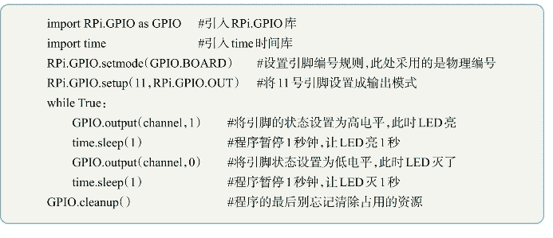

## 项目四　点亮我的小灯泡

本项目利用树莓派驱动双色发光二极管 LED，帮助理解树莓派控制外设的基本原理。

### 活动一：所需器材

Raspberry Pi 主板 1 块、树莓派电源适配器 1 个、40P 软排线 1 根、双色 LED 灯模块 1 个、面包板 1 个、跳线若干。

双色 LED 可发出两种颜色的光，常见为红蓝。它包含三根引脚，分别是阴极、阳极和接地。内部两个 LED 以反向并联方式排列，通过改变电压极性点亮不同颜色，因此常被用作电视、数码相机或遥控器的指示灯。

### 活动二：项目实现

1.传感器原理图

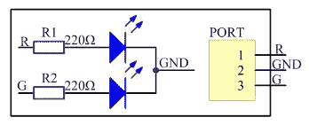

图 1-4-1　双色 LED 模块内部原理图

2.接线方法

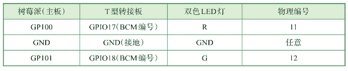

3.实物连接示意如图 1-4-2。

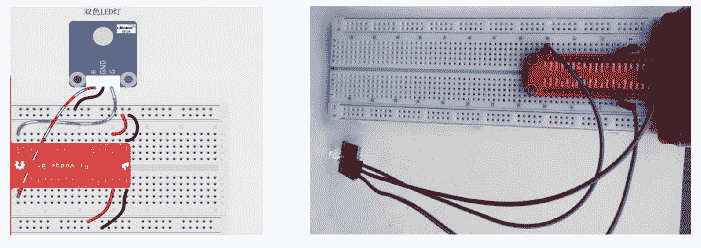

图 1-4-2　实验接线图

4.代码清单：

用 Python 控制树莓派点亮 LED：

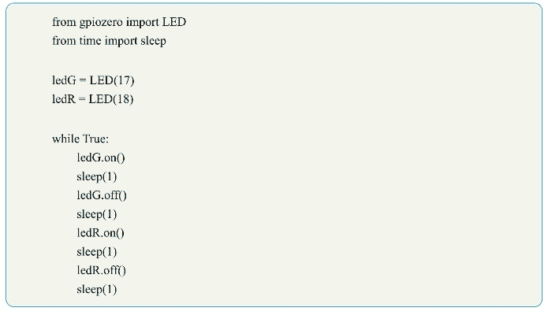

保存为“LED.py”，执行 `python3 LED.py` 即可看到效果，按 Ctrl+C 结束程序。

拓展：

可尝试使用 PCF8591 模块调节 LED 亮度

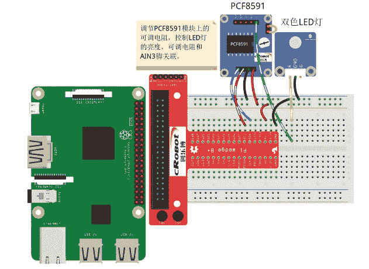

图 1-4-3　PCF8591 模块介绍

PCF8591 是一款单片单电源低功耗 8 位 CMOS 数据采集芯片，内置 4 路模拟输入、1 路模拟输出以及串行 I2C 接口。A0、A1、A2 三个地址脚可设置硬件地址，支持最多 8 个器件挂载到同一 I2C 总线。地址、控制和数据通过双线 I2C 传输，具备多路复用模拟输入、片上跟踪保持、8 位 ADC 与 8 位 DAC 功能，转换速率受 I2C 速率限制。

引脚定义：

模块左右各扩展两排排针，左侧 AOUT 为芯片 DA 输出，AIN0-AIN3 为模拟输入 0-3；右侧 SCL 为 IIC 时钟接树莓派 SCL，SDA 为 IIC 数据接树莓派 SDA，GND 接地，VCC 外接 3.3V~5V。

PCF8591 模组集成热敏与光敏电阻，共 3 个红色短路帽：
P4 套上后接入热敏电阻
P5 套上后接入光敏电阻
P6 套上后接入 0~5V 可调电压

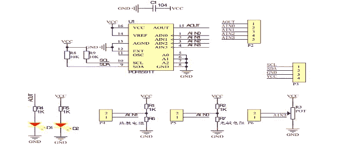

图 1-4-4　PCF8591 内部原理图

拓展代码见书末资源包。使用 PCF8591 前需开启 I2C：
1.Run `sudo raspi-config`.
2.Use the down arrow to select 5 Interfacing Options
3.Arrow down to P5 I2C.
4.Select yes when it asks you to enable I2C
5.Also select yes if it asks about automatically loading the kernel module.
6.Use the right arrow to select the<Finish>button.
7.Select yes when it asks to reboot.

## 项目五　下雨收衣服了

雨滴探测器可检测降雨情况，广泛用于智能照明、天窗和智能家居。本项目实现“下雨提醒”。

### 活动一：所需器材

树莓派主板 1 个、电源适配器 1 个、40P 软排线 1 根、AD/DA 转换器 1 个、雨滴传感器 1 个、面包板 1 个、跳线若干。雨滴传感器如图 1-5-1。

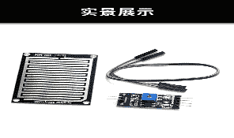

图 1-5-1　雨滴传感器

### 活动二：项目实现

1. 实验原理
雨滴传感器通过两根相近但不相交的金属线感应雨水。当雨水落在检测板上时，两线导通，信号送至控制器实现相应动作。

2. 接线方法

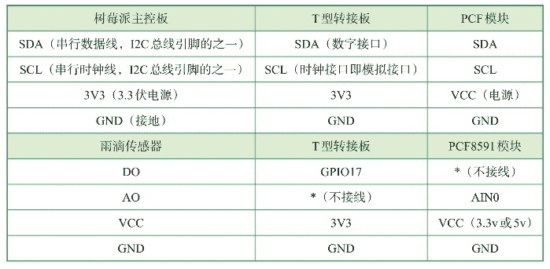

3. 连接效果如图 1-5-2。

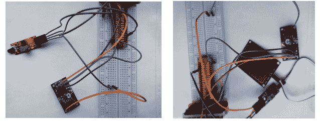

图 1-5-2　实现接线图

4. 代码测试
程序由 `PCF8591.py` 与 `raining.py` 两个文件构成，需置于同一目录，`raining.py` 调用 `PCF8591.py`。代码较长，请从书末提示下载源码。

运行后向检测区洒水，屏幕会给出相应反馈，可通过电位计调节降雨阈值以提升检测精度。测试效果如图 1-5-3。

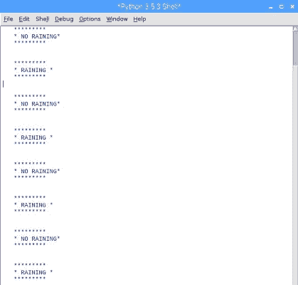

图 1-5-3　代码测试效果图

拓展
1.为“下雨报警器”做外观装饰，提升美观度。
2.制作雨水收集器，降雨时自动收集，无雨时关闭以防蒸发，缓解户外临时缺水问题。

## 项目六 火灾报警器

### 活动一：认识火焰传感器

1.
火焰传感器对火焰最敏感，对普通光也有一定响应，常用于火焰报警。

2.
传感器小板输出口可直接与单片机 I/O 相连。

3.
传感器需与火焰保持一定距离以免高温损坏，测打火机火焰时约 80cm，火焰越大探测距离越远。

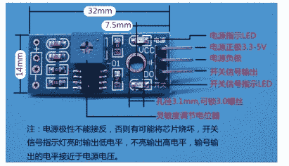

图 1-6-1　火焰传感器介绍

### 活动二：所需器材

树莓派主板 1 个、电源适配器 1 个、40P 软排线 1 根、AD/DA 转换器 1 个、火焰传感器 1 个、面包板 1 个、跳线若干。

### 活动三：项目实现

采用远红外火焰传感器，可探测 700nm 至 1000nm 波段的红外线。探头将外部红外光强转换为电流变化，再转为数字量。

1. 实现原理
将火焰传感器模块的 DO 引脚接到树莓派 GPIO，通过程序判断是否存在火焰。

2. 接线方法

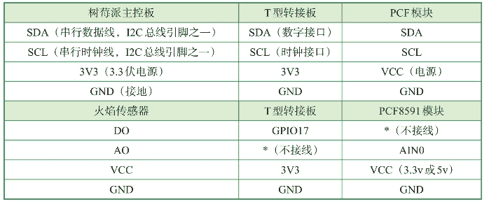

3. 接线效果如图 1-6-2。

图 1-6-2　实现接线图

备注：不同批次产品引脚顺序可能存在差异。

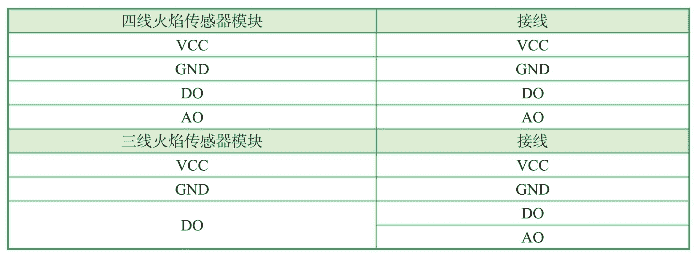

4. 代码测试
详细代码见书末资源包。点燃打火机，在 90cm 范围内即可被探测，运行效果如图 1-6-3。

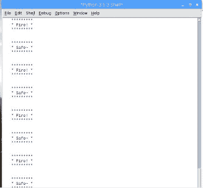

图 1-6-3　代码测试效果图

拓展
结合蜂鸣器使用，火灾发生时既有提示信息也能发出声响报警。

## 项目七 家用智能温度测控系统

本项目利用若干传感器搭建家用智能温度监测与控制系统。

### 活动一：所需器材

树莓派主板 1 个、电源适配器 1 个、40P 软排线 1 根、PCF8591 AD/DA 转换器 1 个、有源蜂鸣器 1 个、RGB-LED 模块 1 个、DS18B20 温度传感器 1 个、RTC DS1302 时钟模块 1 个、PS2 操作手柄 1 个、面包板 1 个、跳线若干。

### 活动二：项目实现

1. 实验原理

摇杆操控温控阈值

用程序读取 PS2 手柄摇杆的即时偏移量，把温度报警的高低阈值交由摇杆现场设定。PS2 摇杆能分辨上下左右四个方向的偏转，再加一次按键操作，共计五种可识别输入，实验里这五路输入分别对应阈值的升降与退出，触发按下则系统退出运行。

### 2. 接线方法

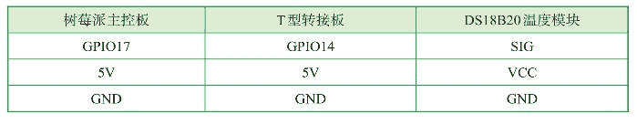

续表

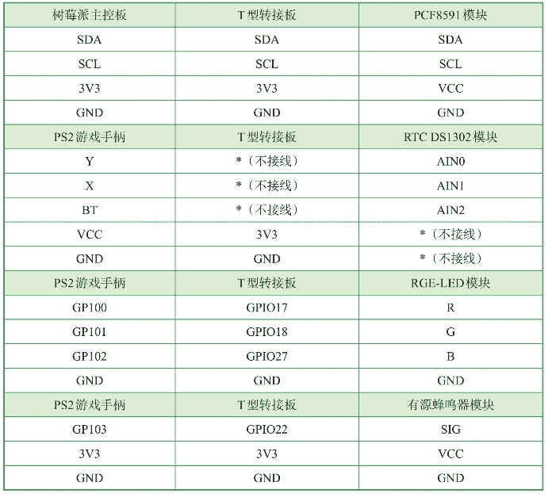

### 3. 安装过程

#### 第一步：连接跳线

参照图 1-7-1 的示意完成跳线插接。

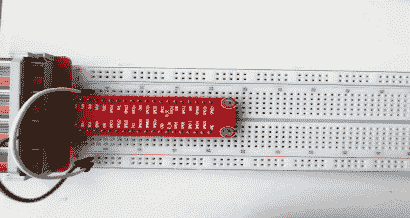

图 1-7-1　跳线连接示意图

#### 第二步：连接控制器

按图 1-7-2 的排布将 `PCF8591` 控制器接入电路。

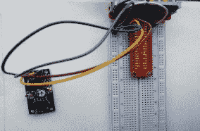

图 1-7-2　`PCF8591`控制器连接

#### 第三步：连接温度控制器

依据图 1-7-3 把温度传感器连入系统。

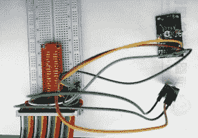

图 1-7-3　温度传感器连接

#### 第四步：连接其他控制器

依照图 1-7-4 完成整套接线。

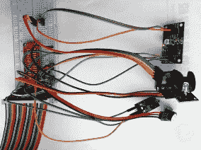

图 1-7-4　实验完整效果图

### 4. 代码测试

（代码文件，请见书末资源包下载说明）

程序以摇杆轴的读数设定上下限，环境温度触及设定区间的边界时，蜂鸣器会以两种不同音调提示警告。

### 拓展

增设湿度传感器后，可同时实现温湿度双参数监测。

## 项目八 简易摄像头追踪系统

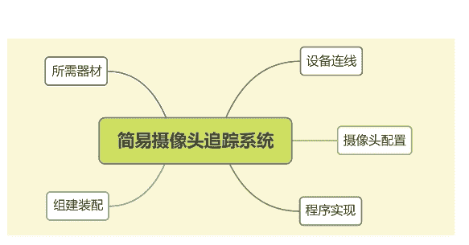

在比赛转播或需要持续跟随目标物体的拍摄场景，一套可自主跟拍的智能摄像装置很有价值。本教程以树莓派、摄像头与机械结构为例，演示如何 DIY 一套可实现 180° 水平跟随小球的简易云台。

### 活动一：所需器材

树莓派、`L298N` H-Bridge 电机驱动板、电机齿轮箱、USB 网络摄像头、跳线、螺母螺丝、齿轮、环氧胶／热熔胶、激光发射器（可选）。

### 活动二：组建装配

### 1.

选用一块木质底板，将电机固定在板面上且避开中心位置，之后在电机轴上套装小齿轮。若孔径不匹配需适度扩孔，详见图 1-8-1。

图 1-8-1　板材与电机安装图

### 2.

装上大齿轮并保持适当松动，使其齿与小齿轮啮合。为提升粘合力，先用砂纸打磨板面，再用热熔胶固定，见图 1-8-2。

图 1-8-2　齿轮安装

### 3.

把网络摄像头固定在动的大齿轮上。

先去掉摄像头外壳，仅保留核心电路板以便安装，再用环氧胶加固。

### 4.

最后的可选部件为 `L298N` H-Bridge 电机驱动板。

在板上钻四个安装孔，用机械螺钉配合六角螺母固定。

### 活动三：设备连线

### 1.

把电机的两根引线直连至 `L298N` H-Bridge 电机驱动板左侧或右侧任一接口，本例选用左侧，如图 1-8-3。

图 1-8-3　摄像头安装

### 2.

用两根导线把 `L298N` 的 5V 与 GND 与树莓派的 5V 与 GND 及供电相接，如图 1-8-4 所示。

### 3.

使用两根母对母跳线把 `L298N` 分别接到树莓派的 17 号与 18 号引脚，如图 1-8-5。

图 1-8-4　线路连接

图 1-8-5　线路连接

### 4.

把网络摄像头接入树莓派任意一个 USB 口，如图 1-8-6 与图 1-8-7。

图 1-8-6　线路连接

图 1-8-7　整体效果图

至此布线与安装全部结束。

### 活动四：摄像头配置

### 1.

先对树莓派系统进行升级并刷新固件，可执行：

`sudo apt-get update` 或者 `sudo apt-get upgrade`

### 2.

运行树莓派配置工具激活摄像头模块：

`sudo raspi-config`

进入 Interfacing options，将 camera 设为 enable。

### 3.

拍照校验

使用 `raspistill` 命令抓拍，格式为：`raspistill -o ceshi.jpg`

### 活动五：程序实现

### 1.

借助 Python 的 OpenCV 库实现小球实时跟踪，先完成库的安装。

`sudo apt-get update`

`sudo apt-get install python-opencv`

### 2.

本程序同时调用树莓派自带的 `gpiozero` 库，按 OpenCV 判定的球体 x 坐标去驱动电机。识别特征选用黄色，要求背景中黄色唯一，阈值上下限可由用户自行设定。

### 3.

OpenCV 通过 `inRange()` 函数对当前帧进行色彩分割，结合上下色界定位球体。若球体偏离画面中心，640 像素宽画面中理想 x 范围为 240～400，则程序指令电机转动。偏离越大转速越高，越靠近中心转速越低。完整代码如下：

关键提示：使用本代码前务必安装 OpenCV。若电机转向异常，可对调 `L289N` 的电机线，或对调接入树莓派的控制 GPIO 线。

# 软件篇 用 MicroPython 打开智能开发的大门

## 项目一 MicroPython 是什么

### 第一节 MicroPython 概述

`MicroPython` 是对 Python 3 的轻量化实现，集成部分标准库并针对微控制器做了优化。通俗讲它就是“微型 Python”，也可称为“精简版 Python”。其基于 ANSI C，语法与 Python3 保持一致。借助 `MicroPython`，用户可用 Python 脚本直接操作硬件底层，例如点亮 LED、驱动 LCD、读取电压、控制电机、读写 SD 卡、操控摄像头等。

### 第二节 支持 MicroPython 的开发板

`MicroPython` 诞生后获得广泛关注，适配的板型迅速增多。主流产品包括 Pyboard、Micro：bit、`ESP8266` 和 `STM32` 等。

随着应用普及，国内厂商参照开源 Pyboard 研发出国产方案。目前最常见的是 TPYBoard。`TPYBoard` 与 Pyboard 功能相近，均以 `STM32` 作为 MCU，即控制器又称单片机，板载 4 个 LED 与一个加速度传感器。现已衍生出多个版本，包含 `STM32` 标准版、基于 LAN 的有线版、基于 `ESP8266` 的无线版。

### （1）STM32 标准版 TPYBoard V10X 系列

图 2-1-1　TPYBoard V102 开发板

图 2-1-2　TPYBoard V202 开发板

该系列非常适合入门。本书以 `TPYBoard V102`（图 2-1-1）为例讲解 `MicroPython` 开源硬件开发。

### （2）基于网络的 TPYBoard V20X 系列

`TPYBoard V20X`（图 2-1-2）为网络型版本，适用于物联网设备开发。建议在具备一定 `MicroPython` 基础后再使用。V20X 需要掌握 Socket 编程，理解 C/S 通信模式与计算机网络 TCP/IP 协议。`TPYBoard` 搭配传感器及 zigbee、Lora、NB-iot、2G、4G 等通信模块即可构成物联网终端的典型形态，是快速玩转 `MicroPython` 物联网开发的利器，共享单车电子锁即是典型案例。

### （3）基于 GPS 定位的 TPYBoard V70X

`TPYBoard V70X`（图 2-1-3）系列支持卫星定位与 GPRS 基站定位，可直接通过 `MicroPython` 进行定位开发。

图 2-1-3　TPYBoard V70X 开发板

### 第三节 智能开发的概念

### 活动一：智能设备构成

智能设备大致可分为两大块：

一是机械结构系统。例如行走机器人，机械部分包含驱动轮、手臂、摄像头、扬声器等，每个部件都是独立的机械单元。若底座缺少行走机构则无法移动，若手臂缺少伸缩结构则无法像人一样操作。机械结构是智能设备的根基。

二是智能控制系统。机械结构配合传感器即可获得感知能力，把感知数据反馈给微处理器，处理器据此分析后指挥执行系统做出相应动作。

### 活动二：智能控制系统

智能控制系统由三大部分组成（图 2-1-4）。控制系统：相当于大脑，负责思考。传感器系统：相当于眼耳舌皮肤，负责感知。执行系统：相当于手脚，负责行动。

图 2-1-4　智能控制系统数据传输

#### （1）微控制器

控制系统是智能设备的“大脑”，如同微型电脑，可执行程序指令并向执行机构发出动作信息。智能设备的控制模块通常拥有多个输入输出接口，用来接收外界信息后再下发指令给机械部件。

前面提到的 `MicroPython TPYBoard` 就是微处理器，俗称单片机。单片机是一种集成电路芯片，已渗透到生活的各个角落：导弹导航装置、飞机仪表控制、计算机网络通信与数据传输、工业自动化实时控制与数据处理、各类智能 IC 卡、豪华轿车安全系统、录像机摄像机全自动洗衣机的控制、程控玩具电子宠物等都离不开它。

#### （2）传感器系统

真正的智能设备通常具备一定的感知能力，能够感应并把信息传递给控制器的电子器件称为传感器。类比人体感觉器官，智能设备的电子传感器按功能分类，例如光源传感器、声音传感器、气体烟雾煤气传感器、压力传感器、温度传感器等。它们的灵敏度与感应范围有时甚至超越人，例如电子指南针、红外传感器等。

#### （3）执行系统

正如人体的骨骼和肌肉配合才能完成动作，机器人的动作表现也由特定的机械结构实现。

## 项目二 使用 TPYBoard 控制板

### 第一节 TPYBoard 控制板与电脑的连接

图 2-2-1　TPYboard V102 与电脑连接

图 2-2-2　电脑读取 TPYBFLASH 磁盘

第一步：通过 USB 线把 MicroPython 开发板与电脑相连（图 2-2-1）。

第二步：接入电脑后驱动自动加载，连接成功会在电脑上出现一个可移动磁盘（图 2-2-2）。找到“`TPYBFLASH`”磁盘，它即开发板内部的 Flash。可把开发板当作 U 盘使用。Flash 容量约 95KB，若需更大存储可插入 TF 卡扩容。

第三步：打开“`TPYBFLASH`”磁盘查看文件。磁盘中包含 4 个文件：`boot.py`、`main.py`、`README.txt`和`tpybcdc.inf`（图 2-2-3）。

图 2-2-3　`TPYBFLASH`磁盘中文件

### `boot.py`文件说明

开机引导文件，负责加载默认运行的程序文件（默认是`main.py`），也可设置板子的工作模式，如模拟鼠标键盘等。

### `main.py`文件说明

开发板默认运行的程序文件，其行为遵循`boot.py`的配置。

### `README.txt`文件说明

提供开发板介绍及帮助信息。

### `tpybcdc.inf`文件说明

开发板的驱动文件，用于实现与电脑的通信。

### 第二节　MicroPython 程序编辑器介绍

编辑器是用于修改电脑文件的软件，常见类型有文本编辑器、网页编辑器、源程序编辑器、图像编辑器、声音编辑器和视频编辑器等。

编译器通常接收由各类编辑器生成的源程序，并与编辑器及其他程序集成到交互式开发环境 `IDE` 中。这类编辑器称为结构化编辑器，已内置编译器的部分功能，因此错误可在编写阶段即被发现。从编辑器中可直接调用编译器及配套程序，无需离开编辑器即可运行。

#### 活动一：认识 Python Editor 编辑器

`Python Editor` 模块化编辑器（图 2-2-4）专为 `TPYBoard` 开发打造的 `IDE`，也兼容其他 `MicroPython` 开发板。它是一款 Web 在线模块化编辑器，网址为 `http://www.tpyboard.com/pythoneditor/`，需联网浏览器访问。模块化编程降低了入门门槛，有助于推广开源硬件编程。

`Python Editor` 拼插界面主要由三部分组成：模块选择区、拼插拖拽区、代码显示区。

图 2-2-4　`Python Editor`模块化编程环境

#### 活动二：程序的下载

图 2-2-5　下载程序

图 2-2-6　模块化转换化的`MicroPython`代码

第一步：在模块化编辑器中完成程序编写后，点击底部“`下载 python`”按钮（图 2-2-5），将模块化操作转换为开发板可识别的 `MicroPython` 代码。

第二步：打开下载得到的 `main.py` 文件，用 `Notepad++` 等文本编辑器打开（图 2-2-6），即可看到模块化程序已转换为 `MicroPython` 源代码。

第三步：将下载的 `main.py` 复制到开发板“`TPYBFLASH`”磁盘，覆盖原有文件。复制过程中 `TPYBoard` 上的 LED 红灯会点亮，表示正在写入；红灯熄灭即表示写入完成。

第四步：按下开发板上的“`RST`”复位键，可观察到 `LED1` 红灯亮 1 秒后熄灭，间隔 1 秒后再亮，如此重复约 10 次后熄灭。灯光的闪烁节奏表明程序已被 `TPYBoard` 成功执行。

## 项目三　炫彩的流水灯

### 第一节　概念与原理

# TPYBoard 灯光与传感动手笔记

流水灯的本质就是让一组灯珠在控制器调度下按预定节奏依次亮灭。日常里这种思路随处可见：城市夜景的灯光编排、园林景观中灯光与水景的配合、带音乐的灯光秀、舞台灯光音响联动，以及广告屏的文字滚动，都是同一套逻辑。以此为切入，本章以 TPYBoard V102 自带的四颗板载 LED 作为练习对象，用软件实现流水点亮，掌握后便可迁移到其它造型。

#### 活动一：基础概念认识

### 1. 发光二极管概览
LED 是 Light Emitting Diode 的缩写。相较白炽灯与荧光灯，它更省电、更环保、寿命更久，已逐步成为主流光源。核心是一块固态半导体元件，能把电能直接转成可见光。内部晶片一端固定于支架作负极，另一端引出正极接入电源。工作时半导体内部载流子复合释放能量形成光子，可直接发出红、黄、蓝、绿、青、橙、紫、白等色光，再借助三基色原理配合荧光粉即可调出任意色彩。直插型 LED 以脚长脚短辨别正负；贴片型可参考板上四颗灯，有色漆标识的那一端为负极。

#### （1）LED 分型
除亮度与色彩差异外，还可按功能分为普通单色、高亮、超高亮、变色、闪烁、电压控制式、红外、负阻型等。驱动方式主要有恒流与恒压，调光方式有模拟调光与 PWM 调光。大多数产品采用恒流驱动，能保持电流平稳，降低 VF 漂移影响，延长灯具使用寿命。

#### （2）LED 典型用途
① 显示与交通信号。灯具抗震耐冲击、响应快、省电寿命长，广泛用于室内外各类显示屏，分为全彩、三色、单色。交通信号多选用超高亮红绿黄，兼顾节能与可靠性，市场需求较大。
② 汽车领域。车用灯包含仪表板、音响指示灯、开关背光、阅读灯，以及刹车灯、尾灯、侧灯、头灯等。除前照灯外大多为单色，对寿命要求高。第三刹车灯常用红高亮，尾灯转向灯车身标识可用红黄高亮，仪表板需要多色高亮。
③ 背光应用。用于小型液晶的背光照明，如手机、笔记本的按键、面板、符号、键盘背景。随着移动通信普及，高亮需求持续增长。
④ 半导体照明。普通照明是最大市场，覆盖室外景观与室内照明。半导体照明的目标是替代白炽灯与荧光灯，已从局部应用向整体推广，发展方向是超高亮、大功率、高效率、低成本。

### 2. 板上 LED 认识
本板集成四颗普通贴片单色 LED，丝印为 LED1 红、LED2 绿、LED3 橙、LED4 蓝。图形化编辑器的积木区中有“板载 LED”分类，可用该分类的积木控制四颗灯的亮灭。

## 活动二：流水灯的设计

### 1. 电路搭建
#### （1）所需物料，如表 2-3-1 所示。

#### （2）电路接线，如图 2-3-1 所示。

图 2-3-1 流水灯电路连接图

### 2. 程序设计
TPYBoard 上有四颗 LED。用这四颗灯做出流水效果，运行逻辑为：LED1 亮→间隔→LED2 亮、LED1 灭→间隔→LED3 亮、LED2 灭→间隔→LED4 亮、LED3 灭→间隔→LED4 灭。将上述循环不断重复即可形成流水。画流程图有助于理清算法，流程图用图形符号表示操作，用连线串联，是程序设计阶段常用的思路整理方式。

#### （1）设计流程图
依据 LED 状态变化，可画出流水灯执行流程图（图 2-3-2）。

#### （2）编写程序
参照流程图，在线模块化编辑器中编写流水灯程序，示意如图 2-3-3。每颗 LED 设置点亮 0.3 秒，借助时间模块实现点亮后延时 0.3 秒再熄灭。

图 2-3-2 流水灯程序流程图

## 活动三：程序的下载与运行

图 2-3-3 流水灯程序

把程序拷贝到 TPYBoard，按下 RST 键执行，观察灯珠变化。至此，用 MicroPython 与 TPYBoard 完成流水灯制作。

对流水灯程序代码的解读：

## 项目四 智能光控灯

### 第一节 概念及机理
本项目借助光感元件实现依环境光强自动开关 LED。类似思路可用于路灯：夜间光线减弱时灯亮，白天光线充足时灯灭以节约电能。

## 活动一：光感元件介绍
光感元件感知周边光照并把信息告知处理芯片，芯片据此做决策。应用广泛，如电视亮度自动调节、相机自动曝光、防盗报警等。

光敏器件多用于太阳能草坪灯、光控小夜灯、照相机、监控器、光控玩具、声光控开关、摄像头、防盗钱包、光控音乐盒、生日音乐蜡烛、音乐杯、人体感应灯、人体感应开关等产品。

#### （1）光敏电阻
光敏电阻基于半导体光电效应，无极性，可加直流或交流电压。受光时阻值变小，无光时阻值很大，光越强阻值越小，停止照射后阻值恢复。响应波段从紫外到红外。优点是灵敏度高、体积小、性能稳定、价格低。暗态电阻即无光照时的电阻，暗电流随之存在；亮态电阻即受光时的电阻，亮电流增大。理想上暗电阻越大越好，亮电阻越小越好，实际应用中暗电阻约在兆欧级，亮电阻在数千欧以下。

#### （2）光敏二极管
光敏二极管与普通半导体二极管结构相似，管芯为具光敏特性的 PN 结，具有单向导电性，工作时需加反向电压。无光时只有很小的饱和反向漏电流即暗电流，处于截止。受光照时反向漏电流显著增加形成光电流，随入射光强变化。光照产生电子-空穴对，在反向电压下漂移使反向电流增大，可利用光强变化改变电路电流，无光截止、有光导通。

#### （3）PT550 环保型光敏二极管
基于 PT550 的光线感测模块可检测环境光强，常用于制作随光强变化的互动作品。本章采用 DFRobot 封装的模拟环境光线传感器 DFR0026，如图 2-4-1 所示。具体参数见表 2-4-1。

图 2-4-1 DFR0026 光线传感器
表 2-4-1 PT550 光敏二极管参数

## 活动二：用串口调试工具读取环境光值
#### （1）如图 2-4-2 所示，将光线传感器输入端接 TPYBoard X4，VCC 接 3.3V，GND 接 GND。

图 2-4-2 连接光线传感器示意图
#### （2）打开图形化编程网页，编写读取环境光模拟值的程序，程序代码如图 2-4-3 所示。
#### （3）在 TPYBoard 上运行上述程序。
#### （4）查看 TPYBoard 连接的串口。以 Windows 10 为例：右键此电脑→管理→设备管理器→端口 COM 和 LPT，其中 USB 串行设备即为 TPYBoard 端口，如图 2-4-4 所示。

图 2-4-3 读取 X4 接口模拟值

图 2-4-4 TPYBoard 连接 PC 的串口
#### （5）安装串口调试工具 PuTTY，选择 Serial，在 Serial line 填入 COM4，其余默认，点击 Open，如图 2-4-5 所示。
#### （6）PuTTY 界面会实时显示环境光强度数值，数值越大光越强。遮挡传感器可观察数值下降，如图 2-4-6 所示。

图 2-4-5 PuTTY 界面设置

图 2-4-6 PuTTY 中显示环境光值

## 活动三：智能光控灯设计与构建
工作原理简洁：读取光感元件的环境光强来决定 LED 正极输出高电平还是低电平。光值低于阈值时输出高电平点亮 LED，否则输出低电平熄灭。

系统由 TPYBoard 控制器、光感元件电路、LED 灯电路三部分构成，结构如图 2-4-7 所示。

图 2-4-7 光控灯系统结构

### 1. 材料需求
本实验用料常见且易得，清单见表 2-4-2。
表 2-4-2 智能光控灯材料清单

### 2. 电路搭建及接线
使用 Fritzing 仿真电路，实物连线与仿真一致。LED 负极接控制板 GND，正极接 X1。光感元件连接方式同测试阶段。电路连接如图 2-4-8 所示。

图 2-4-8 智能光控灯电路设计

### 3. 程序设计
#### （1）程序流程图
测试表明环境光低于 80 时周围较暗，需开灯；高于 80 时无需开灯。以 80 作为临界值判断：X4 读取值大于 80 时 X1 输出低电平熄灭；小于 80 时 X1 输出高电平点亮。程序流程图如图 2-4-9 所示。

图 2-4-9 程序流程图
#### （2）编写程序
按流程图实现程序如图 2-4-10 所示。先创建光线值变量，将 X4 引脚读取的模拟值赋给该变量，再根据变量是否大于 80 选择 X1 输出高或低电平。

图 2-4-10 智能光控灯控制程序
#### （3）下载运行程序
第一步：把编写好的程序复制到 TPYBoard 执行。第二步：用手遮挡光感元件，观察 LED 变化。

### 4. MicroPython 代码实现
完整 MicroPython 代码如下：

## 项目五 智能温控风扇

### 第一节 概念及机理
生活中温度相关设备随处可见。空调普及但风扇仍常用，其挡位需手动调节。通过高精度集成温度传感器，可设计一套随环境温度自动调节转速的智能风扇。

## 活动一：电机简介
#### （1）电机的概念
电路中电机用字母 M 表示，主要作用是产生驱动转矩为机械提供动力；发电机用字母 G 表示，主要作用是把机械能转成电能。
#### （2）电机的分类
常见分类如下：按工作电源分为直流电机与交流电机；按结构与工作原理分为直流电动机、异步电动机、同步电动机；按起动与运行方式分为电容起动式单相异步电动机、电容运转式单相异步电动机、电容起动运转式单相异步电动机、分相式单相异步电动机；按用途分为驱动用电动机与控制用电动机；按转子结构分为笼型感应电动机与绕线转子感应电动机。

# 电机分类与原理

## 按运转速度划分
按运转速度可分为高速电动机、低速电动机、恒速电动机、调速电动机。低速电动机又包括齿轮减速电动机、电磁减速电动机、力矩电动机、爪极同步电动机等。

## （3）直流电机的概念和原理
直流电动机把直流电能转换为机械能。结构分定子与转子。定子包含主磁极、机座、换向极、电刷装置；转子包含电枢铁芯、电枢绕组、换向器、轴与风扇。靠直流工作电压运行，广泛用于收录机、录像机、影碟机、电动剃须刀、电吹风、电子表、玩具等。

## （4）步进电机的概念及原理
步进电机把电脉冲信号转变为角位移或线位移的开环控制电机，是数字程序控制系统的主要执行元件。无超载时，转速与停止位置仅取决于脉冲频率与脉冲数。驱动器接收到脉冲信号，电机按设定方向转动一个固定角度，称为步距角。电机以固定角度一步步运行，可通过控制脉冲个数实现准确定位，通过控制脉冲频率实现调速。

# 活动二：L298N 电机驱动电路
L298N 是 SGS 公司产品，内部集成 4 通道逻辑驱动电路，可作为二相和四相电机的专用驱动器，即内置两个 H 桥的高压大电流双全桥驱动器，接收标准 TTL 逻辑电平，可驱动 46V、2A 以下电机。其引脚排列如图 2-5-1 所示。

工作电压：控制信号直流 5V；电机电压直流 3～46V，建议 36V 以下。
最大工作电流：2.5A
额定功率：25W
特点：具有信号指示、转速可调、抗干扰能力强、过压过流保护，可单独控制两台直流电机或一台步进电机，支持 PWM 脉宽调速，可实现正反转。

L298 可驱动两个电机，OUT1、OUT2 与 OUT3、OUT4 各接一台电动机，5、7、10、12 脚接输入控制电平以控制正反转，ENA、ENB 接使能端控制启停。本章采用 L298N 电机驱动模块如图 2-5-1 所示驱动风扇。电机驱动参数见表 2-5-1。

L298N 这类直流与步进兼顾的双通道驱动板可同时拖动两台直流马达，习惯标记为 M1 与 M2。A、B 两路接口用于接入 PWM 波形实现调速，若不需要调速可以直接把 A、B 拉高到 5V 让马达全速运转，实际做法是用跳线帽把两脚短接。转向控制很直接：IN1 高电平且 IN2 低电平时 M1 正向旋转，电平互换则反向；M2 的规则一样，IN3 高 IN4 低为正转，反之则反转。转速方面 A 通道对应 M1，B 通道对应 M2。

图 2-5-1　`L298N`电机驱动模块

表 2-5-1　`L298N`驱动芯片管脚映射

# 活动三：温感器件概述

温感器件能够把温度变化转化为可用电信号。常见的实现方式大致有热电偶、热敏电阻、电阻式温度探测器 RTD 以及集成电路型温感芯片，具体差异见表 2-5-2。集成电路型按输出形式又分为模拟输出和数字输出两类。

## （1）温感器件性能对照

表 2-5-2　温度传感器性能对比表

## （2）LM35 模拟线性温感芯片

图 2-5-2　`LM35`温度传感器

本节温控风扇选用 LM35 线性模拟温感探头，采用 DFRobot 封装的 DFR0023。LM35 由美国国家半导体公司推出，量程 -40℃ 至 150℃，灵敏度 10mV/℃，输出电压随温度线性变化。与开源硬件搭配可方便地实现环境温度感知互动，实物见图 2-5-2。

# 活动四：PWM 调速机理

PWM 调速即脉冲宽度调制，利用微控制器的数字输出去调控模拟电路，广泛用于测量、通信、功率变换等领域。该方式控制简便、灵活、动态响应好，是电力电子中常用的手段。

核心是通过改变占空比来等效不同电压，从而调节施加到马达两端的有效电压实现转速变化，波形示意如图 2-5-3。

图 2-5-3　`PWM`脉宽调节波形图

# 活动五：智能温控风扇的设计与实现

本实验用 LM35 采集环境温度送入 TPYBoard 处理，主控依据读数以 PWM 方式驱动驱动芯片，进而改变直流风扇转速，实现随温度升高风量增大的自适应调节。

## 1. 材料需求

本项目所需物料清单见表 2-5-3。

表 2-5-3　智能温控风扇材料清单

## 2. 电路设计与连接

借助 Fritzing 仿真绘制电路。风扇负极接控制板 GND，正极接 X1 接口；温感探头接 X4。整体连线如图 2-5-4。

图 2-5-4　智能温控风扇电路设计

## 3. 程序设计

### （1）程序流程图

LM35 返回给主控的是电压与温度线性对应的数值，使用前需换算。查阅资料可知温度 = LM35 电压值 ×125/256。判定规则为温度低于 25℃ 环境适宜，马达不转；高于 25℃ 时输出 PWM 调节转速。流程见图 2-5-5。

图 2-5-5　程序流程图

### （2）编写程序

依据流程图实现。首先创建温度变量，将感测器返回的电压转换成温度，再用 PWM 调节马达转速。风扇控制程序如图 2-5-6。

图 2-5-6　智能温控风扇控制程序

### （3）下载运行测试程序

第一步：把编写好的程序复制到 TPYBoard 中执行。
第二步：改变感测器周边温度，观察马达转速变化。

## 4. MicroPython 代码实现

本项目 MicroPython 代码如下：

## 项目六　智能避障小车

## 第一节　概念与原理

智能小车是一种可通过编程完成特定任务的小型机器人，成本低廉、电路简洁、调试方便，趣味性强，深受机器人爱好者和学生喜爱。本章介绍如何设计制作智能避障小车，通过车载超声波模块获取前方障碍物距离并决策绕行。

## 活动一：超声波测距模块简介

### （1）超声波测距原理

工作原理如图 2-6-1。模块含发射端与接收端，发射端发出声波后开始计时，声波在空气中约以 340m/s 传播，遇到障碍物反射后被接收端捕获，停止计时，总耗时为 t。设模块到障碍物距离为 H，往返总路程为 2L，收发器间距为 2M，可推导出相关关系式。

由①②式可得③式，障碍物距离为 H。由于收发器间距很短，实测时 L 近似 H，忽略 2M 后可简化为 H = v × t / 2。

图 2-6-1　超声波工作原理

### （2）HC-SR04 超声波模块

本章避障小车使用 HC-SR04 超声波模块。工作要点如下：
1）用 I/O 口 TRIG 触发测距，给出至少 10us 的高电平；
2）模块自动发送 8 个 40kHz 方波，检测是否有回波；
3）有回波时通过 I/O 口 ECHO 输出高电平，高电平持续时间即为超声波往返时间，距离 = 高电平时间 × 声速 /2；
4）使用时发送一个 10us 以上高电平触发，随后在接收口等待高电平并计时，低电平到来时读取时间计算距离。

图 2-6-2　`HC-SR04`超声波传感器

HC-SR04 由超声波发射器、接收器和控制电路组成，由单片机向 TRIG 口发送大于 10us 高电平触发测距，测量距离 = 高电平持续时间 × 声音速度 /2。

表 2-6-1　`SR04`技术参数

## 活动二：车体安装

### 1. 材料清单

本实验所需物料清单见表 2-6-2。

表 2-6-2　智能避障小车材料清单

### 2. 车体结构安装

#### （1）车模主要结构

底盘采用三轮布局，两轮驱动加一颗万向轮。主要部件如图 2-6-3。

图 2-6-3　小车主要结构

#### （2）小车完整结构图

主体结构加装感测组后整体如图 2-6-4。

图 2-6-4　小车完整结构

### 3. 电路设计连接

#### （1）线路连接

引脚连接对照表 2-6-3。

#### （2）电路设计与连接

避障小车的感测执行器与控制板的连接如图 2-6-5。

图 2-6-5　避障小车器件连接图

### 4. 程序设计

#### （1）避障小车总流程图

小车运行总流程如图 2-6-6。

图 2-6-6　避障小车总流程图

#### （2）避障小车避障流程图

遇到障碍物的处理：先停止→后退 2 秒→右转 2 秒→前进。流程图如图 2-6-7。

### 5. 程序实现

#### （1）马达控制

小车有四种行进状态：前进、停止、后退、右转。通过控制 L298N 的 IN1、IN2 电平决定左轮状态，控制 IN3、IN4 决定右轮状态。

小车前进程序如图 2-6-8。

图 2-6-7　避障过程流程图

图 2-6-8　小车前进程序

小车停止程序如图 2-6-9。

图 2-6-9　小车停止程序

小车后退程序如图 2-6-10。

图 2-6-10　小车后退程序

小车右转程序如图 2-6-11。

图 2-6-11　小车右转程序

#### （2）超声波测距程序

采用 I/O 口 TRIG 触发测距，给出至少 10us 高电平；模块自动发送 8 个 40kHz 方波并检测回波；有回波时 ECHO 输出高电平，持续时间即为往返时间，距离 = 高电平时间 × 340m/s /2。

初始化部分如图 2-6-12，测距方法如图 2-6-13，调试效果如图 2-6-14。

图 2-6-12　超声波测距初始化部分

图 2-6-13　超声波测距方法

图 2-6-14　超声波测距程序调试

#### （3）超声波避障程序

在已完成的子程序基础上相互调用，实现小车的超声避障。主程序如图 2-6-15。

### 6. MicroPython 代码实现

本项目的 MicroPython 代码请参见资源包中“软件篇_ 项目 6 智能小车.py”。

图 2-6-15　超声避障程序

国务院《新一代人工智能发展规划》指出，人工智能已成为国际竞争新焦点，是引领未来的战略性技术，将深刻改变生产生活方式与思维模式。人工智能作为颠覆性技术，对学生学习与生活影响重大。

通过本书学习，希望同学掌握项目开发流程，不局限于具体案例，而是深入理解主控与感测器件原理，最大化感测功能，创造更有创意的作品。

本书配套资源下载地址

链接：链接：https：//pan.baidu.com/s/1jAtcyx4XVaujNWUOk2t82w

密码：1a88

# 后记

AlphaGo 战胜人类围棋高手的消息振奋世界，背后功臣 Python 瞬间成为编程语言新星，正引领人类进入奇妙的人工智能新时代。

Python 在人工智能领域的成功开创了信息技术发展新方向，颠覆了传统算法认知，对生活、学习、工作方式产生巨大影响。如今，如何应用 Python 促进教育变革、促进学生发展，成为必须探索的问题。因此成都市锦江区教师进修学校组织团队编撰本书。编写出版期间获四川省、成都市、锦江区教育领域领导专家悉心指导，在此致谢。

本书共 3 册：《人工智能·Python 基础》《人工智能·Python 进阶》《人工智能·可编程硬件》。由易到难，以项目为珠、以知识体系为线，对 Python 编程语言做了较为全面的介绍，是一套可读性高、操作性强、易学的人工智能课程。

系统学完所有项目，即可具备一定编程思维，拥有迈进人工智能大门的钥匙。你是否已体会到 Python 的易用易学特点？

祝贺你获得人工智能 Python 系列书籍的知识与技能，愿你在人工智能学习道路上勇于开拓、敢于创新，为“中国智造”贡献力量！

