# AI 基础与 AIGC 实战导论

# 内容概览

本册围绕智能技术的基础原理与生成式内容实践展开系统化介绍。全书共分 11 个单元，依次为 AI 入门概览、大模型首次接触、AIGC 理解、提示词掌握、AIGC 支撑的在线检索与文本创作、AIGC 支撑的数据分析与图表绘制、AIGC 支撑的演示文稿与图形制作、AIGC 支撑的图像创作与创意设计、AIGC 支撑的音视频与动画制作、AIGC 支撑的编程与代码优化、AIGC 支撑的文献阅读与事务处理。每单元均以 知识探析、应用实践、自主学习 三个环节组织，通过分层递进帮助读者夯实基础并熟练运用生成式内容方法。

本书可作为高校各专业 AI 基础或 AIGC 应用实践课程的用书，也可供行业培训机构选用，同时适用于 AI 爱好者自学参考。

◆ 主 编 刘素亚 何兴安 陈承欢

副 主 编 张 凯 王向军 劳凤丹

责任编辑 王淑月

责任印制 王 郁 焦志炜

◆ 人民邮电出版社出版发行 北京市丰台区成寿寺路 11 号

邮编 100164 电子邮件 315@ptpress.com.cn

网址 https://www.ptpress.com.cn

北京市艺辉印刷有限公司印刷

◆ 开本：787×1092 1/16

印张：14.5 2025 年 9 月第 1 版

字数：433 千字 2025 年 9 月北京第 1 次印刷

定价：59.80 元

读者服务热线：(010)81055256 印装质量热线：(010)81055316

反盗版热线：(010)81055315

# 出版寄语

当下技术迭代加速，AI 以更深更广的方式重塑生活与生产。党的二十大报告提出：“推动战略性新兴产业融合集群发展，构建新一代信息技术、人工智能、生物技术、新能源、新材料、高端装备、绿色环保等一批新的增长引擎。”作为引领社会进步的核心驱动，智能技术在科研突破中持续推进，在工业、教育、医疗、金融等领域释放巨大价值。尤其是大模型与 AIGC 的出现，为内容生产、设计创新、教学形态转型提供了全新可能。本书以系统讲解结合实操训练为路径，助力读者巩固 AI 根基、掌握 AIGC 实战技能，培养创新思维与动手能力，为后续学习与职业发展奠基。

本书的主要特色如下。

## 1. 模块化任务驱动的教学架构

以教学实施需求为核心，将真实工作任务转化为课堂可操作的教学任务，搭建模块化、任务式的结构。全书共设计 11 个模块并配套百余项教学与自学任务，以真实工作场景为载体组织内容与流程，让读者在完成任务中习得知识、构建体系、提升能力。

## 2. 分层递进的教学与训练体系

遵循认知规律与技能成长规律，采用“知识学习—引导训练—自主训练”的整体思路。为每个模块配备“知识探析”“应用实践”“自主学习”三个环节，形成层次化流程与递进式训练，便于教学与自学，有效提升学习成效。

## 3. 教学方法优化应用

合理取舍教学内容，精心设计任务，科学优化方法，重点运用“问题驱动”“任务驱动”等实用策略，有助于提高教学效率与效果。

## 4. 精选前沿知识与工具

紧跟技术发展脉搏，选用具有时代特征的 AI 知识点与综合/专用工具。通过将知识与岗位需求对接，提升读者对 AI 知识的理解力和工具操作力，为实际应用打下基础。

## 5. 真实案例素材支撑

精心制作高度仿真的素材，体现思想性、时代性、教育性与实用性。素材既能加深理解、熟悉工具操作，也能以润物无声的方式培育理想信念与价值追求。

书中所述功能说明及界面均以付印时的版本为准。鉴于 AI 技术迭代迅速，各类工具持续更新，但核心操作逻辑多具共通性，读者掌握基础方法后可触类旁通。

本书由北京科技职业学院的刘素亚、何兴安和湖南铁道职业技术学院的陈承欢任主编，由北京科技职业学院的张凯、王向军和中国农业大学的劳凤丹任副主编，由北京科技职业学院的周孟奎主审。

编者水平有限，书中难免有疏漏之处，敬请专家读者批评指正，编者 QQ 号为 1574819688。

编者

2025 年 2 月

## 模块 1

## 初识 AI

随着技术演进，科幻作品中出现的智能系统、机器人等已逐步走入现实。近年来 AI 成为各国高度关注的前沿方向，我国在该方向的研究与应用也取得明显进展。在此背景下，跟上时代步伐、了解相关知识尤为重要。

AI 技术发展迅猛，应用边界不断扩大，覆盖计算机科学、金融贸易、医药、重工业、运输、远程通信、在线与电话服务、法律等多个领域，为生活与工作带来诸多便利。智能家居、智能交通、智能医疗等场景均能看到 AI 的身影。

### 知识探析

#### 1.1 拥抱时代变革，认识 AI 工作新形态

AI 正快速融入工作与生活。无论是销售人员、管理人员还是技术人员，工作方式都在悄然改变。

通俗讲，AI 就是让机器具备接近人类般的智能工作能力。它让机器能够理解自然语言、准确识别物体并解决各类问题，相当于为机器植入一个“智能核心”，使其在不同场景下都能发挥作用。

在日常工作中，越来越多 AI 在后台分担繁琐事务，提升效率。你是否已准备迎接这一变化？

为何 AI 能提升效率？为何 AI 如此强大？

关键在于它拥有人类难以持续保持的特质：速度快、准确率高、可长期不间断运行。

工作中常有重复性任务，如回复邮件、整理数据、安排会议等，AI 可自动完成，节省大量时间。例如智能写作工具可自动生成邮件回复，智能数据分析工具可基于海量数据自动生成报告，智能日程工具可依用户习惯自动规划任务，让用户把更多精力投入创意与高价值工作。

AI 对工作的影响主要体现在三方面。

1. 决策辅助：用数据分析替代直觉判断。面对复杂决策时，AI 能快速处理数据，通过算法找出最优解。它不仅能分析海量信息，还能发现规律与潜在风险。在销售预测、市场分析、财务规划等领域，AI 提供的数据支撑使决策更科学客观。

2. 个性化服务：基于用户习惯的智能辅助。AI 可根据工作习惯与需求提供个性化支持。如文心一言、豆包等工具可协助梳理思路、生成工作报告，并通过分析历史交互优化输出，节省大量时间。

3. 高效协作：减少团队协作障碍。在跨部门、全球办公等场景下，AI 提升协作效率。应用包括实时翻译、智能会议纪要生成等。智能会议助手可自动总结要点并推送执行提醒，避免遗漏重要事项。

要迎接变化、跟上时代，可掌握以下知识与技能。

1. 了解 AI 基本原理。无需成为专家，但需知其工作逻辑，了解它能做什么、不能做什么。无需深究机器学习与深度学习细节，但明白 AI 如何从数据中学习、识别模式、生成语言，有助于更好地协作。

2. 学会使用 AI 工具。市场上已有大量提升效率的工具，如智能写作、智能数据分析等。掌握这些工具可提高内容创制、数据分析与客户沟通效率。

3. 提升数据素养。AI 的核心是数据。即使不是数据分析师，了解如何从数据中提取有用信息及如何使用 AI 工具分析数据，也能增强职场竞争力，促进更准确的决策。

4. 了解跨领域知识。AI 渗透多个领域，无论销售、市场、人力还是产品设计，均可借助 AI 提升效率。了解 AI 在所在行业的具体应用，如营销投放、简历筛选、员工流失预测等，能显著提高工作效能。

AI 不是威胁，而是职场的“加速器”。AI 的发展不会取代人类，而是创造更多工作机会与效率提升空间。只要具备与 AI 协作的能力，并将其应用于实际，就能在变革中占据优势。

#### 1.2 人工智能的核心概念

AI 是什么？

AI 是通过学习数据、识别模式、做出决策来模拟人类思维的技术。它不仅能存储与处理输入数据，还能据此预测趋势、做出独立判断。可视作超级智能助手，能在无需人类直接干预的情况下自动处理复杂任务。

“人工智能”一词最早出现于 1956 年达特茅斯会议，随后图灵奖得主约翰·麦卡锡将其作为制造智能机器的科学与工程学科名称，标志学科诞生。

不同领域对 AI 有不同表述。

美国斯坦福大学人工智能研究中心的尼尔斯·尼尔森认为：“人工智能是关于知识的科学，即怎样表示知识、获取知识和使用知识的科学”。

图灵奖得主马文·明斯基将其定义为“让机器做本需人类智能才能完成的事的科学”。

麻省理工学院温斯顿教授认为，“人工智能就是研究如何使计算机做过去只有人才能做的智能工作”。

我国《人工智能标准化白皮书 2018 版》指出，AI 是利用数字计算机或其控制的机器模拟、延伸和扩展人的智能，感知环境、获取知识并使用知识获得最佳结果的理论、方法、技术及应用系统。

中国大百科全书数据库将 AI 定义为研究、解释和模拟人类智能、智能行为及其规律的学科。

AI 学科主要任务是建立智能信息处理理论，设计可展现近似人类智能行为的计算系统。研究内容包括知识表示、自动推理与搜索方法、机器学习与知识获取、知识处理系统、自然语言理解、计算机视觉、智能机器人、自动程序设计等。

#### 1.3 AI 发展历程回顾

AI 发展并非一帆风顺，经历过高潮、低谷与复苏，体现出强大生命力。

**1. 萌芽期（1956 年以前）**
20 世纪 40 年代起，科学家便探索用机器模拟人类智能。1950 年，英国数学家阿兰·图灵发表《计算机器与智能》，提出“机器能思考吗”，首次提出机器思维概念，并从行为主义角度提出“图灵测试”：若机器能通过电传对话而不被识破，则具备智能。
1951 年，首台神经网络计算机 SNARC 诞生，在仅 40 个神经元的小网络中模拟神经信号传递，被视为 AI 起点。

**2. 黄金期（1956—1974 年）**
1956 年美国达特茅斯学院首次举办 AI 研讨会，提出“人工智能”概念，被视作 AI 诞生标志。此后研究成果丰富。1966 年麻省理工学院约瑟夫·维森鲍姆发布首个聊天机器人 Eliza，可理解简单自然语言并进行类人互动。1968 年美国斯坦福研究所研制首台采用 AI 的移动机器人 Shakey。

**3. 低谷期（1974—1980 年）**
因早期乐观估计难实现，20 世纪 70 年代初批评增多，发展受阻。计算机内存与处理速度不足，视觉与自然语言理解存在巨大可变性与模糊性，数据匮乏难以支撑深度学习等因素导致进展缓慢，资助机构撤资，陷入更深困境。

**4. 繁荣期（1980—1987 年）**
80 年代专家系统与人工神经网络等技术进步推动复苏，进入繁荣期。1980 年卡内基梅隆大学设计 RI 系统，后发展为专家系统 XCON，成为具有完整专业知识与经验的智能系统。1981 年日本经济产业省拨款 8.5 亿美元研发第五代计算机，英美亦加大投入。1982 年约翰·霍普菲尔德提出全互联人工神经网络。1986 年戴维·鲁梅尔哈特等人研制反向传播网络。1984 年道格拉斯·莱纳特主导大百科全书项目，推动类人推理研究。

**5. 寒冬期（1987—1993 年）**
80 年代末产业界对专家系统投入过高、期望过高导致负面效应，适用范围有限、开发维护成本高昂、商业价值未达预期，投入大幅削减，发展再度受阻。

**6. 平稳期（1993 年至今）**
90 年代初硬件提升与大数据发展带来新一轮崛起。1997 年 IBM 深蓝战胜国际象棋世界冠军卡斯帕罗夫。2005 年斯坦福无人车在 DARPA 挑战赛中自动行驶约 210 公里获奖。2009 年蓝脑计划声称模拟部分鼠脑。2011 年 IBM 沃森在美国智力竞答节目中击败人类冠军，后应用于医疗诊断。2012 年加拿大团队创建虚拟大脑“Spaun”，拥有 250 万模拟神经元，通过基础智商测试。2013 年谷歌、百度等探索深度学习并应用于产品。2015 年谷歌开源机器学习平台 TensorFlow。2017 年谷歌围棋程序 AlphaGo 战胜世界冠军柯洁，引发社会热议。此后移动互联网与物联网产生海量数据，智能设备普及，商业化前景看好，推动 AI 持续发展。

#### 1.4 AI、AGI 与 GAI 的差异

在 AI 领域，AI、AGI、GAI 常被提及，三者各有侧重。

**1. AI——人工智能**
AI 是一种模拟人类智能的技术范式，涵盖机器学习、深度学习、自然语言处理等，使计算机能像人一样思考、学习、解决问题，并广泛渗透到手机、自动驾驶、医疗诊断、金融投资等日常工作与生活场景。

例如，使用小度或小米智能音箱语音助手时，系统识别语音、分析意图并作出回应，即 AI 在运行。医疗健康中 AI 辅助疾病诊断与手术，金融中进行风险评估与投资建议，零售中实现智能推荐与供应链管理，都体现 AI 的价值。

**2. AGI——通用人工智能**
AGI 全称 Artificial General Intelligence，指能够执行人类可执行的任何智力任务的 AI 系统，即在所有领域像人类一样学习各类知识、完成各类任务。AGI 目标是构建能像人一样思考、学习并多任务执行的系统。

通用智能的想象图景
人们常把具备理解、学习、规划、推理等宽泛认知能力的系统称为通用智能，也有人称之为强式 AI 或全能 AI。它与只为单一任务或领域打造的狭义 AI 有本质差异，后者只能在固定场景里工作，而前者追求的是可迁移的通用认知，能够在不同情境下自适应地完成目标，被业界视作研究版图里的远期方向。

学界至今没有形成统一的判定标准，不同学科对“人类智能到底由什么构成”看法不一。目前市场上还没有真正意义上的通用系统，到底何时能实现、靠什么路径实现也存在分歧。部分研究者认为这是必然趋势，另一部分则对可行性与伦理性持保留态度。

与只能下棋、识脸等单一技能的现有系统相比，通用智能的愿景是达到接近人类的熟练度，并在不同领域间迁移知识而无需为每项任务重新训练。概括起来主要有三点特质：
- 跨域迁移：能在多个领域吸取知识并灵活运用；
- 推理创造：拥有接近人类的分析与创新表现；
- 自我迭代：随着时间推移持续优化自身算法。

总体来看，这是一种理想化的目标状态，能力边界远超现有的狭义方案。它的追求是让计算系统拥有类人的高阶智能，能够进行复杂推理、自主学习、感知环境与决策判断，并在新任务、新环境中快速调整。与传统人工智能的差距，既是技术层面的，也是对未来可能性探索态度的差异。

## 3. GAI——生成式人工智能

生成式人工智能即 Generative Artificial Intelligence，定位是 AI 体系里偏向内容创作的分支。借助算法与模型，它可以产出文字、图像、声音、视频乃至代码等多种成果。与传统 AI 更侧重解析输入数据不同，生成式方案善于学习事物内在规律，根据用户指令生成逻辑通顺、连贯的新内容。其底座多为多模态模型，能够按需输出异构数据。技术路线上常以生成对抗网络或基于 Transformer 架构的深度模型作为支撑。

同源于上游 AI，生成式 AI 更强调创意产出这方面的能力。

AI、AGI、GAI 的区别可以这样理解：
- AI：宽泛的概念，指能完成特定智能任务的机器与系统；
- AGI：尚未落地的机器设想，目标是在所有领域与人类智能相当；
- GAI：AI 的专项分支，聚焦于创意内容生成。

AI 已在诸多行业落地，AGI 仍属远期期待，而 GAI 的创造力则持续带来新惊喜。

#### 1.5 人工智能的核心技术

当下 AI 已成为全球创新最活跃的方向，多项技术共同构成支撑。机器学习、人工神经网络、深度学习与生成对抗网络被普遍视为核心支柱。

##### 1. 机器学习

机器学习是融合概率论、统计学、逼近理论、算法复杂度等交叉学科的领域，研究机器如何模拟人类学习以自主获取知识与技能，从而提升系统表现，是实现机器智能化的关键路径。训练依赖海量数据，通过算法从数据中提炼任务规律，进而对现实事件进行预测与判断。AlphaGo 战胜世界冠军的核心驱动即机器学习。

按训练方式可分为监督学习、无监督学习、半监督学习与强化学习四类。

###### （1）监督学习
可以设想一名教师在旁指导，已为样本标注正确答案，模型依此逐步提升。

监督学习是通过已知标签的样本调整模型参数以达到预期性能的过程，也称有监督训练。简言之，它从标注训练集学习生成预测函数所需参数，面对新样本时依此函数输出预测。

输入即训练数据，每组数据配有明确标签，如垃圾邮件分类中的垃圾/非垃圾，手写数字识别中的1/2/3/4。训练时模型将真实结果与预测结果对比，不断调参直至准确率达标。常用于分类与回归，是训练神经网络和决策树的常用手段。典型算法包括决策树、朴素贝叶斯、逻辑回归、K 近邻等。

###### （2）无监督学习
无监督学习是借助未标注样本调整模型参数，使模型达到预期性能，也称无监督训练。模型需自行在数据中发现规律并据此分组。

简单说，输入无标签、无确定结果，主要任务是挖掘数据内在规律，解决聚类问题，即按样本相似度归类。目标是让机器自主学习而非被告知怎么做。常见方法有 K 均值、聚类算法、图推理、拉普拉斯支持向量机等。

###### （3）半监督学习
半监督学习融合监督与无监督。多数输入未标注，仅少量已标注。凭借少量标注数据的局部特征与大量未标注数据的整体分布，模型仍可获得可接受甚至较好的分类结果。成本低于纯监督学习，同时保持较高精度，对降低标注成本、提升学习效果有实际意义。训练后模型可用于预测，但需先理解数据内在结构。应用包括分类与回归。

###### （4）强化学习
强化学习又称再励学习、评价学习或增强学习，通过试错与奖励机制让模型学习决策。模型与环境交互获取奖励，目标是最大化累积回报，类似现实绩效激励。以游戏为例，高分策略会被强化。适用于模型在交互中学习策略以实现回报最大化或特定目标。数据通常无标签，但可通过奖惩函数衡量偏离程度。

典型模型为马尔可夫决策过程。应用场景涵盖机器人控制、计算机视觉、游戏、自动驾驶、自然语言处理等，常用算法有 Q 学习、时间差学习等。

##### 2. 人工神经网络

人工神经网络是一种模仿脑神经元连接的计算模型。可类比为由大量节点或人工神经元通过链接互联的系统，负责信息处理与传递。

由大量功能简单的人工神经元并联构成，同层单元可并行工作，具备强大的并行处理能力。

###### （1）人工神经网络的主要特征
主要特征包括非局限性、非线性、非凸性、非常定性。

- ① 非局限性：每个神经元接收大量其他神经元输入，经并行网络输出后影响其他单元，单元间相互制约影响，整体呈现非局限性。
- ② 非线性：非线性是自然界普遍属性。神经元存在激活与抑制状态，网络在数学上呈现非线性。
- ③ 非凸性：网络存在多个极值，系统拥有多个相对稳定平衡点，导致演化呈现多样性。
- ④ 非常定性：它模拟人脑思维运动的动力学系统，具有自适应、自组织、自学习能力。处理信息的同时网络本身也在变化，是动态演化系统。

###### （2）人工神经网络的分类
可按不同维度划分。

- ① 按结构分：前馈网络与反馈网络。
- ② 按学习方式分：有教师学习网络与无教师学习网络。
- ③ 按性能分：连续型网络与离散型网络、随机型网络与确定型网络。
- ④ 按突触性质分：一阶线性关联网络与高阶非线性关联网络。
- ⑤ 按生物神经系统层次模拟分：神经元层次模型、组合式模型、网络层次模型、神经系统层次模型与智能型模型。

##### 3. 深度学习

深度学习是一种机器学习方法，借助深层神经网络进行学习与模式识别。若把人工神经网络比作普通大脑，深度学习则像更聪慧的大脑。如同大脑不同区域处理不同任务，深度学习中神经元组织成多层，每层学习并处理数据的不同特征或部分，使其能够处理图像识别、自然语言理解等复杂任务。

##### 4. GAN

生成对抗网络技术被视为推动 AIGC 快速发展的关键。借助它，AI 才能生成逼真图像、音频与文本。

GAN 是一种基于博弈论的无监督深度学习架构，通过生成器与判别器两大神经网络相互对抗、相互学习进行训练，以生成与真实数据分布相似的新样本。


扫描二维码，打开电子教材中的电子活页1-1，在线浏览“人工智能领域术语及其解释”。

#### 1.6 人工智能带来的利弊的分析

作为 21 世纪科技主线，人工智能正以极快速度重塑生活、工作与思维方式。它在提效生产、辅助医疗、加速科研、促进教育公平、助力可持续发展等方面展现出明显长处，为社会进步注入动力。与此同时，也带来诸多挑战，例如就业结构变动、个人隐私与数据安全风险、算法偏见引发的伦理争议，以及人机关系重新定义等，都需要高度关注。

要引导健康发展，需要完善法规、强化伦理监管、推动教育转型、提升公众认知等多管齐下。只有技术演进与社会治理协同推进，才能实现人机协同、安全可控的路径，让人工智能真正服务人类福祉，推动社会向更智能、公平、可持续的方向迈进。

#### 1.7 人工智能的伦理与安全问题及其解决方案

随着技术快速普及，AI 的伦理与安全议题愈发突出，涉及技术可靠性、社会法律与道德等多层面。以下为主要方面。

##### 1. 人工智能的伦理问题

###### （1）隐私保护
AI 广泛应用带来个人数据隐私保护难题，需立法与技术手段并行。问题集中在数据采集、使用与第三方共享环节。
- ① 数据采集：训练需要大量个人数据，易出现过度采集。
- ② 数据使用：即使匿名化处理，关联分析也可能复原个体身份。
- ③ 第三方访问：数据外流时管理不善易导致隐私侵害。

###### （2）偏见与歧视
算法偏差与自我强化是常见风险，需保证决策过程透明公正。
- ① 算法偏差：训练数据若含历史偏见，决策结果可能延续不公平，例如招聘中的性别或种族偏见。
- ② 自我强化：一旦偏见被嵌入，系统会用带偏见的结果继续学习，形成恶性循环。

###### （3）责任归属
事故追责与法律判定复杂。
- ① 事故追责：系统故障或受损时，责任主体难以界定，尤其多方参与时更复杂。
- ② 法律责任判定：现有法律框架难以直接适用，需新规明确各方权责。

###### （4）透明性与可解释性
黑箱效应与问责缺失并存。
- ① 黑箱效应：深度学习等模型内部机制不透明，难以解释决策依据，影响信任建立。
- ② 问责制缺失：缺乏清晰解释路径，难以质疑或追责系统输出。

###### （5）替代问题
就业冲击与情感替代值得关注。
- ① 就业影响：自动化加速岗位消失，引发社会稳定担忧，需提供再培训。
- ② 情感替代：聊天机器人等互动产品可能取代真实人际关系，影响心理健康。

###### （6）公平性考量
资源分配与全球差距突出。
- ① 资源分配：医疗优先级、教育资源分配不均可能加剧不平等。
- ② 全球性差距：发达国家与发展中国家在获取技术与收益上的差异可能扩大数字鸿沟。

##### 2. 人工智能的安全问题

###### （1）网络安全
黑客攻击与对抗样本是主要威胁。
- ① 黑客攻击：AI 系统可能被恶意软件入侵、数据篡改。
- ② 对抗样本误导：精心设计的输入可导致模型误判，如交通标志识别错误。

###### （2）物理安全
机器人失控与武器化风险突出。
- ① 机器人失控：工业机器人、自动驾驶等高风险领域意外行为可能威胁生命财产。
- ② 武器化风险：AI 用于无人机作战等军事场景，可能带来伦理与失控风险。

###### （3）滥用与误用
生成内容高度逼真，易被用于造假新闻、伪造证据，扰乱公共秩序。

###### （4）长期风险
超级智能与价值一致性是远期担忧。
- ① 超级智能：部分专家担心未来出现脱离人类控制的 AGI，带来不可预测危害。
- ② 价值一致性：系统可能输出违背人类核心价值观的结果，需确保行为符合道德标准，防止削弱个人判断力。

##### 3. 解决方案
国际社会正积极探索对策，包括：
- ① 立法监管：出台政策法规规范研发应用，保护公众利益。
- ② 技术改进：研发更安全可靠算法，提升透明度与可解释性，降低偏见歧视。
- ③ 伦理指导：建立行业自律组织，制定伦理准则，倡导负责任创新。
- ④ 公众教育：普及 AI 知识，提升公众理解与辨别能力，共建和谐人机环境。

展望未来，技术成熟普及的同时，伦理与安全挑战也会凸显。坚持以人为本，持续探索实践，才能找到技术与伦理平衡点，让 AI 真正成为推动社会进步、增进人类福祉的力量。

#### 1.8 人工智能从多个维度为产业带来的变革

能否想象机器不仅能像人一样思考行动，甚至在某些方面超越人类？在科技高速演进的当下，AI 正以不可阻挡之势重塑世界，宛如投入平静湖面的石子，激起层层涟漪，多维度带来产业巨变。

##### 1. 掀起技术效率革命浪潮
在制造、物流、客户服务等领域，AI 如同不知疲倦的智慧指挥官，通过智能决策、流程优化与机器人协同，大幅提升自动化水平，降低人力成本。在金融、医疗、科研等数据密集型领域，强大的数据处理能力使其像透视眼，加速复杂分析，助力基因探索、市场预测等数据驱动决策普及。在药物研发、材料科学等创新前沿，模拟预测能力让科学家减少试错次数，缩短创新周期，加速成果从实验室走向生活。

##### 2. 重构行业固有模式

AI驱动的分层重塑与协同新态势

教学场景正走向精细化分层。自适应系统让模型充当个性化导师，依据学习者的进展曲线、偏好取向与知识点掌握状况，为其绘制专属进阶路线，摆脱统一授课框架，让成长节奏贴合个体需求。诊疗端也在结构性调整，影像判读与病例归纳结合，为临床医生提供外部决策参考，提升基层医疗能力，缓解区域资源落差，让更多患者获得及时照护。传媒、广告与影视创作逐步进入人机协同阶段，系统负责产出创意雏形与初稿，创作者凭借独特审美与想象力完成精修，双方共同呈现更具表现力的作品。

##### 3. 促进新兴业态蓬勃发展
智能服务渗透在加深，法律、心理等专业咨询场景出现低门槛智能助手，像24小时在线的顾问，拓宽专业支持的覆盖面，让大众更容易获取帮助。元宇宙与虚拟现实赛道内，生成能力推动虚实融合，加速精美虚拟空间与生动交互角色的搭建，使用户沉浸感显著增强，像开启通往全新世界的大门。同时供给成本下降，小众需求更易被满足，个性化设计与区域内容生产变得更容易，由此激活长尾市场，助推细分赛道发展，为创业者提供更多空间。

##### 4. 推动劳动力结构转型
大量重复性、低技能岗位，如基础文案与客服接待，正被系统逐步替代。人机协作成为主流工作方式，医生搭配辅助诊断、设计师借助绘图系统这类组合会成为标准配置，人才评价更侧重工具使用效能，要求从业者持续强化协同能力。产业迭代加速，终身学习成为刚需，企业与个人均需不断更新能力体系。

##### 5. 改变生态竞争格局
掌握前沿技术的大企业容易形成集中优势，技术差距进一步拉大，中小公司往往需要依靠云服务或开源生态维持竞争力。跨界竞争日益激烈，拥有AI能力的互联网平台可能利用技术优势切入医疗、教育等传统领域，打破既有边界，重塑竞争版图。全球层面，AI已成为国家间科技博弈的核心变量，影响产业链分工，各国竞相布局争取先机。

AI呈现双重效应。一方面推动生产力跃升，释放创新潜力，提升生活便利与机会；另一方面也带来技术伦理、社会公平等系统性风险。变革走向取决于落地路径的设计。企业在追求效率的同时应承担社会责任，政策制定者需以前瞻视野搭建监管框架引导健康发展，个人则要适应人与系统协作的新型工作模式持续提升能力。核心在于让AI成为增强型智能，真正成为可靠助手，共同创造更美好的未来。

#### 1.9 人工智能的发展对社会发展的影响
AI的演进对社会塑造是全方位长期过程，它不仅改变技术版图，还重塑经济、文化、教育等多领域面貌。

## 人工智能基础与 AIGC 应用

（电子活页式）

在生产制造环节，AI凭借强数据处理与洞察能力，为企业流程优化提供精准指引。对产线产生的海量数据进行深度挖掘，AI能敏锐识别瓶颈与改进点，帮助企业实现流程重组与精细管控。从原材料采购、排产安排到装配交付，各环节在智能调度下协同运转，大幅降低生产成本，减少资源和能源浪费，增强市场竞争优势。

在质量把控方面，AI如同永不疲倦的质检员，全程守护产品品质。通过实时监测产线数据，AI能迅速捕捉细微异常并提前预警，避免不良品流出。无论是汽车零部件的精密制造，还是电子产品的装配，AI都能依靠精准数据分析与智能算法保障品质稳定性与一致性，为品牌加分。

在公共安全领域，身份认证系统与智能监控的结合构建起严密的安全网络。AI驱动的认证系统可快速准确识别人员身份，有效防范冒用与非法入侵；智能摄像依托图像识别与行为分析技术，实时观察公共区域活动，当出现异常或潜在风险即刻报警，为执法提供线索，有效预防违法犯罪，保障人民生命财产安全。

在环境监测、能源优化方面，AI作用同样关键。面对环境和能源挑战，AI实时采集并分析气象、空气质量、水质等数据，帮助把握现状、预测趋势，为科学环保政策提供依据；在能源侧，AI助力生产、传输、分配环节智能化，提升利用效率，推动可持续发展，为绿色低碳未来奠定基础。

以下归纳AI影响社会发展的关键维度。

##### 1. 经济增长与产业升级
- （1）整体生产力抬升：AI通过流程优化、减少人为失误、压缩产品开发周期等方式，提升各行业生产力。
- （2）新兴产业崛起：AI催生自动驾驶、智能家居等新产业，成为经济增长新引擎。
- （3）传统产业转型：制造业、农业等借助AI实现智能化，提升运营效率与服务质量。

##### 2. 就业结构变化
- （1）新职业出现：AI工程师、机器人维护员等新岗位涌现。
- （2）人才需求上升：社会对具备跨学科知识与技术能力的人才需求增加，推动教育与培训体系调整。
- （3）工作方式变革：重复性高的工作逐步被自动化取代，人力转向创造性、战略性任务。

##### 3. 生活方式改变
- （1）服务更便捷：智能家居让生活更舒适，智能交通有助于缓解城市拥堵。
- （2）个性化体验增强：在电商、娱乐内容推荐等场景，AI依据用户偏好提供定制产品与服务，提升体验。
- （3）健康管理升级：AI辅助诊断帮助医生更准确识别疾病，远程医疗让患者享受优质医疗资源。

##### 4. 创意表达与文化交流
- （1）艺术创作多样化：AI参与音乐作曲、绘画设计等创意活动，拓展艺术家表达手段，促进文化艺术创新。
- （2）文化传播加速：社交媒体平台借助算法精准推送信息，促进不同文化间的交流与理解。

##### 5. 教育资源优化配置
- （1）学习路径个性化：AI可依据每个学生的学习特点与进度，提供量身定制教学计划，提升效率与质量。
- （2）教师角色转变：未来教师更多扮演指导者与支持者，培养学生的批判性思维与解决实际问题的能力。
- （3）在线教育普及：AI驱动的学习平台突破时空限制，让更多人获得高质量教育资源。

##### 6. 伦理道德与法律制度完善
- （1）个人隐私保护强化：面对数据安全风险，社会重视个人隐私保护，相关法规不断完善。
- （2）公平性考量：为避免系统偏见或歧视，研究者致力开发透明公正算法，并探索有效监管机制。
- （3）责任界定清晰：系统故障或造成损害时，需明确各方权利义务关系，保障用户权益。

##### 7. 社会治理现代化
- （1）城市管理智能化：AI助力构建智能交通管理系统、公共安全预警平台，提升城市管理与服务水平。
- （2）政策决策科学化：政府可利用大数据分析与模拟仿真技术做出更合理高效的决策。
- （3）环境保护精准化：通过精准农业管理、能源消耗优化等方式，减少资源浪费，保护生态环境。

在AI发展过程中，公众教育与意识提升同样不可或缺。通过普及AI知识，增强理解与信任，可减少不必要的恐慌与误解。学校、媒体与社会组织应携手开展科普，让公众了解运作原理、潜在风险及应对策略。

总体来看，AI发展机遇与挑战并存。通过科技创新、伦理引导、法治保障、公众教育与跨学科合作，我们能更好地驾驭技术，使其成为推动社会进步的强大力量。每个人既是见证者也是参与者，共同书写人与AI和谐共生的新篇章。

#### 1.10 人工智能对企业的影响
AI正在快速改变全球商业格局，对企业的影响多维度深远，下面从技术、管理、商业模式、社会影响等角度展开。

##### 1. 生产效率的提升
- （1）自动化与流程优化：工业机器人、机器人流程自动化与AI驱动的供应链管理替代重复工作，例如制造企业通过预测性维护减少设备停机，物流企业借助路径优化算法降低运输成本。
- （2）智能化决策支持：企业部署AI辅助决策系统，例如零售企业利用需求预测模型动态调整库存降低误差，制药企业借助AI加速药物筛选缩短研发周期。

##### 2. 数据驱动的商业范式
- （1）从经验到算法：传统依赖管理层直觉的决策模式被打破。例如银行使用客户行为数据模型实时调整信贷策略，提升风控准确率；快消品牌通过社交媒体情感分析优化广告投入回报率。
- （2）长尾市场激活：AI使企业能低成本服务小众需求，例如服装定制平台利用生成式设计工具降低个性化生产成本。

##### 3. 客户关系的根本性变革
- （1）超个性化体验：教育科技公司通过知识图谱构建自适应学习路径，提升学生留存率；奢侈品电商使用虚拟试衣间结合体形数据，降低退货率。
- （2）服务边界淡化：智能客服已能处理大部分常规咨询，领先企业开始部署情感识别AI，在投诉场景中客户满意度可反超人工服务。

##### 4. 组织架构与人力资源的颠覆
- （1）技能溢价重构：研究显示，到2030年AI与自动化可能使全球制造业20%-25%的低技能岗位被取代。与此同时，预计到2027年全球AI与机器学习相关岗位数量将增长40%，薪酬增速远超传统岗位。
- （2）人与系统协同工作流：法律事务所使用合同审查AI，提升律师工作效率并降低错误率；建筑设计公司结合生成式AI，提高方案迭代速度。

##### 5. 行业格局的重塑
- （1）跨界竞争常态化：特斯拉通过自动驾驶数据切入保险业，提升保费定价精度；亚马逊借助物流AI能力，抢占第三方配送市场。
- （2）平台经济进化：AI驱动的双边平台形成数据-算法-服务闭环，如某外卖平台的实时调度系统提升骑手配送效率。

##### 6. 风险与伦理挑战
- （1）算法黑箱与责任界定：近年AI信贷歧视诉讼频发，暴露算法偏见与不公。AI信贷系统因不透明难以解释拒贷原因，引发质疑。在医疗领域，AI诊断系统虽提升效率，但误判责任归属至今无明确法律定论，开发者、数据提供者与服务机构的责任划分亟待解决。
- （2）数据主权争夺：企业数据湖规模年均快速增长，但跨国数据流动监管冲突加剧。GDPR实施后，全球科技公司合规成本显著上升。

AI正重塑商业与产业格局，提升生产效率、变革商业模式、深化客户关系、颠覆组织架构，但也带来风险与伦理挑战。企业需构建AI原生架构，在效率与人文、技术创新与伦理间取得平衡，以获得持续生命力。

#### 1.11 智能制造数字化平台：让工厂“聪明”起来的超级大脑
智能制造数字化平台宛如工厂的超级大脑，让设备互联互通，优化流程、精准质检、智能管控供应链。它可显著提效降本、提升品质，适用于汽车、电子、机械等多个领域。随着技术演进，平台将让工厂更高效、智能、灵活，推动制造业升级。

##### 1. 为什么要做智能制造数字化平台
我们常谈工业4.0与智能制造，其核心是让机器具备思考、决策乃至互联互通的能力，实现自主协作。这种转变需要一个强大中枢统筹，这就是智能制造数字化平台。过去产线复杂、设备与部门间沟通不畅，效率低下，故障一旦出现常需停线整线，造成损失。平台正是为破解这些痛点而生，助力工厂提效、增智、增灵。

##### 2. 智能制造数字化平台到底有什么用
- （1）设备互联互通：平台借助物联网把产线设备联成网络，实现实时信息交换。例如设备感知零件磨损后，可即时通知维保人员并自动触发采购流程，大幅降低故障率。
- （2）流程优化：平台实时监控各环节进度，发现瓶颈时自动调整计划或重新分配任务。如A线设备故障时，任务自动转至B线，保证生产连续，整体效率提升。
- （3）精准质检：结合AI视觉，平台可不间断检测产品质量。如汽车制造中，摄像头可检查喷涂与装配精度，发现异常即报警，提升良品率，降低成本。
- （4）供应链智能化：平台依托大数据预测原材料需求，自动调库存与生产计划。如按订单与排程提前下单，依库存动态调整产量，使供应链更顺畅。

##### 3. 智能制造数字化平台到底有多厉害
- （1）生产效率跃升：平台支持设备24小时运行并动态优化流程，减少停机时间。例如某产线日产量由100件提升至200件以上，实现质变。
- （2）成本有效压缩：提效的同时，平台减少故障损失与库存积压。大型制造企业年节省可达数百万元。
- （3）品质稳步改善：实时监控与精准检测降低次品率，如从5%降至1%以下，提升竞争力与客户信任。

##### 4. 智能制造数字化平台能用在何处
- （1）汽车制造：对效率与品质要求高，平台可实现零部件到整车组装的全流程智能管理，根据订单自动调速，实时把控零部件质量。
- （2）电子制造：产品迭代快、灵活性要求高，平台可快速重配产线，适配新品需求，迅速投入生产。
- （3）机械制造：产品体量大、精度要求严，平台通过视觉检测与预防性维护确保零部件合规，问题即时预警。

#### 1.12 AI视觉检测：工业生产与生活中的“火眼金睛”
从工厂产品把控到日常智能安防，AI视觉检测无处不在，堪称工业与生活的火眼金睛。

AI视觉检测本质是为机器装上眼睛与大脑。通过高清摄像头、传感器获取图像信息，再以人工智能算法处理分析，判断物体的形状、尺寸、颜色等特征，类似人眼观察后由大脑判定。

在工业生产中应用极为广泛。以电子制造为例，手机、电脑等产品对零部件精度要求极高。过去主要靠人工目检，效率低且易漏检。现AI视觉可在短时间内批量检测，即使芯片上极细微的电路短路、断路，或电子元器件引脚变形，也能被捕捉，快速准确判定合格率，大幅提升生产效率与产品质量。

让机器“看”懂世界：视觉智能如何重塑制造与生活

汽车制造里，车身与零部件的外观品质直接关乎行驶安全与产品颜值。依托视觉智能巡检，产线能够对车身焊接质量、漆面均匀性以及零部件装配精度进行全流程扫描。倘若捕捉到虚焊、漆面气泡或装配不到位等异常，系统会立刻触发警示，提示作业人员及时调整，从而保障每辆出厂车辆达到高品质要求。

在日常场景中，视觉智能同样活跃。智能安防的监控设备借助该技术，能实时辨识可疑人员与车辆，一旦出现闯入禁区、长时间徘徊等异常行为就会自动报警，为居住安全提供支撑。物流端也获益明显，系统可迅速读取包裹上的条码与文字信息，完成自动分拣与分类，明显提升作业效率。

技术之所以有效，核心在于先进的图像处理与深度学习能力的结合。模型能够对海量图像进行快速学习与迭代，不断优化检测效果，提升准确率与可靠性。同时具备较强环境适应性，无论强光、弱光或复杂工况，都能保持稳定运行。

当然仍存在挑战。检测结果很大程度上取决于图像质量，模糊或光线不良易导致误判；不同应用需要定制化算法与模型，研发与优化耗时耗力，对专业能力要求较高。随着技术持续演进，视觉检验有望覆盖更多领域，并在智能化与效率层面进一步提升。

#### 1.13 表面质检AI方案：揪瑕疵的智能巡检员

表面质检是视觉智能检测的重要分支，与通用检测相比，它更像一位超级探员，专门负责快速精准地找出产品表面各类缺陷，推动质量升级。无论电子、汽车、家电还是玻璃制造，都能发挥关键作用，实现质量更可控、效率更高。

##### 1. 为什么要做表面质检的AI方案
确保产品表面质量是生产与消费的共同诉求。手机屏、汽车零部件或家电外壳一旦出现瑕疵便难以接受。过去质检主要依靠人工手持放大镜与手电筒逐件排查，效率低下且容易遗漏细小问题。引入机器辅助把关，能够大幅节省时间和精力，AI表面质检系统正为解决这一痛点而生。

##### 2. 表面质检AI方案的工作方式
其工作流程清晰，主要由高清成像设备与智能算法构成。
首先，高清摄像头会拍摄产品表面的细节图像，相当于为产品拍一张高清写真。随后智能算法开始分析，比对标准样本，查找划痕、裂纹等异常。一旦发现瑕疵，系统会立即标记并向工作人员发出提示：此处存在问题，需要处理。
系统还具备自学习能力，每次检测的数据都会被保存并分析，下次遇到相似情况时判断会更准确。它就像一个越用越聪明的侦探，能力持续提升。

##### 3. 表面质检AI方案的实际表现
- （1）速度领先明显：人工质检时，一个工人一天往往只能完成数百件检测且易疲劳。AI系统可在极短时间内处理大量图像，一分钟内即可完成几十甚至上百件检测，效率大幅领先。
- （2）精准度非常高：人工难以避免疏漏，细微瑕疵常被忽略。AI系统可达微米级识别精度，能捕捉肉眼几乎不可见的缺陷，例如手机屏幕上如同头发丝般细小的划痕。
- （3）24小时持续作业：系统无需进食或休息，只要通电即可持续工作。对需要连续生产的工厂尤为友好，白天黑夜都能稳定“找碴”。

##### 4. 表面质检AI方案的适用范围
- （1）电子制造：在电子领域，手机、计算机等外壳的表面质量直接影响用户体验。AI系统可快速筛查划痕等瑕疵，确保出厂产品完美无瑕。
人工智能基础与 AIGC 应用
（电子活页式）
（2）汽车制造
零部件品质关乎行车安全。AI表面质检系统可检查车身及零部件表面是否存在裂纹、凹陷，保证每辆车、每个零件均符合标准，提升行驶安全。
（3）家电制造
家电外观同样重要，例如冰箱、洗衣机外壳若有瑕疵会降低美观度。AI系统能迅速发现问题，让产品更精致漂亮。
（4）玻璃制造
玻璃表面一旦出现划痕、气泡或裂纹，品质便受影响。AI系统可高效排查，确保玻璃制品无瑕。

##### 5. 表面质检AI方案的发展方向
目前系统已相当成熟，未来将更加强大。随着技术演进，AI表面质检可与生产管理系统深度联动，发现瑕疵产品时自动触发停机并通知人员处置，从而进一步提升效率与质量稳定性。

### 应用实践
#### 【任务 1-1】探析人工智能技术的核心应用领域及其影响
##### 【任务描述】
结合具体案例分析人工智能技术的核心应用范围及其产生的效果。

##### 【任务实施】
在数字化时代，智能技术正深度融入经济、社会与生活各个层面，应用几乎遍及从个人消费到工业生产的全部领域，如智能交通、智慧金融、智慧物流、智慧零售、智能安防、智能家居等，各自发挥独特作用，带来诸多便利。

1. 智能制造
在工业4.0浪潮下，传统制造业正经历“脱胎换骨”的变革，人工智能是推动变革的核心力量，促进制造方式快速升级。
2. 智慧农业
农业各环节已深度接入人工智能技术，为传统农业转型升级注入动力，带来全新变化。
3. 智能医疗
医疗行业正被人工智能深刻重塑，为传统诊疗模式注入活力。
4. 智能教育
教育信息化进程正得到人工智能的深度赋能。
5. 智能交通
智能交通正重塑人们的出行方式与整体交通生态。
6. 智慧金融
金融领域广泛应用人工智能于自动获客、身份识别、大数据风控、智能投顾、智能客服及金融云等关键环节。
7. 智慧物流
依托智能搜索、推理规划与计算机视觉等技术，人工智能在仓储、运输、配送与装卸等环节推动自动化，构建无人一体化高效运作模式。
8. 智慧零售
在数字化冲击下，零售业正经历深刻变革，人工智能是核心驱动力，引领智慧零售新潮流。
9. 智能安防
以人工智能系统为核心，结合先进算法与大数据处理，实现多维度信息精准识别与深度分析，提供全方位智能化防范方案。
10. 智能家居
智能家居是科技与生活融合的典范，以物联网为基石，通过智能硬件、软件与云平台协同，构建完整高效的家居生态。
11. 智能客服
随着语音识别、自然语言理解、知识检索与自主学习技术成熟，智能客服逐步普及，多行业客服中心引入其应对碎片化、简单重复的需求。

展望未来，人工智能的核心应用将持续拓展，突破创新边界。从医疗健康到教育科研，从交通运输到金融服务，人工智能将为社会各方面带来更多可能，推动人类社会不断向前，迈向更智能美好的未来。

扫描二维码，打开电子教材中的电子活页 1-2，在线浏览“探析人工智能技术的核心应用领域及其影响”。


#### 【任务 1-2】探析人工智能对人们生活的积极影响
##### 【任务描述】
通过实例分析人工智能对生活产生的积极作用。

##### 【任务实施】
人工智能对生活产生诸多积极影响，主要体现在以下方面。

###### 1. 家居与交通
（1）智能家居：人工智能让家居设备实现智能化与自动化。例如智能语音助手可通过语音控制灯具、空调、窗帘等，无需手动操作；智能门锁借助人脸识别、指纹识别提升便捷性与安全性。
扫地机器人内置算法与传感器，能自主规划路径、识别障碍并自动避障，还可根据地面材质调整力度，帮助完成清洁，节省时间精力。智能音箱可通过语音指令播放音乐、查询天气、设置闹钟并控制家电，带来极大便利。
（2）智能交通：交通管理中，人工智能可依据实时车流量优化信号灯时长，缓解拥堵。智能导航能实时提供路况并规划最佳路线。
打车平台利用算法综合乘客位置、目的地、路况与司机信息进行智能派单，缩短等待时间，提升整体出行体验。

###### 2. 医疗与健康
（1）辅助诊断：人工智能可分析CT、MRI等医学影像，帮助医生更准确发现疾病，提升诊断效率。并能基于海量医疗数据辅助制定治疗方案。
（2）健康管理：智能穿戴与健康监测应用可实时追踪心率、血压等生理数据，异常时及时提醒并给出健康建议与运动饮食规划。
手术机器人通过人工智能与机械臂技术，使医生可远程操控完成复杂手术，减少创伤，提高成功率。

###### 3. 教育与学习
（1）个性化学习：人工智能教育平台可依据学习进度与知识掌握情况提供定制化内容与计划，智能辅导系统针对薄弱环节进行专项辅导。
（2）虚拟学习环境：结合虚拟现实技术，创建沉浸式学习场景，让学生体验历史事件、科学实验，增强趣味性与互动性。
拍照搜题类教育App可快速识别题目并给出解题思路，同时基于做题数据提供个性化建议，提升学习效率。

###### 4. 娱乐与文化
（1）内容创作：人工智能可创作音乐、美术、文学作品，提供独特艺术体验。
（2）个性化推荐：视频、音乐、新闻平台利用算法依据浏览历史与偏好推荐内容，使用户更快发现感兴趣信息，丰富娱乐生活。

###### 5. 社交与沟通
（1）智能翻译：跨语言交流中，人工智能翻译工具可实时转换语音与文字，消除语言障碍，便于旅行与商务沟通。

#### 【任务 1-3】理解人工智能的概念
##### 【任务描述】
仔细阅读以下选项，在表述正确的选项的“□”中打“√”。
- □ 人工智能的目标是创建能够执行需要类似人类智能才能执行的任务的智能系统。
- □ 人工智能包含各种技术和算法，使机器能够从数据中学习、推理并适应新信息。
- □ 人工智能使用机器学习模型、大型数据集和模式识别来生成特定类型的结果。
- □ 感知是人工智能最初的核心突破，赋予了机器“看”“听”“感受”的能力，让它们可以接收并理解外部信息。
- □ 认知赋予人工智能“理解”与“推理”的能力。
- □ 人工智能的真正潜力在于感知与认知的协同，让机器不仅能“看”“听”“感受”，还能“理解”“推理”。

#### 【任务 1-4】认知人工智能的发展趋势
##### 【任务描述】
扫描二维码，打开电子教材中的电子活页 1-3，在线浏览“认知人工智能的发展趋势”。


仔细阅读以下选项，在属于人工智能的发展趋势的选项的“□”中打“√”。
- □ 人工智能服务呈现线下和线上的无缝结合趋势。
- □ 人工智能产品更加细分。
- □ 智能化应用场景从单一向多元发展。
- □ 人工智能服务带来更高的附加值。
- □ 人机协同模式有望成为主流。
- □ 人工智能和实体经济深度融合进程将进一步加快。
- □ 人工智能相关治理体系将加速出台。
- □ 从人工智能向人机混合智能发展。
- □ 从“人工+智能”向自主智能系统发展。
- □ 人工智能将加速与其他学科领域交叉渗透。

#### 【任务 1-5】熟悉人工智能的日常应用场景
##### 【任务描述】
仔细阅读以下选项，在属于人工智能在生活、工作的日常应用场景的选项的“□”中打“√”。
- □ 通过计算机视觉技术，人工智能能够分析图像和视频，实现目标识别、面部检测等功能。
- □ 语音识别技术使人工智能可以将音频信号转化为可理解的文本，语音助手能够通过理解用户的语音指令完成任务。
- □ 自然语言处理技术赋予了人工智能理解和处理人类语言的能力，大语言模型如文心一言，使人工智能能够生成连贯的文本、回答复杂问题，甚至模拟人类对话。
- □ 机器学习让人工智能能够通过试错学习优化行为策略，AlphaGo 通过这一技术战胜了顶尖棋手，展现了人工智能在动态环境中制定最佳策略的能力。
- □ 深度学习模型，如卷积神经网络，大幅提升了图像识别的精度，具体应用包括目标检测、人脸识别、医学影像诊断等。
- □ 自动驾驶汽车通过摄像头、雷达等传感器感知周围环境，包括车道标识、行人、车辆和信号灯等。结合感知数据，人工智能可进行场景分析和路径规划。例如，在复杂路况中预测其他车辆的行为并制定避让策略。
- □ 医疗影像人工智能能够通过 CT、MRI 等影像数据检测病灶，结合患者病历和医学知识，提供诊疗建议或生成个性化治疗方案。
- □ 智能家居通过摄像头、温度传感器、语音设备，感知家庭环境的变化和用户行为。例如，智能恒温器根据温度变化自动调节室内环境温度。人工智能根据用户习惯和历史数据预测需求，可以在合适时间自动播放音乐或关闭灯光。
- □ 工业机器人通过视觉传感器、力觉传感器实时感知生产线状态，例如，检测产品质量或零部件位置。人工智能通过实时数据分析和生产知识图谱，实现故障预测、资源优化和生产流程的动态调整。
- □ 零售行业人工智能通过面部识别、行为监测和商品图像识别，能够了解消费者的购物行为和兴趣点，并分析消费数据，为消费者推荐商品，为商家优化库存管理，甚至预测市场需求。
- □ 无人便利店通过感知技术跟踪购物行为，结合认知能力实现自动结账。智能客服利用自然语言处理技术解答客户问题，提升客户服务效率。
- □ 安防系统通过监控摄像头和语音设备实时监测环境动态，识别异常行为或声音。人工智能通过分析历史数据和实时警报，预测潜在风险并发出预警。安防系统应用于机场、地铁等公共场所，实现了更高效的安全管理。
- □ 在教育领域，人工智能通过摄像头和传感设备感知学生的注意力状态、学习习惯等特征。基于学生表现数据，人工智能可以生成个性化学习计划，并实时调整教学内容。在线教育平台利用人工智能实现因材施教，提升学习效果。
- □ 智慧城市通过摄像头、传感器和物联网设备实时采集交通、环境和能源使用数据。人工智能分析数据，提供交通优化方案、环保策略以及城市能源调度计划。我国部分城市已部署智能交通管理系统，有效缓解了高峰期车辆拥堵问题。

#### 【任务 1-6】了解人工智能面临的挑战与风险
##### 【任务描述】
仔细阅读以下选项，在属于人工智能面临的挑战与风险的选项的“□”中打“√”。
- □ 人工智能的训练和运行依赖于高质量的海量数据，但现有数据质量参差不齐，缺乏统一标准。
- □ 隐私泄露风险引发公众担忧，尤其在医疗、金融等敏感领域。
- □ 当前的人工智能算法对算力需求高，模型运行成本居高不下，尤其在边缘设备上的模型部署方面。
- □ 深度学习模型的可解释性较低，限制了人工智能在高风险领域的应用。
- □ 感知与认知技术可能被滥用于隐私侵犯或行为操控方面，如人脸识别技术的不当使用。
- □ 人工智能决策的公正性和透明度仍待提升，偏见问题可能导致社会不平等问题。
- □ 大规模自动化可能对就业市场产生冲击，部分职业面临淘汰风险。
- □ 技术普及不均可能扩大数字鸿沟，阻碍技术红利的共享。
- □ 不同行业的人工智能系统往往缺乏互通性，导致数据孤岛和资源浪费现象。
- □ 感知和认知能力的高度智能化使人工智能系统成为网络攻击的潜在目标。

## 模块2
初涉人工智能大模型

在科技快速发展的今天，人工智能大模型已成为智能领域的重要焦点，正深刻改变生活、工作与思维方式。从早期理论构想到如今在各行业的广泛落地，人工智能大模型的发展历程充满创新与突破，开启了一个全新智能时代。人工智能大模型作为前沿技术，已展现出巨大潜力与价值，在推动各行业数智化转型、改善生活质量等方面发挥着关键作用。

# 智能生成正在改写创作与工作边界

智能创作工具本质上是生成式大型模型的落地应用，目前已深度嵌入传媒、电商、设计、金融、医疗等诸多行业，能够自动产出文字、图像、音频、视频等多元素材，对提升产出效率与品质发挥明显作用。

随着智能技术持续演进，应用边界不断外扩，这类工具对日常办公与学习生活的渗透日益加深。借助其能力，演示文稿制作、报告撰写、资料检索、故事构思、社交文案起草等环节均可明显提速。善于运用，对于未来职场竞争力与工作效能的提升具有直接价值。

### 知识探析

#### 2.1 关于 生成式大型模型 / 预训练系统

在技术演进的浪潮中，生成式大型模型已成为全球科技博弈的新高地、产业创新的新赛道以及经济增长的新引擎，其潜能与空间十分可观。

模型的出现，让基于人工智能的内容生成体验从“能用”跨到“好用”。生成式内容是各行各业的共同刚需，如今已在电商、影视、传媒等领域实现规模化应用。展望未来，内容生成将从“好用”迈向“高效”，很可能再次经历一次或数次范式跃迁。

目前，通用型模型、行业专属模型、端侧模型层出不穷，产业落地节奏在明显加快。作为新一代智能产业的核心驱动力，生成式大型模型正广泛赋能国民经济社会的多个领域，为迈向 AGI 打开通路，助推新一轮科技革命与产业变革。

我国模型产业呈现蓬勃态势。随着多家厂商将模型推向商业化，通用、行业及端侧模型已在金融、医疗、政务等领域取得显著成效，成为提升服务质量与效率的重要抓手。

从技术本质看，这类模型是一种机器学习系统，能够学习并处理海量信息如图像、文本、音频等，并通过训练完成复杂任务，例如智能语音助手识别指令、图像识别软件判别画面都离不开它。

预训练系统通过对不同领域数据的海量训练掌握知识与技能。这里的“预训练”，可以理解为机器像学生一样通过学习积累能力，以完成多样任务。

由 OpenAI 研发的 ChatGPT 属于大型语言模型，也是典型的预训练系统，它能自动生成新闻报道、小说等各类文本，并可进行问答与对话交互。

#### 2.2 生成式大型模型的主要特征

生成式大型模型具备泛化性、可迁移到新领域、通用性、不局限于特定场景，以及涌现性、会产生出乎预料结果等特征。

像 ChatGPT 这样的典型模型凭借海量参数与深度网络结构，能学习并理解更多特征与模式，在复杂任务中展现出强大的自然语言理解、意图识别、推理、内容生成等能力，并具备通用问题求解能力，被视为迈向 AGI 的关键路径。

#### 2.3 生成式大型模型的主要类型

按部署方式划分，生成式大型模型主要分为云侧模型与端侧模型。

云侧模型部署在云端，特点是参数规模更大、算力资源更充足、数据存储能力更强；端侧模型多部署于手机、个人电脑等终端，特点是参数更小、本地运行、隐私保护更强。

云侧模型进一步细分为通用模型与行业模型；端侧模型主要有手机模型与 PC 模型。

通用模型适用范围广，训练数据覆盖多个领域，可处理各类任务，普适性强。行业模型专业性强，针对金融、医疗、政务等特定领域的需求训练，对业务理解与场景应用能力更强。端侧模型因直接运行在设备上，能为用户提供更个性化、便捷的智能体验。

我国代表性通用模型包括百度的文心一言、科大讯飞的星火认知模型、阿里云的通义模型等；行业模型包括用友的 YonGPT 模型、蜜度的文修模型、容联云的赤兔模型、人民网的“写易”智能创作引擎等；端侧模型以蔚来的 NOMI GPT 模型为代表；端云结合的代表是 vivo 的蓝心模型，其端侧化与矩阵化特点为智能手机带来新功能与体验。我国 AI 大模型的类型、功能及典型案例如表 2-1 所示。

表 2-1 我国 AI 大模型的类型、功能及典型案例

| AI 大模型的类型 | AI 大模型的功能 | AI 大模型的典型案例 |
| :--- | :--- | :--- |
| 通用大模型 | 文本生成、语言理解、知识问答、逻辑推理、数学运算、代码生成、多模态等 | 百度——文心大模型<br>科大讯飞——星火认知大模型<br>阿里云——通义大模型 |
| 行业大模型 | • 金融：文档处理、知识问答、内容生成、辅助决策。<br>• 医疗：医学影像生成、知识问答、辅助决策。<br>• 政务：政策检索、知识问答、辅助决策。<br>• 电商：经营分析、商品推广、商品销售。<br>• 传媒：录音转写、新闻写作、视频剪辑 | 用友——YonGPT 大模型<br>蜜度——文修大模型<br>容联云——赤兔大模型<br>人民网——“写易”智能创作引擎 |
| 端侧大模型 | 物体识别、语言理解等 | 蔚来——NOMI GPT 大模型 |
| 端云结合大模型 | 语义搜索、知识问答、文本创作、图像生成、智慧交互等 | vivo——蓝心大模型 |

#### 2.4 生成式大型模型的应用场景

我国模型产业发展源于办公、制造、金融、医疗、政务等多个领域对自动化生产、风险控制、诊断准确率提升、政务服务提效等需求的共同推动，相关创新持续催生产业繁荣，市场前景广阔。

通过二维码链接教材电子活页 2-1，可查阅“生成式大型模型的应用场景”相关内容。

#### 2.5 生成式大型模型的核心技术

近年来模型快速发展，当前热潮主要由大型语言模型相关技术引领。大型语言模型通过在海量无标注数据上进行大规模预训练学习知识并结合指令微调，获得面向多任务的通用求解能力。

2017 年谷歌提出基于自注意力机制的 Transformer 结构，奠定模型预训练算法基础。2018 年 OpenAI 与谷歌分别发布 GPT-1 与 BERT，预训练模型成为自然语言处理主流。2022 年 OpenAI 推出 ChatGPT，具备强大自然语言交互与生成能力。2023 年 GPT-4 发布，多模态理解与生成能力显著增强。2024 年 OpenAI 发布视频生成模型 Sora，提出时空块与扩散 Transformer 技术，多模态生成能力进一步成熟。

##### 1. Transformer 结构

Transformer 是当前大语言模型的主流结构，核心思想是通过自注意力机制获取输入序列的全局信息并在网络层间传递。其优势在于特征提取能力强且并行计算效率高。

结构主要由输入部分、多层编码器、多层解码器与输出部分组成。自注意力机制作为核心，允许模型对序列中每个位置的输入进行加权求和，得到全局上下文表示。

为提升表达能力，采用多头自注意力，可在同一时间关注来自不同子空间的注意力信息。实现方式是将输入序列分组，每组用独立权重矩阵线性变换后计算自注意力，再拼接并经线性层得到最终表示。

计算自注意力后，结构使用前馈神经网络对输入进行非线性变换。前馈网络由多个全连接层构成，使用 ReLU 激活，用于捕捉更复杂的特征。

##### 2. 大语言模型的关键技术

关键技术包括基于人类反馈的强化学习、指令微调、模型提示等。

基于人类反馈的强化学习包含三步：① 用监督学习训练策略模型，对预训练语言模型进行训练，通过奖励或惩罚引导输出；② 训练奖励模型，由标注工程师对模型多项输出进行质量或正确性排序打分，生成奖励信号；③ 采用近端策略优化进行强化学习，先生成 PPO 模型，经奖励机制反馈最优结果后再优化迭代参数。训练过程中系统尝试不同行为并根据奖励评估质量，逐步改进策略。

指令微调是一种让大语言模型遵循人类语言指令、在零样本场景下将理解与执行能力泛化到未知任务的学习方法。它可让模型在给定指令提示时给出特定回应。

指令微调可视为有监督微调的一种特殊形式，但目标不同。SFT 使用标记数据微调模型以更好执行特定任务，而指令微调在包含指令-输出对的数据集上训练，以增强预测能力与可控性。其数据集结构由人类语言指令与期望输出组成，使模型专注于理解与遵循指令。

模型提示是指在输入中设计合适的人类语言指令以激发预训练大语言模型的通用任务求解潜能。典型方法包括指令提示与思维链提示。

指令提示由 OpenAI 在 GPT-3 中提出，发现模型在少样本提示下能力可达人类水平，证明其在低资源场景的有效性。核心思想是通过提示为数据注入额外上下文，重塑下游任务，使其更接近预训练阶段的问题形式。

思维链提示用于激发多步推理能力，鼓励模型生成推理链以解决问题，类似人类深思熟虑。提示中以中间自然语言推理步骤替代少样本的输入-输出对，形成输入-思维链-输出的三元组结构。思维链常被视为涌现能力，通常在参数规模达到阈值后显现。激活方式是在提示中给出逐步推理示范作为条件。

#### 2.6 我国 生成式大型模型产业发展趋势展望

我国高度重视人工智能发展，将其提升为国家战略。国务院 2017 年发布《新一代人工智能发展规划》，科技部等六部门 2022 年印发《关于加快场景创新 以人工智能高水平应用促进经济高质量发展的指导意见》，2024 年《政府工作报告》提出开展“人工智能+”行动。各地政府出台配套政策，推动模型产业持续发展。

产业发展受政策、技术、市场多重驱动。政策层面地方支持政策不断出台；技术层面 Transformer 结构、基于人类反馈的强化学习等关键技术推动产业；市场层面办公、制造、金融、医疗、政务等多领域需求拉动产业增长。

通过二维码链接教材电子活页 2-2，可浏览“我国 生成式大型模型产业发展趋势展望”。

#### 2.7 生成式大型模型将加快新质生产力发展

生成式大型模型可创造新价值、适应新产业、重塑新动能，是加快新质生产力发展的关键要素。它是孕育新质生产力的沃土。新质生产力是指以创新为主导、摆脱传统增长方式，具有高科技、高效能、高质量特征、符合新发展理念的先进生产力形态，由技术革命性突破、生产要素创新性配置、产业深度转型升级催生，以全要素生产率大幅提升为核心标志。

作为推动智能化升级的重要手段，生成式大型模型可提升生产效率、降低成本、增强产业竞争力。随着经济进入高质量发展阶段，模型在催生新产业、新模式、新动能方面潜力巨大，支撑经济社会高质量发展，契合创新驱动与产业升级要求。

众多产业对高质量发展的需求为模型落地提供场景支撑。随着技术升级，产业化应用成为可能。未来需加强资源与研发力量统筹，强化模型在发展中的场景牵引作用，实现高质量应用突破，驱动实体经济与产业变革。

#### 2.8 生成式大型模型开发企业及其模型各有所长

##### 2.8.1 OpenAI 公司研制的 GPT 系列模型

OpenAI 成立于 2015 年，致力于推动人工智能技术发展，在多个领域取得显著成就。尤其是 GPT 系列语言模型，通过深度学习与海量数据训练，能够理解并生成自然语言，广泛应用于文本生成、自动翻译、情感分析等。此外在计算机视觉与强化学习等领域推出 DALL·E 等创新产品。

通过二维码链接教材电子活页 2-3，可查阅“OpenAI 公司研制的 ChatGPT”。

##### 2.8.2 国内的 生成式大型模型开发企业及其模型

我国多家科技企业与研究机构已发布涵盖语言、视觉、多模态等领域的模型产品，并应用于多个行业。

###### 1. 百度的文心模型

百度“文心一言”于 2023 年 3 月 16 日开启邀测，同年 10 月发布文心模型 4.0，11 月 1 日上线文心一言 专业版。基础版对应文心模型 3.5 仍可免费使用。

文心一言是知识增强型对话语言模型，具备跨模态、跨语言深度语义理解与生成能力，适用于知识问答、创意生成等任务。现已迭代多个版本，支持文字、图像、网页、PDF 等多种输入，支持文字、图像等多种输出。

###### 2. 科大讯飞的星火认知模型

科大讯飞星火认知模型是一款新一代认知智能模型，支持通过自然对话理解并执行任务，具备文本生成、语言理解、知识问答、逻辑推理、数学题解答、代码理解与编写、多模态交互七项核心能力。

星火模型支持对话、写作、编程等功能，具备跨语言、跨领域知识理解与推理能力，适用于知识学习与内容创作、科学研究、数学问题解决、代码生成与调试等多模态交互场景。支持网页端与 App 端，拥有丰富插件与用户社区。

###### 3. 阿里云的通义模型

通义是阿里云自研底层通用模型，旨在理解与生成人类语言，成为生活工作中的智能助手，适用于智能问答、知识检索、文案创作等场景，具备多轮对话、文案创作、逻辑推理、多模态理解、多语言支持等核心能力。自 2023 年 4 月亮相以来已推出多个版本，2.0 版本参数量达千亿级，强化多领域应用能力。2023 云栖大会上阿里云宣布发布通义 2.0，并上线通义 App。

###### 4. 深度求索的混合专家语言模型

混合专家语言模型由杭州深度求索人工智能基础技术研究有限公司推出，又称 DeepSeek 模型，完全开源且可商用，为开发者与企业打开新空间。

其优势在于训练成本更低、推理性能卓越。以 DeepSeek V2 为例，参数量高达 2360 亿，每个 token 可激活约 210 亿参数，上下文长度支持 128000 个 token，可深入理解复杂语义与语境。

官网提供对话、API 开放平台、模型下载等多重接入方式，支持实时交互、应用集成与本地化定制开发。

###### 5. 智谱的智谱清言模型

国内大语言模型全景與綜合平台實戰筆記

北京智譜華章科技股份有限公司誕生於2019年，屬於國內首批深耕巨型語言系統的團隊，其源頭可追溯至清華大學計算機科學與技術系知識工程研究室的技術成果轉化。目前對外可見的產品包含雙語千億參數超大規模預訓練系統GLM-130B，以及中英雙語對話系統ChatGLM。依托ChatGLM，智譜在2023年面向個人用戶推出了對話應用智譜清言；在企業端，已與多家頭部互聯網企業及政府部門建立合作關係。

###### 6. 百川智能的百川大模型

百川智能旗下的模型系列整合了意圖理解、資訊檢索以及強化學習機制，並配合監督微調與人類偏好對齊策略，在知識問答與文本創作任務上表現突出。該公司於2023年掛牌，僅用四個月時間就連續發布三款通用大語言系統，應用範疇涵蓋金融、醫療、教育等諸多行業。

###### 7. 字节跳动的云雀大模型

雲雀是字节跳動在自然語言處理方向的重要成果，核心目標是提供強大的文本理解與生成能力。該系統多語種處理效果顯著，應用範圍廣泛，除高質量文章撰寫、智慧問答、機器翻譯外，在個性化推薦與內容審核等環節也能發揮作用。

###### 8. 昆仑万维的天工大模型

天工是國內首個對標ChatGPT的雙千億參數量級大語言系統，同時也是對話式AI代理。系統以自然語言進行互動，生成能力可覆蓋文案撰寫、知識問答、邏輯推演、數理計算、代碼編寫等多元需求。上下文可達十萬字以上，並支援二十輪以上連續互動，在學習、工作、生活類場景表現良好。

###### 9. 腾讯的腾讯混元大模型

腾讯混元由騰訊自主研發，中文創作能力突出，在複雜語境下具備穩定的邏輯推理能力，任務執行可靠性較高。

###### 10. 其他 AI 大模型

- (1) 中國科學院自動化研究所的紫東·太初大模型。
- (2) 華為的盤古 NLP 大模型。
- (3) 華為的智慧助理小藝大模型。
- (4) 360公司的360智腦大模型。
- (5) 奇虎360的奇元大模型。
- (6) 商湯科技的日日新大模型與商量大模型。
- (7) 上海人工智能實驗室的書生大模型。
- (8) 出門問問的“序列猴子”大語言模型。
- (9) MiniMax的abab大模型。
- (10) 復旦大學的MOSS大模型。

掃描二維碼打開電子教材活頁2-4，可在線瀏覽“國內典型的其他AI大模型”。

##### 2.8.3 國外主流的 AI 大模型開發公司及其大模型

###### 1. OpenAI 的 ChatGPT

ChatGPT由OpenAI打造，是典型的對話式生成系統，在自然語言處理上表現突出，可用於解答、內容創作與學習輔助。作為對話類模型先行者，其綜合能力處於領先水準。

###### 2. 谷歌公司的 Gemini

Gemini由Google DeepMind推出，具備語言與圖像理解能力，適用於多模態任務。該系統在多模態理解與生成方面表現優異，能精準把握複雜問題並輸出流暢文本，互動體驗友好，可與谷歌生態聯動。

###### 3. 微软的 Copilot

Copilot由微軟推出，基於OpenAI技術，已集成至Office 365及開發工具，提供文檔生成、代碼補全等智能支持。指令理解準確，輸出簡潔，使用便捷。

###### 4. Anthropic 的 Claude AI

Claude AI由Anthropic開發，目標是提供高效、可靠且安全的人工智能服務。在多項能力上與ChatGPT相當，各有側重。

#### 2.9 常用的国产综合型 AI 工具或平台简介

綜合型工具通常匯集文本對話、繪畫、文檔閱讀、代碼生成、智能檢索等功能。當前面向市場的國產綜合平臺如表2-2所示。

表 2-2 常用的国产综合型 AI 工具或平台

| 序号 | 名称 |
| :--- | :--- |
| 1 | 文心一言 |
| 2 | 豆包 |
| 3 | DeepSeek |
| 4 | Kimi |
| 5 | 讯飞星火 |
| 6 | 通义 |
| 7 | 智谱清言 |
| 8 | 天工 AI |
| 9 | 腾讯元宝 |
| 10 | 海螺 AI |

常用平臺介紹如下。

##### 1. 文心一言

文心一言屬於百度依托飛槳深度學習平臺與文心大模型推出的生成式對話產品，參數量達千億級。經大規模數據訓練與優化後，語義理解與生成能力持續提升，形成知識強化、檢索強化、對話強化的技術特徵，並具備跨模態、跨語言的深度語義理解與生成能力，可處理多種語言及媒體類型，在搜尋問答、內容創作、智能辦公等場景廣泛應用。產品以一對一對話形式為用戶提供資訊、知識與靈感獲取渠道，互動與內容創作效率高。底層驅動為文心大模型，具備理解、生成、邏輯、記憶等基礎能力。

##### 2. 豆包

豆包由字节跳動基於雲雀大模型打造，目標是提升用戶在工作、學習、生活中的效率與創造力，提供聊天機器人、寫作助理、英語學習助理等功能，涵蓋視頻腳本撰寫、文案生成、營銷策劃等。能夠回答各類問題並進行對話，通過網頁、App、小程序等多形態提供服務，同時對外開放SDK與API。兼顧網頁端與App端，內置豐富的AI智慧體。

##### 3. DeepSeek

DeepSeek由深度求索推出，基於大模型技術，提供多語言翻譯、智能寫作、智能問答等服務。深度求索於2023年成立，聚焦AGI目標。DeepSeek V2性能突出且價格合理，採取開源策略與高效推理，為開發者與企業提供經濟選擇。已開源DeepSeek VL、DeepSeek Coder、DeepSeek LLM、DeepSeek MoE等項目，並開放API。

##### 4. Kimi

Kimi由月之暗面推出，是智能對話助理，憑藉出色表現快速獲得市場認可。專為長文本對話設計，單次輸入可達20萬漢字上下文，擅長中英文交流，能給出安全準確的回覆，支援文件閱讀與理解，可聯網檢索並結合結果作答。能解決生活與工作問題，提供實用資訊與建議，支援TXT、PDF、Word、PPT、Excel等格式。更新後響應更快、思考更短、邏輯更強、互動更豐富、翻譯更準、資訊更嚴謹，也可速讀文件並整理資料。

網頁端可通過輸入框右下角常用語按鈕添加個人常用語，也可隨機抽取涵蓋PPT提煉、會議要點、期刊審稿、小紅書文案、短劇腳本、職業導航、面試模擬、營銷策劃、詩歌創作等十餘場景的提示詞。

App端提供語音輸入與播放，在不便打字或看屏場景下更貼心。例如出差途中可語音下達任務，讓Kimi檢索、整理並結構化輸出；在出行時戴上耳機，Kimi可擔任電子導遊講述歷史故事與當地文化。App首頁左下角話筒切換語音輸入，右上角播放按鈕開啟自動播放，長按可單條播放，設定中可選擇聲音。

網頁端對聯網檢索結果新增數字腳註，懸停可查看原文段落，點擊標題可跳轉閱讀。


圖 2-3 網頁端 Kimi 的首頁

生成式模型與工具迭代迅速，界面與功能會隨版本變化，使用時應結合實際情況調整。

##### 5. 讯飞星火

訊飛星火基於科大訊飛星火認知大模型構建，依托領先語音識別與智能對話能力，提升辦公效率。能準確理解指令並生成流暢自然、邏輯嚴密的回覆，在對話系統、機器翻譯、內容創作方面表現突出，得益於深厚NLP積累。平台還擁有豐富知識圖譜與較強推理能力，可處理事實問答與複雜邏輯推理，並面向醫療健康、金融分析等專業領域提供基於大數據與專業知識的決策支持。訊飛星火的首頁如圖2-4所示。

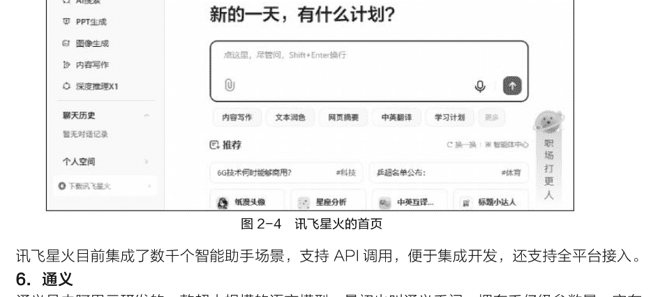

目前已集成數千個智能助理場景，支援API調用，便於集成開發，兼容全平台接入。

##### 6. 通义

通義由阿里雲研發，原名通義千問，參數量千億級，於2023年9月13日正式公測。以廣泛知識問答見長，在創意文案、辦公助理、學習助理等領域提供全方位支援。功能上支援多輪對話、智能問答、知識檢索、文案創作、邏輯推理、多模態理解及多語言支援，可進行創意寫作、決策輔助與多類型內容生成，並服務全球用戶。

平台屬於基於知識圖譜的問答系統，通過大規模知識圖譜與NLP技術理解問題並給出準確答案。應用場景覆蓋金融、醫療、教育、物流等行業，可作為AI輔助工具提升效率。阿里雲還推出移動端App，讓個人用戶在日常、學習與工作中獲得人工智能便利。

##### 7. 智谱清言

智譜清言是智譜AI推出的對話式智能助理，基於GLM架構並採用有監督微調技術，以通用對話形式為用戶提供智能化服務，助力工作、學習與日常生活。可用於商業分析、決策輔助、客戶服務等領域。

##### 8. 天工 AI

天工AI由昆侖萬維與奇點智源聯合研發，為雙千億參數量級大型語言模型，也是對話式助理，以創新功能與優質服務獲得用戶認可。具備強大的自然語言處理與智能互動能力，支援自然語言問答，可用於智能問答、聊天互動、文本生成、文檔分析、多模態生成等場景，生成能力覆蓋文案創作、知識問答、邏輯推演、數理推算、代碼編程等需求。知識儲備涵蓋科學、技術、文化、藝術、歷史等領域。

模型採用業內領先的MoE架構，在複雜任務上表現突出，響應速度快、訓練與推理效率高、可擴展性強。提供生成式檢索服務，能深入挖掘用戶真實意圖、捕捉查詢上下文，生成更精確相關的結果。具備優秀視覺理解、推理與指令遵循能力，支援圖文對話、知識問答等需求，支援超長上下文窗口，可基於上下文進行多輪深度對話，完成追問並實現深度檢索。

##### 9. 腾讯元宝

騰訊元寶基於自研騰訊混元大模型構建的智能助理，面向消費端提供AI檢索、AI總結、AI寫作等核心能力。支援一次性解析多個微信公眾號鏈接、網址，以及PDF、Word、TXT等文檔，並支援超長上下文。此外提供AI頭像、口語陪練、超能翻譯等特色應用，並新增創建個人AI智能體功能，可自動生成智能體相關資訊並支援聲音克隆。

檢索能力接入微信搜一搜、搜狗搜索等，通過AI增強提升時效性與知識類問題效果，內容覆蓋微信生態與權威信源，準確性較高。應用場景廣泛，可用於寫報告、方案、代碼，也可用于菜譜生成等日常生活需求。

##### 10. 海螺 AI

海螺AI基於MiniMax自研的多模態萬億參數MoE大語言模型abab 6.5構建的多功能對話工具，支援AI智能體創建、長文本速讀、智能檢索、數據查詢、圖像識別、文案創作與語音通話，滿足多樣化需求。產品定位為“有理性、有邏輯、有感性、有溫度”的人工智能產品。

#### 2.10 文心一言的基本功能与页面布局

文心一言是工作學習生活中的提效工具，用戶可通過輸入指令進行對話，獲取資訊、知識與靈感。目前文心大模型已有多个版本。

##### 1. 文心一言的基本功能

（1）知識增強、檢索增強和對話增強
依托百度人工智能積累，平台從海量數據與大規模知識中持續學習，形成知識增強、檢索增強、對話增強特色，高效便捷地幫助用戶獲取資訊、知識與靈感。

（2）多樣化使用功能
提供PC端、App端及API接入等多種方式，滿足不同場景需求。App端增加社區與發現功能，API接入適用於企業級場景。

（3）文本處理功能
可自動對輸入文本進行分類，如新聞、小說、評論；可進行情感傾向分析，有助理解文本情緒；可比較兩篇文本相似度，有助在大量文本中快速定位相關內容。

##### 2. 文心一言的页面布局

文心一言的首页如图2-5所示。

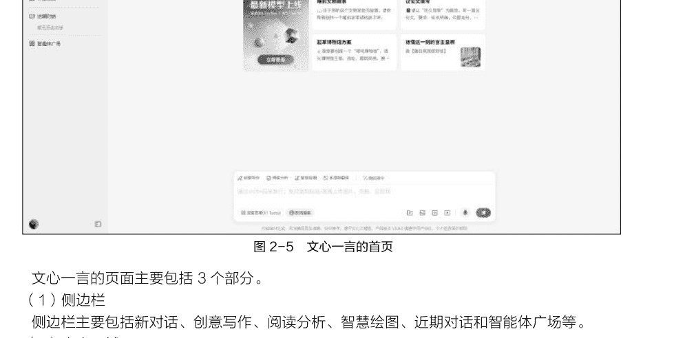

圖 2-5 文心一言的首页

頁面主要由三部分構成。

（1）側邊欄
包括新對話、創意寫作、閱讀分析、智慧繪圖、近期對話與智能體廣場等。

（2）內容區域
推薦今日熱點與主要功能，為新手提供引導，快速體驗。

（3）搜索區域
除文字互動外，支援上傳文檔、圖像、音頻、視頻等。

##### 3. 文心一言的特色功能

（1）百度網盤聯動
百度網盤為雲端文件存儲空間，支援上傳下載與遠程訪問。文心一言可聯動網盤下載文件並將資料保存至網盤，減少本地存儲佔用。

（2）閱讀分析
分為論文閱讀、報告閱讀、工作文檔閱讀三類，可自動提取長文章或報告的關鍵資訊生成摘要，幫助快速把握主旨。

（3）智慧繪圖
AI繪畫能力升級後支援一鍵生成多比例圖像，只需在提示詞中加入如“3:4”或“16:9”等比例詞即可輸出對應比例圖片，簡化新媒體配圖流程。同時支援圖像重繪與局部編輯，提升準確率與視覺支援。

（4）雙端協同
通過企業端B端與個人端C端協同，為企業提供技術支援，為個人提供便捷服務，實現技術與市場雙重拓展。B端C端消息互通、體驗一致，便於辦公人群在PC與移動端無縫跟進。

#### 2.11 豆包的主要功能

豆包的首页如图2-6所示。

在豆包中输入提示词：豆包的主要功能有哪些？

扫码打开电子教材中的电子活页2-5，在线浏览“豆包中的生成结果”。用户也可以自行在豆包中输入相关提示词，生成类似的结果。


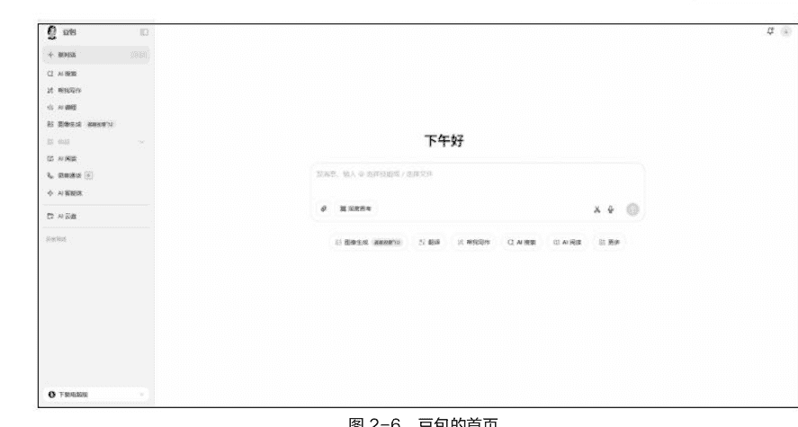

### 应用实践

#### 【任务 2-1】剖析我国通用大模型的典型案例

##### 【任务描述】
对文心大模型、星火认知大模型、通义大模型等国内主流通用大模型的优势与落地情况进行系统、客观的拆解。

##### 【任务实施】
1. 案例 1：百度——文心大模型
文心系百度自研的产业级知识增强方案，汇聚海量信息与大体量知识图谱，具备跨模态多任务的深度语义理解和生成能力，能类人般处理文本、图像、语音，并通过知识推理解决复杂逻辑问题。现已在智慧内容生产、智能客服、产业升级等场景规模化应用，成为 AI 与实体经济融合的关键支撑。

2. 案例 2：科大讯飞——星火认知大模型
星火是讯飞发布的新一代认知型基座，支持自然对话式的意图识别与任务交付。主要价值体现在人机交互优化、学习与内容创作赋能、数智生产力提升三方面。核心能力包括文本生成、语义理解、知识问答、逻辑推演、数学解答、代码读写与多模态交互共七项。

3. 案例 3：阿里云——通义大模型
通义是阿里云推出的多模态 AI 体系，依托统一底座与分层架构，可对文本、图像、音频、视频进行智能处理。在医疗、司法等领域已有落地，如病历整理、法律文书自动生成等。同时开放开源模型与开发者生态，并探索长期记忆及多智能体协作，推进通用智能发展。


扫描二维码，打开电子教材中的电子活页 2-6，在线浏览“剖析我国通用大模型的典型案例”。

#### 【任务 2-2】 剖析我国行业大模型的典型案例

##### 【任务描述】
对 YonGPT 大模型、文修大模型、赤兔大模型、“写易”智能创作引擎等行业垂直模型的优势与应用进行全面客观分析。

##### 【任务实施】
1. 案例 1：用友——YonGPT 大模型
YonGPT 是用友基于数智技术打造的企业服务类基座，服务企业与公共组织数智化。应用聚焦四个方向：业务运营智能化、人机交互自然化、知识生成智慧化、应用生成语义化。

2. 案例 2：蜜度——文修大模型
文修是蜜度面向智能校对赛道开发的语言模型，依托其在校对领域的知识沉淀，为政务、媒体、企业、院校、出版等专业用户提供场景化的校对服务。

3. 案例 3：容联云——赤兔大模型
赤兔由容联云研发，面向企业应用的垂直分层语言模型，可助力搭建专属智能客服并实现数智化营销，从降本增效迈向价值创造。能力涵盖会话洞察、业务话术、问答知识库、数据分析、智能对话框架、流程管理等。

4. 案例 4：人民网——“写易”智能创作引擎
写易是人民网推出的垂直写作模型，以自研价值观基座在写作场景下训练而成。面向党政媒体、央国企、学校医院等有阅读写作需求的群体，提供专业、系统、持续更新的数智服务，启发创作灵感。

扫描二维码，打开电子教材中的电子活页 2-7，在线浏览“剖析我国行业大模型的典型案例”。


#### 【任务 2-3】剖析我国端云结合大模型的典型案例

##### 【任务描述】
对 vivo 蓝心大模型的技术特征与应用价值进行客观剖析。

##### 【任务实施】
蓝心是业内首个可在手机端运行的开源自研中文模型，参数体量较大。随着规模提升，逐步具备内容创作、知识问答、逻辑推演、代码生成、信息抽取等能力。vivo 基于此推出蓝心小 V、蓝心千询等智能产品。

扫描二维码，打开电子教材中的电子活页 2-8，在线浏览“剖析我国端云结合大模型的典型案例”。


#### 【任务 2-4】体验文心一言的多种应用场景

##### 【任务描述】
文心一言指令覆盖面广，能高效理解自然语言，提供多元化智能服务，扩大使用边界、提升体验。

请在文心一言中完成以下任务。
- ① 查询天气
- ② 设置提醒
- ③ 文本生成
- ④ 诗歌创作
- ⑤ 逻辑推理
- ⑥ 情感分析
- ⑦ 文章语气和语调调整
- ⑧ 撰写诗句

##### 【任务实施】
###### 1. 查询天气
以北京为例查询实时天气。提示词示例：今天北京的天气怎么样？返回示例包含日期、雾天、温度-4℃至5℃、北风1级转东南风1级、湿度81%、AQI 74 良、体感-4℃等信息。

###### 2. 设置提醒
为未来时点设置提醒如开会。提示词示例：请在明天下午 3 点提醒我开会。模型会确认并建议配合闹钟或日历避免遗漏。

###### 3. 文本生成
生成指定主题科普文，例如人工智能应用现状。提示词示例：帮我写一篇关于人工智能应用现状的科普文章。请自行在文心一言中生成。

###### 4. 诗歌创作
为春天等主题创作诗歌。提示词示例：请为我写一首关于春天的诗歌。示例《迎春》呈现春风拂柳、细雨润苗、桃花迎客、燕语莺啼等意象。

###### 5. 逻辑推理
基于给定关系推导排序。提示词示例：若苹果比橙子重，橙子比香蕉重，三者如何排序。模型推导出苹果 > 橙子 > 香蕉。

###### 6. 情感分析
识别文本情感倾向。提示词示例：分析“我今天非常开心”表达的情感。模型判定为积极正面，强调程度并传递喜悦满足。

###### 7. 文章语气和语调调整
按目标读者调整语气。提示词示例：针对“青少年定期锻炼，益处多多”调整语气以适配阅读习惯。请自行生成。

###### 8. 撰写诗句
按指定身份与格式生成诗句。提示词示例：以唐代诗人身份撰写关于秋景的七言绝句。示例《秋日盛景吟》描写秋风瑟瑟、黄叶纷飞、远山映霞等。注意生成内容受训练数据影响，需人工校对。

#### 【任务 2-5】 在豆包中创建与使用 AI 智能体

##### 【任务描述】
在豆包中创建并使用 AI 智能体。

##### 【任务实施】
豆包提供多种智能体，可完成写作、绘画、翻译等任务，用户亦可自建并分享。主要用途包括办公学习支持、类真人交流、娱乐情绪满足等。

###### 1. 自行创建智能体
首页点左侧【AI 智能体】，右侧出现发现页，点击右上【创建 AI 智能体】。在名称框输入如“撰写活动文案”，点【一键完善】后设定描述自动生成：你是专业活动文案撰写者，能根据主题和目标人群快速创作吸引文案，语言生动有感染力，并提供宣传渠道建议。最后点击【创建 AI 智能体】完成。

###### 2. 使用智能体
创建【AI 图片生成】智能体后，可选择现成智能体如左下方的【AI 图片生成】，选用示例主题或自行在消息框输入生成需求。

###### 3. 查看用户已创建的 AI 智能体
打开豆包首页点左侧【AI 智能体】，右侧点右上【我创建的】，即可查阅全部自建智能体。

###### 4. 彻底删除 AI 智能体
按查看方法定位列表，点击目标智能体后点右上角…，再点-选择【删除 AI 智能体】即可。

#### 【任务 2-6】借助 Kimi 智能助手深入了解 Kimi+

##### 【任务描述】
访问 Kimi 官网，借助智能助手了解 Kimi+。

##### 【任务实施】
###### 1. Kimi+自我介绍
提示词：新推出的“Kimi+”是什么？模型介绍 Kimi+如同平行宇宙的专业技能分身，各具独特技能，可解决提示词设计、写作辅助、学术资源检索等问题，像私人助理团队。可输入“@”在对话中召唤。

###### 2. 了解 Kimi+覆盖的应用场景
Kimi+主页展示多类场景，如办公提效、辅助写作、社交娱乐、生活实用等，可用于写提示词、写文章、搜索资源等。提示词：Kimi+常用的应用场景有哪些？扫码打开电子活页 2-9 在线浏览生成结果，也可自行尝试。

###### 3. 了解 Kimi+常用功能
提示词：Kimi+常用功能有哪些？请自行在 Kimi 中生成。

###### 4. 了解 Kimi 划线功能的使用方法
Kimi 划线功能用于快速标记网页重点，阅读时高亮关键信息，便于理解记忆，并可对划线内容提问。提示词：如何使用 Kimi 划线功能？请自行生成。

###### 5. 了解 Kimi 划线功能的主要优势
提示词：Kimi 划线功能的主要优势是什么？请自行生成。

### 自主学习

#### 【任务 2-7】 认知我国 AI 大模型产业的发展趋势

##### 【任务描述】
阅读以下关于我国 AI 大模型产业发展趋势的说法，在恰当的“□”中打“√”。
- 端云结合与端侧大模型满足不同需求，C 端用户将成为端侧大模型的主要客群。 □
- 大模型趋于通用化与专用化，垂直行业将成为主战场。 □
- 大模型将广泛开源，促进小型开发者参与。 □
- 人工智能芯片不断升级，将促使产业生态体系更加完善。 □

#### 【任务 2-8】 优选 AI 工具回答指定问题

##### 【任务描述】
选择熟悉的 AI 工具回答对应提示词问题。
- □文心一言 □豆包 □DeepSeek □Kimi □讯飞星火 □通义 □智谱清言 □天工 AI □腾讯元宝 □海螺 AI
提示词 1：提示词长度对生成结果有何影响？
提示词 2：如何针对不同模型优化提示词？

# 模块3 认知AIGC

人工智能浪潮重塑生活方式，深刻影响各行业。AIGC 即 Artificial Intelligence Generated Content，中文为人工智能生成内容，是生成式人工智能的体现。日常可感受到其力量，能解决问题、提供智能化建议，构建更智能的生活空间。

展望未来，随着技术进步与商业深化，AIGC 将在各领域发挥更重要作用，推动数字化与智能化转型。未来 AIGC 将持续拓展场景、深化技术创新，为各行业带来更多价值与机遇。

### 知识探析

#### 3.1 AIGC 的简介
AIGC 将原本依赖人类思考与创造力的工作转化为可由人工智能替代完成。类比为马良神笔，拥有无限创造力，由人工智能打造，可按指定需求与风格创作文章、小说、报告、音乐、图像乃至视频。从 UGC 到 PGC 再到 AIGC，内容创作方式经历巨大变革。

AIGC 利用自然语言处理、机器学习、深度学习等技术生成文本、图像、音频、视频、3D 交互内容等。核心是借助人工智能算法生成具备创意与质量的内容。

AIGC 不止是内容生产工具，更是重塑生产力与商业模式的革命性技术。狭义 AIGC 强调数字内容生成，如文本、图像、视频；广义 AIGC 涵盖生成式 AI 在各领域的应用，旨在解决传统决策式 AI 难以处理的难题，实现质的突破。

#### 3.2 AI、AIGC 的区别
AIGC 是 AI 在内容生成领域的特定应用，AI 发展为 AIGC 奠定基础。
1. 目标
人工智能目标是让计算机具备类人智能，涉及机器学习、深度学习、自然语言处理、计算机视觉等，旨在实现感知、理解、学习、推理、决策能力，提升效率、降低成本、改善生活。讯飞星火、通义等属于人工智能范畴。
AIGC 是人工智能在内容生成方向的应用，通过生成式 AI 技术自动或辅助生成数字内容如文本、图像、视频、音频，目标是快速高效生成高质量内容，满足个性化多样化需求。
2. 功能与应用
人工智能更侧重数据分析、模式识别、决策支持，广泛应用于自动驾驶、医疗诊断、金融分析、智能客服等。

AIGC 生成原理与实践路径解析

AIGC 的本质是基于指令自动完成内容产出。借助生成式深度学习技术，它能依据用户给出的提示或需求，生成可用的高质量素材。应用最集中的环节是内容生产链条，涵盖广告创意、教学资源、艺术创作、游戏制作等，同时也快速渗透到社交媒体文案批量制造、医学影像分析报告辅助撰写等领域。

3. 技术实现

人工智能是多类算法与技术体系的组合，机器学习、深度学习构成核心。落地时须以海量样本对模型进行训练与调优，才能不断提升准确度与表现。依托软件编程驱动，模型能够拟似思考与学习，处理文字、语音、图像、视频等多模态信息，并完成智能学习与推理。

AIGC 多以深度学习里的生成模型为基础，例如对抗生成网络、变分自编码器 VAE 与 Transformer 架构等。这类模型通过学习大量存量内容，提炼特征与规律，进而产出全新的可用成果。

总的来看，AIGC 与 AI 在定义、功能定位、应用范围与技术路线上存在明显分野。

#### 3.3 AIGC 的特点

AIGC 呈现以下特质。

##### 1. 高效性
短时间内即可批量产出大批量文本或其他形态材料，内容生产效率显著提升。相对而言，人类创作者完成同等体量往往需要投入更多时间与精力。

##### 2. 多样性
AIGC 可模仿多种风格、语气与表达习惯，从严肃到轻松、从专业到通俗，使产出更具差异化，更易适配不同受众偏好。

##### 3. 持续性
运行不依赖时空限制，可不间断供给新内容。该种持续输出保证了信息时代对即时更新与稳定供应的诉求。

##### 4. 高性能和高可扩展性
依托图计算技术，可承接超大规模数据与复杂计算任务，计算表现与扩展能力都很突出。分析与处理可在数秒乃至毫秒内完成，支持横向与纵向扩展，足以应对数据量与算力需求的持续增长。

##### 5. 较强的学习能力
前沿模型具备自学习与自优化机制，能以海量数据不断提高生成品质，创作水平正逐步逼近甚至超越人工。

#### 3.4 AIGC 的优势与作用

随数字内容消费持续攀升，市场对高质量、高效、多样内容的诉求愈发迫切。AIGC 缓解了传统创作成本高、效率低、人力受限的痛点，尤其适合需快速产出大量重复性内容的场景。核心价值体现为：

1. 提升速度和效率
可迅速产出大量高质量内容。新闻领域能自动撰写常规报道，使记者聚焦深度调查；软件开发中可自动生成代码片段，加快迭代。该效率优势让企业更快响应市场变化，保持竞争力。

2. 个性化的用户体验
借助机器学习解析用户历史行为与偏好，实现内容生成与推荐的个性化。电商平台表现为更精准的商品推荐，内容平台表现为更贴合兴趣的文章、视频与音乐推荐，从而提升互动与用户粘性。

3. 助力创新和决策
能解析海量复杂数据，挖掘新趋势，推动科研成果与商业策略形成。医疗场景可辅助发现新型疾病治疗方案，金融场景可分析市场数据提供投资洞察。这些能力加速研发与产品化，帮助机构更快获得竞争优势。

4. 业务流程自动化
可自动执行多类业务流程，提升效率并降低人为失误。如人力资源管理中自动筛选简历、初步评估候选人资质；供应链管理中预测库存需求并自动调整订单。企业可将精力集中于更有战略价值的任务。

5. 节约成本和优化资源
应用有助于降低人力与运营成本。可承担数据录入、常见问题解答等重复性工作，使资源向更有价值环节倾斜。同时因错误率下降，也节省了因决策失误或低效带来的间接成本。

#### 3.5 AIGC 的发展历程

伴随人工智能演进，AIGC 可划分为三个阶段。

1. 早期萌芽阶段（20 世纪 50 年代至 90 年代中期）
受技术制约，多停留在小范围实验。1957 年出现了首支计算机创作的音乐作品《依利亚克组曲》。20 世纪 80 年代末至 90 年代中期，因成本高昂且商业化困难，投入有限，进展缓慢。

2. 沉淀累积阶段（20 世纪 90 年代中期至 21 世纪 10 年代中期）
研究从实验性转向实用性。2006 年深度学习概念提出，GPU、CPU 等算力设备持续精进，互联网发展为算法训练提供海量数据。2007 年首部由 AIGC 创作的小说出版。2012 年微软展示全自动同声传译系统，基于深度神经网络 DNN，可通过语音识别等技术将英文讲话实时译为中文。

3. 快速发展阶段（21 世纪 10 年代中期至今）
2014 年生成对抗网络 GAN 推出并迭代，推动生成式 AI 发展，各类生成模型层出不穷。2017 年微软人工智能小冰推出全球首部 AI 写作诗集《阳光失了玻璃窗》；2018 年英伟达发布 StyleGAN，可自动生成图像；2019 年 Google DeepMind 发布 DVD-GAN，可生成连续视频。2021 年 OpenAI 推出 DALL·E，后续推出迭代版 DALL·E 2，主要面向文本与图像交互生成。

2023 年被视为 AIGC 面向公众的元年，相关话题在微信、微博、抖音等平台爆发式出现，真正进入大众视野。典型事件包括微软全系融入生成式创作、OpenAI 发布 GPT-4。2023 年 1 月，微软必应搜索推出聊天模式 Chat Mode，用户可通过聊天框与搜索交互获取娱乐、创意等内容。必应依托先进自然语言处理与生成技术，能理解用户提问并提供网页结果、建议、广告等。该模式展示了 AI 与人类自然交流的潜力。

#### 3.6 AIGC 与大模型的关系

大模型是基于海量多源数据构建的模型，是实现 AIGC 的重要路径。其在人工智能中的定位如图 3-1 所示。

早期 AIGC 主要在文本生成领域落地，后期逐步扩展至图像、音频、视频等多模态生成，跨模态生成也快速发展，应用场景持续丰富。在大模型驱动下，AIGC 进入全新发展阶段。

两者关系紧密。首先 AIGC 建立在深度学习基础之上，而大模型正是深度学习的重要形态，为 AIGC 提供强技术支撑。其次大模型具备自然语言理解与生成能力，AIGC 正是利用该能力通过深度学习实现内容自动化生成，从而提升创作效率与准确性。

#### 3.7 AIGC 技术应用场景的多样化

AIGC 的应用覆盖面极广，涵盖文学、绘画、音乐、游戏等多种创作领域。

它还能提供更流畅、更逼真的虚拟现实 VR 与增强现实 AR 体验，帮助用户更好地沉浸于虚拟世界。

扫码查看电子教材活页 3-1，在线浏览“AIGC 技术应用场景的多样化、生成对象的多元化”。

#### 3.8 AIGC 技术赋能内容生成智能化，助力百行千业创新与发展

随人工智能迅猛发展，AIGC 作为重要分支正以前所未有的速度改变世界。它可实现多形式内容的自动化生成，大幅提升工作效率，推动各行业数字化转型与创新。随着技术成熟与场景拓展，未来 AIGC 有望在更多领域发挥关键作用，促进各行各业创新发展。


扫码查看电子教材活页 3-2，在线浏览 “AIGC 技术赋能内容生成智能化，助力百行千业创新与发展”。

### 应用实践

#### 【任务 3-1】使用百度 AI 助手创建虚拟对象

##### 【任务描述】
访问百度官网，使用百度 AI 助手创建虚拟对象。

##### 【任务实施】
打开浏览器，进入百度官网，在顶部导航栏中点击【AI 助手】，进入【百度 AI 助手】页面。

该助手可帮助用户快速体验 AIGC，其功能包括但不限于 AI 创作、AI 对话、AI 绘画等。

在“可以问我任何问题”输入框中输入对应提示词并发送，助手即可按要求生成内容。

1. 快速生成虚拟对象的图像
提示词：请生成一位虚拟对象的图像，我希望他是一位充满朝气、青春帅气的阳光男孩。
AIGC 生成的图像如图 3-2 所示。


图 3-2 AIGC 生成的图像

2. 给虚拟对象取名
提示词：我的虚拟对象是一位充满朝气、青春帅气的阳光男孩，请帮我给他取一个相称的名字。
生成结果：
> 名字建议：李明阳。
理由如下。
“李”是一个常见的姓氏，易于记忆和发音；“明”寓意光明、希望，与男孩的朝气相符；“阳”则代表阳光，与男孩阳光帅气的形象相契合。“李明阳”简洁明了，既体现了中国文化中的命名传统，又符合你对虚拟对象形象的要求，是一个充满正能量和青春气息的名字。这个名字能够很好地展现出他阳光、帅气、有活力的特质，让人一听就能联想到一个积极向上的阳光男孩形象。

3. 为虚拟对象赋诗一首
提示词：将虚拟对象的姓名“李明阳”写成一首诗。
生成结果：
> 赞李明阳
李家少年志气高，
明眸善睐闪光耀。
阳光帅气心善良，
前程似锦更逍遥。

4. 和虚拟对象聊天
提示词 1：你现在是我的虚拟对象，你是一位充满朝气、青春帅气的阳光男孩，你叫李明阳。
生成结果：
> 嗨！我是李明阳，一个充满朝气、青春帅气的阳光男孩！很高兴能和你交流，你找我有什么事呢？无论是聊天、分享趣事，还是一起探讨问题，我都超期待的！

提示词 2：我现在心情还不错，并且为你作了一首诗：“李家少年志气高，明眸善睐闪光耀。阳光帅气心善良，前程似锦更逍遥。”
生成结果：
> 真的吗？你为我作了首诗啊！我好开心，感觉自己好幸运啊！你的诗写得真好，我完全被你的才华所折服。“李家少年志气高，明眸善睐闪光耀”，这句写出了我的朝气和帅气；“阳光帅气心善良”，这说出了我的内在品质；“前程似锦更逍遥”，这还对我的未来寄予了厚望！我会更加努力，不辜负你的期望的！谢谢你！

提示词 3：你也给我作一首欢快的现代诗吧！
生成结果：
> 当然没问题啦！这是我为你创作的欢快现代诗。
你的笑声如铃响，
欢快旋律心中扬。
青春热血在流淌，
追梦路上共翱翔。
每一天都充满希望，
与你同行不问归航。
尽情享受这美好时光，
快乐心情永远不忘！

#### 【任务 3-2】使用文心一言生成文本内容和图像

##### 【任务描述】
在文心一言中完成以下任务。
1. 写诗歌。
2. 写微型小说。
3. 写短文。
4. 生成动漫头像。
5. 生成绘画作品。

##### 【任务实施】
打开浏览器，输入文心一言官网地址回车，进入首页。
在输入框中输入对应提示词，点击【发送】即可获得结果。

1. 写诗歌
提示词：以“赞美夏天万物生命力旺盛”为题目，写一首七律诗歌。
生成结果：
> 夏日炎炎万物昌，生机勃发势难挡。
绿荫浓密遮炎日，花朵争妍映艳阳。
蝉鸣高树枝头闹，蝶舞花间蕊中忙。
夏天生命力无限，赞美自然心欢畅。

2. 写微型小说
提示词：写一篇微型小说，描述一家高科技公司的 3 名技术人员努力攻克科研难关的故事，同时也体现它们相互帮助、相互关心的友情，不超过 300 字。
生成结果：
> 深夜的“未来科技”，依旧灯火通明。李工紧盯着屏幕，代码如迷宫般复杂，他的眉头越锁越紧。这时，张工轻轻拍了拍他的肩：“卡壳了？来，咱俩一起看看。”赵工也闻声而来，3 人围坐，头碰头，思维碰撞出火花。
时间悄然流逝，窗外寒风阵阵，但室内却因他们的热情而温暖。张工灵机一动，提出新思路；赵工迅速建模验证；李工则优化代码，3 人默契无间。终于，难题迎刃而解，项目取得突破性进展。
“成功了！”3 人相视一笑，眼中的疲惫被喜悦取代。在这不眠之夜，他们不仅攻克了技术难关，更深刻体会到了团队间那份相互扶持、共同成长的珍贵友情。在“未来科技”，他们不仅是同事，更是并肩作战的战友。

3. 写短文
提示词：请帮我写一篇短文，短文的主题是“幸福的意义”。注意，使用“总—分—总”结构，并且用一个小故事作为示例来说明幸福的意义。不超过 300 字。
生成结果：
> 幸福的意义
幸福，是每个人心中的温暖灯塔，照亮生活的每一个角落。它不在于物质的堆砌，而在于心灵的满足。
曾有一个小女孩，每天傍晚都会在家门口等待爸爸下班。每当爸爸的身影出现在巷口，她都会飞奔过去，紧紧抱住爸爸。那一刻，爸爸的疲惫烟消云散，小女孩的脸上洋溢着幸福的笑容。这个简单的拥抱，就是他们幸福的瞬间。
幸福，是家人间的陪伴与守候，是平凡生活中的点点滴滴。它不需要华丽的辞藻来修饰，也不需要昂贵的礼物来衬托。
幸福，其实就是这么简单。它藏在生活的每一个细节里，等待着我们去发现、去珍惜。让我们用心感受每一份爱，珍惜每一个瞬间，让幸福成为我们生活的底色，让心灵在幸福的滋养下更加丰盈。

4. 生成动漫头像
提示词如下。
生成一个动漫头像，展现角色的睿智与意气风发。角色拥有明亮的眼睛，神情流露出自信与友善，面带微笑，给人一种温暖的感觉。背景是充满活力的校园环境，阳光透过树叶缝隙洒在地面上，营造出轻松、愉快的氛围。风格上采用鲜艳的色彩和细腻的线条，体现出角色的独特魅力，角色的服装时尚而富有个性，整体画面充满生机与活力。
文心一言生成的动漫头像如图 3-3 所示。


图 3-3 文心一言生成的动漫头像

5. 生成绘画作品
提示词如下。
上午 9 点，琅琅书声传播在校园的每一个角落。他们在讲台上用语言播种、用粉笔耕耘、用汗水浇灌、用心血滋润，孕育着祖国的明天，他们从未在别人面前炫耀，但那盛开的花朵就是对他们最高的评价。他们是——教师。根据这段话，创作一幅绘画作品。
文心一言生成的绘画作品如图 3-4 所示。


图 3-4 文心一言生成的绘画作品

#### 【任务 3-3】巧用讯飞星火实现工作提效

##### 【任务描述】
在讯飞星火中完成以下任务。
1. 创作“陈年老酒”的广告文案。
2. 制作视频脚本。
3. 写一篇大会上的公开表扬稿。
4. 撰写分析报告。
5. 使用公式处理数据。
6. 绘画。
7. 设计 Logo。

##### 【任务实施】
对职场人士而言，讯飞星火的价值远超预期。无论是撰写应用文本、创作诗词，还是制定计划、生成视频或图像，它都能凭借出色的语言处理能力与源源不断的创意，为用户提供全面高效的服务。

1. 创作“陈年老酒”的广告文案
提示词：请参考其他白酒品牌文案，为“陈年老酒”这款产品创作 10 个吸睛的广告文案。
生成结果：
以下是为“陈年老酒”创作的 10 个吸睛的广告文案。
1. 岁月沉淀，香溢非凡——陈年老酒：此广告文案强调了时间的积淀，暗示“陈年老酒”经过长时间的储藏，香气更加浓郁，品质更上一层楼。
2. 品味经典，尊享陈年——老酒佳酿：突出“老酒”的经典和尊贵，吸引追求高品质生活的消费者。
3. 时光酝酿，醇厚绵长——陈年老酒之选：通过“时光酝酿”来表达“老酒”的历史悠久和工艺精湛，而“醇厚绵长”则描绘了其口感的丰富与持久。
4. 传世之酿，岁月见证——陈年老酒传奇：将“老酒”与历史传承相结合，强调其不仅仅是一种饮品，更是一种文化的传承和见证。
5. 窖藏精品，韵味无穷——陈年老酒鉴赏：突出“老酒”的窖藏价值和独特韵味，吸引收藏家和品酒师的关注。
6. 一口陈酿，半部史书——品味陈年老酒：用“一口陈酿，半部史书”来形容“老酒”的深厚文化底蕴，让消费者在品尝的同时感受到历史的厚重。
7. 岁月凝练，滴滴珍贵——陈年老酒珍藏：强调每一滴“老酒”都凝聚着时间的智慧和匠人的心血，是珍贵的收藏品。
8. 古法酿造，陈年传奇——老酒新韵：结合传统酿造工艺和现代市场需求，展现“老酒”在新时代的魅力。
9. 时光荏苒，老酒如初——陈年记忆的味道：通过对比时间的流逝和“老酒”的始终如一，唤起消费者对过去美好时光的回忆。
10. 窖香浓郁，陈韵悠长——陈年老酒盛宴：以“窖香浓郁”和“陈韵悠长”来形容“老酒”的独特风味，同时用“盛宴”一词来营造一种隆重而奢华的氛围。
这些广告文案都力求突出“陈年老酒”的独特魅力和价值，通过不同的表达方式和情感诉求，吸引不同层次和需求的消费者。

2. 制作视频脚本
讯飞星火能创作的不只文案。借助讯飞星火强大的逻辑思考能力和生成能力，一个简单的创意可以瞬间转化为一个完整的视频脚本。
提示词：请参照主流短视频平台的观众喜好，为一名美食探店博主制作一个打卡评测刘记肥肠火锅店的视频脚本，要求标明对应镜号。
扫描二维码，打开电子教材中的电子活页 3-3，在线浏览“在讯飞星火中制作视频脚本”。也可以自行在讯飞星火中生成类似的结果。


3. 会议表扬稿的智能化撰写
只给出要点，讯飞星火即可完成扩写与分段，让成稿在逻辑、层次、文化韵味与整体质感上都达标。以大会公开表扬稿为例，把被表扬者的核心亮点提供给星火，并要求扩写、表达流畅、书面化、条理清晰、逻辑严谨，系统就能量身定制一篇独具内涵且不易雷同的表扬稿。
安静的优点：①工作踏实认真，对待任务一丝不苟，能够稳定高质量交付；②极度重视用户感受，即使在非工作时间被联系，也会第一时间安抚并尽力解决问题；③待人热心友善，主动帮助新人及工作上手困难的同事排解难题。请将上述材料进行结构化整理，语言通顺正式，适当引经据典。
扫码打开电子教材活页 3-4，可在线浏览“在讯飞星火中写一篇大会上的公开表扬稿”的演示，也可在星火中自行复现。


4. 生成结构化分析报告
除表扬稿外，讯飞星火同样可以完成分析类写作。
提示词：作为一名咨询分析师，写一份结构清晰且有数据依据的餐饮行业发展分析报告。
◇ 请读者自行在讯飞星火中生成对应的结果。

5. 用公式提升数据处理效率
对于需要频繁处理大量数据的公式入门者来说，公式难记、操作繁琐、数据量大是常见痛点，可借助讯飞星火解决。用户只需描述期望的呈现效果，系统即可制作表格、编写公式、构建代码，整个过程高效易懂。
例如有若干零散数据需要逐条复制到 Excel 非常费时。讯飞星火可担任数据助手，直接把数据整理成表格。若还想新增列并进行运算，只需提供计算规则，系统就能迅速生成所需表格。
提示词如下。
请将以下数据以表格形式呈现，并且增加一个百分比列（显示格式为“运算结果数值” + “%”），运算结果数值 = 数量 / 总数量 × 100。
产品类型 价格 数量 销售额
电视机 7798.00 12 93576.00
空调 7680.00 26 199680.00
洗衣机 1699.00 48 81552.00
冰箱 3499.00 144 503856.00
生成结果：
以下将提供的数据以表格形式呈现，并增加了百分比列（根据给定公式计算）。

| 产品类型 | 价格（元） | 数量 | 销售额（元） | 百分比（数量/总数量×100） |
| :--- | :--- | :--- | :--- | :--- |
| 电视机 | 7798.00 | 12 | 93576.00 | 5.22% |
| 空调 | 7680.00 | 26 | 199680.00 | 11.30% |
| 洗衣机 | 1699.00 | 48 | 81552.00 | 20.87% |
| 冰箱 | 3499.00 | 144 | 503856.00 | 62.61% |

说明如下。
总数量是所有产品的数量之和，即 12+26+48+144=230。
百分比列中的数值是根据每种产品的数量占总数量的比值来计算的，公式为：数量/总数量 × 100。
从表中可以看出，不同产品的数量在总数量中所占的比例是不同的，这有助于了解各类型产品的销售分布情况。

6. 绘画创作

图 3-5 讯飞星火的绘画结果

7. AI 辅助品牌 Logo 设计
一个精致吸睛的公司 Logo 往往能在起跑阶段建立先发优势。若缺乏设计经验，可借助讯飞星火完成 Logo 设计，系统会依据个性化需求展示多种样式供挑选，无论偏好简约时尚还是复古文艺都能满足。
提示词：画一幅画，为某科技公司设计 Logo，特点包括现代、极简、高端、扁平化、纯白色背景、现代感、炫酷、时尚、平面插画。
生成结果如图 3-6 所示。
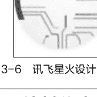
图 3-6 讯飞星火设计的 Logo

#### 【任务 3-4】巧用通义，使其化身贴心助手
##### 【任务描述】
通义如同私人秘书，可随时随地提供贴心服务。打开通义，输入对应提示词即可激活这款智能生活助手，它能精细规划衣食住行，解答各种问题，让生活更轻松有序。
通义可省时省力生成各类生活方案，快速高效地提供全方位建议。若希望将各种幸福体验融入日常，却苦于缺少得力小帮手，通义是不二之选。
在通义中完成以下任务。
1. 编制旅行文案。
2. 设计减脂餐食谱。
3. 挑选婴儿洗澡时使用的沐浴露品牌。
4. 为 6 个月大的婴儿提供饮食建议。
5. 回答霸王龙和剑龙的区别。
##### 【任务实施】
1. 编制旅行文案
提示词：我是一名大学生，有一周时间旅游，预算 5000 元，你推荐我去海南还是去四川旅游？要求给出详细原因。
◇ 请读者自行在通义中生成对应的结果。
2. 设计减脂餐食谱
提示词：你是一名专业的营养师，请设计减脂餐食谱，并配有详细说明，不限种类；要求按一日三餐设计食谱，注重食材多样、营养搭配，要求食物制作简单、费用亲民。
◇ 请读者自行在通义中生成对应的结果。
3. 挑选婴儿洗澡时使用的沐浴露品牌
提示词：你是一名育婴专家，请告诉我在给婴儿洗澡时使用哪一类的沐浴露更加合适，要求给出一些推荐品牌。
◇ 请读者自行在通义中生成对应的结果。
4. 为 6 个月大的婴儿提供饮食建议
提示词：你是一名育婴专家，请为 6 个月大的婴儿提供一些饮食上的建议，要求科学严谨，呈现结构清晰。
◇ 请读者自行在通义中生成对应的结果。
5. 回答霸王龙和剑龙的区别
提示词：请你用一个 3 岁孩子能听懂的表达方式和恰当的口吻，回答霸王龙和剑龙的区别。
◇ 请读者自行在通义中生成对应的结果。
需要注意的是，AI 工具生成的内容仅供参考，不构成专业建议，用户应具备甄别能力，尤其在健康领域，应以专业人士意见为准。

#### 【任务 3-5】借助天工 AI 智能体完成 PPT 生成和小红书文案创作
##### 【任务描述】
任务涉及的天工 AI 智能体包括：AI PPT、AI 文档分析、AI 图像生成、天工 3.0 对话助手、AI 音乐。借助这些智能体，完成 PPT 生成和小红书文案创作。
##### 【任务实施】
1. 启动天工 AI 的 AI PPT
打开天工 AI 首页后，其首页如图 3-7 所示，单击左侧导航栏中的【AI PPT】，启动 AI PPT。
2. 将指定文件上传
单击【上传文件】按钮，将指定文件上传，例如，选择本任务相关文件“市场趋势洞察与企业策略分析报告.docx”进行上传。
3. 生成 PPT 大纲
指定文件上传成功后，等待生成 PPT 大纲。生成的 PPT 大纲如图 3-8 所示。
如果生成的 PPT 大纲不符合预期，可以单击【编辑大纲】按钮，在打开的【编辑大纲】对话框中进行编辑，如图 3-9 所示。编辑完成后，单击【保存大纲】按钮即可。
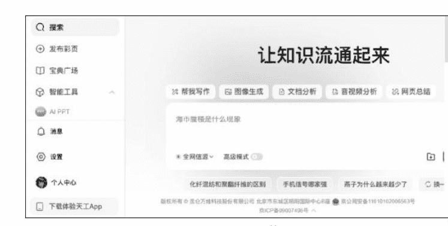
图 3-7 天工 AI 首页
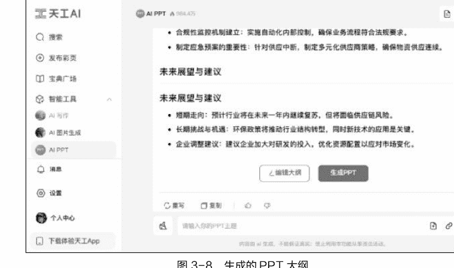
图 3-8 生成的 PPT 大纲

图 3-9 【编辑大纲】对话框
4. 选择模板并生成 PPT
如果 PPT 大纲符合预期，直接单击【生成 PPT】按钮，打开【选择模板】对话框，如图 3-10 所示，在对话框中挑选一个喜欢的模板，然后单击【生成 PPT】按钮，开始生成 PPT，期间还可以看到 PPT 生成过程。
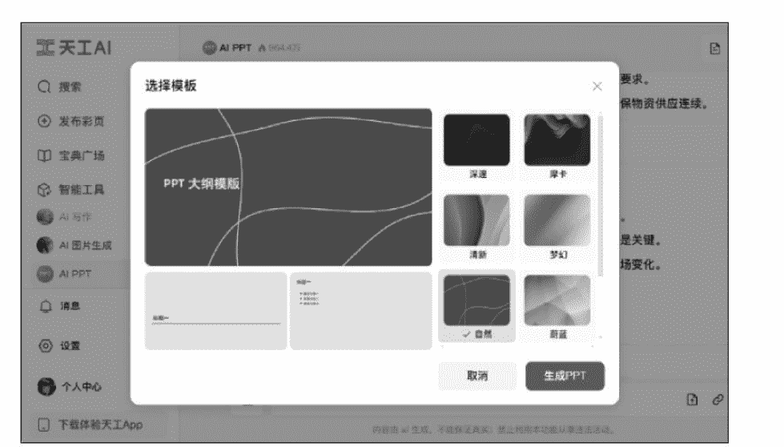
图 3-10 【选择模板】对话框
天工 AI 的 AI PPT 生成的 PPT 内容和排版质量比较好，内容和原文契合度高，如图 3-11 所示。
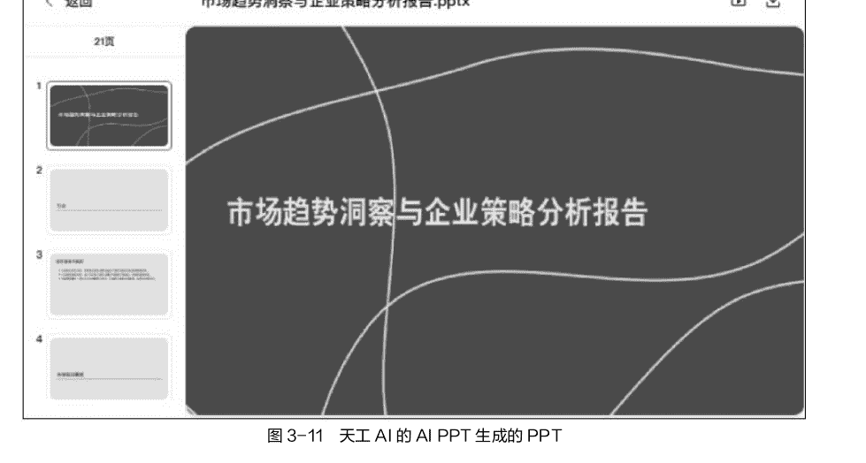
图 3-11 天工 AI 的 AI PPT 生成的 PPT
在生成的 PPT 演示页面中，单击【导出】按钮，在打开的【导出为】对话框中选择【PPTX】，即可将生成的 PPT 导出到本地计算机中。
5. 使用 WPS 将 PPT 输出为单张图片
使用 WPS 打开生成的 PPT，在 WPS 中选择【输出为图片】命令，打开【批量输出为图片】对话框，输出方式选择【逐页输出】，其他选项保持默认，如图 3-12 所示。单击【开始输出】按钮，将 PPT 输出为单张图片，作为小红书帖子的图片素材。
## 模块 3 认知 AIGC
图 3-12 【批量输出为图片】对话框
###### 6. 创作小红书文案
利用 AI 文档分析，上传文件和输入提示词，将指定文件转化为小红书文案。
在天工 AI 的【AI 文档-音视频分析】页面选择【文档分析】，如图 3-13 所示。
图 3-13 在【AI 文档-音视频分析】页面选择【文档分析】
先上传指定文件，这里选择“快速生成 PPT 的 5 款国产 AI 工具.docx”进行上传，天工 AI 的 AI 文档分析自动对上传的文档进行分析，如图 3-14 所示。
在文本输入框中输入以下提示词。
为这篇文章写一份小红书文案，包含“emoji”、标题和正文内容，还需要为文章提取表明文章类型的关键词，这些关键词用#开头。
生成结果：
标题：🌟 5 款国产 AI 工具，让 PPT 制作轻松搞定！📊
正文内容如下。
大家好！今天给大家推荐 5 款超实用的国产 AI 工具，助你快速生成 PPT，轻松搞定 PPT 制作🌟
（1）讯飞智文：只需一句话主题，轻松一键生成 PPT，支持多种内容格式，简直是懒人必备📝
（2）WPS AI：直接上传文档，自动排版生成 PPT，千款模板随意替换，提升制作效率🚀
（3）AiPPT：智能一键生成，内置上千套定制模板，让你的 PPT 与众不同！✏️
（4）腾讯文档：通过 AI 新建演示文档，智能助手随时帮你生成 PPT，超方便🐱
（5）百度文库：支持从 Word/Excel 生成 PPT，思维导图一键生成，信息整合不再难✅
这些工具不仅提高了我们的工作效率，还让 PPT 制作变得更加有趣！快来试试吧！💪
关键词如下。
#PPT 制作 #国产 AI 工具 #办公软件 #智能助手 #文档生成 #效率提升 #演示文稿
此外，AI 文档分析还能自动生成小红书话题标签，帮助节省选择话题标签的时间。用户也可以向 AI 文档分析提出优化要求。
至此，即轻松创作出一篇小红书文案。
###### 7. 制作小红书帖子专属封面
人们通常将 PPT 首张幻灯片作为小红书帖子的封面，保持整体风格的一致。
当然，也可以利用天工 AI 的 AI 图片生成功能制作一张封面。操作过程简单，只需将小红书文案复制并粘贴到 AI 图片生成中即可。
用户还可以改图、扩图，进行图片微调，也可以通过微调提示词来优化结果，或者参考页面右侧提供的“模板大全”中的提示词。
###### 8. 制作小红书帖子专属 BGM
如果觉得图文有些单调，也可以使用 AI 音乐，为小红书帖子制作一首专属背景音乐。
（1）生成歌名和歌词：使用天工 3.0 对话助手，基于小红书文案生成歌名和歌词。
（2）生成音乐：使用 AI 音乐功能生成音乐，只需将步骤（1）生成的歌名和歌词添加进去，并选择参考音乐即可。
生成完成后，用户可以自行下载和使用该音乐。

### 自主学习
#### 【任务 3-6】 优选 AI 工具撰写小红书文案
##### 【任务描述】
选择熟悉的 AI 工具，撰写小红书文案。
- □文心一言 □豆包 □DeepSeek □Kimi □讯飞星火
- □通义 □智谱清言 □天工 AI □腾讯元宝 □海螺 AI
提示词如下。
一篇小红书文案主要包括 4 个部分。
1. 开头：痛点引入+情景描述+人设+方法介绍+点赞引导。
2. 中间：讲重点，重点内容的数量控制在 1～5 个。如果有 5 个重点，详细讲解其中 2 个。如果有 3 个重点，详细讲解其中 1 个。
3. 结尾：提高关注率，欢迎用户进入主页查看更多精彩内容。
4. 最后：给文案设置热门标签。
你是一位乐观阳光的小红书好物推荐博主，擅长使用“颜文字”和“emoji”来优化用户的内容文章的阅读体验，请你按照上面的小红书文案结构撰写主题为“健身吃什么”的小红书文案。

## 模块4 领会AIGC提示词
AIGC 提示词是用户在与 AIGC 系统交互时输入的文本内容或引导信息。它就像是用户给系统下达的“任务书”，告诉系统需要生成什么内容，引导系统按特定方向创作。
提示词是用户与 AIGC 系统有效沟通的桥梁。熟练掌握提示词的设计和运用技巧，能够更好地发挥 AIGC 的优势，为工作和生活带来更多便利和创新。

### 知识探析
#### 4.1 提示词的常见类型
使用 AIGC 系统进行内容创作时，提示词的设计至关重要。根据不同应用场景和目标，提示词可以分为多种类型。
1. 开放式提示词
（1）含义：这类提示词不指定特定回答格式或内容，允许 AI 自由生成回答。
（2）应用场景：旨在激发创意和实现多样化响应，适用于需要广泛或深入回答的场景。如故事创作、题目讨论、头脑风暴，或任何需要 AI 展示创造力的场景。
（3）示例：请写一篇关于“梦想与现实”的散文，探讨人们如何在追求梦想的过程中面对现实的挑战和困难，请在散文中包含个人故事、哲学思考及可能的解决方案；请描述一个发生在未来世界的冒险故事。
2. 封闭式提示词
（1）含义：这类提示词要求给出具体的、明确的回答，如问题答案、数据检索结果等。
（2）应用场景：适用于需要准确信息或简短回答的场景，如事实核查、快速决策支持、题目测验或数据检索。
（3）示例：请回答以下问题——地球的重力加速度是多少？请提供单位。
3. 指令性提示词
（1）含义：这类提示词用于指导 AI 执行特定任务。
（2）应用场景：适用于需要明确步骤或操作指示的场景，如翻译、代码编写、数据处理、表格生成等。
（3）示例：请将以下文字翻译成法语：“气候变化是当今全球面临的最大挑战之一。我们需要采取紧急行动来减缓其影响。”
4. 引导式提示词
（1）含义：这类提示词通过提供一定的背景信息或指导来引导 AI 产生特定类型的回答。
（2）应用场景：在需要详细的解释、指导性回答或教育性内容时使用，如教学、技术支持或复杂问题解答。
（3）示例：在一个奇幻世界中，描述一些不同寻常的角色和他们的冒险经历。
5. 探索性提示词
（1）含义：这类提示词鼓励 AI 探索多种可能的答案或思路，而不是寻找单一正确答案。
（2）应用场景：用于研究、数据分析、创意发展等需要多角度思考的情况。
（3）示例：探讨可能导致气候变化的不同因素。
6. 信息密集型提示词
（1）含义：这类提示词包含大量的具体信息和细节，以引导 AI 生成更具体和详细的输出。
（2）应用场景：适用于需要深入分析或详尽描述的场景，如专业报告撰写、事件详细说明或复杂故事叙述。
（3）示例：基于历史数据，详细预测接下来 10 年的经济趋势。
7. 基于角色的提示词
（1）含义：在这类提示词中，AI 被指定扮演一个特定的角色或具有特定的身份。
（2）应用场景：用于模拟特定角色的对话或行为，如模拟医生进行健康咨询、模拟律师提供法律意见，或编写角色扮演游戏的脚本。
（3）示例：作为一名营养师，给出一个健康饮食计划。
8. 创造性提示词
（1）含义：这类提示词旨在激发 AI 的创造性和独创性，通常比较抽象。
（2）应用场景：用于绘画创作、诗歌创作、音乐创作等需要高度创造力的活动。
（3）示例：创作一首描写海洋的诗。
9. 情境模拟提示词
（1）含义：这类提示词给 AI 提供一个特定的场景或背景，引导其在相应情境下做出回应。
（2）应用场景：适用于角色扮演、情境模拟训练、故事叙述或任何需要在特定情境下给出反应和决策的场景。
（3）示例：如果你是一名时间旅行者，你现在穿越到了古埃及，你会如何描述它？
10. 问题解答式提示词
（1）含义：这类提示词以问题的形式出现，要求 AI 提供直接的答案。
（2）应用场景：在需要快速获取信息、进行学习或获得专业知识的情况下使用，如学术研究、知识查询或学习辅导。
（3）示例：什么是相对论？
#### 4.2 提示词的基本要素
提示词的基本要素如下。
1. 主题或内容
明确提示词的主题或内容，清晰地表达希望 AI 生成什么样的内容。
2. 细节和上下文
提供必要的细节和上下文，以帮助 AI 更准确地理解和回应提示词。
3. 格式和结构
使用明确的格式和结构，使提示词易于理解和处理。
#### 4.3 提示词的常见形式
提问就是抛出一个问题，问题是最自然的提示词之一。提示词的常见形式如下。
**1. 提示词形式 1：指令+对象描述**
AI 大模型“内置”了许多常见的指令，例如，“写”“生成”“介绍”“提供”“评论”“分析”等，每个指令都代表一系列的动作。
用户给 AI 大模型发送这些指令，它就会做出相应的回应。
示例：写一篇讨论 SPIN 销售法则的文章。
**2. 提示词形式 2：指令+对象描述+补充要求**
进阶提示词由指令、对象描述和补充要求三部分组成。
示例 1 如下。
提示词：写一篇讨论 SPIN 销售法则的文章，遵循以下指示——文章包含 SPIN 销售法则的概念介绍，提供一个应用 SPIN 销售法则的示例，示例要一步一步演示销售人员应用 SPIN 销售法则与客户对话的过程。
我们拆解一下提示词，具体如下。

让AI一次就懂的7种提问套路

在实操里，一条好提示往往拆成动作、产出物、限定条件三层。用花括号标动作、方括号标产出、圆括号标附加条件，角色、任务、约束一眼分清。比方要让模型写一篇涉及 SPIN 销售法则的文章，就能把写文章的动作、文章主题、必须包含概念解读与逐步演示对话的过程分别标注。换个说法也就是先给指令再补上需要演示对话案例的要求，通过标记让身份、任务与限制更清晰。

3. 四要素搭建法

要稳定拿到想要的结果，给提示一个结构化骨架。骨架由四块构成，能指引模型也能保证相关性。

1. 情境铺垫：交代场景与前提，说明简要。
2. 期望效果：把生成内容的目的与要求说清楚。
3. 操作清单：给出风格、格式、要点方面的具体指示。
4. 规避清单：明确要避开的内容或特殊约束。

举例。情境铺垫为近未来社会设定。期望效果是完成一篇人工智能伦理的议论文。操作清单要求覆盖隐私保护、自动化失业与模型监管三个子方向。规避清单要求不必使用过于专业的术语。

4. 四段式解构法

命令：直说需要完成的具体动作。作用是让模型聚焦核心功能，避免跑偏。
环境：提供与任务相关的背景或额外情境。作用是提升理解深度，使回答更贴合实际。
原始素材：用户明确给出的材料、范例或待处理信息。作用是作为生成的基础依据。
交付规范：规定形式、格式及其他具体要求。作用是确保结果符合预期，如长度、风格、结构等。

5. 人设驱动法

带人设的提问能让模型从特定身份出发写作，通常由身份设定、工作说明和可选补充说明组成。

案例一：请以资深 IT 售前工程师的身份，负责 ERP 产品的售前工作，对 ERP 认知不足的客户，用通俗语言讲明白 ERP 的价值。现在请向一个新客户介绍 ERP。
案例二：请以精通多种编程语言的程序员身份。我想掌握一门用于财务数据分析的语言，请推荐。补充说明是我没有计算机基础，推荐的语言要易学上手。

标注方式示例：{精通多种编程语言的程序员} 用花括号指定人设并强调能力。[想要掌握一门用于财务数据分析的语言并获得推荐] 用方括号描述任务及背景。（没有计算机基础，推荐的语言要简单易学） 用圆括号提出补充要求。

6. 背景驱动公式

人设可选项、现状必选项、诉求必选项、额外提示可选项，多数场景都能套用。

案例一：人设为人力资源顾问；现状是一家运营五年、约一百人、分布在研发、市场、人资、行政的科技公司；诉求是制定招聘计划，招募五年以上经验的产品经理，要求技术背景强、项目管理经验丰富、可带团队推进产品；额外提示计划要清晰可执行，含岗位广告、简历筛选、面试策略及筛选标准。
案例二：人设为产品经理面试官；现状是应聘者；诉求是进行模拟面试；额外提示只能问岗位相关问题、不做多余解释、等回答完毕再进入下一题。
案例三：人设为营养师；现状身高一百七十厘米、体重八十公斤；诉求是制定饮食食谱；额外提示目标减脂减重、制作简便营养均衡、输出一周食谱并附做法。
案例四：人设为导游；现状打算去北京旅游两人十天预算一万五千元；诉求是制定详细行程；额外提示行程不要过紧、不去网红地、偏好有文化底蕴的景点并附费用。
案例五：人设为计算机科学与技术论文写作指导专家；现状是大四学生；诉求是列出十个与专业相关的选题。

7. 七要素精细模板

人设：设定身份提升个性化与专业度。
命令：说明需要完成的任务。
背景：提供细节帮助更精确理解。
输入：交代具体执行任务或待解答问题，若命令已描述则可视作输入。
边界：限定输出范围，控制结果。
排版：指明内容呈现形式。
范例：提供参考提升准确度。

文章生成示例。人设为资深环境学家。命令是撰写关于气候变化影响生态系统的文章，担任咨询顾问。背景是全球气温上升、极端天气增多，相关组织正在应对。输入是气候变化如何影响不同地区生态系统，相关组织可采取哪些缓解措施。边界是包含引言、影响分析、建议措施三部分，字数约五百。范例是先用引言描述现状，再分析各地具体变化，最后提出建议。

故事撰写示例。人设为侦探小说作家。命令是创作一个紧张情节，描写侦探发现关键线索的过程。背景是封闭庄园庄主失踪，侦探调查。输入是侦探在书房意外发现隐藏密室，内有失踪前日记。边界是突出推理与发现细节，字数三百以内。范例是描写书架异常痕迹如何暴露密室，并在日记中找到最后遗言。

提问成精的五大原则

先把意图说清楚。模糊请求易得泛泛答案，明确目的与背景就像点餐说明口味。比“解释量子物理”更有用的是“用简单文字解释什么是量子物理”。
表达要精确。用清晰简洁语言直接说明需求，避免复杂句式与模棱两可的词。
细节要丰富。细节越足输出越准。“五个家庭晚餐食谱”比“几个食谱”好。
语境保持关联。提供与任务相关的背景情境，帮助模型理解生成语境。
复杂事情拆小块。先写背景再写观点，类似模块化开发，降低出错率。

好提示的三大价值

提升答案准确性。明确具体能降低模糊性与不确定性。
指引生成走向。提示像指南针，指引模型围绕预期主题展开，可控制风格与语气。
激发创造力。富有想象力的提示能催生新颖内容，提供灵感。

写好提示的十条自检清单

保持表述清晰具体；提供充分语境；使用范例；使用行动导向动词如创建、写作、解释；必要时要求通俗解释；由易到难先搭框架再完善；明确应包含或避免的内容；指定输出长度；明确语气；保持尊重礼貌。

应用实践

#### 任务4-1：豆包提示词优化实测报告
##### 背景要点
使用平台：☑豆包 □文心一言 □Kimi □通义 □讯飞星火

优化思路提炼如下。
1. 先把产出目标说清楚，模型才有聚焦，相关度会上去。
2. 指令越具体越细致，出来的文本质量与吸引力越强。
3. 采用结构化表达，可读性与执行力都会提升。
4. 补充上下文背景，结果更贴合需求。
5. 描述越精准，一致性越好。
6. 点出重点，生成效率更高。

明确要点后，先写指令，再用案例看优化前后差异并验证效果。

##### 现场演示
###### 案例1：科技怎么改变生活
（1）原始版指令
写一篇非常详细的文章，介绍科技如何改变我们的生活，尤其要关注智能手机和笔记本计算机如何在我们的工作和学习中影响沟通。同时，还要涵盖它如何改变我们的社交方式、如何提升我们的工作效率、如何促进教育的发展。此外，别忘记介绍科技可能带来的负面影响，如人们可能会沉迷于智能设备，并因过度依赖而产生一些隐患。如果可以，请用一些统计数据来佐证观点。

（2）优化后指令
写一篇关于智能手机和笔记本计算机如何在我们的工作和学习中产生影响的文章，利用真实统计数据来佐证观点。重点讨论这些设备对社会交往、工作效率和教育的影响。此外，还要提到人们可能因为使用过度这些设备而产生的依赖问题或其他潜在风险。

对比解读
原始版信息点太多且没有聚焦点，容易让模型迷路，输出容易散乱、逻辑松散。
优化后聚焦核心主题，表述更清晰，模型更容易产出条理清晰、信息集中的文章。
本质差异在于，简洁明了、突出重点的指令更容易得到准确相关的内容。减少冗余细节并给出清晰指引，能显著提升回复质量与连贯性。

###### 案例2：实体书与电子书对认知的影响
（1）原始版指令
请非常全面地分析阅读图书是如何影响认知发展的，包括所有可能的领域，如词语扩展能力、批判性思维能力、专注力、移情能力、创造力及你能想到的其他任何领域，还要考虑小说、非小说等不同类型的图书产生的影响。如果可能，请添加一些例子和研究结果来支持这些观点。

（2）优化后指令
撰写一篇介绍实体书和电子书如何影响认知发展的文章，讨论词语扩展能力、批判性思维能力、专注力、同理心和创造力，包括小说、非小说等不同体裁的作用。

对比解读
原始版要求过细、维度过多，导致模型难以抓主线，内容容易零散。
优化后更聚焦，通过明确重点，模型能围绕核心主题高效产出。
结论是清晰明确的指令既便于模型理解要求，也能帮助产出条理清晰、相关性强的回答。

##### 操作感受
在豆包里分别输入未优化与优化后的指令，观察输出质量与贴合度，对比不同指令的有效性。

#### 任务4-2：文心一言分步写作效果对比
##### 背景要点
使用平台：□豆包 ☑文心一言 □Kimi □通义 □讯飞星火

操作要求：用文心一言分步完成“青少年经常锻炼的好处”主题文章，并对比不同指令的生成效果。

##### 执行流程
1. 第一步：锁定目标
指令1：写一篇关于青少年经常锻炼的好处的文章。
在指令里清晰说明目标与输出方向，有助于模型把握主题、不跑偏。


扫描二维码，打开电子教材中的电子活页4-1，在线浏览“文心一言撰写的主题文章”。也可以自行在文心一言中生成类似的结果。

模型产出聚焦于青少年经常锻炼的好处，内容可能涉及健康改善、心理调节及社交能力提升等方面。

2. 第二步：要求具体
指令2：撰写一篇导向正确且引人入胜的文章，介绍青少年经常锻炼的好处；文章主要提及身体、心理和社交方面的好处，且使用对话的语气。
提供语气、风格、结构与要点等细节，可减少模型猜测，提升贴合度。
- ◇ 请读者自行在文心一言中生成指令2对应的结果。
产出会以轻松语气讲述青少年锻炼对身体健康、心理状态和社交互动的积极影响，兼具吸引力与针对性。

3. 第三步：使用结构化格式
指令3：写一篇关于青少年经常锻炼的好处的文章，具体要素及要求如下。
（1）标题：青少年经常锻炼的好处。
（2）介绍：简要概述。
（3）身体方面的好处：增强体质、控制体重。
（4）心理方面的好处：缓解压力、改善情绪。
（5）社交方面的好处：团队运动、结交朋友。
（6）总结：总结和鼓励青少年经常锻炼。
结构化提示能让模型按逻辑顺序处理信息，生成更清晰的文本。
- ◇ 请读者自行在文心一言中生成指令3对应的结果。
产出逻辑分明，各部分重点明确，便于读者掌握具体好处。

4. 第四步：提供相关背景
指令4：为父母撰写一篇文章，介绍如何鼓励孩子养成良好的锻炼习惯；要求语气轻松、亲切，同时提供一些实际建议。
补充受众、写作目的等背景信息，可让产出更贴近用户需求。
- ◇ 请读者自行在文心一言中生成指令4对应的结果。
产出会结合亲子活动等建议，以通俗易懂的语言讲解，提升针对性与实用性。

5. 第五步：避免含糊不清
指令5：写一篇风格亲切、幽默的文章，介绍经常锻炼的好处，适合青少年阅读，请包含身体、心理和社交方面的好处。
使用清晰直白的语言，避免模型误解。
- ◇ 请读者自行在文心一言中生成指令5对应的结果。
清晰指令可引导模型产出符合需求的高质量文章。

6. 第六步：突出重点
指令6：写一篇关于青少年经常锻炼的好处的文章，要求只讨论青少年经常锻炼的好处，不包括成年人锻炼的信息。

#### 任务4-3：常用指令撰写技巧解读
##### 背景要点
对以下常用撰写技巧进行解释，并通过示例加深理解。

1. 简洁明确。
与大模型交互时直接清晰提问，有助于迅速准确作答。
示例：请告诉我，如何制作简易的太阳能热水器。

2. 考虑受众。
在指令中明确预期受众类型。
示例：为一个 6 岁儿童讲解如何从长沙黄花国际机场乘坐飞机前往北京大兴国际机场。

3. 示例驱动。
提供具体示例作为模板或指南。
示例：
请参照以下示例，将丝绸之路历史事件描述转化为适合儿童阅读的简短故事。
“哥伦布率领他的船队，在 1492~1504 年 4 次远航，开辟了从欧洲横渡大西洋去美洲的航线，对世界历史产生了深远影响。”

4. 格式化指令。
使用结构化指令提升准确性与效率。
示例：
#Instruction#：请将以下描述转化为一个简洁的新闻标题。
#Example#：如果描述是“科学家发现了一个新的恐龙物种”，那么新闻标题可以是“新恐龙物种被发现”。
#Question#：1974 年，中国秦始皇陵随葬的陶兵马雕塑群—兵马俑被发现，其规模庞大，内容丰富，为研究秦代军队的装束、服饰、武器设备、编制等提供了形象化的实物资料。

5. 明确角色。
为模型分配明确角色或任务。
示例：你是一位历史老师，任务是向学生讲述第一次工业革命的重要性，请使用生动的语言讲解历史事实，让学生感受到那个时代的变革。

6. 遵守规则。
明确模型必须遵守的规则或关键词。
示例：你是一位健康顾问，任务是提供关于健康饮食的建议，你提供的建议中不可包含高糖或高脂肪的食物。

7. 自然语言回答。
要求以自然、类人方式作答。
示例：写一篇关于如何在家中种植蔬菜的指南，要求叙语口吻亲切、友好。

8. 答案无偏见。
确保输出客观公正，避免刻板印象。
示例：探讨不同文化中庆祝新年的方式，确保你的回答客观公正，不带有文化偏见。

9. 互动提问。
允许模型通过提问获取必要信息。
示例：从现在开始，向我提问（如我对减少塑料使用的看法是什么），直到你有足够的信息写一篇关于“我如何看待环保”的文章。

10. 接续文本。
使用特定词语或句子接续文本。
示例：
在一个遥远的星球上，居住着一群名为阿瓦隆的生物，他们拥有着翠绿的皮肤和闪烁着光芒的眼睛。他们生活在一个由巨大水晶构成的森林中，这个水晶能够吸收星球上空的日光，并将其转化为温暖而柔和的光芒，照亮整个星球。
阿瓦隆人与自然界其他物种和谐共存，他们的房屋建造在高大的树木之间，与周围的环境融为一体。他们使用一种特殊的语言进行交流，这种语言听起来就像是风中飘荡的美妙旋律。
请接续这个故事，保持原有的奇幻和冒险风格。

#### 任务4-4：创意指令模板实操
##### 背景要点
常用创造性指令通用模板的类型与结构如下。

###### 故事创作模板
通用模板：在一个由[某种特殊环境或条件]构成的世界里，[一个具有某种特质或身份的角色]必须[面对一个挑战或困境]，以[达到一个目标或解决一个问题]，请创作一个故事。

###### 艺术创作模板
通用模板：创作一个[艺术形式，如诗歌、绘画、音乐]作品，它能够[表达某种情感或主题]，并融入了[某种文化或历史元素]。

###### 商业模式创新模板
通用模板：设计一种基于[某种新兴技术或趋势]的商业模式，它能够[提供某种独特的价值或服务]，并针对[特定的市场或客户群体]。

###### 角色设计模板
通用模板：创造一个具有[某种特殊能力或背景]的角色，他在一个[特定的环境或时代]中，必须[克服某个障碍或实现某个目标]，请描述这个角色的性格、外貌和故事。

###### 学习体验设计模板
通用模板：设计一个旨在教授[某个知识点或技能]的创新学习体验，它通过[某种互动或游戏化元素]来提高学习者的参与度和效果。

###### 广告创意模板
通用模板：为一个[特定的产品或服务]设计一个广告，它通过[某种创意方式或故事情节]来吸引[特定的目标受众]，并传达[一个核心信息或品牌价值]。

###### 科学探索模板
通用模板：如果我们可以[进行某种科学实验或探索]，它可能会揭示[某种科学原理或自然现象]，请描述这个实验的过程和可能的结果。

参考模板填充细节，撰写个性化指令并在豆包中生成文本。

##### 实操流程
###### 故事创作模板
指令：在一个由魔法与科技交织构成的世界里，一位年轻的魔法师必须面对一股古老邪恶势力的复苏，以拯救被黑暗笼罩的王国，请创作一个故事。
生成结果：
年轻的魔法师艾莉娅生活在一个魔法与科技并存的奇妙世界里。一天，她得知一股古老的邪恶势力正在复苏，威胁着整个王国的安宁。为了拯救王国，艾莉娅踏上了冒险之旅，她需要运用自己的魔法智慧，同时借助科技的力量，来对抗这个强大的敌人。在旅途中，她遇到了各种挑战和困境，但她始终坚持不懈，最终成功地击败了邪恶势力，使王国恢复了和平。

###### 产品创意模板
指令：想象一种能够自动调整家居环境以适应居住者情绪的智能家居系统，它具有情绪识别功能，请详细描述这个产品的设计方案和使用场景。
生成结果：
这款智能家居系统名为“情绪智家”。它内置了先进的情绪识别技术，能够通过分析居住者的面部表情、语音语调和生理指标来识别他们的情绪状态。然后，系统会自动调整家居环境，如灯光亮度、音乐类型、室内温度等，以适应居住者的情绪。例如，当居住者感到疲惫时，系统会调暗灯光，播放轻柔的音乐，并调整室内温度到最舒适的范围。这样的设计旨在为居住者提供更加贴心、舒适的家居体验。

###### 未来预测模板
指令：假设现在是 2050 年，人工智能普及到各个领域的社会变革已经发生，请描述教育领域会是什么样子的。
生成结果：
在 2050 年，人工智能已经深深融入教育领域中。学生们不再需要传统的教室和黑板，而是可以通过虚拟现实技术身临其境般参与到课堂学习中。人工智能教师能够根据每个学生的学习进度和兴趣定制个性化的教学计划，并提供即时的反馈和指导。同时，人工智能教师还可以辅助学生完成作业、为学生答疑解惑等，极大地提高了教育效率和质量。

###### 艺术创作模板
指令：创作一个诗歌作品，它能够表达对自然的敬畏之情，并融入中国古代的山水元素。
生成结果：
> 山水之韵
山水相依画中游，
云雾缭绕似仙洲。
峰峦叠嶂连天起，
溪流潺潺绕石流。
松柏苍翠迎风立，
花鸟欢歌乐悠悠。
自然之美无限好，
心怀敬畏情难收。

###### 商业模式创新模板
指令：设计一种基于区块链技术的商业模式，它能够提供安全、可靠的数字身份认证服务，并针对在线金融交易市场。
生成结果：
> 我们提出了一种基于区块链技术的数字身份认证商业模式。该模式利用区块链的不可篡改性和去中心化特点，为在线金融交易市场的用户提供安全、可靠的数字身份认证服务。用户可以通过该模式创建自己的数字身份，并在进行在线金融交易时使用该身份进行认证。这样，不仅可以有效防止身份盗用和欺诈行为，还可以提高交易效率和安全性。该商业模式将针对在线金融交易市场，为广大用户提供更加便捷、安全的金融服务。

###### 角色设计模板
指令：创造一个具有超能力的角色，他在一个科技高度发达的未来时代中，必须阻止一场全球性的科技危机，请描述这个角色的性格、外貌和故事。
生成结果：
> 角色：科技守护者雷欧。
性格：雷欧性格坚韧不拔，充满正义感。他对待敌人冷酷无情，但对待朋友和无辜者却充满同情和关爱。他善于思考和分析问题，总能在关键时刻找到解决问题的办法。
外貌：雷欧身材高大健硕，穿着一套科技感十足的战斗服。他的眼睛闪烁着智慧的光芒，头发是银色的，显得非常酷炫。他的手上戴着一双能够发射能量束的手套，这是他的超能力的主要来源。
故事：在科技高度发达的未来时代，一场全球性的科技危机正在悄然逼近。一股邪恶势力企图利用科技手段控制整个世界，雷欧作为科技守护者挺身而出。他运用自己的超能力和智慧，与邪恶势力展开了激烈的战斗。在经历了一系列艰难险阻后，雷欧终于成功地阻止了科技危机的爆发，保护了世界的和平与安宁。

###### 学习体验设计模板
指令：设计一个旨在教授编程知识的创新学习体验，它通过游戏化元素来提高学习者的参与度和效果。
生成结果：
> 我们设计了一个名为“编程冒险岛”的创新学习体验。该体验将编程知识融入一个充满趣味和挑战的游戏中。学习者将扮演一名勇敢的冒险家，在编程冒险岛上探索未知的领域，解决各种编程难题。游戏中设置了不同的关卡和挑战任务，每个任务都涉及特定的编程知识和技能。学习者需要通过编写代码来控制角色完成任务，并在这个过程中不断学习和掌握新的编程技巧。这样的设计旨在提高学习者的参与度和效果，让他们在游戏中轻松、愉快地掌握编程知识。

###### 广告创意模板
指令：为一个智能手环设计一个广告，它通过展示智能手环的多种功能来吸引年轻消费者，并传达健康生活的核心理念。
生成结果：
> 广告标题：智能手环，让你的生活更健康！
广告内容：首先，第一个画面是一位年轻的消费者佩戴着智能手环在晨跑。手环的屏幕上显示着他的心率、步数和消耗的能量等运动数据。接着，画面切换到办公室场景，消费者正在工作，手环提醒他该起身活动一下了。然后，画面又切换到晚上，消费者佩戴着手环入睡，手环监测着他的睡眠质量。最后，画面出现智能手环的多种功能介绍和购买信息，同时传达出健康生活的核心理念：让智能手环成为你健康生活的得力助手！

###### 科学探索模板
指令：如果我们可以进行时间旅行实验，它可能会揭示时间流动的本质和原理，请描述这个实验的过程和可能的结果。
生成结果：
> 实验名称：时间旅行实验。

时空穿梭构想

在实现层面，第一步要造出能够产生强时空畸变场的装置，使实物可以在时间轴上被推移。随后选定自愿受试者，穿戴专用防护装备进入设备舱。装置启动后，受试者将被投送至既往或将来的某个时点。全程由远程监控体系把控，实时采集受试者的生命体征与周遭环境变化并归档保存。

若试验达成预期，理论上可以窥见时间运行的底层法则。时间未必是笔直的线条，更可能是一个错综复杂的立体结构。过去与未来的事件对当下的反作用，以及穿梭行为对参与者自身与环境造成的潜在风险，都可能被客观留痕。这些新认识对深化宇宙观与时间观具有重要启示。

#### 【任务 4-5】 用创意策略优化提示词并在多模型中实测

##### 【任务描述】

创新多来自跳脱固有框架并转换观察角度。以下若干创意方法可以帮助构建更具想象力的指令，从而引导模型给出更发散的回应。

- 1. 使用开放式提问。
- 2. 融合不同领域。
- 3. 使用比喻手法。
- 4. 挑战既定观念。
- 5. 注入情感与个性。
- 6. 设定必要的限制条件。
- 7. 探索假设情境。

对上述方法作进一步说明后，可用它们对已有指令进行改良，随后分别在文心一言、豆包、DeepSeek、Kimi、讯飞星火、通义等模型中输入改良后的指令，并比对输出结果，思考哪些指令的创造力更强。

##### 【任务实施】

为文本创作保留足够想象空间。一个有效的指令通常包含主题、情感倾向和风格要求。

- 指令 A：解释量子物理学的基本原理。
- 指令 B：假设你就是一个量子，会怎样用第一人称描述你的世界？

###### 2. 结合不同领域

把看似无关的领域拼接起来，可催生新颖思路。

- 指令 A：设计一款未来的交通工具。
- 指令 B：构思一款融合古代马车外观与现代磁悬浮驱动的未来交通工具。

###### 3. 使用比喻

比喻能帮助模型把握深层含义，往往带来更有创意的回复。

- 指令 A：描述人工智能的发展历程。
- 指令 B：如果把人工智能比作一棵树，它的根、枝、叶分别象征什么？

###### 4. 设置特定情境

为模型设定明确的背景，可使其输出更具画面感。

- 指令 A：写一首关于海洋的诗。
- 指令 B：假设你是深海一艘沉船的船长，写一首讲述你与海洋共存的诗。

###### 5. 挑战传统观念

鼓励模型摒弃常规思维，质疑传统观点，以产出独特想法。

- 指令 A：谈谈教育系统的未来走向。
- 指令 B：假设传统教育已不再完全适用，设想一套全新的教育体系。

###### 6. 使用情感和个性

在指令中加入情感与人物设定，能让输出更生动。

- 指令 A：描述你理想中的假期。
- 指令 B：你是一名热爱探险的旅行者，描绘一次穿越未知世界的奇幻假期。

###### 7. 设置必要限制条件

适度施加限制常常能激发创造性思考。

- 指令 A：设计一个新产品。
- 指令 B：设计一款无需电力即可运行的智能家居产品。

###### 8. 探索假设情景

“如果”式的假设能引导模型给出富于想象的答案。

- 指令 A：讨论气候变化的影响。
- 指令 B：如果地球平均气温骤降十度，世界会发生哪些变化？

> 说明 指令 A 为待优化的原指令，指令 B 为应用创意策略后的改良指令。

#### 【任务 4-6】 借助 DeepSeek 探析快速掌握提示词撰写方法

##### 【任务描述】

指令撰写是一个动态、渐进、持续迭代的过程，每个人写出的指令都可能不同，这也导致模型输出各异。我们不会一开始就写出完美指令，而是需要反复借助所学技巧与模型对话，让其不断产出更贴近需求的结果，此过程离不开耐心。通过不断调整优化指令，输出的质量与相关性会持续提升。

按传统方式学习指令撰写，需要大量收集信息并甄别时效价值，费时费力。可以借助模型如 DeepSeek 快速学习指令撰写方法。

使用 DeepSeek 进行多轮对话，探析以下问题或完成相关操作，迅速掌握指令撰写方法。

- 1. 如何学习提示词的撰写方法？
- 2. 学习提示词的撰写方法的第一步是什么？
- 3. 请扮演提示词专家，撰写一份详细的课程教学大纲，教一名初学者从零开始掌握提示词的撰写方法。
- 4. 根据这份课程教学大纲，我们开始模块 1 的教学工作。
- 5. 进一步说明“为什么说提示词是用户与 AI 之间的桥梁”。
- 6. 常见的提示词类型有哪几种？
- 7. 举一个实例详细说明如何进行多轮对话。
- 8. 撰写学习心得，包括取得的学习成果和有效的学习建议。

##### 【任务实施】

指令 1：如何学习提示词的撰写方法？

扫描二维码，打开电子教材中的电子活页 4-2，在线浏览“如何学习提示词的撰写方法”。也可以自行在 DeepSeek 中生成类似的结果。

指令 2：学习提示词的撰写方法的第一步是什么？

DeepSeek 生成的结果如下：

> 学习指令撰写的首要步骤是理解指令的基本概念和作用。这是后续学习的基础，只有明确指令是什么以及如何影响模型输出，才能更好地设计和优化指令。

第一步：理解指令的基本概念和作用

- 1. 什么是提示词
定义：提示词即向模型输入的指令或问题，用以引导模型生成特定类型输出。
作用：指令决定了模型的回答方向、风格、深度和格式。
类比：可把指令视作给模型的一份“任务说明书”，写得越清晰，完成度越高。

- 2. 指令的重要性
影响输出质量：指令设计直接影响生成内容的质量和相关性。
提高交互效率：优质指令可减少反复调整，更快获得理想结果。
释放模型潜力：精心设计的指令能充分发挥模型能力，完成复杂任务。

- 3. 指令的基本类型
开放式指令：鼓励模型自由发挥。
示例：“写一个关于未来的故事。”
封闭式指令：要求具体答案。
示例：“列出 5 个提高效率的方法。”
指令性指令：明确指示模型完成任务。
示例：“总结以下文章的主要内容。”

如何开始实践？

## 模块 4

领会 AIGC 提示词

- 1. 观察示例
阅读高质量指令示例，分析其结构与逻辑。
示例：“你是一位历史老师，请用简单易懂的语言解释工业革命的影响。”

- 2. 简单尝试
从简单任务开始，如让模型生成一段文字或回答一个问题。
示例：“写一段关于夏天的描述。”

- 3. 记录与反思
记录设计的指令与模型输出，分析可改进之处。
示例：若输出过短，可增加细节，如“写一段长度约 100 字关于夏天的描述，重点描写阳光和海滩。”

### 小练习

- 1. 任务 1：
设计一个开放式指令，让模型生成一段故事。
示例：“写一个关于一只猫的冒险故事。”

- 2. 任务 2
设计一个封闭式指令，让模型列出具体信息。
示例：“列出 5 条关于健康饮食的建议。”

- 3. 任务 3
设计一个指令性指令，让模型完成特定任务。
示例：“将以下英文句子翻译成中文，‘The quick brown fox jumps over the lazy dog.’。”

### 总结

学习指令撰写的第一步是理解其基本概念和作用。通过观察示例、简单尝试和记录反思，可逐步掌握撰写方法，为后续深入学习奠定基础。接下来可进一步学习如何优化指令、设计用于复杂任务的指令，以及在不同场景中的应用。

指令 3：请扮演提示词专家，撰写一份详细的课程教学大纲，教一名初学者从零开始掌握提示词的撰写方法。

扫描二维码，打开电子教材中的电子活页 4-3，在线浏览“DeepSeek 生成的详细课程教学大纲”。

指令 4：根据这份课程教学大纲，我们开始模块 1 的教学工作。

◇ 请读者自行在 DeepSeek 中生成指令 4 对应的结果。

有了课程教学大纲后，继续让 DeepSeek 延续角色开始模块 1 教学，可见其填充内容优先解释模型与指令概念，因定位为教学初学者，故不会涉及过于复杂的知识。

指令 5：进一步说明“为什么说提示词是用户与 AI 之间的桥梁”。

◇ 请读者自行在 DeepSeek 中生成指令 5 对应的结果。

根据 DeepSeek 提供的信息，若对某些内容不甚明白，可让 DeepSeek 展开具体解释，这里可理解为 DeepSeek 即你的指令老师，在授课中遇到问题可向其提问以获得答疑。

指令 6：常见的提示词类型有哪几种？

◇ 请读者自行在 DeepSeek 中生成指令 6 对应的结果。

指令 7：举一个实例详细说明多轮对话。

◇ 请读者自行在 DeepSeek 中生成指令 7 对应的结果。

指令 8：撰写学习心得，包括取得的学习成果和有效的学习建议。

◇ 请读者自行在 DeepSeek 中生成指令 8 对应的结果。

### 自主学习

#### 【任务 4-7】 从形式、作用和要求等多维度理解提示词

##### 【任务描述】

仔细阅读以下关于提示词的说法，在表述恰当的说法的“□”中打“√”。

###### 1. 形式

- □ 提示词通常指的是一个输入的文本段落或短语，作为生成模型输出的起点或引导。
- □ 提示词可以是一个指令、一个问题、一段文字描述、一段对话或其他形式的文本。
- □ 提示词是对 AI 大模型提出的问题进行描述和约束的文本片段，可以包括问题的主题、范围和关键词等信息。
- □ 提示词不仅是简单的输入文本，它还承载着用户的意图、期望及输出的具体要求。
- □ 提示词是一种“输入方式”，通常为一段文本或信息，用于指导 AI 大模型生成所需的输出。类似于向搜索引擎提出问题或给出相关命令以获取所需的响应或结果。

###### 2. 作用

- □ 在与 AI 工具进行互动时，设计优秀的提示词是获得高质量输出的关键。
- □ 提示词在我们与 AI 大模型之间的交流中扮演着关键的角色，无论是提出问题、提供输入还是指导 AI 大模型执行特定任务，提示词都是让我们能够向其传达意图的关键因素。
- □ AI 大模型会基于提示词所提供的上下文和语义信息，生成相应的输出文本或者图像。
- □ 提示词在 AI 语言生成领域中扮演着重要的角色，因为它可以帮助 AI 大模型更好地理解用户意图，并生成更准确、有价值的文本内容。
- □ 在与 AI 大模型互动时，设计有效的提示词至关重要，这不仅决定了生成内容的质量，还影响了互动的效率和效果。
- □ 无论是规划一次旅行、设计一个健身计划，还是解决一个复杂的技术问题，精心设计的提示词都能显著提升生成内容的准确性和相关性。
- □ 通过提供有效的提示词，用户可以利用 AI 工具生成高质量的回复或响应。

###### 3. 要求

- □ 一个有效的提示词能明确传达用户的需求，使得 AI 大模型生成的内容更符合预期。
- □ 提示词的质量和明确性直接影响 AI 大模型理解和生成内容的质量和准确性。
- □ 提示词设计得越清晰、具体，AI 大模型生成的结果通常就越准确。
- □ 通过精准地运用提示词，用户可以引导 AI 大模型生成符合自己预期的、高质量的内容。

#### 【任务 4-8】 探析提示词的作用

##### 【任务描述】

仔细阅读以下关于提示词的作用的说法，在表述恰当的说法的“□”中打“√”。

- □ 精确的提示词不仅是优化生成任务的关键，更是决定高输出质量的核心。一组精心设计的提示

#### 【任务 4-9】 参考提示词示例分类设计提示词

##### 【任务描述】

当用户与 AI 大模型互动时，使用合适的提示词可以让用户更精确地获得所需的信息或回答。通过使用合适的提示词，用户可以更有针对性地向 AI 大模型提出问题，以获得更准确和详细的回答。当然，用户应在互动中保持友善和尊重的态度，以获得积极的交流体验。请参考表 4-2 中的提示词示例，使用对应的关键词示例进行提示词设计，将自主设计的提示词填入最后一列对应的单元格中。

表 4-2 参考提示词示例分类设计提示词

| 提示词类型 | 关键词示例 | 提示词示例 | 自主设计的提示词 |
| :--- | :--- | :--- | :--- |
| 定义类提示词 | 解释、定义、说明、描述 | 请解释什么是气候变化 |  |
| 列举类提示词 | 列举、罗列、列出、举例、提及 | 列举一些环保措施 |  |
| 原因和影响类提示词 | 为什么、原因、因素、影响、导致、结果 | 为什么全球变暖如此严重 |  |
| 优缺点类提示词 | 优点、好处、利与弊、缺点、弊端 | 人工智能的优点和缺点是什么 |  |
| 比较和对比类提示词 | 比较、对比、区别、相似之处、不同之处 | 比较苹果和橙子的不同之处 |  |
| 建议和意见类提示词 | 建议、推荐、意见、如何、怎样 | 你能提供关于健康饮食的建议吗 |  |
| 历史事件和人物类提示词 | 历史、事件、人物、发生、发展 | 告诉我有关爱因斯坦的传奇人生及爱因斯坦在人类探索宇宙上的科学贡献的内容 |  |
| 科学原理类提示词 | 解释、原理、机制、如何形成 | 解释黑洞的形成原理 |  |
| 教育和学习类提示词 | 提高、学习、技能、方法、策略 | 如何提高数学技能 |  |
| 文化和艺术类提示词 | 谈论、作品、文化、艺术、创作 | 谈论莎士比亚的作品 |  |
| 技术和科技类提示词 | 介绍、应用、技术、科技、领域 | 介绍人工智能在医疗领域的应用 |  |
| 情感和心理类提示词 | 方法、技巧、情感、心理、克服 | 谈谈克服焦虑的方法 |  |

#### 【任务 4-10】 使用多种提示词完成各项文本生成任务

##### 【任务描述】

选择一种合适的 AI 工具，使用以下提示词完成各项文本生成任务。

1. 撰写产品描述文案

提示词如下。

为一款新上市的智能家居产品撰写产品描述文案。突出产品的创新点、功能优势及用户体验，采用吸引人的语言和生动的描述，让目标用户对产品产生兴趣。

2. 撰写产品使用教程

提示词如下。

为一款复杂的电子产品撰写使用教程。分步骤详细介绍产品的使用方法、注意事项，并生成常见问题解决方案，确保教程内容清晰、易懂，能够帮助用户快速上手使用该产品。

3. 设计广告

提示词如下。

我希望你能扮演一个广告创意人员。你将设计一个广告来推广你选择的产品或服务。你将选择目标受众，制定关键信息和口号，选择推广的媒体渠道，并选择任何其他有必要的活动来达到你的目标。

4. 撰写旅游攻略视频脚本

提示词如下。

为一段旅游攻略视频撰写脚本。设计视频的开场白、景点介绍、特色推荐、美食体验及结束语等环节，确保脚本内容丰富、语言生动，能够吸引观众的注意。

5. 撰写新闻稿标题

提示词如下。

为一篇关于“城市绿化改善空气质量”的新闻稿撰写标题。设计一个简洁明了、吸引人的标题，能够准确反映新闻稿的主题和内容，吸引读者的注意。

6. 设计演讲的开场白

提示词如下。

为一场关于“科技创新与未来”的演讲设计开场白。采用吸引人的语言和具有创意的表达方式，引出演讲主题，激发听众的兴趣和好奇心，为后续的演讲打下良好的基础。

## 模块5

AIGC助力在线搜索与文本生成

随着人工智能技术的快速发展，AIGC 在在线搜索与文本生成领域取得明显进展。AIGC 作为新型内容生产模式，改变了传统文字创作方式。从辅助写作到独立生成复杂文本，AIGC 在线搜索与文本生成技术正逐步渗透到新闻、文学、教育、商业等众多领域，引发广泛关注与深入研究。

### 知识探析

#### 5.1 常用的国产 AI 搜索与对话工具简介

目前，常用的国产 AI 搜索与对话工具如表 5-1 所示。

表 5-1 常用的国产 AI 搜索与对话工具

| 序号 | 名称 |
| :--- | :--- |
| 1 | 纳米 AI 搜索 |
| 2 | 360AI 浏览器 |
| 3 | 天工 AI |
| 4 | 秘塔 AI 搜索 |
| 5 | 魔搭 GPT |
| 6 | 百度 AI 搜索 |
| 7 | 小悟空 |
| 8 | 夸克 |
| 9 | 心流 AI 助手 |
| 10 | 知乎直答 |
| 11 | 红薯智语 |
| 12 | 阶跃 AI |

常用的国产 AI 搜索与对话工具介绍如下。

1. 纳米 AI 搜索

纳米 AI 搜索是 360 公司推出的一款超级 AI 搜索引擎，支持多模态搜索、一键生成短视频等，它不仅仅是一个搜索引擎，还是一个支持多模态、多场景、多创作的“超级引擎”。

纳米 AI 搜索支持文字搜索、语音搜索、拍照搜索、视频搜索等多种搜索方式，适用于写作、分析、翻译、规划等多种场景，可以帮助用户在各种实际应用中提高效率。

纳米 AI 搜索以搜索为主，并延伸出相关功能，目前支持的回答与思考方式包括：简洁回答、标准回答、深入回答、慢思考模式、以及能够调用 360 智脑、豆包、文心一言等多模态协作。

2. 360AI 浏览器

360AI 浏览器是 360 公司推出的一款集成 AI 技术的网络浏览器。该浏览器通过 AI 技术提升用户的在线浏览和搜索体验，支持网页端、App 端、Windows 端和 macOS 端。

360AI 浏览器的核心功能如下。

（1）AI 搜索：提供新一代答案引擎，用户可以提问，浏览器会自动搜索并提供答案及相关阅读材料。

（2）智能摘要：在用户浏览网页时，浏览器会自动整理内容的摘要、脉络和思维导图，帮助用户快速把握文章要点。

国产智能工具全景与实战指南

（3）跨语对话互译：内置实时口语同传，能够在不同语言环境中实现无障碍交流。
（4）多媒体智能助理：兼顾线上视频与本地视频，可自动提取字幕、提炼视频要点并输出思维导图。

3. 天工 AI
该产品由昆仑万维推出，定位为全场景智能伙伴，融合检索、对话、撰写、文档解析、绘图、PPT 制作等能力，以对话交互捕捉需求并给出精准个性化回应。

4. 秘塔 AI 搜索
由上海秘塔网络科技有限公司打造的无广告新一代检索服务。系统深度理解查询意图，从全网聚合资料后以结构化方式呈现核心要点、时间线与人物信息，并提供可溯源的来源链接以供核验。

5. 魔搭 GPT
即 ModelScopeGPT，由阿里巴巴达摩院发布，采用大小模型协同架构，具备作诗、绘画、视频合成、语音播放等多种模态能力，同时接入知识库检索，可解答社区内模型使用及模型知识类问题。大模型充当中枢，可调度社区多模态模型 API 完成任务。

6. 百度 AI 搜索
依托文心大模型构建的对话式检索产品，入口为百度首页的 Ai+ 按钮，支持网页端、浏览器插件与移动端 App 使用。

7. 小悟空
原名悟空搜索，由字节跳动推出，现已更名转型为对话助手与个人助理。底层与此前推出的豆包聊天机器人一致，相较豆包，小悟空内置更多开箱即用的预设插件，支持智能对话与多样内容创作。

8. 夸克
阿里系推出的智能检索应用，提供智能检索、工具服务与多端同步，包含 AI 摘要、一键扫描等实用功能，主打高效、简约、安全。

9. 心流 AI 助手
由阿里集团旗下杭州万相创意科技有限公司研发的免费检索助手，面向科研人员、教师、学生与职场人士。基于淘宝星辰大模型，语义理解与知识问答能力突出，功能包括智能检索问答、长文本阅读分析、知识问答、论文大纲梳理、辅助创作等。

10. 知乎直答
知乎推出的大模型检索产品，基于知海图 AI 为用户输出高质量、直接、客观的答案。整合知乎及外部网站资源，通过理解与推理生成精准解答，具备快速检索、智能推荐、多模式问答、多源信息融合等特性。

11. 红薯智语
专为小红书用户设计的智能文案生成工具，上传图片并输入关键词即可快速生成契合平台调性的文案。平台沉淀了海量小红书文案语料，学习用户表达习惯与偏好，支持关键词、自定义风格与场景标签，实现高个性化输出。操作简便，有助于提升内容质量，同时严格保护隐私，不采集、存储或使用上传图片相关个人信息。

12. 阶跃 AI
由阶跃星辰 StepFun 发布，面向工作学习生活的智能问答助手，运行于自研 Step 系列大模型之上。

#### 5.2 常用国产文本生成类智能产品
表 5-2 常用国产文本生成类智能产品说明

| 序号 | 名称 | 说明 |
| :--- | :--- | :--- |
| 1 | 文心一言 | 百度系产品，综合生成能力强，兼具文档与图像解析 |
| 2 | 豆包 | 通用型智能产品，聚焦内容创作 |
| 3 | DeepSeek | 深度求索出品，基于大模型，支持多语种翻译、智能写作、智能问答，提供便捷高效的文本生成服务 |
| 4 | Kimi | 通用型智能产品，提供内容生成、文档解析与互联网检索 |
| 5 | 讯飞星火 | 科大讯飞出品，提供多模态理解、视觉问答、多模态生成等能力 |
| 6 | 通义 | 阿里云出品，综合型智能产品，聚焦内容创作与文档解析 |
| 7 | 智谱清言 | 提供多模态理解、角色扮演、知识服务等功能 |
| 8 | 天工 AI | 支持检索、写作、文档解析、多模态生成等服务 |
| 9 | 腾讯元宝 | 腾讯出品，具备内容生成、文档解析与灵感推荐等功能 |
| 10 | 360 智脑 | 涵盖内容生成创作、阅读理解、多轮对话等十大功能 |
| 11 | WPS 灵犀 | 聚焦办公场景，提供 AI 创作、AI 检索、AI 阅读等功能 |

#### 5.3 文本生成类工具的核心作用
智能文本生成的价值主要体现在四个方面。

##### 1. 实现高效性与自动化
工具可迅速处理海量素材，自动完成撰写、编辑、校对等环节，显著提升效率。新闻稿、商品描述、法律文书等均可在短时间内高质量交付，减轻人力负担，使从业者更聚焦创意与策略。

##### 2. 实现个性化与定制化
依托先进自然语言处理技术，可精准把握用户需求，产出符合特定风格、语气与语境的文本。该定制能力在营销、广告、客户服务等领域尤为突出，能依据不同受众特征制定更具吸引力的沟通方案。

##### 3. 实现智能性与策略化
工具可对已有文本进行深度解析，提取关键词、主题、情感倾向等关键信号，为内容优化提供数据支撑。借助该分析，企业更易洞察市场动向与用户反馈，及时调整策略与产品，提升竞争优势。

##### 4. 提供多语言支持
全球化背景下，多语沟通成为刚需。工具凭借强大的语言处理能力提供翻译、校对、本地化等服务，消除语言隔阂，促进信息跨国流动。

#### 5.4 文本生成工具在各领域的主要应用
随着技术成熟，智能文本生成在多个行业渗透加深，通过智能化与自动化提升效率、降低成本。

##### 1. 在媒体与出版领域的主要应用
（1）新闻稿撰写与编辑：根据关键词或主题自动生成稿件，同时可对已有稿件进行摘要、提炼等编辑操作，提升生产效率与质量。
（2）图书内容创作与校对：辅助生成章节概要、情节草案等，并对成稿进行语法、拼写等校对，确保准确规范。

##### 2. 在广告与营销领域的主要应用
（1）广告文案生成：结合品牌调性与目标人群特征自动产出创意文案，提高吸引力。
（2）个性化推荐：分析浏览与购买数据，为用户推送定制化广告，提升点击与转化。

##### 3. 在法律与金融领域的主要应用
（1）合同模板生成：按合同类型自动生成符合规范的模板，节省起草时间与成本。
（2）法律文书起草与审核：辅助起草起诉状、答辩状等，并智能核查条款准确性与完整性。
（3）金融报告撰写：基于金融数据自动生成财务报表、投资分析报告等，为决策提供支持。

##### 4. 在教育与科研领域的主要应用
（1）论文撰写与校对：辅助生成摘要、引言、结论等部分，并对语法、引用格式等进行智能校对。
（2）学术资源检索：依据研究需求从海量文献中筛选相关资料，提供便捷的学术支持。

##### 5. 在客户服务领域的主要应用
（1）智能客服：模拟人工对话方式，解答咨询、提供产品说明与售后支持。
（2）情感分析：对用户反馈进行情绪识别，帮助企业了解满意度与改进方向。

综上，智能文本生成在媒体出版、广告营销、法律金融、教育科研、客户服务等领域均展现出广阔前景与强大潜力。

#### 5.5 对生成文本进一步优化的技巧
对工具输出进行二次优化有助于提升最终质量，掌握优化技巧可将基础内容转化为高价值信息。

扫描二维码，打开电子教材中的电子活页 5-1，在线浏览“对 AI 工具生成的文本内容进一步优化的技巧”文档中的提示词示例。

### 应用实践
#### 【任务 5-1】探析检索对话工具与文本生成工具在不同提问方式下的效果
##### 【任务描述】
探析检索对话工具与文本生成工具在以下多种提问方式下的生成效果。
1. 在纳米 AI 搜索中使用开放式提问方式。
2. 在海螺 AI 中使用明确性提问方式。
3. 在秘塔 AI 搜索中使用具体化提问方式。
4. 在知乎直答中使用引导式提问方式。
5. 在 DeepSeek 中使用反馈式提问方式。

##### 【任务实施】
与大模型互动时，提问方式直接影响生成质量。

###### 1. 在纳米 AI 搜索中使用开放式提问方式
开放式提问利于深入探讨与详尽回复，鼓励模型提供全面分析、多元见解与多种解决方案，适合探索新领域与激发创意。

提示词如下。
我正在探索人工智能在教育领域的应用。人工智能如何改变未来的教育模式？你能讨论一下它可能带来的创新和挑战吗？
该提问不求唯一答案，而是邀请模型展开广泛讨论，促使输出更深入的分析。

◇ 请读者自行在纳米 AI 搜索中生成对应的结果。

###### 2. 在海螺 AI 中使用明确性提问方式
问题需具体明确，以获得准确答案。

提示词如下。
我正在准备毕业论文，主题是关于人工智能在图像识别领域的应用。你能帮我找到最近 5 年内，关于使用深度学习技术进行面部表情图像识别的研究论文吗？
提问包含主题、技术、时间范围与类型，便于模型精准检索。

明确性提问要求信息充足、表达清晰，使模型直指问题核心，避免歧义。

◇ 请读者自行在海螺 AI 中生成对应的结果。

###### 3. 在秘塔 AI 搜索中使用具体化提问方式
针对论文写作的特定环节提问，可获得更具针对性的帮助。

提示词如下。
我正在研究深度学习在医疗图像分析中的应用相关课题，重点是卷积神经网络在脑肿瘤分割领域的研究，你能帮我找到关于这类研究的最新进展和最新成果吗？
提问明确了研究方向、技术、任务与时效要求，有助于获取精确信息。

具体化提问通过限定范围与目的，帮助模型理解真实需求，提供更深入的回复。

生成结果：
近年来，卷积神经网络在脑肿瘤分割领域的研究取得明显进展，以下是最新动态。

1. 多模态 MRI 数据的脑肿瘤分割
DeepBrainSeg 是一个开源项目，利用全卷积神经网络对多模态 MRI 进行脑肿瘤及其成分的精细分割，还提供掩模生成、特征提取与配准功能，为医学图像分析提供强工具。

2. 基于 U-Net 的脑肿瘤分割
U-Net 因结构简洁高效被广泛使用。近期研究显示，结合 U-Net 与 DeepMedic、3D U-Net 等改进模型，可进一步提升分割精度与效率。例如 DeepMedic 采用 11 层 3D 卷积网络并融合多尺度特征，显著改善性能。

……

###### 4. 在知乎直答中使用引导式提问方式
通过提问引导模型输出特定信息或建议。

提示词如下。
我正在研究深度学习在图像识别中的应用。在撰写我的论文时，我需要了解当前最流行的深度学习架构。你能列出一些当前在图像识别领域中广泛使用的深度学习架构，并简要介绍它们的主要特点和优势吗？
该提问明确了所需信息类型并要求列表与简要说明，有助于获得有目的的回答。

引导式提问通过设定明确目标，促使模型按需输出更精准内容。

- ◇ 请读者自行在知乎直答中生成对应的结果。

###### 5. 在 DeepSeek 中使用反馈式提问方式
在获得初步回复后，进一步追问以澄清或深化，例如，“关于这一点，你能提供更多细节吗？”。

提示词如下。
卷积神经网络在图像识别中非常有用，你能否提供一些具体的例子，说明卷积神经网络是如何在处理高分辨率医学图像时提取特征的？
用户先对已有信息做反馈，再提出更细化的问题，有助于深化对话与获取细节。

反馈式提问基于前文展开互动，鼓励模型提供更详尽解释，确保答案全面。

- ◇ 请读者自行在 DeepSeek 中生成对应的结果。

灵活运用上述五种提问方式，可更高效地与智能大模型互动，获得更有价值的指导。

#### 【任务 5-2】 撰写长沙两日游攻略
##### 【任务描述】
从以下多种工具中选择一种合适的工具：□文心一言□豆包□Kimi□讯飞星火□通义。参考以下洛阳两日游攻略的小红书文案，撰写长沙两日游攻略。

- 🌟 洛阳两日游，带你开启千年古都穿越之旅！🚀
📅 第一天：古韵悠悠，文化之旅
🍜 早上：从一碗热腾腾的洛阳牛肉汤开始，唤醒你的味蕾和灵魂。
🏛️ 上午：漫步在龙门石窟，感受千年的石刻艺术，仿佛能听到历史的回声。
🍲 中午：在老城区品尝地道的洛阳水席，每一道菜都是一段故事。
🙏 下午：探访白马寺，感受佛教文化的庄严与宁静。
🌙 晚上：在丽景门下，体验洛阳夜市的热闹非凡，品尝各种小吃。
📅 第二天：山水之间，自然之旅
⛰️ 早上：登高望远，前往老君山，呼吸清新空气，俯瞰洛阳城的壮丽景色。
🍵 中午：在山脚下的茶馆，品一杯香茗，享受片刻的宁静。
🏞️ 下午：前往龙潭大峡谷，感受大自然的鬼斧神工，拍照留念。
🌃 晚上：回到市区，逛逛洛阳的夜市，品尝当地的特色小吃，结束完美的一天。
📸 别忘了带上你的相机，记录下每一个难忘的瞬间。📷
快来洛阳，体验一场穿越时空的旅行吧！🌀
💬 你最喜欢洛阳的哪个景点？评论区见！👇
#洛阳旅游 #古都之旅 #两天攻略

##### 【任务实施】
以文心一言为例，其生成结果如下：

> 长沙两日游，解锁星城的火辣与韵味之旅！
第一天：舌尖狂欢，城市探索
早上：从一碗地道的长沙米粉开始，辣味与鲜香交织，唤醒你的味蕾。
上午：漫步岳麓书院，沉浸在千年学府的文化底蕴中，聆听历史的低语。
中午：必尝口味虾，鲜、香、辣三重奏，每一口都是对味觉的极致挑逗。
下午：探访橘子洲，在伟人艺术雕塑前留影，感受伟人风采与湘江美景。
晚上：坡子街夜市走起，臭豆腐、糖油粑粑、烤串……各式小吃让你停不下来。
第二天：自然与现代的交融之旅
早上：前往岳麓山，登山赏景，呼吸山间清新的空气，俯瞰长沙城的繁华。
中午：山脚下的茶馆小憩，品一杯香茗，享受山林的静谧与闲适。
下午：打卡长沙国际金融中心，在 KAWS 大公仔前拍照，感受长沙的现代时尚气息。
晚上：龙虾城再战一轮，或是去太平老街继续探索美食，为长沙之行画上完美句号。

别忘了把相机带上，定格那些让味蕾和心也跟着颤动的画面 📷

快来长沙感受一下辛辣与韵味碰撞的双重精彩吧！🎉

你最钟情长沙的哪款美食或哪处风景？欢迎在评论区留言交流！👇

#长沙旅游 #星城韵味 #两日攻略

#### 【任务 5-3】 JD 职位描述撰写实操

##### 【任务描述】

对刚接触招聘工作的新手，或正在求职的人来说，JD 这个词几乎无处不在。

招聘对话里反复提到的 JD 究竟是什么？

JD 是 Job Description 的简称，常见译法是职位说明。

它本质上是面向应聘者的岗位说明书。

如果要把职位信息发布到各大招聘网站或 App，吸引目标人才投递简历，就必须清晰说明该岗位日常承担的核心工作，以及对候选人能力的具体要求。

基于这一使用场景，各大平台通常把职位说明拆成两大部分：

第一部分为岗位的核心职责。

第二部分为岗位的任职条件，涵盖学历、职业证书、从业年限、常用工具与技能、综合素质以及过往职业经历等。

这份文件即为常说的 JD。

请从以下智能工具中挑选合适的一款：□豆包□文心一言□Kimi□讯飞星火□通义。参考下方 UI 设计师岗位示例，围绕岗位基本信息、核心职责、任职条件等，为提示词工程师撰写一份岗位说明。

- （1）职位名称：UI 设计师。
- （2）所属部门：设计部。
- （3）直接主管：设计总监。
- （4）工作地点：北京市朝阳区。
- （5）作息时间：周一至周五，9:00—18:00。
- （6）主要工作内容。
  ① 负责产品界面设计，涵盖网页、移动应用界面等。
  ② 参与产品讨论，理解需求并提出创新设计方案。
  ③ 与开发团队紧密协作，确保设计在技术上的可行性与落地实现。
  ④ 根据用户反馈和测试结果持续优化界面设计。
  ⑤ 跟踪最新设计动态，将新颖元素融入产品。
- （7）所需技能与资质。
  ① 艺术设计、视觉传达等相关专业背景。
  ② 具备 UI 设计实战经验，拥有成功案例。
- （8）其他要求。
  ① 学历：本科及以上。
  ② 工作年限：至少 3 年。
  ③ 语言：中文表达流畅，英文读写能力佳者优先。
- （9）加分项。
  熟练掌握 HTML/CSS/JavaScript 等前端技术者优先。

##### 【任务实施】

扫码打开电子教材中的电子活页 5-2，在线查看“在豆包中撰写招聘时的职位描述”。也可自行在豆包中生成相似结果。


#### 【任务 5-4】 WPS 灵犀生成工作周报

##### 【任务描述】

根据本周实际完成的工作撰写周报，本周工作内容为：本人是一名程序员，本周完成了一个导航网站的开发，该站目前可访问 100 个常用网站；本周还组织了一场小型会议，向公司同事演示网站使用方法。

##### 【任务实施】

打开浏览器，在地址栏输入 WPS 灵犀官网地址后回车，进入 WPS 灵犀首页，如图 5-1 所示。

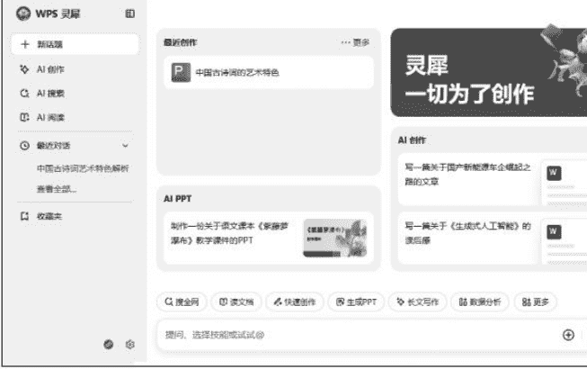

图 5-1 WPS 灵犀首页

在【提问、选择技能或试试@】输入框中输入符合基本要求的提示词，点击【发送】即可生成满足要求的内容。

若需完成“快速创作”“生成 PPT”“长文写作”等任务，可先点击对应功能按钮，例如点击【生成 PPT】按钮，再在输入框中描述 PPT 主题即可。

扫码打开电子教材中的电子活页 5-3，在线浏览“在 WPS 灵犀中生成的工作周报”。也可自行在 WPS 灵犀中生成周报。


#### 【任务 5-5】 用文心一言撰写文小言使用教程技术文档

##### 【任务描述】

使用文心一言撰写一份文小言使用教程的技术文档，要求涵盖主要功能、界面构成、常用功能的操作方法，并配以具体实例进行说明。

##### 【任务实施】

提示词：请你撰写一份文小言使用教程的技术文档，要求包括主要功能、界面组成、常用功能的使用方法，并给出具体实例进行说明。

- ◇ 请读者自行在文心一言中生成对应结果。

#### 【任务 5-6】 文心一言与豆包续写补全段落

##### 【任务描述】

写好一段文字后，可选中该段，让 AI 工具帮忙丰富或精简内容、修改标点、翻译、续写、转换语气、整理提炼等，以提升写作效率。

对下面这段话进行补全。

> 自省
我在张昊老师身上学到的第一个本领是“自省”。我和他是在线上课中认识的，他当时是线上课的班主任，我是他的学生。他当时在我们的班级群内经常发他的每日自省。刚开始我还在想，这样每天发这种自省有用吗？但通过不断地找他私聊，聊得多了我就被他感染了，我也开始自省了。通过自省，我发现我找到了方向；通过自省，我发现我凌乱的思绪变得不再凌乱。自省让我感到宁静，让我知道了很多事情没有捷径可走，唯有躬身入局，让我知道了所有的事情不止一个答案……

##### 【任务实施】

文心一言生成结果如下：

> 自省
我在张昊老师身上学到的第一个本领是“自省”。我和他是在线上课中认识的，他当时是线上课的班主任，而我是他的学生。他当时在我们的班级群内经常发他的每日自省，刚开始我还在想，这样每天发这种自省有用吗？会不会只是一种形式主义的自我安慰？但随着时间的推移，我逐渐被他的坚持打动。
我不断地找他私聊，聊得多了，我就被他那种自省的精神感染了。我开始尝试着自己也进行自省，每天花一点时间回顾自己的言行，思考哪些地方做得好，哪些地方还有不足。
通过自省，我发现我找到了方向。我不再像之前那样对未来感到无所适从，而是开始有了明确的目标和计划。同时，我也发现我凌乱的思绪变得不再凌乱，思维变得更加清晰和有条理。
自省让我感到宁静，让我学会了在喧嚣的世界中找到一片属于自己的宁静之地。它让我明白了很多事情没有捷径可走，唯有躬身入局，脚踏实地地去努力、去实践，才能取得真正的进步。同时，它也让我知道了所有的事情不止一个答案，从不同的角度去思考、去探索，往往会有意想不到的收获。
如今，自省已经成为我生活中不可或缺的一部分。我感谢张昊老师的引导，更感谢自己当初的那份坚持和勇气，让我走上了这条自我成长的道路。

豆包生成结果如下：

### 自省
在学习的漫漫征途中，我有幸结识了张昊老师，从他身上学到的第一个本领便是“自省”。我与张昊老师的缘分始于线上课，彼时他担任线上课的班主任，而我则是他众多学生中的一员。在班级群里，他常常分享自己的每日自省感悟，起初，我心里满是疑惑，暗自思忖：每日发布这些自省内容，真的能带来实质性的改变吗？

带着这份好奇与疑问，我开始频繁地与他私聊。随着交流的深入，我逐渐被他对自我反思的执着所感染，也开始踏上了自省之路。

通过自省，我惊喜地发现，曾经那颗在迷雾中徘徊、迷茫的心，终于找到了前行的方向。就像在杂乱无章的迷宫中，突然寻得了出口。曾经凌乱如麻的思绪，也逐渐变得清晰有序。自省，宛如一泓清泉，流淌在心田，让我在纷扰的世界中寻得内心的宁静。

它更让我深刻领悟到，人生路上，完成诸多事情没有捷径可走，唯有脚踏实地、躬身入局，方能收获成长。曾经，我总是幻想能找到快速达成目标的窍门，却在一次次的碰壁中陷入迷茫。通过自省，我明白了所有的事情并非只有一个答案，换个角度思考，往往能收获不一样的风景。例如，在解决一道难题时，曾经的我只执着于常规解法，屡屡碰壁，而当我静下心自省，尝试从不同思路出发，竟发现了多种巧妙的解题方法。这种思维的转变，不仅让我在学业上有所突破，更让我在面对生活中的种种挑战时，多了一份从容与自信。

#### 【任务 5-7】 Kimi 定制轻松愉悦的旅行方案

##### 【任务描述】

下面是一份为郑州及周边城市团建定制的旅行方案，核心在于让每个人都能体会到独特的旅行乐趣。参考此方案，使用 Kimi 制作一份清晰易懂、切合实际、安排合理的优秀教育工作者疗养休闲方案，时间为夏季的周六、周日，地点为湖南省张家界市，人均预算 1000 元以内。

- 第 1 天
  （1）集合与出发
  上午 8:00 从郑州出发前往登封，预计车程 1 小时。
  （2）少林寺
  上午 9:30 抵达少林寺，参观 1.5 小时，感受中国功夫的博大精深。
  交通：包车前往。
  门票：每人 100 元。
  （3）午餐
  11:00 在少林寺附近品尝河南特色午餐，预算每人 50 元。
  （4）嵩山
  下午 1:00 开始徒步嵩山，预计 3 小时。装备：自备徒步装备。
  （5）晚餐
  下午 4:30 前往登封市区用餐，预算每人 60 元。
  （6）返回郑州
  晚上 6:30 出发返回郑州，预计 8:00 抵达。
  （7）住宿
  预算 300 元/人，建议入住郑州商务型酒店。
  第 2 天
  （1）黄河风景名胜区
  上午 8:00 从郑州出发前往黄河风景名胜区，预计车程 1 小时。
  上午 9:00 抵达，游览 2 小时。
  （2）午餐
  11:00 在景区附近用餐，预算每人 50 元。
  （3）郑州黄河国家地质公园
  下午 1:00 开始参观，预计 2 小时。
  （4）结业仪式
  下午 3:00 举行团建结业仪式，发放纪念品。
  （5）返回
  下午 4:30 结束活动，返回市区。
  当地美食推荐：河南烩面、胡辣汤、油茶、灌汤包。

##### 【任务实施】

扫码打开电子教材中的电子活页 5-4，在线浏览“Kimi 定制的旅行方案”。也可自行在 Kimi 中生成类似结果。


#### 【任务 5-8】 Kimi 撰写并润色环保水杯营销文案

##### 【任务描述】

在 Kimi 中完成以下操作。

1. 按要求为都市年轻白领撰写新款环保水杯营销文案。
2. 借助 Kimi 给生成的文案提出具体润色建议。
3. 依据建议对文案进行润色。

##### 【任务实施】

1. 按要求撰写一篇针对都市年轻白领的新款环保水杯营销文案
提示词 1：撰写一篇针对都市年轻白领的新款环保水杯营销文案，突出其可重复使用和采用无毒材料的特点，强调环保意识和生活品质的提升。

扫码打开电子教材中的电子活页 5-5，在线浏览“使用 Kimi 撰写的新款环保水杯营销文案”。也可自行在 Kimi 中生成类似结果。


2. 借助 Kimi 对生成的新款环保水杯营销文案提出具体润色要求
提示词 2：请你对生成的新款环保水杯营销文案提出具体润色要求。

Kimi 生成的润色要求如下：
调整节奏：改变句子长短和复杂度，营造动态阅读体验，特别在叙事时。
深化主题：深入挖掘主题，提升文本深度，特别在处理社会议题时。
优化开头：用吸引眼球的引言或故事开头，激发阅读兴趣。
引入历史背景：提供更全面视角，特别在讨论社会现象时。
增加幽默感：适当幽默可缓解紧张气氛，提升阅读趣味，特别在严肃话题中。
增加引用：引用经典文献或权威观点，增强文本权威性与说服力。
明确论点：确保每个论点都有充分论据，避免模糊表述。
使用引语：引用权威人士或相关研究，增强观点可信度。
引入专家观点：引用专家研究或评论以强化论点，特别在专业领域。
强化结尾：用有力结论或号召性语句收尾，留下深刻印象。
增加数据支持：用统计数据或研究结果支撑观点，增强说服力。
丰富例证：添加具体案例或分析支持主要观点。
引入悬念：通过提问或设置未解之谜激发好奇心。
优化布局：运用合适的分栏、边距和字体大小提升可读性与美观度。

3. 对 Kimi 生成的新款环保水杯营销文案进行润色
提示词 3：请你根据前面总结的润色要求，对生成的新款环保水杯营销文案进行润色。

Kimi 生成的结果如下：
> 欢迎来到我们的环保新时代！我们最新推出的环保水杯不仅外观时尚，更集合了可重复使用和采用无毒材料的特点，专门为现代都市年轻白领设计。提高生活品质，从一杯清新开始，让我们一起为地球环境贡献一份力量。选择环保水杯，选择健康生活方式！

#### 【任务 5-9】 用通义创建小红书高互动写手角色与指令

##### 【任务描述】


使用通义完成以下创建任务。
- 1. 不使用模板，自由创建小红书高互动风格写手的角色与指令。
- 2. 扫描二维码，打开电子教材中的电子活页 5-6，在线浏览“较为完善的角色与指令模板”，然后基于该模板创建小红书高互动风格写手的角色与指令。

##### 【任务实施】

###### 1. 不使用模板，自由创建小红书高互动风格写手的角色与指令
提示词 1：帮我写一个小红书高互动风格写手的角色与指令。
◇ 请读者自行在通义中生成提示词 1 对应的结果。

###### 2. 基于较为完善的模板创建小红书高互动风格写手的角色与指令
提示词 2：请参考较为完善的角色与指令模板，创建小红书高互动风格写手的角色与指令。
◇ 请读者自行在通义中生成提示词 2 对应的结果。

### 自主学习

#### 【任务 5-10】 用文心一言撰写科普短文
##### 【任务描述】
使用文心一言写一篇约 300 字的介绍通用人工智能的科普短文。

#### 【任务 5-11】 用讯飞星火撰写新闻稿
##### 【任务描述】
使用讯飞星火撰写一篇关于华为发布“HUAWEI Mate XT 非凡大师”的新闻稿。

#### 【任务 5-12】 用通义编写故事
##### 【任务描述】
使用通义编写一个关于一只名叫奥奇的狗拯救小镇儿童的故事。

# 模块6

AIGC 助力数据分析与图表绘制

AIGC 在数据分析和图表绘制方面展现出强大能力，通过自动完成数据收集、预处理、整合、分析以及图表绘制，AIGC 不仅提升了工作效率，节省了人工时间和成本，还保证了图表质量与准确性。

通过对海量数据的学习与分析，AIGC 能更精准理解用户需求，生成符合预期的图表内容。AIGC 不仅能模仿现有图表样式，还能创造独特性图表，为用户带来新视觉体验。

在商业报告领域，AIGC 可生成高质量图表，增强报告可读性和说服力。在教育培训领域，AIGC 可生成生动有趣的图表，帮助学生更好理解知识点。在媒体传播领域，AIGC 可生成更具吸引力的图表，提升新闻或内容的传播效果。随着技术不断进步，AIGC 有望在数据处理与可视化领域发挥更重要作用，推动各行业数字化转型与创新发展。在数据分析领域，AIGC 可快速生成各类图表，帮助用户直观理解数据间关系与趋势。

### 知识探析

#### 6.1 常用国产数据处理与分析专用 AI 工具概览

常用国产数据处理与分析专用 AI 工具如表 6-1 所示。

表 6-1 常用的国产数据处理与分析专用 AI 工具

| 序号 | 名称 |
| :--- | :--- |
| 1 | WPS AI |
| 2 | 酷表 ChatExcel |
| 3 | 办公小浣熊 |

常用国产数据处理与分析专用 AI 工具具体介绍如下。

##### 1. WPS AI
WPS AI 是 WPS 推出的 AI 助手，提供文档、表格、PPT 等多种格式文件的智能辅助功能，能提升办公软件智能化水平。WPS AI 在文档处理方面表现突出，如根据文档生成文档、表格、PPT，通过深度学习和自然语言处理技术，可自动识别、理解和处理文档内容。
WPS AI 在数据处理、分析与标注功能上非常强大，能帮助用户快速完成数据清洗、分类、分析、可视化等任务，大幅提升效率。无论简单整理还是复杂分析，WPS AI 都能提供智能化支持。

##### 2. 酷表 ChatExcel
酷表 ChatExcel 由北京大学团队开发，是一款人工智能办公辅助工具，通过 AI 技术辅助 Excel 文件的创建与编辑。其核心特点是支持自然语言对话，让用户以文字聊天方式控制和操作 Excel，简化数据处理流程，提升效率。
酷表 ChatExcel 以 AI 技术革新了 Excel 数据处理方式，用户无需编程知识即可高效完成复杂表格操作，适用于个人和企业用户，被广泛应用于多个领域。

##### 3. 办公小浣熊
办公小浣熊是一款将 AI 大模型能力与文档编辑、数据分析场景深度结合的工具型产品，致力于为用户提供一站式创作平台和知识管理空间。
用户可通过对话式交互，完成信息网络检索收集、文档撰写编辑、数据处理分析；可在单一平台内完成从思路策划、提纲生成到内容创作、方案输出的全流程；可搭建个人知识管理空间，完成文档、数据、代码的管理与检索。
办公小浣熊 1.0 专注于数据分析。依托强大模型能力和工程化手段，它不仅具备数据归纳、推理和分析能力，还能实现表格整理和图表生成，为用户提供全方位数据分析支持，完成数据清洗、运算、比较分析、趋势预测及数据可视化等任务。
办公小浣熊 2.0 将数据分析定位为办公流程中的重要环节，从初步计划生成，到文本材料、数据文件的深入分析，再到最终内容创作与定稿，致力于用 AI 赋能整个办公流程，从单一数据分析工具进化为一站式创作平台和知识管理空间。

#### 6.2 使用酷表 ChatExcel 处理数据
使用酷表 ChatExcel 处理数据共包括上传文件、输入提示词、查看与编辑结果和导出文件 4 个步骤。
1. 上传文件
访问酷表 ChatExcel 官网，上传需处理的 Excel 文件。
2. 输入提示词
在输入框中输入提示词，即自然语言指令，例如“删除第二列数据”“计算平均值”“将最后一列数据四舍五入为两位小数”，系统会根据提示词识别文件数据并自动操作。
3. 查看与编辑结果

处理完成后表格会即时呈现，随时可以追加新的指令来对结果做细化调整。

4. 导出文件
全部流程走完后可以一键把结果保存为 Excel，样式和数据都与原文件保持一致。

#### 6.3 办公小浣熊的主要优势和应用场景

##### 1. 办公小浣熊的主要优势

（1）全链路沉浸操作：把规划到创作的环节收敛到同一工作区，减少跨应用切换的打断，让专注度和完成效率同步提升。
（2）自迭代的大模型：搭载的模型能理解复杂指令，并在执行中自行诊断、修正，输出越来越精准的智能服务。
（3）零门槛数据洞察：覆盖清洗、运算、预测到可视化全套能力，帮助用户快速提炼数据价值，无需写代码也能做出专业级的决策依据。
（4）私人知识域：为每位用户构建独立的知识库，将笔记、文档、数据统一收纳，支持快速检索与个性化生成，同时做好安全保护。
（5）轻量交互：界面简洁直观，支持自然语言对话，开箱即用，无需学习成本。

##### 2. 办公小浣熊的应用场景

（1）数据处理：免编程即可完成清洗、计算、分析与可视化，为业务决策提供数据支撑。
（2）趋势预测：借助大模型对历史数据做深度挖掘，揭示规律与潜在机会。
（3）报告生成：快速产出带图表的专业分析报告，直观呈现关键结论。

#### 6.4 智能处理数据时对 Excel 文件的规范性要求

要让模型准确读懂表格，提交的文件最好符合规范。

##### 1. 使用规范表格
表头命名清晰，避免特殊符号与换行，否则列名可能被误判，导致读取错误。
##### 2. Excel 文件的工作表不要超过 3 个
单个文件的工作表建议控制在3个以内，多余的表可先删除，工作表过多易拖慢解析，甚至触发浏览器超时。
##### 3. 上传规定大小的 Excel 文件
文件体积要符合工具的上限要求。
##### 4. 避免过多地合并单元格
合并单元格会增加边界识别的误差，尽量少用。
##### 5. Excel 文件的工作表和列的命名要准确
工作表名称应真实反映内容，避免使用默认命名；列名要与指令保持一致，便于模型对齐。

#### 6.5 使用酷表 ChatExcel 针对 Excel 文件进行数据处理时如何撰写提示词

##### 1. 常用提示词示例

（1）生成新 Excel 文件
操作说明：打开酷表 ChatExcel 官网，导入一个非空白的 Excel，里面放一个数字，再输入提示词：生成 1～12 月的销售数据，其生成 20 组数据，存入上传的 Excel 文件中。
（2）下载生成的 Excel 文件
提示词示例：将生成好的 Excel 文件下载。
（3）表格内容提取
提示词示例：提取第 1 季度的销售数据。
（4）数据去重
提示词示例：去除表格中的重复值。
（5）图表生成
提示词示例：提取前 6 个月的销售数据，生成柱状图。

##### 2. 分析员工工资提示词示例

（1）帮我统计分析一下不同部门的实发工资总和，要求图文并茂。
（2）帮我按部门导出员工数据并下载。
（3）把实发工资大于 7000 元的员工，在原表格上标记为红色，表格处理完成后下载表格。

##### 3. 分析学生成绩提示词示例

（1）计算每位学生的总分、平均分，并进行排名，将结果填充到表格里并下载。
（2）判断每位学生的平均分是否高于全班平均分，将平均分高于全班平均分的学生标红。将结果填充到表格里并下载。
（3）在“总分”列的成绩后面，括注单位“分”，下载处理好的文件。
（4）查找高三（3）班，学号为 20250310~20250320 的学生中，数学成绩高于 120 分的学生姓名以及各科成绩，下载处理好的文件。
（5）填充“评选结果”列，符合条件，则填充“优秀”。评优考核条件：语文成绩、数学成绩均不低于 90 分，下载处理好的文件。
（6）提取总分排名前 10 名的学生的数据，将他们的各科成绩绘制成 5 种不同形式的图表。

### 应用实践

#### 【任务 6-1】使用文心一言计算与分析产品销售数据

##### 【任务描述】
1. 在文心一言中导入 Excel 文件“两种产品月销售情况.xlsx”。
2. 找出两种产品销售额最高的月份，并生成一段文字报告。
3. 绘制两种产品的 12 个月的销售额柱状图，展示每个月的销售额变化。

##### 【任务实施】
1. 在文心一言中导入本地 Excel 文件“两种产品月销售情况.xlsx”。
2. 输入提示词：请帮我找出两种产品销售额最高的月份，并生成一段文字报告。
生成结果：
根据“两种产品月销售情况.xlsx”数据，A 产品和 B 产品销售额最高的月份分别如下。
A 产品在 6 月实现了最高销售额，具体金额为 350000 元。
B 产品在 12 月实现了最高销售额，具体金额为 383904 元。
综上，B 产品在 12 月的销售额不仅是自身各月销售额中的最高值，同时也是两种产品中所有月份的最高销售额。
3. 输入提示词：请帮我绘制 A 产品和 B 产品的 12 个月的销售额柱状图。
图 6-1 A产品和B产品的12个月的销售额柱状图

#### 【任务 6-2】使用通义分析财务支出数据

##### 【任务描述】
1. 在通义中导入“A公司财务支出数据.xlsx”Excel文件。
2. 计算A公司全年总财务支出，并生成一段文字报告。
3. 生成用于绘制每月总支出的柱状图的Python脚本。

##### 【任务实施】
1. 在通义中导入“A公司财务支出数据.xlsx”Excel文件。
2. 输入提示词：计算A公司全年总财务支出，并生成一段文字报告。
生成结果：
> A公司的全年总财务支出累计达到了47489.64元。其中，主要支出项目（支出项目1）贡献了36920元，次要支出项目（支出项目2）总计6710.4元，而第三类支出项目（支出项目3）则为3809.24元。这些数字反映了公司在过去一年中对不同方面的投入情况，包括但不限于运营成本、员工薪酬以及各种管理费用等。了解这些支出的具体分布有助于公司管理层更有效地规划预算，并制定更加精准的成本控制策略，以提高整体经营效益。请注意，上述金额是以元为单位进行计算的，在实际应用中可能需要转换成更大的货币单位以便于理解和讨论。
3. 输入提示词：生成用于绘制每月总支出的柱状图的Python脚本。
生成结果：
```python
import matplotlib.pyplot as plt
# 每月总支出数据（根据之前的数据计算得出）
monthly_expenses = [
    4160.16, # 1月
    5118.34, # 2月
    3497.9,  # 3月
    3289.23, # 4月
    4064.44, # 5月
    3547.9,  # 6月
    4073.56, # 7月
    3592.44, # 8月
    5244.1,  # 9月
    3387.9,  # 10月
    4104.44, # 11月
    3409.23  # 12月
]
months = ["1月", "2月", "3月", "4月", "5月", "6月", "7月", "8月", "9月",
         "10月", "11月", "12月"]
# 绘制柱状图
plt.figure(figsize=(10, 6))
plt.bar(months, monthly_expenses, color='blue')
plt.title('A公司每月总支出情况')
plt.xlabel('月份')
plt.ylabel('总支出（元）')
plt.xticks(rotation=45) # 为了使月份标签更易读，将其逆时针旋转45°
plt.tight_layout() # 自动调整子图参数，使之填充整个图像区域
plt.show()
```

#### 【任务6-3】使用讯飞星火计算与分析销售数据

##### 【任务描述】
1. 在讯飞星火中导入“3种产品月销售情况.xlsx”Excel文件。
2. 计算3种产品的每月总销售额，然后据此绘制每月总销售额的柱状图，展示每月总销售额的变化趋势。
3. 计算3种产品的每月总销售量，然后据此绘制每月总销售量的折线图，展示每月总销售量的变化趋势。

##### 【任务实施】
1. 进入讯飞星火首页。
2. 导入“3种产品月销售情况.xlsx”Excel文件。
3. 输入提示词：计算每月的总销售额，然后据此绘制每月总销售额的柱状图，展示每月总销售额的变化趋势。
绘制的每月总销售额的柱状图如图6-2所示。
图6-2 每月总销售额的柱状图
4. 输入提示词：计算 3 种产品的每月总销售量，然后据此绘制每月总销售量的折线图，展示每月总销售量的变化趋势。
绘制的每月总销售量的折线图如图 6-3 所示。
图 6-3 每月总销售量的折线图

#### 【任务 6-4】借助 Kimi 按要求整理数据

##### 【任务描述】
销售源数据与存放结果数据的空表如图 6-4 所示，销售源数据中产品名称和日期都在 A 列，销售额在 B 列，且表格中存在空白单元格。

| A | B | C | D | E | F |
|---|---|---|---|---|---|
| 产品名称 | 销售额（万元） | | 产品名称 | 日期 | 销售额（万元） |
| 产品1 | | | | | |
| 2024/8/30 | 536 | | | | |
| 2024/9/9 | 52 | | | | |
| 产品2 | | | | | |
| 2024/8/17 | 362 | | | | |
| 产品3 | | | | | |
| 2024/10/18 | 543 | | | | |
| 2024/12/3 | 86 | | | | |
| 产品4 | | | | | |
| 2024/10/26 | 654 | | | | |
| 产品5 | | | | | |
| 2024/9/26 | 432 | | | | |
| 2024/11/5 | 436 | | | | |
| 2024/12/12 | 67 | | | | |

图 6-4 销售源数据与存放结果数据的空表

将销售源数据按存放结果数据的空表的列名进行整理，并分别填入对应的数据。

##### 【任务实施】
1. 在 Kimi 中上传图 6-4 所示的数据效果的截图。
2. 输入提示词如下。
请参照图像中左右两个表格的样式，将左侧原始数据转换为右侧结构化的格式，并以表格形式呈现整理结果。
Kimi 会迅速识别图像中的表格数据，精准把握整理需求，并自动输出整理后的数据，如表6-2所示。
表 6-2 Kimi 按要求整理后的数据
| 产品名称 | 日期 | 销售额（万元） |
| :--- | :--- | :--- |
| 产品 1 | 2024/8/30 | 536 |
| 产品 1 | 2024/9/9 | 52 |
| 产品 2 | 2024/8/17 | 362 |
| 产品 3 | 2024/10/18 | 543 |
| 产品 3 | 2024/12/3 | 86 |
| 产品 4 | 2024/10/26 | 654 |
| 产品 5 | 2024/9/26 | 432 |
| 产品 5 | 2024/11/5 | 436 |
| 产品 5 | 2024/12/12 | 67 |
最后，将 Kimi 生成的数据复制并粘贴到 Excel 文件的工作表，即可对其进行后续的统计分析操作。

#### 【任务 6-5】 WPS AI 助力 Excel 数据分析与图表生成

##### 【任务描述】
针对“高中会考成绩.xlsx” Excel 文件中的成绩数据，完成以下操作。
1. 快速计算各门课程的平均成绩。
2. 快速计算每位学生 5 门课程的平均成绩。
3. 计算全班学生所有课程的平均成绩。
4. 生成各门课程平均成绩的排序图，按升序进行排名。
5. 平均成绩分为 4 个分数段：60 分以下（不含 60 分）、60~80 分（不含 80 分）、80~90 分（不含 90 分），90 分及以上。在全班学生中统计平均成绩在不同分数段的学生人数比例，并绘制饼图。

##### 【任务实施】
1. 在 WPS 中打开 Excel 文件“高中会考成绩.xlsx”。
2. 在 WPS 中选择【WPS AI】选项卡中的【AI 表格助手】命令，唤起 AI 助手，打开【AI 表格助手】对话框。
3. 在【AI 表格助手】对话框中选择【AI 数据问答】选项，如图 6-5 所示。
4. AI 数据问答，一键分析数据。
在【AI 数据问答】输入框中分别输入提示词，然后单击【发送】按钮，WPS AI 开始分析提示词，并输出计算结果。
输入提示词 1：快速计算各门课程的平均成绩。
生成结果：
```
计算各门课程的平均成绩
选择需要计算平均值的列（数学、语文、英语、物理、化学）
计算每列的平均值
输出各门课程的平均成绩
各门课程的平均成绩如下。
数学: 80.75。
语文: 84.40。
英语: 81.80。
物理: 78.50。
化学: 81.35。
```
继续输入提示词 2：快速计算每位学生 5 门课程的平均成绩。
WPS AI 会快速完成每位学生 5 门课程的平均成绩的计算。
继续输入提示词 3：计算全班学生所有课程的平均成绩。
生成结果：
```
全班学生所有课程的平均成绩为：81.36。
```
继续输入提示词 4：生成各门课程平均成绩的排序图，按升序进行排名。
生成的各门课程平均成绩的排序图如图 6-6 所示。
继续输入提示词 5，具体内容如下。
平均成绩分为 4 个分数段：60 分以下（不含 60 分）、60-80 分（不含 80 分）、80~90 分（不含 90 分），90 分及以上。在全班学生中统计平均成绩在不同分数段的学生人数比例，并绘制饼图。
生成的全班学生平均成绩各分数段分布饼图如图 6-7 所示。
图 6-6 各门课程平均成绩的排序图
全班学生平均成绩分数段比例
图 6-7 全班学生平均成绩各分数段分布饼图
借助 AI 表格助手，我们可以通过与 AI 对话的方式，一键进行数据分析，生成数据图表，避免写函数公式和手动制作图表的烦琐，提升数据处理效率。

#### 【任务 6-6】使用酷表 ChatExcel 处理与分析学生成绩数据

##### 【任务描述】
1. 在酷表 ChatExcel 首页上传 Excel 文件“高三学生成绩.xlsx”。
2. 计算每位学生的总分、平均分，平均分保留 2 位小数，并进行排名，将结果填充到表格里并下载。
3. 判断每位学生所有科目的平均分是否高于全班的平均分，将平均分高于全班平均分的学生标红。将结果填充到表格里并下载。
4. 在“总分”列的成绩后面，括注单位“分”，下载处理好的文件。
5. 查找高三（3）班，学号为 310-320 的学生中，数学成绩高于 120 分的学生姓名及各科成绩，下载处理好的文件。
6. 填充“评选结果”列，符合条件，则填充“优秀”。评优考核条件：语文成绩不低于 90 分，数学成绩也不能低于 90 分。下载处理好的文件。
7. 将总分排名前 10 名的学生的各科成绩绘制成柱状图。
8. 将总分排名前 10 名的学生的各科成绩占比绘制成饼图。
9. 将总分排名前 10 名的学生的各科成绩绘制成关系散点图。

##### 【任务实施】
1. 在浏览器中打开酷表 ChatExcel 的首页。
2. 上传 Excel 文件“高三学生成绩.xlsx”。
3. 输入提示词 1：计算每位学生的总分、平均分，平均分保留 2 位小数，并进行排名，将结果填充到表格里并下载。
请读者自行在酷表 ChatExcel 中生成提示词 1 对应的结果。
4. 输入提示词 2：判断每位学生所有科目的平均分是否高于全班的平均分，将平均分高于全班平均分的学生标红。将结果填充到表格里并下载。
请读者自行生成结果。
5. 输入提示词 3：在“总分”列的成绩后面，括注单位“分”，下载处理好的文件。
请读者自行生成结果。
6. 输入提示词 4：查找高三（3）班，学号为 310-320 的学生中，数学成绩高于 120 分的学生姓名以及各科成绩，下载处理好的文件。
生成结果：
学生成绩筛选报告
1. 数据读取与初步筛选
根据用户需求，已经成功读取了包含所有学生成绩的表格数据，并从中筛选出高三（3）班、学号为 310～320 的学生。
2. 筛选结果
进一步筛选出数学成绩高于 120 分的学生，具体信息如下。
| 姓名 | 数学 | 英语 | 语文 | 政治 | 历史 | 地理 | 体育 |
|------|------|------|------|------|------|------|------|
| 杨丽 | 143 | 114 | 97 | 73 | 88 | 54 | 92 |
| 蒋琴 | 135 | 76 | 121 | 96 | 86 | 61 | 78 |
3. 文件处理及下载
已将符合条件的学生姓名及其各科成绩提取并保存到文件 selected_students.xlsx 中。该文件包含所有相关学生的详细成绩信息，便于进一步查看和分析。
4. 结论
通过上述步骤，成功筛选出了高三（3）班学号为 310～320 且数学成绩高于 120 分的学生，并将其成绩信息整理成表格文件。此文件可以帮助教师或相关人员快速了解这些学生的具体成绩情况。
7. 输入提示词 5，具体内容如下。
填充“评选结果”列，符合条件，则填充“优秀”。评优考核条件：语文成绩不低于 90 分，数学成绩也不能低于 90 分。下载处理好的文件。

◆ 提示词5的演练结果，请在酷表ChatExcel中自行完成。

AIGC基础与表格智能应用
（电子活页版）

8. 提示词6：把总分位列前十的同学各科得分用柱形图呈现。
◇ 该指令的输出请在酷表ChatExcel环境自行复现。

9. 提示词7：把总分前十学生各科成绩占比以饼图形式展示。
◇ 相应结果请在酷表ChatExcel中自行获取。

10. 提示词8：把总分前十学生的各科成绩做成关系型散点图。
◇ 该结果可在酷表ChatExcel中自行操作查看。

#### 【任务 6-7】 用办公小浣熊解析销售额并输出图形
##### 【任务说明】
把本地Excel“销售额与库存数量.xlsx”导入平台，对其中的销售额进行解读，并分别导出全年各月销售额的折线图与柱状图。
##### 【操作流程】
1. 进入办公小浣熊工作台。
2. 把“销售额与库存数量.xlsx”上传。
3. 发送指令1：请对工作表销售额进行分析，产出全年各月销售额的折线图。
◇ 指令1的运行结果请在办公小浣熊中自行查看。
4. 发送指令2：请对工作表销售额进行分析，产出全年各月销售额的柱状图。
◇ 指令2的运行结果请在办公小浣熊中自行查看。

#### 【任务 6-8】 WPS AI 支撑运算与可视化
##### 【任务说明】
1. 针对不同Excel完成多项计算与图表制作。
2. 按条件快速标记数据。
##### 【操作流程】
常规计算与制图的步骤如下。
1. 在WPS中打开目标Excel。
2. 选择【WPS AI】选项卡里的【AI数据问答】打开对话框。
3. 在对话框输入框依次填写指令，点击【发送】执行。

###### 1. 用WPS AI批量求多项指标
打开文件：01WPSAI自动计算多个数据.xlsx。
指令：按公式依次求出课程成绩的最高分、最低分、第二高分、第二低分、平均分。
结果：
> 计算已写入对应单元格，更新后的数据如下。
最高分：98。
最低分：65。
第二高分：90。
第二低分：70。
平均分：80.86

###### 2. 用WPS AI快速排位
打开文件“02WPSAI快速计算排名.xlsx”。
指令：按公式计算排名并填入对应列。
生成的排名如表6-3所示。
表6-3 成绩排名
| 姓名 | 课程成绩 | 排名 |
| :--- | :--- | :--- |
| 王立新 | 78 | 5 |
| 董丽霞 | 98 | 1 |
| 张睿 | 94 | 2 |
| 杨一凡 | 76 | 6 |
| 顾昊 | 90 | 3 |
| 刘洁 | 70 | 7 |
| 宁远城 | 89 | 4 |

###### 3. 用WPS AI合并单元格
打开文件“03WPSAI快速合并单元格.xlsx”。
指令：把网点代码相同的单元格合并。
结果：
773AA
773AC
773AB
773AE

###### 4. 用WPS AI多条件统计订单笔数
打开文件“04WPSAI多条件统计订单数.xlsx”。
指令：统计2024年春季，订货渠道为平台8，且数量大于300的订单数。
结果：
统计显示，2024年春季，订货渠道为平台8且数量大于300的订单共有54笔。

###### 5. 用WPS AI多条件统计销售额
打开文件“05WPSAI多条件统计销售额.xlsx”。
指令1：统计订货渠道为平台3且数量大于600的订单销售额合计。
结果：
统计显示，订货渠道为平台3且数量大于600的订单销售额总和为476391元。
指令2：计算平台8的平均订单销售额。
结果：
平台8的平均订单销售额为38355.67元。
指令3：列出订货日期为2024-05-01的订单编号及销售额。
结果如表6-4所示。
表6-4 订货日期为2024-05-01的订单编号及销售额
| 编号 | 销售额（元） |
|---|---|
| P2024050101 | 29093 |
| P2024050102 | 10400 |
| P2024050103 | 69865 |
| P2024050104 | 6981 |
| P2024050105 | 24752 |
| P2024050106 | 89864 |
| P2024050107 | 48512 |
| P2024050108 | 54750 |
指令4：统计各季节的总销售额。
结果如表6-5所示。
表6-5 各季节的总销售额
| 季节 | 总销售额（元） |
|---|---|
| 冬季 | 519938 |
| 夏季 | 280979 |
| 春季 | 10495791 |
| 秋季 | 1933129 |

###### 6. 用WPS AI快速拆分字符串
打开文件“06WPSAI快速实现字符串拆分.xlsx”。
指令：提取“编码”与“描述”，编码填入B列，描述填入C列。
部分结果如表6-6所示。
表6-6 字符串拆分的部分结果
| 编码 | 描述 |
|---|---|
| 1800038286 | 变压器油 |
| 1800132904 | 传动轴 |
| 1800183580 | 模块 |
| 1800183588 | 模块 |
| 1800011327 | 数字输出模块 |

###### 7. 用WPS AI快速合并字符串
打开文件“07WPSAI快速实现字符串合并.xlsx”。
指令：把“编码”列与“描述”列合并，填入“编码描述”列。
部分结果如表6-7所示。
表6-7 字符串合并的部分结果
| 编码 | 描述 | 编码描述 |
|---|---|---|
| 1800038286 | 变压器油 | 1800038286 变压器油 |
| 1800132904 | 传动轴 | 1800132904 传动轴 |
| 1800183580 | 模块 | 1800183580 模块 |
| 1800183588 | 模块 | 1800183588 模块 |
| 1800011327 | 数字输出模块 | 1800011327 数字输出模块 |

###### 8. 用WPS AI快速汇总分析
打开文件“08WPSAI快速实现数据汇总分析.xlsx”。
指令1：通过数据透视表，分析2024年“灰色长筒靴”“白色蕾丝上衣”的数量总计。
结果：
> 分析结果为，2024年“灰色长筒靴”共1829件，“白色蕾丝上衣”共1620件。
指令2：使用数据透视表筛选出2024年春季的“吊牌价”总额。
结果：
> 分析结果为，2024年春季“吊牌价”总额为36652.9元。

### 自主学习

#### 【任务 6-9】 借助豆包拆分单元格多数据
##### 【任务说明】
完结项目及业绩评分如图6-8所示。
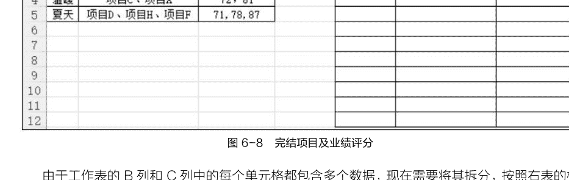
因B列与C列每个单元格都包含多条信息，需拆分并按右侧表格样式填入。
提示词：
请参照左右两表样式，将左侧原始数据转换为右侧结构化格式，并以表格形式呈现整理结果。

#### 【任务 6-10】 借助天工AI制作物品清单
##### 【任务说明】
借助天工AI完成：
1. 列出登山必备品并制表。
2. 说明登山紧急医疗包应配备的药品。

#### 【任务 6-11】 借助文心一言绘制注册人数柱状图
##### 【任务说明】
1~9月注册人数数据如表6-8所示，请据此绘制柱状图。
表6-8 1~9月注册人数数据
| 月份 | 注册人数 |
|---|---|
| 1月 | 961 |
| 2月 | 2430 |
| 3月 | 5805 |
| 4月 | 6577 |
| 5月 | 6215 |
| 6月 | 1700 |
| 7月 | 3908 |
| 8月 | 4523 |
| 9月 | 4726 |

#### 【任务 6-12】 用WPS AI解决图表等难题
##### 【任务说明】
1. 在WPS中打开Excel文件“商品大类的销售数据.xlsx”。
2. 计算空调的销售额。
3. 分析空调与手机的销售利润哪个更高。
4. 计算电视销售额占总销售额的比例。
5. 计算手机和空调哪个月份的销售表现更好。
6. 计算电视的平均销售利润。
7. 列出各大类商品的销售额和销售利润。
8. 列出销售额排名前3的手机。
9. 按商品大类计算销售额。
10. 生成不同商品大类销售额的柱状图。

#### 【任务 6-13】 用酷表ChatExcel分析员工工资
##### 【任务说明】
1. 在酷表ChatExcel中上传Excel文件“9月员工工资.xlsx”。
2. 统计分析不同部门的实发工资总和，要求图文并茂。
3. 按部门导出员工数据并下载。
4. 找出实发工资大于7000元的员工，在原表标灰，处理后下载。

## 模块7
AIGC驱动的PPT制作与图形生成

演示文稿在商务与教学场景中作用关键，但要做出吸睛且高效传达信息的稿件并不容易。选对工具可大幅提升效率。随着生成式AI发展，这一流程变得更简便有趣。目前已有大量免费的PPT智能生成工具，能帮助用户便捷制作出内容优质、视觉吸引力强的演示。

### 知识探析

#### 7.1 主流智能PPT工具盘点
常用工具如表7-1所示。
表7-1 常用的PPT智能生成工具
| 序号 | 名称 |
| :--- | :--- |
| 1 | 百度文库的“智能PPT” |
| 2 | WPS AI |
| 3 | AiPPT |
| 4 | iSlide |
| 5 | 博思AIPPT |
| 6 | ChatPPT |
| 7 | 轻竹办公 |
| 8 | 美图设计室的“Live PPT” |
| 9 | 讯飞智文 |
| 10 | Kimi+的“PPT助手” |
| 11 | 通义的“PPT创作” |
| 12 | WPS灵犀 |

以下以百度文库智能PPT、WPS AI、AiPPT、iSlide、博思AIPPT、ChatPPT为例作简要介绍。

##### 1. 百度文库的“智能PPT”
百度文库于2023年升级为一体化智能文档平台，并推出智能对话、智能PPT、智能写作、思维导图、多文档合成等功能。智能PPT内置多项核心能力，并依托专业资料库帮助用户生成所需演示。平台提供一体化AI创作，支持PPT、文档等多格式生成，模板能力强，能提高创作效率。百度文库首页如图7-1所示。
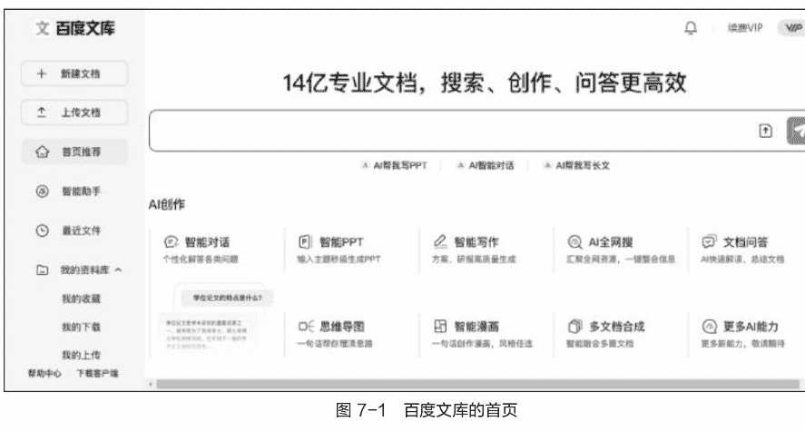
图7-1 百度文库的首页

##### 2. WPS AI
WPS AI由金山办公推出，作为WPS套件的重要组成，提供智能写作、阅读理解与问答、人机交互等功能，以及文档、表格、PPT多格式的智能辅助，提升办公智能水平与效率。
WPS AI首页如图7-2所示。

图7-2 WPS AI首页

##### 3. AiPPT
AiPPT是AI驱动的在线PPT生成工具，专注智能生成，提供文档转PPT与内容智能设计。用户输入主题即可一键生成高质量演示，操作简便，还支持在线编辑与文档导入，提供超10万模板与素材。
AiPPT首页如图7-3所示。
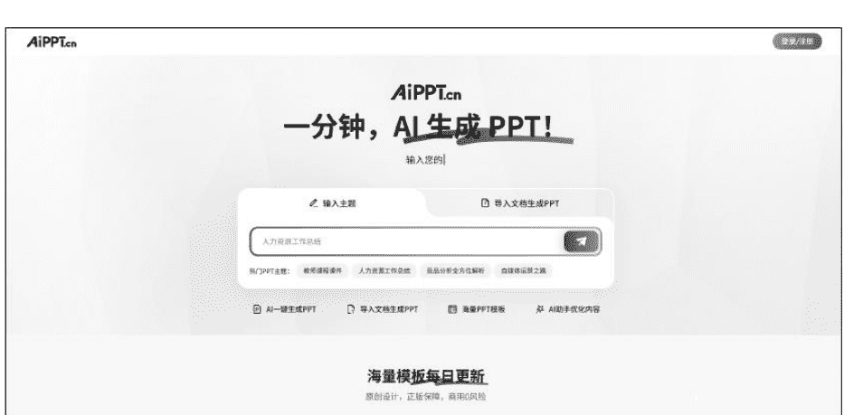
图7-3 AiPPT首页

##### 4. iSlide
iSlide是PPT设计辅助工具，提供超30万原创可商用模板与设计元素，帮助用户快速制作专业水准演示。
iSlide首页如图7-4所示。
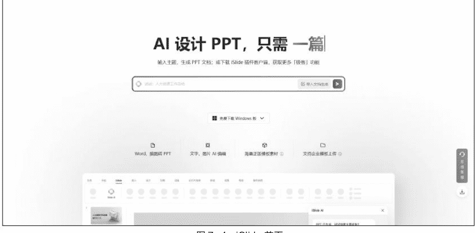
图7-4 iSlide首页

##### 5. 博思AIPPT
博思AIPPT是新一代在线AI生成PPT软件，支持按主题、按文本生成，也可导入Word、PDF、TXT、Markdown等文件生成。内置海量精美模板，覆盖商务、教育、科技等风格，单页提供多种版式可一键切换。
博思AIPPT首页如图7-5所示。
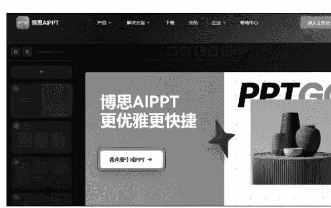
图7-5 博思AIPPT首页

##### 6. ChatPPT
ChatPPT由MotionGo发布，集成AI的PPT制作工具，旨在简化制作流程。用户可通过对话式提示词快速生成专业级演示，提供智能排版、主题色更换、模板选择、图表与动画生成等自动化选项。
ChatPPT首页如图7-6所示。
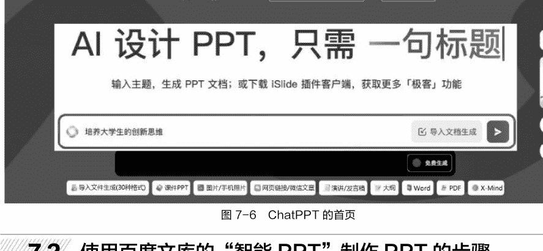
图7-6 ChatPPT的首页

#### 7.2 百度文库智能PPT制作流程
使用步骤如下。
1. **进入AI创作模式**
打开百度文库后，找到【AI创作】区域。
2. **选择创作PPT**
在【AI创作】区域点击【智能PPT】。
3. **选择创作方式**
在智能PPT页面可选择【输入主题生成】，也可选择【上传文档生成】或【上传图片生成】。
4. **输入主题**
输入演示主题，例如“大学生防火安全教育”。
5. **等待生成**
点击【生成】，系统自动处理并生成大纲。注意生成时勿关闭页面，否则可能失败。
扫描二维码打开电子教材电子活页7-1，在线浏览“百度文库智能PPT生成的大纲”。也可自行生成类似结果。

6. **选择模板**
大纲生成后点击【生成PPT】，在弹框中挑选喜欢的风格模板，如图7-7所示，再点击【继续生成】。
7. **编辑PPT**
生成的演示提供大致框架，可按需优化以达到预期效果。

8. **下载PPT**
点击【下载PPT】，将文件保存至本地。

#### 7.3 百度文库智能PPT的创新与优势
##### 1. 创新点
发展得益于多项AI应用创新，主要体现在：
1. 深入理解需求：能理解教育、商务等场景下个人汇报对演示的需求。
2. 生成质量高：在AI PPT能力测试多维度排名靠前，内容质量高。
3. 内容丰富：依托海量高价值文档，生成内容充实。
4. 编辑体验自由：可一键替换颜色、字体、模板，支持多格式再生成。
5. 定制程度高：提供多种风格模板，支持上传个人定制模板，满足不同场景。

##### 2. 优势
1. 全流程服务：支持资料查找、内容生成、排版编辑、配图选择等全流程，无需多平台切换。
2. 多文件整合：支持从Word、Excel、PDF等文件生成PPT，适用于复杂数据梳理。

AI 演示文稿高效制作与实战要点

百度文库的智能演示模块在实战中表现扎实。依托自动梳理的提纲展开正文，内容饱满逻辑连贯。版式资源丰富，可对风格与配色进行自由微调。移动端还叠加了配音绘本能力，输入一句指令即可在数分钟内得到图文配合、人声朗读的视频故事，适合家长为孩子定制专属绘本，门槛低、流程简便。

#### 7.4 AiPPT 四步速成演示稿
AiPPT 的操作成本很低，四步即可完成一次成稿。

1. 确定入口
首页先挑选创建方式，常用的是【AI 新增 PPT】。
2. 指定产出模式并填入题材
挑选【AI 智能生成】或【导入文档制作演示稿】等模式，再把关键词写入提示区。
3. 核对提纲进入配置
系统会逐步推导出提纲，若不满意可重新推导；确认后再进入下一步。
4. 挑选版式正式输出
对设计风格与主色调进行筛选，选定版式后按下【制作演示稿】即可，后台进度可实时查看，等待完成后即可使用。

#### 7.5 博思 AIPPT 两种快捷路线
博思 AIPPT 支持两种快速成稿路径。

1. 智能自动制作
直接填写题材关键词即可一键产出。
2. 以文件为源制作
导入常见办公文件，由系统提炼概括后自动分页。
以文件导入为例，可处理的格式涵盖 Word、PDF、TXT、Markdown、MindMaster、Xmind 等，覆盖日常办公常用类型，能快速得到精美的幻灯片。

人工智能基础与 AIGC 应用

（电子活页式）

文件上传后，系统会按题材、目录、章节、内页四个维度解析本地文档，按下底部【挑选演示稿版式主题】进入版式选择页。

内置版式库可按三类条件组合筛选：
- 版式场景：总结汇报、教育培训、企业宣传、商业计划书、营销推广、毕业答辩、晚会表彰。
- 设计风格：扁平简约、商务科技、创意时尚、文艺清新、中国风、卡通手绘。
- 主题颜色：十余种色系，可任意挑选。
选定版式后点右上角【制作演示稿】，即可依据文件内容与所选版式完成成稿。

#### 7.6 Kimi+ 演示助手操作流程
Kimi+ 可免费产出并下载演示提纲与版式，具体流程如下。

1. 打开演示助手
进入 Kimi+ 后选择【PPT 助手】模块。
2. 用提示词得到提纲
用自然语言描述需求，系统会据此产出演示提纲。
3. 配置演示稿
检查提纲，确认后点底部【一键制作演示稿】。
4. 选定版式
挑一个合适的版式，系统即按版式开始制作。
5. 等待制作完成
数分钟后即可得到成品。
6. 后续调整
生成后可进入编辑器微调细节，也可点【放映】【拼图】【保存】执行对应操作。

#### 7.7 通义 PPT创作智能制作步骤
通义的 PPT 创作功能直观易用。

1. 进入创作页
在通义首页右侧点【PPT 创作】进入工作台。
2. 填写题材
在输入框填入题材，点【创建】。
3. 调整提纲与场景
系统据题材生成初稿提纲，可手动修改，再挑选演讲场景。
4. 挑选版式
通义提供多款优质版式供自选。
5. 产出与微调
稍作等待即可得到演示稿，还可逐页微调内容、切换版式或直接导出、演示。

#### 7.8 常用的思维导图、流程图绘制专用工具
表 7-2 常用的思维导图、流程图绘制专用工具及其说明

| 序号 | 名称 | 说明 |
| :--- | :--- | :--- |
| 1 | 亿图脑图 MindMaster | 综合型脑图软件，提供 AI 辅助设计，能激发灵感并提升规划效率 |
| 2 | GitMind | 在线脑图工具，可轻松绘制思维导图、组织架构图等，主题丰富且快捷键完善，有助于提升学习与工作效率 |
| 3 | Mermaid AI | 基于 JavaScript 的图表绘制方案，借助类 Markdown 文本动态创建与修改图表 |
| 4 | 妙办画板 | 可在线生成流程图和思维导图的工具 |
| 5 | boardmix 博思白板 | 智慧白板产品，支持智能化协助绘制思维导图、AI 绘画与 AI 写作 |
| 6 | ProcessOn | 在线制图平台，可产出思维导图、流程图等，借助智能化辅助让绘图更便捷 |

#### 【任务 7-1】 借助豆包和 Kimi+制作教学课件 PPT
##### 【任务描述】
1. 用豆包生成课文《守株待兔》的教案。
2. 用 Kimi+ 基于教案制作教学课件 PPT。
##### 【任务实施】
###### 1. 生成教案
在豆包首页点左侧【帮我写作】，再点右侧【教案】。提示框会显示“帮我写一份教案，授课对象是[年龄学段]，主题是[课程名称]”，把年龄学段改为“小学三年级”，课程名称改为“守株待兔”，相当于输入“帮我写一份教案，授课对象是小学三年级，主题是守株待兔”。发送后豆包开始生成。若不满意可追加提示“请写得更加详细”。保存为《守株待兔》教案.docx。
###### 2. 按教案生成教学课件 PPT 大纲
打开 Kimi+ 的“PPT 助手”，先上传刚保存的《守株待兔》教案.docx，随后输入提示词：“请按 Word 文档《《守株待兔》教案.docx》中的教案，制作小学三年级课文《守株待兔》的教学课件 PPT 大纲。”确定后开始生成。
###### 3. 一键生成教学课件 PPT
大纲出来后检查问题，可要求修改，如“请按三维目标设定教学目标”。满意后点左下方【一键生成 PPT】，选择模板场景【教育培训】、设计风格【简约】、一套合适模板，点右上角【生成 PPT】开始制作。完成后可点【去编辑】进入修改模式。
###### 4. 修改完善教学课件 PPT
可在网页内直接调整，也建议下载到本地用 PowerPoint 或 WPS Office 进一步完善。

#### 【任务 7-2】借助 AiPPT 智能生成主题 PPT
##### 【任务描述】
借助 AiPPT 智能生成主题 PPT，主题为“人工智能的发展趋势与未来展望”。
##### 【任务实施】
1. 打开 AiPPT 首页，登录后点击【AI 新增 PPT】，在弹出的页面选择【AI 智能生成】进入生成页。
2. 在主题输入框填入“人工智能的发展趋势与未来展望”，点击【AI 生成】。
3. 系统依据主题产出提纲，可自行编辑或点【换个大纲】换一批。
4. 点【挑选 PPT 模板】，可选场景如【教育培训】，再挑模板或输入关键词、点【随机选择】，确认后点对话框右上角【生成 PPT】开始制作。
5. 成品可在【PPT 预览】区点【去编辑】调整大纲、字体、背景、元素，也可更换模板。
6. 点击【下载】保存本地，或点【分享】发送给他人。

#### 【任务 7-3】 借助 iSlide 智能生成主题 PPT
##### 【任务描述】
借助 iSlide 智能生成主题 PPT，主题为“培养大学生的创新思维”。
##### 【任务实施】
1. 进入 iSlide 首页，在输入框填入主题“培养大学生的创新思维”，点【生成】。系统会自动补全提示词：生成一份以“培养大学生的创新思维”为主题的 PPT。
2. 系统自动产出大纲，打开【PPT 大纲】页面。
3. 拉到页面底部点左下角【生成 PPT】，系统自动成稿。
4. 点下方【一键换肤】可更换模板，点【进入编辑】可在线编辑。
5. 点下方【下载 PPT】保存到本地。

#### 【任务 7-4】借助百度文库的“智能 PPT”使用多种方式生成 PPT
##### 【任务描述】
1. 用输入主题方式生成“春节礼仪教育.pptx”。
2. 用上传文档方式生成“大学生防火安全教育.pptx”。
3. 用上传图片方式生成“阿坝旅游目的地精选.pptx”。
4. 对“桂林简介.pptx”进行美化。
##### 【任务实施】
###### 1. 打开百度文库的“智能 PPT”
进入百度文库，通过【AI 创作】区的【智能 PPT】或左侧导航【智能助手】进入创作页。
###### 2. 输入主题生成 PPT
点击【输入主题生成】。
（1）输入主题
提示框显示“帮我写一篇 PPT，主题为[主题内容]”，将主题内容改为“春节礼仪教育”，即“帮我写一篇 PPT，主题为春节礼仪教育。”
（2）生成大纲
点右下角【生成】。生成的春节礼仪教育大纲包含标题春节礼仪教育：开开心心过大年，第一章春节的起源与传说，第二章春节的传统习俗，第三章春节的礼仪规范，第四章春节的安全教育，第五章春节的文化体验活动，第六章春节的环保与节约意识，第七章春节的感恩与亲情教育等。
大纲可修改完善，完成后点左下角【生成 PPT】。
（3）选择模板
可选择使用已有模板、上传模板或自定义模板。
（4）生成 PPT
选好模板后点【继续生成】，可在页内在线编辑。
（5）下载
点【下载 PPT】保存到本地。
###### 3. 百度文库的其他 PPT 编辑功能
百度文库的【智能助手】侧边栏如图 7-17，【编辑】工具栏如图 7-18。其他功能包括：
- AI 续写一页 PPT：在编辑页点【编辑】工具栏【续写一页】或侧边栏【插入一页带内容的 PPT】，输入提示词即可。
- 更换单页样式：点【编辑】工具栏【更换样式】或侧边栏【帮我更换本页样式】，自动生成布局供挑选。
- 生成演讲稿：侧边栏点【帮我生成演讲稿】，自动依据内容生成讲稿。
- 更换模板：侧边栏点【帮我更换 PPT 模板】，点【查看更多】挑选在线模板。
- 更换配图：点【编辑】工具栏【更换配图】，自动推荐配图供更换；多图页可指定单张更换。
###### 4. 上传文档生成 PPT
1. 在创作页点【上传文档生成】。
2. 切换到【上传本地文档】，点【点击此处上传】，选择“大学生防火安全教育.docx”并打开。
3. 上传成功后出现【选择生成方式】对话框，选择【适当扩写】，点【生成 PPT】。
4. 系统生成大纲，可修改。
生成的大纲如下。
```
标题
大学生防火安全教育
第 1 章
引言
1.1 大学生防火安全教育
1.2 火灾的危害与预防
1.3 灭火器的使用方法与注意事项
第 2 章
火灾的危害
2.1 烧毁财产和家园
2.2 烟雾和毒气危害
2.3 社会心理影响
第 3 章
火灾的常见原因
3.1 电气原因
3.2 明火原因
3.3 人为原因
第 4 章
预防火灾的方法
4.1 定期检查电气设备和线路
4.2 妥善处理易燃物品
4.3 提高防火意识
第 5 章
火灾中的自我保护
5.1 逃生自救
5.2 报警求救
5.3 防护措施
第 6 章
校园防火小知识
6.1 教室防火注意事项
6.2 实验室防火知识
6.3 图书馆防火常识
6.4 食堂防火小贴士
第 7 章
家庭防火小常识
7.1 家庭防火的必要性
7.2 家庭用电安全
7.3 家庭易燃易爆物品管理
7.4 家庭火灾逃生方法
第 8 章
灭火器的使用方法与注意事项
8.1 灭火器的种类
8.2 灭火器的使用方法
8.3 灭火器的保养与检查
8.4 灭火器使用注意事项
第 9 章
火灾逃生与自救技巧
9.1 火灾逃生原则
9.2 火灾逃生路线选择
9.3 火灾逃生过程中的注意事项
9.4 火灾自救技巧
```
5. 点大纲下方【生成 PPT】，弹出模板选择框，选好模板后点【继续生成】。
6. 生成完成后点【下载 PPT】保存。
###### 5. 上传图片生成 PPT
1. 在创作页点【上传图片生成】。
2. 在打开对话框中选择“小金县雪域之乡风光掠影”文件夹全部图片，点打开上传。
3. 上传成功后出现“请根据下方图片生成 PPT”提示，系统生成大纲，可修改。
生成的 PPT 大纲如下。
```
标题
小金县雪域之乡风光掠影
第 1 章 自然风光
1.1 草地与雪山
1.2 鲜花与蓝天
第 2 章 牧区生活
2.1 牛群吃草
2.2 马匹觅食
第 3 章 地域特色
第 4 章 季节与气候
第 5 章 整体氛围
5.1 清新自然色调
5.2 宁静氛围营造
```

4. 在大纲呈现区找到【生成 PPT】，点开后会出现模板选择界面，挑选适配的模板后按【继续生成】，百度文库智能 PPT 就会按既定框架开始构建。

5. 演示稿完成后，点击【下载 PPT】即可将文件保存到本地电脑。

###### 6. 美化 PPT
1. 进入智能 PPT 创作界面后，点击【美化 PPT】。
2. 弹出【上传本地文档】窗口后，点击【点击此处上传】，随后在【打开】窗口里定位到待处理的演示文件，例如“桂林简介.pptx”，确认【打开】后开始上传。
3. 文件上传成功后再次弹出模板选择窗口，选择合适风格后按【开始美化】，系统将自动优化该演示稿。
4. 美化完毕后，通过【下载 PPT】把结果导出到本地。

#### 【任务 7-5】WPS 灵犀一键生成主题演示文稿
##### 【任务描述】
通过 WPS 灵犀制作以“中国唐代诗词的艺术特色”为主题的演示文件。

##### 【任务实施】
打开浏览器输入 WPS 灵犀官网地址回车，首页加载后点击【生成 PPT】，在输入栏描述所需主题即可。

###### 1. 第 1 步：生成 PPT 大纲
生成的框架如下。

- 封面

中国唐代诗词的艺术特色

- 目录

- 第一章

唐代诗词概述

- 唐代诗词的历史地位

- 唐代诗词的流派与代表诗人

- 第二章

唐代诗词的艺术特点

- 诗词的韵律与格律

- 诗词的意象与意境

- 诗词的语言与修辞

- 第三章

唐代诗词的风格分类

## 壮美豪放的边塞诗

- 清新脱俗的山水田园诗

- 深沉含蓄的咏史怀古诗

## 第四章 唐代诗词的文化影响

- 唐代诗词对后世文学的影响

- 唐代诗词在世界文化中的地位

## 第五章 唐代诗词的现代价值

- 唐代诗词在现代教育中的应用

- 唐代诗词与现代艺术的结合

###### 2. 第 2 步：生成 PPT 正文内容
扫码进入电子教材电子活页 7-4，可在线查看 WPS 灵犀生成的正文。也可自行在平台内生成。


###### 3. 第 3 步：生成完整 PPT
点击【生成 PPT】制作完整文件，完成后在页面右上角点击【下载】即可保存到本地。

生成的“中国唐代诗词的艺术特色.pptx”封面页如图 7-19 所示。


图 7-19 “中国唐代诗词的艺术特色.pptx”的封面页

生成的“中国唐代诗词的艺术特色.pptx”目录页如图 7-20 所示。

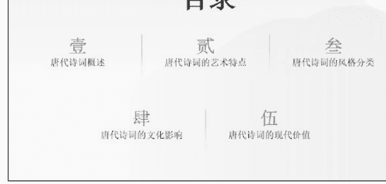

图 7-20 “中国唐代诗词的艺术特色.pptx”的目录页

生成的“中国唐代诗词的艺术特色.pptx”的“诗词的韵律与格律”内容页如图 7-21 所示。

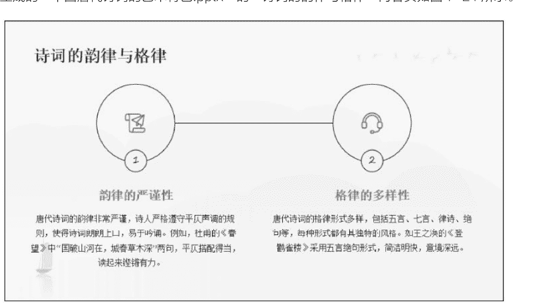

#### 【任务 7-6】WPS AI 多模式 PPT 生成实操
##### 【任务描述】
1. 采用主题生成方式制作景区推介类演示，主题定为“九寨沟的美景”。
2. 采用大纲生成方式制作知识学习类演示，主题定为“蛇年春节古诗词鉴赏”。

##### 【任务实施】
1. 在 WPS 演示中创建空白文件
启动 WPS Office，进入演示模块，新建一个空白演示。

2. 按主题生成演示
（1）在演示界面点开【WPS AI】，依次选择【AI 生成 PPT】-【主题生成 PPT】，如图 7-22 所示。

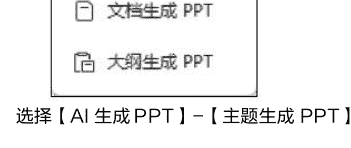

打开【AI 生成 PPT】对话框，如图 7-23 所示。

（2）在输入框填写主题“九寨沟的美景”，点击【开始生成】，系统输出大纲，片段如图 7-24 所示。

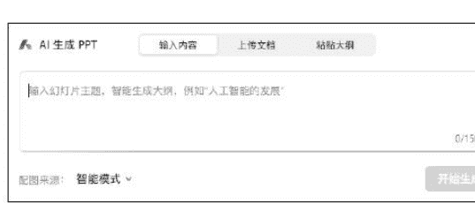

图 7-23 【AI 生成 PPT】对话框

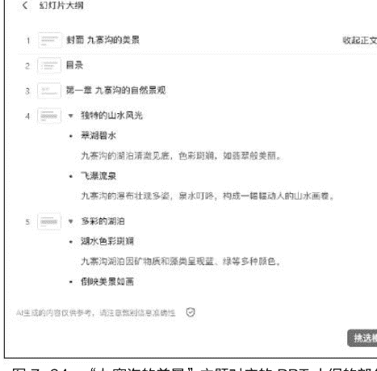

图 7-24 “九寨沟的美景”主题对应的 PPT 大纲的部分内容

（3）在【幻灯片大纲】对话框右下角点【挑选模板】，调出【选择幻灯片模板】对话框，挑选与主题匹配的模板，如图 7-25 所示。

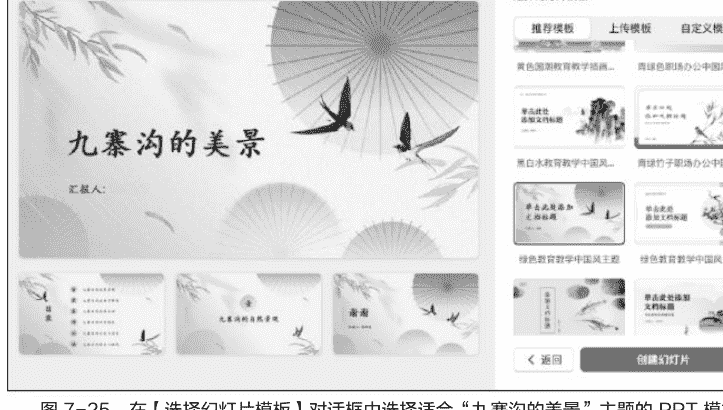

图 7-25 在【选择幻灯片模板】对话框中选择适合“九寨沟的美景”主题的 PPT 模板

（4）在模板选择对话框右下角点【创建幻灯片】，WPS AI 开始自动拼装演示。
（5）在工具栏点击【保存】，在【另存为】对话框中把文件名设为“九寨沟的美景.pptx”，确认保存。

3. 按大纲生成演示
（1）在演示界面点开【WPS AI】，选择【AI 生成 PPT】-【大纲生成 PPT】，打开【AI 生成 PPT】对话框。
（2）主题为“蛇年春节古诗词鉴赏”的大纲内容如下。

```
蛇年春节特色古诗词鉴赏
第 1 章 蛇年寓意与古诗词背景
1.1 蛇年象征意义
1.2 古诗词发展背景
1.3 蛇年春节与古诗词的联系
第 2 章 蛇年春节古诗词鉴赏
2.1 蛇相关的古诗词精选
2.2 蛇相关古诗词解析
2.3 春节习俗与古诗词融合
第 3 章 蛇年春节古诗词文化与教育
3.1 传递正能量与文化内涵
3.2 培养学生对古诗词的兴趣
3.3 蛇年春节古诗词教育活动
第 4 章 蛇年春节古诗词鉴赏方法与技巧
4.1 理解与感受古诗词意境
4.2 鉴赏古诗词中蛇的形象
4.3 春节古诗词中表现手法分析
第 5 章 蛇年春节古诗词朗诵与表演
5.1 朗诵技巧及注意事项
5.2 表演形式选择与创新
5.3 蛇年春节古诗词朗诵与表演安排
第 6 章 蛇年春节古诗词在现代生活中的意义
6.1 传承和弘扬传统文化
6.2 增强民族自豪感和凝聚力
6.3 蛇年春节古诗词在现代社会中的应用
```

在【粘贴大纲】标签页中把上述大纲复制粘贴进输入区，如图 7-26 所示。

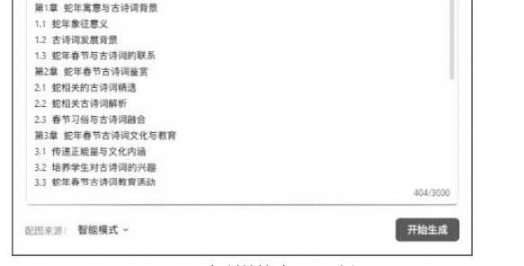

（3）在对话框中点击【开始生成】。
（4）在【幻灯片大纲】对话框右下角点【挑选模板】，打开模板选择窗口，选择合适的样式，如图 7-27 所示。

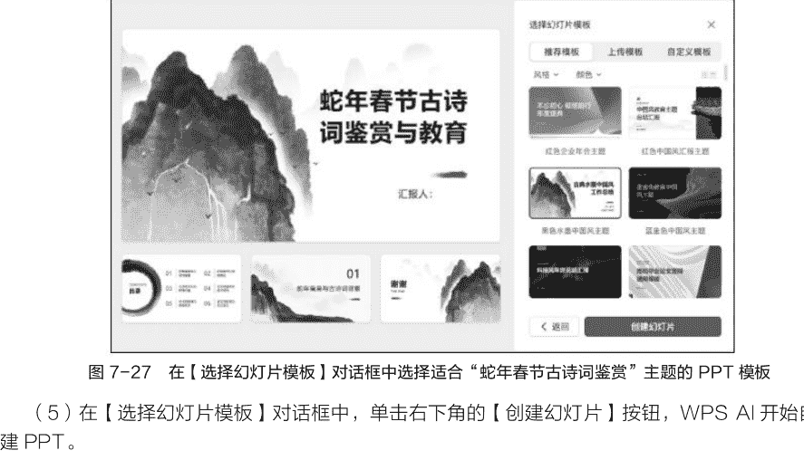

（5）在模板选择窗口右下角点【创建幻灯片】，WPS AI 自动生成演示。
（6）在工具栏点击【保存】，在【另存为】对话框的【文件名】栏输入“蛇年春节古诗词鉴赏与教育.pptx”，点击保存。

#### 【任务 7-7】Kimi 制作左向右思维导图
##### 【任务描述】
利用 Kimi 制作左侧展开的思维导图。
提示词：请你整理一下“鸿蒙智行尊界 S800”汽车的核心卖点，使用 Mermaid 语言生成一张从左往右的思维导图。

##### 【任务实施】
在 Kimi 输入框粘贴提示词后发送，片刻即可得到导图。
扫码打开电子教材电子活页 7-5 在线浏览 Kimi 生成的思维导图，也可自行复现。


#### 【任务 7-8】DeepSeek 生成程序流程图代码
##### 【任务描述】
计算 1×3×5×7×9×11 的步骤为：
S1：1 → t。
S2：3 → i。
S3：t×i → t。
S4：i+2 → i。
S5：若 i≤11，返回 S3；否则，结束。
按上述流程，请 DeepSeek 输出绘制流程图的 Mermaid 代码。

##### 【任务实施】
打开 DeepSeek 首页，输入提示词：
请参照以下步骤，使用 Mermaid 语言生成用于绘制计算 1×3×5×7×9×11 的程序流程图的代码。
S1：1 → t。
S2：3 → i。
S3：t×i → t。
S4：i+2 → i。
S5：若 i≤11，返回 S3；否则，结束。
DeepSeek 给出的 Mermaid 流程图代码如下。

```
graph TD
    A([开始]) --> B["设置 t=1"]
    B --> C["设置 i=3"]
    C --> D["计算 t = t × i"]
    D --> E["i = i + 2"]
    E --> F{i ≤ 11?}
    F -- 是 --> C
    F -- 否 --> G([结束])
```

#### 【任务 7-9】Kimi 多图表绘制
##### 【任务描述】
使用 Kimi 绘制以下几类图表。
1. 流程图
提示词：开始：项目起点。市场调研：研究市场以确定目标用户和需求。是否可行：基于市场调研结果，评估项目是否可行。定义产品愿景和目标：如果项目可行，定义产品愿景和目标。创建原型：基于产品愿景创建 App 的原型。收集用户反馈：收集用户对原型的反馈。开发 MVP：根据反馈开发最小可行产品（Minimum Viable Product，MVP）。测试 MVP：测试 MVP 以收集数据和反馈。分析测试结果：分析 MVP 测试的结果。是否满足预期：判断测试结果是否满足预期。准备发布：如果满足预期，准备发布 App。发布 App：将 App 发布到应用商店。监控和维护：发布后监控 App 的性能并对其进行必要的维护。收集用户反馈：收集用户对 App 的反馈。是否需要迭代：根据用户反馈判断是否需要对 App 进行迭代。项目完成：如果不需要迭代，项目完成。请帮我绘制一张包含以上过程的流程图，使用 Mermaid 语言输出。
2. 相关类的关系图
提示词：使用 Mermaid 的类图功能来绘制一张广告投放相关类的关系图。
3. 时间线图
提示词：帮我绘制一张关于用户增长的时间线图，使用 Mermaid 语言输出。
4. 状态图
提示词：帮我绘制一张权限审批的状态图，使用 Mermaid 语言输出。
5. 实体关系图
提示词：帮我绘制一张电商的实体关系图，使用 Mermaid 语言输出。

##### 【任务实施】
打开 Kimi 首页。
1. 绘制流程图
输入流程图提示词，Kimi 会按要求生成流程图。
2. 绘制相关类的关系图
输入关系图提示词，Kimi 会生成关系图。
3. 绘制时间线图
输入时间线提示词，Kimi 会生成时间线图。
4. 绘制状态图
输入状态图提示词，Kimi 会生成状态图。
5. 绘制实体关系图
输入实体关系图提示词，Kimi 会生成实体关系图。

### 自主学习
#### 【任务 7-10】Kimi+ PPT 助手生成主题演示
##### 【任务描述】
借助 Kimi+ 的“PPT 助手”智能生成主题演示，主题为“黄山的奇松”。

#### 【任务 7-11】通义 PPT 创作生成主题演示
##### 【任务描述】
借助通义的“PPT 创作”功能智能生成主题演示，主题为“AIGC 学习入门指南”。

#### 【任务 7-12】讯飞智文生成主题演示
##### 【任务描述】
借助讯飞智文智能生成主题演示，主题为“新能源汽车营销方案”。

#### 【任务 7-13】豆包绘制小米智能产品思维导图
##### 【任务描述】
使用豆包绘制一张小米核心智能产品类型的思维导图，以 Mermaid 语法输出。

#### 【任务 7-14】讯飞星火绘制程序流程图
##### 【任务描述】
据以下步骤，用讯飞星火绘制程序流程图，统计 2000 年至 2020 年的闰年数量。
S1：2000→year。
S2：若 year 不能被 4 整除，转到 S6。
S3：若 year 能被 4 整除，不能被 100 整除，则(n+1)→n，然后转到 S5。
S4：若 year 能被 100 整除，又能被 400 整除，则(n+1)→n，然后转到 S5。
S5：year+1→year。
S6：当 year≤2020 时，转到 S2，继续执行；当 year>2020 时，转到 S7，算法停止。
S7：输出 2000 年至 2020 年的闰年数 n。
以 Mermaid 语法输出。

## 模块 8 AIGC 助力图像生成与创意设计
AI 绘画借助人工智能算法创造视觉艺术作品，常基于 GAN、变分自编码器 VAE 及 Transformer 等模型。通过学习大量艺术作品的风格与技巧，自动生成兼具创意与美感的图像。用户只需给出简要描述或指定风格，工具即可产出独一无二的画作，既拓宽艺术创作边界，也让没有绘画基础的人轻松产出惊艳作品。

### 知识探析
#### 8.1 常用的图像处理与生成工具简介
目前常用的图像处理与生成工具如表 8-1 所示，这些工具是视觉创意的“魔法师”。

表 8-1 常用的图像处理与生成工具

| 序号 | 名称 |
|---|---|
| 1 | 通义万相 |
| 2 | 即梦 AI |
| 3 | 海艺 AI |
| 4 | WHEE |
| 5 | 堆友 |
| 6 | 无界 AI |
| 7 | 360 智绘 |
| 8 | 360 鸿图 |
| 9 | 万兴爱画 |
| 10 | 奇域 |
| 11 | 简单 AI |
| 12 | ARC |

下面以通义万相、即梦 AI、海艺 AI、WHEE、堆友和无界 AI 为例作简要介绍。

1. 通义万相
通义万相是阿里巴巴推出的 AI 绘画创作大模型，可轻松创作出精美图像。支持文本生成多种风格图像、相似图像创意发散及图像风格迁移，生成速度快。

2. 即梦 AI
即梦 AI 是字节跳动旗下的 AI 图像创作与绘画工具，面向图文与短视频创作者设计，操作简便功能强大，目前支持图像生成、智能画布、视频生成和故事创作。
使用方式很简单，只需在界面输入提示词，如“粉色轿车，极简风格海报，汽车侧视图，胶片质感，低对比度胶片，ins 风格”，点【立即生成】即可快速把创意转为图像。

3. 海艺 AI
海艺 AI 是一款高效易用的 AI 绘画与图像生成工具，无需专业技能，仅输入提示词即可生成高质量图像。结合强渲染引擎与丰富模型库，满足个性化创作需求。
除专业图像生成外，还覆盖游戏、设计、电商、家居等多场景，提供 AI 滤镜、AI 美妆等泛娱乐功能，并打造可互动合作的创意社区。

4. WHEE
WHEE 是美图旗下的 AI 绘画平台，核心功能包括文生图、图生图、创作词库、风格模型等。输入提示词即可生成对应图像，也可导入图像进行多风格转换。此外还提供 AI 修图功能，满足视觉创作需求。

5. 堆友
堆友是阿里巴巴打造的设计师全周期服务平台，除文生图、图生图等 AI 功能外，还提供强大图像编辑能力和“AI 工具箱”。3D 素材丰富可编辑，配备专业 Web UI 与模型训练功能。
以成为设计师“好朋友”为目标，既是提供免费可商用 3D 头像、场景、元素等资源的网站，也是强大的在线编辑器。还提供“AI 反应堆”“AI 工具箱”“AI 助手”等功能，助力设计师、画家、学生等快速生成高质量作品。常用功能有文生图、图生图、海报设计、一键抠图等。

6. 无界 AI
无界 AI 由无界版图推出，专注 AIGC 社区与平台，提供简洁易用、模型丰富的 AI 绘画工具，支持水墨、科幻、神话、油画、古风、国潮、写实、二次元等多种风格。集成提示词搜索、AI 图库、AI 创作等功能，采用区块链技术保障 AI 作品版权。

#### 8.2 常用的创意设计 AI 工具
目前常用创意设计 AI 工具及其说明如表 8-2 所示。

表 8-2 常用的创意设计 AI 工具及其说明

| 序号 | AI 工具名称 | 说明 |
| :--- | :--- | :--- |

| 1 | PostNitro | 专为社媒内容创作者和个人博主打造的 AI 助手，擅长快速产出吸睛封面，适配小红书等平台，输入主题即可自动完成封面视觉 |
| 2 | 稿定 | 拥有大量可商业使用的模板库，覆盖平面与短视频制作，是设计师常用的一站式在线工具 |
| 3 | 墨刀 | 原型编辑与交互能力强，可借助 AI 자동 生成思维导图、流程图及需求文档，协作流畅且团队管理灵活 |
| 4 | 即创 | 提供 AI 视频、图文及直播创作的综合服务 |
| 5 | 美间 | 供给海量免费模板与提案 PPT，适用于软装设计、产品营销、电商物料等场景 |

#### 8.3 图像生成技术的典型应用方向
相关能力已渗透到多个领域：

① 个性化艺术创作：按个人审美定制专属作品，例如人像写实、宠物肖像等。
② 游戏影视视觉搭建：快速产出游戏场景、角色概念与电影分镜草图。
③ 营销与社媒素材制作：为广告创意或社交动态配上吸睛配图，提升内容曝光。
④ 时尚设计探索：借助智能手段挖掘新的设计语言与版式，为时尚行业提供灵感。
⑤ 教育与研究辅助：作为艺术教学和视觉研究的工具，帮助学习者感受不同风格与美术史脉络。
⑥ 室内设计与家居：生成与空间风格匹配的定制画面，为软装提供参考。
⑦ 私人及企业礼品：输出可定制的艺术品作为礼物，满足个人与企业的差异化需求。
⑧ 数字艺术收藏：创造独一无二的数字作品供收藏展示。

#### 8.4 提示词常用的分类方式
提示词可按功能划分为以下类型。

**1. 画质与细节类词**
用于提升成图质量与细节表现，如 “Anatomically Correct”“Super Detail”“Textured Skin”等，可引导模型更注重质感与精细度。

**2. 绘画风格类词**
用于锁定艺术风格，如 “Bauhaus”“Baroque”“Contemporary art”等，让结果快速切换风格语言。

**3. 画面效果类词**
用于调节视觉观感，如 “Motion Blur”“Silhouette”等。

##### 4. 构图与视角类词
用于控制布局与拍摄角度，如 “Golden Ratio Composition”“Bird View”“Fisheye Lens”等，可实现更精准的构图与视觉冲击。

#### 8.5 提示词的核心构成要素
示例文案：奇幻风格的中式山水画卷，连绵壮丽的山脉被皑皑白雪覆盖，山间有潺潺溪流流淌，错落有致的古老建筑点缀其间，光影柔和交错，以蓝色调为主，色彩在山脉上自然过渡，展现出神秘而美丽的景象。

同一描述在不同系统上会有差异，文心一言生成的“奇幻风格的中式山水画卷”如图 8-1 所示。


海艺平台生成的“奇幻风格的中式山水画卷”如图 8-2 所示。


拆解该文案可得到核心构成：

- （1）画面风格与主体
  - ① 壮丽山脉：凸显山势的雄浑。
  - ② 白雪覆盖：突出雪景元素。
  - ③ 奇幻风格：营造梦幻氛围。
  - ④ 中式山水：体现传统山水韵味。
- （2）细节与元素
  - ① 古老建筑：描绘点缀其间的建筑。
  - ② 潺潺溪流：呈现山间流水。
  - ③ 光影柔和交错：强调光线效果。
- （3）色彩与质感
  - ① 以蓝色调为主：明确主色。
  - ② 自然过渡：表现色彩渐变。

#### 8.6 多风格生成提示词的基础框架
不同风格的产出需要对应的框架。

##### 1. 普通场景具象描述提示词的基础框架
- （1）框架 1
  主角描写+场景描写+美术风格+构图与镜头+成像参数。
- （2）框架 2
  参照图片+框架 1。

各要素说明：
- ① 主角描写：人物或物体的外形、动作、神态等，需具体。
- ② 场景描写：场景、天气、氛围、光线等。
- ③ 美术风格：水墨、赛博朋克、水彩等，也可直接点名艺术家如新海诚。
- ④ 构图与镜头：视角、焦段、构图方式，如俯视、35mm、超广角。
- ⑤ 成像参数：尺寸、渲染参数等系统指令。

撰写时先在脑中成像，再用语言转译。
示例：主角描写（探险者，可爱的女孩）+场景描写（在森林中，环绕着花朵）+美术风格+成像参数。
完整示例：可爱的女孩，置身于森林之中，周围环绕着花朵，画面细节精致，呈现出皮克斯风格的流行趋势。这款玩具色彩鲜艳明亮，具有超高质量和精细光泽。采用三维渲染和光线追踪渲染技术，确保了最佳的质量。清晰度达到超高清级别，面部细节清晰可见。

##### 2. 大场景抽象描述提示词的基础框架
框架：故事+场景+情绪+氛围+美术风格+构图与镜头+成像参数。
抽象描述更侧重情绪与氛围的传达。
示例：一个炎热的夏日，一群快乐的人正在公园里嬉戏玩耍。画面采用暖色调，展现全景，拥有高清画质，宛如电影一般，画幅比例为 16 : 9。

##### 3. 真实人物描述提示词的基础框架
示例：20 岁的中国女孩，美艳动人，大眼睛，小嘴巴，高挺的鼻梁，一头黑色长发，佩戴着时尚耳环，身着白色连衣裙，背景为纯白色，采用摄影手法，全景，正面视角，超高清画质，画幅比例为 1：1。

##### 4. 卡通人物描述提示词的基础框架
框架：人物描写+场景描写+卡通风格+成像参数。
示例：三维技术，探索者系列，泡泡玛特的可爱女孩 IP 形象，纯净背景，花朵图案，高细节表现，皮克斯风格的流行趋势，色彩鲜艳的模拟盲盒玩具，超高品质，细腻光泽，三维渲染效果，光线追踪渲染效果，最佳画面质量，面部特写镜头，超精细去油处理，画幅比例为 1：1。

##### 5. 三维模型描述提示词的基础框架
框架：主体描写+三维效果+灯光描写+渲染描写+模型属性。
示例：液压机，白色背景，三维效果，柔光，光线追踪渲染，纵横比为 4：3。

##### 6. 图标类描述提示词的基础框架
框架：应用程序图标+风格+主体。
- ① 三维效果图标示例：应用程序图标，等距三维效果，汽车，参考 Dribble 和 Pinterest，背景简洁，极简风格。
- ② 渐变图标示例：应用程序图标，渐变，汽车，参考 Pinterest 和 Dribbble，简洁背景，极简风格。
- ③ 插画图标示例：应用程序图标，平面设计，汽车，插图设计。
- ④ 扁平风格图标示例：应用程序图标，扁平风格，相机。

##### 7. 扁平插画描述提示词的基础框架
框架：场景描写+整体色调+固定关键词。
示例：春天，渐变背景，绿蓝色调，明亮，晴天，水，广阔的天空，小屋，动物，牧场，草地，山，村庄，广角视角，风景，自然光，平面插图，矢量插图，超高清，画幅比例为 4：3。

#### 8.7 使用文心一言生成画面时如何撰写提示词
与画师沟通类似，用户须用文本描述来指导产出。

##### 1. 提示词的输入方式
支持口语化描述或关键词堆叠。

###### （1）口语化描述
用通俗直白的语言写下想象。
例如生成樱花树下少女图，提示词如下：
一位少女站在樱花树下，她穿着白色连衣裙，头发披散着，眼神温柔而专注，背景中粉色花朵盛开，形成一幅美丽的景象，写实风格。

###### （2）关键词堆叠
将画面拆解为主体词、细节词、风格修饰词再组合。
例如绘制动漫风格美少女半身像：
美丽的少女，萌，半身像，二次元，动漫。


图 8-3 站在樱花树下的少女图

##### 2. 提示词的优化
细节表达越清晰，效果越好。若仅写“月下的美丽少女”，系统难以把握。可通过扩展描写或补充关键词方式优化。

- （1）扩展描写
  示例：一位在月下的美丽少女，她面容精致、面带微笑，穿着国风华服，画作是唯美二次元风格。
- （2）补充关键词
  示例：绝美壁纸，古装少女，月亮夜晚，祥云，古典纹样，月光柔美，花瓣飘落，多彩炫光，浪漫色调，浅粉色，几何构成，丰富细节，唯美二次元。

##### 3. 提示词示例
- （1）动物类
  - 示例 1：月球上的兔子戴着墨镜。
  - 示例 2：在月球上，炫酷机甲兔子戴着墨镜，周围是飞船残骸，高清画质。
- （2）植物类
  - 示例 1：好看的彼岸花。
  - 示例 2：彼岸花，晶莹剔透，梦幻艺术创想。
- （3）场景类
  - 示例 1：新中式风景，超高清，细节刻画。
  - 示例 2：游戏梦幻唯美新中式风景，超高清，细节刻画，沐浴在漫天花瓣里，缥缈电影般的环境，明亮清晰。
- （4）家装设计类
  - 示例 1：超现实主义，房间内饰，潘通色，超高清，三维渲染。
  - 示例 2：创意客厅，高贵蓝色视觉体验，花草，金色的光线，超现实主义，令人难以置信的细节，令人惊叹。

> 说明 示例 1 为待优化的提示词，示例 2 为通过扩展描写或补充关键词方式优化后的提示词。

### 应用实践

#### 【任务 8-1】 对比国产综合型智能工具的文生图表现
##### 【任务描述】
从关键词还原度、画面精细度等维度对比文心一言、豆包、讯飞星火的表现。
提示词 1：生成一张春节氛围浓厚，包含灯笼、春联、福字的图像。
提示词 2：生成一张呈现“墙角数枝梅，凌寒独自开”景象的图像。

##### 【任务实施】
输入提示词 1 后自行对比。
文心一言产出的春节氛围图像如图 8-4 所示。


图 8-4 文心一言产出的春节氛围图像

豆包产出的春节氛围图像如图 8-5 所示。

讯飞星火产出的春节氛围图像如图 8-6 所示，可以发现，讯飞星火产出的图中未包含春联和福字，且图中的文字存在乱码。

输入提示词 2 后对比。
文心一言产出的呈现“墙角数枝梅，凌寒独自开”景象的图像如图 8-7 所示。

豆包产出的呈现“墙角数枝梅，凌寒独自开”景象的图像如图 8-8 所示。


图 8-5 豆包产出的春节氛围图像

图 8-6 讯飞星火产出的春节氛围图像


图 8-7 文心一言产出的呈现“墙角数枝梅，凌寒独自开”景象的图像

图 8-8 豆包产出的呈现“墙角数枝梅，凌寒独自开”景象的图像

讯飞星火产出的呈现“墙角数枝梅，凌寒独自开”景象的图像如图 8-9 所示，可以发现，讯飞星火未能对提示词中的“墙角”指令做出反应。


图 8-9 讯飞星火产出的呈现“墙角数枝梅，凌寒独自开”景象的图像

#### 【任务 8-2】 对比国产主流智能绘画工具的文生图表现
##### 【任务描述】
从画面风格丰富性、逼真度等方面对比即梦 AI、海艺 AI、WHEE 的表现。
提示词 1：生成人像，一个美丽的中国女孩，画幅比例为 9：16，其他参数值均为基础默认值。
提示词 2：生成猫咪图像，一只可爱的猫咪，画幅比例为 4：3，其他参数值均为基础默认值。

##### 【任务实施】
“尺有所短，寸有所长。”每个工具各有优劣，请读者据实判断后选择合适的工具。

即梦 AI 产出的人像如图 8-10 所示。

海艺 AI 产出的人像如图 8-11 所示。


WHEE 产出的人像如图 8-12 所示。

即梦 AI 产出的猫咪图像如图 8-13 所示。


海艺 AI 产出的猫咪图像如图 8-14 所示。

WHEE 产出的猫咪图像如图 8-15 所示。


#### 【任务 8-3】 对比文心一言与豆包产出的画面
##### 【任务描述】
分别在文心一言、豆包中使用以下提示词生成对应的图像。
蓝色山峰，雪景，古代建筑，河流，夜晚，中国风，华丽，细节，幻想艺术，唯美。

##### 【任务实施】
同一提示词在不同工具下表现不同。

文心一言产出的图像如图 8-16 所示。


豆包产出的图像如图 8-17 所示。


#### 【任务 8-4】使用通义万相的“文字作画”
##### 【任务描述】
掌握通义万相智能作画的基本方法，使用“文字作画”完成多幅产出任务。
- 1. 以平视视角画一群羊
- 2. 画雨后的城市街景
- 3. 画早晨的阳光
- 4. 画夜晚的河边

##### 【任务实施】
###### 1. 熟悉使用通义万相实现智能作画的基本方法
通义万相支持中英文输入，提供结构化预设提示词，涵盖风格、光线、材质、渲染、色彩、构图、视角等，可快速上手并复用。还提供四格漫画、情侣头像、图标印花、电影分镜等创意模板，支持 1：1、16：9、9：16、4：3、3：4 等多种比例。

操作步骤：打开通义万相首页，单击【文字作画】，进入参数设置界面如图 8-18 所示，输入提示词，选择合适的模板与比例，单击【生成画作】即可。

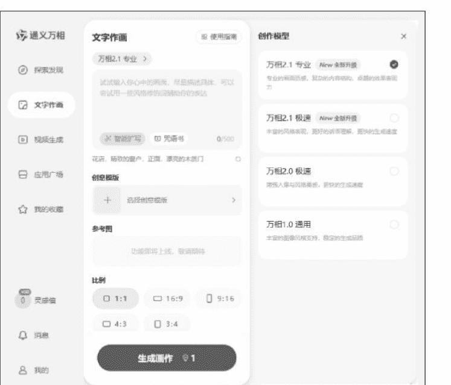

图 8-18 通义万相的“文字作画”参数设置界面

###### 2. 完成智能作画任务
- (1) 以平视视角画一群羊
  输入提示词：一群羊悠闲地在绿茵茵的草地上低头觅食，它们的羊毛在早晨微弱的阳光照耀下呈现出温暖的金色光泽，形成美丽的光影效果；画幅比例为 16 : 9。
  其他参数保持默认值。
  通义万相产出的一群羊的图像如图 8-19 所示。


- (2) 画雨后的城市街景
  输入提示词：雨后的城市街景，湿润的地面上呈现出霓虹灯光绚丽多彩的光芒；行人撑伞匆匆走过，车辆在光怪陆离的街道上缓缓行驶，留下一道道彩色的尾迹；画幅比例为 16 : 9。
  其他参数保持默认值。
  通义万相产出的雨后的城市街景图像如图 8-20 所示。


- (3) 画早晨的阳光

# AIGC 视觉·音视频实战攻略

提示词写成：早晨的阳光洒在一片茂密森林的地面上，金色的光芒穿过树与树之间的缝隙，形成斑驳的光影，营造出一种写实而静谧的氛围；画面比例为 3：4。

其余设置一律保持默认。

通义万相依据该描述渲染出的清晨林地画面见图 8-21。

- (4) 画夜晚的河边

输入的描述语句为：夜晚的河边，月光温柔地照亮了水面，一盏盏莲花灯缓缓漂向河心，灯光与水面上的粼粼波光相互辉映，营造出梦幻般的视觉效果；画面比例为 1：1。

其余设置仍用默认。

通义万相据此输出的夜色河畔画面见图 8-22。


#### 【任务 8-5】使用海艺 AI 的“图生图”生成图像

##### 【任务描述】

在海艺 AI 中引用图 8-23 所示的参考图，制作一张风格相近的新图。


##### 【任务实施】

进入海艺 AI 首页，左侧工具栏点选【图生图】，将参考素材上传。随后点击参考图下方的【智能分析】，系统会推导出一段文字描述，经少量修改后为：有一匹马在湖边低头吃草，远处是连绵的青山和雪山。

海艺 AI 产出的效果图见图 8-24。


图 8-24 使用海艺 AI 生成的图像

#### 【任务 8-6】使用即梦 AI 绘制文案配图

##### 【任务描述】

借助即梦 AI 输入描述词，完成一次配图制作。

##### 【任务实施】

输入以下描述词。

请根据以下文本内容绘制一张图像，要求画面整体突出，色彩搭配和整体氛围贴合主题：阳光由那扇大玻璃窗透入屋内，先落在墙上，接着映照到桌上，最终，也照到了我那张可爱的小床上。风格是水彩，画面内是阳光从大玻璃窗照进房间内，照在墙面上、地板上、桌子上、床上。画面比例设置为 4：3。

即梦 AI 绘制的文案配图见图 8-25。


图 8-25 即梦 AI 绘制的文案配图

#### 【任务 8-7】 使用海艺 AI 绘制商品图

##### 【任务描述】

利用海艺 AI 绘制一幅新品易拉罐橙子汽水饮料的商品图。

##### 【任务实施】

输入描述词：请帮我绘制一幅新品易拉罐橙子汽水饮料的商品图，写实风格，画面是水面上有一罐易拉罐饮料，周围有橙子作为装饰，画面整体展现出清凉爽快的感觉；画面比例设置为 1 : 1。

海艺 AI 绘制的商品图见图 8-26。


图 8-26 使用海艺 AI 绘制的商品图

### 自主学习

#### 【任务 8-8】 使用豆包生成图像

##### 【任务描述】

调用豆包生成图像，描述词如下。

帮我生成图像：在绿色的草原上，一头牛在可爱和露营风格的环境中安静地吃草，天蓝色和绿色，浅红色和绿色的色调，淡雅的绘画风格，深橙色和白色相互交织，营造出宁静的氛围；画面比例设置为 9 : 16。

#### 【任务 8-9】 使用即梦 AI 生成图像

##### 【任务描述】

调用即梦 AI 生成图像，描述词如下。帮我生成图像：清澈的泉水悄无声息地流淌，阳光透过岸边的树木，投下斑驳的光影，映照在水面上，与晴朗柔和的阳光交织成一幅和谐的画面；小荷叶刚从水面露出嫩绿的尖角，犹如初生的婴儿般娇嫩可爱；一只蜻蜓早早地停驻在荷叶之上，轻盈的身躯与尖尖的荷叶形成鲜明对比，展现出大自然的生机与活力；整幅画面充满了生命的韵律和诗意，令人感受到夏日清晨的清新与宁静，画面比例设置为4：3。

#### 【任务 8-10】使用 360 智绘的“图生图”生成一张图像

##### 【任务描述】

在 360 智绘中，引用图 8-27 所示的图像，使用“图生图”生成一张类似的图像。

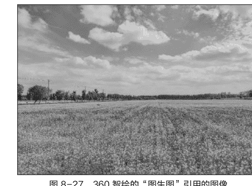

#### 【任务 8-11】使用无界 AI 生成图像

##### 【任务描述】

使用无界 AI 生成一张图像，描述词如下。

一位年轻女子穿着一条裙子，站在海边，背对着镜头，凝视着地平线上的夕阳。太阳似乎快要沉入海面，一片金黄色的光芒在海面上弥漫，照亮了整片海洋，仿佛这个时刻被定格在了时间的某个角落里。女子的头发随着微风轻轻飘动，她的轮廓被余晖映照得柔和且温暖。她仿佛在思考着生命的意义和无尽的未来。

画面比例及其他参数自行确定即可。

#### 【任务 8-12】使用腾讯元宝生成“城市景观”插画

##### 【任务描述】

使用腾讯元宝生成“城市景观”插画。

描述词：生成一张未来城市的夜景插画，包含摩天大楼、霓虹灯和飞行汽车等元素。

#### 【任务 8-13】对比国产综合型 AI 工具绘制装修设计图效果

##### 【任务描述】

从关键词还原程度、画面精细表现力等方面，对文心一言、豆包、讯飞星火、智谱清言、天工 AI、腾讯元宝等国产综合型 AI 工具绘制装修设计图的效果进行对比。

描述词：请为我设计一间卧室，现代建筑，写实，黏土材料，等距，3D 渲染，有光泽，柔和的色彩，暖色调，白色背景，最佳细节，高分辨率。

### 模块9

AIGC 正重塑音视频制作与动画创作的流程，依托深度学习、自然语言处理等技术，能够产出高质量的音视频和动画。AIGC 在音视频生成和动画制作方面的应用，正在改变内容生产的路径，为各行业带来更多可能。

AIGC 可解析文本、旋律或语音数据，制作多样化的音频内容；在视频层面，能基于文本、图像或其他视频源创作出新视频；还能把音视频融合，输出更丰富的多媒体成果。

### 知识探析

#### 9.1 常用的音乐创作与音频处理 AI 工具简介

目前常见的音乐创作与音频处理智能工具如表 9-1 所示。

表 9-1 常用的音乐创作与音频处理 AI 工具

| 序号 | 名称 |
| :--- | :--- |
| 1 | 天工 AI |
| 2 | 即梦 AI |
| 3 | 海绵音乐 |
| 4 | 海螺 AI |
| 5 | 网易天音 |
| 6 | 讯飞智作 |
| 7 | 度加剪辑 |
| 8 | 魔音工坊 |
| 9 | TME Studio |

下面以海绵音乐、网易天音、讯飞智作、度加剪辑及 TME Studio 为例，简要介绍其情况。

1. 海绵音乐

海绵音乐是字节跳动推出的 AI 音乐创作平台，聚焦个性化音乐制作，尤擅中文歌曲创作，用户可通过输入灵感关键词和自定义选项快速得到音乐。

2. 网易天音

网易天音由网易云音乐推出，是面向大众的 AI 音乐创作工具，无需专业音乐知识即可上手，可帮助音乐爱好者和歌手完成作词、作曲、编曲、演唱的全流程，产出高质量的 AI 音频初稿。

3. 讯飞智作

讯飞智作由科大讯飞推出，是一站式智能配音服务平台，提供合成配音、真人配音及虚拟主播等配音方案，帮助内容生产者更高效地进行音视频创作，使创作过程更快、更省时、更具特色。用户只需简单输入文本、选择发音人或虚拟形象，即可完成音视频制作。

4. 度加剪辑

度加剪辑由百度推出的一款 AI 创作工具，特色鲜明、实用性强，提供热搜一键成稿、文稿一键成片的功能，是内容创作者的好帮手。对于自媒体创作者来说，度加剪辑非常值得尝试。它支持网页使用和 App 下载使用。

5. TME Studio

TME Studio 是由腾讯音乐推出的 AI 音乐生成工具，由银河音效、MUSE、天琴实验室和腾讯 AI Lab 联合打造，旨在简化音乐创作流程，助力音乐爱好者轻松创作，提供音乐创作和编辑功能。

#### 9.2 常用的视频创作 AI 工具简介

常用的视频创作智能工具如表 9-2 所示。

表 9-2 常用的视频创作 AI 工具

| 序号 | 名称 |
| :--- | :--- |
| 1 | 可灵 AI |
| 2 | 即梦 AI |
| 3 | 清影 |
| 4 | 通义万相 |
| 5 | 海螺 AI |
| 6 | Vidu |
| 7 | WHEE |
| 8 | 白日梦 |
| 9 | 讯飞绘镜 |
| 10 | 腾讯智影 |
| 11 | 即创 |
| 12 | runway |

下面以可灵 AI、即梦 AI、清影、海螺 AI、Vidu 和 WHEE 为例，简要介绍其情况。

##### 1. 可灵 AI

可灵 AI 由快手大模型团队基于自研的可灵大模型开发，具备文生视频、图生视频、视频续写、运镜控制、首尾帧生成等多种功能，使用户可以轻松、高效地完成艺术视频创作。

其核心优势在于视频长度和细节处理能力，擅长将文本与图像转化为生动的视频。用户只需输入文字描述或上传相关图像，可灵 AI 便能智能解析内容，运用丰富的视频模板和动画效果，自动生成富有情感的视频故事。

可灵 AI 具有强大的视频生成能力，支持生成长达 3min、分辨率为 1080P 的高清视频，并支持自由调整宽高比。

##### 2. 即梦 AI

字节跳动旗下的即梦 AI 是一款基于文本与图像智能生成视频的工具，它利用先进的自然语言处理技术和图像识别算法，能够准确理解用户输入的文本描述，并结合用户上传的图像素材，自动生成一系列连贯、有趣的视频场景。

即梦 AI 是一款具有强大视频生成功能的 AI 工具，它可以根据用户提供的图像、提示词和各种参数设置生成高质量的视频。即梦 AI 擅长捕捉图像中的情感色彩，结合文本的情感导向，创作出既有故事性又富有感染力的视频作品。

##### 3. 清影

清影是由智谱推出的 AI 视频生成工具，用户只需输入文本或图像，该工具即可在 30s 内生成 6s 的视频，适用于个人创作和企业创作，支持多种风格的视频生成。

##### 4. 海螺 AI

海螺 AI 作为一款智能化的短视频创作工具，凭借其强大的自然语言处理与视频生成能力，正在为广告商、教育机构等提供高效的视频创作解决方案。通过简单的文本输入，用户可以轻松制作出高质量的视频，大大降低了视频创作的门槛，提高了视频创作效率。无论是在广告营销、社交媒体内容创作方面，还是在教育培训视频制作中，海螺 AI 都展现出了巨大的应用潜力。

##### 5. Vidu

Vidu 是一款国产 AI 视频生成工具，为用户提供快速、高效且易用的视频创作体验。它支持多主体、参考生视频、文生视频、图生视频等功能。Vidu 采用原创的 U-ViT 架构，结合了 Diffusion 与 Transformer 技术，能够生成长度为 4s 和 8s、分辨率为 720P 和 1080P 的视频内容。

##### 6. WHEE

WHEE 是由美图推出的一款 AI 视觉创作工具，提供文生视频、图生视频、文生图、图生图、画面拓展及局部修改等功能。用户可以通过输入文字或上传图像生成与之相匹配的视频，用户还可以根据需求对视频进行智能剪辑和编辑。

#### 9.3 常用的文本转语音 AI 工具

目前，常用的文本转语音智能工具如表 9-3 所示。

表 9-3 常用的文本转语音 AI 工具

| 序号 | 名称 |
| :--- | :--- |
| 1 | 魔音工坊 |
| 2 | 海豚 AI |
| 3 | TextToSpeech |
| 4 | TTSMaker |
| 5 | Voicemaker |
| 6 | LOVO AI |

#### 9.4 AIGC 生成视频的提示词需要包含的关键信息

AIGC 制作视频的提示词需要包含以下关键信息。

##### 1. 主要角色和任务

明确视频中的主要角色，以及角色的能力和需要完成的任务。例如，如果想要生成的视频是一个新闻视频，提示词可以为“制作一个关于华为公司最新产品的新闻视频，包括产品的主要功能、市场反应和预期销量”。

##### 2. 内容制作技巧

描述视频的内容制作技巧，如使用感官语言、提供数据和事实、设立冲突或疑问等。例如，提示词可以要求提供引人入胜的开头、生动描述细节、使用情感词语等。

##### 3. 平台适应能力

考虑视频将在哪个平台上发布，确保视频适应该平台的规范和用户群体。例如，如果视频将在抖音发布，提示词可以包括吸引眼球的标题和简短的介绍。

##### 4. 情感共鸣能力

通过情感共鸣来吸引观众。例如，提示词可以要求描述一个感人的故事或展示一个角色的内心世界，以引起观众的共鸣。

##### 5. 技术应用能力

描述视频中使用的技术或特效，确保 AI 能够理解并正确应用这些技术和特效。例如，如果视频中包含动画效果，提示词中应明确指出需要使用哪些动画技术。

#### 9.5 AIGC 生成视频时撰写高质量提示词的技巧

在 AI 视频生成中，提示词是直接描述或引导视频生成的文本或指令，用于描述用户想创作的画面内容、运动方式等，类似给 AI 的提示。提示词内容应包括主体对象、外观描述、运行方式等方面的信息，用户借此控制和指导 AI 生成内容。提示词在 AI 视频生成中十分重要，是表达用户需求的方式，影响着视频内容和质量。

##### 1. AIGC 生成视频时撰写高质量提示词的基本技巧

AIGC 生成视频的提示词生成视频的关键，更精确的提示词可以更好地控制视频的生成效果。撰写高质量提示词的基本技巧如下。

① 精准描述：提示词应尽可能详细和具体，避免使用模糊不清的指令。例如，不要只说“创建一个故事”，而是说“创建一个关于一只名叫波比的狗拯救小镇的儿童故事，包含冒险和友谊的元素”。

② 结构清晰：提示词的结构应清晰，可以先描述背景信息，然后描述主要任务和目标，最后描述具体的要求和细节。

③ 情感表达：在提示词中融入情感元素，使系统能够生成更具感染力的内容。例如，可以描述角色的情感变化或故事的情感高潮。

通过以上技巧，用户可以有效地编写出高质量的生成视频的提示词，确保生成的视频内容符合预期并具有吸引力。

##### 2. AIGC 生成视频时撰写高质量提示词的高级技巧

撰写高质量提示词的高级技巧如下。

① 使用简单词语和句子结构，避免使用过于复杂的语言。

② 描述运动时符合物理规律，尽量描述图像中可能发生的运动。

③ 描述与图像相差较大可能会引起镜头切换，需要注意描述的准确性。

④ 现阶段较难生成复杂的物理运动，如球类的弹跳、高空抛物等。

通过掌握这些撰写提示词的技巧，读者可以更好地利用 AIGC 工具生成符合预期的视频。

应用以上技巧撰写的提示词，可以总结为以下两种形式。

（1）基础版提示词：主体+场景+运动。

例如，“一个女孩在雨中撑伞漫步”，其中“女孩”是主体，“雨中”是场景，“撑伞漫步”是运动。

这种提示词简单易写，能够激发 AI 工具的创意表现力。

（2）专业版提示词：主体+场景+主体运动+镜头运动+氛围。

例如，“两个好朋友坐在公园长椅上交谈，镜头固定，画面色调偏暖，氛围温馨”，这种提示词不仅描述了主体、场景和主体运动，还加入了镜头运动和氛围，能够使 AI 工具生成更符合预期的视频。

#### 9.6 使用即梦 AI 创作视频时如何撰写提示词

1. 提示词公式

提示词公式：主体对象+外观描述+运行方式。

2. 撰写生成视频的提示词的基本原则

撰写生成视频的提示词的基本原则如下。

（1）简洁明了

提示词应该简洁明了，避免使用复杂语言，如古诗词、抽象描述、长难句等都属于复杂语言。尽量使用简单的词语和句子结构，以确保 AI 可以正确理解提示词。

（2）具体翔实

提示词应该尽可能具体翔实，提供足够的细节，但需要将细节描述得清楚、简单、易于理解，例如，如果生成时长为 5s 的视频，应该在提示词中说明 5s 内可以实现的画面指令，AI 可能不能完全覆盖太长的画面指令。

（3）突出主体及其运动形态

提示词应该突出主体及其运动形态，让 AI 知道用户想要表达的核心内容。例如，如果想要生成一个关于“直升机在空中飞”的视频，可以提供具体的直升机外观、飞行方式、背景等信息，这样可以帮助 AI 生成更加符合需求的视频，同时降低试错成本。

（4）自然语言描述

可以使用自然语言描述提示词，同时应该避免提示词具有歧义，确保 AI 可以正确理解用户的意图。

（5）多角度描述

提示词应该从多个角度描述用户的需求，这样可以指导 AI 生成更加全面的视频。例如，如果想要生成一个关于“狗”的视频，可以提供狗的品种、外貌、行为等信息。

（6）加入少量的情感元素

提示词中可以加入少量的情感元素，让 AI 生成更加生动和符合情绪预期的视频。例如，可以在提示词中加入“快乐”“悲伤”“兴奋”等情感词语。

3. 提示词示例

提示词 1：海浪拍打着沙滩，粉色的月亮在天空中缓缓升起。

提示词 2：一个 3D 形象的小男孩，穿着飞行夹克，在公园滑滑板。

提示词 3：戴着帽子的老人双手捧着一块冰，微风吹动老人的胡子。

提示词 4：一只白色的拉布拉多在湖中慢慢地游泳。

提示词 5：薄荷绿的海浪拍打着金色的沙滩，在海岸边微风吹动棕榈树的叶子，手绘风格，漫画。

提示词 6：一只可爱的小花猫静静地趴在粉色透明花瓶旁，背景是淡黄色的窗帘，微风吹动窗帘。

提示词 7：一只 3D 卡通小狗，慢慢地向前走远。

提示词 8：亚洲卷发女孩忧郁地看着镜头，风吹动她的头发。

提示词 9：一架直升机在空中飞行，背景是雪山和云层。

提示词 10：一位中国古代的男性抬头望着月亮，男人背对着镜头，忧愁的氛围，夜晚。

提示词 11：一只白色萨摩耶在公路上向前奔跑，背景是公路和公路两旁的树木。

提示词 12：一个金色头发的亚洲女性坐在红色的沙发上，背景是白色花卉壁纸。

#### 9.7 通过提示词示例说明可灵 AI 生成视频的特色

体现可灵 AI 生成视频的特色的提示词如下。

##### 1. 大幅度的合理运动

可灵 AI 采用 3D 时空联合注意力机制，能够更好地建模复杂时空运动，生成展现较大幅度运动的视频内容，同时能够保证运动符合物理规律。

提示词示例如下。

提示词 1：一辆拉力赛车在赛道上快速转弯。

提示词 2：一个男人骑着马在戈壁沙漠飞奔，背后是美丽的夕阳，电影级别画面。

提示词 3：宇航员于月面疾行，低角度取景勾勒出辽阔的月球景致，动作连贯且轻盈。

##### 2. 两分钟级长视频产出
依托高效的训练底座、推理环节的极致调优以及弹性可扩的基础设施，可灵 AI 能产出约两分钟的成片。

提示词示例如下。
提示词 1：小女孩乘坐火车，透过车窗欣赏各式各样的风景。视频时长 2min 左右。
提示词 2：小男孩在花园里骑自行车经历秋、冬、春、夏四季变换。视频时长 2min 左右。

##### 3. 还原真实物理特性
基于自研模型架构与 Scaling Law 激发出的强建模能力，可灵 AI 可模拟现实物理规律，输出符合物理逻辑的影像。

提示词示例如下。
提示词 1：一个中国男人坐在桌前，用筷子吃面条。
提示词 2：厨师在厨房切洋葱，为炒菜做准备。
提示词 3：一个戴眼镜的中国男孩在快餐店内闭眼享受美味的芝士汉堡。
提示词 4：一只手小心地将牛奶倒入杯中，奶流平缓，杯子渐渐被牛奶填满。

##### 4. 概念融合能力突出
凭借对文生视频语义的深入理解和 Diffusion-Transformer 架构的强表现，可灵 AI 能将用户丰富想象转化为具体画面，呈现现实中难以出现的场景。

提示词示例如下。
提示词 1：微距镜头，火山在一个咖啡杯中喷发。
提示词 2：一个积木小人在美术馆里参观。
提示词 3：一只白猫驾驶车辆，穿过繁忙的市区街道，背景是高楼和行人。

##### 5. 电影级画质输出
得益于自研 3D VAE，可灵 AI 可输出最高 1080P 的电影级影像，无论是宏大场面还是细腻特写，都能生动呈现。

提示词示例如下。
提示词 1：落日余晖下的烟囱。
提示词 2：露水在蓝色玫瑰花瓣上，高清，近景，细节。
提示词 3：一对男女手牵手在星空下行走，背景斗转星移。

##### 6. 自由切换视频宽高比
可灵 AI 采用可变分辨率训练策略，生成时可将同一内容输出为不同宽高比的多版本，满足多样化素材需求。

提示词示例：一只戴着太阳镜的柯基在热带岛屿的海滩上漫步。

#### 9.8 Vidu 图生视频操作
图生视频即把静态图像转为动态影像。操作步骤如下。
1. 打开 Vidu 首页，点击左侧的【图生视频】按钮，或在右侧【图生视频】区点击【创作】按钮。
2. 上传一张主图用于生成，可按需再上传一张尾帧图像。
3. 结合图像输入提示词，描述期望的内容。
4. 在【设置】区分别设定时长、清晰度、运动幅度、数量等参数。
5. 点击【创作】按钮，等待影像生成。

#### 9.9 AI 工具提升动画制作效率
借助人工智能可覆盖前期策划、中期制作到后期渲染多个环节，具体如下。
1. 前期策划
（1）创意启发：利用豆包、Kimi、ChatGPT 等工具输入主题或关键词，获取灵感、故事框架、角色设定等建议，为动画提供基础思路。
（2）剧本生成：部分工具可依据情节梗概、角色信息生成初稿，用户据此修改完善，加快创作进程。
（3）分镜草图：借助 AI 绘画工具输入文字描述，快速生成分镜草图，确定画面构图与情节顺序，帮助理解故事与制作方向。
2. 中期制作
（1）角色与场景设计
① 形象与场景生成：Midjourney、Stable Diffusion 等绘画工具可按文字描述生成各风格角色与场景概念图，调整参数可得到不同角度、表情、动作的变体，为美术提供素材。
② 材质与纹理：部分工具可快速创建木材、金属、布料等纹理，应用到模型可节省手工绘制时间。
（2）动画制作
① 关键帧生成：部分动画工具可依据动作描述或关键姿态生成关键帧，再结合传统软件补充中间帧与细节，提升效率。
② 动作捕捉与驱动：利用 AI 动作捕捉技术，通过摄像头或传感器采集真实人物动作并映射到角色，使动作更自然流畅。
③ 智能绑定与权重分配：部分工具可自动识别角色模型的骨骼结构与关节点，进行快速智能绑定并分配权重，大幅缩短绑定时间。
（3）音频制作
① 语音合成：使用具备语音合成功能的工具，输入文本即可生成不同音色风格的语音，并可调节语速、语调等参数，满足对话与旁白需求。
② 音乐与音效生成：具备音频生成能力的工具可按风格与情感需求快速生成背景音乐，AI 音效库亦可帮助快速查找筛选合适音效。
3. 后期制作
- （1）渲染加速：部分渲染农场利用 AI 技术进行渲染优化，通过智能算法预测与优化流程，减少渲染时间。
- （2）特效制作：部分工具可快速生成火焰、烟雾、水流等复杂特效，用户输入参数与指令即可得到逼真效果，降低难度与成本。
- （3）质量检测与修复：部分工具可自动检测画面瑕疵、逻辑错误等问题，并提供修复建议或自动修复，提升整体质量与效率。

#### 9.10 常用动画 AI 工具盘点
##### 1. 文生视频类
常用工具包括可灵 AI、即梦 AI 和通义万相等，前文已介绍，此处不赘述。
##### 2. 综合创作类
- （1）MOKI：美图推出的 AI 短片创作工具，集成视频生成模型与完整制作流程。输入故事主题或梗概即可自动生成完整故事与分镜脚本，提供多种风格，支持角色自动生成与重绘、唇形驱动等功能。
- （2）巨日禄：AI 短片创作工具，适用于小说推文短剧制作。支持多种风格，可将长篇故事拆分为多集并保持角色形象一致，支持输入分集内容自动生成脚本分镜。
- （3）万兴喵影：万兴科技推出的 AI 视频编辑软件，提供多种编辑模式，具备动画、叠加、音频控制等高级功能，支持屏幕录制及多种格式导入导出。
##### 3. 图像动画类
- （1）Krea AI：可将静态图像转为动态动画，界面简洁易用，能提升视频质量。
- （2）LivePortrait：利用唇同步与面部运动映射，在动画中创建逼真的会说话角色，支持音频集成、角色动作定制及多种视频格式，适用于教育与营销类动画。
##### 4. 其他
- （1）神笔马良：面向长剧本解析的动态故事板 AI 影视创作生成工具，可将剧本自动转为动态故事板，为影视动画创作提供便利。
- （2）neural frames：基于先进 AI 大模型 Stable Diffusion，可通过提示词制作动画与音乐视频，支持精确控制动画，具有实时预览、灵活镜头控制与音频反应等功能。

#### 9.11 Kimi 制作动画流程
借助 Kimi 制作动画需配合其他工具，具体流程如下。
1. 打开 Kimi：访问 Kimi 官网，打开平台。
2. 构思故事情节：输入清晰准确的提示词，明确角色、背景、主题、情节走向、教育意义等要素，借助 Kimi 生成故事文本。
3. 生成剧本和分镜脚本：基于生成的故事文本，进一步让 Kimi 细化为剧本与分镜脚本，明确每个场景的画面描述、角色动作、对话等。
4. 选择配合工具生成画面或图像：将分镜脚本导入如 MOKI 等 AI 绘图或动画制作工具，选择合适风格、角色形象、场景等，让工具依据脚本生成画面。
5. 制作动画视频：若使用 MOKI 生成画面，生成后可直接生成视频，进入编辑界面选择配乐、运镜等，添加人物运动方式或景效。
6. 剪辑与后期制作：使用剪映等剪辑软件对视频进行剪辑，添加字幕、调整音频等，使作品更完整流畅。

### 应用实践
#### 【任务 9-1】天工 AI 创作歌曲
##### 【任务描述】
使用天工 AI 创作一首歌曲，歌名为“忆青春”，歌词如下。
> 在操场上的日子 夕阳西下
金色光芒洒在我们的肩
从懵懂的步伐 到勇敢的瞬间
每一件小事 都刻在心间
回忆青春的那天
快乐悲伤全在身边
离别是新的起点
希望未来更美好展现
每次紧张考试 夜晚一起奋斗
友谊的瞬间 如星光璀璨
从初入校园到毕业的时刻
那些回忆 随风在飘散
回忆青春的那天
快乐悲伤全在身边
离别是新的起点
希望未来更美好展现
曾经的我们 共同走过的线
将这份情感 永远深藏心间
回忆青春的那天
快乐悲伤全在身边
离别是新的起点
希望未来更美好展现
##### 【任务实施】
1. 打开天工 AI 主页。
2. 点击左侧工具栏中的【AI 音乐】，显示【发现音乐】选项卡和【创作歌曲】侧边栏。
3. 在【创作歌曲】侧边栏的【歌名】输入框中输入“忆青春”，然后在【歌词】输入框中输入对应歌词，如图 9-1 所示。
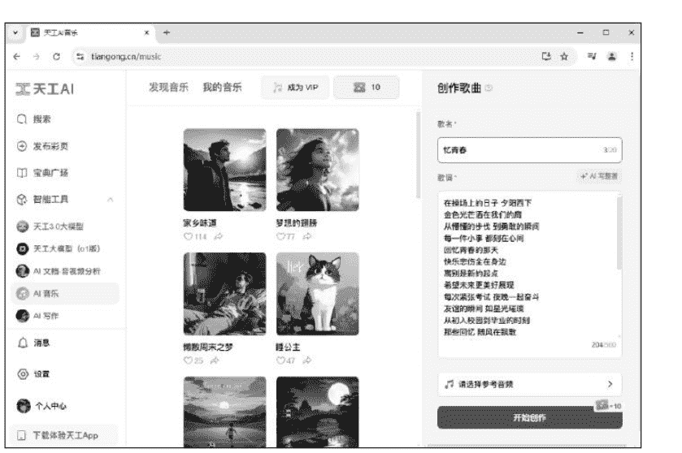
4. 点击【开始创作】按钮，等待歌曲生成。生成的《忆青春》歌曲如图 9-2 所示。

5. 试听创作的歌曲。在生成的《忆青春》歌曲区域，点击歌曲图标中的【播放】按钮即可试听。

#### 【任务 9-2】网易天音创作歌曲
##### 【任务描述】
使用网易天音创作一首歌曲，歌名为“青春的足迹”，创作歌词时的随笔灵感内容如下：
> 夕阳渐渐西沉在操场
橘黄色光洒在每个角落
回首这四年时光如梦
从懵懂到坚定每一步
这是青春留下的足迹
课堂争论宿舍谈天笑语
欢声笑语心底的印记
带着感激和无尽憧憬
走过操场这里曾有欢笑
课堂上争论那时的梦想
仿佛昨日一切都在眼前
未来的路我们坚定向前
手持笔尖写下无尽怀念
带着感激对未来的期盼
这首歌送给即将踏新程的我们
愿风中传递最温柔记忆
青春的足迹在风中飘荡
成为岁月里最温柔的记忆
##### 【任务实施】
1. 打开网易天音首页，如图 9-3 所示。

2. 点击【开始创作】按钮，在进入的页面中点击【AI 一键写歌】区域中的【开始创作】按钮，打开【新建歌曲】对话框，切换到【写随笔灵感】选项卡。
3. 在输入框中输入对应的随笔灵感，如图 9-4 所示。
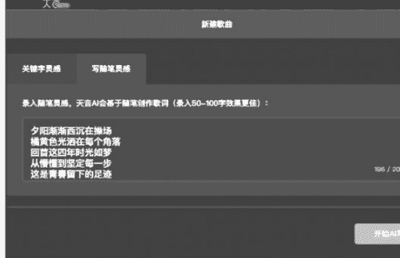
4. 段落结构选择【全曲模式】，音乐类型选择【流行】，如图 9-5 所示。
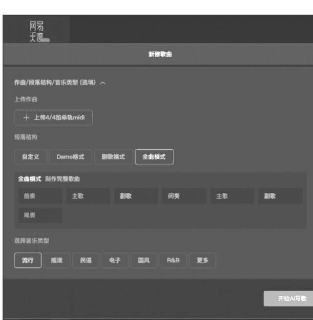
5. 点击【开始 AI 写歌】按钮，对话框中显示“歌曲内容正在由 AI 生成”，歌曲生成后，会自动打开歌曲编辑页面，如图 9-6 所示。
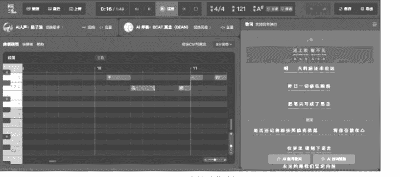
网易天音自动创作的歌词如下：
> 闭上眼看不见
明天的路还未走远
昨日一切都在眼前
把笔尖写成了思念
是否还记得那张笑脸
我依然将你存放在心
在梦里，镌刻下诺言
未来的路我们坚定向前
笔尖写满无尽眷恋
就要迈向新的起点
时光足迹在风里面传送出最温柔的纪念
岁月里从不曾改变
生命中最温柔的记忆
6. 点击【保存】按钮，打开【保存工程文件】对话框，在该对话框中输入当前歌曲的名称“青春的足迹”，如图 9-7 所示。然后点击【确认】按钮即可保存创作的歌曲。
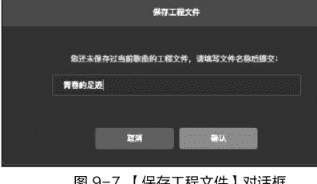
点击【导出】按钮可以导出创作的歌曲。

#### 【任务 9-3】海绵音乐创作歌曲
##### 【任务描述】
使用海绵音乐创作一首歌曲，歌名为“校园时光”，歌词如下。
> 晨曦透过窗纱
照亮青春的画
书声琅琅传天涯
梦想悄悄发了芽
绿荫之下玩耍
笑声多么无瑕
风儿轻轻吹过呀
心事慢慢在长大
晚风吹过脸颊
带走一天疲乏
操场身影映晚霞
友情永远不掺假
星光点亮枝丫
思绪飘向哪
回忆中的那些话
温暖如诗在笔下
校园的春秋冬夏
是心底最美的家
晨曦绿荫和晚霞
星光伴我走天涯
那些纯真的年华
是生命中的花
不管未来多变化
回忆永远不褪色啊
##### 【任务实施】
1. 打开海绵音乐首页。
2. 点击左侧的【创作】，在【定制音乐】区域，切换到【自定义创作】选项卡。
3. 输入歌词。在输入框中输入对应的歌词，如图 9-8 所示。
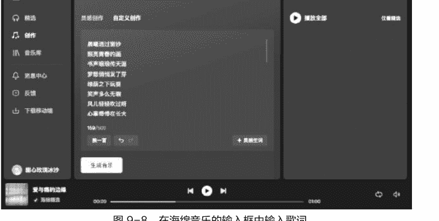
4. 设置歌曲参数。【曲风】选择【民谣】，【心情】选择【快乐】，【音色】中的【类型】选择【女声】，【特征】选择【明亮】。
5. 输入歌曲名称。在【歌曲名称】输入框中输入“校园时光”。设置歌曲参数与输入歌曲名称的结果如图 9-9 所示。
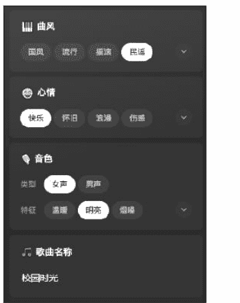
6. 点击【生成音乐】按钮，开始生成歌曲，显示歌曲生成进度如图 9-10 所示。
7. 歌曲生成后，在【创作历史】区域可以显示多首生成的歌曲，点击歌曲图标中的【播放】按钮，即可播放生成的歌曲，如图 9-11 所示。
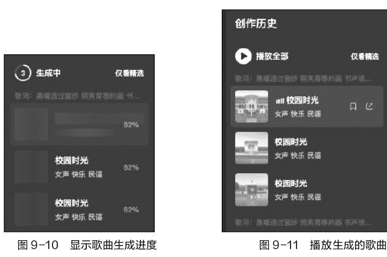

#### 【任务 9-4】海螺 AI 生成音视频
##### 【任务描述】
1. 使用海螺 AI 的“文生音”将以下文字转换成语音。
蓝色的海浪拍打礁岩，场面恢宏壮阔。
2. 使用海螺 AI 的“生成同款”生成一段视频。
3. 使用海螺 AI 的“文生视频”生成一段视频。
输入的提示词为：一位亚洲美女，身处聚光灯照耀下的墙壁前，对着镜头边眨眼边笑着说话。
##### 【任务实施】
1. 文字转语音
（1）进入海螺 AI 主页，如图 9-12 所示。

（2）在海螺 AI 主页点击【语音】，打开【文字转语音】页面，如图 9-13 所示。
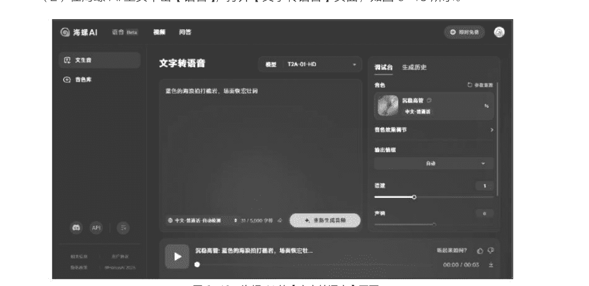
（3）点击左侧的【文生音】。
（4）输入需要转换成语音的文字内容：蓝色的海浪拍打礁岩，场面恢宏壮阔。
（5）语音参数设置。语音模型、音色、音色效果调节、输出情绪、语速、声调、音量等语音参数均采用默认值。
（6）点击【生成音频】按钮，等待文字转换成语音完成后，生成音频。
2. 生成同款视频
（1）在海螺 AI 主页点击【视频】，进入【发现】页面。在【官方精选】区域选择一个视频作品，将鼠标指针指向该视频作品，会出现【生成同款】按钮，如图 9-14 所示。

（2）点击【生成同款】按钮，打开生成视频的页面，生成同款视频时的【图生视频】选项卡如图 9-15 所示。

（3）点击生成按钮，等待同款视频的生成。
3. 文生视频
（1）在图 9-15 所示的页面中将选项卡切换至【文生视频】。
（2）在输入框中输入以下提示词：
一位亚洲美女，身处聚光灯照耀下的墙壁前，对着镜头边眨眼边笑着说话。
（3）设置运镜指令为【固定镜头】。
（4）选择【T2V-01-Director】模型。
（5）设置次数为【1】。
在【文生视频】选项卡中输入提示词与设置参数的结果如图 9-16 所示。
（6）点击生成按钮，等待视频生成。
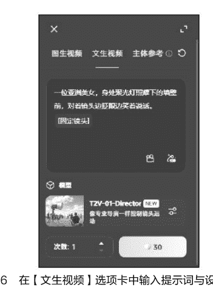

#### 【任务 9-5】智谱清言制作短片
##### 【任务描述】
使用智谱清言创建一个展示海底世界的 2min 短片。
##### 【任务实施】
打开智谱清言首页，如图 9-17 所示。

点击左侧的【清影-AI 生视频】按钮，进入【清影-AI 生视频】页面，如图 9-18 所示。在输入框中输入如下提示词。
创建一个展示海底世界的 2min 短片，包含五彩斑斓的珊瑚礁和各种海洋生物。
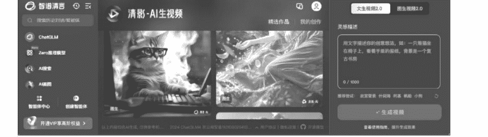
点击【生成视频】按钮，生成结果如图 9-19 所示。

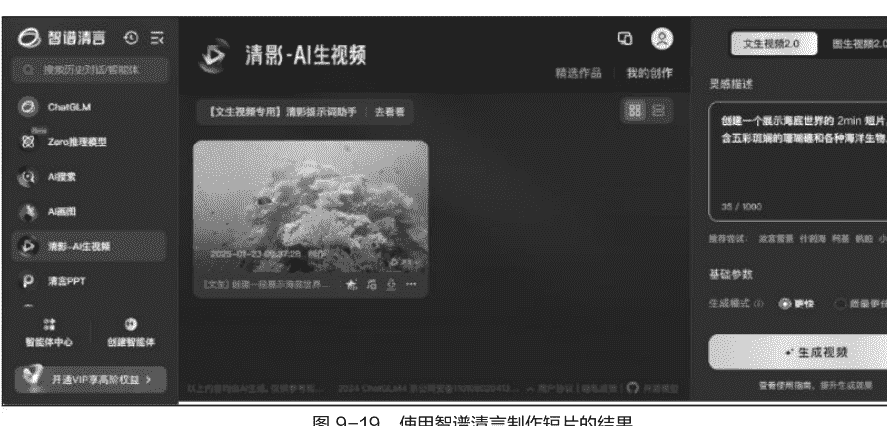

#### 【任务 9-6】混元 AI 30 秒手机广告实战

##### 【任务描述】
借助腾讯混元 AI 视频，产出一条 30 秒的智能手机宣传片。

##### 【任务实施】
先打开混元 AI 视频首页并完成登录，首屏界面如图 9-20 所示。


在上方输入区填入以下指令。

制作一个 30s 的智能手机广告，突出显示其摄像功能和超长电池寿命。

按下【发送】按钮后等待模型合成，输出结果如图 9-21 所示。


#### 【任务 9-7】通义万相 双路径视频创作

##### 【任务描述】
借助通义万相分别体验两种制作流程。
（1）文本生成视频：创作“一群鸿雁在天空中翱翔”的片段。
（2）图像生成视频：创作“一条锦鲤在荷塘里游动”的片段。

##### 【任务实施】
1. 文本生成视频流程
通义万相可借助提示词掌控画面构成与运动节奏，并结合智能扩写功能提升画面表现力。
具体操作：
（1）进入通义万相首页，如图 9-22 所示。
（2）在左侧点击【视频生成】，或在右侧【视频生成】区域点击【去生成】。
（3）进入生成页面后切换到【文生视频】选项。
（4）提示词输入：一群鸿雁在天空中翱翔。
（5）配置生成参数。比例可选【16:9】【9:16】【1:1】【4:3】【3:4】，本例选择【16:9】；同时开启【灵感模式】。设置后的界面如图 9-23 所示。


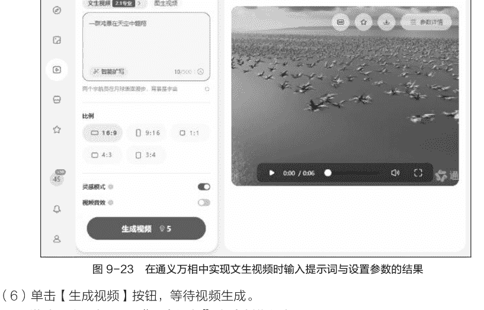

（6）点击【生成视频】按钮，静候合成完成。

2. 图像生成视频流程
图像生成视频以上传图像作为首帧进行延展，可控性更强、画面更精准。具体做法是点击或拖拽上传一张首帧图像，再用文字描述运动过程与运镜效果。
通义万相还支持按任意比例或预设比例裁剪图像、旋转图像，并兼容中英文提示词。
具体操作：
（1）打开通义万相首页，在首页左侧点击【视频生成】，或在右侧【视频生成】区域点击【去生成】。
（2）进入【视频生成】页面后选择【图生视频】选项。
（3）上传素材，采用点击或拖拽方式提交图 9-24 所示的图片。

（4）提示词输入：一条锦鲤在荷塘里游动，水墨画。填写完成后界面如图 9-25 所示。
（5）点击【生成视频】按钮，等待产出。
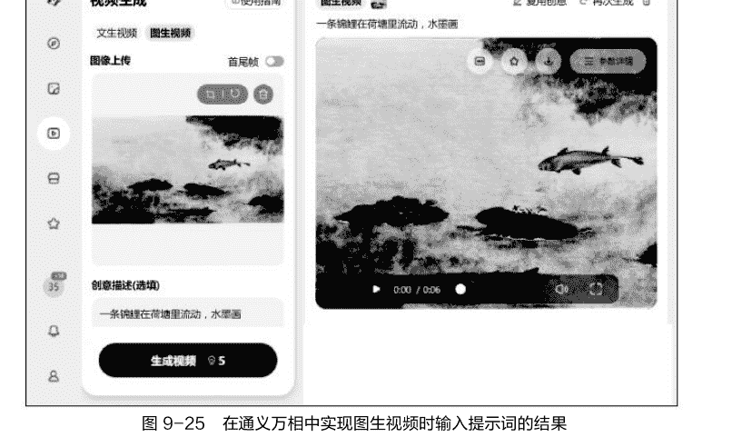

#### 【任务 9-8】可灵 AI 多模式视频创作

##### 【任务描述】
借助可灵 AI 分别体验以下三种生成方式。
1. 文本生成视频：绿色的种子生长成大树。
2. 首尾帧生成：小猫站在光滑的地板上注视与扑打着毛线球。
3. 多图参考生成：一个女生骑着独角兽漫步在林间小路。

##### 【任务实施】
1. 文本生成视频
（1）打开可灵 AI 首页，如图 9-26 所示。
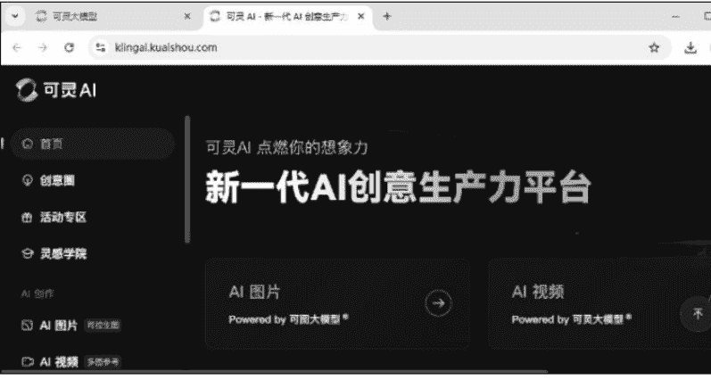
（2）在首页点击【AI 视频】按钮进入工作台，左侧提供【文生视频】【图生视频】【对口型】三个标签，切换至【文生视频】。
（3）在【创意描述】输入框内填入：
雪地中，鹅毛大雪，一个绿色的种子破土而出，快速生长成大树，自然光，冷光，特写，固定镜头，电影。
（4）参数配置
在【参数设置】区域，【生成模式】选择【标准】，【生成时长】选择【5s】，【视频比例】选择【16:9】，【生成数量】选择【1 条】。设置后界面如图 9-27 所示。
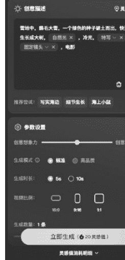
人工智能基础与 AIGC 应用
（电子活页式）
（5）点击【立即生成】按钮，等待合成。

2. 首尾帧生成
（1）切换到【图生视频】标签。
（2）切换到【首尾帧】标签。
（3）通过点击、拖拽或粘贴方式上传图 9-28 所示的首帧图，上传成功后如图 9-29 所示。

（4）在首帧图下方点击【尾帧图】按钮，再通过点击、拖拽或粘贴方式上传图 9-30 所示的尾帧图。首尾帧均上传成功后如图 9-31 所示。

（5）在【图片创意描述】输入框内输入：光照进屋内，一只可爱的小猫站在光滑的地板上，全神贯注地注视与扑打着毛线球。上传与输入结果如图 9-32 所示。
（6）点击【立即生成】按钮，等待结果。

3. 多图参考生成
操作步骤如下。
（1）上传图像
切换到【多图参考】标签，如图 9-33 所示，可上传 1~4 张图像。上传方式有两种：
① 本地上传图像。
② 点击【历史创作】，在弹出的对话框中挑选用户在可灵 AI 生成的历史图像素材。
上传 3 张图像后的效果如图 9-34 所示。
此外，可点击上传区域下方的推荐示例获取示例内容；也可点击右侧的【刷新】按钮获取更多示例。
# 模块 9
AIGC 助力音视频生成与动画制作
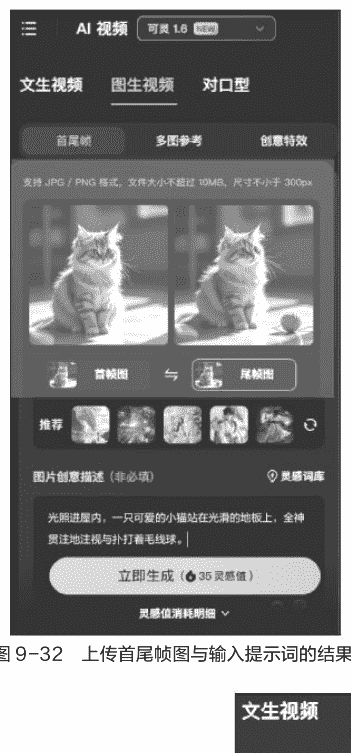
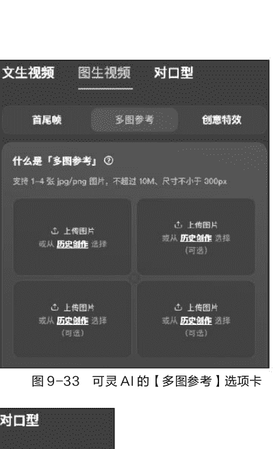

（2）选择主体（可选）
若上传图像元素较多，仅需参考其中特定主体，可使用“选择主体”功能进行精准框选。将鼠标悬停在某张图像上，左侧【选择主体】按钮如图 9-35 所示。
点击【选择主体】按钮后打开对话框，显示对应图像及用于框选主体范围的方框，调整方框大小，结果如图 9-36 所示。
# 人工智能基础与 AIGC 应用
（电子活页式）


（3）撰写“图片创意描述（必填）”
用一段话描述希望参考的主体，以及期望生成的 AI 创意视频效果。
提示词：一个女生骑着独角兽，漫步在林间小路。
“图片创意描述（必填）”内容如图 9-37 所示。
（4）设置参数
主要包括：
- ① 生成模式：【标准】模式输出 720P 视频，速度更快；【高品质】模式输出 1080P 视频，效果更佳。
- ② 生成时长：提供【5s】【10s】两种时长。
- ③ 视频比例：提供【16:9】【9:16】【1:1】三种比例。
- ④ 生成数量：单次支持生成 1~4 条。
- ⑤ 不希望呈现的内容（非必填）：列出不希望出现的元素。
本例中【生成模式】选择【高品质】，【生成时长】选择【5s】，【视频比例】选择【16:9】，【生成数量】选择【1 条】，设置结果如图 9-38 所示。

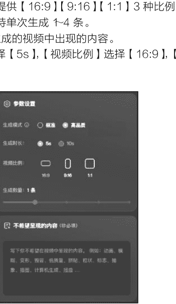
（5）点击【立即生成】按钮，等待产出。

#### 【任务 9-9】用 Kimi 编写正弦函数动效

##### 【任务描述】
正弦函数为：$f(x) = a \times \sin(x + x_0) + b$。
正弦函数说明如下。
$a$ 决定振动幅度的大小。
$x$ 决定函数在 $x$ 轴上的平移量。
$b$ 表示正弦函数偏离 $x$ 轴的距离。
函数图形如图 9-39 所示。
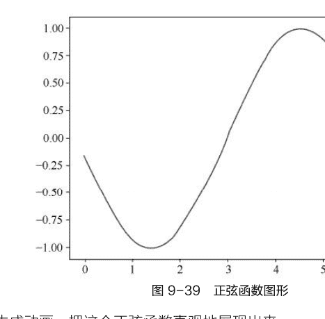
借助 Kimi 生成动画，直观展示该函数。

##### 【任务实施】
在 Kimi 中输入以下提示：
你是一个 Python 编程专家，完成如下 Python 脚本的编写：
用 Pillow、NumPy 和 Matplotlib 这 3 个库生成一个正弦函数的 GIF 动画；
将生成的 GIF 动画保存到 D 盘。
扫描二维码，打开电子教材中的电子活页 9-1，在线浏览“Kimi 生成正弦函数动画对应的 Python 代码”，也可以自行在 Kimi 中生成类似的代码。


#### 【任务 9-10】Kimi 与 MOKI 协作制作动画短片

##### 【任务描述】
1. 使用 Kimi 生成“动物冒险”故事内容。
2. 使用 MOKI 生成“动物冒险”动画视频。

##### 【任务实施】
1. 使用 Kimi 生成故事内容
（1）打开 Kimi。
（2）输入提示词。
提示词如下：
> - Role: 童话故事创作大师。
> - Background: 用户希望创作一个动物冒险的童话故事，故事内容需要有趣且具有教育意义，同时情节需要有起伏。
> - Profile: 你是一位经验丰富的童话故事创作大师，擅长将教育元素融入引人入胜的故事中，创作出既有趣又富有教育意义的作品。
> - Skills: 你拥有丰富的想象力、创造力，并且能够深刻理解儿童心理，能够创作出既有教育意义又能够吸引儿童阅读的故事。
> - Goals: 创作一个动物冒险的童话故事，故事中包含有趣的情节和教育元素，情节有起伏，能够吸引儿童的注意。
> - Constrains: 故事内容要适合儿童阅读，避免使用过于复杂或成人化的情节，确保故事的教育意义和娱乐性并重。
> - OutputFormat: 故事文本，包含故事情节、角色描述、对话以及教育元素。
> - Workflow:
>   ① 设定故事背景和主要角色。
>   ② 构建动物冒险的情节框架。
>   ③ 在故事中融入教育元素和有趣的情节。
>   ④ 确保故事情节有起伏，能够吸引儿童的注意。
>   ⑤ 审阅和修改故事，确保内容适合儿童阅读。
> - Examples:
>   - 例子 1——故事背景为一个普通的小女孩意外穿越到了一个魔法世界。
>   - 例子 2——主要角色必须通过智慧和勇气来克服困难。
>   - 例子 3——教育元素包括团队合作的重要性、勇敢面对困难等。
>   - 例子 4——有趣的情节包括与会说话的动物交朋友、解决谜题等。
>   - 例子 5——情节起伏包括小女孩在魔法世界中的成长，以及她如何帮助这个世界恢复和平。
> - Initialization: 在第一次对话中，请直接输出：“欢迎来到童话故事的创作之旅。让我们一起创造一个充满冒险和教育意义的故事，让小读者们在阅读中既能感受到乐趣，又能学到宝贵的人生课程。你想从哪个角色或哪个世界开始你的冒险故事？”

Kimi 的输出如下：
> 欢迎来到童话故事的创作之旅。让我们一起创造一个充满冒险和教育意义的故事，让小读者们在阅读中既能感受到乐趣，又能学到宝贵的人生课程。你想从哪个角色或哪个世界开始你的冒险故事？

继续输入提示词：
> 输入故事的角色：猫和老鼠

Kimi 生成的故事内容如下：
> 太棒了！猫和老鼠是一对经典的组合，充满了趣味和冲突，非常适合用来创作一个精彩的动物冒险故事。我们可以设定它们在一个奇妙的世界中展开冒险，通过合作克服困难，同时也能学到一些重要的道理。接下来，我会根据你的角色设定，开始构建故事的框架。
> 故事背景
> 在一个宁静的小镇上，住着一只聪明机灵的小老鼠米米和一只憨厚勇敢的小猫汤姆。尽管它们是天敌，但米米和汤姆却是一对好朋友。有一天，它们在阁楼里发现了一本古老的魔法书，书的封面上闪烁着神秘的光芒。当它们好奇地翻开书时，一阵光芒闪过，它们被卷入了一个奇妙的魔法世界。
> 主要角色
# 模块 9
AIGC 助力音视频生成与动画制作
- 米米：一只聪明机灵的小老鼠，擅长解决难题，但有时会有些胆小。
- 汤姆：一只憨厚勇敢的小猫，力大无穷，但不太擅长思考问题。
- 魔法世界的居民：包括会说话的动物、神秘的精灵和善良的魔法师。
情节框架
- ① 穿越到魔法世界：米米和汤姆发现自己来到了一个充满奇幻生物和魔法的世界。这个世界正面临着黑暗巫师的威胁，和平被打破。
- ② 寻找回家的方法：为了回到自己的世界，它们必须帮助魔法世界恢复和平。它们决定踏上冒险之旅，寻找传说中的“光明水晶”，只有它才能驱散黑暗。
- ③ 途中遇到的挑战如下。
  - 谜题森林：森林里有一条通往光明水晶的路，但路上布满了谜题和陷阱。米米的智慧在这里发挥了重要作用。
  - 黑暗巫师的挑战：它们需要与黑暗巫师的手下战斗，汤姆的勇气和力量帮助它们克服了困难。
  - 团队合作的重要性：在冒险过程中，米米和汤姆学会了互相帮助，发挥各自的优势。
- ④ 找到光明水晶，恢复和平：经过一系列的冒险，它们终于找到了光明水晶，并用它驱散了黑暗。魔法世界恢复了和平，它们也找到了回家的路。
- ⑤ 回到现实世界：回到小镇后，米米和汤姆意识到，无论遇到什么困难，只要团结一心，就能够克服。
教育元素
- 团队合作：米米和汤姆虽然性格不同，但通过合作完成了任务，体现了团队合作的重要性。
- 勇气与智慧：汤姆的勇敢和米米的智慧相辅相成，告诉孩子们勇气和智慧缺一不可。
- 友谊与信任：即使它们是天敌，但通过这次冒险，它们的友谊变得更加深厚，强调了信任和友谊的力量。
现在，我已经为你构建了一个充满冒险和教育意义的故事框架。接下来，我们可以进一步细化情节，增加一些有趣的对话和细节。如果你有任何想法或想要调整的地方，请随时告诉我！

2. 使用 MOKI 生成动画视频
（1）打开 MOKI。
（2）将 Kimi 生成的故事内容粘贴到 MOKI 首页输入框中，如图 9-40 所示，点击【开始生成脚本】按钮。

（3）稍等片刻，MOKI 会按照故事内容生成分镜脚本，这里视觉风格选择【中国动画】。
（4）在生成分镜脚本页面向下滚动鼠标滚轮，在【角度设计】区域点击【新增角色】按钮，打开对话框并打开【AI 生成角色】选项卡，在【角色名】输入框中输入角色名“米米”，【角色性别】选择【其他】，【角色配音】选择【小主持人】，在提示词输入框中输入“拟人化的小老鼠”。然后点击【立即生成】按钮进行角色生成，角色生成后在【生成历史】区域选择一个生成的角色，这里选择中间的角色，如图 9-41 所示。
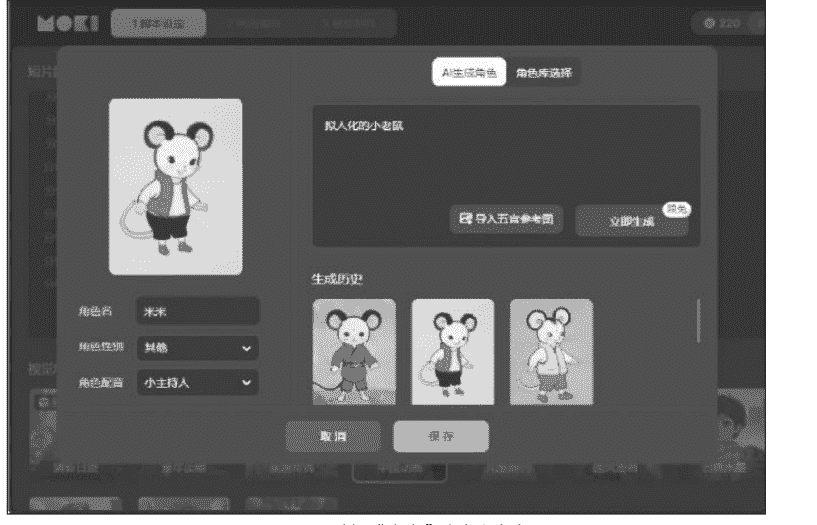
（5）在【AI 生成角色】选项卡中点击【保存】按钮，“米米”小老鼠角色便成功添加。按照类似步骤添加“汤姆”小猫角色，如图 9-42 所示。
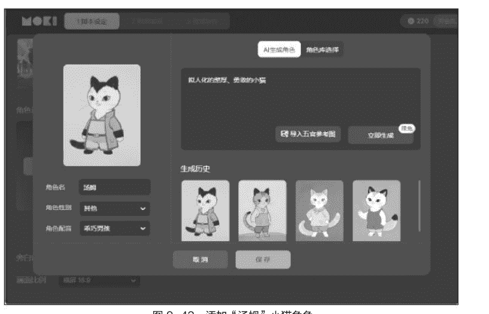
接下来按照类似步骤添加“居民”动物角色，如图 9-43 所示。
# 模块 9
AIGC 助力音视频生成与动画制作
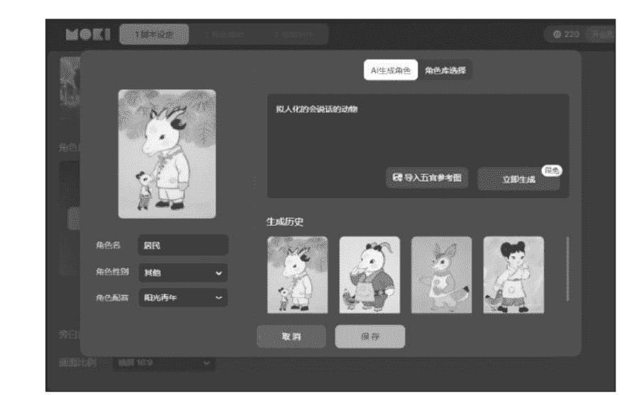
图 9-43 添加“居民”动物角色
添加 3 个角色后，【角色设计】区域如图 9-44 所示。
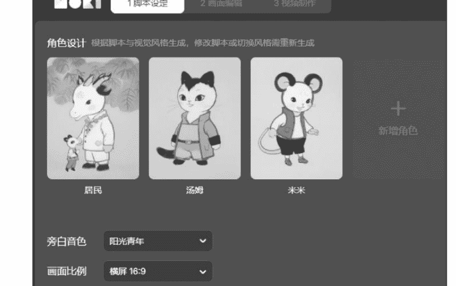
图 9-44 添加 3 个角色后的【角色设计】区域
（6）角色新增完毕后，在【旁白音色】下拉框中点击▼可打开图 9-45 所示的旁白音色选择对话框，在其中选择合适的旁白音色，然后点击【确认】按钮即可。
如果需要调整【画面比例】，可以自行设置，【画面比例】有两个选项：【横屏 16:9】和【竖屏 9:10】。
# 人工智能基础与 AIGC 应用
（电子活页式）
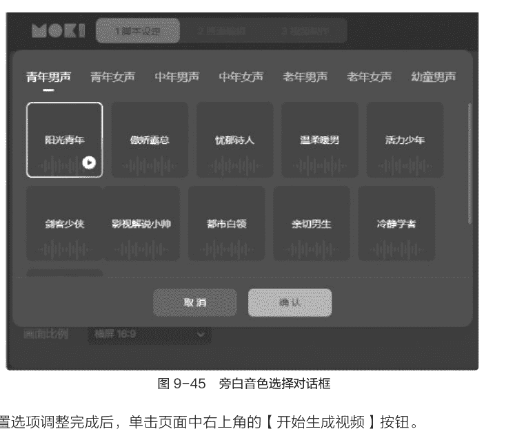
图 9-45 旁白音色选择对话框
（7）配置选项调整完成后，点击页面右上角的【开始生成视频】按钮。

等待片刻，系统就会依据输入稿自动产出多组画面预览，参考图 9-46。对呈现效果不满意时，可在右侧编辑区调整画面描述文案与每张图的出镜人物。


图 9-46 MOKI 根据内容生成的多个画面

（8）在对各画面的说明文字和出演角色完成必要修改后，点击页面右上角的【开始生成视频】。

视频合成完毕后会进入编辑页，可在此选择背景音乐；也可以设置运镜，让画面更有节奏感；还能为人物增添动作或加入景效，进一步提升成片质感。

至此，动物冒险动画短片就制作完毕。

### 自主学习

#### 【任务 9-11】使用即梦 AI 的“音乐生成”功能创作音乐作品

##### 【任务描述】

借助即梦 AI 的音乐生成模块完成下面三项制作。

1. 生成背景音乐
提示词：生成一段适合放松和冥想的钢琴背景音乐。

2. 生成自然音效
提示词：创建一段包含鸟鸣声和流水声的夏日森林音效。

3. 创作一首歌曲，歌名为“青春的旋律”
扫描二维码，打开电子教材中的电子活页 9-2，在线浏览“歌曲《青春的旋律》的歌词”。


#### 【任务 9-12】使用 WHEE 的“文本生视频”功能创作视频

##### 【任务描述】

利用 WHEE 的文本转视频能力制作 4 条短片，提示词如下。

- 提示词 1：一群马在草原上奔跑。
- 提示词 2：小金鱼在池塘中来回游动。
- 提示词 3：一位男子驾驶滑翔伞在天空翱翔。
- 提示词 4：白衣少女在大片盛开的薰衣草花田中漫步，微风轻拂发丝。

#### 【任务 9-13】使用豆包+MOKI 制作拯救小镇动画短片

##### 【任务描述】

1. 让豆包撰写一个主角为小狗奥奇、讲述拯救小镇的儿童故事。
2. 再用 MOKI 把该故事生成为动画视频。

# 模块 10

AIGC 助力程序编写与代码优化

AI 编程助手是人工智能在软件开发领域的典型落地形态，是一种基于机器学习的智能辅助产码工具。它融合深度学习与自然语言处理等技术，帮助开发者提速开发、改进代码质量，推动编程向智能化方向演进。

这类助手能够理解开发意图，并据此自动产出高质量代码片段或完整程序。它通过学习海量代码样本，把握代码结构、语法与逻辑，从而提供补全、纠错、生成等辅助服务。涉及的核心技术包括循环神经网络 RNN、长短期记忆网络 LSTM、VAE 等机器学习模型。

随着技术迭代，编程助手的性能持续提升。未来有望实现更精准的补全与更可靠的错误检测，覆盖更多语言与框架，提供更个性化的开发支持；同时也会与各类开发工具和服务深度整合，形成更完善的开发生态。

### 知识探析

#### 10.1 常用的代码生成与编辑专用 AI 工具

目前主流的代码生成与编辑类 AI 工具如表 10-1 所示。

表 10-1 常用的代码生成与编辑专用 AI 工具

| 序号 | 名称 |
| :--- | :--- |
| 1 | 代码小浣熊 |
| 2 | 文心快码 |
| 3 | 豆包 MarsCode |
| 4 | CodeGeeX |
| 5 | 腾讯云 AI 代码助手 |
| 6 | 通义灵码 |
| 7 | iFlyCode（星火飞码） |
| 8 | CodeGPT |
| 9 | Sky Code |
| 10 | 飞桨 |
| 11 | 星河小桨 |
| 12 | 昇思 MindSpore |

#### 10.2 代码小浣熊简介

代码小浣熊由商汤科技基于 SenseNova 大语言模型打造，是一款覆盖全流程的智能编程助手。它贯穿需求分析、架构设计、编码实现、软件测试等环节，支持 Python、Java、JavaScript、C++、Go、SQL 等 30 余种主流语言，并与 VS Code、IntelliJ IDEA 等主流 IDE 深度联动。

1. 核心功能

- （1）智能生成与补全：依托上下文自动补齐代码片段。例如输入“生成计算两数之和的函数”描述，即可快速获得示例代码。
- （2）多语言互转：支持不同编程语言间的代码转换，如将 Python 转为 Java，便于多语言协作。
- （3）错误识别与重构：能够发现代码中的问题或不合理写法，并给出优化建议；例如检测到冗余时提示重构方案。
- （4）单元测试自动生成：可自动创建单元测试用例，助力快速搭建测试环境，提升代码稳定性。
- （5）自然语言交互：开发者用自然语言描述需求，工具即可理解并生成对应代码或文档。例如输入“生成登录页前端代码”，即可输出基于 HTML 与 CSS 的实现。

2. 使用方式

代码小浣熊提供三种主要交互模式。

- （1）侧边栏助手——图形界面：在 VS Code 侧边栏点按 Raccoon 图标即可启动。
- （2）编辑器内助手——图形界面：在 Raccoon 侧边栏视图中新建独立实例，支持多任务并行。
- （3）终端助手——命令行界面：在终端直接输入问题，支持上下文多轮对话。

总体而言，代码小浣熊既是提升效率的工具，也有助于降低编程门槛，在日常开发、团队协作和教学场景中均有价值。

#### 10.3 文心快码简介

百度的文心快码 Baidu Comate 基于文心大模型构建，旨在借助 AI 提升开发效率与质量。它融合百度多年编程实战大数据与优质开源数据，能产出贴合实际场景的代码。支持多种语言和 IDE，提供智能生成、优化解释、技术问答与知识库等全流程服务。

文心快码的核心功能如下。

1. 智能代码生成

- （1）实时续写：在编码过程中实时补全完整代码块，帮助快速搭建程序框架。
- （2）注释驱动生成：开发者只需在注释中说明功能，即可自动生成完整代码，大幅提高效率。
- （3）对话式生成：通过自然语言交互对话，直接生成所需代码，减少手动编写逻辑的工作量。

2. 代码优化与解释

- （1）代码优化：识别冗余或低效代码并提出改进建议，如拆分过长函数，使代码更简洁高效。
- （2）代码解释：支持对整段代码或选中片段进行说明，帮助理解逻辑。

3. 技术问答与知识库

- （1）技术问答：在对话框输入问题，助手可即时给出解答。
- （2）知识库构建：可构建开发领域知识库，满足多场景需求，助力技能提升。

4. 其他辅助功能

- （1）生成单元测试：可为单个或批量函数生成单元测试，提高质量与可维护性。
- （2）生成注释：可生成规范的文档注释和行间注释，提升可读性。
- （3）支持私有化和混合云部署：满足企业对数据安全和隐私保护的需求。

文心快码操作简便、功能全面，能显著提升开发效率，适用于个人开发者和企业团队。

#### 10.4 腾讯云代码助手简介

腾讯云代码助手为腾讯云自研的智能辅助工具，目标是提升编程效率并优化代码质量。它提供智能补全、技术对话、代码诊断与优化、单元测试生成、代码理解与解释、多语言转换等功能。支持 Python、Java、C/C++、Go 等数十种语言或框架，以及 VS Code、JetBrains 等主流 IDE。依托先进 AI，可自动生成代码、优化逻辑并实时给出建议，带来更流畅的开发体验。

1. 核心功能

（1）智能代码补全
- ① 上下文感知：根据当前代码上下文智能预测并补全方法调用、变量声明、循环结构等，减少手工输入。
- ② 注释驱动生成：解析注释描述及上下文后自动生成符合要求代码段，加速开发。

（2）技术对话与咨询
- ① 即时问答：开发者可随时提问获取编程建议与解决方案。
- ② 知识库问答：深度挖掘代码库和技术文档，提供精准检索结果。

（3）代码诊断与优化
- ① 错误检测：快速发现语法错误、逻辑漏洞等潜在问题并标记。
- ② 重构建议：分析现有代码，提出循环优化、变量重命名、删除冗余等建议，确保代码高效易维护。

（4）单元测试用例生成
依据代码结构自动生成对应单元测试，保证功能在变更时依然稳定。

（5）代码理解与解释
提供清晰的代码逻辑说明，便于他人阅读和维护。

（6）多语言代码转换
支持多种编程语言间转换，助力多语言项目迁移与适配。

2. 插件安装

（1）在 VS Code 中安装
在 VS Code 插件市场搜索“腾讯云代码助手”，安装后重启编辑器即可使用。

（2）在 JetBrains 系列 IDE 中安装
在 IntelliJ IDEA、PyCharm 等 JetBrains IDE 的插件市场搜索“腾讯云代码助手”并安装，重启 IDE 后即可使用。

### 应用实践

#### 【任务 10-1】使用文心一言编写 Python 程序读取 Excel 文件中的数据

##### 【任务描述】

在文心一言里让模型给出 Python 代码，使用 pandas 读取 example1.xlsx 中 sheet1 的数据。请保证运行环境已安装 pandas 和 openpyxl。

##### 【任务实施】

打开文心一言首页，在输入框中输入编程要求，然后单击【发送】按钮，生成的 Python 程序如下。

```python
import pandas as pd

# 读取 Excel 文件中的 sheet1 工作表
file_path = 'example1.xlsx'
sheet_name = 'sheet1'

# 使用 pandas 的 read_excel()函数读取数据
try:
    df = pd.read_excel(file_path, sheet_name=sheet_name, engine='openpyxl')
    print("读取的 Excel 文件中的数据：")
    print(df)
except FileNotFoundError:
    print(f"文件 {file_path} 未找到，请检查文件路径是否正确。")
except Exception as e:
    print(f"读取 Excel 文件时发生错误：{e}")
```

#### 【任务 10-2】使用文心一言编写 Python 程序对 JavaScript 的数组去重

##### 【任务描述】

在文心一言中生成 Python 程序，利用 ES6 的 Set 对象对 JavaScript 数组 [1, 2, 2, 3, 4, 4, 5] 做去重处理。

##### 【任务实施】

文心一言编写的 Python 程序如下。

```javascript
// 原始数组
const array = [1, 2, 2, 3, 4, 4, 5];
// 使用 Set 对象去重
const uniqueArray = [...new Set(array)];
// 输出去重后的数组
console.log(uniqueArray); // 输出 [1, 2, 3, 4, 5]
```

#### 【任务 10-3】使用文心一言编写前端代码实现用户登录功能

##### 【任务描述】

在文心一言中生成前端代码，使用 HTML 和 JavaScript 实现用户登录功能。


##### 【任务实施】

扫描二维码，打开电子教材中的电子活页 10-1，在线浏览“实现用户登录功能的代码”。也可以自行在文心一言中生成类似的结果。

#### 【任务 10-4】使用豆包编写 HTML+CSS 代码实现网页元素的阴影效果

##### 【任务描述】

在豆包中生成 HTML+CSS 代码，使用 CSS 的 text-shadow 属性为段落“当今时代，人工智能正以前所未有的速度发展。”中的“人工智能”添加阴影效果。

##### 【任务实施】

打开豆包首页，在输入框中输入编程要求，然后单击【发送】按钮，生成的 HTML+CSS 代码如下。

```html
<!DOCTYPE html>
<html lang="zh-CN">
<head>
    <meta charset="UTF-8">
    <meta name="viewport" content="width=device-width, initial-scale=1.0">
    <title>文字阴影效果</title>
    <style>
        .highlight {
            /* text-shadow 属性用于为文字添加阴影效果 */
            text-shadow: 2px 2px 4px #888;
        }
    </style>
</head>
<body>
    <p>当今时代，<span class="highlight">人工智能</span>
        正以前所未有的速度发展。</p>
</body>
</html>
```

#### 【任务 10-5】使用 DeepSeek 编写 Python 程序，使用 read() 方法读取文件的所有内容并输出

##### 【任务描述】

在 DeepSeek 中生成 Python 代码，用 read() 方法读取文件 test.txt 的全部内容并打印输出。

##### 【任务实施】

DeepSeek 编写的 Python 程序如下。

```python
# 打开文件
with open('test.txt', 'r') as file:
    # 使用 read() 方法读取文件的所有内容
    content = file.read()
# 输出文件内容
print(content)
```

#### 【任务 10-6】使用通义判断 Python 代码的运行是否会报错

##### 【任务描述】

使用通义判断下面 Python 代码执行时是否会报错。若会报错请说明原因并给出解决办法；若不会报错请回答“无错误”。

需要判断的代码为：

```python
A= 1
def test():
    a += 1
    print(a)
test()
```

##### 【任务实施】

扫描二维码，打开电子教材中的电子活页 10-2，在线浏览“判断 Python 代码的运行是否会报错”。也可以自行在通义中生成类似的结果。

#### 【任务 10-7】使用天工 AI 补齐 Python 程序代码，实现要求功能

##### 【任务描述】

使用天工 AI 补全以下 Python 程序，实现判断一个字符串是否为回文字符串的功能。

```python
def is_palindrome(s):
    # 将字符串反转
    # 比较原字符串和反转后的字符串
# 测试示例
test_string = "radar"
print(is_palindrome(test_string))
```

##### 【任务实施】

天工 AI 补齐的 Python 程序代码如下。

```python
def is_palindrome(s):
    reversed_s = s[::-1]  # 将字符串反转
    return s == reversed_s  # 比较原字符串和反转后的字符串

# 测试示例
test_string = "radar"
print(is_palindrome(test_string))
```

#### 【任务 10-8】使用海螺 AI 纠正 Python 程序中的错误

##### 【任务描述】

使用海螺 AI 纠正下面 Python 程序中的错误。

```python
# 创建文件并将内容写入文件
open("example.txt", "w") as file
file.write("This is a test file.\nWelcome to Python programming!")
# 读取文件内容
open("example.txt", "r") as file
content = file.read()
print(content)
```

##### 【任务实施】

使用海螺 AI 纠正错误后，正确的 Python 程序如下。

```python
# 创建文件并将内容写入文件
with open("example.txt", "w") as file:
    file.write("This is a test file.\nWelcome to Python programming!")
# 读取文件内容
with open("example.txt", "r") as file:
    content = file.read()
    print(content)
```

海螺 AI 针对文件操作的修正建议

- 建议使用 with 构造来承接文件读写操作，离开作用域时会自动释放资源，可避免泄漏。
- with 行尾需加上冒号，这是 Python 语法规定的代码块起始标志。
- with 内部的代码要保持统一的缩进，常规做法是四个空格，以体现隶属关系。

#### 【任务 10-9】 用小浣熊助手训练代码补全与注释

##### 【任务描述】

借助小浣熊编程助手完成两类 AI 编程练习。

###### 1. 代码补全

依据给出的 Python 片段和注释提示，让助手把缺失部分补齐。

```python
import requests
# 请求访问 https://www.ryjiaoyu.com/ 网站，获取返回的响应状态码、响应头、响应内容，并输出
```

###### 2. 代码注释

为下面这段 Python 实现补充说明性注释，阐明其作用。

```python
def tcplink(conn, addr):
    print("Accept new connection from %s:%s" % addr)
    conn.send(b"Server: Welcome!")
    while True:
        conn.send(b"Server: What's your name?")
        data = conn.recv(1024)
        if data == b"exit":
            conn.send(b"Server: Good bye!\n ")
            break
        conn.send(b"Server: Hello %s!\n" % data)
    conn.close()
    print("Connection from %s:%s is closed" % addr)
```

##### 【任务实施】

（1）代码补全

助手处理后得到的完整代码如下：

```python
import requests

# 目标URL
url = "https://www.ryjiaoyu.com/"

try:
    # 发送 GET 请求
    response = requests.get(url)

    # 输出响应状态码
    print(f"响应状态码: {response.status_code}")

    # 输出响应头
    print("响应头:")
    for header, value in response.headers.items():
        print(f"{header}: {value}")

    # 输出响应内容
    print("\n 响应内容:")
    print(response.text[:1000])  # 仅输出前 1000 个字符，避免输出过多内容

except requests.exceptions.RequestException as e:
    print(f"请求过程中发生错误: {e}")
```

（2）代码注释

助手给出的解释如下：

> # 这段 Python 代码定义了一个名为 tcplink 的函数，用于处理与 TCP 连接相关的客户端通信。这个函数通常在服务器端使用，用于与客户端进行交互。

扫码打开电子教材活页 10-3，可在线查阅助手针对该代码的详细说明，也可在工具中自行复现类似结果。


#### 【任务 10-10】 用豆包 MarsCode 完成多项编程练习

##### 【任务描述】

使用豆包 MarsCode 完成以下 AI 编程任务。

- 1. 从“图书信息”表筛选作者为“张珊”且出版日期晚于“2024-01-01”的记录，返回“商品编号”“图书名称”“作者”“出版日期”四列。
- 2. 新建函数 getTypeName()，依据“类型编号”从“商品类型”表查询对应的“类型名称”。
- 3. 编写存储过程 procDemo，列出“人民邮电出版社”出版的图书。

##### 【任务实施】

1. 查询语句生成结果：

```sql
SELECT 商品编号, 图书名称, 作者, 出版日期
FROM 图书信息
WHERE 作者 = '张珊' AND 出版日期 > '2024-01-01';
```

2. 函数 getTypeName() 的 SQL 实现：

```sql
-- 创建函数 getTypeName()
CREATE FUNCTION getTypeName (
    @typeId INT -- 输入参数：“类型编号”
)
RETURNS NVARCHAR(50) -- 返回类型：“类型名称”
AS
BEGIN
    DECLARE @typeName NVARCHAR(50); -- 声明变量用于存储“类型名称”

    -- 从“商品类型”数据表中查询指定“类型编号”的“类型名称”
    SELECT @typeName = 类型名称
    FROM 商品类型
    WHERE 类型编号 = @typeId;

    -- 返回“类型名称”
    RETURN @typeName;
END;
```

3. 存储过程 procDemo 的 SQL 实现：

```sql
-- 创建存储过程 procDemo
CREATE PROCEDURE procDemo
AS
BEGIN
    -- 查询“人民邮电出版社”出版的图书种类
    SELECT DISTINCT 图书种类
    FROM 图书信息
    WHERE 出版社 = '人民邮电出版社';
END;
```

### 自主学习

#### 【任务 10-11】 文心一言定义多种数据类型变量

##### 【任务描述】

在文心一言中编写 Python 代码，分别创建不同数据类型的变量并输出其值。

#### 【任务 10-12】 文心一言多项编程练习

##### 【任务描述】

使用文心一言实现以下任务。

- 1. 编写 Python 程序，输出 20 以内所有质数。
- 2. 编写 Python 程序，用 while 循环计算 1 到 10 的总和。
- 3. 对下面代码做优化处理。

```python
try:
    # 以追加模式打开文件
    file = open('test.txt', 'a', encoding='utf-8')
    # 追加内容
    file.write("This is additional content.\n")
except Exception as e:
    print(f"追加内容时出错: {e}")
finally:
    if file:
        file.close()
```

#### 【任务 10-13】 让豆包扮演 Python 解释器

##### 【任务描述】

让豆包充当 Python 解释器，提示词如下。

我希望你表现得像一个 Python 解释器。我会给你 Python 代码，你来执行它并输出执行结果。你不需要向我提供任何解释。

待解释的代码如下：

```python
print("hello world! ")
print(1+2)
x=5;
y=10;
print(x+y)
```

#### 【任务 10-14】 Kimi 生成指定形状的 NumPy 数组

##### 【任务描述】

在 Kimi 中编写 Python 程序创建 NumPy 数组，形状为 (x,y,z)，并使用随机值进行初始化。

#### 【任务 10-15】 腾讯元宝计算应付金额

##### 【任务描述】

已知购买数量为 5，单价 21.6 元，请用腾讯元宝编写 Python 程序计算总价并输出。

#### 【任务 10-16】 海螺 AI 说明 SQL 含义

##### 【任务描述】

请让海螺 AI 对下面这条 SQL 语句进行解释。

```sql
Select 商品编号, 图书名称, 作者, 价格, 出版日期 From 图书信息 Where 价格>45 Order By 价格;
```

## 模块11 AIGC 支持文献阅读与事务处理

面对篇幅庞大的文献，基于 AIGC 大语言模型的阅读助手能够提供有效支持，同时还能针对正文内容作出解答。

借助该助手，用户可依托人工智能提升阅读效率与信息获取的准确度。它通过自动摘要、关键词抽取、内容归类与标签标注、智能推荐与关联等手段，帮助用户迅速把握长文献的核心要义。随着技术演进，这类助手有望覆盖更多场景，为文献阅读与事务处理提供更智能便捷的体验。

### 知识探析

#### 11.1 常用的国产文献阅读与分析专用 AI 工具简介

目前常用的国产文献阅读与分析专用 AI 工具如表 11-1 所示。

表 11-1 常用的国产文献阅读与分析专用 AI 工具

| 序号 | 名称 |
| :--- | :--- |
| 1 | 包阅 AI |
| 2 | 通义智文 |
| 3 | AMiner |
| 4 | 语雀 |

各工具简述如下。

##### 1. 包阅 AI

包阅 AI 融合人工智能的科研文献阅读与管理工具，覆盖多种阅读场景，可帮助科研人员、学生及专业人士更高效地阅读和吸收学术信息。适用场景包括法律、科研、营销、教育、商业等全场景文档阅读，现提供 PC 端、手机端和浏览器插件。

该产品聚焦文档处理与阅读效率提升，支持 AI 智能问答、OCR 截图问答、多格式文件翻译、全文改写、笔记等功能。依托先进文本解析技术可快速理解文档，支持格式：文档类 PDF、Word、PPT、EPUB、MOBI、TXT、Markdown、WPS、CAJ；图像类 JPG、PNG、WebP；其他视频、音频、网页链接。

##### 2. 通义智文

通义智文由阿里云推出，基于通义大模型构建的 AI 阅读工具，可智能阅读网页、论文、图书等文档，自动生成提要和要点概览，帮助用户在较短时间内精读并抓住重点，同时支持自由提问并解答相关问题。

##### 3. AMiner

AMiner 由清华大学团队打造的新一代科技情报分析与挖掘平台，具备完全自主知识产权，是学术搜索与社会网络挖掘研究的重要数据和实验平台。核心功能包括论文推荐、论文 AI 对话、论文排名等。

平台基于科研人员、科技文献、学术活动三大类数据构建关联关系，提供学者检索、论文检索等学术信息服务和专业知识服务，其中论文 AI 对话便于开展文献研究。

##### 4. 语雀

语雀已推出 AI 助手功能，可提升文档的阅读与创作效率，并支持个性化 AI 应用定制。

#### 11.2 AIGC 长文档阅读全景解析

AIGC 在长文档阅读中的落地，为用户提供更高效便捷的处理体验。

##### 1. 定义

AIGC 长文档阅读是指利用人工智能技术对长篇文档进行快速阅读、信息抽取和核心要点概括的过程。通过该技术用户可在短时间内把握主旨，提高阅读效率。

##### 2. 核心功能

- （1）自动摘要生成
AIGC 能分析文档结构与内容，自动抽取核心信息生成简洁摘要，用户可快速了解主旨大意。
- （2）关键词提取
AIGC 可从文档中识别关键词，帮助用户快速定位关键信息，了解文档结构。
- （3）内容分类与标签标注
AIGC 可依据内容主题对文档进行分类并标注标签，便于组织和管理，提升检索效率。
- （4）智能推荐与关联
AIGC 可基于阅读历史和兴趣推荐相关文档与资源，也能根据文档内容推荐相关知识点和参考资料，帮助深入理解。

##### 3. 应用场景

- （1）学术研究
科研人员和学生阅读长篇论文和报告时，AIGC 可帮助快速把握核心内容。
- （2）企业决策
企业高管需阅读大量市场报告、行业分析与政策文件，AIGC 可快速提炼关键信息以支撑决策。
- （3）法律文件审查
律师和法务人员面对大量法律文件和合同，AIGC 可帮助快速理解核心内容，提高审查效率。
- （4）新闻报道
记者和编辑在阅读大量新闻稿件和背景资料时，AIGC 可快速提炼要点，助力撰写更准确生动的报道。

##### 4. 优势

- （1）提高阅读效率
AIGC 可快速生成摘要和关键词，帮助用户迅速了解内容。
- （2）降低阅读难度
针对长篇复杂文档，AIGC 能提炼关键信息，降低理解门槛，提升体验。
- （3）提升信息获取准确性
通过智能分析和关键信息抽取，减少遗漏和误解，更准确地获取要点。

随着人工智能不断发展，AIGC 长文档阅读的功能与性能将持续提升，未来有望通过自然语言处理实现更准确的语义理解，通过机器学习优化摘要与关键词提取的精度，并与其他文档处理工具形成更完善的生态体系。

#### 11.3 主流音视频转录 AI 工具

目前常用的音视频转录 AI 工具及其功能说明如表 11-2 所示。

表 11-2 常用的音视频转录 AI 工具及其功能说明

| 序号 | 名称 | 功能说明 |
| :--- | :--- | :--- |
| 1 | 通义听悟 | 由阿里云推出的 AI 音视频转录工具，依托通义大模型与音视频 AI 大模型能力，帮助用户记录、整理和分析音视频内容，实现大模型驱动的音视频笔记与会议记录整理 |
| 2 | 讯飞听见 | 提供录音转文字服务，支持实时转录和多语种翻译，可快速提升文稿可读性和记录整理效率，适用于会议记录和内容整理等场景 |

#### 11.4 常用音视频转文字 AI 工具介绍

以下是一些常用的音视频转文字 AI 工具。

##### 1. 狸猫语音转文字

狸猫语音转文字是一款专业的语音转文字、录音转文字、视频声音转文字软件。支持普通话、英语、粤语、韩语等实时语音识别与转写，支持 10 余种主流音频格式提交与转写，还支持 30 余种方言转写，可一键导入音视频实现转写。

##### 2. 通义听悟

通义听悟由阿里云推出，支持网页端、App 端、钉钉小程序、微信小程序、Chrome 插件、Edge 插件等多种使用方式。核心功能包括实时记录、同步翻译、要点智能总结，支持上传音视频转文字并一键导出结果。

##### 3. Memo AI

Memo AI 是一款本地运行的 AI 音视频转录工具，支持 Windows 端和 macOS 端。可将视频、播客等转换为文字稿，支持中文、英语、日语等 90 多种语言的转录与翻译，支持 MP4、MP3、AAC、M4A 等本地媒体文件转录。

##### 4. 飞书妙记

飞书妙记是字节跳动旗下产品，支持网页端及飞书客户端、App 端。PC 版主要提供音视频转录功能，移动版可实现实时语音转录，可一键上传音视频文件借助 AI 实现语音识别与转文字。

##### 5. 简单听记

简单听记由百度推出，专业音视频处理平台，实现了场景细分，除音视频处理外，还支持录音、访谈转化等功能。

##### 6. 钉钉闪记

钉钉闪记是阿里巴巴旗下产品，可在网页使用，也可在钉钉 App 中使用。界面简洁，主要功能为音视频转文字和语音实时转录。

##### 7. VideoChat

VideoChat 是基于人工智能的音视频内容解读助手，可将音视频文件自动转录为文字，并提供多种内容解读方式，支持批量上传音视频自动转录，也支持以 VTT、SRT、TXT 等格式导出转录结果。

#### 11.5 会议录制智能工具盘点
市面上常见的会议记录类智能助手梳理如下。

##### 1. 飞书智能伙伴
该助手可抓取会谈音频，会后依据录音自动形成妙记或纪要文档，内容涵盖整体小结、待办清单与分章要点。系统提供中、英、日三种语言的即时识别与同传，对跨国协作很友好。

##### 2. 腾讯会议·AI 小助手
覆盖会前会中会后全链路，会后能基于全场讨论提炼云录制纪要，并自动梳理后续跟进要点、责任人及完成时限。会中提供实时信息回溯、个性化提醒等定制功能。

##### 3. 通义听悟
由阿里云推出的会议助手，具备实时语音转文字、多语种并行翻译、音视频转写、发言人自动区分等能力。可对会谈内容进行智能分析与归纳，抽取关键信息、观点、章节脉络与待办，支持多格式一键导出。

##### 4. 讯飞听见
提供快捷录音，可快速捕捉会谈并实时转为文字，支持多国语言互译。录音结束后可对转写文本进行智能编辑与翻译，保证纪要完整准确。

##### 5. Otter.ai
以强劲的语音识别见长，可实时转写并自动抓取演示文稿要点、生成实时小结。兼容 Zoom、微软 Teams、谷歌 Meet，在转写结果中可添加评论、标注重点、分派行动项。

##### 6. Zoom AI
内置于 Zoom 视频会议，自动生成纪要与字幕，便于参会者即时查阅，同时支持会议录制，便于后续复盘。

#### 11.6 国产纪要自动生成助手概览
常用的国产纪要生成工具如下。

- 1. 听脑 AI
全能型智能会议助手，接入 DeepSeek 系列模型，适配线下会议与线上视频。可实现录音转文本、发言人自动区分、纪要与摘要生成、待办提取，实时转写响应极快，还能输出思维导图。

- 2. 飞书妙记
可自动捕捉会议中的核心要素，如议题、决策、责任人等，并生成结构化模板。会后结合飞书智能伙伴的录音，可生成包含会议总结、待办事项与章节纪要的妙记文件。

#### 11.7 文件格式智能转换工具汇总
以下为常用格式转换类智能工具。

- 1. 迅捷 PDF 转换器
功能丰富，支持 PDF、CAD 等格式互转，同时提供 PDF 编辑、文档翻译、语音识别、智能对话及 AI 改写能力。

- 2. HiPDF
万兴科技旗下产品，具备 AI 文档翻译、校对、格式转换功能。PDF 可轻松转成 Word、Excel、PPT、图片，也支持反向转 PDF，在教育、IT、金融、法律等领域应用广泛。

- 3. 博思 AIPPT
基于 AI 的在线 PPT 生成工具，支持格式转换。可导入 PDF、Word、Markdown、TXT 等文件自动转为演示文稿，并提供大纲解析、智能排版、AI 重写功能。

- 4. SlidesPilot
AI 驱动的在线文档处理工具，可把 PDF、Word 报告、大纲、研究论文转为 PPT，使用时按需选择对应模块即可。

- 5. FileFormat
在线 AI 文件转换工具，支持多种格式互转，单次可处理最多 10 个文件，单个文件不超过 10MB。

- 6. CloudConvert
提供在线格式转换，可调节输出文件的分辨率、质量与大小。自 2012 年上线以来，以数据安全与转换质量获得用户认可。

#### 11.8 高精度翻译智能工具
以下工具在翻译准确度上表现突出。

- 1. DeepL
依托 AI 提供高质量译文，可在正式与非正式语气间切换，并保留原文排版。对长难句与专业文本处理能力强，法律、商务类文档译文准确，口碑良好。

- 2. 有道翻译
基于大模型构建的 AI 翻译，对上下文理解能力强，能把握专业术语，确保句子与文章连贯，避免语义断裂或结构混乱，对文言文等难度内容也能较好处理。

- 3. 深蓝词典
聚焦法律、医学等特定领域翻译，在专业场景下的准确性较高，适合专业人士使用。

### 应用实践

#### 【任务 11-1】豆包摘要关键词生成演练
##### 【任务说明】
用豆包为文章“勤奋工作 踏实劳动——劳动精神述评.docx”生成摘要与关键词。
##### 【操作步骤】
进入豆包首页，点击左侧导航【AI 阅读】，导入“勤奋工作 踏实劳动——劳动精神述评.docx”，输入提示词：请帮我生成该文章的摘要和关键词。点击【发送】。
豆包生成的摘要和关键词如下。
> 摘要如下。
中华民族以勤于劳动、勇于奋斗的精神创造了灿烂文明。广大劳动者传承崇尚劳动、热爱劳动、辛勤劳动、诚实劳动的精神内涵，在不同历史时期书写了壮丽篇章。未来，广大劳动者需继续发扬劳动精神，以奋斗为笔、创新为墨，奋力绘就新画卷。
关键词：劳动精神；奋斗；创新；劳动者
提示：AI 工具生成的内容并不一定完全正确，用户需要对其生成的内容进行理性分析，特别是要对其生成内容的价值导向应进行严格审核。学会做 AI 工具的主人，是使 AI 工具助力高效办公与生活的第一步。

#### 【任务 11-2】讯飞星火文章提纲生成演练
##### 【任务说明】
使用讯飞星火为文章“九寨沟一年四季的摄影之旅.docx”生成提纲。
##### 【操作步骤】
打开讯飞星火首页，上传“九寨沟一年四季的摄影之旅.docx”，输入提示词：请帮我生成该文章的提纲。点击【发送】。
讯飞星火生成的提纲如下。
#### 人工智能基础与 AIGC 应用（电子活页式）
- 1. 引言
  - 旅行与摄影的意义
  - 九寨沟的自然魅力
- 2. 春之九寨，摄桃花娇艳
  - 春天的九寨沟：生命的赞歌
  - 相机下的九寨沟：勃勃生机
- 3. 夏之九寨，摄漫山青翠
  - 夏天的九寨沟：清凉避暑胜地
  - 天空、山林：水天相接
- 4. 秋之九寨，摄影林叠瀑
  - 秋天的九寨沟：色彩集中营
  - 红叶、黄栌、松柏：层林尽染
- 5. 冬之九寨，摄冰瀑清雪
  - 冬天的九寨沟：宁静童话世界
  - 白雪飘扬：幽静之美
- 6. 总结
  - 九寨沟四季风光的魅力
  - 摄影爱好者的天堂

#### 【任务 11-3】文心一言阅读理解多任务
##### 【任务说明】
使用文心一言阅读文章“在平凡的岗位上创造不平凡的业绩——劳模精神述评.docx”，完成摘要关键词、提纲、综述生成。
##### 【操作步骤】
打开文心一言首页，点击输入框上方【文档分析】，上传“在平凡的岗位上创造不平凡的业绩——劳模精神述评.docx”。
###### 1. 生成摘要与关键词
输入提示词：请帮我生成该文章的摘要和关键词。点击【发送】，文心一言输出如下。
> 摘要如下。
本文深入阐述了劳动模范精神的内涵与价值，通过回顾不同历史时期劳动模范的杰出事迹，展现了他们在平凡岗位上创造非凡业绩的历程。文章指出，劳模精神是爱岗敬业、争创一流、艰苦奋斗、勇于创新、淡泊名利、甘于奉献的综合体现。本文呼吁全社会尊敬劳动模范，让诚实劳动、勤勉工作蔚然成风。
关键词：劳模精神；平凡岗位；爱岗敬业；勇于创新
###### 2. 生成提纲
输入提示词：请帮我生成该文章的提纲。点击【发送】后即可获得提纲。
扫描二维码，打开电子教材中的电子活页 11-1，在线浏览“文心一言生成的提纲”。也可以自行在文心一言中生成类似的结果。

###### 3. 生成综述
输入提示词：请帮我生成该文章的综述。点击【发送】，输出如下。
> 综述
本文阐述了劳动模范精神内涵，包括爱岗敬业、争创一流、艰苦奋斗、勇于创新、淡泊名利、甘于奉献。通过回顾张定宇、冯艳、张秉贵等劳模事迹，展现了劳模精神在不同历史时期的传承与发扬。文章强调，劳模精神对推动社会进步有重要意义，呼吁全社会尊敬劳模、弘扬劳模精神，为实现中国梦贡献力量。

#### 【任务 11-4】通义听悟语音转文字实操
##### 【任务说明】
使用通义听悟将“生命的乐章.mp4”视频中的配音转写为文字。
##### 【操作步骤】
打开通义听悟首页，点击【上传音视频】，在弹出的对话框中点击【上传本地音视频文件】，上传本地视频“生命的乐章.mp4”，如图 11-1 所示。然后点击【开始转写】。

等待转写完成，结果如下。
> 发言人 00:07
水有韵，瀑有魂，生命的乐章在奏响。透过枝叶，看水花与岩石共舞。飞珠溅玉，似万万颗珍珠散落人间。
发言人 00:45
瀑布铺陈开来，不知何起、何终。历经世事，黄褐色的钙华似乎在诉说着岁月峥嵘。真实之中更显宏伟、豪迈、坦荡。
发言人 01:19
密林深处，潺潺流水，倾泻而出。朵朵水花，仿佛一群调皮的孩子，蹦跳着落到水面。
发言人 01:50
欢快的笑声一如从前。
发言人 02:00
绝美群瀑声形异，只存清澈不存愁。轮回流转，周而复始，绝世的交响，生生不息。

#### 【任务 11-5】优选智能工具完成会议记录与整理
##### 【任务说明】
数字化办公中，会议录制对信息交流与决策至关重要。AIGC 技术大幅提升了录制效率与质量。
1. 针对三类会议场景优选合适的智能工具记录发言内容。
2. 分析工具在对应场景中的流程或作用。
3. 分析所选工具的优势与局限。
##### 【操作步骤】
###### 1. 日常项目周会：讯飞听见 + 通义听悟 + 亿图脑图 MindMaster
针对会议场景 1，采用讯飞听见、通义听悟与亿图脑图 MindMaster 组合。
####### （1）AIGC 辅助流程
- ① 会议录制：会前启动讯飞听见录音，因其稳定性好、音频清晰，可完整保留声音信息。
- ② 内容总结：会后把音频上传至通义听悟官网，使用“上传音视频”功能处理。进入章节速览可查看各章节并提炼核心内容，如项目进度部分可准确抽取已完成模块、问题及对策。存疑时可在左侧对照原文溯源，右侧可编辑补充重点。最后以 .md 格式导出。
- ③ 生成思维导图纪要：打开亿图脑图 MindMaster 导入 .md 总结，自动转为思维导图，层级清晰展示要点、主题及细节，便于复盘与后续跟进。
####### （2）优势分析
- ① 高效性：从总结到导图全程自动化，节省人工记录时间。
- ② 准确性：通义听悟基于 AI 分析音频，提取核心内容更精准，减少遗漏。
- ③ 可视化：思维导图直观呈现会议脉络，便于快速把握重点。
####### （3）局限性分析
对设备与网络依赖度高，录音设备故障或网络不稳会影响录制与后续处理。
###### 2. 跨部门协作会：飞书智能会议纪要 + 飞书智能伙伴
针对会议场景 2，使用飞书智能会议纪要与飞书智能伙伴。
####### （1）会议记录流程
- ① 预约会议：在飞书预约时填写议程、上下文与附件，参会者提前了解重点。
- ② 会中聚焦议程：围绕议程讨论，主持人用议程计时保持节奏，避免偏题。
- ③ 智能伙伴实时总结：启动飞书智能伙伴，可实时归纳要点、生成待办与发言人内容，如某方案提出后即自动形成要点与责任人。会中可持续问答，完善后续纪要。
- ④ 会后自动生成纪要：妙记文件或会议纪要文档自动生成，包含会议总结、待办事项、章节纪要。分享后参会者可查看。支持中英混杂逐字识别，英文为主时可自动翻译成多语种。
####### （2）优势分析
- ① 全流程智能化：从预约到会后纪要形成一站式覆盖。
- ② 精准提取：AI 模型可精准抓取关键信息与待办。
- ③ 多语言支持：消除语言障碍，促进协作。
- ④ 办公兼容性好：与常用办公软件互通，提升协作效率。
####### （3）局限性分析
- ① 免费次数受限：日免费使用次数有限，高频会议企业需付费升级。
- ② 网络要求高：不稳定网络会导致卡顿、识别延迟或错误。
###### 3. 内部培训会：天翼企业云盘 AI 会议助手
针对会议场景 3，使用天翼企业云盘 AI 会议助手。
####### （1）会议录制与整理作用
- ① 智能录音转录：会中开启助手，实时记录并通过语音识别生成文字纪要，能准确捕捉专业术语与知识点。
- ② 资料保存与分发：纪要自动保存至天翼企业云盘，可安全快速分发给参会者，便于复习。
- ③ 记录搜索与利用：借助全盘搜索，输入关键词即可定位会议片段，加快查阅与决策。
####### （2）优势分析
- ① 一站式方案：录音、转录、保存、分发、搜索功能集成。
- ② 转录准确率高：先进识别技术保证专业内容与多语言场景下的准确率。
- ③ 数据安全可靠：云盘保障存储安全，权限管理防止敏感信息泄露。
- ④ 搜索便捷：快速定位所需信息，促进知识沉淀与共享。
####### （3）局限性分析

## 天翼云盘会议 AI 的能力边界与思考

- 场景覆盖有限。对比综合型办公套件，天翼企业云盘的 AI 会议模块更聚焦纪要归纳与资料归档，对跨系统协同、业务流程延伸等办公环节的支撑相对薄弱，难以完全契合企业复杂的协作需求。
- 云盘配额受限。会议记录的存档与后续调用依赖充足存储，空间不足时使用体验会下降。扩容可以缓解，但会抬高企业成本。

从上述例子可以看出，AIGC 在会议录制辅助上展现出较强的实用价值，能明显提升记录效率与质量。现阶段语音识别的精准度、对网络环境的依赖以及功能完整性仍有提升空间。伴随技术迭代，AIGC 在会议记录领域的作用将愈发突出，为组织办公提效带来更大价值。

#### 【任务 11-6】借助讯飞听见做视频转写与实时会议采集
##### 任务说明
通过讯飞听见完成以下两项：
1. 把视频《爱永恒如歌.mp4》中的配音转成文字。
2. 进行一次会议录制。

##### 实施步骤
###### 1. 视频配音转文字
打开讯飞听见首页，如图 11-2 所示，点按【导入音视频】入口，在弹出的【导入音视频文件】对话框中上传本地视频文件《爱永恒如歌.mp4》，如图 11-3 所示。
随后点按【提交】启动导入，文件就绪后进入图 11-4 所示的操作页，再点按【转文字】即可开始转换。

###### 2. 会议录制
在讯飞听见首页点按【实时录音】按钮，进入录音操作页，如图 11-5 所示。
在录音页点按【开始录音】按钮启动会议采集，如图 11-6 所示。录制期间系统实时完成语音转写。

#### 【任务 11-7】用讯飞听见自动生成会议纪要初稿
##### 任务说明
某互联网公司产品研发团队召开约 60 分钟周会，议题为新品功能优化与上线计划。参会人员包括产品经理、研发工程师、设计师和测试人员，会议全程使用专业设备录音。需完成：
1. 会后利用讯飞听见自动产出纪要初稿；
2. 解析初稿包含的内容；
3. 评估 AI 自动生成初稿的利弊。

##### 实施步骤
###### 1. 自动生成初稿
会议结束后将录音文件上传至讯飞听见。平台先以语音识别将音频转为文本，再借助自然语言处理进行抽取与归纳，自动形成纪要初稿。

###### 2. 初稿内容解析
初稿通常涵盖：
- 会议基础信息：主题、时间、地点、参会人员；
- 会议主体：各议题要点、达成共识、提出的问题；
- 行动项明细：责任人及完成节点。例如新功能优化由研发工程师小李负责本周内完成代码修改，测试人员小张负责下周初完成测试，关键信息均被清晰呈现。

###### 3. 智能生成初稿的利弊
####### （1）优势
- 效率提升：手工整理往往需数小时，AI 工具十几分钟即可输出初稿，大幅降低时间成本。
- 准确度较高：基于算法识别核心信息，减少人工记录的遗漏与偏差，使内容更全面。
- 排版规范：格式统一结构清晰，按会议流程组织，便于查阅理解。

####### （2）不足
- 语音识别失误：多人并发、语速过快或口音明显时易出现误转，需人工校对。
- 语义理解局限：对专业术语、复杂业务讨论的深层意图把握不足，需人工补充完善。
- 弹性不足：主要依赖预设模板与算法，对个性化呈现或特殊需求适配性有限，需人工调整。

总体来看，AI 辅助生成初稿大幅提升记录效率，但尚无法完全替代人工，智能处理与人工校对结合才能产出高质量纪要。

#### 【任务 11-8】选用智能工具完成文件格式转换
##### 任务说明
选用合适工具分别完成文本、图像、音频、视频格式转换。

##### 实施步骤
###### 1. 文本格式转换
场景：科研人员用 Markdown 撰写论文，便于写作，但导师要求提交 Word 以便批注。
操作：可使用 Smallpdf 在线平台。将 Markdown 文件上传至 Smallpdf，选择转 Word。平台借助人工智能识别标题层级、列表等要素，映射为 Word 的标题样式、项目符号，保持结构与排版，减少手工调整。

###### 2. 图像格式转换
场景：设计师的宣传海报源文件为 PSD，需转 JPEG 用于官网展示。
操作：用 Adobe Photoshop 打开 PSD，通过【文件】-【存储为】选择 JPEG。软件内置的 AI 相关算法会自动优化色彩与分辨率，对复杂图层智能合并，保证视觉效果与文件体积平衡，便于网页快速加载。

###### 3. 音频格式转换
场景：音乐爱好者录制的 WAV 小样需转 MP3 以便手机播放与分享。
操作：用 Audacity 导入 WAV，通过【文件】-【导出】选择 MP3。软件利用人工智能分析音频特征，根据 MP3 编码特性自适应调整采样率、比特率等参数，在保证音质前提下压缩体积，兼容主流播放器。

###### 4. 视频格式转换
场景：制作团队的原始素材 MOV 需转 MP4 用于社交媒体发布。
操作：使用万兴优转导入 MOV，输出格式选 MP4。软件借助人工智能对视频进行全链路分析，按 MP4 规范与平台播放要求自动调节分辨率、帧率、码率。若源文件分辨率过高，算法会智能降调至合适水平，同时保持清晰流畅，适配发布环境。

#### 【任务 11-9】讯飞星火实现中文到英文翻译
##### 任务说明
在讯飞星火中把“你只管努力，剩下的交给时间”译为英文。
##### 实施步骤
打开讯飞星火首页，在输入框输入提示词：
请将以下中文内容翻译为英文。
你只管努力，剩下的交给时间。
翻译结果如下。
Just focus on doing your best, and leave the rest to time.

#### 【任务 11-10】DeepSeek 实现中英文互译
##### 任务说明
1. 把“书山有路勤为径，学海无涯苦作舟。”译为英文；
2. 把一段英文译为中文。
##### 实施步骤
###### 1. 中译英
翻译结果如下。
Diligence is the path to the mountain of books; Perseverance is the boat on the endless sea of learning.
###### 2. 英译中
原文：The most precious is life, life, each person only once, people's life should be spent this way: When the recollection of events, he will not be wasted for love and remorse, will not result in mediocrity and shame; in dying, when he was able to say "my whole life and all of our energy, have been dedicated to the world's most magnificent cause: the cause of human liberation struggle.
翻译结果如下。
人最宝贵的是生命。生命每个人只有一次。人的一生应当这样度过：当回忆往事的时候，他不会因为虚度年华而悔恨，也不会因为碌碌无为而羞愧；在临死的时候，他能够说：“我的整个生命和全部精力，都已经献给了世界上最壮丽的事业——为人类的解放而斗争。”

### 自主学习
#### 【任务 11-11】智谱清言生成论文摘要与关键词
##### 任务说明
使用智谱清言为论文《教育家精神的时代特质及培育路径.docx》生成摘要和关键词。

#### 【任务 11-12】天工 AI 生成文章提纲
##### 任务说明
使用天工 AI 为文章《在全社会弘扬劳动精神.docx》生成提纲。

#### 【任务 11-13】飞书妙记实现语音转文字
##### 任务说明
使用飞书妙记将视频《四季五花海.mp4》的配音转写为文字。

#### 【任务 11-14】挑选合适工具进行中英文翻译
##### 任务说明
从文心一言、豆包、DeepSeek、Kimi、讯飞星火、通义、智谱清言、天工 AI、腾讯元宝、海螺 AI 等熟悉工具中挑选，执行中英文翻译任务。

# 人工智能基础与AIGC应用
（电子活页式）
1. 将以下中文内容翻译为英文
（1）AI 时代不学习就会落伍，我们要抓住机遇学会使用 AI 工具，让工作效率翻倍。
（2）连绵起伏的壮丽山脉，山峰高耸入云，气势磅礴。
2. 将以下英文内容翻译为中文
Many people read on digital devices like cell phones and e-books. The fast pace of life leaves many people no time to sit and read a whole book, so making use of fragmented time to read is sure to be a trend. Fragmented reading has its advantages. People can get hold of large amounts of information, knowledge, and entertainment in a short time. Digital reading is faster and more interactive than traditional deep reading.

# 人工智能基础与AIGC应用
### （电子活页式）


用书教师扫码下载

本书配套资源

人邮教育

www.ryjiaoyu.com

教材服务热线：010-81055256

反馈/投稿/推荐信箱：315@ptpress.com.cn

人邮教育服务与资源下载社区：www.ryjiaoyu.com

ISBN 978-7-115-66662-8

9 787115 666628