# 大模型动手训练基础

# **推荐序：奠基智进 同行未来**

智能化浪潮正在重塑当代社会的运行逻辑。从量子运算到基因编辑，从智慧城到数字外交，AI技术既在改造产业样态，也在改变人类认知范式。身处这场变革，我们既需要面向远方的战略眼光，也离不开扎实的理论根基。北京大学出版社推出的“人工智能与人类未来丛书”，来得恰逢其时，无论理论深度还是实践价值，都对社会转型产生深远启示。

该丛书最鲜明的特点是追根溯源。当业界沉迷于即时调参收益时，《人工智能大模型数学基础》等奠基著作系统梳理了支撑智能的线性代数、概率统计、微积分等计算脉络，把卷积核还原为张量空间的变换，把损失函数追溯到变分法的最优控制思想。这种把技术现象拉回数学本质的阐释，让读者的认知架构更完整，也为后续创新提供了入口。书中独创的“数学考古学”视角，带领读者重走高斯、牛顿等先贤的思路，在微分流形中理解 Transformer 架构，在泛函空间里感悟大模型的涌现规律。

在实践维度，丛书提出“代码即理论”的写作方法。《人工智能大模型：动手训练大模型基础》等实战手册摒弃概念堆砌，直接在 PyTorch 环境下以百余个代码实例展开，把反向传播具象为矩阵导数运算，把注意力机制呈现为概率图模型的落地。《DeepSeek 源码深度解析》对国产大模型的核心设计进行精细拆解，从分布式训练中的参数同步策略，到混合专家系统的动态路由机制，每个要点都配有工业级实现。这种庖丁解牛式的技术剖析，既展现整体图景，也让关键模块可学可复现。

丛书的视野指向中国乃至全球的长远未来。面对算力竞争加剧，《Python 大模型优化策略：理论与实践》系统梳理模型压缩、量化训练、稀疏计算等关键路径，为突破算力壁垒提供方法论支撑。《DeepSeek 图解：大模型是怎样构建的》借助大量可视化图表，把万亿参数级模型的训练过程转化为可感知的动力学系统，有效降低技术门槛。这些工作既呼应十四五规划对底层技术突破的部署，也为构建自主可控的技术生态培育人才。

作为行业的见证者与参与者，我欣喜看到丛书在三方面形成突破：学术层面打通数学基础与技术前沿的知识链，产业层面搭建理论创新到工程落地的转化通道，战略层面回应新时代科技自立自强的国家诉求。它既可作为高校培养复合型人才的立体教材，也可成为产业界破解技术瓶颈的参考宝典，更能成为公众理解 AI 的入门读物。

在智能时代的关键节点，我们比任何时候都更需要兼具理论深度与实践智慧的启蒙之作。愿这套丛书点燃更多探索者的思考火花，共同描绘 AI 赋能人类文明的美好蓝图。

**于 剑**

北京交通大学人工智能研究院院长

交通数据分析与挖掘北京市重点实验室主任

中国人工智能学会副秘书长兼常务理事

中国计算机学会人工智能与模式识别专委会荣誉主任

# **前言**

**技术前景怎样**

在数字化与智能化深度融合的今天，AI 正以前所未有的速度重写社会。作为技术体系的核心突破，大模型凭借强大的学习能力、广泛的适应性与卓越的表现，成为推动科技进步与社会发展的重要引擎。

大模型即参数规模庞大、结构复杂的深度学习模型。它们能够处理海量数据，从中挖掘内在规律，完成自然语言处理、计算机视觉、语音识别等复杂任务。随着算力持续提升与数据爆发式增长，大模型技术取得长足进步，在学界引发研究热潮，在业界获得广泛应用。

展望未来，大模型的前景十分广阔。随着技术不断成熟优化，模型性能将进一步提升，更好地满足复杂场景需求。同时，大模型将与更多领域深度融合，驱动各行各业智能化升级。例如在医疗健康，模型可辅助医生更精准诊断、制定方案；在金融领域，可助力风险评估与信用评分；在教育领域，可为学生提供个性化资源与辅导服务。

**本书特色**

◆ **理论结合实操：** 在简明阐释大模型核心理论的同时强化实践。本书以清晰的代码示例与分步说明，帮助读者在理解原理后迅速掌握训练技能。
◆ **循序渐进：** 结构科学，从基础入门逐步推进至高级应用。无论是新手还是有经验的开发者，都能找到适合自己的学习路径。
◆ **注重细节：** 编写过程中力求专业精准，对关键技术细节反复推敲验证。代码注释、参数说明与异常处理均保证准确可读。
◆ **案例驱动：** 提供涵盖自然语言处理、计算机视觉等多个领域的典型应用案例，既展示实际用途，也积累实战经验。

**本书读者对象**

◆ 人工智能与机器学习初学者。
◆ 具备 Python 基础的大模型应用开发者。
◆ AI 算法工程师与深度学习从业者。
◆ 对大模型技术感兴趣的研究人员与高校学生。

**温馨提示：**

本书附赠资源读者可用微信扫描封底二维码，关注“博雅读书社”微信公众号，并输入本书 77 页的资源下载码，根据提示获取。

资源下载码：225065

# **第一部分**

# **大模型与 Python 开发基础**

在研讨大模型的构建与训练之前，先对其实践发展建立清晰认知很有必要。大模型作为人工智能的重要方向，其演进不仅涉及深度学习核心原理，也融合多学科知识与技术创新。以下将从计算理论、大规模数据表征与处理等方面展开说明。

注意：本部分主要介绍大模型与 Python 语言的初步概念，具备基础的读者可酌情阅读。

## **第一章 大模型的理论发展**

深入训练实践前，理解其背后的计算理论至关重要。大模型以庞大体量、复杂结构与强劲算力著称，在解决复杂问题与处理海量数据上展现独特优势。本章聚焦大模型的计算理论，揭示其数学原理、计算复杂度与优化策略。

**本章涉及的主要知识点如下。**

◆大模型的计算理论。
◆大规模数据的表示与处理。
◆大模型的算法创新。
◆大模型的发展趋势。

### **1.1 大模型的计算理论**

**1.1.1 大模型的发展历程**

大模型本质上仍是人工智能模型的一种，其理论演进如表 1-1 所示，表中梳理了人工智能模型的发展脉络。

表 1-1 人工智能模型的理论发展

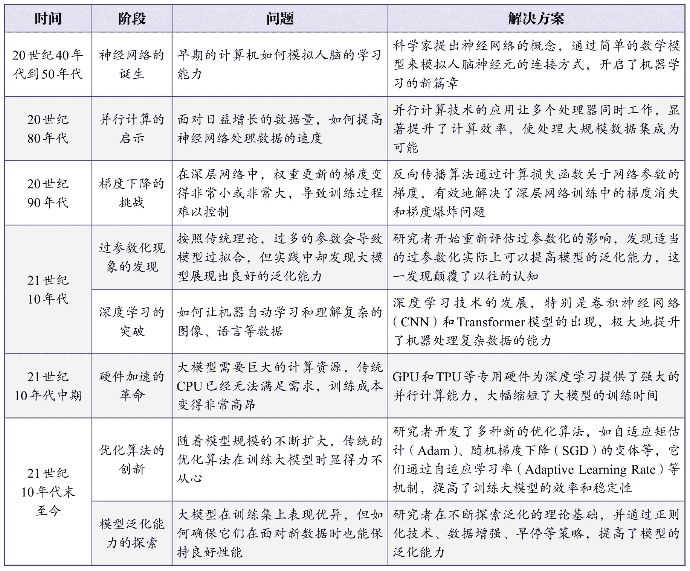

得益于人工智能技术迭代加速，大模型能够将既有解决方案发挥到极致，其内核仍是一种先进的人工智能算法。任何人工智能理论的进步，都能迅速反映到大模型领域的更新中。

**1.1.2 未来展望**

问题：伴随技术持续进步，大模型将在哪些新领域解决关键问题，又将如何演进？

解决方案：当前研究者正致力于提升模型的可解释性、安全性和能效，并探索分布式训练算法与专用硬件架构，推动大模型向更广泛的应用场景拓展。

### **1.2 大规模数据的表示与处理**

在人工智能领域，大模型的应用日益普及，其核心驱动力之一是高效处理与分析多模态大规模数据。面对数据量的指数级增长，如何有效表征与处理数据，构成大模型理论发展的重要环节。本节系统分析大规模数据的表示与处理策略，阐明其在构建与训练中的关键作用。

**1.2.1 大规模数据的表示**

数据的表征方式直接影响训练效率与性能。对大规模数据，传统单一维度或简易结构已难以满足需求，研究者探索了多种结构化表征方法以更准确捕捉内在特征。

**嵌入式表示（Embedding Representation）：** 将数据映射到连续高维向量空间，嵌入式表示能有效建模语义相似性与拓扑关系。大模型中词嵌入是典型方法，利用神经网络把词语映射为定长向量，编码分布语义关系。图 1-1 为词嵌入示意，左上方为原始文本，下方向量为转换后的嵌入形式。

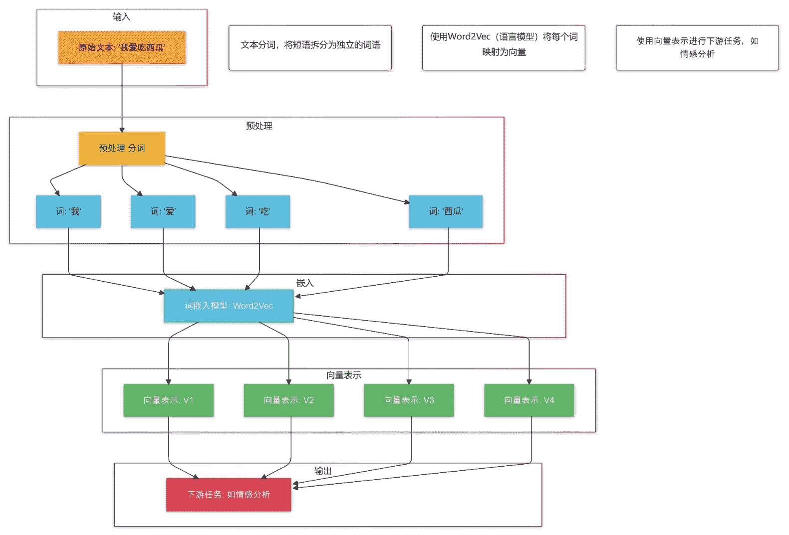

图 1-1 词嵌入示意

**图表示（Graph Representation）：** 针对社交网络、知识图谱等复杂结构数据，图表示提供直观高效的建模方式。图中节点代表实体，边代表关系，通过图神经网络等模型可学习图结构中的复杂模式。图 1-2 为由实体与关系构成的图示意，相似实体如水果类词语通过边连接形成关联，进而影响结果。

**张量表示（Tensor Representation）：** 处理多维数据时，张量提供更自然的数学框架。张量是多维数组的推广，可表达复杂结构与交互关系。训练中张量分解与压缩技术被广泛用于降低高维数据的计算复杂度，提升效率并减少存储。如图 1-3 所示，图像特征经图神经网络转为图结构后，多组图结构再合并为 3D 张量表示。

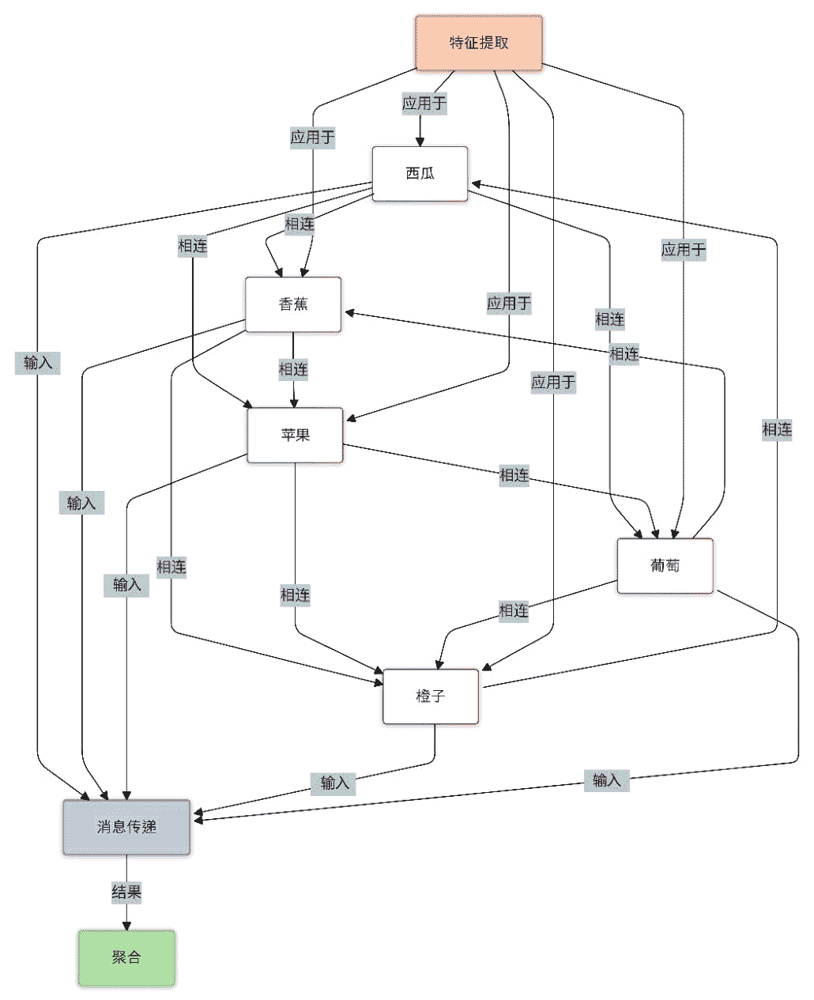

图 1-2 图表示示意

**1.2.2 大规模数据的处理**

高效处理大规模数据是构建大模型的关键。针对数据量大、维度高、分布不均等特点，研究者提出多种处理策略。

**数据预处理：** 数据预处理是首要步骤，包括清洗、归一化、特征选择等。可去除噪声、处理缺失值、降低维度，为后续表征学习与模型训练奠基。表 1-2 列出数据预处理中常见技术。

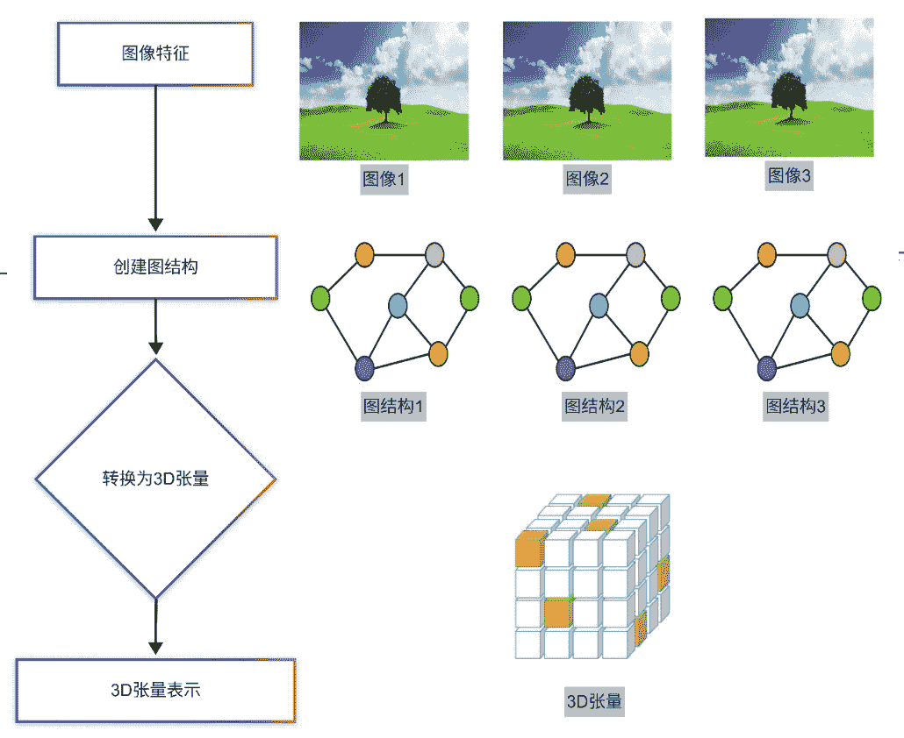

图 1-3 将图像转换为 3D 张量表示

表 1-2 数据预处理过程中的常见技术

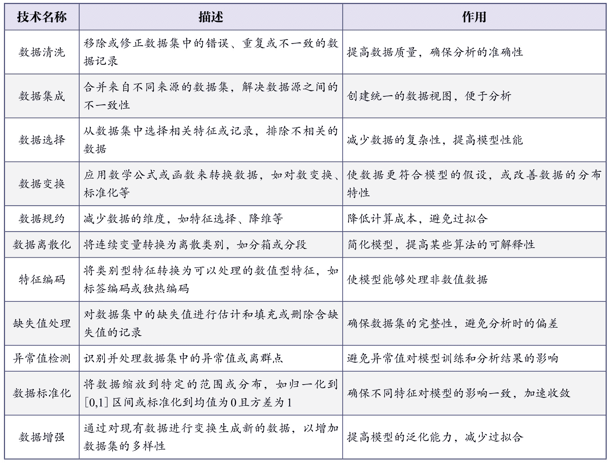

**分布式计算：** 分布式计算是应对大规模计算挑战的核心途径。通过把任务与数据分发至多个计算节点并行处理，可显著提升效率。大模型训练中，分布式框架如 TensorFlow 与 PyTorch 的分布式模块，使模型能在多 GPU 或多机环境下高效训练。图 1-4 示意对函数 f(x) 的分布式计算，任务被分解为任务 1 至任务 5，输入 x 规模较大时相当于 5 个单元并行处理不同数据分片，从而提升整体吞吐量。

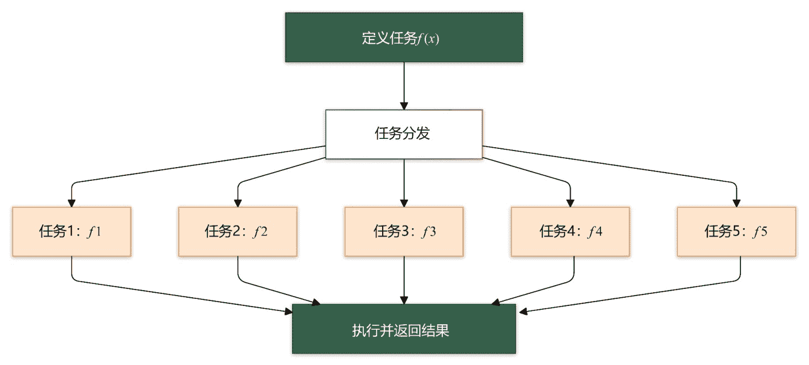

图 1-4 对函数 f(x) 进行分布式计算的示意

**增量学习：** 面对持续产生的新数据，增量学习可在保留原有知识的基础上不断学习新知，避免重新训练的高成本，使模型实时适应变化。在大规模场景中尤为重要。图 1-5 为模型采用增量学习策略不断优化的流程，部署后新数据触发更新，评估完成后重新上线，形成闭环迭代。

**数据采样和批处理：** 为降低大规模数据带来的成本，可采用采样与批处理。随机抽取部分样本训练可减少计算与存储需求；批处理则将样本组合为固定大小批次并行计算，提升效率与稳定性。表 1-3 汇总人工智能模型中常见的数据采样与批处理技术。

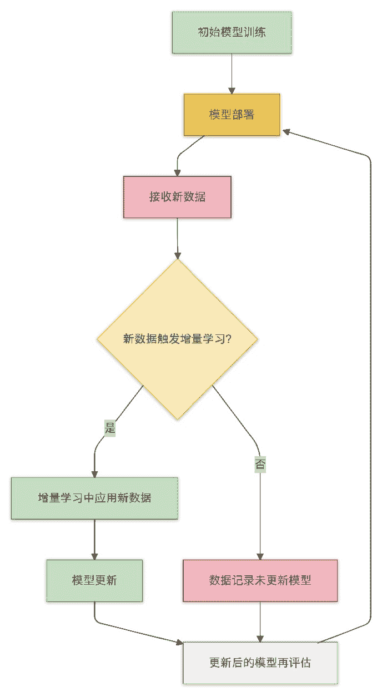

图 1-5 人工智能模型使用增量学习策略不断优化模型的流程图

表 1-3 人工智能模型中常见的数据采样和批处理技术

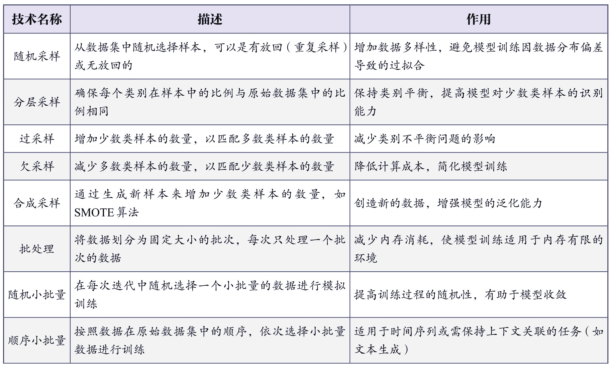

续表

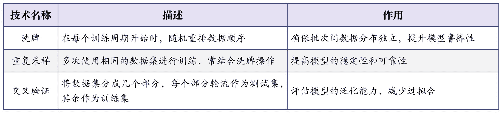

总体而言，大规模数据的表示与处理是大模型理论发展中至关重要的一环。通过高级表征方法、分布式计算、增量学习及采样与批处理等策略，可有效应对规模化挑战，为大模型的构建与训练提供有力支撑。

### **1.3 大模型的算法创新**

大模型的崛起不仅得益于算力提升与数据积累，更离不开算法的持续创新。算法作为核心驱动力，其突破对提升性能与拓展应用场景意义重大。本节聚焦几个关键创新方向。

**1.3.1 注意力机制与自注意力网络**

注意力机制是近年来的核心突破之一。它模仿人类视觉注意，使模型在处理信息时聚焦关键部分，提升效率与准确性。

在大模型中，自注意力网络如 Transformer 的多头注意力尤为突出。它计算序列内任意两元素间的相关性，实现信息全局交互，使长距离依赖处理更灵活。图 1-6 为自注意力结构示意，最下方箭头表示输入序列向量，经线性变换生成查询向量 Query Q、关键词向量 Key K、值向量 Value V，通过 H 个独立注意力头增强显著信息，即为自注意力机制。

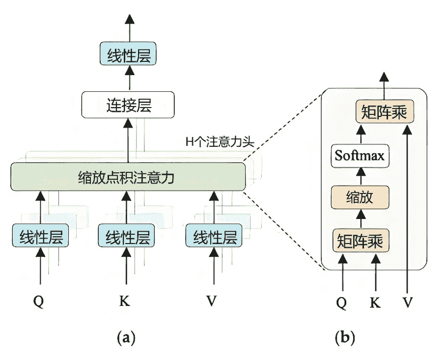

图 1-6 自注意力机制的结构示意

**1.3.2 动态路由与胶囊网络**

传统神经网络在处理层次化信息时常面临梯度消失与特征抽象不足的问题。动态路由与胶囊网络应运而生，通过向量式特征单元胶囊与动态路由算法，实现低级到高级特征的层次化组合，保留更多空间层次信息。大模型中胶囊网络的应用潜力巨大，有望提升表达力与鲁棒性。图 1-7 为 Hinton 提出的胶囊网络示意，输入向量经卷积与隐藏层后进入主胶囊层，再路由至数字胶囊层，其优势在于增强空间信息处理，但也带来训练难度增大与计算成本上升的问题。

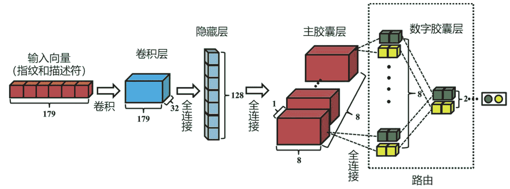

图 1-7 Hinton 提出的胶囊网络示意

**1.3.3 记忆增强神经网络**

为应对复杂动态任务，记忆增强神经网络成为重要方向。这类网络引入可读写外部记忆模块存储与检索长期依赖，使模型在处理新任务时能利用过往经验。在大规模多任务或强化学习中展现强大潜力。图 1-8 为记忆增强神经网络结构示意，以运行轨迹预测为例，网络以过去轨迹及道路俯视图为输入，经编码器与 CNN 提取深度特征后输入记忆网络，得到与过去与未来记忆最相似信号，最终预测最可能的未来轨迹。

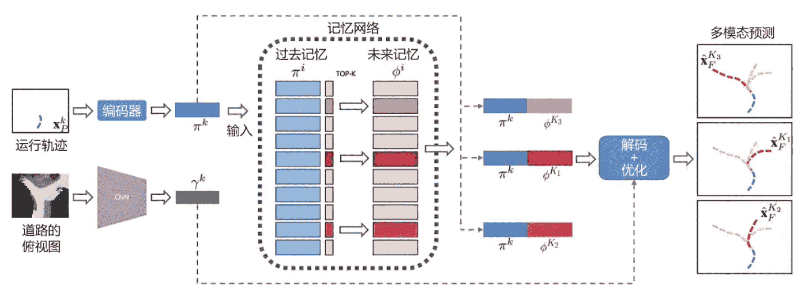

图 1-8 记忆增强神经网络结构示意

**1.3.4 生成对抗网络与无监督学习**

生成对抗网络通过生成器与判别器的对抗训练框架学习生成高质量样本。大模型中 GAN 可用于数据生成、特征学习与数据增强。无监督学习的发展也为大模型提供更多训练数据与更灵活方式，利用大规模未标注数据预训练或自监督学习，可显著提升泛化能力。图 1-9 为 GAN 结构示意，输入为真实样本数据 x、随机噪声向量 z 及真实标签数据 y，生成器 G 接收 z 与 y 输出假样本，判别器 D 对比 x 与假样本做出判断，辅助分类器 Q 与 D 共享参数，预测假样本标签 y'，用于计算交叉熵损失进而优化 G 的生成质量。

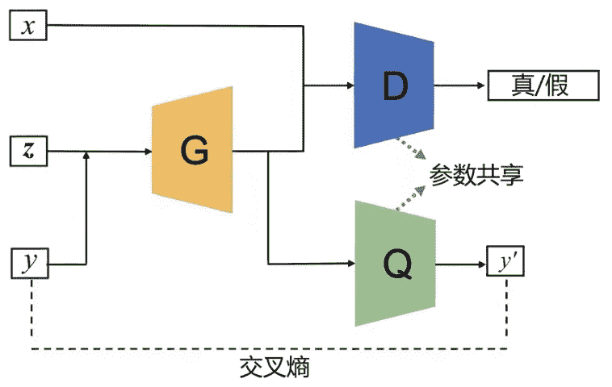

图 1-9 GAN 结构示意

**1.3.5 稀疏性与可解释性算法**

随模型规模扩大，稀疏性与可解释性成为创新重点。稀疏性算法通过减少非零参数数量降低计算与存储需求，同时保持或提升性能。可解释性算法旨在揭示决策背后的逻辑，提升透明度与可信度，对大规模应用的安全可靠至关重要。如图 1-10 所示，从左至右分别为行 Height 稀疏、列 Width 稀疏、频道 Channel 稀疏的对比，行稀疏指多数行为空，列稀疏指多数列为空，频道稀疏指多数频道为空，图中分别对应 H、W、C，N 表示样本数量。

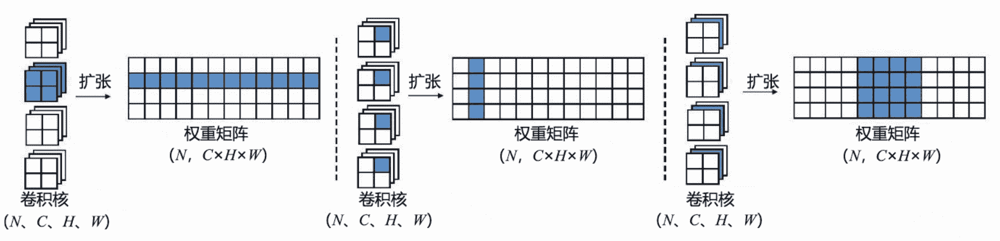

图 1-10 行稀疏、列稀疏、频道稀疏的对比示意

总体来看，大模型算法创新涵盖注意力与自注意力、动态路由与胶囊网络、记忆增强网络、生成对抗与无监督学习、稀疏性与可解释性等多个方面。这些创新推动性能提升与场景扩展，也为人工智能未来发展奠定基础。

### **1.4 大模型的发展趋势**

伴随人工智能加速发展，大模型在理论与应用层面不断拓展深化。本节探讨未来发展趋势，揭示该领域可能的方向与创新点。

**1.4.1 更大规模与更深层次的模型架构**

算力持续攀升、数据规模不断扩大的背景下，研究者更偏向于构建参数更多、层数更深的网络拓扑。目标是挖掘数据中更细致的依赖关系，从而提升表征能力与泛化能力。未来或将出现数十亿乃至上百亿参数的超大规模系统，并在多类任务上展现突出表现。如图 1-11 所示，模型体量由早期的 1 亿 0.1B 增长到现今的 1750 亿 175B，横轴为参数规模 单位 10 亿 B 纵轴为准确率。可以看出，一旦参数总量超过 130 亿，性能会出现明显跃迁。

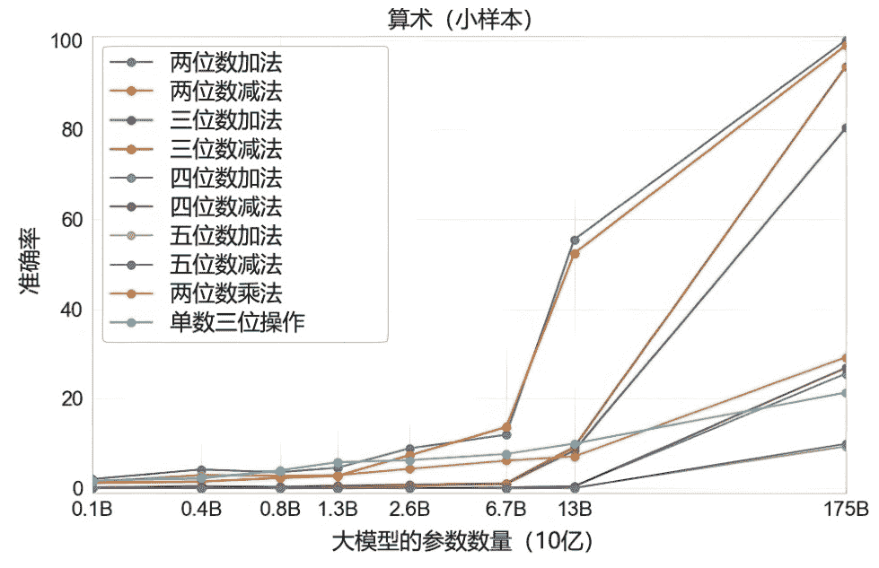

图 1-11 大模型参数增长示意

针对 L 层的 Transformer，其可训练参数总量可表达为

式中 P 表示总参数量，L 代表层数，h 为隐层维度，V 为词表规模。

以 GPT-3 为例，层数 L 取 96，隐层维度 h 为 12288，词表 V 常见取值 50257，据此估算参数量 P 约为 175B。

**1.4.2 跨模态学习与融合**

当下主流系统多聚焦于单一模态如文本、图像、音频等处理，现实信息却是多源并存的。因此跨模态学习与融合成为重要演进方向。融合不同模态的数据与知识，可让模型对世界形成更立体的认知，实现更高阶的智能交互。如图 1-12 所示，由左至右依次为早期融合、后期融合、深度融合，图中 FUSE 代表融合操作。

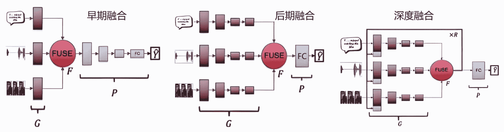

图 1-12 多模态的数据融合示意

**1.4.3 可解释性与鲁棒性增强**

随着落地场景扩大，可解释性与抗扰动能力成为关注焦点。未来将聚焦于研发更透明的架构与算法，同时增强对噪声、离群点及对抗样本的抵抗力，以提升可信度，推动医疗、金融等关键行业应用。如图 1-13 所示，由上至下，可解释性研究本质上是人类借助数据探索真实规律的过程：先定位现实问题，再准备相关样本，随后计算样本在模型中的 SHAP 值，即特征对决策的影响程度，最后将 SHAP 值可视化并按影响排序，通过剖析最具影响的特征，为实际应用提供可解释的决策依据。

**1.4.4 个性化与定制化服务**

用户需求日益分化，系统需提供更贴合个体的定制服务。借助用户画像、上下文感知等手段，模型能更精准把握偏好，给出更个性化的体验，从而深化智能客服、个性化推荐等场景。如图 1-14 所示，大模型会为不同用户的不同症状给出差异化治疗方案：先通过数据预处理收集病人数据并抽取特征，再借助长短期记忆网络 LSTM 预测其罹患心脏疾病的概率，后期据此采取不同策略，给出差异化治疗计划并持续监测数据变化。

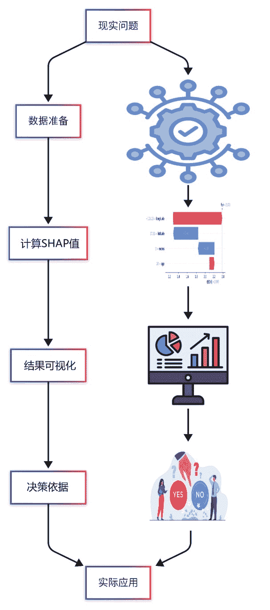

图 1-13 对大模型预测结果的解释过程示意

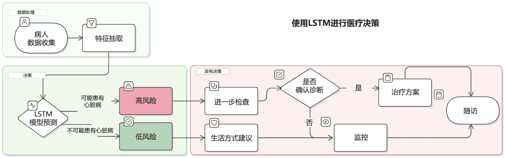

图 1-14 大模型进行个性化决策示意

**1.4.5 持续学习与自适应能力**

面对动态环境与多样任务，模型需具备持续学习与自适应能力。未来研究将更侧重增量学习与在线学习技术的开发，以实现动态优化与实时更新。引入元学习等高级机器学习技术也有助于提升环境自适应能力，使其更有效地应对未知复杂变化。如图 1-15 所示，大模型在通过应用与用户互动的过程中不断计算和调整策略，相较传统一次性学习任务，增加了模型评估、重训与部署等环节以获得自适应能力。

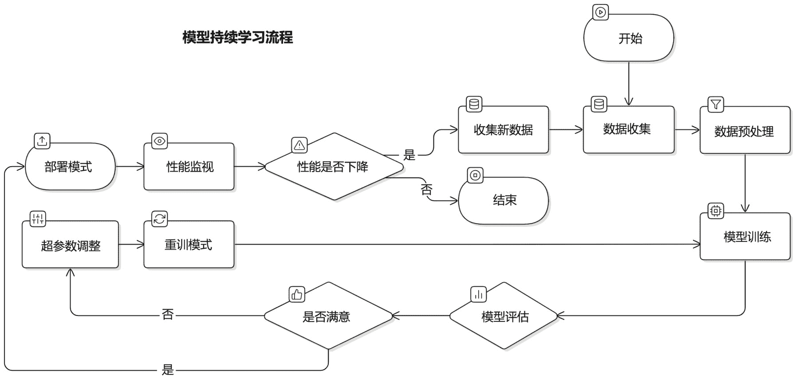

图 1-15 大模型进行持续学习示意

**1.4.6 绿色计算与可持续性**

规模扩大带来算力与能耗上升，绿色计算与可持续性成为重要考量。未来将涌现更多面向大模型的能效优化与低功耗技术，以降低训练与推理阶段的能耗与碳排放，推动人工智能可持续发展。如图 1-16 所示，NVIDIA 推出的 H100 相比 A100 更省电，所需成本更低。

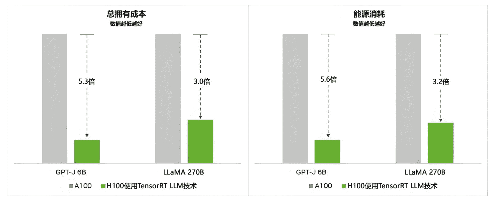

图 1-16 大模型计算不断向低功耗进化示意

总体来看，演进趋势围绕更深更宽的架构、跨模态融合、可解释性与鲁棒性增强、个性化定制、持续学习与自适应、绿色计算与可持续性展开，共同推动技术进步与创新应用。

### **1.5 本章小结**

本章回顾了大模型的发展历程，涉及计算理论、大规模数据表示与处理、算法创新以及发展趋势。

## **第二章 大模型的 Python 工程环境**

在人工智能领域，Python 因语法简洁、生态成熟，已成为构建大模型的主流语言。为高效搭建与训练，配置合适的编程环境至关重要。本章介绍如何设置与优化面向大模型开发的 Python 环境，涵盖安装、配置与最佳实践。

**本章涉及的主要知识点如下。**

◆Python 视角下大模型的开发生态。
◆Python 工程环境搭建。
◆深度学习框架概览：TensorFlow 与 PyTorch。
◆大模型微调技术简介。

### **2.1 Python 视角下大模型的开发生态**

信息技术快速发展背景下，Python 已成为人工智能尤其是大模型开发的核心工具。其优势源于完整生态，为开发者提供从数据处理、模型构建到训练部署的全链路支持。

**2.1.1 数据处理与分析**

图 2-1 展示了 Python 数据处理中常见的 NumPy 与 Pandas 标志。

大模型开发中数据处理是关键步骤。Python 提供了强大的数据处理库，如 NumPy 和 Pandas，它们能够高效处理大规模数据集。NumPy 以高效数组运算与多维数组支持著称，是科学计算与数据分析的基础。而 Pandas 在此基础上提供易用的数据结构与分析工具，使清洗、转换、聚合等操作变得直观。图 2-2 展示了 NumPy 矩阵相乘计算过程示意，符合线性代数矩阵乘法。

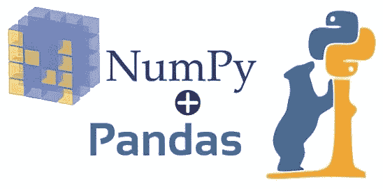

图 2-1 NumPy 和 Pandas 的标志

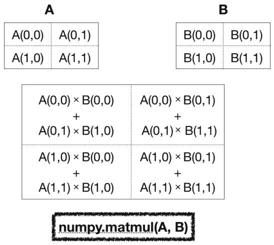

图 2-2 NumPy 的矩阵相乘计算过程示意

**2.1.2 模型构建与训练**

图 2-3 展示了深度学习领域最常见的两款框架 TensorFlow 与 PyTorch 的标志。

Python 拥有丰富的深度学习框架，为大模型的构建与训练提供强力支持。TensorFlow 以高性能分布式计算、自动微分和灵活部署著称，适合构建大规模分布式训练系统。PyTorch 则以动态计算图与简洁 API 设计见长，便于原型开发与实验。此外 Keras、MXNet 等框架也提供丰富功能与良好社区支持。图 2-4 展示了 PyTorch 的计算图组织形式，从图中可清晰看到蓝色部分节点信号由下至上前向传播，以及绿色部分计算结果由上至下反向传播。

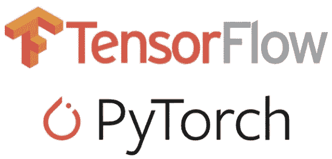

图 2-3 TensorFlow 与 PyTorch 的标志

注意：主流深度学习框架一般均提供 CPU 与 GPU 版本，在配备 NVIDIA 显卡的主机上可安装 GPU 版本以提升训练速度，相关内容将在第三、四章介绍。

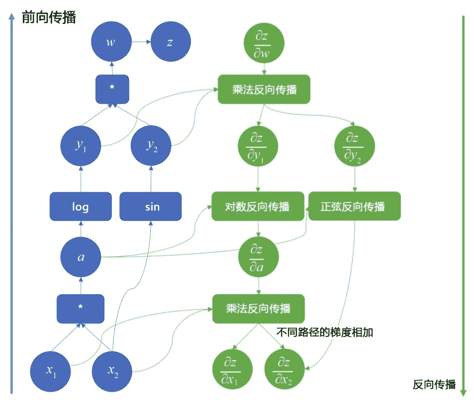

图 2-4 PyTorch 的计算图组织形式

**2.1.3 可视化与调试**

图 2-5 展示了 Python 中最常见的可视化与绘图工具 Matplotlib 的标志。

在大模型开发中，可视化与调试不可或缺。Python 中的 Matplotlib、Seaborn 等库提供丰富的图表绘制功能，帮助开发者直观理解数据分布与模型性能。同时 Jupyter Notebook 等交互式计算环境使代码编写、运行与结果展示无缝衔接，极大方便模型调试与优化。图 2-6 展示了 JupyterLab 的基本操作界面，基于 Web 的左右布局便于管理和操作 Notebook 文件，而 Notebook 除支持 Python 外，还支持 Julia、Plotter、R 等语言内核。

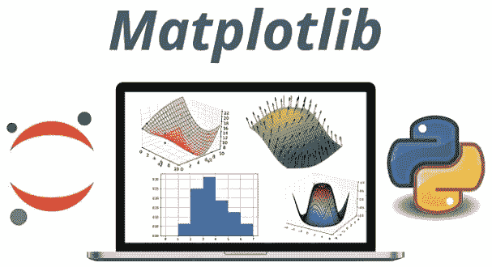

图 2-5 Matplotlib 的标志

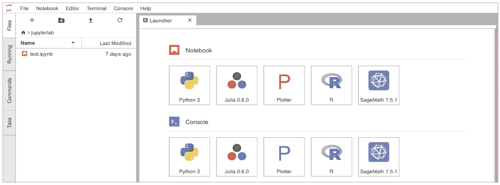

图 2-6 JupyterLab 的基本操作界面

**2.1.4 部署与集成**

模型训练完成后，如何部署到实际应用是重要问题。Python 生态提供多种部署方案，如使用 Flask、Django 等 Web 框架构建 RESTful API，或通过 TensorFlow Serving 等工具将模型封装为服务。此外还可借助 Docker 容器化技术将模型及其运行环境打包为独立单元，便于在不同环境部署迁移。图 2-7 展示了 TensorFlow Serving 模型部署界面，可看到服务状态及部署参数。

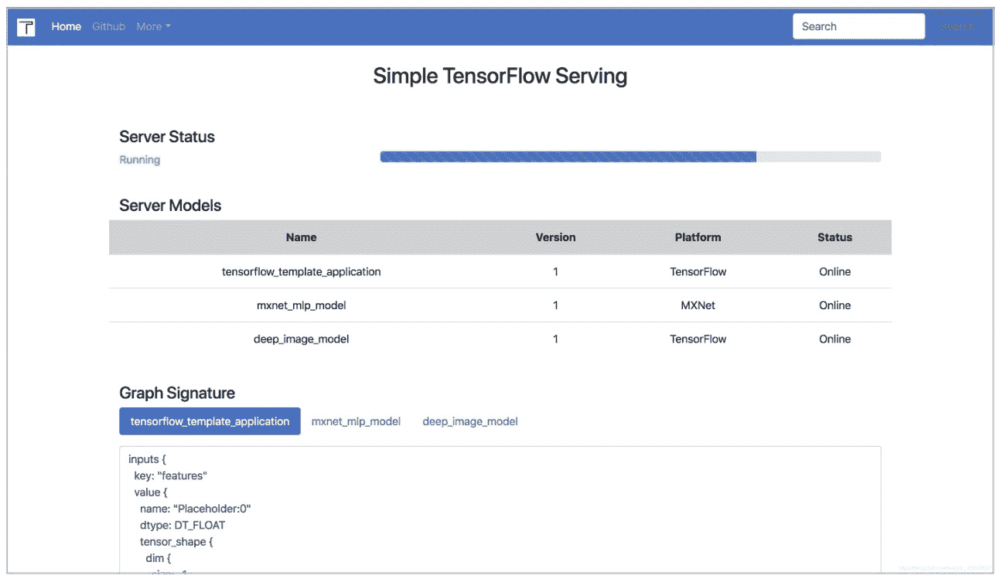

图 2-7 TensorFlow Serving 模型部署界面

**2.1.5 社区与资源**

Python 在人工智能领域的成功也得益于活跃社区与丰富资源。GitHub、Stack Overflow 等平台聚集大量开发者与专家，分享经验、解答问题、发布项目与工具。此外 Kaggle 等竞赛平台鼓励开发者通过参与竞赛提升技能并学习最新技术。这些社区与资源不仅提供学习机会，也促进技术快速迭代。如图 2-8 所示，Python 生态采用分层架构，从核心组件、标准库到第三方库，最终延伸至各类应用场景，构成完整技术体系。

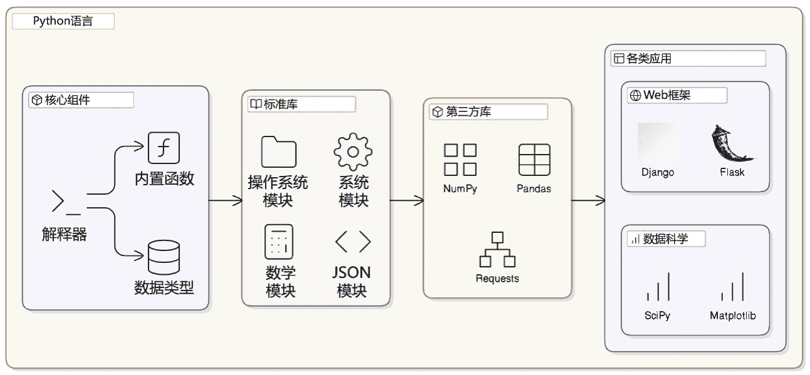

图 2-8 Python 语言的生态体系

总体来看，Python 视角下大模型的开发生态是一个集数据处理与分析、模型构建与训练、可视化与调试、部署与集成及社区与资源于一体的综合体系。

### **2.2 Python 工程环境搭建**

开始大模型开发前，搭建稳定高效的 Python 环境至关重要。Miniconda 作为轻量级科学计算发行版，集成 Conda 包管理器与大量常用科学计算库，适合用于大模型开发。如图 2-9 所示，Miniconda 可视为以 Conda 为核心的 Anaconda 子集，两者存在包含关系：Anaconda 包含 Miniconda 全部功能，而 Miniconda 保留核心组件。

图 2-9 Miniconda 可看作以 Conda 为核心的 Anaconda 的子集

注意：以下以 Miniconda 为例进行讲解，并不代表其为最优方案，读者可结合自身需求自行选择并部署合适的配置方案。

**2.2.1 安装 Miniconda**

首先需从 Miniconda 官网下载适配操作系统的安装程序，安装过程中按提示操作，通常会自动将 Conda 添加到系统路径。

**2.2.2 创建并激活新的 Conda 环境**

借助 Conda 可轻松创建新环境，并为不同项目配置特定 Python 版本与依赖。以下命令展示如何创建一个名为 myenv 的新 Conda 环境并指定安装 Python 3 最新稳定版。

创建完成后，需激活环境才能开始安装库或运行脚本。激活命令如下。

注意：从 Conda 4.6 起官方推荐使用 conda activate 激活环境，而在部分旧版本中可直接使用以下命令。

在 UNIX 或 macOS 上，也可使用以下命令。

**2.2.3 安装必要的库**

激活环境后，可使用 Conda 或 pip 安装大模型开发所需库。对许多科学计算库，Conda 是较好选择，因其可处理依赖关系并保证兼容性。部分库可能仅能通过 pip 安装。

以下示例展示使用 Conda 安装 TensorFlow。

若 Conda 中没有所需特定版本库，或库仅通过 pip 提供，可在已激活环境中安全使用 pip。首先确保环境已激活，然后使用 pip 命令安装库。

**2.2.4 配置 IDE 或代码编辑器**

为提高开发效率，建议使用集成开发环境或高级代码编辑器。主流工具包括 PyCharm、Visual Studio Code 等，均支持为项目配置特定 Python 解释器。配置时请将其指向刚创建 Conda 环境中的 Python 解释器。图 2-10 展示了 Visual Studio Code 的编辑界面，与多数 IDE 类似，左侧为功能导航区，右侧为代码编辑区。

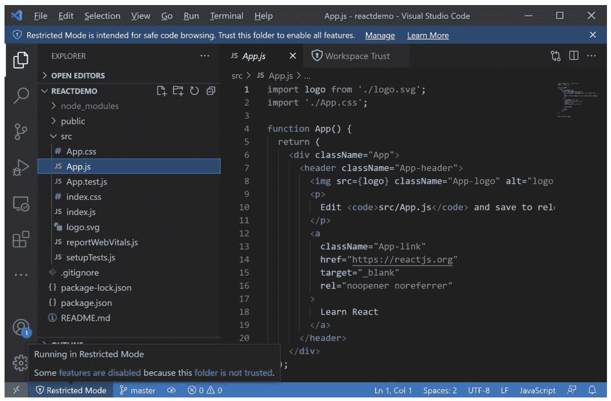

图 2-10 Visual Studio Code 的编辑界面

**2.2.5 测试环境**

环境搭建完成后，建议进行简单测试以确保正常工作。可编写简单 Python 脚本，尝试导入已安装库如 TensorFlow，并运行基本操作验证配置是否正确。如图 2-11 所示，可在 VS Code 插件栏搜索并安装 Python 相关插件，通过点击左侧“插件”栏切换到插件管理界面安装或配置插件。

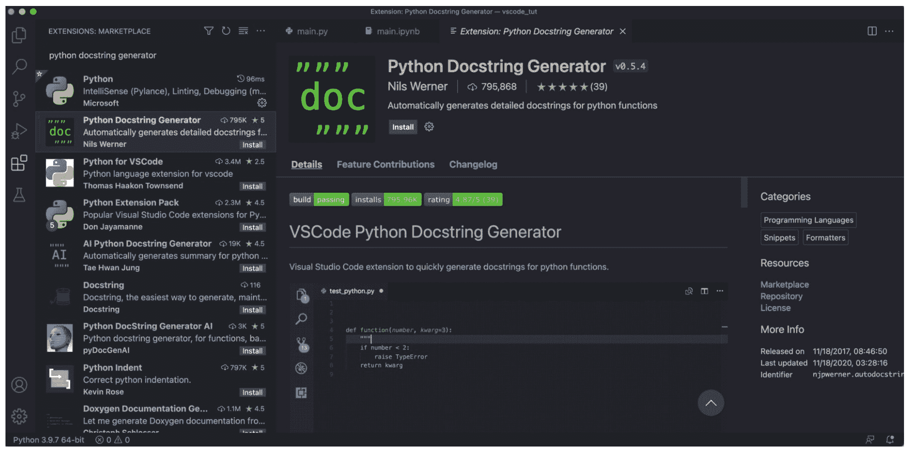

图 2-11 在 VS Code 的插件栏搜索并安装 Python 语言相关的插件

借助 Miniconda 可轻松搭建适合大模型开发的 Python 环境。它不仅提供便捷包管理功能，还集成大量科学计算库，使开发更高效。需定期更新 Conda 环境与库，以保持软件最新状态与兼容性。

### **2.3 深度学习框架概览：TensorFlow 与 PyTorch**

在深度学习领域，选择合适的框架对大模型的构建、训练与部署至关重要。目前 TensorFlow 与 PyTorch 是两大主流框架，各自拥有独特特性与优势。本节对二者做简要介绍，帮助开发者了解基本特点、应用场景及选型思路。

**2.3.1 TensorFlow**

图 2-12 展示了 TensorFlow 开发生态，包括核心计算图与运行时；API 部分包含高层封装 Keras API、Estimator API、面向 JavaScript 的 TensorFlow.js、面向移动端的 TensorFlow Lite；工具部分包含监控工具 TensorBoard、部署工具 TensorFlow Serving、模型管理工具 TensorFlow Hub。

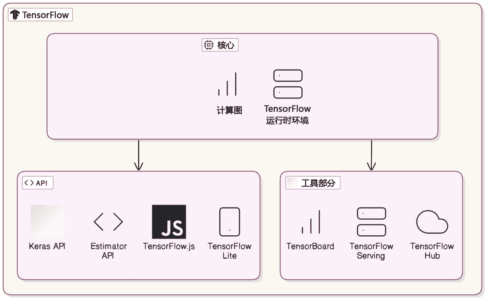

图 2-12 TensorFlow 的开发生态

TensorFlow 特点概述如下。

**静态图与动态图结合：**早期以静态图为核心，需预先定义计算图再执行。自 TensorFlow 2.x 起引入动态图执行模式，使代码更直观、调试更便捷。

**高性能计算：**TensorFlow 针对大规模分布式训练优化，支持多种硬件加速如 GPU、TPU，并提供丰富 API 简化分布式训练配置。

**TensorFlow 核心优势一览**

部署迁移更顺滑：依托 TensorFlow Serving、TensorFlow Lite 等交付工具，已训练的模型可以快速落地到云端服务器、移动终端或浏览器环境。

生态资源充裕：TensorFlow 依托活跃的开发者社群，积累了丰富的预训练模型、工具链与开源库，支撑研究验证到生产交付的完整链路。

适用方向
当项目对算力有较高诉求，需要大规模协同训练并追求跨平台部署时，TensorFlow 是常见选择，在自然语言处理与计算机视觉领域的应用尤为突出。

**2.3.2 PyTorch**

图 2-13 展示了 PyTorch 的整体生态结构，核心为具备自动微分能力的张量计算层；外围由 TorchAudio、TorchVision、TorchText 分别承担音频、视频、文本处理，PyTorch Lightning 提供更高层封装，同时配套数据处理工具与扩展包。

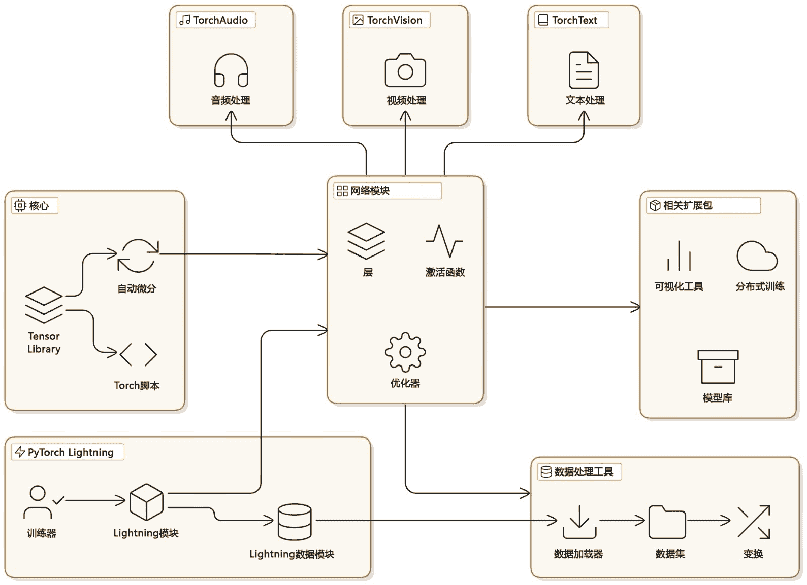

图 2-13 PyTorch 的开发生态

PyTorch 的主要特征如下。

**动态图优先：** 起步即采用动态计算图，代码更贴近原生 Python，调试过程更直观。

**灵活性高：** API 丰富开放，允许开发者自由定义网络结构与训练流程。

**上手门槛低：** 表达简洁直观，对新手较为友好。

**扩展能力强：** 提供 C++ 扩展接口，可按需实现底层算子，构建高性能自定义层或函数。

典型应用场景
PyTorch 更适用于原型快速搭建与频繁实验的任务，因其易用灵活，在学术探索、轻量级项目以及需要高频迭代的场景中认可度较高。

**2.3.3 如何选择**

在 TensorFlow 与 PyTorch 间做判断，可参考以下维度。

**项目诉求：** 结合算力预算、部署目标等技术需求挑选框架。

**团队熟练度：** 优先使用团队已有积累的方案，以降低学习与迁移成本。

**社区支撑：** 评估社区活跃度、文档完整性与生态丰富程度。

**发展趋势：** 关注前沿动态，判断框架演进方向与潜在风险。

总体而言两者各有长处，选型应结合具体需求与个人偏好。无论最终选哪一方，掌握其核心特性与使用方法都是大模型开发的关键。

### **2.4 大模型微调技术简介**

在 BERT、GPT 等大规模预训练模型之上，微调已成为提升任务效果、适配特定需求的重要手段。微调在保留大部分预训练参数不变的前提下，利用小规模任务数据调整部分参数，实现快速迁移。本节简要介绍微调的核心概念、流程与价值。

**2.4.1 微调技术的基本概念**

微调源于迁移学习的思路，以通用大数据上预训练的参数为起点，针对小样本特定任务进行参数优化。预训练模型已具备丰富的语言知识与上下文能力，因此微调收敛更快，通常数据与算力开销更低。如图 2-14 所示，大模型微调包含两种路径：模型微调与提示词微调。模型微调使用特定数据集对预训练模型进行再训练以满足任务推理；提示词微调则通过设计精细的提示词，使模型兼顾多种混合任务的推理需求。

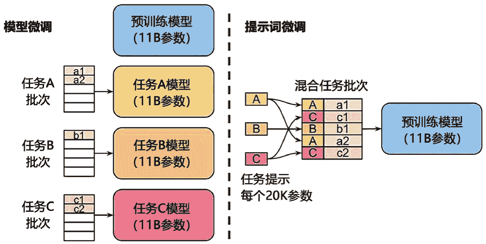

图 2-14 大模型微调的两种方式

**2.4.2 微调技术的流程**

常规流程大致包括以下步骤。

**基座模型选择：** 根据任务特性挑选合适的预训练模型，不同模型在不同任务上的表现差异明显。

**任务数据准备：** 采集并标注目标任务的数据集，规模通常远小于预训练数据，但需精细设计。

**结构调整可选：** 按需修改预训练结构，如增加任务专用输出层或调整参数。

**超参数设定：** 确定学习率、批次大小、训练轮次等，需结合任务与数据优化。

**训练执行：** 在任务数据上重训模型部分参数，通常冻结底层，仅更新顶层或新增层。

**评估调优：** 在验证集上检验效果，据结果进行必要调优。

**2.4.3 微调技术的重要性**

微调在模型开发中作用关键，既能显著提升特定任务表现，又可降低训练时间与算力成本，同时扩展预训练模型的应用边界，覆盖更多真实场景。

借助微调，开发者可充分利用预训练优势，快速构建面向特定任务的深度学习模型，对人工智能在各领域的落地具有重要意义。

### **2.5 实例：使用 Python 语言进行简单的模型微调**

本节以简例演示如何用 Python 对模型进行微调。假设已有预训练文本分类模型，需适配新分类任务。选用 PyTorch 作为示例，因其在社区中以灵活性与易用性著称。

**2.5.1 准备阶段**

首先确认已安装 PyTorch 及相关库，如用于数据处理的 TorchText。若未安装，可通过 pip 安装。

随后准备数据集。示例中假设已有标注好的文本分类数据，包含训练集与验证集。

**2.5.2 数据加载与预处理**

本例使用 TorchText 完成数据加载与预处理。标准流程通常包括字段定义、数据集定义与数据加载器，具体实现取决于所用库与数据格式。以下给出基于 TorchText 与 torch.utils.data.DataLoader 的简化示例，假设数据以 CSV 提供，包含文本列与标签列。

使用以下 Python 代码加载与预处理数据。

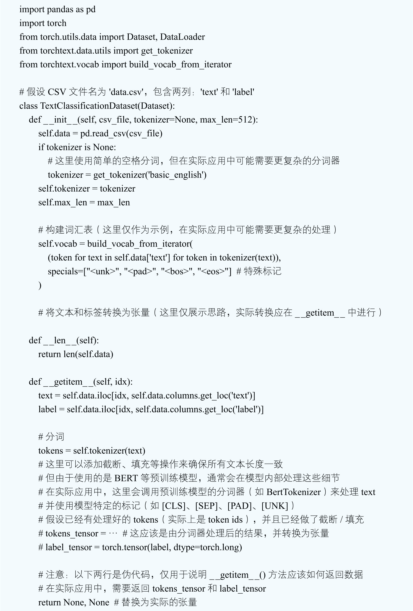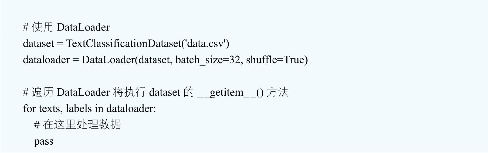

注意事项如下。

TextClassificationDataset 为自行实现的 Dataset，需按实际数据格式调整。

__init__ 示例采用基于空格的简单分词，实际应用中建议使用 spaCy、NLTK 或预训练模型自带分词器。

示例构建简易词表，实践中应按预训练模型要求构建词表或直接使用模型自带词表。

__getitem__ 应返回处理后文本与标签，示例返回 None，因具体的分词、转 token id、截断填充等需依模型与分词器实现。

示例使用 DataLoader 批量加载，并设置 batch_size 与 shuffle。

实践中需使用预训练模型提供的分词器处理文本，将其转为模型可读的 token id 张量，并对长度进行截断或填充以保证批次一致，这些操作通常在 __getitem__ 中完成，具体取决于模型与分词器。

**2.5.3 加载预训练模型**

假设使用 BERT 类预训练模型。在 PyTorch 中可借助 Hugging Face 提供的 Transformers 库加载。首先安装该库。

加载预训练模型，以下为简化示例。

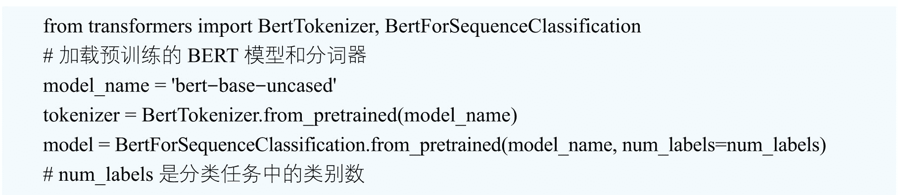

微调前需按任务调整模型，如添加自定义输出层。本例假设预训练模型已有适配输出层。

设定训练循环微调模型，通常包括定义损失函数、优化器，并在每个 epoch 中迭代数据加载器计算损失、反向传播与参数更新。

微调中需定义优化器更新权重，并定义损失函数衡量预测与真实标签差异。以下为 PyTorch 示例。

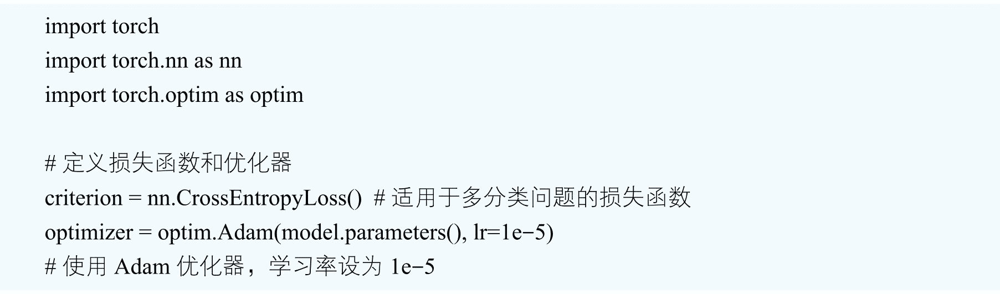

随后编写训练循环，遍历数据加载器每个批次执行前向传播、计算损失、反向传播并更新参数，仅展示核心部分。

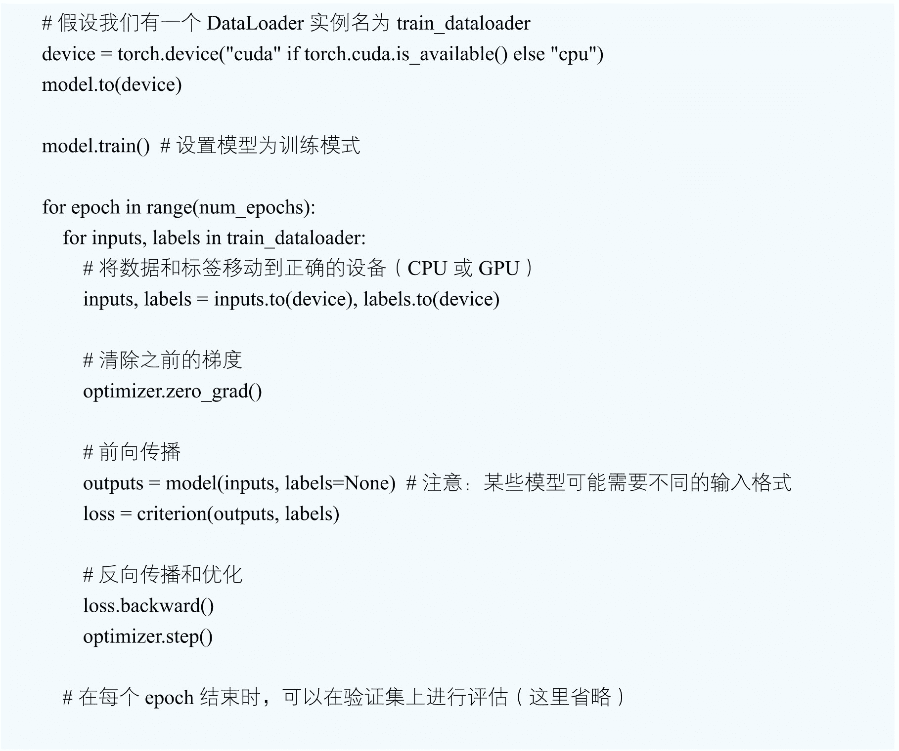

注意：以上为简化示例，需根据实际模型与 DataLoader 配置调整。尤其是 model(inputs, labels=None) 这一行可能需按模型 API 调整，并非所有模型都接受 labels 作为输入。

**2.5.4 微调时的注意事项**

进行模型微调时需关注表 2-1 所列要点。

表 2-1 微调时的注意要点说明

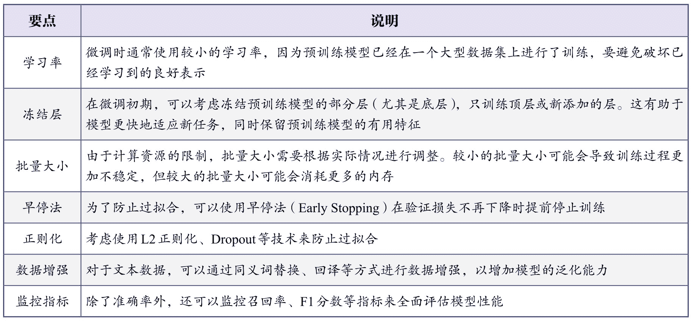

遵循上述步骤与注意事项，可有效使用 Python 进行模型微调。每个项目与任务各具特点，实际操作中需根据情况调整优化。

**2.5.5 评估与部署**

训练完成后，应在测试集上评估模型泛化能力。若表现良好，可考虑部署到实际应用中。部署方式取决于场景，可能包括导出特定格式、集成 Web 服务或嵌入移动应用。

在机器学习中，评估是开发重要环节，部署则是将模型应用于真实场景的关键，大模型亦然。以下给出评估与部署的示例框架。

**1. 评估环节**

评估通常在验证集或测试集上运行模型，计算准确率、召回率、F1 分数等指标。以下为 PyTorch 简易评估示例。

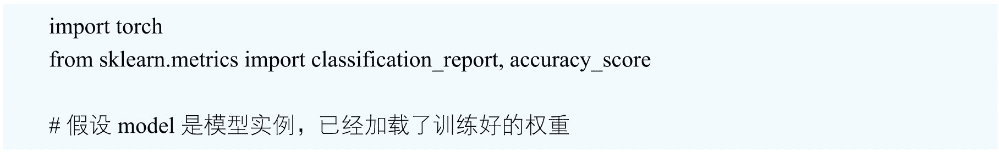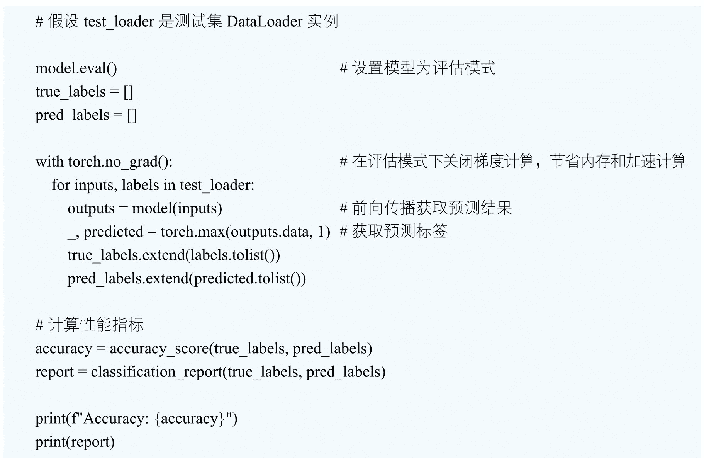

注意：示例使用 sklearn.metrics 计算指标，需先将输出转为 NumPy 数组或列表。PyTorch 也提供部分指标计算功能，为简化此处使用 sklearn。

**2. 部署环节**

部署方式取决于应用场景。给出两种常见部署的思路框架。

集成到 Web 服务：可使用 Flask、Django 等 Web 框架将模型封装为 API 服务，用户通过 HTTP 请求发送数据，服务器调用模型预测并返回结果。

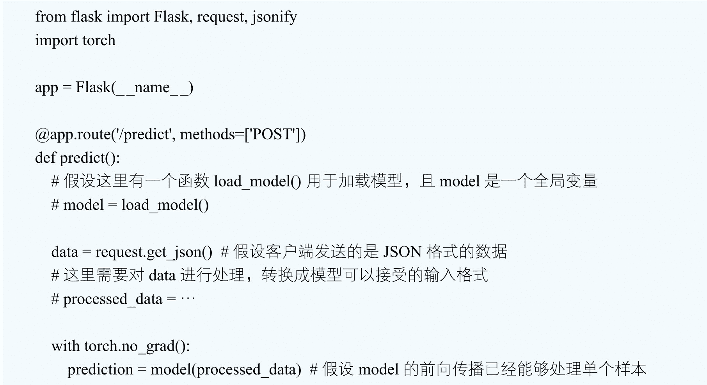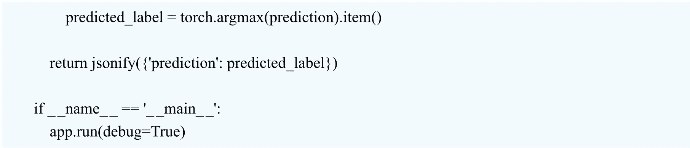

注意：上述代码为简化示例，实际部署需考虑错误处理、安全性、性能优化等细节。

集成到现有系统：若需嵌入大型应用或数据驱动网站，可将模型预测逻辑编写为系统可调用的函数或模块，具体实现依赖系统架构与编程语言。

无论何种部署方式，均需保证模型稳定高效运行，并能应对实际应用中的各种情况。充分测试是部署前的必要环节。

**2.5.6 要点回顾**

大模型微调核心步骤包括：

（1）将原始文本转为模型可处理格式，如分词与格式转换。
（2）前向传播：将处理后数据输入模型获取预测。
（3）计算损失：使用交叉熵等损失函数衡量真实标签与预测差异。
（4）反向传播：通过 Adam 等优化器更新模型参数。
（5）验证：在每个训练周期结束时在验证集评估，监控训练过程。
（6）部署集成：将模型保存为二进制文件后在应用中加载预测。

### **2.6 本章小结**

本章从搭建 Python 开发环境，到认识深度学习框架 TensorFlow 与 PyTorch，再到掌握大模型微调技术，系统梳理了 Python 语言进行大模型开发的关键环节。通过实例展示了模型微调全流程，从数据加载预处理到模型评估与部署，贴近人工智能技术核心。

在数据科学与人工智能快速发展的今天，掌握这些关键技能对推动技术进步与解决实际问题至关重要。希望读者继续深化理解，不断探索创新，为人工智能领域发展贡献力量。随着技术进步与场景拓展，大模型将在更多领域发挥更大潜力。

# **第二部分**

# **训练与加速大模型**

随着人工智能技术飞速发展，大模型已成为推动深度学习进步的关键力量。然而其训练过程复杂耗时，对计算资源要求极高。为应对挑战，本部分将深入探讨高效训练方法与硬件加速技术，引领读者了解大模型训练最新趋势，掌握通过优化算法与高性能硬件提升训练效率的方法。

## **第三章 常用训练加速硬件**

在大模型训练中，计算资源的合理利用是加速训练、缩短开发周期的关键。GPU 作为并行计算的重要平台，凭借强大的浮点运算能力与高度并行架构，成为加速深度学习训练的首选硬件。本章将详细介绍 GPU 架构与编程模型，为理解如何利用 GPU 加速大模型训练奠定基础。

**本章涉及的主要知识点如下。**

◆GPU 架构与编程模型。
◆CUDA 编程模型与 GPU 内存管理。
◆大模型训练中的 GPU 优化。

注意：本章内容不包含 TPU 等其他异构加速硬件介绍。

### **3.1 GPU 架构与编程模型**

图 3-1 所示为 NVIDIA TESLA 系列 GPU，采用标准 PCIe 接口设计，可直接安装在主板 PCIe 扩展插槽上。

图形处理器即 GPU，是在个人计算机、工作站、游戏机及移动设备上进行图像与图形相关运算的微处理器。

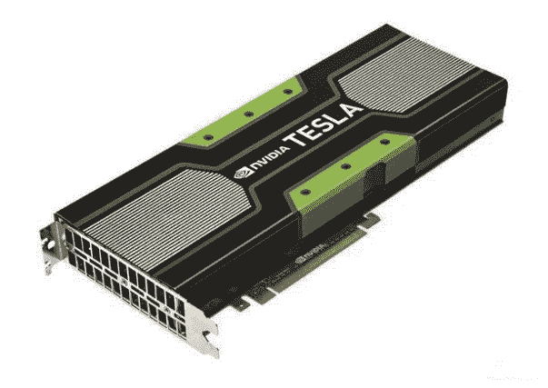

图 3-1 NVIDIA TESLA 系列 GPU

在探讨大模型训练加速硬件基础前，理解 GPU 架构与编程模型对开发者至关重要。GPU 最初用于图形渲染，如今已演变为强大的并行计算设备，特别适合深度学习大模型训练。

**3.1.1 GPU 架构概述**

**并行处理能力**：与 CPU 相比，GPU 具备更强的并行处理能力，如图 3-2 所示，虽然单个计算核心不及 CPU 强大，但核心数量远超 CPU，通常是 CPU 的上百甚至上千倍。GPU 犹如工厂，其众多核心如同工人，可同时处理大量任务，这正是 GPU 擅长并行任务的原因。

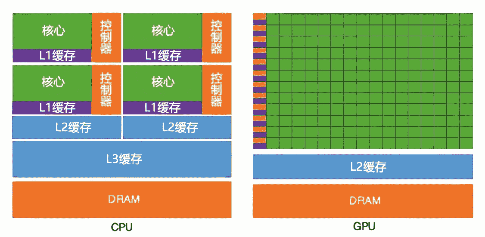

图 3-2 现代 CPU 与 GPU 架构的对比

以主流硬件为例：NVIDIA RTX 4090 GPU 拥有 16384 个 CUDA 核心，单个 CUDA 核心频率为 2.28～2.52 GHz，而 Intel Core i9 CPU 通常仅配备 8～24 个内核，单个内核频率为 2.4～6.2 GHz。

**内存带宽**：GPU 内存带宽指 GPU 内存与 GPU 之间交换数据的速度。可类比为工厂原材料的运输带，带宽越大，数据搬运越快，生产效率越高。图 3-3 所示为 GPU 中数据流转，内存带宽决定了流转线路中的数据传输速度，受带宽制约的环节包括数据传输、渲染输出与数据保存。

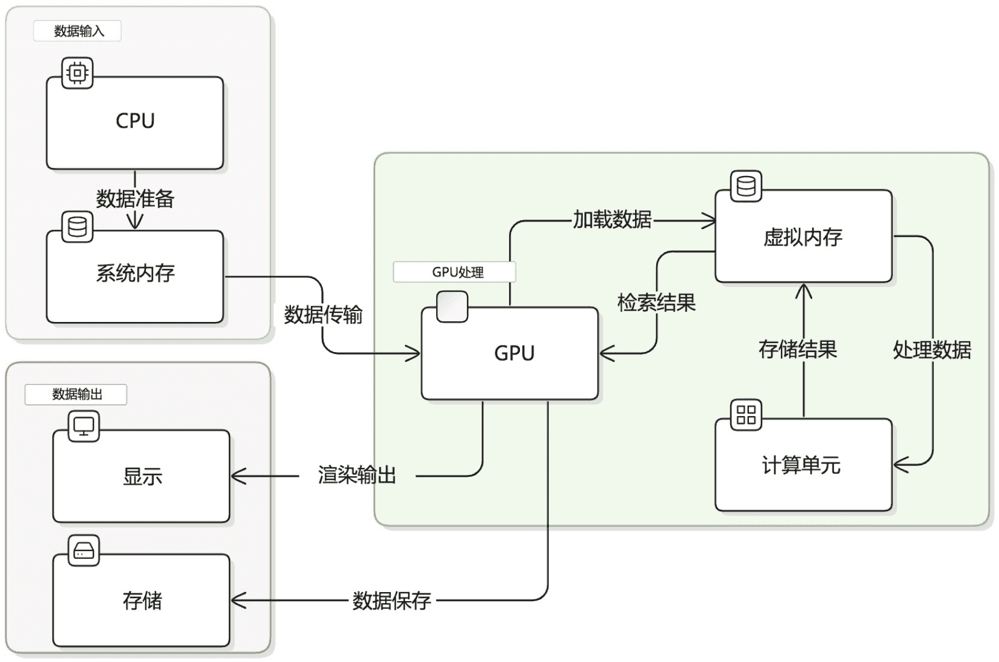

图 3-3 GPU 中的数据流转

以 NVIDIA RTX 4090 为例，其内存带宽高达 1008.0 GB/s，而 Intel Core i9 最大内存带宽可达 89.6 GB/s。

注意：以上数据统计截至 2024-08-17，具体指标以厂商发布为准。

**流处理器**：流处理器是指将多媒体图形数据流映射到处理单元进行计算的过程。在 GPU 中，流处理器是执行计算任务的核心单元。图 3-4 所示为流处理过程，数据源经批量处理传输给 Streamz 核心，经预处理与转换后再批量传输至下一阶段。

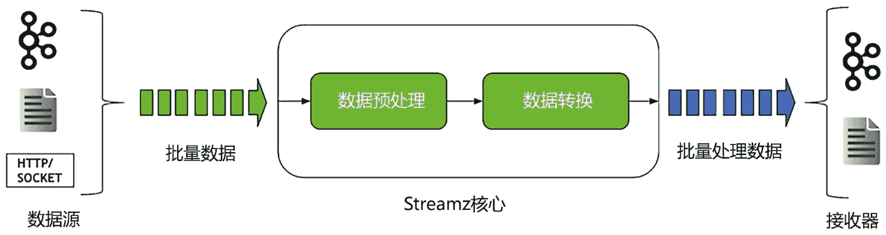

图 3-4 流处理过程

**3.1.2 GPU 编程模型**

在现阶段的计算架构中，图形处理器已从绘图专用硬件演进为承载大规模并行计算的核心引擎。相较于中央处理器偏重顺序执行的思路，针对显卡的开发范式更聚焦于数据面并行与任务面并行，用以应对海量数据与复杂算式的挑战。图 3-5 所示为图形处理器数据处理流程。

针对显卡的开发范式，其关键组成可归纳为执行单元、线程与线程块、存储层级、数据面并行与任务面并行、同步与通信，下面逐项展开。

**并行执行单元：**显卡内部集成了海量的执行单元，能够同时处理多组数据或多项任务。开发者通过构建并行算法，把计算负载分摊到这些单元，从而获得加速。

**线程与线程块：**在显卡开发中，计算常被抽象为线程 Thread 与线程块 Block。线程是最小的执行粒度，多个线程聚合为一个线程块。线程块可在显卡的流式多处理器 Streaming Multiprocessor, SM 上协同运行，充分释放并行算力。

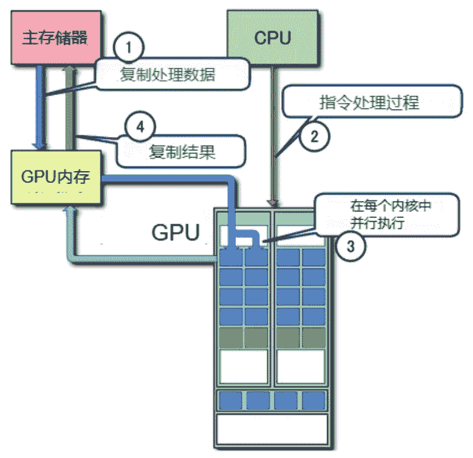

图 3-5 图形处理器数据处理流程

**内存层次结构：**显卡的存储体系呈多层结构，涵盖全局存储、共享存储、常量存储与纹理存储等。各类存储在访问时延与容量上各不相同，编程时需依据任务特性合理调配。

**数据并行与任务并行：**开发范式同时支持两种并行形态。数据面并行是对大量独立数据执行同一操作；任务面并行则是把复杂问题拆分为若干子问题，分配到不同执行单元并行完成。

**同步与通信：**显卡编程中，线程间的同步与通信十分关键。必须确保线程在恰当时机交换数据，避免竞争与错误。

**3.1.3 CUDA 核心概念**

**核函数：**核函数 Kernel 是该并行框架的主角，可理解为在核心上运行的函数。它相当于任务指令，告知显卡上各线程如何工作。下方是一则简易示例，演示在显卡上完成 a+b 的过程。

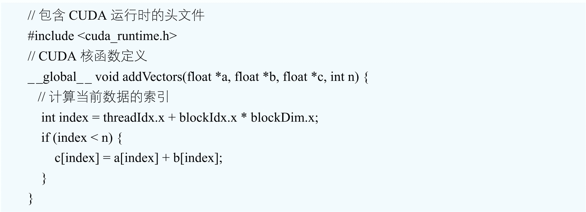

**线程同步：**在该框架的程序里，大量线程并发工作，需要像交通调度般避免冲突。线程协作是完成任务的基础，该框架提供了多种同步原语以保持一致。

**1. __syncthreads() 原语**

__syncthreads() 是线程块级别最基础的同步手段，用于让同一线程块内的全部线程在同一点汇聚后再继续。调用该原语的线程会阻塞，直至块内所有线程均抵达同步点，常用于共享存储写入完成后统一读取。

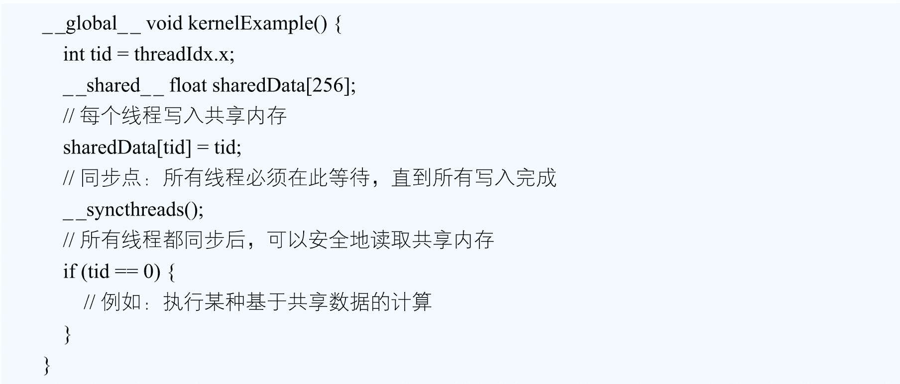

**2. __threadfence_block() 原语**

为保证数据一致性，该框架提供了 __threadfence_block() 用于块内同步。其作用是确保调用前对全局存储或共享存储的写入，对调用后同一线程块内的所有线程可见，形成块内屏障。

典型用途有：

**共享内存同步：**共享存储读写时延低，但缺乏同步易导致竞争。该原语可确保所有线程完成写入后再访问，避免不一致。

**全局内存写入同步：**当块内线程向全局存储写数据并希望在块内立即可见时，可用此原语实现同步。

示例中线程先向共享存储写入，随后调用 __threadfence_block() 确保写入完成，再安全读取并写入全局存储。

注意：该原语仅作用于当前线程块，不涉及其他块；会带来同步开销，需审慎使用；若块内并非所有线程都执行到该点，可能引发死锁。

**3. __threadfence_system() 原语**

在块级同步之上，该框架还提供系统级同步原语 __threadfence_system()。它保证调用前的全局存储写入对所有 CUDA 流、所有显卡上的所有线程都可见，形成系统范围屏障。

使用场景包括：

**跨流同步：**不同流可独立进行计算与传输，若共享全局存储，可用该原语让一个流的写入对另一流可见。

**多显卡同步：**在多卡环境下，确保某卡的全局写入对其它卡的线程可见。

注意：作用范围极广，开销较大，实际中应尽量避免。调用会阻塞所有流与设备线程，若相关线程未全部抵达同步点易死锁。大多数情况下更细粒度的同步或 CUDA 事件是更优选择。

为演示其原理，下面给出一个简化框架展示 kernel1 写入后通过 __threadfence_system() 让 kernel2 读取时的可见性。

该示例仅用于说明机制，并非最佳实践，实际应依据需求选择合适的同步方式。

**4. __threadfence() 原语**

__threadfence() 在该框架的同步函数中较为特殊，其行为并不固定。它本质上是一个占位符，实际效果依赖编译指令或上下文，可能被解释为块级或系统级 fence。

使用场景：因行为不确定，通常不建议直接使用。开发者应明确选择 __threadfence_block() 或 __threadfence_system()。在极少数高级用法或编译期配置场景下，它可作为灵活切换同步范围的手段，但要求对编译与运行环境有深入掌握。

注意：一般情况下应避免直接使用，选择语义明确的原语。若必须使用，需确保行为符合预期，同时权衡同步带来的性能损耗。

示范代码仅展示其可能的预处理器切换写法，并不推荐在生产代码中采用。

总体而言，__threadfence() 并非常用同步手段，其效果依赖环境，编写程序时应优先使用语义清晰的同步原语，保证正确性与性能。

### **3.2** **CUDA 编程模型与 GPU 内存管理**

CUDA 由 NVIDIA 推出，是面向并行计算的平台与编程模型，旨在释放显卡在深度学习训练等计算密集型任务上的潜能。理解其开发范式与存储管理机制是高效利用资源的先决条件。

**3.2.1** **CUDA 编程模型**

该平台提供细粒度的显卡编程模型，通过扩展 C/C++ 等标准语言赋予开发者对硬件资源的底层控制能力，提升并行效率。图 3-6 所示为并行计算平台的层次结构。

**网格、线程块和线程：**该模型的组织层次自上而下为网格、线程块、线程。线程是基础执行单元，线程块由一组线程构成，网格则由多个线程块组成。任务被切分为大量小任务由线程执行，再通过块与网格组织，如同把工人分组分队协作。图 3-7 所示为层次关系。

图 3-6 CUDA 并行计算平台的层次结构

图 3-7 该框架网格、线程块与线程的层次关系

**内存层次结构：**显卡存储可类比为不同规格的仓库，各层用途与访问速度不同。表 3-1 为该平台各类内存层级。

表 3-1 CUDA 中的各种内存层次结构

续表

图 3-8 所示为该平台各存储的层次结构。

图 3-8 CUDA 中各内存的层次结构

在实际开发中，需结合数据访问模式与算法需求挑选合适的存储类型，以获得性能收益。

**3.2.2** **GPU 内存管理**

该平台程序性能高度依赖存储管理，涵盖分配释放、数据搬运、访问策略与存储池等多个环节。

**1.** **内存分配和释放**

使用该平台 API 在设备上申请与回收存储。cudaMalloc() 分配设备存储，cudaFree() 释放。与中央处理器不同，显卡显存有限，合理分配并及时释放可避免泄漏并提升利用率。

**2.** **数据传输**

中央处理器与显卡拥有独立存储空间，计算前需把数据从主机拷贝到设备 Host-to-Device，即 H2D；计算后需把结果从设备拷回主机 Device-to-Host，即 D2H。cudaMemcpy() 支持这两种方向的搬运。为提升效率，可采用批量传输、异步传输等策略。

**3.** **内存访问策略**

不同存储类型访问速度与容量各异。频繁访问的小数据宜用共享存储加速，大规模数据多放全局存储。此外，优化数据布局、减少 bank 冲突等手段也能改善访问效率。

**4.** **内存池技术**

为降低频繁分配释放的开销，可采用存储池技术预先分配一块显存，运行时从池中取用，减少 API 调用次数，提升执行效率。开发者可在程序中自建存储池管理显存。

注意：

（1）内存对齐：部分显卡操作要求数据对齐到特定边界，分配与传输时需注意对齐，避免性能下降或错误。

（2）错误检查：API 调用可能返回错误码，应定期检查并妥善处理异常。

（3）资源管理：需合理控制线程与存储使用，过量占用可能导致性能衰退或系统崩溃。

良好的存储管理是程序高效稳定运行的基础，对加速深度学习模型训练、提升模型性能意义重大。

### **3.3** **大模型训练中的 GPU 优化**

大模型训练对计算需求极大，显卡的并行能力使其成为首选。但仅靠硬件不足以达到最优，需结合优化策略提升训练效率。

**3.3.1** **数据并行与模型并行**

为充分利用多显卡资源，常用数据面并行与模型面并行两种思路。图 3-9 所示为两种方式的对比，上方为数据面并行，将数据分块处理；下方为模型面并行，将模型拆分为多个子模型并通过数据交换协作。

图 3-9 数据并行与模型并行的对比示意

**1.** **数据并行**

把训练集切分为多个子集，由不同显卡并行处理各自子集，完成前向、损失计算与反向后再通过参数平均等手段同步模型，保持一致。

优点是可以充分利用多卡算力加速训练。挑战在于参数同步开销与显卡间通信延迟，可通过梯度累积、异步更新等技术缓解。

在 PyTorch 中，可借助 torch.nn.DataParallel 与 torch.nn.parallel.DistributedDataParallel 等接口快速实现数据面并行。

**2.** **模型并行**

将模型的不同部分分配到不同显卡计算，适用于单卡无法容纳整个模型的大模型场景。通过拆分层或模块并配合 NVLink、PCIe 等进行通信实现协同训练。

实现相对复杂，需处理模块依赖与通信成本。PyTorch 可手动指定各部分所在设备，也可借助 Megatron-LM 等高级库简化模型并行开发。

**3.** **并行技术小结**

让超大模型在有限时间内完成收敛，工程里最常被讨论的并行手段有两种。一种是把样本集拆分到多张显卡上让它们并行处理，适合数据规模庞大而模型规模尚可控的情形；另一种是把网络本身切块放到不同设备上协同计算，适合参数量超出单卡承载能力的情形。落地时往往会结合数据特征、模型大小和现有硬件进行权衡，有时两者混用，目标都是把整体训练吞吐拉到最佳。

**3.3.2 显存占用治理**

训大模型时，显存是否够用常常决定能不能跑起来。参数量与结构复杂度共同抬高显存需求，一不留神就会触发 OOM。把显存侧的开销管住，既能提升速度，也能避免溢出，还能让设备利用率更高。下面是几类常用的做法。

**1. 梯度累积**
当 batch 尺寸被显存卡住时，累积梯度是常见解法。不是每一步都立刻更新权重，而是先把若干小批量的梯度先叠加起来，达到预设阈值后再统一做一次参数更新。相当于在显存层面模拟大 batch，却不用为每个小批保留完整中间结果。代价是更新被推迟，迭代节奏会变慢，但在大模型场景下通常可以接受。

**2. 混合精度**
同时使用 FP32 与 FP16 完成计算。FP16 的存储开销约为 FP32 的一半，能明显压缩显存占用；配合动态缩放与数值校正，又能保持训练的稳定与精度。当前主流显卡原生支持半精度运算，这套方案的性价比很高。

**3. 内存池技术**
频繁申请释放显存会带来管理开销。内存池提前分配好大块内存，训练时从池中取用、用完归还，减少系统分配次数。图 3-10 所示为 Python 语言中使用内存池技术管理内存的示意，其中 usedpools 为已使用的内存池，freepools 为空闲的内存池，freeblock 为用完后释放的内存块， untouched 为未使用的内存空间 free 为已释放的内存空间，allocated 为已分配的内存空间。

图 3-10 Python 语言中使用内存池技术管理内存的示意

**4. 数据加载与预处理优化**
数据读取本身也会消耗显存。把增强操作改成在线生成，而非预先把所有增强样本塞进内存，就能省下不少空间。选用更紧凑的数据格式和压缩算法，也能进一步降低占用，提升流水线效率。

**5. 分块加载模型参数**
模型整体太大装不进显存时，可以采用分块搬运。把网络拆成若干段，每次只把当前计算所需的参数送到显卡，算完后卸下再换下一批。这种做法需要精细的调度与同步，才能保证训练正确且高效。

**3.3.3 计算效率提升**

计算效率直接决定训练时长。优化计算流程可以更好发挥显卡算力，减少无效开销，从而整体提速。以下策略在实践中较为常用。

**1. 算子融合**
把多个连续操作合并成一个复合算子，减少中间结果的读写。卷积、激活、BatchNorm 等步骤融合后，数据在显存中的搬运频率下降，计算更连贯。TensorFlow、PyTorch 等框架普遍提供融合接口，开发者可通过配置或 API 开启。

**2. 高效计算库与算法**
现代显卡自带针对深度学习的加速库。例如 cuDNN 用来加速卷积和池化，cuBLAS 用于矩阵运算。调用这些库能显著提升算力利用率。结合更先进的算法和数据结构，还能把计算再做一层优化。

**3. 数据布局与访问模式**
内存访问方式直接影响缓存命中率和带宽利用。采用连续的内存布局存储参数和特征，减少访问冲突；调整访问顺序、使用循环展开等，也能让显卡读取更顺滑，计算开销随之下降。

**4. 并行与异步计算**
显卡天生适合大规模并行。增大 batch、动用更多卡或调整架构都能提升并行度。同时借助异步能力，让显卡计算时 CPU 去做数据预处理、评估等任务，实现流水线并行，资源利用率更高。

**5. 性能监控与调优**
优化需要量化。借助 TensorFlow Profiler、PyTorch Profiler 等工具定位训练中的性能瓶颈，再针对性调整参数、数据管线或换用更快的库。图 3-11 所示为带有 TensorBoard 的 PyTorch Profiler 界面，其中可以很方便地查看和统计模型训练时各环节的执行开销。

图 3-11 带有 TensorBoard 的 PyTorch Profiler 界面

**3.3.4 GPU 优化要点汇总**

大模型训练的显卡优化主要围绕数据并行、模型并行、显存治理和计算提速展开。不同任务、不同硬件组合下，最优方案并不相同，需要根据实际情况权衡选择。随着显卡架构和框架的演进，新的优化手段也会不断出现。

### **3.4 实例：用 CUDA 驱动大模型训练**

为了把优化思路落地，下面用一个简化示例演示如何在 Python 里借助 CUDA 和 PyTorch 加速训练。

**3.4.1 实例背景**

模型越大，计算需求越高，充分利用显卡等硬件成为刚需。本例以一个简易 CNN 做图像分类，演示 PyTorch 与 CUDA 的完整流程。读者可以学习环境配置、模型搭建、数据准备、训练参数设定等关键环节。

实例概述：使用 PyTorch 实现一个 CNN，在 MNIST 上训练，并通过 CUDA 加速。

本实例主要想达到三点目标。

**展示加速效果：**对比 CPU 与显卡的训练耗时，直观感受加速幅度。

**认识 CUDA 原理：**虽然框架封装了大部分细节，仍简要介绍 CUDA 概念，帮助理解底层原理。

**探索提效技巧：**在训练中涉及数据并行、混合精度等常见优化，体会提效方法。

**3.4.2 环境准备**

步骤一：安装 Python 和 PyTorch。在前面的章节中已经做了介绍，这里不再赘述。

步骤二：安装 CUDA 和 cuDNN。通常需要从 NVIDIA 的官网下载对应的安装包，并按照提供的安装指南进行安装。确保安装的版本与所使用的 PyTorch 版本兼容。

步骤三：配置环境变量。安装完成后，可能需要配置一些环境变量来确保系统能够定位 CUDA 和 cuDNN 库。通常包括将 CUDA 的安装路径添加到系统的 PATH 环境变量中，以及设置 CUDA_HOME 环境变量。

在 Linux 或 macOS 操作系统上，可以在终端中使用 export 命令来设置环境变量。

在 Windows 操作系统上，可以通过系统属性中的“环境变量”设置来添加这些路径。

如果使用 conda 环境，则在安装完 cudatookit 后，系统会自动设置好环境变量。

步骤四：验证安装。完成安装和配置后，验证环境是否设置正确。可以通过运行一些简单的 CUDA 程序来检查 CUDA 是否能够正常工作。此外，运行 PyTorch 提供的一些示例代码也可以帮助验证 PyTorch 和 CUDA 的安装是否成功。

在 Python 语言中，可以使用以下代码来检查 PyTorch 是否能够检测到 CUDA。

如果输出显示 CUDA 可用，并且 GPU 计数大于 0，那么环境准备就绪。

步骤五：准备数据集。在进行模型训练前，还需要准备相应的数据集。通常包括下载数据集、进行数据预处理以及划分训练集、验证集和测试集等步骤。具体的数据集准备过程取决于选择的模型和任务。

**3.4.3 模型定义和数据加载**

**1. 定义模型**

PyTorch 里模型一般继承 torch.nn.Module。以下是一个简化的 CNN 定义示例。

**2. 数据加载**

PyTorch 的 torchvision.datasets 和 torch.utils.data. DataLoader 能简化数据读取。以下以 MNIST 为例。

先定义图像转张量和归一化的变换，再用 datasets.MNIST 加载数据并分别创建训练和测试的 DataLoader，批处理、打乱等工作由它自动完成。

**3.4.4 模型训练**

**1. 编写训练循环**

先选好损失函数和优化器，分类任务常用交叉熵，优化器可选 Adam 或 SGD。

随后进入训练循环，完成前向、反向和参数更新。

**2. 监控训练过程**

每个 epoch 结束打印损失和准确率，便于掌握进度。更直观的做法是用 TensorBoard 可视化。

步骤如下。

（1）确保已经安装 TensorBoard。如果没有安装，可以通过以下命令进行安装。

（2）导入 TensorBoard 库。在训练脚本的开头，导入 TensorBoard 所需的库。

（3）初始化 SummaryWriter。在训练循环之前，初始化一个 SummaryWriter 对象，用于记录数据。

（4）在训练循环中记录数据。在训练循环中，使用 writer.add_scalar()方法来记录损失值。

（5）启动 TensorBoard。在训练完成后或者在查看训练过程时，启动 TensorBoard。

注意：tensorboard 命令的 logdir 参数必须与前面代码中指定的日志目录一致。

打开浏览器访问 http://localhost:6006，可看到损失和准确率随时间变化的曲线，如图 3-12 所示。

图 3-12 训练过程中的损失和准确率变化

**3. 利用显卡加速**

通过 torch.cuda.is_available()判断显卡是否可用，可用时把模型和数据搬到显卡上计算，训练速度会有明显提升。

PyTorch 提供了 cuda()与 cpu()函数，可以方便地将数据或模型移入和移出 GPU。图 3-13 所示为 CPU 与 GPU 的训练时间对比，可以看出 GPU 的运行时间显著小于 CPU 的运行时间。

图 3-13 CPU 与 GPU 的训练时间对比

**4. 测试模型**

训练完成后在测试集上评估准确率，测试时使用 torch.no_grad()关闭梯度计算，节省显存和算力。

至此训练与评估流程完成，后续可继续调参优化。

**3.4.5 实例总结**

本实例完整走了一遍基于 Python 和 CUDA 的显卡加速训练流程。

**1. 实例收获**

**环境搭建与配置：**掌握 Python、PyTorch、CUDA、cuDNN 的安装与环境变量配置，确保显卡可用。

**模型定义与数据加载：**学会用 PyTorch 定义 CNN 并借助 DataLoader 加载 MNIST，完成预处理。

**显卡加速训练：**把模型和数据迁到显卡上训练，对比 CPU 时长，直观体会加速效果。

**性能监控与优化：**学会用 TensorBoard 监控指标，为后续优化提供依据。

**2. 实例反思**

**硬件资源限制：**显卡加速明显，但受卡数、显存限制，实际仍需多卡或分布式训练进一步提速。

**模型复杂度与训练效率：**模型越复杂，所需时间和资源越高，需在性能与效率间取平衡。

**数据预处理与增强：**预处理和增强对泛化能力很重要，后续可尝试更多增强策略提升鲁棒性。

### **3.5 本章小结**

本章聚焦训练加速的硬件技术。随着模型规模膨胀，对算力需求急剧上升。GPU 以强大的并行能力和高效显存管理成为主流加速设备；结合 CUDA 编程和数据并行、模型并行等策略，可进一步释放多卡性能。掌握这些方法，有助于构建高性能、可扩展的大模型训练体系。

## **第四章 大模型训练的硬件加速**

上一章介绍了 GPU 的基本概念，本章将进一步探讨大模型训练中的硬件加速技术，主要包括 GPU 等硬件平台的应用，以及如何利用这些硬件资源来加速大模型的训练过程。

**本章干货一览**

◆ GPU 加速的原理与落地实操
◆ cuDNN 在深度学习中如何提速
◆ cuBLAS 对线性代数运算的加速能力
◆ 分布式 GPU 训练的核心思路
◆ 大模型并行计算与内存管理要点

### **4.1 GPU加速的核心原理与实战演练**

在深度学习里，GPU 已经成为支撑大规模神经网络训练的关键硬件。它专为海量并行计算而生，架构上特别契合深度学习中占据主导地位的矩阵运算。本节先拆解 GPU 加速的工作原理，再给出可直接套用的训练实战。

**4.1.1 并行架构的本质**

大规模并行能力：GPU 内部集成了上千个 CUDA 核心，能同时推进成百上千个计算任务。对由大量独立且可并行的简单任务构成的工作负载，GPU 的效率远超 CPU。如图 4-1 所示，CPU 核心数量有限，多以串行方式执行，而 GPU 核心众多，以并行方式运行。

图 4-1 CPU 核心与 GPU 核心的对比示意

单指令多线程 SIMT 架构：GPU 采用 SIMT 架构，让一条指令同时作用于多组数据元素。这类设计非常适合深度学习中普遍存在的浮点密集型操作，比如矩阵乘法均可映射为 SIMT 执行。如图 4-2 所示，传统 Scalar 方式逐条执行效率偏低，SIMT 则把多条指令合并执行，效率显著提升。

图 4-2 传统 Scalar 操作与 SIMT 操作的对比示意

显存带宽优势：GPU 自带显存，其带宽通常远高于 CPU 主存，延迟相对偏高但吞吐强劲。这样的特性让大规模并行任务的数据搬运更顺畅，有效压缩计算等待时间。

编程模型：NVIDIA 推出的 CUDA 与跨平台的 OpenCL 是当前主流的 GPU 编程方案。它们提供丰富的 API 与库函数，帮助开发者高效调动 GPU 进行高性能计算。

**4.1.2 实战：让深度学习跑在 GPU 上**

环境准备：确认机器或服务器配备 NVIDIA GPU 并安装最新驱动。安装 CUDA Toolkit 获取运行时库、编译器与调试工具，再安装 TensorFlow 或 PyTorch 等框架并切换为 CUDA 后端。

下面是一个精简的 TensorFlow 示例，演示如何把一个简单的神经网络放到 GPU 上训练。

代码里先用 tf.config.list_physical_devices('GPU') 探测可用设备，再用 tf.config.experimental.set_memory_growth(gpu, True) 打开增长式显存分配，避免一次性占满显存。随后搭建全连接网络，以 MNIST 数据集训练，TensorFlow 会自动把计算 offload 到 GPU。

加速验证：训练结束后对比启用与未启用 GPU 的耗时。尤其在大数据集与复杂模型场景下，GPU 加速的提升往往非常明显。

掌握以上原理与流程，就能在实际项目中快速把深度学习训练迁移到 GPU 上并获得稳定收益。

### **4.2 cuDNN在深度学习中的提速作用**

为进一步放大 GPU 的训练效率，NVIDIA 提供了 cuDNN 库。它是面向深度神经网络的 GPU 加速库，内置高度优化的前向与反向传播实现，可降低资源消耗并缩短训练周期。

**4.2.1 cuDNN 简介**

cuDNN 是基于 CUDA 的底层 API 库，为 CNN、RNN 等多种结构提供高效实现。通过对卷积、池化、激活等常见操作的深度优化，整体计算效率明显提升。如图 4-3 所示，cuDNN 位于 CUDA 与上层框架之间，负责把框架指令转译为 GPU 操作。

图 4-3 cuDNN 与 cuBLAS 在深度学习架构中的位置

**4.2.2 框架集成方式**

主流框架均已内置 cuDNN 支持。

**TensorFlow：**通过 tf.keras 或 tf.nn 与 cuDNN 交互，自动挑选最优的卷积、池化实现。
**PyTorch：**借助 C++扩展 ATen 库在底层调用 cuDNN，提供灵活的建模与训练能力。

cuDNN 在实际应用中的主要特性及优劣对比见表 4-1。

表 4-1 cuDNN 在深度学习应用中的主要特点及其优劣对比

注：表中结论基于公开资料总结，具体表现会随任务与硬件环境变化。

**4.2.3 Python 下间接调用 cuDNN 的示例**

直接用 Python 调用 cuDNN API 不常见，它通常作为底层被框架调用。但可通过框架 API 间接触发其优化。以 PyTorch 为例，下述代码将模型与数据搬到 GPU 后，框架会自动借助 cuDNN 加速卷积与池化等算子。

虽然代码未直接触及 cuDNN API，但后端已完成调用。若确实需要原生调用，通常需以 C++与 CUDA 编写并通过 ctypes 或 cffi 桥接，复杂度较高，一般仅在开发新算子或优化器时使用。

**4.2.4 性能收益**

计算效率提升：对常见神经网络操作的深度优化让训练时间大幅压缩。
显存占用下降：智能的数据布局与内存管理降低溢出风险。
集成便捷：与主流框架无缝对接，开发者无需关注底层细节。

**4.2.5 使用注意点**

版本兼容性：cuDNN、CUDA 与框架版本需相互匹配。
性能调优：批量大小、学习率等超参数仍需针对任务微调。
异常处理：做好错误捕获，保证训练稳定可靠。

cuDNN 作为深度学习的底层加速组件，在提速与降耗方面作用关键。借助框架的内置支持即可轻松享受其红利，未来仍将是深度学习生态的重要基石。

### **4.3 cuBLAS库与线性代数运算加速**

训练过程中，矩阵乘法与向量运算等线性代数操作占据大量算力。NVIDIA 提供的 cuBLAS 库正是为此而生，它是 CUDA Toolkit 里的高性能线性代数加速库。

**4.3.1 cuBLAS 总览**

cuBLAS 提供丰富的 API，可在 NVIDIA GPU 上高效执行矩阵乘法、向量运算、LU、QR 分解等。它针对 GPU 架构做了深度优化，充分发挥并行潜力。

表 4-2 汇总了 cuBLAS 支持的核心算子与典型场景。

表 4-2 cuBLAS 支持的主要操作或算子及其适用场景

这些算子在深度学习中常用于全连接层、卷积层等涉及大量矩阵运算的环节，在科学计算中同样能显著提升线性代数任务的效率。cuBLAS 还提供更多高级功能与调优选项，可根据具体需求挑选。

**4.3.2 深度学习中的典型用法**

前向与反向传播里大量权重矩阵与输入或梯度的乘法，均可交由 cuBLAS 在 GPU 上并行执行，从而加速整体训练。

表 4-3 列出 cuBLAS 在深度学习场景下的主要特点与优劣。

表 4-3 cuBLAS 在深度学习应用中的主要特点及其优劣对比

注：实际效果受任务规模与硬件配置影响，表中内容仅作概括参考。

**4.3.3 Python 间接调用示例**

cuBLAS 主要面向 CUDA C/C++，直接用 Python 调用较少见。可通过 PyCUDA 等扩展间接使用，但复杂度远高于使用已优化好的框架。

下面以 PyCUDA 调用 cublasDgemm 为例说明思路，属于教学演示而非工程推荐。

提示：示例并非在内核中直接调用 cublasDgemm，而是展示参数准备的框架。PyCUDA 中更常见的做法是在 Python 侧加载库并调用 API，但这通常不必自行实现，TensorFlow、PyTorch 已完成封装。

**4.3.4 性能优势**

高效并行：利用 GPU 并行处理多项线性代数运算。
算法优化：提供针对不同硬件与问题规模调优的实现。
易于集成：作为 CUDA Toolkit 一部分，可无缝嵌入 CUDA 程序。

**4.3.5 使用建议**

版本兼容：cuBLAS 需与 CUDA 版本匹配。
错误处理：做好调用失败的捕获与提示。
性能调优：根据任务选择算法并调整批处理规模。

cuBLAS 为深度学习的线性代数核心计算提供了可靠的 GPU 加速方案，让矩阵与向量运算更快更稳。

### **4.4 分布式 GPU 训练**

模型规模持续膨胀，单一 GPU 已难以满足需求。分布式 GPU 训练通过把模型与数据拆分到多卡甚至多机并行，成为提升训练效率的主流做法。

**4.4.1 基本思路**

分布式训练主要分为数据并行与模型并行。数据并行让各 GPU 处理不同数据份，模型并行把模型切片分摊计算。两种策略的细节可参考 3.3.1 节。

**4.4.2 常用框架与工具**

TensorFlow Distributed TensorFlow、PyTorch DistributedDataParallel 以及 Horovod 是当前广泛使用的方案。

**Distributed TensorFlow：**提供内置分布式支持，通过简洁 API 实现多 GPU 或多机协同。
**DistributedDataParallel：**PyTorch 原生方案，采用单程多数据模式，高效利用多卡。
**Horovod：**开源框架，兼容 TensorFlow、PyTorch、MXNet 等，使用 MPI 进行通信，在跨节点场景优势明显。

表 4-4 对比了主流分布式训练框架的功能特点。

表 4-4 分布式训练框架对比

数据并行方面，各框架均支持，TensorFlow 在原生支持上更成熟。模型并行方面，Distributed TensorFlow 与 Horovod 可通过扩展实现一定程度支持，PyTorch DDP 则通常需结合其他技术。通信层面，Distributed TensorFlow 依赖内部机制，DDP 使用 NCCL，Horovod 使用 MPI，在跨节点时表现更强。易用性与扩展性上，三者均面向大规模集群，但具体体验取决于用户对 API 的熟悉度。

**社区生态**
各大框架背后都站着规模庞大的开发者社群。TensorFlow 与 PyTorch 作为当前最受追捧的深度学习平台，其分布式训练模块一直是业内讨论的焦点。Horovod 由 Uber 开源主推，社区参与度高，技术迭代也保持着较快节奏。

注意：上述归纳仅反映当前主流框架的共性特征，实际落地时仍需结合具体业务场景、模型复杂度与算力条件综合判断。

**4.4.3 落地执行策略**

**框架选型：** 依据模型体量、可用算力以及团队技术栈熟悉度挑选适配的分布式训练框架。

**数据供给优化：** 避免数据读取拖慢整体训练。可借助预取、异步加载等手段提升数据吞吐。

**批次与学习率配合：** 分布式环境下通常会放大批次规模以提高并行效率，随之需要同步调整学习率，保证收敛稳定性。

**同步与异步更新取舍：** 同步策略能确保各副本参数一致，但慢卡会拖累整体进度；异步策略提升吞吐，却可能带来额外噪声。

**监控与排障：** 训练期间要实时跟踪各 GPU 的计算负载、显存占用与通信延迟，及时定位瓶颈。

分布式 GPU 训练是加速大规模模型训练的实用路径。合理选型、加速数据供给、调优批次与学习率、配合全流程监控，能明显提升效率并降低算力成本。随着技术演进，该类策略的应用面将进一步扩大。

### **4.5 大模型并行与内存管控**
模型规模持续膨胀，如何让并行计算更有效、内存更可控，已成为训练大模型的核心难题。下面围绕并行策略与内存手段展开说明，帮助优化训练流程。

**4.5.1 并行计算思路**

大模型并行主要分为数据并行与模型并行，前文已做过简述，以下补充实现细节与注意事项。

**1. 数据并行**
数据并行是分布式训练最常见的模式。基本思路是把训练集切片后分发给多个节点或 GPU，各自前向后向计算梯度，再汇总梯度统一更新全局参数。为提升效果可关注：

**（1）负载均衡化：** 让各节点处理的样本量相近，避免部分节点空闲等待。

**（2）梯度聚合：** 选用高效的聚合方法，如环形规约，以降低通信开销。

**（3）异步更新：** 允许节点不等其他节点完成就先行更新，可进一步提速，但可能引入噪声与收敛风险。

**2. 模型并行**
当单个设备装不下完整模型时，可把模型拆分到不同设备上。实现相对复杂，需注意：

**（1）模型切分：** 合理划分模型部件，尽量减小部件间通信量。

**（2）流水线并行：** 在层间建立流水作业，前层的输出直接喂入后层，减少空闲等待。

**（3）参数服务器方案：** 以参数服务器统一管理参数，各计算节点通过其完成更新与同步。

**4.5.2 内存管理手法**

大模型训练对内存敏感，不当管理易触发溢出。常见做法包括：

**（1）动态分配：** 按需申请与释放内存，避免长驻占用。

**（2）内存复用：** 训练过程中重复利用已分配的显存，降低申请释放频次。

**（3）内存池：** 用内存池管理碎片小块分配，提升利用率。

**（4）稀疏存储：** 对稀疏矩阵采用稀疏格式，减少存储开销。

**（5）梯度累积：** 受限于显存时，先以小批次算梯度累积到阈值后再更新，等效大批次训练。

**4.5.3 Python 下的并行与内存配置示例**

在 Python 中配置并行策略与内存管理主要依赖 PyTorch、TensorFlow 等框架提供的分布式工具。以下以 PyTorch 与 TensorFlow 为例给出简化示意，说明如何设定并行并做基础内存控制。

对 PyTorch 可用 torch.nn.parallel.DistributedDataParallel（DDP）实现数据并行。下方代码未直接展示内存管理，PyTorch 内存多由内部机制自动处理，但可通过调小批次、优化加载等间接降压。

注意：以上代码仅为概念演示，真实部署需用 torch.multiprocessing 启动多进程、绑定 GPU，并处理数据加载、模型保存等细节。内存优化通常通过批次与加载策略间接实现。

并行计算与内存管控是提升大模型训练效率的关键组合。合理搭配数据并行、模型并行与内存手段，可显著改善速度与稳定性。伴随硬件与算法进步，大模型训练将更高效可靠。

### **4.6 实例：基于分布式 GPU 的大模型训练演示**
本节以 PyTorch 为例，演示如何在多 GPU 环境下搭建分布式训练，加速大模型训练。采用 torch.distributed 实现数据并行，并以 torch.nn.parallel.DistributedDataParallel（DDP）封装模型。

**4.6.1 环境准备**
需先安装 Miniconda、CUDA、PyTorch，并在机器上准备至少两块可用 GPU。同时建议安装 torchvision 以便后续使用示例数据集。以下为创建环境并安装依赖的命令。

**4.6.2 数据准备**
数据准备涉及加载、预处理与批次化。为保持示例简洁，这里采用模拟数据演示基本加载流程。

以下代码用 PyTorch 的 DataLoader 与 TensorDataset 构造可迭代的数据源。

注意：该示例的数据加载方式与 2.5.2 节略有差异，核心逻辑相近，可按项目需求调整。

本例的 prepare_data() 函数先生成随机输入与标签，封装为 TensorDataset，再用 DataLoader 按批次提供数据，批次设为 32。分布式场景下，batch_size 与 num_workers 需根据 GPU 数量、显存大小等实际条件调整。面对海量数据，还需更复杂的数据加载与预处理以兼顾内存与速度。

**4.6.3 模型设计**
大模型常以 Transformer 为骨架，本节以简化 Transformer 编码器为例，说明模型搭建思路。Transformer 包含编码器与解码器，各自由多层自注意力与前馈网络构成。

以下为简化版编码器实现示例。

注意：上例的 MultiHeadAttention 仅为骨架，未实现完整的缩放点积注意力、多头拆分与合并。实际使用需补全注意力计算，并加入位置编码。位置编码用于为模型提供序列位置信息，需在输入编码器前加入。示例仅含编码器，完整模型还需解码器与编解码注意力。

**4.6.4 模型训练**
模型搭建完成后，可调用框架的分布式接口进行多 GPU 训练。下方给出 PyTorch 简化训练示例。

注意：分布式训练代码需了解以下要点。

（1）设备分配：每个进程对应一个 GPU，模型与数据均加载到对应设备。

（2）数据并行：DDP 封装后自动处理跨卡梯度同步。

（3）随机性与可复现：为各进程设置不同随机种子，便于结果复现。

执行脚本后会自动检测可用 GPU 并在每张卡启动训练进程，各进程独立训练模型副本并通过 NCCL 后端同步梯度，显著提升大规模模型训练速度。

**4.6.5 模型评估**
评估通常包括加载测试集、推理预测、计算指标等步骤。

以下为简化评估示例，假设已存在训练好的 Transformer 模型与测试数据，以准确率衡量效果。实际任务需按需选择精度、召回率、F1 等指标。

注意：本示例做如下假设。

（1）model 为已训练完成的模型实例，可对输入产出输出。

（2）test_loader 为 DataLoader，逐批提供输入与标签。

（3）device 指明运行设备，如 'cuda' 或 'cpu'。

（4）模型输出为未经过 softmax 的 logits，故用 torch.max 获取预测类别并与真实标签对比计算准确率。

实际应用中需根据模型输出形式与任务类型调整，如概率输出直接取最大概率类，或计算更合适的评估指标。

### **4.7 本章小结**
本章聚焦大规模深度学习训练中的硬件加速手段，重点阐述如何以 GPU 加速提升效率与性能。随着模型体量增长，单机训练已难以满足需求，硬件加速尤其是 GPU 加速成为关键。

学习后可掌握大模型训练的加速原理与落地方法，并在项目中应用以优化训练流程。总体而言，硬件加速在大模型训练中作用突出，未来随硬件进步与应用扩展，其价值将进一步凸显。

## **第五章 大模型的训练过程**
大模型技术快速发展，训练环节成为研究与落地的核心。大模型训练需要精细的策略、充足算力与高效优化算法。本章围绕训练全流程展开，涵盖数据预处理、模型初始化、训练策略、优化算法、正则化与过拟合处理、监控评估等。

**本章涉及的主要知识点如下。**

◆模型训练流程简介。
◆训练前的准备。
◆训练过程详解。
◆训练中的技术要点。
◆训练后的评估与优化。
◆训练过程中的挑战与应对。

### **5.1 模型训练流程总览**
在大型深度学习模型训练中，遵循系统化流程对效率与性能至关重要。本节简要介绍从数据准备到模型部署的完整链路。图 5-1 为人工智能模型训练流程，实际为不断迭代的闭环。

图 5-1 人工智能模型训练流程

**5.1.1 数据准备**
数据准备是首要步骤，包含采集、清洗、标注与预处理。数据质量直接决定模型上限，需保证准确、完整、一致，并视需求进行增强以提升泛化。

**5.1.2 模型定义**
数据就绪后定义网络结构。大模型结构复杂，需依据任务类型选择合适架构与参数，同时兼顾计算复杂度与显存需求，确保在现有硬件上可训练。

**5.1.3 环境配置**
开始训练前需配置稳定环境，选择深度学习框架、安装依赖、启用 GPU/TPU 等加速设备。高效环境是顺利训练的基础。

**5.1.4 训练配置**
涉及学习率、批次大小、优化器等超参数设置。这些参数影响收敛速度与最终效果，大模型训练耗时长，合理配置可显著加速。

**5.1.5 模型训练**
核心环节。以配置好的模型与数据集进行迭代训练，每轮计算预测、损失，再用优化器更新参数，直至满足停止条件。

**5.1.6 验证与测试**
训练期间定期用验证集评估，防止过拟合。训练结束后用独立测试集做最终评估，检验泛化与实用表现。

**5.1.7 模型部署**
测试表现良好后可部署到生产环境，涉及格式转换、推理加速、系统集成等。上线后需持续监控与维护，并根据用户反馈迭代。

总体看，大模型训练是覆盖数据、模型、环境与配置的系统工程，按上述流程并持续优化各环节，可明显提升效率与性能。

### **5.2 训练前准备**
充分的前期准备是保证训练顺利与模型优化的关键，涉及数据准备、算力规划、环境搭建、模型设计与初始化。以手写数字识别简化版任务为例说明。

**5.2.1 数据集准备**

**数据收集：** 从公开集下载、内部库提取或爬虫获取任务相关数据。如获取手写数字图片集并做初步筛选，剔除模糊损坏样本。

**数据清洗：** 处理噪声、缺失、格式不一致等问题，去除重复、补全缺失、修正错误、统一格式。如更正少量标签错误，并统一图片尺寸与分辨率。

**数据划分：** 将清洗后数据分为训练集、验证集与测试集。例如 70% 训练、15% 验证、15% 测试，保证验证与测试覆盖样本多样性。

注意：划分比例无强制标准，关键是验证集与测试集具备代表性。

**数据增强：** 对训练集做旋转、缩放、翻转、加噪等变换，提升多样性与泛化。例如对图片做随机旋转、轻微缩放与仿射变换。

注意：增强操作需在不破坏数据逻辑的前提下模拟真实分布。

**5.2.2 计算资源规划**

**硬件选择：** 根据模型规模与训练需求挑选合适算力，如 GPU、TPU。多机并行常用于加速大模型训练。

手写数字识别单机训练配置要点

手写数字识别的计算开销很小，单台工作站就能完成全部训练。考量性价比与算力，选用了 NVIDIA RTX 2080 Ti。图 5-2 为该显卡的外观。

图 5-2 NVIDIA RTX 2080 Ti GPU 的外观图

集群说明：分布式训练前需要先搭建计算集群，落实节点间网络、共享存储与任务调度等工作。本次实验仅在单机执行，不使用分布式训练，集群相关配置予以省略。

5.2.3 环境配置与依赖安装

操作系统层面，Linux 在稳定性和高性能计算支持上更占优势。本案例采用 Ubuntu 18.04 LTS，系统成熟，对主流深度学习框架兼容良好。

深度学习框架：需要一个框架提供模型构建、训练、验证与部署能力，如 TensorFlow、PyTorch 等。本次选用 PyTorch，因其接口灵活、原型迭代效率高。

依赖库：除框架本身，还需数据处理与加速库，例如 NumPy、Pandas 用于数据预处理，CUDA、cuDNN 用于 GPU 加速。本案例在 PyTorch 之外部署了 CUDA 11.8 与 cuDNN 8.9 以释放显卡性能，同时引入 Pillow 库用于图像读取与处理。

版本控制：为保证可重复性，建议使用 Git 管理代码与依赖版本。本案例使用 Git 进行版本管理，确保代码与环境可追溯、可复现。

5.2.4 模型架构设计与初始化

模型选择：架构须贴合任务需求。大规模模型可能需要自定义结构或以预训练权重为起点。针对手写数字识别，采用结构简洁的卷积神经网络，包含若干卷积、池化与全连接层。图 5-3 展示了网络流程，输入图像后卷积与池化交替进行，卷积以固定步长对感受野做特征内积，池化以固定步长对窗口做均值或最大值下采样，最后接两层全连接输出结果。

图 5-3 CNN 模型架构示意

参数初始化：合理的初值对收敛影响显著，常见做法有随机、Xavier、He 等，使用预训练模型时还需考虑权重加载方式。本案例卷积层权重采用 He 方法，因其与 ReLU 配合效果好；全连接层权重采用 Xavier 方法。

注意：Xavier 也称 Glorot 初始化，由 Xavier Glorot 于 2010 年提出，用来缓解深层前馈网络训练困难。

该方法的核心是让前向激活与反向梯度都能顺畅流动。它依据每层的输入与输出单元数来确定初始化尺度，分为均匀与正态两种形式。

Xavier 均匀分布初始化：每个权重 w 从区间 [−x, x] 的均匀分布中抽取，其中 x 由该层的输入单元数 inputs 与输出单元数 outputs 决定。

Xavier 正态分布初始化：每个权重 w 从均值为 0、标准差为特定值的正态分布中抽取。

Xavier 的目标是保持各层输出方差大致稳定，从而避免深网中的梯度消失或爆炸。因为方差稳定，信号在前向与反向传播中不易衰减或放大。

实践中，若用 Sigmoid 或 Tanh，Xavier 通常表现不错；若用 ReLU，则更倾向 He，因为 He 考虑了 ReLU 舍弃负值的特性，给出更大的初始方差。

总体看，Xavier 通过结合层间输入输出规模来设定权重初值，有助于信息在网络中有效传递，提升训练效果。

超参数设定：训练前需预设学习率、批大小、优化器等，这些直接影响收敛速度与效果。本案例学习率取 0.001，批大小取 64，优化器选用 Adam 算法，上述选择基于经验与对任务的理解。

以上准备为后续训练奠定基础，细节把控到位有助于训练顺利并最大化性能。

### 5.3 训练过程详解

大模型训练的核心在于参数的迭代优化，通过不断最小化损失提升任务表现。下面结合一个简单的 NLP 文本分类实例，对训练流程进行展开说明。

5.3.1 模型定义

数据加载不再赘述，下面重点介绍模型定义，以 BERT 简化版的文本分类模型为例，BERT 属于大型预训练模型。

注意： BERT 基于 Transformer 架构的预训练语言模型，通过深度双向表示来捕捉语言上下文与细微差别。其核心特点如下。
双向编码能力：BERT 利用 Transformer 编码器与自注意力机制，能够在处理序列时同时兼顾局部与全局语境，从而捕捉每个词的前后信息。
预训练与微调：BERT 先在大规模无标注文本上进行预训练，主要任务为掩码语言模型 MLM 与下一句预测 NSP，用以学习通用语言特征；随后在特定任务数据上微调，使模型适配下游需求。
大规模参数：BERT 拥有大量参数，能刻画丰富的语义与语法信息，预训练后在微调阶段根据任务调整。
灵活与通用：可在 BERT 顶部接入全连接层、CRF 层等结构，使其适用于文本分类、问答、命名实体识别等多种 NLP 任务。
高计算需求：参数量大，训练需要高性能 GPU 或 TPU 等资源。
BERT 的出现推动了 NLP 领域的显著进步，为后续研究与应用提供了坚实基础。

模型定义是训练的关键步骤，涉及为特定问题选择或设计合适的架构。表 5-1 列出了模型定义过程中的注意事项。

续表

注意：上述要点相互关联，需根据具体情况综合权衡。随着技术演进，新的架构、优化算法与正则化策略不断出现，需持续关注最新进展并尝试应用。

表 5-2 列出了常见大模型的定义、适用场景及优缺点。

续表

注意：在实践中，模型选择应基于任务需求、资源条件与预期性能。随着技术发展，新型大模型不断涌现，其性能与应用边界也在持续扩展。

以上信息基于当前公开知识，具体情况可能随技术演进而变化，建议参考最新研究成果与技术文档。

5.3.2 迭代训练

大模型训练通常以循环方式进行，直至达到预设迭代次数或验证集性能不再提升。每次迭代包含前向传播、损失计算、反向传播与参数更新，核心步骤包括：
预训练：利用大规模无标注数据进行预训练，使模型学习通用语言表征，有助于捕捉语言的深层结构与语义。
微调：在有标注的特定任务数据上对预训练模型进行微调，调整参数以更好地适应目标任务。
评估与迭代：微调过程中定期评估验证集表现，根据结果调整学习率、批量大小等策略，通过多次迭代逐步优化性能。

表 5-3 列出了常见大模型的迭代训练设计。
表 5-3 常见大模型的迭代训练设计

以文本分类为例，目标是判别输入文本的情感倾向为正面或负面。模型可基于 BERT 等预训练语言模型构建，通过微调适配特定任务。训练循环的核心是通过迭代更新参数来提升性能。

迭代训练是深度学习训练的核心环节，包含重复的前向传播、损失计算、反向传播与参数更新。表 5-4 是迭代训练过程中的注意事项。

续表

总体来看，迭代训练通过预训练与微调提升泛化与任务适应性，但在资源消耗、数据质量与微调复杂度上仍需注意。

5.3.3 前向传播

前向传播设计需考虑架构、输入处理、中间计算与输出生成。对于自回归生成模型如 GPT，前向传播逐步生成后续文本；对于双向编码器如 BERT，则侧重深层语义理解。T5 以文本到文本统一框架简化多任务处理，使前向过程更灵活高效。多模态模型如 CLIP 则需同时处理图像与文本，实现跨模态匹配。

表 5-5 为常见大模型的前向传播设计和适用场景。
表 5-5 常见大模型的前向传播设计和适用场景

在前向传播阶段，模型接收一批输入数据，经过各层处理后输出预测结果。对于文本分类，输出通常为正面或负面情感的概率分布。

具体而言，文本先经 BERT 嵌入层转为向量表示，随后通过多层 Transformer 编码提取高级特征，最后经全连接层映射到分类空间，输出概率分布。

前向传播是训练的基础步骤，其正确性与效率直接影响最终性能。表 5-6 是前向传播过程中的注意事项。

注意：前向传播的准确实现与高效运行是模型稳定性的前提，设计时需充分考虑上述要点，以确保训练过程可靠且高效。

总体而言，前向传播设计需根据任务与场景定制，以发挥模型处理能力，同时兼顾计算资源、数据需求与实时性挑战。

5.3.4 损失计算

得到预测结果后，需计算损失以衡量当前批次表现。损失函数设计依赖任务类型与输出形式。回归任务常用 MSE、RMSE、MAE 等；分类任务常用交叉熵与对数损失；特定任务如最大间隔分类则使用 Hinge Loss 等专用损失。

在文本分类示例中，采用交叉熵损失衡量预测概率分布与真实标签的差距，差距越大损失越高，表明表现越差。

损失计算是训练中评估预测与真实差异的关键环节，直接指导优化方向。表 5-7 为损失计算中的注意事项。

注意：损失计算的准确性与稳定性对最终性能影响重大，需依据任务与数据特点选择合适损失函数，同时结合其他评估指标全面衡量模型表现。

表 5-8 为常见的损失函数设计、适用场景及优缺点。
表 5-8 常见的损失函数设计、适用场景及优缺点

续表

5.3.5 反向传播

计算损失后，通过反向传播算法更新参数。利用链式法则从损失函数开始逐层计算梯度并回传，最终调整各层参数。

仍以文本分类为例，使用梯度下降法或其变体如 Adam 算法更新参数。反向传播计算每个参数的梯度，按学习率调整参数值，期望下一次迭代损失下降。

反向传播是训练大规模神经网络的核心算法，通过梯度更新参数以最小化损失。设计需兼顾模型复杂度、任务多样性与计算资源限制，常见形式包括 Transformer 架构的反向传播、双向编码器结构的反向传播及统一框架的反向传播等。

表 5-9 是常见大模型的反向传播设计、适用场景及优缺点。

在训练中，反向传播通过将损失梯度从输出层传回输入层指导参数更新。表 5-10 为反向传播设计中的注意事项。

续表

总体来看，反向传播在大模型训练中作用关键，为克服其局限并提升效率，研究者持续探索新的优化算法与技术手段。

5.3.6 参数更新

依据反向传播得到的梯度更新模型参数，通常采用梯度下降步骤，按学习率与梯度方向调整参数值。

以文本分类为例，每次迭代结束时，按 Adam 算法规则更新 BERT 权重，利用梯度历史信息实现更稳定的收敛。

表 5-11 为常见大模型的参数更新设计、适用场景及优缺点。

续表

参数更新是优化模型性能的关键环节。表 5-12 为参数更新中的注意事项。

实践中应根据任务与数据特点选择合适的更新方法并调整超参数以获得最佳效果，同时关注新方法与优化算法的发展。

5.3.7 验证与调整

训练过程中需定期在验证集上评估性能。若验证集性能下降，提示过拟合，可通过调整学习率、增加正则化项或使用早停法等手段遏制。

在文本分类任务中，每训练若干迭代后评估模型在验证集上的表现，若出现下降，可降低学习率、提高 Dropout 比率或提前终止训练。

表 5-13 是常见大模型验证与调整的策略、适用场景及优缺点。

验证与调整是训练中至关重要的环节，涉及性能评估与参数调优。表 5-14 为验证与调整中涉及的注意事项。

续表

**大模型训练：从迭代认知到落地实操的完整思路**

先说一个前提：调参和验证其实是一场循环往复的工作。训练期间要不断看数据、看指标、做修正，模型才能慢慢变好。落地时要结合具体业务场景和数据特点挑选合适的验证手段，权衡投入产出，找到性价比最高的组合。

反复迭代让参数逐步逼近最优，帮助模型在未见数据上表现更稳。随着规模和数据量放大，耗时和算力消耗会显著攀升。借助合理的训练方案与高效的优化手段，就能明显提速并提升最终水准。

### **5.4 训练落地关键**
要想让大模型在训练期兼顾效率与效果，数据处理、调优、算力调度、泛化把控这几块必须同时吃透。下面展开说明。

**5.4.1 数据准备与清洗**
训练起点的质量很大程度上取决于前期的数据工作，实际项目里这块往往占去一半以上的时间。图 5-4 汇总了预处理里常见的流程。

数据净化：剔除噪声、异常值与重复记录，保证进入模型的数据干净一致。
格式转换：把原始格式或结构转成模型可接受的形式，将非数值特征转为可学习的数值表达。
样本扩充：借助旋转、缩放、裁剪等变换扩充样本多样性，提升泛化能力。

图 5-4 数据预处理中的常见步骤

特征筛选：筛出对预测真正有帮助的特征，去掉冗余，降低复杂度。

表 5-15 列出了数据预处理步骤的关注点。

**5.4.2 模型调优**
模型调优是训练里最核心的环节，方法选得好坏直接影响成败。即使自动优化工具很多，关键决策仍需人工把控。图 5-5 描绘了优化流程的概览，涵盖评估与部署两个环节，整体上是一个不断反馈、不断修正的过程。

图 5-5 模型优化过程的示意

常用手段有：

学习率调度：依据训练表现实时调整学习率，例如采用衰减策略避免陷入局部最优。
优化算法选型：结合任务特点与网络结构选用合适的优化器，如 SGD、Adam，帮助更快收敛更稳。
梯度累加：显存受限时累积多次小批次梯度来模拟大批次效果。
混合精度：以 FP16 训练降低显存占用并提速，配合动态损失缩放防止数值下溢。

表 5-16 列出了模型优化过程中的关注点。

**5.4.3 算力管理**
算力是训练得以顺利完成的底座。管理得当训练更顺滑高效，管理不当则浪费资源甚至失败。图 5-6 呈现了常见的资源管理架构，涉及计算集群如 TPU、GPU、CPU 集群，资源编排工具如 Docker、Kubernetes，以及模型库、数据湖等存储方案。

图 5-6 常用的计算资源管理示意

典型策略有三类：

分布式并行：多机或多卡协同，加快进度并提高利用率。
计算图精简：通过算子融合、减少内存访问、并行执行等手段提升效率。
异步同步：分布式场景下采用异步更新减少通信等待。

表 5-17 列出了计算资源管理中的关键技术要点。

续表

**5.4.4 泛化把控**
过拟合控制在训练中不可或缺。以最小化损失为目标时，过拟合难以根除，必须主动干预。图 5-7 展示了欠拟合、过拟合与平衡状态，左侧欠拟合指分类器复杂度不足以实现最优划分；中间过拟合指模型过于复杂，把实际不存在的规律也学进去，导致划分不再最优；右侧则代表达到理想平衡。

图 5-7 欠拟合、过拟合与平衡状态示意

表 5-18 列出了过拟合控制的技术要点。

续表

**5.4.5 模型观测与排错**
监控与调试相当于训练的“眼睛”。缺监控等于盲飞，缺调试则每一步都无法保证正确。

图 5-8 展示了 Evidently AI 的监控功能，覆盖数据漂移、模型表现、目标漂移三个维度。

图 5-8 Evidently AI 的监控功能示意

表 5-19 列出了模型监控与调试中的关键技术点。

**5.4.6 验收与上线**
评估与部署是模型交付的收官环节。评估的准确性决定能否上线，部署的效果决定价值。相关做法如下。

模型验收：在测试集上全面衡量准确率、召回率、F1 等指标。
剪枝与量化：对训练好的模型做剪枝和量化，压缩体积与计算量，便于部署到算力受限设备。
集成学习：融合多个模型的结果，如投票或平均，提升整体预测力。

图 5-9 展示了模型评估与部署的流程，开发完成后先评估、再验证，满足条件才推向生产；上线后仍需监控与日志回流形成闭环，根据反馈再次评估。

图 5-9 模型评估与部署流程示意

表 5-20 列出了在模型评估与部署过程中的关键技术点。

续表

总体来看，训练涉及数据、优化、算力、泛化等多方面，把这些要点用好，能显著提升效率与最终表现。

### **5.5 训练后评估与优化**
训练结束后必须做全面评估并据此迭代，保证在真实场景下发挥最好水平。下面介绍评估方法、指标、分析与优化思路。

**5.5.1 评估方法**
最直观的方式是用独立测试集。测试集需与训练集、验证集互不相交，保证客观。流程通常包括：

数据准备：确保测试数据完整准确，做必要预处理以适配模型输入。
模型加载：载入训练好的权重与配置，切到评估模式，关闭 Dropout 等训练特性。
预测执行：用测试数据跑预测并记录结果。
结果对比：把预测结果与真实标签对照，计算指标。

表 5-21 列出了主要评估方法及其特点，其中最常用的就是交叉验证。

续表

**5.5.2 评估指标选择**
指标要依任务类型和目标定制。表 5-22 罗列了模型训练中常见的评估指标及其特点。

续表

注意：挑选评估指标时要综合任务性质和数据特征来定。例如分类任务若类别不平衡，单独看准确率会失真，这时可结合精确率、召回率、F1 等；回归任务常用均方误差和平均绝对误差。还要注意指标的计算方式和适用范围，避免误用导致结论偏差。

**5.5.3 评估结果分析**
训练完做深入剖析很有必要，既能看清现状，也能指明改进方向。常见步骤如下。

**1. 总体性能评估**
性能指标对比：汇总准确率、召回率、F1、AUC 等，全面把握模型能力。
基准对比：与基准模型或人工水平对比，明确优势与短板。

图 5-10 展示了大模型评估指标概览，其中 Backbone 指模型架构，Training Setting 指训练时使用的数据集和超参配置，MMLU 指大规模多任务语言理解，BoolQ 指布尔型问题二分类，PIQA 指物理交互常识推理问答，HSwag 指常识推理任务，WG 指代词消解与常识推理评估，ARC-E 指简单科学问题推理，ARC-C 指挑战性科学问题推理，OBQA 指开放书籍知识库的科学知识与事实推理。

图 5-10 大模型评估指标示意

**2. 误差分析**
特定案例分析：深挖错误样本原因，可能涉及噪声、特征表达不足、复杂度不当等。表 5-23 列出了大模型常见的误差分析方法。

**3. 敏感性分析**
超参数影响：调学习率、批次大小、正则强度等，观察性能变化找最优组合。
数据影响：评估不同数据子集对结果的影响，发掘不平衡、噪声等问题。

图 5-11 展示了大模型不同提示词的敏感性分析全貌，分为准备、执行、分析、报告四个阶段：准备包括目标定义、参数选择、模式选择；执行包括运行基线模型、扰动参数、运行扰动模型；分析包括收集结果、比较输出、评估敏感度；报告包括整理发现并提出建议。

图 5-11 大模型不同提示词的敏感性分析示意

**4. 可视化分析**
特征重要性可视化：展示各特征对预测的贡献，辅助理解与工程。
模型预测可视化：如图像分类展示概率分布，目标检测展示框与类别。

图 5-12 展示了大模型知识图谱的可视化，短语与词组之间用带方向的箭头连接，距离与方向体现下一组短语与当前短语的关系。

图 5-12 大模型知识图谱的可视化示意

**5. 结论与展望**
总结分析结果：归纳表现、优劣与瓶颈。
提出优化建议：结构调整、超参优化、预处理改进、引入新特征表示。
展望未来工作：探索新架构、模型融合、拓展应用场景。

**5.5.4 优化策略**
实战中常碰到数据、结构、算力等多方面问题。基于评估结果可采取：

**1. 数据问题应对策略**
数据不平衡处理：用过采样、欠采样或 SMOTE 平衡分布，避免偏向多数类。
缺失数据处理：均值中位数填充、插值或删除，根据特性和业务选择。
异常值处理：借助 IQR、Z-Score 等统计方法识别并剔除或替换。

**2. 模型性能瓶颈突破**
模型融合：袋装、提升、堆叠等方式组合多个模型提效。
特征工程优化：选择、变换如 PCA、非线性变换、构造新特征提升表达。
超参数调优：网格搜索、随机搜索、贝叶斯优化等工具精细调参。

**3. 计算资源优化**
分布式训练：多机并行加速，需配合通信与同步保障一致性。
模型剪枝与量化：在保持效果前提下减小体积与计算，适配受限环境。

**4. 实时性与稳定性保障**
在线学习与更新：模型持续学习新数据，适应动态环境。
异常检测与容错机制：部署监控及时发现错误，设计容错应对故障。

**5. 业务场景适应性调整**
定制化开发：按行业特点设计特征提取与架构。
用户反馈循环：收集使用表现与满意度，持续迭代优化。

总之，面对实际问题需综合施策，深入分析数据、优化结构、调参、合理用算力并定制开发，以解决挑战并保证稳定可靠。

### **5.6 训练过程中的挑战与应对**
大模型训练常受数据、结构、算力、时间等多种因素制约。识别风险并对应是成功的关键。

**5.6.1 数据挑战与应对**
在大模型的训练过程中，由于规模庞大、参数众多，对数据的依赖也更为显著。因此，大模型面临的数据挑战及应对策略具有其独特性。

**1. 数据挑战**
海量数据处理能力：大模型需要处理海量的数据以充分学习复杂的模式和特征。然而，处理如此大规模的数据集对计算资源、存储能力和数据处理算法都提出了极高的要求。

**大模型训练的隐形门槛**

**数据质量与多样性的制约：** 大模型对输入数据的纯净度极其敏感，任何细微的偏差在参数规模放大后都会被无限放大，最终拉低性能表现。更重要的是，模型要避免过拟合、具备泛化能力，就必须喂给它足够多元的样本。现实中，同时满足高质量和高多样性的数据采集，往往困难重重。

**标注成本的痛点：** 监督学习依赖大量人工标注，而优质标注在专业领域或复杂场景下，需要耗费巨额人力、物力和时间成本，负担非常沉重。

**2. 破局思路**

**分布式算力与存储：** 借助 Apache Spark、Hadoop 等分布式计算框架，以及 HDFS、分布式数据库等海量存储系统，通过并行计算与负载均衡提升处理效率与扩展性。

**预处理与清洗自动化：** 构建自动化清洗工具减少人工干预，利用机器学习自动识别噪声、异常值与缺失值，提升数据可用性。

**无监督与自监督学习：** 用无监督方法从未标注数据中挖掘有用信息缓解标注不足；通过设计预训练任务让模型在海量未标注数据上学习有效表征。

**数据增强与合成：** 为特定任务定制增强方案扩充样本多样性；借助 GAN 等生成模型合成高质量训练数据，弥补真实数据缺口。

**领域知识与迁移学习：** 融入领域先验设计预训练任务与损失函数，提升学习效率；把已预训练的大模型迁移到目标任务，降低新标注依赖。

**动态数据管理与反馈闭环：** 建立可跟踪更新的数据管理系统，实时监控模型表现与数据分布变化，动态调整预处理策略与训练参数；同时收集用户反馈持续优化数据与模型。

总体来看，应对大模型的数据挑战需要系统化组合拳。唯有确保数据质量、多样性与可处理性，借助分布式算力、自动化清洗、无监督自监督学习、增强合成、迁移学习以及动态管理反馈等手段，才能有效缓解训练瓶颈并提升模型水平。

**5.6.2 模型结构难题与解法**

大模型训练不仅卡在数据上，结构本身也带来不少麻烦。复杂性、算力限制与训练不稳定共同构成阻力，下面拆解问题与对策。

**1. 结构层面的痛点**

**算力需求爆炸：** 参数量与网络深度意味着极高的计算需求，动辄需要 GPU 集群甚至超算，普通机构难以承受。

**训练耗时漫长：** 结构复杂叠加数据庞大，训练周期常以周月计。硬件故障、版本更新等都可能导致中断，效率受损。

**优化难度高：** 超参数选择、损失函数设计、正则化策略等环环相扣，最优组合难以快速寻得。

**梯度消失与爆炸：** 深层网络反向传播中梯度连乘易衰减或暴涨，导致训练不收敛。

**过拟合与欠拟合：** 强表示能力带来过拟合风险，模型在训练集上很美测试集上掉链子；反之复杂度不足或训练不充分则出现欠拟合。

**2. 可行的应对办法**

**分布式训练：** 把任务拆分到多节点并行，借助合理通信与同步机制降低单节点压力，加速整体进度。

**混合精度训练：** 用 FP16 等低精度加速，减少显存占用与计算时间，配合缩放校正保证精度。

**优化器与调度器：** 选择 Adam、RMSprop 等收敛快的优化器，结合余弦退火、Warm Restart 等学习率调度提升稳定性。

**梯度裁剪与正则化：** 限制梯度最大幅值避免爆炸；使用 L1/L2、Dropout 等防止过拟合。

**剪枝与量化：** 在性能可接受前提下剪除冗余神经元与连接，简化结构；通过量化降低参数精度，减少计算与存储开销。

**迁移学习与微调：** 复用相关任务上预训练的模型快速适配新场景，节省时间和算力并提升泛化。

**持续监控与评估：** 训练中跟踪准确率、损失、GPU 利用率、显存占用等指标，定期在验证集与测试集上评估，及时排查问题。

总的说来，模型结构挑战不容小觑。分布式训练、混合精度、优化器调度、梯度裁剪正则化、剪枝量化、迁移微调以及持续监控等手段组合使用，能显著提升大模型训练效率与表现。

**5.6.3 计算资源难题与解法**

大模型对算力的胃口远超常规应用，对配置、管理和优化提出严峻要求。

**1. 资源侧的压力**

**硬件投入高昂：** 高性能 GPU、TPU 等设备购置成本巨大，是研究与企业的沉重负担。

**资源供给紧张：** 训练时需求远超普通任务，易造成资源挤占，影响其他业务运行。

**能耗问题突出：** 大规模计算伴随巨额电耗，提升运营成本的同时增加环境压力。

**扩展性与灵活性不足：** 模型与数据持续增长，现有平台若扩展难、灵活差，就难以跟上需求变化。

**2. 对策组合**

**硬件选型优化：** 在预算与需求间权衡，挑选性价比与能效比俱佳的设备。

**分布式计算：** 将训练拆分至多节点并行，提升效率并充分利用存量算力。

**动态资源调度：** 建立智能调度系统，按实时需求与资源状态动态分配，保证任务顺畅。

**云计算与弹性服务：** 借助云平台弹性算力，按需伸缩，降低前期投入并提高灵活性。

**节能环保措施：** 采用低功耗硬件，优化任务空闲时间，选择环保合规的能源与设备。

**模型压缩与优化：** 通过剪枝、量化等降低计算需求，减少能耗与成本。

**持续监控与优化：** 监控使用率与性能，及时消除瓶颈，持续优化配置与调度策略，提高利用率。

总体而言，算力挑战是训练大模型的核心卡点。通过合理选型、分布式与动态调度、云弹性、节能举措、模型压缩以及持续优化，既能提升训练效率，也能兼顾可持续与社会责任。

**5.6.4 时间成本难题与解法**

训练周期过长会拖慢科研进度、拉长项目周期，并在商业竞争中丢失先机。

**1. 时间侧的挑战**

**周期拉得很长：** 数天到数月不等考验耐心，也增加项目不确定性。

**资源长期占用：** 训练占设备许久，其他任务排队等待，整体效率下降。

**迭代受限：** 每次调参都要重训，快速试错难以实现。

**市场竞争压力：** 商业场景下慢就是输，可能被竞争对手抢占。

**2. 加速策略**

**软硬件协同优化：** 选择最新 GPU/TPU 加速器，搭配针对任务优化的深度学习框架。

**分布式训练：** 多节点并行显著压缩 wall-clock 时间。

**模型压缩与优化：** 剪枝、量化与结构优化减少计算量，缩短单次训练时长。

**数据预处理与增强：** 高质量预处理与多样化增强帮助模型更快收敛。

**智能调参与超参搜索：** 贝叶斯优化、遗传算法等自动化寻参，减少人工试错时间，结合实时指标动态调整策略。

**模块化与复用设计：** 通用模块封装复用，搭建模型库与组件库，实现快速组装部署。

**跨部门协作与流程优化：** 强化协同，减少等待与衔接损耗，优化项目管理流程。

综上，通过软硬件优化、分布式、模型压缩、数据增强、智能调参、模块化复用和流程协同等多管齐下，可以有效压缩训练周期、降低时间成本，支撑更快交付与更强竞争力。

总体而言，大模型训练全程挑战密集，但以系统性策略应对，配合持续学习与技术探索，仍能训练出高性能模型。

**5.7 使用 Python 语言进行模型训练的实践**

本节以实践视角演示如何用 Python 及主流深度学习库训练大模型。这里的大模型指参数量大、结构复杂的神经网络。

**5.7.1 环境准备**

先确保安装好必要库，以 PyTorch 为例。

若在 GPU 上训练，需正确安装 CUDA 与 cuDNN，保证 PyTorch 版本兼容。可在官网安装命令选择器中获取对应指令，如图 5-13 所示。

图 5-13 PyTorch 官网的安装命令选择器界面

**5.7.2 数据加载与预处理**

使用 PyTorch 的 torch.utils.data.DataLoader 加载与预处理数据。假设数据集已按 Dataset 接口封装，下述为典型加载示例。

对大模型而言，数据加载是关键环节。表 5-24 汇总了 PyTorch 常见加载方式及其优劣。

表 5-24 在 PyTorch 中加载数据的几种常见方式及其优缺点

注意：实际选型取决于数据类型、规模、需求与偏好。例如大规模图像常用 ImageFolder+DataLoader，复杂自定义数据则需自定义 Dataset。提升效率的常见做法包括：

◆ 数据预处理：加载前做缩放、裁剪、归一化等，减少训练计算。
◆ 多进程加载：通过 DataLoader 的 num_workers 并行加载。
◆ 内存管理：合理控制大规模数据占用，避免溢出。
◆ 数据增强：旋转、翻转、缩放等提升多样性与泛化。

总之 PyTorch 提供灵活加载方案，可按需组合。

**5.7.3 模型结构定义**

数据准备完成后定义网络结构。以下为基于 nn.Module 的骨架示例。

训练大模型常基于预制结构。表 5-25 列举 PyTorch 常见预制模型。

表 5-25 PyTorch 中常见的预制模型结构

续表

注意选用时考虑：

◆ 网络深度与复杂度：ResNet、VGG、DenseNet 等在图像任务上加深网络以捕获复杂特征并缓解梯度问题；BERT、GPT 等 NLP 模型用 Transformer 实现自注意力以捕捉长距离依赖。
◆ 特征提取与表示：CV 模型靠卷积层提取视觉特征，NLP 模型靠 Transformer 学习文本表征。
◆ 应用场景：ResNet 擅长图像分类检测，BERT 在自然语言理解生成中表现突出。

表格仅为示例，版本更新后结构可能变化，实践中应按任务与资源选择并做调优扩展。

**5.7.4 训练准备**

设置优化器、损失函数并迁移到 GPU，示例代码如下。

优化器选择直接影响收敛与性能。表 5-26 对比常见优化器优劣。

表 5-26 PyTorch 中常见优化器的优缺点比较

续表

选用建议：

◆ 收敛速度：自适应方法如 Adam、RMSprop 通常更快，SGD 系列更慢但泛化潜力高。
◆ 稳定性：自适应方法能自动调学习率，训练更稳但对部分超参敏感。
◆ 适用场景：大规模数据倾向 SGD 变体，小规模或求快场景可考虑 Adam、RMSprop、L-BFGS。
◆ 超参设置：自适应方法降低学习率依赖，仍需调衰减、β 等；SGD 对学习率更敏感。

建议结合任务与数据实验对比，必要时组合或切换策略。

**5.7.5 训练循环**

训练循环需迭代更新参数，包含数据搬运、手工前向、反向与优化。以下为 for 循环示例。

迭代训练大模型时，可用多种策略控制过程。表 5-27 汇总常用策略。
表 5-27 迭代训练中可以使用的策略

不同的方法和策略需要结合任务目标、数据特征和硬件条件灵活搭配，才能让模型达到理想的训练效果和性能表现。

**5.7.6** **训练收官：如何判定结束时机**

在 PyTorch 体系里，模型何时停训并不会由框架自动决定，而要靠训练循环自身的逻辑来控制。通常循环会在累计到预设的训练轮次或触发特定停止条件时自动退出。下面梳理几种常见的终止判断方式。

**1.** **达到预设轮次上限**

最直接的做法是设定最大 epoch 数。每一轮结束时核对当前轮次是否已触顶，若已达标则终止训练。

一般来说不必额外写 if epoch + 1 == num_epochs 这类判断，循环本身到达 num_epochs 时就会自然收尾。

**2.** **性能指标达标**

某些场景下会把验证集上的表现作为停止信号，比如准确率突破预设阈值。这需要在循环内部加入监控，定期评估模型表现并据此决定是否继续。

**3.** **资源受限**

当显存吃紧、训练时长超标等资源问题出现时，也可能被迫提前退出。循环本身通常不直接掌控，但开发者可通过系统监控配合外部逻辑来触发中断。

**4.** **人工干预**

在 Jupyter Notebook 等交互式环境里，用户可手动中断内核或直接停止代码运行来实现即时终止。

**5.** **异常导致中断**

若训练中发生无法恢复的错误，例如数据读取失败或模型定义异常，循环会因抛出异常而提前结束。借助异常处理机制可以优雅收尾并记录错误日志。

实际项目中常会把上述手段组合使用，以兼顾效率与可靠性。

**5.7.7** **评估与落盘：验证与模型保存**

当迭代训练收尾后，需要借助验证集检验模型表现，并将训练好的权重持久化保存。下文以加载验证集、计算准确率并导出为 pth 文件为例。

PyTorch 提供多种保存方式，每种方式各有侧重。表 5-28 汇总了常见的保存策略及其利弊。

表 5-28 使用 PyTorch 保存模型时的不同策略及其优缺点

续表

提示：选型时要权衡实际需求。模型体积大且加载频繁，优先只存参数以节省空间；跨版本迁移要留意兼容性；若需部署到无 PyTorch 环境，还需考虑格式转换。

无论采用何种保存方案，都建议在文件里写入足够的元信息，例如网络结构、保存日期、当前轮次等，便于后续加载还原。定期备份也不可少，以防丢失或损坏。

这个示例给出 PyTorch 训练大模型的基础骨架。实践中需根据任务、数据调整结构、损失、优化器及超参。对于超大规模模型，还可引入分布式训练、混合精度等加速手段。

### **5.8** **本章要点回顾**

本章系统拆解了大模型训练全流程。从数据清洗到架构设计再到训练策略，每一步都关乎最终效果。重点讲解了前向传播、损失计算、反向传播、参数更新等循环核心，并深入分析过拟合、欠拟合问题及对应对策。还介绍了学习率调度、batch 大小调整等进阶技巧，帮助读者全面掌握大模型训练方法。学完本章，可对训练全过程形成体系化认知，为打造高性能深度学习模型打下基础。

# **第三部分**

# **大模型架构深度解读**

PART03

深度学习领域，架构创新一直是技术跃迁的核心动力。随着算力提升和数据爆发，大模型凭借强表征和泛化能力在 NLP、CV 等方向实现突破。但规模带来的复杂性也让设计、训练和部署面临新挑战。本部分将带你深入剖析主流大模型架构，从 Transformer 到 BERT，从 GPT 系列到视觉 Transformer ViT 等，解读其核心思想、设计逻辑及落地表现。掌握本部分内容，你能理解架构精髓，学会根据任务选型并优化创新，为构建更智能高效的系统奠定基础。

## **第六章** **大模型架构与 Python 实践**

本章聚焦大模型核心架构，揭示其技术原理和实现细节。从嵌入层、编码器、解码器等关键模块入手，逐步揭开大模型的工作机制。同时结合 Python 和 PyTorch 等框架，演示如何从零搭建并训练基础模型。读完本章，你既能理解原理，也能通过实操掌握搭建与训练流程，为 AI 深入研究提供实践支撑。

**本章核心内容包括。**

◆Transformer 原理与架构解析。

◆基于 PyTorch 的 Transformer 实现。

◆多模态学习架构与 Python 实战。

◆模型量化与压缩实践。

◆剪枝与知识蒸馏。

### **6.1** **Transformer 模型原理与架构**

在 NLP 快速发展的历程中，Transformer 堪称里程碑式创新。它彻底抛弃了 RNN、CNN 这类传统序列处理结构，依靠自注意力机制实现全局依赖建模和并行计算，大幅提升训练效率和表达能力。

**6.1.1** **Transformer 模型概览**

Transformer 是一种基于自注意力的深度网络，由 Vaswani 等人在 2017 年论文《Attention Is All You Need》中首次提出。最初用于机器翻译、文本摘要等序列到序列任务，如今已成为文本生成、问答等 NLP 任务的基础。不同于传统 Seq2Seq 依赖 RNN/CNN，Transformer 全面使用自注意力捕捉序列依赖。图 6-1 展示了推理流程：输入先分词，经嵌入层得到词向量并叠加位置编码，再通过多头注意力得到交叉注意力矩阵，经残差连接与层归一化稳定训练，再经前馈网络输出，右下角为交叉注意力矩阵示意。

图 6-1 Transformer 模型推理流程示意

**6.1.2** **Transformer 整体架构**

Transformer 由编码器和解码器构成，两者结构相似、功能互补。编码器把输入序列编码为连续隐藏状态，解码器则依据这些状态和已生成输出预测下一个词。图 6-2 为两者组合结构。

图 6-2 编码器与解码器组合结构

**1.** **编码器**

编码器由多个相同层堆叠组成，每层含两个子模块。

**自注意力层：**模型核心，通过计算序列内各元素间注意力权重捕捉内在依赖。多头自注意力让模型并行关注不同子空间，全面把握语义关联。

**前馈网络层：**简单的全连接网络，对注意力输出做进一步非线性变换，挖掘更深层次特征。

每个子模块都配有残差连接和层归一化，保证信息顺畅传递并避免梯度问题。图 6-3 为编码器结构图。

图 6-3 Transformer 编码器结构

**2.** **解码器**

解码器同样由多层堆叠构成，除编码器拥有的掩码自注意力和前馈网络外，还额外引入编码器-解码器注意力层。

**掩码自注意力层：**为防止模型窥探未来未生成内容，采用掩码遮挡当前位置之后信息。

**编码器-解码器注意力层：**让解码器直接访问编码器全部隐藏状态，建立源序列与已生成目标序列间的依赖，是动态融合源信息生成输出的关键。

**前馈网络层：**与编码器结构一致，对注意力输出做非线性转换。

图 6-4 为解码器结构图，注意解码器的多头注意力查询 Q 来自掩码多头注意力与残差归一化后的结果，而键 K、值 V 则来自编码器输出。

图 6-4 Transformer 解码器结构

**6.1.3** **自注意力机制详解**

自注意力是 Transformer 的核心创新。它通过缩放点积注意力计算序列内元素间的相似度，动态生成上下文感知表示。具体流程是：先用三个线性变换将输入映射为 Q、K、V，再计算 Q 与 K 的相似度得到注意力权重，最后以此权重对 V 加权求和。

这种方式能捕捉任意位置间的非局部依赖，无需考虑顺序，对长序列建模优势明显。图 6-5 展示了图像数据上的自注意力结构，输入形状为 C × H × W，Q 与 K 重塑后相乘得到权重矩阵 S，S 与 V 相乘后与输入相加即得输出。

图 6-5 图像数据自注意力结构

### **6.2 用 PyTorch 实现 Transformer 模型**

理解原理后，下面用 PyTorch 实现一个基础 Transformer 用于简单机器翻译。PyTorch 的灵活性使其非常适合构建复杂网络。

**6.2.1 前期准备**

首先导入依赖库，假设 PyTorch 已安装。torch.nn 提供神经网络基础组件，torch.nn.functional 提供构建网络所需的各种函数。

**6.2.2 搭建 Transformer 组件**

实现注意力、编码器、解码器是构建模型的关键，下面以注意力机制为例。

**1. 点积注意力**

Transformer 核心为注意力机制，先实现基础点积注意力层。

**2. 多头注意力**

多头注意力把输入拆分为多个头，分别计算注意力后拼接，从而捕捉不同子空间信息。

**3. 前馈网络**

每个编码器和解码器层都含一个前馈网络，用于进一步处理注意力输出。

**6.2.3 编码器实现**

编码器负责把输入序列转为一组隐藏状态供解码器使用。由多层堆叠构成，每层含多头注意力和前馈网络，配合残差与层归一化稳定训练。

说明：代码中调用的 MultiHeadAttention 和 PositionwiseFeedForward 需提前定义。若未定义，请参照标准架构补全。输入 src 形状一般为 [seq_len, batch, embed_dim]，mask 和 src_key_padding_mask 为可选控制参数。

**6.2.4 解码器实现**

解码器依据编码器输出和已生成序列预测下一个词。结构含自注意力、编码器-解码器注意力和前馈网络，每层后同样使用残差与层归一化。

下面是 PyTorch 解码器示例代码。

说明：MultiHeadAttention 和 PositionwiseFeedForward 需事先实现。输入 tgt 形状为 [tgt_len, batch, embed_dim]，memory 为编码器输出。tgt_mask、memory_mask 等为控制注意力行为的可选掩码。

**6.2.5 整体组装**

编码器与解码器定义完成后，需要封装成完整模型，提供前向接口及可选训练评估功能。

以下是组装示例。

说明：此为简化示例，位置编码和 math.sqrt 等细节被省略，实际使用需补充。示例未显式处理 src_mask、tgt_mask 等，但实际中处理变长序列时必不可少。还需加入位置编码以保留顺序信息，因为 Transformer 本身不感知顺序。变长序列还需生成注意力掩码防止模型看到未来信息。PyTorch 已内置 nn.TransformerEncoder 和 nn.TransformerDecoder，内部已实现多头注意力、前馈网络及残差归一化，只需指定层数和维度即可。

**6.2.6 训练与评估**

模型搭建完成后，需进行训练学习源到目标的映射并评估效果。流程与前述训练评估类似，包含数据准备、损失与优化器定义、训练循环和结果评估。

**1. 数据准备**

正式进入训练前，先要准备好源语和目标语的配对语料。通常语料以文本文件保存，每条样本由一个源句和对应的目标句组成。文本要先经过预处理，变成模型可读的表示，常见操作包括分词、词表构建以及映射为索引序列等。

**2. 损失与优化器配置**
以机器翻译这类序列到序列任务为例，交叉熵损失是主流选择。PyTorch 提供了 nn.CrossEntropyLoss，可直接衡量模型预测与真实目标序列的差异。优化器推荐 Adam，因其自适应调整学习率的特点在深度学习训练中应用广泛，对应 PyTorch 接口为 torch.optim.Adam。

**3. 训练流程拆解**
完整训练迭代大致包含以下环节。
批量读取：借助数据加载器分批送入样本。
前向推理：把批次送入网络得到预测结果。
损失计算：用损失函数对比预测与标签。
反向求导：依据损失回传梯度。
参数更新：调用优化器调整权重。
日志记录：监控损失、准确率等训练指标。

**4. 效果评估**
训练中或结束后都要检验模型表现，常规步骤如下。
准备测试集：选取与训练数据不重叠的独立集。
关闭梯度：切换到评估模式，停用梯度计算以节省资源。
生成预测：对测试集进行推理。
指标计算：按任务选择合适指标，机器翻译常用 BLEU。

下面给出一个简化的训练与评估流程示例代码。

提示：以上代码仅为概念性示例，帮助理解基本流程。落地时需结合具体任务和数据做扩展，比如更细的数据预处理、更换损失或评估指标、调优优化器超参等。

### **6.3 多模态架构与实战**
人工智能持续演进，多模态学习逐渐成为焦点。其核心在于整合文本、图像、音频等异构信息，提升模型对复杂任务的理解力。本节先梳理多模态的基础架构，再用 Python 演示一个简易多模态模型的搭建思路。

**6.3.1 多模态学习概览**
多模态学习的重点是把不同来源的数据有效整合以完成特定任务，主要涉及三方面。
表示转换：各类模态有各自的表达形式，文本多用词向量，图像多用像素或特征图，第一步是映射为模型可处理的统一形式。
跨模态对齐：由于模态本质差异，需要把异构数据对齐到同一空间，常用注意力、图神经网络等手段实现。
融合方式：对齐后需决定如何组合信息，典型做法有特征级早期融合、决策级晚期融合以及多层次混合融合。

图示中可看出，多模态架构通常先对图像、视频、音频等多媒体进行编码并融合，再接入大语言模型，核心仍是 LLM 的处理流程。

图 6-6 多模态模型的架构示意

**6.3.2 主流多模态模型**
这类模型已覆盖图像识别、检索、描述生成、视觉问答、对话等多个场景，通过跨模态理解提供更丰富准确的交互。表 6-1 汇总了常见模型的对比。

**6.3.3 实战：简易图像文本模型**
为直观展示思路，本节搭建一个图像-文本联合模型，目标是图像描述生成。不深究框架细节，给出概念性骨架。整体采用简化版实现，便于理解核心组件；完整模型如 CLIP、BLIP 等实现复杂且资源需求高。

1. 环境与数据
需配置基于 PyTorch 的 Python 环境。图像描述任务需要配对的图像与文本，示例选用 Flickr8k 或 Flickr30k 的子集。考虑到数据加载的复杂性，这里假设图像和文本已完成预处理，可直接使用。

2. 模型结构
模型由图像编码器和文本解码器组成，编码器可采用预训练 CNN，解码器选用 RNN 或 Transformer。为保持简洁，未实现完整融合，图像与文本路径暂分离处理。

提示：示例代码中 captions 部分仅作演示，未接入图像特征；完整实现需设计特征融合方式。

3. 损失与优化
图像描述生成常用交叉熵损失。优化器推荐 Adam 等自适应方法。

4. 训练迭代
实现遍历训练集的循环，每批数据依次做前向、算损失、反向和参数更新。下面是一个简化示例。

提示：data_loader 应输出图像与 captions 对，captions 需加上起始、结束标记并做填充处理。

5. 测试评估
最后用测试集检验效果。图像描述常用 BLEU、METEOR、ROUGE、CIDEr 等自动指标，计算相对复杂需专用库。此处仅给出简化流程框架。

提示：evaluate() 中的 predictions 目前为空，因示例未实现真实生成，实际需用模型生成 caption 并填入列表。
计算 BLEU 等指标需要预测 caption 与真实 caption，示例中的 sentence_bleu() 仅为假设，需按实际数据调整。
使用 nltk 等库计算指标时，输入需符合格式要求，调用前应做相应预处理。

**6.3.4 设计要点总结**
为更清晰呈现多模态设计特征，可从架构、融合方式、流程与场景等角度展开。表 6-2 汇总了设计要点。

其他典型特征还包括：
鲁棒与泛化：多模态融合使模型在单模态受损或缺失时仍保持较好表现，并可通过微调或迁移快速适配新场景。
自监督训练：利用跨模态相似性和语义一致性构造监督信号，从海量无标注数据中学习，提升泛化。
多任务协同：同一模型可同时承担图像分类、语音识别、NLP 等任务，多任务学习进一步增强性能。

综上，多模态设计的核心体现在架构、融合方式、流程及应用场景上。本节初步介绍了多模态学习架构的构建过程，并通过 Python 实践探索了多模态模型的实现方法。随着技术进步和数据资源丰富，多模态学习将在更多领域展现独特价值。

### **6.4 量化压缩实战**
深度模型日益庞大，带来存储与推理压力。量化与压缩能在减小体积、加速推理的同时尽量保留性能。本节以 Python 为例演示实践方法。

**6.4.1 量化原理**
量化即把浮点权重与激活值映射为低精度表示，如 8 位整数。图 6-7 对比了量化前后矩阵精度变化，下方为高精度原始值，上方为量化结果。

图 6-7 量化原理示意

按执行时机可分为：
静态量化：在训练完成后统一量化权重与激活值至预设级别。
动态量化：在推理时对激活值动态量化，权重仍保持高精度。

**6.4.2 PyTorch 量化流程**
PyTorch 提供了完整量化工具，基本流程为：加载模型与数据；选择量化位宽与方法等配置；预处理模型以适配量化；调用量化 API 执行转换；用验证集评估准确率，确保性能未明显下降。

**6.4.3 CNN 量化示例**
下面以简单 CNN 为例展示量化代码。

代码直接调用 torch.quantization 相关接口，实际落地可能更复杂，需结合模型与场景调整。

**6.4.4 量化要点**
量化需把握关键点以平衡性能与压缩加速。表 6-3 汇总了主要技术要点及其说明。

借助框架工具量化操作已相当便捷，但量化也会带来性能波动，实际部署仍需充分验证与调优。

### **6.5 剪枝与蒸馏**
模型越复杂，性能提升的同时体积与计算量也增大，对移动端等资源受限设备不友好。剪枝与知识蒸馏是两种行之有效的压缩手段。

**6.5.1 剪枝方法**
剪枝即去掉不重要的参数或神经元以减小体积与计算。图 6-8 示意了移除浅绿色不重要节点的过程。

图 6-8 剪枝原理示意

常见分为两类：
结构化剪枝：整除神经元或卷积核，保留规则结构，便于部署。
非结构化剪枝：逐个删除权重，压缩率更高但可能破坏结构，增加部署难度。

典型流程为：先训练一个性能良好的大模型；依据权重大小、梯度等评估参数重要性；去掉不重要部分；对剪枝后模型微调以挽回性能。

**6.5.2 知识蒸馏**
知识蒸馏采用教师-学生框架，用强大的教师模型指导小型学生模型学习，目标是在保持性能的前提下减小体积。图 6-9 展示了以教师蒸馏损失指导学生训练的流程。

图 6-9 知识蒸馏示意

流程包括：训练高性能教师模型；用教师对数据推理生成软标签；结合软标签与真实标签训练学生；对学生模型微调以提升效果。

**6.5.3 实战代码示例**
Python 中可借助 PyTorch/TensorFlow 实现剪枝与蒸馏，下面给出 PyTorch 简化示例。

剪枝示例使用 torch.nn.utils.prune，对 fc1 层移除 50% 参数。

蒸馏示例展示用已训练的 teacher_model.pth 指导学生模型训练。

以上仅为极简示例，落地需按任务数据调整。剪枝与蒸馏能有效压缩模型，在性能损失可控下降低体积与计算。

**6.6 小结**
本章围绕大模型架构与 Python 实现展开，通过案例说明如何把 Transformer、BERT、GPT 等前沿结构落地为代码并用 PyTorch 等框架实现。重点讲解了架构细节，同时强调优化、调试与测试对稳定运行的重要性。

## **第七章 网络架构创新**
深度学习快速发展，大模型在多领域取得突破，但随数据量与任务复杂度上升，传统架构局限显现。研究者持续探索新架构以提升性能、效率与可解释性。本章聚焦几项关键网络创新。

**本章要点**
◆ Transformer 变体与优化
◆ 注意力机制
◆ 内存网络
◆ 网络设计创新
◆ 发展动向

**7.1 Transformer 变体与优化**
Transformer 自提出以来凭借强大的序列建模能力在 NLP、CV 等领域大放异彩，但原始模型在资源消耗与长序列处理上仍有瓶颈。为此出现了大量变体与优化方案以提升效能。

**7.1.1 常见变体**
1. BERT 系列
BERT 采用双向编码器，在多项 NLP 任务上表现突出。其后衍生 RoBERTa、ALBERT、ELECTRA 等，通过动态掩码、扩增数据、提升参数效率等手段进一步增强性能。图 7-1 展示 BERT 仅使用编码器结构，输入词元 W[1]~W[5] 经编码后得到上下文表示 O[1]~O[5]，再经 GELU 激活的分类层输出任务预测。

图 7-1 BERT 架构示意

2. GPT 系列模型

从自回归生成到内存增强：大模型核心技术拆解

GPT 系列选择了 Transformer 的解码器作为骨架，实现了以自回归方式逐步生成文本的能力。随着 GPT-2、GPT-3 逐步落地，通过扩大参数规模和扩充训练语料，生成的质量被明显拉升，这类模型在自然语言生成、对话交互等场景里表现出很强的实战力。图 7-2 呈现的典型流程是：先用嵌入层把输入转成向量表示，再叠加位置编码送入 Dropout，随后依次穿过多块 Transformer Block，最后经归一化、线性变换和非线性激活得到输出。右边拆开的 Block 内部主要由多头自注意力与前馈网络构成。

对 GPT-3 在自然语言对话上取得的效果进行归因，本书第一章 1.4.1 节给出的关键配置值得注意：输入序列长度 Input 为 2048 个 Token，模型深度 L 为 96，隐藏维度 h 为 12288，词表规模 V 大约是 50257。这里的 L 正对应图 7-2 中 Transformer Block 的层数。

图 7-2 GPT 的典型架构

**3.T5 与 UniLM**

T5 也就是 Text-to-Text Transfer Transformer，把各类 NLP 问题都收敛成文本到文本的生成形式，借助大规模预训练提升迁移能力。UniLM 则在思路上做了融合，同时兼容 BERT 的双向编码优势和 GPT 的单向解码优势。图 7-3 展示的 T5 结构由多层编码器和解码器堆叠而成，解码器在做编解码注意力时只取自编码器最后一层的输出。

图 7-3 T5 模型的架构

**7.1.2 Transformer 模型的优化**

**1. 稀疏注意力机制**

为了压缩 Transformer 的计算开销，研究者提出了不少稀疏化的注意力方案，比如基于局部敏感哈希的注意力、长短时注意力、块状稀疏注意力等。它们的共同点是减少参与计算的注意力权重数量，从而大幅降低成本。图 7-4 对比了完整自注意力和稀疏自注意力，可以看到稀疏版本去掉了部分节点的连线，即浅绿区域，在一定精度损失的代价下换来了计算量的下降。

图 7-4 完整自注意力与稀疏自注意力的对比示意

**2. 低秩近似**

低秩近似的核心是用低秩矩阵来替代原始的高维矩阵。在 Transformer 里，可用它来压缩注意力权重矩阵，减少参数量和计算量。图 7-5 解释了计算原理：把 m × n 的权重矩阵 M 用 m × k 与 k × n 两个矩阵相乘来近似，其中 k 远小于 n，通过近似带来的小幅精度损失换取效率提升。

图 7-5 低秩近似的矩阵计算原理

**3. 量化与剪枝**

量化与剪枝是两种常见的模型压缩手段。量化把权重和激活值的数值精度降低，减少存储和计算需求；剪枝则直接移除网络中贡献小的参数和连接，进一步瘦身。图 7-6 用前后对比的形式展示了剪枝效果，删除部分节点后网络的连线明显变少。

图 7-6 对神经网络进行剪枝的前后对比示意

**4. 混合精度训练**

混合精度训练利用不同精度的数据类型来兼顾速度与稳定。典型做法是前向和反向传播使用 FP16，参数更新时切回 FP32 以保证数值稳定。这样既能提速降显存，又不明显损伤模型表现。图 7-7 说明了不同阶段的精度选择，模型体用 FP16，优化器部分用 FP32。

图 7-7 混合精度训练的示意

Transformer 及其变体结合上述优化，在深度学习里展现出很强的潜能。持续的探索让模型的性能和效率不断提升，也让它在更广的场景里落地。

### **7.2 大模型中的注意力机制**

注意力机制是深度学习的重要突破，在序列和图像处理上效果突出。大模型里它不仅提升精度，也增强了可解释性。本书第一章 1.3.1 节已对注意力创新做过介绍，本节进一步展开其原理、常见变体以及在大型模型里的落地。

**7.2.1 注意力机制的基本原理**

**1. 基本概念**

注意力的灵感来自人类视觉系统观察时并非平均分配注意，而是会根据重要性、新颖性动态调整。深度学习中的注意力同样允许模型对输入的不同部分赋予不同权重，集中处理关键信息。图 7-8 举例说明大模型在解析 “cats” 这一词时，注意力会自动聚焦到字母 “a” 上。

图 7-8 注意力形成示意

**2. 核心组件**

注意力通常由查询 Query、键 Key、值 Value 三部分组成，简记为 Q、K、V。查询代表当前关注的目标或位置；键用来与查询匹配，决定哪些部分值得关注；值则是真正要被处理的内容，会根据匹配程度加权求和得到输出。

**3. 计算过程**

一般先计算查询与各个键的相似度，可用点积、余弦或加性方式；随后把相似度分数经 Softmax 归一化得到注意力权重，确保权重和为 1；最后用权重对值进行加权求和，得到加权表示。

注意力通过模仿人类的焦点分配，让模型抓住输入的关键区，在大模型中既提升效果也提升可解释性。

**7.2.2 注意力机制的变体**

**1. 自注意力机制**

自注意力是一种特殊形式，Q、K、V 均由同一输入序列经线性变换产生。它让模型在处理序列内部时能同时关注不同位置，从而捕捉长距离依赖，是 Transformer 的核心，也支撑了长序列处理。

**2. 多头注意力机制**

多头注意力在自注意力的基础上并行计算多个头，再拼接或平均结果。不同头可以捕捉不同子空间的信息，提高表达能力，帮助学习更复杂的依赖。

**3. 局部注意力机制**

全局注意力会关注整个输入序列，局部注意力则限制注意力窗口，只关注局部区域。计算量显著下降，同时利于捕捉局部上下文，在长序列任务上更具效率。

**4. 硬注意力机制**

软注意力为每个位置计算权重再加权求和。硬注意力采用离散选择，只聚焦一处或少数最重要位置，输出更紧凑。在图像描述、机器翻译等生成任务中有用，但因不可微训练难度更大。

这些变体让模型更灵活、表达更强，自注意力与多头提升依赖捕捉能力，局部降低成本，硬注意力提供紧凑输出。

**7.2.3 注意力机制在大模型中的应用**

**1.NLP 领域**

机器翻译、文本分类、情感分析、问答系统等都在用注意力。Transformer 完全基于注意力构建，自注意力捕捉句内依赖。BERT、GPT 等预训练模型在大语料上学习语言知识后，在下游任务上表现大幅提升。

**2.CV 领域**

传统 CNN 对整张图均匀处理，注意力引入后模型可动态聚焦关键区域，提升分类、目标检测、分割等任务。图像描述生成中，模型会先关注显著区域再生成对应文字。

**3. 多模态学习**

多模态学习融合文本、图像、音频等信息，注意力通过计算不同模态间的权重学习关联与互补。例如视频问答中，模型会同时关注关键帧和问题关键词。

**4. 强化学习**

强化学习中智能体通过试错优化策略，注意力帮助其聚焦环境中的重要线索，做出更合理决策。例如自动驾驶时关注道路、行人、车辆等关键要素以保障安全。

### **7.3 大模型中的内存网络**

随着模型规模扩大，内存管理成为瓶颈。内存网络通过引入外部记忆单元扩展工作记忆，有效缓解这一问题。下面聚焦其架构与创新。

**7.3.1 内存网络的基本概念**

内存网络最早由 Facebook AI 提出，在 NLP 与问答等领域表现突出。图 7-9 给出 MemN2N 的结构示意，本质上是用历史知识预训练网络结构与权重，推理时把新问题送入网络得到答案。

图 7-9 MemN2N 的结构示意

**1. 核心思想**

把工作记忆从模型参数中剥离出来，放到独立的外部记忆单元里。模型需要时可动态读写，处理复杂信息与长期依赖。

**2. 工作原理**

编码输入：输入模块把数据编码为内部表征并与记忆条目匹配。读取记忆：推理模块依据相关性从记忆中取出内容。更新记忆：根据推理结果更新记忆以反映新信息。生成输出：输出模块结合读取内容与推理结果给出最终答案。

**3. 优势与应用**

能够处理复杂信息与长程依赖，同时保持效率与可扩展性，在问答、对话等场景中可存储大量知识并动态检索推理。

**7.3.2 内存网络在大模型中的应用**

**1. 增强模型记忆能力**

在模型中加入外部记忆单元存储长期依赖，形式可以是键值对、图结构或神经网络。结合注意力机制实现动态读写，让模型在处理新输入时参考历史相关信息。

**2. 处理序列数据**

对文本、视频帧等序列，内存网络有助于捕捉远距离依赖。RNN 及其变体如 LSTM、GRU 用内部状态模拟隐式记忆；Transformer 的自注意力则形成一种软记忆。

**3. 多模态信息融合**

跨模态注意力让模型处理一种模态时可参考另一种模态；共享记忆单元使不同模态信息在同一存储空间交互。

**4. 优化模型训练**

记忆增强训练用记忆单元辅助训练，例如强化学习中存储历史状态、动作、奖励帮助规划。样本重用则把过去训练样本存入记忆，提高稀缺数据的利用效率。

**5. 实现动态规划**

内存网络可记录不同状态间的转移关系，帮助高效搜索最优解；在机器人导航、游戏等路径规划问题中，记录路径代价与可行性以支持决策。

总体来看，内存网络在大模型中的应用覆盖记忆增强、序列处理、多模态融合、训练优化和动态规划等多个维度。

**7.3.3 内存网络的创新点**

表 7-1 列出了内存网络的创新点。

续表

**7.3.4 内存网络未来展望**

**1. 更高效的内存管理机制**
未来将探索更精细的分配策略、更优的数据访问方式和更智能的回收机制，提升使用效率、降低浪费和成本。

**2. 更强的跨模态信息融合能力**
随着多模态学习发展，内存网络有望更高效整合文本、图像、音频、视频等多源数据，推动智能家居、自动驾驶、医疗影像等应用。

**3. 更高的可解释性和透明度**

人工智能应用规模持续扩张后，模型的可解释性与透明度正成为大家关注的焦点。下一代内存网络将着力提升透明度，通过更清晰的记忆单元访问日志和推理路径呈现，让用户更易读懂模型为何做出特定判断。这种可理解性的增强有助于建立信任，也会进一步推动人工智能的普及与落地。

**4. 与新技术的协同共进**
内存网络的发展不孤立进行，正与一批新兴技术紧密联动共同演进。比如与量子计算、边缘计算以及生物计算的结合，既能为内存网络带来更强的算力支撑，也能提供更丰富的数据处理手段，在可能性的同时带来新的挑战，从而拓展其在更多领域的创新空间。

**5. 应用版图持续扩容**
随着技术日趋成熟、可落地的场景不断增多，内存网络的作用边界在快速外扩。在智能制造、智慧城市、智慧医疗等方向，它能够助力更高效的数据处理与信息整合，推动这些行业的智能化升级。

### **7.4 大模型网络设计的创新动向**
人工智能不断向前，大模型在各行业的渗透也在加深。为应对任务复杂度与多样性的提升，网络结构的设计也在持续突破。本节梳理大模型架构中的几个关键创新，它们不仅提升了性能，也增强了泛化与可解释能力。

**7.4.1 深度残差网络 ResNet 的突破**
深度残差网络 ResNet 是深度学习里程碑式的工作，由何恺明团队于 2015 年提出。核心思路是通过残差连接缓解深层网络训练中的梯度消失或爆炸问题，使网络可以堆叠得更深以捕捉更复杂的特征。图 7-10 所示为 ResNet 的残差块结构，基本单元由两个 3×3 卷积层夹一个 ReLU 激活层构成，整体由这些单元堆叠而成。

图 7-10 ResNet 的残差块结构

**1. 残差连接的核心原理**
传统网络里，每一层的输入严格来自前一层输出。当网络变深，反向传播的梯度信号会逐渐衰减甚至消失，深层难以有效训练。ResNet 引入捷径连接，允许输入信息直接传递到更深层，从而缓解梯度消失。基本做法是在网络中增加一条跨层通路，把输入直接累加到某层输出上。即便该层输出变化很小，梯度仍能通过捷径回传。残差块是 ResNet 的基本构造块，内部包含两到三层卷积并配有跨层残差连接。

**2. ResNet 的结构特征**
ResNet 的架构主要体现在三点。
**深度与宽度：**通过堆叠大量残差块构建超深网络，如 ResNet-152 拥有 152 层；同时通过调节卷积核数量与尺寸控制宽度。
**瓶颈结构：**为降低计算与参数量，深层残差块采用瓶颈设计，先用 1×1 卷积降维，再用 3×3 卷积提取特征，最后用 1×1 卷积恢复维度。
**全局平均池化：**网络末端用全局平均池化替代传统全连接层，减少参数并有助于提升泛化。

**3. ResNet 的落地价值与影响**
自提出以来，ResNet 在计算机视觉领域取得广泛成功，在图像分类、目标检测、语义分割等任务上表现优异，也带动了深度学习在其他领域的进展。其成功验证了残差思想对深度网络训练难题的有效性，为后续架构创新提供了重要启发。

**7.4.2 密集连接网络 DenseNet 的特征复用**
密集连接卷积网络 DenseNet 由 Gao Huang 等人于 2017 年提出，通过密集连接大幅提升特征复用率，提高信息流动效率，在减少参数的同时提升性能。图 7-11 所示为 DenseNet 的密集块结构，与 ResNet 的逐层传递不同，DenseNet 让每一层的输入都来自前面所有层。

图 7-11 DenseNet 的密集块结构

**1. 密集连接的工作方式**
在 DenseNet 中，每一层输入都包含此前所有层的特征图。这种全连接方式让每一层都能直接获取前面所有信息，实现深层特征复用。相比传统 CNN，DenseNet 在减少参数的同时增强了特征传播与梯度流动，有助于训练更深网络。

**2. DenseNet 的设计要点**
DenseNet 的架构主要体现在三点。
**密集块：**由多个卷积层构成的密集块内部，每层输入为前面所有层输出在通道维度上的拼接，使每层都能利用全部前序信息。
**过渡层：**密集块之间加入过渡层，通常由 1×1 卷积与 2×2 平均池化组成，用于压缩特征图数量与尺寸。
**瓶颈层：**密集块内部采用瓶颈层，先用 1×1 卷积降低维度，再用 3×3 卷积提取特征，最后用 1×1 卷积恢复维度，在降低计算量的同时保持性能。

**3. DenseNet 的优势与实践**
DenseNet 的优势主要在三方面。
**参数效率：**密集连接使参数量减少但性能保持，训练深层网络更高效。
**特征重用：**每层可复用全部前序特征，有助于学习更丰富鲁棒的表征。
**梯度流动：**密集连接促进梯度回传，缓解梯度消失，支持更深网络训练。
DenseNet 在图像分类、目标检测、语义分割等任务中表现突出，其思想也被迁移到其他领域的深度模型中，推动技术发展。

**7.4.3 图神经网络 GNN 处理结构化关系**
图神经网络 GNN 是专为处理图结构数据而生的新兴架构，能捕捉节点间的关联与依赖，实现对图数据的深度建模。随着数据与 AI 的发展，GNN 的应用潜力不断显现。图 7-12 所示为 GNN 结构示意，与层次化网络不同，GNN 节点呈复杂的多边连接。

图 7-12 GNN 结构的示意

**1. GNN 的基本原理**
GNN 基于图结构建模，图由节点与边构成，节点代表实体，边代表关系。在 GNN 中，每个节点被视作一个神经单元，通过边相互连接。模型通过对节点及其邻居信息进行聚合与更新，实现对图结构的建模与学习。

**2. GNN 的核心特质**
GNN 的架构主要体现在三点。
**节点表示学习：**学习每个节点的向量表示，融合自身属性与邻居信息，将图结构转为低维稠密向量便于后续分析。
**信息聚合与更新：**利用聚合函数如求和、平均、最大值等汇总邻居信息，再经更新函数如神经网络层刷新当前节点表示，从而捕捉复杂关系。
**端到端训练：**通常采用端到端方式直接优化整体网络，自动学习最优表示与聚合方式，无需手工设计特征。

**3. GNN 的典型应用场景**
GNN 在多个领域展现潜力。
**社交网络分析：**捕捉用户关系与兴趣，用于画像构建、社区发现、信息传播预测。
**推荐系统：**利用用户-物品交互图学习表示，实现精准个性化推荐。
**药物发现：**模拟分子结构，预测化合物生物活性与毒性，加速新药研发。
**交通网络分析：**建模路口、车站等节点与道路、轨道等边的关系，用于流量预测与路径规划。

**4. GNN 未来的发展方向**
随着图数据规模扩大，GNN 正向以下方向演进。
**规模化应用：**提升算法效率与可扩展性，以高效处理海量图数据。
**跨模态学习：**与 CNN、RNN 等结合实现跨模态融合。
**可解释性增强：**提升决策过程的透明度与可理解性。

**7.4.4 自动机器学习与神经架构搜索**
大模型设计复杂度提升，手工设计难以满足需求，AutoML 与神经架构搜索 NAS 应运而生，通过自动化手段为架构设计与优化提供新思路。

**1. AutoML 是什么**
AutoML 旨在自动化机器学习全流程，涵盖数据预处理、特征工程、模型选择、超参数优化到模型评估。目标是让机器学习更易用，非专业用户也能通过简易操作完成复杂任务。图 7-13 所示为 AutoML 闭环流程示意，整个建模过程人工干预大幅减少，实现全流程自动化。

图 7-13 AutoML 的闭环流程示意

**2. 神经架构搜索 NAS 的机制**
NAS 是自动化设计神经网络架构的技术，通过搜索算法在预设搜索空间中寻找最优结构，可大幅减少手工设计时间与成本并提升性能。图 7-14 所示为一种 Transformer 架构的自动搜索示意，从左到右依次展示未裁剪结构、对 CNN 第一层裁剪、对第二层裁剪以及对全连接层裁剪的过程。

图 7-14 一种 Transformer 架构的自动搜索示意

NAS 流程通常包括四步。
**定义搜索空间：**设定层类型、层数、激活函数、连接方式等构成的候选空间。
**设计搜索算法：**采用强化学习、进化算法、贝叶斯优化等在空间中探索。
**评估网络架构：**在验证集上训练并测试候选架构的准确率、损失等指标。
**选择最优架构：**依据评估结果选出最优模型作为最终方案。

**3. 两者的协同效应**
AutoML 与 NAS 结合可进一步提升效率。AutoML 负责自动化数据清洗与特征构建，为 NAS 提供规范数据；NAS 则在 AutoML 框架下自动搜索优化架构，双向促进性能提升。

**4. 落地现状与待解难题**
AutoML 与 NAS 已在图像识别、语音识别、NLP 等领域广泛应用。但仍面临搜索空间定义、搜索算法效率、架构评估成本等挑战，未来随着技术成熟将发挥更大作用。

大模型网络设计的创新是推动 AI 进步的重要动力。从 ResNet、DenseNet 到 GNN、注意力与 Transformer，再到 AutoML 与 NAS，这些突破不仅提升性能，也增强了泛化与可解释能力。

### **7.5 大模型网络的演进趋势**

随着 AI 飞速发展，大模型网络架构持续演进。以下探讨当前的主要发展趋势，为研究与应用提供参考。

**7.5.1 深度与宽度的平衡之道**
模型性能与网络深度和宽度密切相关。深度指层数，宽度指每层神经元数量。图 7-15 所示为深度网络与宽度网络对比，左侧深度网络层数众多，右侧宽度网络在编码器与解码器间扩展维度。

图 7-15 深度网络与宽度网络的对比示意

**1. 深度与宽度的取舍**
深度与宽度相互关联。加深网络可提升表达能力，学习更复杂特征；加宽网络可增强泛化能力，减少过拟合。但过深易导致梯度消失或爆炸，训练困难；过宽则增加计算成本，降低实时性。

**2. 寻求平衡的方法**
研究者探索多种平衡策略。通过残差连接或密集连接缓解梯度问题，使网络更深；通过剪枝或量化减少宽度，降低计算负担；亦可借助 AutoML 或 NAS 自动寻找最优深度宽度组合。

**3. 实践中的权衡考量**
实际选择需结合任务需求与资源限制。图像识别因数据复杂常需较深网络捕捉特征；NLP 因文本时序性与依赖性强，常需较宽网络增强泛化。在资源受限场景下，需合理组合深度与宽度以平衡性能与成本。

**7.5.2 自适应与可伸缩性**
面对多样化场景与变化数据环境，传统架构灵活性不足。自适应与可伸缩性成为重要趋势。图 7-16 所示为一种目标自适应机制示意，先对输入时间序列进行自适应预处理，包括自适应序列过滤与归一化，随后特征处理与预测，最后根据误差进行自适应模型更新。

图 7-16 一种目标自适应机制的示意

**1. 为何需要自适应**
自适应指模型能依据输入特征与任务需求自动调整结构与参数，达到最优表现。这对处理复杂多变数据至关重要。例如在 NLP 中，不同领域文本语言特点与语义结构差异明显，自适应模型可自动调整词表、语法与语义理解方式，提升准确率与效率。

**2. 可伸缩性的挑战与机会**
可伸缩性指模型在不同规模与资源限制下仍保持良好性能。随着数据量增长与算力扩展，可伸缩模型能灵活调整处理能力与存储需求，适配不同场景。这要求在架构、算法优化与硬件适配上综合考量。

**3. 实现路径**
实现自适应与可伸缩性的策略包括动态网络架构与参数共享。动态架构允许运行时增减层数、调整连接；参数共享在不同任务间复用参数，减少计算与存储并提升泛化。此外，分布式训练可将任务分发到多节点并行加速；模型压缩可减少参数与复杂度，降低存储计算需求同时尽量保持性能。

**7.5.3 多模态融合趋势**
越来越多应用需要融合文本、图像、音频、视频等不同模态信息，多模态融合成为架构创新的重点。旨在有效整合多源信息，提升性能与泛化能力。图 7-17 所示为多模态数据融合模型工作示意，从左到右依次经历数据收集、预处理、特征提取、融合与模型决策。

图 7-17 多模态数据融合模型的工作示意

**1. 多模态融合的价值**

现实任务里，只靠单一信息通道很难把事物的本质和关键属性讲透。拿图像识别来说，单张图片信息很丰富，但光看像素常会误判类别或细节，这时补上文本说明、语音描述等其他通道，就能拼出更完整的上下文，识别的准确率和抗干扰能力都会明显变好。问答系统、情绪判断等场景里，多源信息协同也普遍带来了性能跃升。

**2. 多模态融合的难点**
多通道整合的价值很明显，落地时阻力也大。各通道的表征形式和特征尺度差异显著，如何映射到统一框架需要精细设计。原始数据常夹杂噪声和冗余，怎样过滤干扰、保留有效信号是核心难题。算力与存储的现实限制也很关键，在不牺牲效果的前提下把成本压下来，仍是持续的研发焦点。

**3. 多模态融合的思路**
针对上述痛点，学界提出了一批整合策略，其中以深度学习为主线。典型流程可概括为三步：先对各通道数据做清洗并提取表征，再设计整合策略把表征拼合，最后借助深度网络对整合后的表示做学习与推理。

整合时机上有三种常见做法。早期整合在预处理阶段就把不同通道拼在一起；中期整合在表征提取阶段完成对齐；晚期整合则在网络输出后对结果进行合并。不同任务对时效、精度、解耦的要求不同，选用方案也会随之变化。

**7.5.4 轻量化设计**
大模型落地越来越广，但计算与存储开销过高限制了实际部署。因此围绕结构与算法优化，在降低复杂度与算量的同时保持表现的轻量化路线，成为架构创新的重要方向。

**1. 轻量化设计的价值**
轻量化直接决定能否落地。它能让系统运行在算力受限的手机、嵌入式设备上；能减少存储占用，使部署维护更便捷；也能提升实时响应，对即时处理场景尤为关键。

**2. 轻量化设计的手段**
目前主流做法可归为四类。
**网络结构精简：**减少层数、缩小卷积核、采用深度可分离卷积等方式简化结构，降低算量。
**参数剪枝：**剔除网络中冗余参数以压缩复杂度，可在训练中动态进行，也可在训练后执行。
**量化压缩：**把高精度浮点数换成定点数或低精度浮点数，减少计算与存储开销，在性能损失可控的前提下显著降本。
**知识迁移压缩：**用小系统学习大系统的输出分布，实现模型压缩与加速，把大系统的表现迁移到小系统上。

**3. 轻量化设计的挑战与机会**
压缩并非没有代价。精简可能带来表现回落，如何在效果与效率间取舍是难题；不同应用需要定制化方案，策略并不通用；同时还需兼顾兼容性与可扩展性，便于后续升级。机会同样明显：轻量化让大模型走向手机、物联网等资源受限环境，推动模型创新，也降低了AI的使用门槛，让更多人能用上。

**7.5.5 可解释性和鲁棒性**
AI规模化应用后，可解释性与鲁棒性愈发关键。可解释性关注决策是否透明易懂，鲁棒性关注面对异常输入或攻击时是否仍稳定。两者共同构成系统安全可靠的基础。图 7-18 所示为 SHAP 对模型特征的解释示意，横坐标为 SHAP 值，表示特征在当前样本预测中对预测结果的贡献；纵坐标为特征值，影响（SHAP 值的绝对值）越大的特征越靠上。

图 7-18 SHAP 对模型特征的解释示意

**1. 可解释性的重要性**
可解释性指系统能清晰说明为何做出某项决策的能力。在医疗诊断、金融风控等直接关乎生命财产的领域，这一要求尤为严格。并且在欧盟《通用数据保护条例》GDPR等法规推动下，企业必须能解释算法依据，可解释性已成为主流趋势。

**2. 可解释性的提升路径**
提升路径主要有两类。一类是直接采用本身就透明的结构，如决策树、规则学习等。另一类是在复杂模型上叠加可解释手段，通过特征重要性分析、注意力可视化，或事后解释方法如LIME、SHAP来揭示决策依据。

**3. 鲁棒性的挑战与应对**
鲁棒性是指在噪声、异常值、对抗样本等干扰下仍保持稳定。参数众多的大模型容易被对抗攻击击穿，性能骤降。应对方法包括数据增强、对抗训练、防御性蒸馏等，通过模拟攻击场景让模型学到更稳健的表征。

**4. 可解释性与鲁棒性的相互促进**
两者相互作用。可解释性帮助发现系统的薄弱环节，为加固鲁棒性提供方向；鲁棒性提升后系统行为更稳定，也更容易被理解与分析。未来设计中同步兼顾两者会成为常态。

**7.5.6 自动化和智能化**
大模型架构创新加速，自动化与智能化成为两大驱动力。它们大幅提升设计效率，也让架构更能适应多变任务。

**1. 自动化的意义**
传统开发中，架构设计、超参调优、训练监控都依赖人工，耗时且难以最优。AutoML、NAS等自动化技术的兴起，让模型搜索和调参实现智能化。系统可在设计空间中自动探索，找到更优架构与超参组合，并实时监控优化训练，大幅缩短研发周期。

**2. 智能化的体现**
智能化体现在系统处理任务时的自适应、泛化与交互能力。架构创新中的体现主要有三点。
**自适应学习：**系统能依据任务与数据特点自动调整结构与参数。
**知识迁移：**将已有任务学到的知识迁移到新任务，提升学习效率。
**人机交互：**借助NLP、图像识别等技术实现更自然、更智能的交互。

**3. 自动化与智能化的融合**
自动化为智能化提供高效开发工具，智能化则拓宽自动化技术的应用空间。两者融合将推动大模型在性能、效率与应用广度上实现更大突破。

综上，未来大模型架构的发展将围绕深度与宽度的平衡、自适应与可伸缩性、多通道整合、轻量化优化、可解释与鲁棒性增强、自动化与智能化展开。

### **7.6 本章小结**
本章围绕大模型网络架构的创新展开。随着深度学习进步，研究者不断提出新架构以提升性能、效率与可解释性。包括稀疏Transformer、混合精度训练架构、融合自注意力和卷积操作的模型等，均推动了NLP、CV等领域的进展，也为未来指明了方向。

## **第八章 多模态学习与大模型**
人工智能快速发展，多模态学习以连接文本、图像、音频、视频等异构信息的能力，成为研究热点。大型预训练模型为多模态学习提供了新范式，也带来了新挑战。本章探讨两者协同发展的关系。

**本章涉及的主要知识点如下。**
◆视觉—语言模型的融合策略。
◆多模态数据的联合表示与推理。
◆多模态中的 Cross-Attention 机制。
◆多模态数据增强和生成方法。
◆多模态数据的挑战和解决方案。

### **8.1 视觉—语言模型的融合策略**
图文融合旨在深度整合图像与文字信息，提升跨通道理解与推理。随着预训练大模型发展，相关策略不断演进。本节介绍几种常用融合思路及其优劣。图 8-1 所示为多模态模型融合的示意，目前多模态融合的三种方式分别为集成方法、权重合并及混合 LLM。

图 8-1 多模态模型融合的示意

**8.1.1 早期融合与后期融合**
早期融合与后期融合是两种基础策略，区别在于融合发生在流程的哪个阶段。图 8-2 所示为两种融合策略的对比图，可以发现，区别就在于多模态数据融合在网络中的位置。

图 8-2 两种融合策略的对比图

**1. 早期融合**
早期融合在信息处理初期就把视觉与语言数据结合起来，通常在特征提取后、训练前完成。实现方式主要有：
**特征拼接：**把视觉表征和语言表征直接拼接成长向量送入后续网络。实现简单，但可能导致维度爆炸且特征关系模糊。
**特征融合网络：**用MLP、CNN等专门网络学习融合。能捕捉更复杂的关联，但计算和训练成本更高。
优点是能充分利用互补信息，缺点是难以挖掘深层语义对齐。

**2. 后期融合**
后期融合保留各通道独立建模，待得到各自预测后再合并。常见做法有：
**结果平均：**对视觉与语言模型的输出做简单平均或加权平均。操作直接，但可能忽视通道差异。
**决策融合：**采用投票、贝叶斯融合等更复杂的策略综合结果。能更好发挥各通道优势，提升准确性与鲁棒性。
后期融合保持通道独立，调参更灵活。

**8.1.2 联合嵌入空间**
联合嵌入空间把不同通道映射到同一向量空间，便于跨通道比较与交互。核心是学习共享映射函数，让相似样本在空间中靠近。图 8-3 所示为文字和图像的联合嵌入示意图，由图可知，多模态数据通过模型的编码器组件编码后，转换为特征向量，在一个统一的向量空间中进行计算匹配。

图 8-3 文字和图像的联合嵌入示意图

**1. 联合嵌入空间的基本原理**
视觉信息常用CNN编码，语言信息常用RNN或Transformer编码，编码后映射到公共空间。在此空间中通过相似度或距离实现跨通道关联。

**2. 联合嵌入空间的实现**
关键在于嵌入函数和损失函数设计。常用的嵌入函数有全连接层、卷积层等；损失函数用于拉近同类样本、推远异类样本。实践中通常经历：
**数据预处理：**图像裁剪缩放、文本分词去停用词等。
**编码器设计：**为各通道设计合适的编码器得到固定维度向量。
**嵌入空间学习：**训练映射函数与损失，使跨通道对齐。
**跨通道检索或分类：**基于学习好的空间实现图文检索、图像描述等任务。

**3. 联合嵌入空间的优势与挑战**
优势是提供统一表征，交互更直观，联合训练还能提升泛化。挑战在于不同通道统计特性差异大，难以找到理想空间；数据不平衡与噪声会影响训练；空间维度需精心设计以避免过拟合或欠拟合。

**8.1.3 注意力机制**
注意力机制让系统在处理时聚焦关键部分，在视觉—语言融合中尤为有效，能更精准捕捉图文对应关系。

**1. 注意力机制在视觉—语言模型融合中的应用**
**图像描述生成：**系统可通过注意力聚焦图像关键区域，生成更贴切的描述。
**视觉问答：**针对问题关注图像相关区域，给出更准确答案。
**图像检索：**理解文本描述含义后，定位最匹配的图像。

**2. 注意力机制的优化**
**多头注意力：**将输入拆分多路并行处理，提升并行能力与鲁棒性。
**自注意力：**建模图像内部或文本内部的关联，补充跨通道信息。
**层次化注意力：**先粗后细地分配注意力，适合复杂场景。

**8.1.4 跨模态交互**
跨模态交互强调视觉与语言的深度协同，不仅传递信息，更提升理解与生成能力。图 8-4 所示为语言模型与协同过滤模型的跨模态交互示意，LLM 负责与用户交互，而协同过滤模型则通过与 LLM 交互将有价值的信息反馈给用户。

图 8-4 语言模型与协同过滤模型的跨模态交互示意

**1. 跨模态交互的基本原理**
视觉提供具体细节，语言承载抽象逻辑。交互的本质是建立两者关联，综合利用各自优势。

**2. 跨模态交互的实现方式**
**联合表示学习：**设计网络使编码过程中通道互相影响，形成统一跨通道表征。
**注意力机制：**为视觉不同部位分配不同权重，使系统聚焦与语言最相关的视觉内容，实现对齐与融合。
**GNN：**将视觉与语言信息建模为图结构，通过节点间消息传递实现交互与融合。

**序列模型驱动跨模态融合**

RNN、Transformer 这类序列建模工具在处理文本、语音等时序信息上很有优势。把视觉与语言都转成可序列化的表征后，就能用这类模型对两者进行建模，再借助跨模态注意力让信息在模态间流动、融合。

**3. 跨模态交互的典型落地**

跨模态交互的价值已经在多个方向展开，常见的有以下四类。

**图像描述生成：** 输入一张图，模型自动产出对应的自然语言说明，完成从视觉到文字的转换。

**视觉问答：** 用户针对图片提出问题，系统依据画面内容生成文字答案，实现看图作答的交互。

**图像检索：** 由文本描述出发，在图库中找出最匹配的图片，把语言需求映射到视觉结果。

**多模态对话系统：** 在对话框架里引入视觉信号，让交流更直观、信息更丰富，提升使用体验。

**8.1.5 融合策略梳理与未来展望**

在视觉语言模型的融合设计里，早期融合、晚期融合、联合嵌入空间、注意力机制以及跨模态交互等思路都被系统探讨过，各自的长短板不同，适配的任务也不同。本节对这些策略做整体对比，并展望发展方向。表 8-1 所示为各融合策略的优劣汇总。

续表

### **8.2 多模态数据的联合表示与推理**

人工智能里，多模态学习是连接文本、图像、音频、视频等异构信息的核心能力。联合表示与推理的目标是把不同来源的信息整合到同一框架，提升理解与决策。模型不仅要把多源数据融合起来，还要基于融合结果做复杂推理。

**8.2.1 多模态数据的联合表示**

在大模型与多模态学习的结合中，统一表征是关键。核心是把文本、图像、音频等不同模态映射到同一表示空间，便于后续分析。图 8-5 所示为一种借助 GNN 实现多模态统一表示的思路，其中 GNN 充当统一表征空间，图构建阶段就完成了多模态的图化整合。

图 8-5 一种使用 GNN 来表示多模态数据的示意

**1. 统一表征的价值**

统一表征对多模态学习至关重要。一方面能在同一框架下处理异构数据，避免信息碎片化；另一方面有助于捕捉模态间的关联与互补，提升效果。比如图像描述生成中，统一表征能让模型更好地对应视觉元素与语言表述。

**2. 统一表征的常见做法**

业界主要有四类实现路径。

**基于特征的联合表示：** 先分别抽取各模态特征，再通过拼接、加权求和或神经网络融合得到联合向量。实现简单，但易出现维数膨胀与特征冗余。

**基于嵌入空间的联合表示：** 构建共享嵌入空间，把不同模态映射进去。需要设计合适的嵌入函数与损失，以保留语义并维持模态关联。

**基于图结构的联合表示：** 把多模态数据建模为图，节点为样本，边为关联关系。借助 GNN 学习图上的表示，实现统一表征。

**基于注意力机制的联合表示：** 用注意力动态调节各模态在联合表征中的贡献，让模型更聚焦任务相关信息，提升灵活性。

**3. 统一表征的挑战与机会**

统一表征意义重大，但也困难重重。不同模态的特征维度与分布差异大，有效融合不易；同时要保留语义与模态关联也是难题。好在深度学习、迁移学习等技术成熟，利用预训练模型可获得更鲁棒的特征；迁移学习还能把一模态学到的知识迁移到另一模态，助力更有效的联合表征。

**8.2.2 基于联合表示的推理**

在多模态大模型融合里，基于统一表征的推理是核心环节，关乎如何从融合信息中整合、决策，实现高级理解。

**1. 推理的基本流程**

基于联合表征的推理核心是利用表征中蕴含的多模态信息做判断，通常分三步。

**信息整合：** 从联合表征中抽取与任务相关的多模态信息，必要时做变换或投影以适配推理需求。

**关系建模：** 建立抽取信息之间的关联，可能包括相关性、因果性等依赖。

**决策制定：** 基于关系模型执行分类、回归、生成等任务，充分利用多模态信息提高准确性与鲁棒性。

**2. 常用推理方法与技术**

研究者发展了多种技术，其中三种较为常见。

**深度学习模型：** 能处理多模态数据的 Transformer、GNN 等，可学习复杂表征与关系，实现高效推理。

**知识图谱：** 用于组织知识的工具，可在统一表征上建立多模态关系，进行推理与查询。

**概率图模型：** 表征不确定关系的工具，可对多模态间的概率依赖建模并做概率推理。

**8.2.3 挑战与机遇**

该领域进展明显，但仍有挑战，也孕育机会。

**1. 挑战**

**数据异质性与复杂性：** 多模态数据来源、格式、维度各异，整合与特征提取难度大。

**模态间的关联与互补：** 不同模态间存在复杂关联，如何准确建模以发挥优势是难题。

**计算资源与效率：** 联合表示与推理需处理海量高维数据，对算力要求高，需平衡性能与效率。

**模型的泛化能力：** 面对数据多样性，如何让模型在未见数据上表现稳定是关键。

**2. 机遇**

**技术创新与融合：** 深度学习、迁移学习等提供新思路，可探索更高效准确的多模态模型。

**跨领域应用：** 智能医疗、安防、家居等场景需求旺盛，技术成熟后应用空间广阔。

**标准化与规范化：** 建立统一数据标准、评测指标，有助于规范发展与可比性提升。

**跨学科合作：** 计算机、数学、统计、认知科学等多学科协同，可汇聚资源推动创新。

### **8.3 多模态中的 Cross-Attention 机制**

多模态融合的核心难题是如何有效整合异构信息。Cross-Attention 作为一种强融合策略，在多模态任务中效果突出。

**8.3.1 Cross-Attention 机制的基本原理**

Cross-Attention 是在多模态学习中广泛使用的注意力形式，用来建模不同模态间的交互。其思路是计算一个模态的元素对另一模态元素的注意力权重，实现跨模态融合。它能捕捉模态关联，增强复杂场景理解。图 8-6 简要呈现了 Cross-Attention 的核心思想，图中不同语言代表同指但类型不同的数据，机制正是对这些数据构建注意力。

图 8-6 Cross-Attention 机制的核心思想

**1. 注意力权重的计算**

权重计算是关键。以文本为 Query、图像为 Key-Value 为例，机制会计算文本中每个词对图像各区域的注意力权重，反映两者相关程度。权重通常基于点积相似度或余弦相似度等度量，得到一个权重矩阵。

**2. 跨模态信息的融合**

得到权重后，对图像信息做加权求和，生成与文本对应的图像表征。这一过程把图像关键信息与文本元素关联起来，完成跨模态整合。模型可据文本动态聚焦图像关键区域，使处理更灵活精准。

**3. Cross-Attention 的优势**

能有效建模模态交互，捕捉跨模态关联；可动态调整权重聚焦关键信息，提升鲁棒性与准确率；注意力权重可视化带来一定可解释性，便于理解决策过程。

**8.3.2 Cross-Attention 在多模态任务中的应用**

该机制在多种任务中表现优异，通过动态调节模态间权重实现有效整合。

**1. 图像描述生成**

视觉编码器提取图像特征后，与文本解码器的词向量通过 Cross-Attention 交互，模型在生成描述时动态关注关键区域，产出更准确生动的文字。

**2. 视觉问答**

模型在理解问题与分析图像时，可通过注意力聚焦与问题相关的图像区域，计算问题与区域的权重以给出更精确答案。

**3. 跨模态检索**

根据文本描述在图像库中检索时，Cross-Attention 建模文本与图像特征的复杂关系，计算相似度，提高检索准确性与效率。

**4. 多模态对话系统**

对话中同时处理文本与图像等信息时，Cross-Attention 可动态整合多模态信号，提升连贯性与准确性，如在回答时关注图中小区域并结合文本综合回应。

**5. 其他应用**

还可用于视频理解、音频识别等，帮助模型更好融合异构信息，提升性能与鲁棒性。

**8.3.3 Cross-Attention 的优势与挑战**

该机制优势明显，也面临问题。

**1. 优势**

**跨模态交互能力：** 有效建模不同模态交互，使模型能同时理解多源信息。

**动态关注关键信息：** 通过权重动态聚焦，提升复杂场景下的决策精度。

**增强可解释性：** 可视化权重帮助理解模型内部决策过程。

**提高性能：** 融合多模态信息后通常带来任务表现提升。

**2. 挑战**

**计算复杂度：** 处理大规模数据时开销大，影响训练与推理速度。

**数据依赖性强：** 性能受训练数据质量与数量影响大，数据不足会降低泛化。

**模态差异处理：** 不同模态统计特性与表示形式差异大，处理不当易失真。

**超参数调优：** 注意力头数、嵌入维度等超参数调优复杂耗时。

### **8.4 多模态数据增强和生成方法**

在多模态大模型融合中，增强与生成方法对提升泛化与理解能力至关重要。本节介绍常见做法。

**8.4.1 数据增强技术**

多模态模型性能受数据质量与数量影响，高质量标注数据难获且成本高。数据增强通过变换或合成扩充样本，在不增加标注成本下丰富训练集。

**1. 图像数据增强**

图像增强包括几何变换、颜色变换、噪声添加等。图 8-7 所示为对一张小猫图像进行旋转、颜色调整、裁剪等增强的示例。

图 8-7 对一张小猫图像样本做各种数据增强的示意

**几何变换：** 旋转、缩放、裁剪、翻转等，模拟视角变化，提升鲁棒性。

**颜色变换：** 调整亮度、对比度、饱和度等，让模型学习本质特征而非特定颜色分布。

**噪声添加：** 加入高斯噪声、椒盐噪声等，模拟真实质量变化，增强抗噪能力。

**2. 文本数据增强**

常见方法有同义词替换、句子重组、回译等。表 8-2 为中文文本增强方法及示例。

表 8-2 适用于中文文本数据的增强方法及示例

可根据需求选择或组合使用，提升泛化与鲁棒性。

**3. 跨模态数据增强**

旨在增强图像文本关联性。

**图像—文本对应增强：** 对图像-文本对做局部区域替换或词汇调整，生成新对应关系，提升对一致性的理解。

**跨模态合成：** 组合不同图像与文本片段合成新样本，探索潜在关联，提升复杂场景理解。

数据增强是多模态学习不可或缺的一环，能在不增加标注成本下丰富数据。未来有望出现更多创新方法。

**8.4.2 数据生成技术**

多模态合成路径与 DeepSeek 核心拆解

多模态学习和大型模型走向实用后，数据合成正变成撬动性能的关键杠杆。它不仅能把现有语料的体量做大，还能产出质量可控、风格丰富的样本来支撑训练与评测。下面按思路归纳几类主流合成方式，以及它们对模型能力的带动。

**1. 神经网络驱动的合成**

以深度神经网络为动力的做法里，生成对抗式网络和变分自编码器最受关注。

**生成对抗式网络：** 由生成侧和判别侧组成，通过对抗博弈逼近真实分布，进而产出可信的多模态内容。常见做法是训练一个对抗模型来产出与真实图像说明相匹配的图⽂对。图 8-8 所示为典型的 GAN 结构，图中下方的生成器 G 从低维潜空间抽取信息生成伪造图片，判别器 D 把生成结果和真图对比来判断真伪，二者持续博弈最终实现以假乱真的图像合成。

图 8-8 典型生成对抗网络示意图

**变分自编码器：** 借助编码器与解码器把输入映射到潜空间，再在该空间采样生成新样本。该路径在保持整体结构稳定的同时获得多样输出。图 8-9 所示为 VAE 的结构，其核心在于改变原始分布，把输入的 x 经编码器压缩到假设空间 z，再引入假设分布 ε 融合到 z，最后由解码器还原为新的输出 x'。

图 8-9 VAE 结构示意图

**2. 知识图谱驱动合成**

知识图谱以实体、属性、关系构成结构化表达。依托图谱信息可以衍生出新的多模态内容。

**实体关系推理：** 通过挖掘图谱中的结点与连边，可推导出新结点与新连边，进而生成关联的多模态内容。例如基于已有实体关系信息合成对应的文字说明或图像。

**模板填充：** 为图谱中的实体与关系设计模板，利用占位符填充生成符合特定格式与风格的多模态内容。

**3. 迁移学习助力合成**

迁移学习把一个任务学到的先验迁移到相关任务。多模态合成中可借助已有模型的经验来产出新数据。

**模型微调：** 在已有多模态基座上进行微调以适配新的合成任务，通过调整参数与结构得到符合新需求的数据。

**特征迁移：** 把已有模型学到的表征迁移到新合成任务，利用先验知识产出特征相似的多模态内容。

**4. 规则驱动合成**

在特定场景下，可通过显式规则来产出多模态数据，规则来源包括领域知识、语法与模板等。

**领域知识规则：** 依据专业领域的常识与规则生成数据。如医学领域可结合疾病表现、体征与检查结果生成对应的文字与图像。

**语法规则与模板：** 定义文字说明的语法规则与图像生成的模板，通过填充规则与模板产出新多模态内容。

**8.4.3 多模态应用场景**

从技术视角看，多模态增强与生成的方案在多个领域都有落地空间。

**1.自然语言与视觉结合**

**图像描述生成：** 用深度模型如卷积网络提取画面特征，结合语言模型如长短期记忆或自注意力模型生成与画面内容相关的文字描述，可用于电商商品描述、社交媒体图像标注等。

**视觉问答：** 融合视觉技术与语言技术，让模型依据图像内容回答自然语言问题，涉及识别、文本理解及跨模态融合，可用在教育、娱乐、智能家居等场景。

**2. 医疗健康领域**

**医学影像分析：** 利用生成对抗网络或变分自编码器等生成模型合成高质量医学影像，辅助医生诊断和治疗方案制定；数据增强还能扩大影像集，提升泛化能力。

**电子病历生成：** 结合语言技术和规则引擎，从患者医疗记录中自动抽取信息生成结构化电子病历，涉及信息抽取、文本分类、实体识别等，有助于提升信息管理效率。

**3. 教育领域**

**智能教辅材料生成：** 根据学习进度和需求，用深度学习模型生成个性化教辅和练习题，涉及文本生成、知识图谱构建和个性化推荐，有助于提高教学效果和学习兴趣。

**虚拟实验室建设：** 生成虚拟实验数据和场景，提供安全便捷的教学环境，涉及三维建模、物理引擎、人机交互，有助于学生更好理解原理和操作。

**4. 娱乐与游戏产业**

**虚拟角色和场景生成：** 用深度学习生成逼真的虚拟角色和场景，为游戏和动画提供素材，涉及计算机图形学、渲染、物理模拟，提升视觉效果和体验。

**交互式故事创作：** 结合语言技术与生成模型产出多样化情节和角色对话，增强游戏趣味性，涉及文本生成、对话系统、情节规划，为开发者提供创作灵感。

**8.5 多模态数据的挑战和解决方案**

在多模态学习与大模型融合中，数据处理与分析面临多重难题，这些难题也推动技术持续进化。

**8.5.1 数据异质性挑战**

多模态数据来源、格式和维度各不相同，如文本、图像、音频、视频，整合对齐难度大。为此提出数据清洗、格式转换、特征提取等预处理和标准化方法，使不同模态能在统一框架下比较分析。图 8-10 所示为异质数据的使用示意，其中包含 API、关系型数据库、JSON 文本、CSV 表格、非关系型数据库等，数据在进入模型前需经历集成与分析。

图 8-10 异质数据使用示意

**8.5.2 数据稀疏性与不平衡性挑战**

多模态数据常出现稀疏和不平衡。稀疏指某些模态样本极少，模型难以学到有效表征；不平衡指各模态数据量或重要性差异显著，影响性能。应对手段包括数据增强、重采样、迁移学习等。图 8-11 和图 8-12 分别为稀疏数据与稠密数据的对比示意、平衡数据与不平衡数据的对比示意，相较稠密数据稀疏数据随机缺失更多，不平衡数据在某类上占比明显高于另一类。

图 8-11 稀疏与稠密数据对比示意

图 8-12 平衡与不平衡数据对比示意

**8.5.3 模型设计与优化挑战**

多模态学习要求模型能同时处理和分析多种模态，传统单模态模型难以直接适用。研究者提出联合嵌入模型、协同注意力模型、图神经网络等以更好捕捉模态间关系。同时采用超参数调优、模型剪枝、知识蒸馏等优化性能，未来仍将出现更多创新。

**8.5.4 计算资源与效率挑战**

多模态学习涉及海量数据和复杂模型，对算力要求极高。常用分布式计算、并行计算、云计算提升效率与扩展性，同时探索轻量级设计、模型压缩与加速以降低成本、提升实时性能。

**8.5.5 隐私保护与数据安全挑战**

多模态数据常包含个人身份、生物特征等敏感信息，处理时需严格遵守隐私与安全法规。常用差分隐私、同态加密、联邦学习等技术保障安全性和隐私性。

**8.5.6 未来展望与解决方案**

多模态数据面临异质性、稀疏与不平衡、模型设计、算力效率、隐私安全等多重挑战。通过“连接”与“量化”等拟人化策略可持续优化模型。“连接”指融合不同模态数据，“量化”指把不同单位数据统一度量，“拟人”指以模拟人类自然行为逻辑来设计演化。

未来多模态技术将更强调跨模态融合、效率提升和智能应用。随算法与硬件进步，融合会更深入、更精准，信息理解与表达更全面；同时更注重精度与效率，满足对实时性要求高的场景。

**8.6 本章小结**

本章深入讨论了多模态学习与大模型的关联。随着人工智能发展，多模态学习成为热点，旨在整合文本、图像、音频等信息实现更全面理解与生成。详细分析了多模态学习在大模型中的应用，包括跨模态表征学习、多模态融合策略及多模态生成任务。结合案例和最新成果，展示其如何增强大模型泛化能力、提升任务表现，为构建更智能灵活的系统提供支持。

**第九章 DeepSeek 架构与特性解析**

DeepSeek 近期崛起的体系，以独特框架和强劲表现引发关注。本章解析其框架与特性，探讨在自然语言、图像处理及跨模态任务中的应用潜力，并分析其对人工智能发展的意义。

**本章涉及的主要知识点如下。**

◆DeepSeek 大模型架构解析。
◆DeepSeek 的技术特点。
◆DeepSeek 的应用场景。
◆DeepSeek 与其他大模型的比较。
◆DeepSeek 的未来发展趋势。

**9.1 DeepSeek 大模型架构解析**

DeepSeek 融合多项创新技术以提升性能、效率和泛化能力。下面解析其核心组件与技术特点。

**9.1.1 DeepSeek 架构演变**

DeepSeek 在 Transformer 基础上进行深度优化与扩展。Transformer 以并行处理和长距离依赖捕捉著称，是主流序列建模架构。DeepSeek 在此之上引入混合专家机制 MoE、多头潜在注意力 MLA 及其他创新组件，显著提升表现。

表 9-1 所示是 DeepSeek 的设计演变。

表 9-1 DeepSeek 设计演变

续表

表 9-1 展示了不同阶段的技术突破与优化。图 9-1 展示了 DeepSeek V2、V3 及 R1 的关键架构，创新点主要集中在 Transformer Block 的改造，一是把注意力层的多头潜在注意力优化为 MLA，二是把前馈网络优化为 DeepSeekMoE。

图 9-1 DeepSeek V2、V3 及 R1 关键架构

由图 9-1 可知，系统架构主要有两个创新点：MoE 及 MLA。下面重点介绍。

**9.1.2 混合专家机制**

MoE 是 DeepSeek 架构的一大亮点，模型在处理不同输入时可动态选择一组专家网络，每个专家专注特定输入或任务。该机制提升计算效率并增强表征能力，使模型更好适应不同任务和数据分布。表 9-2 展示了 MoE 机制的原理、设计意图和优缺点。

表 9-2 MoE 机制原理、设计意图与优缺点

**9.1.3 多头潜在注意力技术**

MLA 是 DeepSeek 在注意力机制上的创新。传统注意力通过计算序列中各元素间相关性捕捉关键信息。MLA 引入潜在空间概念，将输入映射到潜在空间后再计算注意力权重，更有效地捕捉潜在关系，提升复杂任务理解能力。表 9-3 展示了 MLA 技术的原理、设计意图和优缺点。

表 9-3 MLA 技术原理、设计意图与优缺点

续表

**9.1.4 DeepSeek 架构优势**

图 9-2 所示为抽象简化后的 DeepSeek 推理流程，首先是 MoE，推理时可快速路由到特定专家，无需加载整体模型；其次是 MLA，通过自聚类使上下文注意力头更精准，避免盲目计算。其核心思路仍是分而治之，减少不必要计算。

图 9-2 抽象简化 DeepSeek 推理流程

综合来看，DeepSeek 框架设计具有以下优势。

**高效计算：** MoE 与 MLA 在保证性能的同时降低计算成本。
**强大的表示能力：** 创新的注意力机制和专家选择机制更好捕捉输入关键信息。
**灵活性：** 架构易于适配不同任务和数据分布，提升泛化能力。
**可扩展性：** 支持模型规模扩展，为更大规模训练提供可能。

**9.2 DeepSeek 的技术特点**

DeepSeek 不仅架构创新，技术特点也构成竞争优势。

**9.2.1 高效推理与多任务处理能力**

通过优化结构和推理算法，DeepSeek 实现快速推理，可处理大规模数据和复杂任务。MoE 与 MLA 的引入在保持性能的同时降低计算开销。此外具备多任务处理能力，可在任务间灵活切换，无需大幅修改或重训，提升资源利用率和部署灵活性。

**9.2.2 对垂直领域的深度优化**

DeepSeek 针对医疗、金融、教育等垂直领域进行深度优化。引入领域知识和定制化训练策略，在这些领域表现出更高准确性和实用性。例如医疗领域可利用医学文献和临床数据预训练学习医学知识；在金融领域可捕捉市场动态和交易模式提供精准建议。这种优化更好满足特定需求，推动技术落地。

**9.2.3 成本效率与训练策略**

训练阶段采用多种降本策略。首先利用大规模预训练数据提升初始性能，减少对特定任务数据的依赖。其次采用混合精度训练和梯度累积加速训练，保持性能稳定。再者支持分布式训练，多节点协同提升效率。这些策略让模型在有限资源下更快迭代更新。

**9.3 DeepSeek 的应用场景**

DeepSeek 凭借独特架构和强劲性能，在多场景中展现潜力。

**9.3.1 自然语言处理**

DeepSeek 在 NLP 领域应用广泛。凭借强大的理解与生成能力，可用于文本分类、机器翻译、问答系统、对话生成等。文本分类中可准确识别主题或情感倾向；机器翻译中实现高质量语言转换；问答与对话生成中产出自然流畅的回答，提升用户体验。

**9.3.2 图像处理与视频生成**

DeepSeek 在图像处理与视频生成上也表现强劲。结合卷积网络与 Transformer，可捕捉图像视频关键信息，实现高质量图像生成、视频编辑和风格迁移等。图像生成可产出逼真甚至全新内容；视频编辑可进行裁剪、拼接和特效处理；风格迁移可把一种视觉风格迁移到另一图像，实现创意效果。

**9.3.3** **多模态融合实战**

DeepSeek 具备跨模态学习能力，可同步处理文本、图像、音频等多种信息形态。此类特性使其在多模态任务中表现突出，典型场景包括多模态检索、多模态对话以及视觉问答。在检索类任务中，系统能够依据用户以文字或图像形式提出的查询，在数据库中召回相关联的多模态资料；在对话类场景中，模型可理解语音或文字输入，并以文本、图像等形式返回结果；在视觉问答中，则能直接基于图像内容给出针对性回答。

### **9.4** **DeepSeek 与主流大模型对照分析**

作为新一代人工智能模型，DeepSeek 与 GPT 系列、BERT、ViT 等代表性大模型在架构、应用与综合表现上既有重合也有差异。以下从多个维度进行对照，帮助更清晰地把握其技术定位。

**9.4.1** **架构设计对比**

**GPT 系列：**以 Transformer 解码器为核心，突出生成能力，参数规模较大，擅长自然语言生成任务。
**BERT：**采用 Transformer 编码器，通过掩码语言模型进行预训练，在理解语言上下文方面优势明显，适用于多种自然语言处理任务。
**ViT：**将 Transformer 引入图像处理，把图片切分为图像块后作为序列输入，展现了架构的通用性。
**DeepSeek：**在 Transformer 基础上融合 MoE 机制与 MLA 技术，目的在于提高计算效率与表达能力，同时提供跨模态学习支持。

**9.4.2** **应用场景对比**

**GPT 系列：**广泛用于文本生成、对话系统、摘要生成等生成型自然语言任务。
**BERT：**在文本分类、情感分析、命名实体识别等理解型自然语言处理任务中表现良好。
**ViT：**在图像分类、目标检测等视觉任务中显示潜力。
**DeepSeek：**由于支持跨模态学习与多任务处理，在自然语言处理、图像处理、多模态任务及行业落地等方向均具有广阔前景。

**9.4.3** **综合评估**

相较于其他头部模型，DeepSeek 在架构与应用层面均体现出独特性。引入 MoE 与 MLA 后，计算效率与表征能力得到加强，跨模态学习能力使其面对多样数据与任务时更具灵活性与适应性。同时，模型也面临计算开销较大、调参难度较高的挑战。

未来随着技术不断演进与优化，该模型有望在更多领域发挥作用，推动人工智能技术发展与应用。

**9.5** **DeepSeek 未来演进展望**

作为前沿人工智能成果，DeepSeek 以独特架构与强劲性能在多个应用中展现潜力。后续发展可能集中于以下方向。

**9.5.1** **技术创新与优化**

**架构升级：**对 Transformer 理解加深后，有望进行更深层次的演进，进一步提升计算效率与表征能力。例如引入更高效注意力机制、更精细专家网络选择策略，使其在复杂任务中更得心应手。
**跨模态融合：**目前已展现跨模态学习潜力，未来可进一步强化融合能力，实现文本、图像、音频等多模态数据的高效整合与利用，有助于在多模态检索、多模态对话等场景中价值提升。
**模型轻量化：**尽管性能优秀，庞大参数量与计算成本仍限制部分场景落地。未来可通过剪枝、量化等手段实现轻量化，降低运行成本，提升部署便捷性与灵活性。

**9.5.2** **应用场景拓展**

**行业应用深化：**随技术成熟，有望在更多行业内深入应用。例如医疗领域可辅助医生提升诊断准确性、制定治疗方案；金融领域可助力投资者进行市场分析与风险评估。
**新兴领域探索：**除传统行业外，亦可探索前沿场景。例如在元宇宙、数字孪生等技术中，利用强大跨模态学习与生成能力，为用户创造更丰富、逼真的虚拟体验。

### **9.6** **本章小结**

本章系统梳理了 DeepSeek 大模型的架构设计与技术特征，揭示了其在人工智能领域的独特优势与广泛应用前景。通过对核心架构剖析，可见其在 Transformer 基础上进行的创新，如 MoE 机制与 MLA 技术的引入，旨在提升计算效率与表征能力。同时模型还具备高效推理与多任务处理能力、对垂直领域的深度优化以及成本效率与训练策略等特征，这些共同构成其竞争优势。

总体而言，本章对 DeepSeek 架构进行了全面深入解读，为读者提供参考与启发。期待读者从中获得灵感，探索 DeepSeek 在更多领域的可能性，共同推动人工智能技术发展与进步。

# **第四部分**

# **大模型的训练优化**

在深度学习范式下，大模型训练优化是提升性能、加快训练的关键。随着模型规模攀升，传统训练方式面临资源消耗高、耗时长等瓶颈。探索有效优化策略成为研究热点。第四部分将聚焦大模型训练过程中的优化技术，涵盖训练策略、超参数优化、模型量化与压缩等内容，目标是通过减少计算冗余、提升效率、增强泛化能力，实现高效稳定训练。通过本部分学习，读者可掌握实用训练优化方法，为构建高性能大模型提供支撑。

## **第十章** **大模型的训练策略**

人工智能快速发展下，大模型如 BERT、GPT 系列在自然语言处理、计算机视觉等领域能力突出。但其训练过程复杂且资源需求巨大，有效训练策略尤为重要。本章深入探讨大模型训练策略，旨在提升训练效率、降低成本并改善模型性能。

**本章涉及的主要知识点如下。**

◆大模型超参数的选择策略。
◆训练稳定性与收敛速度的平衡。
◆学习率调度与预热。
◆大模型训练中的正则化技术。
◆大模型训练中的问题诊断。

### **10.1** **大模型超参数的选择策略**

超参数选择需结合经验与实验不断调整优化，才能找到最适配任务与数据的配置。以下介绍大模型训练中关键超参数，它们共同决定模型学习效果与最终表现。

**10.1.1** **学习率**

学习率是优化过程中最核心的超参数之一，决定参数更新步幅。数值过大易导致不收敛，数值过小则训练缓慢。

**策略：**通常从较小值起步，如 0.001，再依据损失变化动态调整。
示例代码（假设使用 SGD 优化器）如下。

学习率调整时的技术要点如表 10-1 所示。

表 10-1 学习率调整时的技术要点

**10.1.2** **批量大小**

批量大小决定每次参数更新所使用的样本数量。增大可加速训练但可能超出显存，减小可降低显存占用却可能延长训练时间并引入噪声。

**策略：**结合硬件条件如 GPU 显存大小与数据集规模选取合适值。示例代码（假设批量大小为 64）如下。

在大模型训练中，批量大小直接影响效率与性能。表 10-2 为批量大小设置技巧。

表 10-2 批量大小的设置技巧

注意：调整时避免批量过大导致训练集过拟合。可根据任务与数据特点灵活调整，也可考虑动态批量或混合精度训练等手段优化流程。

**10.1.3** **Top-k** **和** **Top-p** **采样**

在文本生成任务中，Top-k 与 Top-p 采样是两种常用解码策略，用于从模型概率分布中挑选下一个词元，通过不同截断方式在多样性与质量间取得平衡。

**1.Top-k 采样**

Top-k 采样限制候选词数量。具体步骤如下。

**计算概率分布：**模型依据当前上下文生成词元概率分布。
**选择 Top-k 词元：**取概率最高的前 k 个词元。
**随机采样：**从这 k 个词元中随机挑选一个作为下一步输出。
Top-k 有助于提升多样性，避免总是选最高概率词。当 k 过大时，低概率词混入可能拉低文本质量。

**2.Top-p 采样**

Top-p 采样即核采样，按累积概率自适应选取候选。具体步骤如下。

**计算概率分布：**模型生成词元概率分布。
**选择 Top-p 词元：**选取累积概率达到或超过 p 的最少词元，p 为 0~1 超参数。
**随机采样：**从所选词元中随机抽取一个。
与 Top-k 相比，Top-p 更具动态性，能据分布形态调整候选数量，在保持多样性的同时常能获得更高质量文本。

**3.** **示例代码**

以下是使用 PyTorch 框架实现 Top-k 和 Top-p 采样的示例代码。这个示例假设已经有一个训练好的语言模型，并且希望用它来生成文本。

注意：该示例代码是为了演示 Top-k 和 Top-p 采样的原理而编写的，并没有考虑批量处理、多 GPU 训练等复杂情况。在实际应用中，需要根据模型和数据集对代码进行适当的修改和扩展。

**4.** **选择策略**

**任务需求：**根据具体任务的需求选择合适的采样策略。例如，在需要高度创造性和多样性的文本生成任务中，Top-p 采样可能是一个更好的选择，因为它能更灵活地调整候选词的数量。
**实验调整：**通过在实际任务中试验不同的*k*值和*p*值，观察生成文本的质量和多样性，找到最适合当前任务的参数设置。
**结合使用：**在某些情况下，也可以结合使用 Top-k 和 Top-p 采样。例如，可以先使用 Top-p 采样选择一个较小的候选词集合，然后从中使用 Top-k 采样选择下一个词。

**10.1.4** **温度**

在深度学习和自然语言处理领域，特别是在使用大模型进行文本生成任务时，温度是一个重要的超参数，它用于调整模型生成文本的随机性和多样性。

**1.** **温度的定义与作用**

温度参数在模型生成文本时，通过调整 Softmax 函数的输出概率分布来影响生成文本的多样性。Softmax 函数通常用于将模型的原始输出转换为概率分布，而温度参数则作为 Softmax 函数的一个缩放因子。

当温度较低时（如*T*<1）,Softmax 函数的输出会更加“尖锐”，即模型更倾向于选择概率最高的词汇，生成的文本更加确定和连贯，但可能缺乏多样性。

当温度较高时（如*T*>1）,Softmax 函数的输出会更加“平坦”，模型在选择词汇时会更加随机，生成的文本更加多样，但也可能包含更多错误和不连贯的句子。

**2.** **设置温度的示例代码**

以下是使用 PyTorch 框架，在文本生成任务中设置温度参数的示例代码。

上述代码通过将 outputs 除以温度参数 temperature 来调整 Softmax 函数的输入，从而控制生成文本的多样性。在训练过程中，可以根据需要动态调整温度参数的值，以观察对生成文本的影响。

**3.** **温度的选择策略**

选择合适的温度参数对于平衡生成文本的多样性和质量至关重要。以下是一些选择温度参数的策略。

**任务需求：**根据具体任务的需求选择温度。例如，在需要生成高度连贯和一致的文本时（如新闻稿、正式报告等），可以选择较低的温度；在需要生成具有创造性和多样性的文本时（如小说、诗歌等），可以选择较高的温度。
**实验调整：**通过在实际任务中试验不同的温度值，观察生成文本的质量和多样性，找到最适合当前任务的温度参数。
**动态调整：**在训练过程中，可以根据模型的训练状态和生成文本的质量动态调整温度参数。例如，在训练初期可以使用较高的温度以增加文本的多样性，随着训练的深入逐渐降低温度以提高文本的质量。

注意：温度参数的选择应与其他超参数（如学习率、批量大小等）相协调，以确保模型的整体性能。过高的温度可能导致生成大量无意义的文本，而过低的温度则可能限制模型的创造性。在实际应用中，可以通过监控生成文本的质量和多样性来评估温度参数的选择是否合适，并进行必要的调整。

**10.1.5** **优化器选择**

在训练过程中有众多优化器可以选择，不同的优化器适用于不同的场景和任务。例如，SGD 适用于简单的凸优化问题，而 Adam 则更适合处理复杂的非凸优化问题。表 10-3 列出了 PyTorch 中可以使用的优化器。

表 10-3 PyTorch 中可以使用的优化器

续表

注意：表格中的参数是每个优化器的一些关键参数，具体的参数和描述可能根据 PyTorch 的版本有所不同。

**策略：**根据问题的复杂性和模型的特点选择合适的优化器。示例代码（选择 Adam 优化器）如下。

优化器的选择技巧如表 10-4 所示。

表 10-4 优化器的选择技巧

**10.1.6** **正则化强度**

正则化强度（如 L2 正则化的权重衰减系数）用于控制模型的复杂度，防止过拟合。

**策略：**根据模型的复杂度和数据集的大小调整正则化强度。示例代码（在优化器中添加权重衰减）如下。

表 10-5 列出了常见正则化强度的设置技巧。

表 10-5 常见正则化强度的设置技巧

**10.1.7** **迭代次数和早停**

迭代次数决定了训练过程的长短，而过早的停止训练可能导致模型欠拟合，过晚的停止训练则可能导致过拟合。

**策略：**根据验证集上的性能变化决定何时停止训练。示例代码（假设使用早停法）如下。

表 10-6 列出了迭代次数和早停的设置技巧。

表 10-6 迭代次数和早停的设置技巧

注意：在使用这些技巧时需要综合考虑数据集大小、模型复杂度、验证集性能、学习率调度等因素，才能制订出更加科学合理的训练计划。

### **10.2** **训练稳定性与收敛速度的平衡**

在大模型的训练过程中，训练稳定性和收敛速度是两个至关重要的考量因素。训练稳定性确保模型在训练过程中不会出现异常波动或崩溃，而收敛速度则直接关系到训练效率。如何在两者之间找到平衡点是提升大模型训练效果的关键。通常用损失函数（loss）的变化曲线监控训练时的稳定性，图 10-1 所示为 LLaMA 正常训练时的 loss 变化曲线，曲线相对平滑，意味着整个训练过程较为稳定。

然而，训练并不总是一帆风顺的，总会遇到各种问题，这就导致 loss 曲线不再平滑，图 10-2 所示为训练中出现的一种异常的 loss 曲线，在训练达到第 170 轮时，出现了 loss 曲线的波动。

图 10-1 LLaMA 正常训练时的 loss 变化曲线

图 10-2 训练中出现的一种异常的 loss 曲线

上述这类问题都可以归纳为训练稳定性问题，下面将详细阐述训练大模型中的稳定性与收敛速度的平衡。

**10.2.1** **训练稳定性**

训练稳定性通常与梯度爆炸、梯度消失、过拟合等问题相关。为了提升训练稳定性，可以采取以下策略。

**1.** **梯度裁剪**

梯度裁剪是在大模型训练过程中非常实用的技巧，它主要用于解决梯度爆炸的问题。梯度爆炸，简单来说，就是在训练神经网络时，梯度（损失函数对模型参数的导数）变得异常大，导致模型参数更新过大，从而影响模型的稳定性和收敛性。

梯度裁剪的思想其实很简单，它设定了一个梯度大小的阈值，当计算出的梯度超过这个阈值时，就将其“裁剪”到阈值范围内。这样做的好处主要有以下两点。

**大模型训练：稳定与提速的实战手册**

**梯度裁剪，遏制数值爆炸**：把梯度的幅值限制在合理区间内，裁剪能够避免因梯度过大导致的权重更新失控，让训练过程更稳。
**更新方向得以保留**：裁剪只改变梯度的大小，并不改变其方向，因此模型仍能沿着正确的梯度指向继续学习。

在落地时，裁剪通常安排在反向传播完成后、优化器执行参数更新之前介入，这样可以有力地控制梯度尺度，使训练更平滑可控。以 PyTorch 为例，可调用 `torch.nn.utils.clip_grad_norm_()` 来实现梯度裁剪。

**2. 权重衰减**
权重衰减是训练神经网络时常用的一种防过拟合手段，其核心是在损失中加入与权重大小相关的惩罚项。通俗地讲，除了原有的预测误差外，损失函数还会额外计入一个正比于权重规模的正则项。

训练时该正则项会与预测误差一起被优化算法如梯度下降最小化，模型在降低误差的同时也被迫把权重控制在较小范围，常通过在优化器里设置权重衰减系数来启用。

惩罚项的本质是推动权重趋小，权重越小模型对输入扰动的敏感度越低，过拟合风险随之下降。换句话说，权重衰减倾向于引导模型找到更平滑的解，而不是过度捕捉训练集的噪声与细节。

**10.2.2 收敛速度**
收敛快慢主要取决于学习率、批大小、优化算法等超参数。可采用以下做法来加速收敛。

**1. 自适应学习率**
自适应学习率指的是在训练过程中让学习率不再固定，而是依据实时情况自动变化。学习率决定每次参数更新的步幅，设得过大参数会跳得太猛，训练不稳甚至发散；设得过小则过程虽稳，但收敛迟缓，易陷入局部最优且耗时。

AdaGrad、RMSprop、Adam 等是常见的自适应策略，各有侧重但都能在一定程度上自动调节学习率，提升训练效率与效果。下方示例展示了用 Adam 实现自适应学习率的方式。

这类方法会实时跟踪损失值、梯度大小、参数更新量等关键指标来动态调整学习率。初期模型与最优解差距较大时可采用较大步长快速逼近；随着训练深入，步长逐步收敛，保证最终稳定落点。

**2. 批量归一化**
批量归一化是加速训练并提升性能的常用技术。每轮迭代中，它先计算当前小批数据的均值与方差，再对各层输入做归一化，即减均值除标准差，使分布接近标准正态。随后用两个可学习参数——尺度和偏移——对归一化结果做线性变换，以恢复表达能力。PyTorch 中可通过 `BatchNorm1d()` 调用。

其主要优势有三点。
（1）加速训练。缓解内部协变量偏移，减少层间输入分布漂移。
（2）提升性能。学习过程更稳定，更易收敛到优质解。
（3）降低调参负担。自动稳定层间分布，减少对超参数的依赖。

**3. 混合精度训练**
混合精度训练融合 FP32 与 FP16，兼顾速度、显存与精度。模型参数、激活、梯度在传统流程里多用 FP32 以保证数值准确，但全程 FP32 会消耗大量算力与显存。

混合精度用 FP16 完成大部分计算，如矩阵乘法与激活，减少资源占用；参数更新时仍回退到 FP32 以保证数值稳定。为此常配合损失缩放缓解 FP16 下溢，以及权重备份保留 FP32 精度的权重副本。PyTorch 的 `GradScaler()` 可实现自动混合精度。

**10.2.3 其他平衡策略**
表 10-7 列出了 PyTorch 中可用的训练平衡手段，读者可按需扩展迁移。

表 10-7 PyTorch 中可实现的训练平衡策略

注意：这些策略均可在 PyTorch 中落地，可根据任务与数据特点组合选用，以兼顾稳定性与收敛速度。实践中若出现梯度爆炸，应优先用梯度裁剪等提升稳定性；若收敛过慢，可增大批大小或采用自适应学习率等加速。

总体来看，大模型训练需要在多因素间权衡，合理搭配策略可显著提升训练效率与效果。

### **10.3 学习率调度与预热**
在训练大模型时，学习率直接影响收敛速率与最终表现，合适的调度与预热对效果至关重要。

**10.3.1 学习率调度**
学习率调度是在训练中动态调整学习率以加速收敛、改善性能的手段。常见策略包括：
**固定学习率：** 全程保持不变，简单但适应性有限。
**逐步衰减学习率：** 按规则递减，如每隔若干迭代或验证性能停滞时将学习率乘以衰减因子。
**余弦退火：** 按余弦曲线周期性变化，初段较高随后下降，末期小幅回升，有助于跳出局部最优。
**多项式衰减：** 按多项式函数逐步降低学习率。
**自适应学习率方法：** Adam、RMSprop 等通过一阶、二阶矩估计对各参数动态调整学习率。

**10.3.2 学习率预热**
预热阶段先用小而逐步升高的学习率启动训练，避免初始步长过大导致不稳定或发散，常与调度策略联合使用。
**线性预热：** 前若干周期内从极小值线性增长到目标初始值。
**指数预热：** 按指数函数提升，比线性更激进。

**10.3.3 示例代码**
以下示例先定义模型，再执行学习率预热，随后进入循环训练。

合理搭配调度与预热可更精细地控制训练轨迹，提升性能与效率，应结合任务与数据选择合适方案。

### **10.4 大模型训练中的正则化技术**
正则化通过在损失中加入惩罚项约束参数，降低模型复杂度，提升泛化能力。常用技术如下。

**10.4.1 L1 正则化**
L1 正则化在损失中加入权重绝对值之和，促使部分权重稀疏化，减少非零参数数量，从而降低复杂度。示例代码如下。

**10.4.2 L2 正则化**
L2 正则化即权重衰减，在损失中加入权重平方和，使参数趋向零，降低复杂度。PyTorch 可通过优化器的 `weight_decay` 参数实现，也可手写实现。手工实现示例如下。

**10.4.3 Dropout**
Dropout 在训练时随机丢弃部分神经元连接，降低神经元间共适应性，提升鲁棒性并抑制过拟合。示例代码如下。

**10.4.4 批量归一化**
批量归一化对每层输入归一化，保持分布一致，加速收敛并降低过拟合风险，其示例已在收敛速度部分给出。

总体而言，正则化在大模型训练中作用关键，合理组合可有效降低过拟合、增强泛化，需按任务与数据特性选择。

### **10.5 大模型训练中的问题诊断**
训练大模型常遇到梯度消失、梯度爆炸、过拟合、欠拟合等问题，及时诊断对性能至关重要。

**10.5.1 梯度消失与梯度爆炸**
问题描述：梯度消失导致权重更新过慢，梯度爆炸导致更新过快，均影响收敛与稳定性。图 10-3 展示了出现这两种情况时的 loss 变化，loss 呈无规律波动而非平稳下降。

图 10-3 训练过程中发生梯度消失与梯度爆炸时的 loss 变化曲线

注意：
（1）梯度变化可视化复杂，涉及海量参数，loss 曲线更易观察。
（2）梯度数值跨度大，直观展示易混淆，loss 更直观反映性能。
（3）梯度问题具动态性，可能在不同阶段、不同层出现，追踪需大量记录，而 loss 更稳定易跟踪。

**诊断方法：**①训练中定期打印梯度范数，判断是否存在过大或过小；②梯度过大时使用梯度裁剪限制最大值。
示例代码如下。

**10.5.2 过拟合与欠拟合**
**问题描述：**过拟合指训练集表现好、未见数据表现差；欠拟合指两者均不佳。图 10-4 显示，随着迭代增加，左图验证集 loss 上升而训练集下降为典型过拟合；右图两者均下降但差距存在为欠拟合。

图 10-4 训练过程中的过拟合与欠拟合判断

**诊断方法：**①对比训练集与验证集 loss，验证远高于训练提示过拟合，两者均高提示欠拟合；②防过拟合可用 L1、L2、Dropout 等正则化；③缓解欠拟合可提升模型复杂度，如加深网络、增神经元。
示例代码如下。

**10.5.3 学习率设置不当**
**问题描述：**学习率过高易致不收敛，过低则收敛缓慢。图 10-5 对比不同学习率下的 loss，差异显著。学习率 0.2、0.1 初段下降后剧烈波动，0.03、0.01 则平稳下降。学习率本质为步长，过大易错过最优，过小则学习迟缓。

图 10-5 设置不同学习率时的 loss 曲线对比

**诊断方法：**①网格搜索或随机搜索尝试不同学习率；②使用余弦退火、多项式衰减等调度器动态调整。
示例代码如下。

### **10.6 本章小结**
本章系统探讨了提升大规模模型训练效率、稳定性和性能的多项策略。随着深度学习发展，大模型应用广泛但训练挑战增多，合理策略尤为重要。

首先强调超参数选择关键，学习率、批大小、正则化强度等深刻影响训练效果与最终性能，精细调参可在保证稳定的同时加速收敛。
其次介绍梯度裁剪、权重衰减、批量归一化、混合精度训练等优化技术，能缓解梯度异常、增强泛化并降低计算消耗。
此外还涉及温度参数、Top-k、Top-p 等在文本生成中的应用，可调节输出概率分布，提升多样性与创造力。

大模型训练是复杂精细的过程，需综合运用多策略优化效果。通过本章可更深入理解关键技术，为实践提供指导。

## **第十一章 大模型的超参数优化**
深度学习中大模型训练常伴随复杂超参数调优。本章深入探讨优化策略，帮助读者提升训练效果与效率。

**本章涉及的主要知识点如下。**
◆超参数维度灾难及其影响。
◆超参数优化的自动化。
◆基于元学习的超参数优化。
◆基于遗传算法的超参数搜索。
◆分布式超参数搜索。
◆超参数搜索注意事项及策略。

### **11.1 超参数维度灾难及其影响**
在大模型训练中，超参数优化面临“超参数维度灾难”。随着模型复杂度提升，需调优的超参数数量激增。

**11.1.1 超参数维度灾难的定义**
超参数维度灾难指模型层数、节点数等增加时，学习率、批大小、正则化系数、Dropout 率、激活函数类型等超参数数量大幅上升，形成高维搜索空间。最优组合的搜索难度随维度指数增长。图 11-1 示意维度膨胀：1 维可容纳 10 个点，2 维变为 100 个点，3 维可达 1000 个点。超参数越多，搜索空间越庞大。

大模型调参实战：穿越维度迷宫的思路与方法

图 11-1 维度灾难示意

**11.1.2 高维空间带来的典型压力**
可调组合一旦膨胀，网格遍历或随机采样所需要的评估次数会呈指数式放大。大型网络单次训练往往占用数日乃至数周，调参于是变成吞噬算力的黑洞。进入高维后参数间的耦合变得复杂，单独看表现尚可的配置，拼在一起常出现冲突。全局最优几乎不可企及，工程上只能退而求其次。调优不足时指标波动剧烈，不同组合会让结果忽高忽低，稳定性和可复现性难以保证。算力、显存、人力与项目周期被大量占用，投入产出比偏低，资源空转现象突出。

**11.1.3 应对高维困局的常见做法**
实践中形成了几条可落地的路径。经验先行冷启动：以同类任务已被验证的配置为起点，先把探索范围收窄。引入自动化平台：借助 Optuna、Hyperopt 等系统，通过更聪明的采样策略在空间里捕捉更优组合。分层逐步释放变量：先固定部分因子，再依次解冻并微调，降低同时生效的维度，提升寻优效率。跨任务迁移：把在相关问题上打磨好的配置迁移为新任务的初始点，压缩探索路径。智能采样技术：贝叶斯优化、Hyperband 等方法能在有限预算下实现更有效的探索。

总体来看，高维调参是大模型训练绕不开的瓶颈，组合使用上述手段能明显缓解压力，提升训练效率与质量。

### **11.2 调参自动化的价值与实现路径**

深度学习里大模型的配置工作极为繁复，纯手工试错耗时耗力且难以触及全局最优。把调参交给自动化系统已成为提效的关键抓手。图 11-2 所示为典型自动化搜索框架 Optuna 的运行示意，通过目标函数指引策略与采样方式，在候选范围内系统寻优。

图 11-2 典型的自动化超参数搜索框架 Optuna 的运行示意

**11.2.1 为什么需要自动化**
借助工具可以快速扫遍更广的空间，找到更有潜力的组合，从而改善模型表现。同时人为偏差被压制，过程更客观、可复现。

**11.2.2 三种主流自动化路线**
1. 规则驱动型
依赖事先设定好的经验规则，例如学习率阶梯衰减、批大小逐步增大。操作直观，但受限于规则本身的准确度与适用范围。
2. 模型驱动型
利用机器学习模型如贝叶斯优化、随机森林等对不同组合的表现进行预测。系统在运行中不断学习参数与性能的映射，从而更精准地指导下一步探索。
3. 强化学习驱动型
把参数选择视作序列决策问题，通过试错学习最优策略。搜索过程能够自适应调整，更适合复杂多变的空间。

表 11-1 列出了目前可用的自动化超参数方法以及优缺点。

注意：表 11-1 是对各种自动化超参数优化方法的简要概述，并未涵盖每种方法的所有细节和特性。在实际应用中，需要根据具体任务的需求和约束条件来选择合适的优化方法。

**11.2.3 常用工具与生态**
随着技术成熟，Optuna、Hyperopt、Spearmint 等方案获得广泛使用，它们提供丰富算法和接口，降低使用门槛。

表 11-2 列出了目前主流的超参数优化工具和平台。

续表

另外，TensorFlow、PyTorch 等深度学习框架也内置了超参优化能力，与底层优化和并行计算结合，使用效率更高。

**11.2.4 现状限制与展望**
自动化仍有边界。对高度复杂的模型与任务，现有工具难以完全替代人工经验。随着模型规模攀升，计算效率和预测精度仍需提升。
未来结合深度学习改进预测模型，并借助并行计算与分布式优化提升吞吐，自动化调参有望更智能、更普适，在更广场景落地。

### **11.3 元学习视角的超参优化**

模型越复杂，可调空间越大，网格搜索、随机搜索等传统手段已力不从心。基于元学习的超参优化由此出现。

**11.3.1 元学习的本质**
元学习即学会学习。它不直接追求单一任务的性能提升，而是学习如何优化模型本身，从而在新任务上获得更好泛化与更快收敛。图 11-3 所示为一种元学习架构示意。

图 11-3 一种元学习架构示意

**11.3.2 运行逻辑拆解**
该类方法通常包含四个环节。
历史数据收集：汇聚过往调参实验记录，包括不同组合、对应表现以及训练过程中的关键信息。
元模型训练：用历史数据训练一个上层预测器，让它学会预测给定组合下目标模型的效果，捕捉参数与性能的关系。
搜索阶段：借助训练好的上层预测器预测候选组合的表现，优先尝试预测最优的组合。
验证与迭代：对候选解进行真实训练验证，并据此微调上层预测器，保持预测可靠性。

**11.3.3 核心优势**
提效明显：历史知识被复用，搜索空间被大幅压缩，耗时减少。
泛化能力强：上层预测器在多任务多数据上训练，对未见任务仍具备指导能力。
适应性好：可根据新数据动态调整预测策略，适配不同优化场景。

**11.3.4 实践速览**
已有研究用神经网络作为上层预测器预测性能，并结合强化学习优化搜索流程，还有工作将元学习与贝叶斯优化融合，进一步提升效率和精度。

以下是一个基于 PyTorch 和 Optuna 框架的编程示例，展示了如何应用基于元学习的超参数优化方法。这个示例将使用 Optuna 框架来优化一个简单的神经网络模型在 MNIST 手写数字识别任务上的超参数。

该示例定义了一个简单的全连接神经网络模型 SimpleNN，并使用 Optuna 框架来优化其超参数，包括隐藏层大小、学习率和批量大小。目标函数 objective()定义了超参数的搜索空间，并在给定超参数下训练模型。然后，使用 study.optimize()方法来执行超参数搜索，并输出最优的超参数组合。

注意：这个示例省略了验证集加载和模型评估的代码部分，因为这部分代码依赖具体的验证集和评估指标。在实际应用中，需要在目标函数中添加相应的验证集加载和模型评估逻辑，并将返回值设置为需要最小化的目标值（如负准确率）。

总之，基于元学习的超参数优化方法为大模型的训练提供了更加高效和智能的解决方案。随着技术的不断发展，相信这类方法将在未来发挥更加重要的作用。

### **11.4 遗传算法驱动的超参搜索**

大模型调参耗时费力，网格搜索和随机搜索在庞大空间面前效率低下。进化算法尤其是遗传算法成为新的探索方向。

**11.4.1 算法通俗解释**
遗传算法模仿自然选择和遗传机制，通过选择、交叉、变异等操作在解空间中寻找最优解。它具备全局搜索能力，不依赖梯度，适合复杂优化问题。图 11-4 所示为遗传算法的工作流简单示意：首先通过图 11-4（a）随机初始化种群 A～H，然后在图 11-4（b）阶段进行评分筛选，从筛选结果进入图 11-4（c）阶段，再次随机变异产生后代，在图 11-4 （b）→ 图 11-4（c）之间不断迭代，最终不断逼近最优结果。

图 11-4 遗传算法的工作流简单示意

**11.4.2 搜索流程**
种群初始化：随机生成若干超参组合作为初始个体。
适应度评估：用当前组合训练模型，以验证集指标如准确率或损失计算适应度。
选择操作：依适应度通过轮盘赌、锦标赛等方式挑选优秀个体作为父代。
交叉操作：对父代进行单点、双点等交叉，组合优良基因产生子代。
变异操作：以一定概率随机扰动子代基因，保持种群多样性，避免早熟。
替代操作：新子代与旧种群比较，保留适应度更高的个体更新种群。
终止条件：达到迭代上限或适应度收敛时停止，输出最优组合。

**11.4.3 方法亮点**
全局搜索力强，不易陷入局部最优；无需梯度信息，适用不可导问题；对初始设置不敏感，鲁棒性好。

**11.4.4 工程案例**
项目背景：打造生产线产品缺陷的图像分类系统，核心为卷积神经网络，受生产环境变化影响大，需持续调参以维持准确率与泛化。
项目目标：用遗传算法自动搜索 CNN 超参，找到最优组合提升分类效率。
实施步骤如下。
（1）数据准备：采集并标注生产线图像，划分训练、验证、测试集。
（2）模型构建：选定 CNN 架构如 ResNet、VGG，定义基础结构。
（3）遗传算法设计：确定编码、适应度函数、选择、交叉、变异与终止条件。
（4）超参数搜索：迭代评估、选择、交叉、变异，逐步进化种群。
（5）结果评估：在测试集上验证最优组合，分析算法过程与改进点。

以下是使用 DEAP 框架来定义模型、训练函数和遗传算法搜索过程的示例。

该示例定义了一个简单的卷积神经网络 SimpleCNN，并使用遗传算法来搜索其超参数：输入通道数、隐藏通道数、卷积核大小和学习率。该示例使用了 DEAP 框架来实现遗传算法，并通过 train_model()函数来训练模型，通过 evaluate_model()函数来评估模型性能。最后，通过运行遗传算法来搜索最优超参数，并输出搜索结果。

**11.4.5 面临的挑战**
遗传算法虽强，但计算成本高、收敛较慢是共性问题。当前研究倾向于将其与贝叶斯优化、Hyperband 等混合，以兼顾效率与精度。

总之，基于遗传算法的超参数搜索为大模型优化提供了一种有效的全局探索手段。随着改进不断，该方法在深度学习领域的应用价值将进一步释放。

### **11.5 分布式超参搜索**

大模型训练与优化对算力需求巨大，单机搜索已难以满足。分布式超参数搜索因此成为加速的关键。

**11.5.1 概念说明**
分布式超参数搜索指将任务分发到多台机器或多个计算节点并行执行。搜索空间被切分，节点独立探索，从而大幅缩短耗时。图 11-5 所示为使用 Ray Tune 进行分布式超参数搜索的示意，可以看到分布式超参数搜索与普通单机超参数搜索唯一的不同就是将不同的分布式任务放到了不同的节点上，以此加快了超参数搜索的速度。

图 11-5 使用 Ray Tune 进行分布式超参数搜索的示意

**11.5.2 核心收益**
搜索提速：并行化让等待时间显著减少。
资源利用提升：多节点算力被充分调用，效率更高。
可扩展性增强：随资源增加可轻松扩展搜索规模，处理更大模型与更广空间。

**11.5.3 落地方式**
参数服务器架构：模型参数存于参数服务器，多工作节点并行训练并通过服务器同步。
数据并行与模型并行：数据并行将数据集分片，模型并行将模型分块，各自加速。
异步更新与同步更新：异步允许节点立即训练，同步则在轮次结束统一更新，各有利弊。
智能调度与负载均衡：依据节点算力与当前负载动态分配任务，保证整体高效运行。

**11.5.4 应用实例**
以 NLP 领域的 BERT 为例，可利用多 GPU 节点搭建参数服务器，结合数据并行与模型并行，对超参数进行高效搜索。

以下代码展示了如何使用 PyTorch 的 torch.distributed 和 torch.multiprocessing 模块来实现分布式超参数搜索。

这段示例以一个极简的文本分类任务搭配 BERT 模型演示了分布式训练的雏形。利用 `torch.multiprocessing.spawn()` 一次性拉起多个子进程，每个进程独占一块 GPU 并行执行，参数的全局一致性由 DistributedDataParallel 负责维护。`train()` 函数则在各个进程内部完成训练循环的调度。

注意：这仅是一个可运行的基础骨架。要落到真实的超参调优，还必须接入调参逻辑，例如网格搜索、随机搜索或贝叶斯优化，同时要处理更复杂的数据读取与预处理管道。若要实现真正的分布式超参探索，需要在外层做一个循环遍历不同的超参组合，并在每个组合上重复上述训练流程。常见的做法是把搜索空间切分成若干子空间，让不同进程各自并行探索自己的子空间。

### **11.5.5 分布式超参搜索的瓶颈与前景**
分布式超参搜索落地价值明显，但实际使用中仍会遇到通信延迟、数据同步开销以及计算负载不均衡等问题。针对这些痛点，业界提出了多种缓解手段，比如选用低开销的通信协议、设计合理的数据切分方案、引入动态负载均衡等。

目前该范式已在计算机视觉、自然语言处理等领域得到广泛验证。随着深度学习持续演进、算力资源不断扩容，分布式超参搜索的重要性会进一步提升。未来在算法持续打磨、硬件不断升级的推动下，其效率与效果都将显著改善，为大模型优化提供更强支撑。

### **11.6** 超参调优的要点与策略
在深度学习里，对大模型进行超参优化既关键又复杂。合理的搜索不仅能提升模型表现，还能明显加速训练。但超参搜索并非随意操作，需要结合多重因素制定方案。以下汇总了一些实用注意点与方法。

**11.6.1** 注意事项
开展超参搜索时，需兼顾多方面以确保流程可靠、结果可复现。核心要点如下。

**明确搜索目标：** 开工前要先厘清是要追求最高准确率，还是要在准确率与计算成本之间取得平衡，不同目标对应的方案会不同。

**划定合理搜索空间：** 空间过大容易导致耗时且收敛困难，过小则可能错过最优解。因此要结合任务与数据规模来确定范围。

**评估资源预算：** 超参搜索通常消耗大量 CPU、GPU 与内存。搜索前应做好预算评估，采用资源感知的策略，比如基于预算的贝叶斯优化。

**防止过拟合：** 搜索过程中要避免模型在验证集上过拟合，可通过交叉验证、早停等手段进行监控与控制。

**留存并分析数据：** 每次尝试都要详细记录超参组合与模型指标，保证实验可复现。通过数据分析可以揭示参数与性能的关系，为后续搜索提供依据。

表 11-3 列出了超参数搜索时的其他注意事项。

表 11-3 超参数搜索时的其他注意事项

续表

以上要点有助于规避常见误区，提升搜索效率与结果质量。实际应用中应结合具体任务与数据集特点综合权衡，并制定相应的搜索方案。

**11.6.2** 策略
优化超参时，选择合适的搜索策略能明显提高效率与效果。常见做法如下。

**分阶段搜索：** 将搜索拆成多个阶段，分步考察不同的参数组合。例如先固定部分参数只调其余参数，找到较好区间后再逐步放宽范围。

**智能搜索：** 网格搜索和随机搜索在高维空间里效率有限，容易错过全局最优。可改用贝叶斯优化、遗传算法、强化学习等更聪明的算法来提升命中率。

**并行化搜索：** 利用多台机器或多块 GPU 并行跑搜索，能大幅缩短耗时。但要注意数据同步与通信开销，分布式超参数搜索即是并行化的一种典型形态。

表 11-4 列出了超参数搜索时的其他策略。

表 11-4 超参数搜索时的其他策略

这些策略可以依据任务、数据与算力情况灵活组合使用，以期获得最佳搜索效果。

### **11.7** 本章小结
本章先聚焦大模型的超参数优化，介绍了自动化搜索工具与平台、基于遗传算法与分布式搜索的高级方法，说明了如何在庞大的参数空间里高效逼近最优解。随后强调了搜索过程中的关键注意点与策略，如合理限定搜索空间、借助并行计算加速、融合先验知识指引搜索路径等，这些对实现高效精准的超参数优化至关重要。

## **第十二章 大模型量化与压缩实战**
随着深度学习迅猛发展，大模型在各场景的表现越来越强，但带来的存储与部署成本也在攀升。为此，模型量化与压缩应运而生，成为当前研究热点。本章将系统探讨大模型的量化与压缩，包括基本原理、常用方法、实践要点以及面临的挑战。

**本章涉及的主要知识点如下。**

◆模型量化的原理。
◆模型量化的技术分类。
◆模型量化的实践与能力评估。
◆模型压缩与提速策略。
◆模型量化的挑战与解决方案。

### **12.1** 模型量化原理
模型量化是在尽量保留预测能力的前提下，降低存储占用并加速推理的技术。其核心思想是将权重与激活值从高精度浮点数，如 32 位浮点，转换为低精度数值表示，如 8 位整数。图 12-1 展示了量化思想示意，FP32 的大语言模型在 8 位量化后，部分权重可能转为 FP16，其余则变为 INT8。

图 12-1 模型量化的基本思想示意

以下对量化原理做进一步说明。

**12.1.1** 量化基础
简单来说，量化就是通过降低数值计算精度来压缩模型、减小体积。深度学习模型包含海量可训练参数，训练后它们负责完成图像识别、文本理解等任务。若全部用高精度数值保存与计算，会占用大量存储并需要强算力，对手机、嵌入式等资源受限设备不友好。

量化技术正是为解决这一矛盾而提出，基本做法是把高精度数值映射为低精度数值，比如把 32 位浮点转为 8 位整数。带来的好处有二：

**减少存储空间：** 低精度数值体积更小，量化后的模型文件更易存储与传输。

**加速推理过程：** 低精度计算通常更快，推理响应更及时，提升用户体验。

当然，精度降低也会带来代价，量化后模型在某些场景下表现可能下降。因此需要在模型大小与精度之间做好权衡。

**12.1.2** 量化级别
量化级别决定了量化后数值的精度，进而影响存储、速度与精度损失。常见级别包括：

**二值量化：** 最极端的量化方式，仅保留 0 与 1 两种取值，能极大压缩存储与计算，但精度损失也最严重，多用于二值神经网络等特殊场景。

**三值量化：** 在二值基础上增加一个中间值，通常为 -1、0、1，在压缩与精度之间取得一定平衡。

**低比特量化：** 如 8 位量化，是工程中最常用的做法，将 32 位浮点转为 8 位整数，在大幅降低开销的同时尽量保持可用精度。

**混合精度量化：** 允许模型内不同部分采用不同精度，对敏感模块用较高精度，对不敏感模块用较低精度，实现精度与性能的折中。

**整数量化：** 把浮点映射到整数区间，如 INT8、INT4，能更好地利用硬件加速，但数值范围受限可能损失精度。

**浮点数量化：** 把高精度浮点如 FP32 降为 FP16、BF16 等，保留浮点动态范围，适合对精度敏感的场景，但开销高于整数量化。

总体来看，量化级别越高精度越好但成本越高，级别越低成本越低但精度损失越大，选择时需结合具体应用需求。

**12.1.3** 量化流程
量化过程是实现压缩与加速的关键环节，主要包含以下阶段。

**1. 数据收集与预处理**
量化前需收集推理过程中的权重、激活值及可能用到的输入数据，并进行归一化、异常值处理等预处理，为后续参数选择与校准提供可靠基础。

**2. 量化参数选择**
包括量化位数、数值范围与量化步长等，其选择需依据数据分布，以尽量还原原始数据的特征。

**3. 量化映射**
将原始浮点数据转换到量化数值空间的过程，通常先按参数映射到目标范围，再离散化为整数或定点数。映射时可采用舍入、截断或饱和等手段降低误差。

**4. 量化模型微调（可选）**
量化可能带来性能回落，可对量化模型进行微调，用训练数据迭代更新权重以恢复精度。微调会增加时间和算力成本，需权衡。

**5. 量化模型验证与测试**
使用验证集评估量化模型的精度、速度与稳定性，并与原始模型对比，确保满足实际需求。

**6. 部署与优化**
将量化模型部署到目标平台，根据运行情况调整参数、优化资源分配并利用硬件加速，同时持续监控性能并按需优化。

**12.1.4** 量化误差与补偿
把高精度浮点转为低精度表示会引入量化误差，可能影响模型表现。误差来源主要有三：精度损失带来的舍入误差、量化前后分布不匹配、非线性操作特性被改变带来的额外误差。

影响体现在精度下降、性能波动以及推理速度变化等方面。

为缓解影响，研究者提出了多种补偿手段：

**量化感知训练：** 在训练阶段模拟量化操作，让模型逐步适应误差。

**误差补偿算法：** 通过线性插值、多项式拟合等方法估计并修正量化误差。

**混合精度量化：** 对关键部分保留较高精度，非关键部分使用低精度，兼顾整体效果。

**硬件加速与优化：** 利用 GPU、TPU 等加速器并优化指令与数据布局，减少误差对性能的负面影响。

综上，模型量化通过降低数值精度实现存储与计算成本下降，是模型优化与部署的重要手段，但需要在级别、方法与误差控制上仔细设计。

### **12.2** 模型量化技术分类
根据量化方式、级别与应用场景的不同，量化技术可划分为多种类型。图 12-2 按训练阶段展示了量化感知训练与后训练量化两种典型路径。

图 12-2 按不同训练阶段量化分类的示意

以下介绍几种常见分类。

**12.2.1** 按量化方式分类
主要分为静态量化、动态量化和量化感知训练。

**1. 静态量化**
定义：在推理前基于校准数据确定量化参数，推理时固定使用，不随输入变化。

静态量化的示例代码如下。

特点：实现简单，无需额外训练；适配多种硬件平台；但参数不可调，在某些情况下精度损失较大。适用对精度要求不高且希望快速上线的场景。

**2. 动态量化**
定义：推理过程中根据输入动态调整量化参数。

动态量化的示例代码如下。

特点：灵活性较强，能在一定程度上降低精度损失；实现较复杂，需要实时计算参数；对硬件支持要求较高。适合精度要求较高且硬件支持的场景。

**3. 量化感知训练**
定义：在训练阶段模拟量化误差，调整参数以减少量化后损失。

量化感知训练的示例代码如下。

特点：量化后精度通常更高；训练过程复杂；资源消耗更大。适合对精度极高且资源充足的场景。

**12.2.2** 按量化级别分类
量化级别在 12.1.2 节已介绍，此处不再重复。下面给出不同级别的关键调用示例。

**1. 整数量化**

**2. 二值量化**
PyTorch 官方未直接支持，使用自定义二值量化函数。

在模型中使用如下代码。

**3. 三值量化**
同样需自定义函数。

在模型中使用如下代码。

**4. 浮点数量化**

注意：上述代码需在合适上下文中使用，二值与三值量化还需配合模型其它部分的调整。

**12.2.3** 按应用场景分类
表 12-1 列出了不同使用场景下主要量化策略的异同点。

表 12-1 不同使用场景下主要量化策略的异同点

共同点解释如下。

压缩模型体积是量化技术的通用目标，让模型能在更多硬件上高效运行。无论推理还是训练，量化通过降低计算量和内存占用都能提升效率。

不同应用场景下的侧重点并不相同。

在手机和边缘设备这类算力受限的环境里，量化更在乎稳定性和低功耗，静态量化因此成为主流做法。

云端部署和追求极致推理性能时，对效率要求更高，往往会采用更复杂的方案，比如量化感知训练，在精度和速度之间寻找最佳平衡。

模型需要分享和传输时，首要诉求是文件体积尽可能小，为此可以适当牺牲部分精度。

在资源紧张的训练环境中，量化主要用来减小显存占用并加快训练迭代，这通常涉及训练阶段使用低精度数据以及相应的训练技巧调整。

注意：本节展示的代码都只是提炼出的核心片段，落地时需要结合实际情况完善。例如量化感知训练必须配备完整的训练数据加载流程，还可能要调整学习率、轮次等超参数。另外 PyTorch 的量化接口会随版本迭代而变化，使用前请对照最新官方文档确认。

总体来看，模型量化可以根据采用的方式、量化粒度以及具体场景做多种划分。实践中应结合真实需求挑选合适的量化技术，才能拿到理想的压缩效果和性能增益。

### 12.3 量化实战与能力预估
模型量化是减小程序体积、提速推理并尽可能保住精度的常用压缩手段。本节围绕落地步骤和效果预判展开，帮助确保量化后的模型在部署时符合性能和精度预期。

**12.3.1 量化落地六步**
**准备数据：** 收集用于量化的样本，通常涵盖训练集和验证集。数据要具有代表性，能覆盖实际使用中可能出现的各类情况。
**挑选策略：** 依据需求确定量化方式，如静态量化、动态量化或量化感知训练等。要综合部署环境、精度容忍度和算力条件。
**选定工具：** 选择合适的量化框架，如 TensorFlow Lite、PyTorch Quantization Toolkit 等，它们提供现成的量化算法和便捷接口。
**执行量化：** 按策略和工具要求对模型进行处理。一般包括设定量化参数、做量化模拟、进行微调等环节。
**校验测试：** 用验证集检验量化后模型的精度和运行表现，并与原始模型对比，分析精度损失和性能收益。
**部署优化：** 将量化模型放到目标设备上运行，根据实测情况进一步优化。可结合硬件加速、模型裁剪等提升整体表现。

**12.3.2 效果预估方法**
量化前做能力预估，能降低部署风险，确保模型满足实际需求。

**1. 预估流程要点**
能力预估主要涵盖以下维度。
**精度预估：** 基于历史数据和量化方案，提前判断量化后精度可能下降的范围，通过前后对比评估对性能的影响。
**性能预估：** 结合目标硬件特性和量化方案，估算推理速度、内存占用等指标，可通过仿真或实测验证预估的准确性。
**资源预估：** 评估量化过程所需的算力、存储等资源，避免对现有系统造成过大压力，并合理规划资源。
**风险评估：** 识别可能的风险，如量化误差过大、硬件兼容问题等，并提前制定应对方案。

实际关注的核心有两点。
**对精度的冲击：** 需要借助方法或工具预估量化后精度下降幅度，通常通过对比量化前后输出进行分析。
**对速度的提升：** 需要估算低精度计算带来的提速效果，量化通常能让推理更快，这一提升可由前后推理时间对比量化。

实际操作中，预估可能涉及较复杂的数学统计手段，例如模拟量化过程观察精度变化，或直接运行量化模型测量速度。不同的量化方式，比如均匀量化、非均匀量化，以及量化位宽的选择，都会对最终效果产生不同影响。

**2. 预估示例**
以一个虚构的图像分类模型举例说明。模型原本使用 FP32 存储权重，现计划压缩至 INT8，以节省空间并提升计算效率。
**选定方法：** 选用线性量化。线性量化把浮点范围映射到整数范围，需要确定量化比例因子和零点偏移。
**模拟量化：** 在不改动权重真实值的前提下，模拟量化过程，即按选定方法计算每个浮点权重对应的整数表示。
**评估精度影响：** 用模拟后的权重在验证集上推理，记录准确率，并与原始浮点模型的准确率对比，衡量性能损失。
**衡量提速：** 简化来看，量化后因内存减少、计算简化推理会明显加快，通常通过相同硬件下前后运行时间对比得出。

假设原始模型验证准确率为 95%，模拟量化后降至 94%，推理速度约提升 2 倍。
**精度影响：** 准确率下降 1%，在资源受限场景下通常可接受。
**速度提升：** 推理加速对实时应用或设备受限场景价值明显。

由此可判断，在该案例中 FP32 转 INT8 是合理的，能在保持较高准确率的同时显著提速。当然实际落地中，方案选择和参数调节仍需更精细的分析和实验。

**3. 代码实现示例**
下面是一个基于 PyTorch 的简化量化流程示例，使用预训练 ResNet 并进行量化处理。代码如下。

示例先加载预训练 ResNet18 并切到评估模式，随后准备随机输入张量用于校准量化参数。接着通过 torch.quantization.get_default_qat_qconfig 获取默认量化配置，并用 torch.quantization.prepare_qat 对模型做量化感知准备。实际使用时需在训练循环中做微调以抵消量化误差。最后调用 torch.quantization.convert 将模型转为量化版本并检查输出。

### 12.4 压缩提速方案全景
在算力受限的移动端、嵌入式等场景，压缩和加速是提升深度学习模型部署效率的关键。通过减少参数量和计算复杂度，可以在性能基本不变的前提下降低存储需求和推理延迟。本节介绍几种常见策略，其中剪枝与量化、知识蒸馏已在前文涉及，这里不重复展开。

**12.4.1 低秩分解压缩**
低秩分解通过把大矩阵拆成多个小矩阵的乘积来减少参数量并加速计算，特别适合全连接层和卷积层的压缩。

**1. 基本思路**
想象一个很大的数字表格，低秩分解就是尝试把它近似为两个或多个小表格相乘，形成的信息量足以逼近原表。这样就能用小表格替代大表格，实现降维压缩。

在神经网络中，全连接层的权重可视为大矩阵。低秩分解将其拆分为若干小矩阵，用它们的乘积近似原权重，从而用更少参数表达相同信息。

**2. 应用方式**
对全连接层的权重矩阵做低秩分解后，原层可被替换为多个参数更少的小层。整体参数量大幅下降。

例如某全连接层输入 1000 维，输出 500 维，权重为 1000×500。通过分解可替换为输入 1000 到 100 的中间层，再接 100 到 500 的最终层，用两个小层替代一个大层。

以下是一个用 PyTorch 实现低秩分解的简化示例，对随机生成的全连接权重做分解并用近似矩阵替代。

示例先定义简单线性层，随后生成随机权重并设定分解秩。利用 torch.svd 做奇异值分解，保留前若干奇异值及其向量重构近似权重。接着创建新层并用近似权重初始化，最后验证前向传播是否正常。

注意：示例仅演示分解流程，未做实际训练和评估。落地时需对分解后的模型进行训练和验证，确保性能达标。

**3. 局限与挑战**
低秩分解虽潜力大，但分解后的矩阵可能无法完全复现原权重，导致精度下降。分解过程本身对大矩阵计算成本较高，且耗时。

效果还受分解方法选择、保留秩大小等因素影响，实际应用需根据模型和任务调参，在压缩收益与精度损失间权衡。

**12.4.2 策略选择思路**
随模型规模增长，压缩成为关键课题。压缩需要在保持性能的前提下精细调优，核心在于多维度权衡。

**1. 压缩与性能的平衡**
压缩的难点在于削减小复杂度同时维持甚至提升性能。需关注参数量、计算量以及验证集表现，常采用渐进式压缩，每步压缩后评估性能，避免过度压缩导致断崖式下降。

**2. 策略组合**
常见策略包括量化、剪枝、低秩分解、知识蒸馏等，各有优势。实践中需结合模型特性、任务需求和部署限制灵活选择和组合。例如计算密集型模型更适合量化与剪枝，参数密集型模型则可考虑低秩分解和知识蒸馏。

**3. 可解释性与鲁棒性**
结构改变和参数调整可能影响模型可解释性和鲁棒性。压缩后仍需保持清晰决策边界和可预测行为，并做鲁棒性测试，确保在不同输入和噪声下表现稳定。

**4. 压缩与加速协同**
压缩减少计算量和参数量，配合 GPU、FPGA 等硬件加速可进一步提升推理速度。压缩方案设计应充分考虑目标硬件加速能力，实现协同优化。

**5. 未来方向**
随着技术演进，基于 NAS 的自动压缩、基于 GAN 的压缩等新方法不断出现。保持对新技术关注，不断探索新的压缩思路，有助于实现更高效的部署。

总体而言，模型压缩是一个系统工程，需要综合考量多方面因素，通过深入思考和实践找到最适配的方案。

### 12.5 量化痛点与对策
模型量化在减小存储、加速推理方面优势明显，但落地过程仍面临多重挑战。

**12.5.1 常见难点**
量化前后的模型对比可见，节点量化后底层信号直接丢失部分信息。

图 12-3 量化挑战的分层示意

主要挑战包括：

**1. 精度损失**
高精度浮点转低精度定点或整数会带来误差累积，网络越深、模型越复杂，损失越明显。如何在保精度的同时有效量化是难题。

**2. 量化噪声**
量化引入的噪声可能影响训练稳定性和泛化能力，低比特量化如二值、三值量化时影响更突出，易导致性能骤降。

**3. 数据分布不均**
面对非均匀分布数据，简单均匀量化难以捕捉真实分布特性，量化效果不佳，需更精细设计。

**4. 硬件兼容**
不同硬件对量化支持程度不同，部分平台不支持低精度数据类型或特定量化方案，策略需适配目标硬件特性。

**5. 训练推理不一致**
量化感知训练中，训练阶段的量化方式与推理阶段可能不一致，导致推理表现不佳，需保证一致性。

**6. 超参数调优**
量化位宽、步长等超参数对性能影响大，调优过程复杂耗时。

**7. 模型类型差异**
CNN、RNN 等结构特性不同，需针对性选择量化方案。

**8. 跨平台部署复杂**
模型需适配多平台时，量化策略必须具备良好兼容性，适应不同计算和存储特性。

**12.5.2 应对方法**
针对上述挑战，研究者提出了多种解决方案。

**1. 量化感知训练**
在训练阶段引入量化影响，使模型逐步适应量化误差，减少量化后精度损失。

**(1) 关键步骤**
**量化模拟：** 训练中对权重和激活值做量化模拟，将浮点转为低精度表示。
**误差计算：** 计算量化后输出与真实标签的误差，反映量化影响。
**反向传播：** 将误差传回各层更新权重。
**权重更新：** 根据梯度调整权重，降低量化误差。
**迭代训练：** 重复上述过程直至性能稳定。

**(2) 优势**
**提升精度：** 训练中考虑量化误差，能显著降低量化后损失。
**增强鲁棒：** 模型已适应量化变化，鲁棒性更好。
**方案灵活：** 可支持均匀、非均匀、动态等多种量化方式。

**(3) 挑战**
**成本增加：** 模拟和误差计算增加训练时间和算力开销。
**调参复杂：** 涉及位宽、策略等多超参数，需精细调优。
**硬件适配：** 仍需考虑不同硬件对量化的支持差异。

**2. 示例代码**
以下为 PyTorch 量化感知训练的简化示例，使用 torch.quantization 模块模拟量化过程并在训练中考虑误差。

温馨提示：下文提供的代码片段仅用于演示量化感知训练的整体流程，并未对超参数做精细化调优，也缺少验证集与测试集的成效评估。实际部署时请结合具体任务和数据，对网络结构、超参、迭代轮次等进行针对性调整，并做好充分的验证与测试。

**3. 其他挑战的应对方案**

表 12-2 汇总了各类难点对应的参考思路。

表 12-2 针对其他挑战的解决方案

各类问题均可找到对应的参考做法，但并非都能达到最优，仅供思路借鉴，落地时建议依据自身条件灵活取舍。

### **12.6 本章小结**

本章围绕超大参数网络的量化与压缩展开，重点梳理了量化环节的典型难点与处置手段。随着深度网络日益庞大，如何在保留效能前提下降低存储与计算开销，已成为研究热点。量化通过降低参数位宽，能明显压缩体积并减轻推理负担，但也会带来精度下滑、量化噪声、硬件适配等一系列问题。针对上述现象，本章介绍了量化感知训练、混合精度量化、噪声鲁棒训练、硬件感知量化等方向，旨在提升量化效果与效率。这些手段既能推动轻量化部署，也能在不同计算平台上获得更理想的运行表现。未来伴随技术演进，量化技术将在更多场景发挥作用，为深度学习的普及提供支撑。

# **第五部分**

# **超大参数体系的进阶落地案例**

大规模预训练体系日益成熟，渗透行业的速度不断加快，价值持续释放。从自然语言处理到计算机视觉，从推荐到医疗健康，巨型网络正引领人工智能新一轮变革。后续将挑选一批前沿且具代表性的落地案例，拆解其原理、实现细节与实际效果。通过本部分的学习，读者既能感受技术的吸引力，也能汲取灵感，探索更多应用可能。

## **第十三章 自然语言处理应用**

自然语言处理是人工智能的核心分支，目标是让机器读懂、解析并生成人类语言。随着进展，NLP 已融入生活。本章聚焦巨型网络在 NLP 领域的进阶实践，展示其前景与社会价值。

**本章涉及的主要知识点如下。**

◆ 基于巨型系统的语言理解与生成
◆ 巨型系统在跨语任务中的应用
◆ 巨型系统在自然语言需求分析与选型中的应用

### **13.1 基于巨型系统的理解与生成**

在 NLP 赛道，超大参数网络凭借强大的理解与生成能力重塑格局。本节解析这类网络如何改变人与语言的互动方式。

**13.1.1 语言理解**

语言理解指机器准确捕捉人类语言承载的信息与含义，既包括字面，也包括语境、情感、指代等深层语义。在预训练时代，理解范式已从传统规则或模板转向深度学习驱动。图 13-1 所示为巨型网络语言理解示意，其通过对词、句、段、书等文本进行分词与嵌入，实现对语言的解读。

图 13-1 大模型语言理解示意

**1. 巨型网络在理解任务上的应用**

以 BERT、GPT 家族为代表的预训练体系，通过海量语料学习到丰富的语言知识与语境信息，在理解类任务上表现突出，主要包括：

文本分类：可判定主题、情感倾向等属性。
命名实体识别：可从文本中抽取人名、地名、机构名等实体。
关系抽取：可解析实体间的关联，例如“张三”是“李四”的“朋友”。
阅读理解：可基于文本内容作答，甚至支持多轮对话理解。

**2. 巨型网络理解能力的优势**

相较传统方法，超大参数系统具备：

泛化能力强：在大规模语料上预训练后，可处理多语种与多领域数据。
语义把握深入：借助自注意力等机制，可捕捉文本深层语义，实现更精准解读。
适配成本低：通过微调即可快速迁移到特定理解任务，降低开发部署门槛。

**3. 理解能力面临的挑战与展望**

尽管进展显著，仍存在可解释性不足、长文本处理受限、对低资源语言支持不够等问题。未来可期待：

增强可解释性：引入注意力可视化、结构裁剪等手段，提升决策透明度。
优化长文本处理：针对长文本特性设计更高效算法与结构，提升速度与准确率。
拓展多语与低资源语言：借助跨语言预训练、数据增强等技术扩大覆盖范围。

**13.1.2 语言生成**

语言生成指机器依据关键词、主题、语境等输入，自动产出符合规范的文本。结果需语法正确、语义连贯，并具备可读性与创造性。基于 Transformer 的预训练语言模型如 GPT 家族，在生成任务上优势明显。图 13-2 所示为 LLM 语言生成过程示意，其核心是生成标记并校验有效性。生成本质是基于概率的自回归预测，通过计算当前语境下最可能的下一个 token，逐步迭代出完整文本。

图 13-2 LLM 语言生成过程示意

**1. 巨型网络在生成任务上的应用**

落地场景广泛，主要包括：

文本创作：可按主题或风格生成新闻报道、小说、诗歌、广告文案等。
对话系统：在智能客服、聊天机器人中生成自然流畅回复。
摘要生成：从长文中提炼关键信息，形成简洁摘要。
代码生成：依据自然语言需求或伪代码输出可执行代码片段。

**2. 生成能力的优势**

内容多样性：在大规模语料上学习后，可输出丰富多样的表达。
语境感知：自注意力机制帮助系统把握前后文，生成更相关内容。
可定制性：通过微调或引导生成，可按特定需求产出目标文本。

**3. 生成能力面临的挑战与展望**

当前仍存在重复、事实性错误、可控性不足等问题。未来可期待：

提升生成质量：引入新型训练策略与结构优化，提升质量与可读性。
增强可控性：在保持多样性的同时实现对生成内容的精细控制。
降低生成成本：优化训练与推理流程，降低部署与应用成本。

**13.1.3 交互式对话系统**

交互式对话系统可与用户进行自然语言交互，依托语音识别、语言理解、语言生成等技术实现无缝沟通。预训练语言模型如 BERT、GPT 家族为其提供了强大的理解与生成能力。图 13-3 所示为交互式对话系统的结构示意，用户通过界面与核心系统交互，系统借助输出交付及外部服务解答问题。

图 13-3 交互式对话系统的结构示意

**1. 巨型网络在对话系统中的应用**

语言理解：从预训练中习得丰富语言知识，可准确识别用户意图，如咨询、查询、任务执行。
语言生成：基于理解结果生成自然流畅回复，提供信息或执行任务。
语境维护：借助自注意力等机制，在多轮对话中保持语境一致，确保连贯准确。
个性化服务：结合历史记录与偏好，提供更贴合用户的服务，如智能客服中调整风格与内容。

**2. 典型应用场景**

智能客服：电商、金融、电信等领域提供 24 小时服务，解答疑问、处理建议。
智能家居：通过语音助手控制灯光、温度、音乐等，提升生活品质。
教育辅导：为学生提供个性化辅导、答疑与学习资源。
娱乐互动：在游戏、社交场景中提供角色扮演、聊天交友等体验。

**3. 面临的挑战与未来展望**

对话流畅性、语境一致性、个性化服务仍是难点。未来可期待：

提高对话质量：通过新训练策略与结构优化，提升流畅性与准确性。
增强语境理解：在多轮对话中更好地维护信息，保持一致连贯。
提升个性化服务：结合用户画像与行为分析，实现更精准服务。
拓展应用场景：在医疗健康、智慧城市等领域探索更多可能。

### **13.2 巨型系统在跨语任务中的应用**

全球化深入推动跨语交流需求增长，超大参数网络为跨语任务提供了强有力支撑。

**13.2.1 机器翻译**

机器翻译是指将一种自然语言文本自动转换为另一种自然语言。传统基于规则与统计的方法在复杂结构与语义上表现有限，巨型网络的引入带来突破。图 13-4 所示为大模型机器翻译原理示意，源语言先由编码器编码为深度表征，再由解码器译为目标语言。

**1. 巨型网络在机器翻译中的应用**

基于 Transformer 的预训练体系如 BERT、GPT 家族在多语言语料上预训练，学习语言知识与跨语对应关系。
自注意力机制：捕捉长距离依赖，有效处理复杂语言结构。
多任务学习：同时学习语言建模、词性标注等相关任务，提升翻译质量。
低资源语言翻译：借助跨语言迁移学习缓解数据稀缺问题。

图 13-4 大模型机器翻译的原理示意

**2. 翻译应用的优势**

高质量翻译：捕捉深层语义，生成更自然流畅译文。
高效率翻译：并行计算能力支持大规模任务快速处理。
强适应性：泛化能力强，可适配不同语言与领域。

**3. 面临的挑战与未来展望**

领域适应性、长文本翻译、实时翻译仍需攻关。未来可期待：

提高领域适应性：针对特定领域研发专业模型，提升准确性与专业度。
优化长文本翻译：解决语境丢失、连贯性不足等问题。
实现实时翻译：结合边缘计算与轻量化模型，提供低延迟高质量服务。

**13.2.2 跨语信息检索**

跨语信息检索允许用户用一种语言查询，系统自动匹配多种语言文档并返回结果。涉及 NLP、机器翻译、信息检索等多领域。图 13-5 所示为流程示意：检测用户语言、必要时翻译查询、检索并排序文档、必要时翻译文档、返回用户语言结果。

图 13-5 跨语言信息检索的流程示意

**1. 巨型网络在跨语检索中的应用**

基于 Transformer 的预训练体系如 BERT、多语言 BERT、XLM-R 等在大规模多语言语料上预训练，学习跨语语义对应。
跨语表示学习：不同语言文本在同一向量空间表示，为检索提供基础。
零样本/少样本跨语检索：预训练能力降低对标注数据的依赖。
语境感知的检索：捕捉查询与文档的语境关系，提升相关性。

**2. 跨语检索的优势**

更高检索准确性：跨语语义对应帮助更精准匹配。
更强泛化能力：大规模预训练使其适用于多种语言。
更低标注成本：支持零样本/少样本学习，降低成本。

**3. 面临的挑战与未来展望**

长尾语言支持、实时性、隐私保护是主要挑战。未来可期待：

提高长尾语言支持：研发更有效的跨语表示方法。
优化实时性：结合索引技术与高效检索算法提升响应速度。
加强隐私保护：在检索过程中保障用户隐私与数据安全。

**13.2.3 跨语对话系统**

跨语对话系统支持多语言输入输出，能理解不同语言的提问并用对应语言回复，对语言转换、语义理解与生成要求极高。

**1. 巨型网络在跨语对话系统中的应用**

以 mBERT、XLM-R 等为代表的体系在大规模多语言语料上预训练，掌握语言知识与跨语语义。
跨语理解：准确理解不同语言输入的意图与需求。
跨语生成：生成符合目标语言习惯的自然回复。
语境维护：自注意力机制帮助多轮对话中保持语境一致。

**2. 典型应用场景**

多语言客服：帮助企业拓展国际市场。
在线教育：为不同语言背景学生提供个性化辅导与交流平台。
旅游服务：为国际游客提供多语言咨询支持。
社交娱乐：支持多语言交流的社交平台与游戏应用。

**3. 面临的挑战与未来展望**

语言覆盖广度深度、个性化与情感理解、实时性与效率需提升。未来可期待：

增强语言覆盖能力：持续收集数据与训练，扩大语言支持范围。
提升个性化与情感理解：结合用户画像与历史对话，提升服务温度。
优化系统性能：引入高效算法与硬件加速，提升实时处理效率。

跨语言场景下，大模型展现出扎实的语言处理与跨语沟通能力。依托机器翻译、跨语信息检索、跨语对话等典型用途，语言隔阂正被持续削弱，全球信息流通与文化交流也愈发顺畅。随技术迭代与场景拓展，大模型在跨语言任务中的分量料将进一步提升。

### 13.3 大模型驱动的需求分析与选型方法

NLP 进入大模型时代后，选对模型、做对设计直接决定应用成效。本节聚焦大模型在需求拆解和选型环节的用法，梳理可落地的思路，为企业和开发者提供参考。

**13.3.1** 自然语言需求剖析
项目启动阶段，透彻的需求拆解是成败关键。它不仅要厘清目标，还会影响后续的模型挑选、设计与优化。大模型兴起后，需求分析的维度与方法也在变丰富。本节说明如何在 NLP 项目中开展有效分析。

**1.** **需求分析总览**
自然语言需求分析是对项目涉及的文本进行深度解读，明确目标、任务、用户画像与期望输出。常规流程包括：

**界定项目目标：**清晰描述整体意图与具体任务，例如情感判断、文本分类、命名实体抽取等。

**拆解任务指标：**基于目标细化性能要求，如准确率、召回率、响应速度等。

**描绘用户画像：**掌握目标人群的语言习惯与文化背景，便于贴合使用场景。

**确认输出形态：**确定期望交付形式，例如标签、实体清单、摘要段落等。

**2.** **大模型在需求分析中的作用**
大模型在大规模语料上预训练，积累了丰富的语言与语义知识，能为需求分析提供更精准的支持。

**文本分类与聚类：**通过深度语义理解，实现更稳的分类与聚类，帮助提炼核心主题。

**情感与观点挖掘：**捕捉文本倾向与观点表达，为需求分析补充情感视角。

**实体与关系抽取：**自动识别文本中的关键实体及其关联，提供结构化信息。

**3.** **分析过程中的难点与对策**
实际分析常会碰到歧义、行业专有表达、低资源语言等问题，可采取以下方式应对。

**引入上下文：**处理歧义表达时，结合上下文辅助判读真实含义。

**借助领域知识：**针对行业术语，增加领域词库或专家知识提升理解。

**数据增强与迁移学习：**在语料稀缺时，用数据增强或迁移学习提升泛化表现。

**13.3.2** 大模型选型原则
明确需求后，需要结合项目特性挑选合适模型。表 13-1 汇总了常见选型原则的适用情境与利弊。

表 13-1 大模型选型原则的适用场景及其优缺点

续表

注意：上述表格中的优缺点是基于一般情况的概括，实际项目中应根据具体需求和环境的不同而有所变化。在选型过程中，应综合考虑各种因素，并根据项目的实际情况进行权衡和取舍。

**13.3.3** 设计选型实践
下面用一个真实案例说明从需求到部署的全流程。

**1.** **项目背景**
设想要做一个智能客服系统，能读懂用户自然语言输入，自动归类问题并给出回复或建议。目标是提升满意度、降低人工压力。

**2.** **需求拆解**
结合背景，需求可细化为：

**输入：**用户自然语言提问，涵盖产品咨询、售后、投诉建议等。

**输出：**自动分类问题并返回预设回复或建议。

**性能要求：**高准确率、低时延。

**用户群体：**全龄段、多背景的消费者。

**3.** **模型调研与挑选**
基于以上需求，调研了 BERT、GPT 系列、RoBERTa 等主流模型，并权衡：

**任务契合度：**均在分类、情感分析、问答等任务上表现良好。

**性能与资源：**系统需实时响应，倾向推理更快的主流模型。

**可扩展性：**未来可能增标签或调整策略，选择易微调的方案。

最终选用 GPT-3 作为底座，因其在多任务上表现稳健，且微调适配性强。

**4.** **数据准备与处理**
收集历史客服对话并进行：

**清洗：**剔除无关信息、重复记录等。

**标注：**为每条对话标注问题类别与建议回复。

**划分：**拆分为训练集、验证集、测试集。

**5.** **训练与调优**
利用 GPT-3 的微调能力在训练集上训练，通过调整学习率、批大小等超参并采用早停避免过拟合，形成较优模型。

**6.** **评估与测试**
在测试集上评估，问题分类准确率超 90%，回复建议基本符合需求；推理速度测试也满足实时要求。

**7.** **部署与监控**
上线后接入客服系统，并建立监控看板跟踪准确率、延迟等指标，同时持续收集用户反馈与数据变化。

**8.** **迭代优化**
监控发现部分专项问题的分类准确率偏低，针对性增补数据再训练，并微调结构与超参，多轮迭代后整体性能明显提升。

该实践验证了大模型在客服场景的可行性，也体现了选型与迭代对 NLP 项目的重要性。

**13.3.4** 案例复盘
上述客服项目落地顺利，但在细节上有几处值得注意。

**1.** **数据质量与标注**
**清洗：**原始数据常含广告、乱码等噪声，不清洗会严重拖累训练效果，清洗需投入足够精力。
**标注：**高质量标注是模型成功的基础。案例中每条对话均标注类别与建议，但不同标注员存在不一致，通过制定细化规范并培训，统一了标准。

**2.** **模型挑选与微调**
**挑选：**不仅看通用能力，还要结合具体业务。GPT-3 被选为底座，因其在生成与问答上表现突出且易于微调。
**微调策略：**挑选合适的训练数据、调参并防过拟合是关键，可结合集成学习进一步提升效果。

**3.** **性能监控与优化**
**监控：**上线后持续跟踪准确率、延迟等核心指标，及时发现问题。
**迭代优化：**依据用户反馈与监控数据进行再训练与调优，案例中通过补充特定问题数据与结构调整，性能得到显著提升。

**4.** **隐私与安全**
**数据处理：**收集与处理用户数据须合规，案例中对用户数据做匿名化，训练时不使用可识别个人身份信息。
**模型安全：**训练与使用过程中可能面临泄露、恶意利用等风险，需配套安全措施保障稳定运行。

综合来看，数据质量、模型选择、监控优化与隐私安全共同决定大模型在实际场景的价值。通过深入分析需求、匹配模型、打磨数据与持续迭代，才能构建高效准确的 NLP 应用。随着技术演进，更多创新场景与方案将不断出现。

### 13.4 动手实战：搭建一个问答系统

本节基于大模型技术实现一个基础问答系统，能够理解自然语言提问并给出答案，帮助读者掌握构建流程与关键技术。

**13.4.1** 项目概览
信息时代快速获取信息至关重要。问答系统可自动从海量数据中检索并返回答案，大幅提升效率。下面通过实战引导读者完成一个基础问答系统的搭建。

**1.** **项目目标**
构建能处理自然语言提问并返回答案的系统，具备：

**自然语言理解：**准确识别提问意图、类型与关键词。

**信息检索：**从预设知识库或外部源中检索相关信息。

**答案生成：**基于检索结果生成准确简洁的回答。

**2.** **项目背景**
随人工智能发展，问答系统已广泛用于智能客服、在线教育、搜索引擎等场景，既能优化体验也能提升运营效率。掌握其构建方法具有很强实践价值。图 13-6 所示为整体架构，包含用户界面、辅助服务、处理器、数据源四个模块。

图 13-6 问答系统的整体架构图

**3.** **技术栈**
**编程语言：**Python，语法简洁且 NLP 库丰富。
**框架与库：**PyTorch 构建深度模型、Hugging Face Transformers 提供预训练模型、Elasticsearch 或 Lucene 用于信息检索等。
**工具：**Jupyter Notebook 用于开发调试、Git 用于版本控制。

**4.** **预期收获**
（1）掌握问答系统构建流程与要点。
（2）实现一个可处理自然语言提问并返回答案的基础系统。
（3）学会测试与优化方法，提升性能与体验。

**13.4.2** 技术选型
选型直接影响开发效率与系统表现。以下为问答系统的选型思路。

**1.NLP 模型**
Transformer 预训练模型在分类、命名实体识别、问答等任务中表现优异，可考虑：

**BERT:**基于 Transformer 的双向编码器，在大规模语料上预训练，语义理解强，在问答等任务上效果显著。

**RoBERTa:**对 BERT 的优化版本，改进预训练流程并扩大数据，问答性能进一步提升。

**GPT 系列：**虽主打生成，但大模型如 GPT-3 在问答场景也有一定潜力，生成能力可用于特定情境。

**2.** **信息检索技术**
问答系统需从大量文本中定位相关信息，可选用：

**Elasticsearch:**基于 Lucene 的搜索与分析引擎，支持全文、结构化搜索及分析，API 丰富。

**Lucene:**高性能检索库，提供索引与搜索核心能力，可构建复杂搜索应用。

**3.** **数据存储与检索方案**
**关系型数据库如 MySQL、PostgreSQL：**适合结构化数据，查询与事务能力强，但处理海量文本时效率有限。
**NoSQL 数据库如 MongoDB、Cassandra：**更适合非结构化文本存储，模型灵活、可扩展。
**混合方案：**关系型存用户信息与会话，NoSQL 存文本与索引，各取所长。

**13.4.3** 数据准备
高质量数据是模型有效的基础。准备工作包括收集、清洗、标注、划分与增强。

**1.** **数据收集**
收集足够规模的问题答案对，可来自问答平台、知识库、用户反馈等。注意多样性覆盖多领域、保证准确清晰、规模足以支撑训练。

**2.** **数据清洗**
原始数据常含噪声，需：

**去除无关内容：**删除广告、版权声明等。
**修正乱码与特殊字符：**保证一致性。
**文本规范化：**统一大小写、去除多余空格等。

**3.** **数据标注**
对检索式问答系统常需标注：

**问题分类：**按主题或意图分组，便于定位。
**实体识别：**提取人名、地名、机构名等关键实体，提升匹配精度。

**4.** **数据集划分**
通常按 70% 训练、15% 验证、15% 测试划分，确保模型在未见数据上表现稳定。

**5.** **数据增强**
为提升泛化，可采用同义词替换、句子重组、回译等方法扩充样本。

示例数据格式如下。
问题 1:Python 是一种什么语言？
答案 1:Python 是一种高级编程语言。
问题 2：如何定义一个函数？
答案 2：在 Python 语言中，你可以使用 def 关键字来定义一个函数。

**13.4.4** 模型加载与预处理
加载预训练模型并做预处理是保障系统性能的关键。

**1.** **模型加载**
根据需求选择模型并加载，通常步骤为：

**选择模型：**结合任务与算力挑选合适预训练模型。
**安装依赖：**确保 PyTorch、Transformers 等库就绪。
**加载模型：**使用相应 API 加载，例如通过 Hugging Face 的 AutoModelForQuestionAnswering 加载预训练 QA 模型。示例代码如下。

**2.** **文本预处理**
输入模型前需做预处理：

**分词与标记化：**将文本切分为词/子词/字符，便于模型处理。
**文本清洗：**剔除无关字符、符号与多余空格。
**文本编码：**转为模型可理解的数值表示，如词嵌入。

示例代码如下。

**3.** **特征提取**
检索式问答常需从文本中抽取特定特征以提升检索与匹配效果，特征提取可包括关键词、实体、语义向量等。

**核心概念提炼：** 从原文中挑选最具代表性的术语或片段，为后续检索匹配提供依据。

**主体元素辨认：** 识别人名、地名、机构名等实体，提升答案定位的精准度。

**语法结构拆解：** 解析句子的语法构成，厘清语义关联与依存关系。

示例代码如下。

**4. 数据扩充与多样化**
为提升模型的泛化与鲁棒性，可通过扩充手段增加训练样本的多样性与数量。常用方法包括：

**词义替换：** 将文本中部分词汇换为近义表达，制造表述差异。

**句式重排：** 调整句子内部词序或短语顺序，改变结构但保持原意。

**回译生成：** 先把文本译成他语再译回源语，得到语义相近但措辞不同的新句。

词义替换的示例代码如下。

**13.4.5 问题解析及答案产出**
在问答系统中，解析用户提问并给出回应是核心环节。整体流程为先理解意图，再从知识库或语境中调取相关内容，最后输出准确简洁的结果。设计流程如下。

**1. 问题解析**
理解提问意图的关键步骤，通常包含：

**切分标记：** 将问题文本拆解为词、子词等最小单元，为后续处理做准备。

**词性判断：** 判定每个词的词性，辅助把握句法与含义。

**依存分析：** 解析句子各成分间的依存关系，进一步揭示语义骨架。

问题解析的示例代码如下。

**2. 资料检索**
基于解析结果，在知识库或语境中查找相关内容。常见步骤：

**检索线索抽取：** 从问题中提炼可用于检索的关键词。

**相似度度量：** 计算问题与知识库条目的相似程度，找出最相关候选。

**排序筛选：** 按相关度对结果排序，保留最契合问题的条目。

资料检索的示例代码如下，以 Elasticsearch 为例。

**3. 答案产出**
基于检索结果生成准确简洁的回答。典型流程：

**片段抽取：** 从检索结果中挑出直接对应问题的片段。

**片段融合：** 多条相关内容时进行合并，形成完整连贯的回应。

**结果排版：** 对生成内容做格式优化，提升可读性与友好度。

答案产出的示例代码如下，简化版。

注意：以上代码仅作示意，真实系统更为复杂，例如需处理多轮对话、语境理解、实体链接等高级能力。规则式、学习式或混合式问答系统的具体实现也会存在差异。

**13.4.6 系统集成及测试**
开发问答系统时，集成与测试是保障稳定可靠的关键。先将独立模块组合成完整系统，再通过测试验证预期并修复问题。

**1. 系统集成**
将问题解析、资料检索、答案产出等独立模块组装成完整系统的过程。集成时需保证接口兼容、数据正确传递、整体协同工作。

**接口约定：** 明确各模块间输入输出格式与交互协议，确保数据顺畅流通。

**数据流管控：** 设计合理的数据流转策略，避免处理中丢失或重复。

**异常应对：** 为各模块配置错误捕获与处理机制，异常时优雅降级，防止崩溃。

示例代码如下，伪代码用于说明集成思路。

**2. 系统测试**
验证功能是否达标，需覆盖功能、性能、安全等维度。

**功能验证：** 检查系统能否正确处理各类问题并给出准确回答。

**性能评估：** 测试响应时延、并发吞吐等指标，确保满足实际需求。

**安全检查：** 排查注入攻击、跨站脚本等安全隐患，保障用户数据安全。

测试计划示例。

**测试用例 1：** 功能测试。
输入：“太阳系中最大的行星是什么？”
预期输出：“木星”。
实际输出：（待测试）。

**测试用例 2：** 性能测试。
测试场景：同时向系统发送 100 个并发请求。
预期性能指标：平均响应时间不超过 2s。
实际性能指标：（待测试）。

**测试用例 3：** 安全性测试。
输入：包含常见 SQL 注入模式的恶意字符串。
预期行为：系统应识别并阻断攻击。
实际行为：（待测试）。

通过集成与测试，可确保问答系统的稳定可靠，为用户提供高质量服务。

### **13.5 本章小结**
本章以实操方式搭建了一个问答系统，覆盖项目概述、技术选型、数据准备、模型加载与预处理、问题解析及答案产出，到系统集成及测试的全链路。

实施中，高质量数据集是训练好模型的基础，数据准备环节介绍了收集、清洗与标注工作。同时强调模型选择与预处理的重要性，合适的模型和预处理能显著提升效果。

在问题解析及答案产出部分，结合自然语言处理与资料检索技术实现了对用户问题的理解与答案生成。

基础系统已搭建，实际应用仍有优化空间，未来可探索：

**模型升级：** 随着 NLP 进展，可用更先进的预训练大规模模型或集成学习方案替换现有模型，提升表现。

**多模态接入：** 当前以文本为主，未来可加入图像、语音等多模态输入，满足更复杂查询。

**个性化推荐：** 基于用户历史查询与偏好，提供定制化推荐，提升满意度与粘性。

**多语言支持：** 为适应全球化，可扩展为多语言能力，服务更广用户。

**AR/VR 融合：** 结合增强现实/虚拟现实技术，打造更沉浸式的查询体验。

总体而言，问答系统是 NLP 重要应用方向，前景广阔。持续创新将推动其向更智能、便捷、个性化的方向发展。

## **第十四章 计算机视觉创新应用**
计算机视觉作为人工智能分支，致力于赋予机器理解图像与视频的能力。随着深度学习与大规模模型的快速发展，该领域迎来前所未有的创新机遇。本章探讨高级应用案例，展示大规模模型如何拓展技术边界。

**本章主要知识点：**

◆大规模模型在图像合成及编辑中的实践。
◆大规模模型在视频分析及理解中的实践。
◆视觉类应用的需求分析及方案设计。

### **14.1 大规模模型在图像合成及编辑中的应用**
在计算机视觉中，图像合成及编辑兼具挑战性与创造性，涉及图像元素的语义融合或智能修改。随着生成式大规模模型的应用，技术边界被显著拓宽，为艺术创作、图像修复、虚拟试穿等场景带来革命性突破。

**14.1.1 图像生成及风格迁移**
图像生成及风格迁移是两大研究方向，既丰富创作可能，也为艺术、广告设计、虚拟现实等带来变革。得益于深度学习尤其是大规模模型如 GAN、Transformer 的应用，两者效果达到新高度。

**1. 图像生成**
图像生成可依据文本描述、草图等条件自动合成逼真图像。GAN 表现突出。GAN 由生成器与判别器组成，生成器负责合成图像，判别器负责区分真假。通过对抗训练，生成器逐步学会生成更逼真的图像。图 14-1 展示了 GAN 生成相似图像的过程示意，可见相似图像是在生成器中加入随机噪声产生的。

图 14-1 GAN 生成相似图像的过程示意

例如，DeepAI 的 DALL-E 模型是典型的图像生成大规模模型。用户输入简短文本描述，模型即可生成匹配图像。该技术大幅降低创作门槛，也为设计师提供灵感。

**2. 风格迁移**
风格迁移是将一幅图像的艺术风格迁移到另一幅图像上的技术，既保留内容又赋予新风格。大规模模型尤其是 CNN 与 Transformer 在其中发挥关键作用。图 14-2 展示了大规模模型图像风格迁移过程示意，左侧内容图通过卷积网络贡献内容损失，风格图贡献风格损失，最终合成网络生成新风格图像。

图 14-2 大规模模型图像风格迁移过程示意

以 CycleGAN 为例，该模型基于 GAN 实现两种风格图像的相互转换。通过两个生成器 G 与 F 和两个判别器 D_X 与 D_Y 的对抗训练，实现源域到目标域的风格迁移及反向迁移。双向循环一致性损失保证了迁移过程中内容完整性。

除 CycleGAN 外，生成对抗网络与扩散模型在大规模模型风格迁移中也取得显著进展。如自适应实例归一化 AdaIN 通过调整特征统计量实现风格迁移，白化与着色变换 WCT 则利用协方差矩阵的线性变换实现快速风格转换。

图像生成及风格迁移推动了艺术创作与广告设计的创新，也为虚拟现实、增强现实提供技术支撑。随着大规模模型持续发展，未来的生成与迁移技术将更智能、个性化与高效。

**14.1.2 图像修复及增强**
图像修复及增强对提升图像质量与恢复信息具有重要意义。随着深度学习大规模模型的发展，其效率与精度显著提高。

**1. 图像修复**
图像修复用于恢复受损或缺失区域，使图像完整自然。大规模模型通过学习大量图像数据，可自动识别破损并进行填充。图 14-3 展示了一种基于 Proposed Network 的修复网络结构示意，解码器在预训练权重基础上为输入图像深度特征注入细节，对称设计有助于学习多尺度特征。

图 14-3 一种基于 Proposed Network 的图像修复网络的结构示意

关键技术如下。
**CNN：** 通过多层卷积提取特征并预测缺失部分。
**GAN：** 生成器生成修复图像，判别器判断真伪，对抗训练提升修复质量。
**注意力机制：** 让模型聚焦重要区域，尤其在处理大面积破损时提升填充效果。

典型应用场景包括老照片修复与图像去遮挡。

**2. 图像增强**
图像增强旨在提升清晰度、鲜明度等质量。大规模模型可学习图像统计特性，自动调整亮度、对比度、饱和度等参数。图 14-4 展示了一种低亮度图像增强网络结构示意，采用 Proposed Network 架构，并在 Global Context Block 中引入自注意力机制。

图 14-4 一种低亮度图像增强网络的结构示意

关键技术如下。
**超分辨率重建：** 学习低分辨率到高分辨率的映射，提升清晰度并恢复细节。
**去噪：** 学习噪声分布特性，有效去除采集与传输引入的噪声。
**色彩校正：** 自动调整色彩平衡与色调映射，使图像更自然生动。

典型应用包括医学影像处理与卫星遥感图像改善。

图像修复及增强作为计算机视觉的重要组成部分，随着大规模模型发展将在更多领域推广，为人们带来更清晰生动的视觉体验。

**14.1.3 虚拟试穿及换装**
随着电商发展，线上购物日益普及，但无法实地试穿影响体验。虚拟试穿及换装技术利用计算机视觉与大规模模型，为消费者提供全新线上体验。

**1. 虚拟试穿技术概述**
虚拟试穿结合计算机视觉、图像处理与深度学习，通过分析消费者身体特征与服装款式尺码等信息，利用大规模模型生成逼真试穿效果。图 14-5 展示了基于 GAN 实现虚拟试穿的系统架构，核心是将用户输入数据增强后输入 GAN 网络，生成局部特征变化的输出。

图 14-5 使用 GAN 技术实现虚拟试穿的系统架构

**2. 大规模模型在虚拟试穿中的应用**
**人体姿态估计：** 大规模模型学习大量姿态数据，精准捕捉人体关键点，为逼真试穿提供基础。
**服装分割与识别：** 准确分割图像中服装区域并识别款式、颜色、材质等特征，便于匹配。
**图像合成与渲染：** 结合姿态信息与服装特征，通过变形、融合、光照处理等生成逼真试穿效果。

**3. 虚拟换装技术的创新点**
**实时互动：** 用户可实时选择更换服装，系统即时生成效果，实现所见即所得。
**个性化推荐：** 基于购物历史与偏好智能推荐搭配方案，提升个性化与精准度。
**社交分享：** 用户可将试穿效果分享至社交媒体，增加趣味性与互动性。

虚拟试穿及换装技术为电商带来更便捷个性化的购物体验，也为商家创造销售机会与品牌价值。

**14.1.4 创意设计及艺术创作**
在创意设计及艺术创作领域，大规模模型正改变传统流程。通过深度学习，大规模模型能从海量数据中学习复杂视觉特征，辅助设计师进行创意构思、风格探索与作品生成。

**1. 创意构思辅助**

当灵感陷入停滞，大模型能充当得力的创作搭档。它在海量设计案例与艺术作品中训练后，会自行归纳出不同风格、主题与元素间的联系与差异。创作者只需输入关键词或一段描述性文字，模型就能快速产出一组相关草图或概念图，帮助打开思路，挖掘新的设计方向。

**2. 风格探索与融合**

艺术追求独特的表现语言，大模型正好提供了跨风格实验的工具。擅长风格迁移的模型如 CycleGAN、StyleGAN 等，可以让艺术家把自己的作品或任意图像作为素材，指定一种或多种目标风格，系统便自动完成风格化重绘。这样的融合过程极大丰富了创作的多样性，也为艺术家提供了低门槛的试错和创新空间。

**3. 自动艺术作品生成**

随着能力提升，大模型已能独立产出具备艺术价值的成果。基于 GAN 的体系可生成逼真绘画，视觉效果往往难以与人类作品区分。另一些系统还能依据文本描述或情绪标签，自动合成匹配的图像、音乐片段。创作由此突破传统手作与数位绘画的限制，向更广阔的媒介与形式延伸。

**4. 设计优化与反馈**

在打磨阶段，模型可扮演评审角色。通过对照大量成功案例与失败尝试，它能提炼出优秀设计的共性特征以及常见失误陷阱。设计师提交方案后，模型可迅速评估设计品质、用户接受度及改进潜力，并给出具体优化建议。这种即时反馈有助于提升效率与质量，降低试错成本。

### **14.2 大模型在视频分析与理解中的应用**

视频数据井喷，如何高效解析与利用成为关键。大规模神经网络凭借强大的特征抽取与模式识别能力，在视频理解领域作用愈发核心。以下梳理其主要应用路径与带来的变化。

**14.2.1 视频内容识别与分类**

海量视频的精准解读与归类是信息管理的刚需，深度学习模型在其中承担主角。

**1. 视频内容识别**

视频内容识别是用计算机视觉自动捕捉视频中的物体、场景、行为等关键信息。深度模型如 CNN、RNN 及其变体 LSTM、GRU，在时空理解上表现突出。图 14-6 所示的典型视频理解结构显示，逐帧图像先经 2D 网络提取深度特征，再由 RNN 类结构建模时间维度。

图 14-6 一种典型的视频理解网络架构

模型从大量标注数据中学习特征后，可实现精准识别。例如安防领域能自动发现打斗、奔跑、跌倒等异常行为，辅助预警；自动驾驶场景下可识别道路标识、行人、车辆，为决策提供依据。

**2. 视频内容分类**

视频内容分类是按标准把视频归入不同类别，便于检索与管理。深度模型能抽取颜色、纹理、形状、运动轨迹等丰富特征，为分类提供支撑。如在电影归类中，可依据情节、角色、场景划分成动作、喜剧、爱情等；在体育赛事中，可按项目、队伍、球员区分足球、篮球、网球等。

**3. 大模型的优势**

相较传统方法，大模型呈现出高效、准确与泛化强的特点。并行计算与加速算法让处理速度大幅提升；深度学习自动捕捉复杂特征，提高识别与分类精度；在大规模数据上训练后，模型对未见视频仍能保持稳定表现，为视频的智能化管理提供支撑。

**14.2.2 视频摘要与关键帧提取**

面对长视频，如何快速把握核心内容是用户痛点。摘要与关键帧技术能大幅提升浏览效率，大模型在此发挥关键作用。

**1. 视频摘要**

视频摘要把长视频压缩为能概括主线的片段集合。大模型借助深度学习分析视觉与音频信息，甄别重要场景与事件，生成高质量摘要。图 14-7 展示了语言诱导大模型生成摘要的流程，视频先被逐帧转为文字，经语言引导注意力筛选后，由帧打分 Transformer 计算得分并组合高分帧。

图 14-7 使用语言诱导大模型生成视频摘要的过程

应用集中在特征提取、语义理解与摘要生成三个环节。模型抽取颜色、纹理、运动、语音等特征，理解高潮、转折等语义，再自动拼接成简短而完整的摘要，保留要点同时压缩时长。

**2. 关键帧提取**

关键帧是代表主要内容或重要事件的代表性画面。提取关键帧可让用户不看全片即了解概要。

大模型主要通过帧间差异分析甄别变化大的候选帧，通过深度评估判定每帧重要性，再兼顾帧间多样性以保证覆盖面，确保关键帧集合全面反映视频主旨。

**3. 大模型的优势**

大模型实现高自动化，无需人工干预；深度学习保证重要内容识别准确，摘要与关键帧质量更高；同时适应不同类型与风格的视频，适用面广。

**14.2.3 视频动作识别与跟踪**

从视频序列中识别并追踪人体或物体运动，是智能监控、人机交互、体育分析等场景的基础。

**1. 视频动作识别**

视频动作识别是自动检测并分类动作。大模型通过深度学习学习动作特征表示，实现精准识别。图 14-8 展示了基于姿态的卷积特征动作识别流程，先建立逐帧空间特征对比，再抽象为身体各部位的 RGB 与 Flow，经 RGB CNN 与 Flow CNN 联合预测，最后汇总至 P-CNN 推断动作。

图 14-8 基于姿态的卷积特征视频动作识别的过程示意

主要环节包括特征提取、时序建模与动作分类。CNN 抽取空间与时间特征，RNN、LSTM、GRU 捕捉时序依赖，最终识别出跑步、跳跃、挥手等具体类别。

**2. 视频动作跟踪**

视频动作跟踪是在连续帧中持续定位目标，理解运动轨迹与行为模式。

大模型贡献体现在目标检测、特征匹配与运动模型构建。R-CNN 等检测算法定位目标；特征向量相似度计算实现跨帧对应；结合外观与运动信息预测下一帧位置，在遮挡或快速移动时保持稳定跟踪。

**3. 大模型的优势**

深度学习提供更丰富有效的特征表示，提升识别与跟踪精度；端到端训练可同步优化特征、建模与分类环节；在大规模数据上训练后泛化能力强，能适配多种视频与动作类型。

**14.2.4 视频情感分析与理解**

情感是视频与观众连接的桥梁，准确分析人脸表情、语音语调、肢体动作等非语言信息，对体验优化与内容创作意义重大。

**1. 视频情感分析与理解的重要性**

情感传递信息、建立共鸣并影响决策。对视频情感的精准把握有助于提升用户体验、优化创作与实现精准触达。

**2. 大模型在视频情感分析与理解中的应用**

人脸表情识别：模型从视频帧中提取面部特征，识别快乐、悲伤、愤怒等基础表情，推断人物情绪，广泛用于社交、在线教育与心理健康领域。
语音语调分析：通过音调、音量、语速等特征判断说话人情绪倾向，提升智能客服与语音系统的情感理解能力。
肢体动作分析：分析手势、姿态等身体语言，补充情感维度，提高分析准确性。

**3. 大模型在视频情感分析与理解中的挑战与解决方案**

挑战包括文化差异带来的表达差异以及视频质量对准确性的影响。
跨文化情感分析通过学习多文化情感数据提升普适性。
多模态情感融合将面部、语音、肢体信息整合，模型能更全面地理解视频情感，提升判断精度。

**14.2.5 视频生成与编辑**

大模型让视频创作与修改更便捷，极大丰富了内容生产方式。

**1. 视频生成**

视频生成是利用算法自动合成连贯且具美感的视频。图 14-9 展示了隐式视频扩散模型的生成流程，先构建视频隐式层级结构，再按层次权重逐帧生成；先用无条件扩散生成噪声，再经预测扩散形成粗略运动，最后由填充扩散完善细节。

图 14-9 隐式视频扩散模型的视频生成过程

主要方向包括基于文本的视频生成，用户输入描述即可自动合成对应画面，适用于广告、教育等场景；风格迁移与转换，可将都市风转为复古电影风或将动画风格套用于实拍；虚拟角色与场景生成，为影视游戏提供逼真素材，降低成本并提高效率。

**2. 视频编辑**

视频编辑是对现有素材进行剪辑、合成与特效处理。
智能剪辑可自动剔除冗余保留高光，适用于短视频与赛事集锦。
特效合成将滤镜、贴纸、文字等智能融合，增强观赏性与表达力。
色彩校正与增强可自动优化画面，呈现更鲜活的视觉效果，提升影视后期品质。

**3. 大模型在视频生成与编辑中的优势与挑战**

优势在于强大的数据处理与深度学习能力，实现自动化与高效化。挑战则涉及数据隐私、算法透明度等，需要在应用中审慎处理相关风险。

### **14.3 大模型在视觉应用中的需求分析及方案设计**

大模型在计算机视觉中应用广泛，但要发挥潜力需先做需求分析并设计合理方案。

**14.3.1 需求分析**

**1. 应用场景识别**
明确大模型将部署的具体场景，如安防监控、自动驾驶、医学影像、零售分析、虚拟现实等，每个场景需求各异。

**2. 性能要求**
不同场景对实时性、准确性、鲁棒性的诉求不同，需提前界定指标。

**3. 数据特性**
模型效果受数据质量与数量影响，需了解数据类型、规模、标注情况，为准备与训练提供依据。

**4. 法律法规与伦理道德考量**
涉及隐私与安全的领域，需确保合规并尊重用户权益。

**14.3.2 方案设计**

**1. 模型选择与训练**
依需求挑选预训练深度模型、GAN、GNN 等，并基于场景数据进行训练或微调。

**2. 数据处理与增强**
设计清洗、标注、扩增、归一化等流程，提升数据质量与多样性。

**3. 系统集成与部署**
将模型接入现有系统，完成接口对接、性能优化与异常处理，确保稳定运行。

**4. 监控与优化**
持续跟踪系统表现，收集反馈后迭代模型，提升准确性与用户体验。

**5. 安全与隐私保护**
采取技术措施保障数据安全，防止泄露与滥用。

把大模型应用到视觉场景里，需求分析和方案设计本身就是一件细致活。先把业务场景要达成什么目标、数据具备哪些特点、合规与伦理边界在哪里吃透，才能搭出更合理、更高效的落地架构。这么做既能推动计算机视觉持续创新，也能为不同行业创造更多价值和新的机会。

### **14.4** **案例拆解：视频理解与行为识别**

在视觉技术里，读懂视频内容和识别人体行为是两项基础且关键的能力，它们能从海量视频中提炼有效信息，并在智能安防、人机交互、运动分析等场景发挥作用。下面就用一个典型案例来说明大模型在视频理解与行为识别中的用法。

**14.4.1** **场景设定**

假设要在商场、地铁站等公共区域部署智能监控，需要系统自动发现并记录异常行为，比如打架、奔跑、摔倒等，以便快速响应。要实现这点，就要依靠大模型对视频进行深度理解和行为判别。图 14-10 所示为常见视频行为识别系统的整体架构，特点在于视频处理链路中对帧采样和特征提取的安排。

图 14-10 一个典型的视频行为识别系统的架构

**14.4.2** **技术路线**

**1.** **数据采集与预处理**

先收集覆盖正常与异常行为的海量视频样本。随后做预处理，包括抽帧、缩放、归一化等，为后续训练准备干净的数据。

**2.** **模型选型与训练**

任务涉及复杂时空建模和实时性要求，常用的有 CNN 与 RNN 组合的深度学习方案，或最新的 Transformer 架构，它们都能捕捉视频的时空特征并完成行为判别。训练时用预处理后的数据喂模型，通过标注关键帧和行为类别进行监督学习，让模型学会准确识别。

**3.** **行为判别与持续优化**

训练完成后模型部署到监控现场，实时接收视频流逐帧推理。为提升精度和效率，可用滑动窗口或光流法做分段处理，并对结果做后处理，比如平滑滤波、非极大值抑制等。模型也可以借助迁移学习或增量学习持续迭代，随着新数据和新算法的加入，逐渐适应变化的环境和行为模式，提升鲁棒性。

**4.** **系统集成与检验**

把行为识别模块接入现有监控平台，形成完整的智能系统。测试环节要全方位评估识别准确率、实时性、稳定性等指标，通过调参和算法优化确保线上表现。

**14.4.3** **落地实现**

在工程化阶段，代码实现是关键。下面以数据预处理、模型定义训练、行为识别优化到系统集成给出操作思路。

**1.** **数据预处理**

数据预处理直接影响训练效果。以下是一个基于 Python 与 OpenCV 做视频抽帧和标注的简易示例。

标注方面可选用 VIA 等手动标注工具，把结果保存为 JSON 或 XML 格式。

**2.** **模型定义与训练**

模型构建多采用 TensorFlow 或 PyTorch 等深度学习框架。下面给出一个用 PyTorch 实现的简易 CNN+RNN 示例。

**3.** **行为识别与优化**

行为识别本质是用训练好的模型对视频流做自动分类。在线场景需要解码视频流、逐帧送入模型预测。下面是一个简化流程。

实际部署时可做如下优化。

**数据增强：**训练阶段加入随机裁剪、旋转、翻转等提升泛化。
**模型剪枝：**裁掉冗余参数降低复杂度、加快推理。
**量化：**把浮点权重转为定点，减少存储并加速。
**硬件加速：**借助 GPU、TPU、FPGA 等提升推理性能。
**批处理：**对帧做批量推理降低延迟、提高吞吐。
**后处理：**对输出做平滑滤波、非极大值抑制等进一步提质。

综合这些手段，行为识别系统的可用性和准确度会显著提升。

**4.** **系统集成**

通常把训练好的模型封装为可调用服务，如 REST API。下面是一个用 Flask 把模型接入 Web 服务的示例。

该示例接收上传图片，调用模型预测并返回结果。

本案例验证了大模型在视频理解与行为识别中的可行性，实现了异常行为的实时监测与记录，提升了公共空间安全，也为智能监控提供了新思路。随着视觉技术和大模型持续演进，视频理解将在人机交互、运动分析等领域释放更多价值，比如更自然的交互体验、更精准的训练反馈等，为生活和工作带来便利。

### **14.5** **本章小结**

本章围绕计算机视觉中大模型的创新应用展开，通过多个前沿案例展示了其在图像识别、目标检测、图像生成等任务上的强表现。这些进展不仅拓展了视觉技术的边界，也对自动驾驶、智能安防、医疗影像等领域产生深远影响。本章同时梳理了技术优势、面临挑战及未来走向，为后续实践提供参考。

## **第十五章 大模型在跨模态任务中的应用**

信息时代数据呈现多模态特征，涵盖文本、图像、音频、视频等。大模型尤其是具备跨模态学习推理能力的模型，已成为连接不同模态的关键力量，推动 AI 系统实现更复杂的语义理解与交互。本章聚焦大模型在跨模态任务中的应用，探讨其如何突破单模态局限，以及在真实场景中的技术潜力和应用价值。

**本章涉及的主要知识点如下。**

◆视觉—语言任务的模型设计。
◆音频—文本任务的多模态模型。
◆大模型在跨模态任务中的设计注意事项。

### **15.1 视觉—语言任务的模型设计**

在 AI 发展中，视觉—语言任务是连接图像与语言的桥梁，关注点是如何有效融合两种异构信息，实现跨模态理解与生成。图 15-1 显示了该类任务的影响范围和典型用途，其核心在于视觉与语言两个不同模态的协同。

图 15-1 视觉—语言任务模型的影响范围及用途

**15.1.1 问题与现状**

视觉—语言任务要让机器“看懂”图像并理解其含义，但仍面临多重挑战。

**1. 跨模态语义鸿沟**

图像靠像素、色彩、纹理表达，文本靠词汇、语法、语境表达，二者语义表征方式差异大，直接对齐困难。

**2. 数据匮乏与标注成本高**

高质量大规模数据集对训练至关重要，但采集和标注成本高，受版权隐私限制，数据稀缺制约模型效果。

**3. 模型复杂度与算力需求**

处理复杂图像和文本需要强特征提取与融合能力，高性能模型训练和优化对计算资源和时间要求很高。

**4. 泛化与鲁棒性不足**

模型在特定数据集上表现尚可，面对新场景或噪声数据时容易掉点，提升泛化鲁棒性是重点方向。

尽管困难，深度学习尤其是 Transformer 的出现为该领域带来新思路，研究者在架构、训练策略和应用上持续探索，力求缩小语义鸿沟、提高数据效率、降低复杂度并增强鲁棒性。

**15.1.2 思路与解法**

**1. 跨模态特征融合**

思路是分别用编码器抽取图像与文本特征，再在不同层次融合形成统一表示。解法包括早期融合、中期融合、晚期融合，以及拼接、加权求和、双线性池化等具体方式。

**2. 注意力机制**

利用自注意力或交叉注意力，让模型在生成文本或理解图像时动态聚焦关键区域或重要词，提升信息捕捉精度。

**3. 预训练与微调**

先在大规模视觉—语言语料上预训练学习基本对应关系，再在特定任务上微调。常用语料如 Conceptual Captions、Flickr30k 等。

**4. 多任务学习与联合优化**

同时训练图像描述、视觉问答、图像检索等相关任务，共享跨模态知识，通过加权联合损失优化整体性能。

**5. 模型压缩与加速**

采用剪枝、量化、知识蒸馏降低参数量和计算量，结合 GPU、TPU 等硬件加速提升运行效率。

**6. 数据增强与合成**

对图像做旋转、缩放、裁剪、翻转，对文本做同义词替换、回译、加噪等，提升多样性；也可借助 GAN 合成新样本对。

综合运用这些方法，可设计出更高效鲁棒的视觉—语言模型。

**15.1.3 主流方案介绍**

**1. 基于 Transformer 的融合模型**

以 Transformer 为 backbone，并行编码图像与文本，通过注意力实现跨模态交互。ViLT 就是代表，采用单一 Transformer 同时处理两种输入，实现高效交互。图 15-2 为其结构示意。

图 15-2 ViLT 的模型结构

**2. 双塔模型**

由图像塔和文本塔独立编码，顶层交互计算相似度或做检索。结构简单、效率高，但融合深度有限。图 15-3 为结构示意。

图 15-3 双塔模型的结构示意

**3. 多模态预训练模型**

在海量图文数据上预训练学习对应关系。CLIP 采用对比学习关联图像与文本，结构如图 15-4 所示。

图 15-4 CLIP 模型的结构示意

**4. GNN 模型**

把图像与文本视作图节点，边表示关系，可捕捉复杂依赖，适合深度语义理解，但计算成本较高。

**5. GAN 模型**

通过生成器与判别器对抗训练实现图到文或文到图的生成，在跨模态生成任务中表现突出，但易出现模式崩溃。

**6. 多任务学习模型**

同时训练多个相关任务实现知识共享与迁移，有助于泛化，但需仔细设计任务权重以避免干扰。

以上方案各有优劣，需结合具体任务和数据选择。

### **15.2 音频—文本任务的多模态模型**

跨模态中音频与文本的结合兼具挑战与价值。音频承载语义与情感，文本提供显式描述，二者融合可提升信息处理深度。以下聚焦大模型在音频—文本任务中的应用。

**15.2.1 音频—文本任务概述**

该类任务包括语音识别、语音合成、情感分析、语音摘要等，要求模型理解音频的语音内容、语调、语速等特征，并与文本有效融合，实现跨模态转换与生成。

**15.2.2 多模态模型设计**

**1. 端到端的序列到序列模型**

（1）设计特点
编码器—解码器架构，编码器处理音频转为高维特征，解码器生成文本。解码过程引入注意力机制，提升生成一致性。图 15-5 为典型 Seq2Seq 示意。

图 15-5 典型的 Seq2Seq 结构示意

（2）应用场景
语音识别、语音合成。

**2. 基于 Transformer 的多模态模型**

（1）设计特点
利用自注意力捕捉音频与文本内部依赖，引入跨模态注意力层实现特征融合。
（2）应用场景
语音情感分析等需匹配音频情感与文本描述的任务。

**音频文本跨模态建模速览**

声到文转换：把源语言的声学信号转写为目标语言的文字结果。

**3.CNN 与 RNN 的结合**

（1）架构要点
**卷积抽取局部纹理：** 借助卷积网络从声信号提取局部时频模式，常用梅尔谱图作为输入。
**循环捕捉时序依赖：** 在卷积特征之上使用 LSTM 或 GRU 等循环单元，模拟声音随时间的变化规律。
**声文联合表示：** 把循环层的输出与文字表征在融合层结合，实现跨模态理解。

（2）典型用途
**事件定位：** 在音频流中辨认特定事件并关联文字描述。
**摘要生成：** 从较长语音中抽取要点并生成精简文字。

**4.GNN 在音频—文本任务中的应用**

（1）架构要点
**图式表征：** 把声信号和文字内容分别作为图节点，边刻画两者关系。
**图上信息流动：** GNN 在图结构上进行多层传播，完成声文特征的融合与理解。图 15-6 所示为信息在图结构中传播的过程，在含有 6 个原子的分子图中，当原子 3 和原子 5 发生特征更新时，GNN 实际是计算节点与路径关系的特征矩阵，根据计算结果更新分子图的各节点特征，进而节点与路径关系的嵌入矩阵也逐步发生变化。

图 15-6 信息在图结构中传播的过程

（2）典型用途
**语音问答：** 根据音频问题生成文字答案。
**跨模态检索：** 借助文字查询召回相关音频。

**5. 预训练模型与微调策略**

（1）架构要点
**大规模预训练：** 利用海量无标注声文数据预训练，习得基本对应关系。
**任务微调：** 在下游标注数据上继续训练，使模型适配具体需求。

（2）典型用途
上述所有声文任务均可受益，提升泛化与效果。

各式建模思路各有取舍，适配不同场景。实践中通常依据任务特性和数据分布挑选架构并做改进。

**15.2.3 应用案例**

音频—文本建模的核心是有效融合两种模态信息，实现跨模态理解和生成。以 Transformer 为例，可同时接收音频和文字输入，并借助跨模态注意力完成融合。

主要模块如下。

**音频编码器：** 把原始声学信号映射为高维向量。
**文字编码器：** 把输入文字转为语义向量。
**跨模态注意力层：** 实现声文特征的交互。
**解码器：** 基于融合特征生成文字输出或完成其他任务。

多模态模型的代码实现如下。

**音频编码器：** 示例采用全连接网络升维，工程中常使用更强的 CNN 或 RNN 提取器。
**文字编码器：** 选用预训练 BERT 提取语义。
**跨模态注意力层：** 构建声文特征间的注意力，让生成时聚焦与音频相关的文字片段。
**解码器：** 示例用线性层，实际需更复杂结构以获得高质量输出。

**15.2.4 技术挑战**

音频—文本建模落地面临多重难点，源于单模态复杂性和跨模态对齐、数据供给、实时性与效率等。

**语义对齐难度：** 声和文在表达形式与结构上差异大。音频富含时序和情感，文字偏重抽象概念，如何在保留特性的同时有效融合是关键。

**配对数据稀缺：** 高质量声文对数据较少，限制训练效果和泛化。近年虽出现大规模语料，相较图像识别或 NLP 仍不足，且不同语言方言分布不均，加大训练难度。

**实时与效率：** 语音识别、合成等场景要求精度与速度兼顾。多模态模型计算量大，难以满足实时需求，提升效率是重点。

**可解释性与鲁棒性：** 决策过程复杂，可解释性弱；面对噪声、口音、语速变化时稳定性不足。提升可解释性和抗干扰能力是重要方向。

### **15.3 大模型在跨模态任务中的设计注意事项**

构建处理跨模态任务的大模型需兼顾多方面，以保证有效性和实用性。跨模态涉及多源交互，设计复杂度高于单模态。关键注意点如下。

**15.3.1 数据预处理与模态对齐**

跨模态任务中，预处理和对齐决定模型上限。不同模态在格式、维度、语义上差异显著，设计时必须细化预处理与对齐策略，确保模型能正确理解各式信息。表 15-1 列出了数据预处理与模态对齐的知识要点及注意事项。

表 15-1 数据预处理与模态对齐的知识要点及注意事项

**15.3.2 模型架构选择**

跨模态任务对架构要求较高，需处理多源信息并建立关联。因此选择要兼顾融合方式、处理效率与泛化能力。表 15-2 列出了跨模态任务中模型架构选择的知识要点及注意事项。

表 15-2 跨模态任务中模型架构选择的知识要点及注意事项

续表

**15.3.3 特征选择与表示学习**

特征选择与表示学习是构建高效跨模态模型的基础。不同模态拥有各自特征空间与表示方式，需要从每种模态挑选合适特征并学习统一表征，以便关联理解。表 15-3 列出了跨模态任务中特征选择与表示学习的知识要点及注意事项。

表 15-3 跨模态任务中特征选择与表示学习的知识要点及注意事项

续表

**15.3.4 模型训练与优化**

跨模态模型的训练与优化是保证性能稳定的关键环节。涉及多源数据与复杂结构，训练过程更耗时更复杂。表 15-4 列出了跨模态任务中模型训练与优化的知识要点及注意事项。

表 15-4 跨模态任务中模型训练与优化的知识要点及注意事项

**15.3.5 性能评估与迭代优化**

性能评估与迭代优化是让模型在实际应用中发挥最佳效果的闭环。评估是对当前能力的客观度量，也是后续优化的依据。表 15-5 列出了跨模态任务中性能评估与迭代优化的知识要点及注意事项。

表 15-5 跨模态任务中性能评估与迭代优化的知识要点及注意事项

设计大模型处理跨模态任务是一个复杂而富有挑战的过程。通过关注数据预处理与模式对齐、合理选择模型架构、做好特征选择与表示学习、优化训练流程并持续评估迭代，可不断提升跨模态处理能力。随着技术进步与场景拓展，大模型在跨模态任务中的应用空间将更广阔。

### **15.4 实例：音频情感识别与文本匹配**

音频情感识别和文本匹配是融合音频处理和 NLP 的典型跨模态任务。目标是通过分析音频中的情感特征并和给定文字描述匹配，判断文字是否准确反映音频情感。该技术在情感分析、人机交互、心理健康监测等领域具有较大应用潜力。

**15.4.1 项目背景与目标**

**1. 项目背景**

AI 快速发展推动跨模态研究升温，音频情感识别和文字匹配作为重要分支，旨在通过音频情感特征和文字内容的关联实现精准匹配。应用场景包括智能客服、情感分析、人机交互等。图 15-7 展示了典型的音频情感识别框架流程，系统包括 4 个部分：数据收集、可视化与增强、建模、结果与分析。

图 15-7 典型的音频情感识别框架流程

在智能客服里，系统可实时感知用户情绪并给出个性化回应。如用户显现不满或愤怒时，系统可自动调整语气和策略，同时借助文字匹配快速定位用户需求，提升效率与满意度。

在情感分析里，该技术帮助企业洞察消费者情感倾向，为产品改进与市场策略提供支撑。通过大规模音频和文字分析，可挖掘潜在机会与风险。

在人机交互里，系统能更自然流畅地理解用户意图与情绪并作出恰当回应，提升交互效率与体验感。

**2. 项目目标**

本项目的核心目标是构建一个高效的音频情感识别和文字匹配系统，实现以下功能。

**音频情感识别：** 精确识别音频中的情感如高兴、悲伤、愤怒等并给出标签。
**文字匹配：** 依据音频情感内容从文字库中检索匹配的文字。
**跨模态融合：** 实现音频和文字的融合，提升识别准确率和匹配效率。

项目落地后可为智能客服、情感分析、人机交互提供技术支撑，推动跨模态技术发展，也为后续研究提供参考。

**15.4.2 技术方案与模型设计**

为实现音频情感识别和文字匹配，项目设计了多模态模型架构，主要包括音频特征提取、情感识别模型、文字匹配算法、跨模态融合策略四个模块。表 15-6 列出了设计思路与考量因素。表 15-7 列出了模型设计模块的描述与考量因素。

表 15-6 设计思路与考量因素

表 15-7 模型设计模块的描述与考量因素

模型的 PyTorch 代码构建如下所示。

**15.4.3 数据准备与预处理**

为保证训练效果，需准备大量音频和文字数据并进行预处理。具体包括收集含不同情感的音频并标注、准备对应文字描述确保情感一致、对音频做降噪、标准化等、对文字做分词、去停用词等预处理。

**1. 数据准备**

**数据收集：** 从 IEMOCAP 数据集下载音频文件和对应文字标签。

IEMOCAP 数据集由南加州大学语音分析和口译实验室收集，是语音情感识别的常用语料。

**数据集内容：** 约 12 小时视听数据，包含视频、语音、面部动作捕捉和文字转录，由即兴对话和剧本表演构成以诱发情感表达。

**情感标签：** 由多名标注者给出类别标签如愤怒、高兴、悲伤、中立，以及维度标签如价、激活、支配，为情感识别提供丰富支撑。

图 15-8 展示了 IEMOCAP 中各类情感样本在数据集中的占比情况。

**数据集划分：** 通常按 7∶1∶2 或 6∶2∶2 划分为训练集、验证集、测试集，确保各集情感分布均衡，避免偏好。

图 15-8 IEMOCAP 中各类情感样本在数据集中的占比情况

**2. 数据预处理**

**音频预处理：** 用滤波或降噪算法去除背景噪声，提升质量，并用预训练音频模型提取梅尔谱图、MFCC 等特征。

Python 实现的梅尔谱图特征提取参考代码如下。

提示：梅尔谱图是一种用于分析声音的可视化手段，可帮助理解声音在不同频率上的能量分布。图 15-9 展示了梅尔谱图示意。

图 15-9 梅尔谱图示意

声音的频率可类比为不同大小的气球组成的队伍，每个气球代表特定频率，大小体现强度。

梅尔频率尺度模仿人耳感知，对听感间隔大的频率划分更细，对间隔小的划分更粗，类似按感知而非等距划分钢琴键盘。

频谱图显示不同时间点各频率成分的强度，若把声音看作一幅画，频谱图就是颜色分布图。

梅尔谱图按梅尔尺度重绘频谱，更符合人耳感知，便于识别语音元音辅音或音乐乐器特征。

在语音识别、音乐分析等领域，梅尔谱图是常用工具，帮助计算机像人类用眼睛看颜色一样直观处理声音。

简言之，梅尔谱图是为人类听觉设计的观察声音随时间在各频率变化的工具，通过模仿人耳感知使分析更直观有效。

**文字预处理：** 将文字拆分为词或短语，便于情感分析和向量表示，使用 TF-IDF、Word2Vec 等方法向量化。

Python 实现的文字分词和向量化参考代码如下。

**3. 考量因素**

**数据质量：** 检查数据完整性与损坏情况，确保标签和音频内容一致。
**数据多样性：** 覆盖多种情感、语言或方言，提升泛化能力。
**预处理效果：** 可通过可视化预处理后的音频特征和文字向量验证效果。
**隐私保护：** 处理含个人信息的音频和文字时需确保安全与隐私。

以上示例可帮助更有效地进行数据准备与预处理，为后续训练提供高质量支撑。

**15.4.4 模型训练与优化**

训练阶段需选用合适的损失函数和优化算法。具体可采用分类交叉损失衡量分类结果和真实标签差异，并用 Adam 迭代器更新参数提升效率。

优化方面可使用数据增强、正则化、提前停止策略防止过拟合，提升泛化能力，也可借助集成学习进一步提高性能。

以下是具体流程。

**1. 模型训练**

**构建模型：** 音频情感识别可用 CNN 或 RNN 结合梅尔谱图等特征训练；文字匹配可用余弦相似度等计算文字向量和音频特征向量的相似性。

模型数据加载和训练部分的代码如下。

注意：上述代码中假设 label 是 float 类型的匹配程度标签，实际情况可能需要根据具体问题调整。

**2. 模型优化**

**超参数调优：** 通过网格搜索或随机搜索调整学习率、批量大小、层数、神经元数量等，用交叉验证评估性能。
**正则化与 Dropout：** 引入 L1/L2 正则项和 Dropout 层防过拟合，根据验证集表现调整强度和比率。

学习率调度：让学习率跟着训练过程中的损失变化而自适应调整，是提升收敛质量的常用手段。实践中常选用余弦退火衰减、按多项式递减等策略来动态控制步长。

早停与检查点保存：在验证集上的表现不再提升时及时终止训练，避免过拟合与资源浪费；同时把表现最佳的参数快照保存下来，供后续推理或微调复用。

下面是针对上述思路对训练流程做出的优化实现。

经过这几项调整，音频情感识别与文本配对模型的训练更稳、效果更扎实，在真实场景中的准确率和鲁棒性都有明显提升。

**15.4.5  实测数据与效果评估**

模型训完之后，需要用独立实验来检验其可靠性和实用价值。下面是完整的测试流程与分析。

**1. 实验配置**

**数据：** 采用标注了多种情感类别的音频片段及其对应文本描述，整体划分为训练集、验证集与测试集，保证泛化能力可以被充分考察。
**评价标准：** 情感识别侧选用准确率衡量；文本匹配侧选用余弦相似度衡量。
**运行环境：** 基于 PyTorch 搭建，训练与评测均在搭载 NVIDIA GPU 的服务器上完成。

**2. 实验结果**

情感识别部分的表现如下。
**准确率：** 测试集上的平均准确率达到 89%，说明模型对音频中蕴含的情感能够较好捕捉。表 15-8 语音情感模型识别各情感类别的准确率

文本配对部分的表现如下。
**余弦相似度：** 通过计算音频特征与文本向量的余弦相似度来评估匹配质量。实验显示模型能较好地把音频与对应的文本关联起来，平均相似度达到 95%。

**3. 性能解读**

**泛化能力：** 在验证集和测试集上都保持了不错的水平，说明模型对未见数据的适应性较强。
**稳定性：** 多轮重复实验中，各项指标波动不大，体现出训练过程较为稳定。
**局限性：** 整体表现虽好，但在部分细粒度情感或复杂文本描述上仍有短板，例如对复合情绪或描述性强的文本，识别与匹配的准确度会下降。

**4. 优化方向**

**数据扩充：** 引入更多样化的音频与文本样本，有助于提升泛化与细分类别判别力。
**架构与算法升级：** 尝试更复杂的网络结构或更先进的优化方法，进一步挖掘性能上限。
**多模态融合：** 深入研究音频与文本特征的有效融合方式，让跨模态信息更充分地互补。

**5. 小结**

本次工作通过构建音频情感识别与文本匹配的跨模态模型，验证了该技术路线在情感分析任务上的可行性。模型整体表现可观，也暴露出在复杂表达上的不足。后续可围绕数据增强、模型改进与多模态融合展开，以提高实用价值与部署潜力。

### **15.5 本章要点回顾**

本章聚焦大模型在跨模态场景中的创新落地。跨模态本质是把文本、图像、音频等异构信息整合起来，实现更深层的理解与生成。借助典型案例，可以看到大模型在跨模态检索、跨模态生成、多模态对话等任务上的强能力，这既拓宽了应用边界，也推动了AI的跨学科融合。章节同时梳理了跨模态研究的关键难点与未来方向，为深入思考提供参考。通过学习，读者能够把握大模型在跨模态任务中的价值，并获得跨领域创新的启发。

#  **后记**  

本书完成后，我愈发体会到：大模型不仅是数据与算法的精密组合，更是人类探索智能边界的持续实践。

从理论到工程，每一步都体现了机器学习的内在规律。训练过程中，数据质量、算法设计与算力资源的平衡尤为关键，这一平衡直接决定系统的性能天花板。

写作过程中，技术伦理的思考也愈发迫切。追求性能的同时，必须建立风险评估机制，重视数据隐私与安全、算法公平与可解释性、责任追溯与伦理审查。

面向未来，大模型正在重塑人机交互方式。作为研究者，我们既要保持技术热情，也需构建跨学科协作，兼顾技术演进与社会价值。

诚邀各位读者共同启程：“无论专业背景如何，本书都能提供系统化的知识框架、可复现的实践案例与多维度的思考路径。让我们以开放协作推动技术进步，以审慎负责的态度让人工智能真正造福社会。”