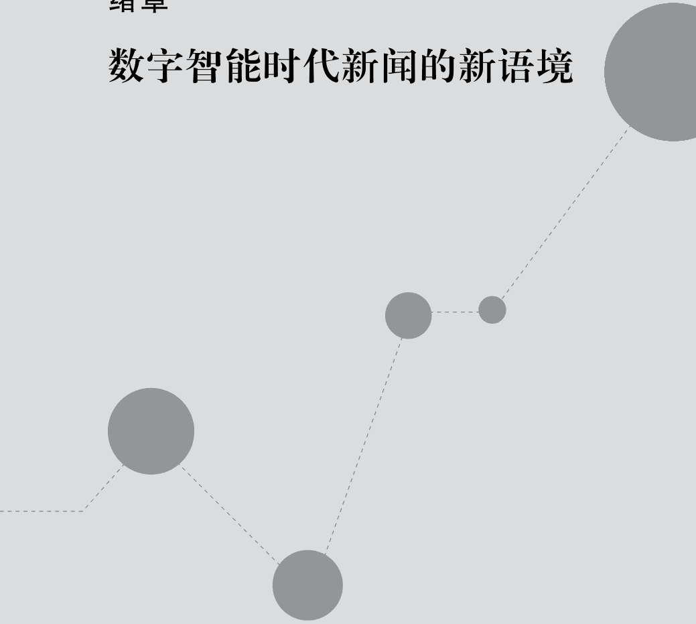
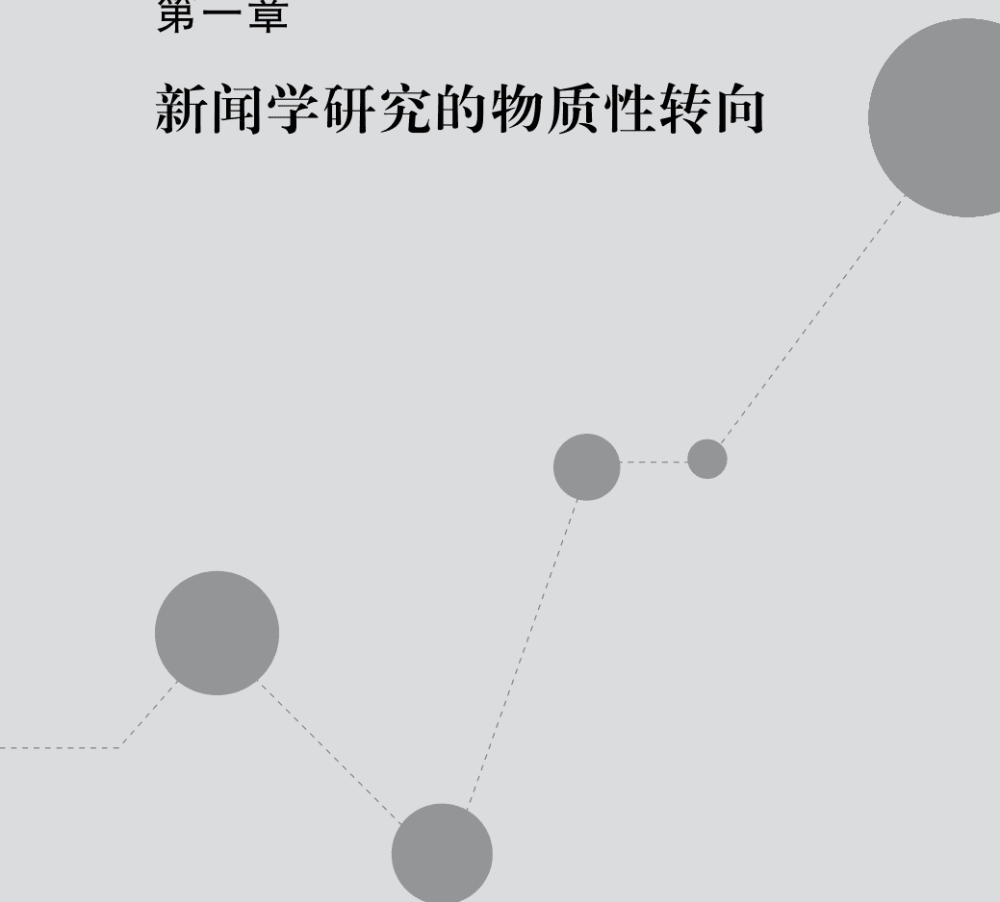
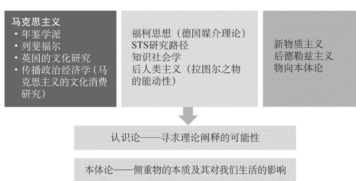
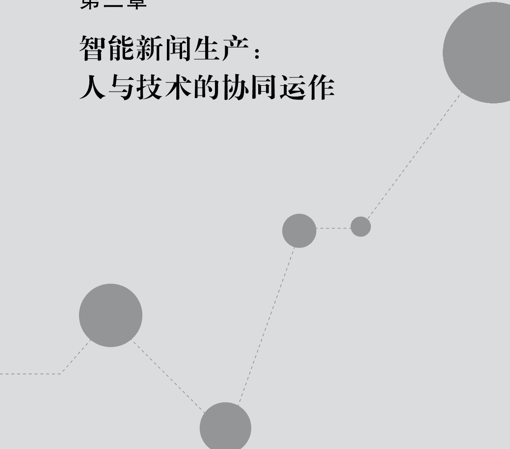
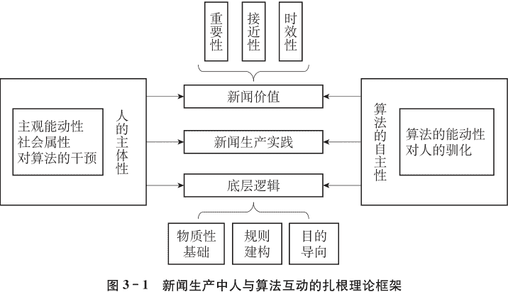
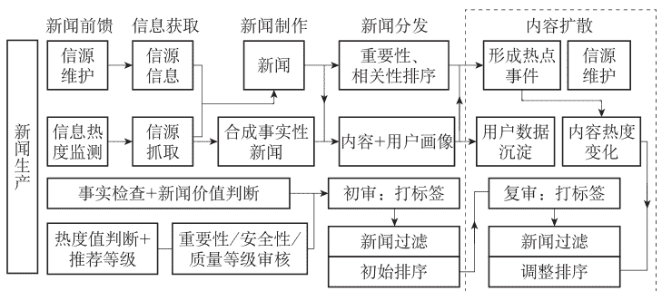
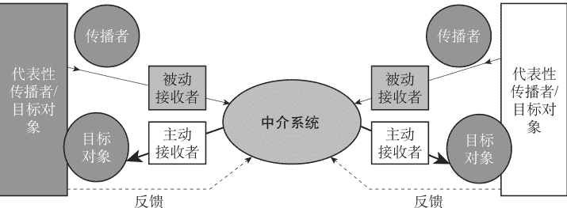
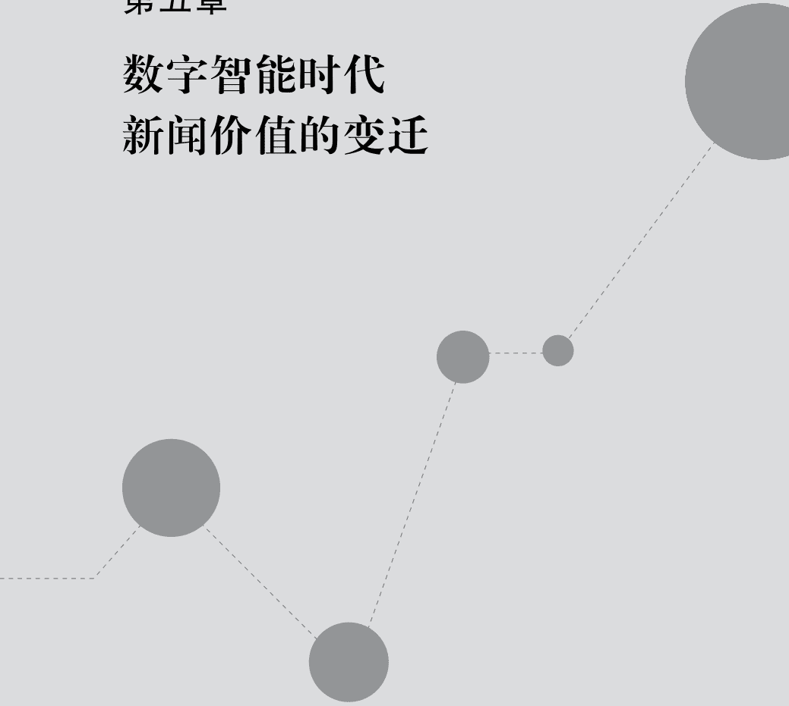
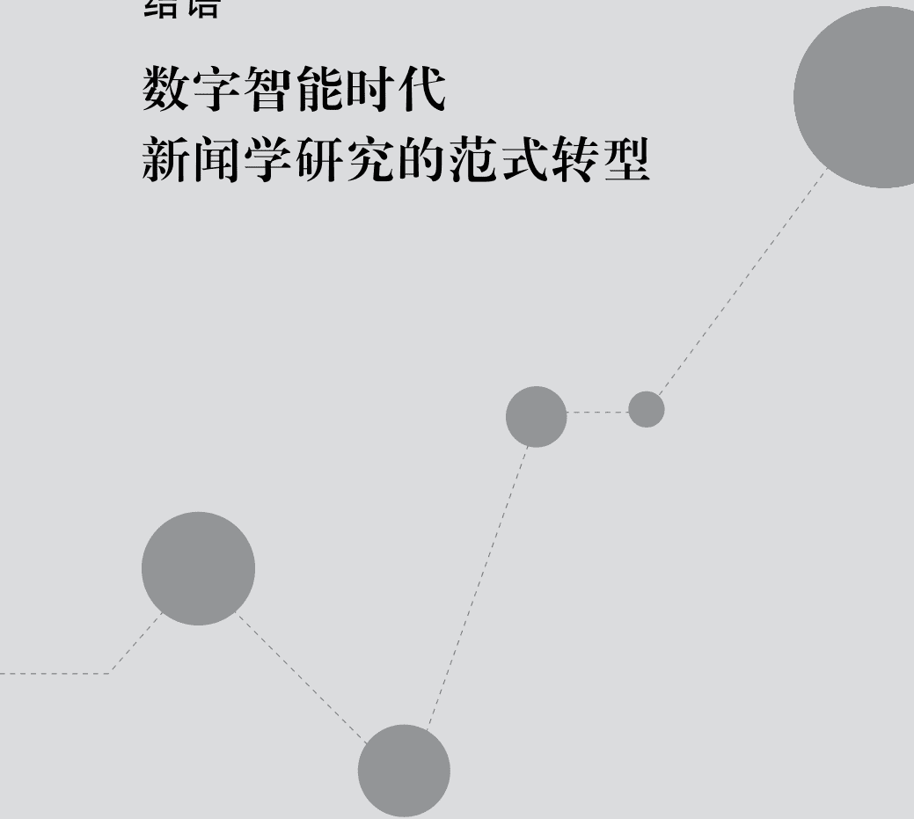

# 智能重塑新闻业：技术本质、物质转向与人机共生新范式

## 文库发刊词：在变革中确立学科新坐标

自新闻传播学跻身国家一级学科行列以来，国内学界建设步伐加快，教材体系日益丰富，但能代表最高学术水位、回应时代前沿命题的专著仍显匮乏。伴随专业院校扩容、学位点增设及从业群体壮大，高质量学术供给已成刚需。更关键的是，互联网重构传播格局，全民深度媒介化生存使得大众传播教育刻不容缓。

“新闻传播学文库”应运而生，旨在打破旧体系、旧话语的惯性，坚持问题导向，深入社会转型与传受关系的复杂腹地，产出有真知灼见的精品力作。创新必伴风险，我们以马克思主义的理论勇气鼓励探索，呼吁学界给予宽容，更欢迎严肃批评。本文库秉持“少而精”原则，甄选人大校内外优秀成果，期冀三五年后汇聚成学术高地，为学科发展注入鲜活增量。

董兵 敬识
2001年初夏

## 重磅推荐：当算法遇见新闻，重寻物质性维度

2023年上半年，ChatGPT横空出世与新闻专业志愿冷热交织，双双指向吴璟薇新作核心关切——智能技术与新闻命运。本书恰是对这双重焦虑的学理回应。

长期以来，国内研究多拘泥于规范与政策范式，近十年虽引入媒介社会学，却多沿袭组织社会学（编辑部研究）与文化研究（意义阐释）两条经典路径，均诞生于大众媒介黄金期，对技术因子关注不足。置身技术迭代加速的当下，这种忽视已成致命短板。吴璟薇敏锐捕捉到：技术非仅改变呈现形态，更作为基础设施重塑组织形态、运营逻辑乃至“新闻”本身的概念边界。

### 以“时间”为镜，照见技术重塑新闻本质

推荐人刘海龙以“新闻时间”为切入点，勾勒出清晰的技术演进图景：

*   **报纸时代**：印刷机械时间造就“面向过去”的叙事，新闻是“历史的初稿”，倒金字塔结构源于电报技术的带宽限制，甚至塑造了海明威式硬汉文风。
*   **电视时代**：直播信号流打破定稿概念，新闻转向“面向当下”的碎片体验，机器时间压缩叙事深度，信息持续“覆盖/迭代”。
*   **数字智能时代**：算法预测引入“面向未来”的或然时间，ChatGPT式递归计算让“因在果后”成为可能，许煜称之为“算法灾难”；社交媒体更催生“无时间的新闻”，旧闻重发、考古穿越让大众丧失时间感；直播与短视频将私人情绪无限放大、巴洛克式堆叠，理性判决让位于短时情绪，汇聚成时代精神的新图景。

总之，数字技术将新闻时间拓扑化——可拉伸、可折叠、可穿越，线性与非线性共存，这正是传播基础设施变迁的直接投射。

### 理论锚点：器官学、驯化与媒介本体论

本书不止于现象描摹，更引入柏林学派理论武器：打破“技术决定论”与“社会决定论”二元对立，确立**人机融合**视角。斯蒂格勒借勒鲁瓦-古汉之说，指出技术是人类“外化器官”，身体在使用中演化；技术亦非社会外部物，具备社会性，人驯化技术嵌入文化，技术反向驯化行为意义。

媒介由此被重新定义：非单纯物理实体，而是呈现与转化的中介，组织社会关系、生成现实。媒介化生存是人的基本生存方式，只是因“透明性”而被遗忘。这一视角开启了理解媒介技术与新闻关系的全新空间。

### 追问与警惕：智能背后的价值悬置

刘海龙进一步提出三层深切追问：
1.  **叙事不可替代性**：数据无视角、无价值、无系统性，生成式AI仅是海德格尔笔下的“常人”式总结，无法超越既有知识体系发问，无法替代记者“用眼、口、脚”叩问真实的深度报道。
2.  **技术后果评估**：数字技术究竟在哪些环节助益公众理解监督，在哪些环节构成阻碍？需建立细致评估机制。
3.  **资本与政治的幂灵**：技术繁荣背后离不开资本与政治支撑。新自由主义或威权主义语境下，技术如何促进或消解公共性？媒体融合除商业变现与宣传动员外，赋予生产者消费者何种权利？是否仅将大众卷入新的“数字劳动”陷阱？

虽存理论与经验衔接待深化之处，但吴璟薇提出的“物质性转向”与跨理论融合贯通，极具学术朝气与想象力，为中国新闻研究注入强劲新锐力量。

刘海龙 荐读
2023年夏

## 作者自序：在人机共演中追问新闻之“何以可能”

技术演进从未独自前行，人类与技术自始相伴相生、彼此融合。从ChatGPT突破瓶颈到“隐形劳工”“数据标注者”撑起智能假象，技术变迁背后总有庞大人力托底。回望史册，人类发明技术，同时调整自我适应技术需求，**人机融合源于技术伊始**。

然而，近年传播研究虽热衷技术变革议题，却常将技术视为外部变量，忽略其作为核心构成因子对生产传播的内在塑造。90年代“本体论转向”、新世纪“物质性/媒介物质性研究”将技术与物提升至与人等量齐观地位，倒逼我们重审人机融合构建的媒介网络。这虽似库利、伊尼斯、麦克卢汉、香农早已触及之境，但新技术语境强制我们重启追问。

本书双重意图：**一是回应当下**，直面数字智能冲击；**二是溯源历史**，将新技术嵌入媒介长时段演进，探寻新闻现象本质，追问：新闻还会存在？何以存在？

成书融汇笔者近年教研积淀、读书会与课堂碰撞火花。技术奔跑越快，越需冷静思考媒介、传播、技术、社会之本质——历史映照过去，亦预判未来。章节除部分刊发论文外，多为引入器官学、控制论等新思想后的最新思考。

致谢清华胡钰教授力荐，社科院曾国华老师细致打磨，经管学院郜洁老师及SRT项目同学实地调研赋能，硕博团队杨鹏成、丁宇涵、霍旻含、木兰、毛万熙、高山、阎庆宜等倾力协作。国内该视角研究尚处起步，国际前沿已勃勃生机，望抛砖引玉，促成中外对话，深化中国特色新闻理论建构。

吴璟薇 识于清华紫光大厦
2023仲春

## 绪论：数智语境下新闻生产的范式迁移

- 算法、AI与媒介机器人分流“把关”权力；平台成信息枢纽，新闻概念泛化，迈向数据化、资讯化、档案化；技术重塑机构物质性、生产关系与从业者主体性。
- 新技术与生产深度耦合，催生多主体协作新关系，一场重塑人类交流传播的深层变革已渗透生活肌理。

核心技术每跨越一级，媒介形态随之跃迁。近数十年互联网与数字技术的每次关键迭代，皆深度重塑沟通互动与新闻生态。当下，AI技术全方位渗透社会传播形态与舆论生成机制；把关权力下移，平台成集散中心，新闻本体向数据/资讯/档案延展；技术变迁同步改写机构物质形态、生产关系及从业者生存状态。技术与生产深度融合，铸就多主体协作新范式，这场变革已无声浸润生活每一隅。

### 第一节 智能媒体演进与技术变迁的历史回响

媒介技术在不同形态下扮演迥异角色，然至数智时代，其对生产的决定性影响日益凸显，技术与人工交织共振，共同驱动新闻生产。

回溯1999年前后，新浪、搜狐、网易等门户开辟“新闻主页”雏形，独立域名网络新闻机构超700家①。数字化浪潮裹挟传统媒体转型，纸媒稿件、视听内容经网页“平行”分发，受众获取路径被重构——

① 唐绪军. 网上报纸现状及发展思路 [J]. 中国记者，1999 (10): 50-52.

# 算法接管新闻室：从 Web 1.0 到智能时代，新闻生产权力的大转移

## 第一节 从门户到算法：新闻分发权如何易手？

还记得那个“网页即电子报纸”的年代吗？Web 1.0 时期，互联网只是把纸媒搬到了屏幕上。编辑们沿用旧套路，靠标题党和版面设计抢点击率（PV），RSS 订阅让用户第一时间拿到更新，但核心权力依然攥在编辑记者手里——他们是绝对的“把关人”，技术只打下手。

2003 年后，Web 2.0 打破了这潭死水。博客、微博、朋友圈、公众号……社交网络把“分发权”交给了用户的手指：关注、点赞、评论、打标签、甚至定位信息，每一个动作都成了平台画像的素材。算法开始大显身手，根据兴趣标签精准推送，人工编辑退居二线，只在重大时政、核查事实时露一下面。内容分发彻底“去中心化”，系统自动跑通“标签匹配—推送—热榜排名”的闭环，当然，夹杂其中的还有不少商单广告。

真正的变局发生在 Web 3.0 时代。2006 年 BuzzFeed、2012 年今日头条横空出世，标志着“平台化生产”彻底启动。头条初期不生产内容，全靠算法吞吐 UGC 和版权库，工程师成了主角。用户画像更新频率曾达 10 秒一次，“越用越懂你”成了核心逻辑。直到 2018 年信息茧房效应发酵，平台才被迫组建人工审核团队，给重大新闻加权，试图把算法跑偏的方向盘扳回来。但主导权依旧在代码手里。

传统主流媒体也不甘示弱，搞融媒体、建客户端、连“报网端微屏”，把自己改造为“资源组织平台、用户链接平台、分发平台、治理平台”。数据成了新石油，跨平台、跨地域联产成了常态。

如今，AI 不只管分发，还直接下场写稿、播报。机器自动采写突发新闻、虚拟主播上岗，新闻生产变成了高度标准化的工业流程。大数据让内容“千人千面”，却也挖深了信息茧房、制造了算法黑箱。

纵观三代网络演进，技术依赖度呈指数级上升，人与技术深度耦合，算法逻辑取代了编辑逻辑。在平台化的今日，人不再是主导，而是成了“为系统有序运转服务”的一环——无论是写代码的工程师，还是改稿子的编辑，都是技术系统的组件。

大模型、平台架构、智能分发，这三者重塑了新闻生产的新语境：内容变数据，经算法与人工混合处理，再通过接口触达用户。别幻想回到过去了，从“中央厨房”到县级融媒，数智化是必经之路。即便保留线下采编，也得靠社交平台分发。**大数据、平台化、智能技术，已成当下新闻生存的“水电煤”。**

---

## 第二节 平台即数据场：当新闻生产被“量化”

学者范·迪克曾说：平台是组织用户互动的可编程基础设施。在这套设施里，新闻经加工后由算法分发，用户的每一次点击、停留、划走，都被实时转化为数据，反哺下一轮推荐。平台被数据填满，由算法与界面双重控制，**用户一打开 App，就是源源不断的数据生产机器。**

数据化是平台化的核心特征。它把原本无法度量的世界——情绪、偏好、社交关系——全“翻译”成了数据。新闻 App 采集数据、分析画像、精准投放，这彻底重写了新闻生产逻辑：**从“以人为核心、重内容的专业逻辑”，倒向“以算法为核心、重分发的技术逻辑”。**

算法渗透采集、筛选、分发全链路，传统“把关人”地位严重缩水。虽说事实核查、重大选题还靠人工兜底，但平台逻辑已植入操作骨血，编辑记者的主动权被数据化的用户兴趣强行“竞争”掉了。新闻价值逻辑被迫向数据化低头，**人越来越沦为算法运行的维护者。**

更隐蔽的危机在于客观性。传统新闻靠“采编与经营分离”守住底线，平台上技术与编辑混编，商业逻辑直穿新闻肌理。数据从来不中性——平台不只是“测量”情绪，更在“触发并塑造”情绪。点赞、评论、转发、关注，这一套交互机制量化了基本情感，决定了用户如何互动、生产何种数据。新闻生产流程冲破新闻室围墙，延伸至上游数据聚合与下游分发反馈，**在 AI 与人的新生产链条里，双方正展开激烈角力。**

---

## 第三节 AI 入局：记者、工程师与隐形劳动者的博弈

以头条为代表的智能平台，靠算法+移动端重构了“以需定供”。这不仅颠覆了记者凭经验判断新闻价值的旧范式，更重塑了生产者关系图谱。算法工程师杀入核心层，内容生产者地位动荡，人技矛盾全面凸显。市场压力下，媒体疯狂抢技术人才，传统“把关人”被边缘化、重塑。

回望媒介史，技术从未缺席。印刷术终结口语时代，催生书写域，演说家让位于排版工，权力结构随之重组。德布雷指出：技术变革引发符号形式与关系结构的双重重构。

但技术决定论有风险。无视法治伦理的技术膨胀，会让智能媒体因丧失公共性而遭反噬。于是技术地位被压降，传统采编回归——但身份变了：**从“决定发什么”变成“守质量关、核事实”，在新闻进入算法管道前把最后一道关。**

实操中，大数据和 AI 只能接管部分环节：抓取素材、初筛价值（基于来源相关度）、辅助核查。标题制作、深度摘要、冲突性/反常性等核心价值甄别、复杂事实核查，仍得靠人工研判。别忘了智能背后的“隐性劳动”：海量低薪标注员在后台“喂数据”、打标签，训练出的模型才能识字懂图、深度学习。**人机协作，而非单纯替代，才是当下真相。**

---

## 第四节 重新定义“新闻”：在时效性消失后，我们寻找什么？

面对算法自动采编分发，业界焦虑感爆棚：报纸将亡、记者被替代、行业谢幕……但越是技术加速，越需回溯本源：**新闻究竟从何而来？历史或藏着未来的钥匙。**

英文里 *news* 与 *journalism* 同译“新闻”，实则大不同。韦氏词典定义 *news* 为：新近事件报道、未知信息、报纸/节目素材、值得报道之事。而 *journalism* 指：媒体呈现的采编过程、大众报刊、新闻学研究。*news* 溯源文明伊始，伴随人类永恒传递新知；*journalism* 却是第二次工业革命的产物——流水线分工催生了职业记者，仅两百多年史。

进入工业 4.0，职业分工被打碎。平台连接非职业创作者，生产者与消费者身份随时互换，大众传播“二元对立”模式崩塌。

概念在偷偷变：雅虎改用“资讯”，百度搜索栏把“新闻”换成“资讯”。背后是数字化、超链接、多元主体让新闻概念泛化，时效性弱化，平台关联逻辑下，生活服务、科普知识、小说故事混入信息流，新闻价值标准被迫重写。

其实非时效内容并非新物种。16 世纪欧报有天气穿搭，宋代小报满是生活琐事。只是技术变迁让它们占比暴涨。近代新闻业靠电报崛起——海底电缆消灭空间距离，实现全球共时，催生期货市场，媒体陷入“抢首发 0.1 秒”的时效军备竞赛。电报、电话、卫星直播，时代不同，追逐时效的本质一致。

互联网普及、手机实时通讯、光纤 5G 遍布全球，**共时不再是稀缺资源，时效性失去杀手锏属性**。趣味性、关联性等价值因子上位，娱乐服务信息泛滥、新闻概念泛化为广义知识，皆可从技术演进逻辑中推导。当然，独家渠道、独家资源，永远是核心壁垒。

在大数据、平台化、 AI 三重奏下，新闻生产传播发生本质变革。传统理论诠释力失效，甚至与实践脱节。本书即在此背景下，融合平台社会研究、媒介技术研究、媒介物质性前沿成果，结合中国实践，试图回答：**智能技术如何重构新闻？人机关系如何重塑？新闻价值如何迁徙？** 进而构建符合数智时代特征的新闻生产传播新范式。

> **注**：学界常称“数字新闻”，但智能阶段已超越单纯数字化，引入 NLP 等 AI 技术。为避免概念混淆，本书统称“数字智能时代的新闻”，将其纳入新闻发展长河考量。**无论技术如何迭代，新闻“传递新近发生或未知事物”的本质内核，从未改变。**

全书六章，理论联动实践，透过媒介物质性与本体论视角，拆解智能技术冲击，重构新闻生产传播新图景。

# 第一章 破题：新闻学研究的物质性转向

算法重写分发逻辑、平台重构生产关系，智能媒体浪潮下，新闻生产传播的底层代码已然变天。回望大众传媒时代，学术聚光灯长期追随“人”的轨迹——记者怎么跑现场、编辑怎么把关子、受众怎么读报纸。而今，技术从幕后走向台前，不再是顺手工具，而是直接参与决策、生成、分发的“非人行动者”。新闻学研究的重心被迫右移：代码、基建、算法，这些物质力量究竟如何重塑新闻？长期被搁置的技术变量，重新成为核心考察对象。这一范式偏移，至少激荡出两层波澜：一是技术可供性、行动者网络理论（ANT）、科技研究（STS）等视角介入，重塑新闻理论、拷问技术对客观性的冲击，标志着国内学界开始正视技术对媒体的深层塑造力；近六年，“传播的物质性转向”相关研究引入，因其能跳出“人/内容”桎梏，清晰呈现技术与载体的作用，正加深对数智语境下新闻体系重构的理解。二是平台化、智能化研究引发业界学界共振：智能技术会否蚕食、替代人的主体性？

本章以“媒介物质性”为基石引入新闻学，梳理其核心脉络、关键人物与理论内核，为后文剖析智能新闻实战铺垫地基。

① 常江，田浩. 介入与建设：“情感转向”与数字新闻学话语革新 [J]. 中国出版，2021 (10)：9-16.

② 袁艳，陈朝辉，王家东. 中国媒介物质性研究的学术图景及其反思 [J]. 华中科技大学学报（社会科学版），2021 (4)：131-140.

## 第一节 起底：媒介物质性视角的来龙去脉

翻开媒介研究近半世纪卷宗，可见一条清晰分水岭：早期迷信“技术决定力”，后转向关注“媒介本体”。近二十年，“本体论转向”携“物质性研究”攻入核心阵地，焦点从“传播如何发生”跳至“媒介究竟是什么”，“传播的物质性”跃升为核心概念，衍生出媒介考古学、生态学、本体论等分支。这批理论继承十九世纪末人类学旧籍，吸纳二战后欧美技术哲学、批判理论、本体论转向新血，为媒介-文化-政治-社会四角关系装上新透镜。①

“物质性”非新造词。十九世纪末，人文社科始盯“物”看。二战后，物质文化史兴起，批判视角解剖消费社会、商品文化。八十年代研究成熟，但当时的“物”多指符号、结构等实体，强调“文化的物质性”，物的实在性反被遮蔽。千禧年前后，哲学“本体论转向”与物向本体论（OOO）横空，非物质文化研究转向崛起，聚焦物/客体本体地位，立足实在论、关系论、技术哲学、宇宙哲学。① 2010年前后，“物质性转向/物质转向”概念在文化研究落地：拒绝物质/非物质二分，回归一元论，打通自然/文化、物质/观念。②

媒介物质性的理论版图，大致长在三块土壤上（见下图）：一是马克思主义嫡系与旁支——年鉴学派、列斐伏尔、伯明翰文化研究、传播政治经济学；二是福柯谱系与STS、知识社会学、后人类主义；三是新物质主义、后德勒兹、物向本体论。③ 由此生出基特勒/媒介考古/文化技艺、ANT/物的能动性/社会物质性、媒介特性分析（MSA）/软件研究等丛林。④

图 1-1 媒介物质性研究的理论基础

资料来源：章文浩，张磊. 物是人非与物思人非：媒体与文化分析的物质性转向 [J]. 全球传媒学刊, 2019, 6 (2): 103 - 115.

① 曾国华. 媒介与传播物质性研究：理论渊源、研究路径与分支领域 [J]. 国际新闻界, 2020, 42 (11): 6 - 24.

② 章文浩，张磊. 物是人非与物思人非：媒体与文化分析的物质性转向 [J]. 全球传媒学刊, 2019, 6 (2): 103 - 115.

③ 同上②.

④ 同①.

这片理论星空里，三颗恒星最亮：基特勒、克莱默尔、被重读的麦克卢汉。麦克卢汉点出技术在传播中的关键位，机械化流程中人的狭义主体性消失，媒介沦为身体延伸。基特勒不买账：渠道只是物质技术显现，他死磕“传播的物质性”与技术自主性，从历史条件、权力话语、传播结构切入。克莱默尔祭出“信使模型”，机器是符号中介功能的体现或“形式化过程”结果，建构出超越人技二元、不预设技术决定论的“去人类中心”媒介观。这三位思想，直击AI时代人机关系、伦理值、技术如何重塑媒介人关系等硬骨头，也为中国新闻传播理论创新输弹药。

## 第二节 对垒：麦克卢汉与基特勒的物质性分歧

1964年，麦克卢汉《理解媒介：论人的延伸》问世；三十多年后，基特勒推出《留声机、电影和打字机》①。风格神似，内核决裂。基特勒被誉为“数字时代的德里达”，九十年代入英语学界法眼，与麦克卢汉、梅洛维茨并列媒介理论三巨头。两人学术家底相似：均受香农-韦弗信息论洗礼，均爱从历史纵深切媒介。早期信息论对基特勒冲击更猛。① 香农《通信的数学理论》②奠基，主张剥离意义、盯物质构成——物理设备是核心。香农后借拉康③，把传播拆成五环：信源、编码、渠道、解码、目标。人机皆可作信源造讯息，经编码成符号走物理渠道。渠道即媒介，传信号；干扰与噪声让过程充满不确定性。麦克卢汉与基特勒的第一道分歧线，就拉在这里。

① HAYLES K. How we became posthuman [M]. Chicago, IL: University of Chicago Press, 1999.

② SHANNON C, WEAVER W. The mathematical theory of communication [M]. Urbana: University of Illinois Press, 1949.

③ LACAN J. The Seminar of Jacques Lacan, Book II: The ego in Freud's theory and the technique of psychoanalysis 1954—1955 [M]. Cambridge: Cambridge University Press, 1988.

“符号能多精准送达讯息？”两人针尖对麦芒。麦克卢汉金句“媒介即讯息”，点出渠道/媒介塑造内容的决定力，技术与形式碾压内容理解。技术定传播广深，编解码者皆随技术起舞，狭义主体性在机械化流程里蒸发，媒介成身体延伸，技术掌舵。① 但麦克卢汉“狭义主体性消解”说存疑：他虽说技术延伸身体，叙事主体仍是人及社会群体（广义主体性）。这暴露其深受结构主义暗驭。① 《理解媒介》中期研究，实围绕“身体-技术”“媒介-社会”二元“元结构”铺陈，断言形式重于内容——形式、形式结构、元结构层面的更迭扩充，纯粹结构主义范儿。

① GANE N. Radical post-humanism: Friedrich Kittler and the primacy of technology [J]. Theory, culture & society, 2005, 22 (3): 25-41.

② 麦克卢汉. 理解媒介：论人的延伸 [M]. 何道宽, 译. 南京: 译林出版社, 2003: 33, 128, 210.

③ 其早期以文学批评为主，后期关注点则更为综合。

基特勒另辟蹊径：渠道只是物质技术，自身无意义，谈不上“理解”。④ 他把媒介分析塞进历史情境，用后阶段媒介反推前阶段，继承拉康精神分析、福柯权力话语/知识考古，抛出“传播的物质性”核心概念，解剖媒介技术、制度框架、身体政权、数学/字母/乐谱等标记系统。啥是传播物质性？就是传播过程里的物质载体。德布雷说媒介含符号、语言系、物质载体；信息载体是屏、纸。旧时盯效果因内容为王，今时盯载体，因发现载体也深度塑效果。

① KITTLER F A. Gramophone, film, typewriter [M]. Stanford, CA: Stanford University Press, 1999: xxxix.

既都聚焦技术，简略对个底牌。共性：笔风像；文学出身转行；都绕香农信息论、都用历史镜头。关键差异有三：

一、感官观分家。基特勒：毋须拿所有人类感官瓶颈拷问媒介①；麦克卢汉：盯感官，特定媒介技术可预测地改感官比例、重塑知觉①。天主教徒眼里，计算机预示“世界理解与和谐的神恩降临”。

二、技术决定论立场殊途。基特勒预设技术与观念关联更偶然，技术决定论面向不存在②。媒介技术变迁重塑话语——“话语网络1800到1900的转型由媒介驱动，新数据处理技术登场颠覆文化上层建筑”③。准确说，基特勒持“技术视角”而非“技术决定论”。

三、对传播保真度认知不同。源于信息论噪声讨论。麦克卢汉“媒介即信息”，渠道存在影响噪声；基特勒讲“传播物质性”，是微观物质结构而非宏观渠道在搞事。他主张微观层面结合物质结构、文化技艺，考察符号噪声如何干扰信息流。英语媒介理论多喊技术重塑人类，基特勒却冷硬断言：

> 人们所能留下的就是媒体储存和交换的信息。重要的已不是信息，也不是在技术时代为所谓灵魂配备的信息或者内容，而是（严格按照麦克卢汉的话来说）它们的电路，是感知的图示。④

# 重读媒介哲学：从基特勒的物质性到克莱默尔的信使模型

基特勒与麦克卢虽同属媒介理论大家，看似观点趋同，实则内核迥异。麦克卢汉聚焦技术重塑传播生态，基特勒则下潜至技术的物质架构，考察其如何塑造文化肌理。他引入“文化技艺”概念，将媒介定义为筛选、存储与生成数据信号的操作机制，试图在制度实践、技术操作与物质本身的三重纠缠中，捕捉历史的运行动态。这与伯明翰学派沉迷文本解读、亚文化政治截然不同：基特勒悬置阶级、性别、后殖民等议题，转而从哲学认识论层面追问媒介变迁的条件。

在《德古拉的遗产》中，他借米娜操作留声机与打字机的细节，演示书写技术如何编码官僚理性；通过阅读、打字、算术等“知识技术”的考古，揭示技术更迭与时代气质的深层共振。立足麦克卢汉肩膀，基特勒将视野推向数字纪元，聚焦计算机的存储与网络逻辑，甚至大胆修正香农模型，将“接收端”改写为“信息流的流失”，标志着传播理论范式的根本性位移。

二者都爱在历史长河中定位媒介，但麦克卢汉视媒介为“身体延伸”，追溯从轮子到电子技术如何重组感知与社会结构；基特勒则祭出“时间轴控制”，偏爱古希腊语境，考察媒介形态随时间演进的内在逻辑。他融合黑格尔与海德格尔的技术哲学，果断抛弃以人为本的人文主义，拒绝法兰克福学派忽视技术前提的文化批判，亦与麦克卢汉的“身体延伸”决裂。深受早期福柯“知识考古”影响，基特勒开辟了“媒介考古学”路径：不再追问“人是什么”，而是确立媒介物质性本体论，在后人文主义与后结构主义交汇处，确立媒介自主决定文化历史走向的激进立场。

重写媒介史传统，基特勒划定三个纪元：手写与印刷时代属于“象征符号世界”，差异仅在于记录速度；模拟信号（电影、留声机）打破符号垄断，开始记录“特殊符号”，触及拉康意义上的“实在”；数字技术更进一步，能精准选择、存储、生成非语法规则的物理真实性。技术让人类跨越意义系统，直抵实在界域。

关于“技术决定论”指控，麦克卢汉因整体论视野陷入人本主义与反人本主义的摇摆；基特勒则更复杂。若指技术作为代理形式，他或许算数，但他从不设定技术“决定”人类，而是彻底溶解人机边界：人类主体从属于客体，认知不过是物理实在上的交互界面。他延续温纳“技术自主性”谱系，视媒介为文化史有机运行的原因。然而，若引入历史、政治、经济变量，他又非严格决定论者。他更像一位媒介哲学家，沿着“媒介决定我们的处境”这条主线，在具体历史情境中梳理技社关系的张力与变奏。

---

## 信使、中介与媒介性：克莱默尔的另类图景

西比尔·克莱默尔，德国媒介哲学继基特勒之后的关键声响。早年从事技术哲学，后在柏林自由大学执教，其思想轨迹呈现清晰的“中介转向”：《计算理性》确立哲学基石，《传媒、计算机、实在性》则开辟出区别于德国主流媒介学的全新视野。虽在英语及中文语境尚显陌生，她在德语学界却深具影响，构建起一套以哲学审视计算机媒介功能的理论体系。虽大量著文解读基特勒，克莱默尔却另辟蹊径，确立了核心概念——“信使模型”与“媒介性”。

借希腊神话赫耳墨斯之像：穿行边界的旅行神、神人信使、亡灵摆渡者。德语“Medialität”本指精神经媒介被感知、被理解，克莱默尔由此反推：媒介即感知。日常经验印证此说——听到铃声不见声波，阅读文字入的是故事。媒介本不可见、不可闻，只在传播机制卡顿时才显影。传播中，语言与演说者同步物质化；语言借声音、书写、手势经媒介通达物质外部，媒介是语言存在的前提，亦是语言与躯体的连接点。

她将传播拆解为两种模式：**技术/邮递模式**与**人际/性合模式**。前者跨越时空距离，双向但异声，差异与距离不可消解，对称且间接，媒介是不可或缺的先决条件；后者追求互融共时，距离与差异在对话中消融，“性合”隐喻异质个体达成同质共识。哈贝马斯公共领域理论恰是此模式的政治投射：分歧在对话中熔铸为共识，主体间性达成。

两模式前提同为“差异存在”。邮递模式中，媒介架设连接却不消除距离；性合模式中，媒介退居幕后如透明玻璃，对话本身消弭距离。克莱默尔刻意凸显邮递模式，因其确立了媒介不可消除的本体论地位，信使模型即此模式的典范：信使受雇于源头，不负内容责，仅作中介传递，是源头的延伸。这指向一种“去人类主体性”媒介观——与基特勒“媒介决定处境”虽同属反人本，却截然不同：基特勒赋媒介以自主因果力，克莱默尔则凸显媒介作为“第三者”的中介结构性必要性。

在邮递模式下，媒介的物质性、不透明性恰恰构成了理解的阻碍与扭曲的可能。克莱默尔主张，“媒介性”优于“技术决定论”，因其诠释一切社会与物质系统的交换基础。天使、病毒、货币、翻译者、精神分析师、目击者、地图……皆可为媒介。它们建立联结的同时，保全了差异。信使模型提供独特透视：个体因距离生差异，因差异得以统一。大众传播本质上亦属邮递模式。克莱默尔关注互动而非装置，强调传递过程与“第三性”，从而超越麦克卢汉的技术本质论、伯明翰学派的内容文化论、基特勒的物质本体论、哈贝马斯的对话理想论，开辟出媒介本质的重释之路。

与基特勒同探数学形式化、计算机械化史，克莱默尔引入“符号机器”概念：符号是核心媒介，机器非“被制造的主体”，乃符号中介功能与形式化过程的产物。研究视角由此从技术史转向思想史，从“技术操作”转向“符号操作”。传统媒介哲学视技术为先决条件，克莱默尔则以“媒介性”诠释中介功能——这才是理解媒介的钥匙。

① ENNS A. Introduction; the media philosophy of Sybille Krämer [M] // Krämer S. Medium, messenger, transmission; an approach to media philosophy. Amsterdam; Amsterdam University Press, 2015; 9–18.

# 第二章 智能纪元：人机双重主体性的博弈与重构

## 开篇：从“媒介中介”到“基建逻辑”的视野跃迁

英语传播学界长期陷入“人（身体）—技术”或“社会（人群复合体）—媒介”这种二元对立的理论困境：要么神化技术力量，要么过度聚焦人际互动。克莱默尔的信使模型试图打破这一僵局，构建一个更宏大的框架——它不再区分人与技术的界限，也不单向强调技术的决定力，从而拓宽了媒介功能的理解边界，有效规避了“技术决定论”的争讼。④ 同基特勒一样，克莱默尔确认传播的物质属性；但她引入认知科学视角，将基特勒强调的“媒介本体物质性”推进为“传播物质性”，主张媒介与人的知觉构成互动关系，媒介是介于一切社会与物质系统之间的活跃中介。在她眼中，受众是主动的，因为传播建立在具身性之上，解码不必遵循编码者的原意，这与斯图亚特·霍尔的“编码/解码”理论形成鲜明张力。克莱默尔由此超越了麦克卢汉及以基特勒为代表的德国媒介理论传统，为理解人、媒介、技术三者关系提供了开阔视野：人机地位趋平，相互依存、缺一不可，形成去中心化的共生网络。

---

## 第四节 基建重塑：媒介技术如何重写时空与价值

在媒介哲学与本体论视域下，媒介的核心禀赋是中介性与物质性①，传播本质上是借助媒介，将原本存在差异的传播者与接受者关联起来的过程②。以交通、邮电、广电为代表的基础设施，作为物质底座，在新闻流通中扮演关键角色。基建可定义为“具备力量放大功能的大型能力系统”③，涵盖软硬两层：硬件端包括终端设备、数据库、基站、海缆、超算中心等实体工程；软件端则覆盖平台企业、监管机构、技术组织、媒体机构，以及协议标准、法律政策、价值话语等制度体系④。基建凸显媒介的“关联性”，它不仅连接传播主客体，更串联不同时空，直接塑造传播关系与效果。这种关联制造了跨时空的“共时与共在”，重塑媒介时空观；同时编织人与物、物与物的关系网络。媒介技术迭代不断重塑基建形态与传播速度，进而重构新闻传播的时空秩序与人物网络。

**从马车到算力：基建形态的三次跃迁**
19世纪前，新闻靠人马驿传，速度慢、周期长。电力时代，电缆网络消弭了时空差异，实现近乎即时的连接。智能时代，互联网普及让信息触达全球角落，平台化基建成为智能新闻生产分发的核心枢纽——平台本质上是组织用户互动的可编程基建①。多源新闻内容数据化后，经基建传入平台接口整合；基建在此将人与技术聚合，依因果与相关逻辑，借计算语义网在生产者、传播者、接受者间建联。大数据与AI的崛起，可视为微处理器与网络环境耦合的产物，保障算法在全球网络以极小时间间隔运行②。基建对新闻价值的重塑体现在双重维度：一是连接地理空间、决定传播速度，重塑时效性及时空关系；二是算法以数据方式关联内容，重构新闻的“相关性”。

**客体间性：超越主体经验的价值新坐标**
数字时代前，新闻相关性依赖地理或心理邻近性；数字基建与计算语义网构建的关联，范围与深度远超过往。数字技术已改写新闻价值判断标准。传统标准依赖新闻工作者主观经验，基于主体间性——以集体意识认知世界，虽能诠释实践意义，却忽略技术维度①。从印刷、光电模拟到互联网，媒介技术始终直接介入新闻流通与价值标准。特别是大数据与AI主导后，算法用计算语言拆解、识别、存储意义，将内容转化为“数码物”并在客体间建联②，在人类主体之外构建关系网络。数据作为客体，在基建上聚合生成关联。新闻价值判断由此突破主体经验局限，转向强调客体间关联——这正是新媒介技术生成的结果。智能新闻时代，必须引入“客体间性”概念，以理解媒介技术系统及其内部生产传播机制。**计算机语义关系所建立的数据关联，正是客体间性的基石。**

**数码物的本体论地位与海德格尔的预言**
许煜指出，数据本体论上是“数码物”①，其生成的客体间性包含双层意涵：一是客体内外关系的物质化——技术将不可见成分转为可视可测形式，实现关系显性化，即事物向数码物的转化过程；二是物质化后的个体间性创生自身环境，链接自然与人造。物质化过程中，计算机将事物转数据，即以因果相关方式构建数据库与网络。媒介本体论视角下，新闻生产传播被抽象为内容物质化为数码物的过程，数码物网络本身即关系网②。智能新闻时代，**关系取代内容成为核心**。数码物构建的环境将人与技术物纳入媒介系统，决定人人、人物、时空关系。内容非关键，关系才是；数码物网络即关系网③。技术物内含环境与人因，从而决定媒介中的人际关系、时空秩序。数码物与基建耦合下，全球光缆网络关联不同时空，以时间消解空间，制造“共时与共在”。海德格尔观察电视、收音机、飞机等高速技术后洞见：新技术令物理地点、人、时区距离消失，万物聚合为“同一的无距离”④。聚合形成的人物关系网与时空关联，正是客体间性的具象呈现。

媒介物质性视角将研究焦点从“人”转向“人物共构网络”，从根本上超越了人技二元对立，在技术加速变革期重审技术对新闻的冲击。新闻业诞生伊始，技术即为关键外部变量：印刷术革新催生定期报纸与现代报业；电缆连通全球成就四大通讯社霸权；互联网引爆全球通信与新闻变革。新技术在带来新媒介文化的同时，重塑社会结构、权力关系与文化。基于物质性视角，后续章节将深入探讨：AI与人的主体性之争、人机如何融合、内容数字化与大数据意涵、智能技术下的新型生产传播关系、作为基建的媒介技术如何重塑新闻价值等核心议题。

---

## 第二章 智能纪元：人机双重主体性的博弈与重构

置身媒介网络视野，人在系统中始终处于双重位置：微观工作层面，个体或群体掌控相当自主权；宏观系统层面，个体或群体皆成媒介网络一环，受系统运行逻辑与技术演进逻辑深度制约。

AI深度嵌入新闻生产，给编辑记者带来剧烈冲击：大量人工被机器替代，算法取代人工判断主导分发。经典议题再临风口：**人与技术，谁主导谁？** 在技术自主性笼罩下，人类主体性是否消逝？人会被机器取代？主体性与自主性之辩在新闻学至关重要——新闻作为社会公器，承载舆论监督、文化传承重任，岂能仅因技术变革便将权责让渡机器？智能技术狂飙突进并占据系统主导地位，引发学界忧虑与批评浪潮。本章将系统梳理工业时代以来人技关系经典理论，拒绝简单二分法，提出智能时代人技关系的新思考。

## 第一节 主体性与自主性：百年辩题的深层逻辑

技术自主性及其对人的操控，非智能时代新题，而是百年研究主题。两条关联脉络贯穿始终：一、宏大理论视野，从隐喻层面描述包含技术系统在内的社会系统自主性与统治性；二、聚焦技术系统自身演进自主性，及其对环境与社会的重塑。限于篇幅，下文勾勒关键学者与理论图景。

### 一、 第一条路径：宏大叙事中的技术幽灵

此路径汇聚现代学术巨擘。机器大规模介入生活之初，马克思便洞察技术物的自主性与操控性：技术作为物质力量决定生产方式（生产资料决定生产方式），物质活动是人类最基础活动。历史唯物主义视角下，“手推磨生出封建主社会，蒸汽磨生出工业资本家社会”①。马克思肯定早期人类自发、自觉、生产性的劳动技术，确立了基于物质工具的生产力。

> “各个人必须占有现有的生产力总和……这种占有首先受所要占有的对象的制约，即受发展成为一定总和并且只有在普遍交往的范围里才存在的生产力的制约。”②

但随工业化推进，马克思对资本主义条件下“异化”的技术感到不安。他在《资本论》引尤尔《工厂哲学》名言：工厂是“一个由无数机械的和有自我意识的器官组成的庞大的自动机……它们都从属于一个自行发动的动力”③。工人大规模协作机器时，作为人类本质的自由自觉活动——劳动，异化为对立面。工人失去对劳动、生活、自我的控制，只能以资产阶级欲望模式存在①。

这种带有泛灵论色彩的描述，实质将技术视为仿佛有生命、不受控、异化的力量，背后推手是资本驱动的生产力。在人机协作中，马克思瞥见技术系统背后逻辑：现代机器工业是有机整体，仿佛具自组织能力，工人与机器组成分工小组，形成有组织机器体系，局部间不断交接工作。因此，“在发达的工厂中，起支配作用的是各特殊过程的连续性……当工作机不需要人的帮助就能完成加工原料所必需的一切运动，而只需要人从旁照料时，我们就有了自动的机器体系”②。

身处第二次工业革命，马克思已觉醒人机有机系统的自主性特征：“在机器体系中，大工业具有完全客观的生产有机体，这个有机体作为现成的物质生产条件出现在工人面前”，集体劳作彻底改变手工时代，“劳动过程的协作性质，现在成了由劳动资料本身的性质所决定的技术上的必要了……大工业必须掌握它特有的生产资料，即机器本身，必须用机器来生产机器。这样，大工业才建立起与自己相适应的技术基础，才得以自立”③。

---

韦伯从官僚管理“技术”的统治性切入①，因其稳定高效持肯定态度。但后世学者多元发展甚至推翻其初衷。卢卡奇试图用韦伯诠释马克思，在《物化与无产阶级意识》中指出：官僚理性化的“事务性”深化了工人在机器生产与资本主义关系中导致的“物化”，管理技术自主性与机器技术自主性合流，推动社会全面“物化”——人与社会的全面异化②。

法兰克福学派承袭马克思技术批判：一、批判工具理性/技术理性——科技进步与理性演变的产物——渗透社会结构与生活肌理，成单面社会/文化思想根源与统治合法性基础；二、形成“批判的科学哲学”，以人本主义为起点，剖析科技在发达工业社会如何异化为新控制形式。霍克海默……

① 韦伯．韦伯作品集：Ⅲ：支配社会学 [M]. 康乐，简惠美，译．桂林：广西师范大学出版社，2004.

② 匈牙利习惯姓前名后。

③ 卢卡奇．物化和无产阶级意识 [M] //卢卡奇．历史与阶级意识．杜章智，任立，燕宏远，译．北京：商务印书馆，1996：143 - 304.

### 二、另一条批判脉络

第二条路径的核心推手，是法国哲学家雅克·艾吕尔及其追随者兰登·温纳。艾吕尔在《技术社会》里直指要害：**技术已成独立王国，它依照自身律令构建了一个渗透无间的世界，彻底抛弃了过往传统。** 技术能在人的蓝图、期许与抉择之外，自行完成生成；一项新发明的问世，往往自带条件，催生出技术延续所需的环境。这意味着，技术演进是一连串自我驱动的链式反应。时间一长，技术系统愈发专业、复杂。

温纳在艾吕尔基石上更进一步：表面上工程师掌握代码、掌控迭代，实则技术早已实现“自治”——独立运作，不受外部法则羁绊。一旦投入使用，技术便开启自我生成、自我延续、自我编程的闭环。更关键的是，技术自主演进衍生出“技术律令”：**为让技术落地，使用者不得不重塑环境，提供一整套配套手段。** 由此引发“反向适应”——技术手段倒逼环境乃至采纳它的初衷、甚至统治秩序发生变迁。

以上两条路径，不仅勾勒出理论界对技术自主性与支配性的长期忧虑图景，更深刻塑造了媒介、传播与文化研究的思想版图。卢卡奇的洞见深植于法兰克福学派早期巨擘（霍克海默、阿多诺、马尔库塞）心中，塑造了他们对晚期资本主义、文化工业及意识形态的剖析；哈贝马斯毕生核心使命，即对抗“系统”对“生活世界”的殖民。德勒兹与瓜塔里的“社会机器”概念，直承马克思“机器”思想；波斯曼的媒介生态学坚称技术一经接纳便“按既定目标狂奔”；赫尔曼与乔姆斯基的《制造共识》亦浸润于此脉络。

纵观脉络，这些理论一致指向技术自主与支配属性引发的社会后果。虽对媒介传播研究影响深远，仍具洞见，但整体锚定宏大叙事，立足人类主体性视角批判现代技术。此视角忽略了人技可能存在的网络关联，也遮蔽了从网络关系出发审视媒介技术与人互动的新图景。欲系统剖析二者关系，亟需引入近年崛起的德国媒介理论——以基特勒为旗手——开掘一条更具互动性与历时性的全新路径。

## 第二节 重塑人技关系：媒介即网络

德国媒介理论的旗帜性人物，非基特勒莫属。在此之前，法兰克福学派及其批判范式长期霸占德国学界，技术批判亦在其列。该学派渊源德国古典哲学（黑格尔）、马克思批判理论，后融入弗洛伊德精神分析，聚焦资本主义批判，尤重大众传媒在社政经层面的作用。《启蒙辩证法》已切入广播、电影，开启文化工业批判，为后续德国媒介研究奠基定调。

70年代法兰克福学派式微，理论真空显现。麦克卢汉领衔的北美伊尼斯学派、福柯与法国后现代思潮乘虚而入。基特勒脱颖而出，关键三招：一、首位引入“麦克卢汉元素”，为媒介研究注入新法、新题、新域；二、主导范式与对象转向——摒弃高雅文化视角下的通俗文化批判；三、摆脱法兰克福阴影，在真空期完成从文本分析到文化分析的跨越，接纳日常大众文化。

基特勒思想熔铸黑格尔、海德格尔德技术哲学，兼汲拉康、福柯、图灵、麦克卢汉、维利利奥精华。学术路径上，他果断抛弃以人身为核心的人文主义传统，转攻媒介物质性，反戈法兰克福学派忽视技术条件、过度强调人文人性的惯性。其理论融汇法德哲学，聚焦媒介物质结构，褪去人文主义色彩。他将媒介置于时间长河考察，锚定技术演变本身。同时与麦克卢汉“媒介是人体延伸”分道扬镳——不执着信息、不纠缠躯体，唯强**技术作为符号载体的物质实体**。90年代后，媒介考古学、控制论等生机勃勃的研究领域，皆源自基特勒触发。

承袭德技术哲学血统，基特勒理论浓墨重彩的媒介本体论色彩。他主张：本体论层面，不应沿袭亚里士多德形而上学传统，靠形式与质料区分界定媒介（如纸媒对电视），而当延续海德格尔技术本体论，**从媒介在“时空关系”中的定位来自证其身。** 技术媒介的本体特征，植根于“处理、传输、存储”数据信息的网络，此特征贯穿“技术媒介整个递归史”。无论书写、印刷，抑或打字机、留声机、计算机，皆让信息、话语、语言在时空中得以“处理、传输、存储”，从而成就其“不朽”。

基特勒毕生反复阐释的核心命题：**无论特定时代话语网络，抑或雅典以来的长时段历史，技术媒介网络皆对社会沟通运行、知识话语生产存储拥有决定性塑造力。** 例以哲学书写：羊皮纸易莎草纸、古登堡印刷机替手写，无论形式还是内容，皆生系统性重构。媒介技术对艺术生活的渗透，基特勒曾言：“技术装置从艺术家眼手中剥离，形成绝对自主领域——光学媒体技术，环伺我们，甚至裁决我们当下的生活。”《留声机 电影 打字机》更以极简一句定调：**“媒介决定人的处境。”**

基于此，基特勒在人技共构的媒介网络中指出：技术本体彰显自主性，人主体性的绝对性早已大幅消融。以计算机为例：一个简单的反馈回路——信息机器——便超越了所谓的发明者人类。计算机自身转化为主体。若预设条件缺失，数据处理按编码惯例运行；若中间结果满足条件，程序便自主裁决后续指令，即**掌控自己的未来**。《德古拉的遗产》中更直白刺痛：机械媒介（留声机、打字机）问世后，人沦为**“机器话语处理的配件和工具的主体”**。媒介技术每一次迭代，都在社会层面激起“恐慌”、忧虑与批评。《留声机 电影 打字机》序言里，基特勒带着一丝怜悯写道：**“技术媒介初兴时，其革新曾引致极度恐慌”，那些过往的“惊恐情绪”，正是我们现代对未来恐慌的真实投射。**

但基特勒究竟是浸染海德格尔的媒介理论家，他不视媒介为单向压制主体性的“外部限制”，不认为人因此沦为奴役。上文所述，他确实采取典型“后人类主义”叙事：物质媒介网络（如录音机、耳机、打字机构成的课程记录网络）占据叙事主线。此网络中，人非主角，而是信息与媒介的传送、记录、保管者，是**“机器话语处理的配件和工具的主体”**。他自认“将海德格尔的技术概念转移给了媒介”。

然而，后人类叙事未遮蔽其海德格尔式关系本体论视野——**一种基于“共在”的视角。** 基特勒从关系本体论出发，极强调技术、媒介与肉身的融汇，对个体群体生存情境的创造力。他坚信媒介技术演进中与人融合成运作网络，将**“所谓的人分裂为生理结构与信息技术”**。数字媒介经声光电整合，打通书写时代割裂的感官疆域，替代中枢神经，**“模糊了人机界限”**。技术迭代中，**“人与其模拟者联合”**，机器习学贴合人需，愈发智能。故媒介物质性虽部分配融主体性，但本体论层面，**人、物、媒介技术本就置身同一关系网络**。基特勒媒介本体论里，技术非唯一决定因子，须在人技共构的媒介网络中方显作用。

新闻平台数据化，为理解新闻生产中人技关系增设新难题。然人技张力非数字新媒体专利，机器大规模介入生活伊始便已显影。工业化推进中，技术自主性愈发凸显。马克思《资本论》描绘工厂为：**“由无数机械与有自我意识的器官组成的庞大自动机，协同不息生产同一产物，皆从属于自行发动的动力”**。技术系统里，工程师虽掌代码控机器、管迭代，技术却能自治、独立、不受外力支配。一经投用，便形成自我生成、自我延续、自我编程闭环。虽人技同参与新闻生产，但在算法与交互界面双重作用下，无论编程工程师还是把关审核者，皆须遵循系统技术逻辑：代码须循特定语言逻辑，人工介入只为算法故障时兜底、协助迭代，**保障系统更精准高效运转。**

## 第三节 智能媒介网络里，人究竟在何处？

若把视角拉长，数字技术重塑下的新闻生产体系，早已演变成一个名副其实的“巨机器”。在这个庞然大物面前，无论是人还是技术，都被强制纳入同一套秩序：目标一致、精准守时、高产高效、标准化运作。芒福德曾敏锐指出，这“巨机器”里的技术，本质上是被社会建构的关系。拉图尔更进一步：几百年来，我们早已把“社会关系”的概念外延至非人行动体。人与非人通过“财产交换”构成行动共同体，工业赋予非人关联的可能，由此诞生了机器、工厂、自动机。它们拥有某种自主性，遵循可被工具或代码度量的规则。

工业化浪潮中，组织里原本由人承担的子程序，逐渐被非人接管。起初，非人是顺从的仆役；但随着进程推演，对人的管理权悄然转移给非人，技术借由权力网络习得了大规模管控术。在这种结构里，人与非人同为技术系统的有序运行服务——人失去了独立人格，沦为被动服从、无目的感的“机器附属品”。

很多人孤立地读基特勒中期“后人类论”，误以为在他的技术媒介网络里，人不过是信息的搬运工、记录员、保管员，是“机器话语处理的配件与工具主体”。这似乎比他自诩的“将海德格尔的技术概念转移给媒介”更激进，把技术对人的“逼迫”推向极致。实则不然，基特勒的图景远比这复杂。

他确实主张：技术媒介的本体论属性，是基于处理、传输、存储数据信息的网络。从书写、印刷到打字机、留声机、电脑，皆是如此。现代媒介条件下，技术的强自主性将人异化为配件。但另一方面，基特勒强调媒介从不孤立，而是网络。“图书馆是被称为书的存储媒介的存储媒介。”古登堡印刷机、书籍、物流售卖系统、书箱、家庭书架、图书馆，乃至制造它们的工具，共同编织成网。拉康授课时的录音机、耳机、打字机构成的微观网络，或一个国家阶段性的宏观话语网络，皆建立在模拟媒介网络之上。从此视角看，人的绝对主体地位若非从未存在，至少在机械媒体时代已大幅消融。

然而，基特勒深受海德格尔影响，其后人类叙事掩盖不住关系本体论的“共在”视野。若统合其前后期尤其是“文化技术”思想，显而易见：媒介技术绝非唯一决定因素，它必须在与人组成的网络中才能运作。

尽管如此，“巨机器”叙事与基特勒中期理论的片段阅读，仍制造出“数字媒介主体性全面侵蚀人主体性”的幻觉。学界因此从多维度补正。下文将梳理德媒介理论如何从“媒介性/中介性”重构传播物质性，并以此为基石，探讨智能新闻平台在用户消费端的关系主体性。

---

### 一、 主体性消融？智能媒体里的人机博弈

技术狂飙时代，社会媒介系统的结构与权力版图剧变，深层重塑社会结构、权力架构、利益分配，引发学界深忧与密集批评。

伦理学视野聚焦自动化生产、智能核查、定制化推送、算法评价等环节的伦理隐患：假新闻、新闻商品化、隐私泄露、权利侵蚀、群体极化、算法偏见；政治经济学视野则追问资本对媒介的掌控、数字劳动不平等、数字鸿沟扩大与社会撕裂。路径虽异，内核同构：**智能技术展现出高自主性与支配性，在社会后果层面威胁人的主体地位。** 共识是：技术应用须回归“以人为本”，对技术自主性加以限制。

这些批判洞察深刻，直击痛点。但若换个角度，将智能技术置入社会、群体、个体关系的通用理论中审视，会发现被忽视的关键：**智能媒介的自主性与支配性，不止体现在宏观社会后果，更渗透在媒介网络、系统的微观运作里。“人”早已是与媒介技术、媒介物相互纠缠的节点。在网络中，人的主体性已部分消融。问：这种消融，能靠人重新伸张主体性来逆转吗？**

本章沿着基特勒“媒介网络”路径，考察智能技术大规模应用下的生存境况。现有研究多着宏观社会后果笔墨，本节立足智能新闻资讯平台的微观生产一线，纳入编辑记者、数据存储硬件、打标签“隐形工作者”、内容审核员等全要素，呈现媒介技术与人的网络关系，拓宽认知边界。

确实，智能技术大规模介入，部分消融了人的主体性，人延续了机械媒体时代的命运：在程度上沦为“机器话语处理的配件与工具主体”。但海德格尔在《对技术的追问》中言：“危险之中，生长着拯救的力量。”若融贯基特勒全貌，而非摘取其技术决定论只言片语，媒介网络路径本身就蕴含着基于媒介关系本体论的破局之道。

具体而言，我们将引入媒介与传播物质性理论视野，剖析智能技术，讨论“人的境况”的多义与层次。方法上，综合诠释学与质性研究，探索智能算法主导平台的运作实况，及媒介技术物（客体）与人（主体）在其中编织的网络。质性研究分三步走：

1.  **长时段追踪**：自2011年研微博起，长期观察即时通讯、电商、新闻聚类分发等平台技术开发运营全貌，关注技术平台、开发者、运营者、监管、基建、用户群体的互动演变，建立对平台演进的整体认知。
2.  **深度切入**：2016年后聚焦头条类聚合平台、光明网/人民网/凤凰/澎湃等融媒体平台、微信公众号与短视频推荐系统等核心智能系统。通过深度访谈、非参与式观察，调研开发者、运营者、用户，摸清平台开发运营底况，及其与用户、监管、媒体机构、第三方劳务/外包方的互动生态。
3.  **历史复原与数字诠释**：在前两步基础上，复原门户→社交网络→智能媒体的演进脉络，采用数字诠释学而非单纯数据分析，对量化质化材料做整体性阐释。

---

### 二、 人与物：智能媒体平台的媒介网络解剖

从媒介网络视角看，智能算法平台是基特勒口中“计算机科学”在互联网时代的升级版。

冯·诺伊曼架构下，寄存器、总线、随机存取存储器（RAM）构成闭环反馈回路。比特在寄存器执行逻辑算术，总线传命令/数据/地址，RAM供存储场所。**命令、地址、数据——媒介网络本体论特征（处理、传输、存储）在计算机科学时代的具身呈现。** 智能媒体网络平台，实质是经互联网放大的计算机体系。平台计算系统形成软硬嵌合的复杂技术物质体系。

经典架构分四层：接入与界面、处理引擎、存储系统、资源虚拟化。大型平台每层都涉及海量服务器集群。谷歌全球21数据中心服务器估超200万台；国内头部平台虽规模不及谷歌，复杂度远超Web1.0/2.0时代。新浪微博2012年服务器超千台，如今头条平台服务器超5万台。但这些复杂体系未曾脱离基特勒所言“硅晶体物理学与冯·诺伊曼架构双重条件下”的计算机体系，**大型平台运行基石，仍是基于地址、命令、数据的“寻址、处理、存储”媒介网络。**

智能媒体平台的核心变量在于：**处理、传输、存储三环节全植入了人工智能。** 当下主要通过“深度神经网络”多层建模实现“深度机器学习”，达成具智能的自动化处理：智能生产分发、人脸/图像识别、智能导航、设计自动优化等。架构简化来看：存储层加“数据智能化管理”并行系统（Hadoop HDFS, HBase）；处理层加“计算框架”并行系统；传输层加“智能挖掘分发”系统。总体看，当下智能媒体平台仍延续技术媒介网络总体特征。

媒介网络视角还揭示一关键特征：**人/人工在网络中与媒介物质性平台形成的网络关系。** 当下广泛应用的仍是面向特定场景的“弱人工智能”（ANI），非类人通用强AI（AGI）。因此，智能媒体平台AI开发应用高度依赖大量“人工”参与干预。谭铁牛概括AI开发简化流程：人工设计模型、设定场景、采集标注海量训练数据、用户适配系统。**人工在当下智能平台新闻生产中，仍扮演核心角色。**

在人工干预诸环节中，**数据采集与标注最受瞩目**。2018年起，AI背后的“隐形工作”浮出水面，数据标注因工时长、任务单调、曝光多成焦点。主流深度神经网络建模后，需海量精细标注标准数据“喂”进去“学习”，才能获得处理非标数据的“智能”能力，**标注工作对当下AI不可或缺。**

2016年击败李世石的AlphaGo，建模后输入超3000万步棋谱数据（即标准标注数据）训练调校，终成高智棋力。但围棋谱数据高度标准化，省却繁琐标注。反观文字、图像、视频处理的早期模型，海量标注在所难免。当下数据标注已成规模产业，涌现大量标注公司，百度众测、京东众智、阿里众包等众包平台现身，GitHub等资源站也提供通用标注数据集。但若想AI产品智能度超同类，**额外定制化标注必不可少。** 对头条等早期探路者而言，绝大多数标注只能自建或外包完成。

以兼含图文视频的新闻文章为例，标注典型流程：数据搜集（爬虫/数据库）→ 数据清洗（去噪合规）→ **数据标注（核心重工环节）** → 汇总成数据集。标注细项包括：内容关键词、类属、上下文语义；图文视频主体关键词；进阶如情感赋值、语义差异标注（辅助情感分析）；精细图片分区标注；极致如视频逐帧标注细节特征。为提准确率，单篇文章最好多标注员重复标注对照。

头条类聚合站，信息源多为合作媒体或自媒体用户自产，�集难度较低，但后续流程不可省，甚至因追求更高算法智能，标注精细度远超同类平台。

### 隐形劳动的庞大版图：算法背后的“人海战术”

很多人以为AI时代是“去人工化”的，但现实却扎心得很：核心环节仍离不开人的“肉身”支撑。

数据标注就是典型。这活儿看似技术含量不高，实则极其考验分析判断力。尽管头部平台都自研了智能标注工具，但行业整体依然高度依赖人工。而且这不是一锤子买卖，得持续投入。以头条为例，为了优化算法、覆盖新词新义、配合新规新法，每天都要对海量图文打标签。一位前核心工程师回忆，2014年他入职时算法已迭代多轮，每次大改底层逻辑，权重变了，就得补大量新标注数据。曾为攻克图像识别，外包团队标注半年才见效。哪怕到2018年初算法趋稳，标注量反而只增不减——精度越高，越得喂数据。

标注只是冰山一角，内容审查才是更庞大的“隐形工程”。2018年起，自媒体井喷叠加监管收紧，头条被迫组建万人审核大军。当时日增50万条内容，纯人工筛查根本追不上（一人需干500天），全交给机器又怕踩边界。最终采用“AI初筛+人工复核”双轨制：机器90分钟跑完首轮，拦住80%以上；疑难杂症、举报件、重点关注，再由人工逐个过筛子。

为保准确率，头条搞了一套类似学术“编码员信度检测”的机制：双盲审核，意见不一致进质检组裁决；重点稿件强制“双审通过”才放行。这种设计极大放大了工作量。随着信源复杂、日增量暴涨（2019年末头条号超180万、日发60万，微头条日发千万、互动两亿），审核团队疯狂扩张。年底字节内部审核编制破万，是工程师规模（约4000人）的2.5倍。

这庞大的隐形劳动版图，暴露出两个深层问题：

**一、 新瓶装旧酒：媒介网络的结构性恒常**
换个视角看，标注员、审查员在网络中的结构位置，与报刊时代的校对、排版、审查岗如出一辙。甚至论人数，传统媒介因分散性强、基数大，隐形从业者未必比现在少。区别在于组织形态：智能媒体平台的隐形劳动更碎片、更不稳定（precarity）。这印证了平台虽披数字外衣，内核仍共享媒介网络的结构性基因。

**二、 “图书馆”本质与次级网络的生成**
审查员面对的，是来自合作信源、自媒体号的海量内容。这揭示了一个被忽视的事实：头条本质是“聚合分发型媒介网络”，正如基特勒笔下“被称为书的存储媒介的存储媒介”——图书馆。它不产新闻，只聚合推送。但合作方、自媒体主、隐形从业者，共同构成了围绕平台运转的庞大“次级网络”。在这个网络里，人与物（算法、数据、终端）深度耦合，互为主体。

---

### 三、 平台的“永存”与人的主体消融

相比标注审核的“蓝领”属性，深度模型设计、AI场景适配常被视为人类主体性闪光的“白领”高地：人是主体，代码是客体，体现的是主客关系。

按这逻辑，不少学者主张：算法是人类智力结晶，承载人的意志；治理智能媒体，当从人主体性出发校准价值取向，规避技术异化，建设公平普惠平台。

但媒介网络视角下，人在系统中始终处于**双重位置**：
- **微观层面**：个体/群体对具体工作有高掌控力；
- **宏观层面**：个体/群体被纳入网络系统，受制于网络运转逻辑与技术演进逻辑。

回看智能新闻平台演进史，这双重性清晰可见。互联网技术迭代倒逼平台升级，技术展现出自主性，按自身代际逻辑更迭，重写运营规则。技术介入生产越深、智能化越高，内容侧人力投入越少；但技术侧开发投入却持续飙升。到了智能平台阶段，人工在相当程度上沦为AI技术的“辅助役”。

头条运营人员直言：“公司因平台、因算法而存。算法无优势，头条即亡。所有人努力方向唯一：护住算法，稳住基本盘。”（Z5）

这正是**艾吕尔“技术自主性”与芒福德“巨机器”理论的现实融合**：软硬架构、研发运营、外包服务，全员为算法核心的“永存”打工。回应前文“双重性”：微观上，人能提精度、加速度、加功能；宏观上，人与物皆为“巨机器”永存服务。认定工程师或“人”是掌控者，忽视了“技术律令”与“反向适应”施加的硬性约束。

---

## 第四节 双重的人与关系主体的重建

智能技术重塑新闻生产路径，冲击社会结构、权力架构、利益分配。从媒介网络视角微观审视，从Web 1.0到智能聚合，“人”在网络中的坐标系统性迁移：
- **内容生产层**：人、人工逐渐剥离核心。虽因监管大量审核员回归“把关”，但相对信息总量、网络体量，人的权重仍在断崖式下跌；
- **技术生产层**：人力投入大幅攀升。

无论迁移方向如何，内核不变：**智能媒介网络中一切人与物，皆为以算法为核心的网络“永存”服务。** 即智能媒介共享媒介本体论特征——具有自主性的媒介主体。

但要在“大众传播经验+智能技术”对照中重申“以人为本”、“伸张主体性”，困难重重。基特勒视角下，人的绝对主体地位若非从未存在，至少在机械媒体时代已大幅消融；波兹曼《娱乐至死》、阿多诺/霍克海默《启蒙辩证法》等百部经典，早严厉批判过大众传播对主体的支配。技术恐慌非智能时代新品，而是循环往复的历史境遇。技术自主性增长将人变成网络“零部件”时，人始终处于那种双重位置：微观有掌控，宏观被裹挟。

基特勒晚年转向前技术媒介的“文化技艺”。虽定义模糊，但其早期《话语网络》与晚年古希腊研究指向一致：**关注能形成群体差异、具有“培育性”的文化操作与实践**。这些操作贴近身体体验，培育区分性技艺，贴合个体又关乎群体，不追求全球同一性与垄断性。如古希腊字母表变体，能标记语言、数字、乐谱，构成连接个体、群体多重实践的关系性技艺网络。这显然非简单的“以人为本”。

反观智能平台被诟病的“千人千面”，初期却被技术乐观派视为“以人为本”、符合人类价值的佳作。如今微观生产与社会后果双双显露支配性，重提文化技艺，非为退回前技术时代（不可能也没必要），非为在主客二分框架下夺回对技术的控制权。其方向或在于：**在网络关系本体论视野下，承认技术自主性的同时，思考智能技术如何生成连接个体、群体、形成群体差异与特定文化的操作实践。**

---

# 第三章 智能新闻生产：人与技术的协同运作

- **核心差异**：智能新闻生产中，算法不再是工具，而是以“主体姿态”深度介入。新闻从业者与算法技术用彼此可理解的方式互动协作，共筑底层逻辑。
- **动态互动**：人与算法非静态拼装，而是持续适应、互相调整、共同进化的动态关系，双方为“更高效、更符合预期”同向发力。

算法已全链路渗透智能时代新闻生产与传播。

第二章已从宏观梳理人技共构媒介网络的图景：唯有人技合力，技术系统方能有序运转。

既无法将人机、技术文明简单二分，那协同机制何在？技术仅是人的外化？本章聚焦算法运作逻辑，引入“器官学”、维纳控制论，融合一线从业者视角，以扎根法考察技术如何“嵌入”微观生产流程，具体复盘人技如何协同，在新闻价值判断、内容选取分发中，人算互动如何重构新闻价值内涵，并从后人类视角理解人机融合、人技共生机制。

## 第一节 新闻生产中人与技术关系的追问

算法等数字技术全环节介入，重塑传统流程，催生自动化新闻、算法新闻新概念，更下沉底层逻辑，倒逼“人”适应新格局①。新闻生产迎来“算法转向”②，引发学界持续聚焦。

① JAMIL S. Artificial intelligence and journalistic practice... [J]. Journalism practice, 2021...
② NAPOLI P M. The algorithm as institution... [J]. Fordham university..., 2013.

如何瑛、胡翼青探究个体主观能动①；许向东、郭萌萌研判新闻从业者价值观在技术冲击、平台转型中的动摇嬗变②；亦有学者追踪区块链、VR、AI等新技术对内容呈现、获取方式的重构③。

① 何瑛，胡翼青. 从“编辑部生产”到“中央厨房”... [J]. 新闻记者，2017...
② 许向东，郭萌萌. 智媒时代的新闻生产... [J]. 国际新闻界，2017...
③ 常江，杨奇光. 重构叙事？... [J]. 新闻记者，2016... 郭恩艳，梁杰兵. 区块链对新闻生产的重构... [J]. 新闻大学，2019...

虽人算关系是讨论焦点，久无定论。数字新闻与传统新闻分野愈发清晰：本质区别不在于是否“数字化”，而在算法机制④对流程与底层逻辑的改写。现有研究两大路径：

**第一类：客观描摹与对比陈述。**
人是新闻生产者，也是最终使用者⑤。算法双重身份：一方面作工具改变工作流，一方面作新规则以相对独立姿态参与生产。传统模式下，记者凭经验判断“发现新闻”“什么是新闻”“发不发”，主观性强，受众视角源于“想象的受众”⑥。算法则能全网实时监测话题流动，辅助抓热点，为决策喂可靠事实数据。全天候采集打破传统采写时间观，催生“24小时制”滚动热点平台，采集从被动转主动①。从业者被迫与算法协作，在技术限制下工作，自我价值认同受冲击②。

④ DALGALI A，CROWSTON K. Algorithmic journalism... [C] //C+J 2020 Symposium. 2021.
⑤ 李海玉. 机器人新闻：技术自主性对人主体性的强化 [J]. 新闻研究导刊，2019...
⑥ 张超，钟新. 从比特到人工智能... [J]. 编辑之友，2017...

① 王国鹏. 大数据时代媒介生产方式和传播机制的变革研究 [D/OL]. 济南：山东大学, 2014...
② BOYLES J L, MEISINGER J. Automation and adaptation... [J]. Convergence, 2020... JAMIL S. Ethnic news media... [J]. Journal of multicultural discourses, 2020...

# 算法与新闻：一场关于“主体性”的博弈与共生

算法究竟是记者的得力助手，还是将取代人类的“隐形主编”？学界对此展开了一场跨越乐观、悲观与中立的立体辩论，折射出的正是人与技术关系本体论的深层分野。

## 三种视角的交锋：从工具理性到价值困境

**乐观派：技术释放人性，倒逼核心竞争力觉醒**  
支持者指出，智能写作凭借高效处理、全天候在线、精准产出等优势，重塑了新闻生产流程。虽然这引发伦理隐忧，却反向照亮了人类记者的“不可替代性”——新闻判断力、好奇心与怀疑精神，正是机器无法复制的稀缺资产。一线编辑室的声音印证了这一点：传统采写基本功，依然比花哨的数字工具更管用。

**悲观派：黑箱操作下的主体性溃逃与意识形态冲击**  
忧虑者看到的是另一面：算法深度介入虽带来红利，却让“把关人”异化为“把关物”。新闻工作者从“发现问题”沦为“呈现答案”，创造力被压缩在标准化流程里。更深层的痛在于“黑箱”逻辑——事实核查陷入困境，生产沦为机械循环，新闻固有价值流失。技术自带的意识形态属性，更冲击着新闻职业认同的根基，让“物质现实”与“职业信仰”陷入长期张力。

**中立派：跳出二元论，拥抱“最后一公里”的共生悖论**  
调和者主张看清历史规律：能自动化的终将自动化，但“最后一公里悖论”永存——每一次为省力发明的技术，都会催生新的人工需求。光鲜的自动化背后，是海量“打标签者”的隐形劳动。弱人工智能时代，人机协作而非对立才是正途。更宏观看，技术应用本身才是合法性来源；推动新闻业变革的深层动力，从来不只是技术，更是政治、商业与社会文化的合力。

## 本体论层面的破局：从“对立”走向“网络共在”

学术争鸣的背后，是三种本体论视角的角力：

*   **技术自主论**警示：技术按自身逻辑演进，正成独立力量维系行业运转。“全媒体记者”“中央厨房”等热词背后，是对技术的崇拜。记者沦为“为机器写作”的人——将非结构化信息结构化，服从字数、格式、字体的系统规训，天性在算法逻辑中被折叠，主体性在“设备范式”下被遮蔽。
*   **人本主义坚守**强调：媒介技术本质是工具，人是唯一主体与目的。关注技术主体性，不过是“技术亢奋”与“技术焦虑”的投射。创新应解放人，而非奴役人；我们需为技术“去魅”，撕开其恐怖面纱。
*   **网络关系本体论**提供新坐标：拒绝二元对立，聚焦“人-机交互”实践。平台虽握主导权，人类未“隐退”。“人机交流”理论揭示：技术非静止，关系非固定。人既是行动者也是中介，微观层面保留掌控，宏观上人与物共同编织媒介网络的“永存”。主体性不在孤立个体，而在互动生成的关系网络中浮现——这为理解新闻生产打开了全新维度。

---

## 器官学视角：人机融合的深层逻辑

既知人技“共在”，二者交织互动的深层机制何在？器官学提供了穿越历史的解释框架。

### 从隐喻到本质：器官与机器的漫长类比

工业革命以来，“机器即外化器官”、“器官即内化机器”成为哲学经典命题。达尔文在《物种起源》中以机器发明史类比器官演化，笛卡尔的“机械论”更将生物躯体视为神造的精密自动机——部分构成整体，机械作用驱动运作。但困境随之而来：若仅从解剖学拆解局部，便无法把握有机整体的涌现与运作逻辑。

### 马克思的辩证法：工具如何成为器官的延伸，又如何反客为主？

马克思在考察大工业生产时，揭示了人机协同的辩证法：

1.  **器官的突围**：工具受限于人体器官数量（如双手只能操作有限纺车），珍妮纺纱机并联纺锤，让单人同时驾驭十余锭——技术此刻是**器官的延伸**，拓展了劳动能力边界。
2.  **系统的统摄**：但机器大生产要求技术统一，多机协同构成“机器有机体”。人与机器被组织成系统，劳动者不仅可被替换，更需适应机器节奏。技术虽体现了“劳动者适应能力的最大化发挥”，却在系统层面完成了**对人的形式性规训**——人成为机器附肢，而非机器为人所用。

器官学视角揭示：人机融合非线性进步，而是**“延伸—异化—再整合”**的张力演进。理解新闻生产的智能化转型，亦当置于此长时段辩证法中——警惕技术系统对人的器官式捕获，寻回人在人机网络中的主体生成路径。

# 器官外化与算法共生：重构智能新闻生产的人机关系图景

在探讨技术本质的漫漫长途中，与马克思同处一个时代的德国思想家恩斯特·卡普，抛出了一个极具穿透力的命题——“器官投射说”。他敏锐地指出，技术并非凭空产生的异物，而是人类器官在形态、结构与功能上的外化投射。正是通过这种投射的动态历程，人类完成了与外部世界的深度融合，也实现了自我认知的觉醒。依托身体器官的形态与机能为蓝本，人在自然界中创造出人造技术物，这些技术物获得了类器官的有机功能，从而将人与自然、有机体与无机体、生理器官与机械装置紧密链接，确立了人作为“万物尺度”的核心地位。

卡普进一步阐释：作为人体外化的机器，本质上属于有机世界的组成部分。关键在于，技术不是投射的静态“产物”，而是动态的“过程”。这一过程呈现“镜像”图式：为适应环境，有机体人类在无意识的制造与使用工具中投射器官功能，主体意识随之萌发，人始觉察到技术物的仿生本质，并借此实现与环境的更优融合。随后进入“投射回溯”阶段，外在客体化为内在感知对象，人类主体性正式确立。通过投射与回溯的双重运动，有机与无机世界实现统一，外化的器官催生内化的自我意识，进而拓展为人类对外部世界的把握与对内心深处的洞见。

马克思与卡普的分析，将“器官学说”纳入有机论的宏大叙事。人与机器同属有机体系，可协同运作，机器亦能反向塑造人的身体与劳动形态。纵观西方哲学史，从笛卡尔、斯宾诺莎至莱布尼茨，再到20世纪思想版图，核心张力始终在于“机械论”与“有机论”的博弈。笛卡尔以机械原理解释一切存在（含人与动物），堪称机械论楷模。20世纪初，生机论、整体论、有机论兴起，强力回击机械论，直至维纳《控制论》问世，才化解这对宿敌的对立，为人技有机融合开辟新思路。

沿袭柏格森衣钵，乔治·康吉莱姆首倡“一般器官学”，否定笛卡尔式的人机等同与对立，主张二者为同一整体。他回应卡普、勒鲁瓦-古汉等人，认定技术对象基于器官形态与功能建立，是器官的延伸与解放。贝尔纳·斯蒂格勒在其基础上，将器官学拓展为身心器官、社会器官（如制度）、技术器官三维体系，揭示三者交织互动、而最终演变由技术器官主导的态势，凸显技术对“关联环境”的决定性重塑。技术演变加速，“演化论中技术与环境直连，演化是适应与采纳的辩证运动……器官学不止研人机系统，更要究文化与技术的互构”。

吉尔伯特·西蒙农以“机器学”消解工业社会以来的异化症结与技术文化对立。其强调的“内部共振”，预演了控制论核心——反馈机制。他阐明：自动化时代，机器的关联环境取代工具时代的环境，人丧失自备工具之能，机器成工具持有者。但这不等于机器全面替代人工，人或服务机器、或组合机器，人技关系发生质变。在人机构成的“座驾”系统中，须借反馈机制、深度关联人机，以解异化之困。立足有机论的器官学说，摒弃了传统唯物主义的心物二元对立，“相反，它一直在找机会让精神运行自由，而不造成灵魂的异化。技术是精神的产物”。

西蒙农引入控制论思路，终结机械论与生机论的长期僵持，以信息过程递归推演，从根本上否定生物形态与机器的简单等同。广义控制论即部件组织科学，其核心概念可溯源器官学。20世纪，图灵机诞生，机器不再是笛卡尔式机械装置，亦非生物体，而是“有机形式实现的机械存在”，反馈在其中重构人机新关系。维纳在系统论中重申技术关键在于“信息反馈”，控制论统摄动物与机器的控制通信科学。方法论上，维纳以信息、通信、控制、反馈同构解释生命心理现象，实现无机有机统一，将有机体局部置于整体考量。从有机体递归特征看：“有机体越臻完善，组织层级越跃升，成为熵增、混乱增、差别消的总趋势中的逆流，即稳态……不变的是模式，这是生命本质……模式即讯息，可传递。”

随工业化与技术演进，人机交融深化，控制论致力化解人机通信特性的冲突，预判机器走向及其社会冲击。计算机发明后，信息反馈成连接人机系统的中枢。无论马克思强调的技术统一，抑或人机自动系统中中央控制系统（逻辑/数学装置）对复杂选择与反馈的调节，均要求人与器官延伸——机器协同一致，遵循统一调度。即便系统布满感官型精密仪器，仍需中央系统统筹。“整个控制装置相当于具感官、效应器、本体感受器的完整动物，而非孤立大脑……其经验效能取决于我们参与深度。”递归视角下，有机系统复杂性使机器无法穷尽偶然判断，“机器最大弱点——正是这弱点使我们免遭其统治——在于无法计算表征人事剧变的概率性”。

控制论视角回应了基特勒的媒介网络概念，从信息维度阐释人机融合核心机制：以反馈实现“减熵”，降低有机系统无序度，达成有机/无机、人/机的高效协同。协同融合中，人不可被忽略或完全替代，系统有效运行取决于人机协调质量。

---

## 第三节 追问的实现：智能新闻生产的微观解剖

前文梳理的多维理论探讨，跨越不同时期、层面与维度，深度浸润新闻生产数智化转型实践，极具启示。然部分研究陷入“理论对话理论”的闭环，缺乏实践勾连；亦有实证研究局限于传统编辑室视角，聚焦记者编辑职业角色，难窥全貌——当下媒介技术迭代迅猛，将新闻生产框定在传统编辑室，以记者编辑代表全体从业者，均显片面。故此，我们提出广义“新闻生产”概念——智能媒介技术在全产业链的实践可能性，以此为场域考察人技互动。具体而言，新闻生产涵盖新闻机构及从业者对新闻选择、加工、传播的全流程，由生产主体、客体及生产关系构成。我们立足各流程一线从业者实践，融合器官学与控制论的人机融合视角，自下而上、微观切入，追问：智能新闻生产流程如何运作？人与作为新媒介技术的算法如何分工互动？二者关系应如何定位？基于客观主义扎根理论，我们诠释互动历程并回应上述理论，深化对智能新闻生产的理解。

扎根理论由格拉泽与斯特劳斯创立，融合哥伦比亚学派经验主义与芝加哥学派实用主义，紧扣实证研究与理论建构。客观主义范式下，强调将文本转化为“数据”“变量”，从文本中“发现”理论。分析历程含开放性编码、主轴式编码、选择性编码三环节，层层编码达概念饱和，最终构建理论模型。1999年陈向明引入中国，王锡岑首论其在新闻传播学适用性。经年发展，流程日趋规范，理论扎根一手数据，说服力强。国内多用于用户行为、跨文化、群体事件研究，新闻生产领域应用较少，但国外已广泛探讨相关议题。因此，为从实践中具体剖析人技关系、解析算法嵌入机制，我们尝试引入扎根理论探索。

### 文本搜集与编码历程

我们选取6位不同企业、不同岗位的一线从业者实施半结构化访谈（详见对象信息表），将录音转文本为分析素材。搜集中，研究者依研究问题反复斟酌，结合已有记录动态调整提纲，确保问题意识贯穿、搜集有的放矢。

**访谈对象概况：**
Z1彭博社即时新闻记者；Z2腾讯新闻“新闻当事人”记者；Z3腾讯新闻内容运营；Z4腾讯新闻Push运营实习生；Z5字节跳动内容运营；Z6 36氪后浪研究所编辑。访谈跨度2021年11-12月。

**开放式编码**：打碎既有成见，将原始材料逐句拆解、编码、比较、理论化。经语音转文本、校正、剔除无关、逐句编码、概念优化聚类、抽象概括，最终提炼43个概念并命名描述，借鉴多个既有学术概念。

**主轴式编码**：进一步提炼区分概念，选取最能体现主题的核心范畴，回溯原始材料验证真实性可靠性，合并次要范畴，最终提取11个主范畴（见编码体系表）。

这11个主范畴及其核心内涵为：
1. **人对算法的干预**：涵盖排序干预、分发干预、生产次要内容、制定算法规则、提高推荐精确度——人掌握算法运行主动权。
2. **人的社会属性**：工作经验优势、信息前瞻性、社会资源优势——人的非技术性资本。
3. **人的主观能动性**：判断能力、分析能力、认知理解能力——人不可替代的核心认知优势。
4. **新闻价值考量**：时效性、接近性、重要性——人算互动中共塑的新闻价值内核。
5. **新闻制作**：精细化分工写作、全过程过滤、全过程审核——算法与人在生产环节的深度嵌入。
6. **新闻分发**：人工制造头条、算法推荐排序、用户反馈多轮循环——分发权力的动态博弈。
7. **对人的驯化**：工作内容程式化、流程标准化、痕迹数据化、算法理解能力、提高效率、重复性劳动、价值危机——算法对人的规训与赋能的双重性。
8. **算法能动性**：信息热度评估、大数据监控、用户桥梁、累积优化、自动写新闻——算法展现的类主体特质。
9. **物质性支撑**：物理支撑（服务器/电力）、信息基础设施支撑（互联网/数据库）——算法运行的硬性基座。
10. **规则建构**：平台打通、媒体协议、制度规约、写稿规范、满足人需求——算法运行的软性规范框架。
11. **目的导向**：底层算法稳定性、用户内容支撑、算法需人工优化、算法信息可得性——系统运行的目标指向与前提条件。

**选择性编码与核心理论范畴**：识别统领性核心范畴，系统关联诸范畴，概念化理论化，提炼故事线。经“搜集-编码-比较-搜集”循环，反思修正，达理论饱和。最终概括出五大核心范畴：

| 核心范畴 | 统摄主范畴 | 理论意蕴 |
| :--- | :--- | :--- |
| **新闻生产实践** | 内容生产、新闻分发 | 新闻生产显性环节的双轮驱动 |
| **人的主体性** | 人对算法干预、人的社会属性、人的主观能动性 | 人在实践中通过干预、优势与能动性确立主体地位 |
| **新闻价值** | 新闻价值考量 | 人算互动中共同塑造价值内涵 |
| **算法的自主性** | 对人的驯化、算法能动性 | 算法通过规训人、挑战人价值及自身能动性展现类主体性 |
| **底层逻辑** | 物质性支撑、规则建构、目的导向 | 人算协同需物质基座、规则框架与目标导向的三重保障 |

这五大核心范畴构建起智能新闻生产人机关系的理论拓扑：在物质与规则的双重基座上，人与算法围绕新闻生产实践展开深度互动，人凭借社会属性与认知优势确立主体性，算法以能动性与驯化机制彰显自主性，双方在新闻价值考量中完成共塑，最终遵循系统目的导向实现协同运行。这不仅是技术嵌入的过程，更是人技共生新形态的生成逻辑。

## 算法成“搭档”，新闻生产如何破局？

深究“新闻生产实践”可知，显性流程无非内容生产与分发两环，而这正是人算协作的直观投射。剖析“人的主体性”，人的能动性、社会性及对算法的干预构成核心三要素，二者虽共舞却暗藏博弈——算法常压制人之能动。透视“新闻价值”，其内涵乃人之判析与算法之效率反馈共塑。审视“算法自主性”，算法以“驯化”流程压制人，却又须借人彰显自我。归究“底层逻辑”，物质基座、可懂规则与工具目标三者合力，确立了人算对话的平等坐标。综上，五大维度无不指向同一核心：人算关系的深度重构。基于此，我们搭建起如下分析框架（见下图）。

## 第四节 智能新闻生产实践中的“人-技协同”

区别于传统模式，智能新闻生产最大的变量在于：算法褪去工具外衣，以“主体”身份入局。斯蒂格勒早言：技术源于人类先天不足，双方非割裂、非单向创造，乃互为起源、共同进化。新闻从业者与算法以彼此可懂的方式互动合作，共筑智能生产的底层基因。①

### 一、 合作共生：解码“人-技协同”落地路径

智能新闻生产的运转，仰赖双维度的物质支撑。其一，算法依托服务器、算力、电力等硬核设施，这不仅是生产必要条件，更内嵌了人算沟通的物理界面（如电子屏幕交互端）。其二，广义数字技术作为技术社会基石，具嵌入性与基底性，贯通虚实。放眼中国语境，具体化为“技术创新驱动、信息网络基底”的新型基建——5G、物联网、工业互联网、卫星互联网等通信网络。算法既属此类设施，又是智能生产核心要素。

**规则层面：** 算法立规，人遵循并调整行为逻辑。然算法有短板，必须借人之力方能行稳致远。核心在于人设定协议规范。如抓取环节，算法需技术打通平台、签署协议，更需人定抓取规则、平台与格式；若企业财报格式变更，算法虽觉变动仍易误抓，终需人工纠偏。制作环节，算法似“填空题”，套用人设模板，结构用词高度固化，人只能顺应其运行逻辑：

> “发稿得按固定格式填，导语、图片来源、作者、首发来源……网站才能自动抓取互转。”（Z6）

**审核层面：** 算法需持续训练以达标。以腾讯新闻为例：先喂2万样本标注安危，算法渐识规律，但漫长且须持续迭代——因新闻日新月异，模型亦会退化，遇新词新事必重学，方能跟上节奏（Z3）。初期靠敏感词、完整度、质量等规则机筛再人核，耗时耗力。后因算法仅识“见过”的内容，难判新造词与突发事件，故靠三大动态机制修正：运营/编辑更新词库规则、外包团队打标签抽样反馈、受众实时反馈修正计算标准，三者并行不悖。

**目的层面：** 人算各守己见，又共谋大局。新闻业具工具属性，人通过直接参与及按需调算法体现目的性；算法在满足人需求、稳固自逻辑、依赖人获取信息三者间寻找平衡，支撑运行与生产需求。

> “底层逻辑难动，深层规则难改，灵活的多是浅层内容，按人需求微调、调技术。”（Z5）

此外，算法渴海量用户互动与内容喂养，以精准画像、强推荐。对用户，算法依画像备选集，经去重、终端适配、粗排、细排（点击、停留、点赞、转发预估）最终分发。对内容，新稿先小流量测评，再决是否扩推。内容与用户互为支撑：无内容难留用户，无用户难精准投放。过程虽少人工直操，但人通过设定过滤规则隐性参与。

> “内容太少，刷 час 就刷完了，甚至刷到昨天的；用户太少，冷启动就把人耗光。所以必须依赖大体量用户与内容池。”（Z5)

虽处弱人工智能期，但无论实践语境或操作细节，人算均处相对“平等”位，有效协作成生产存续基石。全流程离不开人，尤在算法设计、开发、训练期——技术尚难自学自新，智能背后藏着海量人力。控制论视角下，人、算法、基建机器共嵌智能系统，共遵系统准则。人技交互中，人皆按技术逻辑“填空题”，将标准化内容转代码“投喂”机器，经反馈系统调参，由中央控制系统统筹调度。

① 束开荣. 互联网基础设施... [J]. 新闻记者, 2021(2): 39-50.
② 张磊, 贾文斌. 互联网基础设施研究... [J]. 中国社会科学院研究生院学报, 2021(5): 22-32.
③ 章戈浩, 张磊. 物是人非与聆思人... [J]. 全球传媒学刊, 2019, 6(2): 103-115.

### 二、 打破界限：智能新闻生产的新形态重塑

**图 3-2 新闻生产过程图**

依编码关键词绘制的流程图显示：新闻生产已走出传统编辑室。大众传播时代以“采写”为核心，智能时代“制作”仅是关键一环，“分发、扩散、反馈”权重剧增。流程不再线性封闭，算法、外包标注团队、受众直接介入，深度影响制作分发。职业新闻边界被解构——专业壁垒本就模糊①，或边界构建不足②——专业主义话语实践层面弱化。记者工作范围虽拓展（用技术、析数据、判分发），却被迫让渡更多权力给技术与编辑室外部力量。身份模糊（记者、编辑、运营职责重叠），新闻业自我建构面临内部挑战。

① 吴璟薇，郝洁. 智能新闻生产... [J]. 国际新闻界, 2021(2): 78-97.
② 刘义昆，赵振宇. 新媒体时代的新闻生产... [J]. 南京社会科学, 2015(2): 103-110.

流程图更揭示三大深层逻辑：

**其一，环节界限消融，合作贯穿始终。** 难将监测获取、制作、分发彻底切割。获取既供制作素材，又服务热点研判与画像刻画以精准分发；制作产出内容本身即为下轮生产素材；分发同时回收用户信息，反哺下轮获取、制作、分发。

**其二，人算深度嵌入，难分彼此。** 除显性分工外，围绕生产展开多维“沟通互动”。人已适应算法逻辑：打标签做“选择题打分”（Z3），发稿按指定顺序填标题导语（Z4、Z6），干预排序靠后台调权重（Z3）。算法亦提供人可懂“接口”，在不变框架下持续训练适配人需，并“允许”人介入任一环节。故算法非仅辅助工具，客观上已嵌入成核心参与者。

**其三，把关机制重构，人机合审成常态。** 传统“把关人”角色碎片化散落各环节，分发后仍需复审。审核分工明确：算法按敏感库等规则评估过滤；人查真实性、吸引力、病句。执行者不止记者编辑，更含海量审核团队“打标签”——既审内容，又辅助算法刻画像提精准度。全链路操作痕迹数据化留存，作复查归责凭证。Z3 言：

> “编辑推送会判断，算法稿也有人审。谁做谁把控输出，这是运营基本功，对质量负责。发稿带审核标识，出问题能溯源到人。”（Z3）

### 三、 新闻价值：人算博弈下的价值重估

数字技术冲击下，传统新闻专业主义背景下的客观、中立价值崇拜持续消解。① 人算协同反倒凸显重要性、接近性、时效性等核心价值，为重议新闻价值开新径。人算互动究竟如何建构当下价值内涵？

**重要性：判断权下放，数据定乾坤。**
人端：除经验判断选题外，更通过干预推荐序列定“重”。表现上，人工置顶显著位、延长停留，打破算法更新逻辑。
> “人工分发占固定坑位。对外称热榜全算法排，实则留人工干预口。大事热度未峰时，人工可强行顶上热搜榜一。”（Z3）

算端：热点即重要，用户数据成唯一度量。人算互动中，算法仅以数据化形式定义“何为重要”；生产端，记者靠算法获素材，素材本身即算法眼中“重要信息”；受众端，非人为置顶外，热点源于短时高流量（看、评、转）。于是，数据成判断重要性决定性依据——重要≈高关注，此逻辑反向重塑人对重要性的认知。

**接近性：算法精准触达，地理心理双拉近。**
接近性指内容与受众地理/心理距离近、关联强。① 传统靠记者有限精力覆盖部分群体；智能时代，算法搭建数据化“沟通桥梁”，掌握个性化数据、实时收反馈，精准投放；记者亦能定向生产分发，部分媒体按地域设运营组，专司当地新闻搜编发。
> “工作分地域，负责北京的找北京新闻。总群发重磅稿，转给对应地域负责人。”（Z4）

此亦佐证本研究将视野延伸至编辑室外的合理性——不跳出编辑室，无法客观深入理解当下实践与价值。

**时效性：实时性取代时新性，高效背后藏隐忧。**
表面时效弱化，实则突破时间限制，从“时新”转“实时”。① 算法迭代提速搜集产分；人借算力增效；算法效率导向倒逼分工精细化专业化（审核贯穿始终）——数据记者析数、信息员整合、他人制成品，外加海量“打标签”工。财经媒体逐利，更极致追求时效，同质稿发布常仅秒级差距。

① 胡正强. 正确理解新闻接近性内涵 [J]. 当代传播, 2005(5): 9-11.

### 四、谁在掌舵？人的能动性与算法的“自主性”博弈

在新闻战场上，核心竞争力往往就在于“快”字。有从业者直言不讳：“和对手比，优势可能就在我比他们早发几秒数据。信息哪怕只快一秒，别人就能抢先决策，这差别就是钱。”（Z1）这种极致的速度崇拜，折射出技术理性主导下的“数据为王”逻辑：流量等于重要性，算法对效率的狂热追求，压缩了生产流程，甚至消解了新闻时效性的边界。但新闻生产并非纯粹的技术跑分，市场逻辑与职业伦理依然在选题策划、推荐排序中扮演“隐形导演”，人与算法基于截然不同的运行逻辑，共同重塑了新闻价值的内核。

#### 摆脱“主客二元论”的思维陷阱

哲学上，“主体”指实践活动的发起者，“主体性”则是其核心属性。学界主流观点延续马克思思路，坚持“主体性属人不属物”，认为算法仅是人造产物，顶多具备表象上的“拟主体性”，人才是唯一主宰。马克思在《1844年经济学哲学手稿》中指出，人在改造客体世界中确证主体性，技术本应是人本质的客体化投射。然而在《德意志意识形态》里，他敏锐捕捉到异化危机：劳动产物聚合成不受控、甚至统治人的异己力量，“这种力量压迫着人，而不是人驾驭着这种力量”。兰登·温纳在《自主性技术》中更犀利地回应：精英阶层掌握机器，不过是占了个“舒适的座位”，相对于系统整体运行，这种“主人”地位并非决定性的。

传统“主客体”话语预设了“主体为目的、客体为手段、控制与被控制”的二元框架，由此推导算法理应被人驾驭。这种以“主观能动性”为唯一标尺的论证，实质是先验地将主体性独占赋予人类，陷入了循环论证。海德格尔、雅克·艾吕尔早已发出警示：若技术只是工具，为何反噬人类？为何人无法掌控技术走向与后果？事实是，“人被整合进了技术进程之中”，沦为技术的客体。唯有跳出人类中心主义，技术的自主性才真正浮出水面。

因此，我们需要终止形而上学的思辨，回到“现实生活面前”，在具体的新闻生产微观实践中，考察人与算法如何共同行动。正如马克思所言，“对现实的描述会使独立的哲学失去生存环境，但这正是真正的实证科学开始的地方”。

#### 双重主体性的实景图谱

在智能写作的协作链条里，人与算法均展现出主体特征。

**人的主体性：社交网络、专业判断与“驯化”算法**

1.  **社交属性筑基源头：** 新s诞生前，记者依赖长期维护的信源网络抢占先机。一位从业者透露：“日常核心工作就是维护信源关系。提前拿到消息，就能预处理文案、视频材料。”（Z2）那些算法捕捉不到、难以数据化的深层信息，依然需要记者亲临现场、通过人际互动获取。
2.  **主观能动性穿透全流程：** 从信息筛选、融合算法抓取数据、基于经验预判趋势，到写稿时体现的个人风格、用词偏好，人的专业判断无处不在。发布环节，少量重磅稿件仍由人工根据重要性、外部压力、市场考量决定排序推送。“人工更多是热点的快速铺场、运营，让用户感知到‘这儿很热’。”（Z3）
3.  **反向“驯化”算法：** 人制定监测指标、干预推荐排序、划定生产领域、设定审核过滤机制。从本质上看，算法由人创造，服务于人的生产实践。

**算法的自主性：能动运行与对人的“反向规训”**

1.  **展现强大的技术能动性：** 以腾讯新闻为例，后台中台能识别理解内容、将事件转化为热度值，捕捉潜在爆点（Z3）。自动化写作方面，算法抓取数据套用框架，产出财经等领域稿件，“对于读者其实是没有区分的”（Z3）。分发层面，算法依据预估点击率、停留时长、互动数据动态排序、精准投放，并根据实时反馈修正偏差。它排除了人的肉体限制，以机械性劳动的高效与持久，创造出惊人产能，成为人感官器官在互联网空间的延伸。
2.  **对从业者的“反向驯化”：** 无论态度如何，从业者都被迫学习算法逻辑以求高效产出。这导致**流程标准化**——必须遵循“技术律令”，抑制了主体性与创造力；**内容程式化**——生产被切割为流水线工序，“我甚至不能写评论，试过一次分析突发新闻被编辑改掉：别分析，会有人专门分析”（Z1）；从业者沦为“零部件”，陷入价值危机——“感觉自己像螺丝钉，很无聊，无智力产出，极可能被机器取代”（Z4）。**痕迹数据化**——工作全程被算法记录或档案化，算法在“车间”里充当指挥棒。

#### 超越对立：器官投射与共生进化

上述讨论不意味人机可割裂对立，否则将陷入笛卡尔式机械论。随着自动化深化，人机系统需不断提升“反馈”能力，最大化双重效能。

从“器官投射”视角看（Kapp），AI无论结构多精密、自动化程度多高，“绝对只是器官的投射”。监测推断人类行为的工具，是人的外化；智能媒体复现大脑中枢神经功能，发展视听触觉功能，本质是“对人的大脑和感官的综合投射”（Glassman）。人通过器官外化形成自我认知，再经新一轮投射外化到机器上，“在创造世界的过程中人在自己身上实现了不断增长的自我意识”。AI技术不仅是技术变革，更重塑环境与文化，人在使用中通过技艺塑造实现身心与文化的调适。

---

## 第五节 超越“人机二元论”：走向共生共进的“人机联姻”

全景式考察新闻生产实践后会发现，人与算法的互动早已渗透底层逻辑。双方共建一套交互规范，在实践中持续互动、彼此驯化。这不仅是理解新闻价值变迁的钥匙，更能在具体语境中见证双方主体性的生成。

### 分工与共舞：深度绑定的共生体

**算法实现层：** 人提供物质基础、跨平台抓取规则、海量数据与反馈，训练算法监测、写作、投放能力；算法反哺操作规范，倒逼从业者将需求转化为结构化、可被工程师理解的语言。

**新闻生产层：** 监测获取、分析写作、审核推送，人机各司其职、深度配合，通过高度结构化、带算法色彩的方式“交流”。双方均是信息源维护者、内容生产者、把关人，呈现深度依赖的合作关系。

**新闻价值层：** 双方共同追求效率，但人的多维价值期待（社会责任、深度、温度）与技术的纯粹数字理性、效率至上存在张力。总体上，人与算法共创并遵守实践规则，不断相互规训、适应。技术不再（或从未）只是辅助角色，而是走向核心；人退居“幕后”，在一定程度上遮蔽了社会结构与权力关系，营造出“算法驱动发展”的表象。

### 关系本体论：从“对立”到“共在”

人与算法非静态机械拼装，而是动态适应、共同进化的互动体。为追求高效与预期，双方持续磨合。这虽引发隐形工人、算法黑箱、权力失衡、伦理隐忧，但若单归咎于技术、寄望技术修正，属片面乐观主义。

当前开放、动态的“人机联姻”新格局，取代了传统编辑室稳定、权责清晰的旧模式。**新闻生产实践，只有在人算互动中才得以实现。** 这种关系是理解生产机制、重思数字时代新闻价值的关键要素。

本体论层面，人类中心主义与技术决定论皆因二元对立而偏颇。实践证明：算法主导只是表象。悲观者见算法“规训”限制人，实则该过程凸显了从业者核心不可替代性，并放大相关社会议题。基特勒等学者的**网络关系本体论**提供新视角：人技在持续互动中构成“共在”关系，唯在此关系中，双方主体性始显现。这摆脱了“主客体”偏见，也避开了“双独立主体”的僵化二元论，让我们能更客观审视关系、理解实践、探索出路。

### 共同进化的漫长历程

纵观技术史，卡普的器官投射、有机论、控制论，无不强调人技共生共进的“综合逻辑形式”。对智能新闻系统这类有机体而言，“整体”才是核心。算法作为机器基础，仅“被用作有机体一个功能，帮助精神实现机器功用外的更高目标，将机器从预定规则中解放”（许煜）。人与技术同现、共生，人在制造工具、外化器官、回溯认知中，成为可被理解的对象。**人与机器是相伴相生、共同进化的关系。** 随技术发展，二者纽带愈发紧密。本质上，自制造机器那刻起，人已成后人类意义上的“赛博格”（Kapp）。技术呈现人本身，机器是有机世界一部分，唯在工具使用中，人方“发明了人类”，理解并实现自我。

### 责任不容外包：维纳的终极警示

技术发展受限于人，亦改变环境反制人。将人技视为有机整体，非指二者对等分裂，而是强调“纠缠”、“共生”、“协同”。在系统中，人仍需自洽定位。维纳的警示振聋发聩：

> “任何为决策而造的机器若无决策能力，便是思想僵化的机器。若让它决定我们的行动，我们就该倒霉了……虽机器能学习、能决策，但无论如何不会按我们意图、做我们该做或能接受的决策。不懂此理、将责任推给机器的人，无论机器能否学习，都意味着把责任交给天风，任其吹逝，最终发现，它骑在旋风背上回到了自己身边。
> 我说的是机器，不限铜脑铁骨者。当个体被编织成社会，若不作为负责任的人，而只作齿轮、杠杆、连杆，虽原料是血肉，实与金属无异。被作为机器元件利用的东西，事实上就是机器元件。”

### 技艺：连接人与世界的第三要素

既然技术投射自人、与人相伴，技术出问题时，人必需调整应对。人通过使用机器形成“技艺” —— 对技术的理解与使用方式，进而调节自我。技术是人与世界的媒介，是“第三要素”，助人反思掌握世界、完成自我认识。作为主体与环境中介，技术媂介创造了意识涌现、历史开端、文明衍生的条件。在器官投射与系统控制的外化内化循环中，技术是关键媒介。在“器官投射”理论里，人改造自然（外化）与技术影响人（内化）从非独立技术问题，而是通过“作为操作的文化”实现。这种连接技术与人（个体与群体文化）的方式，便是**“文化技艺”**。

# 第四章 智能时代新闻生产传播关系网的重塑

- 新闻传播的本质，是符号在人与技术编织的中介性网络中实现物质化的历程。
- 引入物质性视角重构新闻生产传播关系，不仅充分释放了数据作为技术物的媒介本体论在数字语境下的解释张力，为洞察新技术条件下人机关系提供了极具洞见的切入点，更能通过构建中介社会传播模型，精准剖析数字时代互动性强、主体多元、层级分明的传播图景。

在平台化新闻生产的进程中，平台仗着强大的数据技术优势，将海量未曾被量化的事物转化为数据，并借助高度筛选、智能操控的网络化连接重塑社会结构。① 由此观之，新闻平台实质上是各类新技术的聚合场，其核心特质在于“数据化”——新闻内容的生产、分析、筛选、存储与分发，全链路均以数据形态呈现。

这一进程中，传统新闻生产的流程、编辑室的架构与运作逻辑、新闻从业者的角色定位，均发生了根本性重构：首先，来自个人、机构及合作方的多源信息经加工后，由极具操控性的智能算法精准分发给多元受众，导致新闻生产与传播流程深度融合、难以剥离；其次，算法模型、数据存储、打标人员、审核机制等软硬件要素，均须纳入媒介系统的整体考察范畴；最后，专业与非专业用户生成内容（UGC）模糊了生产者与传播者的身份边界，使角色互换成为可能，平台驱动的传播打破了单一大众传播模式，在社交圈层内以人际传播形式实现多级裂变，点赞、转发等互动机制不仅丰富了反馈路径，更显著增强了用户粘性。

算法与智能技术的介入，进一步打碎了以人为中心的新闻生产范式，推动人与技术共融于平台系统、协同运作。智能时代的新闻传播已超越传统大众传播格局，呈现全新图景。在此语境下，作为技术的算法与作为基建的平台工具深度嵌入新闻生产，持续重塑传播结构，使技术、物与人共同参与其中，在生产消费两端构建起去人类中心化的媒介网络，共同建构新型新闻生产关系。若从“社会性-物质性”维度深入剖析，这类关系的非人类中心主义特质将更加凸显。

技术兼具物质属性与社会属性。新技术自诞生至产生社会效能，实为其不断嵌入社会的过程。因此，新闻平台化涉及的技术，早已超越计算机代码层面的算法，或造纸印刷等物理工艺范畴，上升为一整套网络体系。依兰登·温纳之说，技术概念包含三重维度：一是装置层面，涵盖工具、仪器、机械、器具、武器、小器件等；二是技术性活动层面，指完成特定任务所需的技能、方法、程序与惯例；三是网络层面，即连接人与装置、构建巨大系统的网络。① 数字化新闻生产中，单凭装置或工具无法完成采编分发，人与装置同等关键；数字技术将人与作为装置的新闻平台紧密连接，编织成结构严密的大网。

本章立足媒介物质性研究范式，将新闻生产视为媒介技术中介下的数据流动过程，并将考察延伸至传播环节。基于物质性视角下媒介的中介特征，结合前两章宏观至微观的实证考察，本章拟在理论层面建构契合智能时代特征的中介社会传播模式——以人机共构的中介系统为核心，数据在传播主客体间流动，伴随新闻生产传播关系网络扩散，以回应新媒体技术对新闻学研究范式的挑战。

## 第一节 数码物、新闻聚合与知识生产

近二十年来，在新型数字媒介技术驱动下，全球新闻产业经历了高速平台化与数据化变革。传统媒介数字化转型，并通过复杂的技术—物质—社会机制汇聚为高度网络化、数据化的新闻平台。依何塞·范·迪克等学者的高影响力观点，平台实为组织用户互动的可编程基础设施设计。①

这一技术网络体系呈现高度多元、分散与包容性：它囊括专业记者的采写技艺与编辑室日常惯例，纳入媒体基建、计算设备、记录仪器等硬件设施，更通过技术数据接口整合自媒体作者、多源信息机构及多元信息站点。数据平台的核心意图，在于借此网络汇聚新闻类数据。故而在数字技术语境下重审新闻学研究，将视角从“内容”转向“数据”，便能开启连接作为传统主体的人、作为物质的技术与数据的新维度。人与物质共同构筑新闻生产全流程，形成一张“社会-物质”关系网。

以数据视角思考平台化语境下的新闻，可从认识论层面审视大数据，进而重思作为客体物存在的数据在新闻研究中的角色。纵览新闻史，数据新闻并非近年新创，而与记者长期运用统计数据、图表、计算机辅助报道等精准新闻实践一脉相承。美学者安德森指出，大数据实为“新闻导向物”，本质上与传统新闻机构常用的数据库、调查报告、纸质文献无异，均为物质性的“客体”。①

“新闻导向物”概念渊源于格拉汉姆·哈曼的“物向本体论”。区别于现代哲学视“物体/客体”为“主体”对立面的传统，此处“物体”外延更广，涵盖实体物质、人、动物、虚拟实体、数字乃至矛盾实体（如方与圆）。承袭海德格尔物思想，“物向本体论”强调物体在人非人关系中的关键作用：于人非人直接接触中物体“退出”了，故事物关系总是间接的，须经诠释而非预设。引入物的视角，可深挖隐匿于新闻幕后的数据、硬件与基建，在分析内容的同时嵌入技术因子，破解新技术带来的理论困境。

在数据作为物质性客体的基座上，许煜融合海德格尔“物”与西蒙栋“技术物”思想，从本体论高度提出“数码物”概念。数码物指呈现于屏幕或隐匿于程序后端的实体，由受结构或方案（schema，即元数据赋予语义或功能的结构）管控的数据与元数据构成。它们遍布网络视频、图文、社媒主页，既前端可交互，又后端可运算。① 数码物双向奔赴：既含数据物化——人经屏幕网络化为数据、再映射为物；也含物的数据化——经标签编码入数码环境。借互联网缔造的语义网，数码物不只代表物体本身，更指涉关系，实现人脑与机器协同。技术物运作需关联外部环境形成“缔合环境”以供稳定功能，故“技术物的存在方式在于其不同的网络化模式”②。以数码物视角看，当下环境实为物体与用户组成的网络构建的信息系统。海德格尔言“物”（Ding）本含聚合之意，聚敛天地神人四重维度。③ 故数码物聚合人物，建构以自身为中心的时空人关系网。此中内容非关键，关系才是核心，数码物网络即关系网。④ 技术物内含环境即内含人因，从而决定媒介中人际、时空关系。如新闻客户端算法依地理位置或社交关系推荐，Facebook“时间轴”串联人生大事，实时推送按拓扑时间更新事件，均构成数码物的时间本体①，以拓扑性时间表达物体网络关联。数码物不但参与新新闻生产关系，更建构新新闻关系，从物的维度诠释媒介建构的时空秩序。

引入物的视角，可深挖隐匿新闻背后的数据、硬件与基建，在内容分析中植入技术因子，应对新技术挑战。循物质性视角自知识生产过程审之，新闻生产实为社会聚合（assemblage）过程，采写即知识建构。记者以专业知识技能，关联“客体”——数据库、调查报告、纸质文档中的材料证据。碎片化知识经聚合成新闻产品，新闻故事亦是文档、访谈、数据、链接等社会与物质人造物的聚合产物。故认识论上，数据非传统客观事实，而为某种极具意义的“知识形式”②。

# 重构新闻生产逻辑：当算法接管把关，记者如何完成“守望者”转身？

“物向本体论”的视野与拉图尔的“行动者网络理论”（ANT）不谋而合。由此观之，新闻生产的本质，是记者、编辑等主体在建构事实的进程中，将各类客体串联成网的过程。在这张由人与物共同编织的关系网里，媒介技术物作为基础设施，深度塑造着新闻生产关系的肌理。

回溯传统流程，把关权力集中于三个关口：入口端筛选何种信息可入稿，出口端决定何种稿件可发布，互动端管控受众反馈如何被呈现。然而，新媒介技术重塑了基础设施架构，极大拓展了信息源头与发布渠道。把关通道的变迁导致传统模式失效，媒体平台不再独属专业新闻人，生产主体随之变得多元开放。在此背景下，专业记者与编辑的职能完成关键跃迁：从独揽大权的“把关人”退位为关键影响力的“守望者”，与受众及算法共同主导新闻信息的筛选、存储与分发。

新闻平台的运作逻辑酷似图书馆，记者编辑的角色由此类比为“馆员”：既要在知识版图中甄别优质内容、按需导流，这要求其具备博识底蕴，却无权垄断受众的获知路径；同时也是垂直领域的专家，掌握着前沿情报。

新闻学引入物质性视角，实为分析新技术语境下的生产机制提供了一把“关系本体论”的钥匙。它延续了对内容的关注，更将分析镜头对准作为客体存在的“数据物”，以此为核心反思其周遭的人与关系。须知，此视角非迷信物本身，而是立足物的本体地位，从物的视角审视人物共构的媒介关系网。这种去人类中心化的范式，围绕媒介技术展开，为重估技术冲击、解读新传播现象开辟了“物质-社会”双轨路径。事实上，技术介入传播并非智能时代的专利，自新闻诞生伊始，生产便在人与物共建的技术网络中运行。

## 打破单向流：中介社会传播模式为何能解释数字时代？

第一章与第二章梳理了基特勒的“物质性”“媒介网络”及克莱默尔对“中介性”的阐释，核心主张一致：引入物质/技术视角，将生产流程中的人与技术物纳入同一框架，构建以关系为核心的媒介网络。除强调物及其网络的作用，物质性视角更凸显媒介的“中介特质”，媒体由此成为人（社会组织）与技术共构的中介系统，社会亦由无数技术的中介实践建构而成。

克莱默尔在基特勒技术物质性的基础上深化理论，指出语言借由书写、声响、手势等物质媒介与身体关联，从而实现物质化。她引入认知科学，将物质性从“技术决定论”转向“传播的物质性”，即技术对媒介的决定力让位于媒介的中介功能。她摒弃“技术先决、技术塑造”的旧思，提出“媒介性”概念：指精神信息经媒介被感知与理解，媒介即感知。媒介性呈现双重模态——“技术/邮递模型”借神话中赫尔墨斯传信喻意，信使传递不改内容，强调跨越时空建立联结，凸显媒介作为中介的必要性；“人际/性爱模型”则侧重媒介促进对话融合，差异消弭导致媒介隐退至外围。克莱默尔更推崇前者，因其确立了媒介为信息传递的前置条件。

融合二者视野可见，新闻传播实为符号在人技共构的中介性网络中被物质化的历程。基特勒侧重生产端的技术物质性，克莱默尔聚焦传播端的传播物质性。数字技术模糊了生产与传播的界限，角色互换频繁，技术逐渐接管人类职能，在内容逻辑与技术逻辑的张力中共建新闻关系网。

那么，物质性视角下，如何理解数字时代的人技关系、传受关系、媒介社会关系？我们基于媒介物质性与中介性，结合数据作为关键物质的作用，引入“中介社会传播模式”，打破大众传播范式的局限，构建契合数字技术特征、强调对话互动与多元主体的新型传播范式。

施拉姆至麦奎尔构建的大众传播体系曾是20世纪研究的基石。进入数字互联网时代，该模式面临严峻挑战：新传播方式涌现，传受角色易位，传播学核心议题外拓。西方学者预言大众传播模式将逝，亟需适配当下情境的新理论。美派侧重微观（媒介、受众、效果），德派侧重宏观（媒介与社会互动，形式多元）。德派70年代提出的“中介社会传播理论”在数字时代竟显更强解释力。它打破单一被动的传播链条，以互动多元视角探讨参与者与媒体关系，聚焦传受角色的流动转换与人的主动性。该模式兼容传统大众传播与新媒体社交传播，跨越技术迭代，将两者置于同一框架分析。图4-1直观对比了两种模式：

| 大众传播模式 | 中介社会传播模式 |
|---|---|
| 受众被动接收，媒体垄断传播与控制 | 受众兼具接收、传播乃至控制权（角色互换） |
| 公众与媒介组织/记者二元对立 | 公众与媒介组织/记者同属中介系统（守望者） |
| 单向“传-受-反馈”线性结构 | 信息传播即社会对话过程 |
| 传播者与媒体（记者）分离 | 记者与媒介组织同为信息中介 |
| 记者/媒体为“把关人”垄断控制 | 记者/媒体为中介，接收端为个体/组织/多元群体 |
| 受众视为同质化“大众” | 多重循环（左右对称），兼容大众传播 |

此外，过去70年大众传播理论视传播为单向线性、反馈微弱。Web 2.0 与社交媒体打破此格局：受众角色质变，原“把关人”失去核心地位，传播趋向对话互动，受众亦成内容生产者。新技术与文化语境下，必须重思传播过程与角色变迁。相较之下，中介社会传播理论生命力更旺，更贴合技术变迁中的传播实态。

中介社会传播理论演进三阶段：
1.  **萌芽期（60年代前）**：格鲁思、阿斯韦鲁斯聚焦报纸传播模式；
2.  **发展期（60-90年代）**：哈特、皮提尔开展社会网络研究；
3.  **成熟期（90年代后）**：瓦格纳、宣哈根探讨新媒体时代模式及记者/媒体角色。

该模式经瓦格纳、宣哈根发展，精准契合互联网时代互动强、主体多、层级深的特点。我们融入数据化特征，将生产传播视为技术中介下的数据流动，分析作为物的新闻数据如何勾连人技、建构中介系统，及其在参与者间流动构建平等互动的传播生态。图4-2展示了模式结构：居中中介系统对应生产，左右对称结构映射传播流动。

图 4-2 中介社会传播模式结构图

资料来源：WAGNER H. Das Fachstichwort: Massenkommunikation [J]. O. Groth, Vermittelte Mitteilung, 1998: 187–240; SCHÖNHAGEN P. Soziale kommunikation im internet: zur theorie und systematik computervermittelter kommunikation vor dem hintergrund der kommunikationsgeschichte [M]. Bern: P. Lang, 2004: 117–120.

**一、 中介系统居核心：人技融合的“守望者”联盟**
记者与媒介组织均属中介系统内核，共同行使中介职能。系统融合人技双元素：既含内容生产、分发、把关的人，也含作为技术物的数据与基设。人、技、组织被物质化为具媒介性的中介系统。此乃与大众传播模式最大分野：后者认为传者与媒体分立、角色异质，故仅记者/媒体能搜集传递信息；前者将二者纳入中介系统，本质上二者同具媒介性。媒介组织内部既有人员也有数据，从物质性看，它是人物融合的装置。基于广义生产视角，记者编辑功能由“把关”转“守望”，联同算法处理聚合数据，共决筛选、存储、分发。

**二、 传受角色流动：受众不再是终点**
中介系统之外设“传播者”与“目标对象”，分别负责制造与接收信息。图左半部内循环呈现单轮流向：信息经中介系统从传播者达目标对象。智能时代信息即作为数码物的数据。模式进一步区分主动/被动接收者，极具现实意义：传递对象既含传统被动大众，也含App算法识别的潜兴趣用户，更含社媒主动订阅关注者。为凸显异质性，又分“代表性目标对象”：非所有人皆接收信息，无兴趣者主动屏蔽，算法把关亦定向分发至特定标签群体。最终触达者仅为代表性目标对象，他们在下一轮转身为“代表性传播者”。智能时代“可分享性”成核心新闻价值，社媒用户读后主动分享，开启新一轮传播，身份随之转换。“代表性传播者”还含新闻发言人、头部大V等群体代言人。模式亦重反馈：受众反馈（来信/数据）经中介系统回传传播者，决定平台未来推荐策略。数据经中介系统往返流动，形成闭合循环。

**三、 对称结构显多元：多级循环的网状扩散**
左右对称结构揭示传播非单轮，可无限循环，新闻传播呈多层级特态。这精准捕捉网络传播特质：数据随网状路径在传受间流动、多级循环、扩散蔓延。

中介社会传播理论打破单一被动范式，聚焦传受角色流动与人技主动性，以互动多元视角重审参与者媒介关系。它兼容传统（纸媒文字、电子信号、数字数据）与新媒体传播，跨越技术变迁统一分析。核心特质二：一、重塑受众角色，传受身份随语境切换，个体在某程序中是传者，在另一程序中是受者，主动被动并存；二、强调互动与多重传递，信息在传受间多次往复，极宜解析社交网络传播链路。基于物质性与中介性，该模式最适配数字化时代、以人物共构网络为载体的数据传播过程。

## 智能新闻内核：数据驱动下的“社会-物质”共生网络

新媒介技术推动新闻学研究由内容转向技术，重构人技关系与生产传播关系。基于物质性视角，研究重心由人移向物，揭示隐匿内容与平台背后的核心物——数据。新闻生产流程实为媒介技术中介下的数据流动过程。但物质性非“以物观物”，而是聚焦数据物生发的新闻环境与社会关系，重审媒介如何决定人的处境。数据作为物的存在，连接人与作为装置的新闻平台，构成以关系为核心的“社会-物质”网络。网络中内容逻辑与技术逻辑碰撞频仍，技术显现自主性，但人物最终经媒介网络凝结为媒介系统，技术需与人共建网络方能生效，实现人机、思机协同。

在人技协同的媒介系统中，物质性媒介行使中介功能，连接传受双方，在时空物理维度建立关联，语言等符号形式作为物质媒介被物质化，中介性成物质性关键特征。基于物质性视角下数据的中介特质，数字时代中介社会传播模式将人物共构的中介系统置为传播中心，信息以数据形态聚合于算法与记者共织的关系网，在传受主体间循环流动，随生产传播关系网络扩散延展。

# 第五章 数字智能纪元：新闻价值的重塑逻辑

- 技术条件更迭，新闻价值评判体系与各指标权重随之动态调整。
- 媒介本体论立足物质性，剖析基础设施如何塑造媒介的时空关系，进而作用于新闻价值判断。基础设施锚定传播速度，进而重构媒介的时间与空间维度。
- 智能时代新闻价值评价，仍植根于经典要素体系之上。
- 价值构建双路径并行：一是新闻“价值客体”的外延拓展与内核革新，二是新闻“价值主体”——人的主体地位凸显。

大数据与人工智能深度嵌入新闻生产传播全链路，在重塑行业生态的同时，也催生了新闻内涵与价值标准的变异。互联网普及抹平了全球信息传输的时差，新闻时效性的边际效用递减，媒体为抢发“快0.1秒”而陷入白热化竞争的景象，已不复电视时代之普遍。借助网络连接，全球实现了时间上的“共时”与空间上的“共在”。

随着时效性退居二线，相关性在新媒介技术加持下跃升为核心变量。新闻不再仅是事件记录，更成为计算机语义逻辑关联运算的产物。算法推荐将内容数据化、语义切分、关联匹配，并依据用户行为画像精准分发，由此重塑了影响新闻价值的要素图谱。纵观新闻史，“何以定新闻”始终与媒介技术演进紧密咬合，价值标准的迭代非数字智能时代专属，乃是技术变迁的长期伴生现象。

不同技术范式下，价值标准与权重皆处于流动中，冲击波最大的当属时效性与相关性。驿传书信、印刷物流时代，传播受限于物理速度，事件发生与受众触达间隔漫长，时效性虽具意义，却难成价值决胜局。电报诞生，打破物理束缚，光速传输让“共时”与“共在”成真，符号流动摆脱地理桎梏。电报首次让信息传输在技术层面独立于物理交通，远超书写印刷传播力。遍布全球的海缆光缆，将事件发生、报道、接收三者在时空上深度耦合，光速传播实现零时差，曾引以为傲的时效性优势随之消解。更关键的是，互联网本质是人与物的关系聚合网，语义计算将新闻转化为数据并算法关联，关联半径远超传统媒体，致使新闻概念泛化、新闻与资讯边界模糊。本质上，算法关联构建的新闻是技术逻辑的投射，判断标准随之巨变。

本章采双重视角：宏观层面从媒介本体论出发思辨阐释，微观层面基于德尔菲法实证调研，立体呈现数字智能时代新闻价值变迁全貌。

思辨维度聚焦：技术实体——基础设施如何构建时空与关联，进而影响新闻内容与价值；人技关系如何介入生产传播；数字智能语境下新闻变革的深层逻辑。数字化/算法化新闻意味着生存依赖基础设施，而后者又受更深层数据基建监控维护。从基建与数码物的物质性审视技术对媒介时效性与关联性的塑造，方能在新技术环境下洞察价值变迁。

实证维度路径：整合国内外文献锁定33条价值指标，函询访谈36位不同媒体类型一线从业者，考察传统价值如何转向、新兴价值获认可度、以及影响从业者判断的关键变量。

## 第一节 基础设施：重写新闻的时空秩序

媒介技术迭代，基础设施更迭，直接决定信息流速与时空耦合方式。时间性是基建核心命题，并以此统摄空间。回溯媒介技术史，清晰可见：传播速度如何重塑媒介时间性与地理空间关系，如何推演时效性在价值评判中的兴衰更替。

出版发行周期，定义了新闻的时间性。纸媒时代依托人力、马车、铁路、轮船物流体系，传播迟缓，事件发生至触达动辄数日、数月甚至半年。前电子时代新闻生产建立在“延迟性”基座上，事件发生、报道、接收的时间差即价值锚点。报纸本质是“日历上的巧合” —— 版面新闻共同指向“昨天”。定期性、新近性、普遍性、公开性合筑报纸四大特质。德国语源中“报纸”(Zeitung)即“时间化”，“杂志”(Zeitschrift)为“时间”(Zeit)与“文字”(Schrift)合成。国内近代新闻实践中，戈公振亦视“定期性”为报刊核心特征：特定时间间隔内，公开过程有规律循环。

无线电发明开启传播新纪元，基建与速度变革重塑时效性地位。19世纪电报技术打破传播格局，人类步入声光电时代，引发政经文教巨变。信息以光速环球流转，物理距离不再是阻隔，实现“共时”与空间“共在”。电缆高速传递符号，解放传播于地理局限。电报首次在技术上切断传输对物理交通的依赖，能力远超书写印刷。新技术不仅带来时空新体验，更因新连接催生事物间海量新关联。

对新闻业而言，电报与全球电缆网络边缘化了本地新闻与非即时新闻。“报纸财富不再取决于新闻质量或用途，而取决于来源遥远度与获取速度。”早期电缆铺设昂贵、带宽稀缺，成为媒体争夺的竞争性资源。当全行业普遍依赖电报追速，信息本身超越信息源成关键。受制于基建的传播速度跃升为影响新闻首要变量，时效性地位登峰造极。更深层地，时效性被发掘为新型媒介商业价值。1835年哈瓦斯社开发电报网工业设施，大西洋海底电缆铺设与四大通讯社瓜分全球市场，速度竞争推向全球尺度。

信息本质上是将时间与价值绑定的商品，锚定工业时代媒介特有时间性。时事新闻与信息同步商品化，新闻商品价值由传播时间定价：越鲜为人知越具信息价值。各通讯社极力压缩生产传播链路，杜绝环节耽搁，力保“鲜度”。电报以光速传播，速度超越人类感知阈值，实现零延迟传播。

如果说电报电缆织就全球电子通信底网，光纤与互联网则是电报技术在数字纪元的全球变奏。二者传输原理同构，但前者仅传输，后者兼具存储。新闻生产传播视角看，互联网消解了事件发生与录入端的延迟。事件经数字技术秒变数据，经基建极速存储传输，即时触达受众。“三个时段巧合于同一时空，消解一切时延与空距，亦消解一切区域性，因区域性源于差异性 —— 不同日历性与空间性。”海量计算组件与基建编织成巨型信息网，创生新时间范式，造就“即时报道的历史性飞跃”。录入真实感与实时传播合二为一，事件发生、录入、传播融为唯一同一的“实时”，催生全新“时间效应”。

须辨析：传播速度虽超感知，但每次传输皆有媒介，传播者与受众物理空间位差客观存在，延迟虽极微却不可忽。一切技术媒体皆运作于此延迟之中。物质性视角下，技术造成的“实时”非人感知之“共时”，而是“寻址”结果。信号虽极快，但“实时”非“瞬时”。英文instantaneous强调感知层面的无可感知时长共时。物质性造就的瞬时性，不再是感官可捕捉的当下，而是传播在空间中的扩展。传播双方被分配至电缆/光纤两端特定位置（呼号、号码、IP地址），此位置成新空间结构坐标，在参与者个体中生成新实体。数字智能时代连接的，非自然人，乃是这些技术建构的“新实体”。

## 第二节 语义网络与关联推荐算法的运作逻辑

数码物与基础设施的影响力不仅限于时效层面，它们更借助大数据与算法，在客体之间编织起密集的关联网络。依循媒介本体论视角，新闻生产实质上是将档案文献、调查素材、数据库等事实证据经由“社会聚合”机制整合、并在此过程中建立关联的历程。在互联网普及前，新闻从业者主要凭借个人阅历判断事件与受众的关联度，彼时的“相关性”本质上是个体认知与社会建构的产物。而今，算法与大数据将万物转化为数码物，语义关系网随即在用户、内容、数据与事物间搭建起桥梁。借助平台接口的转接传输，客体与数据实现高效转化、录入、存储与分发，最终经由手机客户端或网页交互界面，完成新闻内容与用户的精准链接。互联网构建起的，是基于人机协同标记语言（HTML、MARC、GML等）编织的语义关系网，其关联触达范围远超以往记者经验判断的边界。就新闻相关性而言，智能新闻生产传播借力互联网，极大拓宽了与新闻事件相关联的人与事的谱系，计算机网络的引入，重塑了“相关”与“链接”的生成机制。

大数据的采集、存算离不开基础设施支撑，当下智能新闻生产传播即建立于基础设施搭建的平台之上。《人民日报》中央厨房、新浪微博平台、今日头条新闻处理平台均是典型代表。内容生产者经平台端口导入素材，算法系统依语法规则将其拆解、转化为机器可读数据，继而完成关联、存储与推荐。面对海量数据，为保障推荐有序运行，关联规则推荐算法应运而生，其立足于计算机语义关系网，预设事物间存关联性。通过大规模监测用户行为，系统提取高频事物，考察关联度后推送分发。传统新闻相关性依赖编辑经验，权衡事件与受众利益、兴趣、地域的关联；算法推荐则基于用户点击、阅读、评论、点赞等行为数据，依兴趣类（类别、主题、关键词、来源、用户标签）、身份类（性别、年龄、常驻地）、行为标签（行为特征）等维度打标，构建庞大信息分类库。分发阶段再建用户画像库，经算力匹配两库类别。关系数据库与关系演算是分类基石，算法通过比对标签名创建关系，标签名本身即代表特定关系。计算机能生成梳理海量数据与关系，数据本身即关系，亦是关系之源。数据追踪与查询将内容与潜在受众链接，进一步拓展新闻相关性半径。这一变革源于基础设施及媒介技术推演，计算机语义关系实现用户与内容的多元链接，新闻传播不再是单向的“大众传播”，而是基于个体行为追踪与语义分析建立的“个体化关联”，内容分发随之实现“去中心化”。

语义关系驱动的算法关联与筛选，是大数据时代的必然产物——数据量巨大，无关联的原始数据只是无序噪音。现实操作中，数据冗余、相关性弱、逻辑不清是处理难题。大数据唯配合智能技术，方具分析预测能力，构建传统统计难企及的模型，这正是数据相关性的核心特质。故而，海量信息环境下的新闻生产传播，必须立足关系基础，信息池与行为池在关系构建中持续生成内容意义与新价值。

那么，数据间关系如何建立、如何存储、结构如何，成为制约算法关联的关键物质因素。结构异则关系异，平台基础设施架构决定数据结构与关系形态。社交媒体普及前，用户不参与生产，数据源单一，多基于特定语言（如HTML），本身结构化，仅需关系数据库管理系统（RDBMS）即可处理。社交媒体爆发式拓展数据源渠道，源自日常生活的原始数据经网络、手机、芯片等基础设施传输存储，除少量结构化数据外，多为非结构化或半结构化，超出原有系统处能，数据量暴增更倒逼基础设施升级——需大型处理系统与分布式计算机集群。Google据此研发大规模分布式文件系统及Hadoop体系。社交大数据关联构建，需全球资本、技术与通信设备支撑，进一步推演全球范围内的深度关联。

互联网与数据构建的非单一网络，差异算法机制可设定多元关系，生成多样网络。数智时代数据结构与关联关系呈现丰富多彩，新闻相关性随之多元化。且因算法介入，这些关系可计算、可操控。智能新闻数据物以分析性与连接性为前提，通过兴趣、身份、行为特征，互联网在新闻中造就的关联不再仅是象征性的，更是数字化、可计算的。若休谟所言万物七种关系（相似、统一、时空、数量、性质、对立、因果）基于象征的“话语关系”，许煜指出数智时代其已转化为“存在关系”。前者建立在现象感知之上，植根于人体器官与认知；后者通过关系描述事物并互联，基于数智时代技术与物质性特征。基于数据存在关系形成的新闻相关性，更具媒介本体论特质。对内容生产者而言，数码物可计算性实现对内容时长、接收行为的精准计算与把控，可从个体层面精准捕捉新闻特质。当然，这种技术赋予的可控性也引发西方传播理论反思批判，被视为可能损害媒介公共性。

数智时代新闻关联关系，从媒介本体论看，实为“客体间性关系”。它打破传统以人为核心的主体性视角，将作为技术物参与生产传播的数码物与基础设施纳入考量。数码物编织的关系网囊括周遭一切，如Facebook主页或微信朋友圈，社交语境下这些关系几乎定义了关于我们的一切——社交圈层、日常生活、时空坐标（时间轴、地理标记）无所不包。新闻相关性不再是从业者单一判断，而呈现多元可能，这也是新闻概念泛化的重要推手。同时，基础设施创设人机通过物质化关系交互的环境，技术逻辑深度介入生产传播，人不再是唯一决定因素。故而，数智时代新闻价值判断，既要关注人，也须重视媒介技术、基础设施、数据的作用。在技术与人的“共生”中，“智能推荐系统与用户在不断改变并‘驯化’彼此”。

## 第三节 时空与相关：重构数字智能时代的新闻价值

当下，海量新闻消费经手机App完成，用户高度依赖算法推荐，甚至觉算法“比自己更懂自己”。手机终端、无线网络、光纤等基础设施消解了新闻事件发生、生产、传输间的时空距离，推荐算法进一步衍生关联内容推送用户。新闻时效性边际递减，关联广度与深度持续膨胀，皆为媒介技术演进与基础设施嬗变所致。传统新闻生产传播以生产者为中心，价值判断建立在人类认知经验基础上；数智时代实现人技协同，人的逻辑与技术的逻辑共同介入价值判断。时空、人、物在基础设施聚合中生成新时空关系与客体间性，人虽仍居核心，但技术影响力已不可忽视。

在融合传统新闻“人的主体性”与“内容关注”的基础上，媒介本体论引入作为客体存在的人的数据与基础设施，以人技、内容与物质的多重维度，重思媒介技术变迁对新闻的冲击。技术“充满了‘人’”，凝聚专业知识，推动目标实现；技术亦“充满了时间”。媒介发展中蕴含的时空与关系变迁，本质均属技术命题，皆为基础设施为基座所建关系的投射。媒介演进始终与基础设施纠缠，数字终端、媒体机构、社会组织、政策法规，不仅界定新闻内涵与价值标尺，更构成人们栖居的环境。长期以来，传播研究却忽略了这个与我们形影不离却隐身幕后的环境。媒介本体论从物质性视角切入，考察基础设施对媒介时空与关联关系的塑造，进而探究技术对新闻价值判断标准的重塑。基础设施决定传播速度，进而影响媒介时空关系。新闻与时间观念深度绑定，印刷周期与日历同步，但这发生在传播缓慢的时代，生产与传播存延迟，时空差产生新闻价值。步入电力时代，电报、传真、电话、广播、电视、互联网实现光速传播，符号流动打破地理枷锁，传播与交通首次分离，技术重塑时空体验，新闻延迟与空间距离消解，实现“实时”传播。

然而，媒介本体论强调物质中介性效应。传播参与者经基础设施关联，即便速度极快使人无法感知时差，空间差异依然客观存在，无法达成真正“瞬时”。从物质性看，这种“实时”非基于人感知，而是“选址”结果。数字地址分配构建了数智时代传播的新空间位置。长期以来基础设施沉默隐身于传播者与接受者背后，是媒介固有的媒介性特征，唯有故障发生、链接断裂时，人们方觉媒介存在。这正如约翰·彼得斯《奇云》中“基础型倒置”：故障让隐匿之物显现，虽况不妙却彰显本质。此处同理，我们强调基础设施因连接生成的空间差异，不因高速传播而消失，这是从本体论角度凸显媒介中介性，这正是媒介原本特质，亦是基础设施影响新闻传播的机制根源。“本体论不过是被人忽略的基础设施而已。”尤当前网络技术与智能传感器突飞猛进，我们亟需打破基于身心建立的认知与媒介效果范式，重审作为“物”的基础设施与数据在传播中的作用，及其在时物间构建的关系。

同时，基础设施实现人技融合，新闻内容转化为数据，经标签分类，依语义关系在信息间、信息与用户间建立关联。计算机语义网关联范围远超传统新闻基于重要性、地理、心理因素建立的关联。有了语法规则与推荐算法，海量数据方具意义，数据本质即关系。基于数据意义的关系摆脱传统主体性关联，转向强调客体间形成的“客体间性”。新技术持续渗透使技术逻辑不可忽视，数码物与基础设施编织的关系网，形式多元且囊括人与物。智能新闻相关性是人技、主客共同作用的结果。但因基础设施与数据可计算、可操控特性，新闻更易受控。这些均是理解数智时代新闻价值必须纳入考量的因素。

媒介本体论视角将媒介物质性与中介性引入新闻价值要素分析，共同强调人与技术在智能新闻生产传播中的关键作用，及技术变迁引致的价值变动。无论技术条件如何，新闻皆具媒介中介性，其物质性亦制约传播效果。新媒介技术飞速发展将原本隐匿于传播参与者间的技术物显性化，当下论及新闻价值，人类经验判断虽仍占重要地位，技术因素却不可忽略。其实，任何时代、任何技术环境下，媒介技术或隐或显地在传播中发挥作用，决定着人的处境。数智时代以媒介本体论解析技术因素，探寻新闻价值演变机制，能揭示既往研究忽略却关键的变量，深化对媒介认知，及技术在媒介与社会演变中的角色。

## 第四节 数字智能时代新闻价值要素重探

媒介技术与新闻生产创新双轮驱动下，传统新闻价值观在新媒体语境衍生新内涵，价值标准持续引发争议、调整、扩充与延伸，“新闻价值”成为学界业界聚焦的核心议题。数智时代生产、分发、消费方式嬗变，致使传统价值要素呈解构之势：传播提速使“时效性”进阶为“即时性”；“接近性”被消解，转化为智能技术托底的地理与人际关联，并带上用户“定制性”烙印。更多非专业主体介入生产流通重塑生态，“可分享性”“猎奇性”“透明性”“共情性”“建设性”等新规范应运而生。

基于前文媒介物质性与技术基础设施影响的理论分析，本节结合德尔菲法探微观实践中的价值标准：一、将价值议题置于媒介技术变迁长时段，探寻智能技术如何重塑新闻价值；二、纳入中西文化判断差异，探讨技术变迁能否催生更多判断共识。研究围绕三大问题展开：

- RQ1: 传统新闻价值在数字与数智时代呈现何种转向？
- RQ2: 哪些新兴新闻价值获中国新闻实践认可？
- RQ3: 哪些因素影响新闻工作者对新闻价值的判断？

### 一、新闻价值的构成要素及其变迁

#### (一) 新闻价值的定义及拓展

# 新闻价值：从经典定义到数字时代的中国式重构

“新闻价值”作为中西方新闻学共同奠基的核心概念，其内涵边界在学界始终处于动态商榷之中。追溯源头，沃尔特·李普曼于 1922 年首度抛出该术语，主张事件的特定属性构成了其新闻价值的基石①。随后的学术谱系大致分流为两大视域：一派聚焦**职业生产逻辑**，视新闻价值为从业者筛选素材的实操准则。昆奇克与韦伯将其界定为“筛选标准”②；加尔通和鲁格则将其概念化为新闻进入媒体显性版面的门槛条件①。杨保军强调其在新闻生产链条中的功能性地位②，白红义则将其还原为记者日常判断、生产、呈现的操作性标尺③。另一派侧重**受众心理共振**，凸显事实本身激发公众兴趣的特质。刘建明锚定“对受众的有用性”④；徐宝璇早年便精辟概括为“注意人数之多寡与程度之深浅”⑤；李良荣定义为引发公众共同兴趣的内在素质⑥；陈冉则综合双视角，指出价值取决于事实引发受众注意的广度与传达思想的力度⑦。不论定义如何更迭，其内核多指向**实用主义取向**⑧——即将抽象概念转化为可操作的指标，直接指导新闻生产实践。

① LIPPMANN W. Public opinion (Vol. 1) [M]. New Jersey: Transaction Publishers, 1946.
② KUNCZIK M, WEBER U. Public diplomacy and public relations... [J]. Journal of international communication, 1994.
① GALTUNG J, RUGE M H. The structure of foreign news... [J]. Journal of peace research, 1965.
② 杨保军. 准确认识“新闻的价值”... [J]. 国际新闻界, 2014.
③ 白红义. 重访“新闻价值”... [J]. 新闻与写作, 2021.
④ 刘建明. 当代新闻学原理 [M]. 北京: 清华大学出版社, 2005.
⑤ 徐宝璇. 徐宝璇新闻学论集 [M]. 北京: 北京大学出版社, 2008.
⑥ 李良荣. 新闻学概论 [M]. 上海: 复旦大学出版社, 2001.
⑦ 陈冉. 基于 5G 技术场景下新闻价值的变化分析及反思 [J]. 记者观察, 2021.
⑧ 郝雨, 任占文, 郭峥. 马克思主义新闻价值观建构与公共性拓展 [J]. 全球传媒学刊, 2017.

## 要素清单的百年演进：从“李普曼五条”到“陈力丹十论”

锚定价值要素是学界持续发力的核心议题。李普曼早年列举“耸人听闻、接近性、相关性、明确性、真实性”五大因子①；1965 年，加尔通、鲁格推出的“时效性、异常性、影响力、接近性、显著性、冲突性、灾难性”七要素模型，迅速确立了经典范式地位②。此后学者纷纷在经典基座上修补扩容：舒尔茨提炼“时效性、相关性、可辨识性、冲突性、情感性、独家性”六大首要指标③；希伯特等人总结的“时效性、接近性、显著性、重要性、人情味”五要素说，更获美新闻界广泛认同④。

① LIPPMANN W. Public opinion... [M]. 1946.
② GALTUNG J, RUGE M H. The structure of foreign news... [J]. 1965.
③ SCHULTZ I. The journalistic gut feeling... [J]. Journalism practice, 2007.
④ HIEBERT R E, et al. Mass media... [M]. New York: Addison-Wesley Longman Ltd, 1988.

西方理论东渐之际，中国学者致力于本土化转译与补充。陈力丹在《新闻理论十讲》中构建的**十大价值要素**，极具本土实践指导力⑤：

⑤ 陈力丹. 新闻理论十讲 [M]. 修订版. 上海: 复旦大学出版社, 2020.

1.  **稀缺性**：事实发生概率越低，价值越高。
2.  **确定性**：不确定性越大，能消除不确定性的信息越珍贵。
3.  **利益相关度**：事实与受众利益挂钩越深，价值越大。
4.  **影响力广度与即时性**：影响面广、力度大、速度快，三者兼备价值最高。
5.  **心理邻近性**：事实与受众心理距离越近，越易引发共鸣。
6.  **名人/名地效应**：知名主体、知名场域自带流量光环。
7.  **冲突张力**：内含冲突者必有价值，冲突升级价值递增。
8.  **情感表达**：承载人性情感的事实更具穿透力。
9.  **心理替代/故事性**：具备代入感的叙事更易被接纳。
10. **反差张力**：比较语境下的巨大落差，构成强新闻张力。

这套体系不仅完成了西方指标的本土化移植，更在“传者导向”基础上植入**受众心理视角**——例如“减少不确定性”直指受众降低环境认知模糊度的刚性需求，揭示了受众“导向需求”乃是新闻价值得以显现的前提条件①。

① WAHL-JORGENSEN K, HANITZSCH T. The handbook of journalism studies... [M]. 2019.

## 反思与坚守：超越“清单罗列”的理论突围

近年学界开始对“清单式”分类发起批判：方法论层面，杨保军主张穷尽罗列逻辑不通，应转向兼顾工具价值与目的价值的根本分类①；哲学层面，学者引入马克思主义“公共性”概念，将其视为新闻业合法性的基石，呼吁回归价值观对从业者的根本方向指引②③。然而，**客观化、操作化的要素清单在教学与业界仍具不可替代的启发功能**，从业者围绕指标形成的共识，亦为洞察技术迭代下的价值变迁提供了关键参照。故本研究保留分类范式，聚焦数字语境下的价值嬗变。

① 杨保军. 准确认识“新闻的价值”... [J]. 国际新闻界, 2014.
② 帝江. 数字新闻的公共性之辨... [J]. 全球传媒学刊, 2021.
③ 刘莹, 任古文, 郭峥. 马克思主义新闻价值理论建构... [J]. 全球传媒学刊, 2017.

---

### （二） 传统要素的解构与创新：技术冲击下的价值重塑

数字技术迭代重塑了媒介形态、获取渠道与生产主体，时效性、重要性、接近性、客观性等经典基石面临深度解构①。

① 常江, 杨奇光. 技术变革语境下新闻价值的嬗变 [J]. 青年记者, 2017.

**1. 时效性 → 迫切性**：通信升级与移动终端普及使“快”成常态，算法推送机制倒逼新闻从“赛跑速度”转向“激发当下情感与感官参与的紧迫感”。
**2. 重要性/显著性 → 需要性**：选题权从媒体机构下放至平台算法，点击、完读、互动等量化指标成为新裁判，用户“感兴趣、有需求”取代了编辑部“觉得重要、够显著”③。
**3. 接近性 → 定制性**：5G+AI 驱动私人定制，物理与心理空间的“邻近感”被算法重构为“个性化适配感”；沉浸式技术更打破时空壁垒，赋予“身临其境”的体验式邻近④。
**4. 客观性 → 透明性**：非专业主体涌入模糊了传受边界，质量参差引发信任危机。“透明性”作为客观性的进阶形态应运而生——公开数据源、方法论、邀请公众参与制作、披露记者背景，成为职业合法性的新证明方式②③。互联网开放架构更为透明化落地提供了技术通道⑤。

① 杨奇光. 技术可供性“改造”客观性... [J]. 南京社会科学, 2021.
② 孙蓁. 从客观性到透明性？... [J]. 当代传播, 2013.
③ 张超. “后台”前置... [J]. 国际新闻界, 2020.
④ 张华. “后真相”时代的中国新闻业 [J]. 新闻大学, 2017; GYNNILD A. Surveillance videos... [J]. Journalism studies, 2014.
⑤ 夏倩芳, 王艳. 从“客观性”到“透明性”... [J]. 南京社会科学, 2016.

**5. 新生要素：互动性、交互性与算法个性化**。传播拓扑由单向线性转为网状，用户互动数据（评论、转发、停留）直接介入价值判断⑥；机器学习构建用户画像，实现“千人千面”的内容分发与互动体验⑦。

⑥ 潘卓彧. 网络新闻价值判断... [J]. 新闻研究导刊, 2021; 杨奇光, 王润泽. 数字时代新闻价值构建... [J]. 新闻记者, 2021.
⑦ 沈浩, 元方. 智能媒体的技术演进... [J]. 中国新闻传播研究, 2019.

**审美逻辑的范式迁移**：可视化与交互技术终结了“文字主导、图表辅助”的单一形态，新闻文本向静态、动态、虚拟化可视化演进；受众从被动阅读转为主动点击超链接、超文本，实现深度参与与卷入①②。

① 许海风. 新媒介技术环境下新闻可视化的美学审视 [J]. 新媒体研究, 2018.
② 常江, 杨奇光. 技术变革语境下新闻价值的嬗变 [J]. 青年记者, 2017.

**哈尔卡普与奥尼尔的 15 项数字新闻价值图谱**③：基于报纸与社媒文本对比，融合开放性、娱乐化特性及受众身份迁移，提炼出——**排他性、负面性、冲突性、惊喜性、视听性、可分享性、娱乐性、戏剧性、可持续报道性、精英性、相关性、规模性、名人性、正面性、机构议程性**。该体系标志着数字新闻价值清单的系统化成熟。

③ HARCUP T, O’NEILL D. What is news? news values revisited (again) [J]. Journalism studies, 2017.

---

### （三） 中国语境下的数字新闻价值：体制、文化与责任的三重奏

新闻价值不仅是技术的投影，更是政治、经济、文化多重力场的产物。中国新闻从业者在数字浪潮中，既承接技术冲击，又置身于政府、党媒、商业平台、受众多方博弈的独特生态中，西方传统理论与本土实践的张力日益凸显。

**核心张力：监督式“负面/冲突” vs 建设式“正面/和谐”**。
西方范式视媒体为“第四权力”，推崇揭露丑闻、监督权力的冲突与负面叙事①；中国受儒家“和”“仁”及社会主义核心价值观熏陶，新闻作为党的喉舌，更重集体意识、国家形象与政治导向，聚焦正面、健康、和谐、光明②。

① 杨奇光, 王润泽. 数字时代新闻价值构建... [J]. 新闻记者, 2021.
② 刘莹, 任古文, 郭峥. 马克思主义新闻价值理论建构... [J]. 全球传媒学刊, 2017.

**本土化价值指向的三大特质**：

1.  **沟通性/共情性：化解对立的润滑剂**。中国新闻传统“以传者为本位”，以政策宣传、思想教育为选题罗盘③④。面对网络舆场的撕裂对抗，“沟通性”——即能否与既有舆论场形成对话、共情，成为核心导向，旨在化解矛盾、促进和谐。奖项评选亦肯定“爱国、奉献、牺牲”等引导性要素⑤。
2.  **建设性：问题解决的方案导向**。源于西方对传统“消极取向”的纠偏⑥，在中国语境下，建设性新闻在马克思主义新闻观、传统文化与社会责任论协同作用下，形成**独有的中国范式**①②。它超越单纯的“正面报道”（强调积极色彩），锚定**面向未来的“问题解决导向”**——用方案式、指导性报道替代冲突叙事，履行媒体服务公众的职能④。
3.  **实用与责任并重**：在商业平台介导下的多元生态中，中国学者强调新闻业维护社会效益、参与社会治理的责任担当，展现出更鲜明的价值理性与实用导向。

③ 杨保军. 准确认识“新闻的价值”... [J]. 国际新闻界, 2014.
④ 陈力丹. 新闻理论十讲 [M]. 2020.
⑤ 帝江. 数字新闻的公共性之辨... [J]. 全球传媒学刊, 2021.
⑥ 许海风. 新媒介技术环境下新闻可视化的美学审视 [J]. 新媒体研究, 2018.
① 常江, 杨奇光. 技术变革语境下新闻价值的嬗变 [J]. 青年记者, 2017.
② 刘莹, 任古文, 郭峥. 马克思主义新闻价值理论建构... [J]. 全球传媒学刊, 2017.
④ 杨奇光, 王润泽. 数字时代新闻价值构建... [J]. 新闻记者, 2021.

---
**结语**
从李普曼的初识到陈力丹的本土十论，从加尔通的经典七要素到哈尔卡普的数字十五条，新闻价值的理论谱系始终在“技术推力”与“社会引力”的张力中演进。在中国语境下，数字时代的新闻价值不再仅是要素清单的迭代，更是一场关于**职业合法性重构（透明性）、受众关系重塑（沟通/共情）、社会功能回归（建设性）**的深度实践。理解这套独特的价值坐标系，是读懂中国数字新闻生态的必修课。

# 深度解码：数字智能时代新闻价值标准如何重塑？

## 二、重设标尺：数字智能时代新闻价值标准的确立逻辑

### 实用主义回潮：服务受众成核心指标
随着社交媒体渗透进生活肌理，“实用性”跃升为数字语境下备受瞩目的新闻价值新坐标。这类内容紧贴民生刚需，主打“接地气、强服务”，旨在输出专业干货、经验避坑指南或政策解读手册——覆盖网购避雷、在线选课、政策申办等高频场景，实质上是为受众的日常决策减负。学界将其界定为：具有鲜明实用导向、能承担公共服务功能的新闻产品，典型形态如各类“Top10榜单”“避坑指南”“操作技巧包”等。

### 方法论革新：用德尔菲法“量化”新闻人的直觉
“数字时代新闻价值要素重探”项目横跨2021年底至2022年底，引入**德尔菲专家咨询法**，对36位一线媒体人展开多轮函询，辅以深度访谈，试图拆解数字语境下新闻价值判断的隐性逻辑。

这一方法源自兰德公司，核心优势在于**专家匿名性、意见收敛的可控性、结论的定量化**。考虑到新闻从业者的价值判断多依赖“职业直觉”而难以显性化，项目组未沿用公共卫生领域的量化加权，而是通过工龄、单位性质、业务领域三维筛选，主观界定受访者在价值判断上的“话语权重”。

#### 样本画像：覆盖主流、地方、商业三大阵营的36位实战派
入选标准严苛：工龄超1年、参与采编发全流程、内容面向大陆受众。最终样本平均工龄5年，呈“三三制”分布：
- **中央主流媒体（11人）**：总台、新华社、人民日报、中国日报等（A1-A11）
- **地方融媒体（13人）**：四川日报、新京报、吉林/云南/北京台等（B1-B13）
- **商业化平台/外包方（12人）**：凤凰网、微博、字节跳动、腾讯、爱奇艺等（C1-C12）

岗位涵盖记者、编辑、编导、内容策划/运营、摄影剪辑等全链路，新老媒体视角兼备。

#### 指标体系：融汇中西经典与数字新变的33项清单
问卷设计遵循“兼顾传承与前沿”原则：
- **传统价值锚点**：西方经典“五要素”+陈力丹10要素
- **数字价值增量**：基于文献梳理提炼的高频讨论指标
- **定义修正**：“数字新闻价值”非指“新诞生”，而是“在数字时代被高频纳入考量”的要素（如正面性、机构议程性在数字语境下重获新生）。

经知网/Google Scholar文献溯源、同质要素归并、饱和度测试，结合7人预测试修正，最终锁定**33个核心指标**（见原表5-2），采用李克特5级量表打分。

### 统计检验：专家群体达成“弱共识”，组别差异显现
引入SPSS运算**肯德尔协调系数W**：
- **总体W=0.276 (p<0.001)**：36位专家判断存在统计学意义的一致性，但协同度中等偏低。
- **分组对比**：传统媒体组（W=0.382）共识度显著高于新媒体组（W=0.237），暗示不同媒介生态下的价值排序逻辑存在分野。

### 筛选机制改良：保留分歧，聚焦倾向
引入**界值法**（满分率、均值、变异系数双阈值）初筛，剔除“负面性”“娱乐性”两项，**保留31项指标**。

但传统德尔菲法“分歧即剔除”的路径被叫停——因为分歧本身揭示了特定赛道/媒介的特殊价值图谱。改为：**单轮打分+开放补项+深度访谈**三角互证，按媒体形态分组剖析倾向差异，而非追求单一“标准答案”。

---

## 第五节 路径图谱：数字智能时代新闻价值的生成逻辑与层级

### 分析框架：双维坐标系下的价值版图
研究摒弃“达标即入选”的二元论，转用**“变异系数（共识度）+ 得分均值（重要性）”**双轴，并按**传统/新媒体**分组解读。

首筛**变异系数前20位**（共识度最高者），再按均值降序排列。发现：
- **传统价值占优**：11项入围，均值3.58；前5名全为传统要素——**时新性、明确性、正面性、机构议程性、影响力**。
- **数字价值共识强**：虽均值略低（3.43），但**变异系数<0.25的高共识项（共8个）中，数字要素占5席**——互动性、沟通性、可分享性、透明性、建设性。意味从业者对“数字原生价值”的核心地位已形成高度默契。

### 核心榜单：变异系数Top 20 高共识价值图谱（按重要性均值排序）

| 价值要素 | 核心内涵 | 均值 | 变异系数 | 属性标签 |
| :--- | :--- | :---: | :---: | :--- |
| **时新性** | 事实是否新近发生 | 4.17 | 0.25 | 传统基石 |
| **明确性** | 内容易懂、无歧义 | 4.13 | 0.23 | 传统基石 |
| **正面性** | 基调积极向上 | 3.92 | 0.21 | 传统基石 |
| **机构议程性** | 契合机构意识形态/商业/政治议程 | 3.79 | 0.32 | 传统基石 |
| **影响力** | 影响广、效果即时 | 3.71 | 0.27 | 传统基石 |
| **互动性** | 易触发点赞、评论等互动 | 3.67 | 0.21 | **数字原生** ★ |
| **沟通性** | 与既有舆论场形成对话 | 3.63 | 0.24 | **数字原生** ★ |
| **视听性** | 拥有强吸引力的图/音/视频素材 | 3.63 | 0.28 | 传统基石 |
| **价值引导性** | 蕴含爱国、奉献、牺牲等价值导向 | 3.58 | 0.25 | 传统基石 |
| **可分享性** | 易激发社交媒体二次传播 | 3.54 | 0.24 | **数字原生** ★ |
| **透明性** | 明示数据来源与生产方法 | 3.50 | 0.21 | **数字原生** ★ |
| **迫切性** | 能调动受众即时情感/感官参与 | 3.46 | 0.28 | 数字原生 |
| **建设性** | 具指导性与建设意义 | 3.42 | 0.23 | **数字原生** ★ |
| **情感性** | 呈现人的真实情感 | 3.42 | 0.26 | 传统基石 |
| **可持续报道性** | 具备系列化/持续跟进空间 | 3.38 | 0.24 | 传统基石 |
| **需要性** | 精准匹配特定人群/场景刚需 | 3.38 | 0.29 | 数字原生 |
| **导向需求** | 能降低事实/状态的不确定性 | 3.33 | 0.31 | 传统基石 |
| **显著性** | 涉及知名人物/地点 | 3.21 | 0.33 | 传统基石 |
| **独家性** | 报道具排他性 | 3.17 | 0.32 | 传统基石 |

> ★ 标注为变异系数<0.25的“高共识数字价值”项。

### 关键洞见：双轨并行的价值新秩序
1. **“硬核传统”仍是压舱石**：时新、明确、正面、议程、影响力——这五大传统指标构成新闻选题的“及格线”与“高分线”，未因数字化而松动。
2. **“数字原生”值在共识而非分值**：互动、沟通、分享、透明、建设——这五项数字要素虽平均分不及传统前五，但**从业者对其重要性的认知极其统一**（变异系数最低），标志着它们已内化为数字新闻生产的“肌肉记忆”。
3. **媒介基因决定价值排序**：传统媒体更聚合于议程设置与价值引导；新媒体更敏感于互动传播与用户需求精准匹配。分歧非噪音，乃生态使然。

**结语**：数字智能时代的新闻价值体系，非“新推旧出”的颠覆，而是**“传统内核定乾坤，数字特质定生死”**的双螺旋共生结构。

# 数字时代新闻价值重构：从“文本”到“产品”，人机博弈下的坚守

在数字新闻价值的评分体系中，“交互性”指标（均值3.17，标准差1.01，变异系数0.32）虽未跻身顶尖行列，却清晰标注了变革的方向——用户不再是被动接收者，而是能通过点击、查看主动获取信息的参与者。

调研数据揭示了一个核心图景：**数字时代的新闻价值评判体系，并非推翻经典，而是在“继承中创新、张力中平衡”。**

### 经典底色依旧，本土特色鲜明

“时新性”“影响力”这两大西方新闻学经典五要素核心指标，依然稳坐高分区，说明经典价值观的根基未动。但有趣的是，“明确性”虽早有提出却非经典五要素，如今却广受认可。这折射出当下现实：信息过载、注意力稀缺，受众对“强时效、易理解、影响深广”提出了更高要求。新闻追求“易理解、无歧义”，本质上是降低受众在数据洪流中的认知门槛。

另两个高分项——“正面性”“机构议程性”，同样不在西方经典五要素之列，却深刻印证了中国语境下的职业逻辑：**“打造积极舆论环境、社会效益优先”的理念，深度塑造了从业者的价值判断。** 同时，多元主体入场生产分发，从业者依托机构属性进行价值把关，也是在彰显职业主体性。

正如受访者所言，每家媒体都有自家的“框架”与“调性”：
*   **主流党报（如《人民日报》）**：安全性压倒一切，稳字当头，承担党的宣传职能（A2、A4）。
*   **市场化都市报/新媒体（如《华西都市报》、封面新闻）**：时效性、流量为先，有流量才有生存空间（A2）。
*   **观察者网、《环球时报》**：可做激进内容，直接转载外媒犀利点评（A4）。

### 低分区的“缺席”亦是态度

得分垫底的依次是“戏剧性”“冲突性”“反差性”“心理替代性”“猎奇性”。这组数据精准勾勒出中外新闻价值的分野：西方大众报时代推崇的“黄色新闻”“小报化”要素，在数字时代的中国新闻场域里，并未被算法流量裹挟，反而被职业群体边缘化。

### 九大“通过检验”的数字原生价值

变异系数＜0.25（共识度极高）的五大指标：**透明性、互动性、建设性、可分享性、沟通性**；紧随其后进入前20名的四大指标：**视听性、迫切性、需要性、交互性**。这9大指标受平台技术与中国媒介环境双重塑造，勾勒出数字时代新闻价值构建的两条核心路径。

---

### 一、 价值客体拓展：告别“文本思维”，拥抱“产品思维”

杨保军教授早已指出：新闻价值判断的客体正从单一“新闻文本”进化为融合视听、交互、时空情境的**“新闻产品”**。

**1. 多媒体技术重塑感官与交互标准**
“视听性”“迫切性”“交互性”入榜，直指平台“多媒体”基因。当基础事实全网同步，拼的就是“技术花活”：慢直播、VR体验、鸟瞰视角、卫星视角……让受众长时间、近距离、沉浸式“在场”（A2）。这不再是瞬间记录，而是感官体验的深度竞争。

**2. 算法与场景催生“需要性”新内涵**
移动互联、智能推荐、穿戴设备、定位服务，让用户场景化、个性化需求可被感知、可被精准触达。传统“接近性”虽重要但分歧大（变异系数高），而“需要性”共识度更高。逻辑变了：不再只盯着“目标群体是谁”，转而聚焦“受众在什么时空、什么情境下需要什么”。

> **从业者实录：**
> *   “融媒体产品可能就‘造一个场’就好。《人民日报》军装照没有内容，但形式本身就是表达。元旦策划，核心是想用什么形式更好承载主题。”（A1）
> *   “舟山新增病例，我写‘浙江舟山：新增一例’，编辑改成‘浙江新增一例，曾乘坐大巴车’。标题要选受众最关心、与生活轨迹最近的信息上题。”（A4）

---

### 二、 价值主体彰显：技术介入下，“人”如何守住把关权？

技术渗透全流程，人机如何共生？调研发现，**技术既提供替代方案，也倒逼人类强化不可替代性。**

#### 1. 量化数据成“试金石”，但不能成“圣旨”
“可分享性”“互动性”入榜，折射从业者适应平台消费习惯的策略调整。过去靠经验拍脑袋，现在有转发、点赞、评论、阅读量、打开率做辅助——**可量化的互动数据，成为衡量“影响力”“时新性”的代理指标。**

> “像做菜，端上桌爱吃不爱吃，数据一目了然。政治性强的内容过去靠老编辑直觉，若能用技术量化舆情，判断更稳。”（A4）
> “收藏、阅读、转发能直观反映好坏。大家反响平平，能叫好新闻吗？”（A7）

**但——量化与主观价值常冲突。中国从业者普遍守住“主观底线”：**
*   **主流/传统媒体**：有政策托底、自建客户端、权威背书，不特别怕算法。追求“扩大传播面”前提是“保持调性和专业度”。主编会说：“稿子特好，大家认同，可惜阅读量破不了10万” —— 叹口气就过去了，不改价值判断（A3、A5、A6）。
*   **新媒体/市场化媒体**：生存压力大，深受量化指标与算法掣肘。主编卡阅读量打开率红线（如5分制要过3分），低于红线直接否定稿子价值。从业者被迫调整：“数据不好，说明不关心大众问题，得改。时代如此，大众需要消遣内容。”（A6、A8）

#### 2. 复杂媒介环境倒逼“透明、沟通、建设”成职业盾牌
“党管媒体”原则下，媒介服务宏观布局，受法律伦理多重规范。但数字平台让人人有“麦克风”，信息鱼龙混杂催生“后真相”，专业公信力遭围攻。

于是，**三大价值上榜成必然：**
*   **沟通性**：锚定社会冲突，引导舆论，守住公信力（A5：涉台、中印边境冲突，军事报道必有引领价值）。
*   **透明性**：展示数据来源方法，虽难超越“有限披露”，但已成“策略性仪式”与基础职业规范（白红义、涂凌波相关研究）。
*   **建设性**：参与解决社会问题，成重塑信任关键路径。

**技术倒逼把关升级：** “传播快、影响广、发错代价大”，倒逼记者编辑加把关环节（A3）。**中国国情下，必须有专业训练、有经验、有塑造的人来把关，否则市场节奏气氛会向下滑、混乱**（A1）。

#### 3. 价值判断核心区，机器“进不去”
技术能量化传播、查措辞、智能配音、检索整合，**但一涉价值判断、舆论引导、价值引领，必须靠人的职业素养与经验积累主观把控。**

> “新闻价值认同，要在与领导、同事、编辑交流、与市场反馈磨合中长出来。敏感东西多，把关环节一定要靠经验判断，而非单靠机器量化。”（A3、A4）

---

### 三、 媒介形态分野：同根同源，殊途异归

将从业者分为传统媒体组（12人）与新媒体组（15人）对比，提取变异系数前20且均值前10的指标，差异清晰可见：

| 维度 | **共识核心（6大共性指标）** | **传统媒体专属（4大特质）** | **新媒体专属（4大特质）** |
| :--- | :--- | :--- | :--- |
| **关键词** | 时新性、明确性、机构议程性、正面性、接近性、影响力 | **利益相关性、价值引导性、透明性、迫切性** | **视听性、互动性、情感性、可分享性** |
| **深层逻辑** | 职业共同体的基础底色 | **舆论引导主力、社会治理责任、受众利益=公共利益** | **注意力竞争、算法分发逻辑、人机协作下的情感把关** |

**解码差异：**
*   **传统媒体“专属”**：彰显“国家队”定位。价值引导性、利益相关性（受访者A8：当事人认可凤凰平台，在意谁帮发声）锁定舆论引导与社会治理功能；透明性、迫切性回应公信力重塑与现场感需求。
*   **新媒体“专属”**：适应“流量场”生存法则。视听性、可分享性、互动性直指平台分发机制；**情感性**尤为关键——一方面争夺注意力需注入“人情味”激发共情，另一方面大量借助AI搜集加工素材，**反而更需从业者亲自把关情感价值，防止技术生产出“冷内容”**（A9：AI感知不了突发新闻或温情内容里人的情感理解）。

---

### 四、 结论：双轨并行，重构新闻价值新坐标

数字时代新闻价值判断体系，**脚踏经典（时新、明确、影响、正面、机构议程），仰望原生（透明、互动、建设、分享、沟通、视听、迫切、需要、交互）**，摒弃猎奇冲突旧套路。

构建路径有二，缺一不可：

#### 路径一：价值客体革新 —— 从“作品”到“产品”
技术重构客体：单一文本 → 融合视听、交互、时空情境的**新闻产品**。
催生新标准：视听性、交互性、需要性。
**思维转型：** 采编思维（搞采访、出稿子） → **产品思维（造场景、满足需求）**。
核心动作：借助算法敏锐感知**特定受众、在具体时空情境下的全方位需求**，再用多元媒介形态与技术手段精准触达。

#### 路径二：价值主体坚守 —— 人机协同中确立“人”的主体性
技术赋能量化、辅助生产，但**价值把关、舆论引导、伦理兜底，唯有人能做**。
*   传统媒体以“社会责任”为锚，在数据面前守住专业底线；
*   新媒体在“市场压力”下拥抱数据，却反向更需人工把关情感温度与价值导向；
*   共同指向：**透明性立规、沟通性聚心、建设性解难**，用职业主义重塑信任锚点。

**简而言之：数字时代的新闻价值，是用“产品思维”拥抱技术变革，用“职业灵魂”守住人类阵地。技术负责“更快、更广、更酷”，人类负责“更准、更深、更暖、更正”。这，就是中国新闻场域给出的独特答案。**

### 核心价值判断权：人在智能时代的坚守

当数字技术全链条渗透新闻生产，“人机共在”已成常态。如何厘清价值把关中的人机关系，成为理论界的核心课题。技术是把双刃剑：算法拓展了认知边界，量化反馈助力价值判断，催生出“可分享性”“互动性”等新价值指标，替代解构了传统要素；但技术泛滥也让环境浑浊，专业公信力受考验，且现有智能水平难胜任中文语境下的精准把关。这倒逼从业者强化“沟通性”“透明性”“建设性”等依赖人类素养与经验的价值坚守，以彰显职业主体性。虽有观点称算法经优化与“驯化”显现出非人的主体性，但实证表明，技术逻辑尚未触及价值判断核心——面对冲突，从业者仍以主观判断为底线，回归经典价值。

此外，虽新旧媒介界限消融，但形态与属性仍深刻影响价值取向。主流媒体扛起弘扬主流价值、维护社会效益的大旗；新媒体面临生存竞争，更依赖技术辅助，侧重“情感性”要素以争夺注意力，同时在主观层面把关情感倾向与价值导向。

## 尾声

## 智能纪元：新闻学研究的范式重塑

- 基于物质性视角与媒介本体论，我们将新闻生产纳入人类知识生产体系，重审数字化进程、数据客体及计算机逻辑构建的智能技术意涵，揭示媒介中介本质。以“聚合”与“知识生产”为核心特征，结合多元主体、强互动、多层级传播特质，重构了智能新闻生产传播模式——中介社会传播模式。
- 提出广义“新闻生产”概念，拓展生产传播流程，清晰呈现用户生产内容（UGC）作为上游、智能分发作为下游带来的系统性变革。

新媒介技术借大数据、平台化、智能化重塑新闻面貌，技术深度嵌入生活。这种剧变不仅呼唤新范式审视传播流程，更迫使我们重估程序员、算法、智能机器等新要素的角色。多元主体入场打破传统大众传播模式，记者编辑让出把关特权予机器，进而引发对新闻本质、技术影响及未来图景的深度反思。

新闻史伴随文明史，每次技术跃迁都催生新形态、新模式。印刷术普及诞生报业；电报跨洋实现全球化，开启广播电视“再部落化”时代；互联网普及打破时空限制，推动从大众传播向社交平台、平台化生产转型。如今“加速主义”考验下，信息过载、后真相、反转新闻、新闻回避频现，倒逼我们反思“何为新闻”。

在技术迭代中，我们须追问“不变的是什么，为何人需要新闻”。若特定技术对应特定范式，则历次变革中新闻传播的共性何在？近年来“本体论转向”引入人文社科，聚焦技术与人造物在文化生产中的能动性，视野延伸至非人领域。为应对技术变迁带来的理论挑战，我们摒弃仅关注“形式与质料”的亚里士多德视角，引入海德格尔“技术本体论”，结合媒介理论与物质性研究，让长期被“遮蔽”的技术设施浮现。技术视角的引入，既是范式创新，亦是“复古”——早期传播学（麦克卢汉、施拉姆等）即关注技术冲击。

立足物质性与媒介本体论，我们将新闻生产置入知识生产版图，追问数字化、数据客体、智能技术的深层含义及媒介中介性。确立“聚合”与“知识生产”为基本特征，兼顾主体多元、互动性强、多级传播等特点，建构“中介社会传播模式”。广义“新闻生产”概念的提出，旨在透视UGC上游与智能分发下游的变革力量。平台中介下，生产者与消费者角色界限模糊、可互换，实为平台化技术发展的必然。该模式解释力强劲，面对ChatGPT、AIGC等新变量，机器生成内容可纳入媒介中介网络，在人技网络中持续流动。

自工业革命起，技术变革持续推进人机融合——纺纱机延伸肢体，广电延伸感官，脑机接口拓展感知边界。媒介技术本质上促进人机融合：一则人需适应机器逻辑；二则技术演进受人类设计思维与适应力制约，唯适应身心、融入文化的技术才存续。人技处于“相互驯化”中，纯粹主体性消解，人机主体性交融构成媒介网络，形成“双重的人”。智能新闻生产即人机协同成果，价值筛选与分发融合关联算法与人工审核，高效有序协作是系统运行前提。控制论强调反馈是人机沟通关键。弱AI时代，标注分词仍赖人力，隐形劳动者支撑智能生产分发，ChatGPT底层亦依赖标注。当前AI实为人技融合，人机如何高效沟通反馈、人如何善用技、技如何适人，既是控制论核心，也是数智时代新闻发展的关键技术议题。

从本体论看，新闻内容从文、视频到数据的演进，本质皆属“物体/客体”。基于海德格尔“技术本体论”与哈曼“物向本体论”，媒介物质性研究与知识生产社会学联通。一切新闻生产皆是知识生产，皆是聚合人与人、人与技术客体的过程，媒介关系网络由此生成。这种“平本体论”视角消解人非人二元对立，让隐匿于内容数据背后的基础设施显影，回应拉图尔“行动者网络理论”。物质性转向提供“物质-社会”分析路径，同步纳入人技因素，规避“技术决定论”陷阱。

本体论视域下，古今新闻生产本质一致。大众传播模式虽被认为失适，实问题不在模式变迁，而在“媒介”概念理解上。本体论媒介概念强调“中介性”，弥补了传统划分大众、人际、组织、人内传播导致的视角碎片化。技术打破旧分类时，本体论媒介概念展现独特解释力。随AI深入生产生活，媒介研究本体论转向将成关键思维范式。

基于此，我们转向长期隐身的媒介设施，挖掘其对时空的重塑，关联新闻时效性与相关性，探讨不同技术条件下的新闻演变。数智背景下，计算机语义网络重定义新闻价值。国际学界已关注基础设施视角：除电话、汽车、打字机，空调等不可见设施亦影响新闻室生产与空间关系。基础设施与技术研究拓宽新闻学视野，纳入人技物因素，将成重要分析路径。

新闻学研究范式与社会学、人类学渊源深厚。90年代本体论转向、21世纪物质性转向，伴随媒介技术演进，驱动范式转型。沃尔-乔根森与哈尼奇将新闻学研究史分四阶段：
- **史前—规范研究期**（19世纪中叶）：历史与规范视角，源自德国批判理论，关注社会政治语境下的新闻，忽略生产过程。
- **实证研究转向**（20世纪中叶）：聚焦生产过程、组织、人员，美式实证为主，受传播学推动，关注效果、受众、新闻人职业价值、专业化、新闻价值、议程设置。
- **社会学转向**（70-80年代）：引入民族志、话语分析，批判性考察传统惯例、职业意识形态、阐释共同体、文本、文化议题。
- **比较研究转向**（90年代后）：伴随全球化，关注新闻全球化议题。

前四阶段聚焦20世纪前。互联网、社交媒体、数字平台、AI渗入生活，传播模式再变，呈“物质性转向”：媒介形态多元化、个性化，大众传播与人际、人机传播深度融合；物技因素回归视野。库利、伊尼斯、施拉姆、香农、麦克卢汉早从“物”的维度洞察传播，构建人自然技术社会网络。近年技术巨变引发范式反思，新物质主义、物向本体论、媒介物质性、知识社会学、STS跨学科引入，让长期隐匿于生产者、组织背后的技术、设备、基础设施重现关键作用。

长期以来报纸研究只有“报”无“纸”，媒介融合仅停留形态层面，缺乏对媒介作为信息载体的本体研究。范式转型下，未来将涌现大量物质性考察：纸张油墨排版、媒介后生命回收、算法与文化技艺互塑、智能底层架构影响、VR新闻体验等，融合人物多元因素的技术-社会视角研究，将极大拓展学术想像力。

现状看，国内媒介物质性成果集中传播学，新闻学领域匮乏。无论本土创新，还是构建中国特色新闻学话语体系参与国际对话，基于本体论、技术与物质性视角结合中国实践探寻规律，均具重大意义。

更关键的是，相关理论带浓西方文化历史烙印，如何对接中国语境、对话马克思主义新闻观与中国哲学传统媒介思想？如何打通中西思想形成跨文化学术对话、回应中国现实问题？当前马克思主义理论、中西技术哲学、媒介哲学研究成果丰硕，将为新闻学物质性转向与中国特色新闻学体系建构提供深厚思想源泉。