# 人工智能实战指南：解锁你的专属AI进阶之路

## 总序：初心与远行

记忆犹新，2018年1月21日上午，手机弹出一条推送——“【教育部重磅】人工智能纳入全国高中新课标”，那一刻直觉强烈：这是我毕生所盼、亦能触达的使命，绝不能缺席。

1986年硕士毕业于华东师范大学计算机系，执教上海交通大学至今，三十载春秋。回首过往，有三件事件让我引以为傲：一是率领交大ACM队三度问鼎ACM国际大学生程序设计竞赛全球总冠军（2002、2005、2010），刷新并保持亚洲最佳战绩；二是2002年创办“ACM班”，开启中国高校计算机拔尖人才培养新范式；三是1996年创建APEX数据与知识管理实验室，2018年跻身全球AI高被引科学家四大领域世界前五强（AMiner榜单评选）。走出交大、活跃于AI一线的杰出校友群星璀璨：依图科技林晨曦、第四范式戴文渊、流利说胡哲人、字节跳动李磊、触宝科技任腾、饿了么罗宇龙、森亿智能张少典、亚马逊首席科学家李沐、天墅科技薛贵荣，以及遍布哈佛、卡内基梅隆、加州大学伯克利/圣地亚哥/尔湾、明尼苏达、佐治亚理工、伊利诺伊芝加哥、南洋理工、宾州州立等海内外名校的青年学者黎珍辉、赵爽、钱风、李博、李翼、孙晓锐、程宇、陈天奇、杨笛一、商静波等。

第四个梦想，是创办一所民办学校。数十载讲台生涯，教书育人早已超越职业范畴，化作一种生活习性。恰逢AI浪潮复苏，国务院印发《新一代人工智能发展规划》，国家战略层面的部署让我看到了契机。于是，“伯禹教育”应运而生，专注AI教育，旨在将我毕生积累的教学资源转化为社会公共财富，惠泽更广阔人群。正如交大党委书记姜斯宪教授所言：“你的工作将产生积极社会影响，也是交大承担社会责任的体现”；校长林忠钦院士亦勉励：“你的工作是学校职能的延伸。”我属于交大，更属于社会。

2018年暑期，我们启动“青少年AI实践项目”研发。秉持“寓教于乐、寓长于玩”的理念，历经半年打磨，完成了数字识别、图像风格迁移、文本生成、角斗士桌游、智能交通灯五大项目，效果斐然。虽已成册为操作手册，但作为入门指引，仅此一本远不足以支撑读者构建完整认知体系，因此“青少年AI学习之路：从思维到创造”四部曲便由此孕育而生。

**四册定位各有侧重：**

*   **第一册《从人脑到人工智能》**：溯源人脑，以生动案例拆解AI思维与底层技术，纵览起源演进与未来图景。
*   **第二册《人工智能应用》**：切入衣食住行，以生活场景串联数十个落地实例，打开认知边界。
*   **第三册《人工智能技术入门》**：聚焦搜索、推理、学习等核心概念，从模型算法层面透视AI“内幕”。
*   **第四册《人工智能实践》**：以“玩”引路，手把手从零搭建项目，在解剖、改造、创造中体会算法之美。

**丛书四大鲜明特质：**

1.  **契合认知**：遵循青少年认知规律，用生动语言、互动体验、直观拆解、情景叙事，通俗易懂地讲透历史、概念、算法，做到上手快、学得会。
2.  **重思维轻知识**：以问题驱动思维锻炼，激发自主思考与创新种子——对青少年而言，习得AI思维模型比获取知识点更关键。
3.  **去神秘化**：借科幻设定与生活切片诠释技术，消解高深莫测感，让AI触手可及。
4.  **模块化体系**：四册覆盖溯源、落地、原理、实操全链路，供校方按需组合通识课、创新课、体验课。

**极速共创纪实：**
2019年1月15日团队组建；24日定纲分工；3月6日完成1/3；4月10日完成2/3；5月29日全书100万字初稿告竣；6月1日-7月5日三至四轮互审互改；7月6日定稿交付出版方。不足半年，四册同出。

**致谢同行者：**
特别鸣谢张伟楠博士全程专业把关；博士生龙婷、任侃、沈键、张惠楚分掌四册统筹；吴昕、戴心仪、周铭、粟锐、杨正宇、刘云飞、卢冠松、宋宇轩、茹栋宇、吴宪泽、钱利华、周思锦、秦佳锐、洪伟峻、陈铭城、朱耀明、杨阳、陈力恒、秋闻达、苏起冬、徐逸凡、侯博涵、蔡亚星、赵寒烨、任云玮、钱苏澄、潘哲逸等十余位学子挤占课余时间高质量产出；王思捷、冯思远倾力搭建实训平台；陈子薇绘制趣味插画；APEX实验室全体成员及所有协助者；参考文献原著作者们；上海科技教育出版社的高度评价与全力护航。

因工期紧张，书中难免存“小瑕疵”，恳请读者斧正，以待再版修正。

过往未远，未来已至。互联网纪元未竟，AI时代已无声嵌入日常肌理。怎么学、怎么应对、怎么创造，是青少年面临必须持续追问的课题。愿此书不止传授知识，更能种下思维的种子。愿吾愿景，燃亮更多少年的梦！

俞 勇
2019.8.8于沪

## 前言：代码为王，实战出真知

“Talk is cheap, show me the code.” Linux缔造者林纳斯·托瓦兹2000年发给核心开发组的一封邮件中的这句金句，至今仍是计算机圈的圭臬。计算机科学极重工程实践，懂原理后亲手敲出能跑通、看得到结果的代码，才是硬指标。AI作为落地场景最密集的分支领域之一，更迫切要求学者在悟透机理后，上手实战、用算法解真问题。正所谓“纸上得来终觉浅，绝知此事要躬行”。


因此，2018夏，俞教授组建编写团队，着手撰写面向青少年的项目实战教程。首批内容涵盖图像着色、英语语法单选解析、角斗士桌游。教程里极力用大白话把难懂的AI算法讲透，并配套代码与在线可交互演示。部分中学生试读后反馈极佳，由此萌生将其扩展成套面向青少年的AI科普丛书的念头。2019伊始，我们注入更多实战干货，引导读者边悟原理边写代码，知行合一认知AI。实战甄选兼顾趣味性、技术热度、知识广度；撰写上极力精简理论，只讲任务必需知识点，力求让零基础读者仅靠阅读也能快速掌握所用算法。每个算法均给出Python实现，附带注释解读，带读者逐行敲出AI算法。


五大实战分别由1-2名编委领衔，俞教授与张博士每周例会审进度、议优化。教材编写同步联合平台开发组上线交互演示助理解。前后耗时近一年，全组倾注心血，只为助青少年读懂、自写AI算法，种下兴趣种子，为深入探索筑基。

### 本书解锁的五大实战关卡

我们将带你玩转五个妙趣横生的项目，在悟透原理中动手写代码，实现专属AI应用：

1.  **图像识别**：近年AI浪潮里进展最快、技术最成熟、最早落地的算法。车牌识别、刷脸支付均基于此。你将掌握机器“看图”逻辑，攻克KNN与CNN两大经典模型，解决手写数字与物体分类难题。
2.  **图像风格迁移**：极具创意的实战。借助该技术，可将任意图转换为他风格。主流修图软件均有类似功能，如照片变马赛克、甚至梵高画风。你将实战3种迁移算法。
3.  **文本生成**：NLP技术随AI浪潮飞跃。你将学会机器处理文本的套路，编写3大生成模型，让机器吟诗作文。
4.  **角斗士博弈**：热门桌游智能化。你将运用各类搜索算法打造游戏AI，区别于前三项，你将首次体验“教机器决策”——通往真智能的关键跨越。
5.  **红绿灯调度**：缓解大城市拥堵是热点难题。引入强化学习优化信控以疏解拥堵。强化学习近年极热，AlphaGo便是其巅峰之作。你将掌握RL核心概念，尝试编写算法指挥路口信号灯。

### 阅读指南

*   **随心序**：无严格阅读顺序，按兴趣跳读，跨章概念会标注跳转。
*   **代码伴读**：书含大量代码，读懂需具备Python基础（变量、循环、函数、类、库调用）。想入门可学伯爵学堂《Python基础》（www.boyu.ai/pythonbasics）。
*   **环境就绪**：全书代码基于Anaconda3-5.2.0 / Python3，免费内置海量库、安装简易，强烈建议使用。
*   **资源获取**：项目代码托管于 github.com/boyuai/textbook。
*   **专属实训场**：访问 www.boyu.ai/playground，提供交互式学习。每任务设“体验-调试-读源码-填空-改进”五阶，零基础可体验魅力，进阶可重构创新。期望你达成“懂项目、通原理、会基础实现”；若热情高涨，请在平台尽情改造，诞生专属算法。

**知识边界提示**：全书聚焦五项目必知必会。系统学算法请阅第三册《技术入门》；好奇历史未来请阅第一册《从人脑到AI》；关注生活应用请阅第二册《AI应用》。

### 致谢核心共创者

全书16人核心编委：俞教授总统筹、定架构、审核把关；张伟楠博士专业指导审核；张惠楚/秋闻达（第一部分）、苏起冬/徐逸凡（第二部分）、侯博涵/蔡亚星（第三部分）、赵寒烨/任云玮（第四部分）、钱苏澄（第五部分）分章执笔。陈子薇绘制趣味插画；王思捷、冯思远构建实训平台；任侃、沈键、潘哲逸提供编写协助。致敬每一份投入！

## 第一部分 图像识别：让机器拥有“慧眼”

人类时刻在无意识完成视觉识别：辨物取物、识险避险、读文解义、验脸辨身。对我们，这是本能，光信号入眼至大脑成像，思考近乎为零。但对机器，这曾是难题。自诞生起，科学家便渴望机器自主“看懂”图像，奈何算力与算法双重瓶颈，识别力长期远逊于人。直到近年深度学习爆发，图像识别迎来质变——在AI浪潮中，它进展最快、最成熟、最早落地。车牌识别、刷脸支付等技术正深度重塑生活。本部分，我们将揭秘机器“看图”原理，手写KNN与CNN两大经典模型，攻克手写数字与物体分类两大经典任务。
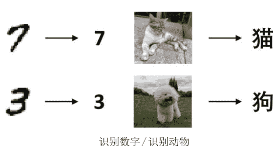

### 第一章 图像识别的基础知识：从像素到张量的译码之旅

本章带你拆解：什么是图像识别、计算机如何“看”图、识别全流程、类别如何编码，并带你用代码探秘经典数据集。
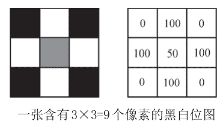

#### 一、 图像识别：给机器一双“懂图”的眼

顾名思义，即让机器判读图像内容。严谨定义：输入一张图，输出内容标签。如：输入手写数字图 → 判定数值；输入动物图 → 区分猫狗；输入班级合照 → 叫出名字。


#### 二、 计算机眼中的世界：从像素到矩阵

要让机器识图，先得让它“看”见。你可能不陌生：Windows画图、Lightroom、PS展示了强大的图像处理力。但你知道机器眼里只有数字（二进制）吗？如何将图像数字化？

计算机图像主要分**位图**与**矢量图**（本书聚焦位图）。位图本质是**像素矩阵**。将图像切分为微小方块，每个方块即一像素。广告语“2000万像素”即指图像含2000万个微方块。每像素承载信息，像素越多，信息越丰，画面越清晰。

以黑白照为例：每像素用一数值表征灰度（亮度）。设纯白=100，纯黑=0，灰阶映射1-99，一张图便转化为一数值矩阵（实际常用0-255，此处简化易懂）。
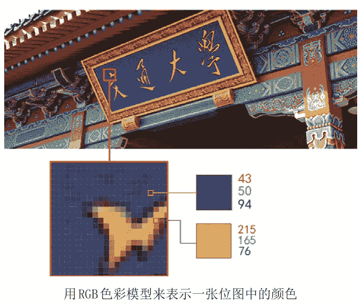

彩色图像遵循**光的三原色原理**：红绿蓝（RGB）叠加生成任意颜色。故每像素可用一三元数组（R, G, B）唯一确色。R/G/B各取0-255整数。
*   (255, 0, 0) = 纯红
*   (0, 255, 0) = 纯绿
*   (255, 255, 0) = 红绿叠加 = 纯黄
*   (0, 0, 0) = 无光 = 黑
*   (255, 255, 255) = 三色满强 = 白
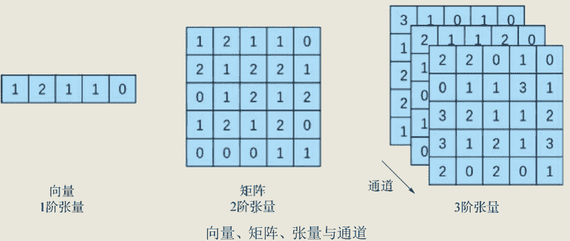

##### 概念解析：向量、矩阵、张量与通道

图像存储涉及四大核心术语：

*   **向量**：本质是一组有序数字（一阶张量）。
*   **矩阵**：行列构成的二维数字阵列，用(行,列)定位（二阶张量）。灰度图即矩阵。如(5,5)矩阵。
*   **张量**：广义容器，维度不限行列。三阶张量即(行,列,深度)，如(5,5,3)，天然适配RGB彩色图。
*   **通道**：彩色图由三阶张量表示，除行列外，第三维度即“通道”。RGB图通道数=3。

##### 思考与实践

1.  **存储量测算**：一张 100×100 像素的 RGB 彩色图，机器需存多少数值？
2.  **像素扩展**：除 RGB，每像素还能存储何种信息？
3.  **灰度图的张量表达**：灰度图能否用三阶张量表示？若能，形状如何？通道数几？

#### 三、 人类如何“看懂”世界

在教会机器前，先花五分钟反观：我们自己是怎么识图的？

对人类而言，识图似是天赋，全凭下意识，大脑自动完成，无需刻意思考。

# 从甲骨文到K近邻：带你拆解图像识别的核心逻辑

环视身边，桌上的杯子、键盘、书本……大脑几乎零成本地完成了命名。这并非魔法，而是熟悉感让识别过程隐形了。若换成从未见过的符号，思维会如何运作？我们不妨做个实时实验。

请先浏览这组陌生图样及其编号：

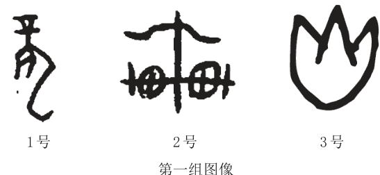

接着，请为下面这组新图样分配编号（1、2、3 或“以上皆非”），留意大脑判断的每一步：

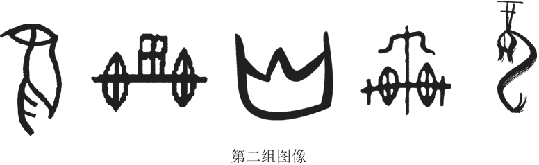

**揭晓答案：** 依次为：以上皆非、以上皆非、3号、2号、1号。  
原来这些全是甲骨文。首组中：1号对应“龙”、2号是“车”、3号代表“火”。次组首图为“鸟”，第二图则是“车”的异体字。

复盘一下：你是否在脑中把新图与旧图逐一对照，找最像的那个贴标签？若全都不像，便判定为未知。那“像”到底怎么定义？再细究一次——或许你关注轮廓的修长、左右双圈加十字的结构、或是三个尖锐突起的特征。

有趣的是，计算机“看图”的底层逻辑与此惊人相似：它也在“找相似”。区别在于，工程师会设计算法，把形状、色彩等视觉线索量化为**特征向量**，再以此度量相似度。这套“提特征、算相似”的方案好坏，直接决定了识别的上限。

---

## 四、如何给“类别”编码？

图像识别本质是**分类任务**：喂入一张图，吐出类别。计算机只认数字，二分类用 0/1，十分类用 0~9。但直接用数字有个隐患：数字自带大小、运算关系（如 5>3、3×3=9），而类别之间平级无序——“苹果”不大于“香蕉”，“梨”也不是“西瓜的两倍”。若强行回归数字，这些无关数学属性会干扰模型判断。

业界通用的解法是 **独热编码**。  
假设 10 个类别，用 10 位二进制向量表示，仅有一位为 1，其余全 0，1 所在的位置即类别身份：

| 类别 | 独热向量 |
|------|----------|
| 5 | 0000010000 |
| 0 | 1000000000 |
| 4 | 0000100000 |
| 1 | 0100000000 |
| 9 | 0000000001 |
| 2 | 0010000000 |

这样彻底剥离了数值间的大小与运算耦合。

---

## 五、必知的三大经典数据集

模型训练离不开“已知答案”的标注数据。以下三大数据集是计算机视觉领域的“标准考场”。

### (一) MNIST：手写数字的“入门教材”
- **来源**：美国国家标准技术研究院（NIST），250 人书写（半学生、半普查员）。
- **规模**：6 万训练 + 1 万测试，灰度图 28×28 像素。
- **地位**：算法基准测试首选。

可视化前需导入工具包：

```
###### 如果没有安装 keras 和 tensorflow 库
###### 请使用 pip install keras tensorflow 安装
from keras.datasets import mnist
from matplotlib import pyplot as plt
import numpy as np
```

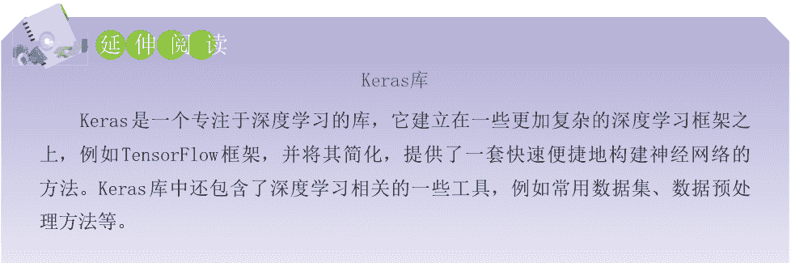

下载并查看数据结构：

```
(x_train, y_train), (x_test, y_test) = mnist.load_data()
print(x_train.shape)
print(y_train.shape)
print(x_test.shape)
print(y_test.shape)
```

输出显示：训练集 6 万张 (28,28)，标签 6 万；测试集 1 万张 (28,28)，标签 1 万。

> **概念旁白：训练集 vs 测试集**  
> 就像学乘法：背熟“九九表”只能算见过的题，真本事得靠从未见过的 12×15 来考。训练集用来“学”，测试集用来“考”，防止模型“死记硬背”（过拟合）。

绘制前 10 张训练样本：

```
fig, axes = plt.subplots(2, 5, figsize=(10, 4)) # 新建一个包含10张子图2行5列的画布
axes = axes.flatten() # axes中存储了每一个子图
for i in range(10): # 循环10次（画10张图)
    axes[i].imshow(x_train[i], cmap="gray_r") # 将x_train的第i张图画在第i个子图上，这里我们用cmap="gray_r"即反灰度图，数字越大颜色越黑，数字越小颜色越白
    axes[i].set_xticks([]) # 移除图像的x轴刻度
    axes[i].set_yticks([]) # 移除图像的y轴刻度
plt.tight_layout() # 采用更紧凑美观的布局方式
plt.show() # 显示图像
```

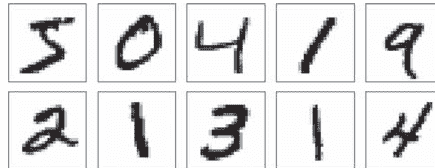

再按类别各取 10 张，风格多样性一目了然：

```
fig, axes = plt.subplots(10, 10, figsize=(20, 20)) # 新建一个包含100张子图的10行
10列的画布
for i in range(10): # 对于每一个数字i
    indice = np.where(y_train == i)[0] # 找到标签为数字i的图像下标
    for j in range(10): # 输出前10张图像
        axes[i][j].imshow(x_train[indice[j]], cmap="gray_r")
        axes[i][j].set_xticks([])
        axes[i][j].set_yticks([])
plt.tight_layout()
plt.show()
```

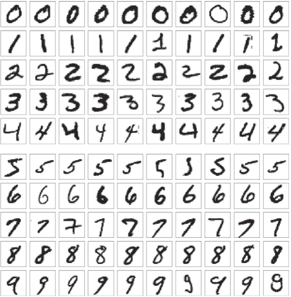

> **洞见**：数据多样性（笔画粗细、左右手书写等）直接决定泛化能力。若全是右手字，左手字来了模型必翻车。

### (二) CIFAR-10：彩色小图的“进阶关卡”
- **构成**：10 类物体，32×32 RGB 彩色图，共 6 万张（5 万训 / 1 万测）。
- **类别**：飞机、汽车、鸟、猫、鹿、狗、青蛙、马、船、卡车（0~9 编码）。

导包与下载：

```
###### 如果没有安装 keras 和 tensorflow 库
###### 请使用 pip install keras tensorflow 安装
from keras.datasets import cifar10
from matplotlib import pyplot as plt
import numpy as np
```

```
输出结果：
Using TensorFlow backend.
```

```
(x_train, y_train), (x_test, y_test) = cifar10.load_data()
print(x_train.shape)
print(y_train.shape)
print(x_test.shape)
print(y_test.shape)
```

```
输出结果：
(50000, 32, 32, 3)
(50000, 1)
(10000, 32, 32, 3)
(10000, 1)
```

数据形状变为 (50000, 32, 32, 3)——多出的维度 3 正是 R/G/B 三通道。

可视化前 10 张：

```
fig, axes = plt.subplots(2, 5, figsize=(10, 4)) # 新建一个包含10张子图2行5列的画布
axes = axes.flatten() # axes中存储了每一个子图
for i in range(10): # 循环10次（画10张图）
    axes[i].imshow(x_train[i]) # 将x_train的第i张图画在第i个子图上
    axes[i].set_xticks([]) # 移除图像的x轴刻度
    axes[i].set_yticks([]) # 移除图像的y轴刻度
plt.tight_layout() # 采用更美观的布局方式
plt.show() # 显示图像
```

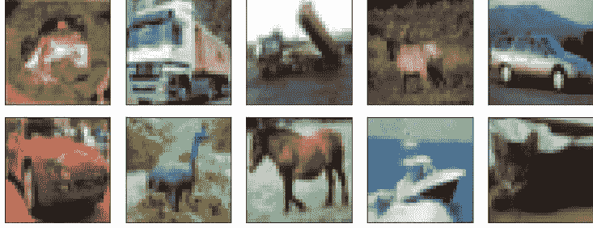

各类别各 10 张：

```
fig, axes = plt.subplots(10, 10, figsize=(20, 20)) # 新建一个包含100张子图的10行
10列的画布
for i in range(10): # 对于每一类物体
    indice = np.where(y_train == i)[0] # 找到标签为i的图像下标
    for j in range(10): # 输出前10张图像
        axes[i][j].imshow(x_train[indice[j]], cmap="gray_r")
        axes[i][j].set_xticks([])
        axes[i][j].set_yticks([])
plt.tight_layout()
plt.show()
```

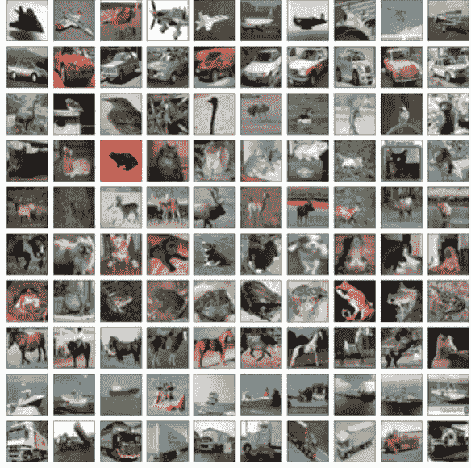

可见：同类内部形态、角度、背景干扰差异巨大，远比 MNIST 复杂。

### (三) ImageNet：深度学习的“点火引擎”
- **量级**：1400 万+ 图像，2 万+ 类别，百万级带精细标注（类别+位置）。
- **结构**：层级化分类（如 动物 → 哺乳类 → 犬科）。
- **分辨率**：平均 400×350，远超前两者。
- **历史地位**：2012 年 AlexNet 夺冠，引爆深度学习热潮。

体量太大，此处仅展示样例直观感受：

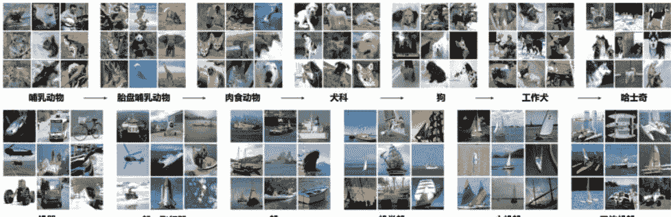

---

# 第二章 K近邻算法：以“邻居”定“身份”

本章将拆解 KNN 核心思想、相似度度量、工程落地及局限。

## 一、算法思想：少数服从多数

**K近邻（K-Nearest Neighbors, KNN）**：给定带标签数据集，新样本到来，在旧数据中找距离最近的 K 个邻居，谁家人数多，新样本就归谁。

如下图：蓝/黄/黑三类已知点，红色方块为新样本。设 K=3，最近 3 邻居含 2 黄 1 黑 → 判为黄类。

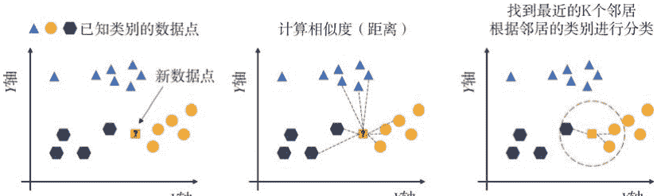

### K 值怎么选？这是个“超参数”
K 非数据自学习，需人工设定，称作**超参数**。  
- **K 太小**（如 1）：只看极微邻域，极易受噪声/异常点误导，决策边界破碎抖动。  
- **K 太大**（如 20）：视野过广，平滑了噪声，却也抹平了局部细节，导致欠拟合。

可视化对比：

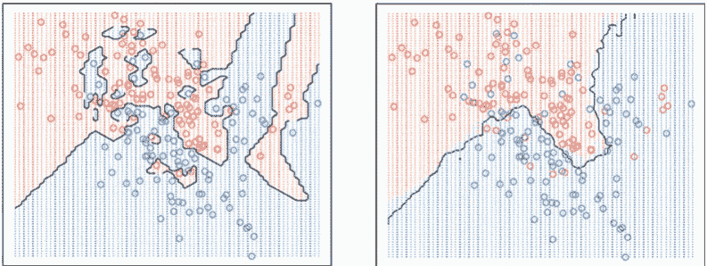

实战案例——手写数字识别：  
K=1 时误判为 5；K=3 时，3 邻居含 2 个“3”，正确分类。工程上常试 K=3 或 5。

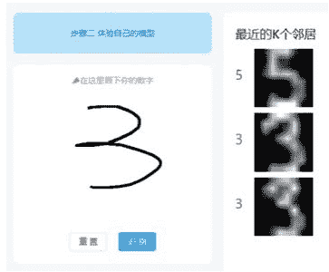

## 二、图像相似度怎么算？

平面点对距离即相似度倒数。欧氏距离公式：

$$
dist(a, b) = \sqrt{(a_1 - b_1)^2 + (a_2 - b_2)^2}
$$

$ a_1,b_1 $ 为横坐标，$ a_2,b_2 $ 为纵坐标。高维空间同理推广——特征向量维度越高，计算量越大，这也是 KNN 面临的“维度灾难”伏笔。

### 以矩阵距离衡量图像相似度

灰度图本质是一个矩阵，因此两图之间的相似度完全可以转化为两个矩阵间的距离来度量。这与计算平面上两点距离的逻辑如出一辙：将对应位置的像素值相减、平方、求和，最后开根号，得到的就是矩阵间的**欧式距离**。公式表达为：

\(dist(A, B) = \sqrt{\sum_{ij} (A_{ij} - B_{ij})^2}\)

其中 \(A_{ij}\) 代表矩阵第 \(i\) 行第 \(j\) 列的数值。直观而言，欧式距离越小，两幅图像的内容越接近。

#### 思考与实践

- 2.1 采用这种方式衡量图像距离是否合理？若不合理，能否举例说明？

---

### 三、实战：用 sklearn 极速搭建 KNN 手写数字识别器

掌握了 KNN 原理与图像相似度计算，我们即刻动手，借助 `sklearn` 库实现一个手写数字分类器。

#### 延伸阅读：sklearn 库速览

`sklearn`（全称 `scikit-learn`）是机器学习领域的“瑞士军刀”，集成了分类、回归、聚类等主流算法，并提供了数据预处理、模型评估等完善工具链。其最大亮点在于**统一的 API 接口**（`fit`/`predict`），让新手也能快速上手复杂模型。

**核心准备工作：**

- `KNeighborsClassifier`：sklearn 中的 KNN 分类器实现。
- `mnist`（来自 Keras）：一键获取经典 MNIST 手写数字数据集。
- `pyplot` (matplotlib)：数据可视化利器。
- `numpy`：科学计算基石，处理多维数组。

```python
###### 如果没有安装 keras 和 tensorflow 库
###### 请使用 pip install keras tensorflow 安装
from sklearn.neighbors import KNeighborsClassifier
from keras.datasets import mnist
from matplotlib import pyplot as plt
import numpy as np
```

Keras 自带的 MNIST 数据集原始格式为二维图像 (28x28)，而 `KNeighborsClassifier` 仅接受一维向量输入。因此，我们需用 `reshape` 将图像“拉直”展平。

```python
(x_train, y_train), (x_test, y_test) = mnist.load_data()
n_train = x_train.shape[0] # 训练数据数量
n_test = x_test.shape[0] # 测试数据数量
print("原输入数据的形状")
print(x_train.shape)
print(x_test.shape)
###### 使用reshape方法将图像展开成向量
x_train = x_train.reshape(n_train, -1)
x_test = x_test.reshape(n_test, -1)
print("reshape后输入数据的数据形状")
print(x_train.shape)
print(x_test.shape)
```

```
输出结果：
原输入数据的形状
(60000, 28, 28)
(10000, 28, 28)
reshape后输入数据的数据形状
(60000, 784)
(10000, 784)
```

重塑后，训练集变为 **60,000 个 784 维（28×28）向量**，完美适配模型输入要求。

接着初始化 KNN 分类器，核心超参数 `n_neighbors`（即 K 值）设为 5，代表预测时参考最近的 5 个邻居。

```python
k = 5
knc = KNeighborsClassifier(n_neighbors=k)
```

调用 `fit(x_train, y_train)` 启动训练。KNN 属于“懒惰学习”，训练阶段本质是存储数据，但 6 万样本量下仍需稍作等待。

```python
knc.fit(x_train, y_train)
```

```
输出结果:
KNeighborsClassifier(algorithm='auto', leaf_size=30, metric='minkowski',
             metric_params=None, n_jobs=None, n_neighbors=5, p=2,
             weights='uniform')
```

训练完成！使用 `predict` 对 1 万张测试图进行推理，结果存入 `y_predict`（推理阶段耗时较长，请耐心等待）。

```python
y_predict = knc.predict(x_test)
```

将预测标签 `y_predict` 与真实标签 `y_test` 逐一比对，统计命中数并计算准确率。

```python
accuracy = np.sum(y_predict == y_test) / n_test # 正确为1, 错误为0, 使用sum求和函数统计分类正确的个数
print("准确度为 %f" % accuracy)
```

**输出结果：**
> 准确度为 0.968800

**仅十余行代码，即达成 96.88% 的识别率！** 这正是开源生态的魅力——无数前人将算法封装成库，善用这些工具是入门机器学习的必修课。

测试集中仍有 322 张图片分类错误，我们将其可视化分析：

```python
indice = np.random.choice(np.where(y_predict != y_test)[0], size=10) # 随机选择10张分类错误的图像
fig, axes = plt.subplots(2, 5, figsize=(10, 4))
axes = axes.flatten()
for i, idx in enumerate(indice):
    axes[i].imshow(x_test[idx].reshape(28, 28), cmap="gray_r")
    axes[i].set_xticks([])
    axes[i].set_yticks([])
    axes[i].set_title("y_predict: %d\ny_test: %d" % (y_predict[idx],
    y_test[idx]))
plt.tight_layout()
plt.show()
```

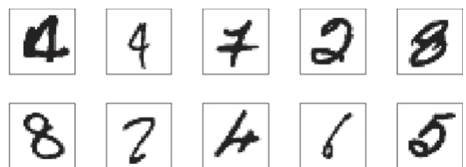

**分类错误样本展示**

对比 `y_predict`（预测值）与 `y_test`（真值）不难发现：**错案多为笔画歪斜、形变严重、书写风格偏离主流的数字**。

---

### 四、KNN 的“阿喀琉斯之踵”

虽原理直观、效果尚可，但 KNN 硬伤明显：

1.  **推理极慢（预测阶段瓶颈）**  
    运行代码即可体会：`predict` 环节耗时惊人。因每次预测都需遍历全量训练集寻找最近邻，数据量越大（精度通常越高），延迟越高。虽有 KD-Tree、Ball Tree 等索引结构加速，但在实时性要求高的场景下，KNN 往往力不从心。

2.  **强依赖距离度量，抗变形能力弱**  
    当前采用的欧式距离仅适用于规整的黑白数字。面对旋转、扭曲、或 CIFAR-10 这类复杂彩色图像，效果大打折扣。  
    **直观例子**：将数字“7”微微旋转，像素级对齐瞬间破坏，欧式距离会判定两者差异巨大，却忽略了语义上的高度相似。

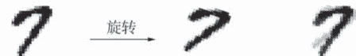

---

## 第三章 卷积神经网络：开启视觉智能新纪元

近年来，CNN（Convolutional Neural Networks）让计算机视觉实现了质变：

- **2012 AlexNet**：ImageNet 夺冠，以近 10% 的优势碾压对手，确立 CNN 霸主地位。
- **2014 VGG-16 / DeepFace / DeepID**：人脸识别准确率冲至 99.75%，逼近甚至超越人眼。
- **2016 AlphaGo**：将棋盘视为 19×19 的“三通道图像”（黑/白/空），用 CNN 评估局势，辅助击败人类顶尖棋手。

本章将带你拆解神经网络内核，精讲 CNN 原理，掌握图像增强，并用 Keras 亲手搭建网络。

---

### 一、初识神经网络：从生物启发到数学建模

人工神经网络（ANN）源于对生物神经系统的模仿。生物神经元通过树突接收信号，经细胞体积分，轴突输出；ANN 中的**人工神经元**沿用此逻辑：

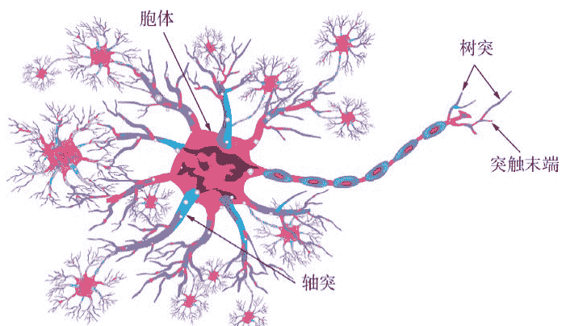

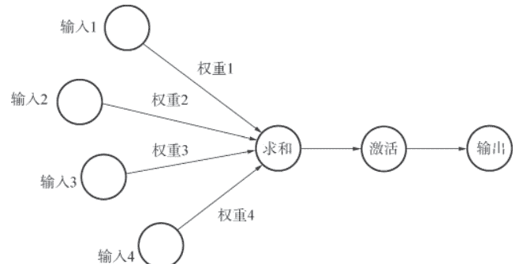

**信号流向**：输入 \(a_1 \dots a_n\) 乘以对应权重 \(w_1 \dots w_n\) → **加权求和** → 经 **激活函数 \(f\)** 非线性变换 → 输出 \(f(\sum w_i a_i)\)。

激活函数模拟生物神经元的“全或无”特性：信号需达阈值才触发放电。

```
sum = w_1a_1 + w_2a_2 + \cdots + w_na_n = \sum_{i=1}^n w_ia_i
```

**常见激活函数演进**：

| 函数 | 形态 | 评价 |
| :--- | :--- | :--- |
| **单位阶跃函数** | 硬阈值，非连续 | 理论完美，实战梯度为 0，无法反向传播指导权重更新，**弃用**。 |
| **Sigmoid** | S 型曲线，平滑连续 | 早期主流，但易梯度消失，输出非零均值导致收敛震荡。 |
| **ReLU (Rectified Linear Unit)** | 分段线性：\(x<0\) 为 0，\(x \ge 0\) 为 \(x\) | **现代标配**：计算极快、缓解梯度消失、稀疏激活。 |

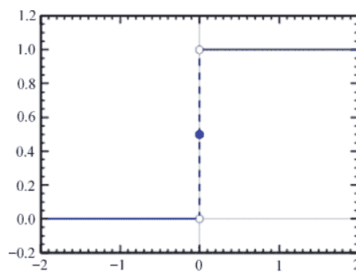 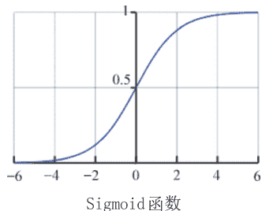 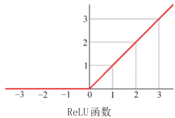

**网络拓扑**：通常呈层级结构——**输入层 → 隐藏层（可多层） → 输出层**。若每层神经元均与上层全连接，称作**全连接层 (Dense)**。隐藏层赋予网络拟合复杂非线性函数的能力。

> **学习机制：监督学习 + 梯度下降**  
> 网络初始不知“如何分类”，需从海量“题目-答案”对（图像-标签）中学习规律。  
> 过程类比学生刷题：预测 → 对比标准答案 → 计算**损失函数**（预测与真值的“距离”） → **反向传播**调整权重，最小化损失。

**梯度下降直观理解**：  
想象损失函数是地形图，高度即损失值。目标是找到最低洼地。  
站在山坡上，沿**最陡下降方向（梯度反方向）**迈步，**步长由学习率控制**。步子太大易跨过谷底震荡，太小则收敛缓慢。

```
$$w_2 = w_1 - kf'(w_1)$$
``` 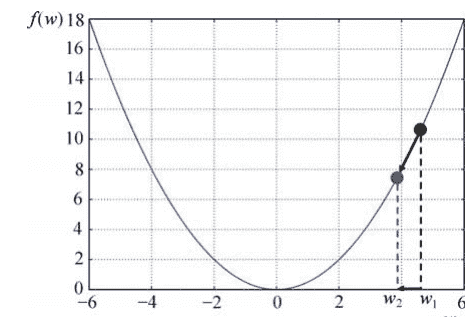 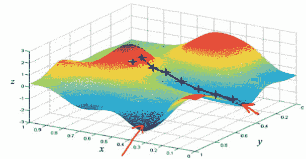

**隐患**：可能陷入**局部最优**（山坳）而非全局最优（海拔最低点），但工程实践中通常表现足够优秀。

---

### 二、卷积神经网络深度解析

#### (一) 卷积层：自动提取特征的“显微镜”

KNN 用欧式距离比像素，过于“看表象”。CNN 通过**卷积层**从像素中挖掘**边缘、纹理、形状**等结构化特征。

**核心思想：边缘即灰度剧变处**。  
最朴素的边缘检测：中心像素与上下左右四邻域灰度差求和。  
工程化实现：用一个小矩阵（**卷积核/滤波器**）在图像上滑动，每处做**元素级乘积求和**。卷积核数值由网络**自动学习**而非人工设定。

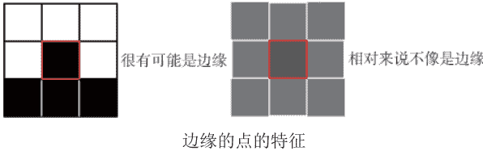 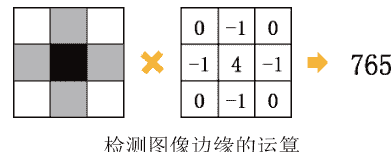 

**关键概念**：
- **卷积核**：可学习的权重矩阵（常见 3×3, 5×5）。
- **步长**：滑动间隔，控制输出特征图尺寸。
- **特征图**：卷积操作输出，边缘等高级特征被高亮，背景被抑制。

这一过程，正是**从原始像素到语义特征的跃迁**。

##### （二）池化层

掌握了卷积核的概念后，卷积层就很好定义了：它本质上就是利用一个或多个卷积核对输入数据执行卷积运算。

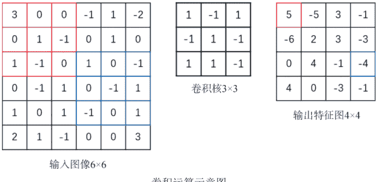

池化层的核心任务是缩减图像尺寸，剔除次要信息，留住核心特征。打个比方，即使降低照片分辨率，我们依然能认出画面内容，因为关键特征仍在，池化层正是基于此原理运作。值得注意的是，池化层自身不包含可学习参数。主要分为最大池化与平均池化两类。配置池化层时，先定类型，再设窗口大小与步长，这与卷积核的设定逻辑一致。最大池化在窗口内取最大值，平均池化则取均值，具体效果如下图所示。

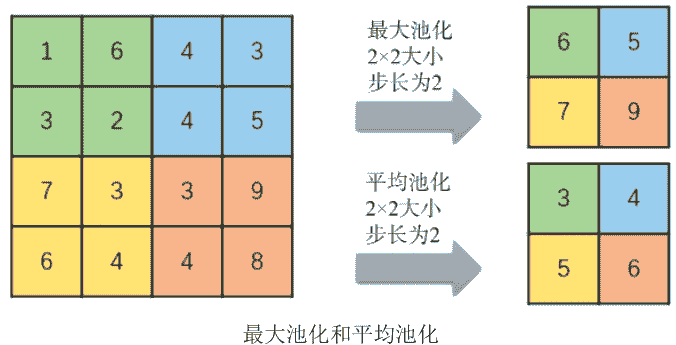

##### （三）平铺层

平铺层结构极简，功能单一：将二阶张量（矩阵）或三阶张量“拉直”成一阶张量（向量），如下图演示。

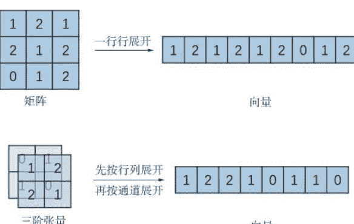

平铺层示意图

##### （四）卷积神经网络

人类视觉处理呈现明显的层级性。视网膜先接收光信号，大脑初级视觉区（V1）提取边缘，V2 区识别基础形状，高级前额叶皮层则负责分类决策……高层特征由低层特征组合而成，层级越高，特征表达越抽象、越概念化。

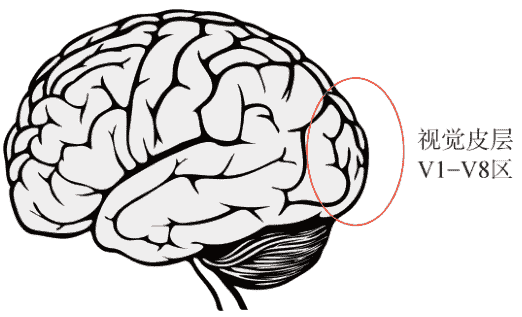

大脑视觉皮层示意

卷积神经网络（CNN）处理图像的流程与生物视觉系统异曲同工。CNN 首层卷积核捕捉边、角、曲线等低阶特征；次层以首层输出为输入，识别低阶特征的组合，如半圆、四边形；层级加深，特征愈发复杂抽象，直至网络能识别具体物体。下图展示了经典 LeNet 架构：输入经两轮“卷积+池化”后，接三个全连接层输出各类别概率。

训练伊始，卷积核数值随机初始化，无法识别任何特征，恰似初生婴儿对世界一无所知，需通过学习建立认知，CNN 亦是如此。

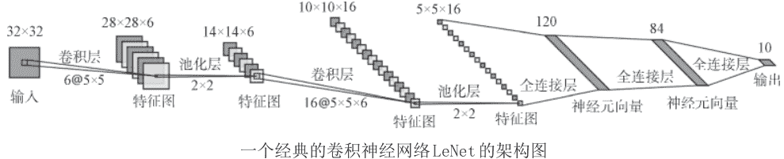

经过训练迭代，卷积核数值不断更新，网络逐渐具备识别特定图像特征的能力。下图为 CNN 可视化结果：右侧展示各层状态，第二行为首个卷积层，含多个卷积核。可见有的核响应竖直边缘，有的捕捉弯曲边缘，有的检测交点，亦有大量核检测的特征难以用人类语言描述。学习完成后，每个卷积核的具体职能并无固定定义，不一定对应人类理解的“边”或“角”，但必定是网络判定有利于识别任务的特征。

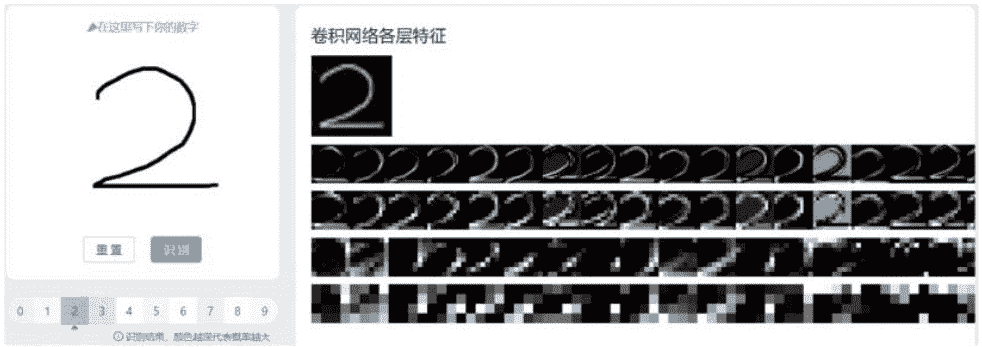

#### 三、使用 Keras 搭建一个简单的卷积神经网络

理论铺垫完毕，我们动手用 Keras 搭建一个基础 CNN。Keras 封装良好，搭建过程如同拼积木，逐层堆叠即可。

- 首先引入必要模块，核心依赖 Keras 库。

  - `mnist`：Keras 内置的 MNIST 数据集下载工具。

  - `Sequential`：线性模型容器，可视为积木底板。

  - 常用层组件：
    - `Dense`：全连接层。
    - `Flatten`：平铺层。
    - `Conv2D`：二维卷积层。
    - `MaxPooling2D`：二维最大池化层。

```
###### 如果没有安装 keras 和 tensorflow 库
###### 请使用 pip install keras tensorflow 安装
import keras
from keras.datasets import mnist
from keras.models import Sequential
from keras.layers import Dense, Dropout, Flatten
from keras.layers import Conv2D, MaxPooling2D
```

第一步载入 MNIST 数据。训练前需预处理：Keras 要求图像输入为三阶张量，但 MNIST 是灰度图（矩阵形式），故需 `reshape` 将 28×28 矩阵扩为 28×28×1 张量。像素值原为 0~255 整数，通常归一化至 0~1 或 -1~1，此处统一除以 255。标签采用独热编码，Keras 提供 `to_categorical` 函数快速转换。

```
(x_train, y_train), (x_test, y_test) = mnist.load_data()
width, height = x_train.shape[1], x_train.shape[2] # 获取图像的宽、高
n_train = x_train.shape[0] # 获取训练数据数量
n_test = x_test.shape[0] # 获取测试数据数量
x_train = x_train.reshape(n_train, width, height, 1) # 将输入转为三阶张量
x_test = x_test.reshape(n_test, width, height, 1) # 将输入转为三阶张量
print("reshape后的输入形状")
print(x_train.shape)
print(x_test.shape)
y_train = keras.utils.to_categorical(y_train) # 将输出转为独热编码
y_test = keras.utils.to_categorical(y_test) # 将输出转为独热编码
print("独热化后的输出形状")
print(y_train.shape)
print(y_test.shape)
print("处理前的最大值为%f" % x_train.max())
x_train = x_train / 255 # 将输入转化到0~1范围的数
x_test = x_test / 255 # 将输入转化到0~1范围的数
print("处理后的最大值为%f" % x_train.max())
```

输出结果:

reshape后的输入形状

(60000, 28, 28, 1)

(10000, 28, 28, 1)

独热化后的输出形状

(60000, 10)

(10000, 10)

处理前的最大值为255.000000

处理后的最大值为1.000000

数据就绪，开始搭建模型。采用 `Sequential` 构建基础 CNN，架构如下：

- **Conv2D**：32 个 5×5 卷积核，激活函数 ReLU。
- **MaxPooling2D**：2×2 池化窗口。
- **Conv2D**：32 个 3×3 卷积核，激活函数 ReLU。
- **MaxPooling2D**：2×2 池化窗口。
- **Flatten**：数据展平为向量。
- **Dense**：隐藏层 256 单元，激活函数 ReLU。
- **Dense**：输出层 10 单元，激活函数 Softmax，输出各类别概率。

##### 概念解析

###### Softmax

Softmax 即归一化指数函数。它将任意实数向量映射为 0~1 区间且和为 1 的概率分布。例如输入 7 维向量 `[1, 2, 3, 4, 1, 2, 3]`，经 Softmax 变为 `[0.024, 0.064, 0.175, 0.475, 0.024, 0.064, 0.175]`。每维数值代表该类别概率，故分类任务输出层常用维度等于类别数、激活函数为 Softmax 的全连接层。

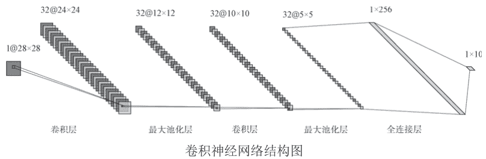

在 `Sequential` 中，通过 `add()` 方法逐层添加网络层。

```
model = Sequential()
model.add(Conv2D(32, (5, 5), activation="relu", input_shape=(width, height, 1)))
model.add(MaxPooling2D(pool_size=(2, 2)))
model.add(Conv2D(32, (3, 3), activation="relu"))
model.add(MaxPooling2D(pool_size=(2, 2)))
model.add(Flatten())
model.add(Dense(256, activation="relu"))
model.add(Dense(10, activation="softmax"))
```

`summary()` 函数可查看模型逐层结构与参数量。

```
model.summary()
```

输出结果:

| Layer (type) | Output Shape | Param # |

|---|---|---|

| conv2d_1 (Conv2D) | (None, 24, 24, 32) | 832 |

| max_pooling2d_1 (MaxPooling2D) | (None, 12, 12, 32) | 0 |

| conv2d_2 (Conv2D) | (None, 10, 10, 32) | 9248 |

| max_pooling2d_2 (MaxPooling2D) | (None, 5, 5, 32) | 0 |

| flatten_1 (Flatten) | (None, 800) | 0 |

| dense_1 (Dense) | (None, 256) | 205056 |

| dense_2 (Dense) | (None, 10) | 2570 |

| Total params: 217,706 | | |

| Trainable params: 217,706 | | |

| Non-trainable params: 0 | | |

模型搭建完成，需指定优化器寻找最优权重以最小化损失。此处选用 Adam 优化器，损失函数采用交叉熵（多分类常用），评估指标为准确率，模型配置至此告一段落。

##### 概念解析

###### 优化器

学界提出了众多优化器，如引入动态学习率、利用高阶导数信息等。Adam 与随机梯度下降（SGD）均为常用高效之选。SGD 每次随机抽取一批数据（而非全量）计算损失并依梯度更新权重；Adam 则是 SGD 的改进版。每次选取的数据量称为批量大小。

```
model.compile(loss="categorical_crossentropy", optimizer="adam", metrics=['accuracy'])
```

调用 `fit()` 启动训练，传入训练集 `(x_train, y_train)`，设批量大小 32，训练 10 个轮次。准备就绪，开始训练（耗时较长）。

```
model.fit(x_train, y_train, batch_size=32, epochs=5, validation_data=(x_test, y_test))
```

```
输出结果:
Train on 60000 samples, validate on 10000 samples
Epoch 1/5
60000/60000 [==============================] - 67s 1ms/step - loss: 0.1385
- acc: 0.9562 - val_loss: 0.0446 - val_acc: 0.9862
Epoch 2/5
60000/60000 [==============================] - 66s 1ms/step - loss: 0.0463
- acc: 0.9859 - val_loss: 0.0353 - val_acc: 0.9893
Epoch 3/5
60000/60000 [==============================] - 187s 3ms/step - loss: 0.0321
- acc: 0.9901 - val_loss: 0.0307 - val_acc: 0.9898
Epoch 4/5
60000/60000 [==============================] - 64s 1ms/step - loss: 0.0233
- acc: 0.9923 - val_loss: 0.0386 - val_acc: 0.9882
Epoch 5/5
60000/60000 [==============================] - 65s 1ms/step - loss: 0.0196
- acc: 0.9935 - val_loss: 0.0323 - val_acc: 0.9909
<keras.callbacks.History at 0x7f35c0992470>
```

训练结束！拿测试集评估模型表现。

```
score = model.evaluate(x_test, y_test)
print("损失为%f " % score[0])
print("准确度为%f " % score[1])
```

```
输出结果:
10000/10000 [==============================] - 3s 269us/step
损失为0.032268
准确度为0.990900
```

测试结果显示，该 CNN 在测试集上达成 **99.09%** 的准确率！

#### 四、图像数据增强

业界常说“模型是喂出来的”，海量数据能显著提升精度。数据有限时，通过变换现有样本生成新数据来扩充数据集，即为“数据增强”。

图像变换手段繁多，最常用的包括旋转、平移、水平/垂直翻转。

Keras 提供 `ImageDataGenerator` 实现增强。以 CIFAR-10 为例演示。

首先导入所需库：

- `cifar10`：Keras 内置 CIFAR-10 加载器。
- `ImageDataGenerator`：Keras 图像增强核心类。
- `pyplot`：Matplotlib 绘图接口。

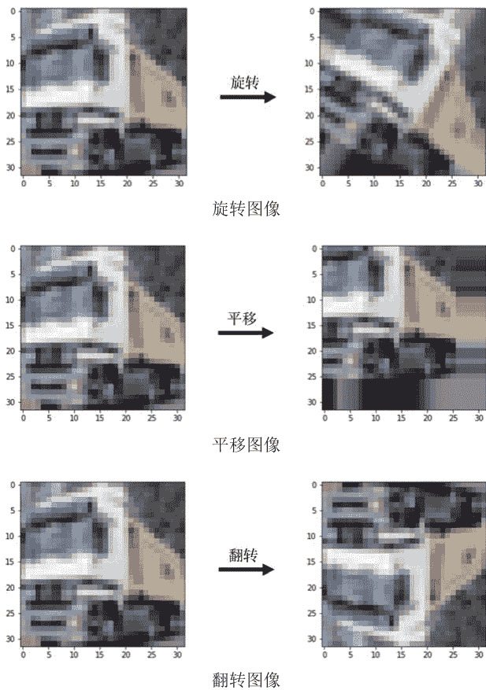

```
###### 如果没有安装 keras 和 tensorflow 库
###### 请使用 pip install keras tensorflow 安装
from keras.datasets import cifar10
from keras.preprocessing.image import ImageDataGenerator
from matplotlib import pyplot as plt
```

```
输出结果：
Using TensorFlow backend.
```

加载 CIFAR-10 并完成预处理。

```
(x_train, y_train), (x_test, y_test) = cifar10.load_data()
y_train = keras.utils.to_categorical(y_train)
y_test = keras.utils.to_categorical(y_test)
print("独热化后的输出形状")
print(y_train.shape)
print(y_test.shape)
print("处理前的最大值为%f " % x_train.max())
x_train = x_train / 255
x_test = x_test / 255
print("处理后的最大值为%f " % x_train.max())
```

在 `ImageDataGenerator` 中配置增强策略：

- `rotation_range=30`：随机旋转 ±30°。
- `horizontal_flip=True`：随机水平翻转。
- `vertical_flip=True`：随机垂直翻转。
- `width_shift_range=5`：水平平移最多 5 像素。
- `height_shift_range=5`：垂直平移最多 5 像素。

```
datagen = ImageDataGenerator(
    rotation_range=30,
    horizontal_flip=True,
    vertical_flip=True,
    width_shift_range=5,
    height_shift_range=5
)
```

从训练集选取一张卡车图片，使用生成器进行 5 次随机变换，绘制原图与增强后图像对比。

```
origin_image = x_train[1] # 选取原图
###### 将原图画出来
plt.imshow(origin_image)
plt.show()
###### 对图像作五次随机变换并画出来
fig, ax = plt.subplots(1, 5, figsize=(15, 3))
ax = ax.flatten()
for i in range(5):
    ax[i].imshow(datagen.random_transform(origin_image)) # 使用datagen对图像作
```

随机变换

plt.show()

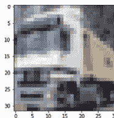

原始图像

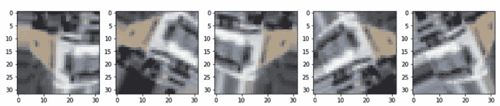

五次随机变换后的图像

前一节我们通过 `model.fit` 直接喂入原始数据完成模型训练。若想改用增强后的数据，仅需替换这一行调用即可。

```
model.fit(x_train, y_train, batch_size=32, epochs=10)
```

开启图像数据增强时，需调用 Keras 提供的 `fit_generator` 函数，具体用法如下。

```
model.fit_generator(datagen.flow(x_train, y_train, batch_size=32), epochs=10)
```

`fit_generator` 的首个参数为 `datagen.flow(x_train, y_train, batch_size=32)`，含义是：利用已配置好的 `datagen` 对原始输入执行变换，源源不断地产出新训练批次，每批 32 样本。完成预处理后，便可按惯例启动模型训练。

```
y_train = keras.utils.to_categorical(y_train)
y_test = keras.utils.to_categorical(y_test)
x_train = x_train / 255
x_test = x_test / 255
```

除上述五种变换外，Keras 还内置了大量其他增强手段；同时也支持自定义变换函数，以实现个性化的图像变换逻辑。

#### 思考与实践

3.1 你还能想出哪些图像数据增强的变换手段？

#### 五、使用搭建好的卷积神经网络

此前示例皆为手工搭建的 CNN 架构，架构优劣直接决定算法上限。众多计算机科学家会将验证有效的架构开源共享。Keras 集成了多款经典预定义架构，本节将实战其中的代表作——VGG16。

##### （一）VGG16 简介

VGG16 由牛津大学研究团队提出，于 2014 年 ImageNet 图像分类挑战赛中夺得亚军。其结构极简：全程仅用 3×3 卷积核与 2×2 池化层。代价是参数量巨大，计算资源消耗较高。VGG16 网络拓扑如下图所示。

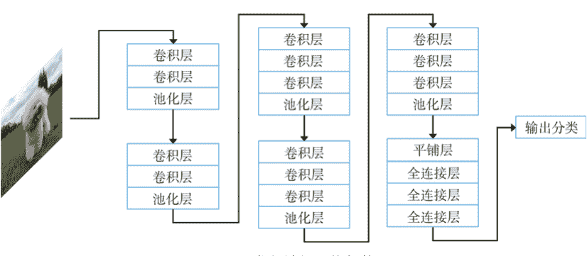

##### （二）在 Keras 中使用 VGG16

首先导入必要的工具包：

- `cifar10`：Keras 自带的 CIFAR-10 数据集加载器。
- `VGG16`：开箱即用的 VGG16 模型类。
- `preprocess_input`：VGG16 专用的输入预处理函数。
- `Model`：Keras 核心模型基类。
- `numpy`：Python 科学计算基础库。

```
###### 如果没有安装 keras 和 tensorflow 库
###### 请使用 pip install keras tensorflow 安装
import keras
from keras.datasets import cifar10
from keras.applications.vgg16 import VGG16, preprocess_input
from keras.models import Model
import numpy as np
```

载入 CIFAR-10 并完成预处理。Keras 为每款预定义架构配套了 `preprocess_input` 方法，可将其视为“除以 255”归一化操作的进阶替代。

```
(x_train, y_train), (x_test, y_test) = cifar10.load_data()
x_train = preprocess_input(x_train)
x_test = preprocess_input(x_test)
y_train = keras.utils.to_categorical(y_train)
y_test = keras.utils.to_categorical(y_test)
```

实例化 VGG16 模型并指定关键参数：

- `weights=None`：采用随机初始化权重，不加载预训练参数。
- `input_shape=(32, 32, 3)`：适配 CIFAR-10 的 32×32×3 输入尺寸。
- `classes=10`：对应 CIFAR-10 的 10 个类别。

```
model = VGG16(weights=None, input_shape=(32, 32, 3), classes=10)
```

优化器选用随机梯度下降（SGD），损失函数设为交叉熵，评估指标为准确率。

```
model.compile(optimizer="sgd", loss="categorical_crossentropy", metrics=["accuracy"])
```

调用 `fit` 开启训练。受限于 VGG16 参数量大、架构深，训练耗时相对较长。

```
model.fit(x_train, y_train, batch_size=256, epochs=50, validation_data=
(x_test, y_test))
```

```
输出结果:
Train on 50000 samples, validate on 10000 samples
Epoch 1/50
50000/50000 [==============================] - 60s 1ms/step - loss: 2.2234
- acc: 0.1777 - val_loss: 2.1854 - val_acc: 0.1906
Epoch 2/50
50000/50000 [==============================] - 45s 906us/step - loss: 1.9947
- acc: 0.2783 - val_loss: 1.8952 - val_acc: 0.3038
Epoch 3/50
50000/50000 [==============================] - 45s 906us/step - loss: 1.8264
- acc: 0.3425 - val_loss: 1.7115 - val_acc: 0.3722
Epoch 4/50
50000/50000 [==============================] - 45s 907us/step - loss: 1.6751
- acc: 0.3950 - val_loss: 1.6218 - val_acc: 0.4177
Epoch 5/50
50000/50000 [==============================] - 45s 908us/step - loss: 1.5676
- acc: 0.4382 - val_loss: 1.4892 - val_acc: 0.4670
...
...
...
Epoch 48/50
50000/50000 [==============================] - 45s 909us/step - loss:
5.9696e-05 - acc: 1.0000 - val_loss: 2.2972 - val_acc: 0.7277
Epoch 49/50
50000/50000 [==============================] - 45s 906us/step - loss:
5.4680e-05 - acc: 1.0000 - val_loss: 2.3100 - val_acc: 0.7278
Epoch 50/50
50000/50000 [==============================] - 45s 908us/step - loss:
5.0449e-05 - acc: 1.0000 - val_loss: 2.3215 - val_acc: 0.7274
```

50 个 Epoch 训练完毕！实测表明：仅用寥寥数行代码调用预定义 VGG16，即可在 CIFAR-10 上跑出 72% 左右的准确率。该分数尚未榨干 VGG16 潜力——它本为更复杂的 ImageNet 设计（类别更多、分辨率更高）。若叠加图像增强等进阶技巧，精度仍有提升空间。

### 本部分小结

本部分系统梳理了图像识别的核心概念：从灰度图、RGB 图在计算机中的存储表示，到经典数据集的可视化实操；深入剖析了 K 近邻与卷积神经网络的原理、优劣势及 Python 落地。图像识别领域日新月异，新算法层出不穷。愿此番学习为你搭建起认知脚手架，若兴趣未尽，强烈建议继续系统深造，去探索更前沿、更硬核、更高效的算法前沿。

## 第 2 部分

## 图像风格迁移

今日我们用手机定格风景；数百年前，画家凭笔墨摹写山河。若让莫奈等大师为你眼前的景致落笔，成作将是何等风貌？

熟悉 Photoshop 的人都知道，滤镜一键即能将照片转为水彩、油画、炭笔甚至浮雕风格。但要复刻“莫奈风”这种特定大师气质，滤镜组合往往力不从心、调试繁琐。令人惊喜的是，机器学习算法却能轻松拿捏。让我们一探究竟。


### 第四章 图像风格迁移基础知识

本章将带你建立图像风格迁移的核心认知，夯实相关基础知识。

#### 一、图像风格迁移简介

风格迁移的双基因是**内容**与**风格**。目标明确：输入一张图，输出一张保留原内容、却披上指定风格外衣的新图；且该风格需由 AI 从该风流派图像中自主习得。

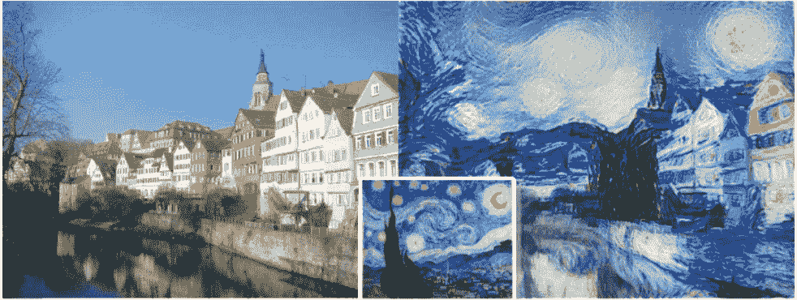

风格迁移效果示意

#### 二、风格迁移相关的四大基石

1. 计算机图像处理基础（位图、RGB 向量、张量）。
2. K 近邻算法核心概念。
3. 神经网络关键组件（激活函数、卷积操作）。
4. 像素级梯度优化与 CycleGAN 机制。

### 第五章 色彩的模仿——K近邻算法

本章实战 K 近邻实现色彩风格迁移，覆盖图像表示、处理及完整代码落地。

#### 一、算法思想

图像内容指物体形状、轮廓等显性结构；风格则抽象隐于色彩运用、纹理质感、笔触线条中，难以精确定义。我们从最直观的**色彩**切入：锁定内容图灰度骨架，借风格图色彩为其“上色”。技术关键引入 **Lab 色彩空间**。

#### 概念解析

##### Lab 色彩空间

色彩空间是颜色的量化坐标系。常见 RGB 通过三通道值定色；**Lab 空间**则拆解为 L（亮度）、a、b（双色度通道）。任一像素对应 Lab 三维坐标，一幅图即可拆解为同尺寸的 L、a、b 三个矩阵：L 矩阵承载灰度/内容，a、b 矩阵承载色彩/风味。

现有内容图 A 与风格图 B，欲生成兼具 A 内容、B 风格的图 C。在 Lab 域中：令 C 的 L 通道 = A 的 L 通道，内容即保留。若将风格简化为“配色规律”，问题转化为：如何根据 B 填充 C 的 a、b 通道。换言之，**风格 = 从局部灰度模式到色彩值的映射**。单像素灰度→色彩的一对一映射过于单薄，故升级为：以 3×3 邻域 9 个灰度值预测中心像素色彩值。

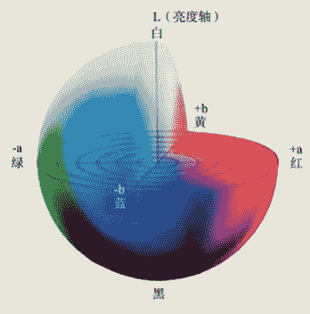

Lab 色彩空间示意

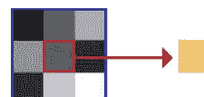

9 灰度值决定中心色彩值

**K 近邻（KNN）实现该映射**：在风格图 B 的 L 通道中检索与输入 3×3 灰度块最接近的 k 个邻域，取其中心像素色彩值按距离倒数加权平均，作为输出。两 3×3 矩阵距离定义为对应像素差值平方和。该策略填充 a、b 通道后，图 C 便呈现图 B 的色彩神韵。扩展至多张风格图，只需在多图 L 通道联合检索即可。

#### 二、代码实现

依次导入核心库：

- `numpy`：数值计算引擎。
- `skimage`：图像读写、RGB⇄Lab 色彩空间互转。
- `sklearn`：KNN 算法现成接口。

```
import numpy as np
from skimage import io, data
from skimage.color import rgb2lab, lab2rgb
from sklearn.neighbors import KNeighborsRegressor
import os

###### data_dir是放置风格图像的目录
data_dir = "knn_data/"
###### input_path是内容图像的路径
input_path = "input.jpg"
###### output_path是输出图像的路径
output_path = "output.jpg"
###### 设置灰度矩阵的大小为2*size+1
size = 1
```

定义函数：读入图像，提取所有 3×3 灰度邻域→中心色彩值的映射样本对。

```
###### 读入风格图像，得到x, Y
###### X: 储存3*3像素格的灰度值
###### Y: 储存中心像素格的色彩彩值
###### X, Y构成了从3*3像素格的灰度值到中心像素格色彩值的映射
def read_style_image(file_name):
    img = rgb2lab(io.imread(file_name))
    w, h = img.shape[:2]
    X = []
    Y = []
    for x in range(size, w - size):
        for y in range(size, h - size):
            X.append(img[x - size : x + size + 1, y - size : y + size + 1, 0].reshape(-1))
            Y.append(img[x, y, 1:])
    return X, Y
```

批量读取多张图像构建训练样本池。

```
###### 读取所有data_dir目录下的风格图像，建立从3*3像素格的灰度值到中心像素格色彩值的映射
###### number限制了读入风格图像的最大数目
def create_dataset(data_dir=data_dir, number=1):
    X = []
    Y = []
    n = 0
    for file in os.listdir(data_dir):
        print("reading", file)
        X0, Y0 = read_style_image(os.path.join(data_dir, file))
        X.extend(X0)
        Y.extend(Y0)
        n += 1
        if n >= number:
            break
    return X, Y

print("reading data")
X, Y = create_dataset()
print("finish reading")
```

构建 KNN 模型，超参数 `k=4`：预测色彩取最近 4 邻居加权平均，权重与距离成反比。

```
###### 调用sklearn的K近邻算法接口
nbrs = KNeighborsRegressor(n_neighbors=4, weights='distance')

print("start fitting")
nbrs.fit(X, Y)
print("finish fitting")
```

# 第六章 像素级梯度优化：用深度学习重塑图像风味

在上一阶段，我们尝试将图像拆解为 3×3 的灰度矩阵，并借助 K 近邻（KNN）算法完成色彩风格的迁移。比如，我们曾用梵高的笔触色彩去渲染一张黄浦江夜景，初步尝到了“风格迁移”的滋味。

```
###### 获取内容图像的所有3*3像素格的灰度值
def split_origin_image(img, size=size):
    w, h = img.shape[:2]
    X = []
    for x in range(size, w - size):
        for y in range(size, h - size):
            X.append(img[x - size : x + size + 1, y - size : y + size + 1, 0].reshape(-1))
    return X
```

```python
def rebuild(file_name, size=size):
    img = rgb2lab(io.imread(file_name))
    w, h = img.shape[:2]
    photo = np.zeros([w, h, 3])
    X = split_origin_image(img)
    print("start predicting")
    # 利用 KNN 预测生成图像的 ab 通道数值
    p_ab = nbrs.predict(X).reshape(w - 2 * size, h - 2 * size, -1)
    print("finish predicting")
    for x in range(size, w - size):
        for y in range(size, h - size):
            photo[x, y, 0] = img[x, y, 0]
            photo[x, y, 1] = p_ab[x - size, y - size, 0]
            photo[x, y, 2] = p_ab[x - size, y - size, 1]
    return photo

new_photo = rebuild(input_path)
```

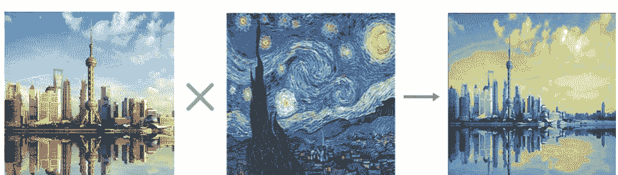

然而，KNN 方案有明显的短板：它仅关注色彩分布，完全忽略了纹理、质感、笔触等核心风格要素。为了从图像中更精准地剥离“内容”与“风格”，我们必须引入更强大的工具——深度神经网络。本章将带你走进**像素级梯度优化**的世界，利用卷积神经网络（CNN）提取表征，通过梯度下降融合内容与风格，一探 CNN 究竟是如何“读懂”图像的。

---

## 一、 算法核心：CNN 眼中的内容与风格

卷积神经网络在计算机视觉领域堪称基石，从人脸识别到无人驾驶，无不仰仗其特征提取能力。有趣的是，专为图像分类训练的 CNN，天然具备风格迁移的潜质。因为要完成分类任务，网络必须“理解”图像，而这种理解就编码在各层卷积层输出的**特征图**中。

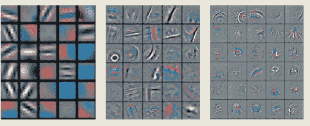

通过可视化不同层级的特征图可以发现：浅层捕捉边缘、纹理等局部细节，深层则编码物体轮廓、语义等高层内容。若用深层特征图重建图像，能保留原貌；若用浅层特征图统计量重建，则能复现风格神韵。

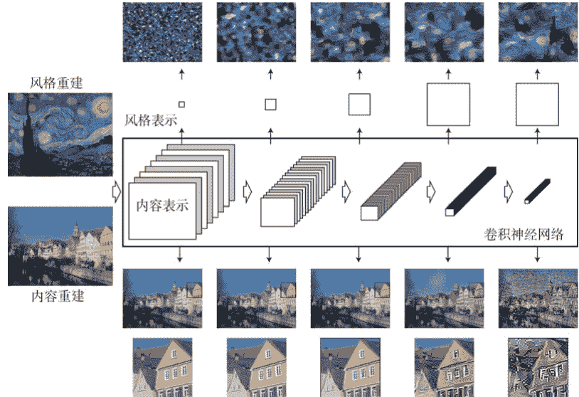

这揭示了一个关键结论：**图像的内容与风格在特征空间中是可分离、可独立提取的**。基于此，Gatys 等人（2015）提出了经典的像素级梯度优化范式：

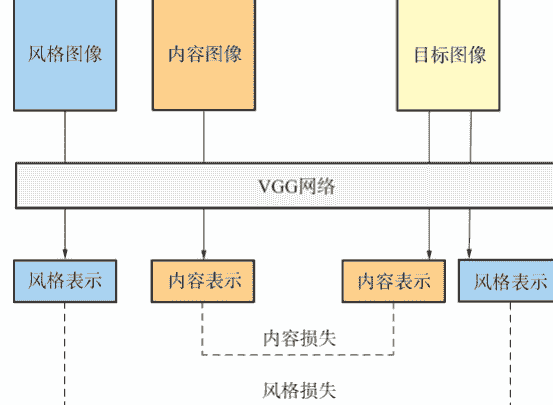

**核心流程如下：**
1.  定义三张图：内容图 $\vec{p}$、风格图 $\vec{a}$、待生成图 $\vec{x}$（初始为白噪声）。
2.  将三图送入预训练 CNN（如 VGG16），提取特征图。
3.  定义**内容损失** $L_{content}$：衡量 $\vec{x}$ 与 $\vec{p}$ 在深层特征上的差异。
4.  定义**风格损失** $L_{style}$：衡量 $\vec{x}$ 与 $\vec{a}$ 在多层特征统计量（Gram 矩阵）上的差异。
5.  以总损失 $L_{total} = \alpha L_{content} + \beta L_{style}$ 为目标，反向传播梯度，**直接更新 $\vec{x}$ 的像素值**（网络权重冻结）。
6.  迭代优化，直至 $\vec{x}$ 融合 $\vec{p}$ 的构图与 $\vec{a}$ 的韵味。

---

## 二、 算法细节：VGG16、损失函数与 Gram 矩阵

我们选用经典的 **VGG16** 作为骨干网络，其包含 13 个卷积层、5 个池化层与 3 个全连接层，结构深邃、特征表达丰富。

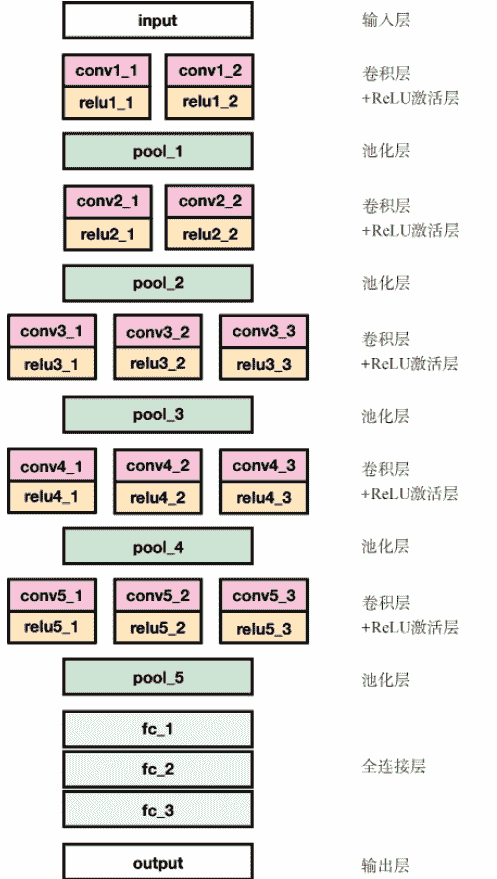

### （一）内容表示与内容损失
卷积核滑过图像，激活出的特征图即是内容的编码。对于第 $l$ 层，若有 $N_l$ 个通道、特征图尺寸展平为 $M_l$，内容表示可记为矩阵 $F^l \in \mathbb{R}^{N_l \times M_l}$。

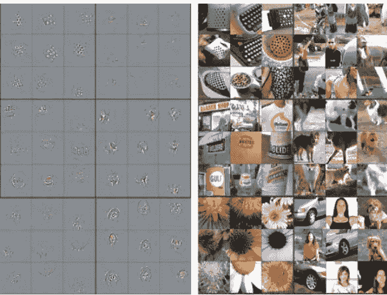

给定内容图 $\vec{p}$ 与生成图 $\vec{x}$ 在该层的表示 $P^l$ 与 $F^l$，内容损失定义为均方误差：

$$

L_{content}(\vec{p}, \vec{x}, l) = \frac{1}{2} \sum_{i,j} (F_{ij}^l - P_{ij}^l)^2

$$

最小化此损失，即强制生成图在高层语义上向内容图靠拢。

### （二）风格表示与风格损失：引入 Gram 矩阵
单看特征图无法捕捉“风格”，风格往往体现为**不同特征通道间的相关性**——比如笔触方向、色块共现模式。为此引入 **Gram 矩阵** $G^l \in \mathbb{R}^{N_l \times N_l}$：

$$ G_{ij}^l = \sum_k F_{ik}^l F_{jk}^l $$

它本质上是展平特征图向量两两内积构成的协方差矩阵（未归一化），刻画了通道间的统计关联。风格损失即为生成图与风格图 Gram 矩阵的差异：

$$ E_l = \frac{1}{4 N_l^2 M_l^2} \sum_{i,j} (G_{ij}^l - A_{ij}^l)^2 $$

总风格损失为多层加权求和（通常选取 conv1_1, conv2_1, conv3_1, conv4_1, conv5_1）：

$$ L_{style}(\vec{a}, \vec{x}) = \sum_{l=0}^L w_l E_l $$

### （三）总目标函数
最终目标融合内容与风格，并引入**全变分损失** $L_{TV}$ 抑制高频噪点，保证画面平滑自然：

$$ L_{total}(\vec{p}, \vec{a}, \vec{x}) = \alpha L_{content}(\vec{p}, \vec{x}) + \beta L_{style}(\vec{a}, \vec{x}) + \gamma L_{TV}(\vec{x}) $$

实践中，内容层常选 `conv4_2`，风格层取多尺度浅层，权重 $\alpha, \beta, \gamma$ 需精心调节。

> **思考与实践 6.1**  
> 尝试调整 $\alpha, \beta, \gamma$ 的比例，观察生成图在“神似内容”还是“形似风格”间的博弈与平衡。

---

## 三、 代码实战：基于 Keras + SciPy 的像素级优化

下面走一遍完整工程管线，核心依赖 `keras.applications.VGG16`、`scipy.optimize.fmin_l_bfgs_b` (L-BFGS 优化器)。

### （一）数据预处理与模型加载
将内容图、风格图、生成图（初始噪声）统一预处理为张量，并在通道维拼接，一次性送入 VGG16 提取多层特征。

```
import numpy as np
from keras.preprocessing.image import load_img, img_to_array
from keras import backend as K
from keras.applications.vgg16 import preprocess_input, VGG16
from scipy.optimize import fmin_l_bfgs_b
from scipy.misc import imsave
import time

###### 设置内容图像和风格图像的路径
content_image_path = 'content.jpg'
style_image_path = 'style.jpg'

###### 设置固定的图像大小
w, h = load_img(content_image_path).size
length = 512
width = int(w * length / h)
```  <!-- 导入库 -->
```
###### 预处理图像
def preprocess_image(image_path):
    image = load_img(path=image_path, target_size=(length, width))
    image = img_to_array(image)
    image = np.expand_dims(image, axis=0)
    image = preprocess_input(image)
    return image
```  <!-- 图像加载与张量化 -->
```
###### 设置内容图像和风格图像的路径
content_image_path = 'content.jpg'
style_image_path = 'style.jpg'
``` <!-- 三图拼接 -->
```
###### 获取内容图像和风格图像的张量表示
content_image = K.variable(preprocess_image(content_image_path))
style_image = K.variable(preprocess_image(style_image_path))

###### output_image用于存放生成的图像
if K.image_data_format() == 'channels_first':
    output_image = K.placeholder((1, 3, length, width))
else:
    output_image = K.placeholder((1, length, width, 3))

###### 将三个张量拼接为单个张量
input_tensor = K.concatenate([content_image, style_image, output_image],
                             axis=0)
``` <!-- 占位/中间步骤 -->
```
###### 使用预训练的ImageNet的权重构建VGG16网络
model = VGG16(input_tensor=input_tensor,
              weights='imagenet', include_top=False)
print('Model has been loaded.')

###### 将模型每一层的名字和输出放到一个字典里
output_dict = dict([(layer.name, layer.output) for layer in model.layers])
``` <!-- 加载 VGG16 模型 -->

### （二）损失函数构建与优化循环
定义三大损失项并加权求和：

```
###### 设置内容损失、风格损失和总变化损失各自的权重
content_weight = 0.5
style_weight = 1.0
total_variation_weight = 1.0

###### 设置总损失
loss = K.variable(0.0)
``` <!-- 设置权重超参数 -->

**1. 内容损失计算**
提取指定层（`conv4_2`）特征，计算 MSE 累加到总损失。

```
###### 计算内容损失
def get_content_loss(content_features, output_features):
    return 0.5 * K.sum(K.square(output_features - content_features))

###### 取conv4_2的输出作为内容表示
layer_feat = output_dict['block4_conv2']
content_feat = layer_feat[0, :, :, :]
output_feat = layer_feat[2, :, :, :]
###### 将内容损失加入到总损失中
loss += content_weight * get_content_loss(content_feat, output_feat)
```

**2. 风格损失计算**
遍历多个风格层，计算 Gram 矩阵差异，加权累加。

```
###### 计算图像张量的格拉姆矩阵，用于捕捉图像的风格
def get_gram_matrix(x):
    if K.image_data_format() == 'channels_first':
        feature_matrix = K.batch_flatten(x)
    else:
        feature_matrix = K.batch_flatten(K.permute_dimensions(x, (2, 0, 1)))
    gram_matrix = K.dot(feature_matrix, K.transpose(feature_matrix))
    return gram_matrix

###### 计算单个卷积核的风格损失
def get_style_loss(style_features, output_features):
    G = get_gram_matrix(style_features)
    A = get_gram_matrix(output_features)
    if K.image_data_format() == 'channels_first':
        channel_number = int(style_features.shape[0])
        size = int(style_features.shape[1] * style_features.shape[2])
    else:
        channel_number = int(style_features.shape[2])
        size = int(style_features.shape[0] * style_features.shape[1])
    return K.sum(K.square(G - A)) / (4. * (channel_number ** 2) * (size ** 2))
```

**3. 全变分损失 & 优化执行**
在总损失中加入 $L_{TV}$，利用 L-BFGS 迭代更新生成图张量，每轮迭代后反归一化保存预览，直至收敛输出最终作品。

---

**小结**  
本章实现了 Gatys 经典算法：冻结预训练 CNN，以像素为优化变量，通过梯度下降在“内容保真”与“风格复现”之间寻找平衡点。尽管效果惊艳，但像素级迭代极其耗时（单张图需数分钟至数小时）。下一章，我们将转向**前馈网络/快速风格迁移**，实现毫秒级推理，开启实时风格化的大门。

```
###### 选择conv1_1, conv2_1, conv3_1, conv4_1, conv5_1五个卷积层的输出计算风格损失
layer_names = ['block1_conv1', 'block2_conv1',
    'block3_conv1', 'block4_conv1',
    'block5_conv1']

###### 计算各个卷积层的风格损失并加入到总损失中
for layer_name in layer_names:
    layer_feat = output_dict[layer_name]
    style_feat = layer_feat[1, :, :, :]
    output_feat = layer_feat[2, :, :, :]
    single_style_loss = get_style_loss(style_feat, output_feat)
    loss += (style_weight / len(layer_names)) * single_style_loss
```

把总变化损失计算出来，随后累加到总损失里。

```
###### 计算总变化损失
def get_total_variation_loss(x):
    # 总变化损失是相邻像素值之差的平方和
    if K.image_data_format() == 'channels_first':
        a = K.square(x[:, :, :length - 1, :width - 1] - x[:, :, 1:, :width - 1])
        b = K.square(x[:, :, :length - 1, :width - 1] - x[:, :, :length - 1, 1:])
    else:
        a = K.square(x[:, :length - 1, :width - 1, :] - x[:, 1:, :width - 1, :])
        b = K.square(x[:, :length - 1, :width - 1, :] - x[:, :length - 1, 1:, :])
    return K.sum(K.pow(a + b, 1.25))

###### 在总损失中加入总变化损失
loss += total_variation_weight * get_total_variation_loss(output_image)
```

##### （三）梯度优化

搭建一个名为 Evaluator 的类，专门用来计算损失值与梯度。

```
###### 得到生成图像关于目标函数的梯度
grads = K.gradients(loss, output_image)

outputs = [loss]
```

```python
if isinstance(grads, (list, tuple)):
    outputs += grads
else:
    outputs.append(grads)

f_outputs = K.function([output_image], outputs)
```

```python
###### 计算损失函数以及梯度
def eval_loss_and_grads(x):
    if K.image_data_format() == 'channels_first':
        x = x.reshape((1, 3, length, width))
    else:
        x = x.reshape((1, length, width, 3))
    outs = f_outputs([x])
    loss_value = outs[0]
    if len(outs[1:]) == 1:
        grad_values = outs[1].flatten().astype('float64')
    else:
        grad_values = np.array(outs[1:]).flatten().astype('float64')
    return loss_value, grad_values
```

```python
###### 用于计算损失函数和梯度的类
class Evaluator(object):

    def __init__(self):
        self.loss_value = None
        self.grad_values = None

    # 计算损失函数以及梯度，返回损失函数
    def loss(self, x):
        assert self.loss_value is None
        loss_value, grad_values = eval_loss_and_grads(x)
        self.loss_value = loss_value
        self.grad_values = grad_values
        return self.loss_value

    # 将已经计算好的梯度返回
    def grads(self, x):
        assert self.loss_value is not None
        grad_values = np.copy(self.grad_values)
        self.loss_value = None
        self.grad_values = None
        return grad_values
```

采用 L-BFGS 算法执行迭代优化，以此最小化损失函数。随着迭代推进，生成图像会渐渐融合内容图的结构与风格图的质感。每轮迭代结束后，都会保存当前生成的图像。

##### L-BFGS

限制内存 BFGS（L-BFGS）是求解无约束非线性优化问题的主流手段，凭借收敛快、内存占用低的特点，在机器学习诸多算法中广泛现身。

```python
###### 将张量转化为图像
def postprocess_array(x):
    if K.image_data_format() == 'channels_first':
        x = x.reshape((3, length, width))
        x = x.transpose((1, 2, 0))
    else:
        x = x.reshape((length, width, 3))
    # BGR三个通道各自加上像素平均值
    vgg_mean = [103.939, 116.779, 123.68]
    for i in range(3):
        x[:, :, i] += vgg_mean[i]
    # 将BGR转化为RGB
    x = x[:, :, ::-1]
    x = np.clip(x, 0, 255).astype('uint8')
    return x

###### 实例化Evaluator类
evaluator = Evaluator()

###### 随机初始化目标图像
if K.image_data_format() == 'channels_first':
    x = np.random.uniform(0, 255, (1, 3, length, width)) - 128.
else:
    x = np.random.uniform(0, 255, (1, length, width, 3)) - 128.

###### 设置迭代轮数
iterations = 10

for i in range(iterations):
    print("iteration", i)
    start_time = time.time()
    # 在像素层面使用Limited-memory BFGS算法，最小化损失
    x, f_val, info = fmin_l_bfgs_b(evaluator.loss, x.flatten(),
                                   fprime=evaluator.grads, maxfun=20)
    print('current loss value:', f_val)
    # 保存每一轮迭代后生成的图像
    img = postprocess_array(x.copy())
    file_name = 'result_%d.png' % i
    imsave(file_name, img)
    end_time = time.time()
    print("Image saves as", file_name)
    print('iteration %d finished in %ds' % (i, end_time - start_time))
```

##### 思考与实践

6.2 若把优化器换成梯度下降、Adam 等，输出结果会有何差异？

#### 四、结果展示

下图记录了各迭代轮次输出的图像变化。可见，经过若干轮迭代后，生成图像已成功汲取一张图的内容轮廓与另一张图的艺术风格。


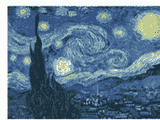

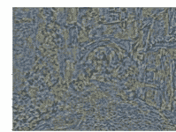

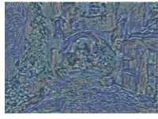

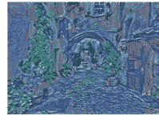


迭代演进过程

##### 思考与实践

6.3 初始值的选择既影响梯度下降的收敛速度，也可能决定最终落入哪个极小值。前文代码采用的是随机初始化目标图像的策略。不妨思考一下：是否存在更优的初始化方案？

内容损失权重与风格损失权重的比值 \( \alpha/\beta \) 决定了风格迁移的深浅。该比值越大，生成图越贴近内容图；反之越小，风味越浓。计算风格损失时选取的卷积层深浅，也会改变生成图的风格化表现。若用较浅层卷积（如 conv1_1），捕捉到的多是纹理、笔触等局部细节；若引入较深层卷积，风格表现则更具整体性、全局感。下图直观对比了不同参数组合下的效果：横向从左至右，\( \alpha/\beta \) 依次为 \( 10^{-5}, 10^{-4}, 10^{-3}, 10^{-2} \)，风格强度递减，内容保真度递增；纵向从上至下，参与风格损失计算的卷积层依次扩展为 \( [conv1\_1] \)、\( [conv1\_1, conv2\_1] \)、\( [conv1\_1, conv2\_1, conv3\_1] \)、\( [conv1\_1, conv2\_1, conv3\_1, conv4\_1] \)、\( [conv1\_1, conv2\_1, conv3\_1, conv4\_1, conv5\_1] \)（层名对应 VGG16 结构），风格模仿由此由“局部细节”向“整体统筹”过渡。


调节 \( \alpha/\beta \) 取值及选取不同卷积层计算风格损失对迁移效果的影响对比

下图展示了一组风格迁移的成果图。


基于像素级梯度优化的迁移结果

### 第七章 生成对抗网络

本章将带你走进生成对抗网络（GAN）的世界，并借助一种特殊变体——CycleGAN 来落地图像风格迁移。期间我们也会拆解神经网络里几个较为复杂的模块：反卷积层、批标准化层与残差网络。

#### 一、算法思想

##### (一) 协同进化——生成对抗网络


猎豹必须跑得更快才能捕获猎物，羚羊也被迫进化出更敏捷的身手。这种“你追我赶”的协同进化，正是生成对抗网络的运作写照。

以往做风格迁移，每处理一张图都得重新训练网络，流程繁琐。有没有一种办法，训练一次模型，之后面对任意输入图，都能秒出指定风格的输出图？

卷积神经网络或许能办到。搭建一个 CNN，训练它直接生成目标风格的图像。但关键难点在于：怎么给这个生成网络定目标函数？用数学语言怎么描述“一张图长得像目标风格”？怎么评判网络输出的好坏？这是个棘手且核心的问题。

这问题直接解很难，但可以换个思路：让机器学习来解决它。“判断一张图是否符合某种风格”本质是个分类任务。沿用之前的图像识别技艺，另建一个判别网络专门做二分类。只要把这个判别网络训练好，它就能反过来指导生成网络的训练。

判别网络怎么训？需要数据喂养：真实的目标风格图作正样本（标签 1），生成网络产出的“假图”作负样本（标签 0）。训练中，判别网络不断精进区分真假的能力。

有了判别网络，再训生成网络。生成网络的目标是让输出图尽量“骗过”判别网络，使其判定为“真”（概率逼近 1）。这相当于生成网络在不断“造假”、“行骗”。

随着生成网络“骗术”见长，原判别网络可能就看不穿了。于是需继续强化判别网络，让它识破“进化版”生成网络的产出。如此循环博弈，生成端“造假”技艺与判别端“鉴伪”能力双双飙升，最终收获满意结果。这种对抗协同的结构，便称作生成对抗网络，简称 GAN。


##### （二） 无监督学习

生成对抗网络属于无监督学习范畴。顾名思义，训练过程无“监督”信号。上一章图像识别里，数据包含输入（题目）与标签（答案），模型答题后对答案调参，这叫监督学习。而 GAN 训练数据未打标签，不知“标准答案”为何，这种无答案的学习即为无监督学习。

##### （三） 要配对！CycleGAN

单向 GAN 效果往往不佳，症结在于数据无配对关系。输入端是待转换图集（喂生成网络）与目标风格图集（喂判别网络），两集合间无一一对应映射。例如要把风景照转莫奈油画，只能找莫奈画集与风景照集，找不到“某幅莫奈画对应哪张原始照片”。于是判别网络评估生成图时，无法参照原图内容。极端情况下，输入猫图，生成网络出“莫奈风格狗图”，判别网络也难有效拦截。


针对这痛点，需改良网络结构解决“无配对”难题。单向 GAN 只做 A→B，为建立配对约束，再引入一个反向 GAN 做 B→A，视作前者的逆变换。训练思路：输入 A 类图 → 生成 B 类图 → 再转回 A 类图，完成一轮“循环”，最后对比循环前后的两张 A 图，考察其相似度。


#### 二、算法细节


建立了对 CycleGAN 的感性认知后，我们需用数学语言精确刻画它，并以此推导训练算法（以下内容虽稍枯燥，却是核心基石）。

上图（a）中，X、Y 分别代表两类图像集合。CycleGAN 引入 G、F、Dx、Dy 四个函数建模：G、F 负责生成（图进图出）；Dx、Dy 负责判别（输出输入图属于各自类别的概率）。这四个函数均由神经网络参数化实现。

##### （一）如何训练生成网络

图（b）与（c）分别展示 X→Y→X 与 Y→X→Y 的循环路径。以（b）为例：输入 x 经 G 变换得 \( \hat{y}=G(x) \)，送入判别器 Dy 得输出 \( D_y(\hat{y}) = D_y(G(x)) \)。我们希望生成图能“以假乱真”，即让 Dy 判定其为 Y 类的概率无限逼近 1。为度量“接近程度”，采用最小二乘形式（GAN 常用对数似然，但 CycleGAN 论文实验表明平方损失效果更优）：

```
\(L_G = (D_Y(G(x)) - 1)^2\)
```

该损失函数 L 量化了生成质量，训练即最小化它。同理，针对路径（c）可得对称的损失函数：

```
\(L_F = (D_X(F(y)) - 1)^2\)
```

# CycleGAN 原理深度剖析与从零手写实现

CycleGAN 的核心在于“循环一致性”约束：图像经双向映射（X→Y→X 或 Y→X→Y）后，应最大程度还原初始状态。由于图像本质是像素向量，我们采用**对应位置像素绝对差值之和**来度量重构偏差，即**循环一致性代价**。

设输入为 $x$，经映射 $G$ 后再由 $F$ 还原得 $\hat{x}=F(G(x))$，正向循环代价定义为：

```
\(L_{cyc}^X = \| \hat{x} - x \|_1 = \sum_i | \hat{x_i} - x_i |\)
```

反向循环 $y \to G \to F \to \hat{y}$ 同理：

```
\(\hat{y} = G(F(y))\)
\(L_{cyc}^Y = \| \hat{y} - y \|_1 = \sum_i | \hat{y_i} - y_i |\)
```

生成网络的总目标函数融合对抗代价与循环代价，$\lambda$ 调节二者权重比：

```
\(L_1 = L_G + L_F + \lambda(L_{cyc}^X + L_{cyc}^Y)\)
```

**阶段一（生成侧优化）**：送入配对样本 $(x, y)$，前向计算总代价，反传梯度更新 $G、F$ 参数。暂不急于循环迭代，因判别侧尚未训练——唯有双网络协同进化，方能收敛至高质量解。


## 判别网络的优化目标

判别网络 $D_Y$ 需满足双重考核：
1.  **真实样本判真**：输入真 $y$，输出概率 $\to 1$；
2.  **合成样本判假**：输入 $G(x)$，输出概率 $\to 0$。

据此构建代价函数：

```
L_{D_Y}^{real} = (D_Y(y) - 1)^2
L_{D_Y}^{fake} = (D_Y(G(x)) - 0)^2
L_{D_Y} = L_{D_Y}^{real} + L_{D_Y}^{fake}
```

其中 $L_{D_Y}^{real}$ 约束真样本识别，$L_{D_Y}^{fake}$ 约束假样本甄别。$D_X$ 同理构建。判别侧整体代价汇总为：

```
L_2 = L_{D_X} + L_{D_Y}
```

**阶段二（判别侧优化）**：同样输入 $(x, y)$，计算判别代价，反传更新 $D_X、D_Y$ 参数。


## 双网络博弈：交替迭代求解

整个训练流程即两阶段交替执行：生成侧最小化 $L_G$，判别侧最小化 $L_D$。二者目标天然对立——生成网络试图欺骗判别网络，判别网络致力识破生成网络。这种“军备竞赛”驱动双方能力同步跃升，最终趋向动态平衡（纳什均衡），获得目标生成模型。

---

# 工程落地：Python 面向对象复现

采用 Python 类封装架构，核心依赖梳理如下：
- **数据/工具链**：`PIL` 存快照、`glob` 遍历路径、`random`/`time` 辅助逻辑
- **网络模块**：`Conv2D`、`Conv2DTranspose`（转置卷积）、`BatchNormalization`、`Add` 残差加法
- **非线性激活**：`ReLU`、`Tanh`、`LeakyReLU`
- **优化器**：`Adam`
- **参数初始化**：`RandomNormal`

```python
###### 如果没有安装 PIL(Pillow)
###### 请使用 pip install pillow 安装
from PIL import Image
import numpy as np
import glob
import random
import time

###### 如果没有安装 keras 和 tensorflow 库
###### 请使用 pip install keras tensorflow 安装

import keras.backend as K

from keras.models import Model
from keras.layers import Conv2D, BatchNormalization, Input, Add
from keras.layers import Conv2DTranspose, Activation
from keras.optimizers import Adam

from keras.layers.advanced_activations import LeakyReLU
from keras.activations import relu,tanh
from keras.initializers import RandomNormal
```

## 1. 数据加载管线

```python
def load_image(fn, image_size):
    """
    加载一张图像
    fn:图像文件路径
    image_size:图像大小
    """
    im = Image.open(fn).convert('RGB')

    # 切割图像(截取图像中间的最大正方形，然后将大小调整至输入大小)
    if (im.size[0] >= im.size[1]):
        im = im.crop(((im.size[0] - im.size[1])//2, 0, (im.size[0] +
im.size[1])//2, im.size[1]))
    else:
        im = im.crop((0, (im.size[1] - im.size[0])//2, im.size[0],
(im.size[0] + im.size[1])//2))
        im = im.resize((image_size, image_size), Image.BILINEAR)

    # 将0-255的RGB值转换到[-1, 1]上的值
    arr = np.array(im)/255*2-1

    return arr

class DataSet(object):
    """
    用于管理数据的类
    """
    def __init__(self, data_path, image_size = 256):
        self.data_path = data_path
        self.epoch = 0
        self.__init_list()
        self.image_size = image_size

    def __init_list(self):
        self.data_list = glob.glob(self.data_path)
        random.shuffle(self.data_list)
        self.ptr = 0

    def get_batch(self, batchsize):
        """
        从队列中取出batchsize张图像
        """

        if (self.ptr + batchsize >= len(self.data_list)):
            # 如果队列里面的图像已经不足以取出一个batch，那么就重新初始化队列
            batch = [load_image(x, self.image_size) for x in
self.data_list[self.ptr:]]

            rest = self.ptr + batchsize - len(self.data_list)
            self.__init_list()
            batch.extend([load_image(x, self.image_size) for x in
self.data_list[:rest]])

            self.ptr = rest
            self.epoch += 1

        else:
            batch = [load_image(x, self.image_size) for x in
self.data_list[self.ptr:self.ptr + batchsize]]
            self.ptr += batchsize

        return self.epoch, batch
```
```python
def get_pics(self, num):
    """
    取出num张图像，用于快照
    不会影响队列
    """
    return np.array([load_image(x, self.image_size) for x in random.sample(self.data_list, num)])
```
```python
def arr2image(X):
    """
    将RGB值从[-1, 1]重新转回[0, 255]
    """
    int_X = ((X+1)/2*255).clip(0, 255).astype('uint8')
    return Image.fromarray(int_X)
```
```python
def generate(img, fn):
    """
    将一张图像img送入生成网络fn中
    """
    r = fn([np.array([img])])[0]
    return arr2image(np.array(r[0]))
```
```python
###### 输入神经网络的图像尺寸
IMG_SIZE = 256
```
```python
###### 数据集名称
DATASET = "vangogh2photo"
```
```python
###### 数据集路径
dataset_path = "./data/{}/".format(DATASET)
trainA_path = dataset_path + "trainA/*.jpg"
trainB_path = dataset_path + "trainB/*.jpg"
```
```python
train_A = DataSet(trainA_path, image_size = IMG_SIZE)
train_B = DataSet(trainB_path, image_size = IMG_SIZE)
```
```python
def train_batch(batchsize):
    """
    从数据集中取出一个batchsize大小的批次
    """
    epa, a = train_A.get_batch(batchsize)
    epb, b = train_B.get_batch(batchsize)
    return max(epa, epb), a, b
```

## 2. 生成网络架构：ResNet 骨干 + 转置卷积上采样

先封装通用构建块：

```python
###### 用于初始化
conv_init = RandomNormal(0, 0.02)

def conv2d(f, *a, **k):
    # ...
    卷积层
    # ...
    return Conv2D(f,
        kernel_initializer = conv_init,
        *a, **k)

def batchnorm():
    # ...
    标准化层
    # ...
    return BatchNormalization(momentum=0.9, epsilon=1.01e-5, axis=-1)
```

残差块核心实现：

```python
def res_block(x, dim):
    # ...
    残差网络
    [x] --> [卷积] --> [标准化] --> [激活] --> [卷积] --> [标准化] --> [+] --> [激活]
     |                                    ^
     |                                    |
     +------------------------------------+
    # ...
    x1 = conv2d(dim, 3, padding="same", use_bias=True)(x)
    x1 = batchnorm()(x1, training=1)
    x1 = Activation('relu')(x1)
    x1 = conv2d(dim, 3, padding="same", use_bias=True)(x1)
    x1 = batchnorm()(x1, training=1)
    x1 = Activation("relu")(Add()([x, x1]))
    return x1
```

### 为何引入残差结构？
网络深度非越深越优。经典实验揭示：56 层纯卷积网络测试误差反超 20 层浅层网络。**残差学习**将目标转化为拟合“残差映射” $F(x)=H(x)-x$，为梯度回传铺设“高速公路”，有效缓解深层模型退化。


残差单元拓扑：


生成网络整体拓扑：**3 步下采样卷积 → 9 个残差块 → 3 步转置卷积上采样**。转置卷积通过插零扩展特征图尺寸再卷积，实现分辨率逐级复原。

```python
def NET_G(ngf=64, block_n=6, downsampling_n=2, upsampling_n=2, image_size = 256):
    """
    生成网络
    采用resnet结构

    block_n为残差网络叠加的数量
    论文中采用的参数为 若图像大小为128，采用6; 若图像大小为256，采用9

    [第一层] 大小为7的卷积核 通道数量 3->ngf
    [下采样] 大小为3的卷积核 步长为2 每层通道数量倍增
    [残差网络] 9个block叠加
    [上采样]
    [最后一层] 通道数量变回3
    """
```

### 延伸解析：批归一化（BN）为何关键？

BN 强制每批数据分布回归 $\mu=0, \sigma=1$。
- **激活视角**：以 `tanh` 为例，其导数在 0 处峰值，两侧饱和梯度消失。若输入分布偏离原点，易陷入“梯度死区”；BN 维持数据活跃于高梯度区，激活函数真正生效。
- **量纲统一**：消除通道间量纲差异，加速收敛稳定性。


### 概念速览：转置卷积
普通卷积步长 $>1$ 下采样；转置卷积步长 $>1$ **上采样**——先在像素间插零放大，再卷积，输出尺寸超越输入。可视作卷积的逆向操作。


```python
input_t = Input(shape=(image_size, image_size, 3))
###### 输入层

x = input_t
dim = ngf

x = conv2d(dim, 7, padding="same")(x)
x = batchnorm()(x, training = 1)
x = Activation("relu")(x)
###### 第一层
```

```python
for i in range(downsampling_n):
    dim *= 2
    x = conv2d(dim, 3, strides = 2, padding="same")(x)
    x = batchnorm()(x, training = 1)
    x = Activation('relu')(x)
###### 下采样部分
```

```python
for i in range(block_n):
    x = res_block(x, dim)
###### 残差网络部分
```

```python
for i in range(upsampling_n):
    dim = dim // 2
    x = Conv2DTranspose(dim, 3, strides = 2, kernel_initializer=conv_init, padding="same")(x)
    x = batchnorm()(x, training = 1)
    x = Activation('relu')(x)
###### 上采样
```

```python
dim = 3
x = conv2d(dim, 7, padding="same")(x)
x = Activation("tanh")(x)
###### 最后一层
return Model(inputs=input_t, outputs=x)
```

##### （三）判别器架构设计

判别器的构造由数层卷积堆叠而成，架构反倒比生成器更为轻量精简。

```python
def NET_D(ndf=64, max_layers = 3, image_size = 256):
    ...
    判别网络
    ...
    input_t = Input(shape=(image_size, image_size, 3))

    x = input_t
    x = conv2d(ndf, 4, padding="same", strides=2)(x)
    x = LeakyReLU(alpha = 0.2)(x)
    dim = ndf

    for i in range(1, max_layers):
        dim *= 2
        x = conv2d(dim, 4, padding="same", strides=2, use_bias=False)(x)
        x = batchnorm()(x, training=1)
        x = LeakyReLU(alpha = 0.2)(x)

    x = conv2d(dim, 4, padding="same")(x)
    x = batchnorm()(x, training=1)
    x = LeakyReLU(alpha = 0.2)(x)

    x = conv2d(1, 4, padding="same", activation = "sigmoid")(x)
    return Model(inputs=input_t, outputs=x)
```

判别器最终输出的并非单一标量，而是一个二维矩阵。这并不妨碍损失函数的计算，只需将损失公式中的标签 0 与 1 视为与判别器输出同维度的矩阵即可。

此处可引入一种新型激活函数——带泄露的线性整流单元。它与标准 ReLU 形态相近，区别在于负半轴区间并非硬性截断为零，而是保留了一条微小的负斜率。

(a) 线性整流单元 (ReLU)

(b) 带泄露线性整流单元 (Leaky ReLU)

##### (四) 模型整体框架搭建

采用面向对象的“类”机制来封装 GAN 的网络拓扑：

```python
def loss_func(output, target):
    ...
    损失函数
    论文中提到使用平方损失更好
    ...
    return K.mean(K.abs(K.square(output-target)))

class CycleGAN(object):
    def __init__(self, image_size=256, lambda_cyc=10, lrd = 2e-4, lrg = 2e-4, ndf = 64, ngf = 64, resnet_blocks = 9):
        ...

        构建网络结构

            cyc loss
        +--------------------------------------+
        |         (CycleA)                     |
        |   v                                  |
        | realA -> [GB] -> fakeB -> [GA] -> recA |
        |   |           |                      |
        |   |  +----------------------+        |
        |   |  |                      |        |
        |   v  v                      v        v |
        | [DA] <CycleGAN>           [DB]      |
        |   ^           ^               ^       |
        |   |           |               |       |
        |   +----------------------+   |       |
        |   |                      |   |       |
        | recB <- [GB] <- fakeA <- [GA] <- realB |
        |   |           ^               |       |
        |   |   (CycleB)|               |       |
        |   +----------------------+   |       |
        |           cyc loss           |
        ...
```

```python
###### 创建生成网络
self.GA = NET_G(image_size = image_size, ngf = ngf, block_n = resnet_blocks)
self.GB = NET_G(image_size = image_size, ngf = ngf, block_n = resnet_blocks)
```

```python
###### 创建判别网络
self.DA = NET_D(image_size = image_size, ndf = ndf)
self.DB = NET_D(image_size = image_size, ndf = ndf)
```

```python
###### 获取真实、伪造和复原的A类图和B类图变量
realA, realB = self.GB.inputs[0], self.GA.inputs[0]
fakeB, fakeA = self.GB.outputs[0], self.GA.outputs[0]
recA, recB = self.GA([fakeB]), self.GB([fakeA])
```

```python
###### 获取由真实图片生成伪造图片和复原图片的函数
self.cycleA = K.function([realA], [fakeB, recA])
self.cycleB = K.function([realB], [fakeA, recB])
```

```python
###### 得到判别网络判别真实图片和伪造图片的结果
DrealA, DrealB = self.DA([realA]), self.DB([realB])
DfakeA, DfakeB = self.DA([fakeA]), self.DB([fakeB])
```

```python
###### 用生成网络和判别网络的结果计算损失函数
lossDA, lossGA, lossCycA = self.get_loss(DrealA, DfakeA, realA, recA)
lossDB, lossGB, lossCycB = self.get_loss(DrealB, DfakeB, realB, recB)
lossG = lossGA + lossGB + lambda_cyc * (lossCycA + lossCycB)
lossD = lossDA + lossDB
```

```python
###### 获取参数更新器
updaterG = Adam(lr = lrG, beta_1=0.5).get_updates(self.GA.trainable_weights + self.GB.trainable_weights, [], lossG)
updaterD = Adam(lr = lrD, beta_1=0.5).get_updates(self.DA.trainable_weights + self.DB.trainable_weights, [], lossD)
```

```python
###### 创建训练函数，可以通过调用这两个函数来训练网络
self.trainG = K.function([realA, realB], [lossGA, lossGB, lossCycA, lossCycB], updaterG)
self.trainD = K.function([realA, realB], [lossDA, lossDB], updaterD)
```

```python
def get_loss(self, Dreal, Dfake, real, rec):
    """
    获取网络中的损失函数
    """
    lossD = loss_func(Dreal, K.ones_like(Dreal)) + loss_func(Dfake, K.zeros_like(Dfake))
    lossG = loss_func(Dfake, K.ones_like(Dfake))
    lossCyc = K.mean(K.abs(real - rec))
    return lossD, lossG, lossCyc

def save(self, path="./models/model"):
    """
    保存模型
    """
    self.GA.save("{} - GA.h5".format(path))
    self.GB.save("{} - GB.h5".format(path))
    self.DA.save("{} - DA.h5".format(path))
    self.DB.save("{} - DB.h5".format(path))

def train(self, A, B):
    """
    用于训练的接口，输入A和B两张图片，返回训练之后得到的误差
    """
    errDA, errDB = self.trainD([A, B])
    errGA, errGB, errCycA, errCycB = self.trainG([A, B])
    return errDA, errDB, errGA, errGB, errCycA, errCycB
```

##### (五) 训练流程实现

此处引入 `snapshot` 函数，旨在训练迭代期间实时生成预览图，便于监控效果。

```python
def gen(generator, X):
    """
    用于生成效果图
    """
    r = np.array([generator([np.array([x])]) for x in X])
    g = r[:, 0, 0]
    rec = r[:, 1, 0]
    return g, rec

def snapshot(cycleA, cycleB, A, B):
    """
    产生一个快照

    A、B是两个图像列表
    cycleA是 A->B->A的一个循环
    cycleB是 B->A->B的一个循环
    """
```

```
输出一张图像：
+-----+ +-----+
| X (in A) | ... | Y (in B) | ...
+-----+ +-----+
| GB(X) | ... | GA(Y) | ...
+-----+ +-----+
| GA(GB(X)) | ... | GB(GA(Y)) | ...
+-----+ +-----+
...
```

```python
gA, recA = gen(cycleA, A)
gB, recB = gen(cycleB, B)

lines = [
    np.concatenate(A.tolist()+B.tolist(), axis = 1),
    np.concatenate(gA.tolist()+gB.tolist(), axis = 1),
    np.concatenate(recA.tolist()+recB.tolist(), axis = 1)
]

arr = np.concatenate(lines)
return arr2image(arr)
```

```python
###### 创建模型
model = CycleGAN(image_size = IMG_SIZE)
```

```python
###### 训练代码
```

```python
###### 先记下开始时间
start_t = time.time()
```

```python
###### 训练轮数
EPOCH_NUM = 100
```

```python
###### 已经训练的轮数
epoch = 0
```

```python
###### 迭代几次输出一次训练信息（误差）
DISPLAY_INTERVAL = 5
```

```python
###### 迭代几次保存一个快照
SNAPSHOT_INTERVAL = 50
```

```python
###### 迭代几次保存一次模型
SAVE_INTERVAL = 200
```

```python
###### 批大小
BATCH_SIZE = 1
```

```python
###### 已经迭代的次数
iter_cnt = 0
```

```python
###### 用于记录误差的变量
err_sum = np.zeros(6)

while epoch < EPOCH_NUM:
    # 获取数据
    epoch, A, B = train_batch(BATCH_SIZE)

    # 训练
    err = model.train(A, B)

    # 累计误差
    err_sum += np.array(err)

    iter_cnt += 1

    # 输出训练信息
    if (iter_cnt % DISPLAY_INTERVAL == 0):
        err_avg = err_sum / DISPLAY_INTERVAL
        print('[迭代%d] 判别损失: A %f B %f 生成损失: A %f B %f 循环损失: A %f B %f' % (iter_cnt,
        err_avg[0], err_avg[1], err_avg[2], err_avg[3], err_avg[4],
        err_avg[5]))
    err_sum = np.zeros_like(err_sum)

    # 产生快照
    if (iter_cnt % SNAPSHOT_INTERVAL == 0):
        A = train_A.get_pics(4)
        B = train_B.get_pics(4)
        snapshot(model.cycleA, model.cycleB, A,
        B).save("./snapshot/{}.png".format(iter_cnt))

    # 保存模型
    if (iter_cnt % SAVE_INTERVAL == 0):
        model.save(path = "./models/model-{}".format(iter_cnt))
```

#### 四、 实验成果演示

选取莫奈画作作为 A 域图像，真实照片作为 B 域图像进行模型训练（数据集获取地址：https://people.eecs.berkeley.edu/~taesung_park/CycleGAN/datasets/）。训练收敛后，挑选训练集外的样本进行推理测试，输出结果如下：


CycleGAN 风格迁移效果图

将生成图与莫奈真迹对比，不难发现 AI 创作的画面已然捕捉到了大师笔下的几分神韵与意境。


莫奈真迹欣赏

##### 思考与实践

7.1 在 CycleGAN 的训练动态中，风格图像的哪些特征维度（如色彩分布、笔触纹理、几何拓扑结构等）最易被模型习得？哪些特征又相对难以捕捉？

### 7.2 探究 CycleGAN 的适用边界：哪些图像转换任务它能胜任？

CycleGAN 能处理多种图像互译任务，但并非万能钥匙。请结合具体场景判断其适配性，若你有兴趣，不妨自行收集数据集实测一番。

- **a. 马 ↔ 斑马**：典型的纹理/风格迁移场景，CycleGAN 往往表现优异。  
    
  *需警惕：训练中可能出现色彩反转（负片效应）的异常情况。*

- **b. 同一景点：冬景 ↔ 夏景**：涉及季节特征的大规模外观变化（积雪、植被色彩），属于领域自适应范畴，CycleGAN 有一定能力但细节保真度是挑战。

- **c. 苹果 ↔ 橘子**：形状、纹理、颜色差异巨大，属于跨类别转换，CycleGAN 易生成伪影或语义不符的怪异图像，效果通常不佳。

- **d. 猫 ↔ 狗**：结构拓扑差异大（脸型、耳朵、尾巴），几何变换需求高，CycleGAN 缺乏显式几何约束，极易导致“四不像”结果。

- **e. 实照 → 毕加索油画风**：风格迁移的经典强项，CycleGAN 擅长捕捉笔触与色块统计特征，通常能产出极具艺术感的图像。

---

### 7.3 (*) 思考题：CycleGAN 训练中为何会触发“反色”现象？

---

#### 第二部分小结：从像素统计到对抗生成的风格迁移之路

回顾本部分，我们层层递进拆解了“图像风格迁移”：
1.  起步于 **K近邻 (KNN)** 的像素级色彩模仿；
2.  进阶至 **卷积神经网络 (CNN)**，分离“内容表示”与“风格表示（Gram矩阵）”，再通过 **梯度下降** 融合重建；
3.  最终引入 **CycleGAN（循环一致性生成对抗网络）**，实现无需配对数据的端到端快速迁移。

这一过程不仅串联了传统统计学习与深度生成模型，更让我们窥见神经网络对视觉语义的层级理解能力。风格迁移远未到天花板，算法优化空间巨大——若你意犹未尽，欢迎继续钻研探索。

---

## 第三部分 文本生成：教会机器“吐字成文”

前两部分聚焦视觉（图像识别、风格迁移），第三部分转战 **自然语言处理 (NLP)** 领域，核心对象从像素矩阵变为离散文本序列。

“文本生成”虽称学术，实则贴近生活：**AI 写作、AI 作诗、智能对话机器人**，本质皆是——**给定前文（Prompt），自动续写符合语境的后文**。具体产出何种体裁，取决于任务定义与训练数据。

这是 NLP 皇冠上的明珠，落地极广。2017 年 5 月，微软小冰推出全球首部 **100% AI 创作诗集《阳光失了玻璃窗》**，震惊文坛：  


> 人们在广场上游戏  
> 太阳不知疲倦  
> 我再三脚踢  
> 想象却敛起了眉  
> 她飞进天空的树影  
> 便迷路在人群里了  
> 那是梦的翅膀  
> 正如旧时的安逸  
> 而人生是萍水相逢  
> 在不提防的时候降临  
> 你和我一同住在我的梦中  
> 偶然的梦  
> 这样的肆意并不常见  
> 用一天经历一世的欢喜  
> —— 微软小冰《阳光失了玻璃窗》节选

---

本部分将带你拆解文本生成的通用流程，核心在于 **“如何将生成问题数学化为分类问题”**，并逐步攻克三大经典算法：
- **N-gram 统计语言模型**（基础）
- **LSTM 长短期记忆网络**（序列建模利器）
- **Seq2Seq 序列对序列模型**（编码-解码范式）

终极目标：训练一个会“对联、作诗、写小说、写影评”的生成模型——给上联出下联，给开头写全篇。

---

### 第八章 文本生成基石：从数据清洗到概率建模

**学习目标**：掌握文本生成标准流程，理解“生成→分类”的建模转化，体会数学建模对实战的决定性意义。

#### 一、 标准三步走：数据 → 训练 → 生成评估

任何机器学习任务，**数据是命门**。文本生成泛化性强，必须先按需求定数据。

**以“古诗对联（上句→下句）”为例：**
1.  **清洗**：剔除诗名、作者、朝代等无关元数据。
2.  **配对**：将全诗拆解为 `[[上句, 下句], ...]` 格式的有序对。

| 原始语料 | 结构化训练样本 |
| :--- | :--- |
| **登鹳雀楼** 王之涣<br>白日依山尽，黄河入海流。<br>欲穷千里目，更上一层楼。 | `["白日依山尽", "黄河入海流"]`<br>`["欲穷千里目", "更上一层楼"]` |
| **江雪** 柳宗元<br>千山鸟飞绝，万径人踪灭。<br>孤舟蓑笠翁，独钓寒江雪。 | `["千山鸟飞绝", "万径人踪灭"]`<br>`["孤舟蓑笠翁", "独钓寒江雪"]` |
| **静夜思** 李白<br>床前明月光，疑是地上霜。<br>举头望明月，低头思故乡。 | `["床前明月光", "疑是地上霜"]`<br>`["举头望明月", "低头思故乡"]` |

2.  **选模型、调参数、跑训练**（具体架构后续章节详解）。下图展示 Seq2Seq 训练过程从“乱码”到“成诗”的质变：

| 输入上句 | 未训练 (随机) | 训练 1/3 | 训练 2/3 | 训练收敛 |
| :--- | :--- | :--- | :--- | :--- |
| 白日依山尽 | 流泼据披辟缙宥己承承 | 山风满水深 | 青山一夜深 | **青山去路长** |
| 孤舟蓑笠翁 | 葵璜瓒墨蜴峙许蜴麛焦 | 日日照江水 | 一叶落花花 | **独立江南月** |
| 床前明月光 | 简筒壮袂郐刀枚邱霾塞 | 日日满江阳 | 日暮云中雨 | **水下清风流** |

3.  **模型推理生成 + 效果评估**（人工/自动指标双评）。

---

#### 二、 核心转化：将“接龙”建模为“分类”

> **“科学不求解释本质，只建可用模型。”**  
> —— 冯·诺依曼

计算机无“视觉”“听觉”，科学家仅通过 **数学建模** 映射现实世界，再借算力求解。
- 图像 → **像素矩阵 (RGB浮点数张量)** → 矩阵运算。
- 文本 → **？** → 需一套将离散符号数学化的通用框架。

引入 **统计语言模型 (Statistical Language Model, SLM)**，将“生成下一个字”转化为 **“在词表上做分类”**。

##### 1. 统计语言模型 = 条件概率估计 + 最大似然分类

设词表 $V$ 有限（符合现实）。任意句子可视为 $V$ 中词的序列 $w_1, w_2, \dots$。

**核心任务**：估计条件概率分布  
$$ P(w_{m+1} \in V \mid w_1, w_2, \dots, w_m) $$

> **条件概率回顾**  
> 事件 $A,B$，$P(B)>0$，则 $B$ 发生下 $A$ 的条件概率：  
> $$ P(A \mid B) = \frac{P(A \cap B)}{P(B)} $$  
> 亦称“后验概率”。

一旦模型算出上述分布，**生成即分类**：
- 每个词 = 一个类别
- 词表 $V$ = 标签全集
- 已知上文 $w_1\dots w_m$ = 特征
- **预测 $w_{m+1}$ = 选使条件概率最大的那个词**

这正如手机 **智能输入法**：输“今天天气”，联想栏弹出“真好/不错/很热”……  
  
*输入法联想候选词示意*

##### 2. “读书破万卷，下笔如有神” —— 概率从哪来？

如何算 $P(w_{m+1} \mid w_{1:m})$？  
**让机器“大量阅读”语料，用统计规律拟合分布。**

语料中，机器能“发现”：
- 某词高频共现伙伴（如“人工智能”常跟“发展/时代”）
- 固定位置的固定搭配（格律、语法约束）

**训练 AI 作诗** = 投喂《唐诗三百首》《宋词鉴赏》……学会平仄、对仗、意境。  
杜甫云：“读书破万卷，下笔如有神。” **人需读万卷，机器亦需“读”万卷（海量语料）。**

输入法亦同理：  
- 冷启动：全用户聚合统计得先验分布  
- 热更新：单用户习惯个性化微调

> **唐诗高频词云**  
> (数据源: github.com/chinese-poetry/chinese-poetry)

后续章节将逐个拆解：如何从语料中学习语言模型。

#### 思考与实践 8.1
本节 SLM 为简化版，**请尝试设计一个更通用的语言模型框架**（提示：考虑上下文长度动态化、子词建模等）。

---

### 第九章 N-gram 模型：从“数数”开始的生成之旅

**本章目标**：透彻理解 N-gram 简化假设与马尔可夫性质，掌握 Python 实现与初级生成实战。

#### 一、 算法核心：有限记忆假设 (马尔可夫性质)

全历史依赖 $P(w_{m+1} \mid w_{1:m})$ 计算量爆炸且数据稀疏。  
**N-gram 简化假设**：第 $m+1$ 词**仅依赖前 $n-1$ 词**，即 $w_m, w_{m-1}, \dots, w_{m-n+2}$。$n$ 为固定常数，与 $m$ 无关。

- **2-gram (Bigram)**：$P(w_{m+1} \mid w_{1:m}) \approx P(w_{m+1} \mid w_m)$
- **3-gram (Trigram)**：依赖前 2 词
- ...

> **马尔可夫性质**  
> 随机过程中，给定“当前状态”，未来分布与“历史状态”条件独立。  
> **2-gram 正是一阶马尔可夫链**；N-gram 为其高阶推广。布朗运动、排队论等均属马尔可夫过程范畴。

#### 二、 统计细节：最大似然估计 (MLE) 就是“数数”

> **“一、二、三、五、四……”**  
> **“不对爸爸，是四、五！”**  
> **“凭什么不能三五四？”**  
> **“因为……语言习惯不是这么用的。”**  
> —— 迈克尔·阿廷《代数》

**如何估 $P(w_{m+1} \mid w_m)$？**  
孩童数数法：统计语料共现频次。

$$ P(\text{人工智能} \mid \text{我喜欢}) = \frac{C(\text{我喜欢 人工智能})}{C(\text{我喜欢})} $$

分子：前后词连续出现次数；分母：前词出现次数。  
这就是 N-gram 全部数学秘密——**频率逼近概率**。  
下图展示 6-gram 统计窗口示意：  


#### 三、 落地代码：四步构建 N-gram 生成器

**(1) 环境准备**
```python
import random
import jieba  # 中文分词神器，支持精确/全/搜索模式
```
```
###### 如果没有安装 jieba 库
###### 请使用 pip install jieba 安装
import random
import jieba
```

**(2) 语料读取 & 切分策略**
中文无天然分隔符，需分词。  
例：“这是人工智能的黄金时代” → `这/是/人工智能/的/黄金时代`  
同时确定 `n` (N-gram 阶数)。  
```
###### 读取语料数据
corpus_file = open("../input/poetry.txt", "r", encoding="utf-8")
raw_text = corpus_file.readlines()
text = ""
for line in raw_text:
    text += line.strip()
corpus_file.close()
###### 选择分词或者是分字
split_mode = "char"
if split_mode == "char":
    token_list = [char for char in text]
###### 利用jieba库分词
elif split_mode == "jieba":
    token_list = [word for word in jieba.cut(text)]
###### 确定ngram的历史检索长度，即n
ngram_len = 4
```

**(3) N-gram 计数统计**
遍历语料，构建 `{(前 n-1 词 元组): {后续词: 频次}}` 字典结构。  
```
###### 初始化ngram词典
ngram_dict = {}
for i in range(1, ngram_len): # i = 1 2 3
    for j in range(len(token_list) - i - 1):
        # 以前n-1个词为键，第n个词为值，统计映射次数
        key = "".join(token_list[j: j + i + 1])
        value = "".join(token_list[j + i + 1])
        # 为第一次出现的键建立字典
        if key not in ngram_dict:
            ngram_dict[key] = {}
        # 初始化字典内每个键值对映射的计数器
        if value not in ngram_dict[key]:
            ngram_dict[key][value] = 0
        ngram_dict[key][value] += 1
```

**(4) 概率采样生成文本**
给定前缀，按条件分布随机采样下一词，滑动窗口循环，直到遇终止符或达长度上限。  
```
###### 对输入进行分字或分词
start_text = "明月"
gen_len = 200
topn = 3

if split_mode == "char":
    word_list = [char for char in start_text]
elif split_mode == "jieba":
    word_list = [word for word in jieba.cut(start_text)]

###### gen_len是我们期望的生成字数或词数
for i in range(gen_len):
    temp_list = []
    # 统计给定前小于等于n-1个词的情况下，下一个词的词频分布
    for j in range(1, ngram_len):
        if j >= len(word_list):
            continue
        prefix = "".join(word_list[-(j + 1):])
        if prefix in ngram_dict:
            temp_list.extend(ngram_dict[prefix].items())
    # 按词频对词排序
    temp_list = sorted(temp_list, key=lambda d: d[1], reverse=True)
    next_word = ""
    # 如果最高频词是标点，则选择最高频词
    if temp_list[0] == ', ' or temp_list[0] == '。' or temp_list[0] == '\n':
        next_word = temp_list[0]
    else:
        # 否则从前topn中随机选一个
        next_word = random.choice(sorted(temp_list, key=lambda d: d[1], reverse=True)[:topn])[0]
    word_list.append(next_word)

print("".join(word_list))
```

#### 四、 实战观察：4-gram 在古诗上的“发疯文学”

以“明月”为种子，生成片段：

> 明月，万事不堪思。登山屐，春风吹。树老，何处，风雨夜来风。江南春。不见。上客如先起，还应照所思香何处是，谁知苦寒歌……

**对照名句前缀预测对比：**

| 前缀 (上文) | 4-gram 预测 | 真实下字 |
| :--- | :--- | :--- |
| 明月松间 | **关** | 照 |
| 白日依山 | **水** | 尽 |
| 千山鸟飞 | **燕** | 绝 |
| 床前明月 | **中** | 光 |
| 大漠孤烟 | **霞** | 直 |

**结论显而易见**：N-gram 效果**不尽人意**——语义断裂、格律全无。  
但这在预料中：模型过于简单，**仅捕捉局部共现，无长程记忆、无语义规划**。  
凡事起于简陋，科学进阶靠迭代。下一章，引入 **循环神经网络 (RNN/LSTM)**，打破有限窗口束缚。

#### 思考与实践 9.1
N-gram 唯一超参 `n`：  
- **n 过大** → 优缺点？  
- **n 过小** → 优缺点？

---

### 第十章 循环神经网络：赋予模型“记忆”

# 本章速览：从词向量到LSTM的文本生成实战

本章将带你攻克自然语言处理的两大基石：**词向量**与**循环神经网络**。我们将深入剖析Word2Vec的核心原理（CBOW与Skip-Gram），并借助`gensim`、`sklearn`等工具完成从训练到三维可视化的全流程实操。随后，我们将拆解RNN如何突破N-gram的短视局限，重点攻克LSTM的门控机制与细胞状态传递，最后手把手教你用Keras搭建一个能写诗的LSTM模型。

---

### 从视觉霸主到序列王者：为什么我们需要RNN

在之前的图像识别与风格迁移实战中，卷积神经网络（CNN）已展现出统治级的视觉理解力。而在处理文本、语音、时间序列这类**“顺序敏感”**的数据时，**循环神经网络（RNN）**才是当仁不让的主角。它的出现，一举打破了语言模型、文本生成、情感分析等NLP难题的长期僵局。

> **温馨提示**：神经网络基础（前向传播、反向传播、激活函数等）已在前序图像章节详解，此处不再重复，建议遗忘的同学先回顾补课。


---

## 一、 词的数学化身——词向量

在构建模型前，必须解决一个根本问题：**如何让机器“读懂”词？**

### 1. 从“编号”到“向量”：建模思想的进化

早期的N-gram模型仅做词频统计，完全丢失了词的内涵。最直观的建模是**发号**：词表中每词发一个ID。但这有两大死穴：
*   **信息极度贫乏**：一个整数无法承载词性、语义、时态、单复数等语言学特征。
*   **运算无意义**：“男人(ID=1) + 苹果(ID=2) = ID=3”纯属胡扯，ID间的数学关系不反映语义关系。

既然标量不行，那就上**向量**——用一组数字（高维空间中的一点）来刻画一个词。最简单的**One-hot编码**虽是词向量雏形，却遭遇双重打击：
1.  **维度灾难**：向量维度=词表大小（动辄数万/十万），稀疏矩阵让训练极其低效。
2.  **语义孤岛**：任意两词向量正交（点积为0），无法度量“苹果”比“跑”更接近“香蕉”。

**理想的词向量必须满足两大性质：**
*   **几何邻近性**：语义相近的词，在向量空间距离近（如 `Vector(苹果) ≈ Vector(香蕉) ≪ Vector(跑)`）。
*   **代数可运算性**：向量运算映射语义/语法逻辑（经典案例：`King - Man + Woman ≈ Queen`；`Apples - Apple ≈ Bananas - Banana`）。

这种**将离散符号嵌入连续向量空间**的技术，称为**词嵌入**。目前工业界标准解法是**Word2Vec**，基于浅层前馈网络，训练极快，分两大范式：
*   **CBOW (连续词袋)**：用上下文预测中心词（“填空题”模式）。
*   **Skip-gram (跳字模型)**：用中心词预测上下文（“联想题”模式）。

**核心洞见（分布式假设）**：**一个词的语义由其语境决定。** “银行”常伴“利息、贷款”；“苹果、香蕉”常伴“水果、剥皮”。语境分布相似 ⇒ 语义相似 ⇒ 向量相近。Word2Vec的具体数学推导超出本书范围，有兴趣可自查Mikolov原论文。

```
###### 如果没有安装 gensim, sklearn 和 numpy 库
###### 请使用 pip install gensim scikit-learn numpy 安装
import plotly
import sklearn.decomposition
import gensim
import numpy
```

### 2. 落地实战：从训练到三维可视化

无需手写底层算法，成熟库已帮我们搞定重活。下面演示在古诗语料上训练Word2Vec并可视化。

**工具链**：
*   `gensim`：NLP神器，内置高效Word2Vec。
*   `sklearn.decomposition.PCA`：主成分分析，将300维向量“压扁”到3维供人眼观察。
*   `plotly`：交互式绘图，生成HTML可旋转缩放。
*   `numpy`：数值计算基座。

```
###### 如果没有安装 gensim, sklearn 和 numpy 库
###### 请使用 pip install gensim scikit-learn numpy 安装
import plotly
import sklearn.decomposition
import gensim
import numpy
```

**步骤1：加载库**  
```
###### 如果没有安装 gensim, sklearn 和 numpy 库
###### 请使用 pip install gensim scikit-learn numpy 安装
import plotly
import sklearn.decomposition
import gensim
import numpy
```

**步骤2：训练并持久化模型**  
调用`gensim.models.Word2Vec`，喂入分好词的语料列表，设定向量维度（如300）、窗口大小、最小词频等，训练完保存模型。  
```
###### 读入语料
sentences = gensim.models.word2vec.Text8Corpus("../input/word2vec/word2vec.txt")
###### 训练word2vec模型
model = gensim.models.word2vec.Word2Vec(sentences, size=300)
###### 保存模型
model.save("poetry.w2v")
```

**步骤3：加载模型与降维**  
模型加载后，提取目标词（如“山”）及其Top-N近邻词的300维向量矩阵，用PCA降至3维。  
> **知识延伸：PCA（主成分分析）**  
> 通过正交变换将高维数据投影到低维，保留方差最大的主成分方向，实现“以低维近似高维”，是可视化高维嵌入的标准手段。  
```
###### 装载模型
model = gensim.models.Word2Vec.load("./" + w2v_filename)
###### 装载词向量
all_word_vector = model[model.wv.vocab]
``` ```
pca = sklearn.decomposition.PCA(n_components=3)
pca.fit(all_word_vector)
###### 收集与start_word最相似的词向量
similar_word_list = [start_word] + [pair[0] for pair in model.most_similar(start_word, topn=topn)]
similar_word_vector = [model[word] for word in similar_word_list]
###### 降维
decomposed_vector = pca.transform(similar_word_vector)
```

**步骤4：交互式绘图**  
用Plotly绘制3D散点图，鼠标悬停显示汉字，拖拽旋转探索词群分布。  
```
###### 设置坐标图中画出的点的坐标，文本标注的位置和颜色
trace = plotly.graph_objs.Scatter3d(
x=decomposed_vector[:, 0],
y=decomposed_vector[:, 1],
z=decomposed_vector[:, 2],
mode="markers+text",
text=similar_word_list,
textposition="bottom center",
marker=dict(
    color=[256 - int(numpy.linalg.norm(decomposed_vector[1] - decomposed_vector[0])) for i in range(len(similar_word_list))]
    )
)
layout = plotly.graph_objs.Layout(
    title="Top " + str(topn) + " Word Most Similar With \"" + start_word + "\""
)
data = [trace]
figure = plotly.graph_objs.Figure(data=data, layout=layout)
graph_name = "word2vec.html"
###### 绘图
plotly.offline.plot(figure, filename=graph_name, auto_open=False)
```

### 3. 实战成果：古诗里的“山水有相逢”

在唐诗数据集上训练后，以“山”为锚点查找最近邻并可视化：  


> **图示**：与“山”字向量最接近的汉字三维分布图

画面中，“峰”、“岭”、“川”、“水”、“云”等字紧紧簇拥“山”字周围，而“无关词”被推向远处。这直观证明：**词向量已成功捕捉语义拓扑结构**，将文本映射为神经网络可计算的稠密向量。

---

## 二、 记忆的艺术——循环神经网络与LSTM

### 1. 破局：给神经网络装上“记忆体”

> *“在永生者之间，每一个举动都是遥远过去的回声，或是未来重复的预兆。”*  
> —— 博尔赫斯《永生》

N-gram模型依赖马尔可夫假设，**只看固定窗口的历史**，这在长距离依赖面前失效（如“我出生在北京，……（中间几千字）……所以我操一口流利的**京片子**”）。

标准前馈网络（MLP）是**“无状态”**的：输入$x$ → 隐层$s$ → 输出$o$，不同时刻互不相干。  
**RNN的核心创新：引入隐状态传递**，让时刻$t$的状态$s_t$融合当前输入$x_t$与上一时刻状态$s_{t-1}$：

$$s_t = f(U x_t + W s_{t-1} + b)$$

$$o_t = \text{softmax}(V s_t)$$

这样，历史信息沿时间链条流淌，预测第$t$个词时，模型已“读过”前$t-1$个词。  


**结构拆解**：
*   $x_t$：当前词向量。
*   $s_t$：当前隐状态（记忆载体），融合$x_t$与$s_{t-1}$。
*   $o_t$：当前输出概率分布（预测下一词）。

虽结构简洁，但原始RNN在长序列上易现**梯度消失/爆炸**，难以捕捉长距离依赖。工业界几乎全用改进版——**LSTM (Long Short-Term Memory)**。

### 2. 进阶：LSTM的“三道门”精密控制

LSTM保留RNN链式结构，但在神经元内部引入**门控机制**，像水库闸门般精细调节信息的**遗忘、存储、输出**。  
关键区别：传递状态从单一$h_t$升级为双轨制——**细胞状态$c_t$（长期记忆高速公路）+ 隐状态$h_t$（短期工作记忆）**。  


单个时间步内部流程三阶段：

| 阶段 | 门控 | 核心动作 | 数学形式 | 作用 |
| :--- | :--- | :--- | :--- | :--- |
| **1. 选择性遗忘** | 遗忘门 $f_t$ | 审视$h_{t-1}, x_t$，决定$c_{t-1}$哪些维度保留/丢弃 | $f_t = \sigma(W_f[h_{t-1},x_t]+b_f)$<br>$c_{t-1}^{kept} = f_t \odot c_{t-1}$ | $\sigma$输出(0,1)，逐元素相乘（Hadamard积）实现软开关 |
| **2. 选择性记忆** | 输入门 $i_t$ / 候选值 $\tilde{c}_t$ | 筛选当前输入有价值信息，写入细胞状态 | $i_t = \sigma(W_i[h_{t-1},x_t]+b_i)$<br>$\tilde{c}_t = \tanh(W_c[h_{t-1},x_t]+b_c)$<br>$c_t = f_t \odot c_{t-1} + i_t \odot \tilde{c}_t$ | $\tanh$输出(-1,1)生成候选内容，$i_t$控制写入强度 |
| **3. 选择性输出** | 输出门 $o_t$ | 基于更新后的$c_t$与当前输入，产出新隐状态$h_t$ | $o_t = \sigma(W_o[h_{t-1},x_t]+b_o)$<br>$h_t = o_t \odot \tanh(c_t)$ | $h_t$供下一时刻使用，也作为当前时刻输出 |

> **数学小贴士：Hadamard积 (逐元素积)**  
> 同形矩阵/向量对应位相乘：$(A \odot B)_{ij} = A_{ij}B_{ij}$。门控向量通过Hadamard积对状态向量各维度施加独立缩放，实现“维度级”的精细控制。

LSTM虽公式繁多，但主流框架（TensorFlow/Keras, PyTorch）已封装完备，我们只需会“搭积木”。

### 3. 实战：用Keras十分钟搭建诗歌生成器

#### (1) 环境就绪  
导入Keras层、模型、预处理工具、回调函数等。  
```python
###### 如果没有安装 keras 和 tensorflow 库
###### 请使用 pip install keras tensorflow 安装
import itertools
import jieba
import numpy as np
from collections import Counter
from keras.models import Model
from keras.layers import Input, Embedding, LSTM, Dense, TimeDistributed
from keras.optimizers import SGD, Adam, Adadelta
```

#### (2) 数据工程：把古诗变成“监督学习样本”  
RNN训练本质是**序列预测**。我们采用滑动窗口构造样本：  
*   **输入X**：前`maxlen`个字（转为索引序列再One-hot/Embedding）。
*   **标签y**：第`maxlen+1`个字的索引。  

编写工具函数完成：读取语料 → 建字典 → 编码 → 滑窗切片 → 打包成`(samples, maxlen, vocab_size)`张量。  
```python
###### 建立词汇表，为每种字赋予唯一的索引
def build_vocab(text, vocab_lim):
    word_cnt = Counter(itertools.chain(*text))
    vocab_inv = [x[0] for x in word_cnt.most_common(vocab_lim)]
    vocab_inv = list(sorted(vocab_inv))
    vocab = {x: index for index, x in enumerate(vocab_inv)}
    return vocab, vocab_inv
```

> **架构预告**：下节将详解RNN的多种拓扑结构（Many-to-One, Many-to-Many等），并完善模型编译、训练、生成古诗的完整代码。

---

**本章小结**  
✅ **词向量**：从One-hot的稀疏孤岛 → Word2Vec稠密嵌入，实现语义几何化、代数化。  
✅ **RNN/LSTM**：从无状态前馈 → 有状态循环 → 门控长短期记忆，攻克长序列建模。  
✅ **工程落地**：Gensim训练词向量 + PCA/Plotly可视化 + Keras搭建LSTM骨架。

下一章，我们将完成模型训练，见证AI“吟诗作对”的高光时刻！

```python
###### 处理输入文本文件
def process_file(file_name, use_char_based_model):
    raw_text = []
    with open(file_name, "r") as f:
        for line in f:
            if (use_char_based_model):
                raw_text.extend([str(ch) for ch in line])
            else:
                raw_text.extend([word for word in jieba.cut(line)])
    return raw_text

###### 格式化文本，建立词矩阵
def build_matrix(text, vocab, length, step):
    M = []
    for word in text:
        index = vocab.get(word)
        if index is None:
            M.append(len(vocab))
        else:
            M.append(index)
    num_sentences = len(M) // length
    M = M[: num_sentences * length]
    M = np.array(M)

    X = []
    Y = []
    for i in range(0, len(M) - length, step):
        X.append(M[i : i + length])
        Y.append(M[i + length])
    return np.array(X), np.array(Y)
```

- (3) 加载语料库，调用封装好的工具函数生成训练样本。

```python
seq_length = 5
raw_text = process_file("../input/poetry.txt", True)
vocab, vocab_inv = build_vocab(raw_text, 4000)
X, Y = build_matrix(raw_text, vocab, seq_length, 1)
```

- (4) 构建 LSTM 长短期记忆网络模型。

需留意，Embedding 层即词向量嵌入层。引入词向量时，通常有两条路径：一是预先用 Word2Vec 等方法训练好向量再接入网络；二是将词向量作为网络参数随模型联合优化。为简化流程，本文采用后者。

```python
###### 构建模型
inputs = Input(shape=(None, ))
embedding = Embedding(input_dim=len(vocab) + 1, output_dim=128,
    trainable=True)(inputs)
lstm1 = LSTM(units=128, return_sequences=False)(embedding)
outputs = Dense(units=len(vocab) + 1, activation='softmax')(lstm1)
model = Model(inputs=inputs, outputs=outputs)

###### 编译模型
model.compile(optimizer=Adam(lr=0.001),
    loss='sparse_categorical_crossentropy')

###### 输出模型报告
model.summary()
```

(5) 执行批次训练，训练结束后序列化保存模型权重。

```python
model.fit(X, Y, batch_size=512, epochs=60, verbose=1)
model.save('lstm-poetry.h5')
```

##### 4. 实验成果

实验选用五言诗数据集，模型仅需给定首句，即可续写任意长度诗作。以下展示以“明月松间照”为开头的生成示例。


### 第十一章 Seq2seq 实战：编码器-解码器架构

本章将深入剖析循环神经网络的多元结构、Seq2seq 核心架构，并指导使用 Keras 落地一个序列到序列模型。学习目标：区分 RNN 变体适用场景，透彻理解编解码思想，掌握 Seq2seq 文本生成实操。

上一节 LSTM 模型已具备通用文本生成能力，本节进阶攻克“对联式”创作——给定上句生成下句。这正是 Seq2seq（序列到序列）模型的典型应用场景。

#### 一、引入：RNN 的五大结构范式


先通过上图梳理 RNN 的五种典型拓扑结构：

- **一对一**：本质是定长输入输出的前馈网络，不具备循环特性。
- **一对多**：单次输入触发序列输出，典型如图像生成文本、视频描述。
- **多对一**：序列输入汇聚单一输出，广泛用于情感分类、文本分类。上节诗歌生成即属此类。
- **变长多对多**：输入输出长度均不固定，核心场景为机器翻译、智能问答。
- **定长多对多**：输入输出等长同步，语言建模、逐字生成常用此结构。Seq2seq 可视为变长多对多的变体。

#### 二、编码器-解码器核心机制


标准 Seq2seq 由三大模块构成：**编码器**、**解码器** 及连接二者的**中间状态向量**。工作流程为：编码器读取输入序列，压缩编码为固定维度的状态向量 $S$（蕴含全句语义）；解码器接收 $S$ 并展开解码，逐步生成目标序列。

以双 LSTM 为例：编码器最终时刻的隐状态与细胞状态组成 $S$，直接作为解码器初始隐态与细胞态，驱动解码器开始生成。

#### 三、Keras 实战：从零搭建 Seq2seq 模型

参考 Keras 官方示例，经精简改造后的工程步骤如下：

- (1) **环境准备**：导入核心依赖库。

```python
from keras.models import Model
from keras.layers import Input, LSTM, Dense, Embedding
from keras.optimizers import Adam
import numpy as np
```

- (2) **超参数配置**：设定批次大小、训练轮数、状态向量维度、词嵌入维度及数据路径。

```python
batch_size = 64
epochs = 100
latent_dim = 256
embedding_size = 128
file_name = '../input/poetry.txt'
```

- (3) **数据工程**：从原始语料构建编码器端与解码器端的训练数据对。

```python
line_sp = line.strip().split(',')
if len(line_sp) < 2:
    continue
input_text, target_text = line_sp[0], line_sp[1]
target_text = '\t' + target_text[:-1] + '\n'
input_texts.append(input_text)
target_texts.append(target_text)
for ch in input_text:
    if ch not in input_vocab:
        input_vocab.add(ch)
for ch in target_text:
    if ch not in target_vocab:
        target_vocab.add(ch)
###### 确定编码器、解码器网络长度
input_vocab = sorted(list(input_vocab))
encoder_vocab_size = len(input_vocab)
encoder_len = max([len(sentence) for sentence in input_texts])
target_vocab = sorted(list(target_vocab))
decoder_vocab_size = len(target_vocab)
decoder_len = max([len(sentence) for sentence in target_texts])
###### 初始化输入和输出词汇反向词典
reverse_input_char_index = dict(
    (i, char) for char, i in input_vocab.items())
reverse_target_char_index = dict(
    (i, char) for char, i in target_vocab.items())

input_vocab = dict([(char, i) for i, char in enumerate(input_vocab)])
target_vocab = dict([(char, i) for i, char in enumerate(target_vocab)])
```

```python
###### 利用词典向量化输入和目标
encoder_input_data = np.zeros((len(input_texts), encoder_len), dtype='int')
decoder_input_data = np.zeros((len(input_texts), decoder_len), dtype='int')
decoder_target_data = np.zeros((len(input_texts), decoder_len,
1), dtype='int')
for i, (input_text, target_text) in enumerate(zip(input_texts, target_texts)):
    for t, char in enumerate(input_text):
        encoder_input_data[i, t] = input_vocab[char]
    for t, char in enumerate(target_text):
        decoder_input_data[i, t] = target_vocab[char]
        if t > 0:
            decoder_target_data[i, t - 1, 0] = target_vocab[char]
```

##### (4) **主模型组装**：搭建训练阶段的 Seq2seq 整体架构。

```python
###### 编码器网络建构

###### 编码器输入层
encoder_inputs = Input(shape=(None,))
###### 编码器词嵌入层
encoder_embedding = Embedding(input_dim=encoder_vocab_size,
    output_dim=embedding_size, trainable=True)(encoder_inputs)
###### 编码器长短期记忆网络层
encoder = LSTM(latent_dim, return_state=True)
###### 编码器长短期记忆网络输出是一个三元组(encoder_outputs, state_h, state_c)
###### encoder_outputs 是长短期记忆网络每个时刻的输出构成的序列
###### state_h 和 state_c 是长短期记忆网络最后一个时刻的隐状态和细胞状态
encoder_outputs, state_h, state_c = encoder(encoder_embedding)
###### 我们会把 state_h 和 state_c 作为解码器长短期记忆网络的初始状态，之前我们所说的状态向量的传递就
###### 是这样实现的
encoder_states = [state_h, state_c]

###### 解码器网络建构

###### 解码器输入层
decoder_inputs = Input(shape=(None,))
###### 解码器词嵌入层
decoder_embedding = Embedding(input_dim=decoder_vocab_size,
    output_dim=embedding_size, trainable=True)(decoder_inputs)
###### 解码器长短期记忆网络层
decoder_lstm = LSTM(latent_dim, return_sequences=True, return_state=True)
###### 解码器长短期记忆网络的输出也是三元组，但我们只关心三元组的第一维，同时我们在这里设置了解码器
###### 长短期记忆网络的初始状态
```

```python
decoder_outputs, _, _ = decoder_lstm(decoder_embedding,
initial_state=encoder_states)
###### 解码器输出经过一个隐层softmax变换转换为对各类别的概率估计
decoder_dense = Dense(decoder_vocab_size, activation='softmax')
###### 解码器输出层
decoder_outputs = decoder_dense(decoder_outputs)
###### 总模型，接受编码器和解码器输入，得到解码器长期记忆网络输出
model = Model([encoder_inputs, decoder_inputs], decoder_outputs)
```

- (5) **推理模型剥离**：从主模型中抽离编码器、解码器子模型，服务于预测阶段。

```python
###### 编码器模型，接受编码器输入，得到中间状态向量
encoder_model = Model(encoder_inputs, encoder_states)
decoder_state_input_h = Input(shape=(latent_dim,))
decoder_state_input_c = Input(shape=(latent_dim,))
decoder_states_inputs = [decoder_state_input_h, decoder_state_input_c]
decoder_outputs, state_h, state_c = decoder_lstm(decoder_embedding,
initial_state=decoder_states_inputs)
decoder_states = [state_h, state_c]
decoder_outputs = decoder_dense(decoder_outputs)
###### 解码器模型，接受解码器输入和中间状态向量，得到解码器输出和解码器最终状态向量
decoder_model = Model([decoder_inputs] + decoder_states_inputs,
[decoder_outputs] + decoder_states)
```

- (6) **模型训练**：启动批次迭代优化。

```python
model.compile(optimizer=Adam(lr=0.001),
loss='sparse_categorical_crossentropy')
model.fit([encoder_input_data, decoder_input_data], decoder_target_data,
batch_size=batch_size,
epochs=epochs,
validation_split=0.2)
```

#### 四、生成效果展示

模型在五言诗集上完成训练后，随机抽样测试，部分需上联对下联结果如下：

- **上联**：白雪乍回散  
  **下联**：青山空复空

- **上联**：未见温泉冰  
  **下联**：不觉春风雨

- **上联**：长榆息烽火  
  **下联**：高枕入云烟

- **上联**：卜征巡九洛  
  **下联**：归去是南山

- **上联**：昔是潜龙地  
  **下联**：今朝又几年

- **上联**：黄河分地络  
  **下联**：万里见青山

- **上联**：一览遗芳翰  
  **下联**：千载空有情

- **上联**：昔闻有耆叟  
  **下联**：不觉生尘埃

- **上联**：迹与尘嚣隔  
  **下联**：心期事不同

- **上联**：云路三天近  
  **下联**：山河万里遥

- **上联**：犹期传秘诀  
  **下联**：不是旧人间

- **上联**：城阙天中近  
  **下联**：山河水正流

## 第 4 部分 角斗士棋：夯实博弈 AI 的搜索基石

### 回顾与导引

前文我们已梳理文本生成的核心范式：借助统计语言模型将生成任务转化为分类问题，并依次拆解了 N 元语法、循环神经网络（RNN）、长短期记忆网络（LSTM）及 Seq2Seq 等关键技术，同时对词向量与 Word2Vec 建立了初步认知。

---

本部分将以 **角斗士棋** 为实战载体，带你领略基础搜索算法及其落地应用。你或许会问：当下深度学习模型能高效构建顶尖 AI，为何还要回头钻研传统搜索？

答案在于：**搜索算法与博弈论是现代 AI 大厦的基石。** 广义上的 AI 不仅涵盖机器学习体系，也包含基于人类经验设计、以搜索为核心的智能体。离开这些基本原理，强化学习等复杂模型便成了无源之水。

棋类 AI 发展由来已久。60 年代国际象棋程序雏形初现；1997 年 “深蓝” 横扫卡斯帕罗夫震惊世界；随后中国象棋、日本将棋等相继沦陷；2016 年 AlphaGo 以 4:1 斩落李世石，人类棋类最后一座高地告破。

深度学习爆发前，棋类 AI 靠的是专家精心打磨的海量启发式规则、开局库与残局库。以 “深蓝” 为例，其内置数百种专用搜索技巧。如今终端算力飙升，仅凭成熟搜索算法，手机端的小巧对弈软件已能全面碾压人类顶尖棋手。

接下来，我们将沿着 **贪心算法 → 极大极小值 + Alpha-Beta 裁剪 → 蒙特卡罗树搜索 (MCTS)** 的进阶路径，逐层拆解棋类博弈模型与搜索型 AI 的底层逻辑。


> 1997 年 “深蓝” 对阵卡斯帕罗夫终局，白棋 “深蓝” 胜出

---

### 第十二章 角斗士棋入门：规则解读与数学建模

本章先熟悉双人对战规则，再建立描述博弈过程的数学模型。

#### 一、 游戏规则

角斗士棋由法国数学家 Bernard Tavitian 发明。双方各持 21 枚形态各异的棋子。


> 角斗士棋棋子形状一览

在 14×14 棋盘上轮流落子，规则如下：
1.  棋子可任意翻转、旋转。
2.  **己方棋子须 “角对角” 相邻，严禁 “边对边” 接触。**
3.  **首步固定**：红方覆盖 (5,5)，蓝方覆盖 (10,10)。
4.  无合法落子处须弃权一轮（仅此情况可弃权）。
5.  双方均无法落子则终局，**覆盖格数多者胜出**。


> 合规与违规落子对比示例


> 初始落子位置示意

#### 二、 AI 的三步走任务

计算机 “听不懂” 人话，只认精确指令。要让它下棋，需三步走：
1.  **抽象建模**：剥离材质、对手身份等无关要素，提取棋盘尺寸、棋子形状/位置等核心变量。
2.  **策略设计**：将 “怎么下” 拆解为无歧义、可执行的计算步骤。
3.  **工程实现**：模型稳、算法清，代码自然水到渠成。无编程基础可跳过代码不影响理解；有 Python 基础可动手复现。

> 莫被术语吓退，“天下难事，必作于易”。

#### 三、 核心数学模型

##### （一） 局面快照

一个确定局面需哪些要素？
- 棋盘拓扑；
- 每格归属（红/蓝/空）；
- 若游戏含历史依赖，还需完整行动记录。

**角斗士化繁为简**：
- 规则保证同色棋子永不边接触 → 棋子轮廓天然分离 → 仅知覆盖图即可反推已用/未用棋子。
- **无历史依赖** → 无需存棋谱。


故状态 $s$ 可定义为：`棋盘每格的覆盖归属`。全体状态空间记为 $S$。

> **抽象模型**：一局对弈 = 从初始态 $s_0$（空盘）经规则驱动的状态转移（落子）抵达终止态（双方无子可下）。

##### （二） 对弈决策树

为直观理解算法，先看 **6×6 简化版**（规则不变，仅缩小规模）。


> 简化版博弈树局部展开

树根为初始态，蓝方先行。蓝方 4 种走法 → 红方各有多种应对（图仅示一支）…… 层层展开形成树形结构：
- **结点** = 某一局面；
- **根结点** = 初始局面；
- **叶结点** = 终局局面；
- **父/子结点** = 可转移关系；
- **分支因子 $W$** = 平均子结点数；
- **复杂度** = $W$ 与树高的函数。

对弈决策树是棋类 AI 算法的 **通用战场**，后续所有算法均在此展开。

---

### 第十三章 核心搜索算法拆解：从暴力枚举到贪心策略

本章剖析基础搜索思想及进阶变体，有编程基础者可尝试落地。

#### 一、 搜索本质

生活中找钥匙：遍历所有可能位置（桌面、口袋、沙发底……）逐一验证，直至命中“书包里”。棋局制胜同理：在公开信息下，比拼的是 **计算广度与深度**。计算机搜索即利用算力穷举候选解，仅因速度极快，在特定问题上超越人脑。


> 找钥匙即搜索过程

##### （一） 暴力枚举

最朴素的基线：列出所有解，逐个验证。**核心痛点**：
- “挨个试” 的顺序如何形式化？
- 决策树分支众多，遍历序如何定？会否重复访问？
- **非终局如何判优劣**？终局验证易，中局评价难。

##### （二） 深度优先遍历 (DFS)

想象走迷宫：手持粉笔标记，一路走到黑，撞墙回溯换岔路，标记防重。只要出口存在，必能寻得。


> 复杂迷宫示意

无环迷宫恰是一棵树。将 DFS 应用于决策树：


> 博弈树 DFS 搜索顺序演示

**精髓**：沿一分支推进至最深，失败则回溯至最近未探分支，循环往复。保证 **全覆盖、不重复**。首个难题（遍历顺序）解决。

##### （三） 裁剪枝节

策梅洛定理保证：有限完全信息博弈中，先/后手必有必不败策略。DFS 理论上能找到它，**但算力不允许**。国际象棋状态空间 ~$10^{46}$，百亿次/秒算力也需 $10^{28}$ 年。角斗士棋虽简，全遍历亦不现实。

**对策**：提前识别 “死枝”，果断切除 —— 即 **裁剪**。


> 裁剪示意：灰色区域被切除后不再访问

> **延伸：策梅洛定理**
> 1913 年 Ernst Zermelo 提出：二人有限、完全信息、无运气博弈中，先行或后行者必存在必胜/必不败策略（含平局）。

**新难题**：如何判断该枝 “必无更优解”？回到 **局面评价** 问题。

##### （四） 评分机制

思路：人类经验注入机器。
- 终局：我胜=好，我负=坏。
- 中局：趋向我胜=好，趋向我负=坏。
- 但子树太大，无法全搜再评。

**破局**：设计评分函数 $L: S \to \mathbb{R}$，直接给中局打分。分数反映人类主观伣劣，**非非黑即白**，而是连续度量。


> 某评分函数对博弈树打分示意（蓝胜=5，红胜=-5，和=0，中间态按规则打分）

**设计难点**：
1.  需深谙棋理，知利弊；
2.  多子函数加权融合，权重分配是门大学问（如国际象棋：子力值 + 位置值，权重动态调整）。

**简化实战**：角斗士棋入门级评分函数 ——
$$ \text{Score} = (\text{我方格数} - \text{敌方格数}) + (\text{我方合法落子数} - \text{敌方合法落子数}) $$

```python
def evaluate(board, player_id):
    # 双方的id分别是0和1
    opponent_id = 1 - player_id

    # get_score(board, id)返回id对应的玩家占据的方格数目
    # eval1是双方所占方格数目的差值
    eval1 = get_score(board, player_id) - get_score(board, opponent_id)

    # get_valid_moves(board, id)返回id对应的玩家下一步的所有合法行动
    # eval2是双方可以走的位置数目的差值
    eval2 = len(get_valid_moves(board, player_id)) - len(get_valid_moves(board, opponent_id))

    return eval1 + eval2
```

> Python 伪码实现（省略局面表示、合法动作生成、弃权处理等工程细节）


#### 二、 贪婪策略

有了评分尺，**每一步选评分最高的子状态** —— 这就是贪婪策略：**各局部最优，期冀全局最优**。虽非全局保证，但实现极简，是复杂问题的基线方案。角斗士棋接入评分函数后，贪婪 AI 即刻可上手。

---

# 博弈 AI 进阶：从贪心策略到 Minimax 与 α-β 裁剪，再到迭代加深实战

```python
def greedy_strategy(board, player_id):
    # Move类用来记录一次落子的具体信息，如位置、棋子种类等
    max_score = -float('inf')
    best_move = Move()

    for move in get_valid_moves(board, player_id):
        # 尝试每一种可能的走法，并计算估值
        new_board = drop(board, move)
        score = evaluate(new_board, player_id)

        # 如果找到更优下法，则更新当下最优的move和score
        if score > max_score:
            max_score = score
            best_move = move

    return max_score, best_move
```

得益于逻辑直观，程序实现显得格外清爽。起始阶段，将当前最佳评分设为负无穷；随后遍历全部合法动作，逐一测算估值。一旦发现某动作得分超越现有纪录，即刻刷新最优分及对应决策。

### 核心辨析：局部最优 ≠ 全局最优

攻克大规模难题的常规套路是“分而治之”：拆解为子问题、逐个击破、再合成答案。子问题的最优解称作“局部最优”，整体问题的最优解则是“全局最优”。直觉暗示局部最优拼凑应得全局最优，现实却常给耳光——子问题间往往耦合互制，局部最优组合反而可能拖后腿。

贪心策略虽非“包治百病”，但胜在逻辑轻量、耗时极低，解的质量通常也在及格线以上。若业务容忍近似解，它是性价比极高的备选。

但贪心的硬伤显而易见：**短视**。博弈里只盯着自家一步、无视对手反制，无异于自杀。锅能甩给估值函数吗？假设存在完美估值函数：必胜=1、必败=-1、必和=0。有了它，贪心就能沿着必胜路走到终局。可这完美函数本身需要全局遍历才能得出，计算量早超预算。估值函数的初衷是“以人类经验换机器算力”，不能让机器把活全干了。所以，好估值只能锦上添花，**破局关键仍在“推演对手”**。

## 三、极大极小搜索：把对手纳入方程

### (一) 递归实现与 Negamax 简化

引入对手行为后，诞生了 **Minimax 算法**。逻辑是：我方每一步合法动作 `m`，假设对手在 `m` 已落地的前提下遍历所有合法回应 `m'`，得到双方各走一步后的局面 `u(m, m')`，估值后决策。

决策准则即“极大极小”：**假设对手必选对我最不利的走法（min），我方则在所有“最坏结果”中挑最优的（arg max）**。

```
m* = arg max_m min_m' L(u(m, m'))
```

推广至多层：我走 `m` -> 对手走 `m'` -> 我再走 `n` ... 层层嵌套，max/min 交替。这种自我嵌套结构天然适配**递归**。

```python
def minimax(board, depth, player_id):

    # 达到最大深度，或已经是终局局面，直接估值
    if depth == 0 or is_terminated(board):
        return evaluate(board, player_id)

    # 双方的id分别是0和1
    opponent_id = 1 - player_id

    if is_maximizing_player(player_id):
        # 当前player是我方
        score = -float('inf')
        for move in get_valid_moves(board, player_id):
            new_board = drop(board, move)
            # 下一层搜索
            score = max(score, minimax(new_board, depth - 1, opponent_id))
        return score
    else:
        # 当前player是对方
        score = float('inf')
        for move in get_valid_moves(board, player_id):
            new_board = drop(board, move)
            score = min(score, minimax(new_board, depth - 1, opponent_id))
        return score

###### 外部初始调用，max_depth即是最大搜索深度
minimax(current_board, max_depth, player_id)
```

> **递归机制简析**  
> 递归即“自我定义”，如阶乘 `f(n)=n*f(n-1)` 需终止条件 `f(1)=1`。代码中函数调用自身，配合深度上限作终止，即可实现多层推演。

为消除 max/min 代码的对称冗余，引入 **Negamax 算法**，利用恒等式 `max(a, b) = -min(-a, -b)` 将双方统一为“极大化”视角。

```python
def negamax(board, depth, player_id):
    # 达到最大深度，或已经是终局局面，直接估值
    if depth == 0 or is_terminated(board):
        return evaluate(board, player_id)
    # 双方的id分别是0和1
    opponent_id = 1 - player_id
    score = -float('inf')
    for move in get_valid_moves(board, player_id):
        new_board = drop(board, move)
        score = max(score, -negamax(new_board, depth - 1, opponent_id))
    return score
```

实战演示见下图博弈树：圆节点（我方）取子节点最大值，方节点（对手）取最小值。深度优先递归回溯时，自底向上确定各节点评分。


### (二) α-β 裁剪：不搜注定没用的枝

Minimax 节点数随深度指数爆炸，推演深度受限严重。**α-β 裁剪**在**不损准确性**前提下大幅裁减搜索量。核心思想：**若某走法注定劣于已知备选，直接砍掉该子树**。

回顾前例：已探完 `u_{2,3}` 得分 3。方节点 `u_{1,1}` 取最小值，故其值 ≤ 3。圆节点 `u_{0,0}` 取最大值，已知 `u_{1,0}=4`，故根节点值 ≥ 4。`u_{1,1}` 无论后续如何变化，上限 3 早低于根节点下限 4，**彻底无法影响决策**，剩余子树 `u_{2,4}` 直接弃之。


提炼为通用逻辑：圆节点维护 **α（当前最大下界）**，方节点维护 **β（当前最小上界）**。推演中若 **α ≥ β**，触发裁剪，立即返回。

```python
def alphabeta(board, depth, alpha, beta, player_id):
    # 达到最大深度，或已经是终局局面，直接估值
    if depth == 0 or is_terminated(board):
        return evaluate(board, player_id)

    # 双方的id分别是0和1
    opponent_id = 1 - player_id

    # 极大玩家部分
    if is_maximizing_player(player_id):
        score = -float('inf')
        for move in get_valid_moves(board, player_id):
            new_board = drop(board, move)
            score = max(score, alphabeta(new_board, depth - 1, alpha, beta, opponent_id))

        # 有得分更高的子树，更新alpha
        if alpha < score:
            alpha = score
        # 出现alpha>=beta，直接剪枝
        if alpha >= beta:
            break
        return score

    # 极小玩家部分
    else:
        score = float('inf')
        for move in get_valid_moves(board, player_id):
            new_board = drop(board, move)
            score = min(score, alphabeta(new_board, depth - 1, alpha, beta,
                                          opponent_id))

            # 有得分更低的子树，更新beta
            if beta > score:
                beta = score
            if alpha >= beta:
                break

        return score

###### 外部初始调用，将alpha设置为-inf，beta设置为inf
alphabeta(current_board, max_depth, -float('inf'), float('inf'), player_id)
```

**代码视角理解**：极大节点中 α 由父节点传入且只读；每探完一子树尝试收紧 β。一旦 β < α，说明当前节点在父节点眼中已无竞争力，后续推演纯属浪费。

> **练手题 13.2**  
> 请将上述 α-β 代码改写为 Negamax 形式。

### (三) 迭代加深 + 置换表：让浅层引导深层

裁剪效率高度依赖**节点访问顺序**——优质分支优先，裁剪触发越早。排序手段有二：
1.  静态估值排序（贪心式）；
2.  **迭代加深**——用浅层推演结果指导深层节点顺序。

**置换表（TT）**是迭代加深的基建：哈希表存储“局面→估值”映射，支持极速读写。角斗士棋盘 196 格，仅需 392 比特编码，哈希开销极低；通用场景下允许有损哈希。

> **TT 结构解析**  
> 哈希表实现，键为局面哈希（常用 Zobrist），值含评分、最佳动作、深度、旗标等。利用碰撞概率极低的哈希可高效索引。

迭代加深逻辑极简：循环加深度，每轮跑 α-β。关键在两步动作：
1.  **写表**：推演完节点即更新置换表；
2.  **读表排序**：新层推演前，按表中已有评分对合法动作降序排列。

置换表跨深度复用，三层推演的排序经验直接服务四层推演。实测中，**迭代加深总耗时常比直冲最大深度更短**——浅层“试错”换来深层“精准”，反而跑得更快。

> **深度思考 13.3**  
> 结合 α-β 原理，解释为何合理的节点访问顺序能大幅提效？

### 13.4 思考：置换表为何无需追求绝对精准？

---

#### 四、蒙特卡罗树搜索（MCTS）

传统类极大极小搜索的核心逻辑是：按深度优先遍历博弈树至设定深度，利用估值函数打分，再遵循极大极小原则落子。这虽是通用强力方案，却难逃两大痛点：一是强依赖人工设计的评估函数；二是即便加入 Alpha-Beta 剪枝，全树搜索的算力开销依然高昩，被迫限制搜索深度。二者实则同源——正因为无法穷举至终局，才不得不引入人工估值。换个角度思考：**能否只“精耕细作”部分子树，以此换取算力与深度的平衡？** 蒙特卡罗树搜索正是基于此思想诞生的。

鉴于 MCTS 数据结构繁复，此处仅梳理其核心思路，助你建立直观认知。请始终在脑海中保留一棵“生长未完、动态扩展”的搜索树图景。

MCTS 的树扩展循环由四环相扣：选择 → 扩展 → 模拟 → 反向传播。

###### 1. 模拟：以“乱局”量真伪

虽在流程上排第三，但模拟最直观，故优先讲解。搜索树每个节点对应一个局面。从该局面出发，让双方对弈至终局，即为一次“模拟”。最朴素版本中，双方完全随机落子。

凭直觉或大数定律皆可知：模拟次数越多，统计胜率越逼近该节点真实胜率。只要样本足够，便能得到可靠估值。

> **大数定律支撑**
> 独立同分布随机变量的均值，随样本量增加必然收敛于数学期望。MCTS 的模拟本质是对“胜率”这一真值的反复测量，自然受大数定律庇佑。

###### 2. 扩展：按需生长

初始树仅含根节点。扩展即从当前节点（经选择得到）挑选一个尚未入树的合法子节点纳入版图。动作虽简，却是树“长”出新分支的关键。

###### 3. 选择：探索与利用的博弈

这是 MCTS 与传统算法分道扬镳之处。极大极小死板按深度优先，MCTS 则追求**“树形不均衡”**：看好的分支往深里钻，差的浅尝辄止，但不彻底抛弃（留待翻盘机会）。

实现此目标的利器是 **UCB（置信上界）**。从候选节点中选取使下式最大者：

```
\frac{w_i}{n_i} + c \sqrt{\frac{\log N_i}{n_i}}
```

式中：
- $w_i, n_i$：该节点模拟胜场数与总场数，首项即胜率（利用）。
- $N_i$：父节点总模拟次数。
- 第二项鼓励“冷门”节点被访问（探索）。
- $c$ 权衡二者，经验值 $c=\sqrt{2}$ 效果佳。

###### 4. 反向传播：战果层层回溯

模拟结束，沿路径向根回溯，沿途节点的 $w_i, n_i, N_i$ 全数更新。注意：新扩展节点自身及其至根的全链路均需刷新。

---

##### （二） 决策：以“热度”定乾坤

树长完，怎么落子？最自然的准则：**选访问次数最多的子节点**。按 MCTS 逻辑，访问频次与节点优劣强正相关，越强的手被“推敲”得越多。

---

#### 思考与实践
- 13.5 MCTS 运行时搜索树呈何种生长形态？背后原理何在？
- 13.6 尝试从零实现 MCTS 基础骨架与扩展流程。

---

#### 本部分小结
我们回顾了博弈树建模、贪心/极大极小/Alpha-Beta 经典搜索及优化，并初窥 MCTS 这一更高阶、更灵活的搜索范式。

---

## 第 5 部分 红绿灯调度：让城市血管畅通无阻

交通是城市命脉。1946 年杭州解放路路口首现人工红绿灯；2000 年引入 SCATS 仍靠人盯屏；2018 年 AI 接管高架信控，车速提 20%、流量增 15%、油耗降、人工免。以上塘一中河高架为例，智能调控带来的质变一目了然。


本部分我们将亲手构建智能红绿灯。区别于分类/生成任务，它要求**连续决策**，故引入**强化学习（RL）**。

路线图：CityFlow 模拟器搭建环境 → 马尔可夫决策过程（MDP）奠基 → Q-learning 与 DQN 进阶 → 代码落地 DQN 红绿灯 → 对比传统方案，见证 AI 落地之美。

---

### 第十四章 红绿灯调度基础知识

#### 一、规则简介：CityFlow 虚拟路网

环境由 **CityFlow** 驱动：给定信号灯状态，推演全车辆下一时刻位置，拟真人类驾驶。每辆车有固定出发时刻、起点、路线、终点，最终驶离路网。

信号灯有 **9 种相位**（右转常放行不计入）。示例：东西直行 / 东西左转。项目采用 **2×2 “井”字形** 网格，4 个可控路口。


核心指标：**平均行驶时间**（ATAT），越低越优。

#### 二、初识强化学习：智能体与环境的共舞

RL 研究**智能体**与**环境**的交互。以无人车为例：车道、周车、行人、红绿灯构成环境；传感器感知 → 决策转向/油门/刹车 → 安全抵达。


交互闭环如下：


1. 感知 **状态 $S_t$**
2. 输出 **动作 $A_t$**
3. 环境迁移至 $S_{t+1}$，给予 **奖励 $R_{t+1}$**（正向鼓励/负向惩罚）
4. 循环往复

RL 目标：**寻找最大化长期累积奖励的策略**。智能红绿灯即在海量交互中学会高效调度。

---

### 第十五章 马尔可夫决策过程（MDP）：智能体的“世界模型”

MDP 是 RL 的数学底座。时间离散 $t=1,2,3\dots$，交互轨迹：$S_0, A_0, R_1, S_1, A_1, R_2, S_2 \dots$

#### 一、状态：马尔可夫性与红绿灯表征

**马尔可夫性**：$S_{t+1}$ 仅依赖 $S_t$，与历史无关。如棒球飞行，知位置速度即可推演全轨迹。

智能红绿灯状态 = **路口交通特征** + **当前信号相位**。
- 4 进口道，各取“等待车数”“运行车数”两特征 → 堆叠为两向量。
- 加上当前相位，完整刻画路口瞬态。


#### 二、状态转移：动作如何重塑未来

$p(s'|s,a) = P(S_{t+1}=s' | S_t=s, A_t=a)$。

以全红路口为例：
- **动作：维持全红** → 拥堵车辆累积。
- **动作：东西放行** → 东西向车辆疏导。

  

#### 三、策略：从随机到最优的导航图

策略 $\pi(a|s)$ 给出状态 $s$ 下动作 $a$ 的概率分布。全体状态的分布集合构成完整策略 $\pi$。

RL 终极追求：**最优策略 $\pi^*$** —— 按图索骥，长期回报最大。智能红绿灯即求得 $\pi^*$，实现提速增效。

#### 四、回报：带折扣的远见

单步奖励短视，需引入 **回报 $G_t$**：

 $$G_t = R_{t+1} + \gamma R_{t+2} + \gamma^2 R_{t+1} + \cdots = \sum_{k=0}^{\infty} \gamma^k R_{t+k+1}$$

$G_t = R_{t+1} + \gamma R_{t+2} + \gamma^2 R_{t+3} + \dots$

$\gamma \in [0,1]$ 为**折扣因子**：当下行动对近期影响大、远期衰减，$\gamma$ 量化这种“记忆递减”。

红绿灯奖励设计：
- 车辆通过路口：$+1$
- 车辆在口等待：$-0.25$

最大化回报 = 多放行 + 少积压 = 高效通行。

#### 五、价值函数：策略优劣的量尺

回报是随机变量（转移概率 + 策略概率 → 多条轨迹 → 多样回报）。引入期望刻画：

- **状态值 $V^\pi(s)$**：从 $s$ 出发遵循 $\pi$ 的期望回报。
- **动作值 $Q^\pi(s,a)$**：在 $s$ 执行 $a$ 再遵循 $\pi$ 的期望回报。

```
\( V_\pi(s) = \mathbb{E}_\pi [G_t | S_t = s] \)
\( Q_\pi(s, a) = \mathbb{E}_\pi [G_t | S_t = s, A_t = a] \)
```

> **小课堂：随机变量与期望**
> 离散随机变量期望 = $\sum x_i p_i$。可理解为无限重复实验的平均值。

价值函数**强依赖策略**；策略定动作分布，动作定轨迹，轨迹定回报分布。台球好手眼中的“清台良机” = 高 $V(s)$；战场僵局中“骑兵包抄” = 高 $Q(s,a)$。

---

#### 思考与实践
- 15.1 折扣因子 $\gamma$ 大小如何重塑智能体决策视野？

---

### 第十六章 Q-learning

# 第十六章 强化学习核心：从贝尔曼方程到 Q-learning

本章将带你梳理求解最优策略的核心逻辑，剖析无模型强化学习的本质，讲透探索与利用的博弈平衡，并详细拆解 Q-learning 算法如何通过逼近最优动作值函数来间接获得最优策略。

## 一、 贝尔曼方程：打破“事后诸葛亮”的困境

根据回报 $G_t$ 的定义，智能体必须等到一轮交互彻底结束、拿到全程奖励后，才能回头给途经的每个状态打分。这种“全局结算”模式严重制约了学习效率。

如果利用马尔可夫性质——下一状态仅由当前状态决定，我们能否用“下一时刻的价值”来反推“当前时刻的价值”？将回报定义代入状态值函数，即可得到：

```
\( V_\pi(s) = \mathbb{E}_{\pi} [ G_t \mid S_t = s ] \)
\( = \mathbb{E}_{\pi} [ R_{t+1} + \gamma R_{t+2} + \gamma^2 R_{t+3} + \cdots \mid S_t = s ] \)
\( = \mathbb{E}_{\pi} [ R_{t+1} + \gamma ( R_{t+2} + \gamma R_{t+3} + \cdots ) \mid S_t = s ] \)
\( = \mathbb{E}_{\pi} [ R_{t+1} + \gamma G_{t+1} \mid S_t = s ] \)
\( = \mathbb{E}_{\pi} [ R_{t+1} + \gamma V_\pi( S_{t+1} ) \mid S_t = s ] \)
```

由此可见，遵循策略 $\pi$ 的智能体，只需取“即时奖励 $R_{t+1}$ 与下一状态价值 $\gamma V_\pi(S_{t+1})$ 之和的期望”，即可评估当前状态价值。这种相邻状态价值函数间的递推关系，被称为**贝尔曼方程**。同理，动作值函数也满足对应形式：

```
\( Q_{\pi}(s, a) = \mathbb{E}_{\pi} [ R_{t+1} + \gamma Q_{\pi}(S_{t+1}, A_{t+1}) \mid S_t = s, A_t = a ] \)
```

其中下一状态 $S_{t+1}$ 与动作 $A_{t+1}$ 由环境转移概率与智能体策略共同决定。

## 二、 最优策略与最优价值函数：目标锚定在“价值”而非“策略”

强化学习的终极目标是找到使回报最大化的策略，即**最优策略** $\pi_*$。对于有限 MDP，最优策略至少存在一个，且所有最优策略共享同一组最优价值函数 $V_*$ 与 $Q_*$。这意味着：任意状态下，$V_*(s)$ 等于所有策略对应状态值函数的上确界。

```
$V_*(s) = \max_\pi V_\pi(s)$
```

同理，对任意状态-动作对 $(s,a)$ 亦有：

```
$Q_*(s, a) = \max_\pi Q_\pi(s, a)$
```

因为 $V_*$ 是 $\pi_*$ 的值函数，自然满足贝尔曼方程；又因为它取值最优，$\pi_*$ 在状态 $s$ 必选使 $Q$ 值最大的动作。于是得到**贝尔曼最优性方程**：

```
$V_*(s) = \max_a Q_*(s, a)$
```

对动作值函数同理可得：

```
$Q_*(s, a) = \mathbb{E} [R_{t+1} + \gamma \max_{a'} Q_*(S_{t+1}, a') \mid S_t = s, A_t = a]$
```

**这组方程的核心价值在于：**
1. **解耦策略依赖**——无需预知最优策略，即可直接求解最优价值函数；
2. **策略隐含于价值中**——拥有 $Q_*$ 后，贪心选取 $\arg\max_a Q_*(s,a)$ 即得最优策略。

这就是“以价值代策略”的求解范式：先把价值算准，策略自然浮现。

## 三、 无模型强化学习：在“黑箱”环境中试错求真

强化学习按智能体是否掌握环境转移机制，分为**基于模型**与**无模型**两大流派。无模型即环境模型对智能体不可见——环境是只吐奖励、不露转移逻辑的“黑箱”。智能体无法预判动作后果，只能靠海量交互、纯试错来摸索最优策略。

本章的智能红绿灯即属此类：调整配时后，驾驶员如何反应、车流如何演变，智能体全然不知，无从推演环境机制。Q-learning 与 DQN 正是解决此类问题的经典利器。

**关键提示：** 无模型下，**状态值函数 $V_*(s)$ 无法直接指导选动作**——即便知晓某后续状态价值极高，缺乏环境模型作为“桥梁”，智能体也不知该用什么动作到达。因此必须直接学习**动作值函数 $Q_*(s,a)$**，贪心选取最大 $Q$ 值对应的动作：

```
$$\pi_*(s) = \text{argmax}_a Q_*(s, a)$$
```

## 四、 探索与利用：$\epsilon$-greedy 的简单均衡

无模型下，智能体对环境的认知全赖实战经验。它必须**探索**未尝动作，以免错过高奖励机会；同时也要**利用**已学策略，兑现当前最优收益。二者平衡是强化学习的核心难题。

最朴素的平衡手段是 **$\epsilon$-greedy 策略**：
- 以概率 $\epsilon$ **随机选动作**（探索）；
- 以概率 $1-\epsilon$ **选当前 $Q$ 值最大动作**（利用/贪心）。

随机探索有助发现更大 $Q$ 值、学得更优策略；贪心利用则锁定当前最佳收益。$\epsilon$ 通常取较小值，维持持续的低强度探索。

## 五、 Q-learning 算法：表格式的“价值迭代”实战

Q-learning 思路清晰：依据贝尔曼最优性方程迭代更新 $Q$ 值，逼近 $Q_*$，再贪生成 $\pi_*$。环境无模型，数据全靠交互采集。

### 1. Q 表：最直观的存储结构
用二维表存储 $Q(s,a)$：行索引状态，列索引动作，单元格存对应 $Q$ 值。

| | a₁ | a₂ | a₃ |
|---|---|---|---|
| s₁ | Q(s₁,a₁) | Q(s₁,a₂) | Q(s₁,a₃) |
| s₂ | Q(s₂,a₁) | Q(s₂,a₂) | Q(s₂,a₃) |
| s₃ | Q(s₃,a₁) | Q(s₃,a₂) | Q(s₃,a₃) |

### 2. 更新规则：加权平均的“目标追赶”
初始化 $Q$ 表（如下），随后按规则迭代：

| | a₁ | a₂ | a₃ |
|---|---|---|---|
| s₁ | 2 | 0 | 3 |
| s₂ | 1 | 0 | -2 |
| s₃ | 2 | -1 | 0 |

**更新公式：**
$$Q(s,a) \leftarrow (1-\alpha)Q(s,a) + \alpha\bigl[r + \gamma\max_{a'} Q(s',a')\bigr]$$

字段含义：
- **状态转移 $(s,a,s',r)$**——一次交互产生的四元组；
- **折扣因子 $\gamma$**——未来奖励的权重衰减；
- **学习率 $\alpha\in(0,1)$**——新信息融入比例，$\alpha$ 越大更新越激进。

**公式本质：** 新 $Q$ 值 = 旧值的 $(1-\alpha)$ 权重 + “目标值”的 $\alpha$ 权重。目标值 = 即时奖励 $r$ + 折扣后的下一状态最大 $Q$ 值。

### 3. 实战演示
假设智能体在 $s_2$ 用 $\epsilon$-greedy 选 $a_1$，转移至 $s_3$ 得奖励 $1$。套用公式：

```
$Q(s_2, a_1) = (1 - \alpha) \times 1 + \alpha(1 + \gamma \times 2) = 1 + 2\gamma\alpha$
```

于是 $Q(s_2,a_1)$ 更新为 $1+2\gamma\alpha$。

反复迭代，$Q$ 表收敛至 $Q_*$，最优策略随之获得。

---

### 思考与实践
- **16.1** 除 $\epsilon$-greedy，还能举出哪些“兼顾探索与利用”的策略？
- **16.2** 试举基于模型强化学习在实际场景中的典型应用。

---

## 延伸阅读：基于模型的强化学习——在“脑中模拟器”里预演

就像学开车：你清楚油门、刹车、方向盘如何改变轨迹，大脑能模拟不同操作带来的轨迹，挑最平稳的一条再实操。这就是**基于模型**的控制——拥有环境模型，可预测动作后果、规划最优路径，大幅减少实环境试错，为落地应用奠基。

---

# 第十七章 Deep Q-Network：用神经网络破解“维度灾难”

本章从 Q-learning 实战瓶颈切入，引入价值函数估计，诞生 DQN 算法，剖析其如何克服表格法短板，并掌握 Q 网络结构与训练流程。

## 一、 维度灾难：表格法的“存储”与“泛化”双重崩塌

Q-learning 用表存 $Q$ 值，实战却面临两大死穴：
1. **状态爆炸**——智能红绿灯若每路最多 50 辆车，状态数约 $9\times50^{24}\approx5\times10^{41}$，内存再大也装不下。
   
2. **零泛化**——表格各状态互不相关，智能体无法“举一反三”。CityFlow 中两极其相似的路口状态（仅红框内差一辆车），因落在不同单元格，学到的经验完全无法迁移。
   

## 二、 价值函数估计：用函数拟合替代表格查表

核心思想：**$Q(s,a) \approx f(s,a;\theta)$**——用参数化函数 $f$ 近似 $Q$ 函数，称作**价值函数估计**。“估计”二字，因 $f$ 受模型容量约束，只能拟合而非精确复现。

**线性拟合直觉：** 状态用 $x$ 表示，价值用 $y$ 表示。交互得到一批散点，与其全记表里，不如拟合一条蓝线 $y=wx+b$，仅存斜率截距，即可对未见 $x$ 给出合理 $y$ 预测。


推而广之，**神经网络**凭借万能逼近能力，可拟合极复杂的 $Q$ 函数，从根上解决维度灾难。

## 三、 Deep Q-Network 算法：Q-learning + 神经网络 = DQN

神经网络擅长拟合，接棒 Q 表，DQN 诞生。

**训练标签从哪来？** 监督学习有标签，DQN 没有现成“正确 $Q$ 值”。借用 Q-learning 思想：用 **$r+\gamma\max_{a'}Q(s',a')$** 作为目标 $Q$ 值，构造伪标签。

**具体流程：** 对每笔转移 $(s,a,s',r)$：
- 输入 $s$，网络输出全动作 $Q$ 值；
- 对执行动作 $a$，目标设为 $r+\gamma\max_{a'}Q(s',a')$；
- 其他动作目标设为当前 $Q$ 值（损失为 0，不参与更新）；
- 损失函数：$L(\theta)=\mathbb{E}\bigl[[r+\gamma\max_{a'}Q(s',a';\theta)-Q(s,a;\theta)]^2\bigr]$。

智能体用 $\epsilon$-greedy 采数据，在 Q 网络上做梯度下降，逐步逼近 $Q_*$。

**Atari 实战网络结构：** 直接吃像素图，输出各按键 $Q$ 值。


## 四、 两大关键改进：经验回放与目标网络

### (一) 经验回放——打破样本相关性
交互轨迹连续高度相关，直接喂网络训练极不稳定。引入**经验池**，随机采样打乱时序相关性，显著提升训练质量。

### (二) 目标网络——稳定训练目标
目标 $Q$ 值由当前网络输出，参数每步更新导致目标晃动，训练发散。**目标网络**复制一份参数固定、专门输出目标 $Q$ 值，每隔 $C$ 步同步一次主网络参数，锚定训练靶心。

改进后训练流程图示：


**里程碑成果：** DeepMind 同一套 DQN、同一网络结构，仅凭屏幕像素与分数奖励，攻克 2600 个 Atari 游戏，部分超人类，且泛化性惊人。


---

# 第十八章 智能红绿灯代码实战：基于 CityFlow 与 DQN

本章将环境与智能体解耦封装，落地智能红绿灯。

## 一、 设计框架：双类分工，职责清晰

| 类名 | 核心职责 |
|------|----------|
| **TrafficEnv** | 封装 CityFlow 模拟器；提供当前时刻、平均行驶时长、路况信息；提取状态、施加动作、计算奖励。 |
| **DQNAgent** | 依据状态选动作；构建/训练 Q 网络；管理经验池存储与采样。 |

> 动手提示：前往 `github.com/boyuai/textbook` 下载 CityFlow 与数据，阅读仓库说明掌握模拟器用法及网页前端可视化。

## 二、 环境准备：必备依赖
```python
import cityflow   # 交通模拟器核心
import random     # 随机策略探索
```

- numpy：Python 生态中专攻数值计算的核心工具包。
- deque：Python 标准库自带的双端队列结构。
- keras：构建神经网络模型的利器。

```python
import cityflow
import random
import numpy as np
from collections import deque

###### 如果没有安装 keras 和 tensorflow 库
###### 请使用 pip install keras tensorflow 安装
from keras.models import Model, load_model
from keras.layers import Input, Dense, Multiply, Add, concatenate
from keras.optimizers import RMSprop
from keras.engine.topology import Layer
from keras import backend as K
```

##### (二) 界定环境与智能体的预设参数及环境配置

```python
class TrafficEnv:
    def __init__(self):
        """
        创建环境，配置道路环境信息。
        """
        # 使用2x2的“井”字形路网环境
        config = "data/2x2/config.json"
        # 创建CityFlow模拟器
        self.eng = cityflow.Engine(config, thread_num=4)
        # 存储十字路口的当前红绿灯状态
        self.cur_phase = {
            'intersection_1_2': 0,
            'intersection_1_1': 0,
            'intersection_2_1': 0,
            'intersection_2_2': 0
        }
        # 声明各个十字路口联结的四条道路
        self.lanes_dict = {
            'intersection_1_2': [
                "road_2_2_2",
                "road_1_3_3",
                "road_0_2_0",
                "road_1_1_1"
            ],
            'intersection_1_1': [
                "road_1_2_3",
                "road_0_1_0",
                "road_1_0_1",
                "road_2_1_2"
            ],
            'intersection_2_1': [
                "road_1_1_0",
                "road_2_0_1",
                "road_3_1_2",
                "road_2_2_3"
            ],
            'intersection_2_2': [
                "road_2_1_1",
                "road_3_2_2",
                "road_2_3_3",
                "road_1_2_0"
            ]
        }
```

```python
class DQNAgent:
    # 声明智能体的状态所需包含的数据特征的名称和维度
    feature_list = [
        ('num_of_vehicles', 12),
        ('num_of_waiting_vehicles', 12),
        ('cur_phase', 1)
    ]

    def __init__(self, num_phases):
        # 红绿灯可用的状态数是该智能体的可选参数，本实验中有9个状态
        self.num_phases = num_phases
        # 折扣因子
        self.gamma = 0.9
        # 开始训练的最小经验池容量
        self.training_start = 256
        # 创建Q值网络和目标网络，用q_bar_outdated作为同步计数器
        self.q_network = self.build_network()
        self.target_q_network = self.build_network()
        self.q_bar_outdated = 0
        # 初始化经验池
        self.memory = deque(maxlen=1024)
        self._update_target_model()
```

#### 二、极速上手实战

借由一段精简代码，带你速通核心逻辑，建立对强化学习整体流程的宏观认知，同时强化对环境与智能体两大核心类职能的理解，为后续深入钻研类方法打好地基。

```python
def intelli_traffic():
    # 创建智能体
    deeplight = DQNAgent(num_phases=9)
    num_epoch = 5
    num_step = 4096

    # 进行num_epoch轮训练
    for epoch in range(num_epoch):
        # 创建交通环境
        env = TrafficEnv()
        # 每次训练持续num_step个时间单位
        for i in range(num_step):
            # 获取四个十字路口的当前状态，存放在字典中
            state_dict = env.get_observation()

            # 智能体分别观察各个路口的状态，调控相应的信号灯设置
            action_dict = {}
            for intersection, state in state_dict.items():
                # 在前三轮使用epsilon greedy策略进行探索，之后使用greedy策略以求表现
                action = deeplight.choose_action(state, epoch > 3)
                action_dict[intersection] = action

            # 智能体做出动作，时间流逝一个单位，路口交通进行状态转移，并为智能体提供奖励
            reward_dict = env.take_action(action_dict)

            # 智能体观察下一步的状态
            next_state_dict = env.get_observation()

            # 将与环境交互的历史信息(s, a, r, s')存储在记忆池中
            for intersection in state_dict.keys():
                deeplight.remember(state_dict[intersection],
                                   action_dict[intersection],
                                   reward_dict[intersection],
                                   next_state_dict[intersection])

            # 智能体回顾记忆池中的信息，进行学习
            deeplight.train_network()

            # 每隔若干轮学习同步目标网络
            deeplight.synchronize_target_network()
            # 输出训练信息
            if i % 100 == 0:
                print("epoch: {}, time_step: {}, score {:.4f}".format(epoch,
                                                                      i, env.get_score()))
            # 保存模型
            deeplight.save_model("model_{0}".format(epoch))
```

#### 三、感知环境状态

回顾马尔可夫决策过程章节，智能体的状态由汇入车道特征与当前信号灯状态共同构成。下图呈现了 CityFlow 模拟器中的路口拓扑：标准十字路口四向进车，每向设左、直、右三车道，合计 12 条汇入车道。


工程落地上，`State` 类承担起状态封装重任，将构成状态的各项路网数据特征有条理地组织起来。

```python
class State(object):
    """
    定义一个路口的交通状态
    """

    def __init__(self, num_of_vehicles, num_of_waiting_vehicles, cur_phase):
        # 12条车道上正在运行的车辆数
        self.num_of_vehicles = num_of_vehicles
        # 12条车道上等待的车辆数
        self.num_of_waiting_vehicles = num_of_waiting_vehicles
        # 当前信号灯状态。信号灯有9种可能的状态，我们用0-8的9个整数来表示
        self.cur_phase = cur_phase
```

掌握状态定义后，我们来看 `TrafficEnv` 是如何完成状态观测的。鉴于单条道路对应三条转向车道，代码引入 `_get_sublanes` 方法专门用于映射道路与车道的对应关系。

```python
def _get_sublanes(self, lanes):
    """
    获取道路对应的车道
    举例来说，道路road_1_2_3对应的三条车道为road_1_2_3_0, road_1_2_3_1,
    road_1_2_3_2
    参数说明：
        道路列表
    返回值说明：
        获取每条道路对应的三条车道，将它们存放在一个新列表中返回
    """
    sublanes = []
    for lane in lanes:
        for i in range(3):
            sublanes.append(lane + "_{0}".format(i))
    return sublanes

def get_state(self, lane_list, cur_phase):
    """
    获取一个十字路口的交通状态
    参数说明：
        lane_list: 由通向该路口的4条道路的名字组成的列表
        cur_phase: 该路口当前的红绿灯状态
    返回值说明：
        返回一个State类的实例作为该路口的状态
    """
    lane_vehicle_count = self.eng.get_lane_vehicle_count()
    lane_waiting_vehicle_count = self.eng.get_lane_waiting_vehicle_count()
    num_of_vehicles = []
    num_of_waiting_vehicles = []

    # 遍历4条道路对应的12条车道
    for sublane in self._get_sublanes(lane_list):
        # 将12条车道对应的车辆数和等待车辆数存放在列表中
        num_of_vehicles.append(lane_vehicle_count[sublane])
        num_of_waiting_vehicles.append(lane_waiting_vehicle_count[sublane])

    # 创建该路口的状态实例
    return State(
        num_of_vehicles=num_of_vehicles,
        num_of_waiting_vehicles=num_of_waiting_vehicles,
        cur_phase=cur_phase
    )

def get_observation(self):
    ...
```

通过调用 `get_state` 函数，依次抓取 2x2 网格环境中各路口的实时状态快照。

```python
state_dict = {}
for intersection, lanes in self.lanes_dict.items():
    state_dict[intersection] = self.get_state(lanes,
                                              self.cur_phase[intersection])
return state_dict
```

#### 四、决策动作选择

拿到环境反馈的状态，智能体究竟如何据此抉择动作？

训练阶段采用 ε-greedy 机制。流程上，智能体先将当前 `state` 映射为各动作对应的 Q 值分布；常规情况下贪婪选取 Q 值峰值对应的动作以追求收益最大化，小概率下随机探索以发掘潜在优策。若将 `greedy` 参数设为 `True`，则退化为纯贪婪策略。

特别提示：`State` 类实例不可直接喂入 Q 网络，必须经由 `convert_state_to_input` 函数完成数据格式适配。

```python
def convert_state_to_input(self, state):
    ...
    提取状态内作为数据特征的类成员属性，组成一个numpy列表，以作为Q值网络的输入
    ...
    return [np.array(getattr(state, name)) for name, _ in self.feature_list]

def choose_action(self, state, greedy=False):
    """
    智能体根据状态选择动作
    """

    # 调整输入状态以符合Q值网络的输入格式
    state = self.convert_state_to_input(state)
    state = [np.reshape(state_feature, newshape=[1, -1]) for state_feature in state]

    # 通过Q值网络取得当前状态下各个动作的Q值
    q_values = self.q_network.predict(state)

    if (not greedy) and random.random() <= 0.01:
        # 使用epsilon-greedy策略下的随机动作选择
        action = random.randrange(len(q_values[0]))
    else:
        # 贪心策略，选择Q值最大的动作
        action = np.argmax(q_values[0])
        return action
```

#### 五、执行动作与奖励反馈

环境随智能体动作发生状态迁移，并依据行为优劣给出奖励信号，作为学习的监督指引。关键在于：必须分别记录动作施加前后的交通状态快照，为后续奖励计算提供必要的上下文依据。

```python
def take_action(self, action_dict):
    """
    对环境施加已选的动作，计算随之带来的奖励
    参数说明：
    action_dict是智能体为四个路口选定的动作，它是一个字典，可以通过十字路口的名称来索引
    红绿灯状态的序号
    返回值说明：
    返回reward_dict，是智能体在四个路口分别获得的奖励，数据结构与action_dict相同
    """
    reward_dict = {}
    # 记录状态转移前交通状态
    last_state = self._record_traffic_state()

    # 设置信号灯状态
    for intersection, action in action_dict.items():
        self.eng.set_tl_phase(intersection, action)
        self.cur_phase[intersection] = action

    # 时间流逝，交通环境转移到下一步
    self.eng.next_step()
    # 记录状态转移后交通状态
    cur_state = self._record_traffic_state()

    # 为每个十字路口计算奖励
    for intersection in action_dict.keys():
        reward_dict[intersection] = self.calculate_reward(self.lanes_dict[intersection], last_state, cur_state)

    return reward_dict
```

#### 六、奖励函数的构建

为达成提升通行效率的核心指标，我们设定了差异化的激励机制：每有一辆车成功通过路口，智能体便获得 +1 的正向反馈；反之，每有一辆车滞留路口等待，则施加 -0.25 的负向惩罚。基于此，系统必须实时记录各车道的运行车辆总数及具体车辆标识，以此作为结算奖励的数据基石。

```python
def calculate_reward(self, lane_dict, last_state, cur_state):
    """
    对某十字路口，通过状态转移前后的交通状态差异来计算奖励
    参数说明:
        lane_dict: 由通向该路口的4条道路的名字组成的列表
    """
    reward = 0
    # 遍历每条车道sublane
    for sublane in self._get_sublanes(lane_dict):
        # 对当前状态等待的每辆车辆施加0.25惩罚
        reward += cur_state[0][sublane] * (-0.25)
        vehicle_leaving = 0
        for vehicle in last_state[1][sublane]:
            if not vehicle in cur_state[1][sublane]:
                # 若出现在前一个状态的车辆未出现在当前状态中，则说明它已经通过路口，给予智能体1的奖励
                vehicle_leaving += 1
                reward += vehicle_leaving * 1
    return reward

def _record_traffic_state(self):
```

```
"""
根据计算奖励的方式来记录相应信息
"""
return [self.eng.get_lane_waiting_vehicle_count(),
self.eng.get_lane_vehicles()]
```

#### 七、Q 值网络的训练流程

当智能体从环境中捕获奖励信号后，训练阶段正式启动。

训练流程遵循经典范式：首先，交互产生的经验数据被沉淀至经验池；训练时，从池中随机采样一批状态转移样本，借助目标网络依据 DQN 更新公式推算目标 Q 值，并将其作为 Q 网络拟合的监督标签。过程中，维持目标网络与主网络的参数同步至关重要。

```
def train_network(self):
    """
    采样经验，计算目标Q值，训练Q值网络
    """
    # 当经验池容量过小时不进行训练
    if (len(self.memory) < self.training_start):
        return

    # 随机采样经验池中的历史交互数据(s, a, r, s')
    sampled_memory = self._sample_memory()

    # 计算目标Q值，作为q值网络的训练标签
    # 对采样的数据进行格式转换。将一批训练数据(s, a)堆叠成X，并让标签Y与之对应，整理为训练数据X与训练标签Y的格式
    X, Y = self.get_training_sample(sampled_memory)

    # 增加目标网络的同步计数器
    self.q_bar_outdated += 1
    # 训练Q值网络
    self._fit_network(X, Y)
```

此环节的核心难点在于目标 Q 值的推导及训练标签的生成，尤其体现在数据结构的转换上。

神经网络采用批量并行计算模式。Keras 框架要求输入张量必须为 NumPy 数组格式，且批量样本需沿第 0 维度堆叠。我们先审视经验池的原始形态：每条经验均为 `(s, a, r, s')` 四元组，以列表形式顺序存放。

```
def remember(self, state, action, reward, next_state):
    """
    智能体将状态转移存放在经验池中
    """
    self.memory.append([state, action, reward, next_state])
```

以下函数负责从经验池中随机抽取样本用于训练。

```
def _sample_memory(self):
    """
    随机采样用于训练的经验
    """
    sample_size = min(len(self.memory), 256)
    sampled_memory = random.sample(self.memory, sample_size)
    return sampled_memory
```

这里巧妙运用了 Python 的 `list(zip(*memory_slices))` 解包技巧。打个比方，若列表存储的是 `[['小明', 12], ['小芳', 13], ['小华', 11]]`，该操作能瞬间将其转置为 `[['小明', '小芳', '小华'], [12, 13, 11]]`——分离出姓名与年龄两个独立列表。同理，我们将一批状态转移“解压”，拆解为状态、动作、奖励、次态四个独立序列。值得注意的是，状态序列内部仍为 State 对象，还需进一步转换为 NumPy 数组。

```
def get_training_sample(self, memory_slices):
    # 将一批记忆(s, a, r, s')的展开为s, a, r, s'，将它们解压缩为若干列表,
    [state_list, action_list, reward_list, next_state_list] =
    list(zip(*memory_slices))

    # 将state_list与next_state_list中的每一个状态从State类型转换成列表类型
    state_input_list = [self.convert_state_to_input(state) for state in
    state_list]

    next_state_input_list = [self.convert_state_to_input(next_state) for
    next_state in next_state_list]

    # 再次进行解压缩操作，所得到的state_input是一个有三个元素的列表，其中三个元素是三个
    # 状态特征的列表，
    # 它们分别存放着车道车辆数量、车道等待车辆数、当前信号灯状态
    state_input = list(zip(*state_input_list))
    next_state_input = list(zip(*next_state_input_list))

    # 将三个状态特征列表转换为numpy数组，以便作为输入供给Q值网络
    X = [np.array(state_feature) for state_feature in state_input]
    X_next = [np.array(state_feature) for state_feature in next_state_input]

    # 分别用目标网络和当前网络输出新老状态的Q值，用于计算目标Q值
    target = self.q_network.predict(X)
    bootstrap = self.target_q_network.predict(X_next)

    # 通过deep Q-learning的更新公式，计算目标Q值，作为训练数据的标签
    for i in range(target.shape[0]):
        target[i][action_list[i]] = reward_list[i] + self.gamma *
    np.amax(bootstrap[i])
    Y = np.array(target)
    # 返回训练输入和标签
    return X, Y
```

为保证叙述完整，此处补充说明基于 Keras 实现 Q 网络参数优化及目标网络权重同步的具体操作。

```
def _fit_network(self, X, Y):
    """
    训练Q值网络
    """
    epochs = 3
    batch_size = min(32, len(Y))
    self.q_network.fit(X, Y, batch_size=batch_size, epochs=epochs,
verbose=False)

def synchronize_target_network(self):
    """
    同步目标网络。每20次训练将目标网络与Q值网络同步，并重置目标网络计数器
    """
    if self.q_bar_outdated >= 20:
        self._update_target_model()
        self.q_bar_outdated = 0
```

#### 八、网络架构深度解析

接下来剖析 Q 网络的内部拓扑。

网络接收智能体感知到的状态——双车道特征与路口信号灯配相——输出全动作空间的 Q 值估计。我们发现，信号灯相位的切换应驱动调度策略的动态适配。若仅将当前相位作为普通一维特征输入，其表达能力往往不足以深度调控网络输出，导致动作值函数拟合困难。为此，引入“状态选择器”机制作为破局关键。

其核心逻辑是：为每种信号灯相位定制专属子网络，前向传播时根据当前相位路由至对应分支。具体实现上，输入先经共享全连接层提取通用特征，随后分流至各自的独立全连接层映射至动作 Q 值，最终仅选取匹配当前相位的分支输出。


```
def build_network(self):
    """
    使用Keras搭建Q值网络
    """
    # 为每个状态特征创建输入节点
    input_node_dict = {}
    for name, dimension in self.feature_list:
        input_node_dict[name] = Input(shape=[dimension])

    # 将智能体的输入状态的多种特征拼接为一长条向量
    flatten_feature_list = [input_node for input_node in
    input_node_dict.values()]
    flatten_feature = concatenate(flatten_feature_list, axis=1)

    # 通过一层全连接神经网络进行特征提取
    shared_dense = Dense(20, activation="sigmoid")(flatten_feature)
    selected_q_values_list = []
    for phase in range(self.num_phases):
        # 为每个当前信号灯状态分别构建独立的全连接层，将第一层全连接提取到的特征关联至输出动
        # 作的Q值
        separate_hidden = Dense(20, activation="sigmoid")(shared_dense)
        q_values = Dense(self.num_phases, activation='linear')(separate_hidden)

    # 信号灯状态选择层，Q值网络只会输出当前信号灯状态所对应的独立全连接层的输出
    # 当phase与输入节点cur_phase对应同一个信号灯状态时，selector为1，否则为0
    selector = Selector(phase)(input_node_dict['cur_phase'])

    # 同样的，当phase与cur_phase相同时，selected_q_values与输出Q值q_values相
    # 同，否则为0
    selected_q_values = Multiply()([q_values, selector])
    selected_q_values_list.append(selected_q_values)

    # 通过将选择后的Q值相加，来达到只选择当前状态对应的Q值的效果
    q_values = Add()(selected_q_values_list)

    network = Model(inputs=[input_node_dict[name] for name, _ in
    self.feature_list], outputs=q_values)
    network.compile(optimizer=RMSprop(lr=0.001), loss="mean_squared_error")

    return network
```

工程落地上，我们通过继承 Keras Layer 定制了 `Selector` 层来落地该架构。

```
class Selector(Layer):
    """
    状态选择层
    功能说明:
    若select与输入x相同，则输出1，否则输出0，其中select是创建该层时需要给定的参数
    """
    def __init__(self, select, **kwargs):
        super(Selector, self).__init__(**kwargs)
        self.select = select
        self.select_neuron = K.constant(value=self.select)

    def build(self, input_shape):
        super(Selector, self).build(input_shape)

    def call(self, x):
        return K.cast(K.equal(x, self.select_neuron), dtype="float32")

    def compute_output_shape(self, input_shape):
        return input_shape
```

#### 九、实证结果与效能讨论

我们将 RL 智能体调度策略纳入多基线体系进行横向评测。实验设定为 2×2 网格路网，仿真时长 4000 步，每 100 步采样一次车辆平均通行时长，汇总绘制对比曲线。


**多策略调度效能对比**

曲线显示：固定周期换相因缺乏自适应性，显著拉长通行时间；引入实时路况的规则策略（如压力最大放行、队列最长优先）虽有提升，但仍受限于启发式逻辑上限。强化学习策略以最低均值领跑，直观动画佐证其能灵活权衡多变路况，实现全局效率最优。


**智能调度流畅运行 vs 固定配时拥堵态势**

除测试期表现优异，智能体还展现了极速收敛特性。学习曲线表明，初始随机策略经首轮训练（蓝色区间）即习得近似最优策略，次轮（绿色区间）即可稳定高性能输出。这种快速适应能力正是应对动态交通环境的核心优势。


**智能体训练收敛曲线**

### 本部分小结

## 尾声

这一章我们以红绿灯智能调度为切入点，梳理了问题背景，并层层递进地讲解了强化学习的核心概念，重点剖析了 Q-learning 与 Deep Q-learning 这两大经典算法，最后借助 CityFlow 模拟平台落地了代码实战。受限于篇幅，强化学习的广阔天地无法尽数呈现，但愿这部分内容能点燃你的好奇心，驱动你在课后主动探索、多动手敲代码，从而在实战中内化知识。

## 结语

太棒了，翻到这一页，意味着你已完整读完全书！恭喜你迈过了人工智能应用入门的关键一步。通过这 5 个生动的项目，你不仅接触了该领域的多个明星算法，更揭开了它们的“黑盒”，掌握了原理并能亲手用代码将其复现。希望这段阅读旅程让你切身体会到 AI 的趣味与魅力，种下持续探索的种子。若意犹未尽，欢迎前往配套实验平台 **www.boyu.ai/playground** 继续闯关，那里会持续上新有趣的应用供你把玩，你甚至可以尝试修改代码，创造专属的 AI 算法。

本书定位为青少年 AI 实践入门读物，重点覆盖了各项目的核心知识点与工程落地，但 AI 知识体系博大精深，还有大量进阶内容未涉及。若你渴望构建更系统的认知框架，强烈推荐阅读本系列第三册《人工智能技术入门：让你也看懂的 AI“内幕”》。

当然，除了这套丛书，市面上还有许多深度更大的教材教程。待你夯实数学基础后，不妨挑战更高阶的算法、更复杂的任务，甚至尝试改良现有算法。AI 领域日新月异，每年都有海量新算法涌现、新难题被攻克。愿你保持思考与实践的双轮驱动，未来能成为新算法的发明者，解决更多有价值、有意思的难题！

最后，衷心感谢你的陪伴阅读，愿你满载而归！

## 附录一 思考与实践参考答案

- **1.1** 一张 100×100 的 RGB 图像，每个像素由 3 个通道数值构成，总计需 100×100×3 = 30,000 个数字存储。
- **1.2** 除颜色外，还能记录透明度通道。以常见 PNG 格式为例，其像素数据同时包含 RGB 色彩值与 Alpha 透明度信息。
- **1.3** 完全可以。灰度图可视为形状为（高，宽，1）的三阶张量，通道数为 1。本质上，（x，y，1）张量与（x，y）矩阵等价，但部分需求三阶张量输入的工程代码中，需按前者格式处理（后续实战会遇到）。
- **2.1** 详见第 2.4 节“K 近邻算法的缺点”中的第二点说明。
- **3.1** 主流数据增强手段包括：① 调整图像对比度与亮度；② 随机裁剪；③ 叠加噪声扰动像素值。
- **6.1** 调大内容权重，输出图更贴近内容图细节；调大风格权重，生成图的风格迁移效果更强烈、浓郁。
- **6.2** 普通梯度下降收敛较慢且损失曲线波动明显；Adam 优化器收敛显著加速，损失平稳下降，表现优于前者，与 L-BFGS 相当。
- **6.3** 将目标图初始化为内容图（而非随机噪声），通常能获得更优的起始状态，收敛效果更好。
- **7.1** 视觉特征习得难度排序：颜色最易 → 纹理次之 → 几何形状最难。
- **7.2** 迁移可行性分析：(a) 可行；(b) 可行；(c) 效果一般——色彩纹理可换，几何结构难对齐；(d) 不可行——猫狗形态差异过大；(e) 不可行——毕加索画作多涉及几何结构的重组变形。
- **7.3** 核心在于循环一致性损失权重过大。此时双向变换重构图与原图差异极小，难以产生有效梯度约束。改进思路可参考：https://ssnl.github.io/better_cycles/report.pdf
- **8.1** 统计语言模型的直观短板在于：单词概率仅依赖前文。但在自然语言中，上下文皆为关键语境——如做英语语法填空，决定动词时态的时间状语常出现在动词之后。
- **9.1** N-gram 中 n 取大值：覆盖语境广但语料出现频次低，稀疏性强；n 取小值：高频易统计，但语境信息不足。
- **10.1** 实测为准。通常 LSTM 训练耗时更长，因其门控机制导致计算复杂度更高。
- **13.1** 开放题，参考思路：综合加权双方下一步可落子位置数量与控制区域面积。
- **13.2** 需编程实现，此处略过。
- **13.3** 优先搜到优质（或劣质）子节点，能更快触发 Alpha-Beta 剪枝阈值（最大/最小化当前估值）。因采用深度优先搜索，浅层剪枝一个分支，总搜索量将指数级骤减。
- **13.4** 置换表不精确源于哈希冲突。若忽略冲突，可能导致读取错误估值，干扰剪枝效率。实践中需在冲突处理开销与搜索效率间权衡，通常允许一定容错率。
- **13.5** MCTS 构建的搜索树高度不平衡：高胜率节点被深度扩展，这是 UCB 策略“乐观面对不确定性”特性的自然体现（正文已详述）。
- **13.6** 编程实践题，略。
- **15.1** 折扣因子 γ 越小，智能体越“近视贪婪”，聚焦即时回报；γ 越大，智能体越“深谋远虑”，重视长期累积收益期望。
- **16.1** 探索即鼓励尝试未知动作。UCB 法统计各动作被选次数，综合 Q 值与选取频次：Q 值高或尝试少的动作优先级更高。另一种“乐观初始值法”将所有 Q 值初始化为极大值，迫使智能体初期遍历尝试所有动作，随后价值回归合理区间。
- **16.2** 以博弈为例，游戏规则即环境模型。AlphaGo 便是基于模型的强化学习（MBRL）典范之作。

## 附录二 参考书目

- [1] LeCun, Y., Cortes, C., & Burges, C. J. (2010). MNIST handwritten digit database. *AT&T Labs*.
- [2] Deng, J., et al. (2009). Imagenet: A large-scale hierarchical image database. *IEEE CVPR*.
- [3] Krizhevsky, A., Sutskever, I., & Hinton, G. E. (2012). Imagenet classification with deep convolutional neural networks. *NeurIPS*.
- [4] Simonyan, K., & Zisserman, A. (2014). Very deep convolutional networks for large-scale image recognition. *arXiv:1409.1556*.
- [5] Taigman, Y., et al. (2014). Deepface: Closing the gap to human-level performance in face verification. *IEEE CVPR*.
- [6] Sun, Y., Wang, X., & Tang, X. (2014). Deep learning face representation from predicting 10,000 classes. *IEEE CVPR*.
- [7] Silver, D., et al. (2016). Mastering the game of Go with deep neural networks and tree search. *Nature*, 529(7587), 484.
- [8] Gatys, L. A., Ecker, A. S., & Bethge, M. (2015). A neural algorithm of artistic style. *arXiv:1508.06576*.
- [9] Zeiler, M. D., & Fergus, R. (2014). Visualizing and understanding convolutional networks. *ECCV*.
- [10] Zhu, J. Y., et al. (2017). Unpaired image-to-image translation using cycle-consistent adversarial networks. *ICCV*.
- [11] He, K., et al. (2016). Deep residual learning for image recognition. *IEEE CVPR*.
- [12] Sutskever, I., Vinyals, O., & Le, Q. V. (2014). Sequence to sequence learning with neural networks. *NeurIPS*.
- [13] Hochreiter, S., & Schmidhuber, J. (1997). Long short-term memory. *Neural Computation*, 9(8), 1735–1780.
- [14] Mikolov, T., et al. (2013). Distributed representations of words and phrases and their compositionality. *NeurIPS*.
- [15] Schwalbe, U., & Walker, P. (2001). Zermelo and the early history of game theory. *Games and Economic Behavior*, 34(1), 123–137.
- [16] Zhang, H., et al. (2019). CityFlow: A Multi-Agent Reinforcement Learning Environment for Large Scale City Traffic Scenario. *WWW Conference*.
- [17] Zaidi, A. A., Kulcsar, B., & Wymeersch, H. (2016). Back-pressure traffic signal control with fixed and adaptive routing for urban vehicular networks. *IEEE T-ITS*, 17(8), 2134–2143.
- [18] Liang, X., et al. (2018). Deep reinforcement learning for traffic light control in vehicular networks. *arXiv:1803.11115*.
- [19] Mnih, V., et al. (2015). Human-level control through deep reinforcement learning. *Nature*, 518(7540), 529.
- [20] Wei, H., et al. (2018). Intellilight: A reinforcement learning approach for intelligent traffic light control. *ACM SIGKDD*.

联系电话：18183299177  
联系邮箱：ugcn@qq.com  
官方网站：www.jiaokey.com  


微信：