# AI启蒙新尝试：给青少年的人工智能通识课

## 总序

印象犹新，2018年1月21日上午，手机弹出一条推送——教育部正式将人工智能纳入高中新课标。那一刻，一种强烈的使命感涌上心头：这或许是我职业生涯最后、也最想完成的一件事，绝不能缺席。

从1986年华东师大计算机硕士毕业执教上交至今，三十余载春秋。回首来路，有三件事令我倍感欣慰：一是率领上交ACM队三夺世界冠军（2002、2005、2010），缔造并保持亚洲纪录；二是2002年创办国内首个计算机拔尖班——ACM班，拉开中国高校顶尖人才培养序幕；三是1996年创建APEX数据与知识管理实验室，2018年跻身全球AI高引学者机构前五强（AMiner评选）。走出上交的学子们，如今活跃在AI前沿：依图林晨曦、第四范式戴文渊、流利说胡哲人、字节跳动李磊、触宝任腾、饿了么罗宇龙、森亿智能张少典、亚马逊首席科学家李沐、天壤科技薛贵荣，以及遍布哈佛、卡内基梅隆、加州大学、佐治亚理工、新加坡南洋理工等海内外名校的青年学者黎珍辉、赵爽、钱风、李博、李翼、孙晓锐、程宇、陈天奇、杨笛一、商静波等。

第四个梦想，是创办一所民办学校。执教三十年，教书早已超越职业范畴，化作习惯、生活方式。AI浪潮再起，国务院印发《新一代人工智能发展规划》，国家战略层面全面布局。于是，伯禹教育应运而生，专注AI教育，愿将积淀多年的教学资源开放共享，惠泽更广人群。正如上交党委书记姜斯宪教授所言："你的工作将产生积极社会影响，也是为学校分担社会责任。"校长林忠钦院士亦云："你做的工作是学校工作的延伸。"我属于上交，更属于社会。

2018暑期，我们启动"青少年AI实践项目"。秉持"在玩中学、在玩中长"理念，让体验激发热情。历经半年打磨，完成数字识别、图像风格迁移、文本生成、角斗士桌游、智能交通灯五大实践项目，效果超预期。随之整理原理、步骤、说明，拟成实践手册。但入门读物岂止手册？于是，"青少年AI学习之路：从思维到创造"四册丛书应运而生。

**第一册《从人脑到人工智能：带你探索AI的过去和未来》**——以人脑为切入，用鲜活案例拆解AI思维与核心技术，梳理起源、演进及未来图景。

**第二册《人工智能应用：炫酷的AI让你脑洞大开》**——立足衣食住行，以生活场景串联数十个落地实例。

**第三册《人工智能技术入门：让你也看懂的AI"内幕"》**——从搜索、推理、学习等基石概念出发，透视模型与算法层面的运作逻辑。

**第四册《人工智能实践：动手做你自己的AI》**——从"玩"出发，零基础搭建个人AI项目，在拆解、改造、创造中深谙算法奥义。

---

### 丛书四大鲜明特质

- **认知适配**：依托青少年认知规律，以趣味语言、互动体验、形象化拆解、故事化叙事，将历史、概念、算法讲透讲活，易学易用。
- **问题驱动思维**：用问题牵引思考训练，引导主动探究，植入创新种子。对青少年而言，**掌握AI思维远比获取AI知识更关键**。
- **场景化消解神秘感**：以科幻影视为背景，以生活应用为注脚，让晦涩技术变得触手可及。
- **模块化课程适配**：四册分呈由来、应用、技术、实践，学校可按需组合——通识课、创新课、体验课，灵活落地。

---

### 百日攻坚，十万字交卷

2019年1月15日编写组成立；1月24日定目录、分工、排期；3月6日完成1/3；4月10日完成2/3；5月29日全文脱稿（合计100万字）；6月1日-7月5日三至四轮交叉审读打磨；7月6日终稿入社。不足半年，四册齐发。

**致谢名单**：
- 张伟楠博士：全程专业把关，贡献卓著。
- 博士生龙婷、任侃、沈键、张惠楚：分掌四册统筹与撰稿。
- 学生团队（吴昕、戴心仪、周铭、粟锐、杨正宇、刘云飞、卢冠松、宋宇轩、茹栋宇、吴宪泽、钱利华、周思锦、秦佳锐、洪伟峻、陈铭城、朱耀明、杨阳、陈力恒、秋闻达、苏起冬、徐逸凡、侯博涵、蔡亚星、赵寒烨、任云玮、钱苏澄、潘哲逸等）：业余时间高质量产出，展现专业素养与责任担当。
- 王思捷、冯思远：实验平台倾力开发。
- 陈子薇：绘制全书卡通插画。
- APEX实验室全体成员及所有支持者。
- 所有被引用文献的作者与编者。
- 上海科技教育出版社：高度认可、倾力护航，加速触达读者。

仓促成书，难免微疵（"小bug"），恳请读者指正，以待再版修补。

过去未去，未来已来。互联网时代余韵未尽，AI时代已悄然入户。**如何学、如何应、如何创**，是摆在青少年面前的持续课题。愿此套书不仅传递知识，更植入思维；愿我的梦想，点燃更多少年的梦想。

俞 勇  
2019年8月8日于上海

---

## 前言

信息时代，以计算机技术为核心的信息技术飞跃，夯实了庞大互联网基建。人们借助PC、移动终端，畅享网页浏览、即时通讯、音视频通话、流媒体娱乐、游戏�技等服务，生活由此丰盈，人与人连接更频密、纽带更紧密。

每次技术跃迁都催生变革。当下，信息技术革命新浪潮已至，**人工智能是核心驱动力**。

实际上，AI早已渗透日常：搜索引擎以大数据检索与排序呈现最相关结果；食堂摄像头秒识餐品自动结算；手机相机自动框选人脸；人脸解锁设备……这些看似寻常的功能，底层均跑着机器学习等AI算法。

**AI算法聚焦两大任务类：预测与决策**。按数据形态划分，面向图像、语音、自然语言文本、结构化记录四大类。**技术体系五大支柱**：计算机视觉、语音识别与合成、自然语言处理、信息检索与决策优化。

本书广泛参阅理论文献与实践资料，致力将抽象概念原理，以浅显文字与图示具象化呈现。

---

### 本书可读到什么

**第一部分**：从"衣、食、住、行"四维切入生活场景，揭示AI如何构建解决方案。智能更衣镜、拍照测热量、智能出行、智慧城市……大小案例中，真切感知AI应用的广度与深度。

**第二部分**：转换技术视角，系统梳理五大应用领域，由浅入深拆解基础技术：
1. **计算机视觉与感知**——数学处理图像，神经网络驱动人脸识别、图像处理；
2. **语音技术**——声学与语言学方法解析语音数据，实现识别与合成；
3. **自然语言处理**——文本数据处理，达成理解、利用与生成；
4. **信息检索系统**——搜索引擎、推荐系统、计算广告三大互联网商业支柱；
5. **决策优化类AI**——棋类博弈、自动驾驶等决策行为优化任务。

---

### 如何阅读本书

全书以青少年"小智"为视角，娓娓道来应用与原理。愿读者随"小智"视线，层层递进读懂生活中的AI。

穿插发散思考讨论，引导读者从中发掘可用AI解决的生活问题。期许每位读者：**习得用AI思维解题、提出独到构想、提升生活品质**。

---

## 致谢

本书凝聚16位核心成员心血：
- 俞勇教授：统筹架构、内容组织与审核；
- 张伟楠博士：全书专业指导与审核；
- 粟锐、任侃、杨正宇、刘云飞：撰稿第一部分各章；
- 卢冠松、宋宇轩、茹栋宇、吴宪泽、钱利华、周思锦、秦佳锐、洪伟峻、陈铭城：撰稿第二部分各章；
- 陈子薇：卡通插画设计绘制。

---

## 小智的一天

清晨7:25，鸟鸣闹钟唤醒小智。睁眼，卧室光线渐亮。美好的一天，在智能助理呵护中开启。

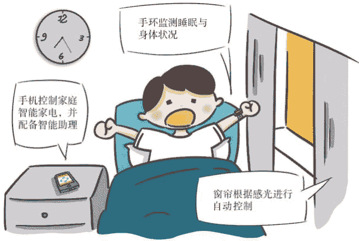

**小智家的智能设备**

抬腕瞥一眼智能手环，昨晚睡眠状况已以简明图形呈现。比预设的7:30早醒5分钟——最后一个睡眠周期在7点刚过结束。

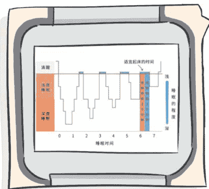

**小智的睡眠画像**

闹钟时间由手环预设。但手环实时监测心跳、呼吸、体动，掌握睡眠全程，在接近预设时间的周期尾声，以微震动、柔和声光温柔唤醒。**顺应生物钟的智能唤醒，让新一天满血复活。**

智能窗帘同步拉开。洗漱更衣后，小智对着手机问："嘿Siri，今天天气如何？"

屏幕亮起，标准普通话回应："早上好，李智！今天有沙尘，23℃，下午转晴……"尾句贴心补充："早晚凉，建议春装保暖，未来两小时无雨，放心出门。"

小智顺手取下保暖外套。"去学校要多久？"智能助理回："早高峰堵车，公交约56分钟。"果断决定——骑车。

8:00准时出发。打开地图App，两条骑行路线，一条因地铁施工可能不通，预计40分钟到校。楼下共享单车整齐停放。哥哥曾揭秘：夜间智能系统预测次日客流需求，动态调度车辆部署，保障高峰区供给。预测变量除常规客流规律，还融合天气、路况——这不，小智正是根据助理提供的路况与天气，选择骑行。

进教室，人脸识别系统自动捕捉签到。学校引入签到点名系统，考勤自动推送班主任，管理便捷；兼具学习姿势监控提醒，纠正久伏低头等不良习惯，护航健康成长。

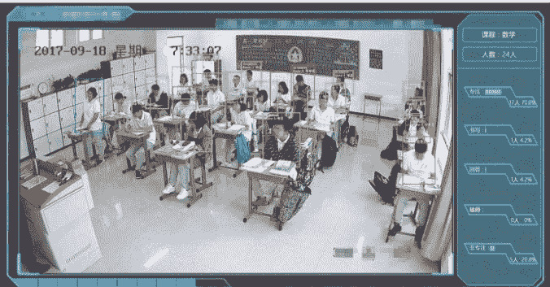

**教室签到点名系统**

校方还开发学习辅助App：拍题搜同类题与解析、上传参考答案、查看同学分享解析、课后讨论、错题整理，一站式高效。

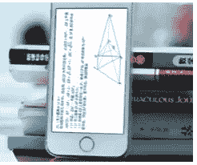

**辅助学习App**

11:40午餐时间。食堂虽满座却不拥挤，归功于新引进的自动菜价计算器。小智自选菜品，托盘置于摄像头下，屏幕瞬间识别菜名单价并汇总；校园卡一刷，“滴”——结账完成。

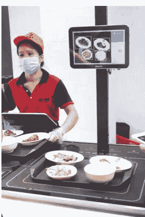

**自动菜价计算器**

落座，想起哥哥推荐的拍照测热量功能，决定试试。打开App调用相机对准餐盘，屏幕中央自动弹出菜品种类、分量与热量值。"嗬！披萨热量是蔬菜10倍！"为健康，小智立志少吃高热量食物。


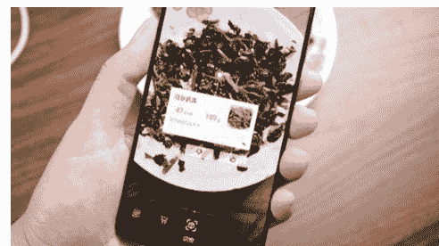

**拍照测热量**

17:00放学。下午体育课踢球消耗大，小智想赶紧回家冲澡。手环弹窗："李智，恭喜完成今日运动目标！公交回家约45分钟，需远程预热洗澡水？"一点确认，小智感叹："AI真帮大忙！"

家中智能家居丰富。楼道门禁"刷脸"入户，免钥匙、免门卡。为安保升级，家用门禁采用**指纹+人脸双重验证**。

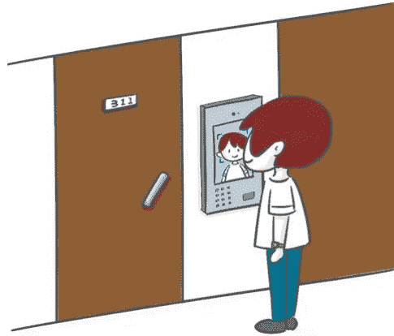

**小智家门口的人脸识别智能门禁系统**

---

### 人脸识别智能门禁系统原理速览

基于人脸识别技术的访问控制系统，利用设备对数字图像或视频帧验证。门口带识别功能的对讲机分析人脸特征——定位面部、测量结构（眼鼻口耳间距等），与住户库匹配判定身份。

对比指纹、虹膜等接触式生物识别，**人脸识别可在一定距离无感捕捉，无需专用接触设备**。

详细技术解析见本书第五章《视觉感知》。

---

# 第1部分 生活里的AI

科技演进中，AI不知不觉闯入生活，在衣食住行各维度落地生根，带来实实在在的便利。本部分从四个维度展开，拆解应用与背后原理，助你看清AI如何重塑日常。

四章编排：**"衣"——智能穿搭助手与网购选品核心技术；"食"——自动菜价计算器组件与热量计算算法；"住"——睡眠监测技术与智能家居落地；"行"——路径规划、网约车智能派单、智能交通信号灯。**

透过这些炫酷应用，既能见证生活变迁，更能读懂技术底色。


## 第一章 衣

追求时尚却负担不起高昂形象设计师费用？穿衣搭配成了难题。**AI以数据与算法读懂时尚，化身分析师、搭配师、选品师**。收集用户信息与偏好，洞察气质喜好，进阶为"私人穿搭顾问"。热爱时尚者，足不出户跟上潮流、买到合身单品、搭配得体场合造型。

本章带你认识辅助日常搭配与选购的AI产品，拆解背后原理。

### 一、智能搭配助手

某早，小智边吃早餐边等姐姐，却见姐姐陷入"选择困难"："衬衫配裙子还是裤子？"对着衣柜比划半天，小智只能先走。为破解难题，爸爸送姐姐一个智能穿搭助手——"小衣"。

又一日清晨，小智惊讶发现姐姐迅速搞定多年的穿搭纠结。姐姐开心演示："**小衣，白衬衫怎么搭？**"瞬间，几套方案推送至手机供选择。


**姐姐用智能试衣App**

# 第一章 衣：AI 穿搭顾问，解锁你的衣橱新可能

小智对这个名为“小衣”的穿搭小助手产生了浓厚兴趣，迫不及待想探究其背后的实现逻辑。他广泛检索网络资料，还拉上班里钻研硬件的小红一起联合“破案”。经过一番深度研究与头脑风暴，两人合力绘制出了“小衣”的核心架构图。要驱动“小衣”运转，其内部架构主要划分为五大功能模块：语音识别模块、蓝牙通信模块、搭配智能体核心、Wi-Fi 模块以及个人电子衣橱。

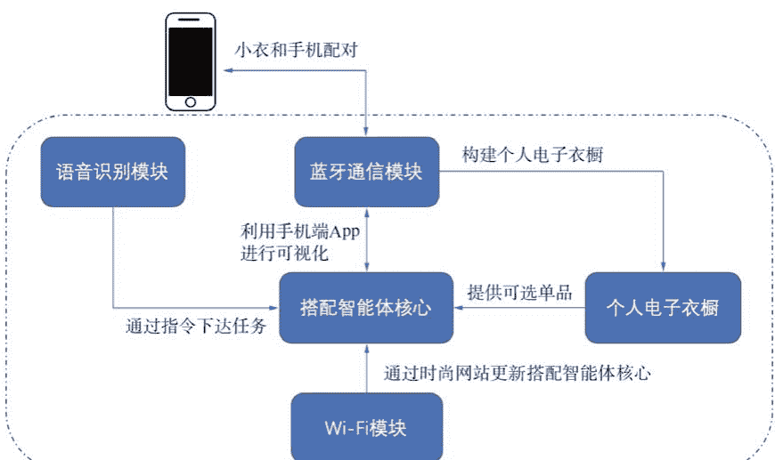

“小衣”核心架构图

**听得懂、懂你心：语音交互链路**
语音识别模块是“小衣”的“耳朵”。开机后，内置麦克风持续监测环境声纹，一旦捕捉到唤醒词“小衣”，即刻激活。随后，语音识别技术（详见第六章）将语音信号转为文本，再经自然语言处理（详见第七章）解析语义，将姐姐的自然语言指令——如“帮我找件配白衬衫的外套”或“包包 A 和 B 谁更适合今儿这身”——转化为系统可执行的结构化任务。

**大脑核心：搭配智能体的打分逻辑**
任务下达后，搭配智能体核心接管执行流程。其本质是一个基于神经网络的“搭配评分器”。
首先是**特征提取**：单品图片输入卷积神经网络（CNN，详见第三册第八章），输出视觉特征向量；文本描述则匹配预设关键词表（如“白色”“高腰”），生成布尔值向量作为文字特征。双模态特征融合，以此数字化表征单品。
其次是**序列建模与评分**：将一套穿搭视为序列，引入长短时记忆网络（LSTM，详见第三册第八章）。这类 RNN 变体擅长记忆前序信息，能依据风格维度为整套搭配打分，支持从单品生成全套穿搭，也能对比两件单品与现有套装的匹配度。

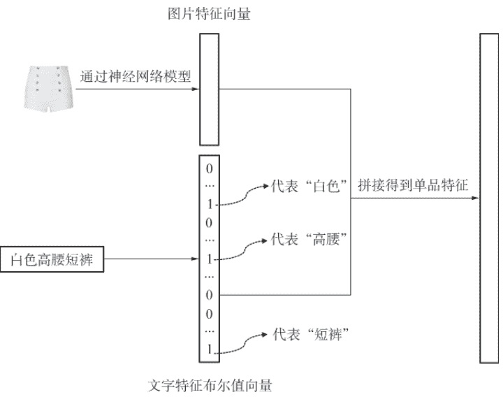

**紧贴潮流：Wi-Fi 赋能的持续进化**
Wi-Fi 模块让智能体核心得以连接云端时尚平台。专家发布的当季高分穿搭案例，经特征提取后作为高分正样本，用于微调 LSTM 模型。通过定期“在线学习”，“小衣”始终保持审美在线，输出符合当下流行趋势的方案。

**专属仓库：个人电子衣橱**
这是“小衣”的专属知识库，存储姐姐所有单品的图文数据，为智能体核心提供决策素材。

**无缝连接：蓝牙通信桥梁**
蓝牙模块打通“小衣”与手机 App 的双向数据流：
- **录入端**：姐姐通过 App 上传单品正面照及简述（如“阔腿牛仔裤”），经蓝牙写入电子衣橱；
- **输出端**：智能体核心出具方案后，经蓝牙推送至手机端直观呈现。

> **“小衣”输出示例**：
> - 黑色渔夫帽
> - 灰色针织衫
> - 黑色皮革双肩包
> - 白色高腰短裤
> - 黑色厚底靴
> - 黑色纯棉裤袜

### 思考与拓展
**Q1.1** 当前方案仅考量时尚维度，若引入“场合适配性（通勤/约会/运动）”、“天气温度”、“个人色彩季型”、“舒适度偏好”甚至“日程行程”作为约束条件，推荐将更具实用性。

---

## 二、智能选购：虚拟试衣间，所见即所得

姐姐近期穿搭频获赞，小智探究究竟。姐姐演示了一款新 App：界面核心是一个复刻其五官、肤色、发型、身材比例的 3D 虚拟分身。切换场景风格——通勤模式推荐温柔优雅套装，逛街模式切换休闲舒适风，服饰实时“穿”在模型上，试穿效果一目了然，决策效率大增。

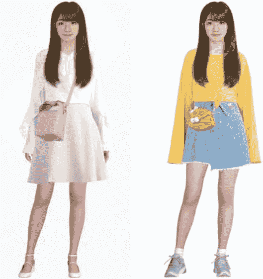

不同风格穿搭实时驱动虚拟 3D 模型

小智查证发现，该功能落地依赖三大核心步骤：

**步骤一：参数化人体建模**
构建海量人体 3D 模型数据库（含身高、体重、头身比、关节角度、皮肤纹理等参数）。通过学习参数到模型的映射函数，仅需输入用户参数（手动填写或计算机视觉从照片反推），即可秒级生成专属高保真虚拟人。

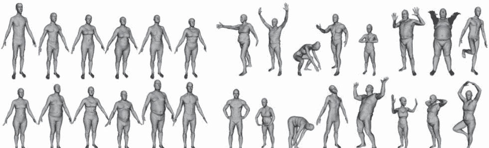

人体数据库样本（局部）

**步骤二：全品类搭配推荐引擎**
核心算法逻辑与“小衣”同源，但检索范围从“个人衣橱”扩展至“全网在售单品数据集”，实现商品级推荐。

**步骤三：3D 虚拟试穿渲染**
1.  **服装建模**：3D 扫描可试穿单品，生成服装模型；
2.  **分段对齐**：基于人体关节拓扑，将服装模型与人体模型逐部位（躯干、四肢等）几何对齐、变形贴合；
3.  **图形渲染**：渲染引擎输出最终试穿效果图。同一件衣服，因体型差异呈现截然不同的版型效果，直观展示“上身感”。

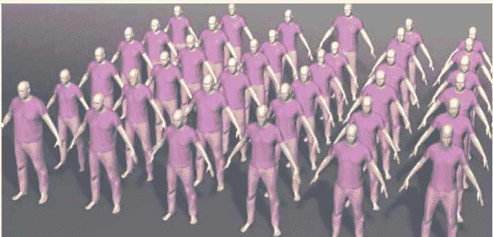

同款服装在不同体型模型上的试穿对比

### 思考与拓展
**Q1.2** 实体店“魔法镜”虚拟试衣如何落地？关键在于：**RGB-D/结构光相机实时获取人体点云/骨骼关键点** → **轻量化人体模型实时驱动** → **服装模型实时变形对齐（物理仿真/几何绑定）** → **AR 融合渲染叠加至镜面显示屏**，实现免脱衣秒换装。

---

## 三、本章小结
AI 正重塑“穿衣”体验：从亚马逊 Echo Look 到品牌虚拟试衣镜，算法化解了“衣橱满却无衣穿”的选择瘫痪。未来，AI 或将结合面料物理仿真、社交属性预测、可持续时尚指数，进化为全维度的私人造型顾问。

---

# 第二章 食：计算机视觉守护舌尖上的健康

中华饮食博大精深，“民以食为天”。一桌色香味俱全的中餐，既是味蕾盛宴也是视觉挑战。本章聚焦 AI 视觉技术在菜品识别、热量检测中的落地实践。

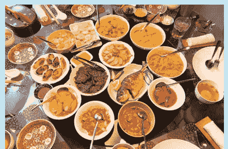

一桌丰盛中餐

## 一、食堂智能结算：托盘入镜，秒出账单

学校食堂上线了基于菜品识别的自动结算台。同学只需将托盘置于识别区，摄像头捕捉画面，后端计算机经图像分析识别菜品并匹配单价，屏幕实时显示总价，全程无感、高效。

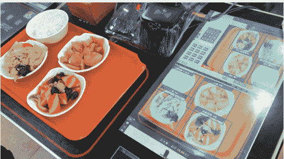

食堂自动结算演示

**极简硬件，核心在算法**：
- 摄像头：图像采集（光信号转二进制流）；
- 计算机（台式/笔记本）：核心图像处理与推理；
- 显示屏：结算结果可视化。

项目由校深度学习兴趣小组三人小组完成：小红攻坚硬件与图像采集，小黄主攻 CV 核心算法，小蓝负责软件工程与界面开发。

分享会上，小组复盘技术路线。参考移动端菜品识别 App 形态，核心算法管线包含三级：**物体检测 → 图像识别 → 信息提取**。

| 菜品 | 单价 | 热量 |
| :--- | :--- | :--- |
| 番茄炒蛋 | 3元 | 120卡 |
| 鱼香肉丝 | 5元 | 154卡 |
| 青菜 | 2元 | 41卡 |
| 米饭 | 1元 | 50卡 |

**三级管线详解**：

1.  **物体检测（定位与分割）**：
    - 框选候选菜品区域（ROI），抑制背景干扰（托盘、餐具、手部）；
    - 将各 ROI 裁剪为独立小图，送入下一级。
    > **Q2.1** 遮挡问题（如菜品堆叠）导致 ROI 切割错误、识别错漏。对策：引入**实例分割**而非目标检测，像素级分离重叠实例；或利用**遮挡感知训练**（合成遮挡数据增强）、**上下文推理**（利用可见部分推断全貌）、**多视角融合**（多摄像头/用户移动托盘获取多帧）。

2.  **图像识别（分类与特征提取）**：
    利用深度学习（多层神经网络，详见第三册第八章）对单品小图提取特征并判类。神经网络双任务：
    - **特征提取**：捕捉颜色纹理、形状轮廓、局部细节；
    - **菜品判断**：输出各类别概率分布。如番茄炒蛋概率 95%，锁定判别结果。

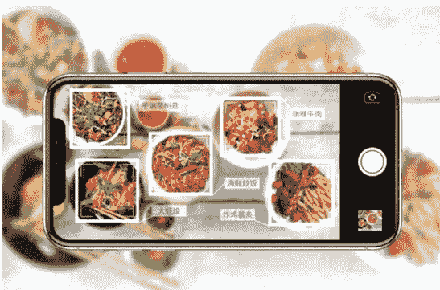

手机端菜品识别 App 界面

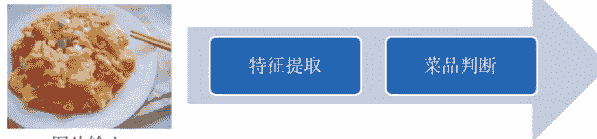

深度学习推理输出概率分布示例

3.  **信息提取（知识库查询与结算）**：
    识别结果映射数据库，取价格、热量等属性，累加总价并渲染屏幕。

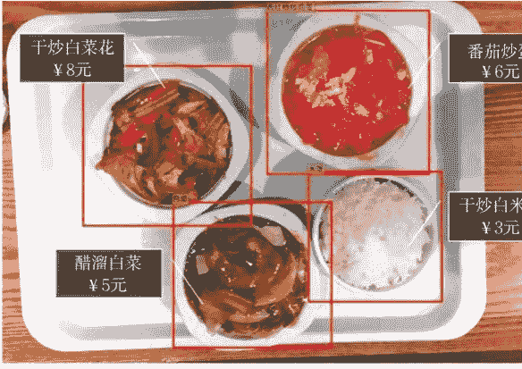

结算结果显示示例

**攻克难点：极似菜品的细粒度区分**
糖醋白菜 vs 手撕包菜，颜色、质地高度相似，模型极易混淆（概率接近 5:5）。

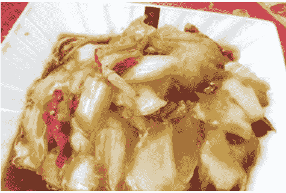

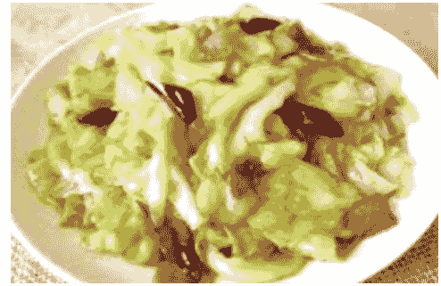

糖醋白菜 | 手撕包菜 | 混淆矩阵示例
--- | --- | ---
图片 | 图片 | 糖醋白菜 45% / 手撕包菜 55%

**破解之道**：小黄针对性采集难分类别大量样本，构建**难例挖掘**数据集，对骨干网络进行**微调/增量训练**，强化判别性特征学习（训练细节见第三册第八章）。

---

## 二、食物热量监测：拍照知卡路里，科学管体重

小明因超重面临健康隐患（WHO 警示：儿童肥胖易延续至成年，诱发糖尿病、心血管病、高血压、血脂异常，影响发育与心理）。小智推荐“拍照测热量”App：对准食物拍摄，秒回食物名、克重、热量。实测披萨 71g/168kcal，清炒蔬菜 189g/47kcal，热量差距直观冲击，小明据此调整饮食结构，最终达成减重目标。

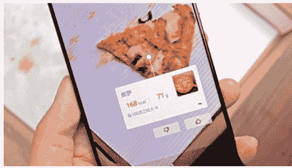

披萨热量识别结果

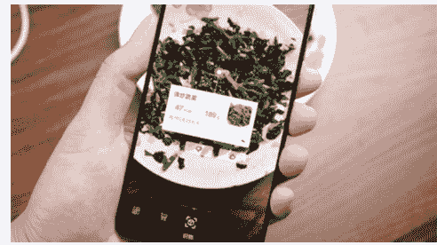

清炒蔬菜热量识别结果

**热量科学基础**：人体能量源自食物氧化（蛋白质、脂肪、碳水化合物）。热量盈余转化为脂肪囤积。

**技术管线三阶段**（较菜品识别增设质量估算，难度跃升）：


拍照测热量技术管线

1.  **物品识别（分类检测）**：
    同菜品识别，输出食物类别及单位热量（kcal/100g）等元信息。核心为分类模型（见第三册第八章）。

2.  **质量预测（回归估算）**：
    **核心难点**。输入：食物图像 + 类别先验。任务：图像特征 → 总质量回归。需建立视觉特征（体积、面积、深度线索）与物理质量的映射关系，引入密度先验。属回归预测模型范畴（见第三册第八章）。

3.  **热量计算与呈现**：
    总热量 = 估算总质量 × 数据库单位热量。结果可视化输出。

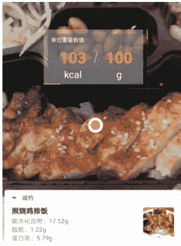

热量计算最终呈现示例

---

## 三、本章小结
本章实战展示了计算机视觉（详见第五章“视觉感知”）在“吃”场景的双高频应用：结算提效、健康赋能。技术栈涵盖检测、分类、分割、回归等核心范式。生活中仍有大量视觉 AI 待挖掘，期待你的创意落地。

### 思考与拓展
**Q2.3** AI “吃”应用普及，可能冲击/重塑哪些职业？如：食堂结算员、营养师（基础膳食评估）、外卖测评博主、部分质检员、饮食记录类 App 录入客服等；同时催生“AI 训练数据标注师”、“营养算法工程师”、“智能餐具产品经理”新岗位。

---

# 第三章 住：智能家居，让栖居更懂你

人们渴望便捷、品质、安全的栖居体验。智能算法驱动下的智能家居生态正兑现这一愿景：智能手环守护睡眠，智能音箱做中枢入口，声控万物。本章通过小智的体验，拆解睡眠监测与语音交互背后的 AI 原理。

## 一、 睡眠守护者：从监测到干预的闭环

考前焦虑失眠夜，小智求助手环。手环联动音箱播放白噪/轻音乐助眠；检测入睡深度后自动停播；清晨浅睡窗口期以柔和闹铃唤醒。醒来神清气爽，手环呈现全夜睡眠架构图：清醒、浅睡、深睡时段清晰标注，并标记最佳起床窗口。

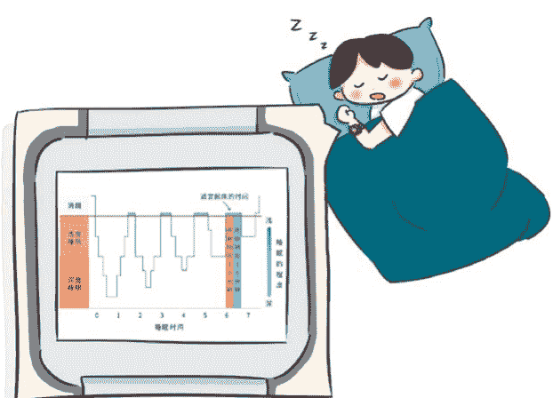

智能手环睡眠监测可视化

配套 App 生成专业睡眠质量分析报告，长期趋势显示睡眠效率显著提升。

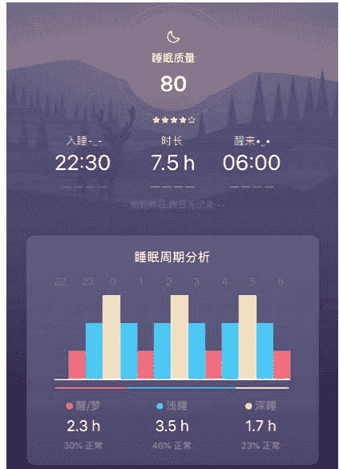

睡眠质量分析报告示例

### 延伸知识：睡眠阶段的生理编码
人类睡眠遵循 90~100 分钟周期，循环经历三阶段：

| 阶段 | 生理特征 | 脑波特征 |
| :--- | :--- | :--- |
| **清醒期/入睡期** | 脑波频率减缓、振幅减小 | α 波 → θ 波过渡 |
| **浅睡期 (N1/N2)** | 感知阈值升高、体温微降、心呼吸规律 | θ 波为主，伴睡眠纺锤波、K 复合波 |
| **深睡期 (N3)** | 难唤醒、肌肉松弛、呼吸减缓、分泌生长激素 | **δ 波**为主（高振幅、低频率、慢波） |
| **REM 快速眼动期** | 大脑高活跃、肌张力极低、易做梦、易醒 | 低振幅、高频率、锯齿波，近似清醒脑波 |

**手环如何“看见”睡眠？**
核心传感器：**三轴加速度计**（捕捉体动/翻身/呼吸微动）+ **光学心率传感器（PPG）**（捕捉心率变异性 HRV）。
算法融合：**体动幅度/频率**判定清醒/浅睡/深睡（体动大=清醒/浅睡；体动小+心率慢/规律=深睡）；**HRV 频域分析**辅助识别 REM（交感/副交感波动特征）。机器学习分类器（如随机森林、轻量级 CNN）将多模态时序特征映射为睡眠阶段标签，再平滑修正符合睡眠周期先验。

*(注：素材原文截至此处，后续章节内容待续。)*

# 解码睡眠与智能监测：从手环到医疗级设备

睡眠并非单一状态，而是包含两大类型：非快速眼动睡眠与快速眼动睡眠。前者让人对外界反应迟钝，难以被噪音惊醒；后者大脑高度活跃，易醒且常伴随梦境。

好奇智能手环如何“读懂”睡眠的小智深入钻研，发现主流监测手段主要有两类：基于体动的便捷监测，与基于多导睡眠仪的专业监测。

## 1. 基于体动的睡眠监测：腕上的“睡眠管家”

这类方案将睡眠简化为清醒、浅睡、深睡三阶段。核心在于手环内置的运动传感器，它能捕捉睡眠中的肢体位移数据，经特征工程处理后推断睡眠阶段。

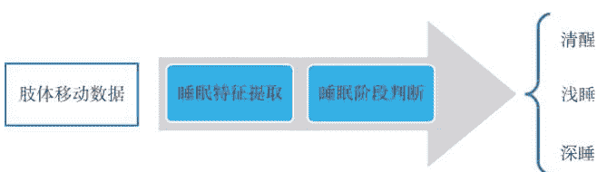

**技术流程解析：**
系统先滤除环境干扰，提取固定时窗内肢体运动的幅度与频率特征，再送入分类模型输出各阶段概率，最终取概率最高者为判定结果。

得益于此，手环能全程守候小智的睡眠：在浅睡期轻柔唤醒，晨间复盘深浅睡时长并打分，还能给出改善建议。

## 2. 基于多导睡眠仪的监测：临床诊断的“黄金标准”

多导睡眠仪同步记录脑电、肌电、心电、眼动等多维生理信号，精准度无出其右，可用于睡眠疾病确诊。但因需在头部粘贴大量电极，侵入性强，目前主要局限于医疗场景。

相比之下，消费级手环和App均采用体动法。其短板显而易见：静卧不动却未入睡时，极易被误判为睡眠状态。虽精度不及专业设备，但胜在低成本、零门槛、精度够用，故大众接受度极高。

### 思考与实践 3.1
体动监测为何必须经过“特征提取”这一步？若直接喂入原始位移数据会怎样？

---

## 二、智能家居：让家“懂”你

傍晚，小智推门入户，智能音箱“小音”秒回：“小主人，欢迎回家。”一声令下，书桌灯亮起并切护眼模式。扫地机、智能饭煲、声控电视……小智一家尽享科技红利。


### 智能台灯的“贴心”尴尬
写作业时，门窗忽自动合拢，小音播报：“降雨检测到，已关窗。”虽贴心，却打断了专注。


### 智能窗帘
小智想让小音“读懂”学习场景自动降噪。遂探究其工作原理：


**小音工作闭环：**
持续监听 -> 唤醒词触发 -> 语义指令上传云端 -> ASR/NLU解析 -> 下发控制指令 -> 设备执行 -> TTS语音反馈 -> 扬声器播报。

核心技术栈：语音识别(ASR)、语音合成(TTS)，依托Wi-Fi/蓝牙联通云端与终端。

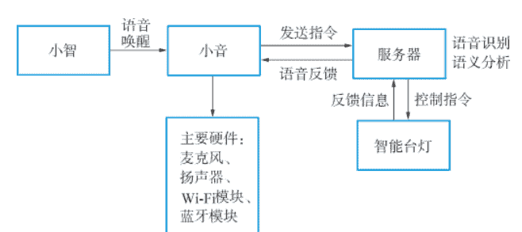

**进阶方案：语义感知降噪**
在指令解析环节植入“学习状态判断”，若检测到学习中，则同步下发静音指令。

利用“自定义回复/快捷指令”功能：设定“我要写作业”联动开灯；“我要学习了”联动开灯+静音。无需显式说“安静”，一句意图表达即万事俱备。

但小智更渴望**“免唤醒、零指令”**的隐式交互：系统自动感知学习行为，自适应调节音量。

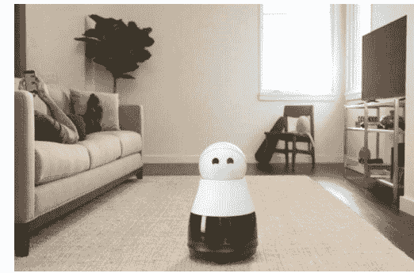

### 未来展望：从“听指令”到“懂行为”
为小音加装摄像头，引入**智能行为识别分析技术**，融合视觉、语音特征识别预测用户状态，进化为家庭机器人形态。甚至畅想手势控灯、脑机交互，以“念力”驱动设备。

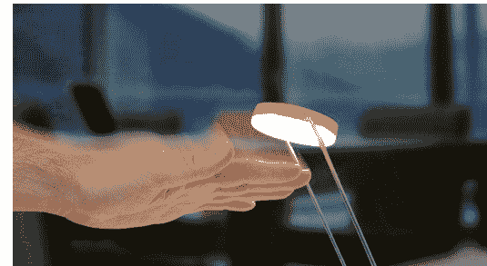

---

## 三、本章小结
AI赋能下，智能家电将全面入户，家庭机器人或成情感陪伴新成员。请大胆想象未来的智能生活图景！

### 思考与实践 3.2
现有家居还能如何智能化？请构思设计与实现路径。

---

# 第四章 行：AI疏堵，智享出行

城市车潮涌动，高峰拥堵成顽疾。算力与网络飞跃，让AI介入交通治理成为可能：海量数据实时分析，支撑路径规划、信号优化、网约车派单，有效缓解城市血管硬化。小萌周末赴杭州看演唱会，全程仰赖AI交通服务准时入场。本章带你拆解背后原理。

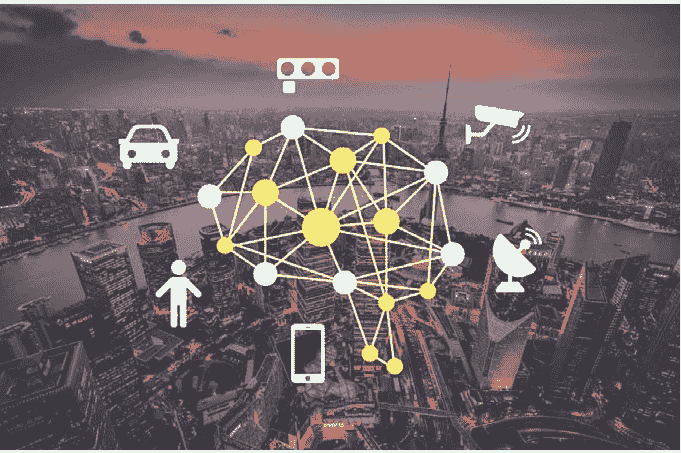

## 一、 出行路径规划：静态寻径与动态预时

高铁晚点15分钟，小萌18:38到达杭州东站，距开演不足50分钟，常规车程却要1小时。地图App规划出最优路线并精准预估到达时间，小萌火速叫车，惊险赶上。

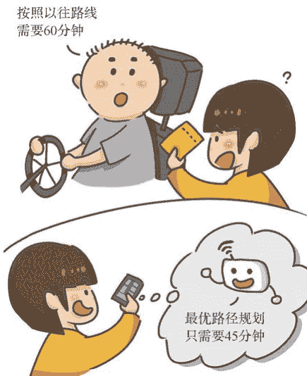

这便是AI路径规划的价值：**给线路、给时长、给底气。**

### (一) 路径规划：从图论到深度学习
本质是：给定地图、起止点，寻找可行路径。

**1. 传统图算法路线**
将实体地图抽象为拓扑图：节点=地点，边=道路，权重=距离/耗时/偏好。经典算法（Dijkstra、A*）即可求解。

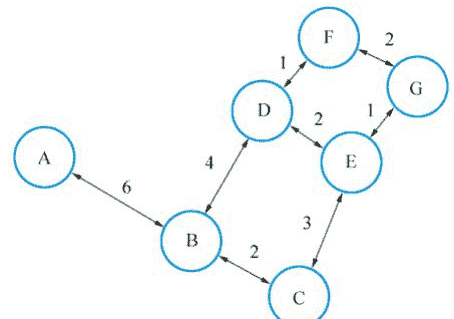

**2. 深度学习路线 (RNN/Seq2Seq)**
采用Encoder-Decoder架构：
- **Encoder**：吞吐地图拓扑、起终点、不全路径、历史状态，滤噪提炼核心特征，压缩为向量。
- **Decoder**：接收向量，逐步扩展不全路径，迭代推进直至抵达终点。

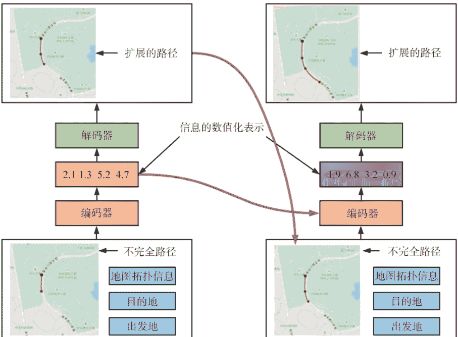

### (二) 时间预测：应对动态路况
路径是骨架，耗时是血肉，高度依赖实时路况。

**1. 传统分段累加法**
路径切片 -> 查历史均值 -> 累加求和。

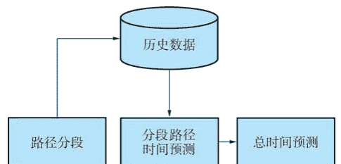

**2. 深度学习建模回归**
RNN从路径/路况/用户序列中提特征，融合时空/用户/交通特征，建模为回归问题直接输出ETA。

### 思考与实践 4.1
能否设计算法：在保时效前提下，规划“打卡美景最多”的游览路线？

---

## 二、 智能出行派单：让“车等人”变“人等车”

小萌叫车极快，司机透露：平台预测东站供不应求，提前调度车辆过来。

核心指标：**用户等车时长**。2018年Q1数据显示，核心枢纽换乘多在10分钟内。

| 场景 | 类型 | 等待时长(分) |
| :--- | :--- | :--- |
| 北京大兴机场 | 机场 | 5.9 |
| 深圳宝安机场 | 机场 | 6.3 |
| ... | ... | ... |
| 北京站 | 火车站 | 10.6 |

**算法内核：强化学习 (RL)**
借AlphaGo之势，引入RL优化派单策略。目标函数对齐**司机收入/载客率**——司机多赚=载客久=用户等待短=体验优。

基本策略：优先派单给距近/到达快的车。

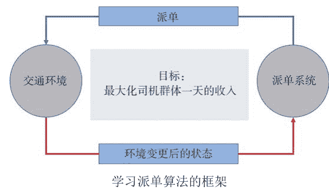

**供需预测：全局视角的“隐形手”**
将城市切分网格，用图卷积神经网络(GCN)提取时空特征预测供需缺口。**提前调度空驶车辆回补缺口区**，实现订单未生、车已在侧。

### 思考与实践 4.2
沿用RL范式，如何设计拼车算法？

---

## 三、 智能交通信号灯：路口的“大脑”

高峰期堵车，司机淡定：杭州“城市大脑”2017上线，2000+路口信号灯纳入实时监控。南北车少东西车多，大脑自动拉长东西向绿灯，保通行效率。

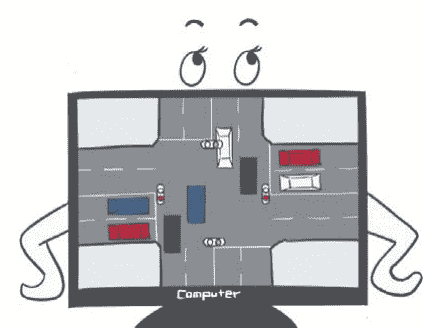

**现状：人机协同**
全自动化尚待时机。主流模式：AI实时评估路口效率，跌破阈值则预警，**人工决策调控**。仅少数高架匝道实现全自动闭环。

**未来：强化学习全自动控制**
科学家已在历史数据上用RL训练信号灯策略，实验效果亮眼。框架雏形已现，全智能化指日可待。

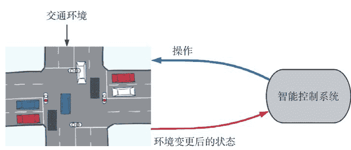

### 思考与实践 4.3
好交通的量化指标有哪些？优化目标该如何设定？

---

## 四、 本章小结
AI护航下，小萌准时入场。从数据读取、状态监测到辅助决策、自动决策，AI让海量交通数据变资产、变价值，释放生产力。技术迭代不止，出行必将更从容、畅快、愉悦。

---

# 第 2 部分：人工智能技术应用案例深度解析

第一部分铺陈“衣食住行”中的AI应用全景。第二部分换视角，**按技术脉络纵深拆解**：视觉感知、语音技术、自然语言处理、检索推荐、智能决策。

智能本质源于对环境信息的**感知-处理-利用**闭环。机器欲具人智，五大能力缺一不可。
- **第5-7章**：拆解机器如何“看”(视觉)、“听”(语音)、“读懂”(语言/文本)；
- **第8章**：机器如何驾驭海量信息，驱动搜索与推荐；
- **第9章**：机器如何基于交互信息，实现智能决策。

人工智能早已渗透进生活的每一个毛细血管，宛如一位隐形的魔术师，以神奇的力量重塑着我们的便捷与多彩。人类凭借智慧缔造技术，技术却反哺人类，不仅重塑了衣食住行，更悄然改变着我们审视世界、理解自我的认知维度。带着这份好奇与思考，让我们即刻启程，一同揭开人工智能神奇面纱背后的核心原理。


## 第五章 视觉感知

小黄对计算机技术情有独钟，尤其痴迷于计算机视觉领域。凡是该领域涌现新应用或取得新突破，他总能第一时间啃下相关的硬核科技报道。久而久之，仅知“能做什么”已无法满足他，强烈的求知欲驱使他探寻应用背后的“底层逻辑”。本章将深度解析人脸识别与图像风格迁移这两大计算机视觉明星应用的核心机制。

### 一、 计算机视觉概述

首先，我们要搞清什么是计算机视觉，以及它为何而生。

脑神经科学揭示：人类从外界获取的信息中，超七成由视觉系统承接处理；大脑皮层约半数区域参与视觉信息分析。视觉感知与处理能力，堪称人类智能的基石。如图所示，人眼捕捉光学信号，经神经传至大脑分层加工，最终指挥躯体做出反应。

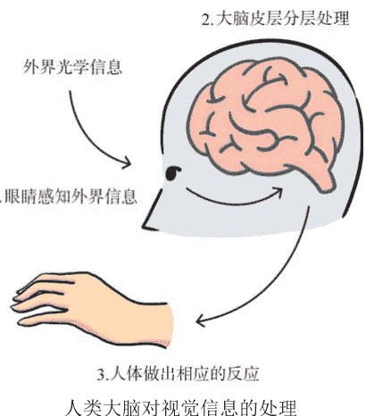

计算机视觉，是计算机科学中致力于赋予机器“看懂”图像数据能力、以此模拟人类视觉系统的学科。如图所示，流程分三步：传感器感知外界并将视觉信息编码为可读图像数据；预设算法对数据深度剖析；最终输出对图像的“理解”结果。

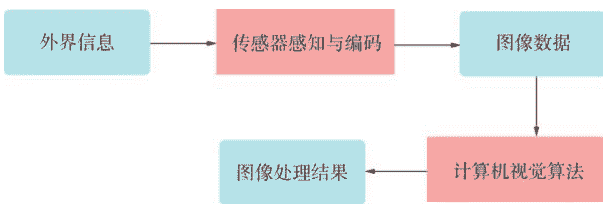

#### 计算机视觉应用的整体框架

对标人类视觉，计算机视觉展现出独特优势。其一，感知维度更广。借助特种传感器，机器能捕捉可见光之外的电磁波——如红外热像仪记录的建筑热力分布，高速相机定格的子弹出膛瞬间。其二，存算性能碾压人脑。海量监控视频中锁定特定人员，人工无异于大海捞针；特定算法配合机器擅长的重复高效作业，逐帧分析识别，目标瞬间现形。

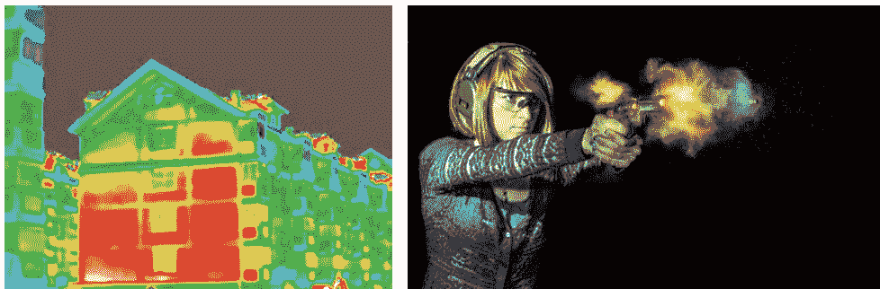

红外热像仪拍摄到的建筑物外部热力图

高速摄像机拍摄到的子弹出膛瞬间

计算机视觉的核心在于“理解”图像。因应用场景不同，“理解”的目标各异，衍生出物体检测、语义分割、图像风格迁移、人体姿态检测等细分方向。

#### 1. 物体检测

核心任务：从图像中定位指定物体，通常用矩形框标注位置。例如交通监控中锁定车牌位置，为后续识别铺路。当下，安防、支付等领域的人脸识别算法，第一步皆是物体检测——先在图里“找到脸”。下图即展示人脸检测的实测效果。

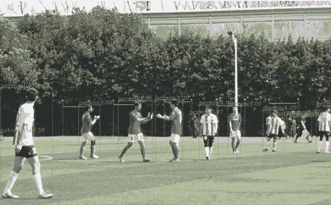

物体检测示例

#### 2. 图像分割

核心任务：将图像中独立物体像素级分离，以不同色块标识。下图即为示例。应用场景极广：无人驾驶中分割路况识别行人车辆辅助避障；医疗影像分析中辅助病灶定位诊断。

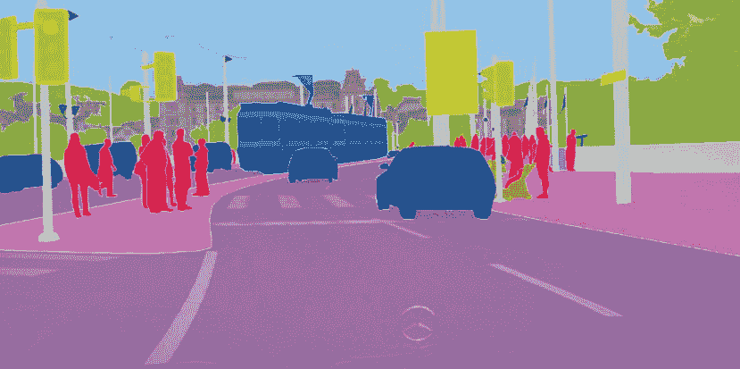

图像分割示例（图为著名的Cityscapes Dataset 数据集中的标注）

#### 3. 图像风格迁移

核心任务：将图像A（如梵高《星夜》）或某类图像（如梵高整体画风）的“风格”迁移至图像B，同时保留图像B的“内容”。当下流行的拍照App“滤镜”功能，本质皆是此技术。一键将春景转夏景、实景转动漫、照片变油画。下图展示风景照分别迁移为《星夜》风格与梵高山水风格的效果。

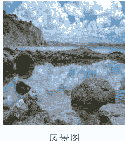

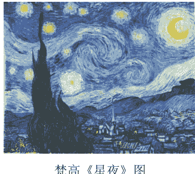

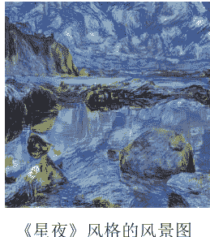

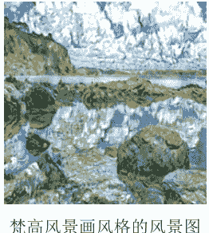

#### 4. 人体姿态检测

核心任务：检测图中人体姿态，输出关节点坐标。连线即得“火柴人”骨架表示（如下图）。应用延伸至行为识别，如安防监控中自动预警危险动作。

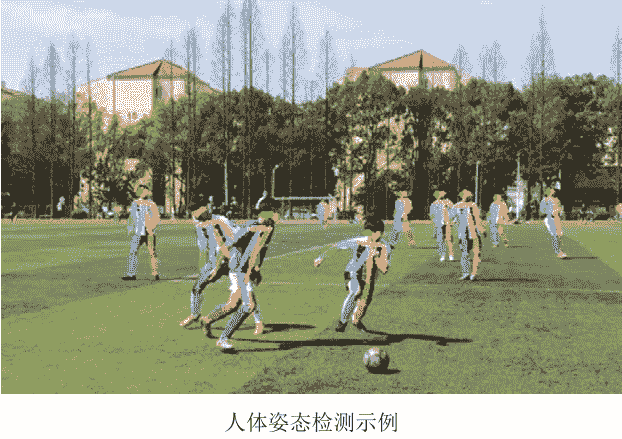

### 二、 人脸识别

暑假志愿者期间，小黄在熙攘地铁站发现遍布的摄像头（如下图）。他构想：若计算机视觉能自动从监控流中比中通缉犯，破案效率将指数级跃升。

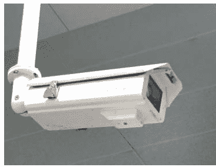

地铁站中的摄像头

返家观赛时，场边数据记录员忙碌身影（如下图）又触动他：若用视频自动生成比赛数据，首要难题便是实时识别场上球员身份。

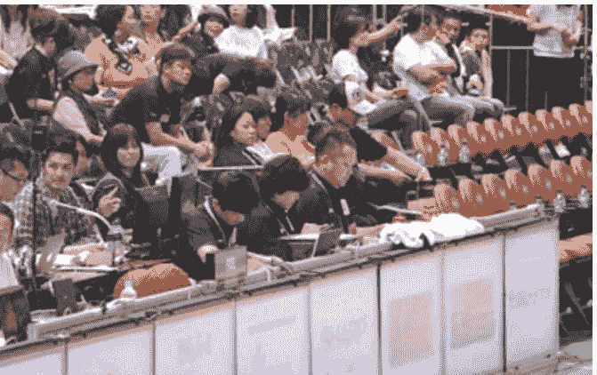

篮球比赛中的数据记录员

赛间隙，小黄掏出人脸解锁手机（如下图），抬手即开，与好友小宋畅聊至散场。

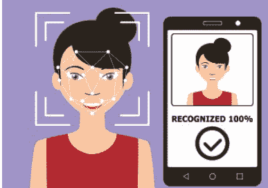

人脸解锁示例

躺床复盘，小黄感叹：“人脸解锁太酷！能否用到地铁、赛场？它究竟如何从图片视频里‘认’出人？”

人脸识别属计算机视觉落地最成熟技术之一，广泛服役于安防、支付（解锁、门禁、刷脸付）。其核心流程如图：图像预处理（检测、对齐、编码）获取人脸码；有身份码入库备查，无身份码查库比对出身份。

以手机解锁为例：录入期采集多张人脸建库；解锁期抓拍实时比对库内人脸。

人脸识别关键四步走如下图。

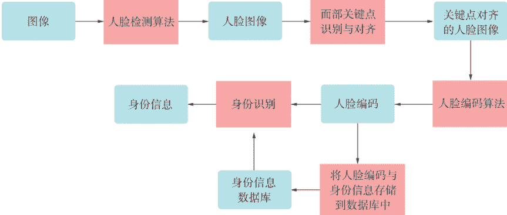

人脸识别技术算法步骤

#### 1. 人脸检测

识别前，必先在图中“找到脸、框住脸”。手机相机自带此功能，保证全脸对焦。下图中矩形框精准锁定人脸。

原理上：彩色图转灰度图（去色留形），用方向梯度直方图（HOG）提特征生成HOG图，在HOG图中搜寻人脸模式。下图对比可见，HOG图让五官轮廓等关键信息跃然纸上，机器由此极速定位。


人脸图片和对应的方向梯度直方图

#### 2. 面部关键点检测与对齐

痛点：人类多角度认同一人极易，机器却常将同人不同角度误判为两人。库内仅存正脸照时，如何识别监控侧脸？


不同角度的人脸

破局之道：面部特征点估计算法。训练模型定位人脸通用的68个标志点（下巴尖、眼眶、眉弓等，如下图）。大量数据训练后，任意人脸均能精准落点。利用这些几何基准，对不同角度人脸做旋转、平移、缩放归一化，大幅消除姿态差异带来的误判。

#### 3. 人脸编码

如何量化两张脸的相似度？机器只认数字。虽图片已是数字化，但需更高阶的“身份编码”。传统思路提取符合人类直觉的特征（耳大小、眼距、鼻长等）建档比对。实则机器已超越人类直觉：主流用卷积神经网络（CNN）自动学习精细特征（如下图示意），大幅提升准度。人脸图输入CNN，输出即为唯一的人脸编码向量。


卷积神经网络示意图

#### 4. 身份识别

有人脸码，识别即成分类问题：有标签码入库，无标签码查库找最近邻。机器学习中逻辑回归、SVM、多层感知机等分类算法均可胜任（详见第三册第八章）。

### 思考与实践

5.1 你认为人脸识别还能落地在哪些生活场景？

### 三、 图像风格迁移

近日梵高画展，痴迷绘画的小黄看得意犹未尽。归途望着路边风光，他脑洞大开：“若梵高在世，眼前这景会怎么画？”这正是计算机视觉中的“图像风格迁移”。


梵高风景画作

前文提及，风格迁移分单图迁移与类别迁移。前者需适配单张风格图，耗时长且易“水土不服”。小黄设想及手机滤镜常用的，属后者——抽取一类风格（如梵高山水风格）迁移至目标图，保留内容。下图即为示意。


图像风格迁移示意

本质上，这是寻找两个数据集（风景照集X、梵高山水集Y）间映射关系的模型。输入风景照，输出保留内容的梵高风画。深层神经网络擅长图像建模，是首选工具。

先看监督学习思路：若每张风景照Xn都有对应同内容梵高画Yn（如下图），即有“标准答案”，模型可据此学习映射。但现实骨感：梵高已逝无法补画；百年前画景今难寻同构照片。配对数据缺失，监督学习行不通。


使用配对的 (x, y) 来建立两个数据集合之间的映射关系

现采用双核算法破局：生成对抗网络（GAN）+ 图像重构。

#### 1. 生成对抗网络

属无监督学习。双网络博弈：**生成器**建模映射关系，**判别器**对抗生成器倒逼进化。

流程如图：生成器把风景照改梵高画；判别器收真假图（真梵高画vs生成器输出），输出“真梵高”概率。训练中，判别器练就火眼金睛，生成器练就以假乱真。交替优化，终得生成器能稳产真实感梵高风景画。


生成对抗网络

#### 2. 图像重构

GAN能生成梵高风，但如何保证“内容不走样”？

引入**循环一致性**机制（如下图）：训练双向生成器——G1：风景→梵高；G2：梵高→风景。约束：风景经G1→G2必须重构回原图。倒逼G1在生成时保留足够原图信息，配合网络结构设计，内容特征得以锁定。


图像重构

至此，风景照一键变梵高风的算法链路打通。

### 四、 本章小结

本章以人机视觉类比开篇，拆解计算机视觉系统架构；梳理物体检测、图像分割、风格迁移、姿态检测四大基础任务；重点深度复盘“人脸识别”与“图像风格迁移”两大落地应用的底层原理。

## 第六章 智能语音技术

小智发现，身边电子设备与智能终端纷纷获得“开口说话”的能力，他好奇人机自然交互是如何落地的。从语音输入、地图导航到万能智能助理，背后皆是智能语音技术托底。本章带你拆解智能语音技术栈与核心基建。


### 一、智能语音技术概述

智能语音技术自20世纪50年代萌芽，以语音识别为起笔，融合自然语言理解生成、声学语言学等多学科。近年突飞猛进，已成为人机沟通最高效界面。

因对话是人类最自然、信息密度最高的交流范式，语音交互在人机交互赛道拥有天然的降维打击优势。

技术双核：**语音识别（ASR）**，让机器“听懂”；**语音合成（TTS）**，让机器“开口”。智能助理闭环：ASR转文本→NLP理解生成回复→TTS合成语音输出。典型任务如下。

#### （一）语音识别

即自动语音识别（ASR），将声波转文本。广泛服役于语音输入、字幕生成、声纹鉴别、导航系统，也是语音助理、同传系统的核心组件。语音搜索即典型应用。


#### （二）核心技能：语音合成（TTS）

语音合成，学名“文语转换”（Text To Speech，简称 TTS），指的是将任意文本信息转化为对应语音输出的技术，是人机语音交互闭环中不可或缺的关键一环。这项技术早已渗透进日常生活的方方面面：当你向 Siri、小冰等智能助理提问并获得语音回复时，当电子书 App 为你“朗读”书籍、导航软件播报“前方路口左转”时，背后运作的都是语音合成引擎。


语音导航


电子书 App 的朗读功能

#### （三）听歌识曲：乐曲检索

乐曲检索技术允许用户提交一段音乐片段（如环境播放的背景音乐、或是自己哼唱的旋律），系统随即在海量曲库中比对并返回最相似的乐曲信息。主流音乐 App 均内置了该功能，极大地方便了用户发现音乐。


App 中的乐曲检索功能

### 二、 听得懂：语音识别（ASR）

想象这样一个场景：小智需前往上海虹桥机场接机，却不知路线。他唤醒手机智能助理，问出“怎么去上海虹桥机场”，屏幕瞬间弹出导航路线。手机是如何将这串声波信号精准还原为文字指令的？


智能手机中的语音识别

我们以此为例拆解核心流程。首先，识别系统面临的核心任务是“模式匹配”——如右图蓝色波形所示，系统需在候选词库中找到波形特征最匹配的词汇（答案为 "Yes"）。


语音识别中的模板匹配

经典的语音识别系统采用“前端+后端”双引擎架构：


语音识别的系统架构

*   **前端（特征提取器）**：麦克风收集声波后，前端先进行静音切除、降噪等预处理，接着将连续波形**分帧**（切分为固定时长的短帧），并对每帧做变换与特征提取，最终输出紧凑的**特征矩阵**（固定长度向量序列），供后端建模使用。
*   **后端（解码器）**：基于声学模型（AM）与语言模型（LM），将特征矩阵解码为文字。
    1.  **声学建模**：将特征序列映射为“状态”序列，组合为“音素”（发音最小单位，如汉语声韵母），再组合为词/字。其核心目标是寻找概率最大的发音序列（如 `z en y ang q u sh ang h ai...`）。
    2.  **语言建模与词典映射**：词典将字拆解为发音单元；语言模型则引入上下文概率约束。例如，“sh ang h ai”既可组“上海”也可组“伤害”，但结合“怎么去……机场”的语境，语言模型判定“上海”概率远大于“伤害”，从而输出正确文本。


**典型应用场景：**
- **智能音箱/家居**：语音控制家电交互。
- **智能客服**：7×24 小时自动化处理基础咨询。
- **智能助理**：手机/PC 端的指令型交互入口。
- **字幕生成/语音输入法**：音频转文字、语音代打字。


智能助理

**尚存挑战：** 远场抗噪/去回声、新说话者少样本自适应、云边协同提精度、前后端联合优化减少信息损耗等。


6.2 多人混音场景下的识别难点与解法？
6.3 体验讯飞在线听写，提出改进构想。

### 三、 说得出：语音合成深度解析

导航规划好路线，小智厌倦了标准女声，切换到“明星语音包”，仿佛偶像亲自领路。明星显然无法为海量用户逐条录制，这背后是**定制化语音合成技术**在支撑。


导航软件中的明星语音

**传统合成流水线（前端+后端）：**


传统语音合成系统流程

*   **前端（文本归一化 & 语言特征提取）**：分句、分词、词性标注、韵律边界预测、多音字消歧（如“了”读 le 而非 liǎo）、文本转音素序列。
*   **后端（声学建模 & 波形生成）**：将音素序列及语言特征转为语音波形。主流历经三代技术迭代：

#### 1. 拼接合成—— “积木式”拼装
预先录制海量真人语音切碎存入库（音素/双音素/半音节等单元）。合成时按文本单元从库中检索最优单元拼接。
*   ✅ **音质上限高**，保留真人音色细节，自然度好。
*   ❌ **库容巨大**，录制成本极高（需十数小时）；覆盖盲区合成效果差。


#### 2. 参数合成—— “建模式”生成
不直接用录音，而是用**声学模型**预测声学参数（谱包络、基频等），再经**声码器**合成波形。声码器模拟人类发声原理：肺气流冲击声带（源激励）→ 声波经声道共振修饰（声道谐振）→ 形成语音。
*   ✅ **数据需求低**（约 10 小时录音即可定制），模型体积小。
*   ❌ **音质偏闷、有机械感**；声码器还原细节能力弱，声学模型假设限制表达力。

> **科普：人如何发声？** 声带张紧缩小声门 → 气流冲击振动声带 → 产生基频声波 → 经咽/口/鼻腔共振放大 → 唇齿舌调整成语音。声码器即数字化模拟此过程。

#### 3. 基于波形的统计合成—— 端到端建模波形
直接预测时域波形采样点，跳过声学参数中间层，规避建模假设损失。典型代表 **WaveNet (DeepMind, 2016)**，利用扩张卷积神经网络逐点生成波形。MOS 评测显示其自然度显著超越拼接与参数合成，改进版 WaveNet 2 已落地 Google Assistant（美式英语/日语）。


各种语音合成方法合成的声音样本质量的比较

**传统流水线痛点：** 模块独立训练，目标函数不一致，全局次优。
**突破：** **Tacotron (Google, 2017)** 实现**端到端**建模，直接从 `<文本, 语音>` 数据对学习映射，彻底简化管线。

**定制化语音落地关键—— “音库”构建**：
采集目标人声（导航高频语料 + 覆盖全音系的平衡语句）→ 处理对齐 → 训练模型学习音色韵律。央视纪录片《创新中国》即用此技术“复活”已故配音大师李易之声。

**思考与实践：**
- 6.4 用讯飞“留声”克隆自己声音播报新闻，对比差异。
- 6.5 技术双刃剑：深度伪造语音风险（诈骗、造谣）与对抗策略（水印、检测、法规）。

### 四、 章节回顾

智能语音技术融合自然语言理解/生成、声学、语言学，双核驱动：**语音识别（耳）** 与 **语音合成（口）**。本章梳理了发展脉络、核心应用（识别/合成/乐曲检索），并深度拆解了 ASR 与 TTS 的经典架构与前沿演进（拼接→参数→波形建模→端到端）。

## 第七章 自然语言处理（NLP）

小明频用搜索引擎检索资料，惊叹其毫秒级返千万结果。深挖发现，**自然语言处理（NLP）** 是搜索引擎的基石。NLP 作为 AI 核心分支，专攻“理解”与“生成”自然语言数据，素有**“AI 皇冠上的明珠”**美誉。


搜索引擎

### 一、 NLP 概览：跨越“机器语”与“人类语”鸿沟

计算机擅长结构化数据，却无法直读自然语言。NLP 搭建桥梁，让机器处理文本成为可能，效率呈指数级跃升（搜索引擎 <1s 处理千万级语料，人工图书馆检索不可同日而语）。

**NLP 任务谱系主要分两大类：**


理解与生成。理解类含文本分类、信息检索、信息抽取；生成类以机器翻译为代表；理解生成融合类包括自动摘要、问答系统、对话系统。

#### （一）文本分类：给文本打标签
依标准将文本归类。典型场景：
- **垃圾邮件过滤**：识别推广邮件自动分流。
- **舆情/情感分析**：海量评论自动判定褒/中/贬，量化大众倾向。


垃圾邮件过滤

#### （二）信息检索：大海捞针
海量文本中按需精准匹配并按相关度排序。搜索引擎是教科书级应用。


搜索引擎的返回结果

#### （三）机器翻译：跨语言桥梁
程序自动实现互译。出境游翻译软件、网页自动翻译均属此类，打破语言壁垒。


网页自动翻译

#### （四）对话系统：会聊天的程序
自动完成多轮人机交互。涵盖闲聊机器人（如小冰）、任务型机器人（订餐/购票/查话费流程引导）、IVR 语音自助服务等。


机器翻译

以下重点剖析**机器翻译**与**对话系统**技术内核。

### 二、 机器翻译：从“逐词对照”到“神经网络”

国庆泰国游，小明靠翻译软件破解泰语生存危机。世界现存自然语言约 5000-7000 种（Ethnologue 统计 5651 种），语言演变灭绝与分化并存。机器翻译（MT）正是利用计算机自动跨越这一巴别塔。

**最朴素的思路—— 逐词翻译：**
将句子切词，逐个查词典替换，再拼接。
例：“过几天天气不好” → "After a few days weather not good"。
*结果：词序错乱、语法错误、多义词未消歧，难成可读句子。*


句子逐词翻译

### 机器翻译：不只是“词对词”的简单置换

观察前文案例不难发现，翻译绝非逐词对译即可成句。它要求对语言结构进行重组，输出符合语法习惯的流畅表达。鉴于各语言组织规则差异巨大，靠人工手动编写复杂的组织逻辑并不现实。机器翻译技术的出现，正是让这一语言重组过程实现了自动化，极大地精简了翻译流程。其核心流程可拆解为三步：将源文本转为数值向量、深度解析文本整体语义、基于此生成目标语言翻译。


#### 核心流程解析

##### 步骤一：文本向量化（数值化表示）

AI 系统处理语言的本质是数值运算，而自然语言无法直接参与计算。因此，首要任务是将文本“数字化”。系统会为输入文本中的每个词汇分配一组固定长度的数值向量，相同词汇对应同一组向量，从而让语言变得可计算。


##### 步骤二：语义建模（分析整理文本信息）

仅将单词单独向量化还不够，这无法捕捉句子的整体语义。语言是有序的序列，而非无序词袋。于是，引入分析模块将全局上下文信息与各词向量融合，输出一组能代表该句子整体含义的独特数值表示。不同句子，必得不同向量。


##### 步骤三：解码生成（计算翻译结果）

拥有了源句的整体向量表征，模型便开始逐词预测译文。每一步都结合源句向量与已生成的前缀，为候选词打分，选取概率最高者作为下一个词。循环往复，直至达到长度上限或生成结束符，翻译宣告完成。


---

### 实战场景：小明一家的泰国游

机器翻译技术让小明一家的泰国之行畅通无阻。

抵达泰国后，坐上出租车，小明爸想问司机推荐景点美食。司机开车不便打字，语音交互成了唯一选项。小明爸启动翻译 App 的语音功能，直接对话。这背后是**“语音识别（ASR）转文本 + 机器翻译（MT）”**的串联管线，比打字沟通高效得多。


餐厅点餐时，满屏泰文菜单让小明犯难。他点开 App 的“拍照翻译”，一拍即得中文菜名。此功能融合了**计算机视觉（OCR 文字提取）与机器翻译**，打破了“必须会打外语”的输入壁垒。


> **启示**：机器翻译的输入早已突破纯文本限制。语音、图像等多模态输入的接入，极大地降低了跨语言交流的门槛。

---

### 思考与实践

- **7.1** 中文数值化为何常以“词”而非“字”为基本单元？
- **7.2** 实测对比百度、谷歌等引擎翻译唐诗的效果差异。

---

## 第八章 信息检索

> *注：原素材此处标题为“三、 对话系统”，但根据内容衔接及文末“## 第八章 信息检索”判断，此处应为章节过渡或编号延续。以下按素材原有结构重写对话系统部分，随后衔接第八章。*

### 对话系统：从“懂指令”到“懂你”

#### 一、 智能助理：任务型对话的进化史

爷爷初体验智能家居，感叹 AI 便利，问：“我回家也能用吗？”小明递上手机：“装个智能助理就行。”演示查天气、买东西、订机票，爷爷直呼神奇。


本质上，这是**任务型对话系统**——以解决用户具体需求为导向，通过多轮追问补全关键槽位（如订票需出发地、目的地、时间），最终触发执行动作。技术路线历经三代演进：

##### 1. 规则模板时代（AIML 为代表）

早期靠“模式-模板”硬匹配。用户问什么，预设规则库里得有对应模式，命中则返回答案。

```
<aiml>
<category>
<pattern>你好</pattern>
<template>
嗨，好久不见
</template>
</category>
<category>
<pattern>你是谁</pattern>
<template>
我是小智
</template>
</category>
</aiml>
```
```
用户：你好
机器：嗨，好久不见
用户：你是谁
机器：我是小智
```

*缺陷显而易见：人言千变万化，规则永远覆盖不全；规则多了还易冲突。*

##### 2. 检索式问答（Watson 为里程碑）

放宽“精确匹配”改为“相似度检索”。维护海量 QA 库，把用户问题转为查询，召回最相似问题的答案。核心在于**语义相似度计算**与**自然语言理解（NLU）**（抽实体、分类别、解指代）。

IBM Watson 2011 年在《Jeopardy!》击败人类冠军，流程为：语义分析 → 关键词提取 → 检索排序 → 上下文找证据 → 组装答案 → 置信度排序。


*短板：本质是“加强版搜索引擎”，单轮问答，无法多轮连贯；不会执行动作（打电话、开网页）。*

##### 3. 现代智能助理架构（NLU + DM + NLG）

随智能手机普及，真正的多轮交互助理诞生。核心三模块协同：


| 模块 | 核心职能 | 关键技术点 |
| :--- | :--- | :--- |
| **NLU（自然语言理解）** | “听懂”用户 | 意图分类 + 实体槽位填充（视为 NER 与文本分类任务） |
| **DM（对话管理）** | “想清”逻辑 | 状态跟踪、上下文推理、信息补全追问、动作触发（查库、调 API） |
| **NLG（自然语言生成）** | “说清”回复 | 模板填充 → 深度学习生成，输出询问、确认、结果播报 |

**实战拆解：订机票**
> 用户：订机票 → NLU 意图：订机票 → DM 缺槽位 → NLG 问：从哪走？
> 用户：上海 → NLU 实体：出发地=上海 → DM 仍缺 → NLG 问：去哪？
> ... 信息全 → DM 触发跳转购票页。

---

#### 二、 聊天机器人：主打陪伴的“高情商” AI

智能助理虽能干，但语气生硬，像工具不像人。小明发现微信里的**微软小冰**，主动找话题、发表情包、按人设调风格，简直“以假乱真”。


区别在于：**助理解决任务，小冰解决孤独**。核心指标从“完成率”变成“情商”、“留存”。

##### 1. 鼻祖 Eliza（1966）：投机取巧的“心理咨询师”

人本主义疗法只需倾听共情，Eliza 扫关键词、换词序、套模板（“我很烦”→“很难过”；“想哭”→“为什么想哭”）。无词可接就打太极（“请继续说”）。**零语义理解，纯规则套路。**


##### 2. 现代架构：以小冰为例的“中央大脑 + 多技能”模式


**核心聊天模块**是灵魂：
1. **用户理解**：文本向量化 + 意图/情绪识别 + 上下文建模 + **用户画像**（年龄、性别、兴趣、动态情绪状态）。
2. **回复生成双引擎**：
   - *检索式*：海量真人对话建索引，用户发问当 Query 检索，回人类真话。
   - *生成式*：Seq2Seq/Transformer 编码用户向量 → 解码逐词生成，可融入意图、情绪、人设向量控风格。
3. **策略筛选**：按与用户画像匹配度、话题积极度等打分，选最优回复。

**辅助技能**：视觉感知（看图说话）、任务技能（复用助理能力）。


---

### 思考与实践

- **7.3** 实测小冰等产品，列举当前聊天机器人仍存的短板。
- **7.4** 用户说：“帮我订清明节上海去北京机票，有雾则延后一天。”请推演 NLU/DM/NLG 各模块处理细节。

---

### 第七章小结

自然语言处理（NLP）致力于让计算机理解、处理自然语言数据。本章聚焦两大落地应用：
1. **机器翻译**：向量化 → 语义建模 → 解码生成，并拓展至语音/图像多模态输入。
2. **对话系统**：任务型（NLU-DM-NLG 闭环）与闲聊型（检索+生成双引擎+用户画像）双轨并行。

---

## 第八章 信息检索：在海量数据中精准“捞鱼”

周末清晨，小智刷新闻推荐、听音乐日报推、搜物理难题解析、逛购物“猜你喜欢”买零食。这些高频动作背后，统统依赖**信息检索系统（IRS）**。


### 一、 信息检索系统：对抗“信息过载”的过滤器

IRS 是“收-处-存-分”全链路人机系统。核心逻辑：**以需求（显性查询或隐性画像）为锚，反馈相关内容**。

- **显性检索**：搜索引擎，输“关键词”得列表。
- **隐性推荐**：新闻/音乐/电商首页，靠画像猜“感兴趣”，主动推送。

互联网成最大信息源，人人陷入**信息过载**；IRS 的使命即**信息过滤**，帮用户从噪音中提取信号。三大典型形态：**搜索引擎、推荐系统、计算广告**。

#### （一） 搜索引擎

# 解锁互联网信息分发的三大核心引擎

搜索引擎本质上是一套信息检索机制。当用户心中有明确目标时，便会借助关键词向搜索引擎发起查询。系统接收指令后，会在海量数据库中匹配相关网页，并依据特定算法对结果进行排序，最终以链接列表的形式呈现给用户。


搜索“人工智能”返回的结果示意

#### （二） 推荐系统：解决“看什么”的困惑

如果用户只是漫无目的地浏览，并无具体寻找对象，推荐系统便登场了。它的核心任务是在信息过载、用户意图模糊的前提下，实现个性化的信息筛选。**“个性化”** 是关键：千人千面，每个人的偏好各异，因此推荐系统必须为每位用户定制专属内容流，确保每个人看到的推荐列表都独一无二。


新闻客户端的个性化推荐流展示

#### （三） 计算广告：流量变现的幕后推手

广告营收是互联网商业的命脉之一。面对海量用户，如何精准决定“把什么广告推给谁”以实现收益最大化，是计算广告系统需攻克的核心课题。

### 二、 深度拆解推荐系统

从刷新闻、听音乐到网购选品，手机里的主流 App 无一不依赖推荐系统支撑。

#### （一） 系统架构：四大模块协同运作

一个成熟的推荐系统通常由存储、推荐、前端、日志四大子模块构成，形成闭环。


*   **存储模块**：系统的“仓库”，沉淀用户画像、商品属性及历史行为（浏览、点击、购买等）。
*   **推荐模块**：系统的“大脑”，本质是数学模型。接到推荐请求后，它为候选商品逐一打分，分值越高代表匹配度越高，最终选取 Top-N（如 Top 20/30）输出。
*   **前端模块**：推荐结果的“展示厅”，将商品呈现在 App 或网页界面供用户交互。
*   **日志模块**：系统的“记录员”，捕获用户对推荐结果的反馈（点击、停留、购买），回流至存储模块更新数据，供下轮推荐更精准。

**神奇的一幕**：这一套复杂的“存储→计算→展示→反馈→更新”闭环，竟在用户打开 App 的瞬间（毫秒级）悄然完成。

#### （二） 算法演进：三大流派迭代进阶

主流推荐算法大致历经三个阶段：基于内容、协同过滤、深度学习。

##### 1. 基于内容的推荐：“爱屋及乌”找同类

核心逻辑：**物以类聚**。分析用户历史消费过的商品属性（类别、标签、价格等），提取用户兴趣画像，再推荐具备相似属性的新商品。
*   *例*：用户爱看《战狼2》《湄公河行动》（标签：动作/战争），系统便推荐同标签的《红海行动》。
*   *本质*：将商品按标签聚类，用户消费集合内一项 → 推荐集合内其它项。


基于内容推荐的电影案例示意

##### 2. 协同过滤推荐：“物以类聚，人以群分”

核心逻辑：**找同类人，看他们爱什么**。假设品味相投的用户未来偏好也一致。
*   *判定相似度*：用户 A 和 B 对商品 1、2 的喜好一致（同爱/同恶），判定两者相似；用户 C 与前二者无交集，则不相似。
*   *执行推荐*：将用户 A 喜欢的商品 3 推荐给相似用户 B。
*   *名词拆解*：“协同”指借助他人/他物信息辅助决策；“过滤”指从海量信息中筛选。“协同过滤”即利用群体智慧为个体过滤信息。


协同过滤原理示意：用户 1 与 2 偏好重合，将图书 3 推荐给用户 2

##### 3. 深度学习推荐：特征工程与非线性建模的结合

利用海量历史数据训练神经网络，自动学习用户-商品复杂交互关系，输出匹配概率分。

*   **ID 编码与特征工程**：用户/商品 ID 需转为计算机可读向量（如 One-Hot 编码）。同时，显性特征（用户：性别、年龄、消费力、历史行为；商品：名称、类目、价格）也需数值化，通常采用**独热编码**处理离散特征，最后拼接成完整特征向量输入模型。
*   **模型推理**：特征向量喂入模型，经多层非线性变换，输出“是否推荐”的判定分数。


深度学习推荐模型架构示意

> **知识点聚焦：独热编码**
> 专为**离散特征**（取值有限，如性别{男, 女}）设计。N 个取值 → N 维向量，仅第 n 位为 1（激活/热），其余为 0。多特征时，将各特征独热向量首尾拼接，形成最终输入表示。

---

**思考与探索**
*   **8.1** 如何量化评估推荐系统优劣？核心指标体系是什么？
*   **8.2** 你遇到过“买完马桶推马桶、买完手机推手机壳”的尴尬推荐吗？这背后暴露了什么算法局限？

### 三、 计算广告：精准触达的商业闭环

打开购物首页见“广告”标，浏览网页遇横幅位，这些无处不在的商业信息流，背后均是计算广告在运作。


信息流广告与展示广告位实例

互联网兴起后，计算广告迅速确立为核心营销渠道，即**在线数字化营销**，区别于传统户外/报刊广告。

#### 主流形态

1.  **赞助搜索广告**：竞价购买关键词。用户搜该词 → 广告展示。这是搜索引擎（如 Google）免费提供优质搜索服务的商业基石，故称“赞助”。
2.  **展示广告**：购买网页版位曝光。上图即为典型展示广告形态。

#### 实时竞价（RTB）架构：毫秒级的博弈

以主流 RTB 展示广告为例，广告曝光通过实时拍卖决定：


1.  用户访问网页，页面请求发往内容服务器，**同时**访问信息发送给**广告交易所 (Ad Exchange)**。
2.  广告交易所广播竞价请求给**需求方平台 (DSP/广告主)**。
3.  DSP 依据用户画像、上下文实时出价，争夺曝光机会。
4.  最高价者胜出，其广告素材随网页内容同步渲染呈现给用户。

**硬性约束**：全流程必须在 **100ms 内** 完成。广告加载不可拖慢页面首屏速度，用户体验红线不可越雷池一步。

#### 生态协作：Ad Exchange 与 DSP

*   **广告交易所 (Ad Exchange)**：曝光机会的**拍卖场**。Google、百度等大厂搭建平台，聚合流量供给与广告需求。
*   **需求方平台 (DSP)**：广告主的**自动化代理人**。面对日亿级请求、百毫秒决策，广告主多委托 DSP 以程序化方式自动出价、优化投放 ROI。
*   **生态全景**：媒体方（供给侧）、Ad Exchange（交易中台）、DSP（需求侧）三方共筑庞大的程序化广告生态。

### 四、 章节回顾

本章系统梳理了互联网信息分发的三大基建：
1.  **搜索引擎**——满足**显性需求**的精准检索；
2.  **推荐系统**——解决**隐性需求**的个性化分发（掌握三代算法演进、系统闭环、独热编码等核心概念）；
3.  **计算广告**——实现**商业变现**的程序化交易（理解 RTB 流程、Ad Exchange/DSP 角色、延迟约束）。

这些认知将重塑你日后使用互联网产品时的底层视角。

---

# 第九章 智能决策：从“给答案”到“采取行动”

前几章的 AI 应用（估价、识别、翻译）本质上都是**单次预测**：给定输入，输出结果。本章跨越关键鸿沟——**智能决策**：智能体依据判断在环境中**连续行动**，并通过行动**改变环境状态**。如围棋连续落子制胜、自动驾驶实时操控车辆。

### 一、 智能决策概述：从专家系统到深度强化学习

#### 旧范式：专家系统的瓶颈
早期决策依赖**专家系统**——将人类专家经验显性化为规则库。虽在医疗诊断、故障排查等垂直领域达专家级，但痛点明显：
*   **建设成本高**：每个领域需耗费巨大人力提炼规则。
*   **泛化能力弱**：复杂环境（如围棋状态空间 10^172，远超宇宙原子数）根本无法穷举规则。


围棋状态空间爆炸，专家系统无力应对

#### 新范式：深度强化学习（DRL）的突围
**深度学习 + 强化学习** 的融合，让智能体在复杂环境中实现**媲美甚至超越人类**的决策水平。**最颠覆的是：无需人类专家知识灌输，智能体可自主进化。**
核心范式：**环境建模 → 强化学习求解最优策略。**

当前 DRL 已在四大领域大显身手：

#### （一） 医疗临床决策支持：医生的“超级副驾”
定位**辅助而非替代**。利用 AI 降低医生疲劳导致的误诊风险，提升诊疗效能。虽面临训练周期长、罕见病数据稀缺等挑战，但市场潜力巨大，是医疗 AI 必争高地。


医疗临床决策支持系统界面示意

#### （二） 电商智能决策：广告与物流的“调度大脑”
核心是**资源分配问题**：广告位给谁曝光？包裹分给哪个骑手？
*   *广告侧*：结合用户画像（推荐系统输出）预估转化收益，在预算约束下最大化点击/转化。如：学生群体推文具书籍，主妇群推生活用品。


基于用户画像的个性化广告投放决策示意

#### （三） 自动驾驶：AI 技术的“皇冠明珠”
集环境感知、路径规划、决策控制于一体。**决策层**解决“感知到规划路线后，如何精准执行跟踪”的问题——实时调节速度与转向，保障安全平稳。


自动驾驶决策模块在车辆控制中的角色

#### （四） 博弈智能：最成熟的决策试验田
棋类、电竞等**全可观、可控、可复位**的模拟环境，规避了现实世界的试错成本与安全风险。
*   以 **AlphaGo** 为里程碑，博弈 AI 已达人类难企及高度。
*   博弈场景的突破，正反哺推动自动驾驶、机器人等实体决策落地。


AlphaGo 战胜柯洁，标志性时刻

---

### 二、 博弈智能深度解析：从“教规则”到“自学成才”

小天（规则派程序员）vs 小智（AI 观察者）的对话，揭示了两代博弈 AI 的本质分野。

#### 旧范式：基于规则/搜索的“专家系统”
小天思路：**人总结规则 → 机器执行 + 极致计算**。
*   适用简单场景（如五子棋可穷举）。
*   **失效于复杂电竞**：操作组合数远超围棋、地图巨大、长尾情况无穷。**人类专家未见过的局面，规则库无法覆盖。**


复杂电竞场景的海量决策要素示意

#### 新范式：强化学习——智能体的“试错进化论”

**核心机制**：智能体在环境中**不断试错、从反馈中学习**，无需人类示范。


强化学习交互循环示意图

*   **智能体** 处于 **状态** $s_t$。
*   执行 **动作** $a_t$（前进、攻击、释放技能等）与环境交互。
*   环境反馈 **奖励** $r_t$（击杀+1、死亡-1、胜利+100）并转移至新状态 $s_{t+1}$。
*   **目标**：最大化**累积期望奖励** $\sum \gamma^t r_t$。

**类比人类成长**：婴儿摸索走路，跌倒（负反馈）调整姿势，走稳（正反馈）强化模式。RL 智能体同样在“摸着石头过河”中涌现出超越设计者认知的策略。

**深度强化学习（DRL）**：引入深度神经网络拟合策略/价值函数，攻克高维状态空间（如原始像素画面），让 RL 落地《星际争霸》《Dota 2》等复杂电竞成为可能。

# 以听课为喻，解码强化学习的决策逻辑

不妨把自己代入一个智能体，把一门课的学习过程看作交互环境。课堂上，刷手机、打瞌睡这些即时的“快乐”随时召唤着我们。图中每个节点代表当下状态，方块节点意味着一轮交互终结。节点旁的黑体“R”值是执行动作获得的即时反馈，红字标注动作名称，底部小圆点旁的数值则是转移到下一状态的概率。以左上角为例，溜号一次或许能短暂透气，却漏了知识点，收获“-1”分，且大概率继续溜号。在三节课的周期里，想要期末考试拿高分（最大化累计回报），唯一出路是忍住诱惑、死磕笔记——尽管每节课专注都很累（-2 分），但最终 `-2-2+10=6` 的总收益远超偷懒。


这一听课过程，正是典型的**马尔可夫决策过程（MDP）**。强化学习（RL）正是在 MDP 框架下，致力于让累计奖励最大化的机器学习分支，它的核心在于破解“奖励延迟”难题——比如必须先熬完三节课，才能换来期末的高分。RL 将任务建模为 MDP，目标是训练智能体在给定状态下选出最优动作，以换取长期收益最大化。

除了奖励，**状态**、**动作**、**状态转移概率**共同刻画 MDP。状态对应图中所有黑字节点（如“走神”“考试”）；动作是各状态可选操作集合（红字“专心听讲”“开小差”）；转移概率指执行某动作后以不同概率落入后续状态（如“第三节课”选“不复习”，有 0.2 概率退回第一节，0.4 概率留在第二、三节）。

强化学习的灵魂在于**价值函数**而非即时奖励。价值 = 从某状态出发，未来获得总奖励的期望。价值函数给出该期望的估计，随智能体不断试错更新，最终指导智能体选出最优动作。这正如上课走神被批评后，尝试专心听讲，发现成绩变好，大脑里的“价值函数”便给“专心听讲”打上了高分标签。

#### 思考与实践

9.1 若 MDP 过程无限长，不同起始状态皆可能获得无限累计奖励，此时该如何比较状态价值的高低？

---

### （二） 深度强化学习：打破状态爆炸的枷锁

早期 RL 用**查表法**记录价值函数——每个状态对应一个数值，全存表格里。状态一多表格就炸：围棋状态量级 10^172，Flappy Bird 若把图像当状态，像素组合更是天文数字。

**深度强化学习**应运而生。同类状态往往价值相近，无需逐个记忆。深度神经网络凭借强大的函数拟合能力，在持续学习中逼近真实价值函数，极大拓展了 RL 的适用边界。这类拟合价值的网络称为**价值网络**。

2013 年 DeepMind 提出的 **DQN（Deep Q-Network）** 即采用此思路：以原始图像为状态输入，输出各动作的价值。前几层用卷积网络提取视觉特征（与 CV 任务同源），后几层全连接层回归价值。智能体不断探索试错，价值网络逼近真实价值，最终据最大价值动作决策。在 Flappy Bird 等环境中，DQN 已远超人类水平。


许多现代 RL 框架引入**策略网络（Actor）**，配合价值网络（Critic），组成 **Actor-Critic（执行者-评论者）架构**。Actor 根据状态输出动作概率分布，Critic 评估动作优劣（给出价值）。引入 Actor 后训练更高效、策略更优，尤其在需**随机化策略**的博弈中至关重要——比如猜拳，必须给石头、剪刀、布各留概率，否则被对手读懂规律必输。纯价值网络只会贪婪选最大价值动作，无法随机化，极易被针对。

Actor-Critic 交互流程：Actor 依据状态出动作 → 环境转移并给奖励 → Critic 依据新状态与奖励评价动作价值，同时自我更新 → Actor 依据评价更新策略。如此循环，双网络协同进化。


---

### （三） 竞技场上的强化学习里程碑

#### 1. 围棋王者 AlphaGo / AlphaZero

国际象棋状态约 10^46，可暴力搜索；围棋 10^172，远超宇宙原子数，传统路径走不通。2016 年 AlphaGo 4:1 李世石，次年 3:0 柯洁，标志性攻克围棋。其训练核心：**自我博弈 + 搜索辅助价值网络更新**。棋手知晓当前状态与走子后状态，环境完全可观测，极适合 RL 探索。

升级版 **AlphaZero** 登上《Science》封面：零先验知识，仅知规则，将棋 2h、国际象棋 4h、围棋 30h 超越人类顶尖程序/前代。高度优化的蒙特卡洛树搜索 + 自我对弈，造就史上最强棋类 AI。


#### 2. 百万智能体竞技场 MAgent

单智能体不够看，多智能体才贴近真实世界，是通往 AGI 关键一跃。MAgent 支持百万级智能体同步交互（追捕、采集、对战），加速多智能体 RL 算法验证。每步所有智能体并行出动作，平台返回下一状态。

- **追捕**：捕食者围猎得奖，猎物被围受罚 → 训练局部协作。
- **采集**：有限资源下竞争，杀敌抢食 → 训练竞争策略。
- **对战**：红蓝两军攻防兼备，需抱团护卫、包围歼灭 → 学会合作与竞争的动态平衡。


#### 3. 电竞智能体：OpenAI Five 与 AlphaStar

电竞是 AI 基准测试重镇。**OpenAI Five**（5 个神经网络组队，自我对战）日训练量 ≈ 人类 180 年实战量。从乱逛到基础操作，再到职业级配合，仅需数周。

**AlphaStar**（DeepMind，2018 年末）在《星际争霸 II》以 10:1 碾压顶尖职业选手。即便限制 APM（每分钟操作数）接近人类极限，人类依然毫招架之力。

---

### 三、 自动驾驶：AI 落地的「皇冠明珠」

小智一家试驾自动驾驶车：报出目的地，方向盘油门自主操控，精准避让、变道、减速，全程丝滑。自动驾驶融合传感器、CV、信息融合、连续决策、自动控制等尖端技术，AI 核心可拆解为**智能感知、智能规划、智能决策、智能控制**四大支柱。


#### （一） 智能感知：车的「千里眼」与「顺风耳」

感知 = 传感器数据 → 环境语义理解。内部状态靠陀螺仪、加速度计、转速计；外部环境靠雷达 + 摄像头，为规划决策输送数据流。


**主流传感器画像**

| 类型 | 代表 | 核心优势 | 短板 |
|------|------|----------|------|
| **激光雷达** | 16/32/64 线束 | 高精度、广视野、快速分离障碍物 | 怕雨雾灰尘等“杂物”干扰 |
| **超声波雷达** | 近距离 | 穿透强、短距测量极准 | 仅适用近场 |
| **毫米波雷达** | 全天候 | 穿透雾烟尘、全天时、对金属敏感 | 分辨率低、仅知“有团物体” |
| **摄像头** | 单目/后视/立体/环视 | 语义丰富、成本低、识别车道线/标志/手势 | 无深度、怕强光/弱光 |

**摄像头**：跟踪障碍物轨迹，配合 CV/ML 算法分类（车/人/灌木/牌子），解析手势与信号灯。

**激光雷达工作流（三步走）**：

1. **聚类**：时空邻近反射点归为一簇，勾勒物体轮廓。
2. **分类**：送入分类器，判定车/人/路障等语义标签。
3. **建模与预测**：赋予物体运动模型（车快速前后、人任向慢行、路障静止），获得“理解”与“预测”能力。

海量点云 → 聚类成团 → 语义分类 → 运动建模 → 三维/四维环境还原。智能感知本质上即重复此流程，层层剥洋葱，还原真实世界。


#### （二） 智能规划：在不确定性中寻找最优轨迹

感知拿到环境与自车状态后，规划模块接管：找出从 A 到 B 的可行路径、避障轨迹、满足动力学约束的时空轨迹。规划问题三层递进：

1. **路径规划（全局）**：地图视角，宏观选路（如火车站→演唱会场，导航给出多条备选路线及预计时速）。
2. **避障规划（局部）**：传感器实时建模，小范围内生成安全舒适避障路径（少急弯、大转角）。
3. **轨迹规划**：融合前两者，引入时间序列与车辆动力学，输出可执行的时空轨迹（后文“智能控制”展开）。

全局规划常用栅格法（计算重但安全）、可视图法、自由空间法等，配合 GPS+IMU 实时定位，静态算法出路线。局部规划则依赖实时感知建模，强调安全与乘坐舒适度。


---
*后续章节将深入智能决策与智能控制，敬请期待。*

### 局部路径规划：在复杂路况中“穿针引线”

想象一下，你开车从火车站赶往演唱会现场，沿途车来车往，还可能突然冒出行人或施工路障。要安全抵达，你得不断微调方向盘、变道超车、甚至紧急刹车。自动驾驶里，这种实时应对眼前障碍、在局部范围内生成可行轨迹的能力，就叫**局部路径规划**。

下图是谷歌自动驾驶模拟器里的一个实例：绿色曲线是车辆规划出的行驶线，红色方块代表必须躲避的动态障碍（车辆、行人），而绿色栅栏则标记着“当下不可通过、但按当前车速惯性可安全越过”的区域。


**避障算法的“武林秘籍”：动态规划家族**

局部避障本质上都是**动态路径规划**问题。业界常用的“招式”有：人工势场法（像磁场排斥一样推开障碍）、矢量域直方图法（在速度空间里找安全窗口）、虚拟力场法，以及各类图搜索、随机采样算法。

其中，**快速搜索随机树（RRT，Rapidly-Exploring Random Trees）** 是机器人领域的“名宿”，由 LaValle 于 1998 年提出。它本质上是一棵随机生长的树结构：给定起点 $P_{init}$ 和终点 $P_{goal$，在配置空间随机采样、扩展树枝，直到触达目标区域，从而拼出一条无碰撞路径。


*迷宫实测图可见，RRT 能从蓝色起点摸索到绿色终点，但生成的轨迹往往“锯齿感”强、转向角大，平滑度不够。因此，量产车上的避障规划多基于 RRT* 等改进版，或采用更复杂的最优控制、模型预测控制（MPC）等先进动态规划方法。*

---

### 智能决策：给车装上“老司机”的大脑

感知看清了路，规划画好了线，剩下的关键问题是：**怎么开？** 这属于**智能决策**模块的职责——它是自动驾驶的“中枢指挥官”，输入感知结果，输出行为策略（加速、刹车、变道、转向）。

核心任务之一是**道路跟踪**：让车稳稳待在车道中央，不压线、不跑偏、不冲出路面。

#### 借鉴电竞 AI：用强化学习练“车感”

电竞 AI 靠强化学习（RL）配合精心设计的奖励函数，学会极限操作。自动驾驶同理：把开车建模为马尔可夫决策过程（MDP），定义四元组 $(S, A, P, R)$，让车自己在试错中练成“老司机”。

**1. 状态空间 S —— 车“看”到什么？**  
融合多源感知：路面图像 $\rightarrow$ 卷积神经网络提取特征向量；当前车速、方向盘角度 $\rightarrow$ 数值化拼接。最终得到一串高维向量，代表车辆当下的完整“观测”。

**2. 动作空间 A —— 车能怎么动？**  
离散化控制指令：转向角 $\pm 40^\circ$ 均匀切 80 档；车速按 km/h 设档位。所有组合构成动作集合。

**3. 状态转移概率 P —— 环境怎么变？**  
由物理世界决定，描述“当前状态 + 动作 $\rightarrow$ 下一状态”的概率分布。

**4. 奖励函数 R —— 怎么打分？**  
最直观的是**车道居中奖励**：离中心线越近分越高，压线扣分，冲出路面直接给大额负奖励（惩罚）。


#### “执行者-评论者”架构：司机 + 教练双人组

采用 Actor-Critic 双网络协同训练：
- **Actor（执行者/司机）**：输入状态，输出具体动作（转向多少度、油门踩多深）。
- **Critic（评论者/教练）**：旁观状态与动作，估算**长期期望收益**（Q 值），指导 Actor 哪招收益高。

训练循环：  
状态 $\rightarrow$ Actor 选动作 $\rightarrow$ 执行 $\rightarrow$ 得到即时奖励 & 新状态 $\rightarrow$ Critic 更新价值估计 $\rightarrow$ 反向传播优化两个网络。跑得越久，估值越准，动作越稳。


**从“新手上路”到“行云流水”的进化实录**  
某实验（Kendall et al., 2018）记录了三个阶段：
- **阶段 a（乱开）**：面对左弯却右打死方向，直接出界，吃负奖励，本局结束。
- **阶段 b（过度修正）**：学会左转了，但幅度太大甩尾出界，虽比上次多跑了几米、收益略高，但仍挂了。
- **阶段 c（稳健期）**：经过海量试错，Actor-Critic 收敛，车辆平稳贴着中心线过弯，**零人工干预实现道路跟踪**。

---

#### 思考与实践 9.2 / 9.3
- **奖励函数陷阱**：只奖励“贴中心线”会让车变成“教条主义司机”，甚至为贴线违反交规。可尝试引入**行程用时、平均车速**等效率指标，并以**硬约束**（不违规、不碰撞）兜底安全。
- **实车训练不可行**：真车贵、撞人赔、早期策略极不稳定（Uber 2018 致死事故即警醒）。业界标准路线：**高保真仿真器预训练 $\rightarrow$ 策略成熟后小规模实车微调**，兼顾安全与真实性。

---

### 智能控制：把决策落实到“方向盘和刹车踏板”

决策下达“左转 15°、保持 40 km/h”，控制模块要把指令翻译成执行器电流信号。分两条线：
- **横向控制**：管转向角，核心难点。主流技术栈：神经网络控制、最优控制（LQR/MPC）、自适应控制、模糊控制。
- **纵向控制**：管油门/刹车，调节车速，相对成熟。

#### 思考与实践 9.4
**如何提升系统可靠性？**  
多传感器冗余融合、端到端大模型与模块化管线双跑对比、形式化验证、Corner Case 挖掘与回归测试、OTA 持续进化闭环……都是工程落地的必答题。

---

## 本章小结

本章深入剖析了**智能决策**在自动驾驶中的全链路实现：
1. **局部规划**：RRT 等随机采样算法解决“眼前怎么避障”；
2. **智能决策**：将驾驶建模为 MDP，引入 Actor-Critic 强化学习，实现从“零基础”到“稳健跟踪车道”的自主进化；
3. **智能控制**：横向/纵向控制算法把高层决策落地为底层执行。

自动驾驶是感知-规划-决策-控制闭环的极致体现，也是 AI 从“感知世界”迈向“改造世界”的关键战场。

---

## 结语：AI 已融入生活肌理，下一个创新由你定义

合上书，回望全书两大部分：
- **第一部（衣食住行）**：从智能穿搭、AI 食堂、睡眠监测、打车调度，看 AI 如何渗透日常细节；
- **第二部（五大技术体系）**：视觉、语音、NLP、检索推荐、智能决策，构建起 AI 工程化的基石。

**希望你带走三份收获：**
1. **识别原理**：用 App、智能音箱、人脸门锁时，脑海浮现背后的模型与流程；
2. **迁移思维**：遇到生活痛点，能联想“哪个 AI 技术能解？如何跨域复用算法？”；
3. **批判视野**：既看到 AI 带来的便利，也警惕偏见、隐私、安全等伦理挑战，推动技术向善。

未来已来，愿你我皆能成为**驾驭 AI、创造价值**的实践者。

---

## 附录：“思考与实践”参考解答速览

| 章节 | 核心要点 |
|------|----------|
| 1.1 | 引入天气/场合标签，或多任务神经网络联合建模 |
| 1.2 | 深度相机捕捉体型 + 实时姿态驱动虚拟模型 |
| 2.1 | 训练集增广遮挡样本，提升鲁棒性 |
| 2.2 | 新菜品上线：全量重训 vs 增量微调（后者效率高） |
| 2.3 | 刷卡员、推荐营养师等岗位易被替代 |
| 3.1 | 原始信号含噪/冗余，特征提取是关键降维步骤 |
| 3.2 | 场景化创新：油手洗碗时用手势/语音控制电视 |
| 4.1 | 景点路径规划：权值图叠加景点质量分 |
| 4.2 | 拼车目标：司机收入 + 现有乘客增量时间/路程 加权优化 |
| 4.3 | 信号控制指标：路段平均速度、单位时间通行车辆数 |
| 5.1 | 人脸识别落地：解锁、门禁、安防追踪、寻亲 |
| 6.1 | 语言模型解决同音词歧义，上下文概率最大者胜出 |
| 6.2 | “鸡尾酒会问题”需多通道盲源分离 |
| 7.1 | 中文分词歧义消解：词典匹配 + 统计高频 + 序列标注模型融合 |
| 7.3 | 当前痛点：长对话上下文建模弱、易跑偏 |
| 7.4 | 任务型对话：槽位填充 + 状态追踪 + 外部 API 调用 |
| 8.1 | 离线评价指标：Hit Ratio、NDCG、Precision、Recall |
| 8.2 | 重复推荐源于“近期行为偏好过强”，业界开放难题 |
| 9.1 | 折扣因子 $\gamma$ 让无限累积奖励收敛为有限值 |
| 9.2 | 纯贴中心线奖励上限低且可能违规；建议加入效率指标 + 安全硬约束 |
| 9.3 | 实车训练成本/风险不可控 $\rightarrow$ 仿真预训练 + 实车微调成主流范式 |

*完整详细解答请见原书附录。*

### 9.4 自动驾驶安全：吸取教训，构建多重防线

谈及自动驾驶安全，绕不开的是发展历程中付出的惨痛代价。回溯过往事故，高频诱因多指向感知模块的失效。面对硬件故障这一核心隐患，业界寻求破局之道。

借鉴航空工业的“冗余设计”思路，是主流方案之一——即在车内部署多套并行或独立运行的自驾系统，一旦主系统发生不可逆崩溃，备用系统能毫秒级接管，确保行车不失控。但这招“双保险”也有短板：车内空间寸土寸金，叠加高昂的硬件成本，让大规模落地举步维艰。

破局关键，在于跳出“单车智能”的局限。车路云一体化（V2X）让车与车、车与路建立起实时对话通道；配合路侧感知基建升级——如植入路面的传感器阵列、智能化改造的中心线标识——共同构建“上帝视角”的外部冗余。车端智能与路端赋能双管齐下，方能为自动驾驶筑牢安全底座。