# AI开源硬件与Python实战：从零构建智能视觉项目

## 引言：跨越理论与落地的鸿沟

人工智能浪潮席卷全球，深度重塑着社会肌理。2017年，国务院发布《新一代人工智能发展规划》，吹响了抢占战略制高点的号角；放眼世界，已有近20个国家相继推出国家级AI战略。MIT温斯顿教授曾精辟概括：AI的本质，是让机器承担原本专属于人类的智力任务。1956年达特茅斯会议奠基该学科，历经专家系统、机器学习到深度学习的演进，尤其是2012年以来，算力爆发与大数据驱动下，AlphaGo、Watson等里程碑事件接连上演，卷积神经网络突破了视听感知与复杂模式识别的瓶颈，让语音交互、计算机视觉、生物识别真正走入寻常百姓家。

人才是核心驱动力。国家层面密集出台政策：中小学引入AI与编程课程，高校推进“新工科”建设与AI创新创业，职教体系对接产业转型。然而，教学一线却面临“三高一低”困境——数学理论门槛高、算法复杂度高、平台封闭度高，动手实践比重低。课堂案例脱离生活，学生“听得懂、用不上、改不了”，兴趣与能力双双受挫。

本书作者团队深耕创客与AI教育多年，针对痛点提出破局方案：**以Python为笔，以开源硬件为纸，绘就项目式实战新图景**。2019年初试教于深圳大学创业学院，学生分组孵化出“盲人之眼”“驾考帮帮”等创意项目，验证了“AI+创客”教学模式的有效性。经迭代打磨，教材构建“基础+拓展”双轨制：基础篇聚焦开源硬件与Python编程核心技能，适配职校、高中及入门学习者；拓展篇深入模型训练与创新实践，满足工科院校进阶需求。课程模块遵循“提问-目标-备知识-写代码-调试-拓展”闭环，案例源自生活（目标跟踪、人脸/表情/手写体识别、语音控制等），涵盖传统视觉特征到深度学习前沿，旨在让学习者快速掌握典型应用，激发创造力，服务职业发展。

教学理念上，坚持**工程实践导向**，融合案例教学与项目式学习（PBL）：每模块设真实任务，配理论解析与Python算法范例，教师现场把关，引导学生在解决实际问题中内化技能。本书整合经典算法、开源硬件、嵌入式Python三大技术支柱，不仅适配高校工科创新实训、职校应用型人才培养，更对标新课标，可作中学AI启蒙教材。

由深圳市徐明教育专家工作室倾力打造（承担教育部协同育人项目），后续将配套数字化资源与师生工作坊，持续赋能AI教育普及。感谢罗伟源、李明、史大汇等核心成员在库开发、代码调测、资源建设上的付出。限于水平，疏漏在所难免，诚邀各界批评指正（xuming@szu.edu.cn），共推AI技术落地生根。

---

## 项目一 计算机视觉与Python编程实战入门

### 核心驱动问题：如何赋予机器“慧眼”？

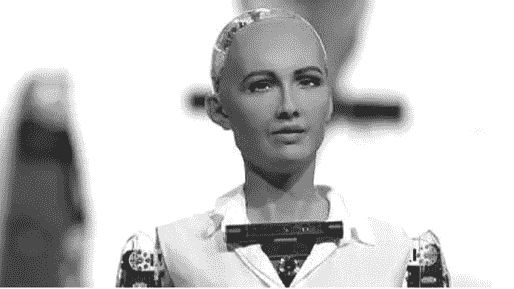

**图 1.1 机器人索菲亚：会“察言观色”的硅基生命**

索菲亚（图1.1）堪称类人机器人标杆：仿生肌肤下藏着数十枚微电机，驱动60余种微表情；2017年获沙特公民身份，创历史先河。她宣称愿助人类美好生活，呼吁消除机器恐惧症。其核心能力源于三大支柱：**嵌入式摄像头+计算机视觉算法**实现“观色”——识别体态表情、建立眼神联系；**语音识别引擎**实现“听语”——自然语言交互；**高算力硬件+深度学习**实现“动心”——毫秒级感知决策闭环。这正是当前AI人才培养的三大硬核赛道：智能硬件、视觉算法、Python工程化落地。掌握这些，即可解锁目标跟踪、图像匹配、人脸识别、二维码解析、分类检测乃至深度学习创新项目的大门。

### 任务清单与通关目标

- ✅ **认知底座**：梳理计算机视觉核心原理，拆解AI开源硬件技术特性；
- ✅ **工具链精通**：掌握嵌入式Python程序架构与OpenAIE IDE全流程操作（编写-烧录-运行）；
- ✅ **系统设计思维**：建立基于开源硬件的AI应用系统设计方法论。

### 知识储能站：夯实实战地基

#### 1. 计算机视觉：让机器拥有“看懂世界”的能力

计算机视觉（CV）的使命，是用光学传感器与算法模拟人类视觉系统——**“眼”采图像，“脑”解语义**。它涵盖获取、预处理、特征提取、检测分割、识别分类、机器/深度学习全链路（图1.2智能交通案例：车辆检测→违章判断/拥堵研判），终极目标是赋予机器自主感知、理解、适应环境的能力。

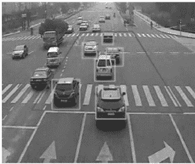

**图 1.2 CV赋能智能交通：从“看见”到“看懂”**

#### 2. 机器视觉：工业场景的“质检专家”

机器视觉（MV）是CV在工业落地的特化形态：强调**实时性、确定性、控制闭环**。典型系统包含光源、工业相机、图像处理单元、算法软件、通信IO模块（图1.3）。流程标准化：成像→传输→特征运算（亮度/形状/颜色）→判别→驱动执行机构动作。它是自动化产线、机器人导航的“核心感官”。

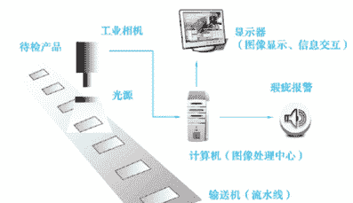

**图 1.3 产线级机器视觉系统架构**

#### 3. AI开源硬件：低门槛、高扩展、强算力的“创新积木”

开源硬件将GPL/CC等协议延伸至电路图、PCB、BOM、结构设计，核心主张：**自由使用、修改、衍生、分发，但尊重原始版权**。主流方案基于STM32F4/F7等ARM Cortex-M核心（小体积、低功耗、高性价比），集成图像传感器接口（直出帧数据），新款更内置语音编解码芯片，原生支持听觉交互。可视为**“自带视听的超级Arduino”**，通过UART/I2C/GPIO无缝对接Arduino、树莓派等生态，广泛服务视觉机器人、智能驾驶、智能家居创客实践。

#### 4. Python：AI时代的“通用语言”与“胶水语言”

非专业程序员起家，语法极简、生态极丰、跨平台极强，已成全球增长最快、高校首选（MIT/卡内基梅隆均采用）教学语言。全面面向对象，支持继承/多态/重载，代码复用率高。开源特性催生海量扩展库：OpenCV、VTK、ITK提供C++底层性能+Python上层调用；NumPy/SciPy/Matplotlib构建科学计算铁三角。底层C实现保证运行速度，C/C++扩展接口打通性能瓶颈。语法亮点：
- **声明式极简**：少写样板代码，读若英文；
- **强制缩进（Off-side规则）**：以格式约束逻辑结构，天然规范代码风格；
- **表达式贴近C/C++**：算术/位/比较/逻辑运算符无缝迁移，`and/or/not`、`is/in`提升可读性。

#### 5. 嵌入式Python编程：从PC到端侧的无缝迁移

程序骨架与标准Python一致，差异在于**硬件抽象层（HAL）库导入**与**板载资源（GPIO/串口/传感器）直接操作**。标准结构五步走：

1.  **文档先行**：`#`单行注释，`'''...'''`/`"""..."""`多行块，间隔两空格，重可读性；
2.  **模块装载**：
    - `import mod [as alias]` → 全量导入，调用需加前缀 `mod.func()`；
    - `from mod import name` → 按需导入，直接用 `name`；
    ```
import 模块名  as  别名
``` ```
from 模块名 import 成员名 as 别名
```
3.  **全局状态定义**：动态类型，先赋值后创建，同一变量可跨类型复用；
4.  **类封装设计**：`class Name:` 封装属性与方法，支撑面向对象架构。

```
import 模块名  as  别名
``` ```
from 模块名 import 成员名 as 别名
```

---
*接下来，我们将进入首个实战模块：基于OpenAIE IDE的“Hello World”视觉程序烧录与调试……*

```
#类的定义
class Photo：   #类名使用驼峰命名风格，即首字母大写，私有类可用一个下画线开头
__name = ""    #私有实例变量（__name）前有 2 个下画线；
def __init__ ( self, name)：
    self. __name = name
def getName( self) ：      #函数名一律小写；
    return self. __name
```

实例化的类被称为对象。类本质上是对一类对象的抽象定义，规定了该对象具备哪些行为能力及实现途径，本质上是一组可操作该对象的程序与流程。在 Python 中，创建对象的途径如下：

```
#对象的创建
if __name__ == "__main__"：
    photo = Photo( "alice" )      #对象 photo，命名要小写；
    print( photo. getName( ))
```

⑤ 函数定义。函数是一组协同实现特定功能的代码块，经命名后可反复调用，极大地提升了代码复用率。Python 使用 `def` 关键字定义函数，语法顺序为：函数名、参数括号、冒号，随后在缩进块中编写函数体，通过 `return` 语句返回结果。

以编写计算 \(X^2\) 的函数为例：

```python
def power(x):
    return x * x
```

`power(x)` 函数定义了一个形参 `x`。调用时必须且只能传入一个实参，如 `power(15)`，将返回 225。

若需计算 \(X^n\) 怎么办？高效做法是设计双参数函数，将上例修改为 `power(x, n)` 以实现 \(X^n\) 运算，代码如下：

```python
def power(x,n):
    s = 1
    while n > 0:
        n = n - 1
        s = s * x
    return s
```

借助修改后的 `power(x, n)`，可计算任意数的任意次幂。例如 `power(5, 3)` 返回 125。该函数包含 `x`、`n` 两个参数，调用时按位置顺序依次赋值。

⑥ 硬件初始化配置。嵌入式 Python 必然涉及硬件交互，涵盖资源读写与查询。编程时需规划硬件资源的初始状态设定，并确保硬件进入稳定工作态。

⑦ 主程序逻辑。Python 程序由顺序、分支、循环结构构成。C、Java 等语言用花括号 `{}` 界定代码块，而 Python 依靠缩进层级实现。

# 6 嵌入式 Python 程序架构

Python 默认自上而下顺序执行，但常需按条件跳转或重复执行。

## ① 条件判断结构

Python 中 `if` 语句的完整形态为：

```python
if <判断条件 1 > :
    <执行 1 > elif <判断条件 2 > :
    <执行 2 > elif <判断条件 3 > :
    <执行 3 > else:
    <执行 4 >
```

Python 规定：非零、非空（null）值视为 `true`，零或 `null` 视为 `false`。`if` 后条件成立（非零）则执行缩进块语句，代码块可多行，缩进标识同一作用域。`else` 为可选分支，用于条件不成立时的处理。示例：

```python
age = 20
if age >= 18:
    print('adult') elif age >= 6:
    print('teenager') else:
    print('kid')
```

因 Python 无 `switch` 语句，多条件判断只能用 `elif` 链式实现；多条件并列判断可用 `or`（或）、`and`（与）等逻辑运算符组合。

## ② for 循环结构

Python 循环分 `for` 与 `while` 两类。

`for...in` 循环依次遍历列表或元组的每个元素，重复执行循环体。示例：

```python
names = ['Michael', 'Bob', 'Tracy']
for name in names:
    print(name)
```

运行结果将依次输出 `names` 的各元素：

Michael  
Bob  
Tracy

`for x in ...` 即将每个元素赋值给变量 `x` 再执行缩进块。若计算 1~100 整数和，逐个书写太繁琐，Python 提供 `range()` 生成整数序列，配合 `list()` 转为列表。如 `range(5)` 生成 0~4 序列，`list(range(5))` 输出 `[0,1,2,3,4]`。`range(101)` 即可生成 0~100 序列，求和程序如下：

```python
sum = 0
for x in range(101):
    sum = sum + x
print(sum)
```

## ③ while 循环结构

`while` 循环在判断条件为 `true` 时持续执行循环体，否则退出。例如计算 100 以内奇数和：

```python
sum = 0
n = 99
while n > 0:
    sum = sum + n
    n = n - 2
print(sum)
```

注意：Python 无 `do...while` 结构，编程时需适应这一差异。

## (4) 设计与实战

### 1) 人工智能开源硬件 OpenAIE 及 Python 编程库

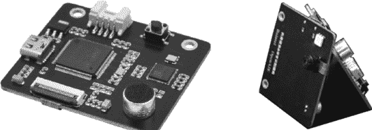

图 1.4 人工智能开源硬件 OpenAIE 及摄像头、拾音器套件

OpenAIE 集成计算机视觉、语音识别、网络通信等技术于一体（图 1.4），搭载 ARM 核 MPU，主频 480 MHz，RAM 1 MB，Flash 2 MB，具备图形加速、图像编码/处理、语音识别、UART 通信等功能。视觉端集成 30 万像素摄像头 OV7725，支持 RGB565、QVGA、灰度、Bayer 等视频流格式。语音端含采集与处理模块，支持 ASR 大词汇非特定人连续语音识别；提供 HY2.0 规范的 UART 接口。

OpenAIE 工作电压 3.7~5 V，支持锂电池直供，部署灵活。板载 USB Type-C 接口连接电脑，运行后虚拟出 COM 口与“U盘”，用于通信与文件传输。另含 I2C、CAN 总线及异步串口，便于扩展传感器或控制模块。

板载固化了计算机视觉、语音识别 Python 库，并集成 Caffe 深度学习框架的 CNN 神经网络模块，可实现颜色/形状识别、图像匹配/分类、目标跟踪、人脸检测、手写数字识别等视觉算法。同时固化板级硬件资源库，提供按键、LED、UART 等模块的 Python 调用接口。上述库均附带开发调用接口与丰富案例文档。

固化视觉算法涵盖：色块查找、形状检测、目标跟踪、角点检测、图像匹配、人脸/眼眸检测、条码/二维码识别、图像分类、笑脸检测、手写数字识别等。语音算法含：拍手场景设置、语音命令词识别等，均提供 Python 接口。

因开源特性，开发者可自行改进算法、上传 Python 智能算法作为扩展库，亦可利用 MPU 的 ADC/DAC、中断、PWM 等 I/O 资源打造个性化硬件。

### 2) OpenAIE IDE 使用指南

OpenAIE IDE 是配套的编程工具，集成视频显示等辅助功能，支持 Python 代码编写、调试，可快速实现颜色追踪、形状检测、人脸/瞳孔检测、语音识别等，助力视觉机器人、智能小车、智能家居等应用开发。

IDE 界面（图 1.5）包含：文件管理工具栏（左）、代码编辑与运行信息区（中）、摄像头视频显示区（右上）、RGB 直方图（右下）、菜单栏工具（上）。

- ① 代码编辑区：编写视觉项目代码，具备高亮、自动补全等常用功能。
- ② 视频显示区：实时预览摄像头画面，支持区域截图保存。
- ③ 代码上传与执行：点击左下角串口连接按钮建立连接，点击执行按钮将代码传输至硬件运行。Python 为脚本语言，IDE 不编译，STM32 芯片内置解释器直接解析运行。

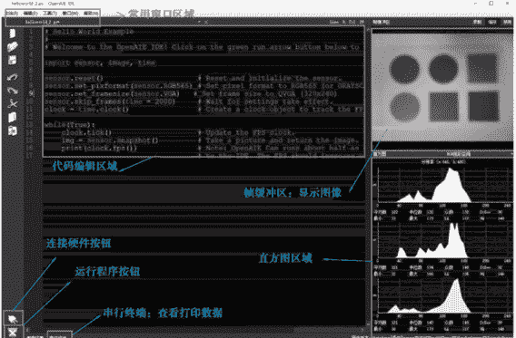

图 1.5 OpenAIE IDE 工作界面

### 3) 编写首个嵌入式 Python 程序

为简述，后文将 OpenAIE 硬件简称为 “AIE 控制板”，IDE 简称为 “IDE 工具”。

AIE 控制板无屏幕，首个程序可从点亮板载 LED 入手。

板载 `openai` 库提供 LED 控制类，含红/绿/蓝三色控制方法：`on()` 点亮，`off()` 熄灭。点亮红灯参考代码：

```python
from openai import led #从 AIE 控制板固化的 openai 库中导入 led 模块；
led.red.off()      #先关闭红灯；
while True:
    led.red.on()     #红灯亮；
```

在 IDE 中输入上述 4 行代码并烧录，红灯即亮。可扩展为蓝/绿灯，或配合延时实现闪烁。参考代码：

```python
from openai import led      #从 AIE 控制板固化的 openai 库中导入 led 模块；
import time
while True:
    led.green.on()      #开启绿灯
    time.sleep(150)      #延时 150 ms
    led.green.off()      #关闭绿灯
    time.sleep(150)      #延时 150 ms
```

### 4) 进阶实用化编程

掌握基础后，可利用板载 LED 编写实用灯光控制程序。板载固化 `pyb`、`time`、`led` 等库，管理 LED、USB 等对象。LED 对象提供 `on`/`off` 方法，可根据 USB 连接状态动态变色。完整示例：

```python
from openai import led   #从 AIE 控制板固化的 openai 库中导入 led 模块；
import time, pyb
#将蓝色赋值给变量 led
led = pyb.LED(3)      # Red LED = 1 , Green LED = 2 , Blue LED = 3
usb = pyb.USB_VCP()    #USB 转串口对象
#### 如：AIE 控制板未连接到计算机，红灯亮 150 ms，延时 100 ms，亮 150 ms，延时 600 ms，循环。
while not usb.isconnected():    #检查 OpenAIE 与计算机的连接情况；
    led.red.on()          #亮红灯
    time.sleep(150)         #延时 150 ms
    led.red.off()         #熄灭红灯
    time.sleep(100)         #延时 100 ms
    led.red.on()
    time.sleep(150)
    led.red.off()
    time.sleep(600)
#### 如果 AIE 控制板已连接到计算机，开启绿灯进行指示
while usb.isconnected():
    led.green.on()
    time.sleep(150)
    led.green.off()
    time.sleep(100)
    led.green.on()
    time.sleep(150)
    led.green.off()
    time.sleep(600)
```

## (5) 调试、验证与完善

代码编写完成后，点击 IDE 左下角 “连接” 按钮上传程序至 AIE 控制板测试。若提示未发现设备，检查连接线是否松动。传输成功后点击 “运行”，语法错误会逐一报出，参考文档修正。查阅 IDE 手册熟悉操作。调试经验如下：

- ① 嵌入式程序引用板载固化对象，**必须先导入再使用**，否则报语法错误。
- ② LED 未按预期亮灭，检查代码逻辑，修改后重测优化。
- ③ LED 闪烁间隔异常，核查延时设置是否合理。
- ④ 调试通过后，务必用 IDE 文件功能将代码保存至电脑，养成及时归档习惯，防止 IDE 退出导致代码丢失。

## (6) 复盘与思考

① 总结 Python 在变量定义、基础语法、程序结构上的特点，谈谈对该编程风格的偏好，与团队交流。

② 以 `while` 为例，深刻体会缩进规则，理解 `if`、`for`、函数定义等模块结构。若违反缩进（代码不右缩进），会有何后果？动手验证。

③ 有其他语言经验者，对比语法结构差异。如 C 语言用花括号 `{}` 界定模块边界，Python 用缩进界定，体会两种风格异同。

④ 本书项目均运行于智能硬件，属嵌入式编程。请从主频、内存、存储、I/O 接口、摄像头性能、库调用等维度，分析嵌入式 Python 与 PC 端 Python 在编程方法上的异同。

# 项目2

## 视频捕捉与处理


### (1) 问题背景

以往春运火车站进站口拥挤不堪，旅客与管理员均深受其扰。根因在于人工核验难以高效确认 “人、证、票” 一致性，导致通行效率低下。2017 年 1 月，北京西站率先启用人脸识别检票系统（“刷脸”进站），开启铁路服务新纪元。刷脸通行仅需 3~6 秒，大幅释放人力、便利出行，随即在全国推广（图 2.1）。

刷脸核心是人脸识别技术：基于面部特征信息进行身份认证。流程为：摄像头采集含人脸的图像/视频流 → 自动检测追踪人脸 → 特征识别比对。闸机摄像头抓取旅客面部信息，与身份证芯片照片比对，票证信息一致且人脸通过，闸机自动放行。

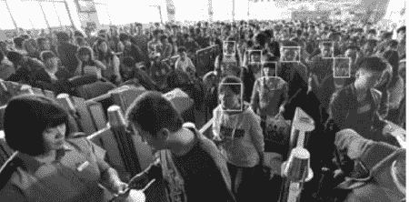

图 2.1 基于视频捕捉的刷脸检票系统

### (2) 任务目标

- ① 掌握视频与图像的基本原理、关键技术及应用框架；

# 实战篇：视频获取与图像捕捉系统开发

### 学习达标清单
- **② 双技能并进**：熟练驾驭 AI 开源硬件实施摄像头作业控制，同步精通 Python 编程技艺；
- **③ 模块化集成**：依托开源硬件平台与 Python 算法库，构建视频采集与捕捉核心功能模块；
- **④ 场景化创新**：聚焦真实生活需求，发起创意设计，产出具备落地价值的视频采集应用方案。

---

### 核心知识储备

#### 1. 视频与静态帧的本质关联
视频实为按时间序列排列的静态图像集合，单张图像即为一“帧”。依据**视觉暂留效应**，当播放速率超越 24 帧/秒阈值，人眼无法分辨单帧停顿，从而感知到连贯流畅的动态影像。帧率（FPS）越高，动画过渡越丝滑、越逼真。

#### 2. 摄像头：光学成像到数字信号的转换中枢
作为视频输入设备，摄像头集成光学成像、信号转换与数据传输功能。核心链路为：**镜头汇聚光学像 → 感光元件（CMOS/CCD）实施光电转换 → A/D 模数转换生成数字信号 → DSP 芯片执行压缩编码处理 → USB/并行总线传入计算机 → 解码显示**。数字摄像头可直输数字流；模拟摄像头则需捕捉卡介入转换压缩。

> **核心参数——焦距**：决定成像尺寸、视场角范围、景深深浅及透视强弱。同一被摄体下，焦距越长，成像越大、视野越窄；焦距越短，成像越小、视野越宽。
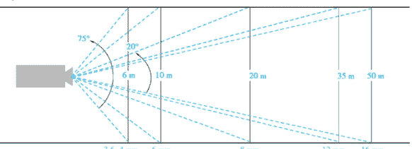
图 2.2 摄像头的焦距设置

#### 3. 分辨率：清晰度与资源开销的权衡
分辨率量化图像细节容量，常用像素矩阵（如 640×480）或 dpi 表示。实战中，**高分辨率意味高带宽占用（网络传输）与高内存消耗（嵌入式存储）**，需在画质与系统负载间寻找平衡点。常见规格：30 万像素对应 640×480，50 万像素对应 800×600，长宽比多为 4:3。

#### 4. 灰度图像：剥离色彩的轻量化表达
灰度图仅保留亮度维度（0=纯黑 ~ 255=纯白，共 256 阶），剔除色度干扰，大幅降低算力门槛。区别于仅黑白二值的“黑白图”，灰度图保留丰富过渡层次。
**RGB 转灰度标准公式（加权符合人眼视觉敏感度）**：
> `Gray = 0.299×R + 0.587×G + 0.114×B`
遍历像素按此加权赋值即可完成转换。
```
import numpy as np
def rgb2gray(rgb) :
    r,g,b = rgb[...,0],rgb[...,1],rgb[...,2]
    gray = 0.2989 * r + 0.5870 * g + 0.1140 * b
    return gray
```

#### 5. Bayer 格式：单芯片采色的马赛克方案
受限物理空间，单传感器难以同布 RGB 三滤镜。Bayer 阵列采用**镶嵌式排列（50% 绿 + 25% 红 + 25% 蓝）**，利用人眼对绿色高敏感度特性，经插值复原全彩色。原始数据常以 `.raw` 后缀存储，JPEG 等格式均由其转化而来。
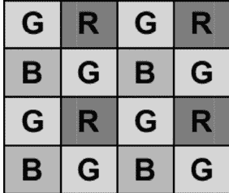
图 2.4 Bayer 色彩滤镜

#### 6. 主流图像存储格式对照
| 格式 | 位深 | 通道分布 | 典型适用场景 |
|------|------|----------|--------------|
| **RGB888 (BMP)** | 24-bit | R8/G8/B8 | 高保真归档 |
| **RGB565** | 16-bit | R5/G6/B5 | 嵌入式显传（节省 1/3 空间） |

图 2.5 RGB565 使用的 16 位字节存储

**常用分辨率规格谱系**：
- **VGA**：640×480 (4:3 基准)
- **QVGA**：320×240 (VGA 1/4)
- **HQVGA**：400×240 (接近 16:9 宽屏)
- **QQVGA**：160×120 (QVGA 1/4，超轻量级嵌入式首选)

#### 7. 色温与白平衡：还原“真实白”的双重保障
- **色温（K）**：量化光源冷暖。高色温偏蓝（冷调），低色温偏红（暖调）。
- **白平衡（AWB）**：核心准则——“白物在任意光源下仍呈白”。通过补偿补色中和偏色，实现色彩复原，校准色温偏差。

---

### 工程实战：OV7725 摄像头全流程开发

#### 1. 硬件选型与性能边界
**OV7725**：30 万像素、低功耗、高性价比，板载集成于 MPU 控制板。
- **输出能力看板**：
  - 80 FPS @ 640×480 灰度 (8-bit)
  - 30~60 FPS @ 320×240 RGB565
  - 120 FPS @ 低于 QVGA 分辨率
- **实战建议**：算法侧锁定 **30 FPS 以内**，平衡流畅度与算力余量。
- **畸变校正**：边缘桶形畸变（鱼眼效应）可通过 `image.lens_corr(1.8)` 算法修正（适配 2.8mm 镜头）。

#### 2. Sensor 对象：摄像头的“参数注册器”
通过 Python 调用 `Sensor` 类完成三核心维度配置：
- **① 像素阵列与分辨率**：感光点阵规模直接定义成像上限。
- **② 帧率 (FPS)**：硬件上限 60 FPS，工程推荐 30 FPS。
- **③ 代码级配置范式**：
```
import sensor    #引入摄像头控制模块
##### 设置摄像头工作参数
sensor.reset()    #初始化摄像头；
sensor.set_pixformat( sensor.RGB565 ) #设置为彩色；
sensor.set_framesize( sensor.QVGA ) #设置图像的大小；
sensor.skip_frames() #在更改设置后，跳过若干帧，等待感光元件的稳定；
##### 设置彩色/黑白
sensor.set_pixformat()    #设置像素模式；
sensor.GRAYSCALE    #灰度，每个像素 8bit。
sensor.RGB565    #彩色，每个像素 16bit。
##### 自动增益/白平衡
sensor.set_auto_gain() #自动增益开启或者关闭。
sensor.set_auto_whitebal() #自动白平衡开启或者关闭。
```

#### 3. 工作状态编程编排
参数就绪后，代码编排摄像头生命周期：**启动预览 → 抓取帧 → 延时/跳帧 → 关闭释放**。
```
##### 初始化
sensor.reset() #初始化摄像头；
##### 持续拍照
while(True) :
    img = sensor.snapshot() #拍摄一张照片，其中 img 为一个 image 对象实例；
##### 跳过一些帧
sensor.skip_frames(n = 10) #在更改设置后，跳过若干帧，等待感光元件的稳定；
##### 获取一张图像
sensor.snapshot() #拍摄一张照片，返回一个 image 对象。
```

#### 4. 视频抓取与存储：从“看”到“存”的闭环
集成上述模块，即可构建**拍照原型机**：IDE 实时预览画面，物理按键触发将帧编码为 JPG 落盘 Flash。
```
import sensor,image,time
from pyb import Pin
from openaiie import *
sensor.reset()
sensor.set_pixformat(sensor.RGB565)
sensor.set_framesize(sensor.QVGA)
sensor.skip_frames(time = 2000)
clock = time.clock()
while(True) :
    clock.tick()
    img = sensor.snapshot()
    if button.is_pressed(): # 检测到按键按下
        time.sleep(10) # 延时消抖
        if button.is_pressed():
            img.save(" example.jpg ") #保存图片，重置 AIE 进行查看
    print(clock.fps() )
```
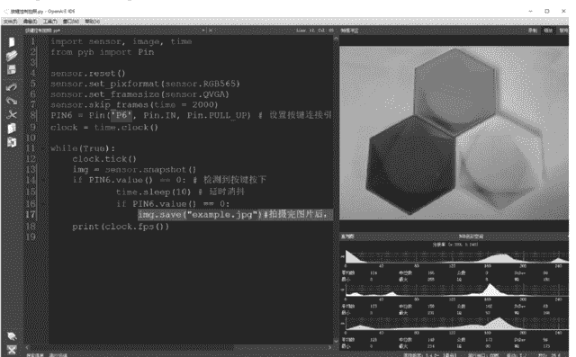
图 2.6 摄像头控制程序运行情况
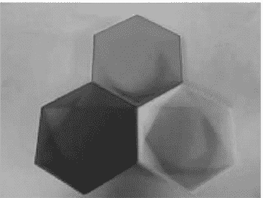
图 2.7 保存成 JPG 格式的图像文件

---

### 调试避坑速查表

| 故障现象 | 核心排查方向 | 处置策略 |
|----------|--------------|----------|
| **预览区黑屏/无画面** | Sensor 参数配置 | 复核分辨率/像素格式/时钟频率设定 |
| **画面模糊/欠曝** | 光学/参数/环境光 | 微调对焦/修正参数/外挂 LED 补光 |
| **存图后虚拟 U 盘不见文件** | 文件系统缓存未刷新 | IDE 断开重连，刷新虚拟存储视图 |
| **写入报错/失败** | Flash 剩余空间不足 | 清理陈旧文件释放存储空间 |

---

### 进阶思考题（自测检验）

1. **为何嵌入式视觉偏爱 QQVGA/QVGA，而非 BMP 高清？**  
   → 算力/内存/带宽三重约束，低分辨率是工程妥协的最优解。

2. **`sensor.skip_frames(n)` 的必要性？**  
   → 跳过自动曝光/白平衡收敛期的“废帧”，保证后续帧数据稳定可用。

3. **环境光照剧变对画质的破坏力有多大？对策？**  
   → 过曝/欠曝/色漂均可致算法失效。方案：硬件补光（LED/滤光片）+ 软件 AE/AWB 锁定/自适应阈值。

4. **板载白光 LED 能否充当补光灯？**  
   → 实测对比亮度直方图，量化补光增益，验证可行性。

5. **移除按键保存逻辑，程序会如何表现？**  
   → 陷入纯预览循环，Flash 无写入压力，帧率可能微升，但失去“数据沉淀”能力。

---

# 项目三：计算机视觉与颜色追踪


### 痛点引入：从无人驾驶看颜色感知的战略地位
2011 年“红旗 HQ3”跑通长武高速 286 公里无人驾驶，2014 年百度 Apollo 切入，2018 年长沙高速实测落地——**红绿灯识别**是自动驾驶感知层的“必修课”。前置相机捕捉帧 → ROI 区域提取 → 颜色块分类（红/绿/黄）→ 决策执行。这套 **“颜色感知 → 目标锁定 → 行为决策”** 闭环，不仅制霸智能交通，更广泛渗透于工业分拣、农业采摘、服务机器人、智慧安防等泛生活场景。

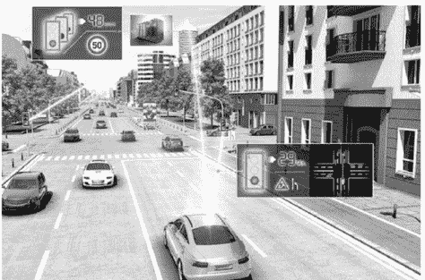
图 3.1 无人驾驶汽车对交通信息的识别

### 任务清单

- **① 原理通透**：吃透颜色识别底层原理、核心算法与工程框架；
- **② 工具精通**：驾驭 AI 开源硬件搭建颜色识别系统，Python 编程得心应手；
- **③ 功能落地**：调用算法模块实现颜色跟踪核心功能；
- **④ 创意变现**：对接真实场景，设计高可用的颜色追踪应用系统。

---

### 知识地基：颜色空间模型

光色本质是电磁波波长差异。人眼视锥细胞对 **564 nm (黄绿)、534 nm (绿)、420 nm (蓝紫)** 三峰值最敏感，构建了三维色彩感知空间。可见光谱分布如下：

| 颜色 | 波长范围 | 频率范围 |
|------|----------|----------|
| 红色 | 625~740 nm | 480~405 THz |
| 橙色 | 590~625 nm | 510~480 THz |
| 黄色 | 565~590 nm | 530~510 THz |
| 绿色 | 500~565 nm | 600~530 THz |
| 蓝色 | 485~500 nm | 620~600 THz |

*(后续将展开 RGB、HSV、LAB 等空间模型及其在嵌入式颜色追踪中的选型策略……)*

### 可见光波段速查

| 颜色 | 波长范围 | 频率范围 |
| :--- | :--- | :--- |
| 靛蓝 | 440~485 nm | 680~620 THz |
| 紫光 | 380~440 nm | 790~680 THz |

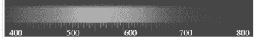

**图 3.2 可见光谱分布图**

描述颜色的数学模型不止一种，结合人眼视觉特性，主流的色域空间主要有 RGB、HSV、Lab、CMYK 等，它们能将可见光转化为可计算的数据。

#### ① RGB 模型：显示设备的原生语言
RGB 模型（见图 3.3(a)）常用 `vec3(r,g,b)` 向量表示。在其三维笛卡尔坐标系中，三轴分别对应红、绿、蓝通道：
- **原点** `vec3(0,0,0)` 为纯黑；
- **对角顶点** `vec3(1,1,1)` 为纯白；
- **连接原点与顶点的对角线** `x=y=z` 即为灰度轴。

RGB 适合机器存储与显示，通过三通道不同比例混合，可模拟人眼可见的绝大多数颜色。

**RGB 模型中的三维变化规律：**
- **色相（色彩）变化**：由 RGB 三原色顶点向互补色（黄、品红、青）顶点延伸的连线；
- **饱和度（深浅）变化**：各色顶点到灰度轴（对角线）的垂直距离；
- **明度（明暗）变化**：灰度轴上点的位置，越靠近原点越暗，越靠近顶点越亮。

#### ② HSV 模型：符合人类直觉的调色盘
HSV（色相 H、饱和度 S、明度 V/B）常用**倒圆锥体**建模（图 3.3(b)），更贴合人类认知习惯：
- **H（色相）**：角度制，0°~360°。红、绿、蓝间隔 120°，互补色（CMY）相差 180°。
- **S（饱和度）**：归一化比值 [0,1]。S=0 为无彩色（灰度），S=1 为全纯色。
- **V（明度）**：归一化亮度 [0,1]，非物理光强，而是视觉感受亮度。

**操作逻辑极其直观**：先选色相角 H，将 S、V 设为满值 1.0，再通过“加黑/加白”微调。
- **加黑（降明度）**：V 降低，S 不变 → 得到深色（如深蓝 `240°, 1.0, 0.4`）。
- **加白（降饱和度）**：S 降低，V 不变 → 得到浅色（如浅蓝 `240°, 0.4, 1.0`）。

#### ③ Lab 模型：设备无关、感知均匀的黄金标准
Lab 模型（图 3.3(c)）基于人眼感知机制建立，**不依赖具体硬件设备**，被视为“设备无关色彩空间”。

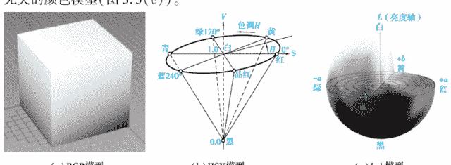

**图 3.3 经典色彩空间几何模型**

**Lab 三通道定义：**
- **L（亮度）**：[0, 100]。L=50 相当于 50% 灰。
- **a 轴（红绿轴）**：[-128, 127]。正向为洋红/红，负向为绿。
- **b 轴（黄蓝轴）**：[-128, 127]。正向为黄，负向为蓝。

> **示例**：`Lab(100, 30, 0)` 呈现为粉红色。

**Lab 相对 RGB 的核心优势：**
1.  **色域极广**：囊括 RGB 与 CMYK 全色域，甚至能表达它们无法显示的人眼可见色。
2.  **感知均匀**：修正了 RGB 空间“蓝绿过渡丰富、绿红过渡贫乏（缺黄）”的不均匀缺陷。
3.  **工业标准**：OpenCV、OpenMV 等主流视觉库均以 Lab 为基础训练色块检测参数、设计查找算法。它又称“亮度-对比度模型”，专为逼近人类视觉而生。

---

### 实战篇：基于 Lab 空间的色块分割与追踪

#### 核心原理：最近邻分类法
Lab 空间中像素由 `(L, a, b)` 确定。算法预设 6 种基准色的均值坐标，计算待测像素到 6 个基准点的**欧氏距离**，距离最小者即为该像素归属色。后续配合**形态学操作**（腐蚀、膨胀、填孔）及**连通域分析**，即可提取完整色块。

#### 关键难点：阈值自适应
Lab 阈值分割两步走：**定阈值 → 比像素 → 分区域**。难点在于“定准阈值”。
- **经验法**：凭先验知识固定阈值，但环境光变化大时极易失效。
- **自适应算法（推荐）**：在视野中划定小样本采集区（ROI），实时计算目标色在当前光照下的 Lab 均值，动态更新阈值参数，实现鲁棒追踪。

---

### 工程落地：OpenMV/AIE 平台 Python 实战指南

#### 1. 摄像头参数“黄金法则”
使用 `sensor` 对象配置，**颜色追踪前必须关闭自动增益与自动白平衡**，锁定曝光，否则色温漂移会导致 Lab 数值乱跳，阈值失效。

```
##### 设置摄像头工作参数
sensor.reset()    #初始化摄像头组件；
sensor.set_pixformat(sensor.RGB565) #设置为彩色；
sensor.set_framesize(sensor.QVGA)   #设置图像的大小；
sensor.skip_frames()    #在更改设置后，跳过若干帧，等待摄像头组件的稳定；
```
```
sensor.set_auto_gain()    #自动增益开启或者关闭。在使用颜色追踪算法时，需要关闭自动增益。
sensor.set_auto_whitebal() #自动白平衡开启或者关闭。在使用颜色追踪算法时，需要关闭此功能。
```

参数锁定后，通过 `sensor` 控制帧率、抓帧、跳帧稳定画面。详细流程参考项目 2 实训。

```
time.ticks() 返回以毫秒(ms)计的通电后的运行时间。
time.sleep(ms) 休眠 ms 数值。
class time.clock 返回一个时钟物件。
clock.tick() 开始追踪运行时间。
clock.fps() 停止追踪运行时间，并返回当前 FPS(每秒帧数)。在调用该函数前一定要先调用 tick。
clock.avg() 停止追踪运行时间，并返回以毫秒计的当前平均运行时间。
在调用该函数前始终首先调用 tick。
clock.reset() 重置时钟物件。
```

#### 2. 核心 API：`image.find_blobs()` 深度解析
这是色块追踪的“瑞士军刀”，返回色块对象列表 `blobs`。

**针对 RGB565 图像，`thresholds` 必须传入 6 元组元组：**
`(l_lo, l_hi, a_lo, a_hi, b_lo, b_hi)` —— 对应 L、a、b 三通道的最小/最大阈值窗口。

**关键参数速查表：**
| 参数 | 作用 | 实战建议 |
| :--- | :--- | :--- |
| `invert` | `True` 反向提取（找非该色区域） | 默认 `False` |
| `roi` | 感兴趣区域 `(x, y, w, h)` | 缩小 ROI 可大幅提速，默认全图 |
| `x_stride` / `y_stride` | 扫描步长 | 默认 2/1，加大步长加速但降精度 |
| `area_threshold` | 最小外接框面积 | **过滤噪点神器**，太小色块直接丢弃 |
| `pixels_threshold` | 最小像素数量 | 同面积阈值，双重保险 |
| `merge` | `True` 合并相邻同色色块 | 目标破碎时开启 |
| `margin` | 合并允许的边界间隙 | 配合 `merge` 使用 |

```
import sensor, image, time
red_threshold_01 = (41,60,44,84, -10,63)
#设置红色的阈值，括号里面的数值分别是 Lab 的最大值和最小值
(minL,maxL,minA,
##### maxA,minB,maxB)。

sensor.reset()
sensor.set_pixformat(sensor.RGB565)
sensor.set_framesize(sensor.QQVGA)
sensor.skip_frames(10)
sensor.set_auto_whitebal(False)
#关闭白平衡。白平衡是默认开启的，在颜色识别中，需要关闭白平衡。
clock = time.clock()
```
```
while(True) :
    clock.tick() # 跟踪两次 snapshots() 间消耗的时间（毫秒）；
    img = sensor.snapshot() # 捕获图像帧；
    blobs = img.find_blobs([ red_threshold_01 ],area_threshold = 150 )
#搜索指定颜色色块；
if blobs :
    #如果找到了目标颜色
    print( blobs )
    for b in blobs :
    #迭代找到的目标颜色区域
    img.draw_rectangle( b[0:4] ) # 用矩形标记出目标颜色 区域
    img.draw_cross( b[5] ,b[6] ) # 在 cx , cy 坐标处画上十 字标记
    #即在目标颜色区域的中心画十字形标记
```

#### 3. 多色同步追踪：集成实战代码
将初始化、阈值定义、主循环 `find_blobs`、结果绘制（框、十字、标签）串联，烧录 AIE 控制板即可实现红绿蓝三色同步锁定。

```
import sensor,image,time#引入感光组件的模块
##### 颜色跟踪阈值参数(L Min,L Max,A Min,A Max,B Min,B Max)
##### 以下阈值参数组可以跟踪一般的红色、绿色和蓝色物体，具体场景中的 阈值可以自行调节到最优；
thresholds = [ ( 41,60,44,84 , -10,63 ) , # 红色阈值
( 53,72 , -59 , -15 , -3 , 52 ) , # 绿色阈值
( 48,71 , -25 , -5 , -53 , -26 ) ] # 蓝色阈值
##### 可以同时设置不 超过 16 种颜色阈值
sensor.reset() # 初始化摄像头
sensor.set_pixformat( sensor.RGB565 ) # 设置为彩色
sensor.set_framesize( sensor.QVGA ) # 设置图像的大小
sensor.skip_frames( time = 2000 ) # 跳过一些帧/跳过 n 张照片，等待摄像头变稳定。
```
```
sensor.set_auto_gain(False)      # 颜色追踪应用中必须关闭自动增益
sensor.set_auto_whitebal(False)  # 颜色追踪应用中必须关闭白平衡
clock = time.clock()
##### 如果更改摄像头工作分辨率，需要更改“pixels_threshold”和“area_threshold”的取值。
while(True) :
    clock.tick()
    img = sensor.snapshot()      # 捕捉一帧图像，保存到 image 对象中；
    for blob in img.find_blobs(thresholds, pixels_threshold = 200, area_threshold = 200) :
        # 如果所检出色块的像素数或像素面积大于阈值 200 则会被确认，返回给 blob 对象；
        img.draw_rectangle(blob.rect())    # 画矩形
        img.draw_cross(blob.cx() , blob.cy() )   # 画十字
        print(clock.fps())    # 打印出帧数
```

**运行实测效果**：IDE 右上角视频流实时绘制识别框、质心十字及颜色标签，帧率稳定。

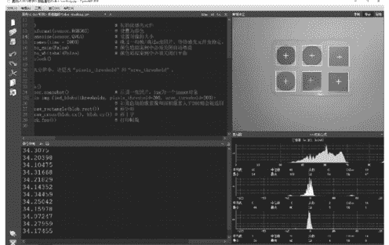
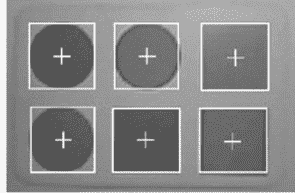

**图 3.4 实测界面与识别结果**

---

### 避坑指南：调试、验证与迭代优化

| 现象 | 根因排查 | 解决动作 |
| :--- | :--- | :--- |
| **画面模糊/过暗** | 摄像头参数未调优 / 光照不足 | 微调 `sensor` 参数；**必开 LED 补光灯**（参考项目 1） |
| **满屏碎色块** | 噪点被误判为色块 | **调大 `area_threshold` 与 `pixels_threshold`** |
| **固定阈值失效** | 环境光变化导致 Lab 值漂移 | 用 **阈值编辑器** 实时采样新阈值，覆盖旧值 |
| **多色切换慢** | 单阈值组无法覆盖同色系（浅蓝/深蓝） | 利用 `thresholds` 支持**列表嵌套**，一组阈值管一色系 |

---

### 进阶思考：从“能用”到“好用”的四大命题

1.  **多色并行架构**：如何设计数据结构与循环逻辑，实现 N 种颜色互不干扰、实时并发追踪？
2.  **抗光照干扰方案**：量化光照变化对 Lab 数值的影响程度；设计“自动白平衡锁定 + 动态阈值采样”双重保险机制。
3.  **色系泛化能力**：针对“蓝色”包含天蓝、湖蓝、藏蓝等亚种，如何构建**多阈值组合库**，一键覆盖全色系？
4.  **机器人闭环控制**：`find_blobs` 返回的 `(cx, cy, w, h, rotation)` 如何映射为电机 PWM？AIE 板与底盘通讯协议（UART/CAN/IO）如何定义“跟随/定位/抓取”指令集？

---

# 项目 4：视觉形状检测——从“看见颜色”到“读懂几何”


### 场景痛点与应用价值
现代农业分拣线、智能工厂质检岗，**视觉分拣机器人**已成标配（图 4.1(a)）。摄像头采像 → 算法提取特征点/轮廓 → 形状匹配分类（圆/方/椭圆……） → 执行机构分拣，全流程自动化，效率指数级跃升。

**核心流程解析（图 4.1(b)）：**
`图像采集` → `预处理(去噪/增强)` → `特征提取(边缘/角点/轮廓)` → `形状识别/模板匹配` → `决策执行`。

生活侧写：自动捡球机（识别圆）、餐盘分拣系统（识别矩形/圆形）——同源技术，落地场景无处不在。

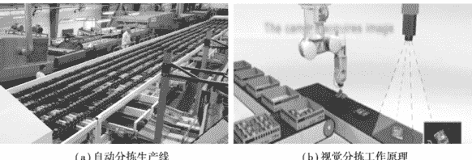

**图 4.1 机器视觉在工业生产中的典型应用**

### 任务清单
1.  通透图像处理与几何识别的底层原理、核心算法、工程框架。
2.  精通 AI 开源硬件 + Python 编程的系统集成方法论。
3.  实战部署：调用算法模块，跑通物体形状检测全链路。
4.  创新迁移：结合生活场景，设计有落地价值的形状检测应用系统。

---

### 核心技能包：图像预处理——识别精度的“地基”

原始视频流饱含环境光干扰、机械抖动、镜头畸变、参数配置偏差等噪声。若直接进识别网络/算子，特征极易被淹没。**预处理不是可选项，是生存项。**

标准流水线：**灰度化 → 二值化 → 增强/去噪 → 边缘检测**

#### 灰度化：剥离色彩干扰，保留结构骨架
彩色图像每像素 3 通道（R/G/B），1600 万色空间，信息冗余大且极易受光影、背景干扰。**灰度图仅保留亮度（Luminance），单通道 256 级（0 黑 ~ 255 白），计算量骤降 2/3，对比度反而增强，轮廓更锐利。**

**RGB → Gray 映射原理：**
RGB 立方体中，原点(0,0,0)为黑，对角顶点(255,255,255)为白。**连接两点的空间对角线即灰度轴**。任意颜色投影到该轴，即其灰度值（亮度）。

> **工程常用加权公式（ITU-R BT.709 标准）：**
> `Y = 0.299×R + 0.587×G + 0.114×B`
> *绿色权重最高，符合人眼对亮度最敏感的光谱响应。*

灰度化完成，图像从“彩色世界”进入“几何世界”，为后续二值化、边缘提取、轮廓拟合铺平道路。

# 视觉前端处理与几何识别：霍夫算法原理及板端部署指南

在机器视觉工程落地里，数据清洗与几何定位是绕不开的两道关卡。前者决定输入质量，后者直指识别精度与速度。本文系统梳理去色、阈值分割的预处理逻辑，深度剖析霍夫映射法在线段、圆环、方框定位中的核心机制，并结合Python视觉模组在AI开发板上的工程化实践、调优策略及拓展应用，为开发者提供一份可落地的技术指引。

## 一、 数据清洗：化繁为简的“减负术”

早期视觉任务常把多通道画面转为单通道灰度图，以降低计算开销。当下主流的MCU平台算力受限，同样必须先去色才能推进后续流程。

### 1. 去色处理：剥离色度，保留纹理
将RGB三通道映射为单通道亮度值，是标准化流程的第一步。这一操作剔除了色度冗余，仅保留明度层级，使后续运算量骤降至原始的三分之一左右，极大地适配了资源受限的单片机环境。

### 2. 阈值分割：非黑即白，凸显轮廓
灰度图仍有256级层次，分割则进一步将像素“非黑即白”地划分为0与255。关键在于**门限选取**——合理的分界点能将目标轮廓与背景彻底剥离，使形态学滤波（开/闭/腐蚀/膨胀）能精准提取角点、边沿等几何特征，为上层匹配或学习模型输出高质量“干净数据”。

> **工程链路**：去色 → 分割 → 形态学降噪/增强 → 特征提取 → 高层推理。这条链路显著压缩存储占用与计算延迟，保障响应速度。

## 二、 霍夫映射法：将“寻找几何”转化为“投票选举”

保罗·霍夫发明的这一经典算法，其精髓在于**坐标系变换与参数域投票机制**的结合：将图像域内离散的边沿像素，投影为参数域中的曲线；共线或同属一几何体的像素，在参数域必然汇聚于同一点。于是，几何拟合问题被巧妙转化为**寻找参数域计数器峰值**的统计问题。

### 1. 通用定位流水线
无论定位何种几何体，标准化流程皆为：
1.  **Canny算子勾勒边沿**：滤除平坦区冗余点，仅保留高梯度轮廓，大幅削减计算基数。
2.  **形态学精修**：分割配合开闭运算，消除毛刺与干扰，保证拟合精度。
3.  **霍夫映射与投票**：离散像素投影参数域，计数器记录“票数”。
4.  **峰值锁定**：票数最高处，即对应最佳几何系数（如线段的ρ、θ；圆环的圆心坐标与半径）。

### 2. 线段定位：从斜截式到极坐标的工程妥协
理论上，两点定一线（Y=kX+b），可在参数平面(k,b)投票。但斜率k在垂直线处趋近无穷大，数值不稳定。工程库普遍采用**极坐标映射**：
$$ \rho = x \cos\theta + y \sin\theta $$
图像域的每一点，在参数域(ρ,θ)绘制一条正弦曲线。共线的点，曲线必交于同一点(ρ₀,θ₀)。遍历角度θ（如步长π/10），累加ρ，搜索最大交点即得线段参数。此法优雅规避了无穷大奇异性，且便于硬件加速。

### 3. 圆环识别：三维参数域的“圆心投票”
圆方程 $(x-a)^2 + (y-b)^2 = r^2$ 涉及三自由度(a,b,r)。固定半径$r_0$时，边沿像素$(x_0,y_0)$映射到圆心平面(a,b)恰为一圆：
$$ a = x_0 - r_0 \cos\theta, \quad b = y_0 - r_0 \sin\theta $$
遍历所有边沿像素与候选半径，在三维累加器$H(a,b,r)$中投票。峰值坐标即为圆心与半径。工程上常通过**限定半径范围(r_min, r_max, r_step)**与**采样步长(x_stride, y_stride)**来平衡精度与速度。

### 4. 圆环识别实施步骤
工程落地流程：① 画面去色与分割；② 算子勾勒边沿；③ 量化参数域建立计数矩阵；④ 捕捉峰值解算几何量。遍历像素累积投票，设定门限（如峰值75%），筛选有效圆环。

### 5. 方框定位：峰值几何约束的组合逻辑
方框本质是四条线段的特定组合。滑窗霍夫变换提取线段峰值后，施加几何约束：四峰值两两平行、相邻垂直、交点闭合。满足条件即判定为方框。此法对高反差方框鲁棒性极强。

## 三、 板端部署与API详解

AI开发板内置Python视觉模组，封装寻线、寻圆、找框接口。

### 1. 传感器底层配置：成像质量的“源头管控”
`Sensor`类掌握帧率、分辨率、像素格式、自动增益/白平衡/曝光等核心寄存器。**几何追踪场景下，建议锁定增益/曝光/白平衡**，防止光照波动导致分割门限失效；分辨率权衡视野与帧率（如QQVGA 160x120 @ 高帧率）；必要时跳过开机前几帧不稳定画面。

```
##### 设置摄像头工作参数
sensor.reset()    #初始化摄像头组件；
sensor.set_pixformat(sensor.RGB565) #设置为彩色；
sensor.set_framesize(sensor.QVGA) #设置图像的大小；
sensor.skip_frames() #在更改设置后，跳过若干帧，等待摄像头组件的稳定；
```
```
##### 自动增益/白平衡
sensor.set_auto_gain() #自动增益开启或者关闭。在使用形状追踪算法时，需要关闭自动增益。
sensor.set_auto_whitebal() #自动白平衡开启或者关闭。在使用形状追踪算法时，需要关闭此功能。
```

### 2. 寻圆接口 `find_circles`：参数即策略
```python
image.find_circles(roi, x_stride, y_stride, threshold,
                   x_margin, y_margin, r_margin,
                   r_min, r_max, r_step)
```
*   **ROI(Region of Interest)**：缩小搜索域，线性加速。
*   **Stride(步长)**：大圆场景下增大步长，以像素块为单位采样，大幅降维。
*   **Threshold(门限/投票门槛)**：核心调节旋钮。漏报→降低；误报→升高。经验值3500为起调基准。
*   **Margin(合并容差)**：空间/半径维度上邻近圆环的融合阈值，抑制重复定位。
*   **Radius范围与步长**：物理约束先验，缩小三维累加器体积。

返回对象含`x,y,r,magnitude`（投票强度/置信度）。

```
import sensor,image,time
sensor.reset()
sensor.set_pixformat(sensor.RGB565)
sensor.set_framesize(sensor.QQVGA)
sensor.skip_frames(time = 2000)
clock = time.clock()
```
```
while(True) :
clock.tick()
img = sensor.snapshot().lens_corr(1.3) #进行镜头畸变校正，去除图像中的鱼眼效应；
```
```
for c in img.find_circles( threshold = 2500 , x_margin = 10 , y_margin = 10 ,r_margin = 10 ,r_min = 2 ,r_max = 100 ,r_step = 2 ) :
```
```
#以圆心(c.x(), c.y())和半径c.r(),用黄色画圆;
img.draw_circle(c.x(), c.y(), c.r(), color = (255,255,0))
print(c)
```
```
print(" FPS %f " % clock.fps())
```
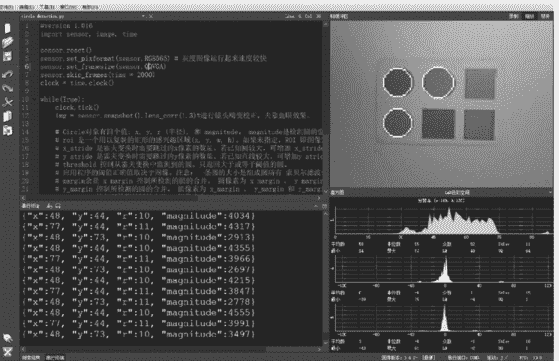
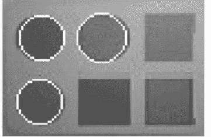

### 3. 找框接口 `find_rects`：极简高效
```python
image.find_rects(roi, threshold=10000)
```
基于索贝尔算子边沿响应累加，仅返回边界响应强于门限的方框。适用于高反差文档、标记板、货箱等场景。门限调节逻辑同寻圆。

```
#找矩形
import sensor,image,time
sensor.reset()
sensor.set_pixformat(sensor.RGB565)
sensor.set_framesize(sensor.QQVGA)
sensor.skip_frames(time = 2000)
clock = time.clock()
```
```
while(True):
clock.tick()
img = sensor.snapshot()
##### find_rects 中'threshold'应设置为足够高的值，以滤除在图像中检测到的具有低边缘幅度的噪声矩形，最适用于与背景形成鲜明对比的矩形。
for r in img.find_rects(threshold = 25000) : #查找矩形，阈值 = 10000
img.draw_rectangle(r.rect(), color = (255,0,0)) #画出矩形，颜色为红色
for p in r.corners(): #找出矩形的 4 个角
img.draw_circle([p[0],p[1],5],color = (0,255,0))# 4 个角顺时针画出绿色的半径为 5 像素的圆形
print(r)
print(" FPS %f " % clock.fps())
```
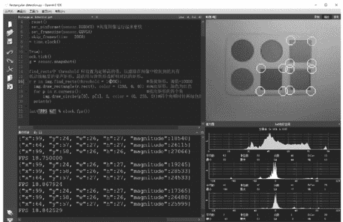
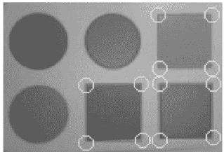

### 4. 避坑指南：从“跑通”到“好用”的关键迭代
| 现象 | 诊断方向 | 对策 |
| :--- | :--- | :--- |
| **漏报(目标存在但未报)** | 门限过高 / 画面模糊 / 光照不足 | 降低Threshold / 聚焦/补光 / 检查Sensor配置 |
| **误报/过报(干扰成灾)** | 门限过低 / 背景杂乱 / 镜头畸变 | 升高Threshold / 缩小ROI / `lens_corr`去鱼眼 |
| **畸变导致几何偏差** | 广角镜头畸变 | 开启镜头矫正 |
| **逻辑正确但无输出** | 代码逻辑/数据流/坐标系 | 单步调试/打印中间变量/核对坐标映射 |

## 四、 进阶思考题

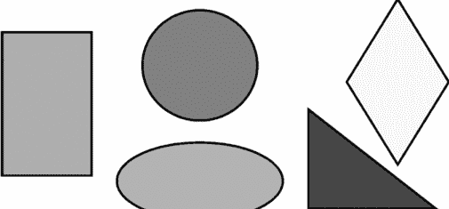

1.  **多边形识别**：三角形、菱形等本质是**线段的有序闭合集合**。方案：寻线接口提取全量线段 → 角度聚类过滤平行组 → 端点拓扑连通分析寻找闭合回路 → 几何约束(内角和、边长比)分类多边形。
2.  **椭圆追踪**：椭圆需5参数(中心xy、长短轴ab、旋转角φ)，全参数霍夫累加器极大，实时性差。
    **工程替代路径**：
    *   **RANSAC拟合**：边沿像素随机采样拟合椭圆，迭代优化，抗干扰强。
    *   **轮廓矩/拟合椭圆**：`find_blobs`获取连通域 → 二阶矩计算等效椭圆参数 → 几何验证。速度快、精度够用。
    *   **深度学习关键点回归**：关键点热图回归椭圆参数，端到端鲁棒。
3.  **光照鲁棒性**：光照变化直击分割门限与边沿梯度。
    *   **算法层**：自适应门限(局部均值/高斯加权) / 直方图均衡化 / Retinex照度归一化 / 索贝尔/拉普拉斯算子天然抗光照突变。
    *   **硬件层**：全局快门/大光圈/补光灯(恒流驱动) / 偏振片消反光。
    *   **系统层**：锁定AE/AGC/AWB + 环境光传感器联动补光。
4.  **色形融合感知**：单一模态易歧义（红圆 vs 红方）。融合策略：
    ```python
    # 伪代码逻辑
    blobs = img.find_blobs(color_thresh, roi=roi)  # 色彩粗筛，极快
    for b in blobs:
        roi_rect = b.rect()
        circles = img.find_circles(roi=roi_rect)   # 几何精筛，小范围快
        rects = img.find_rects(roi=roi_rect)
        # 融合决策：色彩置信度 * 几何置信度 > 门限 → 目标确认
    ```
    此“粗筛-精筛”级联架构，兼顾速度与鲁棒性，是工业视觉分拣、机械臂抓取的标准范式。

## 五、 综合实战：分拣收纳装置——从Demo到Product

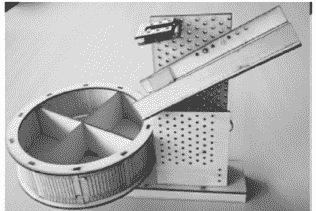

**系统架构**：
*   **感知层**：镜头模组+视觉模组(圆/方分类) → 几何标签+置信度。
*   **决策层**：主控MCU接收标签 → 查表映射目标仓位角度 → 下发指令。
*   **执行层**：舵机组1控制分拣闸门(开/关/延时)；舵机组2驱动转盘定位目标仓位(闭环编码器/电位器反馈)。
*   **交互层**：OLED显示计数/状态；按键校准/复位。

**落地场景与关键指标**：
| 场景 | 核心价值 | 关键技术指标 |
| :--- | :--- | :--- |
| **垃圾分拣站** | 瓶罐(圆)/纸盒(方)自动分流 | 识别率>98%, 节拍<2s/件, 防卡料机构 |
| **药丸/螺丝分装** | 异形件剔除、型号分仓 | 亚像素定位, 共振抑制, 粉尘防护 |
| **快递末端预分拣** | 规则包裹预分流减轻人工 | 大视野拼接, 传送带同步触发, 多码/几何融合 |
| **教学/科创原型** | 视觉-运动耦合全链路实训 | 模块化代码, 可视化调试, 扩展接口丰富 |

**进阶进化方向**：
1.  引入**目标追踪(色彩/特征点跟踪)**，在帧间关联目标ID，解决遮挡/抖动导致的重复触发。
2.  **双目/结构光测距**，获取3D位姿，指导机械臂精准抓取替代简单滑落。
3.  **TinyML分类器**(如MobileNetV1/YOLO-Fastest)替代传统霍夫，应对“圆角矩形/椭圆/不规则件”等传统算法失效场景。
4.  **边缘网关上云**：计数/良率/故障日志上传MES/ERP，赋能数字化生产看板。

---

## 项目五：视觉目标跟踪系统


### (1) 场景引入

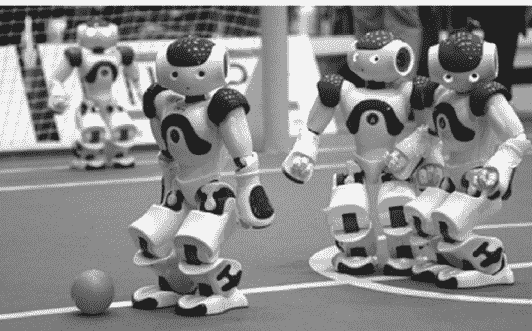

机器人足球赛为背景，需解决运动模糊、遮挡、ID切换、实时性等难题。下篇实战“检测+跟踪”双引擎架构。

*敬请期待下篇实战拆解。*

# 机器人视觉核心：从足球赛场到色块追踪的实战指南

机器人踢足球听起来充满科幻感，实则是检验人工智能与视觉技术的绝佳试金石。国际上影响力最大的两大赛事——FIRA 机器人世界杯与 RoboCup 机器人世界杯，便是这类技术的主战场。回顾 2013 年在荷兰埃因霍温举行的 RoboCup 大赛，北京信息科技大学代表队异军突起，在中型组决赛中以 3:2 力克东道主埃因霍温理工大学夺冠，为中国足球在智能领域率先圆了“冠军梦”。

足球机器人的“大脑”核心，在于如何借助计算机视觉实现对球体的精准识别与实时锁定。这一技术早已延伸至乒乓球机器人等实用化场景，它们能捕捉高速飞行的微小球体并指引机械臂回击。无论是足球还是乒乓球，快速识别与持续跟踪的底层逻辑，均依赖于计算机视觉中的**色块分割**与**形状自动检测**技术。掌握这套视频图像中颜色与特定形状的提取本领，不仅能用于智能小车巡线、安防机器人目标捕捉等创客项目，更是通往工业视觉、智能家居等广阔应用领域的敲门砖。

## (2) 任务与目标

本章学习将围绕四大维度展开：
- **夯实理论基石**：透彻理解图像处理与目标跟踪的基本原理、核心算法及应用框架；
- **硬软协同开发**：熟练驾驭 AI 开源硬件构建智能应用系统，精通 Python 编程实现；
- **算法落地实战**：调用计算机视觉开源库与 Python，编写融合色块与形状识别的综合算法，达成目标精准跟踪；
- **场景创新迁移**：结合生活实际，开展创意设计，打造具有落地价值的目标跟踪应用系统。

## (3) 知识准备

### 1) Lab 颜色空间：参数范围与量化逻辑

Lab 色彩空间因其高度贴合人类视觉感知机制，成为工业界与学术界的主流选择。OpenCV、OpenMV 等主流视觉库均以 Lab 空间为基准构建色彩模型、设计色块检索算法。

**参数定义与取值区间：**
- **L（亮度）**：范围 (0, 100)；
- **a（红绿分量）**：范围 (-128, 127)，正值偏红，负值偏绿；
- **b（蓝黄分量）**：范围 (-128, 127)，正值偏黄，负值偏蓝。

**工程化量化处理：** 为适配 8 位图像存储标准，算法库通常将参数线性映射至 0~255 区间：`L' = L × 2.55`，`a' = a + 128`，`b' = b + 128`。

**色块提取流程：** 采用邻域搜索策略，通过计算像素在色彩空间中的欧氏距离完成颜色分类，随后经腐蚀、膨胀、填充空洞等形态学操作，最终勾勒出色块的连通域。

**阈值设定的关键性与自适应方案：** 阈值是区域分割的“分水岭”，每个像素皆需与之比对。若阈值与采集环境（光照强弱、色温偏移、镜头偏色、噪声干扰）不匹配，分割将大打折扣。针对现场环境多变的痛点，工程上常采用**自适应阈值算法**：在画面中划定小样本采集区（ROI），实时计算目标色块的均值作为动态阈值。此外，OpenMV IDE 等工具内置的阈值调试器，也能极大降低参数调优门槛。

### 2) Lab 模型参数实操：OpenMV IDE 阈值编辑器全流程

OpenMV IDE 提供可视化的“阈值编辑器”，支持依据现场光照、背景、噪声等实况，快速定制 Lab 参数。

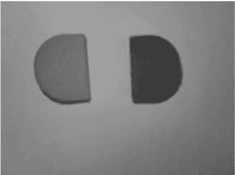

以图 5.2 场景下的左右色块建模为例，操作分四步走：

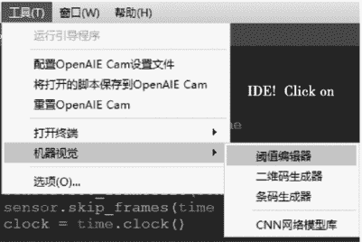

**步骤 ① 启动工具：** 菜单栏依次点击 `工具` → `机器视觉` → `阈值编辑器`，弹出界面（图 5.3）。

**步骤 ② 选定建模源：**
- *离线建模*：导入预存图片，适合预先录入新色系模板；
- *在线建模（推荐）*：勾选“帧缓冲区”，直接抓取摄像头实时画面建模，能最大程度适配当下环境（图 5.4）。

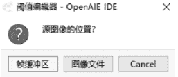

**步骤 ③ 界面解读（图 5.5）：**
- 左上：**源图像区**，显示原始帧；
- 右上：**跟踪预览区**，呈现二值化掩膜图，**白色像素即为命中目标**；
- 下部：**参数调控区**，含 L、A、B 三通道的最小/最大值滑块。

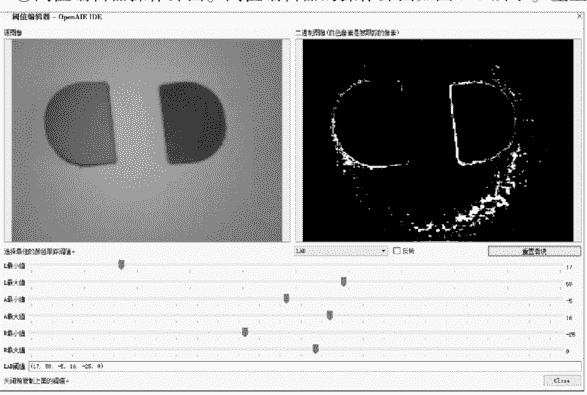

**步骤 ④ 分通道渐进式调参（核心技巧）：**
*初始化*：新建模型时，将六个滑块全推至两端（最小值最左，最大值最右），此时预览区全黑无目标（图 5.6）。

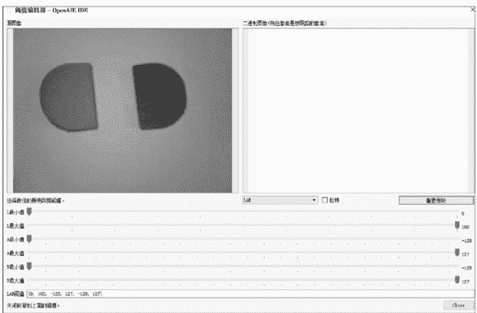

*实战以“红色”追踪为例：*
1. **调 L（亮度）**：拖动 L 滑块，让目标区域在预览区显白，注意 `L_min ≤ L_max`（图 5.7）。
2. **调 A（红绿轴）**：拖动 A 滑块，剔除非红色干扰像素，保持 `A_min ≤ A_max`（图 5.8）。
3. **调 B（蓝黄轴）**：微调 B 滑块，进一步净化画面，直至预览区白色区域与源色块高度重合（图 5.9）。

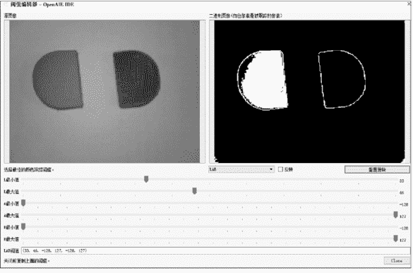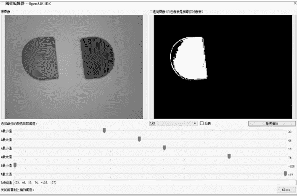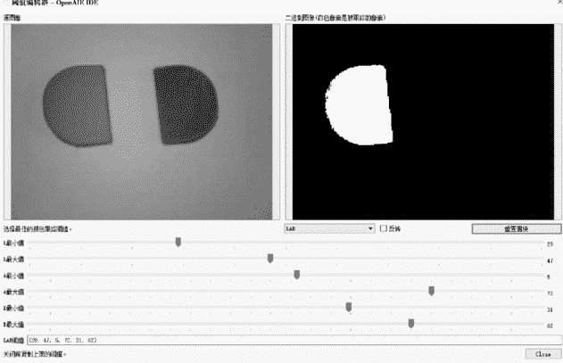

**收尾要点：** 若三步后效果不佳，需在三通道间反复微调。最终界面栏显示的参数组（如 `29, 47, 5, 72, 31, 62`）即为最佳阈值。**切记：关闭编辑器前务必手动复制保存参数，否则数据将不保存！**

---

## (4) 设计与实践：从畸变校正到全栈部署

### 1) 镜头畸变“去鱼眼”

OV7725 等广角镜头受“近大远小”光学规律影响，边缘易产生**桶形畸变**（鱼眼效应）。OpenAIE 库中 `image.lens_corr(strength=1.8, zoom=1.0)` 方法可有效矫正 2.8mm 焦距镜头畸变。
- `strength`：去畸变强度（浮点数），默认 1.8 起调，实测 AIE 控制板设为 **1.3 效果最佳**；
- `zoom`：缩放系数，默认 1.0。

### 2) 形状追踪：霍夫圆检测

库函数 `image.find_circles()` 基于霍夫变换提取圆形目标，返回 `image.circle` 对象列表。关键参数解析：
- `roi`：感兴趣区域 `(x, y, w, h)`，缩小搜索范围提速；
- `x_stride` / `y_stride`：霍夫变换采样步长，越大越快但越粗糙；
- `threshold`：累加器阈值，仅保留投票数高于此值的圆，用于抑制假阳性。

```
import sensor, image, time
clock.tick()
img = sensor.snapshot().lens_corr(1.8)
for c in img.find_circles(threshold = 2500, x_margin = 10, y_margin = 10, r_margin = 10,
                         r_min = 2, r_max = 100, r_step = 2):
    area = (c.x() - c.r(), c.y() - c.r(), 2 * c.r(), 2 * c.r())
```

### 3) 颜色检测：像素统计法

`image.get_statistics()`（别名 `get_stats`）可统计 ROI 内各通道的均值、中位数、标准差、极值及四分位数，返回数据对象。
- `thresholds`：颜色阈值元组列表。灰度图用 `(lo, hi)`；RGB565 图需 6 元组 `(l_lo, l_hi, a_lo, a_hi, b_lo, b_hi)` 对应 Lab 范围；
- `invert=True`：反向匹配（排除指定色）；
- `roi`：限定统计区域，默认全图；
- `bins` / `l_bins` 等：直方图分箱数，默认最大精度。

利用该方法统计区域内像素分布，即可定位**面积最大的主导颜色**，实现鲁棒性色块锁定。

```
import sensor, image, time

#area 为识别到的圆的区域,即圆的外接矩形框
statistics = img.get_statistics(roi = area)  #像素颜色统计
print(statistics)

#(35, 72, 9, 80, 20, 72) 为红色的阈值。检测时,当区域内的众数(也就是最多的颜色),范围在这个阈值内,就说明显红色的圆。

#(53,77, -56, -3, -7,63) 为绿色阈值

#(30,82, -29,39, -85, -3) 为蓝色阈值

#l_mode(),a_mode(),b_mode() 分别是 L 通道、A 通道、B 通道的众数。

if 35 < statistics.l_mode() < 72 and 9 < statistics.a_mode() < 80 and 20 < statistics.b_mode() < 72:
    #识别到的红色圆形用红色的圆框出来
    img.draw_circle(c.x(), c.y(), c.r(), color = (255, 0, 0))
elif 53 < statistics.l_mode() < 77 and -56 < statistics.a_mode() < -3 and -7 < statistics.b_mode() < 63:
    #识别到的绿色圆形用绿色的圆框出来
    img.draw_circle(c.x(), c.y(), c.r(), color = (0, 255, 0))
elif 30 < statistics.l_mode() < 82 and -29 < statistics.a_mode() < 39 and -96 < statistics.b_mode() < -3:
    #识别到的蓝色圆形用蓝色的圆框出来
    img.draw_circle(c.x(), c.y(), c.r(), color = (0, 0, 255))
else:
    #将非红绿蓝色的圆用白色的矩形框出来
    img.draw_rectangle(area, color = (255, 255, 255))
```

### 4) Python 全栈集成部署

将畸变校正、形状检测、色块统计、阈值自适应等模块串联，烧录至 AIE 控制板，即可构建完整的多色目标追踪系统。文末附带红、绿、蓝三色同步追踪的完整参考代码，供直接调试与二次开发。

```
import sensor, image, time

sensor.reset()
sensor.set_pixformat(sensor.RGB565)
sensor.set_framesize(sensor.QQVGA)
sensor.skip_frames(time = 2000)
sensor.set_auto_gain(False)     # 颜色及形状目标追踪时必须
                                 # 关闭自动增益
sensor.set_auto_whitebal(False)  # 颜色及形状目标追踪时必须
                                 # 关闭白平衡

clock = time.clock()

while True:
    clock.tick()
    img = sensor.snapshot().lens_corr(1.3)    # 进行镜头畸变校正，去
                                              # 除图像中的鱼眼效应；
    for c in img.find_circles(threshold = 2500, x_margin = 10, y_margin = 10,
                              r_margin = 10, r_min = 2, r_max = 100, r_step = 2):    # 找出所有圆形；
        area = (c.x() - c.r(), c.y() - c.r(), 2 * c.r(), 2 * c.r())
        # area 为识别到的圆的区域，即圆的外接矩形框；
        statistics = img.get_statistics(roi = area)   # 像素颜色统计

    print(statistics)
    # (35, 72, 9, 80, 20, 72) 红色阈值
    # (53, 77, -56, -3, -7, 63) 绿色阈值
    # (30, 82, -29, 39, -85, -3) 蓝色阈值
    # l_mode(), a_mode(), b_mode() 是 L 通道, A 通道, B 通道的众数。
    # 检测时，当区域内的众数(也就是最多的颜色) 范围在这个阈值内，就说明是该色的圈。
    if 35 < statistics.l_mode() < 72 and 9 < statistics.a_mode() < 80 and 20 < statistics.b_mode() < 72:
        # 识别到的红色圆形用红色的圆画出来
        img.draw_circle(c.x(), c.y(), c.r(), color = (255, 0, 0))
    elif 53 < statistics.l_mode() < 77 and -56 < statistics.a_mode() < -3 and -7 < statistics.b_mode() < 63:
        # 识别到的绿色圆形用绿色的圆画出来
        img.draw_circle(c.x(), c.y(), c.r(), color = (0, 255, 0))
    elif 39 < statistics.l_mode() < 82 and -29 < statistics.a_mode() < 39 and -96 < statistics.b_mode() < -3:
        # 识别到的蓝色圆形用蓝色的圆画出来
        img.draw_circle(c.x(), c.y(), c.r(), color = (0, 0, 255))
    else:
        # 将非红绿蓝色的圆用白色的矩形框出来
        img.draw_rectangle(area, color = (255, 255, 255))
    print(" FPS %f " % clock.fps())
```

代码执行效果如图 5.10 所示：图 (a) 的右上角呈现摄像头实时捕捉的画面，且已框出识别出的目标区域；图 (b) 则详细列出了所有被检测到的圆形轮廓及色块分类结果。

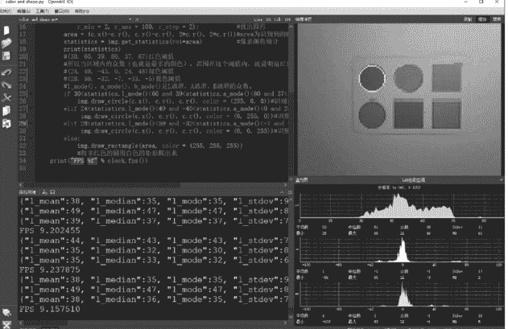

(a) 圆形与颜色检测程序运行实况

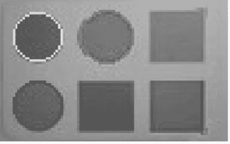

(b) 检测到的圆形与色块识别详情

图 5.10 程序运行结果展示

### (5) 调试验证与优化迭代

Python 代码编写完毕并上传至 AIE 控制板后，若运行时报语法错误，需逐个击破修正。在实际调试过程中，可参考以下经验应对常见问题：

- **① 连接中断应对**：目标跟踪需频繁驱动摄像头运动，易导致 Type C 线接触不良，进而使控制板掉线。遇此情况，点击重新连接按钮即可恢复调试。
- **② 阈值微调策略**：若预设的颜色阈值效果不佳，可借助阈值编辑器（threshold editor）重新标定色块阈值，并结合像素统计结果观察运行效果。
- **③ 识别失效排查**：当视频画面清晰、矩形与圆形色块肉眼可见，但程序未能正确识别形状与颜色时，应重点核查阈值参数设置是否准确，同时排查代码逻辑是否存在错误。

### (6) 深度分析与思考拓展

- **① 统计函数失效成因**：若 `get_statistics` 函数颜色检测效果不理想，可能源于哪些因素？实际采集环境（如光照、背景干扰）会产生何种影响？请深入分析并提出提升跟踪效果的方案。
- **② 双方法对比实践**：对比 `find_blobs` 与 `get_statistics` 两种颜色检测方法的异同，思考各自的适用场景，并编写程序验证。
- **③ 矩形色块检测设计**：现有案例采用 `get_statistics` 与 `find_circles` 先找形状后辨颜色的逻辑。若需求变更为搜寻矩形及特定色块，程序架构应如何设计？
- **④ 多目标并行追踪**：进阶需求：同时追踪圆形、矩形以及红、绿、蓝三色目标。请设计完整解决流程并尝试编程实现。

### (7) 综合拓展实践：智能校园场景创新

本项目旨在推动形状自动追踪技术在智能校园中的落地。图 5.11 展示了一款原型机器人，配备双舵机云台，可驱动摄像头水平、垂直双向旋转。系统依据预设色阈值锁定特定颜色物体并实现跟随运动。思考：该原型系统能否应用于校园安防、学生健康监测、智慧校园管理等领域？请提出创新设计方案并完成原型编程实践。

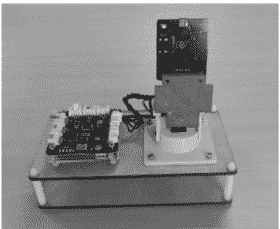

图 5.11 具备颜色形状追踪功能的机器人装置

# 项目6

## 基于边缘与角点检测的图像匹配


### (1) 问题背景与引入

无人机凭借起降迅速、操控灵活、结构轻量、飞行机动性强及高性价比等优势，已广泛渗透至生活各领域。航拍是其核心应用场景，不仅服务于个人摄影旅游，更大规模应用于大型公共活动记录、环境监测、资源普查、灾害预警及城市治理等公共事务（见图 6.1）。

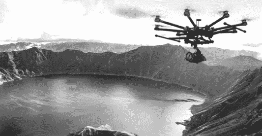

图 6.1 无人机航拍应用场景

无人机航拍获取的海量图像，往往需要经过比对、拼接、融合等图像配准处理。配准通用流程为：双图特征提取 → 相似度度量匹配特征点对 → 解算空间坐标变换参数 → 依参数实现配准。其中，**特征提取精度直接决定匹配成败，是核心环节**。

### (2) 任务目标设定

- **① 理论夯实**：掌握图像特征检测与配准的基本原理、核心算法及应用框架。
- **② 工程能力**：熟练运用 AI 开源硬件设计智能系统，精通 Python 编程实现。
- **③ 算法落地**：结合开源硬件与 Python 算法模块，开发图像匹配功能模块。
- **④ 创新应用**：面向生活场景开展创意设计，打造具有实用价值的图像匹配应用系统。

### (3) 核心知识储备

图像特征匹配技术包含**特征检测、特征描述、特征匹配**三大支柱。检测阶段通过各类算子提取显著形状、纹理特征；描述阶段将特征信息编码为向量（描述子）；匹配阶段利用欧氏距离或汉明距离建立跨图像特征关联。

#### 1) 图像特征提取体系

图像特征涵盖颜色、纹理、形状及局部特征点。**局部特征点**反映图像局部独特性（如线条交叉、明暗突变），抗环境干扰能力（光照、旋转、噪声）远强于全局特征。

局部特征分**斑点**与**角点**两大类：
- **斑点**：与周邻有显著灰度/颜色差异的区域（如树上红苹果），属区域特征，抗噪性强、稳定性高。
- **角点**：物体边缘拐角或线条交汇处。

**斑点检测**主流路径：高斯拉普拉斯算子（LoG）与 Hessian 矩阵行列式法（DoH）。两者流程一致：先卷积运算，后在空间与尺度域搜索响应峰值。
**角点检测**代表算法为 Harris 与 FAST。工程实践中常结合二进制特征检测子提取显著形状纹理。

#### 2) FAST 与 AGAST 角点检测详解

**FAST 算法核心逻辑**（Rosten 定义）：若某像素与周围圆环邻域内足够多像素灰度差异显著，则判定为角点。流程三步走：
1. **圆环分割测试**：固定半径圆上采样，逻辑测试快速剔除非候选点（见图 6.2）。
2. **ID3 决策树分类**：基于 16 个特征（状态 -1, 0, 1）判决候选点真伪。
3. **非极大值抑制**：验证并保留局部响应最强的真角点。

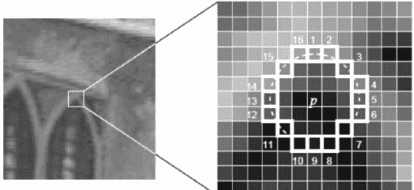

图 6.2 FAST 算法固定半径圆形采样模板

**总结**：FAST 先比较中心像素与圆环上连续 9 或 12 个邻域像素灰度（全大或全小），筛选候选点；再经 ID3 算法训练决策树；最后定义响应函数配合金字塔模型完成多尺度非极大值抑制。

**AGAST 检测器**：采用 FAST9-16 模式，对各图像金字塔层级及内插层统一阈值 T 检测。条件为：16 邻域点中存在 9 个连续点与中心像素值差异显著。通过非极大值抑制剔除不稳定点。

#### 3) 角点匹配工程流程（四步法）

角点匹配旨在建立双图特征像素对应关系，确定位态，支撑拼接鉴别。标准流程：

1. **提取检测子**：在双图中定位易识别像素（纹理丰富边缘等）。
2. **提取描述子**：对检测点编码数学特征（梯度直方图、局部二值模式等）。常用提取器：SIFT、HARRIS、SURF、FAST、AGAST、BRISK、FREAK、ORB 等。
3. **特征匹配**：基于描述子相似度建立对应关系，常用 FLANN 快速最近邻搜索。
4. **去除外点**：剔除错误匹配（外点），保留正确内点。经典算法：RANSAC、GTM。

#### 4) 图像特征描述：从浮点到二进制

传统描述子依赖高维浮点向量，计算存储开销大。**二进制描述子**基于像素强度比较生成二值向量，无需复杂向量优化，**时空性能全面超越传统方法**。匹配阶段仅需异或运算得汉明距离，极度简化计算，**极适配算力受限的嵌入式端侧部署**。主流二进制描述子：BRIEF、ORB、BRISK、FREAK。

- **① BRIEF（二进制鲁棒独立初级特征）**：2010 年 Calonder 提出，最简二进制描述范式。基于强度差异测试，优势：内存省、算匹配快。可搭配 CenSurE、FAST 等检测子。核心思想：邻域选取像素对比较灰度，组合成二进制串，用汉明距离判匹配。
  - *局限*：无方向计算，**无旋转不变性**；对噪声敏感，**无尺度不变性**。

- **② ORB（有向 FAST 与旋转 BRIEF）**：针对 BRIEF 两大短板改进。双核架构：**oFAST（有向 FAST）+ rBRIEF（旋转敏感 BRIEF）**。
  - *oFAST*：FAST 定位 → Harris 响应排序去边缘响应 → 图像金字塔多尺度检测 → **强度矩心法赋予方向**（区别于 SIFT 梯度直方图）。
  - *rBRIEF*：引入方向信息，贪婪搜索筛选高区分度采样点对生成二进制串。

#### 5) 二进制特征通用应用管线

二进制特征作为局部不变量，应用流程标准化：**检测 → 描述 → 匹配**。

| 环节 | 核心动作 | 典型搭配/策略 |
| :--- | :--- | :--- |
| **特征检测** | 定位关键点 | BRIEF/ORB 常配 **FAST**；BRISK/FREAK 常配 **AGAST** |
| **特征描述** | 生成二进制串 | BRIEF：随机正态分布采样；ORB：随机+学习优化；BRISK/FREAK：同心圆对称采样（FREAK 模拟视网膜重叠采样） |
| **特征匹配** | 相似度度量 | 统一使用 **汉明距离**（异或运算） |

**统一算法步骤**：
1. 依采样模型选取强度比较点对；
2. 点对比较结果映射为描述子二进制位；
3. 拼接生成完整二进制描述子；
4. 计算描述子间汉明距离，阈值判定匹配。

流程示意见图 6.3。

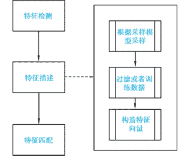

#### 6) 图像匹配基础度量与工具链

特征关联度量：高维特征用**欧氏距离**，二进制特征用**汉明距离**（异或极速计算）。
开源库支持：OpenCV 提供 `BFMatcher`（暴力匹配，支持欧氏/汉明）与 `FLANN`（快速近邻搜索）。**二进制特征首选汉明距离 + 暴力匹配或 FLANN，算力需求低、实时性强。**

# 项目6 图像特征匹配与应用

## 核心距离度量解析

### ① 欧氏距离
欧几里得度量，俗称欧氏距离，是最常见的距离定义方式之一。它描述的是 n 维空间中两点间的直线距离，也可理解为向量的模长（即该点至坐标原点的距离）。其在 n 维空间下的计算公式如下：

$$d(x, y) := \sqrt{(x_1 - y_1)^2 + (x_2 - y_2)^2 + \cdots + (x_n - y_n)^2} = \sqrt{\sum_{i=1}^n (x_i - y_i)^2}$$

### ② 汉明距离
汉明距离用于衡量两个等长字符串在对应位置上字符不同的个数。记两字符串 x、y 的汉明距离为 d(x,y)。操作上，将两字符串进行异或运算，统计结果中“1”的个数即得汉明距离。简而言之，它反映了两个比特串在二进制位上差异的数量。该度量在图像处理领域应用广泛，尤其适合二值图像的快速比对。其本质就是异或后统计“1”的计数，代码实现极为简洁，Python 函数示例如下：

```
  def hammingDistance(self,x: int,y: int) -> int:
      return bin(x^y).count('1')
  ```

## 实战篇：设计与实践

### 1. 摄像头参数配置与控制
在计算机视觉开源库中，`Sensor` 对象封装了摄像头参数设置的 Python 接口。针对基于边缘与角点检测的图像匹配场景，参数配置需重点关注以下要素：

```
##### 设置摄像头工作参数
sensor.reset()      # 初始化摄像头组件；
sensor.set_contrast(3)   # 设置图像对比度，取值范围为 -3 至 +3；
sensor.set_gainceiling(16) # 设置图像增益上限，取值范围为：2, 4, 8, 16, 32, 64, 128；
sensor.set_framesize(sensor.QVGA) # 设置分辨率为 QVGA(320 x 240)；
sensor.set_windowing((320, 240)) # 将相机的分辨率设置为当前分辨率的子分辨率 320 x 240；
sensor.set_pixformat(sensor.GRAYSCALE) # 设置像素模式为 8-bits per pixel;
sensor.skip_frames(time = 2000)    #跳过若干帧,等待摄像头组件的稳定;
sensor.set_auto_gain(False,value = 100)  #使用目标追踪算法时,关闭自动增益。
```

参数就绪后，即可通过代码驱动摄像头执行视频采集、帧获取、跳帧等操作。具体的配置与控制流程可参考项目 2 的相关工程实现。

### 2. 图像特征提取实现
开源库提供 `image.find_keypoints` 方法用于从指定 ROI 区域 `(x, y, w, h)` 提取 ORB 关键点。若省略 ROI，则默认搜索整幅图像。配合 `image.match_descriptor` 可实现两组关键点的比对与匹配区域定位；若无关键点检出，返回 `None`。

**关键参数详解：**
*   **roi**：感兴趣区域矩形元组，限定检测范围。
*   **threshold**：控制提取关键点数量的阈值（0-255）。默认 AGAST 检测器建议 20 左右；FAST 检测器建议 60-80。阈值越低，提取角点越多。
*   **normalized**：布尔型。`True` 时禁用多分辨率提取，牺牲尺度不变性换取运行速度。
*   **scale_factor**：金字塔缩放因子（>1.0）。值越大速度越快，但匹配鲁棒性下降。推荐 1.35~1.5。
*   **max_keypoints**：关键点容器上限，防止内存溢出，酌情调低。
*   **corner_detector**：角点检测算法选择，`image.CORNER_FAST`（快但准度低）或 `image.CORNER_AGAST`（默认，平衡性好）。

**典型调用示例：**
```python
img.find_keypoints(max_keypoints=150, threshold=10, normalized=True)
```
完成摄像头视频参数配置后，即可在指定区域启动特征提取流程。

### 3. 图像匹配逻辑实现
库函数 `image.match_descriptor(descriptor0, descriptor1[, threshold=70[, filter_outliers=False]])` 用于描述子匹配。

*   **LBP 描述符**：返回整数距离值，量化差异度。**值越接近 0，匹配度越高**。
*   **ORB 描述符**：返回 `kptmatch` 对象。

**ORB 专用参数：**
*   **threshold**（0-100，默认 70）：匹配严格度控制。值越低，筛选越严格，匹配越精准。
*   **filter_outliers**（默认 False）：异常值过滤开关。开启后可适当放宽 threshold。

### 4. 完整工程代码与验证
将上述阶段整合，形成完整的图像匹配 Python 脚本烧录至 AIE 控制板，观测目标跟踪效果。参考代码结构如下：

```
import sensor, time, image
from openiae import *

sensor.reset()
sensor.set_contrast(3)
sensor.set_gainceiling(16)
sensor.set_framesize(sensor.QVGA)
sensor.set_windowing((320, 240)) #320 * 240
sensor.set_pixformat(sensor.GRAYSCALE)
sensor.skip_frames(time=2000)
sensor.set_auto_gain(False, value=100)

def draw_keypoints(img, kpts):
    if kpts:
        print(kpts)
        img.draw_keypoints(kpts)
    img = sensor.snapshot()

kpts1 = None
kpts2 = None
clock = time.clock()

while True:
    clock.tick()
    img = sensor.snapshot()
    if button.is_pressed():              #检测到按键按下
        time.sleep(10)                      # 延时消抖
        if button.is_pressed():         #按键按下，即可寻找按下按键之前寻找过特征点的图像

            kpts2 = img.find_keypoints(max_keypoints=150, threshold=10, normalized=True)
            if kpts2:
                match = image.match_descriptor(kpts1, kpts2, threshold=100)
                if match.count() > 15:
                    led.red.on()
                    led.green.on()
                    led.blue.on()
                    img.draw_rectangle(match.rect(), threshold=90)
                    img.draw_cross(match.cx(), match.cy(), size=10)

                    print(kpts2, " matched:%d dt:%d" % (match.count(), match.theta()))

                else:     #没有按键按下时一直找图像中的特征点
                    #第一次找当前图像中心区域的特征点
                    led.red.on()
                    led.green.on()
                    led.blue.on()
                    kpts1 = img.find_keypoints(max_keypoints=150, threshold=10, scale_factor=1.25)
                    draw_keypoints(img, kpts1) #color = (255,0,0)
                    img.draw_string(0, 0, "FPS:% .2f" % (clock.fps())))
```

程序运行界面见下图，(a) 展示特征提取并标记关键点，(b) 展示匹配成功并框出目标。

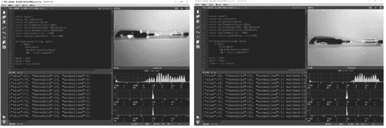

**图 6.4 程序运行结果示意**

示例采用按键流控：先采集目标特征存入内存，按键触发后进入实时匹配模式，基于汉明距离自动锁定相似目标。利用此框架可进一步开展物体识别实验。

**实验案例：双笔识别**
实验素材为两支笔（上黑下红），以黑笔为模板建模，红笔作干扰项。

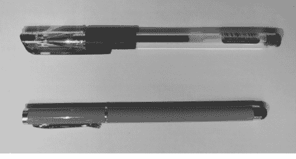
**图 6.5 实验物料**

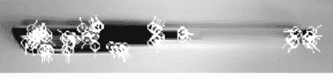
**图 6.6 黑笔特征提取可视化**

匹配结果显示，即使两支笔同框，系统仍能依据汉明距离精准定位黑笔：

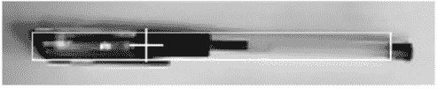
(a)

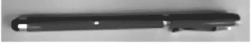
(b)
**图 6.7 图像匹配结果对比**

实验证明：预存模板特征后，系统能在复杂背景中自动检索高相似度目标。

## 调试、验证与优化指南
代码上传运行后，若遇语法报错逐行修正；运行期问题可按下表经验排查：

| 现象 | 排查方向 | 处理建议 |
| :--- | :--- | :--- |
| **特征检测/匹配效果差** | 摄像头 Sensor 参数 | 检查对比度、增益、曝光等 `Sensor` 对象配置是否适配环境光。 |
| **主程序流控困难** | 板载外设（按键/LED） | 先写独立小程序验证按键中断、LED指示逻辑，掌握后再集成主流程。 |
| **关键点过少/过多** | `find_keypoints` 参数 | 调整 `threshold`、`max_keypoints`、`corner_detector`，观察实时输出微调。 |
| **匹配失败/误匹配** | `match_descriptor` 参数 | 调节 `threshold` 收紧/放宽筛选，尝试开启 `filter_outliers` 剔除离群点。 |

## 思考与拓展
1.  **度量对比**：对比欧氏距离与汉明距离在二值特征匹配中的异同，尝试自行编写基于汉明距离的二值图像匹配函数。
2.  **模板持久化**：参考项目 5 的颜色阈值编辑工具，设计特征参数导出功能，将物体特征序列化为模板文件，实现“一次建模，多次复用”。
3.  **多目标场景**：针对文具盒场景（铅笔、橡皮、圆规、尺子），预存多类特征模板，挑战实时多目标检测与分类。
4.  **算法切换验证**：将 `find_keypoints` 默认的 AGAST 检测器切换为 FAST 模式，对比帧率（速度）与匹配准确率（精度）的权衡差异。

---

# 项目7 轨迹跟踪与拟合


## 问题背景
近年来，服务机器人广泛部署于银行、酒店、餐厅、展馆等公共场景，承担送餐、迎宾、咨询、讲解等任务。此类机器人拟人化程度高、功能模块化强，核心能力包括：

*   **规划巡航**：沿预设路径（如地面黑线）自主行进。
*   **RFID 定位**：识别环境标签，触发定点作业或语音讲解。
*   **紧急避障**：前向传感器感知动静态障碍物，即时停机并恢复。
*   **语音交互**：在低噪环境下支持固定词条的语义交互。

以送餐机器人为例（见图 7.1），其核心导航依赖视觉/红外传感器识别地面轨迹，配合 PID 算法对速度与转向进行闭环控制，实现稳健巡线。

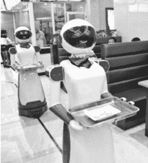
**图 7.1 服务机器人巡线导航示意**

## 任务目标
1.  掌握轨迹跟踪的基本原理、核心算法及系统框架。
2.  熟练运用 AI 开源硬件与 Python 进行智能系统开发。
3.  基于硬件平台与算法模块，实现轨迹跟踪功能原型。
4.  面向实际生活场景，创新设计具有落地价值的跟踪应用系统。

## 知识储备：统计建模基础

### 1. 相关分析与回归分析
监督学习中，预测目标离散称“分类”，连续称“回归”。

**① 相关分析**
研究**地位平等**的两个及以上随机变量间的统计关联性，量化关系的**方向**与**紧密程度**。
*   核心逻辑：自变量取值不同时，因变量的条件概率分布若发生变化，则存在相关；反之则独立。
*   侧重：描述变量间“相不相关、正负相关、相关有多强”。

**② 回归分析**
研究变量间**确定性的函数依赖关系**，建立数学模型（回归方程）量化因果机制。
*   分类：按变量数分一元/多元；按关系型分线性/非线性。
*   核心流程：指定因变量 Y 与自变量 X -> 建立模型 -> 实测数据估参 -> 拟合优度评价 -> 满足精度则用于预测。

**③ 两者辨析**
| 维度 | 相关分析 | 回归分析 |
| :--- | :--- | :--- |
| **变量地位** | 对等，无因果预设 | 明确因变量 Y 依赖自变量 X |
| **分析目的** | 探究相关性质、方向、强度 | 确定具体函数形式、量化因果、建模预测 |
| **核心产出** | 相关系数 (r) | 回归方程 ($Y = f(X)$) |

### 2. 一元线性回归与最小二乘法
若仅含一自变量 X、一因变量 Y，且近似线性相关，称**一元线性回归**。模型一般式：

$$ Y = \alpha + \beta X \quad (7.1) $$
($\alpha$ 为截距，$\beta$ 为斜率/回归系数)

**最小二乘法 (OLS) 原理：**
给定 $n$ 组观测点 $(X_i, Y_i)$，平面上过这 $n$ 点的曲线无数。OLS 准则寻找使**残差平方和 (RSS) 最小**的那条直线。
*   优势：推导解析解计算便捷；估计量具备无偏、有效、一致等良好统计性质。

# 最小二乘法与线性回归：从原理到视觉巡线实战

最小二乘法，亦称最小平方法，其核心在于通过极小化误差平方和，为数据寻觅最优的函数拟合模型。借助该方法，我们能便捷地推算未知数据，并确保推算值与实测值之间的平方误差总和降至最低，它在曲线拟合领域同样大显身手。

线性回归则是构建预测模型的常用利器。该模型要求因变量为连续型，自变量则兼容连续与离散两类，其回归轨迹呈线性分布。线性回归通过一条最佳拟合直线——即回归线，架起因变量（Y）与单个或多个自变量（X）之间的关联桥梁，如图 7.2 所示。

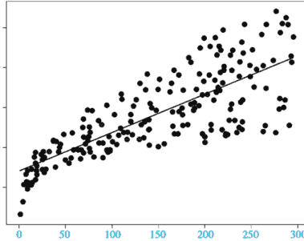

图 7.2 线性回归拟合直线示意

### (4) 设计与实践

图 7.3 计算机视觉巡逻机器人是校园科创赛事中的经典课题。传统方案多依赖双红外传感器循迹预设黑线，却受限于识别距离短、响应迟缓、视野狭窄等短板，难以驾驭复杂路况。引入计算机视觉技术可有效破局：摄像头高位安装拥有广阔俯视视野，对视野内轨迹实施线性拟合以锁定中心线位置，再配合比例积分微分（PID）算法精准驾驭车身运动。

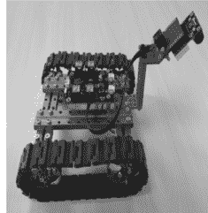

图 7.3 计算机视觉巡逻机器人实物

#### 1) 轨迹拟合的编程实现

计算机视觉开源库内置 `get_regression()` 方法，专司对指定图像矩形区域内的所有阈值特征像素实施线性回归运算。调用方式如下：

```
image.get_regression(thresholds[, invert=False[, roi[, x_stride=2[, y_stride=1[, area_threshold=10[, pixels_threshold=10[, robust=False]]]]]]]))
```

`get_regression()` 底层默认采用最小二乘法对区域内阈值像素执行线性回归，运算迅捷，但缺乏抗异常值能力。若启用 `robust=True`，则切换至 Theil-Sen 估计器，该算法通过计算所有阈值像素斜率的中位数来拟合直线。需注意：若阈值像素过多，即便在 80×60 的小分辨率下，其 O(N²) 复杂度也可能将帧率拖至 5 fps 以下。反之，若有效像素稀疏，即使异常值占比高达 30%，依然能保持优异的计算效能。

`thresholds` 参数须为元组列表，格式为 `[(lo, hi), (lo, hi), ...]`，用于界定目标追踪的颜色空间。灰度图下每元组含两值（最小/最大灰度）；RGB565 图下每元组含六值（Lab 空间 L、a、b 三通道的最小/最大值）。该功能自动兼容最小值最大值误写、元组长度溢出或缺失等情况，超出部分忽略，不足部分按全量程补齐。

#### 2) 简易轨迹追踪的落地

巡线机器人等实时性要求高的场景，需极致压缩运算开销。采用 QQVGA 分辨率（160×120）配合灰度模式，可大幅缩减数据量、提速运算。摄像头参数配置及控制流程详见项目 2，分辨率与像素格式设置代码如下：

```
sensor.set_pixformat(sensor.GRAYSCALE) #设置为灰度模式，每个像素 8bit
sensor.set_framesize(sensor.QQVGA) #设置帧的大小，使用 QQVGA 格式便于快速处理；
```

随后，基于 `get_regression` 编写高速线性回归例程以模拟巡线逻辑，参考实现如下：

```
##### 快速线性回归(巡线) 例程展示了利用 OpenAIE 摄像头使用 get_regression() 方法在 roi 区域内进行线性回归。这种方法可以应用于机器人的巡线过程。

##### 跟踪所有指向相同的总方向但实际上没有连接的线。
##### find_blobs(),以便更好地过滤选项和控制。
##### get_regression() 可以实现快速线性回归,它使用最小二乘法来拟合线。

#设置阈值(0,100),检测黑色线
THRESHOLD = (0,100)
#设置是否使用 img.binary() 函数进行图像分割
BINARY_VISIBLE = True #先做二进制分割,以便实施线性回归

import sensor,image,time

sensor.reset()
sensor.set_pixformat(sensor.GRAYSCALE)
sensor.set_framesize(sensor.QQVGA)
sensor.skip_frames(time = 2000)
clock = time.clock()

while(True):
    clock.tick()
    img = sensor.snapshot().binary([ THRESHOLD ]) if BINARY_VISIBLE else sensor.snapshot()

#类似于 find_lines() 和 find_line_segments() 方法搜索出线段对象,get_regression()
#函数返回回归后的线段对象 line,包括有 x1(),y1(),x2(),y2(),length(),theta(),rho(), magnitude() 等参数。其中,theta() 表示旋转度,是线段的角度。

##### x1, y1, x2, y2 分别代表线段的两个顶点坐标,length 是线段长度。
#magnitude 表示线性回归的效果,它是(0,+∞)范围内的一个数字,其中 0 代表一个圆。
#如果场景线性回归得越好,这个值越大。
line = img.get_regression([(255,255) if BINARY_VISIBLE else THRESHOLD])

if (line) : img.draw_line(line.line(), color = 127)
print(" FPS %f, mag = %s" % ( clock.fps() ,str( line.magnitude() ) if (line) else "N/A" ))
```

例程运行后，对 S 型曲线实施整体直线拟合，效果如图 7.4 所示。

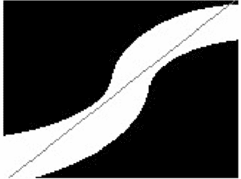

图 7.4 整体线性拟合效果图

#### 3) 复杂轨迹追踪的进阶策略

实战中，图 7.4 这种对全程曲线“一刀切”式的单一拟合，实用性大打折扣。面对弯道，单一直线拟合导致航向角偏差剧增，难以精准导航。

破解之道在于“分段逼近”：将曲线切分为多个微段，逐段线性拟合再拼接，分段越细，拟合轨迹越贴合真实路况。

```
import sensor, image, time, math
#设置阈值，如果是跟踪黑线，GRAYSCALE_THRESHOLD = [(0,64)] ;
#如果是跟踪白线，取 GRAYSCALE_THRESHOLD = [(128,255)] ;
GRAYSCALE_THRESHOLD = [(0,64)]
#每一个 roi 区域的位置参数是(x, y, w, h)。线检测算法搜索每一个 roi 区域内的最大目标块，并定位到矩心；
#靠近图像底部的 roi 区域分配最大的权值，接下来的 roi 区域依次分配越小的权值，矩心点的 x 坐标通过不同的权值平均算出。
ROIS = [ # [ROI,weight]
(0, 100, 160, 20, 0.7), # You'll need to tweak the weights for your app
(0, 50, 160, 20, 0.3), # depending on how your robot is setup
(0, 0, 160, 20, 0.1)
]
```

`roi` 定义三个采样窗口，`ROIS` 元素格式为 `(x, y, w, h, weight)`，分别对应矩形左上顶点坐标、宽高及权重。以 QQVGA 图像（160×120）为例，最底部 ROI 设为 `(0, 100, 160, 20, 0.7)`，即将画面横向三等分。

实战部署时，三个 ROI 的阈值需实地标定；原则上，离车身最近的视野区域（底部 ROI）权重应设最大，以主导即时转向决策。

```
weight_sum = 0     #权值和初始化
for r in ROIS: weight_sum += r[4]  # r[4] is the roi weight.
#计算权值和。遍历上面的 3 个矩形, r[4] 即每个矩形的权值。
#设置摄像头工作参数
sensor.reset()    # 初始化摄像头
sensor.set_pixformat(sensor.GRAYSCALE) # 像素格式为:grayscale.
sensor.set_framesize(sensor.QQVGA) # 图像帧使用 QQVGA 格式, 以便提升计算速度;

sensor.skip_frames(30)     # 跳过 30 帧, 等待设置生效;
sensor.set_auto_gain(False)    # 轨迹追踪必须关闭自动增益;
sensor.set_auto_whitebal(False)    # 轨迹追踪必须关闭自动白平衡;
clock = time.clock()     # 跟踪帧率

while(True):
    clock.tick()     # 用于跟踪两次 snapshot() 之间用掉的毫秒数;
    img = sensor.snapshot()    # 捕获一帧图像

centroid_sum = 0
#利用颜色识别分别寻找 3 个矩形区域内的线段
for r in ROIS:
    blobs = img.find_blobs( GRAYSCALE_THRESHOLD, roi = r[0:4], merge = True)
```

##### 核心逻辑注释解析

```python
# r[0:4] 为 roi 元组坐标信息
# 合并视野中检测到的线段区域
# 在目标区域内拟合直线
if blobs:
    # 寻找像素数最多的色块索引
    most_pixels = 0
    largest_blob = 0
    for i in range(len(blobs)):
        # 单区域内可能检出多条线段，选取面积最大者作为本区域主轨迹
        if blobs[i].pixels() > most_pixels:
            most_pixels = blobs[i].pixels()
            # merged_blobs[i][4] 记录色块像素总数，更新最大值及索引
            largest_blob = i

##### 在主色块外绘制矩形框与十字中心标记
img.draw_rectangle(blobs[largest_blob].rect())
img.draw_cross(blobs[largest_blob].cx(), blobs[largest_blob].cy())

centroid_sum += blobs[largest_blob].cx() * r[4]  # r[4] 为 roi 权重
# 累加各区域主色块中心 x 坐标的加权和
center_pos = (centroid_sum / weight_sum)  # 解算轨迹几何中心
```

上述例程实测于长距离 S 型曲线，三段式线性拟合及各段矩心解算结果如图 7.5 所示。

### (5) 调试、验证与迭代优化

代码烧录至 AIE 控制板后，若报语法错误需逐行排查。运行调试阶段，可参考以下经验定向优化：

- **① 夯实语法基础**：熟练掌握 `if-else`、`for` 等流程控制语句，编码时严谨细致，规避低级语法漏洞。
- **② 直线拟合失准**：重点排查 `get_regression` 参数配置，微调后观察拟合曲线回正情况。
- **③ 分段拟合偏移**：检查各 ROI 区域尺寸划分是否合理，修正代码并复测；按实况调整各 ROI 权重分配，观察航向修正效果。

### (6) 深度复盘与思维拓展

- **① 光照鲁棒性实测**：环境光变化如何干扰识别？请更换多组光照条件重复实验，总结抗干扰经验法则。
- **② 视角几何影响**：摄像头俯仰/偏航角度如何改变投影畸变与视野覆盖？实测多角度对比，归纳安装最佳实践。
- **③ 圆形轨迹适配性**：本案例分段线性逼近法能否胜任圆环轨迹？结合实地工况设改进方案。
- **④ 视觉 vs 红外PK**：OpenAIE 视觉循迹的速度与精度能否达标实车级巡航？对比传统红外方案，阐述视觉法的核心优势维度。

### (7) 综合拓展实战任务

本项目旨在推动循迹技术工程化落地。图 7.3 实车搭载 Arduino 开源控制体系，具备启停、前后进退、变速、转向等底层运动原语。引入摄像头后，需编写 Python 视觉程序实时解析轨迹，查阅 AIE 串口通信接口实现跨板数据交互，将轨迹参数下发给 Arduino 执行 PID 闭环电机控制。建议按“直线验证 → 曲线攻关 → 性能调优”三阶段迭代，打造高稳健性视觉巡线小车。

---

# 项目8 计算机视觉与人脸检测


### (1) 问题的提出

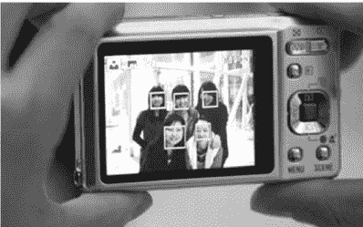

图 8.1 相机人脸检测应用场景

随着大众文娱需求攀升，拍照留影成刚需。新款相机普及智能人脸检测：自动锁定取景框内人脸、极速对焦合焦，成片率大幅跃升（图 8.1）。智能手机同步内置人脸自动发现、跟踪、对焦链路，护航高光时刻定格。

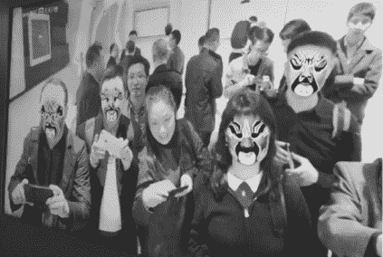

图 8.2 人脸检测赋能趣味变脸交互

生活娱乐侧，人脸检测玩法更溢彩。图 8.2 示例中，系统实时捕获前景移动人脸并持续跟踪，动态叠加京剧脸谱贴纸实现“秒变脸”特效。该技术在校园门禁、智慧教室考勤监测等安防场景同样大有可为，更是进阶人脸识别系统的基石模块。

### (2) 任务与目标

- **① 原理透析**：吃透人脸检测底层逻辑，精通 Haar 相关算法体系与应用框架。
- **② 工程落地**：掌握基于 AI 开源硬件的开发全流程，强化 Python 编程实战力。
- **③ 算法调用**：熟练调用 Haar Cascade 分类器，落地人脸检测功能模块。
- **④ 场景创新**：对标校园安防等真实需求，孵化具有实用落地价值的创意应用系统。

### (3) 知识储备

#### 1) 聚类与分类：两大核心范式辨析

**聚类** 是无监督发现数据内禀结构的过程：将对象集划分为高相似度的簇，簇内紧密、簇间疏离。例：利用摄像头采集行人轨迹，通过聚类挖掘人群活动热力区。

**分类** 则是有监督的标签映射：预设类别体系，训练分类器为新样本贴标签。例：人脸检测中将图像像素二分为“人脸区”与“非人脸区”。

本质区别在于：**分类需人工标注样本预训练分类器（有监督），类别数固定；聚类无需标签、无预训练，类别数在迭代中自涌现（无监督）。**

#### 2) Haar-like 特征：人脸的“指纹”描述子

Haar-like 特征是机器视觉领域的经典算子，广泛服务于人脸检测等任务。其按几何形态分为边缘、线性、中心、对角线四基元，组合成黑白矩形特征模板。模板特征值定义为：**白色矩形像素和 − 黑色矩形像素和**。

该特征值直观反映图像局部灰度变化模式。人脸结构天然契合矩形特征描述：眼窝比颧骨暗、鼻翼比鼻梁暗、唇部比周肤暗。滑动窗口扫描时，模板落在人脸区响应出特征值；落在非人脸区则数值迥异。由此实现人脸特征量化，完成人脸/背景的二元判别。

#### 3) 积分图：Haar 特征的“加速器”

Haar 特征计算公式虽简（黑白区像素和之差），但滑窗遍历全图时计算量惊人。工程上引入**积分图** 机制实现极速求和。

对灰度图 I，其积分图同尺寸，任意坐标 (x,y) 处的值等于 I 左上角至 (x,y) 矩形区域内所有像素灰度之和。单次全图扫描即可构建完备积分图。有了它，图像中**任意矩形区域的像素和仅需 4 次加减运算**即可得出（利用四顶点积分值的容斥原理）。这种“一次遍历、全局 O(1) 查询”的特性，使 Haar 特征计算效率实现数量级跃升。

#### 4) 弱学习、强学习与 Adaboost 级联分类器

**弱学习**指的是识别准确率仅略优于随机猜测的算法；**强学习**则是指识别精度极高的算法。理论研究证明，只要数据量充足，便可通过集成策略将弱学习算法提升为任意精度的强学习方法。

以图 8.3 中的 Haar-like 特征算子为例，每个黑白矩形块代表一条规则、一个特征，同时也是一个分类器。显而易见，这些都是弱分类器。将一组准确率低下的弱分类器串联起来，融合成一个高性能的强分类器，这正是 Adaboost 级联分类算法的核心逻辑。

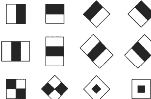

图 8-3 各类 Haar-like 特征算子示意

Adaboost 采用迭代机制：首轮在 N 个训练样本上学习得出首个弱分类器；将首轮分错的样本与新数据混合组成新的 N 个样本集，训练出第二个弱分类器；再将前几轮错分样本加入新样本构建训练集，获得第三个弱分类器……以此类推。最终将这一系列弱分类器集成，形成最终的强分类器。

#### 5) Haar 分类器的训练流程

Haar 分类器训练依托 Adaboost 级联算法，主要历经五个关键阶段：

1.  **样本构建**：采集人脸与非人脸图像，建立正负样本库。
2.  **特征计算**：求取 Haar-like 特征值并构建积分图以加速计算。
3.  **弱分类器筛选**：训练并筛选出 T 个表现最优的弱分类器。
4.  **强分类器训练**：将这 T 个优质弱分类器输入 Adaboost 算法，训练出区分人脸/非人脸的强分类器。
5.  **级联优化**：采用筛选式级联结构串联强分类器，进一步提升整体精度。

实战中，常以 20×20 像素的图像块为基础，可提取数万个特征。从中筛选出 T 个优质特征（即最优弱分类器），经 Adaboost 训练得强分类器，最后再行级联。训练机制中，正确分类的样本权重降低，错分样本权重升高，迫使后续分类器聚焦“难啃的骨头”。最终通过加权投票机制，对比加权和与阈值完成检测。

#### 6) 基于 Haar 算子的人脸检测实战

训练完成 Haar 级联分类器后，检测过程即为一系列分阶段的判定流程：后一阶段运行的前提是前一阶段通过。流程遵循“粗筛在前、精筛在后”原则，先大范围快速排除，再小范围精细验证，具体流程见图 8.4。

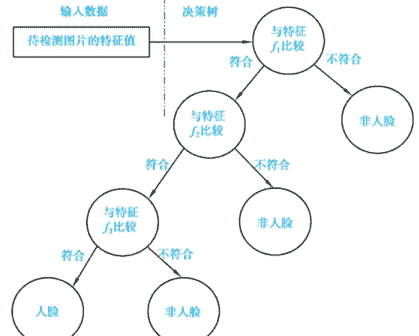

图 8.4 Haar 级联分类器人脸检测流程图

检测伊始，窗口尺寸与训练样本一致，按设定步长（像素位移量）滑动遍历全图，标记候选区。遍历结束后，按比例放大检测窗口，再次全图遍历；循环此过程，直至窗口尺寸超出原图一半为止。

### (4) 设计与实践

OpenAIE 控制板内置通用人脸检测模块，提供 Haar 算法集并预置正脸检测器。其核心逻辑同前：分阶段级联判定，由粗到细。

#### 1) 摄像头参数配置

板载 Haar 算法基于灰度像素特征与积分图，故摄像头须设为灰度模式，分辨率定为 240×160 (HQVGA)。Python 配置示例：

```python
import sensor, time, image
sensor.reset() #初始化摄像头传感器；
##### Sensor settings
sensor.set_contrast(1) #设置相机图像对比度，范围从 -3 至 +3；
sensor.set_gainceiling(16) #设置相机图像增益上限，参数范围:2,4,8,16,32,64,128;
sensor.set_framesize(sensor.HQVGA) #设置摄像头分辨率为 HQVGA: 240 x 160；
sensor.set_pixformat(sensor.GRAYSCALE) #灰度图，每像素为 8 位、1 字节，注意人脸识别只能用灰度图。
```

#### 2) 加载 Haar 模型

调用语法如下：

```python
class image.HaarCascade(path[, stages = Auto]) ,
```

参数 `stages` 默认为级联总阶段数（即强分类器个数）。取值权衡：阶段数越少速度越快但误报越高；阶段数越多精度越高但速度越慢。内置模型（如 `"frontalface"`, `"eye"`）可直接指定名称；自训练模型需为统一二进制格式，通过 `path` 参数指定路径。示例代码：

```python
#加载 Haar Cascade 级联分类器，启用内置人脸检测模型，分类器的比对阶段数设置为 25；
face_cascade = image.HaarCascade("frontalface", stages = 25)
print(face_cascade)
```

#### 3) 视频捕获与检测启动核心逻辑

基于固化模块实现检测的三步走：

1.  定时驱动摄像头采集帧。
2.  启动级联分类器定位帧内所有人脸区域。
3.  在帧上绘制矩形框标注结果。

代码实现：

```python
clock = time.clock() #启用一个时钟对象；
while(True):
    clock.tick() #开始追踪运行时间；
    # Capture snapshot
    img = sensor.snapshot() #使用摄像头拍摄一张快照，并返回给image 对象；
    # 启动 Haar Cascade 算法，在图像帧中搜索出所有的人脸区域，返回给objects 对象；
    objects = img.find_features(face_cascade,threshold = 0.75, scale_factor = 1.25)
    #image.find_features(cascade,threshold = 0.5，scale = 1.5)，thresholds 越大，匹配速度越快，错误率也会上升。scale 可以缩放被匹配特征的大小。
    #标记处所有人脸区域。利用 Draw 对象在找到的人脸目标区域上画框，标记出来；
    for r in objects:
        img.draw_rectangle(r)
    #在消息窗中显示出摄像头的帧率等实时工作参数；
    print(clock.fps())
```

核心方法 `image.find_features(cascade[, threshold=0.5[, scale=1.5[, roi]]])` 返回匹配区域的边界框列表 `(x,y,w,h)`，无匹配返回空列表。**仅支持灰度图**。关键参数解读：
*   `cascade`：Haar 级联对象。
*   `threshold` (0.0~1.0)：值越小检出率越高但误报越多；值越大越严格但漏报风险增大。
*   `scale` (>1.0)：缩放因子。值越大跑得越快但匹配越粗糙；推荐 1.35~1.5。
*   `roi`：感兴趣区域元组，缺省为全图。

#### 4) 完整程序集成与部署

整合上述三阶段代码，烧录至 OpenAIE 控制板并调试纠错。运行效果见图 8.5，画面右上角实时叠加显示检测框。

```python
##### 人脸识别例程
#在实时采集的图像帧上使用 Haar Cascade 级联模型来进行人脸检测工作。Haar 级联模型对图像区域进行遍历，查找人脸。编程中采用正面人脸模型，启用 25 阶搜索流程。
##### 每帧图像的处理需要占用内存空间。人脸检测算法使用灰度图像可以减少对存储的需求。
import sensor, time, image

##### 重置摄像头
sensor.reset()

##### 摄像头参数设置
sensor.set_contrast(1)
sensor.set_gainceiling(16)
sensor.set_framesize(sensor.HQVGA) #人脸检测最好使用 HQVGA 格式和灰度图像
sensor.set_pixformat(sensor.GRAYSCALE) #人脸检测过程要求使用灰度图像

##### 加载 Haar Cascade 分类器。默认使用所有级联数，采用的级数越低，运算速度会越快，但检测准确度则会降低。
face_cascade = image.HaarCascade("frontalface", stages = 25)
#方法 image.HaarCascade(path, stages = Auto)用来加载一个 haar 模型；
```

> **模型加载提示**：二进制文件。自定义模型填路径，内置模型填名称（如 `"frontalface"`）。`stages` 缺省为默认总阶段数。减小 `stages` 可加速但降准。

```
print( face_cascade )
```

```
##### FPS clock
clock = time.clock()

while True:
    clock.tick()
    img = sensor.snapshot()  # 捕捉图像帧
```

> **参数调优经验**：
> *   `scale` 偏小 → 搜索慢、能查更小目标；偏大 → 搜索快、匹配差。甜点区间 1.35~1.5。
> *   `threshold` 偏高 → 速度快、误报增多；偏低 → 速度慢、误报减少。

```
objects = img.find_features(face_cascade, threshold=0.75, scale=1.35)
```

在检测到的目标矩形区域绘制标记框；

```
for r in objects:
    img.draw_rectangle(r)
```

```
##### 打印出 FPS.
print(clock.fps())
```


图 8.5 人脸检测程序运行实况

### (5) 调试、验证与优化

程序上传后，语法报错需逐行修复。运行期参考以下策略优化：

*   **画质兜底**：画面过暗无意义，调节曝光或补光（开 LED）。
*   **规避逆光**：逆光致特征模糊，调试初期避开此场景，先跑通参数基线。
*   **参数寻优**：漏报/误报时，重点调 `stages`、`threshold`、`scale`。观察召回率、精度、FPS 变化，找到当前硬件平台的最佳参数组合。

### (6) 进阶思考与拓展

1.  **自训练模型落地**：如何从零训练 Haar 人脸模型？如何在代码中加载外部二进制模型？给出方案并尝试实践。
2.  **跨品类检测**：Haar 级联能否用于猫脸/狗脸等非人脸目标？针对宠物管理系统需求，设计建模、训练、部署全链路方案。
3.  **IO 扩展应对**：OpenMV 仅 10 个弱驱动 IO，远不及 Arduino。在 AI 应用中如何低成本、快速解决扩展难题？
4.  **校园场景创新**：人脸检测如何深度融入校园生活？构思并原型化开发具有实用价值的智能应用系统。

### (7) 综合拓展实战任务

**挑战**：将创客空间机器人升级为“校园服务机器人”，集成人脸检测，主动感知路过师生并发起交互（见图 8.6）。请产出原型设计方案并完成编程验证。


图 8.6 机器人系统中的人脸检测应用示意

# 项目九

## 人眼检测与瞳孔定位


### (1) 问题背景


图 9.1 相机中的实时眼部对焦演示

新款相机/手机除人脸检测外，普遍支持**实时眼部检测自动对焦**：锁定被摄者双眼，即便主体移动也能持续跟焦（见图 9.1）。

在人脸检测基础上深入至眼部/瞳孔级检测，应用场景极广：
*   **智能交通**：监测公交/出租司机疲劳驾驶（闭眼、眼部闭合时长），实时预警并上报平台。
*   **智慧教室**：分析学生眼动轨迹，判断专注度、是否关注讲台，量化教学质量。

### (2) 任务目标

1.  掌握眼部/瞳孔检测原理、Haar 算法体系与应用框架。
2.  精通 AI 开源硬件系统设计方法与 Python 编程实战。
3.  调用 Haar 级联算法，落地眼部检测与瞳孔定位功能。
4.  结合生活场景，创意设计并实现具有实用价值的眼部/瞳孔检测应用系统。

### (3) 知识储备

#### 1) 基于 OpenCV 的 Haar 分类器训练工具链

OpenCV 为 C++ 跨平台视觉库（支持 Linux/Windows/Android/macOS），提供 Python/Ruby/MATLAB 等多语言绑定，涵盖海量图像处理与视觉算法。项目 8 已述及 Haar 训练通用五步法。本节基于 **OpenCV 3.4.1 + VS2015** 环境，实操演示分类器训练全流程：样本收集 → 数据格式化 → 创建训练样本 → 训练级联分类器。

#### 2) 训练样本数据采集

训练需**正负样本**：
*   **正样本 (~200 张)**：从开放人脸库提取 16 人不同表情下的人脸图像，置于 `Positive` 文件夹（可按人建子目录）。部分展示见图 9.2。
*   **负样本 (~200 张)**：不含完整人脸的图像——肢体局部、户外/室内/街道/校园等常见背景。置于 `Negative` 文件夹。部分展示见图 9.3。


图 9.2 正样本人脸图像示例


图 9.3 负样本背景图像示例

#### 3) 训练数据格式化

正负样本量越大，模型参数越鲁棒。受限于样本获取难度与训练耗时，本实验选取 200+ 样本开展训练。

### OpenCV Haar 级联训练与 OpenAIE 瞳孔检测实战全流程

在正式开启模型训练之前，首要任务是对收集到的原始样本进行标准化处理。这包括统一图像尺寸、将宽高比固定为 1:1，并确保正样本的背景保持一致。

#### 4) 生成训练样本向量文件

样本制作依赖 OpenCV 自带的 `opencv_createsamples` 工具。操作步骤为：进入 OpenCV 安装目录下的 `build\x64\vc14\bin` 文件夹，在该路径打开命令行窗口，输入 `opencv_createsamples.exe` 回车即可启动。建议先不带参数运行一次，查看工具的帮助信息与参数详解：

```
E:\Program\OpenCV\opencv\build\x64\vc14\bin > opencv_createsamples
Usage : opencv_createsamples
[-info <collection_file_name >]
[-img <image_file_name >]
[-vec <vec_file_name >]
[-bg <background_file_name >]
[-num <number_of_samples = 1000 >]
[-bgcolor <background_color = 0 >]
[-inv] [-randinv] [-bgthresh <background_color_threshold = 80 >]
[-maxidev <max_intensity_deviation = 40 >]
[-maxxangle <max_x_rotation_angle = 1.100000 >]
[-maxyangle <max_y_rotation_angle = 1.100000 >]
[-maxzangle <max_z_rotation_angle = 0.500000 >]
[-show [ <scale = 4.000000 >]]]
[-w <sample_width = 24 >]
[-h <sample_height = 24 >]
[-maxscale <max_sample_scale = -1.000000 >]
[-rngseed <rng_seed = 12345 >]
```

关键参数释义：
*   `collection_file_name`：正样本描述文件路径；
*   `vec_file_name`：输出的 `.vec` 向量文件名；
*   `background_file_name`：背景描述文件（可选）；
*   `number_of_samples`：样本总数（本例采集 185 张正样本，故设为 185）；
*   `background_color` / `max_x_rotation_angle` 等：背景色及三维旋转角度（均可选）；
*   `sample_width` / `sample_height`：样本宽高，通常设为相等。

依据上述参数，指定样本配置文件路径（本实验正负样本均置于桌面 `data` 目录），执行命令生成 `.vec` 文件与负样本列表：

```
opencv_createsamples.exe -info C:\Users\Administrator\Desktop\data\positive\info.dat -vec C:\Users\Administrator\Desktop\data\mysamples_1024.vec -num 185 -bgcolor 0 -bgthresh 0 -w 24 -h 24
```

运行结果如下，成功产出所需文件。若正负样本数量有限，可尝试添加 `-img` 参数，对单张图片进行形变扩增：

```
Info file name: C:\Users\Administrator\Desktop\data\positive\info.dat
Img file name: (NULL)
Vec file name: C:\Users\Administrator\Desktop\data\mysamples_1024.vec
BG file name: (NULL)
Num: 185
BG color: 0
BG threshold: 0
Invert: FALSE
Max intensity deviation: 40
Max x angle: 1.1
Max y angle: 1.1
Max z angle: 0.5
Show samples: FALSE
Width: 24
Height: 24
Max Scale: -1
RNG Seed: 12345
Create training samples from images collection...
Done. Created 185 samples
```

命令执行完毕后，目标目录下将出现指定名称的 `.vec` 文件：

```
C:\Users\Administrator\Desktop\data\mysamples_1024.vec
```

#### 5) 训练级联分类器

有了 `.vec` 文件，即可启动 `opencv_traincascade` 进行分类器训练。同样先查看工具参数：

```
-data < cascade_dir_name >
-vec < vec_file_name > 刚刚创建的 vec 文件
-bg < background_file_name >
    [-numPos < number_of_positive_samples = 2000 > ]
    [-numNeg < number_of_negative_samples = 1000 > ]
    [-numStages < number_of_stages = 20 > ]
    [-precalcValBufSize < precalculated_vals_buffer_size_in_Mb = 1024 > ]
    [-precalcIdxBufSize < precalculated_idxs_buffer_size_in_Mb = 1024 > ]
    [-baseFormatSave]
    [-numThreads < max_number_of_threads = 9 > ]
    [-acceptanceRatioBreakValue < value > = -1 > ]
--cascadeParams--
    [-stageType < BOOST( default ) > ]
    [-featureType < | HAAR( default ) , LBP, HOG| > ]
    [-w < sampleWidth = 24 > ]
    [-h < sampleHeight = 24 > ]
--boostParams--
    [-bt < | DAB, RAB, LB, GAB( default ) | > ]
    [-minHitRate < min_hit_rate > = 0.995 > ]
    [-maxFalseAlarmRate < max_false_alarm_rate > = 0.5 > ]
    [-weightTrimRate < weight_trim_rate = 0.95 > ]
    [-maxDepth < max_depth_of_weak_tree = 1 > ]
    [-maxWeakCount < max_weak_tree_count = 100 > ]
--haarFeatureParams--
    [-mode < BASIC( default ) | CORE | ALL
--lbpFeatureParams--
--HOGFeatureParams--
```

核心参数配置指南：
*   `-data`：训练结果输出目录；
*   `-vec`：上一步生成的向量文件；
*   `-bg`：负样本描述文件（`.dat`）；
*   `-nstage`：级联层数，建议 15~20，层数越多耗时越长；
*   `-nsplits`：节点分裂数，默认 2；
*   `-minhitrate`：最小命中率（阶段准确率目标）；
*   `-maxfalsealarm`：最大误检率，单层训练直至该值低于 0.5 才进入下一层；
*   `-nps` / `-nneg`：各阶段使用的正/负样本数。负样本数可设为正样本的 1~3 倍，程序会自动从负样本图中裁剪；
*   `-w` / `-h`：样本宽高，**必须与 `.vec` 文件声明一致**；
*   `-mem`：预分配内存（MB），设 256 足矣，实际占用极低；
*   `-mode ALL`：特征类型，`ALL` 含垂直与 45° 旋转特征，`BASIC` 仅垂直。

**实操注意**：需将负样本图片及 `bg.txt` 复制到 `build\x64\vc14\bin` 目录；在 `data` 下新建 `HaarResult` 文件夹存放模型。本实验启动命令如下：

```
opencv_traincascade.exe -data C:\Users\Administrator\Desktop\data\HaarResult -vec C:\Users\Administrator\Desktop\data\mysamples_341.vec -bg bg.txt -numPos 170 -numNeg 500 -numStages 12 -featureType HAAR -w 24 -h 24 -minHitRate 0.996 -maxFalseAlarmRate 0.5 -mode ALL
```

训练过程日志见下。完成后 `HaarResult` 目录下的 `cascade.xml` 即为最终模型，其余为中间文件无需部署：

```
E:\Program\OpenCV\opencv\build\x64\vc14\bin > opencv_traincascade -data C:\Users\Administrator\Desktop\data -vec C:\Users\Administrator\Desktop\data\mysamples_1024.vec -bg bg.txt -numPos 170 -numNeg 500 -numStages 12 -featureType LBP -w 24 -h 24 -minHitRate 0.997 -maxFalseAlarmRate 0.5
```

受限于数据集规模，本次训练仅耗时约 2 分钟。若需提升精度，可将 `-numNeg` 从 500 增至 1000，扩充负样本池以压低误检率。

### 6) 模型实测与参数调优

训练结束需验证实际效果。OpenCV 提供级联分类器测试工具及源码，在 VS2015 中编译运行即可直观观察检测表现。

调用 `face_classifier.detectMultiScale` 时，参数设置不当极易导致误检（如下图所示）：


针对 `face_classifier.detectMultiScale(gray, faces, 1, 2, 3, 1, Size(50, 50))` 中的关键数值进行微调，即可实现精准人脸定位：


---

### (4) OpenAIE 控制板上的瞳孔检测工程实践

OpenAIE 控制板内置通用 Haar 检测模块与 Frontal Face 分类器，支持视频流逐帧分析。其核心采用级联结构：多阶段依次判决，前一阶段通过才进入后一阶段；早期阶段大范围快速筛选，后期阶段小区域精细复核。

#### 1) 摄像头参数配置策略

在「项目 8 人脸检测」中，视频采集分辨率设为 HQVGA (240×160)，像素格式为灰度模式，代码如下：

```python
#初始化摄像头工作参数数；
sensor.set_contrast(1) #设置相机图像对比度，范围从 -3 至 +3；
sensor.set_gainceiling(16) #设置相机图像增益上限，参数范围：2,4,8,16,32,64,128；
sensor.set_framesize(sensor.HQVGA) #分辨率设为 HQVGA;240x160；
sensor.set_pixformat(sensor.GRAYSCALE) #人脸检测应用使用灰度图，每像素为 8 位，1 字节；
```

人眼检测因目标更小，对分辨率敏感度极高。HQVGA 虽利于人脸检测，但人眼成功率低。AIE 板最高支持 VGA 分辨率，切换至该模式可显著改善人眼检出率：

```python
sensor.set_framesize(sensor.VGA) #分辨率设为 VGA;640 × 480；
sensor.set_pixformat(sensor.GRAYSCALE) #人眼检测同样使用灰度图；
```

#### 2) Haar 模型加载机制

通过 `cv.HaarCascade(path, stages)` 类加载模型并启动区域搜索。工程上采用「粗定位人脸 → 细定位人眼」的两级策略：先在全帧搜人脸，再在人脸 ROI 内找人眼。

库内已预置 `frontalface` 与 `eye` 两个现成模型，代码中直接指定名称即可；亦支持加载自训练的外部二进制模型，仅需在 `path` 参数中给出完整路径。

*   **① 人脸模型加载**

```python
#加载 Haar Cascade 级联分类器, 启用内置人脸检测模型, 分类器的比对阶段数设置为 25 ;
face_cascade = image.HaarCascade("frontalface", stages=25)
```

*   **② 人眼模型加载**

```python
#加载 Haar Cascade 级联分类器, 启用内置人眼检测模型, 分类器的比对阶段数设置为 25 ;
face_cascade = image.HaarCascade("eye", stages=25)
```

#### 3) 瞳孔精确定位算法

人脸检出后，在人脸 ROI 内运行人眼分类器得到双眼区域。随后在每个眼部 ROI 内寻找灰度最深处的中心点，即作为瞳孔坐标。

库函数 `image.find_eye(roi)` 专为此设计：
*   输入：搜索窗口 `roi = (x, y, w, h)`，缺省为全图；
*   输出：瞳孔坐标元组 `(x, y)`，未检出返回 `(0, 0)`；
*   限制：仅支持灰度图；调用前必须先用 `image.find_features()` + `frontalface` 找人脸，再用 `find_features` + `eye` 找眼区，最后在各眼区 ROI 上调用 `find_eye`。

参考实现代码：

```python
#在识别到的人眼中寻找瞳孔。
for e in eyes: #e 是先前过程中搜索到的若干人眼矩形区域 ;
    iris = img.find_eye(e)
    #find_eye( (x,y,w,h) ) 参数是一个矩形区域, 左上顶点为 (x,y) , 宽 w , 高 h ,
    #注意 (x,y,w,h) 是一个元组 , 不要漏掉括号 ( ) ;
    #find_eye 的功能是找到区域中颜色最深处的中心点 ;
    img.draw_rectangle(e) #用矩形标记人眼区域 ;
    img.draw_cross(iris[0], iris[1]) #用十字形标记瞳孔。
```

#### 4) 完整检测系统集成与上机验证

将上述模块串联成完整 Python 脚本，烧录进 OpenAIE 控制板并调试修正错误。最终运行效果见图 9.6：画面右上实时叠加显示双眼框与瞳孔十字光标；图 9.7 为眼部区域放大标定图。


图 9.6 人眼与瞳孔检测程序实时运行画面


图 9.7 眼部 ROI 放大与瞳孔标定细节

##### 人眼检测与瞳孔识别完整例程

```python
##### 例程先检测采集图像中的眼睛，然后进行瞳孔检测。具体是，使用 find_eyes 方法来确定包含
##### 瞳孔的 roi 区域的中心点，即寻找眼睛区域中最黑处。
import sensor, time, image
```

```python
##### Reset sensor
sensor.reset()
```

```python
##### 传感器设置
sensor.set_contrast(3)
sensor.set_gainceiling(16)
```

```python
##### 将分辨率设置为 VGA
sensor.set_framesize(sensor.VGA)
```

```python
##### 拉近镜头，使眼睛的更多细节展现在摄像头中。
sensor.set_windowing((220, 190, 200, 100))
sensor.set_pixformat(sensor.GRAYSCALE)
```

```python
##### 加载 Haar 算子
##### 默认情况下，这将使用所有阶段，较低的阶段更快但不太准确。
##### 加载眼睛的 haar 算子
eyes_cascade = image.HaarCascade("eye", stages=24)
print(eyes_cascade)
```

```python
##### FPS clock
clock = time.clock()
```

```python
while True:
    clock.tick()
    # 捕获快照
    img = sensor.snapshot()
    # 找眼睛！
    # 注意：较低的比例因子会更多地缩小图像并检测较小的对象。
```

**scale 即比例因子**

阈值调大，检出率与误报率同增。代码 `eyes = img.find_features(eyes_cascade, threshold=0.5, scale=1.5)` 中，threshold 越大匹配越快，但错误概率也随之上升；scale 用于缩放待匹配特征的尺寸。

```python
##### 找瞳孔
#在识别到的人眼中寻找瞳孔。
for e in eyes:
    iris = img.find_eye(e)
    #image.find_eye( (x, y, w, h) )，find_eye 的参数是一个矩形区域，左上顶点为
    #(x, y)，宽 w，高 h，注意( x, y, w, h )是一个元组，不要漏掉括号（）。上行代码中
    #的 e 即代表识别到的眼睛的矩形区域。
    #find_eye 的原理是找到区域中颜色最深处的中心。
    img.draw_rectangle(e)
    img.draw_cross(iris[0], iris[1])
    #用矩形标记人眼，用十字形标记瞳孔。
```

```python
##### 打印帧率。
print(clock.fps())
```

人眼与瞳孔检测例程的运行效果如图 9.6 所示。流程为：采集实时视频 → 检测人脸 → 定位眼部区域 → 精准锁定瞳孔。

### (5) 调试、验证与优化

Python 代码编写完成并上传至 AIE 控制板后，若报语法错需逐一修正。运行阶段可参考以下经验排查优化：

- **① 画面过小**：检查摄像头参数配置。人眼检测场景下 HQVGA 分辨率不足，需切换至 VGA 模式。
- **② 图像模糊**：后续检测将失去意义，须调节摄像头参数；画面偏暗时，通过 LED 编程补光。
- **③ 有脸无眼**：确认 `find_features` 是否正确加载 `eyes_cascade` 模型。若仍无效，需检查 Haar 级联分类器的级数、阈值、比例因子等参数，权衡识别率、误识率与速度，寻得最佳配置。
- **④ 眼镜干扰**：镜片遮挡眼部特征，调试建议使用不戴眼镜的面部。

### (6) 分析与思考

- **① 负样本作用**：分析训练人脸 Haar 级联分类器时负样本的角色。若自训校园学生人脸模型，应如何采集准备负样本？
- **② 宠物狗人脸识别**：基于项目介绍的 Haar 训练方法，设计狗脸检测与识别方案，条件允许可实操训练与编程。
- **③ 瞳孔精度不足**：结合摄像头、处理器硬件及环境光照，剖析瞳孔检测不如人脸/人眼稳健的原因。
- **④ 校园应用创意**：瞳孔检测技术如何落地校园生活？请给出系统设计方案，条件许可可编程实现。
- **⑤ 分辨率选择**：本例程用 VGA，前序目标跟踪用 QVGA/QQVGA，请说明差异成因。

### (7) 综合拓展实践任务

OpenCV Haar 级联支持眼动追踪，可判定帧内是否存在眼睛，这在服务机器人中有应用价值吗？尝试结合 Eye Haar 模型，同步输出人脸与眼部坐标，激发新创意。

本项目旨在推动瞳孔自动检测技术走进校园与家庭。能否基于项目 8 的拓展，融合人脸瞳孔检测，实现与师生的眼部追踪互动？利用 AIE 控制板与机器人系统通信，提出原型设计并编程验证。

# 项目10 计算机视觉与条码识别系统


## (1) 问题的提出


图 10.1 图书馆条形码自助借还书系统

近年来大型图书馆普及自助借还机（图 10.1），告别了排长队时代。设备集成读者卡识别、图书扫描、充消磁功能，读者按屏幕引导操作，十余秒即可完成借还。流程：借书时扫一卡通与书籍条码，系统录入完成；还书仅需扫书籍条码。

条形码应用远不止图书馆、超市、仓库，校园场景同样广泛（图 10.2）：实验室设备管理、考勤、就餐、乘车等。学校倡导师生共享图书建立班级图书室，我们可借鉴自助借还机原理，自制条形码，开发班级图书自助管理系统，核心在于掌握条形码识别技术。


## (2) 任务与目标

- ① 理解图像处理与条形码识别的基本原理、算法及应用框架；
- ② 掌握基于 AI 开源硬件的智能系统设计方法与 Python 编程；
- ③ 运用开源硬件与 Python 算法模块，构建条形码扫描识别应用系统；
- ④ 编写条形码提取解码算法，实现识别功能，并结合生活场景创新设计实用的二维码应用系统。

## (3) 知识准备

### 1) 条形码基本概念

条形码按编码规则排列宽度不等的黑条与空白，表达一组信息。常见码制由反射率差异大的黑条（条）和白条（空）组成平行线图案。可标识厂家、商品名、日期、编号等信息。技术特点：成本低、可靠性高、识别快、标签易制，广泛用于商超、图书馆、物流、仓储。

条形码构成见图 10.3。无论何种规则，均含静区、起始符、数据符、终止符，部分含校验符：


图 10.3 条形码构成

- **① 静区**：又称空白区，分左右。左侧让扫描器就绪，右侧标识读取结束。
- **② 起始字符**：特殊结构，扫描器读到即开始正式解码。
- **③ 数据字符**：核心信息载体。
- **④ 校验字符**：验证读取正确性，规则随编码制式而异。
- **⑤ 终止字符**：特殊结构，标识扫描结束，参与校验计算。

### 2) 条形码校验算法

从右向左编号（1,2,3…）。偶数位求和乘 3，奇数位（从第 3 位起）求和，两和相加。用 10 减去该和的个位数，得校验码。

### 3) 主流码制区分

常用码制：EAN、UPC、Code 39、Code 128、Codabar 等。

- **① EAN/UPC（统一产品代码）**：国际通用、定长、无含义数字码，用于商品标识。仅含数字，有 A~E 5 版本。如 UPC-12：第 1 位=标识位，2~6 位=厂商代码，7~11 位=产品代码，12 位=校验位。
- **② Codabar（库德巴码）**：可表数字 0~9 及 $,+,-, 起止符 a/b/c/d。变长、无校验、空白区宽度为窄条 10 倍、非连续型（每字符 4 条 3 空）。主用于物料、图书馆、血站、包裹管理。
- **③ Code 39 与 Code 128**：ASCII 字符集编码。Code 39 早用于美军与汽车业，国内多作企业内部自定义码制，长度信息可定制，含数字字母，主用于工业产线、图书管理。

### 4) 扫描与识别原理

识别分**扫描**与**译码**两阶段。

- **① 扫描**：扫描器光源照射条码，光电转换器接收反射光，将明暗转为数字信号。设备类型：光笔、CCD、激光、摄像头。CCD 多用于手持枪，激光用于固定读码器。近年摄像头扫码普及，优势在于对准角度宽容、易集成手机等智能终端。
- **② 译码**：条空宽度不同，对应电信号脉宽不同。译码器测脉冲 0/1 个数判别条空数目，测持续时间判别宽窄，再按编码规则（如 EAN-8）还原为数字字符信息。

## (4) 设计与实践

### 1) 图像梯度与边缘检测

边缘检测本质是图像梯度运算（各方向求导）。常用算子：Sobel、Scharr、Laplacian。

- **① Sobel 算子**：一阶导数边缘检测。用 3×3 模板卷积提取边缘，再阈值筛选。优点：计算简、速度快；缺点：仅水平/垂直两方向模板，只能检测这两方向边缘。
- **② Scharr 算子**：平滑核不同（1/16×[3,10,3] vs 1/4×[1,2,1]），中心权重更大，更适合随机性强的图像信号。
- **③ Laplacian 算子**：n 维欧氏空间二阶微分算子，定义为梯度的散度。

### 2) 计算机视觉条形码轮廓检测流程

摄像头获取含条码图像后，按下述框架处理：

1.  灰度化。
2.  用 Sobel/Scharr 算子计算 X/Y 方向梯度幅值，得梯度图。
3.  从梯度图初提“高水平梯度、低竖直梯度”区域。
4.  9×9 核均值模糊去高频噪声 → 二值化（梯度 ≤255 置 0 黑，其余 255 白）。
5.  形态学**闭运算**消除竖条间缝隙。
6.  多次**腐蚀**（除小斑点）与**膨胀**（恢复主体）交替操作。
7.  取最大轮廓，即为检测到的条形码区域。

### 3) 摄像头参数初始化

OpenAIE 控制板内置 Python 计算机视觉库，可直接调用。

```
sensor.reset()
sensor.set_pixformat(sensor.GRAYSCALE)
sensor.set_framesize(sensor.VGA) # High Res!
sensor.set_windowing((640, 80)) # V Res of 80 == less work (40 for 2X the speed).
sensor.skip_frames(30)
sensor.set_auto_gain(False) # must turn this off to prevent image washout.
sensor.set_auto_whitebal(False) # must turn this off to prevent image washout.
```

配置：640×480 分辨率，OV7725 模式，RGB565 彩色模式（高分辨率+灰度处理）。

### 4) 条码码制识别函数设计

Python 用 `def` 定义函数，无 C 语言 `Switch` 语句，仅能用 `if` 多分支实现码制选择函数供主程序调用。

```
def barcode_name(code):
    if(code.type() == image.EAN2):
        return "EAN2"
    if(code.type() == image.EAN5):
        return "EAN5"
    if(code.type() == image.EAN8):
        return "EAN8"
    if(code.type() == image.UPCE):
        return "UPCE"
    if(code.type() == image.ISBN10):
        return "ISBN10"
    if(code.type() == image.UPCA):
        return "UPCA"
    if(code.type() == image.EAN13):
        return "EAN13"
    if(code.type() == image.ISBN13):
        return "ISBN13"
    if(code.type() == image.I25):
        return "I25"
    if(code.type() == image.DATABAR):
        return "DATABAR"
    if(code.type() == image.DATABAR_EXP):
        return "DATABAR_EXP"
    if(code.type() == image.CODABAR):
        return "CODABAR"
    if(code.type() == image.CODE39):
        return "CODE39"
    if(code.type() == image.PDF417):
        return "PDF417"
    if(code.type() == image.CODE93):
        return "CODE93"
    if(code.type() == image.CODE128):
        return "CODE128"
```

### 5) 条码识别核心实现

板载库提供 `image.find_barcodes([roi])` 方法，搜索 ROI 内所有一维条码，返回 `image.barcode` 对象获取详情。

**最佳实践建议**：
- 窗口尺寸：长 640、宽 40/80/160（竖条码），或宽 640、长 40/80/160（横条码）。垂直扫描窗口越窄速度越快。
- 原理：条码为一维线性图像，仅需单方向高分辨率。
- 注意：函数同时做水平/垂直扫描，故亦可用宽 40/80/160、长 480 窗口。
- **关键**：必须调焦，确保条码落在最清晰焦平面；模糊条码无法解码。

# 条形码识别实战：从 ROI 设定到板载部署

感兴趣区域（ROI）本质是一个待处理的矩形坐标集（x, y, w, h）。若不显式指定，系统默认以整幅图像作为作用范围，像素运算将严格限定于该矩形内部。

该算法兼容主流一维码制式，涵盖 EAN2/5/8、UPC-E/A、ISBN10/13、I25、DataBar 系列（RSS-14/Expanded）、Codabar、Code39/93/128 以及 PDF417 等十余种格式。

相关代码示例：

```
img = sensor.snapshot()
codes = img.find_barcodes()
```

基于 AI 开源控制板固化的 Python 视觉算法实现条形码识读

```
while(True) :
  clock.tick()
  img = sensor.snapshot()
  codes = img.find_barcodes()
  for code in codes :
    img.draw_rectangle(code.rect())
    print_args = ( barcode_name( code ), code.payload(), ( 180 * code.rotation() ) / math.pi, code.quality(), clock.fps() )
    print ( "Barcode %s : quality %s , Payload "%s" , rotation %f ( degrees ), quality %d , FPS %f " % print_args )
    if not codes :
      print( "FPS %f " % clock.fps() )
```

### 6) Python 代码集成与板载运行

将前三个阶段的逻辑串联整合，形成完整的 Python 条形码识别脚本，烧录进 AI 开源控制板。实测运行界面如图 10.4 所示：画面右上角实时回显摄像头捕获的条码画面，左下角同步输出解析出的编码详情。

```
import sensor, image, time, math
sensor.reset()
sensor.set_pixformat(sensor.GRAYSCALE)
sensor.set_framesize(sensor.VGA) # 高分辨率
sensor.set_windowing((640, 80)) # V Res of 80 == less work (40 for 2X the speed).
sensor.skip_frames(30)
sensor.set_auto_gain(False) # 必须关闭它以防止图像冲刷...
sensor.set_auto_whitebal(False) # 必须关闭它以防止图像冲刷...
clock = time.clock()
```

# 条形码检测可在 OpenAIE Cam 的 OV7725 模组上以完整 640x480 分辨率全速运行。

# 亦支持 RGB565 模式，但分辨率受限。

# 核心提示：条形码识读强依赖高分辨率，务必固定以 640×480 灰度模式运行...

```
def barcode_name(code):
    if(code.type() == image.EAN2):
        return "EAN2"
    if(code.type() == image.EAN5):
        return "EAN5"
    if(code.type() == image.EAN8):
        return "EAN8"
    if(code.type() == image.UPCE):
        return "UPCE"
    if(code.type() == image.ISBN10):
        return "ISBN10"
    if(code.type() == image.UPCA):
        return "UPCA"
    if(code.type() == image.EAN13):
        return "EAN13"
    if(code.type() == image.ISBN13):
        return "ISBN13"
    if(code.type() == image.I25):
        return "I25"
    if(code.type() == image.DATABAR):
        return "DATABAR"
    if(code.type() == image.DATABAR_EXP):
        return "DATABAR_EXP"
    if(code.type() == image.CODABAR):
        return "CODABAR"
    if(code.type() == image.CODE39):
        return "CODE39"
    if(code.type() == image.PDF417):
        return "PDF417"
    if(code.type() == image.CODE93):
        return "CODE93"
    if(code.type() == image.CODE128):
        return "CODE128"
```

```
while(True) :
    clock.tick()
    img = sensor.snapshot()
    codes = img.find_barcodes()
    for code in codes:
        img.draw_rectangle(code.rect())
        print_args = ( barcode_name( code ) , code.payload() , ( 180 * code.rotation() ) / math.pi , code.quality() , clock.fps() )
        print( "Barcode %s, Payload"%s", rotation %f ( degrees ), quality %d, FPS %f " % print_args )
    if not codes:
        print( "FPS %f" % clock.fps() )
```


图 10.4 板载条形码检测运行实况

## (5) 实战调试：常见问题与优化策略

脚本上传至 AIE 控制板后，若报语法错误需逐行修正。运行阶段可参考以下经验定向优化：

- **① 画面清晰却识读失败**  
  若视频流画质良好、码纹清晰可见但无输出，优先排查代码逻辑与参数配置是否存在疏漏。

- **② 串口终端监控识读全量信息**  
  借助串口终端观测识读详情。`print ("Barcode %s, Payload "%s", rotation %f ( degrees ), quality %d, FPS %f " % print_args )` 会完整打印编码类型、载荷内容、旋转角度、质量评分及实时帧率，便于核验正确性。

- **③ 环境光与背景色决定成败**  
  实测表明：纯白背景与充足光照能显著提升识读率。调试时务必优先保证高对比度底色与均匀布光。

## (6) 拓展思考：从生成到应用的闭环

- **① 善用在线生成器**  
  网络上存在大量条形码生成工具，熟悉其用法可快速批量产出测试所需的标准码样。

- **② 硬件接口延展应用**  
  深挖 AI 开源板对外接口，评估其承载条形码应用系统的可行性；针对个人创意缺口，给出硬软件协同的补全方案。

- **③ 场景化创新设计**  
  结合校园或社区痛点，融合 Arduino 等开源硬件与传感器，设计具有落地价值的条形码应用方案。

- **④ 维度对比与短板破解**  
  搜集资料从信息容量、识读速度、数据安全、抗污损能力四个维度对比二维码。针对条形码“抗破损弱、安全性不足”的先天短板，思考对策。

# 项目11 智能视觉解码：二维码识别系统构建


### (1) 场景引入：共享单车背后的二维码逻辑


图 11.1 街头共享单车实拍

2014 年，北大四名毕业生创立 OFO，切入校园短途出行痛点。次年投放 2000 余辆服务北大师生，累计骑行近 90 万次。随后迅速复制至 7 所首都高校，2016 年底引爆全国并出海全球。

区别于传统单车，共享单车的核心在于智能车锁（图 11.1）。锁体集成中央控制单元、GPS 定位、2G/蓝牙通信模组及机电锁控机构。控制单元经无线网关将 GPS 坐标上传云端，云端校验通过后下发开锁指令至锁端，机电机构执行开锁；用户还车触发锁控开关，控制器回传落锁状态至后台。

全链路交互遵循“手机扫码 → 二维码 → 云端后台 → 智能车锁”闭环，解锁与落锁为两大关键动作。“GPS 定位 + 蓝牙”模式最为普及：用户扫码发起请求 → 云端核验用户/车辆信息 → 下发授权至手机 → 手机经蓝牙传指令给智能锁 → 锁端核验授权机械开锁 → 反馈成功状态给手机 → 手机回传云端启动计费。系统工作原理见图 11.2。


### (2) 核心目标：能力构建与应用落地

- **① 夯实理论基石**  
  理解图像处理与二维码识别的底层原理、核心算法及应用框架。

- **② 掌握工具链开发**  
  熟练运用 AI 开源硬件设计智能系统，精通 Python 编程实现。

- **③ 落地扫码识别系统**  
  基于开源硬件与 Python 算法模块，构建完整的二维码扫描解码应用。

- **④ 算法实现与创新延展**  
  编写提取识别算法实现解码功能，并结合生活场景二次创新，产出实用级应用系统。

### (3) 理论储备：二维码原理深度解析

#### 1) 核心概念：从一维到二维的跨越

二维码是条码技术的进阶形态。一维码仅在水平方向编码数字字母；二维码利用横纵双维度存储汉字、数字、图片等复杂数据，应用边界大幅拓展。

其编码本质：按特定几何规律在平面分布黑白相间图形，映射二进制“0/1”比特流。通过图像输入或光电扫描自动识读，实现信息自动化处理。兼具条码通性（特定字符集、固定宽度、校验机制），并新增多行自动识读与旋转鲁棒性。

#### 2) 矩阵式编码：二维码的主流形态

二维码分堆叠式与矩阵式。堆叠式由多行截短一维码垂直堆叠，继承一维码特性，但译码逻辑更复杂。

矩阵式（图 11.3）基于图像处理与组合编码，在矩形网格中以“点/空”对应“1/0”，通过像素分布组合定义信息。点状单元可为方点、圆点等形态，排列组合即构成码义。


图 11.3 矩阵式二维码编码示意

#### 3) 关键特性：优势与隐患并存

多行连续可变长结构，无需联网数据库即可离线承载海量数据（3~90 行，每行含起止段与数据段，全 128 字符集，最大 1850 字符）。核心优势聚焦五点：

- **超大容量**：可容 1850 大写字母 / 2710 数字 / 1108 字节 / 500+ 汉字，容量较普通条码提升数十倍。
- **全介质编码**：图片、声音、签名、指纹等一切可数字化信息均可编码，支持多语言及图像数据。
- **强纠错能力**：引入纠错算法，穿孔、污损导致 30% 面积破坏仍可完美复原。
- **极低误码率**：译码可靠性远超一维码，误码率控制在百万分之一级别。
- **低成本易推广**：支持加密防伪，形状尺寸可变，制作便捷持久。

社会普及中暴露安全隐患：恶意软件、病毒链接借码传播。扫码易跳转下载页，潜藏木马窃取隐私、吸费扣话费。发展与治理并重成必答题。

#### 4) QR Code 详解：为何成为行业标准

当前主流码制含 QR Code、PDF417、DataMatrix、MaxiCode、Code49 等。QR Code 作为矩阵式代表，集大容量、高可靠、多语种（含汉字）、强保密于一身。


**① 规格与容量参数（表 11.1 核心指标）**  
- **版本迭代**：V1 (21×21) 至 V40 (177×177)，每版每边增 4 模块。  
- **最大容量（V40-L 级）**：数字 7089 字符、字母 4296 字符、字节 2953 字符、汉字 1817 字符。  
- **编码映射**：深色模块=1，浅色模块=0。  
- **四级纠错**：L/M/Q/H 分别对应 7%/15%/25%/30% 码字恢复能力。  
- **结构化追加**：1~16 符号分段表示长信息。  
- **掩模机制**：平衡明暗比至 1:1，规避译码干扰。  
- **扩展解释**：支持阿拉伯/斯拉夫/希腊字符及行业定制编码。  
- **汉字高效模式**：13 bit/字，较 PDF417 等字节模式（16 bit/字）效率提升 20%+，国产打印机广泛支持，极适配中文场景。

**② 图形拓扑结构**  
QR 码分编码区与功能区（图 11.4）。编码区含数据/纠错码、格式/版本信息；功能区由三大定位图形构成：探测图形、定位图形、校正图形，奠定几何基准。

**③ 极速识读基因**  
Quick Response 之名实至名归。CCD 硬件配合位置探测图形并行读取，单字符耗时极短。实测：每秒识读 30 个百字符 QR 码，同数据量 PDF417 仅 3 个，DataMatrix 2~3 个。超高速特性适配工业流水线高节拍场景。

**④ 360° 全向识读**  
得益于矩阵拓扑与三大定位图形协同，QR 码支持任意角度识读。行排式 PDF417 受限于条纹方向，识读角仅 ±10°，难以全向作业。

**⑤ 汉字编码效率领跑**  
专用压缩模式下，QR 码单汉字仅占 13 bit。竞品无专用模式，被迫用双字节（16 bit）存储，QR 码效率领先 20% 以上。


图 11.4 QR 码功能区与编码区解构

#### 5) 二维码解码识别核心流程

基于图像处理的二维码解码算法主要包含五大环节：图像预处理、定位与校正、数据读取、纠错机制及最终译码。整体解码流程请参考图 11.5。

**图像预处理阶段**：系统首先将采集到的彩色图像转为灰度图，随后通过二值化处理并引入滤波算法过滤噪点，为后续识别奠定基础。

**定位与校正关键步骤**：定位环节综合运用图像特征分析、形态学操作、轮廓追踪及曲线拟合等技术，精准锁定二维码区域。


图 11.5 二维码解码流程

定位完成后，需进行几何校正。采用平面投影变换矫正透视畸变，并利用线性插值（如最近邻插值法，即取距离最近像素点的值作为目标像素值）修复图像质量。

**掩码移除与译码输出**：数据提取前，必须依据掩码编号生成对应图形，通过异或运算剥离数据区的掩码干扰。最后，依照二维码编码规范对还原的数据比特流进行解析，输出最终信息。

### (4) 设计与实战落地

#### 1) 二维码结构关键特征

重点关注图 11.6 中的三个黑色正方定位图案，这是检测二维码的核心标志。扫描识别的首要任务即是捕捉这三个区域；一旦定位成功，即可进而完成定位与解码。这三个角的图案呈现固定的黑白模块宽度比 1:1:3:1:1（由左至右、由上至下），该特征具有极强的旋转不变性，是实现快速检测定位的基石。


图 11.6 标准矩阵式二维码结构示意

#### 2) 定位检测算法设计逻辑

基于二值图像轮廓分析实现定位检测，具体流程如下：
① **灰度化与二值化**：将输入图像转为灰度图并二值化。
② **形态学开运算**：在垂直（Y向）与水平（X向）方向分别执行“先腐蚀后膨胀”的开操作，滤除细小干扰。
③ **联通域标记与筛选**：标记所有联通区域，依据几何特征筛选出三个定位图案。
④ **区域提取**：根据定位图案几何关系反推二维码外接矩形，截取目标区域。

#### 3) Python 编程实现二维码解析

人工智能开源控制板内置了 Python 计算机视觉库，可直接调用相关算法模块。

- **① 摄像头参数初始化**

```
import sensor, image
sensor.reset()
sensor.set_pixformat(sensor.RGB565)
sensor.set_framesize(sensor.QQVGA) # can be QVGA on M7...
sensor.skip_frames(30)
sensor.set_auto_gain(False) # must turn this off to prevent image wash- out..
```

配置摄像头至 RGB565 格式、高分辨率及灰度模式，适配二维码检测需求。

- **② 图像畸变校正**

```
img = sensor.snapshot()
img.lens_corr(1.8) # strength of 1.8 is good for the 2.8mm lens.
```

调用 `image.lens_corr(strength=1.8, zoom=1.0)` 校正镜头鱼眼畸变。`strength` 控制去畸变强度（默认 1.8，可微调至最佳），`zoom` 为缩放系数（默认 1.0）。

- **③ 调用内置算法识别**

```
img = sensor.snapshot()
img.lens_corr(1.8) # strength of 1.8 is good for the 2.8mm lens.
for code in img.find_qrcodes() :
    print( code )
```

使用 `image.find_qrcodes([roi])` 在指定 ROI（Region of Interest，感兴趣区域，格式为 x,y,w,h，默认全图）内搜索二维码，返回 `image.qrcode` 对象列表。为保识别率，需确保码平整、光照充足，并配合 `sensor.set_windowing` 设置窗口、`lens_corr` 消除桶形畸变。

#### 4) 系统集成与运行验证

将上述模块整合为完整 Python 脚本烧录至控制板。运行效果见图 11.7：画面右上显示摄像头实时画面，左下输出实时识别出的二维码内容。

```
import sensor, image

sensor.reset()
sensor.set_pixformat(sensor.RGB565)
sensor.set_framesize(sensor.QVGA)
sensor.skip_frames(30)
sensor.set_auto_gain(False) #必须关闭它以防止图像冲刷...
while(True) :
    img = sensor.snapshot()
    img.lens_corr(1.3) #图像的畸变校正，经测试 1.3 效果可以完成需求
    for code in img.find_qrcodes() :
        print(code)
```


图 11.7 二维码检测程序运行实况

### (5) 调试验证与优化策略

代码上传至 AIE 控制板后，若报语法错误需逐行排查。运行期常见问题及对策：

- **识别失败但画面清晰**：核查逻辑代码而非图像采集部分。
- **码制不匹配**：`find_qrcodes` 仅支持 QR Code，须确认测试码类型正确。
- **调试可视化**：利用串口终端配合 `print(code)` 打印对象完整属性（版本、纠错级别、数据内容等），验证解析正确性。
- **环境因素**：白色背景、充足光照显著提升识别率，调试时务必优化环境条件。

### (6) 拓展分析与思考

- **生成器调研**：探索在线二维码生成工具，尝试批量生成定制码并形成设计方案。
- **硬件扩展应用**：研究开源硬件外设接口，构思基于二维码的应用系统，分析技术短板并给出补全方案。
- **场景化创新**：结合 Arduino 等硬件与传感器，针对校园/社会场景设计实用二维码解决方案。
- **安全隐患溯源**：早期火车票明文 QR 码泄露隐私，深入分析二维码应用安全风险（如恶意跳转、信息篡改、社工钓鱼）并提出加密、签名、权限控制等对策。

# 项目12 卷积神经网络入门与笑脸识别实战


## (1) 问题背景与引入


图 12.1 人脸表情识别技术概览

面部表情是非语言交流的核心通道，直映生理心理状态（见图 12.1）。当前，面部表情分析已成为计算机视觉、模式识别及 AI 领域的研究热点。随着生活品质提升，拍照记录需求激增，新款相机与智能手机普遍搭载人脸自动检测、跟踪对焦技术，大幅提升成片率与用户体验。

## (2) 任务目标清单

- ① 掌握卷积神经网络（CNN）基本原理、核心算法及应用范式；
- ② 理解笑脸检测技术原理、模型架构与应用框架；
- ③ 熟练运用开源硬件与 OpenAIE Python 库中的 CNN 算法，开发人脸检测及笑脸识别功能；
- ④ 面向生活场景开展创意设计，落地具有实用价值的笑脸识别应用。

## (3) 核心知识储备

### 1) 机器学习演进脉络

AI 发展历经“推理期”（逻辑规则）、“知识期”（专家系统）至“机器学习期”。前两阶段机器受限于人工规则，难以超越创造者。机器学习让机器具备**自主学习**能力，通过数据重组知识结构、持续优化性能。它融合概率论、统计学、近似理论与复杂算法，致力于用计算机模拟人类学习机制。主流研究方向涵盖决策树、随机森林、人工神经网络、贝叶斯学习等。

### 2) 深度学习：特征表达的革命

深度学习是 Hinton 等人提出的基于深层网络结构进行特征表示学习的技术，本质是训练深层模型建模数据间复杂映射关系，旨在普及 AI。传统浅层模型（回归、分类等）在标签稀缺、计算单元有限时泛化能力受限；深度学习通过多层非线性变换，实现了从原始数据到高层语义特征的自动提取，打破了人工特征工程的瓶颈。

### 3) 神经网络：仿生计算模型

神经网络模拟生物突触连接，由**输入层、隐藏层、输出层**构成（隐藏层为单层时称两层网络，输入层不计层数）。输入层神经元对应特征维度，输出层节点数对应分类标签数（二分类下 Sigmoid 对应 1 个，Softmax 对应 2 个），隐藏层规模为超参数人工设定。


图 12.2 神经网络基础拓扑结构

**激活函数**引入非线性，决定模型拟合上限。早期常用 Sigmoid/Tanh，但存在**梯度饱和**问题（输入过大/过小时梯度趋近 0，阻碍训练）。现代 CNN（如 AlexNet）主流采用 **ReLU**（`max(0, x)`），有效缓解梯度消失，加速收敛。

```
Sigmoid
σ(x) = 1 / (1 + e^-x)

Tanh
tanh(x)

ReLU
max(0, x)
```

图 12.3 常见激活函数曲线对比

### 4) 卷积神经网络（CNN）深度解析

#### ① 基本概念与发展史

CNN 是含卷积运算的深层前馈网络，深度学习代表算法之一，具备**表征学习**能力，可实现平移不变分类。

- **萌芽期**：1987 年 TDNN（时间延迟网络）用于语音识别，引入一维卷积核提取频域平移不变特征，配合 BP 算法训练。
- **奠基作**：1989 年 Yann LeCun 提出 LeNet 用于计算机视觉，含 2 卷积层 + 2 全连接层，首创“卷积”术语，采用 SGD 优化。
- **成熟作**：1998 年 LeNet-5 引入池化层，在手写数字识别（MNIST）获成功，确立了**卷积-池化**交替的经典范式。
- **爆发期**：2006 年深度学习理论复兴，伴随 GPU 算力提升，AlexNet (2012)、VGG/GoogLeNet (2014)、ResNet (2015) 等接连斩获 ILSVRC 冠军，推动 CNN 统治视觉领域。

CNN 仿生视觉感知机制，支持监督/非监督学习。得益于**权值共享**与**稀疏连接**，参数量大幅压缩，擅长处理像素、音频等格点化数据，且无需额外特征工程。


图 12.4 LeNet-5 手写数字识别经典架构

#### ② 标准模型架构拆解

典型 CNN 由**输入层、卷积层、池化层、全连接层、输出层**串联组成。


| 核心层级 | 关键功能与机制 |
| :--- | :--- |
| **输入层** | 接收多维数据（如 MNIST 灰度图 28×28 矩阵）。 |
| **卷积层** | **核心特征提取器**。可学习卷积核滑动窗口卷积 + 偏置 → 激活函数 → 输出**特征图**。一个核产出一张特征图。卷积为线性运算，须配非线性激活。 |
| **池化层** | **降维压缩**，保留显著特征，抗过拟合。操作类似卷积但无参数。主流：最大池化（取最大值）、均值池化（取平均值）；辅助：重叠/均方/归一化池化。 |
| **全连接层** | **分类决策头**。将高维特征展平拟合，补偿提取过程的空间信息损失。神经元数需实验调参确定。 |
| **输出层** | 任务相关输出（如 MNIST 10 维向量）。全连接输出加权求和 + 偏置 → 激活函数 → 最终预测。 |

**核心优势**：局部感知域 + 权值共享 → 参数量骤降 → 降低复杂度、抑制过拟合；对平移、缩放、变形具鲁棒性。

## (4) 设计与实践

# 人工智能开源控制板：OpenAIE 固化库实现人脸检测与笑脸识别

人工智能开源控制板（AIE）内置了 OpenAIE Python 库，预置人脸检测、笑脸识别模型及开发接口，可直接实现人脸定位与笑脸判断。其核心在于 Haar 算法集：该集成通用对象检测能力，并内置 Frontal Face 正面人脸检测器，可逐帧分析视频流中的人脸位置。

## 1) SmileNet 模型架构解析

为实现低延迟笑脸识别，设计了一款三层卷积神经网络 —— SmileNet，架构如图 12.6 所示。


图 12.6 SmileNet 网络架构示意

SmileNet 由三大功能模块堆叠而成：

### ① 特征提取层（卷积层）

该层负责从图像中抽取关键特征。训练期引入 Dropout 机制：按概率 p 随机失活神经元，强制网络学习鲁棒特征，有效抑制过拟合。激活函数选用 ReLU，负值映射为 0，正值保持不变，加速收敛并缓解梯度消失。

### ② 降维抽象层（池化层）

通过空间下采样逐步压缩特征图尺寸，大幅削减参数量与计算量，同时保留核心语义信息，起到结构性正则化作用。

### ③ 分类决策层（全连接层）

将前序层提取的高级特征展平融合，充当分类器角色，将特征向量映射至标签空间（笑脸 / 非笑脸），输出置信度得分。

## 2) CNN 模型加载与推理接口

AIE 板载 Python 库封装了 `Net` 类，统一管理神经网络的加载与前向计算，核心方法三个：`load`、`forward`、`search`。流程为：先调用 `load` 实例化 `Net` 对象，再按需调用推理接口。

- **`nn.load(path)`**  
  从二进制参数文件（`.network`）读取拓扑结构、权重、偏置等完整模型至内存，返回就绪的 `Net` 实例。

- **`net.forward(roi)`**  
  在指定感兴趣区域（ROI）执行单次前向传播，返回分类结果列表。

- **`net.search(roi)`**  
  以滑动窗口遍历 ROI，对每一窗口执行推理，汇总返回所有位置的检测结果。

## 3) 视频采集与人脸检测管线

笑脸识别建立在人脸检测之上：先定位人脸，再对人脸 ROI 跑 SmileNet。工程复用项目 8 成熟方案，借助板载 CV 库与 Haar 级联模型，分三步走：

### ① 摄像头配置与帧采集

Haar 算法依赖灰度积分图，故传感器须设为灰度模式；分辨率建议 HQVGA (240×160)，兼顾速度与精度。参数设置细节见项目 8。

### ② 启动 Haar 级联分类器

板载算法集预置 `frontalface`（正面人脸）与 `eye`（眼睛）两套模型。加载级联分类器、调用内置模型的编程范式同项目 8。

### ③ 人脸框标注与参数调优

调用 `image.find_features(cascade[, threshold=0.5[, scale=1.5[, roi]]])` 执行检测，返回边界框列表 `(x, y, w, h)`；无检出返回空列表。

> **关键参数指南**  
> - `threshold` (0.0~1.0)：值越小召回越高但误报增多；值越大精确度越高但漏报风险增大。  
> - `scale` (>1.0)：金字塔缩放因子，1.35~1.5 为甜点区，平衡速度与匹配质量。  
> - `roi`：限定搜索矩形，缺省为全图。  
> **注意**：`find_features` 仅接受灰度图输入。

## 4) 笑脸网络加载与实时推理

`Net.forward(image[, roi[, softmax=False[, dry_run=False]]])` 支持在任意 ROI 上跑分类。

- `roi`：处理窗口，默认全图。  
- `softmax=True` 时输出概率分布（和为 1），否则输出原始 logits (0~1)。  
- `dry_run=True` 仅打印层参数供调试，不执行实运算。

笑脸检测模型加载与推理的完整代码范式见下：

```
import sensor, time, image, os, nn
#### 加载笑脸检测网络
net = nn.load('/smile.network')

#### 进行微笑检测
img.draw_rectangle(r)
out = net.forward(img, roi=r, softmax=True)
img.draw_string(r[0], r[1], ':' if (out[0] > 0.8) else ':', color = (255), scale = 2)
```

## 5) 端到端 Python 示例与实测

将上述各阶段串联，形成完整人脸检测 + 笑脸识别程序，烧录 AIE 板运行并迭代修复 Bug。

### 笑脸识别参考例程

```
import sensor, time, image, os, nn

sensor.reset()             # Reset and initialize the sensor.
sensor.set_contrast(2)
sensor.set_pixformat(sensor.RGB565)   # Set pixel format to RGB565
sensor.set_framesize(sensor.QVGA)      # Set frame size to QVGA (320 x 240)
sensor.skip_frames(time = 2000)
sensor.set_auto_gain(False)
sensor.set_auto_exposure(False)

##### 加载微笑检测网络模型
net = nn.load('/smile.network')

##### 加载人脸 Haar 级联模型,设定工作级数;
face_cascade = image.HaarCascade("frontalface", stages = 25)
print(face_cascade)

clock = time.clock()
while (True):
    clock.tick()

    # 捕获图像帧
    img = sensor.snapshot()
    # 检测出所有人脸
    objects = img.find_features(face_cascade, threshold = 0.75, scale_factor = 1.25)
    # 检测笑脸
    for r in objects:
        # 调整区域位置及大小,并将检测区域居中
        r = [r[0] + 10, r[1] + 25, int(r[2] * 0.70), int(r[2] * 0.70)]
        img.draw_rectangle(r)
        out = net.forward(img, roi = r, softmax = True)
        img.draw_string(r[0], r[1], 'Smile :)' if (out[0] > 0.7) else 'Sad :(', color = (255,0,0), scale = 2)
```  
```
print( clock.fps() )
```

实测画面如图 12.7：右上角实时预览叠加白色人脸框，检测到笑脸时框上方显示 `"Smile :)"`。


图 12.7 实测效果：实时人脸框与笑脸标注

## (5) 调试、验证与性能打磨

程序上板后，按以下清单排查优化：

1. **硬件链路**：参考项 8/9，确认板卡连接正常、摄像头参数合规。  
2. **模型落盘**：IDE → 工具 → 机器视觉 → CNN 网络模型库 → 选 `Smile.network` → 保存至板载存储，**必须先落盘才能加载成功**。  
3. **Haar 参数搜索**：调节 `stages`、`threshold`、`scale`，观察召回率 / 误报率 / FPS 变化，定出当前环境最优配置。  
4. **笑脸触发技巧**：持续微笑难以稳定触发，调试期可用一张高清笑脸照片对准镜头；避免强反光照片，因无预处理会干扰判别。

## (6) 思考与拓展题

1. **对比分析**：从特征表示、网络拓扑、算力开销、识别指标四个维度，对比 Haar 人脸检测与 SmileNet 笑脸分类的异同。  
2. **迁移可能性**：SmileNet 的建模 - 训练 - 部署流程能否复用至宠物脸（猫 / 狗）检测？请给出数据构建、模型定制、工程落地的完整方案。  
3. **表情识别演进**：如何在 SmileNet 基础上扩展为多表情（喜怒哀乐等）识别系统？  
4. **校园场景创意**：笑脸检测技术在校园生活中的创新应用有哪些？设计并原型实现一套智能系统。

## (7) 综合拓展：自训练 SmileNet 实战

`Smile.network` 可基于 SMILEsmileD 数据集自训练，Caffe 生态提供全链路工具。二分类决策模型训练流程如下：

### 1) 数据集准备

从开源仓库获取 SMILEsmileD，目录结构：  
`repos/SMILEsmileD/SMILEs/` 下分 `positives/`（正样本，见图 12.8）与 `negatives/`（负样本，见图 12.9）。

  
图 12.8 部分正样本（笑脸）  

  
图 12.9 部分负样本（非笑脸）

### 2) 模型训练全流程

| 步骤 | 操作要点 | 关键命令 / 产物 |
|------|----------|-----------------|
| **① 建目录** | 为增强样本创建目标文件夹 | `mkdir repos/SMILEsmileD/SMILEs/positives/positives_aug/` |
| **② 数据增强** | 正样本仅 3k，负样本 9k，严重不平衡。用脚本将正样本扩充 3 倍至 9k，达 1:1 | `python2 augment_images.py --input .../positives/ --output .../positives_aug/ --count 3` |
| **③ 训练模型** | 样本 → LMDB → 计算均值 → 定义 prototxt → 启动训练 | 产出权重：`repos/openmv/ml/cmsismn/models/smile/smile_database/` |
| **④ 量化压缩** | FP32 → INT8 定点，减小体积、免浮点运算。量化器自动搜索最佳定点格式，输出 `.pkl` 序列化模型 | `python2 nn_quantizer.py --model smile_train_test.prototxt --weights smile_iter_*.caffemodel --save smile.pkl` |
| **⑤ 二进制导出** | NN 转换器生成板载可执行的 `.network` 二进制文件，含逐层代码、尺寸、权重 | `python2 nn_convert.py --model smile.pkl --mean mean.binaryproto --output smile.network` |

---

# 项目 13

## 卷积神经网络与图像自动分类


### (1) 问题背景


图 13.1 AlphaGo 战胜李世乭历史时刻

人工智能已成国际博弈新高地与经济增长新引擎，各国竞相布局 AI 创新人才培养。2016 年 3 月，AlphaGo 以 4:1 击败九段世界冠军李世乭，2 亿观众见证里程碑（图 13.1）。同年底至次年首，AlphaGo 以“大师”马甲在中日韩顶尖高手间连胜 60 局。围棋界公认其棋力已超人类巅峰，核心驱动力为**深度学习**。

从“学棋谱”到“超人类”，这在十年前被视为不可能。AlphaGo Zero 更以 100:0 横扫前代，**零知识冷启动、纯自我博弈**，自悟制胜策略，震惊学界。

### (2) 任务目标

- 掌握 CNN 基本原理、核心算法与典型应用；  
- 熟悉 AIE 开源硬件 + OpenAIE Python 库的 CNN 工程开发范式；  
- 精通 Python 与 OpenMV IDE 的机器视觉程序全流程（编写 - 上传 - 运行 - 调试）；  
- 能基于 AIE 硬件独立完成入门级机器视觉应用的编码与调测。

### (3) 知识储备

#### 1) 经典 CNN 架构回顾

- **LeNet (90 年代，Yann LeCun)**  
  首个落地成功的 CNN，广泛用于银行支票手写数字识别、邮政编码自动分拣。

- **AlexNet (2012, Krizhevsky / Sutskever / Hinton)**  
  ImageNet ILSVRC 冠军，Top-5 错误率 16% 碾压第二名 26%。结构沿袭 LeNet 但**更深、更宽**，创创性地堆叠多个卷积层再接池化（此前多为单卷积即池化），大幅提升特征表达能力。

### 经典卷积神经网络架构回顾

**③ ZFNet**
2013 年 ILSVRC 冠军 Matthew Zeiler 与 Rob Fergus 提出的 ZFNet（Zeiler & Fergus Net），本质上是对 AlexNet 的超参数微调升级。其核心改动在于：扩大了中间卷积层的尺寸，同时缩减首层的步长与滤波器大小，从而提升了特征捕捉能力。

**④ GoogLeNet**
2014 年 ILSVRC 桂冠由 Google Szegied 团队斩获。GoogLeNet 最大的创新是引入 **Inception 模块**，将参数量从 AlexNet 的 60M 骤降至 4M。此外，它摒弃了传统 CNN 顶部的全连接层，改用全局平均池化，进一步裁剪了冗余参数。该系列后续迭代出 Inception-v1 至 v4 等多个强化版本。

**⑤ VGGNet**
同届亚军 Karen Simonyan 与 Andrew Zisserman 的 VGGNet，用实验证明了 **“加深网络层数”是提升性能的关键**。其最佳模型含 16 个权重层，结构极度规整：全程仅用 3×3 卷积与 2×2 池化。虽然预训练模型开源便利，但 VGGNet 代价高昂——参数量达 140M，显存占用大，计算量重。后续研究发现，移除首个全连接层虽大幅瘦身，却不损精度。

---

#### 2) 主流深度学习开源框架全景

早期研究者为避免重复造轮子，将通用代码封装成框架开源，经过自然淘汰，最终形成七大主流阵营：**PaddlePaddle、TensorFlow、Caffe、Theano、MXNet、Torch、PyTorch**。

**① TensorFlow：生态霸主，底层硬核**
- **定位**：Google Brain 出品，全球用户量最大、社区最活跃的主流框架。
- **机制**：基于 C++ 内核，采用**数据流图**计算——节点为算子，边为 Tensor（多维数组）流动。
- **优势**：部署灵活（CPU/GPU/移动端/服务器），双语言接口，教程完善。
- **痛点**：系统过于庞大（代码百万行），接口频繁变更且晦涩，文档质量参差不齐。
- **生态补全**：因底层 API 门槛高，催生了 Keras、TFLearn、TF-Slim、TensorLayer 等高阶封装库。

**② Caffe / Caffe2：工业界的极速利器**
- **血统**：全称 *Convolutional Architecture for Fast Feature Embedding*，核心 C++，支持命令行/Python/MATLAB，跨平台运行。
- **演进**：作者贾扬清入职 Google 参与 TF 开发后，主导开发 **Caffe2**，主打轻量化与移动端部署。
- **特质**：代码精简、推理极快、模块化好。区别于 Keras 的“重封装”，Caffe 保留了高灵活性，长期霸占嵌入式 AI 开发一线。

**③ PyTorch：科研界的“Pythonic”宠儿**
- **出身**：Facebook AI Research (FAIR) 主导，后起之秀。
- **核心范式**：**动态计算图** + **命令式编程**，贴近原生 Python 直觉，天然适配 NLP、时序等动态结构任务。
- **开发体验**：
  - 极度 “Pythonic”，与 NumPy/科学计算生态无缝融合。
  - 支持 `pdb` 断点调试，告别静态图“黑盒”痛点。
  - API 设计克制优雅，遵循 “Tensor → Autograd → nn.Module” 三层极简抽象，深得研发人员喜爱。

**④ PaddlePaddle（飞桨）：中国工业级落地的标杆**
- **身份**：百度自研，国内最早开源、唯一功能全栈的国产深度学习平台。
- **硬核实力**：
  - **模型库最全**：依托百度业务打磨，覆盖 NLP/CV/推荐等领域，开放大量中文预训练大模型与国际竞赛冠军算法。
  - **并行训练最强**：原生支持稠密/稀疏参数的千亿规模、百节点高效并行，业界首创。
  - **多端部署最优**：服务器/移动端/异构硬件高速推理，性能领先。
- **生态成熟度**：3.0 版本升级为全栈开发套件，集成 VisualDL、PARL、AutoDL、EasyDL、AIStudio 等工具链，文档双语完善，API 稳定兼容，已大规模服务中国企业，构建起活跃开发者生态。

---

#### 3) AlexNet 逐层解剖

AlexNet 开创了双通道并行架构（图 13.2），利用双 GPU 分担计算，一举夺得 2012 图像识别冠军，奠定 CNN 在分类领域的霸主地位。


**图 13.2 AlexNet 双流架构示意**

| 层级 | 核心配置与数据流变换 | 关键细节 |
| :--- | :--- | :--- |
| **输入层** | 224×224×3 RGB → **Padding → 227×227×3** | 为后续步长=4 的卷积对齐尺寸 |
| **C1 卷积层** | 96 个 11×11 核，Stride=4 → **55×55×96** → **MaxPool 3×3, S=2** → **27×27×96** → **LRN** | 双 GPU 各跑 48 通道；ReLU 激活；3×3 重叠池化优于 2×2 非重叠（Top-1/5 降 0.4%/0.3%） |
| **C2 卷积层** | 256 个 5×5 核，Stride=1, Pad=2 → **27×27×256** → **MaxPool 3×3, S=2** → **13×13×256** → **LRN** | 双 GPU 各 128 通道；ReLU |
| **C3 卷积层** | 384 个 3×3 核，Stride=1, Pad=1 → **13×13×384** → **LRN** | **两路 GPU 首次通信交换数据** (虚线交叉)；各 GPU 192 通道；ReLU；**无池化** |
| **C4 卷积层** | 384 个 3×3 核，Stride=1, Pad=1 → **13×13×384** → **LRN** | 继续双 GPU 通信；各 192 通道；ReLU；**无池化** |
| **C5 卷积层** | 256 个 3×3 核，Stride=1, Pad=1 → **13×13×256** → **MaxPool 3×3, S=2** → **6×6×256** | 双 GPU 各 128 通道；ReLU；最后一次池化 |
| **F6 全连接** | 4096 神经元 + **ReLU + Dropout(0.5)** | 防止过拟合关键 |
| **F7 全连接** | 4096 神经元 + **ReLU + Dropout(0.5)** | |
| **输出层** | 1000 类 **Softmax** | 输出 1000 维概率分布 |

> **注**：表中尺寸均为单 GPU 视角，总通道数需 ×2。

---

#### 4) 从模型到落地：CIFAR-10 实战范式

CNN 突破性进展源于：端到端学习免去繁杂预处理与手工特征，直接以原图为输入，自动完成 “特征提取 → 分类”，精度远超传统方法。

**硬件基座**：人工智能开源控制板内置 OpenAIE Python 库，集成人脸检测、笑脸识别模型及接口，开箱即用。

### 1) CIFAR-10 网络拓扑
针对 10 类物体（飞机、汽车、鸟、猫、鹿、狗、青蛙、马、船、卡车）的分类模型。除顶层微调外，骨架沿用 AlexNet 设计：**交替堆叠卷积层与非线性层，最终接全连接 + Softmax 分类器**。


**图 13.3 CIFAR-10 快速模型结构**

模块化设计三大核心入口：
- **① 模型输入** (`inputs()`, `distorted_inputs()`)：读取图像并预处理，产出评估/训练张量。
- **② 模型推理** (`inference()`)：前向计算图，输出类别概率。
- **③ 模型训练** (`loss()`, `train()`)：损失计算、反向传播、参数更新、可视化输出。

### 2) 关键工程流程实现

**① 摄像头采集配置**
设定 **RGB565 色彩模式**，分辨率 **128×128 (QVGA)**，代码示例：
```python
import sensor, image, time, os, nn
```
```python
sensor.reset()
sensor.set_pixformat(sensor.RGB565)
sensor.set_framesize(sensor.QVGA)
sensor.set_windowing((128, 128))      # 设置 128 × 128 窗口。
sensor.skip_frames(time = 750)        # 不要让 autogain 运行很长时间。
sensor.set_auto_gain(False)
sensor.set_auto_exposure(False)
```

**② CIFAR-10 模型加载**
初始化网络权重与结构：
```python
#### 加载 CIFAR-10 网络。
```
```python
#### 更快，更小，更准确。
```
```python
net = nn.load('./cifar10_fast.network')
labels = ['airplane', 'automobile', 'bird', 'cat', 'deer', 'dog', 'frog', 'horse', 'ship', 'truck']
```

**③ 滑动窗口分类识别 (`net.search` 详解)**
OpenAIE 内嵌 Caffe 库提供 `net.search()` 方法，以多尺度滑动窗口扫描 ROI（感兴趣区域），返回 `nn_class` 结果列表。

| 核心参数 | 作用机制 | 典型值/策略 |
| :--- | :--- | :--- |
| `roi` | 处理区域矩形 `(x,y,w,h)`，缺省为全图 | 缩小搜索范围加速 |
| `threshold` | 置信度门槛，低于此值的检测丢弃 | 默认 0.6 |
| `min_scale` / `scale_mul` | **多尺度金字塔控制**：初始比例 1.0，每步乘 `scale_mul`，直到 < `min_scale` 停止 | `min_scale=1.0`(不缩放) / `0.5`(检测 50% 目标)；`scale_mul=0.5`(每级缩半) / `0.95`(细粒度 5% 步进) |
| `x_overlap` / `y_overlap` | 滑动窗口重叠率 | 0~0.95，重叠高召回率高但计算量增 |
| `contrast_threshold` | 低对比度区域跳过阈值 (标准差) | 过滤纯色/模糊块，提速 |
| `softmax` | 输出归一化开关 | `True`：概率和为 1；`False`：各类别独立 0~1 得分 |

**实战调用示例**（基于 cifar10 模型）：
```python
# 伪代码结构
results = net.search(image, roi=None, threshold=0.6, min_scale=1.0, 
                     scale_mul=0.5, x_overlap=0, y_overlap=0, 
                     contrast_threshold=1, softmax=False)
# 遍历 results 列表获取 nn_class 对象：类别标签、置信度、坐标框
```

```python
for obj in net.search(img, threshold = 0.6, min_scale = 0.5, scale_mul = 0.5,
                      x_overlap = 0.5, y_overlap = 0.5, contrast_threshold = 0.5):
    img.draw_rectangle(obj.rect(), color = (255, 0, 0))
```

### 3) 系统编程与落地实现

整合前三个阶段的流程设计，编写一套驱动 AIE 控制板摄像头执行图像分类的 Python 脚本，烧录至开源控制板并完成实战调试。完整参考代码如下：

#### CIFAR-10 全图识别演示

##### CIFAR 是一种卷积神经网络，旨在将视野内的内容划分为若干预设对象类别，支持 RGB 视频流处理。

##### 本示例采用滑动窗口机制，让 LeNet 检测器遍历图像，输出潜在目标区域的激活响应列表。需注意：CNN 配合滑动窗口计算量巨大，穷举搜索模式下难以达到实时性要求。

```python
import sensor, image, time, os, nn
sensor.reset()
sensor.set_pixformat(sensor.RGB565)
sensor.set_framesize(sensor.QVGA)
sensor.set_windowing((128, 128))       # 设置 128 × 128 窗口。
sensor.skip_frames(time = 750)        # 不要让 autogain 运行很长时间。
sensor.set_auto_gain(False)
sensor.set_auto_exposure(False)
```

```python
##### 加载 cifar10 网络。
##### 更快，更小，更准确。
net = nn.load('/cifar10_fast.network')
labels = ['airplane', 'automobile', 'bird', 'cat', 'deer', 'dog', 'frog', 'horse', 'ship', 'truck']
```

```python
clock = time.clock()
while(True):
    clock.tick()
img = sensor.snapshot()
```

##### `net.search()` 方法会在图像内搜索网络感兴趣区域（若未指定 ROI 则覆盖全图）。

##### 当某分类器的输出得分超越阈值，该位置坐标与类别标签将被记录进对象列表并返回。

##### 在每个缩放比例下，检测窗口依据 `x_overlap` 与 `y_overlap`（取值 0-1）在 ROI 内滑动。

##### 设定 overlap 为 0.5 意味着相邻窗口重叠 50%。

##### 重叠率越高，计算负载越重。

##### 完成 X/Y 维度滑动后，进入多尺度匹配阶段：检测窗口按 `scale_mul`（0-1）逐级缩小，直到达到 `min_scale`。

##### 例如 `scale_mul=0.5` 即窗口尺寸减半。

##### 较小的 overlap 配合低比例会导致搜索区域激增。

##### `contrast_threshold` 用于跳过纹理平坦的无效区域。

##### `x_overlap = -1` 强制窗口锚定在 ROI 的 X 轴中心；若 `y_overlap` 非 -1，则遍历所有垂直位置。

##### `y_overlap = -1` 强制窗口锚定在 ROI 的 Y 轴中心；若 `x_overlap` 非 -1，则遍历所有水平位置。

```python
for obj in net.search(img, threshold = 0.6, min_scale = 0.5, scale_mul = 0.5,
                      x_overlap = 0.5, y_overlap = 0.5, contrast_threshold = 0.5):
    print(" Detected %s - Confidence %f%% % " % (labels[obj.index()], obj.value()))
    img.draw_rectangle(obj.rect(), color = (255, 0, 0))
    print(clock.fps())
```

程序运行界面如图 13.4 所示：右上角实时预览摄像头画面，并叠加显示检测到的目标框及置信度。图 13.5 展示了 10 类物体的识别实测效果。

借助 CIFAR-10 卷积神经网络模型，系统可快速定位画面中的 10 类目标，分类表现参考图 13.5。


图 13.4 图像分类程序运行界面


图 13.5 10 类物体分类检测实测

## (5) 调试、验证与优化

代码上传至 AIE 控制板后，若报语法错误需逐行修正；若分类功能失效，需排查代码逻辑，修改后重测并优化性能。常见问题解决经验如下：

- **① 模型加载前置**：调试前必须将库中的 `cifar10_fast.network` 加载入内存。操作路径：OpenAIE IDE → 工具 → 机器视觉 → CNN 网络模型库 → 选中 `cifar10_fast` 子文件夹下的 `.network` 文件 → 保存至指定 U 盘符。

- **② 图像质量把关**：若视频画面模糊，后续检测无意义。需调节摄像头参数或补光改善画质。

- **③ 参数调优策略**：画面正常但识别失败或误判，重点检查 `net.search` 的参数配置（`threshold`、`min_scale`、`scale_mul` 等）。通过调整数值观察识别率、误识率与速度的平衡点，沉淀最佳参数组合。

## (6) 复盘与深度思考

- **① 语言特性总结**：结合实践，梳理 Python 在变量、函数、语法及程序架构上的特点，归纳嵌入式 Python 开发规律。

- **② 场景迁移设计**：若将项目改造为“校园植物园花草识别系统”，难点在哪？如何重构？请给出完整设计方案。

- **③ 车牌识别可行性推演（基于项目认知）**：仅凭项目所学理论与 CIFAR-10 模型，能否支撑车牌识别？请论证结论。

- **④ 车牌识别可行性推演（基于文献调研）**：查阅 CIFAR-10 原理与应用资料后，再评估其用于车牌识别的可行性，给出结论。

## (7) 综合拓展实战任务

CIFAR-10 是机器学习领域的公开基准任务：对 32×32 RGB 图像进行 10 类分类（飞机、汽车、鸟、猫、鹿、狗、青蛙、马、船、卡车）。

### 1) CIFAR-10 数据集就绪

本实践基于开源 AI 硬件与 OpenAIE 库，利用 CIFAR-10 训练权重构建 CNN 分类系统。

数据集概况：6 万张 32×32 彩色图，10 类别，每类 6 千张。划分为 5 万训练集（5 个 batch，每批 1 万张）与 1 万测试集（每类随机抽 1 千张）。训练 batch 内类别分布不均，但整体每类均达 5 千张。详见图 13.6。


图 13.6 CIFAR-10 数据集样本示意（含 10 类别）

### 2) CIFAR-10 模型训练全流程 (Caffe 平台)

**① 数据预处理**：标准集可直接用；自备数据需裁剪、灰度化、归一化至 32×32。

**② 目录构建**：在 `./caffe/data/` 新建 `mycifar`，下设 `train`、`test` 文件夹分存样本。

**③ 标注文本生成**：编写 `train.txt`、`test.txt`，每行格式为 `图片相对路径 类别标签`。

**④ 格式转 LevelDB**：根目录建 `convert_train2ldb.bat` 调用 `convert_imageset` 工具，生成 `data/mycifar/train_lmdb`。

**⑤ 计算均值图**：根目录建 `computeMean.bat` 调用 `compute_image_mean`，生成均值文件用于零中心化预处理。

**⑥ 网络架构定义**：在 `./data/mycifar/train-val` 放入 `cifar10_quick_train_test.prototxt` 定义模型结构。

**⑦ 求解器配置**：复制 `cifar10_quick_solver.prototxt` 至同目录，调整迭代数、学习率、输出格式等超参数。

**⑧ 训练启动脚本**：根目录建 `trainMine_useCifar10.bat`，调用 caffe train 启动训练，产出模型权重。

**⑨ 测试验证脚本**：根目录建 `testMine_useCifar10.bat`，跑测试集输出准确率指标。

# 项目14

## 基于卷积神经网络的手写数字识别


### (1) 问题背景


图 14.1 手写输入交互示意

手写识别让用户以最自然的笔迹输入文字，可替代键鼠。载体多样：电磁板、压感板、触控屏、超声波笔等。

用户在数字化书写板上书写（屏幕可实时显墨迹），设备按时间序列采样笔尖轨迹传给计算机，软件自动识别并以机器码存储、显示。

### (2) 任务目标

- **①** 夯实 CNN 基础、LeNet-5 算法原理与应用框架认知；
- **②** 掌握开源 AI 硬件、Caffe 库及 Python 编程的系统集成开发；
- **③** 实战落地：基于 CNN 实现手写数字 0-9 识别系统；
- **④** 创意延展：结合生活场景，设计有实用价值的手写识别应用。

### (3) 知识储备

#### 1) 卷积与子采样核心机制

**卷积**：可训练滤波器 $f_s$ 与输入图像（或上一层特征图）卷积，加偏置 $b_x$，得卷积层 $C_x$。

**子采样**：2×2 邻域求和降维为 1 像素，经标量 $W$ 加权、加偏置 $b$、Sigmoid 激活，输出缩小 1/4 的特征图 $S_{x+1}$。

流程示意见下图。


图 14.2 卷积与子采样流程图

#### 2) 传统机器学习 vs 深度学习 范式对比

**传统 ML 流程（双阶段）**：
- **训练期**：特征提取（如 HoG、SIFT 需领域知识）→ 模型训练（特征+标签喂给分类器）。
- **预测期**：新图像走相同特征提取管线 → 送入模型预测标签。
流程图解见图 14.3。


图 14.3 经典机器学习流水线

**深度学习范式**：
模拟神经元级联传递，通过多层非线性映射堆叠，从原始像素自动学习分层特征表示。
- 第 1 层捕捉边缘；
- 第 2 层组合边缘成基元；
- 深层组合基元语义化目标。
核心差异：**免去人工特征工程，端到端从原始数据学习最优表征。**

#### 3) Caffe 框架训练 CNN 标准 6 步走

**① 数据工程**：整理样本转 Caffe 格式。训练集/验证集约 5:1 分割。可用 Python 脚本 `create_lmdb.py` 自动化：直方图均衡增强对比度 → 统一缩放 227×227 → 生成 `train_lmdb` 与 `validation_lmdb`。

**② 均值图生成**：执行命令计算训练集均值图，用于输入减均值（零中心化），这是监督学习常规预处理。

```
/home/ubuntu/caffe/build/tools/compute_image_mean -backend=lmdb /home/ubuntu/deeplearning-cats-dogs-tutorial/input/train_lmdb /home/ubuntu/deeplearning-cats-dogs-tutorial/input/mean.binaryproto
```

**③ 模型定义**：选定架构（Caffe 内置 AlexNet、GoogLeNet 等），在 `prototxt-train-val` 中声明网络拓扑与参数。

**④ 求解器定义**：在 `.prototxt` 配置优化策略。如 `solver_1.prototxt` 设定：每 1000 迭代验证一次，上限 40000 迭代，每 5000 迭代快照保存。需精调 `base_lr`、`lr_policy`、`gamma`、`momentum`、`weight_decay` 以保收敛。

**⑤ 模型训练**：模型与求解器就绪后，执行训练命令启动优化循环。

```
/home/ubuntu/caffe/build/tools/caffe train --solver /home/ubuntu/deeplearning-cats-dogs-tutorial/caffe_models/caffe_model_1/solver_1.prototxt 2>&1 | tee /home/ubuntu/deeplearning-cats-dogs-tutorial/caffe_models/caffe_model_1/model_1_train.log
```

训练日志会自动保存在 `deeplearning-cats-dogs-tutorial/caff_models/caffe_model_1/model_1_train.log` 路径下。

训练阶段需重点关注损失值与模型精度的变化。Caffe 默认每 5000 次迭代对模型做一次快照，生成的文件会放在 `caffe_model_1` 目录中。

模型训练通过终端执行 Caffe 指令启动。训练完成后，会得到一个以 `.caffemodel` 为后缀的权重文件。

- ⑥绘制学习曲线。得到 `.caffemodel` 文件后，即可用于对新数据进行推理预测。

学习曲线描绘了训练损失、测试损失随迭代次数变化的趋势，同时也能直观展示验证准确率。这类图表是诊断模型收敛状况、判断过拟合与欠拟合的利器。

#### 4) LeNet-5 卷积神经网络架构解析

LeNet-5 作为卷积神经网络的鼻祖级架构，诞生于 1994 年，它开启了现代深度卷积网络的研究先河，极大地推动了深度学习的发展历程。早期它主要用于手写数字识别，曾被美国大部分银行采用识别支票上的手写数字，是早期 CNN 研究中最具代表性的实验系统之一。其网络拓扑结构如图 14.4 所示。


图 14.4 LeNet-5 卷积神经网络的结构

去掉输入层，LeNet-5 共包含 7 个层级：2 个卷积层、2 个下采样层（池化层）以及 3 个全连接层。每层均含可训练参数，每层由多个特征图组成，每张特征图通过一组卷积滤波器提取一类特征，并包含多个神经元单元。具体层级细节如下：

- ①**INPUT 输入层**：接收 32×32 像素的图像数据。

- ②**C1 卷积层**：输入 32×32，卷积核尺寸 5×5，共 6 个核，步长为 1，输出 6 张 28×28 的特征图（计算公式：32-5+1=28），神经元总数 28×28×6。
  - 可训练参数量：(5×5 + 1)×6 = 156（每个核 25 个权重 + 1 个偏置，共 6 组）。
  - 连接数：(5×5 + 1)×6×28×28。

- ③**S2 下采样层**：输入 28×28，采样窗口 2×2，共 6 种采样类型。采样规则：4 个输入求和，乘以可训练权重，加上可训练偏置，再经 Sigmoid 激活。
  - 神经元数量：14×14×6。
  - 可训练参数：2×6（求和权重 + 偏置）。
  - 连接数：(2×2 + 1)×6×14×14。
  - 输出特征图尺寸：14×14（为 C1 特征图的 1/4）。

- ④**C3 卷积层**：输入为 S2 的 6 张特征图的组合（全连接或部分连接），卷积核 5×5，共 16 个，输出 16 张 10×10 特征图。
  - C3 的特征图连接方式：每张图连接 S2 的全部或部分特征图，实现特征组合。典型连接策略：前 6 张各取 3 个相邻图；中 6 张各取 4 个相邻图；后 3 张取 4 个不相邻图；最后 1 张连接全部 6 张。
  - 可训练参数：1516 个；连接数：151,600。

- ⑤**S4 下采样层**：输入 10×10，窗口 2×2，16 种采样类型，规则同 S2（求和→加权→加偏置→Sigmoid）。
  - 输出特征图：5×5（16 张），神经元数 400。
  - 可训练参数：32 个（2×16）；连接数：2,000。
  - 特征图尺寸缩减为 C3 的 1/4。

- ⑥**C5 卷积层**：输入 S4 全部 16 张特征图（全连接），卷积核 5×5，共 120 个，输出 1×1×120（即 120 维向量）。
  - 可训练参数/连接数：120×(16×5×5 + 1) = 48,120。

- ⑦**F6 全连接层**：输入 C5 的 120 维向量，输出 84 维。计算方式：输入与权重点积 + 偏置 → Sigmoid 激活。
  - 可训练参数：84×(120 + 1) = 10,164。

### (4) 硬件部署与工程实践

AIE 控制板预置了 Caffe Python 库，内建 LeNet-5、Smile Net 等模型及开发接口，可直接落地手写数字识别功能。图 14.5 展示了应用于手写识别场景的 LeNet-5 模型结构与应用流程。

```python
import sensor
sensor.reset()
##### 初始化摄像头；
sensor.set_contrast(3)
sensor.set_pixformat(sensor.GRAYSCALE) # 设置像素格式为 GRAYSCALE；
sensor.set_framesize(sensor.QVGA) # 设置摄像头分辨率为 QVGA
##### (320 x 240)；
sensor.set_windowing((128, 128)) # 设置窗口大小为 128 x 128；
sensor.skip_frames(time = 100)
sensor.set_auto_gain(False)
sensor.set_auto_exposure(False)
```


图 14.5 应用于手写识别的 LeNet-5 模型

#### 1) 图像采集配置

在手写数字自动识别应用中，摄像头需设为灰度模式。视频采集分辨率可选 QVGA (320×240) 或 HQQVGA (160×80)，视现场光照与性能需求调整。Python 配置示例代码见上方预置块。

#### 2) 神经网络类核心接口详解

板载 Python 库中 `class nn.load(path)` 为构造函数，用于从二进制模型文件加载网络结构、权重、偏置至内存，实例化一个可执行推理的 `Net` 对象。

- **`net.forward(image[, roi[, softmax=False[, dry_run=False]]])`**  
  在指定图像 ROI（矩形区域 (x,y,w,h)，默认全图）上执行前向推理，自动处理缩放，返回分类得分浮点数列表。  
  - `softmax=True` 时输出概率和归一化为 1；否则单项得分在 0~1 间。  
  - `dry_run=True` 仅打印层执行顺序，不做实际计算。

- **`net.search(image[, roi[, threshold=0.6[, min_scale=1.0[, scale_mul=0.5[, x_overlap=0[, y_overlap=0[, contrast_threshold=1[, softmax=False]]]]]]]])`**  
  以滑动窗口多尺度方式在 ROI 内检测目标，返回 `nn_class` 对象列表。  
  - `threshold`：仅保留最大得分超此阈值的检测框。  
  - `min_scale` / `scale_mul`：控制最小检测尺度与尺度递减倍率（默认 0.5，即每轮缩小 50%）。  
  - `x_overlap` / `y_overlap`：滑动窗口重叠率（0 无重叠，0.95 重叠 95%）。  
  - `contrast_threshold`：跳过低对比度区域（标准差低于此值则跳过），加速推理。  
  - `softmax`：同 `forward` 接口。

#### 3) LeNet-5 模型加载与识别实战

利用 `nn.load` 导入模型参数，配合 `net.forward` 即可完成手写数字识别。核心 Python 代码片段见预置块。

```python
import sensor, image, time, os, nn
##### Load lenet network
net = nn.load('/lenet.network')
labels = ['0', '1', '2', '3', '4', '5', '6', '7', '8', '9']
```

```python
out = net.forward(img.copy().binary([(150, 255)], invert=True))
max_idx = out.index(max(out)) # 指数
score = int(out[max_idx] * 100)
```

#### 4) 系统集成与烧录

将采集、预处理、推理、后处理三阶段代码串联成完整脚本，下载至机器视觉开源控制板，现场调试排除语法与逻辑错误。

```python
##### LeNet 数字识别例程
import sensor, image, time, os, nn
sensor.reset()
sensor.set_contrast(3)
sensor.set_pixformat(sensor.GRAYSCALE) # 设置像素格式为 GRAYSCALE；
sensor.set_framesize(sensor.HQQVGA) # 设置分辨率为 HQQVGA 格式；
sensor.set_windowing((80, 80)) # 设置窗口大小为 80×80；
sensor.skip_frames(time = 100)
sensor.set_auto_gain(False)
sensor.set_auto_exposure(False)

net = nn.load('/lenet.network') # 加载 lenet 神经网络
labels = ['0', '1', '2', '3', '4', '5', '6', '7', '8', '9']
clock = time.clock()
while(True):
    clock.tick()
```

```python
img = sensor.snapshot()
##### 在 roi 上运行神经网络并返回结果
out = net.forward(img.copy().binary([(150, 255)], invert=True))
max_idx = out.index(max(out)) # 返回最大值的索引
score = int(out[max_idx] * 100)
if score < 70:
    score_str = "??:%%"
else:
    score_str = "Number:%s\nScore:%d%%" % (labels[max_idx], score) # 显示数字及其概率
img.draw_string(0, 0, score_str, color=(0,0,0), scale=1.1) # 在图像(0,0)位置显示 score_str 中的信息
print(clock.fps())
```

运行效果见图 14.6：(a) 实时画面右上角叠加显示检测框、识别数字及置信度；(b) 全量识别结果汇总。


(a) 手写体数字识别程序的运行界面


(b) 识别出的全部手写数字

图 14.6 手写体数字识别程序的运行情况

### (5) 调试验证与优化策略

代码上传板端运行后，若报语法错误需逐行修正。针对常见运行时问题，建议按以下经验排查优化：

- ①**画面模糊**：检查摄像头参数配置（分辨率、曝光、增益），或开启板载 LED 补光，图像质量是识别率的前提。
- ②**无检测结果/得分异常**：  
  - 核对 `nn.load` 模型路径、`net.forward`/`search` 的 ROI、阈值、尺度等参数设置。  
  - 若得分普遍偏高/偏低，排查后处理得分换算逻辑是否存在系统性偏差。
- ③**阈值调优**：先降低 `score` 阈值充分观察各类手写数字的得分分布，再依据正负样本分离度设定最佳决策阈值。

### (6) 思考与拓展

- ① **LeNet-5 训练迁移方案**：设计一套从数据采集、增强、标注到 Caffe 训练、模型转换、板端部署的完整流程，支持自定义字符集识别。
- ② **传统 Haar 级联 vs CNN 对比**：从特征表达能力、计算量、内存占用、鲁棒性、嵌入式部署难度等维度全面对比，分析在资源受限设备上的选型策略。
- ③ **LeNet-5 在交通标识/特定符号识别中的适用性**：结合文献调研，评估其浅层结构对复杂背景、多尺度目标的局限性，提出改进方案（如引入 FPN、更深骨干网络或轻量化检测头）。
- ④ **CNN 识别技术的民生创新应用**：头脑风暴可落地的智能系统（如智能电表抄表、医疗单据自动录入、工业计数器读数、无障碍辅助识别等），完成从需求分析到原型开发的闭环实践。

## (7) 综合拓展实战任务

### 1) MNIST 数据集准备

本项目基于 AI 开源硬件与板载 OpenAI 库，构建 CNN 手写数字识别系统，识别 0~9 十类数字。核心训练数据源为 MNIST 数据集（28×28 灰度图），可通过公网下载获取。数据集文件说明见表 14.1。

| 文件名 | 说明 |
|---|---|
| `train-images-idx3-ubyte.gz` | 训练集图像（含 55,000 训练 + 5,000 验证） |
| `train-labels-idx1-ubyte.gz` | 训练集标签 |
| `t10k-images-idx3-ubyte.gz` | 测试集图像（10,000 张） |
| `t10k-labels-idx1-ubyte.gz` | 测试集标签 |

### 2) LeNet-5 参数训练流程复盘

利用 MNIST 训练 LeNet-5，输入经 resize 为 32×32 灰度图，输出 10 类概率分布。网络前向传播关键步骤：

1. **C1 卷积层**：6 组 5×5 核，stride=1，共享权重滑动卷积，产出 6 张 28×28 特征图。
2. **S2 池化层**：Max Pooling 2×2，无重叠下采样，输出 6 张 14×14 特征图。
3. **C3 卷积层**：16 组 5×5 核（注：原文为 3×3 系笔误，结合前文参数量应为 5×5），部分连接 S2 特征图，输出 16 张 10×10 特征图。
4. **S4 池化层**：2×2 Max Pooling，输出 16 张 5×5 特征图。
5. **C5 卷积层**：120 个 5×5 核全连接 S4 全部 16 张图，输出 120 维向量（1×1×120）。
6. **F6 全连接层**：120 → 84，Sigmoid 激活。
7. **输出层**：84 → 10，Softmax 归一化得类别概率，完成 LeNet-5 全流程构建。

# 项目15

## 语音识别技术与 Python 编程

### (1) 问题的提出


图 15.1 语音识别与交互技术的智能玩具

# 语音识别全景扫描：从核心原理到开源硬件落地实战

当下，语音识别技术已深度渗透进生活的方方面面，从早期的语音打字、数据检索，到如今智能家居、自动驾驶与智能手机的标配交互入口，它正以“人机对话”的自然形态，重塑人机交互的边界。图 15.1 展示的一款智能玩具，便是这一技术落地的生动缩影：它能听懂指令、做出应答与动作，甚至开放编程接口供青少年二次开发。当前，智能玩具产业正经历一场由 AI 驱动的变革，海量讲故事、教英语、唱童谣的益智产品涌现，依托语音交互技术，玩具的互动性、教育性与娱乐性实现了质的飞跃，精准覆盖了学习、探究、开智等多元诉求。


### (2) 任务与目标

本章学习将围绕以下四大核心维度展开：

1.  **夯实理论基石**：系统掌握语音识别的底层原理、关键算法逻辑及主流应用框架体系；
2.  **硬软协同设计**：熟悉基于人工智能开源硬件构建语音识别应用系统的完整方法论；
3.  **代码落地实操**：利用开源硬件与 Python 生态库，独立完成初级语音识别应用程序的编写与调试；
4.  **工具链精通**：熟练驾驭 OpenAIE IDE，实现从代码编写、固件烧录、运行测试到迭代优化的全流程闭环。

### (3) 知识准备

#### 1) 语音识别的概念

让机器“听懂”人类语言，是科技界长期追逐的梦想。语音识别技术，本质上是机器的“听觉系统”，其核心任务是将声波信号经识别理解，转化为可执行的文本或指令。该技术体系主要立足于三大支柱：**语音特征提取、模式识别判决、声学模型训练**。

#### 2) 语音识别技术的发展历史

*   **50 年代·萌芽期**：AT&T 贝尔实验室推出 **Audrey 系统**，实现首个 10 个英文数字的识别，拉开序幕。
*   **60 年代·技术奠基**：计算机普及推动发展，**动态规划（DP）**与**线性预测分析（LP）**技术问世，奠定深远影响。
*   **70 年代·模型突破**：LP 技术深化，**动态时间规整（DTW）**成熟；**矢量量化（VQ）**与**隐马尔可夫模型（HMM）**引入实践，攻克特定人孤立词识别难关。
*   **80 年代·里程碑**：**HMM 与人工神经网络（ANN）**联手，在实验室环境下攻破大词汇量、连续语音、非特定人“三大堡垒”。李开复主导的 **Sphinx 系统**诞生，成为首个高性能非特定人大词汇量连续语音识别系统。声学端借海量数据建模上下文音素变体（参考图 15.2），识别率大涨；语言端利用大规模语料统计 N 元语法，有效消解同音/近音歧义；配合高效搜索算法，实时连续识别成为现实。
*   **90 年代至今·融合新纪元**：与自然语言处理（NLP）融合，进化为口语对话系统；与机器翻译（MT）结合，催生跨语种直译技术。

#### 3) 语音信号的短时特性

语音信号随时变、具短时平稳性（5~50ms 内特性稳定）。分析处理均以“帧”为单位，核心参数涵盖**短时能量、短时过零率、短时自相关、短时频谱**。基本单位**音素**分三类：**浊音**（能量大、过零率低、周期性强、有共振峰）、**清音**（能量小、过零率高、类白噪声、无周期/共振峰）、**静音**（能量与过零率均极低，可用于快速切分语音起止点）。

#### 4) 语音识别应用中的语音特征参数选取

除了短时特性，频谱维度的**线性预测系数、倒谱特征**同样关键。人耳听觉机理研究表明：对 200Hz~5000Hz 敏感度高，存在**掩蔽效应**（响声遮蔽弱声），且**低音易掩高音**，低频临界带宽更窄。据此，按临界带宽由密到疏排布带通滤波器组，提取各通道能量经后处理作为特征。

**梅尔频率倒谱系数（MFCC）**完美契合该听觉模型：低频分辨率高、抗噪性强，成为行业标配。MFCC 在 Mel 标度频域提取，Mel 刻度与频率非线性映射关系近似为：

$$Mel(f) = 2595 \times \lg(1 + \frac{f}{700}) \quad (15.1)$$

其提取流程见下图：


由图 15.3 可知，标准 MFCC 特征向量通常构成为：**N 维 MFCC 参数（含 1/3 静态系数、1/3 一阶差分、1/3 二阶差分）+ 帧能量**。Sphinx、HTK 等经典系统均采用 **39 维** MFCC。

#### 5) HMM 语音识别技术

自动语音识别（ASR）最大突破源于**隐马尔可夫模型（HMM）**的引入。主流大词汇量系统多基于**统计模式识别**范式，典型架构包含四大核心模块：

1.  **信号处理与特征提取模块**：抽取声学特征，并施加降噪、信道补偿、说话人归一化等前端处理，削弱环境干扰。
2.  **统计声学模块**：主流采用一阶 HMM 建模。发音词典映射声学建模单元（如音素）至语言建模单元（如词）。
3.  **语言模块**：对目标语言建模。虽理论支持正则、CFG 等，但工程界主流仍为**统计 N 元语法**及其变体。
4.  **解码器**：系统“大脑”。依据声学模型、语言模型与词典，搜索使观测信号概率最大化的最优词串。

### (4) 设计与实践

#### 1) 人工智能开源硬件语音识别处理模块

AIE 控制板固化 **OpenAIE Python 开发库**，除 CV 视觉库、pyb 板载库外，内置**连续非特定人语音识别 ASR 库**（见图 15.4）。该库基于板载语音识别处理器特性封装，向外暴露 `asr` 对象供 Python 调用。

```
def 函数名(形参 1,形参 2)：#自定义函数
...
函数体
...
```

该处理器集成降噪、端点检测、识别全链路，让用户摆脱键鼠触屏，拥抱自然语言交互。硬件设计亮点在于：
*   **极简外设**：内置高精度 A/D、D/A，拾音器直连 AD 引脚，无需外挂 AD/Flash/RAM，实现实时采集。
*   **免训练部署**：内置海量非特定人普通话训练的声学模型参数库，上电即用，支持连续识别。
*   **动态词表**：支持用户自定义 50 条关键词（单字/词组/短句/任意发音组合），运行时可动态增删改，即时生效。
*   **双模运行**：
    *   **触发模式**：外部信号（如按键）唤醒，限时识别一次，需再次触发才能继续。
    *   **循环模式**：持续监听，依靠端点检测（短时能量/过零率判断）自动触发识别流程并输出结果。

#### 2) 语音识别 Python 类的设计及使用

ASR 库采用面向对象封装，核心暴露 `asr` 类，提供 `add_cmd()` 设置词表、`run()` 启动识别、`get_res()` 获取结果等核心接口。表 15.1 汇总了核心属性与方法：

| 序号 | 能力项 | 接口签名 | 参数/返回值说明 | 关键编程提示 |
|---|---|---|---|---|
| 1 | 识别结果编码 | `read_num` (属性) | 全局属性，初始 0，有结果时存当前关键词编号 | 直接读取 |
| 2 | 硬件复位 | `reset(self)` | 无 | 需给足复位电平并等待稳定，**建议延时 500ms** |
| 3 | 写寄存器 | `write_reg(self, reg, dat)` | reg: 寄存器名; dat: 写入数据 | 底层配置 |
| 4 | 读寄存器 | `read_reg(self, reg)` | reg: 寄存器名; 返回读取值 | 底层状态获取 |
| 5 | 忙碌状态查询 | `check_asr_busy_flag_b2(self)` | 返回芯片忙碌标志 | 轮询同步用 |
| 6 | 系统初始化 | `asr_init(self)` | 无 | 含软复位、模式配置、启动，**建议延时 50ms** |
| 7 | 添加关键词 | `add_cmd(self, cmd_str, cmd_num)` | cmd_str: 关键词串(≤20字符); cmd_num: 编号 | 单次调用增一条 |
| 8 | 启动识别 | `run(self)` | 返回 0/1 (失败/成功) | 含选麦、降噪、端点检测；非空闲态直接返回 |
| 9 | 中断服务回调 | `asr_int_service(self, x)` | 识别触发时自动调用 | 识别成功时将编码赋给 `read_num` |
| 10 | 获取结果 | `get_res(self)` | 返回关键词编号 | 主循环轮询调用 |

#### 3) ASR 语音识别类的 Python 调用方法

基于上述接口，标准化调用流程七步走：

1.  **导入模块**：`from openieb import asr`
2.  **实例化对象**：`ASR = asr()`
3.  **初始化硬件**：`ASR.asr_init()` → `time.sleep(50)` (等待 50ms)
4.  **配置场景词表**：调用 `add_cmd(cmd_str, cmd_num)` 逐条注册。示例：
    ```python
    asr.add_cmd("hong", 1)      # 红
    asr.add_cmd("lv", 2)        # 绿
    asr.add_cmd("lan", 3)       # 蓝
    asr.add_cmd("kai deng", 4)  # 开灯
    asr.add_cmd("guan deng", 5) # 关灯
    ```
5.  **启动识别引擎**：`asr.run()`
6.  **等待处理时延**：`time.sleep(100)` (建议 100ms 留足算力)
7.  **读取识别结果**：`asr.get_res()` 返回命中关键词编号。

#### 4) Python 语音识别系统编程实践

**① 任务描述**
利用板载 LED 彩灯与按键，结合 Python 编程库，实现语音声控灯光交互。核心要求：编写调试 ASR 应用程序，解析语音指令驱动 LED；掌握 OpenAIE IDE 全流程开发调试技巧。

**② 自定义处理函数设计**
函数是代码复用的基本单元。Python 用 `def` 定义，缩进界定作用域，无需大括号。定义格式与调用方式如下：

```
函数名(实参 1,实参 2) #已定义函数的调用
```

```
def asr_ledctl(sel) : #自定义语音识别处理函数
```

**③ LED 灯控逻辑封装**
板载 LED 由 `pyb` 库 `LED` 类管理，支持 `on()`/`off()` 控制亮灭，可配色。核心逻辑片段示例（指令编号 4 开灯，5 关灯）：

```

③语音识别应用系统编程设计。语音识别 Python 库中提供的相关编程 API 接口有：add_cmd()、run()、get_res() 等。其中，add_cmd(cmd_str, cmd_num) 用于添加关键词，使用（关键词，编号）序列；run() 用于启动语音识别；get_res() 用于获取识别结果，返回识别到关键词的对应编号。

完成 ASR 语音识别类导入及初始化、工作场景设置以及自定义语音识别处理函数等工作后，就可以编写实现（1）中任务的 Python 程序。完整的示例代码如下：

```

**④ 完整实战代码框架**

```python
from openai import asr, led
import pyb, time

# 1. 注册场景关键词
asr.add_cmd("hong", 1)       # 红
asr.add_cmd("lv", 2)         # 绿
asr.add_cmd("lan", 3)        # 蓝
asr.add_cmd("kai deng", 4)   # 开灯
asr.add_cmd("guan deng", 5)  # 关灯

# 2. 启动识别循环
asr.run()  # 开始识别
# 后续主循环中配合 get_res() 解析编号，调用 LED 控制函数即可闭环
```

通过以上步骤，你已掌握从声学原理、模型演进、特征工程到嵌入式落地的语音识别全栈知识体系，可着手构建专属的智能语音交互终端。

### 语音指令获取与交互逻辑实现

当语音识别模块捕捉到有效指令后，`asr.get_res()` 方法会返回对应的关键词编号，供后续逻辑判断使用。

```

```python

def asr_test(sel): # 语音识别回调处理函数

    # 根据返回的编号执行对应的灯光控制动作
    if sel == 1:          # 指令：红
        led.red.on()
        led.green.off()
        led.blue.off()
    elif sel == 2:        # 指令：绿
        led.red.off()
        led.green.on()
        led.blue.off()
    elif sel == 3:        # 指令：蓝
        led.red.off()
        led.green.off()
        led.blue.on()
    elif sel == 4:        # 指令：开灯（全亮）
        led.red.on()
        led.green.on()
        led.blue.on()
    elif sel == 5:        # 指令：关灯（全灭）
        led.red.off()
        led.green.off()
        led.blue.off()

```

```python

while True:
    # 循环轮询获取识别结果，并传入处理函数
    asr_test(asr.get_res())
    time.sleep(100)

```

## (5) 调试、验证及完善

完成以上 Python 程序的编写后，上传到 AIE 控制板。运行程序时，如果提示有语法错误，需要逐一进行修改。程序运行过程中，参考以下经验对遇到的问题进行改进：

①如果发现控制板上 LED 灯没有被正确点亮或熄灭，则先检查语音识别模块能正确输出识别结果。可以先屏蔽 asr_test() 函数，直接调用 asr.get_res() 方法，将识别结果输出到串口监视器中，观察输出的值是否与说出的语音关键词的编码一致。通过这样的方法有助于发现一些编程错误，然后可以修改程序，重新进行系统检测，调试及性能优化过程。

②调试语音识别模块过程中，也要注意工作环境中是否存在比较大的噪声。噪声的存在会影响识别结果的准确性，严重时会导致没有识别结果出现。调试过程在安静的环境中进行，以排除干扰。

③如果控制板上 LED 灯还是没有被正确点亮或熄灭，则要检查 asr_test() 函数的编写是否有误，修改程序，重新进行系统检测、调试及性能优化过程。

④程序调试通过后，可以在此基础上优化或扩展程序，并验证程序的功能，提高编程能力，提高对语音识别方法的应用能力。

## (6) 分析与思考

①结合本次编程实践，重点体会自定义函数在 Python 应用系统中的作用，进一步了解和体验 Python 语言中函数定义程序模块的结构设计方法。如果不遵守相应规则，会是什么结果？可尝试验证一下。

②对于有其他语言编程经历的同学，请比较一下这两种语言在语法和结构上的不同。比如以自定义函数为例，C 程序模块是 dataType functionName() { //body }，编写代码时要严格遵守相关语法。与 Python 程序自定义函数的模块结构进行比较，请进一步体会 Python 的编程风格。

③在语音识别应用中，相似音容易造成识别上的混淆，这对实际应用系统工作有什么影响？如何改进你的系统设计尽量减少相似音的负面影响？

④编程把人工智能开源控制板上的 LED 灯设置成白色，观察它的亮度以及对周围环境的影响。通过观察亮灯前后摄像头采集图像在亮度上的变化，请思考：该 LED 灯可以对附近环境起补充光作用吗？编程尝试一下，再做出结论。

⑤在语音识别应用中，周围环境中的噪声对语音识别将产生很大干扰。在系统设计中有没有针对性的办法？请思考，如何尽量降低噪声对语音识别效果的影响？请提出设计方案。

# 项目16

## 语音交互控制
智能相机设计
综合实践


### (1) 问题的提出

智能手机普及后，流行用它来拍照，记录生活中的美好事物。时尚的人们还喜欢用手机自拍留下纪念，通过互联网传播分享。为提升拍照的效果，市场上出现了专供自拍用的补光灯，给处于阴暗场景的脸部补光。有些补光灯作为小配件固定装在手机上，也有补光灯发光亮度强，手持独立使用。然而，自拍过程中既要注意表情取景，又要用手触摸实现拍照，操作起来不便，照片的质量也难以保证。应用语音识别等人工智能技术有助于解决这些实际问题，通过语音交互控制拍照过程，通过光线检测、人脸检测、笑脸检测等技术有助于捕捉最美瞬间，拍出高质量的照片（图 16.1）。


图 16.1 生活中的人像自拍与补光方式

### (2) 任务与目标

- ①综合应用语音识别、图像处理、计算机视觉技术的原理和方法解决生活中的实际问题，设计语音交互的智能相机控制系统。
- ②应用人工智能开源硬件设计综合语音识别与计算机视觉技术的智能系统。
- ③提升 Python 编程能力，利用人工智能开源硬件和相关 Python 库算法设计语音识别、计算机视觉功能。

④巩固深化利用 Python 语言编程实现语音识别、计算机视觉应用程序以及 OpenAI IDE 编程工具编写、上传、运行、调试的方法。

⑤针对生活应用场景，进一步开展创意设计，设计具有实用价值的人机交互智能相机应用系统。

### (3) 知识准备

#### 1) HMM 语音识别系统应用框架

统计方法成为语音识别技术的主流，更多地从整体平均（统计）的角度来建立最佳的语音识别系统。在声学模型方面，以隐马尔科夫链为基础的语音序列建模方法 HMM 有效地解决了语音信号短时稳定、长时时变的特性，并且能根据一些基本建模单元构造成连续语音的句子模型，达到了比较高的建模精度和建模灵活性（图 16.2）。在语言层面上，通过统计真实大规模语料的词之间同现概率即 N 元统计模型来区分识别带来的模糊音和同音词。另外，人工神经网络（ANN）方法、基于文法规则的语言处理机制等也在语音识别中得到了应用。


图 16.2 隐马尔科夫链与连续语音识别

- ①语音信号预处理与特征提取。梅尔刻度式倒频谱参数考虑了人类发声与接收音的特性，具有更好的鲁棒性（Robustness）。

- ②声学模型与模式匹配。声学模型通常是将获取的语音特征使用训练算法进行训练后产生。在识别时将输入的语音特征同声学模型（模式）进行匹配与比较，得到最佳的识别结果。

- ③语言模型与语言处理。语言模型对中、大词汇量的语音识别系统特别重要。当分类发生错误时可以根据语言学模型、语法结构、语义学进行判断纠正，特别是一些同音字则必须通过上下文结构才能确定词义。

HMM 语音识别系统应用框架如图 16.3 所示。


#### 2) 语音识别应用的分类

按照使用者的限制而言，语音识别芯片可以分为特定人语音识别芯片和非特定人语音识别芯片。

特定人语音识别芯片是针对指定人的语音识别，其他人的话不识别，须先把使用者的语音参考样本存入当成比对的资料库，即特定人语音识别在使用前必须要进行语音训练，一般按照机器提示训练几遍语音词条即可使用。

非特定人语音识别是不用针对指定的人的识别技术，不分年龄、性别，只管说相同语言就可以，应用模式是在产品定型前按照确定的十几个语音交互词条，采集 200 人左右的声音样本，经过 PC 算法处理得到交互词条的语音模型和特征数据库，然后烧录到芯片上。应用这种芯片的机器（智能娃娃、电子宠物、儿童电脑）就具有交互功能了。

嵌入式语音识别系统都采用了模式匹配的原理。录入的语音信号首先经过预处理，包括语音信号的采样、反混叠滤波、语音增强，接下来是特征提取，用以从语音信号波形中提取一组或几组能够描述语音信号特征的参数。

特征提取之后的数据一般分为两个步骤：第一是系统“学习”或“训练”阶段，这一阶段的任务是构建参考模式库，词表中每个词对应一个参考模式，它由这个词重复发音多遍，再经特征提取和某种训练中得到。第二是“识别”或“测试”阶段，按照一定的准则求取待测语音特征参数和语音信息与模式库中相应模板之间的失真测度，最匹配的就是识别结果。

#### 3) 神经网络方法在语音识别中的应用

在当今的大数据时代里，对于处理大量未经标注的原始语音数据的传统机器学习算法，很多都已不再适用。深度学习模型凭借其对海量数据的强大建模能力，能够直接对未标注数据进行处理，成为当前语音识别领域的一个研究热点。在语音识别研究及应用领域，从最早期的特征参数匹配法，发展到已经商用的隐马尔可夫建模及识别方法，现在神经网络特别是深度神经网络（DNN）、卷积神经网络（CNN）方法在语音识别过程中大力应用，取得了明显效果。

2006 年以前，人们尝试用神经网络的方法去训练语音数据，试图建立起深度架构。这些用浅层网络的学习训练一个深度的有监督前馈神经网络都失败了。失败的主要原因是梯度不稳定，并且监督学习数据的获取也非常昂贵，梯度下降算法对初始值的敏感也使深度网络参数难以训练。

直到 2006 年，研究者提出逐层贪婪无监督预训练深度网络之后，一些知名的研究团队成功地将深度学习应用到自己的语音识别系统中，相比起采用使单词错误率降低了约 30%，取得了语音识别领域中的突破性进展。随后，基于上下文相关的深度神经网络—隐马尔可夫模型（DNN-HMM）对大词汇量语音识别的研究取得成果，改变了语音识别系统的原有技术框架。

#### 4) 深度学习神经网络 (DNN) 方法在语音识别中的应用

①深度学习神经网络 (DNN) 对语音数据的训练。基于 DNN 方法去训练深度学习神经网络语音识别系统架构的过程分为以下两步：

第一步，从底往上的非监督学习，就是用无标签数据进行每一层的预训练（Pre-training），而每一层的训练结果作为其高一层的输入，这是与传统神经网络相比最大的区别，这个过程可看作是特征学习（Feature Learning）的过程。

第二步，从顶向下的监督学习，就是用有标签的数据调整所有层的权值和阈值，按照误差反向传播算法（Back Propagation, BP）自顶向下传输，对网络进行微调（Tune-fining）。

由于深度学习的第一步不是跟传统神经网络一样去随机初始化，而是通过学习数据的结构得到，所以这个初值更接近全局最优，进而取得更好的结果。因此相比单纯使用 BP 算法，深度学习算法效果好，要归功于第一步的特征学习。

②利用深度学习进行语音特征提取。在已经商用的 HMM 隐马尔可夫语音识别系统中，使用高维的 Mel 倒谱系数（MFCC）作为特征向量，使用隐马尔可夫模型（HMM）或改进的高斯—隐马尔可夫混合模型（GMM-HMM）作为声学模型，用最大似然准则（Maximum Likelihood, ML）和期望最大化算法来训练这些模型。利用 MFCC 等语音特征提取算法提取的特征只对单帧信号作用，不能很好地涵盖有效语音信息，也易受噪声污染。对于语音的特征学习和语音识别而言，这个目标可以归纳为对原始频谱特征的使用或是对波形特征的使用。

过去 30 年以来，虽然对语音频谱进行变换丢失了原始语音数据的部分信息，但是非自适应的余弦变换近似地去除了特征成分之间的相关性，使得 MFCC 特征被广泛应用，促进了 GMM-HMM 系统识别率的显著提升。由于语音形成过程中往往伴随着“协同发音”现象，即当前语音会受到临近音的影响，考虑深度学习模型具备强大的数据建模能力，能够挖掘这种丰富语言现象的内涵信息，因而可以考虑将相邻的连续多帧短时特征拼接起来得到长时特征，构成网络的原始输入。

深度自动编码器是一种深度学习神经网络，其输入和输出具有相同的维度。由于它可以在输出层重构出原始输入作为目标，不需要额外的监督信息，因而可以直接从海量未标注原始数据中自动学习数据特征。有研究工作将高维 MFCC 特征作为网络输入，应用深度自动编码器成功提取了新的语音特征。实际应用中，采用深度学习模型提取的新语音特征和传统 MFCC 特征相比，在识别性能上有较好的提升。基于深度自动编码器模型的语音特征提取方法如图 16.4 所示。


图 16.4 基于深度自动编码器模型的语音特征提取方法

③利用深度学习网络进行声学建模。语音识别领域最有挑战性的问题是声学建模，特别是多语种语音识别系统，难点和瓶颈在于缺乏足够有标注的语音数据，利用深度学习神经网络进行声学建模，有利于解决这些难题。

基于 GMM-HMM 的声学模型是目前对 HMM 输出概率进行建模的主流方法，该方法主要是基于上下文相关的浅层、扁平的 GMM 和 HMM 生成式模型，但当面对更加复杂的语音识别环境时，GMM 逐渐显示出建模能力不足的问题。实际研究工作中，使用 5 层 DNN 模型替换 GMM-HMM 系统中的混合高斯模型（GMM），并以单音素状态态作为建模单元，取得了成功。尽管单音素比三音素（Triphone）的表征能力差一些，但使用单音素的 5 层 DNN-HMM 架构的方法却比已经实用的三音素 GMM-HMM 系统识别率更高，并且 DNN 对 HMM 中后验概率的估计不需要很苛刻的数据分布假设，条件更宽泛。与现有建模分类器相比，DNN 最主要的优势是加强了语音帧与帧之间的联系。

大量研究表明，将深度学习应用于提取语音特征和取代 HMM 中的 GMM 模型非常成功，并且将深度学习成功应用到语音识别当中。研究人员也在不断研究新的深度学习神经网络模型取代整个语音识别系统来构建更好的语音识别系统。

#### 5) 卷积神经网络（CNN）在语音识别中的应用

由于 CNN 在计算机视觉、图像处理中的成功应用，近两年来研究人员开始将其应用到语音识别领域。相比以上两种深层神经网络，CNN 可在保证识别率的同时，还能大大降低模型的复杂度，从而降低语音识别过程中对最开始的语音特征提取的依赖。值得注意的是，二维图像作为 CNN 的输入数据，两个维度上的特征物理意义一样，但将语音作为二维特征输入时，其物理意义又不相同。文献提到，将语音的二维特征分为时域和频域两个维度，此时 CNN 中的 C 层可看作是通过滤波器对局部频域特征的观察，进而抽取局部有用信息。而 S 层是在相邻两个 feature map 的输出节点中选择最大值作为输出。之后与图像一样，最终需通过一个全连接层得到各个状态的分类后验概率来得到分类结果。2012 年，多伦多大学初步建立了 CNN 用于语音识别的模型结构，并同 DNN 训练算法相比取得了 10% 的性能提升。

CNN 通过卷积实现对语音特征局部信息的抽取，再通过聚合加强模型特征的鲁棒性。卷积神经网络由一组或多组卷积层 + 聚合层构成。一个卷积层中包含若干个不同的卷积核，这些卷积核对语音的各个局部特征进行观察。聚合层通过对卷积层的输出结点做固定窗长的聚合，减少下一层的输入结点数，从而控制模型的复杂度。一般聚合层采用最大聚合算法，即对固定窗长内的结点选取最大值进行输出。最后，通过全网络层将聚合层输出值综合起来，得到最终的分类判决结果。图 16.5 给出了卷积神经网络用于语音识别声学建模时，典型的卷积层和聚合层的结构，在标准英文连续语音识别库 TIMIT 以及汉语电话自然口语对话数据集上面进行了实验，对卷积神经网络的输入特征、卷积核尺寸和个数、计算量和模型规模等做了详细的对比实验，取得了较好的效果。


图 16.5 卷积神经网络用于语音识别声学建模时，典型的卷积层和聚合层的结构

## (4) 设计与实践

### 1) 创意与总体设计

本项目实践将综合应用语音识别、图像处理、计算机视觉技术的原理和方法，利用人工智能开源硬件设计一套基于语音交互与智能控制的自拍相机原型系统。对任务进行分解，应该包括以下模块的编程设计：

- ①利用 Python 编程，编写语音识别程序模块，实现对说话指令的识别。
- ②利用 Python 编程，编写人脸检测程序模块，实现人脸检测功能，决定是否拍照。
- ③利用 Python 编程，编写板上 LED 控制程序，实现拍照补光功能。
- ④利用 Python 编程，编写提取和保存图像帧程序，将当前图像帧保存成照片。

面向实际应用，可以进一步提升系统的智能性，考虑增加笑脸检测、人脸图像亮度检测等功能的设计，实现具有实用推广价值的语音交互与智能控制的自拍相机应用系统。在此基础上完成系统的总体设计，语音交互与智能控制的自拍相机系统框图如图 16.6 所示。


图 16.6 语音交互与智能控制的自拍拍机系统框图

### 2) 基于人工智能开源硬件的关键功能设计

AIE 控制板上固化有 OpenAIE Python 开发库，包括计算机视觉 CV 库、连续非特定人语音识别 ASR 库、板上器件及接口 pyb 库。其中，CV 库主要包括 senoir, image 等视觉计算对象。ASR 库提供与语音识别相关的 asr 对象，pyb 库包括 led, button, serial 等对象，分别与板上集成的 LED 彩灯、按键、串口对应。serial 对象提供初始化 set()、发送 send()、接收 receive() 等方法。asr 对象主要提供设置工作场景命令词 add_cmd()、启动识别过程 run()、获取识别结果 get_res() 等方法。

- 语音识别过程。实现语音识别功能的基本流程：初始化→添加关键词识别列表→开始识别→等待识别结果。实现 ASR 语音识别类导入及初始化、工作场景设置以及启动语音识别过程的 Python 程序代码示例如下：

```

# 语音交互场景配置：绑定拍照命令词
asr.add_cmd("qie zi", 1)      # 注册“茄子”作为触发拍照的指令（编号1）
asr.add_cmd("pai zhao", 1)    # 注册“拍照”作为触发拍照的指令（编号1）
asr.run()                     # 启动识别引擎，开始监听

```

- 人脸检测。利用项目 8 中介绍的人脸检测应用方法，可以编写相关的人脸检测 Python 代码，供参考：

```

# 初始化人脸检测模型

# OpenMV 实战：声控拍照与人脸检测联动开发指南

大家好，今天带来一个基于 OpenNAIE 平台的硬核实战项目——**集成人脸检测与语音指令触发拍照的智能视觉应用**。这套方案实现了“看见人脸亮灯提示，喊出口令自动存图”的完整闭环，非常适合入门嵌入式 AI 视觉开发的同学上手练手。

## 核心硬件与库准备

首先引入必要的板级库模块。`opennaie` 提供了语音识别（ASR）接口，标准库 `sensor`、`image`、`time`、`pyb` 分别负责摄像头驱动、图像算法、计时与板级控制。

```

- 补光功能设计。设计语音交互的智能相机控制系统可以增加一个创意，利用板上的 LED 灯对人脸进行补光。点亮 LED 灯，使之发出白色光的代码如下：

```

## 摄像头参数调优：为算法“减负”

初始化传感器时，有两个关键动作：**灰度化**与**降低分辨率**。
*   `sensor.GRAYSCALE`：人脸特征提取不依赖色彩信息，单通道灰度图能大幅降低运算量。
*   `sensor.HQVGA (240x176)`：在保证检测精度的前提下，最小化内存占用与处理延迟。
同时设置对比度与增益上限，适应不同光照环境。

```

- 拍照功能设计。将摄像头拍摄到的视频图像流，提取出其中一帧，保存图像到板上 Flash 存储中，存为一个文件，就完成了拍照功能的设计。利用snapshot().save 方法可以实现这一概念，具体编程可以参考项目 2 里的程序设计。

### 3) 系统编程与实现

完成摄像头参数设置及视觉模块启动、ASR 语音识别工作场景设置及启动，人脸检测，补光功能、拍照功能等模块设计后，就可以编写实现语音交互与智能控制的自拍相机系统的 Python 程序。

完整的示例代码参考如下：

```

## 模型加载与预热

加载内置的前向人脸 Haar 级联分类器（`frontalface`），`stages=25` 代表分类器层级数，层级越高越精准但越慢，25 阶是性能与速度的平衡点。别忘了 `skip_frames(2000)` 给传感器留足自动增益/白平衡收敛的时间。

```

```
```

```

## 语音交互逻辑构建

语音模块配置极其简洁：注册两条指令词——“茄子”（`qie zi`）与“拍照”（`pai zhao`），ID 均为 1。调用 `asr.run()` 启动识别引擎后，板子就进入了“随时待命”状态。

```

```

## 定制拍照回调函数

定义 `asr_takephoto(sel)` 处理识别结果。当 `sel == 1`（匹配到指令词）时：
1.  **全白补光**：RGB 三色 LED 同时点亮，模拟补光灯效果；
2.  **带时间戳存储**：利用 `pyb.rng()` 硬件随机数生成唯一文件名（`example-xxx.jpg`），防止覆盖；
3.  **延时保护**：`time.sleep(200)` 确保补光稳定与存储写入完成，随后熄灭补光灯。

```

```
```

```

## 主循环：检测-反馈-触发三位一体

核心逻辑跑在 `while True` 死循环中，帧率由 `clock.tick()` 监控。

1.  **获取帧 & 检测**：`find_features` 以阈值 0.5、缩放因子 1.35 运行人脸搜索。阈值越低召回率越高但误报增多，缩放因子控制多尺度检测步长。
2.  **标志位机制**：用变量 `a` 标记本帧是否有检测结果（`a=1` 有人，`a=0` 无人）。
3.  **状态机反馈**：
    *   **检测到人脸**：绘制矩形框，屏幕打印 "Face Detected"，点亮绿灯指示，**同步轮询 ASR 结果**——一旦用户喊出口令，即刻触发拍照流程。
    *   **无人状态**：熄灭所有指示灯，屏幕提示 "No Person"，进入低功耗待机。

```

```
```

```
```

以上例程中，不断进行人脸检测，一旦检测到人脸，先绿灯提示，然后提取语音识别结果。如果发现拍照指令，就补光并保存当前帧作为照片。如果当前图像帧中没有人脸，就会显示无人，提取语音识别的结果。

## (5) 调试、验证及完善

完成以上 Python 程序的编写后，上传到 AIE 控制板。运行程序时，如果提示有语法错误，需要逐一进行修改。程序运行过程中，参考以下经验对遇到的问题进行改进：

- 视频相关功能的调试。如果视频显示区没有显示出摄像头捕捉的视频帧图像，则要先检查控制板与计算机的连接是否松动。如果确认控制板连接正常，则需要检查 Sensor 对象里摄像头工作参数的程序设置是否准确。

- 语音识别相关功能的调试。可以先屏蔽 asr_test() 函数，直接调用 ASR.get_res() 方法，将识别结果输出到串口监视器中，观察输出的值是否与说出的语音关键词的编码一致。通过这样的方法有助于发现一些编程错误，然后可以修改程序，重新进行系统检测、调试及性能优化过程。

- 调试语音识别模块过程中，也要注意工作环境中是否存在比较大的噪声。噪声的存在会影响识别结果的准确性，严重时会导致没有识别结果出现。调试过程应在安静的环境中进行，以排除干扰。

- 拍照相关功能的调试。如果发现当前的图像帧没有保存成功，先去检查板上存储空间是否满了，删除以前存储的图像文件，再运行程序。如果仍然没有保存照片，则要检查相关程序编写是否有误，修改程序，重新进行功能测试。

相关主要功能调试通过后，各阶段的运行结果如下：

- 如果摄像头没有检测到人脸，会有提示信息显示在图像帧上，如图 16.7(a) 所示。
- 检测到人脸之后系统会画一个矩形框，框出人脸所在区域，如图 16.7(b) 所示。
- 检测到人脸后，同时又识别到语音拍照指令，显示拍摄中，如图 16.7(c) 所示。
- 拍照成功后会显示拍照成功字样(时间很短)，如图 16.7(d) 所示。


图 16.7 程序各阶段的运行结果

程序调试通过后，可以在此基础上优化或扩展程序，并验证程序的功能，提高编程能力，提高对语音识别方法的应用能力。

## (6) 分析与思考

- OpenAIE IDE 工具中不能直接动态调试嵌入式 Python 程序，复杂些的 Python 程序有无调试方法？利用串口打印出的不同变量或状态下的输出，是否有助于程序调试？print（）是否可以用于程序调试？

- 如何对检测到的人脸区域图像进行亮度分析，决定是否需要补光？

- 在人脸检测的基础上，如何进行笑脸检测，保证抓拍照片的质量？

- 语音识别过程中，相似音对语音识别的准确度有影响。有什么对策可以降低相似音的负面影响？设置语音识别关键词列表时，如何减少相似音的出现，提高系统的识别准确性？

# 参考文献

- [1] 史蒂芬·卢奇，丹尼·科佩克. 人工智能[M]. 2 版. 林赐, 译. 北京:人民邮电出版社, 2018.
- [2] ITpro, Nikkei Computer. 人工智能新时代:全球人工智能应用真实落地 50 例[M]. 杨洋, 刘继红, 译. 北京:电子工业出版社, 2018.
- [3] 韦德泉, 许桂秋. Python 编程基础与应用[M]. 北京:人民邮电出版社, 2019.
- [4] 邵子扬. MicroPython 入门指南[M]. 北京:电子工业出版社, 2018.
- [5] 阿敏·艾哈迈迪·泰兹坎迪. OpenCV3 和 Qt5 计算机视觉应用开发[M]. 刘冰, 郭坦, 译. 北京:机械工业出版社, 2019.
- [6] 乔·米尼奇诺, 约瑟夫·豪斯. OpenCV 3 计算机视觉:Python 语言实现[M]. 2 版. 刘波, 苗贝贝, 史斌, 译. 北京:机械工业出版社, 2016.
- [7] Jan Erik Solem. Python 计算机视觉编程[M]. 朱文涛, 袁勇, 译. 北京:人民邮电出版社, 2014.
- [8] 赵春江. 图像局部特征检测和描述:基于 OpenCV 源码分析的算法与实现[M]. 北京:人民邮电出版社, 2018.
- [9] 葛盼盼, 陈强, 顾一禾. 基于 Harris 角点和 SURF 特征的遥感图像匹配算法[J]. 计算机应用研究, 2014, 31(07):2205-2208.
- [10] 李晶钇, 赵丽红, 王爱侠. 模式识别[M]. 北京:电子工业出版社, 2010.
- [11] 刘志海, 曾庆良, 朱由锋. 条形码技术与程序设计[M]. 北京:清华大学出版社, 2009.
- [12] 中国物品编码中心. QR Code 二维码技术与应用[M]. 北京:中国标准出版社, 2002.
- [13] 宋万军. 基于 OpenCV 视觉库的人脸检测[D]. 长春:吉林大学, 2014.
- [14] 郭磊, 王秋光. Adaboost 人脸检测算法研究及 OpenCV 实现[J]. 哈尔滨理工大学学报, 2009, 14(05):123-126.
- [15] Hinton G E, Osindero S, Teh Y W. A Fast Learning Algorithm For Deep Belief Nets[J]. Neural Computation, 2006, 18(7):1527-1554.
- [16] 李彦冬,郝宗波,雷航. 卷积神经网络研究综述[J]. 计算机应用, 2016, 36(9):2508-2515,2565.
- [17] 史加荣,马媛媛. 深度学习的研究进展与发展[J]. 计算机工程与应用, 2018,54(10):1-10.
- [18] 许可. 卷积神经网络在图像识别上的应用的研究[D]. 杭州:浙江大学,2012.
- [19] 尹宝才,王文通,王立春. 深度学习研究综述[J]. 北京工业大学学报, 2015,41(1):48-59.
- [20] 乐毅,王斌. 深度学习:Caffe 之经典模型详解与实战[M]. 北京:电子工业出版社,2016.
- [21] 赵永科. 深度学习:21 天实战 Caffe[M]. 北京:电子工业出版社,2016.
- [22] 赵婷婷,等. 基于改进的 Cifar-10 深度学习模型的金钱豹个体识别研究[J]. 太原理工大学学报,2018,49(04):585-591,598.
- [23] 党倩,马茁,陈昱莅. 基于二级改进 LeNet-5 的交通标志识别算法[J]. 陕西师范大学学报(自然科学版), 2017,43(02):24-28.
- [24] 赵力. 语音信号处理[M]. 3 版. 北京:机械工业出版社,2016.
- [25] 俞栋,邓力. 解析深度学习:语音识别实践[M]. 俞凯,钱彦旻,等译. 北京:电子工业出版社,2016.
- [26] 王山海,景新幸,杨海燕. 基于深度学习神经网络的孤立词语音识别的研究[J]. 计算机应用研究,2015,32(8):2289-2291,2298.
- [27] 欧森·奥兹卡亚,吉拉伊·伊利茨. Arduino 计算机视觉编程[M]. 张华栋,译. 北京:机械工业出版社,2016.
- [28] 龙慧,朱定局,田娟. 深度学习在智能机器人中的应用研究综述[J]. 计算机科学,2018,45(32):43-47,52.
- [29] 周翠萍. 基于计算思维培养的小学 Scratch 创客教育校本课程设计及评价[D]. 深圳:深圳大学,2018.


```

---

### 避坑小贴士
*   **阈值调试**：实测环境若误报频发，尝试将 `threshold` 调至 0.6~0.75；
*   **补光时机**：补光灯务必在 `snapshot()` **之前**点亮，否则照片依然漆黑一片；
*   **随机数种子**：`pyb.rng()` 依赖硬件噪声源，无需软件播种，天然防重名。

这套代码结构清晰、模块解耦，直接烧录即可跑通。拿去改改阈值、换换模型（如换成眼镜/口罩分类器），就是你的毕设/竞赛基础框架了！点赞收藏，下期带大家玩转关键点定位。